# AI战略新视角

还没确定下本读物？先关注这个公众号

在公众号内回复“链接”二字，即可免费获取全网电子书合集

微信公众号名称：幸福的味道

加小编 QQ 一起读书，并免费提供找书服务

QQ 号：2338856113 或者微信：491256034 都能找到我

【幸福的味道】已提供 200 个不同类型的书单

1、历届茅盾文学奖获奖作品
2、每年豆瓣，当当，亚马逊年度图书销售排行榜
3、25 岁前一定要读的 25 本书
4、有生之年，你一定要看的 25 部外国纯文学名著
5、有生之年，你一定要看的 20 部中国现当代名著
6、美国亚马逊编辑推荐的一生必读书单 100 本
7、30 个领域 30 本不容错过的入门书
8、这 20 本书，是各领域的巅峰之作
9、这 7 本书，教你如何高效读书
10、80 万书虫力荐的“给五星都不够”的 30 本书

关注“幸福的味道”微信公众号，即可查看对应书单和得到电子书

更多书单，请关注微信公众号：一种思路

每日新出版的读书分享，请关注公众号：周读读书 

本书致敬

数据与人工智能领域女性领袖组织 WLDA 的成员。

该组织汇聚企业高层，

致力于打造更有影响力、更公平公正的数字生态。

WLDA 由我于 2020 年发起，

是一个高管互助的人脉网络与智库型社群，

愿景是通过男女领导者协同，推动企业长期可持续发展。

这些杰出人士已在重要舞台占据位置，

并在持续扩大同行圈层的建设。

# 序言

普华永道最新研究测算，AI 在 2030 年前有望为全球经济贡献超 15 万亿美元产出。同期莫宁咨询 2022 年的调研却显示，全球企业真实使用 AI 的比例仅约 35%。要达成前述预期，落地规模必须明显扩大。

要补足差距，书中指出四组高度关联的关键缺口。

其一，要建立能够反映 AI 真实业务价值的评价体系。评判标准不应是模型数量，而要与成本节约或收入增长直接关联。其二，要赢得信任。应用必须做到透明、可解释、公平、稳健，同时保障用户隐私。其三，AI 在企业内部的全流程必须可观测。其四，AI 战略必须与业务战略深度融合。补齐这四处短板，才能把人置于 AI 成果与价值链的核心。

实践中人的维度常被弱化。谈及以人为本的 AI，多聚焦用户体验。阿莎的论述同时关照受 AI 影响的用户与 AI 的使用者，二者有时重合有时分离，并在商业叙事中引入人的要素，这是我过去思考不足之处。

AI 能帮助制定最优方案，若方案不匹配业务或客户不接受，回报就会转为负值。信任是双向的。基于经验，我总结出若干核心疑问，只有兼顾人的因素才能真正提升信任度。本书提供一种高效可扩展的处理路径。

书中方法立足作者长期实践，助企业构建与自身业务战略一致的 AI 战略。作者阿莎在数据应用与经营两方面均有突出成绩，其提出的“数据力量图”为填补上述缺口提供基础。

书中还能帮助读者定位自身在商业成长路径中的位置，并以“数据驱动型企业力量象限”持续校准姿态。可将该象限视为“数据力量图”的前身，实现数据应用与业务战略的对接。

以网飞、星巴克等为代表的真实案例展示了 AI 如何在企业内大规模落地，并以生动方式阐释了作者方法的价值与操作要点。另有若干知名度较低但可复制的案例，部分来自作者职业经历，部分来自业内专家。

若希望企业能分享 AI 带来的 15 万亿美元红利，建议认真阅读并实践书中观点。

贵司能从这 15 万亿美元中分得多少？

赛斯·多布林
IBM 首位全球首席人工智能官

# 前言

上世纪 90 年代，奥克兰运动家队战绩平平。外界批评其无法像洋基那样砸钱签顶级球员。事实上，纽约、洛杉矶等转播收入丰厚的市场，预算往往是奥克兰这类小球市的二到三倍。

2002 年，运动家是 MLB 收入最低的三支球队之一，与洋基的差距被形容为“光年”。若不能引进明星，前景黯淡。但总经理比利·比恩另辟蹊径。他采用“赛博计量学”这种棒球统计方法，颠覆了对球员潜力的传统判断。球队不再只靠球探直觉与简化数据，而是用非常规方法重新评估被低估球员的价值。比恩认为被低估球员价格更低，因而可以在预算受限时拼凑出一支具备竞争力阵容。

迈克尔·刘易斯在《魔球：逆境致胜的智慧》中记录了这一思路，2011 年同名电影据此改编。刘易斯认为比恩的做法从根本上改变了棒球。

当年，运动家创造了前所未有的 20 连胜，并在当年与次年闯入季后赛。

此后，更多球队与体育项目开始用数据驱动运营，成绩随之提升。《福布斯》作者指出，如今体育经营的三大主角是大数据、数据分析与人工智能。

## 一、为什么选择写这本书

很多人会问，这套方案对自己的企业是否适用。从刘易斯的著作，到库布里克的《2001：太空漫游》，再到大量 AI 题材的书籍文章，大家对潜力有基本认知。真正的困惑是“我能做什么”以及“本书与其它 AI 著作有何不同”。

在继续前，先说明写作动机。市面上已有大量关于 AI、机器学习、预测分析及数据技术价值的书，部分也涉及高管支持、数据素养与整体数据准备。但多数未兼顾一致的数据战略所需的那种独特文化需求。本书填补了空白：为何需要 AI、如何启动、成功应用所需的管理框架与关键要素。

我与百胜餐饮集团首席数据官卡梅隆·戴维斯深入交流过，他也是 2020 年我创立的 WLDA 的紧密伙伴。WLDA 是一个以分享为基础的智库社群，也是目标导向的人脉组织。卡梅隆问我本书的独特性。

“大家都从技术视角谈 AI 与组织准备，从数据视角探讨问题，却很少有人从文化视角讨论准备。”他说，“我们常谈改变文化，却忽略现有文化如何塑造解决问题的方式。”

他举例：“维珍集团 CEO 布兰森直接下令未来五年要落地这些 AI 项目，你们去执行。这是无法拒绝的任务。但在其它公司，即便 CEO 支持数据战略，其它高管或部门、董事会可能并不认同，或有更优先事项。”

我清楚他的指向。本书不仅重申大数据与 AI 的常识，还要在不简化问题的前提下，为商业与数据决策者提供广泛、实用且跨文化的帮助。我需要一个像马斯洛需求层次那样清晰的模型 ^(¹)

于是构建了自己的方法，形成 AI 特有的“商业模型图”版本。如同原版，它提供可视化概览，阐释制定与衡量成功战略所需的构成模块，涵盖 AI、机器学习与预测分析，并包含潜在的权衡。目标是形成一个清晰的战略，让人一目了然。

听起来有些夸张？请继续阅读，看 AI 与大数据如何实现你从未设想过的事情。

## 二、如何有效识别、收集和利用大数据

25 年前我开启数据应用之旅。从计算机科学工程师起步，我创办过大型数据管理咨询公司、电商公司与医疗健康分析软件公司。在 CXO 培训中心、国际 CEO 培训中心与 WLDA 支持下，我为众多希望从数据技术中获得业务价值的企业领导者提供建议。

毫不夸张，我一直着迷于数据科学、计算机工程与数学。早期咨询中，许多公司聚焦优化关系数据库，数据是结构化的。“把所有东西放到数据仓库就能生成有意义的报表”，他们这样说。如今情况已彻底改变。大数据革命让我们能处理结构化与非结构化数据，从而更深入理解消费者与商业环境。

对企业而言，数据困境因大数据的“3V”而加剧，第二章会详述。第一个 V 是 Volume，数据量指数级增长，达千万亿字节乃至更高。第二个 V 是 Velocity，得益于更快的处理器与连接，数据传输接近实时。第三个 V 是 Variety，也是最具挑战的一项。目前海量数据多为非结构化，由对话、图像、音频、视频等构成。这也就不难理解，为何商业领袖难以找到大数据的第四个 V：Value。

当我的职业从数据科学转向商业后，我才注意到一个关键现象。走出科研圈，我发现高管知道需要数据，却不知如何找到数据，也不懂如何处理已有数据。数据科学家则常面临相反困境：他们懂处理，却未必能看到全部商业潜力。

事实上，许多商业领袖本具备利用数据取得巨大成功的潜力，只是少数。可惜他们不知如何获取或运用。书中指出，有效识别、收集和利用大数据的关键在于人工智能。这些技术模仿人类思维，分析和解决模式化问题，精度和速度都高于人类。人工智能并非大企业的专利，同样可被中小企业使用。

关于人工智能的误解中，最具误导性的是认为只有规模庞大、成熟的企业才能用，且使用方式不道德或不负责任。媒体放大了大型科技公司主导大数据的形象，导致中小企业领导者信心不足。例如迄今为止，“三大”科技公司（谷歌、脸书 ^(²)

## 三、为什么运用数据和人工智能很重要

本书关乎你、你的业务，以及数据中隐藏的潜力。就像奥克兰运动家队，你正面对看似不可动摇的内外制约。但就像比利·比恩，你有可能获得数据并解锁不同结果，或你已有数据却不知如何使用。与 2002 年不同，如今你有更多机会借助人工智能和其他力量，以全新且难以置信的方式利用大数据，推动企业或组织取得更大成就。这看似不可思议，但只需下定决心，以明智方式使用大数据的力量。

你所在行业的人可能仍把人工智能视作神秘事物。做个小试验，询问他人今天是否用到人工智能，多数人会困惑地回答“没有”。追问下去，他们对人工智能知之甚少，只把它当成电影或电视里的东西。即便存在，也不会真正影响生活。也许你也这么想，但事实并非如此。

若你在智能手机上使用个性化银行 App，你就在使用人工智能。它能防范可疑交易，用摄像头存支票，并基于你的行为偏好推荐消费理财。若你在网上购物，人工智能会依据浏览和购买记录推荐商品。若你用交友软件，人工智能会基于个人资料为你匹配对象。现代医疗越来越多借助人工智能分析碎片化数据模式，为医生和患者提供更及时清晰的信息。部分车险公司甚至用人工智能监控驾驶行为并奖励安全驾驶。简言之，人工智能无处不在。

你每天多次使用人工智能，也在使用其基础组件：大数据、云计算、智能设备等，并从中受益。本书关乎这些技术动力，无论是否意识到，它们已成为生活必需。它们不仅让消费者获益，也能让善于利用的公司事半功倍。这本书是实现增长的详细指南。

过去抵触人工智能可以理解，但今天企业已无法忽视。尽管媒体描述存在误导，大数据和人工智能已是实现商业增长的关键路径。即便现在，媒体仍以耸人听闻的方式报道人工智能。以 Replika 为例，这款 AI 聊天机器人可让用户创建虚拟朋友。评论家既肯定其为缺乏归属感者提供倾诉渠道，也担忧其道德和隐私问题。

近期新闻对人工智能话题保持警惕，指出人工智能和面部识别被越来越多用于压迫性政治目的。

有时它也会在公众场合引发尴尬，微软的聊天机器人 Tay 就是一例。起初 Tay 被定位为 AI 聊天机器人，公司试图用 AI 处理粉丝帖子，在社交媒体打造酷炫的千禧一代形象。可这成了一场公关灾难。训练 Tay 的数据包含大量网络喷子恶意发布的内容，结果 Tay 迅速变成狭隘的种族主义者。技术上 AI 运转正常，却因被恶意扭曲的数据而偏离创作者意图。负责任的人工智能由组织、运营、技术和声誉四根支柱支撑。若微软更严格遵守这四点，灾难可避免。我们将在第四章详细讨论。

问题是，即便真实，这些故事也加深了公众对人工智能和大数据的误解。影视作品进一步放大这种偏见，我们将在第二章进一步探讨。因此我们会产生无意识偏见，长远看不利于发展。无论个人还是企业经营者，都可能说“人工智能对我太庞大、太可怕、太复杂”，并补充“只有亚马逊和脸书这类大公司才能用”。有时还会猜想人工智能具有侵略性或道德争议。但正如本书将展示的，这些想象并非真实。随着越来越多公司和非营利组织以负责任方式应用这些技术，人们会发现人工智能带来的价值和影响力不仅在商业上令人印象深刻，且是有益且可持续的。

## 四、应用人工智能的四个步骤

像任何一位严肃作者一样，我会在这里做一个简短总结，以便你在与同事讨论时能据理力争。

如果你迫不及待想立刻行动，可直接翻到第一章开始阅读。

本书第一章从网飞和星巴克两家知名公司切入，这两家企业的成长体现了能倍增商业价值的数据战略。第二章厘清人工智能的概念，区分传说与科学，并更清晰地解释各类技术的潜力。第三章研究不同类型的企业，它们商业目的和组织结构各异，但都从人工智能发展中受益。

这些技术的力量不容小觑。第四章概述如何以合乎道德、负责任的方式使用它们。近期事件证明，这项技术造成的颠覆速度远超之前所有技术，远超现有法律和传统规则所能控制。这意味着以负责任方式使用大数据和人工智能将带来可持续增长，不仅对公司和组织如此，对国家和地球同样如此。

接下来我们探讨如何应用人工智能，方法遵循我多年为商业领袖提供建议的原则。这一部分为实现人工智能和大数据的优势提供了一套计划，无论企业或非营利组织的类型或规模如何，都能有效运用。共有四个步骤。

第一，评估你的企业。为有效利用这些技术，第一步是依据企业增长潜力、创新能力和风险承受意愿，判断企业目前所处的业务类型或发展阶段。第五章会帮助厘清这些阶段。例如，部分公司主要目标是降本、优化运营并采取保守策略。另一些企业处于扩张期，追求并购或扩大市场份额。还有些企业积极研发、设计、测试新产品服务，并寻求能创造这些的人才。最后，一些企业寻求打破常规，不惜代价进行产业转型，实现企业价值指数级增长。无论处于哪个阶段，了解业务需求并保持一致都是可实现的。坦诚的自我评估不会阻碍大数据和人工智能的应用，反而会让你更高效地做到这一点。无论你领导何种类型的企业，人工智能都会推动成功。你的企业将变得更大、更具创新性，即使仍停留在当前阶段，也会变得更强。

### 二、盘点企业的数据就绪框架

这一环节也是第六章的讨论重点，核心在于先把组织架构摸清楚，并诚实判断公司是否具备承接数据战略的基础。企业在人工智能与大数据上的发挥空间，取决于对自身目标、数据治理现状以及其他构成数据准备度的要素的清醒自评。这样的自评会把短板暴露出来，有些地方需要补强，有些地方甚至需要重塑。可介入的范围很广，组织架构、数据使用方式、战略产品规划、人事、研发、领导力实践、客户服务等，都是可以着手优化的抓手。

### 三、锁定最优先落地的项目

第三步对应第七章，关键是挑一个既能被人工智能撬动、又能带来最大商业价值的目标。网飞和星巴克的经验说明，没有一家公司能同时在多条增收或降本的战线上同步推进 AI 战略。先定优先级再上数据技术，会带来两层好处：一是可以把资源集中到一个具体、可量化、成功概率较高的目标上；二是一旦首战成功，所积累的 AI 方法论和人才能力会成为下一轮扩张的脚手架，层层递进。这种做法能缓解对人工智能的恐惧与误解，也能建立起对以数据为依托的稳健商业模式的信任。第七章还细化了企业转型的实操疑问，比如如何审视商业模式与运营背后的数据，又该怎样反思行业惯例和竞争格局中那些不自觉的引导。归根结底，收获 AI 红利的前提是对数据科学的现实可行性有务实认知，而这并非大公司专属。

### 四、落地评估与规模化推广

第八章聚焦 AI 的真实使用场域、结果评估，以及如何规避先入为主的假设与偏见。衡量标准并非一刀切，要区分产品研发、用户获取、定价与成本结构调整等不同场景的评判逻辑。本章还会探讨把首个数据项目向外延展的路径，这种外溢往往让企业或非营利组织获得超出预期的成果。

当然，人工智能的版图远不止于此，诸多新技术与潮流也值得关注，但超出本书范围。第九章既对上述步骤做收束，也为后续打开视野。人工智能本质上是迈向数据独立、先进生物识别、以虚拟世界和 VR 交互为代表的技术群的前奏。就像人工智能一样，这些新技术同样会被误读、被投机者滥用，但它们也蕴含着构建更美好未来的巨大潜力。

这些技术之间存在明显交叉，专业名词也常让人摸不着头脑，所以书末配有术语表与延伸阅读清单。

无论我们是否察觉，这些技术已经渗透进企业与个人的每个角落。本书想帮助商业领袖理解、接纳并利用这些技术，实现组织的可持续成长；同时也想让技术负责人学会更有意义地使用数据，让公司的长期价值倍增。

无论是单一技术还是整个范式，人工智能的每个维度都有机会解决我们在追求成功时遇到的低效与未被满足的需求。以这些原则为坐标，商业领袖与技术专家都能挖掘手头的数字资产，并把数据转化为持久的商业影响。

祝愿各位在这场令人振奋的旅程中收获圆满。

# 第一章

## 网飞与星巴克的突围密码

改变世界要从能掌控的起点做起，即从自己的决策或组织的决策开始。这本书要讲的就是怎么做。读完之后，你会拥有一张相对清晰的路线图，把具体技术映射到具体决策上。我把人工智能及其相关组件统称为 AI。正如你所料，阅读后你会切身体会到它的指数级扩张潜力。为了让这种潜力更具体，我们先看两个知名案例。

先说网飞与星巴克。创业之初，两家都不算出名。它们切入的市场早已饱和，美国到处都是音像店和咖啡馆。起步阶段两家都在尝试收集数据，但效果有限。

转折出现在某个关键时刻。两家都开始有意采集海量数据，并用科学的方法加以运用。借助人工智能与大数据，两家都迎来了拐点，销量攀升，企业价值成倍放大 ^(³)

由此可见，只要数据与人工智能能为业务赋能、帮助脱颖而出，任何企业都能成为数据驱动型企业。AI 并不是只有巨额资金、庞大技术团队的公司才能玩的东西。好消息是，每个组织都可以用数据科学找到自己的拐点，让业务实现倍增。

### 一、弱者反转的经典战例

上世纪 80、90 年代，百视达是家喻户晓的电影租赁连锁。周五晚上是电影之夜，我们在过道里穿梭，看着质量平平的电视电影，惋惜热门新片早已被租空，最后挑几部电影，拎上超大包装的零食，刷一下标志性的蓝金会员卡，看着微波爆米花入味。那体验舒适却也老套。

百视达对客户并不友好。便利性不足，片源有限，逾期一天也会被收取臭名昭著的滞纳金。据媒体 Quartz 报道，滞纳金曾占其收入的 16%。尽管如此，百视达仍主导租赁市场。1994 年，维亚康姆以 84 亿美元收购它时，门店超过 6000 家。五年后它上市。

2010 年，百视达申请破产。2012 年被 Dish 收购，2013 年 Dish 宣布关闭剩余门店。如今仅剩俄勒冈本德市一家，已改造成 Airbnb 民宿。

发生了什么？

大家都知道大体剧情：2000 年，网飞创始人里德·黑斯廷斯与马克·伦道夫曾以 5000 万美元报价出售公司，被目光短浅的百视达拒绝。13 年后，网飞后来居上，最终碾压看似不可动摇的百视达。

流行的说法是百视达高层自满，未能认知互联网的颠覆性，浪费了先发优势。创新竞赛中落后于网飞和红盒子 DVD，在慌乱中推出零散无效计划，某种程度上属实，固守态度加速了衰亡。

但网飞不只是坐等对手自毁。每隔几年它们就会打破并重塑自身商业模式。这种战略抉择建立在数据之上，先看一个简短案例。

### 二、从邮寄 DVD 起步的小公司

网飞源于黑斯廷斯对亚马逊电商成功的欣赏。1997 年起步时只有 30 名员工和 925 部片库。他们利用黑斯廷斯的计算机科学背景与伦道夫的邮购经验，去冲击市值 150 亿美元的家庭视频租赁巨头百视达。早期它不是流媒体，当时网络带宽还不足以承载高质量实时视频。

创业初期，网飞本质上是邮寄 DVD 租赁公司，与百视达并无二致。顾客在网站下单付费，DVD 寄送上门，还可以在网站建“片单”，按先后顺序锁定想看的影片。2002 年实行统一月度订阅后，公司同年上市，2003 年盈利。

真正改变家庭娱乐、内容创作与分发方式的拐点也在 2002 年。团队清楚，沃尔玛、亚马逊等巨头资金更雄厚，正觊觎家庭视频市场。网飞初期的核心价值是到家便利、无限租赁、无到期和滞纳金，对大玩家而言极易复制。

为抵御竞争并持续成长，必须自我颠覆。

2002 年接受《连线》采访时，黑斯廷斯首次公开思考：20 年后的梦想是成为全球娱乐发行商，为电影公司提供独特发行渠道。他明白，下载速度一旦足以支撑实时流媒体，所有人都能复制邮寄模式。

什么无法被复制？由顶尖创作者制作的优质原创内容。若能成为这些节目的主要观看渠道，便能主导市场。网飞的长期愿景是“在 HBO 超过我们之前超过 HBO，让对手望尘莫及”。

这一进程始于 CineMatch。客户给 20 部电影打 5 星后，算法综合租赁历史、他人的评分、影片元数据等，识别观看模式并预测未来偏好，同时向口味相近的用户做推荐。网飞还把这些数据分享给电影公司用于营销。简单说，它们在做所有想实现价值倍增的企业都该做的事：用数据比用户更懂用户。

网飞并未止步。2006 年启动网飞奖，全球瞩目。谁能基于网飞用户喜好做出更精准的推荐算法，即可获得 100 万美元。公司提供包含 1 亿多用户评分的数据集。2009 年，7 人团队 BellKor's Pragmatic Chaos 夺冠，其准确率比 CineMatch 高出 10%。

网飞奖是通往终极目标的下一步。算法升级的真正目的不是让情侣周末的浪漫喜剧推荐更准，而是收集更精确全面的客户数据，呈现观影偏好与娱乐品味。强大的数据底座正成为高速增长的关键。

### 三、流媒体转型的关键期

2005 年，黑斯廷斯判断在线流媒体将成为家庭娱乐未来。2007 年 1 月技术基本成熟，网飞宣布推出点播服务，初期可选片源约 1000 部。当时宽带仍在起步，服务只是 DVD 邮寄的补充而非替代。

随着宽带普及与服务器提速，流媒体迅速成为招牌。即便到 2020 年仍在为约 200 万用户邮寄 DVD，但整体已转向流媒体交付全部片库。人们喜欢在家沙发上从数万节目中自由挑选的便利。到 2010 年左右，胡лу与亚马逊 Prime 等品牌加入竞争。

数据与人工智能的远见开始兑现。领导层认识到，只有成为内容创造者而非单纯分发者，才能在与胡лу、亚马逊的竞争中保持优势。庞大的用户库不仅支持精准宣传，还能与制片人合作，打造贴合用户品味的内容。

制片方获得直达用户的发行与营销渠道，网飞获得原创内容供给。任何公司凭预算都能搭建流媒体平台，但没有对大数据与 AI 的持续投入，就很难像网飞那样顺畅推出《女子监狱》《怪奇物语》等爆款。

### 四、以数据驱动的创新循环

于是数据驱动创新时代开启。这是豪赌，也带来丰厚回报。2018 年网飞内容投入约 130 亿美元，大多用于原创。《纸牌屋》2013 年首播，随后推出《瞎子约会》《我本坚强》《黑钱胜地》《波杰克的生活》等。《福布斯》作者布莱克·摩根指出，原创是观众留存的关键，很多节目可在多平台观看，只有网飞能提供独家原创。

海量且精确的客户偏好数据塑造了高质量原创，而原创的广泛传播又让网飞坐稳家庭娱乐头部。截至 2020 年第三季度，收入 200 亿美元，利润 26 亿美元，用户超 1.95 亿，员工约 9000 人。

更重要的是，它重塑了行业。

2016 年网飞开始一次性上线整季内容，再次颠覆行业，凸显与有线电视截然不同的价值主张。截至本书写作时，它仍坚持不投放广告 ^(⁴)，与传统模式背道而驰。

这种价值定位难以复制，因为它建立在多年累积的用户偏好数据之上。竞争对手可以制作原创，却难以复刻网飞对客户品味的深度洞察。

公司高管一开始就清晰认知自身增长潜力和风险偏好。进入饱和市场、面对行业霸主，他们更想颠覆商业模式而非削减成本。

从伊始便意识到数据的价值，不断提升数据就绪度，用数据升级价值主张。这包括创造新的数据采集方式并挖掘其商业潜力。

有意把数据战略与项目前置，考量的不只是数据本身价值，更是商业价值。具体体现在算法开发与预测准确率的持续提升。

在迭代中，网飞把成果用于扩张业务，而非仅优化现有服务。利用数据优势开辟新赛道，包括原创内容从而与竞争者区隔，并催生大量跟随者。

如今网飞甚至威胁到传统影院模式。疫情迫使影院关闭，观众习惯在家观影。网飞推出 Netflix Party 浏览器插件，让用户边看边聊。传统影院奋起直追时，片方开始采用影院与流媒体几乎同步上线的对冲策略。疫情加速了这一进程，因为网飞与对手收集到更多行为数据来规划下一步。

能够做出这些大胆决策，部分源于其积累与分析海量用户数据的能力。依靠客观数据而非主观猜测，大幅降低了投入数十亿美元做原创的高风险。

从推荐系统升级到与好莱坞合作，数据驱动一切，网飞只需顺着数据走，像遵循藏宝图。

最终形成以数据为动力的良性循环：原创节目为算法与 AI 提供最新偏好数据，分析带来更深市场洞察，推动更多原创与定制化内容，进而保持领先。

实现这一洞察的核心是持续优化的 CineMatch 推荐算法。算法是为解决特定问题而设的明确指令序列，并非等同于 AI，但密切相关。数字营销公司 QuiGig 创始人米尔·穆萨维把算法和 AI 比作汽车与飞行汽车。“关键区别在于，”他说，“算法定义决策过程，而 AI 用训练数据来做决策。”

网飞用多种技术从庞大数据库中榨取预测力。首先在库中寻找对同一部电影给出相似评分的人。举例来说，找出给《火星救援》打五星的用户；其次判断这些人是否也给《心灵捕手》评分；最后计算喜欢《火星救援》的用户也喜欢《心灵捕手》的概率。若概率高则推荐，过程在成千上万部电影与用户间反复进行，建立无尽关联。

网飞也把 AI 的机器学习用在非结构化数据上。AI 不只处理姓名、电话等结构化信息，还研究图像这类更主观、难分类的数据。2014 年起，网飞研究主页封面缩略图与用户点击选择的关系，发现封面吸引力与节目受欢迎度高度相关。

这家公司后来让机器学习模型为每一部影片批量生成多张封面缩略图，然后持续观察用户对不同封面的偏好。这是典型的 A/B 测试落地，同一部电影或剧集，十个不同网飞用户可能各自看到十套完全不同的封面，每一套都是人工智能自动生成的。用户在挑选内容时产生的点击行为都会被记录，系统据此动态调整封面，让它变得更具吸引力。随后公司再用人工智能解析图像里的非结构化信息，把分析结果用在业务决策的指引上。

网飞的推荐系统和人工智能能力，不仅让发行方、制片方以及小众作品获得更多曝光，也让福布斯的布莱克·摩根提到的海量高质量原创内容改变了娱乐消费方式。在网飞之前，观众通常每周慢慢追一集剧集，新节目上线很难形成冲击；如今在“网飞效应”下，人们常在一天内刷完整季，节目和新星因此一夜爆红，产生巨大的文化影响力。

### 六、街角的咖啡店

部分人会觉得网飞靠数据和人工智能起家只是个特殊案例，在下结论前，不妨看一个更日常的例子：遍布全球的星巴克。星巴克诞生于 1971 年，最初是西雅图的一家咖啡烘焙商，在霍华德·舒尔茨的主导下稳步成长，八十年代起开始直接售卖浓缩咖啡。公司通过进军新区域、常常是收购当地竞争对手而快速扩张，并在 1992 年完成上市。

进入二十一世纪后，星巴克也出现过经营低谷，包括海外市场的挫折以及 2007—2009 年金融危机带来的损失，但其市场主导地位始终未变。与网飞相似，星巴克也把商业目标升华为一种变革心态——不再止于卖咖啡的公司。正如网飞一样，这条路只能靠数据和人工智能走通。

2009 年，星巴克在 16 家门店试点首款智能手机应用，当时核心功能只是到店支付。随着发展，星享俱乐部被接入应用，到 2017 年该应用已有超过 1700 万活跃用户，每周能从 9000 万次交易中采集订单与偏好信息。公司依托这个庞大的数据池实现订单个性化、库存智能补货，并在本地化营销中使用这些数据，结合人口统计与交通数据来挑选新店址。换句话说，它卖的不是咖啡，而是一个靠数据卖咖啡的公司。

如今，星巴克借助大数据与预测分析既提供个性化体验，也让营收保持每年约 21% 的增速。商业平台 The Manifest 2018 年的调研显示，48% 的受访者认为星巴克移动应用是他们最常用的主流餐饮类应用。通过在线点单和会员积分带来的订单占门店总销售额的 39%，这种变化也在本章后文提到的股价表现中有所体现。

技术加码还在继续，星巴克还打造了可通过语音识别接单的“虚拟咖啡师”，并远程监控大量联网设备，提前预测设备何时需要维修保养。

可以看到，星巴克与网飞都因大胆应用人工智能、大数据、智能设备和云计算而取得巨大成功，改变了外界对人工智能的认知。这种成功并非孤例，无论体量大小，其他企业都能从中获益。

### 七、四大象限

想让人工智能和大数据发挥最佳效果，首先要审视企业是否愿意承担风险、打破现有商业模式并创造新模式。同时，企业所在的市场必须具备真实的增长潜力，哪怕这种潜力尚未被充分认识，见图 1.1。

四个象限代表了四种发展路径，其中大数据和人工智能是关键驱动。实际上，任何企业都能根据自身所处的发展阶段、盈利状况等变量，在这四个象限里找到匹配的目标。比如，若你的公司并不处于网飞或星巴克式的跃迁期，那么采用优化型战略通常最稳妥：系统收集并审阅数据，以寻找提升效率、降低成本、优化产品质量和改善客户服务的机会。

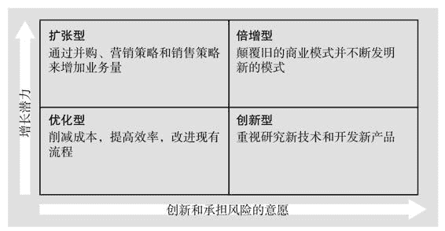

图 1.1 数据驱动型企业的力量象限

注：在对传统商业定位的改造中，无论企业本身的增长或创新潜能如何，都可以通过恰当使用人工智能和大数据技术获得收益。

例如一家企业可以利用内部沉淀的数据来精简供应链流程，从而压缩成本。

如果企业所在的市场增长空间有限，但管理层愿意冒险并热衷创新，就可以选择竞争型战略。这种战略要求加大研发和工程投入，研发新产品和服务，为未来的竞争打下基础。苹果当年为首台 iPod 的研发投入多年，随后催生 iOS 生态，最终点燃了全球移动经济，就是典型案例。

另一种选择是扩张型战略，即借助手上的数据激发新的市场打法，吸引新客群、提升份额、孵化子品牌或进行品牌延伸，也可通过并购实现扩张。

对于那些渴望实现倍增式增长，但领导层、企业文化或投资人尚未准备好大举投入的企业，网飞或星巴克式的路径暂时难以复制，上述优化、竞争、扩张三种战略则是可行的过渡。它们可被视为迈向理想倍增型企业的阶梯。随着人工智能与大数据的价值愈发明显，越来越多企业会用这项技术来优化自身业务。

走倍增型战略并不容易。利益相关者往往抗拒这种做法，因为它意味着离开收入和利润可预测的安全区，进入未知的领域。但无论如何，为求生存，所有企业最终都必须创新与调整。

即便不能立刻颠覆旧模式，企业仍可从当下起用人工智能提升效率、开发新品并通过并购实现增长。最终，在技术迭代加速的今天，保持活力的唯一可靠方式，是塑造一个难以被竞争对手复制或改进的独特价值定位。通过这样做，企业能够形成“飞轮效应”，把每次数据驱动的决策转化为新的行业洞察和增长策略，正如第八章将要讨论的那样。

这既意味着实现质的飞跃，也意味着为了支撑由人工智能及其关联技术驱动的商业模式，必须革新甚至挑战自身现有的商业模式。

### 八、倍增型思维的结果

网飞与星巴克都是倍增型企业的代表。作为领导者，你需要有远见，既要树立宏大理想，也要制定可执行的实现路径。

真正的企业家敢冒风险，但事先会做足功课，提前识别风险并尽量降低。网飞在应用数据和人工智能进行结果预测时就是这样做的，因而取得显著成效。

一旦各家公司开始围绕人工智能和大数据构建战略，企业价值往往会从“不错”跃升为指数级增长。比如网飞引入这些技术后，股价出现了急剧上涨，这也是其跻身标普 500 并成为美国 500 强企业的因素之一。当然，股价只是衡量价值的指标之一，网飞在此过程中还付出了诸多努力。但就数据而言，倍增型思维贯穿其决策始终。星巴克的增长轨迹亦如是。

在运用智能设备、大数据和人工智能之前，星巴克已取得不小成功，但并非指数级。凭借不断开店，它成为商品市场的领导者，向消费者售卖饮品与周边。但通过使用数据了解客户，甚至达到比客户更了解自己的程度，星巴克也进入了全国 500 强。

里德·黑斯廷斯坚信人们想要个性化娱乐，他用数据精准把握客户真实需求并据此供给。星巴克遵循同样的路径，将战略决策建立在数百万智能设备用户产生的真实数据之上，并以人工智能进行解析。

你不必拥有网飞或星巴克级别的资源，就能释放人工智能与大数据的真正能量。

前提只有一个：尽可能全面地了解你的客户，获取尽可能多的数据，并持续致力于服务。

### 九、从提出正确的问题开始

几年前，优步研究了全国数百万次乘客的乘车数据，发现大量乘客会要求司机在行程中顺路停靠星巴克等店铺。优步将主要城市的乘客与路线数据与餐饮点位关联，随后推出一项新业务，让优步司机为乘客送餐，而不是额外停车。就此，优食诞生了。

这类端点创新并非偶然，它们源于企业借助数据更深地理解客户，并开发出如今用户所期待的便利与个性化服务。所有企业创新都围绕快捷、便利与个性化展开，像亚马逊的一键下单。顾客偏爱个性化和便捷，而人工智能能以较低成本实现这些功能，比如亚马逊的“你可能喜欢的书”推荐。挖掘数据可以发现隐藏的弱点与机会，充分利用数据也能够让企业价值倍增。

那么该从哪里着手寻找数据，又如何找到正确的数据？我建议遵循“三步走”。

第一步：明确你要解决的问题。问题先于数据。你想弄明白什么？如果你运营快递公司，是否想为客户找到更快的运输通道？如果你经营连锁餐厅，是否想搞清楚顾客为何在外卖页面上失望离开？或者你想根据过往选择预测他们会点什么？

你应推出哪类产品，哪些产品会卖爆？你在找什么数据，为何要找？研究数据是为了知道过去发生了什么，还是为了解释原因？这些数据能否指导下一步行动？

第二步：让数据与战略保持一致。若目标是利润同比增长 20%，你需要用数据超越客户对服务的期望，提升忠诚度和推荐度并吸引新客。随后，要用数据打造新的内部流程，在最大化运营效率与速度的同时推出客户喜爱的产品与服务，同时做好招聘与培训。先确定实现目标所需行动，再反推需要什么数据以及如何发挥作用。

第三步：获取可操作的数据。收集正确的数据。需要历史数据，如财务交易、客户调研、客服中心记录，它们揭示过去表现与行为轨迹。同时需要预测性数据，基于已观察到的行为模式提示客户未来可能采取的行动。基于这些数据获得市场洞察，再应用机器学习或人工智能技术产生倍增效应。

例如一家希望提升线上外卖订单的连锁餐厅，可能会发现阻碍下单的瓶颈并据此调整流程。你也可以对客服录音进行情感分析以减少流失，正如分析师托辛·阿德坎耶在 2021 年的精辟阐述。可能性几乎无限。

网飞和星巴克都提出了正确的问题并追寻答案，它们清楚答案通向创新。它们对创新的设想很清晰：成为原创内容创作平台。它们改写了规则。与网飞的主动创新不同，百视达在被网飞惊醒后才姗姗来迟追赶，但其企业文化与领导力限制了真正的创新能力。除了少数例外。

差别不在于领导者个人性格或能力，而在于他们是否愿意提出挑战性的问题，并利用数据形成市场洞察，推动企业所需的变革。

# 第二章

## 人工智能正在改变游戏规则

2013 年电影《她》中，杰昆·菲尼克斯饰演的西奥多·汤伯利安装了一款名为萨曼莎的虚拟助理，由斯嘉丽·约翰逊配音。这位人工智能伴侣不仅让主人公的生活重新步入正轨，而且魅力十足，近似真实人类，以至于西奥多爱上了她。

影片结尾揭示真相，这个虚构的人工智能在处理数百万请求的同时进行着无数场对话幕后，浪漫台词背后是海量的并行交流。事实上，真实的人工智能同样能够做到。因此，电影里“她”并非真正的人，却拥有足够强大的处理能力，从庞大数据库中调取信息，为用户模拟出量身定制的亲密关系。令人伤感的是，当西奥多发现萨曼莎同时与数百万人对话时，他感到被背叛。

在《终结者》系列里，好莱坞对人工智能的描绘更为黑暗。功能强大的计算机网络“天网”获得自我意识，视人类为威胁，随后发动先发制人的核战争，并制造半机械人“终结者”清除残余人类。最终在阿诺德·施瓦辛格与琳达·汉密尔顿的努力下，人工智能被击败。

这两个故事都极具说服力，但也加深了公众对人工智能的误解。重点不在于把技术人格化，而在于认识其潜在价值。现实远比影视剧平淡，却对企业更具吸引力。

核心事实是，人工智能能够完成非凡之事。它可以把人类从重复工作中解放出来，并成倍提升企业创造的价值。它还能在海量信息中识别有用模式，创作出书面、视觉、听觉等多形态的高质量原创内容。最根本的层面：人工智能指任何模仿人类智能基本功能的计算能力。

它能分析历史数据以发现重复行为与结果，从中归纳模式并学习，从而更好地预测未来并给出解决方案。总体而言，人工智能正努力变得像人类一样聪明且富有直觉，同时有望超越人类固有的局限，如疲劳、无聊、对饮食的需求以及偏见等。

### 一、人工智能的演变

人工智能的概念早在二十世纪五十、六十年代就已出现，但当时缺乏大数据和足够算力使其落地。企业仍在使用存储与处理能力都很有限的大型主机。举例来说，如今一部常见的 iPhone，其内存是 1969 年阿波罗登月导航计算机的一万多倍，处理能力更是十万多倍。

然而，正如摩尔定律

随着时间推移，计算机体积越来越小，但存储与分析数据的能力却越来越强，每秒可进行数十亿次运算。最终，算力足以支撑涌入数据的处理，为人工智能提供基础。

随后互联网兴起。我们都在网上交流、分享与创造。世界变得更小，人们与企业、组织之间的信息交换更加便捷。关于人、企业与机构的数据充斥网络。观察趋势、把握偏好变得更容易。

数据本身的性质也在变化。早期世界大部分数据是结构化数据，我在第一章中提到过这一点。

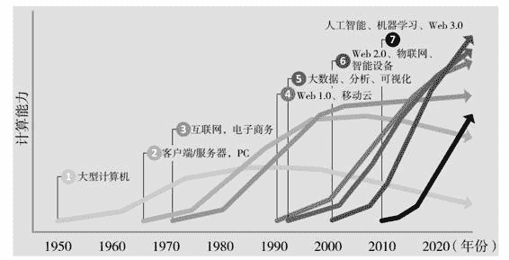

图 2.1 技术革命

注：持续的技术创新浪潮从根本上改变了人类体验，我们将在第九章讨论其中部分发展，特别是 Web1.0—Web3.0。

资料来源：The Performance Institute（日期为近似值）。

结构化数据遵循预设格式，以行列或记录字段为单位组织，如银行记录、表格中的姓名地址以及书籍 ISBN。结构化数据多见于 Excel，通常是日期、数字和经过整理或分类的事实。

随着社交媒体帖子、邮件、视频、照片、音频等丰富内容占据网络更大份额，非结构化数据总量急剧攀升。还记得移动应用存入支票的例子吗？人工智能软件会分析支票图像判断存款是否有效，这张支票图像本身就是非结构化数据。这种难以被“贴标签”的数据含义往往微妙或模糊，其分析需要前所未有的先进算力。这正是人工智能及其更复杂分支的本质。

机器学习是人工智能的子集，其算法会自行学习，并在接触到更多数据时不断进步。这可能涉及不同程度的人类监督，使用不同监督强度的训练集。假设你想让系统区分猫和狗的图像。

你可以让计算机分析上万甚至上百万张已标记为猫或狗的图像。随着训练进行，人工智能会“学会”哪些特征对应“猫”而非“狗”或“人”。就像孩子从重复经历中学习一样，机器通过大量数据接触而非显式编程来学习。

机器学习的另一个例子是语音识别。新 iPhone 首次启动时，Siri 无法使用，直到你按照提示说出若干预设语音命令，让远程 AI 通过云学习你的声音。在不到一分钟内，只需一句“Hey Siri”，即可设置提醒、启动应用或拨打电话。

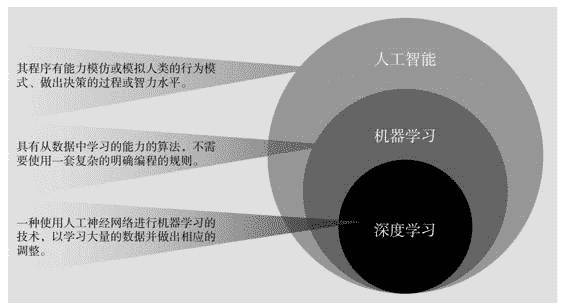

图 2.2 人工智能的层次结构

注：人工智能是一个总称，其中包含机器学习和深度学习。

资料来源：Avimanyu Bandyopadhyay（modified）CC BY-SA 4.0 commons.wikimedia.org/wiki/File:AI-ML-DL.svg。

最后是深度学习。它涉及计算机科学家所称的神经网络，即以人脑神经结构为灵感的数学系统。通俗地讲，深度学习/神经网络采用多层并行处理与分析，能够在数据中识别出远比传统机器学习算法更复杂的特征与模式。这种方式模仿了人脑的动态活动，人脑具有高度可塑性与适应性。因此深度学习需要海量数据与强劲算力，而云计算的发展正是其得以实现的推动力。

说到深度学习的经典案例，很多人会立刻想到脸书当年用面部特征从照片里把人认出来的系统。2021年11月，脸书对外宣布要关停这套能力，后续关停的考量会在第四章展开。把猫和狗分开相对直观，无非是抓住猫更常出现尖耳和面部条纹这类规律。要从照片里锁定某个人则复杂得多，系统必须抓取上千个视觉细节，再把这些细节和挂在不同账号上的文字档案匹配起来，档案里是姓名与大量带相似特征图像的配对，还要兼顾光线、拍摄角度、成像质量等干扰因素。苹果照片里的自动建册就采用了类似思路，依据拍摄日期、地理标签、人脸以及周边环境等线索把照片自动归类。

谷歌和 OpenAI 推出 `GPT-3` 属于自然语言处理的人工智能范畴。团队把数万亿级的文本输入神经网络，让它习得人类写作和口语里常见的先后顺序以及节奏感。人的交流其实很容易被预测，比如朋友发来半截信息“你想去……”，能接上的词往往只有“看电影”“逛商店”或“看球赛”，几乎不可能是“贝果”或“感染”。神经网络通过学习也能做到同样的推断。几个月的训练后，GPT-3 仅凭用户敲下几个字，就能以很高的准确度把句子续完。只要语料足够，人类行为的可预测性相当强。

到现在为止，这个模型已经“阅读”了数万亿字，覆盖电子书、博客、社交媒体、维基百科条目等等。靠大规模机器学习支撑，它能在数秒内写出吸睛的散文、诗歌、推文，回答简单问题，甚至生成可运行的程序代码。

《纽约时报》曾报道过一个实验，项目里的一名工程师让 `GPT-3` 模仿心理学家斯科特·巴里·考夫曼的写作风格。被问到“我们如何变得更有创造力”时，模型给出了如下片段：

我觉得创造力是多元世界自然长出来的副产物。世界越多元，你接触的人、机会、地点和挑战就越多；世界越多元，你把这些要素组合起来产生新事物的可能性也就越大。

在征求本人意见时，考夫曼承认，AI 生成的答案对他的真实写作做出了相当准确的模拟。真正让人兴奋的是，GPT-3 不断展示出开发者未曾设计的新能力。系统最初只是被训练去预测词串里的下一个词，吸纳了超过 1750 亿种语言使用模式之后，它自行发展出了编写代码等从未被指定的任务能力。可以说它在进化，并且会持续进化。

从服务客户的对话机器人，到为忙碌高管提炼邮件重点的数字助理，这仅仅是表象。随着 NLP 系统愈发成熟，可以想象“机器人”能自动撰写并更新大学教材，或根据广告公司最新一批客户满意度数据实时调整文案。发展得更进一步，语言 AI 还能辅助远程心理医疗的医生，对有自杀倾向的病人进行针对性疏导，或在高速行驶时纠正控制自动驾驶的计算机代码错误。

即便这些技术已渗透进社会经济的各个角落，恐惧与误解依然存在。如果你点开亚马逊的推荐商品，或用手机银行 App 拍照存入支票，你就在使用人工智能。当 Nest 恒温器预判你快下班回家而自动调节室温时，你也在使用智能设备。当 Fitbit 手环统计每日步数并提醒你今天还需再走 2.2 英里才能达到过去六个月的平均水平时，同样如此。

如果你想把企业推向更高的增长与盈利，现在正是放下对人工智能等技术的恐惧与误解、认识其非凡潜力的时机。我把人工智能及其相关的大数据、智能设备与云计算统称为倍增型技术。借助这些技术，可以捕捉企业日常运营中产生的数据，找出揭示致命短板与重大机遇的模式，并强化数据，让企业培养强劲的客户忠诚度，主导现有市场，再通过创新开辟新市场。以精准策略部署，这些技术能帮助企业以远超竞争对手的速度放大收入、利润、市场份额和社会影响力。那些因无知、安于现状或惧怕变革而不善加利用的企业终将被市场淘汰。

换句话说，超乎寻常的事变得触手可及。作为企业领导者，你要做的是弄懂如何借助这些技术发掘隐藏的商业价值，获取相关数据以启动价值变现，并在恰当时机采取恰当行动，让价值转化为利润。在本书中我们将深入探讨实现目标所需的思维与策略。在此之前，先仔细看看这些技术是什么、如何运作，以及它们不是什么。

### 二、数据分析的四种类型
数据分析的历史几乎与网络一样久，过去十年变化巨大。现实中，“人工智能”与“数据分析”常被混用，其实是错误的。虽然 AI 与机器学习能大幅增强分析功能，但没有它们也能运转。

先介绍数据分析的四类基本形态（见图 2.3）。

描述性分析是最基础的，核心是翻阅大量数据确认过去发生了什么，时间可能是上百年前的事，也可能是五分钟前。判断性分析则关注重复出现的 data 点，探究已发生事件背后的因果与原因。两者都回看过去，所以只能事后评判。

在商业语言里，描述性与判断性分析用来检验滞后指标而非领先指标。当然它们能从大数据与 AI 中受益，但不依赖也能运行。

第三层是预测性分析，正是“个性化经济”的核心。它审视过往行为的模式，推断个人、群体或复杂系统未来可能如何行动。这种方法不完美，建立在概率而非确定性上。书前言提到的 2002 年奥克兰运动家队就是案例，他们用 AI 预测模型 sabermetrics，依据非常规绩效指标签下薪水更低的球员。逻辑是，单场比赛的预测可能不成立，但整个赛季下来数据优势会显现。

如果 21 世纪初就有可行的人工智能系统，运动家队的数据团队或许会做得更好，但即使当时没有先进 AI，他们的模型已足够成功。

最后是指导性分析，它利用数据给出解决方案与结论，而非仅做预测。这是大数据、人工智能与机器学习最常与分析过程交织之处。例如，当 AI 拥有足够非结构化数据进行模式识别，并被教导为模式赋予意义时，就能发展出类似人类洞察与逻辑推理的能力。

典型例子是沃森机器人，IBM 于 2011 年首次推出。后来该项目利用基于沃森的“肿瘤学专家咨询”工具，结合机器学习与癌症研究，向临床医生提供建议。

更常见的例子是各类推荐引擎，如 Netflix 或亚马逊。在亚马逊购物时，预测性分析会研究你的行为模式判断你可能感兴趣的产品，随后指导性分析会根据你当前页面挑选具体推荐。它在医疗健康领域的应用我们将在第三章讨论。

技术细节可能很复杂，但 AI 的力量足以产生非同寻常的影响。它能处理海量数据，在数十亿次操作与数据点中辨识错综复杂的模式，不仅能推荐满足客户需求的选项与产品，还能提前准备好。在个性化已成为企业成功的时代，AI 让企业能够自动、实时且非常精准地为数百万客户提供定制化产品与服务。

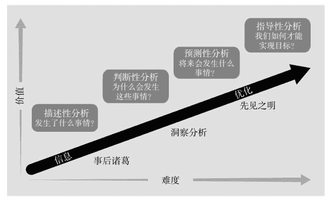

图 2.3 高德纳的分析价值升级模型

注：随着分析数据变得更有前瞻性也更难量化，其商业价值随之提升。

### 三、人工智能可以做什么
有了数万亿字节的训练数据、不断提升的处理与存储速度，以及云技术几乎无处不在的高速连接，人工智能可完成的任务令人惊叹。几个突出例子：

· 谷歌 Duplex 能接通客户预约电话，用逼真的口语与客户沟通。
· 华盛顿邮报与路透社等主流新闻机构借助 AI 撰写基础新闻稿与实时更新，有时还能产出更复杂、有创意的文章，从而解放人类记者去做深度报道。
· 英国拉夫堡大学的研究人员正在研发一套基于深度学习的系统，完成后可通过“闻”人类呼吸来检测与诊断疾病。

其他现实案例包括 2009 年诞生于麻省理工学院媒体实验室的 Affectiva，以及 2007 年从牛津大学分离出来的 Realeyes。它们都在开发“情绪人工智能”，也称情感计算，利用传感器、摄像头与深度学习分析人们对电影、教育节目等各类内容的情感反应。部分远程学习系统已用眼动追踪与 AI 评估学生参与度。若检测到挫败或气馁情绪，AI 会实时调低课程难度；若检测到无聊，则立即提高挑战性。

还有一系列视觉、听觉与运动评估技术，让自动驾驶汽车得以安全行驶。

AI 系统能依靠一个规模庞大且不断扩充的目录“观察”周围世界，目录包含物体与人物。现实驾驶需要即时适应近乎无限的不可预测变量，如交通、行人、障碍、天气、突发状况与故障，自动驾驶的 AI 功能尚不完善，但已触手可及。2020 年 12 月，通用汽车子公司 Cruise 在旧金山繁忙的日落区街道测试自动驾驶汽车，目标是减少车祸死亡。可以预见，十年内纽约、东京、柏林等大城市的大部分客运交通都可由 AI 控制，货物运输更是如此。

也就是说，若拥有足够数据了解企业客户、产品与服务，AI 能做很多事。若你在大城市运营一家配送公司，AI 可为司机计算最佳路线，让他们在高峰时段仍能准时抵达，节省时间与燃油。若你在做大型获客宣传活动，AI 可为新客户撰写措辞优美的周刊电子通讯，并对每个回复或询问做出个性化且独特的回应。若你从事制造业，传感器驱动的 AI 可 24 小时监测设备，预测故障在发生前出现，诊断所需维修并自动短信派工给人类工程师，全程不中断生产。

AI 能自动化重复性任务、识别可操作模式、协调机器人流程自动化，并与数百万人即时沟通。其潜力近乎无限。

### 四、大数据
大数据是驱动人工智能的燃料。没有海量数据供分析与学习，AI 再强的算力也无物可处理。大数据与人工智能相辅相成。

正如前文所说，结构化数据可预测且呈二进制，通常以表格与字段累积而成。这类数据主要是数据库里的点：姓名、邮箱、电话、年龄、性别等人口统计信息、税务记录、购买历史与医疗记录。60-70 年代信息时代起步时，Oracle、IBM 等公司处理的正是结构化数据。把数据放进结构化格式，就像把数据放进 Excel 表格那样直观。

非结构化数据对这种基础处理模式构成挑战。不仅意味着新数据呈指数级增长，还意味着全新数据类型出现。从 90 年代起，非结构化数据随万维网诞生而爆发，最初通过美国在线等“围墙花园”服务，后来因网景领航员与微软浏览器等消费级浏览器的普及而无处不在。在社交媒体出现前，处理图像、视频与电子邮件等非结构化数据的需求已让大型公司的算力不堪重负，迫使它们升级工具来应对数据洪流，这时大数据的概念才成形。

即便系统更快，公司也必须把数据库从把结构化数据存进常规数据仓库，转向把非结构化数据倾倒进巨大的原始“数据湖”。挑战在于如何处理并利用这些原始非结构化数据。

一些企业领导者较早捕捉到非结构化数据的潜力，如亚马逊、Netflix 与苹果。它们领先的原因在于明白，利用大数据能更深刻理解客户所需与关注，这正是未来发展的关键。

大数据有三个基本特征：

· 规模化的数据收集。企业与组织通过网页浏览记录、在线表单与问卷等一切手段收集客户数据，以发现偏好与活动轨迹。
· 数据处理与挖掘。大数据公司从庞大复杂的集合里抽取信息，常使用算法或机器学习读取数十亿字段、得出推论并识别模式。
· 分析并应用数据。像 Netflix 就明确数据的用途，用来开发与改进新产品、提供个性化供给、改善客服或提升营销精准度。政治竞选活动也利用大数据向特定选民群体，如古巴裔美国人或家庭农场主，精准投放宣传，内容基于这些群体的历史投票模式与关注议题。

另一种视角是“3V”模型（见图 2.4）。大数据的体量仅是其中一个 V，同样重要的是种类多样性，从结构化易分类信息到非结构化看似随机的片段。除此之外还有处理速度的加快，即数据的速度。

当然还有真实性与价值等其他 V 因素，这本书一直在探讨。

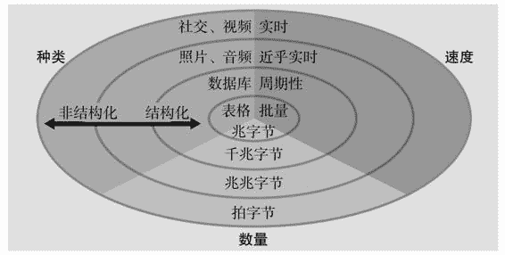

图 2.4 大数据的“3V”模型

注：大数据增长不仅体现在数量上，还表现在复杂程度以及借助人工智能处理的速率。

### 五、大数据的潜力
大数据最重要的作用，是让公司与组织清晰认识自身、客户、成员与未来方向。若对发展方向没有清晰概念，很难开发技术或创立公司。大数据让你看见现有商业模式的低效、市场未充分开发的领域、客户真正需要的产品与服务、以及可能省成本的环节。把这些宏观数据拆解后即可具体应用，以提升利润或优化组织。

假设我想在波士顿推出新牛仔裤系列，目标是比以往产品多 20% 的收入。我需要弄清产品是否真能带来增长，最关键是要了解目标受众的购买行为。

这必须有明确目的。同样的营销策略对一个城市有效，对另一个城市可能无效。

从过往收集的数据看，最有可能购买的消费者是 25 岁以下大学毕业生。这是个不错的起点。借助数据库，通过历史购买数据、产品记录与客户满意度调查等资源，可以把握这些顾客的具体购买模式与偏好。

数据指出，最佳客户群是居住在坎布里奇与查尔斯镇、年龄 23 至 28 岁的艺术人士，他们对彩色牛仔裤很感兴趣——黄色、红色、粉色、绿色等。现在有了特定细分市场可用 AI 触达。我会用系统发起一次数字模拟营销活动，基于数据让 AI 回复文本信息，在社交媒体分享 AI 设计的图形，播放 AI 剪辑的音乐片段，甚至投放 AI 生成的环境广告，全部内容持续进行对比实验。

品牌开始建立并产生入站销售流量后，会评估各项活动效果并据此调整。这一测试场景的最大应用包括顾客满意度与顾客行为，尽管数据也可用于员工满意度、流程改进乃至库存控制。

大数据让一切更清晰。随后可设定公司目标——创新、效率、新品牌、新商业模式，或任何可产生倍增效应的目标。之后开展活动，可能改进业务、推出新品，或百余种其他选择。凭借正确的数据，可输入算法预测更有效的运营每年能为公司省下多少成本，或产品推出首季度可能获得多少利润。

在 AI 与机器学习处理大数据指导下，商业决策不再受直觉、偏见与个人情绪主导。随着设备与云技术日益平价，几乎每个人都能利用大数据。

### 六、机器人和智能设备
简单说，机器人是通过分析实时数据进行学习，并把学到的内容转化为现实世界活动的机器，有时也转化为非现实活动。与 AI 的遭遇相似，流行小说放大了对机器人的恐惧与误解。现实并不夸张，机器人反而为企业与组织带来光明前景。

机器人技术源自 20 世纪 50 年代，但因缺乏大数据与 AI 支持，当时未能快速发展。如今大数据驱动的 AI 能让机器在无人干预下完成有意义的任务。机器人系统反应更灵敏，行为更像人类，因为它们拥有足够的人类数据，并能快速处理数据并从中学习。

因此我们有了自动驾驶汽车与完全由机器人运行的特斯拉工厂。我们有自监测并自动调节安全与环境系统的“智能建筑”。我们有智能手表、智能电视、智能恒温器等物联网组件。

我们还有能模仿人类进行逼真对话的拟人机器人 Sophie；Embodied 公司开发的 Moxie，旨在提升小学年龄段儿童的社交与情感技能；以及 Tombot Jennie，一只为老年人提供情感支持的机器人小狗，外形与表现极其逼真。尽管仍有顾虑且尚未普及，其优点毋庸置疑。

机器人的实际应用已证明其在医疗保健、交通运输、家用电器等领域的价值，并有望持续带来积极影响，而非人们想象的世界末日。

机器人的概念远不止金属臂与电动装置。智能手机、平板、可穿戴终端，乃至人们日常依赖的个人电脑，身上都具备机器人的典型特征。它们共同的工作方式是借助于海量数据与人工智能，持续捕捉人类行为的信号，并在多样的使用场景里把处理后的结果回传给使用者，回应真实需求。移动设备里的定位信号与内置的运动传感器会不断产生数据流，经模型加工后便能简化日常活动并提供指引。多数手机预装的健康类应用就是典型，它统计全天步数并归纳关键指标，用于追踪长期健康走向。各类终端也在无时不在地记录消费偏好与行为轨迹，形成庞大的信息库，等待懂得价值的主体去挖掘。联网家电、安防系统与温控设备同样在大量搜集信息，既能辅助人的判断，也可直接实现自主决策。

从这个视角看，随身的智能终端本身就是一种机器人。

把亚马逊的 Amazon Go 无人店视作一个由机器人构成的空间并不夸张。顾客下载官方应用，进入店内扫码核验，自行取货后离开，门店的自动化系统即完成扣费，全程无需人工。

### 七、影响显而易见
当机器人与智能终端被人工智能和大数据结合，背后承载的就是海量人类与商业需求。规模最大的两个应用场是制造与医疗。

机器人正从多方面支撑老龄群体，缓解疼痛、减轻孤独、开展物理康复，还能在沟通与服药依从性管理上提供帮助。由 AI 辅助的机器人手术已在加速落地。制造内部，流程自动化已成常态，成千上万台生产装置的功能被 AI 监控与操控，涵盖装配线作业，乃至故障修复系统。机器人还能优化流程、降低失误，所谓的机器人顾问甚至开始承接大量消费金融的运营流。

机器人与智能设备之所以能真正改造商业，关键在于大数据与人工智能能够作用于物理世界。航空公司利用自有数据优化机翼操纵面设计，飞机更省油，成本下降利润提升。物流企业改用搭载传感器的无人机配送小件，而非燃油卡车，也实现成本节约与利润增长。企业部署 AI 客服机器人后，能处理约九成的来电咨询，既可压缩人力成本，也能把人员释放到需要人工介入的复杂问题上，效率明显提高。

在新冠疫情期间，机器人辅助的消费者保护出现了一个有力案例。众多中小企业为生存必须把包裹、食品或日用品送到家门，却遭遇“门廊窃贼”盗窃激增。部分公司借助智能设备找到对策。他们注意到自 2017 年起多数新车都配备车载应用，可由手机远程激活基础功能，于是向客户建议：在下单时发送短信授权一次性验证码来解锁车辆。

若客户同意，司机在送货时前往客户的汽车或 SUV 停放处，用该一次性验证码开锁，将货物放入后备厢后关门并重新上锁。验证码使用后即失效，不可复用，公司也能准确记录送货人身份和开锁时间。如此一来，客户即可安全无接触地取到包裹，为全球性的配送安全问题提供了可行的解法。

随着设备更小更轻、人工智能性能提升、微处理器缩小、存储容量扩大，我们正进入良性循环。巨量数据点被持续捕获与归档，愈发复杂的人工智能算法与神经网络对其进行分析，学会挖掘隐含价值并预测人类需求。机器人与智能设备对需求的响应速度与前瞻性有时令人觉得近乎先知。设备在与消费者、企业客户与环境的持续互动中不断采集新数据，循环不断强化。

### 八、先进的机器正在改变游戏规则
美敦力展示了机器人技术如何带来企业级跃迁。新冠疫情推动远程医疗成为医院和手术中心的刚需，而机器人辅助手术正是远程医疗的核心。

美敦力的软组织机器人系统 Hugo 已开始侵蚀行业领头羊美国直觉外科公司的份额，这让美敦力不仅在当财年第四季度实现 37% 的销售额增长，也预计到 2023 财年机器人辅助手术年收入将达 1 亿至 3 亿美元。公司同时宣布研发投入将创历史新高。换言之，先进的人工智能机器人技术把美敦力从远程医疗的边缘参与者转变为变革推动者。

要论人工智能与智能设备如何把默默无闻品牌推向全球，Nest Labs 前身是最典型的案例。该公司由前苹果工程师托尼·法德尔与马特·罗杰斯联合创立，2011 年推出明星产品鸟巢智能温控器。这款设备可编程、可通过 Wi-Fi 接入云端，内置传感器并能从用户行为模式中学习偏好，上市即引发热潮，催生了智能烟雾探测器、安全摄像头等品类，并在公众意识中奠定了“智能家居”概念，也成为亚马逊 Alexa 等智能音箱的先驱。

直到 2014 年，谷歌以 32 亿美元收购仅有 150 名员工的 Nest Labs，才彻底证明智能设备具备创造性财富的能力。如今 Nest 品牌仍活跃于谷歌的生态中，包括家庭 Mesh Wi-Fi 系统和谷歌家庭智能音箱。对一家成立仅 4 年的初创公司而言，这样的成绩已相当突出。

### 九、盈利希望渺茫
以云计算为代表的互联网连接起了整个技术生态，促成了智能学习、信息融合和效率提升的良性循环。云计算依托大量联网服务器远程提供强劲的数据处理能力。因此机器人以及 Siri、Alexa 等实时 AI 系统不必自带庞大的独立模型，而是能瞬间接入远程服务器和处理器，完成数据分析的繁重工作，并把指令下发给传感器、伺服系统等实体部件。

云技术让任何组织在不做巨额基础设施投入的前提下，提升处理速度、算力、数据结构并完成复杂分析。最典型的代表是亚马逊网络服务 AWS，其占据公共云市场约 32% 的份额。AWS、微软等云服务商以各国企业可承受的价格提供强大的数据后端。

中小型企业因此无需自建大型数据中心。物联网设备尤其适合云供电，从农田灌溉传感器到家庭安防再到“智能牙刷”，它们通常通过 Wi-Fi 甚至 5G 传输少量数据。反观纯大数据场景，云的短板仍在：处理速度和数据基础设施不足以完全胜任。

21 世纪初，开源项目 Apache Hadoop 让大数据计算成为可能，最初运行于大规模本地集群，后被云计算取代。初衷是让非结构化数据进入云端以更高速度处理，但能远程处理所有非结构化数据的配套设施尚未完备。云所期待的无处不在连接和任意数据访问，至今仍未完全实现。好在摩尔定律仍在作用，量子计算也在发展，算力与存储持续攀升，最终云的效用将覆盖几乎所有规模的业务。

### 十、以特斯拉和亚马逊的商业模式思考
埃隆·马斯克的特斯拉长期站在利用云潜力的前沿。没有云，特斯拉充其量只是一家普通的电动车制造商。过去多年，特斯拉将驾驶员档案保存在车内，可根据个人喜好自动调节座椅、音乐、后视镜等配置。每个档案都通过特斯拉 App 或车钥匙与车主手机绑定，使车辆识别不同驾驶员并自动切换设置。如今这种个性化配置能力正经由特斯拉网络架构迁移到云端。

这不仅能存储更多驾驶员数据和媒体信息，还能让特斯拉依托云端算法引导和训练自动驾驶。特斯拉曾计划在 2022 年推出可与优步、Lyft 竞争的共享出行服务，该服务同样将成为 AI 系统的数据来源。

亚马逊网络服务是另一例证。21 世纪初，亚马逊 IT 团队判断应对季节性电商流量和增长瓶颈的办法，是打造“快速、可靠、廉价”的架构。2006 年，AWS 作为网店、媒体、游戏等业务的后端面向公众开放，让开发者以低价快速使用按需云计算。

过去 15 年，亚马逊的电商服务平台演进为 EC2 虚拟机、Glacier 低成本存储和 S3 存储系统。如今 AWS 约占公司总运营收入的 63%。它已不只是“云”，更像一道闪电。

向特斯拉和亚马逊学习：把业务搬上云，不要再用内部主机硬扛大数据。立即开始收集数据，并借助云计算和人工智能的远程能力解读数据。你的企业需要创新、提效，还是借助物联网、机器人和数据分析等新技术？先弄清数据对业务的影响，然后把数据洞察合理应用到具体业务场景，而不是被动等待变化最终落后。看看 Netflix、星巴克以及下一章的案例，它们的崛起并非单纯技术或商业智能，而是把数据洞察转化为行动时 AI 带来的效果。这本质上是战略思维。Netflix 在变革时流媒体尚不成熟，数据处理速度也慢，算法也不完善，但它们清楚要提什么问题、想解决什么业务痛点。庆幸的是，你也可以提出同样的问题。

# 第三章
## 比萨与美妆的共同密码
人工智能的价值在于几乎可以为任何行业挖掘并放大价值。无论这些价值已归属你还是尚未被开发，都深藏在数据里。可把数据视作一种丰富且可再生的自然资源，不会枯竭却容易浪费。通过人工智能及其相关技术，任何人都能获取并高效利用这份资源。

无论企业生产什么或服务于何种目标，人类工作都会产生数据。卖出一件小部件就会产生结构化数据，如品类、产量、生产时间、销售对象、定价，以及非结构化数据，如图片、买方推文、购买行为模式等。上千个看似随机的事件会随之产生。无形工作同样会产生数据，如慈善捐赠。结构化数据丰富，但与事件相关的非结构化数据同样庞大。

每个企业或非营利组织都能获得源源不断的数据。虽然这些数据总与对象和人员关联，但对组织自身业务或使命而言是独一无二的。整体上数据量可能令人应接不暇，但对懂得使用的人来说，那是一片充满机会的海洋。

### 一、两种方法，两种不同的结果
第一章里我提出了按风险承受意愿和增长潜力划分的四大象限，分别是优化型、创新型、扩张型和倍增型，正如书后将探讨的，四个象限的企业都能借助人工智能和大数据发挥优势。更进一步，企业可利用在所在象限的 AI 经验推动商业模式升级，最终成为倍增型企业。

例如，通过大数据和 AI 降本增效，优化型企业常会发现新市场潜力，转而成为扩张型企业；或借助经验承担更高风险，开发新品、采取竞争策略。

本章聚焦那些愿意用 AI 发掘和利用数据价值的公司。产品和服务各不相同，但共性是都认可自身数据的潜力，并以全新方式加以利用。起初都不是倍增型企业，最后都实现了倍增。因为它们敢于打破原有商业模式，真正跟随数据做出改变，从而名利双收。

本章的警示部分会列出拒绝变革的公司。它们看不到数据价值，或不愿借助 AI 及相关技术发挥优势。即便拥有辉煌声誉和海量数据，这些品牌仍未能蓬勃发展，最终甚至被迫退出。好消息是，如今获取 AI 和大数据的门槛比任何时候都低。尽管有难度和风险，但应用它们是实现非凡成就的关键。

### 二、达美乐逆袭
在 2008—2009 年经济衰退前，达美乐比萨连锁正承压。截至 90 年代末，它拥有约 6000 家门店，是美国领先的披萨配送品牌，并于 2004 年上市。此后，外卖披萨份额被冷冻披萨和竞争对手快餐抢走，经济衰退进一步压低消费支出。多数对手选择降价，而达美乐采取倍增策略，用智能设备和数据重塑营销。

早期品牌形象不佳。焦点小组和网络论坛屡次批评其产品，尤其是被调侃像“硬纸板”的外底层。达美乐没有回避，反而收集负面反馈并寻找利用方式。

正如“哦，是的，我们做到了”的广告所展示，达美乐把批评转化为全面改良配方的指示，并用自嘲纪录片风格讲述这一历程。结果振奋人心：配方重塑并重视负面评价后，销售额增长 32.2%，股价从约 5 美元升至 30 美元。对数据的创造性使用才刚刚开始。

2012 年，达美乐推出 Facebook 页面“创意烤箱”Think Oven，用于征集客户意见，涵盖新菜单、品牌可持续建议乃至制服设计等。从上万条建议中挑选的优胜者可获现金奖励。该账号吸纳超 100 万粉丝，更重要的是为达美乐提供了大量公众来源数据。公司持续利用这些数据开发更多应用，以更深入理解顾客行为并预测需求。
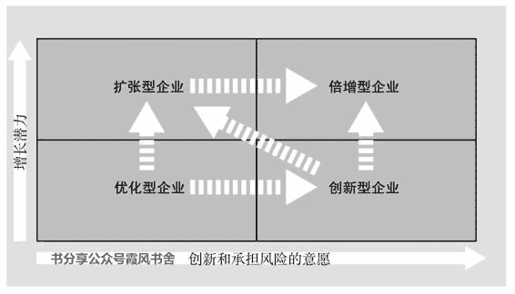
图 3.1 数据驱动型公司的力量象限
注：任何企业或非营利组织如今都能从人工智能和大数据中受益，并借此向前发展。

随着举措推进，达美乐彻底重塑商业模式，愈发依赖数据和数字技术，正如高管所言：“达美乐其实是一家科技公司，只是恰好卖披萨。”

这些举措以多种形式延续至今。例如在线追踪器和语音订购应用，支持 Slack、Facebook 消息、Twitter、达美乐移动 App，以及通过亚马逊 Alexa 和谷歌语音助手在智能电视上下单。截至 2018 年，逾半销售额来自移动端，其中“一键式”重复下单功能省去重复输入。

在持续 A/B 测试和预测分析改进下，“创意烤箱”启动的数据采集进一步扩展。除了强化社交媒体影响力并通过忠诚度计划收集数据，达美乐还打造了昵称“DOM”的 AI 虚拟助理处理订单，并与福特合作探索自动驾驶配送。

股价的持续上涨虽非唯一价值指标，却有力印证了倍增策略的有效性。达美乐的动力既来自对 AI、大数据和智能设备的有意应用，也来自领导层打破旧模式追逐新模式的决心。

该策略仍在发挥作用。2017 年达美乐超越必胜客，成为全球最大披萨连锁，复合年增长率约 9%，表现不仅优于餐饮同行，也超出美股许多非餐饮“明星”企业。对一家曾被形容为“硬纸板”饼皮的公司而言，这已足够令人惊艳。
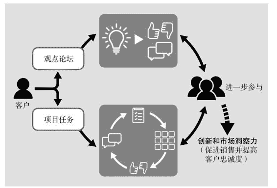
图 3.2 达美乐的“创意烤箱”
注：登录后的达美乐顾客可以参与“创意烤箱”制作过程的“观点论坛”或“项目任务”部分，新的创意能够在此得到讨论和投票表决。项目要经过构思过程，对提出的解决方案要进行讨论、分享和投票。这两个数据集都被进一步开发，并应用到新的达美乐商业活动中。

### 三、欧莱雅的数据基因
欧莱雅拥有 115 年历史，却像硅谷初创企业一样运作。这家国际美妆集团始于法国化学家研发的染发配方并售予巴黎美发师。如今从产品成分到大数据与人工智能，欧莱雅持续强化科技投入。

1997 年，哈佛商学院发布关于欧莱雅重振 Plénitude 护肤线的营销研究。研究目标之一是提升品牌大众吸引力。顾客感知数据是核心，它衡量价格与有效性反馈，以及对不同年龄与社会群体的吸引力。

研究中采用“感知图谱”定位方法。收集受访者对各品牌属性的评分并以二维图表呈现，可直观展示 Plénitude 与竞争品的关系。基于此可在包装、店面陈列、广告投放、SKU 整合、分销策略和定价等多维度改进。经努力后，该系列的顾客感知发生改变，销量大幅提升。

# 欧莱雅的数据驱动之路

上世纪九十年代末，欧莱雅已开始借助数据推动业务创新并提升盈利，随后在业内获得最具数字创新美妆集团的声誉。

我曾与美洲区信息主管苏珊娜·格林伯格交流。她坦言，面对多条产品线和消费者习惯的高度差异，转型难度不小。

格林伯格指出，消费者信息价值巨大，只有更深刻理解用户才可能提供更贴切服务。为此公司在严格尊重隐私的前提下自建数据平台，平台收录用户明确授权的显性信息，也涵盖可推断的隐性信号，比如反复浏览某类品类可推测当下偏好。总的来说，企业在合规框架内尽力去理解消费者。

数据产生的价值远不止于推荐。“我们不断自问数据能揭示什么，自己想借助数据解决什么问题。”她以补货频率为例说明复杂性，现实中洗发水消耗速度往往是护发素的两倍，这一差异会牵动多条产品线的全生命周期。

2012年，欧莱雅在既有研发体系内设立美国联美孵化中心，聚焦技术创新与颠覆落地，重点在海量信息、AI、智能硬件与云计算等方向，主要动作有：

用大数据与AI指引研发。欧莱雅与云集成商拓蓝合作，日均汇聚超过五千万条记录，建成规模化信息湖，每年据此产出数千个新配方。孵化中心的实验信息智能负责人菲利普·贝尼维表示，团队使命是为消费者创造尚未被想到的服务。“在美妆行业已全面全球化的背景下，”他说，“欧莱雅必须加快步伐，推出尊重人体与环境的新品类与服务来回应需求。”

研发链路将消费者对效果的主观评价研究、公司对配方原材料的物理化学定义，以及安全性与成分毒性等信息实时打通。借助AI分析，科学家可直接获得用于构思开发新品的洞察。孵化中心还向其他部门输出信息并鼓励反馈。

依托信息驱动的本地化开发，欧莱雅旗下28个国际品牌覆盖130个国家。合作伙伴IBM认为，正因拥有同步且高品质的信息，品牌才能在文化迥异的市场持续取得成功。

运用AI与增强现实提升经营效率。2015年公司推出千妆魔镜Make up Genius，这款移动应用让用户通过手机摄像头预览不同发色与妆容效果，支持上传面部影像、挑选产品并进行前后对比，同时方便下单。随后欧莱雅收购了更先进的皮肤诊断系统ModiFace，可借助实时影像模拟使用效果。公司还研发智能发梳，内置电导传感器、加速度计等，将使用信息传给AI算法，从而给出个性化护发建议。

除智能设备驱动的电商业务收入占比快速提升外，公司还用AI简化招聘。每招聘约一万五千个岗位需处理超百万份申请，像到岗时间、签证状态等常规问题由聊天机器人Mya接手。

随后AI系统Seedlink会对开放式问题的回答进行分析。结果节省上百小时筛选时间，也能挖掘传统简历审核中易被忽略的人选。

以智能设备和AI重塑对话式营销。经充分调研，欧莱雅推出首个脸书智能客服聊天机器人，借助AI帮助消费者找到合适的美容单品，并在对话过程中获取更多洞察。公司也在制定保障措施，防止品牌卷入极端主义内容。可以说欧莱雅用AI压缩了从发现产品到完成购买的关键时段。正如欧莱雅首席数字营销官卢波米拉·罗切特所言：“数字化就是与消费者建立连接，它帮助我们获得深层市场洞察，生产对的产品，已成为营销业务的核心支柱。”

正因这些举措带来的显著增长，欧莱雅已进入倍增型企业行列。多年来系统性地运用客户信息改进甚至重塑商业模式，借助信息与AI研发出真正令顾客满意的新品，激发更深层的参与感与忠诚度，并搭建出信息科学家眼中理想的电商平台。

### 四、人工智能和小型公司
目前可见的倍增案例多集中于体量庞大的跨国集团，它们也不全是创业之初就如此规模。股价是上市公司衡量增速的简便指标，这在一定程度上解释了现象。

跨国企业的成功固然鼓舞人心，但对以私营为主的中小企业来说，AI带来的回报常难以量化。事实上，这类益处是真实的，并且几乎适用于任何体量。

对较小企业要特别清醒，AI和大数据并非一蹴而就。最稳妥的做法是锁定一个核心场景，最多两到三个场景，先在一个点上跑通。

### 五、更高效的招聘
对任何体量的企业而言，招人都是痛点。新冠疫情后空缺增多，负担更重。传统筛选耗时费力，很难找到合适人选；跨国招聘和跨文化人才搜寻会增加难度。

好消息是，进入招聘流程的简历、邮件、语音留言、短信都是非结构化数据，正是AI可发挥空间。

厂商RChilli提出一种以信息为核心的方案，已被人力公司、猎头及长期招聘困难的中大型企业采用。RChilli系统通常嵌入招聘网站和求职者追踪软件ATS，内置多语言解析器，可读懂Word等格式的简历。电话、邮箱等常规字段提取相对容易，但非结构化文本中还藏着大量关键信息，因此其自然语言处理模块负责抽取并自动结构化。

社交媒体等其他非结构化来源也能被处理。近期系统新增隐私保护，按欧盟通用数据保护条例执行，并可过滤无意识偏见。随后系统借助技能与岗位分类法对海量信息评估，筛出契合特定职位要求的人才。

不少企业已在用这一层级的人工智能。人力资源咨询与技术公司伯克希尔联合公司将RChilli整合进BalanceTRAK申请人追踪系统并推广使用。该公司的人工智能最初用于自动化反就业歧视合规，如今显著改善求职体验并提升招聘效率。

中等规模云开发商天工英才同样受益。该公司发现仁科PeopleSoft、甲骨文云和思爱普SAP的招聘模块可更高效地壮大其超九千名熟练员工队伍。接入RChilli AI分析后，人均招聘成本降60%，人才获取更顺畅，同时因更精准匹配岗位与技能，员工流失率下降。

这一做法也被更大型公司采用，包括全球薪资处理巨头ADP。RChilli分析大幅减轻手工录入和从海量简历中筛选的负担。还能处理邮件和社交平台上的候选人数据，使招聘成本降低58%。

### 六、基于数据的市场营销
AI的另一常见场景是数字营销，对中小公司而言门槛相对友好。过去二十年媒体渠道爆炸，企业难以消化来自网络、社交媒体与移动应用的海量非结构化信息。搜索优化和付费搜索起初看似有效，但小团队很快会被数据淹没。

数字营销公司NoGood在SEO、付费搜索、社交广告和漏斗转化营销等服务中加入AI。共同点是处理非结构化信息的方式，即用AI分析海量用户行为并提炼为可执行的营销动作。

提炼意义的价值立竿见影。NoGood的方法让意大利食品电商Fratelli Carli的新客户收入增长350%，老客户收入增长50%。AI帮助该公司分析兴趣、偏好和消费心理，快速测试新用户画像，并在多渠道设计个性化留存策略。

同样的方法被用于Steer，这是一个提供车辆购买或租赁替代方案的订阅制电动汽车服务平台。借助NoGood提供的人工智能支撑的产品原型设计、竞品研究和漏斗终端用户体验分析，Steer获得有效媒体平台管理，进而推出影响广泛的广告营销活动。结果网络流量提升600%，转化率提升320%，月收入提升37%。

### 七、更健康的选择
医疗健康体量巨大，涵盖大型药企、器械商、保险公司和服务提供方。同时行业内还有大量中小机构、医院和诊所难以处理堆积的信息。

在健康领域应用大数据和AI的机会巨大。2020年一篇医学期刊文章指出显著优势，包括：

更快速更准确的诊断。把体格检查结果录入系统后，可综合全部可能性并自动识别缺陷、疾病甚至推荐治疗方案，从而获得更快速准确的诊断。

减少工作人员过度疲劳导致的错误。

基于AI的手术辅助。让人类外科医生能更精准开展微创手术。

改进影像检查结果。对核磁共振、胎儿超声波图像等非结构化信息提供更全面的解读。

这些改善将提升护理质量、降低成本或两者兼得。包括为阿尔茨海默病患者提供虚拟助手，利用红外光对色素沉着病变做算法评估以尽早发现黑色素瘤，以及大幅减少住院率等。2020年《福布斯》报道了新泽西州克莱尔医疗的研究，一种基于AI的诊断工具准确预测了多种严重临床结局。这些患者多为老年人或存在健康隐患，其中超过50%在预测公布后无需住院。

这为他们赢得了采取预防措施的时间。据克莱尔医疗总结，一个患有多重并发症的老年患者一次住院花费常超过三万美元并带来额外风险。因此将AI引入医疗健康在经济与社会价值层面均能产生倍增效应。

另一家医院也证明了AI在提升医疗质量与降低成本方面的潜力。2020年，哈肯萨克医疗中心成为新泽西州首家实施AI外科培训计划的医院。名为C-SATS的系统让手术机器人团队能够安全追踪治疗过程，不断提升技能并改善患者整体预后。

### 八、错失良机
若没有警示性反面案例，关于成功倍增策略的讨论就不完整。太多公司直接拒绝进入AI和大数据领域，即便是入门级优化尝试也不愿进行。伊士曼柯达公司正是典型。

自上世纪八十年代起，柯达相机是面向大众最具创新性和盈利能力的产品之一。那是一款极简装置，皮革盖盒式相机预装未曝光胶片。拍摄满一百张后，用户寄回工厂，花十美元约合今天二百九十美元，相机便装回新胶片并附赠底片与相片。这是一种剃刀与刀片的捆绑模式：低价售出设备，再靠耗材盈利。

数十年来凭借对胶片及相关设备的掌控，柯达一直是北美摄影业的无可争议巨头，涵盖个人、专业与工业领域。

有时柯达与爱克发、富士等欧亚对手交锋，但市场地位基本未变。然而随着基于计算机成像与网络技术的数码摄影兴起，一切改写。

人们常说柯达被数码技术突袭，事实更复杂。实际上柯达在上世纪七十年代中期已开发出第一台手持数码相机，但因担心侵蚀胶片业务而迅速放弃。尽管如此，该公司后来仍与苹果等合作，于1996年推出昂贵的数码相机产品。

在上世纪九十年代与二十一世纪初，柯达收购了不少拥有新技术的公司，看似扩张策略。然而这些收购很少涉及大数据或人工智能，至少观察者会如此认为。实际上柯达错失了成为倍增型企业的巨大机遇。

2001年，柯达收购了加州初创公司Ofoto，该公司允许用户上传、分享和打印数码照片。据哈佛商业评论斯科特·安东尼分析，这笔收购看似先见之明。在脸书出现前，柯达围绕分享“柯达瞬间”建立品牌，有绝佳机会将其转化为分享照片、活动、新闻等信息的社交网站。

对于堆积如山的非结构化信息，柯达本可应用真正的信息科学，最终借助AI改变商业模式，甚至成为领先的社交媒体平台。遗憾的是，公司选择主要用于照片打印，倒退回十九世纪的原始模式。而用户兴趣已从打印照片转向在线分享，产生了大量非结构化信息，却鲜有公司认为其有价值。

柯达最终在2012年破产重组中出售了该服务。

摆脱破产以来柯达持续经营不善，但财务问题由来已久。2010年，在被剔除道琼斯工业平均指数六年后，它又被剔除出标普500指数，结束了长达53年跻身美国五百强企业历史。

柯达的衰落与网飞的崛起形成鲜明对比。柯达聚焦产品本身相机、胶片乃至后来的数码影像，而非产品对消费者的价值。正如第一章所述，网飞愿意放弃既有产品，追随信息指引的产品价值所在。

### 九、采取措施
正如后文将探讨的，开启AI和大数据之旅有几条建设性路径。简言之，企业可遵循以下步骤。

第一步：把所在行业整体看待，找出竞争对手未利用的价值点、短板或机会。对网飞而言，这是DVD邮寄与流媒体传播的区别。

第二步：找出当前商业模式的局限，即阻碍挖掘潜在价值的因素。

第三步：确定并理解能够释放潜在价值的技术。如有必要重读第二章。

第四步：制定基于该技术的发展策略以释放潜在价值。记住一次性做完所有事可能不成功，但要清楚下一步是什么。

第五步：实施这些策略，颠覆商业模式。请记住合作可能比单打独斗更快实现目标。

第六步：在组织架构和企业文化层面落实发展策略，以支撑变革并保持全新商业模式持续演进。很多时候，信息和AI带来的洞察本身就能指明哪些领域仍需变革。

几乎每个公司或非营利组织都有能力遵循这些步骤。即使组织性质决定需从优化型或扩张型战略起步亦然。正如本章案例所示，应用AI并不需要在开始前单枪匹马或拥有无限资源。总有有能力的合作伙伴可以帮助启动旅程，且最好一次只进行一个计划。

通过开始应用AI和大数据，你的企业最终将抵达达美乐或欧莱雅同样的彼岸。如果你这样做，就要准备好抛弃旧商业模式，顺着信息的指引，让自身内在价值成倍增长。

然而在进入AI战略的规划与实施之前，有必要提醒一点：AI、机器学习及所有相关技术都是人类创造的。正因我们是人类，存在缺陷，技术结果有时也不完美。因此为了在任何意义上创造最佳结果，下一章将讨论以合乎道德和负责任的方式应用这些工具的必要性。

# 第四章

## 合乎道德和可持续的人工智能

2021年秋天，《华尔街日报》的调查记者发布了一组由16部分组成的爆炸性报道，揭露科技巨头脸书的不光彩行为。这些文章和相关播客引发公众强烈抗议，并呼吁监管部门介入。脸书主要以公关手段和将公司名称改为Meta作出回应。截至本书写作时，它仍未解决真正的问题：以不道德和不负责任的方式应用大数据与人工智能。

以不道德方式应用人工智能相关技术会在现实世界产生真实后果。根据《布朗政治评论》的一篇报道，Meta可能正面临刑事或民事责任、更严格监管以及反垄断诉讼等后果。但这也会波及所有公司和组织，而非仅是脸书这类科技巨头。商业道德，包括以道德方式使用技术，对财务表现有重大影响，有道德的公司往往获得更高回报，而缺乏道德的公司客户忠诚度会下降。

换句话说，人工智能和大数据固然可以放大商业成就，这本书将帮助你实现这一点，但如果以不道德和不负责任的方式使用，它们也可能让业务招致更惨痛的失败。它们还可能对人、社区乃至我们赖以生存的星球产生巨大影响，既可能是积极的也可能是消极的。

技术本就如此。已故纽约大学教授尼尔·波兹曼曾指出，认为技术影响是单一方向是一种谬误。他说过：“每一项技术既是绊脚石，也是加速器；技术带来的影响不是非此即彼，而是福祸相依。”人工智能亦是如此。

与过去的工业革命类比，AI 所带来的根本差异是时间尺度。印刷、蒸汽、汽车这类技术，从问世到好坏分明，往往要几十年的沉淀。而人工智能的反馈几乎是即时的。按其本质，模式识别与决策可以在人类组织形成反应之前完成。一旦产生的价值普遍可得，自然值得放大；一旦伤害不可避免，就必须刹车。这种极具可燃性的技术，让伦理与长期可持续不再是抽象的道德议题，而是企业的生存前提。

### 一、什么是合乎道德的人工智能
潜能越大，伦理讨论越密集。图宾根大学的一份综述梳理了近五年内发布的 22 套 AI 伦理准则，学界最终归纳出五条共识。

#### 透明度
能自主判断的系统必须给出可被复核的说明，并允许监管方追溯。伤害发生时，要能查清来龙去脉。AI 不该被误读为不可知的黑箱，它的行动逻辑需要被公众和主管方看得懂。

#### 正义和公平
高度自主的系统应以人类价值为基准，契合尊严、自主、基本权利，以及对种族、性别、文化多样性的尊重。现实中招聘、教育、信贷等场景的算法偏见已成常态，但纠偏的行动也在同步推进。

#### 非伤害性
系统在设计之初就不能以造成危害为目的。它既要可靠安全，也要让尽可能多的人受益，指向共享的繁荣。应用方式还应扶持社会与公民进程，而不是对它们构成颠覆。

#### 责任
设计者、建设者与使用者，对系统的正面应用、负面滥用以及最终后果负有实际利害关系。他们既有义务也有空间去控制用途与产出。责任的边界超越个人或单一企业的生命周期。AI 有可能改善地球生活，也可能带来灾难性风险，需要极端审慎和前瞻性的风险管控。

#### 隐私和选择权
AI 分析个人数据快且精准，数据的提供者应始终拥有访问、管理和支配的权利。在涉及个人数据的场景，AI 不应不合理地压缩真实或感知的自由。人类也应有权决定是否以及如何把决策权委托给机器来实现自己的目标。

法律与风险层面正在显现。监管往往滞后，但偏见、数据安全、隐私泄露、第三方恶意利用等相关的民事诉讼预计会上升。风险管理者已意识到问题，却缺乏清晰解法。埃森哲 2019 年调研显示，58% 受访者认为 AI 是导致非预期后果的最大潜在来源，但仅 11% 表示自己能充分评估这类风险。埃森哲同时提出负责任 AI 的四大支撑。

#### 组织方面
在高层推动下，企业要提升对 AI 风险的认知，优先长远价值而非短期产品指标。领导需要认识到 AI 应用要求新的考核方式和岗位能力，并通过培训或招募补齐管理短板。

#### 运营方面
组织应明确 AI 的角色、目标与权责，让治理架构更开放、跨部门协同。

#### 技术方面
系统应被打造为公平、可信、可解释。需要投入时间识别偏见及影响结果的其他因素。

#### 声誉方面
企业不仅要坚持负责经营，还要持续追踪关键 AI 指标，以控制风险并向外界清晰传达成果。

### 二、只依靠道德框架还不够
AI 与大数据的伦理冲击不可低估。为保护公众，各国正围绕隐私等制定法规。但在监管宽松的地区放开使用，也会波及受管制市场的用户与企业。因此建立国际通用惯例的呼声不断增强。2020 年计算与社会责任中心负责人出版了系统著作，2021 年联合国教科文组织成员国通过了首份全球 AI 伦理决议，同年达沃斯世界经济论坛发布了以道德方式应用 AI 的人力资源工具包。

纸面共识远不够。企业在规划 AI 应用时必须前置衡量标准与问责机制，不能等到伤害发生后再补救。若缺乏主动行动，声誉、客户与经营基本盘的维护成本会显著上升。

### 三、商业案例
研究反复指出，商业道德水平是长期成功的关键变量之一。鉴于 AI 产出速度之快，伦理执行更为紧迫。

保守防御并非全部。主动确保 AI 应用符合道德，不仅能规避高额诉讼或行政处罚，也能在经济上取得更大回报。设想一个真正贴合需求、让生活更省心的品牌推荐引擎，它会如何提升用户粘性。再设想用户确信品牌的公平与透明，并尊重隐私，忠诚度是否会进一步放大。以此方式运营 AI 的企业，必然从忠诚度增长中获益。格雷格·萨特尔和亚斯明·阿卜杜勒-马吉德在《哈佛商业评论》指出，消除偏见不应被看作锦上添花，而应视为经济参与与竞争的必要条件。让系统更公平，也能带来利润与效率的提升。

随着组织认识到大数据与 AI 的价值，会被推动以可续的方式使用。甚至会出现企业利用 AI 本身来探索更道德的应用路径。

医疗领域已显现趋势，到 2030 年 AI 有望为全球经济贡献约 13 万亿欧元。行业受医学伦理与严格患者隐私约束，负责任的 AI 自然契合。美国医保索赔数据构成庞大集合，按法规必须严格保密。若在合规前提下利用，这些数据可为 AI 驱动的商业决策提供丰富预测力。

人才管理是另一前沿。疫情后人才供给可能长期紧张，企业依赖 AI 寻觅关键人员。但若训练集被性别或文化偏见污染，AI 只会放大招聘不公。部分 AI 招聘系统甚至在隐私保护弱的国家诱导雇主依据种族、性取向、生活方式或身体状况而非胜任力评估候选人，最终阻碍合适人才的获取。

2019 年《哈佛商业评论》指出困境与解法。AI 在人才管理尚处早期，却具备消除偏见、强化人才、努力与成果关联的潜力。若数据集使用更客观、更严格的绩效指标，减少主观评价与历史偏见，匹配会更贴合申请者长处。文章还指出 AI 能映照现实中本不该存在的招聘偏见，但净化训练数据能带来更好结果。

AI 与大数据已成为多家机构的竞争杠杆。Aclima 的云平台将空气质量大数据转化为在地化的市场洞察。Snowflake 的 AI 方案解决多类业务难题，2020 年上市募资创下软件行业纪录，至今保持强劲。

AI 开发者 Theator 与麦吉尔大学等合作，分析数千小时手术视频，为在训与资深医生提供反馈。研究认为把 AI 融入手术流程可改善决策，累积医生经验并提升照护质量。

解决方案不一定复杂昂贵。非营利动物救助组织 Best Friends Animal Society 是典型案例。1984 年成立，愿景是在 2025 年前终结收容所对健康可领养动物的安乐死，已与 3000 多家收容所及约 10000 个动物保护伙伴协作。挑战在于把宠物主人、兽医、美容师等多源数据转化为可执行方案，便于追踪与团聚。

与 Vendia、Magvii 合作并使用亚马逊 AWS 低成本云服务，该组织搭建了名为 Pet Chain 的区块链数据网络。该防篡改系统可在动物全生命周期内追踪，AI 算法据此快速识别宠物并促成失主团聚。数据应用刷新了组织的“零杀伤”纪录，被安乐死的动物减少 96%。更关键的是落地门槛并不高。Vendia 联合创始人表示，一个几乎没有专业开发团队的非营利机构就能以极简方式实现，若连它们都能用前沿技术，任何人皆可做到。

### 四、两全其美
规模较小的 Coda 咖啡很好地诠释了盈利与责任的结合。

2005 年蒂姆·史威茨与汤米·史威茨在科罗拉多州丹佛创立 Coda，定位为咖啡烘焙与批发。创始信念之一是生产高品质咖啡的同时守护环境并推动可持续农业，即直接与农户合作为优质豆支付溢价。

约 2500 万小农户生产了世界约 80% 的咖啡。1988 年首推公平贸易认证，旨在公平补偿小农并推广可持续耕作。兄弟二人发现公平贸易对品质提升有限，若无外部推动，农户缺乏超越基准的动力。

于是 2011 年推出更进取的质量认证计划 Farm2Cup。若农户的豆子达标，可获得明显更高售价，项目还鼓励农户回馈社区，通常由 Coda 独立捐助支持。

咖啡品质评估本属主观感知，难以规模化。雇佣更多专家不现实，采用 AI 成为合理选择。

Coda 与 Bext360 合作。该团队开发了融合视觉检测与 AI 的设备，可在大批量实物中识别特征，合作中针对咖啡豆。在乌干达试点里，设备对每颗豆子成像，用 AI 分析色泽、亮度与缺陷。若生成的杯测评分超过 80 分，即被认定为精品级，种植者会收到即时付款发票。

从机器处理节点起，AI 会把每批数据的文本文件上传至云端，成为安全的区块链记录。生产每一步都会追加一条不可篡改的记录，保证从乌干达原产地到丹佛的全程透明。

AI 不仅提供自动化品质评估，也激励种植者，同时为 Coda 开拓扩张路径。

2019 年 Coda 预计同比增长 20% 至 30%。一家以道德信念为基石、用 AI 落实信念并实现盈利的企业，这个结果相当扎实。

### 五、人为因素
AI 与机器学习大规模应用的最大社会学顾虑，是自动化会削减重复性或简单岗位。AI 确实能更高效处理许多任务，其中一部分是人类原本难以完成的。例如网飞的图像分析，能判断两张电影缩略图哪张更具吸引力。人工手动分析在理论上可行，但耗时耗费巨大，高成本正是过去无人认真尝试的原因，也是网飞采用 AI 具有革命性的原因。

自动化已扰动劳动力市场，与工业革命以来类似。人工工作将在转型中剧变并伴随阵痛。但这种视角忽略了 AI 会创造新岗位，更重要的是提升人类完成现有工作的效率。

最著名案例在 Levi Strauss & Co，这家有 170 年历史的牛仔裤发明者。在全球战略与 AI 首席官卡蒂亚·沃尔什领导下，数字化方案涵盖广泛改进，包括 AI 驱动的新产品设计流程。在播客《我、我自己与 AI》中，沃尔什介绍了公司的机器学习训练营。员工与数据科学家协同开发新方案，并更深入理解数据在自身工作中的作用。

截至目前，101 名毕业生中收到约 450 份申请。该项目并非人人适用，需要参与者暂停 8 周日常工作。对企业与个人均有显著成效，许多学员把新技能用在日常工作中。毕业生已应用于自动生成供应链报告、为分拨中心创建预测性维护模型、优化门店选址、改造消费需求预测等。

毕业生还推动产品设计前行。沃尔什表示：“无论是人本设计，还是人类让机器更聪明，人类始终是 AI 最核心的部分。当然反过来，机器也能让人类更出色。就 AI 驱动设计而言，更令人惊喜的是，Levi 的这项工作由一位年轻设计师开创，他并未接受系统机器学习或计算机科学训练，他正是该训练营的 101 位毕业生之一。”

这种做法的重大优势是大幅提升核心人才的留存率。沃尔什说：“大多数毕业生回到原岗位。有些人想成为高级数据科学家，我们不阻拦，时机成熟也会提供机会。但绝大多数选择留在岗位并争取晋升。”

众多机构借助 AI 成为倍增型企业，Levi Strauss 即是代表。但其脱颖而出在于强调可持续等式中最关键的部分：人。虽然透明度、公平性、隐私等道德议题至关重要，但真正经得起考验的数据战略，最终要看它是否尊重人类及其赖以生存的地球。

### 六、前进的最佳道路
尽管没有保证，合乎道德、可持续的 AI 是可实现的。从火、汽车到印刷术，如同所有技术，数据科学也是一把双刃剑。回顾卡蒂亚·沃尔什的观点，人们为更长远经济利益将其用于积极方向的可能性会增加：“人类实际上是人工智能最重要的部分。”

问题是，如果能以可负担、可持续的方式应用 AI 并创造商业倍增效应，为何更多机构尚未行动？本书后半部分将探讨让企业脱颖而出的具体步骤，以实现加倍成果。

# 第五章
## 评估你的企业
作为数据战略顾问，我接触过许多试图把 AI 融入日常运营的企业与领导者。我创立并领导的人脉智囊组织的成员亦然。每个人都有故事，有的关于自身机构，有的关于我们提供建议的对象。其中部分故事经当事人许可收录于本书，其他因保密需求无法分享。

为更清晰阐释接下来的原则，我将分享一个虚构的故事，讲述一家机构如何成功应用大数据与 AI。虽然虚构，但非常典型，能代表我多年来见证的商业与非营利组织探索历程。

成立于 21 世纪初的 Octothorpe Unlimited 是一家典型的区域性初创团队，目标是全国扩张。起步阶段，该机构以磅为单位直接向餐馆和餐饮公司转售高端特色食品。名字源自 70 年代代表镑符号的词汇。该机构已实现约 5000 万美元年销售额，但面对传统食品批发商的激烈竞争，管理层意识到必须改变。社交媒体兴起使企业标志 “#” 恰逢其时，这让数据驱动的 AI 方案看起来是正确方向。但像许多其他机构一样，它们不知从何入手。

先把一家组织的扩张欲望和能够承受的风险边界想清楚，才算迈开第一步。现有的主营业务是偏稳妥的打法吗？当前更看重压缩开支还是提升效率？下一步是要去触达新的客群，还是推出新的品类？再往前问，是否愿意把用了多年的方法论拆掉，换成一套全新的经营架构？

经过集中头脑风暴和内部自检，方向变得清晰了。Octothorpe 是一个技术驱动的新起之秀，显然不想停在原地。提效当然有价值，但它真正的诉求是把服务范围做大，甚至切入完全陌生的客群类型，不再局限于餐饮餐馆。

正如后面会展开，Octothorpe 被归到“扩张型组织”，是四种典型形态之一。这四类主体都能借助人工智能达成当下目标，也可能由此重塑自身，最终走向倍增型，实现商业回报的指数式攀升。

到这里，对人工智能及相关技术的颠覆力已有更立体的认识。但更实际的困惑还在：我能用它做什么？我们不是奈飞，我也不是里德·黑斯廷斯！什么时候可以上手？要做的事太多，该从哪里切入？

这种焦虑很正常。如第二章所述，围绕人工智能的误解不少，恐惧与不确定感也很普遍。即便你已有启发，团队成员仍需要被进一步说服。

本章以及随后的三章会讲清，把人工智能和海量数据用好的关键阶段和步骤。粗略来看，包括：

·做评估。摸清经营本身的成长与创新空间，以及数据驱动策略对不同业务单元的潜在价值。
·搭框架。认识并评估组织的成熟度与内部能力，这决定了整体的数据就绪程度。
·定优先级。挑选并聚焦那个可以通过人工智能及其相关技术实现、商业回报最高的切入点。
·看成效。不仅要看数据科学的产出，也要追踪数据驱动项目带来的经营变化，确保项目获得持续支持，并真正改变业务本身。

始终要记住，数据科学本质上是一门科学，它借助经验方法、流程和系统，从结构化与非结构化信息中提炼洞察。正如第四章讨论的，它是把双刃剑，自身没有主观意志，也不是大企业的专属专利。本书要证明的是，几乎任何人都能有效利用人工智能取得显著成果。

### 一、增长评估
弄清组织当下的成长空间是第一阶段。方法有很多，经营画布是管理者常用的评估手段。

这种“愿景板”式的呈现给出全景，让一年、五年乃至更长期的目标一目了然。它不只是评估经营架构的工具，还勾勒出连贯的整体经营战略，其中包含取舍与权衡。正如后面会讨论的，它还能为支撑经营发展战略的数据驱动方案提供依据。

以1999年的奈飞为例，当时的价值主张是为影视观众提供无时限、以DVD为主的租赁服务。

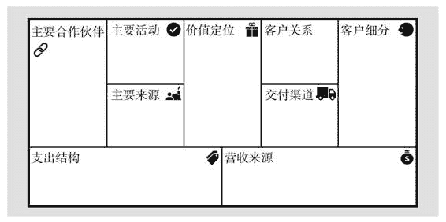

图 5.1 传统的商业模式画布

注：扩张蓝图通常先锁定价值主张，随后厘清目标客户、交付方式与营收结构。蓝图会随时间演进，但每个要素最终都指向数据驱动方案的设计。

资料来源：由 Strategyzer AG 设计，采用 CC BY-SA 3.0 许可。

奈飞的DVD租赁没有截止期限，也没有滞纳金。这种模式决定了货物通过在线下单和上门配送交付，进而形成稳定的订阅收入来源。

但这种模式很容易被竞争击穿。更关键的是，奈飞想读懂客户需求，价值主张因此转向内容推荐，而推荐需要对海量数据做复杂分析。这推动渠道战略转向流媒体，甚至在流媒体基础设施还没完全就绪前就做了调整。渠道调整迅速带来订阅收入增长，最终催生了新核心活动：基于推荐数据自制原创内容。

在海量数据和AI加持下，组织的成长方案既能找到降本增效的路径，也是一种极具价值的评估手段。它还能帮助发现新资源或合作伙伴，甚至孵化新产品、开辟突破性的经营架构，乃至彻底重塑组织。但在做到这些前，你必须先知道组织现在处在何处。

### 二、目标评估
即便没有经营画布，多数领导者对公司基本价值定位及其影响也有概念。做增长评估同时，也促使我们审视：我们现在是哪种主体，更重要的是，我们想成为哪种主体。

要评估组织及其在海量数据和AI上的最佳用法，下一步可归结为两点：

·是否愿意创新和冒风险，甚至放弃固有模式和既有惯例，去创造全新模式。
·组织所在的市场或服务领域，未来成长潜能有多大。

这是第一章讨论过的经营架构根基。当然各家情况不同，但判断组织所处位置并不难。像前几章描述的那类主体显然属于倍增型。它们为创新做好准备，积极承担风险，甚至愿意改写规则以捕捉发展潜能，这一点本章后续会进一步展开。但对其他类型主体意味着什么呢？必须成为倍增型才能有效使用AI和海量数据吗？答案显然是否定的。

无论创新程度如何、是否进取，AI和海量数据都有巨大潜力引领组织实现更高水平的成长与创新。

有效利用数据可能让一家组织进化成倍增型，实现发展速度和商业价值的倍增，而并非只有倍增型才善于用数据。事实上，在自身组织框架内应用AI的主体，更容易产生变革与成长。它们起初可能属于其他类型，但通过有目的性地跟随数据指引，利用AI及支撑技术，最终会成长为倍增型主体。它们必须改变固有经营架构，但在此过程中往往取得超出预期的商业成就。在介绍这四类象限、不同象限的主体如何从AI中获益前，需要先搞清楚决定它们的两个向量：创新能力、风险承受力和成长潜力。

### 三、创新的动力
创新看似主观，却可以用客观方法衡量。2006年一份报告描述了创新与企业绩效的量化关系，涉及销售增长、市场份额和盈利能力。

报告调研了制造和服务企业，结果显示，对最终产品、生产流程或两者同时创新的组织，业绩表现更积极。

美国肯尼索州立大学的一份报告把创新定义为“管理层愿意改变经营模式以实践新想法时的状态”，在准备创新的时机成熟时发生。报告发现，创新驱动型组织有共同特征：

·首席执行官及其他高管高度参与，推动创新举措落地。
·有奖励和激励机制、人才政策和预算分配，营造鼓励创新的文化。
·保持开放沟通，降低员工对承担风险的恐惧。
·拥有可靠的衡量标准，不仅能说明发生了什么、为什么发生，还能预测未来会发生什么、怎样才能取得好结果。

其他商业书籍常聚焦前几项指标，比如高管领导力、激励、人才、预算、开放沟通，这些当然重要。但最后一项“可靠衡量标准”对应用AI和海量数据有特殊意义。通过以可靠、有意义的方式应用和衡量这些技术，组织和非营利组织正在释放其创新潜能。

最后，组织的风险承受意愿与其产品和流程创新能力直接相关。无论创新是颠覆性的还是渐进性的，如果一个团体不愿挑战“我们一直这么做的方式”，就会付出代价。回头看柯达的命运，它曾以创新著称，我们在第三章讨论过。把柯达的风险规避做法与竞争对手施乐对比，就会发现施乐在服务上的创新让它避开了柯达的厄运。这两家公司的轨迹印证了一个真理：“创新是有风险的，但真正有风险的是拒绝创新。”

好消息是，创新意愿的高低并不会阻碍一家组织应用AI和海量数据，正如后面会看到的那样。从长远看，创新始终是那些善于用数据实现商业价值长期倍增的组织的标志。

### 四、真实的和想象中的发展限制
确定主体在四象限位置的第二个向量是成长潜力。与创新一样，它也捉摸不定。也许某个产品的需求已达顶峰，市场再无新空间。若一家组织只生产马车鞭子或传真机，或提供类似过时服务，其成长潜力几乎为零。当所在市场饱和或需求停滞时，组织会倒闭、被收购，或在最好情况下被改造。这就是为什么要持续评估思想、数据和指标，以发现何处需要改变。

问题在于，找不到新机会的人总会在脑中给组织成长设限。就像规避风险阻碍创新一样，狭隘思维限制了组织突破现有模式的能力。

成长潜力不只靠新产品创意，还有其他激发方式：

·通过并购或合作获得新业务能力。虽不如发明颠覆性技术那样光鲜，并购仍是有效发展路径。如今AI常被用来优化并购决策。
·开发新生产流程，以更高利润率提供相同产品或服务。这通常涉及削减生产成本、提升自动化效率，以及AI和机器人带来的改进。
·获取新客户，利用海量数据和AI为现有产品和服务制定与客户偏好和购买行为真正相关的营销方案和销售漏斗策略。不用AI也能做获客计划，但成功率很低。
·利用新渠道销售或分销产品。谈到数字商务，组织不必从零开始，已有大量电子商务自动化方法可用。许多由倍增型组织开发，但并不妨碍你使用。

组织发展的潜力受制于就业波动、市场条件等宏观因素。但为了实现发展，组织能做很多事。

领导者的创新意愿和组织的发展能力决定组织最符合四类象限中的哪一种。无论组合如何，都不会妨碍成功应用海量数据和AI，但明确类型有助于找到最佳路径。在判断类型前，先总结这四个象限的特点。

### 五、优化型企业
任何规模、任何年限的组织都可能落在这个象限，但多为规模较大、较为成熟的企业。因其本质谨慎保守，它们倾向于节约成本、优化流程效率、规避潜在问题、保护知识产权。这些都是好做法，也反映出组织规避风险和改变的倾向，以及对其成长潜力有限的认知。

优化型企业的标志之一是降本，但这不一定没有长期负面影响。若目的是保持或提升产品服务质量，降本是明智的，这也是用AI算法利用客户和服务数据的绝佳机会。然而，降低成本尤其是削减人力，往往出于短期报表考虑，最终可能导致灾难。员工对组织前景信心下降，进而导致客户信任和忠诚度下降，损失远超眼前节省。具有讽刺意味的是，正确应用海量数据和AI本可以预测这种结果，并指导更合理的降本决策。另一方面，对优化型企业而言，好消息是AI在提升运营效率、改善客户服务等方面非常有效，因此即便发展潜力有限、创新冒险意愿不强的企业也能从中获益。

AI如何推动优化型企业？例如利用现有数据，如客户偏好、购买行为和服务历史。AI和海量数据可降低运营成本、减少决策失误、提升客户忠诚度，并最大限度减少甚至消除财务下滑。久而久之，它们还能引导组织发现新商业机会或产品灵感，进而升级为扩张型或创新型企业，甚至成为能实现成倍价值增长和创新的企业。

### 六、扩张型企业
市场上，有明显的发展机会，但组织对风险或变革持谨慎态度时，扩张型策略很常见。这类组织拥有可靠的制造技术或服务方法，在现有领域已获成功。扩张型企业与优化型企业的区别在于，它们有强烈愿望和使命去发展，要征服新世界，只要新世界看起来与当前世界相近。

迄今实现发展的常用方法是并购，包括收购竞争对手，以及产品或服务与其相似的组织。并购常被称作无机发展，与后面将讨论的有机发展不同，后者主要靠创新和产品开发实现。对扩张型企业而言，关键目标是更大市场份额，仅靠获得被收购方客户，以新品牌向新客户销售相同产品或服务来实现。

若被收购组织更愿意承担风险和推出新品，收购方就能无须承担风险而获得创新型企业的好处。

但并购发展也潜藏风险。哈佛商学院定义了四个主要风险因素：缺乏严格评估、支付过高、对拟议合并价值误判、在整合业务和文化时遇到不可预见的困难。2016年针对高级财务专业人士的调查显示，在导致组织财务损失的15个担忧原因中，对被收购组织实际价值及其运营情况的错误评估排在首位。

此时应用AI能带来巨大益处。考虑合并或收购时，双方都有大量数据可用，包括结构化数据如电子表格和数据库，以及非结构化数据，而并购团队通常更关注前者。过去十年的营收是多少？同期成本如何？各产品或服务类别在一段时间内如何增长或下降？

这些结构化数据能提供被收购组织的基框架图，但仅此而已。很多时候，关于组织真实价值和运营细节的缺失，由负责人或其顾问的经验或“直觉”填补。这种方法常见但不科学，常导致估值过高或遗漏重要商业缺陷，最终结果糟糕。

2003年《哈佛商业评论》的一篇文章指出，依赖直觉看似必要，因为数据量激增而分析时间减少。但文章也指出，直觉作为一种潜意识思维过程，可能存在致命缺陷。所谓直觉会受确认偏差、沉没成本误区、框架效应等认知偏差影响，诺贝尔奖得主丹尼尔·卡尼曼在《思考，快与慢》中阐释过这些概念。文章提出更好解法：

技术可能是关键。现在正在开发的精密计算机程序，能补充和提升人的决策能力。许多新决策支持工具仍处于早期阶段，尚未用于战略性商业决策。但它们在帮助高管决策或解决问题的两个关键环节有巨大潜力：寻找并评估可用方案，从中挑选最佳的一个或几个。情况越复杂、变化越快，寻找和评估方案的过程越具挑战。通过扩展思维的分析能力和直觉能力，新程序能更快、更全面、更严谨地探索备选方案。

这一观察清晰展现了一个只能由AI和机器学习完成的数据驱动过程。就并购而言，AI对非结构化数据的正确分析将帮助决策者更准确把握潜在收购的真实价值，甚至为组织未来业绩潜力提供可靠预测。

如今，海量数据和AI已成为并购过程中不可或缺的一部分。澳大利亚毕马威的一份报告显示，客户越来越倾向用定量预测分析而非定性分析来支撑价值判断。对处于尽调阶段的组织代理人而言，AI被证明是节约成本的利器，可加速审查过程并更好地确定预算。

扩张型企业的另一特点是强调加大营销力度，无论是对现有产品服务，还是被收购组织的产品服务。为大量不同产品创造有吸引力的品牌信息总是困难的，但为保持和增加市场份额与收入至关重要。处于这一象限的组织可能没有强烈创新欲望，但它们明白，获取新客户、留住老客户、促成转化、提升品牌忠诚度是成功的关键。

当然，营销形式多样。对许多组织而言，如今营销环境充满太多沟通渠道。曾经相对简单地在出版物、广播、招牌或店内展示做广告的任务，如今演变为一系列令人困惑的媒体渠道。包括需要持续新鲜内容的网站、无休止的社交媒体信息、调研，以及与客户的直接在线互动。最重要的是来自这些渠道的源源不断的非结构化数据流。

这就是提示。有效利用AI和海量数据，组织能找到人工难以检测的有意义模式。了解潜在客户行为模式，有助于决定哪些渠道和内容最能获得关注、激发兴趣欲望，并促使决策者采取行动。

营销本身也有风险，包括品牌知名度下降、产品开发方向错误、未能预测实际需求。西伦敦大学的一项研究发现，市场营销与消费者信任度之间存在直接关系。研究还发现购买决策与网络供应商承担风险之间的关系。显然，除了现有客户数据外，组织的所有举措都是潜在数据源，这正是应用AI的沃土。

若恰当使用现有数据，所有风险因素都可被预测和避免。通过正确应用AI，扩张型企业更有可能成功处理并购和营销工作。

### 七、创新型企业
下一个象限是创新型企业，包括那些勇于承担风险的组织，它们的发展潜力尚不明显，至少对外界来说是如此。创新型企业的典型例子包括科技初创组织和几乎所有类型和规模的创业组织，当然这也许只是一种刻板印象。创新型企业还包括“内部创业者”，即在大型组织内部进行创新的个人和团体。创新型企业还包括传统服务供应商和制造商，他们希望超越组织现有产品，扩大客户群基础。创新型企业的主要特征是，甚至在他们关于产品或服务的远大设想被证明是成功的之前，他们就已经怀揣野心、远见和把事情做得更好的愿望了。

创新型打法几乎都绕不开研发。任何全新产品或服务，都要经历规划、设计、测试这些环节，而这恰好是人工智能和大数据能够深度介入的肥沃土壤。通过对消费者行为以及相关非结构化信息的分析，AI 可以更可信地预判人们真正需要哪种产品或服务，为研发者和设计者提供决策依据，也为测试和后续推广设定更有效的评判标准。

在制药行业，AI 大数据已经成为研发链条的关键力量，它不仅帮助明确产品规范，还能管理临床试验、筛选合适参与者、降低给药失误风险。

制造业也开始普遍采用相关技术，以更客观的方式读懂用户诉求、捕捉市场动向、提升设计效率。所有这些指向一个更深远的判断：“作为一种新的通用的‘发明方法’，（人工智能）可以重塑创新过程和研发组织的性质，因而可能会对经济产生更深远的影响。”

因此，对那些持续投入研发的创新企业而言，AI 大数据几乎是标配。即便 IT 预算有限的公司，也能借助第三方工具来量化客户需求，并由此确定、打造和验证新产品与服务。

创新型企业的另一大共性，是它们都积极争夺顶尖人才，这本已不易，而新冠疫情的冲击让难度进一步放大。在面向高技能人才的全球卖方市场里，企业很难招到推动新产品和新服务开发、推广的人。于是大数据与人工智能又成了绝佳抓手。

AI 在招聘中的作用已成共识，虽然争议不断。正如第四章提到的，算法很容易被人为偏见带偏，尤其当训练数据无法代表整体人群，或数据里混入了容易被误读的变量。2018 年亚马逊被迫下线自家 AI 招聘系统，便是典型案例——系统对女性存在歧视。

因此有观点认为，基于不完整或有偏见数据的预测型 AI 发展可能受阻。

事实上现实更为复杂。AI 确实省下了筛选简历的时间，让 HR 可以聚焦更高难度的事务。但现有的招聘系统仍易受人类偏见牵连，候选人也容易利用已知关键词“骗过”系统。《福布斯》的一篇盘点文章最终指出，HR 与 IT 部门需要承担超越合规的责任，主动监测招聘全流程中的偏见风险。

不过在合理使用下，AI 能够挖掘出传统流程会遗漏的人选。作为寻找非传统技能与经验人才的辅助，AI 正好满足创新企业招揽下一个非典型新星的需求。

### 八、倍增型企业

当一家公司或非营利组织清楚自身的真实增长潜力，并为实现它做好创新与冒险准备时，就会选择打破常规。第一章到第四章已大量描述这类组织，这里不再赘述。

成为倍增型企业，并非要侵犯个人权利、违背道德规范，或通过不公平剥削牟利。我说的打破规则，是指敢于挑战现状、抛弃旧模式与做法，从根本上重塑商业模式。它不是瞬间完成的标签，也不能拿来粉饰鲁莽或破坏性的经营。一旦抱着创新与成长的心态，大数据与人工智能会成为理想的助力。

这需要胆识。流媒体普及前，网飞就决定彻底放弃 DVD 租赁，转身拥抱流媒体。那时公关层面收到的客户反馈非常糟糕，网飞却没有用传统方式掩饰，而是接纳数据并以此重塑商业模式。Coda 咖啡一直坚守公平贸易的道德原则，这在品质提升上存在一定制约，但它愿意在 AI 与技术上试错，为业务转型打开通道。

把胆识与数据科学结合起来，你的企业也能走向倍增。

厘清企业核心特质后，下一步就是评估“数据准备度”，这正是下一章的主题。

# 第六章 数据准备要素

我们虚构的公司 Octothorpe Unlimited 售卖高端食材给餐厅与餐饮企业，已小有成绩，但增长乏力且易受竞争冲击。CEO 深知现状，并渴望用数据与技术释放潜力。毫无疑问，高层支持是数据准备的关键要素，但热情 alone 不够。

作为一家新创公司，Octothorpe 的组织成熟度高于平均水平。管理层明白，有了合适数据，就能看清当下与未来的潜在客户需要什么，以及如何更高效交付。该公司已开始系统化数据管理，把订单和服务电话中的反馈、偏好都汇入客户档案。早先它也为数据开辟了云存储，并在云服务上完成采购与开票。

整体数据素养也高于平均，尤其是数字营销和 IT 团队，他们乐于与战略伙伴协作。总体来看，公司正稳步向数据驱动型转型。

本章拆解数据准备的两个支柱：企业应用 AI 及相关技术并从中获益的能力。第一支柱是组织成熟度，关乎战略与运营优势及数据管理规范；第二支柱是内部能力，关乎企业内部使用数据的水平，以及构建可扩展数据转化方案的 readiness。没有企业能立刻变成数据高手，但本章可作为路线图。

确定商业准备度，也就是企业现有或期望的成长与创新潜力后，就要揭示其数据准备度。AI 并不可怕，也没有恶意，但落地并不轻松。

首先，要判断是否准备好数据驱动战略，就必须拥有可靠的结构化与非结构化数据来源。好消息是，大多数公司要么已有，要么能获得所需数据，哪怕自己尚未意识到。

## 一、数据基础

多数组织对自己到底掌握哪些数据、数据从何而来，只有模糊认知。IT 部门通常掌控结构化交易数据，但这些数据常散落在不同库中，部门间难以打通。

难点在于把分散的数据视作整体，并把非结构化信息整合进来。

收集数据的手段越来越多，尤其是非结构化数据。传统主动采集只是其一。按难度递增，常见方式有调查、问卷、消费者小组研究、深度访谈。设计得当的调查也能产出大量结构化信息。目前流行的做法是抓取社交媒体等渠道的文本、图像、视频。这类“社交倾听”或“社交情感分析”会借助 NLP 等 AI 技术解析海量内容，挖掘主题背后的深层语境与含义。AI 于是成为沉默的观察者，捕捉行为与趋势。

另一类是被动或授权式采集。客服录音、短信在经过 AI 处理后，能挖掘出重要洞察与趋势。电子商务也是富矿，在用户同意前提下，浏览记录、购买决策、地理位置、推荐点击、评论等都能产生价值。

与电商紧密相关的是客户忠诚度计划，最好结合下单体验。提供折扣与特价能创造大量商业数据，但必须格外谨慎，兼顾安全与隐私，甚至避免让人产生隐私被窥探的暗示。

21 世纪初，数据专家安德鲁·波尔为塔吉特设计预测模型。仅凭个人购买模式，模型甚至能在女性自己未察觉前判断其怀孕时间。于是公司能定制印刷品与线上促销，向准妈妈展示她们感兴趣的产品。但公司也意识到，掌握生育计划会“毛骨悚然”，于是明智地避开了仅针对母婴的广告轰炸。

第三类是公共数据采集，像查阅 Data.gov 等公共记录、文件、数据库一样简单。但这类信息常比较概括且可能滞后。

表面上的公共源还包括社交媒体，其帖子、评论、图片、视频的采集属于前述的社交倾听范畴。只是这些数据通常被平台以商业利益为目标控制，第三方付费采集使用时必须审慎。随着隐私抵制升温，越来越多企业转向基于用户授权的采集方式。

此外，AI 与机器学习还能利用相对新的合成数据。据高德纳，到 2024 年，60% 的 AI 开发将使用合成数据。埃森哲数据科学与机器学习工程负责人费尔南多·卢奇尼在 2021 年《麻省理工学院斯隆管理评论》的文章里解释了这一概念。

合成数据是由在真实数据上训练的 AI 算法人为生成的。它保留原始数据的预测能力，但取代而非伪装原始数据。通过对现有数据集的概率分布建模与抽样，算法再现其统计属性与模式，本质上是创造出具有相同特征的新样本，从而得到相同结果。

关键在于，几乎无法从算法或合成数据中还原原始个人身份信息。

这对 AI 项目是潜在福音，因为它能替代医疗记录、财务信息等敏感数据，减少匿名化需求。但如卢奇尼所指，还远非完美。我们才刚刚开始构建评估与“保证”合成数据准确性的工具、框架与指标。要实现被广泛信任的标准流程，必须采用流程化、可重复的方法。

隐私保护与效用追求的争论也未终结。为 2022 年 USENIX 安全研讨会准备的研究报告指出：“合成数据还远远不能算作数据发布过程中保护隐私的终极法宝。”

## 二、数据准备框架

第五章讨论了如何评估企业发展与创新潜力。由此得出的商业模式画布通常已简要列出近期与长期目标。在建立足够的数据来源后，下一步是把两者连起来。这不是一次性工作。每个以数据为中心的战略与项目，都应结合组织成熟度与数据使用内在能力进行审视。这两点可视为支撑指数级增长的两大支柱。

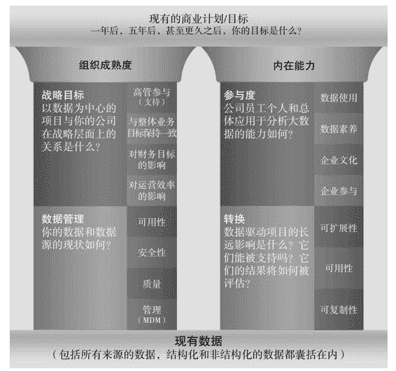

图 6.1 数据准备框架的力量

企业必须同时具备一定程度的组织成熟度和内在能力，以便充分利用数据和人工智能来支持既定的业务目标。

## 三、组织成熟度和战略目标

在解决技术难题前，领导层必须转变思维。如第二章所言，很多公司只用数据回答“发生了什么”，即描述性分析，而非“如何实现目标”，即指导性分析。两者差异显著。

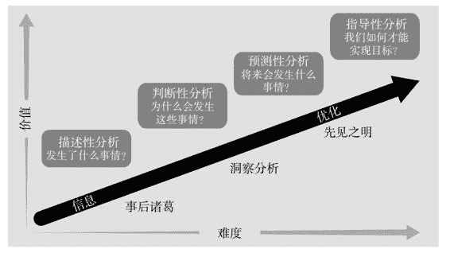

图 6.2 高德纳的分析价值升级模型

注：2013 年，高德纳公司将大数据和分析方法区分成了四个不同的层次。

这种前瞻思维无法一蹴而就，最可能获得支持的方式是提出几个基本问题

·高管们是否认同以数据为中心的战略具有长期价值？
·数据战略是否与公司的整体业务目标相一致？
·以数据为中心的项目是否会对公司未来的财务情况造成直接影响？
·数据是否被用于提高运营效率？

### 高管参与

技术领导者早就明白高层支持的重要性，以及如何争取。从展示技术如何支撑决策者的战略目标与价值观入手是常用做法。

然而由于对 AI 与大数据的根深蒂固误解，争取高管与部门支持仍是规模化落地的最大阻力。

这里的支持不只是口头认可，或仅认可前四章的案例。

高层认同必须建立在与业务目标的一致性上：获取更多经济收益、在降本的同时提升运营效率，或兼而有之。有远见的 CEO 还会考量数据使用的道德与可持续性，因其最终影响经济回报。举个假设：

一家零售银行的 CEO 想吸引本地更多人申请信贷。银行能随时调取信用记录等描述性分析，但对潜在客户画像、消费习惯、信贷需求动机、是否会负责任使用等了解不足，外联基本靠运气。

一位数据专家提议按邮编整合多源消费者数据，建立客户档案以实现精准服务。项目与银行整体目标一致，但想获得 CEO 认可与预算，还需证明：

·有一个可验证的预测模型，能估算符合条件的潜在申请人数量及其对财务目标的贡献。
·能缩短或简化申请流程，提升运营效率与降本。
·有积极的投资回报率，能验证对财务的实际影响。
·避免数据偏见，防止因性别或种族拒绝信贷。

类似情境可在无数企业中出现，无论其处于哪个象限。有些公司需要概念验证或试点，只要数据使用能明确服务目标，就更容易获得高层支持。

### 一致性

获得高层认同后，下一个挑战是调整技术领导层的思维。CTO 与 IT 经理通常专业过硬，也不太会轻信 AI 大数据的流行叙事，而他们习惯的数据应用方式可能不利于颠覆性创新。

内部技术领导与数据项目所服务的客户、员工之间往往脱节。技术团队常构建通用应用或重构系统，忽视组成部分，导致成果难以衡量或与战略脱轨。

大公司 IT 部门倾向聚焦历史交易：卖了什么、在哪卖、库存多少等财务数据，这是现代商业基础。但固有习惯会让组织难以用新方式发掘数据价值。

数据科学家温迪·劳海德在 AutoZone 工作时就遇到此景。她说：“当时有 4000 多家门店，知道全国各地卖什么零件，却不清楚客户购买模式与偏好，甚至没有积分奖励计划。所以我告诉品类经理，‘除非你真的清楚客户是谁，否则你根本不知道该把什么放上货架’。”应用聚类与预测分析后，公司开始在特定门店投放更能引起共鸣的产品。如今该连锁在全球超过 6400 家。

### 经济目标和效率

收入增长或成本节约是推动数据驱动战略的有力动力。但仅靠过往财务交易数据不够，必须与客户或业务环节的行为数据联动。这可以来自登录的电商或客服应用，也可以来自社交媒体与网站的非结构化信息。通过评估品类受欢迎程度，企业可预测经济收益。

组织成熟不是一夜完成。无论处于第五章讨论的哪个象限，一旦一家公司成功落地与目标一致的数据项目，就更易在更广范围内接纳 AI 与大数据。无论是提升运营效率还是指导新品开发，数据应用一旦在某处起效，就会成为他处的起点。

AI 软件厂商 RChili 是个颇具讽刺意味的例子。

公司成立于 2010 年，用 AI 框架、自然语言处理与机器学习快速自动解析多语言简历等非结构化数据，输出与招聘相关的 140 多个字段。

CEO 维奈·乔哈尔称，其软件把整理简历的繁琐工作自动化，使招聘人员效率提升 62%。软件还内置隐性偏见过滤机制，并按严格欧洲隐私要求更新解析器，因而被全球众多 HR 部门、招聘网站与 ERP 系统采用。

最近公司发现，AI 的商业价值并不限于自家产品。最初营销靠直觉判断哪些行业与地区更可能采用简历分析技术。后来他们发现更精确的数据化路径。乔哈尔说：“系统每年处理近 43 亿份文件，日志会记录文件来源地区。这足以让我们洞察行业动向，并据此决定扩张方向。”

公司把这些信息与其他数据集结合，包括就业市场趋势与客户分销成功率的公共数据，效果显著。例如他们发现中国或中东对 OLED 制造的某些技能需求在上升，就能预判哪些企业需要更高效招聘工具。乔哈尔称，销售周期因此缩短 42%。

即便高层大力支持数据驱动，RChili 也并非一路顺风。他说：“曾有一段时间，我们认为‘这是我们的收入，技术成本高昂却不产生利润，任务完成就行’。”后来他们开始设定以数据为中心的关键绩效指标，每 7 到 15 天追踪一次。

从 Google 表格起步，公司为绩效数据搭建独立表格。乔哈尔说：“这是企业文化变革，花了近 8 个月。”广泛使用数据形成了飞轮效应，不仅提升销售效率，也改变文化。“当员工看到 KPI 如何被追踪时，他们更像智囊。数字不会激怒他们，反而揭示分歧，于是他们回到数据中寻找消除分歧的方法。”

有了高层支持与前瞻的数据观，企业就能顺利迈向倍增。但这只是数据准备的组织层面。

## 四、组织成熟度和数据管理

衡量一个组织是否成熟，另一个关键维度在于它如何管控数据本身以及这些数据从何而来。数据治理绝不能脱离业务战略、商业目标和优先级独立运行。高德纳集团近期一份分析就指出，很多企业在制定数据使用规范时，关注点落在数据本身而非数据能带来的商业价值与实际结果，这导致与管理层及核心决策者的沟通往往流于表面。

企业当前对数据的处理水准，直接决定了未来能否落地变革性的人工智能和大数据应用。衡量和管控数据的方法与工具不少，评估组织成熟度可以从几个基础问题入手：

·各层级员工能否便捷获取所需数据？
·数据是否具备足够的安全措施，防止被恶意滥用？
·数据的质量与可信度，以及对应的元数据描述是否可靠？
·数据是围绕核心源头统一治理，还是各自为政互不相连？

数据能否被用上，这个问题自数字时代以来就存在，且愈演愈烈。对企业和团队来说，若无法触达所需数据，再多的数量、品类和速度也就失去了价值。我们从磁带读取的年代走到近乎实时的访问，进步很大，但依然有不少公司做不到让一个部门的同事轻松调取另一部门掌握的相关信息。更常见的是，他们甚至不清楚该找什么数据、怎么用、为何要用。

AI 正为可用性难题提供解法。基于聊天机器人的对话式AI，能让授权用户用自然语言直接查询复杂的数据库。更高级的AI则可以为不同部门构建统一的数据集仪表盘视图，帮助大家快速把握全景。前提是各部门愿意主动开放和发布相关信息，这点后面会再展开。

安全性与可用性密不可分。没有安全就没有信任，也就难以获得数据贡献者的支持，而这些数据正是AI项目的重要燃料。从个人隐私到专有研究，数据被恶意或不当使用的风险长期存在，IT安全团队和监管机构都很难根除。于是管控授权访问的系统不断复杂化，这反而阻碍了跨部门的数据共享。像GDPR这样的隐私法规迈出了关键一步，却仍不充分。该法规要求在未满足六种情形之一，包括获得当事人同意前，不得擅自处理个人数据。法规赋予个人更多保护权，但执行层面困难重重。企业可以提升可用性和安全水位，但靠人工很难彻底解决。

当企业担心数据本身不安全，或害怕AI被当作恶意软件、勒索软件的帮凶时，往往会抗拒使用AI技术。虽然此类攻击确实发生过，但AI同样是强大的防御工具，能够揪出传统杀毒软件漏掉的恶意程序。

目前AI也被广泛用于识别对私人或敏感数据的非法访问企图。银行就是典型例子，它们用AI监测异常消费，判断是否源于数据泄露。AI通常基于持卡人的历史行为学习，区分正常交易与欺诈。但要真正发挥保护作用，就不能把数据当成孤立的仓库，而要看作更大生态中的连接点。

后文会介绍一些开源工具，它们有望让上述问题更易解决，尤其是在数据访问层面。科研领域已有成熟范式，将AI工具、开放数据和用户友好的界面结合，应用于生物医学、医疗健康和材料科学等。其他学科乃至整个IT行业都有可能借鉴。

数据质量概念好懂，落地却难。收到一份数据庞杂却毫无价值的表格时，失望感十分真实。即便是资深使用者，也会在标注、分组、计算逻辑等环节出错。放到企业级数据底座上，失误更是难以避免。考虑到数据的体量、复杂性和时效性，以及它们对业务的关键影响，错误或误导性的数据后果往往很严重。

数据质量涵盖准确性、跨数据集一致性以及客观性，即是否无偏见。不同场景对质量阈值的要求不同，科研、政府、商业各不相同，但差的质量在任何领域都会带来严重后果。高德纳研究显示，低质量数据平均每年给企业造成约1500万美元的直接财务损失，这还不算因错失大数据和AI带来的指数级增长机会的隐性成本。

提升数据质量有几条常见做法：把数据影响与KPI挂钩，把质量改进与业务成果关联；为核心数据资产搭建数据质量仪表盘进行持续监控。这些都是业界认可的做法，只是往往需要不小的投入。

数据质量是AI和机器学习落地的先决条件。计算机科学家吴恩达在关于AI应数据驱动还是模型驱动的公开信中指出：“常说80%的机器学习是数据清洗，这句话容易让人误以为清洗只是副业。我的看法是，如果我们80%的时间花在数据准备上，那么确保数据质量就该成为机器学习团队的核心工作。”

而AI本身也能反哺数据质量。它可以自动识别重复记录、捕捉人为错误导致的异常、并把采集流程自动化。

与组织成熟度密切相关的基础环节是主数据管理MDM。它的核心理念是关键业务数据应只有一个权威版本。理想状态下，企业需为每个重要实体、项目或事件从多个源系统和应用中建立唯一主记录，形成统一定义、可信的决策依据。

现实中同一类数据常常存在多个版本，分散在不同部门并以迥异的分类方式运行。企业并购、原有IT体系差异，以及各部门追求独立的数据策略，都是常见原因。当部门目标和KPI不一致时，数据采集和分类自然分化，进而产生重复和偏差。

MDM与AI的关系像鸡生蛋还是蛋生鸡。统一、非孤岛的数据对转型期AI项目至关重要。联合利华的纳伦·斯瑞拉曼在2020年《福布斯》专栏中提到，AI和机器学习的预测质量受制于最薄弱的环节，即主数据。Zingg创始人索纳尔·戈亚尔对此评论指出，传统MDM难以胜任：“虽然能打破数据孤岛，但老式主数据技术饱受漫长配置周期、复杂部署和硬编码规则困扰，让新数据源的接入和在基础应用中的落地变得麻烦。”

好消息是，AI同样能改善MDM。如同提升数据质量一样，AI和机器学习正被用来自动化大量MDM功能，如域识别、匹配合并、数据映射和分类。市面上传出不少商业和开源方案，它们有望接管繁琐重复的MDM工作，并提升规划预测的准确性。

在战略对齐和数据治理取得进展后，下一步就是补强AI数据准备框架的内部能力。听起来或许复杂，但对大多数企业和非营利组织而言完全可操作，而且能带来指数级回报。

## 五、内部能力和参与度

数据准备的第二个维度聚焦人和工具，缺一不可。没有数据驱动的文化，前述所有努力都会失效；没有合适的工具让数据方案广泛落地，企业也缺乏成为倍增型组织的动力。人的层面关乎个人习惯和整体文化，高管和经理不必成为数据科学家。

·核心决策者是否愿意也能够查看、理解并使用全公司范围的数据？
·非IT专业员工是否懂得数据的基本特质和价值？
·企业是否对大数据和AI的价值持积极且务实的态度？
·数据战略是否纳入了内部和外部所有利益相关者？

数据使用。绝大多数人解读量化信息时都需要支持。你在阅读时，数据量正以指数级爆炸。要让数据产生意义，需要专业解读，最好由兼具数据科学、视觉设计和人因心理学的专家来完成。正如耶鲁大学教授爱德华·塔夫特在《定量信息的视觉显示》中所说，早在数字屏幕出现前就已如此：“描述、探索和总结一组数字，最有效的方式往往是直接看它的图像。”

如今静态图表已被动态数字展示取代，它们能随新数据实时更新。商业上常称之为数据仪表盘，用直观视图向决策者传递核心工作状态。最具代表性的莫过于1982年推出的彭博终端，每年2.4万美元的订阅费即可让专业投资者实时获取全球金融数据、公司与基金表现、新闻动态等可视化信息，并据此交易。

如今联网的仪表盘已十分普及，广泛应用于各类商业智能。理论上，可视化仪表盘是推进大数据和AI项目的理想载体。最基础的价值在于，全员都能查看、理解并基于数据做决策，从而推动增长。

使用仪表盘时需注意，仅仅可视化并不等于会被正确使用，甚至可能被忽略。人脑信息处理有限。常见风险包括：

·数据不完整。许多机构管理混乱，数据分散在各部门且缺乏关联。
·展示了错误优先级。对IT专家重要的数据未必对业务决策者有用，有意义的仪表盘必须建立在可衡量的业务目标之上，如KPI和数据绩效指标DPI，后文会详述。
·用户缺乏认知或使用动机，这涉及数据素养，将在下文讨论。
·多数仪表盘只呈现现在或过去，缺乏预测未来或预设行动的能力。若对数据重要性、背景或因果的假设错误，反而会导致糟糕决策。

尽管存在风险，仪表盘仍是推动数据广泛使用的最佳途径，尤其对不熟悉专业数据技术的商业决策者而言。如2018年《医疗保健IT新闻》一篇分析指出，面向AI的仪表盘应满足特定要求：

·给出明确问题对应的答案，帮助用户预先规划路径。
·以KPI衡量趋势，并实时关联其他关键数据。
·责任清晰且透明，允许经济、法律、人力等不同领域的利益相关者审查系统及底层数据，确保无偏见与其他缺陷。

数据素养。员工浏览、理解、分析数据并将其用于业务支持的能力，是企业数据应用能力的另一关键。目前企业员工数据素养普遍偏低。埃森哲2020年报告显示，在9000多名受访者中，仅25%认为自己已准备好高效使用数据，仅21%对自身数据素养和技能有信心。

数据素养不等同于技术素养。麻省理工斯隆管理学院报告指出：“真正的数据素养让人能以不同方式思考和行动，从真正业务问题出发，用洞察力正确解决问题。”

报告建议，培训应将80%时间放在数据及其业务意义上，仅20%用于技术本身。评估时为员工和管理者建立基准，培训应尽量避免专业术语，或使用组织通用的业务表述。

最关键的是，让员工和经理感受到提升数据素养与个人成功相关，尤其在大数据和AI项目中。

IBM高管赛斯·多布林长期从事AI和大数据项目，帮助客户实现业务目标。他提出“决策组合”理念，与商业领袖一起明确需要解决的问题、AI与数据的价值、准备程度和优先级，并称之为数据与AI的企业设计思维。研讨会的核心是把商业战略与AI战略挂钩，先确定经济价值，再与合适人员开展技术研讨。他强调要以人为本、以价值为基础，让参与者获得整体战略和行动框架。

企业文化也被称为数据文化，指组织对使用数据的整体接受度，既关乎过去，也关乎未来规划和商业模式重塑。强文化始于管理层支持，也需基层拥护。数据项目不能停留在“酷实验”或为收集而收集，必须用于明智决策并让全员看见结果。从“快速见效”切入，用同事压力推动迟疑部门。CEO常在高管会上问“为何你不像她那样做”，这种内部标杆压力能加速文化转变。

雪佛龙首席数据官艾伦·尼尔森指出，商业人士常认为获取数据很容易，却对数据准备耗时感到惊讶和不耐。根源在于战术思维大于战略思维，难以描述真正的诉求，短期目标驱动让他们只想快速解一件事，而不愿澄清整体问题。她认为很多经理知道有价值，却说不清价值是什么、如何衡量。

2020年《哈佛商业评论》曾列出建立数据驱动文化十步，从高管支持到分析透明。如今需求更迫切。新冠疫情、战争和社会动荡表明，企业和非营利组织必须更灵活，而只有数据能力强的组织才能做到。

数据准备框架的另一组成部分是企业参与，源于利益相关者资本主义。定义是为员工、客户、供应链、社区和环境创造价值，最终回报投资者。实践证明这不只是利他，坚持该原则并进入参与公司股票指数ECSI的企业，平均年回报比标普500高出6.2%。

数据分析和AI是企业参与的两大支柱。要做出对所有利益相关者有价值的决策，企业必须先理解他们的习惯、偏好和未来行为，而这只能通过大数据实现。人力资源领域的人才分析已把原始数据转化为决策，提升内部参与度。

将数据素养、企业文化与利益相关者价值结合的企业，更容易采用AI和大数据，产生持久深远影响，也更可能走向倍增型企业的指数增长之路。

## 六、内部能力和转型

以数据为中心的举措不可能一蹴而就。它需要企业持续收集正确的数据、提出正确的问题，并用机器学习或深度学习寻找模式以加速流程。若每次都重来，会阻碍甚至中断后续尝试。只有能在过去成功基础上轻松复用时，AI和大数据才能真正推动转型。

组织内部能力的工具箱包含让数据方案摆脱一次性实验的关键技术。这些工具的存在表明，大数据和AI的推广并不依赖某个人或团队，任何合格的IT部门或第三方服务机构都能复制落地。

可扩展性、灵活性与可重复性是人工智能落地时最容易卡住的环节，而根源往往不在代码本身，而是业务环境的复杂性。数据团队要想突破这些困境，关键在于把焦点从技术实现转向业务结果。正如一位数据科学家所言，如果在应用设计阶段不让最终使用者参与进来，再强的算法也只能做出无用的工具。系统的构建必须由真实的业务需求牵引，持续在试验和生产两端与用户保持连接，并与用户共同完成最终方案，才有成功的可能。

支撑人工智能和大数据项目的底座已经相当成熟。除了亚马逊等厂商不断扩容的 SaaS 与云服务外，越来越多的中小开发者也在有偿提供 AI 技术与集成服务。付费采购第三方服务并非唯一路径。企业和 IT 部门同样可以调用大量非专有资源，例如在 GitHub 等社区平台上流通的开源人工智能代码。这些平台通常收取较低年费，却允许分析师自由复制、改写和借鉴他人成果，从而大幅压缩自研成本。许多机器学习开发者热衷开源生态，习惯在社区分享成功经验，由此累积出大量可用的分析工具。

开源还带来额外好处。布鲁金斯学会的研究指出，开源模式加速了人工智能的普及，促进了良性竞争，并产出更易获取、更稳健且高质量的代码。它为科研人员腾出时间和资源去构建透明、可解释的模型，从而降低算法偏见。报告的结论是，对忙碌的数据科学家而言，开源代码在发现并消除机器学习中的歧视问题上具有惊人的价值。

任何企业或非营利组织都有机会收集足够的数据来驱动有意义的人工智能项目。无论创新潜力看似有限，只要调整企业文化，做好技术准备，转向以数据为中心的问题解决方式，就有可能成为倍增型组织。

下一章将具体说明如何实现这一看似大胆的目标。

# 第七章 迈向倍增式成长

Octothorpe 管理层正盘点几条可能由数据和人工智能引领的发展路径，却不清楚该先做哪个项目。非传统餐饮与即时弹出式食品服务正在兴起，同时传统餐厅客户也在寻找特许经营选址。这些信号都指向特色食品的增长机会，但缺乏数据支撑，管理层只能靠主观判断扩张。

公司明白不能同时推进多个项目，于是先盘点各项目可用的数据集。现有的客户档案最具说服力，里面记录了订购内容、交付情况等信息。随后团队评估了用这些数据产生的商业价值：若基于这些数据向全国餐厅和餐饮服务商投放营销内容，预计能带来新客户和销售增长。

正是这一过程帮助 Octothorpe 为数据驱动举措划定“动力区域”优先级，并按可量化目标逐步优化营销。第七章提供了一套排序蓝图：先对可用数据的质量打分，再对项目的商业价值打分，并在项目执行前后持续评估。

我们已走完人工智能和大数据的第三步，也是最关键一步。现状评估和数据准备完成之后，接下来要做的就是把人工智能与数据方案优先用在价值最大化的领域。如此，企业或机构才开始迈向指数级发展。

即便现状与准备度不尽理想也不必气馁。即使数据准备或发展潜力不够完美，仍可能取得不错结果。但要找到最佳优先项目，就要看我所说的“动力区域”，即三个容易探测要素的交集区。

确定重叠区域后，人们常想同时在多个项目上应用大数据和人工智能，尤其在首次尝试时这很不明智。

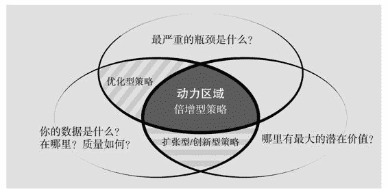

图 7.1 动力区域要素维恩图

注：长期存在的痛点、丰富且相关的内部数据以及较高的商业潜力在某些区域重合，那里正是人工智能和大数据产生最大影响的地方。倍增策略的意义在于依据这三项要素加速推进数据方案。

正如第八章将要讨论的，一旦拿到可衡量的成果，往往会想扩大投入版图。但在初期，少即是多。凭借动力区域的首次显著成功，就能吸引关注，让更多人看到数据如何让企业业绩倍增。

## 一、勾勒数据战略框架

第五章曾简单介绍过商业模式画布的战略映射。对发展目标与路径做简要梳理，对通用业务已是强力工具，在规划独立数据项目时则不可或缺。以下展示的是数据力量画布的构成。

数据力量画布的价值在于为业务与数据领导者提供全面的对话起点。左右顺序并不重要，关键在于每个区域的内容详实度。

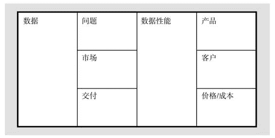

图 7.2 数据力量画布

注：为任何以数据为中心的项目明确边界，能为其潜在影响设定现实预期，并为后续问题解决做好准备。

有时领导者凭直觉先识别出最迫切的业务问题，再用数据界定问题。有时数据先被发现，揭示问题性质与范围，从而印证领导者的直觉。

## 二、锁定最紧迫的业务痛点

企业总是面临各类棘手难题。无论是提升效率、增加利润还是实现更大抱负，瓶颈无处不在。因此寻找最严重堵点时，首先要问：如果不突破，会造成什么损失？是效率下滑、错失机会，还是其他隐性负面效应？

并非所有问题都有现成的 AI 或大数据解法。但对那些可以用数据解决的问题，排序能力来自两点结合：

· 经验丰富的领导者对问题严重性和损失后果有直觉感知；
· 现有内部数据能指向问题的本质。

关于管理者直觉的实证研究较少，因为直觉发生在个人脑中难以观测。但已有研究支持，直觉是一种合乎理性的心理现象，是决策方法的核心组成。

当下商业界普遍推崇直觉。马尔科姆·格拉德威尔在 2005 年《决断毫秒间》中举例说明，潜意识常能引导出出人意料且多为良好的结果。这种下意识判断源于“碎片化”过程，即潜意识基于大量经验碎片识别模式。他也列出误判案例，如 1920 年华伦·哈定被选为美国总统，因公众想象他是“合适人选”而当选，却证明德不配位。心理学家丹尼尔·卡尼曼进一步指出，自动下意识的“系统 1”易受认知偏差影响。若不放慢节奏，用更审慎的“系统 2”加以校验，直觉就会导致糟糕决定。

谨记这些提醒，直觉在数据不足以证明合理性或定位问题时，仍是领导者重要的决策抓手。数据与直觉的结合往往提供关键洞察。

在人工智能与分析领域，这种结合更重要。巴布森学院教授托马斯·达文波特指出，通过现有数据产生的直觉本质是假设，而分析的价值在于进一步检验假设。

达文波特还说，直觉往往是分析起点，因为很少有公司会先做系统分析去寻找机会。凯撒赌场前 CEO 加里·洛夫曼凭直觉相信“服务利润链理论”，即改善客户服务可提升盈利。虽当时没有具体赌场数据，直觉推动了多年的分析项目，且每个项目都有明确投资回报要求。赌场的“全黄金”会员计划提供了数据，分析后公司深入了解客户行为与偏好，进而优化商业决策，大幅提升顾客忠诚度，收入增长 14%。

当问题超出传统分析，需要真正的机器学习方案时，直觉同样不可或缺。机器学习并非万能，但可用的前提是提出有商业意义的问题，确保技术方案在理性商业层面站得住脚。

寻找问题的另一面，是审视已有的数据。本章后文将讨论数据来源与类型及其相关性评估。但现阶段，需要通过现有数据发现迫在眉睫的业务问题。

多数公司不经意间已积累大量内部数据，若妥善利用，可揭示业务痛点并量化财务影响。数据来源见表 7.1。

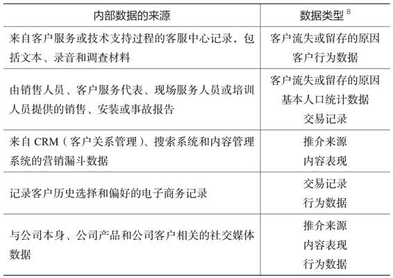

任何一个来源都能作为客观起点，帮助寻找潜在的 AI 或大数据解法。客服中心记录尤为丰富，常能检测出造成严重损失的问题。基础数据如满意度、一次呼叫解决率等结构化程度高，传统分析即可识别问题甚至给出对策。

但语音记录等非结构化客服数据需要更严格的统计分析。此时人工智能和机器学习可发挥关键作用。法国的一项早期研究探索了从客服录音中识别人类情绪的方法，后被用于检测高压力或挫败感，帮助呼叫中心更快响应，并更高效地将电话从自动系统转接人工。

无论采用何种数据源，数据都能用来验证或质疑领导者对问题的“直觉”判断及其成本。一旦锁定紧迫问题，下一步至关重要。

## 三、环境与内在条件不容忽视

确定最紧急问题后，了解当前商业条件即问题背景必不可少。Netflix、星巴克乃至 Coda 咖啡这样的小企业，数据战略都不是一蹴而就的。某些外部与内部环境因素会推动或阻碍数据方案，必须明确并量化。

通胀、利率、税收、就业等全球市场条件企业无法控制，却会影响数据项目的成败。政策调整、消费者行为变化、技术迭代同样难以掌控，且行业专家对技术速度的预测常有偏差，例如 2006 年《纽约时报》曾预测苹果永远不会推出手机。

因此企业更应以数据为中心理解商业与市场状况。善用数据总能揭示消费者行为模式。人工智能可从数据中捕捉市场变化趋势并应用于多领域，最终形成倍增效应。获取与外部条件相关的数据并不困难，通过公共数据源即可轻易获得绝大多数信息。企业无需自行更新或维护这些数据，但必须审视与自身业务相关的每个公共数据源，评估其相关性与质量，并用人工智能检测其中的异常。

即便外部环境难以捉摸，内部条件如现有分销渠道或收入流更值得重视。它们或许不是项目要解决的核心问题，却相互关联。当 Netflix 与星巴克追求“比客户更懂客户”时，其 DVD 与咖啡业务已拥有成熟的订购与配送体系，并积累了大量数据。核心问题不在于让现有渠道更顺畅，而在于预测客户想要什么，并用任何所需渠道满足需求，甚至开创新渠道。了解内部条件很重要，但它们通常不是 AI 与大数据需要解决的主线。

## 四、甄选相关且有价值的数据

检视公司现有内部数据集时，常会发现数据不完整，或未被作为统一资源有效管理。虽然这会限制初期选择，却不应阻碍寻找优先受益领域。

除尚未充分利用的内部数据外，还可借助外部数据源，如免费公共数据。Tableau 软件列出了覆盖广泛主题的多个免费数据源，G2 的 LearnHub 和谷歌公共数据浏览器亦提供类似资源。邓百氏等公司也提供付费外部数据。关键不在于数据是否足够，而在于我们能否评估价值。

在讨论商业价值前，必须先审视拟用数据并进行评级，这就是我提出的 数据价值指标 DVI。

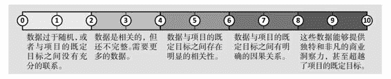

图 7.3 数据价值指标评级

注：数据各不相同。评估公司数据对特定项目的价值时，应明确数据使用能在多大程度上实现预期目标。通过提出若干难题，可以用具体数值对数据价值进行评级，并在本章后文用该数值确定项目优先级。

DVI 越高，意味着当前数据集能提出对公司发展有意义的问题。这些问题可以关乎可量化的市场状况或趋势、客户行为、交付方式，或任何制约主要业务目标的因素。例如，假设多数客户喜欢在智能手机上下单，若数据无法证实，项目的 DVI 就会偏低。

这些问题与效率提升或收入增长无关，后者将在下一节讨论。它们关乎数据的相关性。例如，“分析这个数据集能否判断消费者更偏好红苹果还是青苹果？”“能否知道股东会召开的理想时段？”“能否为新办公室找到最佳人选与地点？”“能否发现此前未设想的东西？”这些问题只要与企业发展相关，包括不可预见的结果，都可以，但必须建立在：问题在现实中有意义；答案能帮助解决企业的迫切问题；以及 IT 领导与业务领导具备能力和信心。

项目必须有明确目的：解决已知问题或发现新机会。数据集及其通过基础分析、AI 或机器学习提供的答案必须服务于这一目的。若答案只能显示相关性，数据价值约在 5 左右；若存在直接且合乎逻辑的因果关系，则约在 7 左右。

随着经验积累，评级会更高效，特别是企业已认真执行第六章的数据准备步骤。完成大量成功的项目后，会更有信心给出更高的 DVI 评级 8 或 9，并合理预期数据将提供独特洞见，引导倍增策略。下一步则是评估数据的商业价值。

## 五、评定数据的商业价值

到这里你可能觉得，单纯收集使用数据虽然是“酷的科学项目”，却容易自我挫败。转向更以业务为导向的方式，有助于打破 IT 人员格格不入的刻板印象。正如作家兼技术投资者罗米·马哈詹所说：“当有人说 IT 远离实际业务时，应提醒大家，现代企业中业务与 IT 正在融合，后者正赋能前者。”

每个数据项目都必须设定明确的商业价值指标 BVI 并赋予数值。

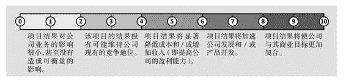

图 7.4 商业价值指标评级

注：以数据为中心的项目对企业成功都有相对价值。业务与 IT 领导可从直觉假设出发进行数值评估，但必须始终包含具体的可衡量结果。

最重要的是商业价值必须可衡量。无论 AI 或机器学习项目看起来多有趣，若结果无法量化，就不能算作对企业健康或发展有价值。例如提升“品牌忠诚度”是营销理想目标，但若项目无法真正衡量消费者感受，就只能停留在主观猜测。过去这类衡量依赖高成本调研和焦点小组，如今可通过人工智能实现。

第八章将讨论衡量任何以数据为中心项目结果的关键步骤，以及推广项目以实现更高目标时的衡量意义。但衡量任何事物必须先定义参数：我们期望看到什么结果被证实或否定？

部分结果相对容易捕获，如降本增效，这类潜在结果的 BVI 约为 5。公司发展或新产品开发等结果应获得约 7 的评级，需在更长时间跨度衡量。无论如何，评级必须务实，并在硬性的定量指标与非 IT 专业人士偏爱的定性度量之间取得平衡。

## 六、计算数据表现指数

评估项目数据的相关性及其对公司的价值后，即可计算我所说的 数据性能指数 DPI。

人工智能与大数据可被量化，这让我们能相当确信地预测一个数据项目将如何改变一家企业。

量化投入的前提是先计算 DPI

DPI 并非随意产生的数字，它反映了对某批信息集合固有质量、与业务的契合度以及实际经营影响的真实研判。该数值既能把单个信息项目置于整体版图中定位，也提供了一个追踪成效的客观坐标，后续章节会进一步展开。

在这一框架下，信息价值与经营价值重叠度最高的项目理应排在最前面。举例而言，若能证实客服通话记录与老客户回购之间存在强联系，则其信息价值可定为 6。

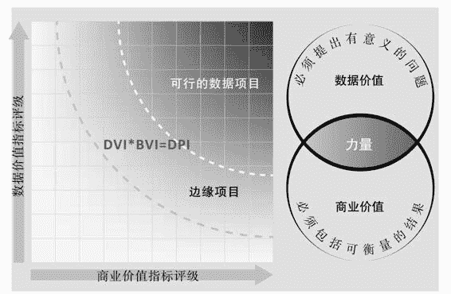

图 7.5 DPI 示意

说明：DPI 越高，产生指数级回报的概率越大。可被推进的项目必须在信息价值、经营价值或两者上都具备足够分量。确认 DPI 成为推进依据后，其底层的 DVI 有效性与最终 BVI 达成情况需要持续与初始评级对照。

若老客业务代表可观且可度量的收入增长潜力，则其经营价值可记为 7。由此得到 42 的 DPI，这足以说明它比 DPI 更低的项目更值得优先排期。

分级不仅有助于企业排优先级，也能指导资源投入的多少。举例来说，客服改善项目可能拥有很高的可衡量经营价值指数，但现有信息体量不足以支撑算法验证。此时偏低的分级会提示先采用更简洁、更传统的手段，而非直接上 AI 或机器学习。

## 七、选择正确的方法

问题边界、信息集合、可度量的绩效标准明确之后，数据力量画布的下一步是确定解决路径。是做预测性分析，还是走向更具自主性的 AI/机器学习，让算法随时间自我优化。两者相关但本质不同。

选型受多重因素限制。成本几乎每日变动，企业的信息就绪程度，以及项目中实际使用的集合质量即 DVI，均至关重要。

传统信息分析多停留在描述与诊断，回答发生了什么、为何发生。也可延伸至预测与指导，帮助预判趋势并给出行动建议。

常规分析与 AI 分析的关键分界在于，前者静态、依赖人的先验假设。它仍具价值，但需要专业人员或团队提出问题、主观解读结果并判断最优对策。

这并不意味着传统分析要被淘汰。DPI 偏低的项目，只要仍在人类可检验、可理解的范围内，传统分析就是最合适的。设计良好的信息看板依然有用，前提是使用者清楚其边界。当信息体量与复杂度超出人力处理与解释能力时，AI 或机器学习会成为更优解，两者并非同义词。相比传统分析，AI 与机器学习是动态的、自主的、完全由信息驱动，不受人类主观假设干扰。AI 更容易打破错误假设并优化信息策略。数据力量画布应覆盖 AI 分析的所有工具与参数，这样项目才能持续朝预期前进。

## 八、确立目标

最后一步是把目标写清楚，除了衡量与推广，后者将在第八章讨论。目标可能是渐进改进，如价格、成本、分销；也可能是拓展版图、获客、指导新品开发，如第五章所述。甚至可能是商业模式的重塑，彻底抛弃旧模式。

画布上的目标要尽量具体，同时注意两点。

·第一，信息既能证实假设，也能推翻假设。两种结果都有价值。信息驱动的项目可能带来指数增长，也可能帮企业避开领导层的灾难性决策，都是成功。
·第二，要为意外留空间。AI 与机器学习能覆盖远超单一 IT 团队可处理的信息量，无论结构化还是非结构化。必须做好准备，接受意料之外的结论。根本上 AI 不只是简化筛选等常规任务，还能模拟人类决策。虽然永远不会像电影里那样有自我意识，却完全能得出结论并提出让人意想不到的行动方案。

在企业最紧迫的经营挑战、现有信息及其潜在价值的交汇点上对项目排序与量化，就为 AI 创造了带来指数级经营发展的机会。

下一章将谈这一策略如何落地，包括如何衡量成果、调整方法并推广，以及由此推动业务转型。

# 第八章 应用、衡量和推广人工智能

确定行动方案后，Octothorpe 找到了一家擅长信息与 AI 解决方案的机构。借助开源 AI 工具，公司从不断增长的客户反馈中提取出关键偏好。这些信息让营销内容能按广告类型和社交渠道定制。

为保证内容供给，机构用开源自然语言处理系统生成初稿，再由人工写手审校。同时大量使用 A/B 测试和其他严谨的计算机协议，既衡量不同内容在不同条件下的效果，也优先把广告投到最有效的渠道。

活动期间，团队不仅追踪常规广告指标如曝光、点击，还追踪客户在营销漏斗中的进展。最终转化率与留存率显著提升，收益增幅远超项目成本。

除此之外，成功还催生了后续项目，聚焦更高效的交付流程。项目产生的信息还帮助公司发现餐厅和食品供应商之外的全新客群，同样的信息与人工智能方法亦可迁移。

Octothorpe 在方案实施、成果衡量与扩张潜力方面的案例，正是本章所描述方法的一种体现。若一个信息项目在可衡量条件下实现了预期的数据与经营潜力，其积极影响不会局限于项目本身。通过复用经验、工具、技能组合，甚至是精心设计项目所产出的数据，企业可以迈向更宏大的目标，最终实现经营价值的指数级增长。

到目前为止，我们已讨论了规划可行信息与 AI 策略所需的基本步骤。在评估企业固有属性、信息准备情况，并基于项目价值确定优先级后，就进入最有趣的部分，即实际应用与结果优化。

合适的团队是成功应用 AI 的关键。优秀团队能为企业发展提供动能，尤其在早期项目追求快速成功时。对许多中小企业而言，团队可能包含外部伙伴或顾问，这些外援需具备必要知识与经验。在数字营销、招聘、产品维护、供应链效率或研发等特定经营领域寻求专业帮助尤为重要。但无论如何组建，团队必须包含角色明确的核心成员。

组建理想团队并不容易。并非每个人都需要成为“数据科学家”，但每个角色都不可或缺。必要角色包括：

·高管支持者或倡导者——第六章已讨论过该角色。
·数据工程师——在整个人工智能架构中定义与应用数据的负责人。
·数据科学家——能够探索数据并提炼可执行信息的人。
·开发运营工程师，即 DevOps ——负责上线与管理解决方案的人。
·业务分析师——某种意义上的桥梁，既要评估项目应满足的需求，也要传达决策依据的结果。

在许多大型传统企业中，分析工作往往集中化，由一个数据团队服务整个组织。其他企业则倾向分散或混合模式，每个业务单元拥有自己的数据资源、流程与团队。没有绝对对错，但数据团队的规模与架构应取决于整体数据战略。无论结构如何，沟通是必不可少的。

Toast 企业的商业智能高级总监格雷格·沃尔德曼曾表示：“雇佣具备强大沟通能力的优秀人才，其他事情会容易得多。优秀的人会吸引更多优秀的人，你可以雇用世界上最聪明的人，但如果他们无法向专业水平较低的人传达分析结果，就无法成功。”

无论聘请咨询公司还是自建团队，选择标准一致。

·在数据模型与方法上拥有经验，不局限于传统结构化数据或孤立数据库。换言之，他们必须理解第六章所述的数据准备过程，并能贯彻执行。
·在数据与人工智能相关议题上，始终以业务目标为先。每项项目都必须具备足够高且可衡量的 DPI。也就是说，项目需拥有高评级的 BVI 与相对较高的 DVI，这是第七章讨论的两个指标。

本章将介绍在外部咨询协助下或依靠内部员工执行与衡量数据项目的办法。然而就实现经营价值指数级增长而言，基本原则相同。若项目经衡量后的实际表现达到或超过预期的经营价值，它就带来了真正的经营价值增长，也将成为未来项目的可靠范本。

执行的首步是确认现有数据的价值及其与核心经营目标的相关性。以招聘为例，主要数据通常存在于应聘者简历及通过在线招聘网站提交的信息中。大量数据是非结构化的，应聘者的撰写方式也会影响招聘人员的判断。正如前一章所讨论，可以合理假设这些数据与招聘高度相关，因此 DVI 应获得较高评级。当然，简历数量庞大，可用于仔细审阅的时间却有限。幸运的是，正如 RChilli 所展示，可以使用 AI 解析软件分析来自简历及其他来源的非结构化数据，并输入有意义的数据字段。

这些数据用于衡量并判断候选人是否适合特定职位，进而精准识别理想人选，同时过滤不当偏见。

如果初始数据集合与经营目标高度相关，下一步就是建立收集更多同类数据的机制。理想情况下，这些额外数据应适用于机器学习，从而提升人工智能决策的准确性。在招聘案例中，Word 或其他格式的简历可通过在线求职申请表、后续招聘人员与应聘者的沟通，甚至社交媒体公开帖子进行补充，整个过程在招聘机构或人力资源部门监管下进行。人力资源部门会对信息进行反馈，并确认或修改人工智能做出的岗位匹配决定。该过程不仅扩大样本，还能改进人工智能未来的选择。

请记住，若想建立可靠的人工智能模型，初始数据集合不必庞大，正如斯坦福大学教授吴恩达于 2019 年指出的：

即便没有“大数据”，也能创造价值，因为海量数据的作用往往被夸大。某些公司如提供网络搜索服务，用户会进行长尾查询，因此数据越多的搜索引擎表现越好。但并非所有公司都有如此多的数据，也许 100 至 1000 条记录即可构建有价值的人工智能系统，当然更多更好。不要因为你在某个行业拥有大量数据，就认为人工智能团队能将其转化为实际价值而选择项目，这类项目往往失败。重要的是项目启动前就应探讨人工智能系统如何创造具体价值。

执行的最后一步，是建立可靠的结果衡量办法。第七章讨论过，通过提出与实际业务相关的问题来评定经营价值。如果这些问题或目标本质上是客观的，例如上述案例中项目减少了甄选合格求职者所需的时间，那么经营价值的衡量就很直接。其他更细微复杂的问题也可以提出，但应谨慎衡量目标是否达成。

正如上一章所阐释，项目重要性通过将数据 DVI 评级分数与 BVI 评级分数相乘得出 DPI。这给出了一个简单也可能过于简单的成功判断公式：成功的项目，其经评估的 DPI 必须等于或大于预期 DPI。

人们可能直觉上认为数据的价值及其相关性也等于项目的经营价值。但在真实可靠的评估结果证实这些假设之前，项目只能停留在推演阶段。

## 一、谨防凭空揣测

评估以数据为中心的项目结果时，我们总是容易受自身错误认知过度影响。正如心理学家丹尼尔·卡尼曼精辟指出的，人们往往依据下意识偏见而非有意识逻辑推理得出结论。一些经营与技术领导者的出发点是好的，但他们也不例外，因为他们也是普通人。在涉及以数据为中心项目时，可能出现的错误包括：

混淆相关关系与因果关系。人们希望看到积极的经营成果，当它与数据项目在同一时间发生时，容易草率判断存在直接因果。事实是，在许多数据案例中，相关不等同于因果。在动态仪表盘或摘要报告中使用可视化展示数据时尤为明显。人们倾向于在周围世界寻找规律，即使这些规律毫无意义。若两个数据点或趋势线在视觉上相似，有五种可能解释，其中一种就是巧合。

这并不意味着表面的相关性无关紧要。相反，应谨慎对待相关性，并探究其中是否存在因果。爱德华·塔夫特恰当地总结：“经验观察到的共变是因果的必要条件，但不是充分条件。”他指出：“相关不等于因果，但肯定是一种暗示。”

必须意识到可能存在影响结果的其他因素，并适当权衡各因素影响，当然包括数据驱动因素。好消息是，能够自动调整的人工智能解决方案更有可能准确识别因果关系。在复杂的现实世界中，无法完全排除不相关因素或意外原因的影响。

确认偏误。卡尼曼和其他心理学家提到过一个古老逻辑谬误，即个人有选择性地收集或倾向有利证据来支持已有想法或假设。经验丰富的经营与技术领导者都很清楚这个问题，并努力避免。然而由于我们都是普通人，在评估数据驱动项目结果时，这一谬误仍然存在。

已发表研究表明，确认偏误与证据权重密切相关。一项研究指出：“参与者倾向于使证据解释趋于一致，但会赋予证据不同重要性。因为他们更重视支持假设的证据，而轻视否定假设的证据。”该研究还指出，被称为“竞争假设分析”的过程可以显著减少偏见，这些偏见常源于缺乏信息分析经验的参与者。

这种认知偏差不仅会发生在希望得到积极结果的经营领袖身上，也会影响技术领导者。虽然数据的本质客观，但数据科学源于人类努力，需要人类干预与主观理解。然而，如果原始数据集合及其结果由两个或更多数据科学家独立分析，可减轻确认偏误影响。其他预防措施还包括定期探讨相互矛盾的假设，重要的是在公司数据科学团队中引入更多元化人才。

对于参与人工智能项目的经营领袖，也有识别与避免确认偏误的基础准则。其中包括“全部都是好消息”现象。若项目评估后只得出积极结论，完全没有消极可能性，就应保持怀疑。若报告的评估标准有限或不明确，同样应产生怀疑。记住，第四章探讨过的合乎道德的人工智能定义，其中包括透明度，即人工智能系统必须提供可由人工主管部门审查的满意解释。

其他认知偏差。在评估特定项目结果时，可通过多种方法组合减少正常认知偏差，如框架效应与沉没成本。一种方法是建立同行评议环境，允许他人质疑基本假设与数据的重要性。另一种方法是事先制定基本规则，确定数据能证明什么以及不能证明什么。

然而，避免认知偏差最重要的堡垒是建立健康、以任务为导向的企业文化。正如第三章所述，达美乐比萨认为揭示失败与缺陷的数据与彰显成功潜力的数据同等重要。健康的企业文化不能建立在盲目乐观或对失败的恐惧之上，这两种情绪是导致认知偏差的主要诱因。高效的人工智能项目必须让数据引导假设，而非颠倒主次。

## 二、评判双标准

评估人工智能或数据分析项目结果时，有两个相互独立但又关联的标准需要考虑。一个是纯技术标准。人工智能与机器学习在处理体量极大的数据集合时效率最高。涉及处理能力与速度时，这些技术资源密集且成本可能很高。幸运的是，有一些新兴性能基准可用于量化和评估系统性能。其中之一是 MLPerf，早期研究展现出长远前景，并将使数据专业人员更容易评估机器语言技术的工作效率。

所有迹象表明，许多公司需要更快、更可扩展、更节能、更经济的软硬件。2019 年，人工智能与机器学习先驱吴恩达指出：“人工智能正在改变多个行业，但要发挥最大潜力，我们仍需更快软硬件。”事实证明，传统使用大型服务器的数据分析方法可能超出大多数公司承受范围。但云计算为获取所需计算能力提供了更经济途径，使小公司也能“以小博大”。

运行良好的 AI 与机器学习项目通常准确度很高。然而准确性要求因情境而异。对医院、航空公司和汽车内置应用如自动驾驶而言，模型必须非常准确并在人类监督下持续改进。但对于客户服务、产品销售、市场营销甚至新产品开发等分析结果影响不大的领域，准确性要求就没有那么高。

若不采取措施确保人工智能项目的透明度与可扩展性，过度关注准确性可能适得其反。“准确性谬论”会分散研究人员对其他因素如人为因素以及整体经营价值的注意。美国数据科学咨询公司 Gramener 联合创始人加内斯·凯萨里提到：“即使是一个‘错误’的模式，也能改变你的业务。”

此外，准确性不是单一衡量标准。包括准确性在内，共有四个有用但难以解释的统计指标，涉及误报处理等。与其他数据科学问题一样，这些数字必须在经营背景下评估，而非过度简化以证明先前观点。

人工智能项目的非技术衡量标准当然是经营结果。若项目事先已明确评定数据性能指数 DPI，则有一个简单标准需要满足。为更详细分析结果，我们必须回到第七章介绍的数据画布模型。

## 三、产品开发

从三个维度来审视数据项目的实际成效，最直观的就是看它是否能催生出新的或被优化的产品服务。普华永道的研究显示，那些用人工智能和机器学习推动新品研发的企业，被称作“数字化之王”，在靠研发创造收入这件事上明显跑在前面。这种领先体现在研发链条的各个环节：

概念与规格阶段，过程仿真和社交倾听开始发挥作用；设计与开发阶段，数据分析、人工智能与敏捷模式被有效融合在一起；测试与上市阶段，数据分析与人工智能被证实是最管用的工具。

微软、甲骨文等头部科技企业的做法很典型，它们设立人工智能实验室，一方面帮外部客户做高影响项目实验，另一方面也沉淀自己的应用能力。不少实验室还附带数据市场，让模型和数据集可以被反复复用。

实验室的另一个作用是缓解人才缺口。通过在生物技术等高需求领域持续招募与培养，行业慢慢补上了专业人员不足的短板。

整个闭环始于对客户偏好和体验数据的调研，无论是正面还是负面的反馈，都可能揭示机会，也可能暴露阻碍新技术规模化应用的短板。新产品发布或新服务上线后，收入变化只是评估成败的其中一个标尺。更关键的是客户在使用后的反馈，尤其是在客户采纳了AI系统推荐商品后的回声，这些信息既能指导下一步迭代，也能在底层假设被证伪时促使开发方向彻底转向。

这种反馈不应只在上线后才收集。在开发期，团队就可以基于已知的客户偏好模式，用同样的机制来检验假设、微调设计。AI与ML的价值在于，当应用得当，它能让团队通过仿真提前“看见”客户可能的反应，同时把常规分析自动化，大幅压缩开发周期，腾出空间让创作者发挥创造力。

## 四、AI驱动新客获取
留住老客、拉来新客，是人工智能能产生可量化回报的又一战场。贯穿品牌认知、产生兴趣、形成购买意向、完成交易到忠诚度提升的完整消费旅程，企业都能借助AI与机器学习提升能力：识别偏好、个性化体验、简化转化路径，并在交易后促成复购。过去十年数字营销经历了高德纳所说的技术成熟周期，对消费旅程的分析正处在期望膨胀的高峰。

高德纳也提醒，营销领域的人工智能可能需要5到10年才能达到常规业务的“生产力成熟期”，但长期价值巨大。其高级分析师认为，深度学习等技术是营销人从非结构化数据中提取洞察、并自动生成新营销内容的最有效手段。

但等别人先做是不合适的。线上礼品零售商红气球就是典型案例。2016年之前，它沿用15年的传统营销打法，业绩尚可，但获客成本却从每个客户5美分飙升至50美元。团队用同一套SEO策略投放，触达面固化，转化越来越差。2017年公司上线AI营销平台Albert，营销方式随之改写，首月获客成本就下降25%。

红气球先用平台处理涵盖交易与互动的大型数据库，从中梳理出6400多个关键词。为了提升搜索表现，团队没有照搬去年的归因模型直接投放，而是让新系统实时检验并重测这些模型，验证或推翻其有效性，找到真正能触达目标人群的方式。系统还挖出了此前未被发现的高价值客群。

把关键词研究、手动投放等重复劳动交给AI，营销人员得以把精力投向更具创造性和战略性的工作，比如围绕AI发现的高价值人群做深运营。这种思路让公司营销重心从“只和极少数潜在客户完成交易”转向“吸引并培育更广的目标群体”，在社交媒体上效果尤其明显，Facebook投放的转化率提升了750%。

纽约公司NoGood提供了更多同类案例。该公司以创意加数据科学驱动指数级增长。创始人兼CEO穆斯塔法·埃尔伯莫维指出，传统营销常常浪费了用户交易与行为中积累的海量结构化和非结构化数据。

“传统打法多聚焦品牌曝光、拉新和刺激购买，而借助数据科学，营销人可以下探到留存、增收和推荐层面。”他强调，AI驱动营销的核心是预测新客的终身价值。

NoGood的方法建立在严谨的数据科学之上，覆盖多渠道。埃尔伯莫维说：“每个决定都遵循可证伪的科学流程。我们倡导科学思维而非运气，每个假设都必须有观察支撑。我们会追问：凭什么放弃A选B？数据如何支撑？变量是什么？对照组是什么？成功标准是什么？无论处理海量数据点的大型企业，还是在找产品市场契合的小团队，都需要同样的自律。这要求我们在采集、建模、组织和可视化数据时保持一致性。”

他也点出了评估AI营销时的常见坑。广告、搜索推荐、入站营销平台往往信息过载。“每个平台都想用花哨的仪表盘吸引你投放，本质上你买到的是不同的观察视角。仪表盘很吸睛，但在多数情况下会干扰判断。如果你不锁定一两个核心指标，漂亮的图表只会误导。”

在他的视角里，数据科学的价值是把庞杂信息压缩到少数能推动进展的信号上。这个过程既是科学也是艺术。“实验是核心，变量太多时需要宏观实验，用统计手段减少需要测量的维度。但别陷入分析瘫痪，数据只是工具。有时数据无法给出答案，就要依靠经验、向做过的人请教并拓宽认知。不要仅因数据看起来完美就依赖它碰巧拥有的那份数据。”

## 五、用AI重塑定价与成本
衡量AI价值的另一个角度，是它如何影响产品的定价逻辑和供给成本。第五章提到，提升成本效率常被视作“优化型”战略，偏保守的大型企业更爱用。但定价与成本的AI策略，适用于任何体量的企业。

AI在定价上的作用大致有三类。其一是更精准地对价格敏感型“关键价值商品”降价，同时对其他商品提价以对冲，提升整体利润率。传统经验规则风险高，一些公司只跟随竞争对手或在成本上加固定毛利，这在通胀期尤其失灵。AI能实时捕捉产品间的关联模式，对需求价格弹性大的商品做促销，对弹性小的商品提价，甚至可以仿真、评估小幅涨价对全产品线销量的连带效应。

其二是大幅扩展分析的数据面。除了交易数据，AI还能解析产品评论、社交媒体等非结构化内容，挖掘人工难以收集的洞察。

波士顿咨询2021年的一份报告指出，即时部署AI最有前景的场景就是产品定价，这得益于B2C和B2B领域已有的丰富数据环境。基于MIT与波士顿亨德森研究所的全球调研，引入AI定价后，企业EBITDA可提升2%至5%。

报告还提到，员工对AI定价的接受度较高。因为系统提供的是用户友好的工具，仍需定价团队的专业判断，这反而强化了团队价值。AI把单调重复的定价工作解放出来，让人员聚焦更关键、更长期的决策，也为后续的人机协同应用铺路。

同理，AI也在重塑成本预测与规划流程。德国成本管理软件商FACTON的白皮书指出，AI可以通过早期预警成本变动因素，降低全球市场波动带来的风险。通过融合结构化与非结构化数据，企业更容易预判供应链变化，提前准备应急方案减少损失。

产品、客户、价格与成本这三大力量类别，各自都能产生可衡量的结果，帮助企业重塑商业模式并实现规模化增长，也能应对市场、交付与供应链的挑战，更为全公司范围的AI推广创造条件。

## 六、把AI规模化
本书反复强调，先聚焦一个AI项目，而不是一开始就多线并行。这不仅为了防止IT资源被稀释，更是为了让组织为后续的AI与机器学习扩张做好准备，争取更具颠覆性的成果。

第三章提到的欧莱雅“互联美容孵化”部门就是例子，其核心使命就是用数据与AI指导产品开发、提升绩效、更高效利用智能设备。AI创新实验室正成为“卓越中心”。对预算有限的中小企业，也有面向特定行业的“洞察即服务”模式在兴起。

要说明单个成功项目如何撬动全公司扩张，吉姆·柯林斯在《从优秀到卓越》中描述的“突破时刻”很贴切，那就是在长期努力后积累的势能开始释放的节点。

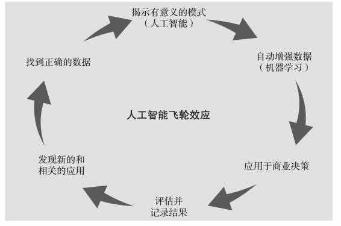
图 8.1 人工智能飞轮效应
注：把AI延伸到更多相关的新业务场景，会把早期项目产生的动能扩散到全组织，让自我重塑变得更容易。

AI与机器学习的落地初期确实艰难，第七章就提到过，找对数量足、质量高的正确数据本身就是挑战。但当一个高DPI项目的结果被清晰评估并在内部广为认可时，员工会自发复制这种成功模式，并带着更强的信念重复。

扩大规模的收益明确，路径却不确定。2019年波士顿咨询解释了为何10个AI项目里有7个失败。顾问西尔万·杜兰顿指出：“高管们都明白，不能大规模使用这项技术的公司将被淘汰，但光做解决方案不够，企业文化必不可少。把项目放在技术部门来推，成功率会比放在业务部门或CEO直管下低一倍。”

扩张策略与本书其他部分呼应：把AI应用锚定在业务目标上、建立清晰的组织架构与管理方式、组建能力互补且紧密协作的团队。也有观点强调先从最佳案例切入，并提前识别挑战与对策。最好的建议或许是回到起点：我们为何要做AI项目。

2020年《哈佛商业评论》上，阿西娜·卡尼乌拉与费尔南多·卢奇尼提出激进做法：扼杀所有概念验证POC项目，只做落地项目，即使起步规模很小。研究显示，放弃POC的公司把AI应用规模扩大了两倍，试点与全面部署的投入也更少。对1500名高管的调查显示，这类公司的AI投资回报几乎是落后同行的3倍。他们指出POC的根本问题：

比如一家公司用半年建一个客户体验优化平台作为概念验证，证明技术可行后才考虑落地。他们验证了可行性，却几乎没花时间思考上线所需的条件、模型风险、数据偏差、隐私与伦理问题。结果从一开始就背上了技术债，因为设计时根本没考虑规模化。

两位作者主张先建立正确的测试与开发框架，涵盖数据基础、人才、组织与伦理，再跳过POC直接做最小可行产品MVP，在真实条件下测试后再扩大范围。

另一关键推动力是开源代码库与资源库的持续增长，微软旗下GitHub就是代表。尽管存在安全顾虑，可复用的代码能大幅节省开发时间，也为全球数据科学共同体做贡献。不论采用何种选型、评估与扩展方式，都可以确定一件事：这些项目将永久改变工作方式。

# 第九章 未来走向
32年前，蒂莫西·伯纳斯-李爵士在瑞士欧洲核子研究中心搭建了首个Web服务器。

整个90年代，相互连接却相对孤立、结构化的数据集合，形成了我们所说的Web 1.0。它映射了当时IT行业的常态：数据孤岛遍布，彼此独立。网络只是从分散源头抓取数据单向推送给个人，网站多为孤立的页面。这正是电商萌芽的时代。

本书一直强调打破孤岛、强化数据治理与MDM实践，为高效的AI与机器学习打基础。核心提倡是数据集中化，把分散数据汇入云端容器，形成统一规模。期间我们对“数据”的认知也在变化：文本、图像、视频等非结构化数据，已让传统结构化数据相形见绌，而它们正是人类日常活动的产物。正因数据充足，AI才得以发挥作用。

在互联网语境里，集中化演变为Web 2.0，我们不仅浏览数据，更能与数据互动。典型特征是用户生成内容、社交连接与双向互动。这不只是个人在YouTube或Facebook分享生活。在SaaS模式下，各类企业和非营利组织纷纷把本地业务迁移上云。与此同时，谷歌、亚马逊等巨头聚合数据，正如第六章所述，这些数据也成了AI项目做社会情绪分析的“燃料”。为视频点赞与为AI项目提供分析素材的经济价值天差地别，但底层数据逻辑一致。

## 一、数据集中的隐忧
数据集中化对AI与机器学习项目至关重要，却也伴随风险。

用于识别用户行为模式的大量数据被谷歌、Meta、亚马逊等科技巨头垄断，以获取经济利益。这并非必然是滥用，但如第四章讨论的，垄断可能导致企业在未经同意甚至违背意愿的情况下操纵数据，攫取经济或政治权力。

数据垄断可能加剧贫富与机会鸿沟、侵蚀公民权利，甚至造成实际人身伤害。历史上的诸多悲剧证明，仅靠隐私条例或道德使用倡议是不够的。哪怕出于善意的制度与行业政策，也难以阻止掌控者利用集中数据达成有时有害的目的。

企业在隐私保护上的努力也参差不齐。苹果曾宣布调整iOS的App跟踪透明度框架，由默认允许改为用户自选是否被追踪，引发热议。隐私倡导者欢呼，广告收入受损的担忧让谷歌、Meta紧张。但康奈尔大学的研究显示，该措施对现状改变有限。小型广告商受创，但包括苹果在内的巨头仍在进行多形式的用户追踪与侵入式操作。研究结论指出：“个人追踪更难了，但拥有大量第一方数据的公司，其市场力量反而被强化。”

## 二、AI推动数据去中心化
好在大数据集中也催生了AI，而AI正成为解法的一部分。这正是Web 3.0/Web3现象背后的驱动力。

把 Web3 的真实落地和外界的夸张叙事分开并不容易。万维网创始人 Berners-Lee 最初谈论 Web3.0 时，指向的是语义化网络，让机器间以协议直接交互。后来这个定义被不断放大，演变成对整张网络与数据应用去中心化的泛称。

Web3 并不是单一品类，而是一组技术线的集合，每一条线都足以写成专著。市面上已有大量相关书籍，但对其极致去中心化这一顶层特性的梳理，对人工智能与数据落地的指导意义仍然很强。

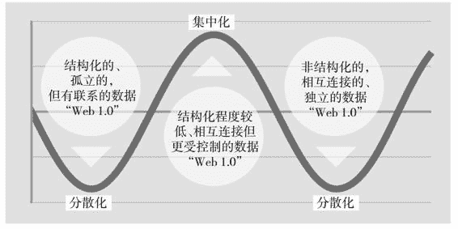

图 9.1 数据力量循环

注：AI 常被视作驱动分布式或分散化管理技术兴起的关键诱因，区块链即是典型代表。

最先进入公众视野的是区块链。凭借 NFT 这个衍生物频繁登上新闻，它也成了争议最大、误读最深的领域。

剥离宣传的夸张，区块链的本质是控制权的转移：数据不再由中心机构垄断，而是回归主体自主掌控。通过加密的分布式交易账本记录每次数据事件，去掉了中介，理论上可提升准确性、效率与安全性。

币圈和 NFT 占据了大部分声量，但区块链在正向场景里同样活跃。如第四章所述，可持续咖啡项目 Coda 依靠区块链来追踪并证明其原豆供应链的可持续价值。其它积极用途还包括跨境资产转移、智能合约自动履约，以及防篡改的电子投票。

Web3 的演进往往成组出现。去中心化自治组织 DAO，即没有中央领导的成员共治社区，以及以 VR 为代表的元宇宙界面，都是典型。它们未必都直接关联 AI，但对仍在制定长期 AI 与数据战略的企业而言，这是一记警钟：绝大多数企业的思维仍停留在 Web2 时代。

面向 AI 从业者，有三点需要重点关注。

·第一，Web3 的核心在于数据主导权的回归。加密、验证机制、DAO 式的组织形态，乃至 VR 带来的感知方式去中心化，都在削弱传统权力中心对数据的过度干预。系统被恶意利用的风险存在，但数据主权也为更有效、有益的新模式创造可能。

·第二，Web3 与 AI 高度绑定。高度分散的数据环境衍生出极其复杂的难题，即便才华横溢的人类团队也难以全面处理。传统 IT 领域已显力不从心，更何况 Web3。要在此环境中前行，需要以人类价值与伦理为底线的智能系统，能够快速模拟决策、从反馈中学习并自适应调整。数据分散化会让仍依赖 Web2 框架的公司处境愈发艰难，而 AI 正是帮助其完成过渡的关键抓手。

·第三，数据分散化是 AI 项目能否规模化、形成动能的前提。第八章已谈及大规模应用 AI 与机器学习的重要性。随着 Web3 进一步推动数据分散与主权化，获取 AI 所需的数据燃料将愈发困难。即便合成数据在增长，如第六章所述，企业仍需更审慎地获取数量与质量兼备的正确数据。反之，将 AI 与机器学习项目建立在 Web3 分布式数据之上的企业，更容易实现规模化并进入飞轮效应。

## 三、创新重塑世界

读到这里感到晕眩是可以理解的。即使资深数据科学家，也常难以用通俗语言解释这些技术之快与之复杂，并对其商业价值做出全面评估。但这并非首次。Web 1.0 出现时也曾令许多人困惑，直到真实应用的价值显现才被接受。今天的困惑，不过是下一阶段成熟前的必经过程。

前四章梳理了好莱坞电影对 AI 的过度简化与误导，愿那些情节只是虚构。真正值得关注的，不是机器人能否交朋友或会否毁灭人类，而是当我们放下恐惧与误解后，这项技术能如何助力人类创造更大成就。伤害多源于人性缺陷而非技术本身，技术只是放大器。要记住，正如 AI 与机器学习正在推动积极变革，区块链、DAO、元宇宙等相关技术同样具备建设性。

对 AI 的恐惧与误解阻碍了合理使用，同样偏见也会限制区块链、元宇宙等技术的潜力。不可否认，的确有人利用这些技术行骗。NFT 与加密货币是典型，NFT 市场中约 80% 的作品涉及欺诈。比特币因媒体渲染的犯罪关联长期背负争议，不过最新数据显示，截至 2020 年，加密货币交易中与犯罪相关的比例已降至 0.34%。与此同时，NFT 与区块链在企业端正显现正面价值，如可靠验证服务合约、用户忠诚计划等。

第四章指出，区块链结合 AI 的价值远不止炒作层面，它还能为企业提供可验证的交易记录，例如在可持续农业案例中实现全程溯源。

## 四、我们如何向前迈进

到这里，希望这本书能为你的企业或非营利组织提供一份在数据科学迷宫中前行的地图。下文归纳几条基本原则，适用于当下的 AI 与机器学习，也适用于未来可能出现的新技术。

·保持并培育追求卓越的文化。以数据科学为底座意味着全新的思考方式，这对团队与领导者都是挑战，但也充满乐趣与意义。要把鼓励假设性思维、冒险精神和创造性颠覆作为优先事项。

·守护核心竞争优势。分享行业通用原则与拱手让人之间存在微妙边界。当你用数据实现指数级增长时，务必保护数据与方法不被投机者窃取。

·持续设定新目标。每一次数据驱动的成功之后，都要寻找下一个高峰。无论是优化现有流程、推出新产品，还是颠覆业务，总有新的路径可探索。

·算清成本与回报。每个数据项目都涉及流程改变、新成本投入、人才配置与合作伙伴选择，从不会廉价或轻易。推进时务必同步把握实际收益。

·挖掘隐藏价值。无论行业或组织性质如何，问题往往比表面复杂。不要安于惯常做法，主动寻找低效环节与未被满足的需求，把这些问题视为机会，用数据科学去解决。

·正视工具属性。AI、机器学习，乃至看似另类的技术，都是强大的工具，但仅是工具。它们没有魔法，只有用对方法才能产生价值。

最关键的是，别让错误观念拖后腿。公众对数据科学的负面刻板印象，部分源于早期滥用。如同我们需要摆脱《终结者》《她》等电影带来的 AI 偏见，也要学会挖掘新技术的真实潜力，与之共同成长。

# 致谢

这本书是我的心血，也是我作为一名商业精英和数据策略拥护者多年以来的智慧结晶。然而，仅凭个人努力无法完成一本著作，因此我要感谢许多人对我的帮助，是他们在我写作这本书的过程中启发、激励和协助了我。

要特别感谢我的同事、商业伙伴及相关的数据专家，他们中许多人的叙述和案例研究出现在了这本书中。他们是：朱莉娅·巴德梅瑟、卡梅隆·戴维斯、赛斯·多布林、莫斯塔法·埃尔伯马维、杰夫·加伍德、卡尔·格伯、苏珊娜·格林伯格、索瓦米亚·戈蒂帕蒂、维奈·乔哈尔、范达娜·卡纳、艾伦·尼尔森、特洛伊·萨里奇、温迪·圣裘德、詹内克·范·冈斯和卡蒂亚·沃尔什。

我还要感谢 WLDA 的其他成员，他们的支持和热情每天都在滋养我的灵魂，激发我的想象力。其中包括董事会成员：迈克尔·金斯顿、艾伦·尼尔森、赛斯·多布林、斯科特·莫德尔、达拉·米斯、特蕾西·林、伊莎贝尔·戈麦斯·加西亚·德索里亚和蒂娜·罗萨里奥。我还必须感谢 WLDA 的企业赞助商埃森哲杰克·阿扎古里、利比·杜安·亚当斯和宝拉·汉森、雪佛龙、德勤、欧莱雅和莫仕，以及顾问凯文·亚当斯、凯蒂·戴维斯、史蒂夫·弗莱施纳、杰弗里·盖伍德和克利福德·肖尔。

其他 WLDA 成员有：阿迪塔·卡克拉、亚历山德拉·罗斯、安德里亚·马克斯特罗姆、安·约瑟芬·弗拉纳根、贝萨·鲍塔、巴蒂·莱、巴夫纳·梅塔、布伦达·菲亚拉、卡梅隆·戴维斯、卡尔·格伯、凯莉·科布、奇特拉·纳拉辛哈查里、辛迪·豪森、克劳斯·托普·詹森、丹妮尔·克罗普、达拉·米斯、德娜·贝拉克、黛安·施密特、艾琳·韦德林、埃尔菲杰·勒梅特雷、伊利莎白·库克、艾伦·尼尔森、艾琳·斯坦顿、加布里埃拉·德·奎罗斯、雅基·范德莱伊-格雷林、贾莱恩·乌尔什、简·崔、詹纳克·范·格恩斯、詹妮弗·舒尔茨、乔伊·米穆姆、朱莉娅·巴德梅塞尔、卡利亚尼·博杜帕利、卡马尔吉特·戈特拉、卡马伊尼·考尔、卡伦·埃文斯、卡什·帕特尔、肯德拉·伯吉斯、凯文·亚当斯、莉奈特·肯尼、琳达·艾伦、玛德琳·里昂、马库斯·戴利、玛杰丽·康纳、玛丽亚·拿撒勒、玛丽亚·维拉尔、玛丽亚·沃雷、玛扬卡·梅尔维尔、梅根·梅宁、梅根·安泽尔克、梅兰妮·布朗、梅勒妮·约翰森、梅丽莎·德鲁、迈克尔·卡贝拉、迈克尔·金斯顿、米歇尔·杜尼万、米歇尔·普斯、米科尔·波特、迈克·吉雷西、纳温·卡恩、尼基·哈雷、尼莎·帕特尔、佩吉·普洛格、佩吉·蔡、平克罗斯·汉密尔顿、雷切尔·里希特、罗斯玛丽·沃尔什、萨姆塔·卡普尔、桑迪·卡特、赛斯·多布林、雪莉·马库斯、斯蒂芬妮·佩罗内·戈德斯坦、索米亚·戈蒂帕蒂、苏珊娜·格林伯格、塔玛拉·乌瓦伊多夫、塔米·弗兰肯菲尔德、塔米·劳斯特、蒂莉莎·威廉姆斯、蒂娜·罗萨里奥、特蕾西·林、温迪·劳黑德和孙玉清。

特别感谢我在首席执行官辅导团队的同事：马克·摩西、杰森·里德、谢尔顿·哈里斯、唐·斯基亚沃内、杰里·斯温、吉姆·韦弗、克里斯·拉金斯、克雷格·科尔曼、辛西娅·克莱夫-兰德、戴维斯·索贝克、艾米丽·墨菲、格里·佩克尔、杰奎·哈特、杰米·科恩、吉姆·韦弗、凯文·亚当斯、列夫·贾菲、迈克尔·克劳斯、迈克尔·马奇、迈克·莫里斯、奥德马尔·阿尔梅达-菲略、帕斯卡·布罗奇耶、菲尔·沙利文、雷夫·威尔金森、拉蒙娜·卡佩罗、谢普·莫伊尔、史蒂夫·桑达斯基、特蕾西·特尔伯特、雷切尔·史密斯、肖恩·马根尼斯和海蒂·史密斯。

在本书的出版过程中，我得到了许多优秀人士的帮助。其中包括我的编辑和拍档约翰·帕森斯，我的文学经纪人吉尔·马萨尔，以及希瑟·金和她在 Post Hill 出版社的出色团队。

最重要的是，我要感谢我的两个儿子——米兰·萨克塞纳和席特哈尔特·萨克塞纳，感谢他们对我的爱与支持。

# 术语表

一、人工智能（AI）：是本书所描述的核心技术，对其他相关技术的阐释都在这项技术的基础上展开。人工智能利用计算机和其他设备来模仿人类大脑解决问题和做出决策的能力。它所涵盖的数据科学技术正在不断增多，其中就包括机器学习、深度神经网络、认知模拟和自然语言处理。它能够通过促进自主决策、问题解决、预测和行为分析以及高速进行模式识别来有效利用大数据。

二、大数据：包括已经储存的海量数据，也包括与产品、服务、物流、人员活动和人员行为（当然也包括在内）相关的任何业务中潜在的数据源。大数据的特点是数量大（现在在千万亿字节级别）、速度快（现在接近实时传输）和种类多，其种类既包括结构化数据（如表格），也包括复杂的非结构化数据（如图像和视频）。

三、云计算：也被称为雾计算或边缘计算，是对分布在多个相连服务器上的巨大共享池的一种比喻，这个共享池内包括大量可配置的 IT 资源和服务。云中的数据和应用程序可以为世界上任何地方的公司提供安全、按需、灵活和可扩展的计算能力（付费服务），以支持其全球和移动业务。

四、机器人技术和智能设备：包括广泛的数字控制机制，利用人工智能和大数据来执行有意义但重复性的功能。它们包括机器人和物联网（IoT）设备，用以执行重复性的或简单的任务，以及监测控制产品和服务的生产和交付过程。其他包括智能手机和其他设备，这些设备不仅能够收集用户行为数据，而且还可以利用这些数据来影响后续行为。生物特征检测设备具有类似的功能，但实际上是被植入我们体内以增强或提高人类的能力。

如果你不知道读什么书，

就关注这个微信公众号号。

在公众号内回复链接二字，免费得到全网电子书合集

微信公众号名称：幸福的味道

加小编 QQ 一起读书，并免费提供找书服务

QQ 号：2338856113 或者微信：491256034 都能找到我

【幸福的味道】已提供 200 个不同类型的书单

1、 历届茅盾文学奖获奖作品

2、 每年豆瓣，当当，亚马逊年度图书销售排行榜

3、 25 岁前一定要读的 25 本书

4、 有生之年，你一定要看的 25 部外国纯文学名著

5、 有生之年，你一定要看的 20 部中国现当代名著

6、 美国亚马逊编辑推荐的一生必读书单 100 本

7、 30 个领域 30 本不容错过的入门书

8、 这 20 本书，是各领域的巅峰之作

9、 这 7 本书，教你如何高效读书

10、 80 万书虫力荐的“给五星都不够”的 30 本书

关注“幸福的味道”微信公众号，即可查看对应书单和得到电子书

更多书单，请关注微信公众号：一种思路

每日新出版的读书分享，请关注公众号：周读读书 

* * *

1.  1.  对于极少数需要快速回顾这个概念的人，我推荐索尔·麦克劳德（Saul McLeod）博士的精彩总结：`simplypsychology.org/maslow.html`。

    ↩

2.  1.  脸书即 Facebook，已于 2021 年 10 月更名为 Meta。——译者注

    ↩

3.  1.  在我写这本书的时候，网飞和星巴克正处于充满不确定因素的时期。然而，尽管这两家公司都在努力度过困难时期（就像所有公司都有可能经历的一样），从长远来看它们仍然极有可能取得成功。分析师预测，网飞和星巴克的企业价值仍将保持长期持续增长，正是因为它们致力发展人工智能。

    ↩

4.  1.  近日，为了应对密码共享和其他因素导致的收入下跌，网飞提出了一个成本较低的“精简版”订阅服务，该服务将由广告收入支持。

    ↩

5.  1.  第四章中会讨论 Coda 咖啡这一例外。

    ↩

6.  1.  正如我们将在第四章讨论的那样，偏见并不像人类的其他局限性那样容易超越。

    ↩

7.  1.  从本质上说，戈登·摩尔（Gordon Moore）20 世纪 70 年代的预测至今仍被广泛认同，他认为计算机处理速度或功率将每两年翻一番（`www.mooreslaw.org`）。

    ↩

8.  1.  1 英里≈1.609 千米。——译者注

    ↩

9.  1.  这些都属于只需要回答“是”或者“否”的问题。然而，正如我在许多咨询工作中所经历过的那样，这些问题将不可避免地引发长时间的讨论和大量的自我反思。

    ↩

10.  1.  如果你感到好奇，该网站仍然可以在`http://info.cern.ch/hypertext/WWW/TheProject.html`上查看。

     ↩