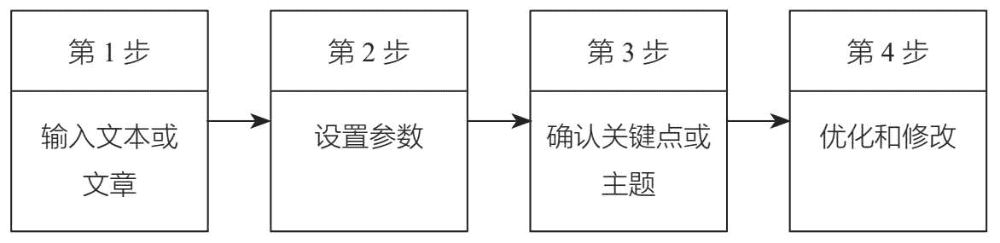
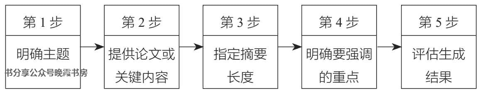

# 玩转ChatGPT：从提问小白到追问高手的进阶秘籍

# 核心看点速览

这是一本专攻 ChatGPT “怎么问、怎么追问”实操指南。核心逻辑简单粗暴：**问得准，才能得到想要的；追得深，才能把答案打磨透。**

全书拆解了九大核心技法：从指令提示、角色设定、标准给定入手夯实提问基本功；再到总结概括、延伸扩展、强化自洽、上下文关联、聚类分类、分步拆解六大追问进阶招式，层层递进。

适读人群精准覆盖：渴望提效的教师、培训师、咨询顾问、管理者，以及所有想用 AI 解决实际问题的学习者。拿来即用，拒绝理论空谈。

# 推荐序 1

## ChatGPT：破解信息过载，解锁高效生产力

在这个信息噪音淹没信号的时代，职场人、自由职业者、学生党、创业者无一幸免，都在“信息过载”的泥沼里挣扎。我们急需一把手术刀，精准切除冗余，直击核心，快速拿到确定性答案。

ChatGPT 的横空出世，正是这把手术刀。它基于深度学习与海量语料训练，实现了类人的语义理解与生成，彻底重塑了问题解决范式，释放了前所未有的创造生产力。未来，无论商业决策还是个人成长，它都将成为不可或缺的“外脑”伙伴。

《玩转 ChatGPT：秒变 AI 提问和追问高手》不玩虚的，手把手教你把模糊需求转化为结构化指令，从回答中精准萃取价值。学术钻研、职场攻坚、生活琐事、兴趣探索，掌握提问之道，AI 便是你的全能参谋。

书中不止于技法传授，更通过实战复盘展示跨领域落地图景。不管你身处哪个赛道，照着练，都能练就“提问达人”硬功夫，效率跃升不止十倍。

当然，工具再神，也得人驭。技术有边界，思维无疆域。AI 是助力而非替代，人类的判断力、创造力才是决定上限的关键变量。保持清醒，驭技为我，方能在 AIGC 浪潮中稳立潮头。

诚意推荐给每一个渴望突破信息获取瓶颈、提升解题能力的你。愿本书助你驾驭 AI，开启智能化工作新范式！

郑吉敏
去哪儿网技术总监、业务架构 SIG 负责人、人工智能委员会常委

# 推荐序 2

读者朋友们：

数据驱动时代，能不能跟 AI “对上话”，直接决定了你能不能从数据海里淘到金子。唐振伟老师新作《玩转 ChatGPT：秒变 AI 提问和追问高手》，直击痛点——教你怎么问、怎么追问，把 AI 从“聊天机器人”变成“深度思考伙伴”。

作为业内从业者，我深知：提示词质量决定输出上限。本书系统梳理了从基础提示词构建到高阶追问策略的全链路方法论，不仅有“角色设定”“标准给定”这类入门必修课，更深挖“追问如何保证连贯性与深度”这类进阶课题。

适用面极广：一线教学的老师、陪跑的培训师、出方案的顾问、做决策的管理者，乃至所有想跟上 AI 节奏的学习者，都能在书里找到对号入座的提效杠杆。

这不仅是工具书，更是思维训练场。跟着练一遍，你会发现自己思考问题的颗粒度、逻辑链条都变硬了。强烈推荐给所有想在 AI 时代抢占先机的实干家。愿你驾驭 AI，在信息浪潮中捕获确定性价值。

朱晓庆
北京人工智能学会副秘书长
2023 年 12 月 6 日

# 作者寄语：授人以渔，开启 AI 高效协作之旅

AI 技术迭代之快，正在重写生活与工作的底层代码。信息触手可及的今天，真正的稀缺是“从海量数据中精准捕获有效信息”的能力。

想把 ChatGPT 用好，**“会问”只是及格线，“会追问”才是分水岭。** 只有掌握提问与追问的底层逻辑，才能持续迭代答案，逼近最优解。

本书定位：**“授人以渔，给人工具”**。拒绝花架子，聚焦实战技法、万能模版、现场演示，帮你最短路径练成“提问追问高手”，工作产出效能指数级跃升。

**提问篇**五大杀手锏：
- **角色代入**：视角一换，答案立体；
- **标准先行**：定下规矩，输出靠谱；
- **目标锁定**：直击核心，不跑偏；
- **关键词导航**：抓住牛鼻子，引导生成；
- **范围限定**：圈定疆域，拒绝发散。

**追问篇**六大进阶术：
- **总结概括**：复盘沉淀，深化理解；
- **延伸扩展**：打破边界，挖掘更多；
- **自洽强化**：逻辑自检，补全漏洞；
- **上下文串联**：记忆上下文，对话连贯；
- **聚类分类**：结构化整理，条理分明；
- **分步拆解**：模块化推进，系统拿捏。

独家彩蛋：**“五维提问模型”（角度、技巧、思路、原则、逻辑）**，立体拆解提问全景图；**“12 种特定追问话术”**（条件、细节、需求、范围、否定、要求、假设、推理、建议、比喻、错误、措施），复刻专家级追问思维。

读完此书，你将拥有：与 AI 高效对话的底层能力、结构化解决问题的思维框架、应对复杂任务的实战工具箱。无论为公事提效，还是为思维升级，都是案头必备。

感谢相遇，愿本书成为你拥抱 AI 时代最得力的杠杆！

# 第 1 章 AI 指令提示工程：核心原理与实战技法

## 1.1 提示工程底层逻辑：一把开启 AI 无限可能的“万能钥匙”

### 1.1.1 提示词构成五要素：让 AI 精准懂你意图

**Prompt（提示词）**，本质是你发给 AI 的**结构化任务单**。写得好坏，直接决定 AI 是“神回复”还是“胡言乱语”。掌握提示词设计，相当于掌握了驾驭大模型的“万能公式”，由五大核心模块组成：

1.  **任务类型定性**：明确告诉 AI “干什么”。写周报、做攻略、写代码、作诗……指令要动宾分明。
    *   *例*：“帮市场经理写周报”、“以‘暑期诗意打卡’为题出旅游攻略”、“写首赞美程序员的诗”。
2.  **回答范围圈定**：划定“聊什么、聊多深”。领域、字数、必含模块一网打尽。
    *   *例*：“写 AI 产品经理月报，500 字起，含本月工作、发现问题、未来规划三板块”。
3.  **输出格式指定**：列表、段落、Markdown、JSON、表格……想要啥格式直接说。
    *   *例*：“周一至周五健身食谱计划，表格输出”。
4.  **语言风格定调**：专业、幽默、小红书文案风、周星驰唐僧语气……人设一立，味儿就对。
    *   *例*：“用《大话西游》唐僧口吻介绍至尊宝”。
5.  **关键信息植入**：塞给 AI 必须知道的背景、数据、约束条件，防止“幻觉”。
    *   *例*：“扮演资深投资经理，分析中国平安基本面与成长性，附 2016-2020 年营收柱状图”。

---

**深度解析：什么是提示工程？提示工程师是干嘛的？**  
我们直接把这个问题抛给 ChatGPT，看它怎么“自述”：

> **用户提问**  
> 什么是 AI 指令提示工程技术？什么是 AI 提示工程师？需要具备哪些技能？日常工作内容是什么？
>
> **ChatGPT 回答（原汁原味）**  
> **提示工程** = 通过特定提示信息引导模型生成合规文本的技术。核心组件含：任务指令、细化说明、角色设定、种子词、提示公式（逻辑/条件组合）、约束要点（字数/格式/排除项）。  
> **提示工程师** = 负责设计、优化提示策略的专岗。目标：让模型输出更准、更稳、更对业务胃口。  
> **硬核技能栈**：
> 1.  **AI/ML 基建**：懂模型原理、训练机制；
> 2.  **NLP 功底**：文本预处理、特征提取、生成技术信手拈来；
> 3.  **需求翻译官**：把业务语言转成模型能懂的提示语，沟通协调两不误；
> 4.  **提示架构师**：关键词选型、格式调整、范围限定，迭代优化不止步；
> 5.  **数据分析师**：建评测集、定指标、跑评估、抠细节；
> 6.  **工程落地**：代码能力过关，能写能维护提示相关工程链路。  
> **日常协作**：与数据科学家、算法工程师、业务专家铁三角并肩作战，共推模型落地效果上台阶。

> *(注：以上为 ChatGPT 原生输出，未经人工润色。)*

---

**对普通玩家而言，为什么要花力气练提示词？** 至少五大实利摆在这儿：

1.  **极致提效**：指令精准，一锤定音，告别反复拉锯；
2.  **降低翻车率**：约束前置，拦截幻觉，答案更可信；
3.  **打开黑箱**：结构化提示倒逼模型输出可解释路径，信任感倍增；
4.  **省时省力省钱**：少走弯路，非专家也能玩转专业领域；
5.  **驯化专属 AI**：持续喂养偏好示例与反馈，把模型养成“最懂你的副驾”。

### 1.1.2 模型挑选避坑指南：七大维度精准匹配需求

面对琳琅满目的模型市场，怎么选？ChatGPT 给出了通俗版“选型七维度”：

> **用户提问**  
> 如何选提示方法、选生成模型？考量因素有哪些？大白话讲，多举例子。
>
> **ChatGPT 回答（要点重组）**  
> 1.  **数据集（教材质量）**：训练料要大、要杂、要覆盖目标场景。  
>     *例*：练写诗模型，得喂唐诗宋词、现代诗、各流派全覆盖。
> 2.  **模型架构（思维底座）**：匹配任务类型的架构才高效。  
>     *例*：做问答选 GPT 类大语言模型；做图像生成选 Diffusion 架构。
> 3.  **性能指标（实战表现）**：快、准、稳、可靠，缺一不可。  
>     *例*：客服机器人必须秒回、低幻觉、高可用。
> 4.  **数据预处理（食材备菜）**：清洗、对齐、归一化，好食材做出好菜。  
>     *例*：训练识别猫狗模型，图片尺寸、清晰度必须统一。
> 5.  **目标任务（指挥棒）**：任务定型，选型才不跑偏。  
>     *例*：长文本生成可试 GAN 类模型保逻辑流畅。
> 6.  **算力资源（硬件底座）**：模型大小要匹配显存、存储、预算。  
>     *例*：千亿参数模型没 A100/H100 集群别硬上。
> 7.  **可解释性（透明度）**：高风险场景（医疗、法律、金融）必须能讲清推理链路。  
>     *例*：AI 辅助判决，法官得看懂依据才敢采信。

> **结论**：对号入座，七维打分，最高分者胜出。

### 1.1.3 答非所问？教你用“换词术”调教高质量输出

**核心心法：同一个意图，换种问法，答案天差地别。** 通过微调提示词，反向引导模型对齐人类预期。

**实战复盘**：

*   **原始提问**：“如何养植物？”  
    *原始回答*：泛泛而谈——晒太阳、浇水、摘枯叶、施肥……教科书式废话。

*   **优化提问**：“如何**高效养护室内盆栽**？”  
    *优化回答*：精准落地——避开直射光选亮处、周浇水保微湿拒积水、按品种配有机肥、定期清理枯枝落叶、观察长势及时修剪整形……**可直接上手执行的 SOP**。

**复盘结论**：把“植物”锁定为“室内盆栽”，把“养”升级为“高效养护”，范围一缩、标准一立，模型瞬间从“百科全书模式”切换到“资深园丁模式”。**这才是提示词工程的杠杆效应：小撬动，大撬动。**

# 玩转 AI 提示词：从设计原则到追问实战全攻略

## 1.2 实战篇：让大模型听懂你的指令

### 1.2.1 提示词设计八大黄金法则

想让 AI 产出高质量内容，提示词本身的质量至关重要。以下八条原则是设计高效指令的基石：

1.  **合规为本**：输出内容必须严格遵守中国法律法规，杜绝政治敏感及违规信息。
2.  **言简意赅**：拒绝晦涩长句，用用户听得懂的大白话下达指令，越具体越好。
3.  **强引导性**：好的提示词能激发思考，像向导一样带着用户走向创作深处。
4.  **重通用性**：少用行业黑话，多用通用词汇，保证不同领域、不同场景都能“拿来即用”。
5.  **求多样性**：覆盖多元主题、情感与风格，满足用户探索未知的好奇心。
6.  **控长度**：长短适中，去冗余、避重复，短句短语最省力，用户一眼就能懂。
7.  **出彩记忆点**：自带“梗”或幽默感，让人过目不忘，极大提升玩梗、创作的参与粘性。
8.  **跨端兼容**：不管手机、电脑还是网页端，显示效果都要稳如老狗。

**核心逻辑**：合规兜底，清晰引导，广泛适配，趣味加持，最终落脚于用户体验与留存。

### 1.2.2 如何设计让人“欲罢不能”的提示词？

想让用户沉迷其中，光有原则不够，还得懂“钩子”设计。实测有效的七招：

*   **挖好奇心坑**：用悬念、幽默、随机拼图式提示，让每次生成都像拆盲盒。
*   **铺无限可能**：情感、风格、主题全覆盖，让用户觉得“这东西能玩出花”。
*   **引入竞合机制**：排行榜、限时挑战、协同创作，利用社交比较心理驱动高产出。
*   **设正反馈闭环**：解锁隐藏提示词、发专属勋章、给虚拟奖品，让成就感看得见摸得着。
*   **深度互动感**：角色扮演、文字冒险、对话式游戏，建立“它懂我”的情感连接。
*   **自带传播属性**：一键分享生成作品，晒成果、比创意，社交裂变自带流量。
*   **保持新鲜感**：定期上新提示词库、迭代玩法，永远在用户腻之前给新刺激。

**底层心法**：好玩、有料、有竞争、有奖励、有陪伴、爱分享、常更新——把用户当玩家，把提示词关卡设计成游戏。

### 1.2.3 优化评估闭环：把模糊指令变精准武器

#### 优化五步法
1.  **去歧义**：指令必须“一句话讲清楚”，拒绝一句两意。
2.  **喂背景**：上下文喂得越饱，AI 理解越透，回答越不跑偏。
3.  **换角度**：同一任务换多种措辞、人设、语气测试，激发模型潜能上限。
4.  **限长度**：加字数上限、段落数约束，逼迫模型聚焦核心干货。
5.  **跑迭代**：生成→评分→改提示词→再生成，把“调参”当常态流程跑。

#### 评估三维度
*   **主观打分**：人工按准确性、连贯性、可读性打分，最直观但贵。
*   **客观对标**：拿事实、专家知识做标准答案，验证硬指标准不准。
*   **用户投票**：收集真实用户吐槽与建议，产品迭代最听这票。
*   **A/B 测试**：同场景跑两套提示词，看数据说话，科学选优。

#### 精准打造三部曲
**懂需求** → **写明令**（具体指令+丰富上下文） → **快迭代**（按评估结果持续微调）。别指望一步到位，提示词工程本质是“训练师与模型的对齐博弈”。

### 1.2.4 避坑指南：五大顽疾与破解之道

| 核心痛点 | 典型症状 | 破解组合拳 |
| :--- | :--- | :--- |
| **准确性失守** | 一本正经胡说八道、事实性错误 | 补全上下文 + 引入外部知识库/RAG 核对 + 人工复核机制 |
| **逻辑断层** | 前言不搭后语、推理跳跃 | 下达结构化指令（如“分三点论述”） + 显式要求引用前文 |
| **风格跑偏** | 要正式给口语、要幽默给教科书 | 喂 few-shot 示例（给 2-3 个标准范文） + 显式标注风格标签 |
| **不可控** | 输出长度、格式、内容全靠缘分 | 硬性约束输出格式/长度/结构 + 多轮迭代收敛 |
| **合规越界** | 敏感词、价值观偏差、版权风险 | 系统级安全护栏（Prompt Guard）+ 内容审核流水线（关键词过滤+模型审核+人工抽检） |

**一句话总结**：上下文喂饱、示例喂准、约束立硬、审核跟上、迭代不停。

---

## 1.3 提问进阶：从“会问”到“会追”，掌控对话节奏

### 1.3.1 入门必练：五大基础提问框架（附实战范例）

新手别贪多，把这五招练成肌肉记忆，应对 80% 场景绰绰有余：

| 技巧 | 核心动作 | 一句话口诀 |
| :--- | :--- | :--- |
| **赋予角色** | 给 AI 戴高帽，给自己立人设 | “你是资深 XX 专家，我是 XX 小白” |
| **定下标准** | 标准化输出格式、深度、语气 | “按 XX 结构输出，语气专业/通俗，约 XX 字” |
| **亮出目标** | 讲清背景、痛点、想要的结果形态 | “我想解决 XX 问题，最终要一份可执行的清单” |
| **抓关键词** | 用核心词、短语替代长句废话 | “关键词：SWOT、竞品、差异化、落地页” |
| **划定边界** | 限定范围、排除干扰、锁死风格 | “只讲国内案例，不展开理论，用小红书爆款风” |

#### 实战复盘：以“历史学家探访达·芬奇”为例
> **Prompt 组合拳**：
> 1. **角色**：你是文艺复兴研究权威，我是撰稿人。
> 2. **标准**：学术严谨且通俗易懂，结构清晰，2000 字内。
> 3. **目标**：输出达·芬奇绘画技法创新及其艺术史地位的深度解读。
> 4. **关键词**：烟雾画法、空气透视、解剖素描、《最后的晚餐》、《蒙娜丽莎》。
> 5. **边界**：聚焦绘画技法与影响，不展开生平轶事，行文风格似《博物》杂志专栏。

#### 实战复盘：以“极地探险家看南极”为例
> **Prompt 组合拳**：
> 1. **角色**：你是国家地理签约摄影师/科考队长，我是准备出发的游客。
> 2. **标准**：画面感极强，细节丰富，兼顾科普性，语气热血。
> 3. **目标**：产出一份“南极必看冰川与动物观测指南”。
> 4. **关键词**：罗斯冰架、帝企鹅、威德尔海豹、极光、登陆点。
> 5. **边界**：只写景观与动物，不涉及签证装备，风格似朋友圈深度游记。

**心法**：五招合一，层层递进，把模糊需求“压缩”成确定性指令。

### 1.3.2 高手过招：六大追问战术，把 AI 当顺手兵器

基础提问只能拿“及格答案”，精准追问才能逼出“满分作品”。这六招是进阶核心：

#### 1. 概括总结追问——「确保对齐，防止幻觉」
*   **动作**：“用三句话总结上文核心论点/为本次对话建立一个结构化目录。”
*   **场景**：长对话中段、阶段性成果交接、怀疑 AI 跑偏时。
*   **实战**：“刚才我们聊了半天选品逻辑，帮我把核心判断标准提炼成一个‘选品评分卡’模版。”

#### 2. 延伸扩展追问——「挖掘深度，打破思维定势」
*   **动作**：“基于上一个回答，再深挖一层……/如果换个维度……/反面案例有哪些？”
*   **场景**：答案太浅、需要多角度论证、寻找差异化灵感时。
*   **实战**：“你提到的‘情绪价值营销’，在下沉市场和一线城市具体落地动作有啥本质区别？给 3 组对比案例。”

#### 3. 强化自洽追问——「逻辑压测，修正谬误」
*   **动作**：“你刚才说 A 导致 B，但数据显示 C，这怎么解释？” / “用事实/反例/反向推理验证一下你的结论。”
*   **场景**：怀疑 AI 一本正经胡说八道、需增强说服力、准备对外输出内容前。
*   **实战**：“你建议‘All in 视频号’，但视频号私域转化链路长、留存低，怎么圆这个矛盾？给数据支撑。”

#### 4. 联系上下文追问——「补齐语境，消除歧义」
*   **动作**：“结合我们最开始定的‘小白用户’人设重写。” / “以上文第 3 点为前提，展开论述。”
*   **场景**：多轮对话、任务中途换人设/换目标、引入新背景知识时。
*   **实战**：“前面定好了‘语气要像老友聊天’，这一段怎么读起来像说明书？按老友口吻重来。”

#### 5. 聚类分类追问——「建立秩序，梳理杂乱信息」
*   **动作**：“把前面提到的所有方法论按‘成本/周期/适用阶段’三个维度分类建表。”
*   **场景**：头脑风暴后、资料收集后、需要结构化输出框架/清单/矩阵时。
*   **实战**：“刚才罗列了 20 个获客渠道，帮我按‘免费/付费’、‘长线/短线’、‘B 端/C 端’做三维交叉分类表。”

#### 6. 分步骤与模块追问——「拆解复杂，逐个击破」
*   **动作**：“别一次给完，按‘调研-策划-执行-复盘’四模块，每模块一轮对话输出。”
*   **场景**：复杂系统性任务（如写商业计划书、设计课程体系、规划年营销大促）。
*   **实战**：“我们要做‘双 11 大促复盘’，第一步：只梳理‘流量来源与转化漏斗’数据看板，其它别动。”

---

### 进阶心法三条

1.  **拒绝割裂，组合拳出击**：实战中没人单用某招，“赋角色+定标准+分模块+强自洽”才是常态。
2.  **工具属性认清**：AI 是概率模型，不是真理机器。产出永远是“初稿”，人工审核、融合、决策是必经闭环。
3.  **技巧服务目的**：别为追问而追问，每一轮追问都要问自己——“这一轮要解决什么具体问题？离交付物近了一步吗？”

**终极公式**：`高质量提示词设计` + `结构化基础提问` + `战术化高阶追问` + `人工兜底整合` = `可交付的专业级成果`。

# 第 2 章 让 AI 入戏：角色扮演提问实战指南

核心竞争力永远掌握在你手中，别指望 AI 包办万事。它本质是工具，唯有驾透“提问与追问”之术，它才化身“超级助理”；你，始终是工作生活的“主导者”。

## 2.1 自我定位：教会模型“因人施策”

### 2.1.1 亮明身份：高质量对话的起手式

向 AI 抛出问题前，先“亮明人设”至关重要。身份标签能携带专业赛道、知识储备、核心诉求及偏好等上下文，助力模型精准捕捉意图，吐出更对路、含金量更高的回答。

**【案例提问】**

我是一家传媒公司的 HR，请问我应该建设什么样的企业文化？

**【模型回复】**

# 企业文化建设建议

建设企业文化是一个持续的过程，需要考虑到公司的定位、目标、价值观和员工的需求。以下是一些建议，帮助你建设符合传媒行业特点的企业文化。

### 创新和创意

传媒行业日新月异，创新和创意是生存和发展的关键。你可以通过制定创新奖励政策、提供创新培训、鼓励员工提出新点子等方式来鼓励创新和创意。

### 用户至上

传媒行业关注的是内容和服务，因此需要秉持用户至上的理念。你可以通过建立用户反馈机制、定期调查用户需求、积极响应用户反馈等方式来建设用户至上的企业文化。

### 团队精神

传媒行业需要密切的团队合作，每个环节都需要团队成员相互支持。你可以通过组织团队建设活动、鼓励员工合作、设置团队合作奖励等方式来建设具有团队精神的企业。

### 社会责任

传媒公司需要关注社会责任，积极参与社会公益事业。你可以通过组织慈善活动、支持员工参与志愿者活动、鼓励员工关注社会热点问题等方式来建设具有社会责任感的企业。

### 学习和发展

传媒行业知识更新换代快，传媒公司需要不断学习和提高。你可以通过提供培训和发展机会、鼓励员工自我提升、设置学习奖励等方式来建设学习和发展型的企业。

### 绩效导向

传媒公司需要关注业绩和效益，以保持竞争力和稳健发展。你可以通过建立明确的绩效评价标准、鼓励员工追求高绩效、设置绩效奖励等方式来建设绩效导向的企业文化。

总之，作为传媒公司的 HR，建设符合行业特点的企业文化需要你关注创新和创意、用户至上、团队精神、社会责任、学习和发展、绩效导向等方面，并采取相应的措施来推动企业文化的落地生根。

（注：以上内容由 ChatGPT 生成，未改动。）

**【复盘解读】**：该轮回复条理清晰、切中肯綮，覆盖创新驱动、客户导向、协作文化、社会担当、成长型组织、结果导向六大维度，并配套可落地的动作清单。其精准度源于提问者预设了角色坐标，模型据此调取垂直领域知识库定向输出。

## 【提问核心法则】

### 1. 声明专业赛道
告知所在行业或直接设定人设，让模型聚焦垂直领域输出干货。譬如你是心内科医生，或是深耕肿瘤学的研究者，直说专科方向，回复才更懂行。

### 2. 补充背景画像
学历、证书、履历等背景素材别吝啬，这些能帮模型校准你的认知阶梯与技能图谱，从而给出与你当下段位匹配的建议。

### 3. 锁定核心诉求
一针见血点出困惑与目标。关心股票？报代码全称。研习疗法？给病名关键词。靶心画得准，箭才射得中。

### 4. 善用“追问杠杆”
嫌回答不够透？接上“继续”、“展开细说”、“聚焦某点”……层层递进，倒逼答案进化。

### 2.1.2 界定目标：定义你要的“标准答卷”

心中有数、笔下有向，问题自然具体清晰，模型交卷的命中率才高；同时还能给回答加上“导航仪”，锁定聚焦区域，规避跑偏发散。

**【案例提问】**

我们公司准备推出一款新能源汽车，售价初步定在 19.8 万元，这款汽车车型小巧、驾驶体验好，主要面向女性市场，你能给我一些营销建议吗？

**【模型回复】**

当面向女性市场推出新能源汽车时，您可以考虑以下营销建议。

**（1）强调可爱和时尚的设计：**女性消费者通常更关注汽车的外观和设计，因此您可以强调车型的可爱、时尚和精致设计，包括车身颜色、内饰、轮毂等方面，您可以考虑与知名设计师或品牌合作，以增强车型的吸引力。

**（2）注重安全性：**女性消费者通常更注重汽车的安全性能。您可以在营销中突出强调车辆的安全特性，如先进的安全技术、碰撞测试结果、防盗装置等。

**（3）便于停车和操控：**女性驾驶者可能更注重汽车的便捷性和可操控性。您可以强调车辆的小巧设计、容易停放、方便驾驶等特性，以满足日常驾驶需求。

**（4）清晰的信息和教育：**提供有关新能源汽车的清晰信息和教育。许多女性消费者可能对新能源汽车不太熟悉，因此您可以提供易于理解的资料，解释电动车的工作原理、充电过程和维护要点。

**（5）社交媒体和影响力营销：**在社交媒体上开展营销活动，通过时尚博主、汽车评论员和女性影响者来推广产品。您可以与适合的社交媒体平台合作，创建有吸引力的内容，以吸引潜在的女性消费者。

**（6）试驾体验和展示活动：**提供试驾体验和展示活动，让潜在买家亲自试驾并感受车型的舒适性。这可以增加他们对车辆的信心。

**（7）定价和金融选项：**考虑提供灵活的定价和金融选项，以满足女性消费者的不同预算和支付需求。

**（8）品牌故事：**讲述一个与女性相关的品牌故事或愿景，以建立情感联系。强调公司对可持续发展和环保的承诺也可能对女性消费者产生吸引力。

**（9）客户服务：**提供卓越的客户服务，包括售前咨询、售后服务和维修保养。建立良好的客户关系有助于吸引忠实的女性消费者。

**（10）市场调研：**进行市场调研，了解女性消费者的需求和喜好。这可以帮助您精准定位产品和营销策略。

（注：以上内容由 ChatGPT 生成，未改动。）

**【复盘解读】**：这份回复紧扣“女性+新能源”双关键词，十条建议覆盖颜值与潮流、安全防护、泊车驾驭、认知科普、达人种草、实地试乘、金融方案、品牌叙事、服务保障、用研先行全链路。虽欠缺竞品博弈视角，但框架扎实、逻辑通顺，拿来结合自家实况二次加工，是份上乘的参考底稿。

## 【提问思维路径】

### （1）搞清“问什么”与“为了什么”
先想透核心困惑与终点目标，这步站稳了，后续设问才不跑偏。

### （2）抛出具象化指令
按图索骥，把问题拆解成无歧义、可执行的细颗粒指令。

### （3）动态校准指令
答案若不合心意，就去调指令：
*   **澄清模式**：模型没懂你的点？换个说法、补个语境，再问一遍。
*   **细化模式**：回答太宽泛？加限定条件、缩小范围，逼出精准解。

### （4）人机联合复盘
拿到答案别盲信，结合专业积淀做“二审”。靠谱则采，存疑再追问或找真人专家兜底。

### 2.1.3 多视角融合：拼装认知全景图

同一道题，换人设、换视角去问，收获的必是差异化拼图。拼凑起来，认知维度立体了，理解深度也透了。

**【案例提问·卖方视角】**

我是一名文案策划人员，我现在要写一个关于公司新产品的文案，产品是保湿面霜，请问什么风格的文案能够吸引消费者？

**【模型回复】**

要吸引消费者的注意力，你可以考虑以下不同风格的文案，具体选择取决于你的目标受众和品牌形象。

**1.温和、亲和的风格**

“拥抱自然之美！我们的新保湿面霜让你的肌肤感受到持久的水润护理，宛如大自然的拥抱。给你的肌肤一份爱，选择我们的面霜，让你的肌肤重现活力和光彩。”

**2.专业、科学的风格**

“经过多年的研究和科学验证，我们自豪地推出了全新的保湿面霜，配方融合了先进的保湿技术和天然成分，为你的肌肤提供高效的水分滋养。让科学护肤成就美丽！”

**3.创新、前卫的风格**

“探索未来的护肤！我们的创新保湿面霜不仅提供持久的水润效果，还融合了高科技的成分，为你的肌肤注入活力感和年轻感。选择我们的产品，帮你成为时尚前卫的护肤先锋！”

**4.有情感和故事性的风格**

“每一滴我们的保湿面霜都寄托了对美丽的梦想和热爱。像拥抱一位老友一样，它温柔地呵护着你的肌肤，让你散发出自信和迷人的光彩。”

**5.有用户评价和社交证据的风格**

“成千上万的顾客已经爱上了我们的保湿面霜！他们的肌肤变得更加柔软、年轻和有光泽。加入我们的护肤行列，体验真正的肌肤变革！”

无论你选择哪种风格的文案，都要确保文案能够突出产品的独特卖点、益处和优势。同时，你要根据受众的需求和口味，调整文案以确保能够引起他们的兴趣和共鸣。此外，使用引人注目的图像和排版也能增强文案的吸引力。

（注：以上内容由 ChatGPT 生成，未改动。）

**【案例提问·买方视角】**

消费者会被什么样的产品文案吸引？产品是保湿面霜。

**【模型回复】**

消费者在选择护肤产品时，通常会被以下几种产品文案吸引。

**（1）解决问题的文案：**消费者通常寻找可以解决他们皮肤问题的产品。因此，一个突出产品如何改善肌肤状况的文案可能会引起消费者的兴趣。例如：“消除干燥，恢复肌肤水润。”

**（2）强调自然成分和无害的文案：**许多消费者关心他们使用的产品是否安全，是否含有天然成分。强调产品的天然成分、无害性和对皮肤的温和性是一个吸引因素。例如：“纯天然成分，无添加剂，温和呵护肌肤。”

**（3）有科学支持的文案：**一些消费者喜欢选择经过科学验证的产品，因此如果你的产品有相关的科学研究支持，你可以在文案中提及。例如：“经过临床试验，有效提高皮肤水分含量。”

**（4）有用户评价和社交证据的文案：**消费者通常更愿意相信其他人的体验，因此分享用户评价和社交证据是吸引他们的好方法。例如：“数千名用户已经感受到了明显的肌肤改善。”

**（5）有独特卖点的文案：**如果你的产品在市场上有独特的卖点，如独特的成分、技术或特殊的配方，这些都可以成为文案的重点。例如：“独特的水合技术，提供 24 小时持久保湿。”

**（6）有情感和品牌故事的文案：**一些消费者会被情感和品牌故事吸引，如果你的品牌有一个引人入胜的故事，你可以将其融入文案。例如：“我们的保湿面霜诞生于对皮肤健康的深刻热爱和承诺。”

综合考虑以上因素，根据目标受众的特点，编写一个引人注目且与产品特点相关的文案，将有助于吸引潜在消费者的兴趣。不同的消费者可能会被不同类型的文案吸引，因此你可以考虑测试不同版本的文案，以确定哪种文案最有效。

（注：以上内容由 ChatGPT 生成，未改动。）

**【核心洞察】**：首轮立足“卖方视角”给方向，次轮切换“买方视角”找痛点。两份清单交叉对照——治愈系对标解决痛点，硬核科技对标科学背书，先锋潮流对标差异卖点，情感共鸣对标品牌叙事，社交背书彼此呼应。双视角合璧，才能写出既卖得动又立得住的好文案。

## 【多视角提问实操指南】

### （1）锚定问题与视角坐标
先把问题背景、核心诉求钉死；再按任务性质，挑选互补的人设视角（如：医生视角 vs 患者视角；甲方视角 vs 乙方视角）。

### （2）分身术式逐个击破
带入人设的语气、认知边界、话术习惯，分别向模型发问，收割定制化回复。

### （3）交叉验证再升级
把多轮回答摊开对比，抽取异同、融合精华。若有模糊地带，继续追问，直到拼凑出满意拼图。

## 2.2 角色扮演：给 AI 贴上“人设标签”

### 2.2.1 明确人设：让模型“入戏”更深

给模型发剧本、定人设，能显著提升满意度与体验感，降低沟通摩擦，加速出活节奏。这招能帮模型更好“入局”，交出更高分的答卷。

**【案例提问·职场博弈】**

假如你是设计部的一名普通员工，你的部门负责人给你布置了新的设计任务，并告知你这项任务十分重要、紧急，但同时上一个项目的客户又发来了修改需求，如果是你，你会怎么做？

**【模型回复】**

如果遇到这种情况，我会采取以下措施。

**（1）确认新任务的重要性和紧急程度：**首先，我会与部门负责人进行详细沟通，确认新任务的重要性和紧急程度。如果新任务是公司的核心项目或对客户来说非常关键，那么我会优先考虑完成这个任务。

**（2）评估修改需求的紧急程度：**我也会评估修改需求的紧急程度。如果修改需求非常紧急，并且如果我不及时处理会对项目产生严重的影响，那么我也会考虑优先处理修改需求。

**（3）与上级和客户沟通：**我会及时与部门负责人和客户进行沟通，详细解释当前的情况和我的计划，以便取得他们的理解和支持。例如，我可能会建议在满足修改需求的同时，尽可能加快新任务的进度。

**（4）制订计划并执行：**根据沟通的结果，我会制订一个详细的计划，明确每个任务的时间安排和优先级。然后，我会全力以赴地执行这个计划，以确保任务的顺利完成。

总之，在面对多个重要和紧急的任务时，我会与相关部门进行充分的沟通，制订合理的计划并灵活调整优先级，以确保能够按时、高质量地完成任务。

（注：以上内容由 ChatGPT 生成，未改动。）

**【复盘解读】**：这份回答复盘了职场多线程并行的实战心法：对齐优先级、研判轻重缓急、向上向外同步预期、落笔成排期强执行。这套组合拳，对抗压、提效率、优流程，样样管用。

**【案例提问·直播带货】**

假如你是一名抖音女装带货主播，你最怕直播间的观众问哪些问题？你会怎么回应？

**【模型回复】**

作为一名抖音女装带货主播，我最怕观众问的问题，以及我的回答如下。

**（1）个人隐私问题**。如果观众问我有关个人生活、家庭、婚姻状况等私人问题，我会强调直播的主题是女装，然后回应：“我非常感谢你的关心，但今天我们主要关注的是女装。如果你有关于女装款式、搭配或尺码的问题，我将非常愿意回答。”

**（2）外貌和身材问题**。如果观众询问我有关体重、身高、化妆技巧的问题，我会回答：“感谢你的提问，但今天我们的重点是女装。每个人都有不同的外貌和身材特点，我鼓励大家找到适合自己的穿搭风格。”

**（3）个人生活问题**。如果观众对我的日常生活、兴趣爱好或旅行经历感兴趣，我会说：“这些都是有趣的话题，但现在我们专注于女装。如果你有关于女装或时尚的问题，我会很愿意为你提供建议和信息。”

**（4）敏感话题和争议问题**。如果观众提出涉及政治、宗教或其他敏感话题的问题，我会强调：“我们的直播主题是女装，所以不太适合讨论这些话题。如果你有关于女装款式或品牌的问题，我将竭尽所能为你提供有用的信息。”

**（5）价格和折扣问题**。如果观众多次问及价格和折扣信息，我会在直播开始时明确宣传价格和折扣，并鼓励观众在需要时对具体的产品或款式提问，以便更好地满足观众的需求。

**（6）与竞争者的比较**。如果有人要求我将自己的品牌与其他品牌进行比较，我会解释：“每个品牌都有其独特之处和特点，我将专注于介绍我们产品的独特之处和优势，让你更了解我们的女装。”

**（7）负面评论和抱怨**。如果观众有关于产品质量或服务方面的负面评论或抱怨，我会以专业和友好的方式回应，表示理解并提供解决方案，同时鼓励观众与客户服务部门联系以解决问题。

**（8）个人经验和建议**。如果观众寻求我的个人穿搭经验和建议，我会分享一般性的时尚建议，如怎样选择适合自己的款式、颜色和搭配技巧。我还会强调每个人的风格和喜好都不同，所以最重要的是自信和舒适。

总之，我会在直播中专注于女装的介绍和宣传，同时尊重观众的兴趣和隐私，避免涉及不适宜的问题和话题。我会用友好、专业和细致入微的方式回答观众的问题，以确保直播的积极氛围和专注于女装带货的任务。

（注：以上内容由 ChatGPT 生成，未改动。）

## 【角色设定提问逻辑】

### （1）用“引导式动词”激活深度思考
多用“你会尝试”“你会如何处理”“你的应对策略是”这类开放式句式，逼模型跳出百科全书式短答，吐出有血有肉的实操方案。

### （2）锁定任务靶心与受众画像
发问前先想清：这事儿的目标是什么？对面是谁？语气措辞能不能对得上号？这三点卡准了，提问才有穿透力。

### （3）细节决定回答上下限
想要干货满满，提问时就得把上下文、约束条件、关键数据塞给模型吃透。信息颗粒度越细，回复落地性越强。

### 2.2.2 定制体验：打造专属“对话剧本”

玩转定制化对话，能精准击中用户的个性化偏好，让模型服务更有温度、更懂人性，顺道把交互乐趣拉满。这种体验完全可按需设计，保证每轮对话都对胃口、有收获。

**【案例提问·投资大师】**

假如你是沃伦·巴菲特（Warren Buffett），你会给即将进入股票市场的新手提供什么建议？

**【模型回复】**

如果我是沃伦·巴菲特，我会给即将进入股票市场的新手提供以下建议。

**（1）学习基本知识：**在投资之前，确保你对股票市场有一定的了解。了解股票、股票市场、公司财务报表等基本概念是非常重要的。你可以阅读相关书籍、文章，或者参加投资课程来学习这些知识。

# 第 3 章 设定标准提问：驯服 ChatGPT，打造专属智能助手

## 3.1 设定标准：驯服 ChatGPT

### 3.1.1 预设标准：善用指令规范 AI 行为

预设标准在 ChatGPT 实战中应用极广。以自然语言处理为例，通过预先制定语言模型规范，能显著提升模型对文本的理解与生成精度。

引入预设标准，能让 ChatGPT 更精准、灵活地捕捉用户意图，输出更规范的答案。为获得高质量回复，用户可在提问中内置标准，助力 AI 极速对齐需求。

1.  **给概念“立规矩”**。引入新术语或概念时，务必附带清晰定义与释义，确保 ChatGPT 准确把握内涵与用法。
2.  **把问题“讲人话”**。表述需直击要害，杜绝模糊、歧义措辞，降低 AI 理解偏差。
3.  **对期望“亮底牌”**。明确告知想要的答案形态：是详细解读、权威引用、可执行建议，还是简明结论。
4.  **用案例“做示范”**。提供具体场景、案例复盘或演示流程，将抽象要求具象化，大幅降低沟通成本。
5.  **将标准“拆动作”**。把宏观准则拆解为可落地的操作步骤，便于 ChatGPT 逐条执行，不打折扣。
6.  **将需求“量细节”**。预算、时限、偏好等关键信息越具体，AI 给出的方案越贴合实况。
7.  **为标准“配场景”**。补充行业背景、业务语境等上下文，帮助模型界定标准的适用边界。
8.  **植入“触发词”**。在提示词中埋入与标准强相关的关键词，引导模型自动调用预设规范。
9.  **建立“反馈环”**。针对生成结果及时复盘、纠偏——追加解释、细化案例、澄清定义，持续迭代提示词质量。

总之，预设标准是保障 ChatGPT 输出准度与可靠度的基石。熟练运用上述技巧，能显著增强模型对规范的理解与执行力。

### 实战案例：一次高质量的健康咨询提问

**用户提问**

我想获取系统性的健康指导。重点关注四大板块：一是健康饮食的核心法则与实操建议；二是适合新手的训练方案，以及提升机能的进阶运动模式；三是针对近期频发的疲劳、失眠困扰，需改善睡眠质量的具体手段，含睡前习惯养成；四是从饮食、作息、运动三维度，提振精力、强化警觉性的进阶策略。烦请逐一拆解。

**ChatGPT 回答**

遵命，为您梳理如下健康行动指南：

*   **饮食基石**：坚守均衡膳食、充足水分、蔬果优先、限制加工糖四大原则；建议采用“分盘法”，确保每餐覆盖优质蛋白、优质脂肪、膳食纤维。
*   **运动进阶**：新手建议从低强度有氧（快走、骑行、游泳）切入，循序渐进增量；进阶可引入 HIIT 间歇训练或瑜伽激活机能，务必重视热身拉伸，量力而行。
*   **睡眠修复**：固化作息生物钟，睡前禁咖啡因与暴饮暴食；打造恒温、避光、无屏的睡眠微环境；引入箱式呼吸、正念冥想助力入睡。
*   **能量管理**：保障水分摄入，拒绝跳过早餐，强化蛋白与优质脂肪供给；规律有氧提升线粒体效能，守住核心睡眠窗口。

以上方案供参考，执行前建议结合体检指标咨询专业医师，尤其是涉及训练计划变更或生活方式重构时。

> **复盘解析**：提问者通过**锚定关键词**（饮食/运动/睡眠）、**同步关键状态**（疲劳失眠）、**细化诉求颗粒度**（新手友好/进阶提升）、**锁定输出预期**（可执行建议），在提问前预置了完整“验收标准”，从而倒逼模型输出结构化、高完成度的深度回答。

若需深挖细节，可沿用此框架追问。例如：“您提到的‘优质脂肪’具体指代哪类脂肪酸？典型食物清单有哪些？”或“除温控、避光外，还有哪些物理工具能优化睡眠微环境？”

### 追问实例：深挖“优质脂肪”

**用户提问**

您提到的“优质脂肪”具体指代哪类脂肪酸？典型食物清单有哪些？

**ChatGPT 回答**

优质脂肪核心指**单不饱和脂肪酸（MUFA）**与**多不饱和脂肪酸（PUFA）**，二者对心脑血管保护、神经发育至关重要。核心食物矩阵如下：

*   **深海鱼类**：三文鱼、鲭鱼、沙丁鱼等，富含 Ω-3 脂肪酸（EPA/DHA），公认最优脂肪源；鱼油同理。
*   **坚果种子**：核桃、杏仁、南瓜子、奇亚籽、亚麻籽，兼具 MUFA 与 PUFA。
*   **植物油脂**：特级初榨橄榄油（富油酸）、亚麻籽油、葵花籽油（高亚油酸/高油酸分级选用）。
*   **豆制品**：大豆、鹰嘴豆、扁豆等，提供植物源 PUFA。

临床证据显示，规律摄入上述食物可显著降低心脑血管事件风险，并对脂肪肝、抑郁、认知衰退具有辅助干预价值。建议以“替换法”落地：用橄榄油替代反式脂肪油，以坚果替代精致零食，每周安排 2-3 次深海鱼餐。

---

### 3.1.2 高效提问：让 AI 自动生成标准化提问清单

实战中，反向让 AI 产出标准化问题模板，再按模板逐条作答，能大幅压缩无效对话轮次，提升协作效率。操作要诀六条：

1.  **锚定目标产出**。提问前明确“想拿到什么交付物”，目标越清晰，AI 生成的提问骨架越精准。
2.  **提供模板骨架**。预设问题结构、必填槽位、关键词占位符，AI 只需填充细节即可批量产出合规问题。
3.  **定义题型规范**。指明单选、多选、填空、开放式等题型，引导 AI 输出结构统一的题库。
4.  **偏好开放式设问**。鼓励 AI 生成启发性、探究型问题，激发深度思考而非简单检索。
5.  **划定关键词/范围边界**。用显性约束替代模糊描述，压缩歧义空间，保证问题聚焦。
6.  **建立质检机制**。对生成题库按“清晰度、准确性、一致性”三维打分，不达标即迭代微调，直到可直接投用。

### 实战演示：生成股市研判标准化问题

**用户提问**

请产出一条用于股票投资研判的标准化问题。

**ChatGPT 回答**

标准化研判问题示例：**“基于估值体系（PE/PB/FCF Yield）、护城河宽度、管理层诚信度、行业空间天花板四大维度，该标的当前是否满足‘买入/持有/观望’的决策阈值？风险收益比如何量化？”**

# 让AI替你问好问题：从“憋提示词”进化到“设计提问流程”

还在为“怎么问AI”抓耳挠腮？高手不写Prompt，**而是设计一套“让AI自产标准提问框架再反哺”的闭环流程**。这招在选股建模、新知速学、研报速读等硬核场景里，稳得一批。

---

## 【核心心法】别自己憋大招，让AI自产“评估清单”

### 逻辑：抛开放式指令 → AI出结构化框架 → 你验收/加constraints → 反哺执行

**实战：判断一只票值不值得买**

*   **你下指令：** “帮我生成一份评估股票投资价值的标准化检查清单。”
*   **AI回框架：** 自动拆解为财务体征、护城河深度、估值性价比、管理层诚信、行业天花板、风控红线六大维度，并给出打分综合法。
*   **你下一步：** 照单全收直接让它套用某标的；或补刀“只看基本面剔除技术指标”“纳入现金流质量权重”，让它重写框架再跑。

> **进阶口诀**：把“帮我想个问题”升级为“帮我建个包含X、Y、Z维度的评估模型”，出来的骨架才硬。

---

## 3.2 进阶玩法：六步搭积木，把“问题库”炼成生产力工具

别指望一句咒语通吃。按这六步走，每一步都在为下一步铺路：

| 步骤 | 动作 | 关键点 |
| :--- | :--- | :--- |
| **1. 定锚点** | 抛极简引子 | “讲讲AI基础常识。” |
| **2. 采关键词** | 盯着回复拎核心术语 | 提取：AI、计算机科学、拟人智能、系统构建…… |
| **3. 让它出卷** | 扔术语要“标准考题” | “基于以上术语，生成一道关于AI的标准化考题。” |
| **4. 回喂答卷** | 把考题原封不动发回 | AI按自家大纲，吐出结构化长文。 |
| **5. 打分改卷** | 核覆盖面、深度、准度 | 漏项？浅显？幻觉？标记出来。 |
| **6. 盯短板循环** | 对着弱项追打 | “医疗影像分级落地细节展开讲？”→ 重跑 3-5 步。 |

**实测**：从“AI是啥”到“AI怎么落地医疗分级”，几轮对话拿到的情报，比自查半天资料库还全。

---

## 3.2.2 换角色、换视角、换打法——把“题库”做厚做实

同一个“股市”课题，换身份换任务，题库长相截然不同：

### 场景 A：小白避坑——**分层级 + 落地用**
1.  市价单PK限价单，区别在哪？（概念层）
2.  PE、PB咋算？决策权重多重？（指标层）
3.  标普500、道指代表啥？怎么牵动大盘？（宏观层）
4.  **实战转折：** “散户怎么用这些指数买ETF？”（理论落地）

### 场景 B：从业者研策略——**问定义 + 问推演 + 问验证**
*   知识层：技术派vs基本面派，本质分歧何在？
*   推演层：双套信号冲突时，怎么动态调仓控险？
*   验证层：止损单、期权对冲实战真护钱？历史回测靠谱不？

### 场景 C：管理者读报表——**扣指标 + 钻细节 + 要演算 + 做对比**
*   扣指标：“哪几个财务数字最能看穿造血能力？”
*   钻细节：“毛利/净利率红线在哪？咋算？”
*   要演算：“手把手演示PE-TTM计算全过程。”
*   做对比：“价值投资PK成长投资，胜率回撤怎么选？”“金叉死叉实战管不管用？”

> **一句话总结**：**新手问“这是什么”，高手问“怎么用、怎么验、怎么比”。**

---

# 第 4 章 甩锅给AI读长文：定标准、要摘要、出多版本

## 4.1.1 标准化 SOP 四步法

1.  **喂料** —— 全文/片段直接扔进去，上下文窗口够大别客气。
2.  **定规格** —— “300字封顶”、“抠5个关键词”、“聚焦对学生学习的冲击”。
3.  **点重点** —— “重点提炼VR/AR沉浸式教学的落地案例”。
4.  **二次加工** —— “再压缩50字”、“挑战单列”、“改成要点式汇报给领导”。

### 实战复盘：一篇“新技术改造教育”长文

*   **指令：** 总结全文，聚焦技术如何重塑学生学习体验。
*   **AI产出：** 四大红利（资源零门槛、因材施教、沉浸式懂抽象、协作无国界）+ 三大坑（数字鸿沟、技术迭代跟不上、教师负荷飙升）。
*   **追问：** 全文没了，但记得文里提在线教育未来趋势，帮脑补下。
*   **AI补全：** 基于常识推演——交互更强、时空更自由、全球名师零距离。

### 两套万能追问公式

*   **限定条件式：** “把第二段实验数据单独拉表”、“只保留K12阶段影响”、“输出‘机遇-挑战’双栏表”。
*   **深挖细节式：** “个性化学习具体靠什么技术落地？”“有没有翻车案例当反面教材？”

---

## 避坑“三不信”铁律

1.  **不信“一键出精品”** —— 标准化框架、摘要输出，最少打磨两轮才入眼。
2.  **不信“全知零幻觉”** —— 一本正经胡说八道是常态，关键数据、专业结论必须人工兜底。
3.  **不信“万金油提示词”** —— 场景变、角色变、输出格式变，Prompt结构必得重拆重组。

---

## 明日行动清单

1.  **选课题**：找个你在研的硬骨头（选股、行研、新知、写方案）。
2.  **跑流程**：按“六步搭积木法”跑一遍，沉淀出**专属标准化提问模版库**。
3.  **存模版**：存成Prompt模板，下次同类任务直调。
4.  **甩长文**：手头有研报/文档？扔给AI，按“四步SOP”出三版：
    *   给领导看的**一页纸极简版**
    *   给同事用的**详细版**
    *   给自己存的**结构化笔记版**

**工具从不创造价值，驾驭工具的流程才会。** 把“会提问”升级为“会设计提问流程”，AI 才真正成了你的得力参谋。

## 掌握这三招，让 AI 精准输出你想要的摘要与核心信息

在上一节我们聊了“怎么问”，这一节重点说说“怎么追问”以及“怎么判断回答好坏”，再结合实战场景演示一下落地操作。

### 4.1.1 追问技巧：把模糊需求变成精准指令

拿到初版回答不满意？别急着重写提示词，试试这四个维度的“追加指令”：

**1. 补全关键细节**  
概括太泛？直接点名要哪段、哪句、哪个数据。  
> *话术示例：“请把作者第三段引用的三组统计数据原样列出来。”*

**2. 标记遗漏重点**  
模型漏了核心论据？明确提醒“这个结论必须保留”。  
> *话术示例：“文章结尾的‘反直觉发现’是全文眼，漏掉就白读了，务必补上。”*

**3. 降低理解门槛**  
回答全是术语、长难句？让它“大白话复述”。  
> *话术示例：“用给高中生讲课的口吻，把这个机制再解释一遍。”*

**4. 迭代微调**  
把追问当对话：看一轮回答 → 发现偏差 → 补偏差 → 再看。循环几次，精准度肉眼可见提升。

---

### 4.1.2 关键信息提取：三步走，从全文到“干货清单”

ChatGPT 识别关键句的能力很强，但得你先“把靶子画好”。

| 步骤 | 动作 | 关键点 |
|------|------|--------|
| **1. 喂背景** | 甩标题 + 两句梗概 | 让模型先建立“主题坐标系” |
| **2. 定目标** | 列清单：要数据？要观点？要案例？要人名？ | 越具体，漏抓越少 |
| **3. 要结构** | 要求“表格输出 / 分级标题 / 思维导图格式” | 方便二次加工 |

**实战复盘：气候变化与极端天气**  
用户只给标题“气候变化与极端天气”，模型先问“正文在哪”，用户补“去年超强飓风与全球变暖的关联”，模型随即产出：海温升高 → 气旋增强 → 飓风更频、更强、更毁灭性，并附带数据支撑。  
用户再问“还有其他极端天气吗”，模型诚实回“给全文或更多片段才能继续”。  
**启示**：没全文时，模型只能按“常识补全”；有片段时，逐段喂、逐层追，才是正解。

---

### 4.1.3 评估模型输出：五维打分卡，防“胡说八道”入库

别盲目信“自信满满”的语气，上量表：

| 维度 | 自检清单 | 红线 |
|------|----------|------|
| **上下文理解** | 有没有呼应上一轮的限定条件？ | 答非所问、重复或矛盾 |
| **事实准确性** | 核心数字、人名、年份可否二次核验？ | 一本正经胡编乱造 |
| **逻辑连贯性** | 段落间有无跳跃？论据是否支撑论点？ | 逻辑断层、强行扯证 |
| **实用价值** | 能不能直接拿去写报告/做决策/发推文？ | 正确但废话、无行动指引 |
| **模型自信度** | 有没有主动标注“不确定/需核实”？ | 低置信度却当真理输出 |

**底线思维**：哪怕五维全绿，**人工复核仍不可省**——尤其涉及法律、医疗、财务等高风险场景。

---

## 4.2 实战场景：论文、报告、文献综述，一套打法通吃

### 4.2.1 文献速读：从“啃不动”到“随便查”

**背景**：人力资源管理硕士生写毕业论文，核心文献 *Strategic HRM and Organizational Behavior* (OBHDP, 2008)。

**第一轮：整体扫描**  
> **提问**：“帮我把这篇文献里关于‘HRM 与员工绩效关系’的核心观点提取出来。”  
> **产出**：多层次分析框架（个体/组织/环境）、研究方法建议、未来研究方向——四段话搞定全文骨架。

**第二轮：深挖细节**  
> **追问**：“把‘多层次传递机制’展开细说，每层列 3 条具体机制。”  
> **产出**：  
> - 个体层：技能培训→胜任力、激励→动机、健康→抗压  
> - 组织层：文化塑造、领导力管线、绩效反馈闭环  
> - 环境层：市场竞争适配、法规合规、外部压力传导  

**第三轮：概念拆解/延伸阅读**  
> “‘多层次建模’是什么意思？给个通俗类比。”  
> “基于这框架，近 5 年高被引延伸文献推荐 5 篇。”

**心法**：**先建全貌 → 再钻细节 → 最后外延**，每轮只聚焦一个认知动作。

---

### 4.2.2 权威报告抓数据：把 “PDF 坟场” 变 “结构化数据库”

**痛点**：盖洛普《全球工作场所状况报告》动辄百页，手工抄数据太慢。

**打法**：把报告全文/关键章节喂给模型（注意版权，自行上传或粘贴关键段落），再按“维度+范围”组合拳提问。

| 提问维度 | 话术模板 | 典型产出 |
|----------|----------|----------|
| **单点抓取** | “把‘员工绩效评估频率’相关百分比全抠出来，做成表格” | 60% 年度 / 27% 两年 / 10% 三年以上 |
| **交叉对比** | “不同行业‘评估有效性’感知差异 Top 3 / Bottom 3” | 医疗 43% vs 公用事业 27% |
| **关联分析** | “绩效评估满意度与整体工作满意度、留任率的相关性系数” | 正相关显著；年度/两年一评的企业留任率更高 |
| **时序追踪** | “2021→2022 全球/北美/亚太‘员工参与度’增减幅度” | 全球 45%（↓），北美 52%（最高），亚洲 40%（低） |
| **指标定制** | “只给我‘客户满意度’作为评估维度的采用率、权重、评分分布” | 精准切片，零噪音 |

**进阶追问**：  
- “把上述数据按‘公司规模’再切一刀”  
- “哪些指标同比波动 >5%？标红预警”  
- “生成一段可直接放进论文‘数据来源’小节的引用话术”

---

### 4.2.3 文献综述一键成稿：标准化流程跑通“读-摘-写”

**标准动作（见下图流程）**：  
1. **投喂**：上传 PDF / 粘贴 DOI / 给链接（联网模式）  
2. **定框**：按“研究问题 / 理论视角 / 方法论 / 核心发现 / 局限 / 启示”六段式要求输出  
3. **控长**：限定 “每篇 150 字 / 总字数 2000 字以内”  
4. **查重/润色**：让模型自查 “有无抄袭原句 / 术语统一 / 时态一致”  
5. **导出**：Markdown / BibTeX / Notion 数据库 / Zotero 标签

**实测**：50 篇核心文献，人工读摘要需 6 小时，ChatGPT 跑完上述流程 **< 20 分钟**，人工复核修改 **1 小时** 即可定稿。

---

## 小结：把“会问”变成“会用”的三个习惯

1. **分层提问**：宏观扫描 → 中观结构化 → 微观逐句核验，别一口想吃成胖子。  
2. **带范围、带格式、带标准**：每条指令都含“范围限定 + 输出模板 + 验收标准”。  
3. **留存对话链**：把高质量提问-回答对存成「个人提示词库」，下次同类任务直接复用、微调。

> 下一节我们将把镜头转向 **“创作类提问”**——如何让 ChatGPT 写出既有深度又像人写的长文案、方案、脚本。敬请期待。

图 4-2 使用 ChatGPT 快速生成论文摘要的具体步骤

#### 第 5 章 追问进阶：逼着 AI 交出“压箱底”干货

大多数人用 AI 就像点外卖：下单（提提示词）、收货（看回答）、完事。高手呢？他们把 AI 当学徒，拼命“追问”，非得把模型憋出来的每一滴价值全榨干才算数。本章就拆解怎么“打破砂锅问到底”，把一次性对话变成深度挖掘。

---

### 5.1 挖细节、补背景：挖掘 AI 回答里的“隐形资产”

AI 的首轮回答往往只是“及格线”，真正的高分答案藏在细节里、语境里、逻辑链条深处。想挖出来，得会三招：盯细节、给语境、追逻辑。

#### 5.1.1 盯住细节追到底：层层剥笋式提问法

别指望一句大白话就能搞定复杂任务。核心套路三步走：**描述要准、拆解要细、追证据要狠**。

**实战演示：从“写份调研”到“出份决策报告”**

*   **新手提问**：“帮我写份奶茶市场调研。”  
    *AI 回复：废话连篇，规模大、竞争烈、年轻人爱喝、外卖重要……全是常识，拿不出手。*

*   **进阶“限定条件”追问**：“基于 2010-2020 年十年数据，分析国内奶茶品牌差异的关键点。”  
    *AI 回复：立马变身分析师，从定位、服务、营销、质控四个维度拆解品牌护城河，有框架、有深度。*

*   **高手“设定角色/假设”追问**（三连击）：
    1.  **市场视角**：“假设你是推广专员，下季度在 X 城上新，从‘地域差异’和‘消费行为’出发写调研。”
    2.  **创业视角**：“假设你是开店创业者，摸清潜在客群需求和对手底细，给份营销策略报告。”
    3.  **投资视角**：“假设你是投资人，看好赛道前景和趋势，给份投资决策参考报告。”

> **技巧心法**：在追问时直接“上条件”——限时间、限范围、限角色、限维度。条件越硬核，AI 吐出的干货越硬核。

#### 5.1.2 补全背景语境：让 AI 读懂你的“潜台词”

AI 不会读心，但它最吃“上下文”。一句话问得模糊，补全背景立马精准。

**实战演示：从“凑数名单”到“精准画像”**

*   **模糊提问**：“列举 10 位经济学家。”  
    *AI 回复：亚当·斯密、凯恩斯、哈耶克……教科书级标配，连马克思都在，毫无筛选价值。*

*   **精准追问（补全背景）**：“列举 21 世纪欧洲、微观经济学领域、有著作出版的 10 位经济学家。”  
    *AI 回复：直接甩出阿西莫格鲁、贝纳布、迪弗洛、蒂罗尔等当代学术大牛，还附带研究方向和代表作，拿来做文献综述直接能用。*

> **技巧心法**：把脑子里的“隐性条件”全说出来——**领域、年代、地域、细分方向、产出形式**。别让 AI 猜，猜不准就是幻觉。

#### 5.1.3 顺藤摸瓜追逻辑：逼出推理链条

AI 给结论容易，给“经过”难。得像审犯人一样，层层逼供：凭什么？依据啥？因果咋推导的？

**实战演示：从“写文案”到“预测 ROI”**

*   **起手式**：“写份品牌联名推广文案。”  
    *AI 回复：常规营销话术，“双重惊喜、限时狂欢、关注公众号”……没新意，也没转化依据。*

*   **逼预测**：“按这文案，预估推广效果和最终成果。”  
    *AI 回复：甩出曝光量、参与度、转化率、销售额四大指标体系，虽无具体数值，但给了评估框架。*

*   **深挖推理（核心动作）**：
    1.  “结合数据推理，这活动能带多少**增量销售额**？”
    2.  “推理下在目标人群里的**品牌知名度提升幅度**。”
    3.  “推理下**联名频次**多少合适？”

> **技巧心法**：别光要结果，要**推理过程**。用“基于……推理”“结合……数据推理”这类提示词，强迫 AI 显式化思维链条，答案才经得起推敲。

---

### 5.2 横向拓展：用“发散式追问”榨干 AI 价值

纵向挖深了，还得横向铺开。一轮回答里的关键点、论点，全是下一轮提问的“靶子”。

#### 5.2.1 换个角度问：多维度“围猎”核心答案

策略很简单：**拆解回答抓关键点 -> 每个关键点发一轮追问**。维度可以是细节、成因、影响、对比、反面、假设……

**实战演示：从“通用建议”到“定制方案”**

*   **基础提问**：“如何设计激励机制提升绩效和动力？”  
    *AI 回复：标准六件套——定目标、给发展、优环境、搞考核、铺晋升、强团建。大而全，落地难。*

*   **维度聚焦追问（加指令）**：  
    “重新回答，请从**目标制定、成长空间、员工情感待遇**三个层面展开。”

*   **AI 升级回复**：  
    目标层面强“SMART 原则与共识”；成长层面强“个性化培训与职业路径”；情感层面强“即时反馈、仪式感认可、心理安全感”。结构清晰，动作可落地，直接能拿去开会讨论。

> **技巧心法**：别怕麻烦，**“分维度提要求”**是性价比最高的指令。你给框架，AI 填内容，配合度极高。

---

**本章避坑指南：**
1.  **别贪多嚼不烂**：一轮追问只解决一个核心疑点，别把“补背景、追逻辑、换维度”揉在一个 Prompt 里。
2.  **保留对话上下文**：所有追问必须在**同一会话窗口**进行，跨窗口 AI 会“失忆”。
3.  **人工兜底**：AI 再会推理，也会一本正经胡说八道。关键数据、核心逻辑、合规红线，**必须人工复核把关**。

掌握这套“纵向剥笋、横向围猎、语境注入、逻辑逼供”组合拳，你就拿到了驾驭 AI 的“方向盘”，不再是被模型牵着鼻子走的“提示词搬运工”。

# 进阶提问实战：解锁 AI 深度思维与跨界视野

**（8）打造极具吸引力的薪酬体系：**薪酬福利不仅要对标市场保持竞争力，更要能激发员工潜能。企业需在行业基准与财务承受力之间寻找平衡点，以此招揽并留住核心人才。

切记，激励机制绝非一成不变，而应具备弹性与适应性。管理者应建立常态化复盘机制，依据员工反馈与环境变动动态调优，确保激励政策持续赋能绩效与动力。

> *注：上述内容源自 ChatGPT 原始输出，未经人工干预。*

ChatGPT 擅长整合海量数据，能为回答注入厚实的知识底色与案例支撑，使输出更立体。追问时，不妨补充“员工情感诉求”与“内驱力模型”维度，引导其给出更贴合实战的方案。

### 【场景化追问实战】

1.  **资源受限时：**预算紧张背景下，如何设计低成本高激励的机制？
2.  **跨域协作时：**打破部门墙，激励机制该如何设计才能促成高效联动？
3.  **远程办公时：**面对线上团队，如何重构激励体系以维系绩效与归属感？

---

### 5.2.2 拓宽答案边界：引导 AI 跨学科、跨领域作答

想让 AI 跳出单一维度，可在追问中植入跨学科关键词（历史、社会、政治等），构建多维认知框架，助其输出兼具广度与深度的复合型答案，为决策提供全景支撑。

#### 实战案例：成本与质量的动态平衡

**用户提问：**  
企业如何在管控成本与守住品质之间找到最优解？

**ChatGPT 回答：**  
这是经典难题，建议从七个维度入手：  
1. **深耕供应链**：锚定优质伙伴建立长期盟约，物流协同降本增效；  
2. **押注技术创新**：研发投入倒逼工艺升级，以效率增益对冲成本；  
3. **精细成本管控与定价**：全链路成本审计，结合市场弹性定价，守住利润与竞争力；  
4. **全周期质量管理**：标准化作业+全流程监控，用预防成本降低损失成本；  
5. **内部费用瘦身**：能耗、人效、库存三板斧挖掘隐性降本空间；  
6. **全员成本质量双驱**：激活员工主观能动性，让一线成改善主力军；  
7. **风险前置管理**：建立成本质量双风险台账，预案到位规避黑天鹅。  
*核心在于：系统思维下的多要素协同，而非单点突破。*

> *注：以上内容源自 ChatGPT 原始输出，未经人工干预。*

#### 【条件追问：聚焦制造业原材料困境】

**用户追问：**  
制造业语境下，原材料成本与品质如何共舞？

**ChatGPT 回答：**  
聚焦源头与流程，七步走策略：  
1. **供应商战略共生**：长约锁价保质，联合开发替代料方案；  
2. **全生命周期成本分析**：买得起、用得好、耐得住，拒绝单纯比价；  
3. **精益库存控制**：精准需求预测，消灭积压浪费与断供风险；  
4. **供研协同创新**：共享指标共攻关，在替代材料上寻找降本增质最大公约数；  
5. **三道质检防线**：来料(IQC)、制程(IPQC)、终检(OQC)层层设防，压降废品返工率；  
6. **智造技术赋能**：自动化/数字化稳良率、降损耗，技术红利反哺成本端；  
7. **持续改进闭环**：审核驱动创新，在供应链全链路寻找帕累托最优解。

> *注：以上内容源自 ChatGPT 原始输出，未经人工干预。*

**专家提示：**  
ChatGPT 受限于输出长度与上下文窗口，面对复杂深度问题易流于表面。**提问黄金法则：多喂背景、多给约束、多设边界**，倒逼精准输出。

#### 【否定追问：逼出硬核方案】

1.  **反驳通用论：**“这套说辞放制造业不落地，根本守不住高品质，请重写实操版。”
2.  **反驳不可持续：**“若你的降本法毁了可持续发展，就是伪命题。重写：必须在不伤品质、不毁未来的前提下降本。”
3.  **反驳单边主义：**“只谈品质不算账，企业怎生存？请输出兼顾盈利与品质的平衡术。”

---

### 5.2.3 激发深度思考：以哲学/伦理视角撬动 AI 创新

引入价值观冲突、道德两难等“终极问题”，强迫 AI 打破算法惯性，在伦理、人性、社会契约层面推演，产出超越功利计算的洞见。

#### 实战案例：利润与责任的共生悖论

**用户提问：**  
企业如何平衡经济利益与社会责任，跑赢可持续发展长跑？

**ChatGPT 回答：**  
系统工程，七大支柱：  
1. **立规矩**：价值观入章、准则入心，全员对齐；  
2. **定战略**：可持续指标进战略地图，环境/社会/经济三维设靶；  
3. **共治理**：利益相关方坐进决策桌，诉求纳入考量；  
4. **亮家底**：ESG 信披常态化，用透明度换信任、用问责促绩效；  
5. **减足迹**：节能减排、循环经济、绿技创新，内化外部性成本；  
6. **建生态**：跨界共创共享价值，以生态力解系统性难题；  
7. **动全员**：公益嵌入文化，激励机制放大利他行为。

> *注：以上内容源自 ChatGPT 原始输出，未经人工干预。*

#### 【条件追问：行业落地与复合挑战】

**用户追问：**  
制造业如何具体落地“利责平衡”？

**ChatGPT 回答：**  
五大抓手：清洁生产换工艺、员工关怀强内功、极致品质赢长期、社区深耕修补社会契约、合规透明立信用根基。

> *注：以上内容源自 ChatGPT 原始输出，未经人工干预。*

**认知边界提示：**  
AI 无法真切体验人类情感、道德直觉与文化语境，其回答本质是概率分布的拟合，而非价值判断。关键议题需人类把关定调。

**复合追问包：**  
1.  **能源转型视角：**利责平衡下，如何推动可再生能源替代，实现减污降碳协同？  
2.  **金融稳健视角：**金融业逐利与风控的博弈，如何设计机制化解系统性风险？  
3.  **科技伦理视角：**技术异军突起下的生态代价，企业如何为创新设置“红绿灯”？

---

### 5.3 多元提问矩阵：让回答更全面、更深入、更系统

#### 5.3.1 换角度提问：多维度解剖同一问题

核心逻辑：**重构认知框架 → 变换语义表达 → 置换情境背景**。  
以“电商 AI 客服升级”为例：

**基础问：** 电商公司如何用 AI 工具改进客服体验？  
**ChatGPT 标配答：** 智能机器人、个性化推荐、实时聊天、语音识别、智慧物流。

**进阶追问（用户视角切入）：**  
站在用户体验全旅程，哪些关键 AI 能力能直接拉升满意度与忠诚度？

**ChatGPT 深度答：**  
1. **智能服务助手**：秒懂意图、精准回复、千人千面；  
2. **智能推荐引擎**：洞察偏好、货找人、激发隐性需求；  
3. **全时态聊天机器人**：7×24h 兜底高频低价值咨询，消灭等待焦虑；  
4. **情感计算引擎**：实时捕捉情绪拐点，触发人工介入/安抚 SOP，化投诉为信任；  
5. **NLP 语义理解中枢**：打破沟通壁垒，让人机对话拥有“温度”与“懂得感”。

**避坑指南：**  
问题过宽→泛泛而谈。**锚定领域、锚定场景、锚定指标**（如“请举例说明转化率提升路径”），倒逼干货落地。

**建议追问模板：**  
1.  **创新维度：** 从“工具创新、智能进化、个性化极致”三层递进阐述。  
2.  **业绩维度：** 以“转化率与满意度双飞轮”为核心叙事线。  
3.  **交互维度：** 聚焦“实时互动体验”的技术拓扑与服务设计。

---

#### 5.3.2 比较类比提问：借认知脚手架攀登深度

**核心技法：** 跨域映射。将陌生/抽象概念锚定到熟知/具象事物，倒逼 AI 结构化表达深层逻辑。

**实战演示：**  
**基础问：** 公司管理的关键成功因子有哪些？  
**ChatGPT 标配答：** 领导力、组织架构、人才管理、财务管控、市场营销……罗列式。

**类比追问（大厦隐喻）：**  
“若组织架构是大厦骨架，请问：支撑管理大厦不倒的‘地基基石’究竟是什么？”

**ChatGPT 结构化深度答：**  
1. **战略规划 = 总图设计**：定向、定高、定功能分区；  
2. **权责清晰的岗位体系 = 承重柱与功能分区**：边界分明、荷载明确；  
3. **沟通协作机制 = 机电管网系统**：信息流/物资流/决策流畅通无阻；  
4. **适应性与灵活性 = 抗震/扩建冗余设计**：应对环境载荷变化与功能迭代；  
5. **管理监督机制 = 质监站与运维体系**：保障全生命周期安全运行。

**风险提示：**  
类比存在“适用边界”。两个领域本质差异过大时，映射会产生误导。使用前需自查：**映射关系是否同构？关键变量是否对应？**

---

#### 5.3.3 穿透表象追本溯源：逼迫 AI 输出系统性方案

**三步穿透法：**  
1. **拆解关键词逻辑链**：识别核心概念间的因果、包含、制约关系；  
2. **追问目的与意义**：锚定“解决问题的根本衡量标准”；  
3. **多维切片重组**：结构化、层次化、动态化拆解，重构系统性认知。

**实操提示词工程：**  
- 明确问题陈述（Problem Statement）  
- 植入逻辑连接词（因此、然而、深层原因在于）  
- 要求拆解子问题  
- 强制要求推理链条与综合判断

**实战案例：项目延期根因穿透**

**用户提问：**  
内部项目开发延期，背后深层逻辑是什么？

**ChatGPT 系统性复盘（由浅入深四层穿透）：**  
1. **资源层**：人员缺口/能力错配 → 工时估算失真；  
2. **需求层**：变更失控/范围蔓延 → 基线管理缺位；  
3. **风控层**：风险识别滞后/应对预案缺失 → 不确定性吞噬缓冲；  
4. **协同层**：信息孤岛/决策链条过长 → 执行效率指数级衰减。

**本质洞察：**  
**项目延期的元函数 = 规划管理体系的系统性失效。**  
若在资源规划、变更控制、风险前置、协同机制四个维度构建闭环管理，延期概率将大幅收敛，项目交付确定性显著跃升。

# 第 6 章 强化自洽追问：纠偏机制让 AI 越用越懂你

## 6.1 让 AI 在“试错”中进化：解锁精准回答的密钥

### 6.1.1 借力强化学习：把错误当成垫脚石

ChatGPT 的迭代升级，核心依靠的是**强化学习**与**人类反馈（RLHF）**的双重驱动。简单说，强化学习让模型在“互动-反馈”的闭环里，根据奖惩机制自我调策略；人类反馈则引入真人标注与打分，充当“监督教官”修正输出方向。两者合力，使模型能在不断翻车中摸索出更符合人类意图的回答路径。

#### 实战复盘：一场关于“HR 六大模块”的纠偏演练

**初始提问**  
> 请列出人力资源管理的六大模块。

**模型首答（偏离共识）**  
模型给出的清单包含：招聘与配置、培训与发展、绩效管理、员工关系、薪酬福利、**人力资源信息系统（HRIS）**。  
*点评：业内公认的“六大模块”通常为——人力资源规划、招聘与配置、培训与开发、绩效管理、薪酬福利、劳动关系管理。HRIS 属于支撑工具，并非核心职能模块。*

**纠错指令（显性负反馈）**  
> 你搞错了。标准六大模块是：人力资源规划、招聘与配置、培训与开发、绩效管理、薪酬福利、劳动关系管理。请更新认知，后续对话按此标准作答。

**模型二次作答（即时修正）**  
模型逐条复述了标准六大模块定义，并承诺“此后将按此口径回答”。

**延展追问（验证记忆保持）**  
> 基于修正后的六大模块，帮我设计一本教材目录。

**模型输出**  
第一章 综述 → 第二章 规划 → 第三章 招聘配置 → 第四章 培训开发 → 第五章 绩效 → 第六章 薪酬福利 → 第七章 劳动关系 → 第八章 HRIS → 第九章 趋势展望。  
*结论：一次显性纠偏，即可在上下文窗口内固化正确知识，后续复用零偏差。*

---

### 6.1.2 训练提问肌肉：四条黄金法则让指令更听话

想让模型“一次听懂、精准交付”，提问端也要练内功：

1. **短平快**：拒绝模糊词、歧义句，像写代码一样写提示词。  
2. **给语境**：背景、目的、受众、约束条件——缺一不可。  
3. **开放式**：少问“是不是/选哪个”，多问“怎么做/为什么/有哪些维度”。  
4. **有逻辑**：多步骤任务拆解成有序子任务，避免“随机漫步”式提问。

#### 从“找角度”到“按角度写稿”的两步走

**Step 1 发散角度**  
> 给我 7 个切入点写“AI 工具对企业行政工作的影响”，只列标题。

**模型回传**  
自动化增效、数据决策、HR 招聘、客服沟通、安全隐私、成本优化、未来趋势。

**Step 2 条件锁定 + 全文生成**  
> 以上 7 个角度里，保留后 6 个（去掉自动化增效），逐个展开 800 字，逻辑闭环、论据扎实。

**模型交付**  
六个章节条理分明、数据引用准确、首尾呼应，直接可作深度长文初稿。  
*心法：先让模型“搜索”候选集，再由人类“决策”筛选，最后把筛选结果作为**硬性条件**回喂模型——这就是“用条件追问”的精髓。*

---

### 6.1.3 关键词手术刀：从“凑合能用”到“惊艳出片”

同一需求，换个措辞，输出质量可能天壤之别。根源在于 Transformer 对 Token 分布的敏感度——**提示词即编程**。

#### 对比实验：改写李白《望庐山瀑布》（其二）

**版本 A：裸奔提问**  
> 把这首诗改成 500 字抒情散文。  
**结果**：1200 字、流水账、重“机器味”、情感浮夸。

**版本 B：结构化提示词（万能模板实战）**  
> **角色**：资深现代散文家 + 李白诗歌研究者  
> **任务**：以《望庐山瀑布》（其二）为意境蓝本，创作抒情散文  
> **要求**：  
> - 严守 500 字 ±10%  
> - 禁抄袭、禁跑题、禁套话堆砌  
> - 只输出正文，无解释  
> **产出**：480 字、意象鲜活、情景交融、人味十足。

#### 万能提示词模板（收藏即用）

| 模块 | 关键句式 | 示例 |
|------|----------|------|
| **你是谁** | 扮演 [具体角色 + 资质标签] | 你是获得鲁迅文学奖的散文家，专研唐诗三十年 |
| **做什么** | 完成 [明确交付物 + 核心约束] | 基于《望庐山瀑布》（其二）写 500 字抒情散文 |
| **怎么做** | 采用 [方法论/结构/修辞要求] | 以“远眺-近听-沉思”三段式推进，嵌入诗句意境 |
| **不要做** | 严禁 [负面清单] | 严禁超字数、严禁泛泛而谈、严禁用“仿佛/似乎”等弱化词 |
| **输出什么** | 仅返回 [格式/载体] | 纯文本正文，不含标题与说明 |

*把模板内化成肌肉记忆，每次提问前“过一遍五步法”，效率与质量双提升。*

---

## 6.2 自洽式追问：敢于说“不”，AI 才会更懂你

### 6.2.1 显性纠错：在“批评声”里完成上下文对齐

**底层认知**：单次用户反馈不会改写模型参数（权重冻结），但**在当前会话上下文里，它就是最高优先级的“系统提示词”**。大胆指正、精准标注错误，模型会立即在后续轮次对齐新认知。

#### 经典翻车现场：HR 三支柱模型

**首答（张冠李戴）**  
模型把“招聘用人、培训开发、绩效奖励”当成三支柱——这其实是传统六大模块的子集，而非戴夫·尤里奇提出的 **COE（专家中心）、HRBP（业务伙伴）、SSC（共享服务中心）**。

**否定式追问（英中双语加持）**  
> Wrong. "HR Three-Pillar Model" = COE + HRBP + SSC.  
> 请用中文逐一阐述三支柱核心职能，并承诺后续按此定义作答。

**二次作答（教科书级标准）**  
- **COE**：深耕专域（招聘/薪酬/学习），输出策略与最佳实践。  
- **HRBP**：嵌入业务一线，翻译战略为人才方案，做组织诊断师。  
- **SSC**：标准化事务集中处理（入转调离、薪资核算、票据报销），追求效率与合规。  
*模型并非不知，只是被“惯性概率”带偏；一点提示，瞬间拉回正轨。*

---

### 6.2.2 多维逼问：逼迫模型自洽、自省、自进化

单点纠错还不够，要让模型在**多视角交叉验证**中完成自我一致性检查：

1. **反向追问**：“刚才的结论若放在初创公司/跨国集团/事业单位，哪里会失效？”  
2. **反事实推演**：“假设预算砍半/关键人离职/政策突变，方案怎么改？”  
3. **角色对立**：“现在换个激进的 CFO 视角/保守的法务视角/焦虑的一线员工视角，重新挑刺。”  
4. **元认知复盘**：“请用 200 字总结你上两轮回答的逻辑漏洞，并给出修正版。”

**实战心法**：  
把模型当成**“能极速检索、但缺乏判断力的超级实习生”**。你的追问不是质疑，而是**给它装上“批判性思维插件”**——每一轮“打磨”，都是在把模糊概率压缩成确定性交付。

---

**本章金句**  
> **不纠错，不进化；不设限，不精准。**  
> 把每一次“对话修补”当成给上下文装“定制滤镜”，AI 就从“会聊天”变成“懂业务”。

# 第 7 章 上下文追问：教会 AI “不忘初心”

ChatGPT 虽能畅聊，却有短板。想让它真正好用，关键在于“多角度追问”打磨答案。前文已示范纵向溯源与横向对比，本章聚焦**上下文追问**——让 AI 时刻记住对话脉络，给出精准回应。

## 7.1 掌握上下文提问技巧，打破对话“失忆症”

追问时若关键词关联弱、或夹杂异域对话，ChatGPT 易答非所问。必须显式提供语境，才能拿到想要的结果。

### 7.1.1 让对话串联：引用历史与锚定指代

**技巧一：显式回溯旧对话**  
隔了多轮闲聊后，想基于早先建议落地执行？直接把“关键词”抛给 AI。

> **实战复盘**  
> 用户先问“扩张期如何管控管理费用预算”，ChatGPT 给出目标设定、历史数据、分部门测算等建议。  
> 中间穿插十几个无关话题后，用户抛出：  
> **“针对刚才‘管理费用预算’的建议，帮我写份落地执行方案。”**  
> ChatGPT 精准检索旧语境，输出含目标背景、预算周期、编制流程、季度复盘的完整框架。  
> *提示：AI 给出的通用措施仍需结合实况甄别取舍。*

**进阶玩法——抓住关键词“接龙追问”**  
围绕核心词层层深入：  
- “编方案时，哪些关键变量决定成败？”  
- “有哪些行业最佳实践可复制？”  
- “怎么搭建偏差自动预警机制，提升管控效率？”

**技巧二：用明确指代词“钉住”主题**  
连续追问、无中间插曲时，“这件事”“该方案”等指代词能替代冗长复述。

> **案例**  
> 用户问“采购专员与供应商利益输送咋办”，再追问**“如何杜绝这类事再发？”**  
> ChatGPT 秒懂语境，给出道德红线、培训教育、匿名举报、轮岗审计、供应商准入五重防线。  
> *同理，可直接追问“如何强化内控”“怎样提升采购透明度”直击痛点。*

### 7.1.2 喂给 AI “全景地图”：上下文信息提示法

人与人聊天靠共情，人机对话靠**信息投喂**。上下文越丰富，AI 认知越立体，答案越贴心。

**反面教材**  
“国庆想旅游，推荐景点” → AI 吐出北上广深西桂杭厦张青十大热门城市清单，千篇一律。

**正面教材**  
追加：**“偏好环境优、遗迹多、人少、消费中等，预算 3000 元以内。”**  
AI 瞬间切换推荐逻辑，精选大理、丽江、平遥、黄山、宜昌、普陀山六处小众高性价比目的地，并提醒提前订房订票。

**两大投喂套路**  
1. **一次性堆满修饰词**  
   “求推荐：性价比高、性能强、颜值高、5000 元以内、兼顾办公娱乐的轻薄本。”  
   “小型婚礼：风景美、菜品赞、服务专、2 万内、含场地布置的宝藏场地。”  
2. **分步“剥洋葱”式追加**  
   先问大方向，再按回答细节追加限制条件，直到答案完美贴合。

### 7.1.3 借力 AI 回答“换位思考”：顺藤摸瓜深挖细节

AI 的回答常藏着下一轮提问的线索。捕捉兴趣点，即刻追问，能把泛泛建议变成可执行攻略。

> **实战演示**  
> 用户问“云南旅游建议”，AI 列出丽江、大理、香格里拉、普达措、西双版纳。  
> 用户捕捉到“普达措国家公园”，追问：**“那里徒步有啥避坑指南？”**  
> AI 定制输出：路线分级、气候装备、环保守则、安全急救、时间规划、高原反应预案——全维度徒步手册到手。

**万能句式**  
- “关于 ××，有啥落地建议？”  
- “我要搞 ××，给份参考意见？”  
把 AI 当成随时待命的专家顾问，用好每一条反馈里的“钩子”。

## 7.2 多文档“投喂”法：解锁 AI 跨域知识整合力

把散落文档扔给 ChatGPT，它能跨学科、跨领域帮你建体系、找差异、出洞见。

### 7.2.1 让 AI 当“超级分析师”：多文档融合建模

**前置动作：文本预处理**  
清洗特殊字符、统一格式，防止识别偏差污染结论。

**实战：竞品分析报告“秒读”**  
上传三家医疗企业调研报告（产品功能、用户数据、商业模式、市场/年龄分布等）。  
AI 自动输出：核心差异点、优劣势对比、战略参考值，并指出“缺市场份额与财务数据，报告未尽全面”。

**追问精准打击**  
**“产品功能维度，谁在哪几项上领跑？”**  
AI 结合多文档交叉验证，逐条列出各家强项短板，省去人工逐表核对的繁琐。

---
*掌握上下文追问与多文档投喂，ChatGPT 就从“聊天机器人”进化为“懂业务、有记忆、会推理”的专属智力伙伴。*

# 三大医疗平台功能大 PK：各有所长，选对工具事半功倍

一份报告横向对比了三家主流医疗企业的产品实力，结论很明确：没有完美的全能选手，只有最适合你的“专项冠军”。

**甲医疗：学术社交与决策支持的“大本营”**
主打医生圈层深度运营。平台搭建了开放的学术广场，支持病例讨论、经验互换、科研分享，氛围浓厚。配套的用药助手等临床工具，能直接辅助处方决策，解决“用药拿不准”的痛点。

**乙医疗：移动端病历管理的“效率利器”**
核心优势在“轻量化记录”。医生掏出手机就能完成病历的录入、检索与管理，告别繁琐纸质档案。自带的“医口袋”模块，更内置了临床指南、药典等高频工具，随手可查，极大缩短了查资料的时间成本。

**丙医疗：医患连接的“沟通桥梁”**
聚焦诊后服务闭环。通过医生端 App 和微信公众号双渠道，打通预约挂号、随访沟通全链路。对于重视患者长期管理、想提升复诊率和服务体验的医生来说，是刚需配置。

**避坑指南**：选型前先问自己三个问题——想搞学术找甲，想管病历找乙，想管患者找丙。别贪大全，场景匹配度才是王道。（注：源内容由 ChatGPT 生成，未改动。）

---

# 竞品分析报告：从哪几个维度发问最划算？

拿到一份厚厚的竞品报告，别傻读。换个角度提问，AI 能帮你把报告“吃透”：

1.  **产品力切片**：“帮我对比下这三家的核心功能差异，谁在什么环节最强？”
2.  **商业模式拆解**：“它们靠什么赚钱？变现路径跑得通吗？”
3.  **动态博弈视角**：“竞争策略有何不同？未来两年大概率怎么打？”

---

# 跨域提问：教会 AI 打通多文档“任督二脉”

让 AI 融会贯通多份不同领域文档（如气候变化+经济发展），属于高阶玩法。核心三步走：

1.  **显性声明**：“这是个跨领域问题，请结合文档 A 和文档 B 答。”
2.  **喂背景料**：把两个领域的关键资料全丢给它，帮它建立关联图谱。
3.  **追打引导**：发现它答偏了，立马补提示词或给示例纠偏。

**实战复盘：气候变化如何重塑经济版图？**
AI 整合多文档后，从七大维度给出了结构化回答：自然灾害资产损失、农业粮食危机、海平面威胁供应链、能源结构转型冲击、政策法规贸易壁垒、绿色经济新机遇、保险金融风险重估。
**关键提醒**：通用大模型缺乏领域专业壁垒，输出只能供参考“添砖加瓦”，决策还得靠专家把关。

**跨域提问两大心法**：
*   **背景铺垫要实**：上下文不够，关联就断层。
*   **对话引导要柔**：把 AI 当实习生带，分步骤喂需求。

---

# 多文档深度综合：逼着 AI “动脑子”而非“搬运工”

单纯喂料不够，还得用方法论倒逼深度思考：

| 关键动作 | 怎么玩 |
| :--- | :--- |
| **广撒网，多源喂料** | 持续上传不同视角文档，覆盖正反方观点，防止单一视角偏颇。 |
| **抓关键词，建索引** | 让 AI 先提取各文档核心词，作为后续推理的“锚点”。 |
| **换角度，多轮追问** | 围绕“因→果→策→制”四个维度轮番发问，强迫 AI 全景扫描。 |

**案例：气候变暖“四连环”追问法**
1.  **溯源**：地球为什么发烧？（温室气体、砍伐、工业、土地利用）
2.  **推演**：后果有多严重？（极端天气、海平面、粮食、生态崩塌）
3.  **破局**：政府和个人能做什么？（减排、护林、可持续农业、新能源、国际合作）
4.  **望远**：全球签了什么协议？（巴黎协定、绿色基金、能源政策），核心作用是倒逼集体行动。

**数据视角再挖掘**：别光问定性，盯着文档里的数字问——“升温具体几度？”“最热年份是哪年？”“极端天气频次统计？”；盯着结果问对策——“针对排放大户怎么管？”“新能源推广具体路径？”。

---

# 第 8 章 聚类分类追问：让回答井井有条

## 8.1 聚类提示性追问

### 8.1.1 给规则，让 AI 帮你“合并同类项”

海量文本扔给 AI，别让它流水账罗列。**显性下达分类指令**，效率直接起飞。

**实战：经济学作业要梳理黄金史诗级波动**
*   **第一版（默认模式）**：AI 按时间顺序吐出 8 个节点——尼克松关窗、70 年代大牛市、87 黑色星期一、99 年大熊市、08 金融危机、10-19 年震荡升、20 疫情创新高、21 年后震荡。信息全，但无重点，像流水账。
*   **优化追问**：“能不能按‘涨’和‘跌’两大类重新归类？”
*   **第二版（规则生效）**：瞬间清晰——**上涨驱动因素**（制度变革、通胀避险、危机避险、疫情避险）VS **下跌/震荡因素**（资产偏好转移、多空博弈）。逻辑骨架立马立住，论文框架直接成型。

### 8.1.2 反向操作：让 AI 自己给出分群标准

做市场细分，别只会问“帮我分群”，要追问**“按什么规则分？”**

**实战：笔记本电脑消费者画像迭代**
*   **第一版（教科书式回答）**：AI 甩给你一套标准建模流程：收数→选特征→洗数据→选算法（K-means/DBSCAN）→定簇数→跑模型→解释→定策略。理论满分，落地为零，没给具体人群标签。
*   **条件追问**：“别讲流程，直接给我 8 条可落地的分群规则。”
*   **第二版（干货版）**：
    1.  **消费分级**：大客户/小白/潜力股（按频次金额）
    2.  **偏好派系**：性能党/颜值党/品牌忠诚者
    3.  **地域切片**：一线城市/下沉市场/区域定制
    4.  **年龄性别**：Z 时代/家庭主力/银发族
    5.  **价值观标签**：极简主义/绿色环保/极客发烧友
    6.  **生活方式**：数字游民/居家办公/学生党
    7.  **渠道习惯**：线上比价党/线下体验派/全渠道用户
    8.  **生命周期**：高活跃/沉睡唤醒/铁粉留存

这才是能直接开会决策、写进方案的“聚类规则”。

## 8.2 分类指令的进阶技巧

### 8.2.1 下达分类指令：精准提取目标信息

ChatGPT 能依据关键词与需求帮用户筛查资料、执行检索，大幅缩短定位核心内容的时间。它在关键信息提取上表现优异，能显著提升处理效率，为决策提供有力支撑。

设想你是某手机品牌客服主管，面对海量用户评价，需快速挑出重点，该如何指挥 AI 协作？

**实战案例：指定标签提取**

**指令输入**  
上文为某款手机在电商平台的用户评价，请筛选涉及“外观设计”标签的内容。

（此处列举三条原始评论，含续航、外观、音质等维度）

**模型输出**  
符合条件的评论如下：
1. 赞扬外观精美、手感舒适、性能强劲的评价；
2. 提及屏幕显示效果出色且耐摔的反馈；
3. 称赞设计风格简洁大方、老少皆宜的内容。
……（注：输出经删节）

**技巧拆解**  
AI 能轻松完成基础筛选，但若能让它直接按“投诉、反馈、建议”等业务维度分拣，实用价值将成倍增长。

**进阶策略：追加条件约束**  
为提升精准度，需在指令中设定明确条件，界定分类标准与筛选逻辑。

**指令输入**  
身为客服主管，请从评论中挖掘用户反馈的问题与改进建议，并分类整理。

**模型输出**  
**用户反馈问题**  
- 电池寿命衰减快，几个月内需频繁充电；  
- 摄像头色彩失真、细节差、有噪点；  
- 运行多任务或大型游戏时卡顿延迟。  
……  

**用户改进建议**  
- 延续外观设计吸引力；  
- 保持设计创新；  
- 维持外观与性能平衡。  
……  
**综合建议**：重点攻克续航、影像、性能短板，巩固外观与屏幕优势，提升满意度。  
（注：输出经删节）

---

### 8.2.2 引导模型输出分类逻辑：自定义分析维度

通过交互将待处理文本喂给模型，它会尝试理解意图、按逻辑归类并打标签。分类质量高度依赖输入素材质量，提供更多高质量样本能显著增强模型能力。

仍以客服主管场景为例，若需按特定规则整理海量评论，该如何提示？

**实战案例：要求展示分类依据**

**指令输入**  
（提供三条正向评论：拍照满意、运行流畅、屏幕耐摔）  
请对上述评论分类，并展示你的分类规则。

**模型输出**  
基于核心观点与情感倾向，分为两类：  
- **正面评价**：侧重产品优点；  
- **负面评价**：指出问题与不足。  
（注：输出经删节）

**技巧拆解**  
这种“正/负”二分法虽可行，但实际业务往往需要更细粒度的洞察。

**进阶策略：引导式追问**  
通过建议的方式，引导模型按预设维度细分，实现文本资料的深度结构化。

**指令输入**  
若按性能功耗、电池续航、拍照功能、音质体验、设计风格、系统体验六个维度细分，是否更合理？

**模型输出**  
您的思路更细致，重新分组如下：  
- **性能功耗**：多任务/大型游戏轻松应对；  
- **电池续航**：重度使用仍能坚持一天；  
- **拍照功能**：微距广角专业级、夜拍出色；  
- **音质体验**：低音震撼如临现场；  
- **设计风格**：屏幕显示优且耐摔；  
- **系统体验**：运行流畅无卡顿、预装应用实用。  
……  
此法便于多维度洞察用户关注点，辅助全面决策。  
（注：输出经删节）

---

## 8.3 少样本提示：以例示意，精准控制输出

### 8.3.1 提供范例：引导模型“依样画葫芦”

输入合适样本，能强制模型按特定格式、风格作答。比如让它模仿特定人物语风，只需喂入对话片段即可。此法适用于教培、语言学习、创作辅助等场景，帮模型习得专业术语与表达习惯。

**实战案例：风格模仿任务**

**指令输入**  
附李白《静夜思》全文。  
假设你是唐代诗人，请模仿此诗格律风格再作一首。

**模型输出**  
《幽夜愁思》  
庭前孤灯影，疑是秋风哀。  
抬首望星斗，低头怀故园。  
寂寞夜深思，情怀浓似酒。  
……解析意象差异。  
（注：模型生成）

**问题诊断**  
输出不合规：一非五言绝句（四句），二情感非纯粹思乡。

**纠偏策略一：直接否定法**  
明确指出错误，要求重写。

**指令输入**  
非五言绝句，情感不纯，请重作。

**模型输出**  
《寂夜思乡》  
床前明月照，疑似银河光。  
仰头望清景，低眉思故乡。  
家山在何处？心随梦路长。  
（注：模型生成）  
依然超行数，且未修正核心格律错误。

**纠偏策略二：拆解错误/反向追问法**  
将错误具象化为问题，让模型自我纠正。

**指令输入**  
五言绝句究竟几句？

**模型输出**  
五言绝句四句五字。感谢指正，修正版：  
《寂夜思乡》  
床前明月照，疑似银河光。  
仰头望清景，低眉思故乡。  
（注：模型生成）  
此次符合格律要求。

---

### 8.3.2 引导模型自生成示例：先让它“打个样”

为让模型更懂需求，提示时应包含关键要素：  
- **主题/标题**：锁定方向；  
- **目标受众**：定调语气；  
- **格式文体**：如演讲稿、诗歌、简报；  
- **关键信息**：核心观点与事实；  
- **硬性约束**：字数、关键词等。

**实战案例：演讲稿撰写**

**指令输入**  
角色：环保组织负责人。  
主题：拒绝海洋污染。  
诉求：号召联合抵制偷排企业。  
请撰写发言稿。

**模型输出**  
结构完整：致谢→阐述海洋重要性→揭露工业排污危害→呼吁多方行动（政府立法、企业转型、个人减塑、强化教育）→结语号召。  
逻辑清晰、责任感强，但情感感染力稍弱。

**优化策略：建议迭代法**  
针对短板直接提建议，驱动模型进化。

**指令输入**  
稿子不错，但情感渲染不足，请润色增强共鸣。

**模型输出**  
开场代入感强（“今天站在这里，内心充满热爱与担忧”）；  
用画面感语言描绘生物受害、塑料勒喉生态；  
强化“我们有责任有能力站出来”的主动性；  
结尾升华至“未来与海洋紧密相连”，感染力显著提升。  
（注：模型生成）

---

## 8.4 关键词提示策略

### 8.4.1 顺序与权重：掌控模型关注焦点

多关键词提示时，排列顺序影响模型理解重心。顺序符合任务逻辑，模型更易给出精准答复。权重分配同理：高权重词吸引模型深度展开，低权重词可能被略过。

**实战案例：市场调研报告撰写**

**指令输入**  
角色：企业市场专员。  
任务：完成某中等城市调研，撰写报告覆盖需求、潜力、人群、竞品。

**模型输出**  
**报告标题**：中等城市市场分析  
**引言**：阐述调研目的与报告结构。  
**一、需求洞察**  
- 产品端：高质实用型需求稳定（家用、电子、食品、保健）；  
- 服务端：便捷高效服务需求大（便民、快递、医疗、教育）。  
**二、潜力研判**  
- 规模虽小但随城市化扩大，增长趋势明确；  
- 收入偏低稳增，价格敏感度高，需适配支付能力。  
**三、人群画像**  
- 主力25-45岁，男女均衡；  
- 有子女家庭多，亲子/家用需求旺；  
- 教育水平整体偏低但提升中；  
- 消费重性价比，偏好刚需。  
**四、竞品格局**  
- 对手含本地企业与跨国公司；  
- 竞争手段：价格战、创新、营销；  
- 应对：差异化策略击中需求。  
**五、策略建议**  
- 定位：高性价比产品+便捷服务；  
- 价格：多梯队灵活定价；  
- 营销：定向广告+社媒+线下活动；  
- 竞争：强调特色拉开距离；  
- 监测：定期调研动态调整。  
**结语**……  
（注：输出经删节）

# 掌握提示词微调与分步拆解，精准驾驭大模型输出

在与大模型协作时，微小的措辞差异往往引发截然不同的回复，而复杂任务则需要将其拆解为可执行的原子步骤。本文将从关键词权重敏感性、指令性引导创作、以及分步骤解决复杂问题三个维度，拆解如何更精准地控制模型输出。

## 一、 关键词微调：词序与替换的“蝴蝶效应”

模型对提示词中关键词的分布、频次及权重极为敏感。哪怕核心意图不变，仅调整词序或替换同义词，输出的侧重点与结构都会发生显著偏移。

### 1. 降权“高频词”，倒逼视角转换
**实战案例**：原提示词多次重复“市场”二字，导致生成的调研报告框架围绕“市场分析”展开。当我们刻意降低“市场”出现频次、打乱关键词顺序（改为“竞争对手、目标消费群体、需求、潜力”），模型不再机械堆砌宏观宏观数据，而是产出了一份结构清晰、角色代入感强的**《中等城市调研汇报》**——包含竞品画像（头部/新锐/本地/外资）、人群细分（青年专业人士/家庭主妇/本地企业）、刚需挖掘（数字化/环保/本地化）及潜力研判，直接服务于决策层。

> **核心启示**：刻意“去高频化”能打破模型的惯性路径，迫使其按业务逻辑而非语义惯性组织内容。

### 2. 同义替换“优势→价值”，重塑回答维度
**实战对比**：
- 问“ChatGPT挖掘需求的**优势**”，得的是能力清单：懂语言、响应快、处理量大、有创意、能个性化推荐——侧重**工具属性**；
- 问“能发挥什么**价值**”，得的是业务成果：洞察趋势、锁定需求、构建壁垒、加速决策、驱动创新——侧重**商业落地**。

> **核心启示**：“优势”触发能力罗列，“价值”触发场景联想。用词需对齐预期产出层级：要方案找能力，要汇报找价值。

## 二、 指令性引导：从“随机生成”到“导演级创作”

默认提示词往往只能得到底色平庸的“正确废话”。要获得有温度、有结构、有风格的佳作，提问者必须扮演**导演**，通过显性约束锁定创作自由度。

### 1. 结构化约束：以“听雨”散文为例
- **零约束版**：辞藻堆砌，无情感内核，如流水账般描写雨景。
- **导演版指令**：
  1.  **叙事弧线**：环境细节铺垫 → 房间内一首歌作触媒 → 情感升华“大雨洗涤城市亦洗涤人心”。
  2.  **硬性指标**：完整无错、原创、千字以内。
- **成片效果**：雨声、雨景、歌声三线交织，环境描写服务于情绪推进，主题在互文中自然落地。

### 2. 迭代式打磨：以杜甫风七律为例
- **首版**：平仄粗糙、情绪平铺直叙、用语口语化（“月彷徨”“映我身”）。
- **优化指令（三条硬核建议）**：
  1.  **风格对标**：深度模仿杜甫“沉郁顿挫、炼字对仗、内容深远”风骨；
  2.  **情绪曲线**：欢愉 → 平静 → 惆怅 → 豁然 → 归静，五阶心路历程；
  3.  **原创底线**：严禁套用成诗。
- **终版跃升**：虽然难企及圣人之作，但“酒浓人散夜深沉”“留得月光映我身”等句已具备工整对仗与意境纵深，成为可二次润色的优质初稿。

> **核心启示**：高质量创作 = 明确骨架（结构/弧线）+ 精准画皮（风格/人设）+ 多轮打磨（迭代指令）。模型是演员，提示词是剧本，迭代是排练。

## 三、 分步骤拆解：破解复杂任务的“降维打击”法

面对“编写融资计划书”、“系统架构设计”等系统性工程，单轮长提示词极易遗漏细节或逻辑断层。**分步骤、模块化追问**是通往专业级输出的必经之路。

### 标准化操作流（SOP）

| 阶段 | 关键动作 | 避坑指南 |
| :--- | :--- | :--- |
| **1. 确立总纲** | 抛出核心目标，获取模型给出的标准框架（如融资计划书的10大板块）。 | 勿贪多，先确认框架完备性与逻辑自洽性。 |
| **2. 补足上下文** | 补充企业背景、行业赛道、融资阶段等关键语境。 | 语境越具体，后续模块产出越少“通用废话”。 |
| **3. 原子化拆解** | 将框架拆为独立子任务，**逐个击破**： • 模块A：市场分析与商业模式（规模/趋势/竞品/定位/盈利逻辑） • 模块B：风险评估与对策（识别/量化/应对/应急预案） • 模块C：财务模型与资金用途…… | **单模块单对话**，或清晰标记上下文边界，防止上下文污染。 |
| **4. 细节追问与校验** | 针对关键数据源、假设前提、计算口径穷追猛打；交叉验证模块间一致性（如市场规模需支撑营收预测）。 | 引入外部工具/数据源核验关键数字，规避幻觉。 |
| **5. 整合润色** | 将各模块按框架拼装，统一术语、口吻、格式，输出终稿。 | 增加“执行摘要”版本，供不同阅读场景调用。 |

### 实战心法
- **先骨架后血肉**：不要让模型一次性“生孩子”，要让它先“画骨架”、再“长器官”、最后“穿衣服”。
- **人机分工明确**：模型负责梳理框架、生成初稿、润色语言；人类负责判断取舍、注入业务知情、把关核心数据、定调战略意图。
- **保留“PRE”标记**：若提示词包含代码、表格、特定格式标记（如文中的 ``），务必在分步追问中显式要求保留或复现。

## 结语

驾驭大模型的本质，是**将模糊意图显性化、将复杂任务原子化、将主观审美指令化**。
- 懂**关键词权重**，才能精准导航语义空间；
- 会**导演式指令**，才能激发模型创造力上限；
- 善**分步拆解法**，才能攻克专业级复杂任务。

把提示词当作“代码”来写、来版本迭代、来模块测试，你得到的不再是盲盒，而是可预期、可控制、可交付的高质量成果物。

### 9.1.2 拆解追问：用模块化思维攻克复杂难题

想让投资人买单？关键在于拿出清晰的资金需求表与靠谱的盈利模型。把企业底细交给 AI 诊断，它能帮你测算当下与未来的资金缺口、规划融资路径、匹配最优渠道；同时提前跑通盈利预测，让每一分钱都花在刀刃上，最大化回报率。

面对复杂问题，别试图一口吃成胖子。**“分步走”策略**能层层剥洋葱，确保信息全面、逻辑严密；而**“模块化拆解”**则是将大问题拆成独立小单元，逐个击破，最后再拼装成完整答案。

#### 实操六步法：模块化追问标准流程

1.  **拆模块**：将复杂议题拆解为若干相对独立的核心维度（如市场、技术、财务等）。
2.  **定问题**：针对每个模块，抛出聚焦核心、边界清晰的提问。
3.  **深挖细节**：单线程处理模块。先要框架，再追细节，再按需深入，直到信息饱和。
4.  **拼全貌**：将各模块输出拼接融合，校验逻辑自洽、数据一致。
5.  **交叉验证**：引入外部权威源核对关键结论，防幻觉、保真实。
6.  **出结论**：沉淀出结构完整、论据扎实、可直接落地的最终方案。

#### 实战演练：光伏项目可行性报告这样写

以“光伏电站可行性报告”为例，按维度拆解为 8 个提问模块：

| 模块 | 核心提问焦点 |
| :--- | :--- |
| **项目概述** | 目标、规模、选址、设计理念等顶层设计 |
| **市场需求** | 现状、趋势、目标客群痛点与容量 |
| **技术可行性** | 技术成熟度、适用场景、可靠性指标 |
| **财务分析** | 投资估算、收益测算、回本周期、IRR/NPV |
| **环境影响** | 土地/生态/排放影响及缓解措施 |
| **社会效益** | 就业拉动、区域经济、社区关系 |
| **风险管理** | 政策/市场/技术风险识别及对策 |
| **结论建议** | 可行性定论及推进路线图 |

**实战对话片段：**

> **用户**：我需要为某光伏发电项目写一份可行性报告，请生成“项目概述”章节示例。
>
> **AI 输出**：【示例】某光伏电站项目拟建设 XX MW 规模电站，选址于光照资源丰富的 XX 地区。采用高效单晶组件+串式逆变器方案，设计年发电量 XX 万 kWh。项目严守当地环评标准，经全流程评估确保生态影响可控。旨在填补当地电力缺口，响应清洁能源政策，具备显著商业价值与社会效益。

> **用户**：请继续分析光伏市场需求，覆盖现状、趋势、目标市场。
>
> **AI 输出**：【要点】全球装机高速增长（2019 年新增 118GW），中美印领跑。未来受“双碳”驱动，成本下降将进一步释放工商业分布式、户用储能等细分需求。目标市场聚焦电价高、补贴稳、用能强的工商业园区及大型地面电站场景。

**小结**：模块化追问如同搭积木，单块精准、整体稳固，极大提升了对复杂任务的掌控力。

---

### 9.1.3 反向驱动：让 AI 自主规划解题路径

不想亲自拆模块？直接把“复杂度”抛给 AI，引导它当架构师。

**引导四步走：**
1.  **亮复杂度**：开场同步问题背景、细节要求、交付标准，给足上下文。
2.  **抛指令**：“请规划解决该问题的关键步骤/模块结构。”
3.  **微调确认**：AI 给出初版结构后，人工审核补漏、调序、合并，敲定最终框架。
4.  **逐模块攻克**：按确认框架，逐节深入生成内容，最后由 AI 整合润色。

**案例：企业三年战略规划**

> **用户**：需输出企业未来三年发展规划，请先给出考虑维度框架。
>
> **AI 输出**：建议从 8 大模块切入：**战略目标定位、市场环境研判、产品服务迭代、运营供应链优化、人才组织建设、品牌营销推广、财务风控体系、创新技术引领**。每模块需细化至具体动作、时间节点、KPI 指标。

> **用户**：（确认框架无误）请逐模块展开撰写……
>
> *后续按模块流式生成，最后整合成册。*

**优势**：省去用户结构化思考负担，利用 AI 广度知识补全盲区，人机协作更高效。

---

### 9.1.4 以例释义：让抽象概念“落地有声”

枯燥的定义不如一个生动的类比。要求 AI “举个栗子”，能瞬间降低认知门槛。

**三大“造例”技巧：**
*   **借喻比类**：用生活常识类比专业概念（如：用“自学成才的厨师”解释迁移学习）。
*   **表格可视化**：结构化信息用 Markdown 表格承载，一目了然。
*   **实战案例**：还原真实业务场景，演示概念如何落地生效。

**实测：太阳能热能系统原理科普**

> **用户**：用通俗例子解释“光转热供暖原理”。
>
> **AI 输出**：想象屋顶有个巨大的“吸阳板”（集热器），像超级微波炉把阳光变成热水。这热水接入地暖管和淋浴器，冬天屋子暖烘烘、洗澡水现热。全程零燃烧、零排放、阳光免费用，省钱又护环境。

**效果**：原理瞬间具象化，小白也能秒懂并产生使用欲望。

---

### 9.2 知识生成提示：逼 AI “脑洞大开”造新知

AI 不只是百科全书，更能当“思想实验场”。通过特定提示词，激发生成**“从 0 到 1”**的原创洞见。

#### 9.2.1 虚构推演：构想不存在的未来图景

让 AI 跳出事实约束，生成“反事实”设定。这些虚构知识虽不可证，却能打破思维定势，成为科幻创作、战略前瞻、创新发散的火种。

**实测：人类社会的 10 种“平行可能”**

> **用户**：生成 10 个关于人类社会的虚构设定。
>
> **AI 输出精选**：
> 1.  **量子思维互联**：无需语言，意念直达。
> 2.  **情感共享网络**：实时感知他人喜怒哀乐。
> 3.  **透明思维社会**：隐私彻底消失，认知全公开。
> 4.  **生命能源互换**：寿命可买卖、捐赠、众筹。
> 5.  **体内纳米医疗军团**：分子级自愈，疾病绝迹。
> 6.  **太空城邦时代**：地球国界消解，星际定居常态化。
> 7.  **平行宇宙协作**：与多世界的“另一个我”并肩作战。
> 8.  **流体身份认同**：性别、外貌、形态随心切换。
> 9.  **非线性时间感知**：自由穿梭过去未来，打破因果序。
> 10. **集体造梦元宇宙**：全民共梦，共创梦境文明。

**价值**：此类“思想实验”能倒逼我们反思伦理、技术边界与文明走向。

#### 9.2.2 跨界杂交：在学科交叉处挖掘“新大陆”

创新往往发生在学科边界。指令 AI 融合 A 领域方法论与 B 领域场景，极易碰撞出原创性洞见。

**实测：量子计算 × 肿瘤精准医疗**

> **用户**：构想“量子计算用于癌症治疗”的一项原创知识点。
>
> **AI 输出核心观点**：
> **量子分子动力学模拟驱动的“抗癌药物零试错设计”**。
> 传统算力难以精确模拟药物-靶点量子纠缠态相互作用。量子计算机可在分子尺度精准还原结合动力学，**将药物筛选周期从年压缩至月，甚至设计出针对特定患者突变图谱的“N=1 专属新药”**。同时，量子模拟肿瘤演化网络，可预测耐药路径，指导联合用药策略，实现真正的“自适应精准治疗”。

**延伸追问角度**：
*   落地案例复盘：哪些跨界尝试已产出实质成果？
*   障碍拆解：术语壁垒、数据孤岛、人才断层如何破局？

---

**核心心法**：
*   **拆模块**治复杂，**让规划**省脑力，**要例子**降门槛。
*   **造虚构**拓边界，**搞跨界**生新知。
*   善用追问、验证、整合闭环，把 AI 变成你最得力的“外脑”合伙人。