# AI启蒙新篇：图形化编程实战进阶

## BIT-LOGIC 人工智能教育丛书编委会

**主编：** 杨欣泽  
**副主编：** 马占理、张皓森、张轲

---

## 《AI 启蒙新篇：图形化编程实战进阶》编委会

**主编：** 张学虎  
**副主编：** 王占民、王铁铮、李昱霏、吴玉松、高小芹、程学军  
**执行编辑：** 张轲  
**编委：** 王东芳、王硕、王亿飞、王天石、王志兵、刘德成、曲长利、花小会、张锰、张莹、张晶、张桂煊、苏利平、李晓娟、李强、赵彦君、高志强、胡凤伟、崔清水、温雪梅、彭建云

---

## 序言：赋予孩子选择未来的权利

**给中国的孩子，多一份人生的选项。**

2008年，我作为一名懵懂的大学新生，怀揣着对校园生活的美好幻想入学，却对自己的专业——信息管理系统——一无所知。四年求学，虽修完了课程，却未曾真懂其精髓，直至多年后步入职场，方恍然大悟。回首那段被动接受知识的日子，我常自问：若时光倒流，我还会选这个“热门”专业吗？彼时答案是否定的，但若今日再问，我会坚定地点头。

在中国，做合格父母难，做拥有选择权的学生更难。从幼儿园起，人生轨迹便被“代为安排”。高考填志愿时，孩子们手中的只有满腔热血和寥寥几句过来人经验，面对琳琅满目的专业，更多的是茫然与纠结。我相信，绝大多数中国学子在踏入大学校门前，并不知晓自己心仪专业的真实面貌——以计算机为例，有多少考生在报名前真懂编程、懂C语言？

好在，局面正在改观。中小学走班制的推行，为教育注入强心剂，让更多学生能依兴趣、按规划自主选课。然而现实骨感：学生基数大，优质资源稀缺，难以实现真正的因材施教。国外成熟的走班模式难以照搬国内国情，个性化指导仍是奢望。结果，无数学子入学后才觉专业不合，却因转专业成本高企而被迫将就，导致人才培养偏离航向。根源在于——孩子缺乏“选择的能力”。

我愿为孩子们增添一份选择，至少在未来核心赛道——AI与物联网领域，给他们多一条路。于是，本系列丛书及本书应运而生。

本书定位少儿编程启蒙教材，旨在让零基础孩童快速触摸编程魅力。以AI为主题，借图形化编程之形、趣味图示之灵，助孩子搭建逻辑思维基石；配合外设实操，引领他们步入代码世界。让孩子用编程语言、逻辑思维创造生活用品，在兴趣中生长。课程体系不仅磨砺逻辑与协作，更可能挖掘天赋——若擅编程、懂机械，未来专业之路更笃定；纵无此道天赋，亦可结识同侪、拓展技能、丰富人生。

未来已至，AI时代呼啸而来。人人需懂AI、懂信息技术。对新生代青少年，编程思维不再高不可攀，它将融入生活、成为抉择关键。愿本书读者，皆具选择之力。

吾子方四岁，盼其成长路上，多看、多学、多选！

**为孩子，多一种选择，多一种人生！**

—— 杨欣泽  
（北大校友，第十二届全国工商联代表，密云区二届人大代表，密云区工商联副主席，北京宏扬迅腾科技董事长，北京思悟天科技董事长，全国万名优秀创新创业导师，中国企业家创新智库特聘专家）

---

**智能时代，触手可及**

人脸解锁、刷脸支付、同声传译、无人驾驶……曾经的科幻如今成真，深度重塑生活方式。AI已成全球战略制高点，各国纷纷布局。

教育具有未来指向性，我们培养的不仅是当下的人，更是创造未来的人。故而教学内容与方式必须对标未来社会需求。国家层面已出台系列政策：2017年《新一代人工智能发展规划》明确要求中小学设置AI课程、推广编程教育；教育部《教育信息化2.0行动计划》强化课程标准，充实AI与编程内容。

无论从政策导向还是教育规律，AI人才培养都离不开基础教育的系统化铺垫。优质课程资源与教材是核心要素。思悟天教研团队倾力打造的“BIT-LOGIC人工智能教育系列图书”便是探索成果中的佼佼者。该系列立足未来人才标准，以JavaScript、Python、Scratch为基石，凭科学架构、通俗语态、趣味图示，引领孩子习得创新思维。覆盖全学段、体系完备、融汇一线实战案例，为研究者亦提供宝贵镜鉴。

未来已来，科技加速教育变革，值得理论与实践者共同深耕。期盼该系列为更多区域AI教育提供范本，也盼作者团队持续迭代，推出更多佳作。

> —— 《中国现代教育装备》杂志社执行主编 张鹏  
> （教育部主管、中国高等教育学会主办）

---

## 前言：代码通向智能生活的桥梁

AI技术正加速物联网演进：大数据、机器学习、算力存力跃升、云计算等新技术井喷，AI呈爆发式增长。从工业设备到家电通讯，终端纷纷接入AI，智能化成大势所趋。互联网思维与计算思维成优秀人才必备，而学编程是养成这两大思维的关键径路。

- **美国：** 编程进幼儿园中小学，成热门课。
- **英国：** 列入国标大纲，6-15岁必修。
- **芬兰：** 融入小学各学科，随时随地可学。

中国亦步亦趋：2017年国务院印发《规划》，部署全民智能教育，中小学增设AI课、推编程教学，鼓励社会力量开发教学软硬件。编程能力获国家级战略认可。

抗疫一线，智能小车、无人机冲锋在前，减少接触风险；日常生活，智能硬件加速入户。车联网、物联网概念落地，智能生活触手可及。正如书中“小思”的日常：路灯随光感亮灭、声控灯听令而亮……这仅是冰山一角。家庭智能平台普及后，说句“15分钟后洗热水澡”，热水器自动加热；下班路上，饭菜已飘香。

智能生活无处不在。本书旨在让孩子掌握背后的数理逻辑，用简易程序复刻复杂场景，通过思考题激发发散创新。

**聚焦编程本质，以智能生活为载体，预留广阔实现空间。** 搭配多元外设，动手造专属智能产品，让代码走出虚拟、拥抱现实。

**适用面广：** 低龄长学、高龄零基础入门皆宜，更促不同年龄段交流。配套资料+音视频平台，构建系统化学习生态。既是校机构教材，也是亲子自学好书。配套丰富外设，支持创客教室自主设造。详情登录 `www.siwt.中国` 或 `www.bitlogic.cn`。

本书为“BIT-LOGIC系列”第二册。我们致力于打造完善、可持续迭代的互动教学平台，为师生亲搭建科学阶梯，通往奇妙科技世界。适合所有想通过JS/Python/Scratch学编程的中小学生及编程爱好者。限于篇幅，疏漏在所难免，恳请读者指正交流。

**编委会 敬上**  
2022年5月于北京

---

## 引章：小思的智能日常

### 登场人物

- **小思：** 五年级小学生
- **小悟：** 小思的宠物狗
- **小天：** 家庭管家机器人

思悟天小学（虚构）课后课程丰富多彩，师生在欢声笑语中收获知识。放学铃响，暮色四合。

天气预报有雨，小思放学时天色阴沉。为赶在路灯亮前（通常8点才亮）回家，他加快脚步。忽忆前日工人改造路灯杆，不知成效如何。忽然，路灯次第亮起，铺亮归途。小思惊诧：学这么晚了？瞥见手表才6点多。路边大爷闲聊：“今天黑得早，路灯自动亮了，不用等定点。”好极了，不怕迷路。小思奔回家。

家中空无人，父母又加班。屋内闷热。“开灯！”一声令下，满屋通明。甩下书包，智能风扇“嘀”地启动，空气流动驱散闷热。小思靠近，风力自动减弱，不吹着人。“小天，放首歌。”“好嘞！”悠扬旋律随即响起。

这非科幻，乃真实写照。随着物联网、互联网、软件技术迭代，智能产品日新月异。它们按预设程序、响应指令、感知环境，自动执行功能：开空调、启动料理机、控窗帘……不仅提效增质，更经精密计算节能降耗。

小思用的只是当下智能产品的微小缩影。先进产品背后，是无数小程序的组装。让我们翻开教材，起航智能编程之旅。

---

## 第一课 智能路灯

**太阳能路灯**，以光为能，免布线、不耗常规电、光照处即装即用，被誉为“绿色环保产品”。适用于城市公园、道路、草坪，亦能解决偏远、缺电、交通不便但光照富足地区的照明难题。

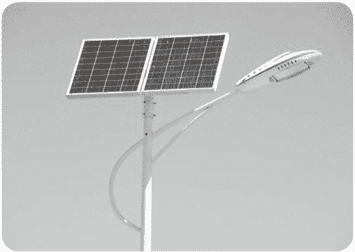
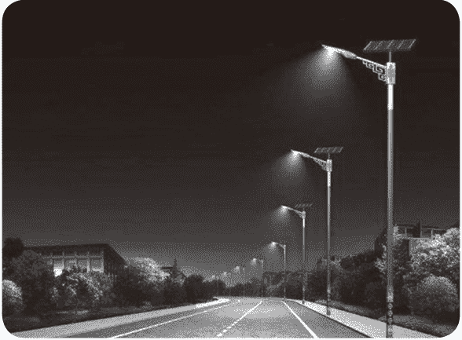

### 导读引思

1. 光敏传感器在路灯控制中，对应人体哪个器官？缘由何在？
2. 如何让路灯知晓“天黑”？白天课堂怎模拟“黑夜”？

### 思考发散

1. 路灯的作用何在？
2. 何时点亮？
3. 除马路，还能在哪见它？
4. 是否存在浪费电的情况？

### 课后功能拓展

掌握本课后，除智能路灯，还能制作哪些同类装置？

### 一、硬件清单

1. **核心件：** 核心板、主扩展板、光敏传感器、RGB探照灯、便携式扩展板。
2. **关键器件解析：**
   - **光敏传感器：** 感知环境光强。
   - **原理：** 光照低于阈值 → 引脚输出高电平（指示灯灭）；光照超阈值 → 输出低电平（指示灯亮）。

### 二、程序模块速查（表 1-1）

| 序号 | 分类 | 模块名 | 核心功能 |
| :--- | :--- | :--- | :--- |
| 01 | 基本 | 当开机时 | 程序入口，初始化用 |
| 02 | 基本 | 无限循环 | 循环执行内部逻辑 |
| 03 | 基本 | 显示图标 | 显示指定图标 |
| 04 | 逻辑 | 如果为 true 则 | 条件为真才执行“则”分支 |
| 05 | Siw21_显示类 | 初始化2.1主扩展板 | 初始化主扩展板 |
| 06 | Siw21_显示类 | 初始化RGB | 初始化RGB模块 |
| 07 | Siw21_显示类 | 显示彩灯 | 点亮RGB探照灯 |
| 08 | Siw21_显示类 | 设置 Light 1 颜色为 red | 设定单灯颜色 |
| 09 | Siw21_显示类 | 设置RGB灯亮度 0 | 调节亮度 |
| 10 | Siw21_传感器类 | 光敏传感器 检测到 光照 | 检测到光照返回真 |
| 11 | 无线 | 无线设置组 1 | 设置无线组ID |
| 12 | 无线 | 在无线接收到数据时 | 接收到数字信息触发 |
| 13 | 无线 | 无线发送数字 0 | 发送数字信息 |

### 三、编程逻辑架构

#### 发送端
1. **初始化 RGB**  
   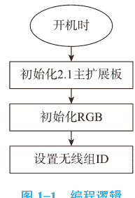
2. **检测光照**  
   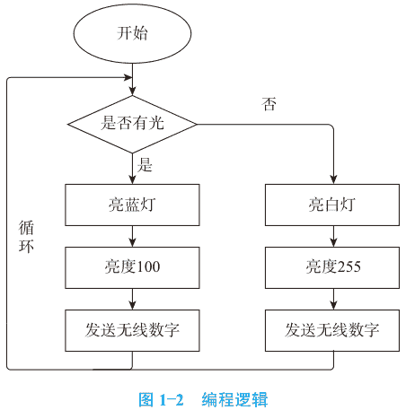

#### 接收端
1. **设置无线组 ID**  
   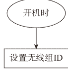  
   *图 1-3 编程逻辑*
2. **显示图标反馈**  
   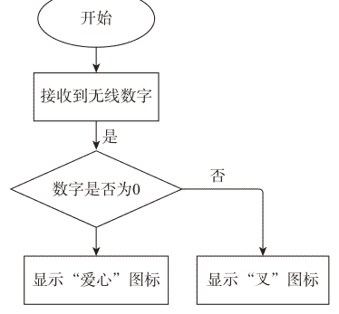  
   *图 1-4 编程逻辑*

### 四、参考代码示例

#### 发送端
1. 初始化 RGB  
     
   *图 1-5 参考代码*
2. 检测光照  
   ```
无限循环
如果为 光敏传感器 检测到 光照 则
设置 Light 1 颜色为 blue
设置RGB灯亮度 100
显示彩灯
无线发送数字 1
否则
设置 Light 1 颜色为 white
设置RGB灯亮度 255
显示彩灯
无线发送数字 0
```  
   *图 1-6 参考代码*

#### 接收端
1. 设置无线组 ID  
   ```
当开机时
无线设置组 1
```  
   *图 1-7 参考代码*
2. 显示图标  
     
   *图 1-8 参考代码*

### 五、提升训练

**挑战任务：** 结合所学与观察，实现——  
光敏检测到光照 → 关闭RGB + 播放“铃声”；  
光敏未检测到光照 → 开启RGB + 播放“nyan”。

### 六、深度思考

如何将“光敏检测到光照”的程序改为“未检测到”，且效果保持一致？

---

## 第二课 智能灯（声控）

生活中声控灯、遥控灯、场景灯、触控灯层出不穷，科技让照明更懂人。今天，我们也来DIY一盏声控灯！


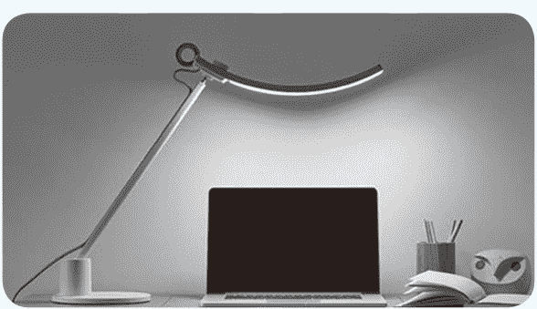


### 导读引思

1. 声音传感器在声控灯中，对应人体哪个器官？为什么？
2. RGB探照灯在此实验中扮演什么角色？
3. 何时需向RGB下发指令使其执行？

### 思考发散

1. 见过声控灯吗？有何优势？
2. 何时会被点亮？
3. 靠什么装置“听声”？
4. 如何自制声控灯？

### 课后功能拓展

除声控灯，本课知识还能衍生哪些同类作品？

### 一、硬件清单

1. **核心件：** 核心板、主扩展板、声音传感器、RGB探照灯、子扩展板、杜邦线若干。
2. **关键器件解析：**
   - **声音传感器：** 检测环境声强。
   - **特性：** 声强低于阈值 → 输出高电平（指示灯灭）；声强超阈值 → 输出低电平（指示灯亮）。
   - **注意：** 避免特定频率干扰；灵敏度可调。

### 二、程序模块速查（表 2-1）

| 序号 | 分类 | 模块名 | 核心功能 |
| :--- | :--- | :--- | :--- |

## 第二课 声控照明：从基础交互到逻辑进阶

### 核心指令速查

| 编号 | 类别 | 指令标识 | 关键功能 |
|:---|:---|:---|:---|
| 01 | 基础 | 系统启动 | 程序入口，优先运行，用于环境就绪 |
| 02 | 基础 | 持续轮询 | 维持主流程不间断运行 |
| 03 | 显控 | 就绪RGB | 启用全彩灯珠模组 |
| 04 | 显控 | 指定色值 | 设定单颗灯珠色调 |
| 05 | 显控 | 点亮灯效 | 激活全彩输出 |
| 06 | 显控 | 熄灭灯效 | 关闭全彩输出 |
| 07 | 数据 | 赋值项 | 状态量初始化赋值 |
| 08 | 判断 | 条件成立 | 满足真值执行后续分支 |
| 09 | 感知 | 声响触发 | 监测到音量返回真 |

---

### 项目一：基础声控灯——拍手亮灯，再拍熄灭

#### 实现思路
借助声响收集器捕捉环境音量。初次触发点亮全彩灯珠并调至暖橙色调；二次触发令其熄灭。引入状态标记量实现开合切换。

**步骤 1：启动配置**  
上电即刻完成前置设置。

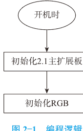

**步骤 2：主循环监测**  
持续轮询中监听声响信号，依据标记翻转灯态。

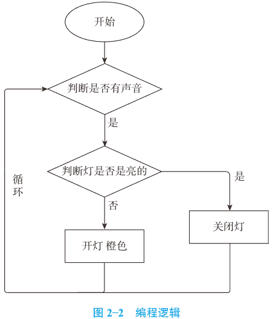

#### 代码示例
**前置初始化**

```
当开机时
初始化2.1主扩展板
初始化RGB
```

**声控主流程**

```
无限循环
如果为 声音传感器 返回 有声音 则
设置 Light 1 颜色为 orange
显示彩灯
暂停 (ms) 5000
关闭彩灯
```

---

### 项目二：进阶声控灯——触控延长亮灯时长

#### 逻辑升级
叠加触控感应片。声响触发点亮暖光；触碰操作叠加持续时长。双线程逻辑：一路管通断，一路管计时。

**步骤 1：同步就绪**  
RGB 与变量同步初始化。

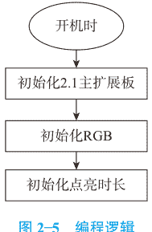

**步骤 2：灯态判断**  
监听声响，控制通断。

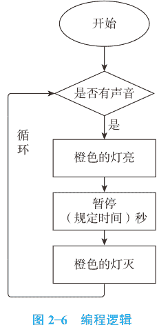

**步骤 3：时长累加**  
监听触碰，动态增持续时间。

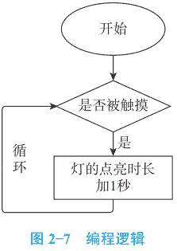

#### 代码示例
**上电就绪RGB**

```
当开机时
  初始化2.1主扩展板
  初始化RGB
  将 点亮时长 设为 1
```

**灯态判断分支**

```
无限循环
如果为 声音传感器 返回 有声音 则
  设置 Light 1 颜色为 orange
  显示彩灯
  暂停(ms) 点亮时长 x 1000
  关闭彩灯
```

**持续时长控制**

```
无限循环
如果为 触摸传感器 检测到 触摸 则
  以 1 为幅度更改 点亮时长
```

---

### 💡 课后拓展与思考
**进阶练习**：如何利用所学模块，制作一盏可手动开合的台灯？  
**深度思考**：如何让台灯仅在“夜晚光线暗”且“捕捉到声响”双重条件下才点亮？

---

## 第三课 智能风扇：距离感应、摆头摆动与变速控制

### 课程导入
夏日炎炎，风扇进化史：从定频到摆头，再到智能感应变速。本课结合超声波测距与舵机电机，实现三款进阶风扇。

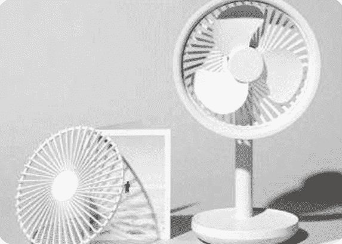


### 导读与思考
**导读**：
- 通过何种方式控制风扇左右摆动？
- 如何让转速持续加快？

**思考**：
- 何时开启电风扇？
- 电风扇有哪些款式？
- 电风扇与空调有何区别？

**课后功能拓展**：
掌握本课知识后，除智能风扇外还能制作哪些相似装置？

### 硬件与指令清单

**核心套件**：主控板、主扩板、连接线若干  
**感知模块**：超声波测距模块（量程 3cm~200cm，原理：发射脉冲计算回波时长）  
**执行模块**：全彩灯珠扩展板（指示用）、舵机/电机驱动（风扇转动与摆头）

**核心指令表**

| 编号 | 类别 | 指令标识 | 关键功能 |
|:---|:---|:---|:---|
| 01 | 基础 | 系统启动 | 程序初始化入口 |
| 02 | 基础 | 持续轮询 | 主循环维持 |
| 03 | 基础 | 延时 ms | 延时控制，单位毫秒 |
| 04 | 数据 | 赋值距离 | 距离变量清零 |
| 05 | 判断 | 条件成立 | 条件分支判断 |
| 06 | 车控 | 舵机定位 | 舵机精准定位（角度/速度可控） |
| 07 | 车控 | 电机驱动 | 电机正反转控制方向 |
| 08 | 车控 | 读取测距 | 读取实时测距数值 |
| 09 | 车控 | 电机调速 | 电机转向 + PWM 调速 |

---

### 项目一：自动摆头风扇——有人靠近才转动，且自动摆头

#### 核心逻辑
超声波实时测距。检测范围 **0cm < 距离 < 10cm** 时：风扇转动 + 舵机驱动风扇头 0°~180° 往复摆动；超出范围则停机。

**步骤 1：环境就绪**  
变量清零，舵机归位，电机停止。

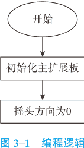

**步骤 2：摆头主循环**  
循环读取距离，满足条件则执行“转动+摆头”状态机。

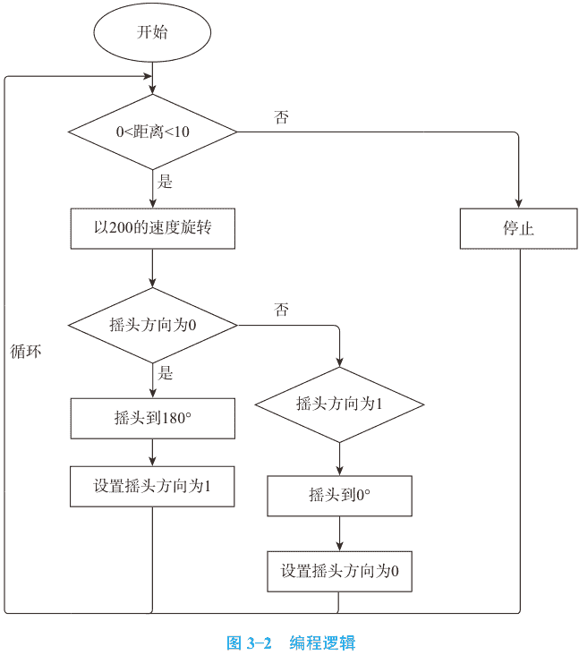

#### 代码示例
**就绪代码**


**摆头主程序**

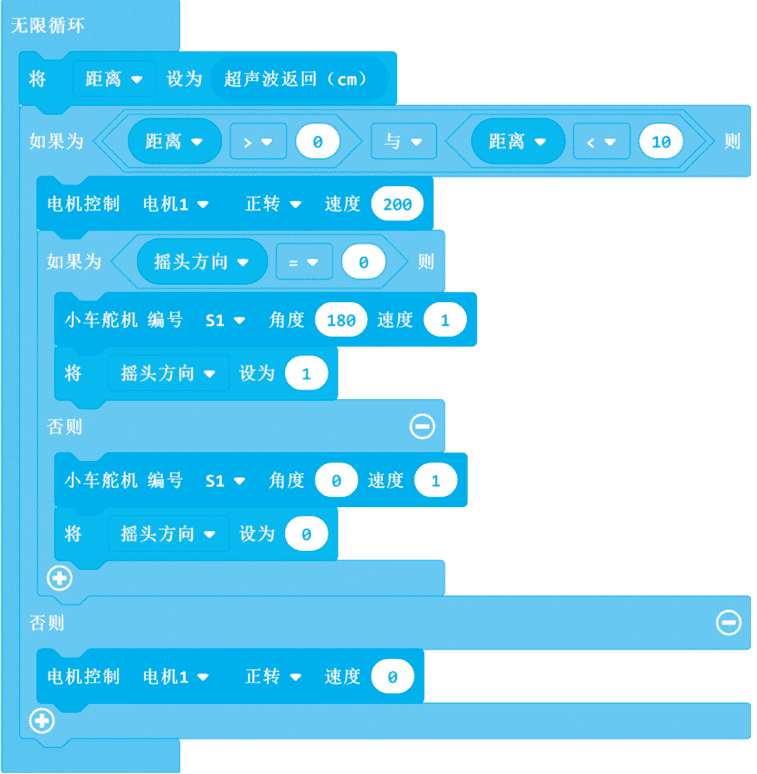

---

### 项目二：可控摆头风扇——触控决定“摆不摆头”

#### 逻辑升级
距离感应负责“开机/待机”，触控感应片负责“摆头/定向”切换。
- 有人靠近（0~10cm）-> 风扇转动。
- 触碰一下 -> 若正在摆头则停止摆动（定向吹风）；若固定则开始摆头。

**步骤 1：启动配置**  
设定初始摆头状态（如默认开启）。

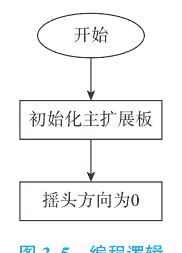

**步骤 2：摆头开关控制**  
主循环中独立监听触碰事件，翻转摆头标志位。

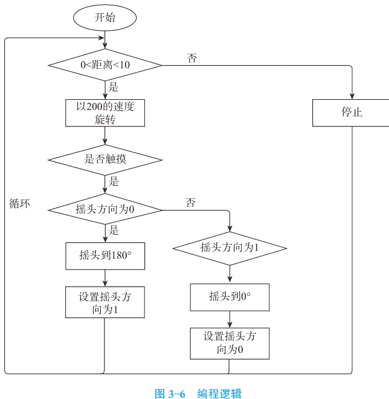

#### 代码示例
**就绪代码**


**摆头控制主程序**


---

### 项目三：智能变速风扇——触控无极变速

#### 逻辑进阶
引入速度变量 `Speed` 与方向标志 `Dir`。
- 超声波检测有人 -> 风扇运行 + 摆头。
- 触碰一下 -> 速度变化方向翻转：`Dir=1` 递增速度（上限 200 则转 `Dir=0`）；`Dir=0` 递减速度。

**步骤 1：全量就绪**  
速度、方向、舵机角度全部归零/设定初值。

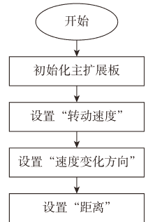

**步骤 2：摆头执行**  
独立线程/循环处理舵机摆动，不阻塞调速。

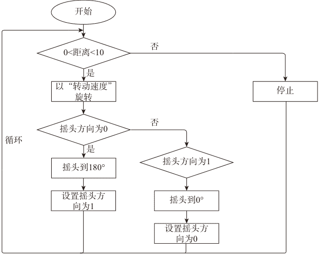

**步骤 3：变速控制**  
监听触碰，修改速度变量并写入电机。

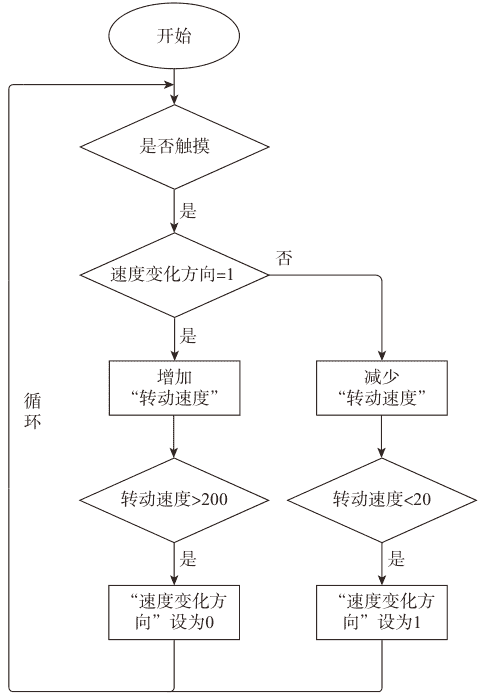

#### 代码示例
**就绪程序**

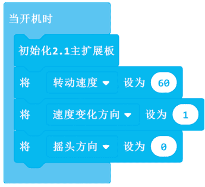

**摆头执行代码**

```
无限循环
  将 距离 设为 超声波返回（cm）
  如果为 距离 > 0 与 距离 < 10 则
    电机控制 电机1 正转 速度 转动速度
    如果为 摇头方向 = 0 则
      小车舵机 编号 S1 角度 180 速度 1
      将 摇头方向 设为 1
    否则
      小车舵机 编号 S1 角度 0 速度 1
      将 摇头方向 设为 0
  否则
    电机控制 电机1 正转 速度 0
  暂停（ms） 50
```

**变速控制代码**

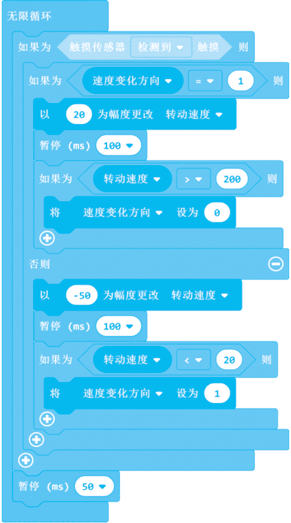

---

### 💡 课后拓展与思考
**进阶练习**：能否引入温度传感器？逻辑：温度 > 22℃ 高速；16~22℃ 低速；≤16℃ 关机。  
**深度思考**：除超声波外，还能用什么传感器触发风扇启停？（如人体红外、声响、按键...）

---

## 第四课 智能窗帘：从光控、触控到双模融合

### 课程导入
告别手动拉拉，实现“天亮自动开、天黑自动关”，并支持触控/远控强制干预。

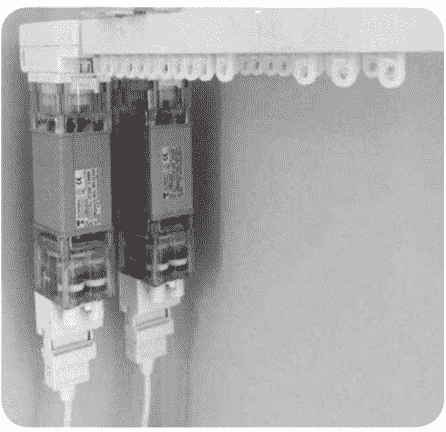

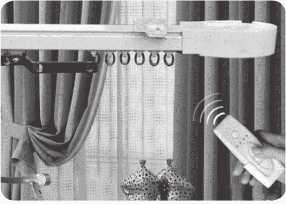

### 导读与思考
**导读**：
- 智能窗帘实验中如何判断开合时机？
- 若天未黑想关帘怎么办？

**思考**：
- 何时拉开窗帘？
- 天黑时能打开窗帘吗？

**课后功能拓展**：
窗帘自动关上后，用什么程序让它接受遥控强制打开？

### 硬件与指令清单

**核心套件**：主控板、主扩板、全彩灯珠（作指示灯）  
**感知模块**：光照感应模块（原理：光强超阈值输出低电平/亮灯；弱光输出高电平/灭灯）  
**执行模块**：电机驱动窗帘开合（复用车控电机模块）

**核心指令表**

| 编号 | 类别 | 指令标识 | 关键功能 |
|:---|:---|:---|:---|
| 01 | 基础 | 系统启动 | 初始化入口 |
| 02 | 基础 | 持续轮询 | 主循环 |
| 03 | 基础 | 延时 ms | 延时 |
| 04 | 数据 | 赋值项 | 状态变量初始化 |
| 05 | 判断 | 条件成立 | 条件判断 |
| 06 | 显控 | 就绪RGB | 灯模块初始化 |
| 07 | 显控 | 点亮灯效 | 指示灯亮 |
| 08 | 显控 | 熄灭灯效 | 指示灯灭 |
| 09 | 显控 | 指定色值 | 指示灯配色（红/绿区分状态） |
| 10 | 显控 | 就绪主扩 | 扩展板初始化 |
| 11 | 车控 | 电机驱动 | 电机正反转控制开/合 |
| 12 | 感知 | 光照触发 | 有光返回真 |

---

### 项目一：全自动光敏窗帘——天作伴，光作引

#### 核心逻辑
单一光控模式。
- **捕捉到光照**（白天） -> 电机正转**拉开窗帘**，指示灯显**红**。
- **未捕捉到光照**（夜晚） -> 电机反转**关上窗帘**，指示灯显**绿**。

**步骤 1：就绪逻辑**  
扩展板、RGB、电机初始化。

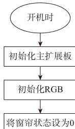

**步骤 2：光控主循环**  
持续轮询光照状态，驱动电机与指示灯。

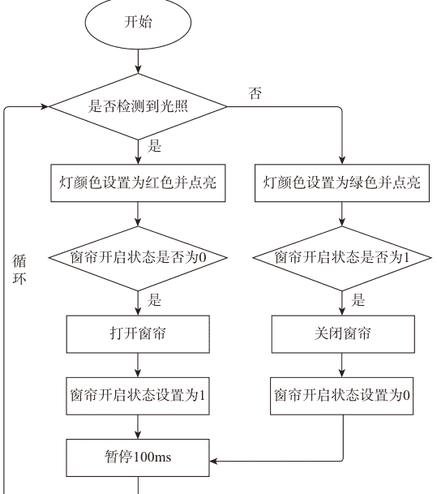

#### 代码示例
**就绪代码**

```
当开机时
初始化2.1主控扩展板
初始化RGB
将 窗帘状态 设为 0
```

**光控主程序**

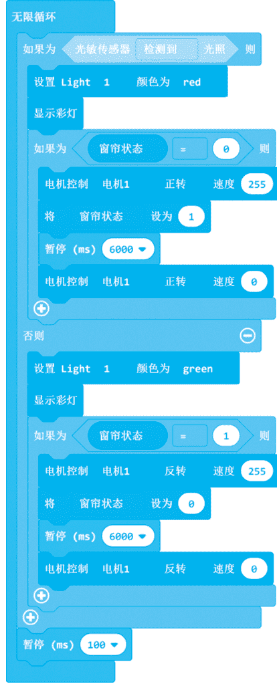

---

### 项目二：触控手动窗帘——想开就开，想合就合

#### 核心逻辑
纯触碰翻转控制，无自动逻辑。需变量记录“窗帘当前态（开/合）”。
- 触碰一下 -> 态=合 -> 执行开帘 -> 态改为开。
- 触碰一下 -> 态=开 -> 执行合帘 -> 态改为合。

**步骤 1：启动配置**  
状态变量置为“关闭”。

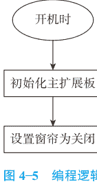

**步骤 2：触控翻转**  
监听触碰中断/轮询，反向驱动电机。

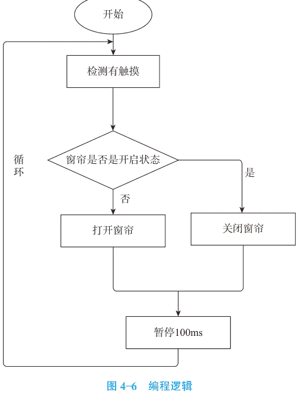

#### 代码示例
**就绪代码**


**触控主程序**


---

### 项目三：终极智能窗帘——光控与远控双模切换

#### 核心融合
引入**红外避障模块**作为“模式切换键”（模拟远控/人体接近感应）。
- **自动模式（默认）**：红外**未**捕捉到人 -> 执行项目一的光控逻辑。
- **远控/手动模式**：红外**捕捉到人**（手挥过/遥控信号） -> 切换至触控模式（项目二逻辑），脱离光控。

**四大逻辑块协同**：
1.  **就绪**：模式标志=自动，窗帘态=合。
    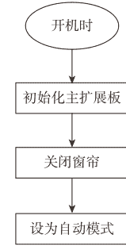
2.  **模式监听**：轮询红外，更新模式标志（自动<->手动）。
    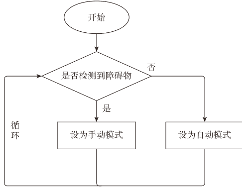
3.  **自动任务**：模式=自动时，执行光控判断。
    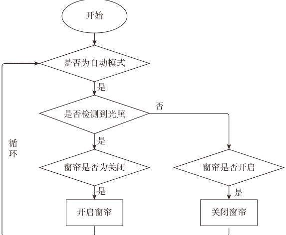
4.  **手动任务**：模式=手动时，执行触控翻转判断。
    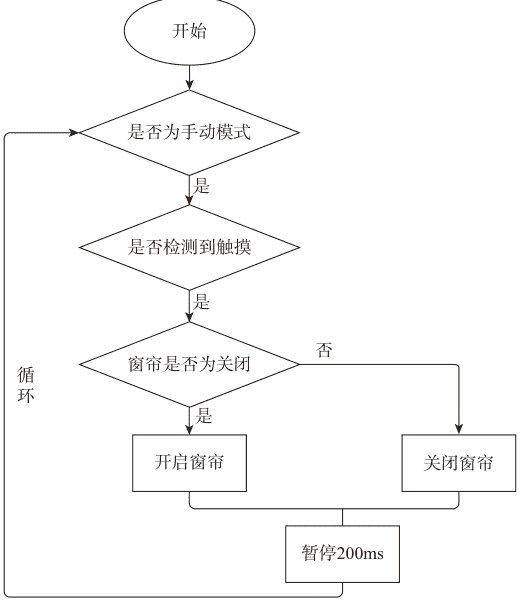

#### 代码示例
**就绪程序**


**模式切换程序**

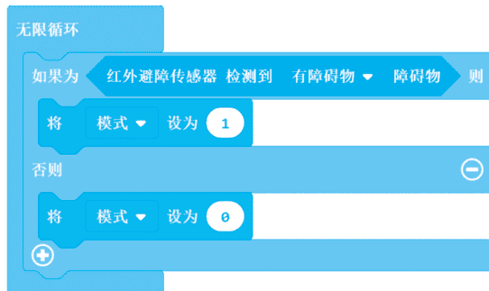

**光控自动程序**


**触控手动程序**


---

### 💡 课后拓展与思考
**进阶练习**：编写完整逻辑实现“天黑合帘、天亮开帘”的基础光控循环。  
**深度思考**：如何在自动合帘后，仍保留“远控强制打开”功能？（提示：即项目三的模式切换机制）。

我们设计的智能窗帘采用的是左右开合模式，生活中常见的还有上下拉动式窗帘，感兴趣的同学不妨动手尝试实现一下？

## 第五课 智能报警器（危险气体泄漏监测）

煤气泄漏时，人们靠特殊的气味发现并迅速开窗通风。但如果可燃气体本身无色无味，泄漏后难以被察觉，后果不堪设想。为此，家中安装报警器至关重要：一旦检测到泄漏，即刻鸣警示人采取行动。今天，我们就来动手制作一台可燃气体报警器！


- **导读**：
- 1. 本课将利用什么组件来监测空气中的有毒有害气体？
- 2. 如何实现对室内外人员的双重通知？

- **思考题**：
- 1. 若报警触发后发现人员已中毒，应采取哪些急救措施？
- 2. 遇到误报想手动关闭警报，有什么可行方案？

- **课后功能拓展**：
同学们，智能报警器运行需要供电，有什么办法能让它持久续航？

### 一、本课所需硬件清单

- **1. 核心器材**：核心板、主扩展板、可燃气体传感器、RGB 探照灯子扩展板。
- **2. 关键硬件原理解析**：
可燃气体传感器的工作机制：环境中若存在可燃气体，传感器电导率会随气体浓度升高而增大。内部电路将这一变化转换为对应浓度的输出信号传给核心板。该传感器对氢气、甲烷、丙烷、液化气等可燃气体均具备高灵敏度检测能力。

### 二、本课核心程序模块速查表（表 5-1）

| 序号 | 模块分类 | 模块名称 | 核心功能说明 |
|---|---|---|---|
| 01 | 基本 | 当开机时 | 程序入口，优先于所有事件执行，用于初始化设置。 |
| 02 | 基本 | 无限循环 | 程序启动后持续循环执行内部逻辑。 |
| 03 | 基本 | 暂停（ms）100 | 让程序按设定毫秒数暂停运行。 |
| 04 | 变量 | 将 item 设为 0 | 创建变量并赋初始值。 |
| 05 | 逻辑 | 如果为 true 则 | 条件判断模块，条件成立才执行“则”内程序。 |
| 06 | Siwt21_显示类 | 初始化RGB | 完成 RGB 模块的初始化配置。 |
| 07 | Siwt21_显示类 | 显示彩灯 | 点亮 RGB 探照灯。 |
| 08 | Siwt21_显示类 | 关闭彩灯 | 熄灭 RGB 探照灯。 |
| 09 | Siwt21_显示类 | 设置 Light 1 颜色为 red | 指定某颗 RGB 灯呈现特定颜色。 |
| 10 | 音乐 | 播放音调 中 C 拍数 1 节拍 | 播放指定音高、时长的音符。 |
| 11 | Siwt21_传感器类 | 可燃气体传感器 检测到 可燃气体 | 检测到可燃气体时返回真值。 |

### 三、核心编程逻辑架构

核心思路：利用可燃气体传感器实时监测。检测到气体 → 蜂鸣器鸣叫 + RGB 灯红色闪烁报警；未检测到 → 蜂鸣器静音、灯灭。

- **1. 系统初始化流程（图 5-1）。**

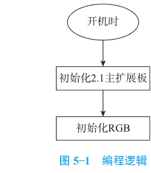

- **2. 气体检测与报警主循环（图 5-2）。**

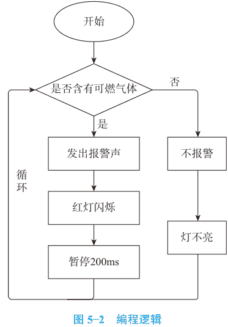

### 四、参考代码实现

- **1. 开机初始化代码（图 5-3）。**


> 图 5-3 参考代码

- **2. 气体检测判断代码（图 5-4）。**

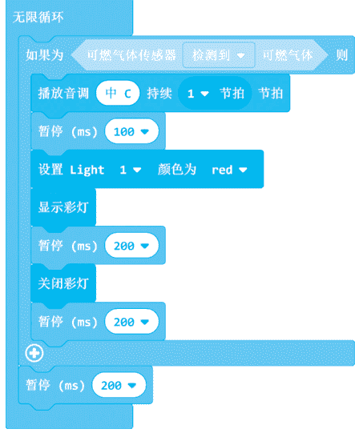

> 图 5-4 参考代码

### 五、提升训练实战

综合所学，设计一款**复合型检测器**：当环境温度超 50℃ **或** 检测到可燃气体时，均能触发报警。

### 六、深度思考题

若报警器监测到可燃气体浓度已达爆炸极限，能否联动启动风扇，通过强制对流稀释气体浓度？

---

## 第六课 智能演奏台（DJ 控制台）

DJ（Disc Jockey，唱片骑师）是大型演出现场的电音掌控者，核心装备便是演奏台。通过旋钮与碟片的配合，即可演绎千变万化的音调。今天我们自制一台迷你 DJ 台，旋转电位器即可切换音调并同步变换灯光色彩。


- **导读**：
- 1. 程序如何读取电位器的数值？
- 2. 请查阅资料，简述电位器的引脚结构。
- 3. 哪个模块能实现数值的等比例范围缩放？

- **思考题**：
- 1. 查阅资料解释“电位器”概念。
- 2. 查阅资料解释“映射”在编程中的含义。
- 3. 如何用程序模块截取小数的整数部分（去尾法）？

- **课后功能拓展**：
掌握本课知识后，除了 DJ 台，你还能联想到哪些应用场景？

### 一、硬件准备与接口说明

- **1. 器材清单**：核心板、主扩展板、电位器、RGB 探照灯。
- **2. 接口功能对应**：核心板芯片、主扩展板上的核心板插座、供电口、电位器接口、RGB 灯接口。

### 二、本课程序模块库（表 6-1）

| 序号 | 分类 | 模块名称 | 功能描述 |
|---|---|---|---|
| 01 | 基本 | 当开机时 | 程序起始事件，用于初始化。 |
| 02 | 基本 | 无限循环 | 持续循环执行主逻辑。 |
| 03 | 基本 | 暂停 (ms) 100 | 延时指定毫秒。 |
| 04 | 逻辑 | 如果为 true 则 | 条件成立执行分支。 |
| 05 | 逻辑 | 0 = 0 | 判断两值相等返回真。 |
| 06 | Siwt21_显示类 | 初始化RGB | RGB 显示初始化。 |
| 07 | Siwt21_显示类 | 显示彩灯 | 点亮灯光。 |
| 08 | Siwt21_显示类 | 设置 Light 1 颜色为 red | 设定指定灯珠颜色。 |
| 09 | 变量 | item | 变量占位符。 |
| 10 | 变量 | 将 item 设为 0 | 变量赋值。 |
| 11 | 引脚 | 模拟读取 引脚 P3 | 读取 P3 引脚模拟电压值 (0-1023)。 |
| 12 | 数学 | 数值修约 0 | 取整（去除小数部分）。 |
| 13 | 数学 | 映射 0 从低 0 从高 1023 至低 0 至高 4 | 将数值从 0-1023 区间等比例映射至 0-4 区间。 |

### 三、编程逻辑设计

- **1. 开机初始化逻辑（图 6-1）。**

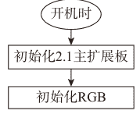

> 图 6-1 编程逻辑

- **2. 音调与灯光联动控制逻辑（图 6-2）。**
旋转电位器 → P3 模拟值变化 (0~1023) → 映射缩放至 0~4 并取整 → 根据值 (0,1,2,3,4) 分支播放对应音调、点亮对应颜色灯光。

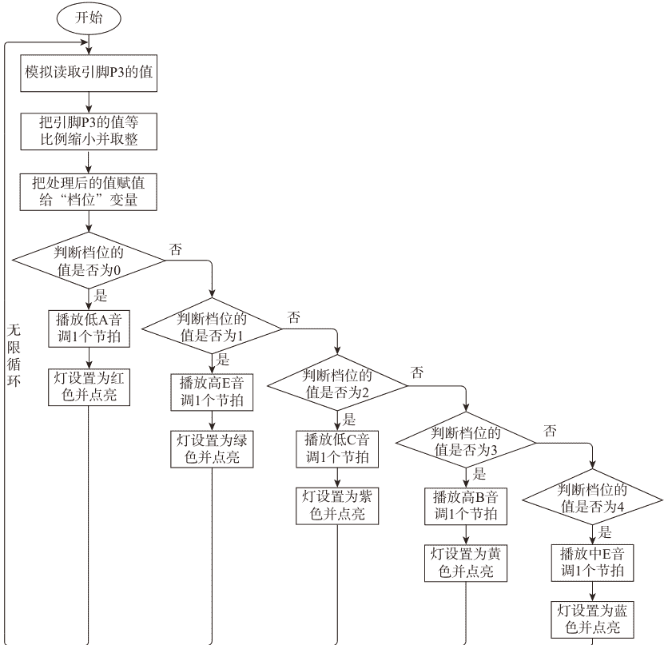

> 图 6-2 编程逻辑

### 四、参考代码示例

- **1. 初始化代码（图 6-3）。**

```
当开机时
初始化2.1主扩展板
初始化RGB
```

> 图 6-3 参考代码

- **2. 音调与灯光控制主代码（图 6-4）。**

```
无限循环
将 控位 设为 数值映射 映射 模拟读取 引脚 P3 从低 0 从高 1023 至低 0 至高 4
如果为 控位 <= 0 则
  播放音调 低 A 持续 1 拍
  设置 Light 1 颜色为 red
  显示彩灯
否则如果为 控位 <= 1 则
  播放音调 高 E 持续 1 拍
  设置 Light 1 颜色为 green
  显示彩灯
否则如果为 控位 <= 2 则
  播放音调 低 C 持续 1 拍
  设置 Light 1 颜色为 purple
  显示彩灯
否则如果为 控位 <= 3 则
  播放音调 高 B 持续 1 拍
  设置 Light 1 颜色为 yellow
  显示彩灯
否则如果为 控位 <= 4 则
  播放音调 中 E 持续 1 拍
  设置 Light 1 颜色为 blue
  显示彩灯
暂停 (ms) 100
```

> 图 6-4 参考代码

### 五、提升训练

实战演练：将一个 0~100 范围内的数值（如 79），等比例缩放至 0~10 并取整，请搭建对应程序模块。

### 六、生活联想题

思考一下，日常生活中哪些设备用到了电位器原理？

---

## 第七课 智能浇花器（自动灌溉系统）

家中养绿植最怕忘记浇水，缺水易枯萎甚至死亡。与其做“事后诸葛亮”，不如化身“植物守护神”，发明一台自动浇灌机，精准把控水分供给。来吧，让我们动手造一台！


- **导读**：
- 1. 如何判断土壤干旱需要补水？
- 2. 浇水时长如何把控？如何自动止水？

- **思考题**：
- 1. 多盆植物场景下，能否分别精准控制每盆水量？
- 2. 单盆精准定量浇水有什么实现思路？

- **课后功能拓展**：
若不想自动浇水，只需机器发声并显示文字“请浇水”提醒，可行吗？

### 一、硬件配置

- **1. 器材**：核心板、主扩展板、湿度传感器子扩展板、RGB 探照灯子扩展板、杜邦线若干。
- **2. 接口对应**：核心板芯片、主扩展板核心板接口、湿度传感器接口、RGB 探照灯接口。

### 二、程序模块清单（表 7-1）

| 序号 | 分类 | 模块名称 | 功能 |
|---|---|---|---|
| 01 | 基本 | 当开机时 | 程序初始化入口。 |
| 02 | 基本 | 暂停（ms） 100 | 延时。 |
| 03 | 基本 | 无限循环 | 主循环。 |
| 04 | 逻辑 | 如果为 true 则 | 条件分支。 |
| 05 | Siwt21_传感器类 | 湿度传感器检测到土壤湿度 异常 | 检测到土壤湿度异常(过低)返回真。 |
| 06 | Siwt21_小车类 | 小车控制 前行 | 控制电机驱动水泵/装置动作(前行/停止等)。 |
| 07 | Siwt21_显示类 | 初始化RGB | RGB初始化。 |
| 08 | Siwt21_显示类 | 显示彩灯 | 开灯。 |
| 09 | Siwt21_显示类 | 关闭彩灯 | 关灯。 |
| 10 | Siwt21_显示类 | 设置 Light 1 颜色为 red | 设定灯色。 |

---

### 第一节 简易浇水装置

#### 编程逻辑
核心判断：湿度传感器检测土壤 → 干旱(异常) → 启动浇水装置 + 绿灯亮(工作指示) → 湿度达标 → 停止浇水 + 关灯。

- **1. 初始化逻辑（图 7-1）。**

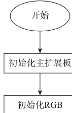

> 图 7-1 编程逻辑

- **2. 湿度判断与执行浇水逻辑（图 7-2）。**

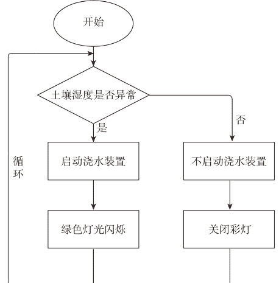

> 图 7-2 编程逻辑

#### 参考代码

- **1. 初始化代码（图 7-3）。**

```
当开机时
初始化2.1主扩展板
初始化RGB
```

> 图 7-3 参考代码

- **2. 判断执行代码（图 7-4）。**

```
无限循环
如果为 湿度传感器检测到土壤湿度 异常 则
  小车控制 前行
  设置 Light 1 颜色为 green
  显示彩灯
  暂停 (ms) 200
  关闭彩灯
  暂停 (ms) 200
否则
  小车控制 停止
  暂停 (ms) 100
  关闭彩灯
```

> 图 7-4 参考代码

---

### 第二节 进阶版自动浇灌机

#### 编程逻辑升级
- **1. 初始化逻辑（图 7-5）。**

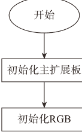

> 图 7-5 编程逻辑

- **2. 智能浇灌循环逻辑（图 7-6）。**
检测到湿度异常 → 亮红灯 + 浇水 3 秒；检测到湿度正常 → 亮绿灯 + 播放音乐确认。

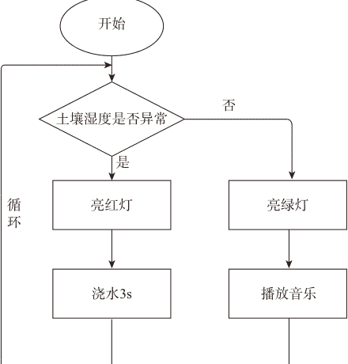

> 图 7-6 编程逻辑

#### 参考代码

- **1. 初始化代码（图 7-7）。**


> 图 7-7 参考代码

- **2. 智能判断执行代码（图 7-8）。**

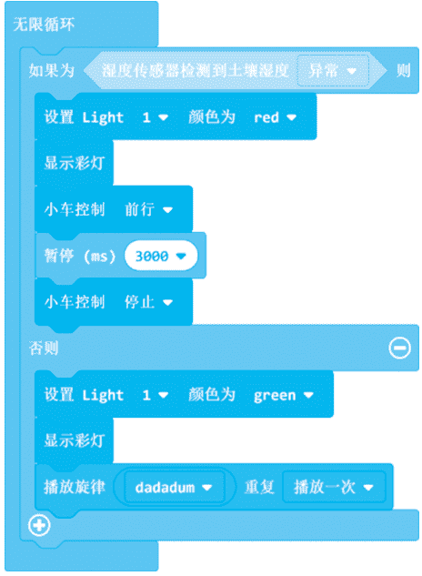

> 图 7-8 参考代码

---

### 提升训练

实战：制作自动浇灌机，检测到土壤湿度异常时，**仅声光报警**，不执行浇水动作。

### 思考题

如何让浇灌机在工作时，同步播放背景音乐？

---

## 第八课 智能道闸杆（车辆通行管理）

道闸（挡车器）广泛用于小区、收费站、停车场出入口。控制方式多样：遥控电动、刷卡自动识别等。本课我们制作**智能感应道闸**：超声波探测车辆靠近，自动抬杆放行。

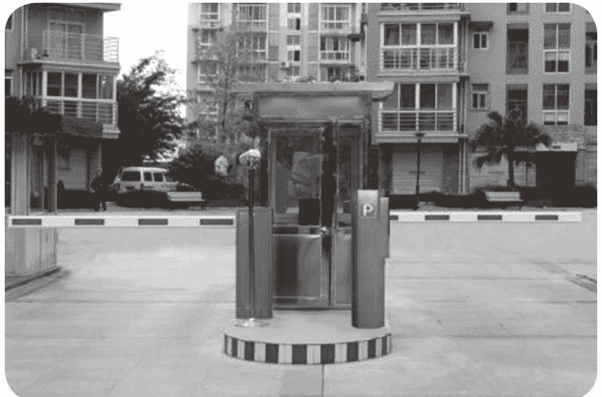


### 导读：
- 1. 你见过哪几类自动道闸？
- 2. 车辆通过道闸时，是否必须减速？

### 思考题：
体积极小的车辆（如自行车），会不会被识别系统“漏检”？

### 课后功能拓展：
人工遥控 vs 自动感应，哪种模式更优？理由是什么？

### 一、硬件清单
核心板、主扩展板、超声波传感器、RGB 探照灯子扩展板、杜邦线若干。

### 二、程序模块表（表 8-1）

| 序号 | 分类 | 模块名称 | 功能 |
|---|---|---|---|
| 01 | 基本 | 当开机时 | 初始化入口。 |
| 02 | 基本 | 无限循环 | 主循环。 |
| 03 | 基本 | 暂停 (ms) 100 | 延时。 |
| 04 | 变量 | 将 Distance 设为 0 | 创建距离变量 Distance 并置 0。 |
| 05 | 逻辑 | 如果为 true 则 | 条件判断。 |
| 06 | Siw21_显示类 | 初始化RGB | RGB初始化。 |
| 07 | Siw21_显示类 | 显示彩灯 | 点亮。 |
| 08 | Siw21_显示类 | 关闭彩灯 | 熄灭。 |
| 09 | Siw21_显示类 | 设置 Light 1 颜色为 red | 设定颜色。 |
| 10 | Siw21_小车类 | 小车舵机 编号 S1 角度 0 速度 0 | 控制舵机转动角度/速度(模拟道闸杆起落)。 |
| 11 | Siw21_小车类 | 超声波返回 (cm) | 读取超声波测得的障碍物距离(厘米)。 |

### 编程逻辑设计

**1. 开机初始化状态（图 8-1）。**
上电 → 初始化 RGB & 主扩展板 → 设置红灯亮(禁行状态) → 舵机归位(道闸关闭)。

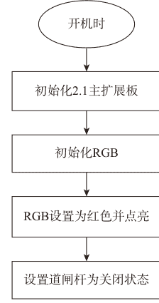

> 图 8-1 编程逻辑

**2. 道闸自动起落控制逻辑（图 8-2）。**
循环读取超声波距离：
- **检测到 0cm < 距离 < 10cm**（车辆靠近）→ 舵机抬杆(开启)持续 2 秒 + 绿灯亮(放行)；
- **否则**（无车或距离过远）→ 舵机落杆(关闭) + 红灯亮(禁行)。

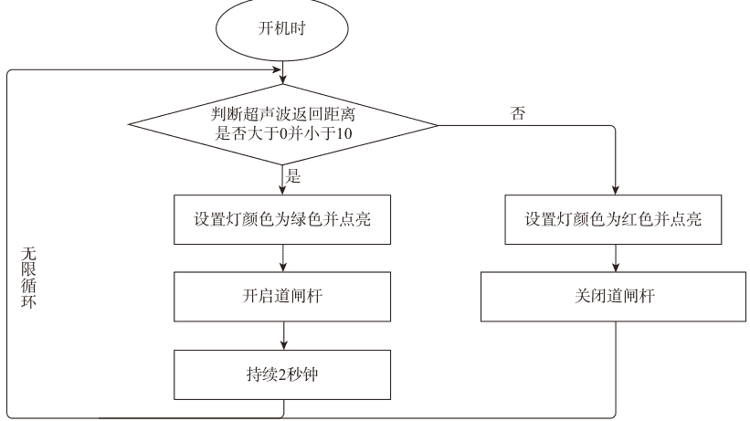

> 图 8-2 编程逻辑

### 参考代码

**1. 初始化代码（图 8-3）。**

```
当开机时
初始化2.1主扩展板
初始化RGB
设置 Light 1 颜色为 red
显示彩灯
小车舵机 编号 S1 角度 90 速度 5
```

**2. 道闸控制主循环代码（图 8-4）。**

```
无限循环
如果为 超声波返回 (cm) > 0 与 超声波返回 (cm) < 10 则
设置 Light 1 颜色为 green
显示彩灯
小车舵机 编号 S1 角度 180 速度 5
暂停 (ms) 2000
否则
设置 Light 1 颜色为 red
显示彩灯
小车舵机 编号 S1 角度 90 速度 5
```

### 三、 进阶实战任务

结合本节知识要点与日常观察，完成下列挑战：
**任务目标：** 设计一套挡车杆控制方案，实现栏杆每 10 秒自动抬起一次。

### 四、 核心难点攻关

声波测距易受干扰产生偏差，进而引发栏杆误动作。请构思：有哪些可靠手段能有效规避此类误触发？

## 第九课 智能车辆进阶：无线远控实战

无线电遥控雏形诞生于 20 世纪 20 年代。伴随当代电子科技飞跃，遥控装备的稳定性与响应度显著跃升，使用场景全面拓展，童趣遥控车更是普及率极高。你是否渴望亲手打造专属座驾？即刻跟随教程，开启远控开发之旅！

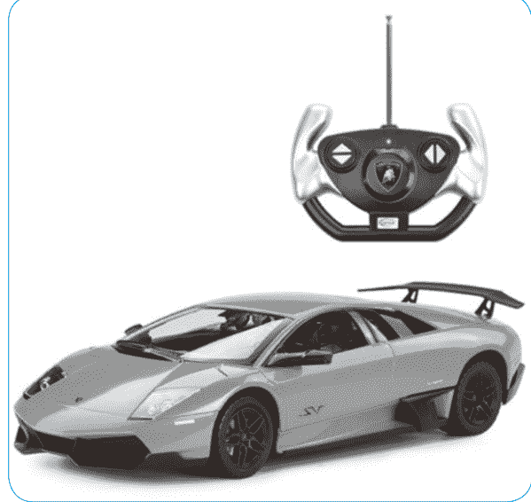


### 引入与核心追问

- **场景回溯：** 你操控过遥控车吗？指令是如何跨越空间抵达车端的？
- **边界探究：** 控制半径为何受限？阻隔物遮挡为何会导致信号“失联”？
- **破局设想：** 能否让控制信号穿透阻隔，实现非视距遥控？

### 硬件储备清单

- **核心装备：** 主控板 2 块、便携扩展板 1 块、基座扩展板 1 块、连接线若干。
- **功能要点：** 主控板芯片无线操控机制、基座扩展板主控接口定义。
- **组装指引：** 完整组装流程请访问 `www.bitlogic.cn` 查看教学视频。

---

### 第一节 无线遥控器：搭建通信双端

#### 一、 核心积木清单（对应表 9-1）

| 编号 | 分类 | 积木名称 | 功能解析 |
| :--- | :--- | :--- | :--- |
| 01 | 基础 | 当开机时 | 程序入口，优先执行，用于初始化配置。 |
| 02 | 基础 | 无限循环 | 维持程序持续运行的主循环结构。 |
| 03 | 基础 | 显示数字 | LED 矩阵输出数值，多位数自动滚动。 |
| 04 | 基础 | 显示箭头 | 四向箭头（上/下/左/右）可视化指示。 |
| 05 | 无线 | 无线设置组 | 划分通信信道 ID，同组设备互联互通。 |
| 06 | 无线 | 无线接收回调 | 接收端专用，捕获数字存入 `receivedNumber`。 |
| 07 | 无线 | 无线发送数字 | 发射端专用，向同组设备广播数值。 |
| 08 | 输入 | 按钮事件 (A/B/A+B) | 监听按键按下并释放的触发动作。 |
| 09 | 逻辑 | 如果...则... | 条件分支，满足真值执行内部逻辑。 |
| 10 | 逻辑 | 比较相等 (0=0) | 双值比对，相等返回真。 |
| 11 | 变量 | 设置变量 | 变量赋值操作。 |
| 12 | 变量 | 读取变量 | 获取变量当前数值。 |

#### 二、 双端逻辑架构设计

**1. 发射端（手持控制器）逻辑**

- **启动配置流程（图 9-1）：** 上电即组网、变量清零、屏幕待机。
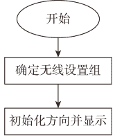

- **A 键逻辑：模式循环递增（图 9-2）**  
  触发 A 键 → 方向值 +1 → 判断 >4 → 是则归 1 → 刷新屏显 → 无线发射。


- **B 键逻辑：模式循环递减（图 9-3）**  
  触发 B 键 → 方向值 -1 → 判断 <1 → 是则置 4 → 刷新屏显 → 无线发射。


**2. 接收端（车载主板）逻辑**

- **启动配置流程（图 9-4）：** 同步组 ID，外设就绪。


- **数据处理流程（图 9-5）：** 捕获 `receivedNumber` → 解析指令 → 驱动电机执行动作。


#### 三、 参考代码实现

**发射端：**
- 启动代码（图 9-6）
- A 键事件（图 9-7）
- B 键事件（图 9-8）

**接收端：**
- 启动代码（图 9-9）
- 无线接收中断（图 9-10）

---

### 第二节 定时变向车：自主巡航新玩法

#### 一、 核心积木清单（对应表 9-2）

| 编号 | 分类 | 积木名称 | 功能解析 |
| :--- | :--- | :--- | :--- |
| 01 | 基础 | 当开机时 | 程序初始化入口。 |
| 02 | 基础 | 无限循环 | 主循环保活。 |
| 03 | 基础 | 暂停 (ms) | 毫秒级延时，把控节奏。 |
| 04 | 逻辑 | 如果...则... | 条件分支控制。 |
| 05 | 逻辑 | 比较相等 | 状态判断依据。 |
| 06 | 变量 | 变量增减 | 步进修改状态值。 |
| 07 | 变量 | 变量赋值 | 状态重置/设定。 |
| 08 | Siw21 车辆类 | 车辆控制 | 驱动双电机，实现前进/后退/转向/停止。 |

#### 二、 逻辑流程拆解

1.  **上电初始化（图 9-11）：** 设定初始运动模式，变量清零。
2.  **定时状态机（图 9-12）：** 循环累计计数，阈值触发状态切换。
3.  **状态映射执行（图 9-13）：** 依据状态值（1~4）映射调用对应运动指令。

#### 三、 代码落地

- 启动代码（图 9-14）
- 定时切换核心逻辑（图 9-15）
- 运动指令分发逻辑（图 9-16）

---

### 第三节 无线遥控车：指尖操控的自由

#### 一、 核心积木清单（对应表 9-3）

*融合第一节无线通信模块与车辆控制指令，新增 LED 状态反馈。*  
（详表 9-3，涵盖基础、无线、输入、逻辑、变量、车辆控制六大类）

#### 二、 双端协同逻辑深度解析

**1. 手持端（发射方）**

- **启动配置（图 9-17）：** 组网、状态变量初始化、屏显初始模式。
- **A 键：模式循环+1（图 9-18）：** 状态值循环 1→2→3→4→1，同步显发。
- **B 键：模式循环-1（图 9-19）：** 状态值循环 4→3→2→1→4，同步显发。

**2. 载端（接收方）**

- **启动配置（图 9-20）：** 同频组网，电机停止待命。```
当开机时
无线设置组 1
将 小车运动状态 设为 0
显示数字 小车运动状态
```
- **指令解析执行（图 9-21）：** 解析 `receivedNumber`，直驱 `车辆控制` 模块。```
当按钮 A 被按下时
以 1 为幅度更改 小车运动状态
如果为 小车运动状态 > 4 则
将 小车运动状态 设为 0
显示数字 小车运动状态
无线发送数字 小车运动状态
```

#### 三、 完整代码参考

**发射端：**
- 启动代码（图 9-22）```
当按钮 B 被按下时
以 -1 为幅度更改 小车运动状态
如果为 小车运动状态 < 0 则
将 小车运动状态 设为 4
显示数字 小车运动状态
无线发送数字 小车运动状态
```
- A 键处理（图 9-23）```
当开机时
初始化 2.1 主扩展板
无线设置组 1
```
- B 键处理（图 9-24）

**接收端：**
- 启动代码（图 9-25）
- 接收处理（图 9-26）

---

### 第四节 体感遥控车：挥手之间，掌控全场

#### 一、 核心积木升级（对应表 9-4）

*核心变革：引入**字符串无线传输**与**姿态/手势识别**，交互模式由按键进化为体感。*

| 编号 | 分类 | 积木名称 | 功能解析 |
| :--- | :--- | :--- | :--- |
| 01 | 输入 | 按钮事件 | 保留功能键辅助配置。 |
| 02 | 基础 | 当开机时 | 初始化入口，优先于其他事件执行。 |
| 03 | 基础 | 暂停 (ms) | 节奏控制。 |
| 04 | 无线 | 接收字符串 | 捕获文本指令（如 "F", "B", "L", "R", "S"）。 |
| 05 | 无线 | 无线设置组 | 组网基石。 |
| 06 | 无线 | 发送字符串 | 广播文本指令。 |
| 07 | 逻辑 | 如果...则... | 多指令分发判断。 |
| 08 | 逻辑 | 比较相等 | 字符串匹配判断。 |
| 09 | 变量 | receivedNumber | 兼容数值接收备用。 |
| 10 | Siwt21 车辆类 | 车辆控制 | 全方位动作执行器。 |

#### 二、 体感交互逻辑架构

**1. 发射端（手持/穿戴设备）—— 手势映射指令集**

- **启动校准（图 9-27）：** 组网、传感器校准、默认停止。
- **前进手势触发（图 9-28）：** 检测特定姿态 → 发送 "F" / 数值 1。
- **后退手势触发（图 9-29）：** 检测特定姿态 → 发送 "B" / 数值 2。
- **左转手势触发（图 9-30）：** 检测特定姿态 → 发送 "L" / 数值 3。
- **右转手势触发（图 9-31）：** 检测特定姿态 → 发送 "R" / 数值 4。
- **停止手势触发（图 9-32）：** 检测特定姿态（如平放/握拳） → 发送 "S" / 数值 0。

**2. 接收端（车辆）—— 指令分发执行**

- **启动就绪（图 9-33）：** 同频组网，电机就绪。
- **字符串解析分发（图 9-34）：** 收到字符串 → 多重 `如果` 判断 → 调用对应模式。

#### 三、 代码实战库

**发射端：**
- 启动代码（图 9-35）
- 前进手势（图 9-36）
- 后退手势（图 9-37）
- 左转手势（图 9-38）
- 右转手势（图 9-39）
- 停止手势（图 9-40）

**接收端：**
- 启动代码（图 9-41）[PRE43? No, PRE41 in source]
Wait. Source PRE41 is for Fig 9-41. Source PRE42 is for Fig 9-42.
My list above has PRE37 to PRE42 for transmitter (6 items: 35,36,37,38,39,40 -> PRE35 to PRE40).
Receiver: Fig 9-41 (PRE41), Fig 9-42 (PRE42).
Let me check the source mapping again.
Source:
PRE35 -> Fig 9-35
PRE36 -> Fig 9-36
PRE37 -> Fig 9-37
PRE38 -> Fig 9-38
PRE39 -> Fig 9-39
PRE40 -> Fig 9-40
PRE41 -> Fig 9-41
PRE42 -> Fig 9-42

Okay, in my draft above I used PRE37 for Fig 9-35. That's wrong. I must use the exact PRE numbers from source.
I will correct in final output.

**发射端：**
- 启动代码（图 9-35）
- 前进手势（图 9-36）
- 后退手势（图 9-37）
- 左转手势（图 9-38）
- 右转手势（图 9-39）
- 停止手势（图 9-40）

**接收端：**
- 启动代码（图 9-41）
- 接收分发（图 9-42）

---

### 第五节 无线调速车：速度与激情的精准驾驭

#### 一、 核心编程积木清单（对应表 9-5）

*在遥控基础上，引入**PWM 调速/档位变量**，实现多档位速度切换。*

| 编号 | 分类 | 积木名称 | 功能解析 |
| :--- | :--- | :--- | :--- |
| 01 | 基础 | 当开机时 | 系统初始化，设定默认速度档位。 |
| 02 | 基础 | 暂停 (ms) | 控制调速响应节奏。 |
| 03 | 基础 | 显示数字 | 实时反馈当前速度档位 (1-3/1-5)。 |
| ... | ... | ... | *(后续模块涵盖无线收发、按键增减档位、逻辑判断边界、车辆设速指令)* |

**[内容未完待续，后续将详解调速逻辑与代码实现...]**

## 第九课 无线遥控小车实战

### 核心模块速查表

| 编号 | 分类 | 模块名称 | 功能解析 |
| :--- | :--- | :--- | :--- |
| 04 | 基础 | LED显示方向箭头 | 在点阵屏绘制指向标：上对应北、下对应南、左指西、右指东。 |
| 05 | 基础 | LED显示内容 | 支持在屏幕输出字符串、数值或自定义图案。 |
| 06 | 小车专用 | 驱动控制（方向+速度） | 通过双电机正反转与功率分配，精准掌控车身航向与行进速率。 |
| 07 | 输入 | 按键事件触发（A/B/A+B） | 捕捉按键“按下并释放”的完整动作，作为程序入口。 |
| 08 | 逻辑 | 等值判断 | 两侧输入量数值一致时，逻辑成立返回真。 |
| 09 | 逻辑 | 条件执行（若真则行） | 仅当判定条件为真时，执行内嵌的程序块。 |
| 10 | 变量 | 变量赋值 | 将指定变量设定为目标数值或对象引用。 |
| 11 | 变量 | 变量增量调节 | 按预设步长（如1）对变量进行累加或递减。 |
| 12 | 无线 | 设定通信组别 | 配置无线网络群组ID，实现设备间定向通讯。 |
| 13 | 无线 | 字符串接收回调 | 监听同组发射端字符串，数据自动存入 `receivedString`。 |
| 14 | 无线 | 广播字符串 | 向当前群组内所有设备发送文本消息。 |
| 15 | 无线 | 数值接收回调 | 监听同组发射端数值，数据自动存入 `receivedNumber`。 |
| 16 | 无线 | 广播数值 | 向当前群组内所有设备发送数字指令。 |

#### 核心编程逻辑架构

**一、遥控器端（主控板）逻辑**

- **1. 上电初始化流程**  
  

- **2. 主板徽标朝下（俯视）姿态逻辑**  
  

- **3. 屏幕朝上（仰视）姿态逻辑**  
  

- **4. 主板左倾姿态逻辑**  
  

- **5. 主板右倾姿态逻辑**  
  

- **6. 屏幕朝下姿态逻辑**  
  

- **7. 速度档位调节逻辑**  
  

**二、小车端（接收板）逻辑**

- **1. 系统初始化流程**  
  

- **2. 无线接收速度档位逻辑**  
  

- **3. 无线接收运动指令逻辑**  
  

#### 参考代码实现

**发射端（遥控器）**

- **上电初始化代码**  
  ```
当开机时
无线设置组 21
```

- **前进键功能代码**  
  ```
当 徽标朝下
无线发送字符串 front
显示数字 1
```

- **后退键功能代码**  
  ```
当 屏幕朝上
无线发送字符串 back
显示数字 2
```

- **左转键功能代码**  
  ```
当 向左倾斜
无线发送字符串 left
显示数字 3
```

- **右转键功能代码**  
  

- **停止键功能代码**  
  

**接收端（小车）**

- **上电初始化代码**  
  

- **无线数据接收处理代码**  
  

### 进阶训练与思考

**实操演练**  
运用“小车类”模块库，分别编程实现前进、后退、左旋、右转四种模式下的速度分级设定。

**拓展思考**  
如何让无线小车在行进过程中同步播放悦耳旋律？

---

## 第十课 红外避障小车实战

> 红外避障小车能自主感知前方阻碍并规避碰撞，广泛应用于军事勘探等高危场景，更是未来无人驾驶核心技术的雏形。


### 导学引入
1. 上学路遇积水坑，你会如何应对？
2. 是何感官让你提前发现水坑？
3. 自动避障汽车的“电子眼”究竟是什么？

### 深度思考
骑行时发现水坑往往来不及刹车，智能避障车能否解决这一“反应滞后”痛点？

### 课后功能畅想
避障小车能否进化到“判断障碍物体积”，在确认可通行时选择“硬闯”而非绕行？

### 硬件清单
- **核心套件**：核心板、主扩展板、红外避障传感器子板、RGB探照灯子板、杜邦线若干。
- **核心器件解析——红外避障传感器**  
  抗环境光干扰能力强，内置一对收发管。发射管以特定频率射出红外线，遇障碍物反射回波被接收管捕获，经比较器处理后指示灯点亮并输出低电平数字信号。可通过电位器微调检测距离（有效量程 2cm~30cm）。

### 程序模块速查表（表 10-1）

| 序号 | 分类 | 模块名称 | 功能解析 |
| :--- | :--- | :--- | :--- |
| 01 | 基础 | 上电启动 | 程序入口，优先于所有事件执行，用于初始化。 |
| 02 | 基础 | 无限循环 | 程序常驻主循环，持续轮询执行内部逻辑。 |
| 03 | 基础 | 延时暂停（ms） | 阻塞当前线程指定毫秒数。 |
| 04 | 逻辑 | 条件分支（若真则行） | 条件成立时才执行后续程序块。 |
| 05 | 显示专用 | RGB模块初始化 | 完成RGB灯珠驱动初始化配置。 |
| 06 | 显示专用 | 点亮彩灯 | 驱动RGB探照灯显色。 |
| 07 | 显示专用 | 设定单灯颜色 | 指定编号探照灯呈现目标色彩。 |
| 08 | 小车专用 | 驱动控制（方向+速度） | 双电机协同控制车身移动方向与速率。 |
| 09 | 小车专用 | 驱动控制（仅方向） | 仅控制双电机转向决定车身航向。 |
| 10 | 小车专用 | 红外避障检测 | 量程内发现障碍物返回真，否则为假。 |

---

### 第一节 单侧避障策略

**编程逻辑**  
利用红外传感器扫描前方盲区。检测到障碍物 → 左转规避 + 红灯报警；路径清晰 → 前进巡航 + 绿灯指示。

- **初始化逻辑**  
  

- **主循环逻辑**  
  

**参考代码**

- **初始化代码**  
  ```
当开机时
初始化2.1主扩展板
初始化RGB
```

- **主循环代码**  
  ```
无限循环
如果为 红外避障传感器 检测到 有障碍物 障碍物 则
小车控制 原地左旋 速度 70
设置 Light 1 颜色为 red
显示彩灯
暂停 (ms) 1000
小车控制 前行 速度 120
设置 Light 1 颜色为 green
显示彩灯
```

---

### 第二节 双侧避障策略

**编程逻辑**  
首次遇障 → 左转 1 秒 + 红灯；二次复测仍遇障 → 右转 2 秒 + 红灯；路径清晰 → 前进 + 绿灯。

- **初始化逻辑**  
  

- **主循环逻辑**  
  

**参考代码**

- **初始化代码**  
  

- **双侧避障主程序**  
  

---

### 第三节 多级避障策略

**编程逻辑**  
分级应对机制：  
L1遇障 → 左转 1s + 红灯；  
L2复测遇障 → 右转 2s；  
L3再测遇障 → 左转 1s 恢复姿态 → 后退 1s → 右转 1s；  
全程无障 → 前进 + 绿灯。

- **初始化逻辑**  
  

- **主运行逻辑**  
  

**参考代码**

- **初始化代码**  
  

- **主程序代码**  
  ```
无限循环
  如果为 红外避障传感器 检测到 有障碍物 障碍物 则
    小车控制 原地左旋 速度 200
    设置 Light 1 颜色为 red
    显示彩灯
    暂停 (ms) 1000
    如果为 红外避障传感器 检测到 有障碍物 障碍物 则
      小车控制 右转 速度 200
      暂停 (ms) 2000
    如果为 红外避障传感器 检测到 有障碍物 障碍物 则
      小车控制 左转 速度 200
      暂停 (ms) 1000
      小车控制 后退 速度 200
      暂停 (ms) 1000
      小车控制 右转 速度 200
      暂停 (ms) 1000
  否则
    小车控制 前行 速度 300
    设置 Light 1 颜色为 green
    显示彩灯
    暂停 (ms) 10
```

### 进阶训练与思考

**实操演练**  
设计一款“遇障即鸣警并自主规避”的智能小车。

**拓展思考**  
如何利用触摸按键触发小车倒车动作？

---

## 第十一课 智能跟随小车实战

> 科技赋能生活：微型跟随车如贴身小助手，替长辈分担重物，陪伴独行购物，让“遛”包上学成为可能。


### 导学引入
1. 遛狗时见过爱犬紧随脚步不乱跑的画面吗？
2. 小车如何精准感知与主人的距离关系？

### 深度思考
跟随模式下，如何避免小车追尾撞人或被主人踩中？

### 课后功能畅想
能否打造自动跟随书包，“遛”着上学，彻底解放双肩？

### 硬件清单
- **核心套件**：核心板、主扩展板、超声波测距子板、红外避障子板、RGB探照灯、杜邦线若干。
- **核心器件解析**
  - **超声波传感器**：测距利器，量程 3cm~200cm。原理：控制口给 10μs+ 高电平触发，接收口回波高电平宽度即飞行时间，换算得距离，周期测量实现动态跟踪。
  - **红外避障传感器**：同十课，近距离盲区补盲（2cm~30cm），输出低电平有效。

### 程序模块速查表（表 11-1）

| 序号 | 分类 | 模块名称 | 功能解析 |
| :--- | :--- | :--- | :--- |
| 01 | 基础 | 上电启动 | 程序入口，完成初始化。 |
| 02 | 基础 | 无限循环 | 主循环持续运行。 |
| 03 | 基础 | 延时暂停（ms） | 毫秒级阻塞延时。 |
| 04 | 变量 | 变量赋值 | 设定变量初值或新值。 |
| 05 | 变量 | 变量增量调节 | 按步长修改变量值。 |
| 06 | 逻辑 | 条件分支 | 真则执行后续块。 |
| 07 | 显示专用 | RGB初始化 | 驱动层初始化。 |
| 08 | 显示专用 | 点亮彩灯 | 整体显色。 |
| 09 | 显示专用 | 设定单灯颜色 | 单颗灯珠定色。 |
| 10 | 传感器专用 | 触摸检测 | 触发返回真。 |
| 11 | 小车专用 | 舵机控制 (S1/角度/速度) | 指定舵机转至目标角位。 |
| 12 | 音乐 | 后台循环播放旋律 | 非阻塞背景音乐播放。 |
| 13 | 无线 | 数值接收回调 | 接收同组数值存入 `receivedNumber`。 |
| 14 | 无线 | 接收数值变量 | 代表最新接收到的无线数值。 |
| 15 | 无线 | 广播数值 | 向同组发射数值指令。 |

---

### 第一节 简易跟随模型

**编程逻辑**  
超声波测距分段控制：  
- 距离 (0, 20cm) → 绿灯 + 全速前进 (255)；  
- 距离 > 20cm → 红灯 + 原地停车。

- **初始化逻辑**  
  

- **超声波测距核心逻辑**  
  

**参考代码**

- **初始化代码**  
  ```
当开机时
初始化2.1主扩展板
初始化RGB
关闭彩灯
播放旋律 铃声 重复 在后台循环播放
```

- **测距与运动控制代码**  
  

---

### 第二节 遥控跟随避障融合模型

**编程逻辑**

# 无线跟随小车：双模式切换与编程实战

这款跟随小车支持两种截然不同的运行逻辑。通过无线发射端发送特定指令，接收端即可瞬间切换行为：接收到数字 `0`，启动超声波跟随模式；接收到数字 `1`，则切换至红外避障模式。

---

## 发射端：指令发送逻辑

发射端的核心任务是初始化与按键映射，流程如下：

1.  **上电初始化**：完成硬件与通信参数的配置。
    
2.  **按下 A 键**：发送数字 `0`，指令小车进入“跟随”状态。
    
3.  **按下 B 键**：发送数字 `1`，指令小车进入“避障”状态。
    

## 接收端：动作执行逻辑

接收端负责解析指令并驱动传感器工作，核心流程包含三步：

1.  **上电初始化**：准备好电机驱动与传感器接口。
    
2.  **指令解析与模式启动**：根据收到的无线数字（0 或 1），分别跳转至超声波跟随或红外避障子程序。
    
3.  **实时判断与响应**：在对应模式下，持续读取超声波或红外传感器数据，控制车身运动。
    

---

## 参考代码速览

### 发射端代码
*   **初始化程序**：配置无线模块与显示。
    
*   **A 键触发代码**：发送 `0` 并做视觉反馈。
    
*   **B 键触发代码**：发送 `1` 并做视觉反馈。
    

### 接收端代码
*   **初始化程序**：电机停止、传感器就绪、无线监听开启。
    
*   **无线接收中断**：判断接收值（0/1），设置全局模式标志位。
    
*   **主循环判断逻辑**：根据标志位执行超声波测距跟随或红外巡线避障。
    ```
无限循环
  将 距离 设为 超声波返回 (cm)
  如果为 超声波测距 = true 则
    如果为 距离 > 0 与 距离 <= 20 则
      设置 Light 1 颜色为 red
      显示彩灯
      小车控制 前行 速度 255
    否则
      小车控制 停止 速度 0
  否则如果为 红外避障 = true 则
    如果为 红外避障传感器 检测到 有障碍物 障碍物 则
      设置 Light 1 颜色为 green
      显示彩灯
      小车控制 原地右旋 速度 200
    否则
      小车控制 停止 速度 0
```

---

# 进阶实战：智能自律跟随避障车

本节进阶为**无需遥控**的全自主模式。小车上电即运行，内置超声波跟随与红外避障两大核心行为，初始化流程统一，随后并行或按策略执行两大模式逻辑。

## 编程逻辑架构

1.  **统一初始化**：硬件复位、变量清零、传感器校准。
    
2.  **超声波跟随模块**：实时测距，保持设定距离跟随前方目标。
    
3.  **红外避障模块**：检测侧向/前向障碍物，触发转向规避动作。
    

## 核心代码实现

*   **初始化代码**：奠定自主运行基础。
    
*   **超声波跟随代码**：PID 或阈值控制电机转速。
    ```
无限循环
如果为 超声波测距 = true 则
  将 距离 设为 超声波返回 (cm)
  如果为 距离 > 0 与 距离 <= 20 则
    设置 Light 1 颜色为 red
    显示彩灯
    小车控制 前行 速度 100
  否则如果为 距离 > 20 与 距离 <= 50 则
    设置 Light 1 颜色为 orange
    显示彩灯
    小车控制 前行 速度 255
  否则
    小车控制 停止 速度 0
    将 超声波测距 设为 false
    将 红外避障 设为 true
```
*   **红外避障代码**：优先级判断，紧急避让逻辑。
    

---

# 课后挑战与深度思考

### 提升训练：交互方式的迁移
目前模式切换依赖无线按键。**如果将“无线控制”替换为“板载按键”或“触摸传感器”，硬件连接与程序逻辑该如何调整？** 尝试在发射端或接收端本地实现模式切换。

### 思考题：多传感器并发的隐患
**能否让超声波与红外传感器“同时工作、同时判断”？** 
答案是：不推荐。若两套逻辑并行输出电机指令，极易产生指令冲突（如一个要前进，一个要后退），导致程序跑飞或小车抽搐。通常采用“状态机”或“优先级仲裁”机制，分时复用主控资源。

---

# 往期课程参考答案速查库

> 以下为第 1 至 11 课的提升训练与思考题参考答案，供复盘对照。

## 第一课 智能路灯
*   **提升训练**：
*   **思考题**：```
无限循环
如果为 光敏传感器 未检测到 光照 则
设置 Light 1 颜色为 white
设置RGB灯亮度 255
显示彩灯
无线发送数字 0
否则
设置 Light 1 颜色为 blue
设置RGB灯亮度 100
显示彩灯
无线发送数字 1
```

## 第二课 智能声控灯
*   **提升训练**：```
当开机时
初始化2.1主扩展板
初始化RGB
将 灯的状态 设为 0
``` ```
无限循环
  如果为 触摸传感器 检测到 触碰 则
    如果为 灯的状态 = 0 则
      将 灯的状态 设为 1
    否则如果为 灯的状态 = 1 则
      将 灯的状态 设为 0
  暂停 (ms) 1000
``` ```
无限循环
  如果为 灯的状态 = 0 则
    关闭彩灯
  否则如果为 灯的状态 = 1 则
    设置 Light 1 颜色为 red
    显示彩灯
  暂停 (ms) 100
```
*   **思考题**：融合声控与光控——仅当“有声音”且“无光照”双重条件满足时，才点亮灯带。

## 第三课 智能风扇
*   **提升训练**：```
无限循环
将 温度 设为 温度 (°C)
如果为 温度 ≥ 22
  执行
    电机控制 电机1 正转 速度 200
    小车舵机 编号 S1 角度 180 速度 1
    暂停 (ms) 2000
    小车舵机 编号 S1 角度 0 速度 1
    暂停 (ms) 2000
如果为 温度 < 22 与 温度 > 16
  执行
    电机控制 电机1 正转 速度 100
    小车舵机 编号 S1 角度 180 速度 1
    暂停 (ms) 2000
    小车舵机 编号 S1 角度 0 速度 1
    暂停 (ms) 2000
如果为 温度 ≤ 16
  执行
    小车控制 停止
```
*   **思考题**：可拓展接入红外避障、光敏等传感器实现更智能的启停逻辑。

## 第四课 智能窗帘
*   **提升训练**：
*   **思考题**：可行。通过调整滑轮安装位置或传动结构，可改变开合方向与行程。

## 第五课 危险气体报警器
*   **提升训练**：
*   **思考题**：**严禁**用风扇排风！若为天然气泄漏，通电瞬间产生的火花极易引燃气体，必须采用无火花装置或机械通风。

## 第六课 智能演奏台
*   **提升训练**：
*   **思考题**：可调光台灯的旋钮本质上就是电位器，通过分压改变模拟量输入。

## 第七课 智能浇花器
*   **提升训练**： 
*   **思考题**：在主控循环中加入“播放旋律”模块并设为循环播放，实现工作提示音。

## 第八课 智能道闸杆
*   **提升训练**：```
当开机时
  初始化2.1主扩展板
  初始化RGB
  将 时间 设为 0
  小车舵机 编号 S1 角度 105 速度 10
``` ```
无限循环
  暂停(ms) 1000
  以 1 为幅度更改 时间
  如果 时间 = 30 则
    将 定时开门 设为 1
  否则
    将 定时开门 设为 0
``` ```
无限循环
  如果 定时开门 = 0 则
    设置 Light 1 颜色为 red
    显示彩灯
    小车舵机 编号 S1 角度 105 速度 10
    暂停(ms) 20
  否则
    播放音调 中 C 持续 1 节拍 节拍
    设置 Light 1 颜色为 green
    显示彩灯
    小车舵机 编号 S1 角度 15 速度 10
    暂停(ms) 2000
    将 时间 设为 0
```
*   **思考题**：```
当开机时
  初始化2.1主扩展板
  初始化RGB
  设置 Light 1 颜色为 red
  显示彩灯
  小车舵机 编号 S1 角度 90 速度 5
  将 闸杆开启 设为 0
```

## 第九课 无线遥控智能车
*   **提升训练**：思路清晰——遥控端代码不动，仅修改接收端“小车控制”模块为“小车控制……速度”版本，实现变速控制。
    
*   **思考题**：在不同控制分支（前进、后退、转向）下嵌入不同音效，让小车动起来更有“声”有色。

## 第十课 红外避障小车
*   **提升训练**：```
无限循环
如果为 红外避障传感器 检测到 有障碍物 障碍物 则
  小车控制 原地左旋 速度 70
  播放音调 中 C 持续 1 节拍 节拍
否则
  小车控制 前行 速度 120
暂停 (ms) 100
```
*   **思考题**：```
无限循环
如果为 触摸传感器 检测到 触摸 则
  小车控制 后退 速度 70
如果为 红外避障传感器 检测到 有障碍物 障碍物 则
  小车控制 原地左旋 速度 70
  播放音调 中 C 持续 1 节拍 节拍
否则
  小车控制 前行 速度 120
暂停 (ms) 100
```

## 第十一课 自动跟随智能车（本课）
*   **提升训练**：```
当开机时
  初始化RGB
  关闭彩灯
``` ```
无限循环
  如果为 数字读取引脚 P1 = 1 则
    将 超声波测距 设为 true
    将 红外避障 设为 false
  否则如果为 数字读取引脚 P2 = 1 则
    将 红外避障 设为 true
    将 超声波测距 设为 false
``` ```
无限循环
    将 距离 设为 超声波返回 (cm)
    如果为 超声波测距 = true 则
        如果为 距离 > 0 与 距离 <= 20 则
            设置 Light 1 颜色为 red
            显示彩灯
            小车控制 前行 速度 255
        否则
            小车控制 停止 速度 0
    否则如果为 红外避障 = true 则
        如果为 红外避障传感器 检测到 有障碍物 障碍物 则
            设置 Light 1 颜色为 green
            显示彩灯
            小车控制 原地右旋 速度 200
        否则
            小车控制 停止 速度 0
```
*   **思考题**：**不可同时并行检测**。双传感器若同时触发并各自输出控制指令，程序逻辑会因指令冲突而报错或行为异常，必须通过状态机串行处理。