# AI数据处理实战108招 ChatGPT+Excel+VBA

# 作者简介

## 曾公子

▷ Office 办公效率专家。世界 500 强企业 Office 效率提升训练导师

▷ 精通微软 Office 和金山 WPS Office，拥有超过 20 年 Office 职场实战经验，特别是 Office 软件在企业办公、行政文秘、市场销售、人力资源、财务会计等方面的应用

▷ AI 技术爱好者与实践者，精通 ChatGPT、MindShow、闪击 PPT 以及 MotionGO 等 AI 智能软件

▷ 擅长将先进的 AI 技术与 Office 软件相结合，提升工作的智能化与高效化

▷ 曾指导、参与编写的 Office 系列图书有《完美演绎——PPT 高手速成》《神技妙算——Excel 高手速成》

# 前言

本书是一本关于利用人工智能（artificial intelligence，AI）技术进行数据处理的实用指南。虽然市面上已经有多种关于智能办公方面的书籍，但真正针对与 AI 技术结合使用案例的图书少之又少。秉承着主动识变、应变求变和科技兴邦等精神，我们编写了《AI 数据处理实战 108 招：ChatGPT+Excel+VBA》一书，致力于为读者提供一种全新的学习和工作方式，使大家能够更好地适应时代发展的需要。

本书通过使用 ChatGPT、Excel 和 Excel 中的 VBA 功能介绍了 108 个实用技巧，涵盖了用 AI 技术进行数据处理的方方面面，这些技巧包括数据处理、数据分析、数据运算、数据可视化和 VBA 代码自动编写等，旨在帮助读者提高数据处理的效率和准确率，从而更好地应用 AI 技术解决实际问题。

综合来看，本书有以下 5 个亮点。

（1）强强结合。本书利用 ChatGPT 结合 Excel 和 VBA 功能，总结实际工作中的经验，内容丰富，讲解详细，为读者提供了一系列实用的技巧和方法。这种强强结合的组合使得读者能够充分利用 AI 技术，提高工作效率和质量。

（2）实战干货。本书提供了 108 个实用的技巧和实例，涵盖了从正确使用 ChatGPT、用 ChatGPT 编写 Excel 函数公式、用 ChatGPT 处理表格数据到用 ChatGPT 编写 VBA 计算代码和 VBA 处理数据代码等各个方面的内容。这些实战干货可以帮助读者快速掌握 AI 智能办公的核心技能，并将其应用到实际工作场景中。

（3）视频教学。本书操作性强，每一个案例都录制了同步的高清教学视频，共 108 集。大家可以用手机扫码，边看边学，边学边用。

（4）物超所值。本书针对每个技巧提供了详细的操作步骤，并辅以 510 多张彩插图解实例操作过程，还附赠了与案例同步的 170 多个素材效果、80 多个指令关键词和 33 个 VBA 代码，方便读者实战操作练习，提高办公效率。

（5）适应性强。本书适用于各个层次的数据处理人员，无论是初学者还是有经验的专业人士，都可以从中受益。

本书内容高度凝练，由浅入深，以实战为核心，希望本书能够给予读者一定的帮助。

特别提示：本书在编写时，所选插图是基于办公软件 Microsoft Office 365 版的 Excel 界面和 ChatGPT 3.5 的界面截取的实际操作图片。但图书从编辑到出版需要一段时间，在此期间，这些软件的功能和界面可能会有变动。请在阅读时，根据书中的思路，举一反三，进行学习。还需要注意的是，即使是相同的关键词，ChatGPT 每次的回复也会有差别，因此在扫码观看教程视频时，读者应把更多的精力放在 ChatGPT 指令关键词的编写和实操步骤上。

特别提醒：尽管 ChatGPT 具备强大的模拟人类对话的能力，但由于其是基于机器学习的模型，因此在生成的文案中仍然会存在一些语法错误，读者需根据自身需求对文案进行适当修改或再加工后方可使用。

本书由曾公子编著，参与编写的人员还有刘华敏，在此表示感谢。由于作者知识水平有限，书中难免有疏漏之处，恳请广大读者批评、指正。

编者

2024 年 2 月

# 第 1 章 AI 助手：正确使用 ChatGPT

# AI 助手：正确使用 ChatGPT

### 学习提示

AI 助手是指基于人工智能技术，能够人机交互、为用户提供各种服务和帮助的虚拟助手。ChatGPT 便是这样一款能够实现人机交互的 AI 工具。ChatGPT 具体有什么作用？该如何使用它呢？本章就来带领大家认识一下它。

### 本章重点导航


#### 掌握 ChatGPT 的基本操作


#### 正确向 ChatGPT 提问


#### 用 ChatGPT 学习 Excel 中的常用操作

## 1.1 掌握 ChatGPT 的基本操作

ChatGPT 是一款基于 AI 技术的聊天机器人，它可以模仿人类的语言行为，实现人机之间的自然语言交互。ChatGPT 不仅可以互动问答，还可以通过自动化和优化流程来提高办公效率，帮助用户解决 Excel 数据处理中的各种难题，如编写 Excel 函数公式、创建表格、检查纠错以及分析项目数据等。

本节将详细介绍 ChatGPT 的主要功能、聊天窗口、换行操作和改写命令操作，帮助大家尽快熟悉 ChatGPT 并掌握其基本操作。

### 001 掌握 ChatGPT 的主要功能


扫码观看教学视频

ChatGPT 的主要功能是进行自然语言处理和生成，包括文本自动摘要、文本分类、对话生成、文本翻译、语音识别以及语音合成等。ChatGPT 可以接收文本、语音等形式的输入，然后对其进行语言理解、分析和处理，最终生成相应的输出结果。

ChatGPT 基于深度学习和自然语言处理等技术，它采用类似于神经网络的模型进行训练和推理，模拟人类的语言处理和生成能力，可以处理大规模的自然语言数据，生成质量高、连贯性强的语言模型，具有广泛的应用前景。

要使用 ChatGPT，首先要注册一个`OpenAI`账号。登录 ChatGPT 后，将会打开一个聊天窗口，在此用户可以输入任何问题或话题，ChatGPT 将尝试回答并提供与主题有关的信息。

下面介绍在 ChatGPT 中初步生成内容的操作方法。

**步骤 01** 打开 ChatGPT 的聊天窗口，单击底部的输入框，如图 1-1 所示。


图 1-1

**步骤 02** 在输入框中输入相应的关键词或指令，例如“与 Excel 结合使用，你可以做些什么？”，如图 1-2 所示。


图 1-2

**步骤 03** 单击输入框右侧的发送按钮 或按`Enter`键，即可与 ChatGPT 开始对话。ChatGPT 会根据要求进行回复，向用户反馈它可以提供的功能和帮助，如图 1-3 所示。

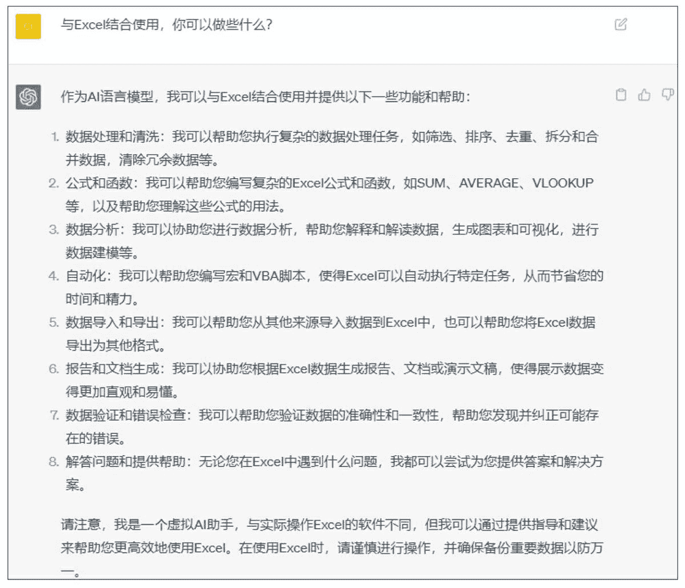

图 1-3

### 002 管理 ChatGPT 的聊天窗口


扫码观看教学视频

在 ChatGPT 中，建立的聊天窗口会自动保存在左侧的聊天窗口列表中，用户可以对聊天窗口进行新建、重命名以及删除等管理操作，具体操作方法如下。

**步骤 01** 打开 ChatGPT 并进入一个使用过的聊天窗口，在左上角单击`New chat`（新的聊天窗口）按钮，如图 1-4 所示。执行操作后，即可新建一个聊天窗口。


图 1-4

**步骤 02** 选择聊天窗口，单击 按钮，如图 1-5 所示。


图 1-5

**步骤 03** 执行操作后，即可呈现编辑文本框，在文本框中可以修改名称，如图 1-6 所示。

**步骤 04** 单击 按钮，即可完成聊天窗口的重命名操作。接下来，单击 按钮，如图 1-7 所示。

**步骤 05** 执行操作后，弹出`Delete chat?`（删除聊天吗？）对话框，询问用户是否删除创建的聊天窗口，如果确认删除聊天窗口，则单击`Delete`（删除）按钮；如果不想删除聊天窗口，则单击`Cancel`（取消）按钮，如图 1-8 所示。


▲图 1-6


▲图 1-7


图 1-8

**专家指点**

当用户对 ChatGPT 生成的回复不满意时，可以单击`Regenerate response`（重新生成）按钮，重新生成回复内容。

当用户对 ChatGPT 当前回复的内容存疑时，可以单击`Stop generating`（停止生成）按钮，停止生成回复内容。

### 003 掌握 ChatGPT 的换行操作


扫码观看教学视频

在 ChatGPT 的输入框中输入内容时，可以对其分段、分行，具体操作方法如下。

**步骤 01** 打开 ChatGPT 的聊天窗口，在输入框中输入第 1 行信息内容“以 Excel 表格的形式，对以下内容进行分类：”，如图 1-9 所示。


图 1-9

**步骤 02** 执行操作后，按`Shift+Enter`快捷键即可换行，然后输入其他内容“苹果、绿萝、香蕉、黄瓜、生菜、玫瑰、辣椒”，如图 1-10 所示。


图 1-10

**步骤 03** 按`Enter`键发送，ChatGPT 即可根据内容进行回复，如图 1-11 所示。

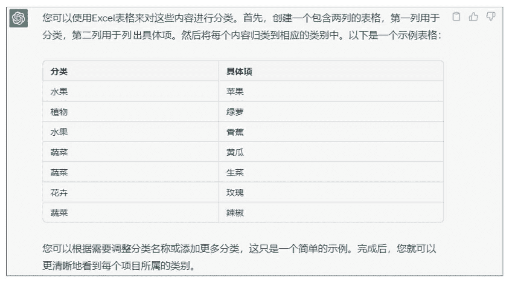

图 1-11

### 004 掌握 ChatGPT 的改写操作


扫码观看教学视频

当向 ChatGPT 发送的指令或关键词有误或者不够精准时，可以对已发送的信息进行改写，具体操作如下。

**步骤 01** 以例 003 为例，在聊天窗口中，单击已发送信息右侧的 按钮，如图 1-12 所示。


图 1-12

**步骤 02** 执行操作后，即可对内容进行改写，把“以 Excel 表格的形式，对以下内容进行分类：”改为“将以下内容以表格的形式进行分类：”；单击`Save&Submit`（保存并提交）按钮，如图 1-13 所示。


图 1-13

**步骤 03** 执行操作后，ChatGPT 即可根据内容重新回复，同时发送的内容下方会生成页码，如图 1-14 所示。保存改写前后的内容，用户通过翻页可以进行查看。

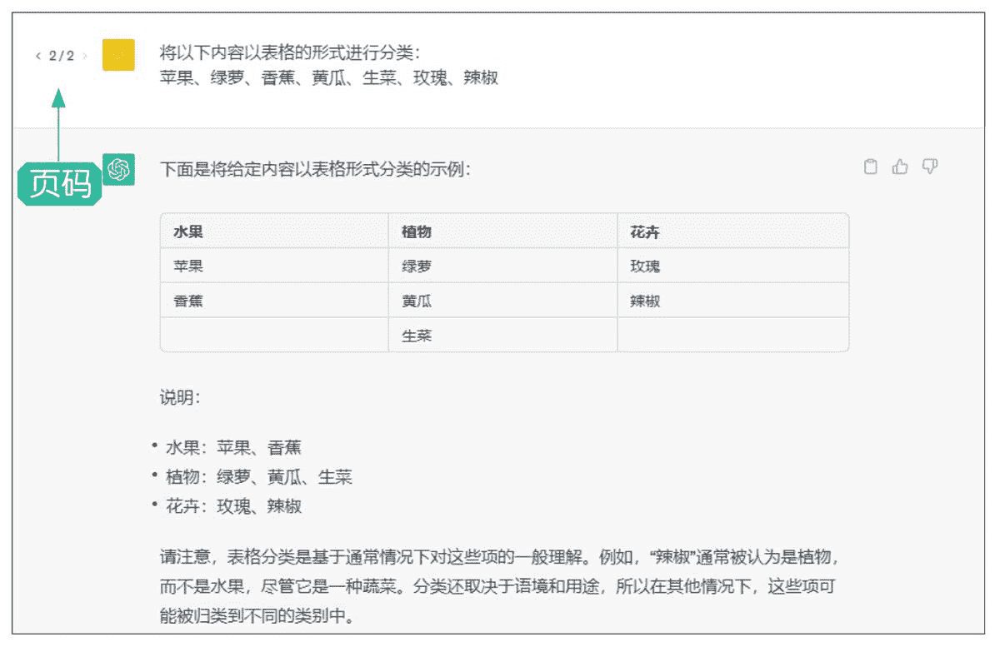

图 1-14

## 1.2 正确向 ChatGPT 提问

学完 1.1 节的内容，相信大家已经掌握了使用 ChatGPT 的基本操作方法。ChatGPT 是一个语言模型，只要用户发送自己的所需所想，ChatGPT 就会根据发送的问题进行回复。如果用户想要 ChatGPT 的回复内容更加精准、更加符合自己的需求，便需要多加注意正确的提问方式，以便可以更好地使用 ChatGPT。

### 005 准确描述数据处理需求


扫码观看教学视频

在向 ChatGPT 提问时，要准确、清晰地描述在 Excel 中需要完成的具体任务或需求。具体、明确的提问有助于 ChatGPT 理解用户的意图，并给出准确的答案。

例如，当用户需要在 Excel 工作表中创建一个可以显示销售数据和趋势的折线图时，如果直接向 ChatGPT 提问“在 Excel 中如何创建折线图？”，ChatGPT 会给出一个比较笼统的回复，且回复的操作步骤并不完全正确，如图 1-15 所示。

如果使用清晰的语言，指明需要什么类型的操作或分析，准确地向 ChatGPT 描述“如何在 Excel 中创建一个折线图以显示销售数据和销售趋势？”，ChatGPT 则会给出更加精准的答复，操作描述也更加详细，如图 1-16 所示。

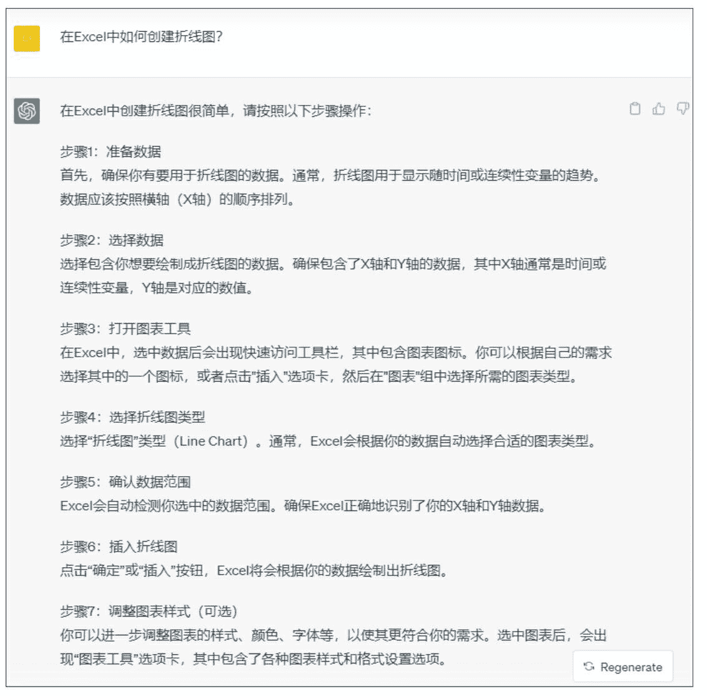

▲图 1-15

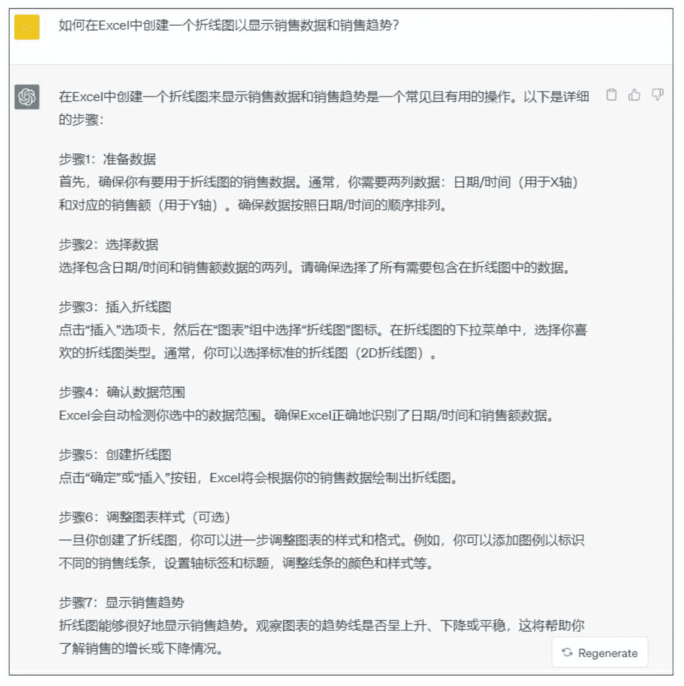

▲图 1-16


图 1-16（续）

### 006 提供足够的数据源信息


扫码观看教学视频

在向 ChatGPT 提问时，如果用户的需求涉及处理特定的数据源或数据表，务必提供相关的数据源信息，以便 ChatGPT 更好地理解用户的问题。下面通过实例操作，向大家举例说明。

**步骤 01** 打开一个 Excel 工作表，如图 1-17 所示。其中，`A2:A11`单元格区域为销售日期，`B2:B11`单元格区域为销售产品，`C2:C11`单元格区域为销售额，需要在 F 列根据销售产品统计销售总额。

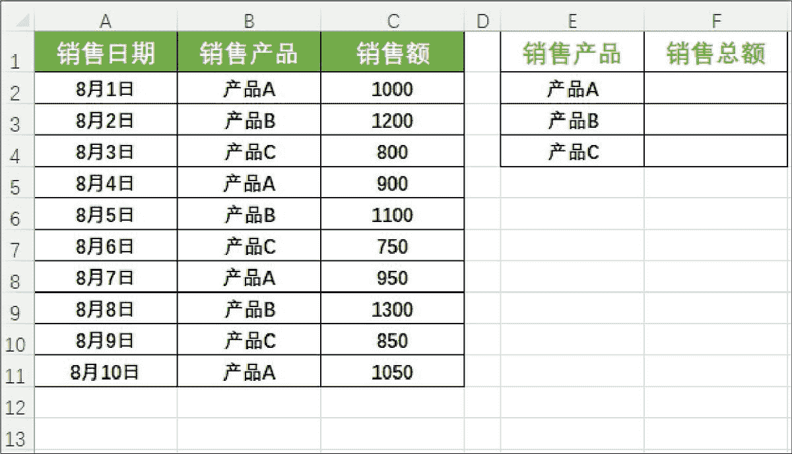

图 1-17

**步骤 02** 如果直接向 ChatGPT 提问“在 Excel 中如何根据销售产品计算销售总额？”，ChatGPT 会回复一个可以套用的计算公式并进行公式解说，如图 1-18 所示。

**步骤 03** 如果向 ChatGPT 提问时提供足够的数据源信息“我有一个包含销售数据的 Excel 工作表，其中`A2:A11`单元格区域为销售日期，`B2:B11`单元格区域为销售产品，`C2:C11`单元格区域为销售额。现在我想在`F2`、`F3`、`F4`单元格中根据`E2`、`E3`、`E4`单元格中的销售产品计算这些销售数据的总和，有什么公式可以帮助我实现？”，ChatGPT 则会直接给出公式，如图 1-19 所示。

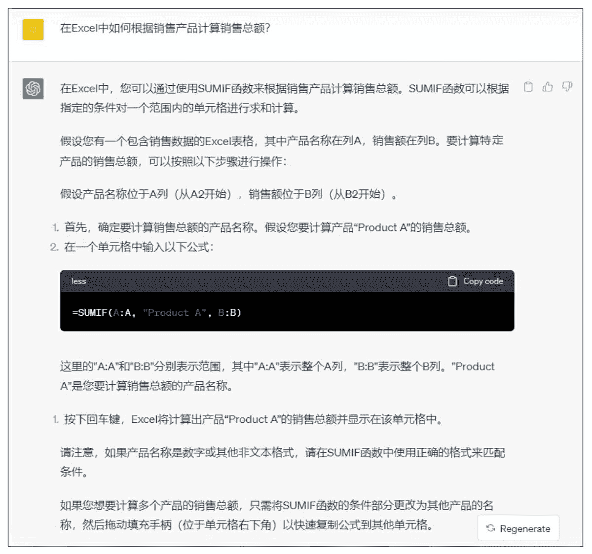

▲图 1-18


▲图 1-19

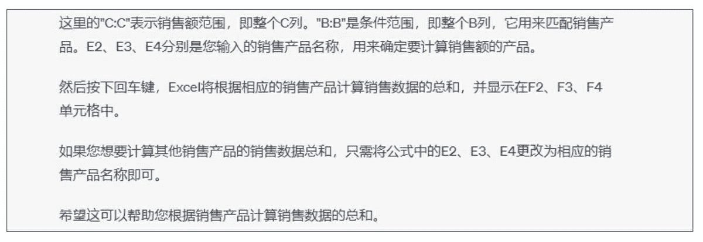

图 1-19（续）

**步骤 04** 在第 1 个公式右上方单击`Copy code`（复制代码）按钮，如图 1-20 所示。

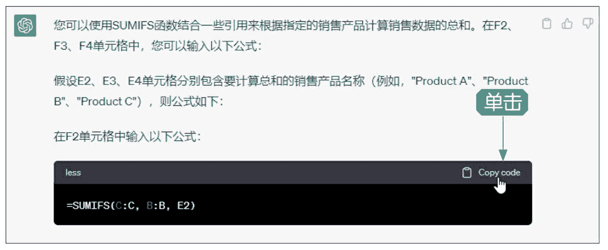

图 1-20

**步骤 05** 返回 Excel 工作表，在`F2`单元格中按`Ctrl+V`快捷键粘贴，即可直接计算出产品 A 的销售总额，如图 1-21 所示。

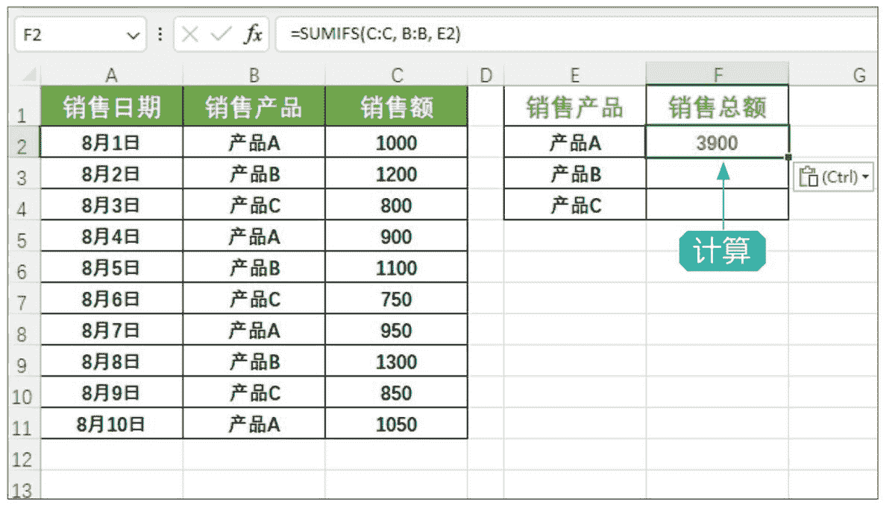

图 1-21

**步骤 06** 用同样的方法，复制公式并粘贴在`F3`、`F4`单元格中，计算产品 B 和产品 C 的销售总额，如图 1-22 所示。

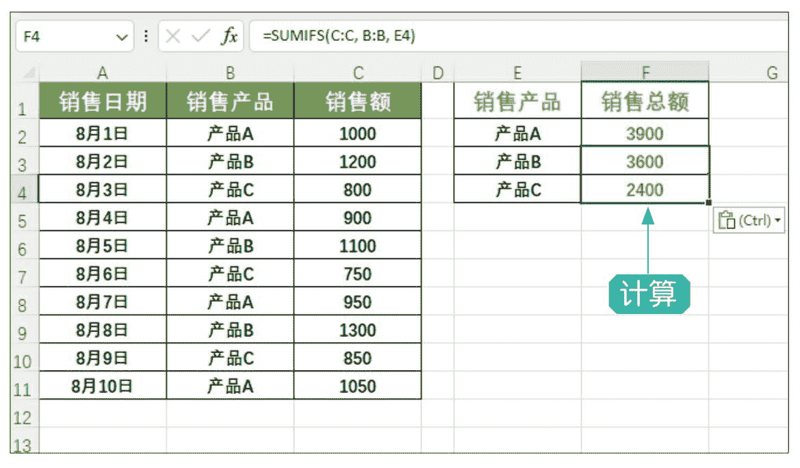

图 1-22

### 007 通过模拟案例获取操作指引


扫码观看教学视频

当用户不方便提供数据源时，为了让 ChatGPT 更好地理解问题，可以提供一个具体的模拟案例，并描述所需要的结果，以此获取 ChatGPT 的答复。下面介绍具体的操作方法。

**步骤 01** 打开一个 ChatGPT 的聊天窗口，在输入框中输入指令“假设我有一个包含学生考试成绩的 Excel 表格，现在我想计算每个学生的平均成绩。例如，表格中的数据如下（尽量将行列对齐）：

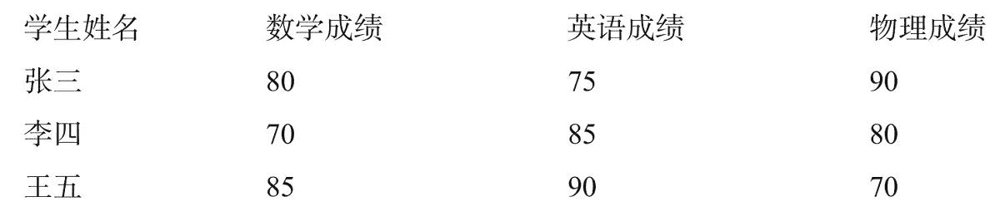

请问，有什么公式可以帮我计算每个学生的平均成绩？”，如图 1-23 所示。

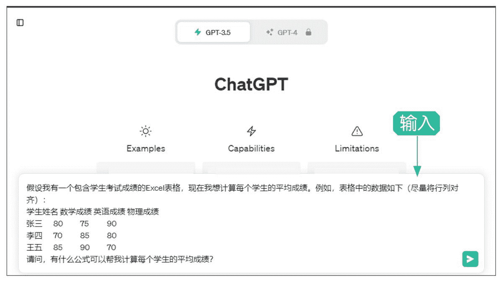

图 1-23

**步骤 02** 稍等片刻，ChatGPT 即可根据模拟案例给出操作指引，如图 1-24 所示。用户可以参考 ChatGPT 的回复，处理自己的表格数据。

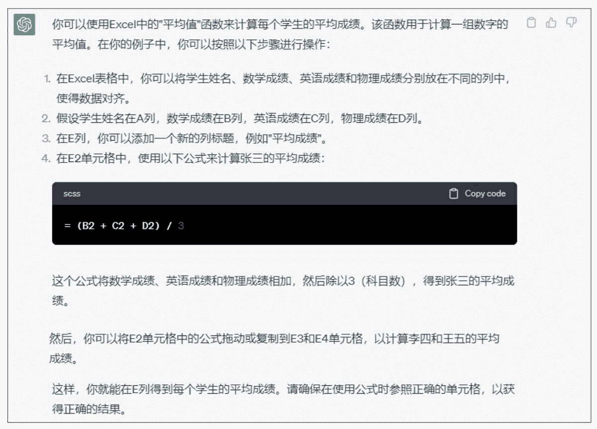

图 1-24

### 008 引用具体函数或功能


扫码观看教学视频

在向 ChatGPT 提问时，可以在问题中引用具体的 Excel 函数或功能名称，有助于 ChatGPT 的回复更加准确、更符合用户的预期。下面介绍具体的操作方法。

**步骤 01** 打开一个 ChatGPT 的聊天窗口，在输入框中输入指令时引用函数“如何使用`VLOOKUP`函数查找数据？”，如图 1-25 所示。


图 1-25

**步骤 02** 稍等片刻，ChatGPT 即可准确回复与引用函数相关的内容，如图 1-26 所示。

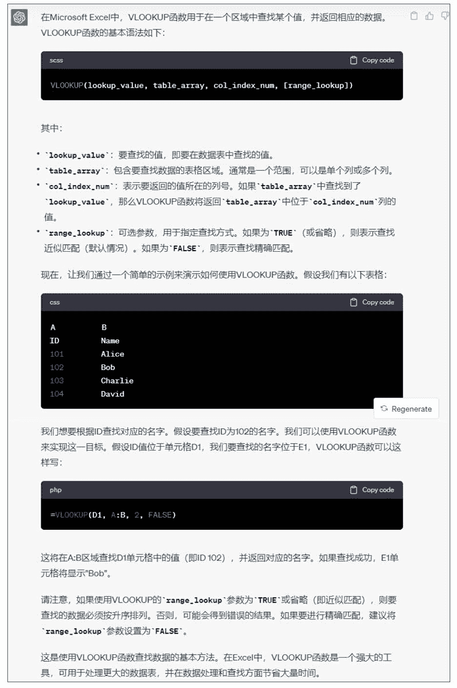

图 1-26

**步骤 03** 接下来在提问时引用功能“如何制作一个带数据透视图的动态图表？”，ChatGPT 即可回复相应的操作步骤，如图 1-27 所示。

### 009 尊重 ChatGPT 的局限性


扫码观看教学视频

ChatGPT 是一个基于语言模型的处理工具，它有着一定的局限性。如果 ChatGPT 无法回答用户的问题，回复问题的过程中出现了停顿，没有回复完整，或者给出了错误的答案，可能是因为模型的知识范围有限，此时不要过于着急。

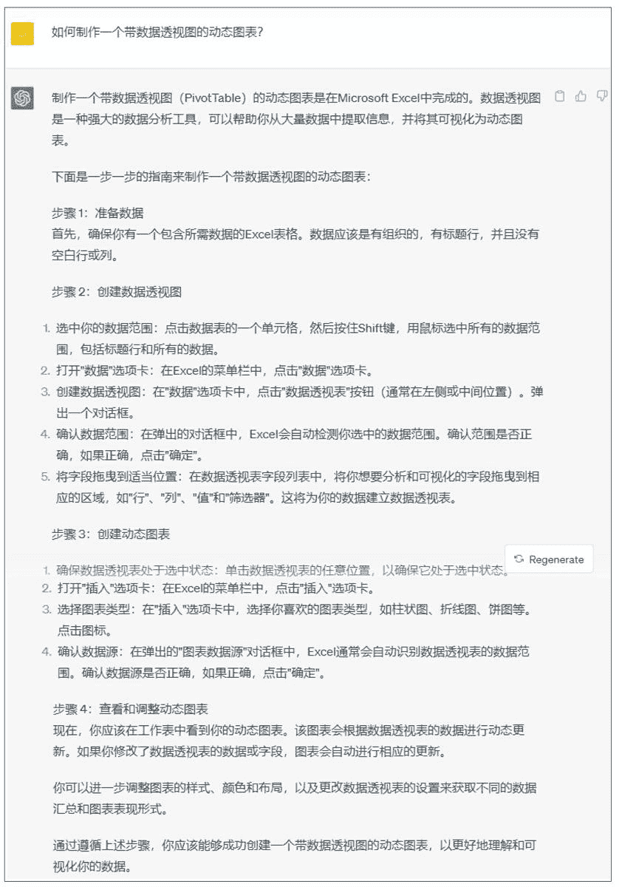

图 1-27


例如，向 ChatGPT 提问“在 Excel 中，如何使用历史数据进行时间序列预测？”，ChatGPT 可能无法回复完整的信息，如图 1-28 所示。

针对以上可能会出现的限制现象，用户首先要做到在提问时尽量提问 ChatGPT 可能具备回答能力的问题，其次可以通过修改指令、新建聊天窗口以及单击`Regenerate`按钮重新生成回复等操作，多尝试几遍。


图 1-28

### 010 训练 ChatGPT 的回复机制


扫码观看教学视频

在向 ChatGPT 获取回复内容时，用户可以逐步引导 ChatGPT 给出更符合预期的回答，还可以通过向 ChatGPT 提供相关信息或在问题中加入明确的提示，训练 ChatGPT 的回复机制。

例如，向 ChatGPT 发送指令“我有一个包含销售数据的 Excel 表格，我想创建一个柱状图来显示每个销售代表的销售额，要求用‘步骤 1、……；步骤 2、……；步骤 3、……’这样的格式告诉我该如何操作”，ChatGPT 即可根据要求格式进行回复，如图 1-29 所示。

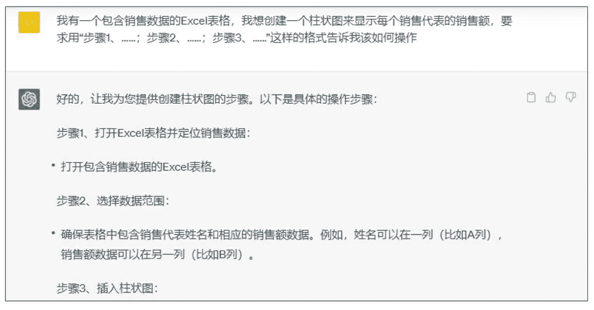

▲图 1-29

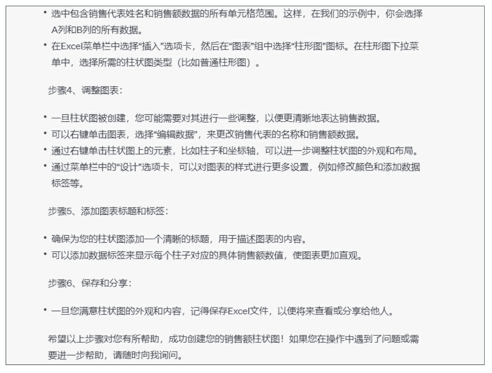

图 1-29（续）

### 011 根据上文追问或补充描述


扫码观看教学视频

如果 ChatGPT 给出的回答不够详细或没有完全解决用户提出的问题，可以在后续提问中引用之前的对话内容，以便 ChatGPT 能够更好地理解用户的需求，并继续为用户提供帮助。下面介绍具体的操作方法。

**步骤 01** 在 ChatGPT 的聊天窗口中，向 ChatGPT 发送指令“假设我的 Excel 表格中学生姓名存储在`A2:A9`单元格区域，各科成绩存储在`B2:D9`单元格区域，有什么公式可以帮助我计算每个学生的平均成绩？”，ChatGPT 的回复如图 1-30 所示。

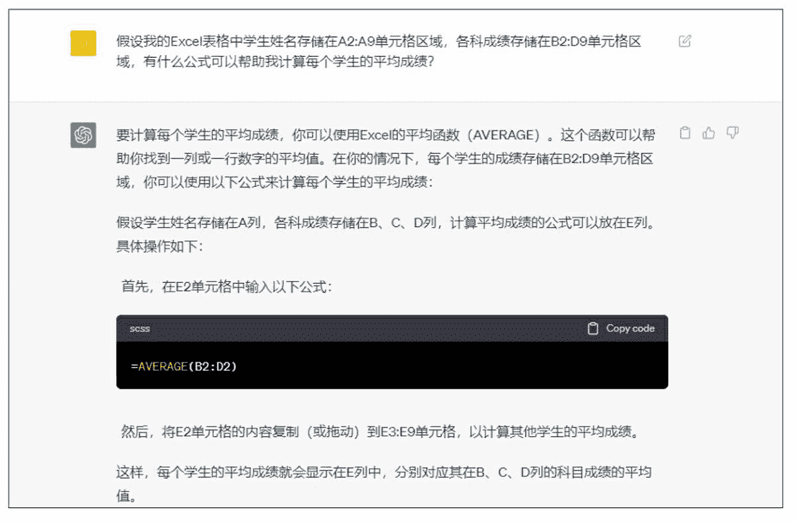

图 1-30

**步骤 02** 继续向 ChatGPT 进行追问“用什么方法可以快速找出每个学生哪科成绩最差？”，ChatGPT 即可根据之前的对话内容进行回复，如图 1-31 所示。


图 1-31

### 012 给 ChatGPT 定义角色身份


扫码观看教学视频

在向 ChatGPT 提问时，可以明确告诉 ChatGPT 用户自己的角色或背景，也可以给 ChatGPT 定义一个角色身份，以便 ChatGPT 可以更好地为用户提供针对性的答案。下面介绍具体的操作方法。

**步骤 01** 在 ChatGPT 的聊天窗口中，向 ChatGPT 明确自己的角色“我是一名人事经理，需要在一个月内招 20 个人就职，同时我还需要负责面试和培训，要求以表格的形式制作一个计划表”，ChatGPT 将会以第二人称进行回复，如图 1-32 所示。

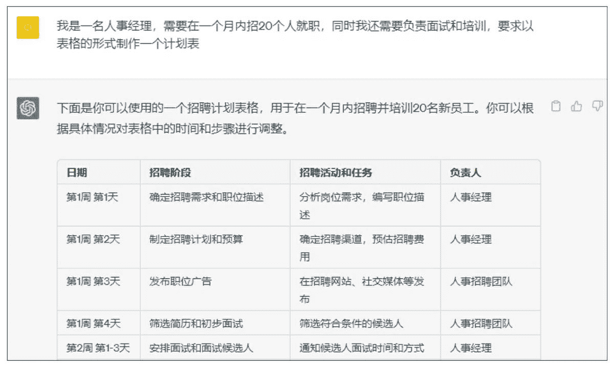

▲图 1-32

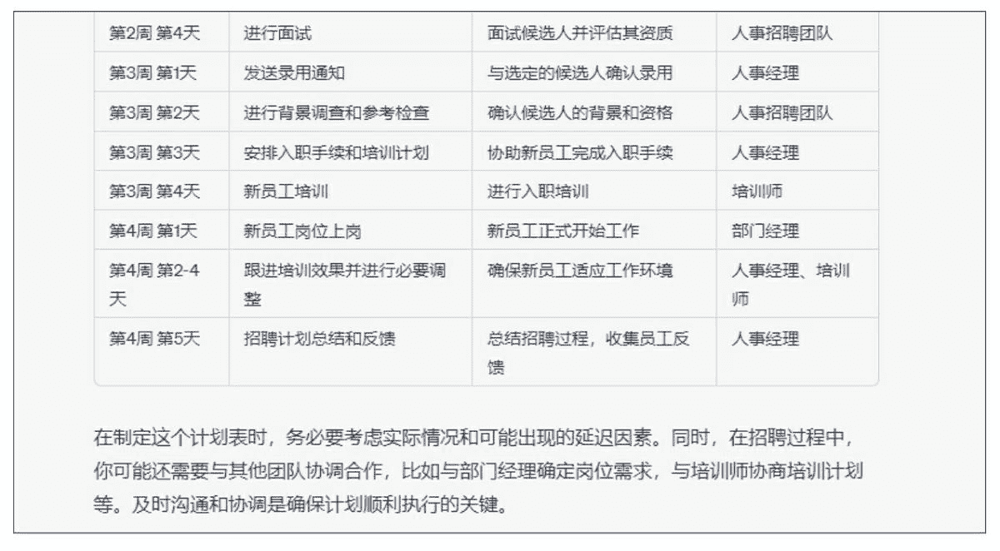

图 1-32（续）

**步骤 02** 接下来，定义 ChatGPT 的角色身份“你是一名销售经理并精通 Excel 表格制作，你会如何在 Excel 中创建销售数据的透视表以便分析销售趋势？”，ChatGPT 将会以第一人称进行回复，如图 1-33 所示。

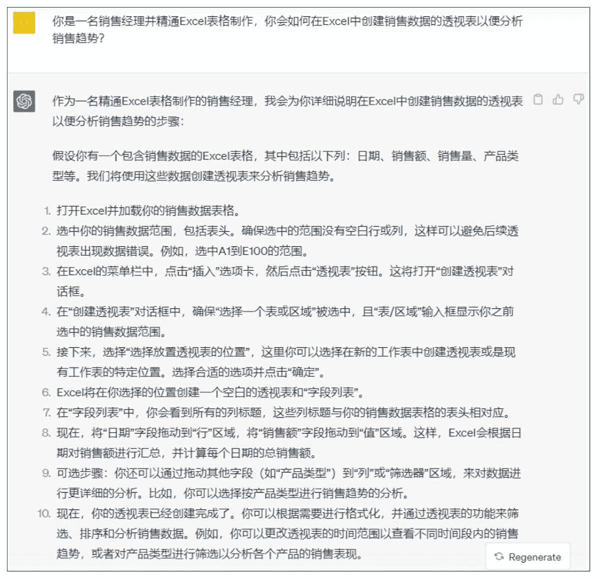

图 1-33

## 1.3 用 ChatGPT 学习 Excel 中的常用操作

学完前文，想必大家已经了解到如何快速地使用 ChatGPT 这个虚拟 AI 助手来帮助自己更高效地使用 Excel。本节将向大家介绍使用 ChatGPT 可以指导 Excel 中的哪些操作，可以为 Excel 数据表格做些什么。

### 013 用 ChatGPT 学习表格格式化操作


扫码观看教学视频

表格格式化是指在 Excel 中调整表格外观和样式的过程。用户可以向 ChatGPT 提问关于如何设置单元格样式、添加边框、着色以及字体格式等操作，让 ChatGPT 给出合适的指导或建议。

例如，在 ChatGPT 的聊天窗口中，向 ChatGPT 提问“如何将 Excel 表格中的数字数据设定为货币格式，并添加粗边框？”，ChatGPT 将会指导用户设置表格格式的相关操作，如图 1-34 所示。

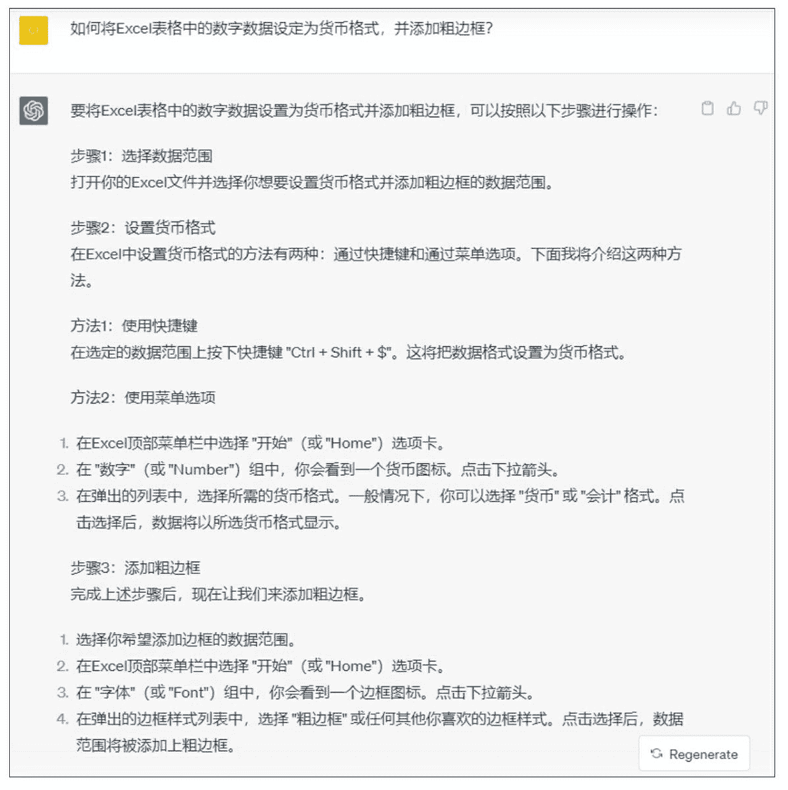

图 1-34

### 014 用 ChatGPT 学习表格布局调整操作


扫码观看教学视频

表格布局调整是指在 Excel 中调整表格的行高、列宽、对齐方式以及合并单元格等操作，以优化表格的显示和排版。用户可以向 ChatGPT 询问如何自动调整列宽、合并单元格以及设置行高等，让 ChatGPT 指导表格布局调整操作。

例如，在 ChatGPT 的聊天窗口中，向 ChatGPT 提问“我有一个包含较长文本的 Excel 表格，如何自动调整列宽，使得所有文本内容都能完整显示？”，ChatGPT 则会给出有关自动调整表格列宽的操作步骤，如图 1-35 所示。

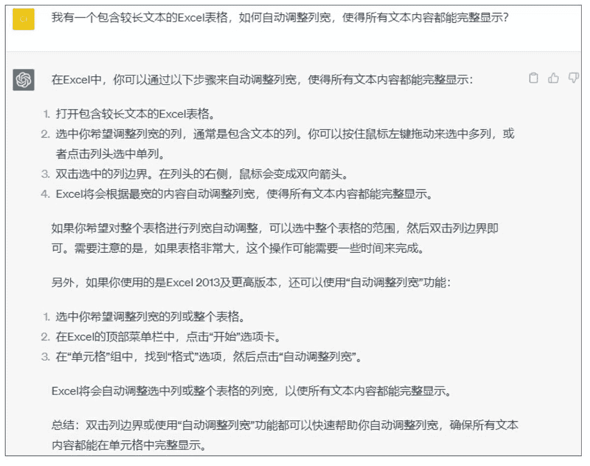

图 1-35

### 015 用 ChatGPT 学习数据筛选操作


扫码观看教学视频

Excel 中，用户可以使用“筛选”功能过滤和显示特定的数据。当不知道如何操作时，用户可以向 ChatGPT 询问如何根据某列的数值或文本内容进行筛选，让 ChatGPT 提供具体的操作步骤。

例如，在 ChatGPT 的聊天窗口中，向 ChatGPT 提问“如何使用 Excel 的‘筛选’功能，只显示销售额大于 1000 的记录？”，ChatGPT 则会提供筛选销售额大于 1000 的操作方法，如图 1-36 所示。

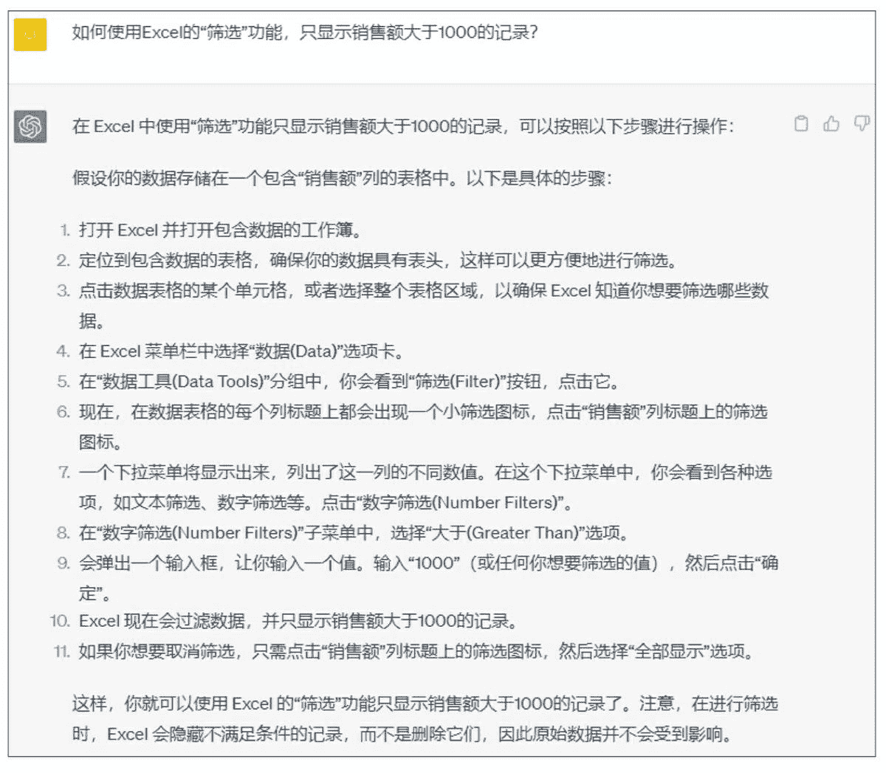

图 1-36

### 016 用 ChatGPT 学习数据可视化操作


扫码观看教学视频

数据可视化是通过图表和图形展示数据，帮助用户更直观地理解数据分布和趋势。用户可以向 ChatGPT 咨询如何创建柱状图、折线图和饼图等图表来可视化数据，让 ChatGPT 指导数据可视化的操作步骤。

例如，在 ChatGPT 的聊天窗口中，向 ChatGPT 提问“我有一个包含不同地区销售额的 Excel 表格，如何用柱形和折线组合图来显示各地区的销售情况？”，ChatGPT 则会指导创建组合图的操作方法，如图 1-37 所示。

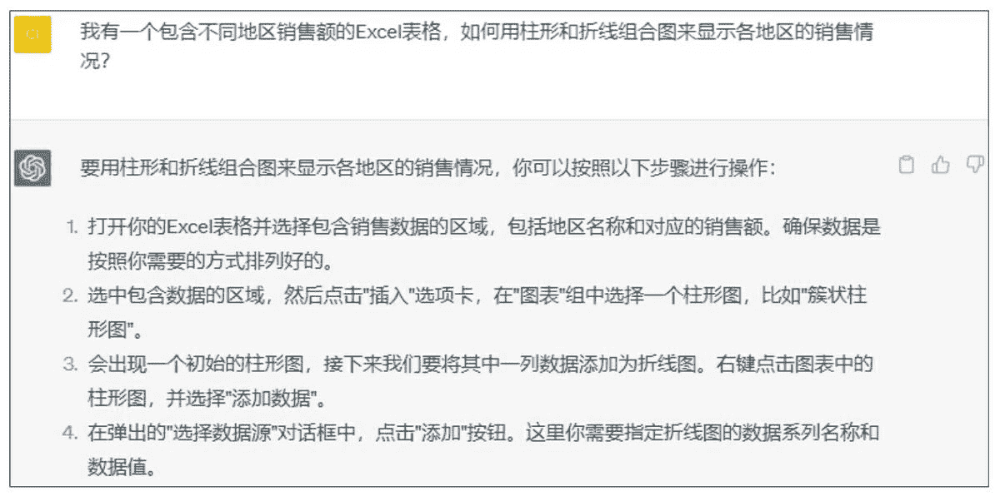

▲图 1-37

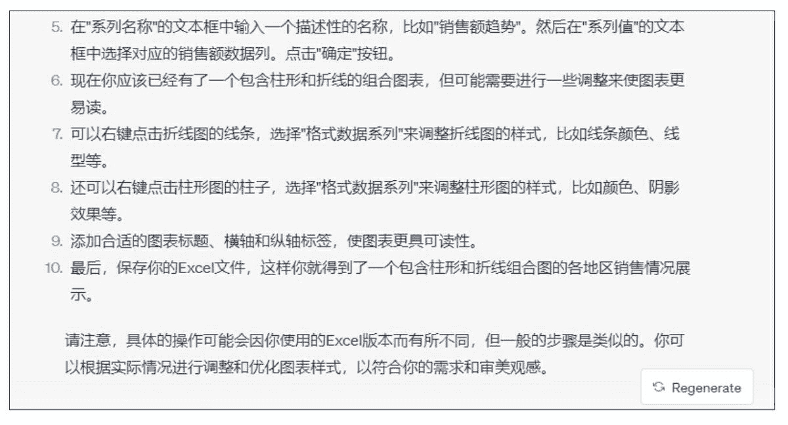

图 1-37（续）

### 017 用 ChatGPT 学习标记数据操作


扫码观看教学视频

在 Excel 中，标记数据可以帮助用户突出显示符合某些条件的单元格，使其在表格中更加显眼。用户可以向 ChatGPT 咨询如何使用条件格式或其他方式来标记数据，让 ChatGPT 提供标记数据的操作步骤。

例如，在 ChatGPT 的聊天窗口中，向 ChatGPT 提问“如何在 Excel 表格中使用条件格式，将销售额高于平均值的单元格标记为红色？”，ChatGPT 则会提供标记数据的操作方法，如图 1-38 所示。

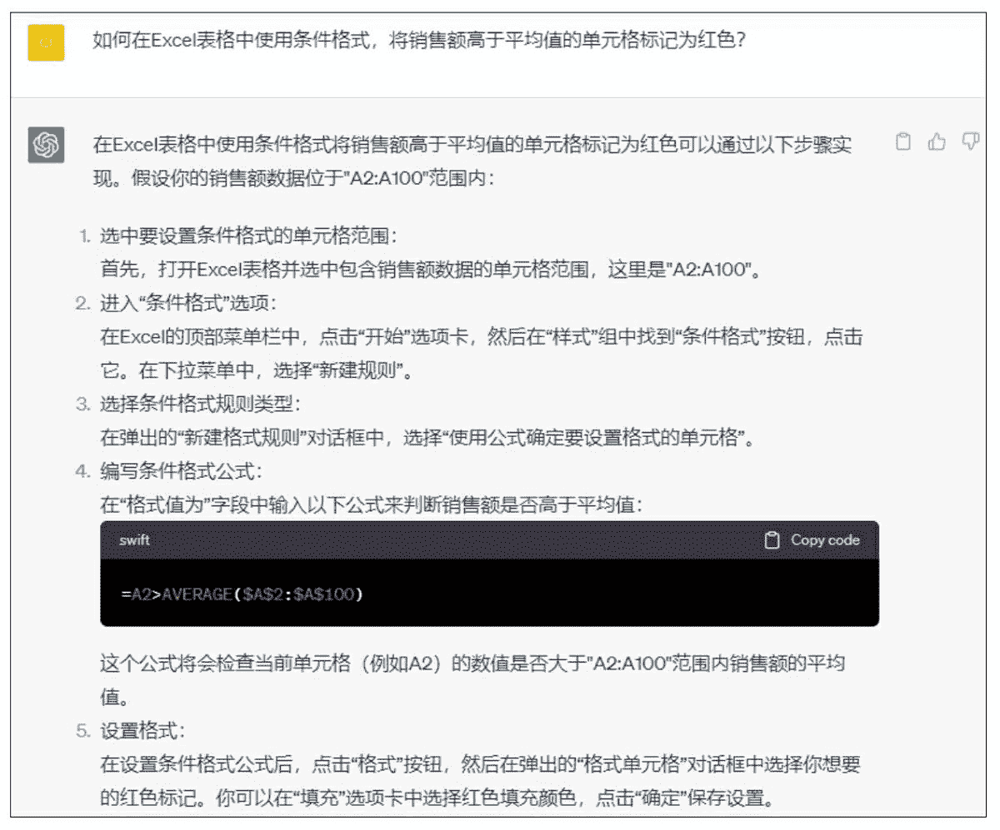

▲图 1-38

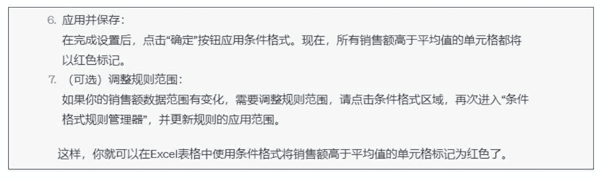

图 1-38（续）

### 018 用 ChatGPT 学习生成数据报告的方法


扫码观看教学视频

让 ChatGPT 根据 Excel 数据生成报告可以大大简化报告撰写的过程，提高工作效率。用户可以向 ChatGPT 提供所需的数据，然后询问如何生成报告、使用哪些图表和图形来可视化数据，以及如何按照特定格式排版报告等。

例如，有一个 Excel 表格，其中包含了某公司的销售数据，包括销售日期、销售额、销售地区等信息，需要让 ChatGPT 根据这些数据生成一个销售报告，包括总体销售趋势和各地区的销售情况。用户可以向 ChatGPT 提问“在 Excel 工作表中包含了销售数据，如何让 ChatGPT 根据这些数据生成一个销售报告，并在报告中用折线图显示每月的销售趋势？”，ChatGPT 即可提供在 Excel 中生成数据报告的操作方法，如图 1-39 所示。

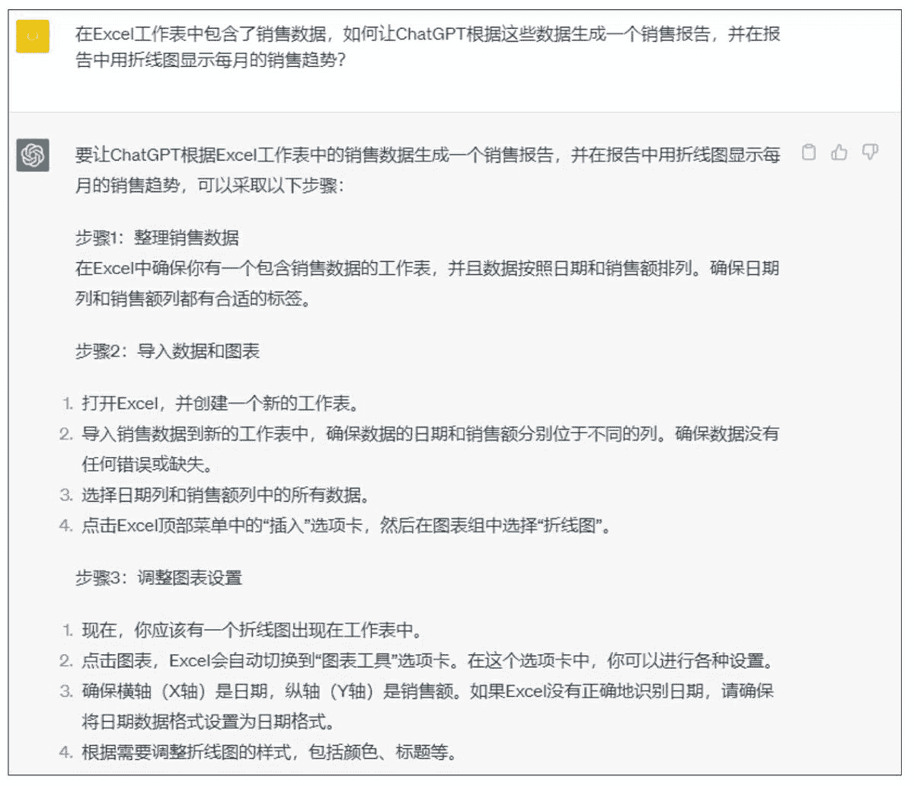

▲图 1-39

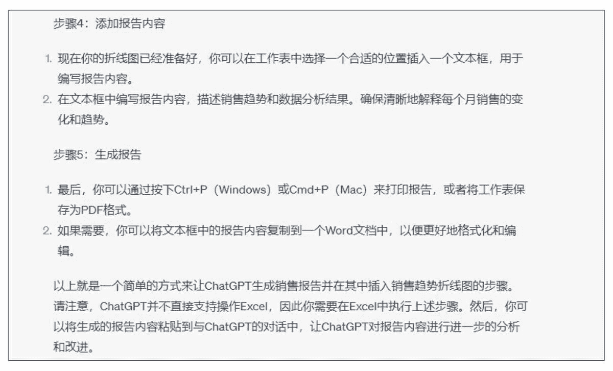

图 1-39（续）

### 019 用 ChatGPT 学习如何分析表格中的数据


扫码观看教学视频

ChatGPT 能够帮助用户使用 Excel 内置的函数来分析数据，用户可以向 ChatGPT 询问如何计算平均值、总和、最大值和最小值等，或者向 ChatGPT 询问如何创建数据透视表来汇总、分析数据。

例如，在 ChatGPT 的聊天窗口中，向 ChatGPT 提问“我有一个包含销售数据的 Excel 表格，数据存储在`B2:B11`单元格区域，如何使用 Excel 函数来计算这些销售数据的总和和平均值？”，ChatGPT 即可提供对应的函数公式，如图 1-40 所示。


▲图 1-40


图 1-40（续）

### 020 用 ChatGPT 学习如何将资料整理成表格


扫码观看教学视频

ChatGPT 能够为用户提供制表的操作方法，除此之外，ChatGPT 还可以将用户提供的文本资料整理成表格，还能根据用户补充的要求添加内容或者进行数据分析、计算和汇总等。下面介绍具体的操作方法。

**步骤 01** 打开一个记事本，其中显示了多位员工的销售数据，如图 1-41 所示。

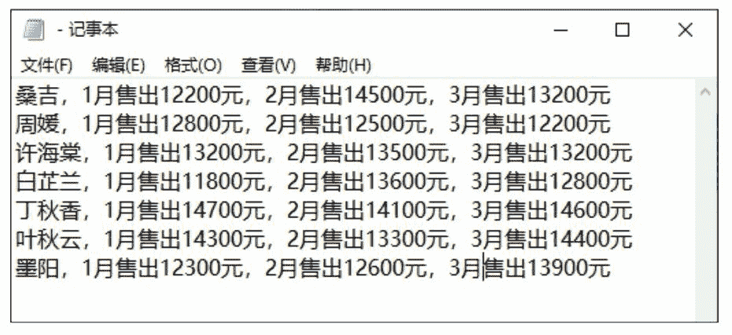

图 1-41

**步骤 02** 现在需要将记事本中的文本资料整理成表格，按`Ctrl+A`快捷键全选，按`Ctrl+C`快捷键复制，如图 1-42 所示。

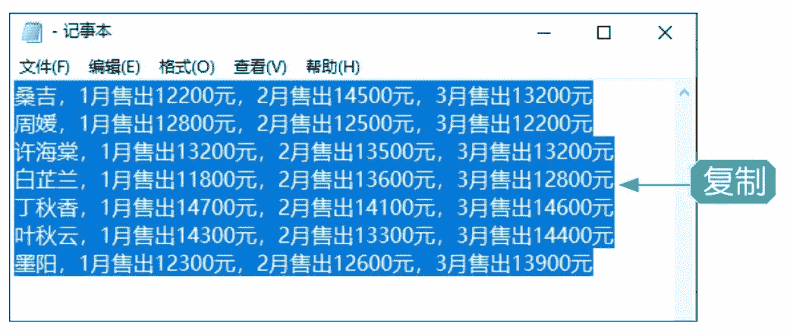

图 1-42

**步骤 03** 打开 ChatGPT 的聊天窗口，单击底部的输入框，输入“将下面的资料整理成表格：”，如图 1-43 所示。

**步骤 04** 按`Shift+Enter`快捷键换行，再按`Ctrl+V`快捷键粘贴复制的制表资料，如图 1-44 所示。


▲图 1-43

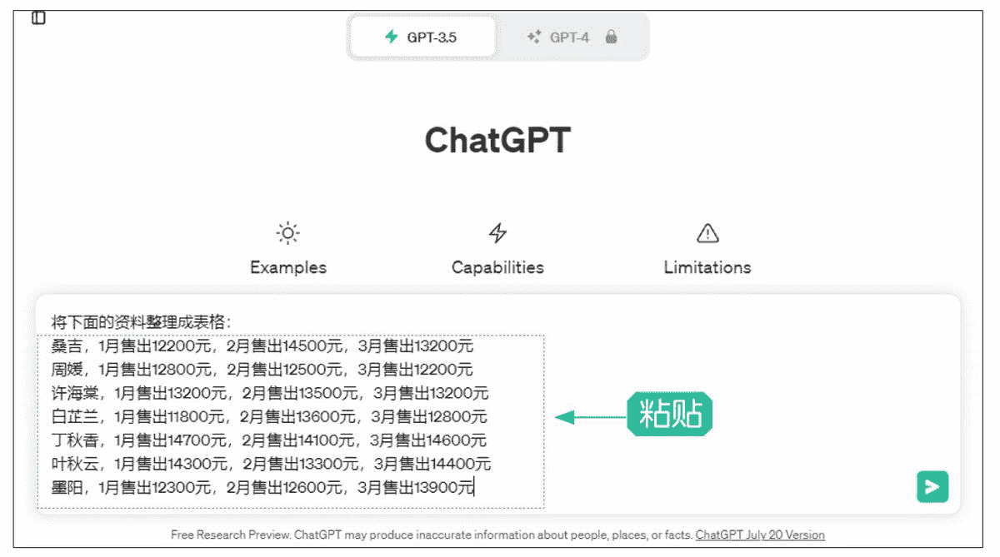

图 1-44

**步骤 05** 按`Enter`键发送，ChatGPT 即可将资料整理成表格，如图 1-45 所示。

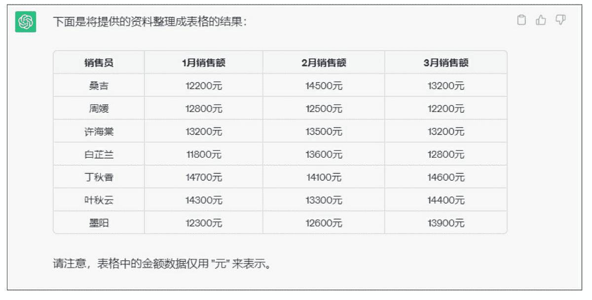

图 1-45

**步骤 06** 如果需要统计销售员 1—3 月的总销售额，单击底部的输入框，继续输入制表要求“在表格中加上每个员工的总销售额”，如图 1-46 所示。


图 1-46

**步骤 07** 按`Enter`键发送，ChatGPT 会根据补充的制表要求重新生成表格，如图 1-47 所示。

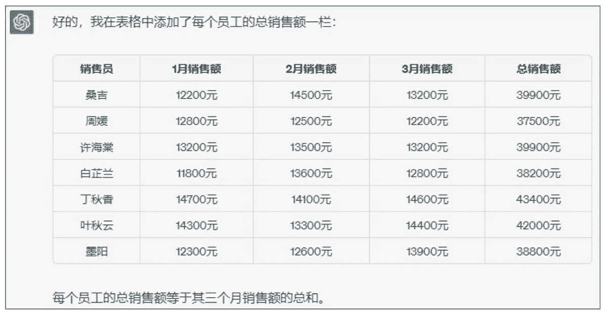

图 1-47

**步骤 08** 选择生成的表格，单击鼠标右键，在弹出的快捷菜单中选择“复制”命令，如图 1-48 所示。

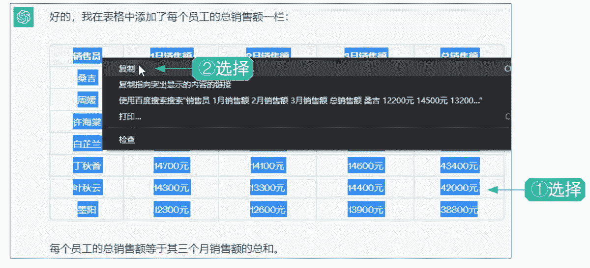

图 1-48

**步骤 09** 打开 Excel 工作表，在工作表中按`Ctrl+V`快捷键，即可粘贴复制的表格内容，如图 1-49 所示。

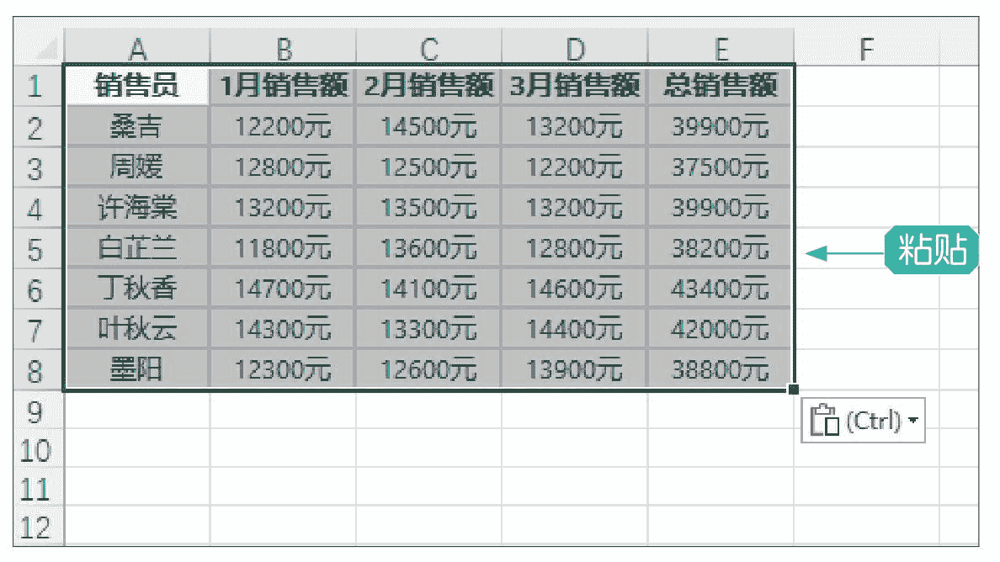

图 1-49

**步骤 10** 根据需要调整工作表的行高、列宽，结果如图 1-50 所示。

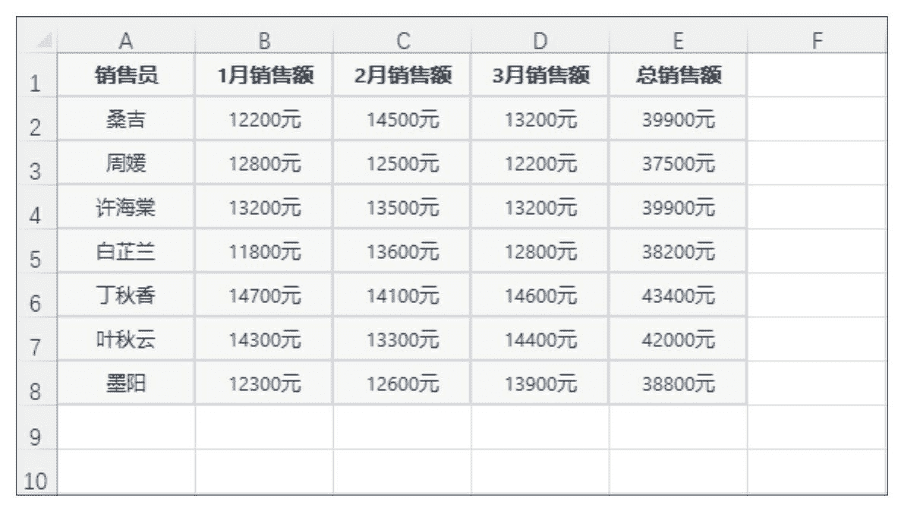

图 1-50

# 第 2 章 智能运算：用 ChatGPT 编写公式

**学习提示**

Excel 中内置了 400 多种函数，能够满足用户进行统计、判断、查找以及筛选等数据处理和分析需求。用户可以用 ChatGPT 编写函数公式，在 Excel 中进行智能运算，这样既便捷又不易出错。

**本章重点导航** 

## 创建公式的基本操作

## 用 ChatGPT 辅助运算

## 2.1 创建公式的基本操作

在 Excel 中统计数据前，首先要了解引用的概念和使用方法、如何建立公式、输入函数与引用的方法以及利用函数清单选择函数等创建公式的基本操作。稳固好基础才能举一反三，掌握统计数据的技巧。

### 021 认识相对引用、绝对引用和混合引用


扫码观看教学视频

在 Excel 中，引用单元格指的是在某个单元格公式中引用其他单元格的地址，并使用其他单元格中的值，而不必手动输入这些值。这为用户提供了更加快捷方便的计算方式。

Excel 中的单元格通常用“字母+数字”的方式进行标识，如`A1`、`B2`等。这些单元格可以包含各种数据类型，如数字、文本、日期等。用户可以在公式中使用这些单元格的地址来计算、操作这些单元格中的数据。例如，要将`A1`和`A2`单元格中的值相加，并将结果显示在`A3`单元格中，可以在`A3`单元格中输入公式：`=A1+A2`。其中“+”符号是 Excel 中的求和运算符，而`A1`和`A2`是引用单元格，它们分别指向`A1`和`A2`单元格中的值。

引用单元格是一项非常灵活和强大的功能，它可以帮助用户快速进行各种复杂的计算和操作，使 Excel 成为一个非常强大和全面的数据处理工具。在 Excel 中，引用分为相对引用、绝对引用以及混合引用，具体介绍如下。

**1．相对引用**

相对引用在 Excel 中主要用于引用单元格相对位置的数据进行函数运算。

**步骤 01** 打开一个工作表，在`B2`单元格中直接输入：`=B1`，如图 2-1 所示。

**步骤 02** 按`Enter`键确认，即可引用`B1`单元格中的数据，返回`B2`单元格的值为 1，如图 2-2 所示。

**步骤 03** 按住`B2`单元格右下角向右拖曳，引用单元格会随着位置的移动发生变化，单元格中的公式也会随之由`=B1`自动调整为`=C1`，如图 2-3 所示。

**步骤 04** 同理，向下拖曳后，单元格中的公式会由`=B1`自动调整为`=B2`，如图 2-4 所示。由此可以得出结论，当向右拖曳单元格时，相对引用公式中的列号会发生改变；当向下拖曳时，行号会发生改变。

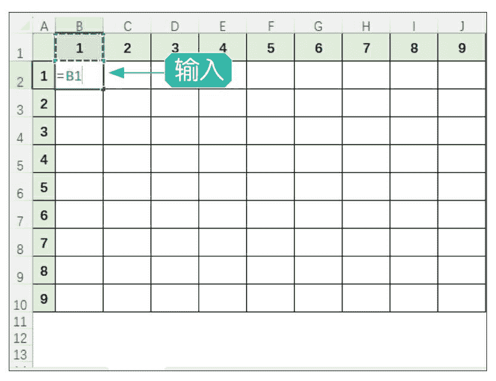

▲图 2-1


▲图 2-2


▲图 2-3


图 2-4

**2．绝对引用**

在 Excel 工作表中，绝对引用总是在指定位置引用单元格中的值，用户可以在引用单元格通过按`F4`键时添加符号$，以此来切换引用模式。

**步骤 01** 接上面继续操作，在`B2`单元格中输入：`=B1`，如图 2-5 所示。

**步骤 02** 执行操作后，按`F4`键，公式中会添加两个$符号，表示绝对引用单元格，如图 2-6 所示。

**步骤 03** 与相对引用不同的是，无论单元格向哪个方向拖曳，所有单元格中的公式都与`B2`单元格中一样，不会发生任何变化，如图 2-7 所示。

**专家指点**

在操作过程中，需要注意`F4`键的引用切换功能，只对所选中的公式段或引用的单元格有作用。


▲图 2-5


▲图 2-6

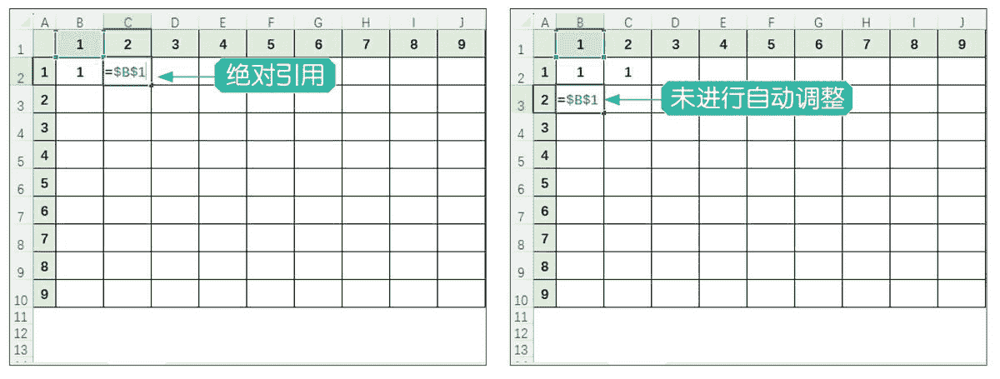

图 2-7

**3．混合引用**

在 Excel 中，混合引用相当于将绝对引用和相对引用混合重组，可以同时相对引用行、绝对引用列或绝对引用行、相对引用列。

**步骤 01** 在`B2`单元格中输入：`=B1`，第 1 次按`F4`键可以绝对引用，第 2 次按`F4`键，公式会变为`=B$1`，表示相对引用列、绝对引用行，如图 2-8 所示。

**步骤 02** 向下拖曳单元格后，公式不变，依然是`=B$1`，即将行固定了，如图 2-9 所示。

**专家指点**

在操作过程中，用户需要注意在第 4 次按下`F4`键后，公式会变回刚开始输入时的状态。

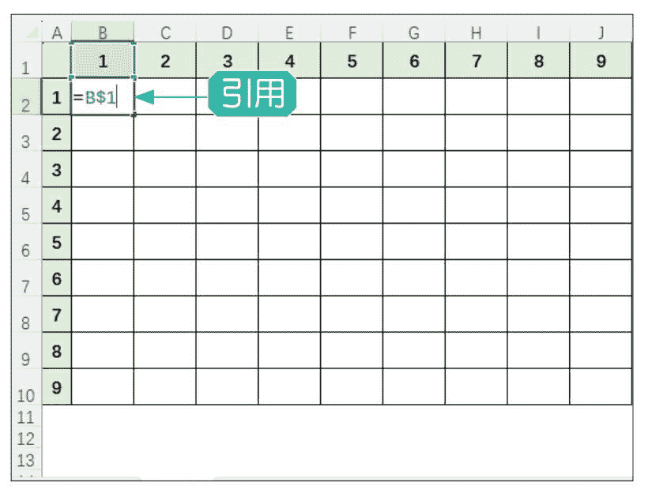

▲图 2-8

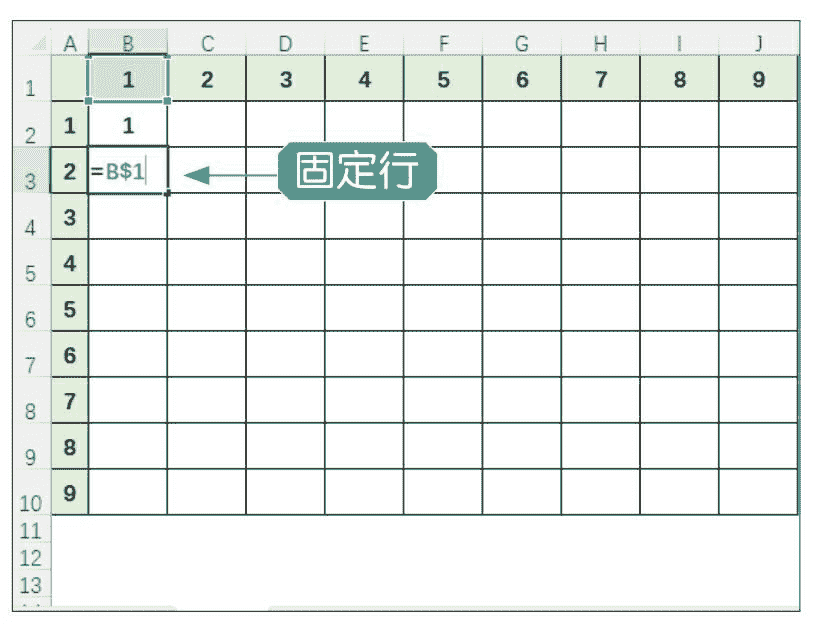

图 2-9

**步骤 03** 向右拖曳单元格后，公式会变为`=C$1`，即列变行不变，如图 2-10 所示。

**步骤 04** 在`B2`单元格中第 3 次按`F4`键，公式会变为`=$B1`，表示绝对引用列、相对引用行，如图 2-11 所示。


▲图 2-10

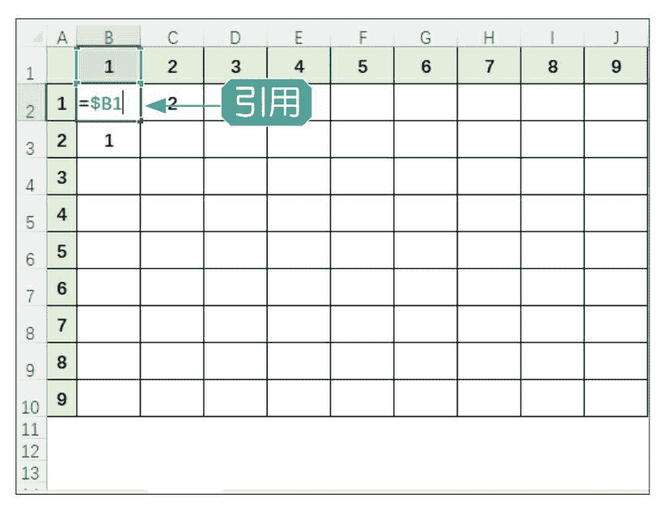

图 2-11

**步骤 05** 向右拖曳单元格后，公式不变，依然是`=$B1`，即将列固定了，如图 2-12 所示。

**步骤 06** 向下拖曳单元格后，公式会变为`=$B2`，即行变列不变，如图 2-13 所示。

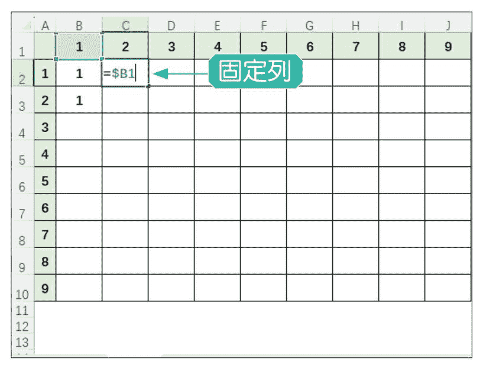

▲图 2-12

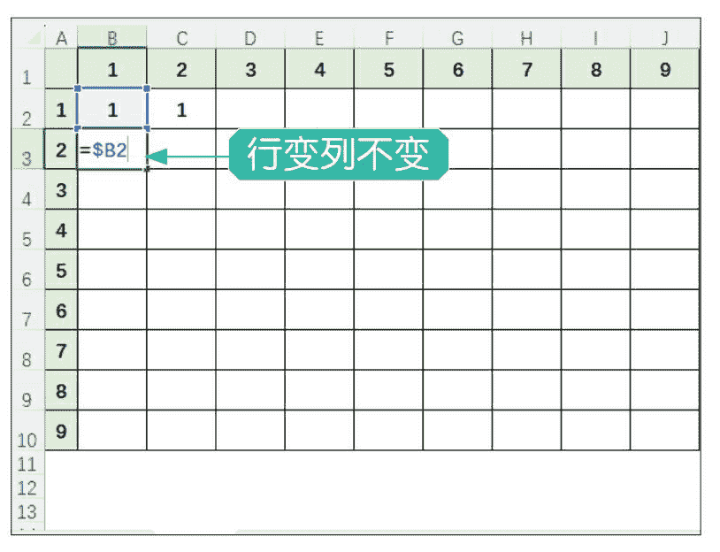

图 2-13

### 022 快速建立运算公式


扫码观看教学视频

在 Excel 中统计数据不需要用户手动计算再输入单元格中，只需要在单元格中建立正确的公式，然后交给 Excel 自动计算即可快速获得结果。在 Excel 中建立公式主要有两种方式：一种是跟数学公式一样，利用加减乘除运算符号，引用单元格进行计算；一种是利用函数，通过参数条件编写符合函数语法的公式，执行特定的计算。

下面将向大家介绍在 Excel 中快速建立公式的操作方法。

**步骤 01** 打开一个工作表，如图 2-14 所示。需要在工作表中统计各种商品的总销售额。


### 步骤 02
在建立公式前，首先需要在工作表中理清楚数据，哪些单元格中的数据是用来计算的，哪些单元格中的数据是需要忽略的。例如，在本例中，总销售额只需要使用单价与销售数量相乘，如果表格中有多余的数据，忽略即可。

### 步骤 03
在工作表中选择`B4`单元格，在其中输入“=”符号，如图 2-15 所示。

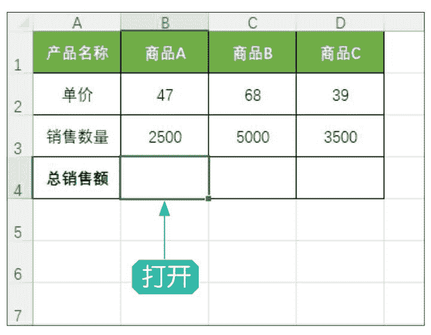

▲图 2-14

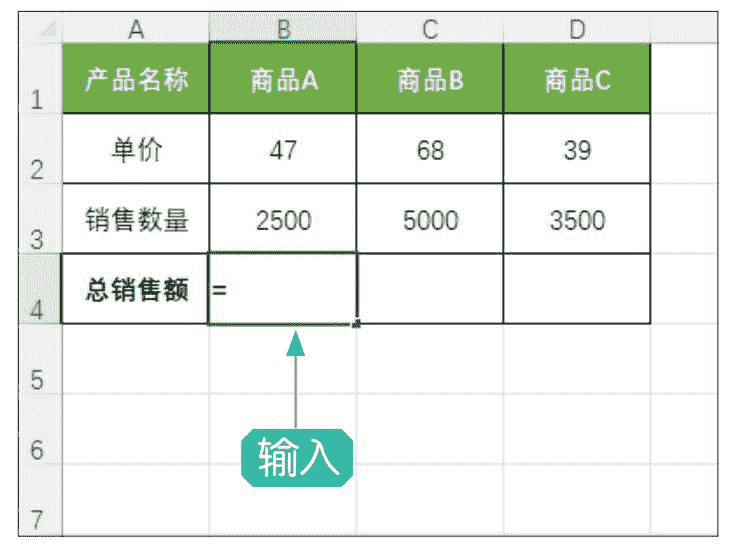

图 2-15

### 步骤 04
接下来选择`B2`单元格，即可引用单价，如图 2-16 所示。

### 步骤 05
继续输入乘符号，在键盘上按`*`（星号）键，如图 2-17 所示。

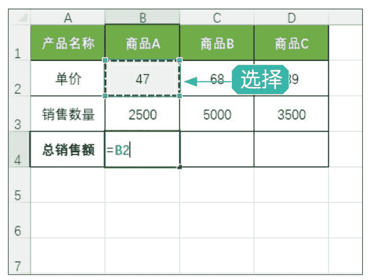

▲图 2-16

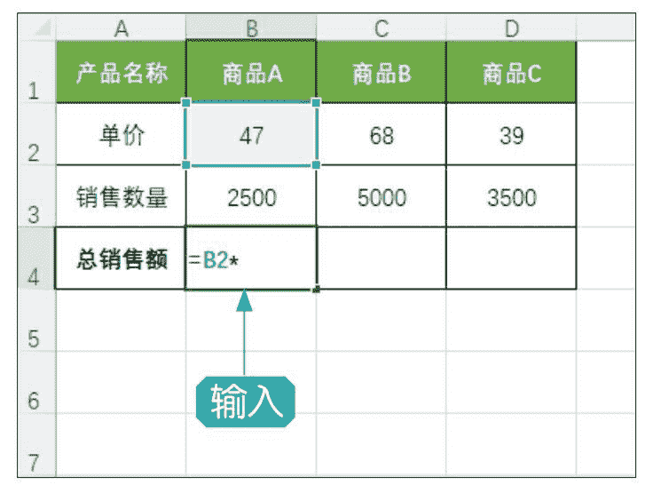

图 2-17

### 步骤 06
执行操作后，选择`B3`单元格，即可引用销售数量，如图 2-18 所示。

### 步骤 07
至此即可建立一个完整的公式：`=B2*B3`，按`Enter`键确认，即可计算商品 A 的总销售额，如图 2-19 所示。


▲图 2-18


图 2-19

### 步骤 08
拖曳`B4`单元格的右下角到`D4`单元格，填充建立的公式，计算商品 B 和商品 C 的总销售额，如图 2-20 所示。


图 2-20

### 023 快速插入函数公式


扫码观看教学视频

在 Excel 中，用户可以在编辑栏中快速插入函数公式，通过 Excel 强大的运算能力来统计表格数据。下面介绍快速插入函数公式的操作方法。

#### 步骤 01
打开一个工作表，如图 2-21 所示。需要在工作表中统计各种商品的总销量。

#### 步骤 02
在工作表中选择`B6`单元格；在编辑栏中单击“插入函数”按钮，如图 2-22 所示。

#### 步骤 03
弹出“插入函数”对话框，如图 2-23 所示。

#### 步骤 04
用户可以在“搜索函数”下方的文本框中输入需要用的函数或者想要做什么运算，如输入“求和”；单击“转到”按钮，如图 2-24 所示。


▲图 2-21


▲图 2-22


▲图 2-23


图 2-24

#### 步骤 05
执行上述操作后，在“选择函数”列表框中即可显示求和函数，这里选择`SUM`函数，如图 2-25 所示。在列表框的下方会显示所选函数的公式语法和作用。

#### 步骤 06
单击“确定”按钮，弹出“函数参数”对话框，在`Number1`文本框中已经自动引用了单元格区域，表示计算`B2:B5`单元格区域的值，如图 2-26 所示。

**专家指点**

在 Excel 中，`SUM`函数求和还有两种更快的方法。

◎选择需要返回值的单元格，按`Alt+=`快捷键，即可快速求和。

◎在“开始”功能区的“编辑”面板中，单击“自动求和”按钮，即可快速求和。


▲图 2-25


图 2-26

#### 步骤 07
单击“确定”按钮，即可在`B6`单元格中返回计算的值，如图 2-27 所示。

#### 步骤 08
选择`B6`单元格，拖曳单元格右下角至`D6`单元格，填充公式，批量计算商品 B 和商品 C 的总销量，如图 2-28 所示。


▲图 2-27


图 2-28

### 024 利用函数清单选择函数


扫码观看教学视频

在 Excel 工作表中，用户还可以在函数清单列表中快速选择函数，以便于编写公式，同时还可以避免编写公式时输入错误。下面介绍利用函数清单选择函数的具体操作。

#### 步骤 01
打开一个工作表，如图 2-29 所示。需要在工作表中统计各个销售员的销量。

#### 步骤 02
在工作表中选择`E2`单元格，输入：`=SU`；即可弹出含有`SU`的函数清单，如图 2-30 所示。


▲图 2-29


图 2-30

#### 步骤 03
在函数清单中选择需要的函数，这里选择`SUM`函数，如图 2-31 所示。

#### 步骤 04
执行操作后，双击鼠标左键，即可将所选函数添加至编写的公式中，如图 2-32 所示。


▲图 2-31


图 2-32

#### 步骤 05
选择`B2:D2`单元格区域；输入英文状态下的反括号，完成求和公式的编写，如图 2-33 所示。

#### 步骤 06
按`Enter`键确认，即可返回第 1 个销售员的销量，如图 2-34 所示。


▲图 2-33


图 2-34

#### 步骤 07
拖曳`E2`单元格的右下角，填充公式至`E5`单元格，批量计算其他销售员的销量，如图 2-35 所示。


图 2-35

### 025 自动校正公式中的错误


扫码观看教学视频

在 Excel 中，公式中的符号都是英文状态下输入的，如果是中文状态下输入的，系统会进行自动校正操作。除此之外，用户在输入公式时难免会有多输、少输的情况，Excel 会根据输入的公式快速找出错误并进行校正。下面通过实例操作来了解 Excel 自动校正公式的效果。

#### 步骤 01
打开一个工作表，在第 6 行的合并单元格中输入：`==SUM（B2:D5）`，如图 2-36 所示。这个公式中多输入了一个等号和一个中文状态下输入的括号。

#### 步骤 02
按`Enter`键确认，Excel 即可发现错误并弹出信息提示框，提出修改建议，如图 2-37 所示。


▲图 2-36


图 2-37

#### 步骤 03
单击“是”按钮，即可更正公式，并在合并单元格中返回计算的值，如图 2-38 所示。


图 2-38

## 2.2 用 ChatGPT 辅助运算

使用 ChatGPT 可以帮助用户检查公式是否正确，还可以向其询问求和快捷键，要求它讲解函数的原理和使用方法、完成未编写完的函数公式等。本节将向大家介绍用 ChatGPT 提供求和快捷键、讲解函数、编写公式以及检查公式等辅助运算的操作方法。

## 026 用 ChatGPT 提供求和快捷键


扫码观看教学视频

当用户在进行求和统计时，如果忘记了求和快捷键是什么，可以在 ChatGPT 中提问，让 ChatGPT 提供求和快捷键，然后在 Excel 中进行应用。下面介绍具体的操作方法。

### 步骤 01
打开 ChatGPT 的聊天窗口，单击底部的输入框，在输入框中输入指令“告诉我在 Excel 中的求和快捷键是什么？”，如图 2-39 所示。


图 2-39

### 步骤 02
按`Enter`键发送，ChatGPT 即可根据提问进行回复，并向用户提供求和快捷键以及其作用和使用方法，如图 2-40 所示。


图 2-40

## 027 用 ChatGPT 讲解函数使用方法


扫码观看教学视频

当用户在制表过程中需要用到或者想要了解某个函数的使用方法时，可以不用花费大量时间在网上搜索相关资料，直接在 ChatGPT 中进行提问即可获得函数的语法和作用等。下面介绍具体的操作方法。

### 步骤 01
打开 ChatGPT 的聊天窗口，单击底部的输入框，在输入框中输入指令“讲解一下 Excel 中`VLOOKUP`函数和`HLOOKUP`函数的原理和使用方法”，如图 2-41 所示。


图 2-41

### 步骤 02
按`Enter`键发送，ChatGPT 即可根据要求讲解`VLOOKUP`函数和`HLOOKUP`函数的使用方法和使用示例，如图 2-42 所示。


图 2-42

## 028 用 ChatGPT 继续编写函数公式


扫码观看教学视频

当用户在 Excel 工作表中编写函数公式时，可以使用 ChatGPT 帮忙编写一个完整的函数公式，也可以用它继续编写未完成的函数公式。下面介绍具体的操作方法。

### 步骤 01
打开一个 Excel 工作表，其中`B`列为店铺评分，需要在`C`列中用爱心符号表示推荐力度，如图 2-43 所示。


图 2-43

### 步骤 02
打开 ChatGPT 的聊天窗口，单击底部的输入框，在输入框中输入指令“在 Excel 工作表中，`B`列为店铺评分，请帮我编写一个函数公式，在`C`列用爱心符号表示数字评分”，如图 2-44 所示。


图 2-44

### 步骤 03
按`Enter`键发送，ChatGPT 即可根据要求编写一个完整的函数公式，并对编写的公式进行对应的讲解，如图 2-45 所示。


图 2-45

### 步骤 04
选择编写的函数公式；单击鼠标右键，在弹出的快捷菜单中选择“复制”命令，如图 2-46 所示。


图 2-46

### 步骤 05
返回 Excel 工作表，在`C2`单元格中粘贴复制的公式：`=REPT("❤", B2)`，如图 2-47 所示。


图 2-47

### 步骤 06
按`Enter`键确认，即可用爱心符号表示推荐力度，如图 2-48 所示。

### 步骤 07
选择`C2:C7`单元格区域，如图 2-49 所示。


▲图 2-48


图 2-49

### 步骤 08
在编辑栏中单击鼠标左键，按`Ctrl+Enter`快捷键，即可填充公式，批量用爱心符号表示推荐力度，如图 2-50 所示。


图 2-50

### 步骤 09
接下来，需要将店铺编码中的中间 4 位数字用`*`符号隐藏起来。打开 ChatGPT 的聊天窗口，单击底部的输入框，在输入框中输入指令“`D`列为店铺编码，需要用`*`符号将中间的 4 位数字隐藏起来，请帮我完善一下下面的公式：`=REPLACE(D2,3`”，如图 2-51 所示。


图 2-51

### 步骤 10
按`Enter`键发送，ChatGPT 即可根据要求完善未完成的函数公式，并对公式进行对应的讲解，如图 2-52 所示。


图 2-52

### 步骤 11
选择完善的函数公式，单击鼠标右键；在弹出的快捷菜单中选择“复制”命令，如图 2-53 所示。


图 2-53

### 步骤 12
返回 Excel 工作表，选择`D2`单元格；在编辑栏中粘贴复制的公式：`=REPLACE(D2,3,4,"****")`，如图 2-54 所示。


图 2-54

### 步骤 13
选择原来的店铺编码，按`Ctrl+X`快捷键剪切，然后在公式中选择`D2`，按`Ctrl+V`快捷键粘贴，将引用单元格作用的`D2`替换为店铺编码，如图 2-55 所示。

### 步骤 14
按`Enter`键确认，即可将店铺编码中间的 4 位数字隐藏，如图 2-56 所示。


▲图 2-55


图 2-56

### 步骤 15
复制`D2`单元格中的公式，选择`D3`单元格，用同样的方法，在编辑栏中粘贴公式；用`D3`单元格中的店铺编码替换第一个参数，如图 2-57 所示。

### 步骤 16
执行操作后，用同样的方法，隐藏其他店铺编码中间的 4 位数字，如图 2-58 所示。


▲图 2-57


图 2-58

## 029 用 ChatGPT 检查公式是否正确


扫码观看教学视频

在 Excel 工作表中，当用户发现编写的函数公式无法进行计算或者计算错误时，可以使用 ChatGPT 帮忙检查公式的正确性并完善公式。下面介绍具体的操作方法。

### 步骤 01
打开一个 Excel 工作表，其中`A`列为预设的数值，需要在`B`列中通过公式提取`A`列数值小数位数 3 位数，如图 2-59 所示。

### 步骤 02
选择`B2`单元格，在其中输入公式：`=ROUND(A2)`，如图 2-60 所示。


▲图 2-59


图 2-60

### 步骤 03
按`Enter`键确认，弹出信息提示框，单击“确定”按钮，如图 2-61 所示。


图 2-61

### 步骤 04
执行操作后，打开 ChatGPT 的聊天窗口，单击底部的输入框，在输入框中输入指令“在 Excel 工作表中，需要在`B2`单元格中对`A2`单元格中的数值保留小数位数 3 位数，请帮我检查公式的正确性并完善此公式：`=ROUND(A2)`”，如图 2-62 所示。


图 2-62

### 步骤 05
按`Enter`键发送，ChatGPT 即可检查公式并完善公式，如图 2-63 所示。


图 2-63

### 步骤 06
单击公式右上角的`Copy code`按钮，即可复制公式，如图 2-64 所示。


图 2-64

### 步骤 07
返回 Excel 工作表，在`B2`单元格中粘贴复制的公式：`=ROUND(A2,3)`，如图 2-65 所示。

### 步骤 08
按`Enter`键确认，即可提取`A2`单元格中的数值小数位数 3 位数，如图 2-66 所示。


▲图 2-65


图 2-66

### 步骤 09
将光标移至`B2`单元格的右下角，按住鼠标左键并向下拖曳至`B6`单元格，即可填充公式，批量提取`A`列数值小数位数 3 位数，结果如图 2-67 所示。


图 2-67

## 2.3 用 ChatGPT 编写公式

在 Excel 中，函数是数据处理的利器，通过函数公式可以进行汇总、分析以及预测，实现高效计算，提升工作和生活效率。本节将向大家介绍通过 ChatGPT 编写函数计算公式的方法，以便用户可以在 Excel 工作表中直接进行运算。

## 030 用 ChatGPT 计算平均值


扫码观看教学视频

在 Excel 中，当用户需要在单元格中计算平均值时，可以通过 ChatGPT 获得计算公式。下面介绍具体的操作方法。

### 步骤 01
打开一个工作表，如图 2-68 所示。需要在`E`列计算各种商品销量的平均值。


图 2-68

### 步骤 02
打开 ChatGPT 的聊天窗口，在输入框中输入指令“在 Excel 工作表中，需要编写一个计算公式，在`E2`单元格中计算`B2:D2`单元格区域的平均值”。按`Enter`键发送，ChatGPT 即可根据提问回复计算平均值的公式，如图 2-69 所示。


图 2-69

### 步骤 03
复制回复的公式，返回 Excel 工作表，选择`E2:E5`单元格区域；在编辑栏中粘贴复制的公式：`=AVERAGE(B2:D2)`，如图 2-70 所示。

### 步骤 04
按`Ctrl+Enter`快捷键，即可批量统计平均值，如图 2-71 所示。


▲图 2-70


图 2-71

## 031 用 ChatGPT 获取业绩排名


扫码观看教学视频

在 Excel 中，当用户需要在不改变排列顺序的情况下快速统计员工的业绩排名时，可以通过 ChatGPT 获得计算排名的公式。下面介绍具体的操作方法。

### 步骤 01
打开一个工作表，如图 2-72 所示。需要在 C 列计算各个员工的业绩排名。

### 步骤 02
打开 ChatGPT 的聊天窗口，在输入框中输入指令“在 Excel 工作表中，需要编写一个计算公式，在 C 列中计算 B 列单元格中的值在`B2:B7`单元格区域的排名”。按`Enter`键发送，ChatGPT 即可根据提问回复计算排名的公式，如图 2-73 所示。


▲图 2-72


图 2-73

### 步骤 03
复制回复的公式，返回 Excel 工作表，选择`C2:C7`单元格区域；在编辑栏中粘贴复制的公式：`=RANK(B2,$B$2:$B$7)`，如图 2-74 所示。


图 2-74

### 步骤 04
执行上述操作后，按`Ctrl+Enter`快捷键，即可统计各员工的业绩排名，如图 2-75 所示。


图 2-75

## 032 用 ChatGPT 进行累计求和

扫码观看教学视频

在 Excel 中，当用户不知道该如何对工作表中的数据进行累计求和时，可以通过 ChatGPT 获得累计求和的计算公式。下面介绍具体的操作方法。

### 步骤 01
打开一个工作表，如图 2-76 所示。需要在 C 列对 B 列中的值进行累计求和。


图 2-76

### 步骤 02
打开 ChatGPT 的聊天窗口，在输入框中输入指令“在 Excel 工作表中，需要编写一个计算公式，在 C 列中对`B2:B7`单元格区域的值进行累计求和”。按`Enter`键发送，ChatGPT 即可根据提问回复累计求和的计算公式，如图 2-77 所示。


图 2-77

### 步骤 03
复制回复的公式，返回 Excel 工作表，选择`C2:C7`单元格区域；在编辑栏中粘贴复制的公式：`=SUM($B$2:B2)`，如图 2-78 所示。


图 2-78

### 步骤 04
按`Ctrl+Enter`快捷键，即可进行累计求和，结果如图 2-79 所示。


图 2-79

## 033 用 ChatGPT 定位查找员工的信息

扫码观看教学视频

在 Excel 中，`INDEX`函数用于从指定范围中返回单元格的值或范围的一部分，而`MATCH`函数则用于在指定范围内查找指定值的位置，并返回该位置的索引或相对位置。将这两个函数组合使用可以进行数据位置定位、查找数据以及检验输入的数值等。下面以定位查找员工信息为例，介绍用 ChatGPT 编写`INDEX`函数和`MATCH`函数公式的操作方法。

### 步骤 01
打开一个工作表，如图 2-80 所示。其中显示了两个表格，需要在左边的表格中找到右边所缺失的信息数据。


图 2-80

### 步骤 02
打开 ChatGPT 的聊天窗口，在输入框中输入指令“在 Excel 工作表中，A:C 列为查找范围，需要根据 F 列单元格中提供的姓名在查找范围中找到所在行，根据 I 列表头在查找范围中找到所在列，最后将查找到的结果返回至 I 列单元格中，该如何用`INDEX`函数和`MATCH`函数编写一个完整的查找公式？”。按`Enter`键发送，ChatGPT 即可根据提问编写`INDEX`函数和`MATCH`函数的组合公式，如图 2-81 所示。


▲图 2-81


图 2-81（续）

### 步骤 03
复制函数公式，返回 Excel 工作表，选择`I2`单元格；将公式粘贴在编辑栏中：`=INDEX(A:C,MATCH(F2,A:A,0),MATCH(I2,1:1,0))`，如图 2-82 所示。


图 2-82

### 步骤 04
修改第 3 个编组公式中的第 1 个引用参数为`I1`，并选择第 3 个编组公式中引用的单元格，按`F4`键切换为绝对引用，以免填充公式时改变行列，结果如图 2-83 所示。


图 2-83

### 步骤 05
按`Enter`键确认，即可返回查找到的基本工资，结果如图 2-84 所示。


图 2-84

### 步骤 06
拖曳`I2`单元格右下角，填充公式至`I7`单元格，即可批量查找各员工的基本工资，结果如图 2-85 所示。


图 2-85

## 034 用 ChatGPT 查找员工对应的部门

扫码观看教学视频

在 Excel 中，`LOOKUP`函数是 Excel 中比较常用的一种查找函数，该函数可以在指定范围内查找指定的值，并返回与之最接近的数值或对应的结果。`LOOKUP`函数在 Excel 查找函数中有“万金油”之称，不论是逆向查找数据还是正向查找数据，`LOOKUP`函数都非常实用、适用。

下面以查找员工对应的部门为例，介绍用 ChatGPT 编写`LOOKUP`函数公式在指定范围内找出指定数据的操作方法。

### 步骤 01
打开一个工作表，如图 2-86 所示。需要在 A 列和 B 列表格范围中，根据员工姓名找出对应的部门。


图 2-86

### 步骤 02
打开 ChatGPT 的聊天窗口，在输入框中输入指令“在 Excel 工作表的 E 列单元格中，如何使用`LOOKUP`函数公式，在`B2:B11`单元格范围内查找 D 列单元格中的值，并返回相应的结果在`A2:A11`单元格范围内？”。按`Enter`键发送，ChatGPT 即可根据提问编写函数公式，如图 2-87 所示。


图 2-87

### 步骤 03
复制函数公式，返回 Excel 工作表，选择`E2:E5`单元格区域；将公式粘贴在编辑栏中：`=LOOKUP(D2,B2:B11,A2:A11)`，如图 2-88 所示。


图 2-88

### 步骤 04
执行操作后，选择第 2 个条件参数和第 3 个条件参数，按`F4`键切换为绝对引用，如图 2-89 所示。


图 2-89

### 步骤 05
执行操作后，按`Ctrl+Enter`快捷键，即可根据员工姓名查找到对应的部门，如图 2-90 所示。


图 2-90

## 035 用 ChatGPT 计算奖金区间的人数

扫码观看教学视频

计算符合区间内的人数可以用`FREQUENCY`函数，它是 Excel 中的一个统计函数，用于计算数据集中各数值的频率分布。该函数可以帮助用户了解数据集中数值出现的次数，并将这些次数值分组到指定的区间范围内。下面通过实例介绍用 ChatGPT 编写`FREQUENCY`函数公式计算奖金区间人数的方法。

### 步骤 01
打开一个工作表，如图 2-91 所示。需要统计各个奖金区间的人数，注意这里在单元格中输入区间条件时输入的是各区间的上限值，如 0～800，输入的上限值则是 800。


图 2-91

### 步骤 02
打开 ChatGPT 的聊天窗口，向其发送指令“在 Excel 工作表中，需要根据`E2:E5`单元格中的区间条件对`C2:C9`单元格中的值进行计数，请用`FREQUENCY`函数编写一个运算公式”。ChatGPT 即可根据提问回复用`FREQUENCY`函数编写的运算公式，如图 2-92 所示。


图 2-92

### 步骤 03
复制函数公式，返回 Excel 工作表，选择`F2:F5`单元格区域，在编辑栏中粘贴复制的公式：`=FREQUENCY(C2:C9,E2:E5)`；按`Ctrl+Shift+Enter`组合键确认即可统计符合区间条件的数量，如图 2-93 所示。


图 2-93

### 专家指点
在 Excel 中，当输入的公式为数组公式时，需要用`Ctrl+Shift+Enter`组合键将公式确认为数组公式。

在 Excel 中数组公式是一种特殊的公式，用于在多个单元格范围内进行计算，并返回多个结果。这些公式通常涉及数组操作，如对范围内的每个单元格进行计算、汇总或筛选。在确认数组公式后，Excel 会自动在公式周围添加大括号`{}`以表示结果是一个数组，无须手动输入大括号。

## 036 用 ChatGPT 自动更新日期和时间

扫码观看教学视频

在 Excel 中，`TODAY`和`NOW`函数都是比较常用的日期和时间函数，`TODAY`函数返回当前日期，`NOW`函数返回当前日期和时间。下面通过实例介绍如何在 ChatGPT 中获取`TODAY`和`NOW`函数公式的使用方法。

### 步骤 01
打开一个工作表，如图 2-94 所示。需要在工作表中输入制表日期和制表时间。

### 步骤 02
打开 ChatGPT 的聊天窗口，在输入框中输入指令“在 Excel 工作表中，如何使用`TODAY`和`NOW`函数编写公式，使其可以自动更新制表日期和制表时间？”。按`Enter`键发送，稍等片刻 ChatGPT 即可根据提问回复`TODAY`和`NOW`函数的公式和使用方法，如图 2-95 所示。


▲图 2-94


图 2-95

### 步骤 03
复制函数公式，返回 Excel 工作表，将两个公式分别粘贴在`B1`和`B2`单元格中，执行操作后，即可自动更新制表日期和时间，结果如图 2-96 所示。将工作表关闭后，下次再打开工作表时，`B1`和`B2`单元格中的日期和时间会自动更新。


图 2-96

## 037 用 ChatGPT 计算日期之间的时间

扫码观看教学视频

`DATEDIF`函数是 Excel 中的一个日期函数，用于计算两个日期之间的差距。该函数可以用于计算年龄、工龄以及项目持续时间等。下面通过实例介绍用 ChatGPT 编写`DATEDIF`函数公式计算两个日期之间相隔的时间的操作方法。

### 步骤 01
打开一个工作表，如图 2-97 所示。C 列为入职日期，D 列为离职日期，需要在工作表中计算离职员工的工龄。


图 2-97

### 步骤 02
打开 ChatGPT 的聊天窗口，向 ChatGPT 发送指令“在 Excel 工作表中，C 列为入职日期，D 列为离职日期，如何使用`DATEDIF`函数公式，计算员工工龄？”。ChatGPT 即可根据提问编写`DATEDIF`函数公式，如图 2-98 所示。


图 2-98

### 步骤 03
复制函数公式，返回 Excel 工作表，将公式粘贴在`E2`单元格中：`=DATEDIF(C2,D2,"Y")`；填充公式至`E6`单元格，批量计算员工工龄，结果如图 2-99 所示。


图 2-99

## 038 用 ChatGPT 按条件计算满勤奖金

扫码观看教学视频

在 Excel 中，`IF`函数被归类为逻辑函数，用于根据一个给定的条件返回不同的值，在 Excel 中广泛用于条件判断和逻辑运算。下面以按条件计算满勤奖金为例，介绍使用 ChatGPT 编写`IF`函数公式的操作方法。

### 步骤 01
打开一个工作表，如图 2-100 所示。B 列为员工出勤天数，当出勤天数等于或大于标准天数时即为满勤，满勤的员工即可获得 500 元的奖金。


图 2-100

### 步骤 02
打开 ChatGPT 的聊天窗口，在输入框中输入指令“在 Excel 工作表中，B 列为员工的出勤天数，当出勤天数等于或大于 25 天时即为满勤，满勤的员工即可获得 500 元的奖金，如何用`IF`函数公式来进行计算？”。按`Enter`键发送，ChatGPT 即可根据提问编写`IF`函数公式，如图 2-101 所示。


图 2-101

### 步骤 03
复制函数公式，返回 Excel 工作表，将公式粘贴在`C2`单元格中：`=IF(B2>=25,500,0)`；将公式填充至`C7`单元格，批量计算员工满勤奖金，结果如图 2-102 所示。


图 2-102

## 039 用 ChatGPT 多条件判断学生成绩等次

扫码观看教学视频

038 例介绍了用 ChatGPT 编写`IF`函数公式按单个条件计算的操作方法，除了单个条件，`IF`函数还可以结合`AND`函数根据多个条件进行判断和计算。下面以多条件判断学生成绩等次为例，介绍用 ChatGPT 编写`IF`函数和`AND`函数公式的方法。

### 步骤 01
打开一个工作表，如图 2-103 所示。需要在 G 列对各个学生的成绩进行等次评定：各科分数平均分为 80 以上，且没有一科分数低于 70 分的为优秀；平均分 80 分以上，如果有一科以上分数低于 70 分的为优良；平均分 60 到 79 分之间，且没有一科低于 60 分的为合格，有一科低于 60 分的为挂科。


图 2-103

### 步骤 02
打开 ChatGPT 的聊天窗口，在输入框中输入指令“在工作表中，B 列至 F 列是科目分数，需要用`IF`函数和`AND`函数编写一个多条件判断公式：各科分数平均分为 80 以上，且没有一科分数低于 70 分的为优秀；平均分 80 分以上，如果有一科以上分数低于 70 分的为优良；平均分 60 到 79 分之间，且没有一科低于 60 分的为合格，有一科低于 60 分的为挂科”。按`Enter`键发送，ChatGPT 即可根据提问编写多条件判断公式，如图 2-104 所示。


图 2-104

### 步骤 03
复制函数公式，返回 Excel 工作表，将公式粘贴在`G2`单元格中：`=IF(AND(AVERAGE(B2:F2)>=80,MIN(B2:F2)>=70),"优秀",IF(AND (AVERAGE(B2:F2)>= 80, COUNTIF(B2:F2,"<70")>0),"优良",IF(AND(AVERAGE(B2:F2)>=60,MIN(B2:F2)>= 60),"合格","挂科")))`；将公式填充至`G7`单元格，批量判断学生成绩等次，结果如图 2-105 所示。


图 2-105

## 040 用 ChatGPT 提取开始时间和结束时间

扫码观看教学视频

在 Excel 中，`LEFT`函数用于从文本字符串中提取左侧指定长度的字符，`RIGHT`函数用于从文本字符串中提取右侧指定长度的字符。这两个函数常用于截取字符串的操作，方便提取需要的信息。下面以提取开始时间和结束时间为例，介绍使用 ChatGPT 编写`LEFT`和`RIGHT`函数公式的操作方法。

### 步骤 01
打开一个工作表，如图 2-106 所示。A 列中的时间含数字和符号在内共 5 个字符，需要在表格中将活动流程的开始时间和结束时间从 A 列分别提取出来。


图 2-106

### 步骤 02
打开 ChatGPT 的聊天窗口，在输入框中输入指令“在 Excel 工作表中，时间为 5 个字符，如何用`LEFT`函数和`RIGHT`函数各编写一个公式，将 A 列中的开始时间和结束时间提取出来？”。按`Enter`键发送，ChatGPT 即可根据提问编写函数公式，如图 2-107 所示。


图 2-107

### 步骤 03
复制`LEFT`函数公式，返回 Excel 工作表，选择`C2:C8`单元格区域，将公式粘贴在编辑栏中并将引用的 A1 改为 A2：`=LEFT(A2,5)`；按`Ctrl+Enter`快捷键批量提取开始时间，如图 2-108 所示。


图 2-108

### 步骤 04
复制`RIGHT`函数公式，在 Excel 工作表中，选择`D2:D8`单元格区域，将公式粘贴在编辑栏中并将引用的 A1 改为 A2：`=RIGHT(A2,5)`；按`Ctrl+Enter`快捷键批量提取结束时间，如图 2-109 所示。


图 2-109

# 第 3 章 高效办公：用 ChatGPT 处理数据

## 学习提示


高效办公是现代企业和个人必不可少的核心竞争力，通过利用 ChatGPT 的强大功能，尤其是它在数据筛查方面的应用，用户能够更加高效地处理数据，释放出更多时间，专注于更重要的工作任务。

**本章重点导航** 

## 3.1 用 ChatGPT 筛选、检查、排序数据

### 041 用 ChatGPT 筛选无用数据


扫码观看教学视频

在 Excel 中，当工作表中的数据内容较多、较密时，用户可以用 ChatGPT 协助筛选数据、检查数据以及对数据进行排序等操作。在使用 ChatGPT 时，用户需要确保提供清晰明确的指令，以便它能够更好地理解用户的所需所求，提供准确的帮助。

**步骤 01** 打开一个工作表，如图 3-1 所示。需要将购买记录为空的数据筛选出来并删除。


图 3-1

**步骤 02** 打开 ChatGPT 的聊天窗口，在输入框中输入指令“在 Excel 工作表中，A 列为客户姓名、B 列为会员 ID、C 列为购买记录，可以用什么方法筛选出购买记录为空的客户数据并删除？”。按`Enter`键发送，ChatGPT 即可提供筛选并删除无用数据的方法，如图 3-2 所示。


图 3-2

**步骤 03** 参考 ChatGPT 提供的方法，在 Excel 工作表中，选择`A1:C1`单元格区域；在“数据”功能区的“排序和筛选”面板中单击“筛选”按钮，如图 3-3 所示。

**步骤 04** 执行操作后，即可添加筛选下拉按钮，单击`C1`单元格中的筛选下拉按钮；在展开的列表框中取消选中“（全选）”复选框并选中“（空白）”复选框，如图 3-4 所示。


▲图 3-3


图 3-4

**步骤 05** 单击“确定”按钮或按`Enter`键，即可筛选出购买记录为空的数据行，按住`Ctrl`键的同时选择筛选出的数据行，单击鼠标右键；在弹出的快捷菜单中选择“删除行”命令，如图 3-5 所示。

**步骤 06** 将数据行删除后，展开筛选列表框，选中“（全选）”复选框，单击“确定”按钮，即可显示全部数据，结果如图 3-6 所示。此时购买记录为空的数据已被删除。


▲图 3-5


图 3-6

### 042 用 ChatGPT 协助检查数据


扫码观看教学视频

使用 ChatGPT 协助检查 Excel 工作表中的数据，可以高效发现错误和问题，确保数据质量，让用户办公时可以更加准确和可靠。下面介绍用 ChatGPT 协助检查数据的操作方法。

**步骤 01** 打开一个工作表，如图 3-7 所示。需要检查工作表中是否有空白的单元格，是否有资料未填写。


图 3-7

**步骤 02** 打开 ChatGPT 的聊天窗口，在输入框中输入指令“在 Excel 中，使用函数公式检查`A2:E9`单元格中是否都有输入资料，如有空白的单元格，需要在`F2:F9`单元格中提示‘有资料未填写’”。按`Enter`键发送，ChatGPT 即可编写一个检查公式，如图 3-8 所示。


图 3-8

**步骤 03** 复制 ChatGPT 编写的公式，返回 Excel 工作表，选择`F2:F9`单元格区域，在编辑栏中粘贴：`=IF(COUNTBLANK(A2:E2)>0,"有资料未填写","")`；按`Ctrl+Enter`快捷键即可批量检查是否有资料未填写，结果如图 3-9 所示。


图 3-9

### 043 用 ChatGPT 排序表格数据


扫码观看教学视频

在 Excel 表格中对数据进行排序是非常常见的需求，而 ChatGPT 可以帮助用户更加便捷地完成这一任务。下面介绍用 ChatGPT 提供的方法对表格数据进行排序的具体操作。

**步骤 01** 打开一个工作表，如图 3-10 所示。需要根据日期对销量从高到低进行排序。


图 3-10

**步骤 02** 打开 ChatGPT 的聊天窗口，在输入框中输入指令“在 Excel 工作表中，A 列为日期、B 列为客户、C 列为负责人、D 列为销量，需要根据日期对销量从高至低进行排序”。按`Enter`键发送，ChatGPT 即可提供排序表格数据的方法，如图 3-11 所示。


图 3-11

**步骤 03** 参考 ChatGPT 提供的方法，在 Excel 工作表中，全选表格数据，在“数据”功能区的“排序和筛选”面板中单击“排序”按钮，如图 3-12 所示。


图 3-12

**步骤 04** 弹出“排序”对话框，展开“排序依据”列表框，选择“日期”选项，如图 3-13 所示。


图 3-13

**步骤 05** 默认“次序”为“升序”，表示日期从小到大排序，单击“添加条件”按钮，如图 3-14 所示。


图 3-14

**步骤 06** 执行操作后，即可添加第 2 个排序项，展开“次要关键字”列表，选择“销量”选项，如图 3-15 所示。


图 3-15

**步骤 07** 执行操作后，展开“次序”列表，选择“降序”选项，如图 3-16 所示，表示销量从高到低排序。


图 3-16

**步骤 08** 单击“确定”按钮，即可对表格数据进行排序，结果如图 3-17 所示。


图 3-17

## 3.2 用 ChatGPT 提取数据

提取数据是指从表格文本中抽取出特定的信息或数据，以便进一步分析和处理。用户可以结合 ChatGPT 提供的方法和计算公式等，在 Excel 中提取数据。

### 044 用 ChatGPT 提取姓名后面的职称


扫码观看教学视频

在 Excel 表格中，当员工姓名和职称在同一个单元格中时，用户可以向 ChatGPT 询问单独提取职称的方法。下面介绍具体操作。

**步骤 01** 打开一个工作表，如图 3-18 所示。在 B 列单元格中有一个空格分隔姓名和职称，需要在 D 列将 B 列中的职称单独提取出来。


图 3-18

**步骤 02** 打开 ChatGPT 的聊天窗口，在输入框中输入指令“在 Excel 工作表中，B 列为员工姓名和职称，且姓名和职称之间有一个空格，例如‘周熙经理’，其中‘周熙’为姓名，‘经理’为职称，需要在 D 列将 B 列中的职称提取出来，有什么方法可以解决？”。按`Enter`键发送，ChatGPT 即可提供提取职称的公式，如图 3-19 所示。


图 3-19

**步骤 03** 复制 ChatGPT 提供的提取公式，在 Excel 工作表中，选择`D2:D9`单元格区域；在编辑栏中粘贴复制的公式：`=RIGHT(B2,LEN(B2)-FIND("",B2))`，如图 3-20 所示。


图 3-20

**步骤 04** 按`Ctrl+Enter`快捷键确认，即可批量提取员工姓名后面的职称，结果如图 3-21 所示。


图 3-21

### 045 用 ChatGPT 提取指定位置的标题


扫码观看教学视频

在 Excel 中，当需要批量提取的内容格式和位置一致时，可以让 ChatGPT 用函数公式来进行提取。例如，表格中的标题文本格式为“XXXX：XXXXXX”，前缀名为 5 个字符，需要提取前缀名后面的内容，则可以指定提取第 6 个字符开始的剩余部分内容。下面介绍用 ChatGPT 提取指定位置的标题的操作方法。

**步骤 01** 打开一个工作表，如图 3-22 所示。在 A 列单元格中的文章标题都有 4 个汉字作为前缀名，加上冒号，前缀名共有 5 个字符，需要将第 6 个字符开始的标题内容提取到 B 列单元格中。


图 3-22

**步骤 02** 打开 ChatGPT 的聊天窗口，在输入框中输入指令“在 Excel 工作表中，A 列为文章标题，需要在 B 列将 A 列单元格中第 6 个字符开始的内容提取出来，可以用什么函数公式解决？”。按`Enter`键发送，ChatGPT 即可提供提取标题的公式，如图 3-23 所示。


图 3-23

**步骤 03** 复制 ChatGPT 提供的提取公式，在 Excel 工作表中，选择`B2:B6`单元格区域；在编辑栏中粘贴复制的公式，并将 A1 改为 A2：`=MID(A2,6,LEN(A2)-5)`，如图 3-24 所示。

**步骤 04** 按`Ctrl+Enter`快捷键确认，即可批量提取指定位置的标题内容，结果如图 3-25 所示。


▲图 3-24


图 3-25

### 046 用 ChatGPT 提取身份证号中的出生日期


扫码观看教学视频

众所周知，每个人的身份证号中都包含了各自的出生日期。在 Excel 中，用户可以根据提供的身份证号，结合 ChatGPT 从中将出生日期提取出来。下面通过实例介绍具体的操作方法。

**步骤 01** 打开一个工作表，如图 3-26 所示。A 列单元格为虚拟的身份证号，需要将出生日期提取到 B 列单元格中。


图 3-26

**步骤 02** 打开 ChatGPT 的聊天窗口，在输入框中输入指令“在 Excel 工作表中，A 列单元格为身份证号，需要将出生日期提取到 B 列中，可以用什么函数公式解决？”。按`Enter`键发送，ChatGPT 即可提供提取出生日期的公式，如图 3-27 所示。


图 3-27

**步骤 03** 复制 ChatGPT 提供的公式，在 Excel 工作表中，选择`B2:B6`单元格区域；在编辑栏中粘贴复制的公式：`=DATEVALUE(MID(A2,7,4)&"-"&MID(A2,11,2)&"-"&MID(A2,13,2))`，如图 3-28 所示。


图 3-28

**步骤 04** 按`Ctrl+Enter`快捷键确认，即可返回一组数字，如图 3-29 所示。


图 3-29

**步骤 05** 在“开始”功能区的“数字”面板中，单击“数字格式”下拉按钮；在弹出的列表框中选择“长日期”选项，如图 3-30 所示。


图 3-30

**步骤 06** 执行操作后，即可批量设置单元格格式，完成出生日期的提取操作，结果如图 3-31 所示。


图 3-31

### 047 用 ChatGPT 根据身份证号计算年龄


扫码观看教学视频

除了可以在身份证号中提取出生日期，用户还可以在 Excel 中结合 ChatGPT 根据身份证号计算出年龄。下面通过实例介绍具体的操作方法。

**步骤 01** 打开一个工作表，如图 3-32 所示。A 列单元格为虚拟的身份证号，需要在 B 列单元格中根据身份证号计算出年龄。


图 3-32

**步骤 02** 打开 ChatGPT 的聊天窗口，在输入框中输入指令“在 Excel 工作表中，A 列单元格为身份证号，需要根据身份证号计算出年龄，可以用什么函数公式解决？”。按`Enter`键发送，ChatGPT 即可提供根据身份证号计算年龄的公式，如图 3-33 所示。


图 3-33

**步骤 03** 复制 ChatGPT 提供的公式，在 Excel 工作表中，选择`B2:B6`单元格区域；在编辑栏中粘贴复制的公式：`=INT((TODAY()-DATEVALUE(MID(A2,7,4)&"-"&MID(A2,11,2)&"-"& MID(A2,13,2)))/365)`，如图 3-34 所示。


图 3-34

**步骤 04** 按`Ctrl+Enter`快捷键确认，即可根据身份证号批量计算年龄，如图 3-35 所示。


图 3-35

### 048 用 ChatGPT 根据身份证号判断性别


扫码观看教学视频

通常在身份证号中，倒数第 2 位数字如果是奇数则为男性，如果是偶数则为女性，因此用户可以用 ChatGPT 编写计算公式，用于在 Excel 中判断性别。下面通过实例介绍具体的操作方法。

**步骤 01** 打开一个工作表，如图 3-36 所示。A 列单元格为虚拟的身份证号，需要在 B 列单元格中根据身份证号判断出性别。


图 3-36

**步骤 02** 打开 ChatGPT 的聊天窗口，在输入框中输入指令“在 Excel 工作表中，A 列单元格为身份证号，需要根据身份证号判断性别，可以用什么函数公式解决？”。按`Enter`键发送，ChatGPT 即可提供根据身份证号判断性别的公式，如图 3-37 所示。


图 3-37

**步骤 03** 复制 ChatGPT 提供的计算公式，在 Excel 工作表中，选择`B2:B6`单元格区域；在编辑栏中粘贴复制的公式，并将 A1 改为 A2：`=IF(MID(A2,LEN(A2)-1,1)*1=1,"男","女")`，如图 3-38 所示。


图 3-38

**步骤 04** 按`Ctrl+Enter`快捷键确认，即可根据身份证号判断性别，如图 3-39 所示。


图 3-39

## 3.3 用 ChatGPT 查找数据

和提取数据一样，ChatGPT 也可以在用户需要查找 Excel 表格数据时给予一定的帮助，让用户可以通过各种函数和工具，轻松地在表格中查找到需要的数据。无论是简单的查找需求，还是基于条件的高级数据检索，结合 ChatGPT 和 Excel 一起使用，都可以为用户提供多种方法来满足不同的查找需求。

### 049 用 ChatGPT 高亮显示销售数据


扫码观看教学视频

在 Excel 表格中，数据高亮显示可以让用户更容易识别和分析数据，用户可以向 ChatGPT 询问在 Excel 中高亮显示数据的方法。一般情况下，ChatGPT 首先提供的是比较简单的方法，并会详细写明操作步骤。下面通过实例介绍具体的操作方法。

**步骤 01** 打开一个工作表，如图 3-40 所示。D 列为销量，需要将销量超过 500 的单元格进行高亮显示。

**步骤 02** 打开 ChatGPT 的聊天窗口，在输入框中输入指令“在 Excel 工作表中，D 列为销量，需要将销量超过 500 的单元格进行高亮显示，可以用什么方法解决？”。按`Enter`键发送，ChatGPT 即可提供高亮显示销售数据的方法，如图 3-41 所示。


▲图 3-40


图 3-41

**步骤 03** 参考 ChatGPT 提供的方法，在 Excel 工作表中，选择`D2:D11`单元格区域，在“开始”功能区的“样式”面板中，单击“条件格式”下拉按钮；在展开的列表框中选择“新建规则”选项，如图 3-42 所示。


### 步骤 04
弹出“新建格式规则”对话框，选择“使用公式确定要设置格式的单元格”选项；在“为符合此公式的值设置格式”文本框中输入 ChatGPT 提供的公式，并修改`D1`为`D2`：`=D2>500`，如图 3-43 所示，表示从`D2`单元格开始设置条件格式。


▲图 3-42


图 3-43

### 步骤 05
单击“格式”按钮，弹出“设置单元格格式”对话框，在“填充”选项卡中选择黄色色块，如图 3-44 所示。


图 3-44

### 步骤 06
单击“确定”按钮，返回工作表，即可高亮显示销量大于 500 的单元格，如图 3-45 所示。


图 3-45

## 050 用 ChatGPT 多对一查询部门负责人


扫码观看教学视频

在 Excel 工作表中，多对一查询是指从多个查找值中查询到对应的一个结果。用户可以用 ChatGPT 编写`INDEX`函数和`MATCH`函数组合公式来进行多对一查询。`MATCH`函数可以定位要查询的值在另一个列中的位置，然后`INDEX`函数即可根据该位置返回对应的值。下面通过实例介绍具体的操作方法。

#### 步骤 01
打开一个工作表，如图 3-46 所示。左边的表格为源数据查询区，右边的表格为查询结果区，需要根据`E`列单元格中的部门名称，在`C`列查找对应的负责人姓名并返回结果至`F`列中。


图 3-46

#### 步骤 02
打开 ChatGPT 的聊天窗口，在输入框中输入指令“在 Excel 工作表中，`A:C`列为源数据，其中`B`列为部门、`C`列为负责人姓名，需要根据`E`列单元格中提供的部门名称，找到对应的负责人姓名并返回结果至`F`列，编写一个`INDEX`函数和`MATCH`函数组合公式”。按`Enter`键发送，ChatGPT 即可提供查询部门负责人的公式，如图 3-47 所示。


图 3-47

#### 步骤 03
复制 ChatGPT 提供的计算公式，在 Excel 工作表中，选择`F2:F3`单元格区域；在编辑栏中粘贴复制的公式：`=INDEX(C2:C10,MATCH(E2,B2:B10,0))`，如图 3-48 所示。


图 3-48

#### 步骤 04
按`Ctrl+Enter`快捷键确认，即可多对一查询部门负责人，如图 3-49 所示。


图 3-49

## 051 用 ChatGPT 找出重复的订单号


扫码观看教学视频

在 Excel 工作表中，当用户需要找出重复的数据时，可以用 ChatGPT 编写函数公式找出某一列中的数据是否有重复的内容。下面通过实例介绍具体的操作方法。

#### 步骤 01
打开一个工作表，如图 3-50 所示。`B`列为订单号，要找出是否有重复的订单号，并将结果返回`D`列单元格中。


图 3-50

#### 步骤 02
打开 ChatGPT 的聊天窗口，在输入框中输入指令“在 Excel 工作表中，`B`列为订单号，需要找出是否有重复的订单号，并将结果返回`D`列单元格中，可以用什么方法解决？”。按`Enter`键发送，ChatGPT 即可提供找出重复订单号的公式，如图 3-51 所示。

#### 步骤 03
复制 ChatGPT 提供的计算公式，在 Excel 工作表中，选择`D2:D9`单元格区域；在编辑栏中粘贴复制的公式：`=IF(COUNTIF($B$2:$B$100,B2)>1,"重复","")`，如图 3-52 所示。


▲图 3-51


图 3-52

#### 步骤 04
按`Ctrl+Enter`快捷键确认，即可找出重复的订单，如图 3-53 所示。


图 3-53

## 052 用 ChatGPT 根据指定城市查找客户


扫码观看教学视频

在 Excel 中，有些函数可以根据指定的条件从数据范围中查找数据。例如，在一个客户名单表中包含姓名和城市，要根据指定的城市查找客户名单，当用户不确定是哪个函数时，可以让 ChatGPT 来编写函数公式。下面通过实例介绍具体的操作方法。

#### 步骤 01
打开一个工作表，如图 3-54 所示。`B`列为客户姓名，`C`列为客户所在城市，需要找出在北京的客户名单。


图 3-54

#### 步骤 02
打开 ChatGPT 的聊天窗口，在输入框中输入指令“在 Excel 工作表中，`B`列为客户姓名、`C`列为客户所在城市，需要找出在北京的客户名单，并将结果返回`E`列单元格中，可以用哪个函数公式？”。按`Enter`键发送，ChatGPT 即可提供找出客户名单的公式，如图 3-55 所示。


图 3-55

#### 步骤 03
复制 ChatGPT 提供的计算公式，在 Excel 工作表中，选择`E2:E11`单元格区域；在编辑栏中粘贴复制的公式：`=IF(C2="北京",B2,"")`，如图 3-56 所示。


图 3-56

#### 步骤 04
按`Ctrl+Enter`快捷键确认，即可找出在北京的客户名单，结果如图 3-57 所示。


图 3-57

#### 步骤 05
接下来需要删除`E2:E11`单元格中的空格，打开 ChatGPT 的聊天窗口，向其发送指令“如何在不影响其他表格内容的同时，删除`E2:E11`单元格中的空白单元格？”。稍等片刻，ChatGPT 即可提供删除单列空格的方法，如图 3-58 所示。


▲图 3-58


图 3-58（续）

#### 步骤 06
参考 ChatGPT 提供的方法，返回 Excel 工作表，选择`E1`单元格，在“开始”功能区的“编辑”面板中展开“排序和筛选”列表框，选择“筛选”选项，如图 3-59 所示。

#### 步骤 07
执行操作后，即可在`E1`单元格中添加一个筛选下拉按钮，单击该按钮；在展开的列表框中仅选中“（空白）”复选框，如图 3-60 所示。


▲图 3-59


图 3-60

### 专家指点
注意，此处之所以要先进行筛选，没有直接根据 ChatGPT 提供的方法进行空值定位操作，是因为空白单元格虽然显示的是空白的，但单元格中是有计算公式的，所以需要先将空白单元格筛选出来，并将内容清除，然后才能进行空值定位操作。

#### 步骤 08
单击“确定”按钮，即可筛选出空白的单元格，选择空白的单元格，单击鼠标右键；在弹出的快捷菜单中选择“清除内容”命令，如图 3-61 所示。


图 3-61

#### 步骤 09
执行操作后，即可清除空白单元格中的计算公式，恢复筛选后隐藏的内容，选择`E2:E11`单元格区域，在“开始”功能区的“编辑”面板中展开“查找和选择”列表框，选择“定位条件”选项，如图 3-62 所示。

#### 步骤 10
弹出“定位条件”对话框，选中“空值”单选按钮，如图 3-63 所示。


▲图 3-62


图 3-63

#### 步骤 11
单击“确定”按钮，即可定位空值单元格，单击鼠标右键，在弹出的快捷菜单中选择“删除”命令，如图 3-64 所示。

#### 步骤 12
执行操作后，弹出“删除文档”对话框，选中“下方单元格上移”单选按钮，如图 3-65 所示。


▲图 3-64


图 3-65

#### 步骤 13
单击“确定”按钮，即可在不影响其他表格内容的情况下，删除`E`列中的空白单元格，结果如图 3-66 所示。


图 3-66

## 053 用 ChatGPT 在指定范围内查找关键词


扫码观看教学视频

假如用户有一个产品描述表，需要在某一列中查找产品是否有折扣，此时可以将“折扣”作为需要查找的关键词，通过 ChatGPT 编写的函数公式，返回查找结果是否有折扣。下面通过实例介绍具体的操作方法。

#### 步骤 01
打开一个工作表，如图 3-67 所示。`D`列为产品优惠信息，需要在`D`列查找表格内容是否有“折扣”，并将查找结果返回`E`列单元格中。

#### 步骤 02
打开 ChatGPT 的聊天窗口，在输入框中输入指令“在 Excel 工作表中，`D`列为产品优惠信息，需要在`D`列查找表格内容是否有‘折扣’，如果查找结果为有，便在`E`列单元格中返回结果为‘有折扣’，如果查找结果为无，则返回结果为空，可以用哪个函数公式？”。按`Enter`键发送，ChatGPT 即可提供查找关键词的公式，如图 3-68 所示。


▲图 3-67


图 3-68

### 专家指点
ChatGPT 提供的公式中，`IF`函数为逻辑函数，在本书 038 实例中已做介绍，这里介绍一下本例中的`ISNUMBER`函数和`SEARCH`函数的作用。

`ISNUMBER`函数属于信息函数，用于检查一个给定的单元格或数值是否为数值型（即是否为数字）。它返回一个逻辑值（`TRUE`或`FALSE`），表示所检查的值是否为数字。

`SEARCH`函数属于文本函数，用于在一个文本字符串中搜索指定的子字符串，并返回子字符串在文本中的起始位置，该函数不区分大小写。

#### 步骤 03
复制 ChatGPT 提供的计算公式，在 Excel 工作表中，选择`E2:E9`单元格区域；在编辑栏中粘贴复制的公式：`=IF(ISNUMBER(SEARCH("折扣",D2)),"有折扣","")`，如图 3-69 所示。


图 3-69

#### 步骤 04
按`Ctrl+Enter`快捷键确认，即可返回查找结果，结果如图 3-70 所示。找到“折扣”的单元格返回结果为“有折扣”，没有找到的则返回结果为空值。


图 3-70

#### 步骤 05
为了让有折扣的产品可以更加突出，用户可以在表格中将有折扣的产品所在行高亮显示。在表头单元格中通过“筛选”功能添加筛选下拉按钮，并筛选“有折扣”的单元格，如图 3-71 所示。

#### 步骤 06
选择筛选的产品行，在“开始”功能区的“字体”面板中展开“填充颜色”列表框，在“主题颜色”中选择“金色，个性色 4，淡色 80%”色块，如图 3-72 所示，即可为有折扣的产品行设置背景颜色。


▲图 3-71


图 3-72

#### 步骤 07
执行操作后，恢复表格中的全部数据，即可高亮显示有折扣的产品信息，结果如图 3-73 所示。


图 3-73

# 第 4 章 ChatGPT + Excel：智能加载 AI 助手
# ChatGPT + Excel：智能加载 AI 助手

### 学习提示
在 Excel 中，用户可以通过加载插件的方式，将 AI 助手 ChatGPT 直接接入 Excel 中进行使用。这种插件将为用户提供一个便捷的方式，将 ChatGPT 的强大语言处理能力整合到 Excel 的工作流程中。

### 本章重点导航


## 加载 ChatGPT 插件


## 使用 ChatGPT AI 函数

## 4.1 加载 ChatGPT 插件
在 Excel 中加载 ChatGPT 插件，用户便可以在工作表中与 ChatGPT 进行对话，并利用其智能的自然语言理解和生成能力来执行各种任务。这种结合将大大提高用户在 Excel 中的工作效率，无须切换到其他应用程序或浏览器，用户可以直接在 Excel 中获取 ChatGPT 的帮助。本节主要介绍加载 ChatGPT 插件的操作方法。

#### 054 加载 ChatGPT 插件


扫码观看教学视频

在 Excel 中，用户可以通过“插入”功能区中的“获取加载项”功能接入 ChatGPT 插件。下面介绍具体的操作方法。

##### 步骤 01
打开一个空白工作表，在“插入”功能区的“加载项”面板中单击“获取加载项”按钮，如图 4-1 所示。

##### 步骤 02
执行操作后，弹出“Office 加载项”对话框，如图 4-2 所示。其中显示了多款热门插件，有免费的插件，也有需要花钱购买的插件。


▲图 4-1


图 4-2

##### 步骤 03
在搜索框中输入`ChatGPT`，如图 4-3 所示。

##### 步骤 04
单击“搜索”按钮，即可搜索到与 ChatGPT 相关的插件。在`ChatGPT for Excel`插件右侧单击“添加”按钮，如图 4-4 所示。

##### 步骤 05
弹出“请稍等”对话框，单击“继续”按钮，如图 4-5 所示。

##### 步骤 06
稍等片刻，即可加载 ChatGPT 插件。将其接入 Excel 中，在“开始”功能区的最后面，即可显示`ChatGPT for Excel`插件图标，如图 4-6 所示。


▲图 4-3


▲图 4-4


图 4-5

##### 步骤 07
单击`ChatGPT for Excel`插件图标，即可展开`ChatGPT for Excel`插件面板。用户需要在面板下方的`Your OpenAI API Key`（您的 OpenAI API 密钥）文本框中输入密钥才可以使用`ChatGPT for Excel`插件，如图 4-7 所示。


▲图 4-6


图 4-7

#### 055 获取 OpenAI API Key（密钥）


扫码观看教学视频

OpenAI 是一个人工智能研究实验室和技术公司，而 ChatGPT 是 OpenAI 开发的一种基于自然语言处理的语言模型。在 Excel 中接入 ChatGPT，需要使用到`OpenAI API Key`（密钥）。下面介绍获取密钥的操作方法。

##### 步骤 01
首先需要用户访问 ChatGPT 的网站并登录账号，然后进入 OpenAI 官网，在网页右上角单击`Log in`（登录）按钮，如图 4-8 所示。


图 4-8

##### 步骤 02
执行操作后，进入 OpenAI 页面，选择进入 API 模块，如图 4-9 所示。


图 4-9

##### 步骤 03
因前面已经访问并登录了 ChatGPT，所以此处会自动登录 OpenAI 账号，如果跳过登录 ChatGPT 直接进入 OpenAI 网页，此处则需要先登录 OpenAI 账号。在右上角单击账号头像；在弹出的列表框中选择`View API keys`（查看 API 密钥）选项，如图 4-10 所示。

##### 步骤 04
进入 API keys 页面，在表格中显示了之前获取过的密钥记录，此处单击`Create new secret key`（创建新密钥）按钮，如图 4-11 所示。


▲图 4-10


图 4-11

##### 步骤 05
弹出`Create new secret key`对话框，在文本框下方单击`Create secret key`（创建密钥）按钮，如图 4-12 所示。


图 4-12

##### 步骤 06
执行上述操作后，即可创建密钥。单击文本框右侧的（复制）按钮，如图 4-13 所示，即可获取创建的密钥。在文件夹中创建一个记事本，将密钥粘贴在记事本中保存。


图 4-13

#### 056 输入 ChatGPT 插件密钥


扫码观看教学视频

在 OpenAI 官网中获取 API 密钥后，即可返回 Excel 工作表，展开`ChatGPT for Excel`插件面板，在面板下方的`Your OpenAI API Key`文本框中输入获取的密钥；单击`SAVE`（保存）按钮，如图 4-14 所示。

执行操作后，即可通过申请，成功应用 API 密钥，并提示用户可以在工作表中使用对应的 AI 函数，如图 4-15 所示。


▲图 4-14


图 4-15

在 ChatGPT 插件面板中，所提示的各个 AI 函数作用如下。

◎ `AI.ASK`：可以获取问题的答案。
◎ `AI.LIST`：可以将行数据合并生成列表输出。
◎ `AI.FILL`：可以填充不完整的范围，自动生成或填充连续的序列。
◎ `AI.EXTRACT`：可以提取特定类型的数据。
◎ `AI.FORMAT`：可以将数值和日期格式转换为指定的格式。
◎ `AI.TRANSLATE`：可以将文本从一种语言翻译成另一种语言。

## 4.2 使用 ChatGPT AI 函数

ChatGPT 插件提供了 6 个 AI 函数，用户可以在 Excel 工作表中使用这些 AI 函数，从而获取 AI 生成的答案。本节将向大家介绍在 Excel 工作表中使用 ChatGPT AI 函数的操作方法。

### 057 用`AI.ASK`函数获取数据分析结果


扫码观看教学视频

在 Excel 中，用户可以通过`AI.ASK`函数在任意一个单元格中向 ChatGPT 进行提问并获取对应的答案。下面介绍用`AI.ASK`函数编写公式向 ChatGPT 询问产品销售分析结果的具体操作方法。

**步骤 01** 打开一个工作表，如图 4-16 所示。其中，B1 单元格中已列出了需要向 ChatGPT 提出的问题。


图 4-16

**步骤 02** 在 B2 单元格中输入 AI 函数公式：`=AI.ASK(B1)`，如图 4-17 所示。


图 4-17

**步骤 03** 按`Enter`键确认，若单元格中显示＃BUSY！，则表示正在加载回复中，如图 4-18 所示。


图 4-18

**步骤 04** 稍等片刻，即可在 B2 单元格中获取 ChatGPT 的数据分析结果，如图 4-19 所示。


图 4-19

**专家指点**

如果用户不知道该如何使用 ChatGPT AI 函数，可以在 ChatGPT for Excel 插件面板中选择`Examples Spreadsheet`（示例电子表格）选项，在跳转的网页中，查看并学习 AI 函数示例，参考示例的公式使用即可。

### 058 用`AI.EXTRACT`函数提取指定内容


扫码观看教学视频

在 Excel 中，用户可以通过`AI.EXTRACT`函数从文本中提取指定类型的信息。该函数可以帮助用户自动识别和提取文本中的关键词、日期以及地址等重要信息，以便进一步分析和处理。下面介绍使用`AI.EXTRACT`函数提取指定内容的具体操作方法。

**步骤 01** 打开一个工作表，如图 4-20 所示。需要在 A 列单元格的文本中提取 B 列单元格中指定要提取的内容。


图 4-20

**步骤 02** 在 C2 单元格中输入 AI 函数公式：`=AI.EXTRACT(A2,B2)`，如图 4-21 所示。


图 4-21

**步骤 03** 按`Enter`键确认，即可提取 A2 单元格文本中的城市，如图 4-22 所示。


图 4-22

**步骤 04** 执行操作后，拖曳 C2 单元格的右下角，填充公式至 C7 单元格，批量提取指定内容，如图 4-23 所示。


图 4-23

**专家指点**

如果返回结果显示`API error（code 429）-Too Many Requests ［API 错误（代码 429）-请求太多］`，可以稍等一会儿再选择相应的单元格，在编辑栏中单击，然后多按几次`Enter`键，返回提取内容。

### 059 用`AI.FILL`函数自动生成连续序列


扫码观看教学视频

在 Excel 中，AI 函数`AI.FILL`的作用是自动生成连续序列或填充单元格中的重复模式。该函数可以帮助用户快速生成数字序列、日期序列、自定义文本序列或重复模式，并填充到指定的单元格范围中。下面介绍使用`AI.FILL`函数自动生成连续序列的具体操作方法。

**步骤 01** 打开一个工作表，如图 4-24 所示。需要在 A 列单元格中生成连续的序号。

**步骤 02** 在 A2 单元格中输入起始值为 1，如图 4-25 所示。


▲图 4-24


图 4-25

**步骤 03** 在 A3 单元格中输入 AI 函数公式：`=AI.FILL(A2,10)`，如图 4-26 所示，表示起始值为 A2 单元格中的值，向后填充 10 个单元格。

**步骤 04** 按`Enter`键确认，即可生成连续的序号，如图 4-27 所示。


▲图 4-26


图 4-27

### 060 用`AI.FORMAT`函数转换数据格式


扫码观看教学视频

在 Excel 中，AI 函数`AI.FORMAT`主要用于将数值或日期格式转换为指定的格式。该函数可以帮助用户根据需求自定义数值或日期的显示方式，包括小数位数、千位分隔符、货币符号和日期格式等。下面介绍使用`AI.FORMAT`函数转换数据格式的具体操作方法。

**步骤 01** 打开一个工作表，如图 4-28 所示。需要将 A 列单元格中的数据格式转换为 B 列单元格中指定的格式。

**步骤 02** 选择 C2 单元格，在编辑栏中输入 AI 函数公式：`=AI.FORMAT(A2,B2)`，如图 4-29 所示。


▲图 4-28


图 4-29

**步骤 03** 按`Enter`键确认，即可转换 A2 单元格中的数据格式为 B2 单元格中指定的格式，如图 4-30 所示。

**步骤 04** 执行上述操作后，拖曳 C2 单元格的右下角，填充公式至 C6 单元格中，即可批量转换数据格式，如图 4-31 所示。


▲图 4-30


图 4-31

**专家指点**

编写`AI.FORMAT`函数公式时，第 1 个参数为值，第 2 个参数为格式。如果表格中没有提供指定的格式，可以将格式编写进公式中。例如，在 C2 单元格中输入公式：`=AI.FORMAT(A2,"0000 年 00 月 00 日")`，按`Enter`键确认，即可转换格式。

### 061 用`AI.LIST`函数合并每行文本内容


扫码观看教学视频

在 Excel 中，AI 函数`AI.LIST`的作用是将一系列数值或文本合并成一个字符串，方便进行后续处理或显示。下面介绍使用`AI.LIST`函数合并每行文本内容的具体操作方法。

**步骤 01** 打开一个工作表，如图 4-32 所示。需要将 A 列单元格中的文本内容合并到 B 列单元格中并用顿号间隔每行文本。

**步骤 02** 在 B2 单元格中输入 AI 函数公式：`=AI.LIST("合并文本",A2:A6)`，如图 4-33 所示。

**步骤 03** 按`Enter`键确认，即可将 A2:A6 单元格区域的文本合并到一起，并用顿号进行间隔区分，如图 4-34 所示。


▲图 4-32


▲图 4-33


图 4-34

### 062 用`AI.TRANSLATE`函数翻译文本


扫码观看教学视频

在 Excel 中，AI 函数`AI.TRANSLATE`的作用是将指定的文本根据提供的翻译词典进行翻译，可以帮助用户在 Excel 中实现文本翻译的功能。下面介绍使用`AI.TRANSLATE`函数翻译文本的操作方法。

**步骤 01** 打开一个工作表，如图 4-35 所示。工作表中提供了中文和英文词汇，需要将中文翻译成英文，将英文翻译成中文。


图 4-35

**步骤 02** 选择 B2:B3 单元格区域；在编辑栏中输入 AI 函数公式：`=AI.TRANSLATE(A2,"中文简体")`，如图 4-36 所示。

**步骤 03** 执行操作后，按`Ctrl+Enter`快捷键确认，即可将英文翻译成中文简体，如图 4-37 所示。


▲图 4-36


图 4-37

**步骤 04** 选择 B4:B6 单元格区域；在编辑栏中输入 AI 函数公式：`=AI.TRANSLATE(A4,"英文")`，如图 4-38 所示。

**步骤 05** 按`Ctrl+Enter`快捷键确认，即可将中文翻译成英文，如图 4-39 所示。


▲图 4-38


图 4-39

# 第 5 章 ChatGPT + VBA：自动计算表格数据

**学习提示**

`VBA`（Visual Basic for Applications）是一种自动化编程语言，在 Excel 中可以用来创建宏、自动化任务、与表格数据进行交互、分析数据、处理数据和计算数据等。将 ChatGPT 与 VBA 结合使用，可以实现更强大的自动化功能，创建更智能、更灵活的宏代码。

**本章重点导航** 

## VBA 编辑器基本操作

## 用 ChatGPT 编写宏代码

## 用 ChatGPT 编写运算代码

## 5.1 VBA 编辑器基本操作

在 Excel 中，VBA 编辑器可用于创建自定义函数、自动化数据输入、生成报告以及执行 Excel 内置的函数和功能难以实现的复杂数据分析任务。本节主要介绍在 Excel 中 VBA 编辑器的基本操作方法。

### 063 添加“开发工具”选项卡


扫码观看教学视频

在 Excel 工作表中，“开发工具”选项卡在初始启动 Excel 软件时，通常情况下处于隐藏状态，用户要想在 Excel 中使用 VBA 编辑器，首先需要将“开发工具”选项卡添加到菜单栏中。下面介绍操作方法。

**步骤 01** 在 Excel 功能区的空白位置单击鼠标右键，在弹出的快捷菜单中选择“自定义功能区”命令，如图 5-1 所示。

**步骤 02** 弹出“Excel 选项”对话框，在“主选项卡”选项区中，选中“开发工具”复选框；单击“确定”按钮，如图 5-2 所示，即可将“开发工具”选项卡添加到菜单栏中。


▲图 5-1


图 5-2

### 064 展开 VBA 编辑器中的窗口


扫码观看教学视频

在 Excel 工作表中，打开 VBA 编辑器，可以通过单击“开发工具”功能区中的`Visual Basic`按钮，如图 5-3 所示，或按`Alt+F11`快捷键打开`Microsoft Visual Basic for Applications`（VBA）编辑器。打开编辑器后，可能既没有显示窗口，也没有显示可以编辑代码的模块，不了解 VBA 或没用过 VBA 的新手这个时候可能不知道该如何操作。下面介绍将窗口、面板一一展开的操作方法。


图 5-3

首先，在编辑器中选择“视图”|“工程资源管理器”选项，如图 5-4 所示，即可展开相应窗口。在“工程”资源管理器中可以管理文件、文件夹、数据库等。然后，在“视图”菜单列表中选择“属性窗口”选项，即可展开属性窗口，执行对象的所有属性都可以通过属性窗口获得。


图 5-4

其次，单击“插入”菜单，如图 5-5 所示。在弹出的菜单列表中选择“模块”选项，即可打开代码窗口，在其中输入代码后运行即可。

### 065 移除插入的模块


扫码观看教学视频

在 VBA 编辑器中，模块可以理解为宏代码的载体，用户需要插入模块才能编写宏代码，如果添加的模块有误，还可以将模块移除。下面介绍具体的操作方法。


图 5-5

**步骤 01** 在 Excel 中，打开 VBA 编辑器，在“工程”资源管理器中的空白位置单击鼠标右键，在弹出的快捷菜单中选择“插入”|“模块”命令，如图 5-6 所示。

**步骤 02** 执行操作后，即可插入一个新的模块，如图 5-7 所示。在“工程”资源管理器中会显示插入的模块文件夹和模块名称。


▲图 5-6


图 5-7

**步骤 03** 在“工程”资源管理器中选择插入的模块，单击鼠标右键，在弹出的快捷菜单中选择“移除模块 1”命令，如图 5-8 所示。

**步骤 04** 弹出信息提示对话框，提示用户移除模块之前是否将模块和模块中的代码导出保存。由于本案例中没有编写代码，所以此处单击“否”按钮，如图 5-9 所示。执行操作后，即可移除插入的模块。


▲图 5-8


图 5-9

### 066 了解宏代码的编写框架


扫码观看教学视频

VBA 代码编写框架其实和写信、写邮件类似，要有开头、名称、正文和结尾。下面介绍编写宏代码的基本操作方法。

**步骤 01** 在 Excel 中，打开 VBA 编辑器，插入一个模块，在模块中输入开头代码：`Sub`，如图 5-10 所示。

**步骤 02** 输入一个空格+自定义子过程的名称+英文括号：`变量值计算()`，如图 5-11 所示。


▲图 5-10


图 5-11

**步骤 03** 名称输入完成后，按`Enter`键另起一行，此时空行下方会自动编写结尾代码：`End Sub`，如图 5-12 所示。

**步骤 04** 在空行处输入正文代码：
```
n=5
[A1]=n*11
[A2]=n*22
[A3]=n*33
```
该段代码是指变量值以`n`表示，`n`值为 5，`A1`单元格需返回`n`与 11 相乘的值，`A2`单元格需返回`n`与 22 相乘的值，`A3`单元格需返回`n`与 33 相乘的值，如图 5-13 所示。


▲图 5-12


图 5-13

**步骤 05** 执行操作后，单击“运行子过程／用户窗体”按钮，或按`F5`键运行宏代码，如图 5-14 所示。

**步骤 06** 返回 Excel 工作表，即可查看变量值计算结果，如图 5-15 所示。可以看到单元格中的值是直接返回的，编辑栏中也没有使用计算公式。


▲图 5-14


图 5-15

### 067 通过两种方式查看代码


扫码观看教学视频

在 Excel 中，将 VBA 编辑器关闭后，可以通过两种方式查看编写的代码。下面介绍具体的操作方法。

**步骤 01** 接例 066 进行操作，在“开发工具”功能区的“控件”面板中，单击“查看代码”按钮，如图 5-16 所示。


**步骤 02** 执行操作后，即可快速进入 VBA 编辑器，同时打开 Sheet1 空白模块，切换至模块 1 中即可查看代码，如图 5-17 所示。单击模块右上角的“关闭”按钮，将模块关闭，并退出 VBA 编辑器。


▲图 5-16


图 5-17

**步骤 03** 在工作表底部的`Sheet1`名称上单击鼠标右键，在弹出的快捷菜单中选择“查看代码”命令，如图 5-18 所示。


图 5-18

**步骤 04** 执行操作后，即可进入 VBA 编辑器，在“工程”资源管理器中双击“模块 1”，或在“模块 1”上单击鼠标右键，在弹出的快捷菜单中选择“查看代码”命令，如图 5-19 所示，即可查看在模块中编写的代码。


图 5-19

### 068 编辑创建的宏


扫码观看教学视频

在 Excel 中，创建的宏代码可以通过“宏”功能找到，并进行编辑、执行和删除等操作，还可以为创建的宏设置快捷键。下面介绍具体的操作方法。

**步骤 01** 以例 066 中的效果为例，在“开发工具”功能区的“代码”面板中单击“宏”按钮，如图 5-20 所示。

**步骤 02** 弹出“宏”对话框，其中显示了创建的宏名称，如图 5-21 所示。


▲图 5-20


图 5-21

**步骤 03** 单击“编辑”按钮，即可打开`VBA`编辑器，在“模块 1”代码中，修改`n`的值为 8，如图 5-22 所示。

**步骤 04** 执行操作后，关闭`VBA`编辑器，打开“宏”对话框，单击“执行”按钮，如图 5-23 所示。


▲图 5-22


图 5-23

**步骤 05** 执行操作后，即可运行宏代码，重新计算变量值，如图 5-24 所示。

**步骤 06** 再次打开“宏”对话框，单击“选项”按钮，如图 5-25 所示。

**步骤 07** 弹出“宏选项”对话框，在“快捷键”下方的空白框中输入任意一个英文字母，如输入`Q`，即可组成`Ctrl+Shift+Q`快捷键，如图 5-26 所示。单击“确定”按钮，在工作表中按创建的快捷键，即可执行宏任务。


▲图 5-24


▲图 5-25


图 5-26

## 5.2 用 ChatGPT 编写宏代码

在 Excel 中编写宏代码，需要用户对宏编程语言有一定的了解，否则很容易编写出错或者编写失败。用户可以通过对话的方式，向`ChatGPT`描述想要在 Excel 中实现的功能和操作，让`ChatGPT`来编写代码，而无须自己深入了解宏编程语言。`ChatGPT`会根据用户的描述迅速生成代码草稿，并根据用户的反馈进行迭代改进，为用户提供更直观、快速、智能的开发体验，帮助用户完成更高效、自动化的 Excel 操作和任务。

### 069 在 ChatGPT 中获取宏代码


扫码观看教学视频

当用户不知道该如何在`ChatGPT`中获取宏代码时，可以直接向`ChatGPT`发问，`ChatGPT`会回复获取宏代码的方法。下面介绍具体的操作方法。

**步骤 01** 打开`ChatGPT`的聊天窗口，在输入框中输入“我该如何在`ChatGPT`中获取 Excel 宏代码？请举例说明”，如图 5-27 所示。

**步骤 02** 按 Enter 键发送，`ChatGPT`即可根据提问进行回复，并向用户反馈详细的操作步骤，如图 5-28 所示。


▲图 5-27


图 5-28

### 070 使用 ChatGPT 编写的代码


扫码观看教学视频

根据例 069 中`ChatGPT`的回复，我们可以参考其描述的操作，在 Excel 中使用`ChatGPT`编写的代码。下面介绍具体的操作方法。

**步骤 01** 在`ChatGPT`举例编写的代码框上，单击`Copy code`按钮，如图 5-29 所示。

**步骤 02** 新建一个空白的 Excel 工作表，在“开发工具”功能区的“代码”面板中，单击`Visual Basic`按钮，如图 5-30 所示。

**步骤 03** 打开`VBA`编辑器，选择“插入”|“模块”命令，如图 5-31 所示。


▲图 5-29


▲图 5-30


图 5-31

**步骤 04** 执行操作后，即可插入一个新的模块，在模块中粘贴`ChatGPT`举例编写的代码，如图 5-32 所示。


**步骤 05** 关闭`VBA`编辑器，在“开发工具”功能区的“控件”面板中，单击“插入”下拉按钮；在弹出的列表框中单击“按钮（窗体控件）”图标，如图 5-33 所示。


▲图 5-32


图 5-33

**步骤 06** 执行操作后，将在工作表中绘制一个控件按钮，如图 5-34 所示。

**步骤 07** 释放鼠标左键，弹出“指定宏”对话框，选择创建的宏，如图 5-35 所示。表示将控件按钮与宏相链接，使其成为执行宏任务的运行按钮。


▲图 5-34


图 5-35

**步骤 08** 单击“确定”按钮，即可插入控件按钮，如图 5-36 所示。

**步骤 09** 单击鼠标右键，在弹出的快捷菜单中选择“编辑文字”命令，如图 5-37 所示。


▲图 5-36


图 5-37

**步骤 10** 执行操作后，即可编辑按钮中的文字，输入“插入文本”为按钮命名，如图 5-38 所示。

**步骤 11** 选择任意一个单元格，单击“插入文本”控件按钮；即可在单元格中插入文本，如图 5-39 所示。


▲图 5-38


图 5-39

### 071 保存创建的宏文件


扫码观看教学视频

在 Excel 中，编辑或粘贴代码并运行后，一定要记得保存创建的宏文件，否则等下次再打开制作好的工作簿后，会发现之前制作的效果没有了。保存代码不仅可以保留制作的效果，还方便以后修改代码，因此`VBA`代码编辑完成后是一定要保存的。下面介绍具体的操作方法。

**步骤 01** 接例 070 进行操作，单击“保存”按钮，弹出“另存为”对话框，设置保存路径和文件名，如图 5-40 所示。


图 5-40

**步骤 02** 直接单击“保存”按钮，将会弹出 Microsoft Excel 对话框，单击“否”按钮，如图 5-41 所示。


图 5-41

**步骤 03** 返回“另存为”对话框，展开“保存类型”列表框，选择“`Excel 启用宏的工作簿（*.xlsm）`”类型，如图 5-42 所示。单击“保存”按钮，即可保存创建的宏文件。


图 5-42

## 5.3 用 ChatGPT 编写运算代码

在 Excel 中，除了用函数公式来进行数据运算，还可以通过编写`VBA`代码自动计算表格数据。用户可以通过与`ChatGPT`进行交互，创建一个个简单而有效的运算代码，让计算机执行各种数学运算。本节将详细介绍如何使用`ChatGPT`编写运算代码，为数据分析和处理提供全新的可能性。

### 072 用 ChatGPT 编写分组求和的代码


扫码观看教学视频

当 Excel 工作表中产品类别比较杂、数据比较多时，用户可以通过`VBA`进行分组求和，让`ChatGPT`编写`VBA`代码，对产品进行去重分类、汇总求和，并将结果返回指定位置。下面介绍具体的操作方法。

**步骤 01** 打开一个工作表，如图 5-43 所示。其为产品销售核收清单，需要对产品进行分组求和，并将计算结果返回`F 列`和`G 列`。


图 5-43

**步骤 02** 打开`ChatGPT`的聊天窗口，在输入框中输入指令“在 Excel 的`Sheet1`工作表中，`B 列`为产品、`C 列`为销售额，请用`VBA`代码按照产品分组统计销售额，并将结果返回到`Sheet1`工作表的`F 列`和`G 列`中”。按 Enter 键发送，`ChatGPT`即可回复分组求和运算代码，如图 5-44 所示。


▲图 5-44


图 5-44（续）

**步骤 03** 复制`ChatGPT`编写的代码，返回 Excel 工作表，打开`VBA`编辑器，插入一个模块，在模块中粘贴复制的代码，如图 5-45 所示。


图 5-45

**步骤 04** 执行操作后，单击“运行子过程／用户窗体”按钮，运行宏代码，如图 5-46 所示。


图 5-46

**步骤 05** 关闭`VBA`编辑器，在工作表中即可分组统计产品销售额，如图 5-47 所示。


图 5-47

**步骤 06** 在`F 列`和`G 列`中输入表头、添加边框、设置填充颜色等，最终效果如图 5-48 所示。


图 5-48

### 073 用 ChatGPT 编写产品数量统计的代码


扫码观看教学视频

在产品库存表中，当有多个产品的库存数量较少时，即可开始清点库存并补仓。用户可以让`ChatGPT`编写`VBA`代码对库存数量较少的产品进行数量统计，分析是否需要批量补仓。下面介绍具体的操作方法。

**步骤 01** 打开一个产品库存表，如图 5-49 所示。需要对库存数量低于 10 的产品数量进行统计，并将结果返回至`F2`单元格中。


图 5-49

**步骤 02** 打开`ChatGPT`的聊天窗口，在输入框中输入指令“在 Excel 的`Sheet1`工作表中，`A 列`为编号、`B 列`为产品、`C 列`为库存数量，请用`VBA`代码统计库存数量低于 10 的产品个数，并将结果返回到`Sheet1`工作表的`F2`单元格中”。按 Enter 键发送，`ChatGPT`即可回复统计产品数量的运算代码，如图 5-50 所示。


▲图 5-50


图 5-50（续）

**步骤 03** 复制`ChatGPT`编写的代码，返回 Excel 工作表，打开`VBA`编辑器，插入一个模块，在模块中粘贴复制的代码，如图 5-51 所示。


图 5-51

**步骤 04** 单击“运行子过程／用户窗体”按钮运行宏代码。然后关闭`VBA`编辑器，在`F2`单元格中即可返回库存数量低于 10 的产品数量，如图 5-52 所示。


图 5-52

### 074 用 ChatGPT 编写统计同类型总值的代码


扫码观看教学视频

在例 072 中，介绍了如何在不改变数据表的情况下进行分组求和，并将结果汇总统计至指定的单元格中。本例将介绍用`ChatGPT`编写`VBA`代码统计同类值，并将总值返回至合并单元格中的操作方法。

**步骤 01** 打开一个工作表，如图 5-53 所示。需要对同一类产品的销量进行汇总，将结果返回至`D 列`合并后的单元格中。


图 5-53

**步骤 02** 打开`ChatGPT`的聊天窗口，在输入框中输入指令“在 Excel 的`Sheet1`工作表中，`A 列`为订单编号、`B 列`为产品、`C 列`为销量，请编写一个`VBA`代码，从`B2`单元格开始，如果`B 列`产品类型相同，则`D 列`合并单元格，并将`C 列`中的销量求和写入`D 列`合并后的单元格中”。按 Enter 键发送，`ChatGPT`即可回复统计同类型总值的运算代码，如图 5-54 所示。


图 5-54

**步骤 03** 复制`ChatGPT`编写的代码，返回 Excel 工作表，打开`VBA`编辑器，插入一个模块，在模块中粘贴复制的代码，如图 5-55 所示。


图 5-55

**步骤 04** 单击“运行子过程／用户窗体”按钮运行宏代码。然后关闭`VBA`编辑器，返回工作表，可以看到虽然汇总的总销量值是对的，但`D 列`单元格并没有分类合并，如图 5-56 所示。


图 5-56

**步骤 05** 返回`ChatGPT`的聊天窗口，在输入框中输入指令“没有分类合并`D 列`单元格”。按 Enter 键发送，`ChatGPT`即可重新编写运算代码，如图 5-57 所示。


图 5-57

**步骤 06** 复制`ChatGPT`重新编写的代码，返回 Excel 工作表，打开`VBA`编辑器，在模块中删除之前的代码，粘贴重新复制的代码，如图 5-58 所示。


图 5-58

**步骤 07** 单击“运行子过程／用户窗体”按钮运行宏代码。然后关闭`VBA`编辑器，返回工作表，即可汇总销量并合并单元格，结果如图 5-59 所示。


图 5-59

### 075 用 ChatGPT 编写统计成绩分数的代码


扫码观看教学视频

对很多老师来说，统计学生成绩明细表中成绩最好的学生、成绩最差的学生以及平均分等是常有的事，用户可以让`ChatGPT`编写`VBA`代码对学生成绩明细表中的平均分和最高分进行统计。下面介绍具体的操作方法。

**步骤 01** 打开一个工作表，如图 5-60 所示。`A1:E12`单元格区域为学生成绩明细，需要在`F 列`和`G 列`中新增平均分和最高分两列数据。


图 5-60

**步骤 02** 打开`ChatGPT`的聊天窗口，在输入框中输入指令“在 Excel 的`Sheet1`工作表中，`A1:E12`单元格为学生成绩明细，其中`C 列`为语文成绩、`D 列`为数学成绩、`E 列`为英语成绩，需要在`Sheet1`工作表的`F 列`和`G 列`中新增各个学生成绩的平均分和最高分两列数据，如何用`VBA`自动实现？”。按 Enter 键发送，`ChatGPT`即可回复统计学生成绩平均分和最高分的运算代码，如图 5-61 所示。


▲图 5-61


图 5-61（续）

**步骤 03** 复制`ChatGPT`编写的代码，返回 Excel 工作表，打开`VBA`编辑器，插入一个模块，在模块中粘贴复制的代码，如图 5-62 所示。


图 5-62

**步骤 04** 单击“运行子过程／用户窗体”按钮运行宏代码。然后关闭`VBA`编辑器，在`F 列`和`G 列`单元格中即可返回各个学生成绩的平均分和最高分数据，如图 5-63 所示。用户可以根据需要对新增的两列数据进行美化操作。


图 5-63

### 076 用 ChatGPT 编写统计销售额的代码


扫码观看教学视频

除了分组统计产品销售额，用户还可以让`ChatGPT`编写`VBA`代码对指定的某一种产品的销售额进行统计。下面介绍具体的操作方法。

**步骤 01** 打开一个工作表，如图 5-64 所示。`A1:C9`单元格区域为产品销售明细，需要在`F2`单元格中统计产品 A 的销售总额。


图 5-64

**步骤 02** 打开`ChatGPT`的聊天窗口，在输入框中输入指令“在 Excel 的`Sheet1`工作表中，`B 列`为销售产品、`C 列`为销售额，需要用`VBA`代码统计产品 A 的销售总额，并将统计结果返回至`F2`单元格中”。按 Enter 键发送，`ChatGPT`即可回复统计产品 A 销售额的运算代码，如图 5-65 所示。


▲图 5-65


图 5-65（续）

**步骤 03** 复制`ChatGPT`编写的代码，返回 Excel 工作表，打开`VBA`编辑器，插入一个模块，在模块中粘贴复制的代码，如图 5-66 所示。


图 5-66

**步骤 04** 单击“运行子过程／用户窗体”按钮运行宏代码。然后关闭`VBA`编辑器，在`F2`单元格中即可返回产品 A 的销售总额，如图 5-67 所示。


图 5-67

### 077 用 ChatGPT 编写计算工资补贴的代码


扫码观看教学视频

很多企业都有工资补贴，但补贴的方式各不相同，有按工龄补贴的，有按职称补贴的，也有按业绩补贴的，而且补贴额度也有不同的标准。用户可以让`ChatGPT`编写`VBA`代码按照指定的方式计算工资补贴。下面介绍具体的操作方法。

**步骤 01** 打开一个工作表，如图 5-68 所示。需要在`E 列`中根据职称计算工资补贴，其中总监的补贴为 1200 元、经理的补贴为 1000 元、副经理的补贴为 900 元、部长的补贴为 750 元、车间主管的补贴为 500 元、组长的补贴为 200 元、助理的补贴为 100 元。


图 5-68

**步骤 02** 打开`ChatGPT`的聊天窗口，在输入框中输入指令“在 Excel 的`Sheet1`工作表中，`D 列`为员工职称，需要用`VBA`代码根据员工职称计算工资补贴，并将工资补贴金额返回至`E 列`单元格中，计算方式为：总监的补贴为 1200 元、经理的补贴为 1000 元、副经理的补贴为 900 元、部长的补贴为 750 元、车间主管的补贴为 500 元、组长的补贴为 200 元、助理的补贴为 100 元”。按 Enter 键发送，`ChatGPT`即可回复计算工资补贴的运算代码，如图 5-69 所示。


▲图 5-69


图 5-69（续）

**步骤 03** 复制`ChatGPT`编写的代码，返回`Excel`工作表，打开`VBA`编辑器，插入一个模块，在模块中粘贴复制的代码，如图 5-70 所示。


图 5-70

**步骤 04** 单击“运行子过程／用户窗体”按钮 运行宏代码。然后关闭`VBA`编辑器，在`E`列单元格中即可返回工资补贴金额，如图 5-71 所示。


图 5-71

## 078 用 ChatGPT 编写统计重复项数量的代码


扫码观看教学视频

在`Excel`报表中，经常需要统计重复项数量，以便更好地理解和分析数据。通过使用`ChatGPT`编写`VBA`代码，可以轻松实现重复项数量的计算。下面介绍具体的操作方法。

**步骤 01** 打开一个工作表，如图 5-72 所示。需要统计与合作方飞璃的合作次数，并将合作次数结果返回至`G2`单元格中。


图 5-72

**步骤 02** 打开`ChatGPT`的聊天窗口，在输入框中输入指令“在`Excel`的`Sheet1`工作表中，`C`列为合作方，需要用`VBA`代码统计合作方飞璃的重复合作的次数，并将结果返回至`G2`单元格中”。按`Enter`键发送，`ChatGPT`即可回复统计重复项数量的运算代码，如图 5-73 所示。


图 5-73

**步骤 03** 复制`ChatGPT`编写的代码，返回`Excel`工作表，打开`VBA`编辑器，插入一个模块，在模块中粘贴复制的代码，如图 5-74 所示。


图 5-74

**步骤 04** 单击“运行子过程／用户窗体”按钮 运行宏代码。然后关闭`VBA`编辑器，在`G2`单元格中即可返回统计的合作次数，如图 5-75 所示。


图 5-75

## 079 用 ChatGPT 编写计算时间差的代码


扫码观看教学视频

在日常工作中，需要计算时间差的情况很多，如上班时长、工序时长、车辆运行时长和机械排班统计等。通过使用`ChatGPT`编写`VBA`代码可以计算时间差，并用“h 小时 m 分钟”的格式显示时间差。除此之外，还可以在工作表中创建多个宏，计算累计用时。下面介绍具体的操作方法。

**步骤 01** 打开一个工作表，如图 5-76 所示。`A`列为开始时间、`B`列为结束时间，需要计算开始时间和结束时间之间的时间差，并将计算结果返回至`C`列单元格中。


图 5-76

**步骤 02** 打开`ChatGPT`的聊天窗口，在输入框中输入指令“在`Excel`的`Sheet1`工作表中，`A`列为开始时间、`B`列为结束时间，时间以‘2023/9/20 8:00’的格式显示，需要用`VBA`代码计算开始时间和结束时间之间的时间差，并将计算结果以‘h 小时 m 分钟’的格式显示在`C`列单元格中”。按`Enter`键发送，`ChatGPT`即可回复计算时间差的运算代码，如图 5-77 所示。


▲图 5-77


图 5-77（续）

**专家指点**

注意，本例素材工作表中，`A`列和`B`列单元格中的时间显示格式和`C`列时间差的显示格式是不同的，因此在向`ChatGPT`提出问题时需要将两种时间格式都写清楚，否则`ChatGPT`编写的代码很可能无法运行。

**步骤 03** 复制`ChatGPT`编写的代码，返回`Excel`工作表，打开`VBA`编辑器，插入一个模块，在模块中粘贴复制的代码，如图 5-78 所示。


图 5-78

**步骤 04** 单击“运行子过程／用户窗体”按钮 运行宏代码。然后关闭`VBA`编辑器，在`C`列单元格中即可返回时间差的计算结果，结果如图 5-79 所示。


图 5-79

**步骤 05** 由于第 5 行内容不是时间，因此代码运行后计算失败，显示“时间格式错误”，选择`C5`单元格，将文本内容删除，结果如图 5-80 所示。


图 5-80

**步骤 06** 接下来，需要统计`C2:C4`单元格区域累计的时间差，打开`ChatGPT`的聊天窗口，在输入框中输入指令“在`Excel`的`Sheet1`工作表中，`C2:C4`单元格中的时间以‘h 小时 m 分钟’的格式显示，需要用`VBA`代码累计计算`C2:C4`单元格中的时间，并将计算结果返回至`C5`单元格中，计算结果同样以‘h 小时 m 分钟’的格式显示”。按`Enter`键发送，`ChatGPT`即可回复计算累计用时的运算代码，如图 5-81 所示。


▲图 5-81


图 5-81（续）

**专家指点**

注意，如果`ChatGPT`编写的`VBA`代码运行出错，或者返回的计算结果不是正确的或者是不理想的，用户可以单击`Regenerate`按钮重新生成新的`VBA`代码；或者检查一下自己提出的问题是否符合逻辑，提供的信息是否完整、正确，如果检查出来提问内容有误，可以在`ChatGPT`中进行指令改写操作；还可以新建一个聊天窗口，重新进行提问。

**步骤 07** 复制`ChatGPT`编写的代码，返回`Excel`工作表，打开`VBA`编辑器，插入一个新的模块，在模块 2 中粘贴复制的代码，如图 5-82 所示。


图 5-82

**步骤 08** 单击“运行子过程／用户窗体”按钮 运行宏代码。然后关闭`VBA`编辑器，在`C5`单元格中即可返回累计用时，如图 5-83 所示。


图 5-83

# 第 6 章 ChatGPT + VBA：自动处理表格数据

**学习提示**

第 5 章介绍了用`ChatGPT`+`VBA`实现表格自动化执行计算数据的高效操作，本章将继续介绍用`ChatGPT`+`VBA`实现表格自动化执行数据处理的操作方法，帮助大家轻松处理表格数据，让办公高效化、操作智能化。

**本章重点导航** 

## 用 ChatGPT 编写拆合代码

## 用 ChatGPT 编写查找、筛选、排序代码

## 用 ChatGPT 编写批量操作代码

## 用 ChatGPT 编写其他代码

## 6.1 用 ChatGPT 编写拆合代码

在`Excel`中，用户可以用`ChatGPT`编写的拆分、合并等代码，执行自动拆分工作表、自动合并工作表、多表合成总表以及单行拆分为多行等任务，能够极大地简化开发过程，节省时间和精力。无论用户是初学者还是有一定的经验，用`ChatGPT`编写拆合代码都可以为用户带来强大的智能助力。

### 080 用 ChatGPT 编写拆分工作表的代码


扫码观看教学视频

拆分工作表是指将工作簿中的多个工作表拆分为多个单独的文件，如果将工作表一个一个地拆分需要耗费太多时间，用户可以用`ChatGPT`编写拆分工作表的代码，让`Excel`自行拆分工作表。下面介绍具体的操作方法。

**步骤 01** 打开一个包含多个工作表的工作簿，其中两个工作表如图 6-1 所示。


图 6-1

**步骤 02** 打开`ChatGPT`的聊天窗口，在输入框中输入指令“在`Excel`工作簿中，需要将多个工作表拆分成单独的文件，不需要保存路径，该如何编写宏代码？”。按`Enter`键发送，`ChatGPT`即可根据提问编写工作表拆分代码，并向用户提供详细的操作步骤，如图 6-2 所示。


▲图 6-2


图 6-2（续）

**步骤 03** 复制`ChatGPT`编写的代码，返回`Excel`工作表，打开`VBA`编辑器，插入一个新的模块，在其中粘贴复制的代码，并修改文件保存路径为`D:\\效果\\第 6 章\\080 用 ChatGPT 编写拆分工作表的代码`，如图 6-3 所示。


图 6-3

**步骤 04** 单击“运行子过程／用户窗体”按钮 或按`F5`键运行宏。然后关闭`VBA`编辑器，即可在文件夹中保存拆分的文件，如图 6-4 所示。


图 6-4

### 081 用 ChatGPT 编写合并工作表的代码


扫码观看教学视频

合并工作表是指将多个工作表合并为一个工作簿，用户可以用`ChatGPT`编写合并工作表的代码，让`Excel`自行合并工作表。下面介绍具体的操作方法。

**步骤 01** 打开一个文件夹，其中保存了多个工作表，需要将多个工作表整合到一个工作簿中，如图 6-5 所示。


图 6-5

**步骤 02** 打开`ChatGPT`的聊天窗口，在输入框中输入指令“在`Excel`中，需要将当前工作簿所在文件夹中的多个`Excel`文件合并到一个工作簿中，该如何编写宏代码？”。按`Enter`键发送，`ChatGPT`即可根据提问编写合并工作表的代码，并向用户提供详细的操作步骤，如图 6-6 所示。


图 6-6

**专家指点**

当`ChatGPT`的代码框中没有显示完整的代码内容时，用户可以通过拖曳代码框底部滑块的方式查看没有显示的代码内容。

**步骤 03** 复制编写的宏代码，打开文件夹中任意一个`Excel`工作表，打开`VBA`编辑器，插入一个新的模块，在其中粘贴复制的代码，如图 6-7 所示。


图 6-7

**步骤 04** 单击“运行子过程／用户窗体”按钮 或按`F5`键运行宏。稍等片刻，会弹出信息提示框，提示合并完成，单击“确定”按钮，如图 6-8 所示。

**步骤 05** 关闭`VBA`编辑器，即可在文件夹中生成一个合并的工作簿，如图 6-9 所示。用户可以双击工作簿打开查看合并的工作表。


▲图 6-8


图 6-9

### 082 用 ChatGPT 编写多表合成总表的代码


扫码观看教学视频

多表合成总表是指用`ChatGPT`编写的代码在`Excel`中将多个工作表中的数据合并处理，生成一张新的汇总表。例如，将两张成绩表合成一张新的总成绩表。下面介绍具体的操作方法。

**步骤 01** 打开一个工作簿，其中有两张成绩表，如图 6-10 所示。需要对这两张成绩表中的数据进行合并。


图 6-10

**步骤 02** 打开`ChatGPT`的聊天窗口，在输入框中输入指令“编写一段`VBA`代码，需要在`Excel`工作簿中，将所有的工作表合并到一个新建的工作表中，新建的工作表命名为‘`总成绩表`’，需要注意的是标题只保留一次，且新建的工作表中，学生学号要重新按顺序排序”。按`Enter`键发送，`ChatGPT`即可编写多表合并的代码，如图 6-11 所示。


▲图 6-11


图 6-11（续）

**步骤 03** 复制`ChatGPT`编写的代码，返回`Excel`工作表，打开`VBA`编辑器，插入一个新的模块，在其中粘贴复制的代码，如图 6-12 所示。


图 6-12

**步骤 04** 运行宏代码，关闭`VBA`编辑器，即可新建一个“`总成绩表`”并合并数据，如图 6-13 所示，可以看到工作表中的数据是按学生学号排序的。


图 6-13

### 083 用 ChatGPT 编写单行拆分为多行的代码


扫码观看教学视频

在`Excel`中，用户可以使用`ChatGPT`编写`VBA`代码实现将单元格中的单行文本拆分成多行文本，并将其插入指定的单元格中。下面介绍具体的操作方法。

**步骤 01** 打开一个工作表，如图 6-14 所示。需要将`C`列中的家庭成员姓名拆分至`F`列，同时在`E`列中插入姓名对应的房号。


图 6-14

**步骤 02** 打开`ChatGPT`的聊天窗口，在输入框中输入指令“在`Excel`工作表中，`A`列为房号、`B`列为人数、`C`列为家庭成员姓名（姓名之间用顿号间隔），需要编写一段`VBA`代码，首先将`C`列中的姓名拆分成单独的行并插入到`F`列单元格中，然后根据`F`列中的姓名在`E`列插入对应的房号”。按`Enter`键发送，`ChatGPT`即可编写单行拆分成多行的代码，如图 6-15 所示。


图 6-15

**步骤 03** 复制`ChatGPT`编写的代码，返回`Excel`工作表，打开`VBA`编辑器，插入一个新的模块，在其中粘贴复制的代码，如图 6-16 所示。

**步骤 04** 运行宏代码，关闭`VBA`编辑器，即可将`C`列中的家庭成员姓名拆分至`F`列中，并在`E`列插入对应的房号，部分数据截图结果如图 6-17 所示。


▲图 6-16


图 6-17

## 6.2 用 ChatGPT 编写查找、筛选、排序代码

除了用`VBA`代码对工作表和工作表中的数据进行拆分、合并，还可以用`ChatGPT`编写查找、筛选和排序代码，与`Excel`进行深度集成。

### 084 用 ChatGPT 编写跨表查找值的代码


扫码观看教学视频

用`ChatGPT`编写跨表查找值的代码的目的是能够在多个表格中快速查找特定的数据。代码会自动扫描给定范围，找到第一个匹配的数据，并将其位置进行反馈。这样，用户不必手动逐个搜索表格，而是通过代码来完成。下面介绍具体的操作方法。

**步骤 01** 打开一个工作簿，其中`Sheet1`工作表为水果购买清单，`Sheet2`工作表为水果单价表，如图 6-18 所示。需要在`Sheet2`工作表中找到`Sheet1`工作表中水果对应的单价。


图 6-18

**步骤 02** 打开`ChatGPT`的聊天窗口，在输入框中输入指令“在`Excel`的`Sheet1`工作表中，`A`列为各类水果、`B`列为水果单价，在`Sheet2`工作表中，`B`列为各类水果、`C`列为水果单价，需要编写一段`VBA`代码，从`Sheet2`工作表中查找并返回`Sheet1`工作表中各类水果所对应的单价”。按`Enter`键发送，`ChatGPT`即可编写跨表查找值的代码，如图 6-19 所示。


▲图 6-19


图 6-19（续）

**步骤 03** 复制`ChatGPT`编写的代码，返回`Excel`工作表，打开`VBA`编辑器，插入一个新的模块，在其中粘贴复制的代码，如图 6-20 所示。

**步骤 04** 运行宏代码，关闭`VBA`编辑器，即可在`Sheet1`工作表中匹配水果单价，结果如图 6-21 所示。


▲图 6-20


图 6-21

### 085 用 ChatGPT 编写一对多查询的代码


扫码观看教学视频

用`ChatGPT`编写一对多查询的代码，可以在一个表格范围内查找所有与提供的数值匹配的项。`VBA`代码将自动遍历整个表格范围，记录每个匹配项的位置，然后一次性将这些位置进行反馈，帮助用户快速了解数值在表格中的多个位置。下面介绍具体的操作方法。

**步骤 01** 打开一个工作表，如图 6-22 所示。左边是公司员工资料信息，右边是要查询的表格，需要根据`H2`单元格中输入的学历，在右边的查询表中返回对应的资料信息。


图 6-22

**步骤 02** 打开`ChatGPT`的聊天窗口，在输入框中输入指令“在`Excel`的`Sheet1`工作表中，`B`列为查询条件、`C:F`列为查询区域，需要编写一段可以一对多查询的`VBA`代码，根据`H2`单元格中输入的查询条件，在`C:F`列中查询满足条件的所有内容，并将满足条件的内容复制到`I:L`列中”。按`Enter`键发送，`ChatGPT`即可编写一对多查询的代码，如图 6-23 所示。


图 6-23

**步骤 03** 复制`ChatGPT`编写的代码，返回`Excel`工作表，打开`VBA`编辑器，插入一个新的模块，在其中粘贴复制的代码，如图 6-24 所示。


图 6-24

**步骤 04** 运行宏代码，关闭`VBA`编辑器，即可进行一对多查询，结果如图 6-25 所示。


图 6-25

### 086 用 ChatGPT 编写模糊筛选的代码


扫码观看教学视频


## 模糊筛选数据

模糊筛选数据是指根据特定条件精确筛选或相似筛选数据，并将符合条件的数据提取到另一个地方。用`ChatGPT`编写`VBA`代码，可以在表格中将符合条件的数据筛选出来，帮助用户在大量数据中筛选出需要的部分内容。下面介绍具体的操作方法。

### 步骤 01
打开一个工作表，如图 6-26 所示。需要在工作表中筛选含有“清洁”或“洗洁”的行数据。


图 6-26

### 步骤 02
打开`ChatGPT`的聊天窗口，在输入框中输入指令“在`Excel`的`Sheet1`工作表中，`A:C`列为数据表，需要编写一段`VBA`代码，在`B`列中模糊筛选含有‘清洁’或‘洗洁’的行数据，并将筛选结果复制到`E:G`列中”。按`Enter`键发送，`ChatGPT`即可编写模糊筛选的代码，如图 6-27 所示。


▲图 6-27


图 6-27（续）

#### 专家指点
注意，在向`ChatGPT`描述筛选范围时，应精确描述筛选的列或行。例如，本例中筛选范围在`B`列，如果描述的筛选范围为`A:C`列，`ChatGPT`容易生成从`A`列进行筛选的代码，因此在描述筛选范围时应精确描述为`B`列。

### 步骤 03
复制`ChatGPT`编写的代码，返回`Excel`工作表，打开`VBA`编辑器，插入一个新的模块，在其中粘贴复制的代码，如图 6-28 所示。


图 6-28

### 步骤 04
运行宏代码，关闭`VBA`编辑器，即可模糊筛选数据，对筛选出来的数据表进行简单的美化操作，最终效果如图 6-29 所示。


图 6-29

## 087 用 ChatGPT 编写单元格颜色筛选的代码


扫码观看教学视频

`Excel`中的公式无法直接根据单元格颜色进行数据筛选，但是可以使用`ChatGPT`编写`VBA`代码来遍历单元格并根据颜色进行数据筛选。下面介绍具体的操作方法。

### 步骤 01
打开一个工作表，如图 6-30 所示。需要筛选有颜色的单元格数据。


图 6-30

### 步骤 02
在`ChatGPT`聊天窗口的输入框中输入指令“在`Excel`的`Sheet1`工作表中，需要编写一段`VBA`代码，对`A:E`列中有填充颜色的单元格数据进行整行筛选，并保留表头和筛选结果，将不满足条件的数据行隐藏起来”。按`Enter`键发送，`ChatGPT`即可编写单元格颜色筛选的代码，如图 6-31 所示。


图 6-31

### 步骤 03
复制`ChatGPT`编写的代码，返回`Excel`工作表，打开`VBA`编辑器，插入一个新的模块，在其中粘贴复制的代码，如图 6-32 所示。

### 步骤 04
运行宏代码，关闭`VBA`编辑器，即可筛选有颜色的单元格数据，结果如图 6-33 所示。

## 088 用 ChatGPT 编写分列提取数据的代码


扫码观看教学视频

用`ChatGPT`编写分列提取数据的代码，可以将包含逗号分隔值的单元格拆分成多个单元格，以便更好地组织数据。代码会自动将逗号分隔的值拆分成独立的单元格，并按照用户的要求进行排列，使得数据更易于分析和处理。下面介绍具体的操作方法。


▲图 6-32


图 6-33

### 步骤 01
打开一个工作表，如图 6-34 所示。需要将逗号作为分隔符，分列提取`B`列单元格中的数据。


图 6-34

### 步骤 02
在`ChatGPT`聊天窗口的输入框中输入指令“在`Excel`工作表中，需要编写一段`VBA`代码，分列提取`B`列单元格中的内容，以逗号作为分隔符，逗号前面的内容保留在`B`列单元格中、第 1 个逗号后面的内容分列提取至`C`列、第 2 个逗号后面的内容分列提取至`D`列、第 3 个逗号后面的内容分列提取至`E`列，然后根据`A`列中的序号对表格重新进行升序排序”。按`Enter`键发送，`ChatGPT`即可编写分列提取并排序的代码，如图 6-35 所示。


图 6-35

### 步骤 03
复制`ChatGPT`编写的代码，返回`Excel`工作表，打开`VBA`编辑器，插入一个新的模块，在其中粘贴复制的代码，如图 6-36 所示。


图 6-36

### 步骤 04
运行宏代码，关闭`VBA`编辑器，即可对表格数据进行分列提取并排序，适当调整表格列宽，最终结果如图 6-37 所示。


图 6-37

## 089 用 ChatGPT 编写数据排序的代码


扫码观看教学视频

在`Excel`中，用户可以使用“排序”功能对数据进行排序，以便更容易查找和比较数据。除此之外，还可以用`ChatGPT`编写数据排序的代码，对需要排序的数据进行自动排序，使工作表按照用户的要求进行排列。下面介绍具体的操作方法。

### 步骤 01
打开一个工作表，如图 6-38 所示。需要用`VBA`代码按种类对表格中的数据进行排序。


图 6-38

### 步骤 02
在`ChatGPT`聊天窗口的输入框中输入指令“在`Excel`工作表中，需要编写一段`VBA`代码，按`B`列中的种类对`A:D`列中的数据进行排序”。按`Enter`键发送，`ChatGPT`即可编写数据排序的代码，如图 6-39 所示。


图 6-39

### 步骤 03
复制`ChatGPT`编写的代码，返回`Excel`工作表，打开`VBA`编辑器，插入一个新的模块，在其中粘贴复制的代码，如图 6-40 所示。

### 步骤 04
运行宏代码，关闭`VBA`编辑器，即可对表格数据进行排序，结果如图 6-41 所示。


▲图 6-40


图 6-41

## 090 用 ChatGPT 编写多表同时排序的代码


扫码观看教学视频

同时对多个表格中的数据进行排序，可以确保数据的一致性，且在进行数据比较时会非常方便。用`ChatGPT`编写多表同时排序的代码，可以使工作表自动根据用户的要求对不同表格中的数据进行排序，使其按照用户的指定顺序排列，从而更方便地比较不同表格中的数据。下面介绍具体的操作方法。

### 步骤 01
打开一个工作簿，其中包含了`Sheet1`和`Sheet2`两个工作表，如图 6-42 所示。需要编写`VBA`代码按名称对两个工作表同时进行排序，以便更好地进行数据比较和分析。


图 6-42

### 步骤 02
在`ChatGPT`聊天窗口的输入框中输入指令“在`Excel`工作簿中，有`Sheet1`和`Sheet2`两个工作表，表格数据在`A:E`列中，需要编写一段多表同时排序的`VBA`代码，在两个表中按`B`列中的名称对`B:E`列中的数据进行排序”。按`Enter`键发送，`ChatGPT`即可编写多表同时排序的代码，如图 6-43 所示。


▲图 6-43


图 6-43（续）

### 步骤 03
复制`ChatGPT`编写的代码，返回`Excel`工作表，打开`VBA`编辑器，插入一个新的模块，在其中粘贴复制的代码，如图 6-44 所示。


图 6-44

### 步骤 04
运行宏代码，关闭`VBA`编辑器，即可对两个工作表中的数据同时进行排序，结果如图 6-45 所示。


图 6-45

## 091 用 ChatGPT 编写核查数据差异的代码


扫码观看教学视频

用`ChatGPT`编写核查数据差异的代码，可以帮助用户比较两个数据范围之间的差异。代码会自动遍历两个数据范围，查找匹配的数据，有助于用户发现数据之间的差异和相似之处。下面介绍具体的操作方法。

### 步骤 01
打开“`库存清单 1`”和“`库存清单 2`”两个工作簿，如图 6-46 所示。需要在“`库存清单 2`”工作簿中用`VBA`代码核查两个工作簿中的数据差异之处。


图 6-46

### 步骤 02
在`ChatGPT`聊天窗口的输入框中输入指令“写一段简短的`VBA`代码，用于查找‘`库存清单 1`’和‘`库存清单 2`’两个`Excel`工作簿中的数据差异，并将差异单元格用黄色填充”。按`Enter`键发送，`ChatGPT`即可编写核查数据差异的代码，如图 6-47 所示。


▲图 6-47


图 6-47（续）

### 步骤 03
复制`ChatGPT`编写的代码，返回`Excel`工作表，打开`VBA`编辑器，插入一个新的模块，在其中粘贴复制的代码，如图 6-48 所示。


图 6-48

### 步骤 04
运行宏代码，关闭`VBA`编辑器，即可对两个工作簿中数据差异的单元格进行标黄，结果如图 6-49 所示。


图 6-49

## 6.3 用 ChatGPT 编写批量操作代码

用`ChatGPT`可以编写用于批量操作的`VBA`代码，如批量插入图片、批量插入空行、批量删除数字以及批量删除座机号等，可以帮助用户在`Excel`工作表中自动化处理大量数据和任务，提高工作效率。

### 092 用 ChatGPT 编写批量插入图片的代码


扫码观看教学视频

用`ChatGPT`编写批量插入图片的代码，可以帮助用户在工作表的多个位置批量插入图片，从而使数据更具可视化和直观性。下面介绍具体的操作方法。

### 步骤 01
打开一个工作表，如图 6-50 所示。需要在`B`列插入`A`列对应的水果图片。

### 步骤 02
在`ChatGPT`聊天窗口的输入框中输入指令“在`Excel`工作表中，`A2:A4`单元格中为水果图片名称，需要编写一段`VBA`代码，根据`A2:A4`单元格中的名称，将当前工作表所在文件夹中的图片批量插入到`B2:B4`单元格中”。按`Enter`键发送，`ChatGPT`即可编写批量插入图片的代码，如图 6-51 所示。


▲图 6-50


▲图 6-51


图 6-51（续）

### 步骤 03
复制`ChatGPT`编写的代码，返回`Excel`工作表，打开`VBA`编辑器，插入一个新的模块，在其中粘贴复制的代码，如图 6-52 所示。

### 步骤 04
运行宏代码，关闭`VBA`编辑器，即可批量插入图片，全选图片并适当调整图片位置，结果如图 6-53 所示。


▲图 6-52


图 6-53

### 093 用 ChatGPT 编写隔行插入空行的代码


扫码观看教学视频

用`ChatGPT`编写隔行插入空行的代码，可以帮助用户在数据表中批量隔行插入空行，以便后续可以更好地组织和分隔数据。下面介绍具体的操作方法。

### 步骤 01
打开一个工作表，如图 6-54 所示。为了方便查看数据，需要在工作表中隔行插入空行将数据行分隔。


图 6-54

### 步骤 02
在`ChatGPT`聊天窗口的输入框中输入指令“在`Excel`工作表中，第 1 行为表头，第 2 行开始为数据内容，需要编写一段`VBA`代码，从第 3 行开始每隔一行插入空行，空行高度为 10”。按`Enter`键发送，`ChatGPT`即可编写隔行插入空行的代码，如图 6-55 所示。


图 6-55

### 步骤 03
复制`ChatGPT`编写的代码，返回`Excel`工作表，打开`VBA`编辑器，插入一个新的模块，在其中粘贴复制的代码，如图 6-56 所示。

### 步骤 04
运行宏代码，关闭`VBA`编辑器，即可在工作表中批量插入空行，如图 6-57 所示。


▲图 6-56


图 6-57

### 094 用 ChatGPT 编写批量删除数字的代码


扫码观看教学视频

假设一个工作表中含有一些特殊的数字编码或编号，当需要将这些数字逐一清除时，如果一个单元格一个单元格地删除，则既耗时、又费力，用`ChatGPT`编写批量删除数字的代码，可以帮助用户批量删除指定数据范围中所有的数字，以便于对数据分析和处理。下面介绍具体的操作方法。

### 步骤 01
打开一个工作表，如图 6-58 所示。需要将`B`列单元格中的数字编号全部删除。


图 6-58

### 步骤 02
在`ChatGPT`聊天窗口的输入框中输入指令“在`Excel`工作表中，需要编写一段`VBA`代码，将`B`列单元格中的数字全部删除，同时保留单元格中的文本内容”。按`Enter`键发送，`ChatGPT`即可编写批量删除数字的代码，如图 6-59 所示。


图 6-59

### 步骤 03
复制`ChatGPT`编写的代码，返回`Excel`工作表，打开`VBA`编辑器，插入一个新的模块，在其中粘贴复制的代码，如图 6-60 所示。


图 6-60

### 步骤 04
运行宏代码，关闭`VBA`编辑器，即可在工作表中批量删除数字，结果如图 6-61 所示。


图 6-61

### 095 用 ChatGPT 编写批量删除座机号的代码


扫码观看教学视频

在记录客户资料的时候，经常需要登记客户的联系电话，这些号码中可能有座机号，也可能有手机号，当需要在混乱的联系电话中把座机号码去掉，仅保留手机号时，可以通过`ChatGPT`编写的`VBA`代码来进行判断、执行操作。下面介绍具体的操作方法。

### 步骤 01
打开一个工作表，如图 6-62 所示。需要将`B`列单元格中的座机号全部删除。


图 6-62

### 步骤 02
在`ChatGPT`聊天窗口的输入框中输入指令“在`Excel`工作表中，座机号有 000-00000000 和 0000-00000000 两种格式，在`B`列单元格中同时包含了座机号和手机号，并用逗号进行分隔，需要编写一段`VBA`代码，将`B`列单元格中的座机号和逗号全部删除，同时保留单元格中的手机号”。按`Enter`键发送，`ChatGPT`即可编写批量删除座机号的代码，如图 6-63 所示。

### 步骤 03
复制`ChatGPT`编写的代码，返回`Excel`工作表，打开`VBA`编辑器，插入一个新的模块，在其中粘贴复制的代码，如图 6-64 所示。


▲图 6-63


▲图 6-63（续）


图 6-64

### 步骤 04
运行宏代码，关闭`VBA`编辑器，即可在工作表中批量删除座机号和逗号，结果如图 6-65 所示。


图 6-65

## 6.4 用 ChatGPT 编写其他代码

前文介绍了用`ChatGPT`编写拆分、合并、查找、筛选、排序和批量操作等代码。除此之外，还可以编写数据转置、设置日期格式、创建可视化报表、隐藏数字以及将数据标红等代码。本节将逐一进行介绍。

### 096 用 ChatGPT 编写数据转置的代码


扫码观看教学视频

用`ChatGPT`编写数据转置的代码，可以将`Excel`工作表中的行数据转置为列数据，将列数据转置为行数据。下面介绍具体的操作方法。

### 步骤 01
打开一个工作表，如图 6-66 所示。需要将工作表中的行数据和列数据相互转置。


图 6-66

### 步骤 02
在`ChatGPT`聊天窗口的输入框中输入指令“在`Excel`工作表中，需要编写一段`VBA`代码，将`Sheet1`工作表的`A1:E4`单元格中的行、列数据相互转置，并将转置数据填充至第 6 行的位置”。按`Enter`键发送，`ChatGPT`即可编写数据转置的代码，如图 6-67 所示。


▲图 6-67


图 6-67（续）

### 步骤 03
复制`ChatGPT`编写的代码，返回`Excel`工作表，打开`VBA`编辑器，插入一个新的模块，在其中粘贴复制的代码，如图 6-68 所示。


图 6-68

### 步骤 04
运行宏代码，关闭`VBA`编辑器，即可在工作表中将行列数据转置，结果如图 6-69 所示。

### 097 用 ChatGPT 编写设置日期格式的代码


扫码观看教学视频

用`ChatGPT`编写设置日期格式的代码，可以帮助用户对表格中的日期数据进行格式设置，使其呈现一致的日期格式和样式，从而更易于阅读和分析。下面介绍具体的操作方法。


图 6-69

### 步骤 01
打开一个工作表，如图 6-70 所示。需要统一设置表格中的日期格式。


图 6-70

**步骤 02** 在 ChatGPT 聊天窗口的输入框中输入指令“在 Excel 工作表中，需要编写一段 VBA 代码，将`A2:B6`单元格中的日期格式统一设置为：`yyyy 年 mm 月 dd 日`”。按`Enter`键发送，ChatGPT 即可编写设置日期格式的代码，如图 6-71 所示。


图 6-71

**步骤 03** 复制 ChatGPT 编写的代码，返回 Excel 工作表，打开 VBA 编辑器，插入一个新的模块，在其中粘贴复制的代码，如图 6-72 所示。

**步骤 04** 运行宏代码，关闭 VBA 编辑器，即可在工作表中统一设置日期格式，结果如图 6-73 所示。


▲图 6-72


图 6-73

### 098 用 ChatGPT 编写创建可视化图表的代码


扫码观看教学视频

用 ChatGPT 编写创建可视化图表的代码，可以帮助用户创建一个可视化工作报表，通过图表和图形呈现数据，使得数据分析更加直观和易于理解。代码会根据指定的数据范围创建图表，如柱状图、折线图等，从而将数据的趋势和关系可视化展示出来。下面介绍具体的操作方法。

**步骤 01** 打开一个工作表，如图 6-74 所示。需要通过 VBA 代码创建一个柱状图。


图 6-74

**步骤 02** 在 ChatGPT 聊天窗口的输入框中输入指令“在 Excel 的`Sheet1`工作表中，其中 A 列为地区、B 列为销售额，需要编写一段 VBA 代码，根据`A1:B7`单元格中的数据，在数据表的右侧自动创建一个柱状图，并在图表中显示数据标签”。按`Enter`键发送，ChatGPT 即可编写创建可视化图表的代码，如图 6-75 所示。


图 6-75

**步骤 03** 复制 ChatGPT 编写的代码，返回 Excel 工作表，打开 VBA 编辑器，插入一个新的模块，在其中粘贴复制的代码，如图 6-76 所示。


图 6-76

**步骤 04** 运行宏代码，关闭 VBA 编辑器，即可在工作表中创建一个柱状图，结果如图 6-77 所示。


图 6-77

### 099 用 ChatGPT 编写隐藏数字的代码


扫码观看教学视频

用 ChatGPT 编写隐藏数字的代码，可以帮助用户将一个数据范围中的数字进行隐藏，以防止敏感信息泄露。下面介绍具体的操作方法。

**步骤 01** 打开一个工作表，如图 6-78 所示。需要通过 VBA 代码用*符号将订单编号中的数字进行隐藏。


图 6-78

**步骤 02** 在 ChatGPT 聊天窗口的输入框中输入指令“在 Excel 的`Sheet1`工作表中，其中 A 列为数字组成的订单编号，需要编写一段 VBA 代码，在 A 列单元格中用*符号对中间的 6 位数字进行隐藏”。按`Enter`键发送，ChatGPT 即可编写隐藏数字的代码，如图 6-79 所示。


图 6-79

**步骤 03** 复制 ChatGPT 编写的代码，返回 Excel 工作表，打开 VBA 编辑器，插入一个新的模块，在其中粘贴复制的代码，并将`If Len(orderNumber) >= 10 Then`修改为`If Len(orderNumber) >= 12 Then`（表示总字符为 12 个）、将`Left(orderNumber, 2)`修改为`Left(orderNumber, 3)`（表示从左边第 3 个字符开始）、将`Right(orderNumber, 2)`修改为`Right(orderNumber, 3)`（表示在右边第 3 个字符结束），如图 6-80 所示。


图 6-80

**步骤 04** 运行宏代码，关闭 VBA 编辑器，即可在工作表中隐藏订单编号中的数字，结果如图 6-81 所示。


图 6-81

### 100 用 ChatGPT 编写将数据标红的代码


扫码观看教学视频

用 ChatGPT 编写将数据标红的代码，可以帮助用户快速识别突出显示的特定数据，以便于数据分析和关注。代码会自动根据指定的条件，将满足条件的数据标记为红色，从而使其在表格中更加显眼。下面介绍具体的操作方法。

**步骤 01** 打开一个工作表，如图 6-82 所示。需要通过 VBA 代码将销量超过 1000 的单元格数据标红。


图 6-82

**步骤 02** 在 ChatGPT 聊天窗口的输入框中输入指令“在 Excel 的`Sheet1`工作表中，其中 C 列为销量，需要编写一段 VBA 代码，将销量超过 1000 的单元格数据标红”。按`Enter`键发送，ChatGPT 即可编写将数据标红的代码，如图 6-83 所示。


图 6-83

**步骤 03** 复制 ChatGPT 编写的代码，返回 Excel 工作表，打开 VBA 编辑器，插入一个新的模块，在其中粘贴复制的代码，如图 6-84 所示。

**步骤 04** 运行宏代码，关闭 VBA 编辑器，即可在工作表中将销量超过 1000 的数据标红，结果如图 6-85 所示。


▲图 6-84


图 6-85

# 第 7 章 综合实战：制作员工工资查询表

**学习提示**

本章将从零开始介绍员工工资查询表的制作方法，员工工资是企业必须付出的人力成本，也是企业吸引和留住优秀人才的有效途径，因此在制作员工工资查询表时不能出现任何纰漏。必要时，用户可以结合 ChatGPT 计算员工工资，以免计算出错。

**本章重点导航** 

## 制作员工工资查询表

## 用 ChatGPT 计算员工工资

## 用 VBA 代码查询员工工资

## 7.1 制作员工工资查询表

企业员工的工资通常是由基本工资、福利补贴、绩效奖金、全勤奖金以及加班费等构成。为了避免在计算员工工资时出现差错，在创建员工工资查询表时需要准确输入工资明细数据。除此之外，还需要设置表格格式、添加数据单位等。

### 101 创建员工工资查询表


扫码观看教学视频

创建员工工资查询表，首先需要新建一个空白工作簿，将相关的表头内容输入表格中，包括工号、部门、姓名、职位、加班时长、基本工资、福利补贴、绩效奖金、全勤奖金、加班费、社保代扣以及实发工资等，然后输入对应的员工工资明细数据。下面介绍具体的操作方法。

**步骤 01** 新建一个空白工作簿，在底部工作表的名称上单击鼠标右键，在弹出的快捷菜单中选择“`重命名`”命令，将工作表的名称改为“`员工工资查询表`”，如图 7-1 所示。

**步骤 02** 在工作表中输入相关的表头内容，结果如图 7-2 所示。


▲图 7-1


图 7-2

**步骤 03** 在表头下方输入员工工资明细数据，并调整行高与列宽，结果如图 7-3 所示。


图 7-3

### 102 设置表格格式


扫码观看教学视频

工作表创建完成后，需要对表格格式进行设置，包括字体、表格边框和对齐方式等。下面介绍具体的操作方法。

**步骤 01** 接例 101 继续操作，在工作表的左上角单击鼠标左键，全选整个工作表；在“开始”功能区的“字体”面板中，单击“`加粗`”按钮，将文本内容加粗，如图 7-4 所示。

**步骤 02** 在“对齐方式”面板中单击“`居中`”按钮，居中对齐文本，如图 7-5 所示。


▲图 7-4


图 7-5

**步骤 03** 选择第 2 行表头内容；在“对齐方式”面板中，单击“`顶端对齐`”按钮，使表头沿单元格顶端对齐，如图 7-6 所示。

**步骤 04** 选择`A2:L12`单元格，在“字体”面板中，展开“边框”列表框；选择“`所有框线`”选项，为表格添加边框线，如图 7-7 所示。


▲图 7-6


图 7-7

### 103 添加数据单位


扫码观看教学视频

接下来，需要为加班时长数据和工资奖金等数据添加单位，同时不能影响数据计算。下面介绍具体的操作方法。

**步骤 01** 接例 102 继续操作，选择`E3:E12`单元格，单击鼠标右键，在弹出的快捷菜单中选择“`设置单元格格式`”命令，如图 7-8 所示。

**步骤 02** 弹出“设置单元格格式”对话框，在“自定义”选项区的“类型”文本框中默认输入了“G/通用格式”文本，在文本后方输入单位“小时”，如图 7-9 所示。


▲图 7-8


图 7-9

**步骤 03** 单击“`确定`”按钮，即可为“加班时长”数据添加单位；用同样的方法为`F3:L12`单元格区域的数据添加单位“元”，结果如图 7-10 所示。


图 7-10

## 7.2 用 ChatGPT 计算员工工资

在创建的员工工资查询表中，可以结合 ChatGPT 编写计算公式，计算员工的加班费和实发工资。

### 104 用 ChatGPT 计算加班费


扫码观看教学视频

在员工工资查询表中，假设加班 1 个小时的费用是 100 元，此时用户可以向 ChatGPT 准确描述计算条件，从而获取计算公式，计算员工的加班费。下面介绍具体的操作方法。

**步骤 01** 接例 103 继续操作，打开 ChatGPT 的聊天窗口，在输入框中输入指令“在 Excel 工作表中，`E3:E12`单元格为加班时长数据，需要编写一个计算公式，按 100 元／小时计算加班费”。按`Enter`键发送，即可获取 ChatGPT 编写的加班费计算公式，如图 7-11 所示。


图 7-11

**步骤 02** 复制 ChatGPT 编写的计算公式，返回 Excel 工作表，选择`J3:J12`单元格区域，在编辑栏中粘贴公式：`=E3*100`；按`Ctrl+Enter`快捷键即可计算各个员工的加班费，如图 7-12 所示。


图 7-12

### 105 用 ChatGPT 计算实发工资


扫码观看教学视频

在员工工资查询表中统计员工工资时，需要汇总基本工资、福利补贴、绩效奖金、全勤奖金以及加班费，还需要扣除公司代缴的社保费用。用户可以通过 ChatGPT 获取计算公式，计算员工的实发工资。下面介绍具体的操作方法。

**步骤 01** 接例 104 继续操作。打开 ChatGPT 的聊天窗口，在输入框中输入指令“在 Excel 工作表中，`F3:J12`单元格为基本工资、福利补贴、绩效奖金、全勤奖金以及加班费等数据，`K3:K12`单元格为社保代扣数据，需要编写一个计算公式，将基本工资、福利补贴、绩效奖金、全勤奖金以及加班费进行汇总，并且减去社保代扣费用，计算出各个员工的实发工资”。按`Enter`键发送，即可获取 ChatGPT 编写的实发工资计算公式，如图 7-13 所示。


图 7-13

**步骤 02** 复制 ChatGPT 编写的计算公式，返回 Excel 工作表，选择`L3:L12`单元格，在编辑栏中粘贴公式：`=F3+G3+H3+I3+J3-K3`；按`Ctrl+Enter`快捷键即可计算各个员工的实发工资，如图 7-14 所示。


图 7-14

## 7.3 用 VBA 代码查询员工工资

在工作表中，用户可以利用 VBA 代码和文本框控件实现自动筛选查询数据，即在文本框中输入员工姓名，工作表即可自动筛选出该员工的工资单。

### 106 创建查询文本框控件


扫码观看教学视频

在 Excel 中，用户可以绘制文本框控件，通过控件执行宏任务。下面介绍具体的操作方法。

**步骤 01** 接例 105 继续操作，选择`A2:L2`单元格，在“数据”功能区的“排序和筛选”面板中，单击“`筛选`”按钮，在表头单元格中添加筛选按钮，如图 7-15 所示。

**步骤 02** 在“开发工具”功能区的“控件”面板中，单击“`插入`”下拉按钮；在弹出的列表框中单击“文本框（ActiveX 控件）”图标，如图 7-16 所示。

**步骤 03** 在`A1`单元格中的文字后面绘制一个文本框控件，如图 7-17 所示。


▲图 7-15


▲图 7-16


图 7-17

### 107 录制宏并生成 VBA 代码


扫码观看教学视频

在 Excel 工作表中，用户可以通过“录制宏”功能录制执行的命令，然后生成 VBA 代码。下面介绍具体的操作方法。

**步骤 01** 接例 106 继续操作，在“开发工具”功能区的“代码”面板中，单击“`录制宏`”按钮，如图 7-18 所示。弹出“录制宏”对话框，单击“`确定`”按钮即可开始录制执行的命令。


图 7-18

**步骤 02** 单击`C2`单元格中的下拉按钮，弹出列表框，在搜索文本框中，输入员工姓名，这里输入“赵简”，按`Enter`键确认，如图 7-19 所示。

**步骤 03** 在功能区单击“`停止录制`”按钮，停止录制，打开 VBA 编辑器，在模块 1 中可以查看生成的 VBA 代码，如图 7-20 所示。


▲图 7-19


图 7-20

### 108 运行宏并查询员工工资


扫码观看教学视频

在例 107 中生成的 VBA 代码还不能直接运行，需要将代码复制到`Sheet1`（`员工工资查询表`）的模块中，并对代码中的搜索内容进行修改，使其运行时不受限制。下面介绍具体的操作方法。

**步骤 01** 接例 107 继续操作，复制模块 1 中的代码，在“工程”资源管理器中双击“`Sheet1`（`员工工资查询表`）”选项，在弹出的模块中单击“通用”下拉按钮，在弹出的下拉列表框中，选择`TextBox1`选项，如图 7-21 所示。


图 7-21

**步骤 02** 执行操作后，即可自动生成开头代码和结尾代码。在空白行粘贴代码，删除多余的代码并修改搜索内容：`"*" & TextBox1 & "*"`，结果如图 7-22 所示。


图 7-22

**步骤 03** 运行宏并退出 VBA 编辑器，在文本框控件中输入员工姓名，这里输入“何墨”；即可快速查询该员工的工资明细，如图 7-23 所示。至此，即可完成员工工资查询表的制作。


图 7-23
