# AI数据处理实战108招：ChatGPT+Excel+VBA(AI实战108招)


If you don't know what to read, follow this WeChat Official Account. Reply with the word "Link" in the Official Account to get a free collection of e-books from across the web.


WeChat Official Account Name: Taste of Happiness

Add the editor on QQ to read together and get free book-finding services.

QQ: 2338856113 or WeChat: 491256034, both can find me.

【Taste of Happiness】has provided 200 booklists of different types:

1.  Past Mao Dun Literature Prize Winning Works
2.  Annual Douban, Dangdang, Amazon Bestseller Lists
3.  25 Books You Must Read Before Age 25
4.  25 Foreign Literary Masterpieces You Must Read in Your Lifetime
5.  20 Chinese Modern & Contemporary Masterpieces You Must Read in Your Lifetime
6.  100 Must-Read Books Recommended by Amazon US Editors
7.  30 Must-Read Introductory Books Across 30 Fields
8.  These 20 Books Are the Pinnacle Works in Their Fields
9.  These 7 Books Teach You How to Read Efficiently
10. 30 Books Rated "Five Stars Aren't Enough" by 800,000 Bookworms

Follow the "Taste of Happiness" WeChat Official Account to view corresponding booklists and get e-books. For more booklists, please follow the WeChat Official Account: A Way of Thinking.


For daily newly published reading shares, please follow the Official Account: Weekly Reading.


# Author Profile

**Zeng Gongzi**

- `Office` Office Efficiency Expert. `Office` Efficiency Improvement Training Instructor for Fortune Global 500 Companies.
- Proficient in Microsoft `Office` and Kingsoft `WPS Office`, with over 20 years of practical `Office` workplace experience, especially in the application of `Office` software in enterprise office administration, secretarial work, marketing, human resources, financial accounting, and other aspects.
- `AI` Technology Enthusiast and Practitioner, proficient in `ChatGPT`, `MindShow`, `Shanji PPT`, `MotionGO`, and other `AI` intelligent software.
- Skilled at combining advanced `AI` technology with `Office` software to improve work intelligence and efficiency.
- Authored/co-authored `Office` series books including *Perfect Interpretation——PPT Expert Quick Start* and *Divine Calculation——Excel Expert Quick Start*.

# Preface

This book is a practical guide on using Artificial Intelligence (`AI`) technology for data processing. Although there are already many books on intelligent office work on the market, books truly targeting use cases combined with `AI` technology are few and far between. Adhering to the spirit of proactively recognizing change, adapting to change, seeking change, and strengthening the country through technology, we compiled the book *AI Data Processing Practical 108 Tricks: ChatGPT+Excel+VBA*, dedicated to providing readers with a brand-new way of learning and working, enabling everyone to better adapt to the needs of the times.

This book introduces 108 practical tips through the use of `ChatGPT`, `Excel`, and `VBA` functions in `Excel`, covering all aspects of data processing using `AI` technology. These tips include data processing, data analysis, data calculation, data visualization, and automatic `VBA` code writing, aiming to help readers improve the efficiency and accuracy of data processing, thereby better applying `AI` technology to solve practical problems.

Comprehensively speaking, this book has the following 5 highlights.

**(1) Strong Combination.** This book utilizes `ChatGPT` combined with `Excel` and `VBA` functions, summarizing experience from actual work. The content is rich and detailed, providing readers with a series of practical tips and methods. This strong combination allows readers to fully utilize `AI` technology to improve work efficiency and quality.

**(2) Practical Dry Goods.** This book provides 108 practical tips and cases, covering all aspects from correctly using `ChatGPT`, writing `Excel` function formulas with `ChatGPT`, processing spreadsheet data with `ChatGPT`, to writing `VBA` calculation codes and `VBA` data processing codes with `ChatGPT`. These practical dry goods can help readers quickly master the core skills of `AI` intelligent office work and apply them to actual work scenarios.

**(3) Video Teaching.** This book is highly operational; every case has a recorded synchronized HD teaching video, 108 episodes in total. Readers can scan the code with their mobile phones to watch and learn simultaneously, learning by doing.

**(4) Great Value.** This book provides detailed operation steps for each tip, supplemented by 510+ color illustrations explaining the case operation processes. It also includes 170+ synchronized material effects, 80+ command keywords, and 33 `VBA` codes, facilitating readers' practical operation exercises and improving office efficiency.

**(5) Strong Adaptability.** This book is suitable for data processing personnel at all levels; whether beginners or experienced professionals, all can benefit from it.

The content of this book is highly condensed, progressing from shallow to deep, with practical combat as the core. It is hoped that this book can provide readers with certain help.

**Special Note:** The illustrations selected during the writing of this book are actual operation screenshots based on the `Excel` interface of `Microsoft Office 365` and the `ChatGPT 3.5` interface. However, there is a period from editing to publication, during which the functions and interfaces of these software may change. Please read according to the ideas in the book, drawing inferences from one example. It should also be noted that even with the same keywords, `ChatGPT`'s replies will differ each time. Therefore, when scanning the code to watch tutorial videos, readers should focus more on the writing of `ChatGPT` command keywords and practical operation steps.

**Special Reminder:** Although `ChatGPT` has powerful capabilities to simulate human conversation, since it is a model based on machine learning, there may still be some grammatical errors in the generated copy. Readers need to modify or reprocess the copy appropriately according to their own needs before use.

This book is compiled by Zeng Gongzi, with Liu Huamin participating in the writing; thanks are expressed here. Due to the limited knowledge level of the author, there may be omissions in the book; sincere criticism and correction from readers are requested.

**Editor**

**February 2024**

# Chapter 1 AI Assistant: Correctly Using ChatGPT

## Learning Tips

An `AI` assistant refers to a virtual assistant based on artificial intelligence technology, capable of human-computer interaction and providing various services and assistance to users. `ChatGPT` is such an `AI` tool that can realize human-computer interaction. What specific functions does `ChatGPT` have? How to use it? This chapter will lead everyone to get to know it.

## Chapter Key Navigation

 Master `ChatGPT` Basic Operations
 Correctly Ask `ChatGPT` Questions
 Learn Common `Excel` Operations with `ChatGPT`

## 1.1 Mastering ChatGPT Basic Operations

`ChatGPT` is a chatbot based on `AI` technology. It can imitate human language behavior and realize natural language interaction between humans and computers. `ChatGPT` can not only interact via Q&A but also improve office efficiency through automation and process optimization, helping users solve various problems in `Excel` data processing, such as writing `Excel` function formulas, creating tables, checking and correcting errors, and analyzing project data.

This section will detail the main functions, chat window, line break operations, and rewrite command operations of `ChatGPT`, helping everyone quickly familiarize themselves with `ChatGPT` and master its basic operations.

### 001 Mastering ChatGPT Main Functions


Scan to Watch Tutorial Video

The main functions of `ChatGPT` are natural language processing and generation, including automatic text summarization, text classification, dialogue generation, text translation, speech recognition, and speech synthesis, etc. `ChatGPT` can receive inputs in forms such as text and speech, then perform language understanding, analysis, and processing, and finally generate corresponding output results.

`ChatGPT` is based on deep learning and natural language processing technologies. It uses a model similar to a neural network for training and reasoning, simulating human language processing and generation capabilities. It can handle large-scale natural language data and generate high-quality, coherent language models, with broad application prospects.

To use `ChatGPT`, you first need to register an `OpenAI` account. After logging into `ChatGPT`, a chat window will open where users can input any questions or topics, and `ChatGPT` will attempt to answer and provide information related to the topic.

Below introduces the operation method for initially generating content in `ChatGPT`.

**Step 01** Open the `ChatGPT` chat window, click the input box at the bottom, as shown in Figure 1-1.


Figure 1-1

**Step 02** Enter corresponding keywords or commands in the input box, for example "What can you do when combined with `Excel`?", as shown in Figure 1-2.


Figure 1-2

**Step 03** Click the send button  on the right side of the input box or press the `Enter` key to start a conversation with `ChatGPT`. `ChatGPT` will reply according to the requirements, feeding back the functions and help it can provide to the user, as shown in Figure 1-3.

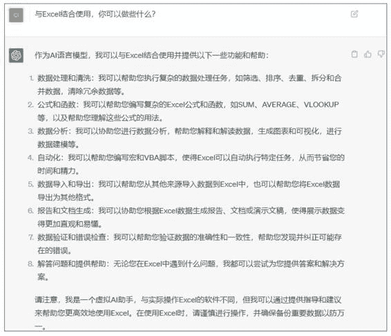

Figure 1-3

### 002 Managing ChatGPT Chat Windows


Scan to Watch Tutorial Video

In `ChatGPT`, established chat windows are automatically saved in the chat window list on the left. Users can perform management operations such as creating, renaming, and deleting chat windows. The specific operation methods are as follows.

**Step 01** Open `ChatGPT` and enter a used chat window. Click the `New chat` button in the upper left corner, as shown in Figure 1-4. After execution, a new chat window can be created.


Figure 1-4

**Step 02** Select the chat window, click the  button, as shown in Figure 1-5.


Figure 1-5

**Step 03** After execution, an edit text box appears where the name can be modified, as shown in Figure 1-6.

**Step 04** Click the  button to complete the chat window renaming operation. Next, click the  button, as shown in Figure 1-7.

**Step 05** After execution, a `Delete chat?` dialog box pops up, asking the user whether to delete the created chat window.  If confirming deletion, click the `Delete` button;  if not wanting to delete, click the `Cancel` button, as shown in Figure 1-8.


▲Figure 1-6


▲Figure 1-7


Figure 1-8

**Expert Tips**

When the user is not satisfied with the reply generated by `ChatGPT`, they can click the `Regenerate response` button to regenerate the reply content.

When the user doubts the content of the current reply from `ChatGPT`, they can click the `Stop generating` button to stop generating the reply content.

### 003 Mastering ChatGPT Line Break Operations


Scan to Watch Tutorial Video

When entering content in the `ChatGPT` input box, it can be divided into paragraphs and lines. The specific operation method is as follows.

**Step 01** Open the `ChatGPT` chat window, enter the first line of information "Classify the following content in the form of an `Excel` table:" in the input box, as shown in Figure 1-9.

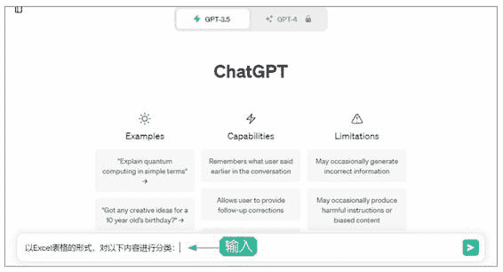

Figure 1-9

**Step 02** After execution, press the `Shift+Enter` shortcut key to break the line, then enter other content "Apple, Pothos, Banana, Cucumber, Lettuce, Rose, Pepper", as shown in Figure 1-10.


Figure 1-10

**Step 03** Press the `Enter` key to send. `ChatGPT` will reply according to the content, as shown in Figure 1-11.

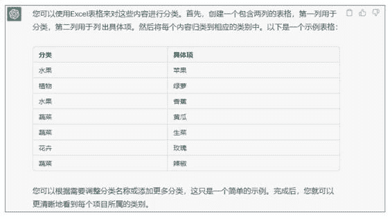

Figure 1-11

### 004 Mastering ChatGPT Rewrite Operations


Scan to Watch Tutorial Video

When the command or keywords sent to `ChatGPT` are incorrect or not precise enough, the sent information can be rewritten. The specific operation is as follows.

**Step 01** Taking Example 003 as an example, in the chat window, click the  button on the right side of the sent message, as shown in Figure 1-12.


Figure 1-12

**Step 02** After execution, the content can be rewritten.  Change "Classify the following content in the form of an `Excel` table:" to "Classify the following content in a table format:";  Click the `Save&Submit` button, as shown in Figure 1-13.


Figure 1-13

**Step 03** After execution, `ChatGPT` will reply again based on the content, and page numbers will be generated below the sent content, as shown in Figure 1-14. The content before and after rewriting is saved, and users can view them by flipping pages.

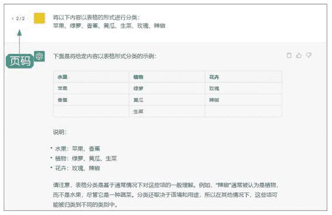

Figure 1-14

## 1.2 Correctly Asking ChatGPT Questions

After learning the content of Section 1.1, I believe everyone has mastered the basic operation methods of using `ChatGPT`. `ChatGPT` is a language model. As long as the user sends their needs and thoughts, `ChatGPT` will reply according to the sent questions. If the user wants `ChatGPT`'s reply content to be more accurate and more in line with their needs, they need to pay more attention to the correct way of asking questions, so as to better use `ChatGPT`.

### 005 Accurately Describing Data Processing Needs


Scan to Watch Tutorial Video

When asking `ChatGPT` questions, accurately and clearly describe the specific tasks or needs to be completed in `Excel`. Specific and clear questions help `ChatGPT` understand the user's intent and give accurate answers.

For example, when a user needs to create a line chart in an `Excel` worksheet that can display sales data and trends, if they directly ask `ChatGPT` "How to create a line chart in `Excel`?", `ChatGPT` will give a relatively general reply, and the operation steps in the reply are not entirely correct, as shown in Figure 1-15.

If using clear language to specify what type of operation or analysis is needed, and accurately describe to `ChatGPT` "How to create a line chart in `Excel` to display sales data and sales trends?", `ChatGPT` will give a more precise answer, and the operation description will be more detailed, as shown in Figure 1-16.

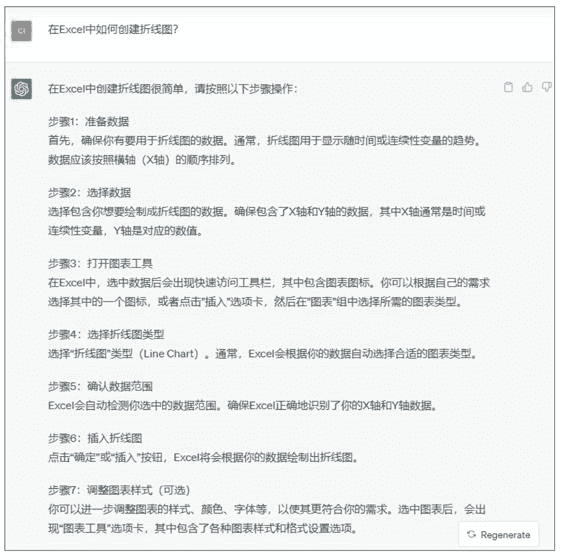

▲Figure 1-15

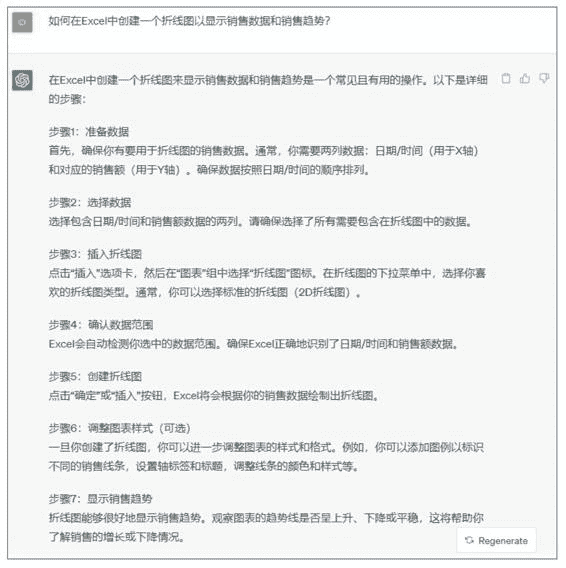

▲Figure 1-16


Figure 1-16 (Continued)

### 006 Providing Sufficient Data Source Information


Scan to Watch Tutorial Video

When asking `ChatGPT` questions, if the user's needs involve processing specific data sources or data tables, they must provide relevant data source information so that `ChatGPT` can better understand the user's problem. The following illustrates this with a practical example.

**Step 01** Open an `Excel` worksheet, as shown in Figure 1-17. Among them, the `A2:A11` cell range is the sales date, `B2:B11` is the sales product, `C2:C11` is the sales amount. It is required to count the total sales amount based on the sales product in column `F`.

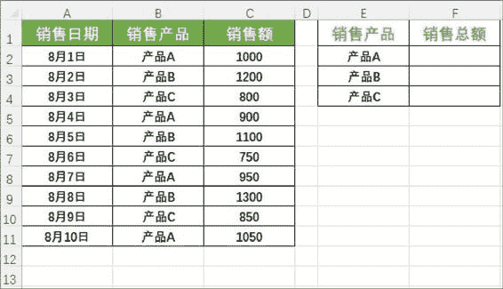

Figure 1-17

**Step 02** If directly asking `ChatGPT` "How to calculate total sales based on sales product in `Excel`?", `ChatGPT` will reply with an applicable calculation formula and explain the formula, as shown in Figure 1-18.

**Step 03** If providing sufficient data source information when asking `ChatGPT`: "I have an `Excel` worksheet containing sales data, where `A2:A11` is the sales date, `B2:B11` is the sales product, `C2:C11` is the sales amount. Now I want to calculate the sum of these sales data in `F2`, `F3`, `F4` cells based on the sales products in `E2`, `E3`, `E4` cells. What formula can help me achieve this?", `ChatGPT` will then directly give the formula, as shown in Figure 1-19.

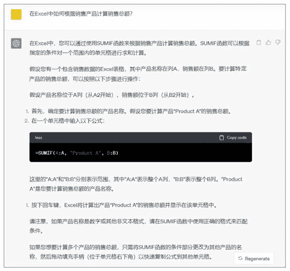

▲Figure 1-18

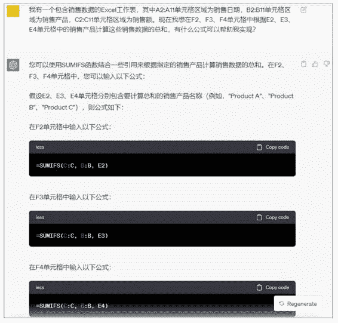

▲Figure 1-19

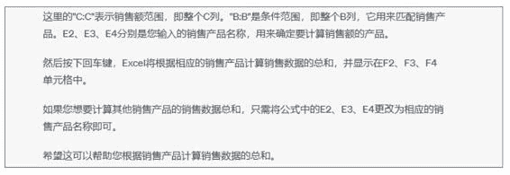

Figure 1-19 (Continued)

**Step 04** Click the `Copy code` button in the upper right corner of the first formula, as shown in Figure 1-20.

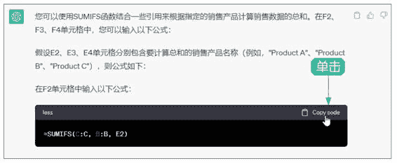

Figure 1-20

**Step 05** Return to the `Excel` worksheet, press `Ctrl+V` in cell `F2` to paste, and the total sales of Product A can be directly calculated, as shown in Figure 1-21.

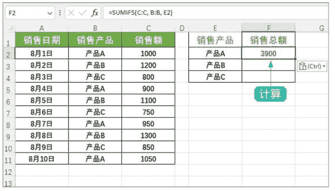

Figure 1-21

**Step 06** Use the same method to copy the formula and paste it into `F3`, `F4` cells to calculate the total sales of Product B and Product C, as shown in Figure 1-22.

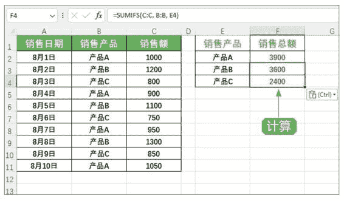

Figure 1-22

### 007 Getting Operation Guidance Through Simulated Cases


Scan to Watch Tutorial Video

When it is inconvenient for the user to provide a data source, in order to let `ChatGPT` better understand the problem, a specific simulated case can be provided, and the required results described, to obtain `ChatGPT`'s answer. The following introduces the specific operation method.

**Step 01** Open a `ChatGPT` chat window, enter the command in the input box:

```
Assume I have an Excel table containing student exam scores, and now I want to calculate the average score of each student. For example, the data in the table is as follows (try to align rows and columns):

Name  Chinese  Math  English
Zhang San  85    92    78
Li Si      76    88    90
Wang Wu    90    85    82

Question: What formula can help me calculate the average score of each student?
```

As shown in Figure 1-23.


#### Chapter 1 (Running Header)

## 1.2 Advanced Questioning Techniques

### 008 Referencing Specific Functions or Features


*Scan to watch tutorial video*

When asking questions to ChatGPT, you can reference specific Excel function or feature names in your query. This helps ChatGPT provide more accurate responses that better match your expectations. The specific procedures are described below.

#### Step 01
Open a ChatGPT chat window. In the input box, enter a prompt referencing the function: "How to use the `VLOOKUP` function to look up data?", as shown in Figure 1-25.


Figure 1-25

#### Step 02
Wait a moment, and ChatGPT will accurately reply with content related to the referenced function, as shown in Figure 1-26.

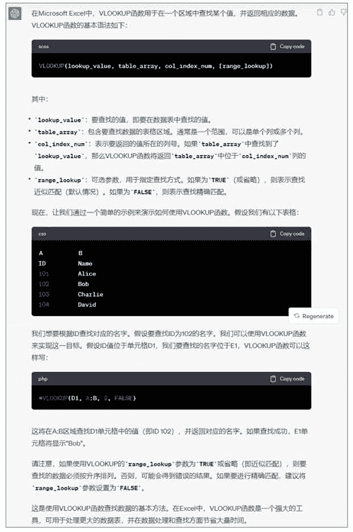

Figure 1-26

#### Step 03
Next, reference a feature in your question: "How to create a dynamic chart with a PivotChart?", and ChatGPT will reply with the corresponding operational steps, as shown in Figure 1-27.

### 009 Respecting ChatGPT's Limitations


*Scan to watch tutorial video*

ChatGPT is a processing tool based on a language model, and it has certain limitations. If ChatGPT cannot answer your question, pauses during the response, fails to reply completely, or gives an incorrect answer, it may be due to the limited scope of the model's knowledge. Do not panic in such situations.

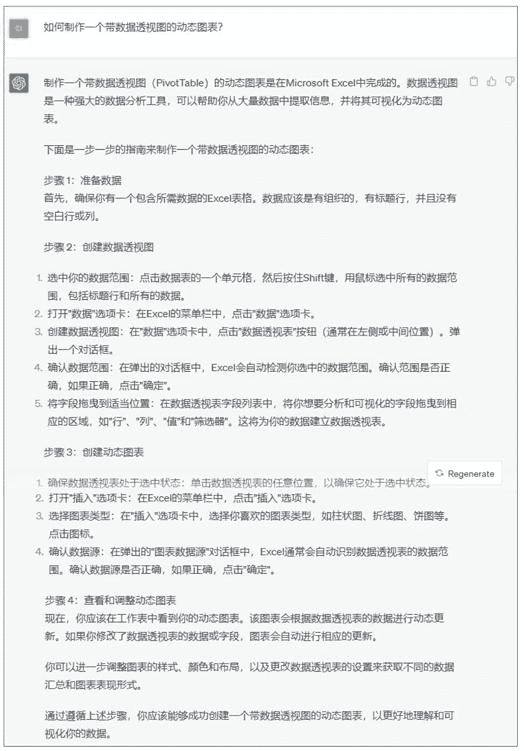

Figure 1-27

For example, asking ChatGPT "In Excel, how to use historical data for time series forecasting?" may result in ChatGPT being unable to reply with complete information, as shown in Figure 1-28.

To address the above potential limitations, users should first try to ask questions that ChatGPT is likely capable of answering. Secondly, you can try modifying the prompt, opening a new chat window, or clicking the `Regenerate` button to regenerate the response multiple times.

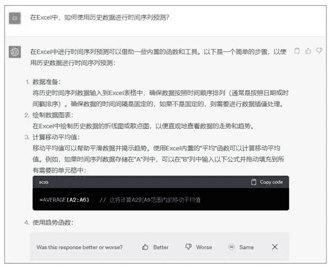

Figure 1-28

### 010 Training ChatGPT's Response Mechanism


*Scan to watch tutorial video*

When obtaining responses from ChatGPT, users can gradually guide ChatGPT to provide answers that better meet expectations. You can also train ChatGPT's response mechanism by providing relevant information or adding explicit hints in the question.

For example, send the prompt to ChatGPT: "I have an Excel spreadsheet containing sales data. I want to create a bar chart to show the sales amount for each sales representative. Please tell me how to do this in the format of `Step 1, ...; Step 2, ...; Step 3, ...`." ChatGPT will then reply according to the required format, as shown in Figure 1-29.

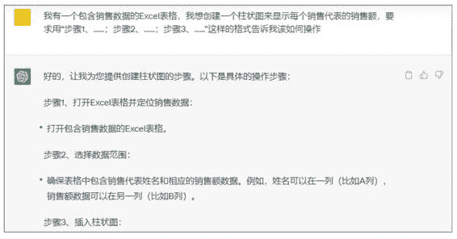

Figure 1-29

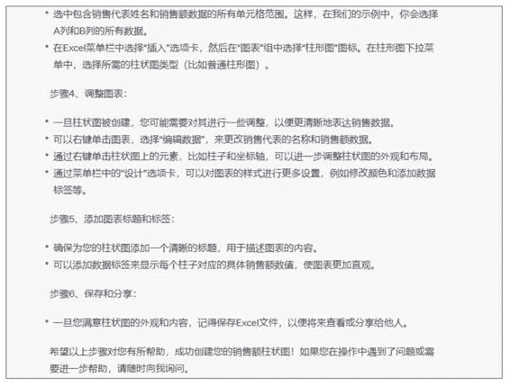

Figure 1-29 (Continued)

### 011 Following Up or Supplementing Descriptions Based on Context


*Scan to watch tutorial video*

If ChatGPT's answer is not detailed enough or does not fully resolve the user's question, you can reference previous conversation content in follow-up questions. This helps ChatGPT better understand your needs and continue providing assistance. The specific procedures are described below.

#### Step 01
In the ChatGPT chat window, send the prompt: "Assume student names are stored in the `A2:A9` cell range, and subject scores are stored in the `B2:D9` cell range in my Excel spreadsheet. What formula can help me calculate the average score for each student?" ChatGPT's reply is shown in Figure 1-30.

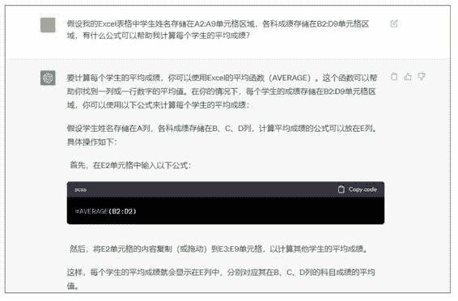

Figure 1-30

#### Step 02
Continue to follow up with ChatGPT: "What method can quickly find out each student's worst subject?" ChatGPT will then reply based on the previous conversation context, as shown in Figure 1-31.

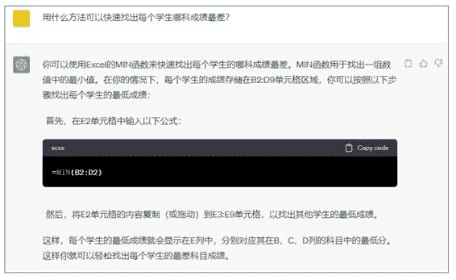

Figure 1-31

### 012 Defining a Role for ChatGPT


*Scan to watch tutorial video*

When asking ChatGPT questions, you can explicitly tell ChatGPT your own role or background, or define a role for ChatGPT. This allows ChatGPT to provide more targeted answers. The specific procedures are described below.

#### Step 01
In the ChatGPT chat window, explicitly state your role: "I am an HR manager who needs to hire 20 people within a month. I am also responsible for interviews and training. Please create a schedule in the form of a table." ChatGPT will reply in the second person, as shown in Figure 1-32.

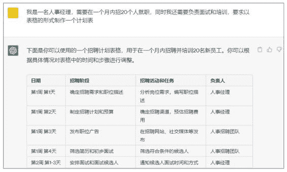

Figure 1-32

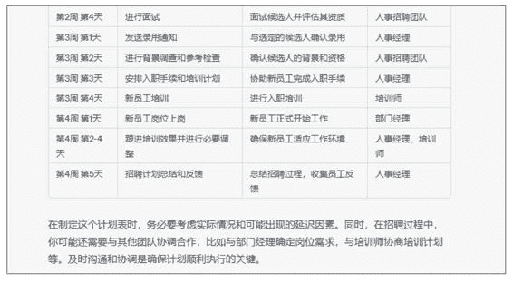

Figure 1-32 (Continued)

#### Step 02
Next, define ChatGPT's role: "You are a sales manager proficient in Excel spreadsheet creation. How would you create a PivotTable for sales data in Excel to analyze sales trends?" ChatGPT will reply in the first person, as shown in Figure 1-33.

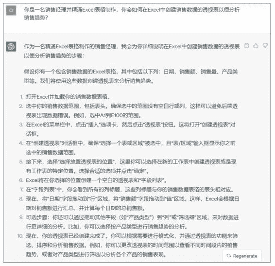

Figure 1-33

## 1.3 Learning Common Excel Operations with ChatGPT

After studying the previous sections, you should now understand how to quickly use this virtual AI assistant, ChatGPT, to help you use Excel more efficiently. This section will introduce which operations in Excel can be guided by ChatGPT and what ChatGPT can do for your Excel data tables.

### 013 Learning Table Formatting Operations with ChatGPT


*Scan to watch tutorial video*

Table formatting refers to the process of adjusting the appearance and style of a table in Excel. Users can ask ChatGPT about how to set cell styles, add borders, apply fill colors, and format fonts, letting ChatGPT provide appropriate guidance or suggestions.

For example, in the ChatGPT chat window, ask: "How to set numeric data in an Excel table to Currency format and add a thick border?" ChatGPT will guide the user through the relevant table formatting operations, as shown in Figure 1-34.

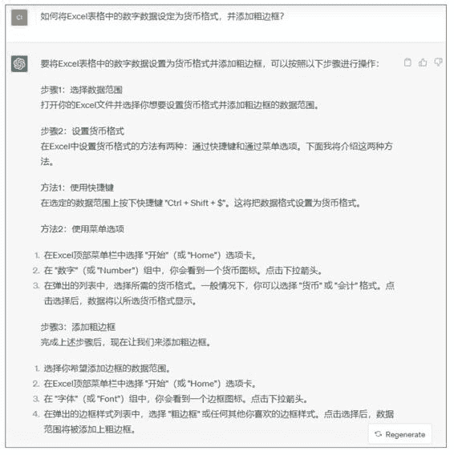

Figure 1-34

### 014 Learning Table Layout Adjustment Operations with ChatGPT


*Scan to watch tutorial video*

Table layout adjustment refers to operations in Excel such as adjusting row height, column width, alignment, and merging cells to optimize the display and layout of the table. Users can ask ChatGPT how to autofit column width, merge cells, and set row height, letting ChatGPT guide the table layout adjustment operations.

For example, in the ChatGPT chat window, ask: "I have an Excel table containing long text. How can I autofit the column width so that all text content is fully displayed?" ChatGPT will then provide the operational steps for autofitting table column width, as shown in Figure 1-35.

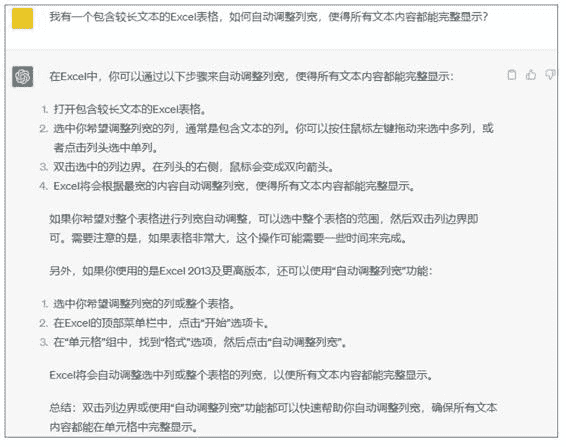

Figure 1-35

### 015 Learning Data Filtering Operations with ChatGPT


*Scan to watch tutorial video*

In Excel, users can use the `Filter` feature to filter and display specific data. When unsure how to operate, users can ask ChatGPT how to filter based on values or text content in a specific column, letting ChatGPT provide specific operational steps.

For example, in the ChatGPT chat window, ask: "How to use Excel's `Filter` feature to display only records with sales greater than 1000?" ChatGPT will then provide the method for filtering sales greater than 1000, as shown in Figure 1-36.

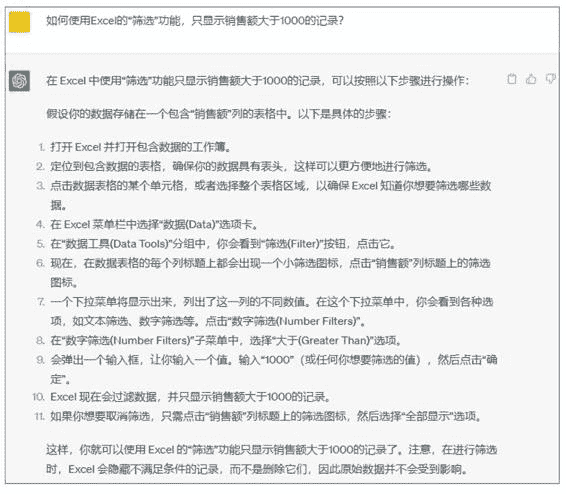

Figure 1-36

### 016 Learning Data Visualization Operations with ChatGPT


*Scan to watch tutorial video*

Data visualization displays data through charts and graphs, helping users understand data distribution and trends more intuitively. Users can consult ChatGPT on how to create column charts, line charts, pie charts, and other charts to visualize data, letting ChatGPT guide the data visualization operational steps.

For example, in the ChatGPT chat window, ask: "I have an Excel table containing sales amounts for different regions. How can I use a combo chart (column and line) to show the sales situation for each region?" ChatGPT will then guide the creation of the combo chart, as shown in Figure 1-37.

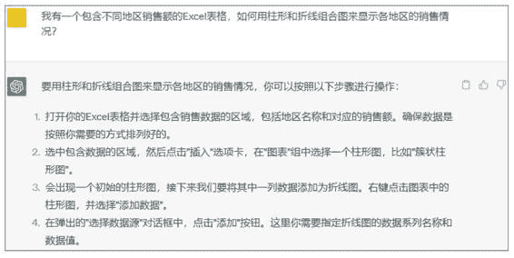

Figure 1-37

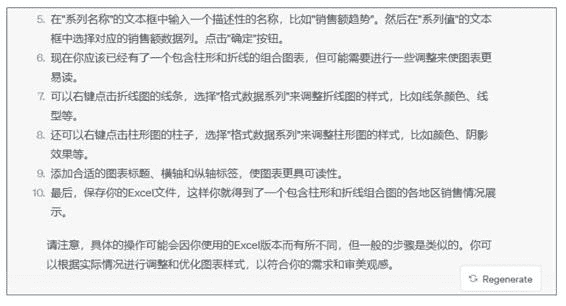

Figure 1-37 (Continued)

### 017 Learning Data Highlighting Operations with ChatGPT


*Scan to watch tutorial video*

In Excel, highlighting data helps users emphasize cells that meet certain conditions, making them stand out in the table. Users can consult ChatGPT on how to use `Conditional Formatting` or other methods to highlight data, letting ChatGPT provide the operational steps for highlighting data.

For example, in the ChatGPT chat window, ask: "How to use `Conditional Formatting` in an Excel table to mark cells with sales above average in red?" ChatGPT will then provide the method for highlighting data, as shown in Figure 1-38.

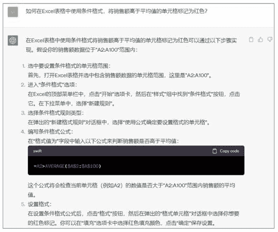

Figure 1-38

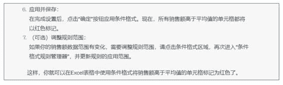

Figure 1-38 (Continued)

### 018 Learning Methods for Generating Data Reports with ChatGPT


*Scan to watch tutorial video*

Having ChatGPT generate reports based on Excel data can greatly simplify the report writing process and improve work efficiency. Users can provide the required data to ChatGPT, then ask how to generate a report, which charts and graphs to use for data visualization, and how to format the report in a specific layout.

For example, there is an Excel table containing a company's sales data, including sales date, sales amount, sales region, and other information. You need ChatGPT to generate a sales report based on this data, including overall sales trends and sales situations by region. The user can ask ChatGPT: "The Excel worksheet contains sales data. How can I get ChatGPT to generate a sales report based on this data, and use a line chart in the report to show monthly sales trends?" ChatGPT will then provide the operational methods for generating data reports in Excel, as shown in Figure 1-39.

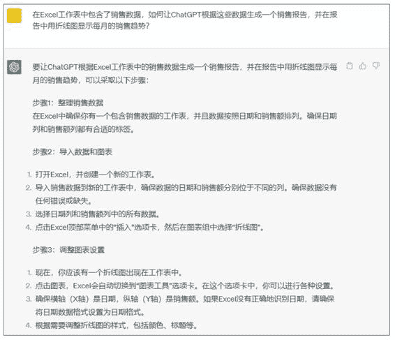

Figure 1-39

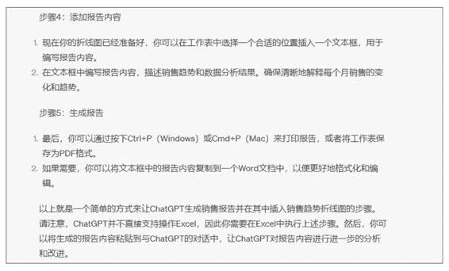

Figure 1-39 (Continued)

### 019 Learning How to Analyze Data in Tables with ChatGPT


*Scan to watch tutorial video*

ChatGPT can help users use Excel's built-in functions to analyze data. Users can ask ChatGPT how to calculate averages, sums, maximums, and minimums, or how to create PivotTables to summarize and analyze data.

For example, in the ChatGPT chat window, ask: "I have an Excel table containing sales data, stored in the `B2:B11` cell range. How to use Excel functions to calculate the sum and average of these sales data?" ChatGPT will then provide the corresponding function formulas, as shown in Figure 1-40.

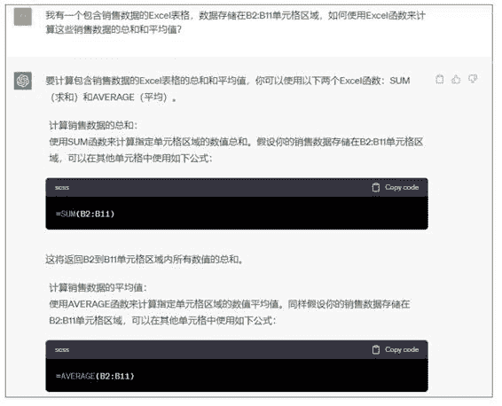

Figure 1-40


Figure 1-40 (Continued)

### 020 Learning How to Organize Data into Tables with ChatGPT


*Scan to watch tutorial video*

ChatGPT can provide users with table creation methods. In addition, ChatGPT can organize text data provided by users into tables, and can also add content or perform data analysis, calculation, and summarization based on supplementary requirements from users. The specific procedures are described below.

#### Step 01
Open a Notepad file displaying sales data for multiple employees, as shown in Figure 1-41.

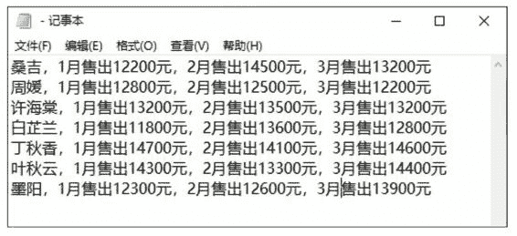

Figure 1-41

#### Step 02
Now you need to organize the text data in Notepad into a table. Press `Ctrl+A` to select all, then press `Ctrl+C` to copy, as shown in Figure 1-42.

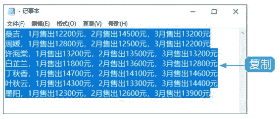

Figure 1-42

#### Step 03
Open the ChatGPT chat window, click the input box at the bottom, and enter `Organize the following data into a table:`, as shown in Figure 1-43.

#### Step 04
Press `Shift+Enter` to start a new line, then press `Ctrl+V` to paste the copied tabular data, as shown in Figure 1-44.

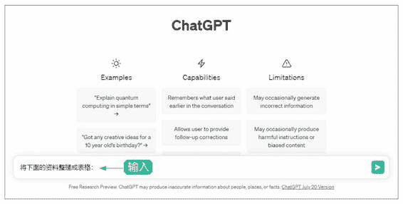

Figure 1-43

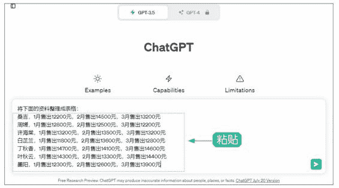

Figure 1-44

#### Step 05
Press `Enter` to send. ChatGPT will immediately organize the data into a table, as shown in Figure 1-45.

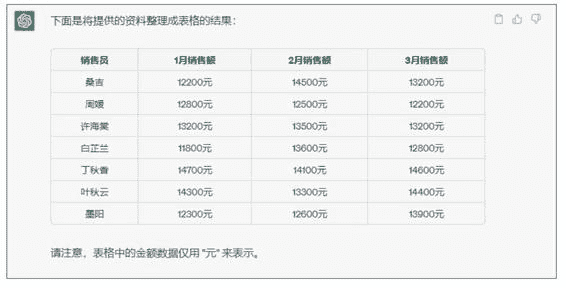

Figure 1-45

#### Step 06
If you need to calculate the total sales for Jan–Mar for each salesperson, click the input box at the bottom and enter the additional table requirement: `Add a total sales column for each employee in the table`, as shown in Figure 1-46.


Figure 1-46

#### Step 07
Press `Enter` to send. ChatGPT will regenerate the table based on the supplementary requirement, as shown in Figure 1-47.

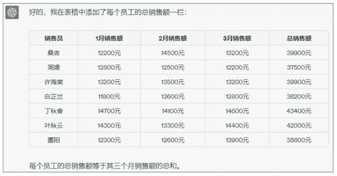

Figure 1-47

#### Step 08
Select the generated table, right-click, and choose `Copy` from the shortcut menu, as shown in Figure 1-48.

 

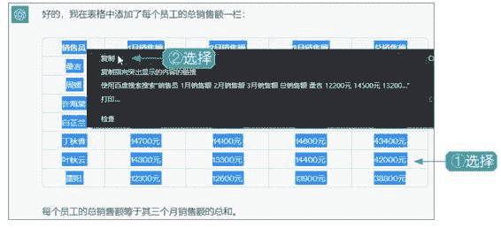

Figure 1-48

#### Step 09
Open an Excel worksheet and press `Ctrl+V` in the worksheet to paste the copied table content, as shown in Figure 1-49.

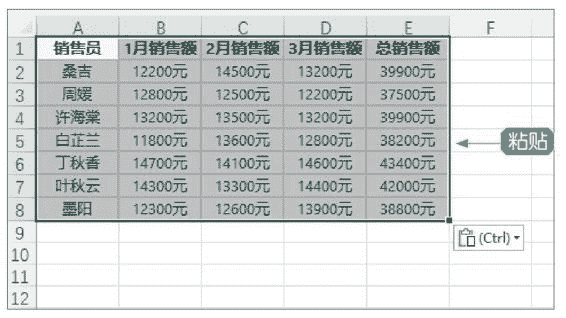

Figure 1-49

#### Step 10
Adjust the row height and column width of the worksheet as needed. The result is shown in Figure 1-50.

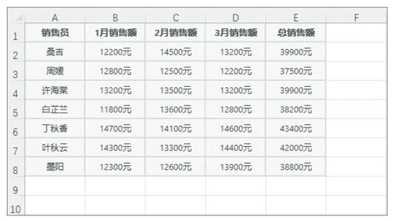

Figure 1-50

# Chapter 2 Intelligent Calculation: Writing Formulas with ChatGPT

> **Learning Tips**
>
> Excel has over 400 built-in functions to meet user needs for data processing and analysis such as statistics, logical judgment, lookup, and filtering. Users can use ChatGPT to write function formulas for intelligent calculation in Excel, which is both convenient and less prone to errors.

> **Chapter Navigation**
>
> Basic Operations for Creating Formulas | Assisting Calculation with ChatGPT | Writing Formulas with ChatGPT

## 2.1 Basic Operations for Creating Formulas

Before analyzing data in Excel, you must first understand the concept and usage of references, how to construct formulas, methods for entering functions and references, and how to use the function library to select functions—these are the basic operations for creating formulas. Only by laying a solid foundation can you apply knowledge flexibly and master data analysis techniques.

### 021 Understanding Relative, Absolute, and Mixed References


*Scan to watch tutorial video*

In Excel, referencing a cell means using the address of another cell in a formula within a specific cell, and utilizing the value in that other cell without manually entering the value. This provides users with a faster and more convenient calculation method.

Cells in Excel are typically identified by a "letter + number" format, such as `A1`, `B2`, etc. These cells can contain various data types, such as numbers, text, dates, etc. Users can use these cell addresses in formulas to calculate and manipulate the data in those cells. For example, to add the values in cells `A1` and `A2` and display the result in cell `A3`, you can enter the formula `=A1+A2` in cell `A3`. Here, the `+` symbol is the addition operator in Excel, while `A1` and `A2` are cell references pointing to the values in cells `A1` and `A2` respectively.

Cell referencing is a very flexible and powerful feature that helps users quickly perform various complex calculations and operations, making Excel a very powerful and comprehensive data processing tool. In Excel, references are divided into relative references, absolute references, and mixed references, detailed below.

#### 1. Relative Reference

Relative references in Excel are mainly used to reference data at relative cell positions for function calculations.

#### Step 01
Open a worksheet and enter directly in cell `B2`: `=B1`, as shown in Figure 2-1.

#### Step 02
Press `Enter` to confirm. This references the data in cell `B1`, returning a value of 1 in cell `B2`, as shown in Figure 2-2.

#### Step 03
Drag the fill handle at the bottom-right corner of cell `B2` to the right. The referenced cell changes with the position movement, and the formula in the cell automatically adjusts from `=B1` to `=C1`, as shown in Figure 2-3.

#### Step 04
Similarly, dragging down causes the formula in the cell to automatically adjust from `=B1` to `=B2`, as shown in Figure 2-4. Thus, it can be concluded that when dragging to the right, the column letter in the relative reference formula changes; when dragging down, the row number changes.

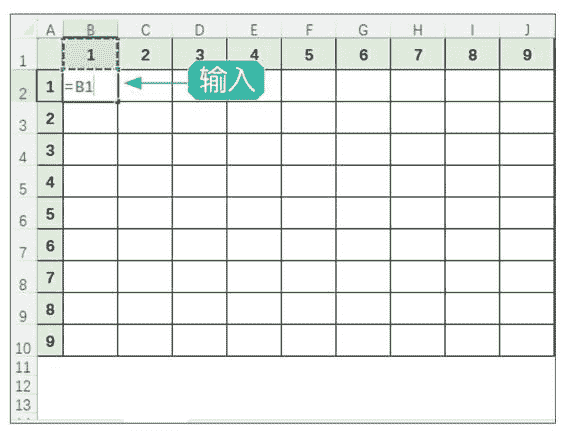

Figure 2-1

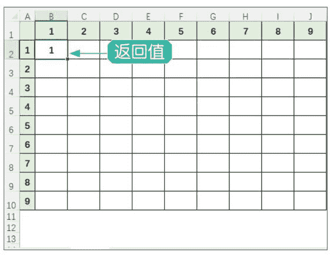

Figure 2-2

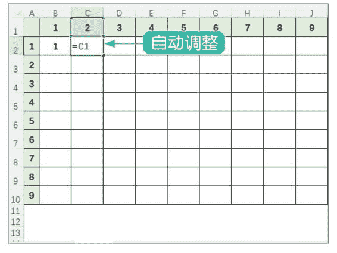

Figure 2-3

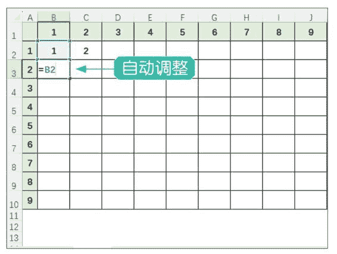

Figure 2-4

#### 2. Absolute Reference

In an Excel worksheet, an absolute reference always references the value in a specified cell location. Users can add the `$` symbol by pressing the `F4` key while in the cell reference to switch the reference mode.

#### Step 01
Continuing from above, enter `=B1` in cell `B2`, as shown in Figure 2-5.

#### Step 02
After the operation, press the `F4` key. Two `$` symbols are added to the formula, indicating an absolute cell reference, as shown in Figure 2-6.

#### Step 03
Unlike relative references, no matter which direction the cell is dragged, the formulas in all cells remain the same as in cell `B2` and do not change at all, as shown in Figure 2-7.

#### Expert Tip


## 2.2 Using ChatGPT to Assist Calculations

### 3. Mixed References

During operation, pay attention to the reference switching function of the `F4` key, which only applies to the selected formula segment or referenced cells.

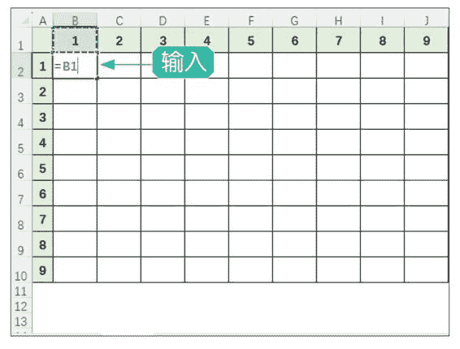

▲Figure 2-5

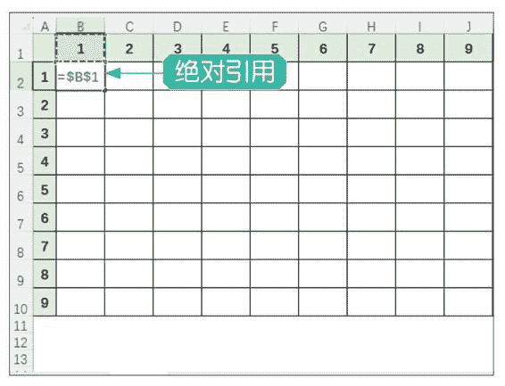

▲Figure 2-6

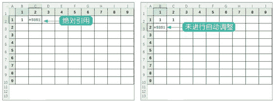

Figure 2-7

In Excel, a mixed reference is equivalent to recombining absolute and relative references, allowing you to relatively reference rows and absolutely reference columns, or absolutely reference rows and relatively reference columns simultaneously.

**Step 01** Enter `=B1` in cell `B2`. Pressing `F4` the 1st time creates an absolute reference; pressing `F4` the 2nd time changes the formula to `=B$1`, indicating a relative column reference and absolute row reference, as shown in Figure 2-8.

**Step 02** After dragging the cell down, the formula remains unchanged as `=B$1`, meaning the row is fixed, as shown in Figure 2-9.

**Expert Tip**

During operation, note that pressing the `F4` key for the 4th time reverts the formula to its initially entered state.

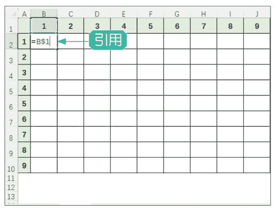

▲Figure 2-8


Figure 2-9

**Step 03** After dragging the cell to the right, the formula changes to `=C$1`, meaning the column changes but the row remains constant, as shown in Figure 2-10.

**Step 04** Pressing `F4` a 3rd time in cell `B2` changes the formula to `=$B1`, indicating an absolute column reference and relative row reference, as shown in Figure 2-11.


▲Figure 2-10


Figure 2-11

**Step 05** After dragging the cell to the right, the formula remains unchanged as `=$B1`, meaning the column is fixed, as shown in Figure 2-12.

**Step 06** After dragging the cell down, the formula changes to `=$B2`, meaning the row changes but the column remains constant, as shown in Figure 2-13.


▲Figure 2-12


Figure 2-13

### 022 Quickly Create Calculation Formulas


Scan to watch tutorial video

Statistical calculations in Excel do not require users to manually calculate and then enter results into cells. You only need to establish the correct formula in a cell and let Excel calculate automatically to quickly obtain results. There are two main ways to create formulas in Excel: one is like a mathematical formula, using arithmetic operators (+, -, *, /) to reference cells for calculation; the other is using functions, writing formulas that conform to function syntax through arguments and conditions to perform specific calculations.

Below we will introduce the methods for quickly creating formulas in Excel.

**Step 01** Open a worksheet, as shown in Figure 2-14. We need to calculate the total sales for various products in the worksheet.

**Step 02** Before creating the formula, first clarify the data in the worksheet: which cells contain data for calculation and which contain data to be ignored. For example, in this case, total sales only require multiplying unit price by sales quantity; any extra data in the table can be ignored.

**Step 03** Select cell `B4` in the worksheet and enter the "`=`" symbol, as shown in Figure 2-15.


▲Figure 2-14


Figure 2-15

**Step 04** Next, select cell `B2` to reference the unit price, as shown in Figure 2-16.

**Step 05** Continue by entering the multiplication operator; press the `*` (asterisk) key on the keyboard, as shown in Figure 2-17.


▲Figure 2-16


Figure 2-17

**Step 06** After the operation, select cell `B3` to reference the sales quantity, as shown in Figure 2-18.

**Step 07** A complete formula is now established: `=B2*B3`. Press `Enter` to confirm and calculate the total sales for Product A, as shown in Figure 2-19.


▲Figure 2-18


Figure 2-19

**Step 08** Drag the fill handle (bottom-right corner) of cell `B4` to cell `D4` to fill the formula, calculating the total sales for Product B and Product C, as shown in Figure 2-20.


Figure 2-20

### 023 Quickly Insert Function Formulas


Scan to watch tutorial video

In Excel, users can quickly insert function formulas in the formula bar, leveraging Excel's powerful calculation capabilities to summarize table data. Below we introduce the method for quickly inserting function formulas.

**Step 01** Open a worksheet, as shown in Figure 2-21. We need to calculate the total sales volume for various products in the worksheet.

**Step 02** Select cell `B6` in the worksheet; click the "**Insert Function**" button in the formula bar, as shown in Figure 2-22.

**Step 03** The "**Insert Function**" dialog box appears, as shown in Figure 2-23.

**Step 04** Users can enter the desired function or the operation they want to perform (e.g., "sum") in the text box below "**Search for a function**"; click the "**Go**" button, as shown in Figure 2-24.


▲Figure 2-21


▲Figure 2-22


▲Figure 2-23


Figure 2-24

**Step 05** After the operation, the "**Select a function**" list box displays the sum function; select the `SUM` function here, as shown in Figure 2-25. The formula syntax and description of the selected function appear at the bottom of the list box.

**Step 06** Click the "**OK**" button. The "**Function Arguments**" dialog box appears, with the `Number1` text box automatically referencing a cell range, indicating calculation of values in the `B2:B5` range, as shown in Figure 2-26.

**Expert Tip**

There are two faster methods for summing with the `SUM` function in Excel.

- Select the cell where you want the result, press the `Alt+=` shortcut to quickly sum.
- In the "**Editing**" group on the "**Home**" tab, click the "**AutoSum**" button to quickly sum.


▲Figure 2-25


Figure 2-26

**Step 07** Click the "**OK**" button to return the calculated value in cell `B6`, as shown in Figure 2-27.

**Step 08** Select cell `B6`, drag the fill handle to cell `D6` to fill the formula, batch calculating the total sales volume for Product B and Product C, as shown in Figure 2-28.


▲Figure 2-27


Figure 2-28

### 024 Select Functions Using the Function List


Scan to watch tutorial video

In an Excel worksheet, users can also quickly select functions from the Function List (AutoComplete) to facilitate formula writing and avoid input errors. Below we introduce the specific operation for selecting functions using the Function List.

**Step 01** Open a worksheet, as shown in Figure 2-29. We need to calculate the sales volume for each salesperson in the worksheet.

**Step 02** Select cell `E2` in the worksheet and enter `=SU`; a Function List containing functions starting with "SU" appears, as shown in Figure 2-30.


▲Figure 2-29


Figure 2-30

**Step 03** Select the desired function from the list, here the `SUM` function, as shown in Figure 2-31.

**Step 04** After the operation, double-click the left mouse button to add the selected function to the formula being written, as shown in Figure 2-32.


▲Figure 2-31


Figure 2-32

**Step 05** Select the `B2:D2` cell range; enter a closing parenthesis in English input mode to complete the sum formula, as shown in Figure 2-33.

**Step 06** Press `Enter` to confirm and return the sales volume for the 1st salesperson, as shown in Figure 2-34.


▲Figure 2-33


Figure 2-34

**Step 07** Drag the fill handle of cell `E2` to fill the formula down to cell `E5`, batch calculating the sales volume for other salespeople, as shown in Figure 2-35.


Figure 2-35

### 025 Automatically Correct Formula Errors


Scan to watch tutorial video

In Excel, symbols in formulas must be entered in English input mode. If entered in Chinese input mode, the system performs automatic correction. Additionally, users may accidentally type extra or missing characters when entering formulas; Excel quickly identifies errors based on the input and corrects them. Below we explore the effect of Excel's automatic formula correction through a practical example.

**Step 01** Open a worksheet and enter `==SUM（B2:D5)` in the merged cell in row 6, as shown in Figure 2-36. This formula has an extra equal sign and a parenthesis entered in Chinese input mode (full-width).

**Step 02** Press `Enter` to confirm. Excel detects the error and pops up a message box with a correction suggestion, as shown in Figure 2-37.


▲Figure 2-36


Figure 2-37

**Step 03** Click the "**Yes**" button to correct the formula and return the calculated value in the merged cell, as shown in Figure 2-38.


Figure 2-38

### 026 Use ChatGPT to Provide Sum Shortcut Keys


Scan to watch tutorial video

When performing summation statistics, if the user forgets the shortcut key for summing, they can ask ChatGPT to provide the shortcut key and then apply it in Excel. Below we introduce the specific operation method.

**Step 01** Open the ChatGPT chat window, click the input box at the bottom, and enter the prompt: "What is the shortcut key for summing in Excel?", as shown in Figure 2-39.


Figure 2-39

**Step 02** Press `Enter` to send. ChatGPT replies based on the query, providing the sum shortcut key along with its function and usage, as shown in Figure 2-40.


Figure 2-40

### 027 Use ChatGPT to Explain Function Usage


Scan to watch tutorial video

When a user needs to use or understand a specific function's usage during spreadsheet creation, they don't need to spend time searching online; they can simply ask ChatGPT to get the function's syntax, purpose, etc. Below we introduce the specific operation method.

**Step 01** Open the ChatGPT chat window, click the input box at the bottom, and enter the prompt: "Explain the principles and usage of the VLOOKUP and HLOOKUP functions in Excel", as shown in Figure 2-41.


Figure 2-41

**Step 02** Press `Enter` to send. ChatGPT explains the usage methods and examples for the `VLOOKUP` and `HLOOKUP` functions as requested, as shown in Figure 2-42.


Figure 2-42

### 028 Use ChatGPT to Continue Writing Function Formulas


Scan to watch tutorial video

When writing function formulas in an Excel worksheet, users can use ChatGPT to help write a complete function formula or continue writing an unfinished one. Below we introduce the specific operation method.

**Step 01** Open an Excel worksheet where Column B contains store ratings, and we need to represent recommendation intensity with heart symbols in Column C, as shown in Figure 2-43.


Figure 2-43

**Step 02** Open the ChatGPT chat window, click the input box at the bottom, and enter the prompt: "In an Excel worksheet, Column B contains store ratings. Please help me write a function formula to represent the numeric ratings with heart symbols in Column C", as shown in Figure 2-44.


Figure 2-44

**Step 03** Press `Enter` to send. ChatGPT writes a complete function formula as requested and explains the formula, as shown in Figure 2-45.


Figure 2-45

**Step 04** Select the written function formula; right-click and choose "**Copy**" from the context menu, as shown in Figure 2-46.


Figure 2-46

**Step 05** Return to the Excel worksheet and paste the copied formula into cell `C2`: `=REPT ("❤", B2)`, as shown in Figure 2-47.


Figure 2-47

**Step 06** Press `Enter` to confirm, representing recommendation intensity with heart symbols, as shown in Figure 2-48.

**Step 07** Select the `C2:C7` cell range, as shown in Figure 2-49.


▲Figure 2-48


Figure 2-49

**Step 08** Click in the formula bar, press `Ctrl+Enter` to fill the formula, batch representing recommendation intensity with heart symbols, as shown in Figure 2-50.


Figure 2-50

**Step 09** Next, we need to hide the middle 4 digits of the store codes using the `*` symbol. Open the ChatGPT chat window, click the input box, and enter the prompt: "Column D contains store codes. Need to hide the middle 4 digits with `*` symbol. Please help me complete the formula: `=REPLACE(D2,3)`", as shown in Figure 2-51.


Figure 2-51

**Step 10** Press `Enter` to send. ChatGPT completes the unfinished function formula as requested and explains it, as shown in Figure 2-52.


Figure 2-52

**Step 11** Select the completed formula, right-click, and choose "**Copy**" from the context menu, as shown in Figure 2-53.


Figure 2-53

**Step 12** Return to the Excel worksheet, select cell `D2`; paste the copied formula into the formula bar: `=REPLACE(D2,3,4,"****")`, as shown in Figure 2-54.


Figure 2-54

**Step 13** Select the original store code, press `Ctrl+X` to cut; then select `D2` in the formula, press `Ctrl+V` to paste, replacing the referenced cell `D2` in the formula with the actual store code text, as shown in Figure 2-55.

**Step 14** Press `Enter` to confirm, hiding the middle 4 digits of the store code, as shown in Figure 2-56.


▲Figure 2-55


Figure 2-56

**Step 15** Copy the formula in cell `D2`, select cell `D3`, paste the formula into the formula bar using the same method; replace the first argument with the store code from cell `D3`, as shown in Figure 2-57.

**Step 16** After the operation, use the same method to hide the middle 4 digits of other store codes, as shown in Figure 2-58.


▲Figure 2-57


Figure 2-58

### 029 Use ChatGPT to Check Formula Correctness


Scan to watch tutorial video

In an Excel worksheet, when a user finds that a written function formula cannot calculate or calculates incorrectly, they can use ChatGPT to help check the formula's correctness and refine it. Below we introduce the specific operation method.

**Step 01** Open an Excel worksheet where Column A contains preset values. We need to extract values from Column A to 3 decimal places in Column B via formula, as shown in Figure 2-59.

**Step 02** Select cell `B2` and enter the formula: `=ROUND(A2)`, as shown in Figure 2-60.


▲Figure 2-59


Figure 2-60

**Step 03** Press the `Enter` key to confirm. A message prompt box appears; click the "OK" button, as shown in Figure 2-61.


Figure 2-61

**Step 04** After performing the operation, open the ChatGPT chat window, click the input box at the bottom, and enter the following instruction in the input box: "In an Excel worksheet, I need to retain 3 decimal places for the value in cell A2 in cell B2. Please help me check the correctness of the formula and improve it: `=ROUND(A2)`", as shown in Figure 2-62.


Figure 2-62

**Step 05** Press the `Enter` key to send. ChatGPT will check and improve the formula, as shown in Figure 2-63.


Figure 2-63

**Step 06** Click the `Copy code` button in the upper right corner of the formula to copy it, as shown in Figure 2-64.


Figure 2-64

**Step 07** Return to the Excel worksheet and paste the copied formula into cell `B2`: `=ROUND(A2,3)`, as shown in Figure 2-65.

**Step 08** Press the `Enter` key to confirm. The value from cell `A2` will be extracted with 3 decimal places, as shown in Figure 2-66.


▲Figure 2-65


Figure 2-66

**Step 09** Move the cursor to the lower-right corner of cell `B2`, hold down the left mouse button, and drag down to cell `B6` to fill the formula. This will batch extract values from column A with 3 decimal places. The result is shown in Figure 2-67.


Figure 2-67

## 2.3 Writing Formulas with ChatGPT

In Excel, functions are powerful tools for data processing. Through function formulas, you can perform summarization, analysis, and prediction, achieving efficient calculations and improving work and life efficiency. This section introduces methods for writing function calculation formulas using ChatGPT, allowing users to perform calculations directly in Excel worksheets.

### 030 Calculating Averages with ChatGPT


Scan to watch the tutorial video

In Excel, when users need to calculate an average in a cell, they can obtain the calculation formula through ChatGPT. The specific operation method is described below.

**Step 01** Open a worksheet, as shown in Figure 2-68. The average sales volume for various products needs to be calculated in column `E`.


Figure 2-68

**Step 02** Open the ChatGPT chat window and enter the following instruction in the input box: "In an Excel worksheet, I need to write a calculation formula to calculate the average of the cell range `B2:D2` in cell `E2`." Press the `Enter` key to send. ChatGPT will reply with the formula for calculating the average based on the query, as shown in Figure 2-69.


Figure 2-69

**Step 03** Copy the replied formula, return to the Excel worksheet, select the cell range `E2:E5`, and paste the copied formula into the formula bar: `=AVERAGE(B2:D2)`, as shown in Figure 2-70.

**Step 04** Press the `Ctrl+Enter` shortcut key to batch calculate the averages, as shown in Figure 2-71.


▲Figure 2-70


Figure 2-71

### 031 Getting Performance Rankings with ChatGPT


Scan to watch the tutorial video

In Excel, when users need to quickly calculate employee performance rankings without changing the sort order, they can obtain the ranking formula through ChatGPT. The specific operation method is described below.

**Step 01** Open a worksheet, as shown in Figure 2-72. The performance rankings of each employee need to be calculated in column `C`.

**Step 02** Open the ChatGPT chat window and enter the following instruction in the input box: "In an Excel worksheet, I need to write a calculation formula to calculate the rank of the values in column `B` within the cell range `B2:B7` in column `C`." Press the `Enter` key to send. ChatGPT will reply with the formula for calculating the ranking based on the query, as shown in Figure 2-73.


▲Figure 2-72


Figure 2-73

**Step 03** Copy the replied formula, return to the Excel worksheet, select the cell range `C2:C7`, and paste the copied formula into the formula bar: `=RANK(B2,$B$2:$B$7)`, as shown in Figure 2-74.


Figure 2-74

**Step 04** After performing the above operation, press the `Ctrl+Enter` shortcut key to calculate the performance rankings of each employee, as shown in Figure 2-75.


Figure 2-75

### 032 Performing Running Totals with ChatGPT


Scan to watch the tutorial video

In Excel, when users do not know how to perform a running total on data in a worksheet, they can obtain the running total formula through ChatGPT. The specific operation method is described below.

**Step 01** Open a worksheet, as shown in Figure 2-76. A running total of the values in column `B` needs to be performed in column `C`.


Figure 2-76

**Step 02** Open the ChatGPT chat window and enter the following instruction in the input box: "In an Excel worksheet, I need to write a calculation formula to perform a running total of the values in the cell range `B2:B7` in column `C`." Press the `Enter` key to send. ChatGPT will reply with the running total calculation formula based on the query, as shown in Figure 2-77.


Figure 2-77

**Step 03** Copy the replied formula, return to the Excel worksheet, select the cell range `C2:C7`, and paste the copied formula into the formula bar: `=SUM($B$2:B2)`, as shown in Figure 2-78.


Figure 2-78

**Step 04** Press the `Ctrl+Enter` shortcut key to perform the running total. The result is shown in Figure 2-79.


Figure 2-79

### 033 Locating and Finding Employee Information with ChatGPT


Scan to watch the tutorial video

In Excel, the `INDEX` function returns the value of a cell or a part of a range from a specified range, while the `MATCH` function searches for a specified value in a specified range and returns the index or relative position of that value. Combining these two functions allows for data location, data lookup, and validation of input values. The following example demonstrates how to use ChatGPT to write `INDEX` and `MATCH` function formulas for locating and finding employee information.

**Step 01** Open a worksheet, as shown in Figure 2-80. Two tables are displayed. The missing information data on the right needs to be found in the left table.


Figure 2-80

**Step 02** Open the ChatGPT chat window and enter the following instruction in the input box: "In an Excel worksheet, columns `A:C` are the lookup range. I need to find the row where the name provided in column `F` cells is located in the lookup range, find the column where the column `I` header is located in the lookup range, and finally return the found result to the cells in column `I`. How do I write a complete lookup formula using the `INDEX` and `MATCH` functions?" Press the `Enter` key to send. ChatGPT will write the combined formula of `INDEX` and `MATCH` functions based on the query, as shown in Figure 2-81.


▲Figure 2-81


Figure 2-81 (Continued)

**Step 03** Copy the function formula, return to the Excel worksheet, select cell `I2`, and paste the formula into the formula bar: `=INDEX(A:C,MATCH(F2,A:A,0),MATCH(I2,1:1,0))`, as shown in Figure 2-82.


Figure 2-82

**Step 04** Modify the first reference parameter of the third argument in the formula to `I1`, select the cell referenced in the third argument, and press the `F4` key to switch to absolute reference to prevent rows and columns from changing when filling the formula. The result is shown in Figure 2-83.


Figure 2-83

**Step 05** Press the `Enter` key to confirm. The looked-up base salary will be returned, as shown in Figure 2-84.


Figure 2-84

**Step 06** Drag the fill handle in the lower-right corner of cell `I2` to fill the formula down to cell `I7` to batch look up the base salary of each employee. The result is shown in Figure 2-85.


Figure 2-85

### 034 Finding Employee Departments with ChatGPT


Scan to watch the tutorial video

The `LOOKUP` function is a commonly used lookup function in Excel. It can search for a specified value in a specified range and return the closest value or corresponding result. The `LOOKUP` function is known as the "cure-all" in Excel lookup functions; whether it is reverse lookup or forward lookup, the `LOOKUP` function is very practical and applicable.

The following example demonstrates how to use ChatGPT to write a `LOOKUP` function formula to find specified data within a specified range, using finding the corresponding department for an employee as an example.

**Step 01** Open a worksheet, as shown in Figure 2-86. The corresponding department needs to be found based on the employee name within the table range in columns `A` and `B`.


Figure 2-86

**Step 02** Open the ChatGPT chat window and enter the following instruction in the input box: "In column `E` cells of an Excel worksheet, how do I use a `LOOKUP` function formula to look up the value in column `D` cells within the cell range `B2:B11` and return the corresponding result from the cell range `A2:A11`?" Press the `Enter` key to send. ChatGPT will write the function formula based on the query, as shown in Figure 2-87.


Figure 2-87

**Step 03** Copy the function formula, return to the Excel worksheet, select the cell range `E2:E5`, and paste the formula into the formula bar: `=LOOKUP(D2,B2:B11,A2:A11)`, as shown in Figure 2-88.


Figure 2-88

**Step 04** After performing the operation, select the second and third argument parameters and press the `F4` key to switch to absolute reference, as shown in Figure 2-89.


Figure 2-89

**Step 05** After performing the operation, press the `Ctrl+Enter` shortcut key to find the corresponding department based on the employee name, as shown in Figure 2-90.


Figure 2-90

### 035 Calculating Headcount in Bonus Intervals with ChatGPT


Scan to watch the tutorial video

Calculating the number of people within an interval can use the `FREQUENCY` function. It is a statistical function in Excel used to calculate the frequency distribution of values in a dataset. This function helps users understand the number of times values appear in a dataset and groups these counts into specified interval ranges. The following example demonstrates how to use ChatGPT to write a `FREQUENCY` function formula to calculate the headcount in bonus intervals.

**Step 01** Open a worksheet, as shown in Figure 2-91. The headcount for each bonus interval needs to be counted. Note that when entering interval conditions in cells, the upper limit of each interval is entered (e.g., for 0–800, the upper limit entered is 800).


Figure 2-91

**Step 02** Open the ChatGPT chat window and send the instruction: "In an Excel worksheet, I need to count the values in cells `C2:C9` based on the interval conditions in cells `E2:E5`. Please write a calculation formula using the `FREQUENCY` function." ChatGPT will reply with the calculation formula written using the `FREQUENCY` function based on the query, as shown in Figure 2-92.


Figure 2-92

**Step 03** Copy the function formula, return to the Excel worksheet, select the cell range `F2:F5`, paste the copied formula into the formula bar: `=FREQUENCY(C2:C9,E2:E5)`, and press the `Ctrl+Shift+Enter` key combination to confirm. This will count the quantities meeting the interval conditions, as shown in Figure 2-93.


Figure 2-93

#### Expert Tip

In Excel, when the entered formula is an array formula, you need to use the `Ctrl+Shift+Enter` key combination to confirm the formula as an array formula.

In Excel, an array formula is a special formula used to perform calculations on multiple cell ranges and return multiple results. These formulas typically involve array operations, such as calculating, summarizing, or filtering each cell in a range. After confirming an array formula, Excel automatically adds curly braces `{}` around the formula to indicate that the result is an array; you do not need to enter the curly braces manually.

### 036 Automatically Updating Date and Time with ChatGPT


Scan to watch the tutorial video

In Excel, `TODAY` and `NOW` are commonly used date and time functions. The `TODAY` function returns the current date, and the `NOW` function returns the current date and time. The following example demonstrates how to get the usage of `TODAY` and `NOW` function formulas in ChatGPT.

**Step 01** Open a worksheet, as shown in Figure 2-94. The preparation date and preparation time need to be entered in the worksheet.

**Step 02** Open the ChatGPT chat window and enter the following instruction in the input box: "In an Excel worksheet, how do I use `TODAY` and `NOW` functions to write formulas so that the preparation date and preparation time can be updated automatically?" Press the `Enter` key to send. After a moment, ChatGPT will reply with the formulas and usage methods for the `TODAY` and `NOW` functions based on the query, as shown in Figure 2-95.


▲Figure 2-94


Figure 2-95

**Step 03** Copy the function formulas, return to the Excel worksheet, and paste the two formulas into cells `B1` and `B2` respectively. After performing the operation, the preparation date and time will be updated automatically. The result is shown in Figure 2-96. After closing the worksheet, the next time you open it, the date and time in cells `B1` and `B2` will update automatically.


Figure 2-96

### 037 Calculating Time Between Dates with ChatGPT


Scan to watch the tutorial video

The `DATEDIF` function is a date function in Excel used to calculate the difference between two dates. This function can be used to calculate age, length of service, and project duration. The following example demonstrates how to use ChatGPT to write a `DATEDIF` function formula to calculate the time interval between two dates.

**Step 01** Open a worksheet, as shown in Figure 2-97. Column `C` is the hire date, and column `D` is the termination date. The length of service for terminated employees needs to be calculated in the worksheet.


Figure 2-97

**Step 02** Open the ChatGPT chat window and send the instruction: "In an Excel worksheet, column `C` is the hire date, and column `D` is the termination date. How do I use a `DATEDIF` function formula to calculate employee length of service?" ChatGPT will write the `DATEDIF` function formula based on the query, as shown in Figure 2-98.


Figure 2-98

**Step 03** Copy the function formula, return to the Excel worksheet, paste the formula into cell `E2`: `=DATEDIF(C2,D2,"Y")`, and fill the formula down to cell `E6` to batch calculate employee length of service. The result is shown in Figure 2-99.


Figure 2-99

### 038 Calculating Perfect Attendance Bonuses Conditionally with ChatGPT


Scan to watch the tutorial video

In Excel, the `IF` function is categorized as a logical function. It returns different values based on a given condition and is widely used in Excel for conditional judgment and logical operations. The following example demonstrates how to use ChatGPT to write an `IF` function formula, using calculating perfect attendance bonuses based on conditions as an example.

**Step 01** Open a worksheet, as shown in Figure 2-100. Column `B` is the number of employee attendance days. When the attendance days are equal to or greater than the standard days, it counts as perfect attendance, and employees with perfect attendance receive a bonus of 500 yuan.


Figure 2-100

**Step 02** Open the ChatGPT chat window and enter the following instruction in the input box: "In an Excel worksheet, column `B` is the number of employee attendance days. When attendance days are equal to or greater than 25 days, it counts as perfect attendance. Employees with perfect attendance receive a bonus of 500 yuan. How do I calculate this using an `IF` function formula?" Press the `Enter` key to send. ChatGPT will write the `IF` function formula based on the query, as shown in Figure 2-101.


Figure 2-101


#### Chapter 2 (Duplicate) Writing Excel Formulas with Functions

### 038 Calculate Attendance Bonus with ChatGPT

#### Step 03
Copy the function formula, return to the Excel worksheet,  paste the formula into cell `C2`: `=IF(B2>=25,500,0)`;  fill the formula down to cell `C7` to batch calculate employee attendance bonuses. The result is shown in Figure 2-102.


Figure 2-102

### 039 Determine Student Grade Levels with Multiple Conditions Using ChatGPT


Scan to watch tutorial video

Example 038 introduced the method of using ChatGPT to write `IF` function formulas for calculations based on a single condition. Besides a single condition, the `IF` function can also be combined with the `AND` function to make judgments and calculations based on multiple conditions. The following takes determining student grade levels with multiple conditions as an example to introduce the method of using ChatGPT to write `IF` and `AND` function formulas.

#### Step 01
Open a worksheet, as shown in Figure 2-103. It is required to evaluate the grade levels of each student's scores in column G: An average score of all subjects above 80, and no single subject score below 70 is "Excellent"; Average score above 80, but with one or more subject scores below 70 is "Good"; Average score between 60 and 79, and no single subject score below 60 is "Pass"; Having one subject score below 60 is "Fail".


Figure 2-103

#### Step 02
Open the ChatGPT chat window, enter the prompt in the input box: "In the worksheet, columns B to F are subject scores. Need to write a multi-condition judgment formula using `IF` and `AND` functions: Average score of all subjects above 80, and no single subject score below 70 is 'Excellent'; Average score above 80, if one or more subject scores below 70 is 'Good'; Average score between 60 and 79, and no single subject score below 60 is 'Pass', one subject score below 60 is 'Fail'." Press Enter to send. ChatGPT will write the multi-condition judgment formula based on the question, as shown in Figure 2-104.


Figure 2-104

#### Step 03
Copy the function formula, return to the Excel worksheet,  paste the formula into cell `G2`: `=IF(AND(AVERAGE(B2:F2)>=80,MIN(B2:F2)>=70),"Excellent",IF(AND(AVERAGE(B2:F2)>=80,COUNTIF(B2:F2,"<70")>0),"Good",IF(AND(AVERAGE(B2:F2)>=60,MIN(B2:F2)>=60),"Pass","Fail")))`;  fill the formula down to cell `G7` to batch determine student grade levels. The result is shown in Figure 2-105.


Figure 2-105

### 040 Extract Start Time and End Time with ChatGPT


Scan to watch tutorial video

In Excel, the `LEFT` function is used to extract a specified number of characters from the left side of a text string, and the `RIGHT` function is used to extract a specified number of characters from the right side of a text string. These two functions are commonly used for string truncation operations, facilitating the extraction of required information. The following takes extracting start time and end time as an example to introduce the operation method of using ChatGPT to write `LEFT` and `RIGHT` function formulas.

#### Step 01
Open a worksheet, as shown in Figure 2-106. The time in column A contains a total of 5 characters including numbers and symbols. It is required to extract the start time and end time of the activity process from column A respectively in the table.


Figure 2-106

#### Step 02
Open the ChatGPT chat window, enter the prompt in the input box: "In an Excel worksheet, the time is 5 characters long. How to write a formula each using `LEFT` and `RIGHT` functions to extract the start time and end time from column A?" Press Enter to send. ChatGPT will write the function formulas based on the question, as shown in Figure 2-107.


Figure 2-107

#### Step 03
Copy the `LEFT` function formula, return to the Excel worksheet, select the cell range `C2:C8`,  paste the formula into the formula bar and change the referenced `A1` to `A2`: `=LEFT(A2,5)`;  press the `Ctrl+Enter` shortcut key to batch extract start times, as shown in Figure 2-108.


Figure 2-108

#### Step 04
Copy the `RIGHT` function formula, in the Excel worksheet, select the cell range `D2:D8`,  paste the formula into the formula bar and change the referenced `A1` to `A2`: `=RIGHT(A2,5)`;  press the `Ctrl+Enter` shortcut key to batch extract end times, as shown in Figure 2-109.


Figure 2-109

# Chapter 3 Efficient Office Work: Processing Data with ChatGPT

## Learning Tips
Efficient office work is an indispensable core competitiveness for modern enterprises and individuals. By leveraging the powerful functions of ChatGPT, especially its application in data screening, users can process data more efficiently, free up more time, and focus on more important work tasks.

## Chapter Highlights Navigation
 Filter, Check, and Sort Data with ChatGPT
 Extract Data with ChatGPT
 Look Up Data with ChatGPT

## 3.1 Filter, Check, and Sort Data with ChatGPT
In Excel, when the data content in a worksheet is large and dense, users can use ChatGPT to assist in filtering data, checking data, and sorting data. When using ChatGPT, users need to ensure they provide clear and explicit instructions so that it can better understand the user's needs and provide accurate assistance.

### 041 Filter Useless Data with ChatGPT


Scan to watch tutorial video

In Excel spreadsheet data processing, when the table data content is large, filtering out useless data is often a time-consuming and laborious task. However, with the help of ChatGPT's intelligence and powerful data processing capabilities, this task can be significantly simplified. The following introduces the specific operations of filtering useless data using methods provided by ChatGPT through practical examples.

#### Step 01
Open a worksheet, as shown in Figure 3-1. It is required to filter out data with empty purchase records and delete them.


Figure 3-1

#### Step 02
Open the ChatGPT chat window, enter the prompt in the input box: "In an Excel worksheet, Column A is Customer Name, Column B is Member ID, Column C is Purchase Record. What method can be used to filter out customer data with empty purchase records and delete them?" Press Enter to send. ChatGPT will provide methods for filtering and deleting useless data, as shown in Figure 3-2.


Figure 3-2

#### Step 03
Referring to the method provided by ChatGPT, in the Excel worksheet,  select the cell range `A1:C1`;  click the "Filter" button in the "Sort & Filter" panel on the "Data" tab, as shown in Figure 3-3.

#### Step 04
After execution, filter dropdown buttons are added.  Click the filter dropdown button in cell `C1`;  in the expanded list box, uncheck the "(Select All)" checkbox and check the "(Blanks)" checkbox, as shown in Figure 3-4.


▲Figure 3-3


Figure 3-4

#### Step 05
Click the "OK" button or press Enter to filter out rows with empty purchase records.  Hold down the `Ctrl` key and select the filtered data rows, right-click;  select the "Delete Row" command from the pop-up shortcut menu, as shown in Figure 3-5.

#### Step 06
After deleting the data rows, expand the filter list box, check the "(Select All)" checkbox, click the "OK" button to display all data. The result is shown in Figure 3-6. At this point, data with empty purchase records has been deleted.


▲Figure 3-5


Figure 3-6

### 042 Assist in Checking Data with ChatGPT


Scan to watch tutorial video

Using ChatGPT to assist in checking data in an Excel worksheet can efficiently discover errors and problems, ensure data quality, and allow users to work more accurately and reliably. The following introduces the operation method of using ChatGPT to assist in checking data.

#### Step 01
Open a worksheet, as shown in Figure 3-7. It is required to check whether there are blank cells in the worksheet, i.e., whether any information has not been filled in.


Figure 3-7

#### Step 02
Open the ChatGPT chat window, enter the prompt in the input box: "In Excel, use a function formula to check if cells `A2:E9` all have input data. If there are blank cells, prompt 'Data not filled' in cells `F2:F9`." Press Enter to send. ChatGPT will write a checking formula, as shown in Figure 3-8.


Figure 3-8

#### Step 03
Copy the formula written by ChatGPT, return to the Excel worksheet, select the cell range `F2:F9`,  paste in the formula bar: `=IF(COUNTBLANK(A2:E2)>0,"Data not filled","")`;  press the `Ctrl+Enter` shortcut key to batch check for unfilled data. The result is shown in Figure 3-9.


Figure 3-9

### 043 Sort Table Data with ChatGPT


Scan to watch tutorial video

Sorting data in an Excel table is a very common requirement, and ChatGPT can help users complete this task more conveniently. The following introduces the specific operations of sorting table data using methods provided by ChatGPT.

#### Step 01
Open a worksheet, as shown in Figure 3-10. It is required to sort sales volume from high to low based on date.


Figure 3-10

#### Step 02
Open the ChatGPT chat window, enter the prompt in the input box: "In an Excel worksheet, Column A is Date, Column B is Customer, Column C is Salesperson, Column D is Sales Volume. Need to sort sales volume from high to low based on date." Press Enter to send. ChatGPT will provide methods for sorting table data, as shown in Figure 3-11.


Figure 3-11

#### Step 03
Referring to the method provided by ChatGPT, in the Excel worksheet, select all table data, click the "Sort" button in the "Sort & Filter" panel on the "Data" tab, as shown in Figure 3-12.


Figure 3-12

#### Step 04
The "Sort" dialog box appears. Expand the "Sort by" list box and select the "Date" option, as shown in Figure 3-13.


Figure 3-13

#### Step 05
The default "Order" is "Smallest to Largest" (Oldest to Newest for dates), meaning sorting dates from small to large. Click the "Add Level" button, as shown in Figure 3-14.


Figure 3-14

#### Step 06
After execution, a second sort item is added. Expand the "Then by" list and select the "Sales Volume" option, as shown in Figure 3-15.


Figure 3-15

#### Step 07
After execution, expand the "Order" list and select "Largest to Smallest", as shown in Figure 3-16, meaning sorting sales volume from high to low.


Figure 3-16

#### Step 08
Click the "OK" button to sort the table data. The result is shown in Figure 3-17.


Figure 3-17

## 3.2 Extract Data with ChatGPT
Data extraction refers to extracting specific information or data from table text for further analysis and processing. Users can combine methods and calculation formulas provided by ChatGPT to extract data in Excel.

### 044 Extract Title After Name with ChatGPT


Scan to watch tutorial video

In an Excel spreadsheet, when employee names and titles are in the same cell, users can ask ChatGPT for methods to extract titles separately. The following introduces the specific operations.

#### Step 01
Open a worksheet, as shown in Figure 3-18. In column B cells, a space separates the name and title. It is required to extract the title from column B separately into column D.


Figure 3-18

#### Step 02
Open the ChatGPT chat window, enter the prompt in the input box: "In an Excel worksheet, Column B contains employee name and title, separated by a space, e.g., 'Zhou Xi Manager', where 'Zhou Xi' is the name and 'Manager' is the title. Need to extract the title from Column B into Column D. What method can solve this?" Press Enter to send. ChatGPT will provide a formula for extracting the title, as shown in Figure 3-19.


Figure 3-19

#### Step 03
Copy the extraction formula provided by ChatGPT. In the Excel worksheet,  select the cell range `D2:D9`;  paste the copied formula into the formula bar: `=RIGHT(B2,LEN(B2)-FIND("",B2))`, as shown in Figure 3-20.


Figure 3-20

#### Step 04
Press the `Ctrl+Enter` shortcut key to confirm. The titles after employee names can be batch extracted. The result is shown in Figure 3-21.


Figure 3-21

### 045 Extract Title at Specified Position with ChatGPT


Scan to watch tutorial video

In Excel, when the format and position of the content to be batch extracted are consistent, you can let ChatGPT use function formulas to perform the extraction. For example, the title text format in the table is "XXXX：XXXXXX", the prefix name is 5 characters long, and you need to extract the content after the prefix name. Then you can specify extracting the remaining content starting from the 6th character. The following introduces the operation method of using ChatGPT to extract titles at specified positions.

#### Step 01
Open a worksheet, as shown in Figure 3-22. In column A cells, article titles all have 4 Chinese characters as a prefix name, plus a colon, making the prefix name 5 characters in total. It is required to extract the title content starting from the 6th character into column B cells.


Figure 3-22

#### Step 02
Open the ChatGPT chat window, enter the prompt in the input box: "In an Excel worksheet, Column A contains article titles. Need to extract content starting from the 6th character of Column A cells into Column B. What function formula can solve this?" Press Enter to send. ChatGPT will provide a formula for extracting the title, as shown in Figure 3-23.


Figure 3-23

#### Step 03
Copy the extraction formula provided by ChatGPT. In the Excel worksheet,  select the cell range `B2:B6`;  paste the copied formula into the formula bar and change `A1` to `A2`: `=MID(A2,6,LEN(A2)-5)`, as shown in Figure 3-24.

#### Step 04
Press the `Ctrl+Enter` shortcut key to confirm. The title content at the specified position can be batch extracted. The result is shown in Figure 3-25.


▲Figure 3-24


Figure 3-25

### 046 Extract Date of Birth from ID Number with ChatGPT


Scan to watch tutorial video

As is well known, everyone's ID number contains their own date of birth. In Excel, users can extract the date of birth from the provided ID numbers with the help of ChatGPT. The following introduces the specific operation methods through examples.

#### Step 01
Open a worksheet, as shown in Figure 3-26. Column A cells contain virtual ID numbers. It is required to extract the date of birth into Column B cells.


Figure 3-26

#### Step 02
Open the ChatGPT chat window, enter the prompt in the input box: "In an Excel worksheet, Column A cells contain ID numbers. Need to extract the date of birth into Column B. What function formula can solve this?" Press Enter to send. ChatGPT will provide a formula for extracting the date of birth, as shown in Figure 3-27.


Figure 3-27

#### Step 03
Copy the formula provided by ChatGPT. In the Excel worksheet,  select the cell range `B2:B6`;  paste the copied formula into the formula bar: `=DATEVALUE(MID(A2,7,4)&"-"&MID(A2,11,2)&"-"&MID(A2,13,2))`, as shown in Figure 3-28.


Figure 3-28

#### Step 04
Press the `Ctrl+Enter` shortcut key to confirm. A set of numbers (serial date values) will be returned, as shown in Figure 3-29.


Figure 3-29


## 3.3 Finding Data with ChatGPT

Similar to data extraction, ChatGPT can also provide assistance when users need to find data in Excel spreadsheets, allowing users to easily locate required data in tables through various functions and tools. Whether it is a simple lookup requirement or advanced data retrieval based on conditions, combining ChatGPT and Excel can provide users with multiple methods to meet different lookup needs.

### 047 Calculating Age from ID Number with ChatGPT


Scan to watch tutorial video

Besides extracting the date of birth from an ID number, users can also combine ChatGPT in Excel to calculate age based on the ID number. The specific operation method is introduced below through an example.

**Step 01** Open a worksheet, as shown in Figure 3-32. Column `A` cells contain virtual ID numbers, and the age needs to be calculated in column `B` cells based on the ID numbers.


Figure 3-32

**Step 02** Open the ChatGPT chat window, enter the instruction "In an Excel worksheet, column A cells are ID numbers. I need to calculate age based on the ID numbers. What function formula can be used to solve this?" in the input box. Press `Enter` to send, and ChatGPT will provide the formula for calculating age based on ID numbers, as shown in Figure 3-33.


Figure 3-33

**Step 03** Copy the formula provided by ChatGPT. In the Excel worksheet, select the cell range `B2:B6`; paste the copied formula into the formula bar:

```excel
=INT((TODAY()-DATEVALUE(MID(A2,7,4)&"-"&MID(A2,11,2)&"-"&MID(A2,13,2)))/365)
```

As shown in Figure 3-34.


Figure 3-34

**Step 04** Press the `Ctrl+Enter` shortcut to confirm, and the age can be calculated in batches based on ID numbers, as shown in Figure 3-35.


Figure 3-35

### 048 Determining Gender from ID Number with ChatGPT


Scan to watch tutorial video

Usually, in an ID number, if the second-to-last digit is odd, it indicates male; if even, it indicates female. Therefore, users can use ChatGPT to write a calculation formula to determine gender in Excel. The specific operation method is introduced below through an example.

**Step 01** Open a worksheet, as shown in Figure 3-36. Column `A` cells contain virtual ID numbers, and the gender needs to be determined in column `B` cells based on the ID numbers.


Figure 3-36

**Step 02** Open the ChatGPT chat window, enter the instruction "In an Excel worksheet, column A cells are ID numbers. I need to determine gender based on the ID numbers. What function formula can be used to solve this?" in the input box. Press `Enter` to send, and ChatGPT will provide the formula for determining gender based on ID numbers, as shown in Figure 3-37.


Figure 3-37

**Step 03** Copy the calculation formula provided by ChatGPT. In the Excel worksheet, select the cell range `B2:B6`; paste the copied formula into the formula bar, and change `A1` to `A2`:

```excel
=IF(MID(A2,LEN(A2)-1,1)*1=1,"Male","Female")
```

As shown in Figure 3-38.


Figure 3-38

**Step 04** Press the `Ctrl+Enter` shortcut to confirm, and the gender can be determined based on ID numbers, as shown in Figure 3-39.


Figure 3-39

### 049 Highlighting Sales Data with ChatGPT


Scan to watch tutorial video

In Excel spreadsheets, highlighting data makes it easier for users to identify and analyze data. Users can ask ChatGPT for methods to highlight data in Excel. Generally, ChatGPT provides simpler methods first and details the operation steps. The specific operation method is introduced below through an example.

**Step 01** Open a worksheet, as shown in Figure 3-40. Column `D` contains sales volume. Cells with sales volume exceeding 500 need to be highlighted.

**Step 02** Open the ChatGPT chat window, enter the instruction "In an Excel worksheet, column D is sales volume. I need to highlight cells where sales volume exceeds 500. What method can be used to solve this?" in the input box. Press `Enter` to send, and ChatGPT will provide the method for highlighting sales data, as shown in Figure 3-41.


Figure 3-40


Figure 3-41

**Step 03** Referring to the method provided by ChatGPT, in the Excel worksheet, select the cell range `D2:D11`. In the "Styles" panel of the "Home" tab, click the "Conditional Formatting" dropdown button; select "New Rule" from the expanded list, as shown in Figure 3-42.

**Step 04** The "New Formatting Rule" dialog box appears. Select "Use a formula to determine which cells to format". In the "Format values where this formula is true" text box, enter the formula provided by ChatGPT, and change `D1` to `D2`:

```excel
=D2>500
```

As shown in Figure 3-43, indicating that conditional formatting starts from cell `D2`.


Figure 3-42


Figure 3-43

**Step 05** Click the "Format" button. The "Format Cells" dialog box appears. In the "Fill" tab, select the yellow color block, as shown in Figure 3-44.


Figure 3-44

**Step 06** Click "OK" to return to the worksheet. Cells with sales volume greater than 500 are now highlighted, as shown in Figure 3-45.


Figure 3-45

### 050 Many-to-One Lookup of Department Heads with ChatGPT


Scan to watch tutorial video

In an Excel worksheet, a many-to-one lookup refers to querying a single corresponding result from multiple lookup values. Users can use ChatGPT to write a combination formula of the `INDEX` and `MATCH` functions for many-to-one lookups. The `MATCH` function locates the position of the lookup value in another column, and then the `INDEX` function returns the corresponding value based on that position. The specific operation method is introduced below through an example.

**Step 01** Open a worksheet, as shown in Figure 3-46. The left table is the source data query area, and the right table is the query result area. It is necessary to find the corresponding person in charge in column `C` based on the department names in column `E` cells and return the results to column `F`.


Figure 3-46

**Step 02** Open the ChatGPT chat window, enter the instruction "In an Excel worksheet, columns A:C are source data, where column B is the department and column C is the person in charge. I need to find the corresponding person in charge based on the department names provided in column E cells and return the results to column F. Write a combination formula using the INDEX and MATCH functions." in the input box. Press `Enter` to send, and ChatGPT will provide the formula for querying the department head, as shown in Figure 3-47.


Figure 3-47

**Step 03** Copy the calculation formula provided by ChatGPT. In the Excel worksheet, select the cell range `F2:F3`; paste the copied formula into the formula bar:

```excel
=INDEX(C2:C10,MATCH(E2,B2:B10,0))
```

As shown in Figure 3-48.


Figure 3-48

**Step 04** Press the `Ctrl+Enter` shortcut to confirm, and the many-to-one lookup of department heads is completed, as shown in Figure 3-49.


Figure 3-49

### 051 Finding Duplicate Order Numbers with ChatGPT


Scan to watch tutorial video

In an Excel worksheet, when users need to find duplicate data, they can use ChatGPT to write function formulas to check if a column contains duplicate content. The specific operation method is introduced below through an example.

**Step 01** Open a worksheet, as shown in Figure 3-50. Column `B` contains order numbers. The goal is to find out if there are duplicate order numbers and return the results to column `D` cells.


Figure 3-50

**Step 02** Open the ChatGPT chat window, enter the instruction "In an Excel worksheet, column B contains order numbers. I need to find out if there are duplicate order numbers and return the results to column D cells. What method can be used to solve this?" in the input box. Press `Enter` to send, and ChatGPT will provide the formula for finding duplicate order numbers, as shown in Figure 3-51.

**Step 03** Copy the calculation formula provided by ChatGPT. In the Excel worksheet, select the cell range `D2:D9`; paste the copied formula into the formula bar:

```excel
=IF(COUNTIF($B$2:$B$100,B2)>1,"Duplicate","")
```

As shown in Figure 3-52.


Figure 3-51


Figure 3-52

**Step 04** Press the `Ctrl+Enter` shortcut to confirm, and duplicate orders can be found, as shown in Figure 3-53.


Figure 3-53

### 052 Finding Customers by Specified City with ChatGPT


Scan to watch tutorial video

In Excel, some functions can look up data from a data range based on specified conditions. For example, in a customer list containing names and cities, to find the customer list based on a specified city, when the user is unsure which function to use, they can let ChatGPT write the function formula. The specific operation method is introduced below through an example.

**Step 01** Open a worksheet, as shown in Figure 3-54. Column `B` contains customer names, and column `C` contains customer cities. The goal is to find the customer list for Beijing.


Figure 3-54

**Step 02** Open the ChatGPT chat window, enter the instruction "In an Excel worksheet, column B is customer name, column C is customer city. I need to find the customer list for Beijing and return the results to column E cells. Which function formula can be used?" in the input box. Press `Enter` to send, and ChatGPT will provide the formula for finding the customer list, as shown in Figure 3-55.


Figure 3-55

**Step 03** Copy the calculation formula provided by ChatGPT. In the Excel worksheet, select the cell range `E2:E11`; paste the copied formula into the formula bar:

```excel
=IF(C2="Beijing",B2,"")
```

As shown in Figure 3-56.


Figure 3-56

**Step 04** Press the `Ctrl+Enter` shortcut to confirm, and the customer list for Beijing can be found, with results as shown in Figure 3-57.


Figure 3-57

**Step 05** Next, the blank cells in `E2:E11` need to be deleted. Open the ChatGPT chat window and send the instruction "How to delete blank cells in E2:E11 without affecting other table contents?". After a moment, ChatGPT will provide the method for deleting blanks in a single column, as shown in Figure 3-58.


Figure 3-58


Figure 3-58 (Continued)

**Step 06** Referring to the method provided by ChatGPT, return to the Excel worksheet, select cell `E1`. In the "Editing" panel of the "Home" tab, expand the "Sort & Filter" list and select "Filter", as shown in Figure 3-59.

**Step 07** After execution, a filter dropdown button is added to cell `E1`. Click this button; in the expanded list, check only the "(Blanks)" checkbox, as shown in Figure 3-60.


Figure 3-59


Figure 3-60

> **Expert Tip**
>
> Note that the reason for filtering first here, instead of directly performing the "Go To Special" operation for blanks as suggested by ChatGPT, is that although the blank cells appear empty, they contain formulas. Therefore, you need to filter out the blank cells first, clear their contents, and *then* perform the "Go To Special" operation for blanks.

**Step 08** Click "OK" to filter out the blank cells. Select the blank cells, right-click; in the shortcut menu, select "Clear Contents", as shown in Figure 3-61.


Figure 3-61

**Step 09** After execution, the formulas in the blank cells are cleared, and the hidden content from filtering is restored. Select the cell range `E2:E11`. In the "Editing" panel of the "Home" tab, expand the "Find & Select" list and select "Go To Special", as shown in Figure 3-62.

**Step 10** The "Go To Special" dialog box appears. Select the "Blanks" radio button, as shown in Figure 3-63.


Figure 3-62


Figure 3-63

**Step 11** Click "OK" to locate the blank cells. Right-click, and in the shortcut menu, select "Delete", as shown in Figure 3-64.

**Step 12** After execution, the "Delete" dialog box appears. Select the "Shift cells up" radio button, as shown in Figure 3-65.


Figure 3-64


Figure 3-65

**Step 13** Click "OK" to delete the blank cells in column `E` without affecting other table contents. The result is shown in Figure 3-66.


Figure 3-66

### 053 Finding Keywords in a Specified Range with ChatGPT


Scan to watch tutorial video

Suppose a user has a product description table and needs to check if a certain column contains "discount". At this time, "discount" can be used as the keyword to search for. Through the function formula written by ChatGPT, the search result of whether there is a discount can be returned. The specific operation method is introduced below through an example.

**Step 01** Open a worksheet, as shown in Figure 3-67. Column `D` contains product promotion information. It is necessary to search column `D` for the keyword "discount" and return the search results to column `E` cells.

**Step 02** Open the ChatGPT chat window, enter the instruction "In an Excel worksheet, column D contains product promotion information. I need to search column D for the keyword 'discount'. If found, return 'Has Discount' in column E cells; if not found, return blank. Which function formula can be used?" in the input box. Press `Enter` to send, and ChatGPT will provide the formula for finding the keyword, as shown in Figure 3-68.


Figure 3-67


Figure 3-68

> **Expert Tip**
>
> In the formula provided by ChatGPT, the `IF` function is a logical function, introduced in Example 038 of this book. Here we introduce the roles of the `ISNUMBER` and `SEARCH` functions used in this example.
>
> The `ISNUMBER` function is an information function used to check whether a given cell or value is numeric (i.e., a number). It returns a logical value (`TRUE` or `FALSE`) indicating whether the checked value is a number.
>
> The `SEARCH` function is a text function used to search for a specific substring within a text string and returns the starting position of the substring in the text. This function is case-insensitive.

**Step 03** Copy the calculation formula provided by ChatGPT. In the Excel worksheet, select the cell range `E2:E9`; paste the copied formula into the formula bar:

```excel
=IF(ISNUMBER(SEARCH("discount",D2)),"Has Discount","")
```

As shown in Figure 3-69.


Figure 3-69

**Step 04** Press the `Ctrl+Enter` shortcut to confirm, and the search results are returned. As shown in Figure 3-70, cells where "discount" is found return "Has Discount", while those not found return blank.


Figure 3-70

**Step 05** To make products with discounts stand out more, users can highlight the entire rows of products with discounts in the table. Add filter dropdown buttons in the header cells via the "Filter" function, and filter for "Has Discount" cells, as shown in Figure 3-71.


**Step 06** Select the filtered product rows, expand the `Fill Color` list box in the `Font` panel on the `Home` tab, and select the `Gold, Accent 4, Lighter 80%` color swatch under `Theme Colors`, as shown in Figure 3-72, to set the background color for product rows with discounts.


▲Figure 3-71


Figure 3-72

**Step 07** After performing the operation, restore all data in the table to highlight the product information with discounts, with the result shown in Figure 3-73.


Figure 3-73

# Chapter 4 ChatGPT + Excel: Intelligent Loading of AI Assistant

## Learning Tips

In Excel, users can integrate the AI assistant ChatGPT directly into Excel for use by loading an add-in. This add-in provides a convenient way to incorporate ChatGPT's powerful language processing capabilities into the Excel workflow.

## Chapter Highlights Navigation


### 4.1 Loading the ChatGPT Add-in

By loading the ChatGPT add-in in Excel, users can converse with ChatGPT in the worksheet and utilize its intelligent natural language understanding and generation capabilities to perform various tasks. This combination will greatly improve user efficiency in Excel; without switching to other applications or browsers, users can get help from ChatGPT directly in Excel. This section mainly introduces the operation methods for loading the ChatGPT add-in.

### 054 Load ChatGPT Add-in


Scan to watch tutorial video

In Excel, users can access the ChatGPT add-in via the `Get Add-ins` feature in the `Add-ins` panel on the `Insert` tab. The specific operation methods are described below.

**Step 01** Open a blank worksheet, click the `Get Add-ins` button in the `Add-ins` panel on the `Insert` tab, as shown in Figure 4-1.

**Step 02** After performing the operation, the `Office Add-ins` dialog box appears, as shown in Figure 4-2. It displays multiple popular add-ins, including free ones and paid ones.


▲Figure 4-1


Figure 4-2

**Step 03** Enter `ChatGPT` in the search box, as shown in Figure 4-3.

**Step 04** Click the `Search` button  to find add-ins related to ChatGPT. Click the `Add` button on the right side of the `ChatGPT for Excel` add-in, as shown in Figure 4-4.

**Step 05** A `Please wait` dialog box pops up; click the `Continue` button, as shown in Figure 4-5.

**Step 06** Wait a moment for the ChatGPT add-in to load. Once integrated into Excel, the `ChatGPT for Excel` add-in icon will appear at the end of the `Home` tab, as shown in Figure 4-6.


▲Figure 4-3


▲Figure 4-4


Figure 4-5

**Step 07** Click the `ChatGPT for Excel` add-in icon to expand the `ChatGPT for Excel` add-in pane. The user needs to enter the key in the `Your OpenAI API Key` text box at the bottom of the pane to use the `ChatGPT for Excel` add-in, as shown in Figure 4-7.


▲Figure 4-6


Figure 4-7

### 055 Obtain OpenAI API Key


Scan to watch tutorial video

OpenAI is an artificial intelligence research laboratory and technology company, while ChatGPT is a natural language processing model developed by OpenAI. Integrating ChatGPT in Excel requires the use of an OpenAI API Key. The operation method for obtaining the key is described below.

**Step 01** First, the user needs to visit the ChatGPT website and log in to their account, then go to the OpenAI official website, and click the `Log in` button in the upper right corner of the webpage, as shown in Figure 4-8.


Figure 4-8

**Step 02** After performing the operation, enter the OpenAI page and select the `API` module, as shown in Figure 4-9.


Figure 4-9

**Step 03** Since ChatGPT was visited and logged into previously, the OpenAI account will be logged in automatically here. If you skipped logging into ChatGPT and went directly to the OpenAI webpage, you would need to log in to the OpenAI account first.  Click the `Account Avatar` in the upper right corner;  select the `View API keys` option from the pop-up list, as shown in Figure 4-10.

**Step 04** Enter the API keys page, where the table displays previously obtained key records. Here, click the `Create new secret key` button, as shown in Figure 4-11.


▲Figure 4-10


Figure 4-11

**Step 05** The `Create new secret key` dialog box appears; click the `Create secret key` button below the text box, as shown in Figure 4-12.


Figure 4-12

**Step 06** After performing the above operations, the key is created. Click the  `Copy` button on the right side of the text box, as shown in Figure 4-13, to obtain the created key. Create a Notepad file in a folder and paste the key into it to save.


Figure 4-13

### 056 Enter ChatGPT Add-in Key


Scan to watch tutorial video

After obtaining the API key from the OpenAI official website, return to the Excel worksheet, expand the `ChatGPT for Excel` add-in pane,  enter the obtained key in the `Your OpenAI API Key` text box at the bottom of the pane;  click the `SAVE` button, as shown in Figure 4-14.

After performing the operation, the application is approved successfully, the API key is applied successfully, and the user is prompted that the corresponding AI functions can be used in the worksheet, as shown in Figure 4-15.


▲Figure 4-14


Figure 4-15

In the `ChatGPT for Excel` add-in pane, the functions of the various AI functions prompted are as follows.

◎ `=AI.ASK`: Get answers to questions.
◎ `=AI.LIST`: Merge row data to generate list output.
◎ `=AI.FILL`: Fill incomplete ranges, automatically generate or fill continuous sequences.
◎ `=AI.EXTRACT`: Extract specific types of data.
◎ `=AI.FORMAT`: Convert numbers and date formats to specified formats.
◎ `=AI.TRANSLATE`: Translate text from one language to another.

### 4.2 Using ChatGPT AI Functions

The ChatGPT add-in provides 6 AI functions. Users can use these AI functions in Excel worksheets to obtain AI-generated answers. This section will introduce the operation methods for using ChatGPT AI functions in Excel worksheets.

### 057 Use AI.ASK Function to Get Data Analysis Results


Scan to watch tutorial video

In Excel, users can ask ChatGPT questions in any cell and get corresponding answers through the `AI.ASK` function. The specific operation method for writing a formula with the `AI.ASK` function to ask ChatGPT for product sales analysis results is described below.

**Step 01** Open a worksheet, as shown in Figure 4-16. Cell B1 lists the question to be asked to ChatGPT.


Figure 4-16

**Step 02** Enter the AI function formula in cell B2: `=AI.ASK(B1)`, as shown in Figure 4-17.


Figure 4-17

**Step 03** Press the `Enter` key to confirm. If `#BUSY!` appears in the cell, it indicates that the reply is loading, as shown in Figure 4-18.


Figure 4-18

**Step 04** Wait a moment to get ChatGPT's data analysis results in cell B2, as shown in Figure 4-19.


Figure 4-19

**Expert Tips**

If users don't know how to use ChatGPT AI functions, they can select the `Examples Spreadsheet` option in the `ChatGPT for Excel` add-in pane, and view and learn AI function examples on the redirected webpage, referencing the example formulas for use.

### 058 Use AI.EXTRACT Function to Extract Specified Content


Scan to watch tutorial video

In Excel, users can extract specified types of information from text through the `AI.EXTRACT` function. This function helps users automatically identify and extract keywords, dates, addresses, and other important information from text for further analysis and processing. The specific operation method for using the `AI.EXTRACT` function to extract specified content is described below.

**Step 01** Open a worksheet, as shown in Figure 4-20. Need to extract the content specified in column B cells from the text in column A cells.


Figure 4-20

**Step 02** Enter the AI function formula in cell C2: `=AI.EXTRACT(A2,B2)`, as shown in Figure 4-21.


Figure 4-21

**Step 03** Press the `Enter` key to confirm to extract the city from the text in cell A2, as shown in Figure 4-22.


Figure 4-22

**Step 04** After performing the operation, drag the fill handle at the lower right corner of cell C2 to fill the formula down to cell C7 to batch extract specified content, as shown in Figure 4-23.


Figure 4-23

**Expert Tips**

If the returned result shows `API error (code 429) - Too Many Requests`, you can wait a moment, then select the corresponding cell, click in the formula bar, and press the `Enter` key several times to return the extracted content.

### 059 Use AI.FILL Function to Automatically Generate Continuous Sequences


Scan to watch tutorial video

In Excel, the AI function `AI.FILL` is used to automatically generate continuous sequences or fill repeating patterns in cells. This function helps users quickly generate number sequences, date sequences, custom text sequences, or repeating patterns and fill them into specified cell ranges. The specific operation method for using the `AI.FILL` function to automatically generate continuous sequences is described below.

**Step 01** Open a worksheet, as shown in Figure 4-24. Need to generate continuous serial numbers in column A cells.

**Step 02** Enter the starting value 1 in cell A2, as shown in Figure 4-25.


▲Figure 4-24


Figure 4-25

**Step 03** Enter the AI function formula in cell A3: `=AI.FILL(A2,10)`, as shown in Figure 4-26, indicating the starting value is the value in cell A2, filling 10 cells backward.

**Step 04** Press the `Enter` key to confirm to generate continuous serial numbers, as shown in Figure 4-27.


▲Figure 4-26


Figure 4-27

### 060 Use AI.FORMAT Function to Convert Data Formats


Scan to watch tutorial video

In Excel, the AI function `AI.FORMAT` is mainly used to convert numbers or date formats to specified formats. This function helps users customize the display of numbers or dates according to needs, including decimal places, thousands separators, currency symbols, and date formats, etc. The specific operation method for using the `AI.FORMAT` function to convert data formats is described below.

**Step 01** Open a worksheet, as shown in Figure 4-28. Need to convert the data format in column A cells to the format specified in column B cells.

**Step 02** Select cell C2, enter the AI function formula in the formula bar: `=AI.FORMAT(A2,B2)`, as shown in Figure 4-29.


▲Figure 4-28


Figure 4-29

**Step 03** Press the `Enter` key to confirm to convert the data format in cell A2 to the format specified in cell B2, as shown in Figure 4-30.

**Step 04** After performing the above operation, drag the fill handle at the lower right corner of cell C2 to fill the formula down to cell C6 to batch convert data formats, as shown in Figure 4-31.


▲Figure 4-30


Figure 4-31

**Expert Tips**

When writing the `AI.FORMAT` function formula, the 1st argument is the value, and the 2nd argument is the format. If the table does not provide a specified format, you can write the format directly into the formula. For example, enter the formula in cell C2: `=AI.FORMAT(A2,"0000 年 00 月 00 日")`, press `Enter` to confirm to convert the format.

### 061 Use AI.LIST Function to Merge Text Content of Each Row


Scan to watch tutorial video

In Excel, the AI function `AI.LIST` merges a series of values or text into a single string, facilitating subsequent processing or display. The specific operation method for using the `AI.LIST` function to merge text content of each row is described below.

**Step 01** Open a worksheet, as shown in Figure 4-32. Need to merge the text content in column A cells into column B cells and separate each row of text with a 顿号 (、).

**Step 02** Enter the AI function formula in cell B2: `=AI.LIST("合并文本",A2:A6)`, as shown in Figure 4-33.

**Step 03** Press the `Enter` key to confirm to merge the text in the cell range A2:A6 together, separated by 顿号 (、), as shown in Figure 4-34.


▲Figure 4-32


▲Figure 4-33


Figure 4-34

### 062 Use AI.TRANSLATE Function to Translate Text


Scan to watch tutorial video

In Excel, the AI function `AI.TRANSLATE` translates specified text according to the provided translation dictionary, helping users achieve text translation functionality in Excel. The operation method for using the `AI.TRANSLATE` function to translate text is described below.

**Step 01** Open a worksheet, as shown in Figure 4-35. The worksheet provides Chinese and English vocabulary; need to translate Chinese to English and English to Chinese.


Figure 4-35

**Step 02**  Select cell range B2:B3;  enter the AI function formula in the formula bar: `=AI.TRANSLATE(A2,"中文简体")`, as shown in Figure 4-36.

**Step 03** After performing the operation, press the `Ctrl+Enter` shortcut to confirm to translate English into Simplified Chinese, as shown in Figure 4-37.


▲Figure 4-36


Figure 4-37

**Step 04**  Select cell range B4:B6;  enter the AI function formula in the formula bar: `=AI.TRANSLATE(A4,"英文")`, as shown in Figure 4-38.

**Step 05** Press the `Ctrl+Enter` shortcut to confirm to translate Chinese into English, as shown in Figure 4-39.


▲Figure 4-38


Figure 4-39

# Chapter 5 ChatGPT + VBA: Automatically Calculate Table Data

## Learning Tips

`VBA` (`Visual Basic for Applications`) is an automation programming language. In Excel, it can be used to create macros, automate tasks, interact with table data, analyze data, process data, and calculate data, etc. Combining ChatGPT with VBA can achieve more powerful automation functions, creating smarter and more flexible macro code.

## Chapter Highlights Navigation


## Basic Operations of VBA Editor

## 5.1 Basic Operations of VBA Editor


#### Chapter 5 (Duplicate) Excel VBA Editor Basic Operations and ChatGPT-Assisted Programming

In Excel, the VBA Editor can be used to create custom functions, automate data entry, generate reports, and perform complex data analysis tasks that are difficult to achieve with Excel's built-in functions and features. This section mainly introduces the basic operation methods of the VBA Editor in Excel.

## 5.1 Basic Operations of the VBA Editor

### 063 Add the "Developer" Tab


Scan QR code to watch tutorial video

In an Excel worksheet, the "Developer" tab is usually hidden when the Excel software is initially launched. To use the VBA Editor in Excel, users first need to add the "Developer" tab to the Ribbon. The operation method is described below.

**Step 01** Right-click on a blank area of the Excel Ribbon, and select the "Customize the Ribbon" command from the pop-up context menu, as shown in Figure 5-1.

**Step 02** The "Excel Options" dialog box appears. In the "Main Tabs" area,  check the "Developer" checkbox;  click the "OK" button, as shown in Figure 5-2, to add the "Developer" tab to the Ribbon.


▲Figure 5-1


Figure 5-2

### 064 Expand Windows in the VBA Editor


Scan QR code to watch tutorial video

In an Excel worksheet, you can open the VBA Editor by clicking the `Visual Basic` button in the "Developer" tab, as shown in Figure 5-3, or by pressing the `Alt+F11` shortcut key to open the Microsoft Visual Basic for Applications (VBA) Editor. After opening the editor, there may be no windows displayed, nor any modules available for code editing. Beginners unfamiliar with VBA might not know how to proceed at this point. The following describes how to expand the windows and panes one by one.


Figure 5-3

First, in the Editor, select "View" | "Project Explorer", as shown in Figure 5-4, to expand the corresponding window. In the "Project" Explorer, you can manage files, folders, databases, etc. Then, select "Properties Window" from the "View" menu list to expand the Properties Window, where all properties of an object can be obtained.


Figure 5-4

Second, click the "Insert" menu, as shown in Figure 5-5. Select "Module" from the pop-up menu list to open a Code Window, where you can enter code and run it.

### 065 Remove an Inserted Module


Scan QR code to watch tutorial video

In the VBA Editor, a module can be understood as the carrier of macro code. Users need to insert a module to write macro code. If an added module is incorrect, it can be removed. The specific operation method is described below.


Figure 5-5

**Step 01** In Excel, open the VBA Editor. Right-click on a blank area in the "Project" Explorer, and select "Insert" | "Module" from the pop-up context menu, as shown in Figure 5-6.

**Step 02** After the operation, a new module is inserted, as shown in Figure 5-7. The inserted module folder and module name will be displayed in the "Project" Explorer.


▲Figure 5-6


Figure 5-7

**Step 03** In the "Project" Explorer, select the inserted module, right-click, and select "Remove Module1" from the pop-up context menu, as shown in Figure 5-8.

**Step 04** An information prompt dialog box appears, asking whether to export and save the module and its code before removing. Since no code was written in this case, click the "No" button here, as shown in Figure 5-9. After the operation, the inserted module is removed.


▲Figure 5-8


Figure 5-9

### 066 Understand the Macro Code Writing Framework


Scan QR code to watch tutorial video

The VBA code writing framework is actually similar to writing a letter or an email; it must have a beginning, a name, a body, and an end. The following introduces the basic operation methods for writing macro code.

**Step 01** In Excel, open the VBA Editor, insert a module, and enter the starting code: `Sub`, as shown in Figure 5-10.

**Step 02** Enter a space + custom Sub procedure name + English parentheses: `CalculateVariableValue()`, as shown in Figure 5-11.


▲Figure 5-10


Figure 5-11

**Step 03** After entering the name, press the `Enter` key to start a new line. At this point, the ending code `End Sub` will be automatically written below the blank line, as shown in Figure 5-12.

**Step 04** Enter the body code in the blank line:

```
n=5
[A1]=n*11
[A2]=n*22
[A3]=n*33
```

This code segment indicates that the variable value is represented by `n`, the value of `n` is 5, cell `A1` returns the value of `n` multiplied by 11, cell `A2` returns the value of `n` multiplied by 22, and cell `A3` returns the value of `n` multiplied by 33, as shown in Figure 5-13.


▲Figure 5-12


Figure 5-13

**Step 05** After the operation, click the "Run Sub/UserForm" button , or press the `F5` key to run the macro code, as shown in Figure 5-14.

**Step 06** Return to the Excel worksheet to view the variable value calculation results, as shown in Figure 5-15. You can see that the values in the cells are returned directly, and no calculation formulas are used in the formula bar.


▲Figure 5-14


Figure 5-15

### 067 View Code in Two Ways


Scan QR code to watch tutorial video

In Excel, after closing the VBA Editor, you can view the written code in two ways. The specific operation methods are described below.

**Step 01** Continuing from Example 066, in the "Controls" group of the "Developer" tab, click the "View Code" button, as shown in Figure 5-16.


**Step 02** After the operation, you can quickly enter the VBA Editor and open the blank `Sheet1` module simultaneously. Switch to Module1 to view the code, as shown in Figure 5-17. Click the "Close" button in the upper right corner of the module to close the module and exit the VBA Editor.


▲Figure 5-16


Figure 5-17

**Step 03** Right-click on the `Sheet1` name at the bottom of the worksheet, and select "View Code" from the pop-up context menu, as shown in Figure 5-18.


Figure 5-18

**Step 04** After the operation, you can enter the VBA Editor. In the "Project" Explorer, double-click "Module1", or right-click on "Module1" and select "View Code" from the pop-up context menu, as shown in Figure 5-19, to view the code written in the module.


Figure 5-19

### 068 Edit a Created Macro


Scan QR code to watch tutorial video

In Excel, created macro code can be found through the "Macro" feature, and edited, run, or deleted. You can also set a shortcut key for a created macro. The specific operation method is described below.

**Step 01** Using the result of Example 066 as an example, click the "Macro" button in the "Code" group of the "Developer" tab, as shown in Figure 5-20.

**Step 02** The "Macro" dialog box appears, displaying the name of the created macro, as shown in Figure 5-21.


▲Figure 5-20


Figure 5-21

**Step 03** Click the "Edit" button to open the VBA Editor. In the "Module1" code, change the value of `n` to 8, as shown in Figure 5-22.

**Step 04** After the operation, close the VBA Editor, open the "Macro" dialog box, and click the "Run" button, as shown in Figure 5-23.


▲Figure 5-22


Figure 5-23

**Step 05** After the operation, the macro code runs and recalculates the variable value, as shown in Figure 5-24.

**Step 06** Open the "Macro" dialog box again and click the "Options" button, as shown in Figure 5-25.

**Step 07** The "Macro Options" dialog box appears. In the blank box under "Shortcut key", enter any English letter, such as Q, to form the `Ctrl+Shift+Q` shortcut key, as shown in Figure 5-26. Click the "OK" button. In the worksheet, press the created shortcut key to execute the macro task.


▲Figure 5-24


▲Figure 5-25


Figure 5-26

## 5.2 Write Macro Code with ChatGPT

When writing macro code in Excel, users need to have a certain understanding of the macro programming language; otherwise, it is easy to make mistakes or fail to write the code. Users can describe the functions and operations they want to achieve in Excel to ChatGPT through dialogue, letting ChatGPT write the code without needing to deeply understand the macro programming language themselves. ChatGPT will quickly generate code drafts based on the user's description and iteratively improve them based on user feedback, providing a more intuitive, faster, and smarter development experience, helping users complete more efficient and automated Excel operations and tasks.

### 069 Get Macro Code in ChatGPT


Scan QR code to watch tutorial video

When users do not know how to get macro code in ChatGPT, they can ask ChatGPT directly. ChatGPT will reply with the method to get macro code. The specific operation method is described below.

**Step 01** Open the ChatGPT chat window, and enter "How do I get Excel macro code in ChatGPT? Please give an example" in the input box, as shown in Figure 5-27.

**Step 02** Press `Enter` to send. ChatGPT will reply based on the question and feed back detailed operation steps to the user, as shown in Figure 5-28.


▲Figure 5-27


Figure 5-28

### 070 Use Code Written by ChatGPT


Scan QR code to watch tutorial video

According to ChatGPT's reply in Example 069, we can refer to the described operations to use the code written by ChatGPT in Excel. The specific operation method is described below.

**Step 01** On the code box exemplified by ChatGPT, click the `Copy code` button, as shown in Figure 5-29.

**Step 02** Create a new blank Excel worksheet. In the "Code" group of the "Developer" tab, click the `Visual Basic` button, as shown in Figure 5-30.

**Step 03** Open the VBA Editor and select "Insert" | "Module", as shown in Figure 5-31.


▲Figure 5-29


▲Figure 5-30


Figure 5-31

**Step 04** After the operation, a new module is inserted. Paste the code exemplified by ChatGPT into the module, as shown in Figure 5-32.


**Step 05** Close the VBA Editor. In the "Controls" group of the "Developer" tab,  click the "Insert" dropdown button;  click the "Button (Form Control)" icon in the pop-up list box, as shown in Figure 5-33.


▲Figure 5-32


Figure 5-33

**Step 06** After the operation, a control button is drawn in the worksheet, as shown in Figure 5-34.

**Step 07** Release the left mouse button. The "Assign Macro" dialog box appears. Select the created macro, as shown in Figure 5-35. This links the control button to the macro, making it a run button for executing the macro task.


▲Figure 5-34


Figure 5-35

**Step 08** Click the "OK" button to insert the control button, as shown in Figure 5-36.

**Step 09** Right-click the mouse, and select "Edit Text" from the pop-up context menu, as shown in Figure 5-37.


▲Figure 5-36


Figure 5-37

**Step 10** After the operation, you can edit the text in the button. Enter "Insert Text" to name the button, as shown in Figure 5-38.

**Step 11** Select any cell,  click the "Insert Text" control button;  text will be inserted into the cell, as shown in Figure 5-39.


▲Figure 5-38


Figure 5-39

### 071 Save the Created Macro File


Scan QR code to watch tutorial video

In Excel, after editing or pasting code and running it, you must remember to save the created macro file. Otherwise, the next time you open the prepared workbook, you will find that the previously created effects are gone. Saving the code not only preserves the created effects but also facilitates future code modification. Therefore, the VBA code must be saved after editing is complete. The specific operation method is described below.

**Step 01** Continuing from Example 070, click the "Save" button . The "Save As" dialog box appears. Set the save path and file name, as shown in Figure 5-40.


Figure 5-40

**Step 02** Clicking the "Save" button directly will pop up a Microsoft Excel dialog box. Click the "No" button, as shown in Figure 5-41.


Figure 5-41

**Step 03** Return to the "Save As" dialog box. Expand the "Save as type" dropdown list and select "Excel Macro-Enabled Workbook (`*.xlsm`)" type, as shown in Figure 5-42. Click the "Save" button to save the created macro file.


Figure 5-42

## 5.3 Write Calculation Code with ChatGPT

In Excel, besides using formulas and functions for data calculation, you can also automatically calculate worksheet data by writing VBA code. Users can create simple and effective calculation codes through interaction with ChatGPT, letting the computer perform various mathematical operations. This section will detail how to use ChatGPT to write calculation code, providing new possibilities for data analysis and processing.

### 072 Write Group Sum Code with ChatGPT


Scan QR code to watch tutorial video

When an Excel worksheet has mixed product categories and a large amount of data, users can perform grouping and summing via VBA. Let ChatGPT write VBA code to deduplicate and categorize products, summarize and sum them, and return the results to a specified location. The specific operation method is described below.

**Step 01** Open a worksheet, as shown in Figure 5-43. It is a Product Sales Receipt List. Products need to be grouped and summed, and the calculation results returned to `Column F` and `Column G`.


Figure 5-43

**Step 02** Open the ChatGPT chat window. Enter the instruction "In the `Sheet1` worksheet of Excel, `Column B` is Product, `Column C` is Sales Amount. Please use VBA code to group and sum Sales Amount by Product, and return the results to `Column F` and `Column G` of the `Sheet1` worksheet." Press `Enter` to send. ChatGPT will reply with the group sum calculation code, as shown in Figure 5-44.


▲Figure 5-44


Figure 5-44 (Continued)

**Step 03** Copy the code written by ChatGPT. Return to the Excel worksheet, open the VBA Editor, insert a module, and paste the copied code into the module, as shown in Figure 5-45.


Figure 5-45

**Step 04** After the operation, click the "Run Sub/UserForm" button  to run the macro code, as shown in Figure 5-46.


Figure 5-46

**Step 05** Close the VBA Editor. In the worksheet, the product sales amounts are now grouped and summed, as shown in Figure 5-47.


Figure 5-47

**Step 06** Enter headers in `Column F` and `Column G`, add borders, set fill colors, etc. The final effect is shown in Figure 5-48.


Figure 5-48

### 073 Write Product Quantity Statistics Code with ChatGPT


Scan QR code to watch tutorial video

In a product inventory table, when multiple products have low stock quantities, inventory counting and restocking can begin. Users can let ChatGPT write VBA code to count the quantity of products with low stock, analyzing whether bulk restocking is needed. The specific operation method is described below.


# Chapter 6 ChatGPT + VBA: Automated Table Data Processing

## Learning Tips

Chapter 5 introduced efficient operations for using ChatGPT+VBA to automate table calculations. This chapter will continue to introduce methods for using ChatGPT+VBA to automate table data processing, helping you easily handle table data, making office work efficient and operations intelligent.

## Chapter Key Navigation

- Writing Split/Merge Code with ChatGPT
- Writing Lookup, Filter, and Sort Code with ChatGPT
- Writing Batch Operation Code with ChatGPT
- Writing Other Code with ChatGPT

## 6.1 Writing Split/Merge Code with ChatGPT

In Excel, users can use split, merge, and other codes written by ChatGPT to perform tasks such as automatically splitting worksheets, automatically merging worksheets, consolidating multiple tables into a master table, and splitting a single row into multiple rows, which can greatly simplify the development process and save time and effort. Whether the user is a beginner or has some experience, writing split/merge code with ChatGPT can provide powerful intelligent assistance.

### 073 Writing Code to Count Products with Insufficient Inventory Using ChatGPT

**Step 01** Open a product inventory table, as shown in Figure 5-49. Need to count the number of products with inventory quantity lower than 10 and return the result to `F2 Cell`.


Figure 5-49

**Step 02** Open the ChatGPT chat window, enter the instruction `In Excel's Sheet1 worksheet, Column A is ID, Column B is Product, Column C is Inventory Quantity, please use VBA code to count the number of products with inventory quantity less than 10, and return the result to cell F2 in Sheet1 worksheet` in the input box. Press Enter to send, and ChatGPT will reply with the operation code for counting product quantity, as shown in Figure 5-50.


▲Figure 5-50


Figure 5-50 (Continued)

**Step 03** Copy the code written by ChatGPT, return to the Excel worksheet, open the `VBA Editor`, insert a `Module`, and paste the copied code into the module, as shown in Figure 5-51.


Figure 5-51

**Step 04** Click the "`Run Sub/UserForm`" button  to run the macro code. Then close the `VBA Editor`, and the number of products with inventory quantity lower than 10 will be returned in `F2 Cell`, as shown in Figure 5-52.


Figure 5-52

### 074 Writing Code to Calculate Total Values of Same Type Using ChatGPT


Scan to Watch Tutorial Video

In Example 072, it was introduced how to perform grouping summation without changing the data table and summarize the results to a specified cell. This example will introduce the operation method of using ChatGPT to write VBA code to count values of the same type and return the total value to merged cells.

**Step 01** Open a worksheet, as shown in Figure 5-53. Need to summarize the sales volume of the same type of product and return the result to the merged cells in `Column D`.


Figure 5-53

**Step 02** Open the ChatGPT chat window, enter the instruction `In Excel's Sheet1 worksheet, Column A is Order Number, Column B is Product, Column C is Sales Volume, please write a VBA code, starting from cell B2, if the product types in Column B are the same, then merge cells in Column D, and write the sum of sales volume in Column C into the merged cells in Column D` in the input box. Press Enter to send, and ChatGPT will reply with the operation code for calculating total values of the same type, as shown in Figure 5-54.


Figure 5-54

**Step 03** Copy the code written by ChatGPT, return to the Excel worksheet, open the `VBA Editor`, insert a `Module`, and paste the copied code into the module, as shown in Figure 5-55.


Figure 5-55

**Step 04** Click the "`Run Sub/UserForm`" button  to run the macro code. Then close the `VBA Editor`, return to the worksheet, you can see that although the summarized total sales volume is correct, the cells in `Column D` are not merged by category, as shown in Figure 5-56.


Figure 5-56

**Step 05** Return to the ChatGPT chat window, enter the instruction `Column D cells were not merged by category` in the input box. Press Enter to send, and ChatGPT will rewrite the operation code, as shown in Figure 5-57.


Figure 5-57

**Step 06** Copy the code rewritten by ChatGPT, return to the Excel worksheet, open the `VBA Editor`, delete the previous code in the module, and paste the newly copied code, as shown in Figure 5-58.


Figure 5-58

**Step 07** Click the "`Run Sub/UserForm`" button  to run the macro code. Then close the `VBA Editor`, return to the worksheet, and you can summarize sales volume and merge cells, with the result as shown in Figure 5-59.


Figure 5-59

### 075 Writing Code to Calculate Score Statistics Using ChatGPT


Scan to Watch Tutorial Video

For many teachers, counting the best students, worst students, and average scores in the student score detail table is a common task. Users can let ChatGPT write VBA code to calculate the average score and highest score in the student score detail table. The specific operation method is introduced below.

**Step 01** Open a worksheet, as shown in Figure 5-60. The `A1:E12` cell range is the student score detail, and two columns of data, Average Score and Highest Score, need to be added in `Column F` and `Column G`.


Figure 5-60

**Step 02** Open the ChatGPT chat window, enter the instruction `In Excel's Sheet1 worksheet, A1:E12 cells are student score details, where Column C is Chinese Score, Column D is Math Score, Column E is English Score, need to add two columns of data for each student's average score and highest score in Column F and Column G of Sheet1 worksheet, how to automatically achieve this with VBA?` in the input box. Press Enter to send, and ChatGPT will reply with the operation code for calculating student average and highest scores, as shown in Figure 5-61.


▲Figure 5-61


Figure 5-61 (Continued)

**Step 03** Copy the code written by ChatGPT, return to the Excel worksheet, open the `VBA Editor`, insert a `Module`, and paste the copied code into the module, as shown in Figure 5-62.


Figure 5-62

**Step 04** Click the "`Run Sub/UserForm`" button  to run the macro code. Then close the `VBA Editor`, and the average score and highest score data for each student will be returned in the `Column F` and `Column G` cells, as shown in Figure 5-63. Users can beautify the two newly added columns of data as needed.


Figure 5-63

### 076 Writing Code to Calculate Sales Amount Using ChatGPT


Scan to Watch Tutorial Video

In addition to grouping and counting product sales amounts, users can also let ChatGPT write VBA code to count the sales amount of a specific product. The specific operation method is introduced below.

**Step 01** Open a worksheet, as shown in Figure 5-64. The `A1:C9` cell range is the product sales detail, and the total sales amount of Product A needs to be counted in `F2 Cell`.


Figure 5-64

**Step 02** Open the ChatGPT chat window, enter the instruction `In Excel's Sheet1 worksheet, Column B is Sales Product, Column C is Sales Amount, need to use VBA code to count the total sales amount of Product A, and return the statistical result to F2 cell` in the input box. Press Enter to send, and ChatGPT will reply with the operation code for counting Product A's sales amount, as shown in Figure 5-65.


▲Figure 5-65


Figure 5-65 (Continued)

**Step 03** Copy the code written by ChatGPT, return to the Excel worksheet, open the `VBA Editor`, insert a `Module`, and paste the copied code into the module, as shown in Figure 5-66.


Figure 5-66

**Step 04** Click the "`Run Sub/UserForm`" button  to run the macro code. Then close the `VBA Editor`, and the total sales amount of Product A will be returned in `F2 Cell`, as shown in Figure 5-67.


Figure 5-67

### 077 Writing Code to Calculate Salary Subsidy Using ChatGPT


Scan to Watch Tutorial Video

Many enterprises have salary subsidies, but the subsidy methods vary: some are based on seniority, some on job title, some on performance, and the subsidy amounts also have different standards. Users can let ChatGPT write VBA code to calculate salary subsidies according to specified methods. The specific operation method is introduced below.

**Step 01** Open a worksheet, as shown in Figure 5-68. Need to calculate salary subsidy in `Column E` based on job title, where Director's subsidy is 1200 yuan, Manager's is 1000 yuan, Deputy Manager's is 900 yuan, Department Head's is 750 yuan, Workshop Supervisor's is 500 yuan, Team Leader's is 200 yuan, and Assistant's is 100 yuan.


Figure 5-68

**Step 02** Open the ChatGPT chat window, enter the instruction `In Excel's Sheet1 worksheet, Column D is Employee Job Title, need to use VBA code to calculate salary subsidy based on employee job title, and return the subsidy amount to Column E cells. Calculation method: Director 1200 yuan, Manager 1000 yuan, Deputy Manager 900 yuan, Department Head 750 yuan, Workshop Supervisor 500 yuan, Team Leader 200 yuan, Assistant 100 yuan` in the input box. Press Enter to send, and ChatGPT will reply with the operation code for calculating salary subsidy, as shown in Figure 5-69.


▲Figure 5-69


Figure 5-69 (Continued)

**Step 03** Copy the code written by ChatGPT, return to the Excel worksheet, open the `VBA Editor`, insert a `Module`, and paste the copied code into the module, as shown in Figure 5-70.


Figure 5-70

**Step 04** Click the "`Run Sub/UserForm`" button  to run the macro code. Then close the `VBA Editor`, and the salary subsidy amounts will be returned in `Column E` cells, as shown in Figure 5-71.


Figure 5-71

### 078 Writing Code to Count Duplicate Items Using ChatGPT


Scan to Watch Tutorial Video

In Excel reports, it is often necessary to count the number of duplicate items to better understand and analyze data. By using ChatGPT to write VBA code, the calculation of duplicate item quantities can be easily achieved. The specific operation method is introduced below.

**Step 01** Open a worksheet, as shown in Figure 5-72. Need to count the number of collaborations with partner "Feili" and return the collaboration count result to `G2 Cell`.


Figure 5-72

**Step 02** Open the ChatGPT chat window, enter the instruction `In Excel's Sheet1 worksheet, Column C is Partner, need to use VBA code to count the number of repeated collaborations with partner Feili, and return the result to G2 cell` in the input box. Press Enter to send, and ChatGPT will reply with the operation code for counting duplicate items, as shown in Figure 5-73.


Figure 5-73

**Step 03** Copy the code written by ChatGPT, return to the Excel worksheet, open the `VBA Editor`, insert a `Module`, and paste the copied code into the module, as shown in Figure 5-74.


Figure 5-74

**Step 04** Click the "`Run Sub/UserForm`" button  to run the macro code. Then close the `VBA Editor`, and the counted collaboration number will be returned in `G2 Cell`, as shown in Figure 5-75.


Figure 5-75

### 079 Writing Code to Calculate Time Difference Using ChatGPT


Scan to Watch Tutorial Video

In daily work, there are many situations where time difference needs to be calculated, such as working hours, process duration, vehicle running time, and machinery scheduling statistics. By using ChatGPT to write VBA code, time difference can be calculated and displayed in the format of `h hours m minutes`. In addition, multiple macros can be created in the worksheet to calculate cumulative time. The specific operation method is introduced below.

**Step 01** Open a worksheet, as shown in Figure 5-76. `Column A` is Start Time, `Column B` is End Time. Need to calculate the time difference between start time and end time, and return the calculation result to `Column C` cells.


Figure 5-76

**Step 02** Open the ChatGPT chat window, enter the instruction `In Excel's Sheet1 worksheet, Column A is Start Time, Column B is End Time, time displayed in '2023/9/20 8:00' format, need to use VBA code to calculate the time difference between start time and end time, and display the calculation result in 'h hours m minutes' format in Column C cells` in the input box. Press Enter to send, and ChatGPT will reply with the operation code for calculating time difference, as shown in Figure 5-77.


▲Figure 5-77


Figure 5-77 (Continued)

> **Expert Tip**
>
> Note that in the sample worksheet of this example, the time display format in `Column A` and `Column B` cells is different from the time difference display format in `Column C`. Therefore, when asking ChatGPT, both time formats need to be clearly stated; otherwise, the code written by ChatGPT may not run.

**Step 03** Copy the code written by ChatGPT, return to the Excel worksheet, open the `VBA Editor`, insert a `Module`, and paste the copied code into the module, as shown in Figure 5-78.


Figure 5-78

**Step 04** Click the "`Run Sub/UserForm`" button  to run the macro code. Then close the `VBA Editor`, and the time difference calculation results will be returned in `Column C` cells, as shown in Figure 5-79.


Figure 5-79

**Step 05** Since the content of Row 5 is not time, the calculation fails after the code runs, displaying "Time Format Error". Select `C5 Cell`, delete the text content, result as shown in Figure 5-80.


Figure 5-80

**Step 06** Next, need to calculate the cumulative time difference in the `C2:C4` cell range. Open the ChatGPT chat window, enter the instruction `In Excel's Sheet1 worksheet, time in C2:C4 cells is displayed in 'h hours m minutes' format, need to use VBA code to cumulatively calculate the time in C2:C4 cells, and return the calculation result to C5 cell, the calculation result also displayed in 'h hours m minutes' format` in the input box. Press Enter to send, and ChatGPT will reply with the operation code for calculating cumulative time, as shown in Figure 5-81.


▲Figure 5-81


Figure 5-81 (Continued)

> **Expert Tip**
>
> Note that if the VBA code written by ChatGPT runs with errors, or the returned calculation result is incorrect or not ideal, the user can click the `Regenerate Button` to generate new VBA code; or check whether the question asked conforms to logic, and whether the provided information is complete and correct. If the prompt content is found to be wrong, the instruction can be rewritten in ChatGPT; a new chat window can also be created to ask again.

**Step 07** Copy the code written by ChatGPT, return to the Excel worksheet, open the `VBA Editor`, insert a new `Module`, and paste the copied code into `Module 2`, as shown in Figure 5-82.


Figure 5-82

**Step 08** Click the "`Run Sub/UserForm`" button  to run the macro code. Then close the `VBA Editor`, and the cumulative time will be returned in `C5 Cell`, as shown in Figure 5-83.


Figure 5-83

### 080 Writing Code to Split Worksheets Using ChatGPT


Scan to Watch Tutorial Video

Splitting worksheets refers to splitting multiple worksheets in a workbook into separate files. If splitting worksheets one by one takes too much time, users can use ChatGPT to write code to split worksheets, letting Excel split worksheets automatically. The specific operation method is introduced below.

**Step 01** Open a workbook containing multiple worksheets, two of which are shown in Figure 6-1.


Figure 6-1

**Step 02** Open the ChatGPT chat window, enter the instruction `In an Excel workbook, need to split multiple worksheets into separate files, no need to specify save path, how to write macro code?` in the input box. Press Enter to send, and ChatGPT will write the worksheet splitting code according to the question and provide detailed operation steps to the user, as shown in Figure 6-2.


▲Figure 6-2


Figure 6-2 (Continued)


### 6.1 (Duplicate) Writing Code to Split and Merge Worksheets with ChatGPT

#### 080 (Duplicate) Writing Code to Split Worksheets with ChatGPT

**Step 03** Copy the code written by ChatGPT, return to the Excel worksheet, open the VBA editor, insert a new module, paste the copied code into it, and modify the file save path to `D:\效果\第 6 章\080 用 ChatGPT 编写拆分工作表的代码`, as shown in Figure 6-3.


Figure 6-3

**Step 04** Click the `Run Sub/UserForm` button  or press the `F5` key to run the macro. Then close the VBA editor, and the split files will be saved in the folder, as shown in Figure 6-4.


Figure 6-4

### 081 Writing Code to Merge Worksheets with ChatGPT


Scan to watch tutorial video

Merging worksheets refers to combining multiple worksheets into one workbook. Users can use ChatGPT to write code for merging worksheets, allowing Excel to merge them automatically. The specific operation methods are introduced below.

**Step 01** Open a folder where multiple worksheets are saved, which need to be consolidated into one workbook, as shown in Figure 6-5.


Figure 6-5

**Step 02** Open the ChatGPT chat window and enter the following instruction in the input box:

```
In Excel, how to write macro code to merge multiple Excel files in the folder where the current workbook is located into one workbook?
```

Press `Enter` to send, and ChatGPT will write the code for merging worksheets based on the query and provide detailed operation steps, as shown in Figure 6-6.


Figure 6-6

> **Expert Tip**
>
> When the complete code content is not displayed in ChatGPT's code box, users can view the hidden code content by dragging the scrollbar at the bottom of the code box.

**Step 03** Copy the written macro code, open any Excel worksheet in the folder, open the VBA editor, insert a new module, and paste the copied code into it, as shown in Figure 6-7.


Figure 6-7

**Step 04** Click the `Run Sub/UserForm` button  or press the `F5` key to run the macro. Wait a moment, a message box will pop up indicating the merge is complete. Click the "OK" button, as shown in Figure 6-8.

**Step 05** Close the VBA editor, and a merged workbook will be generated in the folder, as shown in Figure 6-9. Users can double-click the workbook to open and view the merged worksheets.


Figure 6-8


Figure 6-9

### 082 Writing Code to Consolidate Multiple Tables into a Summary Table with ChatGPT


Scan to watch tutorial video

Consolidating multiple tables into a summary table refers to using code written by ChatGPT to merge and process data from multiple worksheets in Excel, generating a new summary table. For example, merging two score sheets into a new total score sheet. The specific operation methods are introduced below.

**Step 01** Open a workbook containing two score sheets, as shown in Figure 6-10. The data in these two score sheets needs to be merged.


Figure 6-10

**Step 02** Open the ChatGPT chat window and enter the following instruction in the input box:

```
Write a VBA code that merges all worksheets in an Excel workbook into a newly created worksheet named 'Total Score Sheet'. Note that the header should be kept only once, and in the new worksheet, student IDs should be re-sorted in sequential order.
```

Press `Enter` to send, and ChatGPT will write the code for merging multiple tables, as shown in Figure 6-11.


Figure 6-11


Figure 6-11 (Continued)

**Step 03** Copy the code written by ChatGPT, return to the Excel worksheet, open the VBA editor, insert a new module, and paste the copied code into it, as shown in Figure 6-12.


Figure 6-12

**Step 04** Run the macro code, close the VBA editor, and a "Total Score Sheet" will be created with merged data, as shown in Figure 6-13. It can be seen that the data in the worksheet is sorted by student ID.


Figure 6-13

### 083 Writing Code to Split Single Row into Multiple Rows with ChatGPT


Scan to watch tutorial video

In Excel, users can use ChatGPT to write VBA code to split single-line text in a cell into multiple lines of text and insert them into specified cells. The specific operation methods are introduced below.

**Step 01** Open a worksheet, as shown in Figure 6-14. The family member names in `Column C` need to be split into `Column F`, while inserting the corresponding room numbers into `Column E`.


Figure 6-14

**Step 02** Open the ChatGPT chat window and enter the following instruction in the input box:

```
In an Excel worksheet, Column A is Room Number, Column B is Headcount, Column C is Family Member Names (names separated by 顿号). Need to write a VBA code to first split the names in Column C into separate rows and insert them into Column F cells, then insert the corresponding room numbers into Column E based on the names in Column F.
```

Press `Enter` to send, and ChatGPT will write the code for splitting single row into multiple rows, as shown in Figure 6-15.


Figure 6-15

**Step 03** Copy the code written by ChatGPT, return to the Excel worksheet, open the VBA editor, insert a new module, and paste the copied code into it, as shown in Figure 6-16.

**Step 04** Run the macro code, close the VBA editor, and the family member names in `Column C` will be split into `Column F`, with corresponding room numbers inserted into `Column E`. Partial data screenshot results are shown in Figure 6-17.


Figure 6-16


Figure 6-17

## 6.2 Writing Code for Lookup, Filter, and Sort with ChatGPT

In addition to using VBA code to split and merge worksheets and data within worksheets, you can also use ChatGPT to write code for lookup, filter, and sort, achieving deep integration with Excel.

### 084 Writing Code for Cross-Sheet Lookup with ChatGPT


Scan to watch tutorial video

The purpose of writing cross-sheet lookup code with ChatGPT is to quickly find specific data in multiple tables. The code automatically scans a given range, finds the first matching data, and feeds back its location. This way, users don't have to search tables manually one by one but can accomplish it through code. The specific operation methods are introduced below.

**Step 01** Open a workbook where the `Sheet1` worksheet is a Fruit Purchase List and the `Sheet2` worksheet is a Fruit Price List, as shown in Figure 6-18. Need to find the unit prices corresponding to the fruits in `Sheet1` from the `Sheet2` worksheet.


Figure 6-18

**Step 02** Open the ChatGPT chat window and enter the following instruction in the input box:

```
In Excel's Sheet1 worksheet, Column A contains various fruits, Column B contains fruit unit prices. In Sheet2 worksheet, Column B contains various fruits, Column C contains fruit unit prices. Need to write a VBA code to look up and return the unit prices corresponding to various fruits in Sheet1 from Sheet2.
```

Press `Enter` to send, and ChatGPT will write the cross-sheet lookup code, as shown in Figure 6-19.


Figure 6-19


Figure 6-19 (Continued)

**Step 03** Copy the code written by ChatGPT, return to the Excel worksheet, open the VBA editor, insert a new module, and paste the copied code into it, as shown in Figure 6-20.

**Step 04** Run the macro code, close the VBA editor, and the fruit unit prices will be matched in the `Sheet1` worksheet, with results as shown in Figure 6-21.


Figure 6-20


Figure 6-21

### 085 Writing Code for One-to-Many Query with ChatGPT


Scan to watch tutorial video

Writing one-to-many query code with ChatGPT allows finding all items matching a provided value within a table range. The VBA code automatically traverses the entire table range, records the location of each matching item, and then feeds back these locations at once, helping users quickly understand the multiple positions of a value in the table. The specific operation methods are introduced below.

**Step 01** Open a worksheet, as shown in Figure 6-22. The left side is company employee information, the right side is the query table. Need to return corresponding information in the right query table based on the education level entered in cell `H2`.


Figure 6-22

**Step 02** Open the ChatGPT chat window and enter the following instruction in the input box:

```
In Excel's Sheet1 worksheet, Column B is the query condition, Columns C:F are the query range. Need to write a VBA code for one-to-many query. Based on the query condition entered in cell H2, query all content meeting the condition in Columns C:F, and copy the content meeting the condition to Columns I:L.
```

Press `Enter` to send, and ChatGPT will write the one-to-many query code, as shown in Figure 6-23.


Figure 6-23

**Step 03** Copy the code written by ChatGPT, return to the Excel worksheet, open the VBA editor, insert a new module, and paste the copied code into it, as shown in Figure 6-24.


Figure 6-24

**Step 04** Run the macro code, close the VBA editor, and the one-to-many query will be performed, with results as shown in Figure 6-25.


Figure 6-25

### 086 Writing Code for Fuzzy Filter with ChatGPT


Scan to watch tutorial video

Fuzzy filtering data refers to precisely filtering or similarity filtering data based on specific conditions, and extracting data meeting the conditions to another location. Using ChatGPT to write VBA code can filter out data meeting conditions in a table, helping users filter out required parts from large amounts of data. The specific operation methods are introduced below.

**Step 01** Open a worksheet, as shown in Figure 6-26. Need to filter rows containing "清洁" (Cleaning) or "洗洁" (Detergent) in the worksheet.


Figure 6-26

**Step 02** Open the ChatGPT chat window and enter the following instruction in the input box:

```
In Excel's Sheet1 worksheet, Columns A:C are the data table. Need to write a VBA code to fuzzy filter rows in Column B containing '清洁' or '洗洁', and copy the filter results to Columns E:G.
```

Press `Enter` to send, and ChatGPT will write the fuzzy filter code, as shown in Figure 6-27.


Figure 6-27


Figure 6-27 (Continued)

> **Expert Tip**
>
> Note that when describing the filter range to ChatGPT, the filter column or row should be described precisely. For example, in this case, the filter range is in `Column B`. If the described filter range is `Columns A:C`, ChatGPT tends to generate code filtering from `Column A`. Therefore, the filter range should be precisely described as `Column B`.

**Step 03** Copy the code written by ChatGPT, return to the Excel worksheet, open the VBA editor, insert a new module, and paste the copied code into it, as shown in Figure 6-28.


Figure 6-28

**Step 04** Run the macro code, close the VBA editor, and the data will be fuzzy filtered. After simple beautification of the filtered data table, the final effect is as shown in Figure 6-29.


Figure 6-29

### 087 Writing Code for Filter by Cell Color with ChatGPT


Scan to watch tutorial video

Formulas in Excel cannot directly filter data based on cell color, but you can use ChatGPT to write VBA code to traverse cells and filter data based on color. The specific operation methods are introduced below.

**Step 01** Open a worksheet, as shown in Figure 6-30. Need to filter data from cells with color.


Figure 6-30

**Step 02** Enter the following instruction in the input box of the ChatGPT chat window:

```
In Excel's Sheet1 worksheet, need to write a VBA code to filter entire rows for cells with fill color in Columns A:E, retain headers and filter results, and hide rows that do not meet the conditions.
```

Press `Enter` to send, and ChatGPT will write the filter by cell color code, as shown in Figure 6-31.


Figure 6-31

**Step 03** Copy the code written by ChatGPT, return to the Excel worksheet, open the VBA editor, insert a new module, and paste the copied code into it, as shown in Figure 6-32.

**Step 04** Run the macro code, close the VBA editor, and the data with colored cells will be filtered, with results as shown in Figure 6-33.


Figure 6-32


Figure 6-33

### 088 Writing Code for Text-to-Columns Data Extraction with ChatGPT


Scan to watch tutorial video

Writing code for text-to-columns data extraction with ChatGPT can split cells containing comma-separated values into multiple cells for better data organization. The code automatically splits comma-separated values into independent cells and arranges them according to user requirements, making data easier to analyze and process. The specific operation methods are introduced below.

**Step 01** Open a worksheet, as shown in Figure 6-34. Need to extract data from `Column B` cells by splitting columns using commas as delimiters.


Figure 6-34

**Step 02** Enter the following instruction in the input box of the ChatGPT chat window:

```
In an Excel worksheet, need to write a VBA code to split and extract content from Column B cells, using comma as delimiter. Content before comma remains in Column B, content after 1st comma split to Column C, content after 2nd comma split to Column D, content after 3rd comma split to Column E, then re-sort the table in ascending order based on the serial numbers in Column A.
```

Press `Enter` to send, and ChatGPT will write the code for text-to-columns extraction and sorting, as shown in Figure 6-35.


Figure 6-35

**Step 03** Copy the code written by ChatGPT, return to the Excel worksheet, open the VBA editor, insert a new module, and paste the copied code into it, as shown in Figure 6-36.


Figure 6-36

**Step 04** Run the macro code, close the VBA editor, and the table data will be split by columns, extracted, and sorted. Adjust column widths appropriately, final result as shown in Figure 6-37.


Figure 6-37

### 089 Writing Code for Data Sorting with ChatGPT


Scan to watch tutorial video

In Excel, users can use the "Sort" function to sort data for easier finding and comparison. In addition, ChatGPT can be used to write data sorting code to automatically sort data needing sorting, arranging the worksheet according to user requirements. The specific operation methods are introduced below.

**Step 01** Open a worksheet, as shown in Figure 6-38. Need to use VBA code to sort data in the table by Category.


Figure 6-38

**Step 02** Enter the following instruction in the input box of the ChatGPT chat window:

```
In an Excel worksheet, need to write a VBA code to sort data in Columns A:D by Category in Column B.
```

Press `Enter` to send, and ChatGPT will write the data sorting code, as shown in Figure 6-39.


Figure 6-39

**Step 03** Copy the code written by ChatGPT, return to the Excel worksheet, open the VBA editor, insert a new module, and paste the copied code into it, as shown in Figure 6-40.

**Step 04** Run the macro code, close the VBA editor, and the table data will be sorted, with results as shown in Figure 6-41.


Figure 6-40


Figure 6-41

### 090 Writing Code for Simultaneous Multi-Sheet Sorting with ChatGPT


Scan to watch tutorial video

Sorting data in multiple tables simultaneously ensures data consistency and is very convenient for data comparison. Writing multi-sheet simultaneous sorting code with ChatGPT allows the worksheet to automatically sort data in different tables according to user requirements, arranging them in the specified order, thus making it easier to compare data in different tables. The specific operation methods are introduced below.

**Step 01** Open a workbook containing `Sheet1` and `Sheet2` worksheets, as shown in Figure 6-42. Need to write VBA code to sort both worksheets simultaneously by Name for better data comparison and analysis.


Figure 6-42

**Step 02** Enter the following instruction in the input box of the ChatGPT chat window:

```
In an Excel workbook, there are two worksheets: Sheet1 and Sheet2. Table data is in Columns A:E. Need to write a VBA code for simultaneous multi-sheet sorting to sort data in Columns B:E by Name in Column B in both tables.
```

Press `Enter` to send, and ChatGPT will write the simultaneous multi-sheet sorting code, as shown in Figure 6-43.


Figure 6-43


Figure 6-43 (Continued)

**Step 03** Copy the code written by ChatGPT, return to the Excel worksheet, open the VBA editor, insert a new module, and paste the copied code into it, as shown in Figure 6-44.


Figure 6-44


# Chapter 7 Comprehensive Practice: Creating Employee Salary Query Tables

**Learning Tips**

This chapter introduces the method of creating an employee salary query table from scratch. Employee salaries are a labor cost that enterprises must incur and an effective way to attract and retain outstanding talents. Therefore, no errors can occur when creating the employee salary query table. If necessary, users can combine ChatGPT to calculate employee salaries to avoid calculation errors.

**Key Navigation for This Chapter** 

## Creating Employee Salary Query Tables

## Calculating Employee Salaries with ChatGPT

## Querying Employee Salaries with VBA Code

## 7.1 Creating Employee Salary Query Tables

Enterprise employee salaries usually consist of basic salary, welfare subsidies, performance bonuses, full attendance bonuses, and overtime pay. To avoid errors in calculating employee salaries, accurate salary detail data must be entered when creating the employee salary query table. In addition, table formatting needs to be set and data units added.

### 101 Creating Employee Salary Query Tables


Scan to watch tutorial video

---

#### 091 Using ChatGPT to Write Code for Checking Data Discrepancies


Scan to watch tutorial video

Using ChatGPT to write code for checking data discrepancies can help users compare differences between two data ranges. The code automatically traverses two data ranges to find matching data, helping users discover differences and similarities between datasets. The specific operation methods are introduced below.

**Step 01** Open the two workbooks "`Inventory List 1`" and "`Inventory List 2`", as shown in Figure 6-46. You need to use VBA code in the "`Inventory List 2`" workbook to check data discrepancies between the two workbooks.


Figure 6-46

**Step 02** Enter the following instruction in the ChatGPT chat window input box:

```
Write a short VBA code to find data differences between two Excel workbooks 'Inventory List 1' and 'Inventory List 2', and highlight the differing cells with yellow fill
```

Press Enter to send, and ChatGPT will write the code for checking data discrepancies, as shown in Figure 6-47.


▲Figure 6-47


Figure 6-47 (Continued)

**Step 03** Copy the code written by ChatGPT, return to the Excel worksheet, open the VBA editor, insert a new module, and paste the copied code into it, as shown in Figure 6-48.


Figure 6-48

**Step 04** Run the macro code, close the VBA editor, and the cells with data discrepancies between the two workbooks will be highlighted in yellow, with results as shown in Figure 6-49.


Figure 6-49

## 6.3 Using ChatGPT to Write Batch Operation Code

ChatGPT can write VBA code for batch operations, such as batch inserting pictures, batch inserting blank rows, batch deleting numbers, and batch deleting landline numbers, which can help users automate the processing of large amounts of data and tasks in Excel worksheets, improving work efficiency.

### 092 Using ChatGPT to Write Code for Batch Inserting Pictures


Scan to watch tutorial video

Using ChatGPT to write code for batch inserting pictures can help users batch insert pictures at multiple locations in a worksheet, making data more visual and intuitive. The specific operation methods are introduced below.

**Step 01** Open a worksheet, as shown in Figure 6-50. You need to insert corresponding fruit pictures from `Column A` into `Column B`.

**Step 02** Enter the following instruction in the ChatGPT chat window input box:

```
In an Excel worksheet, cells A2:A4 contain fruit picture names. Need to write a VBA code that batch inserts pictures from the current worksheet's folder into cells B2:B4 based on the names in cells A2:A4
```

Press Enter to send, and ChatGPT will write the code for batch inserting pictures, as shown in Figure 6-51.


▲Figure 6-50


▲Figure 6-51


Figure 6-51 (Continued)

**Step 03** Copy the code written by ChatGPT, return to the Excel worksheet, open the VBA editor, insert a new module, and paste the copied code into it, as shown in Figure 6-52.

**Step 04** Run the macro code, close the VBA editor, and pictures will be batch inserted. Select all pictures and adjust their positions appropriately, with results as shown in Figure 6-53.


▲Figure 6-52


Figure 6-53

### 093 Using ChatGPT to Write Code for Inserting Blank Rows Every Other Row


Scan to watch tutorial video

Using ChatGPT to write code for inserting blank rows every other row can help users batch insert blank rows in a data table to better organize and separate data for subsequent use. The specific operation methods are introduced below.

**Step 01** Open a worksheet, as shown in Figure 6-54. To facilitate data viewing, you need to insert blank rows every other row in the worksheet to separate data rows.


Figure 6-54

**Step 02** Enter the following instruction in the ChatGPT chat window input box:

```
In an Excel worksheet, row 1 is the header, and data content starts from row 2. Need to write a VBA code to insert a blank row every other row starting from row 3, with a blank row height of 10
```

Press Enter to send, and ChatGPT will write the code for inserting blank rows every other row, as shown in Figure 6-55.


Figure 6-55

**Step 03** Copy the code written by ChatGPT, return to the Excel worksheet, open the VBA editor, insert a new module, and paste the copied code into it, as shown in Figure 6-56.

**Step 04** Run the macro code, close the VBA editor, and blank rows will be batch inserted in the worksheet, as shown in Figure 6-57.


▲Figure 6-56


Figure 6-57

### 094 Using ChatGPT to Write Code for Batch Deleting Numbers


Scan to watch tutorial video

Suppose a worksheet contains some special numeric codes or IDs. When these numbers need to be cleared one by one, deleting them cell by cell is both time-consuming and laborious. Using ChatGPT to write code for batch deleting numbers can help users batch delete all numbers in a specified data range, facilitating data analysis and processing. The specific operation methods are introduced below.

**Step 01** Open a worksheet, as shown in Figure 6-58. You need to delete all numeric IDs in `Column B` cells.


Figure 6-58

**Step 02** Enter the following instruction in the ChatGPT chat window input box:

```
In an Excel worksheet, need to write a VBA code to delete all numbers in Column B cells while preserving the text content in the cells
```

Press Enter to send, and ChatGPT will write the code for batch deleting numbers, as shown in Figure 6-59.


Figure 6-59

**Step 03** Copy the code written by ChatGPT, return to the Excel worksheet, open the VBA editor, insert a new module, and paste the copied code into it, as shown in Figure 6-60.


Figure 6-60

**Step 04** Run the macro code, close the VBA editor, and numbers will be batch deleted in the worksheet, with results as shown in Figure 6-61.


Figure 6-61

### 095 Using ChatGPT to Write Code for Batch Deleting Landline Numbers


Scan to watch tutorial video

When recording customer information, it is often necessary to register customer contact numbers. These numbers may include landlines or mobile numbers. When you need to remove landline numbers from mixed contact numbers and keep only mobile numbers, you can use VBA code written by ChatGPT to judge and execute operations. The specific operation methods are introduced below.

**Step 01** Open a worksheet, as shown in Figure 6-62. You need to delete all landline numbers in `Column B` cells.


Figure 6-62

**Step 02** Enter the following instruction in the ChatGPT chat window input box:

```
In an Excel worksheet, landline numbers have two formats: 000-00000000 and 0000-00000000. Column B cells contain both landline and mobile numbers, separated by commas. Need to write a VBA code to delete all landline numbers and commas in Column B cells while preserving the mobile numbers
```

Press Enter to send, and ChatGPT will write the code for batch deleting landline numbers, as shown in Figure 6-63.

**Step 03** Copy the code written by ChatGPT, return to the Excel worksheet, open the VBA editor, insert a new module, and paste the copied code into it, as shown in Figure 6-64.


▲Figure 6-63


▲Figure 6-63 (Continued)


Figure 6-64

**Step 04** Run the macro code, close the VBA editor, and landline numbers and commas will be batch deleted in the worksheet, with results as shown in Figure 6-65.


Figure 6-65

## 6.4 Using ChatGPT to Write Other Code

The previous sections introduced using ChatGPT to write code for splitting, merging, finding, filtering, sorting, and batch operations. In addition, code for data transposition, setting date formats, creating visual reports, hiding numbers, and highlighting data in red can also be written. This section will introduce them one by one.

### 096 Using ChatGPT to Write Code for Data Transposition


Scan to watch tutorial video

Using ChatGPT to write code for data transposition can transpose row data into column data and column data into row data in an Excel worksheet. The specific operation methods are introduced below.

**Step 01** Open a worksheet, as shown in Figure 6-66. You need to transpose row data and column data in the worksheet mutually.


Figure 6-66

**Step 02** Enter the following instruction in the ChatGPT chat window input box:

```
In an Excel worksheet, need to write a VBA code to mutually transpose row and column data in cells A1:E4 of Sheet1, and fill the transposed data starting at row 6
```

Press Enter to send, and ChatGPT will write the code for data transposition, as shown in Figure 6-67.


▲Figure 6-67


Figure 6-67 (Continued)

**Step 03** Copy the code written by ChatGPT, return to the Excel worksheet, open the VBA editor, insert a new module, and paste the copied code into it, as shown in Figure 6-68.


Figure 6-68

**Step 04** Run the macro code, close the VBA editor, and row/column data will be transposed in the worksheet, with results as shown in Figure 6-69.


Figure 6-69

### 097 Using ChatGPT to Write Code for Setting Date Formats


Scan to watch tutorial video

Using ChatGPT to write code for setting date formats can help users format date data in tables, making them present a consistent date format and style, thus easier to read and analyze. The specific operation methods are introduced below.

**Step 01** Open a worksheet, as shown in Figure 6-70. You need to uniformly set the date format in the table.


Figure 6-70

**Step 02** Enter the following instruction in the ChatGPT chat window input box:

```
In an Excel worksheet, need to write a VBA code to uniformly set the date format in cells A2:B6 to: yyyy 年 mm 月 dd 日
```

Press Enter to send, and ChatGPT will write the code for setting date formats, as shown in Figure 6-71.


Figure 6-71

**Step 03** Copy the code written by ChatGPT, return to the Excel worksheet, open the VBA editor, insert a new module, and paste the copied code into it, as shown in Figure 6-72.

**Step 04** Run the macro code, close the VBA editor, and the date format will be uniformly set in the worksheet, with results as shown in Figure 6-73.


▲Figure 6-72


Figure 6-73

### 098 Using ChatGPT to Write Code for Creating Visualization Charts


Scan to watch tutorial video

Using ChatGPT to write code for creating visualization charts can help users create a visual work report, presenting data through charts and graphs, making data analysis more intuitive and easier to understand. The code creates charts such as column charts, line charts, etc., based on specified data ranges, thereby visualizing data trends and relationships. The specific operation methods are introduced below.

**Step 01** Open a worksheet, as shown in Figure 6-74. You need to create a column chart via VBA code.


Figure 6-74

**Step 02** Enter the following instruction in the ChatGPT chat window input box:

```
In Excel's Sheet1 worksheet, Column A is Region, Column B is Sales. Need to write a VBA code to automatically create a column chart on the right side of the data table based on data in cells A1:B7, and display data labels in the chart
```

Press Enter to send, and ChatGPT will write the code for creating visualization charts, as shown in Figure 6-75.


Figure 6-75

**Step 03** Copy the code written by ChatGPT, return to the Excel worksheet, open the VBA editor, insert a new module, and paste the copied code into it, as shown in Figure 6-76.


Figure 6-76

**Step 04** Run the macro code, close the VBA editor, and a column chart will be created in the worksheet, with results as shown in Figure 6-77.


Figure 6-77

### 099 Using ChatGPT to Write Code for Hiding Numbers


Scan to watch tutorial video

Using ChatGPT to write code for hiding numbers can help users hide numbers in a data range to prevent sensitive information leakage. The specific operation methods are introduced below.

**Step 01** Open a worksheet, as shown in Figure 6-78. You need to use VBA code to hide numbers in order numbers with the `*` symbol.


Figure 6-78

**Step 02** Enter the following instruction in the ChatGPT chat window input box:

```
In Excel's Sheet1 worksheet, Column A consists of numeric order numbers. Need to write a VBA code to hide the middle 6 digits with * symbols in Column A cells
```

Press Enter to send, and ChatGPT will write the code for hiding numbers, as shown in Figure 6-79.


Figure 6-79

**Step 03** Copy the code written by ChatGPT, return to the Excel worksheet, open the VBA editor, insert a new module, paste the copied code, and modify `If Len(orderNumber) >= 10 Then` to `If Len(orderNumber) >= 12 Then` (indicating 12 total characters), modify `Left(orderNumber, 2)` to `Left(orderNumber, 3)` (indicating starting from the 3rd character from the left), and modify `Right(orderNumber, 2)` to `Right(orderNumber, 3)` (indicating ending at the 3rd character from the right), as shown in Figure 6-80.


Figure 6-80

**Step 04** Run the macro code, close the VBA editor, and numbers in order numbers will be hidden in the worksheet, with results as shown in Figure 6-81.


Figure 6-81

### 100 Using ChatGPT to Write Code for Highlighting Data in Red


Scan to watch tutorial video

Using ChatGPT to write code for highlighting data in red can help users quickly identify specifically highlighted data for data analysis and attention. The code automatically marks data meeting specified conditions in red, making it more prominent in the table. The specific operation methods are introduced below.

**Step 01** Open a worksheet, as shown in Figure 6-82. You need to use VBA code to highlight cells with sales volume exceeding 1000 in red.


Figure 6-82

**Step 02** Enter the following instruction in the ChatGPT chat window input box:

```
In Excel's Sheet1 worksheet, Column C is Sales Volume. Need to write a VBA code to highlight cells with sales volume exceeding 1000 in red
```

Press Enter to send, and ChatGPT will write the code for highlighting data in red, as shown in Figure 6-83.


Figure 6-83

**Step 03** Copy the code written by ChatGPT, return to the Excel worksheet, open the VBA editor, insert a new module, and paste the copied code into it, as shown in Figure 6-84.

**Step 04** Run the macro code, close the VBA editor, and data with sales volume exceeding 1000 will be highlighted in red in the worksheet, with results as shown in Figure 6-85.


▲Figure 6-84


Figure 6-85


## Create Employee Salary Inquiry Table

First, create a blank workbook and enter the relevant header content into the table, including Employee ID, Department, Name, Position, Overtime Hours, Base Salary, Welfare Subsidy, Performance Bonus, Full Attendance Bonus, Overtime Pay, Social Security Deduction, and Net Salary, etc. Then enter the corresponding employee salary detail data. The specific operation methods are introduced below.

#### Step 01

Create a blank workbook, right-click on the sheet name at the bottom, select the "Rename" command from the pop-up shortcut menu, and change the worksheet name to "Employee Salary Inquiry Table", as shown in Figure 7-1.

#### Step 02

Enter the relevant header content in the worksheet, with the result shown in Figure 7-2.


▲Figure 7-1


Figure 7-2

#### Step 03

Enter employee salary detail data below the headers, and adjust row height and column width, with the result shown in Figure 7-3.


Figure 7-3

## Set Table Format


Scan QR code to watch tutorial video

After the worksheet is created, the table format needs to be set, including font, table borders, and alignment, etc. The specific operation methods are introduced below.

#### Step 01

Continuing from Example 101,  click the top-left corner of the worksheet (Select All button) to select the entire worksheet; in the "Font" group on the "Home" tab,  click the "Bold" button  to bold the text content, as shown in Figure 7-4.

#### Step 02

In the "Alignment" group, click the "Center" button  to center-align the text, as shown in Figure 7-5.


▲Figure 7-4


Figure 7-5

#### Step 03

 Select the header content in Row 2; in the "Alignment" group,  click the "Top Align" button  to align the headers to the top of the cells, as shown in Figure 7-6.

#### Step 04

 Select cells `A2:L12`, in the "Font" group, expand the "Borders" drop-down list;  select the "All Borders" option to add border lines to the table, as shown in Figure 7-7.


▲Figure 7-6


Figure 7-7

## Add Data Units


Scan QR code to watch tutorial video

Next, units need to be added to the overtime hours data and salary/bonus data without affecting data calculations. The specific operation methods are introduced below.

#### Step 01

Continuing from Example 102,  select cells `E3:E12`, right-click,  select the "Format Cells" command from the pop-up shortcut menu, as shown in Figure 7-8.

#### Step 02

The "Format Cells" dialog box appears. In the "Type" text box in the "Custom" category, "General" is displayed by default. Enter the unit "hours" after the text, as shown in Figure 7-9.


▲Figure 7-8


Figure 7-9

#### Step 03

Click the "OK" button,  the unit is added to the "Overtime Hours" data;  use the same method to add the unit "Yuan" (CNY) to the data in the cell range `F3:L12`, with the result shown in Figure 7-10.


Figure 7-10

## 7.2 Calculate Employee Salary with ChatGPT

In the created Employee Salary Inquiry Table, calculation formulas can be written in conjunction with ChatGPT to calculate employees' overtime pay and net salary.

### Calculate Overtime Pay with ChatGPT


Scan QR code to watch tutorial video

In the Employee Salary Inquiry Table, assuming the cost of 1 hour of overtime is 100 Yuan, the user can accurately describe the calculation conditions to ChatGPT to obtain the calculation formula and calculate the employees' overtime pay. The specific operation methods are introduced below.

#### Step 01

Continuing from Example 103, open the ChatGPT chat window, enter the prompt "In an Excel worksheet, cells `E3:E12` contain overtime hours data. Need to write a calculation formula to calculate overtime pay at a rate of 100 Yuan/hour" in the input box. Press Enter to send, and the overtime pay calculation formula written by ChatGPT will be obtained, as shown in Figure 7-11.


Figure 7-11

#### Step 02

Copy the calculation formula written by ChatGPT, return to the Excel worksheet, select the cell range `J3:J12`,  paste the formula `=E3*100` in the formula bar;  press the `Ctrl+Enter` shortcut key to calculate the overtime pay for each employee, as shown in Figure 7-12.


Figure 7-12

### Calculate Net Salary with ChatGPT


Scan QR code to watch tutorial video

When tallying employee salaries in the Employee Salary Inquiry Table, it is necessary to sum up Base Salary, Welfare Subsidy, Performance Bonus, Full Attendance Bonus, and Overtime Pay, and also deduct the Social Security fees paid by the company. The user can obtain the calculation formula through ChatGPT to calculate the employees' net salary. The specific operation methods are introduced below.

#### Step 01

Continuing from Example 104. Open the ChatGPT chat window, enter the prompt "In an Excel worksheet, cells `F3:J12` contain data for Base Salary, Welfare Subsidy, Performance Bonus, Full Attendance Bonus, and Overtime Pay, etc. Cells `K3:K12` contain Social Security Deduction data. Need to write a calculation formula to sum up Base Salary, Welfare Subsidy, Performance Bonus, Full Attendance Bonus, and Overtime Pay, and subtract Social Security Deduction fees to calculate the net salary for each employee" in the input box. Press Enter to send, and the net salary calculation formula written by ChatGPT will be obtained, as shown in Figure 7-13.


Figure 7-13

#### Step 02

Copy the calculation formula written by ChatGPT, return to the Excel worksheet, select cells `L3:L12`,  paste the formula `=F3+G3+H3+I3+J3-K3` in the formula bar;  press the `Ctrl+Enter` shortcut key to calculate the net salary for each employee, as shown in Figure 7-14.


Figure 7-14

## 7.3 Query Employee Salary with VBA Code

In the worksheet, users can utilize VBA code and Text Box controls to implement automatic filtering and data querying. That is, by entering an employee name in the text box, the worksheet can automatically filter out that employee's pay slip.

### Create Query Text Box Control


Scan QR code to watch tutorial video

In Excel, users can draw a Text Box control (ActiveX) to execute macro tasks via the control. The specific operation methods are introduced below.

#### Step 01

Continuing from Example 105, select cells `A2:L2`, in the "Sort & Filter" group on the "Data" tab, click the "Filter" button to add filter buttons to the header cells, as shown in Figure 7-15.

#### Step 02

In the "Controls" group on the "Developer" tab,  click the "Insert" drop-down button;  click the "Text Box (ActiveX Control)" icon  in the pop-up list, as shown in Figure 7-16.

#### Step 03

Draw a Text Box control after the text in cell `A1`, as shown in Figure 7-17.


▲Figure 7-15


▲Figure 7-16


Figure 7-17

### Record Macro and Generate VBA Code


Scan QR code to watch tutorial video

In the Excel worksheet, users can record executed commands through the "Record Macro" feature and then generate VBA code. The specific operation methods are introduced below.

#### Step 01

Continuing from Example 106, in the "Code" group on the "Developer" tab, click the "Record Macro" button, as shown in Figure 7-18. The "Record Macro" dialog box appears; click "OK" to start recording executed commands.


Figure 7-18

#### Step 02

 Click the drop-down button in cell `C2`, a list box pops up. In the search box,  enter the employee name, here enter "Zhao Jian", press Enter to confirm, as shown in Figure 7-19.

#### Step 03

Click the "Stop Recording" button on the Ribbon to stop recording. Open the VBA Editor; the generated VBA code can be viewed in Module 1, as shown in Figure 7-20.


▲Figure 7-19


Figure 7-20

### Run Macro and Query Employee Salary


Scan QR code to watch tutorial video

The VBA code generated in Example 107 cannot be run directly. The code needs to be copied into the Sheet1 (Employee Salary Inquiry Table) module, and the search content in the code needs to be modified so that it runs without restrictions. The specific operation methods are introduced below.

#### Step 01

Continuing from Example 107, copy the code in Module 1. In the "Project" Explorer, double-click the "Sheet1 (Employee Salary Inquiry Table)" option.  In the popped-up module, click the "General" drop-down button. In the pop-up drop-down list,  select the `TextBox1` option, as shown in Figure 7-21.


Figure 7-21

#### Step 02

After the operation, the starting and ending code stubs are automatically generated. Paste the code in the blank line, delete redundant code, and modify the search content to: `"*" & TextBox1 & "*"`, with the result shown in Figure 7-22.


Figure 7-22

#### Step 03

Run the macro and exit the VBA Editor.  Enter the employee name in the Text Box control, here enter "He Mo";  the salary details of that employee can be quickly queried, as shown in Figure 7-23. Thus, the creation of the Employee Salary Inquiry Table is complete.


Figure 7-23

---

If you don't know what book to read, just follow this WeChat Official Account.

Reply with the word "link" in the Official Account to get a free collection of e-books from the whole web.


WeChat Official Account Name: Taste of Happiness

Add Editor's QQ to read books together, and get free book-finding service

QQ: 2338856113 or WeChat: 491256034 can find me

【Taste of Happiness】has provided 200 book lists of different types

1.  Past Mao Dun Literature Prize Winning Works
2.  Annual Book Sales Rankings from Douban, Dangdang, Amazon Every Year
3.  25 Books You Must Read Before Age 25
4.  25 Foreign Literary Masterpieces You Must Read in Your Lifetime
5.  20 Modern & Contemporary Chinese Masterpieces You Must Read in Your Lifetime
6.  100 Books You Must Read in a Lifetime Recommended by Amazon US Editors
7.  30 Must-Read Introductory Books Across 30 Fields
8.  These 20 Books Are the Pinnacle Works in Their Respective Fields
9.  These 7 Books Teach You How to Read Efficiently
10. 30 Books Rated "Five Stars Are Not Enough" by 800,000 Bookworms

Follow "Taste of Happiness" WeChat Official Account to view corresponding book lists and get e-books

More book lists, please follow WeChat Official Account: A Way of Thinking

Daily new book sharing, please follow Official Account: Weekly Reading 

