# AI数据处理实战108招：ChatGPT+Excel+VBA实战指南


想找书不知从何入手？关注这个公众号，后台回复“链接”，即可免费领取全网电子书资源包。


**公众号：幸福的味道**

加小编QQ或微信，陪你共读、免费帮你找书。
QQ：2338856113 | 微信：491256034

【幸福的味道】已整理200份差异化书单，涵盖：
1. 历届茅盾文学奖获奖作品
2. 豆瓣/当当/亚马逊年度畅销榜
3. 25岁前必读的25本书
4. 一生必读的25部外国文学名著
5. 一生必读的20部中国现当代名著
6. 亚马逊美站编辑推荐100本必读书
7. 30个领域的入门必读30书
8. 领域巅峰之作20选
9. 教你高效阅读的7本书
10. 80万书虫评价“五星不够给”的30本书

关注“幸福的味道”查看书单领电子书；更多书单请关注公众号：一种思考的方式。


每日更新阅读分享，请关注公众号：一周阅读。


## 作者简介

**曾公子**

- `Office` 办公效率专家，世界500强企业 `Office` 效能提升培训讲师。
- 深耕 Microsoft `Office` 与金山 `WPS Office` 20余年，在企业行政、秘书、市场、人资、财务等场景的软件落地应用上经验深厚。
- `AI` 技术爱好者与实践者，精通 `ChatGPT`、`MindShow`、`闪击PPT`、`MotionGO` 等智能工具。
- 擅长将前沿 `AI` 技术与 `Office` 软件深度融合，大幅跃升工作智能化水平。
- 合著 `Office` 系列畅销书《完美演绎——PPT高手速成》与《神算——Excel高手速成》。

## 前言

市面上讲智能办公的书不少，但真正聚焦“AI技术+实战场景”落地的却凤毛麟角。本着“主动识变、应变、求变，科技强国”的初心，我们打磨了这本《AI数据处理实战108招：ChatGPT+Excel+VBA》，旨在为读者开辟一条全新的学习与工作路径，助力大家从容应对时代浪潮。

全书围绕 `ChatGPT`、`Excel` 及 `VBA` 三大核心工具，拆解 108 个实战锦囊，全方位覆盖数据清洗、分析、计算、可视化呈现及 `VBA` 代码自动生成等高频场景，核心目标是帮你大幅提升数据处理的效率与精准度，真正用 AI 解决实际痛点。

**五大核心看点，不容错过：**

**(1) 深度融合，实战沉淀。** 摒弃空谈理论，书中将 `ChatGPT` 与 `Excel`、`VBA` 深度绑定，提炼一线实战精华，内容扎实详尽。这种强强联合的模式，让你能最大化释放 AI 红利，重塑工作品质。

**(2) 纯干货，拒绝注水。** 108 招实战案例贯穿始终：从驾驭 `ChatGPT` 的提问之道、让 AI 写函数公式、处理表格数据，到生成 `VBA` 计算与处理代码。每一招直击核心技能，助你快速掌握 AI 智能办公精髓，即学即用。

**(3) 视频同步，手把手教学。** 操作性极强，全书 108 个案例均配录制同步高清教学视频。扫码即看，边看边练，沉浸式学习体验，告别“眼会手不会”。

**(4) 超高性价比，资源拉满。** 每招附详细操作步骤，辅以 510+ 彩色实操截图、170+ 同步素材文件、80+ 核心指令关键词、33 段 `VBA` 现成代码。资料包齐全，练习零门槛，效率立竿见影。

**(5) 受众广泛，零基础也能上手。** 无论你是数据处理小白，还是资深从业者，都能在本书找到适合自己的进阶节奏，层层递进，收获满满。

全书干货浓缩，由浅入深，以实战为内核。愿此书能成为你案头的得力助手。

**特别说明：** 书中截图基于 `Microsoft Office 365` 版 `Excel` 及 `ChatGPT 3.5` 界面录制。鉴于软件迭代极快，出版时界面功能可能已更新，请读者重在领会书中核心思路，触类旁通。另需注意，`ChatGPT` 同一提示词每次回复均不同，观看教学视频时，请重点对标“指令关键词的编写技巧”与“实操步骤逻辑”。

**特别提醒：** `ChatGPT` 虽强，但本质是机器学习模型，生成内容偶有语病或逻辑偏差。请务必结合自身需求二次校验润色后再用。

本书由曾公子统筹，刘华民参与撰写，致谢。受限于作者认知水平，书中疏漏在所难免，恳请读者批评指正。

**编辑部**
**2024年2月**

# 第1章 AI 助手：玩转 ChatGPT 基础操作

## 学习小贴士

AI 助手是基于人工智能技术的虚拟智能体，支持自然人机交互并提供多元化服务。`ChatGPT` 正是此类工具的典型代表。它究竟能做什么？如何上手？本章带你快速建立认知体系。

## 本章核心导航

 夯实 `ChatGPT` 基础操作基本功

 掌握高质量提问的黄金法则

 借力 `ChatGPT` 极速通关 `Excel` 常用技能

## 1.1 夯实 ChatGPT 基础操作基本功

`ChatGPT` 是一款基于 AI 技术的对话式机器人，能模拟人类语言逻辑，实现自然流畅的人机对话。它不止于问答，更能通过自动化与流程优化赋能办公，成为你解决 `Excel` 数据难题的得力参谋——无论是编写函数公式、构建表格、排查纠错，还是剖析项目数据，它都能接得住、跑得通。

本节将拆解 `ChatGPT` 的核心功能、对话界面、换行技巧与改写指令操作，助你最短时间驾驭此神器，打稳基本功。

### 001 全景解析 ChatGPT 核心功能


扫码观看教学视频

`ChatGPT` 的核心功能聚焦于自然语言的处理与生成，涵盖文本摘要提取、分类判别、对话生成、多语言翻译、语音识别与合成等板块。它支持文本、语音等多模态输入，经由语义理解、逻辑分析后，输出对应的处理结果。

其技术底座建立在深度学习与自然语言处理之上，采用类神经网络架构训练推理，旨在模拟人类的语言认知与表达机制。凭借处理海量语料、生成高质量连贯文本的能力，`ChatGPT` 具备广阔的应用前景。

使用 `ChatGPT` 的首要步骤是注册 `OpenAI` 账号。登录成功后即进入对话界面，用户可在输入框键入任意问题或话题，`ChatGPT` 将即时响应并给出相关资讯。

以下演示如何在 `ChatGPT` 中完成首次内容生成。

**步骤 01** 启动 `ChatGPT` 对话页，点击底部输入区域，如图 1-1 所示。


图 1-1

**步骤 02** 在输入框键入关键词或指令，例如“结合 `Excel` 你能做什么？”，如图 1-2 所示。


图 1-2

**步骤 03** 点击输入框右侧的发送键  或按下 `Enter` 键发起对话。`ChatGPT` 将按需回复，反馈其可提供的功能与协助，如图 1-3 所示。

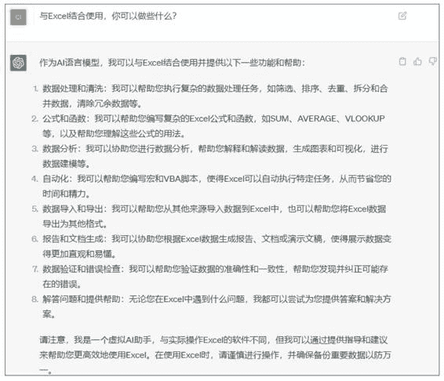

图 1-3

### 002 管控 ChatGPT 会话窗口


扫码观看教学视频

`ChatGPT` 会自动将历史会话归档至左侧列表，用户可对会话窗口执行新建、重命名、删除等管理动作，具体操作如下。

**步骤 01** 进入 `ChatGPT` 任一已用会话，点击左上角的 `New chat` 按钮，如图 1-4 所示，即可创建全新会话窗口。


图 1-4

**步骤 02** 选中目标会话，点击  按钮，如图 1-5 所示。


图 1-5

**步骤 03** 界面随即弹出编辑框，支持修改会话名称，如图 1-6 所示。

**步骤 04** 点击  按钮确认重命名。随后点击  按钮，如图 1-7 所示。


▲图 1-7

**步骤 05** 系统弹出 `Delete chat?` 确认框，询问是否删除该会话。 若确认删除，点击 `Delete` 按钮； 若放弃删除，点击 `Cancel` 按钮，如图 1-8 所示。


▲图 1-6


图 1-8

**专家贴士**

- 对 `ChatGPT` 的回复不满意时，可点击 `Regenerate response` 让其重新生成。
- 发现当前生成内容有误时，可点击 `Stop generating` 强制中止输出。

### 003 掌握 ChatGPT 换行技巧


扫码观看教学视频

`ChatGPT` 输入框支持多段落、多行录入，操作要领如下。

**步骤 01** 打开对话窗口，在输入框键入首行指令：“以 `Excel` 表格形式对以下内容分类：”，如图 1-9 所示。


图 1-9

**步骤 02** 按下 `Shift+Enter` 组合键换行，继续录入内容：“苹果、绿萝、香蕉、黄瓜、生菜、玫瑰、辣椒”，如图 1-10 所示。


图 1-10

**步骤 03** 按 `Enter` 键发送。`ChatGPT` 将依据内容回复，如图 1-11 所示。

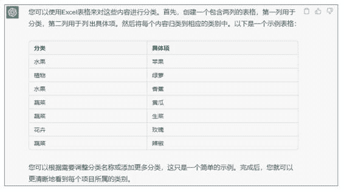

图 1-11

### 004 熟练运用 ChatGPT 重写功能


扫码观看教学视频

若发送给 `ChatGPT` 的指令或关键词存在偏差、不够精准，可通过重写功能修正。操作流程如下。

**步骤 01** 以示例 003 为例，在会话中点击已发送消息右侧的  按钮，如图 1-12 所示。


图 1-12

**步骤 02** 进入编辑状态。 将原指令“以 `Excel` 表格形式对以下内容分类：”修改为“以表格形式对以下内容分类：”； 点击 `Save&Submit` 按钮提交，如图 1-13 所示。


图 1-13

**步骤 03** `ChatGPT` 基于新指令再次回复，发送内容下方生成分页码，如图 1-14 所示。修改前后的版本均被保留，用户可通过翻页查阅历史版本。

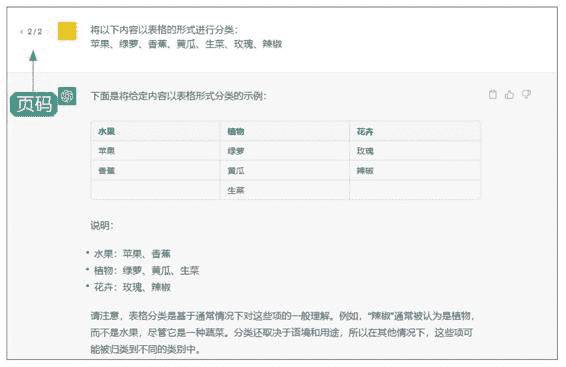

图 1-14

## 1.2 精准提问，驾驭 ChatGPT

学完 1.1 节内容，相信大家已掌握 `ChatGPT` 的基础操作。作为语言模型，`ChatGPT` 依据用户输入的需求与思路作答。若想让回复更精准、更贴合预期，关键在于掌握“如何正确提问”，从而释放其最大效能。

### 005 精准界定数据处理需求


扫码观看教学视频

向 `ChatGPT` 提问时，务必清晰、具体地描述在 `Excel` 中欲完成的任务。明确的指令能助其精准捕捉意图，给出靠谱答案。

例如，用户需在 `Excel` 中绘制展示销售数据与趋势的折线图。若仅笼统提问“`Excel` 怎么做折线图？”，`ChatGPT` 给出的往往是通用回复，操作步骤甚至不全对，如图 1-15 所示。

若改用具体表述：“如何在 `Excel` 中创建折线图，以展示销售数据与销售趋势？”，`ChatGPT` 将返回更精准、步骤更详尽的方案，如图 1-16 所示。

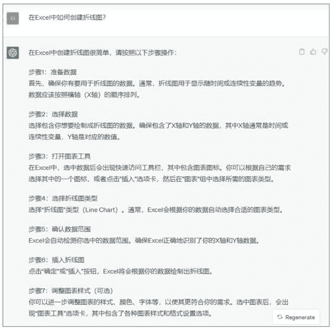

▲图 1-15

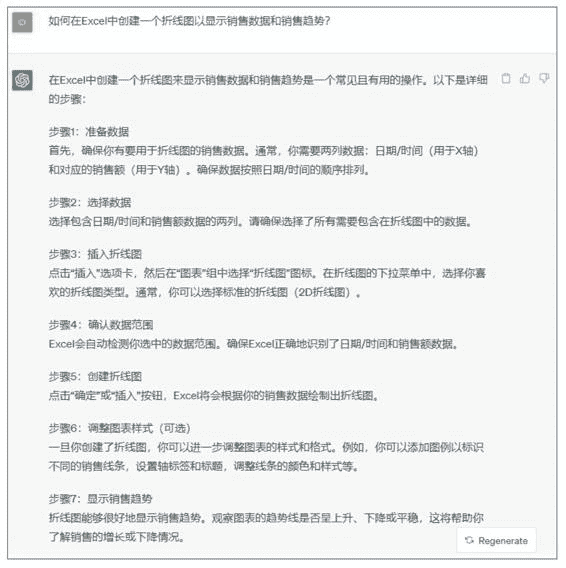

▲图 1-16


图 1-16（续）

### 006 充分提供数据源背景


扫码观看教学视频

提问涉及特定数据源或数据表处理时，必须同步提供相关数据信息，方便 `ChatGPT` 深度理解问题。下面通过实战案例说明。

**步骤 01** 打开 `Excel` 工作表，如图 1-17 所示。其中 `A2:A11` 为销售日期，`B2:B11` 为销售产品，`C2:C11` 为销售金额。需按 `F` 列产品统计销售总额。

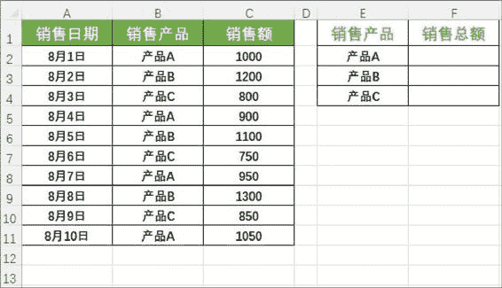

图 1-17

**步骤 02** 若直接问“`Excel` 怎么按销售产品算总销售额？”，`ChatGPT` 会给出适用公式并解析，如图 1-18 所示。

### 步骤 03：提供完整数据源细节提问
当你向 `ChatGPT` 给出详尽的数据源说明时，例如：“我的 `Excel` 表格里存放着销售记录，`A2:A11` 列记录日期，`B2:B11` 列是商品名，`C2:C11` 列对应金额。现在需要根据 `E2:E4` 单元格里的商品名称，在 `F2:F4` 处分别汇总销售总额，请问用什么公式？”`ChatGPT` 便能直接给出现成的公式，效果如图 1-19 所示。

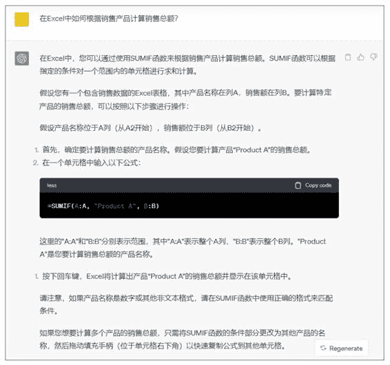

▲图 1-18

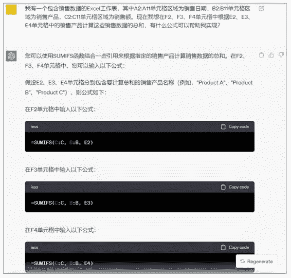

▲图 1-19

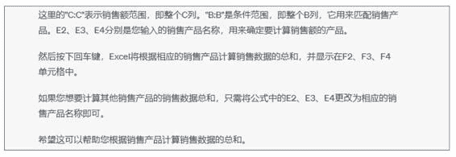

图 1-19（续）

### 步骤 04：复制公式代码
点击首个公式右上角的 `复制代码` 按钮，如图 1-20 所示。

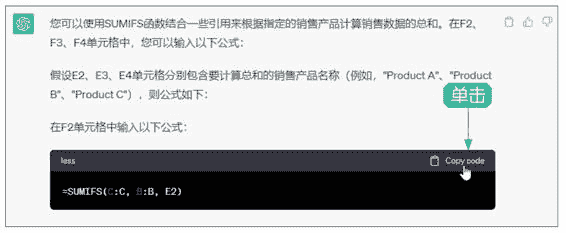

图 1-20

### 步骤 05：粘贴验证结果
切回 `Excel` 工作表，在 `F2` 单元格按 `Ctrl+V` 粘贴，产品 A 的销售总额即刻计算出来，参考图 1-21。

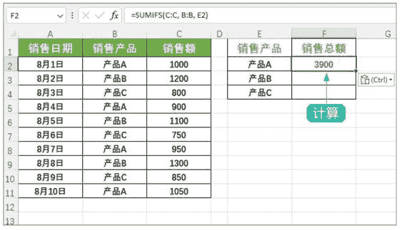

图 1-21

### 步骤 06：批量套用其余单元格
同理，将公式复制粘贴到 `F3`、`F4` 单元格，即可分别算出产品 B 和产品 C 的销售汇总，详见图 1-22。

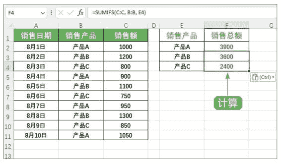

图 1-22

### 007 用模拟案例获取操作指引


扫码观看教学视频

若不方便直接提供数据源，可以构造一个具体的模拟场景，并清晰描述预期结果，以此帮助 `ChatGPT` 精准理解需求。下面演示具体操作流程。

**步骤 01**
打开 `ChatGPT` 对话框，在输入框键入指令：

```
Assume I have an Excel table containing student exam scores, and now I want to calculate the average score of each student. For example, the data in the table is as follows (try to align rows and columns):

Name  Chinese  Math  English
Zhang San  85    92    78
Li Si      76    88    90
Wang Wu    90    85    82

Question: What formula can help me calculate the average score of each student?
```

如图 1-23 所示。

#### 第 1 章（页眉）

## 1.2 进阶提问技巧

### 008 指定函数或功能名称提问


*扫码观看教学视频*

提问时若能点名特定的 `Excel` 函数或功能，`ChatGPT` 的回复会更贴合预期、更精准。具体做法如下。

#### 步骤 01
打开聊天窗口，输入引用函数的提示词：`“如何使用 VLOOKUP 函数进行数据查找？”`，界面如图 1-25。


图 1-25

#### 步骤 02
稍等片刻，`ChatGPT` 便会输出与该函数强相关的详细说明，见图 1-26。

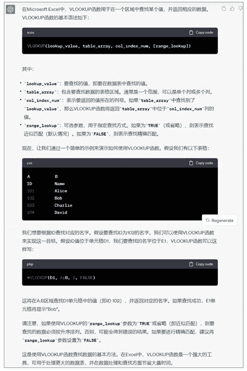

图 1-26

#### 步骤 03
接着改用功能名称提问：`“怎么利用数据透视图制作动态图表？”`，`ChatGPT` 会随之给出对应的操作步骤，如图 1-27 所示。

### 009 正确看待 ChatGPT 的局限性


*扫码观看教学视频*

`ChatGPT` 本质是基于语言模型的处理工具，能力有边界。若遇到它无法作答、中途停顿、回复不全或给出错误方案，多半是模型知识储备不足导致，无需惊慌。

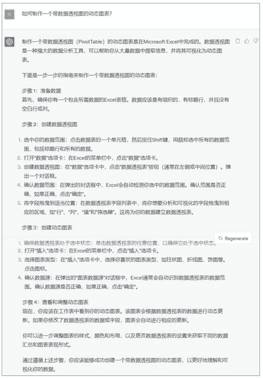

图 1-27

举例而言，询问 `“Excel 中如何用历史数据做时间序列预测？”` 可能就会得到不完整的回复，如图 1-28。

针对这类情况，建议先尝试提问模型擅长领域的问题；其次可以调整提示词、开启新对话，或多次点击 `重新生成` 按钮尝试。

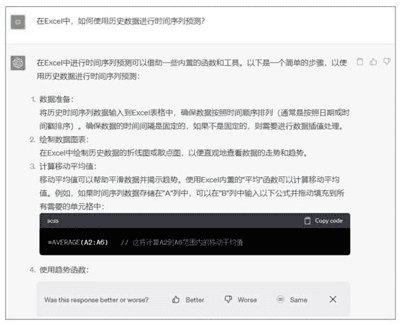

图 1-28

### 010 训练 ChatGPT 的回答模式


*扫码观看教学视频*

获取回答时，你可以分步引导 `ChatGPT` 输出更符合预期的内容；也能通过喂入背景信息、在提问中加入明确指令来“调教”它的回复机制。

例如发送提示词：`“我有张销售数据表，想做柱状图展示各业务员销售额，请按‘步骤 1，……；步骤 2，……；步骤 3，……’的格式告诉我操作方法。”` `ChatGPT` 便会严格按要求的格式回复，见图 1-29。

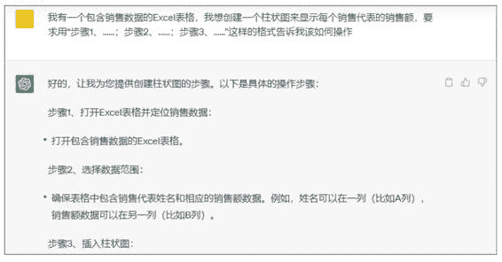

图 1-29

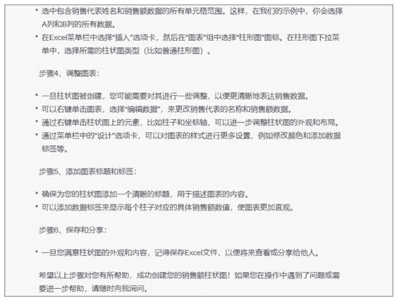

图 1-29（续）

### 011 结合上下文追问或补全描述


*扫码观看教学视频*

若 `ChatGPT` 回复不够详尽或未彻底解决问题，可在追问时引用前文对话内容。这样能让它更好地理解意图，持续提供帮助。操作如下：

#### 步骤 01
在对话框发送：`“假设我表里 A2:A9 存学生姓名，B2:D9 存科目成绩，求每位学生平均分的公式。”` `ChatGPT` 回复见下图 1-30。

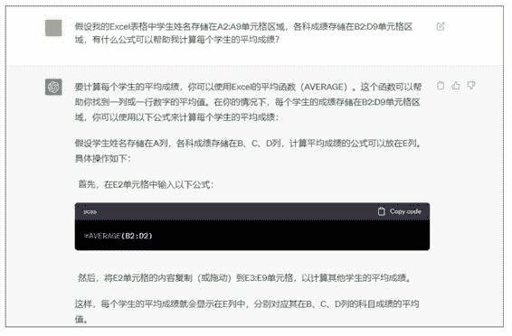

图 1-30

#### 步骤 02
继续追问：`“怎样快速找出每个学生最弱科目？”` `ChatGPT` 会结合上下文语境给出答案，见图 1-31。

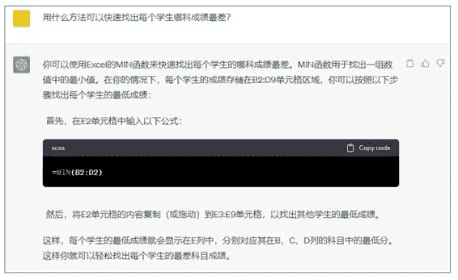

图 1-31

### 012 为 ChatGPT 设定角色


*扫码观看教学视频*

提问时明确告知你的身份背景，或给 `ChatGPT` 赋予特定人设，能让回答更有针对性。具体步骤如下：

#### 步骤 01
说明你的角色：`“我是 HR 经理，一个月内要招 20 人，还要负责面试和培训，请以表格形式排个进度表。”` `ChatGPT` 会用第二人称视角回复，见图 1-32。

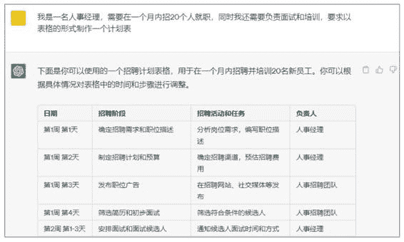

图 1-32

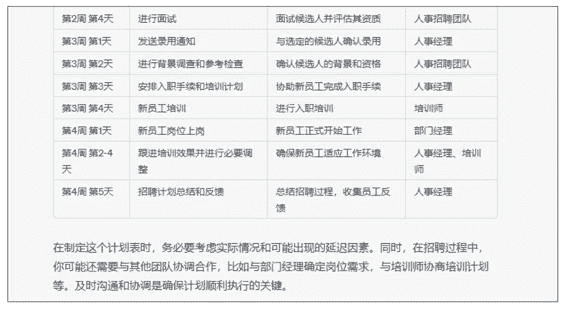

图 1-32（续）

#### 步骤 02
设定 AI 人设：`“你是精通 Excel 的销售经理，面对销售数据，你会怎么建透视表分析趋势？”` `ChatGPT` 会以第一人称专业视角作答，见图 1-33。

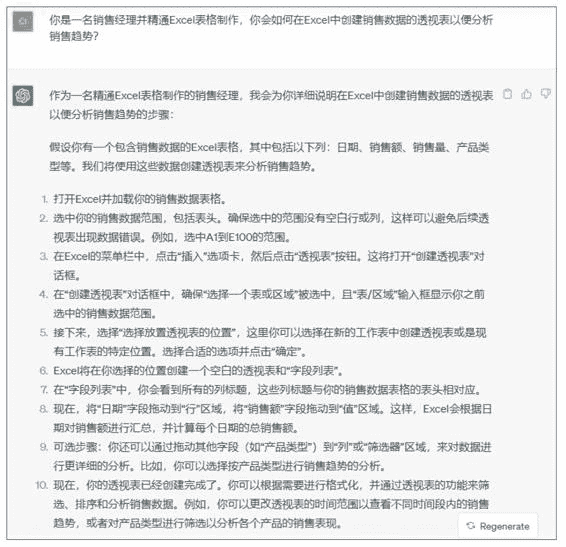

图 1-33

## 1.3 借助 ChatGPT 掌握 Excel 常规操作

学完前面章节，你已掌握如何高效驱动这个虚拟 AI 助手来提升 Excel 效率。本节将梳理哪些 Excel 操作能求助于 `ChatGPT`，以及它能为你的数据表做什么。

### 013 学习表格美化排版操作


*扫码观看教学视频*

表格美化指在 Excel 中调整外观与样式的过程。你可以向 `ChatGPT` 咨询单元格样式设置、加边框、填充颜色、字体格式等，获取相应指导建议。

例如在对话框问：`“如何把 Excel 表里的数值设成货币格式，并加粗边框？”` `ChatGPT` 会指引完成相关排版操作，见图 1-34。

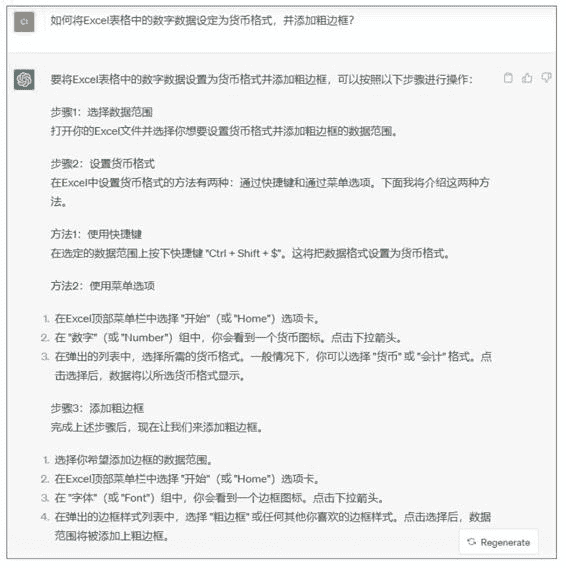

图 1-34

### 014 学习表格布局调整操作


*扫码观看教学视频*

# ChatGPT玩转Excel：从智能排版到自动建表全流程指南

还在手动拖拽列宽、逐行筛选数据？这份指南带你解锁ChatGPT的Excel隐藏技能，从排版美化、数据筛选到可视化图表、自动生成报告，甚至把杂乱文本一键变成标准表格，全程对话式操作，小白也能秒变大神。

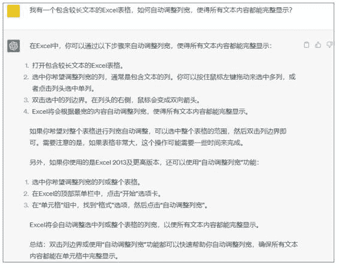

---

### 015 秒速筛选：别再手动找数据了


*扫码观看教学视频*

Excel自带的“筛选”功能虽强，但条件复杂时容易眼花。下次直接甩给ChatGPT：*“帮我筛选出销售额超过1000的记录，步骤怎么操作？”* 它会直接给出傻瓜式图解步骤，照着点就行。

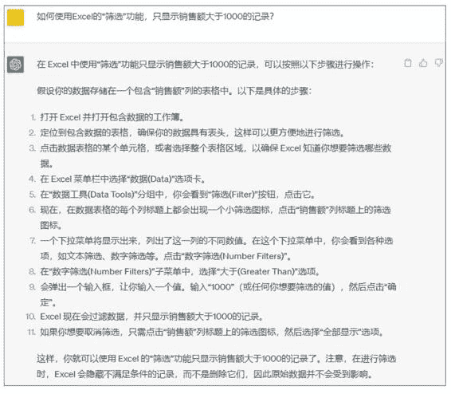

---

### 016 一键出图：组合图表也能“说”着做


*扫码观看教学视频*

图表能让数据趋势一目了然，但选图、调色、组合双轴最费神。试着问：*“各地区销售额想用簇状柱形图配折线图（组合图）展示，咋弄？”* ChatGPT会手把手教你从插入到美化的全流程。

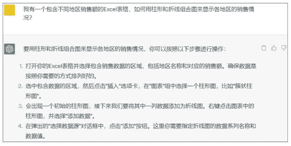  
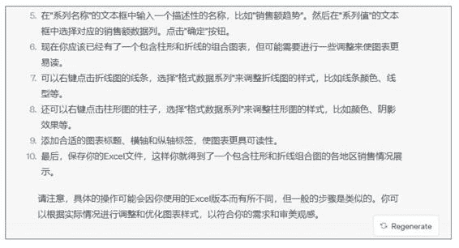

---

### 017 重点标红：条件格式一句搞定


*扫码观看教学视频*

想让“高于平均值”的单元格自动变红？别去翻菜单栏了。发条指令：*“用条件格式把销售额高于平均值的单元格标红。”* 规则、格式、应用范围全帮你配好。

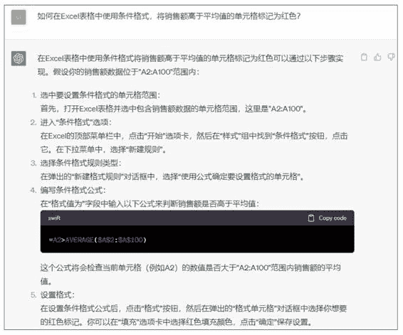  
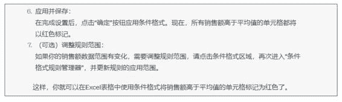

---

### 018 自动写报告：从数据到图表全自动


*扫码观看教学视频*

把原始数据喂给ChatGPT，它能直接帮你出分析报告。试试这个提示词：*“基于这份销售数据（含日期、金额、地区），生成一份报告，重点用折线图展示月度销售趋势。”* 报告框架、图表建议、排版建议一次给全。

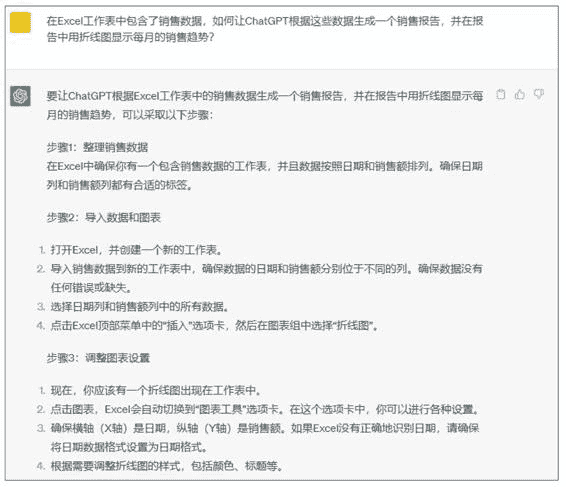  
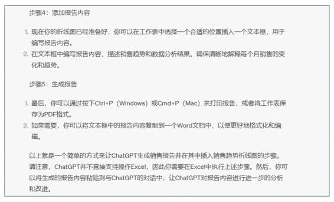

---

### 019 深度分析：求和平均、透视表全懂


*扫码观看教学视频*

复杂公式不会写？透视表不会拖？直接报坐标：*“B2:B11区域是销售数据，帮我写求和和平均值公式；再教我建透视表汇总按地区统计。”* 公式、字段拖拽布局全搞定。

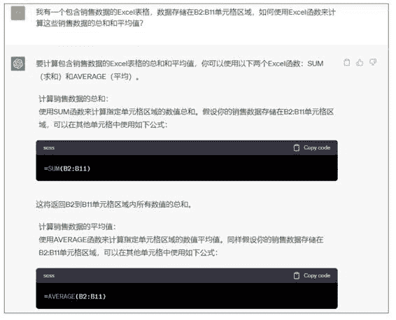  


---

### 020 文本变表格：复制粘贴一气呵成


*扫码观看教学视频*

这是个“隐藏神技”：**把记事本里的乱糟糟文本，变成带公式、会计算的Excel表**，全程不到1分钟。

**实操SOP：**

1.  **备料**：打开记事本，确认数据格式清晰。  
    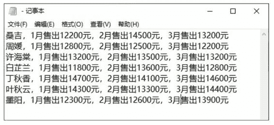
2.  **全选复制**：`Ctrl+A` → `Ctrl+C` 搞定。  
    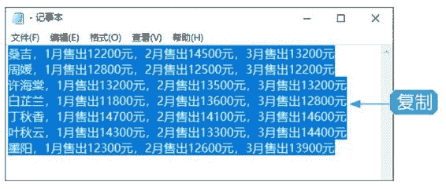
3.  **发指令**：进ChatGPT对话框，输：`把以下数据整理成表格：`  
    
4.  **粘贴数据**：`Shift+Enter` 换行 → `Ctrl+V` 粘贴 → 回车发送。  
    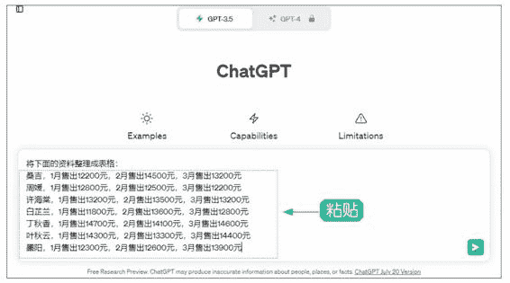
5.  **得初版表**：秒出结构化表格。  
    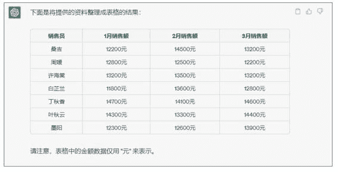
6.  **追需求（加总列）**：继续对话：`给每个员工加个“1-3月总销售额”列。`  
    
7.  **得终版表**：自动重算生成新表。  
    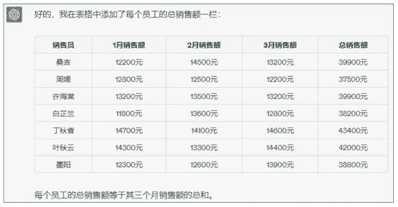
8.  **复制走人**：选中表格 → 右键复制。  
      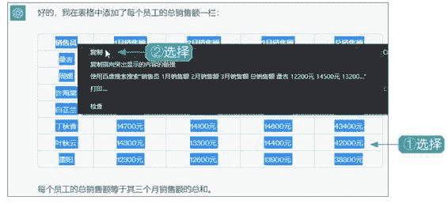
9.  **落地Excel**：新建工作表 `Ctrl+V` 粘贴。  
    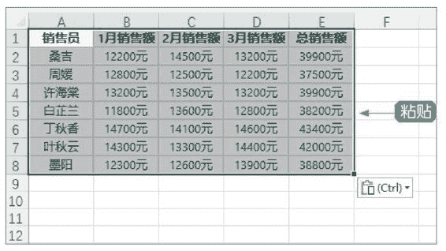
10. **微调收尾**：调整行高列宽，完工！  
    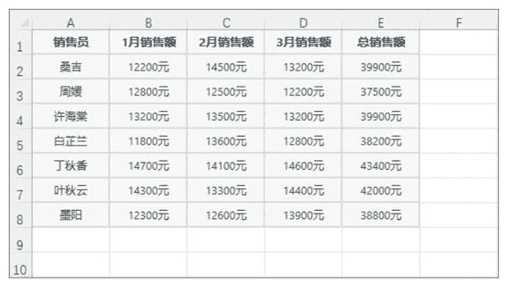

> **进阶玩法**：后续还能追加“按总额降序排”、“添加达标率列”等要求，ChatGPT会直接在表格上迭代，最后再粘贴回Excel，行云流水。

---

# 第二章 智能计算：让ChatGPT帮你写公式

> **学习小贴士**
>
> Excel内置400+函数，覆盖统计、逻辑、查找、筛选等场景。借ChatGPT写公式，不只是快，更能避开括号匹配、引用出错等“低级坑”，让计算既智能又可靠。

> **本章导航**
>
> 公式构建基操 | ChatGPT辅助计算 | 实战写公式技巧

## 2.1 公式构建基操：不懂引用，写再多公式也白搭

想用好函数，先得搞透**相对引用、绝对引用、混合引用**这三兄弟，再搞懂公式语法、函数插入法、函数库选函数。地基不牢，地动山摇——打牢这些基本功，后面灵活套路才跟得上。

### 021 必修课：三种引用模式一张图看懂


*扫码观看教学视频*

Excel 中的单元格引用，指的是在公式里直接调用其他单元格的地址，从而自动获取其中的数值参与运算，省去了手动录入数据的麻烦，极大地提升了计算效率。

Excel 采用“字母+数字”的坐标系标识单元格（如 `A1`、`B2`），这些单元格可存放数值、文本、日期等多种数据类型。编写公式时，只需引用这些地址即可操作对应数据。例如，想在 `A3` 汇总 `A1` 与 `A2` 的数值，只需在 `A3` 输入 `=A1+A2`。其中 `+` 为加法运算符，`A1` 与 `A2` 便是指向对应单元格的引用。

掌握引用机制是发挥 Excel 强大计算能力的关键。引用主要分为相对引用、绝对引用与混合引用三大类，下面逐一拆解。

#### 1. 相对引用

相对引用的核心在于“位置关系”：公式会根据自身所在位置的偏移量，自动调整所引用的目标单元格。

#### 步骤 01

打开工作表，在 `B2` 单元格直接输入 `=B1`，效果如图 2-1 所示。

#### 步骤 02

按下 `Enter` 确认，`B2` 即刻显示 `B1` 的值（此处为 1），如图 2-2 所示。

#### 步骤 03

向右拖动 `B2` 右下角的填充柄，引用目标随位置水平位移，公式自动从 `=B1` 变为 `=C1`，见 图 2-3。

#### 步骤 04

若向下拖动，公式则变为 `=B2`，见 图 2-4。规律明确：横向拖动列字母变，纵向拖动行号变。

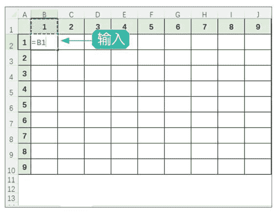

图 2-1

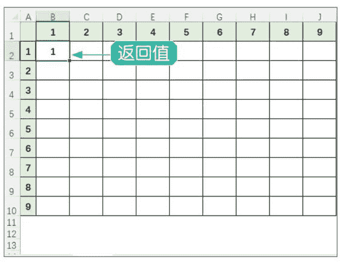

图 2-2


图 2-3

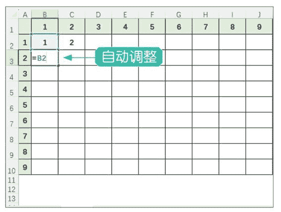

图 2-4

#### 2. 绝对引用

绝对引用能“锁死”目标单元格，无论公式复制到何处，引用地址纹丝不动。编辑引用时按 `F4` 即可添加 `$` 符号切换模式。

#### 步骤 01

沿用上例，在 `B2` 输入 `=B1`，如图 2-5。

#### 步骤 02

按下 `F4`，公式变为 `=$B$1`，双 `$` 标志着行列均已锁定，如图 2-6。

#### 步骤 03

测试拖动：无论向哪个方向填充，所有单元格公式均保持 `=$B$1` 不变，如图 2-7。

#### 专家进阶

## 2.2 巧用 ChatGPT 辅助算式

### 3. 混合引用

混合引用是相对与绝对的组合：锁行不锁列（`B$1`），或锁列不锁行（`$B1`），实现单方向固定。

**步骤 01** 在 `B2` 输入 `=B1`。首次按 `F4` 成绝对引用；再按一次变为 `=B$1`（行绝对、列相对），见 图 2-8。

**步骤 02** 向下填充，公式维持 `=B$1`，行号固定不变，见 图 2-9。

**专家提示**

连按 4 次 `F4` 可循环回初始状态，记熟这套节奏能大幅提速。

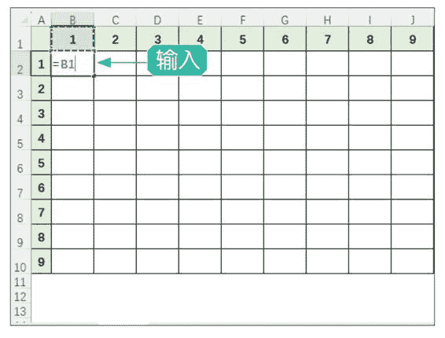

▲图 2-5

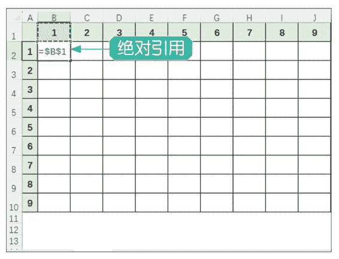

▲图 2-6


图 2-7

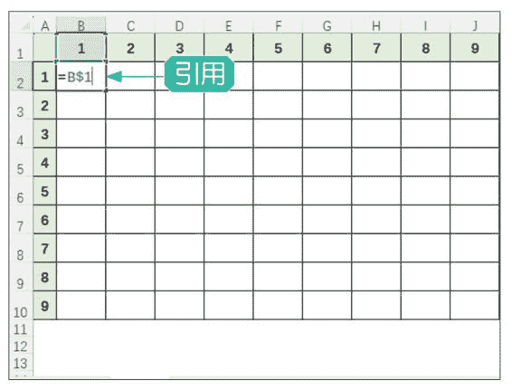

▲图 2-8

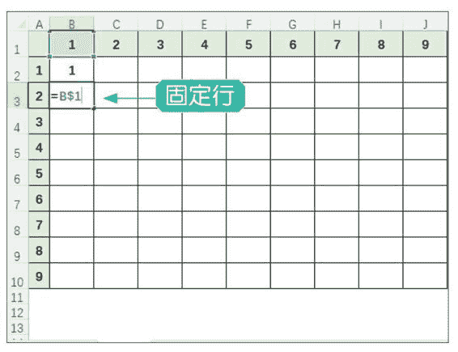

图 2-9

**步骤 03** 向右填充，公式变为 `=C$1`，列字母递增、行号锁定，见 图 2-10。

**步骤 04** 在 `B2` 第三次按 `F4`，公式成 `=$B1`（列绝对、行相对），见 图 2-11。

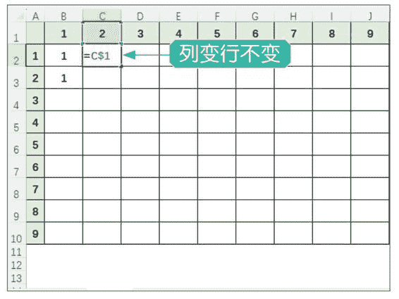

▲图 2-10

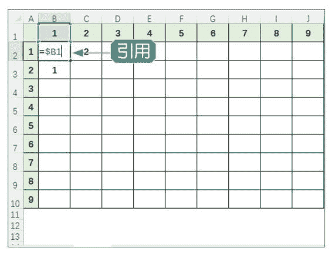

图 2-11

**步骤 05** 向右填充，公式不变 `=$B1`，列锁定生效，见 图 2-12。

**步骤 06** 向下填充，公式变 `=$B2`，行号递增、列字母不变，见 图 2-13。

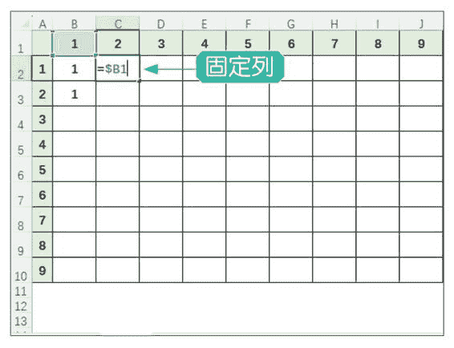

▲图 2-12


图 2-13

### 022 极速构建计算公式


*扫码观看教学视频*

Excel 统计无需手算再录入，建好公式让表格自动跑数即可。建立公式主要有两条路：一是像写数学式一样，用 `+ - * /` 连接单元格引用；二是调用函数，按语法填参数完成专项计算。

下面演示快速建立算式的实操流程。

**步骤 01** 打开工作表（如图 2-14），目标是算出各产品的总销售额。

**步骤 02** 先梳理数据源：本例中总销售额 = 单价 × 销量，表格里其它列暂不参与运算。

**步骤 03** 选中 `B4`，输入等号 `=` 起式，如图 2-15。


▲图 2-14


图 2-15

**步骤 04** 点选 `B2` 引入单价，如图 2-16。

**步骤 05** 输入乘号 `*`（键盘 `Shift+8`），如图 2-17。


▲图 2-16


图 2-17

**步骤 06** 点选 `B3` 引入销量，如图 2-18。

**步骤 07** 公式 `=B2*B3` 成型，回车确认，产品 A 销售额出炉，如图 2-19。


▲图 2-18


图 2-19

**步骤 08** 拖动 `B4` 填充柄至 `D4`，产品 B、C 销售额批量搞定，如图 2-20。


图 2-20

### 023 极速插入函数公式


*扫码观看教学视频*

借助公式栏的“插入功能”，能快速调用 Excel 内置函数处理汇总分析。实操步骤如下：

**步骤 01** 打开工作表（如图 2-21），需统计各产品总销量。

**步骤 02** 选中 `B6`，点击公式栏左侧“插入函数”图标，如图 2-22。

**步骤 03** 弹出“插入函数”对话框，如图 2-23。

**步骤 04** 在“搜索函数”框输入关键词（如“求和”），点“执行搜索”，如图 2-24。


▲Figure 2-21


▲Figure 2-22


▲Figure 2-23


Figure 2-24

**步骤 05** 操作完成后，“选择函数”列表框中会显示求和函数；此处选中 `SUM` 函数，效果如图 2-25 所示。列表框底部会同步呈现该函数的语法结构与功能说明。

**步骤 06** 点击“确定”按钮，随即弹出“函数参数”对话框。此时 `Number1` 输入框已自动捕获单元格区域 `B2:B5`，表明即将对该区域数值进行汇总计算，界面如图 2-26 所示。

**专家技巧**

在 Excel 中实现 `SUM` 求和，还有两条更快捷的路径：

- 选中目标结果单元格，直接按下 `Alt+=` 组合键，即可秒出求和结果。
- 切换到“开始”选项卡，在“编辑”功能组里点击“自动求和”图标，同样能一键完成汇总。


▲Figure 2-25


Figure 2-26

**步骤 07** 再次点击“确定”，单元格 `B6` 立即返回计算出的数值，参考图 2-27。

**步骤 08** 选中 `B6` 单元格，拖动填充柄向右延伸至 `D6`，公式随之填充复制，从而批量得出产品 B 与产品 C 的总销量，结果如图 2-28 所示。


▲Figure 2-27


Figure 2-28

### 024 借助函数列表（自动完成）精准选取函数


扫码观看教学视频

在 Excel 工作表中，利用函数列表（即自动完成功能）挑选函数，能大幅加快公式编写速度，同时有效规避手输错误。下面演示具体的操作流程。

**步骤 01** 打开工作表，界面如图 2-29 所示。当前任务是统计表中每位销售人员的销售总量。

**步骤 02** 定位至 `E2` 单元格，输入 `=SU`；屏幕上方立即弹出以“SU”开头的函数候选列表，见图 2-30。


▲Figure 2-29


Figure 2-30

**步骤 03** 在下拉列表中挑选目标函数，此处选中 `SUM`，效果见图 2-31。

**步骤 04** 双击鼠标左键，即可将选中的函数名称插入正在编辑的公式中，见图 2-32。


▲Figure 2-31


Figure 2-32

**步骤 05** 用鼠标选取 `B2:D2` 区域作为参数；切换至英文输入模式补上右括号，求和公式即告完成，见图 2-33。

**步骤 06** 按下 `Enter` 确认，第一位销售人员的销售总量随之呈现，见图 2-34。


▲Figure 2-33


Figure 2-34

**步骤 07** 向下拖动 `E2` 单元格的填充柄至 `E5`，公式向下复制，其余销售人员的销量也随之批量计算得出，见图 2-35。


Figure 2-35

### 025 公式报错？Excel 自动纠错来帮忙


扫码观看教学视频

Excel 要求公式中的符号必须在英文半角状态下录入。若误用中文全角符号，或因手滑多输、少输字符，Excel 都能依据输入内容敏锐识别并主动修正。下面通过实例直观感受这一贴心功能。

**步骤 01** 打开工作表，在第 6 行的合并单元格内录入 `==SUM（B2:D5)`，见图 2-36。该公式存在两处硬伤：开头多了一个等号，且括号为中文全角输入。

**步骤 02** 按 `Enter` 确认后，Excel 立即捕获异常，弹出提示框并给出修正建议，见图 2-37。


▲Figure 2-36


Figure 2-37

**步骤 03** 点击“是”按钮采纳修正，合并单元格随即显示修正后公式的计算结果，见图 2-38。


Figure 2-38

### 026 善用 ChatGPT 查询求和快捷键


扫码观看教学视频

做汇总统计时若记不住求和快捷键，不妨直接向 ChatGPT 发问，获取答案后再回 Excel 应用。具体操作如下。

**步骤 01** 打开 ChatGPT 对话窗口，点击底部输入框，发送提示词：“Excel 里求和的快捷键是什么？”，界面如图 2-39。


Figure 2-39

**步骤 02** 按 `Enter` 发送。ChatGPT 依据提问回复了求和快捷键及其功能、用法说明，见图 2-40。


Figure 2-40

### 027 让 ChatGPT 讲解函数用法


扫码观看教学视频

制表过程中需要调用或理解某个函数时，无需花时间在网上检索，直接找 ChatGPT 即可获取语法、用途等详细信息。操作示例如下。

**步骤 01** 打开 ChatGPT 对话窗口，在输入框发送提示词：“请讲解 Excel 中 VLOOKUP 和 HLOOKUP 函数的原理与用法”，见图 2-41。


Figure 2-41

**步骤 02** 按 `Enter` 发送。ChatGPT 按要求输出了 `VLOOKUP` 与 `HLOOKUP` 的使用方法及示例，见图 2-42。


Figure 2-42

### 028 借力 ChatGPT 补全与编写函数公式


扫码观看教学视频

编写 Excel 函数公式时，既可让 ChatGPT 从零生成完整公式，也可让它接力补全未写完的公式。下面演示具体做法。

**步骤 01** 打开 Excel 表，B 列记录店铺评分，现需在 C 列用爱心符号直观展示推荐程度，数据源见图 2-43。


Figure 2-43

**步骤 02** 打开 ChatGPT，输入提示词：“Excel 表中 B 列为店铺评分，请帮写公式在 C 列用爱心符号数量表示评分数值”，见图 2-44。


Figure 2-44

**步骤 03** 按 `Enter` 发送。ChatGPT 生成完整公式并附带解读，见图 2-45。


Figure 2-45

**步骤 04** 选中生成的公式，右键选择“复制”，见图 2-46。


Figure 2-46

**步骤 05** 回到 Excel 表，将公式粘贴至 `C2` 单元格：`=REPT ("❤", B2)`，见图 2-47。


Figure 2-47

**步骤 06** 按 `Enter` 确认，第一行推荐程度已用爱心符号呈现，见图 2-48。

**步骤 07** 选中 `C2:C7` 区域，见图 2-49。


▲Figure 2-48


Figure 2-49

**步骤 08** 点击公式栏任意位置，按 `Ctrl+Enter` 组合键批量填充公式，所有行的推荐程度瞬间转化为爱心符号，见图 2-50。


Figure 2-50

**步骤 09** 接下来需隐藏 D 列店铺编码的中间 4 位（用 `*` 替代）。再次打开 ChatGPT，发送提示词：“D 列为店铺编码，需用 `*` 隐藏中间 4 位，请帮补全公式：`=REPLACE(D2,3)`”，见图 2-51。


Figure 2-51

**步骤 10** 按 `Enter` 发送。ChatGPT 补全了 `REPLACE` 函数的剩余参数并给出说明，见图 2-52。


Figure 2-52

**步骤 11** 选中已生成的公式，右键点击并在快捷菜单中选择“**复制**”，如图 2-53 所示。


Figure 2-53

**步骤 12** 切回 Excel 工作表，选中单元格 `D2`，将复制的公式粘贴至公式栏：`=REPLACE(D2,3,4,"****")`，效果见图 2-54。


Figure 2-54

**步骤 13** 选中原始门店代码，按 `Ctrl+X` 剪切；接着选中公式中的 `D2` 引用，按 `Ctrl+V` 粘贴，将单元格引用替换为实际的门店代码文本，如图 2-55 所示。

**步骤 14** 按 `Enter` 键确认，门店代码中间 4 位即被隐藏，如图 2-56 所示。


▲Figure 2-55


Figure 2-56

**步骤 15** 复制 `D2` 单元格中的公式，选中 `D3` 单元格，用相同方式粘贴至公式栏；将第一个参数替换为 `D3` 单元格的门店代码，如图 2-57 所示。

**步骤 16** 重复上述操作，批量隐藏其余门店代码的中间 4 位，结果见图 2-58。


▲Figure 2-57


Figure 2-58

### 029 借助 ChatGPT 校验公式正确性


扫码观看教学视频

在 Excel 中，若发现编写的函数公式报错或计算结果不符预期，可借助 ChatGPT 进行排查与优化。以下演示具体操作流程。

**步骤 01** 打开工作表，A 列为预设数值。我们需要通过公式在 B 列提取 A 列数值并保留 3 位小数，如图 2-59 所示。

**步骤 02** 选中 `B2` 单元格，输入公式：`=ROUND(A2)`，如图 2-60 所示。


▲Figure 2-59


Figure 2-60

**步骤 03** 按 `Enter` 确认，弹出提示框，点击“确定”，如图 2-61 所示。


Figure 2-61

**步骤 04** 打开 ChatGPT 对话窗口，在底部输入框键入指令：“在 Excel 工作表中，需在 B2 单元格保留 A2 单元格数值的 3 位小数，请帮我检查并修正公式：`=ROUND(A2)`”，如图 2-62 所示。


Figure 2-62

**步骤 05** 发送指令，ChatGPT 将返回校验并优化后的公式，如图 2-63 所示。


Figure 2-63

**步骤 06** 点击公式右上角的“复制代码”按钮复制内容，如图 2-64 所示。


Figure 2-64

**步骤 07** 返回 Excel，将复制的公式粘贴至 `B2` 单元格：`=ROUND(A2,3)`，如图 2-65 所示。

**步骤 08** 按 `Enter` 确认，A2 的数值即按 3 位小数提取，如图 2-66 所示。


▲Figure 2-65


Figure 2-66

**步骤 09** 将光标移至 `B2` 右下角填柄处，按住左键下拖至 `B6` 填充公式，即可批量完成 A 列数值的 3 位小数提取，最终效果见图 2-67。


Figure 2-67

## 2.3 让 ChatGPT 帮你写公式

Excel 函数是数据处理的利器，通过公式可实现汇总、分析、预测等操作，大幅提升计算效率。本节将介绍如何利用 ChatGPT 编写函数公式，直接在工作表中落地计算。

### 030 用 ChatGPT 快速算平均值


扫码观看教学视频

需要在单元格中计算平均值时，可直接向 ChatGPT 索要公式。具体步骤如下：

**步骤 01** 打开工作表，如图 2-68 所示，需在 E 列计算各商品的平均销量。


Figure 2-68

**步骤 02** 打开 ChatGPT，输入指令：“在 Excel 中，需在 E2 单元格计算区域 `B2:D2` 的平均值，请提供公式。” 发送后，ChatGPT 将返回计算平均值的公式，如图 2-69 所示。


Figure 2-69

**步骤 03** 复制回复的公式，回到 Excel 选中 `E2:E5` 区域，粘贴至公式栏：`=AVERAGE(B2:D2)`，如图 2-70 所示。

**步骤 04** 按 `Ctrl+Enter` 组合键，瞬间完成批量平均值计算，如图 2-71 所示。


▲Figure 2-70


Figure 2-71

### 031 用 ChatGPT 获取绩效排名


扫码观看教学视频

若需在不改变排序的前提下快速得出员工绩效排名，ChatGPT 同样能派上用场。操作方法如下：

**步骤 01** 打开工作表，如图 2-72 所示，需在 C 列计算各员工的绩效排名。

**步骤 02** 在 ChatGPT 输入框键入：“在 Excel 中，需在 C 列计算 `B2:B7` 区域内各数值的排名，请提供公式。” 发送后获取排名公式，如图 2-73 所示。


▲Figure 2-72


Figure 2-73

**步骤 03** 复制公式，回到 Excel 选中 `C2:C7`，粘贴至公式栏：`=RANK(B2,$B$2:$B$7)`，如图 2-74 所示。


Figure 2-74

**步骤 04** 按 `Ctrl+Enter` 确认，所有员工的绩效排名即刻生成，如图 2-75 所示。


Figure 2-75

### 032 用 ChatGPT 实现累计求和


扫码观看教学视频

面对累计求和不知如何下手？让 ChatGPT 给你现成公式。操作如下：

**步骤 01** 打开工作表，如图 2-76 所示，需在 C 列对 B 列数值进行累计求和。


Figure 2-76

**步骤 02** 向 ChatGPT 发送指令：“在 Excel 中，需在 C 列对 `B2:B7` 区域数值做累计求和，请提供公式。” 获取回复公式，如图 2-77 所示。


Figure 2-77

**步骤 03** 复制公式，回到 Excel 选中 `C2:C7`，粘贴至公式栏：`=SUM($B$2:B2)`，如图 2-78 所示。


Figure 2-78

**步骤 04** 按 `Ctrl+Enter` 执行，累计求和结果呈现，如图 2-79 所示。


Figure 2-79

### 033 用 ChatGPT 定位查找员工信息


扫码观看教学视频

# 巧用 INDEX 与 MATCH 组合，实现 Excel 数据精准定位

在 Excel 中，`INDEX` 函数能根据指定区域返回单元格数值或区域引用，而 `MATCH` 函数则擅长在区间内查找特定值并反馈其相对位置。将两者结合，便能高效完成数据定位、信息检索及录入校验等任务。下面通过实战案例，演示如何借助 ChatGPT 快速生成 `INDEX` 与 `MATCH` 组合公式，查找员工档案信息。

**步骤 01** 打开工作表（参考  图示）。界面呈现两张表单，右侧表格的缺失数据需从左侧表格中匹配获取。


**步骤 02** 启动 ChatGPT 对话窗口，在输入框键入指令：“Excel 表中，`A:C` 列为查找源区域。需定位 `F` 列单元格提供的姓名在源区域的行号，以及 `I` 列表头在源区域首行的列号，最终将交叉结果输出至 `I` 列单元格。请用 `INDEX` 配合 `MATCH` 函数编写完整查找公式。” 发送后，ChatGPT 将输出组合公式（见 、 图示）。


▲

**步骤 03** 复制生成的公式，切回 Excel 选中 `I2` 单元格，将公式粘贴至编辑栏：`=INDEX(A:C,MATCH(F2,A:A,0),MATCH(I2,1:1,0))`（效果见 ）。


**步骤 04** 调整公式第三个参数的首个引用为 `I1`，选中该引用并按 `F4` 键切换为绝对引用，锁定行列防止下拉填充时偏移（设置结果见 ）。


**步骤 05** 按回车确认，首条薪资数据即刻呈现（如  所示）。


**步骤 06** 拖动 `I2` 单元格右下角填充柄向下扩展至 `I7`，批量完成全员薪资匹配（最终效果见 ）。


### 034 借助 ChatGPT 极速查部门——LOOKUP 函数实战


`LOOKUP` 函数是 Excel 查找族的“万金油”，无论正向、逆向查找都游刃有余。它能在指定区间搜索目标值并返回对应结果。下面演示如何用 ChatGPT 生成 `LOOKUP` 公式，根据姓名反查员工部门。

**步骤 01** 打开工作表（见 ）。需在 `A`、`B` 列区间内，依据姓名匹配对应部门。


**步骤 02** 向 ChatGPT 发送提示词：“Excel 表中，如何在 `E` 列用 `LOOKUP` 函数，以 `D` 列单元格值为键，在 `B2:B11` 区间查找并返回 `A2:A11` 区间的对应内容？” AI 将即时给出公式（参考 ）。


**步骤 03** 复制公式回表格，选中 `E2:E5` 区域，粘贴至编辑栏：`=LOOKUP(D2,B2:B11,A2:A11)`（操作见 ）。


**步骤 04** 选中公式中第二、第三参数区域，按 `F4` 设为绝对引用（设置后见 ）。


**步骤 05** 按 `Ctrl+Enter` 批量确认，部门信息一键填充完毕（结果见 ）。


### 035 ChatGPT 写 FREQUENCY 函数，秒统计奖金区间人数


统计区间人数，`FREQUENCY` 函数是专业之选。作为统计函数，它能计算数据集的频次分布，将数值按自定义区间分组计数。实战演示如何让 ChatGPT 编写公式，快速完成奖金分层统计。

**步骤 01** 打开工作表（见 ）。任务是统计各奖金区间人数。注意：录入区间条件时，仅填各段上限值（如 0-800 区间仅录 800）。


**步骤 02** 发指令给 ChatGPT：“需按 `E2:E5` 单元格的区间上限，统计 `C2:C9` 数据的分布频次，请用 `FREQUENCY` 函数写公式。” AI 回复公式（见 ）。


**步骤 03** 复制公式，选中 `F2:F5` 目标区域，粘贴至编辑栏：`=FREQUENCY(C2:C9,E2:E5)`，随后按 `Ctrl+Shift+Enter` 组合键确认为数组公式，分布统计即时出结果（见 ）。


#### 专家提示

Excel 中输入数组公式必须用 `Ctrl+Shift+Enter` 确认。此类公式可对多区间数据并行运算并返回多结果，常用于批量计算、汇总或筛选。确认后公式两侧会自动加花括号 `{}` 标识数组属性，切勿手动输入。

### 036 让日期时间自动“走”起来——TODAY 与 NOW 函数速成


`TODAY` 与 `NOW` 是 Excel 处理日期时间的基石函数：前者返回当前日期，后者精确到分秒。下面演示如何向 ChatGPT 获取这两个函数的自动更新写法。

**步骤 01** 打开工作表（见 ）。需在表单中录入制表日期与制表时间，并要求随打开自动刷新。


**步骤 02** 问 ChatGPT：“Excel 中如何用 `TODAY` 和 `NOW` 函数编写公式，使制表日期和制表时间能自动更新？” 稍等片刻，AI 将给出公式及用法说明（详见 ）。


**Step 03** 复制函数公式回到工作表，分别粘贴至 `B1`、`B2` 单元格。操作完成后，制单日期与时间将自动刷新，效果见下图 2-96。下次重新打开文件时，这两个单元格的日期时间也会同步更新。


图 2-96

### 037 巧用 ChatGPT 算日期差：DATEDIF 函数实战


扫码观看教学视频

Excel 里的 `DATEDIF` 专门用于计算两个日期的间隔，不管是算年龄、工龄还是项目周期都得心应手。下面演示如何借助 ChatGPT 写公式，快速求出两日期的时间差。

**Step 01** 打开工作表（见图 2-97），C 列记录入职日期，D 列记录离职日期，我们要在表中批量算出离职员工的工龄。


图 2-97

**Step 02** 打开 ChatGPT 对话框，发送指令：“Excel 表中 C 列是入职日期、D 列是离职日期，怎么用 `DATEDIF` 函数计算员工工龄？”ChatGPT 会根据需求生成对应公式，如图 2-98 所示。


图 2-98

**Step 03** 复制公式回表格，粘贴到 `E2` 单元格：`=DATEDIF(C2,D2,"Y")`，向下填充至 `E6` 即可批量得出工龄，结果见下图 2-99。


图 2-99

### 038 让 ChatGPT 写 IF 公式：条件判断算全勤奖


扫码观看教学视频

Excel 的 `IF` 函数属于逻辑判断利器，能根据条件返回不同结果，是条件计算的高频函数。本节以“按出勤天数发全勤奖”为例，演示如何让 ChatGPT 生成 `IF` 公式。

**Step 01** 打开工作表（见图 2-100），B 列为员工出勤天数。规则设定：出勤天数 ≥ 25 天视为全勤，符合条件者奖励 500 元。


图 2-100

**Step 02** 打开 ChatGPT，在输入框发送：“Excel 表 B 列是出勤天数，大于等于 25 天算全勤，全勤奖 500 元，怎么用 `IF` 函数计算？”按回车发送，ChatGPT 即刻给出公式，如图 2-101 所示。


图 2-101

#### Chapter 2 (Duplicate) Writing Excel Formulas with Functions

### 038 Calculate Attendance Bonus with ChatGPT

#### Step 03

复制公式回工作表， 粘贴至 `C2` 单元格：`=IF(B2>=25,500,0)`； 向下填充至 `C7` 批量算出全勤奖，结果见下图 2-102。


图 2-102

### 039 多条件定等级：ChatGPT 写 IF+AND 组合公式


扫码观看教学视频

上一节讲了单条件 `IF`，其实 `IF` 搭配 `AND` 函数还能处理多条件判断。下面以“学生成绩多维度定等级”为例，实战演示让 ChatGPT 写 `IF` 套 `AND` 的嵌套公式。

#### Step 01

打开工作表（见图 2-103），需在 G 列根据各科成绩定等级：全科平均分 >80 且无单科 <70 为“优秀”；平均分 >80 但有单科 <70 为“良好”；平均分 60-79 且无单科 <60 为“及格”；有单科 <60 则为“不及格”。


图 2-103

#### Step 02

打开 ChatGPT，发送提示词：“表中 B-F 列为科目成绩，需用 `IF` 和 `AND` 写多条件判断：平均分≥80 且最低分≥70 为‘优秀’；平均分≥80 但有分数<70 为‘良好’；平均分 60-79 且最低分≥60 为‘及格’；其余为‘不及格’。”发送后 ChatGPT 生成多条件公式，如图 2-104 所示。


图 2-104

#### Step 03

复制公式回表格， 粘贴至 `G2` 单元格：`=IF(AND(AVERAGE(B2:F2)>=80,MIN(B2:F2)>=70),"Excellent",IF(AND(AVERAGE(B2:F2)>=80,COUNTIF(B2:F2,"<70")>0),"Good",IF(AND(AVERAGE(B2:F2)>=60,MIN(B2:F2)>=60),"Pass","Fail")))`； 向下填充至 `G7` 批量输出等级，效果见下图 2-105。


图 2-105

### 040 文本拆分提取时间：ChatGPT 写 LEFT/RIGHT 公式


扫码观看教学视频

Excel 中 `LEFT` 从文本左侧截取指定字符，`RIGHT` 从右侧截取，两者常用于字符串截取提取关键信息。本节以“提取开始/结束时间”为例，讲解如何让 ChatGPT 写这两个函数的公式。

#### Step 01

打开工作表（见图 2-106），A 列时间文本固定为 5 位字符（含数字与符号），需在表中分别从 A 列提取流程的开始时间与结束时间。


图 2-106

#### Step 02

打开 ChatGPT，输入提示词：“Excel 表 A 列时间长度为 5 字符，怎么用 `LEFT` 和 `RIGHT` 函数分别提取开始时间和结束时间？”发送后 ChatGPT 给出函数公式，如图 2-107 所示。


图 2-107

#### Step 03

复制 `LEFT` 公式，回表格选中 `C2:C8` 区域， 粘贴至编辑栏并将引用的 `A1` 改为 `A2`：`=LEFT(A2,5)`； 按 `Ctrl+Enter` 快捷键批量提取开始时间，见下图 2-108。


图 2-108

#### Step 04

复制 `RIGHT` 公式，在表格中选中 `D2:D8` 区域， 粘贴至编辑栏并将引用改为 `A2`：`=RIGHT(A2,5)`； 按 `Ctrl+Enter` 批量提取结束时间，见下图 2-109。


图 2-109

# Chapter 3 Efficient Office Work: Processing Data with ChatGPT

## Learning Tips

高效办公是当代职场人与企业的核心竞争力所在。善用 ChatGPT 的强大功能，特别是在数据筛选领域的应用，能助你大幅提升处理效率，腾出宝贵时间专注高价值核心业务。

## 章节导航

 借力 ChatGPT 筛查、核验与排序数据

 借力 ChatGPT 提取数据

 借力 ChatGPT 查找数据

## 3.1 借力 ChatGPT 筛查、核验与排序数据

面对 Excel 中庞大密集的工作表数据，借助 ChatGPT 进行筛选、校验与排序事半功倍。关键在于给出清晰明确的指令，以便 AI 精准理解需求并给出有效方案。

### 041 用 ChatGPT 剔除无效数据


扫码观看教学视频

Excel 处理海量数据时，手动清理无效行往往耗时费力。ChatGPT 凭借智能理解与强大处理能力，可大幅简化这一流程。下面通过实战案例演示具体操作。

#### 步骤 01

打开工作表（如图 3-1 所示），需求是筛选出采购记录为空的行并将其删除。


图 3-1

#### 步骤 02

打开 ChatGPT 对话框，在输入框键入提示词：“Excel 表中，A 列为客户名称，B 列为会员 ID，C 列为采购记录。如何筛选出采购记录为空的客户数据并删除？” 回车发送。ChatGPT 将返回筛选删除方案（如图 3-2 所示）。


图 3-2

#### 步骤 03

遵循 ChatGPT 建议，在 Excel 中  选中单元格区域 `A1:C1`； 点击“数据”选项卡“排序和筛选”区组的“筛选”按钮（如图 3-3 所示）。

#### 步骤 04

执行后生成筛选下拉箭头。 点击 `C1` 单元格的下拉箭头； 在展开列表中取消勾选“全选”，改为勾选“空白”（如图 3-4 所示）。


▲图 3-3


图 3-4

#### 步骤 05

点击“确定”或回车，筛选出空记录行。 按住 `Ctrl` 键选中筛选出的数据行，右键； 在右键菜单中选择“删除行”（如图 3-5 所示）。

#### 步骤 06

删除行后，再次展开筛选列表，勾选“全选”并确定以显示全部数据。最终效果见图 3-6，空采购记录已清除完毕。


▲图 3-5


图 3-6

### 042 用 ChatGPT 协助核验数据


扫码观看教学视频

引入 ChatGPT 核验 Excel 数据，能高效捕捉错误、保障数据质量，让工作产出更精准可靠。以下演示具体核验操作。

#### 步骤 01

打开工作表（如图 3-7 所示），需检查表内是否存在空单元格，即是否有信息未录入。


图 3-7

#### 步骤 02

打开 ChatGPT 对话框，输入提示词：“Excel 中，用函数公式检查 `A2:E9` 单元格是否均已填入数据。若存在空单元格，则在 `F2:F9` 标记‘数据未填’。” 发送后 ChatGPT 将生成核验公式（如图 3-8 所示）。


图 3-8

#### 步骤 03

复制 ChatGPT 生成的公式，回到 Excel 选中 `F2:F9` 区域， 在编辑栏粘贴：`=IF(COUNTBLANK(A2:E2)>0,"数据未填","")`； 按下 `Ctrl+Enter` 组合键批量核验未填数据。结果见图 3-9。


图 3-9

### 043 用 ChatGPT 对表格数据排序


扫码观看教学视频

Excel 数据排序是高频刚需，ChatGPT 能让这一过程更便捷。下面演示如何应用其提供的方案完成多级排序。

#### 步骤 01

打开工作表（如图 3-10 所示），需求：以日期为主键，按销量从高到低排序。


图 3-10

#### 步骤 02

打开 ChatGPT 对话框，输入提示词：“Excel 表中，A 列日期，B 列客户，C 列业务员，D 列销量。需以日期为准，销量降序排列。” 发送后获取排序方案（如图 3-11 所示）。


图 3-11

#### 步骤 03

按方案操作：选中表格所有数据，点击“数据”选项卡“排序和筛选”区组的“排序”按钮（如图 3-12 所示）。


图 3-12

#### 步骤 04

弹出“排序”对话框。展开“主要关键字”下拉框选择“日期”（如图 3-13 所示）。


图 3-13

#### 步骤 05

默认“顺序”为“由小到大”（日期即由早到晚）。点击“添加条件”按钮（如图 3-14 所示）。


图 3-14

#### 步骤 06

新增第二排序条件。展开“次要关键字”列表选择“销量”（如图 3-15 所示）。


图 3-15

#### 步骤 07

将该条件“顺序”改为“由大到小”（如图 3-16 所示），即销量降序。


图 3-16

#### 步骤 08

点击“确定”完成排序，最终效果见图 3-17。


图 3-17

## 3.2 借力 ChatGPT 提取数据

数据提取是指从表格文本中抽取特定信息供后续分析。用户可结合 ChatGPT 提供的函数公式与方法，在 Excel 中高效完成提取。

### 044 用 ChatGPT 提取姓名后的职称


扫码观看教学视频

当姓名与职称混在同一单元格时，可向 ChatGPT 请教分离提取职称的方法。下面演示具体步骤。

#### 步骤 01

打开工作表（如图 3-18 所示），B 列单元格内姓名与职称以空格分隔。需将职称单独提取至 D 列。


图 3-18

#### 步骤 02

打开 ChatGPT 对话框，输入提示词：“Excel 表 B 列含员工姓名职称，以空格分隔，例‘周希 经理’，‘周希’为名‘经理’为职称。需从 B 列提取职称至 D 列，有何办法？” 发送后获取提取公式（如图 3-19 所示）。


图 3-19

#### 步骤 03

### 044 借助 ChatGPT 批量分离姓名后职务

把 ChatGPT 提供的提取公式复制过来。在 Excel 工作表里， 选中单元格区域 `D2:D9`； 将公式粘贴至公式栏：`=RIGHT(B2,LEN(B2)-FIND("",B2))`，界面参考  图 3-20。

**步骤 04**  
按下 `Ctrl+Enter` 快捷键确认，即可批量把员工姓名后的职务提取出来，效果见  图 3-21。

---

### 045 指定字符位置提取标题核心内容

 扫码观看教学视频

Excel 处理数据时，若待提取内容格式位置固定，可让 ChatGPT 写函数公式自动搞定。比如表里标题统一是“前缀：正文”格式，前缀占 5 字符（含冒号），只需从第 6 字符开始截取。下面演示如何让 ChatGPT 按指定位置提取标题。

**步骤 01**  
打开工作表，如  图 3-22 所示。A 列是文章标题，统一 4 字前缀加冒号共 5 字符。需求：把第 6 字符起的内容批量提到 B 列。

**步骤 02**  
打开 ChatGPT 对话框，发提示词：“Excel 表 A 列是标题，怎么用函数从第 6 字符开始提取内容到 B 列？” 发送后 ChatGPT 给出公式，见  图 3-23。

**步骤 03**  
复制公式。回表中  选中 `B2:B6`； 粘贴进公式栏并把 `A1` 改成 `A2`：`=MID(A2,6,LEN(A2)-5)`，界面见  图 3-24。

**步骤 04**  
按 `Ctrl+Enter` 确认，指定位置后的标题内容即可批量导出，结果参考  图 3-25。

---

### 046 从身份证号快速解析出生日期

 扫码观看教学视频

身份证号里藏着出生年月日，Excel 配合 ChatGPT 能轻松拆解出来。实例演示如下。

**步骤 01**  
打开工作表，参考  图 3-26。A 列放模拟身份证号，目标把出生日期提到 B 列。

**步骤 02**  
ChatGPT 输入框发指令：“Excel A 列是身份证号，提取出生日期到 B 列，给个函数公式。” 回车，ChatGPT 返回公式，详见  图 3-27。

**步骤 03**  
复制公式。选中  `B2:B6` 区域； 粘贴至公式栏：`=DATEVALUE(MID(A2,7,4)&"-"&MID(A2,11,2)&"-"&MID(A2,13,2))`，界面如  图 3-28。

**步骤 04**  
按 `Ctrl+Enter` 批量确认。返回的是日期序列值（数字），如  图 3-29 所示，后续设置单元格格式即可显示标准日期。

---

## 3.3 搭档 ChatGPT 高效检索 Excel 数据

数据查找同理，ChatGPT 在 Excel 检索场景也能大显身手。不管是简单的单条匹配，还是带条件的多维查找，ChatGPT 加 Excel 的组合都能给出多样化函数方案，助你精准定位目标数据。

---

### 047 依据身份证号一键推算年龄

 扫码观看教学视频

除了提取出生日期，Excel 里还能直接借用 ChatGPT 按身份证号算年龄。实例讲解如下。

**步骤 01**  
打开工作表，参考  图 3-32。A 列是虚拟身份证号，B 列拟自动算出年龄。

**步骤 02**  
ChatGPT 输入框键入：“Excel A 列是身份证号，想按号码算年龄，用什么函数？” 发送，ChatGPT 给出公式，见  图 3-33。

**步骤 03**  
复制公式。选中 `B2:B6`；粘贴进公式栏，详情见 ```excel
=INT((TODAY()-DATEVALUE(MID(A2,7,4)&"-"&MID(A2,11,2)&"-"&MID(A2,13,2)))/365)
``` 及  图 3-34。

**步骤 04**  
按 `Ctrl+Enter` 确认，批量得出对应年龄，结果如  图 3-35 所示。

---

### 048 识别身份证号中的性别信息

 扫码观看教学视频

身份证编码规则里，倒数第二位奇数为男、偶数为女。利用这规则配合 ChatGPT 写公式，Excel 就能自动判别性别。实例如下。

**步骤 01**  
打开工作表，参考  图 3-36。A 列放身份证号，B 列拟填性别判定结果。

**步骤 02**  
向 ChatGPT 发指令：“Excel A 列是身份证号，需按号码判断性别，给个公式。” ChatGPT 返回公式，参考  图 3-37。

**步骤 03**  
复制公式。选中 `B2:B6`；粘贴至公式栏并把 `A1` 改为 `A2`，操作界面见 ```excel
=IF(MID(A2,LEN(A2)-1,1)*1=1,"Male","Female")
``` 及  图 3-38。

**步骤 04**  
按 `Ctrl+Enter` 执行，性别自动识别填入，效果参考  图 3-39。

---

### 049 让 ChatGPT 教你高亮标记销售数据

 扫码观看教学视频

给数据加高亮色，关键指标一目了然。问 ChatGPT Excel 高亮技巧，通常先给最简便的条件格式方案并细化步骤。实例演示如下。

**步骤 01**  
打开工作表，如图 3-40 所示。D 列记录销售量，需将超 500 的单元格高亮显示。

**步骤 02** 启动 ChatGPT 对话框，在输入栏键入指令：“Excel 表格中 D 列为销量数据，如何将销量超 500 的单元格高亮显示？”随后按下 `Enter` 发送，ChatGPT 将给出设置高亮的具体方案，效果见图 3-41。


图 3-40


图 3-41

**步骤 03** 按照 ChatGPT 的建议操作：选中表格中 `D2:D11` 区域，切换至“开始”选项卡的“样式”组，点击“条件格式”下拉箭头，在展开的菜单中选择“新建规则”，参考图 3-42。

**步骤 04** 弹出“新建格式化规则”窗口。勾选“使用公式确定要设置格式的单元格”，在下方文本框中填入 ChatGPT 提供的公式，并将其中的 `D1` 修改为 `D2`：

```excel
=D2>500
```

如图 3-43 所示，这标志着条件格式从 `D2` 单元格开始生效。


图 3-42


图 3-43

**步骤 05** 点击“格式”按钮，在弹出的“设置单元格格式”对话框中，切换到“填充”标签页，挑选黄色色块，如图 3-44 所示。


图 3-44

**步骤 06** 连续点击“确定”返回工作表，此时销量大于 500 的单元格已自动标黄高亮，最终效果见图 3-45。


图 3-45

### 050 利用 ChatGPT 实现“多对一”查询部门负责人


扫码观看教学视频

Excel 中的“多对一查询”是指根据多个查找值，在源数据中匹配唯一对应的结果。借助 ChatGPT，我们可以快速编写 `INDEX` 与 `MATCH` 函数的组合公式来完成此任务：`MATCH` 负责定位查找值在目标列中的行号，`INDEX` 则根据该行号返回对应数值。下面通过实例详细演示操作流程。

**步骤 01** 打开工作表（见图 3-46）。左侧表格为源数据区，右侧为结果输出区。需求是根据 E 列的部门名称，从源数据的 C 列匹配负责人姓名，结果填入 F 列。


图 3-46

**步骤 02** 打开 ChatGPT，输入指令：“Excel 表格 A:C 列为源数据，B 列部门，C 列负责人。现需根据 E 列部门名查找对应负责人并填入 F 列，请提供 INDEX+MATCH 组合公式。”发送后，ChatGPT 将返回查询公式，见图 3-47。


图 3-47

**步骤 03** 复制 ChatGPT 生成的公式。回到 Excel，选中 `F2:F3` 单元格区域，将公式粘贴至编辑栏：

```excel
=INDEX(C2:C10,MATCH(E2,B2:B10,0))
```

效果如图 3-48 所示。


图 3-48

**步骤 04** 按下 `Ctrl+Enter` 组合键确认输入，部门负责人的“多对一”查询即刻完成，结果见图 3-49。


图 3-49

### 051 借助 ChatGPT 快速定位重复订单号


扫码观看教学视频

当需要排查表格中的重复数据时，ChatGPT 可协助编写公式判断某列是否存在重复项。以下通过实例演示具体操作。

**步骤 01** 打开工作表（见图 3-50）。B 列记录订单号，目标是识别重复订单并将判断结果输出至 D 列。


图 3-50

**步骤 02** 向 ChatGPT 发送指令：“B 列为订单号，需检测是否有重复并将结果返回 D 列，请提供解决公式。”稍等片刻，ChatGPT 将给出查重公式，见图 3-51。

**步骤 03** 复制返回的公式。在 Excel 中选中 `D2:D9` 区域，粘贴至公式栏：

```excel
=IF(COUNTIF($B$2:$B$100,B2)>1,"Duplicate","")
```

如图 3-52 所示。


图 3-51


图 3-52

**步骤 04** 使用 `Ctrl+Enter` 快捷键批量确认，重复订单立现，最终效果见图 3-53。


图 3-53

### 052 用 ChatGPT 按城市筛选客户名单（含清理空值技巧）


扫码观看教学视频

Excel 拥有多款按条件查找数据的函数。例如从包含姓名、城市的客户表中提取特定城市客户，若不确定用哪个函数，可直接让 ChatGPT 生成公式。下面实战演示。

**步骤 01** 打开工作表（见图 3-54）。B 列客户姓名，C 列所在城市。目标：提取“北京”客户名单。


图 3-54

**步骤 02** 向 ChatGPT 提问：“B 列姓名，C 列城市，需查找北京客户并结果放入 E 列，请给出公式。”发送后获取公式，见图 3-55。


图 3-55

**步骤 03** 复制公式，选中表格 `E2:E11` 区域，粘贴至编辑栏：

```excel
=IF(C2="Beijing",B2,"")
```

参考图 3-56。


图 3-56

**步骤 04** 按 `Ctrl+Enter` 确认，北京客户名单提取完毕，结果见图 3-57。


图 3-57

**步骤 05** 接下来需清理 `E2:E11` 中的空白单元格。继续追问 ChatGPT：“如何仅删除 E2:E11 空单元格且不影响其它表格内容？”ChatGPT 将提供单列删除空值的方法，见图 3-58。


图 3-58


图 3-58（续）

**步骤 06** 按提示操作：返回 Excel 选中 `E1` 单元格，在“开始”选项卡“编辑”组展开“排序和筛选”，点击“筛选”，见图 3-59。

**步骤 07** E1 单元格出现筛选箭头。点击箭头，在列表中仅勾选“（空白项）”，见图 3-60。


图 3-59


图 3-60

> **专家提示**
>
> 此处为何先筛选再处理，而不直接用 ChatGPT 建议的“定位条件”选空值？因为这些看似为空的单元格实则包含公式。必须先筛选出空值、清除内容，*随后* 再执行“定位条件”选空值操作才稳妥。

**步骤 08** 点击“确定”筛选出空白行。选中这些空白单元格，右键选择“清除内容”，操作如图 3-61 所示。


图 3-61

**Step 09** 执行完成后，空白单元格里的公式已被清空，筛选隐藏的数据也随之恢复。选中 `E2:E11` 区域，在“开始”选项卡的“编辑”组里，展开“查找和选择”下拉菜单，点击“定位条件”，如图 3-62 所示。

**Step 10** 弹出“定位条件”对话框，勾选“空值”单选项，参考图 3-63。


图 3-62


图 3-63

**Step 11** 点击“确定”锁定空白单元格，右键调出快捷菜单选择“删除”，操作示意见图 3-64。

**Step 12** 随即弹出“删除”提示框，选中“单元格上移”单选按钮，详见图 3-65。


图 3-64


图 3-65

**Step 13** 再次点击“确定”，E 列空白单元格被移除，且未波及表格其他数据，最终效果见图 3-66。


图 3-66

### 053 借助 ChatGPT 在指定区域查找关键词


扫码观看教学视频

假设手头有一张产品说明表，需快速核对某列是否包含“discount”一词。只需将其设为关键词，配合 ChatGPT 生成的函数公式，即可自动输出查找结果。下面通过实例详细演示操作流程。

**Step 01** 打开工作表（参考图 3-67），D 列记录着产品推广详情。目标是扫描 D 列，凡包含“discount”的单元格，在 E 列对应位置标记结果。

**Step 02** 打开 ChatGPT 对话框，输入指令：“Excel 表中 D 列为产品推广信息，需搜索关键词‘discount’，找到则在 E 列返回‘有折扣’，未找到则留空，请给出函数公式。” 发送后，ChatGPT 会给出查找公式，见下图 3-68。


图 3-67


图 3-68

> **专家提示**
>
> ChatGPT 给出的公式里用到了 `IF` 逻辑函数（本书示例 038 已讲解），此处重点介绍搭档出场的 `ISNUMBER` 与 `SEARCH` 函数作用。
>
> `ISNUMBER` 属于信息函数，专判断指定单元格或数值是否为数字，返回 `TRUE` 或 `FALSE`。
>
> `SEARCH` 是文本函数，负责在字符串中定位子串的起始位置，不区分大小写。

**Step 03** 复制 ChatGPT 提供的公式。回到 Excel，选中 `E2:E9` 区域，将公式粘贴至公式栏：

```excel
=IF(ISNUMBER(SEARCH("discount",D2)),"Has Discount","")
```

如图 3-69 所示。


图 3-69

**Step 04** 按下 `Ctrl+Enter` 批量确认，查找结果即时生成。图 3-70 显示，命中“discount”的单元格显示“有折扣”，其余留空。


图 3-70

**Step 05** 为让折扣品更醒目，可将整行高亮。先用“筛选”功能给表头加下拉箭头，筛选出“有折扣”行，参考图 3-71。

**Step 06** 选中筛选后的行，“开始”选项卡“字体”组打开“填充颜色”面板，在“主题颜色”里选取“金色, 强调色 4, 浅色 80%”填充背景，见图 3-72。


▲图 3-71


图 3-72

**Step 07** 操作完成后取消筛选恢复全量数据，带折扣的产品行已高亮显示，最终效果见图 3-73。


图 3-73

# 第 4 章 ChatGPT + Excel：智能加载 AI 助手

## 学习提示

在 Excel 中加载加载项，即可将 ChatGPT 直接嵌入工作表。该加载项打通了 AI 语言处理能力与表格操作流程，让你足不出“表”就能调用强大智能辅助。

## 本章导航


### 4.1 加载 ChatGPT 加载项

加载后，你能在工作表内直接与 ChatGPT 对话，利用其自然语言理解生成能力处理各类任务。这种“表内直连”模式省去了频繁切窗口的麻烦，大幅提效。本节重点讲解加载项的安装步骤。

### 054 加载 ChatGPT 加载项


扫码观看教学视频

Excel 里通过“插入”选项卡“加载项”组的“获取加载项”功能即可接入 ChatGPT。具体步骤如下：

**Step 01** 新建空白工作表，点击“插入”→“加载项”→“获取加载项”，界面见图 4-1。

**Step 02** 弹出“Office 加载项”窗口（图 4-2），列出多款热门加载项，含免费与付费两类。


▲图 4-1


图 4-2

**Step 03** 搜索框输入 `ChatGPT`，如图 4-3。

**Step 04** 点击搜索按钮  筛选相关项，找到 `ChatGPT for Excel` 点击右侧“添加”按钮，见图 4-4。

**Step 05** 出现“请稍候”提示框，点“继续”，参考图 4-5。

**Step 06** 稍等加载完成，“开始”选项卡末端会出现 `ChatGPT for Excel` 图标，见图 4-6。


▲图 4-3


▲图 4-4


图 4-5

**Step 07** 点击图标展开右侧任务窗格，在底部 `Your OpenAI API Key` 输入框填入密钥，即可启用加载项，详见图 4-7。


▲图 4-6


图 4-7

### 055 获取 OpenAI API Key


扫码观看教学视频

OpenAI 是开发 ChatGPT 的 AI 研究实验室兼科技公司。要在 Excel 集成 ChatGPT，必须用到 OpenAI API Key。获取方法如下：

**Step 01** 先登录 ChatGPT 官网，再跳转 OpenAI 官网，点击右上角“Log in”登录，见图 4-8。


图 4-8

**Step 02** 进入 OpenAI 页面后选择 `API` 模块，参考图 4-9。


图 4-9

**Step 03** 若已登录过 ChatGPT，此处会自动同步登录状态；若直接访问 OpenAI 需手动登录。 点击右上角账号头像， 在下拉菜单选“View API keys”，见图 4-10。

**步骤 04** 进入 API 密钥管理页面，界面会列出过往生成的密钥记录。此时，点击 `Create new secret key` 按钮（如图 4-11 所示）。


▲图 4-10


图 4-11

**步骤 05** 弹出 `Create new secret key` 对话框，直接点击输入框下方的 `Create secret key` 按钮（参考图 4-12）。


图 4-12

**步骤 06** 完成上述操作后，密钥即刻生成。点击文本框右侧的  `Copy` 按钮（见图 4-13）复制该密钥。随后在任意文件夹新建一个记事本文档，将密钥粘贴保存备用。


图 4-13

### 056 填入 ChatGPT 插件密钥


扫码观看教学视频

从 OpenAI 官网获取 API 密钥后，切回 Excel 工作表，展开 `ChatGPT for Excel` 插件面板，在面板底部的 `Your OpenAI API Key` 输入框中  粘贴刚才复制的密钥；接着  点击 `SAVE` 按钮（如图 4-14 所示）。

操作完成后，系统提示应用授权成功、API 密钥应用生效，此时即可在工作表中调用相应的 AI 函数（如图 4-15 所示）。


▲图 4-14


图 4-15

在 `ChatGPT for Excel` 插件面板中，各 AI 函数的功能简介如下：

◎ `=AI.ASK`：获取问题答案。
◎ `=AI.LIST`：合并行数据生成列表输出。
◎ `=AI.FILL`：填补不完整区域，自动生成或填充连续序列。
◎ `=AI.EXTRACT`：提取特定类型数据。
◎ `=AI.FORMAT`：将数字与日期格式转换为指定格式。
◎ `=AI.TRANSLATE`：实现多语言文本互译。

### 4.2 实战 ChatGPT AI 函数

该插件共提供 6 项 AI 函数，用户可直接在 Excel 工作表中调用以获取 AI 生成的结果。本节将详细演示这些函数在工作表中的具体操作方法。

### 057 使用 AI.ASK 函数获取数据分析结果


扫码观看教学视频

在 Excel 中，用户可通过 `AI.ASK` 函数在任意单元格向 ChatGPT 提问并获得回答。下面演示如何编写 `AI.ASK` 公式，让 ChatGPT 输出产品销售分析结果。

**步骤 01** 打开工作表（如图 4-16 所示），B1 单元格预置了待询问 ChatGPT 的问题。


图 4-16

**步骤 02** 在 B2 单元格输入 AI 函数公式：`=AI.ASK(B1)`（如图 4-17 所示）。


图 4-17

**步骤 03** 按 `Enter` 确认。若单元格出现 `#BUSY!`，表示回复正在加载中（如图 4-18 所示）。


图 4-18

**步骤 04** 稍等片刻，B2 单元格即呈现 ChatGPT 返回的数据分析结果（如图 4-19 所示）。


图 4-19

**专家提示**

若不清楚 ChatGPT AI 函数的用法，可在 `ChatGPT for Excel` 面板中选择 `Examples Spreadsheet` 选项，跳转网页查看并学习 AI 函数示例，参考范例公式进行套用。

### 058 使用 AI.EXTRACT 函数提取指定内容


扫码观看教学视频

借助 `AI.EXTRACT` 函数，Excel 能从文本中自动识别并抽取关键词、日期、地址等特定类型信息，便于后续分析处理。以下演示该函数提取指定内容的操作流程。

**步骤 01** 打开工作表（如图 4-20 所示），需从 A 列文本中提取 B 列单元格指定的内容。


图 4-20

**步骤 02** 在 C2 单元格输入公式：`=AI.EXTRACT(A2,B2)`（如图 4-21 所示）。


图 4-21

**步骤 03** 按 `Enter` 确认，即可从 A2 单元格文本中提取出城市名称（如图 4-22 所示）。


图 4-22

**步骤 04** 操作完成后，向下拖动 C2 单元格右下角的填充柄至 C7，即可批量提取指定内容（如图 4-23 所示）。


图 4-23

**专家提示**

若返回 `API error (code 429) - Too Many Requests` 错误，可稍作等待，随后选中对应单元格，在编辑栏中点击并多次按 `Enter` 键，通常能恢复提取结果。

### 059 使用 AI.FILL 函数自动生成连续序列


扫码观看教学视频

`AI.FILL` 函数可用于单元格中自动生成连续序列或填充重复模式，帮助用户快速创建数字序列、日期序列、自定义文本序列或重复模式并填充至指定区域。以下演示其自动生成连续序列的具体步骤。

**步骤 01** 打开工作表（如图 4-24 所示），需在 A 列生成连续编号。

**步骤 02** 在 A2 单元格输入起始值 1（如图 4-25 所示）。


▲图 4-24


图 4-25

**步骤 03** 在 A3 单元格输入公式：`=AI.FILL(A2,10)`（如图 4-26 所示），意指以 A2 值为起始，向后填充 10 个单元格。

**步骤 04** 按 `Enter` 确认，即生成连续序号（如图 4-27 所示）。


▲图 4-26


图 4-27

### 060 使用 AI.FORMAT 函数转换数据格式


扫码观看教学视频

`AI.FORMAT` 函数主要用于将数字或日期转换为指定格式，支持自定义小数位、千分位分隔符、货币符号及日期格式等显示效果。以下演示该函数转换数据格式的操作方法。

**步骤 01** 打开工作表（如图 4-28 所示），需将 A 列数据转换为 B 列指定的格式。

**步骤 02** 选中 C2 单元格，在编辑栏输入公式：`=AI.FORMAT(A2,B2)`（如图 4-29 所示）。


▲图 4-28


图 4-29

**步骤 03** 按 `Enter` 确认，A2 数据即按 B2 格式完成转换（如图 4-30 所示）。

**步骤 04** 接着拖动 C2 单元格右下角填充柄向下填充至 C6，实现批量格式转换（如图 4-31 所示）。


▲图 4-30


图 4-31

**专家提示**

编写 `AI.FORMAT` 公式时，第 1 个参数为待转换数值，第 2 个参数为目标格式。若表格未提供格式参考，可直接在公式中硬编码格式代码。例如在 C2 输入：`=AI.FORMAT(A2,"0000 年 00 月 00 日")`，按 `Enter` 即可完成格式转换。

### 061 使用 AI.LIST 函数合并各行文本内容


扫码观看教学视频

### 061 用 AI.LIST 一键合并单元格文本

Excel 中的 `AI.LIST` 函数能将一系列数值或文本串联成单个字符串，方便后续处理与展示。下面演示如何用它把每行文本合并并用顿号分隔。

**步骤 1** 打开工作表（见下图），目标是把 A 列的文本汇总到 B 列，行与行之间用“、”隔开。


▲图 4-32

**步骤 2** 在 B2 单元格录入公式：`=AI.LIST("合并文本",A2:A6)`。


▲图 4-33

**步骤 3** 按下 `Enter` 键，A2:A6 区域的内容即刻合并完毕，自动以顿号分隔。


▲图 4-34

---

### 062 巧用 AI.TRANSLATE 实现文本互译

`AI.TRANSLATE` 函数可按指定词典翻译文本，直接在 Excel 内完成多语言转换。以下是具体操作流程。


扫码观看教学视频

**步骤 1** 打开示例表（见下图），表中已有中英词汇，需实现中译英与英译中。


▲图 4-35

**步骤 2**  选中 B2:B3 区域； 在公式栏输入：`=AI.TRANSLATE(A2,"中文简体")`。


▲图 4-36

**步骤 3** 按 `Ctrl+Enter` 组合键确认，英文瞬间转为简体中文。


▲图 4-37

**步骤 4**  接着选中 B4:B6； 公式栏输入：`=AI.TRANSLATE(A4,"英文")`。


▲图 4-38

**步骤 5** 再次按 `Ctrl+Enter`，中文内容随即译为英文。


▲图 4-39

---

# 第 5 章 ChatGPT + VBA：自动化算好表格数据

## 学习小贴士

`VBA`（Visual Basic for Applications）是 Office 套件的自动化脚本语言。在 Excel 里，它能写宏、跑流程、读写数据、做分析，甚至处理内置函数难搞的复杂计算。结合 ChatGPT，更能生成智能、灵活的宏代码，解锁更强自动化能力。

## 本章看点导航


## VBA 编辑器基础操作

### 5.1 VBA 编辑器基础操作

#### 章节重述：Excel VBA 编辑器核心操作与 ChatGPT 辅助编程

Excel 自带的 VBA 编辑器支持自定义函数、自动录入、报表生成及高阶数据分析，弥补了内置功能的不足。本节重点讲解编辑器的基本用法。

---

### 063 显示“开发工具”选项卡


扫码观看教学视频

初装 Excel 时，“开发工具”选项卡默认隐藏。要用 VBA 编辑器，得先把它调出来。方法如下：

**步骤 1** 在功能区空白处右键，选“自定义功能区”。


▲图 5-1

**步骤 2** 弹出“Excel 选项”窗口，在“主选项卡”列表里勾选“开发工具”，点“确定”即可。


▲图 5-2

---

### 064 展开 VBA 编辑器各窗口


扫码观看教学视频

点击“开发工具”选项卡下的 `Visual Basic` 按钮，或按 `Alt+F11` 快捷键，即可启动 VBA 编辑器（见图 5-3）。初次打开时界面可能是空的，没有可编辑的模块，新手容易发懵。下面分步展开常用窗口。


▲图 5-3

首先，点菜单栏“视图”→“工程资源管理器”（或按 `Ctrl+R`），调出项目管理窗口，用于管理文件、文件夹、数据库等。


▲图 5-4

接着，再在“视图”菜单勾选“属性窗口”，查看对象的所有属性。

其次，点“插入”菜单，选择“模块”，即可弹出代码窗口，在这里写代码、跑代码。


▲图 5-5

---

### 065 删除误插入的模块


扫码观看教学视频

模块是宏代码的“容器”。写代码前得先插模块；若插错了，按下面步骤删掉即可。

**步骤 1** 进 VBA 编辑器，在“工程资源管理器”空白处右键，选“插入”→“模块”。


▲图 5-6

**步骤 2** 新模块生成，左侧目录树会显示文件夹图标与模块名。


▲图 5-7

**步骤 3** 在目录树选中该模块，右键选“移除 Module1”。


▲图 5-8

**步骤 4** 弹窗问是否导出保存。本例未写代码，直接点“否”，模块即被移除。


▲图 5-9

---

### 066 读懂宏代码的书写框架


扫码观看教学视频

VBA 代码结构像写信：有抬头（开始）、标题（过程名）、正文（逻辑）、落款（结束）。下面演示基础写法。

**步骤 1** 进编辑器，插入模块，输入起始关键字 `Sub`。


▲图 5-10

**步骤 2** 加空格、自定义过程名、英文括号，例如 `CalculateVariableValue()`。


▲图 5-11

**步骤 3** 按 `Enter` 换行，编辑器自动在下方补全 `End Sub`，中间空出一行写主体逻辑。

```
n=5
[A1]=n*11
[A2]=n*22
[A3]=n*33
```


▲图 5-12

**步骤 4** 在空行填入核心代码：

> 这段代码定义变量 `n` 赋值 5，让 A1 单元格显示 `n*11`，A2 显示 `n*22`，A3 显示 `n*33`。


▲图 5-13

**步骤 5** 点工具栏“运行 Sub/用户窗体”按钮 ，或按 `F5` 执行宏，结果如图所示。


▲图 5-14

**步骤 06** 回到 Excel 工作表查看变量计算结果，效果如图 5-15 所示。你会发现单元格直接显示数值，公式栏里并没有任何计算公式。


▲图 5-14


图 5-15

### 067 两种方式快速查看代码


扫码观看教学视频

关闭 VBA 编辑器后，想在 Excel 里查看已写代码，有两条路可走。具体操作如下：

**步骤 01** 接上例（示例 066），切换到“开发工具”选项卡，在“控件”组里点击“查看代码”按钮，参考图 5-16。


**步骤 02** 操作后会直接跳转进 VBA 编辑器，并自动打开空白的 `Sheet1` 模块。切换到 `Module1` 即可查看代码内容，如图 5-17 所示。点击模块右上角“关闭”按钮可退出编辑器。


▲图 5-16


图 5-17

**步骤 03** 在工作表底部标签栏，右键点击 `Sheet1`，在弹出的右键菜单中选择“查看代码”，见图 5-18。


图 5-18

**步骤 04** 进入 VBA 编辑器后，在“工程资源管理器”里双击 `Module1`，或右键点击 `Module1` 选“查看代码”，即可查看模块内的具体代码，如图 5-19 所示。


图 5-19

### 068 编辑已创建的宏


扫码观看教学视频

Excel 里创建好的宏代码，可以通过“宏”功能找到，并进行编辑、运行或删除，还能设置快捷键。操作步骤如下：

**步骤 01** 以示例 066 的结果为例，点击“开发工具”选项卡“代码”组中的“宏”按钮，参考图 5-20。

**步骤 02** 弹出“宏”对话框，列出已创建的宏名称，如图 5-21 所示。


▲图 5-20


图 5-21

**步骤 03** 点击“编辑”按钮进入 VBA 编辑器，在 `Module1` 代码中将变量 `n` 的值改为 8，效果见图 5-22。

**步骤 04** 关闭编辑器，重新打开“宏”对话框，点击“运行”按钮，参考图 5-23。


▲图 5-22


图 5-23

**步骤 05** 宏运行完毕，变量值重新计算，结果如图 5-24 所示。

**步骤 06** 再次打开“宏”对话框，点击“选项”按钮，见图 5-25。

**步骤 07** 在“宏选项”对话框的“快捷键”输入框里录入任意英文字母（如 Q），即组合成 `Ctrl+Shift+Q`。确定后，在工作表按该组合键即可执行宏任务，设置界面如图 5-26。


▲图 5-24


▲图 5-25


图 5-26

## 5.2 借助 ChatGPT 编写宏代码

在 Excel 里写宏代码，通常需要懂一点编程语言，不然容易报错或写不出来。其实完全可以把需求告诉 ChatGPT，让它帮忙生成代码，自己不用深钻语法。ChatGPT 能根据描述快速出初稿，再根据反馈反复优化，体验更直观、高效、智能，助你轻松实现 Excel 自动化操作。

### 069 向 ChatGPT 要宏代码


扫码观看教学视频

不清楚怎么让 ChatGPT 出宏代码？直接问它就行。它会回复详细获取步骤。演示如下：

**步骤 01** 打开 ChatGPT 对话框，在输入框键入：“How do I get Excel macro code in ChatGPT? Please give an example”，回车发送，参考图 5-27。

**步骤 02** ChatGPT 会根据提问，反馈详细的操作步骤，如图 5-28 所示。


▲图 5-27


图 5-28

### 070 使用 ChatGPT 生成的代码


扫码观看教学视频

根据示例 069 中 ChatGPT 的回复，我们可以照着步骤把代码用到 Excel 里。具体操作：

**步骤 01** 在 ChatGPT 给出的代码块上，点击 `Copy code` 按钮复制，见图 5-29。

**步骤 02** 新建一个空白 Excel 工作表，点击“开发工具”选项卡“代码”组里的 `Visual Basic` 按钮，如图 5-30。

**步骤 03** 进入 VBA 编辑器，依次选择“插入” | “模块”，如图 5-31。


▲图 5-29


▲图 5-30


图 5-31

**步骤 04** 新模块插入后，将复制的代码粘贴进去，效果见图 5-32。


**步骤 05** 关闭 VBA 编辑器。回到“开发工具”选项卡，“控件”组点击“插入”下拉按钮 ，在列表里选中“按钮（窗体控件）”图标 ，如图 5-33。


▲图 5-32


图 5-33

**步骤 06** 鼠标在工作表拖拽绘制出一个控件按钮，如图 5-34。

**步骤 07** 松开鼠标左键，弹出“指定宏”对话框。选中刚创建的宏，点击确定，即将按钮与宏关联，使其成为运行按钮，见图 5-35。


▲图 5-34


图 5-35

**步骤 08** 确定插入按钮，如图 5-36。

**步骤 09** 右键点击按钮，在右键菜单选“编辑文本”，如图 5-37。


▲图 5-36


图 5-37

**步骤 10** 修改按钮显示文字，输入“插入文本”作为按钮名，如图 5-38。

**步骤 11** 选中任意单元格 ，点击“插入文本”按钮 ，文本即插入该单元格，效果见图 5-39。


▲图 5-38


图 5-39

### 071 保存包含宏的文件


扫码观看教学视频

重点来了：在 Excel 里编辑或粘贴代码并运行后，**一定要记得保存为启用宏的文件格式**。否则下次打开工作簿，之前做的效果全没了。保存代码不仅能保留成果，也方便后续修改。操作如下：

**步骤 01** 接示例 070，点击“保存”按钮 。弹出“另存为”对话框，设置路径和文件名，如图 5-40。


图 5-40

**步骤 02** 直接点“保存”会弹出 Microsoft Excel 提示框，点击“否”按钮，如图 5-41。*（提示：随后需在“保存类型”下拉菜单中选择“Excel 启用宏工作簿 (.xlsm)”完成保存。）*


图 5-41

**步骤 03** 回到“另存为”对话框。展开“保存类型”下拉菜单，选择“Excel 启用宏工作簿 (`*.xlsm`)”格式（如图 5-42 所示）。点击“保存”按钮，即可完成带宏文件的存储。


图 5-42

## 5.3 借助 ChatGPT 编写计算代码

在 Excel 中，除了依靠公式函数，还能通过编写 VBA 代码实现工作表数据的自动计算。用户只需与 ChatGPT 对话，就能生成简洁高效的计算代码，让电脑自动执行各类数学运算，为数据分析开辟新路径。本节将详细演示如何利用 ChatGPT 编写计算代码。

### 072 让 ChatGPT 编写分组求和代码


扫码观看教学视频

面对产品类别混杂、数据量巨大的工作表，可通过 VBA 实现分组汇总。引导 ChatGPT 生成代码：对产品去重分类、汇总求和，并将结果输出至指定区域。具体操作如下。

**步骤 01** 打开工作表（参见图 5-43），这是一张《产品销售入账单》。需按产品分组求和，结果输出至 `F列` 与 `G列`。


图 5-43

**步骤 02** 打开 ChatGPT 对话框，输入指令：“在 Excel `Sheet1` 工作表中，`B列`为产品，`C列`为销售金额。请用 VBA 按产品分组求和销售金额，结果写回 `Sheet1` 的 `F列` 和 `G列`。” 发送后，ChatGPT 将返回分组求和代码（如图 5-44）。


▲图 5-44


图 5-44（续）

**步骤 03** 复制生成的代码。切回 Excel，打开 VBA 编辑器，插入模块，粘贴代码（如图 5-45）。


图 5-45

**步骤 04** 点击“运行 Sub/用户窗体”按钮  执行宏（如图 5-46）。


图 5-46

**步骤 05** 关闭编辑器回到工作表，产品销售额已按分类汇总完毕（如图 5-47）。


图 5-47

**步骤 06** 在 `F列`、`G列` 添加表头、边框、填充色等美化，最终效果见图 5-48。


图 5-48

### 073 让 ChatGPT 编写产品数量统计代码


扫码观看教学视频

库存表中若存在多款低库存产品，需盘点补货。可让 ChatGPT 写 VBA 统计低库存产品数量，辅助决策是否批量补货。操作步骤如下。

# 第 6 章 ChatGPT + VBA：自动化表格数据处理

## 学习提示

第 5 章已讲解 ChatGPT+VBA 自动化计算的高效技法。本章将延伸介绍自动化数据处理方法，助你轻松驾驭表格数据，实现办公提效与智能操作。

## 本章核心导航

- 用 ChatGPT 编写拆分/合并代码
- 用 ChatGPT 编写查找、筛选、排序代码
- 用 ChatGPT 编写批量操作代码
- 用 ChatGPT 编写其他实用代码

## 6.1 用 ChatGPT 编写拆分/合并代码

在 Excel 中，借助 ChatGPT 生成的拆分、合并代码，可自动完成工作表拆分、合并、多表汇总、单行拆多行等任务，大幅精简开发流程、节省工时。无论新手还是进阶者，都能获得强大的智能辅助。

### 073 用 ChatGPT 编写统计低库存产品数量的代码

**步骤 01** 打开产品库存表（如图 5-49），需统计库存量低于 10 的产品种类数，结果写入 `F2` 单元格。


图 5-49

**步骤 02** 打开 ChatGPT，输入指令：“Excel `Sheet1` 中，`A列`编号，`B列`产品，`C列`库存量。请写 VBA 统计库存量<10 的产品种类数，结果放入 `Sheet1` 的 `F2` 单元格。” 发送后获取统计代码（如图 5-50）。


▲图 5-50


图 5-50（续）

**步骤 03** 复制代码，回 Excel 打开 `VBA 编辑器`，插入 `模块`，粘贴代码（如图 5-51）。


图 5-51

**步骤 04** 点击“`运行 Sub/用户窗体`”按钮  运行代码。关闭编辑器，`F2` 单元格将显示低库存产品数量（如图 5-52）。


图 5-52

### 074 用 ChatGPT 编写同类汇总计算代码


扫码观看教学视频

示例 072 演示了不改动源表、分组汇总到指定单元格的方法。本例将介绍用 ChatGPT 编写 VBA，统计同类数值并将总计写入合并单元格的操作。

**步骤 01** 打开工作表（如图 5-53），需按产品类别汇总销量，结果输出至 `D列` 合并单元格。


图 5-53

**步骤 02** 向 ChatGPT 输入指令：“Excel `Sheet1` 中，`A列`订单号，`B列`产品，`C列`销量。请写 VBA：从 `B2` 开始，`B列`产品相同时，合并 `D列`单元格，并将 `C列`销量之和填入合并后的 `D列`单元格。” 发送后获取代码（如图 5-54）。


图 5-54

**步骤 03** 复制代码，回 Excel 打开 `VBA 编辑器`，插入 `模块`，粘贴代码（如图 5-55）。


图 5-55

**步骤 04** 点击“`运行 Sub/用户窗体`”按钮  运行。回到工作表发现：汇总数值正确，但 `D列` 未按类别合并（如图 5-56）。


图 5-56

**步骤 05** 返回 ChatGPT，追加指令：“`D列`单元格未按类别合并”。发送后，ChatGPT 将重写代码（如图 5-57）。


图 5-57

**步骤 06** 复制新代码，回 Excel `VBA 编辑器`，删除原代码，粘贴新代码（如图 5-58）。


图 5-58

**步骤 07** 点击 "`运行 Sub/用户窗体`" 按钮  执行宏代码。随后关闭 `VBA 编辑器`，回到工作表，即可完成销量汇总与单元格合并，效果请参阅图 5-59。


图 5-59

### 075 借助 ChatGPT 编写成绩统计 VBA 代码


扫码观看教学视频

教师们常需从学生成绩明细表中筛选优等生、后进生及核算平均分。其实，完全可以让 ChatGPT 编写 VBA，自动计算明细表中的平均分与最高分。下面详细演示操作流程。

**步骤 01** 打开工作表（见图 5-60）。`A1:E12` 区域为学生成绩明细，需在 `F 列` 与 `G 列` 新增“平均分”、“最高分”两列数据。


图 5-60

**步骤 02** 打开 ChatGPT 对话框，在输入框键入指令：`Excel Sheet1 工作表中，A1:E12 为学生成绩明细，C 列语文、D 列数学、E 列英语，需在 F 列、G 列自动生成每位学生的平均分与最高分，用 VBA 如何实现？` 发送后，ChatGPT 将返回计算平均分与最高分的 VBA 代码（见图 5-61）。


▲图 5-61


图 5-61（续）

**步骤 03** 复制 ChatGPT 生成的代码，切回 Excel，打开 `VBA 编辑器`，插入 `模块`，将代码粘贴进去（见图 5-62）。


图 5-62

**步骤 04** 点击 "`运行 Sub/用户窗体`" 按钮  运行宏。关闭编辑器后，`F 列` 与 `G 列` 将自动填充平均分与最高分数据（见图 5-63），可根据需要美化这两列格式。


图 5-63

### 076 借助 ChatGPT 编写销售额统计 VBA 代码


扫码观看教学视频

除了按商品分组汇总销售额，还能让 ChatGPT 写 VBA 统计单一商品的销售总额。具体操作如下。

**步骤 01** 打开工作表（见图 5-64）。`A1:C9` 为商品销售明细，需在 `F2 单元格` 统计“产品 A”的销售总额。


图 5-64

**步骤 02** 打开 ChatGPT 对话框，输入指令：`Excel Sheet1 中，B 列为销售产品，C 列为销售金额，需用 VBA 统计“产品 A”的总销售额，结果返回 F2 单元格。` 发送后，ChatGPT 将给出统计代码（见图 5-65）。


▲图 5-65


图 5-65（续）

**步骤 03** 复制代码，回到 Excel，打开 `VBA 编辑器`，插入 `模块` 并粘贴代码（见图 5-66）。


图 5-66

**步骤 04** 点击 "`运行 Sub/用户窗体`" 按钮  执行宏。关闭编辑器后，`F2 单元格` 将显示“产品 A”的销售总额（见图 5-67）。


图 5-67

### 077 借助 ChatGPT 编写工资补贴计算 VBA 代码


扫码观看教学视频

企业发放补贴规则各异：有的按工龄、职称或绩效，金额标准也不一。可让 ChatGPT 按指定规则编写 VBA 自动核算补贴。操作演示如下。

**步骤 01** 打开工作表（见图 5-68）。需在 `E 列` 根据职位计算补贴：总监 1200 元、经理 1000 元、副经理 900 元、部长 750 元、车间主任 500 元、组长 200 元、助理 100 元。


图 5-68

**步骤 02** 打开 ChatGPT 对话框，输入指令：`Excel Sheet1 中，D 列为员工职位，需用 VBA 按职位核算补贴并填入 E 列。标准：总监 1200、经理 1000、副经理 900、部长 750、车间主任 500、组长 200、助理 100（单位：元）。` 发送后，ChatGPT 返回计算代码（见图 5-69）。


▲图 5-69


图 5-69（续）

**步骤 03** 复制代码，回到 Excel，打开 `VBA 编辑器`，插入 `模块` 粘贴代码（见图 5-70）。


图 5-70

**步骤 04** 点击 "`运行 Sub/用户窗体`" 按钮  运行宏。关闭编辑器后，`E 列` 将自动填入对应补贴金额（见图 5-71）。


图 5-71

### 078 借助 ChatGPT 编写重复项计数 VBA 代码


扫码观看教学视频

Excel 报表常需统计重复项次数以利分析。用 ChatGPT 写 VBA 可轻松搞定。操作步骤如下。

**步骤 01** 打开工作表（见图 5-72）。需统计合作伙伴“飞利”的合作次数，结果输出至 `G2 单元格`。


图 5-72

**步骤 02** 打开 ChatGPT 对话框，输入指令：`Excel Sheet1 中，C 列为合作伙伴，需用 VBA 统计“飞利”出现的次数，结果返回 G2 单元格。` 发送后，ChatGPT 返回统计代码（见图 5-73）。


图 5-73

**步骤 03** 复制代码，回到 Excel，打开 `VBA 编辑器`，插入 `模块` 粘贴代码（见图 5-74）。


图 5-74

**步骤 04** 点击 "`运行 Sub/用户窗体`" 按钮  执行宏。关闭编辑器后，`G2 单元格` 将显示合作次数（见图 5-75）。


图 5-75

### 079 借助 ChatGPT 编写工时差计算 VBA 代码


扫码观看教学视频

日常工作中常需算时长：工时、工序耗时、车辆运行、设备排程等。用 ChatGPT 写 VBA，能按“小时 分钟”格式输出时差，还能在表中建多个宏累计工时。具体操作如下。

**Step 01** 打开工作表，界面如图 5-76 所示。`A列`记录开始时间，`B列`记录结束时间。我们的目标是计算两者的时长差值，并将结果以“小时 分钟”的格式输出到 `C列` 单元格中。


图 5-76

**Step 02** 打开 ChatGPT 对话框，在输入框键入指令：`在 Excel 的 Sheet1 工作表中，A列为开始时间，B列为结束时间，时间格式显示为 '2023/9/20 8:00'，请编写 VBA 代码计算两者的时间差，并将结果以 'h小时 m分钟' 的格式显示在 C列单元格内`。发送后，ChatGPT 将返回用于计算时差的宏代码，参考图 5-77。


▲图 5-77


图 5-77（续）

> **专家提示**
>
> 请注意，本例中 A、B 列的时间显示格式与 C 列要求的输出格式并不一致。因此提问时必须明确标注两种格式；否则 ChatGPT 生成的代码可能无法正常运行。

**Step 03** 复制 ChatGPT 生成的代码，切回 Excel，打开 `VBA 编辑器`，插入一个 `模块`，将代码粘贴进去，操作如图 5-78 所示。


图 5-78

**Step 04** 点击 "`运行 Sub/用户窗体`" 按钮  执行宏。随后关闭 `VBA 编辑器`，即可在 `C列` 单元格看到计算出的时差结果，效果见图 5-79。


图 5-79

**Step 05** 由于第 5 行数据并非时间格式，代码运行后该行计算失败，显示“时间格式错误”。选中 `C5 单元格`，清除其中的文本内容，修正后效果如图 5-80。


图 5-80

**Step 06** 接下来需对 `C2:C4` 区域的时差进行累计求和。再次打开 ChatGPT，输入指令：`在 Excel 的 Sheet1 工作表中，C2:C4 单元格显示格式为 'h小时 m分钟'，请编写 VBA 代码累计计算该区域的时间总和，并将结果以相同格式 'h小时 m分钟' 返回至 C5 单元格`。发送后，ChatGPT 将给出累计计算时间的宏代码，参考图 5-81。


▲图 5-81


图 5-81（续）

> **专家提示**
>
> 若 ChatGPT 生成的 VBA 代码报错、结果不准或不符合预期，可尝试点击 `重新生成按钮` 让其重写；或自查提示词逻辑是否通顺、提供的信息是否完整准确。发现提问有误时，可在当前对话中修正指令，或新建对话窗口重新提问。

**Step 07** 复制新生成的代码，回到 Excel 的 `VBA 编辑器`，新建一个 `模块`（即 Module 2），粘贴代码，如图 5-82 所示。


图 5-82

**Step 08** 再次点击 "`运行 Sub/用户窗体`" 按钮  运行宏。关闭编辑器后，`C5 单元格` 将显示累计后的总时长，结果如图 5-83。


图 5-83

### 080 借助 ChatGPT 编写拆分工作表的 VBA 代码


扫码观看教学视频

所谓拆分工作表，就是将一个工作簿中的多个工作表另存为独立的文件。若逐个手动操作太耗时，不妨让 ChatGPT 写段宏代码，实现自动化拆分。具体步骤如下。

**Step 01** 打开一个包含多个工作表的工作簿，其中两个表的示例见 图 6-1。


图 6-1

**Step 01** 打开 ChatGPT，输入指令：`在一个 Excel 工作簿中，需要将多个工作表拆分保存为独立文件，无需指定保存路径，宏代码该怎么写？`。发送后，ChatGPT 会根据需求编写拆分代码，并附带详细操作说明，参考 图 6-2。


▲图 6-2


图 6-2（续）

### 6.1 （重复章节）利用 ChatGPT 编写拆分与合并工作表的代码

#### 080 （重复章节）利用 ChatGPT 编写拆分工作表的代码

**Step 03** 复制代码，返回 Excel，打开 VBA 编辑器，插入新模块并粘贴代码。需将代码中的文件保存路径修改为 `D:\效果\第 6 章\080 用 ChatGPT 编写拆分工作表的代码`，设置如图 6-3。


图 6-3

**Step 04** 点击 `运行 Sub/用户窗体` 按钮  或按 `F5` 键运行宏。稍等片刻关闭编辑器，拆分生成的文件已自动保存至目标文件夹，效果见 图 6-4。


图 6-4

### 081 借助 ChatGPT 编写合并工作表的 VBA 代码


扫码观看教学视频

合并工作表是指将多个分散的工作表汇总到一个工作簿中。同样可以借用 ChatGPT 编写宏代码，让 Excel 自动完成合并。操作方法如下。

**Step 01** 打开存放待合并工作表的文件夹，这些表需整合进同一个工作簿，文件列表见 图 6-5。


图 6-5

**Step 02** 打开 ChatGPT 对话框，在输入框键入以下指令：

```
In Excel, how to write macro code to merge multiple Excel files in the folder where the current workbook is located into one workbook?
```

按 `Enter` 发送，ChatGPT 将编写合并宏代码并给出详细步骤，参考 图 6-6。


图 6-6

> **专家提示**
>
> 当 ChatGPT 代码框未完整显示代码时，可拖动代码框底部的滚动条查看隐藏内容。

**Step 03** 复制宏代码，打开该文件夹下任意一个 Excel 表格，进入 VBA 编辑器，插入新模块并粘贴代码，操作如 图 6-7。


图 6-7

**Step 04** 点击 `运行 Sub/用户窗体` 按钮  或按 `F5` 运行宏。稍等片刻，弹出提示框显示“合并完成”，点击“确定”，见 图 6-8。

**Step 05** 关闭 VBA 编辑器，原文件夹下将生成一个合并后的工作簿，如 图 6-9 所示。双击即可打开查看汇总后的各工作表。


图 6-8


图 6-9

### 082 借助 ChatGPT 编写汇总多表生成汇总表的 VBA 代码


扫码观看教学视频

此功能指利用 ChatGPT 编写代码，将 Excel 中多个工作表的数据合并处理，生成一张新的汇总表。例如将两张成绩单合并为一张总成绩单。具体操作如下。

**Step 01** 打开包含两张成绩单的工作簿，界面如 图 6-10。需将这两张表的数据合并。


图 6-10

**Step 02** 打开 ChatGPT 对话框，在输入框键入以下指令：

```
Write a VBA code that merges all worksheets in an Excel workbook into a newly created worksheet named 'Total Score Sheet'. Note that the header should be kept only once, and in the new worksheet, student IDs should be re-sorted in sequential order.
```

按下回车键发送指令，ChatGPT 将自动生成合并多表的 VBA 代码，效果如图 6-11 所示。


图 6-11


图 6-11（续）

**步骤 03** 复制 ChatGPT 生成的代码，切回 Excel 工作表，启动 VBA 编辑器，新建一个模块并将代码粘贴进去，参考图 6-12 操作。


图 6-12

**步骤 04** 执行宏代码，关闭编辑器窗口，此时会自动生成一张名为“总成绩单”的新表，数据已按学号顺序整理完毕，见图 6-13。


图 6-13

### 083 让 ChatGPT 写代码：单行拆分为多行


扫码观看视频教程

在 Excel 中，借助 ChatGPT 编写 VBA 可实现将单元格内的单行文本拆分为多行，并按要求填入指定单元格。以下是具体操作流程。

**步骤 01** 打开工作表（见图 6-14），需将 `C 列` 的家庭成员姓名拆分至 `F 列`，同时将对应的房间号填入 `E 列`。


图 6-14

**步骤 02** 打开 ChatGPT 对话框，在输入框键入如下指令：

```
In an Excel worksheet, Column A is Room Number, Column B is Headcount, Column C is Family Member Names (names separated by 顿号). Need to write a VBA code to first split the names in Column C into separate rows and insert them into Column F cells, then insert the corresponding room numbers into Column E based on the names in Column F.
```

发送后，ChatGPT 将输出单行拆分多行的 VBA 代码，参见图 6-15。


图 6-15

**步骤 03** 复制代码，返回 Excel，打开 VBA 编辑器，插入新模块并粘贴代码，操作如图 6-16 所示。

**步骤 04** 运行宏，关闭编辑器，`C 列` 姓名已拆分至 `F 列`，`E 列` 自动填入对应房间号，部分结果预览见图 6-17。


图 6-16


图 6-17

## 6.2 让 ChatGPT 写查找、筛选与排序代码

除了拆分合并表单数据，还能指挥 ChatGPT 编写查找、筛选、排序代码，实现与 Excel 的深度联动。

### 084 让 ChatGPT 写代码：跨表查找


扫码观看视频教程

利用 ChatGPT 编写跨表查找代码，能在多张表中极速定位目标数据。代码会自动扫描指定区域，找到首个匹配项并反馈位置，省去人工逐表核对的麻烦。具体步骤如下。

**步骤 01** 打开工作簿（见图 6-18），`Sheet1` 为水果采购清单，`Sheet2` 为水果价格表。需从 `Sheet2` 查找 `Sheet1` 中水果对应的单价。


图 6-18

**步骤 02** 打开 ChatGPT 对话框，输入指令：

```
In Excel's Sheet1 worksheet, Column A contains various fruits, Column B contains fruit unit prices. In Sheet2 worksheet, Column B contains various fruits, Column C contains fruit unit prices. Need to write a VBA code to look up and return the unit prices corresponding to various fruits in Sheet1 from Sheet2.
```

发送后，ChatGPT 生成跨表查找代码，详见图 6-19。


图 6-19


图 6-19（续）

**步骤 03** 复制代码回 Excel，在 VBA 编辑器中新建模块并粘贴，参考图 6-20。

**步骤 04** 运行代码，关闭编辑器，`Sheet1` 自动匹配出水果单价，结果见图 6-21。


图 6-20


图 6-21

### 085 让 ChatGPT 写代码：一对多查询


扫码观看视频教程

通过 ChatGPT 编写一对多查询代码，可一次性提取表格中所有符合条件的记录。VBA 会自动遍历全表，记录每个匹配项的位置并批量反馈，助你快速掌握目标值在表中的多处分布。操作指引如下。

**步骤 01** 打开工作表（见图 6-22），左侧为员工信息，右侧为查询区。需根据 `H2` 单元格输入的学历，在右侧返回对应人员信息。


图 6-22

**步骤 02** 在 ChatGPT 输入框键入指令：

```
In Excel's Sheet1 worksheet, Column B is the query condition, Columns C:F are the query range. Need to write a VBA code for one-to-many query. Based on the query condition entered in cell H2, query all content meeting the condition in Columns C:F, and copy the content meeting the condition to Columns I:L.
```

发送后，ChatGPT 输出一对多查询代码，见图 6-23。


图 6-23

**步骤 03** 复制代码，回到 Excel 的 VBA 编辑器新建模块粘贴，操作见图 6-24。


图 6-24

**步骤 04** 执行宏，关闭编辑器，一对多查询结果呈现，见图 6-25。


图 6-25

### 086 让 ChatGPT 写代码：模糊筛选


扫码观看视频教程

模糊筛选是指按特定关键词精准或相似匹配数据，并将符合条件的记录提取至他处。借用 ChatGPT 写 VBA，能从海量数据中快速筛出所需片段。具体实施步骤如下。

**步骤 01** 打开工作表（见图 6-26），需筛选包含“清洁”或“洗洁”关键词的行。


图 6-26

**步骤 02** 打开 ChatGPT，输入指令：

```
In Excel's Sheet1 worksheet, Columns A:C are the data table. Need to write a VBA code to fuzzy filter rows in Column B containing '清洁' or '洗洁', and copy the filter results to Columns E:G.
```

发送后，ChatGPT 生成模糊筛选代码，参见图 6-27。


图 6-27


图 6-27（续）

> **专家提示**
>
> 提示词中描述筛选范围时，务必精确到列或行。本例中筛选范围在 `B 列`，若描述为 `A:C 列`，ChatGPT 易生成按 `A 列` 筛选的代码。因此应明确指定为 `B 列`。

### 087 让 ChatGPT 编写“按单元格颜色筛选”的 VBA 代码


扫码观看教学视频

Excel 自带的公式无法直接依据单元格颜色筛选数据，但我们可以借助 ChatGPT 编写 VBA 宏，遍历单元格并按颜色进行过滤。具体实操步骤如下。

**步骤 01** 打开工作表（如图 6-30 所示），目标是筛选出带有填充颜色的单元格数据。


图 6-30

**步骤 02** 在 ChatGPT 对话框的输入栏键入以下指令：

```
In Excel's Sheet1 worksheet, need to write a VBA code to filter entire rows for cells with fill color in Columns A:E, retain headers and filter results, and hide rows that do not meet the conditions.
```

按 `Enter` 发送，ChatGPT 即会生成按颜色筛选的 VBA 代码（见图 6-31）。


图 6-31

**步骤 03** 复制生成的代码，切回 Excel 工作表，打开 VBA 编辑器，插入一个新模块，将代码粘贴进去（见图 6-32）。

**步骤 04** 运行宏代码，关闭 VBA 编辑器，数据即按颜色完成模糊筛选。稍作美化调整，最终效果见图 6-33。


图 6-32


图 6-33

### 087 利用 ChatGPT 编写“按单元格颜色筛选”代码


**步骤 03** 复制 ChatGPT 生成的代码，返回 Excel 工作表，启动 VBA 编辑器，新建模块并粘贴代码，操作示意见图 6-28。


图 6-28

**步骤 04** 执行宏代码，退出 VBA 编辑器，数据自动完成模糊筛选。对筛选结果的表格稍作美化，最终呈现效果如图 6-29 所示。


图 6-29

---

### 088 让 ChatGPT 编写“分列提取数据”的 VBA 代码


扫码观看教学视频

借助 ChatGPT 编写分列提取代码，能将包含逗号分隔符的单元格内容拆分至多个单元格，从而优化数据结构。代码会自动按逗号拆分数值并按需排列，极大地方便了后续分析处理。具体操作如下。

**步骤 01** 打开工作表（见图 6-34），需将 `B列` 单元格内容按逗号分列提取。


图 6-34

**步骤 02** 在 ChatGPT 聊天输入框输入下列提示词：

```
In an Excel worksheet, need to write a VBA code to split and extract content from Column B cells, using comma as delimiter. Content before comma remains in Column B, content after 1st comma split to Column C, content after 2nd comma split to Column D, content after 3rd comma split to Column E, then re-sort the table in ascending order based on the serial numbers in Column A.
```

按 `Enter` 发送，ChatGPT 将输出分列提取并排序的 VBA 代码（见图 6-35）。


图 6-35

**步骤 03** 复制代码，回到 Excel，打开 VBA 编辑器，新建模块并粘贴代码（见图 6-36）。


图 6-36

**步骤 04** 运行宏，关闭编辑器，表格数据即按要求分列、提取、排序完毕。适当调整列宽，最终结果见 图 6-37。


图 6-37

---

### 089 让 ChatGPT 编写“数据排序”自动化代码


扫码观看教学视频

Excel 原生“排序”功能虽能整理数据以便查找对比，但配合 ChatGPT 编写 VBA 排序代码，可实现数据的自动化整理，按自定义规则重排工作表。操作详情如下。

**步骤 01** 打开工作表（见图 6-38），目标是编写 VBA 按“类别”字段对表内数据进行排序。


图 6-38

**步骤 02** 在 ChatGPT 输入框键入指令：

```
In an Excel worksheet, need to write a VBA code to sort data in Columns A:D by Category in Column B.
```

按 `Enter` 发送，ChatGPT 即生成数据排序代码（见图 6-39）。


图 6-39

**步骤 03** 复制代码，返回 Excel，在 VBA 编辑器中插入新模块并粘贴（见图 6-40）。

**步骤 04** 执行宏代码，关闭编辑器，表格数据自动按规则排序，结果见图 6-41。


图 6-40


图 6-41

---

### 090 让 ChatGPT 编写“多工作表同步排序”代码


扫码观看教学视频

同步对多张表排序能保证数据一致性，便于跨表对比。利用 ChatGPT 编写多表同步排序宏，可让工作表自动按指定顺序整理不同工作表的数据，提升对比效率。具体步骤如下。

**步骤 01** 打开包含 `Sheet1` 与 `Sheet2` 的工作簿（见图 6-42），需编写 VBA 代码，按“姓名”字段同步排序这两个工作表，以便对比分析。


图 6-42

**步骤 02** 在 ChatGPT 输入框输入指令：

```
In an Excel workbook, there are two worksheets: Sheet1 and Sheet2. Table data is in Columns A:E. Need to write a VBA code for simultaneous multi-sheet sorting to sort data in Columns B:E by Name in Column B in both tables.
```

按 `Enter` 发送，ChatGPT 生成多工作表同步排序代码（见图 6-43）。


图 6-43


图 6-43（续）

**步骤 03** 复制代码，返回 Excel，在 VBA 编辑器新建模块并粘贴（见图 6-44）。


图 6-44

---

# 第 7 章 综合实战：制作员工工资查询表

**学习提示**

本章将从零开始讲解员工工资查询表的制作全流程。工资薪酬是企业必付的人力成本，也是吸引留住人才的关键，因此制作查询表容不得半点差错。必要时可结合 ChatGPT 核算薪资，规避计算失误。

**本章核心导航** 

## 制作员工工资查询表

## 借助 ChatGPT 核算员工薪资

## 用 VBA 代码查询员工薪资

## 7.1 制作员工工资查询表

企业薪资通常由基本工资、福利补贴、绩效奖金、全勤奖及加班费构成。为确保核算精准，制作查询表时必须准确录入薪资明细数据，同时还需设置表单格式、标注数据单位。

### 101 制作员工工资查询表


扫码观看教学视频

---

#### 091 用 ChatGPT 编写“核查数据差异”代码


扫码观看教学视频

利用 ChatGPT 编写核查差异代码，可高效对比两个数据区域的异同。代码会自动遍历两个区域匹配数据，助你快速发现数据集间的差异与共性。具体操作如下。

## 6.2 利用 ChatGPT 编写 VBA 核对两表数据差异

**步骤 1** 同时打开工作簿“`库存清单 1`”与“`库存清单 2`”（界面参考图 6-46）。我们要在“`库存清单 2`”中引入 VBA 代码，自动比对两个文件的数据差异。


图 6-46

**步骤 2** 在 ChatGPT 对话框输入以下提示词：

```
Write a short VBA code to find data differences between two Excel workbooks 'Inventory List 1' and 'Inventory List 2', and highlight the differing cells with yellow fill
```

发送后，ChatGPT 将生成用于核对数据差异的 VBA 代码，详见图 6-47。


▲图 6-47


图 6-47（续）

**步骤 3** 复制 AI 生成的代码，切回 Excel，通过 `Alt+F11` 打开 VBA 编辑器，右键工程资源管理器选择“插入”-“模块”，将代码粘贴进去，操作示意见图 6-48。


图 6-48

**步骤 4** 运行宏（`F5`），关闭编辑器返回工作表。两表数据不一致的单元格会自动被标记为黄色高亮，最终效果见图 6-49。


图 6-49

## 6.3 批量操作代码大全：让 ChatGPT 处理繁琐重复工作

ChatGPT 擅长编写各类批量处理 VBA，覆盖批量导图、隔行插空行、清洗数字、剔除座机等高频场景。掌握这些模板，海量数据处理效率可成倍提升。

### 092 批量插图实战：根据名称自动匹配填充图片


扫码观看教学视频

摆脱手动插入的低效，仅需一段代码即可按指定路径或名称，将图片精准填入目标单元格，瞬间实现图文并茂。具体实施如下：

**步骤 1** 打开示例工作表（见图 6-50），需求是根据 `A列` 水果名称，将对应图片批量导入 `B列`。


▲图 6-50

**步骤 2** 向 ChatGPT 发送如下指令：

```
In an Excel worksheet, cells A2:A4 contain fruit picture names. Need to write a VBA code that batch inserts pictures from the current worksheet's folder into cells B2:B4 based on the names in cells A2:A4
```

提交后，ChatGPT 返回批量插图完整代码，参考图 6-51 及后续内容。


▲图 6-51


图 6-51（后续）

**步骤 3** 复制代码至 VBA 新建模块中（见图 6-52）。

**步骤 4** 执行宏，图片自动落位。全选图片稍微微调位置对齐，最终呈现效果见图 6-53。


▲图 6-52


图 6-53

### 093 隔行插入空白行：快速疏松密集数据


扫码观看教学视频

数据行过密影响阅读？一键运行隔行插空行代码，自动在每两行数据间插入空行，清晰分组，便于后续录入或审阅。

**步骤 1** 打开目标表（见图 6-54），目标是在现有数据行间隔插入空白行。


图 6-54

**步骤 2** 在 ChatGPT 输入提示词：

```
In an Excel worksheet, row 1 is the header, and data content starts from row 2. Need to write a VBA code to insert a blank row every other row starting from row 3, with a blank row height of 10
```

代码即时生成，见图 6-55。


图 6-55

**步骤 3** 按惯例粘贴至 VBA 模块（参考图 6-56）。

**步骤 4** 运行代码，空白行批量生成，整理后界面见图 6-57。


▲图 6-56


图 6-57

### 094 批量清除数字内容：一键净化指定区域


扫码观看教学视频

面对混杂数字编号的列，逐个删除不现实。利用 VBA 批量清除指定范围内的所有数字，数据清洗秒级完成。

**步骤 1** 打开工作表（见图 6-58），任务是清空 `B列` 单元格内的所有数字 ID。


图 6-58

**步骤 2** 向 ChatGPT 输入需求：

```
In an Excel worksheet, need to write a VBA code to delete all numbers in Column B cells while preserving the text content in the cells
```

获取批量删除数字的 VBA 代码，见图 6-59。


图 6-59

**步骤 3** 将代码存入 VBA 模块（见图 6-60）。


图 6-60

**步骤 4** 执行宏，数字瞬间消失，清理结果见图 6-61。


图 6-61

### 095 智能剔除座机号：仅保留手机号码


扫码观看教学视频

通讯录混杂座机、手机及分隔符？ChatGPT 代码能识别号码特征，精准批量移除座机号及多余逗号，仅保留手机号，数据更纯净。

**步骤 1** 打开数据表（见图 6-62），需清理 `B列` 中的座机号码。


图 6-62

**步骤 2** 发送指令至 ChatGPT：

```
In an Excel worksheet, landline numbers have two formats: 000-00000000 and 0000-00000000. Column B cells contain both landline and mobile numbers, separated by commas. Need to write a VBA code to delete all landline numbers and commas in Column B cells while preserving the mobile numbers
```

生成的筛选代码见图 6-63 及续页。

**步骤 3** 复制代码至 VBA 模块（见图 6-64）。


▲图 6-63


▲图 6-63（续）


图 6-64

**步骤 4** 运行代码，座机号与逗号同步清除，最终效果见图 6-65。


图 6-65

## 6.4 ChatGPT 编码进阶：更多实用自动化技巧

前文覆盖了拆分、合并、查找、筛选、排序及批量处理。本节补充数据转置、日期格式规范、可视化报表输出、敏感数字掩码、异常数据红标高亮等高频技能。

### 096 数据转置自动化：行列互换一键搞定


扫码观看教学视频

### 096 巧用 ChatGPT 实现 Excel 行列数据互换

借助 ChatGPT 编写 VBA 代码，能轻松实现工作表中行数据与列数据的相互转换。具体操作流程如下。

**步骤 01** 打开目标工作表（如图 6-66 所示），当前需将表内行、列数据进行互换。


图 6-66

**步骤 02** 在 ChatGPT 对话框输入以下指令：

```
In an Excel worksheet, need to write a VBA code to mutually transpose row and column data in cells A1:E4 of Sheet1, and fill the transposed data starting at row 6
```

按回车发送后，ChatGPT 将自动生成数据转置代码（见下图）。


▲图 6-67


图 6-67（续）

**步骤 03** 复制生成的代码，切回 Excel，打开 VBA 编辑器，插入新模块并粘贴代码（参考图 6-68）。


图 6-68

**步骤 04** 运行宏代码并关闭编辑器，工作表内行列数据即完成互换，效果如图 6-69 所示。


图 6-69

---

### 097 一键生成代码，统一规范日期格式


利用 ChatGPT 编写设置日期格式的代码，可批量统一表格中日期数据的呈现风格，让数据更易读、好分析。操作详情如下。

**步骤 01** 打开工作表（见图 6-70），需对表内日期格式进行统一设置。


图 6-70

**步骤 02** 在 ChatGPT 输入框键入指令：

```
In an Excel worksheet, need to write a VBA code to uniformly set the date format in cells A2:B6 to: yyyy 年 mm 月 dd 日
```

发送后，ChatGPT 会输出设置日期格式的 VBA 代码（见图 6-71）。


图 6-71

**步骤 03** 复制代码，返回 Excel 打开 VBA 编辑器，新建模块并粘贴代码（见图 6-72）。

**步骤 04** 执行宏并关闭编辑器，工作表日期格式即统一生效，结果见图 6-73。


▲图 6-72


图 6-73

---

### 098 让 AI 写代码，快速生成可视化图表


用 ChatGPT 编写图表生成代码，能按指定区间自动创建柱状图、折线图等可视化图表，直观呈现数据趋势与关联，助力工作汇报。具体实施步骤如下。

**步骤 01** 打开工作表（见图 6-74），目标是通过 VBA 创建柱状图。


图 6-74

**步骤 02** 向 ChatGPT 发送以下指令：

```
In Excel's Sheet1 worksheet, Column A is Region, Column B is Sales. Need to write a VBA code to automatically create a column chart on the right side of the data table based on data in cells A1:B7, and display data labels in the chart
```

ChatGPT 将返回创建可视化图表的代码（见图 6-75）。


图 6-75

**步骤 03** 复制代码至 Excel VBA 编辑器的新模块中（见图 6-76）。


图 6-76

**步骤 04** 运行代码并退出编辑器，工作表自动生成柱状图，成果见图 6-77。


图 6-77

---

### 099 敏感数据脱敏：用代码隐藏订单号核心数字


通过 ChatGPT 编写掩码代码，可将数据区间内的关键数字替换为 `*` 符号，有效防止敏感信息外泄。操作指引如下。

**步骤 01** 打开工作表（见图 6-78），需用 VBA 将订单号中的数字用 `*` 遮盖。


图 6-78

**步骤 02** 在 ChatGPT 输入指令：

```
In Excel's Sheet1 worksheet, Column A consists of numeric order numbers. Need to write a VBA code to hide the middle 6 digits with * symbols in Column A cells
```

发送后获取隐藏数字的代码（见图 6-79）。


图 6-79

**步骤 03** 复制代码至 Excel VBA 新模块，并按实际需求调整三处关键参数（见图 6-80）：
*   判断长度条件：将 `If Len(orderNumber) >= 10 Then` 修改为 `>= 12`（适配 12 位字符）；
*   左侧保留位数：将 `Left(orderNumber, 2)` 改为 `Left(orderNumber, 3)`（保留左侧前 3 位）；
*   右侧保留位数：将 `Right(orderNumber, 2)` 改为 `Right(orderNumber, 3)`（保留右侧后 3 位）。


图 6-80

**步骤 04** 运行宏并关闭编辑器，订单号核心数字即被隐藏，效果见图 6-81。


图 6-81

---

### 100 业绩超标自动标红，异常数据一眼看穿


用 ChatGPT 编写条件标红代码，能自动将符合特定条件（如销量超 1000）的单元格标记为红色，让重点数据跃然纸上。操作步骤如下。

**步骤 01** 打开工作表（见图 6-82），需将销量超 1000 的单元格标红。


图 6-82

**步骤 02** 在 ChatGPT 输入指令：

```
In Excel's Sheet1 worksheet, Column C is Sales Volume. Need to write a VBA code to highlight cells with sales volume exceeding 1000 in red
```

发送后获得标红高亮代码（见图 6-83）。


图 6-83

**步骤 03** 将代码粘贴至 Excel VBA 新建模块中（见图 6-84）。

**步骤 04** 执行宏并关闭编辑器，超标销量数据自动变红，结果见图 6-85。


▲图 6-84


图 6-85

---

## 从零搭建员工薪资查询表

新建空白工作簿，录入表头字段：工号、部门、姓名、职位、加班时长、基本工资、福利补贴、绩效奖金、全勤奖、加班费、社保扣款、实发工资等，随后填入员工薪资明细数据。具体步骤如下。

#### 步骤 01
新建工作簿，右键点击底部工作表标签，从快捷菜单选择“重命名”，将工作表改名为“员工薪资查询表”（见图 7-1）。

#### 步骤 02
在表内录入上述表头内容，录入结果见图 7-2。


▲图 7-1


图 7-2

#### 步骤 03

录入员工薪资明细至表头下方，微调行高列宽，最终效果见 Figure 7-3。


Figure 7-3

## 规范表格外观


扫码观看视频教程

建好工作表后，需对字体、边框、对齐等样式进行统一美化。具体操作如下：

#### Step 01

承接示例 101， 点击工作表左上角的“全选”按钮选中整张表；在“开始”选项卡的“字体”组里， 点击“加粗”按钮  让文字变粗，效果如 Figure 7-4 所示。

#### Step 02

在“对齐方式”组中，点击“居中”按钮  实现内容水平居中，参考 Figure 7-5。


▲Figure 7-4


Figure 7-5

#### Step 03

 选中第 2 行的表头区域；仍在“对齐方式”组， 点击“上对齐”按钮  使表头贴顶显示，见 Figure 7-6。

#### Step 04

 选取区域 `A2:L12`，在“字体”组展开“边框”下拉菜单； 选择“所有边框”给表格加上网格线，效果如 Figure 7-7。


▲Figure 7-6


Figure 7-7

## 追加数据单位


扫码观看视频教程

接下来要在不影响计算的前提下，为加班时长与薪资奖金列添加单位标识。操作步骤如下：

#### Step 01

延续示例 102， 选中 `E3:E12` 单元格，右键弹出菜单， 选择“设置单元格格式”命令，界面如 Figure 7-8。

#### Step 02

弹出“设置单元格格式”对话框。在“自定义”分类下的“类型”输入框中，默认显示“G/通用格式”，在其后直接输入单位“小时”，参考 Figure 7-9。


▲Figure 7-8


Figure 7-9

#### Step 03

点击“确定”， 加班时长列自动显示“小时”单位； 用相同方法为 `F3:L12` 区域添加“元”单位，最终结果见 Figure 7-10。


Figure 7-10

## 7.2 借助 ChatGPT 核算薪资

在已建好的《员工薪资查询表》中，可结合 ChatGPT 编写公式，快速算出加班费与实发工资。

### 用 ChatGPT 算加班费


扫码观看视频教程

假设加班单价为 100 元/小时，只需向 ChatGPT 清楚描述计算逻辑，即可获得公式并批量计算。具体步骤：

#### Step 01

基于示例 103，打开 ChatGPT 对话框，在输入框发送提示词：“Excel 工作表中，`E3:E12` 为加班小时数，需按 100 元/小时编写加班费计算公式”。回车发送，即可获取生成的公式，如 Figure 7-11 所示。


Figure 7-11

#### Step 02

复制 ChatGPT 给出的公式，回到 Excel 选中 `J3:J12`， 在编辑栏粘贴公式 `=E3*100`； 按下 `Ctrl+Enter` 组合键批量填充，全员加班费瞬间算出，见 Figure 7-12。


Figure 7-12

### 用 ChatGPT 算实发工资


扫码观看视频教程

实发工资 = 基本工资 + 福利补贴 + 绩效奖金 + 全勤奖 + 加班费 - 社保扣款。让 ChatGPT 帮忙组装这套逻辑，步骤如下：

#### Step 01

承接示例 104。打开 ChatGPT，输入提示词：“Excel 中 `F3:J12` 包含基本工资、福利补贴、绩效奖金、全勤奖、加班费等项，`K3:K12` 为社保扣款。请编写公式：将前五项求和后减去社保，得出每人实发工资”。发送后获取公式，参考 Figure 7-13。


Figure 7-13

#### Step 02

复制返回的公式，回到 Excel 选中 `L3:L12`， 在编辑栏粘贴 `=F3+G3+H3+I3+J3-K3`； 再次按 `Ctrl+Enter` 批量计算，实发工资列自动生成，效果见 Figure 7-14。


Figure 7-14

## 7.3 用 VBA 代码实现薪资查询

利用 VBA 代码配合文本框控件，即可实现“输入姓名自动筛选工资条”的交互功能。

### 创建查询文本框控件


扫码观看视频教程

在 Excel 中插入 ActiveX 文本框控件，作为触发宏的入口。操作如下：

#### Step 01

延续示例 105，选中 `A2:L2`，在“数据”选项卡的“排序和筛选”组点击“筛选”按钮，为表头添加下拉箭头，见 Figure 7-15。

#### Step 02

切换到“开发工具”选项卡的“控件”组， 点击“插入”下拉按钮； 在弹出列表中选择“文本框 (ActiveX 控件)”图标 ，参考 Figure 7-16。

#### Step 03

在 A1 单元格文字右侧绘制一个文本框控件，布局如 Figure 7-17。


▲Figure 7-15


▲Figure 7-16


Figure 7-17

### 录制宏自动生成 VBA 代码


扫码观看视频教程

通过“录制宏”功能捕捉筛选动作，自动产出 VBA 代码。步骤如下：

#### Step 01

基于示例 106，在“开发工具”选项卡的“代码”组点击“录制宏”按钮，如 Figure 7-18。弹出对话框点击“确定”开始记录操作。


Figure 7-18

#### Step 02

 点击 C2 单元格的下拉箭头，弹出列表框。在搜索框中  输入员工姓名（此处以“赵健”为例），回车确认筛选，见 Figure 7-19。

#### Step 03

点击功能区的“停止录制”按钮结束记录。按 `Alt+F11` 打开 VBA 编辑器，在“模块 1” 中即可查看自动生成的代码，如 Figure 7-20。


▲Figure 7-19


Figure 7-20

### 运行宏完成薪资查询


扫码观看视频教程

### 实操教程：把示例107的VBA代码“移植”到工作表让它动起来

示例107输出的VBA代码不能直接运行。想让它生效，得把代码塞进 **Sheet1（员工工资查询表）模块** 里，还得把查找条件改成通配模式。下面手把手教你怎么弄。

#### 步骤 01：找到文本框的事件入口
接着示例107，先把“模块1”里的代码复走。打开“工程资源管理器”，双击 **“Sheet1 (员工工资查询表)”**。 在弹出的代码窗口左上角，点开 **“General（常规）”** 下拉菜单，选中 **`TextBox1`**。 此时界面长这样：


**图 7-21**

#### 步骤 02：填代码、改关键词
选好控件后，编辑器会自动帮你写好事件过程的头尾（代码桩）。把刚复制的代码贴到中间空行，顺手删掉多余行。关键一步来了：把查找内容改成模糊匹配写法——`"*" & TextBox1 & "*"`。改完效果如下：


**图 7-22**

#### 步骤 03：实测出结果
跑一下宏，退出VBA编辑器回表格。 在文本框里输个名字试试，比如 **“何默”**； 该员工的工资明细立马弹出来，如下图。搞定，**“员工工资查询表”** 正式交付使用。


**图 7-23**

---

### 📚 书荒救星：两个宝藏公号管一辈子

不知道读啥？认准下面两个公众号，书单多到看不完。

**领书秘籍：** 后台回复 **“link”**，白嫖全网电子书合集。

#### 🎯 公众号：**幸福的滋味**
+   加编辑微信/QQ（QQ：2338856113 / 微信：491256034），免费享“代找书”服务，拉上朋友一起读。
+   亲测整理 **200+ 精选书单**，干货满满：
    1.  历届茅盾文学奖获奖作品
    2.  豆瓣/当当/亚马逊历年畅销书榜
    3.  25岁前必读的25本书
    4.  一生必读的25部外国文学经典
    5.  一生必读的20部中国现当代名著
    6.  亚马逊美站主编推荐“一生必读100本”
    7.  30个领域的入门必读30本
    8.  各领域巅峰之作20本
    9.  教你高效阅读的7本书
    10. 80万书友狂赞“五星不够给”的30本

关注 **“幸福的滋味”**，直接看书单、领电子版。

#### 📖 延伸推荐
+   **公众号：一种思考** —— 深度书单，拓宽认知边界。
+   **公众号：周读** —— 天天更新新书分享，养成阅读习惯。