# AI驱动的项目经理进阶指南

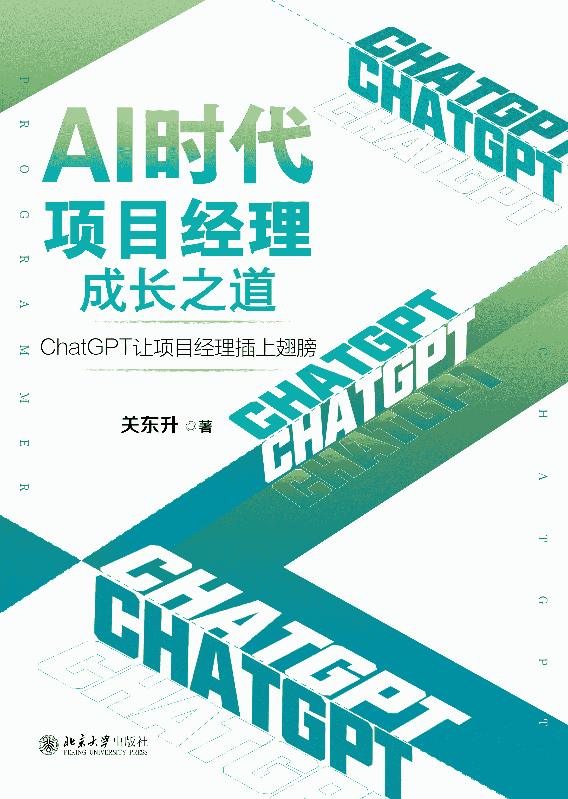

* * *

# 前言 让项目管理装上智能引擎

我们正处在技术迭代极快的区间，人工智能正以前所未有的速度渗入各行各业，项目管理亦处于这波浪潮的中心。ChatGPT 的出现，为管理者打开了一扇升级的窗口。

《AI 时代项目经理成长之道：ChatGPT 让项目经理插上翅膀》旨在拓展项目管理的新边界。书中把读者带入一个被智能改写的实践场域，呈现更多创新与突破的可能。ChatGPT 作为智能助手，为管理注入洞察与判断力，让管理者能够借势而行，站在技术前沿。

全书按章节展开实战。由各类文档撰写，到立项、组建团队、沟通管理，再到计划制定、成本管控、进度跟进、质量保障，以及风险管控、采购规划与执行、绩效管理，直至收尾，每一章都聚焦 ChatGPT 在对应环节的提效路径。阅读过程中不断激活颠覆性思维，让管理能力在快速发展的轨道上持续进化，帮助管理者完成蜕变。

无论是初入行者，还是资深专家，本书都能提供新的观察视角，帮助突破既有边界，点燃对卓越的追求，让项目成为行业标杆。在 ChatGPT 的助力下，项目管理不再受限于传统框架，而是一个开放无界的创新舞台。

本书配套提供全书案例源码及教学视频等资料，读者可扫描下方左侧二维码关注“博雅读书社”微信公众号，输入本书 77 页的资源领取码，即可获取学习资料。

本书提供答疑服务，可扫描下方右侧二维码留言“北大 AI”，即可加入学习交流群。


资源获取码： `xm2023`

关东升

# 第 1 章 人工智能颠覆与重塑项目管理

AI 技术在普及过程中已悄然改变工作与生活的方式。项目管理作为复杂性高、协同性强的核心职能，也正被AI深度影响。本章梳理 AI 对项目管理的重塑路径，探讨其带来的机会与挑战。

首先，本章拆解 AI 为项目管理带来的利好与风险。AI 能提升管理效率与精确度，降低人力投入，同时提供更智能的辅助；另一方面数据隐私与安全保护仍是突出难题，需要管理者与技术人员协同解决。

其次，本章聚焦项目经理在新环境下需要补强的技能，以及和 ChatGPT 协同工作的最佳实践。

最后，本章对 AI 工具在项目管理中的落地现状与演进方向进行深入解读，覆盖自动化、风险管控、决策支持与协同协作等维度。

总体而言，本章全面讨论 AI 对项目管理的影响，为管理者与技术人员提供思考参考，以应对新时代的机遇与考验。

## 1.1 AI 对项目管理影响分析：机遇与挑战

AI 技术成熟后，其在项目管理中的渗透度不断加深。AI 既带来显著机会，也伴随现实挑战。

其一，AI 可显著提升效率与准确性。借助自动化工具，可实现进度、资源、成本等环节的智能化处理，节省工时、压缩人力成本。AI 还能基于历史数据与风险模型进行预测，帮助提前识别风险，降低项目失败概率。

其二，AI 赋予管理更智能的支持。通过数据分析与预测模型，管理者能获得决策参考，预估完工时间与成本，提升决策质量。智能协同工具还能自动分配任务、跟踪进度，提升团队执行力与一致性。

其三，落地过程中存在明显挑战。AI 依赖海量数据训练，数据质量不足会导致预测偏差。涉及敏感信息时必须保障隐私与安全，避免泄露与攻击风险。此外，AI 需和人的判断结合，才能真正发挥价值。

总体来看，AI 为项目管理带来的机会与挑战并存。管理者需要在利用技术提升效率的同时，关注数据安全，并实现人机协同，方能应对未来的管理挑战。

## 1.2 项目经理新技能与ChatGPT的最佳协作模式

人工智能时代的项目经理需要拓展的能力主要包括：

（1）AI 知识与应用能力。掌握 AI 基础理论，并在项目管理中选用合适的工具与方法，形成使用经验并评估适用场景。
（2）数据分析与业务挖掘能力。能够采集项目相关数据，提炼规律与价值，为决策提供依据，掌握基础分析方法与模型。
（3）创新思维与持续学习素养。保持开放心态，跟上 AI 与项目管理领域的最新演进，不断更新知识与技能。
（4）跨学科协作与沟通能力。AI 影响横跨多个领域，需要搭建跨专业沟通桥梁，促进协同共创。

在和 ChatGPT 等 AI 系统协同时，建议注意：

（1）明确功能边界。ChatGPT 作为智能助手，功能日益强大但仍有限，主要适合规则化工作支持、重复性任务处理、辅助数据与建议提供。复杂问题的深度研判仍需专业专家介入。
（2）发挥其规则化处理优势。将标准化、重复性工作交给 ChatGPT，如常规文件生成、数据统计与报告辅助等，提升效率与减轻负担。
（3）人机协同攻坚非结构化问题。面对复杂或模糊问题时，和 ChatGPT 展开深度对话，结合其建议与自身判断，共同研究最优解。
（4）AI 辅助，人类把关。项目经理居于主导与监督位置，依托 AI 输出结合专业经验与项目目标制定决策。人机优势互补可达成最佳效果。

以下通过两个案例说明项目经理如何借助 ChatGPT 解决管理难题。

### 1.2.1 案例 1:×××项目进度延误和资源缺失

我们先看案例 1：进度延误与资源短缺。

动手示例

项目经理 Tom 注意到项目已大幅滞后，进度落后计划超 3 周，且资源短缺导致部分工作无法开展。Tom 向 ChatGPT 汇报现状并提问。

Tom：项目已经大幅落后，请帮我梳理延迟根因，并给出补救思路，资源如何调配才能把工期拉回来？

ChatGPT 回复如下。

潜在诱因可能包括：

（1）项目计划不合理，工作量或资源需求被低估。
（2）团队效率偏低，任务耗时超出预期。
（3）依赖环节出现延误，导致整体滞后。

可采取的对策有：

（1）重新评估后续计划，对任务难度、所需工时与资源进行修正。
（2）增派人员或调整任务组合，优化资源配置，提升执行效率。
（3）和相关部门或供应商重新沟通，加速其交付与资源供给。

为确保最终按期，建议：

（1）优先对关键任务进行赶工与资源补充。
（2）利用历史项目数据评估任务耗时，明确后续阶段重点与节奏。
（3）加强团队与关联部门的协同，实时掌握进展与资源状况，实施精准管控。

通过问答，项目经理和 ChatGPT 共同梳理了延期主因并形成对策，有助于制定个性化方案，降低最终延期的风险。

Tom 觉得表述偏笼统，问题在于提问不够具体。

提示

向 ChatGPT 提问时应尽可能具体，并明确输出形式，如表格、图表等。

为获得更清晰答案，Tom 进一步提出需求。

我有如下进度描述：帮我生成表格，采用 Markdown 格式文本返回。

工作任务共两项，预计工期分别为 3 周和 2 周。计划进度要求任务 1 于 5 周内完成，任务 2 于 3.5 周内完成。目前任务 1 已延误 2 周，任务 2 延误 0.5 周，需采取措施压缩时间。

资源方面有两项：资源 1 计划 4 人，资源 2 计划 10 台设备。实际资源 1 仅 2 人，资源 2 仅 7 台设备，资源短缺也导致任务延误。

ChatGPT 的回答如下。

|工作任务|计划所需时间(周)|实际所需时间(周)| 计划进度(周)|实际进度(周) |

|:-:|:-:|:-:|:-:|:-:|

|任务 1|3| 5|5|7|

|任务 2|2| 3.5|3.5|4|

|资源|计划供应|实际供应|

|:-:|:-:|:-:|

|资源 1|4 名|2 名|

|资源 2|10 台设备|7 台设备|

Tom 将代码保存为 Markdown 文档后浏览，可看到如图 1-1 所示的表格。

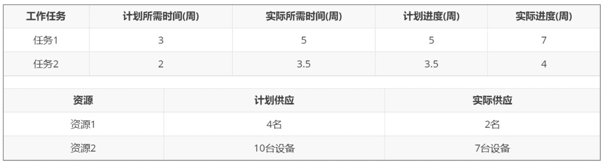

图 1-1 浏览`Markdown`文件

表格呈现后问题更直观。Markdown 使用将在 2.2 节详细介绍，这里暂不展开。

若仍觉抽象，可进一步将表格转为图表。

提示

ChatGPT 目前图片生成受限，可借助 VBA 或 Python 等程序代码呈现数据。这需要一定的编程能力，也说明优秀项目经理需具备跨学科整合与协作能力，而非仅靠单一技能。

Tom 熟悉 ChatGPT 编程，于是要求生成 Python 代码绘制任务柱状图并注意中文乱码。

Tom 接着提出需求。

有如下任务表，帮助我绘制成为柱状图，返回 Python 程序代码，注意中文乱码问题。

|工作任务|计划所需时间(周)|实际所需时间(周)| 计划进度(周)|实际进度(周) |

|:-:|:-:|:-:|:-:|:-:|

|任务 1|3| 5|5|7|

|任务 2|2| 3.5|3.5|4|

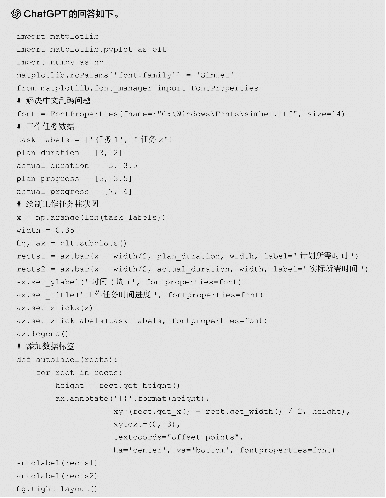

将代码保存为 .py 文件后运行，可看到如图 1-2 所示的对话框。

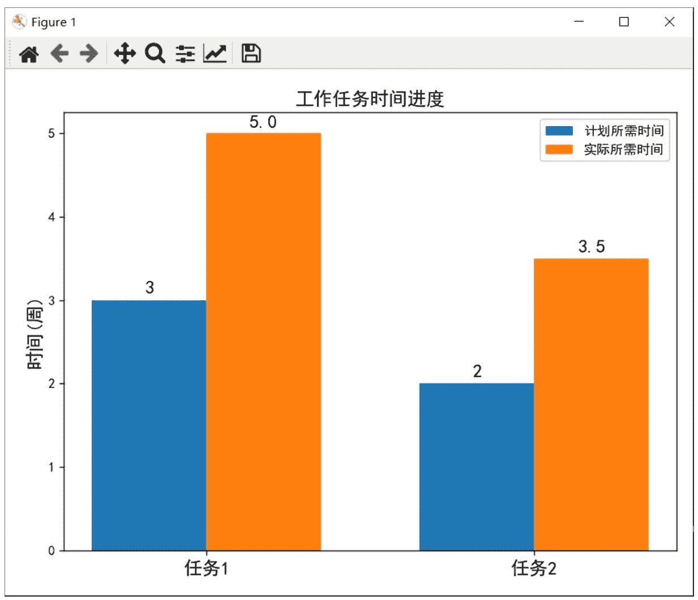

图 1-2 运行结果

单击对话框工具栏中的按钮即可保存图片。从柱状图中可直观比较进度差异，人眼对视觉信息更敏感。

### 1.2.2 案例 2：项目团队工作效率低，员工满意度不高

进一步分析数据后，Jane 察觉团队效率偏低且员工满意度不高，可能加剧了延期。为此她向 ChatGPT 征询改进建议。

动手示例

Jane：团队工作效率低，员工满意度也不高，可能严重影响项目成功。应从哪些方面提升效率与满意度？

ChatGPT 的回答如下。

可从以下方面着手。

（1）优化工作流程与协作机制，剔除无效环节，提高连贯性，集中资源创造价值。
（2）更新项目管理工具与系统，提升工作透明度与协同效率，减少冗余。
（3）平衡任务难度与资源分配，避免个人负荷过重或过轻，释放最大潜力。
（4）加强关心与沟通，了解员工真实感受与需求，提供必要支持，提升积极性。
（5）依据表现与贡献进行合理绩效评估与激励。

Jane 同样觉得回答偏抽象，原因在于描述不够具体。她进一步提出需求。

有如下满意度调查，帮助我生成表格，采用 Markdown 格式文本返回。

调查显示高度满意的比例计划为 40%，实际为 30%。一般满意的比例计划为 50%，实际为 40%；不太满意的比例计划为 10%，实际为 30%。该表有助于了解满意度现状并采取改进措施。

ChatGPT 的回答如下。

| 满意度 | 计划比例 | 实际结果 |

| :------: | :------: | :------: |

| 高度满意 | 40% | 30% |

| 一般满意 | 50% | 40% |

| 不太满意 | 10% | 30% |

Jane 保存为 Markdown 文档后浏览，可看到图 1-3 所示的表格。

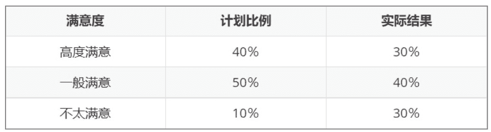

图 1-3 浏览`Markdown`文件

表格让问题更清晰。

若仍觉抽象，可转为图表。Jane 不懂 Python 或 VBA，于是让 ChatGPT 将表格转为 CSV 格式导入 Excel 再制图。

Jane 提出需求。

有如下满意度调查，帮助我生成 CSV 表格。

调查显示高度满意的比例计划为 40%，但实际结果为 30%。类似地，一般满意的比例计划为 50%，但实际结果为 40%；而不太满意的比例计划为 10%，但实际结果为 30%。这个表格可以帮助人们了解产品或服务的满意度结果，以便采取必要的措施来改进和提高满意度水平。

ChatGPT 的回答如下。

满意度，计划比例，实际结果

高度满意，40%,30%

一般满意，50%,40%

不太满意，10%,30%

Jane 将代码保存为 CSV 格式数据后用 Excel 调阅，如图 1-4 所示。

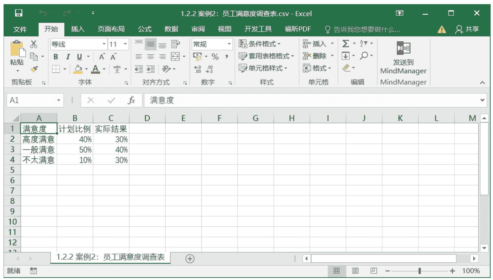

图 1-4 使用`Excel`打开文件

在 Excel 中生成图表，如图 1-5 和图 1-6 所示。

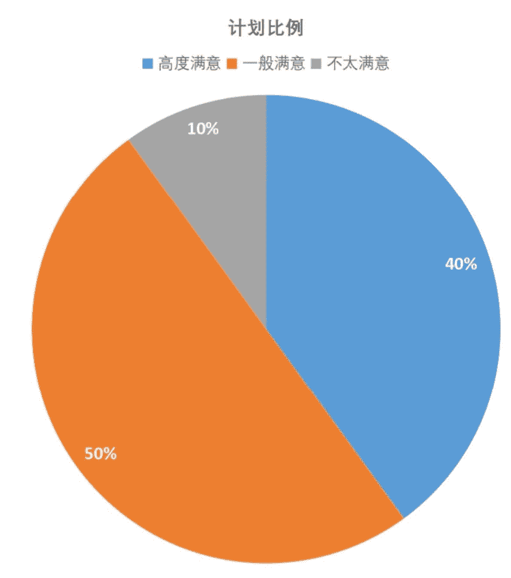

图 1-5 计划满意度饼状图

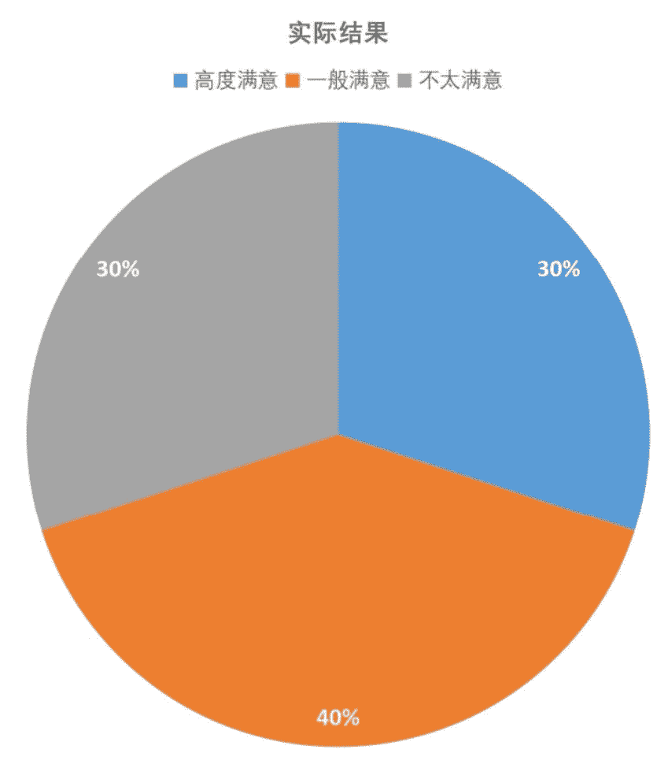

图 1-6 实际满意度饼状图

通过对比可更直观把握满意度变化。若希望生成类似饼图，可使用 Excel、Python 等工具处理 CSV 文件，具体步骤将在 2.4.3 小节详细说明，这里不再赘述。

1 `CSV`（Comma-Separated Values）是一种常见的电子表格文件格式，它的每一行代表一条记录，每个字段之间用逗号分隔。`CSV`文件可以使用任何文本编辑器创建或编辑，并且可以被许多软件（如 Microsoft Excel、谷歌表格等）读取和处理。由于`CSV`文件是一种纯文本格式，因此非常适合用于数据交换和数据存储。

## 1.3 人工智能工具在项目管理中的应用现状与发展趋势

人工智能在项目管理中的落地正逐步普及。已有大量企业引入 AI 工具实现自动化与智能化，常见场景包括：

（1）计划优化与决策支持：快速分析进度、资源、成本数据，为管理者提供优化建议。
（2）风险管理：基于 AI 对项目风险进行分析与预测，提前采取控制措施。
（3）智能协同：实现团队成员间的智能协作，提升效率与沟通质量。
（4）质量管理：自动化监控与评估项目质量，提升效益。

未来应用将更加广泛深入。例如实现自动化规划与排程、智能化资源分配与风险预测等。随着技术进步，将涌现更多新场景与解决方案。

## 1.4 本章总结

本章首先分析了 AI 为项目管理带来的机遇与挑战。AI 能提升效率、优化资源配置与进度管控，但也面临数据安全、职业变革等挑战。

上一回我们聚焦了管理者能力升级以及与 ChatGPT 的配合套路。通过两组实战剖析，拆解了工期滞后、资源不足背后的根源，也梳理了团队产出乏力、成员满意度走低的关键动因。借助模型给出的提示思路，找到了可落地的应对办法。随后检视了智能助手在项目管理里的现阶段应用面和演进方向，目前这类技术已渗透到管理全流程，覆盖面还在持续扩大。

综合判断，AI 正从根本上改写项目管理的运行逻辑，也对管理者提出新的能力要求。需要补足数据分析与人工智能的基础认知，建立人机互补的协作机制，让人机各自发挥长处，从而把项目管得更稳更准。人工智能正逐步成为项目管理不可或缺的工具与伙伴，研读本章有助于更清晰把握 AI 对项目管理的深层影响。

# 第 2 章 用 ChatGPT 高效完成项目文档撰写

对项目经理而言，撰写文档是日常刚需。ChatGPT 作为自然语言处理领域的强模型，能够输出质量高、表达自然的文本，很好地分担了各类文档的写作压力，这也是智能时代必须掌握的核心技能。

上一章已演示如何让 ChatGPT 产出 Markdown 文档和 CSV 表格，但操作细节尚未展开。本章聚焦如何借助 ChatGPT 完成不同类型文档的编写。

## 2.1 以 ChatGPT 搭建框架并实现半自动填充

项目经理经手的文档形态多样，Word 文件、Excel 表格、PDF 文档以及各类在线协作形式都常见。可以让 ChatGPT 负责文本生成，模型虽无法直接输出二进制格式，后续可配合预设模板实现格式固化。这种半自动化协作能明显提升文档产出效率。

### 2.1.1 设计文档模板

用 Office 套件搭建模板，可按下面流程操作。

（1）明确文件类别：结合规范以及内容需求，选择 Word 文件、Excel 表格或 PowerPoint 演示等形式。

（2）调整版面参数：按企业标准或个人习惯设定纸张尺寸、边距等排版要素。

（3）统一标题样式：为不同层级的标题设定字体、字号、加粗等格式，形成可复用的样式库。

（4）配置目录以及书签：使用 Word 的目录功能以及书签功能，搭建清晰的导航结构，并为各章节生成超链接。

（5）制作封面以及页眉页脚：添加封面、页眉页脚实现标准化，必要时写入文件名、创建日期等元信息。

（6）预留图文位置：按文档需求在合适处添加表格、图片、图表或公式，并附上说明注释。

（7）插入占位提示：在模型需要填充内容的位置放置文字占位符或提示语，明确生成方向以及范围。

（8）保存为模板文件：完成设计的文档另存为模板，后续新建文档可直接调用。

#### （9）反复检验以及优化

初稿撰写过程中要检验模板的适用性，根据实际需求对标题、排版、样式等持续调优。

按上述步骤即可得到一套可落地的技术文档模板。模板的精细程度直接决定模型生成内容的贴合度以及人工整合的难度。理想状态下，人工只需对模型输出做少量润色即可嵌入模板，大幅减少重复劳动。

### 2.1.2 案例 1：生成客户关系管理平台升级项目章程模板

以下以某公司的客户关系管理平台升级项目章程为例，演示模板搭建到模型填充的全过程。

建议做法是先让 ChatGPT 输出初稿模板，再结合公司规范反复修正，最终定稿，再对文件格式做精细化调整。

#### 动手示例

向 ChatGPT 发出如下指令。

请帮我生成 CRM 系统升级项目章程模板。

模型返回如下。

项目章程：CRM 客户关系管理系统升级项目

1． 项目概述

1.1 项目名称：CRM 系统版本升级项目

1.2 项目目的：升级当前 CRM 系统至最新版本，提高客户数据分析与服务能力

1.3 项目范围：升级 CRM 系统软硬件环境，优化客户信息管理与业务流程功能

1.4 项目发起方：市场部

2． 项目目标

2.1 具体目标：在 2023 年 9 月 30 日前完成 CRM 系统版本升级与功能优化工作

2.2 关键成功因素：升级工作顺利完成，新版本 CRM 系统稳定运行，实现客户服务效率提高 30%以上

3． 项目进度安排

3.1 项目启动与计划：2023 年 5 月 1 日至 15 日

3.2 需求调研与确认：2023 年 5 月 15 日至 6 月 15 日

3.3 软硬件环境部署：2023 年 6 月 15 日至 7 月 31 日

3.4 功能模块开发：2023 年 8 月 1 日至 9 月 15 日

3.5 模块测试：2023 年 9 月 15 日至 25 日

3.6 新系统培训与上线：2023 年 9 月 25 日至 30 日

3.7 项目收尾与总结：2023 年 10 月 15 日

4． 项目组织机构

4.1 项目负责人：市场部副主任

4.2 项目团队：10 人（开发 6 人、测试 2 人、运维 2 人）

5． 项目资源需求

5.1 人力资源：项目负责人 1 名、项目团队 10 名

5.2 财务资源：软硬件采购及培训费用 80 万元

5.3 技术资源：开发工具、云服务等

6． 项目监督与评价

6.1 项目进展检查：每周召开项目会议，检查任务进度与效果

6.2 项目改进：根据上线后的 2~3 个月使用评估报告，提出系统改进方案

6.3 项目效益评估：上线 6 个月后，开展项目效益评估，为后续规划提供依据

该章程模板覆盖了项目概述、目标、进度、组织与资源等关键信息，为项目推进提供框架指引。实际使用时，负责人仍需结合现状补充完善。

## 2.2 与 ChatGPT 交互的通用语言——Markdown

此前已说明 ChatGPT 仅返回纯文本，无法直接生成 Word、Excel、PDF。若让模型输出 Markdown 源码，再通过编辑器或转换工具处理，即可得到目标格式的文档。

### 2.2.1 Markdown 核心语法

Markdown 是一种轻量级标记语言，用易读的语法编写文本后可转为 HTML 或其他格式，并借助工具导出为 Word、PDF 等。

下面是常用语法概览。

#### 1． 标题

Markdown 以“#”表示层级，提供六级标题，从“#”到“######”。“#”后需空一格再写标题。

代码示例如下。

```
\# 一级标题
\## 二级标题
\### 三级标题
\#### 四级标题
\##### 五级标题
\###### 六级标题
```

把上面代码放进预览器，可得到类似下图的效果。

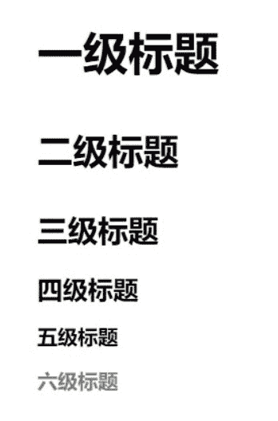

图 2-1 Markdown 预览效果（一）

#### 2． 列表

无序列表可用“-”或“\*”，有序列表用数字加“.”，符号后需空一格。

代码示例如下。

```
\- 无序列表项 1
\- 无序列表项 2
\- 无序列表项 3
1． 有序列表项 1
2． 有序列表项 2
3． 有序列表项 3
```

预览结果如下。

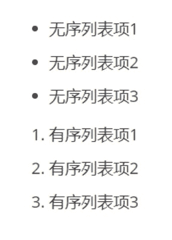

图 2-2 Markdown 预览效果（二）

#### 3． 引用

使用“>”表示引用，符号后需空一格。

代码示例如下。

```
\> 这是一段引用文本。
\> 这是一段引用文本。
\> 这是一段引用文本。
\> 这是一段引用文本。
```

渲染后效果如下。

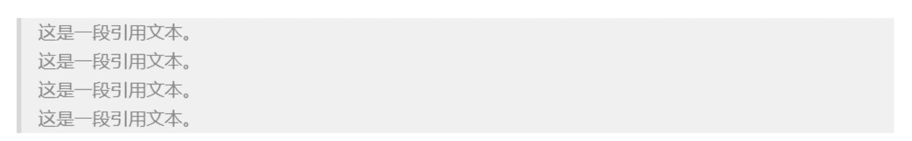

图 2-3 Markdown 预览效果（三）

#### 4． 粗体和斜体

用“\*\*”包裹文本表示粗体，用“\*”包裹表示斜体，符号后需空一格。

代码示例如下。

```
这是\*\*粗体\*\*文本，这是\*斜体\*文本。
```

预览效果如下。


图 2-4 Markdown 预览效果（四）

#### 5． 图片

语法为：

!\图片 alt\

代码示例如下。

```

```

预览效果如下。


图 2-5 Markdown 预览效果（五）

#### 6． 代码块

用三个反引号（\`\`\`）包裹，并在首行标注语言。

代码示例如下。

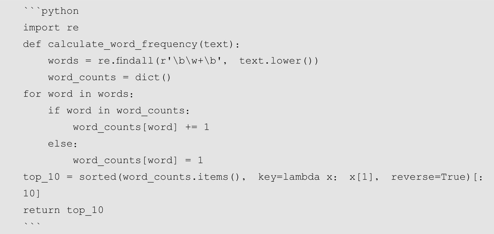

注意

反引号后可指定语言，如示例中的 python，可实现语法高亮。

预览效果如下。

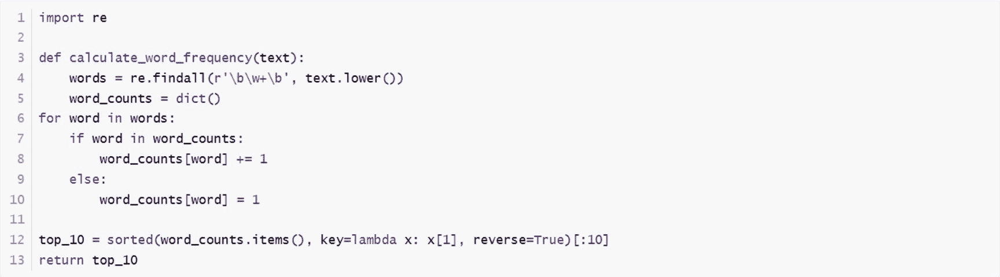

图 2-6 Markdown 预览效果（六）

以上语法足以应对常见场景，特殊需求可进一步学习扩展语法。

### 2.2.2 使用 Markdown 编辑器

工欲善其事，必先利其器，好的 Markdown 编辑器能大幅提升写作体验。

常见的编辑器有以下几类。

（1） Visual Studio Code：免费开源代码编辑器，对 Markdown 支持良好，可安装扩展实现预览、emoji 替换、PDF 导出等。

（2） Typora：界面简洁美观，支持实时预览、图片插入、表情符号、目录生成等，操作流畅。

（3） Mark Text：开源编辑器，界面清爽，支持实时预览与模式切换，插件扩展丰富。

（4） Ulysses：专业写作软件，支持 Markdown 及多格式导出，功能强、界面专业，但付费较高。

（5） iA Writer：专注文字写作，Markdown 支持完善，可高度定制主题与字体，体验纯净但功能相对精简。

综合免费与版权因素，推荐使用 VS Code 编辑 Markdown。

下载页面如下。

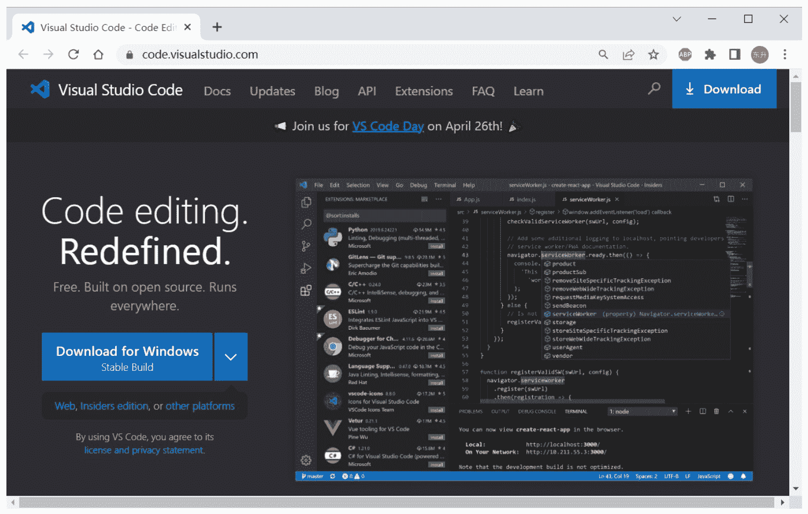

图 2-7 下载 VS Code 的网站

可点击“Download for Windows”下载 Windows 版，也可选择其他系统。安装完成后即可使用。

为提升使用体验，建议安装以下扩展。

Markdown All in One：提供快捷键、格式化、预览、表格生成等功能。

Markdown Preview Enhanced：支持数学公式、Mermaid 图表、代码高亮，并可导出 HTML、PDF、PNG。

Markdownlint：提供语法检查，实时发现并修复常见错误。

扩展安装界面如下。

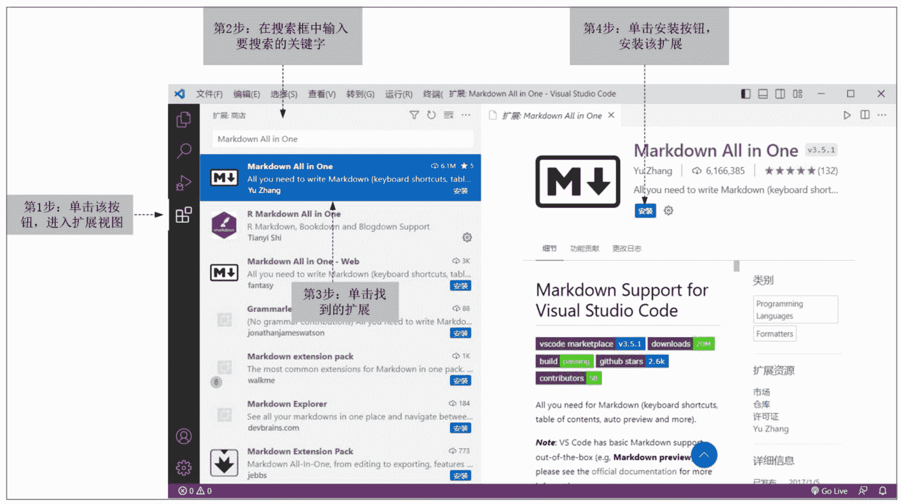

图 2-8 安装 VS Code 扩展

示例展示了 Markdown All in One 的安装，其他扩展可自行添加。

创建“.md”文件后即可在 VS Code 中编写与预览。

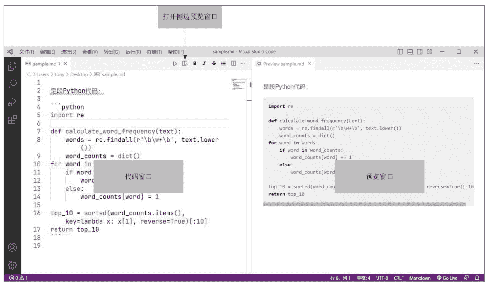

图 2-9 在 VS Code 中编写和预览 Markdown 文件

### 2.2.3 案例 2：生成 Markdown 格式 CRM 系统升级项目章程

安装好工具后，可通过案例练习让 ChatGPT 生成 Markdown 文档。

#### 动手示例

向 ChatGPT 输入：

请帮我生成 CRM 系统升级项目章程，返回 Markdown 代码格式。

模型返回：

这里是 CRM 系统升级项目章程(Markdown 格式)：

```
\# 项目章程：CRM 客户关系管理系统升级项目
\## 1． 项目概述
\### 1.1 项目名称
CRM 系统版本升级项目
\### 1.2 项目目的
升级当前 CRM 系统至最新版本，提高客户数据分析与服务能力
\### 1.3 项目范围
升级 CRM 系统软硬件环境，优化客户信息管理与业务流程功能
\### 1.4 项目发起方
市场部
\## 2． 项目目标
\### 2.1 具体目标
在 2023 年 9 月 30 日前完成 CRM 系统版本升级与功能优化工作
\### 2.2 关键成功因素
升级工作顺利完成，新版本 CRM 系统稳定运行，实现客户服务效率提高 30%以上
\## 3． 项目进度安排
\### 3.1 项目启动与计划：2023 年 5 月 1 日至 15 日
\### 3.2 需求调研与确认：2023 年 5 月 15 日至 6 月 15 日
\### 3.3 软硬件环境部署：2023 年 6 月 15 日至 7 月 31 日
\### 3.4 功能模块开发：2023 年 8 月 1 日至 15 日
\### 3.5 模块测试：2023 年 9 月 15 日至 9 月 25 日
\### 3.6 新系统培训与上线：2023 年 9 月 25 日至 30 日
\### 3.7 项目收尾与总结：2023 年 10 月 15 日
\## 4． 项目组织机构
\### 4.1 项目负责人
市场部副主任
\### 4.2 项目团队
10 人(开发 6 人、测试 2 人、运维 2 人)
\## 5． 项目资源需求
\### 5.1 人力资源
项目负责人 1 名、项目团队 10 名
\### 5.2 财务资源
软硬件采购及培训费用 80 万元
\### 5.3 技术资源
开发工具、云服务等
\## 6． 项目监督与评价
\### 6.1 项目进展检查
每周召开项目会议，检查任务进度与效果
\### 6.2 项目改进
根据上线后的 2~3 个月使用评估报告，提出系统改进方案
\### 6.3 项目效益评估
上线 6 个月后，开展项目效益评估，为后续规划提供依据
```

将代码保存为“CRM 系统升级项目章程．md”，在 VS Code 中预览效果如下。

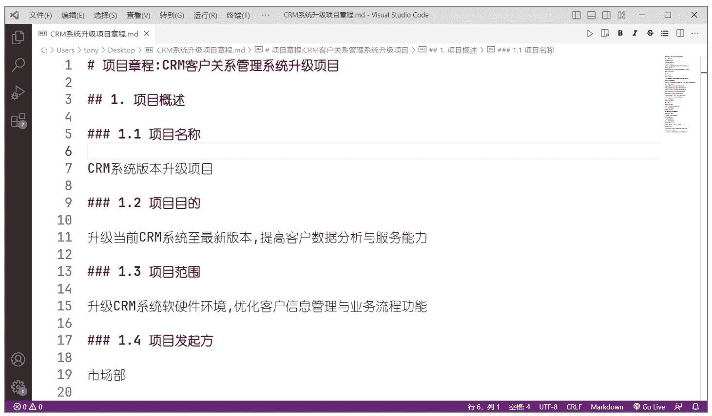

图 2-10 在 VS Code 中编写和预览 CRM 系统升级项目章程

### 2.2.4 将 Markdown 格式文档转换为 Word 文档

需要把 Markdown 转为 Word 时，可选用 Pandoc 等工具。下载地址如下。

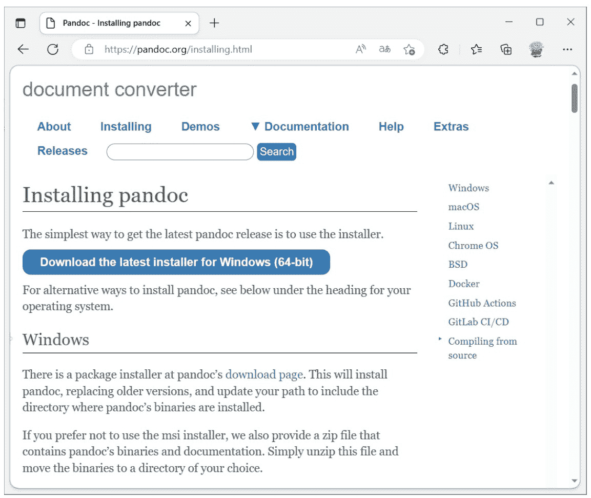

图 2-11 Pandoc 软件网站

下载对应系统版本并安装，注意加入系统路径。安装后在终端执行以下命令即可转换。


其中，“`input.md`”为源文件，“`output.docx`”为目标 Word 文件名。

# Markdown 转换与思维导图实战笔记

除 Pandoc 之外，市场上还有不少能完成同类转换的替代方案，比如在线的 Markdown 转文档服务、VS Code 插件之类，具体采用哪一种主要看个人使用习惯。

把《CRM 系统升级项目章程.md》输出为《CRM 系统升级项目章程.docx》的操作示范已在图 2-12 中展示。

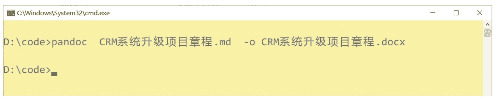

图 2-12 转换 CRM 系统升级项目章程

转换完成后，当前目录会多出一个同名 Word 文档，打开后的呈现效果如图 2-13。

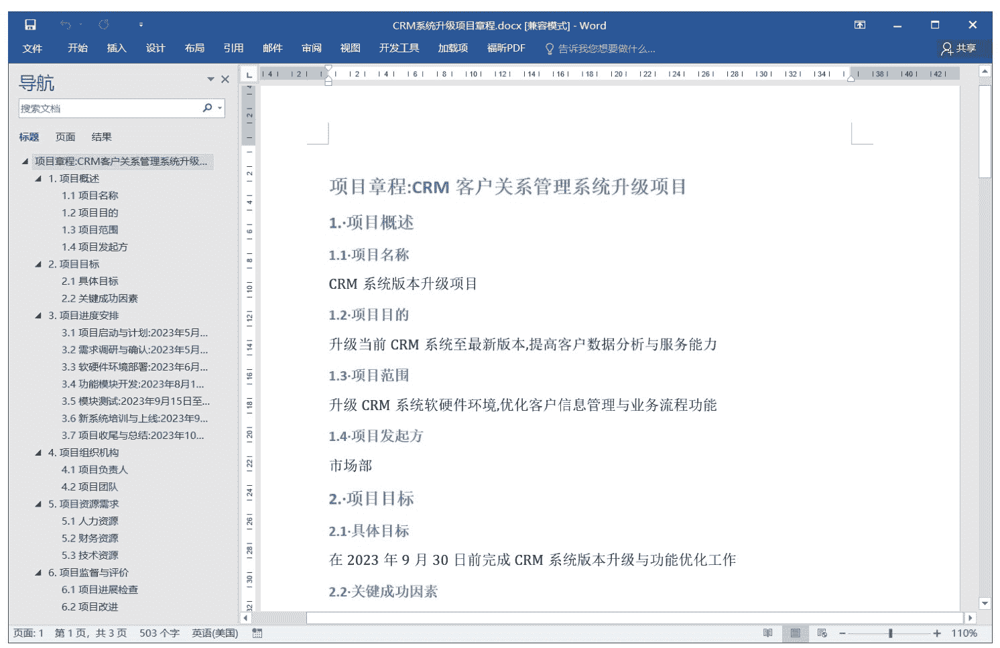

图 2-13 转换成功的“CRM 系统升级项目章程．docx”文件

### 2.2.5 Markdown 文档导出为 PDF

把 Markdown 转成 PDF 的常规做法是借助 Pandoc、Typora 等转换器，但上手成本偏高。更省事的思路是先生成 Word 再导出。

2.2.4 节生成的 Word 可以直接另存为 PDF。打开文件后选择菜单“文件→导出”，会弹出如图 2-14 的窗口，按图中指引即可完成导出。

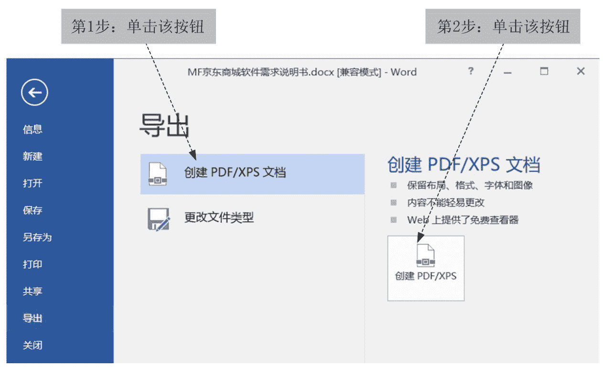

图 2-14 导出 PDF 对话框

## 2.3 思维导图

思维导图以一个中心议题为起点，向外逐层展开分支，用图形化方式呈现思路间的关联。

### 2.3.1 思维导图在项目管理中的作用

在项目管理场景里，思维导图主要发挥以下价值。

（1）快速整理项目信息。把目标、任务、里程碑、成员、风险等要素集中呈现，帮助团队把握整体全貌，明确各自职责。

（2）支撑头脑风暴。启动与需求分析阶段，导图能用来收集并归类各类想法，提升方案的创新性和可行性。

（3）辅助计划与进度管控。执行阶段可据此列出任务清单与时间表，理清任务和里程碑的依赖关系，及时跟进进度并规避风险。

（4）促进沟通协作。交付阶段导图可作为信息共享载体，便于知识传递、问题定位和方案调整。

总体来看，思维导图是提升理解与管理效率的利器，能明显增强团队协同。

### 2.3.2 项目经理与思维导图

绘制导图是项目经理的核心能力之一。通过导图进行管理与规划，有助于提升团队效率与协作水平，因此在项目管理中实用价值很高。

图 2-15 是笔者团队为“艺术品收藏应用平台”功能绘制的导图。

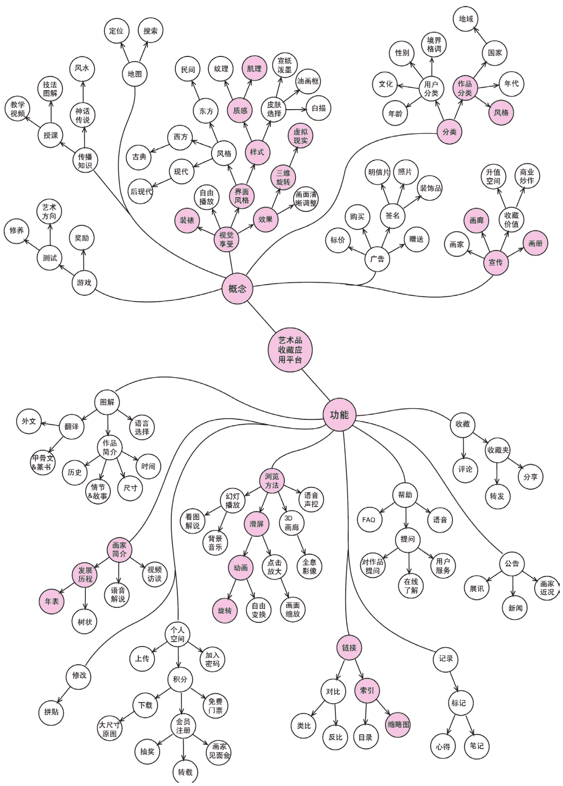

图 2-15 针对“艺术品收藏应用平台”功能的思维导图

### 2.3.3 绘制思维导图

思维导图既可以手绘，也可以用电子方式制作。常用的电子方案包括 MindManager、XMind、Google Drawings、Lucidchart 等，提供了丰富的绘图功能与模板库，能快速生成不同类型的导图。

图 2-16 是在白板上手绘的“艺术品收藏应用平台”导图，图 2-17 则是用 XMind 制作的版本。

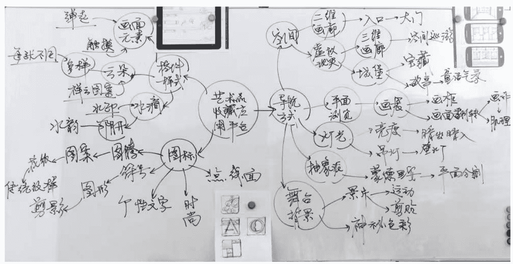

图 2-16 在白板上绘制的“艺术品收藏应用平台”思维导图

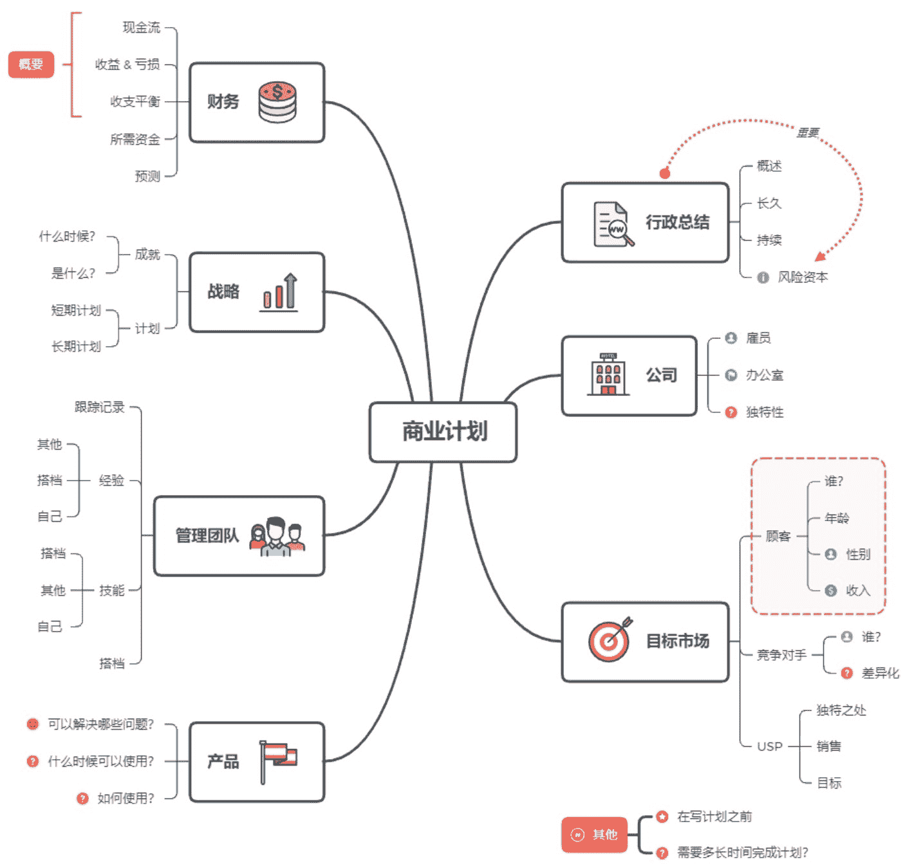

图 2-17 XMind 绘制的思维导图

无论纸质还是数字，思维导图都是记录与组织思考的手段，能以可视化方式捕捉、整理想法，便于理解与记忆。手写或软件绘制都能有效促进问题解决与创意发散。

### 2.3.4 使用 ChatGPT 绘制思维导图

ChatGPT 本身无法直接生成图形，但可通过间接方式实现。

方法 1：让 ChatGPT 输出描述导图的 Markdown 片段，再用支持 Markdown 导入的导图程序打开。
方法 2：让 ChatGPT 用文本绘图语法 Mermaid 生成导图，图 2-18 为 Mermaid 呈现的示例。
方法 3：让 ChatGPT 用文本绘图语法 PlantUML 生成导图，图 2-19 为 PlantUML 呈现的示例。

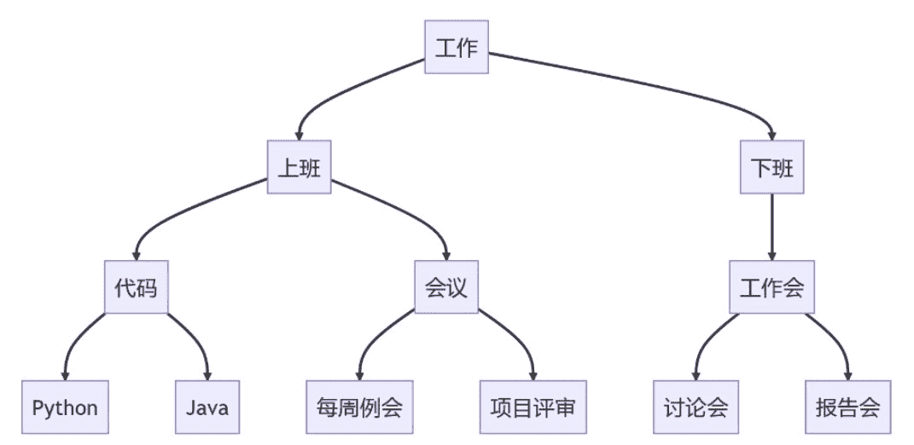

图 2-18 使用`Mermaid`工具绘制的思维导图

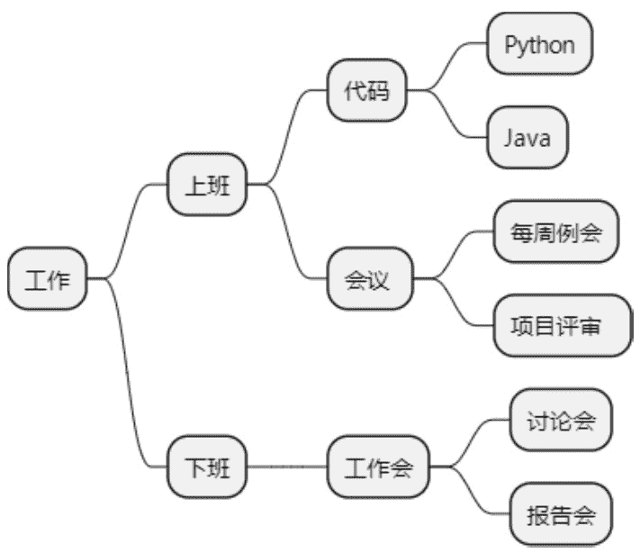

图 2-19 使用`PlantUML`工具绘制的思维导图

### 2.3.5 案例 3：生成 CRM 系统升级项目章程思维导图

下面介绍方法 1 的实操流程。

动手示例

ChatGPT 不能直接出图，可换一种提问方式。

向 ChatGPT 发送的请求如下：

帮助我以“CRM 客户关系管理系统升级项目章程”为中心主题，返回一个文本版的思维导图，注意返回`Markdown`格式代码。

该提问包含三层信息：
（1）中心主题为“CRM 客户关系管理系统升级项目章程”；
（2）需要文本版思维导图；
（3）输出为 Markdown 格式代码。

执行后 ChatGPT 的输出如下。

```
# CRM 客户关系管理系统升级项目章程

## 1． 项目概述

- ### 1.1 项目名称

CRM 系统升级项目

- ### 1.2 项目目的

升级当前 CRM 系统软硬件与功能，提升客户服务与运营能力

- ### 1.3 项目范围

CRM 系统版本升级，客户信息管理模块优化，数据分析功能增强，业务流程重构

- ### 1.4 项目发起方

市场部

## 2． 项目目标

- ### 2.1 具体目标

在 2023 年 9 月 30 日前完成 CRM 系统升级，实现功能优化与重构

- ### 2.2 关键成功因素

升级工作顺利完成，新版本 CRM 系统稳定高效运行，客户满意度提高 30%以上，工作效率提高 20%以上

## 3． 项目进度安排

- ### 3.1 项目启动： 2023 年 4 月 1 日

- ### 3.2 需求分析与方案设计：2023 年 4 月 1 日至 30 日

- ### 3.3 软硬件采购与部署：2023 年 5 月 1 日至 31 日

- ### 3.4 模块开发与测试：2023 年 6 月 1 日至 8 月 31 日

- ### 3.5 培训与系统上线：2023 年 9 月 1 日至 15 日

- ### 3.6 项目收尾：2023 年 9 月 30 日

## 4． 项目组织机构

- ### 4.1 项目负责人

市场部副主任

- ### 4.2 项目团队

12 人(开发 8 人、测试 2 人、运维 2 人)

## 5． 项目资源需求

- ### 5.1 人力资源

项目负责人 1 名、项目团队 12 名

- ### 5.2 财务资源

升级采购及培训费用 80 万元

- ### 5.3 技术资源

开发工具、云服务等

## 6． 项目监督与评价

- ### 6.1 项目进展检查

每周召开项目会议，检查任务进度与问题

- ### 6.2 项目改进

根据上线后 2 个月内的使用评估报告，提出系统改进计划

- ### 6.3 项目效益评估

上线 6 个月后开展项目效益评估，为后续规划提供依据
```

将该代码复制出来并保存为 `*.md` 源文件。

XMind 支持从 Markdown 源文件导入，选择“文件→导入于→Markdown”，打开导入对话框后选中刚才生成的 Markdown 文件，导入成功后的效果如图 2-20。

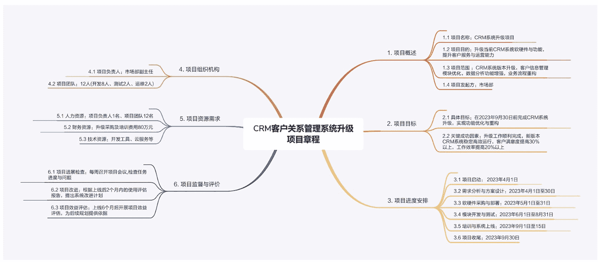

图 2-20 导入`Markdown`文件的思维导图

提示

读者会发现 2.2.3 节与 2.3.5 节的 Markdown 结构很相似。确实可以基于 2.2.3 的代码修改，但要把“CRM 客户关系管理系统升级项目章程”设为中心主题，笔者建议直接让 ChatGPT 生成更省事。

### 2.3.6 案例 4：借助 Mermaid 语法绘制思维导图

2.3.5 节用的是方法 1，本节介绍方法 2，即用 Mermaid 生成导图。Mermaid 属于文本绘图方案，类似方案还有：

`Graphviz`：开源图表方案，用纯文本描述语言可生成流程图、组织图、网络图、类图等。
`PlantUML`：基于文本的 UML 绘制方案，可用简洁文本生成时序图、活动图、类图、组件图等。
`Mermaid`：基于文本的流程图和时序图方案，用文字描述后转为可视化图形。
`Asciiflow`：在线 ASCII 绘图方案，可用字符绘制流程图、组织图、网络图、类图等。
`Ditaa`：把 ASCII 图形转为矢量图形的工具，可生成流程图、时序图、类图等。

借助 ChatGPT 使用 Mermaid 的步骤如下。
第 1 步：根据需求让 ChatGPT 生成 Mermaid 描述。
第 2 步：用 Mermaid 渲染工具生成图片。

渲染工具较多，官方的 Mermaid Live Editor 可实时预览，打开官网后左侧是代码区，右侧是渲染结果，如图 2-21。

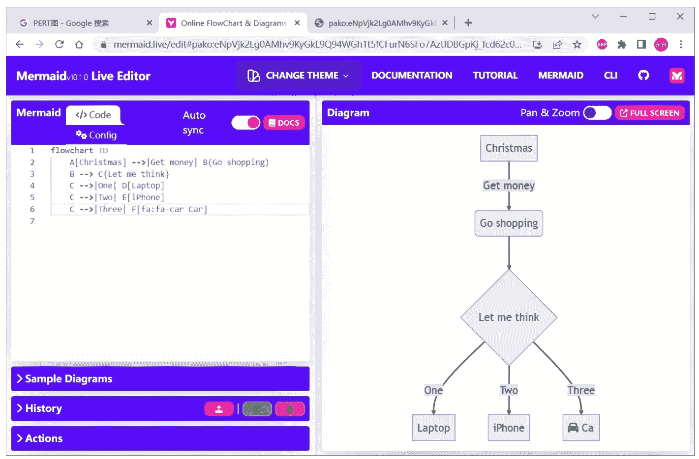

图 2-21 `Mermaid Live Editor`官网

在左侧输入代码会自动同步渲染到右侧。需要导出时，单击 `Actions` 打开如图 2-22 的操作面板，可保存或分享图片。

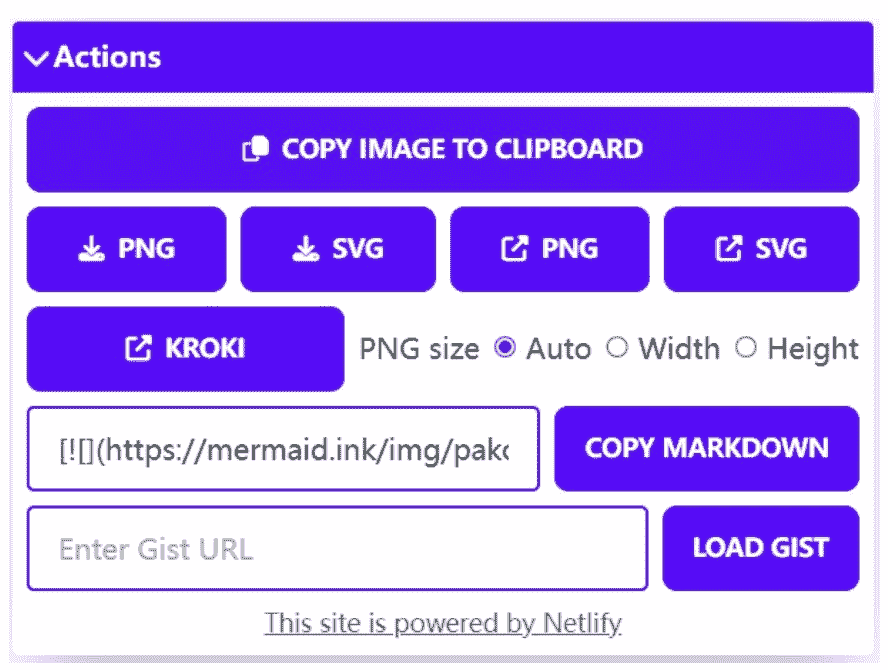

图 2-22 `Actions`面板

本书不展开 Mermaid 语法，主要演示如何借助 ChatGPT 绘图。

动手示例

向 ChatGPT 发送如下请求：

有如下项目章程，帮我使用 `Mermaid`工具绘制思维导图。

项目章程：CRM 客户关系管理系统升级项目

1． 项目概述
1.1 项目名称
CRM 系统版本升级项目
1.2 项目目的
升级当前 CRM 系统至最新版本，提高客户数据分析与服务能力
1.3 项目范围
升级 CRM 系统软硬件环境，优化客户信息管理与业务流程功能
1.4 项目发起方
市场部
2． 项目目标
2.1 具体目标
在 2023 年 9 月 30 日前完成 CRM 系统版本升级与功能优化工作
2.2 关键成功因素
升级工作顺利完成，新版本 CRM 系统稳定运行，实现客户服务效率提高 30%以上
3． 项目进度安排
3.1 项目启动与计划：2023 年 5 月 1 日至 15 日
3.2 需求调研与确认：2023 年 5 月 15 日至 6 月 15 日
3.3 软硬件环境部署：2023 年 6 月 15 日至 7 月 31 日
3.4 功能模块开发：2023 年 8 月 1 日至 9 月 15 日
3.5 模块测试：2023 年 9 月 15 日至 25 日
3.6 新系统培训与上线：2023 年 9 月 25 日至 30 日
3.7 项目收尾与总结：2023 年 10 月 15 日
4． 项目组织机构
4.1 项目负责人
市场部副主任
4.2 项目团队
10 人（开发 6 人、测试 2 人、运维 2 人）
5． 项目资源需求
5.1 人力资源
项目负责人 1 名、项目团队 10 名
5.2 财务资源
软硬件采购及培训费用 80 万元
5.3 技术资源
开发工具、云服务等
6． 项目监督与评价
6.1 项目进展检查
每周召开项目会议，检查任务进度与效果
6.2 项目改进
根据上线后的 2~3 个月使用评估报告，提出系统改进方案
6.3 项目效益评估
上线 6 个月后，开展项目效益评估，为后续规划提供依据

ChatGPT 的回答如下。

```
mermaid
graph TD
id1["项目章程：CRM 客户关系管理系统升级项目"]
id2["1． 项目概述"]
id2 --> id3["1.1 项目名称<br>CRM 系统版本升级项目"]
id2 --> id4["1.2 项目目的<br>升级当前 CRM 系统至最新版本，提高客户数据分析与服务能力"]
id2 --> id5["1.3 项目范围<br>升级 CRM 系统软硬件环境，优化客户信息管理与业务流程功能"]
id2 --> id6["1.4 项目发起方<br>市场部"]
id7["2． 项目目标"]
id7 --> id8["2.1 具体目标<br>在 2023 年 9 月 30 日前完成 CRM 系统版本升级与功能优化工作"]
id7 --> id9["2.2 关键成功因素<br>升级工作顺利完成，新版本 CRM 系统稳定运行，实现客户服务效率提高 30%以上"]
id10["3． 项目进度安排"]
id10 --> id11["3.1 项目启动与计划：2023 年 5 月 1 日至 15 日"]
id10 --> id12["3.2 需求调研与确认：2023 年 5 月 15 日至 6 月 15 日"]
id10 --> id13["3.3 软硬件环境部署：2023 年 6 月 15 日至 7 月 31 日"]
id10 --> id14["3.4 功能模块开发：2023 年 8 月 1 日至 9 月 15 日"]
id10 --> id15["3.5 模块测试：2023 年 9 月 15 日至 25 日"]
id10 --> id16["3.6 新系统培训与上线：2023 年 9 月 25 日至 30 日"]
id10 --> id17["3.7 项目收尾与总结：2023 年 10 月 15 日"]
id18["4． 项目组织机构"]
id18 --> id19["4.1 项目负责人<br>市场部副主任"]
id18 --> id20["4.2 项目团队<br>10 人(开发 6 人、测试 2 人、运维 2 人)"]
id21["5． 项目资源需求"]
id21 --> id22["5.1 人力资源<br>项目负责人 1 名、项目团队 10 名"]
id21 --> id23["5.2 财务资源<br>软硬件采购及培训费用 80 万元"]
id21 --> id24["5.3 技术资源<br>开发工具、云服务等"]
id25["6． 项目监督与评价"]
id25 --> id26["6.1 项目进展检查<br>每周召开项目会议，检查任务进度与效果"]
id25 --> id27["6.2 项目改进<br>根据上线后的 2~3 个月使用评估报告，提出系统改进方案"]
id25 --> id28["6.3 项目效益评估<br>上线 6 个月后，开展项目效益评估，为后续规划提供依据"]
```

将上述代码粘贴到 Mermaid Live Editor 中渲染，结果如图 2-23。

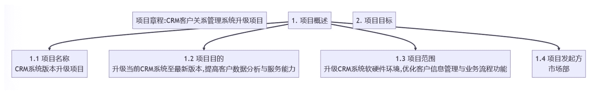

图 2-23 使用`Mermaid`绘制的思维导图（部分）

### 2.3.7 案例 5：使用 PlantUML 工具绘制思维导图

2.3.6 节用的是方法 2，本节介绍方法 3，即用 PlantUML 生成导图。

在线网站即可实现渲染，图 2-24 是用 PlantUML Web Server 渲染的效果。此外 PlantText 网站也推荐使用，本文不再赘述。

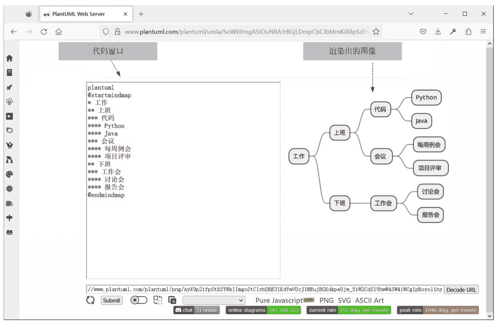

图 2-24 使用`PlantUML`工具渲染思维导图

渲染时只需把代码粘贴到代码窗口即可自动生成图像。

提示

关于 PlantUML 更多语法，可在官网下载参考。

动手示例

向 ChatGPT 发送如下请求：

有如下内容，帮我使用`PlantUML`工具绘制思维导图，只到三级标题。

项目章程：CRM 客户关系管理系统升级项目

1． 项目概述
1.1 项目名称
1.2 项目目的
1.3 项目范围
1.4 项目发起方
2． 项目目标
2.1 具体目标
2.2 关键成功因素
3． 项目进度安排
3.1 项目启动与计划：2023 年 5 月 1 日至 15 日

3.2 需求调研与确认：2023 年 5 月 15 日至 6 月 15 日

3.3 软硬件环境部署：2023 年 6 月 15 日至 7 月 31 日

3.4 功能模块开发：2023 年 8 月 1 日至 9 月 15 日

3.5 模块测试：2023 年 9 月 15 日至 25 日

3.6 新系统培训与上线：2023 年 9 月 25 日至 30 日

3.7 项目收尾与总结：2023 年 10 月 15 日

4． 项目组织机构
4.1 项目负责人
4.2 项目团队
10 人（开发 6 人、测试 2 人、运维 2 人）

5． 项目资源需求
5.1 人力资源
项目负责人 1 名、项目团队 10 名
5.2 财务资源
软硬件采购及培训费用 80 万元
5.3 技术资源

6． 项目监督与评价
6.1 项目进展检查
6.2 项目改进
6.3 项目效益评估

执行完指令后，ChatGPT 的返回内容为：

```
@startmindmap
* 项目章程：CRM 客户关系管理系统升级项目
** 1． 项目概述
*** 1.1 项目名称
*** 1.2 项目目的
*** 1.3 项目范围
*** 1.4 项目发起方
** 2． 项目目标
*** 2.1 具体目标
*** 2.2 关键成功因素
** 3． 项目进度安排
*** 3.1 项目启动与计划：2023 年 5 月 1 日至 15 日
*** 3.2 需求调研与确认：2023 年 5 月 15 日至 6 月 15 日
*** 3.3 软硬件环境部署：2023 年 6 月 15 日至 7 月 31 日
*** 3.4 功能模块开发：2023 年 8 月 1 日至 9 月 15 日
*** 3.5 模块测试：2023 年 9 月 15 日至 25 日
*** 3.6 新系统培训与上线：2023 年 9 月 25 日至 30 日
*** 3.7 项目收尾与总结：2023 年 10 月 15 日
** 4． 项目组织机构
*** 4.1 项目负责人
*** 4.2 项目团队
** 5． 项目资源需求
*** 5.1 人力资源
*** 5.2 财务资源
*** 5.3 技术资源
** 6． 项目监督与评价
*** 6.1 项目进展检查
*** 6.2 项目改进
*** 6.3 项目效益评估
@endmindmap
```

将以上代码放到在线渲染平台即可复现图 2-25 的视觉效果。

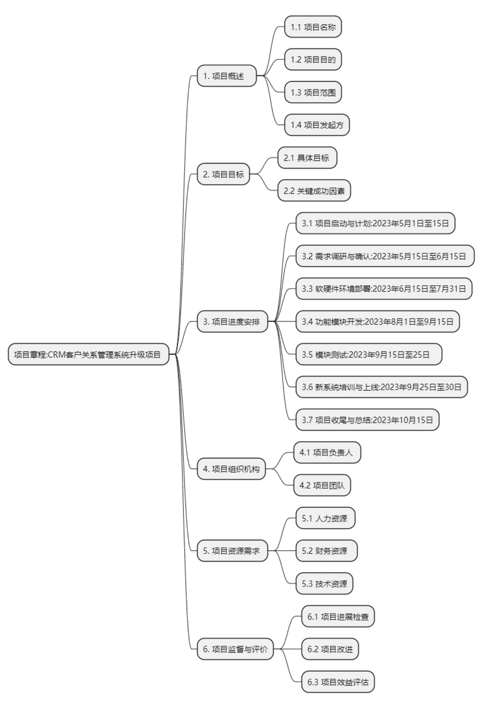

图 2-25 使用 PlantUML 工具绘制的思维导图

## 2.4 表格如何贯穿项目管理

在日常项目运作里，表格几乎无处不在，其核心价值主要体现在以下几方面。

（1）掌控推进节奏。通过进度类表单，管理者可以持续跟踪任务完成情况，确保交付不延期。甘特图与里程碑汇总表能把时间线和关键节点可视化，帮助快速判断整体进展。

（2）管控支出。用估算表与实际发生额对照，能够及时发现预算偏离并进行干预，成本类表单是费用监控的基础手段。

（3）配置资源。人员与物资的安排可通过资源表梳理，明确每位成员的职责、当前状态、所需岗位类型与数量，便于合理调配。

（4）识别风险。风险评估表与应对清单有助于把潜在问题提前列出、量化等级并制定缓释措施。

（5）提升效率。统一的模板减少重复手工操作，节省沟通成本。进度、预算、资源、风险等各类表单协同使用，能明显提高管理质量。

总体而言，表格为进度、资源、财务和绩效提供了结构化的记录与呈现，但真正的决策与执行仍依赖人的判断。表格提供了清晰的框架，在此基础上更高级的信息系统可实现流程的自动化与优化。

### 2.4.1 MD 语法表格概览
MD 语法本身无法输出二进制的 Excel 文件，但可以借助 ChatGPT 得到两种文本形式的表格：
（1）用 MD 语法书写的表格；
（2）用 CSV 格式书写的表格。

先说明 MD 表格的制作思路。MD 表格是纯文本，跨平台迁移方便。以下给出一个示例说明。

### 2.4.2 MD 表格实操
### 2.4.1 表格基础与对齐

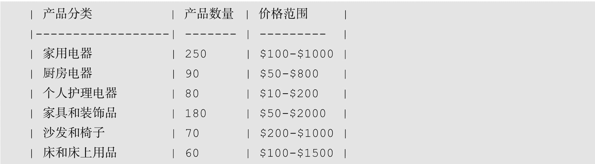

预览效果见图 2-26。

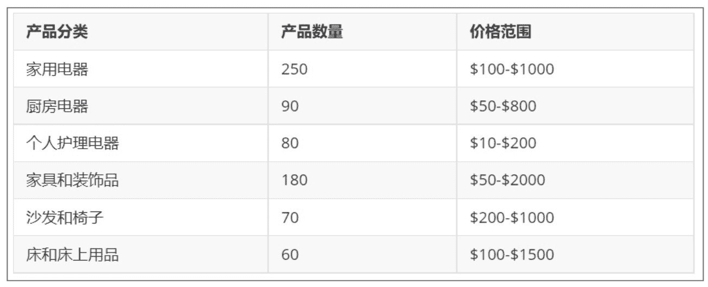

图 2-26 MD 预览效果（1）

示例中用竖线 | 与连字符 - 构建了一个 3 列 6 行的简表，第一行为表头，第二行为分隔行，其余为数据行。

在 MD 表中，单元格对齐通常由分隔行的符号位置决定。若需要更精细的控制，可使用冒号 : 来声明。例如 :-- 为左对齐，:-: 为居中，--: 为右对齐。

下面是一个带对齐声明的 MD 表示例。

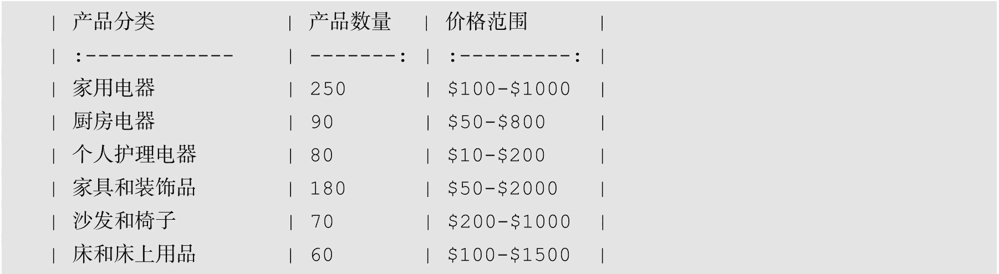

预览效果见图 2-27。

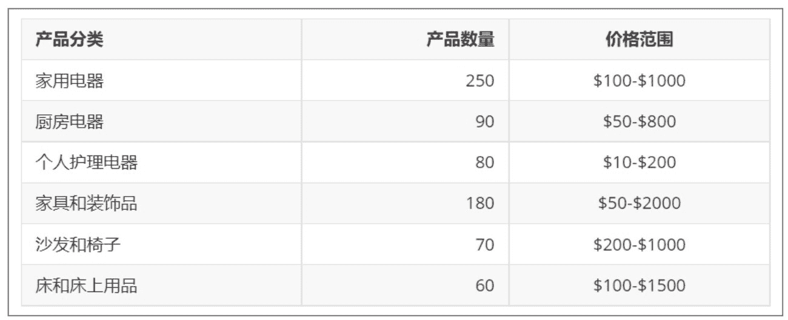

图 2-27 MD 预览效果（2）

### 2.4.2 案例 6：用 MD 制作 E-commerce 网站升级改造项目进度表
手工编写 MD 表耗费时间，可借助 ChatGPT 提升效率。

假设需要制作 E-commerce 网站升级改造项目的进度表，如表 2-1。

表 2-1 E-commerce 网站升级改造项目进度表

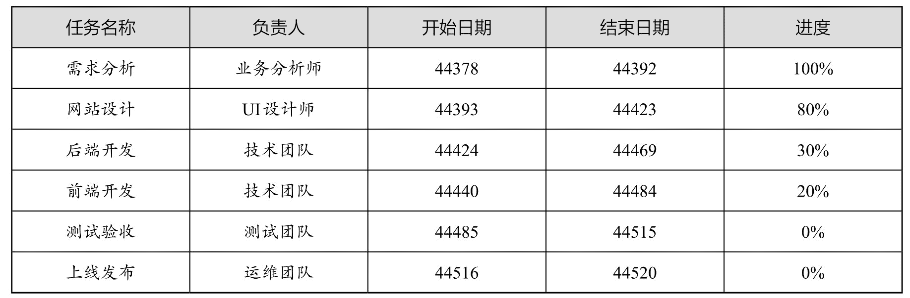

该表可分为表头区与表体区。借助 ChatGPT 制作 MD 表可采用复合指令方式。

#### 动手演示
第 1 步操作如下。

向 ChatGPT 发送请求：
请帮我制作一个表格，返回 MD 代码，我会提供表头和行数据。等我说“表格生成结束”再停止。

ChatGPT 回复：
好的，请提供表头数据和行数据。

随后发送表头数据请求：
表头数据：任务名称 负责人 开始日期 结束日期 进度

ChatGPT 回复：
好的，下面请逐行输入表格数据，每行以英文逗号分隔。例如：任务 1，张三，2022-01-01,2022-01-15,50%

第 2 步操作如下。

发送行数据请求：
需求分析 业务分析师 2021/7/1 2021/7/15 100%

有多条数据时重复第 2 步，完成之后发送：
表格生成结束

ChatGPT 回复：
好的，下面是您所需的 MD 代码：

```
| 任务名称 | 负责人 | 开始日期 | 结束日期 | 进度 |
| -------- | ------------ | ----------- | ----------- | ----- |
| 需求分析 | 业务分析师 | 2021/7/1 | 2021/7/15 | 100% |
| 系统设计 | 技术架构师 | 2021/7/16 | 2021/7/31 | 80% |
| 网站设计 | UI 设计师 | 2021/7/16 | 2021/8/15 | 80% |
| 前端开发 | 前端工程师 | 2021/8/1 | 2021/9/15 | 50% |
| 后端开发 | 技术团队 | 2021/8/16 | 2021/9/30 | 30% |
| 前端开发 | 技术团队 | 2021/9/1 | 2021/10/15 | 20% |
| 测试验收 | 测试团队 | 2021/10/16 | 2021/11/15 | 0% |
| 上线发布 | 运维团队 | 2021/11/16 | 2021/11/20 | 0% |
```

把代码保存为 .md 文件后用对应工具打开，可看到如图 2-28 的表格。

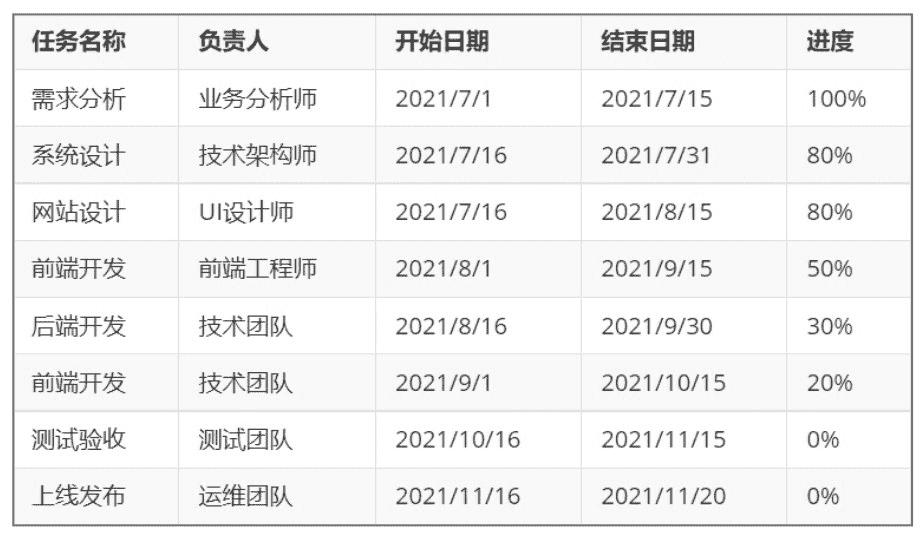

图 2-28 MD 预览效果（3）

提示
也可以一次性输入多条数据，但数据量过大时返回会受限，可能只返回部分内容。建议少量多次输入，若出现无响应，可发送“请继续”，它会接着输出。

### 2.4.3 CSV 文本表
2.4.2 小节介绍的是 MD 格式表，除此之外还能让 ChatGPT 输出 CSV 格式的表。

CSV 即 Comma-Separated Values，逗号分隔值的文本文件，可被 Excel、Google Sheets 等软件读取与编辑。每行代表一条记录，字段间以逗号分隔，第一行通常为表头。以下是一个带表头与三行数据的简单示例。

```
姓名，年龄，性别
爱丽丝，25，女
鲍勃，30，男
查理，35，男
```

需要把 CSV 文本复制到文本编辑器中，如图 2-29。

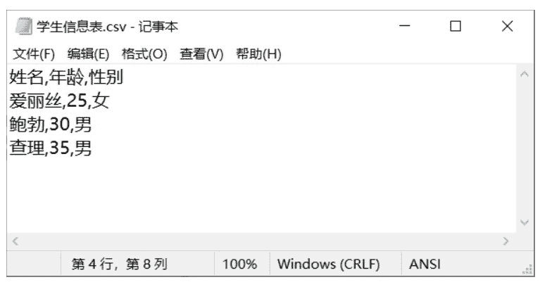

图 2-29 在记事本中编写 CSV 代码

随后将文件保存为 “.csv” 格式，如图 2-30。

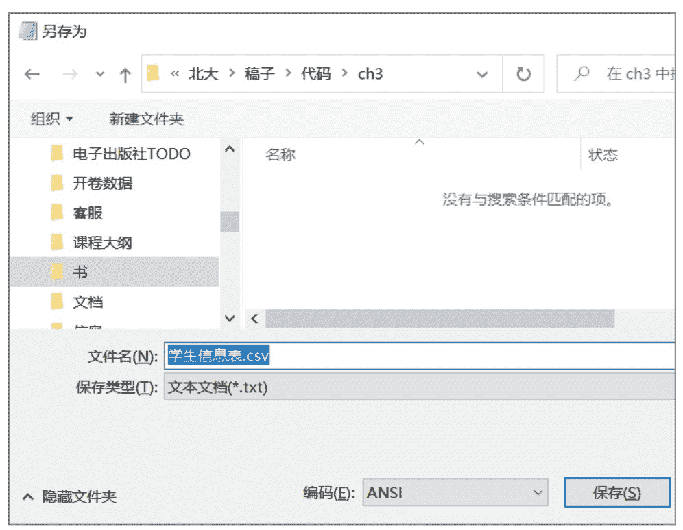

图 2-30 保存为 “.csv” 格式文件

保存完成后，可用 Excel、WPS 等打开，如图 2-31 为 Excel 打开效果。

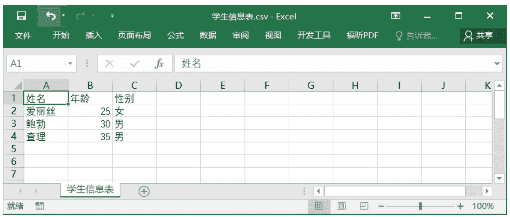

图 2-31 使用 Excel 打开 CSV 文件

注意
保存 CSV 时需留意字符集。简体中文系统下建议选择 ANSI，即 GBK 编码。若编码不当会出现中文乱码，图 2-32 展示了用 Excel 打开 UTF-8 编码 CSV 文件时的乱码现象，而 WPS 则不会出现此问题。

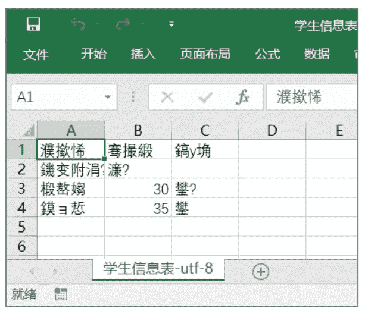

图 2-32 CSV 文件乱码示例

### 2.4.4 案例 7：用 CSV 制作 E-commerce 网站升级改造项目进度表
下面以示例说明如何用 ChatGPT 生成 CSV 表格。

生成 CSV 与 MD 表类似，均可采用复合指令。

#### 动手演示
第 1 步操作如下。

发送请求：
请帮我制作一个表格，返回 CSV 代码，我会提供表头和行数据。等我说“表格生成结束”再停止。

ChatGPT 回复：
好的，请提供表头数据和行数据，我会帮您生成对应 CSV 代码。

发送表头数据请求：
任务名称，负责人，开始日期，结束日期，进度

ChatGPT 回复：
好的，以下是表头数据的 CSV 代码：

```
任务名称，负责人，开始日期，结束日期，进度
```

请提供行数据，我会帮您生成表格。

第 2 步操作如下。

发送行数据请求：
需求分析 业务分析师 2021/7/1 2021/7/15 100%

有多条数据时重复第 2 步，完成之后发送：
表格生成结束

ChatGPT 回复：
好的，以下是包含所有行的表格的 CSV 代码：

```
任务名称，负责人，开始日期，结束日期，进度
需求分析，业务分析师，2021/7/1,2021/7/15,100%
网站设计，UI 设计师，44393,44423,80%
后端开发，技术团队，44424,44469,30%
前端开发，技术团队，44440,44484,20%
测试验收，测试团队，44485,44515,0%
上线发布，运维团队，44516,44520,0%
```

将 CSV 代码复制到记事本保存为 CSV 文件，具体流程不再赘述。

### 2.4.5 CSV 转 Excel
如何把 ChatGPT 制作的 CSV 表转成 Excel？可在 Excel 或 WPS 中打开 CSV 文件后，选择菜单“文件”→“另存为”，在保存类型中选择“*.xlsx”，如图 2-33。

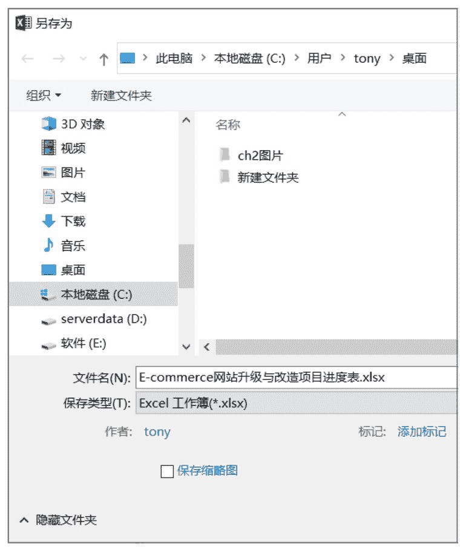

图 2-33 使用 Excel 将 CSV 表另存为 Excel 文件

## 2.5 用 ChatGPT 制作图表
ChatGPT 本身无法直接绘图，但可通过两种路径实现。

1. 无编程路径：先让 ChatGPT 生成 Excel 表，再在 Excel 内置图表功能中绘制。
2. 编程路径：让 ChatGPT 生成程序段，如 VBA、Python 等，从数据中自动生成图表。

### 2.5.1 无编程方式制作图表
在无编程流程中，先用 ChatGPT 生成 Excel 文件，再在 Excel 中制作图表，图 2-34 为 1.2.2 小节案例 2 中的“员工满意度调查表”。

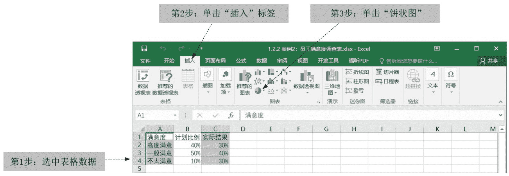

图 2-34 在 Excel 中制作图表

点击“饼状图”按钮后，出现如图 2-35 的图表选择界面。

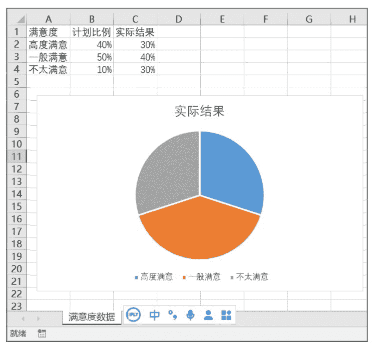

图 2-35 选择图表类型

在此界面可调整图表类型、修改标题等，这里不再详述。最终制作的图表如图 2-36。

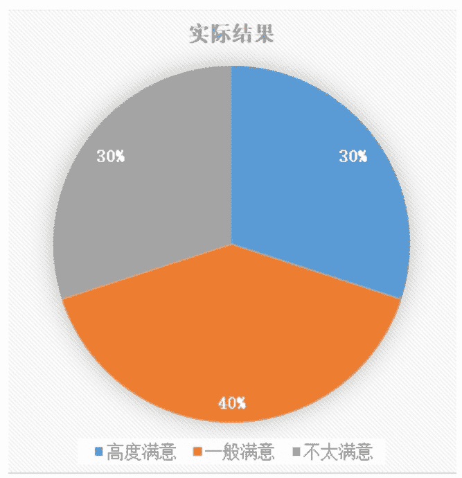

图 2-36 最终制作的图表

提示
在 Excel 中选中目标图表后，使用 Ctrl+C 复制、Ctrl+V 粘贴即可将其导入 Word、PowerPoint、Paint 等应用中，进一步编辑、保存或导出。

### 2.5.2 编程方式制作图表
若要通过编程实现图表制作，需要一定的编程基础。目前常用 VB 和 Python 语言。

笔者更推荐 Python，因其拥有 Matplotlib、Seaborn、Plotly 等丰富图表库，可绘制高质量图表并支持 PNG、JPEG、SVG 等多种导出格式。

由于 1.2.1 小节案例 1 已介绍过用 Python 绘制图表，本小节介绍如何用 ChatGPT 生成 VBA 程序段制作图表。

#### 动手演示
第 1 步操作如下。

向 ChatGPT 发送请求，让其生成 VBA 程序段：
我有数据表（A1:C4），帮我绘制柱状图，返回 VBA 代码。

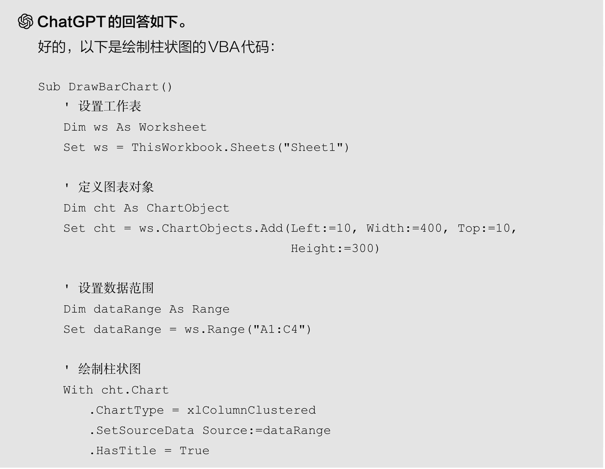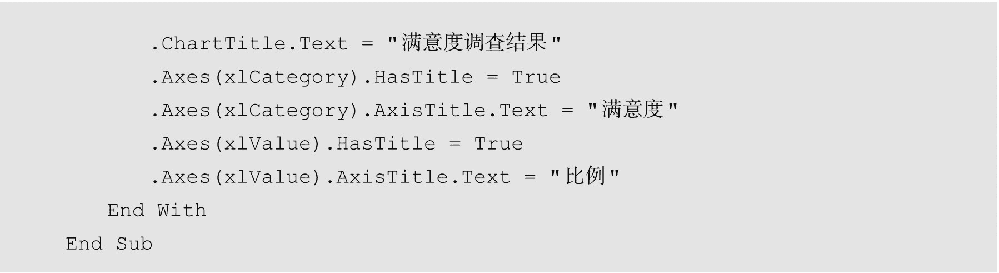

第 2 步操作如下。

新建一个 Excel 文件，注意把代码中的“Sheet1”改为实际的工作表名称，并确保数据放在 A1:C4 区域，如图 2-37。

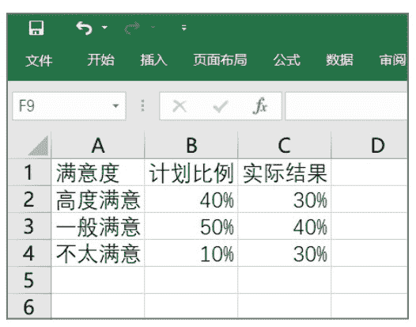

图 2-37 Excel 文件示例

将代码复制到 VBA 编辑器中，如图 2-38，按 F5 运行，即可在工作表上绘制柱状图，如图 2-39。

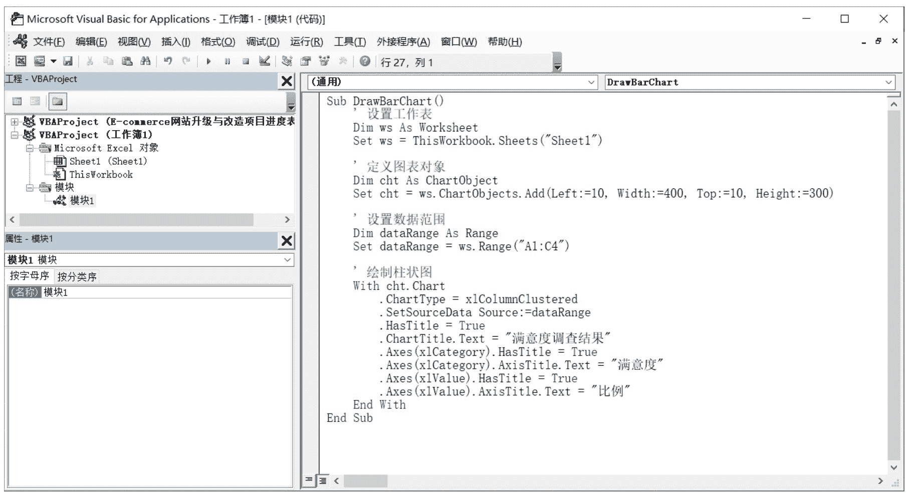

图 2-38 VBA 编辑器


图 2-39 生成的柱状图

提示
如何打开 VBA 编辑器？不同 Excel 版本操作略有差异。以 Office 2016 为例，按 Alt+F11 即可打开，如图 2-40。也可通过开发工具菜单中的“Visual Basic”按钮打开。


图 2-40 VBA 编辑器界面

若 Excel 中未显示开发工具菜单，可按以下步骤启用：

1. 点击“文件”选项卡。
2. 点击“选项”。

3. 进入 Excel 选项界面后，在左侧导航切换到“自定义功能区”。
4. 右侧主选项卡列表中找到“开发工具”，勾选其复选框。
5. 点击“确定”完成设置并关闭对话框。

完成以上操作后，Excel 顶部功能区会新增“开发工具”标签页，可通过该入口打开 VBA 编辑环境。

如要运行代码，还需新建一个 VBA 程序模块。具体操作是在 VBA 编辑器中通过“插入”菜单新建模块，如图 2-41 所示，随后把脚本粘贴到右侧代码区即可准备执行。


图 2-41 插入 VBA 代码模块

用 ChatGPT 生成脚本时常会出现偏差。使用者需要自行排查、调试，并引导模型反复修正优化。整个过程本质上是人与模型的多轮对话，通过持续迭代直至代码可用。

## 2.6 鱼骨图：因果关系可视化

鱼骨图也称因果图或石川图，是以分支结构呈现因果关联的图形工具。它以鱼头承载结果，以鱼骨分支展示影响因素，图 2-42 就是一次项目延期原因的拆解示例。


图 2-42 项目延期原因的分析鱼骨图

基本构成包含三层。

1. 鱼头：指向待分析的问题或最终结果；
2. 主骨：归纳影响结果的主要维度，常见有人员、设备、方法、物料、环境等；
3. 细骨：隶属于主骨下的具体诱因。

主要价值体现在四点。

1. 将结果背后的潜在成因显性化，尤其是容易被忽略的根源；
2. 梳理各要素之间的关联，定位关键驱动点；
3. 为问题解决提供清晰思路与方向；
4. 汇聚多方观点，形成共识。

### 2.6.1 项目管理场景中的鱼骨图运用

鱼骨图借助因果链的可视化，帮助管理者快速找到项目偏离计划的根源并制定针对性改进。以延期为例，可归纳为以下几类诱因。

资源吃紧：专业人力不足或关键设备无法到位，导致工期拉长。
任务冲突：多项工作共享同一资源，相互制约拖慢整体进度。
沟通不畅：部门间信息传递失误，造成执行偏差。
风险事件：技术故障或质量问题频发，需要追加工作量。
其他未明因素：需持续跟踪分析。

通过图谱可判断哪些要素对延期影响最大，进而优化资源调配、调整任务先后顺序、强化沟通机制或加强风险管控，使进度回归预期区间。

### 2.6.2 ChatGPT 辅助绘制鱼骨图的流程

该模型在绘制鱼骨图时可提供不错的辅助。

1. 信息提炼。模型能读懂人工输入的问题描述，抽取出结果、影响要素及关联，为绘图提供素材基础。
2. 框架搭建。基于提取的信息，模型会给出鱼头、主骨与细骨的初步结构，用户可结合业务经验修正补充。
3. 初稿生成。框架确定后，模型可自动输出包含节点表述与关系箭头的初稿，用户再对表述与逻辑进行微调。
4. 分析解读。模型还能基于图谱剖析关键成因、说明要素间相互作用并给出改进建议，辅助决策。

不过模型在处理复杂概念与逻辑时仍有局限，自动生成的框架和内容必须经人工复核，尤其在专业领域更需校对。此外，模型难以完全把握交流背后的深层意图，这会影响分析的准确性。

因此该模型更适合承担初稿生成、信息抽取与初步分析，而准确性校验、框架调整和最终决策仍需人工主导。人机协同才能产出高质量的图谱与方案。

总体看，模型是绘制鱼骨图的优秀协作者，但人工主导不可替代。随着能力提升，人机协同的深度会进一步增强。

### 2.6.3 案例 8：×××项目进度延误原因分析

前文已讨论过×××项目的进度延误与资源缺口问题，单纯表格难以深挖原因。本节以模型辅助分析并绘制鱼骨图为例。

#### 动手示例

第 1 步：让模型分析原因并生成 Markdown 文件。

向模型发送请求：

请根据以下项目进度描述绘制鱼骨图并返回 Markdown 源码。

任务层面共两个任务，计划工期分别为 3 周与 2 周。按计划任务 1 应 5 周内完成，任务 2 应 3.5 周内完成。截至现在，任务 1 已晚 2 周，任务 2 已晚 0.5 周，需采取措施压缩时间。

资源层面有两个资源，资源 1 计划配 4 人，资源 2 计划配 10 台设备。实际只到位 2 人与 7 台设备，资源不足也拖慢了任务。

该请求包含三层意图：①用文字描述项目实际状况含任务与资源；②要求绘制鱼骨图；③输出 Markdown 格式源码。

执行后模型的回复如下。

好的，您需要一份鱼骨图来识别项目延误的根本原因。以下是 Markdown 源码：

```
# 项目延误鱼骨图

## 工作任务

- 任务 1 延误 2 周
- 任务 2 延误 0.5 周

### 原因

- 任务 1：缺少人员或工具，任务量过大
- 任务 2：缺少人员或工具，任务量过大

## 资源供应

- 资源 1 只提供了 2 名人员
- 资源 2 只提供了 7 台设备

### 原因

- 资源 1：供应不足
- 资源 2：供应不足
```

把源码保存为 .md 文件。

第 2 步：用 XMind 导入 Markdown 文件。

参照 2.3.5 节，将生成的 Markdown 文档导入 XMind，成功效果如图 2-43 所示。


图 2-43 导入 Markdown 文件的思维导图

第 3 步：把思维导图转为鱼骨图。

图 2-43 仍为思维导图，可用 XMind 转换。

按图 2-44 操作流程转换，成功结果如图 2-45 所示。


图 2-44 将思维导图转换为鱼骨图


图 2-45 转换成功的鱼骨图

若不喜默认样式，可通过“画布→变更风格”调整，图 2-46 为调整后的效果。


图 2-46 变更风格后的鱼骨图

从图谱中可一目了然地看到延期原因。

## 2.7 本章小结

本章介绍了如何借助生成式模型编写各类项目文档。首先用模型生成模板与内容，如项目章程模板；随后学习与模型对话的 Markdown 语言，并通过案例掌握基本语法与常用工具。接着探讨思维导图在项目管理中的作用，并分别使用模型、Mermaid 与 PlantUML 绘制导图。

之后学习用 Markdown 表格与 CSV 表格制作进度表并转为 Excel，还研究了模型在无编程与编程模式下制作图表的方法。

最后介绍了鱼骨图及其在项目管理中的应用，并演示了模型辅助绘制鱼骨图的过程。

通过本章可掌握使用模型与其他工具高效编写项目章程、导图、进度表、图表与鱼骨图等文档，提升管理与交付效率。

# 第 3 章 项目启动阶段 ChatGPT 的价值

在项目启动阶段，该模型能提供较强支撑，尤其在选题判断、需求分析与文件生成方面效果明显。但其短板也很清晰：评估项目价值的能力有限，需求分析深度不足，生成的文件仍需团队精校细改。因此它更适合作为助手，关键判断与调整仍由人来完成。随着技术进步，其在启动阶段的作用会更突出，但人的核心角色不会被取代，人机协同是智能化项目管理的最佳实践。

## 3.1 ChatGPT 辅助选题与范围界定

在启动阶段，模型能帮助团队对多个备选选题进行研判，挑出最具可行性与价值的方向。主要作用有三点。

（1）优缺点对比。团队可向模型描述多个选题概念，模型会从技术难度、市场前景、资源可得性等角度进行优劣分析，辅助权衡决策，避免“眼高手低”。
（2）范围校准。选题确定后，范围界定也至关重要。模型可通过交互判断哪些任务属于项目必需，哪些属于外延风险较高的部分，建议剔除或延后处理，帮助锁定最佳范围。
（3）决策参考。模型能结合行业报告、市场数据、技术路线图等信息为每个选题提供参考依据，供团队对照决策，减少主观偏差。当然模型研判质量仍需提升，最终判断在人。

模型在商业价值与潜在回报的判断上仍有局限，这需要更多数据积累与模型改进。因此在选题中它可作为有效助手，但关键决策必须人工把关。团队与模型协同互动，才能做出更优选择。

下面通过两个案例说明如何借助模型进行选题与范围确定。

### 3.1.1 案例 1：X 项目企业级项目管理软件的选题评估

我们先介绍 X 项目的选题分析。

X 项目的全称是“开发一款企业级项目管理软件”。X 项目的相关背景信息如下。

（1）项目管理软件行业体量庞大，年均增速约 10%，中高端市场潜力突出。特别是面向中大型企业的产品，功能强大、价格高，潜力最大。
（2）主流产品如 MS Project 和 Primavera 定价几百美元到上万美元。部分采用 SaaS 模式，价格更高。这表明该类软件具备较高的价格空间和盈利能力。
（3）开发企业级项目管理软件需要大量人力和时间打磨关键功能，如进度管理、资源管理、成本管理、风险管理等。产品设计和研发难度高，投入也高，成本回收期较长。
（4）企业级项目管理软件功能更强大和复杂，软件测试也较为关键，这会加大项目投入，延长周期。需要针对大客户进行测试和试用，可能影响项目进程。
（5）全球各地政企数字化投入加大，为企业管理软件带来机遇。数字化是企业级项目管理软件发展的重要驱动力。

动手示例

根据项目背景，我们可以借助于模型进行选题分析。

向模型发送如下请求消息。

我有如下项目背景，请帮我进行选题分析。

X 项目的全称是“开发一款企业级项目管理软件”。X 项目的相关背景信息如下。

（1）项目管理软件市场空间庞大，年均增速 10%左右，中高端市场潜力大。特别是面向中大企业的项目管理软件，功能强大，价格高，潜力最大。
（2）主流产品如 MS Project 和 Primavera 定价几百美元到上万美元。部分采用 SaaS 模式，价格更高。这表明项目管理软件确实有较高的价格空间和盈利能力。
（3）开发企业级项目管理软件需要大量人力和时间开发关键功能，如进度管理、资源管理、成本管理、风险管理等。产品设计和研发难度高，投入也高，成本回收期较长。
（4）企业级项目管理软件功能更强大和复杂，软件测试也较关键，这会加大项目投入，延长周期。需要针对大客户进行测试和试用，可能影响项目进程。
（5）全球各地政企数字化投入加大，为企业管理软件带来机遇。数字化是企业级项目管理软件发展的重要驱动力。

模型的回答如下。

好的，根据 X 项目的背景信息，我会从以下几个角度进行选题分析。

（1）项目可行性和风险分析。X 项目属于高难度和高投入项目，软件研发和测试周期长，投资回收期也较长。这使得项目面临较大的技术和商业风险。值得深入分析项目可行性，找出风险并提出有效控制措施。
（2）产品定位与定价策略。X 项目的产品定位将决定其功能设计、定价模式和销售策略。高价位定位需要有差异化优势和清晰价值主张来支撑。这需要对目标客户与市场进行深入分析，找到最佳的产品定位。
（3）团队组建与管理。X 项目需要高素质的技术与产品团队。但管理难度也较大。这需要合理设计团队结构，招聘高技能人才，并建立有效的考核激励机制与沟通渠道。
（4）产品设计与开发。这是 X 项目的核心工作，需要围绕产品定位进行需求分析，明确产品特色和体验，然后采取敏捷开发与迭代更新等方式有效推进产品设计与开发。这涉及技术架构与模式选择，以及详细的开发路线图制定与进展跟踪。
（5）品牌建设与市场推广。这是影响 X 项目商业成功的另一关键要素。这需要积极参与行业会议，采用网络营销等方式持续提高品牌与产品知名度，并与目标客户开展深度合作与推广，以加速占领市场。

综上所述，X 项目是一个综合性高难度软件项目，选题可以选择技术、产品、团队、市场等多个角度进行深入分析，找到最为关键的影响因素。这有助于项目规划与推进，降低风险，实现商业目标。

事实上这种大段落的文字描述，项目管理者很难从中一目了然地看出分析的结果，我们通常希望将项目利弊列在一起进行比较。

而模型擅长总结和归纳，所以我们向模型再次提出需求。

帮我分析 X 项目的优劣势的表格，返回 Markdown 源码。

模型的回答如下。

好的，以下是表格的 Markdown 源码：

```
| 优势 | 劣势 |
| --- | --- |
| 巨大市场需求，市场空间庞大 | 需要大量人力和时间开发 |
| 面向中大企业的市场潜力大 | 产品设计和研发难度高 |
| 价格空间和盈利能力高 | 投入成本高，回收期长 |
| 数字化投入加大，为企业管理软件带来机遇 | 功能复杂，软件测试难度大 |
| 企业级项目管理软件功能更强大，潜力大 | 针对大客户测试和试用，影响项目进程 |
```

以下是我分析 X 项目的优劣势的表格：

复制上述源码，保存为`X 项目的优劣势的表格．md`文件，然后在 VS Code 或 Typora 中预览，如图 3-1 所示。


图 3-1 X 项目的优劣势的表格

从图 3-1 所示的表格中，我们可以一目了然地看出 X 项目的优劣势。表格是一种清晰简洁的形式，能够很好地呈现项目的优劣势，方便进行比较和分析。在工作中，我们经常使用表格来整理和呈现数据，以便更好地理解和处理信息。

### 3.1.2 案例 2：Y 项目研发新的项目成本控制模型选题分析

刚刚我们分析了 X 项目，它是一个企业级项目管理软件，接下来我们介绍一下 Y 项目。

Y 项目相关背景如下。

（1）项目名称：Y 项目(研发新的项目成本控制模型)。
（2）项目目的：研发一套针对 Y 公司业务特点的新项目成本控制模型，提高项目管控能力和盈利水平。
（3）项目意义：
①优化 Y 公司项目成本管理，提高管控效率与精细化管理能力。
②避免和降低项目成本超支风险，以确保项目收益达成。
③提高公司整体项目管理与管控水平，保障公司稳定高效运营。
④拓展项目管理咨询业务，产生新的收入来源和利润增长点。
（4）项目难度：

Y 项目全景盘点与可行性判断

Y 项目的全貌可以拆成执行任务和支撑条件两条线索来把握。

从执行任务看，团队先要梳理 Y 公司的业务链条及项目管理全流程，找准管控短板；在此基础上研制一套简洁易用、精准高效的新型管控方法；同时推动人员赋能，提升对新方法的接受度与操作熟练度；落地阶段以小范围试点为主，持续迭代优化，保证成效稳步沉淀。

从支撑条件看，环境比较有利：高层高度重视并配套资金政策；专项工作组已组建并引入外部咨询顾问；成员拥有深厚的行业积淀与项目实战经验；同时可以参考标杆案例并结合成熟的管理理论与工具。

主要风险集中在四个方面：技术实现复杂度偏高、推进节奏容易拖慢、人员认同度波动、新方案对外推广受阻。

决定成败的关键要素是：对企业业务的深度洞察与精准定位、团队的专业能力、高层的持续投入以及方案的定制化适配程度。

据此对选题可行性做归纳：

1．选题兼具前瞻性与可落地性。企业竞争加剧、业务持续扩张，项目成本管控已成为影响利润与发展的核心变量。基于自身业务特征构建成本管控新范式，既能内生优化管理效能，也能为咨询业务开辟新的增长点。
2．价值突出，影响深远。若顺利落地，可明显提升项目管控力与精细化水平，降低成本超支风险，保障收益与高效运转，同时为管理咨询板块带来新的收入来源，对长远发展意义重大。
3．难度不低，挑战明显。需要深入剖析业务与管理特征，研发出简洁高效且易用的新方案，并保证实施成效，这对专业能力、经验储备与协同效率要求很高。人员培训与方案推广同样是难点。
4．资源相对充裕，有高层背书。项目投入资金与人力成本较高，管理层的高度重视为推进提供了坚实保障。
5．风险不容忽视，需常态化管控。技术难度可能牵制研发进度，人员接受度偏低会削弱落地效果，市场推广受阻会限制价值释放，需要提前制定应对策略。
6．关键成功点集中在四个方面：充分理解企业业务并实现精准定位、搭建高技能团队、获得管理层坚定支持、保持产品高度定制化，以上共同决定方案的实用性与针对性。

长篇文字阅读负担较大，于是再次提出新的产出需求。

请输出 Y 项目优劣势的表格并以 Markdown 形式返回。

模型的回复如下。

好的，以下是表格的 Markdown 代码：

```
| 优势 | 劣势 |
|:-: |:-: |
|项目选题方向前沿与实用，意义重大|项目难度较大，技术挑战性强|
|管理层高度重视并提供资源支持|项目风险较高，需要密切监控|
|工作团队具备丰富行业与项目管理经验|人员培训与新模式推广难度较大|
|可参考行业优秀案例，借鉴相关理论与工具|研发进度可能受多方面影响而延迟|
|项目成功可产生重要经济效益|技术路线与方案难以把握，难以达到最佳状态|
|新模式具有灵活性，可进行持续优化调整|产品能否达到高实用性仍存在一定变数|
|拓展公司业务范围，促进多元化发展|项目成果无法整合与统一会影响管理效率|
```

将代码写入文件 `Y 项目的优劣势的表格．md`，再在 VS Code 或 Typora 中打开预览，如图 3-2 所示。


图 3-2 Y 项目的优劣势的表格

从图 3-2 可以直观看出项目 Y 的优劣分布。

### 3.1.3 雷达图提升可视效果

若觉得表格不够醒目，可改用图表。图表的直观性通常强于表格，尤其在对比优缺点时，雷达图能同时呈现多维度数据，适合多对象或多方面的比较。

实操示例

想绘制雷达图，可先让模型把图 3-2 的表格数据处理成量化分值，再生成图表。

向模型提交如下指令。

有如下表格，我需要将表格中的数据转换为数值，可以使用 1~5 的评分进行量化，也可以根据实际情况自定义评分，并返回 Markdown 格式。

请模型帮我们进行选题分析。

| 优势 | 劣势 |
|:-: |:-: |
|选题前沿实用，价值突出|技术难度大，挑战显著|
|高层高度关注，资源到位|整体风险偏高，需严密跟踪|
|团队行业与项目经验丰富|培训与推广阻力不小|
|可借鉴标杆案例与理论工具|研发时程易受多方干扰|
|成功可带来可观经济收益|技术路径把握吃力，难以达最佳|
|方案具备迭代弹性|成品实用度仍存变数|
|助力业务多元化发展|成果整合不足会拖累管理效率|

模型的回答如下。

下面是转换为 Markdown 格式的结果：

```
| 优势 | 评分 | 劣势 | 评分 |
|:-: |:-:|:-:|:-:|
|项目选题方向前沿与实用，意义重大|5|项目难度较大，技术挑战性强|2|
|管理层高度重视并提供资源支持|5|项目风险较高，需要密切监控|2|
|工作团队具备丰富行业与项目管理经验|4|人员培训与新模式推广难度较大|3|
|可参考行业优秀案例，借鉴相关理论与工具|4|研发进度可能受多方面影响而延迟|3|
|项目成功可产生重要经济效益|5|技术路线与方案难以把握，难以达到最佳状态|2|
|新模式具有灵活性，可进行持续优化调整|4|产品能否达到高实用性仍存在一定变数|3|
|拓展公司业务范围，促进多元化发展|5|项目成果无法整合与统一会影响管理效率|2|
```

将代码保存为 `Y 项目的优劣势的雷达图数据．md`，然后在 VS Code 或 Typora 中预览，如图 3-3 所示。


图 3-3 Y 项目的优劣势的雷达图数据

图 3-3 的表格属于模型生成的初稿，还需结合实际情况微调评分，才能得到更准确的图表。

得到 Markdown 格式的雷达图数据表格后，可以进一步转成 CSV 格式。

实操示例

我们向模型发送如下请求消息。

有如下 Markdown 表格，帮我返回 CSV 表格。

| 优势 | 评分 | 劣势 | 评分 |
|:-: |:-:|:-:|:-:|
|选题前沿实用，价值突出|5|技术难度大，挑战显著|2|
|高层高度关注，资源到位|5|整体风险偏高，需严密跟踪|2|
|团队行业与项目经验丰富|4|培训与推广阻力不小|3|
|可借鉴标杆案例与理论工具|4|研发时程易受多方干扰|3|
|成功可带来可观经济收益|5|技术路径把握吃力，难以达最佳|2|
|方案具备迭代弹性|4|成品实用度仍存变数|3|
|助力业务多元化发展|5|成果整合不足会拖累管理效率|2|

模型的回答如下。

以下是 Markdown 表格转换为 CSV 表格的结果：

```
优势，评分，劣势，评分
项目选题方向前沿与实用，意义重大，5，项目难度较大，技术挑战性强，2
管理层高度重视并提供资源支持，5，项目风险较高，需要密切监控，2
工作团队具备丰富行业与项目管理经验，4，人员培训与新模式推广难度较大，3
可参考行业优秀案例，借鉴相关理论与工具，4，研发进度可能受多方面影响而延迟，3
项目成功可产生重要经济效益，5，技术路线与方案难以把握，难以达到最佳状态，2
新模式具有灵活性，可进行持续优化调整，4，产品能否达到高实用性仍存在一定变数，3
拓展公司业务范围，促进多元化发展，5，项目成果无法整合与统一会影响管理效率，2
```

将 CSV 代码拷贝到记事本保存为文件，过程不再赘述。然后使用 Excel 或 WPS 打开文件后，如图 3-4 所示。


图 3-4 Y 项目的优劣势的 CSV 文件

在 Excel 中可以使用其图表生成功能绘制雷达图。图 3-5 为 Y 项目优势的雷达图数据，图 3-6 为劣势的雷达图数据。具体生成过程可参考 2.5.1 小节，这里不再展开。


图 3-5 Y 项目的优势的雷达图数据


图 3-6 Y 项目的劣势的雷达图数据

## 3.2 用大模型拆解背景与业务需求

在项目管理中，可用以下方式让大模型辅助做项目背景和业务需求分析。

1．提供项目所处公司或行业的详细情况，让模型理解项目运行的环境与前提。包括业务范围、发展态势、组织架构和管理文化等。
2．说明项目提出的直接动因和管理层的期望目标，让模型明白项目启动的必要性与紧迫性。
3．详细列出项目要解决的核心问题及新管理模式的功能诉求，让模型明确关键目标与业务需求。
4．模型综合以上信息，对项目的必要性、主要目标和关键需求做出判断，同时分析实施过程中可能遇到的主要难点与挑战。
5．我们需补充完善信息并提出进一步问题，以便模型做更精准全面的分析；也需对模型的结论给出自己的判断，形成共同认知。
6．在充分理解项目信息与特征后，模型还能延伸应用到立项评估、方案选型、计划制定等环节，为决策提供系统参考。

总体而言，就是通过提供详实信息并与模型深度交流，让其形成清晰认知，进而开展后续启动与决策研究。

## 3.3 案例 3：智慧城市规划与建设项目的背景与业务需求分析

下面以智慧城市规划与建设项目为例，说明如何用大模型辅助做背景与业务需求分析。

项目所在城市 G 市为中型城市，发展势头较快，但基础设施与公共服务相对滞后，规划和建设难以匹配发展节奏，对可持续发展形成压力。

为此，G 市政府决定启动“智慧城市规划与建设项目”，依托先进信息技术改造传统城市管理模式，打造智能化、数字化、绿色环保的现代化城市。

项目主要目标如下。

1．搭建智能交通管理系统，实现交通智能调度与车流管控。
2．搭建智能安防监控系统，实现全域监测与事件快速响应。
3．推进公共资源智能化管理，涵盖照明、垃圾处理、供水供电等。
4．推进政务与市民服务智能化，实现线上办事与信息共享。
5．建设智能化管廊、桥梁等城市基础设施，为智慧城市提供支撑。
6．以项目建设为抓手，推动产业结构调整，培育新业态。

基于此，可开展业务需求分析。

实操示例

我们向大模型发送如下请求消息。

项目背景如下，如何进行业务需求分析。

智慧城市规划与建设项目主要背景与目标如下。

该项目所在城市 G 市是一座中型城市，城市发展较快，但是城市基础设施与公共服务水平相对落后，城市规划和建设难以跟上发展速度，这给城市可持续发展带来较大压力。

为此，G 市政府决定开展“智慧城市规划与建设项目”，利用先进的信息技术手段改造提升传统的城市管理方式，建设一个智能化、数字化、绿色环保的现代化城市。

项目的主要目标如下。

1． 构建智能交通管理系统，实现智能化交通调度与车流管控。
2． 构建智能安防监控系统，实现全方位监测与事件响应。
3． 智能化公共资源管理，如照明、垃圾处理、供水供电系统等。
4． 智能化政务管理和市民服务，实现在线办事与信息共享。
5． 建设智能化管廊与桥梁等城市基础设施，支撑智慧城市的建设。
6． 利用项目建设推动产业结构调整，培育新的产业形式。

大模型的回答如下。

业务需求分析是项目推进的关键环节，需要从不同业务场景出发来定义需求。针对本项目，可从以下角度切入。

1． 智能交通管理系统：梳理当前交通现状，包括拥堵分布、事故频次等，以及交管部门的工作流程，明确待解决问题与优化方向，如实时路况发布、监测预测、信号灯优化等。
2． 智能安防监控系统：摸清城市安全现状与安保部门作业流程，明确改进点，如视频监控覆盖、违章抓拍、应急响应机制等。
3． 智能化公共资源管理：分析照明、垃圾处理、供水供电等资源的管理现状与部门流程，明确节能减排、智能运维等需求。
4． 智能化政务管理和市民服务：评估现有政务办事流程与信息共享水平，明确网上办事、数据互通等改进需求。
5． 智能化管廊与桥梁等基础设施：了解运维现状与管理流程，明确智能运维、预防性维护等需求。
6． 产业结构调整：分析城市产业结构与经济发展现状，明确以信息技术为核心的新兴产业及绿色低碳产业的培育方向。

分析过程中需兼顾城市规划、基础设施、信息技术应用、环境保护等多方面需求，以保障项目顺利落地并取得预期效果。

## 3.4 用大模型生成项目章程与可行性研究初稿

利用大模型生成项目章程和可行性研究报告初稿，可按以下步骤进行。

1．收集项目相关信息并共享给大模型。包括背景、目标、范围、阶段、预算、干系人、组织架构等，使其对项目有全面认知，为后续生成提供基础。
2．确定报告结构与要素。根据项目章程和可行性研究的常规框架，结合项目实际，与大模型共同确认章节及内容要点，如项目概况、市场分析、运营模式、实施方案、风险评估、资源管理等，为生成提供清晰方向。
3．大模型生成初稿。在框架确定后，可要求其基于已有信息自动生成各章节内容初稿，按逻辑顺序组织。但需注意其内容仅作框架与思路参考。
4．评审与修订。需仔细核对生成内容，对不准确、不完整或不合理的部分进行人工修改与补充，必要时调整报告结构。
5．人机协作定稿。在评审达成共识后，与大模型协作形成最终版本。

上述流程可概括为“五步人机协作法”。

### 3.4.1 案例 4：智慧城市规划与建设项目章程示例

可先让大模型生成项目章程初稿，再由项目管理者根据实际充实完善。下面仍以智慧城市项目为例。

实操示例

我们向大模型发送如下请求消息。

项目背景如下，帮助我生成项目章程。

智慧城市规划与建设项目主要背景与目标如下。

该项目所在城市 G 市是一座中型城市，城市发展较快，但是城市基础设施与公共服务水平相对落后，城市规划和建设难以跟上发展速度，这给城市可持续发展带来较大压力。

为此，G 市政府决定开展“智慧城市规划与建设项目”，利用先进的信息技术手段改造提升传统的城市管理方式，建设一个智能化、数字化、绿色环保的现代化城市。

项目的主要目标如下。

1． 构建智能交通管理系统，实现智能化交通调度与车流管控。
2． 构建智能安防监控系统，实现全方位监测与事件响应。
3． 智能化公共资源管理，如照明、垃圾处理、供水供电系统等。
4． 智能化政务管理和市民服务，实现在线办事与信息共享。
5． 建设智能化管廊与桥梁等城市基础设施，支撑智慧城市的建设。
6． 利用项目建设推动产业结构调整，培育新的产业形式。

大模型的回答如下。

项目章程：

项目名称：智慧城市规划与建设项目

项目背景：

G 市是一座中型城市，发展速度较快，但城市基础设施与公共服务水平相对落后，城市规划和建设难以跟上发展速度，给城市可持续发展带来较大压力。为此，G 市政府决定开展“智慧城市规划与建设项目”，利用先进的信息技术手段改造提升传统的城市管理方式，建设一个智能化、数字化、绿色环保的现代化城市。

项目目标：

构建智能交通管理系统，实现智能化交通调度与车流管控。

构建智能安防监控系统，实现全方位监测与事件响应。

智能化公共资源管理，如照明、垃圾处理、供水供电系统等。

智能化政务管理和市民服务，实现在线办事与信息共享。

建设智能化管廊与桥梁等城市基础设施，支撑智慧城市的建设。

利用项目建设推动产业结构调整，培育新的产业形式。

项目范围：

本项目包括但不限于以下内容：

智能交通管理系统的设计、建设与实施。

智能安防监控系统的设计、建设与实施。

公共资源管理系统的设计、建设与实施。

政务管理和市民服务系统的设计、建设与实施。

城市基础设施的设计、建设与实施。

产业结构调整与新产业培育的规划与实施。

项目约束条件：

项目预算：总预算为 1 亿元，其中政府投资 8,000 万元，企业投资 2,000 万元。

项目周期：项目计划实施周期为 3 年。

项目风险：包括技术风险、资金风险、市场风险等。

项目利益相关方：包括政府、企业、居民等。

项目管理团队：

项目经理：×××

项目副经理：×××

项目成员：×××、×××、×××等。

项目交付物：

智能交通管理系统的交付成果包含总体设计文档、落地实施计划、功能测试记录及使用者操作指南。
智能安防监控系统的交付成果包含总体设计文档、落地实施计划、功能测试记录及使用者操作指南。
公共资源管理系统的交付成果包含总体设计文档、落地实施计划、功能测试记录及使用者操作指南。
政务管理与市民服务的交付成果包含总体设计文档、落地实施计划、功能测试记录及使用者操作指南。
城市基础设施模块的交付成果包含总体设计文档、落地实施计划、功能测试记录及使用者操作指南。
产业结构优化与新兴产业培育专项规划。

项目管控要点：
项目负责人主导日常运营并把控关键决策事项。
执行团队需按照节点向负责人汇报工作进展。
负责人要持续跟踪推进节奏，并在出现偏差时及时纠偏。
负责人须定期向各方利益相关者通报项目动态。

项目立项说明：
本项目由 G 市政府牵头推进，经相关职能部门与利益相关方审议同意后正式开工。

由 AI 助手拟定的项目章程仅为初稿，项目经理需结合实际情况修正，再参照第二章的章程模板补充完善，最终形成定稿。

### 3.4.2 案例5：智慧城市可行性研究实操拆解

可借助 AI 助手对智慧城市规划与建设项目开展可行性研判并形成报告，再由管理层据实完善。下面以智慧城市规划与建设项目为例，说明如何借助 AI 辅助完成研究与报告输出。

动手示例

我们向 AI 助手发出如下请求。

项目背景如下，请协助进行可行性研究。

智慧城市规划与建设项目背景与目标如下：

项目所在地 G 市为中型城市，发展增速较快，但基础设施与公共服务相对滞后，规划建设难以跟上发展节奏，给可持续发展带来压力。

为此 G 市政府决定推进“智慧城市规划与建设项目”，以先进信息技术改造传统城市管理模式，打造智能化、数字化、绿色低碳的现代化城市。

项目主要目标：
1. 构建智能交通管理系统，实现交通智能调度与车流管控。
2. 构建智能安防监控系统，实现全域监测与事件快速响应。
3. 推进公共资源智能化管理，覆盖照明、垃圾处理、供水供电等。
4. 实现政务管理与市民服务智能化，支持线上办事与信息共享。
5. 建设智能化管廊、桥梁等城市基础设施，为智慧城市提供支撑。
6. 以项目建设为抓手推动产业结构优化，培育新业态。

助手给出的内容如下。

项目可行性研究分析如下：

一、技术可行性分析
智能交通管理系统：需具备实时数据采集、处理、分析、车辆定位、路况监测、信号灯控制等能力，相关技术在市场上已较为成熟，可行性较高。
智能安防监控系统：需具备视频监控、智能识别、事件响应等能力，相关技术在市场上已较为成熟，可行性较高。
公共资源管理系统：需具备物联网、远程监测、智能控制等能力，相关技术在市场上已较为成熟，可行性较高。
政务管理和市民服务系统：需具备信息化、互联网、大数据等能力，相关技术在市场上已较为成熟，可行性较高。
智能化管廊与桥梁等城市基础设施：需具备智能化监控、远程调控等能力，相关技术在市场上已较为成熟，可行性较高。

二、经济可行性分析
总投资：项目总投资预算为××亿元。
资金来源：主要包括政府投入、社会资本投入、银行贷款等。
投资回报率：据市场预测，预计为××%。
财务指标：预计××年后实现盈利，盈利规模约××亿元。
经济效益：项目建设将带动相关产业发展，提升城市服务水平与居民生活质量，对城市经济社会发展产生积极作用。

三、市场需求分析
智慧城市建设已成为城市发展的重要方向，市场需求旺盛。
城市基础设施与公共服务相对落后，市场对智慧化升级的需求日益迫切。
智慧城市建设可带来显著的社会与经济效益，市场前景广阔。

四、SWOT分析
优势：政府支持力度大，市场需求旺盛，技术成熟度高。
劣势：投资规模较大，实施过程可能遇到技术难点与市场风险。
机会：智慧城市成为发展主线，市场前景开阔。
威胁：市场竞争激烈，竞争对手或在技术、价格等方面形成压力。

五、时间进度
项目实施周期为××年。
实施过程须严格把控进度，确保按计划交付。

以上为智慧城市规划与建设项目可行性研究分析报告，可帮助决策者全面了解项目情况并作出审慎决策。

AI 生成的可行性研究为初稿，项目经理还需结合实际修改完善。

因投资回报率与财务指标以文字表述不够直观，项目经理可让 AI 生成表格模板，再据实填补完善。

动手示例

我们再次提出请求。

请出具智慧城市建设项目投资回报率图表。

助手回复如下。

表 3-1 为智慧城市建设项目投资回报率的示例图表：

表 3-1 投资回报率示例图表


在表 3-1 中，投资金额指每年投入的资金总额，收益金额指每年实现的收益总额，投资回报率指每年的投资回报率。可以通过每年的收益金额和投资金额计算得出投资回报率，通过这个表格可以清晰地了解项目的收益情况和投资回报率。

智慧城市建设涉及多个方面，如智能交通、智慧治理、智能安防、智慧能源等，具体的投资回报率会受到多种因素的影响，如政策环境、市场需求、技术成熟度等。如果您能提供更具体的数据，我可以根据数据重新进行投资回报率分析。

项目管理人员可以根据自己项目的实际情况修改投资回报率的示例图表，然后整合到最终的项目可行性分析报告中。

动手示例

我们再次追问，请求内容如下。

请出具智慧城市建设项目市场需求分析图表。

助手回复如下。

当然可以，表 3-2 为智慧城市建设项目市场需求分析的示例图表：

表 3-2 市场需求分析示例图表


在表 3-2 中，市场规模指智慧城市建设市场的规模大小，市场增长率指市场规模的年度增长率，我们的市场份额指我们公司在智慧城市建设市场中的占有率，产品销售额指我们公司产品的销售额。通过这个表格，可以看出市场的规模和增长率，以及我们公司在市场中的地位和产品销售额的变化。这些数据对于制定市场营销策略和业务决策都非常重要。

当然，如果您能提供更多的市场数据，如市场细分、竞争对手情况等，我可以根据数据重新进行市场需求分析。

项目管理人员可以根据自己项目的实际情况修改智慧城市建设项目市场需求分析的示例图表，然后整合到最终的项目可行性分析报告中。

## 3.5 本章复盘

本章围绕 AI 助手辅助项目前期工作展开。先研究如何用 AI 明确项目选题与范围，并通过两个案例分析优缺点，用雷达图进行可视化呈现。随后学习如何借助 AI 分析项目背景与业务需求，以智慧城市规划与建设项目为例展开。接着探讨如何用 AI 生成项目章程与可行性研究报告初稿，提出人机协作五步法并通过案例落地。

总体来看，AI 能显著提升项目前期效率，在选题分析、背景调研、报告生成等环节提供支持。借助 AI，团队可以更快更全面地完成前期准备，为项目启动夯实基础。

通过本章学习，我们掌握了借助 AI 开展项目前期的思路与工具，有助于项目顺利启动与计划制定，开局更稳。

# 第 4 章 用 AI 助手组建高效项目团队

在项目管理中，可通过以下方式借助 AI 协助组建高效团队。

1. 明确团队角色与职责：可与 AI 探讨项目所需关键角色及核心职责，如项目经理、技术负责人、测试工程师等。AI 能按项目特征自动生成各角色职责清单初稿，再由团队评审修订，最终确定职责边界。
2. 评估团队规模与技能：可与 AI 讨论项目规模、难度、专业领域，获取团队人数区间及关键技能建议，如 IT 技术人员、专业工程师的需求数量。再结合资源与要求确定最终配置。
3. 构建招聘与选拔机制：可与 AI 探讨招聘渠道、选人标准、面试重点与方式等。AI 可提供流程与模板供参考，再据项目特点制定选拔机制与招聘计划。
4. 指导团队建设与发展：可与 AI 讨论团队文化、沟通机制、绩效管理等建设要素。AI 可提供经验与范例，再结合实际情况选取优化。
5. 识别团队风险与应对策略：可与 AI 讨论建设与管理中可能的风险，如技术风险、人员变动、沟通风险等。AI 可按项目特征与阶段识别关键风险及对策，再人工判断修订，形成风险应对计划，确保团队稳定运行。

通过人机协作可充分发挥 AI 的生成能力，降低人工工作量，提升团队建设效率。但涉及复杂判断与决策时仍需人工把控。实践中需持续优化协作流程，实现人机互补。

## 4.1 高效项目团队的特征

高效项目团队是指通过合理角色设置、专业技能配置、良好沟通机制实现项目目标的团队。主要特征包括：

1. 角色分工清晰、职责定位明确：每个成员的角色与职责界定清晰，避免重复或遗漏，形成扁平高效的结构。
2. 专业知识与技能匹配：成员具备项目实施所需的专业知识与技能，资源得到合理高效利用。
3. 沟通机制顺畅：成员间信息交流及时频繁，信任度高，可快速发现问题并优化方案。
4. 主动性强、执行高效：团队具有较强主动与创新意识，能灵活应对变化，及时解决问题，确保高质量交付。
5. 目标一致、协作紧密：成员共享价值观与使命感，相互支持配合，共同推动目标达成。
6. 持续学习与改进：重视成长总结，不断优化流程、提升能力，适应项目变化，保持持续高效运行。

高效团队需要在组建与管理中关注上述要素，激发成员潜能，发挥专业优势，建立互信，形成共同目标并持续进化。只有高效团队才能让项目高质高效推进，发挥最大价值。

总体而言，高效团队是项目成功的关键。组建与培养高效团队需要下功夫打磨选人用人、角色定义、过程管理与文化建设，这对项目经理的识人能力与团队精神提出更高要求。

## 4.2 团队组织架构怎么选

团队组织结构指的是成员间的关系与职责分工，以及内部沟通协作方式。

### 4.2.1 三种常见组织结构对比

常见的团队组织结构分类如下。

1. 功能型组织结构：如图 4-1 所示，按职能或专业领域划分部门，如设计部、开发部、测试部等。结构清晰易管，但全局观念不足，适应变更能力弱，适合业务稳定、规模较大的项目。
2. 产品型组织结构：如图 4-2 所示，按产品或服务划分部门，每个部门负责一类或数类产品的开发生产。有利于专业发展与市场响应，但易造成资源重复配置，适合产品较多、业务复杂的项目。
3. 矩阵型组织结构：如图 4-3 所示，项目经理与部门经理共同管理，既能保证专业统筹又能实现项目整体控制。兼顾专业与项目，但可能出现职责不清，需强化项目主导地位与角色定义。当前较为主流的模式。


图 4-1 功能型组织结构图


图 4-2 产品型组织结构图


图 4-3 矩阵型组织结构图

### 4.2.2 如何为不同任务匹配结构

高效团队的成功很大程度上取决于组织结构，不同结构对协作、沟通、决策产生不同影响，进而影响效率与成功率。

首先，针对固定重复的任务，采用功能型团队较为合适。功能型团队成员技能成熟、经验丰富，能高效完成本职工作，提升整体效率。但成员关注点集中于自身任务，沟通协作存在挑战，需通过有效机制弥补。

其次，针对需快速响应市场需求的项目，采用产品型结构较为合适。团队成员通常临时组建，除专业技能外，还需具备团队合作、沟通与问题解决能力。项目经理需清晰掌握成员进度与质量，及时解决问题与调整计划。

最后，针对需要灵活协作的项目，采用矩阵型结构较为合适。矩阵型可促进跨职能协作，提升效率与成功率。但成员需同时向项目经理与职能经理汇报，沟通协调压力较大，项目经理需具备更强管理与领导能力以保证协作效果。

综上，高效团队的组织结构需结合项目需求与成员特点选择，以提高工作效率与项目成功率。

## 4.3 角色与职责怎么定

项目中不同角色承担不同职责。

### 4.3.1 确定角色要看哪几点

无论何种组织结构，确立角色与职责时需考虑：

1. 项目目标与需求：目标与需求是确定角色与职责的基础，明确后才能据此配置角色确保按时保质完成。
2. 项目管理层面的角色与职责：项目经理或主管需具备领导、沟通、协调能力，确保项目按计划推进并协调跨部门合作。
3. 部门层面的角色与职责：各部门需明确在项目中的定位与职责，并指派合适人员参与。如研发负责新产品或技术，市场负责需求判断与定价策略等。
4. 项目团队层面的角色与职责：团队成员需扮演技术专家、分析师、协调员等多重角色，在管理层与部门间沟通协调，保证项目交付。
5. 团队成员的技能与能力：成员技能是项目成功的关键，确定角色时需匹配能力，确保人岗适配。

总之，角色与职责的确定需综合考虑目标需求、管理层、部门层、团队层及成员能力等多方面因素，共同影响项目成败。

### 4.3.2 AI 辅助梳理角色的七步法

可按以下步骤借助 AI 确定项目角色与职责。

1. 描述项目基本信息，让 AI 全面了解项目名称、目的、规模、产品、阶段等，为后续分析提供依据。
2. 询问 AI 项目常见角色类型，如项目经理、产品经理、UI 设计师、开发工程师、测试工程师等，并按项目特征筛选适用角色。
3. 对每个选定角色，询问其核心职责、技能与经验要求，AI 可从管理与流程角度给出建议，再结合实际确认。
4. 探讨是否需要新增角色，AI 可提供新增类型与职责调整建议，帮助全局审视设置合理性与完备性。
5. 讨论各角色间的工作关系、沟通方式与协作机制，AI 可从目标达成角度提出意见供参考。
6. 据职责与关系形成初步角色清单，并进行确认。对不明确或遗漏点，再次与 AI 互动优化。
7. 最终方案需由人工基于实际情况确认与检验。AI 意见仅作参考，决策权在人。

总体协作模式为：人工提出问题与信息→AI 基于知识给出分析与建议→人工判断检验→再互动优化→人工最终决策。AI 负责拓展思路、补充依据，人工负责把关决策，二者结合才能发挥最大价值。

总之，利用 AI 辅助确定角色与职责的主要流程为：描述项目→确定角色类型→明确职责→考虑新增与调整→探讨关系→初定与确认→人工终审。

### 4.3.3 案例1：进度管理软件项目角色实战

下面以工程项目进度管理软件项目为例，说明如何确定团队角色与职责。该项目背景如下。

该软件面向中大型建设工程项目，旨在实现各阶段进度与时间的规划管理。主要面向项目管理人员与工程技术人员，帮助其制定里程碑计划，进行资源分配与优化，实时跟踪任务进展，并在进度延迟或预算超支时发出预警。

软件主要功能包括：

1. 多层级进度编制：支持总进度、分阶段进度及各专业工程进度编制，自动合并综合，采用甘特图直观展示进度关系与节点信息。
2. 资源管理与优化：记录项目涉及的人员、材料、设备、资金等资源信息，针对供需关系与关键路径进行分配与平衡。

# 用 AI 搭手，把项目进度和团队搭建做得更准

做工程类进度管控软件，离不开三件事：把活拆清楚、让风险提前冒头、让汇报一目了然。

任务管理上，要把每个阶段的工作拆到可执行颗粒度，标明任务属性、负责人、计划工期和里程碑节点，并对开工、完成、延期做实时跟踪。预警机制上，一旦关键路径出现滞后或资源供需失衡，就要立刻触发里程碑预警或资源预警，提醒管理层干预。进度报表上，按不同层级的需求定制看板，形式直观、内容丰富，方便动态掌握进展和质量。

该进度跟踪与监控软件已完成产品定位、需求分析与原型设计，正进入开发阶段。团队走敏捷路线，以 3 个月为一个迭代，预计一年内交付首个版本。整体背景覆盖了产品定位、应用场景、功能模块、开发模式与排期。

### 动手实操：用对话式 AI 厘清团队分工

第 1 步：先让 AI 全面吃透项目。
把项目名称、目标、规模、需求、所处阶段一次性喂给模型，先存档不回复。
示例指令思路是：请记录以下信息，暂时不需要回复。
项目目标是做一款面向工程项目经理与技术人员的进度跟踪与监控产品。核心能力包括：用甘特图编制总进度和分阶段计划；录入人员、设备、资金等资源并做分配优化；把阶段拆成任务清单，明确属性、负责人、工期并实时监控；关键路径延误或资源矛盾时自动预警；按管理层要求输出直观的进度报表。项目已做完定位和需求分析，原型已出，正进入开发，敏捷迭代 3 个月，预计一年交付首版。
AI 回复：已记录。

第 2 步：问模型这个体量的项目通常需要哪些角色。
对话后得到一份常见清单：项目经理、软件工程师、测试工程师、产品经理、UI 设计师、数据库管理员、运维工程师、技术支持工程师。说明只是参考，最终要结合具体需求定。

第 3 步：逐个角色深挖职责与要求。
项目经理 负责计划制定与节奏把控、任务与资源分配、跨部门协同、风险问题处置、客户沟通与向上汇报，需要沟通领导力、项目管理经验、团队协作与开发流程认知。
软件工程师 按规格和设计文档实现功能、做自测确保质量、解决开发问题、协同保证功能与性能，需要扎实编码能力、常用语言工具熟练度、问题解决与协作力。
测试工程师 制定测试计划与用例、开展功能/性能/安全测试、反馈问题并协助闭环、管理用例与测试环境，需要测试功底、方法工具熟悉度、协作意识。
产品经理 把握客户需求、制定产品策略与规划、输出需求规格、协同开发、关注市场与竞品，需要沟通力、产品经验、市场分析能力。
UI 设计师 负责界面视觉与易用性、制定设计规范、协同实现效果，需要设计与审美能力、设计工具熟练度、用户体验与交互原理认知。
数据库管理员 设计并维护数据库、制定管理规范、做备份恢复与性能优化、协同开发，需要数据库技能与管理经验、工具熟练度。
运维工程师 部署与维护系统、监控性能与稳定性、保障服务器网络安全，协同开发保障上线，需要操作系统与网络技能、运维经验。
技术支持工程师 处理客户使用问题、记录反馈、提供远程或现场支持、协同开发闭环，需要技术支持经验、沟通协作能力。

第 4 步：结合售后考虑新增角色。
新增售后工程师建议被认可。职责是收集客户问题与反馈、提供解决方案保障满意度、执行技术支持、跟进问题并向研发反馈改进。要求有技术支持经验、熟悉支持工具、沟通协作好、了解客户服务与售后流程。

第 5 步：再讨论角色间协作与沟通机制，最终定稿。
案例显示，人机配合能拓宽思路、避免遗漏。整体流程是：描述项目信息→筛选合适角色→明确职责→评估新增岗位→讨论协作关系→初定方案→人工校验优化→最终确认。

## 4.4 项目团队规模与技能要求

团队配置随项目而变，但普遍规律可参考。
项目经理负责整体规划与管理，需项目管理、团队管理、沟通协调能力，小项目一人即可，大项目需多人协同。
业务分析师收集和分析业务需求，需业务分析、数据分析与项目管理能力，按规模配备。
软件开发工程师负责编码实现，需开发、编程、测试调试能力，规模决定 headcount。
测试工程师负责质量控制，需测试、质量控制与项目管理能力。
UI/UX 设计师负责界面与体验，需设计、图形设计与项目管理能力。
数据库管理员负责设计维护，需数据库设计与运维能力。
总体上，小型项目数人即可，大型项目可达数十至上百人。

### 4.4.1 使用 ChatGPT 分析项目团队规模与技能要求

第 1 步，向模型描述项目目标、主要工作内容、预计周期。
第 2 步，模型基于信息给出规模与关键技能的初步评估。
第 3 步，人工结合实际情况校验，选人时还需看工作经历、技术水平与配合度。AI 只能做宏观预判，最终决策在项目管理团队。

### 4.4.2 案例 2：分析网站开发项目团队规模与技能要求

某本地生活服务连锁，旗下餐饮、休闲、家政、教育等十余个子品牌，计划上线综合服务网站做线上线下融合，面向本地家庭用户提供预订、预约、活动报名等服务。
分两阶段：前六个月完成信息架构、界面设计与前端开发，包括体验测评与架构设计、首页及二级页设计、预订流程、搜索过滤、第三方登录等；后四个月完成后台管理系统、响应式网页与 App 开发及测试上线，包括子品牌、服务、内容、订单、会员管理等模块。项目已完成信息架构与界面方案，前端进行中，采用双周迭代的敏捷模式。

动手示例
第 1 步，描述项目基本信息并让模型记录，暂时不回复。
第 2 步，询问评估建议。模型给出五点反馈：十个月完成架构、设计、前后端与测试压力较大，建议保持敏捷迭代、严格里程碑；团队需覆盖体验设计、前端、后端、测试，建议尽早锁定核心技术团队并辅以培训或外援；多子品牌需兼顾统一风格与品牌个性，可为各品牌定制板块并在导航体现；预订、预约等复杂功能测试量大，需预留后期测试时间并与业务方配合；移动端是核心入口，响应式设计应移动优先，投入不低于 PC 端。
结论是工作量大、节奏紧、技能要求高，关键在精细规划与管控。

## 4.5 使用 ChatGPT 为团队建设提供相关参考模板与资料

AI 可在建设期提供多种参考：
提供项目进度管理模板，如周报、里程碑表、任务分解表，助力系统记录与阶段复盘。
提供文档编写参考，如可行性报告、需求分析报告模板，提升编制效率与质量。
分享成熟案例与最佳实践，提炼经验教训，辅助解决技术与管理难题。
提供角色职责与技能要求参考，辅助制定招聘计划与选人方案。
定期评审进度与结果并给出优化建议。

当项目抵达关键节点或切入新阶段时，把当前的进展与主要卡点提出来与 ChatGPT 展开一次深度对话，往往能产生协同价值。模型在接收这些输入后会做整体扫描，从排期安排、风险处置到成果优化等多个视角给出具体建议，帮助团队同步提升效率与交付质量。持续且及时地汇聚各方反馈并据此迭代，也是推动这类工具不断进步的重要动力。

总体来看，ChatGPT 等生成式人工智能在为项目管理与团队建设提供参考资料方面具备相当可观的潜力。只要团队形成定期交互、适时咨询的习惯，并对输出保持理性取舍，就能在较大程度上改善工作效率与成果水准。实际应用中仍需充分权衡项目自身特征与边界条件，人工智能只能作为辅助判断的伙伴，真正的决策权始终掌握在项目团队手中。希望以上分享能帮助大家更精准地运用 ChatGPT 等工具，为项目建设与管理提供更有针对性的参考与支撑。

### 4.5.1 案例 3：使用 ChatGPT 制作企业职位智能推荐系统项目周报模板
本小节以企业职位智能推荐系统项目为载体，说明如何借助 ChatGPT 制作周报模板。先介绍项目背景。

该项目由一家人力资源外包服务机构发起，目标是研发一套智能算法与系统，能够基于企业员工的人力资源数据，精准推荐下一步适合的内部岗位。

系统需要解析员工的学历、工作经历、现职与薪酬、绩效结果以及潜力评估等信息，并与企业内部各岗位的要求进行匹配，最终产出个性化的职业发展方案和可选项清单。该系统有助于企业实现人才的可持续发展，也能减轻人力资源部门在人员评估与晋升上的重复性工作压力。

动手示例
ChatGPT 无法直接输出 Word 等格式文档，我们可以先让它生成 Markdown 内容，再转成 Word 等可用格式。

向 ChatGPT 发送如下请求。
帮我制作一份企业职位智能推荐系统项目周报模板，返回 Markdown 代码。

ChatGPT 的回答如下。
```
# 项目名称：企业职位智能推荐系统
# 项目经理：张三
## 第××周周报(日期：××××年××月××日至××××年××月××日)
### 一、本周完成的工作
（1）××版算法模型开发与测试完成，匹配准确率达到××%，满足项目规划要求。
（2）人力资源管理系统数据采集模块开发完成，已获取××条员工信息与××个职位信息，数据准备工作结束。
（3）××模块界面设计完成，开始联调与交互体验优化。
### 二、工作进展与存在的问题
（1）项目整体进度符合计划，已完成项目进度的××%，项目质量得到用户确认。
（2）算法模型达到要求且稳定，但在特殊场景下的推荐结果仍待优化，需要增加更多数据进行训练。
（3）因人力资源管理系统升级工作影响，本周系统数据采集工作一度中断，数据量未达预期。正在协调相关部门，下周补采剩余数据。
### 三、下周工作计划
（1）继续收集和标注项目数据，优化算法模型，提高匹配精度与推荐效果。
（2）完成系统核心模块开发，进行初步整体联调与测试。
（3）人力资源管理系统部署工作结束，重新采集完整数据进行算法模型进一步训练与优化。
（4）编制系统测试规范与方案，以确保项目质量达标。
### 四、其他
根据项目会议决定，项目下一版本发布时间延后一周，系统上线时间也相应推迟。项目未来两个版本的具体交付内容与时间重新制定，确保项目总体进度不受影响。
```

将这些代码保存为 Markdown 格式文件“项目周报模板．md”，然后使用相应的工具浏览 Markdown 文件，可看到如图 4-4 所示的效果。


图 4-4 浏览 Markdown 文件

Markdown 格式的文件并不适合所有人使用，使用它需要借助专业工具并掌握 Markdown 语法。因此，通常情况下我们会将其转换为 Word 格式的文件。转换过程的指令如图 4-5 所示。


图 4-5 转换 Markdown 文件为 Word 文件

生成的 Word 文件可以使用 Office 或 WPS 工具打开，如图 4-6 所示。


图 4-6 使用 Office 工具打开模板文件

成功转换为 Word 文件后，读者可以根据自己的具体情况进行使用。

### 4.5.2 案例 4：使用 ChatGPT 制作企业职位智能推荐系统项目需求分析报告模板
本小节介绍如何借助 ChatGPT 制作需求分析报告模板。

动手示例
向 ChatGPT 发送如下请求信息。
帮我制作一份企业职位智能推荐系统项目需求分析报告模板，返回 Markdown 代码。

ChatGPT 的回答如下。
```
# 1． 项目概述
项目名称：企业职位智能推荐系统
项目发起人：人力资源外包服务公司
项目主要目标：开发一套智能算法和系统，能够根据企业员工的人力资源数据，准确推荐适合员工下一步职业发展的内部职位
# 2． 目标用户
用户人群：企业内部员工
主要特征：不同学历背景、工作经验、技能与职业发展需求
# 3． 用户需求调查
## 3.1 用户访谈结果
| 需求点 | 用户关注度(1~5 分) | 用户满意度(1~5 分) |改进空间 |

## 3.2 统计图
统计图 1：用户关注度分析图
统计图 2：用户满意度分析图
# 4． 业务流程分析
流程图 1：现有业务流程描述
流程图 2：系统支撑下的优化业务流程描述
# 5． 功能需求规格
| 功能点 | 规格说明 |

# 6． 性能需求规格
性能指标： 规格要求：
# 7． 接口需求规格
接口名称：接口功能：数据格式/传输协议：
# 8． 质量属性需求规格
质量属性：规格要求：
# 9． 需求优先级
| 需求点 | 优先级 | 说明 |
| :-: | :-: | :-: |

# 10． 验收测试方案
功能需求点 1：测试用例 1． 验证标准
功能需求点 2：测试用例 2． 验证标准
......
# 11． 结论与建议
(项目团队根据项目实际情况编写结论与建议)
```

将这些代码保存为 Markdown 格式文件“需求分析报告模板．md”，然后使用相应的工具浏览 Markdown 文件，可看到如图 4-7 所示的文档。


图 4-7 需求分析报告模板（部分）

读者可参考 4.5.1 小节的内容，将 Markdown 文件转换为 Word 文件，然后根据自己的实际情况进行修改。

## 4.6 本章总结
本章探讨了如何借助 ChatGPT 组建高效的项目团队。

首先，我们界定了高效项目团队的含义，并分析了团队组织结构与高效团队的关系。然后，研究了项目角色与职责的确定方法，并通过案例学习了 ChatGPT 在辅助确定角色与职责方面的应用。随后，探讨了 ChatGPT 分析团队规模与技能需求的方法，并以网站开发项目为例，分析了团队规模与所需技能。

接下来，研究了如何利用 ChatGPT 为团队建设提供参考模板与资料。通过两个案例，学习了如何使用 ChatGPT 制作项目周报模板和需求分析报告模板。

最后，我们总结认为，ChatGPT 可以为项目团队组建提供有效辅助。它能够帮助厘清项目角色、评估团队规模与技能要求，并生成相关文档模板，从而促进团队建设与管理。借助 ChatGPT，项目经理可以更科学合理地规划团队，提升工作效率与项目交付质量。

通过本章学习，我们掌握了 ChatGPT 在项目团队组建中的具体应用方法，有助于组建高效团队，确保人力资源得到有效配置与管理。

# 第 5 章 使用 ChatGPT 辅助项目沟通管理
项目沟通管理是项目管理工作中的关键环节，需要制定沟通计划、搭建沟通渠道、管理沟通内容并评估沟通效果，以确保项目成员之间的信息传递及时、有效。本章介绍如何借助 ChatGPT 辅助项目沟通管理。

## 5.1 项目沟通管理计划框架
项目沟通管理计划框架可概括为以下几个方面。

（1）沟通目标：强化内部协作、保障客户知情等。目标清晰有助于挑选合适的沟通策略。

（2）沟通内容：项目各阶段的信息，如启动会、进度汇报、需求变更等。内容具体化有助于确定沟通方式与频率。

（3）沟通对象：项目团队、客户、供应商等。明确对象有助于选择高效的沟通渠道，并据此确定内容与方式。

（4）沟通方式：电话会议、邮件、微信群等。方式选择需结合对象和内容，确保信息高效传达。

（5）沟通频率：每日、每周、每月等。频率设定旨在确保相关方及时获取最新信息，并可随项目阶段适时调整。

（6）工作分工：指定成员负责组织特定会议或推送信息等。分工依据团队专长与工作量制定，发挥协同效应。

（7）沟通效果评估：发放满意度调查、收集改进建议等。评估结果用于优化计划。

（8）计划调整机制：调整应遵循程序，如征求相关方意见、分析影响与风险等，以保证信息传递的连贯性与效率。

项目沟通管理计划框架为沟通管理工作提供了指引。团队可基于框架结合项目实际制定可行的沟通管理计划，并定期检讨与调整，不断提升信息交流效果。

### 5.1.1 ChatGPT 提供项目沟通管理计划框架
ChatGPT 可以根据项目特征为团队提供沟通管理计划框架，主要涵盖以下方面。

（1）沟通目标：ChatGPT 可帮助团队明确沟通管理目标，如强化内部协作、确保客户知情等。目标清晰有助于选择契合需求的策略与方式。

（2）沟通内容：ChatGPT 可汇总项目各阶段需传达的信息，如启动会资料、进度报告、需求变更等，并提出建立内容更新机制的建议。内容明确有助于选择高效的沟通方式与频率。

（3）沟通对象：ChatGPT 可识别团队成员、客户代表、供应商等相关方，帮助团队针对不同对象确定沟通内容与方式。对象明确对渠道选择至关重要。

（4）沟通方式：ChatGPT 可提供多种沟通方式及适用场景分析，如电话会议、视频会议、微信群等，帮助团队实现最高效的沟通。

### 5.1.2 案例 1：制订网络游戏产品项目沟通管理计划框架
下面以网络游戏产品项目为例，说明如何借助 ChatGPT 制定沟通管理计划框架。

项目背景：某公司计划在未来 6 个月内开发一款新的网络游戏产品。项目团队由产品经理、开发人员、测试人员、运营人员等 10 多人组成。

动手示例
可将项目背景信息提供给 ChatGPT，让其生成沟通管理计划框架的草案，再由项目经理结合实际情况修改完善。

向 ChatGPT 发送如下请求信息。
有如下项目背景，帮助我制订网络游戏产品项目沟通管理计划框架。
项目背景：某公司计划在未来 6 个月内开发一款新的网络游戏产品。项目团队由产品经理、开发人员、测试人员、运营人员等 10 多人组成。

ChatGPT 的回答如下。
基于该网络游戏产品项目背景，可以提出以下项目沟通管理计划框架：

1． 沟通目标
（1）确保公司高管对项目给予支持与资源；
（2）加强项目团队内部协作，特别是产品、开发、测试团队配合；
（3）密切关注玩家反馈，持续优化用户体验。

2． 沟通内容
（1）项目执行进度：每周向高管提供项目周报；
（2）产品需求变更：产品经理每日协调需求并更新开发进度；
（3）测试进展与迭代建议：测试团队每日报告软件测试进展与产品改进建议；
（4）运营策划与执行：运营团队每月提出运营方案与上月运营报告。

3． 沟通对象
公司高管、项目团队(产品、开发、测试)、游戏玩家、运营合作方等。

4． 沟通方式
项目周会、邮件、微信群、用户体验测试、社区互动等。

5． 沟通频率
项目周报每周一次；开发需求更新每日一次；测试报告每日更新；运营方案每月更新一次。

6． 工作分工
产品经理负责项目进度管理和产品需求协调；测试团队负责产品体验测试及反馈；运营团队负责运营策划与执行。

7． 沟通效果评估
项目结束进行团队与公司高管满意度调查；开放社区采纳玩家反馈；根据产品运营报告评估运营成效。

8． 计划调整
项目团队每月评审沟通计划执行情况，根据项目进展程度及实际需求适时调整计划，以确保项目信息高效传达。

以上框架涵盖了网络游戏产品项目沟通管理的各个要素，目标与内容匹配对象，方式及频率保证及时性，工作分工明确，并设有效果评估与计划调整机制。

项目团队可以根据该框架结合自身具体情况设计出切实可行的项目沟通管理方案。框架本身也需要根据项目进展适时调整，以满足项目沟通管理的实际需求。

## 5.2 ChatGPT 协助传达项目信息和资料的分发
项目信息传达和资料分发是沟通管理的重要环节，有助于团队和相关方了解项目进展与决策，从而提升管理效率与质量。

可考虑以下方案实现 ChatGPT 协助分发。
（1）建立一个 ChatGPT 聊天群，并邀请相关项目成员加入，包括项目经理、开发人员和测试人员等。
（2）在聊天群中设立专门频道，用于发布项目信息和资料分发，例如项目计划、文档、测试报告等。
（3）定期或按需发布相关信息，例如每周发布一次进展报告、每次发布新版本时推送新文档等。
（4）在聊天群中部署机器人，自动推送最新信息和资料，例如文档更新时自动在群中发布通知。
（5）鼓励成员在群内交流讨论项目问题，并及时回应疑问，消除疑虑，确保项目顺利推进。

通过以上措施，可利用 ChatGPT 实现信息传达和资料分发，提升管理效率与团队协作能力。

提示
如果要实现 ChatGPT 与微信联动，则需要使用 OpenAI 开发接口，开发微信小程序，但这超出了本书的内容，这里不再展开讲解。

## 5.3 使用 ChatGPT 制作会议模板
ChatGPT 擅长处理文本，能够辅助项目经理制作会议模板。

按以下步骤操作。
第 1 步，项目经理明确会议目的和议题。例如项目汇报会、部门会、决策会等。
第 2 步，项目经理提供模板的结构和内容。例如会议主题、时间、地点、参与人员、议程、讨论内容、决策和行动项等。
第 3 步，基于目的、议题以及结构与内容，让 ChatGPT 生成模板。

项目经理可将模板保存在本地文件夹，便于随时调用。也可以分享给他人使用和编辑。

## 5.4 案例 2：使用 ChatGPT 制作 DBStar 项目会议模板
DBStar 是一个项目管理软件开发项目，背景如下。
（1）项目发起方：DBSoft 公司，是一家专业从事项目管理软件研发的公司。
（2）项目目的：研发一套面向中小型企业的项目管理软件 DBStar，帮助企业利用信息技术手段提高项目运营与管理的效率。
（3）项目内容：DBStar 项目管理软件的研发，包括需求分析、产品设计、项目开发、测试评估与上线运营等阶段。软件功能需涵盖项目立项与计划制订、进度跟踪、成员管理、资源管理、风险管理、报表统计与决策支持等方面。
（4）项目团队：由 DBSoft 公司的业务分析师、产品经理、研发工程师、测试工程师、交互设计师、市场专员等几十人组成。项目经理全权负责 DBStar 项目的管理与执行。
（5）项目进程：DBStar 项目已进行了 6 个月的需求调研与产品设计，目前已进入为期 12 个月的开发与测试阶段。已完成开发的第一阶段，进行项目评审及进度跟踪。随后进入第二阶段开发，目前项目进展较为顺利。
（6）项目管理工具：除使用 DBStar 软件外，项目团队也使用项目管理聊天工具、在线文档与看板等进行内部协作。

动手示例
第 1 步，提供会议目的和议题。
向 ChatGPT 发送如下请求信息。
请记录如下目的和议题，注意暂时不需要回复。
目的：项目经理定期向管理层汇报项目进展与动态。
议题：项目进度与里程碑完成情况、存在问题与应对措施、项目预算与资源消耗状况、项目规划与下一阶段工作安排等。

ChatGPT 的回答如下。
好的，已经记录下来了。如果您需要我的帮助，请随时告诉我。

第 2 步，提供会议内容。
向 ChatGPT 发送如下请求信息。
请记录如下会议内容，注意暂时不需要回复。
1． 会议基本信息
- 会议主题：会根据不同会议目的而定，如项目进度汇报会议、需求评审会议等。
- 时间地点：会议具体举行的时间、地点与日期。
- 主持人与与会人员：召集会议的主要负责人与会议参与人员。
2． 会议议程
- 各议题或报告项目的具体时间安排。会根据会议类型与目的确定相关议题，如项目进度报告、存在问题讨论等。
3． 讨论内容
- 根据会议议题，确定各议程中需要讨论的相关内容。由主持人引导与会人员就相关内容展开讨论。
4． 决策与行动项
- 在会议的相关议题讨论中达成的一致意见与需要跟进的工作事项。需明确责任人与时间期限。
5\. Q&A 与会议总结
- 与会人员在会议最后可以提出问题与建议，主持人或相关人员进行解答与回应。
- 主持人在会议结束时做一个总结，重申一下会议目的与成果，确认后续需要跟进的工作或决定事项。

ChatGPT 的回答如下。
好的，已经记录下来了。如果您需要我的帮助，请随时告诉我。

第 3 步，根据会议目的、议题和内容，让 ChatGPT 生成模板。
向 ChatGPT 发送如下请求信息。
根据上面的记录，根据目的、议题和内容帮我生成会议模板，返回 Markdown 代码。

ChatGPT 的回答如下。

```
# DBStar 项目进度汇报会议

## 会议基本信息

- **会议主题**:DBStar 项目进度汇报会议

- **时间地点** :2021 年 3 月 25 日 15:00—17:00 会议室 1

- **主持人** ：项目经理×××

- **与会人员** ：研发总监、部门主管等

## 会议议程

- 15:00-15:30 项目进展总结与存在问题

- 15:30-16:00 研发进度报告

- 16:00-16:30 测试管理与质量控制报告

- 16:30-17:00 Q&A 与会议总结

## 讨论内容

- 根据会议议题相关内容展开讨论：

- 项目进度与里程碑完成情况

- 存在问题与应对措施

- 项目预算与资源消耗状况

- 项目规划与下一阶段工作安排

## 决策与行动项

- 需要明确相关责任人与完成时间

## 问题讨论与会议总结

- 与会人员提出问题，并由相关人员进行解答

- 重申会议目的与成果，确认后续工作安排
```

这份会议模板是 ChatGPT 依据我们提交的会议要点自动生成的，项目经理可以拿来参考，再结合实际情况做增删和完善。

把这段代码存为 Markdown 文件，文件名定为“`DBStar 项目进度汇报会议.md`”，再用合适的 Markdown 阅读工具打开，就能看到如图 5-1 的效果。


图 5-1 DBStar 项目进度汇报会议

要把 Markdown 转成 Word，可以参考 4.5.1 小节的操作方式，转好后按项目经理自己的需求再做调整，这里不重复说明。

## 5.5 用 ChatGPT 快速汇总项目会议纪要
ChatGPT 可以在会议纪要的整理与跟进上为项目经理提供全流程支持。

（1）会前提供模板。开会前，ChatGPT 能按会议目标和类型生成对应的议程框架，包含基本信息、议程安排与讨论要点，帮助会议更有条理、主题更清晰。
（2）会中记录要点。会议进行时，ChatGPT 可即时收集中与会人员对各议题的发言、疑问和建议，形成结构化的讨论记录，避免项目经理既要控场又要记笔记。
（3）会后归纳成果与行动项。基于讨论结论，ChatGPT 能提炼出达成共识和待推进的工作，明确负责人与完成时限，便于快速落地。
（4）生成纪要文件。ChatGPT 可把前面整理的信息自动排版成标准纪要，包含基本信息、讨论要点、共识与后续任务，形成规范文档供团队查阅。
（5）持续跟进执行。纪要发布后，ChatGPT 还能跟踪各项决定的推进情况，适时提醒负责人和项目经理，直至任务闭环。

## 5.6 案例三：DBStar 项目纪要汇总实操
把 ChatGPT 用在项目会议纪要上的流程大致可分为三步。

### 1． 会议前：先拿到会议模板
（1）项目经理把会议目的、类型、参会人员等信息告知 ChatGPT。
（2）ChatGPT 按这些信息生成可直接使用的模板，包含议程与讨论框架供参考。

#### 动手示例
向 ChatGPT 发出如下指令。
本周五团队要开月度进度会，请按常规模板给出会议纪要的 Markdown 代码。

ChatGPT 的回复如下。
以下是会议纪要的 Markdown 格式代码：

```
# 会议纪要

## 会议信息

- 主题：月度进度会议

- 时间：[日期] [时间]

- 地点：[地点]

## 参会人员

- [姓名/职位]

## 会议内容

1． 会议开始，主持人介绍会议议程并征求大家的意见。

2． 项目进展情况汇报：

- [项目部门/个人]汇报项目进展情况，包括完成的任务、进行中的任务、遇到的问题及解决方案等。

- 其他参会人员就进展情况发表意见和建议。

3． 项目风险和问题：

- [项目部门/个人]汇报项目风险和问题，包括已经解决的和未解决的问题，以及对项目进展的影响等。

- 其他参会人员就风险和问题发表意见和建议。

4． 下一步工作计划：

- [项目部门/个人]介绍下一步工作计划，包括任务分配、时间节点、工作重点和注意事项等。

- 其他参会人员就工作计划发表意见和建议。

5． 其他事项：

- [项目部门/个人]汇报其他事项，如近期重要事件和计划、相关会议等。

- 其他参会人员就其他事项发表意见和建议。

6． 会议总结：

- 主持人对会议进行总结，确认下一步工作计划和任务分配，并征求大家的意见和建议。

- 参会人员就会议总结发表意见和建议。

7． 会议结束。

## 会议纪要

会议纪要由会议记录人撰写，并在会议结束后及时分发给所有参会人员。
```

将代码保存为 Markdown 文件“`会议纪要模板.md`”，用阅读工具打开后即可看到如图 5-2 的样式。


图 5-2 Markdown 格式会议纪要模板

把 Markdown 转 Word 可参照 4.5.1 小节，项目经理再依据实际情况修改即可，这里不再赘述。

### 2． 会议中：实时捕捉讨论要点
（1）项目经理或参会人员把发言要点、意见和问题逐条告诉 ChatGPT。
（2）ChatGPT 对信息进行归并整理。
（3）项目经理在合适时机核对记录的准确性。

#### 动手示例
向 ChatGPT 发送指令。
有如下会议记录，请帮我归纳整理。

模拟信息如下。
产品经理：
- 本月已完成产品逻辑架构设计与评审，但部分功能 UI 尚未到位，建议优先推进 UI。
- 用户研究显示部分交互不够友好，建议提升该功能设计优先级。
- 原型存在 Bug，需加快测试与修复节奏。
研发负责人：
- 开发整体顺利，核心功能已完成 60%，符合计划。
- 第三方支付接口不稳定，建议考虑接入备选支付方式。
- 老项目 Bug 修复不足，建议延长兼容支持周期。
测试经理：
- 新增功能测试量大，建议调整计划避免临近截止日集中。
- 测试人员培养和交接效率需提升，建议制定系统培养方案。
- 测试环境不统一，建议研发提供统一环境以减少准备成本。
市场专员：
- 用户调研显示产品影响力和认知度仍需加强，建议制定新品牌推广方案。
- 竞品功能升级快，可能削弱竞争力，建议持续跟踪。
- 用户习惯变化快，应避免盲目追潮，建议研究未来使用趋势。

ChatGPT 的回复如下。
根据您提供的记录，整理结果如下。
产品经理：
- 逻辑架构设计与评审已完成，UI 设计滞后，建议优先推进。
## 会议纪要示例
- 用户研究提示交互体验需优化，建议提高相关功能优先级。
- 原型存在 Bug，需要加快测试修复。
**研发负责人：**
- 开发进展正常，核心功能完成 60%。
- 第三方支付接口不稳，建议准备备选方案。
- 老项目 Bug 修复需加强，建议延长兼容期。
**测试经理：**
- 新增测试工作量大，建议平滑调整测试排期。
- 测试人员培养与接手效率需提升，建议制定培养计划。
- 测试环境分散，建议研发统一提供。
**市场专员：**
- 产品影响力与认知度待提升，建议启动品牌推广。
- 竞品加速迭代，建议密切关注。
- 用户习惯在变，应避免追逐潮流，建议提前研究趋势。

以上为本次讨论的核心内容，请项目经理确认是否完整准确。

### 会议后：提炼成果与行动清单
**动手示例**
向 ChatGPT 发送指令。
根据下面纪要，帮我汇总会议成果和后续任务。

**产品经理：**
- 本月产品逻辑架构设计与评审完成，但部分 UI 设计进度滞后，建议优先推进 UI 设计工作。
- 用户研究显示部分交互体验需优化，建议提高相关功能设计优先级。
- 产品原型存在 Bug，需要加快测试与修复速度。
**研发负责人：**
- 开发工作进展顺利，核心功能开发完成 60%，进度正常。
- 第三方支付接口仍不稳定，建议产品考虑其他支付方式作为备选。
- 老项目 Bug 修复工作需要加强，建议延长老项目兼容支持期。
**测试经理：**
- 新增功能测试工作量较大，建议调整测试计划避免截止日期集中。
- 测试人员培养与接手效率需提高，建议制订人员培养计划。
- 测试环境缺乏统一性，建议研发提供统一测试环境。
**市场专员：**
- 产品影响力与认知度需提高，建议制定新品牌推广方案。
- 竞品功能升级或影响产品竞争力，建议密切跟踪竞品。
- 用户习惯变化快，需避免追随潮流设计，建议研究判断未来趋势。

以上为会议讨论的主要内容与信息。

ChatGPT 的回复如下。
基于以上纪要，成果与后续任务汇总如下：

**会议成果：**
1． 产品逻辑架构设计与评审已完成。
2． 核心功能开发完成 60%，符合预期。
3． 新增功能测试正在有序推进。
4． 已确定提升市场影响力与认知度的方向。

**后续跟进任务：**
**产品经理：**
1． 优先补齐未完成的 UI 设计，加快进度。
2． 提升交互体验不佳功能的设计优先级，推动优化。
3． 加快测试与 Bug 修复，确保质量。
**研发负责人：**
1． 继续完成剩余 40% 核心功能开发。
2． 与第三方沟通支付接口不稳定问题，评估备选方案。
3． 强化老项目 Bug 修复，保障老用户体验。
**测试经理：**
1． 根据测试量调整计划与时间表，避免期末集中。
2． 制定系统化测试人员培养方案，提升接手效率。
3． 跟进研发统一测试环境的需求。
**市场专员：**
1． 制定并执行品牌推广方案，提升影响力与认知度。
2． 持续跟踪竞品动态，防范竞争力下降。
3． 研究未来使用趋势，避免功能设计过时。

后续将继续跟踪进展，待项目经理最终确认后更新完善，请核对并安排跟进。

## 5.7 ChatGPT 提升团队沟通力与效率
ChatGPT 作为智能对话助手，能从多个角度帮助团队成员优化沟通。

（1）语言练习。ChatGPT 可模拟真实对话，团队成员通过练习提升口语表达与理解能力。
（2）自我反思。ChatGPT 提供私密环境帮助成员审视自身沟通风格，找到改进空间。
（3）跨文化沟通。ChatGPT 可介绍不同文化下的沟通习惯与礼仪，降低跨文化合作的摩擦。

三个案例说明其作用。

### 5.7.1 案例四：语言练习
团队成员 Peter 来自德国，非英语母语。每周两次、每次半小时与 ChatGPT 进行英语对话，内容涵盖自我介绍、工作描述、观点表达等。练习后口语流畅度和理解力明显提升，会议中表达更自然，也更易听懂他人发言，提升了个人价值和团队协作效率。

### 5.7.2 案例五：自我反省
团队成员 Mary 性格内向，讨论时常难以充分表达。她借助 ChatGPT 描述不同场景下的表现并分析沟通方式，逐渐厘清优势与短板。后续会议中她更主动、表达更得体，沟通效果显著改善，也让团队讨论更充分。

### 5.7.3 案例六：跨文化沟通
项目需与印度团队协同。成员通过 ChatGPT 学习印度文化礼仪，如问候方式与眼神交流，并在视频会上应用。印度同事感受到尊重与友好，会议氛围融洽，合作成效超预期，充分体现了跨文化沟通的价值。

## 5.8 本章小结
本章围绕 ChatGPT 辅助项目沟通管理展开。首先介绍了沟通管理计划框架并用案例说明如何借助 ChatGPT 制定计划；随后探讨了信息传递与资料分发，以及会议模板的制作；以 DBStar 项目为例演示了会议纪要的汇总方法；最后通过三个案例分析了 ChatGPT 在语言练习、自我反思和跨文化沟通中提升沟通效率的作用。

总体看，ChatGPT 可贯穿项目沟通全流程，助力制定计划、传递信息、制作模板、汇总纪要并提升沟通技巧，让项目内外沟通更顺畅高效。

# 第 6 章 用 ChatGPT 助力项目规划与管控
项目规划与管理是确保方向正确、进度合理、资源充足、风险可控、质量达标的关键，也是项目团队的核心工作。ChatGPT 作为强大的自然语言模型，能帮助项目经理做出更合理的决策。

## 6.1 让 ChatGPT 参与项目计划书撰写
借助 ChatGPT 撰写项目计划书可提升质量与效率。

（1）了解结构。起笔前先明确计划书框架与内容，ChatGPT 可提供结构建议与说明。
（2）文本校对。ChatGPT 能检查语法、拼写与用词，提升准确性与清晰度。
（3）编辑优化。ChatGPT 可给出组织与排版建议，改善阅读体验。
（4）多语翻译。需要多语言版本时，ChatGPT 可协助翻译并校对。
（5）快速生成草稿。提供关键信息后，ChatGPT 能快速生成初稿供修改完善。
（6）文本分析。ChatGPT 可统计文本长度、词频、句长等数据，辅助优化内容。

总体而言，ChatGPT 能提高计划书撰写效率，帮助更好地组织与管理文本信息。

### 6.1.1 案例一：为 ABC 移动支付项目生成计划书初稿
ABC 公司计划开发一款支持蓝牙支付和二维码支付的移动支付产品，以抢占市场。项目组由 10 人组成。

主要驱动因素如下。
（1）市场潜力大。移动支付技术普及后市场快速增长，公司希望借此切入行业。
（2）主流技术流行。蓝牙支付与二维码支付使用率持续提升，覆盖这两种方式可最大化用户触达。

移动支付落地背后的四重驱动力

让用户付款更顺手。推出自研的移动支付方案，一方面能帮助公司切入该赛道，另一方面可显著提升支付流畅度，满足刚性需求，这也是立项时最先被放在首位的考量。

为业务打开新通道。只要研发与推广路径跑通，该产品就有可能成为公司的新利润引擎，撬动更大的市场规模，并进一步提升股东回报。

实操演示

本次移动支付研发的负责人为 John，他负责整体进度与统筹。先与大模型确认项目各阶段，再逐步细化。

向大模型发出的指令：

请帮我起草一份项目规划纲要。

背景如下：

在移动支付高速发展的环境下，ABC 决定自主打造一款产品，要求同时支持蓝牙支付与二维码支付，以争取市场份额。公司已经组建了 10 人的项目小组负责落地。

项目驱动点：

1. 市场空间充足。技术普及带来的爆发式增长让 ABC 看到入局机会。
2. 两大技术主流化。蓝牙与二维码的使用频率和渗透率持续上升，同时覆盖两者可最大化用户触达。
3. 体验改善需求。推出方案既能进入行业，也能优化支付便捷性，契合用户期待，是决策的关键因素。
4. 新增长曲线。成功后可成为新的盈利支点，提升市场价值与回报。

大模型的参考回复：

基于上述背景，我为该项目拟一个规划框架供参考。

1. 项目总览
1.1 项目名称：ABC 移动支付产品开发项目
1.2 时间窗口：2020 年 3 月 1 日至 9 月 30 日
1.3 项目负责人：张三
1.4 团队规模：10 人
1.5 预算：300 万元

2. 范围与目标
2.1 工作范围：打造集蓝牙与二维码支付于一体的移动支付应用。
2.2 关键目标：
2.2.1 2020 年 6 月 30 日前完成研发
2.2.2 2020 年 9 月 30 日前完成上线推广

3. 进度安排
3.1 分阶段排期并绘制甘特视图
3.2 明确各阶段工作与交付物
3.3 为每项工作指定负责人与节点

4. 资源规划
4.1 人力：项目经理、开发、测试、推广等
4.2 技术：研发测试服务器、办公终端、工具链、测试环境
4.3 经费：研发投入、推广投入

5. 成本预算……
6. 风险管控……
7. 质量管控……
8. 沟通管控……
9. 变更管控……

以上仅为草稿，负责人需结合实际情况完善。

### 6.1.2 案例 2：项目规划文本校对

规划撰写完成后需要做文字校对，检查语法、拼写、用词等。

假设风险管控部分已完善，就可以用大模型排查错字。

实操演示

请求：

请帮我找出下面风险管控章节中的语法、拼写、用词问题。

项目风险管理计划
6.1 风险识别：识别影响进度与质量的潜在因素，主要包括以下几类。
6.1.1 技术风险：核心技术开发难度大、测试工作量大的风险。
6.1.2 人员风险：人员流失的风险。
6.1.3 进度风险：开发进度延误的风险。
6.1.4 成本风险：成本超预算的风险。
6.1.5 沟通风险：团队内部与外星人的沟通协作风险，包括语言不通与文化差异等。
6.2 风险评估：对识别出的风险进行分析，主要从发生可能性与影响程度两个维度判定等级。
6.3 风险应对：依据评估结果制定措施。包括规避、减轻、转移、承受等。
6.4 风险监控与控制：项目经理接管风险管理工作，组织成员持续监控与控制。一旦出现新风险或影响放大，及时更新计划并采取应对，确保风险可控。

大模型的反馈：

项目风险管理计划
6.1 风险识别：...
6.1.5 沟通风险：团队内部与外部的沟通协作风险，包括语言不通和文化差异等。
6.3 风险应对措施：...主要包括规避风险、减轻风险、转移风险、承担风险等。
6.4 风险监控与控制：项目经理负责风险管理工作，组织成员持续监控和控制。一旦发现新风险或影响加大，及时更新计划，采取相应措施，确保风险处于可控范围。

原文把“承受风险”应改为“承担风险”。第 6.1.5 条的“外星人”应改为“外部”。

提示修改后即完成校对。负责人需逐段核查并修正。

提示

读者可能想一次性把整份规划丢给大模型，有两个风险：

1. 大模型处理量受限，无法吞下超长文本；
2. 规划中常含图表图片，目前大模型无法解析，需要人工复核。

### 6.1.3 案例 3：项目规划翻译

规划完成后常需多语版本，大模型可辅助翻译。

假设需要把风险管控部分翻成英文。

实操演示

请求：

请把下面的风险管理计划翻译成英文。

项目风险管理计划
6.1 风险识别：识别影响进度和质量的潜在风险因素，主要包括以下几种。
6.1.1 技术风险：移动支付核心技术开发难度大、测试工作量大的风险。
6.1.2 人员风险：项目人员流失的风险。
6.1.3 进度风险：产品开发进度延误的风险。
6.1.4 成本风险：项目成本超出预算的风险。
6.1.5 沟通风险：项目团队内部与外部的沟通协作风险，包括语言不通和文化差异等。
6.2 风险评估：对识别出的风险因素进行分析评估，主要从可能性及影响程度两个方面进行风险级别评定。
6.3 风险应对措施：根据风险评估结果，制定相应的应对措施。主要包括避免风险、减轻风险、转移风险、承担风险等。
6.4 风险监控与控制：项目经理负责项目风险管理工作，组织项目团队成员持续监控和控制项目风险。一旦发现新的风险因素或现有风险的影响程度变大及时更新风险管理计划，采取相应的应对措施，确保项目风险处于可控范围内。

大模型的输出：

Project Risk Management Plan
6.1 Risk Identification: Identify potential risk factors that may affect project schedule and quality, mainly including the following types.
6.1.1 Technical risk: Risk of difficulty in developing core technology for mobile payments and large testing workload.

## 6.1 项目风险管理
### 6.1.2 人力资源风险：项目人员流失的风险。
### 6.1.3 进度风险：产品开发进度延误的风险。
### 6.1.4 成本风险：项目成本超出预算的风险。
### 6.1.5 沟通风险：项目团队内部及外部沟通与协作的风险，包括语言障碍和文化差异。
## 6.2 风险评估：分析和评估已识别的风险因素，主要从可能性和影响程度方面确定风险等级。
## 6.3 风险应对措施：基于风险评估结果，制定相应的应对措施。主要包括风险规避、风险减轻、风险转移和风险接受。
## 6.4 风险监控与控制：项目经理负责项目风险管理，组织项目团队成员持续监控和控制项目风险。一旦出现新的风险因素或现有风险的影响增加，及时更新风险管理计划，采取相应的应对措施，确保项目风险在可控范围内。

以上是机器翻译结果，风险管控只是其中一部分，负责人需逐段翻译。

注意

大模型基于大量语料生成回复，准确率高但仍可能出错，尤其在复杂语义上。因此涉及法律条款的翻译必须由专业机构完成，避免法律风险。

## 6.2 分解任务

制订规划时要做任务拆分。拆分是将整体拆成更小、更具体、更易管控的单元，并分配给成员。常见步骤：

1. 明确目标：厘清目标与边界，拆成可控子任务。
2. 列清单：按目标罗列所有待办事项，确保产出可量化。
3. 确定依赖：理清先后关系，保证每项有前置且整体不被拖延。
4. 估算工时：为每项估算时间与资源，确定成本与周期。
5. 分配责任：交由合适成员，确保每项有人负责。
6. 排时间表：据估算制定日程，含起止、关键路径与里程碑。

### 6.2.1 PERT 图

PERT 即 Program Evaluation and Review Technique 网络图，用于规划与控制进度的图形工具。由节点与箭头构成，节点代表任务，箭头代表依赖，如图 6-1 所示。


图 6-1 PERT 图

每个任务通常包含三项时间参数。

最早开始 EST：无限制下可开始的最早时间。
最晚开始 LST：在不影响后续任务前提下可开始的最晚时间。
最早完成 EFT：按最早开始执行所需完成时间。

计算后可得出总工期与关键路径，帮助掌握进度、规避风险并及时调整。

PERT 图也可带条件，如图 6-2 所示。


图 6-2 带有条件的 PERT 图

图 6-2 展示了某项目 7 个任务的依赖与条件。例如，安装水电需在拆除旧装修后启动，涂料需在地板与墙面材料完成后启动。

价值主要体现在：

1. 理清依赖与条件：清晰展示关系，便于规划进度与资源。
2. 确定关键路径：图 6-2 中关键路径为 A→B→C→D→E→F 或 A→B→C→D→E→G，其时长决定项目总时长。
3. 优化资源配置：分析依赖、条件与需求，提升效率与质量。
4. 促进沟通协作：绘制过程帮助成员理解任务与角色。
5. 提升管理水平：便于经理更精准规划与控制，确保按时保质保量交付。

### 6.2.2 使用大模型辅助分解任务

大模型可生成任务名称与描述，使任务更具体。

实操演示

请求：

请帮我分解下面任务。

任务名称：三室两厅装修设计。
任务描述：需完成一套三室两厅的装修设计，涵盖色彩搭配、家具挑选、软装等。

大模型的回答：

任务分解：

任务名称：三室两厅装修设计。
任务描述：需完成一套三室两厅的装修设计，涵盖色彩搭配、家具挑选、软装等。

按流程分解为：

规划设计 A
调研空间大小、采光、家庭需求等，制定方案
分析风格、材料、色彩，确定风格与配色

选购材料 B
选购家具、软装饰品、地板、墙面材料等

拆除旧装修 C
拆除旧装修材料、家具等

负责人需对结果核对并细化。

## 6.3 绘制 PERT 图

常用工具：

Microsoft Visio：微软流程图软件，可绘制 PERT 图、流程图、组织架构图等。
Lucidchart：在线绘图工具，支持多种流程图。
EdrawMax：全能绘图软件，支持流程图、网络拓扑、平面图等。
SmartDraw：流程图绘制软件，支持 PERT 图等。
Gliffy：在线绘图工具，支持多种流程图。
Draw.io：免费在线绘图工具，支持 PERT 图等。

读者可按需选择。

## 6.4 案例 4：使用大模型绘制 Smart Traveler 项目任务 PERT 图

通过案例说明如何借助大模型进行任务划分。

Smart Traveler 背景：

是一款面向出行人群的一体化移动应用，主要功能：

1. 出行日程与行程管理：用户可在应用中规划和管理出行日程，组织内容与时间。
2. 航班与酒店查询与预订：实时查询各航空公司与酒店信息与价格并完成预订。
3. 出行社交功能：建立出行兴趣社群，进行交流与分享。
4. 出行爱好者积分系统：通过分享日志、上传照片等活动获取积分并兑换奖励。

实操演示

请求：

请根据背景划分各任务，并以 Markdown 返回层级关系。

Smart Traveler 是一个面向出行人群的一体化移动应用，主要功能包括：

1. 出行日程与行程管理：用户可在应用中规划并管理各个出行日程与行程，有效组织行程内容与时间。
2. 航班与酒店查询与预订：用户可通过应用实时查询各航空公司与酒店信息与价格，并完成预订。
3. 出行社交功能：用户可在应用中与其他出行人建立出行兴趣社交群组，进行交流与分享。
4. 出行爱好者积分系统：用户通过分享行程日志、上传照片等活动获取积分，并用积分兑换奖励。

再用 Mermaid 生成 PERT 图：

# 项目管理
- 项目启动与方案确定
- 与产品经理讨论项目概念和具体需求
- 项目时间表的制定
- 根据项目进度划分不同阶段与时间节点
## 功能设计
- ### 出行日程与行程管理模块
- 需求确认：清晰功能定位与细化需求
- 界面设计：设计用户友好的界面
- 交互设计：设计合理的交互流程和体验
- ### 航班与酒店查询模块
- 航班爬虫系统：爬取各大航司班次与票价数据
- 酒店爬虫系统：爬取主流酒店信息与房态
- 查询界面：设计航班与酒店查询界面
- 预订功能：实现航班和酒店预订功能
- ### 出行社交模块
- 群组功能：实现兴趣社群的建立与管理功能
- 分享功能：实现出行日志、照片等分享功能
- 评论功能：实现社交主页中的评论、点赞等功能
- ### 出行爱好者系统
- 规则设定：制定积分获取规则与兑奖规则
- 积分系统： 完成用户积分记录与合计功能
- 奖励功能：完成积分兑换奖励选项设置与发放
## 开发与测试
- App 开发：iOS 与 Android 版本开发
- 爬虫开发：开发航班与酒店信息爬虫程序
- 测试：测试各项功能并修复问题

- 试运行：邀请一批专业用户进行小范围评测，收集真实使用反馈
- 上线：完成正式发布并推送至各大应用商店上架

ChatGPT 给出的回复是：


将这些 Mermaid 代码复制到 Mermaid Live Editor 工具，然后渲染图形，最后获得 Smart Traveler 项目任务 PERT 图，如图 6-3 所示。


图 6-3 Smart Traveler 项目任务 PERT 图

## 6.5 进度可视化利器：甘特图用法解析

甘特图，又称 Gantt chart，核心在于把工作内容与时间轴对应起来呈现。时间刻度沿水平方向展开，任务清单排列在垂直方向，每项工作以横向色块表示，色块长度对应所需工期，位置对应开始与结束。借助它项目团队能够实时掌握执行状态、预判风险、调整优先级，也便于向相关方同步计划与进展。Todo List 的示例可参考图 6-4。

图 6-4 Todo List 项目计划甘特图

甘特图既可手绘，也可借助专业软件绘制，市面上常用方案有：

（1）Microsoft Project。微软出品的专业排期套件，甘特功能强大且可深度定制，可与 Excel、Word 等办公软件联动。演示用的 Todo List 效果见图 6-5。

（2）Asana。团队协作平台自带甘特视图，支持任务分配、工时统计、依赖关系设置、进度汇报以及虚拟看板。

（3）Trello。轻量协作工具提供简化甘特展示，可创建清单、标签、备注、附件并设定截止时间，按时间线归类。

（4）Smartsheet。云端协作平台界面类似表格，同时提供甘特图、时间表、任务分派、资源调配与自定义报表。

（5）TeamGantt。专注甘特图的在线服务，帮助团队制定并共享计划，支持任务分配、时长追踪、进度报告、评论与文件共享。

（6）Excel 也能制作甘特图，Todo List 示例见图 6-6，但灵活度不及专用软件。Excel 不会自动推算任务依赖，也缺少完善的进度追踪，面对复杂项目时专业工具更可靠。

图 6-5 Project 制作的 Todo List 项目计划甘特图

图 6-6 Excel 制作的 Todo List 项目计划甘特图

### 6.5.1 实战案例：ChatGPT 助力 Smart Traveler 排期

下面以 Smart Traveler 为例，说明如何借助 ChatGPT 生成任务清单并产出甘特图。

ChatGPT 无法直接导出 Excel 或 Project 文件，实际流程是先让它生成 CSV 数据，再导入目标工具。

Excel 版流程：让 ChatGPT 输出 CSV → 用 Excel 打开 → 另存为常用格式。
Project 版流程：让 ChatGPT 输出 CSV → 用 Project 导入 → 生成 .mpp 文件。

1．制作 Excel 格式甘特图

动手示例

第 1 步，生成 CSV 格式甘特图。

向 ChatGPT 发出如下请求：

请基于下面列出的任务，生成一份项目计划并以 CSV 格式返回。

# 项目管理

- 项目启动与方案确定

- 与产品经理讨论项目概念和具体需求

- 项目时间表的制定

- 根据项目进度划分不同阶段与时间节点

## 功能设计

- ### 出行日程与行程管理模块

- 需求确认：清晰功能定位与细化需求

- 界面设计：设计用户友好的界面

- 交互设计：设计合理的交互流程和体验

- ### 航班与酒店查询模块

- 航班爬虫系统：爬取各大航司班次与票价数据

- 酒店爬虫系统：爬取主流酒店信息与房态

- 查询界面：设计航班与酒店查询界面

- 预订功能：实现航班和酒店预订功能

- ### 出行社交模块

- 群组功能：实现兴趣社群的建立与管理功能

- 分享功能：实现出行日志、照片等分享功能

- 评论功能：实现社交主页中的评论、点赞等功能

- ### 出行爱好者系统

- 规则设定：制定积分获取规则与兑奖规则

- 积分系统： 完成用户积分记录与合计功能

- 奖励功能：完成积分兑换奖励选项设置与发放

## 开发与测试

- App 开发：iOS 与 Android 版本开发

- 爬虫开发：开发航班与酒店信息爬虫程序

- 测试：测试各项功能并修复问题

- 试运行：选择专业用户进行试运行评测

- 上线：完成上线发布与上架工作

ChatGPT 给出的内容如下：

下面是根据所列任务生成的甘特图，CSV 格式如下：
```csv
任务名称，开始时间，结束时间，持续时间
项目启动与方案确定，2021-08-01,2021-08-15,15 天
与产品经理讨论项目概念和具体需求，2021-08-01,2021-08-05,5 天
项目时间表的制定，2021-08-06,2021-08-15,10 天
根据项目进度划分不同阶段与时间节点，2021-08-06,2021-08-15,10 天
出行日程与行程管理模块，2021-08-16,2021-09-15,31 天
需求确认：清晰功能定位与细化需求，2021-08-16,2021-08-25,10 天
界面设计：设计 用户友好的界面，2021-08-26,2021-09-05,11 天
```
# Smart Traveler 项目计划与甘特图制作

## 项目任务列表
```
交互设计：设计合理的交互流程和体验，2021-09-06,2021-09-15,10 天
航班与酒店查询模块，2021-09-16,2021-10-15,30 天
航班爬虫系统：爬取各大航司班次与票价数据，2021-09-16,2021-09-25,10 天
酒店爬虫系统：爬取主流酒店信息与房态，2021-09-26,2021-10-05,10 天
查询界面：设计航班与酒店查询界面，2021-10-06,2021-10-15,10 天
预订功能：实现航班和酒店预订功能，2021-10-06,2021-10-15,10 天
出行社交模块，2021-10-16,2021-11-15,31 天
群组功能：实现兴趣社群的建立与管理功能，2021-10-16,2021-10-25,10 天
分享功能：实现出行日志、照片等分享功能，2021-10-26,2021-11-05,11 天
评论功能：实现社交主页中的评论、点赞等功能，2021-11-06,2021-11-15,10 天
出行爱好者系统，2021-11-16,2021-12-15,30 天
规则设定：制定积分获取规则与兑奖规则，2021-11-16,2021-11-25,10 天
积分系统：完成用户积分记录与合计功能，2021-11-26,2021-12-05,10 天
奖励功能：完成积分兑换奖励选项设置与发放，2021-12-06,2021-12-15,10 天
开发与测试，2021-12-16,2022-01-15,31 天
App 开发：iOS 与 Android 版本开发，2021-12-16,2022-01-10,26 天
爬虫开发：开发航班与酒店信息爬虫程序，2021-12-16,2022-01-05,21 天
测试：测试各项功能并修复问题，2022-01-06,2022-01-15,10 天
试运行：选择专业用户进行试运行评测，2022-01-16,2022-01-31,16 天
上线：完成上线发布与上架工作，2022-02-01,2022-02-01,1 天
```
按 2.4.3 节说明将上述 CSV 内容导出，保存为 `Smart Traveler 项目计划．csv`，再用 Excel 载入，呈现效果见图 6-7。

图 6-7 Smart Traveler 项目计划 CSV 甘特图

第 2 步，按 2.4.5 节说明把 CSV 文件转为 Excel 格式，转换完成后用 Excel 打开，结果见图 6-8。

图 6-8 Smart Traveler 项目计划 Excel 甘特图

2．制作 Project 格式甘特图

ChatGPT 同样无法直接生成 Project 文件，可先生成 CSV 再导入。

用 Project 打开 CSV 数据并导入，具体操作如下。

先用 Project 打开 CSV 文件，打开时选择文件类型为 `.csv`，见图 6-9。

图 6-9 使用 Project 打开 CSV 文件

打开 CSV 后会弹出导入向导对话框。

在随后的界面点继续，进入下一环节。

图 6-10 使用 Project 向导打开 CSV 文件（1）

图 6-11 使用 Project 向导打开 CSV 文件（2）

在该界面选择新建映射，再点继续，打开下一界面。

在下一界面选择作为新项目，再点继续，进入后续界面。

图 6-12 使用 Project 向导打开 CSV 文件（3）

图 6-13 使用 Project 向导打开 CSV 文件（4）

保持默认设置后点继续，进入字段映射界面。

在字段映射界面把 CSV 字段与 Microsoft Project 域对应起来。若无完全一致的域，可选择相近项，例如持续时间映射到工期，结束时间映射到完成时间。映射完成后点继续开始导入，期间出现的数据类型警告可忽略。导入成功后效果见图 6-15。

图 6-14 使用 Project 向导打开 CSV 文件（5）

图 6-15 导入成功

导入成功后可保存文件 `Smart Traveler 项目计划．mpp` 以便后续使用。

提示

导入时进行域映射，任务 ID 在 Microsoft Project 甘特图中没有对应字段，见图 6-16，可忽略。

图 6-16 映射域无对应字段

导入过程中因任务 ID 数据类型问题会弹出图 6-17 所示对话框，点是继续。

图 6-17 导入过程中的错误

导入完成后会出现图 6-17 所示的提示，导致甘特图中的前置任务列显示异常，若显示为 5,12，表示该任务的前置任务为 5 和 12。

因此需要参照 CSV 中前置任务列的 5;12;18 格式，改为 5,12,18，逐一修正所有异常项，修正后甘特图见图 6-18。

图 6-18 修改完成后的甘特图

### 6.5.2 Mermaid 快速画甘特图

如果只是查看甘特图而不需编辑，可使用 Mermaid 语言绘制。Mermaid 支持多种图表，其中包括甘特图。

动手示例

向 ChatGPT 发送如下请求消息。
```
有如下项目任务，使用 Mermaid 语言生成绘甘特图。

# 项目管理

- 项目启动与方案确定
- 与产品经理讨论项目概念和具体需求
- 项目时间表的制定
- 根据项目进度划分不同阶段与时间节点

## 功能设计

- ### 出行日程与行程管理模块
- 需求确认：清晰功能定位与细化需求
- 界面设计：设计用户友好的界面
- 交互设计：设计合理的交互流程和体验
- ### 航班与酒店查询模块
- 航班爬虫系统：爬取各大航司班次与票价数据
- 酒店爬虫系统：爬取主流酒店信息与房态
- 查询界面：设计航班与酒店查询界面
- 预订功能：实现航班和酒店预订功能
- ### 出行社交模块
- 群组功能：实现兴趣社群的建立与管理功能
- 分享功能：实现出行日志、照片等分享功能
- 评论功能：实现社交主页中的评论、点赞等功能
- ### 出行爱好者系统
- 规则设定：制定积分获取规则与兑奖规则
- 积分系统： 完成用户积分记录与合计功能
- 奖励功能：完成积分兑换奖励选项设置与发放

## 开发与测试

- App 开发：iOS 与 Android 版本开发
- 爬虫开发：开发航班与酒店信息爬虫程序
- 测试：测试各项功能并修复问题
- 试运行：选择专业用户进行试运行评测
- 上线：完成上线发布与上架工作
```
ChatGPT 的回答如下。

```
title 项目计划甘特图

section 项目管理

项目启动与方案确定 ：done, des1, 2019-01-01, 3d

项目时间表的制定 ： active, des2, after des1, 7d

section 功能设计

出行日程与行程管理模块 ： des3, after des2, 8d

需求确认 : 2d

界面设计 : 3d

交互设计 : 3d

航班与酒店查询模块： des4, after des3, 9d

航班爬虫系统 : 3d

酒店爬虫系统 : 3d

查询界面 :2d

预订功能 :1d

出行社交模块 : des5, after des4,6d

群组功能 : 2d

分享功能 : 2d

评论功能 : 2d

出行爱好者系统 : des6, after des5,5d

规则设定 : 1d

积分系统 : 2d

奖励功能 : 2d

section 开发与测试

App 开发 : des7, after des6, 10d

爬虫开发 : des8, after des6, 8d

测试 : des9, after des8, 5d

试运行 : des10, after des9, 3d

上线 : des11, after des10, 2d
```
将这些 Mermaid 代码复制到 Mermaid Live Editor 工具，然后渲染图形，最后获得 Smart Traveler 项目任务 PERT 图，如图 6-19 所示。

图 6-19 Mermaid 生成的甘特图

### 6.5.3 给甘特图加上任务依赖

当任务数量变多时，若不标注依赖关系，先后顺序容易混乱，影响进度管控。增加依赖可以明确执行顺序，让管理者和成员清楚知道哪些任务需先完成、哪些后安排。

因此在甘特图中体现依赖非常重要，可借助 ChatGPT 帮助补充依赖关系。

动手示例

向 ChatGPT 发送如下请求消息。

```
有如下项目甘特图，增加“任务 ID”列和“前置任务”列，分析任务依赖关系返回 CSV 表格。

任务名称，开始时间，结束时间，持续时间

项目启动与方案确定，2021-08-01,2021-08-15,15 天

与产品经理讨论项目概念和具体需求，2021-08-01,2021-08-05,5 天

项目时间表的制定，2021-08-06,2021-08-15,10 天

根据项目进度划分不同阶段与时间节点，2021-08-06,2021-08-15,10 天

出行日程与行程管理模块，2021-08-16,2021-09-15,31 天

需求确认：清晰功能定位与细化需求，2021-08-16,2021-08-25,10 天

界面设计：设计 用户友好的界面，2021-08-26,2021-09-05,11 天

交互设计：设计合理的交互流程和体验，2021-09-06,2021-09-15,10 天

航班与酒店查询模块，2021-09-16,2021-10-15,30 天

航班爬虫系统：爬取各大航司班次与票价数据，2021-09-16,2021-09-25,10 天

酒店爬虫系统：爬取主流酒店信息与房态，2021-09-26,2021-10-05,10 天

查询界面：设计航班与酒店查询界面，2021-10-06,2021-10-15,10 天

预订功能：实现航班和酒店预订功能，2021-10-06,2021-10-15,10 天

出行社交模块，2021-10-16,2021-11-15,31 天

群组功能：实现兴趣社群的建立与管理功能，2021-10-16,2021-10-25,10 天

分享功能：实现出行日志、照片等分享功能，2021-10-26,2021-11-05,11 天

评论功能：实现社交主页中的评论、点赞等功能，2021-11-06,2021-11-15,10 天

出行爱好者系统，2021-11-16,2021-12-15,30 天

规则设定：制定积分获取规则与兑奖规则，2021-11-16,2021-11-25,10 天

积分系统：完成用户积分记录与合计功能，2021-11-26,2021-12-05,10 天

奖励功能：完成积分兑换奖励选项设置与发放，2021-12-06,2021-12-15,10 天

开发与测试，2021-12-16,2022-01-15,31 天

App 开发：iOS 与 Android 版本开发，2021-12-16,2022-01-10,26 天

爬虫开发：开发航班与酒店信息爬虫程序，2021-12-16,2022-01-05,21 天

测试：测试各项功能并修复问题，2022-01-06,2022-01-15,10 天

试运行：选择专业用户进行试运行评测，2022-01-16,2022-01-31,16 天

上线：完成上线发布与上架工作，2022-02-01,2022-02-01,1 天

注意

在发送指令时，还需要增加“任务 ID”列，这是为了引用方便。
```

ChatGPT 的回答如下。

```
任务 ID，任务名称，开始时间，结束时间，持续时间，前置任务

1，项目启动与方案确定，2021-08-01,2021-08-15,15 天，

2，与产品经理讨论项目概念和具体需求，2021-08-01,2021-08-05,5 天，1

3，项目时间表的制定，2021-08-06,2021-08-15,10 天，1

4，根据项目进度划分不同阶段与时间节点，2021-08-06,2021-08-15,10 天，1

5，出行日程与行程管理模块，2021-08-16,2021-09-15,31 天，3;4

6，需求确认：清晰功能定位与细化需求，2021-08-16,2021-08-25,10 天，2

7，界面设计：设计 用户友好的界面，2021-08-26,2021-09-05,11 天，6

8，交互设计：设计合理的交互流程和体验，2021-09-06,2021-09-15,10 天，7

9，航班与酒店查询模块，2021-09-16,2021-10-15,30 天，4

10，航班爬虫系统：爬取各大航司班次与票价数据，2021-09-16,2021-09-25,10 天，9

11，酒店爬虫系统：爬取主流酒店信息与房态，2021-09-26,2021-10-05,10 天，9

12，查询界面：设计航班与酒店查询界面，2021-10-06,2021-10-15,10 天，10;11

13，预订功能：实现航班和酒店预订功能，2021-10-06,2021-10-15,10 天，10;11

14，出行社交模块，2021-10-16,2021-11-15,31 天，8

15，群组功能：实现兴趣社群的建立与管理功能，2021-10-16,2021-10-25,10 天，14

16，分享功能：实现出行日志、照片等分享功能，2021-10-26,2021-11-05,11 天，15

17，评论功能：实现社交主页中的评论、点赞等功能，2021-11-06,2021-11-15,10 天，16

18，出行爱好者系统，2021-11-16,2021-12-15,30 天，17

19，规则设定：制定积分获取规则与兑奖规则，2021-11-16,2021-11-25,10 天，18

20，积分系统：完成用户积分记录与合计功能，2021-11-26,2021-12-05,10 天，19

21，奖励功能：完成积分兑换奖励选项设置与发放，2021-12-06,2021-12-15,10 天，20

22，开发与测试，2021-12-16,2022-01-15,31 天，5;12;18

23,App 开发：iOS 与 Android 版本开发，2021-12-16,2022-01-10,26 天，22

24，爬虫开发：开发航班与酒店信息爬虫程序，2021-12-16,2022-01-05,21 天，22

25，测试：测试各项功能并修复问题，2022-01-06,2022-01-15,10 天，23;24

26，试运行：选择专业用户进行试运行评测，2022-01-16,2022-01-31,16 天，25

27，上线：完成上线发布与上架工作，2022-02-01,2022-02-01,1 天，26
```

参见 6.5.1 小节，把生成的 CSV 甘特图转成 Microsoft Project 格式即可。

## 6.6 人财物统筹与过程管控

项目能否准时交付、品质可控、花费不超预期，核心在于人力、物力、财力是否投在最关键的环节。围绕交付目标做科学编排，才能让进度、质量、成本始终保持在可控区间。

落地可拆解为五个动作：

（1）厘清交付边界。配给资源前，先把业务目的、覆盖范围、验收准则理顺，据此推断需要哪些资源类别与大致规模。

（2）清点可调用存量。梳理内部外部可调配的人员、设备、资金，评估其可得性、投入价格与质量表现。

（3）制定投放方案。结合诉求与供给，明确每项资源的使用起止、用量与预算。

（4）过程跟踪纠偏。推进中持续监控使用情况，避免重复占用或闲置浪费，保持按计划执行。

（5）迭代优化调整。随进展与需求波动适时微调，让交付速度、品质与成本保持平衡。

总体而言，人财物统筹是项目成败的关键杠杆，需要负责人与团队紧密协作，把有限资源用在最关键处，实现预期成果。

### 6.6.1 用生成式助手辅助资源排布

引入生成式助手能大幅压缩资源初筛的时间成本。第一步可请模型在甘特表里补上资源列，再逐步细化。

动手示例

向 ChatGPT 发送如下请求消息。

```
有如下项目甘特图，添加资源列，返回 CSV 表格。

任务 ID，任务名称，开始时间，结束时间，持续时间，前置任务

1，项目启动与方案确定，2021-08-01,2021-08-15,15 天，

2，与产品经理讨论项目概念和具体需求，2021-08-01,2021-08-05,5 天，1

3，项目时间表的制定，2021-08-06,2021-08-15,10 天，1

4，根据项目进度划分不同阶段与时间节点，2021-08-06,2021-08-15,10 天，1
```

5，出行日程与行程管理模块，2021-08-16,2021-09-15,31 天，3;4

6，需求确认：清晰功能定位与细化需求，2021-08-16,2021-08-25,10 天，2

7，界面设计：设计用户友好的界面，2021-08-26,2021-09-05,11 天，6

8，交互设计：设计合理的交互流程和体验，2021-09-06,2021-09-15,10 天，7

9，航班与酒店查询模块，2021-09-16,2021-10-15,30 天，4

10，航班爬虫系统：爬取各大航司班次与票价数据，2021-09-16,2021-09-25,10 天，9

11，酒店爬虫系统：爬取主流酒店信息与房态，2021-09-26,2021-10-05,10 天，9

12，查询界面：设计航班与酒店查询界面，2021-10-06,2021-10-15,10 天，10;11

13，预订功能：实现航班和酒店预订功能，2021-10-06,2021-10-15,10 天，10;11

14，出行社交模块，2021-10-16,2021-11-15,31 天，8

15，群组功能：实现兴趣社群的建立与管理功能，2021-10-16,2021-10-25,10 天，14

16，分享功能：实现出行日志、照片等分享功能，2021-10-26,2021-11-05,11 天，15

17，评论功能：实现社交主页中的评论、点赞等功能，2021-11-06,2021-11-15,10 天，16

18，出行爱好者系统，2021-11-16,2021-12-15,30 天，17

19，规则设定：制定积分获取规则与兑奖规则，2021-11-16,2021-11-25,10 天，18

20，积分系统：完成用户积分记录与合计功能，2021-11-26,2021-12-05,10 天，19

21，奖励功能：完成积分兑换奖励选项设置与发放，2021-12-06,2021-12-15,10 天，20

22，开发与测试，2021-12-16,2022-01-15,31 天，5;12;18

23,App 开发：iOS 与 Android 版本开发，2021-12-16,2022-01-10,26 天，22

24，爬虫开发：开发航班与酒店信息爬虫程序，2021-12-16,2022-01-05,21 天，22

25，测试：测试各项功能并修复问题，2022-01-06,2022-01-15,10 天，23;24

26，试运行：选择专业用户进行试运行评测，2022-01-16,2022-01-31,16 天，25

27，上线：完成上线发布与上架工作，2022-02-01,2022-02-01,1 天，26

ChatGPT 的回答如下。

任务 ID，任务名称，开始时间，结束时间，持续时间，前置任务，资源

1，项目启动与方案确定，2021-08-01,2021-08-15,15 天，产品经理 2 人

2，与产品经理讨论项目概念和具体需求，2021-08-01,2021-08-05,5 天，1，产品经理 2 人

3，项目时间表的制定，2021-08-06,2021-08-15,10 天，1,

4，根据项目进度划分不同阶段与时间节点，2021-08-06,2021-08-15,10 天，1,

5，出行日程与行程管理模块，2021-08-16,2021-09-15,31 天，3;4,UI 设计师 2 人，交互设计师 2 人

6，需求确认：清晰功能定位与细化需求，2021-08-16,2021-08-25,10 天，2,

7，界面设计：设计用户友好的界面，2021-08-26,2021-09-05,11 天，6, UI 设计师 2 人

8，交互设计：设计合理的交互流程和体验，2021-09-06,2021-09-15,10 天，7，交互设计师 2 人

9，航班与酒店查询模块，2021-09-16,2021-10-15,30 天，4，爬虫工程师 3 人，爬虫工程师 2 人，UI 设计师 1 人，UI 设计师 1 人

10，航班爬虫系统：爬取各大航司班次与票价数据，2021-09-16,2021-09-25,10 天，9，爬虫工程师 3 人

11，酒店爬虫系统：爬取主流酒店信息与房态，2021-09-26,2021-10-05,10 天，9，爬虫工程师 2 人

12，查询界面：设计航班与酒店查询界面，2021-10-06,2021-10-15,10 天，10;11,UI 设计师 1 人

13，预订功能：实现航班和酒店预订功能，2021-10-06,2021-10-15,10 天，10;11,

14，出行社交模块，2021-10-16,2021-11-15,31 天，8，产品经理 1 人，UI 设计师 1 人

15，群组功能：实现兴趣社群的建立与管理功能，2021-10-16,2021-10-25,10 天，14,

16，分享功能：实现出行日志、照片等分享功能，2021-10-26,2021-11-05,11 天，15, UI 设计师 1 人

17，评论功能：实现社交主页中的评论、点赞等功能，2021-11-06,2021-11-15,10 天，16, UI 设计师 1 人

18，出行爱好者系统，2021-11-16,2021-12-15,30 天，17，产品经理 1 人

19，规则设定：制定积分获取规则与兑奖规则，2021-11-16,2021-11-25,10 天，18,

20，积分系统：完成用户积分记录与合计功能，2021-11-26,2021-12-05,10 天，19,

21，奖励功能：完成积分兑换奖励选项设置与发放，2021-12-06,2021-12-15,10 天，20,

22，开发与测试，2021-12-16,2022-01-15,31 天，5;12;18，开发工程师 10 人，开发工程师 5 人 ，测试工程师 8 人

23,App 开发：iOS 与 Android 版本开发，2021-12-16,2022-01-10,26 天，22，开发工程师 10 人

24，爬虫开发：开发航班与酒店信息爬虫程序，2021-12-16,2022-01-05,21 天，22

25，测试：测试各项功能并修复问题，2022-01-06,2022-01-15,10 天，23;24

26，试运行：选择专业用户进行试运行评测，2022-01-16,2022-01-31,16 天，25

27，上线：完成上线发布与上架工作，2022-02-01,2022-02-01,1 天，26

参照 6.5.1 的操作思路，把 CSV 甘特表导入 Microsoft Project，注意前置关联中的资源信息需人工校正，校正后的呈现见图 6-20。


图 6-20 修改完成后的甘特图

### 6.6.2 资源分配矩阵说明

资源分配矩阵用表格呈现资源类别与任务的对应关系，帮助明确方案并形成全局视图。它能标明每个任务所需的资源类型、数量及投入占比，便于后期优化。常用制作流程如下：

（1）界定资源分类。按项目特性确定需要的人力、设备、资金等维度。

（2）梳理任务清单。列出任务名称、描述、起止等基础信息。

（3）评估需求规模。结合任务内容，判断各类资源的类型、数量和占比。

（4）填表对应。以表格形式把资源分类与任务匹配，录入需求详情。

（5）分析优化。基于矩阵检查使用情况，及时调整以实现最佳利用。

图 6-21 为一个简化的示例。


图 6-21 资源分配矩阵

注意

不同项目的矩阵形态会不一样，可灵活调整。

资源度量方式可变，例如人力可用人天或人头计，金额单位可按人民币或美元等设定。

填表时需兼顾资源的可用性与限制，例如设备可能需要提前预约，人力需安排合理班次。

### 6.6.3 案例 6：用 ChatGPT 初步搭建 Smart Traveler 项目资源分配矩阵

可以先让 ChatGPT 基于甘特信息生成矩阵初稿，再由项目经理反复校对，确定最终可执行的方案。

动手示例

向 ChatGPT 发送如下请求消息。

有如下甘特图，帮我生成资源分配矩阵，返回 CSV 表格。

任务名称，开始时间，结束时间，持续时间

项目启动与方案确定，2021-08-01,2021-08-15,15 天

与产品经理讨论项目概念和具体需求，2021-08-01,2021-08-05,5 天

项目时间表的制定，2021-08-06,2021-08-15,10 天

根据项目进度划分不同阶段与时间节点，2021-08-06,2021-08-15,10 天

出行日程与行程管理模块，2021-08-16,2021-09-15,31 天

需求确认：清晰功能定位与细化需求，2021-08-16,2021-08-25,10 天

界面设计：设计 用户友好的界面，2021-08-26,2021-09-05,11 天

交互设计：设计合理的交互流程和体验，2021-09-06,2021-09-15,10 天

航班与酒店查询模块，2021-09-16,2021-10-15,30 天

航班爬虫系统：爬取各大航司班次与票价数据，2021-09-16,2021-09-25,10 天

酒店爬虫系统：爬取主流酒店信息与房态，2021-09-26,2021-10-05,10 天

查询界面：设计航班与酒店查询界面，2021-10-06,2021-10-15,10 天

预订功能：实现航班和酒店预订功能，2021-10-06,2021-10-15,10 天

出行社交模块，2021-10-16,2021-11-15,31 天

Smart Traveler 项目关键节点总览

2021年10月16日至10月25日，10个工作日完成兴趣社群的搭建与运营管理。10月26日至11月5日，用11天实现出行日志与照片的发布浏览。11月6日至15日，10天内上线社交主页的评论与点赞。11月16日至12月15日，30天推进出行爱好者体系：其中11月16日至25日用10天明确积分获取与兑奖规则；11月26日至12月5日用10天搭建积分记录与汇总；12月6日至15日用10天配置兑换礼品并完成发放。

12月16日至2022年1月15日进入开发测试阶段，合计31天。移动端双平台研发安排在12月16日至2022年1月10日，26天；航班与酒店信息抓取程序开发在12月16日至1月5日，21天；功能验证与缺陷修复在2022年1月6日至15日，10天。1月16日至31日进行16天的试运行，邀请专业用户评测。2月1日完成1天的发布与上架。

ChatGPT给出的示例把任务名称、起止时间、周期、人力投入、测试人力、设备与资金等维度整理成表格。内容覆盖项目启动、行程管理、航班酒店查询、出行社交、爱好者体系、开发测试直至上线等阶段。将该内容导出为CSV后用Excel打开，即可呈现图6-22所对应的资源分配矩阵。

需要说明的是，这仅为一份草案，项目经理可把CSV转为Excel后自行调整，从而明确最终的资源安排。


图 6-22 Smart Traveler 项目资源分配矩阵

## 6.7 项目计划变更管理

项目在推进中常需依据实际状况对既定方案进行适时修正，以保证最终目标仍可实现。整体流程可拆分为五步。

变更识别：捕捉计划与执行之间的偏差，判断是否需要启动变更流程。
变更评估：分析变更对进度、资源、成本与质量的影响，决定是否批准申请。
变更决策：由负责人及相关方研判评估结果，确定是否采纳变更及具体对策。
变更执行：将决策转化为行动，更新计划与方案并组织团队落实。
变更控制：全程跟进变更落地情况，验证效果是否达标，未达标则重新评估并调整。

总体而言，变更管理的价值在于及时发现变化、评估影响并进行合理调控，提升管理的灵活性与针对性，是项目成败的关键环节之一。管理人员需重视识别与控制，加强沟通协作，妥善处置各类变更。

### 6.7.1 使用 ChatGPT 辅助项目计划变更管理

借助对话模型进行变更管理可从以下角度展开。
变更识别：把项目相关信息输入模型，请其梳理可能导致计划变动的诱因，如需求波动、进度滞后、资源不足等，再由人工核验准确性，决定是否启动变更。
变更评估：让模型基于识别出的诱因推演对整体进度、任务要求、预算的影响，人工据此判断严重程度并决定是否批准。
变更决策：在模型给出的影响分析基础上，讨论不同方案的利弊或请其推荐可行路径，最终由人工选定最符合实际的决策。
变更执行：把选定方案细化为工作计划与行动，可继续与模型讨论任务要求、时间安排、责任分工等细节，人工主导执行与跟踪。
变更控制：实施后持续与模型跟踪效果，检查是否达到预期，未达标则重新评估策略并补救，直至项目回归正轨。

总体来看，模型可在各阶段提供辅助，但人工需提供充分信息并对建议进行客观评判，经验与决策仍是核心，两者结合能显著提升变更管理效率。

### 6.7.2 案例 7：使用 ChatGPT 辅助社交视频 App 进行项目计划变更

某公司正在开发社交视频App，原始计划如图6-23所示。


图 6-23 视频 App 项目计划

1月底，市场需求出现明显转向，用户兴趣向他处迁移。若按原计划推进，产品失败风险很高。项目经理按以下步骤借助模型处理。

第1步：向模型描述市场变化，请其判断对产品的影响。
动手示例
提示信息示例：我们原计划面向20~30岁年轻人开发社交视频App。近期研究发现40~50岁人群也开始使用，且更看重内容丰富性和知识性。若不调整定位与功能，很可能无法吸引新增用户，成功率会下降。
模型判断要点：原定位与功能可能无法满足中年用户需求；新用户更注重信息与知识型内容，社交互动权重下降，将影响功能模块与界面；使用习惯与审美差异大，需重做用户体验方案；需求变更将波及开发进度与资源，需更新计划。建议尽快启动变更评估，重新研究目标用户与产品定位。

第2步：项目经理确认判断准确，正式启动变更流程，重新研究需求与定位，与模型讨论新的定位与功能选项，由人工形成定制方案。
提示信息示例：目标市场出现较大变化，用户兴趣主要转向虚拟现实与增强现实领域。若产品不增加相关功能，可能难以吸引潜在用户。
模型判断要点：不增加VR/AR功能可能无法满足新需求；增加相关功能需对交互方式与界面体验进行较大调整；技术开发难度高，资源与成本需调整；应用仍处发展期，商业前景存在不确定性，需审慎规划。建议重新评估定位与规划。

第3步：据新方案，项目经理与模型共同重拟开发计划，涵盖功能模块、进度、资源等，最终由项目经理决策调整。
提示信息示例：基于重新确定的定位与功能框架，需要更新全流程开发计划，请给出建议供参考。
模型建议要点：围绕核心功能构建产品框架，建议采用敏捷迭代；考虑新增功能难度，适当延长设计与研发阶段并设置里程碑，控制上线时间不变；重新评估人力与采购，匹配资源需求，可适度调整预算；更新风险清单，关注用户体验与技术风险；开发后期增加预览版测试，收集反馈降低上线问题。

第4步：项目经理宣贯新计划并组织实施，开发期间定期与模型分析执行进展，确保按新需求如期完成。
第5步：产品最终上线，符合调整后的定位与计划。
该案例表明，在模型协助下，项目经理成功管控重大变更，使项目回归正轨并实现更新目标。

## 6.8 项目加速

项目加速是通过特定措施提升执行速度，使项目提前达成目标或里程碑。常见做法包括：
增加资源：投入更多资金、人力或其他关键资源，缩短工期、提高并行度，但成本会上升。
优化流程：精简管理流程与审批环节，减少会议与报告，提高决策效率。
重构计划：优化任务分解，设定更短里程碑，压缩非关键路径，提升工作强度，可在不增资源下提速，但风险加大。
减小规模：裁减范围与交付物，精简需求，加快价值实现，但可能无法完全满足初始目标，需谨慎评估。
引入更高效工具：采用先进项目管理工具或技术，提升计划、分配、跟踪与协作效率。
强化管控：加强监控，及时发现问题并解决，严格执行计划，确保高效运行，依赖管理者的经验判断。

### 6.8.1 利用 ChatGPT 提出可行的项目加速策略

模型可在制定加速策略时提供支持：
描述当前进度与目标、限制因素，请其分析制约进度的关键原因并给出初步建议。
基于其选项，管理人员与其讨论可行性与效果，不断提出判断要求，由模型修订建议，最终锁定一至两套方案。
与模型共同制定详细加速计划，包括任务分解、时间节点、资源配置等建议，最终由管理人员拍板。
执行期间持续跟踪进度，模型帮助发现问题根源并提出修正措施，确保达成加速目标。

### 6.8.2 案例 8：使用 ChatGPT 辅助社交视频 App 项目加速

社交视频App项目已延期3个月，高层要求2个月内完成全部开发与测试。
动手示例
提示信息示例：项目现已延误3个月，高层要求我们在2个月内完成所有功能开发与测试。但设计变更带来较大工作量，测试环节存在大量重复工作，有什么加速策略可以推荐吗？
模型给出的策略方向：增加设计阶段人力以缩短周期，但会抬升成本；优化设计审批流程，精简会议与报告以节省时间；测试阶段引入自动化工具减少重复，提升效率；若采用自动化，还可增加测试人力实现并行，进一步压缩周期，但需考虑成本。可根据实际情况选择一至两项可行策略。

## 6.9 项目进展监控

常用的监控方法与工具：
确定关键路径并持续跟踪。可借助甘特图、网络图实现可视化并跟踪完成情况。
设定并跟踪关键指标。使用Trello、Asana等工具监控任务完成时间、进度、质量等，及时调整优化。
定期召开项目会议。汇报进展、讨论问题并协调风险，可用Zoom、Teams等在线工具支持远程协作。
使用项目管理软件。Microsoft Project、Smartsheet等可跟踪进展与资源利用，并进行风险管理。
建立项目仪表板。展示进展与关键指标，便于团队与管理层实时监控分析。
持续改进与优化。对问题进行持续分析与改进，采用持续集成与持续交付等技术，加快开发测试并提升协作能力。

### 6.9.1 使用 ChatGPT 监测项目进度

ChatGPT擅长自然语言处理与生成，但无法直接监测项目进度。进度监控需要对计划与数据进行处理分析，需借助专业的项目管理工具。

对话式 AI 让项目管理更通透

项目现场往往会产生大量非结构化资料，比如会议记录、问题清单等，借助 ChatGPT 这类自然语言处理模型可以实现结构化整理。模型能够自动撰写纪要类内容，降低人工归纳的投入，提升整体效率。

除此之外，这类技术还能拓展到智能客服、自然语言检索等使用场景，让管理链路更顺畅，也改善了使用者的体验。

总体而言，ChatGPT 并不能直接承担进度监控，但在自动生成文本、智能问答等细分领域依然具备现实价值。

ChatGPT 本质上是一个基于对话的智能助手，通过持续交流收集项目信息并形成感知。若要借助它把握进展，可围绕以下几个要点展开。

（1）建立固定的对话节奏。例如每周一安排一次 30 分钟的进度沟通，系统会自动提醒管理者按时开展。
（2）核查关键任务进展。它会询问管理者核心任务或里程碑的实际完成情况，开始与结束时间是否与计划相符。若出现滞后，会进一步追问原因并给出解决建议。
（3）监控资源使用情况。可以询问人力、设备、资金等各类资源的使用率，是否出现短缺或闲置，并提出重新配置的建议。
（4）控制成本支出。能够定期核查项目费用支出状况，判断总成本是否超出控制范围，一旦超支就分析诱因并提出降本措施。
（5）识别新风险。通过与管理者的对话捕捉执行过程中出现的新风险，评估其影响后提出应对建议，并更新风险应对计划。
（6）生成项目进度报告。每次对话结束后，都可以依据交流内容自动产出进度报告，报告包含任务进展、里程碑达成、资源使用、成本支出等信息，为管理层提供全景视图。借助定期对话的方式进行监测，可以让管理者持续保持项目感知，及时发现问题并做出反应。这种灵活的监测机制能够有效弥补其他监控手段的不足，提升管理效率。

### 6.9.2 案例 9：利用 ChatGPT 监测×××软件项目进度

下面介绍一个具体的监测案例。

项目背景：×××属于一个软件项目，计划周期 6 个月。

项目包含需求分析、设计、开发、测试四个阶段，每个阶段 1 个月，中间设置两个里程碑：设计完成和开发完成。资源配置为 5 名开发人员、2 名测试人员，经费预算 50 万元。

对话记录如下。

第一周对话如下。

管理者向 ChatGPT 提交如下请求。

需求分析阶段已收尾，已输出需求文档，开发范围与功能定位已确认。

ChatGPT 的回复如下。

项目完成了首个关键任务需求分析，为后续工作奠定基础。请说明资源使用与费用情况是否正常？

管理者回复如下。

团队运行正常，设备与经费运转良好。目前人员与经费使用与计划一致，未出现超支。

ChatGPT 的回复如下。

很好，开局顺利。需求已完成，任务按时推进，资源与成本控制正常。请继续重点跟踪设计阶段，按时达成里程碑并持续关注资源与成本，有问题随时反馈。

第二周对话如下。

ChatGPT 主动推送提醒。

您好，继续本次进度对话。请更新设计阶段进展，设计里程碑是否按时完成？

管理者回复如下。

很遗憾，设计工作出现延期。因新增设计变更，设计师工时不足，无法按期完成。设计师建议延期一周，里程碑需顺延。

ChatGPT 的回复如下。

这是个不利信号。设计变更导致计划延误在所难免，但会影响后续安排。建议采取补救措施或重新评估时间节点。您提到设计师工时不足，是否需要追加设计资源以加速？经费使用是否受影响？

管理者回复如下。

感谢建议。我们决定追加一名设计师，并将设计阶段延长一周。项目经费尚有余量，能够支撑额外资源与时间。

ChatGPT 的回复如下。

这是审慎的决定。追加资源并延长周期可以弥补延误，经费余量也足以支撑，有望按新节点完成设计。请继续保持监控，及时更新设计进展，防止资源不足或超支，最大限度降低对项目的影响。

以此类推，通过每周对话持续跟踪各阶段进展、资源使用与成本控制，并在问题出现时提供解决方案，以确保项目按时交付。

## 6.10 跟踪项目进度

跟踪项目进度是确保项目按时、按预算、保质保量完成的关键步骤之一。常见的跟踪方法如下。

（1）每周或每月进行进度报告：定期向团队和利益相关者提供进展信息。报告应包含计划与实际的对比，以及可能出现的问题和风险。
（2）使用甘特图或其他项目管理工具：借助工具制定和跟踪计划，更好地了解项目状态与进度。
（3）跟踪项目成本：监控成本与预算，确保不超支，并根据实际情况进行必要调整。
（4）确定关键路径和延迟任务：识别关键路径和滞后任务，分析其对进度的影响，以便在出现问题时更快采取行动。
（5）跟踪任务进度：持续更新各任务的进展，确保成员和利益相关者了解变化并采取措施。
（6）与利益相关者保持沟通：与客户、团队成员、项目经理保持沟通，确保信息透明，及时解决疑虑。

总之，跟踪进度是项目成功的关键环节之一。通过工具运用、定期汇报、任务跟踪和保持沟通，管理者可以更清晰地把握项目状态并及时应对。

### 6.10.1 使用项目管理工具跟踪项目进度

利用项目管理工具跟踪进度可以提高效率和准确性。通过定期更新计划、跟踪任务和分析进度，项目经理能更好了解项目状态，及时处理问题和风险，确保按时、按预算、保质保量完成。

市面上有多种工具可供选择，笔者推荐 Microsoft Project。该工具以甘特图制定计划为基础，还能帮助跟踪进度、分析进度与资源分配。下面重点介绍如何用 Microsoft Project 跟踪进度。

使用 Microsoft Project 打开项目文件“Smart Traveler 项目计划（资源列）.mpp”，参考图 6-24 甘特图视图，在右侧窗口可看到任务进度，若项目延迟则会出现红色条形图。

管理者需根据实际情况跟进任务进度。


图 6-24 使用 Microsoft Project 跟踪项目进度

Microsoft Project 还有诸多强大功能，这里仅介绍进度跟踪，其他功能不再赘述。

### 6.10.2 使用 ChatGPT 配合跟踪项目进度

Microsoft Project 功能强大但需付费且操作复杂。若项目规模较小、资源不多，可用 Excel 或 CSV 电子表格制作甘特图来跟踪进度。

若考虑借助 ChatGPT 配合跟踪，CSV 和 Markdown 格式的电子表格是不错的选择。因为它们是纯文本格式，便于 ChatGPT 解析与生成。项目规模较小时，用 CSV 和 Markdown 进行进度跟踪较为方便且经济。

### 6.10.3 案例 10：使用 ChatGPT 配合跟踪×××软件项目进度

假设有一个软件开发项目，计划周期 3 个月，主要任务包括需求分析、设计、开发和测试。项目经理打算用 ChatGPT 进行进度跟踪与管理。

动手示例

向 ChatGPT 发送如下请求消息。

我有事要商议。项目已延误 3 个月，高层要求我们在 2 个月内完成所有功能开发与测试。设计变更带来较大工作量，测试环节存在大量重复工作。你有什么加速策略可推荐？

ChatGPT 的回答如下。

好的，以下是根据您提供的信息制作的项目计划甘特图，包括任务名称、开始时间、持续时间、结束时间、任务负责人和任务进度字段，以 Markdown 表格形式呈现：

在第二周，项目经理使用文本编辑工具或 Markdown 工具修改任务进度更新，如图 6-26 所示。

| 任务名称 | 开始时间 | 持续时间 | 结束时间 | 任务负责人 | 任务进度 |
| :------: | :--------: | :------: | :--------: | :--------: | :------: |
| 需求分析 | 2021/01/01 | 15 天 | 2021/01/15 | Alice | 0% |
| 设计 | 2021/01/16 | 31 天 | 2021/02/15 | Bob | 0% |
| 开发 | 2021/02/16 | 44 天 | 2021/03/31 | Charlie | 0% |
| 测试 | 2021/04/01 | 15 天 | 2021/04/15 | David | 0% |

项目经理可以将生成的 Markdown 表格保存为“.md”文件，使用相应工具浏览，可看到图 6-25 所示内容。


图 6-25 任务未开始时的甘特图


图 6-26 项目第 2 周甘特图

## 6.11 本章总结

本章研究了如何借助 ChatGPT 辅助项目计划与管理。

首先学习了用 ChatGPT 辅助撰写项目计划书。通过三个案例掌握了生成草稿、文本检查和翻译的方法。然后研究了任务分解与 PERT 图，学会了借助 ChatGPT 分解任务并绘制 PERT 图。随后学习了甘特图，并通过案例介绍如何借助 ChatGPT 制定计划，以及使用 Mermaid 语言绘制甘特图。接下来探讨了项目资源分配与管理，研究了借助 ChatGPT 进行资源分配和绘制资源分配矩阵，并通过案例掌握了绘制方法。

此外，还学习了项目计划变更管理、项目加速、项目进展监控与进度跟踪，研究了 ChatGPT 在这四方面的辅助，并通过多个案例练习。

最后，ChatGPT 可在项目计划与管理的全流程提供有力支撑。能够帮助撰写计划书、分解任务、绘制甘特图与 PERT 图、进行资源分配、管理变更、监控进展和跟踪进度等。借助 ChatGPT，项目经理可以更科学高效地进行计划与管理，确保项目按计划推进。

通过本章学习，掌握了 ChatGPT 在项目计划与管理中的应用方法，有助于制订计划、分解任务、配置资源、控制进度，提高管理效率与质量。

# 第 7 章 使用 ChatGPT 辅助项目成本管理

项目成本管理是项目管理的重要方面，主要目的是规划、估算、预算、控制和监控项目成本。成本管理涵盖项目从启动到完成的全部支出，包括人力、材料、设备、设施、服务等。目标是确保项目在预算内完成，并提供准确的成本信息以支持决策。

ChatGPT 是一款基于人工智能的对话机器人，可根据输入信息提供回复和建议，帮助项目经理更有效地进行成本管理。

在使用 ChatGPT 辅助成本管理时，可将其应用于项目成本估算、项目成本预算、项目成本控制和项目成本分析。本章将从这几个方面介绍应用方法。

## 7.1 使用 ChatGPT 草拟项目成本估算与预算框架

使用 ChatGPT 草拟成本估算与预算可从以下几个方面入手。

（1）项目成本估算：ChatGPT 可根据项目信息和历史数据提供估算建议和指导。项目经理输入范围、时间、资源等信息，ChatGPT 会结合历史数据进行分析，给出成本预估结果。
（2）项目成本预算：ChatGPT 可帮助制定成本预算，包括分解预算、制定成本计划、制定变更控制计划等。项目经理提供项目信息和预算要求，ChatGPT 会据此提供建议和指导。
（3）项目成本控制：ChatGPT 可在执行过程中帮助进行成本控制和变更管理。项目经理提供成本执行情况和预算变更情况，ChatGPT 会据此提供建议，协助成本控制和变更管理。
（4）项目成本分析：ChatGPT 可帮助进行成本分析，包括成本效益分析、成本风险分析、成本效率分析等。项目经理提供成本数据和分析要求，ChatGPT 会据此提供建议，支持分析和决策。

总之，使用 ChatGPT 可帮助项目经理更有效地进行成本管理，提升效率和准确性。

## 7.2 项目成本估算

项目成本估算是成本管理的重要环节，通常在启动或规划阶段进行，旨在预测项目总成本和各项成本分配。估算是项目管理的基礎工作，对成功实施和财务控制意义重大。常用的估算方法有以下几种。

（1）模拟估算法：通过分析已完成相似项目的成本数据来估算当前项目成本。优点是准确性较高，但需要较多的历史数据。
（2）自上而下估算法：先对整个项目总成本进行估算，再按比例分配到各工作包或活动。适用于规模大、复杂度高的项目。
（3）自下而上估算法：先对各工作包或活动的成本进行估算，再汇总得到总成本。适用于规模小、复杂度低的项目。
（4）参数估算法：通过分析项目各项参数，得出项目成本。适用于成本受多参数影响的情况。

进行估算时，还需考虑成本风险和不确定性。成本风险指成本因各种原因发生变化的可能性，不确定性指估算本身的不确定性。

因此，估算过程中需要进行风险评估和不确定性分析，以便更好地应对风险。同时，还需对估算结果进行监控和审查，及时调整误差，确保成本控制有效。

ChatGPT 可根据项目信息和历史数据，为项目经理提供成本估算的建议和指导。项目经理输入范围、时间、资源等信息，ChatGPT 会进行分析并提供预估结果。

## 7.3 项目成本预算

项目成本预算是成本管理的重要内容，根据估算结果制定各项成本在不同时间与工作包的具体支出计划。主要目的有三个。

（1）为资金管理提供依据。通过预算确定各阶段所需资金量，为申请、拨付和使用提供参考。
（2）实现成本有效控制。通过与实际支出对比，发现超支并及时纠正，对控制总体成本至关重要。
（3）为投资决策提供参考。成本预算反映各项成本支出情况，是评估投资回报率与风险的重要依据。

### 7.3.1 使用 ChatGPT 配合项目成本预算

ChatGPT 具有一定的语言理解与生成能力，可在成本预算方面提供辅助，主要体现在以下几个方面。

（1）信息提取：可让 ChatGPT 浏览项目相关文档，如需求规格说明、工作计划等，并提取关键信息如工作包划分、时间节点等。减少信息汇总工作量，但准确性需团队核验。
（2）问题解答：预算编制过程中遇到疑问时，可将问题发送给 ChatGPT，如某成本项如何计算、某工作包周期多久等，ChatGPT 可基于已有信息解答，但答案需人工验证。
（3）成本计算：对于规则性或重复性的成本计算，如人工成本、设备损耗计算等，可让 ChatGPT 根据项目信息进行运算，提高效率，但结果仍需人工复核。
（4）信息总结：ChatGPT 具有语言生成能力，预算编制完成后可生成成本预算报告初稿，团队再进行修订补充，节省起草时间。但报告的准确性与质量仍依赖人工判断。

总之，ChatGPT 可在信息提取、问题解答、成本计算和信息总结等方面提供辅助，提高效率。但机器理解与判断能力有限，最终结果的准确性仍需人工验证。需要人机协同，发挥各自优势，由 ChatGPT 负责提升日常效率，项目团队负责评估验证，管理者综合判断决策。这需要建立互信与配合机制，共同提升预算工作的质量与效果。

### 7.3.2 案例 1:×××电商平台软件开发项目成本预算

下面通过电商平台软件开发项目成本预算案例，介绍如何使用 ChatGPT 进行预算，项目信息如下。

×××软件开发项目需开发一款新的电商平台，周期 6 个月，需 5 名开发人员和 2 名测试人员参与。

具体步骤如下。

第 1 步：收集项目信息。项目经理需收集相关信息，生成预算初稿。

然后向 ChatGPT 发出如下指令。

项目相关信息如下，请帮我进行项目成本的预算

项目范围：开发一款新的电商平台

时间：6 个月

人员：5 名开发人员和 2 名测试人员

其他资源：服务器、软件工具等

ChatGPT 的回答如下。

好的，根据提供的项目信息，我对开发电商平台项目 6 个月的成本预算如下。

1． 人工成本：

开发人员：5 人×1.5 万元/月×6 个月 = 45 万元

测试人员：2 人×1 万元/月×6 个月 = 12 万元

项目成本估算的初稿梳理如下。

人工支出部分：
开发人员 5 人，按 1.5 万元/月计，周期 6 个月，合计 45 万元
测试人员 2 人，按 1 万元/月计，周期 6 个月，合计 12 万元
项目经理 1 人，按 3 万元/月计，周期 6 个月，合计 18 万元
人工合计约为 45 万元+12 万元+18 万元=75 万元

2. 硬件投入：
服务器 2 台，单价 20 万元/台，合计 40 万元
PC 7 台，单价 0.8 万元/台，合计 5.6 万元
硬件合计约为 40 万元+5.6 万元=45.6 万元

3. 软件及工具：
数据库、开发工具与测试工具费用约 15 万元

4. 管理开销：
差旅、会议、办公等费用约 5 万元

项目总成本估算 = 人工 75 万元+设备 45.6 万元+软件工具 15 万元+管理 5 万元 =140.6 万元
风险储备金按总成本 20% 计：140.6 万元×20% =28.12 万元
项目成本估算总额 =140.6 万元+28.12 万元=168.72 万元

第 2 步 预算初稿确认与细化
第一步输出的只是预算草案，还需项目经理核对确认，再交由 ChatGPT 进行细化。随后可向 ChatGPT 发出指令：

请把如下项目估算整理成一份详尽的 Markdown 表格。
1. 人工成本：开发人员 5 人×1.5 万元/月×6 个月 =45 万元；测试人员 2 人×1 万元/月×6 个月 =12 万元；项目经理 1 人×3 万元/月×6 个月 =18 万元；总计约 75 万元
2. 设备成本：服务器 2 台×20 万元/台 =40 万元；PC 7 台×0.8 万元=5.6 万元；总计约 45.6 万元
3. 软件及工具：数据库、开发工具及测试工具约 15 万元
4. 管理费用：差旅、会议、办公等约 5 万元
项目总成本估算 =75 万元+45.6 万元+15 万元+5 万元=140.6 万元
风险准备金为总成本的 20% =140.6 万元×20% =28.12 万元
项目成本估算总额 =140.6 万元+28.12 万元=168.72 万元

为提升阅读体验，指定 Markdown 表格输出，表格比纯文字更直观。

ChatGPT 的返回结果如下。

| 项目 | 数量 | 成本（万元）| 备注 |
| :--------------: | :--: | :----------: | :-----------------------------------------: |
| 人工成本 | - | 75 | - |
| 开发人员 | 5 | 45 | 5 人×1.5 万元/月×6 个月 |
| 测试人员 | 2 | 12 | 2 人×1 万元/月×6 个月 |
| 项目经理 | 1 | 18 | 1 人×3 万元/月×6 个月 |
| 设备成本 | - | 45.6 | - |
| 服务器 | 2 | 40 | 2 台×20 万元/台 |
| PC | 7 | 5.6 | 7 台×0.8 万元 |
| 软件及工具 | - | 15 | 包括数据库、开发工具和测试工具 |
| 管理费用 | - | 5 | 包括差旅费、会议费、办公费等 |
| 项目总成本估算 | - | 140.6 | - |
| 风险准备金 | - | 28.12 | 根据项目复杂性预估为总成本的 20% |
| 项目成本估算总额 | - | 168.72 | 包括项目总成本和风险准备金 |

将代码保存为 .md 文件后用 Markdown 阅读器打开，可看到表 7-1 的呈现效果。


图 7-1 项目成本估算

从表 7-1 可以更直观高效地读出成本构成。项目早期信息有限，需先做预算，上述结果仍需项目团队结合实际审慎验证，ChatGPT 的估算可为可行性分析提供参考。

## 7.4 成本管控要点
项目执行中必须对成本进行实时跟进与管控，防止超支浪费。常用手段包括制定成本计划、搭建成本基准、执行成本核算等。

### 7.4.1 ChatGPT 赋能成本管控
成本管控阶段，管理者可借助 ChatGPT 提供支持。

1. 定期产出成本监控报告
让 ChatGPT 定期汇总成本数据并分析整理，形成监控报告，便于管理层快速掌握运行态势并及时处置问题。
2. 给出成本优化建议
基于支出明细分析，若发现某项支出偏高或可优化，ChatGPT 能提出具体改进点。
3. 超支预警
监控中一旦发现成本突破预算或单项支出异常，ChatGPT 可即时推送预警信息给管理层。

### 7.4.2 案例二：电商平台成本管控
一家软件公司计划上线在线购物平台，目标 12 个月完成开发，18 个月实现盈利。

基础数据：
1. 预算 100 万美元
2. 预计周期 12 个月
3. 人员工资：10 人，人均月薪 6000 美元
4. 设备成本：服务器 10 台，人均 8000 美元
5. 软件工具成本：20000 美元
6. 管理费用：会议、差旅、办公共 30000 美元
7. 风险准备金：按总成本 20%

动手示例指令：
根据上述数据预测项目成本并提出管控措施。

ChatGPT 回复要点：
1. 总成本预测
人员成本：10 人×12 个月×6000 美元=720,000 美元
设备成本：10 台×8000 美元=80,000 美元
软件及工具成本：20,000 美元
管理费用：30,000 美元
风险准备金：总成本的 20%=176,000 美元 (720,000+80,000+20,000+30,000)×20%
总成本预测：720,000+80,000+20,000+30,000+176,000=1,026,000 美元

2. 管控措施
严格管控人员规模与薪酬，避免闲置与重复用工；
设备采购守预算，控制数量与单价；
软硬件使用加强监督考核，避免资源浪费；
管理费用支出严审严控，避免超标或不必要开支；
风险准备金使用需严格监管，仅在特定风险发生时动用；
定期汇总成本支出，分析超支与节余原因，评估管控效果并持续优化。

## 7.5 项目成本复盘
项目收尾时需对成本进行分析评估，总结经验教训，提升管理水平。复盘要对各项成本进行详析对比，找出管控短板。

### 7.5.1 ChatGPT 助力成本复盘
在复盘工作中 ChatGPT 可提供以下支持：
1. 收集整理数据：定期汇总人员、薪酬、设备采购单价数量、软硬件维护费用、管理成本等信息并整理。
2. 预测总成本走势：基于数据预测各成本走向及是否超预算，及时推送报告。
3. 分析超支原因：若超预算则深入拆解各成本项，如薪酬上涨、设备采购过多、管理费用失控等，形成分析报告。
4. 提供优化方案：据原因提出建议，如复核人员配置、压缩管理开支、严控设备采购等，并跟踪优化效果。
5. 整体成本评价：项目结束时评估成本运行情况、管理措施有效性及超支程度，并给出后续建议。

### 7.5.2 案例三：AI 驾驶芯片成本分析控制
某公司研发人工智能驾驶芯片，预算 1000 万美元，周期 12 个月。团队构成：
项目经理 1 人，月薪 12 万美元；
硬件工程师 6 人，人均月薪 8 万~10 万美元；
软件工程师 10 人，人均月薪 6 万~8 万美元；
测试工程师 2 人，人均月薪 5 万美元。

第 1 步：第 1~3 期成本监控
动手示例指令：
据第 1~3 期数据生成监控报告。

第 1 期：
人工成本 200 万美元，设备成本 50 万美元，软件成本 20 万美元，管理费用 30 万美元，本期实际 300 万美元，预算成本 83.33 万美元，超支 216.67 万美元
第 2 期：
人工成本 230 万美元，设备成本 60 万美元，软件成本 25 万美元，管理费用 35 万美元，本期实际 350 万美元，预算 83.33 万美元，超支 266.67 万美元
第 3 期：
人工成本 260 万美元，设备成本 70 万美元，软件成本 30 万美元，管理费用 40 万美元，本期实际 400 万美元，预算 83.33 万美元，超支 316.67 万美元

ChatGPT 输出要点：
第 1 期实际 300 万，预算 83.33 万，超支 216.67 万。原因：人工超出 116.67 万，系人数超预期；设备超出 33.33 万，采购量超预期；软件超出 16.67 万，采购超预期。
第 2 期实际 350 万，超支 266.67 万。原因：人工超出 146.67 万，人数增加且薪资上涨；设备超出 46.67 万；软件超出 21.67 万。
第 3 期实际 400 万，超支 316.67 万。原因：人工超出 176.67 万，人数与薪资持续上涨；设备超出 56.67 万；软件超出 26.67 万。
三期实际合计 1050 万美元，三期超支合计约 800 万美元。结论显示项目自首期起严重超支，主因是人工、设备、软件均失控。管理层应重审计划与配置，压减采购。

为便于查看，可让 ChatGPT 生成 CSV 数据并转 Excel 图表。

CSV 返回：
期数,人工成本,设备成本,软件成本,管理费用,本期实际成本,预算成本,超支
第 1 期,200,50,20,30,300,83.33,216.67
第 2 期,230,60,25,35,350,83.33,266.67
第 3 期,260,70,30,40,400,83.33,316.67


图 7-2 第 1~3 期项目成本分析报告 Excel 表格


图 7-3 第 1~3 期项目成本分析报告图表

第 2 步：第 4~6 期成本监控
动手示例指令：
据第 4~6 期数据生成监控报告。

第 4 期：
人工成本 280 万美元，设备成本 80 万美元，软件成本 35 万美元，管理费用 45 万美元，本期实际 440 万美元，预算 83.33 万美元，超支 356.67 万美元
第 5 期：
人工成本 300 万美元，设备成本 90 万美元，软件成本 40 万美元，管理费用 50 万美元，本期实际 480 万美元，预算 83.33 万美元，超支 396.67 万美元
第 6 期：
人工成本 320 万美元，设备成本 100 万美元，软件成本 45 万美元，管理费用 55 万美元，本期实际 520 万美元，预算 83.33 万美元，超支 436.67 万美元
三期实际合计 1440 万美元，三期超支约 1190 万美元

ChatGPT 回复要点：
第 4 期实际 440 万，预算 83.33 万，超支 356.67 万。原因：人工超 196.67 万，人数增加；设备超 66.67 万，采购持续超预期；软件超 31.67 万，采购与续费超预期。
第 5 期实际 480 万，预算 83.33 万，超支 396.67 万。原因：

# 预算失守：项目第 4~12 期成本追踪

（下文金额单位统一为万美元）

项目推进到中段，三项主要开支的明细如下：

- 人力：支出约 300，越过预算 216.67，直接原因是团队人数还在往上加；
- 硬件：支出 90，比计划多 76.67，设备买入量持续超出原先预估；
- 软件：支出 40，高出预算 36.67，采购与续订都没能刹住。

第 6 期的情况更为突出：实付 520，对照预算 83.33，缺口达 436.67。拆解差额：

- 人力 320，把预算甩开 236.67，增员势头未减；
- 硬件 100，比预算多 86.67，采购规模继续放大；
- 软件 45，高出预算 41.67，购置与续费双双越界。

第 4 至 6 期实付累计：`440+480+520=1,440`（万美元）
同期缺口合计：`356.67+396.67+436.67≈1,190`（万美元）

由此可见，进入第 4 期后，超支曲线明显变陡，症结仍锁定在人、设备、软件三块。管理层有必要重新审视项目排期与费用闸门，对增员、设备添置和软件采买设置硬约束，否则失控将难以避免。

## 第 3 步：第 7~12 期项目成本分析

### 操作示例

把下面这组数据交给 ChatGPT，请它生成一份成本监控报告（金额单位：万美元）。

第 7 期：人力 300（15 人在岗，平均月薪 20）；设备 70（换代设备，单价 7）；软件 35（续费 3 套仿真软件，每套 15）；管理 40（差旅 20、办公 20）。实付 `300+70+35+40=445`，预算 83.33，缺口 `445-83.33=361.67`。

第 8 期：人力 280（优化配置后 14 人，平均月薪 20）；设备 60（换代，单价 6）；软件 30（续费 2 套仿真软件，每套 15）；管理 35（差旅 15、办公 20）。实付 `280+60+30+35=405`，预算 83.33，缺口 `405-83.33=321.67`。

第 9 期：人力 260（优化配置后 13 人，月均 20）；设备 50（换代，单价 5）；软件 25（续费 1 套仿真软件，单价 25）；管理 30（差旅 10、办公 20）。实付 `260+50+25+30=365`，预算 83.33，缺口 `365-83.33=281.67`。

第 10 期：人力 240（优化配置后 12 人，月均 20）；设备 40（维护，单价 4）；软件 20（维护花费）；管理 25（差旅 5、办公 20）。实付 `240+40+20+25=325`，预算 83.33，缺口 `325-83.33=241.67`。

第 11 期：人力 220（优化配置后 11 人，月均 20）；设备 30（维护，单价 3）；软件 15（维护花费）；管理 20（办公 20）。实付 `220+30+15+20=285`，预算 83.33，缺口 `285-83.33=201.67`。

第 12 期：人力 200（优化配置后 10 人，月均 20）；设备 20（维护，单价 2）；软件 10（维护花费）；管理 15（办公 15）。实付 `200+20+10+15=245`，预算 83.33，缺口 `245-83.33=161.67`。

ChatGPT 交出的监控报告内容为：

第 7 期：实付 445，预算 83.33，差额 361.67。人力 300，多支 216.67，在岗人数超预期；设备 70，多支 56.67，换代支出高于设想；软件 35，多支 31.67，续费花销偏大。

第 8 期：实付 405，预算 83.33，差额 321.67。人力 280，多支 196.67，人员规模仍压不下来；设备 60，多支 46.67，换代费用高于预期；软件 30，多支 26.67，续费支出偏多。

第 9 期：实付 365，预算 83.33，差额 281.67。人力 260，多支 176.67，人数依旧超标；设备 50，多支 36.67，换代投入高于计划；软件 25，多支 21.67，续费金额不小。

第 10 期：实付 325，预算 83.33，差额 241.67。人力 240，多支 156.67，人员仍多于计划；设备 40，多支 26.67，维护开销偏高；软件 20，多支 16.67，维护花费越线。

第 11 期：实付 285，预算 83.33，差额 201.67。人力 220，多支 136.67，在岗人数高于计划；设备 30，多支 16.67，维护花费超标；软件 15，多支 11.67，维护开支偏高。

第 12 期：实付 245，预算 83.33，差额 161.67。人力 200，多支 116.67，人数仍超预期；设备 20，多支 6.67，维护花费略超；软件 10，多支 6.67，维护成本亦超。

第 7 至 12 期实付总额：`445+405+365+325+285+245=2070`（万美元）
同期差额累计：`361.67+321.67+281.67+241.67+201.67+161.67=1570`（万美元）

报告判断：第 7 期起，超支幅度虽有回落，但绝对值依旧偏高，主要拖累来自人力支出以及设备、软件的维护开销。管理层宜继续优化排期与人员配置，收紧每一笔开支，把超支进一步压缩。项目负责人应持续跟踪成本数据，定期生成监控报告并提出可落地的改进建议，协助管理层达成成本管控目标。

### 7.5.3 案例 4：人工智能驾驶芯片项目的超支根源

7.5.2 小节的案例 2 里，项目负责人看到第 1~12 期费用大幅偏离计划，决定追根溯源，寻找降本的办法。一番梳理后，他沉淀出以下教训，以免同类问题重演。

### 操作示例

把下面的分析请求发给 ChatGPT：

“第 1~12 期的报告如下，请帮我归纳超预算的原因。”

1． 人力开支失去约束：实际用工人数与薪酬水平双升，越过了立项时的规划。
2． 设备与软件花销偏高：买入数量和更新频率都没按计划执行。
3． 差旅、办公费用越界：出差密度大、日常花销高，超出了预算覆盖范围。
4． 计划与预算的约束力不足：前期估算失真，实际支出大幅越线。
5． 人力超支最扎眼：第 1~3 期，人员增长快于预期，人力开支分别多支 216.67、146.67、176.67。
6． 设备与软件采购同步失控：第 1~3 期买入量高于预期，设备成本分别多支 33.33、46.67、56.67，软件成本多支 26.67。
7． 第 4~6 期，人力、设备、软件三项继续大幅越线，分别多支 196.67、236.67、66.67、86.67、31.67 和 41.67。
8． 第 7~12 期，人力开支连同设备、软件的维护花费仍高于预算，超支逐期收窄却始终不低。
9． 差旅与办公费用越界，对整体超支也有推波助澜之效，应当适度收紧。
10． 预算编制不够精细，难以预判实际开销，这是超支长期存在的重要推手。

ChatGPT 的分析结论是：

1． 人力、设备、软件三项越支的根源在于规划粗糙——人数与薪酬上涨、采购量与更新频率，都跑出了计划与预算的控制范围。
2． 差旅和办公越支，源于出差多、日常开销大，突破了成本预算的边界。
3． 人力超支，主要是实际人数多于预期。
4． 设备与软件采购超支，主要是买入数量超出预期。
5． 预算编制不够严谨，是超支持续存在的重要原因。

建议后续项目对人力、设备、软件采购量设硬上限，规范差旅与办公支出，一切按计划与预算执行，把成本真正管住。

想让分析结果更直观，可以借鉴 2.6.2 小节的做法，请 ChatGPT 画一张鱼骨图。

### 操作示例

把下面的归因清单发给 ChatGPT：

“请根据以下超支归因，输出 Markdown 格式的鱼骨图代码。”

人力、设备、软件越支，根源是规划粗糙——人数与薪酬上涨、采购量及更新频率，跑出了计划与预算的控制线。

差旅与办公越支，源于出差多、日常开销大，突破了成本预算的边界。

人力超支，主要是实际人数多于预期。

设备与软件采购超支，主要是买入数量超出预期。

预算编制不够严谨，是超支持续存在的重要推手。

ChatGPT 的输出是：

```
## 成本超出预算鱼骨图

### 规划不严密

- 实际人数增加
- 薪资上涨
- 设备采购数量超出预期
- 软件更新换代频率超出预期

### 差旅和办公开支过高

- 差旅频繁
- 办公开支过高

### 实际人数增加超出预期

- 人工成本超出预算

### 采购数量超出预期

- 设备和软件成本超出预算
```

## 项目计划和预算编制不严谨

- 导致持续超支

鱼骨图的画法与 2.6.2 小节相同，这里不再重复。


图 7-4 成本超出预算鱼骨图

图 7-4 清楚展示了成本越出预算的几条主要脉络。

## 7.6 项目成本优化

针对成本优化，下面几条建议可供参考。

（1）重新审视成本预算：项目推进期间要反复核对预算是否够用，一旦发现缺口或越支，立即调整。
（2）做好人力规划：按任务需要配置人员，避免人浮于事或人手不足，让每一分人力投入都产生效益。
（3）管好采购成本：梳理采购流程，挑选靠谱厂商，把价格谈合理；采购动作标准化，同时提升效率、压低支出。
（4）压降风险成本：执行中盯紧风险，风险一旦失控就会变成额外账单；提前制定应对方案，及时识别并处理。
（5）打磨技术方案：优先选择更经济、更实用的技术路线，从源头削减成本。
（6）物尽其用：盘活现有资源，杜绝闲置浪费，把已有资源的效能榨干。
（7）盯紧成本监控：持续跟踪支出，第一时间发现异常；可借助成本估算、绩效分析等工具完成管控。

### 7.6.1 使用 ChatGPT 辅助项目成本优化

ChatGPT 是一款基于 AI 的对话工具，在成本优化上能从这几个方面搭把手。

（1）计划与预算优化：它可结合项目实际数据，给出更新预算、优化排期的建议，帮助更准确地预测开支、把住总成本。
（2）团队配置与人力成本方案：根据进度和任务量，它能给出人员配置的最优解，并参照行业行情，提出控制薪酬涨幅的办法，让用人成本更合理。
（3）设备与软件采购优化：结合实际需求，它能设计采购节奏——何时买、买还是租、分期还是一次性——从而压低整体花费。
（4）差旅与办公支出控制：它可针对项目情况给出差旅安排与费用标准，并提出缩减办公开销的办法，防止这两块出现浪费。
（5）管控机制与流程：组织架构、管理制度、评审流程、数据监控与报告，它都能给出优化思路，帮助搭建高效的控本体系。
（6）团队成本意识培训：它能提供培训材料、成本责任制和考核方案、沟通机制等建议，提升团队的成本意识与执行力。

整体来看，ChatGPT 能在成本优化的各个环节提供智能化参考。不过，最终判断与拍板仍需由人完成，它只是决策层的辅助工具。人机协同，才是成本管理的最优解。

### 7.6.2 案例 5：ABC 项目的降本实践

下面用一个新品研发项目，演示如何借 ChatGPT 做成本优化。

项目背景：ABC 是某科技公司的新品研发项目，总预算 1000 万元，计划 18 个月完成。开工 6 个月，花销已达 800 万元，相当于计划成本的 80%。管理团队决定请 ChatGPT 做一次成本诊断与优化。

（1）重排计划与预算：ChatGPT 建议按当前进度重新盘点后续任务与工期，把项目周期延长到 24 个月，同时把总成本预估上调到 1600 万元，为后续实施留足空间，防止再度越支。团队采纳并更新了计划与预算。
（2）精简团队、控制人力：它建议压缩人员规模，避免超配和过劳；同时规定离职补员的薪酬涨幅不超过 10%。团队裁掉 3 人，并试行灵活工时制，避开了续签带来的高额人力成本。
（3）设备与软件开支控制：它提出暂停新采购，先用现有资源；确需购买的，争取分期支付。团队照此暂停采购，并与厂商谈成分期条件。
（4）差旅与办公花销削减：它建议砍掉非必要出差，改用线上会议；压缩办公用品与茶水花费。团队随即更新差旅制度，号召节约办公开销，削减效果明显。

借助 ChatGPT 的协助，ABC 项目团队拿出了一套可执行的降本方案，排期与资源配置得到调整，成本管控明显加强，成功止住了超支势头，项目得以正常推进。人机协作，啃下了管理上的硬骨头。

ABC 项目成本结构优化前后的变化，如图 7-5 所示。


图 7-5 ABC 项目成本结构优化前后的变化

项目负责人不妨把优化前后的成本结构做个对比总结，弄清钱花在了哪里、为何变化，从而为后续项目积累更明智的决策依据。

也可以请 ChatGPT 帮忙归纳原因，生成思维导图或鱼骨图。

### 操作示例

下面把这套优化流程发给 ChatGPT：

“请根据以下项目成本优化步骤，绘制思维导图并输出 Markdown 格式代码。”

1． 重排计划与预算。ChatGPT 提出按当前进度重估后续任务与工期，把项目拉长到 24 个月，同时把总成本预估上调到 1600 万元，为后续实施留足空间，防止再度越支。团队采纳并更新了计划与预算。
2． 优化团队配置、控制人力成本。ChatGPT 建议精简人员，避免超配和过劳，同时规定离职补员的薪酬涨幅不超过 10%。团队裁掉 3 人并试行灵活工时制，避开了续签带来的高额人力成本。
3． 设备与软件开支控制。ChatGPT 提出暂停采购、先用现有资源；确需购买的走分期支付。团队照做，并与厂商谈成分期条件。
4． 差旅与办公花销削减。ChatGPT 建议砍掉非必要出差、改用线上会议，压缩办公用品与茶水花费。团队更新了差旅制度，要求节约办公开销，削减效果明显。

借助 ChatGPT 的协同，ABC 项目的管理团队形成了切实可行的成本优化思路，对排期与资源投放进行了重新梳理，强化了支出管控，有效遏制了费用继续攀升，保证了项目能够平稳推进。人在主导决策、AI 提供支撑的配合模式，帮助团队攻克了此前难以突破的管理痛点。

模型的回复如下。

以下是 ABC 项目成本优化流程的思维导图 Markdown 源代码。

```
# ABC 项目成本优化过程
## 1． 优化项目计划与预算
- 根据项目进展重新评估后续工作任务与时间
- 更新项目计划至 24 个月
- 预估总成本至 1,600 万元，避免进一步超支
- 项目团队采纳 ChatGPT 方案，更新项目计划与预算
## 2． 优化团队配置与控制人工成本
- 精简项目团队，避免人员超配与工作超载
- 控制新补充人员工资不超过 10%
- 裁减 3 名团队成员，采取弹性工作，避免高昂人工成本
## 3． 设备与软件成本控制
- 暂停设备与软件采购，优先使用现有资源
- 必要采购选择分期付款方式
- 项目团队暂停新采购，就必要采购获得分期付款条件
## 4． 差旅费用控制与办公开支削减
- 取消非关键差旅，使用视频会议代替
- 减少办公用品与茶水开支
- 项目团队更新差旅政策，要求团队成员节约办公费用，实现较大幅度削减
```

参照 2.3.5 小节的说明绘制思维导图，具体绘制过程不再展开。


图 7-6 ABC 项目成本优化过程的思维导图

从图 7-6 可以直观把握成本优化的整体脉络。

## 7.7 本章总结

本章聚焦模型在项目成本管控中的运用。先说明如何借助模型起草估算与预算框架，随后讨论估算与预算的要点并通过案例演示预算操作。继而转向支出管控，讲解模型如何辅助监控，并以案例说明实际用法。

同时涉及成本分析与改进，探讨模型在分析与优化方面的支持，并结合多個案例实现理论与实务的衔接。

总体来看，模型可贯穿成本管理的全流程：估算、预算编制、支出监控、分析与优化。借助它，项目负责人能够更精准地预测与把控开支，保持费用在合理区间。

学完本章，可掌握模型在成本管理中的实践方法，提升估算、预算、分析与管控的科学性与有效性。

# 第 8 章 使用 ChatGPT 协同时间管理

在项目管理中，时间不可逆，安排失误容易导致延期或费用超支，对交付产生负面影响。进度管控的重要性主要体现在：

（1）保障交付准时：合理排期、找准关键链路、明确计划，确保项目按节点完成。
（2）提升执行效率：厘清优先级与资源需求，提高工作产出。
（3）控制费用支出：延误会带来额外资源消耗，良好的安排可避免浪费。
（4）增强信任基础：按期交付能提升客户与团队的信任感，提高满意度。

综合来看，进度管控在项目推进中至关重要。

本章介绍如何借助 ChatGPT 提升项目进度管控水平。

## 8.1 项目时间规划

进度规划是管理工作的关键基础，直接影响任务安排，确保项目按期推进。常见步骤如下。

（1）制定项目方案：含目标、范围、资源需求、时间表和质量要求，是规划的基础。
（2）梳理待办事项：列出所有需要完成的事项，确保可衡量、可追踪。
（3）确定事项先后顺序：依据重要性、紧迫程度和资源需求判断先后。
（4）分配工期：为每个事项分配合理时长，考虑复杂度、资源与依赖关系。
（5）汇总排期表：将各事项安排汇总成统一时间表，便于团队掌握整体进度。
（6）确定核心链路：耗时最长的事项链决定项目成败，链上任一事项延误都会导致整体延期。
（7）跟踪与更新排期：执行中跟踪进展，确保按时推进，并根据实际情况及时调整。

总体而言，进度规划帮助管理者制定节奏、识别核心链路、控制进展，保障项目准时完成。

### 8.1.1 ChatGPT 协助进行项目时间规划

模型可在以下方面提供支持，帮助团队做好进度规划。

（1）确认阶段与里程碑。可协助梳理主要阶段与里程碑，如需求分析、规划、设计、开发、测试、上线等，明确各阶段工作内容和交付物，为后续估算与管控奠定基础。
（2）评估难度与耗时。对每个阶段和具体事项，模型能帮助评估复杂程度，给出合理工期预估，避免高估或低估，使规划更可靠。
（3）编制进度表。基于阶段、里程碑和事项耗时，可协助生成详细进度表，标明关键节点，让进度可视化，为后续监控提供依据。
（4）评审进度并调整。执行中可定期与项目经理一起复盘进度，分析偏差原因，并提出修改建议或在资源、人员、重点上做必要调整，确保最终按期交付。
（5）提供通用建议。除个性化支持外，还能给出项目管理与进度规划方面的通用建议和最佳实践，对新手尤其有价值。

综上，在阶段确认、难度评估、进度编制、评审调整及通用建议等方面，ChatGPT 能为进度规划提供全面且个性化的支持。

### 8.1.2 案例 1:Smart Traveler 项目时间规划

下面通过案例说明如何用 ChatGPT 辅助进度规划。

案例背景：

Smart Traveler 是一款面向出行人群的一体化移动应用，主要功能包括：

（1）出行日程与行程管理：用户可在应用中规划和管理出行日程，有效组织内容与时间。
（2）航班与酒店查询与预订：可实时查询各航司与酒店信息及价格并完成预订。
（3）出行社交功能：用户可建立兴趣社交群组交流分享。
（4）出行爱好者积分系统：通过分享行程日志、上传照片等活动获取积分并兑换奖励。

动手示例

项目经理 John 负责进度规划与管理，他先让模型划分项目阶段。

发送请求：

有如下项目背景，帮我划分项目的各个阶段。

Smart Traveler 是一个面向出行人群的一体化移动应用。主要功能包括以下几种。

1． 出行日程与行程管理：用户可以在应用中规划并管理各个出行日程与行程，有效组织行程内容与时间。
2． 航班与酒店查询与预订：用户可以通过应用实时查询各航空公司与酒店的信息与价格，并完成预订。
3． 出行社交功能：用户可以在应用中与其他出行人建立出行兴趣社交群组，进行交流与分享。
4． 出行爱好者积分系统：用户通过在应用中进行不同活动，如分享行程日志、上传照片等可以获取积分，并通过积分兑换奖励。

模型回答如下。

根据功能与描述，项目可划分为以下关键阶段。

阶段 1：需求分析与规划
通过市场调研、竞品分析等手段明确目标用户需求与期望，制定产品方案与进度计划。建议采用会议、邮件、问卷等方式收集信息并内部讨论，确定方向。

阶段 2：产品设计
基于需求分析结果设计界面与交互体验，确定产品结构与功能模块。需与 UI、UE 设计师深入沟通，通过评审和讨论确定方案。

阶段 3：产品开发
按设计方案开展具体开发，团队需与开发人员紧密配合，通过电话、邮件、群聊等方式解决技术难题、调整需求，推动开发进程。

阶段 4：产品测试与上线
进行内测与公测，收集用户反馈并改进，直至达到上线标准。建议通过邀请测试与问卷广泛收集体验反馈，制定优化计划与进度。

阶段 5：产品推广与迭代
上线后通过多渠道推广扩大用户群，并持续优化与迭代，不断提升用户粘性。建议基于用户反馈持续改进与新增功能，并开展多样化运营活动。

根据模型的划分，John 确认后制定时间规划：

阶段 1：需求分析与规划 1 个月。
阶段 2：产品设计 1 个月。
阶段 3：产品开发 3 个月。
阶段 4：产品测试与上线 1 个月。
阶段 5：产品推广与迭代 1 个月。

## 8.2 时间管理工具

进度规划完成后，需要工具落地管理。常用工具包括：

（1）日历：最基础也最常用的安排手段。
（2）时程表：如甘特图和条形图等。
（3）时间记录表：记录时间使用情况，分析分配是否合理，找出浪费点。
（4）任务清单：列出待办事项，按优先级和截止日期排序。
（5）管理软件：如 Todoist、Evernote、钉钉等，提供更丰富便捷的管理体验。
（6）番茄工作法：基于番茄钟的工作与休息节奏，提升专注效率。

选择适合自己的工具并掌握使用技巧，才能事半功倍。

下面介绍如何将日历、任务清单和番茄工作法与 ChatGPT 结合使用。

### 8.2.1 利用 ChatGPT 加强日历管理

日历可以帮助按日规划与管理时间，将任务或事件标注上去，避免遗忘与误期。

常用日历软件有 Excel 日历、Windows 自带日历应用和 Microsoft Project。

1. Excel 日历
可在 Office Excel 中选择日历模板创建日历。


图 8-1 Excel 日历模板


图 8-2 Excel 日历

具体操作步骤在此省略。

提示
因 Office 版本差异，部分读者可能找不到图 8-1 的模板，可在本书配套资料中获取。

2. Windows 系统自带的日历应用程序
Windows 自带的日历应用如图 8-3 所示。

可在日历中添加事件：双击日期打开添加事件对话框，设置说明和提醒时间后保存即可。


图 8-3 Windows 系统自带的日历应用程序


图 8-4 在日历应用中添加事件

注意，设置提醒时间是添加事件的核心优势。

提示
该应用内置于 Windows 10 及以上系统。

3. Microsoft Project
Microsoft Project 提供日历视图，如图 8-5 所示。


图 8-5 Microsoft Project 中的日历视图

默认显示甘特图，切换到日历视图需单击下拉按钮，弹出图 8-6 的菜单，选择“日历”即可。


图 8-6 下拉菜单

提示
Microsoft Project 的日历视图可与甘特图结合用于项目管理，Excel 日历和 Windows 自带日历更偏向个人安排。

有了日历软件后，如何利用 ChatGPT 加强管理？由于模型无法直接访问上述软件，可让模型根据输入的任务清单进行排期，再由使用者手动录入日历。这样不受软件与平台限制。

### 8.2.2 案例 2：李先生个人时间管理

下面通过案例介绍如何结合 ChatGPT 加强日历管理。

案例背景：
李先生是初级程序员，工作时间灵活但任务较重。他决定借助 ChatGPT 的自动排班功能实现智能安排。

动手示例
发送请求：
我有如下任务需要完成，帮我生成执行计划。
完成项目 A 的编码工作，需在周三下午前完成。
项目 B 的 Bug 修复，周四下午修复完毕。
为项目 C 的新功能撰写技术方案文档，周五中午前完成。
协助客户 D 解决运行时报错，周五下午解决。
周末利用空余时间进一步学习 React 框架知识。

模型回答如下。
根据您提供的任务，这里自动生成一份周工作执行计划。

周一：上午交替进行项目 A 编码和项目 C 方案撰写，下午集中完成项目 A 编码。
周二：上午完成项目 A 编码收尾，下午进行项目 C 方案复核与修订。
周三：上午专注项目 B Bug 修复，中午前完成技术方案定稿，下午安排 2 小时处理客户 D 的问题。
周四：上午继续项目 B Bug 修复，下午集中解决客户 D 问题并做后续测试。
周五：中午前完成方案最后修订与提交，下午利用剩余时间学习 React 知识。
周六、周日：利用周末系统学习与练习 React 框架。

具体说明略。

李先生参考该周计划，在 Windows 电脑和手机日历中添加了相应事件与任务并设置提醒，按计划执行后高效完成了本周工作。

通过模型自动排班与个人日历结合，李先生避免了手动录入与反复调整，实现了安排的高度智能化，节省了精力，提升了效率与生活质量。

### 8.2.3 利用 ChatGPT 实现任务列表管理

任务清单是一份包含待办事项的清单，有助于全面清晰地掌握工作，提高效率与管理能力。

ChatGPT 可作为人工智能助手，将任务清单提供给它，即可自动生成周密高效的执行计划。

### 8.2.4 案例 3：李先生任务列表管理

下面通过案例说明如何借助 ChatGPT 进行任务清单管理。

案例背景：
李先生是项目经理，工作任务繁重，时间管理能力至关重要。为此他使用 ChatGPT 的自动任务计划功能提升效率。

具体步骤：
第 1 步：在 ChatGPT 中发送任务清单，包含要求与时间限制等详情。

动手示例
发送请求：
我有如下任务需要完成，帮我生成执行计划。
项目 X 代码修复，周二下午 5:00 前完成。
项目 Y 测试报告，周三下午 4:00 前提交。
项目 Z 产品原型，周四中午 12:00 前设计完毕。
新功能方案，周五上午 10:00 前提供初稿。
周六上午 9:00 与客户 A 开会 2 小时。
周一中午 12:00 与团队启动会议。

模型回答如下。
安排如下：
周一：上午继续项目 X 代码修复工作；中午团队会议；下午完成项目 X 代码修复与提交。

周二上午先完成新功能方案的初稿撰写，下午则督促开发组加快项目Y的功能验证，并在测试报告框架上展开设计。周三上午参与项目Y测试报告的复核工作，午间安排一小时内部碰头，下午召集项目Z产品原型研讨会。周四上午主导项目Z原型的搭建，中午与客户A敲定周六会议的议程，下午围绕项目X的功能延展进行思路探讨。周五上午把新功能方案初稿发送给客户A，午间与同事共进午餐，下午对项目Y测试报告的质量和项目Z原型的呈现效果做复核。周六上午按约与客户A进行两小时会谈，下午抽空关注行业前沿的技术动态。

第 2 步：依据 ChatGPT 提供的排期，在日历中新建对应事件与待办

李先生看完 ChatGPT 给出的排程后，把各项内容逐条录入个人日历应用。随后按既定节奏推动工作，遇到需要微调之处就向 ChatGPT 咨询优化建议。最终所有事项都按时落地，工作与生活保持了较好的平衡。

从这一案例可以看出，ChatGPT 能根据任务清单自动生成个人的周工作安排。它兼顾任务属性和时间限制，排出既紧凑又留有余地的执行节奏，从而提升交付效率并改善生活品质。

第 3 步：让 ChatGPT 输出 CSV 格式表格

前面的任务清单虽然已经整理，但李先生觉得纯文字段落不够直观，希望以电子表格形式呈现，于是请 ChatGPT 生成 CSV 表格。

动手示例

李先生向 ChatGPT 发出如下请求：

帮我将任务执行安排生成 CSV 格式表格。

ChatGPT 的回复如下。

好的，这里我把前面提到的李先生一周任务执行方案转为 CSV 格式表格：星期，时间，事件

周一，上午，继续修复项目X代码
周一，中午，召开团队会议
周一，下午，完成项目X代码修复并提交
周二，上午，起草新功能方案初稿
周二，下午，推动项目Y功能测试并完成测试报告框架设计
周三，上午，审核项目Y测试报告内容；中午安排1小时内部会议
周三，下午，主持项目Z产品原型设计研讨会
周四，上午，主导项目Z产品原型设计工作；中午与客户A确认周六会议日程
周四，下午，讨论项目X功能延伸方案
周五，上午，向客户A发送新功能方案初稿
周五，中午，与同事共进午餐
周五，下午，评估项目Y测试报告质量及项目Z原型效果
周六，上午，与客户A会谈2小时
周六，下午，关注行业前沿技术信息

参考 2.4.3 小节相关内容，将上述代码保存为“.csv”文件格式，然后再参考 2.4.5 小节相关内容，将 CSV 文件转换为 Excel 文件，如图 8-7 所示。


图 8-7 转换为 Excel 文件

从图 8-7 所示的表格中，李先生可以一目了然地看出整周的工作安排与进展。

但李先生还想把 Excel 表格转为 Markdown 表格，因为 Markdown 表格是纯文本，使用起来更方便。

动手示例

李先生向 ChatGPT 发出如下请求：

再帮我将任务执行安排列表生成 Markdown 表格。

ChatGPT 的回复如下。

好的，这里我把先前的李先生一周任务执行方案转换为 Markdown 格式的表格：

| 星期 | 时间 | 事件    |

| :--: | :--: | :-------------------------------------------------------: |

| 周一 | 上午 | 继续修复项目X代码 |

| 周一 | 中午 | 召开团队会议 |

| 周一 | 下午 | 完成项目X代码修复并提交 |

| 周二 | 上午 | 起草新功能方案初稿 |

| 周二 | 下午 | 推动项目Y功能测试并完成测试报告框架设计 |

| 周三 | 上午 | 审核项目Y测试报告内容；中午安排1小时内部会议 |

| 周三 | 下午 | 主持项目Z产品原型设计研讨会 |

| 周四 | 上午 | 主导项目Z产品原型设计工作；中午与客户A确认周六会议日程 |

| 周四 | 下午 | 讨论项目X功能延伸方案 |

| 周五 | 上午 | 向客户A发送新功能方案初稿 |

| 周五 | 中午 | 与同事共进午餐 |

| 周五 | 下午 | 评估项目Y测试报告质量及项目Z原型效果 |

| 周六 | 上午 | 与客户A会谈2小时 |

| 周六 | 下午 | 关注行业前沿技术信息 |

参考 2.4.2 小节相关内容，将代码保存为 Markdown 文件格式（.md），然后使用相应的工具浏览 Markdown 文件，可看到图 8-8 所示的表格。


图 8-8 Markdown 预览效果

### 8.2.5 ChatGPT 助力番茄工作法实践

番茄工作法是一种广受欢迎的时间管理手段，操作简单，由意大利管理顾问 Francesco Cirillo 于 1992 年提出。其核心思路是用番茄钟把工作切分为 25 分钟的专注时段和 5 分钟的短休。交替进行有助于维持状态、提高专注力。具体操作如下。

（1）挑选一个任务，启动 25 分钟计时，在此期间全神投入该任务。

（2）25 分钟结束后，记下完成一个番茄，并休息 5 分钟，可做伸展、喝水等。

（3）重复上述两步，完成 4 个番茄后进行 15 至 30 分钟的较长休息以恢复精力。

（4）一天安排 3 至 4 个番茄工作轮。记录完成的番茄数及对应工作量，有助于更清晰地把握每日进度与成效。

番茄工作法的主要优势包括。

（1）提升专注度。固定且较短的工作时段能最大限度减少分心，让注意力集中在当前任务。

（2）提供短暂恢复。间歇性休息缓解工作强度，让下一轮番茄开始时更有活力，避免疲劳导致效率下降。

（3）形成清晰节奏。规律的番茄轮次使工作节奏更有序，便于掌握每日进度，也有助养成良好习惯。

（4）量化工作量。记录番茄完成数可明确每日投入与产出，对提高效率和时间管理能力很有帮助。

番茄工作法作为一种简易实用的管理技巧，已被广泛应用于个人及团队协作。它在保障质量的同时，让每个时间单元得到合理利用，实现事半功倍。

### 8.2.6 案例 4：李先生的番茄工作法

下面通过一个具体案例说明如何借助 ChatGPT 实践番茄工作法。

案例背景如下。

李先生是一名自由职业者，每日需处理多个项目，时间管理对其尤为关键。为提升效率，他决定借助 ChatGPT 来实践番茄工作法。

具体步骤如下。

第 1 步：李先生向 ChatGPT 提供本周工作任务 。

动手示例

李先生向 ChatGPT 发出如下请求消息。

我的本周工作任务：

项目 A 开发（高优先级），周三下午 5 点前上线。

项目 B 设计（中优先级），周五中午 12 点前提交方案。

项目 C 报告（低优先级），周一下午完成初稿。

更新个人网站（低优先级），周末有空完成。

第 2 步：李先生将这些任务分配至本周的工作番茄，并告知 ChatGPT 具体安排。

李先生向 ChatGPT 发出如下请求消息。

我的本周具体安排：

周一上午：2 个番茄完成项目 A 开发。
周一下午：1 个番茄完成项目 C 报告初稿。
周二上午：2 个番茄继续项目 A 开发。
周三上午：2 个番茄完成项目 A 开发并测试。
周三下午：1 个番茄完成项目 A 上线发布。
周四上午：2 个番茄完成项目 B 方案设计。
周五上午：1 个番茄项目 B 方案内部 Review。
周五下午：1 个番茄完成项目 B 方案提交。

ChatGPT 的回答如下。

根据你提供的本周工作安排，我有以下几点建议：

1． 周一上午安排 2 个番茄完成项目 A 开发略显紧张，可考虑只安排 1 个番茄，确保开发质量。周三上午的 2 个番茄可用于继续开发与测试，进度不会受影响。

2． 周三下午用 1 个番茄进行项目 A 上线发布，需确保上线前测试已完成。若时间紧，可把周四上午的第一个番茄也用于项目 A 测试，避免上线后出现质量问题。

3． 周四和周五集中在项目 B 方案设计与复核，安排需合理。方案提交截止时间要考虑周五下午员工下班，1 个番茄可能偏紧。若允许，可在周五再加 1 个番茄用于最后复核和修改，以保证提交质量。

4． 关于休息时间，由于项目较紧，可把每个番茄的休息间隔缩短到 3~4 分钟。但午餐等长时间休整仍需保障，以免过度疲劳影响效率和创造力。

5． 如果项目 A 开发在周三上午未能全部完成，后续的测试、上线与项目 B 任务都会被拖延。因此项目 A 进度是本周关键，需密切跟踪并按时完成。若出现较大延误，后续计划也需相应调整。

总体来看，本周安排紧凑但尚算合理。关键是密切跟踪项目 A 进度，同时保留一定缓冲以应对突发情况。有限的番茄时间要尽量用好，同时也不能忽视休息的重要性。希望以上建议对你本周计划有帮助，有其他问题欢迎继续讨论。

通过上述案例，可以看到 ChatGPT 为李先生提供时间管理协助的全过程，帮他规律实施番茄工作法。ChatGPT 不仅能发挥“番茄定时器”的作用，进行工作量统计与进度跟踪，还能根据实际情况灵活调整计划，找到更优解。这使李先生可以高效完成各项工作，达成既定目标。

## 8.3 本章总结

本章研究了如何使用 ChatGPT 辅助项目时间管理。首先学习了借助 ChatGPT 进行项目时间规划，通过 Smart Traveler 项目案例介绍了应用方法。然后探讨了如何利用 ChatGPT 实现日历管理，以李先生的个人时间管理为例，分析了流程与技巧。

此外，还学习了如何利用 ChatGPT 实现任务列表管理，通过李先生的案例探究了具体应用。最后研究了 ChatGPT 如何助力实践番茄工作法，以李先生的番茄工作法为例，探究了其在项目时间管理中的作用。

总体而言，ChatGPT 可在项目时间管理的全过程提供辅助，包括时间规划、日历管理、任务列表管理与番茄工作法实践等。运用 ChatGPT，项目团队可以更科学和更高效地进行时间管理，确保项目进度控制在合理范围内。

通过本章学习，掌握了 ChatGPT 在项目时间管理中的应用方法，有助于建立系统的项目时间管理机制，制定科学的工作计划，提高工作效率与产出。

# 第 9 章 使用 ChatGPT 辅助项目质量管理

项目质量管理是指通过计划、控制和监督项目活动，确保项目满足预期质量要求和标准。它包括以下几个步骤。

（1）确定质量标准：制定适合项目的质量标准和指标。

（2）规划质量管理：确定如何实施质量管理，包括质量保证和质量控制。

（3）实施质量保证：采取预防措施以确保项目符合质量标准和要求。

（4）实施质量控制：监督项目工作以确保符合质量标准和要求，纠正不合格的工作。

（5）进行质量审计：评估项目的质量管理实践并提供建议。

（6）采取纠正措施：根据质量审计结果采取纠正措施来改进质量管理实践。

（7）确认项目质量：验证项目是否符合预期质量标准和要求。

通过有效的项目质量管理，可以确保项目交付的产品或服务符合客户期望，提高客户满意度，提升项目的成功概率和可持续性。

## 9.1 制定项目质量标准与质量计划书

项目质量标准是指在项目实施过程中，为保证成果符合质量要求和客户期望而制定的一系列具体要求。而项目质量计划书则是在规划阶段制定的一份详细文件，包含质量保证和质量控制措施。

### 9.1.1 使用 ChatGPT 辅助拟定项目质量标准

使用 ChatGPT 辅助拟定项目质量标准，可按以下步骤进行。

（1）和项目团队讨论，明确项目质量目标与要求。项目团队需提供项目详情、客户要求、用户需求等信息，使 ChatGPT 能提出更贴合项目的标准建议。

（2）查阅类似项目的通用质量标准与指标。ChatGPT 具备广泛知识结构，可提供行业通用的标准与指标清单，供团队参考，避免重复造轮子。

（3）根据项目具体情况，制定定制化质量标准。ChatGPT 可依据前期获取的信息提出定制化建议，从指标选择、标准值设定等方面进行针对性设计。团队需评估合理性并作出选择与修改。

# 项目质量管理

## 9.1 质量标准与质量计划制定

（4）考虑可测量性与可操作性。ChatGPT 在提出建议时会考虑标准的可测量、可验证和可操作。团队需结合实际情况评估标准的可实施性，必要时作适度调整。

（5）建立质量标准的评审与修订机制。ChatGPT 会考虑到标准的动态性，建议建立评审与修订机制，以适应实施中环境变化，保证标准持续适用。团队需评估机制的可操作性。

（6）汇总质量标准，形成标准文件。ChatGPT 可协助汇总选定标准，形成项目质量标准文件。团队审阅修订后可正式发布实施。

（7）持续检讨与修订。ChatGPT 可跟踪项目实施和外部环境变化，根据需要提出修订建议，确保标准持续适用有效。团队需及时评估并决定是否修订。

总之，高质量的项目质量标准需要人与 AI 配合制定。ChatGPT 提供专业知识与定制化建议，团队负责甄选评估并最终决策。持续检讨与修订可确保标准的动态适用性。

### 9.1.2 案例 1：拟定某新能源汽车研发项目质量标准

下面通过拟定某新能源汽车研发项目质量标准的案例，介绍如何使用 ChatGPT 辅助拟定项目质量标准。

项目背景如下。

某新能源汽车研发项目团队拟定项目质量标准，以指导产品设计与验证工作。

项目团队与 ChatGPT 进行如下交互。

项目团队：

我们的项目是研发一款新能源汽车，质量标准需要围绕电池、电机与底盘等技术指标制定，请提供相关建议。

ChatGPT：好的，根据您的项目内容，我提出如下定制化质量标准建议：

（1）电池指标：如单体能量密度≥220Wh/kg、循环寿命≥2000 次、充放电效率≥92%等。

（2）电机指标：如峰值功率密度≥2.5kW/kg、峰值转矩≥245N.m、效率≥94%等。

（3）底盘指标：如操稳性能≥0.8g、制动距离≤40m（初速度 60km/h）、重量<1500kg 等。

以上标准值仅供参考，项目团队可根据技术路线图、产品定位和用户需求定制实际标准值。同时考虑测试方法和设备等，确保标准的可测量，也建议制定标准的动态调整机制，以适应未来技术进步。

项目团队：

谢谢您的建议，我们会对标准值和指标作必要调整。但底盘指标中的“制动距离”不太适用，我们更关注车身扭曲度，请提供其他替代指标。

ChatGPT：

您提出的意见很合理。针对新能源汽车，车身扭曲度是一个更重要的底盘性能指标。我建议将“制动距离”替换为：车身扭曲度：侧翻测试角度≥0.7g、正面折叠测试≥1.5g。

这两个指标用于测试新能源汽车在侧向和正向巨大冲击载荷下车体的抗扭曲和抗折叠能力。项目团队可根据具体设计目标制定标准。

项目团队：

感谢您的替代建议，我们决定采用“车身扭曲度”指标及您提出的标准值。请帮助我们将所有指标和标准整合为质量标准文件。

ChatGPT：

好的，我会将我们交互中确定的各项技术指标和标准值整合为新能源汽车项目质量标准文件，主要包括：

（1）电池指标：单体能量密度≥220Wh/kg、循环寿命≥2,000 次、充放电效率≥92%

（2）电机指标：峰值功率密度≥2.5kW/kg、峰值转矩≥245N.m、效率≥94%

（3）底盘指标：

车身扭曲度：侧翻测试≥0.7g、正面折叠测试≥1.5g

以上为质量标准汇总内容样本。最终文件还将包括测试方法与频率、评审机制与责任人等内容。

### 9.1.3 使用 ChatGPT 辅助制定项目质量计划书

使用 ChatGPT 协助制定项目质量计划书，可按以下步骤进行。

（1）明确项目质量目标与策略。项目团队需与 ChatGPT 讨论项目背景、质量要求与期望，让 ChatGPT 全面了解质量目标与管理策略，为后续工作提供依据。

（2）对标行业标准，选定项目质量标准。ChatGPT 可提供行业标准的质量管理指标，供团队选择。也可结合项目具体情况制定更具针对性的标准，以满足质量目标。

（3）制订质量流程与职责分配方案。ChatGPT 可根据项目内容与团队情况，提出质量管理流程、控制点及职责分配框架建议。团队需评估可操作性并作出选择。

（4）确定质量控制与保证措施。ChatGPT 可针对设计、采购、生产等不同阶段提出相应质量控制措施，如设计评审、原材料检验、过程检测等。团队需提供详细信息以制定最佳方案。

（5）汇总以上要素编写质量计划书。ChatGPT 可协助编写项目质量计划书，明确质量政策、标准、管理流程、控制措施、责任人员等全面内容。团队审阅修订后确认发布。

（6）持续检讨与优化。ChatGPT 可随着项目进展和环境变化，持续检验质量计划书执行情况并提出修订建议。团队需及时评估建议合理性与可操作性，决定是否修订整体计划书。

总之，高质量的项目质量计划书需要人与 AI 协作。ChatGPT 提供专业框架和建议，团队进行评选和制定。

### 9.1.4 案例 2：某新产品研发项目团队制定项目质量计划书

下面通过某新产品研发项目团队制定项目质量计划书的案例，介绍如何使用 ChatGPT 辅助制定项目质量计划书。

项目背景如下。

某工业新品研发团队正准备编写项目质量计划书，用以覆盖从设计到试制再到验证的全链路管控。

团队与 ChatGPT 的沟通记录如下。

项目团队：
我们正在研发一款新型工业产品，核心质量诉求是交付性能稳定可靠的产品。能否给一份质量计划书的框架参考？

ChatGPT：
没问题，基于您描述的背景，我建议的框架如下。

1． 质量方针：打造性能稳定、可信赖的新品。
2． 质量基准：结合行业规范，自行设定精度、重复精度、稳定性等可量化指标，并明确对应检验方法。
3． 质量管理流程：设计评审→来料检验→工序检验→性能试验→用户测试等环节衔接。
4． 质量管控手段：设计定版与变更管控、关键工序的监控与留痕、性能数据的持续追踪等。
5． 职责划分：项目经理、设计人员、采购人员、研发工程师、测试人员等角色分工。
6． 不合格项处置：缺陷报告、改进及纠正措施闭环。
7． 文件与档案：测试报告、问题改进报告、客户反馈等归档管理。
8． 质量审查：把质量检查嵌入项目例会，并于项目收尾时开展专项质量复盘。

团队可结合具体工作内容，对上述框架做取舍与细化，形成可执行的计划书。

项目团队：
框架很清晰，我们会据此补充细节。其中“客户测试”目前不具备条件，能否给出替代做法？

ChatGPT：
明白，客户测试在当前阶段难以落地。可把该环节替换为“内部验收测试”。先制定详细的功能与性能测试方案及判定标准，在可控环境下模拟实际使用工况进行全方位测试。测试结论的有效性可由内部专家评审确认。内部验收在一定程度上可替代客户测试，用以验证产品是否达到性能与稳定性要求并满足既定质量目标，团队需对该环节加强管控以确保其可信度。

项目团队：
请据此起草质量计划书。

ChatGPT：
好的，综合前述讨论，给出一份新产品研发项目的质量计划书示例供参考：

1． 质量方针
开发稳定可靠的新品，达成项目既定质量目标。

2． 质量标准
2.1 精度指标：±`X`%
2.2 重复精度指标：±`Y`%
2.3 稳定性指标：连续运行`Z`小时，关键参数波动≤`A`%
（具体数值由团队依据产品要求确定）

3． 质量管理流程
3.1 设计评审→3.2 原材料检验→3.3 工序检验→3.4 内部验收测试→3.5 专家评审→3.6 不良品处置→3.7 改进措施

4． 质量控制措施
4.1 制定设计定版与变更控制程序
4.2 对关键工序进行监控并记录追踪
4.3 内部验收测试方案与报告
4.4 问题改进报告及相关记录
4.5 专家评审文件归档

5． 职责分配
（按团队架构明确各部门及人员的质量管理职责）

6． 不符合项控制
6.1 建立不良品报告与处理程序
6.2 改进与纠正措施记录

7． 文件与记录
（测试报告、问题改进报告、专家评审报告等统一存档）

8． 质量审核
8.1 在项目例会中嵌入质量审查
8.2 项目收尾会议进行质量管理工作复盘

……

以上为模板示例，团队可结合实际情况补充更细化、可操作的内容，编制完整计划书。

9.2 产品质量检验
产品质量检验指在生产或交付过程中，对产品实施检验以确保其符合标准与要求的活动，通常位于产品生命周期后期，旨在发现并纠正潜在质量问题，保证交付物满足客户期望，也是持续改进的输入。

检验时需明确检验准则与方法，对产品做全面检测并记录分析结果；一旦发现不符项，应及时纠偏并推动改进，以保障质量与客户满意度。

9.2.1 ChatGPT 在质量检验中的助力
可从以下方面发挥作用。

（1）协助确定检验方案。依据产品信息与质量目标，提出性能测试、可靠性测试等技术建议，团队需结合行业规范评估后定稿。
（2）提供检验标准与方法参考。熟悉各行业常用规范，可供团队挑选制定科学高效的检验手段，避免低效选择。
（3）协助编制检验计划书。基于已定方案与方法，明确检验内容、流程、标准、工具与分工，指导现场执行。
（4）提供监督与审核支持。在执行期提醒易发问题点，对数据与报告进行评审把关，确保结果可靠。
（5）据结果提出改进建议。结合行业经验与产品原理，给出针对性改进思路，团队评估可行性后实施修正。
（6）持续优化方案与效率。随项目进展调整检验策略，提出简化流程、提升自动化等建议，保证质量同时提高效率。

总体看，ChatGPT 可贯穿检验各环节提供知识与技术支持，助力高效管控并推动改进。

9.2.2 案例3：样机性能检验实战
背景：某新品研发项目样机试制完成，准备开展性能验证。

项目团队：
样机已完成，需进行全面性能测试验证质量，请给出方案建议。

ChatGPT：
根据产品信息，建议如下。

1． 功能测试：逐项验证所有功能是否可用且符合设计要求。
2． 寿命测试：对关键部件做加速寿命试验，如1000小时连续运行。
3． 环境适应性测试：在不同温湿度、振动条件下评估适应性。
4． 安全与可靠性测试：电气安全、机械强度等，并通过故障树分析评估可靠性。
5． EMC 测试：电磁兼容性测试，确保不干扰环境且具备抗干扰能力。
6． 数据采集与分析：监测运行参数并做统计分析，判断是否达标。

团队应结合产品特性挑选测试项，并制定详细方案、标准与流程；同时综合评估后确定最终寿命判定准则。

9.3 项目质量监控
质量监控是质量管理的核心环节，确保项目在全周期持续改进与提升。

常见做法包括：
（1）采集质量数据：收集产品质量数据、用户反馈、质量报告等，了解现状与问题。
（2）实施检验：对产品进行全面检测，及时纠偏以满足预期。
（3）分析数据：对比分析质量数据，找准根本原因并制定改进措施。
（4）提出持续改进建议：基于分析结果，提出设计优化、工艺改进、管理提升等建议。
（5）落地改进：制定改进计划并执行，跟踪效果并动态调整。
（6）建立持续改进机制：不断优化流程与方法，提升质量与满意度。

9.3.1 ChatGPT 辅助监控项目质量
主要可采取：
（1）提供监督方案。提出关键质量参数的监测点、频率与手段，供团队参考，兼顾质量、进度与成本。
（2）协助编制监督计划。明确监督内容、检查表、频次、报告格式与流程。
（3）提供检查表与报告模板。供团队选用与定制，提升效率。
（4）数据分析与评估。对监督产生的数据与报告进行分析，判断质量状况并提出改进建议，需团队核验其合理性。
（5）提出改进措施。对发现的问题给出针对性改进方案供选择实施。
（6）持续检讨与优化。随项目推进检查监督执行情况，建议简化流程、引入自动化、改进分析模型等。
（7）定期质量审核。对监督工作进行全面复核，评估落实效果并提出后续改进计划，确保目标达成。

9.3.2 案例4：工业项目安装阶段质量监督
背景：某工业项目进入设备安装调试，需强化关键工序质量风险管控。

项目经理：
项目进入设备安装阶段，请为质量监督提供方案建议。

ChatGPT：
针对安装工序，建议如下。

1． 现场巡检：每日检查安装质量与进度，填写现场检查表，检查员需具备相关工程背景。
2． 关键工序全程监控：对基础工程、管道安装、电气线路等实施过程监控并保留详细记录。
3． 安全管理：强化现场安全，每周开展1~2次安全检查，杜绝违章并排查隐患。
4． 技术交底：复杂工序由安装方进行工艺交底，监理人员评审并签字确认。
5． 数据报告：每周汇总质量与安全数据，形成分析报告并推动问题闭环。
6． 专家审查：邀请相关专家对关键工序与设备进行审查并出具报告。

团队需据此制定详细监督计划，明确检查点与标准。我可提供检查表与模板，并对数据与报告进行分析评价提出改进，定期审核也很重要。

项目经理：
“专家审查”一时难以安排，有无替代？另外希望提供设备基础安装检查表参考。

ChatGPT：
理解该环节安排困难。可考虑邀请设备制造商或供应商的技术工程师对关键工序进行审查并出具报告，作为专业方同样能发现问题并给出解决思路。

9.4 项目质量管理难题与最佳实践
解决质量管理问题的措施包括：
（1）复审管理方案，制订科学合理计划，选择优化工具模板。
（2）加强流程培训，严格执行并定期评审改进。
（3）重构质量数据管理体系，选用智能化软件并培训使用。
（4）建立定期汇报、经验总结与分享机制，推广最佳实践。
（5）加大培训投入，提升理念与技能。
（6）建立跨部门协同机制，完善信息共享与衔接。
（7）提升管理者质量意识，提供政策与资源支持。

最佳实践包括：
（1）制定系统质量管理手册并定期更新。
（2）设立质量管理负责人与组织架构，推动全员参与。
（3）选用适用质量管理软件，实现规范化管理。
（4）开展定期内审，发现问题并改进流程；定期管理评审。
（5）总结推广最佳实践，项目收尾形成质量工作报告。
（6）开展客户满意度评价，收集意见持续优化。
（7）支持团队参加外部质量管理培训。
（8）借鉴同类成功项目的经验，有选择地应用。

9.4.1 借助 ChatGPT 咨询质量管理问题并获取最佳实践
可获得帮助：
（1）定制化方案。提供项目特征下的总体方案、控制点与监督机制建议。
（2）优化管理工具。对工具使用问题提出改进建议，如简化、自动化、改进格式等。
（3）流程与执行评审。定期分析实施情况，发现问题并提出修订建议。
（4）智能化信息管理。提供信息分类编码方案，推荐软件并指导应用。
（5）建立持续改进机制。建议汇报制度、经验分享会、管理评审与客户满意度调查等。
（6）培训课程设计。依据项目需求设定培训计划与大纲，提供教材建议。
（7）最佳实践推广。推荐行业内适用做法并做定制化改进，提升管理水平。

9.4.2 案例5：研发项目组的质量管理咨询
背景：某研发项目组在运行中发现新问题与风险点。

项目组：
运行中出现新情况，如何优化管理机制与流程以适应变化？又该如何向管理层汇报发现与建议？

ChatGPT：
新情况出现属正常，关键在于快速响应与调整：
1． 请详细描述最新变化与困难，我可给出针对性优化建议。
2． 汇报前需深入分析根因并配套可行整改方案，提升说服力，突出影响与务实性。
3． 可邀请管理层现场观摩，直观了解实际问题，便于现场指导。
4． 报告中应兼顾管理层关注的进度、成本等，明确所需支持。
5． 优化后需总结实施效果与最佳实践，检验科学性并积累经验。

9.5 本章小结
本章围绕 ChatGPT 辅助项目质量管理展开。先学习如何借助 ChatGPT 拟定质量标准与计划书，并通过案例说明应用方法；再探讨辅助检验产品质量与监控项目质量的方法与案例；最后研究利用 ChatGPT 咨询问题与获取最佳实践的作用。总体而言，ChatGPT 可贯穿质量管理的标准制定、计划编制、检验、监控与咨询全流程，帮助团队更科学系统地管控质量，确保交付符合预期。

第 10 章 借助 ChatGPT 开展项目风险管理
项目风险管理的目标是最大程度识别并控制各类风险，确保项目如期达成目标。

主要工作包括：
（1）风险识别：识别影响目标的风险事件，常采用文件评审、专家咨询、情景分析等，形成风险清单。
（2）风险评估：基于发生可能性与影响程度进行分级，划分为高、中、低。
（3）风险应对：按级别选择转移、减缓、预防、接纳等策略，制定应急预案。
（4）风险监控：在执行中持续跟踪风险变化与新风险，及时更新应对策略。
（5）风险管理评审：定期复盘管理成效，总结经验并提出调整建议。

本章介绍如何借助 ChatGPT 辅助风险管理。

10.1 常见风险来源分类
项目潜在风险因素主要包括以下几类。

项目在落地过程中会碰到各种不确定性，把这些不确定性提前找出来并分类处理，是风险管理工作的起点。

管理类风险主要体现在目标定义模糊、排期不切实际、协同沟通不畅、资源调配不足等，容易让执行偏离轨道。
技术类风险是指研发中出现意外难题或核心功能无法攻关，从而拖慢进度、拉低质量。
质量类风险是管控松懈导致交付物达不到标准，影响整体目标达成。
成本类风险来自预算编制偏差或执行失控，让花费超出承受范围，收益难以兑现。
进度类风险表现为工作量堆积、环节衔接不顺，最终错过里程碑。
采购类风险是物资或服务供应出现问题，引发成本上涨和工期延误。
人员类风险是关键岗位流失，打乱工作连贯性和交付水平。
政策与市场类风险源于法规调整或市场环境变动，对实施与价值产生负面冲击。
不可抗力类风险是自然灾害等无法预见和控制的事件，对推进构成严重干扰。

总的来说，凡是可能阻碍目标实现或削弱实现可能性的事件，都可归为潜在风险。项目团队必须在启动期就尽可能把各类风险点梳理清楚，再进入评估和对策制定，才能最大程度降低风险的破坏力，这也是风险管理工作最基础的一环。

### 10.1.1 用ChatGPT完成潜在风险的初筛路径

借助ChatGPT找风险，可以按下面四个动作推进。

先把项目有关的资料和数据集中起来，涵盖计划、时间表、预算、资源配置、人员安排等维度。
把这些资料喂给ChatGPT，让它对数据进行解读与加工。
模型会基于现有数据和知识库，对项目做推演和预判，点出可能的风险点。例如进度已经落后时，模型会提示延迟可能进一步扩大。
根据模型输出的结果，匹配对应的风险应对举措，提前降风险。

需要提醒的是，ChatGPT只是辅助工具，结论建立在已有数据和知识之上，必须结合人工经验和现场判断才能更可靠。用它做风险识别时，要回溯到实际情况进行复核。

### 10.1.2 案例 1：6个月教育软件项目的风险初判实战

下面用一个面向儿童英语学习的软件项目来演示具体操作。

项目背景
某公司计划用半年时间上线一款新型英语学习软件并完成首轮销售。目标是6个月内完成开发、上架，实现销售额300万元。

第 1 步：信息收集
收集到的关键信息如下。
功能定位：面向6至12岁儿童的英语听说读写综合练习，包含分类练习和趣味测评模块。
规格要求：兼容iOS和Android，适配手机和平板，题库200至300道，课程模块10至15个，具备AI评分与习题推荐能力。
时间安排：6个月完成设计与开发。第1月做用例设计，第2-3月做前端后端开发，第4-5月测试优化，第6月发布首版并上架。
资源安排：团队15人，测试3人、开发8人、产品设计2人、项目经理2人。预算600万元，其中人力300万、技术开发200万、运营推广100万。
销售计划：首月营收10万，之后每月环比增长30%，第4月冲到100万，第6月达成300万的整体目标。销售团队5人，推广费用50万。

第 2 步：向模型提问
把上述信息整理后提问：基于这些信息，项目在时间与资金上是否存风险？市场反馈和销售表现会不会反过来影响进度？

模型给出的判断要点如下。
时间层面存在压力。用半年开发一套包含200-300题和10-15个模块、还带AI评分的英语应用难度不小，容易出现开发滞后和交付延期。测试优化阶段的不确定性会进一步挤压完工窗口。
资金层面存在脆弱性。若交付延迟，成本会超预算，资金链可能紧张。若销售未达预期，投资回报也会受影响。
市场层面竞争激烈，若产品上线后口碑不佳、下载和付费不达标，进度与收益都会受重创。

综合建议
加强里程碑管控，避免开发拖延，确保如期发布。
提前储备资金，应对超支或销售下滑带来的现金流波动。
持续追踪行业动态和竞品动向，及时调整产品与营销策略。
明确销售阶段的关键人员和经费投入，保障计划落地。

第 3 步：可视化呈现
可以再让模型生成文本版思维导图。

向模型发出请求：以“新型教育软件项目潜在风险因素分析”为主题，输出Markdown格式的思维导图代码。

```
\# 新型教育软件项目潜在风险因素分析

\## 时间风险

\- 开发进度滞后

\- 软件交付延迟

\- 测试与改进阶段不确定性

\## 资金风险

\- 软件交付推迟

\- 项目成本超出预算

\- 存在资金链断裂的风险

\- 销售收入无法达到预期

\- 项目投资回报面临问题

\## 市场风险

\- 市场反馈不佳

\- 下载量与销售额难以达到计划

\- 项目进度与收益受到严重影响

\## 建议

\- 加强项目进度与里程碑节点管理，避免开发进度滞后，确保软件如期完成与发布。

\- 准备足够的资金以应对项目超支或销售收入下滑的风险，确保项目资金链的安全。

\- 密切关注教育软件市场动态与竞品产品情况，实时调整产品与营销策略，尽量避免市场反馈不佳的风险。

\- 明确销售阶段项目关键人员与经费，确保销售计划的实施与销售目标的完成。
```

参考 2.3.5 小节相关内容，将代码保存为 *.md 文件，通过 XMind 导入即可得到可视化结构，如图 10-1 所示。


图 10-1 导入 Markdown 文件的项目潜在风险因素思维导图

经模型分析后，项目组把技术实现风险和市场需求风险定为主要关注点，并针对两者制定了详细应对方案。资金链风险也被列为重点跟踪项，并准备了一定应急资金以防短缺。

### 10.1.3 用ChatGPT批量生成风险清单的方法

可按以下流程操作。
明确项目类型与具体内容，把软件开发、工程、活动等属性以及工作范围、规模详细说明，便于模型更贴合实际。
把项目阶段逐一告知，如需求分析、设计、开发、测试、交付等，模型才能分阶段给出更精准的风险提示。
告知已知的风险点，模型就不会重复劳动，能聚焦挖掘未被发现的新风险。
提出开放式提问，例如“这个项目可能有哪些风险？”、“××阶段需要警惕哪些隐蔽风险？”，模型会基于输入信息尽可能全面地罗列。
人工整理与补充。模型清单可能不完整，团队需结合现场情况增补遗漏，形成一份相对全面的清单。机器分析加人工校准，是获得可靠风险清单的有效方式，后续可在此基础上开展深入分析与管控。

### 10.1.4 案例 2：为同一教育软件项目生成风险清单

沿用案例1的项目信息，向模型提问：请基于以下信息列出该项目的潜在风险清单。

模型返回的风险分类如下。

技术风险
系统兼容性问题，无法覆盖全部操作系统和设备
AI评分效果不理想，影响使用体验
数据库管理失误导致数据安全隐患
设计缺陷降低用户体验

市场风险
同质化竞争激烈，用户粘性不足
教学资源质量难以吸引用户
市场需求波动，用户流失率高
营销策略失效，推广效果差

时间风险
开发周期被拉长，项目延期
上线时机不当，错过市场窗口
进度管控不到位，整体滞后

预算风险
开发成本攀升，超出预算
运营成本高企，盈利受压
资金链断裂，影响正常运转

法律风险
知识产权侵权引发纠纷
课程内容不符合当地法规
学员隐私泄露导致诉讼

品牌风险
广告投放失当损害品牌形象
软件口碑差导致用户流失
课程质量问题削弱品牌信誉

展示可以再做思维导图。

向模型发出请求：以“新型教育软件项目潜在风险清单”为中心主题，输出Markdown格式的文本思维导图。

模型给出的Markdown结构如下。

# 新型教育软件项目潜在风险清单

## 1. 技术风险

- 软件兼容性问题，无法适配所有操作系统和设备

- 人工智能评分效果不佳，导致用户体验差

- 数据库管理不当，导致数据安全问题

- 软件设计缺陷导致的用户体验差

## 2. 市场风险

- 竞争激烈，用户黏性不高

- 教育资源质量不佳，无法吸引用户

- 教育市场需求不稳定，用户流失率高

- 营销策略不当，推广效果不佳

## 3. 时间风险

- 开发周期过长，导致项目延期

- 上线时间不合理，错过市场机会

- 项目进度管理不当，导致进度滞后

## 4. 预算风险

- 开发成本高，超出预算

- 运营成本高，导致盈利困难

- 资金链断裂，无法维持正常运营

## 5. 法律风险

- 知识产权侵权，导致法律纠纷

- 课程内容不符合当地法规，被指控违规

- 学员隐私权被侵犯，导致法律诉讼

## 6. 品牌风险

- 广告投放不当，导致品牌形象受损

- 软件口碑不佳，导致用户流失

- 课程质量不佳，导致品牌信誉受损

参考 2.3.5 小节相关内容，将上述代码复制出来，然后保存为 Markdown 格式文件（`*.md`），并使用 XMind 工具导入思维导图，如图 10-2 所示。


图 10-2 导入 Markdown 文件的项目潜在风险清单思维导图

## 10.2 风险等级划分方式

通常将风险等级划分为四个层级，从低到高依次为。

轻微风险：发生后对项目干扰很小，能比较容易控制和消除，不构成实质性阻碍。
中度风险：发生后会带来一定负面影响，需要采取措施降低或规避，可能影响进度、成本、质量，但不会动摇整体目标。
严重风险：发生后影响较大，需立即采取强有力动作，关键参数和目标实现可能遭受明显损失。
极严重风险：发生后破坏极大，有可能直接导致项目失败，难以修复，需启动危机应急机制并由高层直接介入。

判断等级主要看两个维度。
风险事件对项目造成的冲击程度，冲击越大等级越高。
风险事件发生的可能性，概率越高等级越高。

两者共同决定实际威胁程度，单一维度评估容易失真。评估标准可根据项目特性做适当调整。

### 10.2.1 用ChatGPT做风险等级评估的操作思路

可以这样做。

先明确等级标准，轻微、中度、严重、极严重四个档位要与模型达成共识，作为评估标尺。
针对每个已识别风险逐一提问，例如“产品功能设计出现重大缺陷属于什么等级？”、“开发延期三个月风险等级如何？”、“核心技术难突破对应的风险等级怎样？”。
对模型给出的等级进行人工复核与修正，确保标准运用正确、结论可靠，这是关键的质量控制点。
依据评估结果制定差异化应对方案。
轻微风险：持续监控，定期复评。
中度风险：制定防范措施，降低发生概率和影响。
严重风险：制定预案并立即执行，把风险控制在中度以下。
极严重风险：启动应急机制，高层介入，采取一切必要手段化解危机。

（5）持续跟踪风险态势：在项目运行过程中不断观察各风险点的实际作用，及时修正分级判断和应对方案，确保管控始终有效。

### 10.2.2 案例3：O2O商超自助购物系统风险分级实操

下面用一个实战案例说明如何借助大模型进行风险等级判定。

项目背景
某公司计划打造面向移动互联网的 O2O 商超自助购物系统，周期 18 个月，预算 2500 万。

步骤1：厘清分级口径，与模型共同确认轻微、中度、严重、极严重四档。

操作示范
向模型提问：
本次项目把风险等级划分为 4 个层级，请说明每层的具体含义。

模型返回要点
1．轻微：若发生，对项目冲击极小，易于消除，不影响目标达成。例如某模块延期 1~2 周。
追问举例。
模型回复：例如为开发环境采购服务器，供应商通知到货推迟 3 天。这属于轻微，对开发节奏基本无实质影响。

2．中度：若发生，会带来一定负面影响，需要采取缓释措施，可能波及进度、成本或质量，但整体目标仍有望实现。例如核心模块比计划晚 1~2 个月。
追问举例。
模型回复：例如数据库设计实施中出现问题需重做，导致数据库工作滞后 2 个月。这属于中度，需增员提速来降低影响，整体目标不受威胁。

3．严重：若发生，影响较大，需立刻处置，关键目标可能受严重冲击。例如核心模块比计划滞后 3~4 个月。

4．极严重：若发生，后果极其恶劣，可能直接导致项目失败。例如资金链断裂，研发无法继续。

步骤2：提出首个风险评估问题。
提问：如果产品在推广阶段用户评价不理想，属于什么等级？
模型回复：推广未达预期、用户反馈不佳，大概率归为中度。会对商业目标产生一定影响，但及时补救整体目标仍可避免致命打击。

步骤3：复核判断。该结论准确，无需调整。

步骤4：提出第二个评估问题。
提问：开发进度比预期晚 3~4 个月，风险等级如何？
模型回复：进度滞后 3~4 个月介于中度到严重之间。对投资成本与上市时间会产生较大压力，关键目标实现存在风险，建议立即查明原因并制定补救方案。

步骤5：复核校正。将等级修正为“严重”更为妥当，对模型回复进行了校正。

通过上述人机协作逐步完善各类风险事件的等级判断，为后续制定应对策略提供依据。

## 10.3 风险评估矩阵

风险评估矩阵又称风险映射矩阵或风险镜像矩阵，是一种简便高效的风险分级工具。它同时考量风险发生的可能性与影响程度两个维度，将风险可视化并排序，帮助快速锁定需要优先管控的高风险项。

### 10.3.1 风险评估矩阵解析

风险评估矩阵是把可能性与影响程度综合考量后的评估方法，通常以矩阵呈现，横轴为影响程度，纵轴为可能性，每个格子代表不同风险等级。常见形式包括：

（1）4×4 风险评估矩阵：可能性与影响程度各分 4 级，共 16 个等级，常用于项目管理与企业风险管理。
（2）5×5 风险评估矩阵：各分 5 级，共 25 个等级，多用于安全管理与应急管理。
（3）3×3 风险评估矩阵：各分 3 级，共 9 个等级，多用于个人或小型团队。

借助矩阵能更精准地判断风险等级与影响大小，从而匹配相应应对措施，降低对业务与项目的影响。

在图 10-3 所示的 4×4 矩阵中，若某潜在风险的可能性为“中等”，影响程度为“严重”，其等级为“10”。


图 10-3 4×4 风险评估矩阵

在图 10-4 所示的 5×5 矩阵中，若某潜在风险的可能性为“高”，影响程度为“大”，其等级为“21”。


图 10-4 5×5 风险评估矩阵

在图 10-5 所示的 3×3 矩阵中，若某潜在风险的可能性为“高”，影响程度为“小”，其等级为“6”。


图 10-5 3×3 风险评估矩阵

### 10.3.2 ChatGPT 辅助风险评估矩阵分析

利用大模型识别出的项目风险因子，可绘制风险评估矩阵进行定量分析。具体流程如下。

（1）确定评估标准：设定影响程度 3 档，即轻微、中度、严重；设定发生概率 3 档，即低、中、高，作为矩阵的行列坐标。
（2）评估影响程度：针对每个风险事件，询问模型其对项目的影响属轻微、中度还是严重，得到影响评级。
（3）评估发生概率：再询问该风险发生的概率属低、中或高，得到概率评级。
（4）绘制矩阵：以影响为横坐标、概率为纵坐标，将各风险定位到对应位置，形成风险散点图。
（5）识别重大风险：矩阵中影响与概率都偏高的区域即为重大风险，需优先管控。
（6）制定管控措施：根据风险在矩阵中的位置，采取相应管控手段，把影响和概率降至可接受范围。

### 10.3.3 案例 4：企业资源管理系统风险评估矩阵应用

下面以此案例说明如何用大模型进行项目风险评估矩阵分析。

背景
某公司正在开发企业资源管理系统，计划 18 个月完成，涉及多个部门、30 多名开发人员。为更好掌控风险，管理团队决定采用风险评估矩阵。

动手示例

步骤 1：与模型确认矩阵标准，设定如下。
影响严重度：轻微、对项目影响一般；中度、对进度成本质量产生一定影响；严重、对关键目标产生较大影响。
发生概率：低，小于 30%；中，30%~60%；高，超过 60%。

团队向模型请求对行列坐标的建议，模型给出建议并强调需结合项目具体情况细化。团队采纳该 3 档划分，并在使用中保留修订空间。

步骤 2：首个风险事件“需求变更”，询问影响与概率。

团队提问：请按已确认标准分析“需求变更”对项目的影响等级及具体表现。

模型回复：影响属中度。因为变更会导致设计开发调整，进度可能拖慢，部分工作需重做；调整会增加额外工作量和成本；变更也可能引入新隐患，影响最终质量。但若能及时识别、评估、调整，整体目标仍可实现。

团队补充：依过往经验，该风险发生概率在 30%~60%，属中等。请定位矩阵位置。

模型回复确认，影响为中度、概率为中等。

步骤 3：将“需求变更”定位在矩阵中，横坐标中度影响，纵坐标中等概率。


步骤 4：第二个风险事件“技术障碍导致关键模块开发失败”，询问影响与概率。

团队提问：请分析该风险的影响等级、主要体现及发生概率。

模型回复：影响严重度为严重。关键模块失败会严重威胁核心业务功能实现，对整体目标构成较大冲击。主要影响为进度大幅推迟、交付受威胁、成本上升、技术攻关与重做投入增加、质量与可行性难以保证。发生概率为中低，约 20%~30%。在方案评估验证充分的前提下可控制，但仍需高度重视。

步骤 5：将该风险定位在矩阵中，横坐标严重影响，纵坐标中低概率。

## 10.4 使用 ChatGPT 制定风险应对策略与预案

可按以下步骤借助大模型制定应对策略与预案。

（1）明确风险种类：结合项目特点和历史数据，借助大模型识别可能出现的风险类别。
（2）分析影响程度：对每类风险评估其对项目的影响程度和后果。
（3）制定应对措施：依据影响程度匹配应对方案，大模型可提供可选建议供筛选和调整。
（4）编制应对计划：形成包含识别、评估、处置、监控的详细计划，并附带措施和时间表。
（5）定期更新计划：随项目变化及时更新应对计划，并执行调整。大模型能提供针对性建议，帮助管理者快速制定策略、提升成功率，同时提高团队协作与沟通效率。

## 10.5 案例 5：智能可穿戴医疗设备研发项目

项目拟开发依托人工智能的移动医疗产品。

（1）风险种类判定
技术风险：AI 与移动医疗技术难度大，安全性可靠性难以保证。
法规风险：相关法规不完善，上市与数据使用难以获批。
成本风险：研发成本高昂，超预算概率大。

（2）影响程度分析
技术风险：影响重大，可能导致安全或功能不达标无法上市，发生概率中等。
法规风险：影响重大，可能无法获批上市或数据使用授权，发生概率中等。
成本风险：影响较大，公司资金链或股东关系受冲击，发生概率中等。

团队向大模型请求给出应对策略与预案。

模型回复要点

1. 技术风险应对：规避与缓解并用。选择技术成熟稳定的方案，同时强化管理与控制。
预案 1：选用已在同类产品验证成功且安全可靠的 AI 与移动医疗技术。
预案 2：组建专家委员会，对方案和关键节点进行评审指导。
预案 3：制定详细测试方案与数据安全预案，多轮验证发现问题。

2. 法规风险应对：主要规避。密切跟踪政策变化，选择可行的产品形态与数据使用方式。
预案 1：以适应现有法规的形式定义产品，比如以软件上市而非医疗器械。
预案 2：按用户授权与本地法规要求，采用合规的数据使用方案。

3. 成本风险应对：转移与缓解结合。通过融资或成本优化分担控制风险。
预案 1：与投资方重新谈判，增加后续投入或调整还款期。
预案 2：全面评估项目成本，厘清费用并优化管控机制。
预案 3：采用分阶段研发与融资，在完成阶段后再启动下一轮融资。

## 10.6 案例 6：移动医疗产品研发项目风险应对策略与预案

项目概况：创业公司研发依托人工智能的移动健康管理产品，面向个人用户，通过可穿戴设备采集生理指标，AI 分析异常并给出健康报告与预警，提供定制化饮食运动建议，并可对接健康管理机构开展远程监测。公司已完成多轮融资，研发团队专业，产品已小规模试用，市场前景大但技术、数据、法规不确定性高。

（1）风险种类
技术风险：AI 与移动医疗技术难度大，安全可靠难保证。
法规风险：法规不完善，上市、数据采集与应用难以获批。
成本风险：研发成本高，超预算概率大。
市场风险：政策变化影响需求，竞争加剧。

（2）影响分析
技术风险：影响极重大，可能导致产品不达标无法上市，发生概率中等。
法规风险：影响重大，可能无法获批上市或数据使用许可，发生概率中等。
成本风险：影响较大，财务或股东关系受影响，发生概率中高。
市场风险：影响一般，需求下降导致收入未达预期，发生概率中等。

团队向大模型请求基于上述风险种类与影响分析提出应对策略与预案。

# 第 10 章 尾声：风险动态管控与第 11 章 开篇：采购实战指南

## 10.7 让 ChatGPT 当“风险雷达”：动态监控与策略微调

项目不是一潭死水，风险也会随时间演变。ChatGPT 能充当“风险雷达”，通过以下五个维度持续扫描，并给出调整建议：

1.  **追踪驱动因子波动**  
    重点盯着技术攻关难度、成本支出走势、法规政策风向、市场供需与竞争格局的变化。这要求团队定期同步进展，重大异常须即时预警。

2.  **核验关键节点达成度**  
    技术验证反复不合格、上市审批拖延等信号，往往预示技术或合规风险升级。团队需主动汇报关键节点的真实完成情况与卡点。

3.  **复盘应对措施的“性价比”**  
    若现有动作管不住风险，或治理成本超出承受线，必须果断换招。依据执行记录与数据复盘，是调整策略的前提。

4.  **研判多重风险的“耦合效应”**  
    单一风险可控，多个风险叠加可能引发系统性崩塌。需跳出单点视角，基于全景风险图谱统筹应对资源。

5.  **论证调整建议的落地逻辑**  
    AI 在给新方案前，会先论证旧方案失效的根因，再推导新举措的优势，帮助团队快速判断建议的可行性与必要性。

## 10.8 实战复盘：AI 医疗项目的风险突围

**场景设定**  
某团队计划耗时 2 年打造一款 AI 移动医疗产品，主攻疾病早期预警，上线后再迭代扩展功能。启动 3 个月，项目遭遇“三连击”：
*   **算法攻关翻车**：核心模型难度超标，数据安全底座不稳，技术验证被迫顺延 3-4 个月。
*   **监管收紧**：新规提高医疗 AI 准入门槛，需补齐额外安全测试验证。
*   **钱袋子紧缩**：进度拖延连累融资节奏与收入预期，成本管控压力骤增。

**风险画像刷新**  
技术风险升至“高危”，直指项目生死；合规风险走高，迫使设计返工；资金风险显性化，现金流预警拉响。

**AI 介入调度**  
团队将上述变化同步给 AI，获得以下“组合拳”建议：
1.  **请外援确诊**：引入第三方专业机构，对核心算法与安全体系做全向体检，出具整改处方。
2.  **顺势调定位**：依据最新法规重审产品定义与数据采集路径，锁定合规可行的落地策略。
3.  **过紧日子、找后援**：重测算项目总成本，砍掉非关键支出；同投资方谈判增资、延期，拉长跑道。
4.  **聚焦 MVP 交付**：暂缓功能扩展野心，集中火力打磨满足底线监管要求的最小可行版本，保上市资格。
5.  **重排工期留缓冲**：修订甘特图，为技术攻关与合规走读预留充足缓冲期，核心精力锁定资金与费控。
6.  **主动对监管沟通**：向监管方同步进度与调整计划，争取指导支持，化被动为主动。

## 10.9 章节回顾：ChatGPT 全周期护航风控

本章系统拆解了 AI 赋能项目风控的四大场景：
*   **找风险**：辅助头脑风暴，输出结构化风险清单（含两个实战范例）。
*   **定等级**：讲透风险定性/定量评估流程，引入风险矩阵工具，实操演示了 O2O 超市与 ERP 系统的评级案例。
*   **定对策**：深度剖析“规避/转移/缓解/接受”策略组合拳，以 AI 医疗项目为主线演示预案制定全过程。
*   **管变化**：建立“监测-复盘-研判-调整”闭环，实战复盘了 AI 医疗项目应对突发变故的动态决策。

**核心结论**：ChatGPT 能贯穿识别、评估、应对、监控全链路。善用它，团队可建立更科学、系统的风控机制，将不确定性压缩在可控区间，护航项目按期高质量交付。

---

# 第 11 章 用 ChatGPT 搞定采购：从清单到落地

采购是项目“花钱买确定性”的关键环节。标准化流程通常走九步：
1.  **梳理清单**：搞清买什么、买多少、质量线在哪。
2.  **定规划**：锁定方式、时间表、预算包、目标值。
3.  **选策略**：招标/竞谈/单源怎么选？评分标准怎么定？
4.  **发公告**：按策略挂网，邀请合格供方入场。
5.  **筛供方**：按文件与标准评审，圈定入围名单。
6.  **谈合同**：条款、价格博弈落笔，签署法律文本。
7.  **跑执行**：按约定收货、验收、入库，动作标准化。
8.  **抓管控**：全程盯质量、守进度、防腐败、控风险。
9.  **办收尾**：结算付款、归档资料，留痕备查。

具体动作随项目规模、类型灵活裁剪，核心原则只有一条：**公开透明，效益最大化**。本章重点讲如何让 AI 成为采购军师。

## 11.1 画采购蓝图：核心要素与流程重构

采购规划是“作战地图”，必须覆盖六大拼图：
1.  **需求落地**：结合技术方案与预算，把模糊需求拆解为可采购的标准件清单（品类、规格、数量）。
2.  **算预算包**：参考市场行情，测算总控价与分项限价，留足博弈空间。
3.  **选方式**：按金额门槛、时间窗口、供方生态，在公开招标、邀请招标、竞争性谈判、单一来源间决策。
4.  **设流程**：细化需求书编制、投标邀请、开评标、废标复核、合同签署等每个节点的责任人、时限、交付物。
5.  **建供方池**：构建潜在供方库，设定准入与绩效评价体系，保证“请得来、选得准、管得住”。
6.  **备预案**：预判供方违约、涨价、断供、围标串标等风险，预置应急响应机制。

**执行层面的九道关卡**（对标前文标准流程，强调实操细节）：
*   需求书要写透技术参数、验收标准、服务水平（SLA），杜绝模糊地带。
*   评审委员会组建要合规，评分细则要量化，废标复核要留痕。
*   中标候选人排序公示、价格谈判底线管控、合同条款法律审核、验收标准与合同对齐、履约过程的偏差纠偏、付款与验收挂钩、资料归档的完整性检查。

实操中可按项目复杂度“精简版/标准版/加强版”分级执行，但透明、高效、合规的底线不可破。

## 11.1.1 ChatGPT 的采购“外脑”角色

AI 不是决策者，是**参谋长**，能在五个维度赋能：
1.  **补知识短板**：秒速输出采购法规、模板条款、市场行情、避坑指南，助团队快速对齐认知。
2.  **挖真需求**：通过多轮追问，帮业务方把“想要啥”转化为“技术规格书”，挖掘隐性需求与验收红线。
3.  **出草案**：给定预算、工期、约束条件，快速生成方式选择建议、流程框架图、组织架构设计。
4.  **优方案**：对已有草案做“红蓝军对抗”，从合规性、可操作性、风险敞口、评分科学性切入提优化建议。
5.  **给管控抓手**：提供预算跟踪表单、过程审计清单、人员绩效考核指标、供方全生命周期管理模型。

**一句话总结**：从需求澄清到方案落笔，从流程设计到执行监控，AI 全程提供结构化决策支持。

## 11.1.2 实战案例：ERP 选型采购全过程

**项目背景**  
某企业因业务孤岛严重（财销数据打不通、库存账实不符），拟采购 ERP 打通端到端流程。预算 500 万，要求 3 个月完成签约。

### 阶段一：需求挖掘实录（多轮对话精简版）

| 轮次 | 甲方诉求 | AI 追问/反馈 | 关键信息锚定 |
| :--- | :--- | :--- | :--- |
| 1 | 财务销售数据不互通，想买 ERP 集成提效 | 核心模块是财务+销售？高频交互？ | **核心模块：财务、销售（一期）；人力、生产（二期）** |
| 2 | 确认核心模块 | 定制化程度如何？涉及流程重构？ | **高定制**：财报样式特殊、销售流程需大刀阔斧优化 |
| 3 | 明确高定制需求 | 历史数据要不要迁？量级多大？ | **迁移量 >500GB**，分散于旧财务/CRM 系统，清洗难度大 |
| 4 | 确认迁移重、难、杂 | 选型时把“迁移经验”列为硬指标；计划预留足够清洗窗口期 | **服务商硬性门槛：具备大规模杂源数据迁移交付案例** |
| 5 | 接受建议，纳入计划 | 服务器/OS/DB 有指定偏好？上线时间预期？ | **技术栈开放**，建议按 3-5 年业务规模设弹性架构；**实施周期建议 9-15 月** |

### 阶段二：AI 生成《需求分析报告》核心摘要

**1. 功能范围与定制深度**  
一期聚焦财务、销售双核心，销售端涉及深度流程重构，财务端报表高度个性化。需选型“平台化能力强、高定制交付案例多”的产品与团队。

**2. 数据迁移专项**  
500GB+ 多源异构历史数据，涉及清洗、转换、校验全链路。必须要求服务商提供成熟迁移工具链与方法论，项目计划单列迁移阶段，预留 2-3 个月缓冲。

**3. 技术底座要求**  
无锁定厂商偏好，但需服务商基于 3-5 年业务规模规划高可用、可横向扩展的基础设施方案，兼容现有运维体系。

**4. 实施管控诉求**  
建议 9-15 月分阶段交付。重点管控定制开发进度与迁移数据质量。甲方需派驻懂业务+懂系统的复合型项目经理深度参与。

**定性结论**：**高定制、重迁移、强集成的复杂型项目**。选型策略：优先考察服务商“定制交付能力”与“迁移交付能力”，商务谈判锁定关键人员不替换条款。

### 阶段三：三套备选采购策略（AI 生成供决策参考）

| 方案代号 | 核心思路 | 适用画像 | 关键权衡 |
| :--- | :--- | :--- | :--- |
| **A：标准版快车道** | 买成熟大厂标准套件，按标准实施，少改代码 | 追求上线快、风险低、预算死板；能接受 70% 功能覆盖 | 定制化妥协大，长期可能产生“影子 IT” |
| **B：深度定制专车道** | 选技术开放平台，全量定制开发核心流程，资深团队交付 | 业务模式独特、标品无法覆盖、预算充足、工期宽裕 | 周期最长、成本最高、高度依赖服务商团队稳定性 |
| **C：平台+接口混合道** | 标品作底座，核心差异化功能走二开/接口集成，非核心走标准 | 既要快速上线核心账套，又要保留业务创新空间，风险偏好中等 | 架构设计要求高，接口治理成本需纳入全生命周期预算 |

**决策建议**：若核心竞争力在于独特销售流程，且预算允许，**方案 C 性价比最优**；若生存期压力大，方案 A 保命；方案 B 仅适合“非标即生存”场景。

### 阶段四：落地级详细采购执行计划（以方案 C 为例）

**1. 项目边界**  
标准 ERP 许可采购 + 核心业务定制开发 + 遗留系统集成对接 + 数据迁移 + 运维培训。

**2. 成功标准**  
12 个月内完成部署上线、核心流程跑通、历史数据全量迁入、关键用户通过验收、实现财销业财一体化。

**3. 预算拆解（估算 1100 万，超初期 500 万预算，需追加或压缩范围）**  
*   硬件/云资源：100 万
*   软件许可/订阅：600 万
*   实施/定制/迁移服务：400 万

**4. 里程碑计划表**

| 阶段 | 时间窗 | 核心交付物 | 关键动作 |
| :--- | :--- | :--- | :--- |
| **一：选型定标** | M1-M3 | 签署合同、锁定范围 | 供方现场答辩、POC 验证、法务审核合同、启动会 |
| **二：地基与账套** | M4-M6 | 环境就绪、标准账套跑通 | 云资源开通、基础数据初始化、核心单据试跑、业务蓝图定稿 |
| **三：定制与集成** | M7-M10 | 定制功能上线、接口联调通过 | 敏捷迭代开发、自动化测试、数据迁移演练（含 2 次全量演练）、UAT 验收 |
| **四：切换上线** | M11-M12 | 正式切生产、稳定运行 | 并行运行 2 周、历史数据最终迁入、权限收敛、运维移交、项目验收结项 |

**5. 关键风控抓手**  
*   **人员锁定**：合同约束核心架构师、项目经理、关键开发不得随意更换。
*   **迁移质量红线**：迁移校验通过率 ≥ 99.9%，差异数据逐笔追溯签字。
*   **定制变更冻结**：M8 后锁定范围，新增需求纳入二期池。
*   **付款挂钩**：按里程碑分期付款，验收合格率挂钩尾款 15%-20%。

---

**结语**  
这套“需求访谈→分析报告→策略备选→执行计划”四步法，配合 AI 的追问、生成、优化能力，能帮采购团队把模糊意图变成可执行、可管控、可验收的工程蓝图。下一章将深入讲解如何用 AI 辅助合同谈判与供方绩效管理。

实施节奏与分工

第7至9个月为第三阶段，重点在功能个性化、流程再造以及接口研发与联调验证。
第10至12个月为第四阶段，聚焦数据搬迁、端到端联测、正式交付验收与操作培训。

角色分工说明
需求提出方负责给出业务诉求、确认设计方案、准备基础数据并安排配合人力；实施方负责需求梳理、系统落地、定制开发、数据迁移和培训交付；项目负责人负责整体排期、资源调配和阶段性核查。

验证思路
覆盖单元验证、功能验证、负载验证、接口验证和整体联调，建立缺陷跟踪机制以确保质量可控。

培训安排
包含系统使用培训、管理员培训、流程培训和团队培训，采用理论讲解加案例演练提升实效。

项目复盘
收尾后对目标达成率、进度达成率和资源利用效率进行评估，提炼管理经验供后续借鉴。该方案在启动期会进一步拆分并滚动调整时间点，需要需求方与实施方紧密协同。

11.2 遴选服务提供方
在方案确定并细化实施计划后，挑选合适的系统提供方是推进的关键。提供方的选择直接影响产品匹配度、落地效果和整体成败。评审时应综合以下维度。

（1）过往落地经历：优先选择在对应行业与系统落地领域积累深厚的组织，有助于降低风险。
（2）技术与产品积累：看重在投标产品或相关技术上的研发投入与持续迭代能力。
（3）交付能力：评估需求梳理、规划、定制开发、售后支持等环节的专业度。
（4）售后保障：优选能提供较长技术支持窗口并具备完善的质量保证措施的组织。
（5）商务条件：在技术服务匹配前提下，倾向报价条款更合理的做法。
（6）市场口碑：优先考虑评价良好、信任度高的组织。需依据采购内容设定各维度权重，也可邀请初筛对象进行技术交流与商务谈判，最终确定优选对象。

上述判断需要管理层与各部门协同，通过调研与专家评审结合实现全盘考量。

11.2.1 利用 ChatGPT 参与遴选
主要体现在三个层面。
（1）需求澄清：在启动遴选前，ChatGPT 可依据项目特征帮助明确关键要求与评价标准，并据特点设定权重，确保评审客观且具有针对性。
（2）市场调研与初筛：基于案例资料，ChatGPT 可协助对潜在组织进行了解，按标准开展筛选，形成短名单与评分材料，为后续决策节省时间。
（3）综合评估与排序：在与部分组织沟通后，ChatGPT 可结合最新信息开展综合评价，形成系统评估报告与排序建议，作为最终决策参考。

总体而言，ChatGPT 能为遴选工作提供全面客观的支撑，前提是充分交互项目信息与反馈。

11.2.2 案例2：制造企业 ERP 遴选实例
需求：采购成熟制造 ERP，要求具备丰富落地经验并提供长期技术支持。权重：交付能力与经验30%、产品完整度与技术30%、售后水平20%、价格与条款20%。

ChatGPT 筛选结果示例：
1. SAP：欧洲知名品牌，功能完备但实施复杂度高、费用昂贵。
2. Oracle：美国品牌，大型企业市场占比高，技术领先但咨询周期长、价格高。
3. 金蝶：国产品牌，中小企业认可度高，价格亲民易用，功能有局限，响应快。
4. 用友：国产品牌，制造与政企市场占有率高，实施简便，技术更新相对慢，服务价格中等。
5. 用友U8：面向中小企业，价格低学习成本小，功能偏基础，周期短。
6. 得捷V9：聚焦财务，价格低易用，实施快，仅满足基础财会需求。
7. Microsoft Dynamics：集成度高实施简便，技术先进售后到位，但面向大型跨国企业，价格高周期长。
8. 永中Accpac：以财务为核心，实施简单价格低廉响应快，功能偏单一。

11.3 ChatGPT 辅助形成合同框架
当需要形成合同框架或条款时，可按以下路径展开。
（1）明确目的与边界：先厘清签订目的及覆盖范围。
（2）梳理权责：明确双方权利如质量担保与售后、义务如付款与交付。
（3）提供规格要求：明确技术规格、功能要求与响应指标。
（4）明确交付节点与验收标准：确定各阶段交付时间及质量验收流程。
（5）明确价款与支付安排：明确支付节点与比例。
（6）明确违约与争议解决：明确违约责任与纠纷处理方式。

经深入沟通后可获得高度定制的合同初稿供审阅与协商。

11.4 案例3：ERP 采购合同框架制定
背景：A企业拟采购 ERP 提升效率，遴选后拟与B组织签署合同。

问：服务期限如何设定？
答：需更多信息，如模块配置复杂度、内部投入规模、期望稳定时间节点及市场参考区间，方可给出定制化建议。

补充信息：项目需在220个工作日内完成落地并稳定运行。
建议：合同期限约定为自生效日起24个月。首6~8个月为快速落地期，完成选型部署与功能配置；后12~16个月为试运行与稳定期，重点对接数据与业务验证。合同期提供全方位技术支持，含维护、运维优化与版本升级。期满可续签或终止。

合同框架示例
甲方：企业A
乙方：组织B
合同名称：企业A与组织B《ERP管理系统采购合同》
目的：采购软件全套产品与实施服务
范围：软件许可与实施服务
期限：生效日起24个月，含6~8个月快速期与12~16个月稳定期
交付地点：甲方指定场所
规格：按附件一功能清单与技术要求执行
实施与验收：乙方在6~8个月内完成三阶段，甲方主导验收
售后：合同期内提供技术支持与系统优化
验收标准：依据技术规范与效果演示
价格与支付：总价1000万元人民币。签约付30%，三阶段验收各付30%，终验付10%
权利：甲方取得著作权并要求支持与验收；乙方取得价款与按期付款权利
义务：甲方配合实施并按期付款；乙方提供资料与培训，按期交付并达质量要求
违约：进度或质量未达标，每延迟1天/每出现1起问题赔偿合同价款0.5%；三次验收不通过视为重大违约，甲方可终止并要求返还已付款
争议解决：友好协商不成提交XX仲裁委员会仲裁

该框架覆盖主要条款，最终表述由双方确定。

11.5 合同执行与验收
甲方应与乙方共同制定详细项目计划，明确各阶段内容、时长、资源与交付目标。

11.5.1 ChatGPT 辅助执行与验收进度管控
（1）制定计划：借助 ChatGPT 规划任务清单、里程碑、资源与时间节点。
（2）加强沟通：辅助会议纪要、进展报告，保持各方信息同步。
（3）组织验收：提供验收计划、标准确认与报告模板，确保规范。
（4）持续监控：输出进度表、完成率统计与回顾报告，助力识别瓶颈。

11.5.2 案例4：ERP 采购执行与验收
背景：某企业选定组织YYY作为 ERP 合作方，签署24个月合同，前8个月实施，后16个月试运行。项目负责人J负责管理。

启动会上双方确认范围与计划，约定每周线上会议、每月汇报。前2个月需求团队形成《系统需求规格说明书》，技术团队形成《项目管理计划》。

执行示例
Q：第一阶段实施中财务模块进度如何，能否进入首阶段验收？
A：财务模块约完成60%，框架已搭建。需核查核心功能已开发并通过测试、框架性能稳定、界面已采纳用户意见。若满足可安排验收。

后续J决定通过首阶段验收但要求继续优化界面。记录里程碑与变更，并推进第二阶段采购与库存模块开发。后续阶段 ChatGPT 提供测试细节与报告模板，收尾时提供核查清单，提升规范性。

11.6 提供方绩效评价
绩效评价是采购管理的核心环节，可客观衡量服务与产品质量，为后续策略提供依据。

11.6.1 ChatGPT 辅助评价与报告撰写
（1）提供评价标准与评分体系模板：依据采购策略推荐质量、交付、价格等维度及评分规则。
（2）生成评审报告初稿：基于评审结果与资料形成报告。

11.6.2 案例5：高端饼干产线项目绩效评价
背景：ABC企业计划未来三年新增高端饼干产线，涉及关键设备与原料采购。面粉、糖、植物油为主要原料，需选取上游合作方签订长期合同。

面粉提供方评价示例
甲组织：国内规模最大生产商，品质与社会认可度较高，但价格偏高，未取得食品安全认证。

供方画像快览

乙方属于中型品牌，品控与合规度整体可靠，售价处于合理区间，短板在售后感知，客户反馈偏弱。

丙方最初做出口食品配料，品控体系很严，对内销市场投入有限，产能规模偏小，交付通常要提前三个月预留。

实操演练

第 1 步：确立维度与打分模版

采购负责人向模型发出指令：

请为核心面粉供方的筛选提供一套评价维度及打分表模版。

模型返回：

可以，参考食品行业采购习惯，建议如下。

评价维度：

（A）品控表现 30%；
（B）采购成本 20%；
（C）交期达成率 15%；
（D）服务体验 15%；
（E）食品安全 10%；
（F）社会责任 10%。

打分表：每项维度下设 3~4 个细项，采用 0~5 分制，细项累计为维度分，再按权重换算总分。模版可按需微调，评分完成后我会自动汇总各家在各维度及综合的得分。

第 2 步：起草评审报告

采购负责人再次指令：

面粉供方的评价已结束，请结合评审结果及相关资料起草一份初稿评审报告。

模型返回：

好的，基于评审期间收集的信息，已形成初稿，框架与要点如下。

一、供方及产品画像

（1）甲方：国内最大规模的面粉制造商，主打高筋与低筋粉类，历史供货占比约 70%。
（2）乙方：中型制造企业，聚焦有机与特种粉类，历史供货占比约 15%。
（3）丙方：小规模厂商，主攻生物粉，历史供货占比约 15%。

二、评分维度与结果

各家在品控、成本、交期、服务、食品安全等六大维度上的得分及排序。略。

三、亮点与短板点评

甲方：品控与社会认可度高，但单价偏高，仍有优化空间。
乙方：有机粉品质突出，交期稳定性不足需改进。
丙方：生物粉在社会责任表现优异，产能受限难以承担主供。

四、综合评价与建议

综合采购占比与合作历史，甲方仍是较为稳妥的主供选择，但成本、交期与服务需提升，应在新合同中明确要求并考核。乙、丙两家受规模与经验限制，短期内难以完全替代甲方，但应保留在合格库中以便择机使用与监督。

五、报告说明

本报告由模型依据评审资料自动生成初稿，以上为面粉供方评审报告初稿。

## 11.7 本章小结

本章聚焦借助生成式对话工具辅助制定采购计划与流程。首先学习如何利用工具协助编制采购计划与流程，并以 ERP 系统采购为例掌握具体方法。

其后探讨如何借助工具筛选供方，以 ERP 系统采购为例研究筛选流程与技巧。也学习了如何借助工具输出合同框架与条款，并通过案例掌握其在 ERP 系统采购合同框架制订上的应用。随后研究了合同执行与验收，学习到工具如何协助管理执行并核对验收进度，并通过案例探究其在 ERP 系统采购执行与验收中的应用。

最后探讨供方绩效评价。研究了工具如何辅助对供方进行绩效评价及报告撰写，并通过案例练习其在高端饼干产线项目供方绩效评价中的应用。

总体看，生成式对话工具可贯穿项目采购管理的全流程。能帮助制定采购计划、筛选供方、提供合同框架、管理执行、验收以及绩效评价等。借助工具，项目团队能更高效规范地开展采购管控，确保需求充分满足并有效管控风险。

通过本章学习，掌握了工具在项目采购管控中的应用方法，有助于建立完整采购管控流程，选择优质供方，签订合理合同，并进行有效的进度管控与绩效评价，确保项目质量与进度。

# 第 12 章 用对话模型强化绩效管控

项目绩效管控的目标是确保项目按预期进度、成本与质量完成各项目标。

生成式对话工具可在管控体系评估、改进建议与工具推荐等方面提供支持，帮助团队建立系统化监控机制，实现持续监控与改进，确保目标高质量达成。其决策支持能显著提升管控效率与质量。

## 12.1 借助模型优化绩效管控框架

工具可帮助管控团队优化绩效管控框架，在实践中发挥作用，提升效率与质量。

### 12.1.1 优化路径

具体步骤如下。

（1）对照管控体系构成要素，评估现有体系的完整性。核查是否覆盖流程、组织架构、管控文件、绩效管控、资源管控、沟通机制、项目定位、风险管控等要素，找出缺口与不足。
（2）分析管控流程的合理性与有效性。评估各阶段流程是否清晰连贯，是否存在无效环节或流程错配。
（3）检查核心绩效指标体系与考核机制是否科学，是否选取了关键指标并能有效反映目标达成情况。
（4）汇总评估结果，针对问题提出针对性改进建议，包括完善体系要素、优化流程、改进文档、强化绩效、明确定位、完善风险管控等。
（5）确定改进建议的优先级与落地方案，提供实施建议和体系优化路线图。

总体而言，工具通过系统评估绩效管控体系，能发现问题并给出切实可行的改进建议与方案，有助于不断优化管控效能与科学性。

### 12.1.2 案例 1：数字化产品管控体系升级

以下案例说明如何借助工具优化绩效管控框架。

背景：某 IT 企业拟上线新数字化产品，产品负责人 Tom 希望借助工具评估现有管控体系并提出改进方向。

实操演练

第 1 步：对照体系要素评估完整性

Tom 输入：

请帮我评估项目管控体系。

模型回：

好的，先检查管控流程的完备性与有效性。流程是否覆盖项目全生命周期？

Tom 回复：

我们的流程包括启动、计划设计、研发实施、测试、发布评审、收尾等阶段。

模型回：

结构不错。各流程步骤是否清晰？是否形成标准操作文件？是否明确责任人及交付物？

Tom 回复：

除发布评审、收尾外，其余阶段流程不够清晰，缺乏详细标准文件，责任人也不明确。这是需改进之处。

模型回：

明白，需要优化。建议：
（1）对启动、计划设计等阶段制订详细标准操作流程，明确步骤、输入输出、工具模板、责任人及产出并形成文档。
（2）对发布、评审、收尾阶段也建立相应流程文件，形成全生命周期体系。
（3）基于流程文件对团队进行培训，确保职责清晰。
（4）制订流程改进计划，持续优化。
我们可以继续讨论具体流程与改进措施。

第 2 步：分析流程合理性与有效性

Tom 输入：

请帮我分析管控流程的合理性与有效性。

模型回：

流程合理性对成功至关重要。请先描述当前流程涵盖的阶段及对应管控方式。

Tom 回复：

主要分为：启动阶段的立项、组建团队；计划设计阶段的需求调研、时间规划；实施阶段的产品开发、测试、试运行；收尾阶段的验收、总结。

模型回：

结构相对完整。各阶段步骤是否清晰？是否存在责任不清、执行不力或需求验证不足的问题？

Tom 回复：

计划设计阶段的需求变更管控不严，导致开发重复。实施阶段进度管控不到位，部分工作超期。您提到的问题都存在，执行需提升。

模型回：

这些问题会严重影响质量与进度，建议：
（1）完善需求变更管控，设置严格变更评审机制，减少重复工作。
（2）强化进度管控，设置详细里程碑与考核机制，建立例会制度及时解决问题。
（3）制订更标准的管理文件，实施前充分培训。
（4）定期复盘流程执行效果，持续修订优化。
请评价这些建议，我们可进一步细化方案。

第 3 步：检查 KPI 体系与考核机制科学性

Tom 输入：

帮我检查关键绩效指标体系与考核机制的科学性。

模型回：

科学合理的 KPI 是管控进度与质量的重要手段。请描述当前使用的关键指标及考核方式。

Tom 回复：

我们主要用 3 个指标：项目周期进度，考核按时完成情况；项目成本占比，考核成本控制；客户满意度，考核交付后客户评价。考核以数据对比与监测为主。

模型回：

三个指标覆盖了时间、成本、质量维度，比较全面。建议进一步优化：
（1）时间考核中增加里程碑进度监测，及时发现风险。
（2）除成本占比外，增加成本消耗监测，考核执行情况。
（3）除客户满意度外，增加产品质量合格率或缺陷率等质量指标。
（4）增加资源利用率考核，提升资源效率。
（5）补充定性指标，如团队氛围、任务积极性，通过访谈评价。
这些建议可使指标体系更全面科学。

第 4 步：总结评估结果并提出改进建议

Tom 输入：

请对项目管控体系评估结果进行总结并提出改进建议。

模型回：

评估发现主要问题：
（1）流程不够清晰连贯，执行不力导致重复与延期。
（2）组织结构不合理，岗位职责不清。
（3）KPI 体系不全面，考核机制需改进。
（4）管理文件不标准，需补充 SOP、职责表等。
（5）项目定位与目标不够清晰。
（6）风险管控机制不完善。
改进建议：
（1）优化流程，提升文件标准性与执行力。
（2）完善组织架构，明确岗位职责。
（3）建立全面科学的 KPI 体系与考核机制。
（4）制订标准管理文件。
（5）明确项目定位与各阶段目标。
（6）建立系统风险管控流程。
这些措施将有效完善体系，提升科学性与有效性。

第 5 步：指定改进优先级与落地方案

Tom 输入：

请帮我指定改进建议的优先级和措施落地方案。

模型回：

建议按以下优先级实施：
（1）最高优先级：明确项目定位与目标，是体系建设的基石。
（2）第二优先级：优化关键流程，包括需求、时间、成本、质量管控，并形成标准文件。
（3）第三优先级：建立全面 KPI 体系与考核机制。
（4）第四优先级：完善组织架构，制定岗位职责表。
（5）第五优先级：建立管理知识体系，包括 SOP、管理手册、培训计划。
（6）第六优先级：建立风险管控机制，定期评估。
实施建议：
（1）设立专项优化小组负责方案研究与实施。
（2）制订分期路线图，按优先级推进并设定目标。
（3）加强跟踪评估，及时调整路线图。
（4）通过培训与会议持续传达目标与方案，形成共识。
通过系统有序改进，项目管控体系将全面提升。

## 12.2 模型协助进度与绩效监测

项目绩效管控的核心在于实时掌握项目进展，特别是时间、成本、质量等关键指标的完成度。这需要对大量数据与信息进行收集、监测与分析。生成式对话系统可在信息收集与处理环节提供一定协助，但不具备独立监测能力，必须依赖管控团队提供信息后才能生成输出与建议。

### 12.2.1 协助监测的具体步骤

具体步骤如下。

（1）根据管控团队提供的进度表、工作报告等信息，模型可生成简要报表、周报等，但信息收集与整理仍需团队完成，模型负责二次分析与处理。
（2）当团队发现任务延误或偏差并输入提示时，模型可提供管理提醒与修正建议，但监测与差异识别仍依赖团队。
（3）模型可协助设计问卷与访谈提纲，并在团队完成调查与信息收集后，进行数据分析与报告生成。

总体而言，模型是辅助工具，其功能实现建立在管控团队完成信息收集与提供的基础上。

### 12.2.2 案例 2：高速公路立交桥项目监测

以下案例说明如何借助工具协助进度监测。

背景：高速公路立交桥工程，工期 18 个月，涉及路基、桥梁、隧道等多个作业，需严格控制进度与质量。

管控团队采用生成式对话工具作为辅助，具体应用如下。

实操演练

项目管理人员向模型发出指令。

AI 生成项目周报与绩效问卷的实操示例

依托本周各专业上报的工作简报与进度台账，生成一份周会汇报稿。

模型返回的演示片段：

已收到本周各专业的简报与进度表，正在汇总……周报已整理完毕，重点摘要如下。

（1）路基组：土方开挖完成68%，路基浇筑完成71%；临时施工场地协调出现阻滞，经与协作方沟通已找到解决办法，预计对整体进度冲击有限。
（2）桥梁组：主梁预制件浇筑完成12件/18件，其余正在加速生产；主墩基础施工滞后约1周，需要加大投入以保障后续节点。
（3）隧道组：累计掘进262米，完成率67%；临时通风系统故障影响作业，已联系维修单位处置……

综合来看项目仍在可控区间。本周核心矛盾是桥梁主墩的滞后，需要增派人力并延长作业时间追赶进度。其余专业的临时问题正在处理，不会引发总体工期的重大波动。

随后管理方提出新的分析需求：

主墩延误一周，请评估影响并给出纠偏建议。

模型给出的回复示例：

主墩基础推迟一周，会波及到后续的主梁架设与桥面施工节奏。纠偏思路如下：

（1）增派30人加班，夜间延长1小时，周末加班8小时，争取4至5天内收尾基础并恢复原计划；
（2）对基础施工方案进行再优化，集中资源优先完成关键区段，压缩非关键区工作量以节省时间；
（3）暂时停工路基专业中非关键路段一周，抽调相关机械与人员支援桥梁专业，加快主墩建设……

总体而言，加大人力投入与优化施工安排能够有效缩短延误时间，暂缓路基部分非关键作业也能在一定程度上缓解工期压力，但需权衡对后续工作的连锁效应。建议管理层挑选1至2项措施执行，再次梳理工期计划与里程碑，将进一步延误风险降至最低。

从这个例子可以看出，AI 能依据进度与原始报告自动生成管理类文档。但输出仍需管理团队审慎判断与最终确认。它是分析辅助手段，不能替代管理团队的决策职责。

12.3 借助 AI 开展项目绩效问卷调研

借助 AI 助手开展项目绩效管理问卷调研，可以为领导层提供第一手管理信息，助力问题诊断与决策优化，有助于提升管理水平并推动管理知识更新。这体现了 AI 在管理支持中的价值，让管理工作更具数据驱动与科学决策特征，也是人工智能落地应用的核心目标之一。

### 12.3.1 推进绩效问卷调研的可行路径

借助 AI 可开展项目绩效管理问卷调研，以获取管理信息并形成优化建议。可参考以下做法。

（1）搭建问卷模板。结合项目管理实际内容，针对进度管理、成本管理、风险管理、质量管理、供应链管理等专业领域设计问卷模板，使调研结果更贴合各管理板块的现实情况。
（2）界定调研对象。可把管理团队成员、项目设备管理人员、分包单位负责人等纳入样本，不同层级的管理者参与有助于信息更全面。
（3）问卷投放与回收。优先采用在线问卷系统进行分发与回收，回收效率高且便于后续数据处理。纸质问卷也可由管理团队协助录入与整理。
（4）数据分析与报告输出。问卷回收后，AI 可进行描述性统计分析，归纳各管理领域的工作现状、主要问题与管理者关切，形成分析报告供决策参考。
（5）生成优化建议。基于调研结果，结合管理实践与理论，AI 可提出项目管理机制与制度的改进建议，如完善绩效考核办法、健全风险管理预案、建立供应商管理流程等，为管理层决策提供依据。
（6）持续迭代。以优化措施的落地效果为反馈再次开展问卷调研，收集新的意见与反馈，评估原方案成效并提出新的改进思路，实现管理知识与能力的持续迭代。

通过以上步骤，利用 AI 可较为系统地开展项目绩效管理问卷调研，全面掌握各方面管理信息，并在分析基础上给出针对性优化建议，推动管理水平与技能提升，也是 AI 发挥作用的重要路径。

### 12.3.2 案例 3：数字化改造与智慧校园建设项目问卷调研

以下以某高校数字化改造与智慧校园建设项目为例，说明如何利用 AI 辅助搭建项目问卷模板。

项目背景。

该校长期重视科技创新与管理升级，决定投入资源实施“智慧校园”建设项目，目标是实现校园设施与服务数字化，促进教育教学一体化，提升行政管理与运行效率。

问卷需求如下。

（1）明确调研目的：收集教职工对数字化改造项目实施效果与使用体验的评价，检验管理成效，拓展管理空间，形成优化建议。
（2）确定调研对象：学校全体教职工共1,000人，采用网络方式发放与回收问卷。
（3）构建问卷框架：包含项目效果评价、管理满意度、改进建议三个维度。效果评价聚焦教学效率、行政服务、设施使用体验；管理满意度聚焦项目进度、资源配置、培训安排。

动手示例

管理团队向模型发出的指令。

根据以下问卷描述与要求，帮我设计文件框架。

1． 调研目的：收集教职工对数字化改造项目实施效果与体验的评价，检验管理效果，提升管理空间，提出优化建议。
2． 调研对象：学校全体教职工，1,000人，采用网络发放与回收。
3． 问卷框架：包括项目效果评价、管理满意度、改进建议三个维度。效果评价关注教学效率、行政服务、设施使用体验等。管理满意度关注项目进度、资源配置、培训安排等。

模型返回的框架如下。

好的，基于您提供的描述与要求，我为您设计一份问卷文件框架如下。

一、问卷说明

1． 调研目的：收集教职工对数字化改造项目实施效果与体验的评价，检验管理效果，提升管理空间，提出优化建议。
2． 调研对象：学校全体教职工，1,000人，采用网络发放与回收。
3． 问卷保密性：问卷反映您对项目实施情况的个人看法，所有信息仅用于学校管理研究。

二、基本信息

1． 性别：男、女
2． 年龄：25岁以下、26~35岁、36~45岁、46岁以上
3． 职称：助教、讲师、副教授、教授
4． 所属学院：________________

三、项目效果评价

1． 智慧教室上线后，您的教学效率与效果如何？
非常不满意□
不太满意□
一般□
比较满意□
非常满意□

2． 数字化改造后，学校行政服务效率如何？
非常不满意□
不太满意□
一般□
比较满意□
非常满意□

3． 您对学校设施智能化改造效果的评价如何？
非常不满意□
不太满意□
一般□
比较满意□
非常满意□

四、管理满意度

1． 您对项目进度安排的满意度如何？
非常不满意□
不太满意□
一般□
比较满意□
非常满意□

2． 您对项目资源配置的评价如何？
非常不满意□
不太满意□
一般□
比较满意□
非常满意□

3． 您对系统操作培训与支持的满意度如何？
非常不满意□
不太满意□
一般□
比较满意□
非常满意□

五、改进建议

1． 您对项目后续建设与改进的满意度如何？
非常不满意□
不太满意□
一般□
比较满意□
非常满意□

2． 您对系统功能优化或升级的满意度如何？
非常不满意□
不太满意□
一般□
比较满意□
非常满意□

六、总体评价

1． 您对数字化改造项目的总体满意度如何？
非常不满意□
不太满意□
一般□
比较满意□
非常满意□

2． 您对“智慧校园”建设项目的总体评价如何？
非常不满意□
不太满意□
一般□
比较满意□
非常满意□

### 12.3.3 案例 4：问卷调研报告分析

下面对12.3.2小节案例3的问卷结果进行分析。

回收完成后统计结果如下。

（1）智慧教室实施后，您的教学效率与效果如何？
非常满意21.6%、比较满意54.3%、一般15.1%、不太满意6.4%、非常不满意2.6%

（2）数字化改造后，学校行政服务效率如何？
非常满意16.8%、比较满意46.2%、一般25.3%、不太满意8.9%、非常不满意2.8%。

（3）您对学校设施智能化改造效果的评价如何？
非常满意25.3%、比较满意41.9%、一般19.8%、不太满意10%、非常不满意3%。

（4）您对项目进度安排的满意度如何？
非常满意6.2%、比较满意12.4%、一般17.9%、不太满意42.8%、非常不满意20.7%。

（5）您对项目资源配置的评价如何？
非常满意5.3%、比较满意9.6%、一般16.4%、不太满意42.7%、非常不满意26%。

（6）您对系统操作培训与支持的满意度如何？
非常满意7.8%、比较满意13.2%、一般18.6%、不太满意41.4%、非常不满意19%。

（7）您对项目后续建设与改进满意度如何？
非常满意4.6%、比较满意8.3%、一般14.9%、不太满意46.7%、非常不满意25.5%。

（8）您对系统功能优化或升级满意度如何？
非常满意8.9%、比较满意12.7%、一般16.4%、不太满意42.1%、非常不满意19.9%。

（9）您对数字化改造项目的总体满意度如何？
非常满意7.2%、比较满意11.6%、一般18.4%、不太满意43.7%、非常不满意19.1%。

（10）您对“智慧校园”建设项目的总体评价如何？
非常满意7.8%、比较满意13.2%、一般28.6%、不太满意31.4%、非常不满意19%。

可让模型将数据汇总为表格并进行分析。

动手示例

管理团队向模型发出的指令。

对如下调查结果进行汇总，返回Markdown表格。

1． 智慧教室实施后，您的教学效率与效果如何？
非常满意21.6%、比较满意54.3%、一般15.1%、不太满意6.4%、非常不满意2.6%
2． 数字化改造后，学校行政服务效率如何？
非常满意16.8%、比较满意46.2%、一般25.3%、不太满意8.9%、非常不满意2.8%。
3． 您对学校设施智能化改造效果的评价如何？
非常满意25.3%、比较满意41.9%、一般19.8%、不太满意10%、非常不满意3%。
4． 您对项目进度安排的满意度如何？
非常满意6.2%、比较满意12.4%、一般17.9%、不太满意42.8%、非常不满意20.7%。
5． 您对项目资源配置的评价如何？
非常满意5.3%、比较满意9.6%、一般16.4%、不太满意42.7%、非常不满意26%。
6． 您对系统操作培训与支持的满意度如何？
非常满意7.8%、比较满意13.2%、一般18.6%、不太满意41.4%、非常不满意19%。
7． 您对项目后续建设与改进满意度如何？
非常满意4.6%、比较满意8.3%、一般14.9%、不太满意46.7%、非常不满意25.5%。
8． 您对系统功能优化或升级满意度如何？
非常满意8.9%、比较满意12.7%、一般16.4%、不太满意42.1%、非常不满意19.9%。
9． 您对数字化改造项目的总体满意度如何？
非常满意7.2%、比较满意11.6%、一般18.4%、不太满意43.7%、非常不满意19.1%。
10． 您对“智慧校园”建设项目的总体评价如何？
非常满意7.8%、比较满意13.2%、一般28.6%、不太满意31.4%、非常不满意19%。

模型返回如下。

| 调查题目 | 非常满意 | 比较满意 | 一般 |不太满意 | 非常不满意 |
| :---------------------------------------: | :--------:  | :-------: | :------: |:------: | :-----------: |
| 1． 智慧教室实施后，您的教学效率与效果如何？ | 21.6% | 54.3% | 15.1%  |6.4%     | 2.6% |
| 2． 数字化改造后，学校行政服务效率如何？ | 16.8% | 46.2% | 25.3% |8.9%  | 2.8% |
| 3． 您对学校设施智能化改造效果的评价如何？ | 25.3%  | 41.9% | 19.8%  |10%  | 3% |
| 4． 您对项目进度安排的满意度如何？ | 6.2%  | 12.4% | 17.9%  | 42.8%   |20.7% |
| 5． 您对项目资源配置的评价如何？ | 5.3%  | 9.6% | 16.4%  | 42.7%   |26% |
| 6． 您对系统操作培训与支持的满意度如何？ | 7.8%  | 13.2% | 18.6%  |41.4% | 19% |
| 7． 您对项目后续建设与改进满意度如何？ | 4.6% | 8.3% | 14.9% |46.7% | 25.5% |
| 8． 您对系统功能优化或升级满意度如何？ | 8.9% | 12.7% | 16.4% |42.1% | 19.9% |
| 9． 您对数字化改造项目的总体满意度如何？ | 7.2% | 11.6% | 18.4% |43.7% | 19.1% |
| 10． 您对“智慧校园”建设项目的总体评价如何？ | 7.8% | 13.2% | 28.6% |31.4% | 19% |

把生成的内容存为`问卷调查结果．md`文件后，通过预览工具查看，如图12-1所示。


图12-1 Markdown预览工具预览

通常调研结果还需要可视化图表，为此需把表格转为CSV文档。

动手示例

管理团队向模型发出的指令。

根据该调查表，返回CSV格式表格。

| 调查题目   | 非常满意 |  比较满意  | 一般 |不太满意 | 非常不满意 |
| :----------------------------------------: | :-------: |  :-------:  | :------: |:------: | :-----------: |
| 1． 智慧教室实施后，您的教学效率与效果如何？  | 21.6%   | 54.3% |  15.1% |6.4% | 2.6% |
| 2． 数字化改造后，学校行政服务效率如何？ | 16.8%   | 46.2%  | 25.3% | 8.9%| 2.8% |
| 3． 您对学校设施智能化改造效果的评价如何？ | 25.3% | 41.9% | 19.8% |10% | 3% |
| 4． 您对项目进度安排的满意度如何？ | 6.2% | 12.4% | 17.9% | 42.8%| 20.7% |
| 5． 您对项目资源配置的评价如何？ | 5.3% | 9.6% | 16.4% | 42.7% |26% |
| 6． 您对系统操作培训与支持的满意度如何？ | 7.8%   | 13.2% | 18.6% |41.4% | 19% |
| 7． 您对项目后续建设与改进满意度如何？ | 4.6% | 8.3% | 14.9% | 46.7%| 25.5% |
| 8． 您对系统功能优化或升级满意度如何？     | 8.9%  | 12.7% | 16.4% |42.1% | 19.9% |
| 9． 您对数字化改造项目的总体满意度如何？ | 7.2% | 11.6% | 18.4% |43.7% | 19.1% |
| 10． 您对“智慧校园”建设项目的总体评价如何？ | 7.8% | 13.2% | 28.6% |31.4% | 19% |

模型返回如下。

```
调查题目，非常满意，比较满意，一般，不太满意，非常不满意
1． 智慧教室实施后，您的教学效率与效果如何？,21.6%,54.3%,15.1%,6.4%,2.6%
2． 数字化改造后，学校行政服务效率如何？,16.8%,46.2%,25.3%,8.9%,2.8%
```

```
3． 您对学校设施智能化改造效果的评价如何？,25.3%,41.9%,19.8%,10%,3%
4． 您对项目进度安排的满意度如何？,6.2%,12.4%,17.9%,42.8%,20.7%
5． 您对项目资源配置的评价如何？,5.3%,9.6%,16.4%,42.7%,26%
6． 您对系统操作培训与支持的满意度如何？,7.8%,13.2%,18.6%,41.4%,19%
7． 您对项目后续建设与改进满意度如何？,4.6%,8.3%,14.9%,46.7%,25.5%
8． 您对系统功能优化或升级满意度如何？,8.9%,12.7%,16.4%,42.1%,19.9%
9． 您对数字化改造项目的总体满意度如何？,7.2%,11.6%,18.4%,43.7%,19.1%
10． 您对“智慧校园”建设项目的总体评价如何？,7.8%,13.2%,28.6%,31.4%,19%
```

把生成的代码保存为“`问卷调查结果．csv`”文件后，参考相关章节内容将其转为电子表格，打开后可见图12-2所示的表格。


图12-2 Excel表格

获得电子表格数据后，可利用其图表功能生成可视化图形，参考2.5.1小节内容生成图表，图12-3即为生成的雷达图。


图12-3雷达图

如果仅关注单一指标，也可生成条形图等其他图表，例如查看“10． 您对‘智慧校园’建设项目的总体评价如何？”的满意度分布，条形图如图12-4所示。


图12-4条状图

12.4 本章总结

在上一部分内容里，我们围绕 ChatGPT 如何介入项目绩效管理展开了系统梳理。先从绩效管理框架的优化切入，结合实操案例厘清了思路和落地方案；再落到进度与绩效的跟踪监测上，拆解了具体操作路径，并以高速公路立交桥项目为例演示了监测应用；最后谈到问卷调研的开展方式，通过两组案例把方法论与实战对应起来。

总体来看，ChatGPT 能够覆盖绩效管理的全流程，帮助优化管理框架、支持进度与绩效的实时监测、参与问卷设计与报告解读。借助它，项目经理可以让绩效管理更科学、更体系化，进而提升管理的有效性与成熟度。

学完这一部分，我们掌握了 ChatGPT 在绩效管理中的具体用法，有助于建立起持续监测、持续改进的机制，让项目交付质量稳步提升。

# 第 13 章 ChatGPT 助力项目高效复盘

AI 写作助手在项目总结报告的撰写上能提供很强的支撑。关键在于理解它的工作特点，并用好提问与交互的方式来协作。配合得当，它可以压缩工作量、提升报告质量，还能提供专业视角和经验参考，达到事半功倍的成效。

本章聚焦 ChatGPT 如何辅助项目总结，主要围绕四个层面展开。

（1）目标与成效的回溯。把项目计划与实施资料喂给模型，它可以梳理整体目标并评估达成情况，为总结报告的目标章节提供底稿。

（2）工作过程的复盘。把各阶段的工作记录、数据和报告输入模型，它能整合信息，回溯进度、资源投入、管理机制、绩效监控等方面的执行轨迹，形成过程总结供团队参考。

（3）管理经验的提炼。把项目中出现的各类问题、风险及应对方案提供给模型，它可以归纳成管理心得和教训，为团队能力提升提供借鉴。

（4）总结报告的撰写。在前三步梳理清楚后，团队可据此组织成正式的总结报告。框架搭建、语言润色等方面，ChatGPT 也能提供辅助，让结构更合理、表述更清晰。

综合来看，ChatGPT 能在目标复盘、过程复盘、经验总结和报告成文等环节提供全流程支持，降低复盘难度，提升深度，让团队真正从实践中沉淀可用的管理经验，为后续项目提质奠定基础。

## 13.1 ChatGPT 辅助项目目标与效果回顾

项目收官后，回看目标达成度是团队必须完成的工作。借助 ChatGPT 可以更快实现。

首先，把项目计划书、章程、立项报告等核心文件交给模型，让它先读懂背景、目标和需求，从而提炼出总目标、主次目标并形成目标框架的文字稿。

其次，补充进度报告、客户反馈、检验数据等材料，模型会结合这些信息理解客户需求和产品特征对目标的影响，并在对话中与团队反复确认、校准目标的表述。

最后，通过持续的交互和补充信息，模型逐步形成对项目全貌的理解，与团队达成一致，最终输出清晰的目标框架，为后续的深度评价打好基础。

## 13.2 案例 1：新一代智能机器人机研发项目回顾

案例背景

公司 XYZ 研发新一代智能机器人机型，项目历时 2 年已顺利收官。项目经理希望综合判断目标达成情况并评估效果，以便总结经验并为未来项目设定更现实的目标。

使用 ChatGPT 回顾的操作路径如下。

第 1 步：录入项目基础文件
项目经理把项目计划书、章程、立项报告的核心信息发送给 ChatGPT，让模型掌握立项初衷与目标定义。

动手示例

项目经理的提示：
请帮我记录“新一代智能机器人机研发”项目的基础资料。

项目计划书要点
项目名称：新一代智能机器人机型 XYZ123 研发项目。
项目目的：提升载荷、响应速度与稳定性。
周期：2 年，经费 650 万元。
阶段：立项设计→关键零部件开发→整机组装→测试评估与修改。
组织：项目组、研发团队、采购、质量管理、测试评估。

项目章程要点
定位：高端智能机器人，面向技术要求高、定制需求强的企业用户。
产品特点：载荷 360~450 千克、工作时间≥12 小时、响应速度≤0.25 秒、连续工作 1 个月无故障。
进程：立项→技术方案设计→关键组件开发与测试→整机开发与调试→样机试运行→小批量试产。
主要风险：技术方案达不到指标、关键零部件采购难、市场需求下滑。

立项报告要点
为解决载荷低、响应慢、稳定性差的问题，开发 XYZ123，目标载荷 360~450 千克、工作时间≥12 小时、响应速度≤0.25 秒、连续工作 1 个月无故障。
成功后将占据高端工业机器人市场份额，提升产品高端化与收入，增强核心竞争力。
投入 650 万元，周期 2 年，采用阶段压缩法；风险通过稳定供应商和严格方案审查控制。

ChatGPT 回复：已记录完毕。

第 2 步：补充进展与结果数据
项目经理再提供进度报告、客户评价、检验报告等，让模型评估目标实现效果。

动手示例

项目经理的提示：
请记录项目进度报告。

总体进展：2 年内按计划推进，完成原理设计、技术验证、整机开发到性能优化。XYZ123 超越全部设计指标，成为业界载荷最大、响应最快的高端机型。

关键节点
第 6 个月：总体方案完成，关键零部件评审通过，选型确定。
第 12 个月：机械臂与控制系统研制成功，载荷 350 千克，响应 0.35 秒。
第 18 个月：整机组装完成，供电与散热优化，载荷 420 千克，响应 0.28 秒，工作时间超 10 小时。
第 22 个月：性能持续优化，最终载荷 450 千克，响应 0.25 秒，工作时间 12 小时，均超设计要求。
第 24 个月：通过全部性能测试与认证，可批量生产。

过程中克服了方案验证难度、零部件性能提升、系统匹配优化等挑战，最终标志着公司高端产品线升级。

ChatGPT 回复：已记录完毕。

第 3 步：梳理主次目标
让 ChatGPT 基于已收到的计划信息，输出主次目标的书面报告。

项目经理的提示：
请根据上述信息，梳理项目的主要目标与次要目标，形成详细报告。

ChatGPT 输出要点
主要目标
1. 研发 XYZ123，实现产品升级，拓展高端机器人线，面向高性能需求客户。
2. 达到载荷 360~450 千克、工作时间≥12 小时、响应≤0.25 秒、连续工作 1 个月无故障，明显优于旧机型 ABC 系列。
3. 推动高端市场份额提升，促进产品结构高端化，支撑战略转型与核心竞争力。

次要目标
1. 周期 2 年、投入 650 万元，采用阶段压缩法，力争整机开发 18 个月内完成。
2. 重点攻克机械臂、控制系统、供电系统等关键零部件，保证进度与指标。
3. 完成载荷、响应、工作时间等测试，确保指标达标后投入生产销售。
4. 强化计划跟踪与风险管理，尤其在关键零部件与整机工程阶段加强监控。

第 4 步：评价达成度与满意度
让模型分析后续信息，评价各目标完成情况与客户满意度。

ChatGPT 评价报告要点
一、目标达成
1. 研发成功：XYZ123 整机研发完成，载荷 450 千克、响应 0.25 秒、工作时间 12 小时，全面超设计，达成主要目标。
2. 生产准备：已通过全部测试与认证，进入小批量生产，战略目标初步实现，市场份额需持续跟进。
3. 周期与投入：总周期 2 年、投入 650 万元，整机开发控制在 18 个月内，符合次要目标；关键零部件研发曾出现短期延误，需警惕。
4. 风险管理：针对零部件难度制定管控措施，加强监控与方案研究，风险控制有效。

小结：设计指标、周期投入、风险管控均较好完成；市场化进程与零部件风险仍需优化。

二、客户满意度
后期问卷显示，性能、易用性、稳定性、故障率获高度认可。载荷、工作时间、响应速度等指标评分 4.7~4.8 分，基本达到或超出预期。

后续，项目经理可研读两份报告全面了解目标内容与实现效果，对未达标或不满意点提出改进建议；也可针对性提问查漏补缺，将模型的回答作为学习素材。信息越及时、越准确，模型的建议越具实操性，最终帮助团队不断优化目标管理，达成最佳效果。

## 13.3 ChatGPT 辅助项目工作过程总结

收尾阶段，ChatGPT 可帮助相关方做工作过程复盘，主要分三段。

第一，初始化与准备。回顾方案设计、可行性研究、团队组建、资源准备的完成情况与效果，指出可改进点。

第二，实施过程。概括研发、调研、进度跟踪等工作的开展情况，分析顺畅环节与困难点，总结各阶段关注事项，评估效率与质量。

第三，后期收尾。总结测试认证、市场推广、收尾工作的贡献与不足，提出优化建议与未来注意事项。

## 13.4 案例 2：新一代智能机器人机研发项目工作过程总结

仍以 XYZ123 项目为例，演示工作过程总结的对话方式。

动手示例

项目经理提问：
项目已近尾声，请从初始化与准备角度，对方案设计、团队组建、资源准备给出顾问式看法？

ChatGPT 回复要点
1. 方案较为完备，但在研发难度评估上不足，导致后期投入超预期。建议后续加强技术难度与关键风险的前期评估。
2. 团队整体实力强，但工程技术与项目管理人手偏紧，影响进度与成本控制。建议提前储备与培养人员。
3. 初期资源准备充分，但部分资源与后期需求有偏差，需提升资源管理的精准度，尤其在关键零部件采购上。

项目经理继续提问：
就实施过程中的研发与市场调研，有何总结？

ChatGPT 回复要点
1. 研发难度大但达成技术指标，实现高端化，不过投入超预算。建议加强各阶段成本跟踪与控制。
2. 市场调研深入，为定位与推广提供支持，但客户开发与维护需加强，建议后期加大主动拜访与售后。
3. 进度采用阶段压缩法贴合里程碑，但总体延期约 3 个月。建议强化进度管控，尤其对关键零部件环节。

项目经理继续提问：
对后期测试、市场推广与收尾有何建议？

ChatGPT 回复要点
1. 测试认证顺利，为销售奠基，但在工期与成本控制上仍有提升空间，建议优化测试方案与监控。
2. 市场推广初见成效，但投放与客户开发不够主动，建议增加预算与客户拜访力度。
3. 收尾基本妥当，但总结报告不够深入，建议加大复盘力度，形成可复用的经验。
4. 需完善成果转化、知识沉淀、绩效考核等管理机制。
5. 总体成功，但投入产出有优化空间，建议持续监测投资回报，为决策提供依据。

项目经理表示感谢，ChatGPT 回应称 XYZ123 项目取得阶段性成功，为企业后续技术与产品创新打下基础。

任何已经落地的项目，都还有可以做得更好的地方。这次沟通里我着重谈到的建议，主要集中在管理机制的完善和效益跟踪上。想要把项目管理的成效做实、让产出更高，这两项工作是核心抓手。希望接下来能就项目管理的更多具体问题与您持续深入交流，在共同实践中不断学习进步。

项目管理、企业经营，本质上都是一场马拉松。只要保持实践、复盘与创新，能力会逐步累积，最终推动管理优化与企业可持续发展。真诚期待与您在这一过程中保持合作、互学互进，一步步向前。

## 13.5 用ChatGPT沉淀项目管理经验
ChatGPT作为智能助手，很适合帮助梳理和沉淀项目管理的经验教训，对新手项目经理尤其友好，通过互动式问答就能把零散的知识系统化，提升管理能力。

通过对话可以提炼出以下共识：

（1）清晰的目标和系统的计划是项目顺利推进的基础。方向明确、任务具体，才能为执行提供参照系。

（2）顺畅的沟通机制是管理运转的关键。内外信息要通畅，减少误会与差错，促进协同，这直接决定项目能否平稳走下去。

（3）风险管理不可或缺。提前识别风险并准备应对手段，能避免项目偏离轨道，是保交付的重要防线。

（4）持续的监控与反馈可以及时发现偏差并纠正。跟踪进度与质量，根据反馈动态调整，确保项目始终按预期推进。

## 13.6 案例3：ABC项目复盘对话实录
以下以ABC项目为例，演示如何借助ChatGPT完成工作过程复盘。

动手示例
项目经理向ChatGPT发出请求：
我们刚结束的ABC项目整体算成功，但管理上也暴露出不少问题。为吸取经验、让下个项目更顺，我们想请你以项目管理顾问的身份一起复盘。

ChatGPT回应：
很高兴参与复盘。先从目标与计划说起：
项目目标应具体可行，这是行动的起点。ABC项目当时目标表述偏笼统，导致启动阶段出现理解偏差。计划也需覆盖各阶段内容与节点，ABC计划深度不足，后期推进出现断层，建议后续项目在计划细节上投入更多精力。

项目经理追问：
感谢点评。目标不清晰和计划不细确实影响了推进。请再就沟通机制和风险管理谈谈看法。

ChatGPT回应：
沟通方面，ABC项目内部交流还算通畅，但对外尤其是客户端的互动不够，客户参与度偏低，建议建立更高效的外部沟通机制，主动获取客户需求。

风险方面，ABC项目识别与应对方案做得比较全，但监测与管控力度不足，最终出现延期和成本上升。后续应强化风险监测流程，为关键风险制定应急预案。

另外，持续监控与反馈也有提升空间。建议加强数据统计与进度跟踪，按阶段做全面效果评估，及时发现问题并制定改进措施。同时要把项目管理的知识与经验系统化总结，这是管理者成长的基础。

项目经理表示感谢后，ChatGPT总结道：
认同您要持续优化的思路。项目管理水平的提升来自反复实践。希望后续能就管理工具方法、制度流程构建等更深层次的话题继续交流与合作。

## 13.7 ChatGPT助力项目总结报告撰写
ChatGPT能在三个层面支持总结报告的产出。

首先是提炼核心信息。对项目资料进行分析，梳理成果转化情况、关键技术创新点、管理难点及解决办法、投入产出效益数据等要点，为报告奠定基础。

其次是框架设计。结合项目管理逻辑，提出报告结构与内容布局的合理化建议。

最后是写作与表达。在具体撰写时，辅助语言准确性、数据与案例引用规范、专业术语使用，并基于既定框架为各章节提供展开思路。

## 13.8 案例4：×××项目总结报告撰写
×××项目团队需对实施三年的项目进行全面总结，形成详尽报告。

项目经理提问：
框架我们已搭好，包括项目背景、技术创新、管理机制优化、投入产出分析等章节，但具体怎么写还缺思路，能否给予指导？

ChatGPT建议：
（1）技术创新成果部分，可选取研发的a款新材料与b项新工艺作为重点，详述技术指标、创新点及应用价值，强化实绩呈现。
（2）管理机制优化部分，先回顾启动前的管理方式，再总结执行期间在时间、资源、团队协作等方面的机制创新及成效，配合数据对比与案例增强说服力。
（3）投入产出分析部分，统计资金、人力、时间投入，量化经济与社会效益，计算投入产出比，并用专业图表清晰展示。
（4）语言要准确流畅，核心数据和结论突出表达，适度配合图示与案例，提升可读性与专业度。

项目经理进一步要求完整方案，ChatGPT给出了示例大纲：
项目案例：×××新能源研发项目，周期3年，2018年1月至2020年12月。
报告要点：
1．项目背景：说明来源、目标、研发内容与主体，[content]
任何已经落地的项目，都还有可以做得更好的地方。这次沟通里我着重谈到的建议，主要集中在管理机制的完善和效益跟踪上。想要把项目管理的成效做实、让产出更高，这两项工作是核心抓手。希望接下来能就项目管理的更多具体问题与您持续深入交流，在共同实践中不断学习进步。

项目管理、企业经营，本质上都是一场马拉松。只要保持实践、复盘与创新，能力会逐步累积，最终推动管理优化与企业可持续发展。真诚期待与您在这一过程中保持合作、互学互进，一步步向前。

## 13.5 用ChatGPT沉淀项目管理经验
ChatGPT作为智能助手，很适合帮助梳理和沉淀项目管理的经验教训，对新手项目经理尤其友好，通过互动式问答就能把零散的知识系统化，提升管理能力。

通过对话可以提炼出以下共识：

（1）清晰的目标和系统的计划是项目顺利推进的基础。方向明确、任务具体，才能为执行提供参照系。

（2）顺畅的沟通机制是管理运转的关键。内外信息要通畅，减少误会与差错，促进协同，这直接决定项目能否平稳走下去。

（3）风险管理不可或缺。提前识别风险并准备应对手段，能避免项目偏离轨道，是保交付的重要防线。

（4）持续的监控与反馈可以及时发现偏差并纠正。跟踪进度与质量，根据反馈动态调整，确保项目始终按预期推进。

## 13.6 案例3：ABC项目复盘对话实录
以下以ABC项目为例，演示如何借助ChatGPT完成工作过程复盘。

动手示例
项目经理向ChatGPT发出请求：
我们刚结束的ABC项目整体算成功，但管理上也暴露出不少问题。为吸取经验、让下个项目更顺，我们想请你以项目管理顾问的身份一起复盘。

ChatGPT回应：
很高兴参与复盘。先从目标与计划说起：
项目目标应具体可行，这是行动的起点。ABC项目当时目标表述偏笼统，导致启动阶段出现理解偏差。计划也需覆盖各阶段内容与节点，ABC计划深度不足，后期推进出现断层，建议后续项目在计划细节上投入更多精力。

项目经理追问：
感谢点评。目标不清晰和计划不细确实影响了推进。请再就沟通机制和风险管理谈谈看法。

ChatGPT回应：
沟通方面，ABC项目内部交流还算通畅，但对外尤其是客户端的互动不够，客户参与度偏低，建议建立更高效的外部沟通机制，主动获取客户需求。

风险方面，ABC项目识别与应对方案做得比较全，但监测与管控力度不足，最终出现延期和成本上升。后续应强化风险监测流程，为关键风险制定应急预案。

另外，持续监控与反馈也有提升空间。建议加强数据统计与进度跟踪，按阶段做全面效果评估，及时发现问题并制定改进措施。同时要把项目管理的知识与经验系统化总结，这是管理者成长的基础。

项目经理表示感谢后，ChatGPT总结道：
认同您要持续优化的思路。项目管理水平的提升来自反复实践。希望后续能就管理工具方法、制度流程构建等更深层次的话题继续交流与合作。

## 13.7 ChatGPT助力项目总结报告撰写
ChatGPT能在三个层面支持总结报告的产出。

首先是提炼核心信息。对项目资料进行分析，梳理成果转化情况、关键技术创新点、管理难点及解决办法、投入产出效益数据等要点，为报告奠定基础。

其次是框架设计。结合项目管理逻辑，提出报告结构与内容布局的合理化建议。

最后是写作与表达。在具体撰写时，辅助语言准确性、数据与案例引用规范、专业术语使用，并基于既定框架为各章节提供展开思路。

## 13.8 案例4：×××项目总结报告撰写
×××项目团队需对实施三年的项目进行全面总结，形成详尽报告。

项目经理提问：
框架我们已搭好，包括项目背景、技术创新、管理机制优化、投入产出分析等章节，但具体怎么写还缺思路，能否给予指导？

ChatGPT建议：
（1）技术创新成果部分，可选取研发的a款新材料与b项新工艺作为重点，详述技术指标、创新点及应用价值，强化实绩呈现。
（2）管理机制优化部分，先回顾启动前的管理方式，再总结执行期间在时间、资源、团队协作等方面的机制创新及成效，配合数据对比与案例增强说服力。
（3）投入产出分析部分，统计资金、人力、时间投入，量化经济与社会效益，计算投入产出比，并用专业图表清晰展示。
（4）语言要准确流畅，核心数据和结论突出表达，适度配合图示与案例，提升可读性与专业度。

项目经理进一步要求完整方案，ChatGPT给出了示例大纲：
项目案例：×××新能源研发项目，周期3年，2018年1月至2020年12月。
报告要点：
1．项目背景：说明来源、目的、研发内容与实施主体，阐述新能源产业现状及研发必要性。
2．技术创新成果：以2项自主知识产权技术为例，论述工作原理、关键指标与创新点，分析研发历程与攻关举措，用数据与图表支撑。
3．管理机制优化：回顾初期资源、进度、协作机制，总结会议管理、风险预警、技术路线调整等方面的创新及效果，并以具体案例佐证。
4．投入产出分析：展示资金支持、人员构成与时间投入，评估直接经济效益与社会效益，通过投入产出比呈现整体效益。
5．项目经验与启示：总结团队配合、资源调配、技术研发与产业化推广方面的经验，并提出成果转化与管理提升的建议。

总体上报告围绕背景、技术、管理、效益与经验展开，每部分以数据、案例与分析细化，使内容专业且生动，表达严谨有逻辑。

项目经理反馈该方案弥补了设计短板，提供了全面指导，团队将在此基础上撰写并持续交流。

## 13.9 本章小结
本章围绕ChatGPT在项目总结中的应用展开，涵盖目标效果回溯、工作过程复盘、管理经验提炼与总结报告撰写。通过案例可以看到，ChatGPT能帮助团队高效梳理项目全貌，提取关键经验教训并形成高质量报告，为后续项目改进提供支撑。掌握这些方法，可显著提升项目管理与总结的效率。

