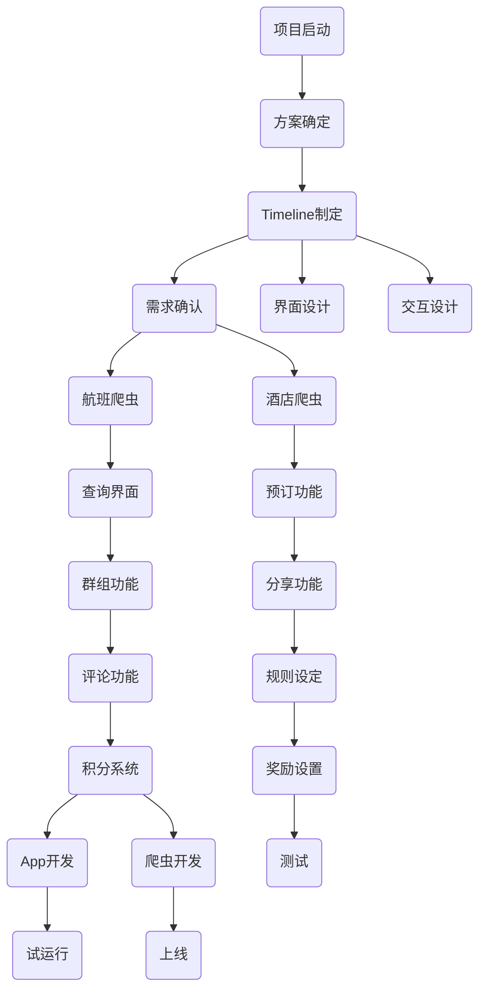

# 6.1 项目风险管理

### 6.1.2 人力资源风险：项目人员流失的风险。

### 6.1.3 进度风险：产品开发进度延误的风险。

### 6.1.4 成本风险：项目成本超出预算的风险。

### 6.1.5 沟通风险：项目团队内部及外部沟通与协作的风险，包括语言障碍和文化差异。

## 6.2 风险评估：分析和评估已识别的风险因素，主要从可能性和影响程度方面确定风险等级。

## 6.3 风险应对措施：基于风险评估结果，制定相应的应对措施。主要包括风险规避、风险减轻、风险转移和风险接受。

## 6.4 风险监控与控制：项目经理负责项目风险管理，组织项目团队成员持续监控和控制项目风险。一旦出现新的风险因素或现有风险的影响增加，及时更新风险管理计划，采取相应的应对措施，确保项目风险在可控范围内。

以上内容是ChatGPT翻译的结果，项目风险管理计划只是其中一部分，项目经理需要对项目计划书的每一部分进行翻译，具体过程不再赘述。

### 注意

ChatGPT是一种基于机器学习的自然语言处理技术，通过学习大量的语言数据来生成回复。虽然ChatGPT的准确率很高，但是它也可能会出现错误或不完整的回复，特别是面对复杂的语言结构和语义推理时。因此，涉及法律条款的翻译一定要请专业的翻译机构翻译，以免引起法律问题。

# 6.2 分解任务

制订项目计划时需要分解任务。任务分解是将整个项目计划划分成更小、更具体、更易于管理和控制的任务的过程。任务分解将项目拆分为可管理的任务，并将这些任务分配给团队成员完成。任务分解通常遵循以下步骤。

（1）确定项目目标：明确项目的目标和范围，并将其划分为更小的可管理任务。

（2）列出任务清单：根据项目目标，列出所有需要完成的任务，并确保它们具有可量化的成果。

（3）确定任务依赖关系：确定任务之间的依赖关系，确保每个任务都有前置任务，并且项目的整体进度不会受到任何延迟。

（4）估算任务时间：为每个任务估算所需的时间和资源，以确定任务完成所需的时间和成本。

（5）分配任务：将任务分配给适当的团队成员，确保每个任务都有责任人。

（6）制定时间表：根据任务时间估算，制定项目的时间表，包括开始和结束日期、关键路径和里程碑。

### 6.2.1 PERT图

PERT（Program Evaluation and Review Technique）图，也叫作PERT网络图，是一种用于规划和控制项目进度的图形工具。PERT图通常由一系列图形节点和箭头组成，其中节点代表任务，箭头代表任务之间的关系和依赖，如图6-1所示。


图6-1 PERT图

在PERT图中，每个任务节点通常有以下三个时间。

最早开始时间（Earliest Start Time，简称`EST`）：指在没有任何限制和阻止的情况下，任务可以开始执行的最早时间。

最晚开始时间（Latest Start Time，简称`LST`）：指在不影响后续任务的前提下，任务可以开始执行的最晚时间。

最早完成时间（Earliest Finish Time，简称`EFT`）：指任务在最早开始时间开始执行时完成所需的时间。

通过计算这些时间，可以得到每个任务的总体完成时间和关键路径，从而更好地掌握项目进度和规避风险，并及时进行调整和协调。

另外，PERT图还可以带有条件，如图6-2所示。


图6-2 带有条件的PERT图

在图6-2所示的PERT图中展示了某项目的7个任务及它们之间的依赖关系和条件。例如，安装水电需要在拆除旧装修之后开始，涂料装饰需要在安装地板和墙面材料完成之后开始。

PERT图的意义在于以下几个方面。

（1）明确任务之间的依赖关系和条件：通过PERT图，我们可以清晰地了解任务之间的依赖关系和条件，从而更好地规划和控制项目进度和资源分配。

（2）确定关键路径：在图6-2中，关键路径是A→B→C→D→E→F或A→B→C→D→E→G，这意味着这些任务的完成时间将决定整个项目的完成时间。

（3）优化资源分配：通过分析PERT图，我们可以更好地了解任务之间的依赖关系、条件和资源需求，从而更好地优化资源分配，提高工作效率和质量。

（4）促进沟通与协作：绘制PERT图能够促进项目团队成员之间的沟通和协作，帮助团队成员更好地了解任务和角色，提高工作效率和质量。

（5）提高项目管理水平：通过绘制PERT图，项目经理能够更好地规划和控制项目进度和资源分配，提高项目管理水平，确保项目按时、保质、保量完成。

### 6.2.2 使用ChatGPT辅助分解任务

ChatGPT 是一个基于 GPT模型的对话生成工具，可以用于生成类似与人类对话的文本。在任务分解过程中，可以使用 ChatGPT辅助生成任务名称和任务描述，使任务更加具体和清晰。

使用ChatGPT辅助分解任务可以将任务概述文本提交给ChatGPT，请求生成任务名称和任务描述，例如下面的装修项目。

动手示例

向ChatGPT发送如下请求消息。

有如下任务名称和任务描述，请帮我分解任务。

任务名称：三室两厅装修设计。

任务描述：本任务需要完成一套三室两厅的装修设计，包括色彩搭配、家具选择、软装设计等方面。

ChatGPT的回答如下。

分解这任务：

任务名称：三室两厅装修设计。

任务描述：本任务需要完成一套三室两厅的装修设计，包括色彩搭配、家具选择、软装设计等方面。

根据您提供的流程图，将任务分解为以下步骤：

规划设计（A）

调研任务空间大小、采光情况、家庭成员需求等，制定装修方案

分析设计风格、材料、色彩等，确定装修风格与色彩搭配方案

选购材料（B）

选购家具、软装饰品、地板、墙面材料等

拆除旧装修（C）

拆除旧的装修材料、家具等

ChatGPT分解的任务，项目经理还需要进行核对和检查。另外，这只是简单的任务分解，项目经理还需要细化任务。

## 6.3 绘制PERT图

绘制PERT图的工具有很多种，以下是一些常用的种类。

Microsoft Visio：它是微软公司开发的一款流程图绘制软件，可以用于绘制PERT图、流程图、组织结构图等。

Lucidchart：它是一款在线绘图工具，支持绘制各种流程图，包括PERT图、流程图、组织结构图等。

EdrawMax：它是一款全能绘图软件，支持各种绘图类型，包括流程图、组织结构图、网络拓扑图、平面图等。

SmartDraw：它是一款流程图绘制软件，支持绘制PERT图、流程图、组织结构图等。

Gliffy：它是一款在线绘图工具，支持绘制各种流程图，包括PERT图、流程图、组织结构图等。

Draw.io：它是一款免费的在线绘图工具，支持绘制各种流程图，包括PERT图、流程图、组织结构图等。

以上是一些常用的绘制PERT图的工具，读者可以根据自己的需求选择适合的工具。

## 6.4 案例4：使用ChatGPT绘制Smart Traveler项目任务PERT图

下面我们通过一个案例介绍如何使用ChatGPT辅助进行项目任务划分。

Smart Traveler案例背景如下。

Smart Traveler是一款面向出行人群的一体化移动应用。主要功能包括以下几种。

（1）出行日程与行程管理：用户可以在应用中规划并管理各个出行日程与行程，有效组织行程内容与时间。

（2）航班与酒店查询与预订：用户可以通过应用实时查询各航空公司与酒店的信息与价格，并完成预订。

（3）出行社交功能：用户可以在应用中与其他出行人建立出行兴趣社交群组，进行交流与分享。

（4）出行爱好者积分系统：用户通过在应用中进行不同活动如分享行程日志、上传照片等可以获取积分，并用积分兑换奖励。

动手示例

向ChatGPT发送如下请求消息。

有如下项目背景，帮我划分项目的各个任务，使用Markdown代码返回层次关系。

Smart Traveler是一个面向出行人群的一体化移动应用，主要功能包括以下几种。

1． 出行日程与行程管理：用户可以在应用中规划并管理各个出行日程与行程，有效组织行程内容与时间。

2． 航班与酒店查询与预订：用户可以通过应用，实时查询各航空公司与酒店的信息与价格，并完成预订。

3． 出行社交功能：用户可以在应用中与其他出行人建立出行兴趣社交群组，进行交流与分享。

4． 出行爱好者积分系统：用户通过在应用中进行不同活动，如分享行程日志、上载照片等可以获取积分，并通过积分兑换奖励。

我们让ChatGPT采用Markdown代码返回层次关系，这样便于以后使用。

向ChatGPT发送如下请求消息。

有如下项目任务，使用Mermaid语言生成绘PERT图。

# 项目管理

- 项目启动与方案确定
- 与产品经理讨论项目概念和具体需求
- 项目时间表的制定
- 根据项目进度划分不同阶段与时间节点

## 功能设计

- ### 出行日程与行程管理模块
- 需求确认：清晰功能定位与细化需求
- 界面设计：设计用户友好的界面
- 交互设计：设计合理的交互流程和体验
- ### 航班与酒店查询模块
- 航班爬虫系统：爬取各大航司班次与票价数据
- 酒店爬虫系统：爬取主流酒店信息与房态
- 查询界面：设计航班与酒店查询界面
- 预订功能：实现航班和酒店预订功能
- ### 出行社交模块
- 群组功能：实现兴趣社群的建立与管理功能
- 分享功能：实现出行日志、照片等分享功能
- 评论功能：实现社交主页中的评论、点赞等功能
- ### 出行爱好者系统
- 规则设定：制定积分获取规则与兑奖规则
- 积分系统： 完成用户积分记录与合计功能
- 奖励功能：完成积分兑换奖励选项设置与发放

## 开发与测试

- App开发：iOS与Android版本开发
- 爬虫开发：开发航班与酒店信息爬虫程序
- 测试：测试各项功能并修复问题
- 试运行：选择专业用户进行试运行评测
- 上线：完成上线发布与上架工作

ChatGPT的回答如下。



将这些Mermaid代码复制到Mermaid Live Editor工具，然后渲染图形，最后获得Smart Traveler项目任务PERT图，如图6-3所示。


图6-3 Smart Traveler项目任务PERT图

## 6.5 项目管理工具：甘特图

甘特图（Gantt chart）是一种项目管理工具，用于展示项目任务的时间安排和进度情况。它通常由一个水平的条形图组成，在水平轴上显示时间，垂直轴上显示任务列表。每个任务用一个条形块表示，其长度表示该任务的持续时间，条形块的位置表示该任务在何时开始和结束。甘特图可以帮助项目团队监控项目进度、识别风险和决策优先级，并与相关方分享项目计划和进度。图6-4所示的是Todo List 项目计划甘特图。


图6-4 Todo List 项目计划甘特图

绘制甘特图可以手绘，也可以使用专业的工具，以下是几款常用的甘特图工具。

（1）Microsoft Project:Microsoft公司开发的强大而灵活的项目管理软件，支持制作复杂的甘特图和项目计划。该软件可以与其他Microsoft Office应用程序（如Excel和Word）集成，图6-5所示的是Project制作的Todo List 项目计划甘特图。

（2）Asana：它是一个团队协作和项目管理平台，提供易于使用的甘特图功能。它还支持任务分配、时间跟踪、依赖关系、进度报告和虚拟桌面等功能。

（3）Trello：它是一个轻量级的团队协作工具，提供简单易用的甘特图功能。用户可以创建任务清单、标签、注释、附件和截止日期，并将它们组织到带有时间表的列表中。

（4）Smartsheet：它是一个基于云的企业协作平台，提供类似Excel的界面和功能，以及先进的项目管理功能，包括甘特图、时间表、任务分配、资源管理和自定义报告。

（5）TeamGantt：它是一种专用于甘特图的在线工具，旨在帮助团队制订和共享项目计划。它支持任务分配、时间跟踪、进度报告、评论和文件共享等功能。

（6）Excel可以制作甘特图，图6-6所示的是Excel制作的Todo List 项目计划甘特图，但它可能不如专业的项目管理工具那样灵活和全面。例如，Excel 没有自动计算任务之间的依赖关系或提供进度跟踪的功能，因此在处理复杂的项目时，专业的项目管理软件可能更为实用。


图6-5 Project制作的Todo List 项目计划甘特图


图6-6 Excel制作的Todo List 项目计划甘特图

### 6.5.1 案例5：使用ChatGPT辅助制订Smart Traveler项目计划

下面，我们以Smart Traveler项目为例，介绍如何使用ChatGPT来辅助制订任务计划并制作甘特图。

无论是Excel还是Project格式的甘特图，ChatGPT都不能直接生成，具体的制作方法如下。

制作Excel格式甘特图，使用ChatGPT生成CSV格式数据的甘特图，使用Excel打开CSV格式数据的甘特图，另存为Excel格式甘特图。

制作Project格式甘特图，使用ChatGPT生成CSV格式数据的甘特图，使用Project打开CSV格式数据的甘特图，导入数据。

1． 制作Excel格式甘特图

动手示例

第1步，生成CSV格式的甘特图。

向ChatGPT发送如下请求消息。

有如下项目任务，帮我制订项目计划甘特图，返回使用CSV格式数据。

# 项目管理

- 项目启动与方案确定
- 与产品经理讨论项目概念和具体需求
- 项目时间表的制定
- 根据项目进度划分不同阶段与时间节点

## 功能设计

- ### 出行日程与行程管理模块
- 需求确认：清晰功能定位与细化需求
- 界面设计：设计用户友好的界面
- 交互设计：设计合理的交互流程和体验
- ### 航班与酒店查询模块
- 航班爬虫系统：爬取各大航司班次与票价数据
- 酒店爬虫系统：爬取主流酒店信息与房态
- 查询界面：设计航班与酒店查询界面
- 预订功能：实现航班和酒店预订功能
- ### 出行社交模块
- 群组功能：实现兴趣社群的建立与管理功能
- 分享功能：实现出行日志、照片等分享功能
- 评论功能：实现社交主页中的评论、点赞等功能
- ### 出行爱好者系统
- 规则设定：制定积分获取规则与兑奖规则
- 积分系统： 完成用户积分记录与合计功能
- 奖励功能：完成积分兑换奖励选项设置与发放

## 开发与测试

- App开发：iOS与Android版本开发
- 爬虫开发：开发航班与酒店信息爬虫程序
- 测试：测试各项功能并修复问题
- 试运行：选择专业用户进行试运行评测
- 上线：完成上线发布与上架工作

ChatGPT的回答如下。

以下是根据您提供的项目任务制定的甘特图，以CSV格式返回：

```csv
任务名称，开始时间，结束时间，持续时间
项目启动与方案确定，2021-08-01,2021-08-15,15天
与产品经理讨论项目概念和具体需求，2021-08-01,2021-08-05,5天
项目时间表的制定，2021-08-06,2021-08-15,10天
根据项目进度划分不同阶段与时间节点，2021-08-06,2021-08-15,10天
出行日程与行程管理模块，2021-08-16,2021-09-15,31天
需求确认：清晰功能定位与细化需求，2021-08-16,2021-08-25,10天
界面设计：设计 用户友好的界面，2021-08-26,2021-09-05,11天
```
