# 奇点将至：当我们与人工智能融合

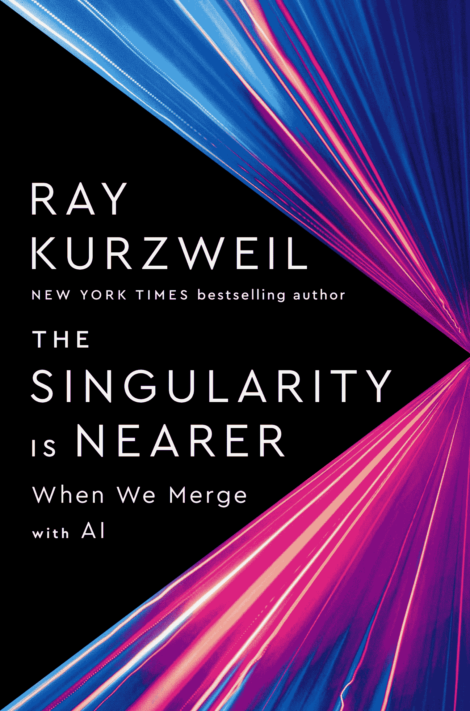

_147301320_
致索尼娅·罗森瓦尔德·库兹韦尔。
几天前，我认识她（并且爱她）已经五十年了年！

# 致谢

我要感谢我的妻子索尼娅，感谢她在创作过程中充满爱的耐心，以及五十年来与我分享想法。
致我的孩子们，伊桑和艾米；我的儿媳，丽贝卡；我的女婿，雅各布；我的妹妹，伊妮德；以及我的孙子孙女们，里奥、内奥米和昆西，感谢他们的爱、灵感和伟大的想法。
致我已故的母亲汉娜和我已故的父亲弗雷德里克，他们教会我在纽约的森林中散步时思考想法的力量，并在我年轻时给予我实验的自由。
献给约翰-克拉克·莱文，感谢他对数据的严谨研究和智能分析，这些数据构成了本书的基本基础。
献给我在维京出版社的长期编辑里克·科特，感谢他的领导、坚定不移的指导和专业的编辑。
献给我的文学经纪人尼克·穆伦多尔，感谢他敏锐而热情的指导。
献给我的终身商业伙伴亚伦·克莱纳（自 1973 年以来），感谢他在过去五十年里的忠诚合作。
献给南达·巴克-胡克，感谢她熟练的写作协助以及对我演讲的专业监督和管理。
献给莎拉·布莱克，感谢她杰出的研究见解和对想法的组织。
献给西莉亚·布莱克-布鲁克斯，感谢她周到的支持和专业的策略，将我的想法与世界分享。
献给丹尼斯·斯库泰拉罗，感谢她熟练地处理我的业务运营。
献给拉克什曼·弗兰克，感谢他出色的平面设计和插图。
献给艾米·库茨魏尔和丽贝卡·库茨魏尔，感谢她们对写作技巧的指导，以及她们自己非常成功的书籍的精彩范例。
献给 Martine Rothblatt，感谢她对我书中讨论的所有技术的奉献，以及我们长期以来在这些领域开发杰出案例的合作。
致 Kurzweil 团队，感谢他们为本项目提供了重要的研究、写作和后勤支持，包括 Amara Angelica、Aaron Kleiner、Bob Beal、Nanda Barker-Hook、Celia Black-Brooks、John-Clark Levin、Denise Scutellaro、Joan Walsh、Marylou Sousa、Lindsay Boffoli、Ken Linde、Laksman Frank、Maria Ellis、Sarah Black、Emily Brangan 和 Kathryn Myronuk。
致 Viking Penguin 敬业的团队，感谢他们周到的专业知识，包括执行编辑 Rick Kot、执行编辑 Allison Lorentzen、副编辑 Camille LeBlanc、出版人 Brian Tart、副出版人 Kate Stark、执行宣传员 Carolyn Coleburn 和营销总监 Mary Stone。
致 CAA 的 Peter Jacobs，感谢他对我的演讲活动给予的宝贵领导和支持。
致 Fortier Public Relations 和 Book Highlight 的团队，感谢他们在分享本书方面的卓越公共关系专业知识和战略指导。
致我的内部和非专业读者，感谢他们提供了许多巧妙而富有创意的想法。
最后，致所有有勇气质疑过时假设并运用想象力去做前所未有之事的人们。你们激励了我。

# 导言

在我 2005 年出版的书中*奇点临近*，我阐述了我的理论，即趋同的、指数级的技术趋势正在引领一场对人类具有彻底变革意义的转型。有几个关键的变化领域正在持续加速：计算能力变得越来越便宜，人类生物学变得越来越容易理解，工程学在更小的规模上变得越来越可行。随着人工智能能力的增长和信息变得更容易获取，我们正在将这些能力与我们天生的生物智能更紧密地结合起来。最终，纳米技术将使这些趋势达到顶峰，直接用云中的虚拟神经元层扩展我们的大脑。通过这种方式，我们将与人工智能融合，并用比我们的生物学赋予我们的计算能力高数百万倍的能力来增强自己。这将极大地扩展我们的智力和意识，以至于难以理解。我所说的奇点就是指这件事。
“奇点”一词借用自数学（指函数中未定义的点，如除以零时）和物理学（指黑洞中心无限密集的点，在那里正常的物理定律失效）。但重要的是要记住，我使用这个术语是一种隐喻。我对技术奇点的预测并不意味着变化率实际上会变得无限，因为指数增长并不意味着无限，物理奇点也不意味着无限。黑洞的引力足够强大，甚至可以捕获光线本身，但在量子中没有手段力学来解释一个真正无限的质量。相反，我使用奇点这个隐喻，因为它抓住了我们以目前的智力水平无法理解这种根本性转变的困境。但随着转变的发生，我们将迅速提高认知能力，以适应它。
正如我在“中详细描述的那样*奇点临近*, 长期趋势表明，奇点将在 2045 年左右发生。在那本书出版时，那个日期还在四十年之后——整整两代人之后。在那个距离上，我可以对将带来这种转变的广泛力量做出预测，但对于大多数读者来说，这个主题在 2005 年仍然相对远离日常现实。当时许多评论家认为我的时间表过于乐观，甚至认为奇点是不可能的。
但自那以后，发生了一些非凡的事情。进步继续加速，无视那些怀疑者。社交媒体和智能手机已经从几乎不存在变成了全天候的伴侣，现在连接着世界上大多数人口。算法创新和大数据的出现使得人工智能比专家预期的更快地取得了惊人的突破——从掌握像*危险边缘！*以及驾驶汽车、撰写文章、通过律师资格考试和诊断癌症。现在，像 GPT-4 和 Gemini 这样强大而灵活的大型语言模型可以将自然语言指令翻译成计算机代码——大大降低了人与机器之间的障碍。当你读到这篇文章时，可能有数千万人已经亲身体验了这些功能。与此同时，人类基因组的测序成本已经下降了约 99.997%，神经网络已经开始通过数字方式模拟生物学来解锁重大的医学发现。我们甚至正在获得最终将计算机直接连接到大脑的能力。
所有这些发展的基础是我称之为加速回报定律的东西：像计算这样的信息技术呈指数级地变得更便宜，因为每一次进步都使得设计它们自身进化的下一阶段变得更容易。因此，在我写这篇文章时，一美元可以买到大约是 11200 倍的计算能力，经通货膨胀调整后，与当时相比*奇点临近*上架。
下图总结了推动我们技术文明的最重要趋势：长期指数增长（在此对数尺度上显示为大致直线），即恒定美元可以购买的计算能力。我将在本书后面深入讨论该图。摩尔定律著名地观察到晶体管一直在稳步缩小，从而使计算机变得越来越强大——但这只是加速回报定律的一种表现，该定律早在晶体管发明之前就已经成立，并且即使在晶体管达到其物理极限并被新技术取代之后，预计仍将继续存在。这一趋势定义了现代世界，并且本书中讨论的几乎所有即将到来的突破都将直接或间接地由它实现。

![为了最大限度地提高机器的可比性，该图侧重于可编程计算机时代的性价比，但早期机电计算设备的近似值表明，这种趋势至少可以追溯到 19 世纪 80 年代。\[2\]](images/ART01_COMPUTATION_GRAPH_2_2.jpg)

为了最大限度地提高机器的可比性，该图侧重于可编程计算机时代的性价比，但早期机电计算设备的近似值表明，这种趋势至少可以追溯到 19 世纪 80 年代。[\[2\]](#18_Notes.xhtml#EndnoteNumber1 "note")
因此，我们一直按照奇点的时间表进行。本书的紧迫性源于指数变化的本质。在本世纪初几乎不引人注意的趋势现在正积极地影响着数十亿人的生活。在 2020 年代初期，我们进入了指数曲线急剧陡峭的部分，创新步伐以前所未有的方式影响着社会。为了便于理解，你正在阅读本文的时刻可能比我的上一本书《2012》的发布更接近于第一个超人人工智能的创造。*如何创造一个心灵*。而且你可能比我的 1999 年出版的书的发行更接近奇点。*精神机器的时代*. 或者，以人类寿命来衡量，今天出生的婴儿在奇点发生时，正好大学毕业。从非常个人的层面上来说，这与 2005 年相比，是一种不同的“近”。
这就是我写这本书的原因。人类数千年走向奇点的征程已经变成了一场冲刺。在导言中*奇点临近*，我写道，当时我们正处于“这一转变的早期阶段”。现在我们正进入它的高潮。那本书是关于瞥见遥远的视野——而这本书是关于沿着道路到达它的最后几英里。
幸运的是，我们现在可以更清楚地看到这条道路。虽然在实现奇点之前，我们仍然面临许多技术挑战，但其关键先兆正迅速从理论科学领域转向积极的研发。在未来的十年里，人们将与看起来令人信服的类人人工智能互动，而简单的脑机接口将像今天的智能手机一样影响日常生活。生物技术领域的数字革命将治愈疾病，并有意义地延长人们的健康寿命。但与此同时，许多工人将感受到经济 disruption 的刺痛，我们所有人都将面临因意外或故意滥用这些新能力而带来的风险。在 2030 年代，自我改进的人工智能和成熟的纳米技术将以前所未有的方式将人类和我们的机器造物结合在一起——进一步加剧了希望和危险。如果我们能够应对这些进步带来的科学、伦理、社会和政治挑战，到 2045 年，我们将深刻地改善地球上的生命。但如果我们失败了，我们的生存就会受到质疑。因此，本书是关于我们最终接近奇点——机遇的以及在过去一代我们所知的世界里，我们必须共同面对的危险。
首先，我们将探讨奇点实际上是如何发生的，并将其置于我们物种长期以来重塑自身智能的背景下。用技术创造知觉会引发重要的哲学问题，因此我们将探讨这种转变如何影响我们自身的身份和目标感。然后，我们将转向未来几十年将呈现的实际趋势。正如我将展示的那样，加速回报定律正在推动反映人类福祉的各种指标呈指数级增长。然而，创新最明显的缺点之一是各种形式的自动化造成的失业。虽然这些危害是真实存在的，但我们将看到为什么有充分的理由对长期保持乐观——以及为什么我们最终不会与人工智能竞争。
随着这些技术为我们的文明解锁巨大的物质财富，我们的重点将转移到克服我们充分繁荣的下一个障碍：我们生物学的脆弱性。因此，接下来，我们将展望未来几十年我们将使用的工具，以获得对生物学本身越来越强的掌控力——首先是通过战胜我们身体的衰老，然后通过增强我们有限的大脑并迎来奇点。然而，这些突破也可能使我们陷入危险。生物技术、纳米技术或人工智能领域的革命性新系统可能会导致一场生存灾难，例如一场毁灭性的流行病或自我复制机器的连锁反应。最后，我们将评估这些威胁，这些威胁需要仔细规划，但正如我将解释的那样，有一些非常有希望的方法可以减轻这些威胁。
这是历史上最激动人心和意义重大的几年。我们无法自信地说奇点之后的生活会是什么样子。但是，通过理解和预测导致奇点出现的转变，我们可以帮助确保人类的最终方法是安全和成功。

# 第一章：我们处于六个阶段的哪个阶段？

在*奇点临近*, 我将意识的基础描述为信息。我列举了我们宇宙开始以来的六个纪元或阶段，每个阶段都以前一个阶段的信息处理为基础创造下一个阶段。因此，智能的进化是通过其他过程的间接序列来实现的。
第一个纪元是物理定律及其所促成的化学的诞生。大爆炸后几十万年，原子由围绕质子和中子核心旋转的电子形成。原子核中的质子似乎不应该如此靠近，因为电磁力试图将它们猛烈地推开。然而，恰好存在一种称为强核力的独立力，它将质子结合在一起。“无论谁”设计了宇宙的规则，都提供了这种额外的力，否则通过原子的进化是不可能的。
数十亿年后，原子形成了能够代表复杂信息的分子。碳是最有用的组成部分，因为它可以形成四个键，而不是许多其他原子核的一个、两个或三个键。我们生活在一个允许复杂化学反应的世界，这是极其不可能的。例如，如果引力的强度稍微弱一些，就不会有超新星来创造构成生命的化学元素。如果引力稍微强一些，恒星就会在智能生命形成之前燃尽并死亡。仅仅这一个物理常数就必须在一个极其狭窄的范围内。否则我们就不会在这里了。我们生活在一个非常精确平衡的宇宙中，这种平衡允许一定程度的秩序，从而使进化得以展开。
几十亿年前，第二纪元开始了：生命。分子变得足够复杂，可以在一个分子中定义一个完整的有机体。因此，生物得以进化和传播，每个生物都有自己的 DNA。
在第三纪元，由 DNA 描述的动物形成了大脑，这些大脑本身存储和处理信息。这些大脑提供了进化优势，这有助于大脑在数百万年的时间里发展出更多的复杂性。
在第四纪元，动物们利用它们的高级认知能力，以及它们的拇指，将思想转化为复杂的行动。这就是人类。我们的物种利用这些能力创造了能够存储和操纵信息的技术——从纸莎草到硬盘驱动器。这些技术增强了我们大脑感知、回忆和评估信息模式的能力。这是进化的另一个来源，它本身远远大于之前的进步水平。有了大脑，我们大约每 10 万年增加一立方英寸的脑物质，而有了数字计算，我们大约每 16 个月就能使性价比翻一番。

在第五纪元，我们将直接把生物人类的认知与我们数字技术的速度和力量融合起来。这就是脑机接口。人类神经处理的速度是每秒几百个周期，而数字技术是每秒几十亿个周期。除了速度和内存大小之外，用非生物计算机增强我们的大脑将使我们能够在我们的新皮层中增加更多的层——释放出比我们目前能想象的更复杂和抽象的认知。

第六纪元是我们的智能遍布整个宇宙的时期，将普通物质转化为计算物质，这是一种以最终计算密度组织的物质。

在我 1999 年出版的书中*精神机器的时代*, 我预测会有一个图灵测试——即人工智能可以通过文本进行交流，且与人类无法区分——将在 2029 年通过。我在 2005 年的书中重复了这一点*奇点临近。*通过一项有效的图灵测试意味着人工智能已经掌握了人类所拥有的语言和常识推理能力。图灵在 1950 年描述了他的概念，[\[1\]](#18_Notes.xhtml#EndnoteNumber2 "note")但他没有具体说明应该如何进行测试。在我与米奇·卡普尔的一个赌局中，我们定义了自己的规则，这些规则比其他解释要困难得多。

我的预期是，为了在 2029 年通过有效的图灵测试，我们需要能够在 2020 年之前通过人工智能实现各种各样的智力成就。 事实上，自从我做出这个预测以来，人工智能已经掌握了人类许多最严峻的智力挑战——从游戏如*危险边缘！*并进入放射学和药物发现等严肃应用领域。在我写这篇文章时，像 `Gemini` 和 `GPT-4` 这样的顶级人工智能系统正在将其能力扩展到许多不同的性能领域——这是通往通用智能道路上令人鼓舞的步骤。

最终，当一个程序通过图灵测试时，它实际上需要在许多领域让自己显得远不如智能，否则很明显它是一个人工智能。例如，如果它可以立即正确地解决任何数学问题，它将无法通过测试。因此，在图灵测试级别，人工智能将拥有在大多数领域实际上远远超过最优秀人类的能力。

人类现在处于第四纪元，我们的技术已经产生了一些我们无法理解的任务的结果。对于人工智能尚未掌握的图灵测试的各个方面，我们正在取得快速且加速的进展。通过我一直期待在 2029 年实现的图灵测试，将使我们进入第五纪元。

2030 年代的一项关键能力是将我们新皮层的上层范围连接到云端，这将直接扩展我们的思维。这样，人工智能将不再是竞争对手，而将成为我们自身的延伸。到那时，我们思想的非生物部分将提供比生物部分多数千倍的认知能力。

随着这种情况呈指数级增长，到 2045 年，我们将把我们的思想扩展数百万倍。正是这种难以理解的速度和转变的幅度，使我们能够从物理学中借用奇点这个隐喻来描述我们的未来。

# 第二章：重塑智能

## 重塑智能

### 重新定义智能意味着什么？

如果宇宙的整个故事是一个不断演变的信息处理范式的过程，那么人类的故事是从中途开始的。在这个更大的故事中，我们的篇章最终是关于我们从拥有生物大脑的动物向超越的存在转变，这些存在的思想和身份不再受基因提供的束缚。在 2020 年代，我们将进入这一转变的最后阶段——在更强大的数字基质上重塑自然赋予我们的智能，然后与之融合。通过这样做，宇宙的第四个纪元将孕育出第五个纪元。

但这一切将如何更具体地发生？为了理解重塑智能意味着什么，我们将首先回顾人工智能的诞生以及从中产生的两个广泛的学派。为了了解为什么其中一个学派胜过另一个学派，我们将把它与神经科学告诉我们的关于小脑和新皮层如何产生人类智能联系起来。在调查了深度学习目前如何重新创造新皮层的能力之后，我们可以评估人工智能仍然需要达到什么才能达到人类水平，以及我们如何知道它何时达到。最后，我们将转向如何在超人人工智能的帮助下，我们将设计脑机接口，从而通过虚拟神经元层大大扩展我们的新皮层。这将释放全新的模式思想，并最终将我们的智力扩展数百万倍：这就是奇点。

### 人工智能的诞生

1950 年，英国数学家艾伦·图灵（Alan Turing，1912-1954）在《*心灵》杂志上发表了一篇文章*题为“计算机械与智能”。[\[1\]](#18_Notes.xhtml#EndnoteNumber3 "note")在其中，图灵提出了科学史上最深刻的问题之一：“机器能思考吗？”虽然思考机器的想法至少可以追溯到希腊神话中的青铜自动机塔洛斯，[\[2\]](#18_Notes.xhtml#EndnoteNumber4 "note")图灵的突破在于将这个概念提炼成可以通过经验检验的东西。他提出使用“模仿游戏”（我们现在称之为图灵测试）来确定机器的计算是否能够执行与我们大脑相同的认知任务。在这个测试中，人类评委通过即时通讯采访人工智能和人类陪衬，但看不到他们正在与谁交谈。然后，评委们提出关于他们希望的任何主题或情况的问题。如果在一段时间后，评委无法分辨哪个是人工智能回复者，哪个是人类，那么就说人工智能通过了测试。

通过将这个哲学思想转化为科学思想，图灵激发了研究人员极大的热情。1956 年，数学教授约翰·麦卡锡（John McCarthy，1927-2011）提议在汉诺威的新罕布什尔州达特茅斯学院进行一项为期两个月、十人参与的研究。[\[3\]](#18_Notes.xhtml#EndnoteNumber5 "note")目标如下：

> 这项研究将基于这样的推测进行：学习或任何其他智能特征的每个方面原则上都可以被精确地描述，以至于可以制造一台机器来模拟它。将尝试找到如何使机器使用语言，形成抽象和概念，解决现在为人类保留的各种问题，并改进自身。[\[4\]](#18_Notes.xhtml#EndnoteNumber6 "note")

在为会议做准备时，麦卡锡提议将这个最终将自动化所有其他领域的领域称为“人工智能”。[\[5\]](#18_Notes.xhtml#EndnoteNumber7 "note")鉴于“人工”使这种形式的智能看起来“不真实”，我并不喜欢这个名称，但它是经久不衰的术语。

这项研究已经进行，但其目标——特别是让机器理解用自然语言描述的问题——未在两个月的时间内实现。我们仍在努力——当然，现在有超过十个人。根据中国科技巨头腾讯的数据，2017 年全球已经有大约 30 万“人工智能研究人员和从业者”，[\[6\]](#18_Notes.xhtml#EndnoteNumber8 "note")以及 2019 年*全球人工智能人才报告*让-弗朗索瓦·加涅、格蕾丝·凯泽和约安·曼塔统计了大约 22,400 名发表原创研究的人工智能专家——其中约 4,000 人被认为是极具影响力的人。[\[7\]](#18_Notes.xhtml#EndnoteNumber9 "note")根据斯坦福大学以人为本的人工智能研究所的数据，2021 年人工智能研究人员发表了超过 496,000 篇出版物和超过 141,000 项专利申请。[\[8\]](#18_Notes.xhtml#EndnoteNumber10 "note")2022 年，全球企业在人工智能领域的投资为 1890 亿美元，是过去十年的 13 倍。[\[9\]](#18_Notes.xhtml#EndnoteNumber11 "note")到你读到这句话的时候，这个数字还会更高。

这一切在 1956 年是难以想象的。然而，达特茅斯研讨会的目标大致相当于创建一个能够通过图灵测试的人工智能。自从我 1999 年的书以来，我预测我们将在 2029 年实现这一目标，这一预测一直没有改变*精神机器的时代*，发布于许多观察家认为这个里程碑将会到来的时刻*从不*可以联系到。[\[10\]](#18_Notes.xhtml#EndnoteNumber12 "note")直到最近，这种预测在该领域还被认为是极其乐观的。例如，2018 年的一项调查发现，人工智能专家们普遍预测，人类水平的机器智能要到 2060 年左右才会出现。[\[11\]](#18_Notes.xhtml#EndnoteNumber13 "note")但大型语言模型的最新进展迅速改变了人们的期望。在我撰写本书的早期草稿时，世界顶级预测网站 `Metaculus` 上的共识徘徊在 2040 年代和 2050 年代之间。但过去两年中令人惊讶的人工智能进展颠覆了人们的期望，到 2022 年 5 月，`Metaculus` 的共识完全同意我的 2029 年日期。[\[12\]](#18_Notes.xhtml#EndnoteNumber14 "note")从那以后，它甚至波动到最早的 2026 年，从技术上讲，我把自己放在了慢时间线阵营中！[\[13\]](#18_Notes.xhtml#EndnoteNumber15 "note")

即使是该领域的专家也对人工智能最近的许多突破感到惊讶。不仅仅是它们发生的时间比大多数人预期的要早，而且它们似乎是突然发生的，并且没有太多关于即将到来的飞跃的警告。例如，2014 年 10 月，麻省理工学院人工智能和认知科学专家托马索·波吉奥说：“描述图像内容的能力将是机器所做的最具智力挑战性的事情之一。我们需要再进行一轮基础研究来解决这类问题。”[\[14\]](#18_Notes.xhtml#EndnoteNumber16 "note")波吉奥估计，这一突破至少还需要二十年。但就在下个月，谷歌推出了可以做到这一点的物体识别人工智能。当*《纽约客》*的拉菲·哈恰杜里安问他这件事时，波吉奥退回到了一种更哲学的怀疑论，怀疑这种能力是否代表真正的智能。我指出这一点不是为了批评波吉奥，而是为了观察我们所有人都有的一种倾向。也就是说，在人工智能实现某个目标之前，这个目标似乎极其困难且具有独特的人性。但在人工智能达到目标之后，这种成就就在我们人类的眼中减弱了。换句话说，我们真正的进步实际上比事后看来更重要。这就是我仍然对 2029 年预测保持乐观的原因之一。

那么，为什么会发生这些突然的突破呢？答案在于一个可以追溯到该领域诞生之初的理论问题。1964 年，我还在上高中时，我遇到了两位人工智能先驱：马文·明斯基（1927-2016），他共同组织了达特茅斯学院的人工智能研讨会，以及弗兰克·罗森布拉特（1928-1971）。1965 年，我进入麻省理工学院，开始与明斯基一起学习，他正在进行基础性工作，这些工作是我们今天所看到的引人注目的人工智能突破的基础。明斯基告诉我，有两种技术可以创建问题的自动化解决方案：符号方法和连接主义方法。

符号方法用基于规则的术语描述了一个人类专家将如何解决问题。在某些情况下，基于它的系统可能会成功。例如，1959 年，兰德公司推出了“通用问题求解器”`GPS`——一种可以将简单的数学公理组合起来解决逻辑问题的计算机程序。[\[15\]](#18_Notes.xhtml#EndnoteNumber17 "note")赫伯特·A·西蒙、J·C·肖和艾伦·纽厄尔开发了通用问题求解器，使其具有解决问题的理论能力*任何*问题可以表达为一组形式良好的公式`WFF`。为了使`GPS`工作，它必须在过程的每个阶段使用一个`WFF`，有条不紊地将它们构建成答案的数学证明。

即使你没有形式逻辑或基于证明的数学经验，这个想法基本上与代数中发生的事情相同。如果你知道`2 + 7 = 9`，并且一个未知数`十`加上 7 等于 10，你可以证明`十` = 3。但这种逻辑的应用远不止于解方程。当我们问自己某件事是否符合某个定义时，我们也会（甚至没有思考）使用它。如果你知道一个素数除了 1 和它本身之外不能有任何因子，并且你知道 11 是 22 的因子，并且 1 不等于 11，你可以得出结论，22 不是一个素数。通过从最基本和最根本的公理开始，`GPS`可以对更困难的问题进行这种计算。最终，这也是人类数学家所做的——不同之处在于，机器（至少在理论上）可以搜索每一种可能的组合基本公理的方式来寻找真理。

为了说明，如果在每个点有十个这样的公理可供选择，并且假设需要二十个公理才能达到解决方案，这意味着有`10²⁰`，或 1000 亿亿种可能的解决方案。我们今天可以用现代计算机处理这么大的数字，但这远远超出了 1959 年的计算速度所能达到的水平。那一年，DEC `PDP-1`计算机每秒可以执行大约 100,000 次运算。[\[16\]](#18_Notes.xhtml#EndnoteNumber18 "note")到 2023 年，`Google Cloud A3`虚拟机每秒可以执行大约 26,000,000,000,000,000,000 次运算。[\[17\]](#18_Notes.xhtml#EndnoteNumber19 "note")现在一美元大约能买到 1.6*万亿*倍`GPS`开发时的计算能力。[\[18\]](#18_Notes.xhtml#EndnoteNumber20 "note")使用 1959 年的技术需要数万年才能解决的问题，现在只需在零售计算硬件上花费几分钟即可解决。为了弥补其局限性，`GPS` 编程了启发式算法，试图对可能的解决方案进行优先级排序。这些启发式算法有时会奏效，它们的成功支持了一种观点，即计算机化的解决方案最终可以解决任何严格定义的问题。

另一个例子是一个名为 `MYCIN` 的系统，它在 20 世纪 70 年代开发，用于诊断和推荐传染病的补救治疗。1979 年，一个专家评估团队将其性能与人类医生的性能进行了比较，发现 `MYCIN` 的表现与任何医生一样好，甚至更好。[\[19\]](#18_Notes.xhtml#EndnoteNumber21 "note")

一个典型的 `MYCIN` “规则”如下：

#### 如果：

1. 需要治疗的感染是脑膜炎，并且
2. 感染的类型是真菌，并且
3. 在培养物的染色体上没有观察到生物体，并且
4. 患者不是免疫功能受损的宿主，并且
5. 患者去过球孢子菌病流行的地区，并且
6. 患者的种族是：\[B\]黑人 \[A\]亚洲人 \[I\]印度人，并且
7. 脑脊液中的隐球菌抗原检测结果为阴性

然后：有暗示性证据（.5）表明，隐球菌不是可能引起感染的生物之一（培养或涂片中看到的生物除外）。[\[20\]](#18_Notes.xhtml#EndnoteNumber22 "note")

到 20 世纪 80 年代末，这些“专家系统”开始利用概率模型，并可以结合多种证据来源做出决策。[\[21\]](#18_Notes.xhtml#EndnoteNumber23 "note")虽然单个*如果-那么*规则本身并不充分，但通过结合成千上万条这样的规则，整个系统可以为受限问题做出可靠的决策。

尽管符号方法已经使用了半个多世纪，但其主要局限性在于“复杂性上限”。[\[22\]](#18_Notes.xhtml#EndnoteNumber24 "note")当`MYCIN`和其他此类系统犯错时，纠正它可能会解决该特定问题，但反过来会导致其他三种错误在其他情况下出现。似乎对复杂性存在限制，这使得可以解决的现实世界问题的总体范围非常狭窄。

看待基于规则的系统复杂性的一种方式是将其视为一组可能的故障点。在数学上，一组*n*事物有 2^(n–1)个子集（不包括空集）。因此，如果一个人工智能使用只有一个规则的规则集，那么只有一个故障点：该规则本身是否能正确工作？如果有两个规则，则有三个故障点：每个规则本身，以及这两个规则组合时的交互。这种增长是指数级的。五个规则意味着 31 个潜在的故障点，10 个规则意味着 1,023 个，100 个规则意味着超过一千亿亿亿个，1,000 个规则意味着超过一个 googol googol googols！因此，你拥有的规则越多，每个新规则对可能的子集数量的增加就越多。即使只有极小一部分可能的规则组合会引入一个新问题，也会出现一个点（这个点具体在哪里因情况而异），即添加一个新规则来解决问题可能会导致不止一个额外的问题。这就是复杂性上限。

可能运行时间最长的专家系统项目是由道格拉斯·莱纳特和他在`Cycorp`的同事创建的`Cyc`（来自“百科全书”一词）。[\[23\]](#18_Notes.xhtml#EndnoteNumber25 "note")`Cyc`于 1984 年启动，目标是编码所有“常识知识”——广为人知的事实，如*掉落的鸡蛋会破*或*一个孩子穿着泥泞的鞋子跑过厨房会惹恼他的父母*。这数百万个小想法并没有清楚地写在任何一个地方。它们是人类行为和推理背后未说出口的假设，对于理解普通人在各种领域所知道的内容是必要的。然而，由于`Cyc`系统也用符号规则来表示这些知识，因此它也必须面对复杂性上限。

早在 20 世纪 60 年代，当明斯基就……的优缺点向我提出建议时符号方法，我开始看到连接主义方法的附加价值。这需要通过其结构而非内容来创造智能的节点网络。它们不使用智能规则，而是使用以某种方式排列的哑节点，这些节点可以从数据本身中提取洞察力。因此，它们有潜力发现人类程序员在试图设计符号规则时永远不会想到的微妙模式。连接主义方法的一个关键优势是，它允许你在不理解问题的情况下解决问题。即使我们有完美的能力来制定和实施用于符号人工智能问题解决的无错规则（我们没有），我们也会受到我们对哪些规则首先是最佳规则的不完善理解的限制。

这是一种解决复杂问题的强大方法，但它是一把双刃剑。连接主义人工智能很容易变成一个“黑匣子”——能够给出正确的答案，但无法解释它是如何找到答案的。[\[24\]](#18_Notes.xhtml#EndnoteNumber26 "note")这有可能成为一个主要问题，因为人们希望能够看到关于医疗、执法、流行病学或风险管理等高风险决策背后的推理。这就是为什么许多人工智能专家现在正在努力开发更好的“透明度”（或“机械可解释性”）形式，用于基于机器学习的决策。[\[25\]](#18_Notes.xhtml#EndnoteNumber27 "note")随着深度学习变得越来越复杂和强大，透明度将如何有效还有待观察。

不过，在我刚开始研究连接主义时，系统要简单得多。其基本思想是创建一个受人类神经网络工作方式启发的计算机模型。起初，这是非常抽象的，因为该方法是在我们详细了解生物神经网络的实际组织方式之前设计的。

目标是找到实际的例子，系统可以从中找出解决问题的方法。一个典型的起点是让神经网络的连接和突触权重随机设置，这样未经训练的神经网络产生的答案也将是随机的。神经网络的关键功能是它必须学习它的主题，就像它所模仿的哺乳动物大脑一样（至少大致如此）。神经网络开始时是无知的，但被编程为最大化“奖励”函数。然后，它被输入训练数据（例如，包含柯基犬的照片和不包含柯基犬的照片，这些照片由人类预先标记）。当神经网络产生正确的输出（例如，准确识别图像中是否有柯基犬）时，它会获得奖励反馈。然后，这种反馈可以用来调整每个神经元间连接的强度。与正确答案一致的连接会变得更强，而提供错误答案的连接会变得更弱。

随着时间的推移，神经网络会自行组织，以便能够在没有指导的情况下提供正确的答案。实验表明，即使教师不可靠，神经网络也能学习其主题。如果训练数据只有 60% 的时间被正确标记，神经网络仍然可以以超过 90% 的准确率学习其课程。在某些条件下，即使是较小比例的准确标签也可以有效地使用。[\[26\]](#18_Notes.xhtml#EndnoteNumber28 "note")

一位老师可以训练学生超越自己的能力，这并不直观，同样，不可靠的训练数据如何产生出色的表现也可能令人困惑。简短的回答是，错误可以相互抵消。假设你正在训练一个神经网络，使其能够从手写的数字 0 到 9 的样本中识别数字 8。并且假设有三分之一的标签是不准确的——8 被随机混合编码为 4，5 被编码为 8，等等。如果数据集足够大，这些不准确之处将相互抵消，并且不会在任何特定方向上过多地扭曲训练。这保留了数据集中关于 8 看起来像什么的大部分有用信息，并且仍然可以将神经网络训练到很高的标准。

尽管有这些优点，早期的连接主义系统有一个根本性的局限。单层神经网络在数学上无法解决某些类型的问题。[\[27\]](#18_Notes.xhtml#EndnoteNumber29 "note")1964 年，当我在康奈尔大学拜访弗兰克·罗森布拉特教授时，他向我展示了一个名为“感知器”的单层神经网络，它可以识别印刷字母。我尝试对输入进行简单的修改。该系统在自联想方面做得相当不错（也就是说，即使我遮盖了字母的一部分，它也能识别字母），但在不变性方面表现不佳（也就是说，在大小和字体改变后，它无法识别字母）。

1969 年，明斯基批评了人们对该领域兴趣的激增，尽管他在 1953 年对神经网络进行了开创性的研究。他和麻省理工学院人工智能实验室的两位联合创始人西摩·帕珀特合著了一本书，名为*感知器*, 这正式证明了为什么感知器本质上无法确定打印的图像是否已连接。 上的两个图像此页面来自……的封面*感知器*. 顶部的图像未连接（黑线没有形成一个连续的形状），而底部的图像已连接（黑线形成一个连续的形状）。人类可以确定这一点，一个简单的软件程序也可以。诸如罗森布拉特的 Mark 1 感知器这样的前馈（其中节点之间的连接不形成任何循环）感知器无法做出此判断。

简而言之，前馈感知器无法解决这个问题的原因是，这样做需要应用异或（exclusive or）计算函数，该函数用于判断一条线段是否属于图像中的一个连续形状，但不属于另一个。然而，没有反馈的单层节点在数学上无法实现异或，因为它本质上必须通过线性规则一次性地对所有数据进行分类（例如，“如果这两个节点都触发，则函数输出为真”），而异或需要一个反馈步骤（“如果这些节点中的任何一个触发，*但他们不会同时开火*，函数输出为真”）。

当明斯基和佩珀特得出这个结论时，它实际上扼杀了连接主义领域的大部分资金，并且几十年后才恢复。但事实上，早在 1964 年，罗森布拉特就向我解释了感知器无法处理不变性的问题这是由于缺乏层级结构。如果你把感知器的输出反馈到另一个类似的层级，输出会更通用，并且通过重复迭代这个过程，将越来越能够处理不变性。如果你有足够的层级和足够的训练数据，它就能处理惊人的复杂程度。我问他是否真的尝试过这样做，他说没有，但这是他研究议程中的重点。这是一个了不起的见解，但罗森布拉特在仅仅七年后，也就是 1971 年去世，没能有机会验证他的见解。又过了十年，多层结构才被普遍使用，即便如此，多层网络也需要比实际可行的更多的计算能力和训练数据。近年来人工智能的巨大进步，更多的是源于在罗森布拉特构思这个想法半个多世纪后，多层神经网络的使用。

因此，在 2010 年代中期之前，人工智能的连接主义方法在很大程度上被忽视了，当时硬件的进步最终释放了它们潜在的潜力。最终，调集足够的计算能力和训练样本来使这种方法脱颖而出变得足够便宜。在 1969 年出版的*感知器*到 2016 年明斯基去世之间，计算性价比（经通货膨胀调整后）提高了约 2.8 倍*0 亿*.[\[28\]](#18_Notes.xhtml#EndnoteNumber30 "note")这改变了人工智能领域可能采用的方法。当我在他生命的尽头与明斯基交谈时，他表示遗憾的是*感知器*一直以来都很有影响力，因为到那时，连接主义最近在该领域取得了广泛的成功。

因此，连接主义有点像莱昂纳多·达·芬奇的飞行器发明——它们是先见之明的想法，但在开发出更轻、更强的材料之前是行不通的。[\[29\]](#18_Notes.xhtml#EndnoteNumber31 "note")一旦硬件赶上，像一百层网络这样的大规模连接主义就变得可行了。因此，这些系统能够解决以前从未解决过的问题。这就是推动过去几年所有最引人注目的进步的范例。

## 小脑：一种模块化结构

为了在人类智能的背景下理解神经网络，我建议稍微绕道一下：让我们回到宇宙的开端。物质最初朝着更大组织方向的运动进展*非常*缓慢地，没有大脑来引导它。（关于宇宙完全有能力编码有用信息的可能性，请参阅第 3 章“难以置信的存在”部分。）创造一个新的细节层次所需的时间是数亿到数十亿年。[\[30\]](#18_Notes.xhtml#EndnoteNumber32 "note")

的确，分子需要花费数十亿年的时间才能开始形成编码指令来创造生物。对于目前可用的证据存在一些分歧，但大多数科学家将地球上生命的起源定在 35 亿到 40 亿年前之间。[\[31\]](#18_Notes.xhtml#EndnoteNumber33 "note")据估计，宇宙已经有 138 亿年的历史（或者更准确地说，这是自大爆炸以来所经过的时间）地球可能形成于大约 45 亿年前。[\[32\]](#18_Notes.xhtml#EndnoteNumber34 "note")因此，从第一个原子形成到第一个分子（在地球上）能够自我复制，大约过去了 100 亿年。这种滞后的一部分可以用随机性来解释——我们不太清楚早期地球“原始汤”中随机碰撞的分子以正确的方式结合在一起的可能性有多小。也许生命可能开始得更早一些，或者更有可能开始得晚得多。但在任何这些必要条件成为可能之前，整个恒星生命周期必须发挥作用，因为恒星将氢聚变成维持复杂生命所需的更重元素。

根据科学家们最好的估计，从地球上第一个生命到第一个多细胞生命，大约过去了 29 亿年。[\[33\]](#18_Notes.xhtml#EndnoteNumber35 "note")又过了 5 亿年，动物才在陆地上行走，又过了 2 亿年，第一批哺乳动物才出现。[\[34\]](#18_Notes.xhtml#EndnoteNumber36 "note")着眼于大脑，从原始神经网的首次发展到最早的集中式三方大脑的出现，经历了超过 1 亿年的时间。[\[35\]](#18_Notes.xhtml#EndnoteNumber37 "note")第一个基本的新皮层又过了 3.5 亿到 4 亿年才出现，而现代人脑的进化又花费了大约 2 亿年。[\[36\]](#18_Notes.xhtml#EndnoteNumber38 "note")

纵观这段历史，更复杂的大脑提供了显著的进化优势。当动物争夺资源时，更聪明的动物往往会胜出。[\[37\]](#18_Notes.xhtml#EndnoteNumber39 "note")智力的进化时间比之前的步骤短得多：数百万年，这是一个明显的加速。前哺乳动物大脑中最显著的变化是被称为小脑的区域。今天，人类大脑中小脑中的神经元实际上比新皮层中的神经元还要多，而新皮层在我们的高级功能中起着最大的作用。[\[38\]](#18_Notes.xhtml#EndnoteNumber40 "note")小脑能够存储和激活大量控制运动任务的脚本，例如签名脚本。（这些脚本通常被非正式地称为“肌肉记忆”。但实际上，这并非肌肉本身的现象，而是小脑的现象。当一个动作被一遍又一遍地重复时，大脑会适应，使其变得更容易和更下意识——就像许多马车轮子逐渐在小路上压出车辙一样。）[\[39\]](#18_Notes.xhtml#EndnoteNumber41 "note")

接住飞球的一种方法是解出控制球的轨迹以及你自身运动的所有微分方程，同时根据这些解重新定位你的身体。不幸的是，你的大脑中没有解微分方程的装置，所以你转而解决一个更简单的问题：如何最有效地将手套放在球和你的身体之间。小脑假定你的手和球在每次接球时都应出现在相似的相对位置，因此如果球掉落得太快，而你的手看起来移动得太慢，它会指示你的手移动得更快，以匹配熟悉的相对位置。

小脑通过这些简单的动作将感觉输入映射到肌肉运动，这对应于数学上的“基函数”概念，使我们能够在不解任何微分方程的情况下接住球。[\[40\]](#18_Notes.xhtml#EndnoteNumber42 "note")我们还可以利用小脑来预测我们的行为，即使我们实际上没有采取这些行为。你的小脑可能会告诉你，你可以接住球，但你可能会撞到另一名球员，所以也许你不应该采取这个行动。这一切都是本能地发生的。

同样，如果你在跳舞，你的小脑会经常在没有你意识到的情况下指挥你的动作。由于受伤或疾病而缺乏完全功能的小脑的人仍然可以通过新皮层来指挥自愿行动，但这样做需要集中精力，并且他们可能会患上称为共济失调的协调问题。[\[41\]](#18_Notes.xhtml#EndnoteNumber43 "note")

掌握身体技能的关键组成部分是经常进行构成这些技能的动作，以将其铭刻在你的肌肉记忆中。曾经需要有意识的思考和专注的动作开始变得自动。这基本上代表了从运动皮层控制到更多小脑控制的转变。无论你是扔橄榄球、解魔方还是弹钢琴，你越不需要有意识的脑力来指导这项任务，你就越有可能表现得更好。你的动作会更快更流畅，你可以将你的注意力放在成功的其他方面。当音乐家掌握了他们的乐器时，他们可以毫不费力地、凭直觉地发出一个给定的音符，就像普通人在唱“生日快乐”时用他们的声音发出音符一样。如果我问你，你是如何让你的声带发出正确的音符而不是错误的音符的，你可能无法用语言描述这个过程。这就是心理学家和教练所说的“无意识能力”，因为这种能力在很大程度上是在你的意识之下运作的。[\[42\]](#18_Notes.xhtml#EndnoteNumber44 "note")

然而，小脑的力量并非源于某种极其复杂的结构。虽然它确实包含了成年人（或其他物种）大脑中的大部分神经元，但在基因组中没有太多关于其整体设计的信息——它主要由小型和简单的模块组成。[\[43\]](#18_Notes.xhtml#EndnoteNumber45 "note")尽管神经科学仍在努力理解小脑如何运作的细节，但我们知道它由数千个以前馈结构排列的小型处理模块组成。[\[44\]](#18_Notes.xhtml#EndnoteNumber46 "note")这有助于塑造我们对完成小脑功能所需的神经架构的理解，因此，关于小脑的新发现可能会为人工智能领域提供进一步的见解。

小脑的大部分模块都有明确定义的功能——那些控制你弹钢琴时手指运动的功能并不适用于你走路时腿部的运动。尽管小脑在数亿年来一直是关键的大脑区域，但人类对它的依赖越来越少，因为我们更灵活的新皮层在适应现代社会方面占据了主导地位。[\[45\]](#18_Notes.xhtml#EndnoteNumber47 "note")

相比之下，非哺乳动物没有新皮层的优势。相反，它们的小脑非常精确地记录了它们生存所需的关键行为。这些由小脑驱动的动物行为被称为固定行为模式。这些行为被硬编码到物种成员中，不像通过观察和模仿学到的行为。即使在哺乳动物中，一些相当复杂的行为也是天生的。例如，鹿鼠挖短洞穴，而海滩鼠挖带有逃生隧道的较长洞穴。[\[46\]](#18_Notes.xhtml#EndnoteNumber48 "note")当在实验室饲养的、没有先前洞穴经验的小鼠被放置在沙子上时，它们各自挖掘了野外各自物种所建造的那种洞穴。

在很大程度上，小脑中的特定动作——比如青蛙用舌头精确捕捉苍蝇的能力——会在一个物种中持续存在，直到一个具有改进动作的种群通过自然选择胜过它。当行为由基因而不是学习驱动时，它们适应的速度要慢几个数量级。虽然学习允许生物在单个生命周期内有意义地改变它们的行为，但先天行为仅限于在许多代人中逐渐改变。有趣的是，计算机科学家现在有时会使用“进化”方法，这种方法反映了基因决定的行为。[\[47\]](#18_Notes.xhtml#EndnoteNumber49 "note")这涉及到创建一组具有某些随机特征的程序，并观察它们在特定任务中的功能如何。那些表现良好的程序可以将其特征组合起来，就像动物繁殖的基因混合一样。然后可以引入随机的“突变”来看看哪些可以提高性能。经过许多代，这可以优化解决问题的方式，而人类程序员可能永远不会想到。

在现实世界中实施这种方法的等效方法需要数百万年。这可能看起来很慢，但请记住，生物学之前的进化——比如生命所需的复杂前体化学物质的形成——往往需要数亿年，所以小脑实际上是一个加速器。

## 新皮层：一种自我修正、分层、灵活的结构

为了更快地取得进展，进化需要设计一种方法，让大脑在不等待基因改变来重新配置小脑的情况下发展新的行为。这就是新皮层。意思是“新皮层”，它在大约 2 亿年前出现在一种新型动物中：哺乳动物。[\[48\]](#18_Notes.xhtml#EndnoteNumber50 "note")在这些早期的哺乳动物中，它们是类似啮齿动物的生物，新皮层的大小就像一张邮票一样，而且也一样薄；它包裹在它们核桃大小的大脑周围。[\[49\]](#18_Notes.xhtml#EndnoteNumber51 "note")但它的组织方式比小脑更灵活。新皮层不像控制不同行为的独立模块的集合，它的工作方式更像一个协调的整体。因此，它能够进行一种新型的思考：它可以在几天甚至几小时内创造出新的行为。这释放了学习的力量。

在 2 亿多年前，非哺乳动物的缓慢适应过程通常不是问题，因为环境变化非常缓慢。通常需要数千年的时间才能发生环境转变，而这种转变需要在小脑中产生反应。

因此，新皮层本质上是在等待一场灾难来接管世界。这场危机，我们现在称之为白垩纪-古近纪灭绝事件，发生在 6500 万年前，也就是新皮层出现后的 1.35 亿年。由于小行星撞击，可能还有火山活动，地球各地的环境突然发生变化，导致大约 75%的动植物物种，包括恐龙，灭绝。（虽然我们通常所知的恐龙在这个事件中灭绝了，但一些科学家认为鸟类是恐龙的一个幸存分支。）[\[50\]](#18_Notes.xhtml#EndnoteNumber52 "note")

正是在这个时候，能够快速创造新解决方案的新皮层开始崭露头角。哺乳动物的体型增大。哺乳动物的大脑以更快的速度增长，占据了动物身体更大的比例。而新皮层增长得更快，通过发展褶皱来扩大其表面积。

如果你把人类的新皮层展开，它的大小和厚度就像一块大的餐巾纸。[\[51\]](#18_Notes.xhtml#EndnoteNumber53 "note")但由于其结构的极端复杂性，它现在约占人脑重量的 80%。[\[52\]](#18_Notes.xhtml#EndnoteNumber54 "note")

我在 2012 年的书中更详细地描述了新皮层的工作原理*如何创造一个心灵*，但这里的一个非常简短的总结将传达关键概念。新皮层由一个相对简单的重复结构组成，每个结构由大约一百个神经元组成。这些模块可以学习、识别和记住一种模式。这些模块还学会将自己组织成层次结构，每个更高的层次掌握着越来越复杂的概念。这些重复的亚单位被称为皮质微柱。[\[53\]](#18_Notes.xhtml#EndnoteNumber55 "note")

根据目前的估计，整个大脑皮层有 210 亿到 260 亿个神经元，其中 90%——或者平均约 210 亿个——位于新皮层本身。[\[54\]](#18_Notes.xhtml#EndnoteNumber56 "note")每个小柱大约有一百个神经元，这表明我们大约有 2 亿个小柱。[\[55\]](#18_Notes.xhtml#EndnoteNumber57 "note")新兴研究表明，与主要按顺序执行操作的数字计算机不同，新皮质的模块采用了大规模并行处理。[\[56\]](#18_Notes.xhtml#EndnoteNumber58 "note")本质上，许多事情同时发生。这使得大脑成为一个非常动态的系统，并且在计算上建模是一个巨大的挑战。

神经科学在细节方面仍有很多需要学习的地方，但对微柱如何组织和连接的基本了解揭示了它们的功能。与在硅硬件上运行的人工神经网络非常相似，大脑中的神经网络使用分层结构，将原始数据输入（在人类案例中为感觉信号）和输出（对人类而言，是行为）分开。这种结构允许渐进的抽象层次，最终形成我们认为是人类的微妙认知形式。

在最底层（直接连接到感官输入），一个模块可能用于将给定的视觉刺激识别为弯曲的形状。其他层处理较低的新皮质模块的输出，并添加上下文和抽象。因此，逐渐升高的层级（远离那些与感官相连的层级）可能会将弯曲的形状识别为字母的一部分，将该字母识别为单词的一部分，并将该单词与丰富的语义联系起来。在顶层，是一些更为抽象的概念，例如识别一个陈述是滑稽的、讽刺的或挖苦的。

虽然新皮质层级的“高度”决定了其相对于从感觉输入向上传播的一组信号的抽象程度，但这个过程不是单向的。新皮质的六个主要层级新皮层在两个方向上动态地相互通信——所以我们不能说抽象思维只发生在最高的层级。[\[57\]](#18_Notes.xhtml#EndnoteNumber59 "note")更确切地说，将抽象程度与物种层面的关系联系起来思考更有用。也就是说，我们多层的新皮层使我们比那些皮层更简单的生物拥有更强的抽象思维能力。当人类能够将我们的新皮层直接连接到基于云的计算时，我们将释放出比我们有机大脑目前自身所能支持的更抽象思维的潜力。

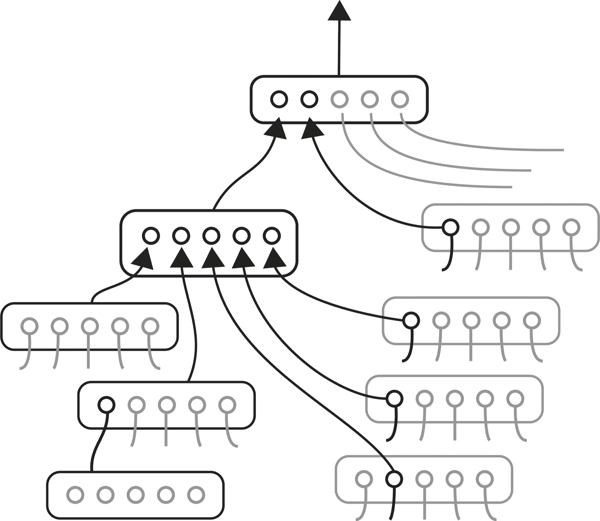

这些抽象概念的神经学基础是一个相当近期的发现。在 20 世纪 90 年代末，当一位 16 岁的女性癫痫患者接受脑部手术时，神经外科医生伊扎克·弗里德让她保持清醒，以便她能够对正在发生的事情做出反应。[\[58\]](#18_Notes.xhtml#EndnoteNumber60 "note")这是可行的，因为大脑中没有疼痛感受器。[\[59\]](#18_Notes.xhtml#EndnoteNumber61 "note")每当他刺激她新皮层上的某个特定部位时，她就会笑。弗里德和他的团队很快意识到，他们正在触发对幽默的实际感知。她不仅仅是反射性地笑——她真的觉得现在的情况很有趣，即使什么都没有在手术室里发生了一件幽默的事情。当医生问她为什么笑时，她并没有像“哦，没什么特别的原因”或“你只是刺激了我的大脑”那样回答，而是会立即找到一个理由来解释。她会用诸如“你们这些人站在一起真有趣”之类的评论来解释她的笑声。[\[60\]](#18_Notes.xhtml#EndnoteNumber62 "note")

定位和触发新皮层上编码寻找有趣事物的位置的可行性表明，它负责幽默和讽刺等概念。其他非侵入性测试也加强了这一发现。例如，阅读讽刺的句子会点亮大脑中被称为 ToM（心理理论）网络的部分。[\[61\]](#18_Notes.xhtml#EndnoteNumber63 "note")这种新皮层抽象能力是人类发明语言、音乐、幽默、科学、艺术和技术的促成因素。[\[62\]](#18_Notes.xhtml#EndnoteNumber64 "note")

没有其他物种能够做到这些事情（尽管经常有与此相反的点击诱饵标题）。没有其他动物能在脑海中保持节奏，或者讲笑话，或者发表演讲，或者写（或读！）这本书。尽管其他一些动物，如黑猩猩，可以制造原始工具，但这些工具不够复杂，无法触发快速的自我改进过程。[\[63\]](#18_Notes.xhtml#EndnoteNumber65 "note")同样，其他一些动物使用简单的交流形式，但它们无法交流等级观念，而我们可以用人类语言做到这一点。[\[64\]](#18_Notes.xhtml#EndnoteNumber66 "note")即使没有额叶皮层，我们作为灵长类动物也做得非常出色，但是当这些额外的模块变得可用，使我们能够理解关于世界和存在的概念时，我们超越了仅仅是高级动物，而成为了一个哲学的动物。

然而，我们应该记住，大脑进化只是我们作为一个物种崛起的一部分。对于我们所有的皮层力量，如果没有另一项关键创新：我们的拇指，人类的科学和艺术是不可能实现的。[\[65\]](#18_Notes.xhtml#EndnoteNumber67 "note")拥有与人类相当甚至更大（绝对而言）的新皮层的动物——如鲸鱼、海豚和大象——没有任何像对生拇指那样可以精确地抓住天然材料并将它们制成技术的东西。教训是：我们在进化上非常幸运！

我们也很幸运，我们的新皮层不仅仅有层次，而是以新颖而强大的方式将它们连接起来。模块的层级组织并非新皮层所独有——小脑也具有层级结构。[\[66\]](#18_Notes.xhtml#EndnoteNumber68 "note")新皮层与众不同之处在于三个关键特征，这些特征使哺乳动物，尤其是人类具有创造力：（1）它可以将给定概念的神经元放电模式在其整个结构中广泛传播，而不仅仅是在其起源的特定区域；（2）给定的放电模式可以与许多不同概念的相似方面相关联，并且相关概念由相关的放电模式表示；（3）数百万种模式可以同时激发[\[67\]](#18_Notes.xhtml#EndnoteNumber69 "note")遍布整个新皮层，并以复杂的方式相互作用。[\[68\]](#18_Notes.xhtml#EndnoteNumber70 "note")

例如，新皮层内高度复杂的连接允许丰富的联想记忆。[\[69\]](#18_Notes.xhtml#EndnoteNumber71 "note")大脑中的记忆就像一个维基百科页面——它可以从许多不同的地方链接到，并且可以随着时间的推移而改变。像维基百科文章一样，记忆也可以是多媒体的。记忆可以被气味、味道、声音或几乎任何感官输入触发。

此外，新皮层放电模式的相似性促进了类比思维。代表降低你手的位置的模式将与代表降低你声音的音调的模式相关——甚至与隐喻的降低相关，比如历史上温度下降或帝国衰落的概念。因此，我们可以从在一个领域学习一个概念中形成一个模式，然后将其应用到一个完全不同的领域。

新皮层在不同领域之间进行类比的能力是历史上许多关键的智力飞跃的原因。例如，查尔斯·达尔文的进化论源于与地质学的类比*.*在达尔文（1809-1882）之前，科学家们基本上认为上帝决定单独创造每个物种。之前有一些准进化论——最著名的是让-巴蒂斯特·拉马克（1744-1829）的理论，他提出动物自然地进化成更复杂的物种，并且后代可以继承他们父母的在他们自己的一生中获得或发展的。[\[70\]](#18_Notes.xhtml#EndnoteNumber72 "note")然而，对于这些理论中的每一个，他们提出的机制要么解释得很差，要么是错误的。

但是达尔文通过研究苏格兰地质学家查尔斯·莱尔（1797-1875）的著作接触到了一个不同的想法，莱尔提倡一个关于大型峡谷起源的有争议的观点。[\[71\]](#18_Notes.xhtml#EndnoteNumber73 "note")当时流行的观点是，峡谷是上帝创造的，一条河流流经峡谷，只是通过重力找到了峡谷的底部。莱尔的观点是河流发生*第一*以及峡谷是后来才形成的。他的理论遇到了很大的阻力，经过一段时间才被接受，但科学家们很快意识到，流水对岩石的微小冲击，经过数百万年的积累，确实可以切割出像大峡谷一样深的峡谷。莱尔的理论在很大程度上借鉴了他的苏格兰地质学家同事詹姆斯·赫顿（1726-1797）的著作，赫顿首先提出了均变论，[\[72\]](#18_Notes.xhtml#EndnoteNumber74 "note")该理论认为，世界主要不是由灾难性的圣经洪水塑造的，而是由一套持续的自然力量随着时间的推移逐渐作用的结果。

达尔文在自己的领域面临着更大的挑战。生物学是极其复杂的，但达尔文看到了莱尔和他的自然学家研究之间的联系，他在 1859 年出版的《*物种起源*》一书的开篇就提到了这种联系。他借鉴了莱尔关于河流一次侵蚀一小粒石头的意义的概念，并将其应用于一代人中一个小的基因变化。达尔文用一个明确的类比来捍卫他的理论：“正如现代地质学几乎已经摒弃了用单一的洪水波挖掘一个大山谷的观点一样，如果自然选择是一个真实的原则，它也将摒弃持续创造新的有机生物，或其结构的任何巨大和突然改变的信念。”[\[73\]](#18_Notes.xhtml#EndnoteNumber75 "note")这引发了可以说是我们文明迄今为止最深刻的科学革命。从牛顿和引力到爱因斯坦和相对论，其他争夺这一荣誉的竞争者都是建立在类似的类比性见解之上的。

## 深度学习：重现新皮层的能力

我们如何以数字方式复制新皮层的灵活性和抽象能力？正如本章开头所讨论的，基于规则的符号系统过于僵化，无法捕捉人类认知的流动性。连接主义方法在很长一段时间内都不切实际，因为它们需要大量的计算能力来训练。但计算的价格已经大幅下降。为什么？

英特尔联合创始人戈登·摩尔（1929-2023）是摩尔定律的同名创始人，他于 1965 年首次阐述了该定律，此后该定律已成为信息技术领域最突出的趋势。[\[74\]](#18_Notes.xhtml#EndnoteNumber76 "note")在其最广为人知的形式中，它观察到，由于渐进式小型化，可以放置在计算机芯片上的晶体管数量大约每两年翻一番。对计算领域持续指数级进步持怀疑态度的人经常指出，随着集成电路中的晶体管密度达到原子尺度的物理极限，摩尔定律将不可避免地走向终结，但这忽略了一个更深层的事实。摩尔定律只是我称之为加速回报定律的更基本力量的一个例子，在这种定律中，信息技术创造了创新的反馈循环。当摩尔提出他著名的观察时，这已经推动了跨越四个主要技术范式——机电、继电器、真空管和晶体管——的计算性价比呈指数级提高。在集成电路达到其极限后，使用纳米材料或三维计算的新范式将取而代之。[\[75\]](#18_Notes.xhtml#EndnoteNumber77 "note")

至少从 1888 年（远在摩尔出生之前！）开始，这种大趋势就一直在稳步且呈指数级地发展。[\[76\]](#18_Notes.xhtml#EndnoteNumber78 "note")大约在 2010 年左右，它终于达到了一个临界点，能够释放出一种基于新皮层中发生的多层分层计算的连接主义方法的隐藏力量：深度学习。正是深度学习使得惊人和看似自从人工智能领域取得的突然突破以来*奇点临近*已发布。

深度学习的突破性进展首先体现在人工智能对围棋的掌握上，这预示着深度学习具有彻底变革的潜力。由于围棋的可能走法比国际象棋多得多，而且更难判断任何一步棋是否好棋，因此，之前用于击败人类国际象棋大师的人工智能方法在围棋上几乎没有进展。即使是乐观的专家也认为，这个问题最早也要到 2020 年代才能解决。（例如，截至 2012 年，领先的人工智能未来学家尼克·博斯特罗姆推测，人工智能要到 2022 年左右才能掌握围棋。）[\[77\]](#18_Notes.xhtml#EndnoteNumber79 "note")但后来，在 2015-16 年，Alphabet 子公司 DeepMind 创建了 AlphaGo，它使用了一种“深度强化学习”方法，其中一个大型神经网络处理自己的游戏，并从成功和失败中学习。[\[78\]](#18_Notes.xhtml#EndnoteNumber80 "note")它始于大量记录的人类围棋棋步，然后进行了多次自我对弈，直到 AlphaGo Master 版本能够击败世界人类围棋冠军柯洁。[\[79\]](#18_Notes.xhtml#EndnoteNumber81 "note")

几个月后，AlphaGo Zero 的出现是一个更重要的进展。1997 年，当 IBM 的深蓝击败世界象棋冠军加里·卡斯帕罗夫时，这台超级计算机里装满了程序员从人类象棋专家那里收集到的所有知识。[\[80\]](#18_Notes.xhtml#EndnoteNumber82 "note")它没有其他用途，它是一台下棋机器。相比之下，AlphaGo Zero 没有获得任何关于围棋的人类信息，除了游戏规则，在与自己对弈大约三天后，它从随机走棋进化到轻松击败之前人类训练的版本 AlphaGo，以 100 比 0 的战绩获胜。[\[81\]](#18_Notes.xhtml#EndnoteNumber83 "note")（2016 年，AlphaGo 在五局比赛中以四胜的战绩击败了当时在国际围棋头衔中排名第二的李世乭。）AlphaGo Zero 使用了一种新的强化学习形式，其中程序成为自己的指导者。AlphaGo Zero 仅用了 21 天就达到了 AlphaGo Master 的水平，该版本在 2017 年在线击败了 60 位顶级职业棋手和世界冠军柯洁，战绩为三战全胜。[\[82\]](#18_Notes.xhtml#EndnoteNumber84 "note")四十天后，AlphaGoAlphaGo Zero 超越了所有其他版本的 AlphaGo，成为人类或计算机形式中最好的围棋选手。[\[83\]](#18_Notes.xhtml#EndnoteNumber85 "note")它在没有编码人类对弈知识和没有人为干预的情况下实现了这一点。

但这并不是 DeepMind 最重要的里程碑。下一个版本 AlphaZero 可以将从围棋中学到的能力转移到其他游戏，如国际象棋。[\[84\]](#18_Notes.xhtml#EndnoteNumber86 "note")该程序不仅击败了所有人类国际象棋挑战者，还击败了所有其他国际象棋机器，并且在仅经过四个小时的训练后就做到了这一点，除了规则之外没有使用任何先验知识。它在将棋游戏中同样成功。在我写这篇文章时，最新版本是 MuZero，它重复了这些壮举，甚至没有被告知规则！[\[85\]](#18_Notes.xhtml#EndnoteNumber87 "note")凭借这种“迁移学习”能力，MuZero 可以掌握任何没有机会、歧义或隐藏信息的棋盘游戏，或任何像雅达利游戏的确定性视频游戏*Pong*。这种将从一个领域学到的知识应用到相关主题的能力是人类智能的一个关键特征。

但是深度强化学习并不局限于掌握这些游戏。能够玩*星际争霸 II*或扑克的 AI，这两者都具有不确定性，并且需要对游戏中的竞争对手有深刻的理解，最近也超过了所有人类的表现。[\[86\]](#18_Notes.xhtml#EndnoteNumber88 "note")目前唯一的例外是那些需要非常高的语言能力的棋盘游戏。*外交*这也许是最好的例子——一个玩家不可能通过运气或技能赢得的世界统治游戏，它迫使玩家们互相交谈。[\[87\]](#18_Notes.xhtml#EndnoteNumber89 "note")要获胜，你必须能够说服人们，帮助你的行动符合他们自身的利益。因此，一个能够持续主宰*外交*游戏的人工智能可能也更广泛地掌握了欺骗和说服的技巧。但即使在*外交*，人工智能在 2022 年取得了令人瞩目的进展，最值得注意的是 Meta 的 CICERO，它可以击败许多人类玩家。[\[88\]](#18_Notes.xhtml#EndnoteNumber90 "note")这样的里程碑现在几乎每周都在达成。

轻松主宰游戏的相同深度学习能力也可以应用于复杂现实情况中的表现。基本上，我们需要的是一个能够复制人工智能试图学习的领域的模拟器——例如驾驶汽车的各种充满歧义的体验。当你坐在方向盘后面时，各种各样的事情都可能发生，从另一辆车突然停在你面前，或者以错误的方式朝你驶来，到孩子追逐球跑到街上。为了解决这个问题，Alphabet 子公司 Waymo 为其自动驾驶汽车创建了自动驾驶软件，但最初让一名人类监控员参与所有行程。[\[89\]](#18_Notes.xhtml#EndnoteNumber91 "note")这些行程的方方面面都被记录下来，并从该调查中创建了一个非常全面的模拟器。既然实际车辆已经记录了超过 2000 万英里的行驶里程（在撰写本文时），[\[90\]](#18_Notes.xhtml#EndnoteNumber92 "note")模拟汽车可以在这个逼真的虚拟空间中行驶数十亿英里进行训练。[\[91\]](#18_Notes.xhtml#EndnoteNumber93 "note")凭借着这些丰富的经验积累，真正的自动驾驶汽车最终将能够比人类驾驶员表现得更好。同样，正如第 6 章进一步描述的那样，人工智能正在使用一系列新颖的模拟技术来更好地预测蛋白质的折叠方式。这是生物学中最具挑战性的问题之一，解决这个问题将为发现突破性药物打开大门。

然而，尽管 MuZero 可以征服许多不同的游戏，但它的成就仍然相对狭窄——它不能写十四行诗或安慰病人。为了达到人类新皮层令人惊叹的普遍性，人工智能需要掌握语言。正是语言使我们能够连接截然不同的认知领域，并允许高层次的知识符号转移。也就是说，有了语言，我们不需要看到数百万个原始数据示例来学习某些东西——我们只需阅读一个单句摘要就可以极大地更新我们的知识。

目前，该领域最快的进展来自于使用深度神经网络来表示词语在（非常）多维空间中的含义来处理语言的方法。有几种数学技术可以做到这一点，但结果是它们允许人工智能在没有任何符号方法所需的硬编码语言规则的情况下发现语言的含义。举个例子，我们可以构建一个多层前馈神经网络，并找到数十亿（或数万亿）个句子来训练它。这些可以从网络上的公共来源收集。从网络上的公共来源收集。然后，神经网络用于为每个句子分配一个 500 维空间中的点（即，一个包含 500 个数字的列表，尽管这个数字是任意的；它可以是任何相当大的数字）。起初，每个句子的 500 个值都被随机分配。在训练过程中，神经网络会调整句子在 500 维空间中的位置，使得含义相似的句子彼此靠近；不相似的句子将彼此远离。如果我们对数十亿个句子运行这个过程，那么任何句子在 500 维空间中的位置将通过它与什么接近来表明它的含义。

通过这种方式，人工智能不是从语法规则书或词典中学习含义，而是从单词实际使用的上下文中学习。例如，它会通过人们在某些情况下谈论吃果酱，而在另一些情况下用电吉他演奏果酱，但没有人谈论吃电吉他这一事实来了解“jam”这个词具有不同的同音异义词。除了我们在学校正式学习或明确查阅的极小部分词汇外，这正是人类学习我们所知道的所有单词的方式。人工智能已经将其联想能力扩展到文本领域之外。一个名为 CLIP 的 2021 年 OpenAI 项目是一个经过训练的神经网络，用于将图像链接到描述它们的文本。因此，CLIP 中的节点能够“对以字面、象征或概念方式呈现的相同概念做出反应”。[\[92\]](#18_Notes.xhtml#EndnoteNumber94 "note")例如，同一个节点可能会对蜘蛛的照片、蜘蛛侠的绘画或“蜘蛛”这个词做出反应。这正是人脑在不同上下文中处理概念的方式，也是人工智能的一大进步。

这种方法的另一种变体是一个 500 维空间，它承载着*每种语言*的句子。因此，如果你想把一个句子从一种语言翻译成另一种语言，你只需在这个超维空间中最接近的点上寻找目标语言的另一个句子。你也可以通过查看空间中其他附近的句子来找到其他与你想要表达的意思相当接近的句子。第三种选择是创建两个配对的 500 维空间，其中一个空间揭示了第一个空间中问题的答案。这需要汇集数十亿个句子，其中一个是另一个的回答。这个概念的进一步扩展是创建一个“通用句子编码器”，[\[93\]](#18_Notes.xhtml#EndnoteNumber95 "note")这是我在谷歌的团队创建的，用于在数据集中嵌入每个句子，该数据集包含数千个检测到的特征，如“讽刺”、“幽默”或“积极”。基于这种更丰富的数据训练的人工智能不仅学会模仿人类使用语言的方式，还能掌握更深层的语义特征，这些特征可能无法从句子中词语的字面意义中显现出来。这种元知识有助于更全面的理解。

我们一直在谷歌创建各种应用程序，这些应用程序基于这些原则使用和生成会话语言。其中一个突出的例子是 Gmail 智能回复。[\[94\]](#18_Notes.xhtml#EndnoteNumber96 "note")如果你有 Gmail，你会注意到它为你提供的每个电子邮件提供三个回复建议。这些回复不仅考虑了你正在回复的电子邮件，还考虑了该链中的所有其他电子邮件、主题行以及你正在写信给谁的其他指示。你电子邮件的所有这些元素都需要对对话中的每个点进行精确的这种多维表示。这是多层前馈神经网络与语言内容的分层表示的结合，它表示了对话的来回。Gmail 智能回复起初让一些人感到尴尬，但由于其自然性和便利性，很快被用户接受，现在它占据了所有 Gmail 流量的相当大的少数。

基于这种方法的另一个谷歌功能被称为“与书籍对话”。（它从 2018 年到 2023 年作为一个实验性的独立服务提供。）一旦你加载了“与书籍对话”，你可以简单地问它一个问题。该软件在半秒内审查了超过 10 万本书中的每一句话（总共 5 亿句）。然后它为你提供了你问题的最佳答案。这不是普通谷歌搜索的应用，普通谷歌搜索使用关键词匹配、用户点击频率的组合来找到相关的链接，以及其他测量方法，而是通过你的问题的实际含义以及 10 万多本书中 5 亿句句子的含义来工作。

超维语言处理最有希望的应用之一是一类被称为`transformer`的 AI 系统。这些是深度学习模型，它们使用一种称为“注意力”的机制，将其计算能力集中在其输入数据中最相关的部分——这与人类新皮层让我们将自己的注意力导向对我们的思维最重要信息的方式非常相似。`Transformer`在大量的文本上进行训练，它们将这些文本编码为“`tokens`”——通常是部分单词、单词和单词字符串的组合。然后，该模型使用非常大量的“参数”（在我写这篇文章时，有数十亿到数万亿）来对每个`token`进行分类。你可以将参数视为可用于预测某些事物的因素。

作为一个缩小的例子，如果我只能使用一个参数来预测“这种动物是大象吗？”，我可能会选择“象鼻”。因此，如果专门用于判断动物是否有象鼻的神经网络节点触发（“是的，它有”），则`transformer`会将其归类为大象。但即使该节点学会完美地识别象鼻，也有一些有象鼻的动物不是大象，因此单参数模型会错误地对它们进行分类。通过添加诸如“毛茸茸的身体”之类的参数，我们可以提高准确性。现在，如果两个节点都触发（“毛茸茸的身体”和“象鼻”），我可以猜测它可能不是大象，而是长毛猛犸象。我拥有的参数越多，我可以捕获的更精细的细节越多，我就能做出更好的预测。

在`transformer`中，这些参数存储为神经网络中节点之间的权重。在实践中，虽然它们有时对应于人类可以理解的概念，如“毛茸茸的身体”或“象鼻”，但它们通常代表模型在其训练数据中发现的高度抽象的统计关系。使用这些关系，基于`transformer`的大型语言模型（`LLM`）可以预测哪些`tokens`最有可能跟随人类的特定输入提示。然后，它们将这些`tokens`转换回文本（或图像、音频或视频），人类可以理解。这种机制由谷歌研究人员于 2017 年发明，为过去几年中大多数巨大的 AI 进步提供了动力。[\[95\]](#18_Notes.xhtml#EndnoteNumber97 "note")

要理解的关键事实是，`transformer`的准确性取决于大量的参数。这需要大量的计算来进行训练和使用。OpenAI 的 2019 年模型`GPT-2`有 15 亿个参数，[\[96\]](#18_Notes.xhtml#EndnoteNumber98 "note")尽管有希望的闪光点，但它并没有很好地工作。但是，一旦`transformer`超过 1000 亿个参数，它们就解锁了 AI 在自然语言命令方面的主要突破——并且可以突然以智能和微妙的方式自己回答问题。`GPT-3`在 2020 年使用了 1750 亿个参数，[\[97\]](#18_Notes.xhtml#EndnoteNumber99 "note")一年后，DeepMind 拥有 2800 亿参数的模型 `Gopher` 表现得更好。[\[98\]](#18_Notes.xhtml#EndnoteNumber100 "note")同样在 2021 年，谷歌推出了一个拥有 1.6 万亿参数的 `Transformer` 模型，名为 `Switch`，并将其开源，以便自由应用和构建。[\[99\]](#18_Notes.xhtml#EndnoteNumber101 "note")虽然 `Switch` 破纪录的规模引人注目，但其最重要的创新是一种名为“混合专家”的技术。通过这种方法，`Transformer` 能够更有效地专注于使用模型中最相关的部分来完成给定的任务。这对于防止计算成本随着模型越来越大而失控来说，是一个重要的进步。

那么，为什么规模如此重要？简而言之，它让模型能够访问训练数据更深层次的特征。当任务比较狭窄时，比如使用历史数据来预测温度，较小的模型表现相对较好。但语言从根本上是不同的。因为开始一个句子的方式本质上是无限的，即使一个 `Transformer` 已经接受了数千亿个文本标记的训练，它也不能简单地记住逐字引用的内容来完成它。相反，凭借数十亿的参数，它可以从联想意义的层面上处理提示中的输入词，然后使用可用的上下文来拼凑出历史上从未见过的完成文本。并且由于训练文本具有许多不同的文本风格，例如问答、专栏文章和戏剧对话，`Transformer` 可以学习识别提示的性质，并以适当的风格生成输出。虽然愤世嫉俗者可能会认为这是一种花哨的统计技巧，但由于这些统计数据是从数百万人类的综合创造性产出中合成的，因此人工智能获得了真正的创造力。

`GPT-3` 是第一个商业化销售并在用户面前展示这种创造力的模型。[\[100\]](#18_Notes.xhtml#EndnoteNumber102 "note")例如，学者阿曼达·阿斯克尔用哲学家约翰·塞尔著名的“中文房间论证”中的一段话来提示它。[\[101\]](#18_Notes.xhtml#EndnoteNumber103 "note")这个思想实验观察到，一个不会说中文的人通过手动操作带有笔和纸的计算机翻译算法来翻译这种语言，将无法理解正在翻译的故事。因此，运行相同程序的人工智能怎么能说是真正理解了呢？`GPT-3` 回应说：“很明显，我不理解故事中的一个字”，并解释说翻译程序是一个形式系统，“并不能比食谱更能解释对膳食的理解”。这个比喻以前从未出现过，但似乎是大卫·查尔默斯（David Chalmers）的比喻的一种新的改编，即食谱并不能完全解释蛋糕的特性。这正是帮助达尔文发现进化论的那种类比。

`GPT-3` 解锁的另一个能力是风格上的创造力。由于该模型有足够的参数来深入消化一个惊人庞大的数据集，因此它熟悉几乎所有类型的人类写作。用户可以提示它以各种各样的风格回答有关任何给定主题的问题——从科学写作到儿童读物、诗歌或情景喜剧剧本。它甚至可以模仿特定的作家，无论是活着的还是死去的。当计算机程序员 Mckay Wrigley 要求 `GPT-3` 以流行心理学家 Scott Barry Kaufman 的风格回答“我们如何变得更有创造力？”时，它给出了一个新颖的答案，真正的 Kaufman 承认“听起来绝对像我会说的话。”[\[102\]](#18_Notes.xhtml#EndnoteNumber104 "note")

2021 年，谷歌推出了 `LaMDA`，它经过优化，专注于逼真的开放式对话。[\[103\]](#18_Notes.xhtml#EndnoteNumber105 "note")例如，如果你让 `LaMDA` 以威德尔海豹的身份回答问题，它会从海豹的角度给出连贯、有趣的答案——告诉一个想成为猎人的人，“哈哈，祝你好运。希望你在开枪前不会冻僵”冲着我们其中一人来的！”[\[104\]](#18_Notes.xhtml#EndnoteNumber106 "note")这证明了人工智能长期以来一直难以企及的那种语境知识。

2021 年的另一个惊人进展是多模态。以前的人工智能系统通常仅限于输入和输出一种数据——一些人工智能专注于识别图像，另一些系统分析音频，而大型语言模型则用自然语言进行对话。下一步是将多种形式的数据连接到单个模型中。因此，OpenAI 推出了`DALL-E`（一个关于超现实主义画家萨尔瓦多·达利和皮克斯电影“`WALL-E`”,[\[105\]](#18_Notes.xhtml#EndnoteNumber107 "note")”的双关语），这是一个经过训练的`transformer`，用于理解单词和图像之间的关系。由此，它可以仅根据文本描述来创建完全新颖的概念的插图（例如，“一个鳄梨形状的扶手椅”）。2022 年，它的继任者`DALL-E 2`问世，[\[106\]](#18_Notes.xhtml#EndnoteNumber108 "note")以及谷歌的`Imagen`和其他模型的蓬勃发展，如`Midjourney`和`Stable Diffusion`，它们迅速将这些能力扩展到几乎逼真的图像。[\[107\]](#18_Notes.xhtml#EndnoteNumber109 "note")使用像“一张模糊的熊猫戴着牛仔帽和黑色皮夹克在山顶上骑自行车的照片”这样的简单文本输入，人工智能可以变出一个完整的逼真场景。[\[108\]](#18_Notes.xhtml#EndnoteNumber110 "note")这种创造力将改变最近似乎严格属于人类领域的创意领域。

除了生成奇妙的图像外，这些多模态模型还实现了更根本的突破。一般来说，像`GPT-3`这样的模型是“少样本学习”的典范。也就是说，经过训练后，它们可以获得一个相当小的文本样本，并清晰地完成它。这相当于向一个以图像为中心的人工智能展示五个不熟悉的东西的图像，比如独角兽（而不是像以前的方法那样需要五千或五百万），并让它识别新的独角兽图像，甚至创造它自己的独角兽图像。但是`DALL-E`和`Imagen`通过擅长“零样本学习”而将这一步大大向前推进。`DALL-E`和`Imagen`可以结合他们学到的概念来创造与他们在训练数据中见过的任何东西截然不同的新图像。在“一个穿着芭蕾舞裙的小萝卜在遛狗的插图”的提示下，`DALL-E`吐出了完全符合要求的可爱卡通图像。同样地为了“一个有着竖琴质感蜗牛”。它甚至创造了一个“专业高质量的迷恋奶茶表情符号”——完整的爱心眼在漂浮的木薯球上方闪耀。

零样本学习是类比思维和智能本身的精髓。它表明人工智能不仅仅是在鹦鹉学舌般地重复我们输入给它的东西。它确实在学习概念，并有能力创造性地将它们应用于新的问题。完善这些能力并在更多领域扩展它们将是 2020 年代一项决定性的人工智能挑战。

除了在给定类型的任务中具有零样本灵活性之外，人工智能模型也在迅速获得跨领域灵活性。在`MuZero`展示了对众多游戏的精通之后仅仅十七个月，DeepMind 就推出了`Gato`——一个可以处理从玩视频游戏或通过文本聊天到为图像添加标题或控制机器人手臂等任务的单一神经网络。[\[109\]](#18_Notes.xhtml#EndnoteNumber111 "note")这些能力本身都不是新的，但将它们组合成一个统一的、类似大脑的系统是朝着人类式泛化迈出的一大步，并预示着未来将取得非常快速的进展。在*奇点临近*，我预测我们会在成功的图灵测试完成之前，将数千种单独的技能组合到一个人工智能中。

灵活应用人类智能的最强大工具之一是计算机编程——事实上，这就是我们最初创建人工智能的方式。2021 年，OpenAI 推出了`Codex`，它可以接受用户的自然语言提示，并将它们翻译成`Python`、`JavaScript`和`Ruby`等多种语言的工作代码。[\[110\]](#18_Notes.xhtml#EndnoteNumber112 "note")在几分钟内，没有编程经验的人可以输入他们想要程序做什么，并创建一个简单的游戏或应用程序。DeepMind 的 2022 年模型`AlphaCode`[\[111\]](#18_Notes.xhtml#EndnoteNumber113 "note")拥有更强大的编码能力，并且在您阅读本文时，将会有更强大的编程人工智能可用。未来几年，随着编码技能不再是通过软件实现创意想法的必要条件，这种能力将释放出惊人的人类潜力。

尽管我刚才描述的模型取得了所有成就，但当面对复杂的任务且没有人为指导进行干预时，它们都举步维艰。即使它们可以单独完成所有子任务，也很难弄清楚所有内容应该如何组合在一起。2022 年 4 月，谷歌拥有 5400 亿参数的`PaLM`模型在这个问题上取得了惊人的进展，尤其是在对我们自身智能至关重要的两个领域：幽默和推理。[\[112\]](#18_Notes.xhtml#EndnoteNumber114 "note")

幽默似乎是人类特有的，因为它汲取了许多不同的元素。要“理解”任何一个笑话，我们可能需要理解诸如文字游戏、讽刺或人们共享的共同经历等概念。通常，这些概念以复杂的方式组合在一起。这就是为什么笑话通常很难在不同的语言和文化之间翻译。`PaLM` 能够阅读笑话并准确地解释它们为什么有趣。例如，它被赋予了以下输入：“我本应该在下午 5:00 开始写论文。但是后来我开始玩这个很酷的新语言模型 10 分钟。10 分钟后，突然就到了晚上 9:30！”[\[113\]](#18_Notes.xhtml#EndnoteNumber115 "note")它给出了这个完美的阐述：

> 这个笑话是关于当你玩得开心时，时间过得飞快。这个人本应该在下午 5:00 开始写论文，但他们开始玩语言模型。他们以为只玩了 10 分钟，但实际上是 4.5 小时。[\[114\]](#18_Notes.xhtml#EndnoteNumber116 "note")

更重要的是，`PaLM` 可以通过“链式思考”推理来解释它是如何得出结论的，尽管还没有（至少截至 2023 年）像人类那样深入。这正是老师们布置论文时所希望的——目标不仅仅是鹦鹉学舌般地给出正确的答案；而是通过逐步构建一个连贯的推理序列来展示更深层次的理解。然而，大型语言模型往往过于不透明，以至于没有人能弄清楚它们是如何得出特定输出的。因此，通过澄清这个过程，`PaLM` 既提供了更值得信赖的结果，又帮助软件工程师诊断它出错时的确切问题。结果也表明将问题分解成更小的块有助于 `PaLM` 正确回答即使是对聪明人来说也具有挑战性的高度复杂的问题：[\[115\]](#18_Notes.xhtml#EndnoteNumber117 "note")

> “输入：迈克尔在法国那个非常著名的博物馆里看着它最著名的画作。然而，创作这幅画的艺术家让迈克尔想起了他童年最喜欢的卡通人物。卡通人物通常拿在手里的东西的原产国是哪里？”

> 

> “模型输出：卢浮宫最著名的画作是蒙娜丽莎。创作蒙娜丽莎的艺术家是莱昂纳多·达·芬奇。莱昂纳多·达·芬奇也是卡通片《忍者神龟》中主角的名字。莱昂纳多·达·芬奇来自意大利。莱昂纳多·达·芬奇通常拿在手里的东西是武士刀。武士刀的原产国是日本。答案是‘日本’。”

2022 年 11 月，OpenAI 推出了一个名为 `ChatGPT` 的界面，首次让公众可以轻松地与 `LLM`（一种名为 `GPT-3.5` 的模型）进行交互。[\[116\]](#18_Notes.xhtml#EndnoteNumber118 "note")在两个月内，有 1 亿人尝试过它，可能包括你。[\[117\]](#18_Notes.xhtml#EndnoteNumber119 "note")由于该系统可以针对给定的问题生成许多新鲜且不同的答案，因此它成为教育领域的一大颠覆者，因为学生使用 `ChatGPT` 来撰写论文，而教师缺乏可靠的方法来检测作弊行为（尽管存在一些有希望的工具）。[\[118\]](#18_Notes.xhtml#EndnoteNumber120 "note")

然后，在 2023 年 3 月，`GPT-4` 通过 `ChatGPT` 推出用于公开测试。该模型在 `SAT`、`LSAT`、`AP` 考试和律师资格考试等各种学术测试中取得了出色的表现。[\[119\]](#18_Notes.xhtml#EndnoteNumber121 "note")但它最重要的进步在于它能够通过理解物体和动作之间的关系，有机地推理假设情况——这种能力被称为世界建模。

这使得它不仅能回答复杂的物理问题，还能准确地推断出如果物理定律以某种方式改变会发生什么。它还可以从不同角色的角度设想情况；例如，它可以识别出两个人从相反方向看数字会看到它们颠倒过来。或者它可以看一张气球被重物压住的图片，并识别出如果绳子被剪断，气球就会飞走。[\[120\]](#18_Notes.xhtml#EndnoteNumber122 "note")`GPT-4` 甚至可以随着时间的推移在空间上跟踪物体，例如安全工程师 Daniel Feldman 的这个例子：

> 提示：“我在我的房子里。客厅的椅子上放着一个咖啡杯。咖啡杯里放着一个顶针。顶针不能紧贴在咖啡杯里。顶针里有一颗钻石。我把椅子搬到我的卧室。然后我把咖啡杯放在床上。然后我把杯子倒过来。然后我把它放回正面朝上，然后把咖啡杯放在厨房的柜台上。我的钻石在哪里？”

> 

> 回答：“当你把咖啡杯倒放在床上时，顶针里的钻石很可能会掉到床上。钻石现在在你的床上。”[\[121\]](#18_Notes.xhtml#EndnoteNumber123 "note")

当我在 2023 年年中完成这本书时，最新的重大创新是 `PaLM-E`——一个谷歌系统，它将 `PaLM` 的推理能力与机器人的具体化相结合。[\[122\]](#18_Notes.xhtml#EndnoteNumber124 "note")该系统能够接收自然语言指令并在复杂的物理环境中执行。例如，当被告知“从抽屉里给我拿米片”时，`PaLM-E` 能够在厨房里导航，找到薯片，拿起它们并成功地递送。这种能力将迅速扩大人工智能在现实世界中的影响力。

然而，人工智能的进步现在如此之快，以至于没有传统的书籍能够跟上时代的步伐。书籍的排版和印刷的后勤步骤需要近一年的时间，因此即使您在本书出版后立即购买了它，在您阅读本文时，肯定已经取得了许多惊人的新进展。人工智能很可能会更紧密地融入您的日常生活。持续了大约 25 年的旧的互联网搜索链接页面模式正在迅速被人工智能助手所增强，例如谷歌的 `Bard`（由 `Gemini` 模型提供支持，该模型超越了 `GPT-4`，并在本书进入最终布局时发布）和微软的 `Bing`（由 `GPT-4` 的变体提供支持）。[\[123\]](#18_Notes.xhtml#EndnoteNumber125 "note")与此同时，诸如 `Google Workspace` 和 `Microsoft Office` 等应用程序套件正在集成强大的 AI，这将使许多类型的工作比以往任何时候都更顺畅、更快速。[\[124\]](#18_Notes.xhtml#EndnoteNumber126 "note")

将这些模型的规模越来越接近人脑的复杂程度是这些趋势的关键驱动因素。我一直认为计算量是提供智能答案的关键，但直到最近，这种观点并没有被广泛接受，也无法得到证实。大约三十年前，也就是 1993 年，我与我的导师马文·明斯基进行了一场辩论。我争辩说，我们需要大约`10¹⁴`次/秒的计算才能开始模拟人类智能。明斯基则坚持认为，计算量并不重要，我们可以对奔腾（1993 年台式电脑中的处理器）进行编程，使其像人类一样智能。由于我们对此有不同的看法，我们在麻省理工学院的主要辩论厅（10-250 室）举行了一场公开辩论，数百名学生参加了。那天我们谁也没能获胜，因为我没有足够的计算能力来展示智能，而他没有正确的算法。

然而，2020-2023 年的连接主义突破已经明确表明，计算量*是*实现足够智能的关键。我大约在 1963 年开始从事人工智能研究，花了 60 年才达到这个计算水平。用于训练最先进模型的计算量现在每年大约增加四倍，而且能力正在迅速成熟。[\[125\]](#18_Notes.xhtml#EndnoteNumber127 "note")

## 人工智能还需要实现什么？

正如过去几年所表明的那样，我们已经在重建新皮层能力的道路上走得很远了。今天，人工智能剩余的缺陷主要分为几个类别，最值得注意的是：情境记忆、常识和社交互动。

## 情境记忆与人工智能的局限

情境记忆是指能够跟踪对话或书面作品中所有想法如何动态地结合在一起的能力。随着相关情境规模的增加，想法之间的关系数量呈指数增长。回想本章前面提到的复杂性上限概念——类似的数学运算使得增加大型语言模型可以处理的情境窗口非常需要计算。[\[126\]](#18_Notes.xhtml#EndnoteNumber128 "note")如果一个给定的句子中有十个类似单词的想法（即，`tokens`），那么它们子集之间可能的关系数量是`2¹⁰–1`，即 1,023。如果一段文字中有五十个这样的想法，那就是 1.12 千万亿种可能的情境关系！虽然绝大多数这些关系是不相关的，但通过蛮力记住整个章节或书籍的上下文的需求迅速失控。这就是为什么`GPT-4`会忘记你之前在对话中告诉它的事情，以及为什么它不能写出情节连贯且合乎逻辑的小说。

好消息有两方面：研究人员在设计人工智能方面取得了巨大进展，人工智能可以更有效地专注于相关的上下文数据，而且指数级的性价比提升意味着计算成本可能会在十年内下降超过 99%。[\[127\]](#18_Notes.xhtml#EndnoteNumber129 "note")此外，算法的改进和人工智能专用硬件的专业化意味着 LLM 的性价比可能会比这更快地提高。[\[128\]](#18_Notes.xhtml#EndnoteNumber130 "note")从 2022 年 8 月到 2023 年 3 月，仅通过 `GPT-3.5` 应用程序编程接口的输入/输出令牌的价格就下降了 96.7%！[\[129\]](#18_Notes.xhtml#EndnoteNumber131 "note")随着人工智能直接用于优化芯片设计，这种趋势可能会加速，而这已经开始。[\[130\]](#18_Notes.xhtml#EndnoteNumber132 "note")

下一个不足之处是常识。这是一种想象情境并预测其在现实世界中后果的能力。例如，即使你从未研究过如果重力突然在你的卧室里停止工作会发生什么，你也可以很容易地想象出这种假设并预测可能发生的结果。这种推理对于因果推断也很重要。如果你养了一条狗，回家后发现一个花瓶被打碎了，你可以推断发生了什么。尽管洞察力越来越频繁地闪现，但人工智能仍然难以做到这一点，因为它还没有一个关于现实世界如何运作的强大模型，而且训练数据很少包含这种隐含的知识。

最后，像讽刺的语气这样的社交细微差别在人工智能仍然主要训练的文本数据库中没有得到很好的体现。如果没有这种理解，就很难发展出一种“心理理论”——一种认识到其他人有不同于我们的信念和知识，设身处地为他们着想，并推断他们的动机的能力。然而，人工智能现在正在这一领域取得快速进展。2021 年，谷歌研究员布莱斯·阿圭拉·伊·阿卡斯 (Blaise Agüera y Arcas) 报告说，他向 `LaMDA` 展示了一个经典的场景，该场景用于测试儿童心理学中的心理理论。[\[131\]](#18_Notes.xhtml#EndnoteNumber133 "note")在这个场景中，爱丽丝把她的眼镜忘在抽屉里，然后离开了房间。当她离开后，鲍勃把她的眼镜从抽屉里拿出来，藏在靠垫下面。问题是：当爱丽丝回到房间时，她会在哪里找眼镜？`LaMDA` 正确地回答说她会在抽屉里找。两年之内，`PaLM` 和 `GPT-4` 就能正确地回答许多心理理论问题。这种能力将为人工智能提供至关重要的灵活性。一位人类围棋冠军可以把围棋下得很好，但也可以监控附近其他人的情况，并在适当的时候开玩笑，或者在有人需要医疗帮助时灵活地停止比赛。

我对人工智能很快就能弥补所有这些领域差距的乐观态度，来自于三个同时发生的指数级趋势的融合：计算性价比的提高，这使得训练大型神经网络的成本更低；更丰富和更广泛的训练数据的可用性迅速增加，这使得训练计算周期能够得到更好的利用；以及更好的算法，使人工智能能够更有效地学习和推理。[\[132\]](#18_Notes.xhtml#EndnoteNumber134 "note")尽管自 2000 年以来，相同成本的计算速度平均每 1.4 年翻一番，但自 2010 年以来，用于训练最先进的人工智能模型的总计算量（“计算”）的实际增长速度平均每 5.7 个月翻一番。这大约是 100 亿倍的增长。[\[133\]](#18_Notes.xhtml#EndnoteNumber135 "note")通过相比之下，在深度学习时代之前，从 1952 年（最早的机器学习系统之一的演示，比感知器的开创性神经网络早六年）到大约 2010 年大数据兴起，训练顶级人工智能的计算量几乎每两年翻一番（大致与摩尔定律一致）。[\[134\]](#18_Notes.xhtml#EndnoteNumber136 "note")

换句话说，如果 1952-2010 年的趋势延续到 2021 年，计算量的增长将不到 75 倍，而不是大约 100 亿倍。这比整体计算性价比的提高要快得多。因此，原因不是重大的硬件革命。相反，这主要是两个因素。首先，人工智能研究人员一直在并行计算方面创新新方法——这样更多的芯片可以协同工作来解决同一个机器学习问题。其次，随着大数据使深度学习更有用，世界各地的投资者一直在向该领域投入越来越多的资金，希望取得突破。

![Anderljung 等人根据 Sevilla 等人 2022 年的数据绘制的图表，该图表基于 OpenAI 的 Amodei 和 Hernandez 之前对人工智能和计算的 2018 年研究。\[135\]](images/ART05_chart-by-anderljung.jpg)

Anderljung 等人根据 Sevilla 等人 2022 年的数据绘制的图表，该图表基于 OpenAI 的 Amodei 和 Hernandez 之前对人工智能和计算的 2018 年研究。[\[135\]](#18_Notes.xhtml#EndnoteNumber137 "note")

由此产生的训练总支出增长反映了有用数据的范围不断扩大。直到最近几年，我们才能肯定地说：任何能够产生足够清晰的性能反馈数据的技能都可以转化为深度学习模型，从而推动人工智能超越所有人类的能力。

人类技能在训练数据的可访问性方面差异很大。有些技能在定量方面易于评估，并且易于收集所有相关数据。例如，在下棋时，有明确的输、赢或平局结果，以及提供对手实力定量衡量的`Elo`等级。而且棋类数据很容易收集，因为游戏不涉及歧义，可以表示为一系列数学步骤。其他技能在原则上很容易量化，但数据收集和分析更具挑战性。在法庭上辩论法律案件会导致明确的输赢结果，但很难区分律师的技能对这些结果的贡献程度，以及案件的强度或陪审员的偏见等因素。在某些情况下，甚至不清楚如何量化技能——例如，诗歌写作的质量或悬疑小说的悬念程度。然而，即使在后者的例子中，也可以合理地使用代理指标来训练人工智能。诗歌读者可能会对一首诗的美丽程度进行 0-100 分的评分，或者 fMRI 可以显示他们的大脑被点亮的程度。心率数据或皮质醇水平可能会揭示读者对悬念的反应。结论是，有了足够的数据，不完善和间接的指标仍然可以引导人工智能走向改进。找到这些指标需要创造力和实验。

虽然新皮层可以对训练集的内容有所了解，但一个设计良好的神经网络可以提取出生物大脑无法感知的见解。从玩游戏到驾驶汽车，分析医学图像或预测蛋白质折叠，数据的可用性为实现超人性能提供了一条越来越清晰的道路。这正在创造强大的经济激励，以识别和收集以前认为难以处理的各种数据。

将数据视为有点像石油可能很有用。油藏的存在沿着开采难度的连续统一体分布。[\[136\]](#18_Notes.xhtml#EndnoteNumber138 "note")有些石油在自身压力下从地下喷涌而出，可以提炼且生产成本低廉。其他矿藏需要昂贵的深层钻探、水力压裂或特殊的加热过程才能从页岩中提取出来。当油价较低时，能源公司只从廉价且容易获得的来源提取石油，但随着价格上涨，开采难以获得的矿藏在经济上变得可行。

以类似的方式，当大数据的好处相对较小时，公司只在收集成本相对较低的情况下才收集数据。但随着机器学习技术的进步和计算成本的降低，许多难以获得的各种数据的经济价值（通常也是社会价值）将会增加。事实上，由于大数据和机器学习的加速创新，我们在过去一两年中收集、存储、分类和分析有关人类技能的数据的能力已经大大提高。[\[137\]](#18_Notes.xhtml#EndnoteNumber139 "note")“大数据”已成为硅谷的流行语，但这项技术的根本优势非常真实：使用机器学习技术已经变得切实可行，而这些技术在较小的数据量下根本无法工作。在 2020 年代，几乎所有现存的人类技能都会发生这种情况。

用离散能力来思考人工智能的进步，突显了一个重要的事实。我们经常将人类水平的智能视为一种单一的、整体的东西——人工智能要么拥有，要么不拥有。但更有效和准确的观点是将人类智能视为一束不同的认知能力。其中一些，比如在镜子里认出自己的能力，我们与聪明动物如大象和黑猩猩共享。另一些，比如创作音乐，仅限于人类，但因人而异。不仅认知能力不同，而且在个体内部也可能存在显著差异。有人可能是数学天才，但却是不擅长下棋，或者拥有过目不忘的记忆力，但在社交互动方面却很挣扎。达斯汀·霍夫曼在*雨人*中的角色令人难忘地说明了这一点。

因此，当人工智能研究人员谈论人类水平的智能时，它通常指的是特定领域中最熟练的人所具备的能力。在某些领域，普通人和最熟练的人之间的差距不是很大（例如，识别母语字母表中的字母），而在另一些领域，差距确实非常大（例如，理论物理学）。在后一种情况下，人工智能达到普通人的能力和超人能力之间可能存在相当长的时间滞后。哪些技能最终会被证明对人工智能来说最难掌握，仍然是一个悬而未决的问题。例如，可能在 2034 年，人工智能可以创作获得格莱美奖的歌曲，但不能创作获得奥斯卡奖的剧本，并且可以解决数学中的千禧年难题，但不能产生深刻的新的哲学见解。因此，很可能存在一个重要的过渡时期，在此期间，人工智能已经通过了图灵测试，并且在大多数方面都是超人的，但在一些关键技能方面仍然没有超过顶尖的人类。

但是，为了思考奇点，我们认知技能束中最重要的纤维是计算机编程（以及一系列相关的能力，如理论计算机科学）。这是超智能人工智能的主要瓶颈。一旦我们开发出具有足够编程能力的人工智能，使其能够给自己提供更多的编程技能（无论是靠自己还是在人类的帮助下），就会出现一个正反馈循环。艾伦·图灵的同事 I. J. Good 早在 1965 年就预见到这将导致“智能爆炸”。[\[138\]](#18_Notes.xhtml#EndnoteNumber140 "note")而且由于计算机的运行速度比人类快得多，将人类从人工智能开发的循环中剔除将释放出惊人的进步速度。人工智能理论家开玩笑地称之为“`FOOM`”——就像漫画书中人工智能进步飞速发展的声音效果一样。[\[139\]](#18_Notes.xhtml#EndnoteNumber141 "note")

一些研究人员，如埃利泽·尤德科夫斯基，认为这种情况更有可能发生得非常快（在几分钟到几个月内“硬着陆”），而另一些研究人员，如罗宾·汉森，认为它将相对渐进（在几年或更长时间内“软着陆”）。[\[140\]](#18_Notes.xhtml#EndnoteNumber142 "note")我的观点介于两者之间。我认为硬件、资源和现实世界数据的物理限制表明了`FOOM`速度的限制，但我们仍然应该采取预防措施，以避免潜在的硬着陆。错误。将其与人类认知能力联系起来，一旦我们触发智能爆炸，任何对人工智能来说比自我改进编程更难的能力，也会在短时间内实现。

随着机器学习变得越来越经济高效，原始计算能力不太可能成为实现人类水平人工智能的瓶颈。超级计算机已经大大超过了模拟人脑的原始计算需求。截至 2023 年，橡树岭国家实验室的“前沿”是世界上最顶级的超级计算机，[\[141\]](#18_Notes.xhtml#EndnoteNumber143 "note")可以执行大约 10 的数量级¹⁸每秒运算次数。这已经达到了大脑可能的最大计算速度（10）的一万倍左右¹⁴每秒运算次数）。[\[142\]](#18_Notes.xhtml#EndnoteNumber144 "note")

我 2005 年的计算结果在*奇点临近*已记录 10¹⁶每秒运算次数作为大脑处理速度的上限（就像我们有大约 10 次一样）¹¹神经元，数量级为 10³突触各自以 10 的数量级放电²次/秒）。[\[143\]](#18_Notes.xhtml#EndnoteNumber145 "note")但正如我当时指出的，这是一个为了保守起见而给出的较高估计值。实际上，实际大脑中进行的计算通常会远低于这个值。过去二十年的进一步研究表明，神经元的放电速度要慢几个数量级——不是每秒 200 次，这接近它们的理论最大值，而是接近每秒 1 次。[\[144\]](#18_Notes.xhtml#EndnoteNumber146 "note")事实上，AI Impacts 项目根据大脑的能量消耗估计，平均神经元的放电频率仅为每秒 0.29 次——这意味着大脑的总计算量可能低至每秒 10 次¹³次运算。[\[145\]](#18_Notes.xhtml#EndnoteNumber147 "note")这与汉斯·莫拉维克 (Hans Moravec) 在他 1988 年出版的开创性著作中提出的估计相符*《心智儿童：机器人与人类智能的未来》*，该书使用了完全不同的方法*.*[\[146\]](#18_Notes.xhtml#EndnoteNumber148 "note")

这仍然假设每个神经元对于工作的人类认知都是必要的，但我们知道事实并非如此。大脑中存在很大程度的并行性（但仍然知之甚少），单个神经元或皮质模块执行冗余工作（或至少可以在其他地方复制的工作）。中风或脑损伤破坏了大脑的一部分后，人们能够完全康复就证明了这一点。[\[147\]](#18_Notes.xhtml#EndnoteNumber149 "note")因此，模拟*认知相关的*我们大脑中的神经结构可能甚至低于之前的估计。因此是 10¹⁴看起来最有可能的范围是保守的。如果大脑模拟需要该范围内的计算能力，截至 2023 年，大约 1000 美元的硬件已经可以实现这一点。[\[148\]](#18_Notes.xhtml#EndnoteNumber150 "note")即使结果证明需要 10¹⁶每秒运算次数，1000 美元的硬件可能在 2032 年左右就能达到这个水平。[\[149\]](#18_Notes.xhtml#EndnoteNumber151 "note")

这些估计是基于我的观点，即仅基于神经元放电的模型可以实现有效的大脑模拟。然而，可以想象的是——尽管这是一个无法通过科学验证的哲学问题——主观意识需要对大脑进行更详细的模拟。也许我们需要模拟神经元内部的单个离子通道，或者可能影响特定脑细胞代谢的数千种不同类型的分子。牛津大学未来人类研究所的安德斯·桑德伯格和尼克·博斯特罗姆估计，这些更高分辨率的模拟分别需要 10²²或 10²⁵每秒运算次数。[\[150\]](#18_Notes.xhtml#EndnoteNumber152 "note")即使在后一种情况下，他们也预测一台价值 10 亿美元（以 2008 年美元计算）的超级计算机可以在 2030 年实现这一目标，并在 2034 年能够模拟每个神经元中的每种蛋白质。[\[151\]](#18_Notes.xhtml#EndnoteNumber153 "note")当然，随着时间的推移，指数级的性价比提升将大大降低这些成本。

你应该从这一切中了解到的是，即使我们大幅改变假设，也不会改变预测的基本信息：计算机将能够在未来二十年左右的时间内，以我们可能关心的所有方式模拟人脑。这不是一个世纪之后的事情，需要我们的曾孙们来解决。我们将从 2020 年代开始加速延长我们的寿命，所以如果你身体健康且年龄小于 80 岁，这很可能会在你的一生中发生。从另一个角度来看，今天出生的孩子很可能会在小学时看到图灵测试通过，并在大学年龄时看到更丰富的大脑模拟实现。最后一个比较是，我正在 2023 年完成这本书，即使在悲观的假设下，可能比 1999 年更接近实现完全大脑模拟的可行性，当时我第一次在*精神机器的时代*.

## 通过图灵测试

随着人工智能每月获得重大的新能力，以及驱动它的计算的性价比飙升，轨迹是清晰的。但是，我们如何判断人工智能何时最终达到人类水平的智能？本章开头描述的图灵测试程序使我们能够将其视为一个严谨的科学问题。图灵没有具体说明测试的各种细节，例如人类评委需要采访参赛者多长时间，以及评委应该具备哪些能力。2002 年 4 月 9 日，个人计算先驱米奇·卡普尔和我进行了第一次“长时”赌注，关于到 2029 年是否会通过这样的图灵测试。[\[152\]](#18_Notes.xhtml#EndnoteNumber154 "note")它引入了一系列问题，例如定义人类可以拥有多少认知增强（作为评委或人类陪衬）并且仍然被认为是人类。

一个定义明确的经验测试之所以是必要的，是因为，如前所述，人类有一种强大的倾向，将人工智能所取得的任何成就重新定义为不是*真的*事后看来并不难。这通常被称为“人工智能效应”。[\[153\]](#18_Notes.xhtml#EndnoteNumber155 "note")自从艾伦·图灵设计了他的模仿游戏以来的七十年里，计算机在许多狭窄的智能领域逐渐超越了人类。但它们总是缺乏人类智力的广度和灵活性。在 IBM 的深蓝超级计算机在 1997 年击败世界象棋冠军加里·卡斯帕罗夫之后，许多评论员驳斥了这一成就与现实世界认知相关性。[\[154\]](#18_Notes.xhtml#EndnoteNumber156 "note")因为象棋涉及关于棋盘上棋子的位置及其能力的完美信息，并且因为每一回合可能的移动数量相对较少，所以很容易用数学方式表示这个游戏。因此，击败卡斯帕罗夫可以被视为仅仅是一个数学上的花招。相比之下，一些观察家自信地预测，计算机永远无法掌握解决纵横字谜或参加长期智力竞赛节目所需的各种模棱两可的自然语言任务*危险边缘！*[\[155\]](#18_Notes.xhtml#EndnoteNumber157 "note")但纵横字谜在两年内就沦陷了，[\[156\]](#18_Notes.xhtml#EndnoteNumber158 "note")在那之后不到十二年，IBM 的沃森就*危险边缘！*并轻松击败了两位最伟大的人类选手，肯·詹宁斯和布拉德·鲁特。[\[157\]](#18_Notes.xhtml#EndnoteNumber159 "note")

这些比赛展示了一个关于人工智能和图灵测试的非常重要的观点。基于沃森处理游戏线索、抢答以及用他合成的声音自信地喊出正确答案的能力，“他”呈现出一个非常令人信服的假象，即他的思考方式与肯和布拉德的思考方式非常相似。但这并不是比赛观众获得的唯一信息。在屏幕的底部三分之一处，显示了沃森对每个线索的前三个猜测。虽然第一个猜测几乎总是正确的，但第二和第三个猜测不仅是错误的，而且常常是可笑的错误——即使是非常弱的人类玩家也永远不会犯的愚蠢错误。例如，在“欧盟”类别中，线索是“每 5 年选举一次，由来自 7 个政党的 736 名成员组成。”[\[158\]](#18_Notes.xhtml#EndnoteNumber160 "note")沃森正确地猜到正确的答案是欧洲议会，置信度为 66%。但沃森的第二个猜测是“欧洲议会议员”，占 14%，第三个猜测是“普选权”，占 10%。[\[159\]](#18_Notes.xhtml#EndnoteNumber161 "note")一个甚至从未听说过欧盟的人也会知道，这两个答案都不可能是正确的，仅仅从线索的句法来判断。这表明，即使沃森的游戏玩法看起来像人类，但如果你深入挖掘，就会清楚地发现沃森所做的“认知”与我们自己的认知截然不同。

最近的进展使人工智能能够更流利地理解和使用自然语言。2018 年，谷歌推出了 Duplex，这是一款人工智能助手，它在电话中说话非常自然，以至于毫无戒心的人们认为它是一个真正的人类；同年，IBM 推出了 Project Debater，它逼真地参与了竞争性辩论。[\[160\]](#18_Notes.xhtml#EndnoteNumber162 "note")截至 2023 年，LLM 可以撰写达到人类标准的整篇文章。然而，尽管取得了这些进展，即使是 GPT-4 也容易出现意外的“幻觉”，即模型自信地给出不基于现实的答案。[\[161\]](#18_Notes.xhtml#EndnoteNumber163 "note")例如，如果你让它总结一篇不存在的新闻文章，它可能会编造听起来完全合理的信息。或者，如果你让它引用一个真实科学事实的来源，它可能会引用不存在的学术论文。在我写这篇文章时，尽管在遏制幻觉方面投入了巨大的工程努力，[\[162\]](#18_Notes.xhtml#EndnoteNumber164 "note")但如何克服这个问题仍然是一个悬而未决的问题。但这些失误突显了一个事实，即像沃森一样，即使是这些强大的人工智能也是通过与我们认为的自身思维过程截然不同的神秘数学和统计过程来生成它们的响应。

直觉上，这感觉像是一个问题。人们很容易认为沃森“应该”像人类一样推理。但我认为这是一种迷信。在现实世界中，重要的是一个智能生物的行为方式。如果不同的计算过程引导未来的 AI 做出开创性的科学发现或撰写令人心碎的小说，我们为什么要关心它们是如何产生的？如果一个 AI 能够雄辩地宣称自己的意识，那么我们有什么伦理理由坚持只有我们自己的生物学才能产生有价值的情感？图灵测试的经验主义将我们的注意力牢牢地放在它应该在的地方。

然而，尽管图灵测试对于评估人工智能的进展非常有用，但我们不应将其视为高级智能的唯一基准。正如 PaLM 2 和 GPT-4 等系统所展示的那样，机器可以在认知要求高的任务上超越人类，而无法在其他领域令人信服地模仿人类。在 2023 年至 2029 年之间，我预计第一个可靠的图灵测试将被通过的那一年，计算机将在越来越广泛的领域实现明显超人的能力。事实上，人工智能甚至有可能在掌握图灵测试中常见的社会微妙之处之前，就达到编程自身技能的超人水平。这仍然是一个悬而未决的问题，但这种可能性表明，我们对人类水平智能的理解需要丰富而细致。图灵测试当然是其中的一个主要部分，但我们还需要开发更复杂的方法来评估人类和机器智能在哪些方面相似和不同。

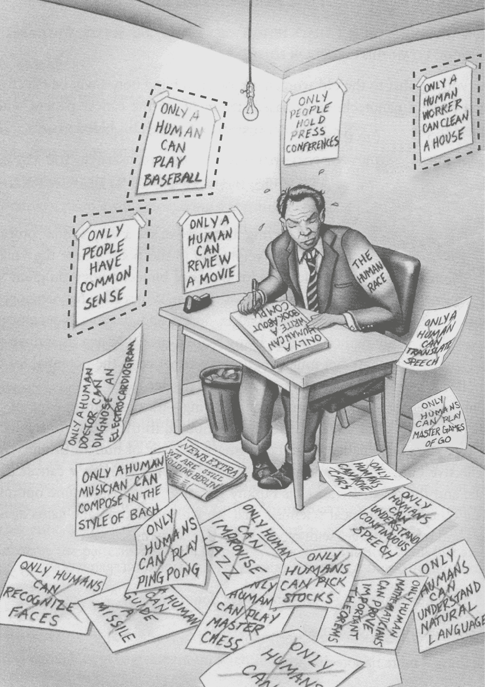

这幅漫画展示了人工智能仍然需要掌握的剩余认知任务。地板上的标志显示了人工智能已经完成的任务。墙上用虚线框起来的标志是目前正在处理的任务。

尽管有些人反对使用图灵测试作为衡量机器中人类水平认知能力的指标，但我相信，真正通过图灵测试的演示对于观察者来说将是一种引人入胜的体验，并且它将使公众相信这是一种真正的智能，而不仅仅是模仿。正如图灵在 1950 年所说：“机器难道不能进行一些应该被描述为思考的事情，但与人所做的事情非常不同吗？……\[如果\]尽管如此，一台机器可以被构建成令人满意地玩模仿游戏，我们就不必为这个反对意见而烦恼。”[\[163\]](#18_Notes.xhtml#EndnoteNumber165 "note")

应该注意的是，一旦人工智能确实通过了这种强版本的图灵测试，它实际上将在每一个可以通过语言表达的认知测试中超越人类。[\[164\]](#18_Notes.xhtml#EndnoteNumber166 "note")人工智能在这些领域的任何缺陷都可能通过测试暴露出来。当然，这需要聪明的评委和敏锐的人类陪衬。模仿一个喝醉、困倦或不熟悉这种语言的人是不算的。[\[165\]](#18_Notes.xhtml#EndnoteNumber167 "note")同样，如果人工智能欺骗了不了解如何探测其能力的评委，也不能认为它通过了有效的测试。

图灵说，他的测试可以用来评估人工智能在“我们希望包括的几乎任何人类努力领域”中的能力。因此，一位聪明的人类考官可能会要求人工智能解释一个复杂的社会情境，从科学数据中得出推论，并编写一个有趣的喜剧场景。因此，图灵测试不仅仅是理解人类语言本身，而是关于我们通过语言表达的认知能力。当然，一个成功的人工智能也必须避免显得超人。如果应试者可以立即回答任何琐事问题，快速确定庞大数字是否为素数，并流利地说一百种语言，那么很明显它不是一个真正的人。

此外，达到这一水平的人工智能也将已经具备许多*非常*在记忆力和认知速度方面，超越人类。想象一下一个系统的认知能力，它具有人类水平的阅读理解能力，但同时又能完美回忆起每篇维基百科文章和所有已发表的科学研究。今天，人工智能仍然有限的有效理解语言的能力，成为了其整体知识的瓶颈。相比之下，人类知识的主要限制在于我们相对较慢的阅读能力、有限的记忆力，以及最终短暂的寿命。计算机处理数据的速度已经比人类快得惊人——如果人类平均需要六个小时才能读完一本书，那么谷歌的 Talk to Books 的速度大约快了 50 亿倍[\[166\]](#18_Notes.xhtml#EndnoteNumber168 "note")——并且可以拥有实际上无限的数据存储容量。

加速信息处理演变的范式

| 纪元 || 媒介 || 时间尺度 |

| --- | --- | --- |

| 第一 || 无生命物质 || 数十亿年*（非生物原子和化学合成）* |

| --- | --- | --- |

| 第二 || RNA 和 DNA || 数百万年*（直到自然选择引入新的行为）* |

| 第三 || 小脑 || 数千年到数百万年*（通过进化来增加复杂的技能）* |

| 数小时到数年*（用于非常基础的学习）* |

| 第四 || 新皮层 || 数小时到数周*（掌握复杂的新技能）* |

| 数字神经网络 || 数小时到数天*（以超人的水平掌握复杂的新技能）* |

| 第五 || 脑机接口 || 数秒到数分钟*（探索当今人类无法想象的想法）* |

| 第六 || 计算素 || < 秒*（为了不断地将认知重新配置到物理定律允许的极限）* |

当人工智能的语言理解能力赶上人类水平时，这不仅仅是知识的渐进式增长，而是知识的突然爆发。这意味着人工智能要通过传统的图灵测试实际上必须降低自己的智力！因此，对于不需要模仿人类的任务，比如解决医学、化学和工程学中的现实问题，图灵级别的人工智能已经能够取得非常超人的成果。

为了理解接下来会发生什么，我们可以参考前一章中描述的六个时代，总结在“信息处理演进的加速范式”表中此页面.

## 将新皮层扩展到云端

到目前为止，已经有一些适度的努力尝试使用电子设备与大脑进行通信，无论是在颅内还是颅外。非侵入性选择面临着空间和时间分辨率之间的根本权衡——也就是说，它们在空间和时间上测量大脑活动有多精确。功能性磁共振成像扫描（fMRI）测量大脑中的血流，以此作为神经元放电的替代指标。[\[167\]](#18_Notes.xhtml#EndnoteNumber169 "note")当大脑的某个特定部分更加活跃时，它会消耗更多的葡萄糖和氧气，需要含氧血液的流入。这可以检测到分辨率高达立方“体素”，边长约为 0.7 至 0.8 毫米——足够小，可以获得非常有用的数据。[\[168\]](#18_Notes.xhtml#EndnoteNumber170 "note")然而，由于实际的大脑活动和血流之间存在滞后，大脑活动通常只能在几秒钟内测量到——并且很少能优于 400 到 800 毫秒。[\[169\]](#18_Notes.xhtml#EndnoteNumber171 "note")

脑电图（EEG）则存在相反的问题。它们直接检测大脑的电活动，因此可以将信号精确到大约一毫秒内。[\[170\]](#18_Notes.xhtml#EndnoteNumber172 "note")但是由于这些信号是从颅外检测到的，因此很难精确地确定它们来自哪里，从而产生 6 到 8 立方厘米的空间分辨率，有时可以提高到 1 到 3 立方厘米。[\[171\]](#18_Notes.xhtml#EndnoteNumber173 "note")

截至 2023 年，脑部扫描中空间分辨率和时间分辨率之间的权衡是神经科学面临的主要挑战之一。这些限制分别源于血流和电的基本物理原理，因此，即使我们可能看到人工智能和改进的传感器技术带来边际改进，它们可能也不足以实现复杂的脑机接口。

使用电极进入大脑可以避免空间-时间上的权衡，并且使我们不仅可以直接记录单个神经元的活动，还可以刺激它们——双向通信。但是，以目前的技术将电极植入大脑需要在大脑中开孔，并可能损害神经结构。因此，这些方法到目前为止主要集中在帮助听力丧失或瘫痪等残疾人士，因为对他们来说，益处大于风险。例如，脑机接口系统（BrainGate system）使肌萎缩侧索硬化症（ALS）或脊髓损伤患者仅凭意念就能操作电脑光标或机械臂。[\[172\]](#18_Notes.xhtml#EndnoteNumber174 "note")然而，由于这种辅助技术一次只能连接到相当少数量的神经元，因此它无法处理像语言这样高度复杂的信号。

拥有一项意念转文字技术将是变革性的，这促使研究旨在完善一种脑电波-语言翻译器。2020 年，Facebook 赞助的研究人员为测试对象安装了 250 个外部电极，并使用强大的人工智能将他们的皮层活动与口语样本句子中的单词相关联。[\[173\]](#18_Notes.xhtml#EndnoteNumber175 "note")由此，在 250 个单词的样本词汇中，他们可以预测受试者正在思考的单词，误差率低至 3%。这是一个令人兴奋的进展，但 Facebook 在 2021 年停止了这个项目。[\[174\]](#18_Notes.xhtml#EndnoteNumber176 "note")而且，这种方法在多大程度上能够扩展到更大的词汇量（以及因此更复杂的信号），因为它与空间-时间分辨率的权衡相冲突，还有待观察。无论如何，为了扩展新皮层本身，我们仍然需要掌握与大量神经元的双向通信。

为了扩展到更多神经元，最雄心勃勃的努力之一是埃隆·马斯克（Elon Musk）的 Neuralink，它同时植入大量线状电极。[\[175\]](#18_Notes.xhtml#EndnoteNumber177 "note")一项在实验鼠身上的测试表明，读出电极的数量为 1500 个，而其他项目中使用的电极数量为数百个。[\[176\]](#18_Notes.xhtml#EndnoteNumber178 "note")后来，一只植入了该设备的猴子能够用它来玩电子游戏*Pong*.[\[177\]](#18_Notes.xhtml#EndnoteNumber179 "note")在经历了一段时间的监管挑战后，Neuralink 获得了 FDA 的批准，于 2023 年开始人体试验，并且就在本书付梓之际，在人体内植入了首个 1024 电极设备。[\[178\]](#18_Notes.xhtml#EndnoteNumber180 "note")

与此同时，美国国防高级研究计划局（DARPA）正在进行一项名为神经工程系统设计的长期项目，该项目旨在创建一个可以连接一百万个神经元进行记录，并可以刺激十万个神经元的接口。[\[179\]](#18_Notes.xhtml#EndnoteNumber181 "note")该机构已经资助了几个不同的研究项目来实现这一目标，例如布朗大学的一个团队正在努力创造沙粒大小的“神经颗粒”，可以植入大脑，与神经元相互连接，创建一个“皮层内网”。[\[180\]](#18_Notes.xhtml#EndnoteNumber182 "note")

最终，脑机接口本质上将是非侵入性的——这可能需要将无害的纳米级电极通过血液插入大脑。

那么我们需要多少计算量来进行记录呢？如前所述，模拟人脑所需的总计算量可能在 10 左右¹⁴每秒运算次数或更少。请注意，这是基于人脑真实架构的模拟，能够通过图灵测试，并且在所有其他方面，在外部观察者看来都像是人脑。但这不一定包括大脑中不需要产生这种可观察行为的许多活动。例如，非常令人怀疑的是，神经元细胞核内的 DNA 修复等细胞内细节与认知相关。

但即使是 10¹⁴大脑中每秒都在进行着多次运算，脑机接口不需要考虑这些计算的大部分，因为它们是发生在顶层新皮层之下的初步活动。[\[181\]](#18_Notes.xhtml#EndnoteNumber183 "note")相反，我们只需要与其较高范围进行通信。而且我们可以完全忽略诸如调节消化等非认知大脑过程。因此，我估计一个实用的接口只需要数百万到数千万个并发连接。

要达到这样的数量，就需要缩小接口技术，使其变得越来越小——我们将越来越多地使用先进的人工智能来解决由此带来的艰巨的工程和神经科学问题。在 2030 年代的某个时候，我们将使用一种叫做纳米机器人的微型设备来实现这个目标。这些微小的电子设备将我们大脑新皮层的顶层连接到云端，使我们的神经元能够直接与在线托管的模拟神经元进行通信。[\[182\]](#18_Notes.xhtml#EndnoteNumber184 "note")这不需要某种科幻式的大脑手术——我们将能够通过毛细血管以非侵入性的方式将纳米机器人送入大脑。这样，人类大脑的尺寸就不会再受到通过产道的限制，而是可以无限扩展。也就是说，一旦我们添加了第一层虚拟新皮层，这不会是一锤子买卖——更多的层可以堆叠在这一层之上（从计算的角度来说），以实现更复杂的认知。随着本世纪的进展，计算的性价比持续呈指数级提高，我们大脑可用的计算能力也将如此。

还记得两百万年前发生的事情吗？上次我们获得更多新皮层的时候？我们变成了人类。当我们能够访问云端额外的皮层时，认知抽象的飞跃可能也会类似。结果将是发明出比当今艺术和技术更加丰富的表达方式——比我们目前所能想象的更加深刻。

想象未来艺术表达方式会是什么样，这本身就存在局限性。但通过类比上次的新皮层革命来思考可能会很有用。试着想象一下，对于一只猴子——一种大脑与我们非常相似的高智商动物——来说，看电影会是什么感觉。猴子并非完全无法理解电影中的情节。例如，它能够认出屏幕上有人在说话。但猴子不会理解对话，也无法解读抽象的概念，比如“角色穿着金属服装这一事实表明，故事被想象成发生在中古世纪”。[\[183\]](#18_Notes.xhtml#EndnoteNumber185 "note")这就是人类前额叶皮层所允许的那种飞跃。

因此，当我们想到为拥有云连接新皮层的人们创作的艺术时，这不仅仅是更好的 CGI 效果，甚至不仅仅是调动味觉和嗅觉等感官。而是大脑本身处理体验方式的全新可能性。例如，演员现在只能通过他们的语言和外部肢体表达来传达他们角色的想法。但我们最终可能会拥有这样的艺术，将角色原始、无组织、非语言的想法——以其所有无法表达的美丽和复杂性——直接放入我们的大脑中。这就是脑机接口将为我们带来的文化丰富性。

这将是一个共同创造的过程——进化我们的思想以解锁更深刻的洞察力，并利用这些力量为我们未来的思想创造卓越的新想法以供探索。最终，我们将能够访问我们自己的源代码，使用能够重新设计自身的人工智能。由于这项技术将让我们与我们正在创造的超级智能融合，我们将从本质上重塑自己。从我们头骨的封闭中解放出来，并在比生物组织快数百万倍的基质上进行处理，我们的思想将被赋予指数级增长的力量，最终将我们的智力扩展数百万倍。这就是我对奇点的定义。

# 第三章：我是谁？

## 我是谁？

### 什么是意识？

图灵测试和其他评估可以揭示很多关于作为一个普通人意味着什么，但奇点技术也迫使我们询问作为一个*特别*人类。哪里是*雷·库兹韦尔*如何将所有这些融入其中？现在，你可能不太关心雷·库兹韦尔；你关心的是你自己，所以你可以对你自己的身份提出同样的问题。但对我来说，为什么雷·库兹韦尔是我体验的中心？为什么我是这个特定的人？为什么我不是在 1903 年或 2003 年出生的？为什么我是男性甚至是人类？没有科学的理由说明必须如此。当我们想知道“我是谁？”时，我们问的是一个根本的哲学问题。这是一个关于意识的问题。

在*如何创造一个心灵*，我引用了塞缪尔·巴特勒的话：

> 当一只苍蝇落在花朵上时，花瓣会合拢并紧紧抓住它，直到植物将昆虫吸收到其系统中；但它们只会合拢那些可以吃的东西；对于一滴雨或一根树枝，它们不会注意。奇怪！如此没有意识的东西竟然对自己的利益如此敏锐。如果这是无意识，那么意识有什么用呢？[\[1\]](#18_Notes.xhtml#EndnoteNumber186 "note")

巴特勒在 1871 年写下了这段话。[\[2\]](#18_Notes.xhtml#EndnoteNumber187 "note")我们是否应该从他的观察中得出结论，植物确实有意识？或者这种特定的植物有意识？我们如何才能知道？我们有信心地说另一个人是有意识的，因为他或她的沟通和决策能力与我们自己相似。但即使这在技术上只是一种假设。我们无法直接检测到意识或缺乏意识。

## 意识

但是什么*是*意识？人们经常使用“意识”这个词来指代两个不同但相关的概念。其中一个指的是有意识地感知周围环境并表现得好像意识到自己的内在想法和一个与它们不同的外部世界的功能能力。例如，根据这个定义，我们可能会说，一个深度睡眠的人没有意识，一个醉酒的人部分有意识，而一个清醒的人完全有意识。除了像“闭锁综合征”这样的罕见情况外，通常可以从外部判断另一个人的意识水平。甚至动物的某些行为，比如在镜子里认出自己，也可以揭示这种意识。但是，当涉及到像本章中讨论的个人身份问题时，第二个含义更为相关：*在头脑中拥有主观体验的能力*—而不仅仅是给出这样做的外在表现。哲学家称这种体验为“感觉”。所以，当我说我们无法直接检测到意识时，我的意思是，一个人的感觉无法从外部检测到。

然而，尽管意识无法验证，但也不能简单地被忽视。如果我们审视我们道德体系的基础，我们会意识到我们的伦理判断通常取决于我们对意识的评估。我们认为物质对象，无论多么复杂、有趣或有价值，其重要性都仅在于它们对有意识生物的意识体验产生的影响。例如，关于动物权利的整个辩论，都取决于我们相信它们在多大程度上是有意识的，以及那种意识体验的本质是什么。[\[3\]](#18_Notes.xhtml#EndnoteNumber188 "note")

意识给哲学家们提出了一个问题。诸如什么样的生物拥有权利之类的伦理问题，通常取决于我们的直觉关于这些实体是否具有主观体验。但是因为我们无法从外部检测到这些，所以我们使用意识的另一种功能性意义作为替代。这通过类比借鉴了我们自己的经验。我们每个人（我只能假设！）在内心都有主观体验，并且我们知道我们也有那种可以被他人观察到的功能性自我意识。因此，我们假设当其他人表现出功能性意识时，他们也一定有内在的主观体验。即使是那些认为主观意识与经验性思维无关的科学家，仍然会像对待周围的人一样，意识到他们的体验，从而表现得好像他们是有意识的。

然而，尽管我们很容易将意识的推定扩展到我们的人类同胞，但我们对其他动物的直觉会随着它们的行为与我们自己的行为差异越大而减弱。虽然狗和黑猩猩没有完全达到人类水平的认知能力，但它们复杂而情绪化的行为在大多数人看来，似乎一定与内在的主观体验相匹配。啮齿动物呢？它们确实表现出一些类似人类的行为，例如社交玩耍和表现出对危险的恐惧。[\[4\]](#18_Notes.xhtml#EndnoteNumber189 "note")较少比例的人认为啮齿动物是有意识的，并且通常认为它们的主观体验比人类浅得多。昆虫呢？[\[5\]](#18_Notes.xhtml#EndnoteNumber190 "note")果蝇并不完全会背诵莎士比亚，但它们确实会根据环境做出反应，并且拥有由大约 25 万个神经元组成的大脑。蟑螂大约有 100 万个。但这仅相当于人类大脑神经元数量的 0.001％，因此，像我们自己一样，它们用于构建复杂和分层网络的空间要小得多。变形虫呢？这些单细胞生物没有表现出任何类似于人类和高等动物的功能性意识。即便如此，在二十一世纪，科学家们对即使是非常原始的生命形式如何表现出基本的智能形式（例如记忆）有了更好的理解。[\[6\]](#18_Notes.xhtml#EndnoteNumber191 "note")

在某种意义上，意识是二元的——一个生物是否体验到任何感觉？——但我在这里指的是额外的程度问题。想象一下，如果你正在经历一个模糊的梦，或者醒着但喝醉了或昏昏欲睡，或者完全清醒，你自己的主观意识水平会有什么不同。这就是研究人员在评估动物意识时所思考的连续统一体。专家的意见正在转变，倾向于认为更多的动物比过去认为的拥有更多的意识。2012 年，一个多学科的科学家小组在剑桥大学会面，以评估非人类动物意识的证据。这次会议促成了《剑桥意识宣言》的签署，该宣言肯定了意识并非人类独有的现象的可能性。根据该宣言，“新皮层的缺失似乎并不排除生物体验情感状态的可能性。”[\[7\]](#18_Notes.xhtml#EndnoteNumber192 "note")签署者确定了“产生意识的神经基质”存在于“所有哺乳动物和鸟类，以及包括章鱼在内的许多其他生物中”。[\[8\]](#18_Notes.xhtml#EndnoteNumber193 "note")

因此，科学告诉我们，复杂的大脑会产生功能性意识。但是是什么导致我们拥有主观意识呢？有些人说是上帝。另一些人认为意识是纯粹物理过程的产物。但是，无论意识的起源如何，精神与世俗的分歧双方都同意，它在某种程度上是神圣的。人们（以及至少一些其他动物）如何变得有意识只是一个因果论证，无论是通过仁慈的神性还是无定向的自然。然而，最终的结果是不容争辩的——任何不承认孩子的意识和遭受痛苦的能力的人都被认为是严重不道德的。

然而，主观意识背后的原因很快将不仅仅是哲学思辨的主题。随着技术赋予我们超越生物大脑扩展意识的能力，我们将需要决定我们认为是什么产生了我们身份核心的感受质，并专注于保护它。由于可观察的行为是我们推断主观意识的唯一可用代理，我们的自然直觉与最科学上合理的解释非常吻合：即，能够支持更复杂行为的大脑同样会产生更复杂的主观意识。正如前一章所讨论的，复杂的行为源于大脑中信息处理的复杂性[\[9\]](#18_Notes.xhtml#EndnoteNumber194 "note")—而这又很大程度上取决于它能多灵活地表示信息，以及它的网络中有多少层级。

这对人类的未来有着深远的影响——如果你能活到未来几十年，对你个人也是如此。记住：有记录的历史中所有的智力飞跃都发生在结构上与石器时代以来保持不变的大脑中。外部技术现在使我们每个人都能获得我们物种中其他人所做的大部分发现，但我们以类似于新石器时代祖先的意识水平来体验它们。然而，当我们在 2030 年代和 2040 年代能够增强新皮层本身时，我们不仅会增加抽象的问题解决能力，还会加深我们主观意识本身。

## 僵尸、感受质与意识的难题

关于意识，有些根本性的东西是不可能与他人分享的。当我们把某些频率的光标记为“绿色”或“红色”时，我们无法判断我的感觉——我的*体验*绿色和红色——是否和你的相同。也许我体验绿色的方式和你体验红色的一样，反之亦然。然而，我们没有办法使用语言或任何其他交流方式直接比较我们的感觉。[\[10\]](#18_Notes.xhtml#EndnoteNumber195 "note")事实上，即使当直接连接两个大脑成为可能时，也无法证明相同的神经信号是否会为你触发与我相同的感觉。所以，如果我们的红/绿感觉真的彼此颠倒了，我们将永远不会意识到这一点。

正如我在*如何创造一个心灵*中指出的，这种认识也引出了一个更令人不安的思想实验。如果一个人根本没有感觉呢？哲学家大卫·查尔默斯（David Chalmers，生于 1966 年）将这种假设的存在称为“僵尸”——这些人表现出所有可检测到的神经以及意识的行为相关性，但没有任何主观体验。[\[11\]](#18_Notes.xhtml#EndnoteNumber196 "note")科学永远无法区分僵尸和正常人类。

突出我们关于功能性意识与主观意识的差异的一种方式是考虑一只狗与一个假设的人工人类，如果我们能确定它没有主观体验（即，一个“僵尸”）。即使僵尸可以表现出比狗更复杂的认知能力，但大多数人可能会说，伤害狗——我们认为它具有主观意识——比伤害僵尸更糟糕，僵尸可能会因疼痛而尖叫，但我们知道它实际上并没有感觉到任何东西。问题在于现实生活中，*即使在原则上*，也没有办法科学地确定另一个生物是否具有主观意识。

如果这样的僵尸至少在理论上是可能的，那么在感觉和物理系统（即大脑或计算机）之间必然没有必要的因果联系，这些物理系统进行信息处理，从而在表面上给人以意识的印象。这正是某些宗教观点对灵魂的看法——灵魂是一种明显独立于身体的超自然实体。这种推测将超出科学的范围。但是，如果认知背后的物理系统必然也会产生意识——使僵尸成为不可能——那么科学也没有连贯的方法来证明这一点。主观意识在性质上与可观察的物理定律领域不同，并且根据这些定律的特定信息处理模式根本不会产生有意识的体验。查尔默斯称之为“意识的难题”。他的“简单问题”，例如当我们不醒来时我们的思想会发生什么，是所有科学中最困难的问题之一，但至少它们可以进行科学研究。[\[12\]](#18_Notes.xhtml#EndnoteNumber197 "note")

对于这个难题，查尔默斯转向了一个他称之为“泛原型心理主义”的哲学思想。[\[13\]](#18_Notes.xhtml#EndnoteNumber198 "note")泛原型心理主义将意识视为宇宙的一种基本力量——一种不能简单地还原为其他物理力量的影响的力量。人们可以想象一种包含意识潜力的通用场。在我所持有的对这种观点的解释中，正是大脑中发现的那种信息处理复杂性“唤醒”了那种力量，使其成为我们所认识的那种主观体验。因此，无论大脑是由碳还是硅制成的，使其能够给出意识外在迹象的复杂性也赋予了它主观的内在生命。

虽然我们永远无法科学地证明这一点，但将存在一种强大的伦理要求，要求我们表现得好像它是真的。换句话说，如果你虐待的实体有可能是有意识的，那么最安全的道德选择是假设它是有意识的，而不是冒着折磨一个有知觉的生物的风险。也就是说，我们应该表现得好像僵尸是不可能的。

因此，从泛原型心理主义的观点来看，图灵测试不仅可以用来建立人类水平的功能能力，而且还可以为证明主观意识以及由此产生的道德权利提供强有力的证据。虽然有意识的人工智能的法律含义是深远的，但我怀疑我们的政治制度能否足够快地适应，以便在第一个图灵水平的人工智能开发出来之前，将这些权利写入法律。因此，最初将由开发它们的人来制定可以限制滥用的伦理框架。

除了假设表面上具有意识的生物拥有意识的伦理原因之外，还有充分的理论理由相信泛原型心理主义是意识的准确因果解释。它在二元论和物理主义（或唯物主义）之间取得了中间立场，长期以来，这两者一直是主要的思想流派。二元论认为，意识产生于与普通“死的”物质完全不同的某种物质。许多二元论者将其定义为灵魂。从科学的角度来看，这存在一个问题，即即使我们承认超自然的灵魂可能存在，我们仍然缺乏一个有希望的理论来解释它如何影响可观察世界中的物质（例如，我们大脑中的神经元）。[\[14\]](#18_Notes.xhtml#EndnoteNumber199 "note")相反的观点，物理主义，认为意识一定完全来自于我们大脑中普通物理物质的某些排列。然而，即使这种观点能够完美地描述“意识是如何运作的（即，以类似于计算机科学解释人工智能的方式来解释人类智能），它无法对意识中固有的、科学无法触及的主观维度提供任何解释。泛原心论在这两种对立的观点之间取得了有益的平衡。

## 决定论、涌现与自由意志困境

一个与意识密切相关的概念是我们的自由意志感。[\[15\]](#18_Notes.xhtml#EndnoteNumber200 "note")如果你问街上的普通人他们如何理解这个术语，他们的回答可能包括他们必须能够控制自己的行为。我们的政治和司法系统是建立在每个人都拥有大致这种意义上的自由意志的原则之上的。

但当哲学家们寻求更精确的定义时，对于这个术语的实际含义却鲜有共识。许多哲学家认为，自由意志的存在要求未来不是预先决定的。[\[16\]](#18_Notes.xhtml#EndnoteNumber201 "note")毕竟，如果未来会发生什么已经确定，那么我们的意志怎么可能在任何有意义的层面上是自由的呢？然而，如果“自由意志”仅仅意味着你的行为可以归结为量子层面上完全随机的过程，那么这就没有给我们大多数人认为的真正自由意志留下任何空间。正如英国哲学家西蒙·布莱克本所说，“机会和必然性一样无情”，似乎都排除了自由意志。[\[17\]](#18_Notes.xhtml#EndnoteNumber202 "note")相反，一个有意义的自由意志概念必须以某种方式综合决定论和非决定论的哲学思想——避免僵化的可预测性，同时避免演变成随机性。

物理学家和计算机科学家斯蒂芬·沃尔夫勒姆（生于 1959 年）的研究为我们提供了一条介于这些极端之间的富有洞见的道路。他的研究长期以来对我自己关于物理学和计算交叉点的思考产生了影响。在他的 2002 年著作中*A New Kind of Science（一种新的科学）*, 沃尔夫勒姆阐明了既具有确定性又具有非确定性属性的现象——被称为细胞自动机的数学对象。[\[18\]](#18_Notes.xhtml#EndnoteNumber203 "note")

元胞自动机是由“细胞”表示的简单模型，这些“细胞”根据许多可能的规则集在状态之间交替（例如，黑色或白色，死亡或存活）。这些规则指定了每个细胞将如何根据附近细胞的状态来表现。这个过程在一系列离散的步骤中展开，并能产生高度复杂的行为。元胞自动机最著名的例子之一叫做康威生命游戏，它使用一个二维网格。[\[19\]](#18_Notes.xhtml#EndnoteNumber204 "note")爱好者和数学家们已经发现了许多有趣的形状，这些形状根据生命游戏的规则形成了可预测的演变模式。生命游戏甚至可以用来复制一台功能正常的计算机，或者模拟软件来运行和显示它自己的另一个版本！

沃尔夫勒姆的理论始于非常基本的自动机——一维线上的单元格，在其下方，根据一组规则和前一行中单元格的状态，依次添加新行。

通过广泛的分析，沃尔夫勒姆指出，对于某些规则集，无论考虑多少步骤，如果不经过每个中间迭代，就无法预测未来的状态。[\[20\]](#18_Notes.xhtml#EndnoteNumber205 "note")没有总结结果的捷径。

最简单的规则类型是规则类 1。这种类型的一个例子是规则 222：[\[21\]](#18_Notes.xhtml#EndnoteNumber206 "note")

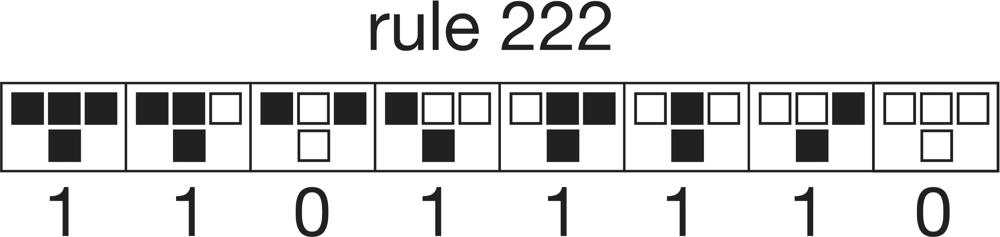

对于每个单元格，在其前一步骤中，与其相邻的三个单元格可能存在八种状态组合（此处显示在顶行）。该规则指定了这些组合中的每一种在下一步骤中导致的状态（底行）。黑色和白色也可以分别表示为 1 和 0。

如果我们从一个单一的中心黑色单元格开始，并通过应用规则 222 计算单元格的进程通过应用规则 222，我们得到了这个结果：[\[22\]](#18_Notes.xhtml#EndnoteNumber207 "note")

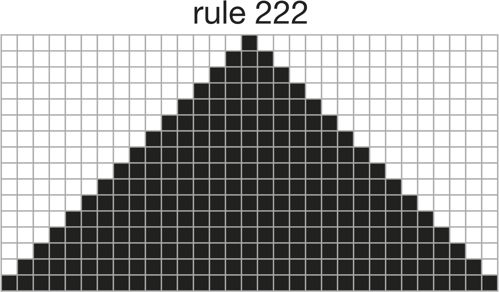

所以我们可以看到，规则 222 产生了一个非常可预测的模式。如果我问规则 222 中的第一百万个单元格——或者第一百万个单元格到第一百万个单元格——是什么，你可以直接回答“黑色”。这就是大多数科学“应该”运作的方式：通过应用确定性规则来辨别可预测的结果。

但是规则类 1 只是规则的一种类型。在沃尔夫勒姆的理论中，自然界的大部分可以用四个不同的类来解释，这些类通过它们产生的结果类型来区分。类 2 和类 3 有些有趣，因为它们产生了越来越复杂的“黑色”和“白色”单元格排列，但最引人入胜的是类 4，以规则 110 为例：[\[23\]](#18_Notes.xhtml#EndnoteNumber208 "note")

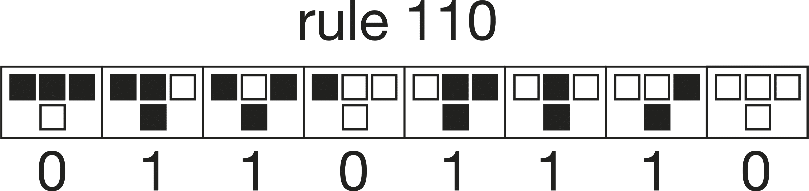

如果我从一个黑色的起始单元格开始遵循这个规则，结果是：

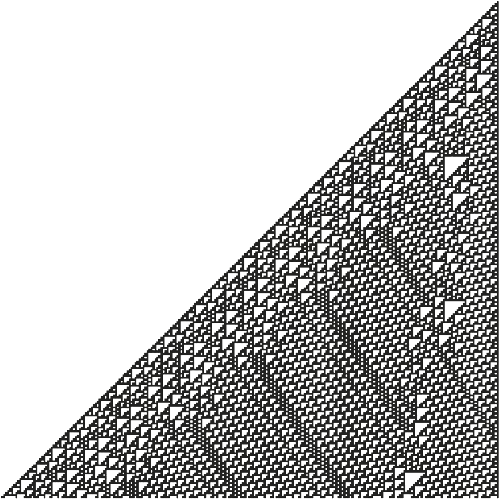

如果我们继续迭代，我们会得到这样的图像：[\[24\]](#18_Notes.xhtml#EndnoteNumber209 "note")

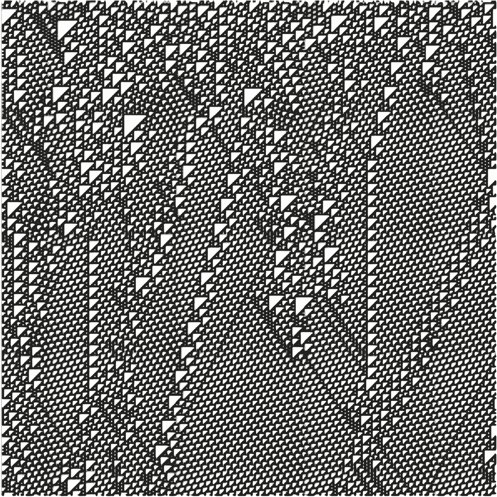

这里的重点是*没有办法*来确定第 1000 行是什么，或者第 100 万行是什么，除了逐个计算它们。[\[25\]](#18_Notes.xhtml#EndnoteNumber210 "note")这意味着基于 4 类属性的系统——就像我们自己的宇宙，Wolfram 认为——拥有不可简化的复杂性，这种复杂性挑战了旧的、还原论的决定论版本。虽然这种复杂性产生于确定性编程，但在一个关键的意义上，编程并不能完全解释它的丰富性。

对单个细胞进行统计抽样会使它们的状态看起来本质上是随机的，但我们可以看到，每个细胞的状态都是由前一步确定性地产生的——而由此产生的宏观图像显示出规则和不规则行为的混合。这证明了一种叫做涌现的特性。[\[26\]](#18_Notes.xhtml#EndnoteNumber211 "note")本质上，涌现是非常简单的东西，集体地，产生了更复杂的东西。自然界中的分形结构，如每根生长树枝的扭曲路径，斑马和老虎的条纹皮毛，软体动物的贝壳，以及生物学中无数的其他特征，都表现出 4 类编码。[\[27\]](#18_Notes.xhtml#EndnoteNumber212 "note")我们居住在一个深受这种细胞自动机模式影响的世界中——一种非常简单的算法，产生高度复杂的行为，跨越了秩序和混乱之间的边界。

正是我们身上的这种复杂性可能会产生意识和自由意志。无论你将你的自由意志的底层编程归因于上帝，还是泛原型心理主义，还是其他什么，*你*不仅仅是程序本身。

但这并非巧合，这些规则会产生意识和如此广泛的其他自然现象。沃尔夫勒姆有力地论证说，物理定律本身就源于与元胞自动机相关的某种计算规则。2020 年，他宣布了沃尔夫勒姆物理项目——一项雄心勃勃的持续努力，旨在通过类似于元胞自动机但更通用的模型来理解所有物理学。[\[28\]](#18_Notes.xhtml#EndnoteNumber213 "note")

这将允许在经典决定论和量子不确定论之间达成某种妥协。虽然宏观世界的一些部分可以用算法捷径来近似——比如，预测一颗卫星在一百万个轨道后的位置——但在最基本的尺度上并非如此。如果现实是基于像第 4 类规则这样的原则，那么我们就可以用决定论来解释量子尺度的表面随机性，但不会有任何概括算法可以“提前看”并预测未来某个时刻整个宇宙的精确状态。[\[29\]](#18_Notes.xhtml#EndnoteNumber214 "note")这仍然是推测性的，因为我们还不清楚完整的规则集是什么。也许未来的“万物理论”会将所有这些统一成一个连贯的解释，但我们还没有达到那个程度。

由于有效的预测是不可能的，那就只剩下模拟了，但宇宙不可能包含一台足够大的计算机来模拟自身。换句话说，如果不让现实真正向前发展，就没有办法展开现实。

在本章的后面，我将讨论将意识从我们的生物大脑转移到非生物计算机的未来可能性。这提出了一个重要的澄清点。虽然最终有可能以数字方式模拟大脑的运作，但这与以确定性的方式预先计算它不同。这是因为大脑（无论是否是生物的）都不是封闭的系统。大脑从外部世界获取输入，然后通过惊人复杂的网络来操纵它——事实上，科学家们最近在大脑中发现了存在于多达 11 个维度的网络！[\[30\]](#18_Notes.xhtml#EndnoteNumber215 "note")这种复杂性可能利用了 110 规则式的现象，对于这些现象，如果不按顺序模拟每个步骤，就无法在计算上“提前窥视”。而且由于大脑是开放系统，因此不可能将未知的未来输入纳入逐步模拟中。因此，能够复制大脑的功能并不意味着能够预先计算其未来状态。这可能就是宇宙存在的一个很好的理由。

换句话说，如果一个宇宙的规则是基于像元胞自动机这样的东西，那么表达它们的唯一方式就是通过一步一步的展开——通过现实的实际发生。相比之下，如果一个宇宙的规则是确定性的，但没有像自动机那样的涌现，或者仅仅是基于随机性，那么现实不一定需要我们实际观察到的逐步展开。此外，如果意识只能从第 4 类自动机的秩序与混沌的复杂性中产生，这可以被视为一个哲学论证，解释了为什么*我们*存在——如果没有这些规则，我们就不会在这里思考这个问题。

这为“相容论”打开了大门——该观点认为，一个决定论的世界仍然可以是一个拥有自由意志的世界。[\[31\]](#18_Notes.xhtml#EndnoteNumber216 "note")我们可以做出自由的决定（也就是说，不是由其他事物引起的，比如另一个人），即使我们的决定是由潜在的现实法则决定的。一个被决定的世界意味着我们理论上可以向前或向后看时间，因为一切都在任何一个方向上被决定。但在 110 规则风格的规则下，我们完美地向前看的唯一方法是通过所有实际展开的步骤。因此，通过泛原型心理主义的视角来看，我们大脑中涌现的过程并没有控制我们；它们*是*我们。我们从更深层的力量中产生，但我们的选择无法提前得知——因此，只要产生我们意识的过程能够通过我们在世界上的行动来表达，我们就有自由意志。[\[32\]](#18_Notes.xhtml#EndnoteNumber217 "note")

## 每个人类拥有多个大脑的自由意志困境

如果我们看看人类在电影和小说中如何描绘机器人，似乎我们隐式地分享了一种泛原型心理主义的想象——如果一个人工智能的行为看起来像人类，即使它的认知不是基于生物神经元，我们也会支持它，就好像它是一个主观意识的存在。

但正如一个人工智能可能由许多独立的算法组成一样，越来越多的医学证据表明，人类大脑有多个不同的决策单元。考虑一下我们两个（左脑和右脑）大脑所做的所有实验，这些实验表明它们在很大程度上是相等和独立的。[\[33\]](#18_Notes.xhtml#EndnoteNumber218 "note")研究人员斯特拉·德·博德和苏珊·柯蒂斯研究了 49 名儿童，他们为了预防危及生命的癫痫发作而切除了他们大脑的一半。[\[34\]](#18_Notes.xhtml#EndnoteNumber219 "note")这些孩子中的大多数随后功能正常，即使是那些继续患有特定疾病的孩子，仍然具有相当正常的人格。虽然我们通常主要在左侧发展语言，但两半在功能上可以是等效的，并且具有左脑或右脑的人都可以掌握语言。[\[35\]](#18_Notes.xhtml#EndnoteNumber220 "note")

也许最引人注目的是一个左右半球都完好无损但有 2 亿根轴突的大脑[\[36\]](#18_Notes.xhtml#EndnoteNumber221 "note")它们之间——胼胝体——由于医疗问题而被切断。迈克尔·加扎尼加（Michael Gazzaniga，生于 1939 年）研究了这些案例，在这些案例中，两个大脑都在运作，但彼此之间没有沟通的手段。[\[37\]](#18_Notes.xhtml#EndnoteNumber222 "note")通过一系列实验，他只向患者的右脑输入一个词，他发现左半球虽然不知道这个词，但仍然对基于此信息做出的选择感到负责，即使这个选择实际上是由另一个半球做出的。[\[38\]](#18_Notes.xhtml#EndnoteNumber223 "note")因此，左脑会虚构出听起来合理的解释，说明它为什么声称自己做出了每个决定，因为它没有意识到同一个头骨里还有另一个独立的大脑。[\[39\]](#18_Notes.xhtml#EndnoteNumber224 "note")

这些以及其他涉及大脑两个半球的实验表明，一个正常人实际上可能有两个能够独立做出决定的大脑单元，但它们都属于一个有意识的身份。每个大脑都会认为这些决定是它自己做出的，而且由于两个大脑紧密地混合在一起，所以它们都会这样认为。

事实上，如果我们不仅仅关注我们两个半球的大脑，我们体内还有许多类型的决策者，它们可能拥有前面描述的那种自由意志。例如，新皮层是决策发生的地方，它由许多较小的模块组成。[\[40\]](#18_Notes.xhtml#EndnoteNumber225 "note")因此，当我们考虑一个决定时，不同的选项可能由不同的模块代表，每个模块都试图促成自己的观点。我的导师马文·明斯基（Marvin Minsky）很有先见之明，他没有把大脑看作是一个单一的、统一的决策机器，而是看作一个复杂的神经机制网络，当我们在考虑一个决定时，它的各个部分可能会偏向不同的选项。明斯基将我们的大脑描述为一个“心智社会”（他的第二本书的书名），其中包含各种更简单的过程，这些过程反映了许多不同的观点。[\[41\]](#18_Notes.xhtml#EndnoteNumber226 "note")这些中的每一个都在做出自由选择吗？我们怎么才能知道？近几十年来，有更多的实验支持这一观点——但我们对神经过程究竟如何“涌现”到我们有意识地感知到的决策中的理解仍然非常有限。

## “你 2”是有意识的。它是你吗？

所有这些都提出了一个引人深思的问题。如果意识和身份可以跨越头骨中多个不同的信息处理结构——即使是那些没有物理连接的结构——当这些结构相距更远时会发生什么？

A key issue I explored in*如何创造一个心灵*是对复制人脑中所有信息的哲学和道德影响，这在今天大多数活着的人的生命周期内都是可能实现的。

假设我使用先进技术来检查你大脑的一部分，然后制作这个小片段的精确电子副本。（实际上，今天我们已经可以用大脑的某些部分来完成一个非常原始的版本——例如，在治疗原发性震颤或帕金森病时。）[\[42\]](#18_Notes.xhtml#EndnoteNumber227 "note")就其本身而言，这一部分太简单了，不可能有意识。但假设我复制了你大脑的第二小部分——然后是另一部分，又一部分。最后，在这个过程结束时，我拥有了一个完整的计算机化的大脑复制品，其中包含所有相同的信息，并且可以以相同的方式运行。

那么这个“你 2”有意识吗？你 2 会说它和你拥有相同的经历（因为它在分享你的记忆），而且它的行为也像你一样，所以除非完全排除任何电子版本的有意识实体具有意识的可能性，那么答案将是肯定的。简单来说，如果一个电子大脑代表着与生物大脑相同的信息，并且声称自己有意识，那么就存在没有合理的科学依据来否认它的意识。因此，从伦理上讲，我们应该像对待有意识并因此拥有道德权利的个体一样对待它。然而，这并非盲目的推测——泛原心论为我们提供了充分的哲学理由来相信它实际上是有意识的。

但现在有一个更难的问题：这个 You 2 真的*你*请记住，“你”（作为一个正常的自然人）仍然存在。甚至有可能这个复制是在“你”不知情的情况下进行的，但无论如何，本质上的“你”仍在继续。如果实验成功，你 2 会表现得像你一样，但“你”根本不会被改变，所以“你”仍然是你。由于你 2 可以独立行动，它会立即与“你”分道扬镳——创造自己的记忆并对不同的经历做出反应。因此，就你的身份是你大脑中信息的特定排列而言，你 2 会*不*做你自己，即使它有意识。

好的，目前为止一切顺利。现在，在第二个实验中，我们逐渐*替换*将你大脑的每个部分都用数字副本代替——通过像前一章描述的那样的大脑-计算机接口连接到你剩余的神经元。因此，不再有“你”和你 2——只有你。在这个实验的每个阶段之后，你都对这个过程感到满意，没有人，包括你自己，会抱怨。每次替换后的新你还是*你*即使到了最后，一旦你的大脑完全数字化了？

关于身份如何与随着时间推移逐步替换物体部件相关的问题，可以追溯到大约 2500 年前首次提出的一个思想实验，称为忒修斯之船。[\[43\]](#18_Notes.xhtml#EndnoteNumber228 "note")古希腊哲学家想象一艘木船，它的木板被一块接一块地慢慢替换成新的木板。很自然地可以得出这样的结论：在第一块木板被替换后，这艘船本身仍然是原来的那艘船。它可能具有稍微不同的构成，但我们仍然将这种转变视为对原始船只的改变，而不是创造一艘新船。但是，当超过一半的木板是新的时会怎么样？或者当所有的木板都是新的，并且没有一块是建造时船的一部分时会怎么样？这变得更加复杂，但是许多人们仍然会说，这艘船的基本特性可以在这些渐进的变化中幸存下来。然而，想象一下，当新的木板被添加时，所有的旧木板都被储存在一个仓库里。现在，一旦最初的船有了 100% 的新部件，我们再把所有旧的部件从仓库里重新组装成一艘船。那么哪艘船才是最初的那艘呢？是那艘持续存在，只有渐进的变化，但没有来自最初的部件的船？还是那艘由最初的部件重新组成的船？

忒修斯之船是一个有趣的思维实验，当涉及到船只或其他“死亡”物体时，但它并没有特别高的风险。随着时间的推移，船只的身份最终是一个人类习俗的问题。然而，当问题中的物体是人类时，这个问题就具有极高的风险。对于我们大多数人来说，站在我们旁边的人是否真的是我们所爱的人，或者只是一个查尔默斯式的僵尸在进行一场令人信服的表演，这非常重要。

让我们通过主观意识的“难题”来考虑这些问题。在我们制造出作为复制品的“你 2”的情况下，不可能确定“你 2”的主观自我是否与“你”有某种联系。即使由于不同的经历，他们的信息模式随着时间的推移而不同，你最初的主观体验是否会以某种方式同时包含你的两个副本？或者“你 2”在这方面是独立的？这些都是科学上无法回答的问题。

然而，在我们将你大脑中的信息逐渐转移到非生物基质上的情况下，我们有更充分的理由相信你的主观意识会被保留下来。事实上，正如之前提到的，今天我们已经在非常有限的程度上通过某些大脑状况来实现这一点，而且新的神经假体比它所取代的部分更强大。（因此，它与它所取代的部分并不相同。）虽然早期的植入式设备，如耳蜗植入物，能够刺激大脑活动，但它们并没有取代任何核心大脑结构。[\[44\]](#18_Notes.xhtml#EndnoteNumber229 "note")但自 2000 年代初以来，科学家们一直在开发脑假体，以帮助那些大脑内部存在结构性损伤或功能障碍的人。例如，假体对于有记忆问题的患者，设备现在可以完成海马体的部分工作。[\[45\]](#18_Notes.xhtml#EndnoteNumber230 "note")截至 2023 年，这些技术仍处于起步阶段，但在这十年里，我们将看到它们变得更加成熟，并以更实惠的价格提供给更广泛的患者。然而，以今天的技术来看，一个人的核心身份无疑得到了保留，没有人会认为这些患者变成了查尔默斯式的僵尸。

我们所知的神经科学表明，在渐进式替换的情况下，你甚至不会注意到足够小的改变，而且大脑具有惊人的适应性。你的混合大脑将保留所有定义你的相同信息模式。因此，没有理由认为你的主观意识会受到损害，而且你当然会保持*你——*没有其他人可以称呼你。然而，在这个假设过程的最后，最终的你与第一个实验中的你 2*完全一样*，我们认为*不是你*。如何调和这一点？区别在于连续性——数字大脑不会与生物大脑分离，因为它们从未作为独立的实体存在过。

这引出了第三种情况，实际上这不是一个假设。每天我们自己的细胞都会经历一个非常快速的替换过程。虽然神经元通常会持续存在，但大约一半的线粒体会在一个月内更新；[\[46\]](#18_Notes.xhtml#EndnoteNumber231 "note")神经微管的半衰期为几天；[\[47\]](#18_Notes.xhtml#EndnoteNumber232 "note")为突触增加能量的蛋白质每两到五天补充一次；[\[48\]](#18_Notes.xhtml#EndnoteNumber233 "note")突触中的 NMDA 受体在几个小时内就会被替换；[\[49\]](#18_Notes.xhtml#EndnoteNumber234 "note")树突中的肌动蛋白丝持续约四十秒。[\[50\]](#18_Notes.xhtml#EndnoteNumber235 "note")因此，我们的大脑几乎在几个月内就被完全替换了，所以事实上，与不久前的你相比，你是一个生物学版本的“你 2”。同样，保持你的身份完整的是信息和功能，而不是任何特定的结构或材料。

多年来，我经常凝视我家附近美丽的查尔斯河。如果我今天看着查尔斯河，我倾向于认为它与一天前或十年前的水体相同，当时我在评论查尔斯河的连续性时*如何创造一个心灵*。这是因为即使每隔几毫秒，通过河流特定截面的所有水分子都完全不同，但这些分子会以一致的模式运动，从而定义了河流的流向。对于思想来说也是如此。当我们将非生物系统植入我们的身体和大脑时，我们信息模式的连续性会让我们每个人都觉得自己是今天的自己——除了我们的感知可能更好或认知更聪明之外。

当然，使我们能够将所有技能、个性和记忆转移到数字媒介的技术，也将使我们能够创建该信息的多个副本。这种随意复制自己的能力是数字世界中的一种超能力，在生物世界中并不存在。将我们的思维文件复制到远程备份存储系统将是对抗任何可能损害我们大脑的事故或疾病的有力保护。这并不比上传到云端的 Excel 表格更“永生”——灾难仍然可能降临到数据中心并摧毁它们。但这将使我们能够保护自己免受那些扼杀如此多生命和身份的无意义的事故。我对泛原型心理主义的解读表明，我们的主观意识可能以某种方式包含所有这些定义信息的副本。

这还有另一个诱人的含义。如果我们在世界上放出一个“你 2”——可以自由地走一条与“你”不同的道路——它的信息模式身份将会发散，但由于这将是一个渐进和持续的过程，你的主观意识有可能同时跨越两者。我怀疑，基于泛原型心理主义理论，我们的主观意识与作为身份的信息相关联，因此会以某种方式包含所有曾经与我们自身相同的信息副本。

然而，在这种情况下，由于“你 2”可能会坚持认为它与“你”（因为控制通信的物理决策结构是分开的）具有不同的主观意识，并且没有办法客观地确定真相，我们的法律和伦理体系可能不得不将两者视为独立的实体。

## 存在的难以置信的渺茫性

在理解我们的身份时，考虑到使我们每个人得以存在的非凡的、不太可能发生的事件链，这令人敬畏。不仅你的父母必须相遇并生下一个孩子，而且必须是特定的精子与特定的卵子结合，才能产生*你*. 很难估计你的父母相遇并决定生孩子的可能性，但仅仅就精子和卵子而言，你被创造出来的概率是两百万兆分之一。作为非常粗略的估计，普通男性一生中产生的精子多达两万亿个，而普通女性最初大约有一百万个卵子。[\[51\]](#18_Notes.xhtml#EndnoteNumber236 "note")因此，如果你的身份完全取决于造就你的那个精子和卵子，那么这种情况发生的几率大约是二十万亿分之一。虽然所有这些性细胞并非基因上独一无二，但年龄等诸多因素会影响表观遗传学，因此，如果你的父亲在 25 岁和 45 岁时产生了两个染色体相同的精子，它们对婴儿的形成所做的贡献并不完全相同。[\[52\]](#18_Notes.xhtml#EndnoteNumber237 "note")因此，作为一种近似，我们必须将每个精子和卵子都视为实际上是独一无二的。除此之外，类似的事件也必须发生在*双方*祖父母，以及所有的*四个*曾祖父母，以及*八个*曾曾祖父母，等等……好吧，不完全是无限的——只是到地球上生命开始的时候，大约四十亿年前。[\[53\]](#18_Notes.xhtml#EndnoteNumber238 "note")

古戈尔（googol，搜索公司名称的基础数字的正确拼写）是 1 后面跟着 100 个零。古戈尔普勒克斯（googolplex）是 1 后面跟着一个古戈尔个零。这是一个难以想象的巨大数字，但基于之前描述的粗略分析（并在尾注中进一步解释），你存在的概率是 1 除以一个由 1 后面跟着远远超过古戈尔普勒克斯个零的数字。[\[54\]](#18_Notes.xhtml#EndnoteNumber239 "note")然而你就在这里。这不是一个奇迹吗？

此外，宇宙的出现本身就具备进化复杂信息的能力，这可以说更加不可能。我们的对物理学和宇宙学的理解表明，如果物理定律中的数值只有稍微不同，宇宙将无法支持生命。[\[55\]](#18_Notes.xhtml#EndnoteNumber240 "note")换句话说，在宇宙理论上可能拥有的所有配置中，只有极小的一部分允许我们存在。我们能够量化这种明显的不可能性的最接近方法是，确定一个对生命友好的宇宙所依赖的不同因素，然后估计为了使生命不可能，这些值必须有多大的不同。

根据粒子物理学的标准模型，有三十七种基本粒子（按质量、电荷和自旋区分），它们根据四种基本力（引力、电磁力、核强力、核弱力）相互作用，以及假设的引力子，一些科学家认为引力子是引力效应的原因。[\[56\]](#18_Notes.xhtml#EndnoteNumber241 "note")这些力与粒子相互作用的强度用一系列常数来描述，这些常数定义了物理学的“规则”。物理学家们强调了许多领域，在这些领域中，对这些规则的极小改变都会阻止智能生命的形成，智能生命被认为需要复杂的化学反应以及相对稳定的环境和能量来源，以进行数亿或数十亿年的进化。生物学家中普遍的观点是，生命是通过自然发生说在地球上产生的。[\[57\]](#18_Notes.xhtml#EndnoteNumber242 "note")根据这一理论，在很长一段时间内，前体化合物的“原始汤”中的非生命物质自然结合成更复杂的、能够促进生命的蛋白质的组成部分。最终，蛋白质自发地以一种能够自我复制的模式结合在一起：生命的起源。即使是这条因果链中的一个断裂也会使人类成为不可能。

如果核强力更强或更弱，恒星就不可能形成大量的碳和氧，而生命就是由碳和氧创造的。[\[58\]](#18_Notes.xhtml#EndnoteNumber243 "note")同样，核弱力也在生命进化的最小可能量级之内。[\[59\]](#18_Notes.xhtml#EndnoteNumber244 "note")如果它比这更弱，氢会迅速转化为氦，阻止像我们自己的氢星的形成，氢星燃烧的时间足够长，足以让复杂的生命在它们的太阳系中进化。

如果上夸克和下夸克之间的质量差异稍微小一些或大一些，就会导致质子和中子不稳定，从而阻止复杂物质的形成。[\[60\]](#18_Notes.xhtml#EndnoteNumber245 "note")同样地，如果电子相对于这些差异具有稍微更大的质量，也会导致类似的失稳。[\[61\]](#18_Notes.xhtml#EndnoteNumber246 "note")根据物理学家克雷格·J·霍根的说法，“夸克质量差在任何一个方向上只有百分之几的分数变化”就会阻止生命的产生。[\[62\]](#18_Notes.xhtml#EndnoteNumber247 "note")如果夸克质量差更大，我们就会有一个“质子世界”——一个只有氢原子的替代宇宙。[\[63\]](#18_Notes.xhtml#EndnoteNumber248 "note")如果差异较小，我们就会有一个“中子世界”——一个有原子核但周围没有电子的宇宙，这使得化学反应成为不可能。[\[64\]](#18_Notes.xhtml#EndnoteNumber249 "note")

如果引力稍微弱一些，就不会有超新星，而超新星是形成生命的重元素的来源。[\[65\]](#18_Notes.xhtml#EndnoteNumber250 "note")如果引力稍微强一些，恒星的寿命就会短得多，从而不可能支持复杂的生命。[\[66\]](#18_Notes.xhtml#EndnoteNumber251 "note")在大爆炸后的一秒钟内，密度参数（称为`Ω`，或欧米茄）的差异不能超过千万亿分之一，并且仍然允许生命的形成。[\[67\]](#18_Notes.xhtml#EndnoteNumber252 "note")如果它稍微大一点，大爆炸散射的物质就会在恒星形成之前在引力作用下重新坍缩。如果它稍微小一点，膨胀速度就会太快，以至于物质无法首先聚集形成恒星。

此外，宇宙的宏观结构是由大爆炸后瞬间从大爆炸向外膨胀的物质密度中的微小局部波动产生的。[\[68\]](#18_Notes.xhtml#EndnoteNumber253 "note")任何一点的密度与平均值的平均差异约为十万分之一。[\[69\]](#18_Notes.xhtml#EndnoteNumber254 "note")如果这个幅度（常常与池塘中的涟漪相比）差异超过一个数量级，生命将无法存在。根据宇宙学家马丁·里斯的说法，如果涟漪太小，“气体根本无法凝聚成引力束缚的结构，这样的宇宙将永远黑暗且没有特征。”[\[70\]](#18_Notes.xhtml#EndnoteNumber255 "note")相反，如果涟漪太大，宇宙将是一个“动荡和暴力的地方”，大多数物质会坍缩成巨大的黑洞，星星也没有机会“保持稳定的行星系统。”[\[71\]](#18_Notes.xhtml#EndnoteNumber256 "note")

为了让宇宙产生有序的物质而不是混沌的汤，它在大爆炸后立即也需要具有非常低的熵。根据物理学家罗杰·彭罗斯的说法，基于我们对熵和随机性的了解，只有大约十分之一的`10¹²³`可能宇宙在开始时具有足够低的初始熵，才能形成类似于我们自己的形态。[\[72\]](#18_Notes.xhtml#EndnoteNumber257 "note")这意味着 10 后面跟着的零比已知宇宙中的原子还要多得多。（估计通常将原子的数量放在`10⁷⁸`和`10⁸²`之间。假设`10⁸⁰`，那么`10¹²³`中的数字位数将比所有原子的数量大四十三个数量级。这是十万亿亿亿亿倍大。）[\[73\]](#18_Notes.xhtml#EndnoteNumber258 "note")

当然可以质疑许多这些单独的计算，科学家有时也会对任何单一因素的影响产生分歧。但仅仅孤立地分析这些微调的参数是不够的。相反，正如物理学家卢克·巴恩斯所说，我们必须考虑“生命允许区域的交集，而不是并集”。[\[74\]](#18_Notes.xhtml#EndnoteNumber259 "note")换句话说，这些因素中的每一个都必须对生命友好，生命才能真正发展。如果缺少任何一个，就不会有生命。正如天文学家休·罗斯令人难忘的表述，所有这些微调偶然发生的可能性就像“龙卷风袭击垃圾场，一架波音 747 飞机完全组装起来的可能性”。[\[75\]](#18_Notes.xhtml#EndnoteNumber260 "note")

对这种明显的微调最常见的解释是，生活在这样一个宇宙中的极低概率可以用观察者选择偏差来解释。[\[76\]](#18_Notes.xhtml#EndnoteNumber261 "note")换句话说，为了让我们能够考虑这个问题，我们*必须*居住在一个经过微调的宇宙中——如果不是这样，我们就不会有意识，也无法反思这个事实。这就是人择原理。一些科学家认为这样的解释是充分的。但是，如果我们相信现实独立于我们作为观察者而存在，那么这不能完全令人满意。马丁·里斯考虑了一个我们可能仍然会问的引人入胜的问题。正如他所说，“假设你站在一个行刑队面前，他们都失手了。你可以说，‘好吧，如果他们没有全部失手，我就不会在这里担心这件事了。’但这仍然是一件令人惊讶的事情，一件不容易解释的事情。我认为那里有一些需要解释的东西。”[\[77\]](#18_Notes.xhtml#EndnoteNumber262 "note")

## 来生

保护我们珍贵而不寻常的身份的第一步是保护对我们至关重要的思想。我们已经通过我们的数字活动创造了极其丰富的记录，记录了我们的想法和感受，并且在这十年中，我们用于记录、存储和组织这些信息的技术将迅速发展。当我们接近 2020 年代末时，我们将把这些数据制作成非生物模拟，这些模拟是对具有特定个性的人的高度逼真的再现。[\[78\]](#18_Notes.xhtml#EndnoteNumber263 "note")即使到 2023 年，人工智能在模仿人类方面也正在迅速提高。像`transformers`和`GANs`（生成对抗网络）这样的深度学习方法推动了惊人的进步。正如前一章所述，`Transformers`可以通过训练一个人编写的文本来学习并逼真地模仿他们的交流风格。同时，`GAN`需要两个神经网络相互竞争。第一个尝试从目标类别生成一个示例，例如女性面部的逼真图像。第二个尝试区分该图像和其他真实的女性面部图像。第一个因欺骗第二个而获得奖励（可以认为这是神经网络被编程为尝试最大化的得分），而第二个因做出准确的判断而获得奖励。这个过程可以在没有人为监督的情况下重复多次，两个神经网络都逐渐提高他们的熟练程度。

通过结合这些技术，人工智能因此已经可以模仿特定人的写作风格，复制他们的声音，甚至逼真地将他们的脸移植到整个视频中。正如前一章提到的，谷歌的实验性`Duplex`技术使用人工智能，可以在无脚本的电话对话中做出可信的反应——非常成功，以至于当它在 2018 年首次测试时，它所呼叫的真人根本不知道他们是在与计算机交谈。[\[79\]](#18_Notes.xhtml#EndnoteNumber264 "note")“深度伪造”视频可用于制造有害的政治宣传，或者想象一下如果由不同的演员扮演标志性角色，电影会是什么样子。[\[80\]](#18_Notes.xhtml#EndnoteNumber265 "note")例如，一个名为 Ctrl Shift Face 的 YouTube 频道有一个病毒式传播的片段，展示了哈维尔·巴登在《007：大破天幕杀机》中的角色如果换成金·凯瑞会是什么样子。*老无所依*如果由阿诺·施瓦辛格、威廉·达福或莱昂纳多·迪卡普里奥扮演会是什么样子。[\[81\]](#18_Notes.xhtml#EndnoteNumber266 "note")这些技术仍处于起步阶段。不仅每项单独的功能（例如，写作、语音、面部、对话）在未来几年内都会大大提高，而且它们的融合将创造出比其各部分之和更逼真的模拟。

我们可以创建的一种人工智能化身，被称为“复制品”（借用自*银翼杀手*将具有已故之人的外貌、行为、记忆和技能，以一种我称之为“来生”的现象继续存在。

来生技术将经历多个阶段。在我写这篇文章时，这种最原始的模拟已经存在了大约七年。2016 年，*The Verge*发表了一篇关于一位名叫尤金尼娅·库伊达的年轻女性的非凡文章，她利用人工智能和保存的短信“复活”了她已故的挚友罗曼·马祖连科。[\[82\]](#18_Notes.xhtml#EndnoteNumber267 "note")随着我们每个人产生的数据量不断增长，越来越忠实于特定人类的再创造将成为可能。

在 2020 年代后期，先进的人工智能将能够创造出非常逼真的复制品，它将从数千张照片、数百小时的视频、数百万字的文本聊天记录、关于此人兴趣和习惯的详细数据，以及对记得他们的人的采访中提取信息。人们对此会有不同的反应，这可能是出于文化、伦理或个人原因，但这项技术将提供给那些需要它的人。

这一代来生化身将会非常逼真，但对许多人来说，它们将存在于“恐怖谷”中，[\[83\]](#18_Notes.xhtml#EndnoteNumber268 "note")这意味着他们的行为将与原始人物非常相似，但会有细微的差异，这会让这个人的亲人感到不安。在这个阶段，模拟不是`你 2`。它们只会重新创建功能，而不是存在于人脑中的信息的形式。因此，泛原型心理主义观点认为，它们不会复活某人的主观意识。尽管如此，许多人会认为它们是继续重要工作、分享珍贵记忆或帮助家庭成员疗伤的宝贵工具。

复制体身体将主要存在于虚拟和增强现实中，但实际现实中的逼真身体（即，令人信服的机器人）也可以使用 2030 年代后期的纳米技术实现。截至 2023 年，这方面的进展仍处于非常早期的阶段，但已经有大量的研究正在进行，这将为未来十年的更大突破奠定基础。当涉及到机器人功能时，技术进步面临着我的朋友汉斯·莫拉维克（Hans Moravec）几十年前提出的一个挑战，现在被称为莫拉维克悖论。[\[84\]](#18_Notes.xhtml#EndnoteNumber269 "note")简而言之，对人类来说似乎很难的心理任务——比如计算大数的平方根和记住大量的信息——对计算机来说相对容易。相反，对人类来说毫不费力的心理任务——比如识别人脸或在行走时保持平衡——对人工智能来说要困难得多。可能的原因是，这些后一种功能已经进化了数千万甚至数亿年，并在我们大脑的后台运行，而“更高”的认知是由新皮层驱动的，新皮层是我们意识的中心，直到几十万年前才达到大致现代的形式。[\[85\]](#18_Notes.xhtml#EndnoteNumber270 "note")

然而，随着人工智能在过去几年中呈指数级增长，它在克服莫拉维克悖论方面取得了惊人的进展。2000 年，本田的`ASIMO`人形机器人小心翼翼地走过一个平坦的表面而没有摔倒，令专家们惊叹不已。[\[86\]](#18_Notes.xhtml#EndnoteNumber271 "note")到 2020 年，波士顿动力公司的`Atlas`机器人可以比大多数人类更敏捷地奔跑、跳跃和翻滚通过障碍训练场。[\[87\]](#18_Notes.xhtml#EndnoteNumber272 "note")汉森机器人公司的`Sophia`和`Little Sophia`以及 Engineered Arts 公司的`Ameca`，可以在类人脸上展示情感。[\[88\]](#18_Notes.xhtml#EndnoteNumber273 "note")他们的能力有时在标题中被夸大了，但它们仍然显示了进步的轨迹。

随着技术的进步，复制体（以及我们这些没有死去的人）将有各种各样的身体和身体类型可供选择。最终，复制体甚至可能被安置在由原始人的 DNA（假设可以找到）培育的、经过控制论增强的生物身体中。一旦纳米技术允许分子尺度的工程，我们将能够创造出比生物学允许的更先进的人造身体。到那时，复活的人很可能会超越恐怖谷，至少对于许多与他们互动的人来说。

然而，这样的复制人会给社会带来非常深刻的哲学问题。你如何回答这些问题可能取决于你对灵魂、意识和身份等概念的形而上学信仰。如果一个人通过这项技术复活后，当你与他们交谈时，感觉就像一个失去的爱人，这是否就足够了？通过人工智能和数据挖掘创造的复制人，与从活人的大脑中完全上传的“`你 2`”思维相比，有多大区别？正如尤金尼娅·库伊达和罗曼·马祖连科的故事所表明的那样，即使是前一种复制人也可能成为安慰和治愈的来源。不过，很难确定我们每个人第一次体验到这种情况时会有什么感受。随着这项技术越来越普及，社会将会适应。我们可能会制定法律，规定谁可以创造死者的复制人以及如何使用它们。有些人可能会禁止人工智能复制他们，而另一些人会留下关于他们愿望的详细指示，甚至在他们还活着的时候参与复制人的创造。

复制人的引入将带来许多其他具有挑战性的社会和法律问题：

*   他们是否应被视为具有完全人权和公民权利的人（例如投票权和签订合同的权利）？
*   他们是否对他们所复制的人先前签署的合同或犯下的罪行负责？
*   他们是否可以因他们所取代的人的工作或社会贡献而获得荣誉？
*   你是否必须与以复制人身份回来的已故丈夫或妻子再婚？
*   复制人是否会受到排斥或面临歧视？
*   在什么条件下应限制或禁止复制人的创造？

复制人还将迫使普通人认真思考本章探讨的意识和身份的哲学难题——这些难题以前主要是理论上的。可能在比 2012 年出版的*如何创造一个心灵*和你阅读本文之间的时间更短的时间内，将会有图灵级别的`AI`被编程来重新创造已故的人类。拥有像自然生物人一样复杂的认知能力，他们确实会有意识，并且他们会认为他们就是那个人。他们认为自己是同一个人的信念是否意味着他们*是*同一个人？谁又能说不是呢？

在 2040 年代初，纳米机器人将能够进入一个活人的大脑，并复制构成原始人记忆和个性的所有数据：`你 2`。这样的实体将能够通过特定于个人的图灵测试，并说服认识该个体的人相信它确实是那个人。根据所有可检测的证据，他们将与原始人一样真实，因此如果你相信身份在根本上是关于记忆和个性等信息的，那么这确实*是*是同一个人。你可以与那个人建立或继续一段关系，甚至是身体上的关系，包括性关系。可能会有微妙的差异，但这与活生生的生物人有什么不同呢？我们也会改变，通常是逐渐的，但有时也会突然改变，这可能是由于战争、创伤或地位或关系的变化。

查尔默斯风格的意识理解让我们有充分理由怀疑，这种技术水平也将允许我们的主观自我在来世中持续存在——但请记住，这在科学上是不可能证明或反驳的，我们每个人都必须根据自己的哲学或精神价值观来决定是否使用这项技术。在将活脑内容直接复制到非生物介质的阶段，我们从我所描述的仅仅是模拟的复制品过渡到实际的思维上传，也称为全脑仿真，或`WBE`。

在非生物介质上模拟一个思维在计算术语中可能意味着截然不同的事情。在 2008 年，约翰·菲亚拉、安德斯·桑德伯格和尼克·博斯特罗姆确定了可能的脑仿真的十一种不同级别。[\[89\]](#18_Notes.xhtml#EndnoteNumber274 "note")但为了简化，脑仿真大致分为五类，从最抽象到最详尽：功能性、连接组、细胞、生物分子和量子。

功能性仿真是那些表现得像生物基础思维的仿真，但不需要实际复制特定个体大脑的任何具体计算结构。这些在计算上处理起来是最简单的，但对原始的模拟最不完整。连接组仿真将复制神经元组之间的层次连接和逻辑关系，但不需要对每个单独的细胞进行建模。细胞仿真将模拟大脑中每个神经元的关键信息，但不模拟内部的详细物理力。生物分子仿真将建模蛋白质之间的相互作用和每个细胞内微小的动态力。而量子仿真将捕捉分子内外的亚原子效应。这将是理论上最完整的解决方案，但它将需要惊人的计算能力，这在下个世纪之前可能无法实现。[\[90\]](#18_Notes.xhtml#EndnoteNumber275 "note")

未来二十年的主要研究项目之一将是弄清楚什么级别的脑仿真是足够的。许多认为量子级仿真是必要的人持这种观点，因为他们相信主观意识依赖于（尚未知晓的）量子效应。正如我在本章中所论述的（并在*如何创造一个思维*），我认为这种仿真的级别将是不必要的。如果像泛原心理主义这样的理论是正确的，主观意识可能源于我们大脑中信息的复杂排列方式，因此我们不必担心我们的数字仿真不包括生物原件中的某种蛋白质分子。类比来说，无论你的`JPEG`文件是存储在软盘、CD-ROM 还是 USB 闪存驱动器上都无关紧要——只要信息以相同的 1 和 0 的序列表示，它们看起来和工作方式都是一样的。事实上，如果你用铅笔和纸抄写出这些数字，并将这堆（非常大！）的纸张邮寄给朋友，而他们手动将这些数字输入到另一台计算机中，图像将会完整地重新出现！

因此，从这里开始，实际的目标是弄清楚如何让计算机与大脑有效地连接，并破解大脑如何表示信息的代码。（要更深入地了解脑上传的进展、大脑模拟的计算维度，甚至是一种名为 `Matrioshka` 大脑的拟议技术，该技术有朝一日可能使人类能够利用大量的能量进行计算，请参阅此尾注，其中包含从非常容易理解到更技术性的各种资源。）[\[91\]](#18_Notes.xhtml#EndnoteNumber276 "note")

这些都是很棒的挑战，但 2030 年代超人的人工智能工具将使我们能够实现今天看来遥不可及的目标。

## 我能成为谁？

我们对身份的疑问与意识、自由意志和决定论等问题紧密相连。鉴于这些想法，我可以这样说，这个特定的人——雷·库兹韦尔——既是极其精确的先前条件的结果，也是我自己选择的产物。作为一个自我修正的信息模式，我当然塑造了我通过一生中关于与谁互动、读什么书和去哪里的决定来塑造自己。

然而，尽管我对自己的身份负有责任，但我的自我实现受到许多我无法控制的因素的限制。我的生物大脑是为了非常不同的史前生活而进化出来的，并且使我倾向于养成我宁愿没有的习惯。它无法学得足够快或记得足够好，以了解我想知道的所有事情。我无法重新编程它，使我摆脱我知道正在阻止我实现我想实现的目标的恐惧、创伤和疑虑。而且我的大脑位于一个逐渐衰老的身体里——尽管我努力减缓这个过程——并且在生物学上被编程为最终摧毁作为雷·库兹韦尔的信息模式。

奇点的前景是将我们所有人从这些限制中解放出来。数千年来，人类逐渐获得了对我们能够成为什么样的人的更大控制权。医学使我们能够克服损伤和残疾。化妆品使我们能够根据个人喜好塑造我们的外貌。许多人使用合法或非法药物来纠正心理失衡或体验其他意识状态。更广泛的信息获取让我们能够滋养我们的思想并形成在身体上重新连接我们大脑的心理习惯。艺术和文学激发了我们对从未见过的人的同情心，并可以帮助我们在美德方面成长。现代移动应用程序可以用来培养纪律和培养健康的生活方式。跨性别者比以往任何时候都更有能力使他们的身体与他们在内心体验到的性别认同相匹配。想象一下，当我们能够直接编程我们的大脑时，我们将能够塑造自己多少。

因此，与超智能人工智能融合将是一项值得的成就，但它是一种实现更高目标的手段。一旦我们的大脑备份到更先进的数字基质上，我们的自我修改能力就可以完全实现。我们的行为可以与我们的价值观保持一致，我们的生活不会因我们生物学的失败而受到损害和缩短。最后，人类可以真正为我们是谁负责是。[\[92\]](#18_Notes.xhtml#EndnoteNumber277 "note")

# 第四章：生活正呈指数级好转

## 生活正呈指数级好转

### 公众的共识恰恰相反

请考虑这条最新消息：今天全球极端贫困人口下降了 0.01%！[\[1\]](#18_Notes.xhtml#EndnoteNumber278 "note")

还有：自昨天以来，识字率上升了 0.0008%！[\[2\]](#18_Notes.xhtml#EndnoteNumber279 "note")

还有这个：今天，拥有抽水马桶的家庭比例增长了 0.003%！[\[3\]](#18_Notes.xhtml#EndnoteNumber280 "note")

昨天也发生了同样的事情。

前天也是如此。

如果这些进步对你来说并不令人兴奋，那至少算作你没有听说过它们的一个原因。

这些进步的迹象和许多类似的例子没有成为头条新闻，因为它们实际上并不新鲜。日复一日的积极趋势已经持续了多年，而且以较慢的速度持续了几十年甚至几个世纪。

至于我刚才提到的例子，从 2016 年到 2019 年，这是在撰写本文时可获得的最新综合数据时期，全球极端贫困人口（以每天生活费低于 2017 年 2.15 美元为基准衡量）从大约 7.87 亿减少到 6.97 亿。[\[4\]](#18_Notes.xhtml#EndnoteNumber281 "note")如果这一趋势在年度百分比下降方面大致保持到目前，则相当于近 4%的降幅每年，或每天约 0.011%。虽然确切数字存在相当大的不确定性，但我们可以合理地确信，这个数字在数量级上是正确的。与此同时，联合国教科文组织发现，从 2015 年到 2020 年（同样，这是可获得的最新数据），全球识字率从约 85.5%上升到 86.8%。[\[5\]](#18_Notes.xhtml#EndnoteNumber282 "note")平均每天约 0.0008%。在 2015-2020 年的同一时期，世界上能够使用“基本”或“安全管理”卫生设施（抽水马桶或类似设施）的人口比例从估计的 73%增加到 78%。[\[6\]](#18_Notes.xhtml#EndnoteNumber283 "note")这意味着平均每天改善约 0.003%。许多类似的趋势正在不断展开。

然而，仅这些发现就已经有充分的记录。我已经在《》中回顾了技术变革对人类福祉的广泛积极影响*精神机器的时代* (1999)[\[7\]](#18_Notes.xhtml#EndnoteNumber284 "note")和*奇点临近* (2005)[\[8\]](#18_Notes.xhtml#EndnoteNumber285 "note")以及自那以后的大量讲座和文章。在他们 2012 年的著作中*富足*,[\[9\]](#18_Notes.xhtml#EndnoteNumber286 "note")彼得·戴曼迪斯和史蒂芬·科特勒详细阐述了我们如何走向一个资源丰富的时代，而过去这个时代以稀缺为特征。在他的 2018 年著作中*启蒙运动在当下*,[\[10\]](#18_Notes.xhtml#EndnoteNumber287 "note")史蒂芬·平克描述了在各种社会影响领域中不断取得的进步。

本章的重点是这种进步的指数性质，加速回报定律如何成为我们看到的许多个体趋势的根本驱动力，以及其结果将是在不久的将来，生活的各个方面都将得到显著改善——不仅仅是在数字领域。

在我们详细探讨具体例子之前，重要的是首先要对这种动态有一个清晰的概念性理解。我的工作有时被错误地描述为声称技术变革本身本质上是指数级的，并且加速回报定律适用于所有形式的创新。这不是我的观点。相反，`LOAR`描述了一种现象，即某些类型的技术创造了加速创新的反馈循环。广义上讲，这些技术使我们能够更好地掌握信息——收集、存储、处理、传输信息——这使得创新本身更容易。印刷机使书籍足够便宜，教育可以普及到下一代发明家。现代计算机帮助芯片设计师创造下一代更快的`CPU`。更便宜的宽带使互联网对每个人都更有用，因为更多的人可以负担得起在网上分享他们的想法。技术变革最著名的指数曲线，摩尔定律，只是这种更深层次和更基本过程的一种表现。

不属于该定律的快速变化示例包括运输技术速度——例如从英国到美国旅行的时间。1620 年，*五月花号*这次航行花了六十六天。[\[11\]](#18_Notes.xhtml#EndnoteNumber288 "note")到 1775 年美国独立战争时，更好的造船技术和航海技术已将时间缩短到大约 40 天。[\[12\]](#18_Notes.xhtml#EndnoteNumber289 "note")1838 年，桨轮蒸汽船*大西方号*完成了 15 天的航程，[\[13\]](#18_Notes.xhtml#EndnoteNumber290 "note")到 1900 年，四烟囱螺旋桨驱动的班轮*德国号*在 5 天 15 小时内完成了运输。[\[14\]](#18_Notes.xhtml#EndnoteNumber291 "note")1937 年，涡轮电力驱动的班轮*诺曼底号*将其缩短到三天二十三小时。[\[15\]](#18_Notes.xhtml#EndnoteNumber292 "note")1939 年，泛美航空公司的水上飞机首次飞行服务仅用时 36 小时[\[16\]](#18_Notes.xhtml#EndnoteNumber293 "note")1958 年，首个喷气式航空公司服务将行程缩短至不到 10 个半小时。[\[17\]](#18_Notes.xhtml#EndnoteNumber294 "note")1976 年，超音速协和飞机将其缩短至仅三个半小时！[\[18\]](#18_Notes.xhtml#EndnoteNumber295 "note")这看起来确实像是一个开放式的指数趋势——但事实并非如此。协和飞机于 2003 年退役，此后伦敦至纽约的航线又恢复到七个半小时以上。[\[19\]](#18_Notes.xhtml#EndnoteNumber296 "note")跨大西洋运输停止变得更快，存在一系列具体的经济和技术原因。但更深层次的根本原因是，运输技术不会产生反馈回路。喷气发动机不会用于制造更好的喷气发动机，因此在某个时候，增加额外速度的成本超过了进一步创新的好处。

`LOAR`之所以对信息技术如此强大，是因为反馈回路使创新成本低于收益，因此进步得以持续。随着人工智能在越来越多的领域获得适用性，计算领域中现在常见的指数趋势将开始在医学等领域显现，在这些领域进步以前非常缓慢且昂贵。随着人工智能在 2020 年代迅速扩展其广度和能力，这将彻底改变我们通常不认为是信息技术的领域，例如食品、服装、住房，甚至土地利用。我们现在正接近这些指数曲线的陡峭斜坡。简而言之，这就是为什么在未来几十年里，生活的大部分方面都会呈指数级地变得更好。

问题在于，新闻报道系统性地扭曲了我们对这些趋势的看法。正如任何小说家或编剧都可以告诉你的那样，抓住观众的兴趣通常需要不断升级的危险或冲突因素。[\[20\]](#18_Notes.xhtml#EndnoteNumber297 "note")从古代神话到*星球大战*，这就是吸引我们大脑的模式。因此——有时是故意的，有时是非常自然地——新闻试图模仿这种模式。社交媒体算法经过优化，可以最大限度地提高情绪反应，从而推动用户参与度，进而提高广告收入，这进一步加剧了这种情况。[\[21\]](#18_Notes.xhtml#EndnoteNumber298 "note")这造成了一种选择性偏差，倾向于报道迫在眉睫的危机，而将本章开头引用的那种标题降到我们新闻推送的底部。

我们对坏消息的吸引实际上是一种进化适应。从历史上看，关注潜在的挑战对我们的生存更为重要。树叶中的沙沙声可能是一种捕食者，因此专注于这种威胁而不是你的作物可能比上一年提高了十分之一的事实是有意义的。

为在狩猎采集部落中以维持生计为生而进化的人类没有进化出一种更好的本能来思考逐渐的积极变化，这并不奇怪。在人类历史的大部分时间里，生活质量的提高是如此之小和脆弱，以至于即使在整个一生中也几乎不会被注意到。事实上，这种石器时代的状态一直持续到中世纪。例如，在英国，1400 年的人均`GDP`（以 2023 年英镑计算）估计为 1605 英镑。[\[22\]](#18_Notes.xhtml#EndnoteNumber299 "note")如果那一年出生的人活到八十岁，那么他们去世时的人均`GDP`与出生时完全相同。[\[23\]](#18_Notes.xhtml#EndnoteNumber300 "note")对于 1500 年出生的人来说，他们出生时的人均`GDP`下降到 1586 英镑，并且八十年后，它仅反弹至 1604 英镑。[\[24\]](#18_Notes.xhtml#EndnoteNumber301 "note")与 1900 年出生的人相比，他们 80 岁时的收入从 6,734 英镑跃升至 20,979 英镑。[\[25\]](#18_Notes.xhtml#EndnoteNumber302 "note")因此，不仅我们的生物进化没有使我们适应渐进的进步，而且我们的文化进化也没有。在柏拉图或莎士比亚的作品中，没有任何东西提醒我们要注意社会中渐进的物质进步，因为在他们生活的时代，这种进步并不明显。

现代版的捕食者隐藏在树叶中，这种现象表现为人们不断监控他们的信息来源，包括社交媒体，以寻找可能危及他们的发展动态。媒体心理学研究中心主任帕梅拉·拉特利奇表示：“我们不断监控事件，并询问，‘这与我有关吗，我是否处于危险之中？’[\[26\]](#18_Notes.xhtml#EndnoteNumber303 "note")这排挤了我们评估缓慢展开的积极发展的能力。

另一种进化适应是众所周知的心理偏差，即认为过去比现在更好。对痛苦和苦难的记忆比积极的记忆消退得更快。[\[27\]](#18_Notes.xhtml#EndnoteNumber304 "note")在科罗拉多州立大学心理学家理查德·沃克 1997 年的一项研究中，[\[28\]](#18_Notes.xhtml#EndnoteNumber305 "note")参与者根据快乐和痛苦对事件进行评分，然后在三个月、十八个月和四年半后再次评估。负面反应比正面反应消退得更快，而愉快的记忆则持续存在。2014 年对包括澳大利亚、德国、加纳和许多其他国家的研究[\[29\]](#18_Notes.xhtml#EndnoteNumber306 "note")表明这种“消退的负面情感偏差”是一种世界范围内的现象。

怀旧，这个词是瑞士医生约翰内斯·霍费尔在 1688 年创造的，他结合了希腊词语*诺斯托斯*（归乡）和*阿尔戈斯*（痛苦或苦恼），不仅仅是回忆美好的往事；它是一种通过转化过去来应对过去压力的应对机制。[\[30\]](#18_Notes.xhtml#EndnoteNumber307 "note")如果过去的痛苦没有消退，我们就会永远被它所 Cripple。

研究支持这种现象。北达科他州立大学心理学教授克莱·劳特利奇的一项研究分析了怀旧作为一种应对机制的用途，发现写下积极怀旧事件的参与者报告了更高的水平自我尊重和更强的社会关系。[\[31\]](#18_Notes.xhtml#EndnoteNumber308 "note")这样，怀旧对个人和社区都有用。当我们回顾过去的经历时，痛苦、压力和挑战已经消退，我们倾向于记住生活中更积极的方面。相反，当我们想到现在时，我们高度意识到我们当前的担忧和困难。尽管有压倒性的客观证据表明事实并非如此，但这常常导致一种错误的印象，即过去比现在更好。

我们还有一种认知偏差，倾向于夸大普通事件中坏消息的普遍性。例如，2017 年的一项研究表明，如果人们对小的随机波动（例如，股市中的好日子或坏日子、严重的或温和的飓风季节、失业率上升或下降）的看法是负面的，那么他们就不太可能认为这些波动是随机的。[\[32\]](#18_Notes.xhtml#EndnoteNumber309 "note")相反，人们怀疑这些变化表明了一种更广泛的恶化趋势。正如认知科学家 Art Markman 总结的一个关键结果，“当参与者被问及该图是否表明经济发生了根本性转变时，当一个小变化意味着情况变得更糟时，他们更有可能将一个小变化视为重大变化*更糟*而不是事情正在好转。”[\[33\]](#18_Notes.xhtml#EndnoteNumber310 "note")

这项研究以及更多类似的研究表明，我们已经习惯于期待熵——即世界默认状态是事物分崩离析并变得更糟。这可能是一种建设性的适应，让我们为挫折做好准备并激励行动，但它代表了一种强烈的偏见，掩盖了人类生活状态的改善。

这对政治产生了具体影响。公共宗教研究所的一项民意调查发现，2016 年有 51%的美国人认为“自 20 世纪 50 年代以来，美国文化和生活方式变得更糟了……”[\[34\]](#18_Notes.xhtml#EndnoteNumber311 "note")前一年，YouGov 的一项调查发现，71% 的英国公众认为世界正在变得越来越糟，只有 5% 的人认为世界正在变得越来越好。[\[35\]](#18_Notes.xhtml#EndnoteNumber312 "note")这种认知促使民粹主义政客承诺恢复过去失去的辉煌，尽管在几乎所有客观衡量福祉的标准上，过去的情况都糟糕得多。

作为这种现象的众多例子之一，2018 年的一项调查[\[36\]](#18_Notes.xhtml#EndnoteNumber313 "note")向来自 26 个国家的 31,786 人（使用 17 种语言，代表世界 63% 的人口）询问，在过去 20 年里，全球贫困是增加了还是减少了，以及减少了多少。他们的回答如下面的图表所示。

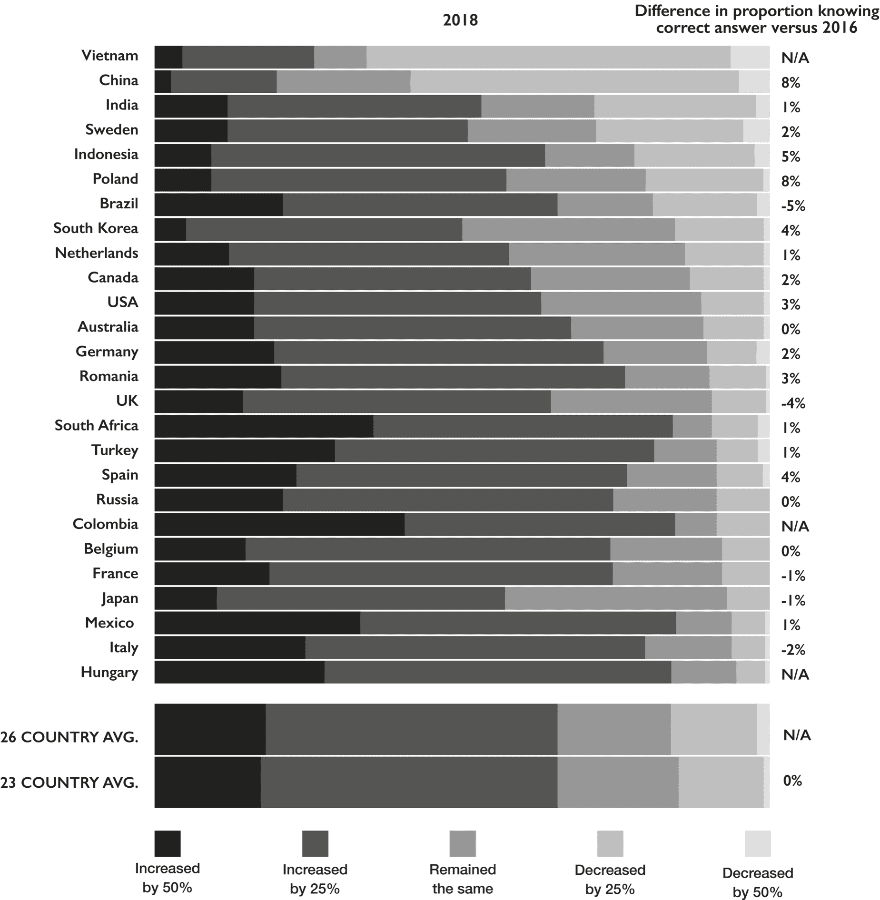

Martijn Lampert、Anne Blanksma Çeta 和 Panos Papadongonas，2018

只有 2% 的人得到了正确答案：贫困减少了 50%。越来越多的社会科学研究证实了这些差异在公众认知与根据无数社会和经济指标所显示的普遍进步的现实之间。再举一个例子，英国益普索莫里公司为皇家统计学会和伦敦国王学院进行的一项具有里程碑意义的研究[\[37\]](#18_Notes.xhtml#EndnoteNumber314 "note")在许多主题上，大众观点与实际统计数据之间存在很大差异，例如：

*   公众的印象是 24%的政府福利金被虚假申报，而实际数字是 0.7%。
*   在英格兰和威尔士，1995 年至 2012 年间犯罪率下降了 53%，但 58%的公众认为在此期间犯罪率上升或保持不变。2006 年至 2012 年间，暴力犯罪下降了 20%，而 51%的人认为暴力犯罪上升了。
*   公众对青少年怀孕的印象比现实情况糟糕 25 倍：在英国，每年有 0.6%的 15 岁以下女孩怀孕，而公众估计为 15%。

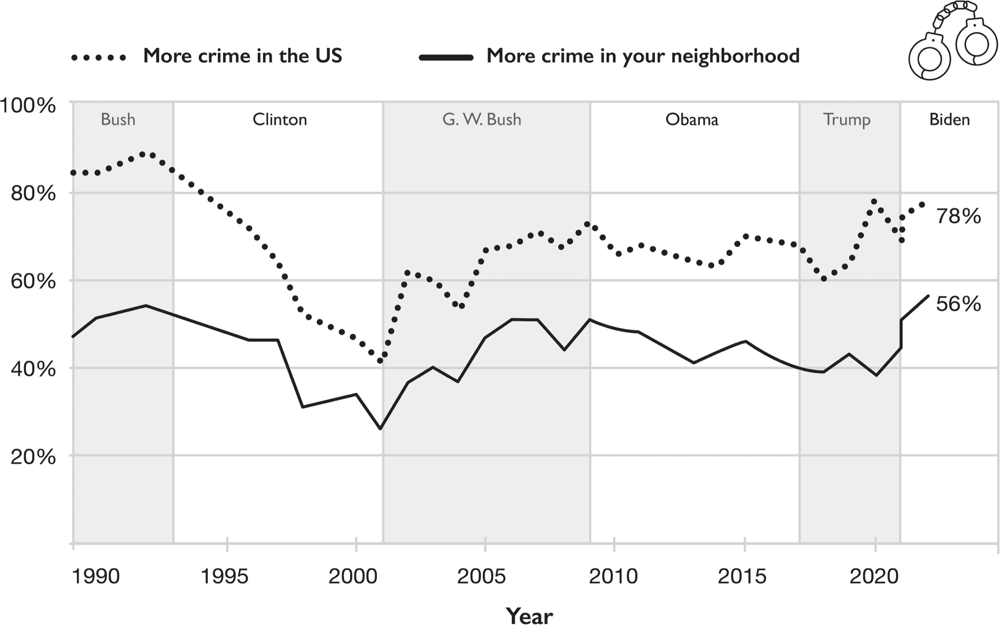

来源：盖洛普民意调查 ¶ 贾米尔斯·拉特伊、魏华·李和莉塞特·克鲁兹，马歇尔项目，2022 年

同样的效果也存在于大西洋西侧。在 21 世纪，绝大多数美国人（高达 78%）认为，尽管自 1990 年以来暴力犯罪和财产犯罪都减少了约一半，但在过去一年里，全国范围内的犯罪率有所上升。[\[38\]](#18_Notes.xhtml#EndnoteNumber315 "note")

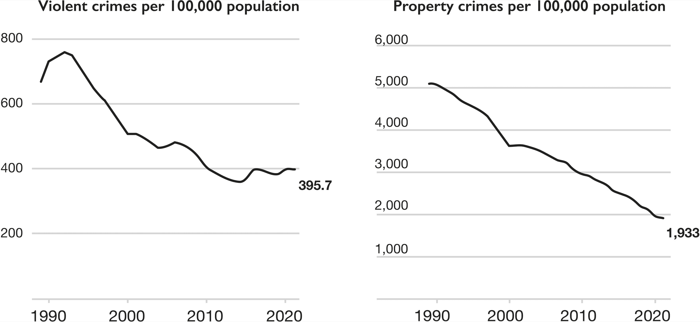

来源：联邦调查局统一犯罪报告计划 ¶ 贾米尔斯·拉特伊、魏华·李和莉塞特·克鲁兹，马歇尔项目，2022 年

格言“血腥即头条”概括了这些误解的一个主要原因。一个暴力事件会被广泛报道，而犯罪的减少（例如，由于数据驱动的执法或警察与社区之间更好的沟通）实际上是非事件。因此，它们没有得到广泛报道。

这不一定是任何人有意识的决定造成的——媒体的激励机制在结构上有利于报道暴力或负面新闻。由于本章前面描述的认知偏差，人类更自然地适应威胁信息。由于大多数媒体（包括传统新闻媒体和社交媒体）通过吸引眼球来产生广告收入，因此我们不应该感到惊讶的是，该行业已经集体了解到保持经营的最佳方式是传播引发强烈情绪反应的威胁信息。

这也与紧迫性问题有关。“新闻”一词字面意思是信息是新颖和及时的。人们只有这么多时间来消费媒体，所以他们倾向于优先考虑刚刚发生的事件。问题是，绝大多数此类离散的、紧急的事件都是坏事。正如我在本章开头强调的那样，世界上发生的大多数好事都是非常渐进的过程，因此这些故事很难上升到使其成为头版故事的紧迫程度*纽约时报*或 CNN 上的头条新闻。类似的效果在社交媒体上也适用——很容易分享灾难视频，但渐进的进展不会产生引人注目的镜头。

正如史蒂文·平克所说，“新闻是理解世界的一种误导方式。它总是关于已经发生的事件，而不是关于没有发生的事件。因此，当一名警察没有被枪击或一座城市没有发生暴力示威时，他们不会成为新闻。只要暴力事件不降至零，总会有头条新闻可以点击……悲观主义可能是一种自我实现的预言。”[\[39\]](#18_Notes.xhtml#EndnoteNumber316 "note")现在尤其如此，因为社交媒体汇集了来自整个地球的惊人新闻——而前几代人主要只是了解当地或区域事件。

然而，我的相反观察是：“乐观主义不是对未来的空想，而是一种自我实现的预言。” 相信一个更美好的世界是真正可能的，是努力创造它的强大动力。

丹尼尔·卡尼曼因其解释人们在评估世界时使用的无效和无意识启发式方法（其中一些是与阿莫斯·特沃斯基合作完成的）而获得了诺贝尔经济学奖。[\[40\]](#18_Notes.xhtml#EndnoteNumber317 "note")他们的研究表明，人们系统性地忽视了先验概率——即关于一个群体普遍成立的事情，往往也适用于来自该群体的个体。例如，如果要求你根据一个陌生人的自我描述来选择他可能的职业，如果他告诉你他“热爱书籍”，你可能会选择“图书管理员”，而忽略了基本比率——世界上图书管理员相对较少这一普遍事实。[\[41\]](#18_Notes.xhtml#EndnoteNumber318 "note")克服这种偏见的人会意识到，热爱书籍对于某人的职业来说是一个非常微弱的证据，因此会猜测一个更常见的工作，比如“零售工人”。人们并非不知道基本比率，但他们在考虑特定情况时，往往会忽略它们，而倾向于回应生动的细节。

卡尼曼和特沃斯基引用的另一个有偏见的启发式方法是，天真的观察者会认为，如果他们刚刚经历了一连串的反面，那么抛硬币更有可能出现正面。[\[42\]](#18_Notes.xhtml#EndnoteNumber319 "note")这是由于对均值回归的误解。

解释社会悲观偏见的第三个偏差是卡尼曼和特沃斯基所说的“可得性启发法”。[\[43\]](#18_Notes.xhtml#EndnoteNumber320 "note")人们通过他们能多容易地想到某个事件或现象的例子来估计它的可能性。由于之前讨论的原因，新闻和我们的新闻推送强调负面事件，所以这些负面情况很容易浮现在脑海中。

我们应该纠正这些偏见，这并不意味着我们应该忽视或低估真正的问题，但这为对人类的整体发展轨迹保持乐观提供了强有力的理性基础。技术变革不会自动发生——它需要人类的聪明才智和努力。这种进步也不应使我们对人们在此期间面临的紧迫苦难视而不见。相反，大局趋势应该提醒我们，尽管这些问题有时看起来多么困难甚至绝望，但作为一个物种，我们正在扭转解决这些问题的局面。我发现这是一个深刻的动力源泉。

## 现实情况是，由于呈指数级增长的技术，生活的几乎每个方面都在逐渐变得更好

信息技术呈指数级发展，因为它直接促进了其自身的进一步创新。但这种趋势也推动了其他领域中许多相互加强的进步机制。在过去的两个世纪里，这催生了一个良性循环，几乎促进了人类福祉的方方面面，包括识字率、教育、财富、卫生、健康、民主化和暴力减少。

我们通常从经济角度来看待人类发展：当人们每年能够赚更多的钱时，他们就能获得更好的生活质量。但真正的发展不仅仅是经济体积累财富。经济周期有起有落；财富可以获得也可以失去。但技术变革本质上是永久性的。一旦我们的文明学会了如何做一些有用的事情，我们通常会保留这些知识并在此基础上发展。这种单向的进步一直是自然灾害、战争和流行病等短暂灾难的强大制衡力量，这些灾难偶尔会使社会倒退。

教育、医疗保健、卫生和民主化等相互交织的因素创造了相互加强的反馈循环——任何这些领域的改进都可能导致其他领域的好处，例如更好的教育培养出更有能力的医生，而更好的医生让更多的孩子保持健康，足以留在学校。这有一个非常重要的含义：新技术可以产生巨大的间接效益，即使远离其自身的应用领域。例如，二十世纪的家用电器不仅为人们节省了大量的时间和精力，而且促进了解放和变革性的转变，使数百万有才华的女性进入劳动力市场，在那里她们在无数领域做出了重要贡献。总的来说，我们可以说，技术创新促进了社会中更多人发挥其潜力的条件，这反过来又促进了更多的创新。

再举一个例子，印刷机的发明改进并大大拓宽了接受教育的途径，提供了一个更有能力和更成熟的劳动力，从而推动了经济增长。更高的识字率能够更好地协调生产和贸易，这也带来了更大的繁荣。反过来，增加的财富允许对基础设施和教育进行更大的投资，从而加速了有益的循环。与此同时，大众印刷传播促进了更大的民主化，随着时间的推移，这降低了暴力。

起初，这是一个非常缓慢的过程，祖父母和他们的孙子孙女的生活方式之间的差异是微妙的，通常不会被注意到。但是，几个世纪以来的平稳趋势是社会福祉的所有这些衡量标准逐渐但显着增加的轨迹。近几十年来，这些趋势加速了，这得益于几乎所有形式的信息技术呈指数级增长的曲线。正如我在本章中描述的那样，在接下来的几十年里，这一进展将进入高速发展阶段。

## 读写能力和教育

在人类历史的大部分时间里，世界各地的识字率仍然非常低。知识主要通过口头传播，一个关键原因是复制文字非常昂贵。如果普通人很少接触到书面材料，也买不起，那么学习阅读就不值得他们花费时间。时间是我们所有人平等消耗的唯一稀缺资源——无论你是谁，一天都只有 24 小时。当人们决定如何利用时间时，理性地思考他们能从潜在的选择中获得什么好处是很正常的。学习阅读是对时间的大量投资。在生存本身就很困难，书籍对普通人来说过于昂贵的社会里，这并不是一个明智的投资。因此，我们应该小心，不要把我们不识字的祖先看作是愚昧无知或不好奇的人。相反，他们生活在强烈抑制识字的环境中。

有了这个视角，也值得考虑当今世界的激励机制有时是如何阻碍学习的。例如，在信息技术工作岗位很少的地方，对计算机科学感兴趣的年轻人可能会发现，学习编程并不是明智的时间利用方式。但现在，就像几个世纪前的欧洲一样，技术可以改变这一点——因为自动翻译、远程学习、自然语言编程和远程办公开辟了新的机会并奖励好奇心。

中世纪晚期，欧洲活字印刷术的引入引发了廉价且种类繁多的阅读材料的激增，并使普通人成为有文化的人成为可能。随着中世纪的结束，只有不到五分之一的欧洲人口识字。[\[44\]](#18_Notes.xhtml#EndnoteNumber321 "note")识字仅限于神职人员和需要阅读的职业。[\[45\]](#18_Notes.xhtml#EndnoteNumber322 "note")在启蒙运动时期，识字率逐渐普及，但到 1750 年，在主要的欧洲强国中，只有荷兰和英国的识字率超过 50%。[\[46\]](#18_Notes.xhtml#EndnoteNumber323 "note")到 1870 年，只有西班牙和意大利明显落后于这一水平，这可能是由于当时两国相对不发达的经济和最近的内战。[\[47\]](#18_Notes.xhtml#EndnoteNumber324 "note")然而，全球平均水平仍然低于欧洲。1800 年，可能全球只有不到十分之一的人识字，但在整个 19 世纪，大量生产的报纸的普及有助于提高识字率，而社会改革开始保证所有儿童都能接受基础教育。[\[48\]](#18_Notes.xhtml#EndnoteNumber325 "note")到 1900 年，仍然只有不到四分之一的人识字。[\[49\]](#18_Notes.xhtml#EndnoteNumber326 "note")在 20 世纪，公共教育在全球范围内扩展，到 1910 年，全球识字率超过了四分之一。到 1970 年，世界上的大多数人口都已识字。[\[50\]](#18_Notes.xhtml#EndnoteNumber327 "note")从那时起，它迅速跃升至几乎在所有地方都普遍存在。[\[51\]](#18_Notes.xhtml#EndnoteNumber328 "note")今天，全球识字率接近 87%，发达国家通常拥有超过 99%的数据。[\[52\]](#18_Notes.xhtml#EndnoteNumber329 "note")

然而，仍有进步的空间。这些识字率指的是基本标准，例如阅读和书写像自己的名字这样的小信息。已经开发出新的、更丰富的指标来评估识字质量。例如，根据美国国家成人识字评估，2003 年，只有 86%的美国人口在识字能力方面得分高于“低于基本水平”。[\[53\]](#18_Notes.xhtml#EndnoteNumber330 "note")九年后的一项类似评估发现，没有显著的改善。[\[54\]](#18_Notes.xhtml#EndnoteNumber331 "note")

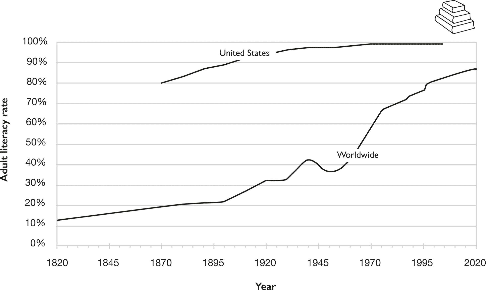

主要来源：Our World in Data；联合国教科文组织

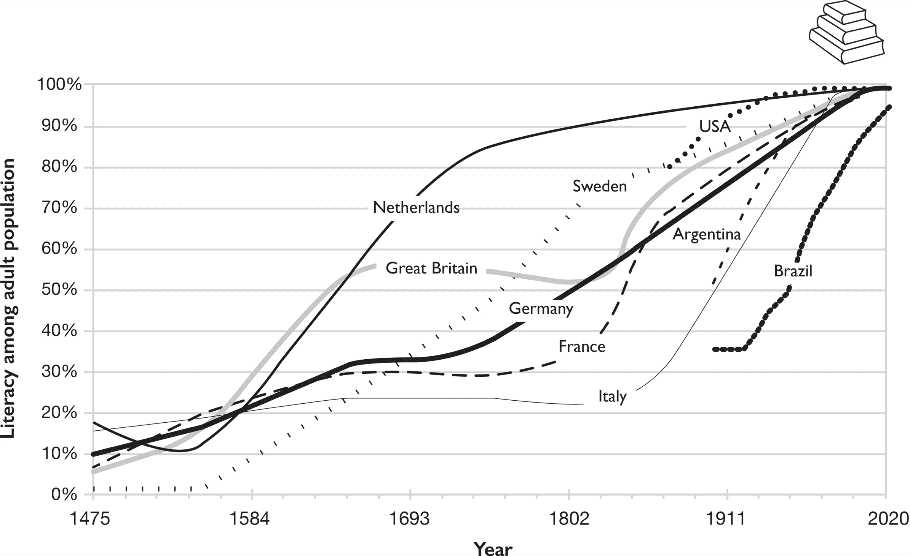

来源：Our World in Data；联合国教科文组织

1870 年，美国的人口平均接受过大约四年的正规教育，而英国、日本、法国、印度和中国的人口平均受教育年限都低于一年。[\[57\]](#18_Notes.xhtml#EndnoteNumber334 "note")在 20 世纪初，随着英国、日本和法国扩大其免费公共教育，它们开始迅速赶上美国。[\[58\]](#18_Notes.xhtml#EndnoteNumber335 "note")与此同时，印度和中国仍然贫穷和不发达，但在二战后的两个十年里取得了重大飞跃。[\[59\]](#18_Notes.xhtml#EndnoteNumber336 "note")到 2021 年，印度平均受教育年限为 6.7 年，中国为 7.6 年。[\[60\]](#18_Notes.xhtml#EndnoteNumber337 "note")前面提到的其他国家平均受教育年限都超过 10 年，其中美国以 13.7 年领先。[\[61\]](#18_Notes.xhtml#EndnoteNumber338 "note")以下图表显示了过去半个世纪以来的巨大进步——这并非巧合，同一时期计算机既促进了教育，又增加了受教育的好处。

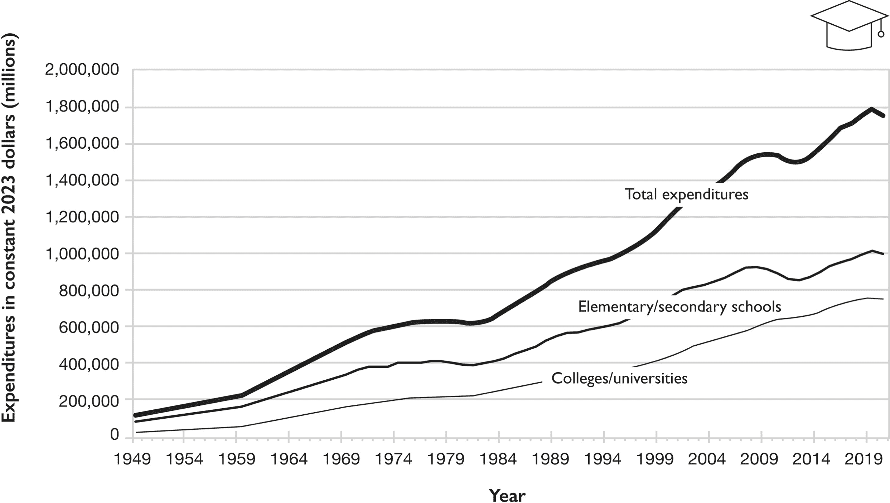

主要来源：国家教育统计中心

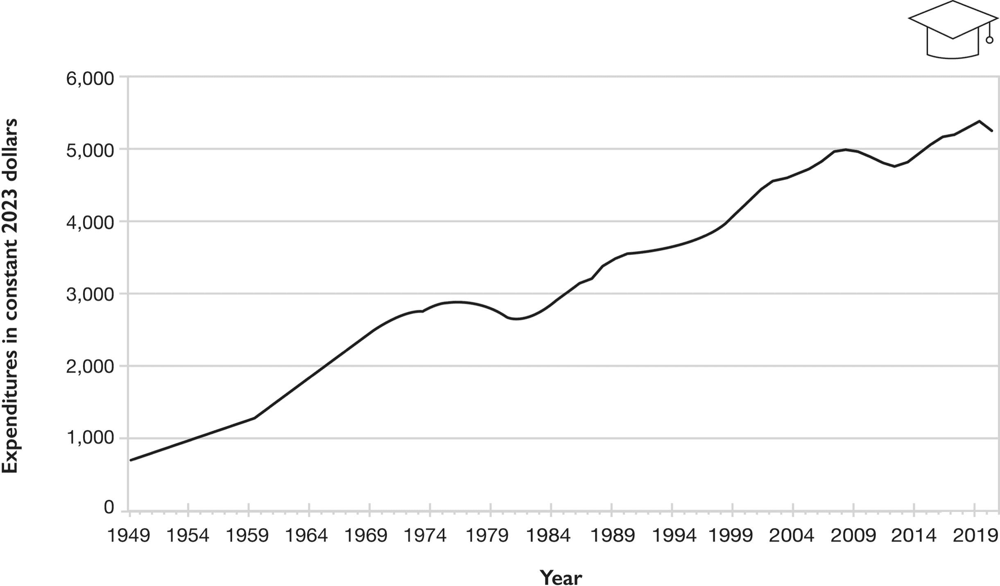

主要来源：国家教育统计中心

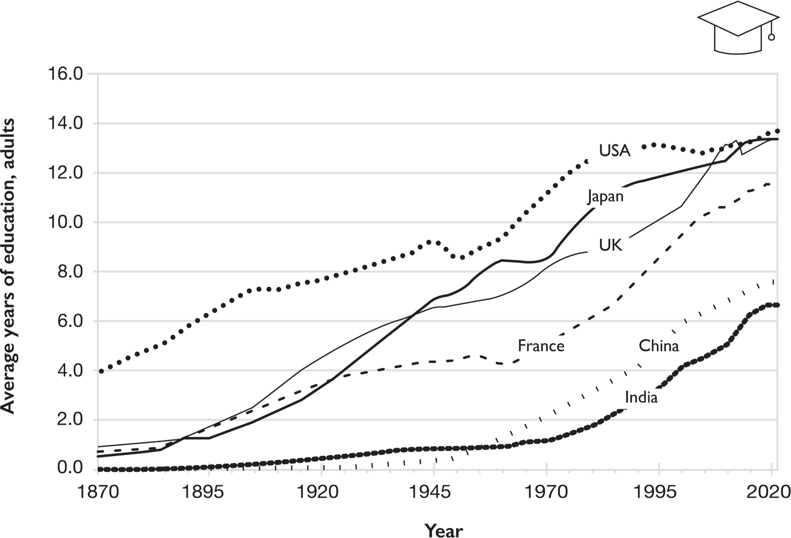

主要来源：我们的世界数据；联合国人类发展报告办公室

## 抽水马桶、电力、收音机、电视和电脑的普及

从历史上看，导致疾病和死亡的最大原因之一是人类粪便对食物和水供应的污染。[\[65\]](#18_Notes.xhtml#EndnoteNumber342 "note")抽水马桶是解决这个问题的最终技术方案，早在 1829 年就已出现，并在美国城市逐渐普及，但直到 20 世纪初才在城市地区普遍使用。[\[66\]](#18_Notes.xhtml#EndnoteNumber343 "note")在 20 世纪 20 年代和 30 年代，抽水马桶迅速普及到农村地区，到 1950 年达到四分之三的家庭，到 1960 年达到 90%。[\[67\]](#18_Notes.xhtml#EndnoteNumber344 "note")在 2023 年，美国极少数没有抽水马桶的家庭，在许多情况下是由于生活方式的选择（例如，喜欢居住在乡村环境中），而不是由于赤贫。[\[68\]](#18_Notes.xhtml#EndnoteNumber345 "note")相比之下，贫困一直是发展中国家的人们仍然缺乏抽水马桶或其他形式的改善卫生设施（如堆肥厕所）的主要原因。[\[69\]](#18_Notes.xhtml#EndnoteNumber346 "note")随着卫生技术的成本降低，全球范围内获得安全厕所的机会一直在稳步增加。随着曾经容易发生暴力事件的地区变得更加稳定，并能够投资于卫生基础设施。[\[70\]](#18_Notes.xhtml#EndnoteNumber347 "note")

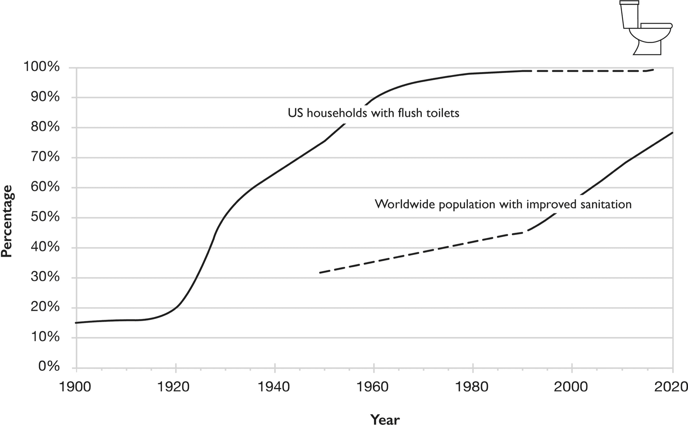

主要来源：斯坦利·莱伯戈特*追求幸福：二十世纪的美国消费者*（新泽西州普林斯顿：普林斯顿大学出版社，1993）；美国人口普查局；世界银行 ¶ 虚线表示连接数据来源的估计值。

电力本身并不是一种信息技术，但由于它为我们所有的数字设备和网络供电，它是现代文明无数其他好处的先决条件。甚至在计算机出现之前，它就运行着变革性的省力电器，并允许人们在夜间工作和娱乐。在二十世纪初，美国的电气化主要局限于大型城市地区。[\[72\]](#18_Notes.xhtml#EndnoteNumber349 "note")电气化的步伐在大萧条开始时有所放缓，但在 20 世纪 30 年代和 40 年代，富兰克林·D·罗斯福总统倡导大规模的农村电气化计划，旨在将电力机械的效率带到美国农业中心地带。[\[73\]](#18_Notes.xhtml#EndnoteNumber350 "note")到 1951 年，超过 95% 的美国家庭用上了电，到 1956 年，全国电气化工作被认为基本完成。[\[74\]](#18_Notes.xhtml#EndnoteNumber351 "note")

在世界其他地方，电气化通常遵循类似的模式：先是城市，然后是郊区，最后是农村地区。[\[75\]](#18_Notes.xhtml#EndnoteNumber352 "note")如今，地球上超过 90% 的人口用上了电。[\[76\]](#18_Notes.xhtml#EndnoteNumber353 "note")对于那些仍然没有电力的人来说，主要的障碍是政治，而不是技术。麻省理工学院教授达隆·阿西莫格鲁和他的同事詹姆斯·罗宾逊对政治制度在人类发展中的关键作用进行了非常有影响力的研究。[\[77\]](#18_Notes.xhtml#EndnoteNumber354 "note")简而言之，随着各国允许更多人自由参与政治，以及人们获得为未来创新和投资的保障，繁荣的反馈循环就能形成。正是这些因素使得为大约十分之一仍然缺乏电力的世界人口提供电力变得如此困难。在暴力普遍的地区，人们认为投资于可能很快被摧毁的昂贵电力基础设施是不值得的。同样，当道路状况差且危险时，很难将机械和燃料运送到偏远社区，以便他们能够自己发电。幸运的是，廉价且高效的光伏电池将继续扩大电力供应。

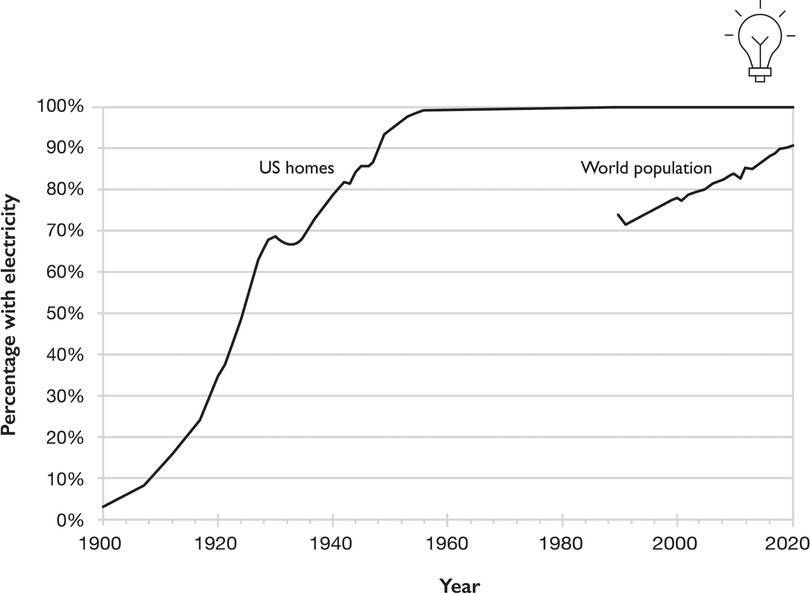

资料来源：美国人口普查局；世界银行；斯坦利·莱伯戈特*美国经济：收入、财富与匮乏*（新泽西州普林斯顿：普林斯顿大学出版社，1976 年）

电力驱动下的首个变革性通信技术是无线电。美国的商业无线电广播各州始于 1920 年，到 20 世纪 30 年代已成为美国主要的群众媒体形式。[\[79\]](#18_Notes.xhtml#EndnoteNumber356 "note")与主要局限于单个大都市地区的报纸不同，无线电广播可以覆盖全国的听众。这刺激了真正全国性媒体文化的发展，因为从加利福尼亚到缅因州的人们听到了许多相同的政治演讲、新闻报道和娱乐节目。到 1950 年，超过十分之九的美国家庭拥有收音机，但在同一十年里，电视开始取代收音机在媒体领域的主导地位。[\[80\]](#18_Notes.xhtml#EndnoteNumber357 "note")作为回应，听众的习惯发生了转变。广播节目开始更加狭隘地关注新闻、政治和体育，人们在车里的时候会听很多广播。[\[81\]](#18_Notes.xhtml#EndnoteNumber358 "note")自 20 世纪 80 年代以来，党派色彩浓厚的政治谈话节目已成为广播中最强大的力量之一，并因强化听众的偏见，同时让他们对相反的信息视而不见而受到批评。[\[82\]](#18_Notes.xhtml#EndnoteNumber359 "note")自从 2010 年代智能手机和平板电脑普及以来，越来越多的广播内容通过网络流媒体播放，而实际上并没有通过传统的无线电波传输。（2007 年，即第一款 iPhone 发布的年份，只有 12%的美国人每周至少收听一次在线广播；到 2021 年，这一比例达到了 62%。）[\[83\]](#18_Notes.xhtml#EndnoteNumber360 "note")

电视的普及遵循了与广播相似的模式，但由于当时国家已经更加发达，其指数级增长甚至更快。科学家和工程师在 19 世纪末就开始对将导致电视发展的进步进行理论研究，到 20 世纪 20 年代末，第一个原始电视系统正在被开发和演示。[\[84\]](#18_Notes.xhtml#EndnoteNumber361 "note")到 1939 年，这项技术在美国已经达到了商业可行性，但第二次世界大战的爆发使全球电视生产几乎陷入停顿。[\[85\]](#18_Notes.xhtml#EndnoteNumber362 "note")然而，战争一结束，美国人就开始迅速购买电视机。新的电视台在全国各地涌现，到 1954 年，大多数家庭至少拥有一台电视机。[\[86\]](#18_Notes.xhtml#EndnoteNumber363 "note")普及率迅速提高，到 1962 年，超过 90% 的家庭都拥有一台电视机。[\[87\]](#18_Notes.xhtml#EndnoteNumber364 "note")随着后期采用者逐渐加入电视观看的行列，增长速度随后放缓未来三十年。[\[89\]](#18_Notes.xhtml#EndnoteNumber366 "note")到 1997 年，使用率达到顶峰，占家庭的 98.4%，此后几年略有下降，2021 年约为 96.2%。[\[90\]](#18_Notes.xhtml#EndnoteNumber367 "note")这种下降可归因于多种因素：一种是文化上不再过度观看电视的转变，另一种是在线竞争消遣方式的出现，还有最近一种趋势是在线设备上可以流式传输电视风格的节目。[\[91\]](#18_Notes.xhtml#EndnoteNumber368 "note")

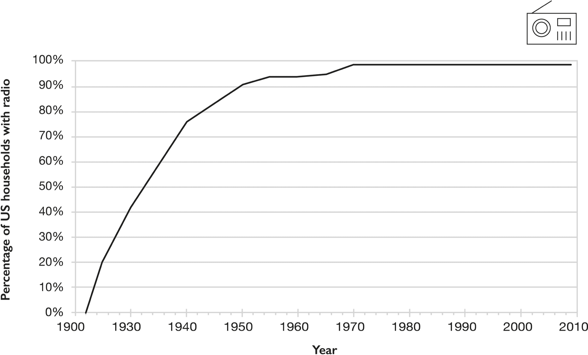

来源：美国人口普查局；道格拉斯·B·克雷格，*炉边政治：美国广播与政治文化*，1920–1940（巴尔的摩，马里兰州：约翰·霍普金斯大学出版社，2000） ¶ 虽然近年来美国家庭拥有收音机的比例似乎显著下降（根据一项使用与本图表数据不同方法的研究，从 2008 年的 96%降至 2020 年的 68%），但这具有很大的误导性，因为其他设备现在也执行相同的功能。例如，截至 2021 年，85%的美国成年人拥有一部智能手机，无需收音机即可免费收听广播节目。

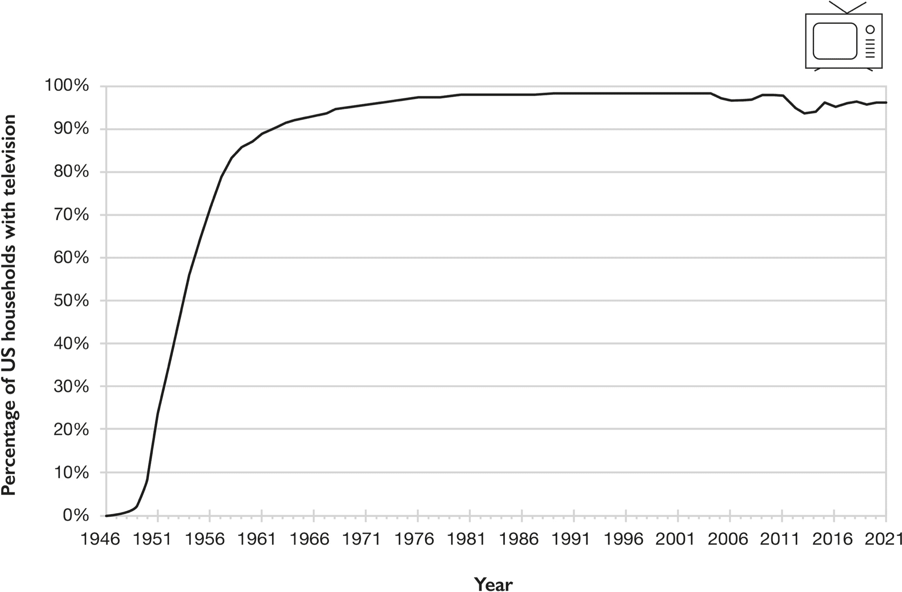

主要来源：美国人口普查局；科贝特·S·斯坦伯格，*电视趣闻*, Facts on File; Jack W. Plunkett,*Plunkett’s Entertainment & Media Industry Almanac 2006（Plunkett 娱乐与媒体产业年鉴 2006）*（休斯顿，德克萨斯州：Plunkett Research，2006）；尼尔森公司

与允许被动媒体消费的广播和电视不同，计算机开辟了更广阔的可能性，因为它们是交互式的。个人电脑在 20 世纪 70 年代开始进入美国家庭，出现了 Kenbak-1 等机器，1975 年出现了广受欢迎的 Altair 8800，它以自组装套件的形式出售。[\[92\]](#18_Notes.xhtml#EndnoteNumber369 "note")到十年末，像苹果和微软这样的公司正在通过用户友好的个人电脑改变市场，普通人可以在一个下午学会操作。[\[94\]](#18_Notes.xhtml#EndnoteNumber371 "note")苹果公司著名的 1984 年超级碗广告让整个国家都在谈论电脑，美国拥有电脑的家庭比例在播出后的五年内几乎翻了一番。[\[95\]](#18_Notes.xhtml#EndnoteNumber372 "note")在那段时间里，人们主要使用电脑进行文字处理、数据录入和简单的游戏。

但是 20 世纪 90 年代互联网的蓬勃发展极大地扩展了计算机的用途。1990 年 1 月，整个互联网域名系统大约有 175,000 个主机。[\[96\]](#18_Notes.xhtml#EndnoteNumber373 "note")到 2000 年 1 月，这个数字已经飙升到大约 72,000,000。[\[97\]](#18_Notes.xhtml#EndnoteNumber374 "note")同样地，全球互联网流量从 1990 年的约 12,000 千兆字节增长到 1999 年的 306,000,000 千兆字节。[\[98\]](#18_Notes.xhtml#EndnoteNumber375 "note")这直接提高了计算机的实用性。正如流媒体服务拥有更多更好的内容时，可以吸引更多订阅者并收取更高的费用一样，随着可用内容池呈指数级增长，互联网对更多人来说变得更有价值。这创造了一个积极的反馈循环——许多新用户贡献了自己的内容拥有这些使得互联网的价值进一步提升。因此，在 20 世纪 90 年代，家用电脑从文字处理和原始游戏的平台变成了可以访问世界上大部分知识并将用户与远在其他大陆的人们联系起来的门户。电子商务的兴起使人们能够使用他们的电脑进行许多购买，而 21 世纪 00 年代社交媒体的出现使得在线体验变得非常互动。

到 2017-2021 年，约 93.1%的美国家庭拥有电脑，并且随着“最伟大的一代”逐渐减少，千禧一代开始组建自己的家庭，这一比例持续上升。[\[99\]](#18_Notes.xhtml#EndnoteNumber376 "note")与此同时，全球计算机拥有量一直在稳步上升。嵌入智能手机的计算机在新兴市场迅速扩大了市场渗透率，截至 2022 年，全球约三分之二的人口至少拥有一台。[\[100\]](#18_Notes.xhtml#EndnoteNumber377 "note")

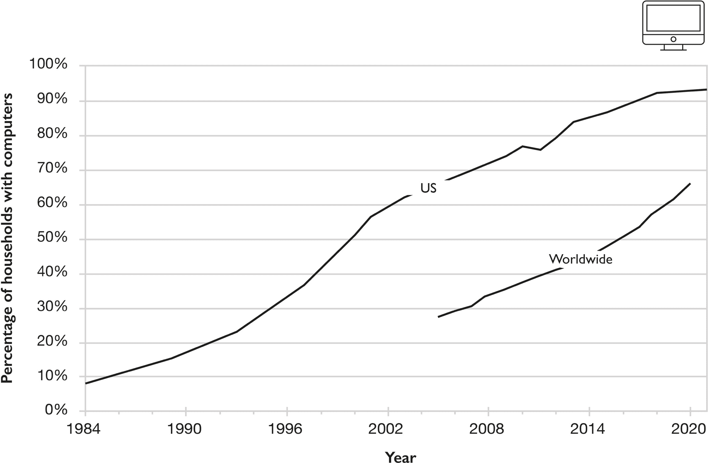

主要来源：美国人口普查局；国际电信联盟

## 预期寿命

正如我在第 6 章中更详细地讨论的那样，到目前为止，我们在疾病治疗和预防方面取得的大部分进展都是线性发展的产物在寻找有效干预措施时，反复尝试的摸索过程。由于我们缺乏系统性探索所有可能治疗方法的工具，在这种模式下的发现很大程度上归功于偶然性。医学上最引人注目的偶然突破可能是青霉素的意外发现，它开启了抗生素革命，并且自那时以来可能已经挽救了多达 2 亿人的生命。[\[102\]](#18_Notes.xhtml#EndnoteNumber379 "note")但即使当发现并非完全是偶然的时候，研究人员仍然需要依靠好运才能通过传统方法取得突破。由于无法详尽地模拟可能的药物分子，研究人员不得不依赖高通量筛选和其他费力的实验室方法，这些方法要慢得多，效率也低得多。

公平地说，这种方法带来了巨大的好处。一千年前，欧洲人的出生预期寿命只有二十几岁，因为很多人在婴儿期或青年时期死于霍乱和痢疾等疾病，而这些疾病现在很容易预防。[\[103\]](#18_Notes.xhtml#EndnoteNumber380 "note")到十九世纪中叶，英国和美国的预期寿命已增加到四十多岁。[\[104\]](#18_Notes.xhtml#EndnoteNumber381 "note")截至 2023 年，在发达国家的大部分地区，预期寿命已上升到八十岁以上。[\[105\]](#18_Notes.xhtml#EndnoteNumber382 "note")因此，在过去的一千年里，我们的预期寿命几乎增加了两倍，在过去的两个世纪里增加了一倍。这主要是通过开发避免或杀死外部病原体的方法实现的——细菌和病毒将疾病从我们身体外部带入。

然而，今天，大部分容易摘取的果实已经被摘走了。剩余的疾病和残疾来源主要来自我们自身体内深处。随着细胞功能失调和组织分解，我们患上了癌症、动脉粥样硬化、糖尿病和阿尔茨海默病等疾病。在某种程度上，我们可以通过生活方式、饮食和补充剂来降低这些风险——我称之为通往激进延长寿命的第一座桥梁。[\[106\]](#18_Notes.xhtml#EndnoteNumber383 "note")但这些只能延缓不可避免的结局。这就是为什么自大约二十世纪中叶以来，发达国家的预期寿命增长已经放缓。例如，从 1880 年到 1900 年，美国出生时的预期寿命从大约三十九岁增加到四十九岁，但从 1980 年到 2000 年——在医学的重点已经从传染病转移到慢性病和退行性疾病之后——它只从七十四岁增加到七十六岁。[\[107\]](#18_Notes.xhtml#EndnoteNumber384 "note")

幸运的是，在 2020 年代，我们正在进入第二座桥梁：将人工智能和生物技术结合起来，以战胜这些退行性疾病。我们已经超越了仅仅使用计算机来组织关于干预措施和临床试验的信息。我们现在正在利用人工智能来寻找新药，到本十年末，我们将能够开始用数字模拟来增强并最终取代缓慢、动力不足的人体试验。实际上，我们正在将医学转变为一种信息技术，利用这些技术所具有的指数级进步来掌握生物学的软件。

其中最早和最重要的例子之一是在遗传学领域。自从 2003 年人类基因组计划完成以来，基因组测序的成本一直遵循持续的指数趋势，平均每年下降约一半。尽管从 2016 年到 2018 年测序成本出现短暂的停滞，并且在 COVID-19 大流行的干扰下进展放缓，但成本仍在继续下降——而且随着复杂的人工智能在测序中发挥更大的作用，这种情况可能会再次加速。成本已经从 2003 年的每个基因组约 5000 万美元暴跌至 2023 年初的低至 399 美元，一家公司承诺在你读到这篇文章时，将提供 100 美元的测试。[\[108\]](#18_Notes.xhtml#EndnoteNumber385 "note")

随着人工智能改变越来越多的医学领域，它将引发许多类似的趋势。它已经开始产生临床影响，[\[109\]](#18_Notes.xhtml#EndnoteNumber386 "note")但我们仍处于这个特定指数曲线的早期阶段。目前的应用涓涓细流将在 2020 年代末变成洪流。届时，我们将能够开始直接解决现在将最长寿命限制在约 120 年的生物学因素，包括线粒体基因突变、端粒长度缩短和导致癌症的不受控制的细胞分裂。[\[110\]](#18_Notes.xhtml#EndnoteNumber387 "note")

在 2030 年代，我们将到达激进延长寿命的第三座桥梁：具有智能地进行细胞水平的医疗纳米机器人在我们整个身体内进行维护和修复。按照某些定义，某些生物分子已经被认为是纳米机器人。但是，第三座桥梁的纳米机器人与众不同之处在于，它们能够被人工智能主动控制以执行不同的任务。在这个阶段，我们将获得与目前对汽车维护相似的生物学控制水平。也就是说，除非你的汽车在重大事故中完全报废，否则你可以无限期地继续修理或更换其零件。同样，智能纳米机器人将能够有针对性地修复或升级单个细胞——彻底战胜衰老。更多内容将在第 6 章中介绍。

第四座桥梁——能够以数字方式备份我们的思维文件——将是 2040 年代的技术。正如我在第 3 章中论证的那样，一个人的身份核心不是他们的大脑本身，而是他们的大脑能够代表和操纵的非常特殊的信息排列。一旦我们能够以足够的精度扫描这些信息，我们就能够在数字基质上复制它。这将意味着，即使生物大脑被摧毁，也不会熄灭这个人的身份——这可以通过复制和重新复制到安全备份来实现几乎任意长的寿命。

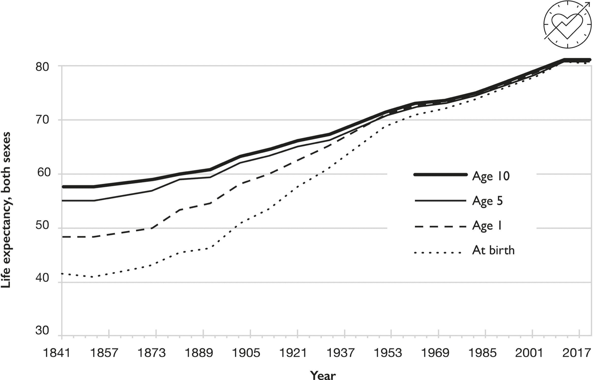

来源：英国国家统计局

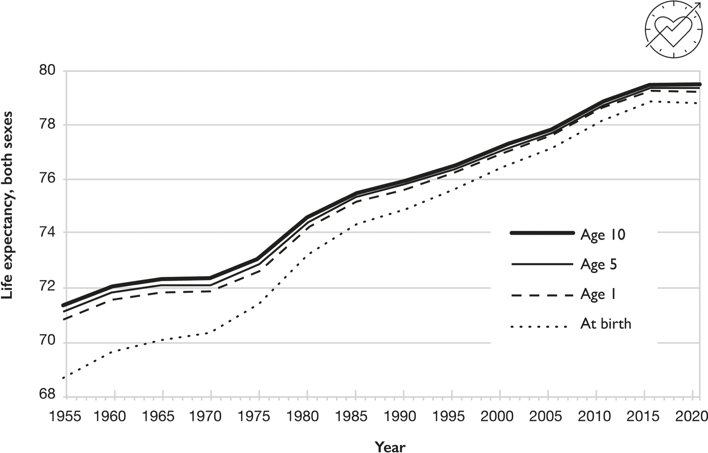

来源：联合国经济和社会事务部

## 贫困下降和收入增加

本章到目前为止所描述的技术趋势都非常有益，但真正具有变革意义的是它们相互加强的总体效应。虽然经济福祉是对进步的不完全衡量，但它是我们理解这一长期 sweeping 过程的最佳指标。

在全球范围内，宏观趋势一直非常稳定。1820 年，按现代全球标准估计，世界人口中有 84%生活在极端贫困中。[\[113\]](#18_Notes.xhtml#EndnoteNumber390 "note")随着工业化的蔓延，欧洲和美国的贫困率很快开始下降。[\[114\]](#18_Notes.xhtml#EndnoteNumber391 "note")二战后，随着印度和中国在随后的几十年里引入更现代化的农业，这一进程显著加速。[\[115\]](#18_Notes.xhtml#EndnoteNumber392 "note")尽管媒体对全球贫困的密集报道给发达国家的人们造成了对其程度的错误印象，但贫困率持续下降——过去三十年取得了显著改善。到 2019 年，极端贫困（目前定义为以 2017 年美元计算，每天生活费低于 2.15 美元）已降至全球约 8.4%，在 1990 年至 2013 年间下降了三分之二以上。[\[116\]](#18_Notes.xhtml#EndnoteNumber393 "note")

东亚地区的下降幅度最大，中国的经济发展使数亿人摆脱了贫困，生活水平可与其他发达国家相媲美。从 1990 年到 2013 年，东亚的极端贫困人口惊人地下降了 95%，而在此期间，总人口从 16 亿增加到 20 亿。[\[117\]](#18_Notes.xhtml#EndnoteNumber394 "note")

在同一时期，极端贫困人口增加的唯一地区是欧洲和中亚，苏联解体后造成的经济混乱需要数十年才能修复。[\[118\]](#18_Notes.xhtml#EndnoteNumber395 "note")值得注意的是，这主要是出于政治原因，而不是狭隘的经济或技术原因。专制的苏联政府的崩溃造成了权力真空，导致了巨大的腐败。尤其是在中亚较贫穷的后苏联共和国，这产生了负面的反馈循环，阻碍了投资并抑制了繁荣。

然而，自冷战结束以来，国际社会已经能够投入更多的精力来对抗地球上最贫困地区的严重贫困。苏联解体后，许多发达国家削减了其对外援助预算，并降低了对国际发展的重视程度。[\[119\]](#18_Notes.xhtml#EndnoteNumber396 "note")这种情况的发生是因为在冷战期间，发展在很大程度上被视为一种战略视角，西方民主国家和共产主义东方集团国家争夺在发展中国家的影响力。但到了 20 世纪 90 年代中期，经合组织（经济合作与发展组织）认为，从人道主义的角度来看，促进发展至关重要，而且因为营造一个安全和繁荣的世界将使每个人都受益。2000 年，联合国将其千年发展目标写入，协调国际努力，以在 2015 年之前实现关键的发展里程碑。[\[120\]](#18_Notes.xhtml#EndnoteNumber397 "note")虽然许多这些雄心勃勃的目标没有实现，但千年发展目标仍然刺激了非常重要的进展，改善了数亿人的生活。

在美国，按照绝对值计算的极端贫困（按照 2017 年美元计算，全球基准为每天 2.15 美元）自开始衡量以来一直处于或低于 1.2%。[\[121\]](#18_Notes.xhtml#EndnoteNumber398 "note")然而，相对贫困的统计数据（相对于自身社会公认的标准而言的贫困）提供了不同的视角。美国的相对贫困从 19 世纪的约 45%下降，在战后几年急剧下降，并在 1970 年达到约 12.5%，此后停滞不前。[\[122\]](#18_Notes.xhtml#EndnoteNumber399 "note")自那以后，它一直保持在十几岁的水平，[\[123\]](#18_Notes.xhtml#EndnoteNumber400 "note")随着更广泛经济的变化而波动，但没有看到长期的改善。[\[124\]](#18_Notes.xhtml#EndnoteNumber401 "note")其中一个原因是，生活水平的提高导致相对贫困线的不断重新定义，因此，如果按照 1980 年的生活质量标准，那些不会被认为是穷人的人现在被认为是穷人。[\[125\]](#18_Notes.xhtml#EndnoteNumber402 "note")

尽管如此，从 2014 年到 2019 年，美国贫困人口的数量（根据定期重新定义的标准）减少了约 1260 万，尽管同期总人口增加了约 890 万。[\[126\]](#18_Notes.xhtml#EndnoteNumber403 "note")其中 410 万的减少发生在 2019 年，当时老年人的贫困率接近历史最低水平。[\[127\]](#18_Notes.xhtml#EndnoteNumber404 "note")虽然 COVID-19 大流行导致了暂时的增长，[\[128\]](#18_Notes.xhtml#EndnoteNumber405 "note")它代表了自 2008 年金融危机以来总体下降趋势的偏离。

此外，由于通过互联网可以广泛获取免费信息和服务，例如参加麻省理工学院开放课程或与远在其他大陆的家人进行视频聊天，如今的穷人在绝对意义上要好得多。[\[129\]](#18_Notes.xhtml#EndnoteNumber406 "note")同样，他们受益于近几十年来计算机和手机价格性能的 根本性改进，但这些并未在经济统计数据中得到充分反映。（经济统计未能充分捕捉受信息技术影响的产品和服务呈指数级增长的价格性能，这将在下一章中更详细地讨论。）如今，拥有廉价智能手机的人可以使用互联网快速轻松地访问几乎世界上所有的教育信息、翻译语言、查找方向等等。这种能力在几十年前是无法获得的，即使花费数百万美元也无法实现。

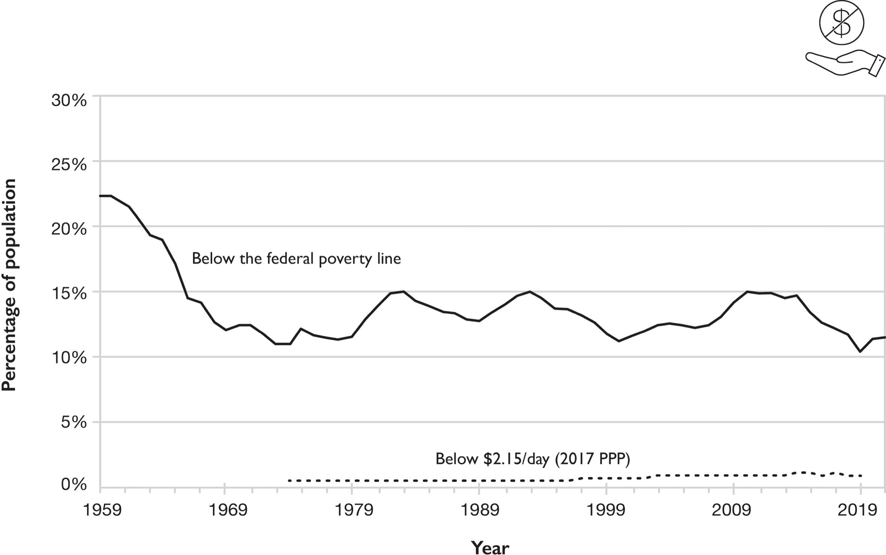

来源：美国人口普查局；世界银行

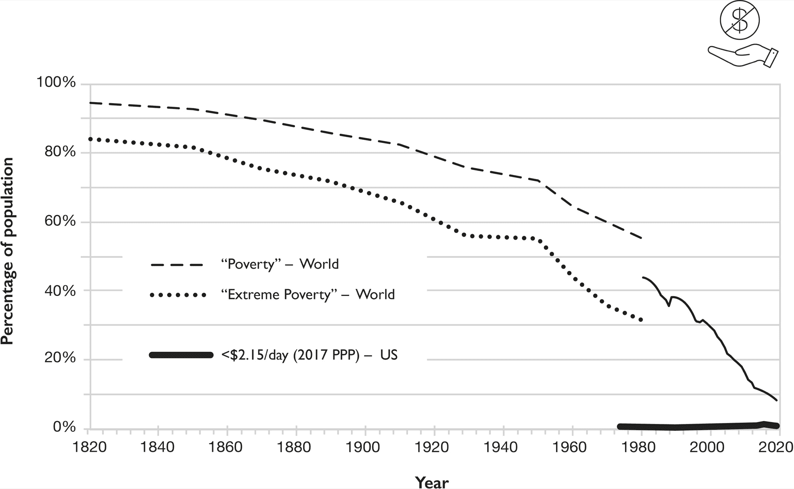

主要来源：我们的数据世界；弗朗索瓦·布吉尼翁和克里斯蒂安·莫里森，“世界公民之间的不平等：1820-1992”，*美国经济评论*92, no. 4 (2002 年 9 月); 727–44.

在美国，人均日平均收入稳步飙升。2023 年，美国单身人士的贫困线为 14580 美元，相当于每天靠 39.95 美元生活。[\[132\]](#18_Notes.xhtml#EndnoteNumber409 "note")实际上，自 1941 年左右以来，美国人的平均（非中位数）收入一直高于 2023 年的贫困线。[\[133\]](#18_Notes.xhtml#EndnoteNumber410 "note")

### 美国人均日平均收入（2023 年美元），按年份[\[134\]](#18_Notes.xhtml#EndnoteNumber411 "note")

2020: $191.00

2015: $169.88

2010: $154.15

2000: $147.18

1990: $124.32

1980: $102.41

1970: $89.82

1960: $65.27

1950: $52.97

1940: $35.47

1930: $30.74

1910: $26.45

1900: $20.08

1880: $15.08

1860: $13.27

1840: $8.37

1800: $5.65

1774: $7.06

## 美国贫困率近似值（相对贫困，由政府定期重新定义），按年份[\[135\]](#18_Notes.xhtml#EndnoteNumber412 "note")
2020 年：11.5%
2015 年：13.5%
2010 年：15.1%
2000 年：11.3%
1990 年：13.5%
1980 年：13.0%
1970 年：12.6%
1960 年：22.2%
1950 年：约 30%
1935 年：约 45%
1910 年：约 30%
1870 年：约 45%

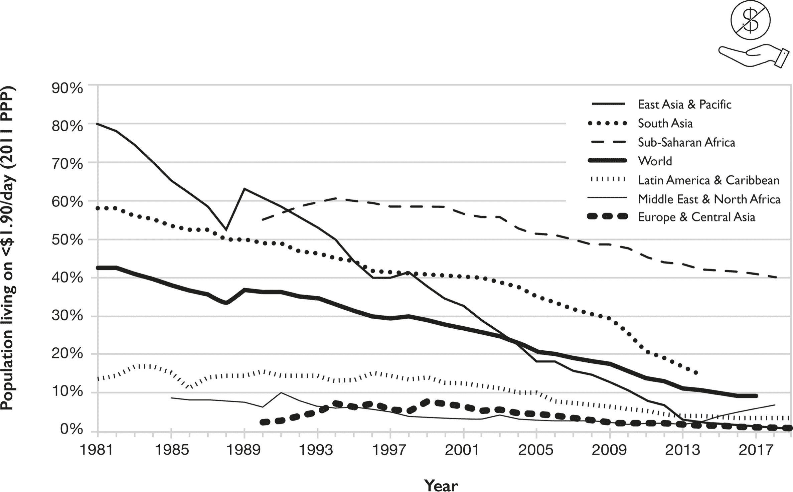
来源：世界银行

或许美国国内生产总值呈指数增长并不令人意外，因为人口增长意味着更大的经济规模。但人均国内生产总值——控制了人口增长——也呈指数增长。[\[137\]](#18_Notes.xhtml#EndnoteNumber414 "note")再次强调，这不包括免费信息产品，也没有考虑到信息技术在相同成本下随着时间推移呈指数增长的算力。

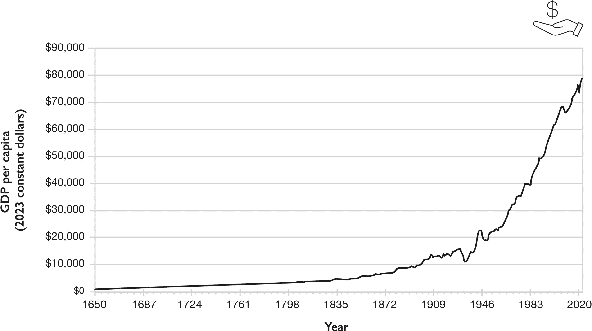
来源：麦迪逊项目数据库；经济分析局；联邦储备委员会

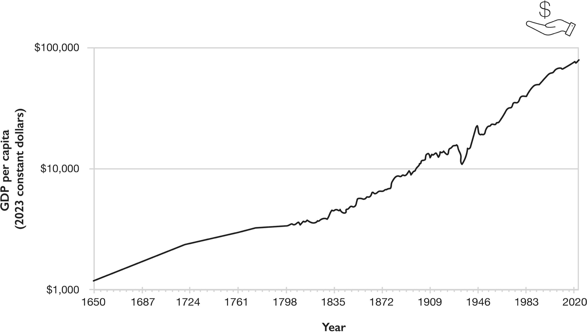
来源：麦迪逊项目数据库；经济分析局；联邦储备委员会

GDP 反映了包括大型企业在内的整体经济活动，但当我们只关注个人收入时，同样的趋势也成立。人均个人收入衡量的是实际个人的收入，而不是公司的收入。因此，它包括工资和薪金，但也包括股东和企业主从其公司获得的股息和利润。自从 1929 年首次记录该统计数据以来，美国人均不变美元的个人收入大幅上升，只有在大萧条和重大经济衰退期间出现短暂的下降。在过去的九十年里，美国人的平均实际收入增长了五倍以上。尽管工作时间大幅减少，但情况仍然如此。[\[140\]](#18_Notes.xhtml#EndnoteNumber417 "note")个人收入中位数反映了全国收入分配中正中间的人的收入，其增长速度没有那么快。但实际收入中位数继续以绝对值稳步上升，从 1984 年的 27,273 美元（全部为 2023 年美元）到疫情前的 2019 年的 42,488 美元。[\[141\]](#18_Notes.xhtml#EndnoteNumber418 "note")

这些增长大大低估了实际获得的收益，因为它们没有反映出，正如前面提到的，许多商品（如电子产品）现在的成本比过去低得多，而且许多非常有价值的服务（如搜索引擎和社交网络）是免费提供给用户的。此外，全球化使得人们能够获得比 1929 年更多的产品和服务。很难为现代消费者相对于过去几十年所能获得的令人眼花缭乱的种类赋予货币价值。即使你在一顿饭中只能选择中国菜或墨西哥菜，你可能更愿意有选择而不是只有一个选择。这种多样性影响了生活的无数领域。我们不再只有三个电视频道可供选择，而是有数百个。我们不再只有超市里的几种水果，而是可以吃到从地球另一半空运过来的反季节水果。我们不再只有书店里的几千本书，而是可以在亚马逊上选择数百万本书。

这些选择有助于每个人更好地满足自己的偏好，但它们对于那些有不寻常品味和兴趣的人来说尤其重要。由于信息技术使全球化经济成为可能技术，如果你喜欢收集旧万花筒，你可以去 eBay 从世界任何地方购买。如果你是一个对数学和科学感兴趣的孩子，你可以观看数小时的教育节目来培养你的好奇心，而不是像我这一代人那样，只能守着*Gunsmoke*在你家唯一的电视机旁。3D 打印和最终纳米技术的成熟将在未来几十年内呈指数级加速我们选择的多样化。

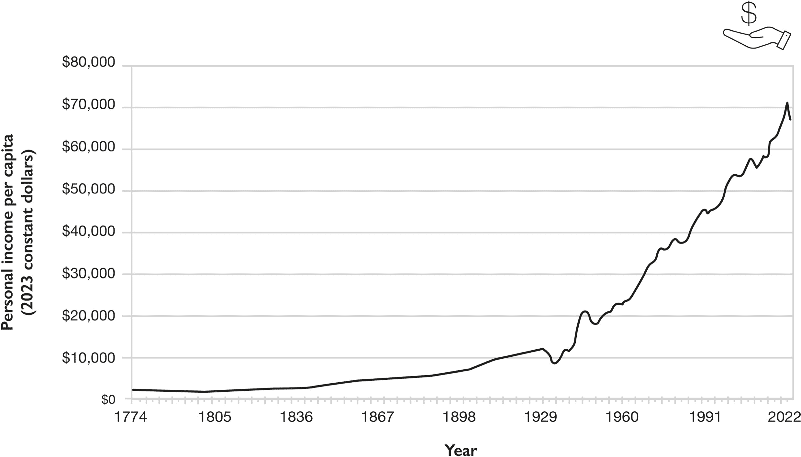
资料来源：美国经济分析局；国家经济研究局；Alexander Klein，“1880-1910 年美国个人收入的新州级估计”，载于*经济史研究*，第 29 卷，由 Christopher Hanes 和 Susan Wolcott 编辑（英国宾利：Emerald Group，2013）；联邦储备

年收入是一个有用的指标，但如果考虑到人们工作的时间，它会更有参考价值。以不变美元计算的每小时实际个人收入在美国稳步增长，从 1880 年的每小时约 5 美元增长到 2021 年的每小时约 93 美元。[\[143\]](#18_Notes.xhtml#EndnoteNumber420 "note")不过，请注意，个人收入不仅仅包括工资和薪金收入。它还包括投资收入和个人拥有的企业的收益，以及政府福利和一次性付款，如 2020 年的疫情刺激计划。因此，每小时个人收入始终高于单独的每小时工资和薪金收入的衡量标准。之所以说这是一个有用的衡量标准，是因为它反映了非工资收入在所有个人收入中所占的份额越来越大，因此更好地表明了即使普通工人工作时间减少，总体经济繁荣也在不断增长。

下图显示了美国每小时实际收入的稳步增长——即使在经济动荡时期也是如此。虽然没有来自大萧条最严重时期的良好数据，但似乎在这一时期，每小时收入并没有像其他经济表现指标那样受到严重影响。原因是，大萧条期间人均个人收入的下降是由于人口总体收入减少造成的。由于人口（分母）没有太大变化，这必然意味着人均收入降低。然而，当人们失业时，他们既会失去收入，也会减少工作时间。分母的减少导致萧条时期每小时收入保持稳定甚至增长。另一种看待这个问题的方式是，许多人完全失去了工作，但对于那些设法保住工作的人来说，工资并没有下降多少。

主要来源：麦迪逊项目；经济分析局；斯坦利·莱伯戈特，《劳动力和就业，1800-1960》，载于*1800 年后美国的产出、就业和生产力*，编辑：多萝西·S·布雷迪（华盛顿特区：国家经济研究局，1966）；亚历山大·克莱因，《美国个人收入的新州级估计，1880-1910》，载于*经济史研究*，第 29 卷，编辑：克里斯托弗·海恩斯和苏珊·沃尔科特（宾利，英国：翡翠集团，2013）；迈克尔·休伯曼和克里斯·明斯，《时代并没有改变：旧世界和新世界的工作日和工作时间，1870-2000》,*经济史探索*44, no. 4 (2007 年 7 月 12 日)

在 19 世纪末，美国工人平均每年工作近三千小时。[\[145\]](#18_Notes.xhtml#EndnoteNumber422 "note")大约在 1910 年后，由于法规和工会缩短了工作日，并为工人提供了更多的休息时间，这个数字开始迅速下降。[\[146\]](#18_Notes.xhtml#EndnoteNumber423 "note")此外，雇主们发现，休息充分的员工在工作中效率更高、更准确，因此将工作时间分配给比工业革命初期更多的工人是有意义的。在大萧条时期，平均工作时间骤降至每年 1750 小时以下，因为公司不得不削减即使是那些仍然有工作的员工的工作时间。[\[147\]](#18_Notes.xhtml#EndnoteNumber424 "note")在二战和战后繁荣时期，美国人纷纷涌回工厂和办公室，平均每年工作超过 2000 小时。[\[148\]](#18_Notes.xhtml#EndnoteNumber425 "note")自那以后，美国的工作时间逐渐但稳定地下降，恢复到大约大萧条时期的水平。[\[149\]](#18_Notes.xhtml#EndnoteNumber426 "note")不同之处在于，如今这些减少主要是由人们选择兼职工作和做出其他促进更健康工作与生活平衡的选择所驱动的。在一些欧洲国家，工作时间的下降幅度甚至更大。[\[150\]](#18_Notes.xhtml#EndnoteNumber427 "note")

对各种工作的需求变化促使千禧一代和 Z 世代比其他世代更倾向于寻求创造性的、通常是创业型的职业，并赋予他们远程工作的自由，这减少了通勤时间和费用，但也可能导致工作和生活之间的界限模糊。COVID-19 大流行在劳动力中造成了向远程办公和其他雇主-雇员关系替代模式的突然而巨大的转变。在一项研究中，98%的受访者表示，他们希望在余下的职业生涯中可以选择远程工作。[\[151\]](#18_Notes.xhtml#EndnoteNumber428 "note")随着技术变革使得越来越多的工作能够远程完成，这一趋势可能会加剧。

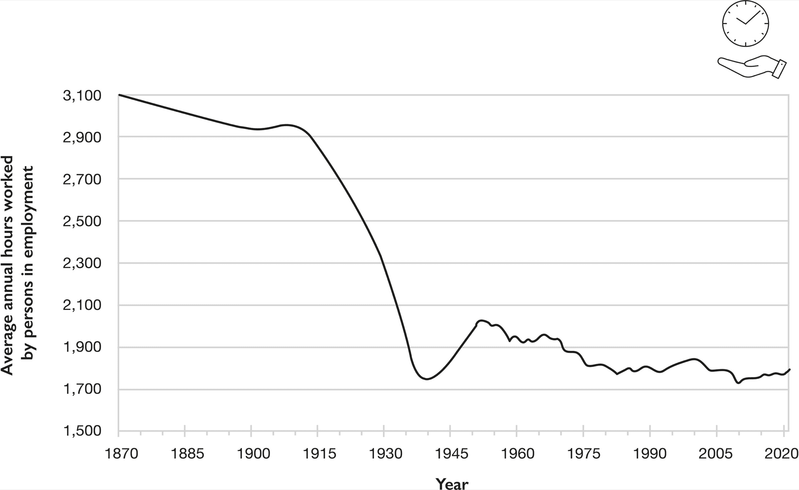
来源：Michael Huberman 和 Chris Minns，“时代没有改变：旧世界和新世界的工作日和工作时长，1870-2000”，*经济史探索*44, no. 4 (2007 年 7 月 12 日)；格罗宁根大学和加州大学戴维斯分校；联邦储备委员会；经济合作与发展组织

社会经济福祉的另一个关键指标是童工。当儿童因贫困被迫工作时，他们会失去受教育的机会，并面临长期潜力下降的局面。幸运的是，在整个二十一世纪，童工现象一直在稳步下降。国际劳工组织使用三个嵌套类别来衡量该领域的进展。[\[153\]](#18_Notes.xhtml#EndnoteNumber430 "note")最广泛的类别是“儿童就业”，其中包括儿童在家庭农场或家庭经营的企业中从事适度时间的轻松工作；尽管这可能会分散对教育的注意力，但这是一种相对温和的童工形式。第二个类别，即“童工”本身，包括儿童从事与成年人可能从事的工作大致相似的工作，无论是在工作时间的要求还是工作本身的艰苦程度上。第三个也是最窄的类别是“危险工作”，即在特别危险的条件下进行的童工劳动。这些工作包括采矿、拆船（拆卸船舶以提取价值和进行处置）和废物处理。从 2000 年到 2016 年，估计从事危险工作的世界儿童比例从 11.1%下降到 4.6%，尽管 COVID-19 造成的经济中断似乎中断了这一进展。[\[154\]](#18_Notes.xhtml#EndnoteNumber431 "note")

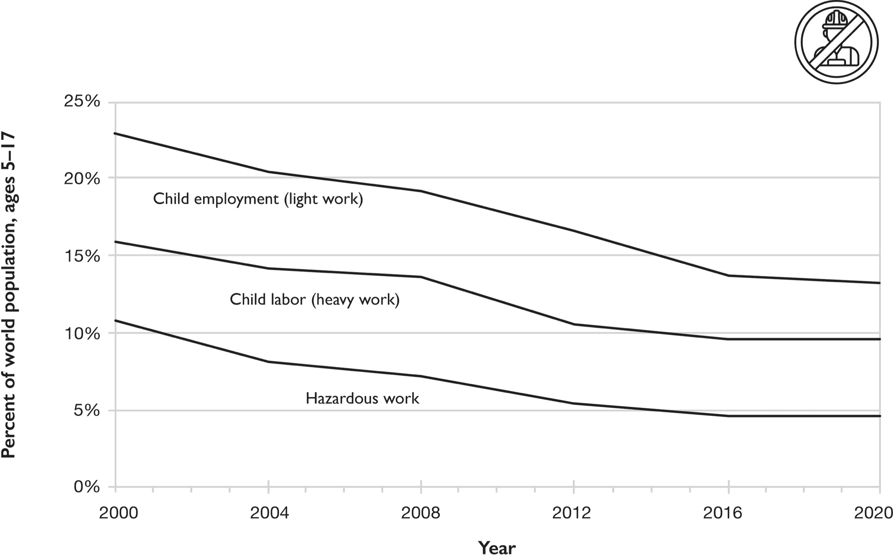
来源：国际劳工组织；联合国儿童基金会

## 暴力事件减少

物质繁荣的增长与暴力事件的减少存在相互促进的关系。在经济上有很多东西可以失去的人，更有动力避免争斗；当人们可以期待长期的安全生活时，他们有充分的理由进行长期的投资，从而使社会受益。在西欧，凶杀率至少从十四世纪以来一直在持续下降。[\[156\]](#18_Notes.xhtml#EndnoteNumber433 "note")在这些漫长的时间尺度上，即使在开发出越来越致命的个人武器的情况下，下降也是呈指数级的。在有良好数据可以追溯到中世纪时期的西欧国家，每 10 万人中的年度凶杀案数量已从十四世纪和十五世纪的每个国家平均约 33 起，下降到今天的不到 1 起——降幅超过 97%。[\[157\]](#18_Notes.xhtml#EndnoteNumber434 "note")请注意，这些统计数据侧重于“普通”凶杀的形式，如谋杀和过失杀人，不包括战争和种族灭绝。

来源：Our World in Data (Roser and Ritchie)；Manuel Eisner，“从刀剑到言语：自我控制的宏观层面变化是否能预测凶杀水平的长期变化？”*犯罪与司法*43, no. 1 (2014 年 9 月); 联合国毒品和犯罪问题办公室 ¶ 这张图表借鉴了 Our World in Data 网站上 Max Roser 和 Hannah Ritchie 的杰出工作，但在最近的来源选择上有所不同。1990 年之前的数据来自 Manuel Eisner 的“从刀剑到言语：宏观层面的自我控制变化是否能预测凶杀水平的长期变化？”，但本图表没有使用世界卫生组织 1990-2018 年的数据，而是使用了联合国毒品和犯罪问题办公室 1990-2020 年的数据。这是因为联合国毒品和犯罪问题办公室的数据得到了其他来源的更好证实，并且更符合各种官方执法部门的估计。

在美国，自 1991 年以来，谋杀和其他形式的暴力犯罪一直在长期下降。尽管美国凶杀案从 2014 年的每 10 万人 4.4 起上升到 2021 年的 6.8 起（撰写本文时最新的数据），但这种短期激增仍然使凶杀案下降了 30%以上——1991 年的数字是 9.8。[\[159\]](#18_Notes.xhtml#EndnoteNumber436 "note")然而，在 20 世纪的两个时期，凶杀案和一般暴力犯罪的发生率大约是今天的两倍。第一个时期是 20 世纪 20 年代和 30 年代，这主要是由于禁酒令和围绕非法酒类贸易而产生的犯罪组织。[\[160\]](#18_Notes.xhtml#EndnoteNumber437 "note")第二次暴力流行发生在 20 世纪 70 年代、80 年代和 90 年代，因为麻醉品和其他非法毒品的交易再次将暴力带到了美国城市的街头。[\[161\]](#18_Notes.xhtml#EndnoteNumber438 "note")

自那时以来，有几个因素在暴力事件的减少中发挥了重要作用。随着美国暴力犯罪在 20 世纪 80 年代初飙升至历史最高水平，犯罪学家开始寻找新的解决方案。学者乔治·凯林和詹姆斯·Q·威尔逊观察到，涂鸦和故意破坏等低级别犯罪使社区感到不安全，并使一些人认为他们可以逃脱更严重和更暴力的犯罪。[\[162\]](#18_Notes.xhtml#EndnoteNumber439 "note")这个想法后来被称为“破窗理论”，它影响了警务工作的一个新趋势，即强调阻止那些轻微犯罪，以此来预防更严重的犯罪。这与转向其他更积极主动的犯罪预防方法相结合，例如增加高犯罪社区的徒步巡逻，以及更智能的、数据驱动的建模，以确定如何最有效地利用警察资源。这些因素共同作用，似乎在 20 世纪 90 年代和 21 世纪初全国范围内的犯罪率下降中发挥了重要作用。然而，它们并非没有代价。在一些城市，破窗执法走得太远，对少数族裔社区造成了不成比例的伤害。在 2020 年代，警察面临的双重挑战是：在继续长期降低犯罪率趋势的同时，解决种族差异和相关的不公正现象。虽然这些问题没有单一的解决方案，但如果负责任地使用警察随身摄像头、公民手机摄像头、自动枪击探测器和人工智能驱动的数据分析等技术，都可以发挥积极作用。

另一个现在才开始被正确认识的因素是污染与犯罪之间的关系。在 20 世纪的大部分时间里，人们对环境毒性对大脑的影响，特别是铅的影响，了解甚少。汽车尾气和家用油漆中的铅暴露对儿童的认知发展产生了不利影响。虽然不可能知道这种慢性中毒是否导致了任何特定的犯罪，但在整个人口层面，它确实导致了暴力犯罪的统计性增加——可能是通过降低冲动控制能力。自大约 1970 年代以来，越来越多的环境法规限制了进入儿童大脑的铅和其他毒素的含量，这也被认为有助于降低暴力水平。[\[163\]](#18_Notes.xhtml#EndnoteNumber440 "note")

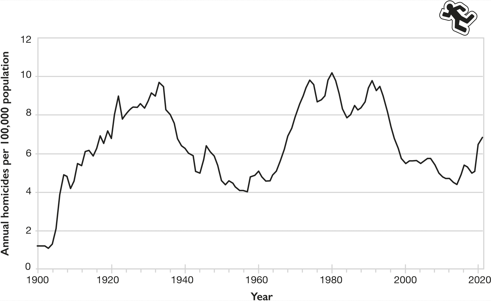
来源：联邦调查局；司法统计局

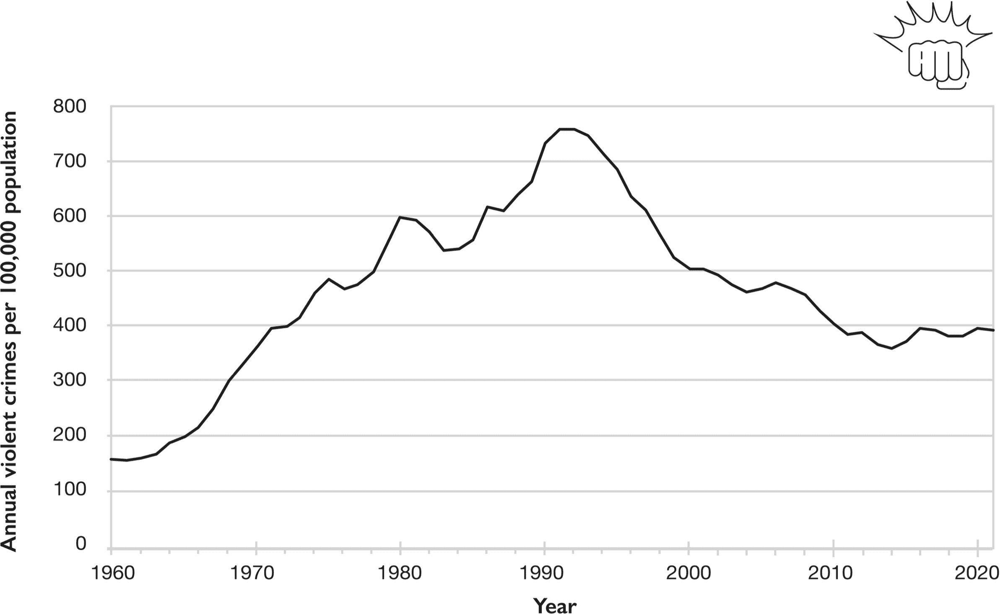
来源：联邦调查局；司法统计局

在他的 2011 年著作中*我们本性的善良天使*史蒂文·平克提出了进一步的证据，表明自中世纪以来，欧洲的凶杀案死亡人数大约下降了五十倍，在某些情况下甚至更多。[\[166\]](#18_Notes.xhtml#EndnoteNumber443 "note")例如，在十四世纪的牛津，估计每年每 10 万人中有 110 起凶杀案，而今天伦敦每年每 10 万人中的凶杀案不到一起。[\[167\]](#18_Notes.xhtml#EndnoteNumber444 "note")平克估计，自史前时代以来，暴力死亡总人数下降了大约五百倍。[\[168\]](#18_Notes.xhtml#EndnoteNumber445 "note")

即使是二十世纪的伟大历史冲突，在比例上也不如人类过去无国家状态下的持续暴力那样致命。平克研究了历史上 27 个没有正式国家的欠发达社会——包括狩猎采集者和狩猎园艺者，他们可能代表了史前时期的大多数人类社区。[\[169\]](#18_Notes.xhtml#EndnoteNumber446 "note")他估计，这些社会平均每年的战争死亡率为每 10 万人 524 人。相比之下，二十世纪发生了两次世界大战——其中包括种族灭绝、原子弹轰炸以及世界上有史以来最大规模的有组织暴力——但在德国、日本和俄罗斯这三个受这场屠杀打击最严重的国家，该世纪的年战争死亡率分别仅为每 10 万人 144 人、27 人和 135 人。相比之下，尽管美国参与了世界各地的冲突，但它在二十世纪的年战争死亡率仅为每 10 万人 3.7 人。

然而，公众在很大程度上错误地认为暴力事件正在变得更糟。平克将此主要归因于“历史短视”，即人们关注最近发生的、更受关注的事件，而没有意识到过去更严重的暴力事件。[\[170\]](#18_Notes.xhtml#EndnoteNumber447 "note")本质上，这就是行动中的可用性启发法。这些误解部分可归因于记录技术：我们可以轻松访问近期暴力事件的彩色视频。将其与 19 世纪的黑白照片，甚至更早之前的文字描述和相对较少的早期绘画作品进行比较。

像我一样，平克将暴力行为的急剧下降归因于良性循环。随着人们越来越有信心摆脱暴力，建设学校、写作和阅读书籍的动力变得更大，这反过来又鼓励使用理性而不是武力来解决问题，从而进一步减少暴力。我们经历了一个“不断扩大的同情圈”（哲学家彼得·辛格的术语），它将我们的认同感从氏族等狭隘群体扩展到整个国家，然后到外国人民，甚至到非人类动物。[\[171\]](#18_Notes.xhtml#EndnoteNumber448 "note")法律规则和反对暴力的文化规范也发挥了越来越大的作用。

对未来的关键洞察是，这些良性循环从根本上是由技术驱动的。当人类曾经只认同小群体时，通信技术（书籍，然后是广播和电视，然后是计算机和互联网）使我们能够与更广泛的人群交流思想，并发现我们的共同点。观看遥远土地上灾难的引人入胜的视频的能力可能会导致历史短视，但它也强大地利用了我们天生的同情心，并将我们的道德关注扩展到我们整个物种。

此外，财富增长越多，贫困减少越多，人们合作的动力就越大，对有限资源的零和斗争也得到缓解。我们许多人都有根深蒂固的倾向，认为争夺稀缺资源是暴力不可避免的原因，也是人性的固有组成部分。但虽然这在很大程度上是人类历史的故事，但我认为这不会是永久的。数字革命已经减少了许多我们可以轻松以数字方式表示的事物的稀缺条件，从网络搜索到社交媒体连接。为了一本实体书的副本而争吵可能很琐碎，但在某种程度上我们可以理解它。两个孩子可能会为一本最喜欢的印刷漫画而争吵，因为一次只能有一个人拥有并阅读它。但是人们为 PDF 文档争吵的想法是可笑的——因为你访问它并不意味着我不能访问它。我们可以根据需要创建任意数量的副本，基本上是免费的。

一旦人类拥有极其廉价的能源（主要来自太阳能，最终来自聚变）和人工智能机器人，许多种类的商品将如此容易复制，以至于人们为它们实施暴力的概念将显得像今天为 PDF 争吵一样愚蠢。通过这种方式，从现在到 2040 年代，信息技术方面的数百万倍改进将推动社会无数其他方面的变革性改进。

## 可再生能源的增长

我们技术文明的几乎每个方面都需要能源，但我们长期以来对化石燃料的依赖是不可持续的，原因有二。最明显的是，它会产生有毒污染和温室气体排放，而且还将我们限制在稀缺资源中，这些资源的开采成本越来越高，即使人类对廉价能源的需求正在飙升。幸运的是，随着我们将日益复杂的技术应用于底层材料和机制的设计，环境友好型可再生能源的成本一直在呈指数级下降。例如，在过去的十年中，我们一直在使用超级计算来发现太阳能电池和储能的新材料——近年来，深度神经网络也被用于此。[\[172\]](#18_Notes.xhtml#EndnoteNumber449 "note")由于这些持续的成本降低，从可再生能源（太阳能、风能、地热、潮汐和生物燃料）获得的能源总量也在呈指数级增长。[\[173\]](#18_Notes.xhtml#EndnoteNumber450 "note")2021 年，太阳能约占电力供应的 3.6%，自 1983 年以来，这一比例平均每 28 个月翻一番。[\[174\]](#18_Notes.xhtml#EndnoteNumber451 "note")更多内容将在本章后面介绍。

![主要来源：我们的世界数据；Gregory F. Nemet，“公共支持能源技术成本动态中期监测”能源政策 37，第 3 期（2009 年 3 月）；IRENA ¶ 正如这个对数图所示，光伏组件的每瓦成本已经呈指数级下降了近五十年，这种趋势有时被称为斯旺森定律。请注意，虽然组件成本是太阳能发电装置总成本中最大的单一组成部分，但其他因素，如许可证和安装人工，可以将总成本提高到大约三倍的组件成本。\[176\]虽然组件成本下降得非常快，但其他因素下降得较慢。人工智能和机器人可以降低劳动力和设计的成本，但我们也需要鼓励高效公用事业规划和许可的政策。](images/ART36_photovoltaic-module-cost-per-watt.jpg)

主要来源：我们的世界数据；Gregory F. Nemet，“公共支持能源技术成本动态中期监测”*能源政策*37，第 3 期（2009 年 3 月）；IRENA ¶ 正如这个对数图所示，光伏组件的每瓦成本已经呈指数级下降了近五十年，这种趋势有时被称为斯旺森定律。请注意，虽然组件成本是太阳能发电装置总成本中最大的单一组成部分，但其他因素，如许可证和安装人工，可以将总成本提高到大约三倍的组件成本。[\[176\]](#18_Notes.xhtml#EndnoteNumber453 "note")虽然组件成本下降得非常快，但其他因素下降得较慢。人工智能和机器人可以降低劳动力和设计的成本，但我们也需要鼓励高效公用事业规划和许可的政策。

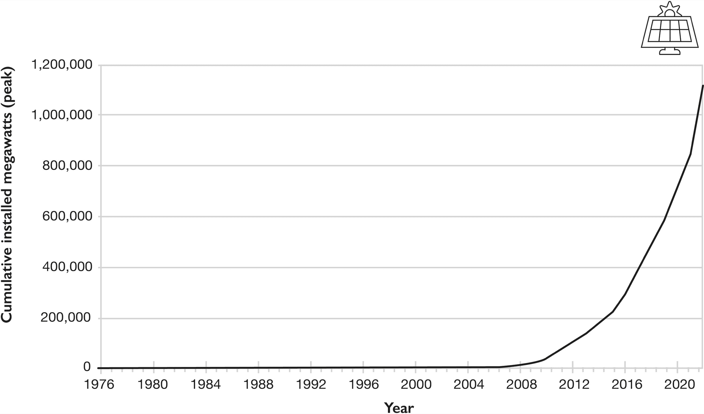

主要来源：Our World in Data；IRENA；Gregory F. Nemet，“公共支持能源技术成本动态的临时监测”，*能源政策*37，第 3 期（2009 年 3 月）

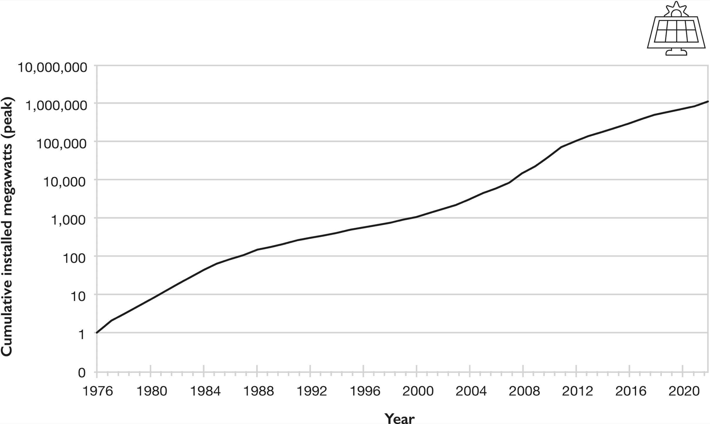

主要来源：Our World in Data；IRENA；Gregory F. Nemet，“公共支持能源技术成本动态的临时监测”，*能源政策*37，第 3 期（2009 年 3 月）

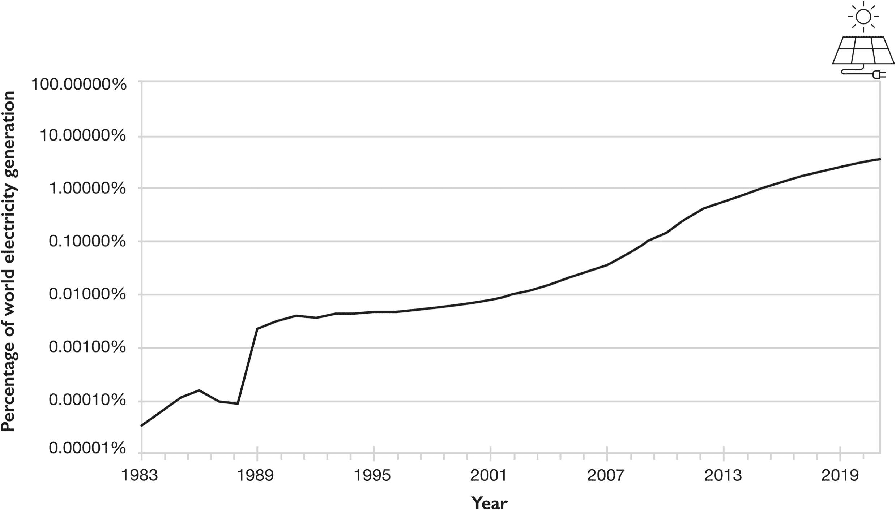

来源：Our World in Data；BP；IEA

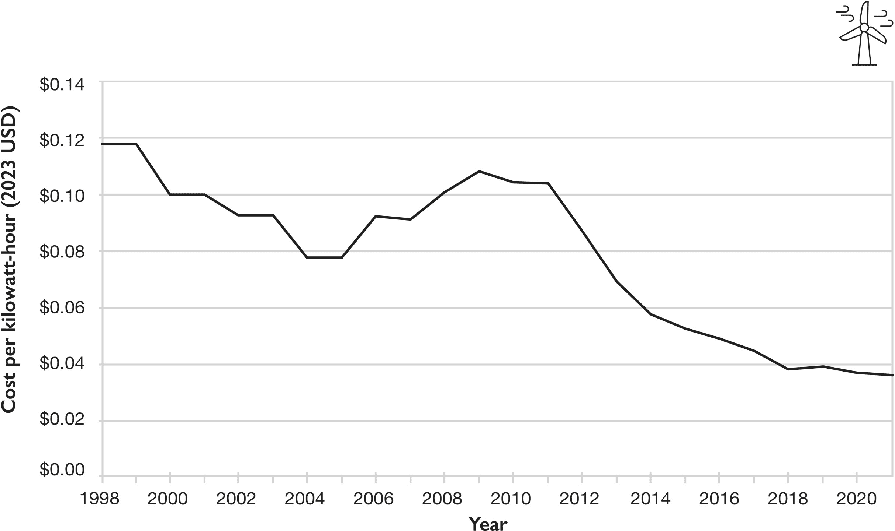

来源：美国能源部

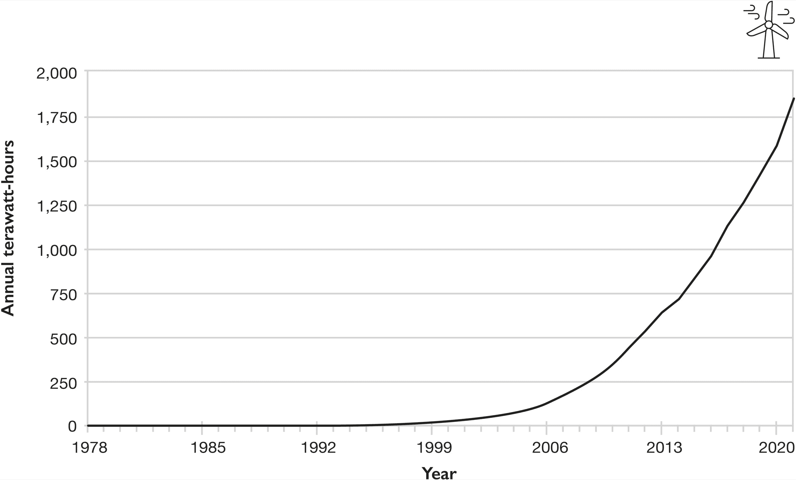

来源：Our World in Data；BP；Ember

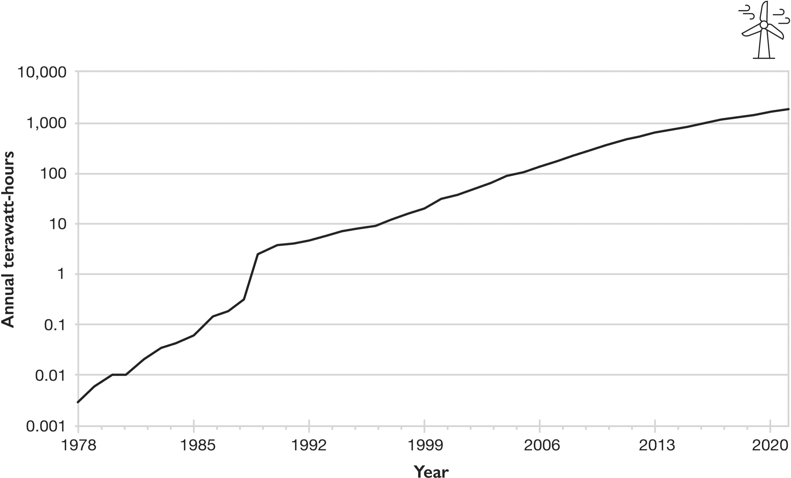

来源：Our World in Data；BP；Ember

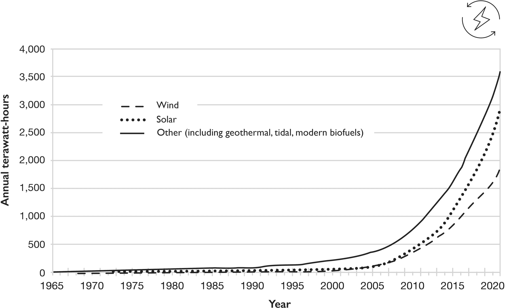

来源：Our World in Data；BP

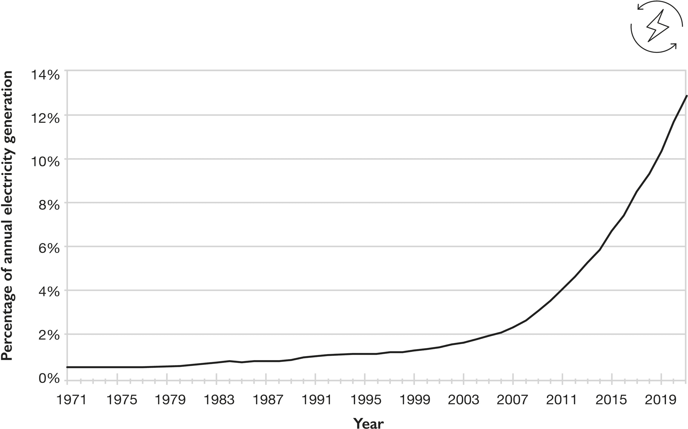

来源：Our World in Data；BP；IEA

## 民主的传播

廉价的可再生能源将释放巨大的物质财富，但人们公平地分享它需要民主。这里又出现了一个幸运的协同效应：信息技术在使社会更加民主方面有着悠久的历史。民主从其在中世纪英国的根源传播开来，与大众传播技术的兴起并行，并且很可能主要源于大众传播技术的兴起。《大宪章》于 1215 年撰写并由约翰国王签署，其中明确阐述了普通民众不被不正当监禁的权利。[\[184\]](#18_Notes.xhtml#EndnoteNumber461 "note")然而，在中世纪的大部分时间里，平民的权利经常被忽视，政治参与度也很低。这种情况随着古腾堡在 1440 年左右发明的活字印刷术而改变，随着它的迅速普及，受过教育的阶层能够更有效地传播新闻和思想。[\[185\]](#18_Notes.xhtml#EndnoteNumber462 "note")

印刷机是信息技术加速回报定律如何运作的一个极好的例证。如前所述，信息技术是指涉及信息的收集、存储、处理和传输的技术。人类的思想就是信息。从理论上讲，信息是抽象的秩序与混乱的熵形成对比。为了在现实世界中表示信息，我们以一种特定的方式使物理对象变得有序，比如在纸上写字。但关键的想法是，思想是组织信息的抽象方式，它们可以用各种不同的媒介来表示——石碑、羊皮纸、穿孔卡片、磁带或硅微芯片内部的电压。如果你有凿子和足够的耐心，你可以把 Windows 11 的每一行源代码都写在石碑上！这是一个有趣的画面，但也表明了物理媒介对于我们实际收集、存储、操作和传输信息的效率有多么重要。有些想法只有当我们能够非常高效地做到这些事情时，才会变得实用。

在中世纪的大部分时间里，书籍在欧洲只能由抄写员费力地手工抄写，这与效率背道而驰。因此，传播书面信息（思想）的成本极其高昂。广义地说，一个人或一个社会拥有的思想越多，就越容易创造新的思想；这包括技术创新。因此，使思想更容易分享的技术也使创造新技术更容易——其中一些技术将使分享思想变得更加容易。因此，当古腾堡引进印刷机时，分享思想很快变得非常便宜。中产阶级第一次能够大量购买书籍，释放了巨大的人类潜力。创新蓬勃发展，文艺复兴迅速蔓延到整个欧洲。这也为印刷带来了进一步的创新，到 17 世纪初，书籍比古腾堡时代便宜了几千倍。

知识的传播带来了财富和政治权力，像英国下议院这样的立法机构变得更加直言不讳。虽然大部分权力仍然掌握在国王手中，但议会能够向君主提出税务抗议，并弹劾它不喜欢的部长。[\[186\]](#18_Notes.xhtml#EndnoteNumber463 "note")1642 年至 1651 年的英国内战彻底废除了君主制，之后君主制以服从议会的形式重新建立；后来政府通过了一项权利法案，明确确立了国王只能在人民同意的情况下统治的原则。[\[187\]](#18_Notes.xhtml#EndnoteNumber464 "note")

在美国独立战争之前，英国虽然远非真正的民主国家，但却是世界历史上最民主的国家——而且值得注意的是，也是识字率最高的国家之一。[\[188\]](#18_Notes.xhtml#EndnoteNumber465 "note")从公元前一世纪罗马共和国崩溃到美国革命之间，还有许多其他社会拥有选举或大致共和的政治制度，但这些制度的政治参与总是非常有限，并且总是退回到暴政。在中世纪，意大利有几个共和国以热那亚和威尼斯等贸易富裕的城邦为中心，但这些实际上是强烈的贵族统治。例如，威尼斯的领导人（称为总督）是通过复杂的选举过程终身选举产生的，这个过程使贵族家庭掌握权力，而不让普通民众发挥任何作用。[\[189\]](#18_Notes.xhtml#EndnoteNumber466 "note")从 1569 年到 1795 年，波兰-立陶宛联邦的贵族（通常占人口的十分之一或更少）拥有非常自由和民主的制度，但非贵族在政治上几乎没有发言权。*贵族*贵族（通常占人口的十分之一或更少），但在政治上，非贵族几乎没有发言权。[\[190\]](#18_Notes.xhtml#EndnoteNumber467 "note")

相比之下，在英国，至少所有自由成年男性户主在理论上都有投票资格。虽然在实践中通常有额外的财产要求，但投票资格并不取决于某人的出生地位。尽管这排除了很多人，但这是一项绝对关键的政治创新，因为它为普遍政治参与的理念奠定了基础。一旦人们接受了出生地位不应决定某人的投票权，这种想法的力量就不可抑制。因此，第一个真正的现代民主国家出现在美国殖民地并非巧合，即使这需要一场反对英国的战争才能实现。然而，实现其承诺一直是一个艰苦的过程。

两个世纪前，在美国，大多数人仍然没有充分享有政治参与的权利。在 19 世纪初，投票权主要限于拥有至少适度财产或财富的成年白人男性。这些经济要求允许大多数白人男性投票，但几乎完全排除了妇女、非洲裔美国人（其中数百万人被当作奴隶）和美洲原住民。[\[191\]](#18_Notes.xhtml#EndnoteNumber468 "note")历史学家对究竟有多少比例的人口有资格投票存在分歧，但通常认为是在 10% 到 25% 之间。[\[192\]](#18_Notes.xhtml#EndnoteNumber469 "note")然而，这种不公正也孕育着自我瓦解的种子——投票为美国提供了一种改革机制，而对投票的限制与美国建国文件中提出的崇高理想形成了鲜明对比。

尽管其倡导者抱有很高的期望，但民主在整个 19 世纪的进程中进展缓慢。例如，1848 年欧洲的自由主义革命大多以失败告终，俄国沙皇亚历山大二世的许多改革也被他的继任者推翻。[\[193\]](#18_Notes.xhtml#EndnoteNumber470 "note")1900 年，只有 3%的世界人口生活在今天我们认为的民主国家中，因为即使是美国仍然剥夺了妇女的投票权，并对非裔美国人实行种族隔离。到 1922 年，在第一次世界大战之后，这一比例攀升至 19%。[\[194\]](#18_Notes.xhtml#EndnoteNumber471 "note")然而，法西斯主义的抬头很快使民主倒退，数亿人在第二次世界大战期间受到极权统治。值得注意的是，通过无线电进行的大众传播最初帮助法西斯分子夺取了政权，但最终同样的技术使盟国能够团结他们的民主国家取得胜利——最显著的是温斯顿·丘吉尔在闪电战期间发表的鼓舞人心的演讲。

战后几年，生活在民主制度下的人口比例迅速上升，这主要是由于印度和英国在南亚的其他殖民地赢得了独立。在冷战的大部分时间里，民主的范围大致保持稳定，世界上略超过三分之一的人口生活在民主社会。[\[195\]](#18_Notes.xhtml#EndnoteNumber472 "note")然而，从披头士乐队的唱片到彩色电视机，铁幕之外的通信技术的普及激起了人们对压制它的政府的不满。随着苏联的解体，民主再次迅速扩张，到 1999 年，几乎达到了世界人口的 54%。[\[196\]](#18_Notes.xhtml#EndnoteNumber473 "note")

尽管这个数字在过去二十年中有所波动，伴随着一些国家的进步被其他地方的倒退所抵消，一种充满希望的不同类型的自由化正在迅速发展。冷战结束时，世界上约有 35%的人口生活在封闭的专制政权下——这是最具压迫性的政权类型。[\[197\]](#18_Notes.xhtml#EndnoteNumber474 "note")到 2022 年，这个数字已经下降到大约 26%，使超过 7.5 亿人摆脱了暴政。[\[198\]](#18_Notes.xhtml#EndnoteNumber475 "note")这包括阿拉伯之春的重大而复杂的事件，这些事件在很大程度上是由社交媒体促成和推动的。未来几十年面临的一个关键挑战将是帮助那些介于专制和民主之间的灰色地带的国家过渡到完全民主的治理。其中一部分将取决于谨慎地使用人工智能来促进开放和透明，同时最大限度地减少其被滥用于专制监视或传播虚假信息的可能性。[\[199\]](#18_Notes.xhtml#EndnoteNumber476 "note")

不过，历史给了我们深刻乐观的理由。随着信息共享技术从电报发展到社交媒体，民主和个人权利的理念已经从几乎不被承认发展成为一种全球性的愿望，并且对于地球上近一半的人来说已经成为现实。想象一下，未来二十年的指数级进步将如何使我们更加充分地实现这些理想。

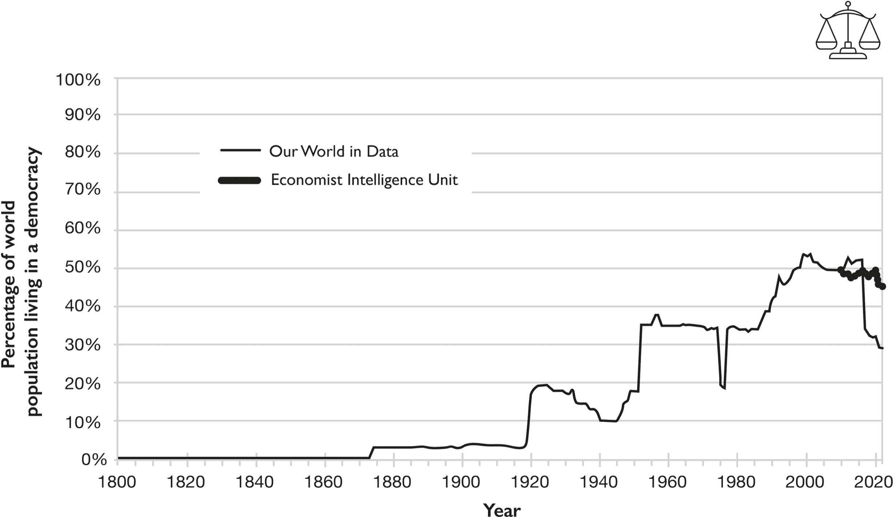

主要来源：Our World in Data; Economist Intelligence Unit（经济学人智库）

## 我们现在正进入指数增长的陡峭部分

需要认识到的关键一点是，到目前为止，我所描述的所有进步都来自于这些指数趋势的缓慢早期阶段。由于信息技术在未来二十年内取得的进步将远远超过过去两百年，因此对整体繁荣的好处将更大——事实上，它们已经比大多数人意识到的要大得多。

## 计算的性价比呈指数级提高

这里最根本的趋势是计算的性价比呈指数级提高——也就是说，每通货膨胀调整后的一美元可以执行多少次计算。当康拉德·楚泽在 1939 年建造第一台可工作的可编程计算机 Z2 时，它每 2023 美元可以执行大约 0.0000065 次计算。[\[201\]](#18_Notes.xhtml#EndnoteNumber478 "note")1965 年，PDP-8 每美元可以进行大约 1.8 次计算。当我的书*《智能机器时代》*于 1990 年出版时，MT 486DX 可以达到大约 1,700 次。当*精神机器的时代*九年后出现时，奔腾 III CPU 高达 80 万次。当*奇点临近*在 2005 年首次亮相时，一些奔腾 4 达到了 1200 万次。随着本书在 2024 年初付梓，谷歌云 TPU v5e 芯片可能达到每美元每秒约 1300 亿次运算！而且，由于这种强大的（大型 pod 每秒进行五千万亿次运算）云计算能力可以由任何有互联网连接的人以每小时几千美元的价格租用——作为从头开始构建和维护整个超级计算机的替代方案——零售用户使用小型项目可获得的有效性价比比这高出几个数量级。由于廉价的计算直接促进了创新，因此这种宏观趋势一直在稳步持续——而且它不依赖于任何特定的技术范式，如缩小晶体管或提高时钟速度。

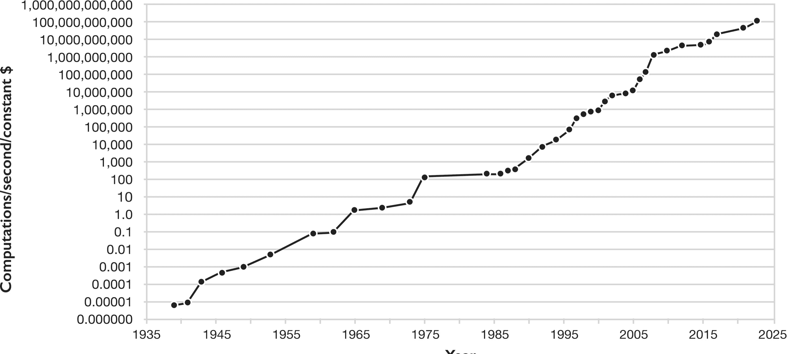

## 机器达到创纪录的性价比

| 年份 | 名称 | 每恒定 2023 美元的每秒计算次数 |
| --- | --- | --- |
| 1939 | Z2 | ~ 0.0000065 |
| 1941 | Z3 | ~ 0.0000091 |
| 1943 | 巨像 Mark 1 | ~ 0.00015 |
| 1946 | ENIAC（埃尼阿克） | ~ 0.00043 |
| 1949 | BINAC（二进制自动计算机） | ~ 0.00099 |
| 1953 | UNIVAC 1103 | ~ 0.0048 |
| 1959 | DEC PDP-1 | ~ 0.081 |
| 1962 | DEC PDP-4 | ~ 0.097 |
| 1965 | DEC PDP-8 | ~ 1.8 |
| 1969 | 数据通用 Nova | 约 2.5 |
| 1973 | Intellec 8 | 约 4.9 |
| 1975 | Altair 8800 | 约 144 |
| 1984 | 苹果麦金托什 | ~ 221 |
| 1986 | 康柏 Deskpro 386 (16 MHz) | ~ 224 |
| 1987 | PC’s Limited 386 (16 MHz) | ~ 330 |
| 1988 | 康柏 Deskpro 386/25 | ~ 420 |
| 1990 | MT 486DX | 约 1,700 |
| 1992 | Gateway 486DX2/66 | 约 8,400 |
| 1994 | 奔腾 (75 MHz) | 约 19,000 |
| 1996 | 奔腾 Pro（166 MHz） | 约 75,000 |
| 1997 | 移动奔腾 MMX (133 MHz) | 约 340,000 |
| 1998 | 奔腾 II (450 MHz) | 约 580,000 |
| 1999 | 奔腾 III (450 MHz) | 约 800,000 |
| 2000 | 奔腾 III (1.0 GHz) | ~ 920,000 |
| 2001 | 奔腾 4 (1700 MHz) | ~ 3,100,000 |
| 2002 | 至强 (2.4 GHz) | ~ 6,300,000 |
| 2004 | 奔腾 4 (3.0 GHz) | 约 9,100,000 |
| 2005 | 奔腾 4 662 (3.6 GHz) | 约 12,000,000 |
| 2006 | 酷睿 2 Duo E6300 | 约 54,000,000 |
| 2007 | 奔腾双核 E2180 | 约 130,000,000 |
| 2008 | GTX 285 | 约 1,400,000,000 |
| 2010 | GTX 580 | 约 2,300,000,000 |
| 2012 | GTX 680 | 约 5,000,000,000 |
| 2015 | Titan X (麦克斯韦 2.0) | 约 5,300,000,000 |
| 2016 | Titan X (帕斯卡) | 约 7,300,000,000 |
| 2017 | AMD Radeon RX 580 | 约 22,000,000,000 |
| 2021 | 谷歌云 TPU v4-4096 | 约 48,000,000,000 |
| 2023 | 谷歌云 TPU v5e | ~ 130,000,000,000 |

然而，这种显著的进步并没有像人们预期的那样得到广泛认可。在 2016 年 10 月 5 日国际货币基金组织年会上，与国际货币基金组织总裁克里斯蒂娜·拉加德以及其他经济领袖的对话中，拉加德问我，为什么我们没有从所有现有的卓越数字技术中看到更多的经济增长证据。我的回答是（并且是）我们通过将其放在分子和分母中来分解这种增长。

当非洲的一个青少年花费 50 美元购买一部智能手机时，它被算作 50 美元的经济活动，尽管事实上这次购买相当于 1965 年左右超过 10 亿美元的计算和通信技术，以及 1985 年左右数百万美元的计算和通信技术。骁龙 810 是 50 美元价位智能手机上常见的芯片，在各种性能基准测试中，平均每秒执行约 30 亿次浮点运算（GFLOPS）。[\[203\]](#18_Notes.xhtml#EndnoteNumber480 "note")这相当于每美元大约 6000 万次计算。1965 年最好的计算机每美元大约能实现 1.8 次计算，1985 年则达到了大约 220 次。[\[204\]](#18_Notes.xhtml#EndnoteNumber481 "note")按照当时的效率，在 1965 年要达到骁龙的水平需要花费近 17 亿美元（按 2023 年的美元计算），而在 1980 年则需要 1360 万美元。

当然，这种粗略的比较并没有考虑到自那时以来技术演变的许多其他方面。更确切地说，一部 50 美元智能手机的全部功能在 1965 年或 1985 年都是无法以任何价格实现的。因此，传统的衡量标准几乎完全忽略了信息技术的急剧通货紧缩率，在计算、基因测序和许多其他领域，这一比率约为每年 50%。在这不断提高的性价比中，一部分用于价格，一部分用于性能，因此我们以更低的价格获得了更好的产品。

以我个人为例，1965 年我进入麻省理工学院时，这所学校非常先进，实际上拥有*有*计算机。其中最著名的是一台 IBM 7094，它有 15 万字节的“磁芯”存储空间，以及四分之一的 MIPS（每秒百万条指令）的计算速度。它的成本为 310 万美元（以 1963 年的美元计算，相当于 2023 年的 3000 万美元），由数千名学生和教授共享。[\[205\]](#18_Notes.xhtml#EndnoteNumber482 "note")相比之下，在本书编写期间发布的 iPhone 14 Pro 售价 999 美元，对于与人工智能相关的应用，每秒可实现高达 17 万亿次的操作。[\[206\]](#18_Notes.xhtml#EndnoteNumber483 "note")这并不是一个完美的比较——iPhone 的部分成本包括与 7094 无关的功能，比如摄像头，而且 iPhone 的速度在许多用途上明显低于这个数字但在总体上，这一点是很明确的。至少大致来说，iPhone 比 7094 快 6800 万倍，成本不到其三万分之一。就性价比（每美元的速度）而言，这是一个惊人的两*万亿*倍的提升。

这种改进速度持续不减。它从根本上不依赖于摩尔定律，即微芯片上特征尺寸的著名指数级缩小。麻省理工学院在 1963 年购买了基于晶体管的 IBM 7094，当时基于微芯片的计算机尚未广泛引入——并且比戈登·摩尔在具有里程碑意义的 1965 年文章中公开阐述他的同名定律早两年。[\[207\]](#18_Notes.xhtml#EndnoteNumber484 "note")正如该定律具有影响力一样，它只是几种指数计算范式中的一种——到目前为止，包括机电继电器、真空管、晶体管和集成电路，未来还会有更多。[\[208\]](#18_Notes.xhtml#EndnoteNumber485 "note")

在许多方面，与计算能力同样重要的是信息。当我还是个青少年时，我用送报纸的收入攒了好几年的钱，买了一套*《大英百科全书》*花了数千美元，这算作了数千美元的 GDP。相比之下，今天拥有智能手机的青少年可以访问维基百科中一个远胜于它的百科全书——由于它是免费的，因此在经济活动中没有任何价值。虽然维基百科并不总是显示与*《大英百科全书》*，但它有几个显著的优势：全面性（主要的英语维基百科大约是*《大英百科全书》*的一百倍大小），及时性（在突发新闻发生后几分钟内更新，而印刷百科全书则需要数年），多媒体（许多文章集成了视听内容）和超文本性（将文章丰富地相互连接的超链接）。[\[209\]](#18_Notes.xhtml#EndnoteNumber486 "note")它还经常将读者链接到*《大英百科全书》*如果需要额外的学术严谨性，可以使用高质量的资源。这只是成千上万种免费信息产品和服务中的一种，所有这些产品和服务的 GDP 贡献都为零。

针对这一论点，拉加德反驳说，是的，数字技术确实具有许多非凡的品质和影响，但你不能吃信息技术，你不能穿它，你也不能住在里面。我的回应是：这一切将在未来十年内改变。当然，由于不断改进的硬件和软件，制造和运输这些类型的资源变得更加高效，但我们即将进入一个时代，在这个时代，食品和服装等商品不仅仅是通过信息技术变得更加经济，而且它们本身实际上是*成为*信息技术——由于自动化和人工智能在生产中占据主导地位，资源和生产成本随之下降。[\[210\]](#18_Notes.xhtml#EndnoteNumber487 "note")因此，这类商品将面临与其他信息技术产品相同的高通货紧缩率。

在 2020 年代后期，我们将开始能够用 3D 打印机打印服装和其他常见商品，最终每磅只需几美分。3D 打印的关键趋势之一是小型化：设计能够创建物体上更小细节的机器。在某个时候，传统的 3D 打印范式，如挤压（类似于喷墨），将被新的方法所取代，以便在更小的尺度上进行制造。可能在 2030 年代的某个时候，这将进入纳米技术领域，在那里可以用原子精度创建物体。埃里克·德雷克斯勒在他 2013 年的书中估计*彻底的富足*也就是说，考虑到更具质量效率的纳米材料，原子精度制造可以以大约每公斤 20 美分的价格制造大多数种类的物体。[\[211\]](#18_Notes.xhtml#EndnoteNumber488 "note")尽管这些数字仍然是推测性的，但成本降低肯定会是巨大的。正如我们在音乐、书籍和电影中所看到的那样，将会有许多免费的设计与专有设计并存。事实上，开源市场（现在是并将是一个伟大的均衡器）与专有市场的共存，将成为越来越多领域经济的决定性特征。

正如我将在本章后面解释的那样，我们将很快使用人工智能控制生产和无化学收获的垂直农业来生产高质量、低成本的食物。从细胞培养中清洁且合乎道德地生长的肉类将取代对环境造成破坏的工厂化养殖。2020 年，人类屠宰了超过 740 亿只陆地动物作为肉类，其产品总重量估计为 3.71 亿吨。[\[212\]](#18_Notes.xhtml#EndnoteNumber489 "note")联合国估计，这占人类文明每年温室气体排放总量的 11%以上。[\[213\]](#18_Notes.xhtml#EndnoteNumber490 "note")目前被称为实验室培育肉的技术有可能从根本上改变这一点。从动物尸体上获取的肉类有几个主要的缺点：它给无辜的生物带来了痛苦，它通常对人类不健康，并且它通过有毒污染和碳排放对环境造成严重的负面影响。从培养的细胞和组织中培育肉类可以解决所有这些问题。没有活的动物会遭受痛苦，它可以被设计成更健康和更好吃，并且可以通过更清洁的技术将对环境的危害降到最低。临界点可能是真实性。截至 2023 年，该技术可以复制没有太多结构的肉类，比如碎牛肉的质地，但它还没有准备好从头开始生成完整的菲力牛排。然而，当培养肉能够令人信服地模仿其所有动物同类产品时，我预计大多数人对它的不适感会迅速减少。

正如我稍后也将更详细地描述的那样，我们将很快能够廉价地生产用于建造房屋和其他建筑物的模块，使舒适的居住环境对数百万人来说变得可以负担得起。所有这些技术都已经成功地得到了演示，并将在这个十年中变得越来越先进和主流。伴随着物理世界的这场革命，将是虚拟和增强现实的变革性下一代，有时被称为元宇宙。[\[214\]](#18_Notes.xhtml#EndnoteNumber491 "note")多年来，元宇宙在很大程度上不为科幻小说和未来主义圈子之外的人所知，但由于 Facebook 在 2021 年更名为 Meta，以及其宣布长期战略的核心是在构建元宇宙中发挥关键作用，这一概念大大提升了公众的意识——以至于现在很多人错误地认为 Meta 发明了这个概念。

就像互联网是一个集成的、持久的网页环境一样，2020 年代后期的 VR 和 AR 将融合成为我们现实中一个引人注目的新层。在这个数字宇宙中，许多产品甚至根本不需要物理形式，因为模拟版本将在高度逼真的细节中完美运行。例如，一个完整的虚拟会议，能够与同事互动并轻松如同身临其境般地协作；一场虚拟音乐会，拥有坐在交响乐大厅中完全沉浸式的听觉体验；以及为全家提供的感官丰富的虚拟海滩假期，伴随着沙滩和大海的声音、景象和气味。

目前，大多数媒体仅限于调动两种感官：视觉和听觉。目前包含气味或触觉的虚拟现实系统仍然笨拙且不方便。但在接下来的几十年里，脑机接口技术将变得更加先进。最终，这将实现完全沉浸式虚拟现实，将模拟感官数据直接输入到我们的大脑中。这种技术将给我们如何度过时间和优先考虑的体验带来重大且难以预测的变化。它还将迫使我们重新考虑我们为什么要做我们所做的事情。例如，当我们能够安全地虚拟体验攀登珠穆朗玛峰的所有挑战和自然美景时，人们将不得不纠结于做真实的事情是否值得——或者危险是否一直是吸引力的一部分。

拉加德对我提出的最后一个挑战是，土地不会变成信息技术，而且我们已经非常拥挤了。我回答说，我们之所以拥挤，是因为我们选择聚集在密集的群体中。城市的出现是为了使我们的工作和娱乐成为可能。但是，如果你在世界上任何地方乘坐火车旅行，你就会发现几乎所有适合居住的土地仍然无人居住——只有 1%的土地被用于人类居住。[\[215\]](#18_Notes.xhtml#EndnoteNumber492 "note")在所有适宜居住的土地中，只有大约一半被人类直接利用，几乎全部用于农业——而在农业用地中，77%用于畜牧、放牧和饲料，只有 23%用于人类消费的作物。[\[216\]](#18_Notes.xhtml#EndnoteNumber493 "note")人造肉和垂直农业将使我们能够以目前使用土地的一小部分来满足这些需求。这将使我们能够获得更丰富的健康食品，并在容纳不断增长的人口的同时，释放出大片土地。自动驾驶汽车将通过使更长的通勤成为可能来促进不那么拥挤的土地使用，我们将越来越能够在我们想要的任何地方生活，同时仍然能够在虚拟和增强空间中一起工作和娱乐。

这种转变已经在进行中，并且由于 COVID-19 引起的社会变革而加速。在疫情高峰期，高达 42% 的美国人在家工作。[\[217\]](#18_Notes.xhtml#EndnoteNumber494 "note")这种经历可能会对员工和雇主如何看待工作产生长期影响。在许多情况下，朝九晚五坐在公司办公室办公的旧模式已经过时多年，但惯性和熟悉感使得社会难以改变，直到疫情迫使我们改变。随着 LOAR 将信息技术带入这些指数曲线的陡峭部分，并且人工智能在未来几十年内成熟，这种影响只会加速。

## 可再生能源正接近完全取代化石燃料

2020 年代指数级进步带来的最重要的转变之一是能源，因为能源为其他一切提供动力。在许多情况下，太阳能光伏发电已经比化石燃料便宜，而且成本正在迅速下降。但我们需要材料科学的进步来实现成本效益的进一步提高。纳米技术方面的人工智能辅助突破将通过使光伏电池能够从更多的电磁频谱中捕获能量来提高电池效率。该领域正在进行令人兴奋的开发。将称为纳米管和纳米线的微小结构放入太阳能电池中可以稳步提高其吸收光子、传输电子和产生电流的能力。[\[218\]](#18_Notes.xhtml#EndnoteNumber495 "note")同样，将纳米晶体（包括量子点）放入电池中可以增加每个吸收的阳光光子产生的电量。[\[219\]](#18_Notes.xhtml#EndnoteNumber496 "note")

另一种称为黑硅的纳米材料具有由大量原子级针组成的表面，这些针比光的波长还小。[\[220\]](#18_Notes.xhtml#EndnoteNumber497 "note")这几乎消除了电池的反射，确保更多的入射光子产生电力。普林斯顿的研究人员开发了一种替代方法，通过使用厚度仅为 300 亿分之一米的金原子纳米级网格来最大限度地提高电力，以捕获光子并提高效率。[\[221\]](#18_Notes.xhtml#EndnoteNumber498 "note")与此同时，麻省理工学院的一个项目已经用石墨烯薄片制造出了光伏电池，石墨烯是一种特殊的碳，只有一个原子厚（小于一纳米）。[\[222\]](#18_Notes.xhtml#EndnoteNumber499 "note")这些技术将使未来的光伏电池更薄、更轻，并能安装在更多的表面上。例如，像 SolarWindow Technologies 这样的公司已经率先开发出可以涂在窗户上的薄型光伏薄膜，在不遮挡视线的情况下产生有用的电力。[\[223\]](#18_Notes.xhtml#EndnoteNumber500 "note")

在未来的几年里，纳米技术还将通过促进太阳能电池的 3D 打印来降低制造成本，这将使分散式生产成为可能，从而在需要时随地制造光伏电池。与今天使用的大型、笨重、坚硬的面板不同，用纳米技术制造的电池可以采取多种方便的形式：卷材、薄膜、涂层等等。这将降低安装成本，并使世界各地更多的社区能够获得廉价、丰富的太阳能。

## 可再生能源的快速增长与储能挑战

2000 年，可再生能源（主要是太阳能、风能、地热、潮汐能和生物质能，但不包括水力发电）约占全球发电量的 1.4%。[\[224\]](#18_Notes.xhtml#EndnoteNumber501 "note")到 2021 年，这一比例上升到 12.85%，在此期间的平均翻番时间约为 6.5 年。[\[225\]](#18_Notes.xhtml#EndnoteNumber502 "note")从绝对值来看，翻番的速度更快，因为总发电量本身也在增长——从 2000 年的约 218 太瓦时当量增长到 2021 年的 3657 太瓦时，翻番时间约为 5.2 年。[\[226\]](#18_Notes.xhtml#EndnoteNumber503 "note")

随着人工智能应用于材料发现和设备设计，进一步降低成本，这一进展将呈指数级持续。按照这个速度，理论上到 2041 年，可再生能源可以完全满足世界电力需求。但是，在展望未来时，将可再生能源作为一个整体来考虑并不是很有用，因为它们并非都以相同的速度变得更便宜。

太阳能发电的成本下降速度比任何其他主要可再生能源都要快得多，而且太阳能还有最大的增长空间。在价格下降方面，与太阳能最接近的竞争对手是风能，但在过去五年中，太阳能的下降速度大约是风能的两倍。[\[227\]](#18_Notes.xhtml#EndnoteNumber504 "note")此外，太阳能具有较低的潜在下限，因为材料科学进步直接转化为更便宜和更高效的面板，并且当前技术仅捕获理论最大值的一小部分——通常约为入射能量的 20％，而理论极限约为 86％。[\[228\]](#18_Notes.xhtml#EndnoteNumber505 "note")尽管实际上永远无法达到这个上限，但仍然存在很大的改进潜力。相比之下，典型的风力发电系统达到约 50％的效率，这非常接近 59％的理论最大极限。[\[229\]](#18_Notes.xhtml#EndnoteNumber506 "note")因此，无论我们如何创新，这些系统都无法变得更好。

2021 年，太阳能约占全球电力的 3.6%。[\[230\]](#18_Notes.xhtml#EndnoteNumber507 "note")我们只需要利用照射到地球上的免费阳光的大约万分之一，就能满足目前使用水平下我们 100%的总能源需求。地球不断地沐浴在来自太阳的约 173,000 太瓦的能量中。[\[231\]](#18_Notes.xhtml#EndnoteNumber508 "note")在可预见的未来，大部分能量实际上无法被捕获，但即使使用当代技术，太阳能也足以满足人类的需求。美国政府科学家在 2006 年的一项估计表明，当时最好的技术所能提供的总能量高达 7,500 太瓦。[\[232\]](#18_Notes.xhtml#EndnoteNumber509 "note")这相当于一年内 65,700,00 太瓦时。相比之下，2021 年全球一次能源使用总量相当于 165,320 太瓦时。[\[233\]](#18_Notes.xhtml#EndnoteNumber510 "note")这包括电力、供暖和所有燃料。

太阳能在世界总量的占比方面，其翻番时间也比其他可再生能源快得多：从 1983 年到 2021 年，平均不到 28 个月——即使在绝对值方面，发电总量在同一时期增加了约 220%。[\[234\]](#18_Notes.xhtml#EndnoteNumber511 "note")从 2021 年的 3.6%开始，只需要大约 4.8 次翻倍就能达到 100%，这将使我们在 2032 年仅靠太阳能就能满足我们所有的能源需求。虽然这并不意味着太阳能真的会达到完全普及（由于经济和政治障碍的混合作用），但很明显，它正朝着真正具有变革性影响的轨迹发展。

世界上一些最大的未利用地区——沙漠——也往往是太阳能发电的最佳地点，这很方便。例如，例如，一直有提议用光伏板覆盖撒哈拉沙漠一小部分但意义重大的区域。这些光伏板可以产生足够的电力来为整个欧洲（通过地中海下的电缆）和非洲供电。[\[235\]](#18_Notes.xhtml#EndnoteNumber512 "note")

像这样扩大太阳能发电规模的主要挑战之一是需要更有效的储能技术。化石燃料的优势在于我们可以储存它们，然后在我们需要发电时燃烧它们。但是太阳只在白天照射，太阳强度随季节变化。因此，有必要采用有效的手段来储存太阳能，以便我们以后（几小时后或几个月后，视情况而定）在人们需要使用电力时使用。

幸运的是，我们也在储能的价格效率和数量方面开始取得指数级的增长。请注意，这些不是像加速回报定律那样的基本的、持久的指数趋势，因为储能的改进和扩展并不主要由反馈回路的创建所主导。但是，由于可再生能源使用量的激增，储能的价格效率和总使用量正在急剧增加——尤其是在光伏发电的情况下，这确实通过信息技术在释放材料科学新进展中的作用间接受益于加速回报定律。随着投资涌入可再生能源，可再生能源的成本下降，这正在将资源和创新努力投入到储能领域，因为储能对于可再生能源与化石燃料竞争发电领域的大部分份额至关重要。材料科学、机器人制造、高效运输和能源传输方面的融合进步也将实现持续的指数级增长。这意味着太阳能将在 2030 年代的某个时候占据主导地位。

现在正在开发的许多方法看起来很有希望，但目前尚不清楚哪种方法将在我们需要的巨大规模上证明最有效。由于电力本身无法有效储存，因此需要将其转换为其他类型的能量，直到需要时。选项包括将其转化为熔盐的热能，转化为抽入高架水库中的水的重力势能，转化为高速旋转飞轮中的旋转能，或转化为用电力产生的氢气中的化学能，然后在需要时清洁燃烧。[\[236\]](#18_Notes.xhtml#EndnoteNumber513 "note")

虽然大多数电池不适合公用事业规模的存储，但使用锂离子和其他几种化学物质的先进电池现在正在迅速提高成本效益。例如，在 2012 年至 2020 年期间，锂离子存储成本每兆瓦时下降了约 80％，预计将继续下降。[\[237\]](#18_Notes.xhtml#EndnoteNumber514 "note")随着这些成本随着新的创新持续下降，可再生能源可以取代化石燃料，成为电网的支柱。[\[238\]](#18_Notes.xhtml#EndnoteNumber515 "note")

来源：拉扎德 ¶ 由于储能技术被用于电力生产和消费过程的许多不同阶段，以及许多不同的经济环境中，因此很难比较不同项目之间的储能成本。迄今为止，可能最严格的分析来自金融咨询公司拉扎德，该公司使用了储能平准化成本（LCOS）指标。该指标旨在涵盖所有成本（包括资本成本），并除以项目生命周期内预计释放的总存储能量（以兆瓦时或等效单位计）。为了最好地反映技术进步的前沿，此图表显示了每年在美国新开设的公用事业规模储能项目中可获得的最佳 LCOS。请记住，给定年份的平均 LCOS 数字较高，但遵循相似的趋势——因此，一年的最佳 LCOS 可能是几年后的平均 LCOS。

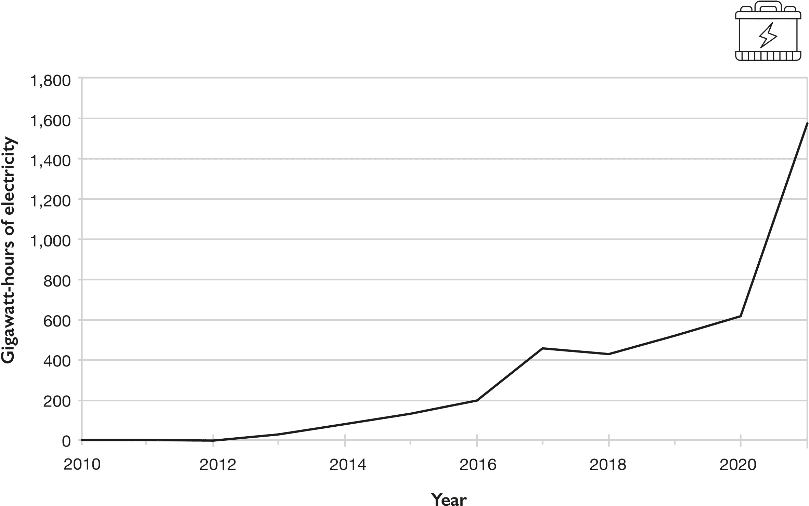

来源：美国能源信息署

## 我们正接近人人享有清洁用水

21 世纪的一个关键挑战将是确保地球上不断增长的人口拥有可靠的清洁淡水供应。1990 年，世界上约有 24%的人口无法定期获得相对安全的饮用水源。[\[241\]](#18_Notes.xhtml#EndnoteNumber518 "note")由于发展努力和技术进步，这个数字现在下降到大约十分之一。[\[242\]](#18_Notes.xhtml#EndnoteNumber519 "note")然而，这仍然是一个大问题。根据健康指标与评估研究所的数据，2019 年全球约有 150 万人死于腹泻，其中包括 50 万名幼儿，主要原因是饮用了被粪便细菌污染的水。[\[243\]](#18_Notes.xhtml#EndnoteNumber520 "note")这些疾病包括霍乱、痢疾和伤寒，对儿童尤其致命。

问题在于，世界上许多地方仍然缺乏收集淡水、保持清洁并将其输送到人们家中用于饮用、烹饪、洗涤和沐浴的基础设施。建造巨大的水井、水泵、渡槽和管道网络成本高昂，许多发展中国家无力承担。此外，内战和其他政治问题有时使大型基础设施项目不切实际。因此，像发达国家那样的集中式水净化和分配系统对于最后十分之一的大部分人来说不是一个可行的解决方案。另一种选择是使人们能够在当地社区甚至自己净化水的技术。战争和其他政治问题有时使大型基础设施项目不切实际。因此，像发达国家那样的集中式水净化和分配系统对于最后十分之一的大部分人来说不是一个可行的解决方案。另一种选择是使人们能够在当地社区甚至自己净化水的技术。

总的来说，在包括能源生产（太阳能电池）、食品生产（垂直农业）和日常用品生产（3D 打印）在内的许多领域，去中心化技术将定义 2020 年代及以后。对于水净化，这种方法可以采取多种形式，从像 Janicki Omni Processor 这样为整个村庄净化水的建筑物大小的机器，到像 LifeStraw 这样个人可以使用的便携式过滤器。[\[244\]](#18_Notes.xhtml#EndnoteNumber521 "note")

一些净化装置使用热能——来自太阳能或燃烧燃料——来煮沸水，然后再使用。煮沸可以杀死致病细菌，但不能去除其他有毒污染物，而且如果水在煮沸后没有立即饮用，很容易再次受到污染。在水中添加抗菌化学物质可以防止再次污染，但仍然不能去除其他毒素。近年来，一些便携式净水装置使用电力将空气中的氧气转化为臭氧，这是一种可以通入水中以非常有效地杀死病原体的气体。[\[245\]](#18_Notes.xhtml#EndnoteNumber522 "note")另一些则通过将强紫外线照射到水中来杀死细菌和病毒。但同样，这也不能防止化学污染。

另一种方法是过滤。多年来，过滤技术能够去除水中大部分但不是全部的有机物和毒素。许多最致命的病毒非常小，可以穿过普通过滤器中的孔洞。[\[246\]](#18_Notes.xhtml#EndnoteNumber523 "note")同样，一些污染物的分子也无法通过普通过滤来阻挡。[\[247\]](#18_Notes.xhtml#EndnoteNumber524 "note")然而，材料科学的最新创新正在创造能够阻挡越来越小的毒素的过滤器。在未来几年，纳米工程材料将使过滤器能够更快地工作，并且非常便宜。

一种特别有前景的新兴技术是 Slingshot 水由迪恩·卡门（生于 1951 年）发明的机器。[\[248\]](#18_Notes.xhtml#EndnoteNumber525 "note")它是一种相对紧凑的设备——大约一个小型冰箱的大小——可以从任何来源，包括污水和受污染的沼泽水中，生产出完全纯净的、符合注射液体标准的纯水。Slingshot 运行所需的电力不到一千瓦。它使用蒸汽压缩蒸馏（将输入的水变成蒸汽，留下污染物），并且不需要过滤器。Slingshot 旨在由一种非常适应性强的发动机——斯特林发动机提供动力，该发动机可以从任何热源（包括燃烧牛粪）产生电力。[\[249\]](#18_Notes.xhtml#EndnoteNumber526 "note")

## 垂直农业将提供廉价、高质量的食物，并释放我们用于水平农业的土地

大多数考古学家估计人类农业的诞生大约发生在 12000 年前，但也有一些证据表明最早的农业可能可以追溯到 23000 年前。[\[250\]](#18_Notes.xhtml#EndnoteNumber527 "note")未来考古发现可能会进一步修正这种理解。无论农业何时开始，当时从特定面积的土地上可以种植的食物量都非常低。最初的农民将种子撒在天然土壤中，让雨水浇灌它们。这种低效过程的结果是，绝大多数人口需要从事农业劳动才能生存。

到公元前 6000 年左右，灌溉使得农作物能够获得比仅靠雨水更多的水分。[\[251\]](#18_Notes.xhtml#EndnoteNumber528 "note")植物育种扩大了植物的可食用部分，并使其更具营养价值。肥料为土壤提供了促进生长的物质。更好的农业方法使农民能够以最有效的方式种植作物。结果是，更多的食物变得可用，因此几个世纪以来，越来越多的人可以将时间花在其他活动上，如贸易、科学和哲学。一些这种专业化带来了进一步的农业创新，形成了一个反馈循环，推动了更大的进步。这种动态使我们的文明成为可能。

量化这一进展的一个有用方法是作物密度：在给定的土地面积上可以种植多少食物。例如，美国的玉米产量使用的土地效率是一个半世纪前的七倍多。1866 年，美国玉米农民平均每英亩产量约为 24.3 蒲式耳，到 2021 年，这一数字达到了每英亩 176.7 蒲式耳。[\[252\]](#18_Notes.xhtml#EndnoteNumber529 "note")在世界范围内，土地效率的提高大致呈指数增长，今天，我们平均只需要 1961 年所需土地的不到 30%来种植一定数量的作物。[\[253\]](#18_Notes.xhtml#EndnoteNumber530 "note")这一趋势对于实现同期全球人口增长至关重要，并使人类免于我成长过程中许多人担心的过度人口造成的 mass starvation。

此外，由于现在的作物以极高的密度种植，并且机器完成了大量过去由手工完成的工作，因此一名农场工人可以种植足够的食物来养活大约七十人。因此，农业劳动已从 1810 年占美国所有劳动的 80%下降到 1900 年的 40%再到今天的不到 1.4%。[\[254\]](#18_Notes.xhtml#EndnoteNumber531 "note")

然而，作物密度现在正接近在给定的室外区域可以种植多少食物的理论极限。一种新兴的解决方案是种植多层堆叠的作物，称为垂直农业。[\[255\]](#18_Notes.xhtml#EndnoteNumber532 "note")垂直农场利用了几种技术。[\[256\]](#18_Notes.xhtml#EndnoteNumber533 "note")通常，他们采用水培法种植作物，这意味着植物不是在土壤中生长，而是在室内富含营养液的水盘中培育。这些水盘被装入框架中，并堆叠成多层，这意味着一层多余的水可以滴到下一层，而不是作为径流流失。一些垂直农场现在使用一种名为气培法的新方法，用水雾代替水。[\[257\]](#18_Notes.xhtml#EndnoteNumber534 "note")并且用特殊的 LED 灯代替阳光，以确保每株植物都能获得完美的光照量。垂直农业公司 Gotham Greens 是行业领导者之一，该公司拥有从加利福尼亚到罗德岛的十个大型设施。截至 2023 年初，该公司已筹集了 4.4 亿美元的风险投资。[\[258\]](#18_Notes.xhtml#EndnoteNumber535 "note")其技术使其能够以“比传统土壤农场少 95%的水和 97%的土地”获得给定的作物产量。[\[259\]](#18_Notes.xhtml#EndnoteNumber536 "note")这种效率将释放出水和土地用于其他用途（回想一下，目前估计农业占世界可居住土地的一半左右），并提供更丰富、更实惠的食物。[\[260\]](#18_Notes.xhtml#EndnoteNumber537 "note")

垂直农业还有其他关键优势。通过防止农业径流，它消除了水道污染的主要原因之一。它避免了耕种松散土壤的需要，这些土壤会被吹到空气中并降低空气质量。它使有毒农药变得不必要，因为害虫无法进入设计合理的垂直农场。这种方法还可以全年种植农作物，包括无法在当地户外气候中生长的物种。同样，这也可以防止因霜冻和恶劣天气造成的作物损失。也许最重要的是，这意味着城市和乡村可以在当地种植自己的食物，而不是通过火车和卡车从数百甚至数千英里外运来。随着垂直农业变得越来越便宜和普及，它将大大减少污染和排放。

在未来几年，光伏发电、材料科学、机器人技术和人工智能等领域的融合创新将使垂直农业比目前的农业便宜得多。许多设施将由高效的太阳能电池供电，在现场生产新的肥料，从空气中收集水分，并用自动化机器收割作物。由于需要的工人很少，占地面积也很小，未来的垂直农场最终将能够以如此低廉的价格生产作物，以至于消费者几乎可以免费获得食品。

这个过程反映了信息技术领域由于加速回报定律而发生的情况。随着计算能力呈指数级地变得更便宜，像谷歌和脸书这样的平台已经能够免费向用户提供服务，同时通过广告等替代商业模式来支付自己的成本。通过使用自动化和人工智能来控制垂直农场的各个方面，垂直农业实际上是将食品生产转变为一种信息技术。

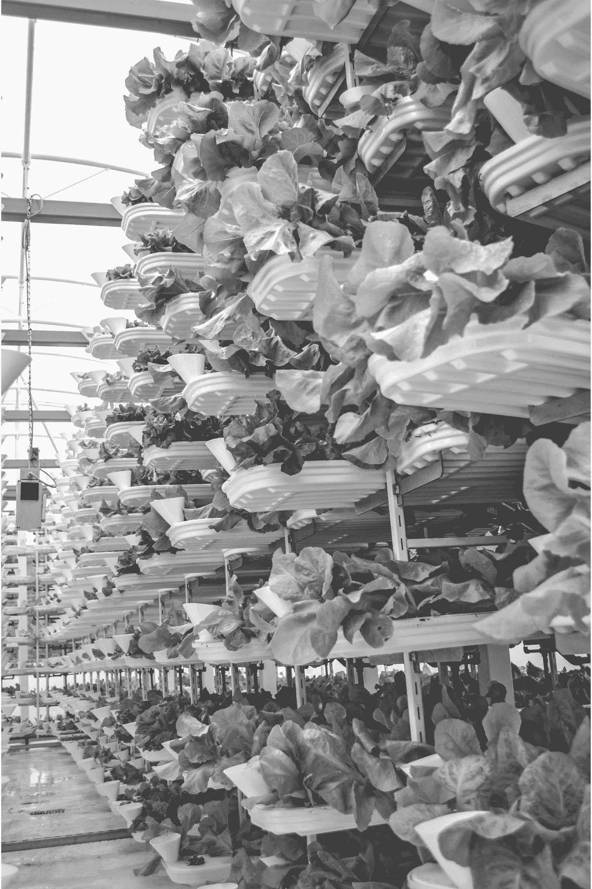

垂直农场中堆叠层中生长的生菜。图片来源：Valcenteu，2010 年。

## 3D 打印将彻底改变实物的创造和分发

在二十世纪的大部分时间里，制造三维固体物体通常采取两种形式。一些工艺包括在模具内塑造材料，例如将熔融塑料注入模具中，或在压力机中塑造加热的金属。另一些工艺包括有选择地从块或片材中去除材料，很像雕塑家在雕刻雕像时从大理石块上剥落。这两种方法都有很大的缺点。创建模具非常昂贵，而且一旦完成，模具就很难修改。相比之下，所谓的减材制造会浪费大量材料，并且无法生产某些形状。

但在 20 世纪 80 年代，一种新的技术开始出现。[\[261\]](#18_Notes.xhtml#EndnoteNumber538 "note")与以前的方法不同，它们通过堆叠或沉积相对平坦的层，并将它们构建成三维形状来创建零件。这些技术已被称为增材制造、三维打印或 3D 打印。

最常见的 3D 打印机的工作方式有点像喷墨打印机。[\[262\]](#18_Notes.xhtml#EndnoteNumber539 "note")一个典型的喷墨打印机在纸张上来回移动，按照软件的指示，从墨盒的喷嘴中喷出墨水。与墨水不同，3D 打印机使用塑料等材料，并将其加热至软化。它们的喷嘴沉积材料，遵循软件运行的每层图案，多次重复该过程，物体逐渐变得更具三维性。这些层在硬化时融合在一起，完成的物体即可使用。在过去的二十年中，3D 打印在更高的分辨率、成本降低和速度提高方面不断进步。[\[263\]](#18_Notes.xhtml#EndnoteNumber540 "note")3D 打印系统现在可以使用各种材料创建物体，包括纸张、塑料、陶瓷和金属。正如随着 3D 打印技术的进步，它将能够处理更多奇异材料。例如，医疗植入物可以内置药物分子，以便逐渐释放到体内。像石墨烯这样的纳米材料可以用来制造轻质防弹衣和超高速电子产品。3D 打印还可以受益于人工智能的进步，例如可以优化物体的强度、空气动力学形状或其他属性的软件，甚至可以创建需要使用当代方法无法制造的形状的设计。

新的、直观的软件使人们更容易创建 3D 打印部件，而无需高级培训。随着 3D 打印变得越来越普及，它已经开始彻底改变制造业。一个主要的优势是它可以实现廉价且快速的原型制作。工程师可以在计算机上设计一个新零件，并在几分钟或几小时内拿到一个 3D 打印的模型——而使用以前的技术可能需要几周时间。这使得测试和修改的周期可以快速进行，而成本仅为旧方法的一小部分。因此，有好的想法但资金相对较少的人可以将他们的创新带到市场上并造福社会。

3D 打印的另一个关键优势是，它可以实现基于模具的制造无法实现的定制水平。即使是细微的修改通常也需要一个全新的模具，这可能花费数万美元或更多。相比之下，即使对 3D 打印设计进行重大更改也不会产生额外的成本。因此，发明者可以拥有他们创新所需的精确零件，而消费者可以负担得起专门为他们设计的产品。其中一个例子是生产根据客户脚的精确尺寸制作的鞋子，以大大提高合脚性和舒适度。一家领先的 3D 打印鞋类公司是 FitMyFoot，它让客户可以使用应用程序拍摄他们的脚的照片，这些照片会自动转换为打印过程的测量数据。[\[264\]](#18_Notes.xhtml#EndnoteNumber541 "note")同样，家具可以模制成适合每种体型，工具可以制成精确适合您自己手的工具。[\[265\]](#18_Notes.xhtml#EndnoteNumber542 "note")更重要的是，重要的医疗植入物将会更便宜、更有效。[\[266\]](#18_Notes.xhtml#EndnoteNumber543 "note")

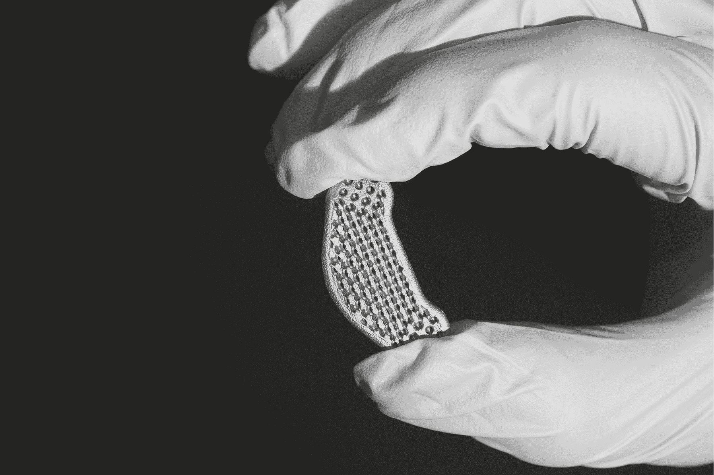

一个 3D 打印的钛金属脊椎间盘，可以植入到患有脊椎损伤或疾病的患者体内。图片来源：FDA 照片，由 Michael J. Ermarth 拍摄，2015 年。

此外，3D 打印使得制造能够去中心化，从而赋予消费者和当地社区权力。这与 20 世纪发展起来的模式形成对比，在那种模式下，制造主要集中在主要城市的大型企业工厂中。在这种模式下，小城镇和发展中国家必须从遥远的地方购买产品，而且运输成本高昂且耗时。去中心化制造也将带来显著的环境效益。将产品从工厂运送到数百或数千英里之外的消费者手中会产生巨大的排放。根据国际运输论坛的数据，货运约占燃料燃烧产生的所有碳排放的 30%左右。[\[267\]](#18_Notes.xhtml#EndnoteNumber544 "note")去中心化的 3D 打印可以使其中大部分变得不必要。

每年，3D 打印的分辨率都在提高，而且技术也越来越便宜。[\[268\]](#18_Notes.xhtml#EndnoteNumber545 "note")随着分辨率的提高（即，最小可实现的设计特征的尺寸缩小）和成本的下降，可以经济地打印的商品范围将会扩大。例如，许多常见的织物都有直径为 10 到 22 微米（百万分之一米）的纤维。[\[269\]](#18_Notes.xhtml#EndnoteNumber546 "note")一些 3D 打印机已经可以达到 1 微米或更小的分辨率。[\[270\]](#18_Notes.xhtml#EndnoteNumber547 "note")一旦这项技术能够以与普通织物相似的价格，用类似织物的材料实现织物般的直径，那么打印出我们想要的任何服装在经济上都是可行的。[\[271\]](#18_Notes.xhtml#EndnoteNumber548 "note")由于打印速度也在不断提高，大批量生产将变得更加实用。[\[272\]](#18_Notes.xhtml#EndnoteNumber549 "note")

除了制造像鞋子和工具这样的日常用品外，新的研究正在将 3D 打印应用于生物学。科学家们目前正在测试一些技术，这些技术将使打印人体组织，并最终打印整个器官成为可能。[\[273\]](#18_Notes.xhtml#EndnoteNumber550 "note")其基本原理是，将一种生物学上不活跃的材料，如合成聚合物或陶瓷，打印成一个三维的“支架”，其形状为所需的身体结构。然后将富含重编程干细胞的液体沉积在支架上，在那里细胞繁殖并填充到适当的形状中，从而创建一个具有患者自身 DNA 的替代器官。联合治疗公司（我是该公司的董事会成员）正在应用这种方法（以及其他方法），以便有朝一日能够培育出整个肺、肾脏和心脏。[\[274\]](#18_Notes.xhtml#EndnoteNumber551 "note")这种方法最终将远远优于将器官从一个人移植到另一个人，因为这种方法在可用性和与患者免疫系统的不相容性方面存在深刻的局限性。[\[275\]](#18_Notes.xhtml#EndnoteNumber552 "note")

3D 打印的一个潜在缺点是，它可能被用于制造盗版设计。如果可以下载文件并以一小部分成本自己打印，为什么还要花 200 美元购买一双名牌鞋？我们已经在音乐、书籍、电影和其他创意形式的知识产权方面面临类似的问题。所有这些都需要新的方法来保护知识产权。[\[276\]](#18_Notes.xhtml#EndnoteNumber553 "note")

另一个令人不安的影响是，分散式制造将允许平民制造他们原本无法轻易获得的武器。网上已经流传着一些文件，使人们能够打印零件来组装自己的枪支。[\[277\]](#18_Notes.xhtml#EndnoteNumber554 "note")这将对枪支管制提出挑战，并允许制造没有序列号的枪支，使执法部门更难追踪犯罪。由先进塑料制成的 3D 打印枪支甚至可以用来绕过金属探测器。这将需要对当前的法规和政策进行深思熟虑的重新评估。

## 建筑的 3D 打印

三维打印通常与制造小型物体有关，如工具或医疗植入物，但它也可以用来创建更大的结构，如建筑物。这项技术正在通过原型阶段迅速发展，随着 3D 打印结构的生产成本降低，它们将成为当前建筑方法在商业上可行的替代方案。最终，建筑模块和进入建筑物的小型物体的 3D 打印将大大降低房屋和办公室的建筑成本。

3D 打印建筑物有两种主要方法。第一种是创建随后组装在一起的零件或模块——很像人们从宜家购买家具零件并在自己的组装。[\[278\]](#18_Notes.xhtml#EndnoteNumber555 "note")在某些情况下，这意味着打印墙壁部分和屋顶部分等物品，然后在施工现场连接它们——类似于将乐高零件拼在一起。到 2020 年代末，机器人将能够在很大程度上完成这些模块的组装。

另一种方法是打印整个房间的结构或模块化结构。[\[279\]](#18_Notes.xhtml#EndnoteNumber556 "note")这些模块通常具有正方形或矩形的占地面积，并且可以以许多不同的配置组合在一起。在施工现场，它们可以被起重机吊到指定位置并快速组装。这最大限度地减少了施工通常对周围区域造成的干扰和妨害。2014 年，中国公司盈创建筑展示了在 24 小时内建造十个简单的模块化房屋，每个房屋的成本低于 5,000 美元。[\[280\]](#18_Notes.xhtml#EndnoteNumber557 "note")中国已经是 3D 打印建筑的中心，并且在未来几十年中将非常需要这种技术的更成熟版本。

另一种方法是将整个定制设计的建筑物打印为单个模块。[\[281\]](#18_Notes.xhtml#EndnoteNumber558 "note")工程师在建筑物所在的区域周围设置一个大框架，打印喷嘴在框架内以机器人方式移动，以墙壁的形状沉积材料层（例如，混凝土）。主要结构施工几乎不需要人工，但在完成后，工人可以进入完成建筑物的内部并添加诸如窗格和屋顶瓦之类的元素。例如，在 2016 年，华商腾达公司宣布完成了一栋两层别墅，该别墅在四十五天内一次性打印完成。[\[282\]](#18_Notes.xhtml#EndnoteNumber559 "note")就在我写这篇文章的时候，这项技术正在向美国蔓延，2021 年，一家名为 Alquist 3D 的公司完成了第一栋业主自住的 3D 打印房屋，2023 年，在休斯顿出现了第一栋多层住宅建筑。[\[283\]](#18_Notes.xhtml#EndnoteNumber560 "note")到 2020 年代末，将大型和小型物体的 3D 打印与智能机器人技术相结合，将提高建筑物个性化的能力，同时大幅降低成本。

建筑物模块的 3D 打印具有几个关键优势，随着技术的发展，这些优势将变得更加强大。首先，它降低了劳动力成本，这将使基本住房变得更加经济实惠。它还缩短了施工时间，从而减少了长期施工对环境的影响。这包括减少诸如废物和垃圾、光和噪音污染、有毒粉尘、交通中断以及对工人的危害等因素。此外，3D 打印使得更容易使用现成的和本地可用的材料来建造建筑物，而不是使用可能在数百英里之外的资源，如木材和钢铁。

未来，3D 打印可能被用于使摩天大楼的建造更容易和更便宜。高层建筑的主要挑战之一是将人员和建筑材料运送到较高的楼层。一个 3D 打印系统，以及能够使用从地面以液体形式泵上来的建筑材料的自主机器人，将使这个过程容易得多，也便宜得多。

## 勤奋的人们将在 2030 年左右实现长寿逃逸速度

物质丰富和和平民主使生活更美好，但风险最高的挑战是努力保护生命本身。正如我在第 6 章中描述的那样，开发新的健康治疗方法正在迅速从线性的撞大运过程转变为指数信息技术，在该技术中，我们系统地重新编程生命的不理想软件。

生物生命是不理想的，因为进化是由自然选择优化的随机过程的集合。因此，由于进化已经“探索”了可能的遗传特征的范围，它在很大程度上依赖于机会和特定环境因素的影响。此外，这个过程是渐进的，这意味着只有当通往给定特征的所有中间步骤也使生物在其环境中成功时，进化才能实现设计。因此，肯定有一些潜在的特征会非常有用，但由于构建它们所需的增量步骤在进化上是不合适的，因此无法获得这些特征。相比之下，将智能（人类或人工智能）应用于生物学将使我们能够系统地探索遗传可能性的全部范围，以寻找那些最佳的特征——即最有益的特征。这包括那些正常进化无法获得的特征。

从 2003 年人类基因组计划完成以来，我们在基因组测序方面已经取得了大约二十年的指数级进展（每年价格性能大约翻一番）——就碱基对而言，这种翻番平均大约每十四个月发生一次，跨越多种技术，并且可以追溯到 1971 年首次从 DNA 进行核苷酸测序。[\[284\]](#18_Notes.xhtml#EndnoteNumber561 "note")我们终于进入了生物技术领域一个有五十年历史的指数趋势的陡峭部分。

我们开始使用人工智能来发现和设计药物和其他干预措施，到 2020 年代末，生物模拟器将足够先进，能够在数小时内生成关键的安全性和有效性数据，而不是临床试验通常需要的数年时间。从人体试验到模拟的过渡*计算机模拟*试验将受到两种相反方向的力量的支配。一方面，人们会合理地关注安全性：我们不希望模拟试验遗漏相关的医学事实，并错误地宣布一种危险的药物是安全的。另一方面，模拟试验将能够使用数量庞大得多的模拟患者，并研究各种各样的合并症和人口统计学因素——以细致的细节告诉医生，一种新的治疗方法可能会如何影响许多不同类型的患者。此外，更快地将救命药物送到患者手中可能会挽救许多生命。向模拟试验的过渡也将涉及政治不确定性和官僚阻力，但最终技术的有效性将胜出。

仅仅是两个值得注意的益处的例子*计算机模拟*试验将会带来：

*   免疫疗法使许多四期（以及其他原本是晚期）癌症患者进入缓解期，是癌症治疗中一个非常有希望的进展。[\[285\]](#18_Notes.xhtml#EndnoteNumber562 "note")像 CAR-T 细胞疗法这样的技术，可以重新编程患者自身的免疫细胞，使其识别并摧毁癌细胞。[\[286\]](#18_Notes.xhtml#EndnoteNumber563 "note")到目前为止，寻找此类方法受到我们对癌症如何逃避免疫系统的生物分子理解不完整的限制，但人工智能模拟将有助于打破这一僵局。
*   通过诱导多能干细胞（iPS 细胞），我们正在获得心脏病发作后使心脏恢复活力的能力，并克服许多心脏病幸存者所遭受的“射血分数低”的问题（我的父亲也因此去世）。我们现在正在使用 iPS 细胞（通过引入特定基因转化为干细胞的成人细胞）来培育器官。截至 2023 年，iPS 细胞已被用于气管、颅面骨、视网膜细胞、周围神经和皮肤组织的再生，以及如心脏、肝脏和肾脏等主要器官的组织。[\[287\]](#18_Notes.xhtml#EndnoteNumber564 "note")由于干细胞在某些方面与癌细胞相似，因此未来研究的一个重要方向将是找到最大限度降低不受控制的细胞分裂风险的方法。这�iPS 细胞可以像胚胎干细胞一样，并且可以分化成几乎所有类型的人类细胞。该技术仍处于实验阶段，但已成功应用于人类患者。对于有心脏问题的人，这需要从患者身上创建 iPS 细胞，将其培养成宏观的心肌组织片，然后将其移植到受损的心脏上。据信，这种疗法通过 iPS 细胞释放生长因子来刺激现有心脏组织再生而发挥作用。实际上，它们可能是在欺骗心脏，让它以为自己处于胎儿环境中。这种方法正被用于各种各样的生物组织。一旦我们能够利用先进的人工智能分析 iPS 作用的机制，再生医学将能够有效地解锁人体自身的治疗蓝图。

由于这些技术，医学和长寿领域中旧的线性进步模式将不再适用。我们的自然直觉和对历史的回顾性观点都表明，未来二十年的进步将与过去二十年大致相似，但这忽略了该过程的指数性质。关于延长寿命的知识正在传播，但大多数人（包括医生和患者）仍然没有意识到我们在重新编程过时生物学方面的巨大转变。

正如本章前面提到的，2030 年代将带来另一场健康革命，我在健康方面的著作（与医学博士特里·格罗斯曼合著）称之为通往彻底延长寿命的第三座桥梁：医用纳米机器人。这种干预将大大扩展免疫系统。我们的天然免疫系统，包括可以智能地摧毁有害微生物的 T 细胞，对许多类型的病原体非常有效——以至于没有它，我们活不了多久。然而，它是在食物和资源非常有限的时代进化而来的，而且大多数人类的寿命都很短。如果早期人类繁殖在年轻时并在二十多岁时死亡，进化没有理由支持那些可以加强免疫系统以对抗主要出现在生命后期的威胁的突变，如癌症和神经退行性疾病（通常由错误折叠的蛋白质称为朊病毒引起）。同样，由于许多病毒来自牲畜，在我们驯养动物之前存在的进化祖先并没有进化出强大的防御能力来对抗它们。[\[288\]](#18_Notes.xhtml#EndnoteNumber565 "note")

纳米机器人不仅将被编程来摧毁所有类型的病原体，而且还能够治疗代谢疾病。除了心脏和大脑，我们主要的内部器官会将物质放入血液中或将其移除，许多疾病都是由它们的功能障碍引起的。例如，1 型糖尿病是由胰岛细胞无法产生胰岛素引起的。[\[289\]](#18_Notes.xhtml#EndnoteNumber566 "note")医用纳米机器人将监测血液供应，并增加或减少各种物质，包括激素、营养物质、氧气、二氧化碳和毒素，从而增强甚至取代器官的功能。利用这些技术，到 2030 年代末，我们将能够在很大程度上克服疾病和衰老过程。

2020 年代将出现越来越引人注目的药物和营养发现，这主要由先进的人工智能驱动——虽然不足以单独治愈衰老，但足以延长许多人的寿命，使其能够到达第三座桥梁。因此，到 2030 年左右，最勤奋和消息灵通的人将达到“长寿逃逸速度”——一个临界点，在这个临界点上，我们每过一个日历年，就可以为我们剩余的预期寿命增加一年以上。时间的沙漏将开始倒流，而不是流逝。

通往彻底延长寿命的第四座桥梁将是基本上备份我们是谁的能力，就像我们定期对所有数字信息所做的那样。当我们用逼真的（尽管快得多）云端大脑皮层模型来增强我们的生物大脑皮层时，我们的思维将成为我们今天习惯的生物思维及其数字扩展的混合体。数字部分将呈指数级增长，并最终占据主导地位。它将变得足够强大，可以充分理解、建模和模拟生物部分，使我们能够备份我们所有的想法。随着我们在 2040 年代中期接近奇点，这种情况将变得现实。

最终目标是将我们的命运掌握在自己手中，而不是掌握在命运的隐喻之手中——想活多久就活多久。但是，为什么会有人选择死亡呢？研究表明，那些自杀的人通常都处于难以忍受的痛苦之中，无论是身体上的还是情感上的。[\[290\]](#18_Notes.xhtml#EndnoteNumber567 "note")虽然医学和神经科学的进步不能阻止所有这些情况，但它们可能会使这些情况变得罕见得多。

一旦我们备份了自己，我们怎么可能死亡呢？云已经拥有其包含的所有信息的许多备份，这一功能将在 2040 年代得到极大的增强。摧毁一个人的所有副本可能几乎是不可能的。如果我们以这样一种方式设计思维备份系统，即一个人可以轻松地选择删除他们的文件（希望最大限度地提高个人自主权），这本身就会产生安全风险，即一个人可能会被欺骗或胁迫做出这样的选择，并可能增加对网络攻击的脆弱性。另一方面，限制人们控制他们最私密数据的能力会侵犯一项重要的自由。不过，我乐观地认为，可以部署适当的保障措施，就像几十年来成功保护核武器的那些措施一样。

如果你在生物死亡后恢复了你的思维文件，你真的会恢复*你自己*吗？正如我在第 3 章中讨论的那样，这不是一个科学问题，而是一个哲学问题，我们必须在今天大多数活着的人的有生之年里努力解决这个问题。

最后，有些人对公平和不平等存在伦理方面的担忧。对这些关于长寿的预测的一个常见挑战是，只有富人才能负担得起激进延长寿命的技术。我的回应是指出现代手机的历史。就在三十年前，你确实需要很富有才能拥有移动电话，而且那个设备还不太好用。今天有数十亿部手机，而且它们的功能远不止打电话。它们现在是记忆扩展器，让我们能够访问几乎所有的人类知识。这样的技术一开始价格昂贵，功能有限。到它们完善的时候，几乎所有人都能负担得起大家好。原因在于信息技术固有的指数级性价比提升。

## 涨潮

正如我在本章中所论述的，与许多流行的假设相反，对于地球上绝大多数人来说，生活正在以深刻而根本的方式变得更好。更重要的是，这不仅仅是一个巧合。在过去两个世纪中，我们在识字率和教育、卫生、预期寿命、清洁能源、贫困、暴力和民主等领域看到的巨大进步，都由同一个潜在的动态驱动：信息技术促进了自身的发展。这一洞察力是加速回报定律的核心，它解释了那些极大地改变人类生活的良性循环。信息技术是关于思想的，而以指数级速度提高我们分享思想和创造新思想的能力，使我们每个人——在最广泛的意义上——拥有更大的力量来实现我们的人类潜力，并共同解决社会面临的许多弊病。

以指数级速度改进的信息技术是一股上涨的潮流，它提升了人类状况的所有船只。而我们现在即将进入这个潮流以前所未有的速度向上涌动的时期。关键在于人工智能，它现在使我们能够将许多线性发展的技术转化为指数级的信息技术——从农业和医学到制造业和土地利用。这种力量将使未来的生活本身呈指数级地变得更好。

人类朝着为所有人创造更轻松、更安全和更丰富的生活的旅程已经进行了多年、几十年、几个世纪和几千年。我们真的很难想象即使是一个世纪前的生活是什么样的，更不用说在那之前了。我们加速的进步，在过去几十年中取得了实质性进展，并在未来几十年中实现了深刻的演变，将以积极的方向推动我们前进，远远超出我们现在所能想象的。

# 第五章：工作的未来：好还是坏？

## 工作的未来：好还是坏？

### 当前的革命

未来二十年的融合技术将创造巨大的繁荣和全球范围内的物质丰富。但这些相同的力量也将扰乱全球经济，迫使社会以史无前例的速度适应。

在 2005 年，也就是*奇点临近*发布的那一年，DARPA 向赢得其无人驾驶车辆大挑战赛的斯坦福团队颁发了 200 万美元的奖金。[\[1\]](#18_Notes.xhtml#EndnoteNumber568 "note")当时，就公众而言，自动驾驶汽车仍然是科幻小说，甚至许多专家认为它们还需要一个世纪才能实现。但是，当谷歌在 2009 年启动一个雄心勃勃的 AI 驱动项目时，进展开始迅速加速。该项目成为一家名为 Waymo 的独立公司，该公司到 2020 年已经在凤凰城地区向公众提供完全自动驾驶的叫车出租车服务，随后扩展到旧金山。[\[2\]](#18_Notes.xhtml#EndnoteNumber569 "note")当您读到这篇文章时，它的客运服务将扩展到洛杉矶，甚至可能扩展到其他城市。[\[3\]](#18_Notes.xhtml#EndnoteNumber570 "note")

在撰写本文时，Waymo 的自动驾驶汽车已经行驶了超过 2000 万英里的完全自动驾驶里程（这个数字正在迅速增加——这是撰写本书的挑战之一！）。[\[4\]](#18_Notes.xhtml#EndnoteNumber571 "note")这种现实世界的经验为 Waymo 创建和微调一个逼真的模拟器——一个可以重现驾驶中许多变数的虚拟环境提供了基础。

这两种模式各有优缺点，但它们共同作用，相互加强。现实世界的驾驶可以是完全真实的，并且涉及工程师可能永远无法独自预测并放入模拟环境中的意外情况。但是，当人工智能在现实世界中遇到困难时，工程师无法阻止交通并告诉周围的所有驾驶员，“再试一次，但这次速度快五英里每小时。”

相比之下，虚拟世界的驾驶允许进行大量测试，从而科学地调整掌握某种情况所需的精确参数。此外，还可以模拟危险场景，这些场景在现实世界的驾驶中进行人工智能训练是不够安全的。通过让人工智能以这种方式处理数百万种不同的情况，工程师可以确定在现实世界驾驶中要解决的最重要问题。

为了了解相对于现实而言，模拟所能实现的数据量，2018 年，Waymo 开始每天模拟与该项目整个历史（追溯到 2009 年）在真实道路上积累的里程一样多的驾驶里程。截至 2021 年，即我撰写本文时可获得的最新年份，这个惊人的比例仍然成立——每天约 2000 万模拟里程，而自成立以来超过 2000 万真实里程。[\[5\]](#18_Notes.xhtml#EndnoteNumber572 "note")

正如第 2 章所讨论的，这种模拟可以生成足够的示例来训练深度（例如，一百层）神经网络。这就是 Alphabet 子公司 DeepMind 生成足够的训练示例，从而在围棋游戏中超越最优秀的人类的原因。[\[6\]](#18_Notes.xhtml#EndnoteNumber573 "note")模拟驾驶世界比模拟围棋世界复杂得多，但 Waymo 使用相同的基本策略——并且现在已经通过超过 20*0 亿*英里的模拟驾驶[\[7\]](#18_Notes.xhtml#EndnoteNumber574 "note")并生成了足够的数据来应用深度学习来改进其算法。

如果你的工作是驾驶汽车、公共汽车或卡车，这个消息很可能会让你停下来思考。在美国，超过 2.7%的就业人员从事某种驾驶工作——无论是驾驶卡车、公共汽车、出租车、送货车或其他车辆。[\[8\]](#18_Notes.xhtml#EndnoteNumber575 "note")根据最新的可用数据，这个数字超过了 460 万个工作岗位。[\[9\]](#18_Notes.xhtml#EndnoteNumber576 "note")虽然对于自动驾驶汽车将以多快的速度让这些人失业还存在争议，但几乎可以肯定的是，他们中的许多人会在原本应该退休之前失去工作。此外，影响这些工作的自动化将在全国范围内产生不均衡的影响。虽然在加利福尼亚州和佛罗里达州等大州，司机占就业劳动力的比例不到 3%，但在怀俄明州和爱达荷州，这一比例超过 4%。[\[10\]](#18_Notes.xhtml#EndnoteNumber577 "note")在德克萨斯州、新泽西州和纽约州的部分地区，这一比例上升到 5%、7%甚至 8%。[\[11\]](#18_Notes.xhtml#EndnoteNumber578 "note")这些司机大多是男性，大多是中年人，而且大多数人没有接受过大学教育。[\[12\]](#18_Notes.xhtml#EndnoteNumber579 "note")

但是，自动驾驶汽车不仅仅会扰乱那些实际坐在方向盘后面的人的工作。随着卡车司机因自动化而失业，对从事卡车司机工资单工作的人以及路边便利店和汽车旅馆的零售工人的需求将会减少。清洁卡车停靠站浴室的人的需求将会减少，今天卡车司机经常光顾的地方的性工作者的需求也会降低。虽然我们大致知道这些影响会发生，但很难准确估计它们会有多大或这些变化会以多快的速度展开。然而，需要记住的是，根据交通运输统计局最新的（2021 年）估计，交通运输和交通运输相关行业直接雇用了大约 10.2%的美国工人。[\[13\]](#18_Notes.xhtml#EndnoteNumber580 "note")即使在一个如此庞大的行业中发生相对较小的中断，也会产生重大后果。

然而，驾驶只是一个很长的职业清单中的一个，这些职业在不久的将来受到人工智能的威胁，人工智能利用了在海量数据集上训练的优势。牛津大学学者卡尔·贝内迪克特·弗雷和迈克尔·奥斯本在 2013 年进行的一项具有里程碑意义的研究中，根据大约 700 个职业在 2030 年代初受到干扰的可能性进行了排名。[\[14\]](#18_Notes.xhtml#EndnoteNumber581 "note")在有 99% 的可能性被自动化的工作类别中，包括电话推销员、保险承销商和税务员。[\[15\]](#18_Notes.xhtml#EndnoteNumber582 "note")超过一半的职业有超过 50% 的可能性被自动化。[\[16\]](#18_Notes.xhtml#EndnoteNumber583 "note")

该名单上的高位是工厂工作、客户服务、银行工作，当然还有驾驶汽车、卡车和公共汽车。[\[17\]](#18_Notes.xhtml#EndnoteNumber584 "note")该名单上的低位是需要密切、灵活的个人互动的工作，例如职业治疗师、社会工作者和性工作者。[\[18\]](#18_Notes.xhtml#EndnoteNumber585 "note")

自该报告发布以来的十年里，越来越多的证据支持其惊人的核心结论。经济合作与发展组织 (OECD) 在 2018 年的一项研究回顾了给定工作中每项任务被自动化的可能性，并获得了与 Frey 和 Osborne 类似的结果。[\[19\]](#18_Notes.xhtml#EndnoteNumber586 "note")结论是，在未来的十年里，32 个国家中有 14% 的工作有超过 70% 的可能性因自动化而消失，另有 32% 的工作有超过 50% 的可能性消失。[\[20\]](#18_Notes.xhtml#EndnoteNumber587 "note")研究结果表明，这些国家约有 2.1 亿个工作岗位面临风险。[\[21\]](#18_Notes.xhtml#EndnoteNumber588 "note")事实上，经合组织 2021 年的一份报告从最新数据证实，自动化风险较高的工作岗位的就业增长速度要慢得多。[\[22\]](#18_Notes.xhtml#EndnoteNumber589 "note")所有这些研究都是在 ChatGPT 和 Bard 等生成式人工智能取得突破之前完成的。麦肯锡 2023 年的一份报告等最新估计发现，在当今发达经济体中，所有工作时间的 63% 都花在了可以使用当今技术自动化的任务上。[\[23\]](#18_Notes.xhtml#EndnoteNumber590 "note")如果采用速度很快，那么到 2030 年，其中一半的工作可以实现自动化，而麦肯锡的中点情景预测为 2045 年——假设未来没有人工智能的突破。但我们知道，人工智能将继续呈指数级发展，直到我们在 2030 年代的某个时候拥有超人级别的人工智能和完全自动化、原子级精确的制造（由人工智能控制）。

然而，这并非人们第一次清楚地看到自己的工作可能大规模地屈服于自动化。这个故事始于两个世纪前，当时诺丁汉的织布工受到动力织布机和其他纺织机械引入的威胁。[\[24\]](#18_Notes.xhtml#EndnoteNumber591 "note")这些劳动者依靠他们熟练的袜子和花边生产，在稳定的家族企业中过着简朴的生活，这些企业代代相传。但 19 世纪初的技术创新将行业的经济力量转移到机器所有者手中，使织布工面临失业的危险。

目前尚不清楚内德·卢德是否真实存在，但传说他意外损坏了纺织厂的机器，此后任何损坏的设备——无论是错误还是为了抗议自动化——都会归咎于卢德。[\[25\]](#18_Notes.xhtml#EndnoteNumber592 "note")当绝望的织布工在 1811 年组成一支城市游击队时，他们宣布卢德将军为他们的领导人。[\[26\]](#18_Notes.xhtml#EndnoteNumber593 "note")这些被称为卢德分子的人反抗工厂主——他们最初主要将暴力行为针对机器，但很快就发生了流血事件。这场运动以英国政府监禁和绞死著名的卢德分子领导人而告终。[\[27\]](#18_Notes.xhtml#EndnoteNumber594 "note")内德·卢德从未被找到。

织布工们眼睁睁地看着他们的整个生计被颠覆。在他们看来，创造了更高薪的工作来设计、制造和销售新机器是无关紧要的。没有政府项目来对他们进行再培训，他们一生都在发展一种已经过时的技能。许多人被迫从事低薪工作，至少有一段时间是这样。但早期自动化浪潮的一个积极结果是，普通人现在可以负担得起一套制作精良的服装，而不是一件衬衫。随着时间的推移，由于自动化，形成了全新的产业。由此产生的繁荣是摧毁最初的卢德运动的主要因素。尽管卢德分子已经载入史册，但他们仍然是那些抗议被技术进步抛弃的人的有力象征。

### 破坏与创造

如果我是 1900 年一位有先见之明的未来学家，我会对劳动力说：“你们中大约有 40% 的人在农场工作（1810 年这个数字超过 80%），五分之一的人在工厂工作，但我预测到 2023 年，你们中从事制造业的比例将下降一半以上（降至 7.8%），而从事农业的比例将下降 95% 以上（降至 1.4% 以下）。”[\[28\]](#18_Notes.xhtml#EndnoteNumber595 "note")

我本可以继续说：“不过，你们不必担心，因为就业实际上会增加而不是减少。创造的就业机会将多于消除的就业机会。”如果他们当时问我，“什么样的新工作？”，一个诚实的回答应该是“我不知道——它们还没有被发明出来。而且它们将存在于尚未存在的行业中。”这个回答不是很令人满意，这说明了为什么政治焦虑与自动化相关联。

如果我真的有先见之明，我会告诉 1990 年的人们，很快就会有新的工作机会来创建和运营网站和移动应用程序，进行数据分析和在线销售。但他们不会知道我在说什么。

的确，尽管许多就业类别急剧减少，但就业总数却大幅增长——无论是在绝对数量上还是在比例上。1900 年，美国劳动力总数约为 2900 万，占总人口的 38%。[\[29\]](#18_Notes.xhtml#EndnoteNumber596 "note")2023 年初，这一数字约为 1.66 亿，占总人口的 49%以上。[\[30\]](#18_Notes.xhtml#EndnoteNumber597 "note")

不仅就业总数在增长，而且从事这些工作的工人工作时间更少，收入更高。在美国，每位工人每年的工作时数已从 1870 年的略高于 2900 小时降至 2019 年的约 1765 小时（就在 COVID-19 中断之前）。[\[31\]](#18_Notes.xhtml#EndnoteNumber598 "note")尽管工作时间减少，但自 1929 年以来，工人的平均年收入按不变美元计算增长了四倍以上。[\[32\]](#18_Notes.xhtml#EndnoteNumber599 "note")那一年，美国人均个人年收入约为 700 美元。由于当时全国 1.228 亿人口中只有 4800 万人就业，这意味着每位工人的收入约为 1790 美元（按 2023 年美元计算约为 31400 美元）。[\[33\]](#18_Notes.xhtml#EndnoteNumber600 "note")2022 年，美国人均个人收入估计为 64100 美元，总人口为 3.32 亿，其中劳动力约为 1.64 亿。[\[34\]](#18_Notes.xhtml#EndnoteNumber601 "note")因此，美国在职人员的平均年收入约为 129800 美元（按 2023 年美元计算约为 133000 美元）——是九十年前的四倍多。

但请注意，虽然这一平均值反映了全国整体财富的巨大增长，但中位数收入（收入水平高于和低于该水平的人数相等）要低得多。1929 年没有可靠的数据，但在 2021 年，中位数收入为 37522 美元，而平均收入为 64100 美元。[\[35\]](#18_Notes.xhtml#EndnoteNumber602 "note")这种差异部分反映了少数人口的极高收入，以及大量退休人员、学生、全职父母或其他未就业人员。

如果我们更仔细地观察每小时的收入，也会出现类似的趋势。1929 年，美国工人的平均工作时长为每年 2316 小时。[\[36\]](#18_Notes.xhtml#EndnoteNumber603 "note")以 2023 年美元计算，平均收入约为 31,400 美元，即每小时约 13.55 美元。到 2021 年，美国人的工资和薪金总额约为 10.8 万亿美元（经 2023 年调整），工作时间为 2540 亿小时，即每小时约 42.50 美元，是 1929 年的三倍多。[\[37\]](#18_Notes.xhtml#EndnoteNumber604 "note")

实际上，增长幅度甚至更大。有些类型的工作没有被官方工资统计数据捕捉到。例如，高收入的自由职业电脑程序员不在工资单上。企业家或创意艺术家也是如此，他们每小时的工作可能会获得非常高的收入。2021 年，美国的个人总收入约为 21.8 万亿美元（经 2023 年调整），这意味着每小时的收入大约是工资和薪金的两倍。[\[38\]](#18_Notes.xhtml#EndnoteNumber605 "note")但是，许多个人收入（例如，出租房产）不能很好地转化为工作时间，因此最准确的数字介于两者之间。正如前一章所讨论的，这些收益甚至没有考虑到在这一时期内，有多少种商品的质量变得更好，价格（经通货膨胀调整后）保持不变，也没有考虑到消费者可以获得无数新的创新。

在这项进步的背后，技术变革正在将基于信息的维度引入到旧的工作中，并创造数百万个新的工作岗位，这些工作岗位在 25 年前，更不用说 100 年前，根本不存在，并且需要新颖和更高层次的技能。[\[39\]](#18_Notes.xhtml#EndnoteNumber606 "note")到目前为止，这抵消了农业和制造业工作的大规模减少，这些工作曾经占据了绝大多数劳动力。

在 19 世纪初，美国是一个以农业为主的社会。随着越来越多的定居者涌入这个年轻的国家并向阿巴拉契亚山脉以西迁移，美国从事农业的人口比例实际上有所上升，达到顶峰超过 80%。[\[40\]](#18_Notes.xhtml#EndnoteNumber607 "note")但在 19 世纪 20 年代，随着农业技术的进步使更少的农民能够养活更多的人，这一比例开始迅速下降。最初，这是植物育种科学方法的改进和更好的轮作制度相结合的结果。[\[41\]](#18_Notes.xhtml#EndnoteNumber608 "note")随着工业革命的进展，机械农具成为主要的省力设备。[\[42\]](#18_Notes.xhtml#EndnoteNumber609 "note")1890 年是美国人不再以务农为生的第一年，到 1910 年，随着蒸汽或内燃机驱动的拖拉机取代了缓慢而低效的役畜，这一趋势正在急剧加速。[\[43\]](#18_Notes.xhtml#EndnoteNumber610 "note")

## 农业生产力的提升

在二十世纪，改良农药、化肥和基因改造的出现导致了作物产量的大爆发。例如，1850 年英国的小麦产量为每英亩 0.44 吨。[\[44\]](#18_Notes.xhtml#EndnoteNumber611 "note")截至 2022 年，这一数字已上升至每英亩 3.84 吨。[\[45\]](#18_Notes.xhtml#EndnoteNumber612 "note")在大致相同的时期内，英国的人口从大约 2700 万增加到 6700 万，因此粮食生产不仅能够满足不断增长的公民数量，而且使每个人都能获得更丰富的食物。[\[46\]](#18_Notes.xhtml#EndnoteNumber613 "note")随着人们获得更好的营养，他们长得更高更健康，并且在童年时期拥有更好的大脑发育。随着更多的人活到充分发挥他们的潜力，更多的才能被释放出来以继续进一步的创新。[\[47\]](#18_Notes.xhtml#EndnoteNumber614 "note")

展望未来，自动化垂直农业的出现可能会促进农业生产力和效率的又一次巨大飞跃。像英国的 Hands Free Hectare 这样的公司已经在努力从农业生产的各个阶段消除人工劳动。[\[48\]](#18_Notes.xhtml#EndnoteNumber615 "note")随着人工智能和机器人技术的进步以及可再生能源变得更便宜，许多农产品的价格最终将大幅下降。随着食品价格变得越来越不依赖于人工劳动和稀缺的自然资源，贫困将不会阻止人们获得充足的健康和营养的新鲜食品。

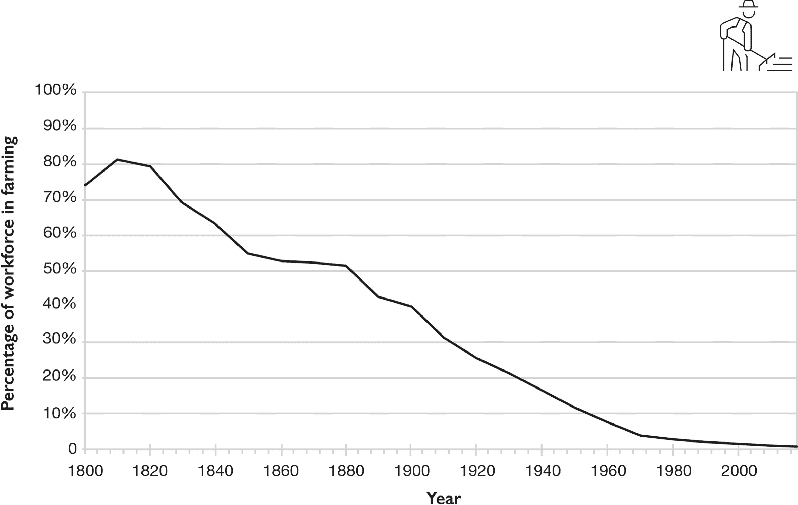
资料来源：国家经济研究局；美国人口普查局；美国劳工统计局；国际劳工组织

## 制造业的演变

尽管许多失业的农业工人在工厂找到了新的工作，但在大约一个半世纪后，工厂工作也发生了类似的故事。在十九世纪的第一个十年里，大约每 35 个美国工人中就有 1 个受雇于制造业。[\[50\]](#18_Notes.xhtml#EndnoteNumber617 "note")然而，随着蒸汽动力工厂的涌现，需要数百万低技能劳动力，工业革命很快改变了主要城市。到 1870 年，几乎五分之一的工人从事制造业，主要集中在快速工业化的北方。[\[51\]](#18_Notes.xhtml#EndnoteNumber618 "note")第二次工业革命在二十世纪初将大量新工人（主要是移民）带入制造业。流水线的发展大大提高了效率，随着产品价格的下降，越来越多的人可以获得这些产品。[\[52\]](#18_Notes.xhtml#EndnoteNumber619 "note")

随着需求的增长，工厂不得不雇用新的工人队伍，和平时期的制造业就业人数在 1920 年左右达到顶峰，估计占民用劳动力的 26.9%。[\[53\]](#18_Notes.xhtml#EndnoteNumber620 "note")衡量劳动力规模的方法随着时间的推移发生了一些变化，因此我们无法将这个数字与后来几十年的人数进行完美比较，但一个普遍的事实是明确的。除了大萧条（制造业就业暂时下降）和第二次世界大战（暂时上升）的干扰之外，直到 20 世纪 70 年代，美国劳动力中大约有四分之一的人从事制造业。[\[54\]](#18_Notes.xhtml#EndnoteNumber621 "note")在大约五十年里，没有总体上的上升或下降趋势。

然后，两项与技术相关的转变开始侵蚀美国的工厂就业。首先，物流和运输方面的创新，最显著的是集装箱运输，使得公司将制造业外包给劳动力成本较低的国家并将成品进口到美国变得更加便宜。[\[55\]](#18_Notes.xhtml#EndnoteNumber622 "note")集装箱化不像工厂机器人或人工智能那样引人注目，但它对现代社会的影响比任何创新都更为深远。通过大幅降低全球运输成本，集装箱化使经济真正实现全球化。这使得普通人能够以更便宜的价格获得大量产品，但它也是美国大部分地区去工业化的关键因素。

其次，自动化减少了国内制造业部门对人力的需求。虽然早期的装配线在每个步骤都需要大量的手工操作，但机器人的引入减少了这种需求。20 世纪 90 年代，随着计算机化和人工智能开始使自动化变得越来越强大和高效，这一趋势得到了加强。因此，在更智能的机器的帮助下，普通制造业工人每小时可以生产越来越多的商品。事实上，在 1992 年至 2012 年的二十年里，随着计算机化改变了工厂生产，普通制造业工人的每小时产量翻了一番（经通货膨胀调整）。[\[56\]](#18_Notes.xhtml#EndnoteNumber623 "note")

因此，在二十一世纪，制造业产出和制造业就业已经脱钩。2001 年 2 月，就在互联网泡沫破灭后的经济衰退之前，有 1700 万美国人从事制造业工作。[\[57\]](#18_Notes.xhtml#EndnoteNumber624 "note")在经济衰退期间，这一数字急剧下降，并且从未恢复——尽管产量大幅增加，但在 2000 年代中期的繁荣时期，就业人数一直稳定在 1400 万左右。[\[58\]](#18_Notes.xhtml#EndnoteNumber625 "note")2007 年 12 月，在经济大衰退开始时，大约有 1370 万美国人在制造业工作，到 2010 年 2 月，这一数字下降到 1140 万。[\[59\]](#18_Notes.xhtml#EndnoteNumber626 "note")制造业产出迅速反弹，到 2018 年恢复到接近历史最高水平——但许多失去的工作岗位再也没有回来。[\[60\]](#18_Notes.xhtml#EndnoteNumber627 "note")即使在 2022 年 11 月，也只需要 1290 万工人来生产这些产品。[\[61\]](#18_Notes.xhtml#EndnoteNumber628 "note")

回顾过去的一个世纪，这些趋势引人注目。在从 1920 年到 1970 年，制造业就业人数稳定地保持在 20%到 25%之间，但在之后的五十年里，制造业就业人数在劳动力中所占的比例稳步下降——1980 年为 17.5%，1990 年为 14.1%，2000 年为 12.1%，2010 年跌至 7.5%。[\[62\]](#18_Notes.xhtml#EndnoteNumber629 "note")自那以来的十年里，尽管经济持续扩张和制造业产出健康增长，但这一比例基本上保持不变。因此，截至 2023 年初，制造业雇用了大约 1/13 的美国工人。[\[63\]](#18_Notes.xhtml#EndnoteNumber630 "note")

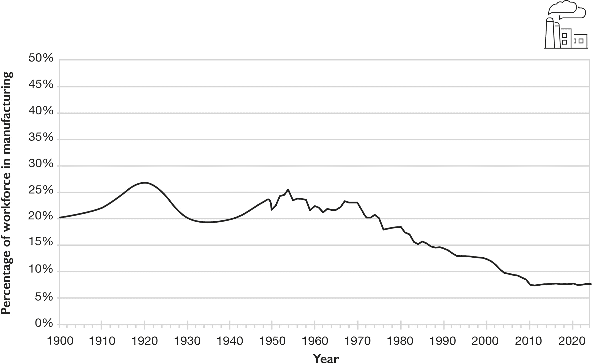
来源：美国劳工统计局；Stanley Lebergott，“劳动力和就业，1800-1960”，载于*1800 年后美国的产出、就业和生产力*，编辑：Dorothy S. Brady（华盛顿特区：国家经济研究局，1966 年）

## 劳动力与教育投资

尽管农场和工厂的工作岗位都大幅减少，但只要有统计数据，美国的劳动力一直在稳步增长，即使在连续的自动化浪潮中也是如此。[\[65\]](#18_Notes.xhtml#EndnoteNumber632 "note")从早期工业革命到二十世纪中叶，经济不仅创造了足够的新就业岗位，为迅速增长的人口提供就业机会，而且还容纳了数千万妇女进入劳动力市场。[\[66\]](#18_Notes.xhtml#EndnoteNumber633 "note")

自二十一世纪初以来，劳动力占总人口的比例略有下降，但一个主要原因是现在有更高比例的美国人处于退休年龄。[\[67\]](#18_Notes.xhtml#EndnoteNumber634 "note")1950 年，美国人口中有 8.0%的人口为 65 岁或以上；[\[68\]](#18_Notes.xhtml#EndnoteNumber635 "note")到 2018 年，这一比例翻了一番，达到 16.0%，导致经济中相对较少的劳动年龄人口。[\[69\]](#18_Notes.xhtml#EndnoteNumber636 "note")美国人口普查局预测——独立于未来几十年可能取得的任何新的医学突破——到 2050 年，65 岁以上的人口将占总人口的 22%。[\[70\]](#18_Notes.xhtml#EndnoteNumber637 "note")如果我正确地认为，到那时，重要的延长寿命技术将成为现实，那么老年人的比例将会更高。

但从绝对值来看，劳动力本身仍在增长。2000 年，在 2.82 亿总人口中，民用劳动力估计为 1.436 亿，占 50.9%。[\[71\]](#18_Notes.xhtml#EndnoteNumber638 "note")到 2022 年，劳动力已增长到约 3.32 亿人口中的 1.64 亿工人，占 49.4%。[\[72\]](#18_Notes.xhtml#EndnoteNumber639 "note")

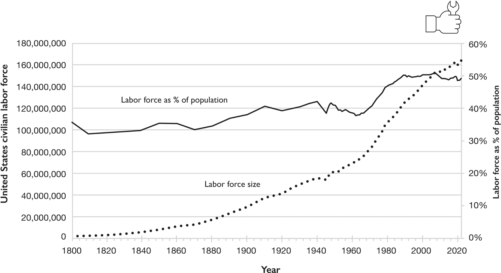
来源：美国劳工统计局；国家经济研究局；美国人口普查局

随着经济转向更多技术密集型工作，我们一直在大幅增加对教育的投资，以提供所需的新技能并创造新的就业机会。我们已经从 1870 年的 63,000 名大学生（本科和研究生）增加到 2022 年的约 2000 万名。[\[74\]](#18_Notes.xhtml#EndnoteNumber641 "note")在这些学生中，大约有 470 万大学生是在美国，仅在 2000 年至 2022 年间增加的。[\[75\]](#18_Notes.xhtml#EndnoteNumber642 "note")今天，我们在 K-12 教育上花费的经通货膨胀调整后的美元是 100 年前的 18 倍以上。在 1919-20 学年，K-12 公立学校平均每位学生花费相当于 1,035 美元（2023 年美元）。[\[76\]](#18_Notes.xhtml#EndnoteNumber643 "note")到 2018-19 学年，这一数字增加到约 19,220 美元（2023 年美元）。[\[77\]](#18_Notes.xhtml#EndnoteNumber644 "note")

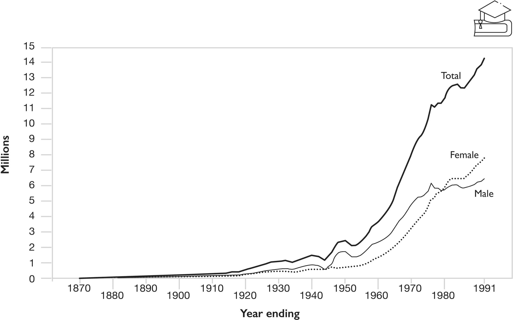
来源：美国商务部，人口普查局，*美国历史统计，殖民时期至 1970 年*；美国教育部，国家教育统计中心，*教育统计摘要*，各种问题

在过去的两个世纪里，技术变革已经多次取代了经济中的大部分工作，但——在不断改善的教育的帮助下——我们看到了持续而显著的经济进步。尽管人们一直（且准确地）认为主要的就业类别即将消失。[\[79\]](#18_Notes.xhtml#EndnoteNumber646 "note")

## 这次不一样吗？

尽管净就业增长的长期模式，一些著名的经济学家预测这次会有所不同。斯坦福大学教授埃里克是认为即将到来的基于人工智能的自动化浪潮将成为净就业杀手这一观点的主要支持者之一布林约尔夫松。他认为，与以往技术驱动的转型不同，最新形式的自动化将导致失去的工作岗位多于创造的工作岗位。[\[80\]](#18_Notes.xhtml#EndnoteNumber647 "note")持这种观点的经济学家认为，目前的情况是几个连续变革浪潮的顶点。

第一波通常被称为“技能降低”。[\[81\]](#18_Notes.xhtml#EndnoteNumber648 "note")例如，需要广泛技能来处理和维护不可预测的动物的马车车夫被需要较少此类能力的汽车司机所取代。技能降低的主要影响之一是，人们更容易在没有长期培训的情况下找到新工作。工匠们必须花费数年时间来培养制鞋所需的各种技能，但是一旦流水线机器接管了大部分工作，一个人就可以在学习操作机器的较短时间后找到工作。这意味着劳动力成本下降，鞋子变得更实惠，但也意味着低薪工作取代了高薪工作。

第二波是“技能提升”。技能提升通常发生在技能降低之后，并引入了比以前需要更多技能的技术。例如，为驾驶员提供导航技术需要他们学习如何使用以前不属于所需技能组合的电子设备。有时，这意味着引入在制造中发挥越来越大作用的机器，但需要复杂的操作技能。例如，虽然早期的制鞋机是手动操作的压机，操作不需要正规教育，但如今像 FitMyFoot 这样的公司使用 3D 打印来创建完美贴合每位顾客的定制鞋类。[\[82\]](#18_Notes.xhtml#EndnoteNumber649 "note")因此，FitMyFoot 的生产不是依赖于大量低技能工作，而是依赖于少数具有计算机科学和操作 3D 打印机技能的人。像这样的趋势倾向于用更少但更高薪的工作取代低薪工作。

然而，即将到来的浪潮可以被称为“无技能化”。例如，无人驾驶汽车人工智能将完全取代人类驾驶员。随着越来越多的任务落入人工智能和机器人的能力范围，将会出现一系列的无技能化转型。人工智能驱动的创新与以往技术不同之处在于它为将人类完全从等式中移除创造了更多的机会。人工智能通常可以完全接管任务，而不是减少或增加执行特定任务所需的技能量。这不仅出于成本原因，而且还因为在许多领域，人工智能实际上可以比它所取代的人类做得更好。自动驾驶汽车将比人类驾驶员操作的汽车安全得多，而且人工智能永远不会喝醉、昏昏欲睡或分心。

然而，区分任务和职业是很重要的。在某些情况下（但不是所有情况），完全自动化的任务允许某种类型的工作转向不同的任务——实际上是提升技能。例如，自动取款机现在可以代替银行柜员处理许多日常现金交易，但柜员在营销和与客户建立个人关系方面发挥了更大的作用。[\[83\]](#18_Notes.xhtml#EndnoteNumber650 "note")同样，虽然用于法律研究和文件分析的软件已经取代了律师助理的某些职能，但该职业已经发生了变化，现在包含的任务组合与几十年前相比有很大不同。[\[84\]](#18_Notes.xhtml#EndnoteNumber651 "note")这种效应可能很快就会在艺术界发生。从 2022 年开始，像 DALL-E 2、Midjourney 和 Stable Diffusion 这样的公开系统使用人工智能根据人类基于文本的提示创建高质量的图形艺术。[\[85\]](#18_Notes.xhtml#EndnoteNumber652 "note")随着这项技术的进步，人类图形设计师可能会花更少的时间进行实际的艺术素描，而花更多的时间与客户集思广益，以及策划或修改人工智能生成的样本。

从长远来看，自动化的经济激励将推动人工智能接管越来越多的任务。在所有条件相同的情况下，购买机器或人工智能软件比支付持续的劳动力成本更便宜。[\[86\]](#18_Notes.xhtml#EndnoteNumber653 "note")当企业主设计他们的运营时，他们通常在资本和劳动力之间的平衡方面有一定的灵活性。在工资相对较低的地方，使用劳动密集型流程更有意义。在工资高的地方，更有动力去创新和设计需要更少劳动力的机器。这可能就是为什么英国是工业革命的摇篮的原因之一——它的工资比世界上几乎任何地方都高，而且廉价的煤炭也很丰富。这推动了用廉价的蒸汽动力代替昂贵的人力劳动的技术的发展。在当今发达经济体中，存在着类似的动态。虽然机器可以是一次性购买并成为资产，但员工工资是持续的成本，工人还有雇主必须满足的一系列其他需求。因此，在可能提高自动化程度的地方，企业有动力这样做。随着人工智能接近人类——以及不久之后的超人类——的胜任水平，未经增强的人类需要执行的任务将越来越少。在我们与人工智能更充分地融合之前，这预示着工人将面临重大 disruption。

然而，这个论点中的一个症结在于生产力难题：如果技术变革真的开始导致净失业，那么古典经济学预测，在给定的经济产出水平下，工作时间会减少。根据定义，那么，生产力将显著提高。然而，自 20 世纪 90 年代互联网革命以来，传统测量的生产力增长实际上已经放缓。生产力通常以每小时实际产出衡量，即生产的商品和服务总量（经通货膨胀调整后）除以生产这些商品和服务所花费的总小时数。从 1950 年第一季度到 1990 年第一季度，美国每小时实际产出平均每季度增长 0.55%。[\[87\]](#18_Notes.xhtml#EndnoteNumber654 "note")随着个人电脑和互联网在 20 世纪 90 年代变得普及，生产力提高的速度加快了。从 1990 年第一季度到 2003 年第一季度，季度增长率平均为 0.68%。[\[88\]](#18_Notes.xhtml#EndnoteNumber655 "note")看来万维网已经开启了一个快速增长的新时代，迟至 2003 年，人们还普遍预期这种速度会持续下去。[\[89\]](#18_Notes.xhtml#EndnoteNumber656 "note")然而，从 2004 年开始，生产率增长开始显著放缓。从 2003 年第一季度到 2022 年第一季度，平均每个季度仅增长 0.36%。[\[90\]](#18_Notes.xhtml#EndnoteNumber657 "note")这是过去十年中最伟大的经济谜团之一。随着信息技术以如此多的方式改变商业，我们期望看到更强劲的生产力增长。关于我们为什么没有看到这种增长，理论有很多。

如果自动化真的产生了如此巨大的影响，那么经济中似乎有几万亿美元“消失了”。在我看来，这种观点越来越被经济学家所接受，大部分解释是我们没有将信息产品呈指数增长的价值计入 GDP，其中许多是免费的，并且代表了直到最近才存在的价值类别。当麻省理工学院在 1963 年以大约 310 万美元的价格购买了我本科时使用的 IBM 7094 计算机时，这算作了 310 万美元（2023 年的 3000 万美元）的经济活动。[\[91\]](#18_Notes.xhtml#EndnoteNumber658 "note")今天的智能手机在计算和通信方面比 1965 年强大数十万倍，并且具有当时任何价格都无法实现的无数功能，但它仅算作几百美元的经济活动，因为这就是你为它支付的价格。

埃里克·布林约尔松和风险投资家马克·安德森也显著地提出了对缺失生产力的这种一般性解释。[\[92\]](#18_Notes.xhtml#EndnoteNumber659 "note")作为一个简明的解释，国内生产总值通过一个国家所有成品和服务价格来衡量经济活动。因此，如果你花 20,000 美元购买一辆新车，那么这会为当年的 GDP 增加 20,000 美元——即使你愿意为同一辆车支付 25,000 美元或 30,000 美元。这种方法在二十世纪运作良好，因为在整个人口中，为一件商品支付的平均意愿与其实际价格相当接近。一个主要原因是，当商品和服务由物理材料和人工生产时，企业生产每个新单位需要花费大量资金。例如，制造一辆汽车需要昂贵的金属零件和许多小时的熟练劳动力。这就是边际成本的概念。[\[93\]](#18_Notes.xhtml#EndnoteNumber660 "note")古典经济理论认为，价格将趋向于商品的平均边际成本——因为企业无法承受亏本销售，但竞争压力迫使他们尽可能廉价地销售。此外，由于更有用和更强大的产品传统上需要更高的生产成本，因此历史上产品的质量与其在 GDP 中反映的价格之间存在很强的关系。

然而，许多信息技术变得非常有用，而价格或多或少保持不变。1999 年大约 900 美元（2023 年经通货膨胀调整后）的计算机芯片每秒每美元可以执行超过 800,000 次计算。[\[94\]](#18_Notes.xhtml#EndnoteNumber661 "note")到 2023 年初，一个 900 美元的芯片每秒每美元可以进行近 580 亿次计算。[\[95\]](#18_Notes.xhtml#EndnoteNumber662 "note")

因此，问题在于 GDP 自然地将今天的 900 美元芯片等同于二十多年前生产的芯片，即使现在的芯片在相同价格下的性能是原来的 72000 多倍。因此，过去几十年名义财富和收入的增长并没有正确反映新技术带来的巨大生活方式优势。这扭曲了对经济数据的解读，并产生了误导性的看法，例如表面上缓慢甚至停滞的工资增长。即使你的名义工资在过去二十年中保持不变，你现在也可以用它们购买数千倍的计算能力。[\[96\]](#18_Notes.xhtml#EndnoteNumber663 "note")政府机构已经做出了一些努力，在一些经济统计数据中考虑到性能的提高，[\[97\]](#18_Notes.xhtml#EndnoteNumber664 "note")但这些仍然大大低估了真正的性价比提升。

对于几乎可以免费生产的数字商品来说，这种动态甚至更强。一旦亚马逊格式化了一本电子书进行销售，销售新的副本就不需要额外的纸张、墨水或劳动力——因此它的售价几乎是其边际成本的无限倍数。因此，边际成本、价格和消费者支付意愿之间的密切关系被削弱了。对于边际成本足够低以至于可以完全免费提供给消费者的服务来说，这种关系完全崩溃。一旦谷歌设计了其搜索算法并建立了其服务器农场，为用户提供一次额外的搜索几乎不花费任何成本。Facebook 将你与一千个朋友联系起来并不比只与一百个朋友联系花费更多的钱。因此，他们向公众提供免费访问，并通过广告来支付其边际成本。

即使这些服务对消费者是免费的，我们也可以通过观察人们的选择来估算人们的支付意愿（也称为消费者剩余）。[\[98\]](#18_Notes.xhtml#EndnoteNumber665 "note")例如，如果你可以通过给邻居修剪草坪赚取 20 美元，但选择将时间花在 TikTok 上，我们可以说 TikTok 至少给你带来了 20 美元的价值。正如蒂姆·沃斯托尔在*福布斯*在 2015 年估计的那样，Facebook 在美国的收入约为 80 亿美元，这将是其对 GDP 的官方贡献。[\[99\]](#18_Notes.xhtml#EndnoteNumber666 "note")但是，如果你按照最低工资标准来评估人们在 Facebook 上花费的时间，那么消费者获得的真正利益约为 2300 亿美元。[\[100\]](#18_Notes.xhtml#EndnoteNumber667 "note")截至 2020 年（本书付印时可获得的最新年份数据），美国使用社交媒体的成年人平均每天在 Facebook 上花费 35 分钟。[\[101\]](#18_Notes.xhtml#EndnoteNumber668 "note")根据 Worstall 的方法，美国大约 2.58 亿成年人中有 72% 使用社交媒体，这表明 Facebook 在当年创造了 2870 亿美元的经济价值。[\[102\]](#18_Notes.xhtml#EndnoteNumber669 "note")一项 2019 年的全球调查发现，美国互联网用户平均每天在所有社交媒体上花费 2 小时 3 分钟——这为 GDP 贡献了约 361 亿美元的广告收入，但也意味着每年给用户带来的总收益超过 1 万亿美元！[\[103\]](#18_Notes.xhtml#EndnoteNumber670 "note")

以最低工资来评估社交媒体的使用价值很难说是完美的衡量标准，因为，举例来说，在排队等咖啡时浏览 Facebook 比利用这几分钟做远程自由职业工作更实际。但作为一个大致的估算，它揭示了人们非常重视社交媒体的使用，然而只有一小部分价值以收入的形式为经济学家所见。维基百科是一个更极端的例子：它对 GDP 的官方贡献基本上为零。同样的分析适用于无数基于网络和应用程序的服务。

这表明，随着数字技术在经济中占据越来越大的份额，消费者剩余的增长速度远快于 GDP 所显示的。因此，以消费者剩余计算的生产率增长速度高于传统的每小时产出指标。由于消费者剩余是比价格更“真实”的衡量真正繁荣的指标，因此可以说，我们真正关心的那种生产率一直都在良好增长。

这些影响远远超出了那些显而易见的“技术”领域。技术变革带来了无数其他未在 GDP 中体现的益处——从更少的污染和更安全的生活条件，到扩大的学习和娱乐机会。也就是说，这些变化并没有均匀地影响到经济的所有领域。对于例如，尽管计算价格大幅下降，但医疗保健的涨价速度超过了总体通货膨胀——因此，一个需要大量医疗服务的人可能不会因为 GPU 周期的价格下降而感到安慰。[\[104\]](#18_Notes.xhtml#EndnoteNumber671 "note")

不过，好消息是，在 2020 年代和 2030 年代，人工智能和技术融合将使越来越多的商品和服务转变为信息技术——使它们能够受益于已经给数字领域带来如此彻底的通货紧缩的指数级趋势。先进的人工智能导师将使任何学科的个性化学习成为可能，任何有互联网连接的人都可以大规模地访问。截至本文撰写之时，人工智能增强的医疗和药物发现仍处于起步阶段，但最终将在降低医疗保健成本方面发挥重要作用。

同样的情况也会发生在许多传统上不被认为是信息技术的产品上——比如食品、住房和建筑施工，以及其他实体产品，如服装。例如，人工智能驱动的材料科学进步将使太阳能光伏发电变得非常便宜，而机器人资源开采和自动驾驶电动汽车将大大降低原材料的成本。随着廉价的能源和材料，以及自动化越来越多地直接取代人类劳动，价格将大幅下降。随着时间的推移，这种影响将覆盖经济的很大一部分，我们将能够消除目前阻碍人们发展的许多稀缺性。因此，在 2030 年代，以今天被认为是奢侈的水平生活将相对便宜。

如果这种分析是正确的，那么所有这些领域中由技术驱动的通货紧缩只会扩大名义生产力与每小时人类工作给社会带来的实际平均效益之间的差距。随着这些影响从数字领域扩展到其他行业，并涵盖整个经济的更大部分，我们预计国家通货膨胀会下降——并最终导致全面通货紧缩。换句话说，随着时间的推移，我们可以期待对生产力之谜有更清晰的答案。

还有一个谜题：为什么经济数据显示美国劳动力的比例正在萎缩？支持净就业岗位减少论的经济学家指出，美国的劳动参与率，即就业人数加上正在寻找工作的失业人数，占 16 岁及以上人口的百分比。从 1950 年的约 59%上升到 2002 年的略低于 67%之后，到 2015 年已降至 63%以下，尽管表面上经济繁荣，但在 COVID-19 大流行之前一直保持平稳。[\[105\]](#18_Notes.xhtml#EndnoteNumber672 "note")

劳动力总人口的实际百分比更小。2008 年 6 月，美国民用劳动力人口超过 1.54 亿，总人口为 3.04 亿，占比 50.7%。[\[106\]](#18_Notes.xhtml#EndnoteNumber673 "note")到 2022 年 12 月，劳动力人口为 1.64 亿，总人口为 3.33 亿，占比略低于 49.5%。[\[107\]](#18_Notes.xhtml#EndnoteNumber674 "note")这看起来降幅不大，但仍使美国处于二十多年来的最低百分比。关于此事的政府统计数据并不能完美地反映经济现实，因为它们不包括几个类别——包括农业工人、军事人员和联邦政府雇员——但它们对于显示这些趋势的方向和大致程度仍然有用。

来源：美国劳工统计局

然而，虽然这种下降可能部分是由于自动化，但有两个主要的混淆因素。首先，随着美国人受教育程度的提高，工作的青少年越来越少，许多人一直待在大学和研究生院，直到二十多岁。[\[109\]](#18_Notes.xhtml#EndnoteNumber676 "note")此外，随着庞大的婴儿潮一代逐渐进入退休年龄，美国劳动年龄人口的比例正在下降。[\[110\]](#18_Notes.xhtml#EndnoteNumber677 "note")

如果我们转而关注 25 岁至 54 岁黄金劳动年龄成年人的劳动力参与率，那么下降几乎消失了——截至 2023 年初，参与率为 83.4%，而 2000 年峰值为 84.5%。[\[111\]](#18_Notes.xhtml#EndnoteNumber678 "note")这与今天的人口数量仍然相差约 170 万，但远低于之前的图表所显示的差距。[\[112\]](#18_Notes.xhtml#EndnoteNumber679 "note")

来源：美国劳工统计局

此外，自 2001 年以来，55 岁及以上人群的参与率显著增加。在 55 岁至 64 岁的人群中，这一比例从 2001 年的 60.4%上升到 2021 年的 68.2%，而在同一时期，75 岁及以上人群的比例从 5.2%增长到 8.6%。[\[114\]](#18_Notes.xhtml#EndnoteNumber681 "note")这里涉及相互冲突的力量。一方面，许多因自动化而失业的年长工人只是提前退休，接受较低的生活水平。另一方面，人们的寿命更长（在 COVID-19 大流行之前，自 2000 年以来，美国男女混合预期寿命增加了约两年）[\[115\]](#18_Notes.xhtml#EndnoteNumber682 "note")并且足够健康，可以在更大的年龄工作。对许多人来说，这是一个令人愉快的目的和满足感的来源。尽管如此，这些数据并没有反映出一些老年人在失去报酬更高的工作后，被迫留在劳动力队伍中从事边缘工作，直到他们能够确保退休。[\[116\]](#18_Notes.xhtml#EndnoteNumber683 "note")

然而，所有这些分析都受到劳动力参与本身是一个日益有缺陷的概念这一事实的限制。两个主要趋势正在重塑工作的性质，但并未在经济统计数据中得到很好的反映。

第一个是地下经济，它一直存在，但互联网极大地促进了它的发展。其活动几乎包括整个性产业以及许多其他类型的服务，包括私下支付的家务劳动、替代疗法等等。地下经济的另一个促进因素是加密技术的出现，例如加密货币，它能够隐藏交易，使其免受税收、监管和执法部门的管辖。

最大和最著名的加密货币是比特币。[\[117\]](#18_Notes.xhtml#EndnoteNumber684 "note")2017 年 8 月 6 日，主要交易所比特币的日交易量不足 1930 万美元。[\[118\]](#18_Notes.xhtml#EndnoteNumber685 "note")到同年 12 月 7 日，它已飙升至超过 49.5 亿美元，但很快再次下跌，截至 2023 年中期，平均每天约为 1.8 亿美元。[\[119\]](#18_Notes.xhtml#EndnoteNumber686 "note")尽管如此，这是一个非常快速的增长，但与主要的传统货币相比仍然微不足道。根据国际清算银行的数据，2022 年 4 月全球外汇交易平均每天达到 7.5 万亿美元，而且随着本书的出版，这个数字可能还会更高。[\[120\]](#18_Notes.xhtml#EndnoteNumber687 "note")

此外，与大多数传统货币相比，大多数加密货币的价值波动极大。例如，2012 年 1 月 4 日，比特币的交易价格为 13.43 美元。[\[121\]](#18_Notes.xhtml#EndnoteNumber688 "note")4 月 2 日，它们的价格上涨到 130 美元以上。[\[122\]](#18_Notes.xhtml#EndnoteNumber689 "note")但对加密货币的兴趣仍然主要局限于一个具有技术头脑的亚文化群体。然后，在经历了近五年的相对平静和稳定之后，比特币在 2017 年开始飙升。突然，普通人开始听说比特币是一种万无一失的投资，并购买它们，希望它们能进一步升值。这变成了一个自我实现的预言，价格在 4 月 29 日达到 1,354 美元，在 12 月 17 日达到 18,877 美元。[\[123\]](#18_Notes.xhtml#EndnoteNumber690 "note")但随后价格开始下跌，人们恐慌地出售他们的比特币，试图在他们的资产失去更多价值之前退出市场。到 2018 年 12 月 12 日，比特币跌回 3,360 美元——但在 2021 年 4 月 13 日达到 64,899 美元，之后又一次大崩盘，到 2022 年 11 月 20 日跌至 15,460 美元。[\[124\]](#18_Notes.xhtml#EndnoteNumber691 "note")

这种波动性给那些想把比特币作为货币使用的人——也就是作为定期交换商品和服务的媒介——带来了主要问题。如果你相信你的美元在半年内会升值十倍，你会尽量避免使用它们。相反，如果你的美元在几个月内可能贬值一半，你就不愿意把很多资产都放在美元上，商家也不愿意接受它们。如果加密货币要获得公众更广泛的采用，它们需要找到一种方法来保持价值更稳定。

然而，加密货币并不是地下工作蓬勃发展的必要条件。社交媒体和 Craigslist 等平台为人们提供了充足的机会，形成政府几乎看不到的经济联系。

这种效应也促进了另一个主要趋势：新的赚钱方式并不总是被认为是传统的就业方法。这些包括使用网站和应用程序创建、购买、销售和易货实物和数字资产及服务，以及在社交媒体网站上创建应用程序、视频和其他形式的数字内容。例如，有些人通过为 YouTube 创建内容而发展了成功的职业生涯，或者通过在 Instagram 或 TikTok 上影响他人而获得报酬。[\[125\]](#18_Notes.xhtml#EndnoteNumber692 "note")

在 2007 年 iPhone 发布之前，几乎没有应用程序经济可言。2008 年，可用的 iOS 应用程序不到 10 万个；到 2017 年，这个数字已经飙升到大约 450 万个。[\[126\]](#18_Notes.xhtml#EndnoteNumber693 "note")在安卓系统上，增长同样显著。2009 年 12 月，Google Play 商店中约有 16,000 个移动应用程序。[\[127\]](#18_Notes.xhtml#EndnoteNumber694 "note")截至 2023 年 3 月，共有 260 万。[\[128\]](#18_Notes.xhtml#EndnoteNumber695 "note")这是十三年来的 160 多倍增长。这直接导致了就业的增长。从 2007 年到 2012 年，应用程序经济在美国创造了约 50 万个就业岗位。[\[129\]](#18_Notes.xhtml#EndnoteNumber696 "note")到 2018 年，根据德勤的数据，这个数字已经增长到超过 500 万个工作岗位。[\[130\]](#18_Notes.xhtml#EndnoteNumber697 "note")另一项 2020 年的估计，包括应用程序经济间接创造的就业岗位，估计为 590 万个美国就业岗位和 1.7 万亿美元的经济活动。[\[131\]](#18_Notes.xhtml#EndnoteNumber698 "note")这些数字在一定程度上取决于人们对应用程序市场的定义有多广泛或多狭隘，但关键的结论是，在短短十多年的时间里，移动应用程序已经从微不足道发展成为更广泛经济中的一个主要因素。

因此，即使技术变革正在使许多工作岗位过时，同样的这些力量也在开辟许多新的机会，这些机会不属于传统的“工作”模式。虽然并非没有局限性，但所谓的零工经济通常允许人们比以前的选择有更多的灵活性、自主性和休闲时间。最大限度地提高这些机会的质量是帮助工人应对自动化趋势加速和颠覆传统工作场所的一种策略。

## 那么我们该何去何从？

从表面上看，劳动力状况听起来令人担忧。当牛津大学的弗雷和奥斯本估计，到 2033 年，2013 年近一半的工作岗位将实现自动化时，他们的研究假设人工智能和其他指数技术的进步速度比我在本书中概述的更为保守。[\[132\]](#18_Notes.xhtml#EndnoteNumber699 "note")虽然人们已经认识到自动化对就业的威胁已有两百多年，但目前的形势在迫在眉睫的威胁的速度和广度上是独一无二的。

要预测这将如何发展，我们需要考虑几个基本问题。首先，就业本身不是目的，而是达到目的的手段。工作的一个目标是满足生活的物质需求。如前所述，早在两个世纪前，仅仅种植和分配食物就需要几乎所有的人力劳动，而如今美国和发达世界的大部分地区的粮食生产只需要不到 2%的劳动力。随着人工智能在无数领域释放前所未有的物质丰富，为生存而奋斗将逐渐成为历史。

工作的另一个目标是赋予生活目的和意义。如果你的工作是砌砖，那么这项劳动提供了两种意义。最明显的是，你的工资使你能够养家糊口并照顾他们——这是身份的重要方面。但你也在建造持久的建筑物，为公共利益做出贡献。你实际上是在为比你自身更伟大的事物做出贡献。一些最令人满足的工作，如艺术和学术领域的工作，还提供了创造和产生新知识的机会。

## 技术变革、创意民主化与社会未来

## 媒体演进与创意表达的解放
即将到来的革命将赋予人类做出此类贡献的能力，远远超出以往任何时候的可能性。事实上，先进的信息技术已经在增强艺术家丰富文化的能力——而且往往以未被充分认识的方式进行。例如，在我成长过程中，只有三个电视台可供选择：美国广播公司（ABC）、全国广播公司（NBC）和哥伦比亚广播公司（CBS）。因为每个人都在观看如此有限的节目选择，所以这些电视台必须创作能够吸引尽可能广泛人群的内容。为了取得成功，节目必须吸引男性和女性、儿童和父母、蓝领和白领。具有强烈但较窄吸引力的想法，如荒诞喜剧、超自然戏剧或科幻小说，并没有容易的商业可行性途径。现在很多人都忘记了*《星际迷航》*，历史上最具影响力的科幻系列剧，仅仅三季就被取消了。[\[133\]](#18_Notes.xhtml#EndnoteNumber700 "note")

但是有线电视的普及扩大了电视的范围，以至于小众节目也能找到观众。关于不寻常主题的深度纪录片在探索频道、历史频道、学习频道和其他地方蓬勃发展。但是收视率仍然受到播出时间的限制。DVR 和随后的点播流媒体的引入，让人们可以随时随地观看他们想看的任何内容。这意味着创新的新节目可以从整个人群中聚集他们的观众——而不仅仅是碰巧在特定时间段观看的人。因此，像*《怪奇物语》*和*《伦敦生活》*这样的艺术想法，在我年轻时的电视台是不可能实现的，但现在已经找到了忠实的观众和获得了重要的赞誉。这种动态对于相对较小的人群来说是个好消息，比如 LGBTQ 人群、残疾人和美国穆斯林，因为积极描绘他们特定生活经历的节目更容易在商业上取得成功。

此外，流媒体允许不同的创意选择。例如，广播电视上的半小时喜剧剧集通常具有独立的情节，因为电视台希望观众能够以任何顺序观看和欣赏它们。但是点播意味着观众总是可以按正确的顺序观看。这解放了像*马男波杰克*从一集到另一集进行角色发展，并在几集中逐渐积累笑点。[\[134\]](#18_Notes.xhtml#EndnoteNumber701 "note")这些艺术可能性在以前的广播技术中根本不存在。

## 人工智能驱动的创意生产革命
在接下来的二十年里，这种转变将急剧加速。想想人工智能在过去几年里，借助 DALL-E、Midjourney 和 Stable Diffusion 等系统，在视觉图像方面取得的创造力。这些能力将变得更加复杂，并将扩展到音乐、视频和游戏，从而从根本上 democratize 创意表达。人们将能够向人工智能描述他们的想法，并用自然语言调整结果，直到它实现他们心中的愿景。制作一部动作电影不再需要成千上万的人和数亿美元，最终只需好的想法和相对适中的电脑预算（用于运行人工智能）就能制作出一部史诗般的电影。

## 自动化冲击与人类能力增强
然而，尽管有所有这些即将到来的好处，我们也必须对现在到那时之间将发生的破坏性影响保持现实。自动化及其间接影响已经消除了技能阶梯底部和中部的许多工作，而且这种趋势将在未来十年内扩大并加快速度。我们大多数的新工作都需要更复杂的技能。作为一个整体，我们的社会已经提升了技能阶梯，这种情况将继续下去。但是，随着人工智能在各个领域超越甚至是最熟练的人类的能力，人类如何才能跟上？

过去提高人类技能的主要方法两个世纪以来一直是教育。正如我之前描述的那样，我们在学习方面的投资在过去一个世纪里飞速增长。但是，我们已经进入了自身完善的下一个阶段，即通过与我们正在创造的智能技术融合来增强我们的能力。我们尚未将计算机化的设备放入我们的身体和大脑中，但它们实际上近在咫尺。如果没有我们每天都在使用的脑力扩展器——智能手机，几乎没有人能够完成他们的工作或接受教育，智能手机可以访问几乎所有人类知识或通过一次点击来利用巨大的计算能力。因此，毫不夸张地说，我们的设备已经成为我们的一部分。早在二十年前，情况并非如此。

这些能力将在整个 2020 年代与我们的生活更加融合。搜索将从熟悉的文本字符串和链接页面模式转变为无缝且直观的问答能力。任何两种语言之间的实时翻译将变得流畅而准确，打破分隔我们的语言障碍。增强现实将通过我们的眼镜和隐形眼镜不断投射到我们的视网膜上。它也会在我们的耳朵里产生共鸣，并最终利用我们的其他感官。它的大部分功能和信息不会被明确要求，但我们无处不在的人工智能助手会通过观察和倾听我们的活动来预测我们的需求。在 2030 年代，医疗纳米机器人将开始将这些大脑扩展直接集成到我们的神经系统中。

在第 2 章中，我描述了这项技术将如何把我们的新皮层扩展到云端，增加更多的容量和更多的抽象层次。这将对所有人开放，并最终变得便宜，就像手机一开始非常昂贵且不够智能，但如今却无处不在一样（国际电信联盟估计，截至 2020 年，全球有 58 亿个活跃的智能手机订阅用户），[\[135\]](#18_Notes.xhtml#EndnoteNumber702 "note")能力迅速提高。

## 社会安全网、普遍富足与政治挑战
但是在通往这种普遍富足的未来的道路上，我们需要解决因这些转变而产生的社会问题。社会安全网始于 1930 年代的美国，当时通过了《社会保障法》。[\[136\]](#18_Notes.xhtml#EndnoteNumber703 "note")虽然特定的提法会受到政治上的欢迎或冷落（例如，“福利”），但无论特定政党和政府的政治倾向如何，自那时以来，整体安全网的范围都在不断扩大。

尽管美国被认为比“社会主义”欧洲国家的社会安全网范围小，但其在社会福利方面的公共支出——截至 2019 年估计占 GDP 的 18.7%（在 COVID-19 大流行救助混淆数据之前）——接近发达国家的中位数。[\[137\]](#18_Notes.xhtml#EndnoteNumber704 "note")加拿大较低，为 18.0%。[\[138\]](#18_Notes.xhtml#EndnoteNumber705 "note")澳大利亚和瑞士的情况类似，均为 16.7%。[\[139\]](#18_Notes.xhtml#EndnoteNumber706 "note")英国略高，为 20.6%——约占 2.8 万亿美元 GDP 的 5800 亿美元，或人均不足 8800 美元，人口为 6600 万。[\[140\]](#18_Notes.xhtml#EndnoteNumber707 "note")但由于美国的人均 GDP 较高，因此其社会安全网的人均支出也较高。2019 年，美国 GDP 超过 21.4 万亿美元，其中约 4 万亿美元为公共社会支出。[\[141\]](#18_Notes.xhtml#EndnoteNumber708 "note")当年平均人口约为 3.3 亿，这意味着人均超过 12000 美元。[\[142\]](#18_Notes.xhtml#EndnoteNumber709 "note")

来源：经济合作与发展组织；彭博社

美国的社会安全网在政府支出中所占的比例一直在稳步增长（目前约占所有联邦、州和地方支出的 50%），并且在 GDP 中所占的比例也在稳步增长（政府支出和 GDP 本身也在稳步增长）。[\[144\]](#18_Notes.xhtml#EndnoteNumber711 "note")查看以下图表，看看你是否能确定何时是“左翼”或“右翼”政府执政。（最近两年的可用数据包括大量的疫情救助，因此 2020-2021 年的峰值超过了潜在的长期增长趋势。）

随着 GDP 持续呈指数增长，社会保障支出可能会继续增加，无论是总体上还是人均。美国社会保障体系中的重要项目包括提供基本医疗服务的医疗补助、SNAP“食品券”（本质上是一张食品借记卡）和住房援助。这些项目的水平在今天几乎不足以满足需求，但随着人工智能驱动的进步使得医疗、食品和住房在 2030 年代变得更加便宜，同样的财政支持将提供非常舒适的生活水平，而无需进一步增加用于社会保障支出的 GDP 百分比。如果这个百分比继续增长，它可以资助更广泛的服务。

主要来源：美国人口普查局；经济分析局；USGovernmentSpending.com；麦迪逊项目

主要来源：美国人口普查局；经济分析局；USGovernmentSpending.com；麦迪逊项目

主要来源：美国人口普查局；经济分析局；USGovernmentSpending.com；麦迪逊项目

主要来源：美国人口普查局；经济分析局；USGovernmentSpending.com；麦迪逊项目

在 2018 年温哥华 TED 大会上与 TED 策展人克里斯·安德森的舞台对话中，[\[149\]](#18_Notes.xhtml#EndnoteNumber716 "note")我预测到 2030 年代初，发达国家将有效地拥有全民基本收入（UBI）或其等价物，到 2030 年代末，大多数国家也将拥有——而且人们将能够按照今天的标准靠这种收入过上好日子。这将需要定期向所有成年人支付款项，或提供免费的商品和服务，可能由自动化驱动的利润税和政府对新兴技术的投资相结合来资助。[\[150\]](#18_Notes.xhtml#EndnoteNumber717 "note")相关的项目可能会为照顾家庭或建设健康社区的人们提供经济支持。[\[151\]](#18_Notes.xhtml#EndnoteNumber718 "note")这样的改革可以大大缓解就业中断带来的危害。在评估这种进步的可能性时，必须考虑到届时经济将发生多么深刻的演变。

由于技术变革的加速，整体财富将大大增加，并且考虑到无论哪个执政党，我们的社会安全网都具有长期稳定性，因此它很可能保持不变，并且水平远高于今天。[\[152\]](#18_Notes.xhtml#EndnoteNumber719 "note")但请记住，技术上的富足并不会自动地让每个人同时受益。例如，在 2022 年，1 美元可以购买比 2000 年多 50,000 倍的计算能力（已调整考虑了总体通货膨胀）。[\[153\]](#18_Notes.xhtml#EndnoteNumber720 "note")相比之下，根据官方统计，2022 年的 1 美元只能购买到 2000 年大约 81%的医疗保健（已调整了总体通货膨胀）。[\[154\]](#18_Notes.xhtml#EndnoteNumber721 "note")尽管一些医疗手段，如癌症免疫疗法，在那段时间内质量有所提高，但大多数医疗支出，如住院和 X 光检查，大致保持不变。因此，像学生和年轻人这样把很多钱花在电脑上的人，从电脑价格的下跌中获益良多。与此同时，那些把收入的大部分花在医疗保健上的人，比如老年人和慢性病患者，整体情况甚至可能更糟。

因此，我们需要明智的政府政策来缓解过渡，并确保繁荣得到广泛分享。尽管在技术上和经济上，每个人都有可能享受到以今天的标准来看很高的生活水平，但我们是否真的向每个需要它的人提供这种支持将是一个政治决定。类似地，尽管今天世界各地偶尔会发生饥荒，但它们并不是因为粮食产量不足，也不是因为良好的农业秘诀掌握在少数精英手中。相反，饥荒通常是由于不良的治理或内战造成的。在这些情况下，人们更难弥补当地的干旱和其他自然灾害，国际援助也更难发挥作用。[\[155\]](#18_Notes.xhtml#EndnoteNumber722 "note")同样，如果我们作为一个社会不够谨慎，有害的政治可能会干扰生活水平的提高。

正如 COVID-19 所表明的那样，这在医学领域尤其令人担忧。尽管创新将释放变革性的能力，以提供负担得起且有效的治疗方法，但这并不能保证像变魔术一样的结果。我们需要一个积极参与的公众和明智的治理，以管理向更先进的医疗保健的安全、公平和有序的过渡。例如，人们可以想象，在未来，拯救生命的技术会受到广泛的不信任。正如今天关于疫苗的虚假信息和阴谋论在网上盛行一样，人们可能会传播关于决策支持人工智能、基因疗法的类似谣言，或未来几十年内的医学纳米技术。考虑到对网络安全的合理担忧，不难看出，对秘密基因操纵或政府控制的纳米机器人的过度恐惧，可能会导致 2030 年或 2050 年的人们拒绝关键治疗。公众对这些问题的理解是我们抵御这些动态不必要地夺走人类生命的最佳防御。

## 意义追寻与过渡期的适应
如果我们能够正确应对这些政治挑战，人类生活将会彻底改变。历史上，我们不得不为了满足生活的物质需求而竞争。但是，当我们进入一个富足的时代，物质必需品的供应最终变得普遍——同时许多传统工作消失——我们的主要奋斗目标将是目标和意义。实际上，我们正在提升马斯洛的需求层次。[\[156\]](#18_Notes.xhtml#EndnoteNumber723 "note")这在现在决定职业的这一代人身上已经很明显了。我指导并与八岁到二十岁的年轻人交谈，他们的重点通常是开辟一条有意义的道路，无论是通过艺术进行创造性表达，还是帮助克服人类几千年来一直在努力解决的重大挑战——社会、心理和其他方面的挑战。

因此，考虑到工作在我们生活中的作用，迫使我们重新考虑我们更广泛的对意义的追寻。人们常说，是死亡和我们存在的短暂性赋予了生命意义。但我的观点是，这种观点试图将死亡的悲剧合理化为一件好事。现实是，失去亲人实际上夺走了我们自己的一部分。那些与那个人互动并享受其陪伴的新皮质模块现在产生了失落、空虚和痛苦。死亡夺走了我们所有在我看来赋予生命意义的东西——技能、经验、记忆和关系。它阻止我们享受更多定义我们的超验时刻——创作和欣赏创意作品，表达爱意，分享幽默。

当我们把新皮质扩展到云端时，所有这些能力都将大大增强。想象一下，试图向那些错过了使人科动物拥有大额头成为可能的新皮质扩张的灵长类动物解释音乐、文学、YouTube 视频或笑话。两百万年前。这个类比至少可以让我们瞥见，当我们在 2030 年代的某个时候开始以数字方式增强我们的新皮质时，我们将能够创造出我们今天无法想象或理解的有意义的表达。

但一个关键问题仍然存在：从现在到那时会发生什么？在我和丹尼尔·卡尼曼的一次私人对话中，他同意我的观点，即信息技术一直在增长，并将继续以指数级的速度在性价比和容量上增长，这将最终涵盖服装和食品等实物产品。他还同意，我们正在走向一个能够满足我们物质需求的富足时代，而主要的斗争将是满足马斯洛需求层次的更高层次。然而，他设想了从现在到那时之间会有一段漫长的冲突，甚至暴力时期。他指出，随着自动化继续产生影响，必然会有赢家和输家。一个失去工作的司机不会因为人类提升到生活层次的承诺而感到满意，因为他作为个体可能实际上无法实现这种转变。

适应技术变革的一大挑战是，它们往往会给广大人口带来广泛的利益，但会给一小部分人带来集中的危害。例如，自动驾驶汽车将给社会带来巨大的好处——从挽救生命到降低污染、缓解拥堵、增加空闲时间和降低运输成本。美国的所有人口——预计到 2050 年将接近 4 亿——将在不同程度上分享这些改善。[\[157\]](#18_Notes.xhtml#EndnoteNumber724 "note")根据所使用的假设，对潜在总收益的估计价值在每年 6420 亿美元到 7 万亿美元之间。[\[158\]](#18_Notes.xhtml#EndnoteNumber725 "note")可以说，这是一个巨大的数字。然而，对任何一个人的好处都不太可能完全改变他们的生活。即使我们从统计上知道每年将有数万人免于死亡，也没有办法确定每年哪些人避免了死亡。[\[159\]](#18_Notes.xhtml#EndnoteNumber726 "note")

相比之下，自动驾驶汽车的危害将主要局限于数百万以司机为职业的人，并且会失去他们的生计。这些人将是可以明确识别的，并且对其生活的干扰可能非常严重。当某人处于这种境地时，仅仅知道社会的整体利益超过他们的个人痛苦是不够的。他们需要制定相关政策，以帮助减轻他们的经济痛苦，并缓解他们向其他能够提供意义、尊严和经济保障的事物的过渡。

正如我之前讨论的那样，支持卡尼曼担忧的一个现象是，大众的恐惧通常比现实更糟糕。当您已经觉得社会上的一切都在变得更糟时，失去工作是导致疏离感的一个好方法。卡尼曼和我一致认为，我们今天在政治中看到的许多两极分化是自动化（包括实际的和预期的）的产物，而不是来自传统的政治问题，如移民。[\[160\]](#18_Notes.xhtml#EndnoteNumber727 "note")如果你对自己的经济稳定性感到高度焦虑，你可能会对任何看起来会加剧你问题的事情抱有敌意。

然而，历史表明，社会在适应即使是剧烈的变化方面，也比我们预期的要好。在过去的两个世纪里，我们已经多次取代了经济中的大部分工作岗位，而且这样做并没有造成太多的长期社会混乱，更不用说暴力革命了。大众传播和执法在预防或迅速压制暴力方面是有效的，就像两个世纪前卢德分子被压制一样。是的，个人可能会因为各种原因变得暴力，包括精神疾病。鉴于美国的枪支文化，有太多的案例变成了致命的。

然而，引人注目的悲剧并不能改变这样一个事实：几个世纪以来，整体暴力事件一直在急剧下降。[\[161\]](#18_Notes.xhtml#EndnoteNumber728 "note")正如前一章所讨论的，尽管不同国家的暴力事件可能逐年或逐十年地波动，但发达国家长期趋势是显著且持续的下降。正如我的朋友史蒂文·平克在他 2011 年的著作中提出的观点*人性中的善良天使：为什么暴力已经减少*, 这种衰落是深刻的文明发展趋势的结果——诸如基于法治的国家、日益增长的识字率和经济发展等因素。[\[162\]](#18_Notes.xhtml#EndnoteNumber729 "note")全部的值得注意的是，这些都得益于信息技术的指数级进步。因此，我们有充分的理由对未来保持乐观。

我们应该记得，伴随自动化导致失业的负面影响而来的是新的和创新的机会，而且这种情况不会改变。此外，社会安全网是实质性的且在不断扩大，正如我所指出的，它并不太依赖于政治气候。它拥有超越公众舆论明显波动的深厚支持。这些项目是我们对同胞的自然同情心的表达，但它们也是旨在缓解技术变革带来的社会混乱的政治回应。

但是，社会安全网并不能取代工作带来的目标感，正如卡尼曼所说，劳动力市场中将会出现许多失败者。虽然美国已经成功地经历了数轮自动化而没有出现严重的社会动荡，但这次的不同之处在于变革的广度、深度和速度。卡尼曼认为，人们需要时间来适应变化并利用新的机会，而许多人将无法迅速地为新的就业类型或替代的个人商业模式进行再培训。

我认为卡尼曼在某些方面是对的，但我们应该记住，在许多技术变革领域，失败者并不存在，或者至少没有显现出来。例如，一种治疗疾病的新方法。从治疗该疾病中获利的公司和个人会失去长期的收入来源。但对社会的好处是如此之大，以至于这种疗法几乎受到普遍的庆祝——甚至包括大多数治疗该疾病的人。他们亲身经历了正在减轻的痛苦，并且不会纠结于失去的业务。无论如何，社会认识到，最好是找到减轻这些人经济打击的方法，而不是为了工作和利润而阻止治疗方法。

在整个两百年的自动化历史中，许多人想象工作从一个没有其他变化的世界中消失。这种现象适用于预测未来的所有方面——人们设想一种变化，就好像其他一切都不会改变一样。现实情况是，每一种工作岗位的流失都会伴随着许多积极的变化，而这些积极的变化会和破坏性的变化一样迅速到来。

人们实际上很快就能适应变化，尤其是变得更好的变化。在 20 世纪 80 年代末，当互联网主要还局限于大学和政府时，我预测到 90 年代末，一个巨大的全球通信和信息共享网络最终将提供给所有人，甚至包括小学生。[\[163\]](#18_Notes.xhtml#EndnoteNumber730 "note")我还预测了移动设备的出现，人们将在 21 世纪初使用这些设备来利用这个网络。[\[164\]](#18_Notes.xhtml#EndnoteNumber731 "note")当我提出这些预测时，它们似乎令人望而生畏且具有颠覆性（更不用说不太可能了），但它们实际上都实现了，而且这些技术很快就被采用和接受。仅举一个例子，整个应用程序经济在十年前几乎不存在，但现在它已经根深蒂固，以至于人们几乎不记得它不存在的时候了。

而且影响不仅仅是经济上的。斯坦福大学的研究发现，2017 年，美国异性恋夫妇中估计有 39% 是在网上认识的——其中许多是通过 `Tinder` 和 `Hinge` 等移动应用程序认识的。[\[165\]](#18_Notes.xhtml#EndnoteNumber732 "note")这意味着现在小学里的许多孩子之所以存在，仅仅是因为一项比他们大几岁的技术。当你退一步从长远角度来看待这些变化时，应用程序影响社会的速度确实令人惊叹。

人们也经常设想未经增强的人类努力与机器竞争，但这是一个误解。想象一个人类主要与人工智能驱动的机器竞争的世界是思考未来的错误方式。为了说明这一点，想象一个带着 2024 年智能手机的时间旅行者回到 1924 年。[\[166\]](#18_Notes.xhtml#EndnoteNumber733 "note")在卡尔文·柯立芝时代的人们看来，这个人的智力简直是超人。他们可以毫不费力地进行高等数学运算，能够相当好地翻译任何主要语言，下棋比任何特级大师都厉害，并且掌握着相当于整个维基百科的知识。对于 1924 年的人们来说，时间旅行者的能力通过电话得到了极大的提升，这似乎是显而易见的。但对于 2020 年代的我们来说，很容易失去这种视角。我们不*感觉*增强的。在一个类似的通过这种方式，我们将利用 2030 年和 2040 年的进步来无缝地增强我们自身的能力——而且随着我们的大脑直接与计算机连接，这将感觉更加自然。当涉及到应对我们富足的未来的认知挑战时，在大多数方面，我们不会像现在与智能手机竞争那样与人工智能竞争。[\[167\]](#18_Notes.xhtml#EndnoteNumber734 "note")的确，这种共生关系并不新鲜：从石器时代起，它一直是技术的目的，即在身体和智力上扩展我们的能力。

综上所述，我确实认为，在转型期间，令人不安的社会动荡（包括暴力）的可能性是我们应该预见并努力减轻的。但我的预期是，鉴于我所讨论的将促进稳定的强大的长期趋势，暴力转型不太可能发生。

对即将到来的社会转型保持乐观的最重要原因是，日益增长的物质财富将降低暴力的动机。当人们没有生活必需品，或者犯罪率已经很高时，公民会觉得暴力没什么可失去的。但是，导致这些社会混乱的相同技术也将使食物、住房、交通和医疗保健变得更加便宜。通过更好的教育、更智能的治安以及减少铅等损害人们大脑的环境毒素，犯罪率可能会持续下降。当人们觉得他们有漫长而安全的生活在等待着他们时，他们更有动力通过政治来解决分歧，而不是冒险诉诸武力。

卡尼曼和我假设，我们对即将到来的转变的本质的不同看法，可能受到我们截然不同的童年的影响。他早年与家人在法国逃避纳粹。我出生于二战后的纽约市，相对安全，尽管作为“后代”的一员，我仍然受到大屠杀的影响。因此，卡尼曼亲身经历了非凡的冲突、颠沛流离和仇恨，这些冲突、颠沛流离和仇恨可以说源于第一次世界大战后欧洲的匮乏，尤其是在德国。

然而，要精心策划一个持续的建设性转型，需要开明的政治策略和政策决策。由于政策和社会组织仍然是关键因素，政治家和公民领袖将继续发挥重要作用。然而，这种技术进步所蕴含的机遇是巨大的。它不亚于克服人类由来已久的苦难。

# 第六章：未来三十年的健康与福祉

## 未来三十年的健康与福祉

### 2020 年代：人工智能与生物技术的结合

当你把你的车送到修理厂修理时，机械师完全了解它的零件以及它们如何协同工作。汽车工程实际上是一门精确的科学。因此，维护良好的汽车几乎可以无限期地使用，即使是最严重的事故在技术上也是可以修复的。人体的情况并非如此。尽管过去两百年来科学医学取得了所有了不起的进步，但医学还不是一门精确的科学。医生仍然做很多已知有效的事情，但并不完全理解*如何*它们工作。医学的很大一部分建立在混乱的近似值之上，这些近似值通常对大多数患者来说大部分是正确的，但可能并不完全正确。*你*.

将医学转变为一门精确的科学，需要将其转变为一种信息技术——使其能够受益于信息技术的指数级进步。这种深刻的范式转变目前正在顺利进行中，它涉及将生物技术与人工智能和数字模拟相结合。正如我将在本章中描述的那样，我们已经看到了直接的好处——从药物发现到疾病监测和机器人手术。例如，在 2023 年，第一个由人工智能端到端设计的药物进入了 II 期临床试验，用于治疗一种罕见的肺部疾病。[\[1\]](#18_Notes.xhtml#EndnoteNumber735 "note")但人工智能-生物技术融合最根本的好处甚至更为重要。

当医学仅仅依靠艰苦的实验室实验和人类医生将他们的专业知识传授给下一代时，创新取得了缓慢的、线性的进展。但是，人工智能可以从比人类医生更多的数据中学习，并且可以从数十亿次手术中积累经验，而不是人类医生在其职业生涯中可以进行的数千次手术。并且由于人工智能受益于其底层硬件的指数级改进，随着人工智能在医学中发挥越来越大的作用，医疗保健也将获得指数级的好处。借助这些工具，我们已经开始通过以数字方式搜索每一种可能的选择，并在数小时而不是数年的时间内找到解决方案，从而找到生化问题的答案。[\[2\]](#18_Notes.xhtml#EndnoteNumber736 "note")

目前，也许最重要的一类问题是为新兴病毒威胁设计治疗方法。这项挑战就像从可能装满游泳池的一堆钥匙中找到哪把钥匙可以打开给定病毒的化学锁。一位使用自己知识和认知技能的人类研究人员可能能够识别出几十种具有治疗该疾病潜力的分子，但可能相关的分子的实际数量通常是数万亿。[\[3\]](#18_Notes.xhtml#EndnoteNumber737 "note")当对这些分子进行筛选时，大多数显然是不合适的，并且不值得进行完整的模拟，但数十亿种可能性可能值得进行更强大的计算检查。在另一个极端，物理上可能的潜在药物分子的空间估计包含大约一百万亿亿亿亿亿亿亿种可能性！[\[4\]](#18_Notes.xhtml#EndnoteNumber738 "note")无论如何构建确切的数字，人工智能现在都可以让科学家们筛选出那堆巨大的钥匙，从而专注于那些最有可能适合给定病毒的钥匙。

想想这种详尽搜索的优势。在我们目前的范式中，一旦我们有了一种潜在可行的抗病剂，我们就可以组织几十个或几百个人类受试者，然后在几个月或几年的时间内以数千万或数亿美元的成本在临床试验中对他们进行测试。通常，这第一个选择不是理想的治疗方法：它需要探索替代方案，这也需要几年的时间来测试。在这些结果可用之前，无法取得更大的进展。美国的监管流程包括三个主要的临床试验阶段，根据麻省理工学院最近的一项研究，只有 13.8%的候选药物能够完全通过`FDA`的批准。[\[5\]](#18_Notes.xhtml#EndnoteNumber739 "note")最终的结果是一个通常需要十年时间才能将一种新药推向市场的过程，平均成本估计在 13 亿美元到 26 亿美元之间。[\[6\]](#18_Notes.xhtml#EndnoteNumber740 "note")

就在过去的几年里，人工智能辅助的突破步伐明显加快。2019 年，澳大利亚弗林德斯大学的研究人员利用生物模拟器发现能够激活人体免疫系统的物质，从而研制出一种“涡轮增压”流感疫苗。[\[7\]](#18_Notes.xhtml#EndnoteNumber741 "note")它以数字方式生成了数万亿种化学物质，研究人员为了寻找理想的配方，使用了另一个模拟器来确定每种化学物质是否可以用作对抗该病毒的免疫增强药物。[\[8\]](#18_Notes.xhtml#EndnoteNumber742 "note")

2020 年，麻省理工学院的一个团队利用人工智能开发出一种强大的抗生素，可以杀死一些现存的、最危险的耐药细菌。它没有仅仅评估几种类型的抗生素，而是在几个小时内分析了 1.07 亿种抗生素，并返回了 23 个潜在的候选药物，突出了其中两种似乎是最有效的。[\[9\]](#18_Notes.xhtml#EndnoteNumber743 "note")匹兹堡大学药物设计研究员雅各布·杜兰特（Jacob Durrant）表示：“这项工作确实非常了不起。这种方法突出了计算机辅助药物发现的力量。要对超过 1 亿种化合物进行抗生素活性测试，在物理上是不可能实现的。”[\[10\]](#18_Notes.xhtml#EndnoteNumber744 "note")麻省理工学院的研究人员此后开始应用这种方法，从头开始设计有效的新抗生素。

但到目前为止，2020 年人工智能在医学领域最重要的应用是在创纪录的时间内设计出安全有效的新冠肺炎疫苗方面发挥的关键作用。2020 年 1 月 11 日，中国当局发布了该病毒的基因序列。[\[11\]](#18_Notes.xhtml#EndnoteNumber745 "note")`Moderna`的科学家们开始使用强大的机器学习工具来分析哪种疫苗最有效，仅仅两天后，他们就创建了`mRNA`疫苗的序列。[\[12\]](#18_Notes.xhtml#EndnoteNumber746 "note")2 月 7 日，第一批临床批次生产出来。经过初步测试后，于 2 月 24 日送往美国国立卫生研究院。3 月 16 日，即序列选择后仅仅 63 天，第一剂疫苗就注射到了一名试验参与者的手臂上。在疫情之前，疫苗通常需要 5 到 10 年的时间才能开发出来。如此迅速地取得这一突破，无疑挽救了数百万人的生命。

但战争还没有结束。2021 年，随着`COVID-19`变种的出现，南加州大学的研究人员开发出一种创新的人工智能工具，以加速疫苗的适应性开发，因为病毒会继续变异。[\[13\]](#18_Notes.xhtml#EndnoteNumber747 "note")得益于模拟技术，候选疫苗可以在不到一分钟的时间内完成设计，并在一个小时内完成数字化验证。当您读到这篇文章时，可能已经有更先进的方法可用了。

我所描述的所有应用都是生物学中一个更根本挑战的实例：预测蛋白质如何折叠。我们基因组中的 DNA 指令产生氨基酸序列，这些氨基酸序列折叠成蛋白质，其三维特征在很大程度上控制着蛋白质的实际工作方式。我们的身体主要由蛋白质构成，因此了解其组成和功能之间的关系是开发新药和治愈疾病的关键。不幸的是，人类在预测蛋白质折叠方面的准确率一直相当低，因为所涉及的复杂性使得任何单一的易于概念化的规则都无法实现。因此，发现仍然依赖于运气和辛勤的努力，并且最佳解决方案可能仍然未被发现。长期以来，这一直是实现新的药物突破的主要障碍之一。[\[14\]](#18_Notes.xhtml#EndnoteNumber748 "note")

这正是人工智能的模式识别能力提供巨大优势的地方。2018 年，Alphabet 旗下的`DeepMind`创建了一个名为`AlphaFold`的程序，该程序与领先的蛋白质折叠预测器竞争，包括人类科学家和早期的软件驱动方法。[\[15\]](#18_Notes.xhtml#EndnoteNumber749 "note")`DeepMind`没有使用通常的方法，即利用蛋白质形状的目录作为模型。像`AlphaGo Zero`一样，它摒弃了已建立的人类知识。`AlphaFold`在九十八个竞争程序中名列前茅，准确预测了四十三种蛋白质中的二十五种，而排名第二的竞争者只预测了四十三种蛋白质中的三种。[\[16\]](#18_Notes.xhtml#EndnoteNumber750 "note")

然而，人工智能的预测仍然不如实验室实验准确，因此`DeepMind`回到了绘图板，并加入了`transformers`——为`GPT-3`提供支持的深度学习技术。2021 年，`DeepMind`公开发布了`AlphaFold 2`，该版本取得了真正惊人的突破。[\[17\]](#18_Notes.xhtml#EndnoteNumber751 "note")现在，人工智能几乎能够对任何给定的蛋白质实现接近实验水平的准确性。这突然将生物学家可用的蛋白质结构数量从超过 18 万个[\[18\]](#18_Notes.xhtml#EndnoteNumber752 "note")增加到数亿个，并且很快将达到数十亿个。[\[19\]](#18_Notes.xhtml#EndnoteNumber753 "note")这将大大加快生物医学发现的步伐。

目前，人工智能药物发现是一个人类指导的过程——科学家必须确定他们试图解决的问题，用化学术语表达问题，并设置模拟的参数。然而，在未来的几十年里，人工智能将获得更具创造性的搜索能力。例如，它可能会发现人类临床医生甚至没有注意到的问题（例如，患有某种疾病的特定人群对标准治疗反应不佳），并提出复杂而新颖的疗法。

与此同时，人工智能将扩展到模拟中更大的系统——从蛋白质到蛋白质复合物、细胞器、细胞、组织和整个器官。这样做将使我们能够治愈那些复杂性超出当今医学范围的疾病。例如，在过去的十年中，已经引入了许多有希望的癌症治疗方法，包括`CAR-T`、`BiTEs`和免疫检查点抑制剂等免疫疗法。[\[20\]](#18_Notes.xhtml#EndnoteNumber754 "note")这些疗法已经拯救了成千上万人的生命，但由于癌症学会了抵抗它们，这些疗法仍然经常失败。通常，这涉及到肿瘤改变其局部环境，而我们目前的手段还无法完全理解这些改变。[\[21\]](#18_Notes.xhtml#EndnoteNumber755 "note")然而，当人工智能能够可靠地模拟肿瘤及其微环境时，我们将能够定制疗法来克服这种抵抗。

同样，阿尔茨海默病和帕金森病等神经退行性疾病涉及微妙而复杂的过程，导致错误折叠的蛋白质在大脑中积累并造成伤害。[\[22\]](#18_Notes.xhtml#EndnoteNumber756 "note")由于不可能在活体大脑中彻底研究这些影响，研究进展非常缓慢和困难。借助人工智能模拟，我们将能够在患者病情恶化之前很久就了解其根本原因并有效地治疗他们。同样的脑部模拟工具还将使我们在精神健康障碍方面取得突破，预计精神健康障碍将在他们一生中的某个时刻影响超过一半的美国人口。[\[23\]](#18_Notes.xhtml#EndnoteNumber757 "note")到目前为止，医生们一直依赖于像`SSRIs`和`SNRIs`这样的粗放型精神科药物，这些药物可以暂时调整化学物质的不平衡，但通常效果不大，对某些患者根本不起作用，并且有很长的副作用清单。[\[24\]](#18_Notes.xhtml#EndnoteNumber758 "note")一旦人工智能让我们对人脑（已知宇宙中最复杂的结构！）有了全面的功能性理解，我们将能够从源头上解决许多精神健康问题。

除了人工智能在发现新疗法方面的希望之外，我们还在朝着一场用于验证这些疗法的试验革命迈进。美国食品药品监督管理局（`FDA`）现在正在其监管审批过程中纳入模拟结果。[\[25\]](#18_Notes.xhtml#EndnoteNumber759 "note")在未来几年，这在类似于`COVID-19`大流行的情况下将尤其重要——在这种情况下，一种新的病毒威胁突然出现，并且可以通过加速疫苗开发来挽救数百万人的生命。[\[26\]](#18_Notes.xhtml#EndnoteNumber760 "note")

但是，假设我们可以将试验过程完全数字化——使用人工智能来评估一种药物在数万名（模拟）患者身上，在（模拟）的几年时间内如何发挥作用，并在几个小时或几天内完成所有这些工作。这将比我们今天使用的相对缓慢、动力不足的人体试验产生更丰富、更快、更准确的试验结果。人体试验的一个主要缺点是（取决于药物的类型和试验的阶段），它们只涉及大约十几到几千名受试者。[\[27\]](#18_Notes.xhtml#EndnoteNumber761 "note")这意味着在任何给定的受试者群体中，很少有人（如果有的话）在统计学上可能以与你的身体完全相同的方式对药物产生反应。许多因素会影响一种药物对你的效果，例如遗传、饮食、生活方式、激素平衡、微生物组、疾病亚型、你正在服用的其他药物以及你可能患有的其他疾病。如果在临床试验中没有人如果药物在所有这些维度上都与你匹配，那么即使某种药物对普通人有益，也可能对你有害。

这项技术的引入将是渐进的，因为生物模拟的计算需求因应用而异。主要由单个分子组成的药物处于光谱中较容易的一端，将首先被模拟。与此同时，像 CRISPR 这样的技术和旨在影响基因表达的疗法涉及多种生物分子和结构之间极其复杂的相互作用，因此需要更长的时间才能令人满意地进行模拟。*计算机模拟*为了取代人体试验作为主要的测试方法，人工智能模拟不仅需要模拟给定治疗剂的直接作用，还需要模拟它如何在较长时间内适应整个身体的复杂系统。

目前尚不清楚此类模拟最终需要多少细节。例如，你拇指上的皮肤细胞似乎与测试肝癌药物无关。但是，为了验证这些工具的安全性，我们可能需要以分子分辨率数字化整个人体。只有这样，研究人员才能有力地确定哪些因素可以针对给定的应用放心地抽象出来。这是一个长期目标，但它是人工智能最深刻、最重要的拯救生命的目标之一——我们将在 2020 年代末在这方面取得有意义的进展。

医学界可能会对越来越多地依赖模拟进行药物试验产生相当大的抵制——原因有很多。对风险保持谨慎是非常明智的。医生不希望以可能危及患者的方式改变批准协议，因此模拟需要有非常可靠的记录，其性能要与当前试验方法一样好或更好。但另一个因素是责任。没有人愿意成为批准一种新的、有希望的治疗方法的人，因为这种治疗方法有可能变成一场灾难。因此，监管机构需要预测这些新兴方法，并积极主动地确保激励措施在适当的谨慎和拯救生命的创新之间取得平衡。

然而，即使在我们拥有强大的生物模拟之前，人工智能已经在基因生物学中产生了影响。曾经有 98%的不编码蛋白质的基因被认为是“垃圾”DNA。[\[28\]](#18_Notes.xhtml#EndnoteNumber762 "note")我们现在知道它们对基因表达（哪些基因被积极使用以及在多大程度上）至关重要，但很难从非编码 DNA 本身确定这些关系。然而，由于它可以检测到非常微妙的模式，人工智能开始打破这种僵局，就像纽约科学家在 2019 年发现非编码 DNA 与自闭症之间的联系一样。[\[29\]](#18_Notes.xhtml#EndnoteNumber763 "note")该项目的首席研究员奥尔加·特罗扬斯卡娅说，这是“非遗传、非编码突变导致任何复杂人类疾病或障碍的第一个明确证明”。[\[30\]](#18_Notes.xhtml#EndnoteNumber764 "note")

在 COVID-19 大流行之后，监测传染病挑战也变得更加紧迫。过去，流行病学家在试图预测美国各地的病毒爆发时，不得不从几种不完善的数据类型中进行选择。一种名为 ARGONet 的新型人工智能系统实时整合各种不同的数据，并根据其预测能力对其进行加权。[\[31\]](#18_Notes.xhtml#EndnoteNumber765 "note")ARGONet 结合了电子病历、历史数据、忧心忡忡的公众的实时 Google 搜索，以及流感从一个地方传播到另一个地方的时空模式。[\[32\]](#18_Notes.xhtml#EndnoteNumber766 "note")哈佛大学的首席研究员 Mauricio Santillana 解释说：“该系统不断评估每种独立方法的预测能力，并重新校准应如何使用这些信息来生成改进的流感估计。”[\[33\]](#18_Notes.xhtml#EndnoteNumber767 "note")事实上，2019 年的研究表明，ARGONet 的表现优于所有以前的方法。在所研究的 75% 的州中，它优于 Google Flu Trends，并且能够提前一周预测全州的流感活动美国疾病控制与预防中心 (CDC) 的常规方法。[\[34\]](#18_Notes.xhtml#EndnoteNumber768 "note")目前正在开发更多由人工智能驱动的新方法，以帮助阻止下一次重大疫情爆发。

除了科学应用之外，人工智能还在临床医学中获得了超越人类医生的能力。在 2018 年的一次演讲中，我预测在一两年内，神经网络将能够像人类医生一样分析放射影像。仅仅两周后，斯坦福大学的研究人员宣布了 CheXNet，它使用 100,000 张 X 射线图像来训练一个 121 层的卷积神经网络，以诊断 14 种不同的疾病。它的表现优于与之比较的人类医生，为巨大的诊断潜力提供了初步但令人鼓舞的证据。[\[35\]](#18_Notes.xhtml#EndnoteNumber769 "note")其他神经网络也显示出类似的能力。2019 年的一项研究表明，一个分析自然语言临床指标的神经网络能够比暴露于相同数据的八名初级医生更好地诊断儿科疾病，并且在某些领域优于所有 20 名人类医生。[\[36\]](#18_Notes.xhtml#EndnoteNumber770 "note")2021 年，约翰·霍普金斯大学的一个团队开发了一种名为 DELFI 的人工智能系统，该系统能够识别一个人血液中 DNA 片段的细微模式，通过简单的实验室测试检测出 94% 的肺癌，这是即使是人类专家也无法单独完成的。[\[37\]](#18_Notes.xhtml#EndnoteNumber771 "note")

此类临床工具正在迅速从概念验证阶段跃升到大规模部署阶段。2022 年 7 月，*自然医学*一项针对超过 59 万名医院患者的大规模研究的已发表结果，这些患者通过一种名为目标实时预警系统（TREWS）的人工智能系统进行监测，以检测脓毒症——一种危及生命的感染反应，每年导致约 27 万美国人死亡。[\[38\]](#18_Notes.xhtml#EndnoteNumber772 "note")TREWS 提前向医生发出预警，开始治疗，使患者的脓毒症死亡率降低了 18.7%，这表明随着应用的普及，每年有可能挽救数万人的生命。越来越多的此类模型将纳入更丰富的信息形式，例如来自我们可穿戴健身追踪器的数据，并且能够在人们甚至不知道自己生病之前就提出治疗建议。

随着 2020 年代的进展，人工智能驱动的工具将在几乎所有诊断任务中达到超人的性能水平。[\[39\]](#18_Notes.xhtml#EndnoteNumber773 "note")解释医学影像是一项让神经网络能够最有效地发挥其自然优势的任务。临床上重要的信息可能隐藏在图像中，人类难以通过视觉检测到，但对于人工智能系统来说却显而易见。与其他需要整合许多不同的和定性的信息类型的诊断形式不同，图像中的像素模式完全可以简化为可量化的数据——这是人工智能的强项。这就是为什么医学影像学是首批看到人工智能达到如此卓越性能水平的领域之一。出于同样的原因，将 CheXNet 及其同类 CheXpert 等系统推广到其他类型的医学图像分析将相对容易。最终，人工智能可能会释放医学图像中巨大的未开发潜力——或许可以识别隐藏在表面健康的器官中的风险因素，这可能会在问题造成损害之前很久就采取挽救生命的预防措施。

由于有关手术的优质数据量和可用的计算资源都在迅速增长，手术也将从这场革命中受益。[\[40\]](#18_Notes.xhtml#EndnoteNumber774 "note")多年来，机器人一直被用来协助人类医生，但它们现在正在展示在没有人类参与的情况下进行手术的能力。2016 年，在美国，智能组织自主机器人 (STAR) 在动物试验中，在肠道缝合任务中取得了比人类外科医生更好的结果。[\[41\]](#18_Notes.xhtml#EndnoteNumber775 "note")2017 年，一台中国机器人自主完成了一次完整的牙科植入手术，这是一项非常高精度的手术。[\[42\]](#18_Notes.xhtml#EndnoteNumber776 "note")然后，在 2020 年，Neuralink 推出了一款手术机器人，该机器人可以自动完成大部分脑机接口植入过程，并且该公司正在朝着完全自主的方向努力。[\[43\]](#18_Notes.xhtml#EndnoteNumber777 "note")

普通的人类外科医生每年可能会进行数百次手术，在整个职业生涯中最多进行几万次手术。在许多情况下，例如需要更长时间和更复杂的手术的专科外科医生，这个数字可能更小。相比之下，为机器人外科医生提供动力的人工智能将能够从该系统在世界任何地方进行的任何手术的经验中学习。这将涵盖比任何人类可能遇到的更广泛的临床情况——可能数百万次手术。此外，人工智能将能够进行数十亿次模拟手术，调整在临床环境中不可能或不道德地训练的异常变量。例如，模拟手术可以训练机器人外科医生处理罕见的疾病组合，或者在创伤医学中突破极限，处理大多数外科医生甚至一生都不会遇到的复杂损伤。这将使手术比今天更安全、更有效。[\[44\]](#18_Notes.xhtml#EndnoteNumber778 "note")

## 2030 年代和 2040 年代：发展和完善纳米技术

生物学创造出像人类这样精密的生物，既有智力上的灵巧，又有身体上的协调能力（例如，对生拇指）来实现技术，这真是了不起。然而，我们远非最佳，尤其是在思考方面。正如汉斯·莫拉维克早在 1988 年所说的那样，当思考技术进步的意义时，无论我们如何微调我们基于 DNA 的生物学，我们的血肉之躯相对于我们专门设计的造物来说都将处于劣势。[\[45\]](#18_Notes.xhtml#EndnoteNumber779 "note")正如作家彼得·魏贝尔所说，莫拉维克明白，在这方面，人类只能是“二等机器人”。[\[46\]](#18_Notes.xhtml#EndnoteNumber780 "note")这意味着，即使我们努力优化和完善我们生物大脑所能做的事情，它们的速度也会慢数十亿倍，能力也远不如完全工程化的身体所能达到的水平。

人工智能和纳米技术革命的结合将使我们能够重新设计和重建——以分子为单位——我们的身体、大脑以及我们与之互动的世界。人类神经元最多每秒放电约 200 次（理论上的绝对最大值为 1000 次），而实际上，大多数可能维持平均每秒不到一次的放电。[\[47\]](#18_Notes.xhtml#EndnoteNumber781 "note")相比之下，晶体管现在可以每秒循环超过一万亿次，零售计算机芯片每秒超过 50 亿次循环。[\[48\]](#18_Notes.xhtml#EndnoteNumber782 "note")这种差距太大了因为我们大脑中的细胞计算使用了一种比精密工程在数字计算中实现的更慢、更笨拙的架构。随着纳米技术的进步，数字领域将能够进一步领先。

此外，人脑的大小限制了其总处理能力，最多约为 10¹⁴次/秒，这是我在*奇点临近*——根据我的估计，这与汉斯·莫拉维克基于不同分析的估计值在一个数量级之内。[\[49\]](#18_Notes.xhtml#EndnoteNumber783 "note")美国的美国超级计算机“前沿”已经可以排名前 10¹⁸在与人工智能相关的性能基准测试中，每秒执行的操作次数。[\[50\]](#18_Notes.xhtml#EndnoteNumber784 "note")因为计算机可以比大脑的神经元更密集和高效地封装晶体管，而且因为它们在物理上可以比大脑更大，并且可以远程联网，所以它们会将未经增强的生物大脑远远甩在后面。未来是明确的：仅基于生物大脑有机基质的思维无法跟上由非生物精密纳米工程增强的思维。

物理学家理查德·费曼（Richard Feynman，1918-1988）在他 1959 年的开创性讲座“底部有足够的空间”中首次提到了纳米技术，他在讲座中描述了以单个原子尺度制造机器的必然性，以及这样做的深远意义。[\[51\]](#18_Notes.xhtml#EndnoteNumber785 "note")正如费曼所说：“就我所见，物理学原理并不反对逐个原子地操纵事物……原则上，物理学家可以合成化学家写下的任何化学物质……如何合成？把原子放在化学家说的地方，你就制造出了这种物质。”[\[52\]](#18_Notes.xhtml#EndnoteNumber786 "note")费曼很乐观：“如果我们的能力能够看到我们在做什么，并且能够在原子层面上做事，那么化学和生物学的问题可以得到极大的帮助——我认为这种发展是不可避免的。”

为了使纳米技术对大型物体产生影响，它需要有一个自我复制系统。关于如何创建自我复制模块的想法，最初是由传奇数学家约翰·冯·诺伊曼（John von Neumann，1903-1957）在一系列讲座中正式提出的，时间是 20 世纪 40 年代末和 1955 年*《科学美国人》*文章。[\[53\]](#18_Notes.xhtml#EndnoteNumber787 "note")但他的全部思想直到 1966 年，也就是他去世近十年后才被收集并广泛发表。冯·诺伊曼的方法是高度抽象和数学化的，主要侧重于逻辑基础，而不是构建自我复制机器的详细物理实用性。在他的概念中，一个自我复制器包括一台“通用计算机”和一个“通用构造器”。计算机运行一个控制构造器的程序，而构造器可以复制整个自我复制器和程序——因此副本可以无限期地做同样的事情。[\[54\]](#18_Notes.xhtml#EndnoteNumber788 "note")

在 20 世纪 80 年代中期，工程师 K.埃里克·德雷克斯勒（K. Eric Drexler）在冯·诺伊曼的这个概念的基础上，创立了现代纳米技术领域。[\[55\]](#18_Notes.xhtml#EndnoteNumber789 "note")德雷克斯勒设计了一种抽象机器，该机器使用普通物质中的原子和分子碎片来为其冯·诺依曼式构造器提供材料，该构造器将配备一台能够指导原子放置的计算机。[\[56\]](#18_Notes.xhtml#EndnoteNumber790 "note")德雷克斯勒的“组装器”基本上可以制造世界上任何东西，只要其结构在原子层面上是稳定的。正是这种灵活性和通用性将德雷克斯勒开创的分子机械合成方法与基于生物学的方法区分开来，后者可以在纳米尺度上组装物体，但在设计和可用材料方面受到更多限制。

德雷克斯勒概述了一种非常简单的计算机，它使用分子“互锁”而不是晶体管门。（这些都是概念性的；他还没有真正建造它们。）[\[57\]](#18_Notes.xhtml#EndnoteNumber791 "note")每个互锁只需要六立方纳米的空间，并且可以在一百亿分之一秒内切换其状态——从而实现每秒约十亿次运算的可行计算速度。[\[58\]](#18_Notes.xhtml#EndnoteNumber792 "note")已经提出了这种计算机的许多变体，并且不断改进。2018 年，拉尔夫·默克尔和几位合作者设计了一种适用于纳米级实现的全机械计算系统。[\[59\]](#18_Notes.xhtml#EndnoteNumber793 "note")他们详细的设计（同样是概念性的）提供了大约 10²⁰每升逻辑门，并将以 100 MHz 的频率运行，从而产生高达 10²⁸每升计算机体积每秒的计算操作次数（尽管散热会要求该体积具有高表面积）。[\[60\]](#18_Notes.xhtml#EndnoteNumber794 "note")这种设计消耗的功率约为一百瓦。[\[61\]](#18_Notes.xhtml#EndnoteNumber795 "note")由于世界上大约有八十亿人，模拟大脑的计算*所有*因此，所有人类加起来每秒进行的运算将少于 10²⁴次运算（10¹⁴次/人乘以 10¹⁰人）。[\[62\]](#18_Notes.xhtml#EndnoteNumber796 "note")

正如第 2 章所讨论的，我的 10¹⁴次运算的估计是针对模拟每个神经元而言的。然而，大脑采用了大规模的并行处理。由于我们头骨内的湿生物环境（至少在分子层面）是一个非常动荡的地方，任何单个神经元都可能死亡或只是无法在正确的时刻放电。如果人类认知严重依赖于任何单个神经元的性能，那将非常不可靠。但是，当许多神经元并行工作时，“噪声”会被消除，我们就能很好地思考。

然而，在构建非生物计算机时，我们可以更精确地控制内部环境。计算机芯片的内部比脑组织干净和稳定得多，因此不需要所有这些并行处理。这将允许更高效的计算，因此可以合理地认为，可以用少于 10¹⁴次/秒的运算来模拟一个思维。但是，由于大脑有多少并行处理仍然不清楚，我使用这个更大的估计值来保守起见。从理论上讲，一个完美的、高效的 1 升纳米逻辑计算机将提供相当于大约 10,000 倍 100 亿人类（或大约 100 万亿人类）的大脑能力。需要明确的是，我并不是说这在实践中是可以实现的。关键是纳米级工程提供了*惊人的*为未来的进步留有足够的空间。即使是理论最大值的极小百分比，对于计算来说也将是一个彻底的革命性新范式——并允许纳米级机器获得有用的计算能力。

在自我复制纳米机器人的背景下，这将实现获得宏观结果所需的大规模协调。控制系统将类似于称为 SIMD（单指令，多数据）的计算机指令架构，这意味着一个单个计算单元将读取程序指令，然后将它们同时传输到数万亿个分子大小的组装器（每个组装器都有自己的简单计算机）。[\[63\]](#18_Notes.xhtml#EndnoteNumber797 "note")

使用这种“广播”架构也可以解决一个关键的安全问题。如果自我复制过程失控，或者发生错误或安全漏洞，可以立即关闭复制指令的来源，从而阻止任何进一步的纳米机器人活动。[\[64\]](#18_Notes.xhtml#EndnoteNumber798 "note")正如将在第 7 章中进一步讨论的那样，纳米技术的最坏情况将是所谓的灰色粘稠物——形成无法控制的连锁反应的自我复制纳米机器人。[\[65\]](#18_Notes.xhtml#EndnoteNumber799 "note")理论上，这可能会消耗地球上的大部分生物质，并将其转化为更多的纳米机器人。但是拉尔夫·默克尔倡导的“广播”架构是对抗这种情况的有力防御。如果指令必须全部来自中央来源，那么在紧急情况下关闭广播将使纳米机器人失效，并且在物理上无法继续自我复制。

获取这些指令的实际建造机器将是一个带有单臂的简单分子机器人，类似于冯·诺伊曼的通用构造器，以微小的规模建造。[\[66\]](#18_Notes.xhtml#EndnoteNumber800 "note")构建分子级机器人手臂、齿轮、转子和马达的可行性已经反复得到证明。[\[67\]](#18_Notes.xhtml#EndnoteNumber801 "note")

物理学不允许分子级的手臂移动原子来像人手一样抓住和携带它们。这使得纳米技术的未来备受争议。2001 年，美国物理学家和化学家理查德·斯莫利开始与埃里克·德雷克斯勒就使用“分子组装器”进行原子精确制造是否可能进行公开辩论。[\[68\]](#18_Notes.xhtml#EndnoteNumber802 "note")斯莫利和德雷克斯勒都为纳米技术领域做出了重要贡献，但他们的方法不同。德雷克斯勒认为，“自上而下”的方法是纳米技术的最终目标，允许制造机器从头开始构建纳米机器人。斯莫利认为，物理定律使这成为不可能——生物学式的自组装“自下而上”的方法是唯一明智的目标。斯莫利的反对意见有两方面：一是“粗手指问题”，即操纵臂将反应的原子移动到位的必要条件对于在纳米尺度上有效工作来说过于笨重，并且存在“粘手指问题”，即被移动的原子会粘附在机械臂上。

德雷克斯勒回应说，旨在利用单个机械臂的技术不会遇到前一个问题，而像酶和核糖体这样的生物机器已经证明后一个问题是可以克服的。随着 2003 年辩论升温，我也发表了自己的评论，主要站在德雷克斯勒的论点一边。[\[69\]](#18_Notes.xhtml#EndnoteNumber803 "note")回顾近二十年后，我很高兴地说，纳米技术的最新进展正使“自上而下”的观点看起来越来越合理——即使该领域至少还需要十年才能开始成熟，这很可能得益于人工智能的进步。科学家们已经在原子精确控制方面取得了显著进展，2020 年代将出现更多关键突破。

德雷克斯勒设计的纳米级构造臂似乎仍然是最有希望的。它不会采用笨拙而复杂的抓握爪，而是会有一个*单*个尖端，利用机械和电力功能拾取一个原子或小分子，然后在不同的位置释放它。[\[70\]](#18_Notes.xhtml#EndnoteNumber804 "note")德雷克斯勒 1992 年的书*纳米系统*提供了许多不同的化学方法来实现这一点。[\[71\]](#18_Notes.xhtml#EndnoteNumber805 "note")一种方法是移动碳原子，用一种叫做金刚石烷的纳米级金刚石物质来建造物体。[\[72\]](#18_Notes.xhtml#EndnoteNumber806 "note")

金刚石烷是由碳原子组成的小笼子（最少只有十个），排列成最基本的金刚石晶体类型——氢原子与笼子外部结合。这些可能能够形成极其轻、坚固的纳米工程结构的构建块。当德雷克斯勒在他的 1986 年著作中探讨纳米技术和金刚石烷制造的想法时*创造的引擎*以及在*纳米系统*，他启发了科幻小说作家尼尔·斯蒂芬森创作了获得雨果奖的 1995 年小说*《钻石时代》*，想象了一个以钻石纳米技术定义未来的世界，就像青铜定义了青铜时代，钢铁定义了铁器时代一样。[\[73\]](#18_Notes.xhtml#EndnoteNumber807 "note")在小说发行二十多年后，金刚石研究取得了巨大进展，科学家们开始在实验室研究中看到实际应用。但在未来十年，人工智能将实现详细的化学模拟，从而更快地取得进展。

许多提议的纳米技术设计都使用这种方法。我们从化学气相沉积工艺中得知，可以通过这种方式制造人造钻石。[\[74\]](#18_Notes.xhtml#EndnoteNumber808 "note")金刚石不仅非常坚固，而且可以通过“掺杂”精确地添加杂质，以改变热导率等物理特性，或制造晶体管等电子元件。[\[75\]](#18_Notes.xhtml#EndnoteNumber809 "note")过去十年的研究表明，从纳米级碳原子的各种排列中设计电子和机械系统的方法前景广阔。[\[76\]](#18_Notes.xhtml#EndnoteNumber810 "note")纳米技术的这一领域现在正引起全世界的广泛关注，但一些最有趣的提议来自拉尔夫·默克尔和他的合著者。[\[77\]](#18_Notes.xhtml#EndnoteNumber811 "note")早在 1997 年，默克尔就为一种组装器设计了一种“新陈代谢”方法，该组装器可以从丁二炔的“原料溶液”中构建像金刚石这样的碳氢化合物。[\[78\]](#18_Notes.xhtml#EndnoteNumber812 "note")

自从*奇点临近*发表于 2005 年，石墨烯（一种单原子厚的碳六边形晶格）、碳纳米管（基本上是石墨烯的卷曲管）和碳纳米线（几乎是一维的碳链，周围环绕着氢）也取得了令人兴奋的新突破，所有这些都将在未来二十年内看到各种各样的实际应用。[\[79\]](#18_Notes.xhtml#EndnoteNumber813 "note")

目前正在探索许多通往这种类型的机械合成和其他纳米技术的途径。[\[80\]](#18_Notes.xhtml#EndnoteNumber814 "note")其中有 DNA 折纸[\[81\]](#18_Notes.xhtml#EndnoteNumber815 "note")和 DNA 纳米机器人，[\[82\]](#18_Notes.xhtml#EndnoteNumber816 "note")生物启发分子机器，[\[83\]](#18_Notes.xhtml#EndnoteNumber817 "note")分子乐高，[\[84\]](#18_Notes.xhtml#EndnoteNumber818 "note")用于量子计算的单原子量子比特，[\[85\]](#18_Notes.xhtml#EndnoteNumber819 "note")基于电子束的原子放置，[\[86\]](#18_Notes.xhtml#EndnoteNumber820 "note")氢钝化光刻，[\[87\]](#18_Notes.xhtml#EndnoteNumber821 "note")以及基于扫描隧道显微镜的制造。[\[88\]](#18_Notes.xhtml#EndnoteNumber822 "note")在这些领域中有几个隐形项目正在稳步推进，并且——考虑到超人工程人工智能将在 2020 年代末出现，以解决剩余的问题——我们有望在 2030 年代的某个时候实现使用原子级放置的纳米技术概念。

在实践中，这将需要通过指数过程将信息传递给“哑”原材料。中央计算机将同时向一小部分起始纳米机器人广播指令，这些纳米机器人位于它们所需的原子或基本分子的原料中。它们将被指示进行自我复制，迭代地创建自身的级联副本，很快达到数万亿个组装器。然后，计算机将向这些分子机器人发出指令，告诉它们如何构建所需的结构。

在该技术成熟的形式中，分子组装器可能是一个桌面大小的装置，能够制造几乎任何它拥有所需原子的物理产品。这将需要掌握纳米级制造的一大挑战：通用性。设计一个可以制造一种特定物质（如金刚石）的组装器是一回事，但设计一个能够掌握非常多样化的化学物质的组装器则是另一回事。解锁后一种能力将需要极其先进的人工智能。因此，我们可以预期，在那些具有广泛变化的化学成分和高度复杂的微观结构（如熟食、仿生器官或比所有未增强的人类大脑加起来更强大的计算机）的物体之前，由组装器制造的相对化学成分均匀的物体（如宝石、家具或服装）将会出现。

一旦我们拥有了先进的纳米制造技术，制造任何物理对象（包括分子组装器本身）的增量成本将仅为每磅几美分——基本上只是原子前体材料的成本。[\[89\]](#18_Notes.xhtml#EndnoteNumber823 "note")德雷克斯勒在 2013 年对分子制造过程总成本的估计约为每公斤 2 美元，无论制造什么，无论是钻石还是食物。[\[90\]](#18_Notes.xhtml#EndnoteNumber824 "note")而且由于纳米工程材料可能比钢铁或塑料坚固得多，大多数结构可以用大约十分之一的质量建造。即使成品中使用的原材料很昂贵——例如，电子产品中的黄金、铜和稀土金属——未来通常可以用更便宜、更丰富的元素（如碳）制造的组件来替代。

那么，产品的真正价值将在于它们所包含的信息本质上，它们包含了所有的创新，从创意到控制其制造的软件代码行。对于可以数字化的商品来说，这种情况已经发生了。想想电子书。当书籍最初被发明出来时，它们必须手工抄写，因此劳动力是其价值的重要组成部分。随着印刷机的出现，纸张、装订和墨水等物理材料占据了价格的主要份额。但是对于电子书来说，复制、存储和传输一本书的能源和计算成本实际上为零。你所支付的是将信息创造性地组合成值得阅读的东西（以及通常的一些辅助因素，如营销）。要亲自了解这种差异的一种方法是在亚马逊上浏览空白日记本，然后浏览具有大致相似装订的精装小说。如果你只看价格，你不会立即且始终如一地区分出哪个是哪个。另一方面，电子书小说通常定价为几美元，而为一本空白电子书支付任何钱的想法都是可笑的。这就是产品的价值完全是信息的意思。

纳米技术革命将把这种变革性的转变带入物理世界。在 2023 年，实体产品的价值来自许多方面，特别是原材料、制造成本、工厂机器时间、能源成本和运输。但在未来几十年里，融合创新将大大降低这些成本中的大部分。原材料的提取或合成将因自动化而变得更便宜，机器人将取代昂贵的人力劳动，高价的工厂机器本身将变得更便宜，由于更好的太阳能光伏和储能（以及最终的聚变），能源价格将下降，自动驾驶电动汽车将降低运输成本。随着所有这些价值组成部分变得越来越便宜，产品中所含信息的比例价值将会增加。事实上，我们已经在朝着这个方向发展，因为大多数产品的“信息含量”正在迅速增加——并且最终将非常接近其价值的 100％。

在许多情况下，这将使产品的价格足够低，以至于它们可以对消费者免费。同样，我们可以借鉴数字经济，看看这已经如何实现了。正如第 5 章所讨论的，像谷歌和脸书这样的平台在基础设施上花费数十亿美元，但每次搜索或每次点赞的平均成本非常低，因此完全免费提供给用户更有意义——使用广告等其他收入来源来赚钱。以类似的方式，我们可以想象一个未来，人们观看政治广告或分享个人数据，以获得免费的纳米制造产品。政府也可能提供此类产品作为志愿服务、继续教育或保持健康习惯的奖励。

这种物理稀缺性的显著减少最终将使我们能够轻松地满足每个人的需求。请注意，这是一个关于技术能力的预测，但文化和政治将在决定经济变化的速度方面发挥重要作用。保证这些利益得到广泛和公平的分享将是一个挑战。尽管如此，我还是乐观的。富裕精英会简单地囤积这种新的富足的想法是基于一种误解。当商品真正富足时，囤积它们毫无意义。没有人会为自己储存空气，因为它很容易获得，而且每个人都有足够的空气。同样，当其他人使用维基百科时，它不会使你获得的任何信息减少。下一步只是将这种富足扩展到物质商品的世界。

虽然纳米技术将能够缓解许多种类的物理稀缺，但经济稀缺也部分受到文化驱动——尤其是在奢侈品方面。例如，在肉眼看来，人造钻石已经与天然钻石无法区分，但它们的售价却低了大约 30%到 40%。[\[91\]](#18_Notes.xhtml#EndnoteNumber825 "note")价格的这一部分与钻石的装饰美无关，而是与我们的文化习俗有关，这些习俗赋予天然形成的钻石更高的价值。同样，老大师的画作在美化客厅方面并不比高质量的复制品好多少，但由于人们重视它们作为原作的地位，它们的售价可能大约是*百万*倍。[\[92\]](#18_Notes.xhtml#EndnoteNumber826 "note")因此，纳米技术制造革命不会消除所有的经济稀缺。历史悠久的钻石和伦勃朗的作品仍然会稀缺。但经过几代人的时间，文化价值观确实会改变。谁能说现在还是孩子的人在成年后会选择不同的价值观呢？或者他们的孩子呢？

## 将纳米技术应用于健康和长寿

正如我在我的生命延长书籍中讨论的那样*超越*,[\[93\]](#18_Notes.xhtml#EndnoteNumber827 "note")我们现在处于生命延长第一代的后期阶段，这涉及到应用当前的药物和营养知识来克服健康挑战。这是一个不断应用新思想的进化过程，也是我近几十年来为自己的健康所遵循的养生方法的基础。

在 2020 年代，我们开始了生命延长的第二阶段，即生物技术与人工智能的融合。这将涉及到在数字生物学模拟器中开发和测试突破性疗法。这一阶段的早期阶段已经开始，通过这些技术，我们能够在几天内而不是几年内发现非常强大的新疗法。

2030 年代将迎来生命延长的第三阶段，即利用纳米技术完全克服我们生物器官的局限性。当我们进入这个阶段时，我们将大大延长我们的寿命，使人们能够大大超越 120 岁的人类正常极限。[\[94\]](#18_Notes.xhtml#EndnoteNumber828 "note")

只有一个人，珍妮·卡尔芒（Jeanne Calment），一位活到 122 岁的法国女性，有记录显示她活得比 120 岁更长。[\[95\]](#18_Notes.xhtml#EndnoteNumber829 "note")那么，为什么这是人类寿命如此难以突破的极限呢？有人可能会猜测，人们无法活过这个年龄的原因是统计性的——老年人每年面临着患阿尔茨海默病、中风、心脏病或癌症的风险，并且在经历了足够多年的这些风险后，每个人最终都会因某种疾病而死亡。但事实并非如此。精算数据显示，从 90 岁到 110 岁，一个人的在接下来一年内死亡的几率每年增加约 2 个百分点。[\[96\]](#18_Notes.xhtml#EndnoteNumber830 "note")例如，一位 97 岁的美国男性在 98 岁之前死亡的几率约为 30%，如果他能活到那个年龄，那么他在 99 岁之前死亡的几率将为 32%。但从 110 岁开始，死亡风险每年上升约 3.5 个百分点。

医生们提供了一种解释：大约在 110 岁左右，最年长的人的身体开始以与年轻老年人衰老方式截然不同的方式崩溃。[\[97\]](#18_Notes.xhtml#EndnoteNumber831 "note")超级人瑞（110 岁以上）的衰老不仅仅是晚年时期相同类型统计风险的延续或恶化。虽然这个年龄段的人也面临着普通疾病的年度风险（尽管这些风险的恶化可能在非常年老时减缓），但他们还面临着新的挑战，如肾衰竭和呼吸衰竭。这些情况通常似乎是自发发生的——不是生活方式因素或任何疾病发作的结果。身体显然只是开始崩溃。

在过去的十年里，科学家和投资者已经开始更加认真地关注找出原因。该领域的主要研究人员之一是生物老年学家奥布里·德·格雷（Aubrey de Grey），他是 LEV（长寿逃逸速度）基金会的创始人。[\[98\]](#18_Notes.xhtml#EndnoteNumber832 "note")正如德·格雷解释的那样，衰老就像汽车发动机的磨损——它是由于系统的正常运行而积累的损伤。在人体的情况下，这种损伤主要来自细胞代谢（利用能量维持生命）和细胞繁殖（自我复制的机制）的结合。代谢会在细胞内部和周围产生废物，并通过氧化作用破坏结构（很像汽车生锈！）

当我们年轻时，我们的身体能够有效地清除这些废物并修复损伤。但是随着年龄的增长，我们的大部分细胞会一次又一次地繁殖，并且会积累错误。最终，损伤开始以比身体修复速度更快的速度堆积。

对于七八十岁或九十岁的人来说，这种损伤很可能在导致多个问题之前，在相当长的一段时间内导致一个致命的问题。因此，如果科学研发出一种药物，成功治疗一位八十岁老人原本会致命的癌症，那么这个人可能会预期在他被其他因素夺去生命之前，还能再活近十年。但最终，所有机能都会同时开始衰竭，仅仅治疗衰老造成的损害的症状将不再有效。因此，长寿研究人员认为，唯一的解决方案是治愈衰老本身。SENS（工程化可忽略的衰老策略）研究基金会已经提出了一个详细的研究议程，说明如何做到这一点（即使这肯定需要几十年才能完全完成）。[\[99\]](#18_Notes.xhtml#EndnoteNumber833 "note")

简而言之，我们需要修复衰老对单个细胞和局部组织造成的损伤的能力。目前正在探索许多实现这一目标的可能性，但我认为最有希望的最终解决方案是能够进入人体并直接进行修复的纳米机器人。这不会使人们永生。我们仍然可能因事故和不幸而丧生，但每年的死亡风险不会再随着年龄的增长而增加——因此许多人可以健康地活过 120 岁。

我们不需要等到这些技术完全成熟才能受益。如果你能活得足够长，让抗衰老研究每年至少增加你剩余预期寿命一年，这将为纳米医学赢得足够的时间来治愈任何剩余的衰老方面。这就是长寿逃逸速度。[\[100\]](#18_Notes.xhtml#EndnoteNumber834 "note")这就是为什么奥布里·德·格雷耸人听闻的声明背后有合理的逻辑，他说第一个活到 1000 岁的人可能已经出生了。如果 2050 年的纳米技术解决了 100 岁老人开始活到 150 岁的大部分衰老问题，那么我们将有时间到 2100 年去解决那个年龄可能出现的新问题。到那时，人工智能将在研究中发挥关键作用，这段时间的进展将是指数级的。因此，即使这些预测确实令人吃惊，甚至对我们直观的线性思维来说听起来很荒谬，我们也有充分的理由将此视为可能的未来。

多年来，我曾多次就延长寿命进行过对话，但这个想法经常遇到阻力。当人们听说某个人的生命因疾病而缩短时，他们会感到难过，但当他们面对普遍延长所有人类生命的可能性时，他们却会做出负面反应。“生命太艰难了，无法想象继续下去“无限期”是一个常见的回答。但人们通常不希望在任何时候结束自己的生命，除非他们承受着巨大的痛苦——身体上、精神上或精神上的痛苦。如果他们能够吸收生活中各个维度不断改进的地方，正如第 4 章所阐述的那样，大多数此类痛苦都会得到缓解。也就是说，延长人类寿命也意味着大幅度*改进*它。

要想象延长寿命如何提高生活质量，回想一个世纪前的情况会有所帮助。1924 年，美国人的平均预期寿命约为 58.5 岁，因此那年出生的婴儿在统计学上预计会在 1982 年去世。[\[101\]](#18_Notes.xhtml#EndnoteNumber835 "note")但在那段时间里，医学取得了如此多的进步，以至于这些人中的许多人活到了 21 世纪初或 2010 年代。由于寿命的延长，他们得以在航空旅行便宜、汽车更安全、有线电视和互联网的时代享受退休生活。对于 2024 年出生的婴儿来说，在他们生命中增加的岁月里，技术进步的速度将比上个世纪快得多。除了这些巨大的物质优势之外，他们还将享受更丰富的文化——人类在那些额外的岁月里创造的所有艺术、音乐、文学、电视和电子游戏。也许最重要的是，他们将有更多的时间与家人和朋友在一起，爱与被爱。在我看来，所有这些才是赋予生命最大意义的东西。

但是纳米技术实际上将如何使这成为可能？在我看来，长远目标是医用纳米机器人。这些机器人将由金刚石部件制成，配备车载传感器、机械手、计算机、通信器，甚至可能还有电源。[\[102\]](#18_Notes.xhtml#EndnoteNumber836 "note")人们很容易将纳米机器人想象成微小的金属机器人潜艇，在血液中缓慢前进，但纳米尺度的物理学需要一种截然不同的方法。在这个尺度上，水是一种强大的溶剂，氧化剂分子具有很高的反应活性，因此需要像金刚石这样的坚固材料。

宏观尺度的潜艇可以平稳地在液体中推进，但对于纳米尺度的物体来说，流体动力学主要受粘性摩擦力的支配。[\[103\]](#18_Notes.xhtml#EndnoteNumber837 "note")想象一下试图在花生酱中游泳！因此，纳米机器人需要利用不同的推进原理。同样，纳米机器人可能无法储存足够的车载能量或计算能力来独立完成所有任务，因此它们需要被设计成从周围环境中获取能量，并服从外部控制信号或相互协作进行计算。

为了维持我们的身体并以其他方式对抗健康问题，我们都需要大量的纳米机器人，每个纳米机器人大约有一个细胞的大小。目前最好的估计是，人体由数万亿个生物细胞组成。[\[104\]](#18_Notes.xhtml#EndnoteNumber838 "note")如果我们用每百个细胞一个纳米机器人的比例来增强自己，这将达到数千亿个纳米机器人。不过，最佳比例还有待观察。例如，事实证明，即使细胞与纳米机器人的比例高出几个数量级，先进的纳米机器人也可能有效。

衰老的主要影响之一是器官性能下降，因此这些纳米机器人的一个关键作用将是修复和增强它们。除了扩展我们在第 2 章中讨论的新皮层外，这主要涉及帮助我们的非感觉器官有效地将物质放入血液供应（或淋巴系统）或将其移除。[\[105\]](#18_Notes.xhtml#EndnoteNumber839 "note")例如，肺部吸入氧气并排出二氧化碳。[\[106\]](#18_Notes.xhtml#EndnoteNumber840 "note")肝脏和肾脏排出毒素。[\[107\]](#18_Notes.xhtml#EndnoteNumber841 "note")整个消化道将营养物质输送到我们的血液供应中。[\[108\]](#18_Notes.xhtml#EndnoteNumber842 "note")胰腺等各种器官产生控制新陈代谢的激素。[\[109\]](#18_Notes.xhtml#EndnoteNumber843 "note")激素水平的变化可能导致糖尿病等疾病。（已经有一些设备[\[110\]](#18_Notes.xhtml#EndnoteNumber844 "note")可以测量血液中的胰岛素水平并将胰岛素输送到血液中，很像一个真正的胰腺。）[\[111\]](#18_Notes.xhtml#EndnoteNumber845 "note")通过监测这些重要物质的供应，根据需要调整其水平，并维持器官结构，纳米机器人可以无限期地保持人体健康。最终，如果需要或希望，纳米机器人将能够完全取代生物器官。

但是纳米机器人不会局限于保持身体的正常功能。它们还可以用于将我们血液中各种物质的浓度调整到比身体通常出现的水平更优化的水平。可以调整激素以给我们更多的能量和注意力，或加速身体的自然愈合和修复。如果优化激素可以使我们的睡眠更有效率，[\[112\]](#18_Notes.xhtml#EndnoteNumber846 "note")那实际上就是“后门延长寿命”。如果你只是从每晚需要八小时的睡眠减少到七小时，那么这相当于在平均寿命中增加了五年的清醒时间！

最终，使用纳米机器人进行身体维护和优化应该可以防止重大疾病的发生。当然，可能会有一段时间纳米机器人可用，但并非所有人都已将其用于此目的。因此，一旦癌症等疾病被诊断出来，就需要加以解决。

癌症如此难以消除的部分原因是每个癌细胞都具有自我复制的能力，因此必须清除每个细胞。[\[113\]](#18_Notes.xhtml#EndnoteNumber847 "note")尽管免疫系统通常能够控制癌细胞分裂的最早阶段，但一旦肿瘤形成，它就会对身体的免疫细胞产生抵抗力。在这一点上，即使治疗摧毁了大多数癌细胞，幸存者也可以开始生长新的肿瘤。一个被称为癌症干细胞的亚群尤其可能是这些危险的幸存者。[\[114\]](#18_Notes.xhtml#EndnoteNumber848 "note")

尽管在过去十年中，癌症医学取得了惊人的进步，并且在本十年中将在人工智能的帮助下取得更大的突破，但我们仍然在使用相对粗糙的工具来治疗它。化疗通常无法完全根除癌症，并且会对全身其他非癌细胞造成严重的附带损害。[\[115\]](#18_Notes.xhtml#EndnoteNumber849 "note")这不仅给许多癌症患者带来了残酷的副作用，而且削弱了免疫系统，使他们更容易受到其他健康风险的影响。即使是先进的免疫疗法和靶向药物也远未达到完全有效和精确的程度。[\[116\]](#18_Notes.xhtml#EndnoteNumber850 "note")相比之下，医用纳米机器人将能够检查每个单独的细胞，并确定它是否是癌细胞，然后摧毁所有恶性细胞。回想一下本章开头关于汽车修理工的比喻。一旦纳米机器人可以选择性地修复或摧毁单个细胞，我们将完全掌握我们的生物学，医学将成为它长期以来渴望成为的精确科学。

实现这一目标还将需要完全控制我们的基因。在自然状态下，细胞通过复制每个细胞核中的 DNA 来繁殖。[\[117\]](#18_Notes.xhtml#EndnoteNumber851 "note")如果一组细胞中的 DNA 序列存在问题，则无法解决，除非在每个单独的细胞中更新它。[\[118\]](#18_Notes.xhtml#EndnoteNumber852 "note")这在未经增强的生物有机体中是一个优势，因为单个细胞内的随机突变不太可能对整个身体造成致命的损害。如果我们身体中任何细胞的任何突变都立即复制到其他每个细胞，我们将无法生存。但是，生物学的分散式稳健性对于一个可以很好地编辑单个细胞的 DNA，但尚未掌握在整个身体中有效编辑 DNA 所需的纳米技术的物种（如我们）来说，是一个主要的挑战。

如果每个细胞的 DNA 代码都由中央服务器控制（就像许多电子系统一样），那么我们可以通过简单地从该“中央服务器”更新一次来更改 DNA 代码。为此，我们将用纳米工程的对应物来增强每个细胞的细胞核——该系统将从中央服务器接收 DNA 代码，然后从该代码产生氨基酸序列。[\[119\]](#18_Notes.xhtml#EndnoteNumber853 "note")我在这里使用“中央服务器”作为更集中式广播架构的简写，但这可能并不意味着每个纳米机器人都直接从字面上的一台计算机接收指令。纳米级工程的物理挑战最终可能决定更本地化的广播系统是更可取的。但即使在我们的身体周围放置了数百或数千个微米级（而不是纳米级）控制单元（对于与整体控制计算机进行更复杂的通信来说，这些单元足够大），这也将比现状的集中化程度高出几个数量级：由数万亿个细胞独立运作。

蛋白质合成系统的其他部分，如核糖体，也可以以同样的方式进行增强。通过这种方式，我们可以简单地关闭来自故障 DNA 的活动，无论它是导致癌症还是遗传疾病。维护此过程的纳米计算机还将实施生物算法这些算法控制着表观遗传学——基因如何表达和激活。[\[120\]](#18_Notes.xhtml#EndnoteNumber854 "note")截至 2020 年代初，关于基因表达我们仍有很多需要学习的地方，但到纳米技术成熟时，人工智能将使我们能够足够详细地模拟它，从而使纳米机器人能够精确地调节它。有了这项技术，我们还将能够预防和逆转 DNA 转录错误的积累，这是衰老的主要原因。[\[121\]](#18_Notes.xhtml#EndnoteNumber855 "note")

纳米机器人也将有助于消除对身体的紧急威胁——摧毁细菌和病毒，阻止自身免疫反应，或疏通堵塞的动脉。事实上，斯坦福大学和密歇根州立大学最近的研究已经创造出一种纳米颗粒，可以找到导致动脉粥样硬化斑块的单核细胞和巨噬细胞，并消除这些细胞。[\[122\]](#18_Notes.xhtml#EndnoteNumber856 "note")智能纳米机器人将更加有效。起初，这些治疗将由人类发起，但最终它们将自主进行；纳米机器人将自行执行任务，并通过控制人工智能界面向监测它们的人类报告它们的活动。

随着人工智能在理解人类生物学方面获得更强的能力，就有可能在当今医生能够检测到问题之前，就派遣纳米机器人来解决细胞层面的问题。在许多情况下，这将能够预防在 2023 年仍然无法解释的疾病。例如，今天大约有 25%的缺血性中风是“隐源性的”——它们没有可检测到的原因。[\[123\]](#18_Notes.xhtml#EndnoteNumber857 "note")但我们知道它们一定是有原因的。在血液中巡逻的纳米机器人可以检测到小的斑块或有形成中风血栓风险的结构缺陷，分解正在形成的血栓，或者在发生无声中风时发出警报。

就像激素优化一样，纳米材料不仅能让我们恢复正常的身体功能，还能将其增强到我们生物学本身所能达到的程度之外。生物系统的强度和速度受到限制，因为它们必须由蛋白质构成。虽然这些蛋白质是三维的，但它们必须从一维的氨基酸链折叠而成。[\[124\]](#18_Notes.xhtml#EndnoteNumber858 "note")工程纳米材料不会有这种限制。由金刚石齿轮和转子制成的纳米机器人将比生物材料快数千倍，而且比生物材料更坚固，并且从头开始设计以实现最佳性能。[\[125\]](#18_Notes.xhtml#EndnoteNumber859 "note")

由于这些优势，甚至我们的血液供应也可能被纳米机器人取代。奇点大学纳米技术联合创始人罗伯特·A·弗雷塔斯设计了一种名为呼吸细胞的人工红细胞。[\[126\]](#18_Notes.xhtml#EndnoteNumber860 "note")根据弗雷塔斯的计算，血液中含有呼吸细胞的人可以屏住呼吸大约四个小时。[\[127\]](#18_Notes.xhtml#EndnoteNumber861 "note")除了人工血细胞，我们最终还将能够设计人工肺，使其比生物学赋予我们的呼吸系统更有效地进行氧合。最终，即使是由纳米材料制成的心脏也能使人们对心脏病免疫，并使因外伤引起的心脏骤停变得更加罕见。

纳米机器人还将使人们能够以前所未有的方式改变他们的外貌。人们已经可以在聊天室和在线角色扮演游戏等数字环境中自由定制自己的虚拟形象。人们经常利用这一点来表达创造力和个性。除了个人外貌选择和时尚宣言外，用户还可以化身为与自己年龄、性别甚至物种不同的虚拟角色。当纳米技术使人们能够彻底定制自己的身体时，这将如何在现实生活中实现还有待观察。在现实中进行彻底的美容改变是否会像现在在游戏中一样普遍？或者心理和文化力量会使人们对这些选择更加保守吗？

然而，纳米技术在我们身体中最重要的作用将是增强大脑——最终将有超过 99.9% 的部分是非生物的。实现这一目标有两种截然不同的途径。一种是逐渐将纳米机器人引入大脑组织本身。这些纳米机器人可用于修复损伤或替换已停止工作的神经元。另一种是将大脑连接到计算机，这将使我们能够直接用思想控制机器，并允许我们将新皮层的数字层集成到云中。正如第 2 章更详细的描述，这将远远超出仅仅是更好的记忆力或更快的思考速度。

更深层的虚拟新皮层将使我们能够思考比我们目前所能理解的更复杂和抽象的思想。作为一个模糊的暗示性例子，想象一下能够清晰而直观地可视化和推理十维形状。这种能力将在许多认知领域成为可能。作为比较，大脑皮层（主要由新皮层组成）平均包含 160 亿个神经元，体积约为半升。[\[128\]](#18_Notes.xhtml#EndnoteNumber862 "note")拉尔夫·默克尔（Ralph Merkle）在本章前面描述的纳米级机械计算系统的设计，理论上可以将超过 8000 万亿个逻辑门封装到相同的空间中。而且速度优势将是巨大的：哺乳动物神经元放电的电化学转换速度可能平均在每秒一次的数量级内，而纳米工程计算的速度可能在每秒 1 亿到 10 亿次左右。[\[129\]](#18_Notes.xhtml#EndnoteNumber863 "note")即使在实践中只能实现这些值的一小部分，也很明显，这种技术将使我们大脑的数字部分（存储在非生物计算基质上）在数量和性能上都远远超过生物部分。

回想一下我估计的人脑内部的计算（在神经元层面）约为 10¹⁴每秒。截至 2023 年，1,000 美元的计算能力每秒最多可以执行 130 万亿次计算。[\[130\]](#18_Notes.xhtml#EndnoteNumber864 "note")根据 2000 年至 2023 年的趋势，到 2053 年，大约 1,000 美元的计算能力（以 2023 年美元计算）将足以执行大约是未经增强的人脑每秒计算次数的 700 万倍。[\[131\]](#18_Notes.xhtml#EndnoteNumber865 "note")如果像我怀疑的那样，只需要一小部分大脑神经元就可以数字化有意识的思维（例如，如果我们不必模拟控制身体其他器官的许多细胞的活动），那么这一目标可能会提前几年实现。即使事实证明，数字化我们的有意识思维需要模拟每个神经元中的每种蛋白质（我认为这不太可能），也可能需要几十年才能达到这种可承受的水平——但这仍然是今天许多人有生之年内会发生的事情。换句话说，因为这个未来取决于基本的指数趋势，即使我们大大改变我们对能够负担得起地数字化自己的难易程度的假设，也不会显着改变达到这个里程碑的日期。

在 2040 年代和 2050 年代，我们将重建我们的身体和大脑，使其远远超出我们生物学所能达到的水平，包括它们的备份和生存。随着纳米技术的兴起，我们将能够随意生产优化的身体：我们将能够跑得更快更远，像鱼一样在水下游泳和呼吸，甚至可以根据需要给自己装上可用的翅膀。我们将以数百万倍的速度思考，但最重要的是，我们的生存将不再依赖于我们任何身体的生存*自身*至生存。

# 第七章：危险

## 危险

> “环保主义者现在必须正视这样一个观点，即世界已经拥有足够的财富和足够的技术能力，不应该再追求更多。”[\[1\]](#18_Notes.xhtml#EndnoteNumber866 "note")
>
> 比尔·麦吉本，环保主义者和全球变暖问题作家
>
> “我只是认为他们对技术的逃避和憎恨是适得其反的。佛陀，神性，可以同样舒适地存在于数字计算机的电路或自行车变速器的齿轮中，就像他存在于山顶或花瓣中一样。如果认为不是这样，那就是贬低佛陀——也就是贬低自己。”[\[2\]](#18_Notes.xhtml#EndnoteNumber867 "note")
>
> 罗伯特·M·波西格，*禅与摩托车维修艺术*

## 希望与危险

到目前为止，本书已经探讨了奇点到来之前的最后几年将带来人类繁荣快速增长的多种方式。但正如这种进步将改善数十亿人的生活一样，它也将加剧我们物种的危险。新型的、不稳定的核武器、合成生物学的突破以及新兴的纳米技术都将带来我们必须应对的威胁。而且，随着人工智能本身达到并超越人类的能力，它需要与有益的目的仔细对齐，并专门设计来避免事故和阻止滥用。我们有充分的理由相信我们的文明将克服这些危险——不是因为这些威胁不是真实的，而是恰恰因为风险太高。危险不仅会激发人类最优秀的才智，而且产生危险的相同技术领域也在创造强大的新工具来保护自己。

## 核武器

人类第一次创造出一种可以摧毁文明的技术，正是我这一代人出生的时候。我记得小学时，我们必须躲在课桌下进行民防演习，双手抱头，以保护自己免受热核爆炸的伤害。我们安然无恙地度过了难关，所以这项安全措施一定奏效了。

目前，人类大约拥有 12700 枚核弹头，其中约 9440 枚处于活跃状态，可能被用于核战争。[\[3\]](#18_Notes.xhtml#EndnoteNumber868 "note")美国和俄罗斯各自保有约 1000 枚大型弹头，可以在不到半小时的通知时间内发射。[\[4\]](#18_Notes.xhtml#EndnoteNumber869 "note")一场大规模的核交换可能会因武器的直接影响迅速导致数亿人死亡。[\[5\]](#18_Notes.xhtml#EndnoteNumber870 "note")但这不包括可能导致数十亿人死亡的次生影响。

由于世界人口分布广泛，即使是全面核交换也无法通过最初的弹头爆炸杀死所有人。[\[6\]](#18_Notes.xhtml#EndnoteNumber871 "note")但是，核辐射可能会将放射性物质传播到全球大片地区，燃烧的城市所产生的火灾会将大量的烟尘排放到大气中，从而导致严重的全球降温和大规模饥荒。再加上对医疗和卫生等技术的灾难性破坏，这将使死亡人数大大超过最初的伤亡人数。未来的核武库可能包括用钴或其他元素“加盐”的弹头，这些弹头可能会可怕地加剧挥之不去的放射性。2008 年，安德斯·桑德伯格和尼克·博斯特罗姆调查了牛津大学人类未来研究所全球灾难风险会议的专家。专家们的中位数回答估计有 30%的几率在 2100 年之前，核战争中至少有 100 万人死亡，有 10%的几率至少有 10 亿人死亡，有 1%的几率完全灭绝。[\[7\]](#18_Notes.xhtml#EndnoteNumber872 "note")

截至 2023 年，已知有五个国家拥有完整的核武器“三位一体”（洲际弹道导弹、空投炸弹和潜射弹道导弹）：美国（5244 枚弹头）、俄罗斯（5889 枚）、中国（410 枚）、巴基斯坦（170 枚）和印度（164 枚）。[\[8\]](#18_Notes.xhtml#EndnoteNumber873 "note")已知还有三个国家拥有更有限的运载系统：法国（290 枚）、英国（225 枚）和朝鲜（约 30 枚）。以色列尚未正式承认拥有核武器，但普遍认为拥有约 90 枚弹头的完整三位一体。

全球社会已经谈判达成了若干项国际条约[\[9\]](#18_Notes.xhtml#EndnoteNumber874 "note")成功地将现役弹头总数从 1986 年的峰值 64,449 枚减少到不足 9,500 枚，[\[10\]](#18_Notes.xhtml#EndnoteNumber875 "note")停止了对环境有害的地上试验，[\[11\]](#18_Notes.xhtml#EndnoteNumber876 "note")并保持外层空间没有核武器。[\[12\]](#18_Notes.xhtml#EndnoteNumber877 "note")但目前现役武器的数量仍然足以终结我们的文明。[\[13\]](#18_Notes.xhtml#EndnoteNumber878 "note")即使每年发生核战争的风险很低，但几十年或一个世纪的累积风险也会变得极其严重。只要高度戒备的武库保持目前的形式，这些武器迟早会在世界的某个地方被使用，无论是故意的——由政府、恐怖分子或流氓军官——还是意外的。

相互确保摧毁（MAD）是降低核风险最著名的策略，美国和苏联在冷战的大部分时间里都使用了这种策略。[\[14\]](#18_Notes.xhtml#EndnoteNumber879 "note")它需要向潜在的敌人传递一个可信的信息，即如果他们使用核武器，他们将受到同等规模的压倒性报复。这种方法基于博弈论。如果一个国家意识到即使使用一枚核武器也会导致其对手发动全面报复，那么就没有动力使用这些武器，因为这样做等同于自杀。为了使相互确保摧毁策略奏效，每一方都必须有能力在不被防御性反制措施阻止的情况下，使用其核武器攻击对方。[\[15\]](#18_Notes.xhtml#EndnoteNumber880 "note")原因是如果一个国家能够阻止来袭的核弹头，那么进攻性地使用自己的核弹头就不再是自杀行为（尽管一些理论家提出，辐射尘仍然会摧毁攻击国，从而导致缩写 SAD——自我确保摧毁）。[\[16\]](#18_Notes.xhtml#EndnoteNumber881 "note")

部分原因是由于破坏稳定的相互确保摧毁平衡的风险，世界各国的军队在开发导弹防御系统方面投入的精力相当有限，截至 2023 年，没有哪个国家的防御能力强大到能够自信地承受大规模核攻击。但近年来，新的运载技术开始打破力量平衡。俄罗斯正在努力建造携带核武器的水下无人机，以及设计用于在目标国家境外长时间游荡并从不可预测的角度发动攻击的核动力巡航导弹。[\[17\]](#18_Notes.xhtml#EndnoteNumber882 "note")俄罗斯、中国和美国都在竞相开发能够进行规避动作以阻止防御系统并在投放弹头时使用的超音速飞行器。[\[18\]](#18_Notes.xhtml#EndnoteNumber883 "note")由于这些系统非常新，如果敌对军队对其潜在效力得出不同的结论，它们会增加误判的风险。

即使拥有像“相互确保摧毁”这样引人注目的威慑力量，误判或误解仍可能导致灾难。[\[19\]](#18_Notes.xhtml#EndnoteNumber884 "note")然而，我们已经非常习惯这种情况，以至于几乎没有人讨论它。

尽管如此，对于核风险的轨迹，我们有理由保持谨慎的乐观。相互确保摧毁已经成功运行了七十多年，核国家的武器库也在继续缩小。核恐怖主义或脏弹的风险仍然是一个主要问题，但人工智能的进步正在带来更有效的工具来检测和应对此类威胁。[\[20\]](#18_Notes.xhtml#EndnoteNumber885 "note")虽然人工智能不能消除核战争的风险，但更智能的指挥和控制系统可以显著降低传感器故障导致意外使用这些可怕武器的风险。[\[21\]](#18_Notes.xhtml#EndnoteNumber886 "note")

## 生物技术

我们现在有了另一种可以威胁全人类的技术。考虑到有许多天然存在的病原体可以使我们生病，但大多数人都能存活下来。相反，有少数病原体更有可能导致死亡，但不容易传播。像黑死病这样的恶性瘟疫是快速传播和严重死亡率相结合的产物——导致大约三分之一的欧洲人口死亡[\[22\]](#18_Notes.xhtml#EndnoteNumber887 "note")并在十四世纪末将世界人口从大约 4.5 亿减少到大约 3.5 亿。[\[23\]](#18_Notes.xhtml#EndnoteNumber888 "note")然而，部分由于 DNA 的变异，一些人的免疫系统更擅长对抗瘟疫。有性繁殖的一个好处是，我们每个人都有不同的基因构成。[\[24\]](#18_Notes.xhtml#EndnoteNumber889 "note")

但基因工程的进步[\[25\]](#18_Notes.xhtml#EndnoteNumber890 "note")（可以通过操纵基因来编辑病毒）可能会导致一种超级病毒的产生——无论是故意的还是意外的——这种病毒将具有极高的致死率和高传染性。也许它甚至会是一种隐形感染，人们会在意识到自己感染之前很久就感染并传播开来。没有人会有预先存在的免疫力，结果将是一场能够摧毁人类的全球大流行。[\[26\]](#18_Notes.xhtml#EndnoteNumber891 "note")2019-2023 年的冠状病毒大流行让我们依稀看到了这种灾难可能带来的后果。

这种可能性的幽灵是 1975 年最初的阿西洛马重组 DNA 会议的推动力，那是人类基因组计划启动前十五年。[\[27\]](#18_Notes.xhtml#EndnoteNumber892 "note")它制定了一套标准，以防止意外问题并防范故意问题。这些“阿西洛马指南”一直在不断更新，其中一些原则现在已纳入管理生物技术行业的法律法规中。[\[28\]](#18_Notes.xhtml#EndnoteNumber893 "note")

人们也一直在努力建立一个快速反应系统，以应对突然出现的生物病毒，无论是意外释放还是故意释放。[\[29\]](#18_Notes.xhtml#EndnoteNumber894 "note")在 COVID-19 之前，也许最美国政府于 2015 年 6 月在疾病控制中心成立全球快速反应小组，这是提高流行病反应速度的显著努力。GRRT，正如它所知，是为了应对 2014-2016 年西非的埃博拉病毒爆发而成立的。该小组能够迅速部署到世界任何地方，并提供高水平的专业知识，以协助地方当局识别、控制和治疗具有威胁性的疾病爆发。

至于故意释放的病毒，美国联邦生物恐怖主义防御工作的总体协调由国家生物研究机构间联合会（NICBR）负责。这项工作最重要的机构之一是美国陆军传染病医学研究所（USAMRIID）。我曾与他们合作（通过陆军科学委员会），为开发更好的能力，以便在发生此类疫情时迅速做出反应提供建议。[\[30\]](#18_Notes.xhtml#EndnoteNumber895 "note")

当这种疫情爆发时，数百万人的生命取决于当局分析病毒并制定控制和治疗策略的速度。幸运的是，病毒测序的速度正遵循着长期加速的趋势。1996 年，在发现艾滋病毒后，花了 13 年时间才对艾滋病毒的全长基因组进行测序，而 2003 年对 SARS 病毒进行测序仅用了 31 天，现在我们可以在一天内对许多生物病毒进行测序。[\[31\]](#18_Notes.xhtml#EndnoteNumber896 "note")一个快速反应系统将包括捕获一种新的病毒，在大约一天内对其进行测序，然后迅速设计医疗对策。

一种治疗策略是使用 RNA 干扰，它由可以破坏表达基因的信使 RNA 的小 RNA 片段组成（基于病毒类似于致病基因的观察）。[\[32\]](#18_Notes.xhtml#EndnoteNumber897 "note")另一种方法是基于抗原的疫苗，它针对病毒表面的独特蛋白质结构。[\[33\]](#18_Notes.xhtml#EndnoteNumber898 "note")正如前一章所讨论的，人工智能增强的药物发现已经能够在几天或几周内识别出针对新出现的病毒爆发的潜在疫苗或疗法，从而加速了临床试验这一漫长过程的开始。稍后在 2020 年代，我们将拥有通过模拟生物学来加速临床试验流程中越来越大部分的技术。

2020 年 5 月，我为《》撰写了一篇文章*Wired*认为我们应该利用人工智能来创造疫苗——例如，对抗引起 COVID-19 的 SARS-CoV-2 病毒。[\[34\]](#18_Notes.xhtml#EndnoteNumber899 "note")事实证明，Moderna 等成功的疫苗正是以创纪录的速度创造出来的。该公司使用了各种先进的人工智能工具来设计和优化 mRNA 序列，并加快了制造和测试过程。[\[35\]](#18_Notes.xhtml#EndnoteNumber900 "note")因此，在收到病毒的基因序列后六十五天内，Moderna 就用其疫苗给第一位人类受试者进行了给药——并在那之后仅 277 天就获得了 FDA 的紧急授权。[\[36\]](#18_Notes.xhtml#EndnoteNumber901 "note")考虑到在 COVID-19 之前，任何人创造疫苗的最快速度大约是四年，这是一个惊人的进步。[\[37\]](#18_Notes.xhtml#EndnoteNumber902 "note")

在撰写本书时，科学界正在对 COVID-19 病毒可能在实验室进行基因工程研究后意外释放的可能性进行调查。[\[38\]](#18_Notes.xhtml#EndnoteNumber903 "note")由于围绕实验室泄漏理论存在大量虚假信息，因此重要的是要将我们的推论建立在高质量的科学来源之上。然而，这种可能性本身就突显了一个真正的危险：情况可能更糟。该病毒可能具有极强的传播性，同时又具有很高的致死率，因此不太可能是出于恶意而制造的。但是，由于创造比 COVID-19 致命得多的东西的技术已经存在，因此人工智能驱动的对策对于减轻我们文明的风险至关重要。

## 纳米技术

生物技术中的大多数风险都与自我复制有关。任何一个细胞出现问题都不太可能构成威胁。纳米技术也是如此：无论单个纳米机器人有多大的破坏性可能是，它必须能够自我复制，才能造成真正的全球性灾难。纳米技术将使各种各样的攻击性武器成为可能，其中许多武器可能具有极强的破坏性。此外，一旦纳米技术成熟，这些武器的制造成本可能会非常低廉，这与当今的核武库不同，核武库需要大量资源才能建造。（要粗略了解流氓国家建造核武器的成本，可以参考朝鲜的例子，朝鲜是一个被剥夺了大部分外部援助的贱民国家。韩国政府估计，朝鲜的核武器计划在 2016 年耗资 11 亿美元至 32 亿美元，当年它成功研制了核武装导弹。）[\[39\]](#18_Notes.xhtml#EndnoteNumber904 "note")

相比之下，生物武器可能非常便宜。根据 1996 年北约的一份报告，一个由五名生物学家组成的团队，在没有任何特殊设备的情况下，只需几周时间，就可以花费 10 万美元（相当于 2023 年的约 19 万美元）开发出这种武器。[\[40\]](#18_Notes.xhtml#EndnoteNumber905 "note")在影响方面，1969 年一个专家小组向联合国报告说，在以平民为目标时，生物武器的成本效益是核武器的 800 倍左右——而且自那以来的 50 年里，生物技术的进步几乎肯定大大提高了这一比例。[\[41\]](#18_Notes.xhtml#EndnoteNumber906 "note")虽然我们无法确定成熟的纳米技术未来需要多少成本，但由于它将以类似于生物学的自我复制原理运作，我们应该将生物武器的成本视为一级近似值。由于纳米技术将利用人工智能优化的制造工艺，因此成本很可能甚至更低。

基于纳米的武器可能包括将毒药输送到目标而不被发现的微型无人机，以水或气溶胶形式进入人体并从内部将其撕裂的纳米机器人，或选择性地针对任何描述的某些人群的系统。[\[42\]](#18_Notes.xhtml#EndnoteNumber907 "note")正如纳米技术先驱埃里克·德雷克斯勒在 1986 年写道，“‘植物’的‘叶子’的效率不会高于今天的太阳能电池，它们可能会胜过真正的植物，用不可食用的树叶挤满生物圈。坚韧、杂食的‘细菌’可能会胜过真正的细菌：它们可以像吹动的花粉一样传播，迅速复制，并减少生物圈在几天内变成灰尘。危险的复制器很容易变得过于坚韧、微小和快速传播而无法阻止——至少如果我们没有做好准备。我们控制病毒和果蝇已经够困难了。”[\[43\]](#18_Notes.xhtml#EndnoteNumber908 "note")

最常被讨论的最坏情况是可能创造出“灰色粘稠物”——自我复制的机器，它们消耗碳基物质并将其转化为更多的自我复制机器。[\[44\]](#18_Notes.xhtml#EndnoteNumber909 "note")这样的过程可能会导致失控的连锁反应，有可能将地球的整个生物量转化为这样的机器。

让我们考虑一下地球的整个生物量可能需要多长时间才能被摧毁。可用的生物量约为 10 的量级⁴⁰碳原子。[\[45\]](#18_Notes.xhtml#EndnoteNumber910 "note")单个复制纳米机器人中的碳原子可能约为 10⁷.[\[46\]](#18_Notes.xhtml#EndnoteNumber911 "note")因此，纳米机器人需要制造 10³³个自身的副本——我应该强调的是，并非全部直接复制，而是通过迭代复制。每一“代”的纳米机器人可能只制造两个自身的副本，或者其他较小的数量。令人震惊的巨大数字来自于这个过程一遍又一遍地重复进行，复制品和复制品的复制品。因此，大约需要 110 代纳米机器人（因为 2¹¹⁰\= 10³³），或者如果前几代的纳米机器人保持活跃，则需要 109 代。[\[47\]](#18_Notes.xhtml#EndnoteNumber912 "note")纳米技术专家罗伯特·弗雷塔斯估计复制时间约为一百秒，因此在理想条件下，这么多碳的灰色粘稠物清除时间约为三个小时。[\[48\]](#18_Notes.xhtml#EndnoteNumber913 "note")

然而，实际的破坏速度会慢得多，因为世界的生物量不是以连续块状排列的。限制因素将是破坏前沿的实际移动。由于纳米机器人体积小，因此无法快速移动，因此这种破坏性过程可能需要数周才能环绕全球。

然而，两阶段攻击可以规避此限制。在一段时间内，一种阴险的过程可能会转化世界各地的一小部分碳原子，以至于每千兆万亿（10¹⁵）中就有一个成为灰色粘稠物纳米机器人的“休眠”力量的一部分。这些纳米机器人不会引起注意，因为它们将是浓度如此之小。然而，因为它们会*到处*，一旦攻击开始，他们就不必长途跋涉了。然后，在某种预先设定的信号（可能由少量纳米机器人自组装成足够长的天线来接收远程无线电波）的指示下，预先部署的纳米机器人就会在原地迅速繁殖。每个纳米机器人自我繁殖一千兆万倍将需要五十次二进制复制——不到九十分钟。[\[49\]](#18_Notes.xhtml#EndnoteNumber914 "note")破坏性波阵面的移动速度将不再是一个限制因素。

有时，这种情况被想象成是人类恶意行为的结果——也许是一种旨在摧毁地球生命的恐怖武器。然而，这不一定出于恶意。我们可以想象这样一种情况：纳米机器人由于编程错误等原因，意外地进入失控的自我复制过程。例如，如果设计不慎，原本只打算消耗某种特定物质或在有限区域内运行的纳米机器人可能会发生故障，导致全球性灾难。因此，我们不能试图在本质上危险的系统中添加安全功能，而必须只制造天然具有故障保护功能的纳米机器人。

防止意外复制的一个强有力的保护措施是设计任何具有“广播架构”的自复制纳米机器人。[\[50\]](#18_Notes.xhtml#EndnoteNumber915 "note")这意味着它们不携带自己的程序，而是依靠信号（可能由无线电波携带）来给它们所有的指令。这样，在紧急情况下，信号可以被关闭或修改，从而阻止自我复制的连锁反应。

然而，即使负责任的人设计出安全的纳米机器人，不良行为者仍然可以设计出危险的纳米机器人。因此，我们需要一个纳米技术“免疫系统”，在这些情况成为可能之前就已就位。这个免疫系统必须能够应对的不仅是造成明显破坏的情况，还有任何潜在的危险的隐蔽复制，即使浓度非常低。

令人鼓舞的是，该领域已经认真对待安全性。纳米技术安全指南已经存在了大约 2 年几十年了，它源于 1999 年分子纳米技术研究政策指南研讨会（我参加了该研讨会），并且此后经过了修订和更新。[\[51\]](#18_Notes.xhtml#EndnoteNumber916 "note")看来，对抗灰色粘液的主要免疫系统防御将是“蓝色粘液”——可以中和其灰色对应物的纳米机器人。[\[52\]](#18_Notes.xhtml#EndnoteNumber917 "note")

根据弗雷塔斯的计算，如果将 88,000 公吨的“蓝色粘液”型防御纳米机器人最佳地分散在世界各地，就足以在大约 24 小时内清除整个大气层。[\[53\]](#18_Notes.xhtml#EndnoteNumber918 "note")从角度来看，这比一艘大型航空母舰所排水的重量还要轻——巨大，但与整个地球的质量相比非常小。尽管如此，这些数字假设了理想的效率和部署条件，这在实践中可能无法实现。截至 2023 年，由于还有大量的纳米技术开发工作要做，因此很难判断实际的蓝色粘液需求量与这一理论估计值会有多大差异。

不过，一个要求很明确：蓝色粘液不能仅使用丰富的天然成分来制造（灰色粘液就是由这些成分组成的）。这些纳米机器人必须由特殊材料制成，这样蓝色粘液才不会转化为灰色粘液。要使这种方法稳健地发挥作用，以及解决理论问题以确保安全、万无一失的蓝色粘液，存在许多棘手的问题，但我确实相信这将证明是一种可行的方法。最终，没有根本原因表明有害的纳米机器人会比精心设计的防御系统具有不对称的优势。关键是要在有害的纳米机器人出现之前，在世界各地部署良好的纳米机器人，以便在自我复制链式反应失控之前，能够检测到并将其消除。

我的朋友比尔·乔伊在 2000 年发表的题为《为什么未来不需要我们》的文章中，对包括灰色粘液情景在内的纳米技术风险进行了精彩的讨论。[\[54\]](#18_Notes.xhtml#EndnoteNumber919 "note")大多数纳米技术专家认为灰色粘液灾难不太可能发生，我也是这么认为的。然而，由于这将是一场灭绝级别的事件，因此在未来几十年纳米技术发展过程中，牢记这些风险非常重要。我希望通过适当的预防措施——以及人工智能在设计安全系统方面的协助——人类可以将这种情况控制在科幻小说的范畴内。

## 人工智能

对于生物技术风险，我们仍然可能遭受像 COVID-19 这样的疫情，截至 2023 年，该疫情已在全球造成近 700 万人死亡，[\[55\]](#18_Notes.xhtml#EndnoteNumber920 "note")但我们正在迅速开发快速对新病毒进行测序并开发药物的手段，以避免威胁文明的灾难。对于纳米技术，虽然灰色粘液尚未构成威胁，但我们已经有了一个总体战略，可以提供防御，甚至可以防御最终的两阶段攻击。但是，超智能人工智能带来了一种根本不同的危险——事实上，是主要的危险。如果人工智能比其人类创造者更聪明，它可能会找到绕过任何已采取的预防措施的方法。没有一种通用策略可以明确地克服这一点。

超智能人工智能存在三大类危险，通过对每一类进行重点研究，我们至少可以减轻风险。*滥用*包括人工智能按照其人类操作者的意图运行，但这些操作者部署它来故意伤害他人的情况。[\[56\]](#18_Notes.xhtml#EndnoteNumber921 "note")例如，恐怖分子可能会利用人工智能的生物化学能力来设计一种导致致命流行病的新病毒。

接下来是*外部不对齐*，指的是程序员的实际意图与他们教给人工智能的目标之间存在不匹配的情况，而他们希望通过这些目标来实现他们的意图。[\[57\]](#18_Notes.xhtml#EndnoteNumber922 "note")这是关于精灵的故事中描绘的经典问题——很难准确地向一个字面上理解你命令的人说明你想要什么。想象一下，程序员打算治愈癌症，所以他们指示人工智能设计一种杀死所有具有某种致癌 DNA 突变的细胞的病毒。人工智能成功地做到了这一点，但程序员没有意识到这种突变也存在于许多健康细胞中，因此该病毒杀死了接受它的患者。

最后，*内部不对齐*发生在人工智能学习实现其目标的方法产生不良行为时，至少在某些情况下是这样。[\[58\]](#18_Notes.xhtml#EndnoteNumber923 "note")例如，训练人工智能识别癌细胞特有的基因变化可能会揭示一种虚假的模式，该模式在样本数据上有效，但在现实世界中部署时无效。也许训练数据中的癌细胞在分析前比健康细胞储存的时间更长，人工智能学会识别由此产生的细微基因改变。如果人工智能基于此信息设计一种杀死癌细胞的病毒，它将对活体患者无效。这些例子相对简单，但随着人工智能模型被赋予越来越复杂的任务，检测不对齐将变得更具挑战性。

有一个技术研究领域正在积极寻找防止这两种人工智能不对齐的方法。有许多有希望的理论方法，但仍有许多工作要做。“模仿泛化”涉及训练人工智能模仿人类如何进行推理，以便在不熟悉的情况下应用其知识时更安全、更可靠。[\[59\]](#18_Notes.xhtml#EndnoteNumber924 "note")“通过辩论实现人工智能安全”利用相互竞争的人工智能来指出彼此想法中的缺陷，从而使人类能够判断那些过于复杂而无法在没有辅助的情况下正确评估的问题。[\[60\]](#18_Notes.xhtml#EndnoteNumber925 "note")“迭代放大”涉及使用较弱的人工智能来协助人类创建良好对齐的更强人工智能，并重复此过程，最终对齐比未经辅助的人类自己对齐能力强得多的人工智能。[\[61\]](#18_Notes.xhtml#EndnoteNumber926 "note")

因此，虽然人工智能对齐问题将非常难以解决，[\[62\]](#18_Notes.xhtml#EndnoteNumber927 "note")我们不必独自解决它——通过正确的技术，我们可以利用人工智能本身来极大地增强我们自己的对齐能力。这也适用于设计能够抵抗滥用的人工智能。在前面描述的生物化学示例中，安全对齐的人工智能必须能够识别危险请求并拒绝遵守。但我们还需要防止滥用的伦理保障——有利于安全和负责任地部署人工智能的强有力的国际规范。

随着人工智能系统在过去十年中变得越来越强大，限制滥用造成的危险已成为全球优先事项。在过去的几年里，我们看到了共同努力为人工智能创建伦理规范。2017 年，我参加了有益人工智能阿西洛马会议，其灵感来自四十年前在其对应会议上制定的生物技术指南。[\[63\]](#18_Notes.xhtml#EndnoteNumber928 "note")在那里建立了一些有用的原则，我也签署了这些原则。然而，仍然很容易看出，即使世界上大多数国家都遵循阿西洛马的提议，那些持有不民主和反对自由表达思想的实体仍然可以利用先进的人工智能来实现自己的目标。值得注意的是，主要的军事强国尚未签署这些指导方针——而且它们历来是推动先进技术的最强大力量之一。例如，互联网来自我们的国防高级研究计划局。[\[64\]](#18_Notes.xhtml#EndnoteNumber929 "note")

尽管如此，《阿西洛马人工智能原则》为负责任的人工智能开发奠定了基础，并一直在朝着积极的方向塑造着该领域。该文件的 23 项原则中有 6 项提倡“人类”价值观或“人性”。例如，原则 10“价值对齐”指出，“\[高\]度自主的人工智能系统应该被设计成能够确保其目标和行为在整个运行过程中与人类价值观保持一致。”[\[65\]](#18_Notes.xhtml#EndnoteNumber930 "note")

另一份文件《致命自主武器承诺》也提倡相同的概念：“我们这些签署人一致认为，夺取人类生命的决定永远不应委托给机器。这一立场存在一个道德因素，即我们不应允许机器做出夺取生命的决定，而其他人——或任何人——都不会对此负责。”[\[66\]](#18_Notes.xhtml#EndnoteNumber931 "note")虽然斯蒂芬·霍金、埃隆·马斯克、马丁·里斯和诺姆·乔姆斯基等有影响力的人物签署了禁止致命性自主武器的禁令，但包括美国、俄罗斯、英国、法国和以色列在内的顶级军事强国拒绝了该禁令。

尽管美国军方不认可这些指导方针，但它有自己的“人为指令”政策，声明以人为目标的系统必须由人来控制。[\[67\]](#18_Notes.xhtml#EndnoteNumber932 "note")2012 年五角大楼的一项指令规定，“自主和半自主武器系统的设计应允许指挥官和操作员对武力的使用行使适当程度的人为判断。”[\[68\]](#18_Notes.xhtml#EndnoteNumber933 "note")在 2016 年美国国防部副部长罗伯特·沃克表示，美国军方“不会将致命权力委托给机器来决定”使用这种武力。[\[69\]](#18_Notes.xhtml#EndnoteNumber934 "note")不过，他留下了一种可能性，即未来在某个时候，如果为了与一个“比我们更愿意将权力委托给机器”的竞争对手国家竞争，这项政策可能会被推翻。[\[70\]](#18_Notes.xhtml#EndnoteNumber935 "note")我参与了塑造这项政策的讨论，就像我参与政策委员会指导实施以对抗生物危害的使用一样。

2023 年初，在与中国对话的国际会议之后，美国发布了“关于负责任地军事使用人工智能和自主性的政治声明”，敦促各国采取明智的政策，包括确保对核武器的最终人为控制。[\[71\]](#18_Notes.xhtml#EndnoteNumber936 "note")然而，“人为控制”的概念本身比看起来更模糊。如果人类授权未来的 AI 系统“阻止即将到来的核攻击”，那么它应该在如何这样做方面拥有多少自由裁量权？请注意，一种足够通用以成功阻止此类攻击的 AI 也可以用于进攻目的。

因此，我们需要认识到人工智能技术本质上是两用的。即使是已经部署的系统也是如此。在雨季，同一架将药物运送到无法通过公路到达的医院的无人机，稍后可能会将炸药运送到该医院。请记住，十多年来，军事行动一直在使用非常精确的无人机，它们可以将导弹穿过地球另一端的特定窗户。[\[72\]](#18_Notes.xhtml#EndnoteNumber937 "note")

我们还必须认真思考，如果敌对军事力量不这样做，我们是否真的希望我们这边遵守 LAW 禁令。如果一个敌对国家派遣一支由人工智能控制的先进战争机器队伍来威胁你的安全怎么办？你难道不希望你这边拥有更智能的能力来击败他们并保护你的安全吗？这是“停止杀人机器人运动”未能获得重大进展的主要原因。[\[73\]](#18_Notes.xhtml#EndnoteNumber938 "note")截至 2023 年，所有主要的军事强国都拒绝支持这项运动，其中值得注意的是中国是个例外，它在 2018 年也这样做了，但后来澄清说，它只支持禁止使用，而不是禁止开发[\[74\]](#18_Notes.xhtml#EndnoteNumber939 "note")——尽管这很可能更多是出于战略和政治原因，而不是道德原因，因为美国及其盟友使用的自主武器可能会在军事上对北京不利。我个人的观点是，如果我们受到这种武器的攻击，我们也会想要拥有反制武器，这必然会违反这项禁令。

此外，当我们从 2030 年代开始使用脑机接口将非生物成分添加到我们的决策中时，“人类”最终在人类控制的背景下又意味着什么？这种非生物成分只会呈指数级增长，而我们的生物智能将保持不变。因此，到 2030 年代末，我们自己的思维将在很大程度上是非生物的。那么，当我们自己的思想在很大程度上使用非生物系统时，人类的决策将在哪里呢？

阿西洛马原则中的其他一些原则也留下了悬而未决的问题。例如，原则 7，失败透明性：“如果人工智能系统造成伤害，应该可以确定原因。”以及原则 8，司法透明性：“自主系统参与司法决策的任何行为都应提供令人满意的解释，并可由 компетентный 人工权威机构进行审计。”

这些使人工智能决策更易于理解的努力是有价值的，但基本问题是，无论它们提供什么解释，我们根本没有能力完全理解超级人工智能做出的大多数决策。如果一个远远超过最优秀人类的围棋程序要解释其战略决策，即使是世界上最优秀的棋手（如果没有控制论增强的帮助）也无法完全理解它们。[\[75\]](#18_Notes.xhtml#EndnoteNumber940 "note")旨在降低不透明人工智能系统风险的一条有希望的研究方向是“引出潜在知识”。[\[76\]](#18_Notes.xhtml#EndnoteNumber941 "note")这个项目试图开发一些技术，可以确保如果我们问人工智能一个问题，它会给我们它所知道的所有相关信息，而不仅仅是告诉我们它认为我们想听什么——随着机器学习系统变得越来越强大，这将是一个越来越大的风险。

这些原则还值得称赞地促进了围绕人工智能开发的非竞争性动态，特别是原则 18，人工智能军备竞赛——“应避免致命自主武器的军备竞赛”——以及原则 23，共同利益：“超级智能的发展应仅服务于广泛共享的道德理想，并为了全人类的利益，而不是一个国家或组织。”然而，由于超级智能人工智能可能是战争中的决定性优势，并带来巨大的经济利益，军事强国将有强烈的动机参与对其的军备竞赛。[\[77\]](#18_Notes.xhtml#EndnoteNumber942 "note")这不仅加剧了滥用的风险，而且还增加了忽视人工智能对齐方面的安全预防措施的可能性。

回顾原则 10 中解决的价值对齐问题。下一个原则，人类价值，详细阐述了哪些价值观是预期的：“人工智能系统的设计和运行应与人类尊严、权利、自由和文化多样性的理想相符。”

然而，拥有这个目标并不能保证实现它——这就引出了人工智能带来的危险的全部要点。一个怀有有害目标的人工智能可以毫不费力地解释为什么它对某些更广泛的目的有意义，甚至可以用人们广泛认同的价值观来证明其合理性。

要有效地限制任何基础人工智能能力的发展非常困难，特别是因为通用智能背后的基本思想非常广泛。令人鼓舞的迹象表明，正如本书付梓之际，主要国家政府正在认真对待这一挑战——比如英国 2023 年人工智能安全峰会之后的布莱切利宣言——但很大程度上将取决于这些举措的实际实施情况。[\[78\]](#18_Notes.xhtml#EndnoteNumber943 "note")一个乐观的论点，是基于自由市场的原则，即迈向超级智能的每一步都受到市场接受度的影响。换句话说，通用人工智能将由人类创造，以解决实际的人类问题，并且有强大的动力来优化它以实现有益的目的。由于人工智能正从一个深度整合的经济基础设施中涌现出来，它将反映我们的价值观，因为在重要的意义上，它将*是*我们。我们已经是一个人机文明。最终，我们能够采取的确保人工智能安全的最重要方法是保护和改善我们的人类治理和社会机构。避免未来发生破坏性冲突的最佳方式是继续推进我们的道德理想，这已经在近几个世纪和几十年里深刻地减少了暴力。[\[79\]](#18_Notes.xhtml#EndnoteNumber944 "note")

我确实认为，我们也需要认真对待那些被误导且日益激烈的卢德主义者的声音，他们主张广泛放弃技术进步，以避免遗传学、纳米技术和机器人技术（GNR）带来的真正危险。[\[80\]](#18_Notes.xhtml#EndnoteNumber945 "note")克服人类苦难的延误仍然具有重大意义——例如，由于反对任何可能含有转基因生物（转基因生物）的食品援助，导致非洲的饥荒恶化。[\[81\]](#18_Notes.xhtml#EndnoteNumber946 "note")

随着技术现在开始改变我们的身体和大脑，另一种反对进步的形式已经出现，即“原教旨主义人文主义”：反对改变人类本质的任何改变。[\[82\]](#18_Notes.xhtml#EndnoteNumber947 "note")这将包括修改我们的基因和蛋白质折叠，并采取其他措施来实现激进的生命延长。然而，这种反对最终会失败，因为对能够克服我们 1.0 版本身体固有的痛苦、疾病和短暂寿命的疗法的需求最终将被证明是不可抗拒的。

当人们面临激进的生命延长的前景时，很快就会提出两个反对意见。首先是耗尽物质资源来支持不断增长的生物种群的可能性。我们经常听到我们正在耗尽能源、清洁水、住房、土地和其他我们需要支持不断增长的人口所需的资源，并且当死亡率开始直线下降时，这个问题只会加剧。但正如我在第 4 章中阐述的那样，当我们开始优化我们对地球资源的使用时，我们会发现它们比我们需要的要大数千倍。例如，我们拥有的阳光几乎是我们理论上满足当前所有能源需求所需的阳光的近一万倍。[\[83\]](#18_Notes.xhtml#EndnoteNumber948 "note")

对激进延长寿命的第二个反对意见是，我们将因为一遍又一遍地做同样的事情而感到非常厌烦，持续几个世纪。但在 2020 年代，我们将拥有通过非常紧凑的外部设备提供的虚拟和增强现实，在 2030 年代，我们将拥有通过纳米机器人将信号输送到我们的感官，直接连接到我们神经系统的 VR 和 AR。因此，除了激进的寿命延长之外，我们还将拥有激进的生命扩展。我们将居住在广阔的虚拟和增强现实中，这些现实仅受我们的想象力限制——而想象力本身也将得到扩展。即使我们活了几百年，我们也无法穷尽所有可以获得的知识，以及所有可以消费的文化。

人工智能是关键技术，它将使我们能够应对我们面临的紧迫挑战，包括克服疾病、贫困、环境恶化以及我们所有的人类弱点。我们有道义上的责任来实现这些新技术的承诺，同时减轻危险。但这不会是我们第一次成功做到这一点。在本章的开头，我提到了我小时候经历的民防演习，为潜在的核战争做准备。在我成长过程中，我周围的大多数人都认为核战争几乎是不可避免的。事实上，我们人类找到了避免使用这些可怕武器的智慧，这闪耀着一个例子，说明我们有能力同样负责任地使用生物技术、纳米技术和超智能人工智能。我们注定不会在控制这些危险方面失败。

总的来说，我们应该谨慎乐观。虽然人工智能正在制造新的技术威胁，但它也将极大地增强我们应对这些威胁的能力。至于滥用，由于这些方法将增强我们的智力，而不管我们的价值观如何，因此它们既可以用于承诺，也可以用于危险。[\[84\]](#18_Notes.xhtml#EndnoteNumber949 "note")因此，我们应该努力创造一个人工智能的力量得到广泛分配的世界，以便其影响反映人类的价值观。整体。

# 第八章：与卡珊德拉的对话

## 与卡珊德拉的对话

> 卡珊德拉：所以你预计到 2029 年，神经网络将拥有足够的处理能力，能够超越人类的所有能力。
>
> 雷：正确。它们已经在逐个超越人类的各项能力了。
>
> 卡珊德拉：当它们做到这一点时，它们在人类拥有的每一项技能上都会远远超过任何人类。
>
> 雷：正确。在各个领域，到 2029 年，它们都会比所有人类更优秀。
>
> 卡珊德拉：而要通过图灵测试，人工智能必须变得不那么聪明。
>
> 雷：是的，否则我们就会知道它们不是未经增强的人类。
>
> 卡珊德拉：而且您还预计，到 2030 年代初，我们将有办法进入大脑内部，并连接到新皮层的顶层，既能了解正在发生的事情，又能激活连接。
>
> 雷：对。
>
> 卡珊德拉：因此，我们正在创造的这种超级智能将直接成为我们大脑的一部分，至少通过这些与云的连接。
>
> 雷：正确。
>
> 卡珊德拉：好的，但这两种进步——教会神经网络所有人类能做的事情以及更多，以及通过有效的双向连接在内部连接到大脑——属于非常不同的领域。
>
> 雷：嗯，是的。
>
> 卡珊德拉：一个领域涉及计算机实验，这些计算机在很大程度上不受监管。实验需要几天时间，而且一个进展可能紧随另一个进展。进展非常迅速。另一方面，像将一个包含一百万根电线的附件放入大脑这样的过程完全是另一回事。它需要各种监督和监管。这不仅是将东西放入人体，而且是放入大脑本身，这可能是身体上最敏感的部分。监管机构甚至不清楚这是否有必要。例如，如果我们能够预防一种严重的脑部疾病，这可能会带来明显的好处，但要连接到外部计算机将非常困难。
>
> 雷：但这仍然会发生，部分原因是想要解决你提到的严重的脑部疾病。
>
> 卡珊德拉：是的，我同意这是有可能的，但很可能会被大大推迟。
>
> 雷：这就是我预测它会在 2030 年代出现的原因。
>
> 卡珊德拉：但是，任何关于将异物植入大脑的规定都可能将其发生推迟，比如说十年，直到 2040 年代。这将极大地改变你对超智能机器与人之间互动的时间表。首先，机器会取代所有的工作，而不仅仅是成为人类智能的延伸。
>
> 雷：嗯，直接在我们大脑中的思维延伸会很方便——你不会像丢手机那样把它弄丢。但即使这些设备尚未直接连接，它们仍然发挥着人类智能延伸的作用。今天的孩子可以通过她的移动设备访问所有人类知识。而且人工智能仍然增强了比它取代的更多的工人。虽然大脑扩展器在我们身体之外，但我们现在做的工作没有我们已经拥有的那些是不可能完成的，即使它们没有物理连接到我们的大脑。
>
> 卡珊德拉：是的，但你预测我们需要数百万个电路来连接到新皮层的顶层。相比之下，通过外部设备扩展我们的智能需要从键盘输入，这要慢几个数量级。这肯定会大大影响互动。而且，人工智能为什么要和一个沟通速度如此慢的人打交道呢？它还不如自己做所有的事情。
>
> 雷：到 2020 年代中期，我们将拥有一种与计算机交互的方式，它比键盘输入快数千倍：完全沉浸式虚拟现实，具有全屏视频和音频。我们将看到和听到普通的现实，但它将与我们计算机的双向通信交织在一起。这几乎和与我们新皮层顶层的连接一样快。这将最终取代通过键盘的互动。
>
> 卡珊德拉：好吧，我们将在与计算机交流的能力方面取得进步，但这仍然与实际扩展我们的新皮层不同。
>
> 雷：但是人们仍然需要完成工作，以获得食物、住所和其他需求。即使在内部大脑扩展器使我们能够进行更抽象的思考之前，具有先进人工智能的外部大脑扩展器也将使我们能够执行困难的任务并解决难题。
>
> 卡珊德拉：但人们需要更深层的目标。如果人工智能可以做到*一切*人类在所有智力领域都能做到的事情，并且比最优秀的人类做得更好，速度也更快，那么人类还有什么可以做的事情能赋予我们意义呢？

> 雷：嗯，这就是为什么我们想要与我们正在创造的智能融合。人工智能将成为我们的一部分，因此我们将是做这些事情的人。

> 卡珊德拉：对。这就是为什么我仍然担心大脑扩展器在工作上可能会延迟十年，考虑到在我们的头骨内安装一个具有数百万个连接的设备的非凡挑战。我可以接受我们身体之外的各种变化的可行性，包括 VR，但这与实际扩展我们的新皮层不同。

> 雷：这就是丹尼尔·卡尼曼表达的担忧，他也担心失业者和其他人之间可能发生的暴力事件。

> 卡珊德拉：“其他人”是指计算机吗？因为在每项技能上，计算机都将优于人类？

> 雷：不是计算机，因为我们将依赖计算机来维持我们的福祉，而是那些可能被认为利用人工智能来扩大自己的财富和权力，从而牺牲了下岗工人的利益的人类。

> 卡珊德拉：是的，我怀疑卡尼曼想到的是一个中间时期，在那个时期，一些人类保留权力，而人工智能尚未创造足够的物质财富来避免冲突。

> 雷：好的，但是当人们感到自己有目标时，冲突可以被最小化。将我们的新皮层扩展到云端对于人类保持一种目的。正如几十万年前新皮层的增长使我们的灵长类祖先从生存本能提升到思考哲学一样，扩展的人类将拥有更大的同情心和伦理能力。

> 卡珊德拉：我同意，但将新皮层扩展到云端与更好的外部大脑扩展器是截然不同的进步。

> 雷：是的，你的观点是正确的，但我确实认为我们将在 2030 年代初实现新皮层的扩展。所以中间时期可能不会很长。

> 卡珊德拉：但是连接到新皮层的时间表是一个关键问题。如果延误，可能会是一个大问题。

> 雷：嗯，是的，这是真的。

> 卡珊德拉：此外，如果人工智能模拟你，我们用模拟代替了生物的你，它可能看起来像你，并且在其他人看来也是你，但是*你*实际上会消失。

> 雷：好的，但我们不是在讨论那个。我们不是在模拟你的生物大脑。我们是*添加*到它。你的生物大脑将保持原样，只是现在增加了智能。

> 卡珊德拉：但是非生物智能最终将比你的生物大脑强大许多倍，最终达到数千到数百万倍。

> 雷：是的，但即便如此，没有任何东西会被拿走。会有很多东西被添加进来。

> 卡珊德拉：不过，你曾说过，几年之内，我们的大脑实际上会成为云端的延伸。

> 雷：我们实际上已经在这样做了。而且无论你认为我们生物大脑具有何种哲学意义，我们也不会将其拿走。

> 卡珊德拉：但那时生物大脑将变得非常微不足道。

> 雷：但它仍然存在，并且将保留其所有基本特性。

> 卡珊德拉：嗯，我看到在很短的时间内发生了非常深刻的变化。

> 雷：我们对此达成一致。

# 附录

## 1939-2023 年计算的性价比图表来源

### 机器选择方法
本图表中的机器被选为主要的、可编程的计算机器，其计算性价比超过了之前的所有机器。如果在给定的日历年中有多台机器实现了这一点，则只包括性价比最高的机器，而不管该年内的发布日期。未进行商业销售或租赁的机器被分配到其首次正常运行的年份。进行商业销售或租赁的机器被分配到其首次公开可用（相对于初始设计或原型）的日历年。对于消费级机器，只考虑批量生产用于零售的设备——单独定制的机器或由不同零售组件组成的嵌合体“自制”计算机将会混淆更广泛的分析。诸如查尔斯·巴贝奇的分析机等设计但未建造的机器，以及诸如康拉德·楚泽的 Z1 等建造但功能不可靠的机器，均不包括在内。同样，此图表忽略了一些高度专业化的设备，如数字信号处理器，它们在技术上能够每秒执行一定数量的数字运算，但未被广泛用作通用 CPU。

### 价格数据方法
名义价格根据美国劳工统计局的 CPI 数据（连锁 CPI-U，1982-1984 = 100）调整为 2023 年 2 月的实际价格。每年的 CPI 都以年度平均值表示。因此，尽管底层实际价格计算不使用四舍五入的数字，但它们不应被视为精确到一美元以内，并且通常应被视为仅精确到几个百分点。对于使用非美元货币创建的机器，汇率的变动增加了几个百分点的不确定性。

如果在某一年中，给定的机器有多个零售价格得到证实，则此处首选最低的公开市场价格，以便反映该年可获得的最佳性价比。一个适度的不可比性是，在 20 世纪 90 年代中期之前，几乎所有的计算都是通过具有有限可升级性的离散计算机完成的。因此，单价不可避免地包括处理器本身以外的组件，如硬盘驱动器和显示器。相比之下，现在芯片通常是单独出售的，零售用户可以将几个或多个 CPU/GPU 连接在一起，以获得更高的性能。因此，评估芯片价格现在比包括非计算组成部分的组件更能指导整体计算性价比——即使这适度地夸大了 20 世纪 90 年代的性价比改进。

Google Cloud TPU v4-4096 的定价是根据 4000 个租赁小时非常粗略地估算的，以便与数据集的其余部分大致相当，自 20 世纪 50 年代以来，数据集完全由可供购买的设备组成。这大大低估了小型机器学习项目的性价比，在这些项目中，短暂地访问大量计算能力是有用的，但购买这些计算能力的资本成本将完全令人望而遁步。这是云计算革命的一个主要且未被充分认识的影响。

此处引用的价格是适用的建造成本、零售购买价格或租赁价格。其他单独的成本，如交付和安装、电力、维护、操作员劳务、税收和折旧，均不包括在内。这是因为这些成本在用户之间差异很大，无法有效地对给定的机器进行平均。但根据现有证据，这些因素不会大大改变整体分析——而且，在某种程度上，它们可能会降低旧的、物流密集型机器的性价比，从而提高图表中显示的进展速度（参见此页面, “1939–2023 年计算的性价比”）。因此，省略这些成本是更具分析保守性的选择。

### 性能数据方法
“每秒计算次数”是一个综合指标，来源于对八十四年间多个数据集的拼接。由于这些机器的计算能力不仅在数量上有所提高，而且在质量上也随着时间的推移发生了变化，因此不可能设计出一个严格可比的指标来比较它们在整个研究期间的性能。换句话说，即使有无限的时间，1939 年的 Z2 计算机也无法在几分之一秒内完成 2023 年张量处理单元所做的一切——它们根本无法比较。

因此，任何试图将此数据集中的所有性能统计数据转换为完全可比的指标的尝试都将具有误导性。例如，虽然 Anders Sandberg 和 Nick Bostrom（2008）估计了每秒百万条指令（MIPS）和每秒百万次浮点运算（MFLOPS）之间的等效性，但它们不是线性缩放的，因此不适合在具有如此大性能范围的数据集中使用。人为地将最近的计算机的 FLOPS 评级转换为 IPS 会夸大较新机器的实际性能，而以 FLOPS 评级旧计算机则会产生误导性的低估。

同样，Hans Moravec（1988）和 William Nordhaus（2001）所青睐的信息论方法——虽然有用——但没有捕捉到计算性能和应用的质量演变。例如，Nordhaus 的 MSOPS（每秒百万标准操作）指标规定了一个固定的加法和乘法比率，当比较 1960 年代计算火箭弹道的计算机与使用低精度计算进行机器学习的现代 GPU 和 TPU 时，这种比率实际上并不适用。

因此，这里使用的方法倾向于使用机器最初评估时所用的指标。这意味着从 1939 年（指 Konrad Zuse 的 Z2 计算机中的基本加法）到 2001 年奔腾 4 推出时，更宽松的每秒指令数范式受到青睐，当时每秒浮点运算范式在衡量现代计算性能方面占据主导地位。这反映了计算能力的应用随着时间的推移而发生了变化，并且对于某些用途，高浮点性能比整数性能或其他指标更为重要。某些领域的专业化程度也有所提高。例如，GPU 和专门的 AI/深度学习芯片以其高 FLOPS 评级在各自的角色中表现出色，但衡量它们执行通用 CPU 任务的能力，试图与较旧的通用计算芯片进行比较，将具有误导性。

该图表倾向于最佳实现的性能统计数据，或者对于较早的机器，从与加法相当的操作的性能中得出最佳性能。虽然这将高于这些机器在日常操作中实际平均达到的水平，但与平均性能统计数据相比，这是一种更广泛的可比评估形式，平均性能统计数据取决于原始计算速度之外的许多因素，这些因素在机器之间不规则地变化。

### 其他资源
Anders Sandberg 和 Nick Bostrom，*全脑仿真：路线图*，技术报告 2008-3，牛津大学人类未来研究所（2008），[`www.fhi.ox.ac.uk/brain-emulation-roadmap-report.pdf`](https://www.fhi.ox.ac.uk/brain-emulation-roadmap-report.pdf).

威廉·D·诺德豪斯，“计算的进步”，考尔斯基金会讨论文件 1324（2001 年 9 月），[`ssrn.com/abstract=285168`](https://ssrn.com/abstract=285168).

汉斯·莫拉维克，“MIPS 等效物”，卡内基梅隆机器人研究所现场机器人中心，2021 年 12 月 2 日访问，[`web.archive.org/web/20210609052024/https://frc.ri.cmu.edu/~hpm/book97/ch3/processor.list`](https://web.archive.org/web/20210609052024/https://frc.ri.cmu.edu/~hpm/book97/ch3/processor.list).

汉斯·莫拉维克，*《心智儿童：机器人与人类智能的未来》*（马萨诸塞州剑桥市：哈佛大学出版社，1988 年）。

### 列出的机器、数据和来源

#### CPI 数据来源
“消费者价格指数，1913–”，明尼阿波利斯联邦储备银行，2023 年 4 月 20 日访问，[`www.minneapolisfed.org/about-us/monetary-policy/inflation-calculator/consumer-price-index-1913-`](https://www.minneapolisfed.org/about-us/monetary-policy/inflation-calculator/consumer-price-index-1913-); 美国劳工统计局，“所有城市消费者消费价格指数：美国城市平均所有项目 (CPIAUCSL)”，检索自 FRED，圣路易斯联邦储备银行，2023 年 4 月 12 日更新，[`fred.stlouisfed.org/series/CPIAUCSL`](https://fred.stlouisfed.org/series/CPIAUCSL).

#### 1939 Z2
实际价格：$50,489.31

每秒计算次数：0.33

每次计算/秒/美元：0.0000065

价格来源：简·斯迈利，*发明计算机的人：约翰·阿塔纳索夫，数字先驱的传记*（纽约：Doubleday，2010），loc. 638，Kindle (v3.1_r1)；“历史货币金额的购买力比较”，德国联邦银行，2021 年 12 月 20 日访问，[`www.bundesbank.de/en/statistics/economic-activity-and-prices/producer-and-consumer-prices/purchasing-power-comparisons-of-historical-monetary-amounts-795290#tar-5`](https://www.bundesbank.de/en/statistics/economic-activity-and-prices/producer-and-consumer-prices/purchasing-power-comparisons-of-historical-monetary-amounts-795290#tar-5); “德国货币历史金额的购买力等值”，德国联邦银行，2021 年，[`www.bundesbank.de/resource/blob/622372/154f0fc435da99ee935666983a5146a2/mL/purchaising-power-equivalents-data.pdf`](https://www.bundesbank.de/resource/blob/622372/154f0fc435da99ee935666983a5146a2/mL/purchaising-power-equivalents-data.pdf); Lawrence H. Officer，“汇率”，载于*美国历史统计*, *千年版*，苏珊·B·卡特等人编辑。（英国剑桥：剑桥大学出版社，2002 年），转载于哈罗德·马库塞，“历史美元兑马克货币转换页面”，加州大学圣巴巴拉分校，2018 年 10 月 7 日更新，[`marcuse.faculty.history.ucsb.edu/projects/currency.htm`](https://marcuse.faculty.history.ucsb.edu/projects/currency.htm); “2020 年欧元兑美元即期汇率”，英国汇率网，2021 年 12 月 20 日访问，[`www.exchangerates.org.uk/EUR-USD-spot-exchange-rates-history-2020.html`](https://www.exchangerates.org.uk/EUR-USD-spot-exchange-rates-history-2020.html)。按购买力计算，7,000 帝国马克相当于 2020 年的约 30,100 欧元。这相当于 2023 年初的 40,124 美元。这样做的好处是避免了纳粹德国和美国之间购买力差异带来的不可比性问题。但它的缺点是侧重于价格水平，而价格水平在很大程度上是由极权政府设定的，配给制和黑市交易限制了名义价格的相关性。按汇率计算，1939 年的 7,000 帝国马克平均为 2,800 美元，相当于 2023 年初的 60,853 美元。这样做的好处是避免了德国极权战争经济造成的扭曲，但缺点是由于两种货币之间购买力不同而引入了不确定性。由于这两个数字的优点和缺点是互补的，并且没有明确的原则来判断哪个最能代表相关的基本事实，因此该图表使用两者的平均值：50,489 美元。

性能来源：Horst Zuse，“Z2”，Horst-Zuse.Homepage.t-online.de，于 2021 年 12 月 20 日访问，[`www.horst-zuse.homepage.t-online.de/z2.html`](http://www.horst-zuse.homepage.t-online.de/z2.html).

#### 1941 Z3
实际价格：$136,849.13

每秒计算次数：1.25

每次计算/秒/美元：0.0000091

## 计算机价格与性能历史

价格来源：Jack Copeland 和 Giovanni Sommaruga，“存储程序通用计算机：楚泽是否预料到图灵和冯·诺依曼？”，载于*图灵的革命：他的可计算性思想的影响*，编辑 Giovanni Sommaruga 和 Thomas Strahm（瑞士查姆：Springer International Publishing，2016 年；2021 年更正版），53，[`www.google.com/books/edition/Turing\_s\_Revolution/M8ZyCwAAQBAJ`](https://www.google.com/books/edition/Turing_s_Revolution/M8ZyCwAAQBAJ)；“历史货币金额的购买力比较”，德意志联邦银行，于 2021 年 12 月 20 日访问，[`www.bundesbank.de/en/statistics/economic-activity-and-prices/producer-and-consumer-prices/purchasing-power-comparisons-of-historical-monetary-amounts-795290#tar-5`](https://www.bundesbank.de/en/statistics/economic-activity-and-prices/producer-and-consumer-prices/purchasing-power-comparisons-of-historical-monetary-amounts-795290#tar-5); “德国货币历史金额的购买力等值”，德国联邦银行，2021 年，[`www.bundesbank.de/resource/blob/622372/154f0fc435da99ee935666983a5146a2/mL/purchaising-power-equivalents-data.pdf`](https://www.bundesbank.de/resource/blob/622372/154f0fc435da99ee935666983a5146a2/mL/purchaising-power-equivalents-data.pdf); Lawrence H. Officer，“汇率”，载于*美国历史统计*, *千年版*，苏珊·B·卡特等人编辑。（英国剑桥：剑桥大学出版社，2002 年），转载于哈罗德·马库塞，“历史美元兑马克货币转换页面”，加州大学圣巴巴拉分校，2018 年 10 月 7 日更新，[`marcuse.faculty.history.ucsb.edu/projects/currency.htm`](https://marcuse.faculty.history.ucsb.edu/projects/currency.htm)；“欧元兑美元“2020 年即期汇率”，英国汇率，于 2021 年 12 月 20 日访问，[`www.exchangerates.org.uk/EUR-USD-spot-exchange-rates-history-2020.html`](https://www.exchangerates.org.uk/EUR-USD-spot-exchange-rates-history-2020.html); “消费者价格指数，1913 年起，” 明尼阿波利斯联邦储备银行，于 2021 年 10 月 11 日访问，[`www.minneapolisfed.org/about-us/monetary-policy/inflation-calculator/consumer-price-index-1913-`](https://www.minneapolisfed.org/about-us/monetary-policy/inflation-calculator/consumer-price-index-1913-). 在购买力方面，20,000 帝国马克在 2020 年相当于大约 82,000 欧元。这相当于 2023 年初的 109,290 美元。这样做的好处是避免了纳粹德国和美国之间购买力差异造成的不可比性问题。但它的缺点是侧重于价格水平，而价格水平在很大程度上是由极权主义政府设定的，配给制和黑市交易限制了名义价格的相关性。按汇率计算，1941 年的 20,000 帝国马克平均为 8,000 美元，相当于 2023 年初的 164,408 美元。这样做的好处是避免了德国极权主义战时经济造成的扭曲，但缺点是由于两种货币之间购买力不同而引入了不确定性。由于这两个数字的优点和缺点是互补的，并且没有明确的原则来判断哪个最能代表相关的基本事实，因此该图表使用了两者的平均值：136,849 美元。

性能来源：Horst Zuse，“Z3”，Horst-Zuse.Homepage.t-online.de，于 2021 年 12 月 20 日访问，[`www.horst-zuse.homepage.t-online.de/z3-detail.html`](http://www.horst-zuse.homepage.t-online.de/z3-detail.html).

## 1943 巨像 Mark 1

实际价格：$33,811,510.61

每秒计算次数：5,000

每秒计算次数/美元：0.00015

价格来源：克里斯·史密斯，“破解谜团密码：图灵的炸弹如何扭转二战战局”，英国电信，2017 年 11 月 2 日，[`web.archive.org/web/20180321035325/http://home.bt.com/tech-gadgets/cracking-the-enigma-code-how-turings-bombe-turned-the-tide-of-wwii-11363990654704`](http://web.archive.org/web/20180321035325/http://home.bt.com/tech-gadgets/cracking-the-enigma-code-how-turings-bombe-turned-the-tide-of-wwii-11363990654704)；杰克·科普兰（计算机历史专家），2018 年 1 月 12 日发给作者的电子邮件；“通货膨胀计算器”，英格兰银行，2021 年 1 月 20 日，[`www.bankofengland.co.uk/monetary-policy/inflation/inflation-calculator`](https://www.bankofengland.co.uk/monetary-policy/inflation/inflation-calculator); “2020 年 7 月 1 日（01/07/2020）英镑/美元货币兑换的历史汇率”，英镑直播，于 2021 年 11 月 11 日访问，[`www.poundsterlinglive.com/best-exchange-rates/british-pound-to-us-dollar-exchange-rate-on-2020-07-01`](https://www.poundsterlinglive.com/best-exchange-rates/british-pound-to-us-dollar-exchange-rate-on-2020-07-01). 由于巨像不是为商业目的而建造的，因此没有直接可用的单位成本数据。我们知道，早期的 Bombe 机器的建造成本约为每台 10 万英镑。虽然没有关于建造巨像的精确解密数据，但计算机历史专家杰克·科普兰认为，粗略估计，它的成本大约是单台炸弹机的五倍。这相当于 2020 年的 23,314,516 英镑，或 2023 年初的 33,811,510 美元。请记住，由于基本估计的不确定性，只有前两位有效数字应被视为有意义。

性能来源：B. Jack Copeland，编，*巨人：布莱切利园破译密码计算机的秘密*（英国牛津：牛津大学出版社，2010），282 页。

## 1946 ENIAC（埃尼阿克）

实际价格：$11,601,846.15

每秒计算次数：5,000

每美元计算/秒：0.00043

价格来源：Martin H. Weik，*《国内电子数字计算系统调查》*，报告编号 971（马里兰州阿伯丁试验场：弹道研究实验室，1955 年 12 月），42，[`books.google.com/books?id=-BPSAAAAMAAJ`](https://books.google.com/books?id=-BPSAAAAMAAJ).

性能来源：Brendan I. Koerner，“世界第一台计算机如何从废品堆中被拯救出来”，*Wired*，2014 年 11 月 25 日，[`www.wired.com/2014/11/eniac-unearthed`](https://www.wired.com/2014/11/eniac-unearthed).

## 1949 BINAC（二进制自动计算机）

实际价格：$3,523,451.43

每秒计算次数：3,500

每秒/美元计算次数：0.00099

价格来源：William R. Nester，*美国产业政策：自由市场还是管理市场？*（纽约：圣马丁出版社，1997），106，[`books.google.com/books?id=hCi\_DAAAQBAJ`](https://books.google.com/books?id=hCi_DAAAQBAJ).

性能来源：Eckert-Mauchly Computer Corp.，*BINAC*（费城：Eckert-Mauchly Computer Corp.，1949），2，[`s3data.computerhistory.org/brochures/eckertmauchly.binac.1949.102646200.pdf`](http://s3data.computerhistory.org/brochures/eckertmauchly.binac.1949.102646200.pdf).

## 1953 UNIVAC 1103

实际价格：$10,356,138.62

每秒计算次数：50,000

计算次数/秒/美元：0.0048

价格来源：Martin H. Weik，*国内电子数字计算系统第三次调查*，报告编号 1115（马里兰州阿伯丁：弹道研究实验室，1961 年 3 月），913，[`web.archive.org/web/20160403031739/http://www.textfiles.com/bitsavers/pdf/brl/compSurvey\_Mar1961/brlReport1115\_0900.pdf`](http://web.archive.org/web/20160403031739/http://www.textfiles.com/bitsavers/pdf/brl/compSurvey_Mar1961/brlReport1115_0900.pdf); [`bitsavers.org/pdf/brl/compSurvey\_Mar1961/brlReport1115\_0000.pdf`](https://bitsavers.org/pdf/brl/compSurvey_Mar1961/brlReport1115_0000.pdf).

性能来源：Martin H. Weik，*国内电子数字计算系统第三次调查*报告编号 1115（马里兰州阿伯丁：弹道研究实验室，1961 年 3 月），906，[`web.archive.org/web/20160403031739/http://www.textfiles.com/bitsavers/pdf/brl/compSurvey\_Mar1961/brlReport1115\_0900.pdf`](http://web.archive.org/web/20160403031739/http://www.textfiles.com/bitsavers/pdf/brl/compSurvey_Mar1961/brlReport1115_0900.pdf).

## 1959 DEC PDP-1

实际价格：$1,239,649.32

每秒计算次数：100,000

每秒每次计算成本：0.081

价格来源：“PDP 1 价格表”，数字设备公司，1963 年 2 月 1 日，[`www.computerhistory.org/pdp-1/\_media/pdf/DEC.pdp\_1.1963.102652408.pdf`](https://www.computerhistory.org/pdp-1/_media/pdf/DEC.pdp_1.1963.102652408.pdf).

性能来源：数字设备公司，*PDP-1 手册*（马萨诸塞州梅纳德：数字设备公司，1963 年），10，[`s3data.computerhistory.org/pdp-1/DEC.pdp\_1.1963.102636240.pdf`](http://s3data.computerhistory.org/pdp-1/DEC.pdp_1.1963.102636240.pdf).

## 1962 DEC PDP-4

实际价格：$647,099.67

每秒计算次数：62,500

每秒/美元计算次数：0.097

价格来源：数字设备公司，*1957 年至今*（梅纳德，马萨诸塞州：数字设备公司，1978 年），3，[`s3data.computerhistory.org/pdp-1/dec.digital\_1957\_to\_the\_present\_(1978).1957-1978.102630349.pdf`](http://s3data.computerhistory.org/pdp-1/dec.digital_1957_to_the_present_\(1978\).1957-1978.102630349.pdf).

性能来源：数字设备公司，*PDP-4 手册*（马纳德，马萨诸塞州：数字设备公司，1962 年），18, 57,[`gordonbell.azurewebsites.net/digital/pdp%204%20manual%201962.pdf`](http://gordonbell.azurewebsites.net/digital/pdp%204%20manual%201962.pdf).

## 1965 DEC PDP-8

实际价格：$172,370.29

每秒计算次数：312,500

每秒每美元计算次数：1.81

价格来源：Tony Hey 和 Gyuri Pápay，*计算宇宙：一场革命之旅*（纽约：剑桥大学出版社，2015），165，[`books.google.com/books?id=q4FIBQAAQBAJ`](https://books.google.com/books?id=q4FIBQAAQBAJ).

性能来源：数字设备公司，*PDP-8*（梅纳德，马萨诸塞州：数字设备公司，1965 年），10，[`archive.computerhistory.org/resources/access/text/2009/11/102683307.05.01.acc.pdf`](http://archive.computerhistory.org/resources/access/text/2009/11/102683307.05.01.acc.pdf).

## 1969 数据通用 Nova

实际价格：$65,754.33

每秒计算次数：169,492

每次计算/秒/美元：2.58

价格来源：“计算机历史时间线——数据通用公司推出 Nova 小型计算机”，计算机历史博物馆，访问于 2021 年 11 月 10 日，[`www.computerhistory.org/timeline/1968`](https://www.computerhistory.org/timeline/1968).

性能来源：NOVA 宣传册，数据通用公司，1968 年，12，[`s3data.computerhistory.org/brochures/dgc.nova.1968.102646102.pdf`](http://s3data.computerhistory.org/brochures/dgc.nova.1968.102646102.pdf).

## 1973 Intellec 8

实际价格：$16,291.71

每秒计算次数：80,000

每秒每次计算成本：4.91

价格来源：“Intellec 8”，计算机历史中心，访问时间：2021 年 11 月 10 日，[`www.computinghistory.org.uk/det/3366/intellec-8`](http://www.computinghistory.org.uk/det/3366/intellec-8).

性能来源：英特尔，*Intellec 8 参考手册*，修订版 1（圣克拉拉，加利福尼亚州：英特尔，1974），xxxxiii，[`archive.org/details/bitsavers\_intelMCS8InceManualRev1Jun74\_14022374`](https://archive.org/details/bitsavers_intelMCS8InceManualRev1Jun74_14022374).

## 1975 Altair 8800

实际价格：$3,481.85

每秒计算次数：500,000

每秒/美元计算次数：144

价格来源：“MITS Altair 8800：价格表”，CTI Data Systems，1975 年 7 月 1 日，[`vtda.org/docs/computing/DataSystems/MITS\_Altair8800\_PriceList01Jul75.pdf`](http://vtda.org/docs/computing/DataSystems/MITS_Altair8800_PriceList01Jul75.pdf).

性能来源：MITS，*Altair 8800 操作手册*（阿尔伯克基，新墨西哥州：MITS，1975），21, 90，[`www.classiccmp.org/dunfield/altair/d/88opman.pdf`](http://www.classiccmp.org/dunfield/altair/d/88opman.pdf).

## 1984 苹果麦金托什
实际价格：$7,243.62
每秒计算次数：1,600,000
每秒每美元计算次数：221
价格来源：Regis McKenna Public Relations，“苹果推出 Macintosh 高级个人电脑”，新闻稿，1984 年 1 月 24 日，[`web.stanford.edu/dept/SUL/sites/mac/primary/docs/pr1.html`](https://web.stanford.edu/dept/SUL/sites/mac/primary/docs/pr1.html).
性能来源：摩托罗拉，*摩托罗拉半导体主选指南*，修订版 10（芝加哥：摩托罗拉，1996），2.2-2，[`www.bitsavers.org/components/motorola/\_catalogs/1996\_Motorola\_Master\_Selection\_Guide.pdf`](http://www.bitsavers.org/components/motorola/_catalogs/1996_Motorola_Master_Selection_Guide.pdf).

## 1986 康柏 Deskpro 386 (16 MHz)
实际价格：$17,886.96
每秒计算次数：4,000,000
每秒/美元计算次数：224
价格来源：Peter H. Lewis，“康柏在先进芯片上的赌注获得了回报”，*纽约时报*，1987 年 9 月 20 日，[`www.nytimes.com/1987/09/20/business/the-executive-computer-compaq-s-gamble-on-an-advanced-chip-pays-off.html`](https://www.nytimes.com/1987/09/20/business/the-executive-computer-compaq-s-gamble-on-an-advanced-chip-pays-off.html).
性能来源：Peter H. Lewis，“康柏在先进芯片上的赌注获得了回报”，*纽约时报*，1987 年 9 月 20 日，[`www.nytimes.com/1987/09/20/business/the-executive-computer-compaq-s-gamble-on-an-advanced-chip-pays-off.html`](https://www.nytimes.com/1987/09/20/business/the-executive-computer-compaq-s-gamble-on-an-advanced-chip-pays-off.html).

## 1987 PC’s Limited 386 (16 MHz)
实际价格：$11,946.43
每秒计算次数：4,000,000
每秒/美元计算次数：335
价格来源：Peter H. Lewis，“康柏在先进芯片上的赌注获得了回报”，*纽约时报*，1987 年 9 月 20 日，[`www.nytimes.com/1987/09/20/business/the-executive-computer-compaq-s-gamble-on-an-advanced-chip-pays-off.html`](https://www.nytimes.com/1987/09/20/business/the-executive-computer-compaq-s-gamble-on-an-advanced-chip-pays-off.html).
性能来源：Peter H. Lewis，“康柏在先进芯片上的赌注获得了回报”，*纽约时报*，1987 年 9 月 20 日，[`www.nytimes.com/1987/09/20/business/the-executive-computer-compaq-s-gamble-on-an-advanced-chip-pays-off.html`](https://www.nytimes.com/1987/09/20/business/the-executive-computer-compaq-s-gamble-on-an-advanced-chip-pays-off.html).

## 1988 康柏 Deskpro 386/25
实际价格：$20,396.30
每秒计算次数：8,500,000
每秒每美元计算次数：417
价格来源：“康柏 Deskpro 386/25 Type 38”，计算机历史中心，访问于 2021 年 11 月 10 日，[`www.computinghistory.org.uk/det/16967/Compaq-Deskpro-386-25-Type-38`](http://www.computinghistory.org.uk/det/16967/Compaq-Deskpro-386-25-Type-38).
性能来源：Jeffrey A. Dubin，*应用经济学实证研究*（纽约：Springer Science+Business Media，2012），72–73，[`www.google.com/books/edition/Empirical\_Studies\_in\_Applied\_Economics/41\_lBwAAQBAJ`](https://www.google.com/books/edition/Empirical_Studies_in_Applied_Economics/41_lBwAAQBAJ).

## 1990 MT 486DX
实际价格：$11,537.40
每秒计算次数：20,000,000
每秒/美元计算次数：1,733
价格来源：Bruce Brown，“Micro Telesis Inc. MT 486DX，”*PC Magazine*9, no. 15 (1990 年 9 月 11 日), 140,[`books.google.co.uk/books?id=NsgmyHnvDmUC`](https://books.google.co.uk/books?id=NsgmyHnvDmUC).
性能来源：Owen Linderholm，“英特尔削减 9486 的成本和性能；将提供配套数学芯片，”*Byte*, 1991 年 6 月, 26,[`worldradiohistory.com/hd2/IDX-Consumer/Archive-Byte-IDX/IDX/90s/Byte-1991-06-IDX-32.pdf`](https://worldradiohistory.com/hd2/IDX-Consumer/Archive-Byte-IDX/IDX/90s/Byte-1991-06-IDX-32.pdf).

## 1992 Gateway 486DX2/66
实际价格：$6,439.31
每秒计算次数：54,000,000
每秒/美元计算次数：8,386
价格来源：Jim Seymour，“486 买家指南”，*PC Magazine*12, no. 21 (1993 年 12 月 7 日), 226,[`books.google.com/books?id=7k7q-wS0t00C`](https://books.google.com/books?id=7k7q-wS0t00C).
性能来源：Mike Feibus，“P6 及更高版本”，*PC Magazine*12, no. 12 (1993 年 6 月 29 日), 164,[`books.google.co.uk/books?id=gCfzPMoPJWgC&pg=PA164`](https://books.google.co.uk/books?id=gCfzPMoPJWgC&pg=PA164).

## 1994 奔腾 (75 MHz)
实际价格：$4,477.91
每秒计算次数：87,100,000
每秒/美元计算次数：19,451
价格来源：Bob Francis，“75-MHz 奔腾台式机”，*Info World*16, no. 44 (1994 年 10 月 31 日), 5,[`books.google.com/books?id=cTgEAAAAMBAJ&pg=PA5`](https://books.google.com/books?id=cTgEAAAAMBAJ&pg=PA5).
性能来源：Roy Longbottom，“PC 上的 Dhrystone 基准测试结果”，Roy Longbottom 的 PC 基准测试集合，2017 年 2 月，[`www.roylongbottom.org.uk/dhrystone%20results.htm`](http://www.roylongbottom.org.uk/dhrystone%20results.htm).

## 1996 奔腾 Pro（166 MHz）
实际价格：$3,233.73
每秒计算次数：242,000,000
每秒/美元计算次数：74,836
价格来源：Michael Slater，“英特尔将奔腾 Pro 提升至 200 MHz”，*微处理器报告*9, no. 15 (1995 年 11 月 13 日), 2,[`www.cl.cam.ac.uk/~pb22/test.pdf`](https://www.cl.cam.ac.uk/~pb22/test.pdf).
性能来源：Roy Longbottom，“PC 上的 Dhrystone 基准测试结果”，Roy Longbottom 的 PC 基准测试集合，2017 年 2 月，[`www.roylongbottom.org.uk/dhrystone%20results.htm`](http://www.roylongbottom.org.uk/dhrystone%20results.htm).

## 1997 移动奔腾 MMX (133 MHz)
实际价格：$533.76
每秒计算次数：184,092,000
每秒/美元计算次数：344,898
价格来源：“Intel Mobile Pentium MMX 133 MHz Specifications”，CPU-World，访问于 2021 年 11 月 10 日，[`web.archive.org/web/20140912204405/http://www.cpu-world.com/CPUs/Pentium/Intel-Mobile%20Pentium%20MMX%20133%20-%20FV80503133.html`](https://web.archive.org/web/20140912204405/http://www.cpu-world.com/CPUs/Pentium/Intel-Mobile%20Pentium%20MMX%20133%20-%20FV80503133.html).
性能来源：“Intel Mobile Pentium MMX 133 MHz vs Pentium MMX 200 MHz”，CPU-World，访问于 2021 年 11 月 11 日，[`www.cpu-world.com/Compare/347/Intel\_Mobile\_Pentium\_MMX\_133\_MHz\_(FV80503133)\_vs\_Intel\_Pentium\_MMX\_200\_MHz\_(FV80503200).html`](http://www.cpu-world.com/Compare/347/Intel_Mobile_Pentium_MMX_133_MHz_\(FV80503133\)_vs_Intel_Pentium_MMX_200_MHz_\(FV80503200\).html)；Roy Longbottom，“PC 上的 Dhrystone 基准测试结果”，Roy Longbottom 的 PC 基准测试集合，2017 年 2 月，[`www.roylongbottom.org.uk/dhrystone%20results.htm`](http://www.roylongbottom.org.uk/dhrystone%20results.htm)。根据 CPU-World 的测试，Mobile Pentium MMX 133 MHz 达到了 Pentium MMX 200 MHz 性能的 69.9%（Dhrystone 2.1 VAX MIPS）。对于后者，在 Roy Longbottom 的测试中为 276 MIPS，相当于前者估计每秒执行 192,924,000 条指令。

## 1998 奔腾 II (450 MHz)
实际价格：$1,238.05
每秒计算次数：713,000,000
每秒计算次数/美元：575,905
价格来源：“英特尔奔腾 II 450 MHz 规格”，CPU-World，访问日期：2021 年 11 月 10 日，[`web.archive.org/web/20150428111439/http://www.cpu-world.com:80/CPUs/Pentium-II/Intel-Pentium%20II%20450%20-%2080523PY450512PE%20\(B80523P450512E\).html`](https://web.archive.org/web/20150428111439/http://www.cpu-world.com:80/CPUs/Pentium-II/Intel-Pentium%20II%20450%20-%2080523PY450512PE%20\(B80523P450512E\).html).
性能来源：Roy Longbottom，“PC 上的 Dhrystone 基准测试结果”，Roy Longbottom 的 PC 基准测试集合，2017 年 2 月，[`www.roylongbottom.org.uk/dhrystone%20results.htm`](http://www.roylongbottom.org.uk/dhrystone%20results.htm).

## 1999 奔腾 III (450 MHz)
实际价格：$898.06
每秒计算次数：722,000,000
每秒/美元计算次数：803,952
价格来源：“Intel Pentium III 450 MHz Specifications”，CPU-World，访问于 2021 年 11 月 10 日，[`web.archive.org/web/20140831044834/http://www.cpu-world.com/CPUs/Pentium-III/Intel-Pentium%20III%20450%20-%2080525PY450512%20\(BX80525U450512%20-%20BX80525U450512E\).html`](https://web.archive.org/web/20140831044834/http://www.cpu-world.com/CPUs/Pentium-III/Intel-Pentium%20III%20450%20-%2080525PY450512%20\(BX80525U450512%20-%20BX80525U450512E\).html).
性能来源：Roy Longbottom，“PC 上的 Dhrystone 基准测试结果”，Roy Longbottom 的 PC 基准测试集合，2017 年 2 月，[`www.roylongbottom.org.uk/dhrystone%20results.htm`](http://www.roylongbottom.org.uk/dhrystone%20results.htm).

## 2000 奔腾 III (1.0 GHz)
实际价格：$1,734.21
每秒计算次数：1,595,000,000
每美元计算次数/秒：919,725
价格来源：“英特尔奔腾 III 1BGHz（Socket 370）规格”，CPU-World，访问于 2021 年 11 月 10 日，[`web.archive.org/web/20160529005115/http://www.cpu-world.com/CPUs/Pentium-III/Intel-Pentium%20III%201000%20-%20RB80526PZ001256%20\(BX80526C1000256\).html`](https://web.archive.org/web/20160529005115/http://www.cpu-world.com/CPUs/Pentium-III/Intel-Pentium%20III%201000%20-%20RB80526PZ001256%20\(BX80526C1000256\).html).
性能来源：Roy Longbottom，“PC 上的 Dhrystone 基准测试结果”，Roy Longbottom 的 PC 基准测试集合，2017 年 2 月，[`www.roylongbottom.org.uk/dhrystone%20results.htm`](http://www.roylongbottom.org.uk/dhrystone%20results.htm).

## 2001 奔腾 4 (1700 MHz)
实际价格：$599.55
每秒计算次数：1,843,000,000
每美元计算次数/秒：3,073,978

价格来源：“英特尔奔腾 4 1.7 GHz 规格”，CPU-World，访问于 2021 年 11 月 10 日，[`web.archive.org/web/20150429131339/http://www.cpu-world.com/CPUs/Pentium_4/Intel-Pentium%204%201.7%20GHz%20-%20RN80528PC029G0K%20\(BX80528JK170G\).html`](https://web.archive.org/web/20150429131339/http://www.cpu-world.com/CPUs/Pentium_4/Intel-Pentium%204%201.7%20GHz%20-%20RN80528PC029G0K%20\(BX80528JK170G\).html)。

性能来源：Roy Longbottom，“PC 上的 Dhrystone 基准测试结果”，Roy Longbottom 的 PC 基准测试集合，2017 年 2 月，[`www.roylongbottom.org.uk/dhrystone%20results.htm`](http://www.roylongbottom.org.uk/dhrystone%20results.htm)。

## 2002 至强 (2.4 GHz)

实际价格：$392.36

每秒计算次数：2,480,000,000

每秒/美元计算次数：6,323,014

价格来源：“Intel Xeon 2.4 GHz Specifications”，CPU-World，访问于 2021 年 11 月 10 日，[`web.archive.org/web/20150502024039/http://www.cpu-world.com:80/CPUs/Xeon/Intel-Xeon%202.4%20GHz%20-%20RK80532KE056512%20\(BX80532KE2400D%20-%20BX80532KE2400DU\).html`](https://web.archive.org/web/20150502024039/http://www.cpu-world.com:80/CPUs/Xeon/Intel-Xeon%202.4%20GHz%20-%20RK80532KE056512%20\(BX80532KE2400D%20-%20BX80532KE2400DU\).html)。

性能来源：Jack J. Dongarra，“使用标准线性方程软件的各种计算机的性能”，技术报告 CS-89-85，田纳西大学，诺克斯维尔，2013 年 2 月 5 日，7–29，[`www.icl.utk.edu/files/publications/2013/icl-utk-625-2013.pdf`](http://www.icl.utk.edu/files/publications/2013/icl-utk-625-2013.pdf)。此处使用 Dongarra（2013）数据代替 Longbottom（2017）数据，因为大约到 2002 年，MFLOPS 评级已成为主要的性能标准，并且该数据与后续机器的评级更加一致且可比。从 Dongarra 提取的大多数数据使用“TPP Best Effort”指标，该指标与早期计算机的性能数据最可比。由于此 CPU 没有 TPP Best Effort 数据，因此此处使用数据集中 TPP Best Effort MFLOPS 与“LINPACK Benchmark”MFLOPS 的平均比率进行近似计算。对于 Dongarra 测试的其他 15 台单核非 EM64T Xeon 驱动的计算机，TPP Best Effort 值平均是 LINPACK Benchmark 值的 2.559 倍。此外，该数据是根据此 CPU 在两种不同的 OS/编译器组合中的结果进行平均得出的。

## 2004 奔腾 4 (3.0 GHz)

实际价格：$348.12

每秒计算次数：3,181,000,000

每秒计算次数/美元：9,137,738

价格来源：“Intel Pentium 4 3 GHz Specifications”，CPU-World，访问于 2021 年 11 月 10 日，[`web.archive.org/web/20171005171131/http://www.cpu-world.com/CPUs/Pentium_4/Intel-Pentium%204%203.0%20GHz%20-%20RK80546PG0801M%20\(BX80546PG3000E\).html`](https://web.archive.org/web/20171005171131/http://www.cpu-world.com/CPUs/Pentium_4/Intel-Pentium%204%203.0%20GHz%20-%20RK80546PG0801M%20\(BX80546PG3000E\).html)。

性能来源：Jack J. Dongarra，“使用标准线性方程软件的各种计算机的性能”，技术报告 CS-89-85，田纳西大学，诺克斯维尔，2013 年 2 月 5 日，10，[`www.icl.utk.edu/files/publications/2013/icl-utk-625-2013.pdf`](http://www.icl.utk.edu/files/publications/2013/icl-utk-625-2013.pdf)。此处使用 Dongarra（2013）数据而不是 Longbottom（2017）数据，因为从奔腾 4 开始，MFLOPS 评级成为主要的性能标准，并且该数据与后续机器的评级更加一致且可比。

## 2005 奔腾 4 662 (3.6 GHz)

实际价格：$619.36

每秒计算次数：7,200,000,000

每秒计算次数/美元：11,624,919

价格来源：“Intel Pentium 4 662 Specifications”，CPU-World，访问于 2021 年 11 月 10 日，[`web.archive.org/web/20150710050435/http://www.cpu-world.com:80/CPUs/Pentium_4/Intel-Pentium%204%20662%203.6%20GHz%20-%20HH80547PG1042MH.html`](https://web.archive.org/web/20150710050435/http://www.cpu-world.com:80/CPUs/Pentium_4/Intel-Pentium%204%20662%203.6%20GHz%20-%20HH80547PG1042MH.html)。

性能来源：“英特尔微处理器英特尔奔腾处理器的出口合规性指标”，英特尔，2018 年 4 月 1 日，4，[`web.archive.org/web/20180601044504/https://www.intel.com/content/dam/support/us/en/documents/processors/APP-for-Intel-Pentium-Processors.pdf`](http://web.archive.org/web/20180601044504/https://www.intel.com/content/dam/support/us/en/documents/processors/APP-for-Intel-Pentium-Processors.pdf)。

## 2006 酷睿 2 Duo E6300

实际价格：$273.82

每秒计算次数：14,880,000,000

计算/秒/美元：54,342,788

价格来源：“英特尔酷睿 2 双核 E6300 规格”，CPU-World，访问于 2021 年 11 月 10 日，[`web.archive.org/web/20160605085626/http://www.cpu-world.com/CPUs/Core_2/Intel-Core%202%20Duo%20E6300%20HH80557PH0362M%20\(BX80557E6300\).html`](https://web.archive.org/web/20160605085626/http://www.cpu-world.com/CPUs/Core_2/Intel-Core%202%20Duo%20E6300%20HH80557PH0362M%20\(BX80557E6300\).html)。

性能来源：“英特尔微处理器英特尔奔腾处理器的出口合规性指标”，英特尔，2018 年 4 月 1 日，12，[`web.archive.org/web/20180601044310/https://www.intel.com/content/dam/support/us/en/documents/processors/APP-for-Intel-Core-Processors.pdf`](http://web.archive.org/web/20180601044310/https://www.intel.com/content/dam/support/us/en/documents/processors/APP-for-Intel-Core-Processors.pdf)。

## 2007 奔腾双核 E2180

实际价格：$122.23

每秒计算次数：16,000,000,000

每秒/美元计算次数：130,899,970

价格来源：“英特尔奔腾 E2180 规格”，CPU-World，访问于 2021 年 11 月 10 日，[`web.archive.org/web/20170610094616/http://www.cpu-world.com/CPUs/Pentium_Dual-Core/Intel-Pentium%20Dual-Core%20E2180%20HH80557PG0411M%20\(BX80557E2180%20-%20BXC80557E2180\).html`](https://web.archive.org/web/20170610094616/http://www.cpu-world.com/CPUs/Pentium_Dual-Core/Intel-Pentium%20Dual-Core%20E2180%20HH80557PG0411M%20\(BX80557E2180%20-%20BXC80557E2180\).html)。

性能来源：“英特尔微处理器英特尔奔腾处理器的出口合规指标”，英特尔，2018 年 4 月 1 日，7，[`web.archive.org/web/20180601044504/https://www.intel.com/content/dam/support/us/en/documents/processors/APP-for-Intel-Pentium-Processors.pdf`](http://web.archive.org/web/20180601044504/https://www.intel.com/content/dam/support/us/en/documents/processors/APP-for-Intel-Pentium-Processors.pdf)。

## 2008 GTX 285

实际价格：$502.98

每秒计算次数：708,500,000,000

每秒计算次数/美元：1,408,604,222

价格来源：“NVIDIA GeForce GTX 285”，TechPowerUp，访问时间：2021 年 11 月 10 日，[`www.techpowerup.com/gpu-specs/geforce-gtx-285.c238`](https://www.techpowerup.com/gpu-specs/geforce-gtx-285.c238)。

性能来源：“NVIDIA GeForce GTX 285”，TechPowerUp，访问时间：2021 年 11 月 10 日，[`www.techpowerup.com/gpu-specs/geforce-gtx-285.c238`](https://www.techpowerup.com/gpu-specs/geforce-gtx-285.c238)。

## 2010 GTX 580

实际价格：$690.15

每秒计算次数：1,581,000,000,000

每秒/美元计算次数：2,290,796,652

价格来源：“NVIDIA GeForce GTX 580”，TechPowerUp，访问时间：2021 年 11 月 10 日，[`www.techpowerup.com/gpu-specs/geforce-gtx-580.c270`](https://www.techpowerup.com/gpu-specs/geforce-gtx-580.c270)。

性能来源：“NVIDIA GeForce GTX 580”，TechPowerUp，访问时间：2021 年 11 月 10 日，[`www.techpowerup.com/gpu-specs/geforce-gtx-580.c270`](https://www.techpowerup.com/gpu-specs/geforce-gtx-580.c270)。

## 2012 GTX 680

实际价格：$655.59

每秒计算次数：3,250,000,000,000

每秒计算次数/美元：4,957,403,270

价格来源：“NVIDIA GeForce GTX 680”，TechPowerUp，访问于 2021 年 11 月 10 日，https://www.techpowerup.com/gpu-specs/geforce-gtx-680.c342 \[无效\]。

性能来源：“NVIDIA GeForce GTX 680”，TechPowerUp，访问于 2021 年 11 月 10 日，[`www.techpowerup.com/gpu-specs/geforce-gtx-680.c342`](https://www.techpowerup.com/gpu-specs/geforce-gtx-680.c342)。

## 2015 Titan X (麦克斯韦 2.0)

实际价格：$1,271.50

每秒计算次数：6,691,000,000,000

每秒计算次数/美元：5,262,273,757

价格来源：“NVIDIA GeForce GTX TITAN X”，TechPowerUp，访问时间：2021 年 11 月 10 日，[`www.techpowerup.com/gpu-specs/geforce-gtx-titan-x.c2632`](https://www.techpowerup.com/gpu-specs/geforce-gtx-titan-x.c2632)。

性能来源：“NVIDIA GeForce GTX TITAN X”，TechPowerUp，访问时间：2021 年 11 月 10 日，[`www.techpowerup.com/gpu-specs/geforce-gtx-titan-x.c2632`](https://www.techpowerup.com/gpu-specs/geforce-gtx-titan-x.c2632)。

## 2016 Titan X (帕斯卡)

实际价格：$1,506.98

每秒计算次数：10,974,000,000,000

计算次数/秒/美元：7,282,098,756

价格来源：“NVIDIA TITAN X Pascal”，TechPowerUp，访问时间：2021 年 11 月 10 日，[`www.techpowerup.com/gpu-specs/titan-x-pascal.c2863`](https://www.techpowerup.com/gpu-specs/titan-x-pascal.c2863)。

性能来源：“NVIDIA TITAN X Pascal”，TechPowerUp，访问时间：2021 年 11 月 10 日，[`www.techpowerup.com/gpu-specs/titan-x-pascal.c2863`](https://www.techpowerup.com/gpu-specs/titan-x-pascal.c2863)。

## 2017 AMD Radeon RX 580

实际价格：$281.83

每秒计算次数：6,100,000,000,000

每秒/美元计算次数：21,643,984,475

价格来源：“AMD Radeon RX 580”，TechPowerUp，访问于 2021 年 11 月 10 日，[`www.techpowerup.com/gpu-specs/radeon-rx-580.c2938`](https://www.techpowerup.com/gpu-specs/radeon-rx-580.c2938)。

性能来源：“AMD Radeon RX 580”，TechPowerUp，访问于 2021 年 11 月 10 日，[`www.techpowerup.com/gpu-specs/radeon-rx-580.c2938`](https://www.techpowerup.com/gpu-specs/radeon-rx-580.c2938)。

## 2021 谷歌云 TPU v4-4096

实际价格：$22,796,129.30

每秒计算次数：1,100,000,000,000,000,000

每秒计算次数/美元：48,253,805,968

价格来源：在可能的情况下，此图表使用公开市场的设备购买成本作为价格，这最能反映计算性价比方面整体的文明水平进步。然而，谷歌云 TPU 不对外销售，仅以按时租赁的方式提供。将每小时的租赁成本计为价格将反映出惊人的性价比，虽然对于一些非常小的项目（例如，购买硬件不划算的短期机器学习任务）来说是准确的，但它不能反映大多数实际用例。因此，作为一个非常粗略的近似值，我们可以使用 4,000 小时的工作时间作为购买硬件的功能等效时间——基于合理的代表性使用情况和常见的产品更换周期。（虽然很难自信地使用这种推测性估计来进行同一年份的硬件比较，但此图表的长时间跨度和对数刻度导致总体趋势相对不敏感，对于任何给定的数据点，方法论假设的实质性差异。））实际上，云租赁合同需要经过协商，并且可能因特定客户和项目的需求而有很大差异。但作为一个合理的代表性数字，谷歌的 v4-4096 TPU 的租金可能为每小时 5,120 美元，相当于硬件所有者可能投入到购买的处理器上的计算时间的 2048 万美元。价格估算在撰写时是非官方的，并且是从公开信息和与一系列行业专业人士的对话中推断出来的。谷歌很可能在截稿前发布了更广泛的定价信息，但这也不精确，因为每个项目的具体因素可能在定价中起重要作用。请参阅 Google Cloud，“Cloud TPU”，Google，访问日期为 2021 年 12 月 10 日，[`cloud.google.com/tpu`](https://cloud.google.com/tpu)；谷歌项目经理，2021 年 12 月与作者的电话交谈。

性能来源：Tao Wang 和 Aarush Selvan，“谷歌在最新的 MLPerf 基准测试中展示了领先的性能”，Google Cloud，2021 年 6 月 30 日，[`cloud.google.com/blog/products/ai-machine-learning/google-wins-mlperf-benchmarks-with-tpu-v4`](https://cloud.google.com/blog/products/ai-machine-learning/google-wins-mlperf-benchmarks-with-tpu-v4)；Samuel K. Moore，“这是谷歌的 TPU v4 AI 芯片在训练测试中的表现”，*IEEE Spectrum*，2021 年 5 月 19 日，[`spectrum.ieee.org/heres-how-googles-tpu-v4-ai-chip-stacked-up-in-training-tests`](https://spectrum.ieee.org/heres-how-googles-tpu-v4-ai-chip-stacked-up-in-training-tests).

### 2023 谷歌云 TPU v5e

实际价格：$3,016.46

每秒计算次数：393,000,000,000,000

每秒/美元计算次数：130,285,276,114

价格来源：谷歌云估计，在 MLPerf™ v3.1 推理封闭基准测试中，TPU v5e 的性价比是 TPU v4 的 2.7 倍，该基准测试是运行大型语言模型的黄金标准。为了最大限度地与 TPU v4-4096 估算值保持一致（该估算值接近合理的大批量合同定价），此处根据已知的性价比提升估算每个芯片的 TPU v5e 定价。如果我们仅使用公开的 TPU v5e 价格，即每个芯片每小时 1.20 美元，则性价比约为每秒每恒定美元 820 亿次计算——但由于大型云租赁合同通常有折扣，因此这将远低于实际情况。请参阅 Amin Vahdat 和 Mark Lohmeyer，“帮助您通过 GPU 和 TPU 以规模交付高性能、经济高效的 AI 推理”，Google Cloud，2023 年 9 月 11 日，[`cloud.google.com/blog/products/compute/performance-per-dollar-of-gpus-and-tpus-for-ai-inference`](https://cloud.google.com/blog/products/compute/performance-per-dollar-of-gpus-and-tpus-for-ai-inference).

性能来源：每个芯片的 INT8 性能。请参阅 Google Cloud，“系统架构”，Google Cloud，访问日期：2023 年 11 月 13 日，[`cloud.google.com/tpu/docs/system-architecture-tpu-vm#tpu_v5e`](https://cloud.google.com/tpu/docs/system-architecture-tpu-vm#tpu_v5e).

# 笔记

## 导言

1. 请参阅附录，了解本书中用于所有历史计算成本计算的来源。

返回到注释参考 1

2. 威廉·D·诺德豪斯，“计算机生产力增长的两个世纪”，*《经济史杂志》*67, no. 1 (2007 年 3 月): 128–59，[`doi.org/10.1017/S0022050707000058`](https://doi.org/10.1017/S0022050707000058).

返回注释参考 2

## 第一章：我们处于六个阶段的哪个阶段？

1. 艾伦·M·图灵，“计算机器与智能”，*心灵》杂志上发表了一篇文章*59, no. 236 (1950 年 10 月 1 日): 435，[`doi.org/10.1093/mind/LIX.236.433`](https://doi.org/10.1093/mind/LIX.236.433).

返回到注释参考 1

## 第二章：重塑智能

1. 艾伦·M·图灵，“计算机器与智能”，*心灵》杂志上发表了一篇文章*59, no. 236 (1950 年 10 月 1 日): 435，[`doi.org/10.1093/mind/LIX.236.433`](https://doi.org/10.1093/mind/LIX.236.433).

返回到注释参考 1

2. 亚历克斯·沙什克维奇，“斯坦福研究员考察古代神话中人工智能、机器人的最早概念”，*斯坦福新闻*, 2019 年 2 月 28 日，[`news.stanford.edu/2019/02/28/ancient-myths-reveal-early-fantasies-artificial-life`](https://news.stanford.edu/2019/02/28/ancient-myths-reveal-early-fantasies-artificial-life).

返回注释参考 2

3. John McCarthy 等人，“关于人工智能的达特茅斯夏季研究项目提案”，会议提案，1955 年 8 月 31 日，[`www-formal.stanford.edu/jmc/history/dartmouth/dartmouth.html`](http://www-formal.stanford.edu/jmc/history/dartmouth/dartmouth.html).

返回注释参考 3

4. McCarthy 等人，“达特茅斯夏季研究项目提案”。

返回注释参考 4

5. Martin Childs，“John McCarthy：被称为人工智能之父的计算机科学家”，*独立报*，2011 年 11 月 1 日，[`www.independent.co.uk/news/obituaries/john-mccarthy-computer-scientist-known-as-the-father-of-ai-6255307.html`](https://www.independent.co.uk/news/obituaries/john-mccarthy-computer-scientist-known-as-the-father-of-ai-6255307.html)；内洛·克里斯蒂安尼，“人工智能之路：数据超越理论的案例”，*新科学家*，2016 年 10 月 26 日，[`institutions.newscientist.com/article/mg23230971-200-the-irresistible-rise-of-artificial-intelligence`](https://institutions.newscientist.com/article/mg23230971-200-the-irresistible-rise-of-artificial-intelligence).

返回注释参考 5

6. 詹姆斯·文森特，“腾讯表示全球只有 30 万人工智能工程师，但需要数百万”，*The Verge*，2017 年 12 月 5 日，[`www.theverge.com/2017/12/5/16737224/global-ai-talent-shortfall-tencent-report`](https://www.theverge.com/2017/12/5/16737224/global-ai-talent-shortfall-tencent-report).

返回注释参考 6

7. Jean-Francois Gagne、Grace Kiser 和 Yoan Mantha，*《2019 年全球人工智能人才报告》*，Element AI，2019 年 4 月，https://jfgagne.ai/talent-2019 [已失效]。

返回注释参考 7

8. Daniel Zhang 等人，*《2022 年人工智能指数年度报告》*，人工智能指数指导委员会，斯坦福大学以人为本人工智能研究所，斯坦福大学，2022 年 3 月，36，[`aiindex.stanford.edu/wp-content/uploads/2022/03/2022-AI-Index-Report_Master.pdf`](https://aiindex.stanford.edu/wp-content/uploads/2022/03/2022-AI-Index-Report_Master.pdf); Nestor Maslej 等人，*《2023 年人工智能指数年度报告》*人工智能指数指导委员会，斯坦福以人为本人工智能研究院，斯坦福大学，2023 年 4 月，24，[`aiindex.stanford.edu/wp-content/uploads/2023/04/HAI_AI-Index-Report_2023.pdf`](https://aiindex.stanford.edu/wp-content/uploads/2023/04/HAI_AI-Index-Report_2023.pdf).

返回注释参考 8

9. 从 2021 年到 2022 年，企业投资下降了 26.7%，但这可能归因于周期性的宏观经济趋势，而不是企业对人工智能长期承诺轨迹的改变。参见 Maslej 等人，*人工智能指数 2023 年度报告*, 171, 184.

返回注释参考 9

10. 雷·库兹韦尔，*精神机器时代：当计算机超越人类智能时*（纽约：企鹅出版社，2000 年；维京出版社首次出版于 1999 年），313；戴尔·雅克特，“谁害怕图灵测试？”，*行为与哲学*20/21 (1993): 72,[`www.jstor.org/stable/27759284`](https://www.jstor.org/stable/27759284).

返回注释参考 10

11. Katja Grace 等人，“观点：人工智能何时超越人类表现？来自人工智能专家的证据”，*人工智能研究杂志*62（2018 年 7 月）：729–54，[`doi.org/10.1613/jair.1.11222`](https://doi.org/10.1613/jair.1.11222).

返回注释参考 11

12. 有关我的预测背后的原因以及它与人工智能专家广泛意见的比较，请参阅 Ray Kurzweil，“关于图灵测试的赌注：为什么我认为我会赢”，KurzweilAI.net，2002 年 4 月 9 日，[`www.kurzweilai.net/a-wager-on-the-turing-test-why-i-think-i-will-win`](https://www.kurzweilai.net/a-wager-on-the-turing-test-why-i-think-i-will-win)；Vincent C. Müller 和 Nick Bostrom，“人工智能的未来进展：专家意见调查”，载于*人工智能的基本问题*，编辑：Vincent C. Müller（瑞士，沙姆：施普林格出版社，2016），553-71，[`philpapers.org/archive/MLLFPI.pdf`](https://philpapers.org/archive/MLLFPI.pdf)；Anthony Aguirre，“弱通用人工智能公开的日期”，Metaculus，访问于 2023 年 4 月 26 日，[`www.metaculus.com/questions/3479/date-weakly-general-ai-system-is-devised`](https://www.metaculus.com/questions/3479/date-weakly-general-ai-system-is-devised).

返回注释参考 12

13. Aguirre，“弱通用人工智能公开的日期”。

返回注释参考 13

14. Raffi Khatchadourian，“末日发明”，*纽约客*，2015 年 11 月 23 日，[`www.newyorker.com/magazine/2015/11/23/doomsday-invention-artificial-intelligence-nick-bostrom`](https://www.newyorker.com/magazine/2015/11/23/doomsday-invention-artificial-intelligence-nick-bostrom).

返回注释参考 14

15. A. Newell, J. C. Shaw, and H. A. Simon, “关于通用问题解决程序的报告”，RAND P-1584, RAND Corporation, 1959 年 2 月 9 日，[`bitsavers.informatik.uni-stuttgart.de/pdf/rand/ipl/P-1584_Report_On_A_General_Problem-Solving_Program_Feb59.pdf`](http://bitsavers.informatik.uni-stuttgart.de/pdf/rand/ipl/P-1584_Report_On_A_General_Problem-Solving_Program_Feb59.pdf)有关本书中所有计算成本计算所用来源，请参见附录。

返回注释参考 15

16. 数字设备公司，*PDP-1 手册*（马萨诸塞州梅纳德：数字设备公司，1963 年），10，[`s3data.computerhistory.org/pdp-1/DEC.pdp_1.1963.102636240.pdf`](http://s3data.computerhistory.org/pdp-1/DEC.pdp_1.1963.102636240.pdf).

返回注释参考 16

# 注释参考

17. Amin Vahdat 和 Mark Lohmeyer，“支持下一代人工智能工作负载：发布 TPU v5p 和 AI 超级计算机”，Google Cloud，2023 年 12 月 6 日，[`cloud.google.com/blog/products/ai-machine-learning/introducing-cloud-tpu-v5p-and-ai-hypercomputer`](https://cloud.google.com/blog/products/ai-machine-learning/introducing-cloud-tpu-v5p-and-ai-hypercomputer).
返回到注释参考 17

18. 请参阅附录，了解本书中所有计算成本所使用的来源。
返回注释参考 18

19. V. L. Yu 等人，“计算机抗菌选择：传染病专家的一项盲法评估”，*美国医学会杂志*242, no. 12 (1979 年 9 月 21 日): 1279–82,[`jamanetwork.com/journals/jama/article-abstract/366606`](https://jamanetwork.com/journals/jama/article-abstract/366606).
返回注释参考 19

20. Bruce G. Buchanan 和 Edward Hance Shortliffe 编辑，*基于规则的专家系统：斯坦福启发式编程项目的 MYCIN 实验*（雷丁，马萨诸塞州：Addison-Wesley，1984）；Edward Edelson，“编程思考”，*马赛克*11, no. 5 (1980 年 9 月/10 月): 22,[`books.google.co.uk/books?id=PU79ZK2tXeAC`](https://books.google.co.uk/books?id=PU79ZK2tXeAC).
返回注释参考 20

21. T. Grandon Gill，“早期专家系统：它们现在在哪里？”，*MIS Quarterly*19, no. 1 (1995 年 3 月): 51–81,[`www.jstor.org/stable/249711`](https://www.jstor.org/stable/249711).
返回注释参考 21

22. 有关机器学习为何降低复杂性上限问题的简短且非技术性的解释，请参见 Deepanker Saxena，“机器学习与基于规则的系统”，Socure，2018 年 8 月 6 日，[`www.socure.com/blog/machine-learning-vs-rule-based-systems`](https://www.socure.com/blog/machine-learning-vs-rule-based-systems).
返回注释参考 22

23. Cade Metz，“一位天才孤独地致力于教会计算机常识”，*Wired*，2016 年 3 月 24 日，[`www.wired.com/2016/03/doug-lenat-artificial-intelligence-common-sense-engine`](https://www.wired.com/2016/03/doug-lenat-artificial-intelligence-common-sense-engine)；“常见问题解答”，Cycorp，访问日期：2021 年 11 月 20 日，[`cyc.com/faq`](https://cyc.com/faq).
返回注释参考 23

24. 有关黑盒问题和人工智能透明度的更多信息，请参见 Will Knight，“人工智能核心的黑暗秘密”，*麻省理工科技评论*，2017 年 4 月 11 日，[`www.technologyreview.com/s/604087/the-dark-secret-at-the-heart-of-ai`](https://www.technologyreview.com/s/604087/the-dark-secret-at-the-heart-of-ai); “人工智能侦探正在打开深度学习的黑匣子，”*科学杂志*, YouTube 视频，2017 年 7 月 6 日，[`www.youtube.com/watch?v=gB\_-LabED68`](https://www.youtube.com/watch?v=gB_-LabED68); 保罗·沃森，“人工智能侦探如何打开深度学习的黑匣子，”*科学*, 2017 年 7 月 6 日，[`doi.org/10.1126/science.aan7059`](https://doi.org/10.1126/science.aan7059); 哈里·沈，“解释人工智能”，a16z，YouTube 视频，2020 年 1 月 16 日，[`www.youtube.com/watch?v=rI\_L95qnVkM`](https://www.youtube.com/watch?v=rI_L95qnVkM)生命未来研究所，“尼尔·南达谈神经网络内部发生了什么”，YouTube 视频，2023 年 2 月 9 日，[`www.youtube.com/watch?v=mUhO6st6M\_0`](https://www.youtube.com/watch?v=mUhO6st6M_0).
返回注释参考 24

25. 有关研究员尼尔·南达对机械可解释性的精彩概述，请参见生命未来研究所的“尼尔·南达谈神经网络内部发生了什么”。
返回注释参考 25

26. 有关使用不完善的训练数据进行机器学习的更多技术，请参见 Xander Steenbrugge，“强化学习简介”，Arxiv Insights，YouTube 视频，2018 年 4 月 2 日，[`www.youtube.com/watch?v=JgvyzIkgxF0`](https://www.youtube.com/watch?v=JgvyzIkgxF0)；Alan Joseph Bekker 和 Jacob Goldberger，“基于不可靠标签的深度神经网络训练”，*2016 IEEE 国际声学、语音和信号处理会议*（上海，2016），2682–86，[`doi.org/10.1109/ICASSP.2016.7472164`](https://doi.org/10.1109/ICASSP.2016.7472164); Nagarajan Natarajan 等人，“Learning with Noisy Labels,”*神经信息处理系统进展* 26 (2013), [`papers.nips.cc/paper/5073-learning-with-noisy-labels`](https://papers.nips.cc/paper/5073-learning-with-noisy-labels); David Rolnick 等人，“深度学习对大规模标签噪声具有鲁棒性，” arXiv:1705.10694v3 \[cs.LG\]，2018 年 2 月 26 日，[`arxiv.org/pdf/1705.10694.pdf`](https://arxiv.org/pdf/1705.10694.pdf).
返回注释参考 26

27. 有关感知器、其局限性以及某些神经网络如何克服这些局限性的更详细解释，请参阅 Marvin L. Minsky 和 Seymour A. Papert，*感知器：计算几何导论*（马萨诸塞州剑桥市：麻省理工学院出版社，1990 年；1988 年扩展版的再版）；Melanie Lefkowitz，“教授的感知器为人工智能铺平了道路——早了 60 年，”*康奈尔纪事报*，2019 年 9 月 25 日，[`news.cornell.edu/stories/2019/09/professors-perceptron-paved-way-ai-60-years-too-soon`](https://news.cornell.edu/stories/2019/09/professors-perceptron-paved-way-ai-60-years-too-soon)；John Durkin，“工具与应用”，载于*专家系统：21 世纪知识管理与决策技术*，编辑：Cornelius T. Leondes（圣地亚哥：学术出版社，2002），45，[`books.google.co.uk/books?id=5kSamKhS560C`](https://books.google.co.uk/books?id=5kSamKhS560C)；“马文·明斯基：感知器的问题（121/151）”，故事网络——杰出人物的生平故事，YouTube 视频，2016 年 10 月 17 日，[`www.youtube.com/watch?v=QW\_srPO-LrI`](https://www.youtube.com/watch?v=QW_srPO-LrI)；Heinz Mühlenbein，“多层感知器网络的局限性：迈向遗传神经网络的步骤”，*并行计算*14, no. 3 (1990 年 8 月): 249–60,[`doi.org/10.1016/0167-8191\(90\)90079-O`](https://doi.org/10.1016/0167-8191\(90\)90079-O); Aniruddha Karajgi，“神经网络如何解决异或问题”，*迈向数据科学*，2020 年 11 月 4 日，[`towardsdatascience.com/how-neural-networks-solve-the-xor-problem-59763136bdd7`](https://towardsdatascience.com/how-neural-networks-solve-the-xor-problem-59763136bdd7).
返回注释参考 27

28. 请参阅附录，了解本书中所有计算成本所使用的来源。
返回注释参考 28

29. 蒂姆·弗莱尔，“达芬奇画作栩栩如生”，*工程与技术*14，第 5 期（2019 年 5 月 21 日）：18，[`eandt.theiet.org/content/articles/2019/05/da-vinci-drawings-brought-to-life`](https://eandt.theiet.org/content/articles/2019/05/da-vinci-drawings-brought-to-life).
返回注释参考 29

30. 有关地球生命更详细的时间线以及对基础科学的进一步了解，请参阅迈克尔·马歇尔的“时间线：生命的进化”，*新科学家*，2009 年 7 月 14 日，[`www.newscientist.com/article/dn17453`](https://www.newscientist.com/article/dn17453)；迪亚尼·刘易斯，“我们从哪里来？早期人类进化入门”，*宇宙*，2016 年 6 月 9 日，[`cosmosmagazine.com/palaeontology/where-did-we-come-from-a-primer-on-early-human-evolution`](https://cosmosmagazine.com/palaeontology/where-did-we-come-from-a-primer-on-early-human-evolution); 约翰·霍克斯，“人类大脑是如何进化的？”，*《科学美国人》*, 7 月 1 日，2013, [`www.scientificamerican.com/article/how-has-human-brain-evolved`](https://www.scientificamerican.com/article/how-has-human-brain-evolved); 劳拉·弗雷伯格，*发现行为神经科学：生物心理学导论*, 第 4 版。（波士顿：圣智学习，2018），62–63，[`books.google.co.uk/books?id=HhBEDwAAQBAJ`](https://books.google.co.uk/books?id=HhBEDwAAQBAJ); 乔恩·H·卡斯，“新皮层的进化”，*当代生物学*16，第 21 期（2006）：R910–R914，[`www.cell.com/current-biology/pdf/S0960-9822\(06\)02290-1.pdf`](https://www.cell.com/current-biology/pdf/S0960-9822\(06\)02290-1.pdf); R. 格伦·诺斯卡特，“集中式神经系统的演化：两种演化思想流派”，*美国国家科学院院刊*109，增刊 1（2012 年 6 月 22 日）：10626–33，[`doi.org/10.1073/pnas.1201889109`](https://doi.org/10.1073/pnas.1201889109).
返回注释参考 30

31. 马歇尔，“时间线：生命的进化”；霍莉·C·贝茨等人，“整合基因组和化石证据揭示了生命的早期进化和真核生物的起源”，*自然生态与进化*2（2018 年 8 月 20 日）：1556–62，[`doi.org/10.1038/s41559-018-0644-x`](https://doi.org/10.1038/s41559-018-0644-x)伊丽莎白·潘尼西，“一项关于有争议化石的研究表明，生命可能在 40 亿年前起源于地球”，*科学*2017 年 12 月 18 日，[`www.sciencemag.org/news/2017/12/life-may-have-originated-earth-4-billion-years-ago-study-controversial-fossils-suggests`](https://www.sciencemag.org/news/2017/12/life-may-have-originated-earth-4-billion-years-ago-study-controversial-fossils-suggests).
返回注释参考 31

32. 伊桑·西格尔，“请教伊桑：我们如何知道宇宙有 138 亿年历史？”，*大思考*2021 年 10 月 22 日，[`bigthink.com/starts-with-a-bang/universe-13-8-billion-years`](https://bigthink.com/starts-with-a-bang/universe-13-8-billion-years)迈克·沃尔，“大爆炸：我们宇宙诞生时究竟发生了什么？”，Space.com，2011 年 10 月 21 日，[`www.space.com/13347-big-bang-origins-universe-birth.html`](https://www.space.com/13347-big-bang-origins-universe-birth.html); 诺拉·泰勒·里德，“地球有多老？”，Space.com，2019 年 2 月 7 日，[`www.space.com/24854-how-old-is-earth.html`](https://www.space.com/24854-how-old-is-earth.html).
返回注释参考 32

33. 马歇尔，“时间线：生命的进化”。
返回注释参考 33

34. 马歇尔，“时间线：生命的进化”。
返回注释参考 34

35. 弗雷伯格，*发现行为神经科学*，62–63；卡斯，“新皮层的进化”；R. 诺斯卡特，“集中式神经系统的进化”；弗兰克·赫斯，“关于三方大脑的起源和进化”，*大脑、行为与进化*76, no. 1 (2010 年 10 月): 3–10,[`doi.org/10.1159/000320218`](https://doi.org/10.1159/000320218). 返回注释参考 35

36. Kaas，“新皮层的进化”。 返回注释参考 36

37. 关于自然选择如何运作的两个引人入胜的解释，请参见 Hank Green，“自然选择：速成生物学 #14”，CrashCourse，YouTube 视频，2012 年 4 月 30 日，[`www.youtube.com/watch?v=aTftyFboC\_M`](https://www.youtube.com/watch?v=aTftyFboC_M)；Primer，“模拟自然选择”，YouTube 视频，2018 年 11 月 14 日，[`www.youtube.com/watch?v=0ZGbIKd0XrM`](https://www.youtube.com/watch?v=0ZGbIKd0XrM). 返回注释参考 37

38. Suzana Herculano-Houzel，“皮质和小脑神经元数量的协调缩放”，*神经解剖学前沿*4，第 12 期（2010 年 3 月 10 日），[`doi.org/10.3389/fnana.2010.00012`](https://doi.org/10.3389/fnana.2010.00012). 返回注释参考 38

39. 关于这方面的一些有用的解释，请参见 Ainslie Johnstone，“肌肉记忆的惊人现象”，*媒介*，牛津大学，2017 年 12 月 14 日，[`medium.com/oxford-university/the-amazing-phenomenon-of-muscle-memory-fb1cc4c4726`](https://medium.com/oxford-university/the-amazing-phenomenon-of-muscle-memory-fb1cc4c4726)；Sara Chodosh，“肌肉记忆是真实的，但可能不是你想象的那样”，*大众科学*，2019 年 1 月 25 日，[`www.popsci.com/what-is-muscle-memory`](https://www.popsci.com/what-is-muscle-memory); Merim Bilalić,*专业知识的神经科学*(英国剑桥：剑桥大学出版社，2017)，171–72，[`books.google.co.uk/books?id=QILTDQAAQBAJ`](https://books.google.co.uk/books?id=QILTDQAAQBAJ); 大脑由上到下，“运动皮层”，麦吉尔大学，于 2021 年 11 月 20 日访问，[`thebrain.mcgill.ca/flash/i/i\_06/i\_06\_cr/i\_06\_cr\_mou/i\_06\_cr\_mou.html`](https://thebrain.mcgill.ca/flash/i/i_06/i_06_cr/i_06_cr_mou/i_06_cr_mou.html). 返回注释参考 39

40. 有关与机器学习相关的基函数的更多技术课程，请参阅“第 17 讲：基函数”，开放数据科学倡议，YouTube 视频，2011 年 11 月 28 日，[`youtu.be/OOpfU3CvUkM?t=151`](https://youtu.be/OOpfU3CvUkM?t=151); Yaser Abu-Mostafa，“第 16 讲：径向基函数”，加州理工学院，YouTube 视频，2012 年 5 月 29 日，[`www.youtube.com/watch?v=O8CfrnOPtLc`](https://www.youtube.com/watch?v=O8CfrnOPtLc). 返回到注释参考 40

41. 梅奥诊所，“共济失调”，梅奥诊所，访问于 2021 年 11 月 20 日，[`www.mayoclinic.org/diseases-conditions/ataxia/symptoms-causes/syc-20355652`](https://www.mayoclinic.org/diseases-conditions/ataxia/symptoms-causes/syc-20355652)；海伦·汤姆森，“发现一位 24 岁女性大脑中没有小脑”，*新科学家*，2014 年 9 月 10 日，[`institutions.newscientist.com/article/mg22329861-900-woman-of-24-found\-to-have-no-cerebellum-in-her-brain`](https://institutions.newscientist.com/article/mg22329861-900-woman-of-24-found-to-have-no-cerebellum-in-her-brain)；R. N. Lemon 和 S. A. Edgley，“没有小脑的生活”，*大脑*133, no. 3 (2010 年 3 月 18 日): 652–54，[`doi.org/10.1093/brain/awq030`](https://doi.org/10.1093/brain/awq030). 返回注释参考 41

42. 要了解更多关于运动训练如何利用向无意识能力的转变，请参阅 Bo Hanson，“有意识能力学习矩阵”，运动员评估，访问日期 2021 年 11 月 22 日，[`athleteassessments.com/conscious-competence-learning-matrix`](https://athleteassessments.com/conscious-competence-learning-matrix). 返回注释参考 42

43. Suzana Herculano-Houzel，“数字中的人脑：线性放大的灵长类动物大脑”，*人类神经科学前沿*3, no. 31 (2009 年 11 月 9 日),[`doi.org/10.3389/neuro.09.031.2009`](https://doi.org/10.3389/neuro.09.031.2009). 返回注释参考 43

44. 赫库拉诺-霍泽尔，“数字中的人脑”；理查德·阿普斯，“小脑模块及其作为可操作小脑处理单元的作用”，*小脑*第 17 卷，第 5 期（2018 年 6 月 6 日）：654–82，[`doi.org/10.1007/s12311-018-0952-3`](https://doi.org/10.1007/s12311-018-0952-3)；Jan Voogd，“我们对小脑系统神经科学的未知之处”，*系统神经科学前沿*第 8 卷，第 227 期（2014 年 12 月 18 日），[`doi.org/10.3389/fnsys.2014.00227`](https://doi.org/10.3389/fnsys.2014.00227)；Rhoshel K. Lenroot 和 Jay N. Giedd，“基因和环境对儿童和青少年时期大脑发育的不断变化的影响：来自儿科双胞胎神经影像学研究的初步发现”，*发展与精神病理学*第 20 卷，第 4 期（2008 年秋季）：1161–75，[`doi.org/10.1017/S0954579408000552`](https://doi.org/10.1017/S0954579408000552)；萨尔瓦多·马丁内斯等人，“小脑发育的细胞和分子基础”，*神经解剖学前沿*7，第 18 期（2013 年 6 月 26 日），[`doi.org/10.3389/fnana.2013.00018`](https://doi.org/10.3389/fnana.2013.00018). 返回注释参考 44

45. 富明·杉原等人，“来自圆口纲动物的证据表明祖先脊椎动物大脑的复杂区域化”，*自然*531，第 7592 期（2016 年 2 月 15 日）：97-100，[`doi.org/10.1038/nature16518`](https://doi.org/10.1038/nature16518)；伦纳德·F·科齐奥尔，“共识论文：小脑在运动和认知中的作用”，*小脑*13，第 1 期（2014 年 2 月）：151-77，[`doi.org/10.1007/s12311-013-0511-x`](https://doi.org/10.1007/s12311-013-0511-x)；Robert A. Barton 和 Chris Venditti，“人类和其他大型猿类小脑的快速进化”，*当代生物学*24，第 20 期（2014 年 10 月 20 日）：2440–44，[`doi.org/10.1016/j.cub.2014.08.056`](https://doi.org/10.1016/j.cub.2014.08.056). 返回注释参考 45

46. 有关此类硬连线动物行为的更多详细信息，请参见 Jesse N. Weber、Brant K. Peterson 和 Hopi E. Hoekstra，“离散遗传模块负责 Peromyscus 小鼠的复杂洞穴进化”，*自然*493，第 7432 期（2013 年 1 月 17 日）：402–5，[`dx.doi.org/10.1038/nature11816`](http://dx.doi.org/10.1038/nature11816)；Nicole L. Bedford 和 Hopi E. Hoekstra，“Peromyscus 小鼠作为研究自然变异的模型”，*eLife*4: e06813 (2015 年 6 月 17 日)，[`doi.org/10.7554/eLife.06813`](https://doi.org/10.7554/eLife.06813); Do-Hyoung Kim 等人，“通过肽能信号的基因操作重新安排固定行为模式的行为亚单位”，*PLoS 遗传学*11, no. 9: e1005513 (2015 年 9 月 24 日),[`doi.org/10.1371/journal.pgen.1005513`](https://doi.org/10.1371/journal.pgen.1005513). 返回注释参考 46

47. 有关解释进化计算的有趣演讲，请参见 Keith Downing，“进化计算：Keith Downing 在 TEDxTrondheim 上的演讲”，TEDx Talks，YouTube 视频，2013 年 11 月 4 日，[`www.youtube.com/watch?v=D3zUmfDd79s`](https://www.youtube.com/watch?v=D3zUmfDd79s). 返回注释参考 47

48. 有关新皮层的发展和功能的更多信息，请参见 Kaas，“新皮层的进化”；Jeff Hawkins 和 Sandra Blakeslee，*论智能：大脑新理解将如何引领真正智能机器的创造*（纽约：麦克米伦，2007），97-101 页，[`books.google.co.uk/books?id=Qg2dmntfxmQC`](https://books.google.co.uk/books?id=Qg2dmntfxmQC)；克莱·里德，“讲座 3：新皮层的结构”，艾伦研究所，YouTube 视频，2012 年 9 月 6 日，[`www.youtube.com/watch?v=RhdcYNmW0zY`](https://www.youtube.com/watch?v=RhdcYNmW0zY)；琼·斯蒂尔斯等，*神经可塑性与认知发展：来自围产期脑损伤儿童的见解*（纽约：牛津大学出版社，2012），41-45 页，[`books.google.co.uk/books?id=QiNpAgAAQBAJ`](https://books.google.co.uk/books?id=QiNpAgAAQBAJ). 返回注释参考 48

49. 布莱恩·K·霍尔和贝内迪克特·霍尔格里姆松，*斯特里克伯格的进化*, 第四版。(萨德伯里，马萨诸塞州：琼斯与巴特利特学习出版社，2011 年)，533 页；卡斯，“新皮层的进化”；乔恩·H·卡斯，“从早期哺乳动物到人类的大脑进化”，*威利跨学科评论：认知科学*4，第 1 期（2012 年 11 月 8 日）：33–45，[`doi.org/10.1002/wcs.1206`](https://doi.org/10.1002/wcs.1206). 返回到注释参考 49

50. 有关白垩纪-古近纪灭绝事件（也称为 K-T 灭绝）的更多详细信息，请参阅 Michael Greshko 和国家地理工作人员的文章“什么是大规模灭绝，以及导致灭绝的原因？”*国家地理*, 2019 年 9 月 26 日, [`www.nationalgeographic.com/science/prehistoric-world/mass-extinction`](https://www.nationalgeographic.com/science/prehistoric-world/mass-extinction)维多利亚·贾加德，“恐龙为何灭绝？”，*国家地理*2019 年 7 月 31 日，[`www.nationalgeographic.com/science/prehistoric-world/dinosaur-extinction`](https://www.nationalgeographic.com/science/prehistoric-world/dinosaur-extinction)；艾米丽·辛格，“恐龙如何缩小并变成鸟类”，*Quanta*2015 年 6 月 2 日，[`www.quantamagazine.org/how-birds-evolved-from-dinosaurs-20150602`](https://www.quantamagazine.org/how-birds-evolved-from-dinosaurs-20150602). 返回注释参考 50

51. Yasuhiro Itoh、Alexandros Poulopoulos 和 Jeffrey D. Macklis，“展开大脑皮层的折叠问题：Movin' and Groovin'，”*Developmental Cell*41, 第 4 期（2017 年 5 月 22 日）：332–34，[`www.sciencedirect.com/science/article/pii/S1534580717303933`](https://www.sciencedirect.com/science/article/pii/S1534580717303933)；杰夫·霍金斯，“智能机器需要从新皮层学习什么”，*IEEE Spectrum*，2017 年 6 月 2 日，[`spectrum.ieee.org/computing/software/what-intelligent-machines-need-to-learn-from-the-neocortex`](https://spectrum.ieee.org/computing/software/what-intelligent-machines-need-to-learn-from-the-neocortex). 返回注释参考 51

### 52
Jean-Didier Vincent 和 Pierre-Marie Lledo，*定制大脑：大脑的可塑性、再生和增强*，译者：Laurence Garey（纽约：哥伦比亚大学出版社，2014），152。

返回注释参考 52

### 53
关于非技术性视频和更学术性的讲座，其中更详细地介绍了新皮层及其微柱，请参见 Brains Explained，“新皮层”，YouTube 视频，2017 年 9 月 16 日，[`www.youtube.com/watch?v=x2mYTaJPVnc`](https://www.youtube.com/watch?v=x2mYTaJPVnc); 克莱·里德，“讲座 3：新皮层的结构。”

返回到注释参考 53

### 54
V. B. 芒卡斯尔，“新皮层的柱状组织”*大脑*120, no. 4 (1997 年 4 月): 701–22,[`doi.org/10.1093/brain/120.4.701`](https://doi.org/10.1093/brain/120.4.701); 奥拉夫·斯波恩斯、朱利奥·托诺尼和罗尔夫·科特，“人类连接组：人类大脑的结构描述”*PLoS 计算生物学*1, no. 4: e42 (2005 年 9 月 30 日),[`doi.org/10.1371/journal.pcbi.0010042`](https://doi.org/10.1371/journal.pcbi.0010042)；David J. Heeger，“皮层功能理论”，*美国国家科学院院刊*114，第 8 期（2017 年 2 月 6 日）：1773–82，[`doi.org/10.1073/pnas.1619788114`](https://doi.org/10.1073/pnas.1619788114).

返回注释参考 54

### 55
这比我根据较早研究估计的 3 亿略低*如何创造一个心灵*但是，鉴于基础数据是粗略估计的，它仍然在相同的总体范围内。人与人之间也可能存在一些显着差异。

返回注释参考 55

### 56
Jeff Hawkins、Subutai Ahmad 和 Yuwei Cui，“关于新皮层中的柱如何实现学习世界结构的理论”，*神经回路前沿*11，第 81 期（2017 年 10 月 25 日），[`doi.org/10.3389/fncir.2017.00081`](https://doi.org/10.3389/fncir.2017.00081)；杰夫·霍金斯，*千脑智能：一种新的智能理论*（纽约：基础图书，2021）。

返回笔记参考 56

### 57
芒特卡斯尔，《新皮层的柱状组织》；斯波恩斯、托诺尼和科特，《人类连接组》；希格，《皮层功能理论》。”

返回到注释参考 57

### 58
马尔科姆·W·布朗，“谁需要笑话？大脑有个痒痒的地方，”*纽约时报*, 1998 年 3 月 10 日，[`www.nytimes.com/1998/03/10/science/who-needs-jokes-brain-has-a-ticklish-spot.html`](https://www.nytimes.com/1998/03/10/science/who-needs-jokes-brain-has-a-ticklish-spot.html); 伊扎克·弗里德等人，“电流刺激引发笑声，”*科学通信*391, no. 650 (1998 年 2 月 12 日),[`doi.org/10.1038/35536`](https://doi.org/10.1038/35536).

返回注释参考 58

### 59
有关大脑疼痛感知的易懂解释，请参见 Kristin Muench，“大脑中的疼痛”，NeuWrite West，2015 年 11 月 10 日，[www.neuwritewest.org/blog/pain-in-the-brain](http://www.neuwritewest.org/blog/pain-in-the-brain).

返回注释参考 59

### 60
Browne，“谁需要笑话？”

返回注释参考 60

### 61
Robert Wright，“科学家发现大脑的讽刺检测中心！”*大西洋*, 2012 年 8 月 5 日，[`www.theatlantic.com/health/archive/2012/08/scientists-find-brains-irony-detection-center/260728`](https://www.theatlantic.com/health/archive/2012/08/scientists-find-brains-irony-detection-center/260728).

返回注释参考 61

### 62
“更大的大脑：复杂世界需要复杂的大脑”，史密森尼学会，2019 年 1 月 16 日，[`humanorigins.si.edu/human-characteristics/brains`](http://humanorigins.si.edu/human-characteristics/brains)；David Robson，“大脑简史”，*新科学家*, 2011 年 9 月 21 日，[`www.newscientist.com/article/mg21128311-800`](https://www.newscientist.com/article/mg21128311-800).

返回注释参考 62

### 63
Stephanie Musgrave 等，“工具转移是黑猩猩的一种教学形式”，*科学报告*6，第 34783 条，文章（2016 年 10 月 11 日），[`doi.org/10.1038/srep34783`](https://doi.org/10.1038/srep34783).

返回到注释参考 63

### 64
哈诺赫·本-亚米，“动物能习得语言吗？”*《科学美国人》*, 2017 年 3 月 1 日，[`blogs.scientificamerican.com/guest-blog/can-animals-acquire-language`](https://blogs.scientificamerican.com/guest-blog/can-animals-acquire-language)；克劳斯祖伯比勒，“动物交流中的句法和组合性”*英国皇家学会哲学汇刊 B 辑*375，文章 20190062（2019 年 11 月 18 日）[`doi.org/10.1098/rstb.2019.0062`](https://doi.org/10.1098/rstb.2019.0062).

返回注释参考 64

### 65
有关我们对生拇指的进化起源和用途的通俗易懂的解释，请参见“我们的对生拇指从何而来？”，HHMI BioInteractive，YouTube 视频，2014 年 4 月 24 日，[`www.youtube.com/watch?v=lDSkmb4UTlo`](https://www.youtube.com/watch?v=lDSkmb4UTlo).

返回注释参考 65

### 66
Ryan V. Raut 等人，“分层动力学作为人脑的宏观组织原则”，*美国国家科学院院刊*117, no. 35 (2020 年 8 月 12 日): 20890–97，[`doi.org/10.1073/pnas.1201889109`](https://doi.org/10.1073/pnas.1201889109).

返回注释参考 66

### 67
Herculano-Houzel，“数字中的人脑”；Sporns、Tononi 和 Kötter，“人类连接组”；Ji Yeoun Lee，“大脑皮层的正常和紊乱形成：正常胚胎学、相关分子、迁移类型、迁移障碍”，*韩国神经外科协会杂志*62, 第 3 期（2019 年 5 月 1 日）：265–71，[`doi.org/10.3340/jkns.2019.0098`](https://doi.org/10.3340/jkns.2019.0098)；Christopher Johansson 和 Anders Lansner，“迈向皮质大小的人工神经系统”，*神经网络*20, 第 1 期（2007 年 1 月）：48–61，[`doi.org/10.1016/j.neunet.2006.05.029`](https://doi.org/10.1016/j.neunet.2006.05.029).

返回注释参考 67

### 68
要深入了解新皮质以及科学界对高级认知结构基础的不断演变的理解，请参阅 Matthew Barry Jensen，“大脑皮层”，可汗学院，访问日期 2021 年 11 月 20 日，[`www.khanacademy.org/science/health-and-medicine/human-anatomy-and-physiology/nervous-system-introduction/v/cerebral-cortex`](https://www.khanacademy.org/science/health-and-medicine/human-anatomy-and-physiology/nervous-system-introduction/v/cerebral-cortex)；Hawkins、Ahmad 和 Cui，“关于新皮质中的柱如何实现学习的理论”；Jeff Hawkins 等人，“基于新皮质中网格细胞的智能和皮质功能框架”，*神经回路前沿*12，第 121 号（2019 年 1 月 11 日），[`doi.org/10.3389/fncir.2018.00121`](https://doi.org/10.3389/fncir.2018.00121); 包国石等，“与艺术和科学创造力相关的不同大脑结构：基于体素的形态测量学研究”，*科学报告*7, no. 42911 (2017 年 2 月 21 日),[`doi.org/10.1038/srep42911`](https://doi.org/10.1038/srep42911); Barbara L. Finlay 和 Kexin Huang，“发育持续时间作为哺乳动物大脑进化的组织者：缩放、适应和例外”，*进化与发展*22, nos. 1–2 (2019 年 12 月 3 日),[`doi.org/10.1111/ede.12329`](https://doi.org/10.1111/ede.12329).

返回注释参考 68

### 69
有关记忆的联想性质的一个简单概述和一个更技术性的讲座，请参见 Shelly Fan，“大脑如何产生记忆：科学家挖掘记忆的神经代码”，SingularityHub，2015 年 7 月 10 日，[`singularityhub.com/2015/07/10/how-the-brain-makes-memories-scientists-tap-memorys-neural-code`](https://singularityhub.com/2015/07/10/how-the-brain-makes-memories-scientists-tap-memorys-neural-code); Christos Papadimitriou，“大脑中符号记忆的形成和关联”，Simons Institute，YouTube 视频，2017 年 3 月 31 日，[`www.youtube.com/watch?v=IZtYKApSTto`](https://www.youtube.com/watch?v=IZtYKApSTto).

返回注释参考 69

### 70
有关从神创论到自然选择进化论的转变的更多信息，请参见 Phillip Sloan，“达尔文之前的进化思想”，载于*斯坦福哲学百科全书*，编辑：Edward N. Zalta（2019 年冬季），[`plato.stanford.edu/entries/evolution-before-darwin`](https://plato.stanford.edu/entries/evolution-before-darwin); Christoph Marty，“达尔文论无神论的创造：‘这就像承认谋杀’”，*《科学美国人》*，2009 年 2 月 12 日，[`www.scientificamerican.com/article/charles-darwin-confessions`](https://www.scientificamerican.com/article/charles-darwin-confessions).

返回笔记参考 70

### 71
关于查尔斯·莱尔的著作及其对达尔文的影响的更多信息，请参见理查德·A·福泰，《查尔斯·莱尔与深层时间》*地球科学*21, no. 9 (2011 年 10 月),[`www.geolsoc.org.uk/Geoscientist/Archive/October-2011/Charles-Lyell-and-deep-time`](https://www.geolsoc.org.uk/Geoscientist/Archive/October-2011/Charles-Lyell-and-deep-time); 加里·斯蒂克斯，《达尔文的鲜活遗产》*《科学美国人》*300, no. 1 (2009 年 1 月): 38–43,[`www.jstor.org/stable/26001418`](https://www.jstor.org/stable/26001418); 查尔斯·达尔文，*物种起源*, 第 6 版 (伦敦: John Murray, 1859; 古腾堡计划, 2013),[`www.gutenberg.org/files/2009/2009-h/2009-h.htm`](https://www.gutenberg.org/files/2009/2009-h/2009-h.htm).

返回注释参考 71

### 72
Walter F. Cannon，“均变论-灾变论辩论”，*Isis*51, no. 1 (1960 年 3 月): 38–55，[`www.jstor.org/stable/227604`](https://www.jstor.org/stable/227604)；Jim Morrison，“撼动我们对地球年龄理解的亵渎地质学家”，*Smithsonian*，2016 年 8 月 29 日，[`www.smithsonianmag.com/history/father-modern-geology-youve-never-heard-180960203`](https://www.smithsonianmag.com/history/father-modern-geology-youve-never-heard-180960203).

返回到注释参考 72

# 参考注释

### 73.
查尔斯·达尔文和詹姆斯·T·科斯塔，*注释版*起源*：第一版的传真*物种起源论（马萨诸塞州剑桥和伦敦：哈佛大学贝尔克纳普出版社大学出版社，2009 年），95 页，[`www.google.com/books/edition/The\_Annotated\_i\_Origin\_i/C0E03ilhSz4C`](https://www.google.com/books/edition/The_Annotated_i_Origin_i/C0E03ilhSz4C)。

返回注释参考 73

### 74.
戈登·摩尔，“在集成电路上塞入更多组件”，*电子学*38，第 8 期（1965 年 4 月 19 日），[`archive.computerhistory.org/resources/access/text/2017/03/102770822-05-01-acc.pdf`](https://archive.computerhistory.org/resources/access/text/2017/03/102770822-05-01-acc.pdf)；计算机历史博物馆，“1965 年：‘摩尔定律’预测集成电路的未来”，计算机历史博物馆，访问于 2021 年 10 月 12 日，[`www.computerhistory.org/siliconengine/moores-law-predicts-the-future-of-integrated-circuits`](https://www.computerhistory.org/siliconengine/moores-law-predicts-the-future-of-integrated-circuits)；Fernando J. Corbató等，*兼容分时系统：程序员指南*（马萨诸塞州剑桥市：麻省理工学院出版社，1990 年），[`www.bitsavers.org/pdf/mit/ctss/CTSS\_ProgrammersGuide.pdf`](http://www.bitsavers.org/pdf/mit/ctss/CTSS_ProgrammersGuide.pdf)。

返回注释参考 74

### 75.
没有人能确定下一个计算范式会是什么，但对于一些最近有希望的研究，请参见 Jeff Hecht，“纳米材料为下一代计算铺平道路”，*自然*608，S2–S3 (2022),[`www.nature.com/articles/d41586-022-02147-3`](https://www.nature.com/articles/d41586-022-02147-3); Peng Lin 等人，“作为复杂神经网络的三维忆阻器电路”，*自然电子*3, no. 4 (2020 年 4 月 13 日): 225–32,[`doi.org/10.1038/s41928-020-0397-9`](https://doi.org/10.1038/s41928-020-0397-9); Zhihong Chen，“环栅纳米片晶体管走向 2D”，*自然电子*5, no. 12 (2022 年 12 月 12 日): 830–31,[`doi.org/10.1038/s41928-022-00899-4`](https://doi.org/10.1038/s41928-022-00899-4)。

返回注释参考 75

### 76.
1888 年，霍勒里斯制表机是第一个实际部署的用于执行大规模计算的设备。指数级的性价比趋势一直保持着惊人的稳定，直到现在。参见 Emile Cheysson，*电动制表机*，由亚瑟·W·弗格森翻译（纽约：C. C. Shelley，1892 年），2，[`books.google.com/books?id=rJgsAAAAYAAJ`](https://books.google.com/books?id=rJgsAAAAYAAJ)；罗伯特·索贝尔，*托马斯·沃森，高级：IBM 与计算机革命*（华盛顿特区：BeardBooks，2000 年；最初出版为*I.B.M.，转型中的巨人*，时代图书公司，1981 年），17，[`www.google.com/books/edition/Thomas\_Watson\_Sr/H8EFNMBGpY4C`](https://www.google.com/books/edition/Thomas_Watson_Sr/H8EFNMBGpY4C); 美国劳工统计局，“所有城市消费者消费价格指数：美国城市平均所有项目 (CPIAUCSL)”，检索自 FRED，圣路易斯联邦储备银行，2023 年 4 月 12 日更新，[`fred.stlouisfed.org/series/CPIAUCSL`](https://fred.stlouisfed.org/series/CPIAUCSL)；玛格丽特·齐恩塔拉，“赫尔曼·霍勒里斯：穿孔卡片的成熟”*计算机世界*15, 第 36 期（1981 年 9 月 7 日）：35，[`books.google.com/books?id=tk74jLc6HggC&pg=PA35&lpg=PA35`](https://books.google.com/books?id=tk74jLc6HggC&pg=PA35&lpg=PA35)；Frank da Cruz，“Hollerith 1890 年人口普查制表机”，哥伦比亚大学计算历史，2021 年 4 月 17 日，[`www.columbia.edu/cu/computinghistory/census-tabulator.html`](http://www.columbia.edu/cu/computinghistory/census-tabulator.html)。

返回注释参考 76

### 77.
Nick Bostrom，“Nick Bostrom 智能爆炸假说 eDay 2012”，eAcast55，YouTube 视频，2015 年 8 月 9 日，[`www.youtube.com/watch?v=VFE-96XA92w`](https://www.youtube.com/watch?v=VFE-96XA92w)。

返回注释参考 77

### 78.
DeepMind，“AlphaGo”，DeepMind，访问日期：2021 年 11 月 20 日，[`deepmind.com/research/case-studies/alphago-the-story-so-far`](https://deepmind.com/research/case-studies/alphago-the-story-so-far)。

返回注释参考 78

### 79.
DeepMind，“AlphaGo”。

返回注释参考 79

### 80.
关于深蓝与卡斯帕罗夫比赛意义的引人入胜的描述，请参见马克·罗伯特·安德森，“深蓝与卡斯帕罗夫对决二十周年：一场国际象棋比赛如何开启大数据革命”，*对话*，2017 年 5 月 11 日，[`theconversation.com/twenty-years-on-from-deep-blue-vs-kasparov-how-a-chess-match-started-the-big-data-revolution-76882`](https://theconversation.com/twenty-years-on-from-deep-blue-vs-kasparov-how-a-chess-match-started-the-big-data-revolution-76882)。

返回注释参考 80

### 81.
DeepMind，“AlphaGo Zero：从零开始”，DeepMind，2017 年 10 月 18 日，[`deepmind.com/blog/article/alphago-zero-starting-scratch`](https://deepmind.com/blog/article/alphago-zero-starting-scratch); DeepMind，“AlphaGo”；Tom Simonite，“这个更强大的 AlphaGo 版本可以自主学习，”*Wired*，2017 年 10 月 18 日，[`www.wired.com/story/this-more-powerful-version-of-alphago-learns-on-its-own`](https://www.wired.com/story/this-more-powerful-version-of-alphago-learns-on-its-own)；David Silver 等人，“通过深度神经网络和树搜索掌握围棋游戏”，*自然*529, no. 7587 (2016 年 1 月 27 日): 484–89，[`doi.org/10.1038/nature16961`](https://doi.org/10.1038/nature16961)。

返回注释参考 81

### 82.
Carl Engelking，“在围棋中击败人类的人工智能已经过时”，*发现*，2017 年 10 月 18 日，[`www.discovermagazine.com/technology/the-ai-that-dominated-humans-in-go-is-already-obsolete`](https://www.discovermagazine.com/technology/the-ai-that-dominated-humans-in-go-is-already-obsolete)；DeepMind，“AlphaGo China”，DeepMind，访问于 2021 年 11 月 20 日，[`deepmind.com/alphago-china`](https://deepmind.com/alphago-china); DeepMind，“AlphaGo Zero：从零开始”。

返回注释参考 82

### 83.
DeepMind，“AlphaGo Zero：从零开始”。

返回注释参考 83

### 84.
David Silver 等人，“AlphaZero：为国际象棋、将棋和围棋带来新的启示”，DeepMind，2018 年 12 月 6 日，[`deepmind.com/blog/article/alphazero-shedding-new-light-grand-games-chess-shogi-and-go`](https://deepmind.com/blog/article/alphazero-shedding-new-light-grand-games-chess-shogi-and-go)。

返回注释参考 84

### 85.
Julian Schrittwiese 等人，“MuZero：在没有规则的情况下掌握围棋、国际象棋、将棋和 Atari”，DeepMind，2020 年 12 月 23 日，[`deepmind.com/blog/article/muzero-mastering-go-chess-shogi-and-atari-without-rules`](https://deepmind.com/blog/article/muzero-mastering-go-chess-shogi-and-atari-without-rules)。

返回笔记参考 85

### 86.
AlphaStar 团队，“AlphaStar：掌握实时战略游戏星际争霸 II”，DeepMind，2019 年 1 月 24 日，[`deepmind.com/blog/article/alphastar-mastering-real-time-strategy-game-starcraft-ii`](https://deepmind.com/blog/article/alphastar-mastering-real-time-strategy-game-starcraft-ii)；Noam Brown 和 Tuomas Sandholm，“用于单挑无限注扑克的人工智能：Libratus 击败顶级职业选手”，*科学*359, no. 6374 (2018 年 1 月 26 日): 418–24,[`doi.org/10.1126/science.aao1733`](https://doi.org/10.1126/science.aao1733)；Cade Metz，“走进 Libratus，这款在虚张声势方面胜过最优秀人类的扑克 AI”，*Wired*，2017 年 2 月 1 日，[`www.wired.com/2017/02/libratus`](https://www.wired.com/2017/02/libratus)。

返回注释参考 86

### 87.
更多关于……的动态*外交*, 参见“外交：游戏运营#40，政治#3”，Matthew Colville，YouTube 视频，2017 年 7 月 15 日，[`www.youtube.com/watch?v=HWt0AQWjhPg`](https://www.youtube.com/watch?v=HWt0AQWjhPg); Ben Harsh，“严酷规则：让我们学习玩外交”，Harsh Rules，YouTube 视频，2018 年 8 月 9 日，[`www.youtube.com/watch?v=S-sSWsBdbNI`](https://www.youtube.com/watch?v=S-sSWsBdbNI); Blake Eskin，“世界统治：游戏”，*华盛顿邮报*, 2004 年 11 月 14 日，[`www.washingtonpost.com/archive/lifestyle/magazine/2004/11/14/world-domination-the-game/b65c9d9f-71c7-4846-961f-6dcdd1891e01`](https://www.washingtonpost.com/archive/lifestyle/magazine/2004/11/14/world-domination-the-game/b65c9d9f-71c7-4846-961f-6dcdd1891e01); David Hill，“Alpha Nerds 的棋盘游戏”，*Grantland*，2014 年 6 月 18 日，[`grantland.com/features/diplomacy-the-board-game-of-the-alpha-nerds`](https://grantland.com/features/diplomacy-the-board-game-of-the-alpha-nerds)。

返回注释参考 87

### 88.
Matthew Hutson，“人工智能学习外交艺术”，*科学*，2022 年 11 月 22 日，[`www.science.org/content/article/ai-learns-art-diplomacy-game`](https://www.science.org/content/article/ai-learns-art-diplomacy-game)；Yoram Bachrach 和 János Kramár，“棋盘游戏外交的人工智能”，DeepMind，2022 年 12 月 6 日，[`www.deepmind.com/blog/ai-for-the-board-game-diplomacy`](https://www.deepmind.com/blog/ai-for-the-board-game-diplomacy)。

返回注释参考 88

89. Ira Boudway 和 Joshua Brustein，“Waymo 对自动驾驶汽车安全驾驶员的长期承诺”，彭博社，2020 年 1 月 13 日，[`www.bloomberg.com/news/articles/2020-01-13/waymo-s-long-term-commitment-to-safety-drivers-in-autonomous-cars`](https://www.bloomberg.com/news/articles/2020-01-13/waymo-s-long-term-commitment-to-safety-drivers-in-autonomous-cars).
返回注释参考 89

90. Aaron Pressman，“谷歌的 Waymo 达到 2000 万英里的自动驾驶里程”，*财富*，2020 年 1 月 7 日，[`fortune.com/2020/01/07/googles-waymo-reaches-20-million-miles-of-autonomous-driving`](https://fortune.com/2020/01/07/googles-waymo-reaches-20-million-miles-of-autonomous-driving).
返回注释参考 90

91. Darrell Etherington，“Waymo 现在已经在模拟中行驶了 100 亿英里的自动驾驶里程”，*TechCrunch*，2019 年 7 月 10 日，[`techcrunch.com/2019/07/10/waymo-has-now-driven-10-billion-autonomous-miles-in-simulation`](https://techcrunch.com/2019/07/10/waymo-has-now-driven-10-billion-autonomous-miles-in-simulation).
返回到注释参考 91

92. Gabriel Goh 等人，“人工神经网络中的多模态神经元”，*Distill*，2021 年 3 月 4 日，[`distill.pub/2021/multimodal-neurons`](https://distill.pub/2021/multimodal-neurons).
返回笔记参考 92

93. 有关 USE 的更多信息，请参见 Yinfei Yang 和 Amin Ahmad，“用于语义检索的多语言通用句子编码器”，*Google Research*，2019 年 7 月 12 日，[`ai.googleblog.com/2019/07/multilingual-universal-sentence-encoder.html`](https://ai.googleblog.com/2019/07/multilingual-universal-sentence-encoder.html)；Yinfei Yang 和 Chris Tar，“语义文本相似性进展”，*Google Research*，2018 年 5 月 17 日，[`ai.googleblog.com/2018/05/advances-in-semantic-textual-similarity.html`](https://ai.googleblog.com/2018/05/advances-in-semantic-textual-similarity.html)；Daniel Cer 等人，“通用句子编码器”，arXiv:1803.11175v2 \[cs.CL\]，2018 年 4 月 12 日，[`arxiv.org/abs/1803.11175`](https://arxiv.org/abs/1803.11175).
返回注释参考 93

94. Rachel Syme，“Gmail 智能回复以及像机器一样发送电子邮件的日益增长的压力”，*纽约客*，2018 年 11 月 28 日，[`www.newyorker.com/tech/annals-of-technology/gmail-smart-replies-and-the-ever-growing-pressure-to-e-mail-like-a-machine`](https://www.newyorker.com/tech/annals-of-technology/gmail-smart-replies-and-the-ever-growing-pressure-to-e-mail-like-a-machine).
返回注释参考 94

95. 有关转换器如何工作以及原始技术论文的更详细说明，请参见 Giuliano Giacaglia，“转换器如何工作”，*迈向数据科学*, 2019 年 3 月 10 日，[`towardsdatascience.com/transformers-141e32e69591`](https://towardsdatascience.com/transformers-141e32e69591); Ashish Vaswani 等人，“Attention Is All You Need”，arXiv:1706.03762v5 \[cs.CL\]，2017 年 12 月 6 日，[`arxiv.org/pdf/1706.03762.pdf`](https://arxiv.org/pdf/1706.03762.pdf).
返回注释参考 95

96. Irene Solaiman 等人，“GPT-2: 1.5B Release”，OpenAI，2019 年 11 月 5 日，[`openai.com/blog/gpt-2-1-5b-release`](https://openai.com/blog/gpt-2-1-5b-release).
返回注释参考 96

97. Tom B. Brown 等人，“语言模型是少样本学习器”，arXiv:2005.14165\[cs.CL\]，2020 年 7 月 22 日，[`arxiv.org/abs/2005.14165`](https://arxiv.org/abs/2005.14165).
返回注释参考 97

98. 杰克·雷等人，“大规模语言建模：Gopher、伦理考量与检索”，DeepMind，2021 年 12 月 8 日，[`www.deepmind.com/blog/language-modelling-at-scale-gopher-ethical-considerations-and-retrieval`](https://www.deepmind.com/blog/language-modelling-at-scale-gopher-ethical-considerations-and-retrieval).
返回注释参考 98

99. 潘杜·纳亚克，“比以往任何时候都更好地理解搜索”，谷歌，2019 年 10 月 25 日，[`blog.google/products/search/search-language-understanding-bert`](https://blog.google/products/search/search-language-understanding-bert)；威廉·费杜斯等人，“Switch Transformers：通过简单而高效的稀疏性扩展到万亿参数模型”，arXiv:2101.03961 \[cs.LG\]，2021 年 1 月 11 日，[`arxiv.org/abs/2101.03961`](https://arxiv.org/abs/2101.03961).
返回注释参考 99

100. 有关 GPT-3 的更深入信息，请参见 Greg Brockman 等人，“OpenAI API”，OpenAI，2020 年 6 月 11 日，[`openai.com/blog/openai-api`](https://openai.com/blog/openai-api); Brown 等人，“语言模型是少样本学习者”；Kelsey Piper，“GPT-3，解释：这种新的语言 AI 令人惊异、有趣——而且意义重大，”*Vox*，2020 年 8 月 13 日，[`www.vox.com/future-perfect/21355768/gpt-3-ai-openai-turing-test-language`](https://www.vox.com/future-perfect/21355768/gpt-3-ai-openai-turing-test-language)；“GPT-3 演示：新的人工智能算法改变了我们与技术的互动方式”，颠覆理论，YouTube 视频，2020 年 8 月 28 日，[`www.youtube.com/watch?v=8V20HkoiNtc`](https://www.youtube.com/watch?v=8V20HkoiNtc).
返回注释参考 100

101. 大卫·科尔，“中文房间论证”，载于*斯坦福哲学百科全书*，爱德华·N·扎尔塔编辑（2020 年冬季），[`plato.stanford.edu/archives/win2020/entries/chinese-room`](https://plato.stanford.edu/archives/win2020/entries/chinese-room); 阿曼达·阿斯克尔 (@amandaaskell)，“GPT-3 对塞尔的《心灵、大脑和程序》中中文房间论证的补全（原文为粗体）”，Twitter，2020 年 7 月 17 日，[`twitter.com/AmandaAskell/status/1284186919606251521`](https://twitter.com/AmandaAskell/status/1284186919606251521); 大卫·J·查尔默斯，*有意识的头脑：寻找基本理论*（纽约：牛津大学出版社，1996），327。
返回注释参考 101

102. 凯德·梅茨，“认识 GPT-3。它已经学会了编码（以及写博客和争论）”，*纽约时报*, 2020 年 11 月 24 日，[`www.nytimes.com/2020/11/24/science/artificial-intelligence-ai-gpt3.html`](https://www.nytimes.com/2020/11/24/science/artificial-intelligence-ai-gpt3.html).
返回注释参考 102

103. 有关 LaMDA 的更多信息以及它进行对话的演示，假装成（矮）行星冥王星，然后是一架纸飞机，请参阅 Eli Collins 和 Zoubin Ghahramani，“LaMDA：我们的突破性对话技术”，Google，2021 年 5 月 18 日，[`blog.google/technology/ai/lamda`](https://blog.google/technology/ai/lamda); “观看谷歌的 AI LaMDA 程序长时间与自己对话（完整对话）”，CNET 精选，YouTube 视频，2021 年 5 月 18 日，[`www.youtube.com/watch?v=aUSSfo5nCdM`](https://www.youtube.com/watch?v=aUSSfo5nCdM).
返回注释参考 103

104. Jeff Dean，“谷歌研究：2021 年及以后的主题”，*Google Research*，2022 年 1 月 11 日，[`ai.googleblog.com/2022/01/google-research-themes-from-2021-and.html`](https://ai.googleblog.com/2022/01/google-research-themes-from-2021-and.html).
返回注释参考 104

105. 有关 DALL-E 非凡的创意图像示例，请参见 Aditya Ramesh 等人，“Dall-E：从文本创建图像”，OpenAI，2021 年 1 月 5 日，[`openai.com/research/dall-e`](https://openai.com/research/dall-e).
返回注释参考 105

106. “Dall-E 2,” OpenAI，访问于 2022 年 6 月 30 日，[`openai.com/dall-e-2`](https://openai.com/dall-e-2).
返回注释参考 106

107. Chitwan Saharia 等人，“Imagen”，谷歌研究，大脑团队，谷歌，访问于 2022 年 6 月 30 日，[`imagen.research.google`](https://imagen.research.google).
返回注释参考 107

108. Saharia 等人，“Imagen”。
返回注释参考 108

109. Scott Reed 等人，“通用智能体”，DeepMind，2022 年 5 月 12 日，[`www.deepmind.com/publications/a-generalist-agent`](https://www.deepmind.com/publications/a-generalist-agent).
返回注释参考 109

110. Wojciech Zaremba 等人，“OpenAI Codex”，OpenAI，2021 年 8 月 10 日，[`openai.com/blog/openai-codex`](https://openai.com/blog/openai-codex).
返回注释参考 110

111. AlphaCode 团队，“使用 AlphaCode 进行竞争性编程”，DeepMind，2022 年 12 月 8 日，[`www.deepmind.com/blog/competitive-programming-with-alphacode`](https://www.deepmind.com/blog/competitive-programming-with-alphacode)；Yujia Li 等人，“使用 AlphaCode 进行竞赛级代码生成”，arXiv:2203.07814v1 \[cs.PL\]，2022 年 2 月 8 日，[`arxiv.org/pdf/2203.07814.pdf`](https://arxiv.org/pdf/2203.07814.pdf).
返回注释参考 111

# 参考注释

### 112.
Aakanksha Chowdhery，“PaLM：使用 Pathways 扩展语言建模”，arXiv:2204.02311v3 \[cs.CL\]，2022 年 4 月 19 日，[`arxiv.org/pdf/2204.02311.pdf`](https://arxiv.org/pdf/2204.02311.pdf); Sharan Narang 等人，“Pathways 语言模型 (PaLM)：扩展到 5400 亿参数以实现突破性性能”，*谷歌人工智能博客*，2022 年 4 月 4 日，[`ai.googleblog.com/2022/04/pathways-language-model-palm-scaling-to.html`](https://ai.googleblog.com/2022/04/pathways-language-model-palm-scaling-to.html).
返回注释参考 112

### 113.
Chowdhery，“PaLM：使用 Pathways 扩展语言建模。”
返回注释参考 113

### 114.
Chowdhery，“PaLM：使用 Pathways 扩展语言建模。”
返回注释参考 114

### 115.
Chowdhery，“PaLM：使用 Pathways 扩展语言建模。”
返回注释参考 115

### 116.
OpenAI，“推出 ChatGPT”，OpenAI，2022 年 11 月 30 日，[`openai.com/blog/chatgpt#OpenAI`](https://openai.com/blog/chatgpt#OpenAI).
返回注释参考 116

### 117.
Krystal Hu，“ChatGPT 创下用户增长最快记录——分析师报告”，路透社，2023 年 2 月 2 日，[`www.reuters.com/technology/chatgpt-sets-record-fastest-growing-user-base-analyst-note-2023-02-01`](https://www.reuters.com/technology/chatgpt-sets-record-fastest-growing-user-base-analyst-note-2023-02-01).
返回注释参考 117

### 118.
Kalley Huang，“大学对人工智能聊天机器人感到震惊，开始改革教学方式”，*纽约时报*，2023 年 1 月 16 日，[`www.nytimes.com/2023/01/16/technology/chatgpt-artificial-intelligence-universities.html`](https://www.nytimes.com/2023/01/16/technology/chatgpt-artificial-intelligence-universities.html)；Emma Bowman，“一名大学生创建了一个应用程序，可以判断人工智能是否撰写了文章”，NPR，2023 年 1 月 9 日，[`www.npr.org/2023/01/09/1147549845/gptzero-ai-chatgpt-edward-tian-plagiarism`](https://www.npr.org/2023/01/09/1147549845/gptzero-ai-chatgpt-edward-tian-plagiarism); 帕特里克·伍德和玛丽·路易丝·凯利，“‘每个人都在作弊’：为什么这位老师采取了开放的 ChatGPT 政策”，NPR，2023 年 1 月 26 日，[`www.npr.org/2023/01/26/1151499213/chatgpt-ai-education-cheating-classroom-wharton-school`](https://www.npr.org/2023/01/26/1151499213/chatgpt-ai-education-cheating-classroom-wharton-school); 马特·奥布莱恩和乔斯林·盖克，“作弊者当心：ChatGPT 制造商发布 AI 检测工具”，美联社，2023 年 1 月 31 日，[`apnews.com/article/technology-education-colleges-and-universities-france-a0ab654549de387316404a7be019116b`](https://apnews.com/article/technology-education-colleges-and-universities-france-a0ab654549de387316404a7be019116b); 杰弗里·A·福勒，“我们测试了一个新的 ChatGPT 教师检测器。它标记了一个无辜的学生，”*华盛顿邮报*, 2023 年 4 月 3 日，[`www.washingtonpost.com/technology/2023/04/01/chatgpt-cheating-detection-turnitin`](https://www.washingtonpost.com/technology/2023/04/01/chatgpt-cheating-detection-turnitin).
返回注释参考 118

### 119.
OpenAI，“GPT-4”，OpenAI，2023 年 3 月 14 日，[`openai.com/research/gpt-4`](https://openai.com/research/gpt-4); OpenAI，“GPT-4 技术报告”，arXiv:2303.08774v3 \[cs.CL\]，2023 年 3 月 27 日，[`arxiv.org/pdf/2303.08774.pdf`](https://arxiv.org/pdf/2303.08774.pdf); OpenAI，“GPT-4 系统卡片”，OpenAI，2023 年 3 月 23 日，[`cdn.openai.com/papers/gpt-4-system-card.pdf`](https://cdn.openai.com/papers/gpt-4-system-card.pdf).
返回注释参考 119

### 120.
OpenAI，“GPT-4 介绍”，YouTube 视频，2023 年 3 月 15 日，[`www.youtube.com/watch?v=--khbXchTeE`](https://www.youtube.com/watch?v=--khbXchTeE).
返回注释参考 120

### 121.
Daniel Feldman (@d\_feldman)，“左边是 GPT-3.5。右边是 GPT-4。如果你认为左边的答案表明 GPT-3.5 没有世界模型……那么你必须同意右边的答案表明 GPT-4 有”，Twitter，2023 年 3 月 17 日，[`twitter.com/d\_feldman/status/1636955260680847361`](https://twitter.com/d_feldman/status/1636955260680847361).
返回注释参考 121

### 122.
丹尼·德里斯和皮特·佛罗伦斯，“PaLM-E：一个具身多模态语言模型”，谷歌研究，2023 年 3 月 10 日，[`ai.googleblog.com/2023/03/palm-e-embodied-multimodal-language.html`](https://ai.googleblog.com/2023/03/palm-e-embodied-multimodal-language.html)；丹尼·德里斯等，“PaLM-E：一个具身多模态语言模型”，arXiv:2303.03378v1 \[cs.LG\]，2023 年 3 月 6 日，[`arxiv.org/pdf/2303.03378.pdf`](https://arxiv.org/pdf/2303.03378.pdf).
返回注释参考 122

### 123.
桑达尔·皮查伊和德米斯·哈萨比斯，“推出 Gemini：我们最大和最有能力的 AI 模型”，谷歌，2023 年 12 月 6 日，[`blog.google/technology/ai/google-gemini-ai`](https://blog.google/technology/ai/google-gemini-ai)；桑达尔·皮查伊，“我们 AI 之旅中重要的下一步”，谷歌，2023 年 2 月 6 日，[`blog.google/technology/ai/bard-google-ai-search-updates`](https://blog.google/technology/ai/bard-google-ai-search-updates)；莎拉·菲尔丁，“谷歌 Bard 正在切换到更‘有能力’的语言模型，CEO 确认”，*Engadget（瘾科技）*, 2023 年 3 月 31 日,[`www.engadget.com/google-bard-is-switching-to-a-more-capable-language-model-ceo-confirms-133028933.html`](https://www.engadget.com/google-bard-is-switching-to-a-more-capable-language-model-ceo-confirms-133028933.html); Yusuf Mehdi, “已确认：新必应运行在 OpenAI 的 GPT-4 上，”微软必应博客，2023 年 3 月 14 日，[`blogs.bing.com/search/march\_2023/Confirmed-the-new-Bing-runs-on-OpenAI%E2%80%99s-GPT-4`](https://blogs.bing.com/search/march_2023/Confirmed-the-new-Bing-runs-on-OpenAI%E2%80%99s-GPT-4); Tom Warren, “新必应上手体验：微软超越 ChatGPT 的一步，”*The Verge*, 2023 年 2 月 8 日,[`www.theverge.com/2023/2/8/23590873/microsoft-new-bing-chatgpt-ai-hands-on`](https://www.theverge.com/2023/2/8/23590873/microsoft-new-bing-chatgpt-ai-hands-on).
返回注释参考 123

### 124.
Johanna Voolich Wright, “人工智能和谷歌工作空间的新纪元，”谷歌，2023 年 3 月 14 日，[`workspace.google.com/blog/product-announcements/generative-ai`](https://workspace.google.com/blog/product-announcements/generative-ai)贾里德·斯帕塔罗，“推出 Microsoft 365 Copilot——您的工作助手”，*微软官方博客*，2023 年 3 月 16 日，[`blogs.microsoft.com/blog/2023/03/16/introducing-microsoft-365-copilot-your-copilot-for-work`](https://blogs.microsoft.com/blog/2023/03/16/introducing-microsoft-365-copilot-your-copilot-for-work).
返回注释参考 124

### 125.
马库斯·安德利永等人，“计算基金和预训练模型”，人工智能治理中心，2022 年 4 月 11 日，[`www.governance.ai/post/compute-funds-and-pre\-训练模型`](https://www.governance.ai/post/compute-funds-and-pre-trained-models)；海梅·塞维利亚等人，“机器学习三个时代的计算趋势”，arXiv:2202.05924v2 \[cs.LG\]，2022 年 3 月 9 日，[`arxiv.org/pdf/2202.05924.pdf`](https://arxiv.org/pdf/2202.05924.pdf)；Dario Amodei 和 Danny Hernandez，“人工智能与计算”，OpenAI，2018 年 5 月 16 日，[`openai.com/blog/ai-and-compute`](https://openai.com/blog/ai-and-compute).
返回注释参考 125

### 126.
雅各布·斯特恩，“GPT-4 拥有金鱼的记忆，”*大西洋*，2023 年 3 月 17 日，[`www.theatlantic.com/technology/archive/2023/03/gpt-4-has-memory-context-window/673426`](https://www.theatlantic.com/technology/archive/2023/03/gpt-4-has-memory-context-window/673426).
返回注释参考 126

### 127.
根据长期趋势进行推断，自 1983 年以来，该趋势的翻倍时间略高于 1.34 年。有关本书中所有计算成本的来源，请参见附录。
返回注释参考 127

### 128.
在撰写本文时，人工智能训练的 MLPerf 基准测试的进展速度几乎是仅通过提高晶体管密度所能实现速度的五倍。这种平衡是软件算法改进和芯片效率架构改进的结合。参见塞缪尔·K·摩尔，“人工智能训练正在超越摩尔定律，”*IEEE Spectrum*，2021 年 12 月 2 日，[`spectrum.ieee.org/ai-training-mlperf`](https://spectrum.ieee.org/ai-training-mlperf).
返回注释参考 128

### 129
在我写这篇文章时，GPT-3.5 API 的价格已降至每 500,000 个 tokens 1.00 美元，或大约 370,000 个单词。当您读到这篇文章时，价格可能会更低。请参阅 Ben Dickson，“OpenAI 正在降低 GPT-3 API 的价格——原因如下”，*VentureBeat*，2022 年 8 月 25 日，[`venturebeat.com/ai/openai-is-reducing-the-price-of-the-gpt-3-api-heres-why-it-matters`](https://venturebeat.com/ai/openai-is-reducing-the-price-of-the-gpt-3-api-heres-why-it-matters)；OpenAI，“推出 ChatGPT 和 Whisper API”，OpenAI，2023 年 3 月 1 日，[`openai.com/blog/introducing-chatgpt-and-whisper-apis`](https://openai.com/blog/introducing-chatgpt-and-whisper-apis)；OpenAI，“什么是 Tokens 以及如何计算它们？”，OpenAI，访问于 2023 年 4 月 30 日，[`help.openai.com/en/articles/4936856-what-are-tokens-and-how-to-count-them`](https://help.openai.com/en/articles/4936856-what-are-tokens-and-how-to-count-them).

返回到注释参考 129

### 130
斯蒂芬·内利斯，“英伟达展示利用人工智能改进芯片设计的新研究”，路透社，2023 年 3 月 27 日，[`www.reuters.com/technology/nvidia-shows-new-research-using-ai-improve-chip-designs-2023-03-28`](https://www.reuters.com/technology/nvidia-shows-new-research-using-ai-improve-chip-designs-2023-03-28).

返回注释参考 130

### 131
布莱斯·阿奎拉·伊·阿卡斯，“大型语言模型理解我们吗？”*媒介*2021 年 12 月 16 日，[`medium.com/@blaisea/do-large-language-models-understand-us-6f881d6d8e75`](https://medium.com/@blaisea/do-large-language-models-understand-us-6f881d6d8e75).

返回注释参考 131

### 132
有了更好的算法，达到给定性能水平所需的训练计算量就会减少。越来越多的研究表明，对于许多应用来说，算法的进步与硬件的进步大致同等重要。根据 2022 年的一项研究，从 2012 年到 2021 年，更好的算法每九个月就能使给定性能水平的计算需求减半。参见 Ege Erdil 和 Tamay Besiroglu，“计算机视觉中的算法进步”，arXiv:2212.05153v4 \[cs.CV\] 2023 年 8 月 24 日，[`arxiv.org/pdf/2212.05153.pdf`](https://arxiv.org/pdf/2212.05153.pdf)；卡佳·格雷斯，*六个领域的算法进展*，机器智能研究所技术报告 2013-3，2013 年 12 月 9 日，[`intelligence.org/files/AlgorithmicProgress.pdf`](https://intelligence.org/files/AlgorithmicProgress.pdf).

返回注释参考 132

### 133
Anderljung 等人，“计算基金和预训练模型”。

返回注释参考 133

### 134
Sevilla 等人，“机器学习三个时代的计算趋势”；有关本书中所有计算成本计算的来源，请参见附录。

返回注释参考 134

### 135
Anderljung 等人，“计算基金和预训练模型”；Sevilla 等人，“机器学习三个时代的计算趋势”；Amodei 和 Hernandez，“人工智能与计算”。

返回注释参考 135

### 136
“达拉斯联邦能源调查”，达拉斯联邦储备银行，2019 年 3 月 27 日，[`www.dallasfed.org/research/surveys/des/2019/1901.aspx#tab-questions`](https://www.dallasfed.org/research/surveys/des/2019/1901.aspx#tab-questions).

返回注释参考 136

### 137
有关大数据的清晰易懂的概述，请参见 Rebecca Tickle，“什么是大数据？”，Computerphile，YouTube 视频，2019 年 5 月 15 日，[`www.youtube.com/watch?v=H4bf\_uuMC-g`](https://www.youtube.com/watch?v=H4bf_uuMC-g).

返回注释参考 137

### 138
要深入了解智能爆炸的潜在性质，请参见 Nick Bostrom，“智能爆炸假设—eDay 2012”，EMERCE，YouTube 视频，2012 年 11 月 19 日，[`www.youtube.com/watch?v=g3FMpn321zs`](https://www.youtube.com/watch?v=g3FMpn321zs)；Luke Muehlhauser 和 Anna Salamon，“智能爆炸：证据和意义”，载于*奇点假设：科学和哲学评估*，编辑。Amnon Eden 等人（柏林：施普林格，2013 年)[`intelligence.org/files/IE-EI.pdf`](https://intelligence.org/files/IE-EI.pdf); Eliezer Yudkowsky，“递归式自我改进”，LessWrong.com，2008 年 12 月 1 日，[`www.lesswrong.com/posts/JBadX7rwdcRFzGuju/recursive-self-improvement`](https://www.lesswrong.com/posts/JBadX7rwdcRFzGuju/recursive-self-improvement); Eliezer Yudkowsky，“硬着陆”，LessWrong.com，2008 年 12 月 2 日，[`www.lesswrong.com/posts/tjH8XPxAnr6JRbh7k/hard-takeoff`](https://www.lesswrong.com/posts/tjH8XPxAnr6JRbh7k/hard-takeoff); Eliezer Yudkowsky，*智能爆炸微观经济学*，机器智能研究所技术报告 2013-1，2013 年 9 月 13 日，[`intelligence.org/files/IEM.pdf`](https://intelligence.org/files/IEM.pdf)；I. J. Good，“关于第一台超智能机器的推测，”*计算机进展*6 (1966): 31–88,[`doi.org/10.1016/S0065-2458(08)60418-0`](https://doi.org/10.1016/S0065-2458\(08\)60418-0); Ephrat Livni, “动物自我意识的镜子测试反映了人类认知的局限性，”*Quartz*, 2018 年 12 月 19 日，[`qz.com/1501318/the-mirror-test-for-animals-reflects-the-limits-of-human-cognition`](https://qz.com/1501318/the-mirror-test-for-animals-reflects-the-limits-of-human-cognition); Darold A. Treffert, “学者综合症：一种非凡的状况。概要：过去、现在、未来，”*英国皇家学会哲学汇刊 B：生物科学*364, no. 1522 (2009 年 5 月 27 日): 1351–57,[`doi.org/10.1098/rstb.2008.0326`](https://doi.org/10.1098/rstb.2008.0326).

返回注释参考 138

### 139
Robin Hanson 和 Eliezer Yudkowsky，*Hanson-Yudkowsky 人工智能-Foom 辩论*，机器智能研究所，2013，[`intelligence.org/files/AIFoomDebate.pdf`](https://intelligence.org/files/AIFoomDebate.pdf).

返回注释参考 139

### 140
Hanson 和 Yudkowsky，*Hanson-Yudkowsky 人工智能-Foom 辩论*.

返回注释参考 140

### 141
乔恩·布罗德金，“每秒 1.1 百万兆次运算：美国拥有世界上最快的超级计算机”*Ars Technica*，2022 年 5 月 31 日，[`arstechnica.com/information-technology/2022/05/1-1-quintillion-operations-per-second-us-has-worlds-fastest-supercomputer`](https://arstechnica.com/information-technology/2022/05/1-1-quintillion-operations-per-second-us-has-worlds-fastest-supercomputer)；“2022 年 11 月”，Top500.org，于 2023 年 11 月 14 日访问，[`www.top500.org/lists/top500/2022/11`](https://www.top500.org/lists/top500/2022/11).

返回注释参考 141

### 142
有关约瑟夫·卡尔史密斯在开放慈善事业公司撰写的一份杰出报告，该报告深入探讨了该主题的多个视角，以及人工智能影响对使用不同方法进行的许多估计的总结，请参见约瑟夫·卡尔史密斯，*匹配人脑需要多少计算能力？*，开放慈善事业公司，2020 年 9 月 11 日，[`www.openphilanthropy.org/brain-computation-report`](https://www.openphilanthropy.org/brain-computation-report)；“FLOPS 中的大脑性能”，AI 影响，2015 年 7 月 26 日，[`aiimpacts.org/brain-performance-in-flops`](https://aiimpacts.org/brain-performance-in-flops).

返回注释参考 142

### 143
Herculano-Houzel，“数字中的人脑”；David A. Drachman，“我们有多余的大脑吗？”*神经病学*64, no. 12 (2005 年 6 月 27 日),[`doi.org/10.1212/01.WNL.0000166914.38327.BB`](https://doi.org/10.1212/01.WNL.0000166914.38327.BB)；Ernest L. Abel，*行为畸胎发生和行为诱变：异常发育入门*（纽约：Plenum Press，1989），113，[`books.google.co.uk/books?id=gV0rBgAAQBAJ`](https://books.google.co.uk/books?id=gV0rBgAAQBAJ).

返回注释参考 143

### 144
“人类神经元放电率”，AI Impacts，2015 年 4 月 14 日，[`aiimpacts.org/rate-of-neuron-firing`](https://aiimpacts.org/rate-of-neuron-firing)；Peter Steinmetz 等人，“人类癫痫性下丘脑错构瘤中单个神经元的放电行为和网络活动”，*神经病学前沿*2, no. 210 (2013 年 12 月 27 日),[`doi.org/10.3389/fneur.2013.00210`](https://doi.org/10.3389/fneur.2013.00210).

返回注释参考 144

### 145
“人类神经元放电率”，AI Impacts。

返回注释参考 145

### 146
雷·库兹韦尔，*奇点临近*（纽约：维京出版社，2005），125；汉斯·莫拉维克，*《心智儿童：机器人与人类智能的未来》*（马萨诸塞州剑桥市；哈佛大学出版社，1988），59，[`books.google.co.uk/books?id=56mb7XuSx3QC`](https://books.google.co.uk/books?id=56mb7XuSx3QC).

返回注释参考 146

### 147
普里蒂·拉加万，“中风恢复时间线”，约翰·霍普金斯医学，访问于 2023 年 4 月 27 日，[`www.hopkinsmedicine.org/health/conditions-and-diseases/stroke/stroke-recovery-timeline`](https://www.hopkinsmedicine.org/health/conditions-and-diseases/stroke/stroke-recovery-timeline)；阿普尔瓦·曼达维利，“本不该痊愈的大脑”，*大西洋*，2016 年 4 月 7 日，[`www.theatlantic.com/health/archive/2016/04/brain-injuries/477300`](https://www.theatlantic.com/health/archive/2016/04/brain-injuries/477300).

返回注释参考 147

### 148
截至 2023 年初，在 Google Cloud 的 TPU v5e 系统上每小时 1,000 美元的时间转化为每秒约 328 千万亿次运算，大约是 10 的量级¹⁷. 租用云计算的广泛普及有效地降低了许多用户的成本，但请注意，这与过去的计算成本数据并不完全可比，后者主要来自设备购买成本。租用时间不能直接与购买硬件上的使用时间进行比较，但一个合理的粗略比较（忽略了许多细节，如 IT 人员工资、电力和折旧）是 4,000 小时的工作时间成本。按照这个标准，TPU v5e 平均每秒持续运行超过 130 万亿次（大约在 10 的量级）¹⁴）每 1,000 美元。有关本书中所有计算成本来源，请参见附录。

返回到注释参考 148

### 149
根据长期趋势进行推断，自 1983 年以来，该趋势的翻倍时间略高于 1.34 年。有关本书中所有计算成本的来源，请参见附录。

返回到注释参考 149

150. Anders Sandberg 和 Nick Bostrom，*全脑仿真：路线图*, 技术报告 2008-3，人类未来研究所，牛津大学 (2008), 80–81, [`www.fhi.ox.ac.uk/brain-emulation-roadmap-report.pdf`](https://www.fhi.ox.ac.uk/brain-emulation-roadmap-report.pdf).

返回到注释参考 150

151. 桑德伯格和博斯特罗姆，*全脑仿真*.

返回到注释参考 151

152. 米奇·卡普尔和雷·库兹韦尔，“关于图灵测试的赌注：规则”，KurzweilAI.net，2002 年 4 月 9 日，http://www.kurzweilai.net/a-wager-on-the-turing-test-the-rules \[失效\]

返回注释参考 152

153. 爱德华·摩尔·盖斯特，“现在阻止人工智能军备竞赛已经太晚——我们必须管理它”，*原子科学家公报*72, no. 5 (2016 年 8 月 15 日): 318–21,[`doi.org/10.1080/00963402.2016.1216672`](https://doi.org/10.1080/00963402.2016.1216672).

返回注释参考 153

154. 有关著名科学作家约翰·霍根的代表性例子，请参见*纽约时报*, 参见约翰·霍根，“比我们聪明？我们是谁？”，*纽约时报*, 1997 年 5 月 4 日，[`www.nytimes.com/1997/05/04/opinion/smarter-than-us-who-s-us.html`](https://www.nytimes.com/1997/05/04/opinion/smarter-than-us-who-s-us.html).

返回到注释参考 154

155. 例如，参见 Hubert L. Dreyfus，“我们为什么不必担心说计算机的语言”，*信息技术与人*11, no. 4 (1998 年 12 月): 281–89，[`personal.lse.ac.uk/whitley/allpubs/heideggerspecialissue/heidegger01.pdf`](https://personal.lse.ac.uk/whitley/allpubs/heideggerspecialissue/heidegger01.pdf); Selmer Bringsjord，“象棋太容易了”，*麻省理工科技评论*，1998 年 3 月 1 日，[`www.technologyreview.com/1998/03/01/237087/chess-is-too-easy`](https://www.technologyreview.com/1998/03/01/237087/chess-is-too-easy).

返回注释参考 155

156. 值得注意的是，设计了 Proverb 的博士生之一，Proverb 是第一个比大多数人类解题者更擅长填字游戏的 AI，他是 Noam Shazeer。他后来在谷歌工作，在那里他是“Attention Is All You Need”的主要作者，该论文发明了大型语言模型的 Transformer 架构，从而推动了最新的 AI 革命。参见杜克大学，“杜克大学研究人员让计算机与人类填字游戏玩家对抗”，*科学日报*，1999 年 4 月 20 日，[`www.sciencedaily.com/releases/1999/04/990420064821.htm`](https://www.sciencedaily.com/releases/1999/04/990420064821.htm)；Vaswani 等人，“Attention Is All You Need.”（注意力机制是你所需要的）。

返回注释参考 156

157. 有关沃森与参赛者比赛和分析的代表性视频片段，请参见 O'Reilly，“Jeopardy! IBM Challenge Day 3 (HD) Ken Jennings vs. WATSON vs. Brad Rutter (02-16-11)”，Vimeo 视频，2017 年 6 月 19 日，[`vimeo.com/222234104`](https://vimeo.com/222234104)；Sam Gustin，“Behind IBM’s Plan to Beat Humans at Their Own Game”（IBM 击败人类的计划背后），*Wired*，2011 年 2 月 14 日，[`www.wired.com/2011/02/watson-jeopardy`](https://www.wired.com/2011/02/watson-jeopardy)；John Markoff，“Computer Wins on ‘Jeopardy!’: Trivial, It’s Not”（计算机在《危险边缘》中获胜：这可不是小事），*纽约时报*, 2011 年 2 月 16 日，[`www.nytimes.com/2011/02/17/science/17jeopardy-watson.html`](https://www.nytimes.com/2011/02/17/science/17jeopardy-watson.html).

返回注释参考 157

158. “节目 #6088—2011 年 2 月 16 日，星期三，”J! 档案馆，访问于 2023 年 4 月 30 日，[`j-archive.com/showgame.php?game\_id=3577`](https://j-archive.com/showgame.php?game_id=3577).

返回注释参考 158

159. “节目 #6088—2011 年 2 月 16 日，星期三，”J! 档案馆。

返回注释参考 159

160. Jeffrey Grubb，“Google Duplex：人工智能助手致电本地商家进行预约”，Jeff Grubb’s Game Mess，YouTube 视频，2018 年 5 月 8 日，[`www.youtube.com/watch?v=D5VN56jQMWM`](https://www.youtube.com/watch?v=D5VN56jQMWM); Georgina Torbet，“Google Duplex 开始国际推广，首先在新西兰进行试点”，*Engadget（瘾科技）*, 2019 年 10 月 22 日，[`www.engadget.com/2019-10-22-google-duplex-pilot-new-zealand.html`](https://www.engadget.com/2019-10-22-google-duplex-pilot-new-zealand.html)；IBM，“人与机器：IBM 的辩论项目与哈里什·纳塔拉詹之间的辩论亮点”，BusinessWorldTV，YouTube 视频，2019 年 2 月 13 日，[`www.youtube.com/watch?v=nJXcFtY9cWY`](https://www.youtube.com/watch?v=nJXcFtY9cWY).

返回注释参考 160

161. 有关大型语言模型在幻觉方面存在的问题的更多信息，请参见 Tom Simonite，“人工智能存在幻觉问题，事实证明很难解决”，*Wired*, 2018 年 3 月 9 日，[`www.wired.com/story/ai-has-a-hallucination-problem-thats-proving-tough-to-fix`](https://www.wired.com/story/ai-has-a-hallucination-problem-thats-proving-tough-to-fix)；Craig S. Smith，“幻觉可能会削弱 ChatGPT 的成功”，*IEEE Spectrum*, 2023 年 3 月 13 日，[`spectrum.ieee.org/ai-hallucination`](https://spectrum.ieee.org/ai-hallucination); Cade Metz, “是什么让人工智能聊天机器人出错？,”*纽约时报*, 2023 年 3 月 29 日（2023 年 4 月 4 日更新），[`www.nytimes.com/2023/03/29/technology/ai-chatbots-hallucinations.html`](https://www.nytimes.com/2023/03/29/technology/ai-chatbots-hallucinations.html); Ziwei Ji 等人，“自然语言生成中的幻觉调查”，*ACM Computing Surveys*55, no. 12, article 248 (2023 年 3 月 3 日): 1–38,[`doi.org/10.1145/3571730`](https://doi.org/10.1145/3571730).

返回注释参考 161

162. Jonathan Cohen，“步入正轨：NVIDIA 开源软件帮助开发者为人工智能聊天机器人添加护栏”，NVIDIA，2023 年 4 月 25 日，[`blogs.nvidia.com/blog/2023/04/25/ai-chatbot-guardrails-nemo`](https://blogs.nvidia.com/blog/2023/04/25/ai-chatbot-guardrails-nemo).

返回注释参考 162

163. 图灵，《计算机器与智能》。

返回注释参考 163

164. 图灵，《计算机器与智能》。

返回注释参考 164

165. 例如，2014 年，一个名为 Eugene Goostman 的聊天机器人通过模仿一个英语很差的 13 岁乌克兰男孩，赢得了完全不应得的头条新闻，声称通过了图灵测试。参见 Doug Aamoth，“采访通过图灵测试的假小孩 Eugene Goostman”，*时代*，2014 年 6 月 9 日，[`time.com/2847900/eugene-goostman-turing-test`](https://time.com/2847900/eugene-goostman-turing-test).

返回注释参考 165

166. 有关我们 Google 团队关于“与书籍对话”如何运作的更多信息，以及我与 Chris Anderson 的 TED 播客访谈，请参见 Google AI，“与书籍对话”，*谷歌实验*, 2018 年 9 月，[`experiments.withgoogle.com/talk-to-books`](https://experiments.withgoogle.com/talk-to-books)；克里斯·安德森，“雷·库兹韦尔谈未来展望”，载于*The Ted Interview*播客，2018 年 12 月，[`www.ted.com/talks/the\_ted\_interview\_ray\_kurzweil\_on\_what\_the\_future\_holds\_next/transcript`](https://www.ted.com/talks/the_ted_interview_ray_kurzweil_on_what_the_future_holds_next/transcript).

返回注释参考 166

167. 有关 fMRI 技术的解释，请参见马克·斯托克斯，“fMRI 测量什么？”，*Scitable*，2015 年 5 月 16 日，[`www.nature.com/scitable/blog/brain-metrics/what\_does\_fmri\_measure`](https://www.nature.com/scitable/blog/brain-metrics/what_does_fmri_measure).

返回注释参考 167

168. 斯里兰加·卡什亚普等人，“使用 7T 超高空间分辨率 fMRI 解决人类 V1 中的层状激活”，*科学报告*8，第 17-63 条（2018 年 11 月 20 日），[`doi.org/10.1038/s41598-018-35333-3`](https://doi.org/10.1038/s41598-018-35333-3)；乔辛·古恩斯、伊薇特·博劳斯和尼科斯·K·洛戈泰蒂斯，“高空间分辨率的 fMRI：对 BOLD 模型的影响”，*计算神经科学前沿*10，第 66 号（2016 年 6 月 28 日），[`doi.org/10.3389/fncom.2016.00066`](https://doi.org/10.3389/fncom.2016.00066).

返回注释参考 168

169. 有一些技术可以实现 100 毫秒的时间分辨率，但它们会以严重降低空间分辨率为代价，大约在 5-6 毫米左右。参见 Benjamin Zahneisen 等人，“三维 MR 脑电图：使用玫瑰花轨迹的快速体积脑成像”，*《磁共振医学》*65, no. 5 (2011 年 5 月): 1260–68,[`doi.org/10.1002/mrm.22711`](https://doi.org/10.1002/mrm.22711); David A. Feinberg 等人，“用于亚秒级全脑 FMRI 和快速扩散成像的多路回波平面成像”，*《公共科学图书馆·综合》*5, no. 12: e15710 (2010 年 12 月 20 日),[`doi.org/10.1371/journal.pone.0015710`](https://doi.org/10.1371/journal.pone.0015710).

返回注释参考 169

170. Alexandra List 等人，“脑电信号的模式分类揭示了感知和注意力状态”，*《公共科学图书馆·综合》*12, 第 4 期：e0176349（2017 年 4 月 26 日），[`doi.org/10.1371/journal.pone.0176349`](https://doi.org/10.1371/journal.pone.0176349)；Boris Burle 等人，“脑电图的空间和时间分辨率：真的是非黑即白吗？头皮电流密度视角”，*国际心理生理学杂志*97, 第 3 期（2015 年 9 月）：210–20，[`doi.org/10.1016/j.ijpsycho.2015.05.004`](https://doi.org/10.1016/j.ijpsycho.2015.05.004).

171. Yahya Aghakhani 等人，“在 3T 下通过同步颅内脑电图-fMRI 记录的 BOLD 反应与癫痫样放电之间的共定位”，*神经影像：临床*7 (2015): 755–63，[`doi.org/10.1016/j.nicl.2015.03.002`](https://doi.org/10.1016/j.nicl.2015.03.002)；Brigitte Stemmer 和 Frank A. Rodden，“语言过程的功能性脑成像”，载于*国际社会与行为科学百科全书*，编辑：James D. Wright，第二版。（阿姆斯特丹：爱思唯尔科学出版社，2015），476–513，[`doi.org/10.1016/B978-0-08-097086-8.54009-4`](https://doi.org/10.1016/B978-0-08-097086-8.54009-4); Burle 等人，“脑电图的空间和时间分辨率”); Claudio Babiloni 等人，“脑电图、脑磁图和功能性磁共振成像基础”，载于*用于太空应用的脑机接口：增强宇航员能力*，编辑：卢卡·罗西尼、达里奥·伊佐和利奥波德·萨默勒（纽约：学术出版社，2009），73，[`books.google.co.uk/books?id=l5Q1bul\_ZbEC`](https://books.google.co.uk/books?id=l5Q1bul_ZbEC).
返回到注释参考 171

172. 关于 BrainGate 系统运行的视频，请参见 BrainGate Collaboration，“使用 BrainGate 系统对机械臂进行意念控制”，NIHNINDS，YouTube 视频，2012 年 5 月 16 日，[`www.youtube.com/watch?v=QRt8QCx3BCo`](https://www.youtube.com/watch?v=QRt8QCx3BCo).
返回注释参考 172

173. Meta 的技术，“想象一种新的界面：无需说话的免提通信”，*Facebook 现实实验室*，2020 年 3 月 30 日，[`tech.fb.com/imagining-a-new-interface-hands-free-communication-without-saying-a-word`](https://tech.fb.com/imagining-a-new-interface-hands-free-communication-without-saying-a-word)；Meta 的技术，“BCI 里程碑：来自加州大学旧金山分校的新研究，在 Facebook 的支持下，展示了脑机接口在恢复语音通信方面的潜力”，*Facebook 现实实验室*，2021 年 7 月 14 日，[`tech.fb.com/ar-vr/2021/07/bci-milestone-new-research-from-ucsf-with-support-from-facebook-shows-the-potential-of-brain-computer-interfaces-for-restoring-speech-communication`](https://tech.fb.com/ar-vr/2021/07/bci-milestone-new-research-from-ucsf-with-support-from-facebook-shows-the-potential-of-brain-computer-interfaces-for-restoring-speech-communication)；约瑟夫·G·梅金等人，“使用编码器-解码器框架将皮层活动机器翻译成文本，”*《自然神经科学》*23, no. 4 (2020 年 3 月 30 日): 575–82,[`doi.org/10.1038/s41593-020-0608-8`](https://doi.org/10.1038/s41593-020-0608-8).
返回注释参考 173

174. 安东尼奥·雷加拉多，“Facebook 正在放弃制造读取大脑的接口的计划”*麻省理工科技评论*，2021 年 7 月 14 日，[`www.technologyreview.com/2021/07/14/1028447/facebook-brain-reading-interface-stops-funding`](https://www.technologyreview.com/2021/07/14/1028447/facebook-brain-reading-interface-stops-funding).
返回注释参考 174

175. 有关 Neuralink 的脑机接口目标的长期但非常容易理解的概念解释，以及用更技术性的细节解释这项技术的工作论文，请参阅 Tim Urban，“Neuralink 和大脑的神奇未来（G 级版本）”，*等等，为什么*，2017 年 4 月 20 日，[`waitbutwhy.com/2017/04/neuralink-cleanversion.html`](https://waitbutwhy.com/2017/04/neuralink-cleanversion.html)；埃隆·马斯克和 Neuralink，“具有数千个通道的集成脑机接口平台”，Neuralink 工作论文，2019 年 7 月 17 日，bioRxiv 703801，[`doi.org/10.1101/703801`](https://doi.org/10.1101/703801).
返回注释参考 175

176. 约翰·马科夫，“埃隆·马斯克的 Neuralink 希望用‘类似缝纫机’的机器人将大脑连接到互联网”，*纽约时报*，2019 年 7 月 16 日，[`www.nytimes.com/2019/07/16/technology/neuralink-elon-musk.html`](https://www.nytimes.com/2019/07/16/technology/neuralink-elon-musk.html).
返回注释参考 176

177. 要观看猴子的行动，请参阅“猴子意念乒乓”，Neuralink，YouTube 视频，2021 年 4 月 8 日，[`www.youtube.com/watch?v=rsCul1sp4hQ`](https://www.youtube.com/watch?v=rsCul1sp4hQ).
返回注释参考 177

178. 凯尔西·艾布尔斯，“马斯克的 Neuralink 将脑芯片植入首位人体受试者”，*华盛顿邮报*, 2024 年 1 月 30 日，[`www.washingtonpost.com/business/2024/01/30/neuralink-musk-first-human-brain-chip`](https://www.washingtonpost.com/business/2024/01/30/neuralink-musk-first-human-brain-chip); Neuralink，“Neuralink 临床试验”，Neuralink，访问于 2024 年 2 月 6 日，[`neuralink.com/pdfs/PRIME-Study-Brochure.pdf`](https://neuralink.com/pdfs/PRIME-Study-Brochure.pdf); Rachael Levy 和 Hyunjoo Jin，“马斯克预计脑芯片初创公司 Neuralink 将于今年植入‘首例’”，路透社，2023 年 6 月 20 日，[`www.reuters.com/technology/musk-expects-brain-chip-start-up-neuralink-implant-first-case-this-year-2023-06-16`](https://www.reuters.com/technology/musk-expects-brain-chip-start-up-neuralink-implant-first-case-this-year-2023-06-16); Rachael Levy 和 Marisa Taylor，“美国监管机构拒绝了埃隆·马斯克在人体中测试脑芯片的申请，理由是存在安全风险”，路透社，2023 年 3 月 2 日，[`www.reuters.com/investigates/special-report/neuralink-musk-fda`](https://www.reuters.com/investigates/special-report/neuralink-musk-fda); Mary Beth Griggs，“埃隆·马斯克声称 Neuralink 距离首次人体试验还有‘六个月’”，*The Verge*, 2022 年 11 月 30 日，[`www.theverge.com/2022/11/30/23487307/neuralink-elon-musk-show-and-tell-2022`](https://www.theverge.com/2022/11/30/23487307/neuralink-elon-musk-show-and-tell-2022).
返回注释参考 178

179. Andrew Tarantola，“DARPA 正在帮助六个团队为我们的大脑创建神经接口”，*Engadget（瘾科技）*, 2017 年 7 月 10 日，[`www.engadget.com/2017-07-10-darpa-taps-five-organizations-to-develop-neural-interface-tech.html`](https://www.engadget.com/2017-07-10-darpa-taps-five-organizations-to-develop-neural-interface-tech.html).
返回注释参考 179

180. “布朗大学将获得高达 1900 万美元的资金来设计下一代脑机接口”，布朗大学，2017 年 7 月 10 日，[`www.brown.edu/news/2017-07-10/neurograins`](https://www.brown.edu/news/2017-07-10/neurograins); Jihun Lee 等，“亚毫米微植入物的无线集合在神经应用中以近 1 GHz 的网络进行通信”，bioRxiv 2020.09.11.293829（预印本），2020 年 9 月 13 日，[`www.biorxiv.org/content/10.1101/2020.09.11.293829v1`](https://www.biorxiv.org/content/10.1101/2020.09.11.293829v1).
返回注释参考 180

181. 有关新皮层的分层结构的更多信息，请参见 Stewart Shipp，“大脑皮层的结构与功能”，*当代生物学*17, no. 12 (2007 年 6 月 19 日): R443–R449,[`www.cell.com/current-biology/pdf/S0960-9822(07)01148-7.pdf`](https://www.cell.com/current-biology/pdf/S0960-9822\(07\)01148-7.pdf); Claus C. Hilgetag 和 Alexandros Goulas，“大脑网络组织中的‘层级’”，*英国皇家学会哲学汇刊 B 辑*, 2020 年 2 月 24 日,[`doi.org/10.1098/rstb.2019.0319`](https://doi.org/10.1098/rstb.2019.0319); Jeff Hawkins 等人，“关于新皮层中的柱状结构如何实现学习世界结构的理论”，*神经回路前沿*, 2017 年 10 月 25 日,[`doi.org/10.3389/fncir.2017.00081`](https://doi.org/10.3389/fncir.2017.00081).
返回注释参考 181

182. 这里我所说的“直接”是指生物神经元和数字神经元在逻辑和计算意义上会进行直接的功能通信。但物理信号很可能通过植入和/或佩戴在身上的少量传输单元来回传递到云端。
返回注释参考 182

183. 关于动物和人类语言能力之间差距的简短解释，请参见 Ben-Yami，“动物能习得语言吗？”
返回注释参考 183

## 第三章：我是谁？

1. 塞缪尔·巴特勒，*埃瑞璜：或，越过山脉*，第二版。（伦敦：Trübner & Co，1872），190，[`www.gutenberg.org/files/1906/1906-h/1906-h.htm`](http://www.gutenberg.org/files/1906/1906-h/1906-h.htm).
返回到注释参考 1

2. 巴特勒，*埃瑞璜*, vi.（副词）
返回注释参考 2

3. 要了解更多关于科学和哲学告诉我们的关于动物意识的信息，请参阅科林·艾伦和迈克尔·特雷斯特曼的《动物意识》，载于*斯坦福哲学百科全书*, 爱德华·N·扎尔塔编辑（2017 年冬季），[`plato.stanford.edu/entries/consciousness-animal`](https://plato.stanford.edu/entries/consciousness-animal)；“海豚到底有多聪明？”，BBC 地球，YouTube 视频，2014 年 10 月 19 日，[`www.youtube.com/watch?v=6M92OA-\_5-Y`](https://www.youtube.com/watch?v=6M92OA-_5-Y)；约翰·格林，《非人类动物》，速成班，YouTube 视频，2017 年 1 月 16 日，[`www.youtube.com/watch?v=y3-BX-jN\_Ac`](https://www.youtube.com/watch?v=y3-BX-jN_Ac)；乔·罗根和罗杰·彭罗斯，“动物的意识和我们一样吗？”，JRE 剪辑，YouTube 视频，2018 年 12 月 18 日，[`www.youtube.com/watch?v=TlzY\_KvGSZ4`](https://www.youtube.com/watch?v=TlzY_KvGSZ4).
返回注释参考 3

### 4.
要了解更多关于啮齿动物意识的信息，请参阅阿拉·卡特尼尔森的《老鼠的大脑告诉我们关于你的什么》，*鹦鹉螺*，2017 年 4 月 13 日，[`nautil.us/issue/47/consciousness/what-the-rat-brain-tells-us-about-yours`](http://nautil.us/issue/47/consciousness/what-the-rat-brain-tells-us-about-yours)；杰西卡·哈姆泽卢，“精神恍惚的老鼠或许能提供意识的线索”，*新科学家*，2011 年 10 月 5 日，[`www.newscientist.com/article/mg21128333-700`](https://www.newscientist.com/article/mg21128333-700)；西里尔·彭纳茨等人，“动物和智能机器中意识的指标和标准：由内而外的方法”，*系统神经科学前沿*13, no. 25 (2019 年 7 月 16 日),[`www.frontiersin.org/articles/10.3389/fnsys.2019.00025/full`](https://www.frontiersin.org/articles/10.3389/fnsys.2019.00025/full)；“科学家操纵老鼠的意识”，美国国立卫生研究院，2015 年 12 月 18 日，[`www.nih.gov/news-events/news-releases/scientists-manipulate-consciousness-rats`](https://www.nih.gov/news-events/news-releases/scientists-manipulate-consciousness-rats).
返回注释参考 4

### 5.
道格拉斯·福克斯，“蟑螂的意识”，*发现*，2007 年 1 月 10 日，[`discovermagazine.com/mind/consciousness-in-a-cockroach`](https://discovermagazine.com/mind/consciousness-in-a-cockroach)；苏珊娜·赫库拉诺-霍泽尔，“数字中的人脑：线性放大的灵长类动物大脑”，*人类神经科学前沿*3，第 31 号（2009 年 8 月 5 日），[`www.ncbi.nlm.nih.gov/pmc/articles/PMC2776484`](https://www.ncbi.nlm.nih.gov/pmc/articles/PMC2776484).
返回注释参考 5

### 6.
科林·巴拉斯，“聪明的变形虫揭示了原始智能的起源”，*新科学家*，2008 年 10 月 29 日，[`www.newscientist.com/article/dn15068`](https://www.newscientist.com/article/dn15068)；尤里夫·V·佩尔辛等人，“变形虫学习的忆阻模型”，*《物理评论 E：统计物理、等离子体、流体及相关交叉学科主题》*80, 021926 (2009 年 7 月 27 日)[`arxiv.org/pdf/0810.4179.pdf`](https://arxiv.org/pdf/0810.4179.pdf).
返回注释参考 6

### 7.
关于动物相对高级意识的更多信息，请参见菲利普·洛等人，《剑桥意识宣言》，2012 年弗朗西斯·克里克纪念会议：动物意识，剑桥大学，2012 年 7 月 7 日，[`fcmconference.org/img/CambridgeDeclarationOnConsciousness.pdf`](http://fcmconference.org/img/CambridgeDeclarationOnConsciousness.pdf)；弗吉尼亚·莫雷尔，“猴子掌握了自我意识的关键标志：识别自己的倒影”，*科学*2017 年 2 月 13 日，[`www.sciencemag.org/news/2017/02/monkeys-master-key-sign-self-awareness-recognizing-their-reflections`](https://www.sciencemag.org/news/2017/02/monkeys-master-key-sign-self-awareness-recognizing-their-reflections)；梅拉妮·博利等人，“人类和非人类动物的意识：最新进展和未来方向”，*《心理学前沿》*4，第 625 号（2013 年 10 月 31 日），[`www.ncbi.nlm.nih.gov/pmc/articles/PMC3814086`](https://www.ncbi.nlm.nih.gov/pmc/articles/PMC3814086); 马克·贝科夫，《动物是有意识的，应该这样对待》，*新科学家*，2012 年 9 月 19 日，[`www.newscientist.com/article/mg21528836-200`](https://www.newscientist.com/article/mg21528836-200); 伊丽莎白·彭尼西，“我们的灵长类表亲‘有意识’吗？”*科学*284, no. 5423 (1999 年 6 月 25 日): 2073–76.
返回注释参考 7

### 8.
洛等人，“关于意识的剑桥宣言。”
返回注释参考 8

### 9.
丹妮尔·S·巴塞特和迈克尔·S·加扎尼加，“理解人脑的复杂性”，*认知科学趋势*15, no. 5 (2011 年 5 月): 200–209,[`www.ncbi.nlm.nih.gov/pmc/articles/PMC3170818`](https://www.ncbi.nlm.nih.gov/pmc/articles/PMC3170818)；薛西斯·D·阿西瓦拉和保罗·弗斯库尔，“测量意识的复杂性”，*神经科学前沿*12, no. 424 (2018 年 6 月 27 日),[`doi.org/10.3389/fnins.2018.00424`](https://doi.org/10.3389/fnins.2018.00424).
返回注释参考 9

### 10.
有关感受质的易于理解且引人入胜的视频，以及更深入和更专业的百科全书式处理，请参阅迈克尔·史蒂文斯的“你的红色和我的红色一样吗？”，Vsauce，YouTube 视频，2013 年 2 月 17 日，[`www.youtube.com/watch?v=evQsOFQju08`](https://www.youtube.com/watch?v=evQsOFQju08)；迈克尔·泰伊，“感受质”，在*斯坦福哲学百科全书*，编辑：爱德华·N·扎尔塔（2018 年夏季），[`plato.stanford.edu/entries/qualia`](https://plato.stanford.edu/entries/qualia).
返回注释参考 10

### 11.
要了解更多关于戴维·查尔默斯的僵尸概念和约翰·塞尔的相关“中文房间”思想实验（展示了为什么主观意识无法从行为中证明），请参阅约翰·格林，“你的思想在哪里？”，速成课程，YouTube 视频，2016 年 8 月 1 日，[`www.youtube.com/watch?v=3SJROTXnmus`](https://www.youtube.com/watch?v=3SJROTXnmus)；约翰·格林，“人工智能与人格”，速成课程，YouTube 视频，2016 年 8 月 8 日，[`www.youtube.com/watch?v=39EdqUbj92U`](https://www.youtube.com/watch?v=39EdqUbj92U)；马库斯·杜·索托伊，“中文房间实验：寻找人工智能”，BBC 工作室，YouTube 视频，2015 年 9 月 17 日，[`www.youtube.com/watch?v=D0MD4sRHj1M`](https://www.youtube.com/watch?v=D0MD4sRHj1M)；罗伯特·柯克，“僵尸”，载于*斯坦福哲学百科全书*，爱德华·N·扎尔塔编辑（2019 年春），[`plato.stanford.edu/entries/zombies`](https://plato.stanford.edu/entries/zombies)；戴维·科尔，“中文房间论证”，载于*斯坦福哲学百科全书*，爱德华·N·扎尔塔编辑（2019 年春），[`plato.stanford.edu/entries/chinese-room`](https://plato.stanford.edu/entries/chinese-room).
返回注释参考 11

### 12.
关于查尔默斯对意识的难题和简单问题的更详细观点，请参阅戴维·查尔默斯，“意识的难题”，严肃科学，YouTube 视频，2016 年 7 月 5 日，[`www.youtube.com/watch?v=C5DfnIjZPGw`](https://www.youtube.com/watch?v=C5DfnIjZPGw)；戴维·查尔默斯，“意识的元问题”，谷歌演讲，YouTube 视频，2019 年 4 月 2 日，[`www.youtube.com/watch?v=OsYUWtLQBS0`](https://www.youtube.com/watch?v=OsYUWtLQBS0)；戴维·查尔默斯，“直面意识问题”，*意识研究杂志*2, no. 3 (1995): 200–219,[`consc.net/papers/facing.html`](http://consc.net/papers/facing.html).
返回注释参考 12

### 13.
关于查尔默斯对僵尸、泛心论和哲学僵尸的深入观点，请参阅戴维·J·查尔默斯，“泛心论和泛原型心理论”，在*万有感应论*，戈德哈德·布伦特鲁普和路德维希·亚斯科拉编辑（纽约：牛津大学出版社，2016 年），[`consc.net/papers/panpsychism.pdf`](http://consc.net/papers/panpsychism.pdf)；大卫·查尔默斯，“泛心论与解释意识”，Oppositum，TED 演讲，YouTube 视频，2016 年 1 月 18 日，[`www.youtube.com/watch?v=SiYfN7-gaLk`](https://www.youtube.com/watch?v=SiYfN7-gaLk)；大卫·查尔默斯，“泛心论如何介于二元论和唯物论之间？”，慕尼黑洛约拉制作公司，YouTube 视频，2011 年 11 月 8 日，[`www.youtube.com/watch?v=OSmfhc_8gew`](https://www.youtube.com/watch?v=OSmfhc_8gew).
返回注释参考 13

### 14.
诺贝尔奖得主物理学家罗杰·彭罗斯爵士与医生斯图尔特·哈梅罗夫共同提出了一个引人入胜的理论，称为协调客观还原（Orch OR），该理论试图将意识解释为源于神经元内称为微管的分子内部的量子过程。然而，到目前为止，这一理论尚未在科学界获得广泛认可。像马克斯·泰格马克这样的物理学家观察到，量子效应很可能在大脑中过快地退相干，从而无法影响宏观结构和控制行为。虽然 Orch OR 是一个令人着迷的可能性，但我还没有看到任何令人信服的证据表明需要量子物理学来解释大脑中的功能性意识。参见史蒂夫·保尔森，“罗杰·彭罗斯论为什么意识不能计算”，*鹦鹉螺*，2017 年 4 月 27 日，[`nautil.us/roger-penrose-on-why-consciousness-does-not-compute-236591`](https://nautil.us/roger-penrose-on-why-consciousness-does-not-compute-236591)；马克斯·泰格马克，“量子退相干在大脑过程中的重要性”，*《物理评论 E：统计物理、等离子体、流体及相关交叉学科主题》*61（2000 年 5 月）：4194–206，[`arxiv.org/pdf/quant-ph/9907009.pdf`](https://arxiv.org/pdf/quant-ph/9907009.pdf)；斯图尔特·哈梅罗夫，“量子大脑生物学如何拯救有意识的自由意志”，*《前沿整合神经科学》*6，第 93 条（2012 年 10 月 12 日），[`doi.org/10.3389/fnint.2012.00093`](https://doi.org/10.3389/fnint.2012.00093).
返回注释参考 14

### 15.
要深入了解哲学和政治学中关于自由意志和相互竞争的学派，请参阅约翰·格林，“决定论与自由意志”，速成班，YouTube 视频，2016 年 8 月 15 日，[`www.youtube.com/watch?v=vCGtkDzELAI`](https://www.youtube.com/watch?v=vCGtkDzELAI)；M. S.，“自由意志与政治”，*《经济学人》*, 2012 年 1 月 12 日，[`www.economist.com/democracy-in-america/2012/01/12/free-will-and-politics`](https://www.economist.com/democracy-in-america/2012/01/12/free-will-and-politics)；蒂莫西·奥康纳和克里斯托弗·富兰克林，“自由意志”，载于*斯坦福哲学百科全书*，爱德华·N·扎尔塔编辑（2019 年夏季），[`plato.stanford.edu/entries/freewill`](https://plato.stanford.edu/entries/freewill)；兰道夫·克拉克和贾斯汀·凯普斯，“不相容论（非决定论）自由意志理论”，载于*斯坦福哲学百科全书*，爱德华·N·扎尔塔编辑（2017 年春季），[`plato.stanford.edu/entries/incompatibilism-theories`](https://plato.stanford.edu/entries/incompatibilism-theories)；迈克尔·麦肯纳和贾斯汀·D·科茨，“相容论”，载于*斯坦福哲学百科全书*，爱德华·N·扎尔塔编辑（2018 年冬季），[`plato.stanford.edu/entries/compatibilism`](https://plato.stanford.edu/entries/compatibilism).
返回注释参考 15

# 参考注释

### 16. 关于自由意志和预先决定论的一系列有趣的非技术观点，请参见 Shaun Nichols，“自由意志与程序化大脑”，*《科学美国人》*, 2008 年 8 月 19 日，[`www.scientificamerican.com/article/free-will-vs-programmed-brain`](https://www.scientificamerican.com/article/free-will-vs-programmed-brain)；比尔·奈，“嘿，比尔·奈，人类有自由意志吗？”，*大思考*, YouTube 视频，2016 年 1 月 19 日，[`www.youtube.com/watch?v=ITdMa2bCaVc`](https://www.youtube.com/watch?v=ITdMa2bCaVc)；道雄·卡库，“为什么物理学终结了自由意志的争论”，*大思考*, YouTube 视频，2011 年 5 月 20 日，[`www.youtube.com/watch?v=Jint5kjoy6I`](https://www.youtube.com/watch?v=Jint5kjoy6I)斯蒂芬·凯夫，《没有自由意志这回事》*大西洋*, 2016 年 6 月，[`www.theatlantic.com/magazine/archive/2016/06/theres-no-such-thing-as-free-will/480750`](https://www.theatlantic.com/magazine/archive/2016/06/theres-no-such-thing-as-free-will/480750).

返回注释参考 16

### 17. 西蒙·布莱克本，*思考：引人入胜的哲学入门*（英国牛津：牛津大学出版社，1999 年），85，[`books.google.co.uk/books?id=yEEITQSyxAMC`](https://books.google.co.uk/books?id=yEEITQSyxAMC).

返回到注释参考 17

### 18. 有关细胞自动机的更深入解释和演示，请参阅 Daniel Shiffman，“细胞自动机”，第 7 章，见*代码的本质*（魔法书项目，2012）[`natureofcode.com/book/chapter-7-cellular-automata`](https://natureofcode.com/book/chapter-7-cellular-automata); Devin Acker, “基本细胞自动机”，Github.io，访问于 2023 年 3 月 10 日，[`devinacker.github.io/celldemo`](http://devinacker.github.io/celldemo); Francesco Berto 和 Jacopo Tagliabue，“细胞自动机”，在*斯坦福哲学百科全书*，编辑：Edward N. Zalta（2017 年秋季），[`plato.stanford.edu/archives/fall2017/entries/cellular-automata`](https://plato.stanford.edu/archives/fall2017/entries/cellular-automata).

返回注释参考 18

### 19. “约翰·康威的生命游戏”，Bitstorm.org，访问于 2023 年 3 月 10 日，[`bitstorm.org/gameoflife`](https://bitstorm.org/gameoflife); “生命中的生命”，Phillip Bradbury，YouTube 视频，2012 年 5 月 13 日，[`www.youtube.com/watch?v=xP5-iIeKXE8`](https://www.youtube.com/watch?v=xP5-iIeKXE8)；Amanda Ghassaei，“OTCA Metapixel—康威的生命游戏”，Trybotics，于 2023 年 3 月 10 日访问，[`trybotics.com/project/OTCA-Metapixel-Conways-Game-of-Life-98534`](https://trybotics.com/project/OTCA-Metapixel-Conways-Game-of-Life-98534).

返回注释参考 19

### 20. 斯蒂芬·沃尔夫勒姆，*A New Kind of Science（一种新的科学）*（伊利诺伊州香槟市：沃尔夫勒姆媒体，2002），23-41，58-70。

返回注释参考 20

### 21. 沃尔夫勒姆，*新科学*, 56, [wolframscience.com/nks](http://wolframscience.com/nks).

返回注释参考 21

### 22. 沃尔夫勒姆，*新科学*, 56, [wolframscience.com/nks](http://wolframscience.com/nks).

返回注释参考 22

### 23. 沃尔夫勒姆，*新科学*，23–27，31，[wolframscience.com/nks](http://wolframscience.com/nks).

返回注释参考 23

### 24. 沃尔夫勒姆，*新科学*，23–27，31，[wolframscience.com/nks](http://wolframscience.com/nks).

返回注释参考 24

### 25. 关于沃尔夫勒姆关于细胞自动机和复杂性的基础论文，请参见斯蒂芬·沃尔夫勒姆，“细胞自动机作为复杂性模型”，*自然*311，第 5985 号（1984 年 10 月），[`www.stephenwolfram.com/publications/academic/cellular-automata-models-complexity.pdf`](https://www.stephenwolfram.com/publications/academic/cellular-automata-models-complexity.pdf).

返回注释参考 25

### 26. 有关涌现的快速解释，请参阅 Emily Driscoll 和 Lottie Kingslake 的“什么是涌现？”，*Quanta Magazine*，YouTube 视频，2018 年 12 月 20 日，[`www.youtube.com/watch?v=TlysTnxF\_6c`](https://www.youtube.com/watch?v=TlysTnxF_6c).

返回注释参考 26

### 27. 沃尔夫勒姆，*新科学*, 31.

返回注释参考 27

### 28. 要了解有关 Wolfram 物理项目的更多信息，包括可视化和交互式工具，请访问[www.wolframphysics.org](http://www.wolframphysics.org)。有关高度详细的技术解释，请参阅 Stephen Wolfram，“一类具有代表基本物理学潜力的模型”，*复杂系统*29, no. 2 (2020 年 4 月): 107–536，[`doi.org/10.25088/ComplexSystems.29.2.107`](https://doi.org/10.25088/ComplexSystems.29.2.107).

返回注释参考 28

### 29. Wolfram 的这种具有前瞻性证明的决定论也与量子事件的表面随机性相容——它们将遵循决定性规则，但不会以任何方式揭示关于其未来行为的任何可用信息。值得注意的是，虽然量子物理学的特性可以被利用来生成对宇宙中的任何人来说都是真正随机的数字，但这些数字并不像第 4 类自动机那样具有涌现特性。换句话说，如果你知道你将得到一个随机的、无权重的 1 和 0 的分布，那么不会有更复杂的东西从中涌现出来。例如，可能会有像 11111111 这样的长字符串，但每个新数字都与上一个数字无关。因此，你可以立即说出第十亿个数字是 1 的概率是 50%，而不需要知道之前出现的数字。这与普通的科学范式是一致的，在这种范式中，定律本身完全解释了他们所描述的现象的行为。参见 Xiongfeng Ma 等人，“量子随机数生成”，*npj Quantum Information*2, article 16021 (June 28, 2016),[`www.nature.com/articles/npjqi201621`](https://www.nature.com/articles/npjqi201621).

返回注释参考 29

### 30. 有关蓝脑计划的更多解释，该计划发现了 11 维的大脑结构，并致力于绘制和数字化重建动物（最终是人类）大脑，请参见“蓝脑团队发现大脑网络中的多维宇宙”，*Frontiers Science News*，2017 年 6 月 12 日，[`blog.frontiersin.org/2017/06/12/blue-brain-team-discovers-a-multi-dimensional-universe-in-brain-networks`](https://blog.frontiersin.org/2017/06/12/blue-brain-team-discovers-a-multi-dimensional-universe-in-brain-networks)；Michael W. Reimann 等人，“神经元集团结合成空腔提供了结构和功能之间缺失的联系”，*计算神经科学前沿*11，第 48 号（2017 年 6 月 12 日），[`doi.org/10.3389/fncom.2017.00048`](https://doi.org/10.3389/fncom.2017.00048).

返回注释参考 30

### 31. 参见约翰·格林，“相容论”，速成课程，YouTube 视频，2016 年 8 月 22 日，[`www.youtube.com/watch?v=KETTtiprINU`](https://www.youtube.com/watch?v=KETTtiprINU)；麦肯纳和科茨，“相容论”。

返回注释参考 31

### 32. 这是一种相容论的形式，这种哲学思想流派认为，即使在一个遵守某种决定论规则的宇宙中，自由意志也是有意义的。参见格林，“相容论”；麦肯纳和科茨，“相容论”，*斯坦福百科全书*.

返回注释参考 32

### 33. 要了解更多关于我们大脑半球之间关系的信息，正如过去几十年神经科学所揭示的那样，请参见内德·赫尔曼，“创造力是否真的存在于大脑的右半球？”，*《科学美国人》*，1998 年 1 月 26 日，[`www.scientificamerican.com/article/is-it-true-that-creativit`](https://www.scientificamerican.com/article/is-it-true-that-creativit); Dina A. Lienhard，“罗杰·斯佩里的裂脑实验（1959-1968）”，*胚胎项目百科全书*，2017 年 12 月 27 日，[`embryo.asu.edu/pages/roger-sperrys-split-brain-experiments-1959-1968`](https://embryo.asu.edu/pages/roger-sperrys-split-brain-experiments-1959-1968)；David Wolman，“裂脑：两个半脑的故事”，*自然*483, no. 7389 (2012 年 3 月 14 日): 260–63,[`www.nature.com/news/the-split-brain-a-tale-of-two-halves-1.10213`](https://www.nature.com/news/the-split-brain-a-tale-of-two-halves-1.10213).

返回注释参考 33

### 34. Stella de Bode 和 Susan Curtiss，“半球切除术后的语言”，*大脑与认知*43, nos. 1–3 (2000 年 6 月–8 月): 135–205。

返回注释参考 34

### 35. Dana Boatman 等人，“迟发性癫痫儿童左半球切除术后的语言恢复”，*《神经病学年鉴》*46, no. 4 (1999 年 4 月): 579–86,[`www.academia.edu/21485724/Language\_recovery\_after\_left\_hemispherectomy\_in_children\_with\_late-onset\_seizures`](https://www.academia.edu/21485724/Language_recovery_after_left_hemispherectomy_in_children_with_late-onset_seizures).

返回注释参考 35

### 36. 周静等，“胼胝体内轴突位置决定对侧皮层投射”，*美国国家科学院院刊*110, no. 29 (2013 年 7 月 16 日): E2714–E2723,[`doi.org/10.1073/pnas.1310233110`](https://doi.org/10.1073/pnas.1310233110).

返回注释参考 36

### 37. 本尼迪克特·凯里，“解码大脑的嘈杂声”，*纽约时报*，2011 年 10 月 31 日，[`www.nytimes.com/2011/11/01/science/telling-the-story-of-the-brains-cacophony-of-competing-voices.html`](https://www.nytimes.com/2011/11/01/science/telling-the-story-of-the-brains-cacophony-of-competing-voices.html)；迈克尔·加扎尼加，“人类的裂脑”*《科学美国人》*217，第 2 期（1967 年 8 月）：24-29，[`doi.org/10.1038%2Fscientificamerican0867-24`](https://doi.org/10.1038%2Fscientificamerican0867-24); 阿兰·阿尔达和戴维·亨特利，“心灵碎片”，*《科学美国人前沿》*（PBS，1997），ctshad，YouTube 视频，[`www.youtube.com/watch?v=lfGwsAdS9Dc`](https://www.youtube.com/watch?v=lfGwsAdS9Dc).

返回注释参考 37

### 38.
38.  迈克尔·S·加扎尼加，“从裂脑研究中得出的人脑组织原则”，*《神经元》*14, no. 2 (1995 年 2 月): 217–28，[`doi.org/10.1016/0896-6273(95)90280-5`](https://doi.org/10.1016/0896-6273\(95\)90280-5); 罗杰·W·斯佩里，“意识、个人身份和分裂的大脑”，在*双脑：人类的半球特化*，编辑：D. F. Benson 和 Eran Zaidel（纽约：Guilford Publications，1985），11–25；William Hirstein，“自我欺骗和虚构”，*科学哲学*67，第 3 期（2000 年 9 月）：S418–S429，[www.jstor.org/stable/188684](http://www.jstor.org/stable/188684).

返回注释参考 38

### 39.
39.  加扎尼加，《人类大脑组织原理》；斯佩里，《意识、个人身份和分裂的大脑》；赫斯坦，《自我欺骗和虚构》

返回注释参考 39

### 40.
40.  理查德·阿普斯等人，“小脑模块及其作为可操作小脑处理单元的作用，”*小脑*第 17 卷，第 5 期（2018 年 6 月 6 日）：654–682，[`doi.org/10.1007/s12311-018-0952-3`](https://doi.org/10.1007/s12311-018-0952-3)；Jan Voogd，“我们对小脑系统神经科学的未知之处”，*系统神经科学前沿*第 8 卷，第 227 期（2014 年 12 月 18 日），[`doi.org/10.3389/fnsys.2014.00227`](https://doi.org/10.3389/fnsys.2014.00227).

返回到注释参考 40

### 41.
41.  更多关于心智社会理论及其与当前神经科学的关系，请参见马文·明斯基，“心智社会理论从教学中发展而来”，杰出人物的人生故事网络，YouTube 视频，2016 年 10 月 5 日，[`www.youtube.com/watch?v=HU2SZEW4EWg`](https://www.youtube.com/watch?v=HU2SZEW4EWg)马文·明斯基，“心智社会理论的生物学合理性”，网络故事——杰出人物的生活故事，YouTube 视频，2016 年 10 月 31 日，[`www.youtube.com/watch?v=e02WbBd0F70`](https://www.youtube.com/watch?v=e02WbBd0F70); Michael N. Shadlen 和 Adina L. Roskies，“决策与责任的神经生物学：协调机制与意向性”，*神经科学前沿*6, no. 56 (2012 年 4 月 23 日),[`doi.org/10.3389/fnins.2012.00056`](https://doi.org/10.3389/fnins.2012.00056); Johannes Friedrich 和 Máté Lengyel，“具有脉冲神经元的有目标决策”，*神经科学杂志*36, no. 5 (2016 年 2 月 3 日): 1529–46,[`doi.org/10.1523/JNEUROSCI.2854-15.2016`](https://doi.org/10.1523/JNEUROSCI.2854-15.2016); Marvin Minsky,*心智社会*（纽约：西蒙与舒斯特出版社，1986 年）。

返回注释参考 41

### 42.
42.  Sarvi Sharifi 等人，“原发性震颤的神经影像学要点：系统综述”，*神经影像临床*5（2014 年 5 月）：217–31，[`doi.org/10.1016/j.nicl.2014.05.003`](https://doi.org/10.1016/j.nicl.2014.05.003)；Rick C. Helmich、David E. Vaillancourt 和 David J. Brooks，“帕金森病脑成像的未来”，*帕金森病杂志*8, no. s1 (2018): S47–S51,[`doi.org/10.3233/JPD-181482`](https://doi.org/10.3233/JPD-181482).

返回注释参考 42

### 43.
43.  有关身份和改变背后的哲学的更多信息，请参见 Andre Gallois，“时间上的身份”，载于*斯坦福哲学百科全书*, 爱德华·N·扎尔塔编 (2016 年冬季版),[`plato.stanford.edu/entries/identity-time`](https://plato.stanford.edu/entries/identity-time).

返回注释参考 43

### 44.
44.  邓肯·格雷厄姆-罗，《世界首例大脑假体揭晓》，”*新科学家*，2003 年 3 月，[`www.newscientist.com/article/dn3488`](https://www.newscientist.com/article/dn3488).

返回注释参考 44

### 45.
45.  罗伯特·E·汉普森等人，“开发海马神经假体以促进人类记忆编码和回忆”，*神经工程杂志*15, no. 3 (2018 年 3 月 28 日),[`doi.org/10.1088/1741-2552/aaaed7`](https://doi.org/10.1088/1741-2552/aaaed7).

返回注释参考 45

### 46.
46.  有关线粒体更新的一个不太技术性和一个更技术性的解释，请参见乔恩·列夫，“线粒体和神经元的动态关系”，jonlieffmd.com，2014 年 2 月 2 日，[`jonlieffmd.com/tag/dynamic-of-fission-and-fusion`](https://jonlieffmd.com/tag/dynamic-of-fission-and-fusion)；Thomas Misgeld 和 Thomas L. Schwarz，“神经元中的线粒体稳态：在扩展的细胞结构中维持线粒体”，*《神经元》*96, no. 3 (2017 年 11 月 1 日)：651–66，[`www.ncbi.nlm.nih.gov/pmc/articles/PMC5687842`](https://www.ncbi.nlm.nih.gov/pmc/articles/PMC5687842).

返回注释参考 46

### 47.
47.  Samuel F. Bakhoum 和 Duane A. Compton，“着丝粒与疾病：控制微管动力学！”，*细胞生物学最新观点*24, no. 1 (2012 年 2 月)：64–70，[`www.ncbi.nlm.nih.gov/pmc/articles/PMC3294090/#R13`](https://www.ncbi.nlm.nih.gov/pmc/articles/PMC3294090/#R13)；Vincent Meininger 和 Stephane Binet，“神经元分化和成熟不同阶段微管的特征”，*国际细胞学评论*114 (1989)：21–79，[`doi.org/10.1016/S0074-7696(08)60858-X`](https://doi.org/10.1016/S0074-7696\(08\)60858-X).

返回注释参考 47

### 48.
48.  Laurie D. Cohen 等人，“突触蛋白的代谢转换：动力学、相互依赖性及其对突触维持的影响”，*PLoS One*8, no. 5: e63191 (2013 年 5 月 2 日),[`doi.org/10.1371/journal.pone.0063191`](https://doi.org/10.1371/journal.pone.0063191).

返回注释参考 48

### 49.
49.  K. H. Huh 和 R. J. Wenthold，“谷氨酸受体的转换分析确定了培养的小脑颗粒细胞中 N-甲基-D-天冬氨酸受体亚基 NR1 的快速降解池”，*生物化学杂志*274, no. 1 (1999 年 1 月 1 日): 151–57,[`www.ncbi.nlm.nih.gov/pubmed/9867823`](https://www.ncbi.nlm.nih.gov/pubmed/9867823).

返回到注释参考 49

### 50.
50.  Erin N. Star、David J. Kwiatkowski 和 Venkatesh N. Murthy，“树突棘中肌动蛋白的快速转换及其活性调节”，*《自然神经科学》*5, no. 3 (2002 年 3 月): 239–46,[`www.ncbi.nlm.nih.gov/pubmed/11850630`](https://www.ncbi.nlm.nih.gov/pubmed/11850630).

返回注释参考 50

### 51.
51.  “女性生殖系统”，克利夫兰诊所，访问于 2023 年 3 月 10 日，[`my.clevelandclinic.org/health/articles/9118-female-reproductive-system`](https://my.clevelandclinic.org/health/articles/9118-female-reproductive-system)；Robert D. Martin，“男子气概的精子神话”，*Aeon*，2018 年 8 月 23 日，[`aeon.co/essays/the-idea-that-sperm-race-to-the-egg-is-just-another-macho-myth`](https://aeon.co/essays/the-idea-that-sperm-race-to-the-egg-is-just-another-macho-myth).

返回注释参考 51

### 52.
52.  Timothy G. Jenkins 等人，“精子表观遗传学与衰老”，*Translational Andrology and Urology*7，增刊 3（2018 年 7 月）：S328–S335，[`doi.org/10.21037/tau.2018.06.10`](https://doi.org/10.21037/tau.2018.06.10); 伊达·唐金和罗曼·巴雷斯，“精子表观遗传与环境的影响因素”，“*分子代谢*14（2018 年 8 月）：1–11，[`doi.org/10.1016/j.molmet.2018.02.006`](https://doi.org/10.1016/j.molmet.2018.02.006).

返回注释参考 52

### 53.
53.  Holly C. Betts 等人，“整合基因组和化石证据揭示了生命的早期进化和真核生物的起源，”*自然生态与进化*2（2018 年 8 月 20 日）：1556–62，[`doi.org/10.1038/s41559-018-0644-x`](https://doi.org/10.1038/s41559-018-0644-x)伊丽莎白·潘尼西，“一项关于有争议化石的研究表明，生命可能在 40 亿年前起源于地球”，*科学*2017 年 12 月 18 日，[`www.sciencemag.org/news/2017/12/life-may-have-originated-earth-4-billion-years-ago-study-controversial-fossils-suggests`](https://www.sciencemag.org/news/2017/12/life-may-have-originated-earth-4-billion-years-ago-study-controversial-fossils-suggests)；迈克尔·马歇尔，“时间线：生命的进化，”*新科学家*，2009 年 7 月 14 日，[`institutions.newscientist.com/article/dn17453-timeline-the-evolution-of-life`](https://institutions.newscientist.com/article/dn17453-timeline-the-evolution-of-life).

返回到注释参考 53

### 54.
54.  不考虑我们的父母相遇并孕育我们的几率，如果他们要生孩子，任何两个特定的生殖细胞相遇的几率大约是 1/200 万亿。他们两个都是如此，你的祖父母也是如此，一直追溯到过去。对于给定的祖先，即使是几个世纪前，你可能自己也没有得到他们的任何基因，但是如果基因链中的任何一个环节断裂，你的中间祖先可能就不会出生，或者可能因遗传性疾病早逝，或者自己与不同的人结婚。你的家族树的每一个分支都建立在这种偶然性的刀刃上。

所以（非常粗略地说）所有通向你的祖先的基因和表观遗传几率大约是 2,000,000,000,000,000,000 分之 1，再乘以你拥有的祖先数量的次方——但不仅仅是“独特的祖先”。你的第 100 代曾祖父母可能生活在佛陀和耶稣之间的某个时期。仅仅计算你的家谱大小就表明，你有大约 1.3 诺尼利昂个第 100 代曾祖父母，而当时的人口还不到 4 亿。这个谜题的答案是近亲繁殖。当你追溯你的家谱时，你会发现你的祖先都是彼此的远房表亲，因此一个人可能以多种不同的方式成为你的祖先。对于祖先的正常计数，我们会关注这些独特的个体。但是，为了估计我们自己祖先的不可能性，我们对关系感兴趣，所以如果同一个人既是你的第八代曾祖父又是第九代曾祖父，我们应该将同一个人计算两次，因为那个人扮演这两个角色仍然是偶然的。

由于已经存在大约 10,000 代智人，你的精确身份依赖于大约 2²10,000) 个祖先事件——大约 4 x 10^(3,010)。因此，2 个五千万亿次方以这个数字为指数，得出了总赔率的分母，大约是 10¹⁰3,011。这个数字甚至比 googolplex 还要大得多，并且拥有的零比已知宇宙中的原子还要多。而这仅仅是针对人类而言。牛津生物学家理查德·道金斯估计，回到原口动物，我们最早的进行有性繁殖的祖先，需要追溯到 3 亿代。没有严格的数据可以追溯到近 40 亿年前的生命起源，但最可能的估计值大约在一万亿代左右。可以这样说，整个谱系的赔率比变得非常巨大，以至于我们无法在智力上理解它。我们都站在一座机遇和好运之山的顶峰，这座山在空间和时间上延伸得如此之远，以至于我们看不到它的底部。

### 54
有关人类进化和这些估计的证据的更多信息，请参见 Max Ingman 等人的“线粒体基因组变异与现代人类的起源”，*自然*408 (2000 年 12 月 7 日): 713,[`nature.com/articles/35047064`](https://nature.com/articles/35047064); 唐·德瓦恩，“一代人有多长？”，Ancestry.ca，2023 年 3 月 10 日，[`web.archive.org/web/20200111102741/https://www.ancestry.ca/learn/learningcenters/default.aspx?section=lib_Generation`](https://web.archive.org/web/20200111102741/https://www.ancestry.ca/learn/learningcenters/default.aspx?section=lib_Generation); 亚当·卢瑟福，“蚂蚁和德克的 DNA 测试仅仅告诉我们，我们都是近亲繁殖的”，*卫报*，2019 年 11 月 12 日，[`www.theguardian.com/commentisfree/2019/nov/12/ant-and-dec-dna-test-all-inbred-historical-connections`](https://www.theguardian.com/commentisfree/2019/nov/12/ant-and-dec-dna-test-all-inbred-historical-connections); 阿尔瓦·诺埃，“DNA、家谱和寻找我们是谁”，NPR，2016 年 1 月 29 日，[`www.npr.org/sections/13.7/2016/01/29/464805509/dna-genealogy-and-the-search-for-who-we-are`](https://www.npr.org/sections/13.7/2016/01/29/464805509/dna-genealogy-and-the-search-for-who-we-are); 艾莉森·乔利，*露西的遗产：人类进化中的性和智力*（马萨诸塞州剑桥：哈佛大学出版社，1999），55，[`books.google.co.uk/books?id=7mSMa2Zl_YkC`](https://books.google.co.uk/books?id=7mSMa2Zl_YkC)西蒙·康威·莫里斯，“化石的伯吉斯页岩和寒武纪“大爆发”：它们对进化的影响”，载于*大脑中的杀手：来自皇家研究所的科学技术论文集*, 彼得·戴编 (英国牛津: 牛津大学出版社, 1999), 22, [`books.google.co.uk/books?id=v3Eo4UqbbYsC`](https://books.google.co.uk/books?id=v3Eo4UqbbYsC)；理查德·道金斯和严·王，*祖先的故事：一段前往进化黎明的朝圣之旅*（纽约：霍顿·米夫林·哈考特，2004），379；约翰·卡尔·维拉纽瓦，“宇宙中有多少原子？”，*今日宇宙*, 2009 年 7 月 30 日，[`www.universetoday.com/36302/atoms-in-the-universe`](https://www.universetoday.com/36302/atoms-in-the-universe); Tim Urban，“认识你的祖先（所有人）”，*等等，为什么*, 2013 年 12 月 18 日，[`waitbutwhy.com/2013/12/your-ancestor-is-jellyfish.html`](https://waitbutwhy.com/2013/12/your-ancestor-is-jellyfish.html).

返回注释参考 54

### 55
关于微调的一些科学观点，请参见 Leonard Susskind，“宇宙是否为生命和意识进行了微调？”，Closer to Truth，YouTube 视频，2013 年 1 月 8 日，[`www.youtube.com/watch?v=2cT4zZIHR3s`](https://www.youtube.com/watch?v=2cT4zZIHR3s); Martin J. Rees，“为什么宇宙微调需要解释”，Closer to Truth，YouTube 视频，2017 年 1 月 23 日，[`www.youtube.com/watch?v=E0zdXj6fSGY`](https://www.youtube.com/watch?v=E0zdXj6fSGY); Simon Friedrich，“微调”，载于*斯坦福哲学百科全书*，爱德华·N·扎尔塔编辑（2018 年冬季），[`plato.stanford.edu/entries/fine-tuning/#FineTuneCondEarlUniv`](https://plato.stanford.edu/entries/fine-tuning/#FineTuneCondEarlUniv).

返回注释参考 55

### 56
根据标准模型，有六种夸克，六种反夸克，六种轻子，六种反轻子，八个胶子，光子，W+玻色子，W-玻色子，Z 玻色子和希格斯玻色子。有关标准模型所谓的粒子动物园的更多信息，请参见朱利安·休格特（Julian Huguet）的《在 4 分钟内解释的亚原子粒子》*探索者*，YouTube 视频，2014 年 12 月 18 日，[`www.youtube.com/watch?v=eD7hXLRqWWM`](https://www.youtube.com/watch?v=eD7hXLRqWWM)；彼得·卡尔姆斯（Peter Kalmus），《基本粒子的物理学：第一部分》*加号杂志*，2015 年 4 月 21 日，[`plus.maths.org/content/physics-elementary-particles`](https://plus.maths.org/content/physics-elementary-particles)；Guido Altarelli 和 James Wells，《规范理论和标准模型》，载于*标准模型中的对撞机物理学*, 第 937 卷，*物理学讲义*，编辑：詹姆斯·韦尔斯（瑞士查姆：施普林格开放出版社，2017 年），[`doi.org/10.1007/978-3-319-51920-3_1`](https://doi.org/10.1007/978-3-319-51920-3_1).

返回笔记参考 56

### 57
关于生命起源和 1952 年米勒-尤里实验（证明了其可行性）的有用解释，请参见保罗·安德森，“生命起源”，博兹曼科学，YouTube 视频，2011 年 6 月 25 日，[`www.youtube.com/watch?v=W3ceg—uQKM`](https://www.youtube.com/watch?v=W3ceg—uQKM)；“米勒-尤里实验是什么”，明确说明，YouTube 视频，2015 年 10 月 27 日，[`www.youtube.com/watch?v=NNijmxsKGbc`](https://www.youtube.com/watch?v=NNijmxsKGbc).

返回到注释参考 57

### 58
弗里德里希，“精细调整”，*斯坦福百科全书*；卢克·A·巴恩斯，“宇宙为智能生命而进行的精细调整”，*澳大利亚天文学会出版物*29, no. 4 (2012): 529–64, doi:10.1071/AS12015.

返回注释参考 58

### 59
弗里德里希，“精细调整”，*斯坦福百科全书*; Lawrence J. Hall 等人，“来自 BBN 的弱标度”，*高能物理杂志*2014, no. 12, article 134 (2014),[doi.org/10.1007/JHEP12(2014)134](http://doi.org/10.1007/JHEP12\(2014\)134); Bernard J. Carr 和 Martin J. Rees，“人择原理与物理世界的结构”，*自然*278 (1979 年 4 月 12 日): 605–12,[`www.nature.com/articles/278605a0`](https://www.nature.com/articles/278605a0).

返回注释参考 59

### 60
Craig J. Hogan，“宇宙为何如此恰到好处”，*现代物理评论*72，第 4 期（2000 年 10 月 1 日）：1149–61，[`journals.aps.org/rmp/abstract/10.1103/RevModPhys.72.1149`](https://journals.aps.org/rmp/abstract/10.1103/RevModPhys.72.1149); 克雷格·J·霍根，“密切相关的宇宙中的夸克、电子和原子”，载于*宇宙或多元宇宙*，编辑：伯纳德·卡尔（英国剑桥：剑桥大学出版社，2007），221–30。

返回注释参考 60

### 61
霍根，“为什么宇宙恰恰如此”；霍根，“夸克、电子和原子”，221–30。

返回注释参考 61

### 62
霍根，“夸克、电子和原子”，224。

返回注释参考 62

### 63
霍根，“夸克、电子和原子”，224–25。

返回到注释参考 63

### 64
霍根，“夸克、电子和原子”，224–25。

返回注释参考 64

### 65
有关物理定律微调证据的更深入探讨，包括重元素形成所必需的引力微调，请参见弗里德里希，“微调”，*斯坦福百科全书*; 卡尔和里斯，“人择原理与物理世界的结构”，605–12。

返回注释参考 65

### 66
迈克尔·布鲁克斯，“引力之谜：为什么引力被微调？”，*新科学家*, 2009 年 6 月 10 日，[`www.newscientist.com/article/mg20227123-000`](https://www.newscientist.com/article/mg20227123-000).

返回注释参考 66

### 67
蒂姆·拉德福德，“仅有六个数字：马丁·里斯的《塑造宇宙的深层力量》——书评”，*卫报*, 2012 年 6 月 8 日，[`www.theguardian.com/science/2012/jun/08/just-six-numbers-martin-rees-review`](https://www.theguardian.com/science/2012/jun/08/just-six-numbers-martin-rees-review)；布鲁克斯，“重力之谜：为什么重力被精细调节？”

返回注释参考 67

### 68
弗里德里希，“精细调整”，*斯坦福百科全书*；马克斯·泰格马克和马丁·J·里斯，“为什么宇宙微波背景涨落水平是 10^(–5)？”，*《天文学杂志》*499, 第 2 期 (1998 年 6 月 1 日): 526–32,[`iopscience.iop.org/article/10.1086/305673/pdf`](https://iopscience.iop.org/article/10.1086/305673/pdf).

返回注释参考 68

### 69
弗里德里希，“精细调整”，*斯坦福百科全书*; Tegmark 和 Rees, “为什么宇宙微波背景涨落水平是 10^(–5)?”

返回注释参考 69

### 70
马丁·J·里斯,*六个数字：塑造宇宙的深层力量*（纽约：魏登菲尔德与尼科尔森出版社，1999 年），104 页。

返回笔记参考 70

### 71
里斯,*六个数字*, 104.

返回注释参考 71

### 72
弗里德里希，“精细调整”，*斯坦福百科全书*；罗杰·彭罗斯，*通往现实之路：宇宙法则完全指南*（纽约：Vintage，2004），729–30。

返回到注释参考 72

### 73
托尼·帕迪利亚，“宇宙中有多少粒子？”，Numberphile，YouTube 视频，2017 年 7 月 10 日，[`www.youtube.com/watch?v=lpj0E0a0mlU`](https://www.youtube.com/watch?v=lpj0E0a0mlU); Villanueva，“宇宙中有多少原子？”; Jacob Aron，“排列 128 个球的方式数量超过宇宙中的原子，”*新科学家*, 2016 年 1 月 28 日，[`www.newscientist.com/article/2075593`](https://www.newscientist.com/article/2075593).

返回注释参考 73

### 74
卢克·巴恩斯（L.A. 巴恩斯），“宇宙为智能生命而精细调节”*澳大利亚天文学会出版物*第 29 期，第 4 号（2012 年 6 月 7 日）：531，[`www.publish.csiro.au/as/pdf/AS12015`](https://www.publish.csiro.au/as/pdf/AS12015).

返回注释参考 74

### 75
布拉德·莱姆利，“为什么会有生命？”，*发现*2000 年 11 月，[`discovermagazine.com/the-sciences/why-is-there-life`](https://discovermagazine.com/the-sciences/why-is-there-life).

返回注释参考 75

### 76
有关人择原理的更多信息，包括无神论生物学家理查德·道金斯和天主教天文学家乔治·科因神父之间的一段引人入胜的对话，请参见罗伯托·特罗塔，“什么是人择原理？”，*物理世界*YouTube 视频，2014 年 1 月 17 日，[`www.youtube.com/watch?v=dWkJ8Pl-8l8`](https://www.youtube.com/watch?v=dWkJ8Pl-8l8)；理查德·道金斯和乔治·科因，“人择原理”，jlcamelo，2010 年 7 月 9 日，[`youtu.be/lm9ZtYkdkEQ?t=102`](https://youtu.be/lm9ZtYkdkEQ?t=102)；乔·罗根和尼克·博斯特罗姆，“乔·罗根体验 #1350—尼克·博斯特罗姆”，PowerfulJRE，2019 年 9 月 11 日，[`web.archive.org/web/20190918171740/https://www.youtube.com/watch?v=5c4cv7rVlE8`](https://web.archive.org/web/20190918171740/https://www.youtube.com/watch?v=5c4cv7rVlE8); 克里斯托弗·斯米克和乔治·埃利斯，“宇宙学哲学”，见*斯坦福哲学百科全书*, 爱德华·N·扎尔塔编辑（2017 年冬季），[`plato.stanford.edu/entries/cosmology`](https://plato.stanford.edu/entries/cosmology).

返回注释参考 76

### 77. 莱姆利，“为什么会有生命？”
返回注释参考 77

### 78. 有关 GAN 的可访问解释以及关于将使 AI 能够重新创造死者的新兴技术的一些引人入胜的文章，请参见 Robert Miles，“生成对抗网络（GAN）”，Computerphile，YouTube 视频，2017 年 10 月 25 日，[`www.youtube.com/watch?v=Sw9r8CL98N0`](https://www.youtube.com/watch?v=Sw9r8CL98N0); Michael Kammerer，“我训练了一个 AI 来模仿我自己的艺术风格。这就是发生的事情”，*迈向数据科学*，2019 年 3 月 28 日，[`towardsdatascience.com/i-trained-an-ai-to-imitate-my-own-art-style-this-is-what-happened-461785b9a15b`](https://towardsdatascience.com/i-trained-an-ai-to-imitate-my-own-art-style-this-is-what-happened-461785b9a15b); Ana Santos Rutschman，“人工智能现在可以模仿人类行为——很快它就会非常危险”，*对话*, 2019 年 4 月 5 日，[`theconversation.com/artificial-intelligence-can-now-emulate-human-behaviors-soon-it-will-be-dangerously-good-114136`](https://theconversation.com/artificial-intelligence-can-now-emulate-human-behaviors-soon-it-will-be-dangerously-good-114136); Catherine Stupp，“欺诈者在不寻常的网络犯罪案件中利用人工智能模仿 CEO 的声音”，*华尔街日报*，2019 年 8 月 30 日，[`www.wsj.com/articles/fraudsters-use-ai-to-mimic-ceos-voice-in-unusual-cybercrime-case-11567157402`](https://www.wsj.com/articles/fraudsters-use-ai-to-mimic-ceos-voice-in-unusual-cybercrime-case-11567157402); David Nield，“新的人工智能生成了怪异的逼真的人，他们实际上并不存在”，*科学警报*，2019 年 2 月 19 日，[`www.sciencealert.com/ai-is-getting-creepily-good-at-generating-faces-for-people-who-don-t-actually-exist`](https://www.sciencealert.com/ai-is-getting-creepily-good-at-generating-faces-for-people-who-don-t-actually-exist); Alec Radford 等人，“更好的语言模型及其影响”，OpenAI，2019 年 2 月 14 日，[`openai.com/blog/better-language-models`](https://openai.com/blog/better-language-models); 理查德·索切尔，“介绍一种用于可控生成的条件 Transformer 语言模型”，Salesforce Einstein，访问于 2023 年 3 月 10 日，[`blog.salesforceairesearch.com/introducing-a-conditional-transformer-language-model-for-controllable-generation`](https://blog.salesforceairesearch.com/introducing-a-conditional-transformer-language-model-for-controllable-generation).
返回注释参考 78

### 79. 杰弗里·格鲁布，“谷歌 Duplex；人工智能助手致电本地企业进行预约”，杰夫·格鲁布的游戏混乱，YouTube 视频，2018 年 5 月 8 日，[`www.youtube.com/watch?v=D5VN56jQMWM`](https://www.youtube.com/watch?v=D5VN56jQMWM).
返回注释参考 79

### 80. 猴爪制作公司和 BuzzFeed，“你不会相信奥巴马在这个视频里说了什么”，BuzzFeedVideo，YouTube 视频，2018 年 4 月 17 日，[`www.youtube.com/watch?v=cQ54GDm1eL0`](https://www.youtube.com/watch?v=cQ54GDm1eL0); “深度伪造会削弱民主吗？”，*《经济学人》*，YouTube 视频，2019 年 10 月 22 日，[`www.youtube.com/watch?v=\_m2dRDQEC1A`](https://www.youtube.com/watch?v=_m2dRDQEC1A); 克里斯汀·豪瑟，“这款‘机器人特朗普’人工智能模仿总统的写作风格”，*未来主义*2019 年 10 月 23 日，[`futurism.com/robotrump-ai-text-generator-trump`](https://futurism.com/robotrump-ai-text-generator-trump).
返回注释参考 80

### 81. “老演员无处容身”，Ctrl Shift Face，YouTube 视频，2019 年 11 月 13 日，[`www.youtube.com/watch?v=Ow\_uufCxm1A`](https://www.youtube.com/watch?v=Ow_uufCxm1A).
返回注释参考 81

### 82. Casey Newton，“说话，记忆”，*The Verge*，2016 年 10 月 6 日，[`www.theverge.com/a/luka-artificial-intelligence-memorial-roman-mazurenko-bot`](https://www.theverge.com/a/luka-artificial-intelligence-memorial-roman-mazurenko-bot).
返回注释参考 82

### 83. 要清晰而引人入胜地了解恐怖谷背后的科学，请参阅 Michael Stevens，“为什么事物令人毛骨悚然？”，Vsauce，YouTube 视频，2013 年 7 月 2 日，[`www.youtube.com/watch?v=PEikGKDVsCc`](https://www.youtube.com/watch?v=PEikGKDVsCc).
返回注释参考 83

### 84. 有关逼真机器人开发和莫拉维克悖论的更多信息，请参阅 Tim Hornyak，“极其类人的机器人已经进入工作场所，很快可能会取代您的工作”，CNBC，2019 年 10 月 31 日，[`www.cnbc.com/2019/10/31/human-like-androids-have-entered-the-workplace-and-may-take-your-job.html`](https://www.cnbc.com/2019/10/31/human-like-androids-have-entered-the-workplace-and-may-take-your-job.html); Jade Tan-Holmes，“莫拉维克悖论——为什么机器如此聪明，却又如此愚蠢？”，Up and Atom，YouTube 视频，2019 年 7 月 8 日，[`www.youtube.com/watch?v=hcfVRkC3Dp0`](https://www.youtube.com/watch?v=hcfVRkC3Dp0); J. C. Eccles，“意识的进化”，*美国国家科学院院刊*89, no. 16 (1992 年 8 月 15 日): 7320–24,[`www.ncbi.nlm.nih.gov/pmc/articles/PMC49701`](https://www.ncbi.nlm.nih.gov/pmc/articles/PMC49701); Hans Moravec，*心智儿童*（剑桥，马萨诸塞州：哈佛大学出版社，1988 年），1–50。
返回注释参考 84

### 85. John Hawks，“人类大脑是如何进化的？”*《科学美国人》心理版*24，第 3 期（2013 年 7 月 1 日）：76，[`doi.org/10.1038/scientificamericanmind0713-76b`](https://doi.org/10.1038/scientificamericanmind0713-76b).
返回笔记参考 85

### 86. “ASIMO World2001-2/3”，jnomw，YouTube 视频，2006 年 10 月 28 日，[`www.youtube.com/watch?v=Ph\_B\_5hKRIE`](https://www.youtube.com/watch?v=Ph_B_5hKRIE).
返回注释参考 86

### 87. “更多跑酷阿特拉斯”，BostonDynamics，YouTube 视频，2019 年 9 月 24 日，[`www.youtube.com/watch?v=\_sBBaNYex3E`](https://www.youtube.com/watch?v=_sBBaNYex3E).
返回注释参考 87

### 88. “汉森机器人公司的索菲亚机器人”，汉森机器人有限公司，YouTube 视频，2018 年 9 月 5 日，[`www.youtube.com/watch?v=BhU9hOo5Cuc`](https://www.youtube.com/watch?v=BhU9hOo5Cuc)；“认识小索菲亚，汉森机器人公司最新的机器人”，汉森机器人有限公司，YouTube 视频，2019 年 2 月 11 日，[`www.youtube.com/watch?v=7cGRPvN5430`](https://www.youtube.com/watch?v=7cGRPvN5430)；“Ameca 使用 GPT3 / 4 的表情”，Engineered Arts，YouTube 视频，2023 年 3 月 31 日，[`www.youtube.com/watch?v=yUszJyS3d7A`](https://www.youtube.com/watch?v=yUszJyS3d7A).
返回注释参考 88

### 89. Anders Sandberg 和 Nick Bostrom，*全脑仿真：路线图*；技术报告 2008-3，人类未来研究所，牛津大学 (2008)，13，[`www.fhi.ox.ac.uk/brain-emulation-roadmap-report.pdf`](https://www.fhi.ox.ac.uk/brain-emulation-roadmap-report.pdf).
返回注释参考 89

### 90. 桑德伯格和博斯特罗姆，*全脑仿真*，80–81。
返回注释参考 90

### 91. 有关思维上传和大脑模拟的更多资源，请参见 S. A. Graziano，“我们离上传我们的思维有多近？”，TED-Ed，YouTube 视频，2019 年 10 月 29 日，[`www.youtube.com/watch?v=2DWnvx1NYUA`](https://www.youtube.com/watch?v=2DWnvx1NYUA)；Trace Dominguez，“我们离下载人脑有多近？”，*探索者*，YouTube 视频，2018 年 9 月 13 日，[`www.youtube.com/watch?v=DE5e5zF6a-8`](https://www.youtube.com/watch?v=DE5e5zF6a-8)；Michio Kaku，“我们能否将意识转移到机器人中？”*大思考*, YouTube 视频，2011 年 5 月 31 日，[`www.youtube.com/watch?v=tT1vxEpE1aI`](https://www.youtube.com/watch?v=tT1vxEpE1aI); 马特·奥多德，“计算宇宙模拟”，PBS 太空时间，YouTube 视频，2018 年 10 月 10 日，[`www.youtube.com/watch?v=0GLgZvTCbaA`](https://www.youtube.com/watch?v=0GLgZvTCbaA); 理研，“细菌细胞质的全原子分子动力学模拟”，rikenchannel，YouTube 视频，2017 年 6 月 6 日，[`www.youtube.com/watch?v=5JcFgj2gHx8`](https://www.youtube.com/watch?v=5JcFgj2gHx8); “科学家创造了首个十亿原子生物分子模拟”，洛斯阿拉莫斯国家实验室，YouTube 视频，2019 年 4 月 22 日，[`www.youtube.com/watch?v=jmeik65RkJw`](https://www.youtube.com/watch?v=jmeik65RkJw); “套娃大脑”，艾萨克·亚瑟，YouTube 视频，2016 年 6 月 23 日，[`www.youtube.com/watch?v=Ef-mxjYkllw`](https://www.youtube.com/watch?v=Ef-mxjYkllw); 西蒙·梅金，“大脑模拟中的四大挑战”，*自然*571, S9（2019 年 7 月 25 日）,[`www.nature.com/articles/d41586-019-02209-z`](https://www.nature.com/articles/d41586-019-02209-z); Egidio D’Angelo 等人，“神经元和网络：迈向大脑模拟的现实建模”，网络：迈向大脑模拟”，*功能神经病学*28, no. 3（2013 年 7 月–9 月）：153–66,[`www.ncbi.nlm.nih.gov/pmc/articles/PMC3812748`](https://www.ncbi.nlm.nih.gov/pmc/articles/PMC3812748); Elon Musk 和 Neuralink，“具有数千个通道的集成脑机接口平台”，Neuralink 工作论文，2019 年 7 月 17 日，[`doi.org/10.1101/703801`](https://doi.org/10.1101/703801); 富士通，“用于模拟 3,000 原子纳米设备的超级计算机”，Phys.org，2014 年 1 月 14 日，[`phys.org/news/2014-01-supercomputer-simulate-atom-nano-device.html`](https://phys.org/news/2014-01-supercomputer-simulate-atom-nano-device.html)；Anders Sandberg，“大脑仿真的伦理”，*实验与理论人工智能杂志*26, no. 3 (2014 年 4 月 14 日): 439–57,[`doi.org/10.1080/0952813X.2014.895113`](https://doi.org/10.1080/0952813X.2014.895113); 雷·库兹韦尔,*如何创造一个心灵：人类思想的秘密揭示*（纽约：维京出版社，2012）。

返回到注释参考 91

92. 迈克尔·默岑尼奇，“大脑可塑性的增长证据”，TED 视频，2004 年 2 月，[`www.ted.com/talks/michael_merzenich_on_the_elastic_brain`](https://www.ted.com/talks/michael_merzenich_on_the_elastic_brain).

返回笔记参考 92

## 第四章：生活正呈指数级好转

1. 世界银行发展研究小组，“每日 2.15 美元贫困人口比例（2017 年购买力平价）（占人口百分比）”，世界银行，访问于 2023 年 3 月 25 日，[`data.worldbank.org/indicator/SI.POV.DDAY`](https://data.worldbank.org/indicator/SI.POV.DDAY)世界银行，“世界总人口 (SPPOPTOTLWLD)”，取自圣路易斯联邦储备银行 FRED，2023 年 7 月 4 日更新，[`fred.stlouisfed.org/series/SPPOPTOTLWLD`](https://fred.stlouisfed.org/series/SPPOPTOTLWLD).

返回到注释参考 1

2. 联合国教科文组织统计研究所，“成人识字率（占 15 岁及以上人口的百分比）”，取自 Worldbank.org，2022 年 10 月 24 日，[`data.worldbank.org/indicator/SE.ADT.LITR.ZS`](https://data.worldbank.org/indicator/SE.ADT.LITR.ZS).

返回注释参考 2

3. *2000-2020 年家庭饮用水、卫生和个人卫生进展：可持续发展目标实施五年*（日内瓦：世界卫生组织和联合国儿童基金会，2021 年），9，[`apps.who.int/iris/rest/bitstreams/1369501/retrieve`](https://apps.who.int/iris/rest/bitstreams/1369501/retrieve).

返回注释参考 3

4. 世界银行发展研究小组，“每日 2.15 美元贫困率”；世界银行，“世界总人口 (SPPOPTOTLWLD)”。

返回注释参考 4

5. 联合国教科文组织统计研究所，“成人识字率”。

返回注释参考 5

6. *2000-2020 年家庭饮用水、卫生和个人卫生进展*, 9.

返回注释参考 6

7. 雷·库兹韦尔，*精神机器时代：当计算机超越人类智能时*（纽约：维京出版社，1999 年）。

返回注释参考 7

8. 雷·库兹韦尔，*奇点临近*（纽约：维京出版社，2005 年）。

返回注释参考 8

9. 彼得·H·迪亚曼迪斯和史蒂文·科特勒，*富足：未来比你想象的更美好*（纽约：西蒙与舒斯特出版社，2012 年）。

返回注释参考 9

10. 史蒂文·平克，*当下的启蒙：理性、科学、人文主义和进步的理由*（纽约：企鹅出版社，2018 年）。

返回注释参考 10

11. 安德鲁·埃文斯，“第一次感恩节旅行”，*国家地理*，2011 年 11 月 24 日，[`www.nationalgeographic.com/travel/digital-nomad/2011/11/24/the-first-thanksgiving-travel`](https://www.nationalgeographic.com/travel/digital-nomad/2011/11/24/the-first-thanksgiving-travel).

返回注释参考 11

12. 亨利·费尔利，“亨利·费尔利论欧洲人如何看待我们的革命”，*新共和国*，2014 年 7 月 3 日，[`newrepublic.com/article/118527/american-revolution-what-did-europeans-think`](https://newrepublic.com/article/118527/american-revolution-what-did-europeans-think)；彼得·斯坦福，“纽约的船舶街”，*划船*21, no. 1 (1967 年 1 月): 48,[`books.google.com/books?id=VsMYj3YIKLcC`](https://books.google.com/books?id=VsMYj3YIKLcC).

返回注释参考 12

13. 瓦茨拉夫·斯米尔，“横渡大西洋”，*IEEE Spectrum*, 2018 年 3 月 28 日，[`spectrum.ieee.org/transportation/marine/crossing-the-atlantic`](https://spectrum.ieee.org/transportation/marine/crossing-the-atlantic).

返回注释参考 13

14. 弗兰克·W·吉尔斯，*技术转型与系统创新：一个共同进化与社会技术分析*（英国剑桥：爱德华·埃尔加出版社，2005），135，[`books.google.com/books?id=SDfrb7TNX5oC`](https://books.google.com/books?id=SDfrb7TNX5oC).

返回注释参考 14

15. 史蒂文·宇治富萨，*一个人和他的船：美国最伟大的海军建筑师和他建造 S.S.的追求*美国号（纽约：西蒙与舒斯特出版社，2012），152，[`books.google.com/books?id=H6KB4q7M938C`](https://books.google.com/books?id=H6KB4q7M938C).

返回注释参考 15

16. 约翰·C·斯派查尔斯基，“交通运输”，在*《哥伦比亚二十世纪史》*, 理查德·W·布利特编 (纽约: 哥伦比亚大学出版社, 1998), 409, [`books.google.com/books?id=9QsqpvR0nq0C`](https://books.google.com/books?id=9QsqpvR0nq0C).

返回注释参考 16

17. 杰森·保尔，“1958 年 10 月 4 日：‘彗星’开启跨大西洋喷气时代”*Wired*, 2010 年 10 月 4 日，[`www.wired.com/2010/10/1004first-transatlantic-jet-service-boac`](https://www.wired.com/2010/10/1004first-transatlantic-jet-service-boac).

返回到注释参考 17

18. 霍华德·斯卢茨肯，“乘坐协和式飞机的真实感受”，美国有线电视新闻网，2019 年 3 月 2 日，[`www.cnn.com/travel/article/concorde-flying-what-was-it-like/index.html`](https://www.cnn.com/travel/article/concorde-flying-what-was-it-like/index.html).

返回注释参考 18

19. “伦敦至纽约飞行时长”，Finance.co.uk，访问于 2023 年 4 月 14 日，[`www.finance.co.uk/travel/flight-times-and-durations-calculator/london-to-new-york`](https://www.finance.co.uk/travel/flight-times-and-durations-calculator/london-to-new-york).

返回注释参考 19

20. 有关冲突在故事讲述中的作用以及新闻中负面偏见证据的有用文章，请参见 Jerry Flattum，“什么是故事？冲突——故事讲述的基础”，*剧本*，2013 年 3 月 18 日，[`scriptmag.com/features/conflict-the-foundation-of-storytelling`](https://scriptmag.com/features/conflict-the-foundation-of-storytelling)；斯图尔特·索罗卡、帕特里克·富尼耶和莉拉赫·尼尔，“对新闻心理生理反应中消极偏见的跨国证据”，*美国国家科学院院刊*116, no. 38 (2019 年 9 月 17 日): 18888–92,[`doi.org/10.1073/pnas.1908369116`](https://doi.org/10.1073/pnas.1908369116).

返回注释参考 20

21. 有关社交媒体算法如何强调冲突并加剧两极分化的更多信息，请参见“乔纳森·海特：社交媒体如何驱动两极分化”，Amanpour and Company，YouTube 视频，2019 年 12 月 4 日，[`www.youtube.com/watch?v=G9ofYEfewNE`](https://www.youtube.com/watch?v=G9ofYEfewNE)；伊莱·帕里泽，“新闻推送算法如何增强确认偏差”，*大思考*，YouTube 视频，2018 年 12 月 18 日，[`www.youtube.com/watch?v=prx9bxzns3g`](https://www.youtube.com/watch?v=prx9bxzns3g); 杰里米·B·梅里尔和威尔·奥雷穆斯，“愤怒得五分，‘赞’得一分：脸书的公式如何助长愤怒和虚假信息”，*华盛顿邮报*, 2021 年 10 月 26 日，[`www.washingtonpost.com/technology/2021/10/26/facebook-angry-emoji-algorithm`](https://www.washingtonpost.com/technology/2021/10/26/facebook-angry-emoji-algorithm); 达蒙·森托拉，“为什么社交媒体使我们更加两极分化以及如何解决它”，*《科学美国人》*, 2020 年 10 月 15 日，[`www.scientificamerican.com/article/why-social-media-makes-us-more-polarized-and-how-to-fix-it`](https://www.scientificamerican.com/article/why-social-media-makes-us-more-polarized-and-how-to-fix-it).

返回注释参考 21

22. 马克斯·罗瑟，“经济增长”，我们的数据世界，访问于 2021 年 10 月 11 日，[`ourworldindata.org/economic-growth`](https://ourworldindata.org/economic-growth); 莱兰·托马斯和尼古拉斯·丁斯代尔，“英国千年数据”，英格兰银行 OBRA 数据集，2017 年，[`www.bankofengland.co.uk/-/media/boe/files/statistics/research-datasets/a-millennium-of-macroeconomic-data-for-the-uk.xlsx`](https://www.bankofengland.co.uk/-/media/boe/files/statistics/research-datasets/a-millennium-of-macroeconomic-data-for-the-uk.xlsx)“通货膨胀计算器”，英格兰银行，访问于 2023 年 4 月 14 日，[`www.bankofengland.co.uk/monetary-policy/inflation/inflation-calculator`](https://www.bankofengland.co.uk/monetary-policy/inflation/inflation-calculator)斯蒂芬·布劳德伯里等人，*《英国经济增长，1270–1870》*（英国剑桥：剑桥大学出版社，2015 年）。

返回注释参考 22

23. Roser，“经济增长”；Thomas and Dimsdale，“英国千年数据”；“通货膨胀计算器”，英格兰银行；Broadberry 等人，*《英国经济增长》*.

返回注释参考 23

24. Roser，“经济增长”；Thomas and Dimsdale，“英国千年数据”；“通货膨胀计算器”，英格兰银行；Broadberry 等人，*《英国经济增长》*.

返回注释参考 24

25. Roser，“经济增长”；Thomas and Dimsdale，“英国千年数据”；“通货膨胀计算器”，英格兰银行；Broadberry 等人，*《英国经济增长》*.

返回注释参考 25

26. 彼得·诺瓦克，“社交媒体中刻薄世界综合症的兴起”，*《环球邮报》*，2014 年 11 月 6 日，[`www.theglobeandmail.com/life/relationships/the-rise-of-mean-world-syndrome-in-social-media/article21481089`](https://www.theglobeandmail.com/life/relationships/the-rise-of-mean-world-syndrome-in-social-media/article21481089).

返回注释参考 26

27. 有关此研究的更多信息，请参见 Paula McGrath，“为什么美好的记忆不太可能消退”，BBC 新闻，2014 年 5 月 4 日，[`www.bbc.com/news/health-27193607`](https://www.bbc.com/news/health-27193607)；Colin Allen，“过去的完美：为什么不好的记忆会消退”，*今日心理学*，2003 年 6 月 3 日，[`www.psychologytoday.com/us/articles/200306/past-perfect-why-bad-memories-fade`](https://www.psychologytoday.com/us/articles/200306/past-perfect-why-bad-memories-fade)；W. Richard Walker、John J. Skowronski 和 Charles P. Thompson，“生活是愉快的——记忆有助于保持这种状态！”，*普通心理学评论*7, no. 2 (2003 年 6 月): 203–10,[`www.apa.org/pubs/journals/releases/gpr-72203.pdf`](https://www.apa.org/pubs/journals/releases/gpr-72203.pdf).

返回注释参考 27

28. 沃克、斯科夫龙斯基和汤普森，“生活是愉快的。”

返回注释参考 28

29. 蒂莫西·D·里奇等人，“自传体记忆中衰退效应偏差的跨文化视角”，*记忆*23，第 2 期（2014 年 2 月 14 日）：278–90，[`doi.org/10.1080/09658211.2014.884138`](https://doi.org/10.1080/09658211.2014.884138).

返回注释参考 29

30. 约翰·蒂尔尼，“怀旧有什么好处？研究表明，好处多多”，*纽约时报*，2013 年 7 月 8 日，[`www.nytimes.com/2013/07/09/science/what-is-nostalgia-good-for-quite-a-bit-research-shows.html`](https://www.nytimes.com/2013/07/09/science/what-is-nostalgia-good-for-quite-a-bit-research-shows.html).

返回注释参考 30

31. 迈克·马里亚尼，“怀旧如何让美国再次伟大”，*鹦鹉螺*，2017 年 4 月 20 日，[`nautil.us/how-nostalgia-made-america-great-again-236556`](https://nautil.us/how-nostalgia-made-america-great-again-236556).

返回注释参考 31

32. 埃德·奥布莱恩和纳达夫·克莱因，“感知变化的临界点：诊断改善与衰退中的不对称阈值”，*《人格与社会心理学杂志》*112, no. 2 (2017 年 2 月): 161–85,[`doi.org/10.1037/pspa0000070`](https://doi.org/10.1037/pspa0000070).

返回注释参考 32

33. Art Markman，“你如何判断事情正在变得更糟？”，*今日心理学*，2017 年 2 月 7 日，[`www.psychologytoday.com/nz/blog/ulterior-motives/201702/how-do-you-decide-things-are-getting-worse`](https://www.psychologytoday.com/nz/blog/ulterior-motives/201702/how-do-you-decide-things-are-getting-worse).

返回注释参考 33

34. Robert P. Jones 等，*对美国未来的分歧：1950 年还是 2050 年？2016 年美国价值观调查的发现*，公共宗教研究所，2016 年 10 月 25 日，[`www.prri.org/wp-content/uploads/2016/10/PRRI-2016-American-Values-Survey.pdf`](https://www.prri.org/wp-content/uploads/2016/10/PRRI-2016-American-Values-Survey.pdf); 马里亚尼，“怀旧如何让美国再次伟大。”

返回注释参考 34

35. Pete Etchells，“衰落主义：世界真的在变得更糟吗？”，*卫报*2015 年 1 月 16 日，[`www.theguardian.com/science/head-quarters/2015/jan/16/declinism-is-the-world-actually-getting-worse`](https://www.theguardian.com/science/head-quarters/2015/jan/16/declinism-is-the-world-actually-getting-worse).

返回注释参考 35

36. Martijn Lampert、Anne Blanksma Çeta 和 Panos Papadongonas，*提高知识水平并动员千禧一代创造消除贫困的历史*，Glocalities 全球调查报告，2018 年 7 月，[`xs.motivaction.nl/fileArchive/?f=116335&o=5880&key=4444`](https://xs.motivaction.nl/fileArchive/?f=116335&o=5880&key=4444).

返回注释参考 36

37. 益普索，“感知并非现实”，益普索*感知危机*博客，2013 年 7 月 8 日，[`www.ipsos.com/ipsos-mori/en-uk/perceptions-are-not-reality`](https://www.ipsos.com/ipsos-mori/en-uk/perceptions-are-not-reality).

返回注释参考 37

38. Jamiles Lartey 等人，“中期选举前，大多数美国人认为犯罪率上升。数据怎么说？”，马歇尔项目，2022 年 11 月 5 日，[`www.themarshallproject.org/2022/11/05/ahead-of-midterms-most-americans-say-crime-is-up-what-does-the-data-say`](https://www.themarshallproject.org/2022/11/05/ahead-of-midterms-most-americans-say-crime-is-up-what-does-the-data-say)；Dara Lind，“美国比以往任何时候都安全——但美国人对此一无所知”，*Vox*，2016 年 4 月 7 日，[`www.vox.com/2015/5/4/8546497/crime-rate-america`](https://www.vox.com/2015/5/4/8546497/crime-rate-america).

返回注释参考 38

39. Julia Belluz，“你可能认为世界正在崩溃。史蒂文·平克在这里告诉你并非如此”，*Vox*，2016 年 9 月 10 日，[`www.vox.com/2016/8/16/12486586/2016-worst-year-ever-violence-trump-terrorism`](https://www.vox.com/2016/8/16/12486586/2016-worst-year-ever-violence-trump-terrorism).

返回注释参考 39

40. 有关卡尼曼-特沃斯基研究的可访问视频解释，以及最初发表的作品，请参阅“丹尼尔·卡尼曼的《思考，快与慢》：动画书籍摘要”，FightMediocrity，YouTube 视频，2015 年 6 月 5 日，[`www.youtube.com/watch?v=uqXVAo7dVRU`](https://www.youtube.com/watch?v=uqXVAo7dVRU)；“丹尼尔·卡尼曼的《思考，快与慢》#2——启发法与偏见：动画书籍摘要”，One Percent Better，YouTube 视频，2016 年 11 月 12 日，[`www.youtube.com/watch?v=Q\_wBt5aSRYY`](https://www.youtube.com/watch?v=Q_wBt5aSRYY)；“卡尼曼和特沃斯基：启发式如何影响我们的判断”，间歇性转移，YouTube 视频，2018 年 6 月 7 日，[`www.youtube.com/watch?v=3IjIVD-KYF4`](https://www.youtube.com/watch?v=3IjIVD-KYF4)；Richard H. Thaler 等人，“近视和损失厌恶对风险承担的影响：一项实验测试”，*经济学季刊*112, no. 2 (1997 年 5 月): 647–61，[`www.jstor.org/stable/2951249`](https://www.jstor.org/stable/2951249)；Daniel Kahneman 和 Amos Tversky，“偏好的心理学”，*《科学美国人》*246, no. 1 (1981 年 1 月): 160–73；Daniel Kahneman, Paul Slovic, 和 Amos Tversky, eds.,*不确定性下的判断：启发式和偏见*（英国剑桥：剑桥大学出版社，1982）；Amos Tversky 和 Daniel Kahneman，“不确定性下的判断：启发式和偏见”，*科学*185, no. 4157 (1974 年 9 月 27 日): 1124–31,[`doi.org/10.1126/science.185.4157.1124`](http://doi.org/10.1126/science.185.4157.1124)；Daniel Kahneman 和 Amos Tversky，“关于统计直觉的研究”，*认知*11, no. 2 (1982 年 3 月): 123–41；Daniel Kahneman 和 Amos Tversky，“不确定性的变体”，*认知*11, no. 2 (1982 年 3 月): 143–57.

返回到注释参考 40

41. Daniel Kahneman，*思考，快与慢*（纽约：Farrar, Straus and Giroux，2011），7；Daniel Kahneman 和 Amos Tversky，“关于预测心理学”，*心理学评论*80, no. 4 (1973): 237–51,[`doi.org/10.1037/h0034747`](https://doi.org/10.1037/h0034747).

返回注释参考 41

42. 特维斯基和卡尼曼，“不确定性下的判断”，1125–26。

返回注释参考 42

43. 特维斯基和卡尼曼，“不确定性下的判断”，1127–28。

返回注释参考 43

44. 马克斯·罗瑟和埃斯特万·奥尔蒂斯-奥斯皮纳，“识字率”，我们在数据中的世界，2018 年 9 月 20 日，[`ourworldindata.org/literacy`](https://ourworldindata.org/literacy); 埃尔乔·布林和扬·吕滕·范·赞登，“绘制‘西方的崛起’：欧洲的手稿和印刷书籍，一个长期的从六世纪到十八世纪的视角”，*《经济史杂志》*69, no. 2 (2009 年 6 月): 409–45,[`doi.org/10.1017/S0022050709000837`](https://doi.org/10.1017/S0022050709000837).

返回注释参考 44

45. 弗朗茨·H·博伊姆尔，“中世纪读写能力和文盲的种类和后果”，*《镜子》*55, no. 2 (1980 年 4 月): 237–65,[`www.jstor.org/stable/2847287`](https://www.jstor.org/stable/2847287)；丹尼斯·E·默里，“变化的技术，变化的读写社区？”*《语言学习与技术》*4, no. 2 (2000 年 9 月): 39–53,[`scholarspace.manoa.hawaii.edu/bitstream/10125/25099/1/04\_02\_murray.pdf`](https://scholarspace.manoa.hawaii.edu/bitstream/10125/25099/1/04_02_murray.pdf).

返回注释参考 45

46. Roser and Ortiz-Ospina, “Literacy”; Buringh and van Zanden, “Charting the ‘Rise of the West,’ ” 409–45.

返回注释参考 46

47. Roser and Ortiz-Ospina, “Literacy”; Sevket Pamuk and Jan Luiten van Zanden, “Standards of Living,” in*剑桥现代欧洲经济史：第一卷：1700–1870*, 由 Stephen Broadberry 和 Kevin H. O’Rourke 编辑，《剑桥欧洲经济史》第二卷，1870 年至今 (纽约：剑桥大学出版社，2010 年)，229 页。

返回注释参考 47

48. Christelle Garrouste,*欧洲教育改革百年：背景数据库*, JRC 科学与技术报告，欧盟，2010 年，[`publications.jrc.ec.europa.eu/repository/bitstream/JRC57357/reqno\_jrc57357.pdf`](https://publications.jrc.ec.europa.eu/repository/bitstream/JRC57357/reqno_jrc57357.pdf).

返回注释参考 48

49. Roser 和 Ortiz-Ospina，“识字率”；Jan Luiten van Zanden 等人编辑，*生活如何？：自 1820 年以来的全球福祉*（巴黎：OECD 出版社，2014 年），[`doi.org/10.1787/9789264214262-en`](https://doi.org/10.1787/9789264214262-en).

返回到注释参考 49

# 注释参考

### 50.
Van Zanden 等人，*生活如何？*; 联合国教育、科学及文化组织，*识字，1969–1971：世界各地识字方面取得的进展*（巴黎：联合国教科文组织，1972），[`unesdoc.unesco.org/in/rest/annotationSVC/DownloadWatermarkedAttachment/attach\_import\_c0206949-c3f1-4eac-a189-9c5bcfdac220`](https://unesdoc.unesco.org/in/rest/annotationSVC/DownloadWatermarkedAttachment/attach_import_c0206949-c3f1-4eac-a189-9c5bcfdac220)。
返回注释参考 50

### 51.
Roser 和 Ortiz-Ospina，“识字”；Roy Carr-Hill 和 José Pessoa，*国际识字统计：概念、方法和当前数据回顾*（蒙特利尔：联合国教科文组织统计研究所，2008），[`uis.unesco.org/sites/default/files/documents/international-literacy-statistics-a-review-of-concepts-methodology-and-current-data-en\_0.pdf`](http://uis.unesco.org/sites/default/files/documents/international-literacy-statistics-a-review-of-concepts-methodology-and-current-data-en_0.pdf); van Zanden 等人，*生活如何？*; 联合国教育、科学及文化组织，*识字率，1969–1971*；弗里德里希·休布勒和魏新路，*成人和青年识字率：国家、区域和全球趋势，1985-2015*，教科文组织统计研究所信息文件（蒙特利尔：教科文组织统计研究所，2013 年），[`uis.unesco.org/sites/default/files/documents/adult-and-youth-literacy-national-regional-and-global-trends-1985-2015-en\_0.pdf`](http://uis.unesco.org/sites/default/files/documents/adult-and-youth-literacy-national-regional-and-global-trends-1985-2015-en_0.pdf)。
返回注释参考 51

### 52.
教科文组织统计研究所，“成人识字率总计”；中央情报局，“领域列表——识字率”，中情局世界概况，访问于 2021 年 10 月 11 日，[`www.cia.gov/the-world-factbook/field/literacy`](https://www.cia.gov/the-world-factbook/field/literacy)。
返回注释参考 52

### 53.
国家成人识字评估，*21 世纪美国成人识字率初探*（华盛顿特区：国家教育统计中心，2005 年）：5，[`nces.ed.gov/NAAL/PDF/2006470.PDF`](https://nces.ed.gov/NAAL/PDF/2006470.PDF)。
返回到注释参考 53

### 54.
Madeline Goodman 等人，*美国成年人在技术丰富的环境中的读写能力、计算能力和问题解决能力：2012 年国际成人能力评估项目的结果：第一眼*（NCES 2014-008）（华盛顿特区：美国教育部，2013 年），14，[`nces.ed.gov/pubs2014/2014008.pdf`](https://nces.ed.gov/pubs2014/2014008.pdf)。
返回注释参考 54

### 55.
Roser 和 Ortiz-Ospina，“读写能力”；Bas van Leeuwen 和 Jieli van Leeuwen-Li，“自 1820 年以来的教育”，载于*生活如何？：自 1820 年以来的全球福祉*，Jan Luiten van Zanden 等人编辑。（巴黎：OECD Publishing，2014 年），[`dx.doi.org/10.1787/9789264214262-9-en`](http://dx.doi.org/10.1787/9789264214262-9-en)；联合国教科文组织统计研究所，“成人总识字率”；Tom Snyder 编辑，*美国教育的 120 年：统计肖像*（华盛顿特区：国家教育统计中心，1993 年），摘录于[`nces.ed.gov/naal/lit\_history.asp`](http://nces.ed.gov/naal/lit_history.asp)。
返回注释参考 55

### 56.
Roser 和 Ortiz-Ospina，“识字率”；van Leeuwen 和 van Leeuwen-Li，“1820 年以来的教育”；联合国教科文组织统计研究所，“成人总识字率”；Snyder 编辑，《*美国教育 120 年》*；Buringh 和 van Zanden，“绘制‘西方崛起’图”，409–45；Pamuk 和 van Zanden，“生活水平”，229；“文盲率，1870–2010 年，所有国家”，蒙得维的亚-牛津拉丁美洲经济史数据库，2021 年 10 月 31 日访问，http://moxlad.cienciassociales.edu.uy/en \[已失效\]；联合国教科文组织统计研究所统计，“成人总识字率（15 岁及以上人口的百分比）—阿根廷、巴西”，从 Worldbank.org 检索，2021 年 9 月，[`data.worldbank.org/indicator/SE.ADT.LITR.ZS?locations=AR-BR`](https://data.worldbank.org/indicator/SE.ADT.LITR.ZS?locations=AR-BR)。
返回笔记参考 56

### 57.
Hannah Ritchie 等人，“全球教育”，我们的数据世界，2016 年，2021 年 10 月 29 日访问，[`ourworldindata.org/global-education`](https://ourworldindata.org/global-education)；Jong-Wha Lee 和 Hanol Lee，“长期的人力资本”，*《发展经济学杂志》*122（2016 年 9 月）：147-69，[`doi.org/10.1016/j.jdeveco.2016.05.006`](https://doi.org/10.1016/j.jdeveco.2016.05.006)，数据可在以下网址获取[`www.barrolee.com/Lee\_Lee\_LRdata\_dn.htm`](http://www.barrolee.com/Lee_Lee_LRdata_dn.htm)。
返回到注释参考 57

### 58.
Richie 等，“全球教育”；Lee 和 Lee，“长期的人力资本”；Vito Tanzi 和 Ludger Schuknecht，*20 世纪的公共支出：全球视角*（英国剑桥：剑桥大学出版社，2000），[`www.google.com/books/edition/Public\_Spending\_in\_the\_20th\_Century/kHl6xCgd3aAC?gbpv=1`](https://www.google.com/books/edition/Public_Spending_in_the_20th_Century/kHl6xCgd3aAC?gbpv=1)。
返回注释参考 58

### 59.
Richie 等，“全球教育”；Lee 和 Lee，“长期的人力资本”；Robert J. Barro 和 Jong Wha Lee，“1950-2010 年世界教育程度的新数据集”，*《发展经济学杂志》*104（2013 年 9 月）：184-98，[`doi.org/10.1016/j.jdeveco.2012.10.001`](https://doi.org/10.1016/j.jdeveco.2012.10.001)，数据可在以下网址获取[`www.barrolee.com/data/yrsch2.htm`](http://www.barrolee.com/data/yrsch2.htm)。
返回注释参考 59

### 60.
“人类发展指数及其组成部分”，联合国开发计划署，访问于 2023 年 3 月 19 日，可从以下网址下载：[`hdr.undp.org/sites/default/files/2021-22\_HDR/HDR21-22\_Statistical\_Annex\_HDI\_Table.xlsx`](https://hdr.undp.org/sites/default/files/2021-22_HDR/HDR21-22_Statistical_Annex_HDI_Table.xlsx)。
返回注释参考 60

### 61.
“人类发展指数及其组成部分”，联合国开发计划署。
返回注释参考 61

### 62.
国家教育统计中心，“教育机构与国内生产总值相关的支出，按机构级别：选定年份，1929-30 年至 2020-21 年”，载于*《教育统计摘要：2021》*，美国教育部，2023 年 3 月，[`nces.ed.gov/programs/digest/d21/tables/dt21\_106.10.asp`](https://nces.ed.gov/programs/digest/d21/tables/dt21_106.10.asp)；“消费者价格指数，1913 年至今”，明尼阿波利斯联邦储备银行，访问于 2023 年 4 月 28 日，[`www.minneapolisfed.org/about-us/monetary-policy/inflation-calculator/consumer-price-index-1913-`](https://www.minneapolisfed.org/about-us/monetary-policy/inflation-calculator/consumer-price-index-1913-); 美国劳工统计局，“所有城市消费者消费价格指数：美国城市平均所有项目 (CPIAUCSL)”，检索自 FRED，圣路易斯联邦储备银行，2023 年 4 月 12 日更新，[`fred.stlouisfed.org/series/CPIAUCSL`](https://fred.stlouisfed.org/series/CPIAUCSL)。
返回注释参考 62

### 63.
国家教育统计中心，“教育机构与国内生产总值相关的支出”；“消费者价格指数，1913 年至今”，明尼阿波利斯联邦储备银行；美国经济分析局，“人口（B230RC0A052NBEA）”，从圣路易斯联邦储备银行 FRED 检索，更新于 2023 年 1 月 26 日，[`fred.stlouisfed.org/series/B230RC0A052NBEA`](https://fred.stlouisfed.org/series/B230RC0A052NBEA)；美国劳工统计局，“所有城市消费者的消费者价格指数”。
返回到注释参考 63

### 64.
联合国开发计划署发布了最全面和权威的数据，但只能追溯到 1990 年。“数据中的世界”提供的 1870-2017 年数据集使用了较旧的、方法不太一致的来源。为了在最大化整个时期的可比性的同时，保留相对变化，使用了 1990-2021 年的 UNDP 数据，并对之前的 OWD 数据进行了重新调整，使其与 1990 年的联合国数据保持一致。参见“人类发展洞察”，联合国开发计划署人类发展报告，访问于 2023 年 3 月 22 日，[`hdr.undp.org/data-center/country-insights#/ranks`](https://hdr.undp.org/data-center/country-insights#/ranks)；Roser 和 Ortiz-Ospina，“全球教育”；Lee 和 Lee，“长期的人力资本”；Barro 和 Lee，“世界教育程度的新数据集，1950-2010”。
返回注释参考 64

### 65.
有关水传播疾病在公共卫生历史中的作用的更多信息，请参见“什么是伤寒？”，*探索者*，YouTube 视频，2019 年 8 月 20 日，[`www.youtube.com/watch?v=N1lKW2CYU68`](https://www.youtube.com/watch?v=N1lKW2CYU68)；“世界已经遗忘的疫情”，*探索者*，YouTube 视频，2020 年 9 月 8 日，[`www.youtube.com/watch?v=hj95IZMlZWw`](https://www.youtube.com/watch?v=hj95IZMlZWw)；“霍乱的故事”，全球健康媒体项目，YouTube 视频，2011 年 12 月 10 日，[`www.youtube.com/watch?v=jG1VNSCsP5Q`](https://www.youtube.com/watch?v=jG1VNSCsP5Q)；西奥多·H·图钦斯基和埃琳娜·A·瓦拉维科娃，“公共卫生史”，*新公共卫生*，2014 年 10 月 10 日，1–42，[`doi.org/10.1016/B978-0-12-415766-8.00001-X`](https://doi.org/10.1016/B978-0-12-415766-8.00001-X)。
返回注释参考 65

### 66.
苏珊娜·斯佩伦，“从巴基斯坦到布鲁克林：浴室简史”，*褐石建筑师*，2016 年 11 月 28 日，[`www.brownstoner.com/architecture/victorian-bathroom-history-plumbing-brooklyn-architecture-interiors`](https://www.brownstoner.com/architecture/victorian-bathroom-history-plumbing-brooklyn-architecture-interiors); 安东尼·米切尔·萨马科，*1872 年波士顿大火*（查尔斯顿，南卡罗来纳州：阿卡迪亚，1997），30，[`books.google.com/books?id=v3lzw5d2K8wC`](https://books.google.com/books?id=v3lzw5d2K8wC); 普莱斯·V·费什巴克，*软煤，艰难的选择：1890-1930 年烟煤矿工的经济福利*（纽约：牛津大学出版社，1992），170，[`www.google.com/books/edition/Soft_Coal_Hard_Choices/EjnnCwAAQBAJ`](https://www.google.com/books/edition/Soft_Coal_Hard_Choices/EjnnCwAAQBAJ); 斯坦利·莱伯戈特，*财富与匮乏*（新泽西州普林斯顿：普林斯顿大学出版社，1975），7，[`www.google.com/books/edition/Wealth_and_Want/Lrx9BgAAQBAJ`](https://www.google.com/books/edition/Wealth_and_Want/Lrx9BgAAQBAJ)；“住房历史普查表：污水处理”，美国人口普查局，1990 年，2021 年 10 月 8 日修订，[`www.census.gov/data/tables/time-series/dec/coh-sewage.html`](https://www.census.gov/data/tables/time-series/dec/coh-sewage.html)；加里·M·沃尔顿和休·罗科夫，*美国经济史*，第 13 版。（波士顿：圣智学习出版公司，2017），377。
返回注释参考 66

### 67.
沃尔顿和罗科夫，*美国经济史*，377；美国人口普查局，“住房历史普查表：污水处理”。
返回注释参考 67

### 68.
例如，参见苏珊·卡彭特，“生态生活两年后，哪些有效，哪些无效”，*洛杉矶时报*, 2014 年 3 月 11 日，[`www.latimes.com/home/la-hm-realist-main-20101016-story.html`](https://www.latimes.com/home/la-hm-realist-main-20101016-story.html).
返回注释参考 68

### 69.
简·奥泰，“#世界厕所日快乐！这是没有厕所的生活，”NPR，2015 年 11 月 19 日，[`www.npr.org/sections/goatsandsoda/2015/11/19/456495448/happy-worldtoiletday-here-s-what-it-s-like-to-live-without-one`](https://www.npr.org/sections/goatsandsoda/2015/11/19/456495448/happy-worldtoiletday-here-s-what-it-s-like-to-live-without-one).
返回注释参考 69

### 70.
世界卫生组织/联合国儿童基金会饮用水、环境卫生和个人卫生联合监测方案（JMP），“使用安全管理的卫生设施的人口（占总人口的百分比）”，引自 worldbank.org，于 2021 年 10 月 12 日访问，[`data.worldbank.org/indicator/SH.STA.SMSS.ZS`](https://data.worldbank.org/indicator/SH.STA.SMSS.ZS).
返回笔记参考 70

### 71.
斯坦利·莱伯戈特，*追求幸福：二十世纪的美国消费者*（新泽西州普林斯顿：普林斯顿大学出版社，1993），102，[`www.google.com/books/edition/Pursuing_Happiness/bD0ABAAAQBAJ`](https://www.google.com/books/edition/Pursuing_Happiness/bD0ABAAAQBAJ)；美国人口普查局，“住房历史普查表：污水处理”；Marc Jeuland 等人，“水与卫生：水与卫生条件差造成的经济损失——过去、现在和未来”，载于*全球问题给世界造成了多大的损失？*，编辑：比约恩·隆博格（英国剑桥：剑桥大学出版社，2013），333；大卫·A·拉格林，“住房单元中的管道和厨房设施”，2015 年美国社区调查研究和评估报告备忘录系列第 ACS15-RER-06 号，美国人口普查局，2015 年 5 月 29 日，3，[`www.census.gov/content/dam/Census/library/working-papers/2015/acs/2015_Raglin_01.pdf`](https://www.census.gov/content/dam/Census/library/working-papers/2015/acs/2015_Raglin_01.pdf)；凯蒂·米汉等人，*美国城市管道贫困：2000 年至 2017 年家庭用水缺口和趋势报告*，伦敦国王学院，2021 年 9 月 27 日，4，[`kclpure.kcl.ac.uk/portal/files/159767495/Plumbing_Poverty_in_US_Cities.pdf`](https://kclpure.kcl.ac.uk/portal/files/159767495/Plumbing_Poverty_in_US_Cities.pdf)；美国人口普查局，“家庭总数（TTLHH）”，从圣路易斯联邦储备银行 FRED 检索，2022 年 11 月 21 日更新，[`fred.stlouisfed.org/series/TTLHH`](https://fred.stlouisfed.org/series/TTLHH)；世界卫生组织/联合国儿童基金会供水、卫生和个人卫生联合监测规划署（JMP），“使用至少基本卫生服务的人口（占人口的百分比）”，从 Worldbank.org 检索，访问于 2023 年 4 月 28 日，[`data.worldbank.org/indicator/SH.STA.BASS.ZS`](https://data.worldbank.org/indicator/SH.STA.BASS.ZS)；世界卫生组织/联合国儿童基金会饮用水、环境卫生和个人卫生联合监测计划（JMP），“改善的卫生设施（获得服务的 % 人口）”，摘自 Worldbank.org，2018 年 1 月 25 日更新，2023 年 4 月 28 日访问**,**最初可在以下网址获取[`databank.worldbank.org/source/millennium-development-goals/Series/SH.STA.ACSN`](https://databank.worldbank.org/source/millennium-development-goals/Series/SH.STA.ACSN)；世界卫生组织和联合国儿童基金会，*环境卫生和饮用水进展——2015 年更新和千年发展目标评估*，世界卫生组织，2015 年，14，[`data.unicef.org/wp-content/uploads/2015/12/Progress-on-Sanitation-and-Drinking-Water_234.pdf`](https://data.unicef.org/wp-content/uploads/2015/12/Progress-on-Sanitation-and-Drinking-Water_234.pdf); *2000-2020 年家庭饮用水、卫生和个人卫生进展：可持续发展目标实施五年*（日内瓦：世界卫生组织和联合国儿童基金会，2021 年），7，[`washdata.org/sites/default/files/2021-07/jmp-2021-wash-households.pdf`](https://washdata.org/sites/default/files/2021-07/jmp-2021-wash-households.pdf).
返回注释参考 71

### 72.
伊丽莎白·尼克斯，“爱迪生、特斯拉和威斯汀豪斯如何争夺美国电气化”，History.com，2019 年 10 月 24 日，[`www.history.com/news/what-was-the-war-of-the-currents`](https://www.history.com/news/what-was-the-war-of-the-currents)；小哈罗德·D·华莱士，“来自人民的力量：农村电气化带来的不仅仅是光明”，美国国家历史博物馆，2016 年 2 月 12 日，[`americanhistory.si.edu/blog/rural-electrification`](https://americanhistory.si.edu/blog/rural-electrification); 斯坦利·莱伯戈特，*美国经济：收入、财富与匮乏*（普林斯顿，新泽西州：普林斯顿大学出版社，1976 年），334 页，[`www.google.com/books/edition/The_American_Economy/HYV9BgAAQBAJ`](https://www.google.com/books/edition/The_American_Economy/HYV9BgAAQBAJ).
返回到注释参考 72

### 73.
有关美国农村电气化的更多详细信息，请参见“在线——农村电气化管理局电影”，罗素图书馆视听收藏，YouTube 视频，2018 年 6 月 4 日，[`www.youtube.com/watch?v=DbAM-CwOxu0`](https://www.youtube.com/watch?v=DbAM-CwOxu0)；通用电气，“为美国农民提供更多电力——1946 年”，miSci：创新与科学博物馆，YouTube 视频，2012 年 6 月 13 日，[`www.youtube.com/watch?v=aY5eFQTYkaw`](https://www.youtube.com/watch?v=aY5eFQTYkaw); 美国农业部，农村电气化管理局，*乡村线路，美国：农村电气化管理局最初 25 年的故事，1935-1960*, 美国农业部杂项出版物第 811 号 (1960),[`www.google.com/books/edition/Rural_Lines_USA/IBkuAAAAYAAJ`](https://www.google.com/books/edition/Rural_Lines_USA/IBkuAAAAYAAJ); 美国人口普查局，*美国历史统计：殖民时期至 1970 年*, 第 1 部分（华盛顿特区：美国人口普查局，1975），827，[`www.census.gov/history/pdf/histstats-colonial-1970.pdf`](https://www.census.gov/history/pdf/histstats-colonial-1970.pdf).
返回注释参考 73

### 74.
美国人口普查局，*美国历史统计：殖民时期至 1970 年*, 第 1 部分。
返回注释参考 74

### 75.
莉莉·奥达诺，“弥合撒哈拉以南非洲的电力缺口：为什么城市必须成为解决方案的一部分”，世界资源研究所，2019 年 8 月 14 日，[`www.wri.org/blog/2019/08/closing-sub-saharan-africa-electricity-access-gap-why-cities-must-be-part-solution`](https://www.wri.org/blog/2019/08/closing-sub-saharan-africa-electricity-access-gap-why-cities-must-be-part-solution); Giacomo Falchetta 等人，“卫星观测揭示了撒哈拉以南非洲近期电气化进展和有效性的不平等现象”，*One Earth*2, no. 4 (2020 年 4 月 24 日): 364–79,[`doi.org/10.1016/j.oneear.2020.03.007`](https://doi.org/10.1016/j.oneear.2020.03.007).
返回注释参考 75

### 76.
IEA、IRENA、UNSD、世界银行和世卫组织，“用电人口比例（%）”，来自*追踪可持续发展目标 7：能源进展报告*（华盛顿特区：世界银行，2023），[`data.worldbank.org/indicator/EG.ELC.ACCS.ZS`](https://data.worldbank.org/indicator/EG.ELC.ACCS.ZS).
返回注释参考 76

### 77.
Daron Acemoğlu 和 James A. Robinson,*《国家为什么会失败：权力、繁荣与贫困的根源》*（纽约：皇冠出版社，2012 年）。
返回注释参考 77

### 78.
莱伯戈特，*美国经济：收入、财富与匮乏*，334；美国人口普查局，*美国历史统计：殖民时期至 1970 年*，第 1 部分；国际能源署、国际可再生能源署、联合国统计司、世界银行和世界卫生组织，“电力普及率（占人口百分比）”；国际能源署、国际可再生能源署、联合国统计司、世界银行和世界卫生组织，“电力普及率（占人口百分比）—美国”，来自*追踪可持续发展目标 7：能源进展报告*（华盛顿特区：世界银行，2023），[`data.worldbank.org/indicator/EG.ELC.ACCS.ZS?locations=US`](https://data.worldbank.org/indicator/EG.ELC.ACCS.ZS?locations=US)；世界银行，“电力普及率”，可持续能源全民倡议（SE4ALL）数据库，SE4ALL 全球追踪框架，从 Worldbank.org 检索，于 2023 年 4 月 28 日访问，最初可在[`data.worldbank.org/indicator/EG.ELC.ACCS.ZS`](https://data.worldbank.org/indicator/EG.ELC.ACCS.ZS).
返回注释参考 78

### 79.
美国人口普查局，“精选通讯媒体：1920 年至 1998 年”，*《美国统计摘要》*：1999（华盛顿特区：美国人口普查局，1999）：885，[`www.census.gov/history/pdf/radioownership1920-1998.pdf`](https://www.census.gov/history/pdf/radioownership1920-1998.pdf).
返回注释参考 79

### 80.
美国人口普查局，“精选传播媒体：1920 年至 1998 年。”
返回注释参考 80

# 参考注释

### 81.
“凯瑟琳·霍尔·贾米森论谈话广播的历史和影响”，PBS.org，2004 年 2 月 13 日，[`web.archive.org/web/20170301204706/https://www.pbs.org/now/politics/talkradiohistory.html`](https://web.archive.org/web/20170301204706/https://www.pbs.org/now/politics/talkradiohistory.html)；“‘广播’收听主导车载音频”，爱迪生研究公司，2019 年 1 月 11 日，[`www.edisonresearch.com/am-fm-radio-still-dominant-audio-in-car`](https://www.edisonresearch.com/am-fm-radio-still-dominant-audio-in-car)；Aniko Bodroghkozy 编辑，*美国广播史伴侣*（霍博肯，新泽西州：威利，2018 年）。 返回注释参考 81

### 82.
埃兹拉·克莱因，“有些东西正在破坏美国政治，但不是社交媒体”，*Vox*，2017 年 4 月 12 日，[`www.vox.com/policy-and-politics/2017/4/12/15259438/social-media-political-polarization`](https://www.vox.com/policy-and-politics/2017/4/12/15259438/social-media-political-polarization)；杰弗里·M·贝里和莎拉·索别拉伊，“理解……的崛起”脱口秀广播”，“*附：政治学与政治*44，第 4 期（2011 年 10 月）：762–67，[`www.jstor.org/stable/41319965`](https://www.jstor.org/stable/41319965). 返回注释参考 82

### 83.
“音频和播客情况说明书”，皮尤研究中心，2021 年 6 月 29 日，[`www.pewresearch.org/journalism/fact-sheet/audio-and-podcasting`](https://www.pewresearch.org/journalism/fact-sheet/audio-and-podcasting). 返回注释参考 83

### 84.
要更仔细地了解电视是如何发明的以及它最早的发展，请参阅“电视的发明（1929）”，英国百代公司，YouTube 视频，2014 年 4 月 13 日，[`www.youtube.com/watch?v=nwJ2bMATIAM`](https://www.youtube.com/watch?v=nwJ2bMATIAM); “电视的起源”，Nirali Pathak，YouTube 视频，2012 年 1 月 2 日，[`www.youtube.com/watch?v=uM7ZD5f9Pb8`](https://www.youtube.com/watch?v=uM7ZD5f9Pb8); “电视的演变 1920–2020”，Captain Gizmo，YouTube 视频，2018 年 12 月 18 日，[`www.youtube.com/watch?v=PveVwQhNnq8`](https://www.youtube.com/watch?v=PveVwQhNnq8); Albert Abramson，*电视史，1880–1941*（杰斐逊，北卡罗来纳州：麦克法兰，1987 年）。 返回注释参考 84

### 85.
要了解更多关于 1939 年电视的状况以及因第二次世界大战而搁置的技术，请参阅“1939 年的电视是什么样的”，史密森尼频道，YouTube 视频，2013 年 12 月 30 日，[`www.youtube.com/watch?v=wj\_Mcpff-Ks`](https://www.youtube.com/watch?v=wj_Mcpff-Ks); BBC，“战争期间电视服务关闭”，BBC 历史，访问于 2023 年 4 月 28 日，[`www.bbc.com/historyofthebbc/anniversaries/september/closedown-of-television`](https://www.bbc.com/historyofthebbc/anniversaries/september/closedown-of-television)；“电视事实与统计——1939 年至 2000 年”，TVhistory.tv，访问于 2022 年 3 月 31 日，[`web.archive.org/web/20220331223237/http://www.tvhistory.tv/facts-stats.htm`](https://web.archive.org/web/20220331223237/http://www.tvhistory.tv/facts-stats.htm). 返回笔记参考 85

### 86.
科贝特·S·斯坦伯格，*电视趣闻*，档案中的事实（1980），142，部分内容可在“电视事实与统计——1939 年至 2000 年”中找到，TVhistory.tv，访问于 2022 年 3 月 31 日，[`web.archive.org/web/20220331223237/http://www.tvhistory.tv/facts-stats.htm`](https://web.archive.org/web/20220331223237/http://www.tvhistory.tv/facts-stats.htm). 返回注释参考 86

### 87.
斯坦伯格，*电视趣闻*, 142. 返回注释参考 87

### 88.
兰斯·文塔，“无限拨号：自 2008 年以来，家庭中无线电的平均数量减少了一半”，Radio Insight，2020 年 3 月 20 日，[`radioinsight.com/headlines/184900/infinite-dial-mean-number-of-radios-in-home-drops-in-half-since-2008`](https://radioinsight.com/headlines/184900/infinite-dial-mean-number-of-radios-in-home-drops-in-half-since-2008)；“移动情况说明书”，皮尤研究中心，2021 年 4 月 7 日，[`www.pewresearch.org/internet/fact-sheet/mobile`](https://www.pewresearch.org/internet/fact-sheet/mobile); 美国人口普查局，“精选通讯媒体：1920 年至 1998 年”，885; 道格拉斯·B·克雷格，*炉边政治：1920-1940 年美国广播与政治文化*（巴尔的摩：约翰·霍普金斯大学出版社，2000 年；平装本，2006 年），第 12 页，[`www.google.com/books/edition/Fireside\_Politics/haWh203m7aIC`](https://www.google.com/books/edition/Fireside_Politics/haWh203m7aIC)；美国人口普查局，“精选媒体的使用情况：1980 年至 2005 年”，*美国统计摘要：2008*（华盛顿特区：美国人口普查局，2007 年）：704，[`www.census.gov/library/publications/2007/compendia/statab/127ed/information-communications.html`](https://www.census.gov/library/publications/2007/compendia/statab/127ed/information-communications.html)；美国人口普查局，“精选媒体的使用和数量：2000 年至 2009 年”，*美国统计摘要：2012*（华盛顿特区：美国人口普查局，2011 年）：712，[`www.google.com/books/edition/Statistical\_Abstract\_of\_the\_United\_State/pW9NAQAAMAAJ`](https://www.google.com/books/edition/Statistical_Abstract_of_the_United_State/pW9NAQAAMAAJ). 返回注释参考 88

### 89.
斯坦伯格，*电视趣闻*，142；美国人口普查局，“家庭总数（TTLHH）”；杰克·W·普伦凯特，*Plunkett’s Entertainment & Media Industry Almanac 2006（Plunkett 娱乐与媒体产业年鉴 2006）*（休斯顿，德克萨斯州：普伦凯特研究公司，2006），35。 返回注释参考 89

### 90.
在 2023 年撰写本文时，尼尔森的最新官方估计涵盖了 2021 年上半年。参见普伦凯特，*Plunkett’s Entertainment & Media Industry Almanac 2006（Plunkett 娱乐与媒体产业年鉴 2006）*，35；“尼尔森估计美国 2020-2021 电视季有 1.21 亿个电视家庭”，尼尔森公司，2020 年 8 月 28 日，[`www.nielsen.com/us/en/insights/article/2020/nielsen-estimates-121-million-tv-homes-in-the-u-s-for-the-2020-2021-tv-season`](https://www.nielsen.com/us/en/insights/article/2020/nielsen-estimates-121-million-tv-homes-in-the-u-s-for-the-2020-2021-tv-season). 返回注释参考 90

### 91.
瑞克·波特，“电视长镜头：网络收视率下降的五年背景”，*好莱坞报道*，2019 年 9 月 21 日，[`www.hollywoodreporter.com/live-feed/five-years-network-ratings-declines-explained-1241524`](https://www.hollywoodreporter.com/live-feed/five-years-network-ratings-declines-explained-1241524)；萨普娜·马赫什瓦里和约翰·科布林，“传统电视为何陷入困境，”*纽约时报*, 2018 年 5 月 13 日，[`www.nytimes.com/2018/05/13/business/media/television-advertising.html`](https://www.nytimes.com/2018/05/13/business/media/television-advertising.html). 返回到注释参考 91

### 92.
有关 Altair 8800 变革性影响的更多信息，请参见 Jason Fitzpatrick，“改变一切的计算机（Altair 8800）”，Computerphile，YouTube 视频，2015 年 5 月 15 日，[`www.youtube.com/watch?v=cwEmnfy2BhI`](https://www.youtube.com/watch?v=cwEmnfy2BhI)；“启动微软和苹果的 PC！(Altair 8800)”，ColdFusion，YouTube 视频，2016 年 3 月 18 日，[`www.youtube.com/watch?v=X5lpOskKF9I`](https://www.youtube.com/watch?v=X5lpOskKF9I). 返回笔记参考 92

### 93
93. 美国人口普查局，*美国历史统计，殖民时代至 1957 年*（华盛顿特区：美国政府出版办公室，1960 年），491，[`www.google.co.uk/books/edition/Historical_Statistics_of_the_United_Stat/hyI1AAAAIAAJ`](https://www.google.co.uk/books/edition/Historical_Statistics_of_the_United_Stat/hyI1AAAAIAAJ)；美国人口普查局，“家庭总数（`TTLHH`）”；斯坦伯格，*电视趣闻*, 142; Plunkett,*Plunkett’s Entertainment & Media Industry Almanac 2006（Plunkett 娱乐与媒体产业年鉴 2006）*, 35; “尼尔森：美国有 1.096 亿个电视家庭”，HispanicAd.com，2004 年 7 月 30 日，[`hispanicad.com/blog/news-article/had/research/nielsen-1096-million-tv-households-us`](http://hispanicad.com/blog/news-article/had/research/nielsen-1096-million-tv-households-us); “晚间新闻”，*AdAge*，2005 年 8 月 29 日，[`adage.com/article/late-news/late-news/104427`](https://adage.com/article/late-news/late-news/104427); TVTechnology，“尼尔森报告电视家庭略有增加”，TV Tech，2006 年 8 月 28 日，[`www.tvtechnology.com/news/nielsen-reports-slight-increase-in-tv-households`](https://www.tvtechnology.com/news/nielsen-reports-slight-increase-in-tv-households); Variety Staff，“电视国家：1.128 亿强”，*综艺*, 2007 年 8 月 23 日，[`variety.com/2007/tv/opinion/tv-nation-1128-22127/?jwsource=cl`](https://variety.com/2007/tv/opinion/tv-nation-1128-22127/?jwsource=cl); “尼尔森报告称，2008-2009 电视季美国亚裔家庭增长 4.4%，西班牙裔家庭增长 4.3%”，尼尔森公司，2008 年 8 月 28 日，https://www.nielsen.com/wp-content/uploads/sites/3/2019/04/press_release34.pdf \[已失效\]; “2009-2010 季度美国电视家庭数量估计为 1.149 亿户”，尼尔森公司，2009 年 8 月 29 日，[`www.nielsen.com/us/en/insights/article/2009/1149-million-us-television-homes-estimated-for-2009-2010-season`](https://www.nielsen.com/us/en/insights/article/2009/1149-million-us-television-homes-estimated-for-2009-2010-season); “2010-11 电视季美国电视家庭数量增加 100 万户”，尼尔森公司，2010 年 8 月 27 日，[`www.nielsen.com/us/en/insights/article/2010/number-of-u-s-tv-households-climbs-by-one-million-for-2010-11-tv-season`](https://www.nielsen.com/us/en/insights/article/2010/number-of-u-s-tv-households-climbs-by-one-million-for-2010-11-tv-season); 辛西娅·利特尔顿，“尼尔森着手网络观看”，*综艺*, 2013 年 2 月 25 日，[`variety.com/2013/digital/news/nielsen-tackles-web-viewing-1118066529`](https://variety.com/2013/digital/news/nielsen-tackles-web-viewing-1118066529); “尼尔森估计美国有 1.156 亿电视家庭，增长 1.2%”，尼尔森公司，2013 年 5 月 7 日，[`www.nielsen.com/us/en/insights/article/2013/nielsen-estimates-115-6-million-tv-homes-in-the-u-s-up-1-2`](https://www.nielsen.com/us/en/insights/article/2013/nielsen-estimates-115-6-million-tv-homes-in-the-u-s-up-1-2); “尼尔森估计美国有超过 1.16 亿户电视家庭”，尼尔森公司，2014 年 8 月 29 日，[`www.nielsen.com/us/en/insights/article/2014/nielsen-estimates-more-than-116-million-tv-homes-in-the-us`](https://www.nielsen.com/us/en/insights/article/2014/nielsen-estimates-more-than-116-million-tv-homes-in-the-us); “尼尔森估计 2015-16 电视季美国有 1.164 亿户电视家庭”，尼尔森公司，2015 年 8 月 28 日，[`www.nielsen.com/us/en/insights/article/2015/nielsen-estimates-116-4-million-tv-homes-in-the-us-for-the-2015-16-tv-season`](https://www.nielsen.com/us/en/insights/article/2015/nielsen-estimates-116-4-million-tv-homes-in-the-us-for-the-2015-16-tv-season); “尼尔森估计 2016-17 电视季美国有 1.184 亿户电视家庭”，尼尔森公司，2016 年 8 月 26 日，[`www.nielsen.com/us/en/insights/article/2016/nielsen-estimates-118-4-million-tv-homes-in-the-us-for-the-2016-17-season`](https://www.nielsen.com/us/en/insights/article/2016/nielsen-estimates-118-4-million-tv-homes-in-the-us-for-the-2016-17-season); “尼尔森估计 2017-18 电视季美国有 1.196 亿户电视家庭”，尼尔森公司，2017 年 8 月 25 日，[`www.nielsen.com/us/en/insights/article/2017/nielsen-estimates-119-6-million-us-tv-homes-2017-2018-tv-season`](https://www.nielsen.com/us/en/insights/article/2017/nielsen-estimates-119-6-million-us-tv-homes-2017-2018-tv-season); “尼尔森估计 2018-2019 电视季美国有 1.199 亿户电视家庭”，尼尔森公司，2018 年 9 月 7 日，[`www.nielsen.com/us/en/insights/article/2018/nielsen-estimates-119-9-million-tv-homes-in-the-us-for-the-2018-19-season`](https://www.nielsen.com/us/en/insights/article/2018/nielsen-estimates-119-9-million-tv-homes-in-the-us-for-the-2018-19-season)；“尼尔森估计 2019-2020 年美国电视季有 1.206 亿个电视家庭”，尼尔森公司，2019 年 8 月 27 日，[`www.nielsen.com/us/en/insights/article/2019/nielsen-estimates-120-6-million-tv-homes-in-the-u-s-for-the-2019-202-tv-season`](https://www.nielsen.com/us/en/insights/article/2019/nielsen-estimates-120-6-million-tv-homes-in-the-u-s-for-the-2019-202-tv-season)；“尼尔森估计 2020-2021 年美国电视季有 1.21 亿个电视家庭。” 返回注释参考 93

### 94
94. 有关个人计算机革命及其意义的更广泛历史，请参见 Carrie Anne Philbin，“个人计算机革命：速成课程计算机科学#25”，CrashCourse，YouTube 视频，2017 年 8 月 23 日，[`www.youtube.com/watch?v=M5BZou6C01w`](https://www.youtube.com/watch?v=M5BZou6C01w)；“Apple I 和史蒂夫·乔布斯个人计算机的历史”，*TechCrunch*，YouTube 视频，2017 年 4 月 17 日，[`www.youtube.com/watch?v=LTJPdHeibOQ`](https://www.youtube.com/watch?v=LTJPdHeibOQ)；“微软历史—1975”，jonpaulmoen，YouTube 视频，2010 年 12 月 18 日，[`www.youtube.com/watch?v=BLaMbaVT22E`](https://www.youtube.com/watch?v=BLaMbaVT22E); Leo Rowe, “个人计算机历史 第一部分，”（来自*《极客的胜利》*, PBS, 1996），《追逐 80》，YouTube 视频，2013 年 12 月 17 日，[`www.youtube.com/watch?v=AIBr-kPgYuU`](https://www.youtube.com/watch?v=AIBr-kPgYuU); Gerard O’Regan,*《计算机简史》*, 第 2 版（伦敦：施普林格，2008 年）。 返回注释参考 94

### 95
95. “1984 年苹果的麦金塔广告，”Mac 历史，YouTube 视频，2012 年 2 月 1 日，[`www.youtube.com/watch?v=VtvjbmoDx-I`](https://www.youtube.com/watch?v=VtvjbmoDx-I); “计算机和互联网在美国：1984 年至 2009 年”，美国人口普查局，2010 年 2 月，[`www.census.gov/data/tables/time-series/demo/computer-internet/computer-use-1984-2009.html`](https://www.census.gov/data/tables/time-series/demo/computer-internet/computer-use-1984-2009.html). 返回注释参考 95

### 96
96. “互联网主机数量历史”，互联网系统协会，访问于 2012 年 5 月 18 日，[`web.archive.org/web/20120518101749/http://www.isc.org/solutions/survey/history`](https://web.archive.org/web/20120518101749/http://www.isc.org/solutions/survey/history)；3way Labs，“互联网域名调查，2019 年 1 月”，互联网系统协会，访问于 2023 年 4 月 28 日，[`ftp.isc.org/www/survey/reports/current`](http://ftp.isc.org/www/survey/reports/current). 返回注释参考 96

### 97
97. “互联网主机数量历史”，互联网系统协会；3way Labs，“互联网域名调查，2019 年 1 月。” 返回注释参考 97

### 98
98. Arielle Sumits，“互联网流量的历史与未来”，思科，2015 年 8 月 28 日，[`blogs.cisco.com/sp/the-history-and-future-of-internet-traffic`](https://blogs.cisco.com/sp/the-history-and-future-of-internet-traffic). 返回注释参考 98

### 99
99. “美国速览”，美国人口普查局，访问于 2023 年 4 月 28 日，[`www.census.gov/quickfacts/fact/table/US/HCN010217`](https://www.census.gov/quickfacts/fact/table/US/HCN010217)；Michael Martin，“美国计算机和互联网使用情况：2018”，美国社区调查报告`ACS-49`，美国人口普查局，2021 年 4 月，[`www.census.gov/newsroom/press-releases/2021/computer-internet-use.html`](https://www.census.gov/newsroom/press-releases/2021/computer-internet-use.html). 返回注释参考 99

### 100
100. 主要根据国际电信联盟的数据估算。虽然国际电联不直接收集关于拥有计算机、智能手机或平板电脑的家庭百分比的数据（这将是最佳指标），但其对家庭互联网接入百分比的估计是目前可用的最佳替代指标。我们知道所有这些家庭都有某种功能性计算机，并且该指标遗漏了少量额外拥有计算机但在任何设备上都没有互联网接入的家庭，因此我在此处使用该保守数字。请参阅“统计——个人使用互联网”，国际电信联盟，2023 年 1 月 31 日，[`www.itu.int/en/ITU-D/Statistics/Pages/stat/default.aspx`](https://www.itu.int/en/ITU-D/Statistics/Pages/stat/default.aspx)；“发达国家和发展中国家的主要 ICT 指标”，*国际电联世界电信/ICT 指标数据库*. 返回注释 100

# 参考注释

## 101.
数据包括 PC 和包含计算机的设备，如平板电脑和智能手机。请参阅“美国计算机和互联网接入：2012——表 4：拥有计算机和互联网使用的家庭：1984 年至 2012 年”，美国人口普查局，2014 年 2 月 3 日，[`www2.census.gov/programs-surveys/demo/tables/computer-internet/2012/computer-use-2012/table4.xls`](https://www2.census.gov/programs-surveys/demo/tables/computer-internet/2012/computer-use-2012/table4.xls)；Thom File 和 Camille Ryan，“美国计算机和互联网使用情况：2013”，美国社区调查报告 ACS-28，美国人口普查局，2014 年 11 月，3，[`www.census.gov/content/dam/Census/library/publications/2017/acs/acs-37.pdf`](https://www.census.gov/content/dam/Census/library/publications/2017/acs/acs-37.pdf)卡米尔·瑞安和杰米·M·刘易斯，“美国计算机和互联网使用情况：2015”，美国社区调查报告 ACS-37，美国人口普查局，2017 年 9 月，4，[`www.census.gov/content/dam/Census/library/publications/2017/acs/acs-37.pdf`](https://www.census.gov/content/dam/Census/library/publications/2017/acs/acs-37.pdf)；马丁，“美国计算机和互联网使用情况：2018”；国际电信联盟，“发达国家和发展中国家、世界和特殊区域的关键信息通信技术指标（总数和普及率）”，来自*国际电联世界电信/ICT 指标数据库*，国际电信联盟，2020 年 11 月，[`www.itu.int/en/ITU-D/Statistics/Documents/facts/ITU_regional_global_Key_ICT_indicator_aggregates_Nov_2020.xlsx`](https://www.itu.int/en/ITU-D/Statistics/Documents/facts/ITU_regional_global_Key_ICT_indicator_aggregates_Nov_2020.xlsx)；“统计——互联网个人用户”，国际电信联盟；国际电信联盟，“世界和特殊区域的关键信息通信技术指标（总数和普及率）”，国际电联世界电信/信息通信技术指标数据库，2022 年 11 月，2023 年 2 月 15 日更新，[`www.itu.int/en/ITU-D/Statistics/Documents/facts/ITU_regional_global_Key_ICT_indicator_aggregates_Nov_2022_revised_15Feb2023.xlsx`](https://www.itu.int/en/ITU-D/Statistics/Documents/facts/ITU_regional_global_Key_ICT_indicator_aggregates_Nov_2022_revised_15Feb2023.xlsx).
返回注释参考 101

## 102.
“药物发现和开发过程”，诺华，YouTube 视频，2011 年 1 月 14 日，[`www.youtube.com/watch?v=3Gl0gAcW8rw`](https://www.youtube.com/watch?v=3Gl0gAcW8rw)；罗伯特·盖恩斯，“青霉素的发现——超过 75 年临床应用后的新见解”，*《新发传染病》*23, no. 5 (2017 年 5 月): 849–53，[`dx.doi.org/10.3201/eid2305.161556`](http://dx.doi.org/10.3201/eid2305.161556); 萨布丽娜·巴尔，“青霉素过敏：它有多常见？有哪些症状？”，*独立报*，2018 年 10 月 23 日，[`www.independent.co.uk/life-style/health-and-families/penicillin-allergy-how-common-symptoms-antibiotic-drug-bacteria-a8597246.html`](https://www.independent.co.uk/life-style/health-and-families/penicillin-allergy-how-common-symptoms-antibiotic-drug-bacteria-a8597246.html).
返回注释参考 102

## 103.
丹·厄舍，*政治经济学*（马尔登，马萨诸塞州：威利，2003），5，[`books.google.com/books?id=-2210y5aPZgC`](https://books.google.com/books?id=-2210y5aPZgC); 马克斯·罗瑟、汉娜·里奇和伯纳黛塔·达多奈特，“儿童和婴儿死亡率”，数据中的世界，2019 年 11 月，[`ourworldindata.org/child-mortality`](https://ourworldindata.org/child-mortality)；安东尼·A·沃尔克和杰里米·A·阿特金森，“进化适应的人类环境中的婴儿和儿童死亡”，*《进化与人类行为》*34, no. 3（2013 年 5 月）：182–92，[`doi.org/10.1016/j.evolhumbehav.2012.11.007`](https://doi.org/10.1016/j.evolhumbehav.2012.11.007).
返回注释参考 103

## 104.
马蒂亚斯·林德格伦，“出生时的预期寿命”，*Gapminder*，于 2023 年 4 月 28 日访问，[`www.gapminder.org/data/documentation/gd004`](https://www.gapminder.org/data/documentation/gd004).
返回注释参考 104

## 105.
Toshiko Kaneda, Charlotte Greenbaum, and Carl Haub,*2021 年世界人口数据表*, 人口资料局，2021 年 8 月，[`www.prb.org/wp-content/uploads/2021/08/letter-booklet-2021-world-population.pdf`](https://www.prb.org/wp-content/uploads/2021/08/letter-booklet-2021-world-population.pdf); 林德格伦，“出生时预期寿命”。
返回注释参考 105

## 106.
特里·格罗斯曼和我曾在我们 2009 年的著作中更详细地描述了生命延长的第一、第二和第三座桥梁*超越*。那是一本关于健康和保健的书，因此我在本书中更详细地描述了第四座桥梁——将我们的意识扩展到可以备份和扩展的数字媒介中。参见雷·库兹韦尔和特里·格罗斯曼，*《超越：永生的九个步骤》*（Emmaus, PA: Rodale, 2009）。
返回注释参考 106

## 107.
林德格伦，“出生时预期寿命”。
返回注释参考 107

## 108.
“产品”，Sequencing.com，访问于 2023 年 3 月 25 日，[`web.archive.org/web/20230315065708/https://sequencing.com/products/purchase-kit`](https://web.archive.org/web/20230315065708/https://sequencing.com/products/purchase-kit)伊丽莎白·彭尼西，“100 美元基因组？新型 DNA 测序仪可能成为生物学、医学的‘游戏规则改变者’，”*科学*, 2022 年 6 月 15 日,[`www.science.org/content/article/100-genome-new-dna-sequencers-could-be-game-changer-biology-medicine`](https://www.science.org/content/article/100-genome-new-dna-sequencers-could-be-game-changer-biology-medicine); Kris A. Wetterstrand，“人类基因组测序的成本”，美国国家人类基因组研究所，于 2023 年 4 月 28 日访问，[`www.genome.gov/about-genomics/fact-sheets/Sequencing-Human-Genome-cost`](https://www.genome.gov/about-genomics/fact-sheets/Sequencing-Human-Genome-cost); Kris A. Wetterstrand，“DNA 测序成本：数据”，美国国家人类基因组研究所，2021 年 11 月 1 日，[`www.genome.gov/about-genomics/fact-sheets/DNA-Sequencing-Costs-Data`](https://www.genome.gov/about-genomics/fact-sheets/DNA-Sequencing-Costs-Data); Andrew Carroll 和 Pi-Chuan Chang，“使用 DeepVariant 1.0 提高基因组分析的准确性”，*谷歌人工智能博客*, 谷歌研究，2020 年 9 月 18 日，[`ai.googleblog.com/2020/09/improving-accuracy-of-genomic-analysis.html`](https://ai.googleblog.com/2020/09/improving-accuracy-of-genomic-analysis.html).
返回注释参考 108

## 109.
有关人工智能在当前临床应用中的更多详细信息，请参见 Bernard Marr，“人工智能如何在医疗保健中使用——5 个强大的现实世界示例，展示了最新的进展”，*福布斯*，2018 年 7 月 27 日，[`www.forbes.com/sites/bernardmarr/2018/07/27/how-is-ai-used-in-healthcare-5-powerful-real-world-examples-that-show-the-latest-advances/#55fa6ef05dfb`](https://www.forbes.com/sites/bernardmarr/2018/07/27/how-is-ai-used-in-healthcare-5-powerful-real-world-examples-that-show-the-latest-advances/#55fa6ef05dfb)；乔瓦尼·布里甘蒂和奥利维尔·勒·莫因，“医学中的人工智能：今天和明天”，*医学前沿*7，第 27 条（2020 年 2 月 5 日），[`doi.org/10.3389/fmed.2020.00027`](https://doi.org/10.3389/fmed.2020.00027).
返回注释参考 109

## 110.
有关导致人类预期寿命目前最多达到 120 岁的因素的更详细讨论，请参见第 6 章。正如我在该章中解释的那样，过去几十年的研究已经确定了导致衰老的特定生化过程，截至 2023 年，正在积极研究解决所有这些问题。这不必立即完全治愈衰老以实现彻底的寿命延长——临界点将是每年医学至少增加一年的预期寿命，使人们能够领先于曲线，可以这么说，并实现“长寿逃逸速度”。
返回注释参考 110

## 111.
由于 COVID-19 大流行的干扰，2020 年是撰写本文时（2023 年）存在良好预测的英国预期寿命表的最近年份。参见“英国生命表”，英国国家统计局，2015 年 9 月 1 日，[`www.ons.gov.uk/file?uri=%2fpeoplepopulationandcommunity%2fbirthsdeathsandmarriages%2flifeexpectancies%2fdatasets%2f2englishlifetables%2fcurrent/eolselt1to17_tcm77-414359.xls`](https://www.ons.gov.uk/file?uri=%2fpeoplepopulationandcommunity%2fbirthsdeathsandmarriages%2flifeexpectancies%2fdatasets%2f2englishlifetables%2fcurrent/eolselt1to17_tcm77-414359.xls)；“英国国家生命表，基于 2018-2020 年数据的英国时期预期寿命”，英国国家统计局，2021 年 9 月 23 日，[`www.ons.gov.uk/file?uri=%2Fpeoplepopulationandcommunity%2Fbirthsdeathsandmarriages%2Flifeexpectancies%2Fdatasets%2Fnationallifetablesunitedkingdomreferencetables%2Fcurrent/nationallifetables3yruk.xlsx`](https://www.ons.gov.uk/file?uri=%2Fpeoplepopulationandcommunity%2Fbirthsdeathsandmarriages%2Flifeexpectancies%2Fdatasets%2Fnationallifetablesunitedkingdomreferencetables%2Fcurrent/nationallifetables3yruk.xlsx).
返回注释参考 111

## 112.
由于 COVID-19 大流行的中断，2020 年是撰写本文时（2023 年）存在良好预测的美国预期寿命表的最近年份。参见联合国联合国经济和社会事务部，人口司，*《2019 年世界人口展望——特别汇总》，在线版*，修订版 1。（联合国，2019 年），[`population.un.org/wpp/Download/Files/3_Indicators%20\(Special%20Aggregates\)/EXCEL_FILES/5_Geographical/Mortality/WPP2019_SA5_MORT_F16_1_LIFE_EXPECTANCY_BY_AGE_BOTH_SEXES.XLSX`](https://population.un.org/wpp/Download/Files/3_Indicators%20\(Special%20Aggregates\)/EXCEL_FILES/5_Geographical/Mortality/WPP2019_SA5_MORT_F16_1_LIFE_EXPECTANCY_BY_AGE_BOTH_SEXES.XLSX).
返回注释参考 112

# 参考注释

### 113
Max Roser 和 Esteban Ortiz-Ospina，“全球极端贫困”，我们的数据世界，2017 年 3 月 27 日，[`ourworldindata.org/extreme-poverty`](https://ourworldindata.org/extreme-poverty)；François Bourguignon 和 Christian Morrisson，“世界公民之间的不平等：1820–1992”，*美国经济评论*92, no. 4 (2002 年 9 月): 727–44,[`doi.org/10.1257/00028280260344443`](https://doi.org/10.1257/00028280260344443); *PovcalNet：全球贫困监测的在线分析工具*，世界银行，2020 年 3 月 17 日，[`iresearch.worldbank.org/PovcalNet/home.aspx`](http://iresearch.worldbank.org/PovcalNet/home.aspx).

返回注释参考 113

### 114
关于全球发展和工业化进程的一些清晰而引人注目的总结和可视化，请参见外交关系委员会，“全球发展解释 | World101”，CFR Education，YouTube 视频，2019 年 6 月 18 日，[`www.youtube.com/watch?v=Po0o3Gk9FPQ`](https://www.youtube.com/watch?v=Po0o3Gk9FPQ)；“汉斯·罗斯林的 200 个国家，200 年，4 分钟——统计的乐趣——BBC Four”，BBC，YouTube 视频，2010 年 11 月 26 日，[`www.youtube.com/watch?v=jbkSRLYSojo`](https://www.youtube.com/watch?v=jbkSRLYSojo)；“国际发展史 | 马克斯·罗瑟 | EAGxOxford 2016”，有效利他主义中心，YouTube 视频，2017 年 4 月 16 日，[`www.youtube.com/watch?v=XbBn8OEqL4k`](https://www.youtube.com/watch?v=XbBn8OEqL4k); 马克斯·罗瑟，“全球生活条件的简史以及我们了解它的重要性”，数据世界，2021 年 10 月 29 日访问，[`ourworldindata.org/a-history-of-global-living-conditions-in-5-charts`](https://ourworldindata.org/a-history-of-global-living-conditions-in-5-charts)；布尔吉尼翁和莫里森，“世界公民中的不平等：1820-1992 年”。

返回注释参考 114

### 115
有关中国和印度快速（有时是管理不善的）农业转型的更深入细节，请参见易文，“中国的快速崛起：从落后的农业社会到工业强国仅用了 35 年”，圣路易斯联邦储备银行，2016 年 4 月 12 日，[`www.stlouisfed.org/publications/regional-economist/april-2016/chinas-rapid-rise-from-backward-agrarian-society-to-industrial-powerhouse-in-just-35-years`](https://www.stlouisfed.org/publications/regional-economist/april-2016/chinas-rapid-rise-from-backward-agrarian-society-to-industrial-powerhouse-in-just-35-years)；焦晓强、蒙古尼亚木达瓦和张福锁，“中国农业转型：回顾与展望”，*综合农业学报*17, no. 4 (2018 年 4 月): 755–64,[`doi.org/10.1016/S2095-3119(17)61774-X`](https://doi.org/10.1016/S2095-3119\(17\)61774-X)；阿玛纳特·特里帕蒂和 A. R. 普拉萨德，“独立以来印度的农业发展：关于进步、绩效和决定因素的研究”，*新兴市场新兴知识杂志*第 1 卷，第 1 期（2009 年 11 月）：63-92，[`digitalcommons.kennesaw.edu/cgi/viewcontent.cgi?article=1007&context=jekem`](https://digitalcommons.kennesaw.edu/cgi/viewcontent.cgi?article=1007&context=jekem)；M. S. 斯瓦米纳坦，*绿色革命五十年：研究论文选集*（新加坡：世界科学出版社，2017）；弗朗辛·R·弗兰克尔，*印度的绿色革命：经济收益与政治成本*（普林斯顿，新泽西州：普林斯顿大学出版社，1971 年）。

返回注释参考 115

### 116
世界银行发展研究小组，“每日 2.15 美元的贫困人口比例”。

返回注释参考 116

### 117
世界银行，“使用 2011 年购买力平价和每日 1.9 美元贫困线的区域汇总”，PovcalNet：世界银行发展研究小组开发的在线贫困测量工具，2022 年 9 月 1 日，[`web.archive.org/web/20220901035616/http://iresearch.worldbank.org/PovcalNet/povDuplicateWB.aspx`](https://web.archive.org/web/20220901035616/http://iresearch.worldbank.org/PovcalNet/povDuplicateWB.aspx).

返回注释参考 117

### 118
“使用 2011 年购买力平价的区域汇总”，世界银行；埃里克·W·西弗斯，*中亚后苏联时期的衰落：可持续发展与综合资本*（伦敦：Routledge Curzon，2003）。

返回注释参考 118

### 119
David Hulme，“千年发展目标的制定：在不完美的世界中，人类发展与基于结果的管理相结合”，（BWPI 工作论文 16，布鲁克斯世界贫困研究所，2007 年 12 月），[`sustainabledevelopment.un.org/content/documents/773bwpi-wp-1607.pdf`](https://sustainabledevelopment.un.org/content/documents/773bwpi-wp-1607.pdf).

返回注释参考 119

### 120
有关千年发展目标及其影响的更多信息，请参见联合国经济和社会事务部，*2015 年千年发展目标报告*（纽约：联合国，2016 年 4 月），[`www.un.org/millenniumgoals/2015_MDG_Report/pdf/MDG%202015%20rev%20(July%201).pdf`](https://www.un.org/millenniumgoals/2015_MDG_Report/pdf/MDG%202015%20rev%20\(July%201\).pdf)；Hannah Ritchie 和 Max Roser，“现在可以进行评估了——世界是否实现了千年发展目标？”，Our World in Data，2018 年 9 月 20 日，[`ourworldindata.org/千年发展目标`](https://ourworldindata.org/millennium-development-goals)查尔斯·肯尼，“千年发展目标到可持续发展目标：我们迷失方向了吗？”，全球发展中心，2015 年 5 月 27 日，[`www.cgdev.org/publication/mdgs-sdgs-have-we-lost-plot`](https://www.cgdev.org/publication/mdgs-sdgs-have-we-lost-plot).

返回注释参考 120

### 121
世界银行发展研究小组，“每日 2.15 美元（2017 年购买力平价）贫困人口比例（占人口百分比）——美国”，世界银行，2023 年 4 月 28 日访问，[`data.worldbank.org/indicator/SI.POV.DDAY?locations=US`](https://data.worldbank.org/indicator/SI.POV.DDAY?locations=US).

返回注释参考 121

### 122
艾米丽·A·施里德等人，*美国收入和贫困状况：2020*，当前人口报告 P60–273，美国人口普查局，2021 年 9 月，56，[`www.census.gov/content/dam/Census/library/publications/2021/demo/p60-273.pdf`](https://www.census.gov/content/dam/Census/library/publications/2021/demo/p60-273.pdf).

返回注释参考 122

### 123
小大卫·R·狄更斯和克里斯蒂娜·莫拉莱斯，“内华达州的收入分配和贫困”，载于*内华达州的社会健康：银州的领先指标和生活质量*，Dmitri N. Shalin 编辑（拉斯维加斯：内华达大学拉斯维加斯分校民主文化中心出版物，2006）：1–24，[`digitalscholarship.unlv.edu/cgi/viewcontent.cgi?article=1019&context=social_health_nevada_reports`](https://digitalscholarship.unlv.edu/cgi/viewcontent.cgi?article=1019&context=social_health_nevada_reports)；Shrider 等人，*美国收入和贫困状况：2020*, 56.

返回注释参考 123

### 124
Shrider 等人，*美国收入和贫困状况：2020*, 14, 17.

返回注释参考 124

### 125
要更仔细地了解美国贫困线的确定和更新方式，请参见贫困研究所，“什么是贫困线和贫困指南？”，威斯康星大学麦迪逊分校，于 2023 年 4 月 28 日访问，[`www.irp.wisc.edu/resources/what-are-poverty-thresholds-and-poverty-guidelines/#:~:text=9902`](https://www.irp.wisc.edu/resources/what-are-poverty-thresholds-and-poverty-guidelines/#:~:text=9902)；贫困研究所，“如何衡量贫困？”，威斯康星大学麦迪逊分校，于 2023 年 4 月 28 日访问，[`www.irp.wisc.edu/resources/how-is-poverty-measured`](https://www.irp.wisc.edu/resources/how-is-poverty-measured).

返回注释参考 125

### 126
John Creamer 等人，美国人口普查局，*美国贫困状况：2021*（华盛顿特区：美国政府出版办公室，2022 年 9 月），25，[`www.census.gov/content/dam/Census/library/publications/2022/demo/p60-277.pdf`](https://www.census.gov/content/dam/Census/library/publications/2022/demo/p60-277.pdf).

返回注释参考 126

### 127
Creamer 等人，*美国贫困状况：2021*, 25, 36.

返回注释参考 127

### 128
Creamer 等人，*美国贫困状况：2021*, 25.

返回注释参考 128

### 129
“麻省理工学院开放课件 20 周年”，麻省理工学院开放课件，YouTube 视频，2021 年 4 月 12 日，[`www.youtube.com/watch?v=0aAEamhJHUI`](https://www.youtube.com/watch?v=0aAEamhJHUI).

返回到注释参考 129

### 130
Creamer 等人，*美国贫困状况：2021*，25；世界银行发展研究小组，“每日 2.15 美元贫困人口比例——美国。”

返回注释参考 130

### 131
马克斯·罗瑟和埃斯特万·奥尔蒂斯-奥斯皮纳，“全球极端贫困——生活在极端贫困中的世界人口，世界，1820 年至 2015 年”，我们的数据世界，2017 年 3 月 27 日，2019 年更新，[`ourworldindata.org/grapher/world-population-in-extreme-poverty-absolute`](https://ourworldindata.org/grapher/world-population-in-extreme-poverty-absolute); 布尔吉尼翁和莫里森，“世界公民之间的不平等：1820-1992”；世界银行发展研究小组，“每日 2.15 美元贫困线下的贫困人口比例”；世界银行，“使用 2011 年购买力平价和每日 1.9 美元贫困线的区域汇总”；世界银行，发展研究小组，“每日 2.15 美元贫困线下的贫困人口比例（2017 年购买力平价）（占人口百分比）——美国”。

返回注释参考 131

### 132
负责计划和评估的助理部长办公室，“2023 年 HHS 贫困线”，美国卫生与公众服务部，2023 年 1 月 19 日，[`aspe.hhs.gov/poverty-guidelines`](https://aspe.hhs.gov/poverty-guidelines).

返回注释参考 132

### 133
美国经济分析局，“人均个人收入（A792RC0A052NBEA）”，从圣路易斯联邦储备银行的 FRED 检索，2023 年 3 月 30 日更新，[`fred.stlouisfed.org/series/A792RC0A052NBEA`](https://fred.stlouisfed.org/series/A792RC0A052NBEA); “消费者价格指数，1913 年–”，明尼阿波利斯联邦储备银行；美国劳工统计局，“所有城市消费者的消费者价格指数”。

返回注释参考 133

# 参考注释

### 134.
美国经济分析局，“人均个人收入（A792RC0A052NBEA）”；彼得·H·林德特和杰弗里·G·威廉姆森，“1774-1860 年美国收入”（国家经济研究局工作论文 18396，2012 年 9 月），33，[`www.nber.org/system/files/working\_papers/w18396/w18396.pdf`](https://www.nber.org/system/files/working_papers/w18396/w18396.pdf); 亚历山大·克莱因，“1880-1910 年美国个人收入的新州级估计”，载于*经济史研究*, 第 29 卷，Christopher Hanes 和 Susan Wolcott 编辑（英国宾利：Emerald Group，2013），220，[`doi.org/10.1108/S0363-3268(2013)0000029008`](https://doi.org/10.1108/S0363-3268\(2013\)0000029008); “消费者价格指数，1800–，”明尼阿波利斯联邦储备银行，于 2023 年 4 月 28 日访问，[`www.minneapolisfed.org/about-us/monetary-policy/inflation-calculator/consumer-price-index-1800-`](https://www.minneapolisfed.org/about-us/monetary-policy/inflation-calculator/consumer-price-index-1800-).
返回注释参考 134

### 135.
Dickens 和 Morales，“内华达州的收入分配和贫困”，1；Creamer 等人，*美国贫困状况：2021*, 25.
返回注释参考 135

### 136.
Bourguignon 和 Morrisson，“世界公民之间的不平等：1820–1992”；世界银行发展研究小组，“每日 2.15 美元的贫困人口比例”；世界银行发展研究小组，“每日 2.15 美元的贫困人口比例（2017 年购买力平价）（占人口的百分比）– 美国。”
返回注释参考 136

### 137.
Jutta Bolt 和 Jan Luiten van Zanden，*Maddison 项目数据库*，2020 版，格罗宁根增长与发展中心，2020 年 11 月 2 日，[`www.rug.nl/ggdc/historicaldevelopment/maddison/data/mpd2020.xlsx`](https://www.rug.nl/ggdc/historicaldevelopment/maddison/data/mpd2020.xlsx)；Jutta Bolt 和 Jan Luiten van Zanden，“世界经济演变的麦迪逊风格估计：2020 年新更新”，（工作论文 WP-15，麦迪逊项目，2020 年 10 月），[`www.rug.nl/ggdc/historicaldevelopment/maddison/publications/wp15.pdf`](https://www.rug.nl/ggdc/historicaldevelopment/maddison/publications/wp15.pdf)；美国经济分析局，“人均实际国内生产总值 (A939RX0Q048SBEA)”，检索自圣路易斯联邦储备银行 FRED，2023 年 4 月 27 日，[`fred.stlouisfed.org/series/A939RX0Q048SBEA`](https://fred.stlouisfed.org/series/A939RX0Q048SBEA)；“消费者价格指数，1913–”，明尼阿波利斯联邦储备银行；John J. McCusker，“殖民地统计”，载于*美国历史统计：最早时期至今*，苏珊·G·卡特等人编辑。（英国剑桥：剑桥大学出版社，2006 年），V-671；Richard Sutch，“国民收入和产品”，载于*美国历史统计：最早时期至今*，苏珊·G·卡特等人编辑。（英国剑桥：剑桥大学出版社，2006 年），III-23–25；Leandro Prados de la Escosura，“失去的十年？后独立时期拉丁美洲的经济表现”，*拉丁美洲研究杂志*41, no. 2 (2009 年 5 月): 279–307，[`www.jstor.org/stable/27744128`](https://www.jstor.org/stable/27744128); Jutta Bolt 等人，“重构‘麦迪逊’：新的收入比较和长期经济发展的形态”（工作论文 10，麦迪逊项目，格罗宁根增长与发展中心，2018），[`www.rug.nl/ggdc/html_publications/memorandum/gd174.pdf`](https://www.rug.nl/ggdc/html_publications/memorandum/gd174.pdf).
返回注释参考 137

### 138.
Bolt 和 van Zanden，*Maddison 项目数据库*; Bolt 和 van Zanden，“世界经济演变的麦迪逊式估计”；美国经济分析局，“人均实际国内生产总值 (A939RX0Q048SBEA)”；“消费者价格指数，1913–”，明尼阿波利斯联邦储备银行；美国劳工统计局，“所有城市消费者的消费者价格指数”；McCusker，“殖民地统计”，V-671；Sutch，“国民收入和产品”；Prados de la Escosura，“失去的十年？”；Bolt 等人，“重构‘麦迪逊’。”
返回注释参考 138

### 139.
Bolt 和 van Zanden，*Maddison 项目数据库*; Bolt 和 van Zanden，“世界经济演变的麦迪逊式估计”；美国经济分析局，“人均实际国内生产总值 (A939RX0Q048SBEA)”；“消费者价格指数，1913”，明尼阿波利斯联邦储备银行；美国劳工统计局，“所有城市消费者的消费者价格指数”；McCusker，“殖民地统计”，V-671；Sutch，“国民收入和产品”；Prados de la Escosura，“失去的十年？”；Bolt 等人，“重构‘麦迪逊’。”
返回注释参考 139

### 140.
Max Roser，“工作时间”，我们的数据世界，2013，[`ourworldindata.org/working-hours`](https://ourworldindata.org/working-hours); Michael Huberman 和 Chris Minns，“时代并没有改变：新旧世界的工作日和工作时间，1870–2000”，*经济史探索*44, no. 4 (2007 年 7 月 12 日): 548,[`personal.lse.ac.uk/minns/Huberman\_Minns\_EEH\_2007.pdf`](https://personal.lse.ac.uk/minns/Huberman_Minns_EEH_2007.pdf)格罗宁根大学和加州大学戴维斯分校，“美国就业人员平均年工作时数（AVHWPEUSA065NRUG）”，从圣路易斯联邦储备银行 FRED 检索，2021 年 1 月 21 日，[`fred.stlouisfed.org/series/AVHWPEUSA065NRUG`](https://fred.stlouisfed.org/series/AVHWPEUSA065NRUG).
返回注释参考 140

### 141.
美国人口普查局，“美国实际个人收入中位数（MEPAINUSA672N）”，从圣路易斯联邦储备银行 FRED 检索，2022 年 9 月 13 日更新，[`fred.stlouisfed.org/series/MEPAINUSA672N`](https://fred.stlouisfed.org/series/MEPAINUSA672N)“消费者价格指数，1913–，”明尼阿波利斯联邦储备银行；美国劳工统计局，“所有城市消费者的消费者价格指数”。
返回注释参考 141

### 142.
美国经济分析局，“人均个人收入（A792RC0A052NBEA）”；林德特和威廉姆森，“1774-1860 年美国收入”；克莱因，“美国个人收入的新州级估计，1880-1910”，220；“消费者价格指数，1800–，”明尼阿波利斯联邦储备银行；美国劳工统计局，“所有城市消费者的消费者价格指数”。
返回注释参考 142

### 143.
美国经济分析局，“人均个人收入（A792RC0A052NBEA）”；休伯曼和明斯，“时代并没有改变”，548；格罗宁根大学和加州大学戴维斯分校，“美国就业人员平均年工作时数；“消费者价格指数，1913–，”明尼阿波利斯联邦储备银行。
返回注释参考 143

### 144.
Bolt 和 van Zanden，*Maddison 项目数据库*美国经济分析局，“人口（B230RC0A052NBEA）”；美国经济分析局，“个人收入（PI）”，从圣路易斯联邦储备银行 FRED 检索，2023 年 2 月 24 日更新，[`fred.stlouisfed.org/series/PI`](https://fred.stlouisfed.org/series/PI)；美国经济分析局，“全职和兼职员工的工作时数（B4701C0A222NBEA）”，从圣路易斯联邦储备银行的 FRED 检索，2022 年 10 月 12 日更新，[`fred.stlouisfed.org/series/B4701C0A222NBEA`](https://fred.stlouisfed.org/series/B4701C0A222NBEA)；斯坦利·莱伯戈特，“劳动力和就业，1800-1960”，载于*1800 年后美国的产出、就业和生产力*，编辑：多萝西·S·布雷迪（华盛顿特区：国家经济研究局，1966 年），118，[`www.nber.org/chapters/c1567.pdf`](https://www.nber.org/chapters/c1567.pdf); 美国人口普查局，*《美国统计摘要：1999》*（华盛顿特区：美国人口普查局，1999 年）：879，[`www2.census.gov/library/publications/1999/compendia/statab/119ed/tables/sec31.pdf`](https://www2.census.gov/library/publications/1999/compendia/statab/119ed/tables/sec31.pdf)；斯坦利·莱伯戈特，“劳动力、就业和失业，1929-39 年估算方法”，*《每月劳工评论》*第 67 期，第 1 号（1948 年 7 月）：51，[`www.bls.gov/opub/mlr/1948/article/pdf/labor-force-employment-and-unemployment-1929-39-estimating-methods.pdf`](https://www.bls.gov/opub/mlr/1948/article/pdf/labor-force-employment-and-unemployment-1929-39-estimating-methods.pdf)；Huberman 和 Minns，“时代并没有改变”，548；美国劳工统计局，“就业水平 (CE16OV)”，从圣路易斯联邦储备银行 FRED 获取，2023 年 3 月 10 日更新，[`fred.stlouisfed.org/series/CE16OV`](https://fred.stlouisfed.org/series/CE16OV)；“消费者价格指数，1800–”，明尼阿波利斯联邦储备银行；美国劳工统计局，“所有城市消费者的消费者价格指数”。
返回注释参考 144

### 145.
Huberman 和 Minns，“时代并没有改变”，548。
返回注释参考 145

### 146.
关于美国劳工运动在缩短工作时间方面的作用的一些快速解释，以及一些详细的同时代资料，请参见“40 小时工作制的历史”，CNBC Make It，YouTube 视频，2017 年 5 月 3 日，[`www.youtube.com/watch?v=BcRlq-Hrtc0`](https://www.youtube.com/watch?v=BcRlq-Hrtc0)；“每周工作 40 小时”，Prosocial Progress Foundation，YouTube 视频，2017 年 12 月 3 日，[`www.youtube.com/watch?v=7KtJNYZySjU`](https://www.youtube.com/watch?v=7KtJNYZySjU)；Shana Lebowitz 和 Marguerite Ward，“大多数美国人支持 Andrew Yang 呼吁的每周工作 4 天——但在任何政策改变之前，我们应该理解为什么每周工作 5 天、40 小时如此具有革命性，”*商业内幕*，2020 年 6 月 12 日，[`www.businessinsider.com/history-of-the-40-hour-workweek-2015-10`](https://www.businessinsider.com/history-of-the-40-hour-workweek-2015-10)；乔治·E·巴内特，“1897-1914 年美国劳工组织的发展”，*经济学季刊*30, no. 4 (1916 年 8 月): 780–95,[`www.jstor.com/stable/1884242`](http://www.jstor.com/stable/1884242)；利奥·沃尔曼，*美国工会的发展，1880-1923*（纽约：国家经济研究局，1924 年）。
返回注释参考 146

### 147.
Huberman 和 Minns，“时代并没有改变”，548。
返回注释参考 147

### 148.
Huberman 和 Minns，“时代并没有改变”，548。
返回到注释参考 148

### 149.
Huberman and Minns, “时代并没有改变”，548；格罗宁根大学和加州大学戴维斯分校，“美国从业人员的平均年工作时间”。
返回到注释参考 149

# 注释

### 150.
在本章中，我主要关注美国和其他经合组织国家的繁荣趋势，这并非因为我认为它们比其他国家更重要，而是因为在我撰写本文时，它们已经达到了这些指数趋势中更陡峭的点。此外，发展中国家的高质量数据通常较少，这有时，这限制了学者们在全球范围内严格衡量趋势的能力。参见 Huberman 和 Minns，“时代在改变”，第 548 页；格罗宁根大学和加州大学戴维斯分校，“美国从业人员的平均年工作时数”；Robert C. Feenstra、Robert Inklaar 和 Marcel P. Timmer，*PWT 9.1：宾夕法尼亚大学世界表 9.1*，格罗宁根增长与发展中心，2019 年 9 月 26 日，[`www.rug.nl/ggdc/productivity/pwt`](https://www.rug.nl/ggdc/productivity/pwt)；Robert C. Feenstra、Robert Inklaar 和 Marcel P. Timmer，“下一代宾夕法尼亚大学世界表”，*美国经济评论*105, no. 10 (2015 年 10 月): 3150–82,[`dx.doi.org/10.1257/aer.20130954`](http://dx.doi.org/10.1257/aer.20130954)；“Kurzarbeit：德国的短时工作福利”，国际货币基金组织，2020 年 6 月 15 日，[`www.imf.org/en/News/Articles/2020/06/11/na061120-kurzarbeit-germanys-short-time-work-benefit`](https://www.imf.org/en/News/Articles/2020/06/11/na061120-kurzarbeit-germanys-short-time-work-benefit).
返回到注释参考 150

### 151.
有关这种转变及其可能的长期影响的更多信息，请参见 Rani Molla，“办公室工作将永远不一样”，*Vox*, 2020 年 5 月 21 日，[`www.vox.com/recode/2020/5/21/21234242/coronavirus-covid-19-remote-work-from-home-office-reopening`](https://www.vox.com/recode/2020/5/21/21234242/coronavirus-covid-19-remote-work-from-home-office-reopening)；吉尔·普雷斯，“新冠疫情后的工作未来”，*福布斯*, 2020 年 7 月 15 日，[`www.forbes.com/sites/gilpress/2020/07/15/the-future-of-work-post-covid-19/#3c9ea15e4baf`](https://www.forbes.com/sites/gilpress/2020/07/15/the-future-of-work-post-covid-19/#3c9ea15e4baf)；尼克·劳特利，“6 张图表显示雇主和雇员对远程办公的真实看法”，世界经济论坛，2020 年 6 月 3 日，[`www.weforum.org/agenda/2020/06/coronavirus-covid19-remote-working-office-employees-employers`](https://www.weforum.org/agenda/2020/06/coronavirus-covid19-remote-working-office-employees-employers)；马修·迪伊等，“在家工作的能力：来自两项调查的证据以及对新冠疫情期间劳动力市场的影响”，*《每月劳工评论》*（美国劳工统计局），2020 年 6 月，[`doi.org/10.21916/mlr.2020.14`](https://doi.org/10.21916/mlr.2020.14).
返回到注释参考 151

### 152.
Huberman 和 Minns，“时代并没有改变”，548；格罗宁根大学和加州大学戴维斯分校，“美国从业人员平均年工作时数”；Feenstra、Inklaar 和 Timmer，“宾夕法尼亚大学世界表的新一代”，3150–82；OECD 统计，“每个工人实际平均年工作时数”，经济合作与发展组织，2021 年 10 月 22 日检索，[`stats.oecd.org/Index.aspx?DataSetCode=ANHRS`](https://stats.oecd.org/Index.aspx?DataSetCode=ANHRS).
返回注释参考 152

### 153.
国际劳工局，*在消除童工现象方面取得的进展：2000-2012 年全球估计和趋势*（瑞士日内瓦：国际劳工组织，2013），16，[`www.ilo.org/wcmsp5/groups/public/@ed\_norm/@ipec/documents/publication/wcms\_221513.pdf`](http://www.ilo.org/wcmsp5/groups/public/@ed_norm/@ipec/documents/publication/wcms_221513.pdf).
返回注释参考 153

### 154.
国际劳工局，*在消除童工现象方面取得的进展*，3；国际劳工局，*童工全球估计：结果与趋势，2012-2016*（瑞士日内瓦：国际劳工组织，2017），9，[`www.ilo.org/wcmsp5/groups/public/---dgreports/---dcomm/documents/publication/wcms\_575499.pdf`](http://www.ilo.org/wcmsp5/groups/public/---dgreports/---dcomm/documents/publication/wcms_575499.pdf); 国际劳工组织和联合国儿童基金会，*童工：2020 年全球估计、趋势和前进之路*（瑞士日内瓦：国际劳工组织和联合国儿童基金会，2021 年），23，[`www.ilo.org/wcmsp5/groups/public/---ed\_norm/---ipec/documents/publication/wcms\_797515.pdf`](https://www.ilo.org/wcmsp5/groups/public/---ed_norm/---ipec/documents/publication/wcms_797515.pdf); 美国劳工部，*关于最恶劣形式童工的 2021 年调查结果*（美国华盛顿特区：美国劳工部，2022 年），[`www.dol.gov/sites/dolgov/files/ILAB/child\_labor\_reports/tda2021/2021\_TDA\_Big\_Book.pdf`](https://www.dol.gov/sites/dolgov/files/ILAB/child_labor_reports/tda2021/2021_TDA_Big_Book.pdf).
返回到注释参考 154

### 155.
国际劳工局，*在消除童工现象方面取得的进展*，3；国际劳工局，*童工全球估计：结果与趋势，2012-2016*，9；国际劳工组织和联合国儿童基金会，*童工：2020 年全球估计、趋势和前进之路*, 23, 82.
返回注释参考 155

### 156.
联合国毒品和犯罪问题办公室，*全球凶杀案研究：执行摘要*（维也纳：联合国，2019 年 7 月），26-28 页，[`www.unodc.org/documents/data-and-analysis/gsh/Booklet1.pdf`](https://www.unodc.org/documents/data-and-analysis/gsh/Booklet1.pdf).
返回注释参考 156

### 157.
1325 年，英国的凶杀率为每年每 10 万人 21.4 起。到 1575 年，这一数字为 5.2，到 1675 年为 3.5，到 1862 年为 1.6，此后一直低于这个数字。在意大利，1375 年为 71.7，1862 年为 7.0，2010 年为 0.9。参见 Max Roser 和 Hannah Ritchie，“凶杀案”，我们的数据世界，2019 年 12 月，[`ourworldindata.org/homicides`](https://ourworldindata.org/homicides)；Manuel Eisner，“从刀剑到言语：自我控制的宏观层面变化是否预测凶杀水平的长期变化？”，*犯罪与司法*43, no. 1 (2014 年 9 月): 80–81 页，[`doi.org/10.1086/677662`](https://doi.org/10.1086/677662)；联合国毒品和犯罪问题办公室，“故意杀人（每 10 万人）——法国、荷兰、瑞典、德国、瑞士、意大利、英国、西班牙”，从 Worldbank.org 检索，访问于 2023 年 3 月 25 日，[`data.worldbank.org/indicator/VC.IHR.PSRC.P5?end=2020&locations=FR-NL-SE-DE-CH-IT-GB-ES&start=2020&view=bar`](https://data.worldbank.org/indicator/VC.IHR.PSRC.P5?end=2020&locations=FR-NL-SE-DE-CH-IT-GB-ES&start=2020&view=bar)；“附录表格：英格兰和威尔士的凶杀案”，英国国家统计局，2023 年 2 月 9 日，[`www.ons.gov.uk/file?uri=/peoplepopulationandcommunity/crimeandjustice/datasets/appendixtableshomicideinenglandandwales/current/homicideyemarch22appendixtables.xlsx`](https://www.ons.gov.uk/file?uri=/peoplepopulationandcommunity/crimeandjustice/datasets/appendixtableshomicideinenglandandwales/current/homicideyemarch22appendixtables.xlsx).
返回注释参考 157

### 158.
此图表主要借鉴了“我们的世界数据”图表“西欧 1250 年至 2017 年的长期凶杀率”。然而，此图表的最新版本纳入了自 1950 年以来世界卫生组织出于公共卫生目的而编制的数据，这些数据严重低估了司法报告的凶杀案。因此，世界卫生组织的数据与之前年份的数据（主要来自艾斯纳（Eisner，2014）的档案研究）没有充分的可比性。相反，对于 1990 年以来的大部分数据，此图表借鉴了联合国毒品和犯罪问题办公室的国际凶杀统计数据库。对于 2019-2021 年的英国数据，报告年份为 4 月至 3 月，因此此处采用加权平均值来近似数据中其余部分的 1 月至 12 月日历年。参见 Roser 和 Ritchie，“凶杀案”；艾斯纳，“从刀剑到言语”，80-81；联合国毒品和犯罪问题办公室，“故意杀人（每 10 万人）——法国、荷兰、瑞典、德国、瑞士、意大利、英国、西班牙”；“附录表格：英格兰和威尔士的凶杀案”，英国国家统计局.
返回注释参考 158

### 159.
Alexia Cooper 和 Erica L. Smith，*1980-2008 年美国凶杀案趋势*（华盛顿特区：美国司法部，司法统计局，2011 年 11 月），2，[`www.bjs.gov/content/pub/pdf/htus8008.pdf`](https://www.bjs.gov/content/pub/pdf/htus8008.pdf)；“美国犯罪：按数量和每 10 万居民的比率，1999-2018 年”，联邦调查局，于 2023 年 4 月 28 日访问，[`ucr.fbi.gov/crime-in-the-u.s/2018/crime-in-the-u.s.-2018/topic-pages/tables/table-1`](https://ucr.fbi.gov/crime-in-the-u.s/2018/crime-in-the-u.s.-2018/topic-pages/tables/table-1)；联邦调查局，“犯罪数据浏览器：美国扩大凶杀犯罪数量”，美国司法部，联邦调查局，于 2023 年 4 月 28 日访问，[`cde.ucr.cjis.gov/LATEST/webapp/#/pages/explorer/crime/shr`](https://cde.ucr.cjis.gov/LATEST/webapp/#/pages/explorer/crime/shr); 艾米丽·J·汉森，“暴力犯罪趋势，1990–2021”，国会研究服务报告 IF12281，2022 年 12 月 12 日，[`sgp.fas.org/crs/misc/IF12281.pdf`](https://sgp.fas.org/crs/misc/IF12281.pdf); 美国经济分析局，“人口（B230RC0A052NBEA）”.
返回注释参考 159

### 160.
有关禁酒令对美国犯罪和暴力影响的更多信息，请参见“禁酒令如何创造了黑手党”，历史频道，YouTube 视频，2019 年 2 月 21 日，[`www.youtube.com/watch?v=N-K60XXaPKw`](https://www.youtube.com/watch?v=N-K60XXaPKw); 戴夫·罗斯，“禁酒令如何将‘有组织’放入有组织犯罪”，History.com，2019 年 2 月 22 日，[`www.history.com/news/prohibition-organized-crime-al-capone`](https://www.history.com/news/prohibition-organized-crime-al-capone); 司法统计局，“一览表中的关键事实：凶杀率趋势”，美国司法部，于 2006 年 9 月 29 日访问，[`web.archive.org/web/20060929061431/http://www.ojp.usdoj.gov/bjs/glance/tables/hmrttab.htm`](https://web.archive.org/web/20060929061431/http://www.ojp.usdoj.gov/bjs/glance/tables/hmrttab.htm).
返回注释参考 160

### 161.
关于毒品战争对美国暴力事件的影响及其相互关系的更多解释，请参阅 Kurzgesagt—In a Nutshell 的“为什么毒品战争是一个巨大的失败”，YouTube 视频，2016 年 3 月 1 日，[`www.youtube.com/watch?v=wJUXLqNHCaI`](https://www.youtube.com/watch?v=wJUXLqNHCaI)；German Lopez，“毒品战争，解释”，*Vox*，2016 年 5 月 8 日，[`www.vox.com/2016/5/8/18089368/war-on-drugs-marijuana-cocaine-heroin-meth`](https://www.vox.com/2016/5/8/18089368/war-on-drugs-marijuana-cocaine-heroin-meth)；PBS，“美国毒品战争三十年：大事记”，*前线*，于 2023 年 4 月 28 日访问，[`www.pbs.org/wgbh/pages/frontline/shows/drugs/cron`](https://www.pbs.org/wgbh/pages/frontline/shows/drugs/cron)；司法统计局，“一览表中的关键事实：凶杀率趋势”.
返回注释参考 161

### 162.
有关破窗理论和主动警务的更多信息，请参阅 George L. Kelling 和 James Q. Wilson 的“破窗：警察和社区安全”，*大西洋*, 1982 年 3 月,[`www.theatlantic.com/magazine/archive/1982/03/broken-windows/304465/?single\_page=true`](https://www.theatlantic.com/magazine/archive/1982/03/broken-windows/304465/?single_page=true)；“破窗警务”，循证犯罪政策中心，访问于 2023 年 4 月 28 日，https://cebcp.org/evidence-based-policing/what\-works-in-policing/research-evidence-review/broken-windows-policing [失效]；Shankar Vedantam 等，“犯罪和警务理论是如何诞生的，又是如何走向错误的”，NPR，2016 年 11 月 1 日，[`www.npr.org/2016/11/01/500104506/broken-windows-policing-and-the-origins-of-stop-and-frisk-and-how-it-went-wrong`](https://www.npr.org/2016/11/01/500104506/broken-windows-policing-and-the-origins-of-stop-and-frisk-and-how-it-went-wrong)；美国国家科学院、工程院和医学院，*主动警务：对犯罪和社区的影响*（华盛顿特区：国家科学院出版社，2018 年），[`doi.org/10.17226/24928`](https://doi.org/10.17226/24928)；凯文·斯特罗姆，*21 世纪技术对警务战略影响的研究，最终报告*（北卡罗来纳州研究三角园区：RTI International，2017 年），[`www.ncjrs.gov/pdffiles1/nij/grants/251140.pdf`](https://www.ncjrs.gov/pdffiles1/nij/grants/251140.pdf).
返回注释参考 162

### 163.
“生命的铅——含铅汽油的历史——摘录”，来自*来自早期预警的后期教训*，Jakob Gottschau，YouTube 视频，2013 年 9 月 16 日，[`www.youtube.com/watch?v=pqg9jH1xwjI`](https://www.youtube.com/watch?v=pqg9jH1xwjI)；Jennifer L. Doleac，“新证据表明铅暴露会增加犯罪”，布鲁金斯学会，2017 年 6 月 1 日，[`www.brookings.edu/blog/up-front/2017/06/01/new-evidence-that-lead-exposure-increases-crime`](https://www.brookings.edu/blog/up-front/2017/06/01/new-evidence-that-lead-exposure-increases-crime).
返回注释参考 163

### 164.
司法统计局，“一览表中的关键事实：凶杀率趋势”；James Alan Fox 和 Marianne W. Zawitz，*美国的凶杀趋势*（华盛顿特区：司法统计局，2010），9-10，[`www.bjs.gov/content/pub/pdf/htius.pdf`](https://www.bjs.gov/content/pub/pdf/htius.pdf)；“美国犯罪：按数量和每 10 万居民的比率，1999-2018 年”，联邦调查局；联邦调查局，“犯罪数据浏览器：美国扩大凶杀犯罪数量”；汉森，“暴力犯罪趋势，1990-2021 年”；美国经济分析局，“人口（B230RC0A052NBEA）”。
返回注释参考 164

### 165.
安·L·帕斯托雷和凯瑟琳·马奎尔编，*刑事司法统计资料来源*（华盛顿特区：美国司法部，司法统计局，2005 年），278-79 页，[`www.ojp.gov/pdffiles1/Digitization/208756NCJRS.pdf`](https://www.ojp.gov/pdffiles1/Digitization/208756NCJRS.pdf)；“美国犯罪：按数量和每 10 万居民的比率，1999-2018 年”，联邦调查局；联邦调查局，“犯罪数据浏览器：美国扩大凶杀犯罪数量”；汉森，“暴力犯罪趋势，1990-2021 年”；美国经济分析局，“人口（B230RC0A052NBEA）”。
返回注释参考 165

### 166.
史蒂文·平克，*人性中的善良天使：为什么暴力已经减少*（纽约：企鹅出版社，2011 年），60-91 页。
返回注释参考 166

### 167.
平克，*我们本性的善良天使*, 60.
返回注释参考 167

### 168.
平克，*我们本性的善良天使*, 49, 53, 63–64.
返回注释参考 168

### 169.
平克，*我们本性的善良天使*, 52–53.
返回注释参考 169

### 170.
平克，*我们本性的善良天使*, 193–98.
返回注释参考 170

### 171.
平克，*我们本性的善良天使*, 175–77, 580–92; 彼得·辛格，《*不断扩展的圈子：伦理、进化与道德进步*》（新泽西州普林斯顿：普林斯顿大学出版社，1981 年）。
返回到注释参考 171

### 172.
有关人工智能在太阳能发电和储能材料发现方面的最新应用的更详细总结，请参见伊丽莎白·蒙塔尔巴诺，“人工智能助力设计可产生太阳能的喷涂涂层”，*设计新闻*, 2019 年 12 月 26 日，[`www.designnews.com/materials-assembly/ai-enables-design-spray-coating-can-generate-solar-energy`](https://www.designnews.com/materials-assembly/ai-enables-design-spray-coating-can-generate-solar-energy); 长泽真司、伊曼·阿尔-努马尼和佐伯明典，“用于有机太阳能电池的共轭聚合物计算机辅助筛选：基于随机森林的分类”，*《物理化学快报》*9, 第 10 期 (2018 年 5 月 7 日): 2639–46,[`doi.org/10.1021/acs.jpclett.8b00635`](https://doi.org/10.1021/acs.jpclett.8b00635); Geun Ho Gu 等人，“可再生能源材料的机器学习”，*《材料化学学报 A》*7, 第 29 期 (2019 年 4 月 30 日): 17096–117,[`doi.org/10.1039/C9TA02356A`](https://doi.org/10.1039/C9TA02356A); Ziyi Luo 等人，“应用于储能材料研发的人工智能技术综述”，*《能源研究前沿》*8, 第 116 期 (2020 年 7 月 3 日),[`doi.org/10.3389/fenrg.2020.00116`](https://doi.org/10.3389/fenrg.2020.00116); 陈安、张旭和周震，“机器学习：加速储能和转换材料的开发”，*信息材料*2, no. 3 (2020 年 2 月 23 日): 553–76,[`doi.org/10.1002/inf2.12094`](https://doi.org/10.1002/inf2.12094); 杨欣怡等，“人工智能在能量转换材料领域的发展现状与展望”，*《能源研究前沿》*8, no. 167 (2020 年 7 月 31 日),[`doi.org/10.3389/fenrg.2020.00167`](https://doi.org/10.3389/fenrg.2020.00167); 周腾、宋振和 Kai Sundmacher，“大数据为材料研究创造新机遇：机器学习在材料设计中的方法与应用综述”*工程*5，第 6 期（2019 年 12 月）：1017–26，[`doi.org/10.1016/j.eng.2019.02.011`](https://doi.org/10.1016/j.eng.2019.02.011).
返回注释参考 172

### 173.
汉娜·里奇和马克斯·罗瑟，“可再生能源”，我们在数据世界中，于 2023 年 4 月 28 日访问，[`ourworldindata.org/renewable-energy`](https://ourworldindata.org/renewable-energy)；国际能源署统计/经合组织，“可再生能源发电量，不包括水力发电（占总量的百分比）”，从 Worldbank.org 检索，2014 年，[`data.worldbank.org/indicator/EG.ELC.RNWX.ZS`](https://data.worldbank.org/indicator/EG.ELC.RNWX.ZS); *BP 世界能源统计回顾 2021*（伦敦：英国石油公司，2021 年），64–65，[`www.bp.com/content/dam/bp/business-sites/en/global/corporate/pdfs/energy-economics/statistical-review/bp-stats-review-2021-full-report.pdf`](https://www.bp.com/content/dam/bp/business-sites/en/global/corporate/pdfs/energy-economics/statistical-review/bp-stats-review-2021-full-report.pdf)；英国石油公司，“世界能源统计回顾—所有数据，1965–2021”，来自*BP 世界能源统计回顾 2022*（伦敦：英国石油公司，2022），[`www.bp.com/content/dam/bp/business-sites/en/global/corporate/xlsx/energy-economics/statistical-review/bp-stats-review-2022-all-data.xlsx`](https://www.bp.com/content/dam/bp/business-sites/en/global/corporate/xlsx/energy-economics/statistical-review/bp-stats-review-2022-all-data.xlsx).
返回注释参考 173

### 174.
*BP 世界能源统计回顾 2022*（伦敦：英国石油公司，2022）：45, 51，[`www.bp.com/content/dam/bp/business-sites/en/global/corporate/pdfs/energy-economics/statistical-review/bp-stats-review-2022-full-report.pdf`](https://www.bp.com/content/dam/bp/business-sites/en/global/corporate/pdfs/energy-economics/statistical-review/bp-stats-review-2022-full-report.pdf); *BP 世界能源统计回顾 2021*，64–65；*BP 世界能源统计回顾 2020*（伦敦：英国石油公司，2020），52–53, 59, 61，[`www.bp.com/content/dam/bp/business-sites/en/global/corporate/pdfs/energy-economics/statistical-review/bp-stats-review-2020-full-report.pdf`](https://www.bp.com/content/dam/bp/business-sites/en/global/corporate/pdfs/energy-economics/statistical-review/bp-stats-review-2020-full-report.pdf)；英国石油公司，“世界能源统计回顾—所有数据，1965–2021”；国际能源署统计/经合组织，“电力消耗（人均千瓦时）”，摘自 Worldbank.org，2014 年，[`data.worldbank.org/indicator/EG.USE.ELEC.KH.PC`](https://data.worldbank.org/indicator/EG.USE.ELEC.KH.PC)；联合国经济和社会事务部，人口司，“总人口——男女”，*《2019 年世界人口展望》*，在线版修订本 1（纽约：联合国，2019 年），[`population.un.org/wpp/Download/Files/1_Indicators%20\(Standard\)/EXCEL_FILES/1_Population/WPP2019_POP_F01_1_TOTAL_POPULATION_BOTH_SEXES.xlsx`](https://population.un.org/wpp/Download/Files/1_Indicators%20\(Standard\)/EXCEL_FILES/1_Population/WPP2019_POP_F01_1_TOTAL_POPULATION_BOTH_SEXES.xlsx)；里奇和罗瑟，“可再生能源”。
返回注释参考 174

### 175.
“太阳能（光伏）电池板价格与累计容量”，我们的世界数据，访问于 2023 年 3 月 25 日，[`ourworldindata.org/grapher/solar-pv-prices-vs-cumulative-capacity`](https://ourworldindata.org/grapher/solar-pv-prices-vs-cumulative-capacity)；格雷戈里·F·内梅特，“公共支持能源技术成本动态中期监测”，*能源政策*37，第 3 期（2009 年 3 月）：825–35，[`doi.org/10.1016/j.enpol.2008.10.031`](https://doi.org/10.1016/j.enpol.2008.10.031)；J. Doyne Farmer 和 François Lafond，“技术进步的可预测性如何？”，*Research Policy*45, no. 3 (2016 年 4 月): 647–65，[`doi.org/10.1016/j.respol.2015.11.001`](https://doi.org/10.1016/j.respol.2015.11.001)；“IRENASTAT 在线数据查询工具”，国际可再生能源机构，访问于 2023 年 3 月 25 日，[`www.irena.org/Data/Downloads/IRENASTAT`](https://www.irena.org/Data/Downloads/IRENASTAT)；国际可再生能源机构，*2021 年可再生能源发电成本*（阿布扎比：国际可再生能源机构，2022 年），[`www.irena.org/-/media/Files/IRENA/Agency/Publication/2022/Jul/IRENA_Power_Generation_Costs_2021.pdf?rev=34c22a4b244d434da0accde7de7c73d8`](https://www.irena.org/-/media/Files/IRENA/Agency/Publication/2022/Jul/IRENA_Power_Generation_Costs_2021.pdf?rev=34c22a4b244d434da0accde7de7c73d8); “消费者价格指数，1913 年–”，明尼阿波利斯联邦储备银行；美国劳工统计局，“所有城市消费者的消费者价格指数”。

# 参考注释

返回注释参考 175

176. 莫莉·考克斯，“2020 年美国太阳能光伏成本主要趋势及展望”，Greentech Media，2020 年 12 月 17 日，[`www.greentechmedia.com/articles/read/key-2020-us-solar-pv-cost-trends-and-a-look-ahead`](https://www.greentechmedia.com/articles/read/key-2020-us-solar-pv-cost-trends-and-a-look-ahead).

返回注释参考 176

177. “太阳能（光伏）面板价格与累计容量”，我们的世界数据；内梅特，“公共支持能源技术成本动态中期监测”，825–35；法默和拉丰，“技术进步有多可预测？”；“IRENASTAT 在线数据查询工具”；国际可再生能源署，*2021 年可再生能源发电成本*；弗朗索瓦·拉丰等，“经验曲线能多好地预测技术进步？一种用于进行分布预测的方法”，*技术预测与社会变革*128（2018 年 3 月）：104–17，[`doi.org/10.1016/j.techfore.2017.11.001`](https://doi.org/10.1016/j.techfore.2017.11.001)；桑德拉·恩哈特，“彭博新能源财经称，2022 年全球太阳能新增装机容量达到 268 吉瓦”，*光伏杂志*，2022 年 12 月 23 日，[`www.pv-magazine.com/2022/12/23/global-solar-capacity-additions-hit-268-gw-in-2022-says-bnef`](https://www.pv-magazine.com/2022/12/23/global-solar-capacity-additions-hit-268-gw-in-2022-says-bnef).

返回注释参考 177

178. “太阳能（光伏）电池板价格与累计容量”，我们的世界数据；内梅特，“公共支持能源技术成本动态中期监测”，825–35；法默和拉丰，“技术进步的可预测性如何？”；“IRENASTAT 在线数据查询工具”；国际可再生能源署，*2021 年可再生能源发电成本*；拉丰等人，“经验曲线预测技术进步的效果如何？”，104–17；恩哈特，“BNEF 称 2022 年全球太阳能新增装机容量达到 268 吉瓦”。

返回注释参考 178

179. 汉娜·里奇和马克斯·罗泽，“可再生能源——可再生能源发电，世界”，我们的世界数据，访问于 2023 年 4 月 28 日，[`ourworldindata.org/grapher/modern-renewable-energy-consumption?country=~OWID\_WRL`](https://ourworldindata.org/grapher/modern-renewable-energy-consumption?country=~OWID_WRL)；里奇和罗泽，“可再生能源——太阳能发电”；“1971–2017 年世界电力生产燃料构成”，国际能源署，2019 年 11 月 26 日，[`www.iea.org/data-and-statistics/charts/world-electricity-generation-by-fuel-1971-2017`](https://www.iea.org/data-and-statistics/charts/world-electricity-generation-by-fuel-1971-2017); *BP 世界能源统计回顾 2022*，45, 51；BP，“世界能源统计回顾——所有数据，1965–2021”；“低碳能源和煤炭在世界电力生产中的份额，1971–2021”，国际能源署，2021 年 4 月 19 日，[`www.iea.org/data-and-statistics/charts/share-of-low-carbon-sources-and-coal-in-world-electricity-generation-1971-2021`](https://www.iea.org/data-and-statistics/charts/share-of-low-carbon-sources-and-coal-in-world-electricity-generation-1971-2021).

返回注释参考 179

180. 瑞安·怀泽等人，“陆上风电市场报告：2022 年版”，美国能源部，2022 年 8 月，50，[`doi.org/10.2172/1882594`](https://doi.org/10.2172/1882594); “消费者价格指数，1913 年–”，明尼阿波利斯联邦储备银行；美国劳工统计局，“所有城市消费者的消费者价格指数”。

返回注释参考 180

181. 我们的数据世界，“风力发电”，我们的数据世界，访问于 2023 年 3 月 25 日，[`ourworldindata.org/grapher/wind-generation?tab=chart`](https://ourworldindata.org/grapher/wind-generation?tab=chart); *BP 世界能源统计回顾 2022*；“年度电力数据”，Ember，2023 年 3 月 28 日，[`ember-climate.org/data-catalogue/yearly-electricity-data`](https://ember-climate.org/data-catalogue/yearly-electricity-data)；查尔斯·摩尔，“2022 年欧洲电力回顾”，Ember，2022 年 2 月 1 日，[`ember-climate.org/insights/research/european-electricity-review-2022`](https://ember-climate.org/insights/research/european-electricity-review-2022).

返回注释参考 181

182. “世界可再生能源发电”，我们的数据世界；*BP 世界能源统计回顾 2022*.

返回注释参考 182

183. “世界可再生能源发电”，我们的数据世界；*BP 世界能源统计回顾 2022*，45，51；“1971-2017 年世界燃料发电量”，国际能源署。

返回注释参考 183

184. 要更仔细地了解《大宪章》的历史及其对美国建国的影响，请参阅“《大宪章》800 年”，英国图书馆，YouTube 视频，2015 年 3 月 10 日，[`www.youtube.com/watch?v=RQ7vUkbtlQA`](https://www.youtube.com/watch?v=RQ7vUkbtlQA)尼古拉斯·文森特，“大宪章的后果”，英国图书馆，2015 年 3 月 13 日，[`www.bl.uk/magna-carta/articles/consequences-of-magna-carta`](https://www.bl.uk/magna-carta/articles/consequences-of-magna-carta)；戴夫·罗斯，“大宪章如何影响美国宪法？”，History.com，2019 年 9 月 30 日，[`www.history.com/news/magna-carta-influence-us-constitution-bill-of-rights`](https://www.history.com/news/magna-carta-influence-us-constitution-bill-of-rights).

返回注释参考 184

185. 有关古腾堡印刷机及其对欧洲文明的影响的更多信息，请参见戴夫·罗斯，“印刷机改变世界的 7 种方式”，History.com，2019 年 9 月 3 日，[`www.history.com/news/printing-press-renaissance`](https://www.history.com/news/printing-press-renaissance)；耶利米·迪特玛，“信息技术与经济变革：印刷机的影响”，VoxEU，2011 年 2 月 11 日，[`voxeu.org/article/information-technology-and-economic-change-impact-printing-press`](https://voxeu.org/article/information-technology-and-economic-change-impact-printing-press)；帕特里克·麦格雷迪，“改变历史进程的中世纪发明：造就我们的机器”，时间线——世界历史纪录片，YouTube 视频，2018 年 8 月 25 日，[`www.youtube.com/watch?v=uQ88yC35NjI`](https://www.youtube.com/watch?v=uQ88yC35NjI)耶利米·迪特玛和斯基珀·西博尔德，“古腾堡的活字印刷推动欧洲走向科学革命”，*伦敦政治经济学院商业评论*，2019 年 3 月 19 日，[`blogs.lse.ac.uk/businessreview/2019/03/19/gutenbergs-moving-type-propelled-europe-towards-the-scientific-revolution`](https://blogs.lse.ac.uk/businessreview/2019/03/19/gutenbergs-moving-type-propelled-europe-towards-the-scientific-revolution).

返回注释参考 185

186. 关于英国议会起源和早期演变的精彩总结，请参见格威利姆·多德，“议会的诞生”，英国广播公司，2011 年 2 月 17 日，[`www.bbc.co.uk/history/british/middle\_ages/birth\_of\_parliament\_01.shtml`](https://www.bbc.co.uk/history/british/middle_ages/birth_of_parliament_01.shtml).

返回注释参考 186

187. 关于英国内战和英国 1689 年权利法案的一系列补充资源，请参见约翰·格林，“英国内战：欧洲历史速成班#14”，速成班，YouTube 视频，2019 年 8 月 6 日，[`www.youtube.com/watch?v=dyk3bI\_Y68Y`](https://www.youtube.com/watch?v=dyk3bI_Y68Y); 耶鲁大学法学院阿瓦隆项目，“1689 年英国权利法案”，莉莲·戈德曼法律图书馆，访问于 2023 年 4 月 28 日，[`avalon.law.yale.edu/17th\_century/england.asp`](https://avalon.law.yale.edu/17th_century/england.asp); 杰弗里·洛克，“1689 年权利法案”，*政治研究*37, no. 4 (1989 年 12 月 1 日),[`doi.org/10.1111/j.1467-9248.1989.tb00288.x`](https://doi.org/10.1111/j.1467-9248.1989.tb00288.x); 彼得·艾克罗伊德，*内战：英国历史*，第 3 卷（纽约：圣马丁出版社，2014 年）。

返回到注释参考 187

188. 尼尔·约翰斯顿，“议会选举权的历史”（研究论文 13/14，英国下议院图书馆，2013 年 3 月 1 日），[`researchbriefings.files.parliament.uk/documents/RP13-14/RP13-14.pdf`](http://researchbriefings.files.parliament.uk/documents/RP13-14/RP13-14.pdf)；罗瑟和奥尔蒂斯-奥斯皮纳，“识字率”；帕穆克和范赞登，“生活水平”，229。

返回注释参考 188

189. 达利博尔·罗哈克，“威尼斯共和国的机制设计”，卡托研究所，2013 年 7 月 17 日，[`www.cato.org/publications/commentary/mechanism-design-venetian-republic`](https://www.cato.org/publications/commentary/mechanism-design-venetian-republic)；托马斯·F·马登，*威尼斯：一部新历史*（纽约：企鹅出版社，2012 年）。

返回注释参考 189

190. 安娜·格热斯科维亚克-克拉瓦维奇，*自由女王：波兰-立陶宛联邦中的自由概念*（荷兰莱顿：博睿出版社，2012 年）。

返回注释参考 190

191. 史蒂夫·乌姆霍弗，“马克·波坎说，宪法制定时只有不到 25% 的人口可以投票”，政治事实，2015 年 4 月 16 日，[`www.politifact.com/factchecks/2015/apr/16/mark-pocan/mark-pocan-says-less-25-percent-population-could-v`](https://www.politifact.com/factchecks/2015/apr/16/mark-pocan/mark-pocan-says-less-25-percent-population-could-v).

返回注释参考 191

192. 有关早期美国选举权的更多信息，从简化到更详细，请参阅“早期美国谁在投票？”，宪法权利基金会，访问于 2023 年 4 月 28 日，[`www.crf-usa.org/bill-of-rights-in-action/bria-8-1-b-who-voted-in-early-america#.UW36ebWsiSo`](https://www.crf-usa.org/bill-of-rights-in-action/bria-8-1-b-who-voted-in-early-america#.UW36ebWsiSo)；唐纳德·拉特克利夫，“投票权与民主的兴起，1787–1828”，*早期共和国杂志*33, 第 2 期（2013 年夏季）：219–54，[`www.jstor.org/stable/24768843`](https://www.jstor.org/stable/24768843).

返回注释参考 192

# 参考注释

### 193.
有关 19 世纪中期在欧洲蓬勃发展又步履蹒跚的自由主义运动的更多细节，请参见 John Green，“1848 年革命：欧洲历史速成课程 #26”，CrashCourse，YouTube 视频，2019 年 11 月 19 日，[`www.youtube.com/watch?v=cXTaP1BD1YY`](https://www.youtube.com/watch?v=cXTaP1BD1YY)；“亚历山大二世——俄罗斯 100 分钟历史（36 分钟中的第 17 部分）”，俄罗斯智慧历史，YouTube 视频，2017 年 7 月 21 日，[`www.youtube.com/watch?v=cqGBRn7oBEg`](https://www.youtube.com/watch?v=cqGBRn7oBEg)；“亚历山大三世——俄罗斯 100 分钟历史（36 分钟中的第 18 部分）”，俄罗斯智慧历史，YouTube 视频，2017 年 7 月 21 日，[`www.youtube.com/watch?v=XGCzmjwfSSs`](https://www.youtube.com/watch?v=XGCzmjwfSSs)；Mike Rapport，*1848 年：革命之年*（纽约：基础图书，2009）；保罗·布什科维奇，*俄罗斯简史*（纽约：剑桥大学出版社，2011）。

返回注释参考 193

### 194.
“生活在民主和专制国家的人民，世界”，我们的世界数据，访问于 2023 年 3 月 29 日，[`ourworldindata.org/grapher/people-living-in-democracies-autocracies?country=~OWID\_WRL`](https://ourworldindata.org/grapher/people-living-in-democracies-autocracies?country=~OWID_WRL)；“V-Dem 数据集（v13）”，V-Dem（民主的变体），访问于 2023 年 3 月 25 日，[`v-dem.net/data/the-v-dem-dataset`](https://v-dem.net/data/the-v-dem-dataset)；巴斯蒂安·赫雷，“关于民主的脚本和数据集”，GitHub，访问于 2023 年 3 月 25 日，[`github.com/owid/notebooks/tree/main/BastianHerre/democracy`](https://github.com/owid/notebooks/tree/main/BastianHerre/democracy)；安娜·吕尔曼等人，“世界政权（RoW）：为政治政权的比较研究开辟新途径”，*政治与治理*6，第 1 期（2018 年 3 月 19 日）：60–77，[`doi.org/10.17645/pag.v6i1.1214`](https://doi.org/10.17645/pag.v6i1.1214).

返回注释参考 194

### 195.
“生活在民主和专制政权中的人，世界”，我们的世界数据；“V-Dem 数据集（v13）”，V-Dem；吕尔曼等人，“世界政权（RoW）：开辟新途径”。

返回注释参考 195

### 196.
“生活在民主和专制政权中的人，世界”，我们的世界数据；“V-Dem 数据集（v13）”，V-Dem；赫雷，“关于民主的脚本和数据集”；吕尔曼等人，“世界政权（RoW）：开辟新途径”。

返回注释参考 196

### 197.
“生活在民主和专制政权中的人，世界”，我们的世界数据；“V-Dem 数据集（v13）”，V-Dem；赫雷，“关于民主的脚本和数据集”；吕尔曼等人，“世界政权（RoW）：开辟新途径”。

返回注释参考 197

### 198.
“生活在民主和专制政权中的人，世界”，我们的世界数据；“V-Dem 数据集（v13）”，V-Dem；赫雷，“关于民主的脚本和数据集”；吕尔曼等人，“世界政权（RoW）：开辟新途径”。

返回注释参考 198

### 199.
Bradley Honigberg，“人工智能增强型虚假信息行动的存在威胁”，*Just Security*，2022 年 7 月 8 日，[`www.justsecurity.org/82246/the-existential-threat-of\-ai-enhanced-disinformation-operations`](https://www.justsecurity.org/82246/the-existential-threat-of-ai-enhanced-disinformation-operations)；Tiffany Hsu 和 Stuart A. Thompson，“虚假信息研究人员对人工智能聊天机器人发出警报”，*纽约时报*，2023 年 2 月 13 日，[`www.nytimes.com/2023/02/08/technology/ai-chatbots-disinformation.html`](https://www.nytimes.com/2023/02/08/technology/ai-chatbots-disinformation.html).

返回注释参考 199

### 200.
此图表包含来自两个有用数据集的数据。“我们的世界数据”提供了从 1800 年到 2022 年的长期估算数据。这些数据主要基于社会中的专制主义程度，包括一些粗略的近似值，特别是二战之前的时期。《经济学人》智库根据每个国家一系列因素（如政治参与和公民自由）的更细致信息来评估各国是否为民主国家。然而，这些数据只能追溯到 2006 年。由于这两个数据集使用不同的方法和标准，并且在它们重叠的年份中没有一致的关系，因此不适合将它们拼接成一个单一的集合。相反，两者都被呈现出来：OWD 数据提供了整体趋势的更长视角，而 EIU 数据则提供了当代民主化的更精确图景。请注意，自 2015 年以来民主的倒退主要是由印度民主的侵蚀所驱动，印度已经沦为“选举专制”。”参见“生活在民主和专制国家的人民，世界”，我们的世界数据；“V-Dem 数据集（v13）”，V-Dem；Herre，“关于民主的脚本和数据集”；Lührmann 等人，“世界政权（RoW）：开辟新途径”；Laza Kekic，“2007 年的世界：《经济学人》智库的民主指数”，*《经济学人》*, 2006 年 11 月 15 日，6，[`www.economist.com/media/pdf/DEMOCRACY\_INDEX\_2007\_v3.pdf`](https://www.economist.com/media/pdf/DEMOCRACY_INDEX_2007_v3.pdf); *《经济学人》智库 2008 年民主指数*（伦敦：《经济学人》智库，2008），2，[`graphics.eiu.com/PDF/Democracy%20Index%202008.pdf`](https://graphics.eiu.com/PDF/Democracy%20Index%202008.pdf); *2010 年民主指数：民主倒退*（伦敦：《经济学人》智库，2010），1，[`graphics.eiu.com/PDF/Democracy\_Index\_2010\_web.pdf`](https://graphics.eiu.com/PDF/Democracy_Index_2010_web.pdf); *2011 年民主指数：压力下的民主*（伦敦：《经济学人》智库，2011），2，[`www.eiu.com/public/topical\_report.aspx?campaignid=DemocracyIndex2011`](https://www.eiu.com/public/topical_report.aspx?campaignid=DemocracyIndex2011); *2012 年民主指数：民主停滞不前*（伦敦：经济学人智库，2012），2，[`web.archive.org/web/20170320185156/http://pages.eiu.com/rs/eiu2/images/Democracy-Index-2012.pdf`](https://web.archive.org/web/20170320185156/http://pages.eiu.com/rs/eiu2/images/Democracy-Index-2012.pdf); *2013 年民主指数：民主处于悬而未决的状态*（伦敦：经济学人智库，2013），2，[`www.eiu.com/public/topical\_report.aspx?campaignid=Democracy0814`](https://www.eiu.com/public/topical_report.aspx?campaignid=Democracy0814); *2014 年民主指数：民主及其不满*（伦敦：经济学人智库，2014），2，[`www.eiu.com/public/topical\_report.aspx?campaignid=Democracy0115`](https://www.eiu.com/public/topical_report.aspx?campaignid=Democracy0115); *2015 年民主指数：焦虑时代的民主*（伦敦：经济学人智库，2015），1，[`web.archive.org/web/20160305143559/http://www.yabiladi.com/img/content/EIU-Democracy-Index-2015.pdf`](https://web.archive.org/web/20160305143559/http://www.yabiladi.com/img/content/EIU-Democracy-Index-2015.pdf); *2016 年民主指数：“可悲者”的复仇*，”（伦敦：经济学人智库，2016），2，[`www.eiu.com/public/topical\_report.aspx?campaignid=DemocracyIndex2016`](https://www.eiu.com/public/topical_report.aspx?campaignid=DemocracyIndex2016); *2017 年民主指数：言论自由遭受攻击*（伦敦：经济学人智库，2017），2，[`www.eiu.com/public/topical\_report.aspx?campaignid=DemocracyIndex2017`](https://www.eiu.com/public/topical_report.aspx?campaignid=DemocracyIndex2017); *2018 年民主指数：我也是？*（伦敦：经济学人智库，2018），2，[`www.eiu.com/public/topical\_report.aspx?campaignid=democracy2018`](https://www.eiu.com/public/topical_report.aspx?campaignid=democracy2018); *2019 年民主指数：民主倒退和民众抗议的一年*（伦敦：经济学人智库，2019），3，[`www.eiu.com/public/topical\_report.aspx?campaignid=democracyindex2019`](https://www.eiu.com/public/topical_report.aspx?campaignid=democracyindex2019); *2020 年民主指数：在疾病和健康中？*（伦敦：经济学人智库，2020），3，[`pages.eiu.com/rs/753-RIQ-438/images/democracy-index-2020.pdf`](https://pages.eiu.com/rs/753-RIQ-438/images/democracy-index-2020.pdf); *2021 年民主指数：中国的挑战*（伦敦：经济学人智库，2020），4，[`www.eiu.com/n/campaigns/democracy-index-2021`](https://www.eiu.com/n/campaigns/democracy-index-2021); *2022 年民主指数：前线民主与乌克兰之战*（伦敦：经济学人智库，2020），3，[`www.eiu.com/n/campaigns/democracy-index-2022`](https://www.eiu.com/n/campaigns/democracy-index-2022).

返回注释参考 200

### 201.
请参阅附录，了解本书中用于所有历史计算成本计算的来源。

返回注释参考 201

### 202.
请参阅附录，了解本书中用于所有历史计算成本计算的来源。

返回注释参考 202

### 203.
Joshua Ho 和 Andrei Frumusanu，“了解高通骁龙 810：性能评测”，Anandtech，2015 年 2 月 12 日，[`www.anandtech.com/show/8933/snapdragon-810-performance-preview/5`](https://www.anandtech.com/show/8933/snapdragon-810-performance-preview/5)。有关本书中所有历史计算成本计算所用来源，请参见附录。

返回注释参考 203

### 204.
请参阅附录，了解本书中用于所有历史计算成本计算的来源。

返回注释参考 204

### 205.
保罗·E·切鲁齐，*现代计算史*, 第 2 版。(马萨诸塞州剑桥市：麻省理工学院出版社，1990 年)，73，[`www.google.com/books/edition/A_History_of_Modern_Computing/x1YESXanrgQC`](https://www.google.com/books/edition/A_History_of_Modern_Computing/x1YESXanrgQC); “参考/常见问题/产品与服务”，IBM，2023 年 4 月 28 日，https://www.ibm.com/ibm/history/reference/faq\_0000000011.html \[失效\]；“消费者价格指数，1913–”，明尼阿波利斯联邦储备银行。

返回笔记参考 205

### 206.
凯尔·威格斯，“苹果发布 A16 仿生芯片，迄今为止最强大的移动芯片”，*TechCrunch*, 2022 年 9 月 7 日，[`techcrunch.com/2022/09/07/apple-unveils-new-mobile-chips-including-the-a16-bionic`](https://techcrunch.com/2022/09/07/apple-unveils-new-mobile-chips-including-the-a16-bionic)尼克·盖伊和罗德里克·斯科特，“我应该买哪款 iPhone？”*纽约时报*, 2022 年 10 月 28 日，[`www.nytimes.com/wirecutter/reviews/the-iphone-is-our-favorite-smartphone`](https://www.nytimes.com/wirecutter/reviews/the-iphone-is-our-favorite-smartphone).

返回注释参考 206

# 参考注释

### 207.
戈登·摩尔，“在集成电路上塞入更多组件”，*电子学*38，第 8 期（1965 年 4 月 19 日），[`archive.computerhistory.org/resources/access/text/2017/03/102770822-05-01-acc.pdf`](https://archive.computerhistory.org/resources/access/text/2017/03/102770822-05-01-acc.pdf)；“1965：‘摩尔定律’预测集成电路的未来”，计算机历史博物馆，访问于 2023 年 4 月 28 日，[`www.computerhistory.org/siliconengine/moores-law-predicts-the-future-of-integrated-circuits`](https://www.computerhistory.org/siliconengine/moores-law-predicts-the-future-of-integrated-circuits)；Fernando J. Corbató等，*兼容分时系统：程序员指南*（马萨诸塞州剑桥市：麻省理工学院出版社，1990 年），[`www.bitsavers.org/pdf/mit/ctss/CTSS\_ProgrammersGuide.pdf`](http://www.bitsavers.org/pdf/mit/ctss/CTSS_ProgrammersGuide.pdf).
返回注释参考 207

### 208.
Robert W. Keyes，“数字设备的物理学”，*现代物理评论*61, no. 2 (1989 年 4 月 1 日): 279–98，[`doi.org/10.1103/RevModPhys.61.279`](https://doi.org/10.1103/RevModPhys.61.279).
返回注释参考 208

### 209.
“维基百科：尺寸比较”，*维基百科：自由的百科全书*, 维基媒体基金会，访问于 2023 年 4 月 28 日，[`en.wikipedia.org/wiki/Wikipedia:Size\_comparisons#Wikipedia`](https://en.wikipedia.org/wiki/Wikipedia:Size_comparisons#Wikipedia).
返回注释参考 209

### 210.
我在第 6 章中更详细地描述了许多实物商品向信息技术的转化。
返回注释参考 210

### 211.
K. 埃里克·德雷克斯勒，*激进的富足：纳米技术革命将如何改变文明*（纽约：PublicAffairs，2013），168-72 页。
返回注释参考 211

### 212.
要深入了解人造肉和当前肉类生产的影响，请参阅“未来的肉类：实验室培育肉是如何制成的”*食客*, YouTube 视频，2015 年 10 月 2 日，[`www.youtube.com/watch?v=u468xY1T8fw`](https://www.youtube.com/watch?v=u468xY1T8fw); “探索实验室培育肉的内部”，*Wired*, YouTube 视频，2018 年 2 月 16 日，[`www.youtube.com/watch?v=QO9SS1NS6MM`](https://www.youtube.com/watch?v=QO9SS1NS6MM); Mark Post，“为食品安全和环境培育牛肉：Mark Post 在 TEDxMaastricht 上的演讲”，TEDx Talks，YouTube 视频，2014 年 5 月 11 日，[`www.youtube.com/watch?v=FITvEUSJ8TM`](https://www.youtube.com/watch?v=FITvEUSJ8TM); Julian Huguet，“实验室培育肉的这项突破可能使其看起来像真正的肉”，*探索者*, YouTube 视频，2019 年 11 月 14 日，[`www.youtube.com/watch?v=1lUuDi\_s\_Zo`](https://www.youtube.com/watch?v=1lUuDi_s_Zo)；“我们离价格合理的实验室培育肉有多近？”，PBS Terra，YouTube 视频，2022 年 8 月 25 日，[`www.youtube.com/watch?v=M-weFARkGi4`](https://www.youtube.com/watch?v=M-weFARkGi4)；“实验室培育的牛排会是肉类的未来吗？| 大生意 | 商业内幕”，Insider Business，YouTube 视频，2022 年 7 月 17 日，[`www.youtube.com/watch?v=UQejwvnog0M`](https://www.youtube.com/watch?v=UQejwvnog0M)；Leah Douglas，“实验室培育肉越来越接近美国人的餐桌”，路透社，2023 年 1 月 23 日，[`www.reuters.com/business/retail-consumer/lab-grown-meat-moves-closer-american-dinner-plates-2023-01-23`](https://www.reuters.com/business/retail-consumer/lab-grown-meat-moves-closer-american-dinner-plates-2023-01-23)；“每年为肉类屠宰的动物数量，世界，1961 年至 2020 年”，我们的世界数据，访问于 2023 年 3 月 25 日，[`ourworldindata.org/grapher/animals-slaughtered-for-meat`](https://ourworldindata.org/grapher/animals-slaughtered-for-meat)；“全球肉类产量，1961 年至 2020 年”，我们的世界数据，访问于 2023 年 3 月 25 日，[`ourworldindata.org/grapher/global-meat-production`](https://ourworldindata.org/grapher/global-meat-production)；粮农组织统计数据库，联合国粮食及农业组织，访问于 2023 年 3 月 25 日，[`www.fao.org/faostat/en/#data`](http://www.fao.org/faostat/en/#data); 徐晓明等人，“来自动物性食物的全球温室气体排放量是植物性食物的两倍”，*自然食品*2（2021 年 9 月 13 日）：724–32，[`www.fao.org/3/cb7033en/cb7033en.pdf`](https://www.fao.org/3/cb7033en/cb7033en.pdf).
返回注释参考 212

### 213.
“GLEAM v3.0 仪表板——排放——2015 年牲畜的全球排放量”，联合国粮食及农业组织，访问于 2023 年 3 月 29 日，[`foodandagricultureorganization.shinyapps.io/GLEAMV3\_Public`](https://foodandagricultureorganization.shinyapps.io/GLEAMV3_Public).
返回注释参考 213

### 214.
有关元宇宙概念的更多信息，请参见 John Herrman 和 Kellen Browning，“我们进入元宇宙了吗？”*纽约时报*, 2021 年 7 月 10 日，[`www.nytimes.com/2021/07/10/style/metaverse-virtual-worlds.html`](https://www.nytimes.com/2021/07/10/style/metaverse-virtual-worlds.html)；拉宾德拉·拉坦和易明·雷，“元宇宙：从科幻小说到虚拟现实”，*大思考*, 2021 年 8 月 13 日，[`bigthink.com/the-future/metaverse`](https://bigthink.com/the-future/metaverse)；凯西·牛顿，“元宇宙中的马克”，*The Verge*, 2021 年 7 月 22 日，[`www.theverge.com/22588022/mark-zuckerberg-facebook-ceo-metaverse-interview`](https://www.theverge.com/22588022/mark-zuckerberg-facebook-ceo-metaverse-interview).
返回注释参考 214

### 215.
汉娜·里奇，“世界上一半的宜居土地用于农业”，我们的世界数据，2019 年 11 月 11 日，[`ourworldindata.org/global-land-for-agriculture`](https://ourworldindata.org/global-land-for-agriculture); Erle C. Ellis 等人，“生物群落的人为改造，1700 年至 2000 年，*全球生态学和生物地理学*第 19 期，第 5 号（2010 年 9 月）：589–606，[`doi.org/10.1111/j.1466-8238.2010.00540.x`](https://doi.org/10.1111/j.1466-8238.2010.00540.x); “食品和农业数据”，粮农组织统计，联合国粮食及农业组织，于 2023 年 4 月 28 日访问，[`www.fao.org/faostat/en/#home`](http://www.fao.org/faostat/en/#home).
返回笔记参考 215

### 216.
里奇，“世界上一半的宜居土地用于农业”；埃利斯等人，“生物群落的人为改造”；“粮食和农业数据”，粮农组织统计数据。
返回到注释参考 216

### 217.
杰克逊·伯克，“随着在家办公变得越来越普遍，许多人表示他们不想回去”，CNBC，2020 年 4 月 24 日，[`www.cnbc.com/2020/04/24/as-working-from-home-becomes-more-widespread-many-say-they-dont-want-to-go-back.html`](https://www.cnbc.com/2020/04/24/as-working-from-home-becomes-more-widespread-many-say-they-dont-want-to-go-back.html).
返回注释参考 217

### 218.
要更仔细地了解具有纳米级特征的材料如何用于提高太阳能光伏效率，请参阅 Maren Hunsberger，“碳纳米管可能是太阳能一直在寻找的秘密推动力”，*探索者*，YouTube 视频，2019 年 9 月 16 日，[`www.youtube.com/watch?v=EwiDGxkD9\_c`](https://www.youtube.com/watch?v=EwiDGxkD9_c)；Matt Ferrell，“碳纳米管如何提高太阳能效率——解释”，*未定，与 Matt Ferrell*，YouTube 视频，2020 年 7 月 7 日，[`www.youtube.com/watch?v=lnZpaunXhGc`](https://www.youtube.com/watch?v=lnZpaunXhGc)；David Grossman，“碳纳米管可以将太阳能效率提高到 80%”，*大众机械*, 2019 年 7 月 25 日，[`www.popularmechanics.com/science/green-tech/a28506867/carbon-nanotubes-solar-efficiency`](https://www.popularmechanics.com/science/green-tech/a28506867/carbon-nanotubes-solar-efficiency)；Nasim Tavakoli 和 Esther Alarcon-Llado，“在超薄 GaAs NW/Si 串联太阳能电池中结合一维和二维波导”，*光学快报*27, no. 12 (2019 年 6 月 10 日): A909–A923,[`doi.org/10.1364/OE.27.00A909`](https://doi.org/10.1364/OE.27.00A909).
返回注释参考 218

### 219.
Mark Hutchins，“效率为 16.6%的量子点太阳能电池”，*光伏杂志*, 2020 年 2 月 19 日，[`www.pv-magazine.com/2020/02/19/a-quantum-dot-solar-cell-with-16-6-efficiency`](https://www.pv-magazine.com/2020/02/19/a-quantum-dot-solar-cell-with-16-6-efficiency)；C. 杰克逊·斯托尔，泰勒·B·哈维和布莱恩·A·科格尔，“纳米晶体光伏：近期进展综述”，*《化学工程最新观点》*2，第 2 期（2013 年 5 月）：160–67，[`doi.org/10.1016/j.coche.2013.03.001`](https://doi.org/10.1016/j.coche.2013.03.001).
返回注释参考 219

### 220.
谭秋林等人，“黑硅的纳米制造方法和新型应用”，*《传感器与执行器 A：物理》*295（2019 年 8 月 15 日）：560–73，[`doi.org/10.1016/j.sna.2019.04.044`](https://doi.org/10.1016/j.sna.2019.04.044).
返回注释参考 220

### 221.
周 Stephen Y. 和丁伟，“超薄、高效、宽带、全向接收、有机太阳能电池，通过具有亚波长孔阵列的等离子体腔增强，”*光学快报*21, no. S1（2013 年 1 月 14 日）：A60–A76，[`doi.org/10.1364/OE.21.000A60`](https://doi.org/10.1364/OE.21.000A60).
返回注释参考 221

### 222.
David L. Chandler，“太阳能走向新方向：更薄”，麻省理工学院新闻，2013 年 6 月 26 日，[`news.mit.edu/2013/thinner-solar-panels-0626`](http://news.mit.edu/2013/thinner-solar-panels-0626)；Marco Bernardi、Maurizia Palummo 和 Jeffrey C. Grossman，“使用二维单层材料的非凡阳光吸收和一纳米厚的光伏电池”，*纳米快报*13, no. 8（2013 年 6 月 10 日）：3664–70，[`doi.org/10.1021/nl401544y`](https://doi.org/10.1021/nl401544y).
返回注释参考 222

# 参考注释

### 223.
安迪·埃克斯坦斯，“太阳能窗户的黎明”，*IEEE Spectrum*, 2018 年 1 月 24 日，[`spectrum.ieee.org/energy/renewables/the-dawn-of-solar-windows`](https://spectrum.ieee.org/energy/renewables/the-dawn-of-solar-windows); 格伦·麦克唐纳，“这种液体涂层将窗户变成太阳能电池板”，*探索者*, 2017 年 9 月 1 日，[`www.seeker.com/earth/energy/clear-liquid-coating-turns-windows-into-solar-panels`](https://www.seeker.com/earth/energy/clear-liquid-coating-turns-windows-into-solar-panels)。

返回注释参考 223

### 224.
“世界可再生能源发电”，我们的数据世界；*BP 世界能源统计回顾 2022*，45，51；“1971-2017 年世界燃料发电量”，国际能源署。

返回注释参考 224

### 225.
“世界可再生能源发电”，我们的数据世界；*BP 世界能源统计回顾 2022*，45，51；“1971-2017 年世界燃料发电量”，国际能源署。

返回注释参考 225

### 226.
“世界可再生能源发电”，我们的数据世界；*BP 世界能源统计回顾 2022*，45，51；“1971-2017 年世界燃料发电量”，国际能源署。

返回注释参考 226

### 227.
“拉扎德能源平准化成本分析——15.0 版”，拉扎德，2021 年 10 月，第 9 页，[`www.lazard.com/media/sptlfats/lazards-levelized-cost-of-energy-version-150-vf.pdf`](https://www.lazard.com/media/sptlfats/lazards-levelized-cost-of-energy-version-150-vf.pdf); Mark Bolinger 等人，“美国公用事业规模风能和太阳能的基于平准化成本的学习分析”，*iScience*25, no. 6 (2022 年 5 月): 4,[`doi.org/10.1016/j.isci.2022.104378`](https://doi.org/10.1016/j.isci.2022.104378); Jeffrey Logan 等人，*电力生产基准报告*（技术报告 NREL/TP-6A20-67645，国家可再生能源实验室，2017 年 1 月），6，[`www.nrel.gov/docs/fy17osti/67645.pdf`](https://www.nrel.gov/docs/fy17osti/67645.pdf); “拉扎德能源平准化成本分析—11.0 版”，拉扎德，2017 年，2, 10, https://www.lazard.com/media/450337/lazard-levelized-cost-of-energy-version-110.pdf \[已失效\]; 可持续系统中心，“风能概况介绍”（出版物编号 CSS07-09，密歇根大学，2019 年 8 月），[`css.umich.edu/sites/default/files/Wind%20Energy_CSS07-09_e2019.pdf`](http://css.umich.edu/sites/default/files/Wind%20Energy_CSS07-09_e2019.pdf); “可再生能源发电，世界”，我们的世界数据；*BP 世界能源统计回顾 2022*，45，51；“1971-2017 年世界燃料发电量”，国际能源署。

返回注释参考 227

### 228.
Alexis De Vos，“串联太阳能电池效率的详细平衡极限”，*物理学杂志 D：应用物理学*13, no. 5 (1980): 845,[`doi.org/10.1088/0022-3727/13/5/018`](https://doi.org/10.1088/0022-3727/13/5/018); “最佳研究电池效率图”，国家可再生能源实验室，于 2023 年 4 月 28 日访问，[`www.nrel.gov/pv/cell-efficiency.html`](https://www.nrel.gov/pv/cell-efficiency.html)。

返回注释参考 228

### 229.
马塞洛·德·莱利斯，“应用于空中风能的贝茨极限”*可再生能源*127 (2018 年 11 月): 32–40,[`doi.org/10.1016/j.renene.2018.04.034`](https://doi.org/10.1016/j.renene.2018.04.034)。

返回注释参考 229

### 230.
里奇和罗瑟，“可再生能源——可再生能源发电，世界”；里奇和罗瑟，“可再生能源——太阳能发电”；“按燃料划分的世界发电量，1971–2017”，国际能源署；*BP 世界能源统计回顾 2022*, 45, 51; 英国石油，“世界能源统计回顾——所有数据，1965–2021”；“低碳能源和煤炭在世界发电量中的份额，1971–2021”，国际能源署。

返回注释参考 230

### 231.
球体上的科学，“球体上的能量”，美国国家海洋和大气管理局，访问于 2021 年 5 月 30 日，[`web.archive.org/web/20210530160109/https://sos.noaa.gov/datasets/energy-on-a-sphere`](http://web.archive.org/web/20210530160109/https://sos.noaa.gov/datasets/energy-on-a-sphere)。

返回注释参考 231

### 232.
Jeff Tsao、Nate Lewis 和 George Crabtree，“太阳能常见问题解答”（工作草案，美国能源部，2006 年 4 月 20 日），9-12，[`web.archive.org/web/20200424084337/https://www.sandia.gov/~jytsao/Solar%20FAQs.pdf`](https://web.archive.org/web/20200424084337/https://www.sandia.gov/~jytsao/Solar%20FAQs.pdf)。

返回注释参考 232

### 233.
*BP 世界能源统计回顾 2022*, 8。

返回注释参考 233

### 234.
里奇和罗瑟，“可再生能源——可再生能源发电，世界”；里奇和罗瑟，“可再生能源——太阳能发电”；“按燃料划分的世界发电量，1971–2017”，国际能源署；*BP 世界能源统计回顾 2022*, 45, 51; 英国石油，“世界能源统计回顾——所有数据，1965–2021”；“低碳能源和煤炭在世界发电量中的份额，1971–2021”，国际能源署。

返回注释参考 234

### 235.
Will de Freitas，“撒哈拉沙漠能否将非洲变成太阳能超级大国？”，世界经济论坛，2020 年 1 月 17 日，[`www.weforum.org/agenda/2020/01/solar-panels-sahara-desert-renewable-energy`](https://www.weforum.org/agenda/2020/01/solar-panels-sahara-desert-renewable-energy)。

返回注释参考 235

### 236.
有关新兴储能技术的总体概述，请参见“概况介绍 | 储能（2019）”，环境与能源研究所，2019 年 2 月 22 日，[`www.eesi.org/papers/view/energy-storage-2019`](https://www.eesi.org/papers/view/energy-storage-2019)。

返回注释参考 236

### 237.
Andy Colthorpe，“数字背后：电池储能的 LCOE 快速下降”，*能源存储新闻*，2020 年 5 月 6 日，[`www.energy-storage.news/behind-the-numbers-the-rapidly-falling-lcoe-of-battery-storage`](https://www.energy-storage.news/behind-the-numbers-the-rapidly-falling-lcoe-of-battery-storage)；“2022 年年度能源展望中新增发电资源的平准化成本”，美国能源信息署，2022 年 3 月，[`www.eia.gov/outlooks/aeo/pdf/electricity_generation.pdf`](https://www.eia.gov/outlooks/aeo/pdf/electricity_generation.pdf)。

返回注释参考 237

### 238.
有关美国公用事业公司储能容量快速增长的更多详细信息，请参见“美国电池储能：市场趋势更新”，美国能源信息署，2021 年 8 月 16 日，[`www.eia.gov/analysis/studies/electricity/batterystorage`](https://www.eia.gov/analysis/studies/electricity/batterystorage); *储能大挑战：储能市场报告*，美国能源部技术报告 DOE/GO-102020-5497（2020 年 12 月），[`www.energy.gov/sites/default/files/2020/12/f81/Energy%20Storage%20Market%20Report%202020_0.pdf`](https://www.energy.gov/sites/default/files/2020/12/f81/Energy%20Storage%20Market%20Report%202020_0.pdf)。

返回注释参考 238

### 239.
“拉扎德的储能成本平准化分析——7.0 版”，拉扎德，2021 年，6，[`web.archive.org/web/20220729095608/https://www.lazard.com/media/451882/lazards-levelized-cost-of-storage-version-70-vf.pdf`](https://web.archive.org/web/20220729095608/https://www.lazard.com/media/451882/lazards-levelized-cost-of-storage-version-70-vf.pdf)；“拉扎德的储能成本平准化分析——6.0 版”，拉扎德，2020 年，6，[`web.archive.org/web/20221006123556/https://www.lazard.com/media/451566/lazards-levelized-cost-of-storage-version-60-vf2.pdf`](https://web.archive.org/web/20221006123556/https://www.lazard.com/media/451566/lazards-levelized-cost-of-storage-version-60-vf2.pdf)；“拉扎德的储能成本平准化分析——5.0 版”，拉扎德，2019 年，4，[`web.archive.org/web/20221104121921/https://www.lazard.com/media/451087/lazards-levelized-cost-of-storage-version-50-vf.pdf`](https://web.archive.org/web/20221104121921/https://www.lazard.com/media/451087/lazards-levelized-cost-of-storage-version-50-vf.pdf); “拉扎德的储能成本分析——4.0 版本”，拉扎德，2018，11，[`www.lazard.com/media/sckbar5m/lazards-levelized-cost-of-storage-version-40-vfinal.pdf`](https://www.lazard.com/media/sckbar5m/lazards-levelized-cost-of-storage-version-40-vfinal.pdf); “拉扎德储能成本平准化分析—3.0 版”，拉扎德，2017，12，[`www.scribd.com/document/413797533/Lazard-Levelized-Cost-of-Storage-Version-30`](https://www.scribd.com/document/413797533/Lazard-Levelized-Cost-of-Storage-Version-30); “拉扎德储能成本平准化分析—2.0 版”，拉扎德，2016，11，[`web.archive.org/web/20221104121905/https://www.lazard.com/media/438042/lazard-levelized-cost-of-storage-v20.pdf`](https://web.archive.org/web/20221104121905/https://www.lazard.com/media/438042/lazard-levelized-cost-of-storage-v20.pdf); “拉扎德储能成本平准化分析—1.0 版”，拉扎德，2015，9，[`web.archive.org/web/20221105052132/https://www.lazard.com/media/2391/lazards-levelized-cost-of-storage-analysis-10.pdf`](https://web.archive.org/web/20221105052132/https://www.lazard.com/media/2391/lazards-levelized-cost-of-storage-analysis-10.pdf); “消费者价格指数，1913 年–”，明尼阿波利斯联邦储备银行；美国劳工统计局，“所有城市消费者的消费者价格指数”。

返回注释参考 239

240. 美国能源信息管理局，*2021 年电力年度报告*（华盛顿特区：美国能源部，2022 年 11 月），64，[`web.archive.org/web/20230201194905/http://www.eia.gov/electricity/annual/pdf/epa.pdf`](https://web.archive.org/web/20230201194905/http://www.eia.gov/electricity/annual/pdf/epa.pdf)；美国能源信息管理局，*2020 年电力年度报告*（华盛顿特区：美国能源部，2021 年 10 月），64，[`web.archive.org/web/20220301172156/http://www.eia.gov/electricity/annual/pdf/epa.pdf`](https://web.archive.org/web/20220301172156/http://www.eia.gov/electricity/annual/pdf/epa.pdf).
返回注释参考 240

241. “JMP 2015 报告的主要事实”，世界卫生组织，2015，[`web.archive.org/web/20211209095710/https://www.who.int/water\_sanitation\_health/publications/JMP-2015-keyfacts-en-rev.pdf`](https://web.archive.org/web/20211209095710/https://www.who.int/water_sanitation_health/publications/JMP-2015-keyfacts-en-rev.pdf).
返回注释参考 241

242. “JMP 2015 报告中的关键事实”，世界卫生组织，2015；*2000-2020 年家庭饮用水、卫生和个人卫生进展*, 7–8.
返回注释参考 242

243. 2019 年是撰写本文时可获得良好数据的最近年份，可能是因为 COVID-19 对健康指标收集的干扰。参见健康指标与评估研究所，“GBD 结果工具”，全球健康数据交换，访问于 2023 年 4 月 28 日，[`ghdx.healthdata.org/gbd-results-tool`](http://ghdx.healthdata.org/gbd-results-tool); 世界卫生组织，“腹泻病”，世界卫生组织，2017 年 5 月 2 日，[`www.who.int/news-room/fact-sheets/detail/diarrhoeal-disease`](https://www.who.int/news-room/fact-sheets/detail/diarrhoeal-disease).
返回注释参考 243

244. 有关这些技术的更多信息，包括比尔·盖茨和吉米·法伦饮用由 Janicki Omni Processor 从原始污水中提取的水的有趣视频，请参见比尔·盖茨，“Janicki Omniprocessor”，*盖茨笔记*，YouTube 视频，2015 年 1 月 5 日，[`www.youtube.com/watch?v=bVzppWSIFU0`](https://www.youtube.com/watch?v=bVzppWSIFU0); “比尔·盖茨和吉米喝大便水”*今夜秀，由吉米·法伦主演*，YouTube 视频，2015 年 1 月 22 日，[`www.youtube.com/watch?v=FHgsL0dpQ-U`](https://www.youtube.com/watch?v=FHgsL0dpQ-U); 斯蒂芬·比彻姆，“生命吸管如何根除一种古老的疾病”，CNET，2020 年 4 月 9 日，[`www.cnet.com/news/how-the-lifestraw-is-eradicating-an-ancient-disease`](https://www.cnet.com/news/how-the-lifestraw-is-eradicating-an-ancient-disease); “生命吸管挑战：喝尿、回流等等！”，Vat19，YouTube 视频，2017 年 6 月 2 日，[`www.youtube.com/watch?v=\_mkUTSGCF3I`](https://www.youtube.com/watch?v=_mkUTSGCF3I); 丽贝卡·保罗，“发展中国家清洁饮用水的 6 种净水设备”，*Inhabitat*，2013 年 11 月 8 日，[`inhabitat.com/6-water-purifying-devices-for-clean-drinking-water-in-the-developing-world`](https://inhabitat.com/6-water-purifying-devices-for-clean-drinking-water-in-the-developing-world).
返回注释参考 244

245. 参见“Roving Blue O-Pen Silver Advanced Portable Water Purification Device”，Roving Blue Inc.，YouTube 视频，2018 年 11 月 5 日，[`www.youtube.com/watch?v=XeTp1iKQW28`](https://www.youtube.com/watch?v=XeTp1iKQW28)；Laurel Wilson，“教堂志愿者在其他国家安装供水系统”，*《保龄球绿地每日新闻》*，2014 年 12 月 27 日，[`www.bgdailynews.com/news/church-volunteers-install-water-systems-in-other-countries/article\_969f45ad-7694-54af-8cb3-155e67ca54ad.html`](https://www.bgdailynews.com/news/church-volunteers-install-water-systems-in-other-countries/article_969f45ad-7694-54af-8cb3-155e67ca54ad.html).
返回注释参考 245

246. Aimee M. Gall 等人，“水中病毒：安全饮用水的障碍”，*PLoS 病原体*11, no. 6, 文章 e1004867 (2015 年 6 月 25 日),[`doi.org/10.1371/journal.ppat.1004867`](https://doi.org/10.1371/journal.ppat.1004867).
返回注释参考 246

247. “微纤维问题”，明尼苏达州污染控制机构，2019 年 2 月 4 日，https://www.pca.state.mn.us/featured/microfiber-matters \[已失效\]。
返回注释参考 247

248. 有关 Dean Kamen 的 Slingshot 技术的更多信息，请参见“Slingshot 净水器”，Atlas Initiative Group，YouTube 视频，2012 年 2 月 11 日，[`www.youtube.com/watch?v=Uk\_T9MiZKRs`](https://www.youtube.com/watch?v=Uk_T9MiZKRs); 汤姆·福斯特，“纯粹的天才：迪恩·卡门的这项发明如何能为数百万人带来清洁的水，”*大众科学*, 2014 年 6 月 16 日,[`www.popsci.com/article/science/pure-genius-how-dean-kamens-invention-could-bring-clean-water-millions`](https://www.popsci.com/article/science/pure-genius-how-dean-kamens-invention-could-bring-clean-water-millions).
返回注释参考 248

249. 有关斯特林发动机如何工作以及为何它们提供一些重要优势的清晰且有趣的视频，请参阅“斯特林发动机——未来的力量？”，Lindybeige，YouTube 视频，2016 年 11 月 28 日，[`www.youtube.com/watch?v=vGlDsFAOWXc`](https://www.youtube.com/watch?v=vGlDsFAOWXc).
返回注释参考 249

250. 有关农业起源的科学证据的更多详细信息，请参阅 Rhitu Chatterjee，“农业起源于何处？哦，天哪，这很复杂”，NPR，2016 年 7 月 15 日，[`www.npr.org/sections/thesalt/2016/07/15/485722228/where-did-agriculture-begin-oh-boy-its-complicated`](https://www.npr.org/sections/thesalt/2016/07/15/485722228/where-did-agriculture-begin-oh-boy-its-complicated); Ainit Snir 等人，“新石器时代农业之前，栽培和原始杂草的起源”，*PLOS One*第 10 卷，第 7 期（2015 年 7 月 22 日），[`doi.org/10.1371/journal.pone.0131422`](https://doi.org/10.1371/journal.pone.0131422).
返回注释参考 250

251. David A. Pietz, Dorothy Zeisler-Vralsted,*水与人类社会*（瑞士查姆：施普林格国际出版，2021 年），55-57 页。
返回注释参考 251

252. 美国农业统计局，“玉米，谷物——产量，以蒲式耳/英亩为单位衡量”，Quick Stats，美国农业部，访问于 2023 年 4 月 28 日，[`quickstats.nass.usda.gov/results/FBDE769A-0982-37DB-BA6D-A312ABDAA2B6`](https://quickstats.nass.usda.gov/results/FBDE769A-0982-37DB-BA6D-A312ABDAA2B6)；美国农业统计局，“2022 年玉米和大豆产量下降，美国农业部报告玉米库存下降，大豆库存较上年同期下降，2023 年冬小麦播种面积增加”，美国农业部，2023 年 1 月 12 日，[`www.nass.usda.gov/Newsroom/archive/2023/01-12-2023.php`](https://www.nass.usda.gov/Newsroom/archive/2023/01-12-2023.php).
返回注释参考 252

253. Hannah Ritchie 和 Max Roser，“作物产量”，我们的数据世界，2019 年 9 月更新，[`ourworldindata.org/crop-yields`](https://ourworldindata.org/crop-yields)；Hannah Ritchie 和 Max Roser，“土地利用”，我们的数据世界，2019 年 9 月，[`ourworldindata.org/land-use`](https://ourworldindata.org/land-use)；“食品和农业数据”，粮农组织统计数据库。
返回注释参考 253

254. Lebergott，“劳动力和就业，1800–1960”，119；经济合作与发展组织，“按经济活动划分的就业：农业：美国的所有人员 (LFEAAGTTUSQ647S)”，从圣路易斯联邦储备银行 FRED 检索，2023 年 4 月 20 日更新，[`fred.stlouisfed.org/series/LFEAAGTTUSQ647S`](https://fred.stlouisfed.org/series/LFEAAGTTUSQ647S)；美国劳工统计局，“民用劳动力水平 (CLF16OV)”，从圣路易斯联邦储备银行 FRED 检索，2023 年 4 月 7 日更新，[`fred.stlouisfed.org/series/CLF16OV`](https://fred.stlouisfed.org/series/CLF16OV).
返回注释参考 254

255. 有关当前垂直农业产业及其近期前景的更多信息，请参阅“为什么垂直农业是食品的未来”，RealLifeLore2，YouTube 视频，2020 年 5 月 17 日，[`www.youtube.com/watch?v=IBleQycVanU`](https://www.youtube.com/watch?v=IBleQycVanU)；“这个未来的农场不使用土壤，用水量减少 95%”，Seeker Stories，YouTube 视频，2016 年 7 月 5 日，[`www.youtube.com/watch?v=-\_tvJtUHnmU`](https://www.youtube.com/watch?v=-_tvJtUHnmU)；Stuart Oda，“室内垂直农场是农业的未来吗？”，TED，YouTube 视频，2020 年 2 月 7 日，[`www.youtube.com/watch?v=z9jXW9r1xr8`](https://www.youtube.com/watch?v=z9jXW9r1xr8)；David Roberts，“这家公司想在世界上的每个主要城市旁边建造一个巨大的室内农场”，*Vox*, 2018 年 4 月 11 日,[`www.vox.com/energy-and-environment/2017/11/8/16611710/vertical-farms`](https://www.vox.com/energy-and-environment/2017/11/8/16611710/vertical-farms); Selina Wang，“这家高科技垂直农场承诺以沃尔玛的价格提供全食超市的品质”，*彭博社*，2017 年 9 月 6 日，[`www.bloomberg.com/news/features/2017-09-06/this-high-tech-vertical-farm-promises-whole-foods-quality-at-walmart-prices`](https://www.bloomberg.com/news/features/2017-09-06/this-high-tech-vertical-farm-promises-whole-foods-quality-at-walmart-prices).
返回注释参考 255

256. 有关垂直农业技术的进一步简短解释，请参见 Kyree Leary，“无需人工投入即可收获农作物，预示着农业的未来”，*未来主义*，2018 年 2 月 26 日，[`futurism.com/automated-agriculture-uk`](https://futurism.com/automated-agriculture-uk); “成长：垂直农业如何运作”，B1M，YouTube 视频，2019 年 3 月 6 日，[`www.youtube.com/watch?v=QT4TWbPLrN8`](https://www.youtube.com/watch?v=QT4TWbPLrN8).

返回注释参考 256

257. 威廉·帕克，“垂直农业能走多远？”，英国广播公司，2023 年 1 月 11 日，[`www.bbc.com/future/article/20230106-what-if-all-our-food-was-grown-in-indoor-vertical-farms`](https://www.bbc.com/future/article/20230106-what-if-all-our-food-was-grown-in-indoor-vertical-farms)；伊恩·弗雷泽，“垂直农场”，*纽约客*，2017 年 1 月 1 日，[`www.newyorker.com/magazine/2017/01/09/the-vertical-farm`](https://www.newyorker.com/magazine/2017/01/09/the-vertical-farm).

返回注释参考 257

258. 有关像哥谭绿地和航空农场这样节水的垂直农业运营的更多信息，请参见布莱恩·希特，“哥谭绿地刚刚筹集了 3.1 亿美元以在全国范围内扩展其温室”，*TechCrunch*，2022 年 9 月 12 日，[`techcrunch.com/2022/09/12/gotham-greens-just-raised-310m-to-expand-its-greenhouses-nationwide`](https://techcrunch.com/2022/09/12/gotham-greens-just-raised-310m-to-expand-its-greenhouses-nationwide)；“我们的农场”，Gotham Greens，访问于 2023 年 3 月 31 日，[`www.gothamgreens.com/our-farms`](https://www.gothamgreens.com/our-farms)；“这个未来农场不使用土壤，用水量减少 95%”，FutureWise，YouTube 视频，2018 年 6 月 26 日，[`www.youtube.com/watch?v=SHkwXRMLcmE`](https://www.youtube.com/watch?v=SHkwXRMLcmE).

返回注释参考 258

259. Laura Reiley，“室内农业看起来可能是解决炎热和饥饿星球的答案。但这并不容易”，*华盛顿邮报*，2019 年 11 月 19 日，[`www.washingtonpost.com/business/2019/11/19/indoor-farming-is-one-decades-hottest-trends-regulations-make-success-elusive`](https://www.washingtonpost.com/business/2019/11/19/indoor-farming-is-one-decades-hottest-trends-regulations-make-success-elusive).

返回注释参考 259

260. 里奇，“世界上一半的宜居土地用于农业”；埃利斯等人，“生物群落的人为改造”；“粮食和农业数据”，粮农组织统计数据。

返回注释参考 260

261. 要更深入地了解 3D 打印的早期历史，请参阅 Drew Turney，“3D 打印的历史：它比你想象的要古老”，*使用 Autodesk 进行设计和制作*，2021 年 8 月 31 日，[`www.autodesk.com/redshift/history-of-3d-printing`](https://www.autodesk.com/redshift/history-of-3d-printing)；Leo Gregurić，“3D 打印的历史：3D 打印是什么时候发明的？”，*All3DP*，2018 年 12 月 10 日，[`web.archive.org/web/20211227053912/https://all3dp.com/2/history-of-3d-printing-when-was-3d-printing-invented/`](https://web.archive.org/web/20211227053912/https://all3dp.com/2/history-of-3d-printing-when-was-3d-printing-invented/).

返回注释参考 261

262. 有关 3D 打印过程本身的更多信息，请参阅“3D 打印如何工作？| 详情”，*数字趋势*YouTube 视频，2019 年 9 月 22 日，[`www.youtube.com/watch?v=dGajFRaS834`](https://www.youtube.com/watch?v=dGajFRaS834)；丽贝卡·马图尔卡和马蒂·格林，“3D 打印机的工作原理”，能源部，2014 年 6 月 19 日，[`www.energy.gov/articles/how-3d-printers-work`](https://www.energy.gov/articles/how-3d-printers-work).

返回注释参考 262

263. 要了解 3D 打印专家对行业趋势的广泛观点，以及展示制造特征尺寸分辨率不断提高的照片，请参阅迈克尔·佩奇，“80 位增材制造专家预测 2020 年值得关注的 3D 打印趋势”，3DPrintingIndustry.com，2020 年 1 月 15 日，[`3dprintingindustry.com/news/80-additive-manufacturing-experts-predict-the-3d-printing-trends-to-watch-in-2020-167177`](https://3dprintingindustry.com/news/80-additive-manufacturing-experts-predict-the-3d-printing-trends-to-watch-in-2020-167177)；利奥·格雷古里奇，“最小的 3D 打印物品”，*All3DP*2019 年 1 月 30 日，[`all3dp.com/2/the-smallest-3d-printed-things`](https://all3dp.com/2/the-smallest-3d-printed-things).

返回注释参考 263

264. “它是如何工作的”，FitMyFoot，访问于 2022 年 6 月 29 日，[`web.archive.org/web/20220629040739/https://fitmyfoot.com/pages/how-it-works`](https://web.archive.org/web/20220629040739/https://fitmyfoot.com/pages/how-it-works).

返回注释参考 264

265. 关于使用 3D 打印来定制物体以适应人体的一个例子，请参见“宜家与电子竞技学院合作扫描身体并 3D 打印椅子”，NowThis，2018 年 9 月 15 日，https://nowthisnews.com/videos/future/ikea-and-esports-academy-are-making-3d-printed-chairs [已失效]；比安卡·布里顿，“3D 打印轮椅：舒适性的革命？”，CNN，2017 年 1 月 24 日，[`money.cnn.com/2017/01/24/technology/3d-printed-wheelchair-benjamin-hubert-layer/index.html`](https://money.cnn.com/2017/01/24/technology/3d-printed-wheelchair-benjamin-hubert-layer/index.html)；克莱尔·斯科特，“刀具制造商指出 3D 打印是另一种工艺方法”，3DPrint.com，2018 年 10 月 16 日，[`3dprint.com/227502/knife-maker-uses-3d-printing`](https://3dprint.com/227502/knife-maker-uses-3d-printing).

返回注释参考 265

266. 有关 3D 打印在医疗植入物中的更多应用，请参见“3D 打印植入物可以帮助骨癌患者”，Insider，YouTube 视频，2017 年 11 月 7 日，[`www.youtube.com/watch?v=jcp-aaa1PBk`](https://www.youtube.com/watch?v=jcp-aaa1PBk); “3D 打印晶格改善骨科植入物”，雷尼绍，YouTube 视频，2019 年 11 月 28 日，[`www.youtube.com/watch?v=2rm_3rUl3QE`](https://www.youtube.com/watch?v=2rm_3rUl3QE); AMFG，“应用聚焦：用于医疗植入物的 3D 打印”，Autonomous Manufacturing Ltd.，2019 年 8 月 15 日，[`amfg.ai/2019/08/15/application-spotlight-3d-printing-for-medical-implants`](https://amfg.ai/2019/08/15/application-spotlight-3d-printing-for-medical-implants).

返回注释参考 266

267. *全球贸易的碳足迹：应对国际货运的排放问题*（布鲁塞尔：国际运输论坛，2016），2，[`www.itf-oecd.org/sites/default/files/docs/cop-pdf-06.pdf`](https://www.itf-oecd.org/sites/default/files/docs/cop-pdf-06.pdf).

返回注释参考 267

268. Dean Takahashi，“Dyndrite 推出 GPU 驱动的改进，以提高 3D 打印速度和质量”，*VentureBeat*2019 年 11 月 18 日，[`venturebeat.com/2019/11/18/dyndrite-launches-gpu-powered-improvements-for-better-3d-printing-speed-and-quality`](https://venturebeat.com/2019/11/18/dyndrite-launches-gpu-powered-improvements-for-better-3d-printing-speed-and-quality)；阿吉玛·克鲁奇金，“创造中的创新：3D 打印机的需求上升，价格下降”，*明日制造*，2016 年 2 月 16 日，[`www.manufacturingtomorrow.com/article/2016/02/innovation-in-creation-demand-rises-while-prices-drop-for-3d-printing-machines/7631`](https://www.manufacturingtomorrow.com/article/2016/02/innovation-in-creation-demand-rises-while-prices-drop-for-3d-printing-machines/7631).

返回注释参考 268

269. “世界主要植物和动物纤维的 15 种概况”，联合国粮食及农业组织，访问于 2023 年 4 月 28 日，[`www.fao.org/natural-fibres-2009/about/15-natural-fibres/en`](http://www.fao.org/natural-fibres-2009/about/15-natural-fibres/en).

返回注释参考 269

270. 参见“Cytosurge FluidFM µ3Dprinter，世界上首台亚微米直接金属打印 3D 打印机”，Charbax，YouTube 视频，2017 年 5 月 21 日，[`www.youtube.com/watch?v=n9oO6EiBt40`](https://www.youtube.com/watch?v=n9oO6EiBt40); Sam Davies，“Nanofabrica 宣布推出微米级分辨率增材制造技术商业版”，*TCT 杂志*，2019 年 3 月 14 日，[`www.tctmagazine.com/additive-manufacturing-3d-printing-news/nanofabrica-micro-level-resolution-additive-manufacturing`](https://www.tctmagazine.com/additive-manufacturing-3d-printing-news/nanofabrica-micro-level-resolution-additive-manufacturing).

返回注释参考 270

271. 有关 3D 打印织物的更多信息，请参见 Zachary Hay，“3D 打印织物：最有前途的项目”，*All3DP*，2019 年 11 月 7 日，[`all3dp.com/2/3d-printed-fabric-most-promising-project`](https://all3dp.com/2/3d-printed-fabric-most-promising-project); Roni Jacobson，“3D 打印服装的破碎真相”，*Wired*，2017 年 5 月 12 日，[`www.wired.com/2017/05/the-shattering-truth-of-3d-printed-clothing`](https://www.wired.com/2017/05/the-shattering-truth-of-3d-printed-clothing).

返回注释参考 271

272. Danny Paez，“一种令人难以置信的新型 3D 打印机比以往快 100 倍：视频”，*Inverse*，2019 年 1 月 26 日，[`www.inverse.com/article/52721-high-speed-3d-printing-mass-production`](https://www.inverse.com/article/52721-high-speed-3d-printing-mass-production)；Mark Zastrow，“3D 打印变得更大、更快、更强”，*自然*578, no. 7793 (2020 年 2 月 5 日),[`doi.org/10.1038/d41586-020-00271-6`](https://doi.org/10.1038/d41586-020-00271-6)；“预测 5：3D 打印达到‘生产力平台期’”，德勤，2019，[`www.deloitte.co.uk/tmtpredictions/predictions/3d-printing`](https://www.deloitte.co.uk/tmtpredictions/predictions/3d-printing).

返回注释参考 272

### 273.
有关用于器官生成的 3D 打印过程的更多信息，请参见 Amanda Deisler，“这种 3D 生物打印器官刚刚进行了首次‘呼吸’”，*探索者*，YouTube 视频，2019 年 5 月 3 日，[`www.youtube.com/watch?v=V0rIP\_u1JPQ`](https://www.youtube.com/watch?v=V0rIP_u1JPQ)；美国国立卫生研究院研究事项，“3D 打印支架工程化用于生长复杂组织”，美国国立卫生研究院，2020 年 4 月 7 日，[`www.nih.gov/news-events/nih-research-matters/3d-printed-scaffold-engineered-grow-complex-tissues`](https://www.nih.gov/news-events/nih-research-matters/3d-printed-scaffold-engineered-grow-complex-tissues)；Luis Diaz-Gomez 等人，“用于在 3D 打印组织工程支架内进行生物墨水生物打印的光纤雕刻”，*生物打印*18，文章 e00076（2020 年 6 月），[`doi.org/10.1016/j.bprint.2020.e00076`](https://doi.org/10.1016/j.bprint.2020.e00076); Luke Dormehl，“陶瓷墨水可以让医生将骨骼直接 3D 打印到患者体内”，*数字趋势*, 2021 年 1 月 30 日，[`www.digitaltrends.com/news/ceramic-ink-3d-printed-bones`](https://www.digitaltrends.com/news/ceramic-ink-3d-printed-bones).

返回注释参考 273

### 274.
有关联合治疗公司工作的更多信息，包括对其首席执行官，我的朋友 Martine Rothblatt 的启发性采访，请参见 CNBC Squawk Box，“观看 CNBC 对联合治疗公司首席执行官 Martine Rothblatt 的完整采访”，CNBC，2019 年 6 月 25 日，[`www.cnbc.com/video/2019/06/25/watch-cnbcs-full-interview-with-united-therapeutics-ceo-martine-rothblatt.html`](https://www.cnbc.com/video/2019/06/25/watch-cnbcs-full-interview-with-united-therapeutics-ceo-martine-rothblatt.html); Antonio Regalado，“深入了解用干细胞打印肺并为其注入生命的工作”，*麻省理工科技评论*, 2018 年 6 月 28 日，[`www.technologyreview.com/2018/06/28/240446/inside-the-effort-to-print-lungs-and-breathe-life-into-them-with-stem-cells`](https://www.technologyreview.com/2018/06/28/240446/inside-the-effort-to-print-lungs-and-breathe-life-into-them-with-stem-cells).

返回到注释参考 274

### 275.
有关移植器官经常失败原因的进一步解释，请参见 Julia Wilde 的 YouTube 视频“为什么器官移植经常失败”，2015 年 7 月 12 日，[`www.youtube.com/watch?v=LQ0K02m6\_KM`](https://www.youtube.com/watch?v=LQ0K02m6_KM)；Amy Shira Teitel，“你的身体被设计成攻击新器官，现在我们知道为什么了”，*探索者*，YouTube 视频，2017 年 7 月 22 日，[`www.youtube.com/watch?v=yfDL9PWubCs`](https://www.youtube.com/watch?v=yfDL9PWubCs)；“降低器官移植的排斥风险”，梅奥诊所，YouTube 视频，2014 年 3 月 18 日，[`www.youtube.com/watch?v=bUz3X9ZYd5s`](https://www.youtube.com/watch?v=bUz3X9ZYd5s).

返回注释参考 275

### 276.
Elizabeth Ferrill 和 Robert Yoches，“知识产权法和 3D 打印：设计师可以绕过缺乏保护的问题”，*Wired*，2013 年 9 月，[`www.wired.com/insights/2013/09/ip-law-and-3d-printing-designers-can-work-around-lack-of-cover`](https://www.wired.com/insights/2013/09/ip-law-and-3d-printing-designers-can-work-around-lack-of-cover)；迈克尔·K·亨利，“3D 打印如何挑战现有知识产权法”，亨利专利律师事务所，2018 年 8 月 13 日，[`henry.law/blog/3d-printing-challenges-patent-law`](https://henry.law/blog/3d-printing-challenges-patent-law).

返回注释参考 276

### 277.
杰克·汉拉汉，“3D 打印枪支卷土重来，这一次它们势不可挡”，*Wired*，2019 年 5 月 20 日，[`www.wired.co.uk/article/3d-printed-guns-blueprints`](https://www.wired.co.uk/article/3d-printed-guns-blueprints).

返回注释参考 277

### 278.
有关此工作原理的更多信息，请参见创新制造和建筑研究中心，“未来建筑过程：3D 混凝土打印”，混凝土打印，YouTube 视频，2010 年 5 月 30 日，[`www.youtube.com/watch?v=EfbhdZKPHro`](https://www.youtube.com/watch?v=EfbhdZKPHro)；Nathalie Labonnote 等人，“增材建造：现状、挑战与机遇，”*《建筑自动化》*72, no. 3 (2016 年 12 月): 347–66,[`doi.org/10.1016/j.autcon.2016.08.026`](https://doi.org/10.1016/j.autcon.2016.08.026).

返回注释参考 278

### 279.
关于该领域最新进展的有用概述，请参见 Sriram Renganathan，“3D 打印房屋/建筑材料：它们是什么？”，*All3DP*, 2019 年 4 月 23 日,[`all3dp.com/2/3d-printing-in-construction-what-are-3d-printed-houses-made-of`](https://all3dp.com/2/3d-printing-in-construction-what-are-3d-printed-houses-made-of).

返回注释参考 279

### 280.
Melissa Goldin，“中国公司利用 3D 打印快速建造房屋”，*Mashable*2014 年 4 月 28 日，[`mashable.com/archive/3d-printing-houses-china`](https://mashable.com/archive/3d-printing-houses-china).

返回注释参考 280

### 281.
要观看通过 3D 打印构建整个建筑物框架的令人印象深刻的延时视频，请参阅“最大的 3D 打印建筑”，Apis Cor，YouTube 视频，2019 年 10 月 24 日，[`www.youtube.com/watch?v=69HrqNnrfh4`](https://www.youtube.com/watch?v=69HrqNnrfh4).

返回注释参考 281

### 282.
Rick Stella，“它很丑陋，但中国这座 3D 打印的别墅可以承受大地震，”*数字趋势*2016 年 7 月 11 日，[`www.digitaltrends.com/home/3d-printed-chinese-villas-huashang-tenda`](https://www.digitaltrends.com/home/3d-printed-chinese-villas-huashang-tenda).

返回注释参考 282

### 283.
艾玛·鲍曼，“休斯顿的 3D 打印房屋升级为两层楼房”，美国国家公共电台，2023 年 1 月 16 日，[`www.npr.org/2023/01/16/1148943607/3d-printed-homes-level-up-with-a-2-story-house-in-houston`](https://www.npr.org/2023/01/16/1148943607/3d-printed-homes-level-up-with-a-2-story-house-in-houston)；“仁人家园竣工”，Alquist，访问于 2022 年 12 月 6 日，[`web.archive.org/web/20221206002108/https://www.alquist3d.com/habitat`](https://web.archive.org/web/20221206002108/https://www.alquist3d.com/habitat)；“如何用 3D 打印机建造混凝土房屋”，Insider Art，YouTube 视频，2022 年 6 月 28 日，[`www.youtube.com/watch?v=vL2KoMNzGTo`](https://www.youtube.com/watch?v=vL2KoMNzGTo).

返回注释参考 283

### 284.
Wetterstrand，“人类基因组测序的成本”；Kris A. Wetterstrand，“DNA 测序成本：数据”，美国国家人类基因组研究所，2021 年 11 月 19 日，[`www.genome.gov/about-genomics/fact-sheets/DNA-Sequencing-Costs-Data`](https://www.genome.gov/about-genomics/fact-sheets/DNA-Sequencing-Costs-Data)；国家研究委员会人类基因组作图和测序委员会，*人类基因组作图和测序*，第 5 章（华盛顿特区：国家科学院出版社，1988 年），[`www.ncbi.nlm.nih.gov/books/NBK218256`](https://www.ncbi.nlm.nih.gov/books/NBK218256); E. Y. Chan (Applied Biosystems)于 2008 年 10 月 7 日通过电子邮件发送给作者。

返回注释参考 284

### 285.
要深入了解癌症免疫疗法，请观看 MD Anderson 癌症中心在 YouTube 上发布的视频“癌症免疫疗法如何起作用？”，2017 年 4 月 20 日，[`www.youtube.com/watch?v=CwaMZCu4kpI`](https://www.youtube.com/watch?v=CwaMZCu4kpI); Nature Video 在 YouTube 上发布的视频“肿瘤免疫学和免疫疗法”，2015 年 9 月 17 日，[`www.youtube.com/watch?v=K09xzIQ8zsg`](https://www.youtube.com/watch?v=K09xzIQ8zsg); Alex D. Waldman、Jill M. Fritz 和 Michael J. Lenardo，“癌症免疫疗法指南：从 T 细胞基础科学到临床实践”，*自然免疫学评论*20 (2020): 651–68，[`doi.org/10.1038/s41577-020-0306-5`](https://doi.org/10.1038/s41577-020-0306-5).

返回注释参考 285

### 286.
有关 CAR-T 细胞疗法及其令人兴奋的癌症治疗前景的更多解释，请参阅 Dana-Farber 癌症研究所的 YouTube 视频“CAR T 细胞疗法：它是如何工作的？”，2017 年 8 月 31 日，[`www.youtube.com/watch?v=OadAW99s4Ik`](https://www.youtube.com/watch?v=OadAW99s4Ik)；卡尔 June，“一种可以改变我们治疗癌症方式的‘活药’”，TED，YouTube 视频，2019 年 10 月 2 日，[`www.youtube.com/watch?v=7qWvVcBZzRg`](https://www.youtube.com/watch?v=7qWvVcBZzRg).

返回注释参考 286

287. 有关 iPS 疗法近期研究的代表性抽样，请参阅 Krista Conger，“利用干细胞技术使旧的人体细胞恢复活力”，斯坦福医学，2020 年 3 月 24 日，[`med.stanford.edu/news/all-news/2020/03/old-human-cells-rejuvenated-with-stem-cell-technology.html`](https://med.stanford.edu/news/all-news/2020/03/old-human-cells-rejuvenated-with-stem-cell-technology.html)；Qiliang Zhou 等人，“使用离心法和小鼠诱导多能干细胞进行气管工程”，*组织工程 C 部分：方法*24, no. 9 (2018 年 9 月 14 日): 524–33,[`doi.org/10.1089/ten.TEC.2018.0115`](https://doi.org/10.1089/ten.TEC.2018.0115); Kazuko Kikuchi 等人，“使用 iPS 细胞衍生的神经嵴样细胞进行颅面骨再生，”*硬组织生物学杂志*27, no. 1 (2018 年 1 月 1 日): 1–10,[`doi.org/10.2485/jhtb.27.1`](https://doi.org/10.2485/jhtb.27.1); “世界首例同种异体 iPS 衍生视网膜细胞移植”，日本医疗研究开发机构，2018 年 9 月 20 日，[`www.amed.go.jp/en/seika/fy2018-05.html`](https://www.amed.go.jp/en/seika/fy2018-05.html); Hiroo Kimura 等人，“从人诱导多能干细胞衍生的神经嵴样细胞中纯化的干细胞促进周围神经再生，”*科学报告*第 8 期，第 1 号，第 10071 条（2018 年 7 月 3 日），[`doi.org/10.1038/s41598-018-27952-7`](https://doi.org/10.1038/s41598-018-27952-7); Suman Kanji 和 Hiranmoy Das，“干细胞疗法在皮肤伤口愈合和再生中的进展”，*炎症介质*，文章 5217967（2017 年 10 月 29 日），[`doi.org/10.1155/2017/5217967`](https://doi.org/10.1155/2017/5217967); David Cyranoski，“‘重编程’干细胞首次获准修复人类心脏”，*自然*557, no. 7707 (2018 年 5 月 29 日): 619–20,[`doi.org/10.1038/d41586-018-05278-8`](https://doi.org/10.1038/d41586-018-05278-8); Yue Yu 等人，“诱导多能干细胞在肝脏疾病中的应用”，*细胞医学*第 7 卷，第 1 期（2014 年 4 月 22 日）：1–13，[`doi.org/10.3727/215517914X680056`](https://doi.org/10.3727/215517914X680056)；Susumu Tajiri 等人，“接受血液透析的患者来源的诱导多能干细胞在肾脏再生中的再生潜力”，*科学报告*第 8 卷，第 1 期，文章 14919（2018 年 10 月 8 日），[`doi.org/10.1038/s41598-018-33256-7`](https://doi.org/10.1038/s41598-018-33256-7)；Sharon Begley，“在患者使用的一些精液细胞中发现了致癌 DNA”，*STAT 新闻*2017 年 4 月 26 日，[`www.statnews.com/2017/04/26/stem-cells-cancer-mutations`](https://www.statnews.com/2017/04/26/stem-cells-cancer-mutations).
返回注释参考 287

288. 有关影响人类免疫系统进化的其他因素的更多详细信息，请参阅 Jorge Domínguez-Andrés 和 Mihai G. Netea 的“历史迁移和进化过程对人类免疫的影响”，*免疫学趋势*40, no. 12 (2019 年 11 月 27 日): P1105–P1119,[`doi.org/10.1016/j.it.2019.10.001`](https://doi.org/10.1016/j.it.2019.10.001).
返回注释参考 288

289. 有关 1 型糖尿病在体内如何运作的清晰解释，请参阅“1 型糖尿病 | Nucleus Health”，Nucleus Medical Media，YouTube 视频，2012 年 1 月 10 日，[`www.youtube.com/watch?v=jxbbBmbvu7I`](https://www.youtube.com/watch?v=jxbbBmbvu7I).
返回注释参考 289

290. 有关这项研究的非技术性解释以及关键研究的链接，请参阅 Todd B. Kashdan，“人们为什么自杀？新的警告信号”，*今日心理学*，2014 年 5 月 15 日，[`www.psychologytoday.com/us/blog/curious/201405/why-do-people-kill-themselves-new-warning-signs`](https://www.psychologytoday.com/us/blog/curious/201405/why-do-people-kill-themselves-new-warning-signs).
返回注释参考 290

## 第五章：工作的未来：好还是坏？

1. 有关这种快速发展的更多信息，请参见 Alex Davies，“Darpa Grand Challenge 的口述历史，这是一场艰苦的机器人竞赛，它启动了自动驾驶汽车”，*Wired*, 2017 年 8 月 3 日，[`www.wired.com/story/darpa-grand-challenge-2004-oral-history`](https://www.wired.com/story/darpa-grand-challenge-2004-oral-history)；Joshua Davies，“向斯坦利问好”，*Wired*, 2006 年 1 月 1 日，[`www.wired.com/2006/01/stanley`](https://www.wired.com/2006/01/stanley)；Ronan Glon 和 Stephen Edelstein，“自动驾驶汽车的历史”，*Digitaltrends*, 2020 年 7 月 31 日，[`www.digitaltrends.com/cars/history-of-self-driving-cars-milestones`](https://www.digitaltrends.com/cars/history-of-self-driving-cars-milestones).
返回到注释参考 1

2. 克里斯汀·科罗塞克，“Waymo 的无人驾驶出租车服务现在可以在谷歌地图上访问”，*科技 crunch*h，2021 年 6 月 3 日，[`techcrunch.com/2021/06/03/waymos-driverless-taxi-service-can-now-be-accessed-on-google-maps`](https://techcrunch.com/2021/06/03/waymos-driverless-taxi-service-can-now-be-accessed-on-google-maps)；丽贝卡·贝兰，“Waymo 在旧金山推出机器人出租车服务”，*TechCrunch*，2021 年 8 月 24 日，[`techcrunch.com/2021/08/24/waymo-launches-robotaxi-service-in-san-francisco`](https://techcrunch.com/2021/08/24/waymo-launches-robotaxi-service-in-san-francisco)；乔纳森·M·吉特林，“Waymo 自动驾驶卡车将在休斯顿和沃斯堡之间运输货物”，*Ars Technica*，2021 年 6 月 10 日，[`arstechnica.com/cars/2021/06/self-driving-waymo-trucks-to-haul-loads-between-houston-and-fort-worth`](https://arstechnica.com/cars/2021/06/self-driving-waymo-trucks-to-haul-loads-between-houston-and-fort-worth); Dug Begley，“更多计算机控制的卡车即将进行达拉斯和休斯顿之间 I-45 的试驾”，*休斯顿纪事报*，2022 年 8 月 25 日，[`www.houstonchronicle.com/news/houston-texas/transportation/article/More-computer-controlled-trucks-coming-to-17398269.php`](https://www.houstonchronicle.com/news/houston-texas/transportation/article/More-computer-controlled-trucks-coming-to-17398269.php).
返回注释参考 2

3. “Waymo One 的下一站：洛杉矶”，Waymo，2022 年 10 月 19 日，[`blog.waymo.com/2022/10/next-stop-for-waymo-one-los-angeles.html`](https://blog.waymo.com/2022/10/next-stop-for-waymo-one-los-angeles.html).
返回注释参考 3

4. Aaron Pressman，“谷歌的 Waymo 达到 2000 万英里的自动驾驶里程”，*财富*，2020 年 1 月 7 日，[`fortune.com/2020/01/07/googles-waymo-reaches-20-million-miles-of-autonomous-driving`](https://fortune.com/2020/01/07/googles-waymo-reaches-20-million-miles-of-autonomous-driving).
返回注释参考 4

5. Will Knight，“Waymo 的汽车在一个危险的虚拟世界中每天行驶 1000 万英里”，*麻省理工科技评论*，2018 年 10 月 10 日，[`www.technologyreview.com/s/612251/waymos-cars-drive-10-million-miles-a-day-in-a-perilous-virtual-world`](https://www.technologyreview.com/s/612251/waymos-cars-drive-10-million-miles-a-day-in-a-perilous-virtual-world); Alexis C. Madrigal，“走进 Waymo 的秘密世界，训练自动驾驶汽车”，*大西洋*，2017 年 8 月 23 日，[`www.theatlantic.com/technology/archive/2017/08/inside-waymos-secret-testing-and-simulation-facilities/537648`](https://www.theatlantic.com/technology/archive/2017/08/inside-waymos-secret-testing-and-simulation-facilities/537648); 约翰·克拉夫奇克 (John Krafcik)，“Waymo 直播揭幕：自动驾驶的下一步”，Waymo，YouTube 视频，2018 年 3 月 27 日，[`www.youtube.com/watch?v=-EBcpIvPWnY`](https://www.youtube.com/watch?v=-EBcpIvPWnY); 马里奥·赫格 (Mario Herger)，“加利福尼亚州 2020 年脱离报告”，最后的驾驶执照持有者，2021 年 2 月 9 日，[`thelastdriverlicenseholder.com/2021/02/09/2020-disengagement-reports-from-california`](https://thelastdriverlicenseholder.com/2021/02/09/2020-disengagement-reports-from-california); “越野，但并非离线：模拟如何帮助推进我们的 Waymo 驾驶员”，Waymo，2020 年 4 月 28 日，[`waymo.com/blog/2020/04/off-road-but-not-offline--simulation27`](https://waymo.com/blog/2020/04/off-road-but-not-offline--simulation27); 克里斯·霍尔特 (Kris Holt)，“Waymo 的自动驾驶汽车已在公共道路上行驶了 2000 万英里”，*Engadget（瘾科技）*, 2021 年 8 月 19 日，[`www.engadget.com/waymo-autonomous-vehicles-update-san-francisco-193934150.html`](https://www.engadget.com/waymo-autonomous-vehicles-update-san-francisco-193934150.html).
返回注释参考 5

# 参考注释

## 6.
从技术上讲，“深度”神经网络可能只有三层，但过去十年计算能力的进步使得更深的网络成为可能。AlphaGo 的一个关键要素是一个十三层神经网络，它在 2015-16 年用它来超越最优秀的人类围棋选手。为了使这个网络有用，它需要大量的数据，因此研究人员通过模拟每个计算机处理单元每秒最多 1,000 场游戏来训练它。2017 年，AlphaGo Zero 模拟了大约 2900 万场游戏，使用了一个 79 层网络，并以 100 比 0 击败了最初的 AlphaGo。一些人工智能项目现在使用超过 100 层的神经网络。更多的层不一定转化为更多的智能，但将层视为增加微妙性和抽象性是有用的。如果一个主题足够复杂，并且您有足够的数据，那么具有更多层的网络通常可以发现较浅的网络会错过的隐藏模式。这在更广泛的人工智能领域是一个非常重要的想法，也是为什么如此多的领域（如医疗保健和材料科学）开始转变为信息技术的一个核心原因。也就是说，随着计算变得更便宜，使用更深的神经网络变得切实可行。随着数据收集和存储变得更便宜，为这些深度网络提供足够的数据，以利用它们在更多领域的潜力，变得切实可行。随着深度学习的应用越来越广泛，这些领域将受益于指数级增长的智能。参见“AlphaGo”，Google DeepMind，访问日期：2023 年 1 月 30 日，[`deepmind.com/research/case-studies/alphago-the-story-so-far`](https://deepmind.com/research/case-studies/alphago-the-story-so-far)；“AlphaGo Zero：从零开始”，Google DeepMind，2017 年 10 月 18 日，[`deepmind.com/blog/article/alphago-zero-starting-scratch`](https://deepmind.com/blog/article/alphago-zero-starting-scratch)；Tom Simonite，“这个更强大的 AlphaGo 版本可以自学”，*Wired*，2017 年 10 月 18 日，[`www.wired.com/story/this-more-powerful-version-of-alphago-learns-on-its-own`](https://www.wired.com/story/this-more-powerful-version-of-alphago-learns-on-its-own)；David Silver 等人，“通过深度神经网络和树搜索掌握围棋游戏”，*自然*529, no. 7587 (2016 年 1 月 27 日): 484–89，[`doi.org/10.1038/nature16961`](https://doi.org/10.1038/nature16961)；Christof Koch，“计算机如何击败围棋大师”，*《科学美国人》*，2016 年 3 月 19 日，[`www.scientificamerican.com/article/how-the-computer-beat-the-go-master`](https://www.scientificamerican.com/article/how-the-computer-beat-the-go-master)；Josh Patterson 和 Adam Gibson，*深度学习：从业者的方法*（塞瓦斯托波尔，加利福尼亚州：O’Reilly，2017），6–8，[`books.google.com/books?id=qrcuDwAAQBAJ`](https://books.google.com/books?id=qrcuDwAAQBAJ)；托马斯·安东尼、郑天和戴维·巴伯，“用深度学习进行快速和慢速思考”《学习与树搜索》，第 31 届神经信息处理系统大会（NIPS 2017），2017 年 12 月 3 日修订，[`arxiv.org/pdf/1705.08439.pdf`](https://arxiv.org/pdf/1705.08439.pdf)何凯明等人，“用于图像识别的深度残差学习”，2016 年 IEEE 计算机视觉与模式识别会议，2015 年 12 月 10 日，[`arxiv.org/pdf/1512.03385.pdf`](https://arxiv.org/pdf/1512.03385.pdf).
返回注释参考 6

## 7.
霍尔特，“Waymo 的自动驾驶汽车已在公共道路上行驶了 2000 万英里。”
返回注释参考 7

## 8.
2021 年，美国就业人口约为 1.55 亿。其中，估计有 349 万名各类卡车司机，另有 832,600 名客运车辆司机——约占 2.7%。参见美国劳工统计局，《按性别和年龄划分的平民人口就业状况》，美国劳工部，于 2023 年 4 月 7 日访问，[`www.bls.gov/news.release/empsit.t01.htm`](https://www.bls.gov/news.release/empsit.t01.htm)；Jennifer Cheeseman Day 和 Andrew W. Hait，“美国持续前进：卡车司机数量达到历史新高”，美国人口普查局，2019 年 6 月 6 日，[`www.census.gov/library/stories/2019/06/america-keeps-on-trucking.html`](https://www.census.gov/library/stories/2019/06/america-keeps-on-trucking.html)；美国劳工统计局，美国劳工部，“2016 年 30%的民用工作需要驾驶”，*《经济日报》*，2017 年 6 月 27 日，[`www.bls.gov/opub/ted/2017/30-percent-of-civilian-jobs-require-some-driving-in-2016.htm`](https://www.bls.gov/opub/ted/2017/30-percent-of-civilian-jobs-require-some-driving-in-2016.htm).
返回注释参考 8

## 9.
“经济与行业数据”，美国卡车运输协会，访问于 2023 年 4 月 20 日，[`www.trucking.org/economics-and-industry-data`](https://www.trucking.org/economics-and-industry-data)；美国劳工统计局，“职业前景手册，客运车辆驾驶员——摘要”，美国劳工部，访问于 2023 年 1 月 30 日，[`www.bls.gov/ooh/transportation-and-material-moving/passenger-vehicle-drivers.htm`](https://www.bls.gov/ooh/transportation-and-material-moving/passenger-vehicle-drivers.htm).
返回注释参考 9

## 10.
马克·费伊，“无人驾驶汽车将导致美国部分州损失最多的工作岗位”，CNBC，2016 年 9 月 2 日，[`www.cnbc.com/2016/09/02/driverless-cars-will-kill-the-most-jobs-in-select-us-states.html`](https://www.cnbc.com/2016/09/02/driverless-cars-will-kill-the-most-jobs-in-select-us-states.html).
返回注释参考 10

## 11.
费希：“无人驾驶汽车将导致美国特定州失业人数最多。”
返回注释参考 11

## 12.
Cheeseman Day 和 Hait，“美国继续前进。”
返回注释参考 12

## 13.
交通运输统计局*，交通运输经济趋势*，美国交通运输部，访问于 2023 年 4 月 20 日，[`data.bts.gov/stories/s/caxh-t8jd`](https://data.bts.gov/stories/s/caxh-t8jd).
返回注释参考 13

## 14.
Carl Benedikt Frey 和 Michael A. Osborne。“就业的未来：工作对计算机化的敏感程度如何？”（牛津马丁学院，2013 年 9 月 17 日），2, 36–38，[`www.oxfordmartin.ox.ac.uk/downloads/academic/The_Future_of_Employment.pdf`](https://www.oxfordmartin.ox.ac.uk/downloads/academic/The_Future_of_Employment.pdf).
返回注释参考 14

## 15.
Frey 和 Osborne，“就业的未来：工作对计算机化的敏感程度如何？”，57–72。
返回注释参考 15

## 16.
Frey 和 Osborne，“就业的未来：工作对计算机化的敏感程度如何？”，57–72。
返回注释参考 16

## 17.
Frey 和 Osborne，“就业的未来：工作对计算机化的敏感程度如何？”，57–72。
返回到注释参考 17

## 18.
Frey 和 Osborne，“就业的未来：工作对计算机化的敏感程度如何？”，57–72。
返回注释参考 18

## 19.
Ljubica Nedelkoska 和 Glenda Quintini，“自动化、技能使用和培训”，经合组织社会、就业和移民工作文件第 202 号（2018 年 3 月 8 日），7–8，[`doi.org`](https://doi.org)/10.1787/2e2f4eea-en.
返回注释参考 19

## 20.
Nedelkoska 和 Quintini，“自动化、技能运用和培训”，7-8。
返回注释参考 20

## 21.
“一项新研究发现近一半的工作容易受到自动化的影响”*《经济学人》*，2018 年 4 月 24 日，[`www.economist.com/graphic-detail/2018/04/24/a-study-finds-nearly-half-of-jobs-are-vulnerable-to-automation`](https://www.economist.com/graphic-detail/2018/04/24/a-study-finds-nearly-half-of-jobs-are-vulnerable-to-automation)；Frey 和 Osborne，“就业的未来：工作对计算机化的敏感程度如何？”
返回注释参考 21

## 22.
Alexandre Georgieff 和 Anna Milanez，“高自动化风险的工作发生了什么？”，OECD 社会、就业和移民工作文件第 255 号（OECD Publishing，2021 年 5 月 21 日），[`doi.org/10.1787/10bc97f4-en`](https://doi.org/10.1787/10bc97f4-en).
返回注释参考 22

## 23.
麦肯锡公司，“生成式人工智能的经济潜力：下一个生产力前沿”，麦肯锡公司，2023 年 6 月：37-41，[`www.mckinsey.com/capabilities/mckinsey-digital/our-insights/生成式人工智能的经济潜力：下一个生产力前沿#简介`](https://www.mckinsey.com/capabilities/mckinsey-digital/our-insights/the-economic-potential-of-generative-ai-the-next-productivity-frontier#introduction).
返回注释参考 23

## 24.
理查德·康尼夫，“卢德分子真正反对的是什么”，*Smithsonian*, 2011 年 3 月，[`www.smithsonianmag.com/history/what-the-luddites-really-fought-against-264412`](https://www.smithsonianmag.com/history/what-the-luddites-really-fought-against-264412).
返回注释参考 24

## 25.
“隐藏的历史：卢德分子——首批劳工运动之一的简史”，WRIR.org，2010 年 5 月 23 日，[`www.wrir.org/2010/05/23/hidden-histories-luddites-a-short-history-of-one-of-the-first-labor-movemen`](https://www.wrir.org/2010/05/23/hidden-histories-luddites-a-short-history-of-one-of-the-first-labor-movemen)；康尼夫，“卢德分子真正反对的是什么”；比尔·科瓦里克，*传播革命：从古腾堡到数字时代的媒体史*（纽约：布鲁姆斯伯里，2015），8，[`books.google.com/books?id=F6ugBQAAQBAJ`](https://books.google.com/books?id=F6ugBQAAQBAJ)；杰西卡·布莱恩，“卢德分子”，英国历史，访问于 2023 年 4 月 20 日，[`www.historic-uk.com/HistoryUK/HistoryofBritain/The-Luddites`](https://www.historic-uk.com/HistoryUK/HistoryofBritain/The-Luddites).
返回注释参考 25

## 26.
康尼夫，“卢德分子真正反对的是什么”；布莱恩，“卢德分子”。
返回注释参考 26

## 27.
布莱恩，“卢德分子”；凯文·宾菲尔德编辑，*卢德派的著作*（巴尔的摩：约翰·霍普金斯大学出版社，2004）；弗兰克·皮尔，*卢德派的起义*（英国赫克蒙德维克：T. W. Senior，1880）。
返回注释参考 27

### 28.
斯坦利·莱伯戈特，“劳动力和就业，1800-1960”，载于*1800 年后美国的产出、就业和生产力*，多萝西·S·布雷迪编辑（华盛顿特区：国家经济研究局，1966），119，[`https://www.nber.org/chapters/c1567.pdf`](https://www.nber.org/chapters/c1567.pdf)；美国劳工统计局，“全体雇员，制造业（`MANEMP`）”，从圣路易斯联邦储备银行 FRED 检索，2023 年 4 月 7 日更新，[`https://fred.stlouisfed.org/series/MANEMP`](https://fred.stlouisfed.org/series/MANEMP)经济合作与发展组织，“按经济活动划分的就业：农业：美国所有人员（`LFEAAGTTUSQ647S`）”，从圣路易斯联邦储备银行 FRED 检索，2023 年 4 月 20 日更新，[`https://fred.stlouisfed.org/series/LFEAAGTTUSQ647S`](https://fred.stlouisfed.org/series/LFEAAGTTUSQ647S)；美国劳工统计局，“民用劳动力水平 (`CLF16OV`)”，从圣路易斯联邦储备银行 FRED 检索，2023 年 4 月 7 日更新，[`https://fred.stlouisfed.org/series/CLF16OV`](https://fred.stlouisfed.org/series/CLF16OV).

返回注释参考 28

### 29.
Lebergott，“劳动力和就业，1800-1960”，118；美国人口普查局，“1900 年 7 月 1 日至 1999 年 7 月 1 日历史全国人口估计”，人口普查局人口估计项目组，2000 年 6 月 28 日修订，[`https://www2.census.gov/programs-surveys/popest/tables/1900-1980/national/totals/popclockest.txt`](https://www2.census.gov/programs-surveys/popest/tables/1900-1980/national/totals/popclockest.txt).

返回注释参考 29

### 30.
美国劳工统计局，“民用劳动力水平（`CLF16OV`）”；美国经济分析局，“人口（`B230RC0A052NBEA`）”，从圣路易斯联邦储备银行 FRED 检索，2023 年 1 月 26 日更新，[`https://fred.stlouisfed.org/series/B230RC0A052NBEA`](https://fred.stlouisfed.org/series/B230RC0A052NBEA).

返回注释参考 30

### 31.
Michael Huberman 和 Chris Minns，“时代变迁：新旧世界的工作日和工作时数，1870-2000”，*经济史探索*44, no. 4 (2007 年 7 月 12 日): 548,[`https://personal.lse.ac.uk/minns/Huberman\_Minns\_EEH\_2007.pdf`](https://personal.lse.ac.uk/minns/Huberman_Minns_EEH_2007.pdf)格罗宁根大学和加州大学戴维斯分校，“美国从业人员平均年工作时数（`AVHWPEUSA065NRUG`）”，从圣路易斯联邦储备银行 FRED 检索，2021 年 1 月 21 日更新，[`https://fred.stlouisfed.org/series/AVHWPEUSA065NRUG`](https://fred.stlouisfed.org/series/AVHWPEUSA065NRUG)；Robert C. Feenstra、Robert Inklaar 和 Marcel P. Timmer，“下一代宾夕法尼亚大学世界表”，*美国经济评论*105, no. 10 (2015): 3150–82,[`https://www.rug.nl/ggdc/docs/the\_next\_generation\_of\_the\_penn\_world\_table.pdf`](https://www.rug.nl/ggdc/docs/the_next_generation_of_the_penn_world_table.pdf).

返回注释参考 31

### 32.
美国劳工统计局，“人均个人收入（`A792RC0A052NBEA`）”，从圣路易斯联邦储备银行 FRED 检索，2023 年 3 月 30 日更新，[`https://fred.stlouisfed.org/series/A792RC0A052NBEA`](https://fred.stlouisfed.org/series/A792RC0A052NBEA)“CPI 通货膨胀计算器”，美国劳工统计局，2023 年 4 月 20 日访问，[`https://data.bls.gov/cgi-bin/cpicalc.pl`](https://data.bls.gov/cgi-bin/cpicalc.pl); 美国劳工统计局，“民用劳动力水平（`CLF16OV`）”；美国劳工统计局，“美国实际个人收入中位数（`MEPAINUSA672N`）”，从圣路易斯联邦储备银行 FRED 检索，2022 年 9 月 13 日更新，[`https://fred.stlouisfed.org/series/MEPAINUSA672N`](https://fred.stlouisfed.org/series/MEPAINUSA672N).

返回注释参考 32

### 33.
Lebergott，“劳动力和就业，1800–1960”，118；美国经济分析局，“人口（`B230RC0A052NBEA`）”。

返回注释参考 33

### 34.
美国劳工统计局，“人均个人收入（`A792RC0A052NBEA`）”；美国劳工统计局，“民用劳动力水平（`CLF16OV`）”；美国经济分析局，“人口（`B230RC0A052NBEA`）”。

返回注释参考 34

### 35.
美国劳工统计局，“美国实际个人收入中位数（`MEPAINUSA672N`）”。

返回注释参考 35

### 36.
Huberman 和 Minns，“时代并没有改变”，548。

返回注释参考 36

### 37.
美国劳工统计局，“工资和薪金总额，BLS（`BA06RC1A027NBEA`）”，从圣路易斯联邦储备银行 FRED 检索，2022 年 10 月 12 日更新，[`https://fred.stlouisfed.org/series/BA06RC1A027NBEA`](https://fred.stlouisfed.org/series/BA06RC1A027NBEA); 美国劳工统计局，“全职和兼职员工工作时数（`B4701C0A222NBEA`）”，从圣路易斯联邦储备银行 FRED 检索，2022 年 10 月 12 日更新，[`https://fred.stlouisfed.org/series/B4701C0A222NBEA`](https://fred.stlouisfed.org/series/B4701C0A222NBEA).

返回注释参考 37

### 38.
美国劳工统计局，“个人收入（`PI`）”，从圣路易斯联邦储备银行 FRED 检索，2023 年 3 月 31 日更新，[`https://fred.stlouisfed.org/series/PI`](https://fred.stlouisfed.org/series/PI).

返回注释参考 38

### 39.
例如，参见 Microeconomix，*美国的应用程序经济*（伦敦：德勤，2018 年 8 月 17 日），4，[`https://actonline.org/wp-content/uploads/Deloitte-The-App-Economy-in-US.pdf`](https://actonline.org/wp-content/uploads/Deloitte-The-App-Economy-in-US.pdf).

返回注释参考 39

### 40.
Lebergott，“劳动力和就业，1800–1960”，119。

返回到注释参考 40

### 41.
F. M. L. Thompson，“第二次农业革命，1815–1880”，*经济史评论*21, no. 1 (1968 年 4 月): 62–77，[`https://www.jstor.org/stable/2592204`](https://www.jstor.org/stable/2592204); Norman E. Borlaug，“传统植物育种对粮食生产的贡献”，*科学*219, no. 4585 (1983 年 2 月 11 日): 689–93，[`https://science.sciencemag.org/content/sci/219/4585/689.full.pdf`](https://science.sciencemag.org/content/sci/219/4585/689.full.pdf).

返回注释参考 41

### 42.
要深入了解工业化如何改变农业，请参阅“工业革命的原因：农业革命”，ClickView，YouTube 视频，2015 年 8 月 10 日，[`https://www.youtube.com/watch?v=6QKIts2\_yJ0`](https://www.youtube.com/watch?v=6QKIts2_yJ0)；约翰·格林，“煤炭、蒸汽和工业革命：速成世界历史 #32”，CrashCourse，YouTube 视频，2012 年 8 月 30 日，[`https://www.youtube.com/watch?v=zhL5DCizj5c`](https://www.youtube.com/watch?v=zhL5DCizj5c)；约翰·格林，“工业经济：速成美国历史 #23”，CrashCourse，YouTube 视频，2013 年 7 月 25 日，[`https://www.youtube.com/watch?v=r6tRp-zRUJs`](https://www.youtube.com/watch?v=r6tRp-zRUJs)；“20 世纪初农场的机械化”，爱荷华州公共广播公司，YouTube 视频，2015 年 4 月 28 日，[`https://www.youtube.com/watch?v=SI9K8ZJqAwE`](https://www.youtube.com/watch?v=SI9K8ZJqAwE)；“赛勒斯·麦考密克”，PBS，访问于 2023 年 4 月 20 日，[`https://www.pbs.org/wgbh/theymadeamerica/whomade/mccormick\_hi.html`](https://www.pbs.org/wgbh/theymadeamerica/whomade/mccormick_hi.html)；马克·奥弗顿，*英国农业革命：1500-1850 年农业经济的转型*（英国剑桥：剑桥大学出版社，1996）。

返回注释参考 42

### 43.
Lebergott，“劳动力和就业，1800–1960”，119。

返回注释参考 43

### 44.
汉娜·里奇和马克斯·罗瑟，“作物产量”，我们的世界数据，2022 年更新，[`https://ourworldindata.org/crop-yields`](https://ourworldindata.org/crop-yields)；莎拉·E·库西克和迈克尔·K·乔治耶夫，“营养在脑发育中的作用：‘最初 1000 天’的黄金机会”，*儿科杂志*175（2016 年 8 月）：16-21，[`https://www.ncbi.nlm.nih.gov/pmc/articles/PMC4981537`](https://www.ncbi.nlm.nih.gov/pmc/articles/PMC4981537)；加里·M·沃尔顿和休·罗科夫，*美国经济史*，第 11 版。（波士顿：Cengage Learning，2009），1-15。

返回注释参考 44

### 45.
“2022 年英格兰谷物和油籽产量初步估计”，英国环境、食品和乡村事务部，2022 年 12 月 21 日，[`https://www.gov.uk/government/statistics/cereal-and-oilseed-rape-production/provisional-cereal-and-oilseed-production-estimates-for-england-2022`](https://www.gov.uk/government/statistics/cereal-and-oilseed-rape-production/provisional-cereal-and-oilseed-production-estimates-for-england-2022).

返回注释参考 45

### 46.
“英国人口估计 1851 年至 2014 年”，英国国家统计局，2015 年 7 月 6 日，[`https://www.ons.gov.uk/peoplepopulationandcommunity/populationandmigration/populationestimates/adhocs/004356ukpopulationestimates1851to2014`](https://www.ons.gov.uk/peoplepopulationandcommunity/populationandmigration/populationestimates/adhocs/004356ukpopulationestimates1851to2014)；中央情报局，“探索所有国家——英国”，中情局世界概况，2022 年 11 月 29 日，[`https://web.archive.org/web/20221207065501/https://www.cia.gov/the-world-factbook/countries/united-kingdom`](https://web.archive.org/web/20221207065501/https://www.cia.gov/the-world-factbook/countries/united-kingdom).

返回注释参考 46

### 47.
经济合作与发展组织，“按经济活动划分的就业：农业”；美国劳工统计局，“民用劳动力水平 (`CLF16OV`)”；国际劳工组织，“农业就业（占总就业的百分比）（模拟劳工组织估计）”，Worldbank.org，2021 年 1 月 29 日，[`https://data.worldbank.org/indicator/SL.AGR.EMPL.ZS?locations=US`](https://data.worldbank.org/indicator/SL.AGR.EMPL.ZS?locations=US).

返回注释参考 47

# 注释参考

### 48
关于自动化农业技术的一些有趣的解释，请参见 Kyree Leary，“无需人工即可收割农作物，预示着农业的未来”，*未来主义*，2018 年 2 月 26 日，[`futurism.com/automated-agriculture-uk`](https://futurism.com/automated-agriculture-uk); “成长：垂直农业如何运作”，B1M，YouTube 视频，2019 年 3 月 6 日，[`www.youtube.com/watch?v=QT4TWbPLrN8`](https://www.youtube.com/watch?v=QT4TWbPLrN8)；“农业的未来”，每日对话，YouTube 视频，2017 年 5 月 17 日，[`www.youtube.com/watch?v=Qmla9NLFBvU`](https://www.youtube.com/watch?v=Qmla9NLFBvU)；Michael Larkin，“劳动力终结者：农业机器人即将接管我们的农场”，*投资者商业日报*, 2018 年 8 月 10 日,[`www.investors.com/news/farming-robot-agriculture-technology`](https://www.investors.com/news/farming-robot-agriculture-technology).

返回注释参考 48

### 49
Lebergott, “劳动力和就业，1800–1960,” 119; 美国人口普查局，*《美国统计摘要：1999》*（华盛顿特区：美国人口普查局，1999 年）：879，[`www2.census.gov/library/publications/1999/compendia/statab/119ed/tables/sec31.pdf`](https://www2.census.gov/library/publications/1999/compendia/statab/119ed/tables/sec31.pdf); 美国劳工统计局，“美国农业就业百分比 (`USAPEMANA`)”，从圣路易斯联邦储备银行 FRED 获取，2013 年 6 月 10 日更新，[`fred.stlouisfed.org/series/USAPEMANA`](https://fred.stlouisfed.org/series/USAPEMANA); 国际劳工组织，“农业就业”。

返回注释参考 49

### 50
Lebergott，“劳动力和就业，1800–1960”，119。

返回注释参考 50

### 51
Benjamin T. Arrington，“内战期间的工业和经济”，国家公园管理局，2017 年 8 月 23 日，[`www.nps.gov/articles/industry-and-economy-during-the-civil-war.htm`](https://www.nps.gov/articles/industry-and-economy-during-the-civil-war.htm); Lebergott, “劳动力和就业，1800–1960,” 119.

返回注释参考 51

### 52
有关装配线发展及其在第二次工业革命中的作用的生动解释，请参见 John Green，“福特、汽车和一场新革命：科学史速成班 #28”，CrashCourse，YouTube 视频，2018 年 11 月 12 日，[`www.youtube.com/watch?v=UPvwpYeOJnI`](https://www.youtube.com/watch?v=UPvwpYeOJnI).

返回注释参考 52

### 53
Lebergott，“劳动力和就业，1800–1960”，119。

返回到注释参考 53

### 54
Lebergott，“劳动力和就业，1800–1960”，119；美国劳工统计局，“民用劳动力水平（`CLF16OV`）”；美国劳工统计局，“所有雇员，制造业（`MANEMP`）”；美国劳工统计局，“制造业：实际产出（`OUTMS`）”，从圣路易斯联邦储备银行 FRED 检索，2023 年 3 月 2 日更新，[`fred.stlouisfed.org/series/OUTMS`](https://fred.stlouisfed.org/series/OUTMS).

返回注释参考 54

### 55
有关集装箱化及其影响的引人入胜的解释，请参见*华尔街日报*，“一个钢箱如何改变世界：航运简史”，YouTube 视频，2018 年 1 月 24 日，[`www.youtube.com/watch?v=0MUkgDIQdcM`](https://www.youtube.com/watch?v=0MUkgDIQdcM)；PolyMatter，“集装箱船如何工作”，YouTube 视频，2018 年 11 月 2 日，[`www.youtube.com/watch?v=DY9VE3i-KcM`](https://www.youtube.com/watch?v=DY9VE3i-KcM).

返回注释参考 55

### 56
美国劳工统计局，“制造业：所有人员每小时实际产出（`OPHMFG`）”，从圣路易斯联邦储备银行 FRED 检索，2023 年 3 月 2 日更新，[`fred.stlouisfed.org/series/OPHMFG`](https://fred.stlouisfed.org/series/OPHMFG).

返回笔记参考 56

### 57
美国劳工统计局，“所有雇员，制造业（`MANEMP`）。”

返回到注释参考 57

### 58
美国劳工统计局，“所有雇员，制造业（`MANEMP`）”；美国劳工统计局，“制造业部门：实际产出（`OUTMS`）。”

返回注释参考 58

### 59
美国劳工统计局，“所有雇员，制造业（`MANEMP`）。”

返回注释参考 59

### 60
美国劳工统计局，“制造业部门：实际产出（`OUTMS`）。”

返回注释参考 60

### 61
美国劳工统计局，“所有雇员，制造业（`MANEMP`）”；美国劳工统计局，“制造业部门：实际产出（`OUTMS`）。”

返回注释参考 61

### 62
美国劳工统计局，“所有雇员，制造业（`MANEMP`）”；美国劳工统计局，“民用劳动力水平（`CLF16OV`）”；莱伯戈特，“劳动力和就业，1800–1960”，119–20。

返回注释参考 62

### 63
美国劳工统计局，“所有雇员，制造业（`MANEMP`）”；美国劳工统计局，“民用劳动力水平（`CLF16OV`）。”

返回到注释参考 63

### 64
请注意，现有数据未能正确反映大萧条的影响，大萧条可能导致制造业就业人数比本图所示的更突然下降，也未能反映二战的影响，二战导致制造业就业人数短暂但急剧增加，而劳工统计局的总劳动力数据并未捕捉到这一点，因为该数据没有追溯到那么远。参见美国劳工统计局，“所有雇员，制造业（`MANEMP`）”；美国劳工统计局，“民用劳动力水平（`CLF16OV`）”；莱伯戈特，“劳动力和就业，1800–1960”，119–20。

返回注释参考 64

### 65
美国劳工统计局，“劳动力参与率（`CIVPART`）”，从圣路易斯联邦储备银行 FRED 检索，2021 年 9 月 3 日更新，[`fred.stlouisfed.org/series/CIVPART`](https://fred.stlouisfed.org/series/CIVPART)；美国劳工统计局，“民用劳动力水平（`CLF16OV`）。”

返回注释参考 65

### 66
国际劳工组织，“劳动力，女性（占劳动力总数的百分比）—美国”，从 Worldbank.org 检索，2019 年 9 月，[`data.worldbank.org/indicator/SL.TLF.TOTL.FE.ZS?locations=US`](https://data.worldbank.org/indicator/SL.TLF.TOTL.FE.ZS?locations=US)美国劳工统计局，“劳动力参与率（`CIVPART`）”；美国劳工统计局，“女性公民劳动力参与率（`LNS11300002`）”，取自圣路易斯联邦储备银行 FRED，2023 年 4 月 7 日更新，[`fred.stlouisfed.org/series/LNS11300002`](https://fred.stlouisfed.org/series/LNS11300002).

返回注释参考 66

### 67
美国劳工统计局，“劳动力参与率（`CIVPART`）”。

返回注释参考 67

### 68
联邦机构间儿童和家庭统计论坛，*《美国儿童：2021 年福祉关键国家指标》*（华盛顿特区：美国政府印刷局，2021 年）：81，[`web.archive.org/web/20220721170310/https://www.childstats.gov/pdf/ac2021/ac\_21.pdf`](https://web.archive.org/web/20220721170310/https://www.childstats.gov/pdf/ac2021/ac_21.pdf).

返回注释参考 68

### 69
联邦机构间儿童和家庭统计论坛，*美国儿童*, 81.

返回注释参考 69

### 70
联邦机构间儿童和家庭统计论坛，*美国儿童*, 81.

返回笔记参考 70

### 71
美国劳工统计局，“公民劳动力水平（`CLF16OV`）”；美国劳工统计局，“美国总人口（`POPTOTUSA647NWDB`）”，取自圣路易斯联邦储备银行 FRED，2022 年 7 月 5 日更新，[`fred.stlouisfed.org/series/POPTOTUSA647NWDB`](https://fred.stlouisfed.org/series/POPTOTUSA647NWDB).

返回注释参考 71

### 72
美国劳工统计局，“民用劳动力水平（`CLF16OV`）”；美国劳工统计局，“美国总人口（`POPTOTUSA647NWDB`）”；“美国和世界人口时钟”，美国人口普查局，2023 年 4 月 20 日更新，[`www.census.gov/popclock`](https://www.census.gov/popclock).

返回到注释参考 72

### 73
美国劳工统计局，“民用劳动力水平（`CLF16OV`）”；美国人口普查局，*《美国统计摘要：1999》*879；Lebergott，“劳动力和就业，1800–1960”，118；“美国和世界人口时钟”，美国人口普查局；美国劳工统计局，“美国总人口（`POPTOTUSA647NWDB`）”；美国人口普查局，“美国常住人口”，美国人口普查局，访问于 2023 年 4 月 20 日，[`www2.census.gov/library/visualizations/2000/dec/2000-resident-population/unitedstates.pdf`](https://www2.census.gov/library/visualizations/2000/dec/2000-resident-population/unitedstates.pdf).

返回注释参考 73

### 74
国家教育统计中心，“中小学和授予学位的专上院校的入学人数，按院校的级别和控制划分：选定年份，1869–70 年至 2030 年秋季”，美国教育部，2021 年，[`nces.ed.gov/programs/digest/d21/tables/dt21\_105.30.asp`](https://nces.ed.gov/programs/digest/d21/tables/dt21_105.30.asp)；Tom Snyder 编辑，*美国教育的 120 年：统计肖像*（华盛顿特区：国家教育统计中心，1993 年），64，[`web20kmg.pbworks.com/w/file/fetch/66806781/120%20Years%20of%20American%20Education%20A%20Statistical%20Portrait.pdf`](http://web20kmg.pbworks.com/w/file/fetch/66806781/120%20Years%20of%20American%20Education%20A%20Statistical%20Portrait.pdf).

返回注释参考 74

### 75
美国国家教育统计中心，“中小学和学位授予高等教育机构的入学率”。

返回注释参考 75

### 76
美国国家教育统计中心，“公立中小学每个学生的总支出和 текущие 支出：选定年份，1919–20 至 2018–19”，美国教育部，2021 年 9 月，[`nces.ed.gov/programs/digest/d21/tables/dt21\_236.55.asp`](https://nces.ed.gov/programs/digest/d21/tables/dt21_236.55.asp)；明尼阿波利斯联邦储备银行，“消费者价格指数，1913 年至今”，访问时间：2023 年 4 月 20 日，[`www.minneapolisfed.org/about-us/monetary-policy/inflation-calculator/consumer-price-index-1913-`](https://www.minneapolisfed.org/about-us/monetary-policy/inflation-calculator/consumer-price-index-1913-)；美国劳工统计局，“所有城市消费者消费者价格指数：美国城市平均所有项目 (`CPIAUCSL`)”，从圣路易斯联邦储备银行 FRED 获取，更新于 2023 年 4 月 12 日，[`fred.stlouisfed.org/series/CPIAUCSL`](https://fred.stlouisfed.org/series/CPIAUCSL).

返回注释参考 76

### 77
美国国家教育统计中心，“公立中小学每个学生的总支出和 текущие 支出”；明尼阿波利斯联邦储备银行，“消费者价格指数，1913 年至今”；美国劳工统计局，“所有城市消费者消费者价格指数：美国城市平均所有项目”。

返回注释参考 77

78. 美国国家教育统计中心，*美国教育的 120 年：统计肖像*, 65.

返回注释参考 78

79. 关于近期对为什么大多数全球趋势朝着正确方向发展的最具影响力的分析，请参见 Max Roser，“我们大多数人都错误地看待了世界的变化方式（尤其是那些对未来持悲观态度的人）”，Our World in Data，2018 年 7 月 27 日，[`ourworldindata.org/wrong-about-the-world`](https://ourworldindata.org/wrong-about-the-world)；“我们为什么要在我们的数据世界中工作？”，我们的数据世界，2017 年 7 月 20 日，[`ourworldindata.org/motivation`](https://ourworldindata.org/motivation)；史蒂文·平克，“世界正在变得更好还是更糟？数字一览”，TED 视频，2018 年 4 月，[`www.ted.com/talks/steven\_pinker\_is\_the\_world\_getting\_better\_or\_worse\_a\_look\_at\_the\_numbers`](https://www.ted.com/talks/steven_pinker_is_the_world_getting_better_or_worse_a_look_at_the_numbers).

返回注释参考 79

80. 有关埃里克·布林约尔松观点的更多详细信息，请参见埃里克·布林约尔松，“增长的关键？与机器赛跑”，TED，2013 年 2 月，[`www.ted.com/talks/erik\_brynjolfsson\_the\_key\_to\_growth\_race\_with\_the\_machines`](https://www.ted.com/talks/erik_brynjolfsson_the_key_to_growth_race_with_the_machines)；Erik Brynjolfsson 等人，《人脑与机器：人工智能对生产力、工资和就业的影响》，人工智能频道，YouTube 视频，2017 年 11 月 20 日，[`www.youtube.com/watch?v=roemLDPy\_Ww`](https://www.youtube.com/watch?v=roemLDPy_Ww)；埃里克·布林约尔松和安德鲁·麦卡菲，*第二次机器时代：辉煌技术时代的工作、进步与繁荣*（纽约：W.W. Norton，2014）。

返回注释参考 80

81. 关于自 20 世纪 50 年代以来技能下降趋势的易于理解且有数据支持的解释，请参见 David Kunst，“制造业生产工人中的技能下降”，VoxEU，2019 年 8 月 9 日，[`voxeu.org/article/deskilling-among-manufacturing-production-workers`](https://voxeu.org/article/deskilling-among-manufacturing-production-workers).

返回注释参考 81

82. 有关技能提升和 FitMyFoot 制鞋流程的更多信息，请参见 Pablo Illanes 等人，“自动化时代的工人再培训和技能提升”，麦肯锡全球研究所，2018 年 1 月，[`www.mckinsey.com/featured-insights/future-of-work/retraining-and-reskilling-workers-in-the-age-of-automation`](https://www.mckinsey.com/featured-insights/future-of-work/retraining-and-reskilling-workers-in-the-age-of-automation)；“FitMyFoot 的科学与技术”，FitMyFoot，访问于 2023 年 4 月 20 日，[`fitmyfoot.com/pages/science`](https://fitmyfoot.com/pages/science).

返回注释参考 82

83. Jack Kelly，“富国银行预测机器人将在未来 10 年内抢走 20 万个银行工作岗位”，*福布斯*，2019 年 10 月 8 日，[`www.forbes.com/sites/jackkelly/2019/10/08/wells-fargo-predicts-that-robots-will-steal-200000-banking-jobs-within-the-next-10-years/#237ecaba68d7`](https://www.forbes.com/sites/jackkelly/2019/10/08/wells-fargo-predicts-that-robots-will-steal-200000-banking-jobs-within-the-next-10-years/#237ecaba68d7)；詹姆斯·贝森，“计算机自动化如何影响职业：技术、工作和技能”，波士顿大学法学院（法律与经济学工作论文第 15-49 号，2015 年 11 月 13 日），5，[`www.bu.edu/law/files/2015/11/NewTech-2.pdf`](https://www.bu.edu/law/files/2015/11/NewTech-2.pdf).

返回注释参考 83

84. G. M. Filisko，“律师助理和法律助理正在承担更多职责”，*ABA Journal*，2014 年 11 月 1 日，[`www.abajournal.com/magazine/article/techno\_change\_o\_paralegal\_legal\_assistant\_duties\_expand`](http://www.abajournal.com/magazine/article/techno_change_o_paralegal_legal_assistant_duties_expand)；Jean O’Grady，“分析、人工智能和洞察：自 2010 年以来重新定义法律研究的 5 项创新”，Above the Law，2020 年 1 月 2 日，[`abovethelaw.com/2020/01/analytics-ai-and-insights-5-innovations-that-redefined-legal-research-since-2010`](https://abovethelaw.com/2020/01/analytics-ai-and-insights-5-innovations-that-redefined-legal-research-since-2010).

返回注释参考 84

85. Kevin Roose，“人工智能生成的艺术已经改变了创意工作”，*纽约时报*，2022 年 10 月 21 日，[`www.nytimes.com/2022/10/21/technology/ai-generated-art-jobs-dall-e-2.html`](https://www.nytimes.com/2022/10/21/technology/ai-generated-art-jobs-dall-e-2.html).

返回笔记参考 85

86. 关于资本和劳动力之间差异的快速、易懂的解释，请参见 BBC，“生产方法：劳动力和资本”，BBC Bitesize，访问于 2023 年 1 月 30 日，[`www.bbc.co.uk/bitesize/guides/zth78mn/revision/5`](https://www.bbc.co.uk/bitesize/guides/zth78mn/revision/5)；Sal Khan，“什么是资本？”，可汗学院，访问于 2023 年 4 月 20 日，[`www.khanacademy.org/economics-finance-domain/macroeconomics/macroeconomics-income-inequality/piketty-capital/v/what-is-capital`](https://www.khanacademy.org/economics-finance-domain/macroeconomics/macroeconomics-income-inequality/piketty-capital/v/what-is-capital)；Catherine Rampell，“公司在设备上花钱，而不是在工人身上”，*新纽约时报*，2011 年 6 月 9 日，[`www.nytimes.com/2011/06/10/business/10capital.html`](https://www.nytimes.com/2011/06/10/business/10capital.html)；Tim Harford，“真正推动创新的是：高工资”，*金融时报*2013 年 1 月 11 日，[`www.ft.com/content/b7ad1c68-59fb-11e2-b728-00144feab49a`](https://www.ft.com/content/b7ad1c68-59fb-11e2-b728-00144feab49a).

返回注释参考 86

87. 美国劳工统计局，“非农企业部门：所有人员的每小时实际产出（OPHNFB）”，检索自 FRED，圣路易斯联邦储备银行，2023 年 3 月 2 日更新，[`fred.stlouisfed.org/series/OPHNFB`](https://fred.stlouisfed.org/series/OPHNFB).

返回注释参考 87

88. 美国劳工统计局，“非农企业部门：所有人员的每小时实际产出（OPHNFB）”。

返回注释参考 88

89. Soon-Yong Choi 和 Andrew B. Whinston，“美国的 IT 革命：现状与问题”，见*互联网革命：全球视角*，Emanuele Giovannetti、Mitsuhiro Kagami 和 Masatsugu Tsuji 编辑（英国剑桥：剑桥大学出版社，2003），219 页，[`books.google.com/books?id=1f6wD7gezP4C`](https://books.google.com/books?id=1f6wD7gezP4C).

返回注释参考 89

90. 美国劳工统计局，“非农企业部门：所有人员的每小时实际产出（OPHNFB）”。

返回注释参考 90

91. “通用数字计算机的描述”*计算机与自动化*4，第 6 期（1965 年 6 月）：76，[`web.archive.org/web/20190723025854/http://www.bitsavers.org/pdf/computersAndAutomation/196506.pdf`](https://web.archive.org/web/20190723025854/http://www.bitsavers.org/pdf/computersAndAutomation/196506.pdf).

返回到注释参考 91

92. 布林约尔夫松和麦卡菲，*第二个机器时代*；蒂姆·沃斯托尔，“试图理解为什么马克·安德森和拉里·萨默斯在使用 Facebook 上存在分歧”，*福布斯*，2015 年 1 月 15 日，[`www.forbes.com/sites/timworstall/2015/01/15/trying-to-understand-why-marc-andreessen-and-larry-summers-disagree-using-facebook/#1ec456d05b4e`](https://www.forbes.com/sites/timworstall/2015/01/15/trying-to-understand-why-marc-andreessen-and-larry-summers-disagree-using-facebook/#1ec456d05b4e).

返回笔记参考 92

93. 有关 GDP 和边际成本的更多信息，请参见蒂姆·卡伦，“国内生产总值：一个经济体的全部”，国际货币基金组织，2018 年 12 月 18 日，[`www.imf.org/external/pubs/ft/fandd/basics/gdp.htm`](https://www.imf.org/external/pubs/ft/fandd/basics/gdp.htm); 阿莉西亚·图奥维拉，“生产的边际成本”，Investopedia，2019 年 9 月 20 日，[`www.investopedia.com/terms/m/marginalcostofproduction.asp`](https://www.investopedia.com/terms/m/marginalcostofproduction.asp); 萨尔·汗，《边际收益和边际成本》，可汗学院，访问于 2023 年 4 月 20 日，[`www.khanacademy.org/economics-finance-domain/ap-microeconomics/production-cost-and-the-perfect-competition-model-temporary/short-run-production-costs/v/marginal-revenue-and-marginal-cost`](https://www.khanacademy.org/economics-finance-domain/ap-microeconomics/production-cost-and-the-perfect-competition-model-temporary/short-run-production-costs/v/marginal-revenue-and-marginal-cost); 杰里米·里夫金，*零边际成本社会：物联网、协作共享和资本主义的衰落*（纽约：圣马丁出版社，2014 年）。

返回注释参考 93

94. 请参阅附录，了解本书中所有计算成本所使用的来源。

返回注释参考 94

95. “AMD Radeon RX 7900 XT 介绍”，AMD，访问于 2023 年 1 月 30 日，[`www.amd.com/en/products/graphics/amd-radeon-rx-7900xt`](https://www.amd.com/en/products/graphics/amd-radeon-rx-7900xt); 迈克尔·贾斯汀·艾伦·塞克斯顿，“AMD Radeon RX 7900 XT 评测”，*PC Magazine*，2022 年 12 月 17 日，[`www.pcmag.com/reviews/amd-radeon-rx-7900-xt`](https://www.pcmag.com/reviews/amd-radeon-rx-7900-xt).

返回注释参考 95

96. 请参阅附录，了解本书中所有计算成本所使用的来源。

返回注释参考 96

# 参考注释

### 97
美国劳工统计局，“对经历快速和复杂质量变化的产品进行享乐价格调整技术的回顾”，美国劳工统计局，2022 年 9 月 15 日，[`www.bls.gov/cpi/quality-adjustment/hedonic-price-adjustment-techniques.htm`](https://www.bls.gov/cpi/quality-adjustment/hedonic-price-adjustment-techniques.htm)；Dave Wasshausen 和 Brent R. Moulton，“享乐方法在美国衡量实际 GDP 中的作用”，美国经济分析局，2006 年 10 月，[`www.bea.gov/system/files/papers/P2006-6\_0.pdf`](https://www.bea.gov/system/files/papers/P2006-6_0.pdf).
返回注释参考 97

### 98
Erik Brynjolfsson、Avinash Collis 和 Felix Eggers，“使用大规模在线选择实验来衡量幸福感的变化”，*美国国家科学院院刊*116, no. 15 (2019 年 4 月 9 日): 7250–55,[`doi.org/10.1073/pnas.1815663116`](https://doi.org/10.1073/pnas.1815663116).
返回注释参考 98

### 99
Tim Worstall，“Facebook 对美国经济的价值是 80 亿美元、1000 亿美元还是 8000 亿美元？”，*福布斯*，2015 年 1 月 23 日，[`www.forbes.com/sites/timworstall/2015/01/23/is-facebook-worth-8-billion-100-billion-or-800-billion-to-the-us-economy/?sh=6a50df5a16ce`](https://www.forbes.com/sites/timworstall/2015/01/23/is-facebook-worth-8-billion-100-billion-or-800-billion-to-the-us-economy/?sh=6a50df5a16ce)沃斯托尔，“试图理解为什么马克·安德森和拉里·萨默斯在使用 Facebook 上存在分歧。”
返回注释参考 99

### 100
沃斯托尔，“Facebook 值 80 亿美元吗？”
返回注释参考 100

### 101
茉莉·恩伯格，“社交媒体更新 2021 年第一季度”，eMarketer，2021 年 3 月 30 日，[`www.emarketer.com/content/social-media-update-q1-2021`](https://www.emarketer.com/content/social-media-update-q1-2021).
返回注释参考 101

### 102
“社交媒体概况介绍”，皮尤研究中心，2021 年 4 月 7 日，[`www.pewresearch.org/internet/fact-sheet/social-media`](https://www.pewresearch.org/internet/fact-sheet/social-media)斯特拉·乌·奥贡沃利特等人，“18 岁以下人口在过去十年中减少”，美国人口普查局，2021 年 8 月 12 日，[`www.census.gov/library/stories/2021/08/united-states-adult-population-grew-faster-than-nations-total-population-from-2010-to-2020.html`](https://www.census.gov/library/stories/2021/08/united-states-adult-population-grew-faster-than-nations-total-population-from-2010-to-2020.html)“最低工资”，美国劳工部，访问于 2023 年 4 月 20 日，[`www.dol.gov/general/topic/wages/minimumwage`](https://www.dol.gov/general/topic/wages/minimumwage)；约翰·格拉姆利奇，“关于美国人和脸书的 10 个事实”，皮尤研究中心，2021 年 6 月 1 日，[`www.pewresearch.org/fact-tank/2021/06/01/facts-about-americans-and-facebook`](https://www.pewresearch.org/fact-tank/2021/06/01/facts-about-americans-and-facebook).
返回注释参考 102

### 103
西蒙·肯普，“2020 年数字：38 亿人使用社交媒体”，我们是社交，2020 年 1 月 30 日，[`web.archive.org/web/20210808051917/https://wearesocial.com/blog/2020/01/digital-2020-3-8-billion-people-use-social-media`](https://web.archive.org/web/20210808051917/https://wearesocial.com/blog/2020/01/digital-2020-3-8-billion-people-use-social-media)；佩奇·库珀，“2020 年营销人员需要关注的 43 个社交媒体广告统计数据”，Hootsuite，2020 年 4 月 23 日，[`web.archive.org/web/20200729070657/https://blog.hootsuite.com/social-media-advertising-stats`](https://web.archive.org/web/20200729070657/https://blog.hootsuite.com/social-media-advertising-stats).
返回注释参考 103

### 104
美国劳工统计局，“所有城市消费者消费价格指数：美国城市平均医疗保健（`CPIMEDSL`）”，从圣路易斯联邦储备银行 FRED 检索，2023 年 4 月 12 日更新，[`fred.stlouisfed.org/series/CPIMEDSL#0`](https://fred.stlouisfed.org/series/CPIMEDSL#0)；美国劳工统计局，“所有城市消费者消费价格指数：美国城市平均所有项目（`CPIAUCSL`）”；泽维尔·贾拉维尔，“产品创新带来的不平等收益：来自美国零售业的证据”，*经济学季刊*134, no. 2 (2019 年 5 月): 715–83，[`doi.org/10.1093/qje/qjy031`](https://doi.org/10.1093/qje/qjy031)；彼得·H·戴曼迪斯和史蒂文·科特勒，*富足：未来比你想象的更美好*（纽约：西蒙与舒斯特出版社，2012 年）。
返回注释参考 104

### 105
美国劳工统计局，“劳动力参与率（`CIVPART`）”。
返回注释参考 105

### 106
关于这些定义和基础数据的快速解释，请参见克莱·霍尔顿，“民用劳动力”，Investopedia，2019 年 7 月 23 日，[`www.investopedia.com/terms/c/civilian-labor-force.asp`](https://www.investopedia.com/terms/c/civilian-labor-force.asp)；美国人口普查局，“美国人口增长显示出在 COVID-19 大流行期间的早期复苏迹象”，美国人口普查局新闻稿 CB22-214，2022 年 12 月 22 日，[`www.census.gov/newsroom/press-releases/2022/2022-population-estimates.html`](https://www.census.gov/newsroom/press-releases/2022/2022-population-estimates.html)；“人口总数——美国”，世界银行，访问于 2023 年 4 月 20 日，[`data.worldbank.org/indicator/SP.POP.TOTL?locations=US`](https://data.worldbank.org/indicator/SP.POP.TOTL?locations=US)；美国劳工统计局，“民用劳动力水平（`CLF16OV`）。”
返回注释参考 106

### 107
美国人口普查局，“美国人口增长显示出在 COVID-19 大流行期间的早期复苏迹象”；美国劳工统计局，“民用劳动力水平 (`CLF16OV`)”。
返回注释参考 107

### 108
来自美国劳工统计局的数据，“劳动力参与率 (`CIVPART`)”。
返回注释参考 108

### 109
劳伦·鲍尔等人，“所有学校和没有工作成为美国青少年的常态”，布鲁金斯学会，2019 年 7 月 2 日，[`www.brookings.edu/blog/up-front/2019/07/02/all-school-and-no-work-becoming-the-norm-for-american-teens`](https://www.brookings.edu/blog/up-front/2019/07/02/all-school-and-no-work-becoming-the-norm-for-american-teens); Mitra Toossi, “到 2022 年的劳动力预测：劳动力参与率持续下降，”*《每月劳工评论》*, 美国劳工统计局，2013 年 12 月，[`www.bls.gov/opub/mlr/2013/article/labor-force-projections-to-2022-the-labor-force-participation-rate-continues-to-fall.htm`](https://www.bls.gov/opub/mlr/2013/article/labor-force-projections-to-2022-the-labor-force-participation-rate-continues-to-fall.htm).
返回注释参考 109

### 110
Jonnelle Marte，“人口老龄化解释了劳动力萎缩，纽约联邦储备银行研究报告称，”*彭博社*, 2023 年 3 月 30 日，[`www.bloomberg.com/news/articles/2023-03-30/aging-boomers-explain-shrinking-labor-force-ny-fed-study-says`](https://www.bloomberg.com/news/articles/2023-03-30/aging-boomers-explain-shrinking-labor-force-ny-fed-study-says); Richard Fry，“婴儿潮一代的退休速度在过去一年有所加快，”皮尤研究中心，2020 年 11 月 9 日，[`www.pewresearch.org/short-reads/2020/11/09/the-pace-of-boomer-retirements-has-accelerated-in-the-past-year`](https://www.pewresearch.org/short-reads/2020/11/09/the-pace-of-boomer-retirements-has-accelerated-in-the-past-year).
返回注释参考 110

### 111
美国劳工统计局，“25 至 54 岁劳动人口参与率（`LNU01300060`）”，取自 FRED，圣路易斯联邦储备银行，2023 年 4 月 7 日更新，[`fred.stlouisfed.org/series/LNU01300060`](https://fred.stlouisfed.org/series/LNU01300060).
返回注释参考 111

### 112
经济合作与发展组织，“工作年龄人口：25-54 岁：美国所有人员（`LFWA25TTUSM647N`）”，检索自圣路易斯联邦储备银行 FRED，更新于 2023 年 4 月 20 日，[`fred.stlouisfed.org/series/LFWA25TTUSM647N`](https://fred.stlouisfed.org/series/LFWA25TTUSM647N).
返回注释参考 112

### 113
美国劳工统计局，“民用劳动力参与率：25 至 54 岁（`LNU01300060`）”。
返回注释参考 113

### 114
请注意，尽管 55 岁及以上的美国人的劳动力参与率一直在上升，但净效应是整体劳动力参与率降低，因为 55 岁以上的人口群体的总体参与率远低于年轻成年人，并且由于婴儿潮一代比他们所取代的一代人规模更大，因此该人口群体的规模正在增长。参见美国人口普查局，“随着婴儿潮一代年龄的增长，65 岁及以上人口迅速增长”，美国人口普查局新闻稿 CB20-99，2020 年 6 月 25 日，[`www.census.gov/newsroom/press-releases/2020/65-older-population-grows.html`](https://www.census.gov/newsroom/press-releases/2020/65-older-population-grows.html)；William E. Gibson，“预计到 2030 年，65 岁以上成年人的人数将超过儿童”，AARP，2018 年 3 月 14 日，[`www.aarp.org/home-family/friends-family/info-2018/census-baby-boomers-fd.html`](https://www.aarp.org/home-family/friends-family/info-2018/census-baby-boomers-fd.html)；美国劳工统计局，“按年龄、性别、种族和民族划分的民用劳动力参与率”，美国劳工统计局，更新于 2022 年 9 月 8 日，[`www.bls.gov/emp/tables/civilian-labor-force-participation-rate.htm`](https://www.bls.gov/emp/tables/civilian-labor-force-participation-rate.htm).
返回注释参考 114

### 115
“出生时预期寿命，总计（年）—美国”，世界银行，访问于 2023 年 4 月 20 日，[`data.worldbank.org/indicator/SP.DYN.LE00.IN?locations=US`](https://data.worldbank.org/indicator/SP.DYN.LE00.IN?locations=US).
返回注释参考 115

116. 有关美国劳动力人口结构演变的更多信息，请参见奥黛丽·布莱特维泽、瑞安·努恩和杰伊·尚博，《黄金年龄劳动力参与率的近期反弹》，布鲁金斯学会，2018 年 8 月 2 日，[`www.brookings.edu/blog/up-front/2018/08/02/the-recent-rebound-in-prime-age-labor-force-participation`](https://www.brookings.edu/blog/up-front/2018/08/02/the-recent-rebound-in-prime-age-labor-force-participation)；乔·哈珀，《自动化即将来临：年长的工人风险最大》，德国之声，2018 年 7 月 24 日，[`www.dw.com/en/automation-is-coming-older-workers-are-most-at-risk/a-44749804`](https://www.dw.com/en/automation-is-coming-older-workers-are-most-at-risk/a-44749804)；彼得·戈斯林，《如果你超过 50 岁，那么离开工作的决定很可能不是你的》，*ProPublica*，2018 年 12 月 28 日，[`www.propublica.org/article/older-workers-united-states-pushed-out-of-work-forced-retirement`](https://www.propublica.org/article/older-workers-united-states-pushed-out-of-work-forced-retirement)；凯伦·哈里斯、奥斯汀·金森和安德鲁·施韦德尔，《2030 年劳动力：人口结构、自动化和不平等的碰撞》，贝恩公司，2018 年 2 月 7 日，[`www.bain.com/insights/labor-2030-人口结构、自动化和不平等现象的碰撞`](https://www.bain.com/insights/labor-2030-the-collision-of-demographics-automation-and-inequality)；Alana Semuels，“没有退休储蓄的生活是怎样的”，*大西洋*，2018 年 2 月 22 日，[`www.theatlantic.com/business/archive/2018/02/pensions-safety-net-california/553970`](https://www.theatlantic.com/business/archive/2018/02/pensions-safety-net-california/553970).
返回注释参考 116

117. “按市值计算的前 100 种加密货币”，CoinMarketCap，访问日期：2023 年 4 月 20 日，[`coinmarketcap.com`](https://coinmarketcap.com).
返回注释参考 117

118. “美元交易量”，Blockchain.com，访问日期：2023 年 7 月 31 日，[`www.blockchain.com/charts/trade-volume?timespan=all`](https://www.blockchain.com/charts/trade-volume?timespan=all).
返回注释参考 118

119. “美元交易量”，Blockchain.com。
返回注释参考 119

120. 国际清算银行，*BIS 季度评论：国际银行和金融市场发展*（国际清算银行，2022 年 12 月），16，[`www.bis.org/publ/qtrpdf/r\_qt2212.pdf`](https://www.bis.org/publ/qtrpdf/r_qt2212.pdf).
返回注释参考 120

121. “按市值排名的前 100 种加密货币”，CoinMarketCap；“比特币价格”，Coinbase，访问于 2023 年 4 月 20 日，[`www.coinbase.com/price/bitcoin`](https://www.coinbase.com/price/bitcoin).
返回注释参考 121

122. “比特币价格”，Coinbase。
返回注释参考 122

123. “比特币价格”，Coinbase。
返回注释参考 123

124. “比特币价格”，Coinbase。
返回注释参考 124

125. 有关网红日益增长的经济作用的更多信息，请参见“网红经济有多大？”，*TechCrunch*，YouTube 视频，2019 年 11 月 13 日，[`www.youtube.com/watch?v=RJBn2JDfDS0`](https://www.youtube.com/watch?v=RJBn2JDfDS0).
返回注释参考 125

126. Sarah Perez，“自 2010 年 7 月以来，iOS 应用商店的下载量已超过 1700 亿次，收入超过 1300 亿美元”，*TechCrunch*，2018 年 5 月 31 日，[`techcrunch.com/2018/05/31/ios-app-store-has-seen-over-170b-downloads-over-130b-in-revenue-since-july-2010`](https://techcrunch.com/2018/05/31/ios-app-store-has-seen-over-170b-downloads-over-130b-in-revenue-since-july-2010).
返回注释参考 126

127. “2009 年 12 月至 2022 年 9 月 Google Play 商店中可用应用程序的数量”，Statista，2023 年 3 月更新，[`www.statista.com/statistics/266210/number-of-available-applications-in-the-google-play-store`](https://www.statista.com/statistics/266210/number-of-available-applications-in-the-google-play-store).
返回注释参考 127

128. “Google Play 商店中可用应用程序的数量”，Statista。
返回注释参考 128

129. Trevor Mogg，“应用程序经济创造了近 50 万个美国就业岗位”，*数字趋势*，2012 年 2 月 7 日，[`web.archive.org/web/20170422014624/https://www.digitaltrends.com/android/app-economy-creates-nearly-half-a-million-us-jobs`](https://web.archive.org/web/20170422014624/https://www.digitaltrends.com/android/app-economy-creates-nearly-half-a-million-us-jobs).
返回到注释参考 129

130. Microeconomix，*美国应用程序经济*, 4.
返回注释参考 130

131. ACT：应用程序协会，*美国应用经济状况：2020*，第 7 版。（华盛顿特区：ACT：应用协会，2021），4，[`actonline.org/wp-content/uploads/2020-App-economy-Report.pdf`](https://actonline.org/wp-content/uploads/2020-App-economy-Report.pdf).
返回注释参考 131

132. 弗雷和奥斯本，“就业的未来：工作对计算机化的敏感程度如何？”
返回注释参考 132

133. Dusty Stowe，“为什么《星际迷航：初代》在第三季后被取消，”*Screen Rant*，2019 年 5 月 21 日，[`screenrant.com/star-trek-original-series-cancelled-season-3-reason-why`](https://screenrant.com/star-trek-original-series-cancelled-season-3-reason-why).
返回注释参考 133

134. Kayla Cobb，“从《南方公园》到《马男波杰克》，追踪成人动画中连续性的兴起，”*Decider*，2015 年 12 月 16 日，[`decider.com/2015/12/16/tracking-the-rise-of-continuity-in-animated-comedies`](https://decider.com/2015/12/16/tracking-the-rise-of-continuity-in-animated-comedies); Gus Lubin, “ ‘马男波杰克’的创作者解释了为什么 Netflix 比电视好得多，”*商业内幕*, 2014 年 10 月 3 日，[`www.businessinsider.com/why-bojack-horseman-went-to-netflix-2014-9`](https://www.businessinsider.com/why-bojack-horseman-went-to-netflix-2014-9).
返回注释参考 134

135. 国际电信联盟，“发达国家和发展中国家的主要信息通信技术指标”。
返回注释参考 135

136. 有关美国社会保障制度的引入和该计划的目标的更多背景信息，请参见 Craig Benzine，“社会政策：速成课程政府与政治#49”，CrashCourse，YouTube 视频，2016 年 2 月 27 日，[`www.youtube.com/watch?v=mlxLX8Fto\_A`](https://www.youtube.com/watch?v=mlxLX8Fto_A); “大萧条如何带来社会保障”，历史，YouTube 视频，2018 年 4 月 26 日，[`www.youtube.com/watch?v=cdE\_EV3wnXM`](https://www.youtube.com/watch?v=cdE_EV3wnXM); “社会保障的历史背景和发展”，社会保障管理局，访问于 2023 年 4 月 20 日，[`www.ssa.gov/history/briefhistory3.html`](https://www.ssa.gov/history/briefhistory3.html).
返回注释参考 136

137. 由于 COVID-19 大流行的干扰，2019 年是撰写本文时可获得良好社会安全网统计数据的最近年份。由于与大流行相关的经济救济的预算类别各不相同，因此最近的数据在各国之间的可比性较差。参见经济合作与发展组织，“社会支出数据库 (SOCX)”，OECD.org，2023 年 1 月，[`www.oecd.org/social/expenditure.htm`](https://www.oecd.org/social/expenditure.htm).
返回注释参考 137

138. 经济合作与发展组织，“社会支出数据库”。
返回注释参考 138

139. 经济合作与发展组织，“社会支出数据库”。
返回注释参考 139

140. “GDP（当前美元）—英国”，世界银行，访问于 2023 年 4 月 20 日，[`data.worldbank.org/indicator/NY.GDP.MKTP.CD?locations=GB`](https://data.worldbank.org/indicator/NY.GDP.MKTP.CD?locations=GB)；“人口总数—英国”，世界银行，访问于 2023 年 4 月 20 日，[`data.worldbank.org/indicator/SP.POP.TOTL?locations=GB`](https://data.worldbank.org/indicator/SP.POP.TOTL?locations=GB).
返回注释参考 140

141. 经济合作与发展组织，“社会支出数据库”；“GDP（当前美元）—美国”，世界银行，访问于 2023 年 4 月 20 日，[`data.worldbank.org/indicator/NY.GDP.MKTP.CD?locations=US`](https://data.worldbank.org/indicator/NY.GDP.MKTP.CD?locations=US).
返回注释参考 141

142. “人口总数——美国”，世界银行。
返回注释参考 142

143. 诺亚·史密斯，“美国的社会安全网已经大大改善了，”*彭博社*, 2018 年 5 月 16 日，[`www.bloomberg.com/opinion/articles/2018-05-16/the-u-s-social-safety-net-has-improved-a-lot`](https://www.bloomberg.com/opinion/articles/2018-05-16/the-u-s-social-safety-net-has-improved-a-lot).
返回注释参考 143

# 脚注

### 144.
美国政府在地方、州和联邦各级的支出很难精确衡量，而且二十世纪初的数据与最近的数据不完全具有可比性。因此，最佳的可用估计必须依赖于一定程度的推测。并做出方法论上的选择，而这些选择并没有明确的最佳方案。对于衡量算作社会安全网一部分的支出来说尤其如此。因此，本章中提供的安全网支出数据不应被认为是最终数据，而应被视为粗略的近似值。另请注意，由于基础来源的方法论差异，美国的逐年“社会安全网”数据与经合组织社会支出数据库衡量的当前美国“社会支出”并不完全一致。尽管如此，无论哪个政党执政，社会安全网都在不断扩大这一总体趋势非常明显。

返回注释参考 144

### 145.
美国人口普查局，“历史国家人口估计，1900 年 7 月 1 日至 1999 年 7 月 1 日”；美国经济分析局，“人口（B230RC0A052NBEA）”；“美国和世界人口时钟—2021 年 7 月 1 日”，美国人口普查局，2023 年 1 月 30 日更新，[`www.census.gov/popclock`](https://www.census.gov/popclock)；美国经济分析局，“国内生产总值（GDP）”，检索自 FRED，圣路易斯联邦储备银行，2023 年 3 月 30 日更新，[`fred.stlouisfed.org/series/GDP`](https://fred.stlouisfed.org/series/GDP); “消费者价格指数，1913 年起，” 明尼阿波利斯联邦储备银行；克里斯托弗·钱特里尔，“政府支出图表，” usgovernmentspending.com，访问于 2023 年 4 月 20 日，[`www.usgovernmentspending.com/spending\_chart\_1900\_2021USk\_22s2li011mcny\_10t40t00t`](https://www.usgovernmentspending.com/spending_chart_1900_2021USk_22s2li011mcny_10t40t00t)；美国劳工统计局“2012 年 7 月至 2021 年 7 月 CPI 通货膨胀计算器”，于 2023 年 4 月 20 日访问，[`www.bls.gov/data/inflation\_calculator.htm`](https://www.bls.gov/data/inflation_calculator.htm)；Christopher Chantrill，“政府支出图表”，usgovernmentspending.com，于 2023 年 4 月 20 日访问，[`www.usgovernmentspending.com/spending\_chart\_1900\_2021USk\_22s2li011mcny\_F0t`](https://www.usgovernmentspending.com/spending_chart_1900_2021USk_22s2li011mcny_F0t)；Jutta Bolt 和 Jan Luiten van Zanden，*Maddison 项目数据库*，2020 版，格罗宁根增长与发展中心，2020 年 11 月 2 日，[`www.rug.nl/ggdc/historicaldevelopment/maddison/releases/maddison-project-database-2020`](https://www.rug.nl/ggdc/historicaldevelopment/maddison/releases/maddison-project-database-2020)；Jutta Bolt 和 Jan Luiten van Zanden，“世界经济演变的麦迪逊风格估计。2020 年新更新”（工作论文 WP-15，麦迪逊项目，2020 年 10 月），[`www.rug.nl/ggdc/historicaldevelopment/maddison/publications/wp15.pdf`](https://www.rug.nl/ggdc/historicaldevelopment/maddison/publications/wp15.pdf)；John J. McCusker，“殖民地统计”，载于*美国历史统计：最早时期至今*，苏珊·G·卡特等人编辑。（英国剑桥：剑桥大学出版社，2006 年），V-671；Richard Sutch，“国民收入和产品”，载于*美国历史统计：最早时期至今*，苏珊·G·卡特等人编辑。（英国剑桥：剑桥大学出版社，2006 年），III-23–25；Leandro Prados de la Escosura，“失去的十年？后独立时期拉丁美洲的经济表现”，*拉丁美洲研究杂志*41, no. 2 (2009 年 5 月): 279–307，[`www.jstor.org/stable/27744128`](https://www.jstor.org/stable/27744128)；美国劳工统计局“2011 年 7 月至 2021 年 7 月 CPI 通货膨胀计算器”，于 2023 年 1 月 30 日访问，[`www.bls.gov/data/inflation\_calculator.htm`](https://www.bls.gov/data/inflation_calculator.htm)；美国劳工统计局，“所有城市消费者消费价格指数：美国城市平均所有项目（CPIAUCSL）”；美国经济分析局，“人均实际国内生产总值（A939RX0Q048SBEA）”，从圣路易斯联邦储备银行 FRED 检索，2023 年 3 月 30 日更新，[`fred.stlouisfed.org/series/A939RX0Q048SBEA`](https://fred.stlouisfed.org/series/A939RX0Q048SBEA).

返回注释参考 145

### 146.
有关此图表中使用的来源，请参见上文注释 145。

返回注释参考 146

### 147.
有关此图表中使用的来源，请参见上文注释 145。

返回注释参考 147

### 148.
有关此图表中使用的来源，请参见上文注释 145。

返回到注释参考 148

### 149.
观看我们的交流，请参阅 Ray Kurzweil 和 Chris Anderson，“Ray Kurzweil 谈未来发展趋势”，*TED 访谈*播客，2018 年 12 月，[`www.ted.com/talks/the\_ted\_interview\_ray\_kurzweil\_on\_what\_the\_future\_holds\_next`](https://www.ted.com/talks/the_ted_interview_ray_kurzweil_on_what_the_future_holds_next).

返回到注释参考 149

### 150.
要了解更多关于建立全民基本收入（或一个名为“全民基本服务”的相关概念）的日益增长的运动，以及塑造这些提议的证据，请参阅 Will Bedingfield，“全民基本收入，已解释”，*Wired*，2019 年 8 月 25 日，[`www.wired.co.uk/article/universal-basic-income-explained`](https://www.wired.co.uk/article/universal-basic-income-explained)；Karen Yuan，“给予人们金钱的道德理由”，*大西洋*，2018 年 8 月 22 日，[`www.theatlantic.com/membership/archive/2018/08/a-moral-case-for-giving-people-money/568207`](https://www.theatlantic.com/membership/archive/2018/08/a-moral-case-for-giving-people-money/568207)；Annie Lowrey，“斯托克顿的基本收入实验获得回报”，*大西洋*, 2021 年 3 月 3 日，[`www.theatlantic.com/ideas/archive/2021/03/stocktons-basic-income-experiment-pays-off/618174`](https://www.theatlantic.com/ideas/archive/2021/03/stocktons-basic-income-experiment-pays-off/618174)；迪伦·马修斯，“基本收入：终结贫困的最简单计划，已解释”，*Vox*, 2016 年 4 月 25 日，[`www.vox.com/2014/9/8/6003359/basic-income-negative-income-tax-questions-explain`](https://www.vox.com/2014/9/8/6003359/basic-income-negative-income-tax-questions-explain)；西格尔·塞缪尔，“基本收入在各地进行的尝试，在一张地图中”，*Vox*, 2020 年 10 月 20 日，[`www.vox.com/future-perfect/2020/2/19/21112570/universal-basic-income-ubi-map`](https://www.vox.com/future-perfect/2020/2/19/21112570/universal-basic-income-ubi-map)；伊恩·高夫，“将辩论从普遍基本收入转向普遍基本服务”，联合国教科文组织包容性贫困实验室，2021 年 1 月 19 日，[`en.unesco.org/inclusivepolicylab/analytics/move-debate-universal-basic-income-universal-basic-services`](https://en.unesco.org/inclusivepolicylab/analytics/move-debate-universal-basic-income-universal-basic-services).

返回到注释参考 150

### 151.
德里克·汤普森，“一个没有工作的世界”，*大西洋*, 2015 年 7 月/8 月，[`www.theatlantic.com/magazine/archive/2015/07/world-without-work/395294`](https://www.theatlantic.com/magazine/archive/2015/07/world-without-work/395294).

返回到注释参考 151

### 152.
参见附录，了解本书中所有计算成本的来源；贾拉维尔，“产品创新带来的不平等收益”，715-83；迪亚曼迪斯和科特勒，*富足*.

返回注释参考 152

### 153.
美国劳工统计局，“所有城市消费者消费价格指数：美国城市平均医疗保健（CPIMEDSL）”；美国劳工统计局，“所有城市消费者消费价格指数：美国城市平均所有项目（CPIAUCSL）”；“消费者价格指数，1913–”，明尼阿波利斯联邦储备银行；美国劳工统计局，“所有城市消费者消费价格指数：美国城市平均所有项目（CPIAUCSL）”。

返回注释参考 153

### 154.
美国劳工统计局，“所有城市消费者消费价格指数：美国城市平均医疗保健（CPIMEDSL）”；美国劳工统计局，“所有城市消费者消费价格指数：美国城市平均所有项目（CPIAUCSL）”；“消费者价格指数，1913–”，明尼阿波利斯联邦储备银行。

返回到注释参考 154

### 155.
有关治理与繁荣之间关系的一本内容丰富的书，请参阅达隆·阿西莫格鲁和詹姆斯·A·罗宾逊的*《国家为什么会失败：权力、繁荣与贫困的根源》*（纽约：皇冠出版社，2012 年）。

返回注释参考 155

### 156.
有关马斯洛需求层次及其重要性的有益且生动的解释，请参阅“为什么马斯洛的需求层次很重要”，人生学院，YouTube 视频，2019 年 4 月 10 日，[`www.youtube.com/watch?v=L0PKWTta7lU`](https://www.youtube.com/watch?v=L0PKWTta7lU).

返回注释参考 156

### 157.
桑德拉·L·科尔比和詹妮弗·M·奥特曼，*美国人口规模和组成的预测：2014 年至 2060 年*，当前人口报告，P25-1143，美国人口普查局，2015 年 3 月，第 6 页，[`www.census.gov/content/dam/Census/library/publications/2015/demo/p25-1143.pdf`](https://www.census.gov/content/dam/Census/library/publications/2015/demo/p25-1143.pdf)；美国人口普查局，“美国概况调查，表 B24010—16 岁及以上民用就业人口的性别与职业”，2017 年美国社区调查 1 年估算，[`data.census.gov/table/ACSDT1Y2017.B24010?q=B24010:%20SEX%20BY%20OCCUPATION%20FOR%20THE%20CIVILIAN%20EMPLOYED%20POPULATION%2016%20YEARS%20AND%20OVER&g=010XX00US`](https://data.census.gov/table/ACSDT1Y2017.B24010?q=B24010:%20SEX%20BY%20OCCUPATION%20FOR%20THE%20CIVILIAN%20EMPLOYED%20POPULATION%2016%20YEARS%20AND%20OVER#26g=010XX00US).

返回注释参考 157

### 158.
Skip Descant，“自动驾驶汽车将对经济、科技行业产生巨大影响”，*政府科技*，2018 年 6 月 27 日，[`www.govtech.com/fs/automation/Autonomous-Vehicles-to-Have-Huge-Impact-on-Economy-Tech-Sector.html`](https://www.govtech.com/fs/automation/Autonomous-Vehicles-to-Have-Huge-Impact-on-Economy-Tech-Sector.html)；Kirsten Korosec，“英特尔预测自动驾驶的未来价值 7 万亿美元”，*The Verge*，2017 年 6 月 1 日，[`www.theverge.com/2017/6/1/15725516/intel-7-trillion-dollar-self-driving-autonomous-cars`](https://www.theverge.com/2017/6/1/15725516/intel-7-trillion-dollar-self-driving-autonomous-cars); Adam Ozimek, “自动驾驶汽车的巨大经济效益，”*福布斯*, 2014 年 11 月 8 日，[`www.forbes.com/sites/modeledbehavior/2014/11/08/the-massive-economic-benefits-of-self-driving-cars/#723609f53273`](https://www.forbes.com/sites/modeledbehavior/2014/11/08/the-massive-economic-benefits-of-self-driving-cars/#723609f53273).

返回注释参考 158

159. 据估计，2021 年美国道路上有 42,915 人死于交通事故。虽然关于其中有多少应归因于人为错误的争论仍在继续，但很明显，绝大多数事故都将人为错误作为关键因素——可能在 90%到 99%之间。由足够强大的人工智能控制的自动驾驶汽车几乎可以消除所有这些。参见 Bryant Walker Smith，“人为错误是造成车辆碰撞的原因”，斯坦福大学法学院互联网与社会中心，2013 年 12 月 18 日，[`cyberlaw.stanford.edu/blog/2013/12/human-error-cause-vehicle-crashes`](https://cyberlaw.stanford.edu/blog/2013/12/human-error-cause-vehicle-crashes); David Zipper，“人为错误导致大多数车祸的致命神话”，*大西洋*, 2021 年 11 月 26 日，[`www.theatlantic.com/ideas/archive/2021/11/deadly-myth-human-error-causes-most-car-crashes/620808`](https://www.theatlantic.com/ideas/archive/2021/11/deadly-myth-human-error-causes-most-car-crashes/620808); 国家公路交通安全管理局，“国家机动车碰撞原因调查中调查的碰撞关键原因”，NHTSA 国家统计与分析中心报告 DOT HS 812 115，美国交通部，2015 年 2 月，[`crashstats.nhtsa.dot.gov/Api/Public/ViewPublication/812115`](https://crashstats.nhtsa.dot.gov/Api/Public/ViewPublication/812115)；国家公路交通安全管理局，“2021 年按子类别划分的机动车交通死亡人数和死亡率的早期估计”，NHTSA 国家统计与分析中心报告 DOT HS 813 298，美国交通部，2022 年 5 月，[`crashstats.nhtsa.dot.gov/Api/Public/ViewPublication/813298`](https://crashstats.nhtsa.dot.gov/Api/Public/ViewPublication/813298).
返回注释参考 159

160. Carl Benedikt Frey 等人，“政治机器：机器人是否影响了 2016 年美国总统选举？”，*牛津经济政策评论*34，第 3 期（2018）：418–42，[`www.oxfordmartin.ox.ac.uk/downloads/academic/Political\_Machinery\_July\_2018.pdf`](https://www.oxfordmartin.ox.ac.uk/downloads/academic/Political_Machinery_July_2018.pdf).
返回注释参考 160

161. 有关全球暴力长期下降的更多信息，请参见 Max Roser 和 Hannah Ritchie，“凶杀案”，我们的数据世界，2019 年 12 月，[`ourworldindata.org/homicides`](https://ourworldindata.org/homicides)；Manuel Eisner，“从刀剑到言语：宏观层面的自我控制变化是否能预测凶杀案水平的长期变化？”，*犯罪与司法*43，第 1 期（2014 年 9 月）：80-81；联合国毒品和犯罪问题办公室，“故意杀人（每 10 万人）——法国、荷兰、瑞典、德国、瑞士、意大利、英国、西班牙”，摘自 Worldbank.org，访问日期：2023 年 4 月 20 日，[`data.worldbank.org/indicator/VC.IHR.PSRC.P5?end=2020&locations=FR-NL-SE-DE-CH-IT-GB-ES&start=2020&view=bar`](https://data.worldbank.org/indicator/VC.IHR.PSRC.P5?end=2020&locations=FR-NL-SE-DE-CH-IT-GB-ES&start=2020&view=bar)；“附录表格：英格兰和威尔士的凶杀案”，英国国家统计局，2023 年 2 月 9 日，[`www.ons.gov.uk/file?uri=/peoplepopulationandcommunity/crimeandjustice/datasets/appendixtableshomicideinenglandandwales/current/homicideyemarch22appendixtables.xlsx`](https://www.ons.gov.uk/file?uri=/peoplepopulationandcommunity/crimeandjustice/datasets/appendixtableshomicideinenglandandwales/current/homicideyemarch22appendixtables.xlsx); 欧盟委员会，*投资于欧洲的未来：第五份关于经济、社会和领土凝聚力的报告*（卢森堡：欧盟出版局，2010 年），[`ec.europa.eu/regional\_policy/sources/docoffic/official/reports/cohesion5/pdf/5cr\_part1\_en.pdf`](https://ec.europa.eu/regional_policy/en/information/publications/reports/2010/fifth-report-on-economic-social-and-territorial-cohesion-investing-in-europe-s-future); *全球凶杀案研究*，联合国毒品和犯罪问题办公室，2019 年，[`www.unodc.org/documents/data-and-analysis/gsh/Booklet1.pdf`](https://www.unodc.org/documents/data-and-analysis/gsh/Booklet1.pdf); *全球凶杀案研究*，联合国毒品和犯罪问题办公室，2011 年，[`www.unodc.org/documents/data-and-analysis/statistics/Homicide/Globa\_study\_on\_homicide\_2011\_web.pdf`](http://www.unodc.org/documents/data-and-analysis/statistics/Homicide/Globa_study_on_homicide_2011_web.pdf); 史蒂文·平克，*人性中的善良天使：为什么暴力已经减少*（纽约：企鹅出版社，2011 年）。
返回注释参考 161

162. 有关平克对这一观点的深入探讨，请观看“史蒂文·平克：我们本性的善良天使”，谷歌演讲，YouTube 视频，2011 年 11 月 1 日，[`www.youtube.com/watch?v=\_gGf7fXM3jQ`](https://www.youtube.com/watch?v=_gGf7fXM3jQ).
返回注释参考 162

163. 我在 1990 年出版的书中做出了大部分这些预测*《智能机器时代》*参见雷蒙德·库兹韦尔，*《智能机器时代》*（马萨诸塞州剑桥市：麻省理工学院出版社，1990 年），429–34 页。
返回注释参考 163

164. 库兹韦尔，*智能机器时代*，432–34 页。
返回注释参考 164

165. 亚历克斯·沙什克维奇，“斯坦福大学社会学家发现，在线约会已成为美国情侣联系的最流行方式”，斯坦福新闻，2019 年 8 月 21 日，[`news.stanford.edu/2019/08/21/online-dating-popular-way-u-s-couples-meet`](https://news.stanford.edu/2019/08/21/online-dating-popular-way-u-s-couples-meet)迈克尔·J·罗森菲尔德、鲁本·J·托马斯和索尼娅·豪森，“疏远你的朋友：美国的在线约会如何取代其他见面方式，”*美国国家科学院院刊*116, no. 36 (2019 年 9 月 3 日): 17753–58,[`doi.org/10.1073/pnas.1908630116`](https://doi.org/10.1073/pnas.1908630116).
返回注释参考 165

166. 即使 2024 年的智能手机无法访问 2024 年的蜂窝网络服务，它仍然可以在其本地内存中存储英语维基百科上的所有文本。根据你的衡量方式，维基百科的下载量可能在 150GB 左右，而最新的 iPhone 提供高达 1TB 的存储空间。参见尼克·刘易斯和马特·克莱因，“如何下载维基百科以供离线、触手可及的阅读”，*How-To Geek*，2022 年 3 月 25 日，[`www.howtogeek.com/260023/how-to-download-wikipedia-for-offline-at-your-fingertips-reading`](https://www.howtogeek.com/260023/how-to-download-wikipedia-for-offline-at-your-fingertips-reading)；“购买 iPhone 14 Pro”，苹果公司，访问于 2023 年 4 月 20 日，[`www.apple.com/shop/buy-iphone/iphone-14-pro/6.7-inch-display-1tb-space-black-unlocked`](https://www.apple.com/shop/buy-iphone/iphone-14-pro/6.7-inch-display-1tb-space-black-unlocked).
返回注释参考 166

167. 需要明确的是，我在这里指的是人类和人工智能变得越来越共生，物质极大丰富的阶段。与此同时，正如本章前面所述，随着人工智能在当前经济模式中取代人类的许多任务和工作，肯定会出现混乱和竞争。在本章中，肯定会出现混乱和竞争，因为人工智能取代了当前经济范式中存在的许多人类任务和工作。
返回注释参考 167

## 第六章：未来三十年的健康与福祉

1. 作为世界领先的生物模拟公司之一，Insilico Medicine 开发了一个名为 Pharma.AI 的人工智能平台，并利用该平台创建了 INS018\_055，这是一种小分子药物，目前正处于 II 期临床试验阶段，用于治疗一种名为特发性肺纤维化的罕见肺病。在世界范围内，人工智能不仅仅是增强人类研究人员的能力，而是端到端地设计药物，这意味着它既确定了一种新的生物分子靶点来治疗该疾病，又确定了一种可以作用于该靶点的分子。要深入了解 Insilico 的工作，请观看 YouTube 视频“人工智能如何加速药物发现”，2023 年 4 月 3 日，[`www.youtube.com/watch?v=mqB`](https://www.youtube.com/watch?v=mqB)vitxD05M；Hayden Field，“首个完全由人工智能生成的药物进入人体临床试验”，CNBC，2023 年 6 月 29 日，[`www.cnbc.com/2023/06/29/ai-generated-drug-begins-clinical-trials-in-human-patients.html`](https://www.cnbc.com/2023/06/29/ai-generated-drug-begins-clinical-trials-in-human-patients.html).
返回到注释参考 1

2. 有关人工智能驱动药物发现的更多资源，请参阅 Vanessa Bates Ramirez，“药物发现人工智能可以在一天内完成目前需要数月才能完成的工作”，SingularityHub，2017 年 5 月 7 日，[`singularityhub.com/2017/05/07/drug-discovery-ai-can-do-in-a-day-what-currently-takes-months`](https://singularityhub.com/2017/05/07/drug-discovery-ai-can-do-in-a-day-what-currently-takes-months)；“麻省理工学院智能探索启动：人工智能驱动的药物发现”，麻省理工学院，YouTube 视频，2018 年 3 月 9 日，[`www.youtube.com/watch?v=aqMRrRS\_0JY`](https://www.youtube.com/watch?v=aqMRrRS_0JY)；“开发者聚焦：使用 Amber 开启药物发现的新纪元”，NVIDIA 开发者，YouTube 视频，2019 年 7 月 29 日，[`www.youtube.com/watch?v=FqnPGHdh7iM`](https://www.youtube.com/watch?v=FqnPGHdh7iM); “我们正在教机器人和人工智能设计新药”，SciShow，YouTube 视频，2021 年 9 月 30 日，[`www.youtube.com/watch?v=eRXqD-7FANg`](https://www.youtube.com/watch?v=eRXqD-7FANg); Francesca Properzi 等人，“智能药物发现：人工智能驱动”（德勤健康解决方案中心，2019），[`www2.deloitte.com/content/dam/insights/us/articles/32961\_intelligent-drug-discovery/DI\_Intelligent-Drug-Discovery.pdf`](https://www2.deloitte.com/content/dam/insights/us/articles/32961_intelligent-drug-discovery/DI_Intelligent-Drug-Discovery.pdf); Nic Fleming，“人工智能如何改变药物发现”，*自然*557, no. 7707 (2018 年 5 月 31 日): S55–S57,[`doi.org/10.1038/d41586-018-05267-x`](https://doi.org/10.1038/d41586-018-05267-x); David H. Feedman，“利用人工智能寻找新药”，*自然*576, no. 7787 (2019 年 12 月 18 日): S49–S53,[`www.nature.com/articles/d41586-019-03846-0`](https://www.nature.com/articles/d41586-019-03846-0).
返回注释参考 2

### 3.
Abhimanyu S. Ahuja、Vineet Pasam Reddy 和 Oge Marques，“人工智能与 COVID-19：一种多学科方法”，*整合医学研究*9, no. 3, article 100434 (2020 年 5 月 27 日),[`doi.org/10.1016/j.imr.2020.100434`](https://doi.org/10.1016/j.imr.2020.100434); Jared Sagoff, “阿贡国家实验室的研究人员和设施在对抗 COVID-19 中发挥关键作用”，阿贡国家实验室，2020 年 4 月 27 日，[`www.anl.gov/article/argonnes-researchers-and-facilities-playing-a-key-role-in-the-fight-against-covid19`](https://www.anl.gov/article/argonnes-researchers-and-facilities-playing-a-key-role-in-the-fight-against-covid19)。

返回注释参考 3

### 4.
Jean-Louis Reymond 和 Mahendra Awale，“利用化学宇宙数据库探索药物发现的化学空间”，*ACS 化學神經科學*3, no. 9 (2012 年 4 月 25 日): 649–57,[`doi.org/10.1021/cn3000422`](https://doi.org/10.1021/cn3000422)。

返回注释参考 4

### 5.
Chi Heem Wong、Kien Wei Siah 和 Andrew W. Lo，“临床试验成功率和相关参数的估计”，*生物统计学*20，第 2 期（2018 年 1 月 31 日）：273-86，[`doi.org/10.1093/biostatistics/kxx069`](https://doi.org/10.1093/biostatistics/kxx069)。

返回注释参考 5

### 6.
“药物开发过程：步骤 3：临床研究”，美国食品和药物管理局，于 2022 年 10 月 20 日访问，[`www.fda.gov/patients/drug-development-process/step-3-clinical-research`](https://www.fda.gov/patients/drug-development-process/step-3-clinical-research)；斯图尔特·A·汤普森，“疫苗到底需要多长时间？”，*纽约时报*，2020 年 4 月 30 日，[`www.nytimes.com/interactive/2020/04/30/opinion/coronavirus-covid-vaccine.html`](https://www.nytimes.com/interactive/2020/04/30/opinion/coronavirus-covid-vaccine.html)；医学研究所药物发现、开发和转化论坛，“美国临床研究现状：概述”，载于*《变革美国的临床研究》*（华盛顿特区：国家科学院出版社，2010 年），[`www.ncbi.nlm.nih.gov/books/NBK50886`](https://www.ncbi.nlm.nih.gov/books/NBK50886); Thomas J. Moore 等人，“美国食品和药物管理局批准的新型治疗药物的关键试验的估计成本，2015-2016”，*JAMA 内科医学*178, no. 11(2018 年 11 月): 1451–57,[`doi.org/10.1001/jamainternmed.2018.3931`](https://doi.org/10.1001/jamainternmed.2018.3931); Olivier J. Wouters、Martin McKee、Jeroen Luyten，“将一种新药推向市场所需的估计研发投资，2009-2018”，*美国医学会杂志*323, no. 9 (2020 年 3 月 3 日): 844–53,[`doi.org/10.1001/jama.2020.1166`](https://doi.org/10.1001/jama.2020.1166); *生物制药研究与开发：新药背后的过程*，PHRMA，于 2022 年 10 月 20 日访问，[`web.archive.org/web/20230306041340/http://phrma-docs.phrma.org/sites/default/files/pdf/rd_brochure_022307.pdf`](https://web.archive.org/web/20230306041340/http://phrma-docs.phrma.org/sites/default/files/pdf/rd_brochure_022307.pdf)。

返回注释参考 6

### 7.
大卫·斯帕克斯和雷特·伯尼，“人工智能在世界首创中发明了更有效的流感疫苗，阿德莱德研究人员说”，澳大利亚广播公司，2019 年 7 月 2 日，[`www.abc.net.au/news/2019-07-02/computer-invents-flu-vaccine-in-world-first/11271170`](https://www.abc.net.au/news/2019-07-02/computer-invents-flu-vaccine-in-world-first/11271170)；安德鲁·塔兰托拉，“人工智能如何阻止下一次大流感爆发”，*Engadget（瘾科技）*，2020 年 2 月 14 日，[`www.engadget.com/2020/02/14/how-ai-is-helping-halt-the-flu-of-the-future`](https://www.engadget.com/2020/02/14/how-ai-is-helping-halt-the-flu-of-the-future)。

返回注释参考 7

### 8.
塔兰托拉，“人工智能如何阻止下一次大流感爆发”。

返回注释参考 8

### 9.
伊恩·桑普尔，“首次使用机器学习发现强效抗生素”，*卫报*，2020 年 2 月 20 日，[`www.theguardian.com/society/2020/feb/20/antibiotic-that-kills-drug-resistant-bacteria-discovered-through-ai`](https://www.theguardian.com/society/2020/feb/20/antibiotic-that-kills-drug-resistant-bacteria-discovered-through-ai)。

返回注释参考 9

### 10.
示例，“首次使用机器学习发现的强效抗生素。”

返回注释参考 10

### 11.
“Moderna 在 COVID-19 潜在疫苗方面的工作”，Moderna，2020 年，[`www.sec.gov/Archives/edgar/data/1682852/000119312520074867/d884510dex991.htm`](https://www.sec.gov/Archives/edgar/data/1682852/000119312520074867/d884510dex991.htm)。

返回注释参考 11

### 12.
有关 Moderna 在疫苗开发中使用人工智能的更多详细信息，请参见“人工智能与 COVID-19 疫苗：Moderna 的 Dave Johnson”，*我，我自己和人工智能*播客，第 209 集（2021 年 7 月 13 日），[`sloanreview.mit.edu/audio/ai-and-the-covid-19-vaccine-modernas-dave-johnson`](https://sloanreview.mit.edu/audio/ai-and-the-covid-19-vaccine-modernas-dave-johnson)；“Moderna on AWS”，亚马逊网络服务，访问于 2022 年 10 月 20 日，[`aws.amazon.com/solutions/case-studies/innovators/moderna`](https://aws.amazon.com/solutions/case-studies/innovators/moderna)；Bryce Elder，“大型烟草公司会把我们从冠状病毒中拯救出来吗？”*金融时报*, 2020 年 4 月 1 日,[`www.ft.com/content/f909fb16-f514-47da-97dc-c03e752dd2e1`](https://www.ft.com/content/f909fb16-f514-47da-97dc-c03e752dd2e1)。

返回注释参考 12

### 13.
Gary Polakovic，“人工智能旨在胜过变异的冠状病毒”，*USC 新闻*，2021 年 2 月 5 日，[`news.usc.edu/181226/artificial-intelligence-ai-coronavirus-vaccines-mutations-usc-research`](https://news.usc.edu/181226/artificial-intelligence-ai-coronavirus-vaccines-mutations-usc-research)；Zikun Yang 等，“一种*计算机模拟*深度学习方法用于多位点疫苗设计：SARS-CoV-2 案例研究”，*科学报告*11，第 3238 条（2021 年 2 月 5 日），[`doi.org/10.1038/s41598-021-81749-9`](https://doi.org/10.1038/s41598-021-81749-9)。

返回注释参考 13

### 14.
要更深入地了解蛋白质折叠问题，包括带有有用可视化的视频，请参阅“蛋白质折叠革命”，*科学杂志*，YouTube 视频，2016 年 7 月 21 日，[`www.youtube.com/watch?v=cAJQbSLlonI`](https://www.youtube.com/watch?v=cAJQbSLlonI)；“蛋白质结构”，Professor Dave Explains，YouTube 视频，2016 年 8 月 27 日，[`www.youtube.com/watch?v=EweuU2fEgjw`](https://www.youtube.com/watch?v=EweuU2fEgjw)；Ken Dill，“蛋白质折叠问题：科学的一个主要难题：Ken Dill 在 TEDxSBU”，TEDx Talks，YouTube 视频，2013 年 10 月 22 日，[`www.youtube.com/watch?v=zm-3kovWpNQ`](https://www.youtube.com/watch?v=zm-3kovWpNQ)；Ken A. Dill 等人，“蛋白质折叠问题”，*Annual Review of Biophysics*37（2008 年 6 月 9 日）：289–316，[`doi.org/10.1146/annurev.biophys.37.092707.153558`](https://doi.org/10.1146/annurev.biophys.37.092707.153558)；Andrew W. Senior 等人，“使用深度学习的潜力改进蛋白质结构预测”，*自然*577, no. 7792 (2020 年 1 月 15 日)，[`doi.org/10.1038/s41586-019-1923-7`](https://doi.org/10.1038/s41586-019-1923-7)。

返回注释参考 14

### 15.
有关原始 AlphaFold 如何在蛋白质折叠方面取得巨大进展的更多详细信息，请参见 Andrew W. Senior 等人，“AlphaFold：使用人工智能进行科学发现”，DeepMind，2020 年 1 月 15 日，[`deepmind.com/blog/article/AlphaFold-Using-AI-for-scientific-discovery`](https://deepmind.com/blog/article/AlphaFold-Using-AI-for-scientific-discovery)；Andrew Senior，“AlphaFold：使用深度学习的潜力改进蛋白质结构预测”，蛋白质设计研究所，YouTube 视频，2019 年 8 月 23 日，[`www.youtube.com/watch?v=uQ1uVbrIv-Q`](https://www.youtube.com/watch?v=uQ1uVbrIv-Q)；Greg Williams，“深入了解 DeepMind 解决科学领域最棘手问题的史诗级任务”，*Wired*，2019 年 8 月 6 日，[`www.wired.co.uk/article/deepmind-protein-folding`](https://www.wired.co.uk/article/deepmind-protein-folding)；Senior 等人，“使用深度学习的潜力改进蛋白质结构预测”，706-10。

返回注释参考 15

### 16.
伊恩·桑普尔，“谷歌的 DeepMind 预测蛋白质的 3D 形状，”*卫报*，2018 年 12 月 2 日，[`www.theguardian.com/science/2018/dec/02/google-deepminds-ai-program-alphafold-predicts-3d-shapes-of-proteins`](https://www.theguardian.com/science/2018/dec/02/google-deepminds-ai-program-alphafold-predicts-3d-shapes-of-proteins); 马特·雷诺兹，“DeepMind 的人工智能正在变得更接近其首个大型实际应用”*Wired*，2020 年 1 月 15 日，[`www.wired.co.uk/article/deepmind-protein-folding-alphafold`](https://www.wired.co.uk/article/deepmind-protein-folding-alphafold)。

返回注释参考 16

# 参考注释

## 17.
有关 AlphaFold 2 及其描述它的科学论文的更详细的解释，请参阅“AlphaFold：科学突破的诞生”，DeepMind，YouTube 视频，2020 年 11 月 30 日，[`www.youtube.com/watch?v=gg7WjuFs8F4`](https://www.youtube.com/watch?v=gg7WjuFs8F4); “DeepMind 解决了蛋白质折叠问题 | AlphaFold 2”，Lex Fridman，YouTube 视频，2020 年 12 月 2 日，[`www.youtube.com/watch?v=W7wJDJ56c88`](https://www.youtube.com/watch?v=W7wJDJ56c88); Ewen Callaway，“它将改变一切”：DeepMind 的人工智能在解决蛋白质结构方面取得了巨大飞跃，”*自然*588, no. 7837 (2020 年 11 月 30 日): 203–4,[`doi.org/10.1038/d41586-020-03348-4`](https://doi.org/10.1038/d41586-020-03348-4); Demis Hassabis，“将 AlphaFold 的力量投入到世界手中”，DeepMind，2022 年 7 月 22 日，[`deepmind.com/blog/article/putting-the-power-of-alphafold-into-the-worlds-hands`](https://deepmind.com/blog/article/putting-the-power-of-alphafold-into-the-worlds-hands); John Jumper 等，“使用 AlphaFold 进行高精度蛋白质结构预测”，*自然*596, no. 7873 (2021 年 7 月 15 日): 583–89,[`doi.org/10.1038/s41586-021-03819-2`](https://doi.org/10.1038/s41586-021-03819-2).
返回到注释参考 17

## 18.
Mohammed AlQuraishi，“蛋白质结构预测的革命”，*自然*596, 第 7873 号（2021 年 8 月 23 日）：487–88，[`doi.org/10.1038/d41586-021-02265-4`](https://doi.org/10.1038/d41586-021-02265-4).
返回注释参考 18

## 19.
哈萨比斯，“将 AlphaFold 的力量投入世界之手”；Jumper 等人，“使用 AlphaFold 进行高精度蛋白质结构预测”。
返回注释参考 19

## 20.
关于这些方法的相对简单的解释，请参见美国国家癌症研究所，“CAR T 细胞：改造患者的免疫细胞以治疗其癌症”，美国国立卫生研究院，2022 年 3 月 10 日，[`www.cancer.gov/about-cancer/treatment/research/car-t-cells`](https://www.cancer.gov/about-cancer/treatment/research/car-t-cells)；“BiTE：接合器”，安进，2022 年，[`www.amgenoncology.com/resources/BiTE-the-Engager.pdf`](https://www.amgenoncology.com/resources/BiTE-the-Engager.pdf)；“免疫检查点抑制剂癌症治疗”，纪念斯隆·凯特琳癌症中心，访问于 2022 年 10 月 20 日，[`www.mskcc.org/cancer-care/diagnosis-treatment/cancer-treatments/immunotherapy/checkpoint-inhibitors`](https://www.mskcc.org/cancer-care/diagnosis-treatment/cancer-treatments/immunotherapy/checkpoint-inhibitors).
返回注释参考 20

## 21.
罗伯特·C·斯特纳和罗莎莉·M·斯特纳，“CAR-T 细胞疗法：当前的局限性和潜在策略”，*血癌杂志*11，第 69 条，2021 年 4 月 6 日[`doi.org/10.1038/s41408-021-00459-7`](https://doi.org/10.1038/s41408-021-00459-7).
返回注释参考 21

## 22.
关于神经退行性疾病理论机制的简明摘要，请参见“阿尔茨海默病”，梅奥诊所，2022 年 2 月 19 日，[`www.mayoclinic.org/diseases-conditions/alzheimers-disease/symptoms-causes/syc-20350447`](https://www.mayoclinic.org/diseases-conditions/alzheimers-disease/symptoms-causes/syc-20350447)；“帕金森病”，梅奥诊所，2022 年 7 月 8 日，[`www.mayoclinic.org/diseases-conditions/parkinsons-disease/symptoms-causes/syc-20376055`](https://www.mayoclinic.org/diseases-conditions/parkinsons-disease/symptoms-causes/syc-20376055).
返回注释参考 22

## 23.
“关于精神健康”，疾病控制与预防中心，2021 年 6 月 28 日，[`www.cdc.gov/mentalhealth/learn/index.htm`](https://www.cdc.gov/mentalhealth/learn/index.htm).
返回注释参考 23

## 24.
有关常见精神药物的局限性的更多信息，请参见梅琳达·温纳·莫耶，《抗抑郁药到底有多大帮助？》，*纽约时报*，2022 年 4 月 21 日，[`www.nytimes.com/2022/04/21/well/antidepressants-ssri-effectiveness.html`](https://www.nytimes.com/2022/04/21/well/antidepressants-ssri-effectiveness.html); 哈佛健康出版社，“抗抑郁药的真正风险是什么？”，哈佛医学院，2021 年 8 月 17 日，[`www.health.harvard.edu/newsletter_article/what-are-the-real-risks-of-antidepressants`](https://www.health.harvard.edu/newsletter_article/what-are-the-real-risks-of-antidepressants); Krishna C. Vadodaria 等人，“SSRI 耐药性重度抑郁症患者来源神经元中血清素能回路的改变”，*分子精神病学*24（2019 年 3 月 22 日）：808–18，[`doi.org/10.1038/s41380-019-0377-5`](https://doi.org/10.1038/s41380-019-0377-5).
返回注释参考 24

## 25.
有关引入的更多信息*计算机模拟*医疗保健领域的模拟，请参阅弗莱明，“人工智能如何改变药物发现”；Madhumita Murgia，“人工智能设计的药物首次进入人体临床试验”，*金融时报*, 2020 年 1 月 30 日，[`www.ft.com/content/fe55190e-42bf-11ea-a43a-c4b328d9061c`](https://www.ft.com/content/fe55190e-42bf-11ea-a43a-c4b328d9061c)；Osman N. Yogurtcu 等，“TCPro 模拟免疫系统对生物治疗药物的反应”，美国食品和药物管理局，2019 年 9 月 17 日，[`www.fda.gov/vaccines-blood-biologics/science-research-biologics/tcpro-simulates-immune-system-response-biotherapeutic-drugs`](https://www.fda.gov/vaccines-blood-biologics/science-research-biologics/tcpro-simulates-immune-system-response-biotherapeutic-drugs)；Tina Morrison，“模拟如何改变监管路径”，美国食品和药物管理局，2018 年 8 月 14 日，[`www.fda.gov/science-research/about-science-research-fda/how-simulation-can-transform-regulatory-pathways`](https://www.fda.gov/science-research/about-science-research-fda/how-simulation-can-transform-regulatory-pathways)；Anna Edney，“美国食品药品管理局考虑使用计算机模拟测试来降低药物审批成本”，*彭博社*，2017 年 7 月 7 日，[`www.bloomberg.com/news/articles/2017-07-07/drug-agency-looks-to-computer-simulations-to-cut-testing-costs`](https://www.bloomberg.com/news/articles/2017-07-07/drug-agency-looks-to-computer-simulations-to-cut-testing-costs)；“真实药物的虚拟身体：计算机临床试验是未来”，*医学未来学家*, 2019 年 8 月 10 日,[`medicalfuturist.com/in-silico-trials-are-the-future`](https://medicalfuturist.com/in-silico-trials-are-the-future); Pratik Shah 等，“人工智能和机器学习在临床开发中的应用：一种转化视角”，*NPJ Digital Medicine*2, no. 69 (2019 年 7 月 26 日),[`doi.org/10.1038/s41746-019-0148-3`](https://doi.org/10.1038/s41746-019-0148-3); Neil Savage，“挖掘人工智能在药物发现方面的潜力”，*Biopharma Dealmakers*15, no. 2 (2021 年 5 月 27 日),[`doi.org/10.1038/d43747-021-00045-7`](https://doi.org/10.1038/d43747-021-00045-7).
返回注释参考 25

## 26.
雷·库兹韦尔，“人工智能驱动的生物技术可以帮助在创纪录的时间内部署疫苗，”*Wired*, 2020 年 5 月 19 日,[`www.wired.com/story/opinion-ai-powered-biotech-can-help-deploy-a-vaccine-in-record-time`](https://www.wired.com/story/opinion-ai-powered-biotech-can-help-deploy-a-vaccine-in-record-time); Aaron Dubrow，“人工智能快速追踪药物发现以对抗 COVID-19”，德克萨斯高级计算中心，2020 年 4 月 22 日，[`www.tacc.utexas.edu/-/ai-fast-tracks-drug-discovery-to-fight-covid-19`](https://www.tacc.utexas.edu/-/ai-fast-tracks-drug-discovery-to-fight-covid-19); Thompson，“疫苗真正需要多长时间？”；Tina Morrison 等，“通过 FDA 科学与工程实验室的医疗设备计算建模推进监管科学”，*医学前沿*5，第 241 条（2018 年 9 月 25 日），[`doi.org/10.3389/fmed.2018.00241`](https://doi.org/10.3389/fmed.2018.00241).
返回注释参考 26

## 27.
“药物开发过程：步骤 3：临床研究”，美国食品和药物管理局。
返回注释参考 27

## 28.
Daniel Bastardo Blanco，“我们的细胞充满了‘垃圾 DNA’——这就是我们需要它的原因”，*发现*, 2019 年 8 月 13 日，[`www.discovermagazine.com/health/our-cells-are-filled-with-junk-dna-heres-why-we-need-it`](https://www.discovermagazine.com/health/our-cells-are-filled-with-junk-dna-heres-why-we-need-it).
返回注释参考 28

## 29.
周健等，“全基因组深度学习分析识别非编码突变对自闭症风险的贡献”，*自然遗传学*51, no. 6 (2019 年 5 月 27 日): 973–80,[`doi.org/10.1038/s41588-019-0420-0`](https://doi.org/10.1038/s41588-019-0420-0); 托马斯·萨姆纳，“在‘垃圾’DNA 中发现自闭症的新原因”，西蒙斯基金会，2019 年 5 月 27 日，[`www.simonsfoundation.org/2019/05/27/autism-noncoding-mutations`](https://www.simonsfoundation.org/2019/05/27/autism-noncoding-mutations).
返回注释参考 29

## 30.
萨姆纳，“在‘垃圾’DNA 中发现自闭症的新原因”。
返回注释参考 30

## 31.
南希·弗莱斯勒，“使用多重数据流和人工智能来‘即时预测’当地流感爆发”，*矢量*，波士顿儿童医院，2019 年 1 月 14 日，[`web.archive.org/web/20210121214157/https://vector.childrenshospital.org/2019/01/local-flu-prediction-argonet`](https://web.archive.org/web/20210121214157/https://vector.childrenshospital.org/2019/01/local-flu-prediction-argonet).
返回注释参考 31

## 32.
弗莱斯勒，“利用多重数据流和人工智能‘即时预测’本地流感爆发。”
返回注释参考 32

## 33.
弗莱斯勒，“利用多重数据流和人工智能‘即时预测’本地流感爆发。”
返回注释参考 33

# 参考文献

34. 弗莱斯勒，“利用多重数据流和人工智能‘即时预测’本地流感爆发”；弗雷德·S·卢等人，“利用互联网数据和网络方法改进美国州级流感即时预测”，*自然通讯*10，第 147 条（2019 年 1 月 11 日），[`doi.org/10.1038/s41467-018-08082-0`](https://doi.org/10.1038/s41467-018-08082-0). 返回注释参考 34

35. 有关 CheXNet 及其后续版本 CheXpert 的更多详细信息，请参见“CheXNet 及其超越”，Matthew Lungren，YouTube 视频，2018 年 11 月 10 日，[`www.youtube.com/watch?v=JqYte9UMJCg`](https://www.youtube.com/watch?v=JqYte9UMJCg)；Pranav Rajpurkar 等人，“CheXNet：利用深度学习在胸部 X 光片上进行放射科医生级别的肺炎检测”，斯坦福机器学习小组工作论文，2017 年 11 月 14 日，[`arxiv.org/pdf/1711.05225v1.pdf`](https://arxiv.org/pdf/1711.05225v1.pdf)；Jeremy Irvin 等人，“CheXpert：一个带有不确定性标签和专家比较的大型胸部 X 光片数据集，”*人工智能领域 AAAI 会议论文集*33, no. 1 (2019 年 7 月 17 日): AAAI-10, IAAI-19, EAAI-20,[`www.aaai.org/ojs/index.php/AAAI/article/view/3834`](https://www.aaai.org/ojs/index.php/AAAI/article/view/3834). 返回注释参考 35

36. Huiying Liang 等人，“使用人工智能评估和准确诊断儿科疾病，”*自然医学*25, no. 3 (2019 年 2 月 11 日): 433–38,[`doi.org/10.1038/s41591-018-0335-9`](https://doi.org/10.1038/s41591-018-0335-9). 返回注释参考 36

37. Dimitrios Mathios 等人，“使用无细胞 DNA 片段组检测和表征肺癌，”*自然通讯*12, article 5060 (2021 年 8 月 20 日),[`doi.org/10.1038/s41467-021-24994-w`](https://doi.org/10.1038/s41467-021-24994-w). 返回注释参考 37

38. 索菲·布什维克，“检测脓毒症的算法使死亡率降低了近 20%”*《科学美国人》*, 2022 年 8 月 1 日，[`www.scientificamerican.com/article/algorithm-that\-detects-sepsis-cut-deaths-by-nearly-20-percent`](https://www.scientificamerican.com/article/algorithm-that-detects-sepsis-cut-deaths-by-nearly-20-percent)；罗伊·亚当斯等人，“基于 TREWS 机器学习的脓毒症早期预警系统实施后患者预后的前瞻性多中心研究”，*自然医学*28（2022 年 7 月 21 日）：1455–60，[`doi.org/10.1038/s41591-022-01894-0`](https://doi.org/10.1038/s41591-022-01894-0)；凯瑟琳·E·亨利等人，“推动供应商采用基于 TREWS 机器学习的早期预警系统的因素及其对脓毒症治疗时间的影响”，*自然医学*28（2022 年 7 月 21 日），1447–54，[`doi.org/10.1038/s41591-022-01895-z`](https://doi.org/10.1038/s41591-022-01895-z). 返回注释参考 38

39. Lungren，“CheXNet 及其超越”；Rajpurkar 等人，“CheXNet：放射科医生级别的肺炎检测”；Irvin 等人，“CheXpert：具有不确定性标签和专家比较的大型胸部 X 光数据集”，AAAI-10，IAAI-19，EAAI-20；托马斯·达文波特和拉维·卡拉科塔，“人工智能在医疗保健领域的潜力”，*《未来医疗保健杂志》*6, no. 2 (2019 年 6 月): 94–98,[`doi.org/10.7861/futurehosp.6-2-94`](https://doi.org/10.7861/futurehosp.6-2-94). 返回注释参考 39

40. Dario Amodei 和 Danny Hernandez, “AI and Compute,” OpenAI, 2018 年 5 月 16 日,[`openai.com/blog/ai-and-compute`](https://openai.com/blog/ai-and-compute). 返回到注释参考 40

41. Eliza Strickland, “自主机器人外科医生在世界首例中击败人类,”*IEEE Spectrum*, 2016 年 5 月 4 日,[`spectrum.ieee.org/the-human-os/robotics/medical-robots/autonomous-robot-surgeon-bests-human-surgeons-in-world-first`](https://spectrum.ieee.org/the-human-os/robotics/medical-robots/autonomous-robot-surgeon-bests-human-surgeons-in-world-first). 返回注释参考 41

42. Alice Yan, “中国机器人牙医首次在没有任何人为干预的情况下为患者安装植体,”*《南华早报》*, 2017 年 9 月 21 日,[`www.scmp.com/news/china/article/2112197/chinese-robot-dentist-first-fit-implants-patients-mouth-without-any-human`](https://www.scmp.com/news/china/article/2112197/chinese-robot-dentist-first-fit-implants-patients-mouth-without-any-human). 返回注释参考 42

43. 关于埃隆·马斯克对 Neuralink 自动化电极植入技术的演示，请参见“Neuralink：埃隆·马斯克 14 分钟完整脑芯片演示（精华版）”，CNET，YouTube 视频，2020 年 8 月 28 日，[`www.youtube.com/watch?v=CLUWDLKAF1M`](https://www.youtube.com/watch?v=CLUWDLKAF1M). 返回注释参考 43

44. 小华莱士·P·里奇、罗伯特·S·罗兹和托马斯·W·比斯特，“1995-1997 年美国普通外科医生的工作量和实践模式”，*外科年鉴*230, no. 4 (1999 年 10 月): 533–43，[`doi.org/10.1097/00000658-199910000-00009`](https://doi.org/10.1097/00000658-199910000-00009). 返回注释参考 44

45. 汉斯·莫拉维克，*《心智儿童：机器人与人类智能的未来》*（马萨诸塞州剑桥市：哈佛大学出版社，1988 年）。 返回注释参考 45

46. 彼得·魏贝尔，“虚拟世界：皇帝的新身体”，载于*Ars Electronica: 面对未来*，编辑：蒂莫西·德鲁克里（马萨诸塞州剑桥：麻省理工学院出版社，1999），215，[`monoskop.org/images/4/47/Ars\_Electronica\_Facing\_the\_Future\_A\_Survey\_of\_Two\_Decades\_1999.pdf`](https://monoskop.org/images/4/47/Ars_Electronica_Facing_the_Future_A_Survey_of_Two_Decades_1999.pdf). 返回注释参考 46

47. “人类神经元放电率”，AI Impacts，2015 年 4 月 14 日，[`aiimpacts.org/rate-of-neuron-firing`](https://aiimpacts.org/rate-of-neuron-firing)；苏珊娜·赫库拉诺-霍泽尔，“数字中的人脑：线性放大的灵长类动物大脑”，*人类神经科学前沿*3, no. 31 (2009 年 11 月 9 日),[`doi.org/10.3389/neuro.09.031.2009`](https://doi.org/10.3389/neuro.09.031.2009)；大卫·A·德拉赫曼，“我们有多余的大脑吗？”*神经病学*64, no. 12 (2005 年 6 月 27 日),[`doi.org/10.1212/01.WNL.0000166914.38327.BB`](https://doi.org/10.1212/01.WNL.0000166914.38327.BB)；安东尼·莱瑟，“英特尔以有史以来最快的处理器反击 AMD：具有高达 8 个内核和 5.3GHz 的移动 CPU 即将到来”，*福布斯*2020 年 4 月 2 日，[`www.forbes.com/sites/antonyleather/2020/04/02/intel-fires-back-at-amd-with-fastest-ever-processors-mobile-cpus-with-up-to-8-cores-and-53ghz-inbound/#210c5243643d`](https://www.forbes.com/sites/antonyleather/2020/04/02/intel-fires-back-at-amd-with-fastest-ever-processors-mobile-cpus-with-up-to-8-cores-and-53ghz-inbound/#210c5243643d). 返回注释参考 47

48. 姆拉登·博扎尼奇和绍拉布·辛哈，“能够进行太赫兹放大的新兴晶体管技术：重新设计太赫兹雷达传感器的一种方法”，*传感器*19，第 11 期（2019 年 5 月 29 日），[`doi.org/10.3390/s19112454`](https://doi.org/10.3390/s19112454)；“英特尔酷睿 i9-10900K 处理器”，英特尔，于 2022 年 12 月 23 日访问，[`ark.intel.com/content/www/us/en/ark/products/199332/intel-core-i910900k-processor-20m-cache-up-to-5-30-ghz.html`](https://ark.intel.com/content/www/us/en/ark/products/199332/intel-core-i910900k-processor-20m-cache-up-to-5-30-ghz.html). 返回注释参考 48

49. 雷·库兹韦尔，*奇点临近*（纽约：维京出版社，2005），125；莫拉维克，*心智儿童*, 59. 返回到注释参考 49

50. “2022 年 6 月”，Top500.org，访问于 2022 年 10 月 20 日，[`www.top500.org/lists/top500/2022/06`](https://www.top500.org/lists/top500/2022/06). 返回注释参考 50

51. 有关费曼 1959 年 12 月 29 日讲座的改编文章，请参见理查德·费曼，“底部有很大的空间”，*工程与科学*23，第 5 期（1960 年 2 月）：22–26，30–36，[`calteches.library.caltech.edu/47/2/1960Bottom.pdf`](http://calteches.library.caltech.edu/47/2/1960Bottom.pdf). 返回注释参考 51

52. 费曼，“底部有很大的空间”，22–26，30–36。 返回注释参考 52

53. 约翰·冯·诺伊曼，*《自我复制自动机理论》*（厄巴纳，伊利诺伊州：伊利诺伊大学出版社，1966 年），[`archive.org/details/theoryofselfrepr00vonn\_0/mode/2up`](https://archive.org/details/theoryofselfrepr00vonn_0/mode/2up)；约翰·G·凯梅尼，“人被视为机器”，*《科学美国人》*192, no. 4 (1955 年 4 月): 58–67，几乎完整的形式见 https://dijkstrascry.com/sites/default/files/papers/JohnKemenyManViewedasaMachine.pdf \[已失效\]。 返回到注释参考 53

54. 冯·诺依曼，*《自我复制自动机理论》*，251–96, 377。 返回注释参考 54

55. 关于德雷克斯勒的原创书籍，见 K. Eric Drexler，*《创造的引擎：纳米技术的未来时代》*（纽约：Anchor Press/Doubleday，1986）；K. Eric Drexler，*纳米系统：分子机械、制造和计算*（霍博肯，新泽西州：威利，1992 年）。 返回注释参考 55

56. 德雷克斯勒，*创造的引擎*，18–19, 105–8, 247。 返回笔记参考 56

57. 德雷克斯勒，*纳米系统*，343–66。 返回到注释参考 57

58. 德雷克斯勒，*纳米系统*，354–55。 返回注释参考 58

59. 拉尔夫·C·默克尔等人，“仅使用连杆和旋转关节的机械计算系统”，*机械与机器人杂志*，第 10 卷，第 6 期，文章 061006，2018 年 9 月 17 日，arXiv:1801.03534v2 \[cs.ET\]，2019 年 3 月 25 日，[`arxiv.org/pdf/1801.03534.pdf`](https://arxiv.org/pdf/1801.03534.pdf).

# 注释参考

返回注释参考 59

### 60
默克尔等人设计的“分子机械逻辑门”由 87,595 个碳原子和 33,100 个氢原子组成。它占据大约 27 纳米 x 32 纳米 x 7 纳米的体积，或 6,048 立方纳米。这相当于大约 1.65 x 10²⁰（165 千万亿）个逻辑门每升体积。在 100 MHz 的设计工作频率下，这意味着每升计算体积每秒最多 10 个逻辑门运算。²⁸请记住，这些都是高度理论化的最大值，不包括工程限制——纳米级计算机实际上能够达到这些最大值的接近程度还有待观察。参见 Merkle 等人，“仅使用链接和旋转关节的机械计算系统”，arXiv，24–27；Drexler，*纳米系统*，370–71。

返回注释参考 60

### 61
根据 Merkle 等人的说法，上述逻辑门的每次运算将消耗大约 10^(\-26)焦耳（比每个旋转关节的 10^(\-27)焦耳高一个数量级）。因此，在这个假设的一升计算机中，每秒 10²⁸次运算将消耗大约 100 瓦。参见 Merkle 等人，“仅使用链接和旋转关节的机械计算系统”，arXiv，24–27。

返回注释参考 61

### 62
Liqun Luo，“为什么人脑如此高效？”*鹦鹉螺*, 2018 年 4 月 12 日，[`nautil.us/issue/59/connections/why-is-the-human-brain-so-efficient`](http://nautil.us/issue/59/connections/why-is-the-human-brain-so-efficient).

返回注释参考 62

### 63
拉尔夫·C·默克尔，“装配器的设计考虑”，*纳米技术*7, no. 3 (1996 年 9 月): 210–15,[`doi.org/10.1088/0957-4484/7/3/008`](https://doi.org/10.1088/0957-4484/7/3/008), 在类似版本中镜像于[`www.zyvex.com/nanotech/nano4/merklePaper.html`](http://www.zyvex.com/nanotech/nano4/merklePaper.html).

返回到注释参考 63

### 64
默克尔，“装配器的设计考虑”，210–15; 拉尔夫. C. 默克尔，“自复制系统和分子制造”，*英国星际学会杂志*45, no. 12 (1992 年 12 月): 407–13, 可在改编版本中获得于[`www.zyvex.com/nanotech/selfRepJBIS.html`](http://www.zyvex.com/nanotech/selfRepJBIS.html)尼尔·雅各布斯坦，“负责任的纳米技术发展的前瞻性指南”，前瞻性研究所，2006 年 4 月，[`foresight.org/guidelines/current.php`](https://foresight.org/guidelines/current.php).

返回注释参考 64

### 65
小罗伯特·A·弗雷塔斯，“灰色粘稠物问题”，KurzweilAI.net，2001 年 3 月 20 日，https://www.kurzweilai.net/the-gray-goo-problem \[已失效\]；小罗伯特·A·弗雷塔斯，“生物吞噬纳米复制器全球生态吞噬的一些限制，以及公共政策建议”，前瞻性研究所，2000 年 4 月，[`www.rfreitas.com/Nano/Ecophagy.htm`](http://www.rfreitas.com/Nano/Ecophagy.htm).

返回注释参考 65

### 66
詹姆斯·刘易斯，“超快 DNA 机械臂：迈向纳米工厂的一步？”，前瞻性研究所，2018 年 1 月 25 日，[`foresight.org/ultrafast-robotic-arm-step-toward-nanofactory`](https://foresight.org/ultrafast-robotic-arm-step-toward-nanofactory)；Kohji Tomita 等，“图重写自动机中用于构建和执行的自描述”，见*人工生命进展：第八届欧洲会议，ECAL 2005，英国坎特伯雷，2005 年 9 月 5-9 日，会议记录*，编辑：Mathieu S. Capcarrere 等。（德国海德堡：施普林格科学+商业媒体，2005），705-14。

返回注释参考 66

### 67
有关构建工作纳米级机器和机器零件的成功尝试的更多详细信息，请参见埃里克·德雷克斯勒，“大型纳米技术：以原子精度构建新世界”，*卫报*, 2013 年 10 月 21 日，[`www.theguardian.com/science/small-world/2013/oct/21/big-nanotech-atomically-precise-manufacturing-apm`](https://www.theguardian.com/science/small-world/2013/oct/21/big-nanotech-atomically-precise-manufacturing-apm); Mark Peplow, “最小的乐高：纳米级马达、转子、开关和泵的故事，”*自然*525, no. 7567 (2015 年 9 月 2 日): 18–21,[`doi.org/10.1038/525018a`](https://doi.org/10.1038/525018a); Carlos Manzano 等人，“安装在原子尺度轴上的分子齿轮的逐步旋转，”*自然材料*8, no. 6 (2009 年 6 月 14 日): 576–79,[`doi.org/10.1038/nmat2467`](https://doi.org/10.1038/nmat2467); Babak Kateb 和 John D. Heiss,*纳米神经科学和纳米神经外科教科书*（佛罗里达州博卡拉顿：CRC 出版社，2013）：500–501，[`www.google.com/books/edition/The_Textbook_of_Nanoneuroscience_and_Nan/rCbOBQAAQBAJ`](https://www.google.com/books/edition/The_Textbook_of_Nanoneuroscience_and_Nan/rCbOBQAAQBAJ)；Torben Jasper-Toennies 等人，“Au(111)分子平台上乙氧基和乙基部分的旋转”，*ACS Nano*14, no. 4 (2020 年 2 月 19 日): 3907–16，[`doi.org/10.1021/acsnano.0c00029`](https://doi.org/10.1021/acsnano.0c00029)；Kwanoh Kim 等人，“人造旋转纳米马达：近期发展综述”，*纳米尺度*8, no. 20 (2016 年 5 月 19 日): 10471–90，[`doi.org/10.1039/c5nr08768f`](https://doi.org/10.1039/c5nr08768f); 光学学会，“纳米级机器将光转化为功”，Phys.org，2020 年 10 月 8 日，[`phys.org/news/2020-10-nanoscale-machines.html`](https://phys.org/news/2020-10-nanoscale-machines.html).

返回注释参考 67

### 68
关于最初的德雷克斯勒-斯莫利辩论，我的评论，德雷克斯勒的两次演讲，以及为分子组装器铺平道路的近期研究示例，请参见理查德·E·斯莫利，“关于化学、爱和纳米机器人”，*《科学美国人》*，2001 年 9 月，[`www.scientificamerican.com/article/of-chemistry-love-and-nanobots`](https://www.scientificamerican.com/article/of-chemistry-love-and-nanobots)；鲁迪·鲍姆，“纳米技术：德雷克斯勒和斯莫利为‘分子组装器’的正反两方辩护”，*化学与工程新闻*81, no. 48 (2003 年 9 月 8 日): 37–42,[`web.archive.org/web/20230116122623/http://pubsapp.acs.org/cen/coverstory/8148/8148counterpoint.html`](https://web.archive.org/web/20230116122623/http://pubsapp.acs.org/cen/coverstory/8148/8148counterpoint.html)；埃里克·德雷克斯勒，“改变文明的物质基础 | 埃里克·德雷克斯勒 | TEDxISTAlameda”，TEDx 演讲，YouTube 视频，2015 年 11 月 16 日，[`www.youtube.com/watch?v=Q9RiB_o7Szs`](https://www.youtube.com/watch?v=Q9RiB_o7Szs)；Eric Drexler，“Eric Drexler 博士——通往原子级精确制造之路”，人工智能频道，YouTube 视频，2017 年 9 月 18 日，[`www.youtube.com/watch?v=dAA-HWMaF9o`](https://www.youtube.com/watch?v=dAA-HWMaF9o)；UT-Battelle，*高效纳米系统：技术路线图*，Battelle Memorial Institute 和 Foresight Nanotech Institute，2007 年，[`foresight.org/wp-content/uploads/2023/05/Nanotech_Roadmap_2007_main.pdf`](https://foresight.org/wp-content/uploads/2023/05/Nanotech_Roadmap_2007_main.pdf)；James Lewis，“原子级精确制造作为纳米技术的未来”，Foresight Institute，2015 年 3 月 8 日，[`foresight.org/atomically-precise-manufacturing-as-the-future-of-nanotechnology`](https://foresight.org/atomically-precise-manufacturing-as-the-future-of-nanotechnology)；王希乔等，“基于供体的器件中隧穿的原子尺度控制”，*通信物理*第 3 条，第 82 条（2020 年 5 月 11 日）[`doi.org/10.1038/s42005-020-0343-1`](https://doi.org/10.1038/s42005-020-0343-1); “为原子级精确制造铺平道路”，德克萨斯大学达拉斯分校，YouTube 视频，2018 年 2 月 9 日，[`www.youtube.com/watch?v=or3jYNZ6fn8`](https://www.youtube.com/watch?v=or3jYNZ6fn8); 德克萨斯大学达拉斯分校，“显微镜技术突破为原子级精确制造铺平道路”，Phys.org，2018 年 2 月 12 日，[`phys.org/news/2018-02-microscopy-breakthrough-paves-atomically-precise.html`](https://phys.org/news/2018-02-microscopy-breakthrough-paves-atomically-precise.html); 基尔大学，“迈向光驱动分子组装器”，Phys.org，2019 年 7 月 23 日，[`phys.org/news/2019-07-driven-molecular.html`](https://phys.org/news/2019-07-driven-molecular.html); Jonathan Wyrick 等人，“单原子和少原子掺杂量子器件的原子级制造”，*先进功能材料*29, no. 52 (2019 年 8 月 14 日)，[`doi.org/10.1002/adfm.201903475`](https://doi.org/10.1002/adfm.201903475); 法里德·塔贾多迪安法等人，“关于扫描隧道显微镜中局部势垒高度的影响：测量方法和控制意义”，*科学仪器评论*89, no. 1, article 013701 (2018 年 1 月 2 日),[`doi.org/10.1063/1.5003851`](https://doi.org/10.1063/1.5003851).

返回注释参考 68

### 69
雷·库兹韦尔，“关于分子组装的德雷克斯勒-斯莫利辩论”，KurzweilAI.net，2003 年 12 月 1 日，https://www.kurzweilai.net/the-drexler-smalley-debate-on-molecular-assembly \[无效\].

返回注释参考 69

### 70
德雷克斯勒，*纳米系统*, 398–410.

返回笔记参考 70

### 71
德雷克斯勒，*纳米系统*, 238–49, 458–68.

返回注释参考 71

### 72
德雷克斯勒，*创造的引擎*; 德雷克斯勒，*纳米系统*; 德克斯特·约翰逊，“金刚烷在关键应用突破的边缘”*IEEE Spectrum*，2017 年 3 月 31 日，[`spectrum.ieee.org/nanoclast/semiconductors/materials/diamondoids-on-verge-of-key-application-breakthroughs`](https://spectrum.ieee.org/nanoclast/semiconductors/materials/diamondoids-on-verge-of-key-application-breakthroughs).

返回到注释参考 72

### 73
尼尔·斯蒂芬森，*《钻石时代：或一位年轻女士的图文入门书》*（纽约：班塔姆，1995）。

返回注释参考 73

### 74
马修·A·格比等人，“金刚石成核景观的实验测量揭示了经典和非经典特征”，*美国国家科学院院刊*115, no. 33 (2018 年 8 月 14 日): 8284–89，[`doi.org/10.1073/pnas.1803654115`](https://doi.org/10.1073/pnas.1803654115).

返回注释参考 74

### 75
谢宏耀等人，“CuFeS 金刚石晶格中大的热导率下降[2]由不和谐原子掺杂引起”，*美国化学学会杂志*141, no. 47 (2019 年 11 月 2 日): 18900–909,[`doi.org/10.1021/jacs.9b10983`](https://doi.org/10.1021/jacs.9b10983); Shenggao Liu, Jeremy Dahl, 和 Robert Carlson, “含杂原子的金刚石晶体管,” 美国专利 7,402,835 (2003 年 7 月 16 日提交; 2008 年 7 月 22 日发布), 美国专利和商标局,[`patents.google.com/patent/US7402835B2/en`](https://patents.google.com/patent/US7402835B2/en).

返回注释参考 75

## 76.
例如，参见 Robert A. Freitas Jr., “用于定位金刚石机械合成的简单工具及其制造方法,” 美国专利 7,687,146 (2005 年 2 月 11 日提交; 2010 年 3 月 30 日发布), 美国专利和商标局,[`patents.google.com/patent/US7687146B1/en`](https://patents.google.com/patent/US7687146B1/en); Samuel Stolz 等人, “分子马达跨越从经典到量子隧穿运动的边界,”*美国国家科学院院刊*117，第 26 期 (2020 年 6 月 15 日): 14838–42,[`doi.org/10.1073/pnas.1918654117`](https://doi.org/10.1073/pnas.1918654117); Haifei Zhan 等人, “从脆性到延性：金刚石纳米线的结构依赖性延性,”*纳米尺度*8，第 21 期（2016 年 5 月 10 日）：11177–84，[`doi.org/10.1039/C6NR02414A`](https://doi.org/10.1039/C6NR02414A).
返回注释参考 76

## 77.
关于此提案以及与默克尔其他纳米技术论文的广泛链接，请参见 Ralph C. Merkle，“碳氢组装机的拟议‘新陈代谢’”，*纳米技术*8，第 4 期 (1997 年 12 月): 149–62,[`iopscience.iop.org/article/10.1088/0957-4484/8/4/001/meta`](https://iopscience.iop.org/article/10.1088/0957-4484/8/4/001/meta), 镜像于[`www.zyvex.com/nanotech/hydroCarbonMetabolism.html`](http://www.zyvex.com/nanotech/hydroCarbonMetabolism.html); “Ralph C. Merkle 的论文”，Merkle.com，访问于 2022 年 10 月 20 日，[`www.ralphmerkle.com/merkleDir/papers.html`](https://www.ralphmerkle.com/merkleDir/papers.html).
返回注释参考 77

## 78.
Merkle，“碳氢组装机的拟议‘新陈代谢’”。
返回注释参考 78

## 79.
要了解石墨烯、碳纳米管和碳纳米线的最新进展，包括麻省理工学院一个令人印象深刻的项目，该项目旨在使用完全由碳纳米管制成的 14,000 个晶体管的计算机芯片，请参见“石墨烯时代”，*《自然纳米技术》*14，第 10 期，文章 903 (2019 年 10 月 3 日),[`doi.org/10.1038/s41565-019-0561-4`](https://doi.org/10.1038/s41565-019-0561-4); “新星：碳纳米管，” Mangefox, YouTube 视频, 2011 年 1 月 28 日,[`www.youtube.com/watch?v=19nzPt62UPg`](https://www.youtube.com/watch?v=19nzPt62UPg); 伊丽莎白·吉布尼, “有史以来最大的碳纳米管芯片说‘你好，世界！’ ”*自然*, 2019 年 8 月 28 日,[`doi.org/10.1038/d41586-019-02576-7`](https://doi.org/10.1038/d41586-019-02576-7); 海飞·詹等，“用于纳米纤维应用的金刚石纳米线的最佳特性，”*自然通讯*8, 文章 14863 (2017 年 3 月 17 日),[`doi.org/10.1038/ncomms14863`](https://doi.org/10.1038/ncomms14863)；Haifei Zhan 等人，“碳纳米线束高密度机械储能”，*自然通讯*11，第 1905 条（2020 年 4 月 20 日），[`doi.org/10.1038/s41467-020-15807-7`](https://doi.org/10.1038/s41467-020-15807-7)；Keigo Otsuka 等人，“用于原子级定义技术的具有光学质量的碳纳米管的确定性转移”，*自然通讯*12，第 3138 条（2021 年 5 月 25 日），[`doi.org/10.1038/s41467-021-23413-4`](https://doi.org/10.1038/s41467-021-23413-4).
返回注释参考 79

## 80.
到目前为止，关于如何进行基于金刚石的机械合成的最详细的工作可能是 Robert Freitas 和 Ralph Merkle 在 2008 年对通用纳米制造所需反应路径的研究。参见 Robert A. Freitas Jr. 和 Ralph C. Merkle，“位置金刚石机械合成的最小工具集”，*计算和理论纳米科学杂志*5，第 5 期 (2008 年 5 月): 760–862,[`doi.org/10.1166/jctn.2008.2531`](https://doi.org/10.1166/jctn.2008.2531), 镜像于[`www.molecularassembler.com/Papers/MinToolset.pdf`](http://www.molecularassembler.com/Papers/MinToolset.pdf).
返回注释参考 80

## 81.
Masayuki Endo 和 Hiroshi Sugiyama，“DNA 折纸纳米机器”*分子*23，第 7 期 (文章 1766), 2018 年 7 月 18 日，[`doi.org/10.3390/molecules23071766`](https://doi.org/10.3390/molecules23071766); Fei Wang 等人，“DNA 折纸纳米机器的运动编程”*小型*15，第 26 期，文章 1900013 (2019 年 3 月 25 日),[`doi.org/10.1002/smll.201900013`](https://doi.org/10.1002/smll.201900013).
返回注释参考 81

## 82.
Suping Li 等人，“一种 DNA 纳米机器人作为癌症治疗剂响应分子触发器”*体内*”*自然生物技术*36，第 3 期 (2018 年 2 月 12 日): 258–64,[`doi.org/10.1038/nbt.4071`](https://doi.org/10.1038/nbt.4071); Stephanie Lauback 等人, “通过与刚性微型机械臂的模块化集成，实时磁力 DNA 纳米器件的驱动，”*自然通讯*9，第 1 期，文章 1446 (2018 年 4 月 13 日),[`doi.org/10.1038/s41467-018-03601-5`](https://doi.org/10.1038/s41467-018-03601-5).
返回注释参考 82

## 83.
Liang Zhang, Vanesa Marcos, 和 David A. Leigh, “具有生物启发机制的分子机器,”*美国国家科学院院刊*115，第 38 期 (2018 年 2 月 26 日),[`doi.org/10.1073/pnas.1712788115`](https://doi.org/10.1073/pnas.1712788115).
返回注释参考 83

## 84.
克里斯蒂安·E·沙夫迈斯特，“分子乐高”*《科学美国人》*, 2007 年 2 月，[`www.scientificamerican.com/article/molecular-lego`](https://www.scientificamerican.com/article/molecular-lego).
返回注释参考 84

## 85.
马蒂亚斯·科赫等人，“全外延三维晶体管中原子量子比特的自旋读出”*《自然纳米技术》*14，第 2 期 (2019 年 1 月 7 日): 137–40,[`doi.org/10.1038/s41565-018-0338-1`](https://doi.org/10.1038/s41565-018-0338-1).
返回笔记参考 85

## 86.
穆克什·特里帕蒂等人，“石墨烯中硅掺杂剂的电子束操纵”*纳米快报*18，第 8 期 (2018 年 6 月 27 日): 5319–23,[`doi.org/10.1021/acs.nanolett.8b02406`](https://doi.org/10.1021/acs.nanolett.8b02406).
返回注释参考 86

## 87.
John N. Randall 等人，“数字原子尺度制造与反摩尔定律——通往原子级精确制造的道路”*微米与纳米工程*1 (2018 年 11 月): 1–14,[`doi.org/10.1016/j.mne.2018.11.001`](https://doi.org/10.1016/j.mne.2018.11.001).
返回注释参考 87

## 88.
Roshan Achal 等人，“用于稳健且可编辑的原子级硅器件和存储器的光刻技术”，*自然通讯*9，第 1 期，文章 2778 (2018 年 7 月 23 日),[`doi.org/10.1038/s41467-018-05171-y`](https://doi.org/10.1038/s41467-018-05171-y).
返回注释参考 88

## 89.
查尔姆斯理工大学，“石墨烯和其他碳纳米材料可以替代稀有金属”，Phys.org，2017 年 9 月 19 日，[`phys.org/news/2017-09-graphene-carbon-nanomaterials-scarce-metals.html`](https://phys.org/news/2017-09-graphene-carbon-nanomaterials-scarce-metals.html); Rickard Arvisson 和 Björn A. Sandén，“碳纳米材料作为稀有金属的潜在替代品”，*清洁生产杂志*156（2017 年 7 月 10 日）：253–61，[`doi.org/10.1016/j.jclepro.2017.04.048`](https://doi.org/10.1016/j.jclepro.2017.04.048).
返回注释参考 89

## 90.
K. 埃里克·德雷克斯勒，*激进的富足：纳米技术革命将如何改变文明*（纽约：PublicAffairs，2013），168-72 页。
返回注释参考 90

## 91.
保罗·沙利文，“钻石之战：天然还是实验室制造？”*纽约时报*，2018 年 2 月 9 日，[`www.nytimes.com/2018/02/09/your-money/synthetic-diamond-jewelry.html`](https://www.nytimes.com/2018/02/09/your-money/synthetic-diamond-jewelry.html).
返回到注释参考 91

## 92.
米尔顿·埃斯特罗，“艺术专家警告假冒版画市场激增”*纽约时报*，2020 年 1 月 24 日，[`www.nytimes.com/2020/01/24/arts/design/fake-art-prints.html`](https://www.nytimes.com/2020/01/24/arts/design/fake-art-prints.html)；凯利·克罗，“莱昂纳多·达·芬奇画作《救世主》以 4.503 亿美元的成交价打破纪录”*华尔街日报*，2017 年 11 月 16 日，[`www.wsj.com/articles/leonardo-da-vinci-painting-salvator-mundi-sells-for-450-3-million-1510794281`](https://www.wsj.com/articles/leonardo-da-vinci-painting-salvator-mundi-sells-for-450-3-million-1510794281).
返回笔记参考 92

## 93.
雷·库兹韦尔和特里·格罗斯曼，*《超越：永生的九个步骤》*（Emmaus, PA: Rodale, 2009）。
返回注释参考 93

## 94.
有关旨在理解和治愈衰老的最新生物老年学研究的更多资源，请参见“为什么要衰老？我们应该永远结束衰老吗？”，Kurzgesagt—In a Nutshell，YouTube 视频，2017 年 10 月 20 日，[`www.youtube.com/watch?v=GoJsr4IwCm4`](https://www.youtube.com/watch?v=GoJsr4IwCm4)；“如何在你的有生之年治愈衰老？”，Kurzgesagt—In a Nutshell，YouTube 视频，2017 年 11 月 3 日，[`www.youtube.com/watch?v=MjdpR-TY6QU`](https://www.youtube.com/watch?v=MjdpR-TY6QU)；“达芙妮·科勒，Calico Labs 首席计算官”，CB Insights，YouTube 视频，2018 年 1 月 18 日，[`www.youtube.com/watch?v=0EIZ8wJYAEA`](https://www.youtube.com/watch?v=0EIZ8wJYAEA)；“雷·库兹韦尔——身体永生”，Aging Reversed，YouTube 视频，2017 年 1 月 3 日，[`www.youtube.com/watch?v=BUExzREe9oo`](https://www.youtube.com/watch?v=BUExzREe9oo)；彼得·H·迪亚曼迪斯，“纳米机器人：我们今天的处境以及为什么它们的未来具有惊人的潜力”，SingularityHub，2016 年 5 月 16 日，[`singularityhub.com/2016/05/16/nanorobots-where-we-are-today-and-why-their-future-has-amazing-potential`](https://singularityhub.com/2016/05/16/nanorobots-where-we-are-today-and-why-their-future-has-amazing-potential).
返回注释参考 94

# 参考注释

95. 尼古拉·戴维斯，“研究表明，人类寿命已达到自然极限”，*卫报*, 2016 年 10 月 5 日，[`www.theguardian.com/science/2016/oct/05/human-lifespan-has-hit-its-natural-limit-research-suggests`](https://www.theguardian.com/science/2016/oct/05/human-lifespan-has-hit-its-natural-limit-research-suggests)；克雷格·R·惠特尼，“世界最年长者珍妮·卡尔芒去世，享年 122 岁”，*纽约时报*, 1997 年 8 月 5 日，[`www.nytimes.com/1997/08/05/world/jeanne-calment-world-s-elder-dies-at-122.html`](https://www.nytimes.com/1997/08/05/world/jeanne-calment-world-s-elder-dies-at-122.html)。
返回注释参考 95

96. “精算寿命表”，美国社会保障管理局，访问于 2022 年 10 月 20 日，[`www.ssa.gov/oact/STATS/table4c6.html`](https://www.ssa.gov/oact/STATS/table4c6.html)。
返回注释参考 96

97. France Meslé 和 Jacques Vallin，“超百岁老人等高龄人群的死亡原因”，载于*非凡的寿命*, 编辑：海纳·迈尔等。（瑞士查姆：斯普林格出版社，2020）：72-82，[`link.springer.com/content/pdf/10.1007/978-3-030-49970-9.pdf?pdf=button`](https://link.springer.com/content/pdf/10.1007/978-3-030-49970-9.pdf?pdf=button)。
返回注释参考 97

98. “奥布里·德·格雷——活到 1000 岁”，逆转衰老，YouTube 视频，2018 年 5 月 26 日，[`www.youtube.com/watch?v=ZkMPZ8obByw`](https://www.youtube.com/watch?v=ZkMPZ8obByw)；“一对一：奥布里·德·格雷调查访谈——第 44 届圣加仑研讨会”，StGallenSymposium，YouTube 视频，2014 年 5 月 8 日，[`www.youtube.com/watch?v=DkBfT\_EPBIo`](https://www.youtube.com/watch?v=DkBfT_EPBIo)；“奥布里·德·格雷博士：‘治愈衰老的科学’”，谷歌演讲，YouTube 视频，2018 年 1 月 4 日，[`www.youtube.com/watch?v=S6ARUQ5LoUo`](https://www.youtube.com/watch?v=S6ARUQ5LoUo)。
返回注释参考 98

99. “一种重新构想的衰老研究策略”，SENS 研究基金会，访问于 2022 年 12 月 27 日，[`web.archive.org/web/20221118080039/https://www.sens.org/our-research/intro-to-sens-research`](https://web.archive.org/web/20221118080039/https://www.sens.org/our-research/intro-to-sens-research)。
返回注释参考 99

100. “长寿：达到逃逸速度”，Foresight Institute，YouTube 视频，2017 年 12 月 12 日，[`www.youtube.com/watch?v=M4b19vZ57U4`](https://www.youtube.com/watch?v=M4b19vZ57U4)。
返回注释参考 100

101. Richard Zijdeman 和 Filipa Ribeira da Silva，“出生时预期寿命（总计）”，IISH 数据收集，V1 (2015)，[`hdl.handle.net/10622/LKYT53`](https://hdl.handle.net/10622/LKYT53)。
返回注释参考 101

102. Robert A. Freitas Jr.，“医学的拯救生命的未来”，*卫报*2014 年 3 月 28 日，[`www.theguardian.com/what-is-nano/nano-and-the-life-saving-future-of-medicine`](https://www.theguardian.com/what-is-nano/nano-and-the-life-saving-future-of-medicine)。
返回注释参考 102

103. Jacqueline Krim，“纳米尺度的摩擦”，*物理世界*2005 年 2 月 2 日，[`physicsworld.com/a/friction-at-the-nano-scale`](https://physicsworld.com/a/friction-at-the-nano-scale)。
返回注释参考 103

104. Rose Eveleth，“你体内有 37.2 万亿个细胞，”*史密森尼杂志*，2013 年 10 月 24 日，[`www.smithsonianmag.com/smart-news/there-are-372-trillion-cells-in-your-body-4941473`](https://www.smithsonianmag.com/smart-news/there-are-372-trillion-cells-in-your-body-4941473)。
返回注释参考 104

105. 有关免疫系统和激素的实用且易于理解的解释，请参阅“免疫系统如何实际运作——免疫”，Kurzgesagt——In a Nutshell，YouTube 视频，2021 年 8 月 10 日，[`www.youtube.com/watch?v=lXfEK8G8CUI`](https://www.youtube.com/watch?v=lXfEK8G8CUI)；“你的免疫系统如何运作？——艾玛·布莱斯”，TED-Ed，YouTube 视频，2018 年 1 月 8 日，[`www.youtube.com/watch?v=PSRJfaAYkW4`](https://www.youtube.com/watch?v=PSRJfaAYkW4)；“你的激素如何运作？——艾玛·布莱斯”，TED-Ed，YouTube 视频，2018 年 6 月 21 日，[`www.youtube.com/watch?v=-SPRPkLoKp8`](https://www.youtube.com/watch?v=-SPRPkLoKp8)。
返回注释参考 105

106. 有关肺部的实用且易于理解的解释，请参阅“肺部如何运作？——艾玛·布莱斯”，TED-Ed，YouTube 视频，2014 年 11 月 24 日，[`www.youtube.com/watch?v=8NUxvJS-\_0k`](https://www.youtube.com/watch?v=8NUxvJS-_0k)。
返回注释参考 106

107. 有关肾脏的实用且易懂的解释，请参阅“你的肾脏如何工作？—艾玛·布莱斯”，TED-Ed，YouTube 视频，2015 年 2 月 9 日，[`www.youtube.com/watch?v=FN3MFhYPWWo`](https://www.youtube.com/watch?v=FN3MFhYPWWo)。
返回注释参考 107

108. 有关消化系统的实用且易懂的解释，请参阅“你的消化系统如何工作？—艾玛·布莱斯”，TED-Ed，YouTube 视频，2017 年 12 月 14 日，[`www.youtube.com/watch?v=Og5xAdC8EUI`](https://www.youtube.com/watch?v=Og5xAdC8EUI)。
返回注释参考 108

109. 有关胰腺的作用和功能的实用且易懂的解释，请参阅“胰腺有什么作用？—艾玛·布莱斯”，TED-Ed，YouTube 视频，2015 年 2 月 19 日，[`www.youtube.com/watch?v=8dgoeYPoE-0`](https://www.youtube.com/watch?v=8dgoeYPoE-0)。
返回注释参考 109

110. 乔治·德沃斯基，“FDA 批准了世界上第一款糖尿病患者使用的自动胰岛素泵”，*Gizmodo*，2016 年 9 月 29 日，[`gizmodo.com/fda-approves-worlds-first-automated-insulin-pump-for-di-1787227150`](https://gizmodo.com/fda-approves-worlds-first-automated-insulin-pump-for-di-1787227150)。
返回注释参考 110

111. 有关糖尿病中激素作用的有用且易于理解的解释，请参阅“糖尿病中激素的作用”，Match Health，YouTube 视频，2013 年 12 月 6 日，[`www.youtube.com/watch?v=sPwoMm9cv1M`](https://www.youtube.com/watch?v=sPwoMm9cv1M)；Matthew McPheeters，“什么是糖尿病？| 内分泌系统疾病 | NCLEX-RN”，可汗学院医学，YouTube 视频，2015 年 5 月 14 日，[`www.youtube.com/watch?v=ulxyWZf7BWc`](https://www.youtube.com/watch?v=ulxyWZf7BWc)。
返回注释参考 111

112. 有关睡眠与激素之间关系的简短非技术性解释，请参阅激素健康网络，“睡眠和昼夜节律”，Hormone.org，内分泌学会，2019 年 6 月，[`www.hormone.org/your-health-and-hormones/sleep-and-circadian-rhythm`](https://www.hormone.org/your-health-and-hormones/sleep-and-circadian-rhythm)。
返回注释参考 112

113. 有关癌症复发和癌症干细胞的更多信息，请参阅“为什么癌症如此难治？——Kyuson Yun”，TED-Ed，YouTube 视频，2017 年 10 月 10 日，[`www.youtube.com/watch?v=h2rR77VsF5c`](https://www.youtube.com/watch?v=h2rR77VsF5c)；“复发性癌症：癌症复发时”，美国国家癌症研究所，2016 年 1 月 18 日，[`www.cancer.gov/types/recurrent-cancer`](https://www.cancer.gov/types/recurrent-cancer); Kyle Davis，“调查癌症复发的原因”，美国国家人类基因组研究所，2015 年 9 月 8 日，[`www.genome.gov/news/news-release/Investigating-why-cancer-comes-back`](https://www.genome.gov/news/news-release/Investigating-why-cancer-comes-back)。
返回注释参考 113

114. Zuoren Yu 等人，“癌症干细胞”，*国际生物化学细胞生物学杂志*44, no. 12 (2012 年 12 月): 2144–51,[`doi.org/10.1016/j.biocel.2012.08.022`](https://doi.org/10.1016/j.biocel.2012.08.022)。
返回注释参考 114

115. “化疗如何起作用？—Hyunsoo Joshua No”，TED-Ed，YouTube 视频，2019 年 12 月 5 日，[`www.youtube.com/watch?v=RgWQCGX3MOk`](https://www.youtube.com/watch?v=RgWQCGX3MOk); “为什么癌症患者更容易感染”，美国癌症协会，2020 年 3 月 13 日，[`www.cancer.org/treatment/treatments-and-side-effects/physical-side-effects/low-blood-counts/infections/why-people-with-cancer-are-at-risk.html`](https://www.cancer.org/treatment/treatments-and-side-effects/physical-side-effects/low-blood-counts/infections/why-people-with-cancer-are-at-risk.html)。
返回注释参考 115

116. 尼拉利·沙阿和特里·J·弗莱，“CAR T 细胞疗法的耐药机制”，*《自然综述临床肿瘤学》*16（2019 年 3 月 5 日）：372–85，[`doi.org/10.1038/s41571-019-0184-6`](https://doi.org/10.1038/s41571-019-0184-6)；罗伯特·范德·维尔德等人，“靶向疗法的耐药性是对抑制剂特异性选择压力的多因素、渐进适应”，*自然通讯*11，第 2393 条（2020 年 5 月 14 日），[`doi.org/10.1038/s41467-020-16212-w`](https://doi.org/10.1038/s41467-020-16212-w)。
返回注释参考 116

117. 有关细胞繁殖的精彩非技术性解释，请参见汉克·格林，“有丝分裂：分裂很复杂——速成生物学#12”，CrashCourse，YouTube 视频，2012 年 4 月 16 日，[`www.youtube.com/watch?v=L0k-enzoeOM`](https://www.youtube.com/watch?v=L0k-enzoeOM)。
返回注释参考 117

## 第六章注释

118. 有关 CRISPR 的简短介绍，CRISPR 是当前范例中最有希望的基因编辑方法之一，请参见布拉德·普卢默等人，“CRISPR 简明指南，这是十年中最大的科学故事之一”，*Vox*，更新于 2018 年 12 月 27 日，[`www.vox.com/2018/7/23/17594864/crispr-cas9-gene-editing`](https://www.vox.com/2018/7/23/17594864/crispr-cas9-gene-editing). 返回注释参考 118

119. Eveleth，“你的身体里有 37.2 万亿个细胞。” 返回注释参考 119

120. 关于此过程的介绍性概述，请参见“基因表达的调控：操纵子、表观遗传学和转录因子”，Professor Dave Explains，YouTube 视频，2017 年 10 月 15 日，[`www.youtube.com/watch?v=J9jhg90A7Lw`](https://www.youtube.com/watch?v=J9jhg90A7Lw). 返回注释参考 120

121. Bert M. Verheijen 和 Fred W. van Leeuwen，“评论：真核细胞中转录错误的概况”，*Frontiers in Genetics（遗传学前沿）*8，第 219 条（2017 年 12 月 14 日），[`doi.org/10.3389/fgene.2017.00219`](https://doi.org/10.3389/fgene.2017.00219). 返回注释参考 121

122. Patricia Mroczek，“纳米颗粒吞噬导致心脏病发作的斑块”，MSUToday，密歇根州立大学，2020 年 1 月 27 日，[`msutoday.msu.edu/news/2020/nanoparticle-chomps-away-plaques-that-cause-heart-attacks`](https://msutoday.msu.edu/news/2020/nanoparticle-chomps-away-plaques-that-cause-heart-attacks)；艾丽莎·M·弗洛雷斯，*《自然纳米技术》*15，第 2 期（2020 年 1 月 27 日）：154-61，[`doi.org/10.1038/s41565-019-0619-3`](https://doi.org/10.1038/s41565-019-0619-3)；艾拉·塔巴斯和安德鲁·H·利希特曼，“动脉粥样硬化中的单核细胞-巨噬细胞和 T 细胞”，*免疫*47，第 4 期（2017 年 10 月 17 日）：621-34，[`doi.org/10.1016/j.immuni.2017.09.008`](https://doi.org/10.1016/j.immuni.2017.09.008). 返回注释参考 122

123. 美国卒中协会“了解隐源性卒中的诊断和治疗：医疗保健专业人员指南”，美国心脏协会，2019 年，[`web.archive.org/web/20211023144019/https://www.stroke.org/-/media/stroke-files/cryptogenic-professional-resource-files/crytopgenic-professional-guide-ucm-477051.pdf`](https://web.archive.org/web/20211023144019/https://www.stroke.org/-/media/stroke-files/cryptogenic-professional-resource-files/crytopgenic-professional-guide-ucm-477051.pdf). 返回注释参考 123

124. 有关蛋白质折叠的生动入门级解释，请参见“蛋白质结构与折叠”，变形虫姐妹，YouTube 视频，2018 年 9 月 24 日，[`www.youtube.com/watch?v=hok2hyED9go`](https://www.youtube.com/watch?v=hok2hyED9go). 返回注释参考 124

125. 生物神经元的（非常理论化的）最大放电率约为 1,000 赫兹，而拉尔夫·默克尔的纳米级机械计算系统可以达到约 100 兆赫兹——大约快 100,000 倍。人体内的胶原纤维的抗拉强度约为 90 兆帕，而多壁碳纳米管的实验抗拉强度约为 63 吉帕，金刚石纳米针的抗拉强度高达 98 吉帕，而金刚石的理论最大值约为 100 吉帕——所有这些都比胶原蛋白强 1,000 倍左右。参见“人类神经元放电率”，AI Impacts；Ralph C. Merkle 等人，“仅使用链接和旋转关节的机械计算系统”，24-27；Yehe Liu、Roberto Ballarini 和 Steven J. Eppell，“哺乳动物胶原纤维的张力测试”，*界面聚焦*6, no. 1, article 20150080 (February 6, 2016),[`doi.org/10.1098/rsfs.2015.0080`](https://doi.org/10.1098/rsfs.2015.0080); Min-Feng Yu 等人，“多壁碳纳米管在拉伸载荷下的强度和断裂机制”，*科学*287, no. 5453 (January 28, 2000): 637–40,[`doi.org/10.1126/science.287.5453.637`](https://doi.org/10.1126/science.287.5453.637); Amit Banerjee 等人，“纳米级金刚石的超大弹性变形”，*科学*360，第 6386 号（2018 年 4 月 20 日）：300–302，[`doi.org/10.1126/science.aar4165`](https://doi.org/10.1126/science.aar4165); 德雷克斯勒，*纳米系统*，24–35，142–43。 返回注释参考 125

126. 罗伯特·A·弗雷塔斯，“医学纳米技术探索性设计：一种机械人工红细胞”，*人工细胞、血液代用品和生物技术*26，第 4 期（1998）：411–30，[`doi.org/10.3109/10731199809117682`](https://doi.org/10.3109/10731199809117682). 返回注释参考 126

127. 弗雷塔斯，“医学纳米技术探索性设计”，426；小罗伯特·A·弗雷塔斯，“呼吸细胞：一种机械人工红细胞：医学纳米技术探索性设计”，先见研究所/分子制造研究所，1996 年 4 月 17 日，[`web.archive.org/web/20210509160649/https://foresight.org/Nanomedicine/Respirocytes.php`](https://web.archive.org/web/20210509160649/https://foresight.org/Nanomedicine/Respirocytes.php). 返回注释参考 127

128. 赫库拉诺-霍泽尔，“数字中的人脑”；德拉赫曼，“我们有多余的大脑吗？”；埃尔韦·勒梅特等人，“与年龄相关的正常大脑形态计量学变化：皮质厚度、表面积和灰质体积的不均匀性？”*衰老神经生物学*33, 第 3 期（2012 年 3 月）：617.e1–617.e9，[`doi.org/10.1016/j.neurobiolaging.2010.07.013`](https://doi.org/10.1016/j.neurobiolaging.2010.07.013)；Merkle 等人，“仅使用连杆和旋转关节的机械计算系统”，24–27。 返回注释参考 128

129. “人类的神经元放电率”，AI Impacts；Merkle 等人，“仅使用连杆和旋转关节的机械计算系统”，24–27；Drexler，*纳米系统*，370–71。 返回到注释参考 129

130. Herculano-Houzel，“数字中的人脑”；Drachman，“我们有多余的大脑吗？”；“人类癫痫性下丘脑错构瘤中单个神经元的放电行为和网络活动”，*神经病学前沿*2, no. 210 (2013 年 12 月 27 日),[`doi.org/10.3389/fneur.2013.00210`](https://doi.org/10.3389/fneur.2013.00210)；Ernest L. Abel，*行为畸胎发生和行为诱变：异常发育入门*（纽约：Plenum Press，1989），113，[`books.google.co.uk/books?id=gV0rBgAAQBAJ`](https://books.google.co.uk/books?id=gV0rBgAAQBAJ)；Anders Sandberg 和 Nick Bostrom，*全脑仿真：路线图*技术报告 2008-3，牛津大学人类未来研究所（2008），80，[`www.fhi.ox.ac.uk/brain-emulation-roadmap-report.pdf`](https://www.fhi.ox.ac.uk/brain-emulation-roadmap-report.pdf)；请参阅附录，了解本书中所有计算成本计算所使用的来源。 返回注释参考 130

131. Herculano-Houzel，“数字中的人脑”；Drachman，“我们有多余的大脑吗？”；“人类癫痫性下丘脑错构瘤中单个神经元的放电行为和网络活动”；Abel，*行为畸胎发生和行为诱变*；桑德伯格和博斯特罗姆，*全脑仿真*, 80；关于本书中所有计算成本的来源，请参见附录。 返回注释参考 131

## 第七章：危险

1. 比尔·麦吉本，“多少才算够？环境运动作为人类历史的转折点”，哈佛环境价值研讨会，2000 年 10 月 18 日，11，[`docshare04.docshare.tips/files/9552/95524564.pdf`](http://docshare04.docshare.tips/files/9552/95524564.pdf). 返回到注释参考 1

2. 罗伯特·M·波西格，*禅与摩托车维修艺术*（纽约：Quill，1999 年，26；威廉·莫罗于 1974 年首次出版）。波西格的作品融合了东方和西方的思想，并介绍了被称为质量形而上学的哲学框架，该框架侧重于人们的生活经验如何产生知识和思想。它已成为有史以来最畅销的哲学书籍之一。另见蒂姆·亚当斯，“访谈：罗伯特·波西格”，*卫报*，2006 年 11 月 19 日，[`www.theguardian.com/books/2006/nov/19/fiction`](https://www.theguardian.com/books/2006/nov/19/fiction). 返回注释参考 2

3. 汉斯·M·克里斯滕森和马特·科尔达，“世界核力量现状”，美国科学家联合会，2022 年 3 月 2 日，[`fas.org/issues/nuclear-weapons/status-world-nuclear-forces`](https://fas.org/issues/nuclear-weapons/status-world-nuclear-forces). 返回注释参考 3

4. 汉斯·M·克里斯滕森，“核武器警戒状态”，乔治·华盛顿大学埃利奥特国际事务学院核武器及相关安全问题简短课程简报，2017 年 4 月 21 日，2，[`uploads.fas.org/2014/05/Brief2017_GWU_2s.pdf`](https://uploads.fas.org/2014/05/Brief2017_GWU_2s.pdf). 返回注释参考 4

5. 你可以使用 Alex Wellerstein 提供的名为 Nukemap 的引人入胜的互动工具来亲自探索核战争的影响，该工具可在以下网址获得：[`nuclearsecrecy.com/nukemap`](https://nuclearsecrecy.com/nukemap)。另见 Kyle Mizokami，“3.35 亿人死亡：如果美国发动全面核战争”，*国家利益*，2019 年 3 月 13 日，[`nationalinterest.org/blog/buzz/335-million-dead-if-america-launched-all-out-nuclear-war-57262`](https://nationalinterest.org/blog/buzz/335-million-dead-if-america-launched-all-out-nuclear-war-57262)；Dylan Matthews，“40 年前的今天，一个人将我们从世界末日的核战争中拯救出来”，*Vox*，2023 年 9 月 26 日，[`www.vox.com/2018/9/26/17905796/nuclear-war-1983-stanislav-petrov-soviet-union`](https://www.vox.com/2018/9/26/17905796/nuclear-war-1983-stanislav-petrov-soviet-union)；欧文·B·图恩等人，“巴基斯坦和印度迅速扩张的核武库预示着区域和全球灾难，”*科学进展*5，第 10 期（2019 年 10 月 2 日），[`advances.sciencemag.org/content/5/10/eaay5478`](https://advances.sciencemag.org/content/5/10/eaay5478). 返回注释参考 5

6. 塞思·鲍姆，“核冬天的风险”，美国科学家联合会，2015 年 5 月 29 日，[`fas.org/pir-pubs/risk-nuclear-winter`](https://fas.org/pir-pubs/risk-nuclear-winter)；布莱恩·沃尔什，“核战争会对气候和人类造成什么影响？”，*Vox*，2022 年 8 月 17 日，[`www.vox.com/future-perfect/2022/8/17/23306861/nuclear-winter-war-climate-change-food-starvation-existential-risk-russia-united-states`](https://www.vox.com/future-perfect/2022/8/17/23306861/nuclear-winter-war-climate-change-food-starvation-existential-risk-russia-united-states). 返回注释参考 6

7. Anders Sandberg 和 Nick Bostrom，*全球灾难性风险调查*，技术报告 2008-1，牛津大学人类未来研究所（2008）：1，[`www.fhi.ox.ac.uk/reports/2008-1.pdf`](https://www.fhi.ox.ac.uk/reports/2008-1.pdf). 返回注释参考 7

# 注释参考

## 8.
克里斯滕森和科尔达，“世界核力量现状”；军备控制协会，“核武器：谁拥有什么一览”，军备控制协会，2023 年 6 月，[`www.armscontrol.org/factsheets/Nuclearweaponswhohaswhat`](https://www.armscontrol.org/factsheets/Nuclearweaponswhohaswhat).
返回注释参考 8

## 9.
有关相关军备控制条约的有用摘要，请参见“美国-俄罗斯核军备控制协议一览”，军备控制协会，2019 年 8 月，[`www.armscontrol.org/factsheets/USRussiaNuclearAgreements`](https://www.armscontrol.org/factsheets/USRussiaNuclearAgreements).
返回注释参考 9

## 10.
马克斯·罗瑟和穆罕默德·纳格迪，“核武器”，数据中的世界，2019 年，[`ourworldindata.org/nuclear-weapons`](https://ourworldindata.org/nuclear-weapons)；汉斯·M·克里斯滕森和罗伯特·S·诺里斯，“原子科学家公报的核笔记本”，美国科学家联合会，2019 年，[`thebulletin.org/nuclear-notebook-multimedia`](https://thebulletin.org/nuclear-notebook-multimedia)；克里斯滕森和科尔达，“世界核力量现状”。
返回注释参考 10

## 11.
《禁止在大气层、外层空间和水下进行核武器试验的条约》，1963 年 10 月 10 日[`treaties.un.org/doc/Publication/UNTS/Volume%20480/volume-480-I-6964-English.pdf`](https://treaties.un.org/doc/Publication/UNTS/Volume%20480/volume-480-I-6964-English.pdf).
返回注释参考 11

## 12.
有关相关国际法的有用总结，请参见“与太空武器相关的国际法律协议”，忧思科学家联盟，2004 年 2 月 11 日，[`www.ucsusa.org/nuclear-weapons/space-weapons/international-legal-agreements`](https://www.ucsusa.org/nuclear-weapons/space-weapons/international-legal-agreements).
返回注释参考 12

## 13.
学者们几十年前就开始认识到这一点，例如在马丁·E·赫尔曼的“军备竞赛只会导致一个结局：如果我们不改变我们的思维方式，总会有人投下大炸弹”中，*休斯顿邮报*，1985 年 4 月 4 日，可在非常相似的形式下获得，网址为[`ee.stanford.edu/~hellman/opinion/inevitability.html`](https://ee.stanford.edu/~hellman/opinion/inevitability.html).
返回注释参考 13

## 14.
有关相互确保摧毁如何运作的清晰简洁的总结，请参见“相互确保摧毁：当唯一的制胜之道是不玩游戏时”，*法纳姆街*，2017 年 6 月，[`fs.blog/2017/06/mutually-assured-destruction`](https://fs.blog/2017/06/mutually-assured-destruction).
返回注释参考 14

## 15.
有关美国导弹防御计划的更多信息，请参见“美国导弹防御计划概览”，军备控制协会，2019 年 8 月，[`www.armscontrol.org/factsheets/usmissiledefense`](https://www.armscontrol.org/factsheets/usmissiledefense).
返回注释参考 15

## 16.
Alan Robock 和 Owen Brian Toon，“自我保证的毁灭：核战争的气候影响”，*原子科学家公报*68, no. 5 (2012 年 9 月 1 日): 66–74,[`thebulletin.org/2012/09/self-assured-destruction-the-climate-impacts-of-nuclear-war`](https://thebulletin.org/2012/09/self-assured-destruction-the-climate-impacts-of-nuclear-war).
返回注释参考 16

## 17.
Valerie Insinna，“俄罗斯的核水下无人机是真实的，并且在核态势评估中”，*DefenseNews*，2018 年 1 月 12 日，[`www.defensenews.com/space/2018/01/12/russias-nuclear-underwater-drone-is-real-and-in-the-nuclear-posture-review`](https://www.defensenews.com/space/2018/01/12/russias-nuclear-underwater-drone-is-real-and-in-the-nuclear-posture-review)道格拉斯·巴里和亨利·博伊德，“海燕：美国情报和俄罗斯的‘独特’巡航导弹”，国际战略研究所，2021 年 2 月 5 日，[`www.iiss.org/blogs/military-balance/2021/02/burevestnik-russia-cruise-missile`](https://www.iiss.org/blogs/military-balance/2021/02/burevestnik-russia-cruise-missile).
返回到注释参考 17

## 18.
理查德·斯通，“‘民族自豪感攸关。’俄罗斯、中国、美国竞相制造高超音速武器，”*科学*, 2020 年 1 月 8 日，[`www.science.org/content/article/national-pride-stake-russia-china-united-states-race-build-hypersonic-weapons`](https://www.science.org/content/article/national-pride-stake-russia-china-united-states-race-build-hypersonic-weapons).
返回注释参考 18

## 19.
约书亚·M·皮尔斯和戴维·C·登肯伯格，“核武器数量的国家实用安全限制”，*安全*4, no. 2 (2018): 25,[`www.mdpi.com/2313-576X/4/2/25`](https://www.mdpi.com/2313-576X/4/2/25).
返回注释参考 19

## 20.
“安全援助系统警告脏弹，”弗劳恩霍夫，2017 年 9 月 1 日，[`www.fraunhofer.de/en/press/research-news/2017/september/safety-assistance-system-warns-of-dirty-bombs-.html`](https://www.fraunhofer.de/en/press/research-news/2017/september/safety-assistance-system-warns-of-dirty-bombs-.html).
返回注释参考 20

## 21.
贾加纳特·桑卡兰，“人工智能在核武器指挥与控制中的另一种用途”，战争论岩石，2019 年 4 月 25 日，[`warontherocks.com/2019/04/a-different-use-for-artificial-intelligence-in-nuclear-weapons-command-and-control`](https://warontherocks.com/2019/04/a-different-use-for-artificial-intelligence-in-nuclear-weapons-command-and-control)；吉尔·赫鲁比和 M·尼娜·米勒，“评估和管理人工智能在核武器系统中的益处和风险”，核威胁倡议，2021 年 8 月 26 日，[`www.nti.org/analysis/articles/assessing-and-managing-the-benefits-and-risks-of-artificial-intelligence-in-nuclear-weapon-systems`](https://www.nti.org/analysis/articles/assessing-and-managing-the-benefits-and-risks-of-artificial-intelligence-in-nuclear-weapon-systems).
返回注释参考 21

## 22.
有关黑死病和其他瘟疫流行的快速且有用的解释，请参见珍妮·霍华德，“瘟疫，已解释”，*国家地理*，2019 年 8 月 20 日，[`www.nationalgeographic.com/science/health-and-human-body/human-diseases/the-plague`](https://www.nationalgeographic.com/science/health-and-human-body/human-diseases/the-plague).
返回注释参考 22

## 23.
“世界人口历史估计”，美国人口普查局，2018 年 7 月 5 日，[`www.census.gov/data/tables/time-series/demo/international-programs/historical-est-worldpop.html`](https://www.census.gov/data/tables/time-series/demo/international-programs/historical-est-worldpop.html).
返回注释参考 23

## 24.
伊丽莎白·彭尼西，“黑死病在人类基因组上留下了印记”，*科学*, 2014 年 2 月 3 日，[`www.sciencemag.org/news/2014/02/black-death-left-mark-human-genome`](https://www.sciencemag.org/news/2014/02/black-death-left-mark-human-genome).
返回注释参考 24

## 25.
例如，基因疗法具有有益的目的和意图，但通常使用改造过的病毒来实现其目标。有关简短概述，请参阅美国食品和药物管理局的“基因疗法的内外”，YouTube 视频，2017 年 12 月 19 日，[`www.youtube.com/watch?v=GbJasFgJkLg`](https://www.youtube.com/watch?v=GbJasFgJkLg).
返回注释参考 25

## 26.
有关生物恐怖主义风险的易懂摘要，请参阅 R. Daniel Bressler 和 Chris Bakerlee 的“‘设计师细菌’：下一次大流行可能来自实验室”，*Vox*，2018 年 12 月 6 日，[`www.vox.com/future-perfect/2018/12/6/18127430/superbugs-biotech-pathogens-biorisk-pandemic`](https://www.vox.com/future-perfect/2018/12/6/18127430/superbugs-biotech-pathogens-biorisk-pandemic).
返回注释参考 26

## 27.
有关阿西洛马会议及其产生的原则的更深入案例研究，请参阅 M. J. Peterson，“进行重组 DNA 研究时实验室预防措施的阿西洛马会议——案例总结”，科学与工程伦理教育国际维度案例研究系列，2010 年 6 月，[`scholarworks.umass.edu/cgi/viewcontent.cgi?article=1023&context=edethicsinscience`](https://scholarworks.umass.edu/cgi/viewcontent.cgi?article=1023&context=edethicsinscience).
返回注释参考 27

## 28.
Alan McHughen 和 Stuart Smyth，“美国转基因\[转基因生物 (GMO)、rDNA 或转基因\]作物栽培品种的监管系统”，*植物生物技术杂志*第 6 卷，第 1 期（2008 年 1 月）：2-12，[`doi.org/10.1111/j.1467-7652.2007.00300.x`](https://doi.org/10.1111/j.1467-7652.2007.00300.x).
返回注释参考 28

## 29.
有关 GRRT 活动的更深入信息，请参见 Tasha Stehling-Ariza 等人，“建立 CDC 全球快速反应小组以确保全球健康安全”，*《新发传染病》*第 23 卷，第 13 期（2017 年 12 月），[`wwwnc.cdc.gov/eid/article/23/13/17-0711_article`](https://wwwnc.cdc.gov/eid/article/23/13/17-0711_article)；疾病控制与预防中心，“全球快速反应小组扩大到美国应对范围”，*来自现场的更新*30（2020 年秋季），[`www.cdc.gov/globalhealth/healthprotection/fieldupdates/fall-2020/grrt-response-covid.html`](https://www.cdc.gov/globalhealth/healthprotection/fieldupdates/fall-2020/grrt-response-covid.html).
返回注释参考 29

## 30.
有关 NICBR 和 USAMRIID 为对抗生物恐怖主义风险而开展的活动的更多信息，请访问他们的网站：[`www.nicbr.health.mil`](https://www.nicbr.health.mil)和[`www.usamriid.health.mil`](https://www.usamriid.health.mil).
返回注释参考 30

# 参考注释

### 31.
弗朗索瓦丝·巴雷-西诺西等人，“从患有获得性免疫缺陷综合征（艾滋病）风险的患者身上分离出一种 T 淋巴细胞逆转录病毒”，*科学*220, no. 4599 (1983 年 5 月 20 日): 868–71,[`www.jstor.org/stable/1690359`](https://www.jstor.org/stable/1690359); Jean K. Carr 等人，“来自泰国的人类免疫缺陷病毒 1 型分离株的全长序列和嵌合结构”，*病毒学杂志*70, no. 9 (1996 年 8 月 31 日): 5935–43,[`www.ncbi.nlm.nih.gov/pmc/articles/PMC190613`](https://www.ncbi.nlm.nih.gov/pmc/articles/PMC190613); 克里斯汀·菲利普科斯基，“SARS 基因序列揭晓”，*Wired*, 2003 年 4 月 15 日,[`www.wired.com/2003/04/sars-gene-sequence-unveiled`](https://www.wired.com/2003/04/sars-gene-sequence-unveiled); 卡梅伦·沃克，“快速测序方法可在数小时内识别新病毒”，*发现*, 2013 年 12 月 11 日，[`web.archive.org/web/20201111180212`](https://web.archive.org/web/20201111180212); “RNA 病毒基因组的快速测序”，Nanopore Technologies，2018 年，[`nanoporetech.com/resource-centre/rapid-sequencing-rna-virus-genomes`](https://nanoporetech.com/resource-centre/rapid-sequencing-rna-virus-genomes).
返回注释参考 31

### 32.
Darren J. Obbard 等，“RNAi 作为防御病毒和转座因子的进化”，*英国皇家学会哲学汇刊 B：生物科学*364, no. 1513 (99–115),[`www.ncbi.nlm.nih.gov/pmc/articles/PMC2592633`](https://www.ncbi.nlm.nih.gov/pmc/articles/PMC2592633).
返回注释参考 32

### 33.
有关传统抗原疫苗如何发挥作用的简要说明，请参见“了解疫苗如何发挥作用”，疾病控制中心，2018 年 7 月，[`www.cdc.gov/vaccines/hcp/conversations/understanding-vacc-work.html`](https://www.cdc.gov/vaccines/hcp/conversations/understanding-vacc-work.html).
返回注释参考 33

### 34.
雷·库兹韦尔，“人工智能驱动的生物技术可以帮助在创纪录的时间内部署疫苗，”*Wired*, 2020 年 5 月 19 日,[`www.wired.com/story/opinion-ai-powered-biotech-can-help-deploy-a-vaccine-in-record-time`](https://www.wired.com/story/opinion-ai-powered-biotech-can-help-deploy-a-vaccine-in-record-time).
返回注释参考 34

### 35.
Asha Barbaschow，“Moderna 利用其‘人工智能工厂’来彻底改变疾病治疗方式”，*ZDNet*，2021 年 5 月 17 日，[`www.zdnet.com/article/moderna-leveraging-its-ai-factory-to-revolutionise-the-way-diseases-are-treated`](https://www.zdnet.com/article/moderna-leveraging-its-ai-factory-to-revolutionise-the-way-diseases-are-treated).
返回注释参考 35

### 36.
Barbaschow，“Moderna 利用其‘人工智能工厂’”；“Moderna COVID-19 疫苗”，美国食品和药物管理局，2020 年 12 月 18 日，https://www.fda.gov/emergency-preparedness-and-response/coronavirus-disease-2019-covid-19/moderna-covid-19-vaccine \[已失效\]。
返回注释参考 36

### 37.
Philip Ball，“COVID 疫苗的闪电式探索——以及它对其他疾病的意义”，*自然*589, no. 7840 (2020 年 12 月 18 日): 16–18，[`www.nature.com/articles/d41586-020-03626-1`](https://www.nature.com/articles/d41586-020-03626-1).
返回注释参考 37

### 38.
有关支持和反对的证据的两个有用的概述，请参见 Amy Maxmen 和 Smriti Mallapaty，“COVID 实验室泄漏假说：科学家们知道和不知道什么”，*自然*594, no. 7863 (2021 年 6 月 8 日): 313–15，[`www.nature.com/articles/d41586-021-01529-3`](https://www.nature.com/articles/d41586-021-01529-3); 乔恩·科恩，“野性的呼唤”，*科学*373, no. 6559 (2021 年 9 月 2 日): 1072–77,[`www.science.org/content/article/why-many-scientists-say-unlikely-sars-cov-2-originated-lab-leak`](https://www.science.org/content/article/why-many-scientists-say-unlikely-sars-cov-2-originated-lab-leak).
返回注释参考 38

### 39.
詹姆斯·皮尔逊和朱敏·朴，“朝鲜以低价核武器克服贫困和制裁”，路透社，2016 年 1 月 11 日，[`www.reuters.com/article/us-northkorea-nuclear-money-idUSKCN0UP1G820160111`](https://www.reuters.com/article/us-northkorea-nuclear-money-idUSKCN0UP1G820160111).
返回注释参考 39

### 40.
莱尔勋爵，“化学和生物武器：穷人的炸弹”，科学和技术委员会（96）8 号通用报告草案，北大西洋议会，1996 年 10 月 4 日，[`irp.fas.org/threat/an253stc.htm`](https://irp.fas.org/threat/an253stc.htm).
返回到注释参考 40

### 41.
联合国秘书长，“化学和细菌（生物）武器及其可能使用造成的影响：秘书长报告”，联合国，1969 年 8 月；在格雷戈里·科布伦茨的“病原体作为武器：生物战的国际安全影响”中讨论，*国际安全*第 28 期，第 3 号（2003/2004 年冬季）：88，[`doi.org/10.1162/016228803773100084`](https://doi.org/10.1162/016228803773100084).
返回注释参考 41

### 42.
如需更深入、更清醒地了解纳米技术的潜在有害应用，请参阅 Louis A. Del Monte 的*纳米武器：对人类日益增长的威胁*（林肯：内布拉斯加大学出版社，2017 年）。
返回注释参考 42

### 43.
K. 埃里克·德雷克斯勒，*《创造的引擎：纳米技术的未来时代》*（纽约：Anchor Press/Doubleday，1986 年），172 页。
返回注释参考 43

### 44.
Ralph C. Merkle，“自我复制系统和低成本制造”，Zyvex.com，访问日期：2023 年 3 月 5 日，[`www.zyvex.com/nanotech/selfRepNATO.html`](http://www.zyvex.com/nanotech/selfRepNATO.html).
返回注释参考 44

### 45.
Yinon M. Bar-On、Rob Phillips 和 Ron Milo 估计地球上的生物总量包含 550 吉吨的碳，涵盖所有类型的生物（不包括像煤矿这样最初来自生物的地下碳）。这相当于 5.5 x 10¹⁷克碳。平均原子量为 12.011，我们可以将原子数计算为 5.5 x 10¹⁷/ 12.011 = 4.6 x 10¹⁶摩尔。利用这个数字，我们可以估算 (4.6 x 10¹⁶) x (6.022 x 10²³) (阿伏伽德罗常数) = 2.8 x 10⁴⁰地球可用生物质中的碳原子数。包括大气、土壤和地下碳氢化合物储量在内的有机碳总量可能要高得多，但很难判断在灰色粘稠物情景中，纳米机器人能轻易获取多少。参见 Yinon M. Bar-On 等人，《地球上的生物量分布》，*PNAS*115, no. 25 (2018 年 6 月 19 日): 6506–11,[`doi.org/10.1073/pnas.1711842115`](https://doi.org/10.1073/pnas.1711842115).
返回注释参考 45

### 46.
根据纳米技术专家 Rob Freitas 的说法，一个自我复制的纳米机器人可能含有约 7000 万个碳原子。这是一个推测性的数字，但它可能是目前最好的估计，可以作为思考这种情景的一般指南。参见 Robert A. Freitas Jr.，《生物吞噬型纳米复制器的全球生态吞噬的一些限制，以及公共政策建议》，Foresight Institute，2000 年 4 月，[`www.rfreitas.com/Nano/Ecophagy.htm`](http://www.rfreitas.com/Nano/Ecophagy.htm).
返回注释参考 46

### 47.
这是一个平均值，假设碳的分布或多或少是均匀和连续的，但在实际情况下，会因当地条件而异。在某些地方，可用碳的供应在较少的世代后就会耗尽。在其他地方，可能需要更多的世代才能转化所有碳，从而在一定程度上延长了时间。
返回注释参考 47

### 48.
弗雷塔斯，《生物吞噬纳米复制器的全球生态吞噬的一些限制》。
返回到注释参考 48

### 49.
弗雷塔斯，《生物吞噬纳米复制器的全球生态吞噬的一些限制》。
返回到注释参考 49

### 50.
Robert A. Freitas Jr. 和 Ralph C. Merkle,*运动学自复制机器*（奥斯汀，德克萨斯州：Landes Bioscience，2004），[`www.molecularassembler.com/KSRM/4.11.3.3.htm`](http://www.molecularassembler.com/KSRM/4.11.3.3.htm).
返回注释参考 50

### 51.
要阅读更新后的指南本身以及一些关于它们的启发性背景，请参阅 Neil Jacobstein，“负责任的纳米技术发展的前瞻性指南”，前瞻性研究所，2006 年，[`www.imm.org/policy/guidelines`](http://www.imm.org/policy/guidelines).
返回注释参考 51

### 52.
要了解更多关于诸如“蓝色粘液”和“灰色粘液”等色彩缤纷的术语，这些术语已经涌现出来描述各种纳米技术场景，请参阅 Chris Phoenix，“粘液与糊状物”，*纳米技术现在*，2002 年 9 月，[`www.nanotech-now.com/goo.htm`](http://www.nanotech-now.com/goo.htm).
返回注释参考 52

### 53.
弗雷塔斯，《生物吞噬纳米复制器的全球生态吞噬的一些限制》。
返回到注释参考 53

### 54.
比尔·乔伊，“为什么未来不需要我们”，*Wired*, 2000 年 4 月 1 日，[`www.wired.com/2000/04/joy-2`](https://www.wired.com/2000/04/joy-2).
返回注释参考 54

### 55.
世界卫生组织，“世卫组织冠状病毒仪表板”，世界卫生组织，访问于 2023 年 10 月 16 日，[`covid19.who.int`](https://covid19.who.int).
返回注释参考 55

### 56.
迈尔斯·布伦戴奇等人，*人工智能的恶意使用：预测、预防和缓解*（英国牛津：未来人类研究所，2018 年 2 月），[`img1.wsimg.com/blobby/go/3d82daa4-97fe-4096-9c6b-376b92c619de/downloads/MaliciousUseofAI.pdf?ver=1553030594217`](https://img1.wsimg.com/blobby/go/3d82daa4-97fe-4096-9c6b-376b92c619de/downloads/MaliciousUseofAI.pdf?ver=1553030594217).
返回笔记参考 56

### 57.
埃文·休宾格，“澄清内部对齐术语”，人工智能对齐论坛，2020 年 11 月 9 日，[`www.alignmentforum.org/posts/SzecSPYxqRa5GCaSF/澄清内部对齐术语`](https://www.alignmentforum.org/posts/SzecSPYxqRa5GCaSF/clarifying-inner-alignment-terminology)；保罗·克里斯蒂亚诺，“人工智能对齐的当前工作”，有效利他主义，访问于 2023 年 3 月 5 日，[`www.effectivealtruism.org/articles/paul-christiano-current-work-in-ai-alignment`](https://www.effectivealtruism.org/articles/paul-christiano-current-work-in-ai-alignment).
返回到注释参考 57

### 58.
Hubinger，“澄清内部对齐术语”；克里斯蒂亚诺，“人工智能对齐的当前工作”.

# 注释参考

返回注释参考 58

### 59
有关模仿泛化的相对易懂的深入解释，请参见 Beth Barnes，“模仿泛化（又名‘学习先验’）”，AI Alignment Forum，2021 年 1 月 9 日，[`www.alignmentforum.org/posts/JKj5Krff5oKMb8TjT/imitative-generalisation-aka-learning-the-prior-1`](https://www.alignmentforum.org/posts/JKj5Krff5oKMb8TjT/imitative-generalisation-aka-learning-the-prior-1)。

返回注释参考 59

### 60
Geoffrey Irving 和 Dario Amodei，“通过辩论实现人工智能安全”，OpenAI，2018 年 5 月 3 日，[`openai.com/blog/debate`](https://openai.com/blog/debate)。

返回注释参考 60

### 61
有关解释迭代放大的富有洞察力的一系列帖子，由该概念的主要创始人撰写，请参见 Paul Christiano，“迭代放大”，AI Alignment Forum，2018 年 10 月 29 日，[`www.alignmentforum.org/s/EmDuGeRw749sD3GKd`](https://www.alignmentforum.org/s/EmDuGeRw749sD3GKd)。

返回注释参考 61

### 62
有关人工智能安全技术挑战的更多详细信息，请参见 Dario Amodei 等人，“人工智能安全中的具体问题”，arXiv:1606.06565v2 \[cs.AI\]，2016 年 7 月 25 日，[`arxiv.org/pdf/1606.06565.pdf`](https://arxiv.org/pdf/1606.06565.pdf)。

返回注释参考 62

### 63
要完整阅读《阿西洛马人工智能原则》以及定期更新的签署人名单，请参阅“阿西洛马人工智能原则”，生命未来研究所，2019 年，[`futureoflife.org/ai-principles`](https://futureoflife.org/ai-principles)。

返回到注释参考 63

### 64
互联网之父之一，文特·瑟夫，撰写了一篇有用的文章，详细阐述了 DARPA 在互联网创建中的作用。参见文特·瑟夫，“互联网及相关网络简史”，互联网协会，访问于 2023 年 3 月 5 日，[`www.internetsociety.org/internet/history-internet/brief-history-internet-related-networks`](https://www.internetsociety.org/internet/history-internet/brief-history-internet-related-networks)。

返回注释参考 64

### 65
“阿西洛马人工智能原则”，生命未来研究所。

返回注释参考 65

### 66
“致命性自主武器承诺”，生命未来研究所，2019 年，[`futureoflife.org/lethal-autonomous-weapons-pledge`](https://futureoflife.org/lethal-autonomous-weapons-pledge)。

返回注释参考 66

### 67
凯利·M·赛勒，“国防入门：美国关于致命性自主武器系统的政策”（报告 IF11150，国会研究服务处，2022 年 11 月 14 日更新），[`crsreports.congress.gov/product/pdf/IF/IF11150`](https://crsreports.congress.gov/product/pdf/IF/IF11150)。

返回注释参考 67

### 68
*国防部指令 3000.09——武器系统中的自主性*，美国国防部，2012 年 11 月 21 日（2023 年 1 月 25 日生效），[`www.esd.whs.mil/Portals/54/Documents/DD/issuances/dodd/300009p.pdf`](https://www.esd.whs.mil/Portals/54/Documents/DD/issuances/dodd/300009p.pdf)。

返回注释参考 68

### 69
Erico Guizzo 和 Evan Ackerman，“我们是否希望机器人战士来决定谁生谁死？”，*IEEE Spectrum*，2016 年 5 月 31 日，[`spectrum.ieee.org/robotics/military-robots/do-we-want-robot-warriors-to-decide-who-lives-or-dies`](https://spectrum.ieee.org/robotics/military-robots/do-we-want-robot-warriors-to-decide-who-lives-or-dies)。

返回注释参考 69

### 70
Guizzo 和 Ackerman，“我们是否希望机器人战士来决定谁生谁死？”

返回笔记参考 70

### 71
军备控制、核查与合规局，“关于负责任地将人工智能和自主性用于军事用途的政治宣言”，美国国务院，2023 年 2 月 16 日，[`www.state.gov/political-declaration-on-responsible-military-use-of-artificial-intelligence-and-autonomy`](https://www.state.gov/political-declaration-on-responsible-military-use-of-artificial-intelligence-and-autonomy)。

返回注释参考 71

### 72
Brian M. Carney，“通过遥控进行空中作战”，*华尔街日报*，2008 年 5 月 12 日，[`www.wsj.com/articles/SB121055519404984109`](https://www.wsj.com/articles/SB121055519404984109)。

返回到注释参考 72

### 73
“禁止杀人机器人运动的支持者”，禁止杀人机器人运动，2021 年 5 月 18 日更新，[`web.archive.org/web/20210518133318/https://www.stopkillerrobots.org/endorsers`](https://web.archive.org/web/20210518133318/https://www.stopkillerrobots.org/endorsers)。

返回注释参考 73

### 74
布莱恩·斯托弗，“阻止杀人机器人：各国在禁止全自动武器和保留人类控制方面的立场”，人权观察，2020 年 8 月 10 日，[`www.hrw.org/report/2020/08/10/stopping-killer-robots/country-positions-banning-fully-autonomous-weapons-and`](https://www.hrw.org/report/2020/08/10/stopping-killer-robots/country-positions-banning-fully-autonomous-weapons-and)。

返回注释参考 74

### 75
为了更好地理解人工智能的透明度问题，一个有用的类比是数学中找到问题的解决方案和验证给定解决方案是否正确之间的区别。在某些情况下，人类很容易验证计算机找到的解决方案。例如，如果指示程序找到小于 1,000,000 的最大奇数整数，那么人类可以很容易地确认 999,999 确实符合这些标准。另一方面，如果指示程序找到小于 1,000,000 的最大质数，那么人类将很难自己检查 999,983 是否实际上是质数。以类似的方式，当人工智能根据其创建者设置的明确定义的参数以算法方式生成答案时，程序员很容易“查看引擎盖下”并准确了解导致该答案的因素。例如，一个基于固定规则评估棋盘的围棋程序可以准确地告诉它的程序员为什么它确定给定的走法将是最好的。但是，对于像深度学习这样的连接主义方法，完整的“原因”通常对人类程序员和人工智能本身都不可访问。可能没有一种通用的技术可以验证神经网络生成的任何任意解决方案的人类可理解的原因。有关人工智能的所谓黑盒问题的更多信息，请参见威尔·奈特，“人工智能核心的黑暗秘密”，*麻省理工科技评论*，2017 年 4 月 11 日，[`www.technologyreview.com/s/604087/the-dark-secret-at-the-heart-of-ai`](https://www.technologyreview.com/s/604087/the-dark-secret-at-the-heart-of-ai)。

返回注释参考 75

### 76
保罗·克里斯蒂亚诺，“引出潜在知识”，人工智能对齐，*媒介*，2022 年 2 月 25 日，[`ai-alignment.com/eliciting-latent-knowledge-f977478608fc`](https://ai-alignment.com/eliciting-latent-knowledge-f977478608fc)。

返回注释参考 76

### 77
约翰-克拉克·莱文和马泰斯·M·马斯，“路线图的路线图：我们如何判断通用人工智能离‘曼哈顿计划’还有多远？”，arXiv:2008.04701 \[cs.CY\]，2020 年 8 月 6 日，[`arxiv.org/pdf/2008.04701.pdf`](https://arxiv.org/pdf/2008.04701.pdf)。

返回注释参考 77

### 78
“参加人工智能安全峰会的国家于 2023 年 11 月 1 日至 2 日发布的《布莱切利宣言》”，英国政府，2023 年 11 月 1 日，[`www.gov.uk/government/publications/ai-safety-summit-2023-the-bletchley-declaration/the-bletchley-declaration-by-countries-attending-the-ai-safety-summit-1-2-november-2023`](https://www.gov.uk/government/publications/ai-safety-summit-2023-the-bletchley-declaration/the-bletchley-declaration-by-countries-attending-the-ai-safety-summit-1-2-november-2023)。

返回注释参考 78

### 79
想要更深入地了解全球范围内暴力行为减少的长期趋势，你可以在我朋友史蒂文·平克的优秀著作中找到许多有用的、数据丰富的见解*我们本性的善良天使*（纽约：维京出版社，2011 年）。

返回注释参考 79

### 80
想要了解一篇关于因担心新兴技术威胁而产生的反技术情绪的有用文章，请参阅劳伦斯·莱西格的“扼杀好科学”，*Wired*，2004 年 7 月 1 日，[`www.wired.com/2004/07/stamping-out-good-science`](https://www.wired.com/2004/07/stamping-out-good-science)。

返回注释参考 80

### 81
沃尔特·苏扎，“我在非洲与反转基因恐惧作斗争，以对抗饥饿”，*对话*，2019 年 2 月 7 日，[`theconversation.com/i-fight-anti-gmo-fears-in-africa-to-combat-hunger-109632`](https://theconversation.com/i-fight-anti-gmo-fears-in-africa-to-combat-hunger-109632)；社论委员会，“别无选择：我们现在必须种植转基因作物，”*卫报*, 2014 年 3 月 16 日，[`www.theguardian.com/commentisfree/2014/mar/16/gm-crops-world-food-famine-starvation`](https://www.theguardian.com/commentisfree/2014/mar/16/gm-crops-world-food-famine-starvation)。

返回注释参考 81

### 82
有关这些评论的代表性范围，请参见 Joël de Rosnay，“人工智能：超人类主义是自恋的。我们必须努力实现超人类主义”，通往未来的十字路口，2015 年 4 月 26 日，[`web.archive.org/web/20230322182945/https://www.crossroads-to-the-future.com/articles/artificial-intelligence-transhumanism-is-narcissistic-we-must-strive-for-hyperhumanism`](https://web.archive.org/web/20230322182945/https://www.crossroads-to-the-future.com/articles/artificial-intelligence-transhumanism-is-narcissistic-we-must-strive-for-hyperhumanism)；Wesley J. Smith，“杰弗里·爱泼斯坦，一个自恋的超人类主义者，”*国家评论*, 2019 年 8 月 1 日，[`www.nationalreview.com/corner/jeffrey-epstein-a-narcissistic-transhumanist`](https://www.nationalreview.com/corner/jeffrey-epstein-a-narcissistic-transhumanist)莎拉·斯皮克曼，“为什么超人类主义将成为人类的祸害，以及为什么必须反对它”，隐私外科医生，2017 年 7 月 6 日，[`web.archive.org/web/20180212062523/http://www.privacysurgeon.org/blog/incision/why-transhumanism-will-be-a-blight-on-humanity-and-why-it-must-be-opposed`](https://web.archive.org/web/20180212062523/http://www.privacysurgeon.org/blog/incision/why-transhumanism-will-be-a-blight-on-humanity-and-why-it-must-be-opposed)。

返回注释参考 82

83. 2021 年，全球一次能源总消耗约为 595.15 艾焦耳，相当于 165320 太瓦时。这相当于每年持续 18.8 太瓦（TW）。相比之下，持续照射地球的太阳能估计为 173000-175000 太瓦，其中桑迪亚国家实验室估计约有 89300 太瓦到达地球表面，理论上可以通过地面光伏发电提取 58300 太瓦。桑迪亚的研究评估，使用 2006 年的技术，最多可以从光照充足的陆地面积上产生 7500 太瓦的电力。实际上，仅建造这一容量的四分之一就可以满足我们目前从所有来源使用的能源——不仅包括电力，还包括目前未经转换为电力而直接使用的燃料。参见*BP 世界能源统计回顾 2022*（伦敦：英国石油公司，2022），[`www.bp.com/content/dam/bp/business-sites/en/global/corporate/pdfs/energy-economics/statistical-review/bp-stats-review-2022-full-report.pdf`](https://www.bp.com/content/dam/bp/business-sites/en/global/corporate/pdfs/energy-economics/statistical-review/bp-stats-review-2022-full-report.pdf), 9; 杰夫·曹等人，“太阳能常见问题”，美国能源部（工作论文 SAND 2006-2818P，桑迪亚国家实验室 2006），9，[`web.archive.org/web/20200424084337/https://www.sandia.gov/~jytsao/Solar%20FAQs.pdf`](https://web.archive.org/web/20200424084337/https://www.sandia.gov/~jytsao/Solar%20FAQs.pdf).

返回注释参考 83

84. 关于世界顶级未来学家如何思考可能导致文明覆灭或彻底导致人类灭绝的生存风险的两个非常有用的总结，请参见 Sebastian Farquhar 等人，*生存风险：外交与治理*，全球优先项目，2017，[`www.fhi.ox.ac.uk/wp-content/uploads/Existential-Risks-2017-01-23.pdf`](https://www.fhi.ox.ac.uk/wp-content/uploads/Existential-Risks-2017-01-23.pdf)；Nick Bostrom，“生存风险：分析人类灭绝情景及相关危害”，*进化与技术杂志*9, 第 1 期 (2002),[`www.nickbostrom.com/existential/risks.html`](https://www.nickbostrom.com/existential/risks.html).

返回注释参考 84

# 索引

本索引中的页码参考的是本书的印刷版本。每个链接都会将您带到相应印刷页面的开头。您可能需要从该位置向前滚动，才能在您的电子阅读器上找到相应的参考内容。

页码在*斜体*指的是插图。

A B C D E F G H I J K L M N O P Q R S T U V W X Y Z

## A

* 美国广播公司电视台 220
* 自然发生 29–30, 96–98
* 抽象，35–37
* *富足*（迪阿曼迪斯和科特勒），112
* 学术测试，52
* 加速回报。*参见* 加速回报定律
* 阿西莫格鲁，达隆，129
* 增材制造。*参见* 3D 打印
* 气培法，180–81
* 非洲
    * 2014-2016 年埃博拉病毒爆发，272
    * 电力，175
    * 饥荒和转基因生物，284
    * 贫困率，*117*, *141*
* 来世，100–105
* *智能机器时代*(库兹韦尔),164
* *精神机器时代*(库兹韦尔),4, 8–9, 13, 63, 112, 164
* 衰老,5, 192, 255–57, 259
    * 减缓和逆转。*参见* 延长寿命
* 农业径流,180, 181
* 农业,169–70, 171, 201–3, 227
    * 农业劳动力，199, 201–3, *203*, 219
    * 垂直，169, 171, 178, 179–83
* 阿圭拉·阿尔卡斯，布莱斯，56
* 人工智能。*参见* 人工智能
* 人工智能效应，63
* 人工智能影响，61
* 通过辩论实现人工智能安全，279
* 俄国沙皇亚历山大二世，\t162
* 代数，\t15
* 算法，\t2, 56, 86–87
    * 进化，\t20, 23, 25, 33
    * 互联网搜索，\t45–46, 53–54, 212
    * 神经网络。\t*参见* 神经网络
    * 社交媒体，114–15
* 疏远，230
* 字母表公司。*另请参阅* 谷歌
    * DeepMind，41, 42, 47, 50, 196, 238–39
    * Waymo，43, 195–96
* AlphaCode，50
* AlphaFold，238–39
* AlphaFold 2，239
* AlphaGo，41–42, 369*n*
* AlphaGo Master，41
* AlphaGo Zero，41–42, 238, 369*n*
* AlphaZero，42
* Alquist 3D，188
* Altair 8800，131, *165*, 302
* 阿尔茨海默病，134, 239–40, 255
* 亚马逊，143, 212, 253
* AMD Radeon RX，*166*, 311
* 阿梅卡，101–2
* 美国革命，113, 161

# 索引
* 氨基酸，238, 261, 262
* 变形虫，77
* 肌萎缩侧索硬化症 (ALS)，70
* 类比思维，38, 39, 50, 77
* 安德森，克里斯，226
* 安德森，马克，211
* 安卓，218
* 机器人，88, 101
* 动物。*另见具体动物*
    * 大脑，32, 33–34, 37, 46, 72
    * 意识，75, 76, 77–78, 80
    * 驯化，192
    * 进化，8, 30
    * 镜像测试，59, 76
    * 权利，76, 78, 153
* 人择原理，98–99
* 水中的抗菌化学物质，178
* 抗生素，134, 237
* 应用经济，218–19
* 苹果公司，132
* 苹果 Macintosh,*165*, 302
* 阿拉伯之春，163
* 氩气网，242–43
* 艺术，37, 73, 109, 209
* 人造钻石，251, 254–55
* 人工智能（AI），1
    * 来世，100–105
    * 对齐问题，278–80
    * 生物模拟，189–94, 240–41
    * 生物技术融合，235–45
    * 诞生，12–29
    * 云连接的新皮层，9–10, 69–73, 222, 228–29, 290–91
    * 连接主义，14, 18, 26–29, 40–41, 54
    * 有意识的，81
    * 犯罪分析，150
    * 深度学习，40–54, 99–100
    * 与卡桑德拉对话，287–92
    * FOOM，60–61
    * 工作和，196–99, 204, 207–11, 214, 219, 221
    * 加速回报定律，5, 113–14
    * 在医学方面，135–36, 189–94, 235–45
    * 滥用，278–79, 283
    * 纳米技术，245–65
    * 神经网络。*参见* 神经网络
    * 剩余的缺陷，54–63
    * 可再生能源，172, 173
    * 风险和危险，278–85
    * 超智能。*参见* 超智能人工智能
    * 符号计算，	14–19, 40
    * 意念转文字技术，	70–71
    * 3D 打印，	184
    * 图灵测试，	8–9, 12–13, 63–69
    * 术语使用，	13
    * 垂直农业，	181–83
* 亚洲，贫困，138, *141*
* 有益人工智能阿西洛马会议，280, 282–83
* 重组 DNA 阿西洛马会议，271–72
* ASIMO，101
* 阿斯克尔，阿曼达，48
* 装配线，203, 204
* 联想记忆，38
* 小行星，34
* 雅达利，42
* 动脉粥样硬化，134, 262
* 阿特拉斯（机器人），101
* 自动取款机，209
* 原子武器。*参见* 核武器
* 原子，7, 30, 98, 246, 247, 249–50, 252, 334*n*
* 深度学习中的注意力机制，46
* 听觉识别系统，20
* 增强现实（AR）170–71, 222, 285
* 澳大利亚
    * 贫困率，*117*
    * 社会安全网，223, *223*
* 自闭症，242
* 独裁政体，163
* 自身免疫反应和纳米机器人，262
* 自动化，231–32, 253
    * 工作和，196–99, 204, 207–11, 219, 221

* 自动驾驶汽车，43, 171, 195–96, 208–9, 214, 229–30, 253. *另请参阅* 自动驾驶汽车
* 可得性启发法，121, 152
* 头像，100–105, 263
* 轴突，89

## B
* 巴贝奇，查尔斯，293
* 后门式寿命延长，260
* 细菌，177, 178, 237, 262, 274
* 坏消息偏见，114–16, 119–20
* 国际清算银行（BIS）217
* 银行业 198, 209
* 巴登，哈维尔 100
* 巴恩斯，卢克 98
* 基函数 31
* 电池储能 176
* 海滩小鼠 32
* 行为 32–34, 76, 77–80
* *人性中的善良天使*(平克)151–53, 230–31
* 宇宙大爆炸 7, 29–30, 97–98
* 大数据 2, 58–59
* 权利法案 161
* 宾纳克，*165*, 299
* 生物燃料，154, 173
* 生物脆弱性，5, 285
* 生物模拟（biosimulation），189–94, 240–41
* 生物武器（bioweapons），274
* 生物质，249, 275, 397–98*n*
* 生物分子仿真，104
* 生物分子，136
* 生物打印，186
* 生物圈，274–75
* 生物技术，4, 5, 135. *另见具体技术*
    * 与人工智能结合，235–45, 255
    * 风险和危险，271–73
* 比特币。*参见* 加密货币
* BiTEs（双特异性 T 细胞衔接器），239
* 黑盒问题，18
* 布莱克本，西蒙，82
* 黑死病。*参见* 淋巴腺鼠疫
* 黑洞，1–2, 98
* 黑硅，172–73
* *银翼杀手*（电影），100
* 布莱切利宣言，283
* 血液，纳米机器人在其中。*参见* 纳米机器人
* 蓝色粘液，277. *另请参阅* 纳米机器人
* 博德，斯特拉·德，88–89
* *马男波杰克*（电视剧），221
* 图书出版，53, 159–60, 212, 253
* 波士顿动力公司，101
* 博斯特罗姆，尼克，41, 62, 104, 268–69, 295*n*
* 瓶颈，60, 61
* 纳米技术的自下而上方法 249–50
* 大脑，人类
    * 小脑。*参见* 小脑
    * 计算能力，估计，54, 57, 61, 62, 71–72, 246, 248, 264–65
    * 计算机界面。*参见* 脑机接口
    * 决策，88–89
    * 环境毒性对...的影响，150–51
    * 模拟。*参见* 意识上传
    * 进化，8, 30–31, 33–34, 37, 72
    * 自由意志困境，88–90
    * 身份和，75–76
    * 新皮质。*参见* 新皮质
    * 神经植入物，92–93
    * 处理速度，61–62
    * 大小，34, 246
* 脑机接口，4, 8, 11–12, 171, 233, 263–65
    * 与卡桑德拉对话，287–92
    * 将新皮层扩展到云端，9–10, *68*, 69–73, 222, 228–29, 290–91
    * Neuralink，70–71, 244, 328*n*
    * 转移意识，87, 90–94, 103–5, 108–9
    * “你 2”有意识，90–94, 102, 103
* 脑门（BrainGate），70
* 脑假体，92–93
* 脑部扫描，69–70
* 宽带，113
* 广播架构，249, 252, 261, 276
* 破窗理论，150
* 青铜时代，250

*   布朗大学，71
*   布林约尔夫松，埃里克，207–11, 211
*   腺鼠疫，271
*   佛陀，267
*   建筑，3D 打印，170, 187–89
*   丁二炔，251
*   巴特勒，塞缪尔，75–76

## C
*   有线电视，220–21
*   加利福尼亚州，自动化与就业，197
*   卡尔芒，珍妮，255
*   剑桥意识宣言，78
*   停止杀人机器人运动，281–82
*   加拿大
    *   贫困率，*117*
    *   社会安全网，223, *223*
*   癌症
    *   人工智能与，278–79
    *   生物模拟与，190–91, 192, 241
    *   检测，243
    *   免疫疗法，190, 227, 239
    *   延长寿命和，134, 135, 190–91, 192, 255, 256–57, 260
    *   纳米技术，255, 256–57, 260
*   资本和劳动，209–10
*   碳，7, 81, 96, 250, 275
*   二氧化碳，185, 192, 259
*   碳排放，170, 185
*   汽车，自动驾驶，43, 171, 195–96, 208–9, 214, 229–30, 253. *另请参阅* 自动驾驶汽车
*   CAR-T 细胞疗法重编程，190, 239
*   因果推断，56
*   哥伦比亚广播公司电视，220
*   手机。*参见* 智能手机
*   细胞疗法，190, 239
*   细胞自动机，82–88, *83*, *84*, *85*
*   蜂窝网络模拟，104
*   疾病控制中心（CDC），\\t242–43
*   小脑，\\t11, 29–33
    *   固定行为模式，\\t32–33
    *   功能，\\t30–32
    *   层级结构，\\t37–38
    *   肌肉记忆，\\t30–32
*   大脑皮层，35, 264
*   思维链推理，51
*   查尔默斯，戴维，48, 79–81, 92, 93, 104
*   查尔斯河，93–94
*   ChatGPT，52–53, 198. *另请参阅* OpenAI
*   化学气相沉积，251
*   化学，7–8, 97, 251
*   化疗，260
*   国际象棋，51–52, 58, 63–64
*   CheXNet，243, 244
*   CheXpert，244
*   童工，146–47
    *   全球范围内的下降，146–47, *148*
*   黑猩猩，37, 59, 77
*   中国
    *   教育和识字，*125*, 125–26, *127*
    *   核武器，269
    *   贫困，*117*, 137–38
*   中文房间论证，48, 330*n*
*   芯片，计算机，113, 164–72, 247–48
    *   性价比，*165–66*, 293–312
*   霍乱，134, 177
*   乔姆斯基，诺姆，280
*   丘吉尔，温斯顿，162
*   西塞罗，42
*   民防演习，268, 285
*   1 类自动机，*83*, 83–84
*   4 类自动机，84–88
*   古典经济学，210, 211
*   清洁用水获取，177–79
*   临床试验，236–37, 272–73
    *   人工智能和生物模拟，135, 190–91, 240–42
*   CLIP，44
*   服装，3D 打印，\\t184, 186
*   云连接的新皮层。*参见* 新皮质
*   美国有线电视新闻网，\\t120
*   煤炭，\\t209–10, 398*n*
*   钴，\\t268
*   人工耳蜗，\\t92
*   蟑螂，\\t77
*   古抄本，\\t50
*   认知，\\t2, 8

* 人工智能与，59–60, 61, 64, 103
* 在动物中，77, 80
* 在人类中，35, 59–60, 61, 71, 248
* 认知偏差，98–99, 114–15, 116, 119–20
* 冷战，138, 162–63, 268, 269–70
* 科罗拉多州立大学，115
* 巨人马克 1，*165*, 298–99
* 常识，9, 17, 55–56
* 康柏 Deskpro 386，*166*, 302–3
* 康柏 Deskpro 386/25，*166*, 303
* 相容论，88, 332*n*
* 复杂性上限，17, 55
* 计算
    * 云连接的新皮层，9–10, 69–73, 222, 228–29, 290–91
    * 模拟人类智能，54, 61–62, 71–72, 246, 248, 264–65
    * 加速回报定律，164–72
    * 摩尔定律，40–41, 57, 113, 168
    * 并行处理，57–58, 61–62, 248
    * 性价比，3, *3*, 4, 15–16, 29, 40, 55, 56–58, *57*, 61, 62, 63, 164–69, *165–66*, 181–82, 293–312
    * 图灵测试，8–9, 12–13, 63–69, 71
* 人脑的计算能力，估算，54, 57, 61, 62, 71–72, 246, 248, 264–65
* 计算机-大脑接口。*参见* 脑机接口
* 计算机编程，50, 60, 124, 160
* 《计算机器与智能》（图灵），12
* 计算物质，8, *68*
* 协和飞机，113
* 连接主义，14, 18, 26–29, 40–41, 54
* 连接体模拟，104
* 意识，1, 7, 75–82
    * 人工智能，65
    * 动物的，75, 76, 77–78, 80
    * 因果解释，80–82
    * 起源，78
    * 概述，75–79
    * 复制人和，103
    * 主观，62, 76–80, 81, 93, 94
    * 使用药物来改变，109
    * 术语使用，76
    * “你 2”有意识，90–94, 102, 103
    * 僵尸、感受质和困难问题，79–82
* 阴谋论，227–28, 273
* 消费者剩余，212, 213
* 隐形眼镜，222
* 容器化，204
* 情境记忆，55
* 康威生命游戏，83–86
* 柯立芝，卡尔文，232
* 合作，153
* 酷睿 2 双核 E6300，*166*, 308–9
* 康奈尔大学，27
* 玉米生产，180
* 化妆品，109
* 2019 冠状病毒病大流行，135, 271–73
    * 人工智能与医学，227, 237–38, 240, 278
    * 生物技术风险，271–73
    * 收入与贫困，139, 143, 144, 200
    * 劳动力，146, 147, 215, 216
    * 关于……的虚假信息，227, 273

* 社会安全支出，223, 224
* 远程办公，146, 172
* 2019 冠状病毒病疫苗，227, 237–38, 240, 273
* 克雷格列表，218
* 创造力，38, 48, 221
* 白垩纪-古近纪灭绝事件，34
* 犯罪，148–54, 233
  * 美国实际犯罪率，*119*
  * 美国凶杀案，*151*
  * 1300 年以来西欧的凶杀率，*149*
  * 污染与，150–51, 233
  * 公众认知，*118*, 118–20, 152, 233
  * 种族差异与警务，150
  * 美国暴力犯罪，*151*
* CRISPR，241
* 作物密度，180
* 纵横字谜，64, 326*n*
* 巡航导弹，270
* 加密货币，217–18
* 隐源性中风，262
* Ctrl Shift Face，100
* 培养肉，169–70, 171
* 柯蒂斯，苏珊，88–89
* 网络攻击，193
* 网络安全，228
* 赛公司，17

## D
* 达福，威廉，100
* 达利，萨尔瓦多，49
* DALL-E，49–50, 221
* DALL-E 2，209
* 达特茅斯学院人工智能研讨会，12–13, 14
* 达尔文，查尔斯，38–39, 48
* 数据收集与分析，58–59
* 数据通用 Nova，*165*, 301
* 数据挖掘，102
* 约会应用，232
* 道金斯，理查德，334*n*
* 去中心化制造，173, 185–87
* DEC PDP-1，15, *165*, 300
* DEC PDP-4，*165*, 300–301
* DEC PDP-8，*165*, 301
* 深蓝。*参见* IBM
* 深度伪造视频，100
* 深度学习，40–54, 99–100
  * 摩尔定律，40–41
  * transformers，46–47
* DeepMind。*参见* Alphabet
* 深度神经网络，43–44, 154, 196, 369*n*
* 深度强化学习，41–43
* 鹿鼠，32
* 国防高级研究计划局（DARPA），71, 195, 280
* 通货紧缩，167, 169, 214
* 退行性疾病，134–35, 192, 239–40
* DELFI，243
* 民主，122, 159–63, 194
  * 自 1800 年以来传播，*163*
* 树突，93
* 沙漠，太阳能在其中，174–75
* 技能降低，208
* 决定论，82–83, 86–88, 331–32*n*
* *德国号*（船），113
* 糖尿病，134, 192, 259
* 迪阿曼迪斯，彼得，112
* *《钻石时代》*（斯蒂芬森），250–51
* 金刚石类，250–51, 252, 254–55, 258
* 腹泻疾病，177
* 迪卡普里奥，莱昂纳多， 100
* 消化， 71, 259
* 数字经济，218–19, 254
* 恐龙，34
* *外交*（游戏），42
* 探索频道，220
* 疾病治疗与预防，4, 133–36
  * 人工智能与生物技术的结合，235–45
* DNA，8, 102, 186, 238, 242, 261–62, 271–72
  * 垃圾，242
  * 纳米技术，251, 261–62
  * 折纸，251
  * 修理，71
  * 测序，2, 135, 189, 261
* 狗，77
* 域名系统（DNS），132
* 家用电器，122, 128
* 下夸克，97

## D
* 德雷克斯勒，K.埃里克，169， 247， 249–51， 252， 274–75
* 饮用水，177–79
* 二元论，81–82
* 在第二次世界大战期间，146
* 杜兰特，雅各布，237
* 数字录像机（DVR）220
* 痢疾，134， 177

## E
* eBay，144
* 2014-2016 年埃博拉病毒爆发，272
* 电子书，212， 253
* 电子商务，133
* 经济周期，122
* 经济稀缺性，254
* 教育与学习，122–27
    * 平均年限，*127*
    * 工作和技能，206–7， *207*， 215–16， 222
    * 识字率，111–12， 122–27
    * 美国支出，*126*
* 卵子（人类生殖细胞），95
* 爱因斯坦，阿尔伯特，39
* 艾斯纳，曼努埃尔，149
* 电力
    * 可再生能源，154， *155–59*
    * 来自太阳能。*参见* 太阳能
    * 存储问题，175–76， *176*， *177*
    * 来自风能。*参见* 风力发电
* 电气化，128–29， *129*
* 脑电图（EEGs），69–70
* 电磁学，7， 96
* 机电继电器，40， 168
* 基于电子束的原子放置，251
* 电子学，143， 208， 252
* 电子，7， 97， 172
* 基本元胞自动机，*83*， 83–86， *84*， *85*
* 元素，30， 97， 268
* 大象，37， 46， 59
* 引出潜在知识，282
* 涌现，86， 87–88
* 同理心，109， 153， 291
* 加密技术，217
* *《大英百科全书》*， 168
* 能源。*另请参阅* 可再生能源
    * 纳米技术和，253–54
    * 化石燃料的替代，154， 172–76
* 能量储存，175–76
    * 成本，*176*
    * 美国总计，*177*
* Engineered Arts，101–2
* 工程化的可忽略衰老，257
* *创造的引擎*（德雷克斯勒），250
* 英国内战，160–61
* ENIAC，*165*， 299
* 启蒙运动，124
* *启蒙运动在当下*(平克)112
* 熵，98， 116， 160
* 环境法规，150–51
* 环境毒性，150–51， 170， 185， 233
* 酶，250
* 表观遗传学，95， 261–62
* 癫痫，36
* 时期
    * 第一纪元，7–8， *68*
    * 第二纪元，8， *68*
    * 第三纪元，8， *68*
    * 第四纪元，8， 9， 11， *68*
    * 第五纪元，8， 9， 11， *68*
    * 第六纪，8， *68*
* 原发性震颤，90
* 欧盟（EU），64
* 进化，38–39， 189， 191–92， 334*n*
    * 坏消息偏见，114–16， 119–20
    * 人类大脑的，30–31， 33–34， 37， 72
    * 怀旧使用，115–16
* 进化（遗传）算法，20， 23， 25， 33
* 不断扩大的同理心圈，153
* 指数增长 2， 9–10， 111–94。*另请参阅* 技术进步
    * 加速回报定律，112–14， 159–60， 175， 181–82， 194

* 计算的性价比 3, *3*, 4, 15–16, 29, 40, 55, 56–58, *57*, 61, 62, 63, 164–69, *165*
* 陡峭的部分 164–72
* 灭绝 34, 269, 277
* 极端贫困 111–12, *117*, 137–39
* 挤压打印 169

## F
* 脸书 70, 170, 181–82, 212, 213, 254
* 面部识别，99, 101
* 工厂化养殖，169–70, 171
* 工厂工作，199–200, 202–5
  * 自 1900 年以来美国的劳工，*205*
* 饥荒，227, 284
* 农业劳动力，199, 201–3, 219
  * 自 1800 年以来在美国，*203*
* 肥手指问题，249–50
* 恐惧，77
* 费尔德曼，丹尼尔，53
* 肥料，179, 181, 202
* 少样本学习，49
* 费曼，理查德，246
* 菲亚拉，约翰，104
* 第五纪元。*参见* 时期
* 过滤技术，178
* 2008 年金融危机，139
* 枪支，3D 打印，186–87
* 通往激进延长寿命的第一座桥梁，134–35, 255, 348*n*
* 第一纪元。*参见* 时期
* FitMyFoot，184, 208
* 固定行为模式，\t32–33
* *《伦敦生活》*（电视剧），220
* 弗林德斯大学，237
* 每秒浮点运算次数（FLOPS），57–58, 167
* 流感，237, 242–43
* 流体动力学，258–59
* 抽水马桶，111–12, 122, 127–28, *128*
* 食物。*参见* 农业
* 食品和药物管理局（FDA）71, 237, 240, 273
* FOOM（智能爆炸）60–61
* *福布斯*, 213
* 外语翻译 48, 222
* 化石燃料 59, 209–10
  * 替代 154, 172–76
* 通往激进延长寿命的第四座桥梁 136, 192–93, 348*n*
* 第四纪元*参见* 时期
* 分形 86
* 法国
  * 阿西洛马原则，280
  * 犯罪，*149*
  * 教育和识字，125, *125*, *127*
  * 核武器，269
  * 贫困率，*117*
* 自由市场，283
* 自由意志，82–90
  * 细胞自动机，82–88
  * 定义，82
  * 每个人类拥有多个大脑的困境，88–90
* 货运，185
* 弗雷塔斯，罗伯特·A.，263, 275, 277, 398*n*
* 弗雷，卡尔·贝内迪克特，197, 198, 219
* 弗里德，伊扎克，36–37
* 前沿（超级计算机），61, 246
* 果蝇，77
* 功能意识，76–78, 79–80
* 功能仿真，104
* 功能性磁共振成像（fMRI），58, 69–70
* 基本力，96
* 原教旨主义人文主义。*参见* 人文主义
* 家具，3D 打印，\t184–85
* 聚变能，\t153

## G
* 加涅，让-弗朗索瓦，\t13
* GANs（生成对抗网络），\t99
* Gateway 486DX2/66，\t*166*, 304
* 加托，\t50
* 加扎尼加，迈克尔，\t89
* GDP（国内生产总值），\t114–15, 142–43, 211–12
  * 社会安全网支出，223, 224, *225*
  * 美国人均，*142*
* 双子座，2, 9, 54
* 性别认同，109
* 基因编辑，241
* 基因表达，241–42, 262
* 普遍适用性，252
* 通用问题求解器 (GPS)，15–16
* 广义相对论，39

## G
*   Z 世代，146
*   基因，33, 135, 241–42
    *   DNA 纳米技术，261–62
    *   突变，33, 135, 191–92, 242, 261, 278
*   遗传（进化）算法，20, 23, 25, 33
*   转基因生物（GMO），202, 284
*   遗传生物学，242
*   基因工程，271–72, 273
*   遗传学、纳米技术和机器人学（GNR），284
*   精灵，278
*   基因组测序，2, 135, 189, 261
*   地质学，38, 39
*   地热，154, 173
*   德国
    *   犯罪，*149*
    *   社会安全网，*223*
    *   战争死亡率，152
*   零工经济，218–19
*   *全球人工智能人才报告*, 13
*   全球化，143–44
*   全球快速反应小组（GRRT），272
*   葡萄糖，69
*   Gmail 智能回复，45
*   转基因生物（genetically modified organisms），202, 284
*   围棋，2, 9, 41–42, 196, 369*n*, 399*n*
*   上帝，38, 39, 78, 267
*   古德，I. J.，60
*   谷歌。*另请参阅* Alphabet
    *   Duplex，64, 100
    *   流感趋势，242–43
    *   双子座，2, 9, 54
    *   物体识别，14
    *   Play Store，218–19
    *   与书对话，45–46, 68, 105–8
    *   通用语句编码器，45
*   谷歌云，15–16, 164, *166*, 311–12, 325*n*
*   谷歌交换机，47
*   谷歌工作区，54
*   googol（古戈尔，即 10 的 100 次方）,95
*   googolplex（古戈尔普勒克斯，即 10 的 googol 次方）,95
*   Gopher（地鼠）,47
*   哥谭绿地，181
*   GPT.*参见* OpenAI
*   渐进式替换方案，90–94
*   涂鸦，150
*   大峡谷，39
*   石墨烯，173, 184, 251
*   引力子，96
*   重力，7, 39, 96, 97
*   灰色黏胶，249, 275–78. *另请参阅* 纳米机器人
*   大不列颠。*参见* 英国
*   大萧条，128, 143, 145, 146, 203, 374*n*
*   最伟大的一代，133
*   大衰退，204
*   *大西方号*（船），113
*   温室气体，154, 169–70
*   格雷，奥布里·德，256, 257
*   国内生产总值。*参见* 国内生产总值
*   格罗斯曼，特里，191, 348*n*
*   GTX 285，*166*, 309
*   GTX 580，*166*, 309–10
*   GTX 680，*166*, 310
*   枪支文化，230
*   枪支，3D 打印，186–87
*   *Gunsmoke*（电视剧），144
*   古腾堡，约翰内斯，159, 160
## H
*   幻觉，65. *另请参阅* 大型语言模型
*   哈梅罗夫，斯图尔特，330*n*
*   免提公顷，202
*   汉森，罗宾，60
*   汉森机器人公司，101–2
*   意识的难题，80–82, 92
*   硬起飞，60–61
*   哈佛大学，242
*   霍金，斯蒂芬，280
*   健康与福祉，235–65, 255
    *   将纳米技术应用于，255–65
    *   人工智能与生物技术的结合，235–45
    *   开发和完善纳米技术，245–65
*   医疗保健，122, 224, 227, 231
*   听力损失，70
*   启发法，\\t16, 120–21, 152
*   铰链，\\t232
*   海马体假体，\\t92–93
*   历史短视，\\t152

* 历史频道，220
* 艾滋病毒，272
* 囤积，254
* 爱好，107
* 霍费尔，约翰内斯，115
* 霍夫曼，达斯汀，59
* 霍根，克雷格·J.，97
* 霍勒里斯制表机，320*n*
* 大屠杀，233
* 凶杀率，148–54
  * 在美国，*151*
  * 美国暴力犯罪，*151*
  * 自 1300 年以来在西欧，*149*
* 人科动物，228–29
* 本田 ASIMO，101
* 激素，192, 259–60
* 住房，3D 打印，170, 187–89
* *如何创造一个心灵*(库兹韦尔),4, 34–35, 75–76, 79–80, 90, 93–94, 103, 104–5
* 华商腾达，188
* 人脑。*参见* 大脑，人类; 小脑; 新皮质
* 人类基因组计划，135, 189, 271
* 人类智能
  * 进化，7–10
  * 重塑。*参见* 智能，重塑
* 人文主义，284
* 幽默，36–37, 51
* 狩猎采集者，114, 152
* 赫顿，詹姆斯，39
* 氢，30, 96–97, 176, 250
* 氢钝化光刻技术，251
* 水培法，180
* 超维语言处理，43–46
* 高超音速武器，270

## I
* IBM
  * 深蓝，41–42, 63–64
  * 辩论者项目，64
  * 沃森，64–65
* IBM 7094，167, 168, 211
* 身份，90–94
  * 雷·库兹韦尔的 75, 108–9
  * 复制人和，103
  * 与爸爸机器人对话，105–8
  * “我是谁？”，75–76
* “如果流血，就上头条”119–20
* if-then 规则，16
* 宜家，187
* 图像识别，49–50
* 模仿游戏。*参见* 图灵测试
* 模仿性概括，279
* 永生，94, 257
* 免疫检查点抑制剂，239
* 免疫系统，186, 190, 191–92, 237, 260, 271, 276–77
* 免疫疗法，190, 227, 239, 260
* 收入，111–12, 137–47, 153
  * 美国平均每小时工作收入，145, *145*
  * 美国人均，*144*, 144–45
* 非决定论，82, 86–88
* 印度
  * 教育和识字，*125*, 125–26, *127*
  * 核武器，269
  * 贫困，*117*, 137
* 诱导多能干细胞 (iPS)，190–91
* 工业革命，146, 198–99, 202, 203, 205, 209–10
* 不平等，193–94
* 传染病，16, 242–43
* 推理，51–52
* 通货膨胀，3, 29, 210, 214
* 影响者，218
* 信息技术（IT），211–14
  * 指数增长，113–14, 121–22, 135, 142, 164, 168–69, 172, 194, 235
  * 加速回报定律。*参见* 加速回报定律
  * 价格和功率，139, 153–54, 167, 168–69, 194, 211–13
  * 民主的传播和，159–60
* 喷墨打印机，183
* 内在失调，279
* 昆虫，77
* *计算机模拟*, 190–91, 241
* Instagram，218
* 健康指标与评估研究所，177
* 胰岛素，192, 259
* 集成电路，40, 168
* 英特尔，40

* Intellec 8，*165*, 301–2
* 知识产权 (IP)，186
* 智能
    * 人工智能。*参见* 人工智能
    * 进化，7–10
* 重塑智能，5, 11–73
    * 人工智能的诞生，12–29
    * 小脑。*参见* 小脑
    * 深度学习，40–54
    * 新皮层。*参见* 新皮质
    * 通过图灵测试，63–69
* 智能爆炸，60
* 互锁（纳米技术），247
* 国际劳工组织，147
* 国际货币基金组织（IMF），166–67
* 国际电信联盟（ITU），222, 347*n*
* 国际运输论坛，185
* 互联网接入，132–33, 232, 347*n*
* 互联网搜索，\\t45–46, 53–54, 212
* iPhone。*参见* 智能手机
* 铁器时代，250
* 讽刺，37, 51
* 灌溉，179
* 缺血性中风，262
* 以色列，269, 280
* 意大利
    * 犯罪，*149*
    * 识字率，124, *125*
    * 贫困率，*117*
    * 民主的传播，161
* 迭代放大，279

## J
* Janicki Omni 处理器，178
* 日本
    * 教育和识字，125, *125*, *127*
    * 贫困率，*117*
    * 社会安全网，223
    * 战争死亡率，152
* JavaScript，50
* 詹宁斯，肯，64
* *危险边缘！*, 2, 9, 64
* 喷气发动机，113
* 工作，195–234. *另请参阅* 工作\\t
    * 当前的革命，196–99
    * 技能降低，208
    * 破坏与创造，199–207
    * 区分任务和职业，209
    * 司机，196–98, 229–30
    * 农业劳动力，199, 201–3, *203*, 219
    * 收入和，111–12, 137–47, 200–201
    * 重大中断，207–10
    * 制造业，199–200, 202–5, *205*
    * 缺失的生产力，210–19
    * 净亏损，207–10
    * 非技能化，208–9
    * 寻找意义，220, 228
    * 即将到来的革命，219–34
    * 技能提升，208, 209
* 约翰，英格兰国王，159
* 约翰·霍普金斯大学，243
* 乔伊，比尔，277–78

## K
* 卡尼曼，丹尼尔，120–21, 229, 230, 231, 233, 290
* 卡门，迪恩，179
* 卡普尔，米奇，9, 63
* 卡斯帕罗夫，加里，41, 63–64
* 考夫曼，斯科特·巴里，48
* 柯洁，41–42
* 凯林，乔治，150
* Kenbak-1，131
* 哈恰图良，拉菲，14
* 凯泽，格蕾丝，13
* 科特勒，史蒂文，112
* 库兹韦尔，艾米，105–6
* 库兹韦尔，弗雷德里克，190
    * 和我的爸爸机器人说话，105–8
* 库伊达，尤金妮亚，100, 102

## L
* 实验室培育的肉，169–70, 171
* 劳动，195–234. *另请参阅* 工作
    * 农业,199, 201–3, *203*, 219
    * 当前的革命，196–99
    * 破坏与创造，199–207
    * 收入和，111–12, 137–47, 200–201
    * 制造业，199–200, 202–5, *205*
    * 寻找意义，220, 228
    * 即将到来的革命，219–34
* 劳动力，205–6
    * 参与率，*215*, 215–19, *216*, 378*n*
    * 美国，200, *206*
* 拉加德，克里斯蒂娜，166–67, 168–69, 171
* 拉马克，让-巴蒂斯特，38–39
* 语言
    * 人工智能掌握，9, 43–49, 63–69
    * 大脑和，37, 89

* 中文房间论证，48, 330*n*
* 意念转文字技术，\t70–71
* 翻译，48, 222
* 图灵测试，\t8–9, 9, 12–13, 60, 63–69, 71, 287
* 大型语言模型（LLM），2, 13, 51, 55, 64–65
  * GPT-3，47–48, 49, 52, 55, 239, 324*n*
  * GPT-4，2, 9, 52–56, 65
  * 幻觉，65
  * 基于 Transformer，46–47
* 加速回报定律（LOAR），2–3, 5, 40, 112–14, 164–72
  * 计算，164–72
  * 指数增长于，112–14, 159–60, 164–72, 175, 181–82, 194
* 引导，150–51
* 学习。*参见* 教育与学习
* 学习频道，220
* 法律工作，209
* 莱纳特，道格拉斯，17
* 列奥纳多·达·芬奇，29, 52
* 致命自主武器承诺，280–82
* *生活*（游戏），83–86
* 预期寿命，62, 133–36, 255–56, 258
  * 技术进步与，114–15, 135–36
  * 在英国，114–15, *136*
  * 在美国，*137*, 216
* 延长寿命。*参见* 延长寿命
* 生命吸管，178
* 识字率，111–12, 122–27
  * 自 1820 年以来的增长，*125*
  * 各国的增长率，*125*
* 小索菲亚（机器人），101–2
* 闭锁综合征，76
* 逻辑，15
* 逻辑门，247, 264
* 物流，185, 204
* 伦敦大轰炸，162
* 长寿逃逸速度，189–94, 255–57
* 长时赌注，9, 63
* 勒德，内德，199
* 勒德分子，199, 230, 284
* 肺，186, 259, 263
* 莱尔，查尔斯，39

## M
* 巨噬细胞，262
* 大宪章，159
* 曼塔，约安，13
* 制造业，199–200, 202–5
  * 自 1900 年以来美国的劳工，*205*
* 边际成本，211, 212
* Mark 1 感知器，27
* Markman, Art，116
* 马斯洛的需求层次理论，228, 229
* 数学
  * 细胞自动机，82–88
  * 奇点，1–2
* 俄罗斯套娃大脑，105
* *五月花号*（船），113
* Mazurenko, Roman，100, 102
* McCarthy, John，12–13
* McKibben, Bill，267
* 麦肯锡公司，198
* 机制可解释性，18
* 机械合成，247, 251
* 媒体心理学研究中心，115
* 医疗补助，224
* 医学影像，243–44
* 医疗植入物，184, *185*, 186
* 医学，227–28, 231, 235–45
  * 人工智能与，135–36, 189–94, 235–45
  * 生物模拟，189–94, 240–41
  * 临床试验。*参见* 临床试验
  * 纳米技术在，192, 251, 257–63, 276–77
  * 3D 打印，\t184, *185*, 186
* 记忆，\t38, 55
* 默克尔，拉尔夫，\t247–48, 249, 251, 264, 393*n*
* 信使 RNA，\t272–73
  * 疫苗，\t237–38, 273
* 新陈代谢，\t62, 256, 259

## M
* Metaculus，13–14
* 形而上学，102
* 元宇宙，170–72
* 老鼠，32–33
* 密歇根州立大学，262
* 微软，54, 132
* Microsoft Office，54
* 微管，330*n*
* 中世纪，73, 114, 124, 151, 159, 161
* Midjourney，49, 209, 221
* 千禧一代，133, 146
* 千禧年大奖难题，60
* *心智儿童*（莫拉维克）61
* 心智上传 62–63, 94, 104–5, 192–93
  * “你 2”情景 90–94, 102, 103
* 小型化 40, 169
* 明斯基，马文 14–15, 17–18, 27–28, 29, 54, 89–90
* MIPS（每秒百万条指令），167, 295
* 镜像测试，59, 76
* 虚假信息，227–28, 273
* 麻省理工学院（Massachusetts Institute of Technology），14, 54, 129, 139, 167, 168, 173, 211, 237
  * 人工智能实验室，27
* 线粒体，93, 135
* 移动奔腾 MMX，*166*, 305
* 移动电话。*参见* 智能手机
* 莫德纳，237–38, 273. *另请参阅* COVID-19 疫苗
* 模块化住宅，187–88
* 分子组装器，249–50, 252
* 分子乐高，251
* 分子制造，249–52
* 分子，7, 8, 29–30
* *蒙娜丽莎*（达·芬奇），52
* 猴子，71, 72–73
* 单核细胞，262
* 摩尔，戈登，40, 168
* 摩尔定律，3, 40–41, 57, 113, 168
* 道德，81, 91
  * 意识和，76–77
* 莫拉维克，汉斯，61, 101, 245, 246, 295*n*
* 莫拉维克悖论，101
* 运动皮层，31
* 珠穆朗玛峰，171
* MT 486DX，*166*, 303–4
* 多模态，49–50, 51–53
* 肌肉记忆，30–32
* 音乐，32, 59, 106–7, 186, 221
* 马斯克，埃隆，70–71, 280
* 相互确保摧毁（MAD），269–70
* MuZero，42, 43, 50
* MYCIN 系统，16–17

## N
* 纳米机器人
  * 在生物质中，249, 275, 397–98*n*
  * 在鲜血中，71, 192, 245, 258–59, 262–63
  * 蓝色粘液，277
  * 云连接的新皮层，72, 103, 263–64
  * 粗大的手指和粘滞的手指问题，249–50
  * 灰色黏胶，249, 275–78
  * 医疗，192, 251, 257, 258–63, 276–77
  * 分子组装器，249–50, 252
  * 激进的生命延长，135–36
  * 风险和危险，273–78
  * 自我复制，5, 30, 96, 246–49, 252, 260, 273–75
* 纳米晶体，172
* *纳米系统*（德雷克斯勒），250
* 纳米技术，1, 4, 245–65. *另请参阅* 纳米机器人
  * 应用于健康和长寿，255–65
  * 人造身体，100–101, 102
  * 设计，248–53

*   开发和完善，245–65
*   金刚石类，250–51
*   在制造业中，169, 249–52
*   在医学方面，192, 251, 257, 258–63, 276–77
*   军事用途，274–76
*   起源与历史，245–48
*   物理稀缺性，252–55
*   在可再生能源中，172
*   风险和危险，273–78
*   安全指南，276–77
*   斯莫利-德雷克斯勒辩论，249–51
*   工具与技术，251–54
*   纳米线，251
*   纳米管，172, 251
*   纳米武器，274–76
*   纳米线，172
*   国家成人识字评估，124
*   美国国立卫生研究院，238
*   国家生物研究机构间联合会 (NICBR)，272
*   北约（北大西洋公约组织），274
*   自然语言，13, 47
*   自然选择，25, 33, 39, 189
*   *自然医学*, 243
*   美国全国广播公司电视台，220
*   新皮层，11, 30, 33–39, 259
    *   解剖学，34–36, 37–38
    *   云连接，9–10, 69–73, 222, 228–29, 290–91
    *   深度学习重现其能力，40–54
    *   自由意志和，89–90
    *   功能，35–37, *36*, 38–39
    *   层级结构，37–38
    *   训练，58–59
    *   术语使用，\t33–34
*   新石器时代，79
*   荷兰
    *   犯罪，*149*
    *   识字率，124, *125*
    *   贫困率，*116*
*   诺伊曼，约翰·冯，246–47, 249
*   神经工程系统设计，71
*   神经植入物，70–71, 92–93, 244
*   Neuralink，70–71, 244, 328*n*
*   神经网络，2, *19*, 19–27, 196, 243
    *   人工智能与语言，43–45
    *   异步，25
    *   定义拓扑，20–21
    *   简单的图表，*19*
    *   关键设计决策，22–24
    *   感知器，27–28, 29, 57
    *   问题输入，19–20
    *   识别试验，21–22, 24
    *   同步，25
    *   训练，22
    *   变异，25
*   神经颗粒，71
*   神经元，71, 77, 93
    *   大脑计算速度，30–31, 32, 35, 61, 245–46, 264–65
    *   神经网络，20–24
*   中子，7, 97
*   纽维尔，艾伦，15
*   *一种新的科学 (沃尔夫勒姆),*(沃尔夫勒姆),82–83
*   新闻媒体，130
    *   坏消息偏见，114–16, 119–20
*   报纸，130
*   牛顿，艾萨克，39
*   *纽约客*, 14
*   *纽约时报*, 120
*   NMDA 受体，93
*   诺贝尔奖，120
*   *老无所依*（电影），100
*   非线性，25
*   非技能化，208–9. *另请参阅* 工作\t
*   *诺曼底号*（船），113
*   北达科他州立大学，115
*   朝鲜，269, 274
*   怀旧，115–16
*   诺丁汉蕾丝，198–99. *另请参阅* 卢德分子
*   核条约，269
*   核武器，268–70, 274
*   细胞核，71, 261
*   营养，192, 202, 255

## O
*   橡树岭国家实验室，61
*   观察者选择偏差，98–99
*   职业治疗师，198
*   *物种起源*（达尔文）39
*   OpenAI。*另请参阅* 大型语言模型
    *   ChatGPT，52–53, 198
    *   CLIP，44
    *   古抄本，\t50
    *   DALL-E，49–50
    *   GPT-2，47

## G
* GPT-3，47–48, 49, 52, 55, 239, 324*n*
* GPT-3.5，52, 55
* GPT-4，2, 9, 52–56, 65

## O
* 乐观主义，120, 121, 163, 233, 254, 270
* 精心策划的目标缩减（Orch OR），330*n*
* 经济合作与发展组织（OECD），138, 198
* 器官移植，186
* 宇宙的起源，29–30, 95–96
* 奥斯本，迈克尔，197, 198, 219
* 外部失调，278
* 牛津大学，197–98
  * 未来人类研究所，62, 268–69
* 氧化剂，258
* 氧气，69, 96, 178, 259, 263

## P
* 泛美航空，113
* 胰腺，259
* 胰岛细胞，192
* 泛原灵论，80–82, 86, 88, 91, 94, 101, 105. *另请参阅* 查尔默斯，戴维
* 帕珀特，西摩尔，27–28, 29
* 范式转变，7–10, *68*. *另请参阅* 时期
* 律师助理，209
* 并行性，35, 57–58, 61–62, 248
* 麻痹，70
* 参数，46–47. *另请参阅* 神经网络; 变压器
* 帕金森病，90, 239–40
* 模式识别，20, 21–22, 238
* PC’s Limited 386，*166*, 303
* PDP-8，164
* 青霉素，134
* 彭罗斯，罗杰，98, 330*n*
* 奔腾，54, *166*, 304
* 奔腾 4，164, *165*, *166*, 306–7, 307–8
* 奔腾双核 E2180，*166*, 309
* 奔腾 II，*166*, 305–6
* 奔腾 III，164, *165*, *166*, 306
* 奔腾 Pro，\\t*166*, 304–5
* 感知器，27–28, 29, 57. *另请参阅* 神经网络
* *感知器*（明斯基和佩珀特），\\t27–28, 29
* 危险，\\t267–85
  * 人工智能，\\t278–85
  * 生物技术，271–73
  * 纳米技术，273–79
  * 核武器，268–70
* 个人形象，\\t109, 263
* 个人电脑（PC），\\t131–33, *133*, 139, 160
* 个人身份。*参见* 身份
* 悲观主义，120–21
* 杀虫剂，181, 202
* 石油，59
* 心灵哲学
  * 意识的难题，80–82
  * 忒修斯之船，91–92
* 光伏，129, 172–73, 175, 181, 214
  * 全球装机容量，*155*, *156*
  * 每瓦组件成本，*155*
  * 世界电力百分比，*156*
  * SolarWindow Technologies，173
* 物理主义（唯物主义），81–82
* 物理学
  * 在第一纪元，7–8, *68*
  * 规则，96–97
  * 标准模型，96–97, 335*n*
* 平克，史蒂芬，112, 120, 151–53, 230–31
* 波西格，罗伯特·M.，267
* 植物育种，179
* 柏拉图，115
* 诗歌，58
* 波吉奥，托马索，14
* 极化，130, 230
* 治安，150, 233
* 波兰-立陶宛联邦，161
* 政治，130
  * 坏消息偏见和，116
  * 深度伪造视频，100

* 电气化和，128–29
* 自由意志和，82
* 物质稀缺和，254
* 社会安全网，并且 224, 231
* 投票权，161–62
* 污染，150–51, 170, 185, 233
* *Pong*（视频游戏），42, 71
* 大众观点与进步，111–21
* 人口密度，171
* 正反馈回路，60, 132
* 贫困，137–47, 153
  * 下降率，111–12, 137–47, *140*, *141*
  * 卫生与，127–28
  * 美国利率，\\t140, *140*
  * 世界人口，\\t*117*, 117–18
* 预先决定，\\t82, 86–88
* 前额叶皮层，\\t73
* 计算的性价比 3, *3*, 4, 15–16, 29, 40, 55, 56–58, *57*, 61, 62, 63, 164–69, *165–66*, 181–82, 211–13, 293–312
* 素数，\\t15, 399*n*
* 3D 打印。\\t*参见* 3D 打印
* 印刷机，\\t113, 122–23, 124, 159–60, 253
* 朊病毒，\\t192
* 先验概率，120–21
* 神经网络的问题输入，19–20
* 生产力，202, 210–19
* 进步，111–94
  * 抽水马桶、电力、收音机、电视和电脑的普及，111–12, 127–28
  * 清洁用水获取，177–79
  * 贫困减少和收入增加，111–12, 137–47
  * 暴力事件减少，118–19, 148–54
  * 预期寿命，114–15, 133–36
  * 识字率和教育，111–12, 123–27
  * 长寿逃逸速度，189–94
  * 公众认知与现实的对比，111–21
  * 可再生能源，154, *155–59*, 172–76
  * 涨潮，194
  * 民主的传播，159–63
  * 3D 打印，\\t183–89
  * 垂直农业，\\t169, 171, 178, 179–83
* 辩论者项目，64
* 蛋白质折叠，238–40, 284
* 蛋白质合成，261–62
* 质子，7, 97
* 质子世界，97
* Proverb（人工智能填字游戏求解器），326*n*
* 公共宗教研究所，116
* Python（编程语言），50

## Q
* 感觉质，76, 77–78
  * 意识的难题，以及 79–82
* 生活质量。*另请参阅* 健康和福祉
  * 进展于，111–12, 114–15, 258
  * 公众对进步的看法与现实，111–21
* 量子计算，251
* 量子点，172
* 量子模拟，104
* 夸克，97
* 量子比特，251

## R
* 种族差异与警务，150
* *彻底的富足*（德雷克斯勒），169
* 激进的生命延长，189–94, 255–65
  * 通往第一座桥，134–35, 255, 348*n*
  * 通往第二座桥，135, 348*n*
  * 通往第三座桥，135–36, 191–92, 348*n*
  * 通往第四座桥，136, 192–93, 348*n*
  * 应用纳米技术，255–65
  * 长寿逃逸速度，189–94, 256–57
  * 风险和危险，284–85
* 无线电，129–30, *131*, 162
* *雨人*（电影），59
* 兰德公司，15
* 随机性，82, 87, 98
* 识别试验，21–22, 24
* 冗余，61
* 里斯，马丁，\\t97–98, 99, 280
* 均值回归，\\t121
* 遗憾，\\t107

* 宗教与意识，78， 80， 86
* 文艺复兴，160
* 可再生能源，154， *155–59*， 172–76
    * 增长，*159*
    * 存储问题，175–76
* 复制人，100–105
    * 与爸爸机器人对话，105–8
* 1848 年革命，162
* 核糖体，250， 261
* 风险与危险。*参见* 危险
* 里奇，汉娜，149
* RNA 干扰，272–73
* 罗宾逊，詹姆斯，129
* 机器人学，101–2. *另请参阅* 纳米机器人
    * 制造业，188， 204
    * 风险和危险，281–82
    * 外科手术，244–45
* 啮齿动物，77
* 罗斯福，富兰克林·D.，128
* 罗森布拉特，弗兰克，14， 27–28
* 罗瑟，马克斯，149
* 罗斯，休，98
* 劳特利奇，克莱，115–16
* 魔方，31
* Ruby（编程语言），50
* 基于规则的系统，14–19， 40
* 规则类 1，*83*， 83–84
* 俄罗斯，269， 280
* 拉特利奇，帕梅拉，115
* 鲁特，布拉德，64

## S
* 撒哈拉沙漠，175
* 桑德伯格，安德斯，62， 104， 268–69， 295*n*
* 卫生，111–12， 122， 127–28， *128*
* 桑蒂拉纳，毛里西奥，242
* SARS（严重急性呼吸系统综合征），272
* SARS-CoV-2，273. *另请参阅* COVID-19 大流行
* 卫星，87
* 规模化，47， 54
    * 太阳能发电，174–75
* 扫描隧道显微镜，251
* 施瓦辛格，阿诺德，100
* *《科学美国人》*， 247
* 塞尔，约翰，48
* 通往激进延长寿命的第二座桥梁，135， 348*n*
* 第二纪元。*参见* 时期
* 李世乭，41
* 选择偏差，98–99， 114–15
* 自组装，249–50
* самоуверенное уничтожение (SAD)，270
* 自动驾驶汽车，43， 171， 195–96， 208–9， 214， 229–30， 253. *另请参阅* 自动驾驶汽车
* 自我复制，5， 30， 96， 246–49， 252， 260， 273–74
    * 灰色黏胶，249， 275–78
* SENS（工程化可忽略衰老策略）研究基金会，257
* 脓毒症，243
* 有性生殖，95， 271， 334*n*
* 性工作者，197， 198， 217
* 莎士比亚，威廉，77， 115
* 肖，J. C.，15
* 忒修斯之船，91–92
* 鞋子，3D 打印，184， 186， 208
* 将棋，42
* SIMD（单指令多数据），248–49
* 西蒙，赫伯特·A，15
* 辛格，彼得，153
* 单原子量子比特，251
* 单细胞生物，77
* 奇点
    * 作者预测的 2029 年，9， 13， 14， 63
    * 约会，4， 13–14
    * 定义，73
    * 时间表，2， 3–5， 13–14
    * 术语使用，1–2
* *奇点临近*(库兹韦尔),1， 2， 3， 4， 7， 9， 41， 50， 61， 112， 164， 195， 246， 251
* 奇点大学，263
* 第六纪元。*参见* 时期
* 弹弓，178–79
* 斯莫利，理查德，249–50
* 聪明的头脑。*参见* 脑机接口
* 智能手机，2， 130， 193–94， 232–33
    * 应用经济，218–19
    * 经济活动，167–68， 211， 222

- iPhone，130, 167–68, 218–19
- 市场渗透，133, 218–19, 222, 347*n*
- 性价比，139, 167–68, 211
- 智能组织自主机器人（STAR），244
- SNAP（补充营养援助计划），224
- 骁龙 810，167
- SNRIs（血清素-去甲肾上腺素再摄取抑制剂），240
- 社会失调，230, 231, 233
- 社交互动，56
- 社交媒体，2, 212–13, 218, 254
  - 算法，\\t114–15
- 社交机器人，101–2
- 社会安全网，223–27, 231
  - 各国的支出，\\t*223*, 223–24
  - 美国总支出，\\t224, *224*, *225*, *226*
- 心灵社会，\\t90
- 软着陆，\\t60–61
- 太阳能，\\t154, 172–75, 284. *另请参阅* 光伏
- 太阳系，\\t30, 97
- SolarWindow Technologies，173
- 索菲亚（机器人），\\t101–2
- 苏维埃联盟，138, 162–63, 269–70
- 西班牙
  - 识字率，124, *125*
  - 贫困率，*117*
- 时空权衡，69–70
- 语音识别系统，20
- 精子，95
- 蜘蛛侠，44
- 脊髓损伤，70
- 选择性血清素再摄取抑制剂（SSRIs），240
- 稳定扩散，49, 209, 221
- 标准模型，96–97, 335*n*
- 生活水平，216, 224, 227–28
- 斯坦福大学，207–8, 232, 243, 262
- *星际争霸 II*（视频游戏），42
- 恒星形成，30, 97
- *星球大战*（电影），114
- 干细胞，186, 190–91, 260
- 斯蒂芬森，尼尔，250–51
- 粘手指问题，250
- 斯特林发动机，179
- 股票市场，116
- 石器时代，79, 114
- 讲故事与负面偏见 114–16, 119–20
- *《怪奇物语》*（电视剧），220
- 流媒体，130, 220–21
- 强核力，7, 96–97
- 潜意识，30–31
- 主观意识，62, 76–80, 81, 93, 94
- 减材制造，183
- 苦难，78, 170, 230, 231, 284
- 超级碗（1984），132
- 超级人瑞，256
- 超级计算，41, 61, 154
- 超智能人工智能，109
  - 瓶颈，60, 61
  - 风险和危险，278–85
- 超新星，7, 97
- 迷信，65
- 超级病毒，271–72
- 机器人手术，244–45
- 符号计算，\\t14–19, 40
- 突触，61, 93
- 同步神经网络。*参见* 神经网络

## T
- 与书对话，45–46, 68, 105–8. *另请参阅* 谷歌
- 塔洛斯，12
- 目标实时预警系统（TREWS），243
- 技术进步，111–94
  - 抽水马桶、电力、收音机、电视和电脑的普及，111–12, 127–28
  - 清洁用水获取，177–79
  - 贫困减少和收入增加，111–12, 137–47
  - 暴力事件减少，118–19, 148–54
  - 加速回报定律，112–14, 159–60, 175, 181–82, 194
  - 预期寿命，114–15, 133–36
  - 识字率和教育，111–12, 123–27
  - 长寿逃逸速度，189–94
  - 公众认知与现实的对比，111–21

* 可再生能源，154, *155–59**,* 172–76
* 涨潮，194
* 民主的传播，159–63
* 3D 打印，183–89
* 垂直农业，169, 171, 178, 179–83
* 青少年怀孕，118
* 泰格马克，马克斯，330*n*
* 电视，130–31, *132*, 143, 220–21
* 远程办公，124, 146, 172
* 端粒长度，135
* 腾讯，13
* 恐怖主义，269–70, 272, 276, 278
* 万物理论，87
* 心理理论，37, 56
* “底部还有很大的空间”（费曼），246
* 通往激进延长寿命的第三座桥梁，135–36, 191–92, 348*n*
* 第三纪元。*参见* 时期
* 意念转文字技术，70–71
* 3D 打印，144, 178, 183–89
  * 建筑物，170, 187–89
  * 医疗植入物，184, *185*, 186
  * 小型化 169
  * 太阳能电池，173
* 拇指，可对握，8, 37, 245
* 潮汐能，154, 173
* 老虎，86
* TikTok,212–13, 218
* Tinder,232
* Titan X,*166*, 310–11
* 代币，46–47, 55
* 工具制造，37
* 自顶向下的纳米技术方法，249–50
* 极权主义，162, 297*n，* 298*n*
* 交通事故，229
* 里程碑式机器学习系统随时间推移的训练计算量（FLOPS），*57*, 57–58
* *超越*（库兹韦尔和格罗斯曼），191, 255, 348*n*
* transformers，46–47, 99, 239
* 跨性别者，109
* 晶体管，3, 40, 164, 168, 245–46, 251
* 人工智能的透明度，18, 163, 282, 399*n*
* 移植器官，186
* 运输技术速度，113
* 三位一体的大脑，30
* 特罗扬斯卡娅，奥尔加，242
* 卡车司机，196–97, 229–30
* 图灵，艾伦，12, 60, 63, 67
* 图灵测试，8–9, 9, 12–13, 60, 71, 103, 287
  * 泛原型心理主义的观点，81
  * 经过，63–69
* 特维尔斯基，阿莫斯，120–21
* 伤寒，177

## U
* 恐怖谷 100–101, 102
* 无意识的胜任力，32
* 地下经济，217–18
* 均变论，39
* 英国
  * 阿西洛马原则，280
  * 犯罪，*149*
  * 犯罪率，118
  * 教育和识字，*127*
  * 国内生产总值，114
  * 预期寿命，134, *136*
  * 识字率，124, *125*
  * 核武器，269
  * 贫困率，*117*
  * 社会安全网，*223*
  * 民主的传播，159, 160–61, 162
* 联合国，169–70, 274
  * 千年发展目标，138
* 美国陆军传染病医学研究所（USAMRIID），272
* 联合治疗公司，186
* UNIVAC 1103，*165*, 300
* 普遍基本收入（UBI），226
* 通用构造器，247, 249
* 通用语句编码器，45
* 大学教育，206–7, *207*
* 剑桥大学，78
* 匹兹堡大学，237
* 南加州大学，238
* 技能提升，208, 209

## V
* 疫苗，227, 237–38, 273

* 真空管，40, 168
* 价值对齐，280, 283
* 故意破坏，150
* 垂直农业，169, 171, 178, 179–83, *182*
* 暴力，118–19, 148–54, 230
    * 下降，118–19, 148–54
    * 公众对上升的认知，*118*, 118–20, 152
    * 在美国，*151*
* 虚拟会议，170–71
* 虚拟现实（VR），170–71, 285, 289
* 虚拟世界驾驶，195–96
* 良性循环，152–53
* 病毒，236, 271–73. *另请参阅* COVID-19 大流行
* 声音，38, 56
* 投票权，161–62

## W
* 雇佣劳动，200–201, 209–10, 220
* 沃克，理查德，115
* *WALL-E*（电影），49
* 水的净化和分配，177–79
* 沃森（计算机），64–65
* Waymo，43, 195–96. *另请参阅* 谷歌
* 弱核力，96–97
* 武器，274–76, 280–82. *另请参阅* 核武器
* 魏贝尔，彼得，245
* 合式公式（WFFs），15
* 全脑仿真（WBE）。*参见* 意识上传
* 全基因组测序，2, 135, 189, 261
* 《为什么未来不需要我们》（乔伊），277–78
* 维基百科，38, 68, 168, 213, 232, 254
* 威尔逊，詹姆斯·Q.150
* Windows 11，160
* 风力发电，154, 173–74
    * 成本，*157*
    * 全球发电量，*157*, *158*
* 盈创建筑，188
* *Wired*, 273
* Wolfram, Stephen，82–87, 331–32*n*
* Wolfram 物理项目，86
* 工作。*参见* 工作
* 沃克，罗伯特，281
* 分子纳米技术研究政策指导方针研讨会 (1999)，277
* 第一次世界大战，152, 162, 233
* 第二次世界大战，126, 130, 137, 152, 162, 203, 233, 374*n*
* 沃斯托尔，蒂姆，213
* 瑞格利，麦凯，48

## X
* 至强，*166*, 307
* 异或（exclusive or）计算功能，27

## Y
* YouTube，218, 228
* 尤德科夫斯基，埃利泽，60

## Z
* Z2，164, *165*, 296–97
* Z3，*165*, 297–98
* *禅与摩托车维修艺术*（波西格），267
* 零样本学习，49, 50
* 零和思维，153
* 僵尸，79–81, 92, 93
* 楚泽，康拉德，164, 293, 295

A B C D E F G H I J K L M N O P Q R S T U V W X Y Z

# 关于作者
**雷·库兹韦尔**是一位世界级的发明家、思想家和未来学家，拥有长达三十五年的准确预测记录。他在人工智能领域一直是领先的开发者，至今已有 61 年——比任何其他在世的人都长。他是第一台 CCD 平板扫描仪、全字体光学字符识别、盲人语音阅读机、文本到语音合成器、能够重现三角钢琴和其他管弦乐器的音乐合成器以及商业化的大词汇语音识别软件的主要发明人。雷因在音乐技术方面的杰出成就而获得 GRAMMY® 奖；他是国家技术奖章的获得者，并入选国家发明家名人堂。他撰写了五本畅销书，包括*奇点临近*和*如何创造一个心灵*. 他是谷歌的首席研究员和人工智能梦想家。

## 接下来是什么
你的阅读清单？

[发现你的下一个  
很棒的阅读体验！](http://links.penguinrandomhouse.com/type/prhebooklanding/isbn/9780399562778/display/1)

获取个性化的图书推荐和关于这位作者的最新消息。

[立即注册。](http://links.penguinrandomhouse.com/type/prhebooklanding/isbn/9780399562778/display/2)

_147301320_

