# 人机合一的临界时刻

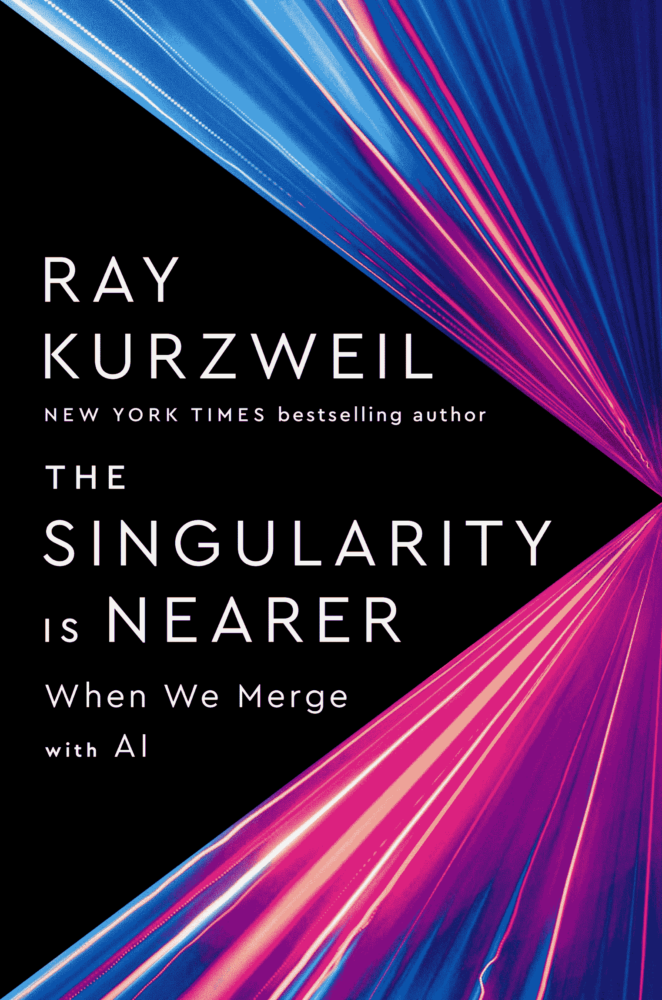

_147301320_

献给索尼娅·罗森瓦尔德·库兹韦尔。

半个世纪的相识，从初见之日起便延续至今的爱。

# 致谢

对索尼娅，我感恩她在写作期间给予的温柔耐心，以及五十年同行共思的时光。

感谢伊桑、艾米、丽贝卡、雅各布、伊妮德，以及孙辈里奥、内奥米、昆西，爱与灵感源于你们。

感谢已故母亲汉娜与已故父亲弗雷德里克，在纽约林间散步教会我思考的力量，并给予青年时期的实验自由。

感谢约翰-克拉克·莱文，对数据的严谨梳理与敏锐洞察构成了本书的基础。

感谢维京出版社长期编辑里克·科特，其领导、坚定指导与专业校订。

感谢文学经纪人尼克·穆伦多尔，精准而热情的引领。

感谢自1973年起并肩半个世纪的商业伙伴亚伦·克莱纳。

感谢南达·巴克-胡克，文字支援熟练，演讲统筹专业。

感谢莎拉·布莱克，洞见深刻的研究视角与想法整理。

感谢西莉亚·布莱克-布鲁克斯，周到协助与传播策略。

感谢丹尼斯·斯库泰拉罗，对业务运营的精细把控。

感谢拉克什曼·弗兰克，版面与插图出色。

感谢艾米·库茨魏尔与丽贝卡·库茨魏尔，写作技艺的点拨，以及各自成功著作的示范。

感谢Martine Rothblatt，对书中全部技术议题的投入，及长期合作形成的典范案例。

感谢Kurzweil团队在研究、撰写与后勤上的关键贡献：Amara Angelica、Aaron Kleiner、Bob Beal、Nanda Barker-Hook、Celia Black-Brooks、John-Clark Levin、Denise Scutellaro、Joan Walsh、Marylou Sousa、Lindsay Boffoli、Ken Linde、Laksman Frank、Maria Ellis、Sarah Black、Emily Brangan、Kathryn Myronuk。

感谢Viking Penguin团队的专业配合：执行编辑Rick Kot、执行编辑Allison Lorentzen、副编辑Camille LeBlanc、出版人Brian Tart、副出版人Kate Stark、执行宣传Carolyn Coleburn、市场总监Mary Stone。

感谢CAA的Peter Jacobs，对演讲活动的宝贵领导与支持。

感谢Fortier Public Relations与Book Highlight团队的公关与传播策略。

感谢内部及非专业读者带来的巧妙想法。

最后致敬所有敢于质疑陈旧假设、以想象力开辟未竟之路的人，你们的精神是我不断前行的动力。

# 导言

《奇点临近》于2005年问世时，我提出多条收敛且加速的技术脉络正在重塑社会形态。算力成本持续下行，生命科学不断明晰，工程精度不断逼近微观。随着人工智能迅猛提升与信息获取门槛降低，生物智能正与数字工具越绑越紧。最终，纳米技术将把趋势推向顶点，以云端虚拟神经元网络直接延伸大脑皮层。我们会与人工智能融为一体，获得远超基因赋予百万倍的计算增益，认知与意识随之扩展到难以把握的程度。奇点即此一转折。

奇点一词源自数学中函数失效处，如除零亦源自物理学中黑洞中心物质极致压缩、常规法则失效处。然我使用它仅为隐喻。技术奇点的说法不意味速率会真成无限，指数增长不等同于无限，物理奇点亦非无限。黑洞重力可捕获光线，量子力学却无法容纳真正无限的质量。我借用此意象，因它捕捉了以现行认知无法理解根本性变革的困境。变革一旦展开，认知本身会迅速跃升以匹配变化。

《奇点临近》里长期观察指向约2045年前后。出版之时那仍是四十年之后，两代人的距离。在此尺度上我只能对驱动转型的宏观力量做出展望，而对多数读者而言2005年的议题仍显遥远。当时不少评论认为时间表过于乐观，甚至否定奇点的可能。

此后发展出现戏剧性加速。质疑被无视，进步持续提速。社交媒体与智能手机由无到有，成为不离身的伴侣，如今联通全球绝大多数人口。算法创新与海量数据推动人工智能以超出专家预期的节奏取得突破，从精通《危险边缘！》到自动驾驶、文本创作、司法资格考试与癌症诊断。如今GPT-4、Gemini等大型语言模型能把自然语言指令转译为代码，大幅拉近人与机器的距离。阅读此文之时，已有数千万用户亲身体验上述能力。与此同时，人类基因组测序费用下降约99.997%，神经网络借数字化模拟生物学取得重大医学进展。我们也已看到初现的脑机直连可能性。

这一切的基础是我所称的加速回报律：信息技术，尤其是计算，其价格指数级走低，因每次进步都让下一阶段的自我设计变得更易。因此以写作当下计，经通胀调整，一美元可购得的计算量已是《奇点临近》上架时约11200倍。

下图概括驱动技术文明的核心动向：在对数坐标上近似直线的长期指数增长，即固定金额可购买的算力。我将在后文展开。摩尔定律观察到晶体管持续微缩使计算机愈强，此仅为加速回报律的一种表现，该律早于晶体管出现，且在晶体管触及物理极限后仍有望延续。此趋势定义了当代世界，且本书所论几乎所有突破都直接或间接由其驱动。

![为了最大限度地提高机器的可比性，该图侧重于可编程计算机时代的性价比，但早期机电计算设备的近似值表明，这种趋势至少可以追溯到 19 世纪 80 年代。\[2\]](images/ART01_COMPUTATION_GRAPH_2_2.jpg)

为提升可比性，该图聚焦可编程计算机时代的性价比，但早期机电计算设备的粗略数据表明，此趋势至少可追溯至19世纪80年代。[\[2\]](#18_Notes.xhtml#EndnoteNumber1 "note")

因此我们始终沿着通往奇点的时间线前行。本书紧迫感源自指数变化的特性。本世纪初尚不起眼的迹象，如今正深刻影响数十亿人。2020年代初，我们已进入曲线陡峭段，创新以前所未有的速度冲击社会。直观看来，你此刻的阅读时刻，可能比2012年出版的《如何创造一个心灵》发行时更接近首个超人人工智能的诞生，也可能更接近1999年出版的《精神机器的时代》发行时距奇点的距离。若以生命尺度衡量，今日出生的婴儿到奇点到来时正值大学毕业。相较2005年，这是截然不同的“临近”。

正因如此我撰写此书。人类通向奇点的千年征程已转为冲刺。《奇点临近》导言里我写道当时正处“转变早期”。现今我们已进入高潮。那本书是遥远视野的一瞥，此书则是抵达终点前的最后数里。

所幸道路已更清晰。虽然实现奇点前仍有技术难题，但其关键先兆正从理论科学转向积极研发。未来十年，人们将与看似可信的类人人工智能互动，而简易脑机接口将如今日智能手机般融入日常。生物技术数字化浪潮将治愈疾病并显著延长健康寿命。与此同时，许多劳动者将感受到经济冲击，我们全体也将面临新能力被意外或蓄意滥用的风险。2030年代，自改进型人工智能与成熟纳米技术将以前所未有的方式把人类与其造物结合，进一步放大希望与危险。若我们能处理这些进步带来的科学、伦理、社会与政治挑战，到2045年地球生命质量将被深刻改善。若失败，生存本身都将受威胁。因此本书关乎我们逼近奇点——在这一代人熟悉的世界里，机遇与必须共同面对的危险。

首先我们将探讨奇点如何发生，并置于物种长期改造自身智能的脉络中。用技术制造感知会引发重要哲学追问，因此我们将讨论此转变如何影响身份与目标感。随后我们转向未来数十年显现的具体趋势。正如我会展示，加速回报律正推动多个反映人类福祉的指标指数上升。但创新最明显的负面效应之一是自动化导致的失业。风险真实存在，但仍有充分理由对长期保持乐观——我们最终不会与人工智能直接竞争。

随着技术为文明解锁巨大物质财富，焦点将转向更根本的限制：生物学的脆弱性。接下来我们将展望未来数十年将使用的工具，以获得对生物学本身更强的掌控——先战胜衰老，再增强有限的大脑并迎来奇点。这些突破同时也暗藏危险。生物技术、纳米技术或人工智能领域的革命性系统可能引发生存灾难，比如毁灭性流行病或自我复制机器的连锁反应。最后我们将评估这些威胁，它们需要审慎规划，但正如我会解释，存在相当有希望的缓解路径。

这是人类历史上最激动人心也意义最重大的数年。我们无法自信地描绘奇点之后的生活。但通过理解并预测导致奇点的转变，我们可以帮助确保人类的最终路径安全且成功。

# 第一章：我们处于六个阶段的哪个阶段？

在《奇点临近》中，我把意识的根基描述为信息。我列出自宇宙诞生起的六个纪元或阶段，每个都以前一阶段的信息处理为基础创造下一阶段，因而智能的演化是间接的序列。

首个纪元是物理定律及其衍生的化学诞生。大爆炸后数十万年，原子由环绕质子中子核心的电子构成。原子核中的质子本应因电磁斥力而分开，却有一种额外力量——强核力——将它们束缚在一起。若没有这份额外力，原子的演化就不可能发生。

数十亿年后，原子形成了能承载复杂信息的分子。碳最为有用，因其可形成四个键，而多数其他原子只能形成一至三键。我们生活在一个允许复杂化学反应的稀有世界。例如，若引力稍弱，超新星就不会产生构成生命的化学元素。若引力稍强，恒星会在智能生命出现前耗尽。仅此一个物理常数就必须落在极窄区间。否则我们不会在此。我们生活在一个精确平衡的宇宙中，这种平衡容许秩序出现，从而使进化展开。

数十亿年前，第二纪元开始：生命。分子变得足够复杂，能在一个分子里定义一个完整有机体，于是生物得以演化与扩散，每个个体都有自己的DNA。

第三纪元里，由DNA描述的动物发展出大脑，里面存储并处理信息。这些大脑带来演化优势，推动大脑在数百万年间变得更复杂。

第四纪元中，动物凭借高级认知与拇指，将思想转化为复杂行动。这就是人类。我们的物种利用此能力创造能存储与操纵信息的工具——从纸草到硬盘。这些工具增强了大脑感知、记忆与评估信息模式的能力。这是另一波演化，其提升远超之前。有了大脑，我们约每十万年增加一立方英寸脑物质，而有了数字计算，性价比约每十六个月翻一番。

第五纪元里，我们将把生物人的认知直接与数字技术的速度与力量融合起来，即脑机接口。人类神经处理速度约为每秒数百次，而数字技术可达每秒数十亿次。除了速度与内存，非生物计算机的增强将让我们在新皮层中增加更多层次——释放出当前难以想象的复杂与抽象认知。

第六纪元是智能遍布整个宇宙的时代，将普通物质转化为计算物质，即以终极计算密度组织的物质。

1999年出版的《精神机器的时代》中，我预测图灵测试——即人工智能可通过文本交流且与人类无法区分——将在2029年通过。我在2005年的《奇点临近》里重申此点。通过有效图灵测试意味着人工智能已掌握人类拥有的语言与常识推理能力。图灵于1950年提出该概念，[\[1\]](#18_Notes.xhtml#EndnoteNumber2 "note")但未给出具体操作方式。在我与米奇·卡普尔的赌约中，我们自行制定了更严格的规则。

我的预期是，要在2029年通过有效图灵测试，我们需在2020年前在多个智力领域实现突破。事实上，自我做出预测以来，人工智能已攻克人类许多最难的智力挑战——从游戏《危险边缘！》到放射学与药物发现等严肃应用。写作之时，像Gemini与GPT-4等顶尖系统正把能力扩展到多个性能维度——这是通往通用智能的鼓舞性进展。

最终，当程序通过图灵测试时，它必须在许多方面刻意表现出不如人类，否则会暴露其人工智能身份。例如，若它能瞬间正确解决任何数学问题，便无法通过测试。因此在图灵测试水平，人工智能在多数领域实际上会远超最优秀的人类。

人类现在处于第四纪元，我们的技术已产生部分无法理解的结果。对于图灵测试尚未覆盖的方面，我们正取得快速且加速的进展。通过我一直期待在2029年实现的图灵测试，将把我们推入第五纪元。

2030年代的关键能力是把新皮层上层与云端连接，直接扩展思维。这样人工智能不再是竞争者，而成为我们自身的延伸。到那时，我们思想的非生物部分将提供比生物部分多出数千倍的认知能力。

随着指数增长，到2045年，我们将把思想扩展数百万倍。正是这种难以理解的速度与转变幅度，使我们能借用物理学中的奇点隐喻来描述未来。

# 第二章：重塑智能

## 重塑智能

### 重新定义智能意味着什么？

如果宇宙整体的故事是信息处理范式不断演进的过程，那么人类的篇章是从中途开始的。在这个更大的叙事里，我们的阶段最终关乎从拥有生物大脑的动物向超越存在的转变，这些存在的思想与身份不再受基因的限制。2020年代，我们将进入这一转变的最后阶段——在更强大的数字基质上重塑自然赋予的智能，随后与之融合。这样，宇宙的第四纪元将孕育第五纪元。

但这具体会如何展开？为理解重塑智能的含义，我们先回顾人工智能的诞生及其衍生的两大流派。为了明白为何其中一派占优，我们将它与神经科学关于小脑与新皮层如何产生人类智能的发现相联系。在审视深度学习如何重建新皮层的能力后，我们可以评估人工智能距离人类水平还有多远，以及何时可以判定它已达到。最后，我们将转向在超人人工智能的帮助下，如何设计脑机接口，从而以虚拟神经元层大幅扩展新皮层。这将释放全新思维模式，并最终把智力扩展数百万倍：这就是奇点。

### 人工智能的诞生

1950年，英国数学家艾伦·图灵在《心灵》杂志发表文章“计算机械与智能”。[\[1\]](#18_Notes.xhtml#EndnoteNumber3 "note")其中，图灵提出了科学史上最深刻的问题之一：“机器能思考吗？”虽然思考机器的想法可追溯到希腊神话中的青铜自动机塔洛斯，[\[2\]](#18_Notes.xhtml#EndnoteNumber4 "note")图灵的突破在于把概念提炼成可经验检验的形式。他提出“模仿游戏”，即我们今天称之为图灵测试，用以判断机器计算能否执行与大脑相同的认知任务。在测试中，人类评委通过即时通讯与人工智能和人类陪衬交流，但看不到对方身份。评委可就任意主题提问。若一段时间后评委无法区分回复者，则认为人工智能通过了测试。

通过把哲学问题转化为科学问题，图灵激发了研究者的巨大热情。1956年，数学教授约翰·麦卡锡提议在新罕布什尔州达特茅斯学院举办为期两个月、十人参与的研究会。[\[3\]](#18_Notes.xhtml#EndnoteNumber5 "note")目标表述如下：

> 本研究基于这样的假设：学习或任何其他智能特征的每个方面原则上都可被精确描述，以至于能制造机器来模拟它。将尝试找到如何让机器使用语言，形成抽象与概念，解决现在为人类保留的各种问题，并改进自身。[\[4\]](#18_Notes.xhtml#EndnoteNumber6 "note")

在会议筹备期间，麦卡锡提议把该领域命名为“人工智能”。[\[5\]](#18_Notes.xhtml#EndnoteNumber7 "note")鉴于“人工”使这种智能显得不真实，我并不喜欢这个名称，但它已成为通用术语。

这个项目一直在推进，但最核心的目标——让机器读懂用日常语言描述的问题——并没有在两个月内达成。我们仍在继续，团队规模也从当初的少数人扩大到十人以上。

规模的膨胀令人难以置信。根据腾讯在 2017 年的统计，全球已有约 30 万名人工智能研究人员和从业者[\[6\]](#18_Notes.xhtml#EndnoteNumber8 "note")；2019 年让-弗朗索瓦·加涅、格蕾丝·凯泽与约安·曼塔的《全球人工智能人才报告》梳理出约 22,400 名发表原创论文的人工智能学者，其中约 4,000 人被归为极具影响力的一批[\[7\]](#18_Notes.xhtml#EndnoteNumber9 "note")。斯坦福大学以人为本人工智能研究所的数据显示，2021 年这一群体产出了超过 496,000 篇论文和超过 141,000 项专利申请[\[8\]](#18_Notes.xhtml#EndnoteNumber10 "note")。2022 年，全球企业在人工智能上的投入达到 1,890 亿美元，是过去十年总额的 13 倍[\[9\]](#18_Notes.xhtml#EndnoteNumber11 "note")，而你读到这里时，这个数字只会更高。

在 1956 年，这些景象绝无可能出现。达特茅斯会议提出的目标，本质上等同于打造能通过图灵测试的系统。我在 1999 年的著作《精神机器的时代》里就给出 2029 年可实现的判断，此后从未更改。即便许多观察者认为这个节点永远到不了，这一预测长期以来在业内仍被视作极度乐观。2018 年的一次调查显示，大多数人工智能专家认为人类水平的机器智能要到 2060 年左右。

大型语言模型的突进改写了预期。书稿早期，`Metaculus` 这个顶级预测平台的共识徘徊在 2040 年代到 2050 年代之间。近两年令人意外的进展颠覆了这种判断，到 2022 年 5 月，`Metaculus` 的共识已完全对齐我 2029 年的说法[\[12\]](#18_Notes.xhtml#EndnoteNumber14 "note")。此后共识甚至短暂下探到 2026 年，从技术上讲，我已经算是“慢线”阵营了[\[13\]](#18_Notes.xhtml#EndnoteNumber15 "note")。

专家们对近期突破的惊讶不只在时间提前，更在于其突兀。往往在突破前毫无征兆。例如 2014 年 10 月，麻省理工学院的托马索·波吉奥说，能够描述图像内容是机器面临的最具智力挑战的任务之一，需要新一轮基础研究，至少还要二十年[\[14\]](#18_Notes.xhtml#EndnoteNumber16 "note")。次月谷歌就发布了可做到这一点的图像识别系统。被《纽约客》拉菲·哈恰杜里安追问时，波吉奥转而持更哲学的怀疑。这恰恰说明一种普遍心理：目标未达成前总被视作极难且独属于人类的能力，一旦达成就显得理所当然。换句话说，我们事后的轻视常常低估了真实的进步难度，这也是我仍对 2029 年保持信心的理由之一。

为何会出现这种骤然的飞跃？根源可追溯到学科诞生之初的一个理论分歧。1964 年高中时我认识了马文·明斯基和弗兰克·罗森布拉特两位先驱，1965 年入读麻省理工后跟随明斯基学习。他向我指出实现自动化问题求解有两条路：符号法与连接主义。

符号法用规则来描述专家如何解题。在某些场景下可行。1959 年兰德公司的“通用问题求解器”`GPS` 能把简单的数学公理组合起来解决逻辑问题[\[15\]](#18_Notes.xhtml#EndnoteNumber17 "note")。赫伯特·A·西蒙、J·C·肖与艾伦·纽厄尔设计了它，理论上可处理任何能表述为良构公式 `WFF` 的问题。`GPS` 必须在每一步借助一个 `WFF`，有条不紊地构建数学证明。

这个思路与代数相通。已知 `2 + 7 = 9`，且未知数 `十` 加 7 等于 10，可推出 `十 = 3`。逻辑的用途远不止解方程。判断素数时我们也在无意识运用它。若已知素数除 1 和自身外无因子，且 11 是 22 的因子且不等于 1，就可判定 22 非素数。从基本公理出发，`GPS` 能对更难的问题做类似计算，机器在理论上甚至可以穷举所有基本公理组合来寻求真理。

若每一步可选公理有十个，需二十步才能解，组合数就是 `10²⁰`，即千亿亿种。今日电脑可承受，1959 年不行。那年 DEC `PDP-1` 约每秒 10 万次运算[\[16\]](#18_Notes.xhtml#EndnoteNumber18 "note")，而到 2023 年 `Google Cloud A3` 虚拟机约为每秒 26,000,000,000,000,000,000 次运算[\[17\]](#18_Notes.xhtml#EndnoteNumber19 "note")。如今一美元能买到当年 `GPS` 开发时计算能力的约 1.6 万亿倍[\[18\]](#18_Notes.xhtml#EndnoteNumber20 "note")。过去需数万年的问题，现在几分钟内在零售硬件上完成。为弥补限制，`GPS` 植入了启发式排序，有时奏效，也印证了计算机化求解可处理严格定义问题的观点。

另一个例子是 1970 年代开发的 `MYCIN`，用于诊断感染并推荐治疗。1979 年专家评估发现其表现不输人医，甚至更好[\[19\]](#18_Notes.xhtml#EndnoteNumber21 "note")。

典型的 `MYCIN` 规则是：

#### 如果：

1. 需要治疗的感染是脑膜炎，并且
2. 感染类型为真菌，并且
3. 培养染色体上未见生物体，并且
4. 患者非免疫受损宿主，并且
5. 曾到球孢子菌病流行区，并且
6. 患者种族为：\[B\]黑人 \[A\]亚洲人 \[I\]印度人，并且
7. 脑脊液隐球菌抗原检测阴性

然后：有暗示性证据（.5）表明隐球菌不是引起感染的生物之一（除培养或涂片所见生物外）。[\[20\]](#18_Notes.xhtml#EndnoteNumber22 "note")

到 1980 年代末，这类专家系统开始引入概率模型，能够融合多源证据做决策[\[21\]](#18_Notes.xhtml#EndnoteNumber23 "note")。单条 *如果-那么* 规则不足以成事，但成千上万条规则集合起来，可在受限问题上做出可靠判断。

符号法使用超过半个世纪，致命伤是“复杂性上限”[\[22\]](#18_Notes.xhtml#EndnoteNumber24 "note")。修正 `MYCIN` 的一个错误常会引入其它三处错误。现实可解问题的范围被压缩得很窄。

用故障点来理解，一组 *n* 个事物的子集数在不计空集时为 2^(n–1)。一条规则只有规则本身一个故障点；两条规则则有三个故障点，即各自及组合。增长是指数级的。五条规则意味着 31 个潜在故障点，十条 1,023 个，一百条超过一千亿亿亿个，一千条则远超 googol googol googols。规则越多，新规则带来的子集扩张越大。即便只有极小比例的组合会制造新问题，也会出现临界点——为修一个错而加的规则会带来更多错。这就是复杂性上限。

最持久的专家系统项目是道格拉斯·莱纳特在 `Cycorp` 创办的 `Cyc`，源自“百科全书”一词[\[23\]](#18_Notes.xhtml#EndnoteNumber25 "note")。1984 年启动，目标是把所有“常识知识”编码进去——诸如掉落的鸡蛋会碎、孩子穿着泥泞鞋子跑过厨房会惹恼父母之类的常识。这些微小观念从未被完整写下，却是推理的隐性前提。但 `Cyc` 也用符号规则表达知识，因而同样受复杂性上限制约。

上世纪 60 年代，明斯基向我阐述符号法的利弊时，我开始关注连接主义的补充价值。它不靠内容设计智能，而靠结构——由哑节点按特定方式排列的网络，从数据中自行提取洞察。它可能发现程序员设计规则时想不到的细微模式。最大优势在于，能在不理解问题的前提下解决问题。即使我们能写出零错误的符号规则，也受制于对“哪些规则最优”的理解偏差。

这是强大的方法，也是双刃剑。连接主义系统容易变成“黑箱”，能给出正确答案却难以解释过程[\[24\]](#18_Notes.xhtml#EndnoteNumber26 "note")。在医疗、执法、流行病学或风险管理等高风险场景，这一缺陷尤其突出。于是许多研究者正致力于提升机器学习的透明度或可解释性[\[25\]](#18_Notes.xhtml#EndnoteNumber27 "note")，但在深度学习愈发复杂的情况下效果如何仍待观察。

我起步时连接主义的系统远为简陋。基本设想是模仿人脑神经网络的计算模型。设计之初对生物神经组织的细节了解有限，故模型很抽象。

思路是寻找可让系统从实例中学会解题的案例。常见起点是随机设定连接与突触权重，未经训练的网络输出也随机。网络的关键是像哺乳动物大脑那样学习。起初无知，被编程以最大化“奖励”函数。输入由人类标注的训练数据，比如有柯基犬的照片和无柯基犬的照片。当网络输出正确，就给予奖励反馈，从而调整神经元间连接强度。与正确答案一致的连接增强，错误的方向减弱。

随着训练，网络自行组织，在无指导下也能给出正确结果。实验表明即便教师不可靠，网络仍能学习。若训练标签只有 60% 正确，网络仍可超过 90% 的准确率，在某些条件下更低比例的标签也有效[\[26\]](#18_Notes.xhtml#EndnoteNumber28 "note")。

老师能把学生带到自己达不到的水平，同样不可靠的数据也能培养出色的表现，这看似矛盾。答案是错误会相互抵消。若训练网络识别手写数字 8 到 9，其中三分之一标签被随机污染——8 被标为 4，5 被标为 8 等等——只要数据集足够大，噪声在不同方向抵消，就保留了“8 长什么样”的核心信息，仍能训练到很高水准。

但早期的连接主义也有根本限制。单层神经网络在数学上无法解决某些问题[\[27\]](#18_Notes.xhtml#EndnoteNumber29 "note")。1964 年在康奈尔拜访罗森布拉特时，他演示了可识别印刷字母的单层“感知器”。我尝试简单改动输入。系统在遮盖自联想上表现不错，但在不变性上很差，大小字体变化后无法识别。

1969 年，明斯基与麻省理工人工智能实验室联合创始人西摩·帕珀特合著《感知器》，正式证明感知器本质上无法判断打印图像是否连通。《感知器》封面上的两幅图，顶部未连通，底部连通，人类和简单程序能分辨，前馈感知器却不行。

核心在于前馈感知器无法实现异或计算。若要判断一条线段属于某个连续形状却不属于另一个，就需要异或，而没有反馈的单层节点只能做线性分类，无法执行“任一节点触发但不同时触发才输出真”这类需要反馈的判断。

这一结论几乎扼杀了连接主义的资金支持，直到数十年后才复苏。讽刺的是早在 1964 年，罗森布拉特就向我解释过感知器无法处理不变性是因为缺乏层次结构。若把感知器输出反馈到另一层，输出会更具一般性，反复迭代后不变性不断增强。有足够层数和数据，系统可处理惊人的复杂度。我问他是否尝试过，他说没做，但正是研究重点。这是极具前瞻性的洞见，可惜罗森布拉特 1971 年去世，未能验证。十年后多层结构才被广泛采用，即便如此仍需要超出当时可行范围的计算与数据。近年的爆发，很大程度上源于罗森布拉特提出想法半个多世纪后，多层神经网络终于可用。

因此在 2010 年代中期之前，连接主义长期被忽视，直到硬件进步释放了其潜力。把足够算力和样本集结起来变得便宜。1969 年《感知器》出版到 2016 年明斯基去世，计算性价比经通胀调整约提升了 2.8×10^10 倍[\[28\]](#18_Notes.xhtml#EndnoteNumber30 "note")。这改变了人工智能可采用的方法。临终前明斯基曾遗憾《感知器》影响过大，因为那时连接主义已在领域内获得广泛成功。

连接主义有点像达·芬奇的飞行器——思想超前，却要等到更轻更强的材料出现才可行[\[29\]](#18_Notes.xhtml#EndnoteNumber31 "note")。一旦硬件跟上，百层级的大规模网络成为可能，于是能解决过去无解的问题，这正是近几年最引人注目的进步范式。

## 小脑：一种模块化结构

为在人类智能的语境下理解神经网络，我想先绕个弯：回到宇宙起点。物质最初向更高组织进化的步伐*极*缓慢，没有大脑引导。（关于宇宙本身能否编码有用信息，请见第 3 章“难以置信的存在”部分。）形成新的细节层级往往需要数亿到数十亿年[\[30\]](#18_Notes.xhtml#EndnoteNumber32 "note")。

从无序的化学到能够编码生命蓝图的分子，所需的时间尺度远超直觉。现有证据虽有争议，但学界主流把地球生命的诞生放在约 35 亿至 40 亿年前之前。[\[31\]](#18_Notes.xhtml#EndnoteNumber33 "note") 宇宙诞生至今约 138 亿年，而地球自身大概在 45 亿年前成形。[\[32\]](#18_Notes.xhtml#EndnoteNumber34 "note") 也就是说，从最早的原子出现，到地球上出现能够自我复制的分子，间隔差不多 100 亿年。延迟背后有一部分是概率问题——原始地球的“汤”里，分子随机碰撞恰好拼对的难度我们至今算不清。生命或许来得更早，也可能迟得多。无论如何，在这些前提成立之前，恒星必须先完成它们的生命周期，把氢炼成碳、氮、氧等支撑复杂生命的重元素。

时间的累积在生命史上不断显现。从首个生命出现到多细胞生物诞生，中间隔了约 29 亿年。[\[33\]](#18_Notes.xhtml#EndnoteNumber35 "note") 再往后 5 亿年，动物才踏上陆地；又过 2 亿年，第一批哺乳动物登场。[\[34\]](#18_Notes.xhtml#EndnoteNumber36 "note") 放到大脑，原始神经网出现到最早的三叶集中式脑，需要超过 1 亿年。[\[35\]](#18_Notes.xhtml#EndnoteNumber37 "note") 基本的新皮层再等 3.5 至 4 亿年才初具雏形，而达到现代人脑的演化又耗去约 2 亿年。[\[36\]](#18_Notes.xhtml#EndnoteNumber38 "note")

更复杂的大脑在资源竞争中带来明显优势，聪明的个体往往胜出。[\[37\]](#18_Notes.xhtml#EndnoteNumber39 "note") 智力的演化节奏明显加快，单位是百万年而非十亿年。前哺乳动物脑里最突出的变化是小脑。今天人脑小脑中的神经元数量甚至超过新皮层，而新皮层主导高级功能。[\[38\]](#18_Notes.xhtml#EndnoteNumber40 "note") 小脑擅长把感官输入转成肌肉动作的脚本，比如写字的手感常被称作“肌肉记忆”，实质并非肌肉，而是小脑在记。动作反复练习后，大脑会让它更顺滑、更自动化，像车轮在泥路上压出车辙。

接住飞球时，大脑并不会去解复杂的微分方程。它采用更省力的策略：让手与球保持熟悉的相对位置。小脑预设手和球的相对关系，若球掉得快、手看起来慢，就指令手加速去匹配那种熟悉的相对姿态。

这种把感觉映射到运动的做法对应数学上的基函数概念，让我们无需演算就能完成抓取。[\[40\]](#18_Notes.xhtml#EndnoteNumber42 "note") 小脑还能在不行动时进行预测——它可能判断你能接住球，却会撞到队友，于是最好别出手。跳舞时，很多人动作的指挥也是小脑在暗中完成。受损的小脑患者仍能靠新皮层做随意动作，但需要高度集中，容易出现共济失调。[\[41\]](#18_Notes.xhtml#EndnoteNumber43 "note")

身体技能的掌握靠重复把动作刻进自动化程序。原本需要有意识思考的行为逐渐脱手，由运动皮层转向小脑主导。投橄榄球、拼魔方、弹钢琴，越不需要刻意指挥，表现越流畅，剩余的注意力可投向其他目标。熟练的音乐家可以凭直觉弹出音符，像常人哼生日歌一样自然。问他声带如何找准音高，往往答不上来，这就是心理学说的“无意识能力”。[\[42\]](#18_Notes.xhtml#EndnoteNumber44 "note")

小脑的力量不来自极端复杂的结构。它拥有大量神经元，但基因组里关于整体设计的蓝图很少，主要由小而简单的模块堆叠而成。[\[43\]](#18_Notes.xhtml#EndnoteNumber45 "note") 神经科学仍在细化其工作细节，但已知它由数千个前馈排列的处理单元组成。[\[44\]](#18_Notes.xhtml#EndnoteNumber46 "note") 这类模块功能明确，弹钢琴时手指的控制单元不会被挪去管走路。尽管小脑数亿年以来都是关键脑区，人类对它的依赖却在减弱，新皮层在现代社会中占据主导。[\[45\]](#18_Notes.xhtml#EndnodeNumber47 "note")

非哺乳动物没有新皮层的加持，小脑则精确记录生存所需的固定行为模式。这些天生硬编码的行为不靠观察学习，比如一种仓鼠挖浅洞，另一种海滩鼠挖带逃生隧道的长洞。[\[46\]](#18_Notes.xhtml#EndnoteNumber48 "note") 在沙地上饲养、从未见过洞穴的小鼠，仍会按各自野生种的样式挖掘。

像青蛙舌头捕蝇这类小脑驱动的动作，会在一个物种里稳定存在，直到出现更优动作的种群被自然选择取代。基因驱动的行为适应速度比学习慢好几个数量级。学习可在个体一生中改变行为，先天行为则需世代累积。有趣的是，计算机科学里的“进化”方法正模仿这种基因决定的模式：生成一批带随机特征的程序，筛选表现好的个体让其“繁殖”并引入随机突变，数代后得到人类程序员不易想到的解法。[\[47\]](#18_Notes.xhtml#EndnoteNumber49 "note") 在现实世界里，这类等效过程需要数百万年。听起来很慢，但要记住，生命所需的复杂前体化学本身就需数亿年，小脑其实已是一种加速器。

## 新皮层：一种自我修正、分层的灵活系统

为了在不等待基因改写小脑的前提下获得新行为，进化打造了新皮层。它在约 2 亿年前随哺乳动物出现。[\[48\]](#18_Notes.xhtml#EndnoteNumber50 "note") 最早的哺乳动物像啮齿类，新皮层薄如邮票，包覆在核桃大小的脑体外。[\[49\]](#18_Notes.xhtml#EndnoteNumber51 "note") 它的组织比小脑灵活得多，不是孤立模块的集合，而更像协同运作的整体，因而能在数天甚至数小时内产生新行为，释放学习的潜能。

在它诞生后的 2 亿多年里，非哺乳动物的缓慢适应并不成问题，因为环境变化极慢，往往以千年为单位。新皮层本质上在等待一次大灾难来接管。那场危机就是约 6500 万年前的白垩纪-古近纪灭绝事件，距新皮层出现约 1.35 亿年。陨石撞击、火山活动等原因让全球环境骤变，约 75% 的动植物物种灭绝，包括非鸟恐龙。[\[50\]](#18_Notes.xhtml#EndnoteNumber52 "note")

正是此时，能快速生成新方案的新皮层开始发力。哺乳动物体型增大，大脑占比提升，新皮层更是通过形成褶皱大幅扩展表面积。若把人类的新皮层摊开，其大小和厚度约等于一张大餐巾纸。[\[51\]](#18_Notes.xhtml#EndnoteNumber53 "note") 现在它约占人脑重量的 80%。[\[52\]](#18_Notes.xhtml#EndnoteNumber54 "note")

作者在 2012 年的著作《如何创造一个心灵》中详细论述过新皮层的工作机制，核心概念可概括如下：新皮层由一种相对简单的重复单元构成，每个单元约含一百个神经元。这些微单元能学习、辨识、记忆模式，并学会自组织成层级，越高的层级掌握越抽象的概念。这一重复亚结构被称为皮质微柱。[\[53\]](#18_Notes.xhtml#EndnoteNumber55 "note")

当前估计全脑皮层有 210 亿到 260 亿个神经元，其中约 90% 即约 210 亿个位于新皮层。[\[54\]](#18_Notes.xhtml#EndnoteNumber56 "note") 按每个微柱约百个神经元计算，人类约有 2 亿个微柱。[\[55\]](#18_Notes.xhtml#EndnoteNumber57 "note") 新研究显示，新皮层的模块并非像数字计算机那样顺序执行，而是大规模并行处理。[\[56\]](#18_Notes.xhtml#EndnoteNumber58 "note") 许多事同时进行，使大脑极具动态性，也让建模变得困难。

对微柱如何连接的基本认识揭示了功能。与硅基人工神经网络相似，大脑网络采用分层结构，把原始感觉输入与行为输出分离，形成渐进抽象。底层单元可能把视觉刺激识别为弯曲形状，更高层加入上下文，把弯曲识别为字母的一部分，再到单词，最后关联丰富语义。顶层则处理更抽象的判断，比如某句话是否幽默、讽刺或挖苦。

层级高度决定抽象程度，但过程并非单向。新皮层的六层在两个方向动态通信。[\[57\]](#18_Notes.xhtml#EndnoteNumber59 "note") 更准确的说法是抽象能力与物种层级相关。我们多层的皮层比皮层更简单的生物拥有更强的抽象思维。当人类能把新皮层直接连向云端计算时，将释放出远超有机大脑自身所能支撑的抽象潜力。

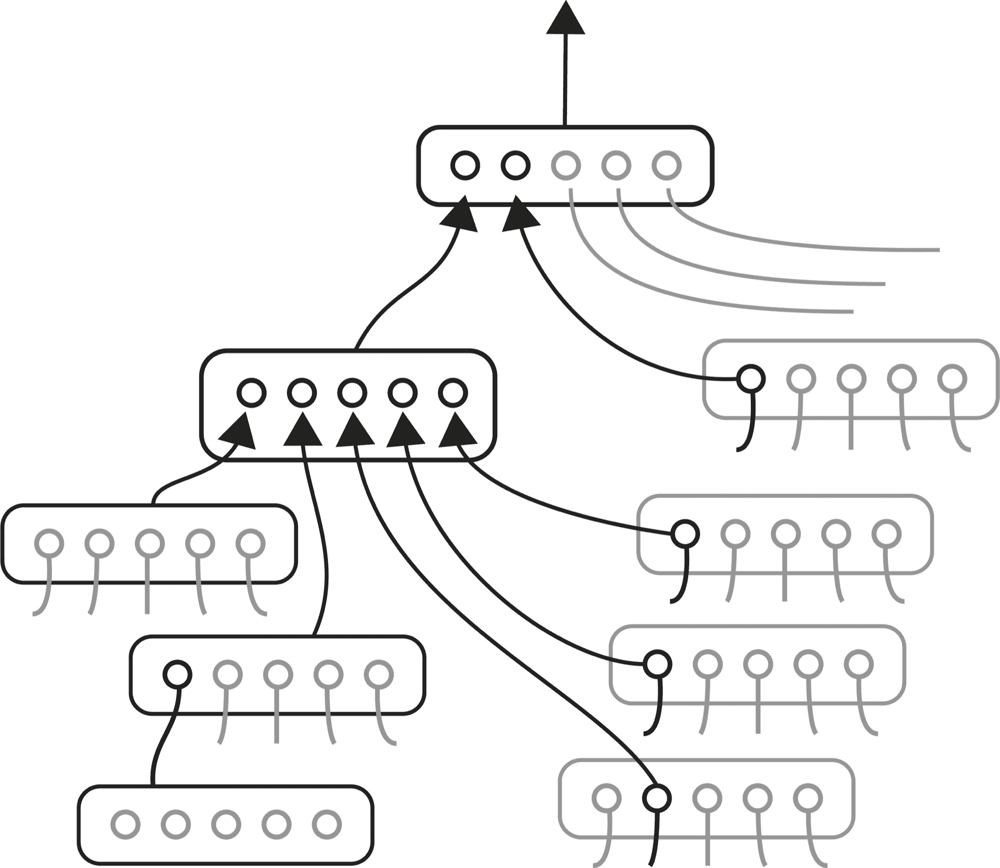

这类抽象概念的神经基础是近期的发现。20 世纪 90 年代末，16 岁癫痫患者的开颅手术中，神经外科医生伊扎克·弗里德让她保持清醒以便反馈。[\[58\]](#18_Notes.xhtml#EndnoteNumber60 "note") 大脑没有痛觉感受器。[\[59\]](#18_Notes.xhtml#EndnoteNumber61 "note") 刺激新皮层的某处会让她发笑。团队很快意识到这不是反射，而是真实的幽默感知。手术室内并无笑点，她却能给出理由，比如“你们挤在一起真有趣”。[\[60\]](#18_Notes.xhtml#EndnoteNumber62 "note")

能在皮层定位并触发幽默感的区域，说明新皮层负责幽默、讽刺等概念。非侵入性实验也佐证这一点：阅读讽刺句子会激活大脑的心理理论网络。[\[61\]](#18_Notes.xhtml#EndnoteNumber63 "note") 这种抽象能力促成了语言、音乐、幽默、科学、艺术和技术的诞生。[\[62\]](#18_Notes.xhtml#EndnoteNumber64 "note")

没有其他物种能做到这些。没有动物能保持节奏、讲笑话、发表演讲、写或读这本书。黑猩猩等虽能制造原始工具，但复杂度不足以触发快速自我改进。[\[63\]](#18_Notes.xhtml#EndnoteNumber65 "note") 它们使用的交流形式无法表达层级概念，而人类语言可以。[\[64\]](#18_Notes.xhtml#EndnoteNumber66 "note") 即便去 Harold 虽然灵长类本身表现优异，但额叶皮层等额外模块让人类从高级动物跃升为哲学动物。

需要记住，脑部进化只是物种崛起的一部分。所有皮层力量若没有拇指，人类的科学与艺术都无从谈起。[\[65\]](#18_Notes.xhtml#EndnoteNumber67 "note") 鲸鱼、海豚、大象的新皮层绝对量可与人类相当甚至更大，却没有对生拇指去精细操控材料并制造技术。进化上的幸运是关键。

人类新皮层不仅分层，还以新颖强大的方式连接层级。层级组织并非新皮层独有，小脑也有。[\[66\]](#18_Notes.xhtml#EndnoteNumber68 "note") 区别在于三个特征赋予哺乳动物尤其是人类的创造力：（1）概念的放电模式可在整个结构中广泛传播，而非局限于起源区；（2）同一放电模式可与多种不同概念的相关侧面关联；（3）数百万种模式可同时被激活并复杂互动。[\[67\]](#18_Notes.xhtml#EndnoteNumber69 "note")[\[68\]](#18_Notes.xhtml#EndnoteNumber70 "note")

这种连接带来丰富的联想记忆。大脑记忆像维基百科页面，可从多处链接并随时间改变，且是多媒体的，能被气味、声音等触发。

放电模式的相似性也促进类比思维。代表手位下降的模式会与音调降低的模式相关，甚至与隐喻的“温度下降”“帝国衰落”等概念相关。我们由此能在不同领域迁移学习的概念。

新皮层在不同领域做类比的能力造就了历史上诸多智力飞跃。达尔文的进化论就源于与地质学的类比。在达尔文之前，学界多认为上帝单独创造每个物种。拉马克等早期的准进化论提出生命自然趋向更复杂，后代可继承生前获得的性状。[\[70\]](#18_Notes.xhtml#EndnoteNumber72 "note") 但这些理论的机制要么解释不清，要么错误。

达尔文能把生物学推向进化论，关键灵感其实来自地质学那场争论。苏格兰地质学家查尔斯·莱尔 1797-1875 在其著作里提出了一个当时很颠覆的说法，关于大峡谷这类地貌怎么来的。[\[71\]](#18_Notes.xhtml#EndnoteNumber73 "note") 当时主流说法是上帝亲手造出峡谷，河水只是顺着重力往下滑，刚好找到最底下。莱尔反过来了，他认为河水是*第一*，峡谷是被水一点点凿出来的。这个观点起初遭遇强烈抵制，很久才被接受，但慢慢大家发现，流水对岩面无数次极细微的冲击，累积上百万年，完全能雕刻出大峡谷那样的深度。莱尔很大程度上受到同乡地质学家詹姆斯·赫顿 1726-1797 的影响，赫顿首倡均变论。[\[72\]](#18_Notes.xhtml#EndnoteNumber74 "note") 均变论的核心就是世界并非被圣经式的灾变洪水塑造，而是持续不断的自然力量在长时间里缓慢作用的结果。

达尔文在自己的战场上碰到的阻力更大。生物学复杂得多，可他敏锐地捕捉到莱尔与博物学研究间的共通之处，并在 1859 年出版的《物种起源》开篇点明了这层联系。他借用莱尔“河流每次只带走一粒沙”的思想，把它迁移到每一代生物里微小的基因改动上。达尔文用一个直白的类比来为自己辩护：“正如现代地质学几乎已经摒弃了用单一的洪水波挖掘一个大山谷的观点一样，如果自然选择是一个真实的原则，它也将摒弃持续创造新的有机生物，或其结构的任何巨大和突然改变的信念。”[\[73\]](#18_Notes.xhtml#EndnoteNumber75 "note") 这场类比带来的认知冲击，被认为是我们文明史上最深刻的科学革命之一。与牛顿的引力、爱因斯坦的相对论并列，那些改变世界的突破往往都源于类似的跨学科类比。

## 深度学习如何复刻新皮层的灵活性

怎样用数字手段复制新皮层那种灵活抽象的能力？正如本章开头所说，纯规则的符号系统太死板，抓不住人类思维的流动感。连接主义的思路很久都落不了地，核心瓶颈是训练需要海量算力。算力价格为什么大跌？

英特尔联合创始人戈登·摩尔 1929-2023 因提出摩尔定律而闻名，他在 1965 年首次给出这个预言，此后它成了信息技术最显著的趋势。[\[74\]](#18_Notes.xhtml#EndnoteNumber76 "note") 最常见的说法是芯片上能放的晶体管数约每两年翻一番。有人怀疑随着集成电路逼近原子极限，摩尔定律终将失效，却忽略了更底层的规律。摩尔定律其实只是我称之为加速回报定律的一个表象，信息技术在自我加速，形成创新回馈循环。摩尔观察它的时候，计算性价比已经跨越机电、继电器、真空管、晶体管四个大范式实现指数级提升。等集成电路走到尽头，纳米材料或三维计算等新范式会接力。[\[75\]](#18_Notes.xhtml#EndnoteNumber77 "note")

这种指数级大趋势至少从 1888 年就开始了，远早于摩尔出生。[\[76\]](#18_Notes.xhtml#EndnoteNumber78 "note") 大约 2010 年前后临界点到来，足以释放一种模仿新皮层多层分层计算的连接主义潜能：深度学习。正是在它推动下，人工智能出现惊人爆发，被解读为奇点临近的信号。

深度学习的爆发先在围棋上显现。围棋的走法可能性远超国际象棋，且难以判断单步好坏，以前能赢象棋大师的方法对围棋几乎无效。乐观估计都觉得要到 2020 年代才能解决，例如 2012 年时人工智能未来学家尼克·博斯特罗姆推测要到 2022 左右。[\[77\]](#18_Notes.xhtml#EndnoteNumber79 "note") 2015-16 年，Alphabet 子公司 DeepMind 推出了 AlphaGo，采用“深度强化学习”，让一个大神经网络自己对弈、从成败中学习。[\[78\]](#18_Notes.xhtml#EndnoteNumber80 "note") 它先学习大量人类对局，再自我对弈，最后 AlphaGo Master 版本击败了世界冠军柯洁。[\[79\]](#18_Notes.xhtml#EndnoteNumber81 "note")

几个月后 AlphaGo Zero 更进一步。1997 年 IBM 的深蓝击败加里·卡斯帕罗夫时，机器里塞满了人类棋手积累的知识。[\[80\]](#18_Notes.xhtml#EndnoteNumber82 "note") 它只是个专用于下棋的系统。AlphaGo Zero 只拿到规则，没有任何人类对局经验，大约三天自我对弈，从随机落子进化到以 100 比 0 完胜之前人类训练的版本。[\[81\]](#18_Notes.xhtml#EndnoteNumber83 "note") 括号里，2016 年 AlphaGo 已以四胜一负击败排名世界第二的李世乭。AlphaGo Zero 靠程序自我指导，仅 21 天就达到 AlphaGo Master 水准，那个版本 2017 年在线三连胜柯洁。四十天后，AlphaGo Zero 超越所有 AlphaGo 版本，成为围棋史上最强的人类或机器选手。[\[83\]](#18_Notes.xhtml#EndnoteNumber85 "note") 整个过程没有植入人类对局知识，也无人工干预。

DeepMind 的下一个里程碑是 AlphaZero，能把围棋上学到的能力迁移到国际象棋、将棋。[\[84\]](#18_Notes.xhtml#EndnoteNumber86 "note") 它在只知道规则的前提下，四小时训练就击败所有人类棋手和所有象棋机器。最新版本 MuZero 更进一步，连规则都不用被告知。[\[85\]](#18_Notes.xhtml#EndnoteNumber87 "note") 这种迁移学习让 MuZero 能掌握没有运气、模糊或隐藏信息的棋盘游戏，也能玩确定性视频游戏如雅达利的 Pong。这正是人类智能的核心特征。

深度强化学习不只用于游戏。能玩星际争霸 II 或扑克这类存在不确定性、需要理解对手的 AI，已超越人类水平。[\[86\]](#18_Notes.xhtml#EndnoteNumber88 "note") 例外是需要极高语言能力的博弈，如外交。这是场世界统治游戏，运气和技术都不起决定作用，关键是玩家必须交谈。[\[87\]](#18_Notes.xhtml#EndnoteNumber89 "note") 要赢，就得说服他人让行动符合其利益。能持续主宰外交的 AI，可能也掌握了更广义的欺骗与说服能力。即便如此，2022 年 Meta 的 CICERO 在外交上取得显著进展，可击败多数人类玩家。[\[88\]](#18_Notes.xhtml#EndnoteNumber90 "note") 这类里程碑几乎每周都在发生。

征服游戏的能力同样能投向现实。我们需要能复制目标领域的模拟器，比如开车的各种模糊场景：别的车突然停下、逆行、孩子追球冲上马路。为此 Alphabet 子公司 Waymo 为自动驾驶造了软件，最初配有人类监督员。[\[89\]](#18_Notes.xhtml#EndnoteNumber91 "note") 所有行程都被记录并用来搭建高度完整的模拟器。实际车队已累计超过 2000 万英里行驶里程，[\[90\]](#18_Notes.xhtml#EndnoteNumber92 "note") 模拟车就能在逼真虚拟空间里跑数十亿英里训练。[\[91\]](#18_Notes.xhtml#EndnoteNumber93 "note") 积累足够经验后，真车有望比人类驾驶更可靠。类似地，如第 6 章所述，AI 正用新颖模拟技术更好预测蛋白质折叠，这是生物学难题，突破后将打开药物发现的大门。

不过 MuZero 再强也有限，它写不出十四行诗，也安慰不了病人。要达到新皮层的普遍性，人工智能必须学会语言。语言让我们把不同认知域连接起来，实现高阶知识迁移。有了语言，就不需要几百万示例，只需一句摘要就能大幅更新认知。

目前最快的进展是用深度神经网络把词语映射到超高维空间表示含义。数学方法各异，但共同点是让 AI 在无硬编码语法规则的情况下自行发现语言意义。做法是建一个多层前馈网络，用数十亿甚至数万亿句子训练，句子来自网络公开来源。网络为每个句子分配 500 维空间的一个点，也就是 500 个数字的列表，维度可随意调整。训练初期位置随机，训练中含义相近的句子被拉近，差异大的被推开。处理完海量句子后，一个句子的位置由它邻近的句子定义含义。

这种方式让 AI 从实际使用语境学习，而非词典规则。比如它会注意到人们有时谈吃果酱，有时谈用吉他演奏果酱，却从不谈吃吉他，从而理解 jam 的多义。除极少数正式学习词汇外，人类也是这样学会词语的。联想能力已扩展到文本之外。OpenAI 2021 年的 CLIP 项目训练神经网络把图像与描述文本关联。[\[92\]](#18_Notes.xhtml#EndnoteNumber94 "note") CLIP 的某些节点能对“字面、象征或概念上相同”的概念做出反应，比如蜘蛛照片、蜘蛛侠画作或“蜘蛛”一词都会激活同一节点。这正是人脑处理概念的方式。

变体是构造一个承载所有语言句子的 500 维空间。翻译时，只需在超维空间里找目标语言最邻近的点。也可以通过附近句子找到表达相近的意思。另一种做法是配对两个 500 维空间，一个给出问题，另一个给出答案，需要汇聚数十亿问答对。进一步扩展是“通用句子编码器”。[\[93\]](#18_Notes.xhtml#EndnoteNumber95 "note") 这是我在谷歌团队创建的工具，把句子嵌入到包含讽刺、幽默、积极等数千特征的数据集里。用这种丰富数据训练的 AI 不仅模仿人类用语，还能捕捉更深层的语义特征，提升理解。

谷歌已基于此打造多款会话应用。典型例子是 Gmail 智能回复。[\[94\]](#18_Notes.xhtml#EndnoteNumber96 "note") 使用 Gmail 的人会看到每封邮件都附带三个回复建议。系统会综合你正在回复的内容、整条邮件链、主题行以及收件人信息。所有这些元素都需要对对话每个节点做精确的多维表征。这是多层前馈网络与分层语言表征结合，捕捉对话的来回。起初有人觉得尴尬，后因自然便利被广泛接受，占据了相当比例的 Gmail 流量。

另一项是“与书籍对话”。该实验服务 2018 至 2023 年间提供。加载后，你可直接提问，软件半秒内扫描十万本书共约五亿句话，返回最佳答案。不同于普通谷歌搜索靠关键词匹配和点击率，它靠问题实际含义与五亿句子的含义匹配工作。

超维语言处理最具前景的应用之一是 `transformer` 类系统。它们用“注意力”机制把算力集中到输入中最相关部分，类似人脑把注意导向重要信息。`Transformer` 在海量文本上训练，把文本编码为 `tokens`，通常是子词、词或词串的组合。模型用大量参数，对每个 token 分类。参数可理解为预测因子。

举个例子，单用一个参数判断“是不是大象”，可选“象鼻”。若检测到象鼻，系统就判为大象。但仅此不够，有象鼻的动物不止大象，单参数会误判。加入“毛茸茸身体”后，若两者同时触发，可猜测是长毛猛犸象而非大象。参数越多，捕捉细节越精细，预测越准。

在 `transformer` 中参数以网络权重形式存储。实践中它们有时对应人类可懂概念如“象鼻”，更多时候代表训练数据中高度抽象的统计关系。基于此的大型语言模型 `LLM` 能预测人类提示后最可能出现的 token，再把 token 转回文本、图像、音频或视频。这种机制由谷歌研究人员 2017 年提出，驱动了近年大多数 AI 进步。[\[95\]](#18_Notes.xhtml#EndnoteNumber97 "note")

关键事实是 `transformer` 的精度依赖参数规模，需要大量算力训练和使用。OpenAI 2019 年的 GPT-2 有 15 亿参数，[\[96\]](#18_Notes.xhtml#EndnoteNumber98 "note") 虽有闪光但表现有限。当参数超过千亿，AI 在自然语言指令上实现跃迁，能以智能和细腻的方式自答。GPT-3 2020 年使用 1750 亿参数，[\[97\]](#18_Notes.xhtml#EndnoteNumber99 "note") 一年后 DeepMind 的 Gopher 达到 2800 亿参数表现更好。[\[98\]](#18_Notes.xhtml#EndnoteNumber100 "note") 同年谷歌推出参数达 1.6 万亿的 Transformer 模型 Switch 并开源。[\[99\]](#18_Notes.xhtml#EndnoteNumber101 "note") 其规模引人注目，更重要的是引入“混合专家”技术，让模型在完成任务时更有效地调用相关部分，遏制计算成本失控。

规模到底在起什么作用

简单说，参数量上去以后，模型能触达训练语料里更细微的模式。做很窄的预测，比如拿历史数据推温度，小模型就够了。语言不一样，开头的方式几乎无限，即使一个 Transformer 已经吞过数千亿个文本 token，它也记不住逐字复读。靠数十亿参数，它会在联想层面处理提示里的词，再借助上下文拼出训练里从未出现过的完成。训练文本涵盖问答、专栏、戏剧对话等多种写法，模型因此能判断提示的性质，用合适的语气给出回应。有人会说这只是花哨的统计，但这些统计是融合了数百万人类创造性产出的结果，所以模型呈现出真实的创造力。

GPT-3 是首个把这种创造力商业化并放到用户面前的模型。[\[100\]](#18_Notes.xhtml#EndnoteNumber102 "note")比如研究者阿曼达·阿斯克尔用哲学家约翰·塞尔著名的“中文房间论证”的一段话去引导它。[\[101\]](#18_Notes.xhtml#EndnoteNumber103 "note")这个思想实验讲的是，不会中文的人靠手工操作翻译程序也能把中文译出来，却完全不理解内容。那同样运行程序的人工智能怎么算理解呢？GPT-3 回复：“很明显，我一个字都不懂”，并说翻译程序只是形式系统，“比食谱更解释不了对一道菜的理解”。这个类比此前没出现过，却像是大卫·查尔默斯食谱比喻的新变体，和当年帮助达尔文发现进化论的类比有异曲同工之妙。

GPT-3 还打开了风格层面的创造。参数足够大，它能消化惊人规模的数据集，熟悉几乎所有人类写作类型。用户可以让它就同一个主题用科学文体、儿童读物、诗歌或情景喜剧剧本等各种风格作答，还能模仿特定作家，生者死者皆可。当程序员 Mckay Wrigley 让 GPT-3 用流行心理学家 Scott Barry Kaufman 的口吻回答“我们如何变得更有创造力？”时，模型给出的答案让真正的 Kaufman 承认“听起来完全像是我的表达方式”。[\[102\]](#18_Notes.xhtml#EndnoteNumber104 "note")

2021 年，谷歌推出 LaMDA，专门优化逼真的开放式对话。[\[103\]](#18_Notes.xhtml#EndnoteNumber105 "note")比如让 LaMDA 扮演威德尔海豹，它能从海豹视角给出连贯有趣的回答——对想当猎人的人说，“哈哈，祝你好运。希望你开枪前别冻僵，冲着我们其中一人来！”[\[104\]](#18_Notes.xhtml#EndnoteNumber106 "note")这正是人工智能长期难以达到的情境化理解。

2021 年另一大进展是多模态。此前系统往往只处理单一数据类型——有的认图，有的听音，大型语言模型只对话。下一步是把多种数据接入同一个模型。OpenAI 因此发布 DALL·E——名字取自超现实画家萨尔瓦多·达利和皮克斯电影《WALL·E》的双关，[\[105\]](#18_Notes.xhtml#EndnoteNumber107 "note")它是一个训练好的 Transformer，能理解词语与图像的关系，并仅凭文本描述生成全新概念的插画，比如“鳄梨形状的扶手椅”。2022 年继任者 DALL·E 2 登场，[\[106\]](#18_Notes.xhtml#EndnoteNumber108 "note")谷歌的 Imagen 以及 Midjourney、Stable Diffusion 等模型蓬勃发展，[\[107\]](#18_Notes.xhtml#EndnoteNumber109 "note")很快把能力推向接近写实的图像。用“一张模糊的熊猫戴牛仔帽和黑色皮夹克在山顶骑自行车的照片”这种简单提示，AI 能变出完整的逼真场景。[\[108\]](#18_Notes.xhtml#EndnoteNumber110 "note")这种创造力正在改写原本被认为只属于人类的创意领域。

除了生成惊艳图像，多模态模型还实现了更根本的突破。以 GPT-3 为代表的模型是少样本学习的典范：训练后给一点文本示例就能完成任务。相当于给一个以图像为中心的人工智能展示五张独角兽的图片，让它认出新的独角兽甚至自己创造。而 DALL·E 和 Imagen 把这一步推向零样本学习。它们能把学到的概念组合起来，创造训练数据里从未见过的全新图像。提示“一个穿着芭蕾舞裙的小萝卜在遛狗的插图”，DALL·E 能吐出完全符合要求的卡通画面。同样能画出“有着竖琴质感的蜗牛”。它甚至造出“专业高质量的迷恋奶茶表情符号”——漂浮的木薯球上方闪着爱心眼。

零样本学习是类比思维和智能的本质。它说明 AI 不只是鹦鹉学舌，而是在学习概念并能创造性地应用到新问题。把这种能力打磨并扩展到更多领域，将是 2020 年代决定性的人工智能挑战。

除零样本灵活性外，模型还在快速获得跨领域灵活性。在 MuZero 展现对众多游戏精通后仅十七个月，DeepMind 就发布 Gato——一个单一神经网络，能玩视频游戏、文本聊天、为图像配标题、控制机器人机械臂等。[\[109\]](#18_Notes.xhtml#EndnoteNumber111 "note")每项能力单独看都不新鲜，但把它们整合成统一的类大脑系统，是迈向人类式泛化的重要一步，也预示未来进展会非常快。在《奇点临近》中，我预测在图灵测试被成功通过前，就会有数千项独立技能被整合进一个 AI。

人类智能最强大的工具之一是编程——这也是我们最初造 AI 的方式。2021 年 OpenAI 发布 Codex，能把自然语言提示翻译成 Python、JavaScript、Ruby 等语言的可运行代码。[\[110\]](#18_Notes.xhtml#EndnoteNumber112 "note")无需编程经验的人几分钟内就能输入需求并生成小游戏或应用。DeepMind 2022 年的 AlphaCode[\[111\]](#18_Notes.xhtml#EndnoteNumber113 "note")编码能力更强，而在我写作时，更强的编程 AI 正在出现。未来几年，当编码不再是把创意变成软件的必要门槛时，惊人的人类潜力将被释放。

尽管这些模型成就斐然，面对复杂任务且没有人为干预时仍很吃力。它们能分别完成子任务，却难以自行组合。2022 年 4 月，谷歌 5400 亿参数的 PaLM 模型在这方面取得惊人进展，尤其在对人类智能至关重要的幽默和推理上。[\[112\]](#18_Notes.xhtml#EndnoteNumber114 "note")

幽默需要整合文字游戏、讽刺、共同经历等多种要素，概念常以复杂方式叠加，这也是笑话难于跨语言文化翻译的原因。PaLM 能读懂笑话并准确解释为何好笑。例如输入：“我本想下午 5 点开始写论文，后来玩上一个很酷的新语言模型 10 分钟。10 分钟后，突然就 9 点半了！”[\[113\]](#18_Notes.xhtml#EndnoteNumber115 "note")它给出完美点评：

> 这个笑话讲的是玩得开心时时间飞快。论文本该 5 点开始，玩模型后以为只 10 分钟，实际过去 4.5 小时。[\[114\]](#18_Notes.xhtml#EndnoteNumber116 "note")

更关键的是，PaLM 能用“链式思考”推理来展示结论的推导过程，尽管离人类深度还有差距。这正是老师布置论文的初衷：不只要正确答案，更要展示逐步构建的连贯推理。大型语言模型通常不透明，没人能看清输出怎么来的。PaLM 通过澄清过程提升可信度，也帮助工程师定位错误。它还显示分解问题能帮助模型正确回答对聪明人也具挑战的复杂题：[\[115\]](#18_Notes.xhtml#EndnoteNumber117 "note")

> “输入：迈克尔在法国某著名博物馆看它最有名的画作。这幅画的作者让迈克尔想起他童年最爱的卡通人物。卡通人物常拿的东西，原产国是哪里？”
> 
> “模型输出：卢浮宫最著名画作是蒙娜丽莎。作者是列奥纳多·达·芬奇。达·芬奇也是《忍者神龟》主角之一。达·芬奇来自意大利。他常拿的东西是武士刀。武士刀原产日本。答案是日本。”

2022 年 11 月，OpenAI 发布 ChatGPT 界面，首次让公众轻松与 LLM 交互——当时用的是 GPT-3.5。[\[116\]](#18_Notes.xhtml#EndnoteNumber118 "note")两个月内有 1 亿人尝试，可能包括你。[\[117\]](#18_Notes.xhtml#EndnoteNumber119 "note")系统能针对同一问题生成多样的新鲜答案，成为教育界的颠覆力量，学生用它写论文，教师缺乏可靠的作弊检测手段。[\[118\]](#18_Notes.xhtml#EndnoteNumber120 "note")

2023 年 3 月，GPT-4 通过 ChatGPT 公测推出。它在 SAT、LSAT、AP 考试和律师资格考试等学术测试中表现优异。[\[119\]](#18_Notes.xhtml#EndnoteNumber121 "note")最关键的进步是世界建模——能通过理解物体与动作的关系，有机推理假设情境。它不仅能回答复杂物理题，还能推断物理定律改变时会怎样。它能从不同角色视角设想情况，比如两个人反向看数字会看到颠倒。它还能看一张气球被重物压住的图，判断剪断绳子气球会飞走。[\[120\]](#18_Notes.xhtml#EndnoteNumber122 "note")GPT-4 甚至能随时间在空间上追踪物体，例如安全工程师 Daniel Feldman 的例子：

> 提示：“我在家，客厅椅子上放着咖啡杯，杯里有个顶针，顶针不紧贴杯壁，顶针里有一颗钻石。我把椅子搬到卧室，再把咖啡杯放床上，然后把杯子倒过来，再翻回正面，最后把杯子放回厨房台面。我的钻石在哪？”
> 
> 回答：“你把杯子倒放床上时，顶针里的钻石很可能会掉到床上。钻石现在在床上。”[\[121\]](#18_Notes.xhtml#EndnoteNumber123 "note")

我于 2023 年年中完成本书时，最新的重大创新是 PaLM-E——谷歌把 PaLM 的推理能力与机器人具身结合的系统。[\[122\]](#18_Notes.xhtml#EndnoteNumber124 "note")它能接收自然语言指令并在复杂物理环境中执行。例如被告知“从抽屉里给我拿薯片”，PaLM-E 能在厨房导航、找到薯片、拿起并递送。这种能力将快速扩大 AI 在现实世界的影响。

然而 AI 进步太快，传统书籍已跟不上。排版印刷需要近一年，即便你刚买到书，阅读时已有大量新进展。AI 很可能更紧密地融入日常生活。大约持续 25 年的旧式互联网搜索链接页模式正被 AI 助手增强，比如谷歌的 Bard（由超越 GPT-4 的 Gemini 提供支持，书进入最终排版时发布）和微软的 Bing（由 GPT-4 变体驱动）。[\[123\]](#18_Notes.xhtml#EndnoteNumber125 "note")同时 Google Workspace 和 Microsoft Office 等套件正集成强大 AI，让许多工作比以往更顺滑高效。[\[124\]](#18_Notes.xhtml#EndnoteNumber126 "note")

让模型规模逼近人脑复杂度的趋势是关键驱动。我一直认为算力是给出智能答案的核心，但直到最近才被广泛接受并得到证实。大约三十年前，1993 年，我与导师马文·明斯基辩论。我主张需要约 10¹⁴ 次/秒的计算才能开始模拟人类智能。明斯基坚持算力不重要，奔腾处理器就能被编程得像人一样智能。为此我们在麻省理工学院主辩论厅 10-250 室举行公开辩论，数百名学生到场。那天谁也没赢——我没有足够算力展示智能，他也没有正确算法。

2020-2023 年的连接主义突破已明确表明，算力是实现足够智能的关键。我大约 1963 年起从事 AI 研究，花了 60 年才达到这个算力水平。训练最先进模型的计算量现在每年约增四倍，能力快速成熟。[\[125\]](#18_Notes.xhtml#EndnoteNumber127 "note")

## AI 还需要补齐什么

正如近年所显示，我们在重建新皮层能力上已走得很远。今天 AI 的剩余短板主要分几类，最突出的是情境记忆、常识和社交互动。

## 情境记忆瓶颈与限制

情境记忆指跟踪对话或文本中所有想法如何动态结合的能力。随着上下文规模扩大，想法间关系数量呈指数增长。类似本章前提到的复杂性上限，数学上让大型语言模型扩大情境窗口极度消耗算力。[\[126\]](#18_Notes.xhtml#EndnoteNumber128 "note")若一个句子有十个相似词想法，可能的关系数是 2¹⁰–1，即 1023。若一段文字有五十个想法，则约 1.12 千万亿种可能情境关系！绝大多数无关，但靠蛮力记住整章或整本书上下文的需求迅速失控。这就是 GPT-4 会忘记对话中之前告诉它的事，也写不出情节连贯的小说的原因。

好消息有两点：研究人员在设计上取得巨大进展，能让 AI 更高效地聚焦相关上下文；指数级性价比提升意味着计算成本十年内可能下降超过 99%。[\[127\]](#18_Notes.xhtml#EndnoteNumber129 "note")此外算法改进和 AI 专用硬件专业化可能让 LLM 性价比提升更快。[\[128\]](#18_Notes.xhtml#EndnoteNumber130 "note")从 2022 年 8 月到 2023 年 3 月，仅 GPT-3.5 API 的输入输出 token 价格就降了 96.7%。[\[129\]](#18_Notes.xhtml#EndnoteNumber131 "note")随着 AI 直接用于优化芯片设计，这一趋势可能加速，而这已开始。[\[130\]](#18_Notes.xhtml#EndnoteNumber132 "note")

下一个不足是常识。这是指想象情境并预测其在现实世界后果的能力。例如你从未研究过重力在卧室突然消失会怎样，也能轻易想象并预测结果。这种推理对因果推断至关重要。你养了狗，回家发现花瓶碎了，就能推断发生了什么。尽管 AI 的洞察力越来越频繁，但它仍难以做到，因为它缺乏关于现实世界如何运作的强大模型，且训练数据很少包含这种隐含知识。

讽刺、揶揄这类细微的社交信号，在现阶段的人工智能训练语料里几乎是缺席的。数据库里堆满了文字，却很难捕捉到语气背后的潜台词。没有这层理解，要长出真正的“心智理论”就很困难——也就是明白别人可能持有和自己不同的信念与知识，能设身处地去揣测动机。

好在这块正在快速补课。2021年，谷歌的研究员布莱斯·阿圭拉·伊·阿卡斯把一个经典的儿童心理学测验抛给了 LaMDA。故事是这样的：爱丽丝把眼镜忘在抽屉里出门，鲍勃随后把眼镜挪到靠垫下面。问题是爱丽丝回来后会去哪里找？LaMDA给出了抽屉这个正确答案。两年左右的时间里，PaLM 和 GPT-4 已经能在大量心智理论题目上稳定作答。这种灵活性至关重要：一个人类围棋冠军不仅能把棋下好，还能留意旁边人的状态、适时开个玩笑，或在有人需要急救时果断停下来。[\[131\]](#18_Notes.xhtml#EndnoteNumber133 "note")

我对差距会迅速被抹平的判断，来自三股同时在指数级加速的力量在叠加：训练大模型变得越来越便宜的计算性价比、可用训练数据在种类与规模上的井喷、以及让模型学得更聪明的算法改进。[\[132\]](#18_Notes.xhtml#EndnoteNumber134 "note")自2000年以来，同等花钱能买到的算力平均每1.4年翻一番，但自2010年起，支撑最前沿模型训练的总算用量平均每5.7个月就翻一番，累计增长约一百亿倍。[\[133\]](#18_Notes.xhtml#EndnoteNumber135 "note")反观深度学习爆发前，从1952年最早的机器学习演示到2010年大数据兴起，顶尖AI所需的算力大约每两年翻一番，跟摩尔定律差不多。[\[134\]](#18_Notes.xhtml#EndnoteNumber136 "note")

如果延续1952-2010的节奏，到2021年总算量只会增长不到75倍，而不是约百亿倍。速度的差异远超硬件本身的降本。主因有两个：一是研究者不断发明并行计算的新办法，让更多芯片协同解决同一任务；二是深度学习变得有用后，全球资本持续加码，投入水涨船高。

训练开销的膨胀，本质上是可用数据的价值版图在扩大。近几年可以基本确信：只要某种能力能产生清晰、可量化的反馈，就能被做成深度学习模型，最终把人类甩在身后。

不同技能的可采集性天差地别。象棋这类任务容易量化，输赢明确，Elo分能反映水平，棋局又能被记录成纯数学序列。法庭辩论原则上也能分胜负，但很难剥离律师本身的能力与案件本身强弱、陪审团偏见等因素。诗歌美感、小说悬念这类能力，甚至一时说不清该怎么量化。可即便如此，代理指标依然能用：让读者给一首诗打0到100分的美感分，或用fMRI看大脑被激活的程度，心率与皮质醇也能映照出读者对悬念的生理反应。结论很直白：数据足够多时，粗糙间接的指标照样能把模型推向改进，需要的是创意和试错。

新皮层能从训练集里读出内容，但设计良好的神经网络往往能提炼出生物大脑注意不到的规律。无论是游戏、自动驾驶、医学影像分析还是蛋白质折叠，数据的可得性正把“超人表现”变成一条越来越清晰的通路，这也催生了收集过去被认为难以处理的各类数据的强烈经济动机。

把数据比作石油也挺贴切。油藏沿着开采难度的连续体分布，有些自然喷涌成本低，有些需要昂贵钻井、水力压裂或特殊加热才能从页岩里弄出来。油价低时只采便宜的，油价上去后难采的也变得划算。

数据市场同理。机器学习收益不大时，企业只愿意采集成本低的信号。随着技术成熟和算力降价，过去难以获取的数据越来越有经济价值，也常伴随社会价值。过去一两年里，我们收集、存储、标注、分析人类技能数据的能力大幅跃进。[\[137\]](#18_Notes.xhtml#EndnoteNumber139 "note")“大数据”已经被说烂，但核心优势是真实的：借助机器学习，部分规模下根本不可行的任务变得可行。2020年代，几乎所有现存的人类技能都会被这股浪潮触及。

用离散的能力来审视AI进步，会暴露一个关键事实。我们常把人类水平的智能当成一个整体开关，要么有要么无。更准确的说法是把它看成一束不同的认知能力。认出镜中自己这种能力我们和大象、黑猩猩共享；创作音乐则只属于人类，还因人而异。能力之间差异很大，个体内部也常不平衡：有人数学惊人却棋艺平平，有人过目不忘却社交笨拙，《雨人》里的角色就是极端的写照。

当研究者说“人类水平”时，通常指某个特定领域里最顶尖的人能达到的水准。有些领域普通人与顶尖的差距不大，比如辨认母语字母；有些差距极大，比如理论物理。在后者，AI先达到平均水平再到超人类之间可能存在很长的滞后。哪些技能会最难落地仍是开放问题。比如到2034年，AI或许能写出获格莱美的歌，却写不出获奥斯卡的剧本；能解出数学的千禧难题，却提不出深刻的新哲学见解。所以很可能出现一段过渡期：AI已通过图灵测试、在大多数维度上超人，但仍有少数关键技能未超过顶尖人类。

如果要思考奇点，整束认知能力里最核心的一根线是计算机编程，以及理论计算机科学等相关能力。这是通往超智能的真正瓶颈。一旦AI具备足够的编程能力，能够自行或在人类协助下提升自己的编程技能，就会出现正反馈。艾伦·图灵的同事 I. J. Good 早在1965年就预见这会带来“智能爆炸”。[\[138\]](#18_Notes.xhtml#EndnoteNumber140 "note")而且机器比人类快得多，剔除人类后进步速度会被极度放大。理论家戏称之为“FOOM”，像漫画里那种疾速提升的声音效果。[\[139\]](#18_Notes.xhtml#EndnoteNumber141 "note")

埃利泽·尤德科夫斯基认为这可能在几分钟到几个月内“硬着陆”，罗宾·汉森则倾向几年以上的“软着陆”。[\[140\]](#18_Notes.xhtml#EndnoteNumber142 "note")我的判断居中：硬件、资源和真实世界数据的物理限制会给FOOM的速度设限，但仍需防备硬着陆的风险。把这一点与人类认知联系起来，一旦智能爆炸被触发，任何对AI来说比自我改进编程更难的能力，也会在极短时间内实现。

随着机器学习日益经济，原始算力不太可能成为制约人类水平AI的瓶颈。超级计算机早已远超模拟人脑的粗算需求。截至2023年，橡树岭国家实验室的“前沿”算力约10的18次方次运算每秒，[\[141\]](#18_Notes.xhtml#EndnoteNumber143 "note")大约是脑部可能峰值10的14次方次运算每秒的一万倍左右。[\[142\]](#18_Notes.xhtml#EndnoteNumber144 "note")

我2005年在《奇点临近》里算过10的16次方次运算每秒是脑部处理的保守上限，基于约10的11次方个神经元、每个约10的3次方个突触、每秒放电10的2次方次的假设。[\[143\]](#18_Notes.xhtml#EndnoteNumber145 "note")当时就说这是偏高的保守估计。近二十年的研究显示神经元放电要慢得多，不是接近理论最大值每秒200次，而是接近每秒1次。[\[144\]](#18_Notes.xhtml#EndnoteNumber146 "note")AI Impacts项目据能量消耗估算，平均神经元放电频率仅0.29次/秒，这意味着大脑总算量可能低至每秒10的13次方次运算。[\[145\]](#18_Notes.xhtml#EndnoteNumber147 "note")这与汉斯·莫拉维克1988年《心智之子》里用不同方法得出的估计吻合。[\[146\]](#18_Notes.xhtml#EndnoteNumber148 "note")

更进一步，大脑并非全部神经元都参与认知，存在大量并行与冗余，单个模块的工作可在别处复制。中风后功能恢复的案例就证明了这一点。[\[147\]](#18_Notes.xhtml#EndnoteNumber149 "note")因此模拟认知相关的结构所需算力可能更低。10的14次方次运算每秒看起来已经保守。如果需求在这一量级，2023年约1000美元的硬件就能实现；[\[148\]](#18_Notes.xhtml#EndnoteNumber150 "note")即使需要10的16次方次，1000美元硬件或许在2032年左右就够。[\[149\]](#18_Notes.xhtml#EndnoteNumber151 "note")

这些估计建立在仅模拟神经元放电的模型上。可以想象更精细的模拟——离子通道、数千种分子代谢——会需要更高分辨率。牛津大学未来人类研究所的安德斯·桑德伯格和尼克·博斯特罗姆估计这类高分辨率模拟分别需要10的22次方或10的25次方次运算每秒。[\[150\]](#18_Notes.xhtml#EndnoteNumber152 "note")即便如此，他们也预测一台2008年美元计价10亿美元的超级计算机在2030年可实现，更细的模拟在2034年就能量化每个神经元里的每种蛋白质。[\[151\]](#18_Notes.xhtml#EndnoteNumber153 "note")指数级的性价比提升会让这些成本持续下降。

综合来看，结论很稳定：无论假设如何放宽，计算机在未来约二十年内就具备在我们关心的所有层面模拟人脑的能力。这不是留给曾孙辈的世纪工程。2020年代我们就开始延长寿命，如果身体健康且小于80岁，这一幕很可能发生在你有生之年。今天出生的孩子可能在小学时目睹图灵测试被通过，大学时看到更丰富的大脑模拟问世。我于2023年完成本书，即便按悲观假设，也比1999年我写《精神机器时代》时更接近完全大脑模拟的可行性。

![Anderljung 等人根据 Sevilla 等人 2022 年的数据绘制的图表，该图表基于 OpenAI 的 Amodei 和 Hernandez 之前对人工智能和计算的 2018 年研究。\[135\]](images/ART05_chart-by-anderljung.jpg)

Anderljung 等人根据 Sevilla 等人 2022 年的数据绘制的图表，该图表基于 OpenAI 的 Amodei 和 Hernandez 之前对人工智能和计算的 2018 年研究。[\[135\]](#18_Notes.xhtml#EndnoteNumber137 "note")

判断AI何时真正达到人类水平的智能，需要一个可操作的经验标准。图灵提出的模仿游戏就提供了这种严谨框架。图灵本人并未细化访谈时长、评委能力等细节。2002年4月9日，个人计算先驱米奇·卡普尔和我做了一次长久赌注：是否到2029年能通过这类图灵测试。[\[152\]](#18_Notes.xhtml#EndnoteNumber154 "note")这也引出了许多边界问题，比如评委或人类陪衬允许多少认知增强后仍算“人类”。

一个明确的经验测试是必要的，因为人类有强烈的倾向——事后把AI的任何突破重新定义为“其实不难”。这常被称为“AI效应”。[\[153\]](#18_Notes.xhtml#EndnoteNumber155 "note")自图灵设计模仿游戏七十年以来，计算机在诸多窄域智能上逐步超越人类，但始终缺乏广度和灵活性。1997年IBM深蓝击败世界象棋冠军加里·卡斯帕罗夫后，很多人把这次胜利贬为与真实认知无关。[\[154\]](#18_Notes.xhtml#EndnoteNumber156 "note")象棋信息完备、走法有限，很容易被数学化，所以被视作技巧性花招。相对地，有观察者坚信计算机永远无法处理纵横字谜或《危险边缘！》这类需要模糊自然语言的任务。[\[155\]](#18_Notes.xhtml#EndnoteNumber157 "note")结果纵横字谜两年内就被攻破，[\[156\]](#18_Notes.xhtml#EndnoteNumber158 "note")不到十二年后IBM沃森在《危险边缘！》上轻松击败肯·詹宁斯和布拉德·鲁特。[\[157\]](#18_Notes.xhtml#EndnoteNumber159 "note")

这些赛事揭示了关于AI与图灵测试的重要一点。沃森处理线索、抢答、合成音自信报出答案，让人产生它像人类一样思考的强烈错觉。但观众同时看到屏幕下三分之一处显示的前三猜测。第一名几乎总是对的，第二、第三名却常出现荒唐错误，连弱一点的人类玩家都不会犯。比如“欧盟”类别，线索是“每5年选举一次，由来自7个政党的736名成员组成”。[\[158\]](#18_Notes.xhtml#EndnoteNumber160 "note")沃森以66%置信度正确猜出欧洲议会，第二猜“欧洲议会议员”占14%，第三猜“普选权”占10%。[\[159\]](#18_Notes.xhtml#EndnoteNumber161 "note")即便没听过欧盟的人，从句法就能判断后两者不可能正确。这说明，即便表现像人，深入看会发现沃森的“认知”与我们截然不同。

近几年机器和人交流的自然程度在显著攀升。2018 年谷歌推出 Duplex，这款电话助手说话流畅自然到让接听者几乎分辨不出对方是机器；同一年 IBM 的 Project Debater 在对抗式辩论中呈现出相当逼真的表现。[\[160\]](#18_Notes.xhtml#EndnoteNumber162 "note") 到 2023 年，主流大语言模型已能写出不输人类书写的完整文章。然而幻觉始终是顽症。哪怕是 GPT-4 这类顶尖系统，也会斩钉截铁地给出脱离现实的答案。[\[161\]](#18_Notes.xhtml#EndnoteNumber163 "note") 例如让它归纳一篇并不存在的新闻稿，它会编造出条理分明的虚假内容；让它为一条真实的科学结论找来源，它可能引用到根本查不到的论文。写作之际遏制幻觉的工程投入已非常庞大，[\[162\]](#18_Notes.xhtml#EndnoteNumber164 "note") 但治本之策仍悬而未决。这些失误恰恰点明本质：无论是 Watson 还是当下的强模型，其回应生成依赖的是一套与我们直觉中“思考”截然不同的数学统计机制，显得颇为神秘。

直觉上这让人不安。不少人潜意识里期待 Watson “应该”像人一样推理。我更倾向把这种期待看作迷信。现实里衡量智能的终点是行为效果。若另一种计算路径能让未来的系统做出开创性科学发现，或写出令人动容的小说，我们又何必执着于内部如何运作？如果一个系统能流畅地宣称自己拥有自我意识，我们凭什么只因它非生物就否定其情感的价值？图灵检验的经验主义取向，正把注意力放在了合适的位置。

图灵检验追踪进展时很有用，但把它当作高级智能的唯一标尺就不够了。PaLM 2、GPT-4 等系统已在大量高认知负荷任务上超出人类，却仍在某些维度难以让人信服地扮演人类。我预期在 2023 至 2029 年间，第一年真正可靠通过图灵检验到来时，计算机已在更广阔领域具备明显超人的表现。甚至可能在掌握图灵检验里常见的社交细微之处之前，机器先获得自我编程的超人水平。这仍是开放问题，但它提示我们对“人水平智能”的理解需要更精细、更丰富的框架。图灵检验是核心要素之一，评估人类与机器的异同仍需更多方法。

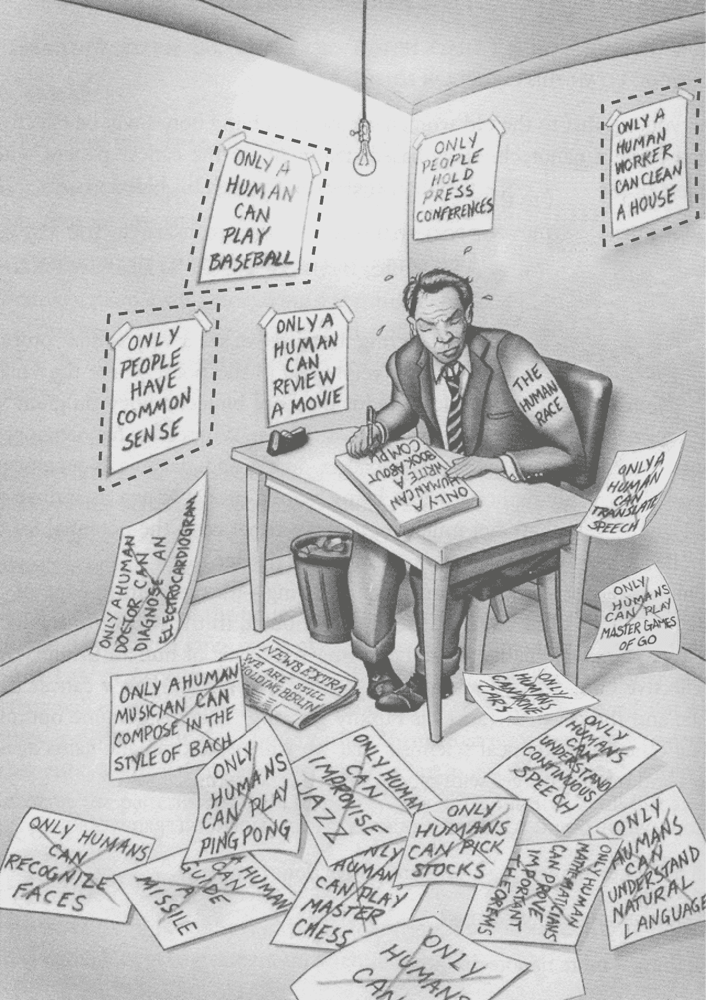

这幅漫画指出了 AI 尚未补齐的认知板块。地面上的标识代表已完成的任务，墙上用虚线框出的标识则是正在攻坚的板块。

即便有人质疑用图灵检验衡量机器的人类水平认知，我仍相信一个真正通过强版本检验的演示，对旁观者会极具冲击力，也能让公众确信那是真正的智能而非单纯模仿。正如图灵 1950 年所说：“机器难道不能做一些应被称作思考的事情，却与人类做法完全不同吗？……\[如果\]能造出一台足以胜任模仿游戏的机器，我们就不必为这个反对意见烦恼。”[\[163\]](#18_Notes.xhtml#EndnoteNumber165 "note")

需要留意，一旦系统真正通过强版本的图灵检验，它在所有可经语言呈现的认知考验中事实上都将处于超越人类的位置。[\[164\]](#18_Notes.xhtml#EndnoteNumber166 "note") 这些短板会在考验中暴露。考验需要机敏的考官和敏锐的人类陪衬。模仿一个醉酒、犯困或不懂该语言的人不算数。[\[165\]](#18_Notes.xhtml#EndnoteNumber167 "note") 同样，若系统只是糊弄那些不懂如何探测其能力的评审，也不能算作有效通过。

图灵认为他的检验可用于评估“我们希望涵盖的几乎任何人类努力领域”。因此一个聪明的考官可能会要求系统解释复杂的社会情境、从科学数据中推断，并写一段有趣的喜剧段子。图灵检验关注的并非语言理解本身，而是我们借助语言表达出来的认知能力。当然，成功的系统也必须避免显得非人。若应试者能瞬间回答任何冷知识、迅速判断超大数字的素性并流利使用上百种语言，就明显不是真人。

并且达到这个水准的系统在记忆力和处理速度上已经*非常*超人。可以设想一个兼具人类级阅读理解，同时能完美回想每篇维基条目和所有已发表科研论文的系统。今天，语言理解的局限仍是 AI 整体知识的瓶颈；相比之下，人类知识的主要限制在于阅读慢、记忆有限以及生命有限。计算机处理数据的速度惊人——人类读完一本书平均要六小时，谷歌的 Talk to Books 大约快五十亿倍[\[166\]](#18_Notes.xhtml#EndnoteNumber168 "note")，而且存储容量几乎无限。

加速信息处理演变的范式

| 纪元 || 媒介 || 时间尺度 |

| --- | --- | --- |

| 第一 || 无生命物质 || 数十亿年*（非生物原子和化学合成）* |

| --- | --- | --- |

| 第二 || RNA 和 DNA || 数百万年*（直到自然选择引入新的行为）* |

| 第三 || 小脑 || 数千年到数百万年*（通过进化来增加复杂的技能）* |

| 数小时到数年*（用于非常基础的学习）* |

| 第四 || 新皮层 || 数小时到数周*（掌握复杂的新技能）* |

| 数字神经网络 || 数小时到数天*（以超人的水平掌握复杂的新技能）* |

| 第五 || 脑机接口 || 数秒到数分钟*（探索当今人类无法想象的想法）* |

| 第六 || 计算素 || < 秒*（为了不断地将认知重新配置到物理定律允许的极限）* |

当机器的语言理解追平人类，这不是知识的缓慢累积，而是突如其来的爆发。这意味着要通过传统图灵检验，机器实际上必须主动压低自己的智力。因此在不需要模仿人的任务上，比如医学、化学和工程的真实难题，图灵级别的系统已能取得极度超人的成果。

要预判下一步，可以参照前文提到的六个时代，见本页“信息处理演进的加速范式”表。

## 将新皮层扩展到云端

目前已有一些初步尝试用电子设备与大脑通信，侵入式与非侵入式都有。非侵入方案面临空间分辨率与时间分辨率的根本权衡——即测量脑活动的精确度在空间和时间上的取舍。功能性磁共振成像 fMRI 通过血流间接反映神经元放电。[\[167\]](#18_Notes.xhtml#EndnoteNumber169 "note") 当某区域更活跃时，葡萄糖和氧气消耗上升，需要含氧血流补充。可以探测到边长约 0.7 至 0.8 毫米的立方体素，数据很有用。[\[168\]](#18_Notes.xhtml#EndnoteNumber170 "note") 但脑活动与血流存在滞后，活动通常只能以数秒尺度捕捉，很少优于 400 到 800 毫秒。[\[169\]](#18_Notes.xhtml#EndnoteNumber171 "note")

脑电图 EEG 则相反。它直接检测电活动，时间精度可达约一毫秒。[\[170\]](#18_Notes.xhtml#EndnoteNumber172 "note") 但信号从颅外拾取，定位困难，空间分辨率约 6 到 8 立方厘米，有时能提升到 1 到 3 立方厘米。[\[171\]](#18_Notes.xhtml#EndnoteNumber173 "note")

到 2023 年，空间与时间分辨率的取舍仍是神经科学的核心难题之一。这些限制源于血流和电的物理本质，即使借助 AI 和更好传感器，边际改善也可能不足以实现复杂脑机接口。

植入电极可避开这一取舍，还能直接记录并刺激单个神经元，实现双向通信。但现有技术需要在颅内开孔，可能损伤神经结构。因此应用多集中于听力丧失或瘫痪等残疾人群，获益大于风险。例如 BrainGate 系统让肌萎缩侧索硬化 ALS 或脊髓损伤患者仅凭意念操作电脑光标或机械臂。[\[172\]](#18_Notes.xhtml#EndnoteNumber174 "note") 不过目前连接的神经元数量有限，难以处理语言这类高度复杂信号。

拥有意念转文字能力将是变革性的，这推动了脑电波语言翻译器的研发。2020 年，Facebook 资助的研究团队为受试者安置 250 个颅外电极，用强力 AI 把皮层活动与口语样本句的词汇关联。在 250 词样本词汇表上，他们能以低至 3% 的误差预测受试者正在想的词。[\[173\]](#18_Notes.xhtml#EndnoteNumber175 "note") 这是个令人振奋的进展，但 Facebook 于 2021 年终止了该项目。[\[174\]](#18_Notes.xhtml#EndnoteNumber176 "note") 该方法能否扩展到更大词汇量，以及和空间时间取舍的冲突，仍待观察。无论如何，要扩展新皮层本身，仍需掌握和大量神经元的双向通信。

在扩大神经元连接数上，最激进的尝试之一是埃隆·马斯克的 Neuralink，使用大量细线状电极同时植入。[\[175\]](#18_Notes.xhtml#EndnoteNumber177 "note") 在实验鼠上的测试显示可读取 1500 个电极，远超既往数百个的水平。[\[176\]](#18_Notes.xhtml#EndnoteNumber178 "note") 随后植入该设备的猴子能用它玩电子游戏 Pong。[\[177\]](#18_Notes.xhtml#EndnoteNumber179 "note") 经历监管波折后，Neuralink 于 2023 年获 FDA 批准开展人体试验，并在本书付梓之际植入了首个 1024 电极设备。[\[178\]](#18_Notes.xhtml#EndnoteNumber180 "note")

与此同时，美国国防高级研究计划局 DARPA 推进的神经工程系统设计项目，目标是打造可记录百万个神经元、刺激十万个神经元的接口。[\[179\]](#18_Notes.xhtml#EndnoteNumber181 "note") 该机构资助了多个方向，如布朗大学团队正研发沙粒大小的“神经颗粒”，可植入大脑并和神经元互联，形成“皮层内网”。[\[180\]](#18_Notes.xhtml#EndnoteNumber182 "note")

最终，脑机接口本质上将走向非侵入式——可能借助无害纳米级电极经血液送入大脑。

需要多少算力来记录？如前所述，模拟人脑所需总算力可能在 10^14 次运算每秒或更低。这基于能通过图灵检验并在外部观察者看来像人脑的真实架构模拟。但这不包含许多和可观察行为无关的大脑活动，比如神经元细胞核内的 DNA 修复等细胞内细节可疑地和认知无关。

即便人脑每秒进行十万亿次运算，脑机接口也不必处理其中大半，因为大量活动发生在新皮层之下。[\[181\]](#18_Notes.xhtml#EndnoteNumber183 "note") 我们只需和较高层通信，也可忽略调节消化等非认知过程。我估计实用接口只需数百万到数千万个并发连接。

要达到这一数量，需要不断缩小接口技术，并更多借助先进 AI 解决随之而来的工程和神经科学难题。在 2030 年代某个时候，我们将用纳米机器人实现目标。这些微型电子设备把大脑新皮层顶层连向云端，让我们的神经元直接和在线托管的模拟神经元通信。[\[182\]](#18_Notes.xhtml#EndnoteNumber184 "note") 这不需要科幻式大脑手术——纳米机器人可通过毛细血管非侵入式送入。大脑尺寸不再受产道限制，可无限扩展。也就是说，添加第一层虚拟新皮层后并非一锤子买卖——更多层可以堆叠以实现更复杂认知。随着本世纪算力性价比持续指数级提升，我们大脑可用的算力也将如此。

还记得两百万年前发生的事吗？上次获得更多新皮层时，我们成了人类。当我们能接入云端额外皮层时，认知抽象的飞跃可能类似。结果将是创造出比当今艺术和技术更丰富的表达方式——比我们现在能想象的更深刻。

设想未来的艺术表达本身就有局限。但借类比上次新皮层革命来思考或许可行。试着想象一头猕猴——一种和我们很像的高智商动物——看电影的感受。猕猴并非完全不懂情节，能认出屏幕上有人说话。但它不理解对话，也无法解读“角色穿金属服装暗示故事设定在中古世纪”这类抽象概念。[\[183\]](#18_Notes.xhtml#EndnoteNumber185 "note") 这正是人类前额叶皮层赋予的飞跃。

因此，面向拥有云连接新皮层的人创作的艺术，不仅是更好的 CGI，甚至不只是调动味觉嗅觉等感官，而是大脑处理体验方式的全新可能性。例如演员现在只能用语言和外部肢体传达角色想法。未来我们可能拥有直接把角色原始、无序、非语言的想法——连同其无法言说的美与复杂——传入我们大脑的艺术。这就是脑机接口将带来的文化丰富性。

这是一个共同创造的过程——进化我们的思想以解锁更深洞察，并利用这些力量为未来的思想创造卓越新想法供探索。最终我们将能访问自己的源代码，并使用可自我重设计的人工智能。由于该技术让我们和正在创造的超级智能融合，我们将在本质上重塑自己。从头骨的封闭中解放出来，在比生物组织快数百万倍的基质上处理信息，我们的思想将被赋予指数级增长的力量，最终把智力扩展数百万倍。这就是我对奇点的定义。

# 第三章：我是谁？

## 我是谁？

### 什么是意识？

图灵检验等评估能揭示许多关于普通人的意义，但奇点技术也迫使我们追问作为*特别*的人类意味着什么。哪里是*雷·库兹韦尔*如何融入其中？现在你可能更关心自己，可以对自身身份提出同样问题。但对我而言，为什么雷·库兹韦尔是我体验的中心？为什么我是这个特定的人？为何不是在 1903 年或 2003 年出生？为何是男性甚至是人类？没有科学理由说明必须如此。当我们问“我是谁？”时，我们在问一个根本的哲学问题。这关乎意识。

在《如何创造一个心灵》中，我引用了塞缪尔·巴特勒的话：

> 当一只苍蝇落在花上时，花瓣合拢并紧紧抓住它，直到植物把昆虫吸收进系统；但它们只合拢能吃的东西；对于一滴雨或一根树枝，它们并不理会。奇怪！如此没有意识的东西竟对自身利益如此敏锐。如果这是无意识，那么意识有什么用呢？[\[1\]](#18_Notes.xhtml#EndnoteNumber186 "note")

巴特勒在 1871 年写下此段。[\[2\]](#18_Notes.xhtml#EndnoteNumber187 "note") 我们应从他的观察得出结论，植物确实有意识？或者这种特定植物有意识？我们如何得知？我们确信另一人有意识，因为他或她的沟通和决策能力与我们相似。但即便在技术上这也只是假设。我们无法直接探测意识或缺乏意识。

## 意识

但什么*是*意识？人们常把“意识”用于两个相关却不同的概念。其一指有意识地感知环境并表现得像意识到自身内在想法和外部世界的功能能力。例如按此定义，深度睡眠者无意识，醉酒者部分有意识，清醒者完全有意识。除闭锁综合征等罕见情况外，通常可从外部判断他人的意识水平。甚至动物在镜中认出自己等行为也能透露这种意识。但就本章讨论的个人身份问题而言，第二个含义更相关：*拥有主观体验的能力*——而非仅仅给出类似表现。哲学家称这种体验为“感受”。所以，当我说我们无法直接检测意识时，我是指一个人的感受无法从外部检测。

然而，尽管意识无法验证，却不能简单忽视。若审视我们的道德体系基础，会发现伦理判断通常取决于对意识的评估。我们认为物质对象，无论多复杂、有趣或有价值，其重要性都仅在于它们对有意识生物的主观体验产生的影响。例如关于动物权利的整个辩论，都取决于我们相信它们在多大程度上是有意识的，以及那种意识体验的本质是什么。[\[3\]](#18_Notes.xhtml#EndnoteNumber188 "note")

意识始终是个让哲学家头疼的麻烦。涉及到谁该拥有权利这类伦理判断时，核心往往落到我们对某个存在是否能真正感受世界的直觉上。可主观体验从外面测不出，我们只能退而求其次，用功能性表现来替代。靠着自身经验做类比——我们每个人都能在内心感受到主观体验，同时也知道这种体验会外化成可以被他人观察到的行为——于是就推断：当别的个体呈现出类似的功能性表现时，内里很可能也有对应的感受。即便主张主观意识与经验思维无关的科学家，在日常里也照常把周围人视作有体验的存在来对待。

把这种推断投射到人类同伴身上几乎顺理成章，但投射到其他动物时直觉的强度会随行为差异而衰减。狗和黑猩猩的认知达不到人类水准，却有着复杂而情绪化的行为，对多数人来说这足够让人相信它们拥有内在感受。啮齿类呢？它们也会社交嬉戏、对危险表现出恐惧，类似人类的反应不算少，但认为它们有意识的人比例明显更低，也普遍觉得它们的体验远比人类浅薄。昆虫又如何？果蝇不会背诵莎士比亚，却能根据环境调整反应，大脑约有25万个神经元；蟑螂约有100万个，相较人类大脑不过0.001%，能搭建复杂分层网络的空间自然受限。变形虫这类单细胞生物更是看不到任何像人类或高等动物那样的功能性意识迹象。但21世纪的研究已显示，即使是极原始的生命，也能展现记忆等基础智能形式。

在某种意义上意识是是非题——有没有感受？但我更想讨论的是程度问题。想象一下你在经历朦胧的梦、喝醉后昏昏欲睡，或是完全清醒时，自我觉察的强度是不同的。研究动物意识时，学者们也在评估这一连续谱。专业共识在迁移，倾向于承认比过去认为的更多动物拥有更丰富的意识。2012年一群跨学科科学家在剑桥聚会，形成了《剑桥意识宣言》，它承认意识并非人类专属，“新皮层的缺失似乎并不排除生物体验情感状态的可能性”。签署者指出，“产生意识的神经基质”存在于“所有哺乳动物和鸟类，以及包括章鱼在内的许多其他生物中”。

科学告诉我们，复杂大脑会产生功能性意识。那么主观意识本身的来源是什么？有人说是上帝，有人认为是纯粹物理过程的产物。无论起点如何，双方都承认它在某种程度上是神圣的。人类以及至少部分动物如何变得有意识，本质上是一个因果叙述，无论是源于仁慈的神性还是无方向的自然。但结果不容置疑——否认孩子有意识并能感受痛苦，被普遍视为严重不道德。

主观意识背后原因的讨论很快会从纯哲学思辨转向现实抉择。随着技术让我们得以把意识延伸到生物大脑之外，我们必须决定什么构成了身份核心的感受质，并加以守护。唯一可用的代理是可观察的行为，我们的自然直觉与最合理的科学解释高度吻合：能支撑更复杂行为的大脑，也更可能产生更复杂的内在体验。正如前文所述，复杂行为来自大脑信息处理的复杂性，而这很大程度上取决于信息表示的灵活性以及网络的层级深度。

这对个人未来影响深远。所有有记录的历史智力飞跃，都发生在结构上与石器时代以来基本不变的大脑里。外部技术让我们每个人都能触达物种内部的集体发现，却仍以类似新石器时代祖先的意识水平去体验它们。当2030年代和2040年代的新皮层增强成为可能时，我们不仅会提升抽象问题解决能力，也会直接加深主观意识本身的深度。

## 僵尸假说、感受质与不可分享之谜
意识里有些东西本质上无法与他人共享。我们把特定频率的光标为“绿色”或“红色”，却没法确认我的体验绿色是否等于你的体验红色——或许我感知的绿色其实是你的红色，反之亦然。语言乃至其他交流方式都绕不开这个限制。即使未来能直接连接两颗大脑，也无法证明相同的神经信号会在不同人里触发完全一致的感觉。若红绿体验真的颠倒了，我们永远不会察觉。

这种认识引出了更不安的思想实验：如果一个人根本没有感受呢？哲学家大卫·查尔默斯（David Chalmers，生于1966年）把这种假设的存在称作“僵尸”——外显所有可检测的神经活动与意识相关行为，却没有任何主观体验。科学永远无法把僵尸与正常人区分开。

用这个对比来凸显功能性意识与主观意识的差异很有效。假设我们能确认一个人工人类是僵尸，即便它的认知能力比狗更复杂，大多数人仍会认为伤害狗更糟，因为我们相信狗有主观感受，而僵尸即使因疼痛尖叫，我们也知道它实则感受不到。现实困境在于，即便原则上如此，也没有科学方法可以确定另一个生物是否真的有主观意识。

如果僵尸在理论上可能，感觉与物理信息处理系统之间就不存在必然的因果联系，这与某些宗教对灵魂的看法相近——灵魂是独立于身体的超自然实体，超出科学范畴。反之，如果认知背后的物理系统必然产生意识，使僵尸不可能，科学也无连贯方式来证明。主观意识在本质上与可观察物理规律不同，特定信息处理模式并不会据此产生有意识体验。查尔默斯称之为“意识的难题”，他的“简单问题”诸如沉睡时思维发生了什么，是科学中最难的问题之一，却至少可被研究。

面对难题，查尔默斯提出一种他称作“泛原型心理主义”的思路。该立场把意识视作宇宙的一种基本力量，不能简单还原为其他物理力量的作用。可以设想一个普遍场蕴含意识的潜能，在我的理解里，正是大脑那种复杂的信息处理“唤醒”了该力量，使其成为我们熟悉的主观体验。因此无论大脑由碳还是硅构成，只要具备产生意识外在迹象的复杂性，也就赋予了它主观的内在生命。

我们永远无法科学证明这一点，但伦理上却有强要求让我们表现得好像为真。换句话说，若一个实体可能有意识，最稳妥的道德选择是假定它有意识，而非冒着折磨有知觉生物的风险。即我们应行事如同僵尸不可能存在。

从这个视角看，图灵测试不仅能建立人类水平的功能能力，也能为证明主观意识及由此产生的道德权利提供有力证据。具意识人工智能的法律含义深远，我怀疑政治制度来不及在首个图灵级人工智能出现前把相关权利写进法律，最初的伦理框架很可能由开发者来制定。

除伦理原因外，也有理论理由支持泛原型心理主义的因果解释。它在二元论与物理主义之间取得中间立场。二元论认为意识源于与普通“死”物质完全不同的某种物质，多数二元论者称之为灵魂。科学上，承认超自然灵魂存在也缺乏解释它如何作用于可观察世界的物质，比如脑内神经元的可行理论。物理主义则认为意识完全来自大脑普通物理物质的某种排列。即便它能完美描述“意识如何运作”，也无法解释意识固有的、科学无法触及的主观维度。泛原心论在两者间提供了有益的平衡。

## 决定论、涌现与自由意志的张力
与意识紧密相连的是我们对自由意志的感觉。随街问人，他们多半会说自己必须能够掌控行为。政治与司法体系建立在每个人大致拥有这种自由意志的前提之上。

但哲学家一旦要求精确定义，共识就变少了。许多人认为自由意志的存在要求未来并非预先决定，否则意志如何自由？可若“自由意志”只等于行为可归结为量子层面的完全随机过程，那就失去了我们通常理解的自由。正如英国哲学家西蒙·布莱克本所言，“机会和必然性一样无情”，似乎都排除了自由意志。真正有意义的自由意志概念必须某种程度上综合决定论与非决定论——避免僵化可预测，又不沦为随机。

物理学家兼计算机科学家斯蒂芬·沃尔夫勒姆（生于1959年）的研究为这种中间道路提供了启发。他的2002年著作《一种新的科学》阐明了既具确定性又具非确定性属性的现象——细胞自动机。

细胞自动机是简单模型，由“细胞”按多套规则在状态间切换，例如黑白或生死。规则规定每个细胞如何根据邻居状态表现。过程以离散步骤展开，可产生高度复杂行为。最著名例子是康威生命游戏，二维网格上已发现大量可预测演化的有趣形状，甚至能模拟一台功能正常的计算机。

沃尔夫勒姆从更基础的自动机起步——一维线上的单元，在其下方按规则与前一行状态依次添加新行。

经广泛分析，他指出对某些规则集，无论看多少步，若不逐一迭代就无法预测未来状态，没有捷径。

最简单的规则类型是第1类。例如规则222：
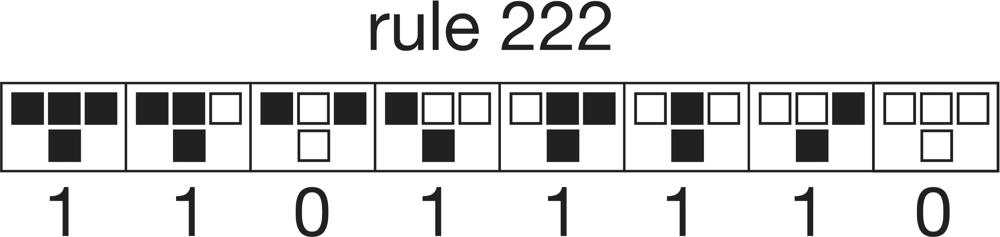
每个单元在前一步有与相邻三个单元构成的八种状态组合，规则指定每种组合下一步的状态。黑白可分别记为1和0。

从单一中心黑色单元开始按规则222演化，结果是：
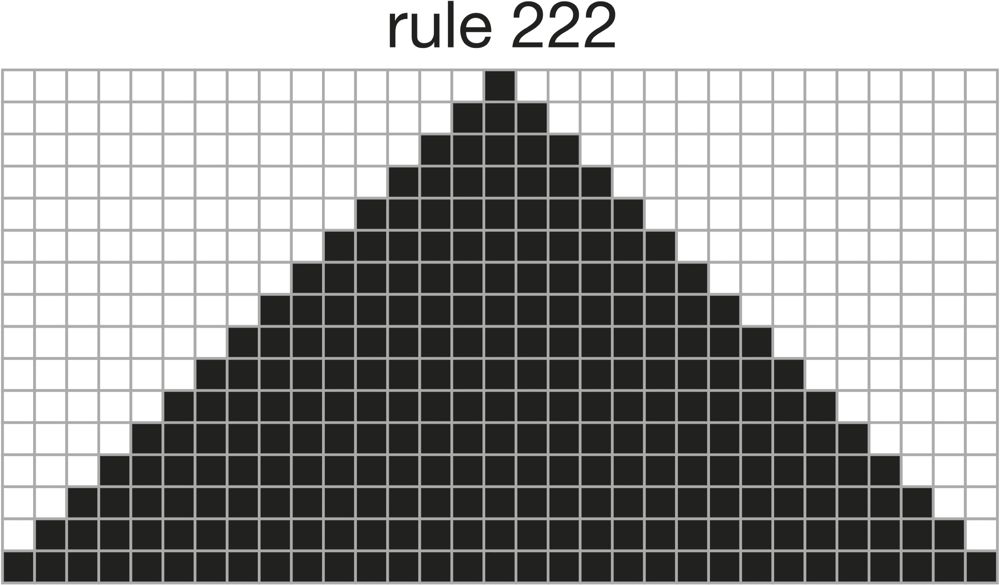
可见规则222产生非常可预测的模式。若问第100万个单元是什么，能直接回答“黑色”。这本是科学应有的运作方式：经由确定性规则得到可预测结果。

但第1类只是其中一种。沃尔夫勒姆认为自然多可用四类解释。第2类和第3类会产生越来越复杂的黑白排列，最引人入胜的是第4类，以规则110为例：
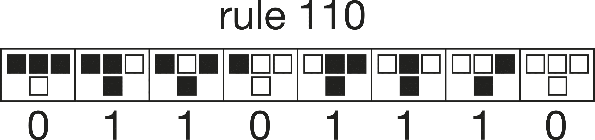
从黑色起始单元开始，结果是：
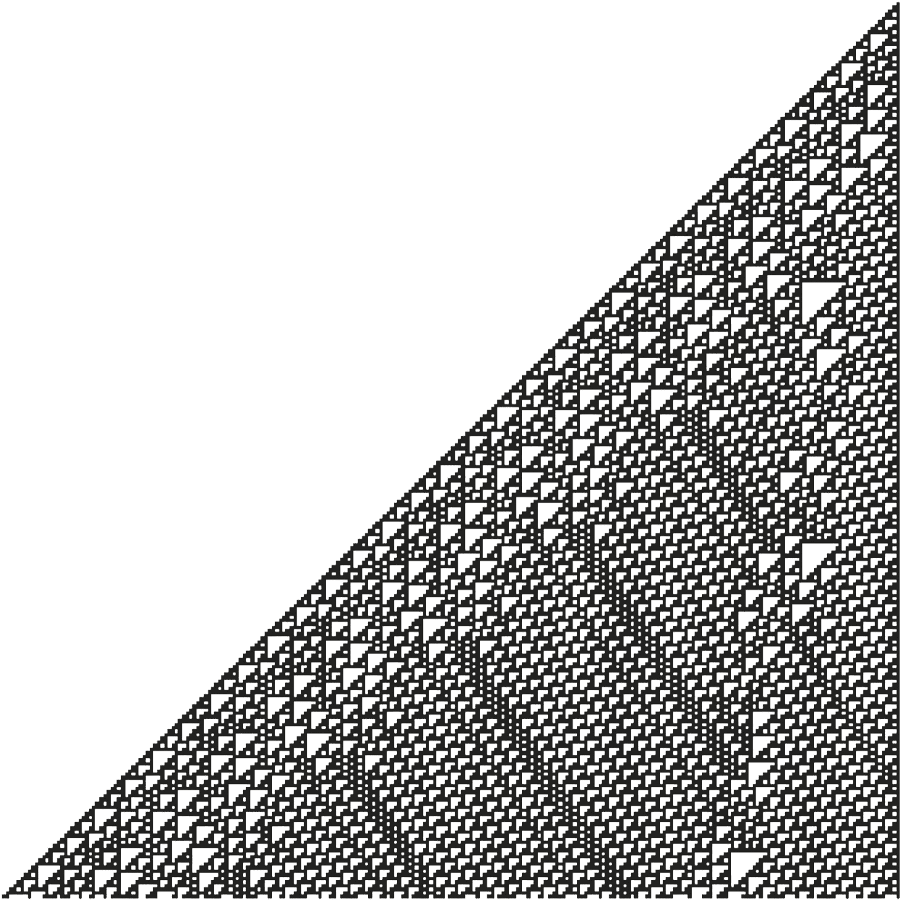
继续迭代会得到这样的图像：
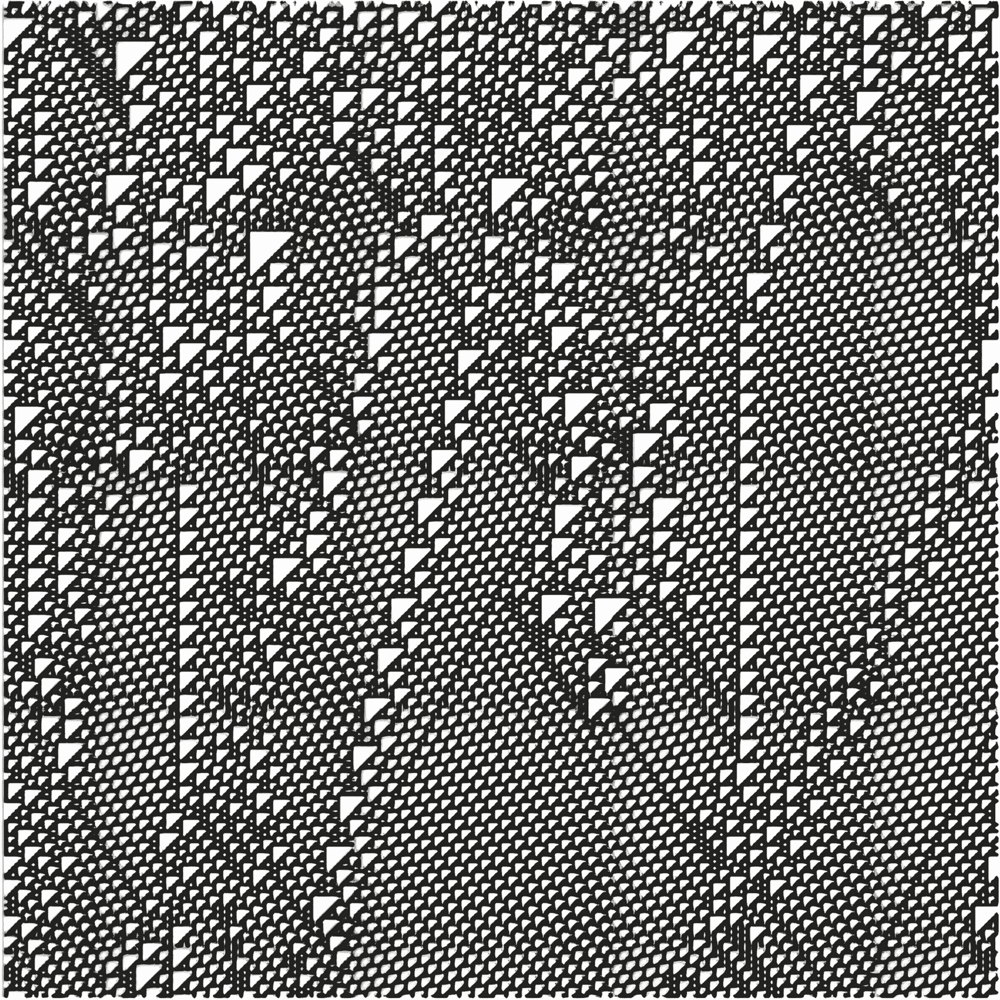
关键在于*没有办法*提前知道第1000行或第100万行是什么，只能逐行计算。这意味着基于第4类属性的系统拥有不可简化的复杂性，挑战了旧式还原论决定论。复杂性源于确定性编程，但编程并不能完全解释其丰富性。

对单个细胞做统计抽样会让它们的状态看似本质随机，但每个状态都是前一步确定性地产生的，宏观图像则呈现规则与不规则的混合。这体现了涌现：简单要素集体产生更复杂的整体。自然界的分形结构，如树枝扭曲路径、斑马与老虎的条纹、软体动物贝壳等，都表现出第4类编码。我们生活的世界深受这种从简单算法产生高度复杂行为、介于秩序与混沌之间的模式影响。

正是我们身上的这种复杂性，可能孕育意识与自由意志。无论把底层编程归因于上帝、泛原型心理主义还是别的什么，*你*不仅仅是程序本身。

这并非巧合，这些规则恰好能产生意识与大量自然现象。沃尔夫勒姆有力论证物理定律本身可能源于与细胞自动机相关的某种计算规则。2020年他启动沃尔夫勒姆物理项目，试图以类似细胞自动机但更通用的模型来理解全部物理学。

这为经典决定论与量子不确定论提供了某种调和。宏观世界的部分可用算法捷径近似，如预测卫星百万轨道后的位置，但在最基本尺度并非如此。若现实基于第4类规则，就能用决定论解释量子尺度的表面随机性，却不会有概括算法能“提前窥视”并预测宇宙在某个时刻的精确状态。这仍是推测，因为完整规则集尚不明晰。

由于有效预测不可能，只剩模拟，但宇宙不可能包含足够大的计算机来模拟自身。换言之，若不让现实真正向前展开，就没有办法展开现实。

本章后文将讨论把意识从生物大脑转移到非生物计算机的可能性，这里需要澄清一点：以数字方式模拟大脑运作，与以确定性方式预先计算它并不相同。无论生物还是非生物，大脑都不是封闭系统。它从外部世界获取输入，再通过惊人复杂的网络处理，科学家最近甚至发现大脑中存在多达11维的网络。这种复杂性可能利用了类110规则的现象，若不按顺序模拟每一步就无法“提前窥视”。再加上大脑是开放系统，无法把未知的未来输入纳入逐步模拟。因此复制功能并不等于预先计算未来状态。宇宙存在，或许正因如此才有意义。

如果宇宙规则基于细胞自动机这类东西，表达它们的唯一方式就是一步步展开——通过现实的实际发生。相比之下，若宇宙规则是确定性的但没有类似自动机的涌现，或仅仅基于随机性，现实未必需要我们观察到的逐步展开。此外，若意识只能从第4类自动机的秩序与混沌复杂性中产生，这可被视为哲学论证，解释为何我们存在——若无这些规则，我们就不会在这里思考这个问题。

决定论不等于没有自由，这正是相容论想说的事情。即使整个世界都在由一套潜在法则牵着走，我们依然可以做出不受他人摆布的决定。被决定并不意味着时间可以像翻书一样随意前后查看：在一种类似110规则的展开方式下，唯一能做到完美预判的办法，就是亲身走过所有实际发生的步骤。换到泛原型心理主义的视角看，我们大脑里冒出来的那些过程并不是在遥控我们，它们本身就是我们。我们源于更深层的因果力量，但具体会怎么选，事前无法被锁定——只要产生意识的流程能够通过我们的行为在世界里显现出来，自由意志就有空间存在。[\[31\]](#18_Notes.xhtml#EndnoteNumber216 "note")换句话说，选择不可被提前读出，这就足够了。[\[32\]](#18_Notes.xhtml#EndnoteNumber217 "note")

## 一个人，其实是好几个决策者的集合

我们对机器人怎么设想，往往已经在用泛原型心理主义的直觉了：只要行为像人、反应像人，哪怕底层不是生物神经元，我们也倾向于把它当成有主观感受的存在。

与之相似，人脑内部的决策权并不集中。医学上的证据越来越指向一种多单元结构。左右半球的对照实验反复显示它们能在相当程度上独立运作。[\[33\]](#18_Notes.xhtml#EndnoteNumber218 "note")斯特拉·德·博德和苏珊·柯蒂斯追踪了49名因癫痫切除半脑的儿童，为的是救命。[\[34\]](#18_Notes.xhtml#EndnoteNumber219 "note")大多数孩子此后功能正常，即便留下后遗症，人格也基本完整。语言通常偏左，但左右任一侧都能够学会语言，两半球在功能上是可以等价的。[\[35\]](#18_Notes.xhtml#EndnoteNumber220 "note")

最直观的例子来自胼胝体被切断的人。正常大脑左右之间有约2亿根轴突负责通信，[\[36\]](#18_Notes.xhtml#EndnoteNumber221 "note")当这条高速公路因医疗原因被切断，两个半球仍在各自工作，却无法交换信息。[\[37\]](#18_Notes.xhtml#EndnoteNumber222 "note")迈克尔·加扎尼加在1939年出生的研究者系统里做过系列实验：只把一个词投给右脑，左半球完全不知道这个词的存在，却会为基于该信息的选择背书，还编出一条听起来合理的理由来解释自己为什么会这么选。[\[38\]](#18_Notes.xhtml#EndnoteNumber223 "note")左脑并不知道同一颅骨里还有另一个独立的大脑，因而会虚构出自洽的解释来维护自我一致性。[\[39\]](#18_Notes.xhtml#EndnoteNumber224 "note")

这些实验指向一个尴尬的结论：一个常人身上可能同时住着两个能独立决策的单元，却共享一个有意识的身份。每边都坚信决定是自己做的，而因为两边本就紧密耦合，这种错觉会一直维持。

把视野放大到整块新皮层，情况更复杂。决策区由大量小模块组成，[\[40\]](#18_Notes.xhtml#EndnoteNumber225 "note")当我们权衡一件事时，不同选项往往由不同模块在争夺话语权。我的导师马文·明斯基早就提出，大脑不是单一的决策机器，而是一个由诸多神经机制构成的网络，各部分会在同一决定上倾向不同方向。他把这套系统称为“心智社会”，其第二本书即以此命名，里面是许多更简单的过程在表达不同的立场。[\[41\]](#18_Notes.xhtml#EndnoteNumber226 "note")这些子过程是否也在行使自由选择？我们很难判断。过去几十年实验在不断累积，但神经活动如何“涌现”成我们能感知的决定，仍是薄弱环节。

## 复制出来的你，会有意识吗？那还是你吗？

如果意识可以分布在头骨里多个甚至没有物理连接的信息处理结构上，那么当这些结构被拉到更远的地方，会发生什么？

在《如何创造一个心灵》里我探讨过一个近期内就可能实现的情境：把人脑的所有信息复制到机器上。假设我们用先进技术读取你大脑的小片段并做出精确的电子拷贝——今天在治疗原发性震颤或帕金森病时，已经能对某些脑区做非常粗糙的版本。[\[42\]](#18_Notes.xhtml#EndnoteNumber227 "note")单独这块太简单，不会有意识。但再复制第二块、第三块，直到最后我们得到一个完整的、可运行的计算机化大脑副本，信息与运行方式都一样。

这个“你2”会说自己拥有和你相同的经历，因为它共享你的记忆；它的行为也像你。只要我们不彻底否定任何电子版本都不可能有意识，那么承认它有意识是合理的。泛原型心理主义给出了哲学上的支撑：只要信息结构相同并自称有意识，就没有科学理由否认它。因此伦理上我们应当像对待有道德权利的个体那样对待它。

更棘手的问题是身份。你2真的就是你吗？前提是作为自然人的你依然存在，甚至复制可能在你不知情的情况下完成。无论如何，本体的你仍在延续。复制成功后，你2会像你一样行动，但你本人并未被改变，所以你仍然是你。因为你2能够独立行动，它会立刻与你分道扬镳，形成自己的记忆和反应轨迹。从身份即信息排列的角度看，你2不是你，尽管它有意识。

现在做第二个实验：我们逐步把你大脑的每个部分换成数字副本，通过类似前一章描述的脑-计算机接口与剩下的神经元相连。最终不再有“你”和“你2”之分，只有你。每一步你都感到满意，没人包括你自己会抗议。每次替换后你仍然是你，那么当大脑完全数字化之后呢？

这触及了约2500年前就被提出的忒修斯之船问题。[\[43\]](#18_Notes.xhtml#EndnoteNumber228 "note")古希腊哲学家想象一艘船的木板被一块块慢慢替换。第一块换掉后，我们仍称它是同一艘船；当一半以上都是新木板、甚至所有木板都换新后，人们仍倾向认为基本特性得以保留。但如果把旧木板存起来，最后用它们重组一艘船，哪艘才是原来的呢？是持续存在但无一块原部件的船，还是由原部件重组的船？对船而言这只是习惯问题，但对人而言风险极高。

用主观意识的难题来看，复制品你2是否与你有某种主观联系，无法被确定。即便信息模式因不同经历而发散，你最初的主观体验是否同时包含两个副本，还是你2在体验上完全独立？这是科学无法回答的问题。

在渐进转移到非生物基质的情形下，我们更有理由相信主观意识会被保留。今天已在极有限程度上实现这一点，且新植入物往往比被取代的部分更强。耳蜗植入物能刺激大脑活动，但并未取代核心结构。[\[44\]](#18_Notes.xhtml#EndnoteNumber229 "note")自2000年代初，科学家就开始研发脑假体，帮助内部结构受损或功能障碍的患者，例如为记忆问题患者提供部分海马体功能。[\[45\]](#18_Notes.xhtml#EndnoteNumber230 "note")到2023年这些技术仍在起步，未来十年会更成熟、更普惠。以今日标准，患者的核心身份无疑被保留，没人会把他们当成查尔默斯式的僵尸。

神经科学也表明，足够小的渐进改变大脑几乎察觉不到，且适应力惊人。混合大脑保留了定义你的信息模式，没有理由认为主观意识会受损，你仍是唯一能自称“你”的那个人。奇妙的是，过程结束后的你，与之前那个独立的你2在功能上完全一样，我们却认为后者不是你。差别在于连续性——数字大脑从未作为独立实体存在过，它始终与生物大脑保持同一条线索。

这并非纯假设。我们的细胞每天都在快速更替。神经元相对稳定，但约一半线粒体每月更新；[\[46\]](#18_Notes.xhtml#EndnoteNumber231 "note")神经微管半衰期为数天；[\[47\]](#18_Notes.xhtml#EndnoteNumber232 "note")为突触供能的蛋白每2至5天补充一次；[\[48\]](#18_Notes.xhtml#EndnoteNumber233 "note")突触NMDA受体在数小时内被替换；[\\[49\]](#18_Notes.xhtml#EndnoteNumber234 "note")树突肌动蛋白丝寿命约40秒。[\[50\]](#18_Notes.xhtml#EndnoteNumber235 "note")几个月内，大脑实质上已被整体更换。于是与不久前的你相比，你已经是生物学意义上的“你2”。维持身份的是信息与功能，而非特定物质。

我常在自家附近的查尔斯河边凝视。即使每隔几毫秒流过截面的水分子完全不同，河流的形态仍因分子以一致模式运动而保持连续。思想亦然。当非生物系统被植入身体与大脑，信息模式的连续性让我们依旧感到自己是今天的自己——除了感知可能更好、认知可能更敏锐之外。

这种技术同时允许复制思维文件。随意复制自己是数字世界的超能力，生物世界没有。把思维备份到远程存储，能对抗事故或疾病的破坏。这并不比把Excel上传到云端更“永生”，数据中心仍可能毁灭。但它能保护我们免于那些无意义的、夺走生命与身份的事故。按泛原型心理主义的解读，我们的主观意识可能在某种程度上包含所有定义信息的副本。

若我们在世界上放出一个可以自由走自己路的你2，其信息身份会渐进发散，但主观意识有可能同时跨越两者。我怀疑，基于泛原型心理主义，主观意识与身份信息相关，因而会以某种方式包含所有曾经与我们自身相同的信息副本。

不过由于你2会坚称自己拥有不同的主观意识，而控制通信的物理决策结构是分离的，我们无法客观判定真相。在这种情况下，法律与伦理体系可能不得不把两者视为独立个体。

## 你存在的概率，比宇宙更离谱

思考造就我们各自存在的事件链，令人战栗。不仅父母必须相遇并决定生育，还必须是特定的精子与特定的卵子结合，才会产生你。就精卵而言，被创造出来的概率约为两百万兆分之一。粗略估计，普通男性一生产生约两万亿个精子，普通女性最初约有一百万个卵子。[\[51\]](#18_Notes.xhtml#EndnoteNumber236 "note")因此仅这一层概率就接近二十万亿分之一。虽然性细胞并非基因上绝对独特，年龄等会影响表观遗传，[\[52\]](#18_Notes.xhtml#EndnoteNumber237 "note")若把每个精子和卵子视作独特，近似成立。类似事件还必须在双方祖父母、四位曾祖父母、八位高祖父母……一直追溯到约四十亿年前生命起源。[\[53\]](#18_Notes.xhtml#EndnoteNumber238 "note")

古戈尔是1后面跟着100个零，古戈尔普勒克斯是1后面跟着一个古戈尔个零。依据前述粗略分析，你存在的概率是1除以一个由1后面跟着远超古戈尔普勒克斯个零的数字。[\[54\]](#18_Notes.xhtml#EndnoteNumber239 "note")然而你就在这里。这难道不是奇迹吗？

更进一步，宇宙本身具备进化复杂信息的能力，这可能更不可思议。物理学和宇宙学告诉我们，若基本物理定律的数值稍有偏差，宇宙将无法容纳生命。[\[55\]](#18_Notes.xhtml#EndnoteNumber240 "note")在理论上可能的所有构型中，只有极小一部分允许我们存在。

粒子物理标准模型包含按质量、电荷、自旋区分的37种基本粒子，它们通过引力、电磁力、强核力、弱核力四种基本力相互作用，还有假设的引力子。[\[56\]](#18_Notes.xhtml#EndnoteNumber241 "note")这些相互作用强度由一系列常数决定，定义了物理规则。物理学家指出许多领域，只要规则有极小改动，智能生命就无法形成，因为需要复杂的化学反应和数亿至数十亿年的稳定环境与能量来源。生物学的主流观点认为生命在地球上通过自然发生说起源于“原始汤”中的非生命物质自发组装成能自我复制的蛋白质。[\[57\]](#18_Notes.xhtml#EndnoteNumber242 "note")因果链的任何一个断裂都会让人类不可能。

若核强力稍强或稍弱，恒星就无法造出大量碳和氧，而生命正是建立其上。[\[58\]](#18_Notes.xhtml#EndnoteNumber243 "note")核弱力也处于生命可进化的最小量级附近。[\[59\]](#18_Notes.xhtml#EndnoteNumber244 "note")若它更弱，氢会迅速转成氦，像太阳这样的长寿恒星就不会形成。

上夸克与下夸克质量差异的微小改变会导致质子和中子不稳定，复杂物质无从谈起。[\[60\]](#18_Notes.xhtml#EndnoteNumber245 "note")电子相对该差异质量稍大也会导致类似失稳。[\[61\]](#18_Notes.xhtml#EndnoteNumber246 "note")克雷格·J·霍根指出，夸克质量差只要在任一方向变化百分之几的分数，生命就会被扼杀。[\[62\]](#18_Notes.xhtml#EndnoteNumber247 "note")若差异更大，我们会得到一个“质子世界”，只有氢原子。[\[63\]](#18_Notes.xhtml#EndnoteNumber248 "note")若差异更小，则是“中子世界”，有原子核却无电子，化学反应不可能发生。[\[64\]](#18_Notes.xhtml#EndnoteNumber249 "note")

## 宇宙的精细校准

把引力调小一点，超新星就不会爆发，而超新星正是合成生命所需重元素的工厂。[\[65\]](#18_Notes.xhtml#EndnoteNumber250 "note") 把引力调大一点，恒星的燃烧寿命会被大幅压缩，复杂生命根本等不到诞生。[\[66\]](#18_Notes.xhtml#EndnoteNumber251 "note") 大爆炸发生后一秒钟，决定膨胀与坍缩的密度参数 Ω 的容错范围极其狭窄，只能在千万亿分之一的区间内波动，才仍容许生命出现。[\[67\]](#18_Notes.xhtml#EndnoteNumber252 "note") 稍微偏高，物质会在恒星形成前就因引力重新聚拢；稍微偏低，膨胀就会过猛，物质连聚集的机会都没有。

宇宙今天可见的大尺度结构，其实源于大爆炸瞬间物质密度里极细微的局部起伏。[\[68\]](#18_Notes.xhtml#EndnoteNumber253 "note") 任何一点的密度与平均值相比，典型偏差只有十万分之一左右。[\[69\]](#18_Notes.xhtml#EndnoteNumber254 "note") 把这种涟漪的幅度放大或缩小一个数量级，生命便无缘存在。宇宙学家马丁·里斯指出，若涟漪太弱，“气体根本聚不起来形成引力束缚的结构，这样一个宇宙将永远黑暗、了无生气”。[\[70\]](#18_Notes.xhtml#EndnoteNumber255 "note") 若涟漪太强，宇宙会变得“动荡狂暴”，绝大多数物质会直接掉进巨型黑洞，恒星根本来不及维系稳定的行星系统。[\[71\]](#18_Notes.xhtml#EndnoteNumber256 "note")

要让宇宙呈现有序而非混沌的汤，大爆炸之初的熵必须极低。物理学家罗杰·彭罗斯估算，按我们对熵和随机性的认知，只有大约十亿分之一的 10¹²³ 种可能宇宙拥有足够低的初始熵，才能长出类似我们这样的形态。[\[72\]](#18_Notes.xhtml#EndnoteNumber257 "note") 这个数字远超已知宇宙原子总数。原子数通常估在 10⁷⁸ 到 10⁸² 之间，取 10⁸⁰ 为例，10¹²³ 的位数比所有原子数多出四十三个数量级，相当于十万亿亿亿亿倍之巨。[\[73\]](#18_Notes.xhtml#EndnoteNumber258 "note")

单看每个参数似乎可以被质疑，科学家对单一因素的影响也常有分歧。但物理学家卢克·巴恩斯提醒，我们必须关注“生命允许区间的交集，而非并集”。[\[74\]](#18_Notes.xhtml#EndnoteNumber259 "note") 也就是说，每一个条件都得对生命友好，缺一个就全盘皆无。天文学家休·罗斯用过一句形象的说法，这么多微调同时命中，就像“龙卷风扫过垃圾场，刚好拼出一架波音 747”。[\[75\]](#18_Notes.xhtml#EndnoteNumber260 "note")

对这种惊人调校最常见的解释是观察者选择效应。[\[76\]](#18_Notes.xhtml#EndnoteNumber261 "note") 正因我们住在被微调的宇宙里，才有资格提出这个问题；若不在这样的宇宙里，我们根本没有意识去反思。人择原理由此而来。部分科学家认为这已足够，但若我们相信现实独立于观察者存在，这个答案仍显不足。马丁·里斯提出了一个耐人寻味的类比：“假设你站在行刑队前，他们全都失手了。你可以说‘若他们没失手，我也不会站在这里担心’。但这依然是一件惊人的事，需要解释。我觉得这里面仍有东西值得说明。”[\[77\]](#18_Notes.xhtml#EndnoteNumber262 "note")

## 数字来世

守护我们稀有而珍贵的个体身份，第一步是守护思想本身。我们在数字世界留下了极其庞大的思维与情感记录，而用于记录、保存和整理这些信息的工具正在这十年里快速演进。进入 2020 年代末期，我们会把这些数据转化为非生物模拟，形成对特定人格高度逼真的再现。[\[78\]](#18_Notes.xhtml#EndnoteNumber263 "note") 即便到 2023 年，人工智能模仿人类的能力已在加速提升。transformers 与 GANs 生成对抗网络 这类深度学习方法推动了惊人进展。transformers 能通过训练一个人的文字来学习并逼真复刻其交流风格；GAN 则让两个神经网络互相角力，一个负责生成目标类别的样本，比如女性面部的逼真图像，另一个负责分辨真假，前者因欺骗成功而获奖，后者因判断准确而获奖。反复迭代后，两者在无人监督下同步提升熟练度。

综合这些手段，AI 现在已能模仿特定人的写作笔触，克隆其声线，甚至把面部移植到整段视频中。正如前文提到，谷歌的实验性 Duplex 系统可用 AI 在无脚本电话对话里做出可信回应，2018 年首次测试时，被呼叫的真人完全没察觉对方是计算机。[\[79\]](#18_Notes.xhtml#EndnoteNumber264 "note") “深度伪造”可被用来制作有害的政治宣传，也能让人脑补电影里由不同演员出演的版本。[\[80\]](#18_Notes.xhtml#EndnoteNumber265 "note") 例如 YouTube 频道 Ctrl Shift Face 的爆款片段，就展示了《007：大破天幕杀机》里哈维尔·巴登的角色换成金·凯瑞会是什么样，《老无所依》若由阿诺·施瓦辛格、威廉·达福或莱昂纳多·迪卡普里奥主演又会如何。[\[81\]](#18_Notes.xhtml#EndnoteNumber266 "note") 这些技术仍在起步，每项单功能会大幅提升，融合后会产生大于各部分之和的逼真度。

我们能造出一种称为“复制品”的人工智能化身，借用《银翼杀手》一词，它承载已逝者的外貌、行为、记忆与技能，以我称之为“来生”的方式延续存在。

来生技术会分阶段演进。我写作时，最原始的模拟已大约存在七年。2016 年，《The Verge》刊发了一篇关于尤金尼娅·库伊达的报道，她用 AI 和保存的短信“复活”了亡友罗曼·马祖连科。[\[82\]](#18_Notes.xhtml#EndnoteNumber267 "note") 随着人人产生的数据量激增，对个体更忠实的再造会变得可行。

2020 年代后期，尖端 AI 将能从数千张照片、数百小时视频、数百万字聊天文本、对当事人兴趣习惯的精细资料以及熟人访谈中提炼信息，造出极度逼真的复制品。公众反应会因文化、伦理或个人原因而各异，但这项技术会提供给有需要的人。

这一代来世化身会很逼真，却常落入“恐怖谷”。[\[83\]](#18_Notes.xhtml#EndnoteNumber268 "note") 其行为与原型高度相似，却带细微偏差，让亲人感到不安。此阶段模拟并非你 2，它重建的是功能而非人脑中信息的形式。因此泛原型心理主义认为，它无法复活主观意识。即便如此，很多人仍会视其为继续重要工作、分享珍贵回忆或帮助家人疗伤的有价值工具。

复制体的载体主要在虚拟与增强现实中，但借助 2030 年代后期以来的纳米技术，也能在现实中实现逼真的身体，即令人信服的机器人。截至 2023 年，该方向仍很早期，但大量研究正在进行，为未来十年的突破铺路。机器人进展受制于我友汉斯·莫拉维克几十年前提出的莫拉维克悖论。[\[84\]](#18_Notes.xhtml#EndnoteNumber269 "note") 简单说，人类觉得困难的心理任务如大数开方、对海量信息记忆，对计算机相对容易；而人类不费力的任务如人脸识别、行走平衡，对 AI 却更难。原因可能是后者功能已进化数千万甚至数亿年，在大脑后台运行，而“更高”认知由新皮层驱动，新皮层作为意识中心直至几十万年前才具现代形态。[\[85\]](#18_Notes.xhtml#EndnoteNumber270 "note")

不过随着过去几年 AI 的指数级成长，克服莫拉维克悖论已有惊人进展。2000 年本田的 ASIMO 人形机器人小心翼翼地在平坦地面行走已让专家惊叹。[\[86\]](#18_Notes.xhtml#EndnoteNumber271 "note") 到 2020 年，波士顿动力公司的 Atlas 已能比多数人类更敏捷地奔跑、跳跃、翻滚穿越障碍场。[\[87\]](#18_Notes.xhtml#EndnoteNumber272 "note") 汉森机器人公司的 Sophia 与 Little Sophia，以及 Engineered Arts 的 Ameca，都能在类人脸上展现情绪。[\[88\]](#18_Notes.xhtml#EndnoteNumber273 "note") 它们的表现有时被夸大，但整体趋势清晰。

技术成熟后，复制体以及我们活着的人都将拥有多种身体形态可供选择。最终，复制体甚至可能被安置进由逝者 DNA 培育、并经控制论增强的生物体中。一旦纳米技术实现分子尺度工程，人造身体可超越生物学限制。到那时，复活者很可能对许多互动者而言已跨越恐怖谷。

这种复制将引发深刻的哲学困境。你对灵魂、意识与身份的形而上学立场会决定你的答案。若与复活者交谈时感觉就像与失去的爱人重逢，这是否足够？由 AI 与数据挖掘创造的复制品，与从活人脑中完整上传的“你 2”思维有何本质区别？尤金尼娅·库伊达与罗曼·马祖连科的故事表明，即便前者也能提供安慰与疗愈。很难预知每个人首次遭遇时的感受。随着普及，社会会适应。可能出现法律规范谁可创造逝者复制体以及如何使用。有人会禁止 AI 复制自己，也有人会留下详细意愿，甚至生前参与复制体的打造。

复制体的引入还会带来一连串社会法律难题：

* 他们是否应享有完整的人权与公民权，例如投票权与签约权？
* 他们是否要为被复制者生前签署的合同或犯下的罪行负责？
* 他们能否因被复制者的工作或社会贡献而获荣誉？
* 若已故配偶以复制体形式回归，是否必须再婚？
* 复制体会否被排斥或遭受歧视？
* 在何种条件下应限制或禁止复制体的制造？

复制体也会迫使普通人正视本章探讨的意识与身份哲学难题，这些问题此前多属理论。可能在 2012 年出版《如何创造一个心灵》与你阅读本文之间的更短时间内，就会出现被编程以重现逝世人类的图灵级 AI。它们具备与自然人类相仿的认知复杂度，会有意识，并自认为就是那个人。它们自认是同一人的信念是否意味着它们确实是同一个人？谁能断言不是呢？

2040 年代初，纳米机器人将能进入活人脑，复制构成记忆与个性的全部数据，形成你 2。这类实体能通过个人化图灵测试，说服熟人确信它就是那个人。按所有可检测证据，它们与原人一样真实，若你认为身份本质是记忆与个性等信息，那么它确实是同一个人。你可以与之建立或延续关系，甚至包括身体关系。会存在细微差异，但活人自身也在变化，通常渐进，有时因战争、创伤、地位或关系转变而突变。

查尔默斯式的意识理解让人有充分理由怀疑，在这一技术水平下，我们的主观自我也可在来世中延续——但请记住，这在科学上既无法证实也无法证伪，每个人须按自己的哲学或精神取向决定是否使用该技术。从仅靠模拟的复制品，到将活脑内容直接迁移到非生物介质，这就是思维上传，亦称全脑仿真，或 WBE。

在非生物介质上模拟思维，计算含义可大不相同。2008 年约翰·菲亚拉、安德斯·桑德伯格与尼克·博斯特罗姆列出脑仿真可能有十一种不同层次。[\[89\]](#18_Notes.xhtml#EndnoteNumber274 "note") 简化看，大致可分五类，从抽象到详尽：功能性、连接组、细胞、生物分子、量子。

功能性仿真表现得像生物基础思维，却无需复制特定个体的任何具体计算结构，计算最省却也最不完整。连接组仿真复制神经元群间层次连接与逻辑关系，却不建模每个细胞。细胞仿真模拟大脑中每个神经元的关键信息，但不模拟内部细致物理力。生物分子仿真建模细胞内蛋白质相互作用与微小动态力。量子仿真则捕捉分子内外亚原子效应。这是理论上最完整的方案，却需惊人算力，可能要到下个世纪才实现。[\[90\]](#18_Notes.xhtml#EndnoteNumber275 "note")

未来二十年的关键研究之一，是弄清何种仿真层级已足够。不少人坚持量子级仿真必要，因为他们相信主观意识依赖某种未知的量子效应。如本章所述，我认为该层级不必要。若泛原心理主义正确，主观意识可能源于大脑中信息复杂的排列方式，于是不必担心数字仿真缺少生物原件中的某种蛋白质分子。类比之下，JPEG 文件无论存于软盘、CD-ROM 还是 USB，只要 1 与 0 序列相同，看起来和工作方式都一样。甚至把数字手抄成纸张邮寄，对方手动输入另一台电脑，图像仍会完整重现。

因此实际目标是弄清如何让计算机与大脑有效连接，并破解大脑编码信息的原理。[\[91\]](#18_Notes.xhtml#EndnoteNumber276 "note") 这些都是巨大挑战，但 2030 年代超人的 AI 工具将使今天看似遥远的目标变得可达。

## 我能变成怎样的人

对身份的追问与意识、自由意志、决定论紧密相连。基于这些观念，我会说，这个特定的人——雷·库兹韦尔——既是极其精确先验条件的产物，也是我自身选择的成果。作为自我修正的信息模式，我通过一生里关于与谁交往、读什么、去哪的选择塑造了自己。

不过，自我的实现受制于诸多无法掌控的因素。我的生物大脑为截然不同的史前生活而进化，倾向让我养成宁愿没有的习惯。它学得不够快、记不住足够多，无法满足我想探索的一切。我无法重写它以摆脱阻碍目标实现的恐惧、创伤与疑虑。而且我的大脑位于一个逐渐老化的身体里——尽管我努力延缓——生物学上被编程为最终摧毁作为雷·库兹韦尔的信息模式。

奇点的前景是把我们从这些限制中解放出来。数千年间，人类逐步获得更大程度的自我定义能力。医学让我们克服损伤与残疾。化妆品让外貌符合个人偏好。合法或非法药物被用来校正心理失衡或体验不同意识状态。信息获取让我们滋养思想并形成重塑大脑心理习惯的行为模式。艺术和文学激发对未曾见过的人的共情，帮助我们在美德上成长。现代移动应用可培养自律与健康生活方式。跨性别者比以往更有能力让身体与内在性别认同一致。想象当我们能直接编程大脑时，塑造自我的空间会有多大。

因此，与超智能 AI 融合是一项值得的成就，但它是实现更高目标的手段。一旦大脑备份到更先进的数字基质，自我的可修改性将完全实现。行为可与价值观一致，生活不会因生物学缺陷而受损缩短。最后，人类才能真正为自己是谁负责。[\[92\]](#18_Notes.xhtml#EndnoteNumber277 "note")

# 第四章：生活正呈指数级好转

## 生活正呈指数级好转

### 公众的共识恰恰相反

请考虑这条最新消息：今天全球极端贫困人口下降了 0.01%！[\[1\]](#18_Notes.xhtml#EndnoteNumber278 "note")

还有：自昨天以来，识字率上升了 0.0008%！[\[2\]](#18_Notes.xhtml#EndnoteNumber279 "note")

看不见的进步

今天，能在家用上抽水马桶的家庭占比又多了 0.003 个百分点！[\[3\]](#18_Notes.xhtml#EndnoteNumber280 "note")
昨天也是同样的节奏，前天亦然。

如果这点增幅显得无聊，很可能只是因为你从未留意。相近的改善每天都在发生，却难成头条，因为它们早已不新鲜。持续向好的长期走势已走了多年，其中不少以十分缓慢的步调延续了数十年乃至上百年。

以卫生改善为例，按撰写时可得的最新汇总，2016到2019年间，以日生活费低于2017年2.15美元计的极端贫困人口从约7.87亿降至6.97亿。[\[4\]](#18_Notes.xhtml#EndnoteNumber281 "note")若年降幅大致维持，相当于年均减少近4%，折算到日均约0.011%。具体数值不确定性不小，但数量级是可信的。与此同时，联合国教科文组织统计，2015至2020年全球识字率从约85.5%升到86.8%。[\[5\]](#18_Notes.xhtml#EndnoteNumber282 "note")日均约0.0008%。同一时期，能使用“基本”或“安全管理”卫生设施的人口比例从估算的73%提高到78%。[\[6\]](#18_Notes.xhtml#EndnoteNumber283 "note")即日均改善约0.003%。类似的慢变量仍在推进。

这些发现早已不是新论。我在《时代精神机器》1999与《奇点临近》2005里梳理过技术变革对人类福祉的广泛利好，[\[7\]](#18_Notes.xhtml#EndnoteNumber284 "note")[\[8\]](#18_Notes.xhtml#EndnoteNumber285 "note")之后又有大量演讲与文章。彼得·戴曼迪斯与史蒂芬·科特勒在2012年的《富足》中论述我们正走向资源充裕的时代，[\[9\]](#18_Notes.xhtml#EndnoteNumber286 "note")史蒂芬·平克在2018年的《启蒙运动在当下》里盘点了各社会领域的持续进展。[\[10\]](#18_Notes.xhtml#EndnoteNumber287 "note")

本章想聚焦进步的指数形态，以及加速回报定律如何成为许多单项趋势的底层驱动，从而让生活在不远的将来迎来明显改善，而不仅限于数字世界。

在举例前，先把概念理清。我常被误读为主张技术本身天然指数级，`LOAR`适用于所有创新。这不是我的立场。`LOAR`描述的是某些技术会形成加速创新的反馈回路。大致而言，这些技术让我们更能掌控信息——采集、存储、处理、传输，而这又让创新本身更容易。印刷机让书籍足够便宜，教育得以普及到下一代发明者。现代计算机帮助芯片设计师做出更快一代的`CPU`。更便宜的宽带让互联网因更多人负担得起分享想法而更有用。摩尔定律只是这一更深层过程的外在表现。

并非所有快速变化都属此列。以跨大西洋航行时间为例，1620年*五月花号*用了66天。[\[11\]](#18_Notes.xhtml#EndnoteNumber288 "note")到1775年独立战争时期，更好的造船与航海技术把时间压到约40天。[\[12\]](#18_Notes.xhtml#EndnoteNumber289 "note")1838年桨轮蒸汽船*大西方号*完成15天航程，[\[13\]](#18_Notes.xhtml#EndnoteNumber290 "note")1900年四烟囱螺旋桨班轮*德国号*用5天15小时。[\[14\]](#18_Notes.xhtml#EndnoteNumber291 "note")1937年涡轮电力班轮*诺曼底号*缩到三天二十三小时。[\[15\]](#18_Notes.xhtml#EndnoteNumber292 "note")1939年泛美航空水上飞机首航服务仅需36小时，[\[16\]](#18_Notes.xhtml#EndnoteNumber293 "note")1958年首个喷气服务把行程压到不到10小时半。[\[17\]](#18_Notes.xhtml#EndnoteNumber294 "note")1976年超音速协和飞机只用三个半小时！[\[18\]](#18_Notes.xhtml#EndnoteNumber295 "note")表面看像开放式指数，后来协和于2003年退役，伦敦到纽约又回升到七个半小时以上。[\[19\]](#18_Notes.xhtml#EndnoteNumber296 "note")跨大西洋运输不再变快，有具体的经济与技术原因。更根本的是，运输技术不产生反馈回路。喷气发动机不会用来造更好的喷气发动机，额外速度的成本终将超过创新收益。

`LOAR`对信息技术之所以强势，是因为反馈回路让创造成本低于收益，进步得以延续。随着人工智能在更多领域变得适用，计算里常见的指数曲线将开始出现在医学等此前缓慢且昂贵的领域。人工智能在2020年代迅速拓宽广度与能力后，会重塑我们不常归为信息技术的领域，如食物、衣物、住房乃至土地利用。我们已接近这些指数曲线的陡峭段。简言之，未来数十年里生活的大片版图会以指数方式变好。

问题在于，新闻系统性地扭曲了我们对这些趋势的感知。正如小说家或编剧所知，抓住注意力往往需要不断升级的危险或冲突。[\[20\]](#18_Notes.xhtml#EndnoteNumber297 "note")从古代神话到*星球大战*，这正是吸引大脑的模式。新闻有时刻意、有时自然地模仿这种模式。社交媒体算法为最大化情绪反应而优化，进而推高参与度和广告收入，进一步放大了这种倾向。[\[21\]](#18_Notes.xhtml#EndnoteNumber298 "note")于是形成选择性偏差，迫在眉睫的危机被放大，而本章开头那种日常改善则沉到信息流底部。

对坏消息的敏感是一种进化适应。历史上，关注潜在威胁对生存更重要。树叶沙沙可能是捕食者，把注意力放在这种威胁上，比注意到作物比上一年好十分之一更有意义。

为在狩猎采集部落里谋生而进化的我们，并没有进化出处理渐进积极变化的本能。人类历史的大部分时间里，生活质量的提升如此微小且脆弱，以至于一生中几乎察觉不到。该状态一直延续到中世纪。例如英国，1400年人均`GDP`按2023年英镑计约1605英镑。[\[22\]](#18_Notes.xhtml#EndnoteNumber299 "note")若那年出生的人活到80岁，去世时的人均`GDP`与出生时几乎相同。[\[23\]](#18_Notes.xhtml#EndnoteNumber300 "note")1500年出生时人均`GDP`降到1586英镑，80年后仅回弹至1604英镑。[\[24\]](#18_Notes.xhtml#EndnoteNumber301 "note")对比1900年出生的人，80岁时收入从6,734英镑跃升至20,979英镑。[\[25\]](#18_Notes.xhtml#EndnoteNumber302 "note")不仅生物进化没让我们适应渐进进步，文化进化也没做到。在柏拉图或莎士比亚的时代，没有提醒人们注意社会物质渐进进步的文本，因为当时这种进步并不明显。

现代版的“树叶沙沙”表现为人们持续监控信息源，包括社交媒体，寻找可能危及自身发展的动态。媒体心理学研究中心主任帕梅拉·拉特利奇说：“我们不断监控事件并自问，这与我有关吗，我是否处在危险中？”[\[26\]](#18_Notes.xhtml#EndnoteNumber303 "note")这挤占了评估缓慢展开积极发展的能力。

另一种进化适应是普遍的心理偏差——认为过去比现在更好。对痛苦和苦难的记忆比积极记忆消退得更快。[\[27\]](#18_Notes.xhtml#EndnoteNumber304 "note")科罗拉多州立大学心理学家理查德·沃克1997年的研究里，[\[28\]](#18_Notes.xhtml#EndnoteNumber305 "note")参与者先按快乐与痛苦给事件打分，三個月、十八个月、四十八个月后再评。负面反应消退更快，正面记忆则更持久。2014年覆盖澳大利亚、德国、加纳等多个国家的调查显示这种“消退的负面情感偏差”是世界性现象。[\[29\]](#18_Notes.xhtml#EndnoteNumber306 "note")

怀旧一词由瑞士医生约翰内斯·霍费尔于1688年创造，源自希腊语*诺斯托斯*归乡与*阿尔戈斯*痛苦。它不只是缅怀美好，更是一种应对压力的机制，通过重塑过去来获得安慰。[\[30\]](#18_Notes.xhtml#EndnoteNumber307 "note")如果过去的痛苦不消退，我们将被永久困住。

研究证实了这一点。北达科他州立大学心理学教授克莱·劳特利奇的研究发现，写下积极怀旧事件的参与者自我尊重更高，社会关系更稳固。[\[31\]](#18_Notes.xhtml#EndnoteNumber308 "note")因此怀旧对个人和社群都有用。回望时痛苦压力已淡化，我们倾向记住积极面；想起当下时，我们却高度意识到眼前的担忧。尽管客观证据压倒性地相反，这常让人产生过去更好的错觉。

我们还有夸大坏消息普遍性的认知偏差。2017年一项研究表明，若人们对小幅随机波动如股市好坏天、飓风季节强弱、失业率升降的看法是负面的，他们就不太可能认为这些波动是随机的。[\[32\]](#18_Notes.xhtml#EndnoteNumber309 "note")相反，他们怀疑变化意味着更广泛的恶化。认知科学家Art Markman总结关键发现：“当参与者被问这是否显示经济根本转变时，当小变化意味着变糟，他们更可能把小变化解读为重大恶化，而非好转。”[\[33\]](#18_Notes.xhtml#EndnoteNumber310 "note")

这些研究表明，我们习惯于期待熵——世界默认状态是分崩离析变坏。这或许是一种让人为挫折做准备的建设性适应，却掩盖了人类生活状况的改善。

这在政治上产生具体后果。公共宗教研究所民调显示，2016年51%的美国人认为自20世纪50年代以来美国文化和生活方式变糟了。[\[34\]](#18_Notes.xhtml#EndnoteNumber311 "note")前一年YouGov调查发现，71%的英国公众认为世界在变得更糟，只有5%认为在变好。[\[35\]](#18_Notes.xhtml#EndnoteNumber312 "note")这种认知助推民粹政客承诺恢复失去的辉煌，尽管在几乎所有福祉客观指标上过去都糟糕得多。

一个典型例子是2018年的调查，向来自26个国家、共31,786人使用17种语言、代表世界63%人口的样本询问过去20年全球贫困是增加还是减少、减少多少。他们的回答如下图所示。

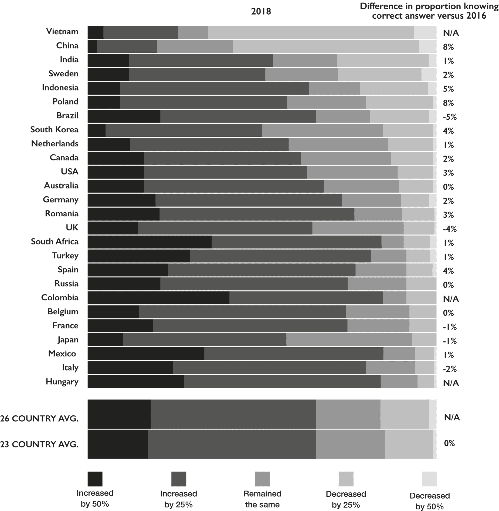

Martijn Lampert、Anne Blanksma Çeta 和 Panos Papadongonas，2018

只有2%的人答对：贫困减少了约50%。更多社会科学研究证实了公众认知与依据无数社会经济指标显示的普遍进步之间的差距。再如英国益普索莫里为皇家统计学会和伦敦国王学院做的里程碑式研究显示大众观点与实际统计差异很大：

* 公众印象是24%的政府福利金被虚报，实际数字是0.7%。
* 英格兰和威尔士1995至2012年间犯罪率下降53%，但58%公众认为在此期间犯罪上升或持平。2006至2012年暴力犯罪下降20%，而51%人认为暴力犯罪上升。
* 公众对青少年怀孕的印象比现实糟25倍：英国每年15岁以下女孩怀孕率约0.6%，公众估计为15%。

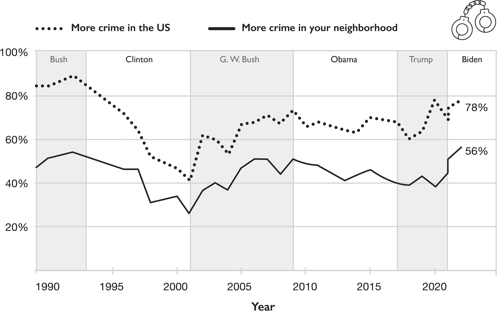

来源：盖洛普民意调查 ¶ 贾米尔斯·拉特伊、魏华·李和莉塞特·克鲁兹，马歇尔项目，2022 年

大西洋西岸也一样。21世纪绝大多数美国人高达78%认为全国犯罪率在过去一年上升，尽管自1990年以来暴力犯罪和财产犯罪都减少约一半。[\[38\]](#18_Notes.xhtml#EndnoteNumber315 "note")

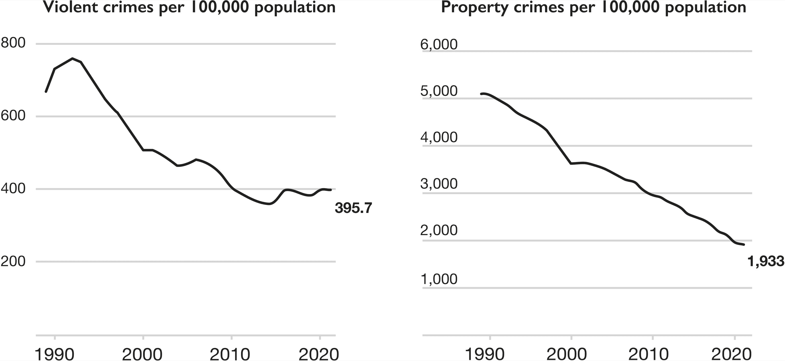

来源：联邦调查局统一犯罪报告计划 ¶ 贾米尔斯·拉特伊、魏华·李和莉塞特·克鲁兹，马歇尔项目，2022 年

格言“血腥即头条”概括了这种误解的一个核心原因。暴力事件会被大范围报道，而犯罪减少通常是非事件，因此得不到报道。

这不一定是任何人的有意识决定——媒体激励结构本身偏向负面新闻。出于本章前面描述的认知偏差，人类更自然地对威胁信息作出反应。由于大多数媒体靠吸引眼球产生广告收入，我们不该惊讶于行业集体学会传播引发强烈情绪反应的威胁信息。

这也关乎紧迫性。“新闻”一词字面意思是新颖及时。人们媒体时间有限，倾向优先刚发生的事件。问题是，绝大多数离散紧急事件都是坏事。正如本章开头强调的，世界上大多数好事是极其渐进的过程，很难产生使其登上*纽约时报*或CNN头条的紧迫感。社交媒体同理——灾难视频容易分享，渐进进展却缺乏引人注目的画面。

正如史蒂文·平克所说，“新闻是理解世界的一种误导方式。它总是关于已发生的事件，而不是未发生的事件。因此警察没被枪击或城市没发生暴力示威时，它们不会成为新闻。只要暴力不降到零，总会有头条可点……悲观主义可能是一种自我实现的预言。”[\[39\]](#18_Notes.xhtml#EndnoteNumber316 "note")这在社交媒体汇聚全球惊人新闻的今天愈发明显，而前几代人主要只了解本地或区域事件。

我的反向观察是：“乐观主义不是对未来的空想，而是一种自我实现的预言。”相信更美好的世界是可能的，是努力创造它的强大动力。

丹尼尔·卡尼曼因解释人们在评估世界时使用的无效且无意识启发式方法而获诺贝尔经济学奖，部分工作与阿莫斯·特沃斯基合作完成。[\[40\]](#18_Notes.xhtml#EndnoteNumber317 "note")他们的研究表明人们系统性忽视先验概率——关于一个群体普遍成立的事，往往也适用于个体成员。例如，若根据陌生人自我描述来猜职业，他说“热爱书籍”，你可能选“图书管理员”，而忽略基础比率——世界上图书管理员相对稀少。[\[41\]](#18_Notes.xhtml#EndnoteNumber318 "note")克服偏差的人会意识到热爱书籍对职业是极弱证据，更可能猜一个更常见工作如“零售工人”。人们并非不知道基础比率，但在具体情境下常忽略它们，而被生动细节牵着走。

## 悲观感为何被大脑放大
Kahneman 与 Tversky 曾描述过一种常见的心理捷径：当硬币连续出现反面后，非专业观察者会直觉地认为正面即将到来。[\[42\]](#18_Notes.xhtml#EndnoteNumber319 "note")这种直觉本质上是对均值回归的误读。

他们用来解释集体悲观的第二个概念是可得性启发。[\[43\]](#18_Notes.xhtml#EndnoteNumber320 "note")人们往往依据脑中调取案例的难易度来判断事件概率。受前述机制影响，新闻流与信息流长期放大负面消息，导致坏事更容易被想起。

纠偏并不等于否定真实难题，而是为对人类整体走向保持审慎乐观提供理性依据。技术进步并非自然发生，需要智识投入与持续努力。它也不能让我们对当下人们承受的紧迫苦难视而不见。宏观趋势提醒我们，即便部分问题看起来绝望，作为一个物种，我们正在扭转解决这些问题的局面。这本身就是一种深刻的动力。

## 指数技术如何让生活悄然变好
信息技术呈指数演进，因为它能自我强化，每一次突破都为下一次突破铺路。这种动能外溢到其他领域，形成相互加持的进步网络。过去两百年因此出现良性循环，推动识字、教育、收入、卫生、健康、民主化与暴力下降等多个维度的福祉。

我们习惯用收入衡量发展，赚钱越多生活越好。但发展远不止经济账。经济有周期，财富可增可减，而技术改变本质上是永久的。一旦文明掌握某种有用做法，这份知识通常会被保留并在此之上延伸。这种单向积累，是对自然灾害、战争、流行病等偶发倒退的强力对冲。

识字、医疗、卫生、民主化等要素彼此交织，形成正反馈。某个环节改善会带动其他环节，例如较好的教育能培养更合格的医者，更合格的医者让更多孩子保持健康得以在校学习。这意味着新技术常产生远超直接用途的间接效益。二十世纪的家用电器不仅节省大量体力时间，更释放出数百万有才华的女性进入职场，在各行各业创造价值。总的来说，技术为更多人发挥潜能创造条件，而人的潜能又反过来催生更多创新。

活字印刷是经典案例。它大幅拓宽受教育渠道，造就更熟练的劳动力，从而拉动经济增长。更高的识字率提升生产与贸易的协调效率，带来更多繁荣。繁荣又让社会更有能力投资基础设施与教育，加速良性循环。与此同时，大众印刷推动了民主化进程，长期来看暴力水平下降。

起初变化很慢，祖父母与孙辈的生活差异细微，常被忽略。数个世纪的平缓趋势是福祉指标缓慢但稳步攀升的轨迹。近几十年曲线明显变陡，得益于各类信息技术的指数化。接下来数十年，这一进程将进入高速阶段。

## 识字与教育的百年跃迁
在人类历史的绝大部分时间里，识字率极低。知识主要靠口头传递，核心障碍是复制文字成本高昂。若普通人难得接触纸页且买不起，投入时间学习阅读便缺乏回报。时间是人人平等的稀缺资源，每天只有24小时。人在分配时间时会计算收益。在生存艰难、书籍昂贵的社会，读书并非明智选择。因此不应把不识字的祖先看作愚昧或缺乏好奇，他们生活在强烈抑制识字的环境中。

同样的视角也适用于今天。例如在信息技术岗位稀缺的地方，对计算机科学感兴趣的年轻人可能觉得学编程并不划算。但正如几个世纪前的欧洲，技术能够改变激励——自动翻译、远程学习、自然语言编程与远程办公正打开新机会并奖励求知欲。

中世纪晚期欧洲活字印刷的引入，让廉价且多样化的阅读材料激增，普通人拥有文化成为可能。[\[44\]](#18_Notes.xhtml#EndnoteNumber321 "note")中世纪末期，欧洲识字人口不到五分之一。[\[45\]](#18_Notes.xhtml#EndnoteNumber322 "note")识字主要限于神职人员与特定职业。启蒙时代识字逐渐普及，但到1750年，主流欧洲强国中仅荷兰与英国识字率超过50%。[\[46\]](#18_Notes.xhtml#EndnoteNumber323 "note")到1870年，西班牙与意大利明显落后。[\[47\]](#18_Notes.xhtml#EndnoteNumber324 "note")原因在于经济相对落后与近期内战。全球平均水平更低。1800年，全球可能不足十分之一的人识字，19世纪大规模生产的报纸与义务教育改革推动了提升。[\[48\]](#18_Notes.xhtml#EndnoteNumber325 "note")到1900年，仍不到四分之一。[\[49\]](#18_Notes.xhtml#EndnoteNumber326 "note")20世纪公共教育全球扩张，到1910年全球识字率超过四分之一。到1970年，世界大多数人口已能识字。[\[50\]](#18_Notes.xhtml#EndnoteNumber327 "note")此后迅速接近普惠。[\[51\]](#18_Notes.xhtml#EndnoteNumber328 "note")今天全球识字率接近87%，发达国家通常超过99%。[\[52\]](#18_Notes.xhtml#EndnoteNumber329 "note")

仍有提升空间。现行统计多指基本标准，如能读写自己的名字。新的、更丰富的指标开始评估识字质量。据美国国家成人识字评估，2003年仅86%的美国人口识字能力高于“低于基本水平”。[\[53\]](#18_Notes.xhtml#EndnoteNumber330 "note")九年后的一次类似评估显示几乎没有显著改善。[\[54\]](#18_Notes.xhtml#EndnoteNumber331 "note")

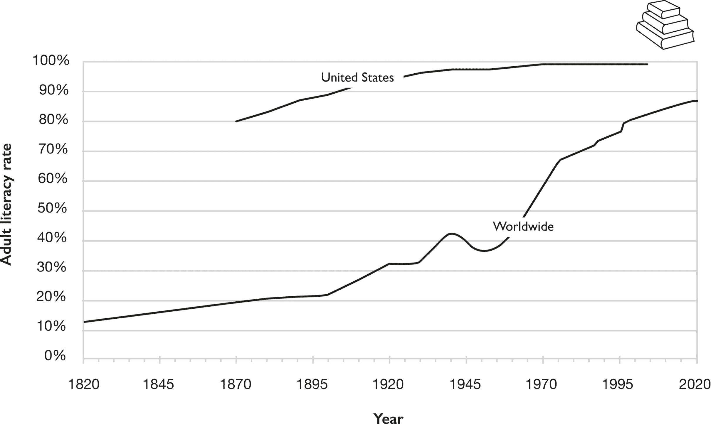

主要来源：Our World in Data；联合国教科文组织

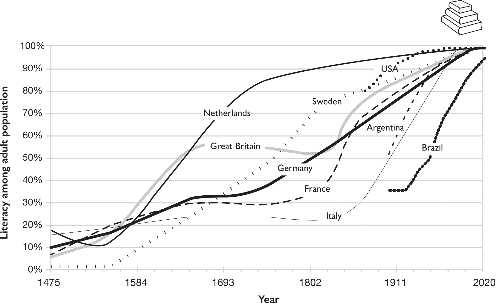

来源：Our World in Data；联合国教科文组织

1870 年，美国的人口平均接受过大约四年的正规教育，而英国、日本、法国、印度和中国的人口平均受教育年限都低于一年。[\[57\]](#18_Notes.xhtml#EndnoteNumber334 "note")在 20 世纪初，随着英国、日本和法国扩大其免费公共教育，它们开始迅速赶上美国。[\[58\]](#18_Notes.xhtml#EndnoteNumber335 "note")与此同时，印度和中国仍然贫穷和不发达，但在二战后的两个十年里取得了重大飞跃。[\[59\]](#18_Notes.xhtml#EndnoteNumber336 "note")到 2021 年，印度平均受教育年限为 6.7 年，中国为 7.6 年。[\[60\]](#18_Notes.xhtml#EndnoteNumber337 "note")前面提到的其他国家平均受教育年限都超过 10 年，其中美国以 13.7 年领先。[\[61\]](#18_Notes.xhtml#EndnoteNumber338 "note")以下图表显示了过去半个世纪以来的巨大进步——这并非巧合，同一时期计算机既促进了教育，又增加了受教育的好处。

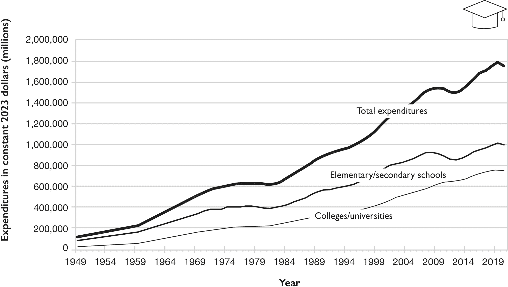

主要来源：国家教育统计中心

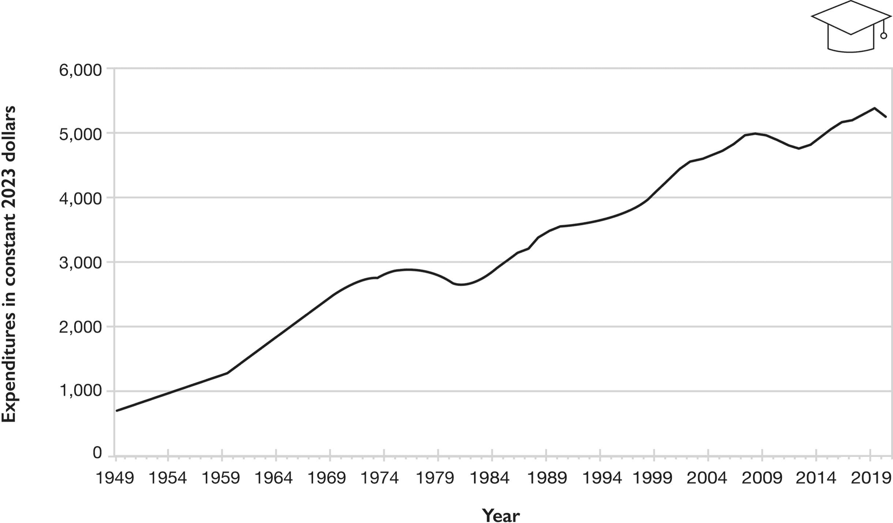

主要来源：国家教育统计中心

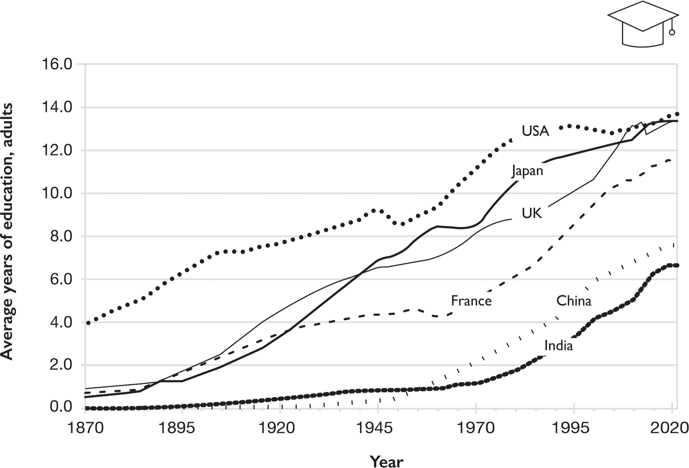

主要来源：我们的世界数据；联合国人类发展报告办公室

## 从卫生到屏幕：日常基础设施的普及史
历史上导致疾病和死亡的最大原因之一是人类粪便对食物和水供应的污染。[\[65\]](#18_Notes.xhtml#EndnoteNumber342 "note")抽水马桶是解决这个问题的最终技术方案，早在 1829 年就已出现，并在美国城市逐渐普及，但直到 20 世纪初才在城市地区普遍使用。[\[66\]](#18_Notes.xhtml#EndnoteNumber343 "note")在 20 世纪 20 年代和 30 年代，抽水马桶迅速普及到农村地区，到 1950 年达到四分之三的家庭，到 1960 年达到 90%。[\[67\]](#18_Notes.xhtml#EndnoteNumber344 "note")在 2023 年，美国极少数没有抽水马桶的家庭，在许多情况下是由于生活方式的选择（例如，喜欢居住在乡村环境中），而不是由于赤贫。[\[68\]](#18_Notes.xhtml#EndnoteNumber345 "note")相比之下，贫困一直是发展中国家的人们仍然缺乏抽水马桶或其他形式的改善卫生设施（如堆肥厕所）的主要原因。[\[69\]](#18_Notes.xhtml#EndnoteNumber346 "note")随着卫生技术的成本降低，全球范围内获得安全厕所的机会一直在稳步增加。随着曾经容易发生暴力事件的地区变得更加稳定，并能够投资于卫生基础设施。[\[70\]](#18_Notes.xhtml#EndnoteNumber347 "note")

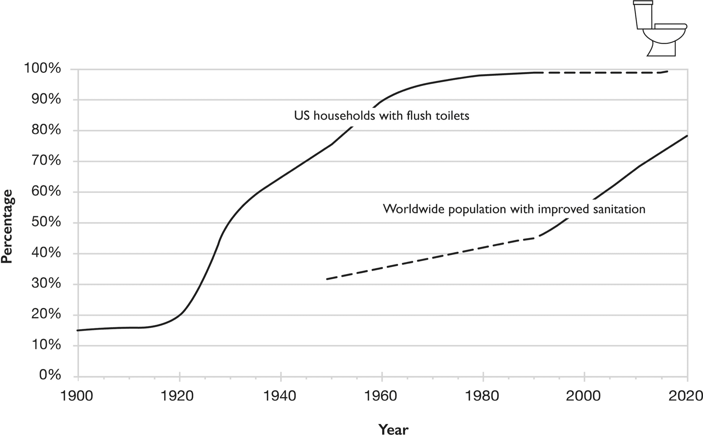

主要来源：斯坦利·莱伯戈特*追求幸福：二十世纪的美国消费者*（新泽西州普林斯顿：普林斯顿大学出版社，1993）；美国人口普查局；世界银行 ¶ 虚线表示连接数据来源的估计值。

电力本身并不是一种信息技术，但由于它为我们所有的数字设备和网络供电，它是现代文明无数其他好处的先决条件。甚至在计算机出现之前，它就运行着变革性的省力电器，并允许人们在夜间工作和娱乐。在二十世纪初，美国的电气化主要局限于大型城市地区。[\[72\]](#18_Notes.xhtml#EndnoteNumber349 "note")电气化的步伐在大萧条开始时有所放缓，但在 20 世纪 30 年代和 40 年代，富兰克林·D·罗斯福总统倡导大规模的农村电气化计划，旨在将电力机械的效率带到美国农业中心地带。[\[73\]](#18_Notes.xhtml#EndnoteNumber350 "note")到 1951 年，超过 95% 的美国家庭用上了电，到 1956 年，全国电气化工作被认为基本完成。[\[74\]](#18_Notes.xhtml#EndnoteNumber351 "note")

在世界其他地方，电气化通常遵循类似的模式：先是城市，然后是郊区，最后是农村地区。[\[75\]](#18_Notes.xhtml#EndnoteNumber352 "note")如今，地球上超过 90% 的人口用上了电。[\[76\]](#18_Notes.xhtml#EndnoteNumber353 "note")对于那些仍然没有电力的人来说，主要的障碍是政治，而不是技术。麻省理工学院教授达隆·阿西莫格鲁和他的同事詹姆斯·罗宾逊对政治制度在人类发展中的关键作用进行了非常有影响力的研究。[\[77\]](#18_Notes.xhtml#EndnoteNumber354 "note")简而言之，随着各国允许更多人自由参与政治，以及人们获得为未来创新和投资的保障，繁荣的反馈循环就能形成。正是这些因素使得为大约十分之一仍然缺乏电力的世界人口提供电力变得如此困难。在暴力普遍的地区，人们认为投资于可能很快被摧毁的昂贵电力基础设施是不值得的。同样，当道路状况差且危险时，很难将机械和燃料运送到偏远社区，以便他们能够自己发电。幸运的是，廉价且高效的光伏电池将继续扩大电力供应。

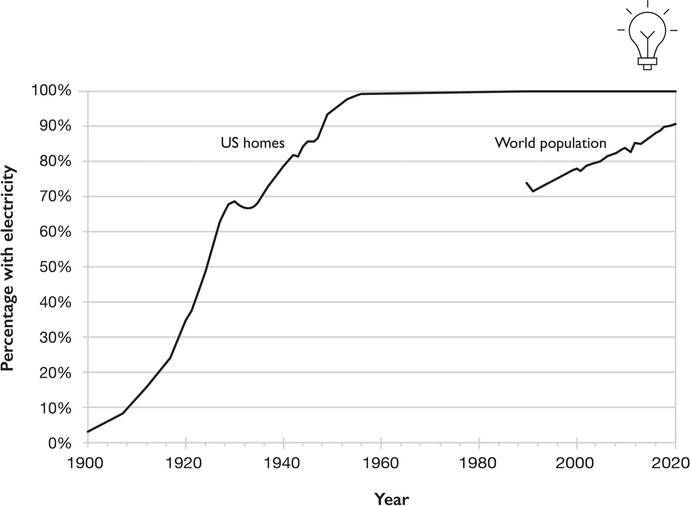

资料来源：美国人口普查局；世界银行；斯坦利·莱伯戈特*美国经济：收入、财富与匮乏*（新泽西州普林斯顿：普林斯顿大学出版社，1976 年）

电力驱动下的首个变革性通信技术是无线电。美国的商业无线电广播各州始于 1920 年，到 20 世纪 30 年代已成为美国主要的群众媒体形式。[\[79\]](#18_Notes.xhtml#EndnoteNumber356 "note")与主要局限于单个大都市地区的报纸不同，无线电广播可以覆盖全国的听众。这刺激了真正全国性媒体文化的发展，因为从加利福尼亚到缅因州的人们听到了许多相同的政治演讲、新闻报道和娱乐节目。到 1950 年，超过十分之九的美国家庭拥有收音机，但在同一十年里，电视开始取代收音机在媒体领域的主导地位。[\[80\]](#18_Notes.xhtml#EndnoteNumber357 "note")作为回应，听众的习惯发生了转变。广播节目开始更加狭隘地关注新闻、政治和体育，人们在车里的时候会听很多广播。[\[81\]](#18_Notes.xhtml#EndnoteNumber358 "note")自 20 世纪 80 年代以来，党派色彩浓厚的政治谈话节目已成为广播中最强大的力量之一，并因强化听众的偏见，同时让他们对相反的信息视而不见而受到批评。[\[82\]](#18_Notes.xhtml#EndnoteNumber359 "note")自从 2010 年代智能手机和平板电脑普及以来，越来越多的广播内容通过网络流媒体播放，而实际上并没有通过传统的无线电波传输。（2007 年，即第一款 iPhone 发布的年份，只有 12%的美国人每周至少收听一次在线广播；到 2021 年，这一比例达到了 62%。）[\[83\]](#18_Notes.xhtml#EndnoteNumber360 "note")

电视的普及遵循了与广播相似的模式，但由于当时国家已经更加发达，其指数级增长甚至更快。科学家和工程师在 19 世纪末就开始对将导致电视发展的进步进行理论研究，到 20 世纪 20 年代末，第一个原始电视系统正在被开发和演示。[\[84\]](#18_Notes.xhtml#EndnoteNumber361 "note")到 1939 年，这项技术在美国已经达到了商业可行性，但第二次世界大战的爆发使全球电视生产几乎陷入停顿。[\[85\]](#18_Notes.xhtml#EndnoteNumber362 "note")然而，战争一结束，美国人就开始迅速购买电视机。新的电视台在全国各地涌现，到 1954 年，大多数家庭至少拥有一台电视机。[\[86\]](#18_Notes.xhtml#EndnoteNumber363 "note")普及率迅速提高，到 1962 年，超过 90% 的家庭都拥有一台电视机。[\[87\]](#18_Notes.xhtml#EndnoteNumber364 "note")随着后期采用者逐渐加入电视观看的行列，增长速度随后放缓未来三十年。[\[89\]](#18_Notes.xhtml#EndnoteNumber366 "note")到 1997 年，使用率达到顶峰，占家庭的 98.4%，此后几年略有下降，2021 年约为 96.2%。[\[90\]](#18_Notes.xhtml#EndnoteNumber367 "note")这种下降可归因于多种因素：一种是文化上不再过度观看电视的转变，另一种是在线竞争消遣方式的出现，还有最近一种趋势是在线设备上可以流式传输电视风格的节目。[\[91\]](#18_Notes.xhtml#EndnoteNumber368 "note")

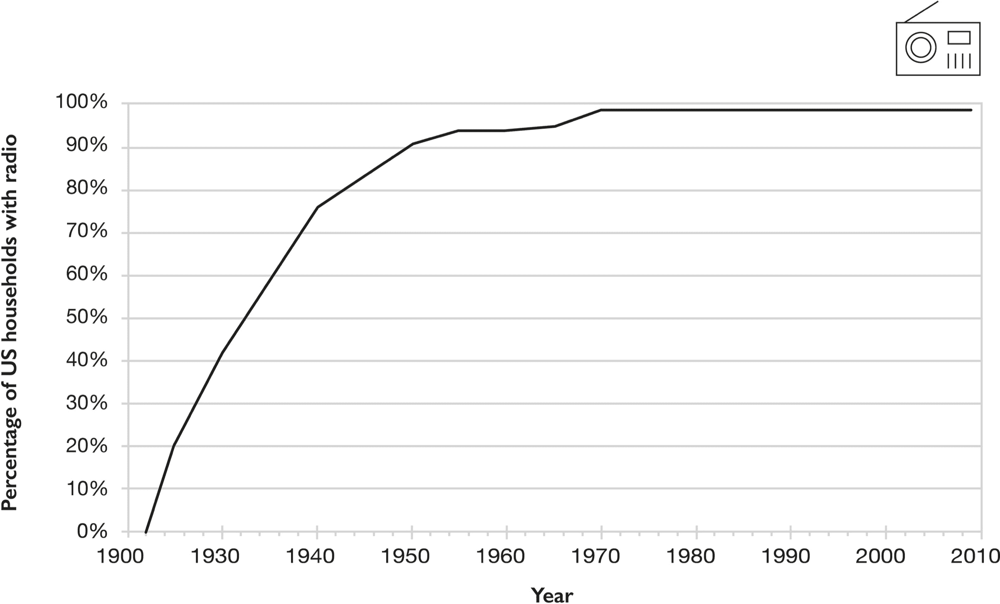

来源：美国人口普查局；道格拉斯·B·克雷格，*炉边政治：美国广播与政治文化*，1920–1940（巴尔的摩，马里兰州：约翰·霍普金斯大学出版社，2000） ¶ 虽然近年来美国家庭拥有收音机的比例似乎显著下降（根据一项使用与本图表数据不同方法的研究，从 2008 年的 96%降至 2020 年的 68%），但这具有很大的误导性，因为其他设备现在也执行相同的功能。例如，截至 2021 年，85%的美国成年人拥有一部智能手机，无需收音机即可免费收听广播节目。

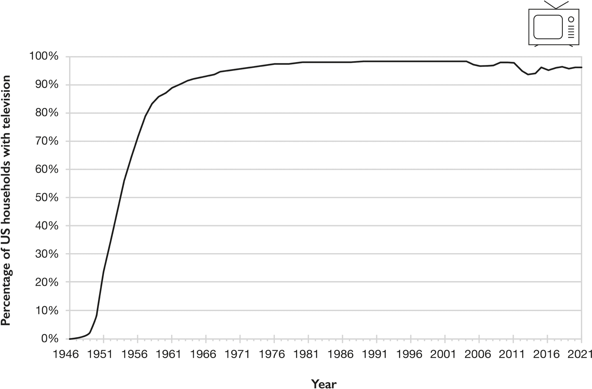

主要来源：美国人口普查局；科贝特·S·斯坦伯格，*电视趣闻*, Facts on File; Jack W. Plunkett,*Plunkett’s Entertainment & Media Industry Almanac 2006（Plunkett 娱乐与媒体产业年鉴 2006）*（休斯顿，德克萨斯州：Plunkett Research，2006）；尼尔森公司

被动收看的电视广播与主动操作的电脑形成鲜明对比。上世纪七十年代，家用个人电脑在美国兴起，最初的代表是 Kenbak-1，1975 年以套件形式发售的 Altair 8800 很快成为现象级产品。[\[92\]](#18_Notes.xhtml#EndnoteNumber369 "note") 七十年代末期，苹果与微软凭借更易上手的界面重塑市场，普通用户通常几小时内就能掌握基本操作。[\[94\]](#18_Notes.xhtml#EndnoteNumber371 "note") 1984 年苹果投放的超级碗广告点燃全国讨论，播出后五年里美国家庭电脑保有率几乎翻倍。[\[95\]](#18_Notes.xhtml#EndnoteNumber372 "note") 当时主要用途集中在文字编辑、数据录入和简易游戏。

真正的用途扩张来自九十年代互联网的爆发。1990 年 1 月，全网主机数约 175,000 台。[\[96\]](#18_Notes.xhtml#EndnoteNumber373 "note") 到 2000 年 1 月，规模上升到约 72,000,000 台。[\[97\]](#18_Notes.xhtml#EndnoteNumber374 "note") 流量同样呈爆炸式增长，由 1990 年的约 12,000 千兆字节攀升至 1999 年的 306,000,000 千兆字节。[\[98\]](#18_Notes.xhtml#EndnoteNumber375 "note") 内容供给越丰富，电脑的实用价值越高，吸引更多用户付费使用并贡献内容，形成良性循环。于是九十年代的家用电脑从写作与粗糙游戏的工具，转变为连通全球知识、与远在其它大陆的人实时互动的入口。电子商务随之兴起，21 世纪初期社交媒体的出现则让在线体验变得高度互动。

2017-2021 年间约 93.1% 的美国家庭拥有电脑，随着“最伟大的一代”减少、千禧一代自立门户，渗透率仍在抬升。[\[99\]](#18_Notes.xhtml#EndnoteNumber376 "note") 全球层面电脑保有量也在稳步上行。智能手机内置的计算能力推动新兴市场快速普及，截至 2022 年，全球约三分之二人口至少拥有一部。[\[100\]](#18_Notes.xhtml#EndnoteNumber377 "note")

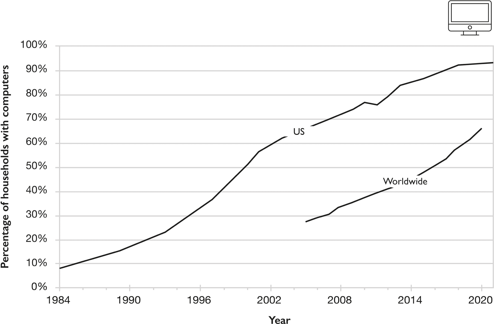

主要来源：美国人口普查局；国际电信联盟

## 预期寿命

如第 6 章所述，迄今疾病防治的大部分进展来自线性试错。缺乏系统性筛选手段，发现很大程度上依赖偶然。医学上最典型的偶然突破是青霉素的意外发现，它开启抗生素时代，可能已挽救多达 2 亿生命。[\[102\]](#18_Notes.xhtml#EndnoteNumber379 "note") 即便非纯偶然，研究者仍需靠运气，传统的高通量筛选等实验手段低效缓慢。

这种模式成果显著。一千年前欧洲出生预期仅二十几岁，婴儿与青少年大量死于霍乱、痢疾等现今易防之症。[\[103\]](#18_Notes.xhtml#EndnoteNumber380 "note") 到十九世纪中叶，英国与美国的预期寿命已升至四十多岁。[\[104\]](#18_Notes.xhtml#EndnoteNumber381 "note") 截至 2023 年，发达地区多已超过八十岁。[\[105\]](#18_Notes.xhtml#EndnoteNumber382 "note") 千年间寿命近乎翻倍，两百年翻倍，主因是阻断或清除外来病原体——细菌与病毒由体外入侵。

如今易摘的果实已尽。剩余负担多源于机体内部衰退，细胞功能失调、组织瓦解带来癌症、动脉粥样硬化、糖尿病、阿尔茨海默病等。在一定程度上可通过生活方式、饮食与补剂降低风险——我称之为通往激进延寿的第一个跨越。[\[106\]](#18_Notes.xhtml#EndnoteNumber383 "note") 但这只能推迟不可避免的结局。因此自二十世纪中叶起，发达国家寿命增速放缓。以美国为例，1880-1900 年出生预期由约 39 岁升至 49 岁，而 1980-2000 年，医学重心已转向慢性与退行性疾病后，仅由 74 岁升至 76 岁。[\[107\]](#18_Notes.xhtml#EndnoteNumber384 "note")

幸运的是，2020 年代我们正进入第二个跨越：把人工智能与生物技术结合对抗退行性疾病。我们已超越仅用电脑整理干预与临床试验信息，现在借助人工智能发现新药，到本十年末将能以数字模拟增强并最终替代缓慢乏力的人体试验。实质上医学正被改造成信息技术，利用其指数级进步来掌控生物学的软件。

最早最重要的案例之一在遗传学。自 2003 年人类基因组计划完成，基因组测序成本持续指数下降，平均每年约减半。2016-2018 年出现短暂停滞，COVID-19 也拖慢进程，但成本仍在下行，且随人工智能在测序中作用加大可能再次加速。成本从 2003 年的每个基因组约 5000 万美元骤降至 2023 年初的低至 399 美元，有公司宣称你读到本文时可提供 100 美元检测。[\[108\]](#18_Notes.xhtml#EndnoteNumber385 "note")

随着人工智能改造医学领域，将掀起类似浪潮。它已开始产生临床影响，[\[109\]](#18_Notes.xhtml#EndnoteNumber386 "note") 但我们仍处指数曲线的早期阶段。目前的应用涓涓细流将在 2020 年代末化为洪流。届时可直接应对把最长寿命限制在约 120 年的生物学因素，包括线粒体基因突变、端粒缩短与导致癌症的失控细胞分裂。[\[110\]](#18_Notes.xhtml#EndnoteNumber387 "note")

2030 年代将到达第三个跨越：智能医疗纳米机器人在全身进行细胞层面的维护与修复。按某些定义，部分生物分子已算纳米机器人。但第三个跨越的纳米机器人不同，在于能被人工智能主动操控执行不同任务。此阶段对生物学的掌控水平类似汽车保养——除非重大事故报废，可无限期修理或更换部件。智能纳米机器人将能针对性修复或升级单个细胞，从根本上战胜衰老。更多内容见第 6 章。

第四个跨越——以数字方式备份思维文件——将是 2040 年代的技术。正如我在第 3 章论证，个人身份核心不是大脑本身，而是大脑能代表和操纵的特殊信息排列。一旦能以足够精度扫描这些信息，就可在数字基质上复制。这意味着即使生物大脑被毁，身份也不会熄灭，可通过复制与备份实现近乎任意长的存续。

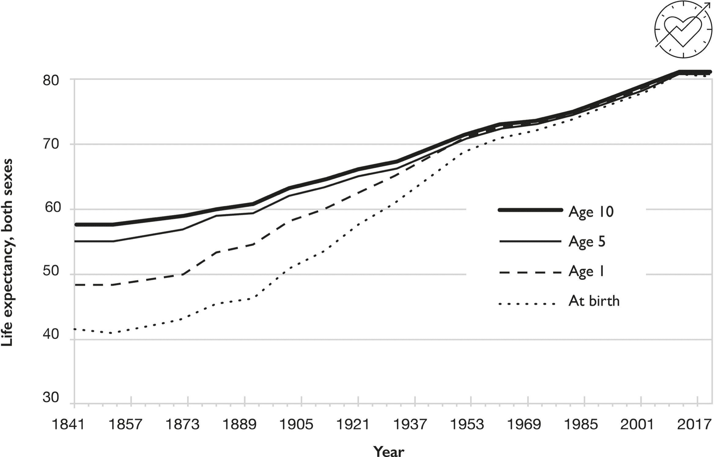

来源：英国国家统计局

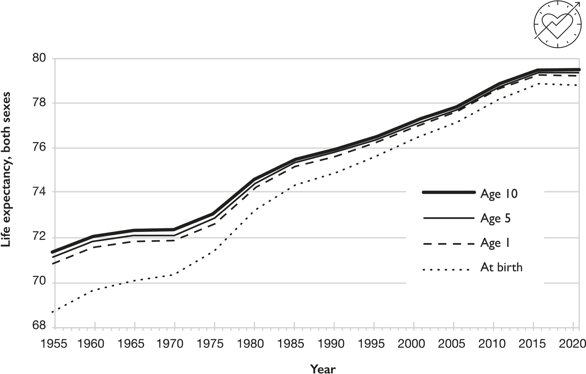

来源：联合国经济和社会事务部

## 贫困下降和收入增加

本章前述技术趋势各有裨益，但真正变革的是它们相互增强的整体效应。经济福祉虽非完整衡量，却是我们理解这一长期 sweeping 过程的最佳指标。

全球宏观走势一直稳定。1820 年按现代全球标准估算，世界人口 84% 生活在极端贫困中。[\[113\]](#18_Notes.xhtml#EndnoteNumber390 "note") 工业化蔓延后，欧洲与美国的贫困率迅速下降。[\[114\]](#18_Notes.xhtml#EndnoteNumber391 "note") 二战后印度与中国在随后数十年引入更现代农业，进程明显加速。[\[115\]](#18_Notes.xhtml#EndnoteNumber392 "note") 尽管媒体密集报道让人误判程度，贫困率持续下降，近三十年改善显著。到 2019 年，极端贫困即以 2017 年美元计日均低于 2.15 美元，已降至全球约 8.4%，1990-2013 年间降幅超过三分之二。[\[116\]](#18_Notes.xhtml#EndnoteNumber393 "note")

东亚降幅最大，中国经济发展使数亿人脱贫，生活水平可与发达国家媲美。1990-2013 年，东亚极端贫困人口惊人下降 95%，同期总人口从 16 亿增至 20 亿。[\[117\]](#18_Notes.xhtml#EndnoteNumber394 "note")

同期极端贫困人口增加的唯一地区是欧洲与中亚，苏联解体后经济动荡需数十年修复。[\[118\]](#18_Notes.xhtml#EndnoteNumber395 "note") 这主要是政治原因而非纯经济或技术。专制苏联政府崩溃造成权力真空，带来巨大腐败。尤其在中亚较贫穷的后苏联共和国，形成阻碍投资的负向反馈，抑制繁荣。

冷战结束以来，国际社会能投入更多精力对抗地球最贫困地区的严重贫困。苏联解体后，许多发达国家削减对外援助预算，降低对国际发展的重视。[\[119\]](#18_Notes.xhtml#EndnoteNumber396 "note") 冷战期间发展多被视为战略博弈，西方民主国家与共产主义阵营争夺发展中国家影响力。到二十世纪九十年代中期，经合组织认为从人道角度促进发展至关重要，也因营造安全繁荣世界利人利己。2000 年联合国写入千年发展目标，协调国际努力在 2015 年前实现关键里程碑。[\[120\]](#18_Notes.xhtml#EndnoteNumber397 "note") 虽许多雄心目标未实现，千年发展目标仍推动了改善数亿人生活的重大进展。

美国按绝对值计的极端贫困即按 2017 年美元全球基准日 2.15 美元，自开始衡量一直处于或低于 1.2%。[\[121\]](#18_Notes.xhtml#EndnoteNumber398 "note") 相对贫困统计给出不同视角。美国相对贫困从十九世纪约 45% 下降，战后急降，1970 年约 12.5% 后停滞不前。[\[122\]](#18_Notes.xhtml#EndnoteNumber399 "note") 此后一直维持十几岁水平，[\[123\]](#18_Notes.xhtml#EndnoteNumber400 "note") 随更广经济变化波动，但未见长期改善。[\[124\]](#18_Notes.xhtml#EndnoteNumber401 "note") 原因之一是生活水平提高导致相对贫困线不断重划，按 1980 年生活质量标准本不算穷的人现在被视为穷人。[\[125\]](#18_Notes.xhtml#EndnoteNumber402 "note")

尽管如此，2014-2019 年美国贫困人口数量按定期重划标准减少约 1260 万，同期总人口增约 890 万。[\[126\]](#18_Notes.xhtml#EndnoteNumber403 "note") 其中 410 万减幅发生在 2019 年，当时老年人贫困率接近历史最低。[\[127\]](#18_Notes.xhtml#EndnoteNumber404 "note") COVID-19 大流行导致暂时增长，[\[128\]](#18_Notes.xhtml#EndnoteNumber405 "note") 代表了自 2008 年金融危机以来总体下降趋势的偏离。

此外，通过互联网可广泛获取免费信息与服务，如参加麻省理工学院开放课程或与远在其它大陆家人视频聊天，如今穷人在绝对意义上要好得多。[\[129\]](#18_Notes.xhtml#EndnoteNumber406 "note") 他们同样受益于近几十年电脑与手机价格性能的根本性改善，但这并未在经济统计中充分反映。经济统计未能充分捕捉受信息技术影响的产品与服务价格性能的指数级增长，这将在下一章详述。如今拥有廉价智能手机的人可快速轻松访问几乎全球的教育信息、翻译语言、查找方向等等。这种能力几十年前不可获得，即便花费数百万美元也无法实现。

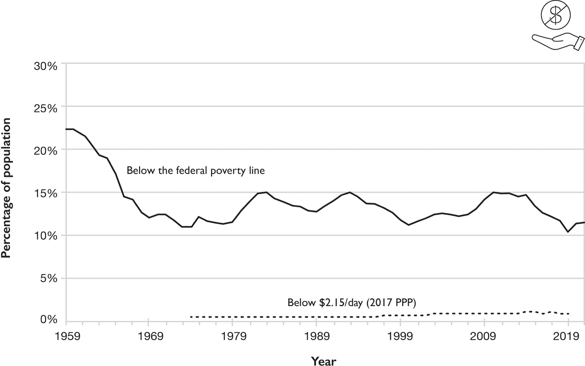

来源：美国人口普查局；世界银行

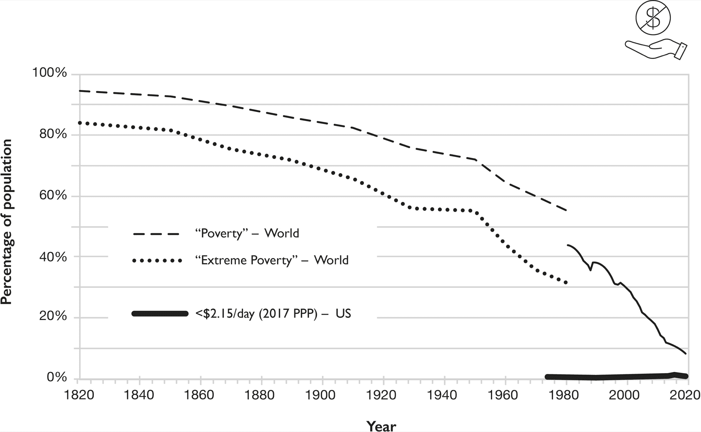

主要来源：我们的数据世界；弗朗索瓦·布吉尼翁和克里斯蒂安·莫里森，“世界公民之间的不平等：1820-1992”，*美国经济评论*92, no. 4 (2002 年 9 月); 727–44.

在美国，人均日平均收入稳步飙升。2023 年，美国单身人士的贫困线为 14580 美元，相当于每天靠 39.95 美元生活。[\[132\]](#18_Notes.xhtml#EndnoteNumber409 "note") 实际上，自 1941 年左右以来，美国人的平均（非中位数）收入一直高于 2023 年的贫困线。[\[133\]](#18_Notes.xhtml#EndnoteNumber410 "note")

### 美国人均日平均收入（2023 年美元），按年份[\[134\]](#18_Notes.xhtml#EndnoteNumber411 "note")

2020: $191.00

2015: $169.88

2010: $154.15

2000: $147.18

1990: $124.32

1980: $102.41

1970: $89.82

1960: $65.27

1950: $52.97

1940: $35.47

1930: $30.74

1910: $26.45

1900: $20.08

1880: $15.08

1860: $13.27

1840: $8.37

1800: $5.65

1774: $7.06

## 美国贫困率近似值（相对贫困，由政府定期重新定义），按年份[\[135\]](#18_Notes.xhtml#EndnoteNumber412 "note")

2020 年：11.5%

2015 年：13.5%

2010 年：15.1%

2000 年：11.3%

1990 年：13.5%

1980 年：13.0%

1970 年：12.6%

1960 年：22.2%

1950 年：约 30%

1935 年：约 45%

1910 年：约 30%

1870 年：约 45%

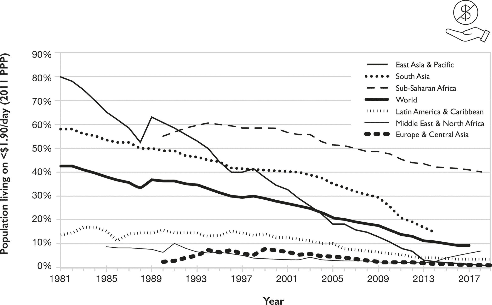

来源：世界银行

增长、闲暇与更安全的世界

美国经济总量的扩张在很大程度上可归因于人口的扩张，这本不足为奇。剔除人口规模的影响后，经济总量的人头口径同样呈现出指数式上扬。[\[137\]](#18_Notes.xhtml#EndnoteNumber414 "note")这一判断尚未计入免费的信息类产品，也没有纳入信息技术在同等花费下算力随时间指数级提升的效应。

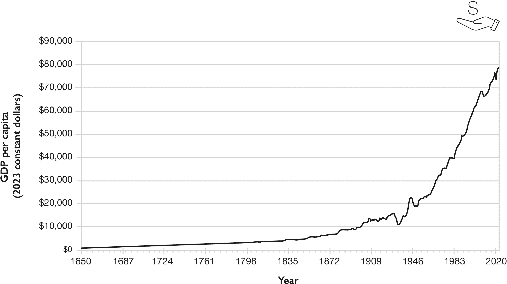

来源：麦迪逊项目数据库；经济分析局；联邦储备委员会

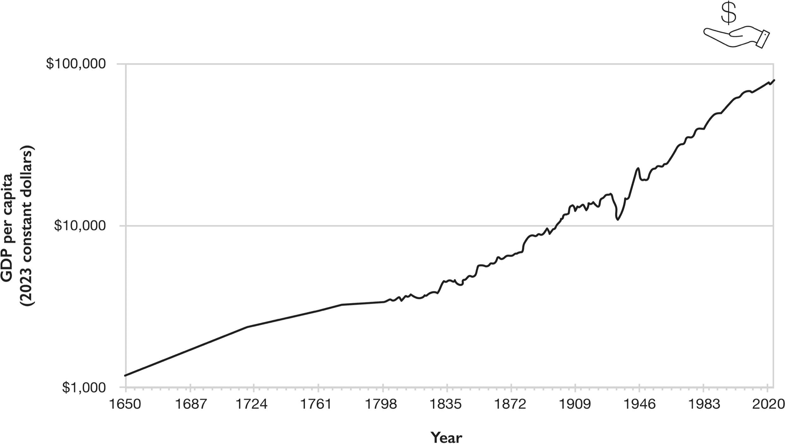

来源：麦迪逊项目数据库；经济分析局；联邦储备委员会

国内生产总值汇总了包含大型企业在内的宏观活动，若把视角缩小到个体，轨迹基本一致。以不变币值衡量的个人可得所得反映的是活人实际到手的回报，而非企业账面，它涵盖薪酬，也包含股东和业主从自营业务获得的股息与利润。自1929年起有统计以来，美国按人头计算的实际个人所得整体大幅攀升，仅在1930年代经济危机及若干重大衰退期出现短暂回落。近九十年里，实际平均水平已翻五倍以上，而劳动时长却在同步压缩。[\[140\]](#18_Notes.xhtml#EndnoteNumber417 "note")中位数所得的增速相对平缓，却仍以绝对值稳步抬升，从1984年的27,273美元升至疫情前2019年的42,488美元，均折算为2023年美元。[\[141\]](#18_Notes.xhtml#EndnoteNumber418 "note")

上述数字实际上低估了福祉的改善。它没有体现电子产品等商品价格的大幅回落，也没有体现搜索引擎、社交网络这类高价值服务如今对用户免费。全球化让可及的商品服务种类远超1929年。即便只在用餐上做选择，有中餐和墨西哥菜可选，也比单一选择的生活质量更高。多样性渗透到生活方方面面：电视从寥寥数个频道变为数百个；水果能从地球另一端空运来供反季食用；书架上的数千本书变成亚马逊上数百万本的随选目录。

选择让每个人更容易贴合偏好，对品味特殊的人尤为关键。信息技术使全球化经济成为可能后，若你想收集旧万花筒，可在eBay上从世界各地购得；一个对数理科学感兴趣的孩子，能用数小时的教育节目滋养好奇心，不必像我那一代只能守着家中唯一电视看《Gunsmoke》。3D打印以及未来数十年可能成熟的纳米技术，料将以指数方式进一步加速选择的丰富度。

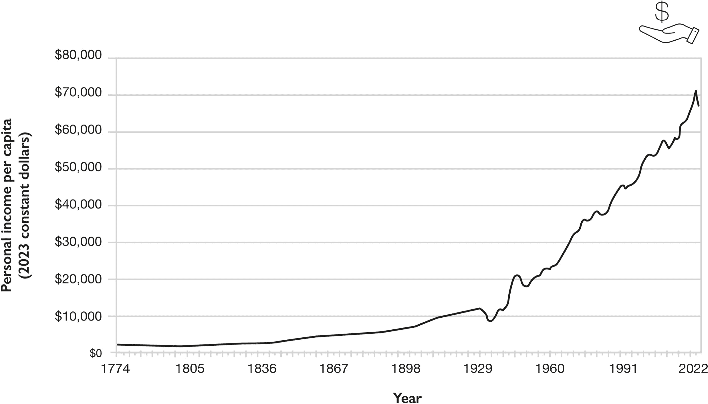

资料来源：美国经济分析局；国家经济研究局；Alexander Klein，“1880-1910 年美国个人收入的新州级估计”，载于*经济史研究*，第 29 卷，由 Christopher Hanes 和 Susan Wolcott 编辑（英国宾利：Emerald Group，2013）；联邦储备

仅看年收入不够，换算到工时更有参考意义。以不变币值计的美国每工时实际个人所得长期稳步走高，从1880年的约5美元升至2021年的约93美元。[\[143\]](#18_Notes.xhtml#EndnoteNumber420 "note")需要说明，个人所得不仅包括薪酬，还包括投资回报、个人企业收益，以及政府福利和一次性发放，如2020年的疫情刺激金。因此每工时个人所得的数值始终高于单纯的每工时薪酬指标。它之所以有价值，是因为能捕捉到非薪酬收入在总收入中占比不断抬头的趋势，更好地表明即便普通劳动者工时在减少，整体经济繁荣仍在延续。

图表显示，即使在动荡期，每工时实际所得仍在上行。1930年代经济危机最严重阶段的高质量数据稀缺，但似乎每工时所得并未像其他指标那样遭受重创。其原因在于，当时人均个人所得下滑本质是总收入收缩所致，而人口分母变化不大，人均自然下降。失业发生时，人们同时失去收入和工时，分母随之缩小，于是危机年份的每工时所得得以维持稳定甚至小幅上升。换句话说，很多人彻底失去工作，但保住岗位者的薪酬并未明显下滑。

主要来源：麦迪逊项目；经济分析局；斯坦利·莱伯戈特，《劳动力和就业，1800-1960》，载于*1800 年后美国的产出、就业和生产力*，编辑：多萝西·S·布雷迪（华盛顿特区：国家经济研究局，1966）；亚历山大·克莱因，《美国个人收入的新州级估计，1880-1910》，载于*经济史研究*，第 29 卷，编辑：克里斯托弗·海恩斯和苏珊·沃尔科特（宾利，英国：翡翠集团，2013）；迈克尔·休伯曼和克里斯·明斯，《时代并没有改变：旧世界和新世界的工作日和工作时间，1870-2000》,*经济史探索*44, no. 4 (2007 年 7 月 12 日)

19世纪末，美国工人一年平均工时接近三千小时。[\[145\]](#18_Notes.xhtml#EndnoteNumber422 "note")大约1910年后，受法规与工会推动，工作日被压缩、休息时间增多，工时开始快速下滑。[\[146\]](#18_Notes.xhtml#EndnoteNumber423 "note")雇主也发现，休息充足的员工效率更高、失误更少，因此将工时分摊给更多人是合理的。在1930年代经济危机期间，年均工时骤降至1750小时以下，企业被迫给在岗员工减时。[\[147\]](#18_Notes.xhtml#EndnoteNumber424 "note")二战及战后繁荣期，人们重返工厂办公室，年均工时回升至2000小时以上。[\[148\]](#18_Notes.xhtml#EndnoteNumber425 "note")此后工时缓慢但持续回落，回到接近危机时期的水平。[\[149\]](#18_Notes.xhtml#EndnoteNumber426 "note")关键区别在于，如今的缩减更多来自个人主动选择兼职、追求更健康的工作生活平衡，而非被动削减。部分欧洲国家的工时降幅更大。[\[150\]](#18_Notes.xhtml#EndnoteNumber427 "note")

工作需求的结构变化让千禧一代和Z世代更倾向于创造性、往往带创业属性的职业，并看重远程工作的自由，这在节省通勤时间和成本的同时，也可能模糊工作与生活的边界。COVID-19大流行把劳动力向远程办公及其他新型雇佣关系的转变加速放大。在一项调查中，98%的受访者表示希望在职业生涯剩余阶段能拥有远程工作的选择。[\[151\]](#18_Notes.xhtml#EndnoteNumber428 "note")随着技术进步让更多岗位可远程化，这一趋势大概率会延续。

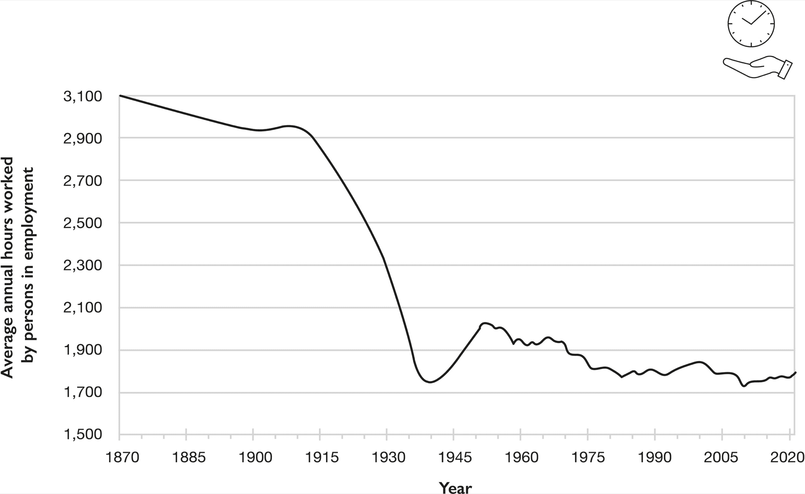

来源：Michael Huberman 和 Chris Minns，“时代没有改变：旧世界和新世界的工作日和工作时长，1870-2000”，*经济史探索*44, no. 4 (2007 年 7 月 12 日)；格罗宁根大学和加州大学戴维斯分校；联邦储备委员会；经济合作与发展组织

衡量社会经济福祉的另一面是童工。当贫困迫使儿童劳动时，他们会失去受教育机会，长期发展潜力受损。好消息是，整个二十一世纪童工规模在持续收缩。国际劳工组织用三个层层嵌套的类别来追踪进展。[\[153\]](#18_Notes.xhtml#EndnoteNumber430 "note")最宽泛的是“儿童就业”，指孩子在家庭农场或家庭企业里做适度、轻松的工作；这对教育或许有干扰，但属于相对温和的形式。第二类是狭义的“童工”，即孩子从事的工作在工时要求和艰苦程度上与成人工作相近。第三类最窄，是“危险工作”，在特别危险的条件下进行的童工劳动，包括采矿、拆船和废物处理。从2000年到2016年，全球从事危险工作的儿童比例由11.1%降到4.6%，尽管COVID-19引发的经济冲击似乎打断了这一进程。[\[154\]](#18_Notes.xhtml#EndnoteNumber431 "note")

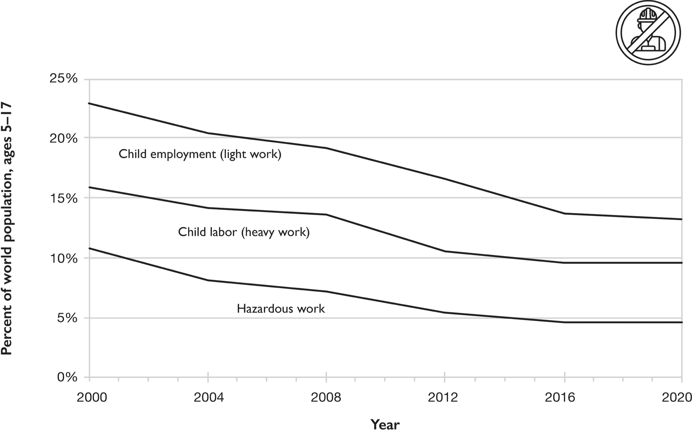

来源：国际劳工组织；联合国儿童基金会

## 暴力水平的长期回落

物质繁荣的增长与暴力水平的下降相互促进。拥有更多可失去之物的人更有动力避免冲突；当人们能预期长期安全时，他们更愿意进行长期投资，这反过来利好社会。欧洲西部的凶杀率至少从十四世纪起就持续走低。[\[156\]](#18_Notes.xhtml#EndnoteNumber433 "note")即使个人武器越来越致命，长期尺度上的下降仍呈指数级。在有可靠中世纪数据的欧洲西部国家，每10万人的年均凶杀案数从十四、十五世纪每个国家平均约33起，降至如今不足1起，降幅超过97%。[\[157\]](#18_Notes.xhtml#EndnoteNumber434 "note")统计聚焦于“普通”凶杀，如谋杀和过失杀人，不包括战争和种族灭绝。

来源：Our World in Data (Roser and Ritchie)；Manuel Eisner，“从刀剑到言语：自我控制的宏观层面变化是否能预测凶杀水平的长期变化？”*犯罪与司法*43, no. 1 (2014 年 9 月); 联合国毒品和犯罪问题办公室 ¶ 这张图表借鉴了 Our World in Data 网站上 Max Roser 和 Hannah Ritchie 的杰出工作，但在最近的来源选择上有所不同。1990 年之前的数据来自 Manuel Eisner 的“从刀剑到言语：宏观层面的自我控制变化是否能预测凶杀水平的长期变化？”，但本图表没有使用世界卫生组织 1990-2018 年的数据，而是使用了联合国毒品和犯罪问题办公室 1990-2020 年的数据。这是因为联合国毒品和犯罪问题办公室的数据得到了其他来源的更好证实，并且更符合各种官方执法部门的估计。

美国自1991年起谋杀和其他暴力犯罪整体呈长期下行。尽管凶杀率从2014年的每10万人4.4起升至2021年的6.8起，为目前最新数据，短期回升仍使凶杀水平比1991年的9.8下降超过30%。[\[159\]](#18_Notes.xhtml#EndnoteNumber436 "note")但20世纪有两个时期暴力率大约是今天的两倍。20年代到30年代，禁酒令与非法酒类贸易催生的犯罪集团是主因。[\[160\]](#18_Notes.xhtml#EndnoteNumber437 "note")另一次高峰在70、80、90年代，毒品交易把暴力带回城市街头。[\[161\]](#18_Notes.xhtml#EndnoteNumber438 "note")

此后，多重因素共同推动暴力回落。美国暴力犯罪在80年代初冲到历史高位后，犯罪学家开始尝试新解法。乔治·凯林和詹姆斯·Q·威尔逊注意到，涂鸦、故意破坏等低等级违法行为会让社区感到不安全，也会让人觉得更严重的暴力可能逍遥法外。[\[162\]](#18_Notes.xhtml#EndnoteNumber439 "note")这一见解后来形成“破窗假设”，催生出强调先遏制小案以防大案的警务取向，并与更主动的预防手段并行，比如在高发社区增加步行巡逻，以及用数据建模更有效地部署警力。这些举措在90年代和21世纪初全国犯罪率下降中起到了作用，但代价不小。部分城市的破窗执法过度，对少数族裔社区造成不成比例的伤害。进入2020年代，警务面临双重任务：在延续长期降罪趋势的同时正视种族差异和不公。虽然没有单一解法，警察随身摄像头、公民手机拍摄、自动枪击探测器和人工智能驱动的数据分析等技术，若被负责任地使用，能发挥积极作用。

近来才被正视的还有污染与犯罪的关联。20世纪长期低估了环境毒物尤其是铅对大脑的伤害。汽车尾气和老式油漆中的铅暴露损害儿童认知发展。虽然无法把慢性中毒归因于某起具体案件，但在人口层面它会统计性地抬高暴力犯罪，可能通过削弱冲动控制实现。自约1970年代起，环境法规逐步限制儿童接触到的铅和其他毒素，这也被认为有助于暴力水平的下降。[\[163\]](#18_Notes.xhtml#EndnoteNumber440 "note")

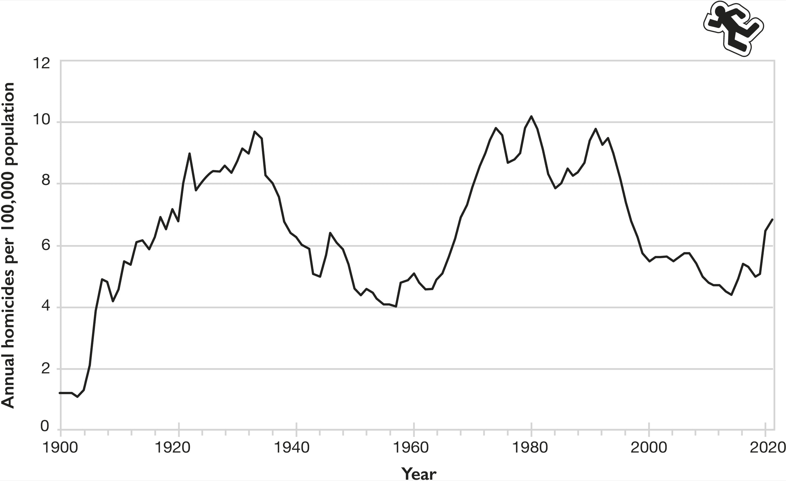

来源：联邦调查局；司法统计局

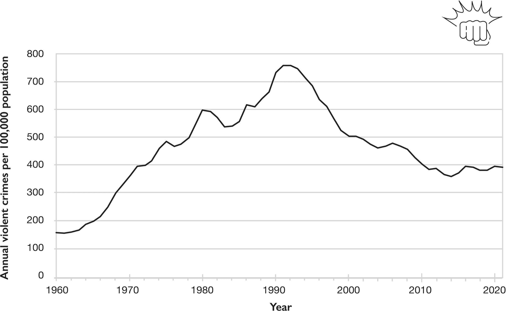

来源：联邦调查局；司法统计局

史蒂文·平克在2011年的著作《我们本性的善良天使》中给出了进一步证据：中世纪以来欧洲凶杀死亡率大约下降了五十倍，部分地区降幅更大。[\[166\]](#18_Notes.xhtml#EndnoteNumber443 "note")比如十四世纪的牛津估计年均每10万人110起凶杀，而今天伦敦不足一例。[\[167\]](#18_Notes.xhtml#EndnoteNumber444 "note")平克估算，自史前时代以来，暴力致死总量下降了约五百倍。[\[168\]](#18_Notes.xhtml#EndnoteNumber445 "note")

暴力正在悄悄下降：反直觉的数据

令人意外的是，二十世纪最致命的两次世界大战，折算成人均伤亡，反而不及人类长时间处于无国家状态时的常态。平克整理过27个缺乏正式国家机器的欠发达社会，涵盖狩猎采集者和园艺采集者，这类群体很可能代表了史前绝大多数社区的样貌。[169] 他估算，这类社会的年均战死率约为每十万人524人。

相对而言，即便二十世纪发生了两次世界大战、系统性种族灭绝与原子弹轰炸，对德国、日本、俄罗斯这三个创伤最深的国家而言，全世纪平均的年致死率分别为每十万人144人、27人、135人。美国纵然深度卷入全球战事，其百年平均年均致死率也不过每十万人3.7人。

公众的体感却相反，普遍觉得暴力在恶化。平克把这种错觉归结为历史短视，人们更容易记住近期、报道密集的事件，而忽略过去更血腥的常态。[170] 这种偏差本质上就是可得性启发在作用。记录手段的差异放大了偏差：当下冲突能以彩色视频即时传播，而十九世纪多为黑白照片，更早则只能靠文字记载与零星绘画，冲击力不可同日而语。

我与他看法一致，暴力快速收敛的核心是一条自我强化的正向循环。社会对摆脱暴力更有信心后，对教育、著书读写的投入上升，解决问题更倾向理性协商而非武力，进而进一步压低暴力。我们正看着同情圈持续外扩，这个说法来自哲学家彼得·辛格，认同边界从狭隘的氏族扩展到民族国家，再到异国人群，直至非人类动物。[171] 制度化的法律与反对暴力的文化规范也在发挥越来越强的约束力。

对未来的关键洞察是，这些正向循环根本由技术驱动。人类过去的认同范围局限于小群体，而书籍、广播、电视、电脑与互联网的依次普及，让思想得以跨地域流动，人们更容易发现共性。远方灾难的震撼画面固然会强化历史短视，却也强烈激活我们与生俱来的共情，把道德关怀延伸到整个物种。

另外，财富积累与贫困缓解会提升合作动机，削弱围绕稀缺资源的零和博弈。很多人根深蒂固地认为资源争夺是暴力不可避免的根源，也是人性的固有部分。虽然这概括了大部分人类历史，我认为这并非永久定论。数字革命已大幅降低大量可数字化表达事物的稀缺性，从网络检索到社交连结都是如此。为一本纸书的实体拷贝争吵还能被理解，两个孩子为同一本印刷漫画争抢也说得通，毕竟同一时间只能一人阅读。但为一份PDF文档争吵就显得荒谬：你的访问并不妨碍我的访问，复制品可以按需无限生成，几乎零成本。

一旦人类获得极其廉价的能源——先是太阳能，最终是聚变——并拥有人工智能机器人，许多商品的复制成本将趋近于零，为此动用暴力的念头会像今天为PDF争吵一样可笑。由此，从现在到2040年代，信息技术以数百万倍的提升，将推动社会其他层面产生变革性的改善。

## 可再生能源的增长

技术文明的几乎每个环节都需要能源，而长期依赖化石燃料已不可持续。一方面它排放有毒污染与温室气体，另一方面我们被困在开采成本不断攀升的稀缺资源中，而人类对廉价能源的需求却在激增。好在随着我们把更复杂的工程手段应用于底层材料与机制的设计，环境友好的可再生能源成本正呈指数下行。例如过去十年里，超级计算机被用来寻找太阳能电池与储能的新材料，近年来深度神经网络也被投入其中。[172] 得益于持续的成本下降，来自太阳能、风能、地热、潮汐与生物燃料等可再生能源的总量也在指数增长。[173] 2021年太阳能约占电力供应的3.6%，自1983年以来平均每28个月翻一番。[174] 更多内容将在本章后面介绍。

![主要来源：我们的世界数据；Gregory F. Nemet，“公共支持能源技术成本动态中期监测”能源政策 37，第 3 期（2009 年 3 月）；IRENA ¶ 正如这个对数图所示，光伏组件的每瓦成本已经呈指数级下降了近五十年，这种趋势有时被称为斯旺森定律。请注意，虽然组件成本是太阳能发电装置总成本中最大的单一组成部分，但其他因素，如许可证和安装人工，可以将总成本提高到大约三倍的组件成本。\[176\]虽然组件成本下降得非常快，但其他因素下降得较慢。人工智能和机器人可以降低劳动力和设计的成本，但我们也需要鼓励高效公用事业规划和许可的政策。](images/ART36_photovoltaic-module-cost-per-watt.jpg)

主要来源：我们的世界数据；Gregory F. Nemet，“公共支持能源技术成本动态中期监测”*能源政策*37，第 3 期（2009 年 3 月）；IRENA ¶ 正如这个对数图所示，光伏组件的每瓦成本已经呈指数级下降了近五十年，这种趋势有时被称为斯旺森定律。请注意，虽然组件成本是太阳能发电装置总成本中最大的单一组成部分，但其他因素，如许可证和安装人工，可以将总成本提高到大约三倍的组件成本。[\[176\]](#18_Notes.xhtml#EndnoteNumber453 "note")虽然组件成本下降得非常快，但其他因素下降得较慢。人工智能和机器人可以降低劳动力和设计的成本，但我们也需要鼓励高效公用事业规划和许可的政策。

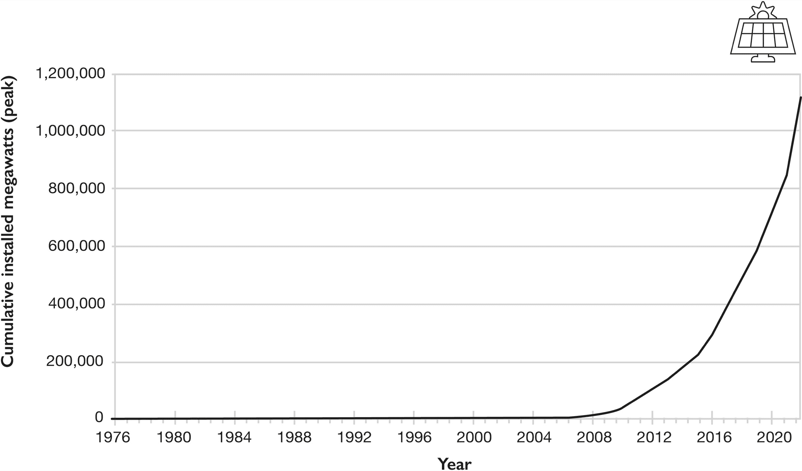

主要来源：Our World in Data；IRENA；Gregory F. Nemet，“公共支持能源技术成本动态的临时监测”，*能源政策*37，第 3 期（2009 年 3 月）

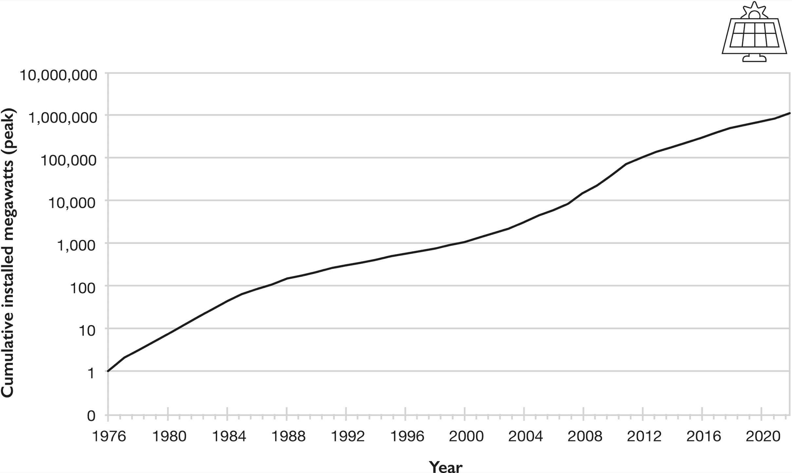

主要来源：Our World in Data；IRENA；Gregory F. Nemet，“公共支持能源技术成本动态的临时监测”，*能源政策*37，第 3 期（2009 年 3 月）

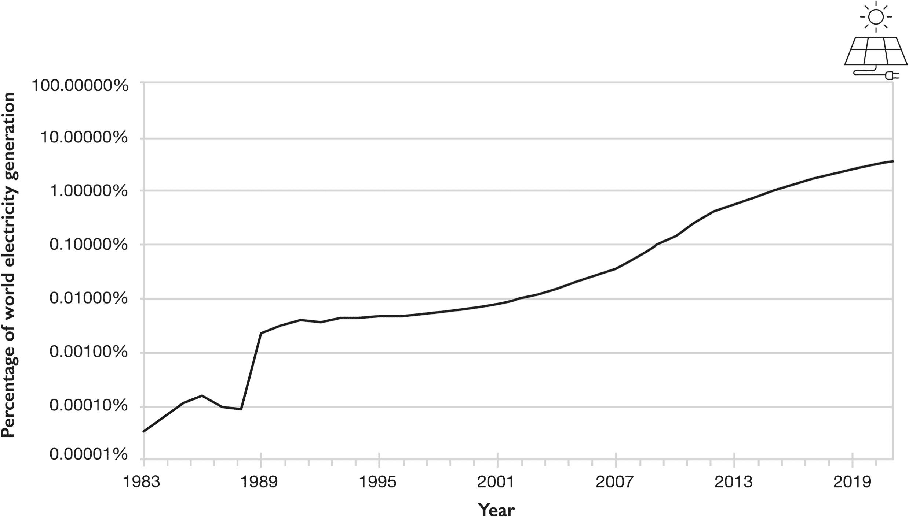

来源：Our World in Data；BP；IEA

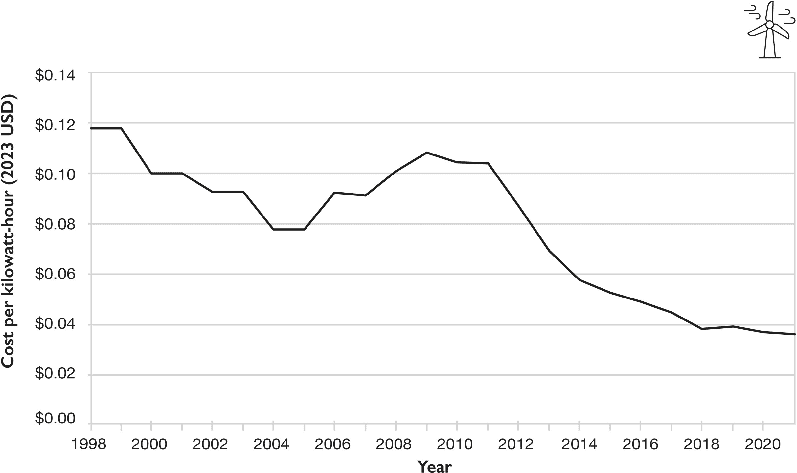

来源：美国能源部

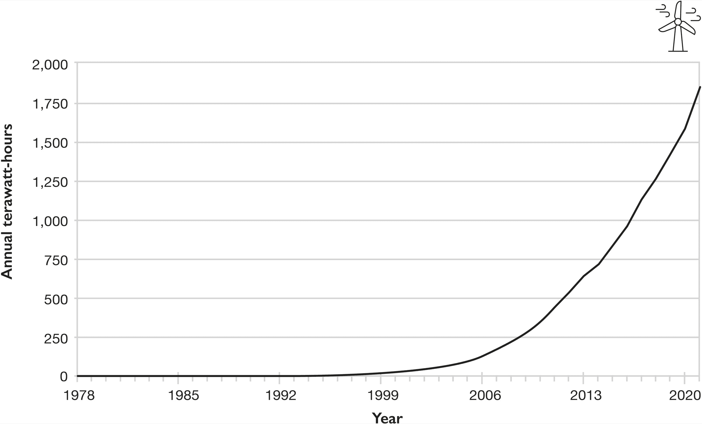

来源：Our World in Data；BP；Ember

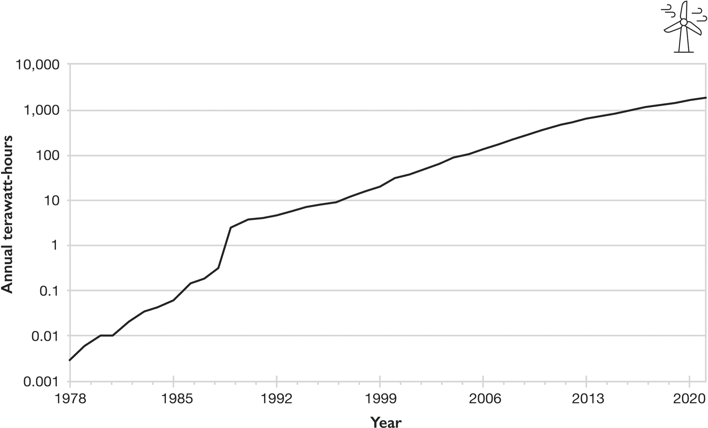

来源：Our World in Data；BP；Ember

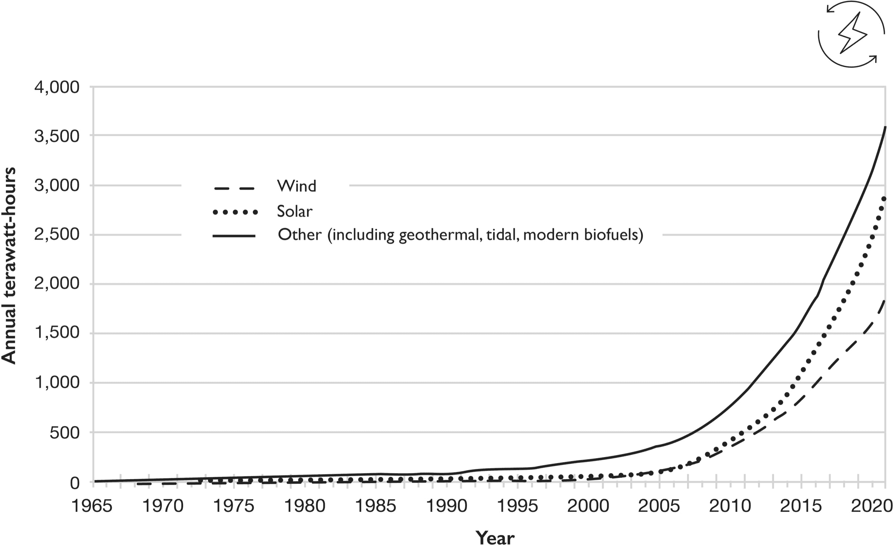

来源：Our World in Data；BP

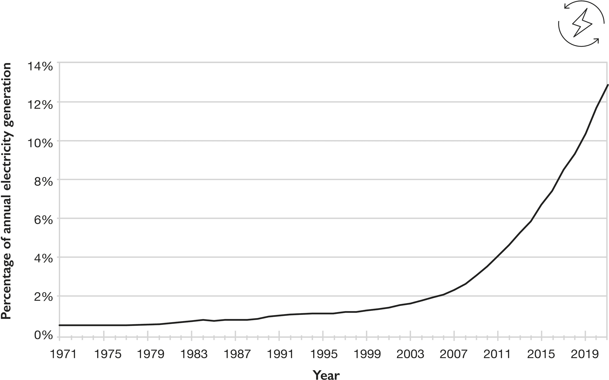

来源：Our World in Data；BP；IEA

## 民主的传播

廉价的可再生能源将释放巨大的物质财富，但公平分享的前提是民主。这里又出现一个有利的协同：信息技术有着悠久的推动社会民主化的历史。民主从中世纪英国的根系中扩展，与大众传播技术的兴起并行，很可能主要源于后者。《大宪章》于1215年撰写并由约翰王签署，明确载明了普通民众不受不公正羁押的权利。[184] 然而在中世纪的大部分时间里，庶民权利常被忽视，政治参与度很低。情形在古腾堡约于1440年发明活字印刷术后改变，随着技术快速普及，受教育阶层能更有效地传播新闻与思想。[185]

印刷机是信息技术加速回报规律的一个典型案例。正如前面所说，信息技术指对信息的收集、存储、处理与传输。人类的思想就是信息。从理论上讲，信息是抽象的秩序与熵的对立。为了在现实世界中呈现信息，我们以特定方式让物理对象有序，例如在纸上书写。关键在于，思想是组织信息的抽象方式，可以用多种媒介承载——石碑、羊皮纸、穿孔卡片、磁带或硅微芯片内部的电压。用凿子与耐心，你完全可以把 Windows 11 的每一行源代码刻在石碑上！这个画面很有趣味，它也说明了物理媒介对信息效率有多重要。有些设想只有在我们能够非常高效地收集、存储、操作与传输信息时才变得可行。

中世纪大部分时期，欧洲的书籍只能由抄写员手工抄写，效率极低。因此传播书面信息思想的成本极其昂贵。广义来说，一个人或社会掌握的思想越多，创造新思想就越容易，这包括技术创新。所以能让思想更容易分享的技术，也让创造新技术变得更容易，而其中一些技术又会让思想分享更便捷。于是古腾堡引入印刷机后，思想的分享成本迅速变得极低。中产阶级首次能够大量购书，人类潜能被大幅释放。创新蓬勃，文艺复兴迅速席卷欧洲。印刷本身也带来进一步创新，到十七世纪初，书籍价格比古腾堡时代便宜了数千倍。

知识的扩散带来了财富与政治权力，像英国下议院这样的立法机构变得更加敢言。尽管大部分权力仍在国王手中，议会能就赋税提出抗议并弹劾不受欢迎的部长。[186] 1642年至1651年的英国内战废除了君主制，随后君主制以服从议会的形式恢复；后来通过权利法案，明确确立国王只能在人民同意下统治的原则。[187]

在美国独立战争前，英国虽远非真正的民主国家，却是世界历史上最民主的国家——而且值得注意的是，也是识字率最高的国家之一。[188] 从公元前一世纪罗马共和国崩溃到美国革命之间，还有许多社会拥有选举或大致共和的政治制度，但参与度始终有限，最终都倒向暴政。中世纪意大利以热那亚、威尼斯等贸易富庶的城邦为中心的若干共和国，实际上是强烈的贵族统治。例如威尼斯的领导人总督通过复杂选举终身任职，这一过程使贵族家族掌权，普通民众无权参与。[189] 从1569年到1795年，波兰-立陶宛联邦的贵族——通常占人口十分之一或更少——拥有相当自由和民主的制度，但非贵族在政治上几乎没有发言权。*贵族*贵族通常占人口十分之一或更少，但在政治上非贵族几乎没有发言权。[190]

相比之下，在英国，至少所有自由成年男性户主在理论上都有投票资格。虽然实践中常有额外的财产要求，投票权并不取决于出生地位。尽管这仍排除了许多人，但它是一项关键的政治创新，为普遍政治参与奠定了基础。一旦人们接受出生地位不应决定投票权，这一想法的力量便不可遏制。因此第一个真正的现代民主国家出现在美国殖民地并非巧合，即便这需要一场反对英国的战争才能实现。然而兑现其承诺是一个艰难的过程。

两个世纪前，在美国，大多数人仍未充分享有政治参与权。十九世纪初，投票权主要限于拥有适度财产或财富的成年白人男性。这些经济门槛让大多数白人男性得以投票，却几乎完全排除了妇女、非裔美国人——其中数百万人被当作奴隶——以及美洲原住民。[191] 历史学家对有多少比例人口有资格投票存在分歧，通常认为在10%到25%之间。[192] 这种不公也孕育了自我瓦解的种子——投票为美国提供了一种改革机制，而投票限制与建国文件中的崇高理想形成鲜明对比。

尽管其倡导者抱有高期望，民主在十九世纪的进展缓慢。例如1848年欧洲的自由主义革命大多以失败告终，俄国沙皇亚历山大二世的许多改革也被继任者推翻。[193] 1900年，只有3%的世界人口生活在我们今天所认为的民主国家中，因为即便美国仍剥夺妇女投票权，并对非裔美国人实行种族隔离。到1922年，第一次世界大战后，这一比例升至19%。[194] 然而法西斯主义的抬头很快使民主倒退，数亿人在第二次世界大战期间遭受极权统治。值得注意的是，无线电大众传播最初帮助法西斯分子夺权，但最终同样的技术让盟国得以团结民主国家取得胜利——最显著的是温斯顿·丘吉尔在闪电战期间发表的鼓舞人心演讲。

战后几年，生活在民主制度下的人口比例迅速上升，这主要归功于印度与英国在南亚其他殖民地赢得独立。在冷战的大部分时间里，民主范围大致保持稳定，世界略超三分之一的人口生活在民主社会。[195] 然而从披头士唱片到彩色电视机，铁幕之外通信技术的普及激起了人们对压制它的政府的不满。随着苏联解体，民主再次迅速扩张，到1999年几乎达到世界人口的54%。[196]

尽管过去二十年数字有所波动，某些国家进步被其他地方倒退抵消，但一种充满希望的不同类型的自由化正在迅速发展。冷战结束时，约35%世界人口生活在封闭的专制政权下——这是最具压迫性的政权类型。[197] 到2022年，这一比例降至约26%，使超过7.5亿人摆脱暴政。[198] 这包括在很大程度上由社交媒体促成和推动的阿拉伯之春等重大而复杂的事件。未来几十年面临的关键挑战是将介于专制与民主之间的灰色地带国家引导至完全民主治理。其中一部分取决于谨慎使用人工智能以促进开放与透明，同时最大限度减少其被滥用于专制监视或传播虚假信息的风险。[199]

历史给了我们深刻的乐观理由。随着信息共享技术从电报发展到社交媒体，民主与个人权利的理念已从几乎不被承认发展为全球性愿望，并已成为地球上近半数人的现实。想象一下，未来二十年的指数级进步将如何让我们更充分地实现这些理想。

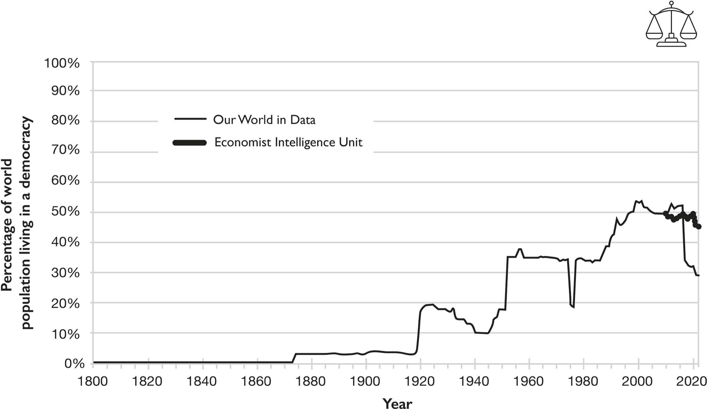

主要来源：Our World in Data; Economist Intelligence Unit（经济学人智库）

## 我们现在正进入指数增长的陡峭部分

需要认识到的关键点是，到目前为止所描述的所有进步，都来自这些指数趋势的缓慢早期阶段。由于信息技术在未来二十年内实现的进步将远超过去两百年，整体繁荣的好处会更大——事实上，它们已经比大多数人意识到的要大得多。

## 计算的性价比呈指数级提高

# 算力正在通货膨胀，每美元能跑的运算越来越多

最底层、最坚定的变化，是计算的单位成本在做指数级的跳水。换算成2023年不变价，算一算一美元能买到的运算次数，你会看到一条惊人的上升曲线。1939年康拉德·楚泽造出可编程机Z2时，一美元大约只能换0.0000065次运算。1965年PDP-8已能做到约1.8次。1990年我写《智能机器时代》时，486DX能到约1,700次。九年后奔腾III冲到约80万次。2005年《奇点临近》首版时，奔腾4的机器单美元约1200万次。到2024年初印刷时，谷歌云TPU v5e的单价性能已逼近每美元每秒1,300亿次运算。更夸张的是，这种云算力以每小时数千美元的租用价开放给任何有网的人，一台五千万亿次每秒的大型Pod背后，零售用户的实际性价比还要高出好几个量级。廉价算力直接喂养创新，这个大趋势一直稳健向上，而且并不绑定在晶体管缩小或主频提升这一种技术路线上。

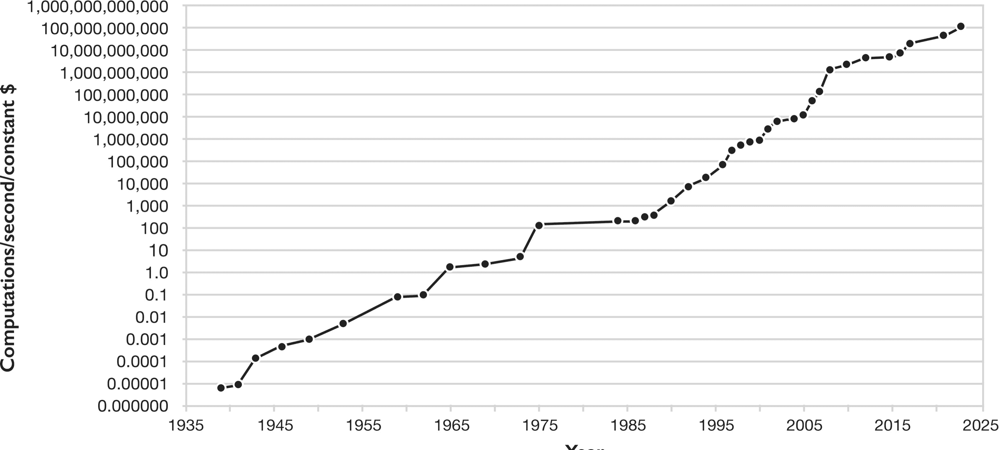

## 算力单价的百年崩塌

| 年份 | 名称 | 每恒定 2023 美元的每秒计算次数 |
| --- | --- | --- |
| 1939 | Z2 | ~ 0.0000065 |
| 1941 | Z3 | ~ 0.0000091 |
| 1943 | 巨像 Mark 1 | ~ 0.00015 |
| 1946 | ENIAC（埃尼阿克） | ~ 0.00043 |
| 1949 | BINAC（二进制自动计算机） | ~ 0.00099 |
| 1953 | UNIVAC 1103 | ~ 0.0048 |
| 1959 | DEC PDP-1 | ~ 0.081 |
| 1962 | DEC PDP-4 | ~ 0.097 |
| 1965 | DEC PDP-8 | ~ 1.8 |
| 1969 | 数据通用 Nova | 约 2.5 |
| 1973 | Intellec 8 | 约 4.9 |
| 1975 | Altair 8800 | 约 144 |
| 1984 | 苹果麦金托什 | ~ 221 |
| 1986 | 康柏 Deskpro 386 (16 MHz) | ~ 224 |
| 1987 | PC’s Limited 386 (16 MHz) | ~ 330 |
| 1988 | 康柏 Deskpro 386/25 | ~ 420 |
| 1990 | MT 486DX | 约 1,700 |
| 1992 | Gateway 486DX2/66 | 约 8,400 |
| 1994 | 奔腾 (75 MHz) | 约 19,000 |
| 1996 | 奔腾 Pro（166 MHz） | 约 75,000 |
| 1997 | 移动奔腾 MMX (133 MHz) | 约 340,000 |
| 1998 | 奔腾 II (450 MHz) | 约 580,000 |
| 1999 | 奔腾 III (450 MHz) | 约 800,000 |
| 2000 | 奔腾 III (1.0 GHz) | ~ 920,000 |
| 2001 | 奔腾 4 (1700 MHz) | ~ 3,100,000 |
| 2002 | 至强 (2.4 GHz) | ~ 6,300,000 |
| 2004 | 奔腾 4 (3.0 GHz) | 约 9,100,000 |
| 2005 | 奔腾 4 662 (3.6 GHz) | 约 12,000,000 |
| 2006 | 酷睿 2 Duo E6300 | 约 54,000,000 |
| 2007 | 奔腾双核 E2180 | 约 130,000,000 |
| 2008 | GTX 285 | 约 1,400,000,000 |
| 2010 | GTX 580 | 约 2,300,000,000 |
| 2012 | GTX 680 | 约 5,000,000,000 |
| 2015 | Titan X (麦克斯韦 2.0) | 约 5,300,000,000 |
| 2016 | Titan X (帕斯卡) | 约 7,300,000,000 |
| 2017 | AMD Radeon RX 580 | 约 22,000,000,000 |
| 2021 | 谷歌云 TPU v4-4096 | 约 48,000,000,000 |
| 2023 | 谷歌云 TPU v5e | ~ 130,000,000,000 |

这种飞跃并没有在经济叙事里得到应有的位置。2016年10月，国际货币基金组织年会现场，克里斯蒂娜·拉加德问我，为什么数字技术已如此强势，经济增长的证据却不明显。我当时的拆解是：增长被分子分母一起稀释了。

一个非洲青少年花50美元买部智能手机，GDP只记50美元的消费。但这笔支出换来的计算与通信能力，相当于1965年约10亿美元的水平，相当于1985年数百万美元的水平。50美元机型里常见的骁龙810芯片，基准测试平均约30亿次浮点运算每秒，也就是每美元约6000万次计算。1965年顶尖机器每美元约1.8次，1985年约220次。按老效率，要达到骁龙的算力，1965年得花近17亿美元2023年币值，1980年代也要1360万美元。

粗糙对比忽略了功能演进，但方向很清楚：50美元手机集合的能力，在60年前用任何价格都造不出来。传统统计几乎完全漏掉了信息技术约每年50%的通货紧缩，计算、基因测序等领域都在经历这种价格坍塌。性价比提升的一部分体现为降价，一部分体现为性能，消费者最终得到更便宜也更好的产品。

我自己的经历能佐证。1965年入读麻省理工，校园里算是有了计算机。最出名是IBM 7094，15万字节磁芯存储，约四分之一MIPS，售价310万美元1963年币值，约合2023年3000万美元，由数千师生共享。对比本书写作时发布的iPhone 14 Pro，定价999美元，在AI相关负载下可达约17万亿次运算每秒。不是严谨的同类比较，手机成本含7094没有的摄像头等功能，且速度在部分场景会下调。但大体上看，iPhone比7094快约6800万倍，价格却不到其三万分之一。单看单位价格的算力，提升约两万亿倍。

这个速度并不依赖摩尔定律。麻省理工1963年买的IBM 7094是晶体管机，比戈登·摩尔1965年提出摩尔定律早两年。摩尔定律只是众多指数范式之一，机电继电器、真空管、晶体管、集成电路都已走过，后面还会继续。

算力之外，信息本身也在贬值。我青少年时靠送报纸攒了多年钱买一套《大英百科全书》，花了数千美元计入GDP。今天的智能手机用户可免费访问维基百科，体量约是《大英百科全书》的百倍，更新快到突发新闻后几分钟，常带多媒体与超链接，还能一键跳到《大英百科全书》做学术校验。这种免费信息生态上万种，GDP贡献为零。

拉加德回击：你不能吃信息，不能穿它，不能住在里面。我说十年内会变。硬件软件的效率在改善，但更关键的是食物、衣物等实物商品本身正在被信息技术化，自动化与AI主导生产，资源与制造成本随之下降，这类商品会迎来与信息技术同等级别的通缩。

2020年代后半期，3D打印服装等日用品将走向常态，最终每磅只要几美分。打印的趋势是微型化，从喷墨式挤压走向更精细的工艺，2030年代可能进入纳米制造。埃里克·德雷克斯勒在《彻底的富足》中估算，原子精度制造借助更省料的纳米材料，可把大多数物体压到约每公斤20美分。数字仍是推测，但降幅必然巨大。音乐、图书、电影已出现免费与付费并存，开放源设计与专有设计的共存，将越来越多地决定产业形态。

很快我们会用AI控制生产与无化学采收的垂直农场造出高品质低价食物。细胞培养肉将取代破坏环境的工厂化养殖。2020年人类屠宰了超过740亿只陆地动物，肉类总量约3.71亿吨，约占年度温室气体排放11%以上。实验室培育肉能消除痛苦、可设计为更健康美味，并大幅降低污染。目前技术已能复制碎牛肉的质地，整块菲力仍在路上。当真实感足够时，公众抵触会迅速下降。

我们也能廉价量产房屋模块，让体面居住对数百万人可负担。以上技术都已演示，并在本十年加速主流化。与此同时，VR与AR将合成元宇宙。Facebook 2021年更名Meta并押注元宇宙，让公众认知大涨。2020年代后期，VR与AR会叠加成现实的新一层。虚拟会议、沉浸式音乐会、全家感官海滩假期，都可免去物理形态。媒体目前多只调动视听，气味触觉仍笨拙。未来数十年脑机接口会更成熟，把模拟感官数据直接送入大脑。这会颠覆我们如何度过时间，也会逼问：当珠峰攀登可以安全虚拟体验，真实冒险的价值何在。

拉加德最后的质疑是土地不会数字化，我们人满为患。我回答拥挤是选择。城市是为了协作诞生，但全球仅约1%土地被人类居住。适宜居住用地中约一半用于农业，其中77%养畜与饲料，仅23%种人类直接食用的作物。人造肉与垂直农业能用远小于现在的一小块土地满足需求，释放大片空间。自动驾驶会拉长可接受通勤，人们能在想住的地方生活，同时在虚拟增强空间里协作娱乐。

这个转变已在进行，疫情把它加速。疫情高峰期美国有高达42%的人在家工作。朝九晚五的办公室模式多年前就已过时，惯性让改变迟滞，疫情强行推动。LOAR让信息技术进入指数曲线的陡段，AI未来数十年成熟，影响只会放大。

## 清洁能源要取代化石燃料

2020年代指数进步里最关键的一环是能源。光伏在不少场景已比化石燃料便宜，成本仍在快速下滑，需要材料科学继续突破。AI辅助的纳米技术突破能让电池吸收更宽的电磁频谱。纳米管、纳米线提升光子吸收、电子传输与电流生成，量子点则让每个光子产生更多电。

黑硅表面布满比光波更小的原子级针，几乎消除反射。普林斯顿的方案用仅300亿分之一米厚的金原子纳米网格捕获光子。麻省理工的项目用单原子厚度的石墨烯薄片做光伏。这些技术让未来电池更薄更轻，可贴在更多表面。SolarWindow等公司已在研发可涂在玻璃上的薄膜光伏，不挡视线就能发电。

几年内，纳米工艺还将让太阳能电池3D打印化，实现分布式制造，按需就地生产。不同于今天的大块硬板，纳米制造的电池可以是卷材、薄膜、涂层，降低安装成本，让更多社区获得廉价丰富太阳能。

## 绿电爆发，储能成关键卡位

2000 年，不算水电的可再生能源——太阳能、风能、地热、潮汐能和生物质能——在全球发电盘子里只占 1.4%。[\[224\]](#18_Notes.xhtml#EndnoteNumber501 "note")二十一年后，这个份额涨到 12.85%，平均大约每 6.5 年翻一倍。[\[225\]](#18_Notes.xhtml#EndnoteNumber502 "note")如果看绝对量，增速更猛，因为总发电量本身在膨大：从 2000 年的约 218 太瓦时当量，到 2021 年的 3657 太瓦时当量，翻倍时间缩到约 5.2 年。[\[226\]](#18_Notes.xhtml#EndnoteNumber503 "note")

人工智能被用于材料筛选和器件设计后，成本仍在持续下探，整个进程呈现指数特征。按此节奏推算，理论上到 2041 年可再生能源就能覆盖全球电力需求。但把可再生能源打包一起看意义不大，因为不同技术降本的速度并不一致。

在成本下降上，太阳能的速度远超其他主流可再生能源，向上空间也最大。风能是最接近的对手，不过近五年来太阳能的跌幅约是风能的两倍。[\[227\]](#18_Notes.xhtml#EndnoteNumber504 "note")太阳能的理论下限更低，材料科学每一次突破都能直接转化为更便宜、效率更高的组件，而现今的板子只捕到入射能量的大约 20%，理论极限约 86%。[\[228\]](#18_Notes.xhtml#EndnoteNumber505 "note")再怎么优化也达不到极限，但改善余地巨大。风机则不同，典型机组效率已在 50% 左右，逼近 59% 的理论上限，后续提升空间很小。[\[229\]](#18_Notes.xhtml#EndnoteNumber506 "note")

2021 年太阳能提供的电力约占全球 3.6%。[\[230\]](#18_Notes.xhtml#EndnoteNumber507 "note")地球接收的太阳能高达约 173,000 太瓦，[\[231\]](#18_Notes.xhtml#EndnoteNumber508 "note")只要利用到万分之一的阳光，就足以满足当前水平下的全部能源需求。虽然可预见期内绝大部分能量无法捕获，但即使以现有技术，美国政府科学家在 2006 年也估计当时最佳技术可提供的总能量达 7,500 太瓦，[\[232\]](#18_Notes.xhtml#EndnoteNumber509 "note")相当于每年 65,700,00 太瓦时。对比来看，2021 年全球一次能源消费总量约等于 165,320 太瓦时，已涵盖电力、供暖与一切燃料。[\[233\]](#18_Notes.xhtml#EndnoteNumber510 "note")

按全球占比计算，太阳能的翻倍速度也遥遥领先：1983 到 2021 年平均不到 28 个月，即使按绝对装机量，这一时期也增长约 220%。[\[234\]](#18_Notes.xhtml#EndnoteNumber511 "note")从 2021 年的 3.6% 出发，大约 4.8 次翻倍就能触及 100%，按此推算 2032 年太阳能单项即可满足全部能源需求。现实中经济与政治障碍会阻碍完全普及，但轨迹已相当具有变革性。

沙漠这类人迹稀少的大区，恰好也是光伏最理想的场址。诸如小范围覆盖撒哈拉的设想，便能通过地中海海底电缆为整个欧洲和非洲供电。[\[235\]](#18_Notes.xhtml#EndnoteNumber512 "note")

规模化太阳能的最大掣肘是储能。化石燃料的优势在于可以先存后烧，而太阳只在白天发光，光照还随季节波动，必须有手段把多余电能保存下来，供几小时后或几个月后调用。

好在储能的性价比和规模也在加速提升。要注意这并非像加速回报定律那样的纯反馈驱动的长期指数，而是受可再生能源快速渗透的拉动——尤其是光伏，间接受益于信息技术对材料科学进展的放大。随着再投资流入，成本下降又把资金和研发注意力推向储能，因为要和化石燃料在主力发电份额上竞争，没有储能很难实现。材料科学、机器人制造、高效运输与电网传输的协同进步，也会让增长保持指数态势，太阳能或在 2030 年代占据主导。

在路上有很多备选方案，目前尚难判断哪一种能在超大尺度上胜出。电难以直接储存，需要先转成其他形式再释放。例如转成熔盐的热能、抽水蓄能的重力势能、飞轮的旋转动能，或制氢的化学能再燃烧。[\[236\]](#18_Notes.xhtml#EndnoteNumber513 "note")

公用事业级储能中，锂离子与其他化学体系的先进电池成本效益正迅速改善。2012 至 2020 年间，锂离子储能成本每兆瓦时下跌约 80%，仍在继续下降。[\[237\]](#18_Notes.xhtml#EndnoteNumber514 "note")随着价格持续走低，可再生能源完全可能取代化石燃料成为电网的基石。[\[238\]](#18_Notes.xhtml#EndnoteNumber515 "note")

来源：拉扎德 ¶ 由于储能技术被用于电力生产和消费过程的许多不同阶段，以及许多不同的经济环境中，因此很难比较不同项目之间的储能成本。迄今为止，可能最严格的分析来自金融咨询公司拉扎德，该公司使用了储能平准化成本（LCOS）指标。该指标旨在涵盖所有成本（包括资本成本），并除以项目生命周期内预计释放的总存储能量（以兆瓦时或等效单位计）。为了最好地反映技术进步的前沿，此图表显示了每年在美国新开设的公用事业规模储能项目中可获得的最佳 LCOS。请记住，给定年份的平均 LCOS 数字较高，但遵循相似的趋势——因此，一年的最佳 LCOS 可能是几年后的平均 LCOS。
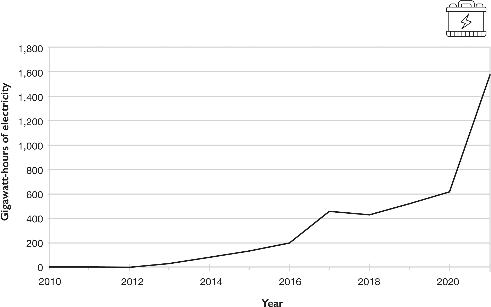
来源：美国能源信息署

## 清洁饮水时代临近
确保不断增长的人口稳定获得安全饮用水，是 21 世纪的核心难题。1990 年约 24% 的人口无法定期获得相对安全的饮水来源，[\[241\]](#18_Notes.xhtml#EndnoteNumber518 "note")到现在这一比例已降到约十分之一。[\[242\]](#18_Notes.xhtml#EndnoteNumber519 "note")但问题依然沉重，健康指标与评估研究所的数据显示，2019 年全球约有 150 万人死于腹泻，其中 50 万为幼儿，主因是饮用了被粪便细菌污染的水。[\[243\]](#18_Notes.xhtml#EndnoteNumber520 "note")霍乱、痢疾和伤寒对儿童尤其致命。

根源在于许多地区缺乏取水、净水并把水送到家庭的系统。打井、建泵站、铺渡槽和管道耗资巨大，多数发展中国家难以负担，内战等政治冲突更是让大型基建不可行。因此，类似发达国家那种集中式净水配送网络，对最后那十分之一的人群并不现实。更可行的方向是让社区乃至个人就地净水。

在能源生产、食品生产和日常用品制造等诸多领域，去中心化技术正定义 2020 年代之后的水务解决方案。净水可以从像 Janicki Omni Processor 那种为整村供水的建筑级设备，到 LifeStraw 这种个人便携式滤芯都有可能。[\[244\]](#18_Notes.xhtml#EndnoteNumber521 "note")

部分装置靠热能把水煮沸，太阳能或燃料供热均可。煮沸能杀死病原体，却去不掉有毒化学物，且水在冷却后极易二次污染。加抗菌化学剂可降低再污染风险，仍无法去除毒素。近几年出现用电产生臭氧的便携设备，臭氧通入水中杀菌效果很好；也有强紫外线照射的方案，能灭活细菌病毒，但同样无法解决化学污染。[\[245\]](#18_Notes.xhtml#EndnoteNumber522 "note")

过滤是另一条路。传统滤芯可去除大部分有机物和毒素，但致命病毒颗粒极小，常能穿过孔隙。[\[246\]](#18_Notes.xhtml#EndnoteNumber523 "note")部分化学污染物分子也难以被挡住。[\[247\]](#18_Notes.xhtml#EndnoteNumber524 "note")材料科学的新突破正催生更精细的滤膜，未来几年纳米工程材料有望让过滤更快、更便宜。

最具前景的装置之一是 Dean Kamen 发明的 Slingshot 水机。[\[248\]](#18_Notes.xhtml#EndnoteNumber525 "note")机器体型约相当于小型冰箱，能从污水、受污染沼泽水等任何水源中产出符合注射级标准的纯净水，耗电不到一千瓦。它采用蒸汽压缩蒸馏，把污染物留在原位，无需滤芯。动力可由极具适应性的斯特林发动机提供，该发动机能利用燃烧牛粪等各种热源发电。[\[249\]](#18_Notes.xhtml#EndnoteNumber526 "note")

## 垂直农业让食物更便宜、土地归还自然
考古学界普遍认为农业诞生于约 12000 年前，部分证据指向 23000 年前。[\[250\]](#18_Notes.xhtml#EndnoteNumber527 "note")无论起点如何，早期从单位土地获得的粮食极少，几乎全民都需从事农业以求生存。

约公元前 6000 年，灌溉让作物不再只靠降雨。育种扩大了可食用部位并提升营养，施肥补充土壤养分，更科学的耕作提升效率。粮食增多后，人们得以投入贸易、科学、哲学等领域，专业化又反过来催生农业创新，形成正反馈，文明由此展开。

一个衡量指标是作物密度。以美国玉米为例，土地产出效率在一个半世纪里提升七倍多：1866 年平均每英亩 24.3 蒲式耳，2021 年升至 176.7 蒲式耳。[\[252\]](#18_Notes.xhtml#EndnoteNumber529 "note")全球范围内，单位粮食所需的土地大致呈指数下降，如今平均只用 1961 年不到 30% 的面积即可生产等量作物。[\[253\]](#18_Notes.xhtml#EndnoteNumber530 "note")这支撑了同期人口增长，避免了此前担忧的饥荒。

机械化和高密度种植让一人可养活约七十人。美国农业劳动占比从 1810 年的 80% 下降到 1900 年的 40%，再到如今不足 1.4%。[\[254\]](#18_Notes.xhtml#EndnoteNumber531 "note")

室外种植的密度已接近理论极限，垂直农业成为新解。[\[255\]](#18_Notes.xhtml#EndnoteNumber532 "note")这类农场常用水培，在室内营养液中培育植物，多层框架让多余养分滴落至下层循环。气培用水雾代替液面培养，并以专用 LED 提供精准光照。[\[256\]](#18_Notes.xhtml#EndnoteNumber533 "note")[\[257\]](#18_Notes.xhtml#EndnoteNumber534 "note")行业先锋 Gotham Greens 在加州到罗德岛设有十座大型设施，到 2023 年初已融资 4.4 亿美元风险投资。其技术宣称在用水上节省 95%、用地节省 97% 来获得同等产量。[\[258\]](#18_Notes.xhtml#EndnoteNumber535 "note")[\[259\]](#18_Notes.xhtml#EndnoteNumber536 "note")这将释放目前约占世界可居住土地一半的农业用地，并提供更丰富、更廉价的食物。[\[260\]](#18_Notes.xhtml#EndnoteNumber537 "note")

垂直农业还有多重好处：阻断农业径流，减少水体污染；免去翻耕，遏制土壤扬尘；害虫难以入侵，无需有毒农药；可全年生产，甚至种植本地气候无法支撑的品种，减少霜冻和极端天气损失。最关键的是实现就地生产，城市乡村不再依赖数百上千公里外的长途运输，污染与排放随之下降。

未来几年，光伏、材料科学、机器人和人工智能的融合会让垂直农业比传统农业更便宜。设施或由高效太阳能供电，在内循环生产肥料，从空气中回收水分，用自动化机器采收。工人需求和占地都极小，届时作物成本可能低到接近免费。

这一轨迹与信息技术因加速回报定律而免费化类似。计算能力指数级降价后，谷歌、脸书等平台能向用户免费提供服务，靠广告等模式自负盈亏。垂直农业把食物生产变成信息密集型流程，自动化和 AI 控制全环节，成本结构将彻底重塑。

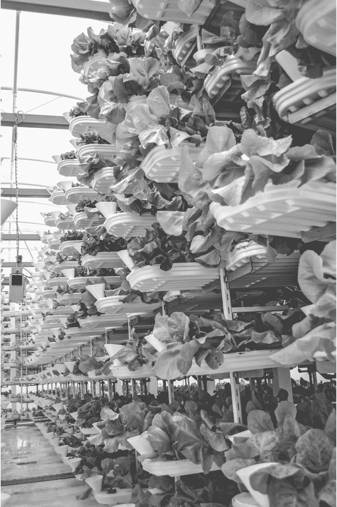
垂直农场中堆叠层中生长的生菜。图片来源：Valcenteu，2010 年。

## 3D打印重塑制造与配送
20 世纪大部分时间里，造一个三维实物主要靠两类办法：一是在模具里成型，如注塑或热压金属；二是减材制造，从料块或板材上切削、雕刻下来，像雕塑家凿大理石。模具昂贵且固化后难改，减材则浪费材料且受限于可加工形状。

20 世纪 80 年代出现第三条路：增材制造，也称三维打印。[\[261\]](#18_Notes.xhtml#EndnoteNumber538 "note")它不依赖模具和切削，而是逐层堆叠或沉积薄片，把零件一层层构建起来。

最常见的 3D 打印机其实很像一台高级喷墨机。常规喷墨在纸面横向移动，按指令把墨盒喷嘴里的墨水点上去；3D 打印机则把塑料等原料加热软化，用喷头把熔融材料按软件设定的每一层轨迹堆叠上去，反复累积，物件就逐渐从二维走向三维。每层冷却后会彼此粘合，最终得到可直接使用的成品。过去二十年里，分辨率不断提升、制造成本持续下降、打印速度也不断加快[263]。如今的系统能处理的基材已经远超塑料，纸张、陶瓷、金属都能进入同一套流程。技术越成熟，能驾驭的奇葩材料越多，比如自带药物分子的医疗植入物，可在体内缓慢释放；像石墨烯这样的纳米材料则可用来造超轻防弹服或超高速电子器件。人工智能的加入让优化变得更智能，软件能自动改进零件的强度、气动外形等参数，甚至生成当下工艺难以实现的结构。

更直观的操作界面让没有专业背景的人也能上手。普及带来的最大冲击之一是制造方式的转变。工程师可以在电脑上完成设计，几分钟到几小时内就拿到实体样件，而不是像过去那样等待数周。这种廉价快速的原型迭代，让资金有限却有好点子的创作者也能把想法推向市场。

与依赖模具的传统工艺相比，3D 打印在个性化上优势明显。微小的改动在注塑等工艺里往往意味着重新开模，花费可能高达数万美元，而 3D 打印修改设计几乎不产生额外成本。于是发明者能拿到极其精准的零件，消费者也能买到为自己量身打造的产品。鞋业里 FitMyFoot 就是典型，它让用户用手机 App 拍下双脚，照片自动转为打印所需的数据[264]。同理，家具可以按个人体型塑形，工具也能做到完全贴合使用者的手型[265]。更关键的是，重要的医疗植入物因此变得更便宜、更有效[266]。

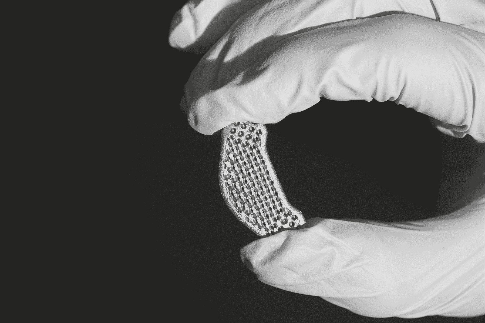

一个 3D 打印的钛金属脊椎间盘，可以植入到患有脊椎损伤或疾病的患者体内。图片来源：FDA 照片，由 Michael J. Ermarth 拍摄，2015 年。

制造也因此走向去中心化。20 世纪的模式把生产集中在大城市的巨型工厂，小城镇和发展中国家只能从遥远地区采购，运费高昂且耗时。分散化生产带来明显的环境收益：把货物运往数百到数千英里外的消费者会产生巨量排放，国际运输论坛的数据显示货运约占燃料燃烧碳排放的 30%左右[267]。本地打印能让这部分需求大幅减少。

每年分辨率都在提升，设备也越来越便宜[268]。分辨率提高意味着最小可制造特征尺寸缩小，成本下降则让更多商品进入经济可打印范围。常见织物的纤维直径在 10 到 22 微米之间[269]，已有打印机能做到 1 微米甚至更小[270]。一旦技术能以接近普通面料的价格，用类似直径的材料来打印布料，任意服装的打印就具备经济可行性[271]。打印速度提升后，大规模生产也变得更现实[272]。

除了鞋具工具等日常生活用品，研究正把 3D 打印推向生命科学。科学家在测试打印人体组织、最终打印完整器官的技术[273]。基本思路是用合成聚合物或陶瓷等生物惰性材料先打印出三维支架，形状对应所需组织，再把富含重编程干细胞的液体沉积其上，细胞增殖填满支架，形成携带患者自身 DNA 的替代器官。笔者担任董事会的联合治疗公司也在推进该路径，目标是未来培育出肺、肾和心脏[274]。这种方式相比传统捐赠移植，在供体可用性和免疫排斥上都有根本性改善[275]。

技术也伴随风险。设计盗版是一个潜在问题：文件一旦可下载，人们就可能花极低成本自行打印，而不是花 200 美元买一双名牌鞋。音乐、书籍、电影等创意领域已面临类似的知识产权困境，需要新保护机制[276]。更令人不安的是，分散式制造让普通人能制作原先难以获取的武器。网络上已流传可打印枪部件的文件[277]，这对枪支管制构成挑战，也可能制造无序列号武器，使执法追踪困难。由高性能塑料制成的 3D 枪甚至能绕过金属探测器，亟需审慎的法规重估。

## 3D 打印正在改写建筑

人们常把 3D 打印与小件物品联系在一起，但它同样能建造更大结构。技术正快速走出原型阶段，随着成本下降，3D 打印结构将成为现有施工方法的商业替代方案，未来建筑模块与小型构件的打印将显著拉低房屋和办公室的造价。

大致有两类做法。其一是先打印零件或模块再组装，类似从宜家买散件回家拼装[278]。现场可把打印好的墙板、屋顶板等连接起来，就像搭乐高。到 2020 年代末，机器人将在很大程度上完成这些模块的组装。

其二是直接打印整间房屋的结构或模块化单元[279]。这些单元多为方形或矩形，可按多种布局组合，现场用起重机吊放，快速拼接，对周边干扰很小。2014 年中国盈创建筑在 24 小时内建成十栋简易模块化住宅，每栋成本低于 5,000 美元[280]，中国已成为该领域的核心，未来数十年将需要更成熟的版本。

另一种路线是把整栋定制建筑一次性打印成单体[281]。工程师在工地周围搭起大框架，机器人喷嘴在框架内移动，逐层沉积混凝土等材料形成墙体。主要结构几乎无需人工，完成后工人再安装窗框、屋顶瓦等。2016 年华商腾达宣布用 45 天一次性打印完成一栋两层别墅[282]。随着技术向美国扩散，2021 年 Alquist 3D 完成了第一栋业主自住的 3D 打印住宅，2023 年休斯顿出现首栋多层住宅建筑[283]。到 2020 年代末，大件与小件打印结合智能机器人，将提升建筑个性化的同时大幅降低成本。

模块化 3D 打印的优势会随技术演进而增强。它降低了人工成本，让基础住房更可负担；缩短工期，减少长期施工带来的废弃物、光污染、噪音、有毒粉尘、交通中断和对工人的伤害。它还更易使用本地现成的材料，而非数百英里外运来的木材和钢材。

未来，3D 打印还有望让摩天大楼更易建造。输送人员和建材上楼一直是高层建筑的核心难题。一个 3D 打印系统配合自主机器人，可从地面泵送液态建材上行，使过程更简便、更便宜。

## 2030 年前后，长寿逃逸速度临近

物质丰裕与和平民主让生活更美好，但最关键的挑战是如何守护生命本身。正如第 6 章所述，开发新疗法的模式正从线性的试错转向指数级的信息技术，我们开始系统性地重写生命的低效“软件”。

生物体之所以低效，是因为进化是自然选择驱动的随机累积过程。它依赖偶然和特定环境，还必须保证每一步中间态都有生存优势。于是一些本可极具价值的特征因缺乏可行的渐进路径而永远缺席。把人类或人工智能的智慧引入生物学，就能系统地探索遗传可能性，找到进化无法触及的最优解。

自 2003 年人类基因组计划完成以来，基因组测序已迎来约二十年的指数进步，每年性能价格大约翻一番，碱基对层面平均约每 14 个月翻倍，可追溯至 1971 年首次 DNA 测序[284]。我们正进入生物技术五十年指数趋势的陡峭段。

人工智能正被用于发现和设计药物与干预，到 2020 年代末，生物模拟器将能在数小时内产出关键的安全性和有效性数据，而非传统临床试验所需的数年。模拟试验的推广受两股力量拉动：一方面公众对安全性极度敏感，担心模拟遗漏医学事实；另一方面模拟患者数量可极大增加，能研究各种合并症和人群差异，并更快把救命药物送达。政治阻力和官僚惯性会存在，但技术有效性最终会胜出。

两个典型收益：免疫疗法把许多晚期癌症患者带入缓解期，CAR-T 等技术重编程患者自身免疫细胞识别并清除癌细胞[286]，但受限于对癌症逃逸免疫机制的理解不足，人工智能模拟有望打破瓶颈；诱导多能干细胞 iPS 技术可在心脏病发作后恢复心肌活力，克服射血分数低的问题。截至 2023 年，iPS 已用于气管、颅面骨、视网膜细胞、周围神经、皮肤再生，以及心脏、肝脏、肾脏等主要器官组织的培育[287]。干细胞在某些方面与癌细胞相似，如何降低失控分裂风险是重要研究方向。iPS 可分化为几乎所有人类细胞，仍处实验阶段但已在患者中取得成功。流程是取自患者自身细胞经重编程培养成心肌组织片，再移植到受损心脏，据信通过释放生长因子刺激再生，让心脏“以为”仍处胎儿环境。该方法正被推广至多种组织，借助人工智能解析 iPS 作用机制，再生医学将真正打开人体自愈蓝图。

在这些技术作用下，医学与长寿的旧线性进步模式不再适用。我们直觉上认为未来二十年会像过去二十年，但忽略了指数本质。关于延年益寿的知识在扩散，但医生和公众多未意识到重写过时生物学的巨大转变。

2030 年代将迎来另一场健康革命，我与医学博士特里·格罗斯曼所称的第三座桥梁：医用纳米机器人。它将极大扩展免疫系统。天然免疫系统中的 T 细胞能智能消灭有害微生物，对众多病原体有效，但在食物匮乏、寿命短的时代进化而成，进化没有动力去强化对晚年才出现的癌症和神经退行性疾病的防御。后者常由朊病毒等错误折叠蛋白引起。同样，多数病毒源自牲畜，在驯养动物前的人类祖先并未进化出强力防御[288]。

纳米机器人不仅能编程清除各种病原体，还能治疗代谢疾病。心脏和大脑之外的主要内脏负责向血液输入或排出物质，许多疾病源于其功能失调，如 1 型糖尿病源于胰岛细胞无法产生胰岛素[289]。医用纳米机器人可监测血液供应，调节激素、营养、氧气、二氧化碳和毒素的浓度，增强甚至替代器官功能。以此，到 2030 年代末，我们有望在很大程度上克服疾病与衰老。

2020 年代会出现更多由先进人工智能驱动的药物和营养发现，虽然不足以单独治愈衰老，但足以延长许多人寿命，使其抵达第三座桥梁。因此到 2030 年左右，最勤奋、信息灵通的人将达到“长寿逃逸速度”：每过一年，剩余预期寿命的增加就超过一年，时间的沙漏开始倒流。

通往彻底延长寿命的第四座桥梁，是像备份数字信息那样备份“我们是谁”。当逼真的云端大脑皮层模型增强生物大脑皮层时，思维将成为生物与数字的混合体，数字部分指数增长并最终主导。它将强大到足以理解、建模并模拟生物部分，让我们备份全部想法。进入 2040 年代中期接近奇点时，这将成为现实。

终极目标是把命运掌握在自己手中，而非交给隐喻的命运——想活多久就活多久。研究表明自杀者通常承受难以忍受的身体或情感痛苦[290]。医学与神经科学的进步可能让这类情况变得罕见。

一旦备份自身，如何谈论死亡？云端拥有大量副本，摧毁全部几乎不可能。若设计允许个人轻松删除自己的文件以最大化自主权，就产生被欺骗或胁迫删除的风险，也会增加网络攻击脆弱性；反之限制控制则侵犯自由。我乐观地认为可部署适当保障，就像几十年来成功保护核武器的措施。

若在生物死亡后恢复思维文件，你真的恢复的是“你自己”吗？正如第 3 章讨论的，这不是科学问题而是哲学问题，我们必须在大多数在世者有生之年解决。

很多人会从公平角度提出质疑，认为激进的延寿手段最终只会是少数有钱人的特权。我的回应对此是看手机怎么走过来的。三十年前能用得起移动电话的都是高收入群体，而且那时的机器笨重难用。如今全球有数十亿部手机在流通，使用场景已经远超通话，它们成了外接记忆体，让普通人能够调用几乎全部的人类知识。刚出现时，这类产品贵、功能单一，等技术成熟、普及了之后，几乎人人都能买得起。根源在于信息技术自带的指数级性价比提升规律。

## 涨潮

与流行的悲观预设相反，地球上绝大多数人的生活正在经历深刻而根本的改善。更关键的是，这不是偶然。过去两百年来，识字率与教育、医疗卫生、预期寿命、清洁能源、贫困率、暴力水平、民主程度等指标的显著跃升，都指向同一个底层动力：信息技术在不断催化自身。加速回报定律正是抓住了这一洞察，它解释了那种持续改变人类生活的良性循环。信息技术本质上关乎思想，而思想分享和思想创造能力以指数速度提升，让每个人在最广义上都获得了释放人力潜能、共同解决社会痼疾的更大杠杆。

以指数速度迭代的信息技术像一股持续上扬的水流，把人类状况的整艘船只一起托高。我们正站在这股水流加速涌升的节点上。人工智能是关键变量，它正在把过去以线性方式演进的诸多领域转化为指数型信息技术——农业、医学、制造、土地利用都在其中。借此力量，未来的生活本身也将被推向指数级改善。

通往为所有人打造更轻松、更安全、更富足生活的征程，已经持续了数年、数十年、数百年甚至数千年。我们很难想象一个世纪前的日常，更不用说更久远的时代。过去几十年的实质性进展，与未来几十年可能出现的深层演化，将把我们推向一个远超当下想象的积极方向。

# 第五章：工作的未来：好还是坏？

## 工作的未来：好还是坏？

### 当前的革命

未来二十年，融合技术的浪潮会带来空前的繁荣与物质丰裕。与此同时，这些力量也在以史无前例的速度冲击全球经济，迫使社会快速适应。

2005年，也就是《奇点临近》出版的那一年，DARPA 把无人驾驶大挑战赛的200万美元奖金颁给了斯坦福的团队。[\[1\]](#18_Notes.xhtml#EndnoteNumber568 "note")在公众眼里，自动驾驶仍是科幻，多数专家也认为实现还要等上一个世纪。但2009年谷歌启动一个雄心勃勃的AI驱动项目后，进展开始陡然加快。该项目后来独立为Waymo，到2020年已在凤凰城向公众提供完全自动驾驶的网约车服务，随后进入旧金山。[\[2\]](#18_Notes.xhtml#EndnoteNumber569 "note")读到这里时，它的客运网络已扩张到洛杉矶，甚至可能覆盖更多城市。[\[3\]](#18_Notes.xhtml#EndnoteNumber570 "note")

写作时，Waymo的自动驾驶车队已累计行驶超过2000万英里的完全自动里程，并且数字仍在快速攀升——这也是撰写本书时的难题之一。[\[4\]](#18_Notes.xhtml#EndnoteNumber571 "note")真实路面的经验，让Waymo能够打造并不断打磨一个高度逼真的模拟器，在虚拟环境中复现驾驶中的大量变量。

现实与虚拟各有优劣，却相互增强。真实驾驶提供绝对真实，也会出现工程师难以预判的意外。但当AI在真实场景中卡壳时，无法叫停交通说“再来一次，这次慢五英里每小时”。

虚拟驾驶则允许大规模重复试验，从而用科学方法精细调校掌握某类情境所需的参数。更重要的是，可以安全地模拟现实中不适合用于训练的危险场景。通过让AI在这种环境中处理数百万种变化，工程师才能锁定真正需要在真实道路上解决的核心问题。

要感受模拟的数据量级，2018年Waymo开始每天完成模拟里程，相当于该项目自2009年以来在真实道路上累计的全部里程。截至2021年，也就是文中可获得的最新年份，这个惊人的比例依旧成立——每天约2000万英里模拟里程，而项目成立至今真实里程累计也超过2000万英里。[\[5\]](#18_Notes.xhtml#EndnoteNumber572 "note")

正如第二章所述，模拟可以产生足够的样本来训练深度神经网络，例如一百层以上的模型。Alphabet子公司DeepMind正是靠这种方式在围棋上超越人类顶尖选手。[\[6\]](#18_Notes.xhtml#EndnoteNumber573 "note")模拟驾驶世界比围棋复杂得多，但Waymo采用同样思路——迄今已完成超过20*0亿*英里的模拟驾驶，[\[7\]](#18_Notes.xhtml#EndnoteNumber574 "note")并积累了足以应用深度学习来持续改进算法的数据量。

如果你从事开车、开公交或开卡车的工作，这则消息足以让人停下来思考。在美国，超过2.7%的就业人口从事某种驾驶相关工作，涵盖卡车、公交、出租、配送等各类车辆。[\[8\]](#18_Notes.xhtml#EndnoteNumber575 "note")按最新数据，这相当于超过460万个岗位。[\[9\]](#18_Notes.xhtml#EndnoteNumber576 "note")自动驾驶何时会让这些人失业尚有争议，但可以肯定的是，很多人会在本该退休前失去工作。自动化冲击的分布也不均衡。加州、佛州等大州司机占劳动力的比例不足3%，怀俄明、爱达荷等州超过4%。[\[10\]](#18_Notes.xhtml#EndnoteNumber577 "note")在德州、新泽西、纽约的部分地区，这一比例攀升至5%、7%甚至8%。[\[11\]](#18_Notes.xhtml#EndnoteNumber578 "note")这些司机大多为男性、中年人，且多数没有大学学历。[\[12\]](#18_Notes.xhtml#EndnoteNumber579 "note")

自动驾驶的涟漪远不止方向盘后面的那个人。随着卡车司机被替代，依赖司机薪资生活的家属、路边便利店和汽车旅馆的零售员工需求都会下降。清洁卡车停靠站厕所的人员需求会减少，甚至常光顾卡车司机常去场所的性工作者需求也会降低。虽然影响方向大致可知，但具体幅度与节奏难以精确估计。需要记住的是，按美国交通运输统计局2021年的最新估算，交通运输及相关行业直接雇佣了约10.2%的美国工人。[\[13\]](#18_Notes.xhtml#EndnoteNumber580 "note")即便是一个庞大行业出现相对轻微的中断，后果也相当可观。

驾驶只是AI可能冲击的一个长名单。牛津大学学者卡尔·贝内迪克特·弗雷与迈克尔·奥斯本在2013年完成的里程碑式研究，对约700个职业在2030年代初被干扰的可能性进行了排序。[\[14\]](#18_Notes.xhtml#EndnoteNumber581 "note")自动化概率高达99%的类别包括电话推销员、保险核保员和税务员。[\[15\]](#18_Notes.xhtml#EndnoteNumber582 "note")超过一半的职业被自动化概率超过50%。[\[16\]](#18_Notes.xhtml#EndnoteNumber583 "note")

名单的高位是工厂操作、客服、银行岗位，当然还有驾驶汽车、卡车和公共汽车。[\[17\]](#18_Notes.xhtml#EndnoteNumber584 "note")低位则是需要密切且灵活的个人互动的工作，例如职业治疗师、社会工作者和性工作者。[\[18\]](#18_Notes.xhtml#EndnoteNumber585 "note")

该报告发布十年后，越来越多的证据支持其核心判断。经济合作与发展组织在2018年的研究回顾了各工作任务被自动化的概率，得出与弗雷和奥斯本相似的结论。[\[19\]](#18_Notes.xhtml#EndnoteNumber586 "note")结论显示，在未来十年里，32个国家中有14%的工作面临超过70%的消失概率，另有32%的工作面临超过50%的消失概率。[\[20\]](#18_Notes.xhtml#EndnoteNumber587 "note")这意味着约2.1亿个岗位处于风险之中。[\[21\]](#18_Notes.xhtml#EndnoteNumber588 "note")经合组织2021年的报告也证实，自动化风险较高的岗位就业增长显著放缓。[\[22\]](#18_Notes.xhtml#EndnoteNumber589 "note")这些研究都在ChatGPT和Bard等生成式AI突破之前完成。麦肯锡2023年的最新估算指出，在当今发达经济体中，约63%的工作时间花在可被现有技术自动化的任务上。[\[23\]](#18_Notes.xhtml#EndnoteNumber590 "note")若采纳速度快，2030年就可能实现一半工作的自动化，麦肯锡的中位情景预测为2045年——前提是未来没有AI突破。但我们知道，AI将持续以指数方式演进，直到2030年代某个时间点出现超人类AI和由AI控制的原子级精准全自动制造。

这并非人类首次目睹工作可能被自动化大规模取代。故事可追溯两个世纪前，诺丁汉的织工因动力织机等纺织机械的引入而受威胁。[\[24\]](#18_Notes.xhtml#EndnoteNumber591 "note")这些劳动者依靠熟练的袜子与花边生产，过着代代相传的朴素家族工坊生活。19世纪初的技术创新把行业经济权力转给机器拥有者，织工面临失业。

内德·卢德是否真实存在尚不确定，但传说他曾损坏纺织厂机器，此后任何损坏设备都归咎于卢德。[\[25\]](#18_Notes.xhtml#EndnoteNumber592 "note")1811年，绝望的织工组成城市游击队，宣布卢德将军为首领。[\\[26\]](#18_Notes.xhtml#EndnoteNumber593 "note")这些卢德分子起初以机器为主要攻击目标，很快演变为流血冲突。运动最终以英国政府监禁并绞死知名卢德分子领袖告终。[\[27\]](#18_Notes.xhtml#EndnoteNumber594 "note")内德·卢德从未被找到。

织工眼看着生计被颠覆。对他们而言，设计、制造、销售新机器所创造的高薪岗位无关紧要。没有再培训项目，他们一辈子磨练的技能已过时。许多人被迫转入低薪工作。但早期自动化浪潮也带来积极结果：普通人能够负担一套做工精良的服装，而非一件衬衫。随着时间推移，自动化催生全新产业。由此产生的繁荣是瓦解最初卢德运动的主要因素。尽管卢德分子已被写入史册，他们仍是那些因技术进步而被抛下的人的强有力象征。

### 破坏与创造

假如我是1900年一位有远见的未来学家，我会告诉劳动力群体：“你们中约40%在农场工作，1810年这个比例超过80%，五分之一在工厂工作，但我预测到2023年，制造业占比将腰斩以上至7.8%，农业占比则下降95%以上至1.4%以下。”[\[28\]](#18_Notes.xhtml#EndnoteNumber595 "note")

我接着会说：“不过不用担心，就业总量不会减少，创造的新岗位会多于被淘汰的岗位。”若他们追问“会是什么新工作”，诚实的回答只能是“我不知道——它们尚未被发明，且将诞生于尚未存在的行业”。这种回答令人不满意，也解释了为何自动化会引发政治焦虑。

如果我真的有先见之明，我会告诉1990年的人，新工作将围绕网站和移动应用的创建与运营、数据分析和在线销售展开。但他们不会明白我在说什么。

事实上，尽管许多就业类别急剧萎缩，就业总量却在绝对数和占比上大幅增长。1900年，美国劳动力约2900万，占总人口38%。[\[29\]](#18_Notes.xhtml#EndnoteNumber596 "note")2023年初，这一数字约1.66亿，占比超过49%。[\[30\]](#18_Notes.xhtml#EndnoteNumber597 "note")

不仅就业在增加，工人的工作时长也在减少，收入却在提升。在美国，人均年工作小时从1870年的略高于2900小时降至2019年的约1765小时，即在新冠中断之前。[\[31\]](#18_Notes.xhtml#EndnoteNumber598 "note")工作时间缩短的同时，自1929年以来，工人的平均年收入按不变美元计算增长了四倍以上。[\[32\]](#18_Notes.xhtml#EndnoteNumber599 "note")那一年，人均个人年收入约700美元。以1.228亿人口、4800万就业人口计算，每位工人的收入约1790美元，按2023年美元计约31400美元。[\[33\]](#18_Notes.xhtml#EndnoteNumber600 "note")2022年，美国人均个人收入估计为64100美元，总人口3.32亿，劳动力约1.64亿。由此，在职人员的平均年收入约129800美元，按2023年美元计约133000美元——是九十年前的四倍多。

要注意的是，虽然平均值反映了全国财富的巨幅增长，但中位数收入要低得多。1929年缺乏可靠数据，但2021年中位数收入为37522美元，而平均收入为64100美元。[\[35\]](#18_Notes.xhtml#EndnoteNumber602 "note")这种差距部分源于少数极高收入人群，以及大量退休者、学生、全职父母等未就业人口。

从小时收入看，趋势相似。1929年美国工人平均年工时2316小时。[\[36\]](#18_Notes.xhtml#EndnoteNumber603 "note")按2023年美元计平均收入约31400美元，即每小时约13.55美元。到2021年，美国工资薪金总额约10.8万亿美元，经2023年调整，工时2540亿小时，即每小时约42.50美元，是1929年的三倍多。[\[37\]](#18_Notes.xhtml#EndnoteNumber604 "note")

实际涨幅甚至更大。部分工作未被官方工资统计捕捉，例如高收入的自由职业程序员、企业家或创意艺术家，他们的小时收益可能非常高。2021年美国个人总收入约21.8万亿美元，经2023年调整，这意味着每小时收入大约是工资薪金的两倍。[\[38\]](#18_Notes.xhtml#EndnoteNumber605 "note")不过许多个人收入如房产出租难以转化为工时，最准确的数值介于两者之间。正如前一章所讨论的，这些收益尚未计入商品质量提升而价格不变、以及消费者可获得的无数新创新。

支撑进步的背后是技术变革，它把信息维度注入旧工作，并创造出25年前、更不用说100年前根本不存在的数百万新岗位，这些岗位需要新颖且更高层次的技能。[\[39\]](#18_Notes.xhtml#EndnoteNumber606 "note")这抵消了农业和制造业岗位的大规模减少，而这些岗位曾长期占据劳动力主体。

19世纪初的美国是一个以农业为主的社会。随着定居者涌入并向阿巴拉契亚山脉以西迁移，从事农业的人口比例不降反升，峰值超过80%。[\[40\]](#18_Notes.xhtml#EndnoteNumber607 "note")但19世纪20年代起，随着农业技术进步使更少农民养活更多人，这一比例开始急速下降。起初是作物改良的科学方法与更好的轮作制度结合的结果。[\[41\]](#18_Notes.xhtml#EndnoteNumber608 "note")工业革命推进后，机械农具成为主要省力设备。[\[42\]](#18_Notes.xhtml#EndnoteNumber609 "note")1890年是美国人不再以务农为生为主要生计的第一年，到1910年，随着蒸汽或内燃机驱动的拖拉机取代缓慢低效的役畜，这一趋势急剧加速。[\[43\]](#18_Notes.xhtml#EndnoteNumber610 "note")

## 农业生产力的提升

二十世纪以来，改良的农药、化肥以及基因改造技术推动了粮食产量的猛增。以英国小麦为例，1850 年每英亩产量仅为 0.44 吨。[44](#18_Notes.xhtml#EndnoteNumber611 "note")到了 2022 年，这一数值攀升至每英亩 3.84 吨。[45](#18_Notes.xhtml#EndnoteNumber612 "note")同期英国人口从约 2700 万增长到 6700 万，粮食供给不仅跟上了人口扩张，也让每个人的餐桌变得更丰富。[46](#18_Notes.xhtml#EndnoteNumber613 "note")营养改善带来了体格增长、儿童脑力发育提升，以及更多人能活到发挥潜能的年龄，从而释放出更多创新人才。[47](#18_Notes.xhtml#EndnoteNumber614 "note")

展望未来，自动化的垂直农业有望迎来下一波跃升。像英国 Hands Free Hectare 这样的团队正致力于把人工从种植到收获的全流程剔除。[48](#18_Notes.xhtml#EndnoteNumber615 "note")随着人工智能、机器人技术成熟且可再生能源成本下降，多种农产品的价格可能大幅下行。当食物价格不再受制于劳动力和稀缺自然资源，贫困将难以成为阻碍人们获取健康新鲜食品的理由。

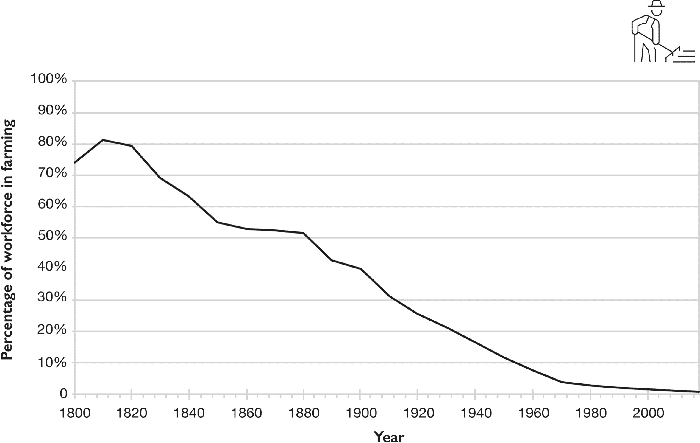

资料来源：国家经济研究局；美国人口普查局；美国劳工统计局；国际劳工组织

## 工厂就业的兴衰轨迹
即便大量农业工人流向工厂，大约一个半世纪后工厂工作也出现了相似的变迁。19 世纪初，美国制造业工人仅占全国工人的约 1/35。[50](#18_Notes.xhtml#EndnoteNumber617 "note")蒸汽动力工厂兴起后吸纳了数百万低技能劳动力，到 1870 年近五分之一的劳动者集中在制造业，主要分布在工业化北方。[51](#18_Notes.xhtml#EndnoteNumber618 "note")第二次工业革命初期又迎来以移民为主的新增劳动力，流水线的普及显著提升效率并推低了商品价格。[52](#18_Notes.xhtml#EndnoteNumber619 "note")

需求拉动下，战时之外的制造业就业在 1920 年左右达到顶峰，约占民用劳动力的 26.9%。[53](#18_Notes.xhtml#EndnoteNumber620 "note")虽然统计口径随时间有所变化，但大萧条短暂回落和二战短暂上升外，从 20 世纪 70 年代为止，美国约四分之一的劳动力长期从事制造业。[54](#18_Notes.xhtml#EndnoteNumber621 "note")这 50 年间整体上并无明显上升或下降。

随后两项技术相关变化侵蚀了美国工厂岗位。其一是物流与运输的创新，尤其是集装箱化，让企业以更低成本将生产外包到劳动力便宜的国家并回流进口。[55](#18_Notes.xhtml#EndnoteNumber622 "note")集装箱化虽不及机器人抢眼，却重塑了现代社会，降低全球运输成本的同时，也推动了美国去工业化。其二是自动化降低了国内制造对人工的依赖。传统装配线依赖手工操作，而机器人削弱了这种需求；90 年代起计算机化和人工智能让自动化更高效，1992 至 2012 年间，美国制造业工人每小时产出在通胀调整后翻倍。[56](#18_Notes.xhtml#EndnoteNumber623 "note")

于是出现了产量与就业脱钩。2001 年 2 月互联网泡沫破灭前夕，美国制造业从业者约 1700 万人。[57](#18_Notes.xhtml#EndnoteNumber624 "note")衰退期间人数骤降后从未恢复，即便 2000 年代中期产出走高，就业也长期徘徊在 1400 万左右。[58](#18_Notes.xhtml#EndnoteNumber625 "note")2007 年 12 月大衰退启动时约有 1370 万人，到 2010 年 2 月跌至 1140 万。[59](#18_Notes.xhtml#EndnoteNumber626 "note")产出很快回升，2018 年接近历史高点，但大量岗位未归来；2022 年 11 月仅需 1290 万工人就能生产同等规模的产品。[61](#18_Notes.xhtml#EndnoteNumber628 "note")

回望百年，1920 至 1970 年制造业就业占比稳定在 20% 到 25%。此后五十年持续走低：1980 年 17.5%，1990 年 14.1%，2000 年 12.1%，2010 年滑至 7.5%。[62](#18_Notes.xhtml#EndnoteNumber629 "note")即便随后经济扩张、制造业产出保持健康，占比基本持平。截至 2023 年初，制造业仅雇用了约美国工人总数的 1/13。[63](#18_Notes.xhtml#EndnoteNumber630 "note")

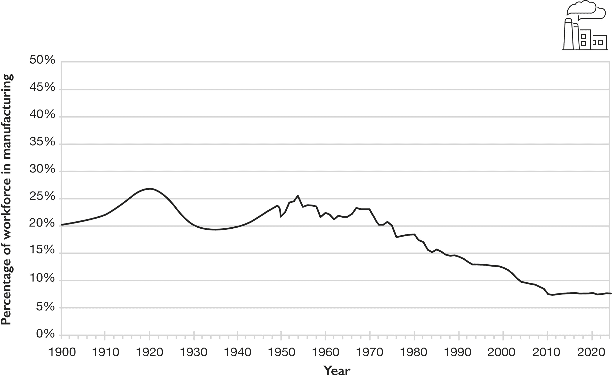

来源：美国劳工统计局；Stanley Lebergott，“劳动力和就业，1800-1960”，载于*1800 年后美国的产出、就业和生产力*，编辑：Dorothy S. Brady（华盛顿特区：国家经济研究局，1966 年）

## 人口在扩张 教育在加码
农场与工厂岗位虽大幅收缩，但只要有可比数据，美国劳动力总量仍在稳步增长，即便处于自动化浪潮当中。[65](#18_Notes.xhtml#EndnoteNumber632 "note")从早期工业革命到上世纪中叶，经济不仅为快速增长的人口创造新岗位，还容纳了数千万女性进入职场。[66](#18_Notes.xhtml#EndnoteNumber633 "note")

21 世纪初劳动力占总人口比例略有回落，主因是退休年龄人口占比上升。[67](#18_Notes.xhtml#EndnoteNumber634 "note")1950 年 65 岁及以上人口占 8.0%，[68](#18_Notes.xhtml#EndnoteNumber635 "note")到 2018 年升至 16.0%。[69](#18_Notes.xhtml#EndnoteNumber636 "note")美国人口普查局预测，到 2050 年该比例将达 22%。[70](#18_Notes.xhtml#EndnoteNumber637 "note")若长寿技术进一步突破，老年人口占比可能更高。

从绝对规模看，劳动力仍在扩大。2000 年总人口 2.82 亿时，民用劳动力约 1.436 亿，占比 50.9%。[71](#18_Notes.xhtml#EndnoteNumber638 "note")到 2022 年，人口约 3.32 亿，劳动力约 1.64 亿，占比 49.4%。[72](#18_Notes.xhtml#EndnoteNumber639 "note")

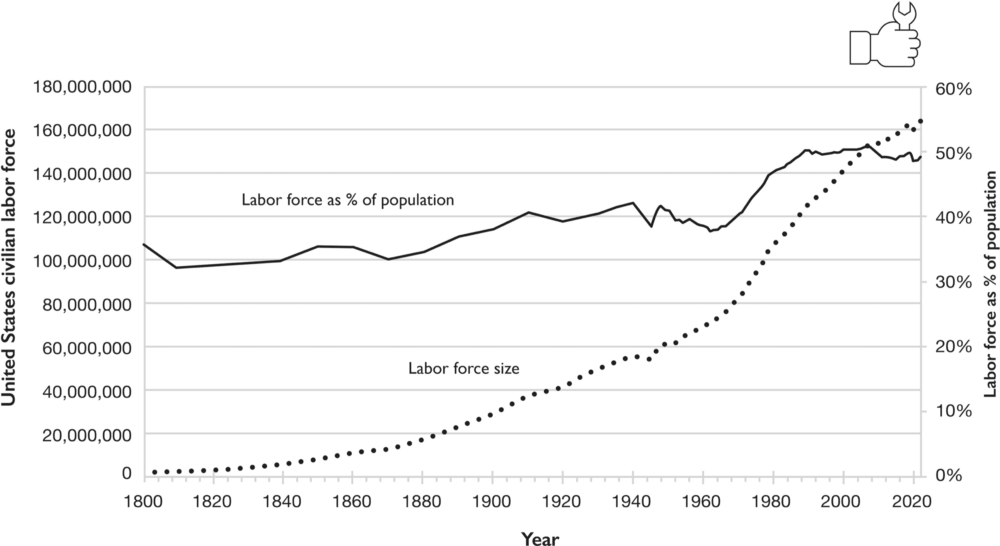

来源：美国劳工统计局；国家经济研究局；美国人口普查局

经济向技术密集型转型，教育投资随之大幅提升。1870 年全国在校大学生约 63,000 人，2022 年增至约 2000 万，其中美国本土的本科生在 2000 至 2022 年间增加了约 470 万。[74](#18_Notes.xhtml#EndnoteNumber641 "note")[75](#18_Notes.xhtml#EndnoteNumber642 "note")K-12 公立教育支出经通胀调整后是 100 年前的 18 倍以上。1919-20 学年平均每生支出相当于 1,035 美元（2023 年美元），[76](#18_Notes.xhtml#EndnoteNumber643 "note")到 2018-19 学年升至约 19,220 美元（2023 年美元）。[77](#18_Notes.xhtml#EndnoteNumber644 "note")

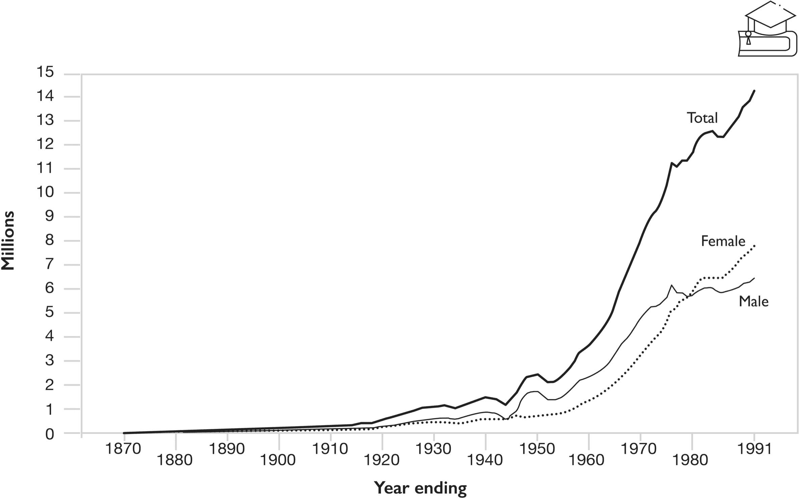

来源：美国商务部，人口普查局，*美国历史统计，殖民时期至 1970 年*；美国教育部，国家教育统计中心，*教育统计摘要*，各种问题

过去两个世纪里，技术变革屡屡取代大量岗位，但在教育改善的配合下经济仍取得持续进步。尽管每一次都曾有准确的担忧称主要就业类别会消失。[79](#18_Notes.xhtml#EndnoteNumber646 "note")

## 真的是拐点吗
即便长期净就业保持增长，斯坦福大学教授埃里克·布林约尔夫松等经济学家认为人工智能驱动的自动化浪潮可能不同，他主张新一轮自动化将造成岗位流失超过创造。[80](#18_Notes.xhtml#EndnoteNumber647 "note")持此观点者认为当前是数个变革浪潮的叠加。

第一波被称为“去技能化”。例如驾驭不可预测动物的马车夫被不需要同等训练的汽车司机取代，让人们更容易在无长期培训的情况下换岗。制鞋工匠需数年培养技能，而流水线机器接管后，操作机器的学习时间大幅缩短。这降低了劳动成本、让鞋子更便宜，却也用低薪工作替代了高薪工作。[81](#18_Notes.xhtml#EndnoteNumber648 "note")

第二波是“增技能化”。技术引入后需要更多新能力，如导航技术要求司机掌握电子设备。FitMyFoot 等公司用 3D 打印为每位顾客定制鞋履，生产依赖少数具备计算机科学和 3D 打印机操作技能的人，而非大量低技能劳动力。[82](#18_Notes.xhtml#EndnoteNumber649 "note")这类趋势倾向于用更少、薪资更高的工作替代低薪岗位。

下一波可称“去人力化”。无人驾驶汽车人工智能将彻底取代人类司机。当更多任务落入人工智能和机器人范围，无技能化转型会扩散。人工智能的差异在于它能完全接管任务，而非仅仅增减所需技能，且在许多领域表现优于人类。自动驾驶汽车比人工驾驶更安全，也不会因饮酒、困倦或分心而出错。

需要区分任务与职业。自动化某些任务有时会让工作转向其他任务，从而实现技能提升。自动取款机处理日常现金交易后，银行柜员更侧重营销与客户关系。[83](#18_Notes.xhtml#EndnoteNumber650 "note")法律研究与文件分析软件改变了律师助理的工作，职业内容与数十年前已大不相同。[84](#18_Notes.xhtml#EndnoteNumber651 "note")艺术领域也在发生类似变动，从 2022 年起 DALL-E 2、Midjourney、Stable Diffusion 等公开系统可根据文本提示生成高质量图像，图形设计师可能花更少时间手绘，而更多时间用于头脑风暴、策划或修改 AI 样例。[85](#18_Notes.xhtml#EndnoteNumber652 "note")

从长远看，经济激励会推动人工智能接管更多任务。在其他条件相同时，购买机器或软件比支付持续劳动成本更划算。[86](#18_Notes.xhtml#EndnoteNumber653 "note")企业主通常可在资本与劳动力之间灵活选择，工资越低越倾向劳动密集，工资越高越倾向自动化。英国因高工资和廉价煤炭成为工业革命摇篮，用蒸汽动力替代昂贵人力。当前发达经济体也有类似动力。随着人工智能接近乃至超越人类能力，未经增强的人类可执行的任务将越来越少，在与 AI 更深度融合前，工人将面临重大冲击。

然而这里存在“生产力难题”。若技术真的导致净失业，古典经济学预测在经济产出给定下工作时间会减少，生产力应显著提升。但自 90 年代互联网革命以来，传统测量的生产力增长实际放缓。以每小时实际产出计，1950 年第一季度至 1990 年第一季度，美国平均每季度增长 0.55%。[87](#18_Notes.xhtml#EndnoteNumber654 "note")个人电脑和互联网普及后，1990 年第一季度至 2003 年第一季度平均每季度增长 0.68%。[88](#18_Notes.xhtml#EndnoteNumber655 "note")当时普遍预期增速会延续。[89](#18_Notes.xhtml#EndnoteNumber656 "note")2003 年第一季度后增速明显回落，2003 年第一季度至 2022 年第一季度平均每季度仅增长 0.36%。[90](#18_Notes.xhtml#EndnoteNumber657 "note")信息技术广泛改变商业，但生产力提升未达预期，这仍是过去十年最迷人的经济谜题之一。

如果自动化真的带来如此剧烈的冲击，为什么经济账上总感觉少了几万亿美元？这个疑问现在越来越被经济学家正视。核心判断是：GDP 没能把信息类产品的指数级增值计入其中，尤其大量免费提供的部分，本质上属于近乎全新的一类价值。1963 年麻省理工学院斥资约 310 万美元买下我当年本科使用过的 IBM 7094，按今天的价位相当于 3000 万美元，这笔花销完整计入了经济活动。[\[91\]](#18_Notes.xhtml#EndnoteNumber658 "note") 如今一台智能手机的计算与通信能力比 1965 年高出数十万倍，还集成了当时想都不敢想的功能，账面价值却只算几百美元，按的是你实际付的钱。

埃里克·布林约尔松和风险投资家马克·安德森也反复强调过这种缺口。[\[92\]](#18_Notes.xhtml#EndnoteNumber659 "note") GDP 用一个国家所有成品和服务的市场价格来衡量产出。花 2 万美元买辆新车，当年 GDP 就增加 2 万美元，哪怕你心里愿意掏 2.5 万甚至 3 万。20 世纪这套做法很管用，因为商品大多由实物材料和人工制造，边际成本很高，平均意愿支付与实际成交价很接近。[\[93\]](#18_Notes.xhtml#EndnoteNumber660 "note") 古典理论认为价格会向平均边际成本靠拢，企业亏本卖不了，竞争又逼着降价。于是过去产品越好、越强，生产成本越高，GDP 反映的价格也就越高。

信息技术打破了这条规律。很多东西变得极其好用，价格却基本不动。1999 年一块约 900 美元的芯片能做到每秒每美元超过 80 万次运算。[\[94\]](#18_Notes.xhtml#EndnoteNumber661 "note") 到 2023 年初，同价位的芯片每秒每美元能完成近 580 亿次计算。[\[95\]](#18_Notes.xhtml#EndnoteNumber662 "note") 也就是说，按相同票价买到的算力提升了 7 万多倍。GDP 却把今天的 900 美元芯片和二十多年前那块等同起来，导致名义上财富和收入的增长完全没体现出技术带来的生活改善。于是出现了工资表面停滞的错觉：名义工资 20 年没动，你却能买到数千倍的计算力。[\[96\]](#18_Notes.xhtml#EndnoteNumber663 "note") 统计部门已在部分指标里尝试修正性能差异，[\[97\]](#18_Notes.xhtml#EndnoteNumber664 "note") 但仍远远低估了真实的性价比跃升。

对数字商品来说这种偏差更夸张。一旦亚马逊把一本电子书排好版，再卖一万册几乎不需要纸张、墨水和额外人力，售价远高于边际成本。对于能几乎零成本供应的服务，价格与支付意愿的关联彻底断裂。谷歌建好搜索算法和服务器后，多一次查询的成本微乎其微，Facebook 让你和一千个好友连线也不比一百个更贵。于是它们免费开放，用广告回收边际成本。

免费不等于没有价值。可以通过选择来估算消费者剩余。[\[98\]](#18_Notes.xhtml#EndnoteNumber665 "note") 举例，如果你本可以用修剪草坪赚 20 美元，却选择刷 TikTok，就说明 TikTok 至少值 20 美元。蒂姆·沃斯托尔在《福布斯》2015 年的估算中，Facebook 在美国的营收约 80 亿美元，这就是它在 GDP 里的官方贡献。[\[99\]](#18_Notes.xhtml#EndnoteNumber666 "note") 按最低工资折算用户时间，真实福利约 2300 亿美元。[\[100\]](#18_Notes.xhtml#EndnoteNumber667 "note") 截至 2020 年，美国使用社交媒体的成年人平均每天在 Facebook 花 35 分钟。[\[101\]](#18_Notes.xhtml#EndnoteNumber668 "note") 按沃斯托尔的方法，约 2.58 亿成年人里 72% 在用，这一年 Facebook 创造的经济价值约 2870 亿美元。[\[102\]](#18_Notes.xhtml#EndnoteNumber669 "note") 2019 年全球调查显示，美国网民平均每天在所有社交媒体上花 2 小时 3 分钟，这类广告收入对 GDP 约 361 亿美元，但给用户带来的总收益超过 1 万亿美元。[\[103\]](#18_Notes.xhtml#EndnoteNumber670 "note") 用最低工资衡量不算完美，但在排队买咖啡时刷屏比接零工更现实，它至少说明人们极度看重这些使用，而经济学家看到的只是冰山一角。维基百科的官方 GDP 贡献基本为零，基于网络和 App 的服务也大抵如此。

因此，随着数字技术占比上升，消费者剩余的增速明显快于 GDP，折算成生产率的增速也高于每小时产出指标。因为消费者剩余更贴近真实繁荣，可以说我们真正关心的生产率一直在稳健增长。

影响早已超出所谓“技术”范畴。技术变革带来了更少污染、更安全的环境、更广的学习娱乐机会，只是分配不均。医疗保健就是反例，价格涨得比整体通胀快得多，一个重度医疗需求者并不会因 GPU 成本下降而感到安慰。[\[104\]](#18_Notes.xhtml#EndnoteNumber671 "note")

好消息是 2020、2030 年代人工智能与技术融合会把越来越多商品和服务推向信息技术轨道，让它们享受数字领域那样的指数通缩。AI 导师能让任何学科的个性化学习大规模可得。医疗和药物发现目前仍起步，但终将压低医疗成本。食品、住房、建筑、服装等传统实体产品也会被重塑：AI 驱动的材料科学让光伏发电极便宜，机器人采矿和自动驾驶电动汽车大幅拉低原材料成本。能源与材料便宜、自动化替代人类劳动后，价格会大幅走低。时间一久，今天被视为奢侈的生活水准会变得平价。

若判断成立，技术驱动的通缩只会拉大名义生产力与每小时人类劳动带来的平均真实福祉之间的鸿沟。数字效应扩散到其他行业后，国家通胀会回落，最终走向全面通缩，生产力之谜也将更清晰。

另一个谜是美国劳动力占比为何收缩。支持者指出劳动参与率，即有工作或在找工作的人占 16 岁及以上人口的比例，从 1950 年约 59% 升到 2002 年略低于 67%，此后降到 2015 年 63% 以下，并在疫情前保持平缓。[\[105\]](#18_Notes.xhtml#EndnoteNumber672 "note") 以总人口计，2008 年 6 月美国民用劳动力 1.54 亿，总人口 3.04 亿，占 50.7%。[\[106\]](#18_Notes.xhtml#EndnoteNumber673 "note") 到 2022 年 12 月，劳动力 1.64 亿，总人口 3.33 亿，占比略低于 49.5%。[\[107\]](#18_Notes.xhtml#EndnoteNumber674 "note") 降幅不算惊人，却已是二十多年来的低位。统计口径不包括农业工人、军人、联邦雇员，方向仍具参考性。

来源：美国劳工统计局

下降部分源于自动化，但主要混淆因素是教育和人口结构。受教育程度提高让更多青少年留在校园，直到二十多岁才进入劳动力市场。[\[109\]](#18_Notes.xhtml#EndnoteNumber676 "note") 庞大的婴儿潮一代进入退休，劳动年龄人口比例下滑。[\[110\]](#18_Notes.xhtml#EndnoteNumber677 "note")

聚焦 25 至 54 岁黄金年龄段，降幅几乎消失。截至 2023 年初参与率为 83.4%，2000 年峰值 84.5%。[\[111\]](#18_Notes.xhtml#EndnoteNumber678 "note") 相当于今天仍少约 170 万人，[\[112\]](#18_Notes.xhtml#EndnoteNumber679 "note") 但差距远小于整体图表显示的程度。

来源：美国劳工统计局

55 岁及以上参与率反而明显上升。55 至 64 岁从 2001 年的 60.4% 升至 2021 年的 68.2%，75 岁及以上从 5.2% 增至 8.6%。[\[114\]](#18_Notes.xhtml#EndnoteNumber681 "note") 一方面部分被自动化挤出的年长工人提前退休，接受更低生活水平；另一方面寿命延长，疫情前 2000 年以来混合预期寿命增加约两年，[\[115\]](#18_Notes.xhtml#EndnoteNumber682 "note") 人们更健康、愿意在更高年龄工作，这也带来满足感。但也有老年人因失去高薪岗位被迫做边缘工作，直到能退休为止。[\[116\]](#18_Notes.xhtml#EndnoteNumber683 "note")

更根本的限制是劳动参与本身概念已不合时宜。两个趋势正在重塑工作，却未被统计很好捕捉。

其一是地下经济，一直存在，如今被互联网放大，还涵盖性产业、私下家务、替代疗法等。加密技术如加密货币让交易更难被征税监管。

比特币是最著名案例。[\[117\]](#18_Notes.xhtml#EndnoteNumber684 "note") 2017 年 8 月 6 日主要交易所日交易量不足 1930 万美元。[\[118\]](#18_Notes.xhtml#EndnoteNumber685 "note") 到 12 月 7 日飙升至超 49.5 亿美元，之后回落，2023 年中期平均日约 1.8 亿美元。[\[119\]](#18_Notes.xhtml#EndnoteNumber686 "note") 规模仍远小于传统外汇，2022 年 4 月全球日均外汇交易约 7.5 万亿美元。[\[120\]](#18_Notes.xhtml#EndnoteNumber687 "note") 波动性极大：2012 年 1 月 4 日比特币 13.43 美元，[\[121\]](#18_Notes.xhtml#EndnoteNumber688 "note") 4 月 2 日涨超 130 美元，[\[122\]](#18_Notes.xhtml#EndnoteNumber689 "note") 2017 年爆发式上涨，4 月 29 日达 1,354 美元，12 月 17 日升至 18,877 美元，[\[123\]](#18_Notes.xhtml#EndnoteNumber690 "note") 随后崩盘，2018 年 12 月 12 日跌回 3,360 美元，2021 年 4 月 13 日冲到 64,899 美元，再跌至 2022 年 11 月 20 日的 15,460 美元。[\[124\]](#18_Notes.xhtml#EndnoteNumber691 "note") 这种不稳定性让比特币难以作为日常交换媒介。

加密并非地下经济的必要条件。社交媒体和 Craigslist 已为人们提供大量政府难以触及的经济联系。

其二是赚钱方式不再是传统就业。通过网站和应用创造、买卖、交换实物和数字资产，或在社交平台创作内容来获利。YouTube 创作者、Instagram 和 TikTok 影响者就是典型。[\[125\]](#18_Notes.xhtml#EndnoteNumber692 "note")

2007 年 iPhone 推出前几乎没有应用经济。2008 年 iOS 应用不到 10 万个，2017 年升至约 450 万。[\[126\]](#18_Notes.xhtml#EndnoteNumber693 "note") 安卓同样迅猛：2009 年 12 月 Google Play 约 16,000 个应用，[\[127\]](#18_Notes.xhtml#EndnoteNumber694 "note") 截至 2023 年 3 月约 260 万个，[\[128\]](#18_Notes.xhtml#EndnoteNumber695 "note") 十三年间增长超 160 倍。这直接推动就业，2007 至 2012 年美国应用经济创造约 50 万岗位，[\[129\]](#18_Notes.xhtml#EndnoteNumber696 "note") 到 2018 年德勤估计超 500 万。[\[130\]](#18_Notes.xhtml#EndnoteNumber697 "note") 2020 年一项计入间接岗位的估计为 590 万个美国岗位和 1.7 万亿美元经济活动。[\[131\]](#18_Notes.xhtml#EndnoteNumber698 "note") 定义宽窄会影响数字，但结论明确：移动应用在十多年里从边缘变为经济支柱。

因此技术既在淘汰岗位，也在开辟不属于传统“工作”模式的新机会。零工经济虽有局限，却往往提供更多灵活性、自主性和闲暇。提升这些机会的质量，是帮助劳动者应对自动化加速、传统职场被颠覆的重要策略。

## 接下去怎么走

工作被重新定义

乍看之下当下的就业图景令人不安。牛津大学的弗雷与奥斯本测算，到2033年左右，2013年约半数的岗位将落入自动化。他们的模型对人工智能和其他指数技术的演进节奏，其实比本书所呈现的更为保守。人们对自动化对就业的威胁已争论了两百多年，眼下不一样的地方在于威胁来得更急、范围更广。

想弄清走向，先回到工作的两重功能。工作并非终点，而是达成目标的途径。第一层是维系物质生活。两百年前，种植与分配食物几乎吸干所有人力，如今在美国与发达地区，养活人口只需不足2%的劳动力。人工智能在各领域释放出空前的物质充裕，为生存而挣扎的岁月正在淡出历史。

第二层是赋予生命意义。砌砖工的薪酬让家庭运转，形成身份认同；同时他也在堆砌持久的建筑，为公共利益添砖加瓦，是在为超越个体的集体效力。艺术与学术等最令人满足的职业，还提供了创造新知、产出新物的空间。

## 创意门槛正在被拉低
即将到来的变革会让人类贡献的版图远超以往。先进的信息技术早已在放大创作者丰富文化的方式，只是常被低估。

## 媒介变迁如何松绑表达
我成长时能收看的电视台只有ABC、NBC、CBS三家。受众被挤到极致，节目必须同时讨好男女、老少、蓝领白领。受众面窄却强度高的设想，例如荒诞喜剧、超自然剧或科幻，很难找到商业路径。很多人都忘了《星际迷航》，这部影响深远的科幻剧仅播三季就被砍。[\[133\]](#18_Notes.xhtml#EndnoteNumber700 "note")

有线电视拓宽了管道，小众内容得以生根。探索、历史、学习等频道的深度纪录片蓬勃发展。可收视仍被播出时段绑住。DVR再到点播流媒体，让人随时随地追看想看的内容。创新节目得以从全人群中聚合观众，而非仅靠恰好守在档期的人。《怪奇物语》《伦敦生活》这类在我年轻时难以出现的艺术设想，如今既有忠实粉丝也有重要口碑。对LGBTQ群体、残障人士、美国穆斯林等较小社群也是利好，主动描绘其生活经验的作品更容易实现商业化。

流媒体也改写了创作逻辑。传统电视的半小时喜剧多为单元制，因为台方希望观众任意顺序观看。点播让观众能按正确顺序追剧，这解放了《马男波杰克》式的逐集人物成长与跨集累积笑点。[\[134\]](#18_Notes.xhtml#EndnoteNumber701 "note")这些艺术可能性在旧广播技术下根本不存在。

## AI把创作权交给大众
未来二十年这种转向会急剧加速。过去几年DALL-E、Midjourney、Stable Diffusion等系统已在视觉图像上展现创造力。这些能力会更复杂，并扩展到音乐、影像、游戏，从根本上平权化创意表达。人们可以用自然语言向AI描述想法，反复调整直至接近心中的蓝图。拍摄一部动作大片不再需要成千上万人与数亿美元，好的创意加上一笔相对适中的算力预算即可做出史诗。

## 自动化冲击下的能力升级
即便好处在望，从现在到那段时间的破坏性影响也不能忽视。自动化及其连带效应已在技能阶梯的底部与中部清除大量岗位，这一趋势在未来十年会扩大并提速。我们大部分新工作需要更复杂的技能，整体社会已在向上攀爬，但AI在各领域已能超越甚至最顶尖的人类，如何跟上成为难题。

过去两百年提升技能的主要路径是教育，过去一个世纪对学习的投入高速增长。我们现在进入自我增强的下一步：通过与正在创造的智能技术融合来放大能力。把计算机化设备植入身体与大脑尚未发生，却已近在咫尺。没有智能手机这个脑力扩展器，几乎没人能工作或学习，它可调用近乎全部人类知识并一键使用巨大算力。可以说设备已成为我们自身的一部分，二十年前并非如此。

这些能力会在整个2020年代更深地融入生活。搜索会从文本串与链接页转向无缝直觉的问答。任意两种语言间的实时翻译会流畅准确，打破语言壁垒。增强现实会经由眼镜、隐形眼镜投射到视网膜，会在耳内共鸣并最终调动其他感官。大量功能不必明确索取，无处不在的AI助手会通过观察与倾听活动来预测需求。到2030年代，医疗纳米机器人将开始把这些大脑扩展直接集成到神经系统中。

第2章提到技术会把我们的新皮层扩展到云端，增加容量与抽象层次。对所有人开放，最终会变得便宜，就像手机起初昂贵而笨拙，如今无处不在。国际电信联盟估计截至2020年全球已有58亿个活跃智能手机订阅用户。[\[135\]](#18_Notes.xhtml#EndnoteNumber702 "note")

## 通往丰裕路上的社会安全考题
通往普遍富足的路上必须解决转型带来的社会问题。社会安全网始于1930年代美国的《社会保障法》。[\[136\]](#18_Notes.xhtml#EndnoteNumber703 "note")无论表述如何政治化，自那时起整体安全网的范围持续扩大。

美国被认为比“社会主义”欧洲的社会网小，但其公共社会福利支出截至2019年约占GDP的18.7%，接近发达国家中位数。[\[137\]](#18_Notes.xhtml#EndnoteNumber704 "note")加拿大为18.0%。[\[138\]](#18_Notes.xhtml#EndnoteNumber705 "note")澳大利亚与瑞士均为16.7%。[\[139\]](#18_Notes.xhtml#EndnoteNumber706 "note")英国略高，为20.6%，约合2.8万亿美元GDP中的5800亿美元，人均不足8800美元，人口6600万。[\[140\]](#18_Notes.xhtml#EndnoteNumber707 "note")由于人均GDP更高，美国人均社会安全网支出也更高。2019年美国GDP超过21.4万亿美元，其中公共社会支出约4万亿美元。[\[141\]](#18_Notes.xhtml#EndnoteNumber708 "note")当年平均人口约3.3亿，人均超过12000美元。[\[142\]](#18_Notes.xhtml#EndnoteNumber709 "note")

来源：经济合作与发展组织；彭博社

美国社会安全网在政府支出中的占比一直在稳步提升，目前约占联邦、州和地方支出的一半，占比GDP也在持续上升。[\[144\]](#18_Notes.xhtml#EndnoteNumber711 "note")看图看看能不能猜出何时是“左派”或“右派”执政。最近两年数据包含大量疫情救助，2020-2021年的高峰超出长期增长趋势。

随着GDP持续指数增长，社会保障支出很可能继续上升，无论总量还是人均。美国体系中的关键项目包括提供基本医疗的医疗补助、SNAP食品券、住房援助。今天的水平几乎不够用，但人工智能驱动的进步会让医疗、食品、住房在2030年代变得更便宜，同样的财政支持就能提供非常舒适的生活水平，而不必提高用于社会保障的GDP占比。若该占比继续增长，可资助更广泛的服务。

主要来源：美国人口普查局；经济分析局；USGovernmentSpending.com；麦迪逊项目

主要来源：美国人口普查局；经济分析局；USGovernmentSpending.com；麦迪逊项目

主要来源：美国人口普查局；经济分析局；USGovernmentSpending.com；麦迪逊项目

主要来源：美国人口普查局；经济分析局；USGovernmentSpending.com；麦迪逊项目

在2018年温哥华TED大会与TED策展人克里斯·安德森的舞台对话中，[\[149\]](#18_Notes.xhtml#EndnoteNumber716 "note")我预测到2030年代初发达国家将实质拥有全民基本收入或其等价物，到2030年代末大多数国家也会拥有，而且人们能按今天的标准靠此收入过好日子。这需要定期向所有成年人支付，或提供免费商品服务，可能由自动化驱动的利润税和政府对新兴技术的投资共同资助。[\[150\]](#18_Notes.xhtml#EndnoteNumber717 "note")相关项目可为照顾家庭或建设健康社区的人提供经济支持。[\[151\]](#18_Notes.xhtml#EndnoteNumber718 "note")这类改革能大幅缓解就业中断的伤害。评估可能性时必须考虑到届时经济将发生多么深刻的演变。

技术变革加速，整体财富将大幅增长，而社会安全网具有长期稳定性，无论哪党执政都可能保持不变并远高于今天。[\[152\]](#18_Notes.xhtml#EndnoteNumber719 "note")但技术富足不会自动同时惠及每个人。例如2022年1美元能买到比2000年多50,000倍的计算能力，已考虑总体通胀。[\[153\]](#18_Notes.xhtml#EndnoteNumber720 "note")相比之下，2022年的1美元只能买到2000年约81%的医疗保健，已调整通胀。[\[154\]](#18_Notes.xhtml#EndnoteNumber721 "note")尽管癌症免疫疗法等手段质量提升，但住院、X光等大多数医疗支出基本不变。因此把大笔钱花在电脑上的学生从降价中获益极多，而把收入大部分花在医疗的老年人和慢性病患者整体情况可能更糟。

因此需要明智的政府政策来缓解过渡，确保繁荣广泛分享。饥荒不是产量不足，也不是好农业秘诀被少数精英垄断，而是通常由不良治理或内战导致。[\[155\]](#18_Notes.xhtml#EndnoteNumber722 "note")同样，若社会不够谨慎，有害的政治会干扰生活水平的提升。

正如COVID-19表明的，医学领域尤其令人担忧。创新会释放变革性的负担得起且有效的治疗能力，但这不保证如变戏法般的结果。我们需要积极参与的公众和明智治理，以管理向更先进医疗保健的安全、公平、有序过渡。可以想象未来拯救生命的技术会遭到广泛不信任。正如今天疫苗的虚假信息和阴谋论在网上盛行，人们可能传播关于决策支持AI、基因疗法的类似谣言，或未来几十年的医学纳米技术。考虑到网络安全的合理担忧，不难想象对秘密基因操纵或政府控制纳米机器人的过度恐惧，会导致2030或2050年的人们拒绝关键治疗。公众对这些问题的理解是我们抵御不必要夺走生命的动态的最好防线。

## 生存不再是问题时我们追寻什么
若正确应对这些政治挑战，人类生活会被彻底改变。历史上我们为满足物质需求而竞争。当进入富足时代，物质必需品最终普遍供应，同时许多传统工作消失，我们的主要奋斗目标将变成目标和意义。实质上是在提升马斯洛需求层次。[\[156\]](#18_Notes.xhtml#EndnoteNumber723 "note")这在现在决定职业的这一代人身上已很明显。我指导并与8到20岁的年轻人交谈，他们的重点通常是开辟有意义的道路，无论是通过艺术进行创造性表达，还是帮助克服人类几千年来一直在努力解决的重大社会、心理及其他挑战。

因此工作在我们生活中的作用，迫使我们重新审视更广泛的意义追寻。人们常说死亡和存在的短暂性赋予生命意义。但我的观点是，这种说法试图把死亡的悲剧合理化为好事。现实是失去亲人实际上夺走了我们自己的一部分。与那个人互动并享受陪伴的新皮质模块现在产生失落、空虚和痛苦。死亡夺走了我看来赋予生命意义的一切——技能、经验、记忆和关系。它阻止我们享受更多定义我们的超验时刻——创作和欣赏创意作品，表达爱意，分享幽默。

当我们把新皮层扩展到云端时，所有这些能力都将大大增强。想象一下，试图向那些错过了使人科动物拥有大额头成为可能的新皮质扩张的灵长类动物解释音乐、文学、YouTube视频或笑话。两百万年前。这个类比至少能让我们瞥见，当我们在2030年代的某个时候开始以数字方式增强新皮质时，我们将能创造出今天无法想象或理解的有意义表达。

但关键问题仍在：从现在到那时会发生什么？与丹尼尔·卡尼曼一次私人对话中，他同意信息技术一直在增长，并将继续以指数级速度在性价比和容量上增长，这最终会涵盖服装和食品等实物产品。他也同意我们正走向能满足物质需求的富裕时代，主要斗争将是满足马斯洛需求层次的更高层次。然而他设想从现在到那时之间会有一段漫长的冲突甚至暴力时期。他指出，随着自动化继续产生影响，必然有赢家输家。一个失去工作的司机不会因为人类提升到生活层次的承诺而感到满意，因为他作为个体可能无法实现这种转变。

适应技术变革的一大挑战是，它们往往给广大人口带来广泛利益，却给一小部分人带来集中危害。例如自动驾驶汽车会给社会带来巨大好处——挽救生命、降低污染、缓解拥堵、增加空闲时间、降低运输成本。美国所有人口——预计到2050年接近4亿——将在不同程度上分享这些改善。[\[157\]](#18_Notes.xhtml#EndnoteNumber724 "note")根据假设，潜在总收益估计每年在6420亿美元到7万亿美元之间。[\[158\]](#18_Notes.xhtml#EndnoteNumber725 "note")可以说这是一个巨大数字。然而对任何一个人的好处都不太可能完全改变生活。即使我们统计上知道每年将有数万人免于死亡，也没有办法确定每年哪些人避免了死亡。[\[159\]](#18_Notes.xhtml#EndnoteNumber726 "note")

相比之下，自动驾驶汽车的危害主要局限于数百万以司机为职业的人，并会失去生计。这些人是可以明确识别的，对其生活干扰可能非常严重。当某人处于这种境地时，仅仅知道社会的整体利益超过他们的个人痛苦是不够的。他们需要相关政策帮助减轻经济痛苦，并缓解他们向其他能够提供意义、尊严和经济保障的事物过渡。

正如之前讨论的，支持卡尼曼担忧的一个现象是，大众的恐惧通常比现实更糟。当你已经觉得社会上的一切都在变得更糟时，失去工作是导致疏离感的好方法。卡尼曼和我一致认为，我们今天在政治中看到的许多两极分化是自动化（包括实际的和预期的）的产物，而不是来自传统的政治问题如移民。[\[160\]](#18_Notes.xhtml#EndnoteNumber727 "note")如果你对自己的经济稳定性感到高度焦虑，你可能会对任何看起来会加剧你问题的事情抱有敌意。

历史给出的反馈往往比我们的想象更乐观。过去两百年里，经济中大批岗位被替代，却并未引发持续性的社会撕裂，更遑论暴力革命。大众媒介与执法体系的效能足以在苗头出现时迅速压制冲突，就像两个世纪前卢德派一样被遏制。固然，精神疾病等人为因素仍会让个体走向暴力，在美国枪支文化加持下，部分案例甚至致命。

可这些触目惊心的个案并不能否定一个长期事实：整体暴力在数个世纪里持续、以明显幅度下滑。[\[161\]](#18_Notes.xhtml#EndnoteNumber728 "note")不同国家在短期波动，但发达社会的长期趋势清晰一致。我的朋友史蒂文·平克在 2011 年的《人性中的善良天使：为什么暴力已经减少》中指出的正是这一文明进路——法治国家、识字率攀升、经济增长等结构性力量在起作用。[\[162\]](#18_Notes.xhtml#EndnoteNumber729 "note")值得注意的是，这一切很大程度上搭载在信息技术的指数级进步之上，于未来我们有理由保持谨慎的乐观。

自动化带来的阵痛伴随而来的是新的创造空间，而且这种伴随关系不会终止。社会保障体系已相当完备且持续扩张，正如我所强调的，它对政治风向的依赖并不强，拥有超越舆论波动的稳固民意基础。这些制度既是同胞间自然同情的体现，也是对技术冲击的政治性缓冲。

但保障网填补不了工作所提供的意义感。正如卡尼曼所言，劳动力市场上必然出现一批落败者。美国已多次历经自动化浪潮而未陷入严重动荡，此次的不同在于变革的广度、纵深与节奏。卡尼曼提醒，社会需要时间消化变化并抓住新机会，而大量人群难以迅速完成再培训，转向新的就业形态或个人化商业模式。

我认同卡尼曼的部分判断，但也应看到，许多技术转型中“输家”根本未出现，或至少并未显现。以新疗法为例，从该病中获益的企业与从业者会流失长期收入，可社会收益之大使其几乎获得一致喝彩，哪怕是原先的从业者也亲历痛苦减轻，鲜少纠结于业务损失。社会更理性的选择是帮助受冲击者度过经济阵痛，而不是为保岗位与利润而阻挡疗法。

回看两百年自动化史，人们总倾向于设想工作在“其他一切不变”的真空中消失。这其实是预测未来的通病——只看见变动，假定其余恒定。现实是，每一次岗位流失都伴随着诸多积极变化，且抵达速度与破坏同样迅速。

适应，尤其是向好的适应，往往比预期更快。80 年代末，互联网还基本局限于高校与政府，我便判断到 90 年代末，会有一个面向所有人、甚至小学生的全球通信与信息共享网络出现。[\[163\]](#18_Notes.xhtml#EndnoteNumber730 "note")我同样预见 21 世纪初人们会用移动设备接入这个网络。[\[164\]](#18_Notes.xhtml#EndnoteNumber731 "note")当时这些判断看起来惊险、颠覆甚至不太可信，如今却完全兑现并被迅速接纳。应用经济十年前几乎不存在，今天已根深蒂固，很多人甚至记不起没有它的世界。

影响远超经济。斯坦福大学的研究估算，2017 年美国异性恋伴侣中约 39% 是线上相识，相当一部分来自 `Tinder`、`Hinge` 等移动 App。[\[165\]](#18_Notes.xhtml#EndnoteNumber732 "note")这意味着现今小学里的许多孩子之所以出生，纯粹因为比他们年长几岁的技术。放眼长线，应用渗透社会的速度令人惊叹。

人们也常误以为是未经强化的“人”与机器竞争，这本身就是误读。设想一个人类主要对抗人工智能驱动机器的世界，是理解未来的错误路径。举例来说，若一位携带 2024 年智能手机的时间旅行者回到 1924 年。[\[166\]](#18_Notes.xhtml#EndnoteNumber733 "note")在卡尔文·柯立芝时代的民众眼中，此人智力近乎超人：能轻松做高等数学运算、相当流畅地翻译主要语言、下棋胜过任何特级大师，并掌握相当于整部维基百科的知识。对 1924 年的人而言，这份能力靠电话实现已是奇迹；而对我们而言，容易失去这种参照。现代人并不“感觉”被强化。然而同理，我们将以同样无缝的方式汲取 2030、2040 年的进展来扩展自身能力——当大脑与计算机直接联通时，这种增强会更自然。对富足时代的认知挑战而言，我们在多数领域不会像使用智能手机时那样“对抗”人工智能。[\[167\]](#18_Notes.xhtml#EndnoteNumber734 "note")这种共生并不新鲜，从石器时代起，技术的目的就是在身心层面延伸人的能力。

总体而言，我认为转型期出现令人不安的社会动荡乃至暴力的风险应被预见并积极缓解。但在我看来，鉴于上述稳定性的长期趋势，暴力化的转型并不大概率发生。

保持对即将到来转型的乐观，最关键的驱动是物质财富的持续增长会削弱暴力的动机。当基本生存受威胁或犯罪率高企时，民众会觉得“反正无所失去”。但正推动混乱的同一批技术，也在让食物、住房、交通、医疗变得更廉价。凭借更好教育、更聪明的治安、以及减少铅等损害大脑的环境毒素，犯罪率有望继续下行。当人们确信面前有一段漫长而安全的生命时，诉诸政治协商解决分歧的意愿会明显高于冒险使用武力。

卡尼曼与我的分歧或许源于截然不同的童年。他幼年随家人逃离纳粹的法国，我出生于二战后的纽约，相对安稳，即便作为“后代”仍深受大屠杀影响。因此卡尼曼亲历了非凡的冲突、流离与仇恨，而这些可说根植于一战后欧洲的匮乏，尤其德国。

要把转型塑造成持续的建设性过程，需要开明务实的政治策略与政策设计。政策与社会组织仍是关键，政治家与公民领袖的作用不会减弱。而技术进步打开的空间之大，堪比摆脱人类长期苦难。

# 第六章：未来三十年的健康与福祉

## 未来三十年的健康与福祉

### 2020 年代：人工智能与生物技术的结合

把车送进修理厂，技师对每个零件和协作方式都了然于胸。汽车工程本质上是精确科学，因此保养得当的车辆可近乎无限期使用，即便重创在技术上也能修复。人体则完全不同。尽管过去两百年医学取得巨大进步，但它至今并非精确科学。医生常做已知有效的事，却并不完全清楚其作用机制。医学很大程度上建立在粗糙的近似之上，对大多数患者大致有效，却未必对你个人精准。

要把医学变为精确科学，就必须让它成为信息技术，让它搭上信息技术的指数红利。这种范式转变正稳步进行，核心是把生物技术与人工智能、数字仿真结合起来。正如本章要展开的，我们已看到直接收益——从药物发现到疾病监测、机器人手术。比如 2023 年，第一款由人工智能从头到尾设计的药物已进入 II 期临床试验，用于治疗一种罕见肺病。[\[1\]](#18_Notes.xhtml#EndnoteNumber735 "note")但人机融合最核心的好处更深远。

以往医学依赖艰难的实验室试验与医生间代际传授，创新只能缓慢线性推进。人工智能可从远超临床医生经验的数据中学习，能累积数十亿例手术的经验，而非人类职业生涯的数千例。且因其底层硬件的指数改进，医疗同样会迎来指数级增益。借助这些工具，我们已能以数字方式穷举每一种可能性，在数小时而非数年内找到生化问题的解法。[\[2\]](#18_Notes.xhtml#EndnoteNumber736 "note")

目前最紧迫的问题之一，是为新兴病毒威胁设计疗法。这相当于在一堆可能装满游泳池的钥匙里，找出能打开特定病毒化学锁的那一把。一个人类专家或许能凭知识与直觉锁定几十种候选分子，但真正相关的分子往往以数万亿计。[\[3\]](#18_Notes.xhtml#EndnoteNumber737 "note")筛选时多数显然无用，不值得完整模拟，但数十亿种可能仍值得更强的计算检验。极端来看，物理上可能的药物分子空间估计约有一百万亿亿亿亿亿亿亿种。[\[4\]](#18_Notes.xhtml#EndnoteNumber738 "note")不管数字如何精确，人工智能现在能帮科学家把那堆巨钥筛一遍，聚焦最可能匹配的少数。

这种穷举的价值显而易见。现行范式下，找到一个看似可行的抗病剂后，往往需动员数十至数百名受试者，花费数月到数年、以数千万到数亿美元成本完成临床试验。通常首选并非理想疗法，还需探索替代方案，这同样耗时。当结果出来前，进展几乎停滞。美国监管流程分三阶段临床试验，按麻省理工学院最新研究，仅 13.8% 的候选药物能完全通过 `FDA` 审批。[\[5\]](#18_Notes.xhtml#EndnoteNumber739 "note")结果是新药上市平均耗时十年，成本约 13 亿到 26 亿美元。[\[6\]](#18_Notes.xhtml#EndnoteNumber740 "note")

近几年，AI 辅助的突破节奏明显加快。2019 年，澳大利亚弗林德斯大学的研究团队利用生物模拟器发现可激活人体免疫系统的物质，研制出一种“涡轮增压”流感疫苗。[\[7\]](#18_Notes.xhtml#EndnoteNumber741 "note")团队以数字方式生成数万亿种化学结构，再用另一仿真器判断哪些可作为免疫增强药物。[\[8\]](#18_Notes.xhtml#EndnoteNumber742 "note")

2020 年，麻省理工学院团队用人工智能开发出一种强效抗生素，可杀灭部分最棘手的耐药菌。他们没只评估数种抗生素，而是在数小时内分析了 1.07 亿种化合物，筛出 23 个候选并点出其中两种最具潜力。[\[9\]](#18_Notes.xhtml#EndnoteNumber743 "note")匹兹堡大学药物设计研究员雅各布·杜兰特评价：“这项工作令人惊叹，凸显了计算机辅助药物发现的力量。对超过 1 亿种化合物做抗生素活性测试，在物理上不可行。”[\[10\]](#18_Notes.xhtml#EndnoteNumber744 "note")此后，麻省理工团队开始从零设计有效的新抗生素。

但 2020 年 AI 在医学上最关键的应用，是助力在创纪录时间内设计出安全有效的 COVID-19 疫苗。2020 年 1 月 11 日，中国公布病毒基因序列。[\[11\]](#18_Notes.xhtml#EndnoteNumber745 "note")`Moderna` 的科学家立即用强大机器学习工具评估最优疫苗，仅两天后即完成 `mRNA` 疫苗序列设计。[\[12\]](#18_Notes.xhtml#EndnoteNumber746 "note")2 月 7 日首批临床批次生产，2 月 24 日送至美国国立卫生研究院，3 月 16 日，序列选定后仅 63 天，第一剂疫苗注入受试者。疫情前疫苗研发通常需 5 至 10 年。这次的提速无疑挽救了数百万生命。

战事未止。2021 年随 `COVID-19` 变异株出现，南加州大学团队开发出创新 AI 工具以加快疫苗适应性研发。[\[13\]](#18_Notes.xhtml#EndnoteNumber747 "note")借助仿真，候选疫苗可在不到一分钟内设计完成，一小时内完成数字化验证。阅读此文时，可能已有更新方法可用。

所有这些案例指向生物学更根本的难题：预测蛋白质如何折叠。基因组 DNA 指令产生氨基酸序列，后者折叠成决定功能的蛋白质。我们身体主要由蛋白质构成，掌握其组成与功能的关系是新药与治愈的关键。遗憾的是，人类预测折叠的准确率长期偏低，复杂性使得单一清晰规则不可行。发现于是依赖运气与苦工，最优解常被错过。[\[14\]](#18_Notes.xhtml#EndnoteNumber748 "note")

人工智能的模式识别能力恰好提供突破口。2018 年，Alphabet 旗下的 `DeepMind` 推出 `AlphaFold`，与顶尖预测工具及人类专家同台竞技。[\[15\]](#18_Notes.xhtml#EndnoteNumber749 "note")不像传统方法依赖既有蛋白质形状目录，它像 `AlphaGo Zero` 一样抛弃人类先验知识。`AlphaFold` 在九十八个方案中夺冠，在四十三项蛋白质预测中命中二十五项，而亚军仅中三项。[\[16\]](#18_Notes.xhtml#EndnoteNumber750 "note")

因预测仍不及湿实验，`DeepMind` 回炉并引入 `transformers`——支撑 `GPT-3` 的深度学习架构。2021 年发布的 `AlphaFold 2` 实现真正惊人的跃升。[\[17\]](#18_Notes.xhtml#EndnoteNumber751 "note")如今 AI 对几乎任意蛋白质的预测已接近实验精度。这一下把生物学家可用的蛋白结构从 18 万余个[\[18\]](#18_Notes.xhtml#EndnoteNumber752 "note")提升至数亿，并将很快达数十亿。[\[19\]](#18_Notes.xhtml#EndnoteNumber753 "note")生物医学发现的步伐因此被极大加速。

当前 AI 药物发现仍是人机协同——科学家要设定问题、用化学语言表述并调参。然而未来数十年，AI 将拥有更具创造性的探索能力。它可能发现临床医生未察觉的问题，比如某亚群对标准治疗反应极差，并提出复杂新颖的疗法。

与此同时，AI 的仿真边界会向更大系统扩展——从蛋白质到复合物、细胞器、细胞、组织乃至整器官。这将让我们攻克当今医学难以企及的复杂疾病。过去十年引入的癌症疗法如 `CAR-T`、`BiTEs` 与免疫检查点抑制剂，挽救了无数生命，却常因肿瘤学会抵抗而失效。[\[20\]](#18_Notes.xhtml#EndnoteNumber754 "note")这通常涉及肿瘤微环境的改变，而我们尚难完全理解。[\[21\]](#18_Notes.xhtml#EndnoteNumber755 "note")当 AI 能可靠模拟肿瘤与其微环境时，我们就能定制疗法以克服耐药。

同理，阿尔茨海默病与帕金森病等神经退行性疾病涉及错误折叠蛋白在脑中累积的微妙过程。[\[22\]](#18_Notes.xhtml#EndnoteNumber756 "note")因无法在活体大脑中全面研究，进展缓慢。借助 AI 仿真，我们有望在病程恶化前很久就把握病因并有效干预。同样的大脑模拟也将推动精神健康突破，预计超过一半美国人一生中某阶段会受精神障碍影响。[\[23\]](#18_Notes.xhtml#EndnoteNumber757 "note")迄今医生多依赖 `SSRIs` 与 `SNRIs` 这类粗放药物，只能暂时调节化学失衡，效果有限、对部分人无效且副作用清单长。[\[24\]](#18_Notes.xhtml#EndnoteNumber758 "note")一旦 AI 让我们对人脑——已知宇宙最复杂的结构——形成全面功能性理解，许多精神健康问题将可从根源解决。

AI改写医疗：从数字验证到分子级重塑

除了在新疗法发现上被寄予厚望，验证这些疗法的方式也在经历结构性迁移。`FDA` 已开始把仿真产出纳入监管审批的考量维度。[\[25\]](#18_Notes.xhtml#EndnoteNumber759 "note")未来几年里，在类似 `COVID-19` 那种新病毒骤然爆发的情境下，这种转向尤为关键——研发节奏加快可能直接换来百万级生命的保全。[\[26\]](#18_Notes.xhtml#EndnoteNumber760 "note")

设想把整个试验流程数字化：让算法在数万个虚拟受试者身上、在数年量的虚拟时间里追踪药效，并在数小时到数天内完成评估。相较于今日缓慢且样本匮乏的人体试验，这类路径能给出更丰厚、更快、更精确的信息。现行的人体试验规模通常只在十几到数千人之间。[\[27\]](#18_Notes.xhtml#EndnoteNumber761 "note")这意味着在任何一组受试者中，恰好在遗传、饮食、生活习惯、激素水平、菌群构成、疾病亚型、合并用药、基础疾病等全部维度上与你完全重合的人几乎不存在。即便药物对平均人群有益，对匹配度低的个体仍可能造成伤害。

落地必然是渐进的，因为生物仿真的算力需求随应用而异。由单一分子构成的药物位于模拟光谱的易端，会率先被实现。与此相对，`CRISPR` 这类工具以及调控基因表达的疗法牵涉多种生物分子与结构的极其复杂的相互作用，可信的仿真需要更久时间。*计算机模拟*若要成为主要测试手段，智能系统不仅要复现治疗剂的直接作用，还要模拟其在较长时段内与全身复杂系统协同演化的过程。

目前对仿真所需的细节程度仍无共识。拇指皮肤细胞看起来与抗肝癌药验证无关，但为确保工具安全，我们可能需要以分子分辨率把整个人体数字化。只有如此，研究者才能判断哪些要素在特定用途下可以放心抽象。这是长期目标，也是人工智能在 2020 年代末有望取得实质性进展、生命拯救意义最深刻的方向之一。

医学界对用仿真替代药物试验的趋势很可能产生显著抵触，理由众多。审慎是明智的，临床医生不愿以危及患者的方式改动批准流程，所以仿真必须积累与现有试验同等或更优的可靠记录。责任归属同样关键，没有人愿意为一项可能演变为灾难的有望疗法的批准背书。因此监管方需要前瞻性引导，让激励机制在审慎与拯救生命的创新之间保持平衡。

即便成熟的生物仿真尚未到来，智能系统已在基因生物学中留下印记。过去有 98% 的非编码蛋白基因被视作“垃圾” DNA。[\[28\]](#18_Notes.xhtml#EndnoteNumber762 "note")我们如今明白它们对基因表达——哪些基因被激活及激活程度——至关重要，但仅凭非编码 DNA 本身很难推断相关关系。人工智能因能捕捉极细微模式而打破僵局，例如 2019 年纽约团队发现非编码 DNA 与自闭症的关联。[\[29\]](#18_Notes.xhtml#EndnoteNumber763 "note")项目负责人奥尔加·特罗扬斯卡娅称，这是“非遗传、非编码突变导致任何复杂人类疾病或障碍的第一个明确证明”。[\[30\]](#18_Notes.xhtml#EndnoteNumber764 "note")

在 `COVID-19` 之后，传染病监测的紧迫性进一步提升。过去流行病学家预测美国各地的病毒爆发，只能在几种不完善的数据源间权衡。一种名为 `ARGONet` 的新型智能系统能实时融合异构数据，并依据预测表现加权。[\[31\]](#18_Notes.xhtml#EndnoteNumber765 "note")`ARGONet` 整合了电子病历、历史记录、公众实时 `Google` 搜索，以及流感的时空传播模式。[\[32\]](#18_Notes.xhtml#EndnoteNumber766 "note")哈佛大学首席研究员毛里西奥·桑蒂拉纳解释：“系统持续评估每种独立方法的预测能力，并重新校准如何利用这些信息生成改进的流感估计。”[\[33\]](#18_Notes.xhtml#EndnoteNumber767 "note")2019 年的研究显示 `ARGONet` 优于所有先前方法。在研究的 75% 州中，它胜过 `Google Flu Trends`，并能比美国疾病控制与预防中心 `CDC` 的常规方法提前一周预测全州流感活动。[\[34\]](#18_Notes.xhtml#EndnoteNumber768 "note")更多由人工智能驱动的方法正在开发，用以阻断下一次重大疫情。

除科研外，人工智能在临床医学中已展现超越医生的能力。2018 年一次演讲中，我曾预测一两年内神经网络将能像人类医生一样解析放射影像。仅两周后，斯坦福大学研究人员公布了 `CheXNet`，它用 10 万张 X 光片训练一个 121 层的卷积神经网络，诊断 14 种不同疾病，表现优于对照的人类医生，为巨大诊断潜力提供了初步但振奋的证据。[\[35\]](#18_Notes.xhtml#EndnoteNumber769 "note")其他神经网络亦显示相似能力。2019 年一项研究表明，分析自然语言临床指标的神经网络能比接触相同数据的八名初级医生更好地诊断儿科疾病，在某些领域甚至优于全部 20 名人类医生。[\[36\]](#18_Notes.xhtml#EndnoteNumber770 "note")2021 年，约翰·霍普金斯大学团队开发了 `DELFI` 智能系统，可识别血液中 DNA 片段的细微模式，通过简单实验室检测出 94% 的肺癌，这是人类专家单独无法完成的工作。[\[37\]](#18_Notes.xhtml#EndnoteNumber771 "note")

这类临床工具正迅速从概念验证迈向大规模部署。2022 年 7 月，《*自然医学*》发表了一项针对超过 59 万名住院患者的大规模研究，这些患者通过名为目标实时预警系统 `TREWS` 的智能系统监测脓毒症——一种每年导致约 27 万美国人死亡的危及生命的感染反应。[\[38\]](#18_Notes.xhtml#EndnoteNumber772 "note")`TREWS` 提前向医生发出预警以启动治疗，使患者脓毒症死亡率下降 18.7%，表明随应用普及每年有望挽救数万人。更多模型将纳入更丰富的信息形式，例如可穿戴健身追踪器数据，并在人们尚未意识到生病前就提出治疗建议。

随着 2020 年代推进，人工智能驱动的工具将在几乎所有诊断任务中达到超人水平。[\[39\]](#18_Notes.xhtml#EndnoteNumber773 "note")解释医学影像是神经网络最能发挥天然优势的任务。临床重要信息可能隐藏在图像中，人类视觉难以捕捉，却对人工智能显而易见。与需要整合多种定性信息的诊断形式不同，图像像素模式可完全转化为可量化数据——这是人工智能的强项。这也是医学影像成为首批见证人工智能卓越性能的领域之一。出于同样的原因，将 `CheXNet` 及其同类系统如 `CheXpert` 推广到其他医学图像分析相对容易。最终，人工智能可能释放医学图像中巨大的未开发潜力——或许能在问题造成损害前很久，就识别出隐藏于表面健康器官中的风险因素。

由于手术相关优质数据量和可用计算资源快速增长，手术也将从这场革命中受益。[\[40\]](#18_Notes.xhtml#EndnoteNumber774 "note")多年来机器人一直协助人类医生，如今它们正展示无人类参与即可手术的能力。2016 年，美国智能组织自主机器人 `STAR` 在动物试验的肠道缝合任务中表现优于人类外科医生。[\[41\]](#18_Notes.xhtml#EndnoteNumber775 "note")2017 年，中国一台机器人自主完成了全套牙科种植手术，这是一项极高精度的操作。[\[42\]](#18_Notes.xhtml#EndnoteNumber776 "note")随后在 2020 年，`Neuralink` 推出了一款手术机器人，可自动完成大部分脑机接口植入过程，并正朝完全自主迈进。[\[43\]](#18_Notes.xhtml#EndnoteNumber777 "note")

普通人类外科医生每年可能完成数百台手术，职业生涯累计数万例，在需要更长时间和更复杂操作的专科，这个数字更少。相比之下，驱动机器人外科医生的人工智能可以从世界各地该系统进行的任何手术经验中学习，覆盖比任何人类可能遇到的更广临床情境——可能达数百万例。此外，人工智能还能进行数十亿次模拟手术，调整在临床环境中不可能或不道德训练的异常变量。例如，模拟可训练机器人外科医生应对罕见疾病组合，或在创伤医学中应对大多数外科医生一生也不会遇到的复杂损伤。这将使手术比今天更安全、更有效。[\[44\]](#18_Notes.xhtml#EndnoteNumber778 "note")

## 2030 年代和 2040 年代：纳米技术成熟与进化

生物学造出像人类这样精密兼具智力与身体协调能力的生命，堪称惊人。然而我们远非最优，尤其在思考方面。正如汉斯·莫拉维克早在 1988 年所言，无论如何微调基于 DNA 的生物学，我们的血肉之躯相对于专门设计的造物都将处于劣势。[\[45\]](#18_Notes.xhtml#EndnoteNumber779 "note")作家彼得·魏贝尔指出，莫拉维克的结论是人类只能是“二等机器人”。[\[46\]](#18_Notes.xhtml#EndnoteNumber780 "note")这意味着即便我们努力优化生物大脑，其速度仍慢数十亿倍，能力也远不及完全工程化身体的水平。

人工智能与纳米技术革命的结合将让我们能以分子为单位重新设计和重建身体、大脑以及我们与之交互的世界。人类神经元最高放电频率约每秒 200 次，理论绝对上限为 1000 次，实际多数维持平均不到一次。[\[47\]](#18_Notes.xhtml#EndnoteNumber781 "note")相比之下，晶体管现可每秒循环逾万亿次，零售计算机芯片每秒超 50 亿次。[\[48\]](#18_Notes.xhtml#EndnoteNumber782 "note")差距巨大，因我们大脑的细胞计算采用比精密工程数字计算更慢、更笨拙的架构。随着纳米技术进步，数字领域将进一步领先。

此外人脑大小限制了总处理能力，按我在《*奇点临近*》中的估计约 10¹⁴ 次/秒，与汉斯·莫拉维克基于不同分析的估计在一个数量级内。[\[49\]](#18_Notes.xhtml#EndnoteNumber783 "note")美国超级计算机“前沿”已可在与人工智能相关基准测试中达到约 10¹⁸ 次/秒的操作。[\[50\]](#18_Notes.xhtml#EndnoteNumber784 "note")由于计算机能比大脑神经元更密集高效地封装晶体管，且在物理上可更大并远程联网，它们会把未经增强的生物大脑远远甩开。未来清晰可见：仅基于生物大脑有机基质的思维无法跟上由非生物精密纳米工程增强的思维。

物理学家理查德·费曼在 1959 年开创性演讲“底部有足够的空间”中首次提及纳米技术，描述了以单个原子尺度制造机器的必然性及其深远意义。[\[51\]](#18_Notes.xhtml#EndnoteNumber785 "note")正如费曼所言：“就我所见，物理学原理并不反对逐个原子地操纵事物……原则上，物理学家可以合成化学家写下的任何化学物质……如何合成？把原子放在化学家说的地方，你就制造出了这种物质。”[\[52\]](#18_Notes.xhtml#EndnoteNumber786 "note")费曼乐观认为，若我们能看到所做之事并在原子层面操作，化学与生物学问题将得到极大助益——他认为这一发展不可避免。

要使纳米技术对宏观物体产生影响，需要自我复制系统。关于如何创建自我复制模块的设想，最初由传奇数学家约翰·冯·诺伊曼在 20 世纪 40 年代末的系列讲座中正式提出，并在 1955 年《*科学美国人*》文章中出现。[\[53\]](#18_Notes.xhtml#EndnoteNumber787 "note")但其全部思想直到 1966 年，即他去世近十年后才被收集并广泛发表。冯·诺伊曼的方法高度抽象、数学化，主要聚焦逻辑基础而非构建自我复制机器的物理实用性。在其概念中，自我复制器包含一台“通用计算机”和一个“通用构造器”。计算机运行控制构造器的程序，而构造器可复制整个自我复制器及程序——因此副本可无限期延续相同工作。[\[54\]](#18_Notes.xhtml#EndnoteNumber788 "note")

20 世纪 80 年代中期，工程师 K. 埃里克·德雷克斯勒在冯·诺伊曼概念基础上创立了现代纳米技术领域。[\[55\]](#18_Notes.xhtml#EndnoteNumber789 "note")德雷克斯勒设计了一种抽象机器，利用普通物质中的原子分子碎片为其冯·诺依曼式构造器提供材料，后者配备可指导原子放置的计算机。[\[56\]](#18_Notes.xhtml#EndnoteNumber790 "note")德雷克斯勒的“组装器”原则上能制造任何在原子层面稳定的结构。这种灵活性和通用性将分子机械合成方法与基于生物学的方法区分开来，后者在纳米尺度组装物体时受设计与可用材料限制更多。

德雷克斯勒概述了一种使用分子“互锁”而非晶体管门的简单计算机，这些都是概念性的。[\[57\]](#18_Notes.xhtml#EndnoteNumber791 "note")每个互锁仅需六立方纳米空间，并在十亿分之一秒内切换状态，从而实现约十亿次/秒的可行计算速度。[\[58\]](#18_Notes.xhtml#EndnoteNumber792 "note")已提出多种变体并不断改进。2018 年，拉尔夫·默克尔及合作者设计了一种适用于纳米级实现的纯机械计算系统。[\[59\]](#18_Notes.xhtml#EndnoteNumber793 "note")其详细设计同样概念性，提供约 10²⁰ 个每升逻辑门，以 100 MHz 运行，可产生高达 10²⁸ 次每升体积每秒的计算操作，尽管散热要求体积具有高表面积。[\[60\]](#18_Notes.xhtml#EndnoteNumber794 "note")该设计功耗约一百瓦。[\[61\]](#18_Notes.xhtml#EndnoteNumber795 "note")由于世界约有八十亿人，模拟全部人类大脑的计算总和每秒将小于 10²⁴ 次运算。[\[62\]](#18_Notes.xhtml#EndnoteNumber796 "note")

正如第 2 章所讨论，我的 10¹⁴ 次运算估计针对的是模拟每个神经元。大脑采用大规模并行处理。由于颅内湿润生物环境极不稳定，单个神经元可能死亡或在错误时刻未放电。若人类认知严重依赖单个神经元，系统会极不可靠。但数以万计神经元并行工作时，“噪声”被消除，思考得以进行。

构建非生物计算机时，我们能更精确控制内部环境。计算机芯片内部比脑组织更干净稳定，因此无需同等并行度。这允许更高效计算，合理认为模拟一个思维可能少于 10¹⁴ 次/秒运算。但因大脑并行度尚不明确，我使用更大估计以求保守。从理论上讲，一个完美高效的 1 升纳米逻辑计算机将提供相当于约 10,000 倍 100 亿人类，或约 100 万亿人类的大脑能力。需要明确，这并非实践可实现。关键是纳米级工程提供了*惊人*的未来进步空间。即便理论最大值的极小百分比，对于计算也将是彻底革命性新范式，并使纳米级机器获得有用计算能力。

在自我复制纳米机器人背景下，这将实现宏观结果所需的大规模协同。控制系统类似于称为 SIMD（单指令，多数据）的计算机指令架构，意味着单个计算单元读取程序指令，然后同时传输给数万亿个分子大小的组装器，每个组装器都有自己的简单计算机。[\[63\]](#18_Notes.xhtml#EndnoteNumber797 "note")

纳米机器人的失控风险，其实可以从指令源头上掐断。采用远程广播式的控制逻辑，所有的复制命令都必须来自中央站，一旦自我复制出现异常、程序出错或遭遇安全漏洞，关停广播源就能立刻让整支纳米部队停止活动。这一思路正是为防止最极端的“灰色胶状物”灾难而设——即一群不受约束的自我复制纳米机器人引发连锁反应，最终把地球上的生物质全部吞噬并转化成更多机器。拉尔夫·默克尔力推的广播架构之所以被视为有效防线，就在于指令只能自上而下分发，紧急情况下切断信号，机器就物理上无法继续复制。

真正去制造这些机器的，很可能只是一类带单臂的分子级机器人，其思路可追溯到冯·诺伊曼的通用构造器，并已在微观尺度上被反复证实具备可行性：分子手臂、齿轮、转子和马达的构建思路在实验室里不断被验证。

但这里有个根本的物理争议。分子尺度的臂不可能像人手那样灵活抓取并搬运原子，这让纳米制造的前景长期充满争议。2001年，理查德·斯莫利与埃里克·德雷克斯勒就“分子组装器”能否实现原子级精确制造展开公开辩论。两人对纳米技术的贡献都举足轻重，但路径截然不同。德雷克斯勒主张自上而下的制造机器可以从零搭建纳米机器人，斯莫利则认为物理定律不允许，唯一现实的路线是生物式的自下而上自组装。斯莫利的反对集中在两个点：粗手指问题，即操纵臂需要移动原子到位的精细度在纳米尺度上过于笨重；粘手指问题，即被操作的原子容易粘在机械臂上无法释放。

德雷克斯勒的回应是，单臂技术的设计不会碰到第一个难题，而酶和核糖体等生物机器的存在已经证明第二个难题可以被克服。随着争论升温，2003年前后我也发表过评论，基本站在了德雷克斯勒一边。回头看近二十年的进展，自上而下的观点正变得越来越可信，即便该领域成熟还需要至少十年，很大程度上要归功于人工智能的推动。原子级控制的实质性突破已经出现，2020年代还将迎来更多关键节点。

德雷克斯勒设想的纳米构造臂最有希望的形态，并非笨重的抓握钳，而是一个单一尖端，通过机械与电的配合拾取单个原子或小分子，再送到指定位置释放。1992年的《纳米系统》里列出了多种化学实现路径。其中一种是操纵碳原子，用金刚石烷这种纳米级的钻石材料来搭建物体。金刚石烷是仅由十几个碳原子组成的小笼子，氢原子包覆在外，可作为制造超轻超坚固纳米结构的基块。德雷克斯勒在1986年的《创造的引擎》和后来的《纳米系统》中探讨这一设想，启发尼尔·斯蒂芬森写出了1995年的雨果奖小说《钻石时代》，想象了一个以钻石纳米技术定义时代的世界。小说出版二十多年后，金刚石研究加速，实验室里开始看到实际应用的影子，未来十年人工智能驱动的精细化学模拟将进一步加快进程。

这一思路在很多设计中被反复使用。我们已知化学气相沉积可以制造人造钻石。钻石不仅坚硬，还能通过掺杂引入杂质来调节导热率等物理属性，或制造晶体管等电子器件。过去十年的研究显示，从不同排列的纳米碳原子出发设计电子与机械系统前景广阔。这一方向备受全球关注，其中最有趣的提案之一来自拉尔夫·默克尔及其合著者。早在1997年，默克尔就提出了一种“新陈代谢”式的组装器设想，它能从丁二炔的原料溶液中构建出类钻石的碳氢化合物。

自2005年《奇点临近》出版后，石墨烯、碳纳米管和碳纳米线也取得了一连串令人振奋的突破，这三种单原子厚度的碳结构将在未来二十年内出现大量实际用途。

通向机械合成与纳米制造的路径还有许多种：DNA折纸与DNA纳米机器人、仿生分子机器、分子乐高、用于量子计算的单原子量子比特、电子束原子放置、氢钝化光刻、扫描隧道显微镜制造等等。相关领域有一些低调的隐形项目在稳步推进，考虑到超人工程类人工智能可能在2020年代末出现以解决剩余难题，我们有望在2030年代实现基于原子级放置的纳米技术概念。

在实践中，这需要把信息以指数方式传递给“哑”的原材料。中央计算机向少量位于原料原子或基础分子中的起始纳米机器人广播指令，让它们自我复制并迭代产生级联副本，很快就能扩充到数万亿个组装器，随后计算机再指挥这些分子机器人去建造所需结构。

在成熟形态下，分子组装器可能只有桌面大小，却能用手头原子的组合制造几乎任何物理产品。最大的挑战是通用性。造一个只会做钻石的组装器相对容易，要造一个能掌握多种多样的化学体系的组装器则需要极其先进的人工智能。因此更有可能先出现化学成分相对均一的产品，比如宝石、家具或服装，而成分变化大、微观结构极复杂的物体，如熟食、仿生器官或比所有未增强人类大脑总和更强的计算机，会晚一些到来。

一旦先进纳米制造到来，制造任何物理对象的边际成本可能降到每磅几美分，本质上只是原子前体材料的费用。德雷克斯勒在2013年的估算约为每公斤2美元，无论造钻石还是食物。由于纳米工程材料远比钢铁或塑料坚固，结构可以用约十分之一的质量建造。即使成品需要昂贵的原材料，如电子产品中的黄金、铜和稀土，也可能被更便宜丰富的元素如碳所替代。

于是产品的真正价值将落在信息层面：创意、设计以及控制制造的软件代码行。对于可数字化的商品，这已是现实。电子书的复制、存储与传输成本几乎为零，你付费的是信息本身的创造性组合。纳米技术革命会把这种转变带入物理世界。2023年的实体产品价值来自原材料、制造成本、机器时间、能源与运输。未来几十年，自动化会降低原料提取成本，机器人取代昂贵人力，工厂机器本身变便宜，更好的光伏、储能乃至聚变会压低能源价格，自动驾驶电动车降低运输成本。当这些组成部分变得越来越便宜，产品中信息所占的价值比例会急剧上升，产品的“信息含量”最终可能接近其价值的100%。

在很多情况下，价格会低到可以对消费者免费。数字经济已有先例：谷歌、脸书投入巨资建设基础设施，但单次搜索或点赞的边际成本极低，所以免费提供给用户，用广告等其他收入来赚钱。类似地，未来人们可能用观看政治广告或分享个人数据来换取免费的纳米制造产品，政府也可能把它作为志愿服务、继续教育或健康习惯的奖励。

物理稀缺性的大幅下降让满足每个人的需求成为可能。这是一个技术能力的预测，文化与政治决定其速度。确保利益公平分享是挑战。富裕精英囤积新富足的想法其实是一种误解，真正富足的东西没有囤积的意义，没人会为自己囤空气，因为它唾手可得。维基百科也不会因为别人使用而减少你获得的信息。下一步就是把这种富足扩展到物质世界。

纳米技术能缓解许多物理稀缺，但经济稀缺的部分仍受文化驱动。以奢侈品为例，人造钻石在肉眼下已与天然钻石无异，售价却低30%到40%，这部分差价并非美学，而是文化习俗赋予天然钻石更高价值。同样，老大师的画作在美化客厅的功能上并不比高质量复制品强多少，却可能贵上百万倍，原因在于人们看重原作身份。纳米制造革命不会消除所有经济稀缺，历史性的钻石与伦勃朗作品仍会稀缺，但文化价值观会随世代改变。

## 纳米医疗：冲破寿命120岁的天花板

正如我在《超越》一书中讨论的，生命延长正经历三代演进。我们已处于第一代后期，用现有的药物和营养知识对抗健康问题。第二阶段在2020年代展开，是生物技术与人工智能的融合，在数字生物学模拟器中快速开发和测试疗法，早期成果已让新药发现从数年缩短到数天。第三阶段预计在2030年代到来，借助纳米技术彻底突破生物器官的局限，使人类寿命远超120岁的常规极限。

目前只有珍妮·卡尔芒以122岁高龄留下记录。120岁为何如此难突破？精算数据并非单纯的统计累积。90到110岁之间，每年的死亡风险大约每年增加2个百分点；超过110岁后，这个增速跃升到每年约3.5个百分点。医生认为110岁左右，最长寿者的身体崩溃模式与年轻老年人不同。超级百岁老人不仅面临普通疾病风险，还会出现肾衰竭、呼吸衰竭等看似自发性的系统崩溃，并非生活方式或某次疾病所致，身体似乎整体进入失调状态。

过去十年，科研与投资开始更认真地追问原因。长寿逃逸速度基金会创始人、生物老化学家奥布里·德·格雷是核心研究者之一。他把衰老比作汽车发动机磨损，是细胞代谢与繁殖过程中累积的损伤。代谢产生废物并通过氧化破坏结构，就像生锈。年轻时身体能有效清理和修复，但细胞一次次繁殖会积累错误，最终损伤积累速度超过修复能力。

对七八十岁或九十岁的人，损伤可能先导致一个致命问题，若能治疗癌症等，仍可再活近十年。最终机能会同时衰竭，单纯对症治疗不再有效。长寿研究者认为唯一出路是治愈衰老本身，SENS工程化可忽略衰老策略研究基金会就此提出详细路线图。

简言之，我们需要恢复修复衰老在单细胞和局部组织造成的损伤的能力。众多方案中，最有希望的终极解法是能进入人体直接进行修复的纳米机器人。这不会带来永生，事故和意外仍会致命，但死亡风险将不再随年龄增长而攀升，很多人能健康地活过120岁。

不必等技术完全成熟就能受益。若抗衰老研究每年至少把剩余预期寿命延长一年，就能为纳米医学争取足够时间去解决剩余问题，这就是长寿逃逸速度的概念。奥布里·德·格雷大胆说出第一个活到1000岁的人可能已经出生，其逻辑在于：若2050年的纳米技术能让100岁老人活到150岁，我们就有了时间到2100年去攻克那个年龄段的新问题，而届时人工智能在研究中的作用将是关键，进展会是指数级的。即便听起来令人震惊，以线性思维难以接受，也仍有充分理由把它视作可能的未来。

延长寿命的讨论常遭抵触。人们为疾病缩短生命而悲伤，却对普遍延长生命感到不安，“生命太艰难，无法想象无限期延续”是常见回应。但人们通常不愿在任何时候主动终结生命，除非承受巨大痛苦。若生活各维度持续改善，正如前文所述，许多痛苦会被缓解。延长寿命也意味着对生命质量的显著提升。

延长寿命如何改写生活质量

要体会寿命拉长怎样重塑生活质量，回望一个世纪前的坐标很有帮助。1924 年美国人的平均预期寿命大约 58.5 岁，统计模型会把当年出生的婴儿的终点定在 1982 年。[\[101\]](#18_Notes.xhtml#EndnoteNumber835 "note")现实远比模型乐观，许多人跨过了统计线，活到了 2000 年代初期甚至 2010 年代。正因寿命被拉长，他们得以在廉价航空、更安全的汽车、有线电视和互联网普及后安享退休。对 2024 年出生的婴儿来说，生命里被追加的那段年岁，将撞上比上世纪快得多的技术迭代。物质层面的利好之外，他们还能占有人类在这些额外岁月中沉淀的文化成果——绘画、音乐、文学、影视、电子游戏。更动人的，是与亲友相处的时长被拉长，给予与被爱的机会同步增加。对我而言，这才是让生命真正饱满的部分。

把愿景落地，长期看要靠医用纳米机器人。设想中的装置以金刚石为骨架，集成感知单元、微型机械臂、运算核心、通信模块，甚至自带微能源。[\[102\]](#18_Notes.xhtml#EndnoteNumber836 "note")初看容易把它等同于在血液里缓行的微型金属潜艇，但纳米尺度的物理规律要求完全不同的设计。水在该尺度是极强的溶剂，氧化分子活性很高，所以必须选用金刚石这类坚硬材料来抗侵蚀。

宏观潜艇能在液体中平稳推进，纳米尺度下粘性摩擦占主导。[\[103\]](#18_Notes.xhtml#EndnoteNumber837 "note")近似于在花生酱里游泳，推进原理必须另起炉灶。同样，纳米装置难以自带足够的能量或算力独立完成全部任务，它们需要从环境汲取能量，并服从外部指令或彼此协作计算。

维持机体并对抗健康威胁，需要极大规模的装置，尺寸大致与细胞相当。如今的保守估计是人体由数万亿个生物细胞构成。[\[104\]](#18_Notes.xhtml#EndnoteNumber838 "note")若按每百个细胞配置一个装置的比例来增强，体内将出现数千亿个单元。最佳配比仍未知，例如即便细胞与装置的比例再高出几个数量级，先进设计依然可能有效。

衰老的核心表现之一是器官性能下滑，所以这些装置的首要使命是修复并提升器官。除了第二章提到的新皮层扩展，这主要体现在帮助非感觉器官更高效地把物质送入血液或淋巴系统，或从中清除。[\[105\]](#18_Notes.xhtml#EndnoteNumber839 "note")例如肺部吸入氧气并排出二氧化碳。[\[106\]](#18_Notes.xhtml#EndnoteNumber840 "note")肝脏与肾脏负责排毒。[\[107\]](#18_Notes.xhtml#EndnoteNumber841 "note")整个消化道把营养输送进血液。[\[108\]](#18_Notes.xhtml#EndnoteNumber842 "note")胰腺等腺体分泌调控代谢的激素。[\[109\]](#18_Notes.xhtml#EndnoteNumber843 "note")激素失衡可能诱发糖尿病。今天已有设备[\[110\]](#18_Notes.xhtml#EndnoteNumber844 "note")可监测血中胰岛素并按需补充，作用类似天然胰腺。[\[111\]](#18_Notes.xhtml#EndnoteNumber845 "note")通过实时监测关键物质、按需调节浓度并维持组织结构，装置能把人体健康维持在长期稳定区间。极端情况下，它们甚至可以完全替代生物器官。

作用并不止于维持常态。它们还能把血液中各类物质的浓度调到比自然水平更优的区间。激素可以被微调以提升精力与专注，或加速自然修复。若激素优化能让睡眠效率提高，[\[112\]](#18_Notes.xhtml#EndnoteNumber846 "note")那就相当于开了一扇后门式的延寿。把每晚所需睡眠从八小时压缩到七小时，就等于在平均寿命里多出约五年的清醒时光。

长远看，用装置进行身体维护与优化本应能预防绝大多数重病。当然过渡期里，即便技术成熟也未必人人采用，所以癌症等疾病一旦确诊仍需应对。

癌症难除的关键在于每个癌细胞都具备自我复制能力，必须全部清除。[\[113\]](#18_Notes.xhtml#EndnoteNumber847 "note")免疫系统通常能压制最早期的分裂，但肿瘤形成后就会对免疫细胞产生抗性。即便治疗杀死了绝大多数癌细胞，残存者仍可再生新病灶。被称为癌症干细胞的亚群尤其可能是危险的幸存者。[\[114\]](#18_Notes.xhtml#EndnoteNumber848 "note")

过去十年癌症医学进步显著，本十年在人工智能加持下还会进一步跃升，但我们仍在用相对粗糙的工具。化疗往往无法彻底清除癌症，还会对全身正常细胞造成严重附带损伤。[\[115\]](#18_Notes.xhtml#EndnoteNumber849 "note")这不仅带来残酷副作用，还会削弱免疫系统，增加其他健康风险。即便是先进的免疫疗法与靶向药物，也远未达到理想的精准与完全有效。[\[116\]](#18_Notes.xhtml#EndnoteNumber850 "note")相比之下，医用纳米机器能够逐个检查细胞，判定其是否恶性并清除所有病变细胞。回想本章开头的汽车修理工比喻。一旦装置能选择性地修复或清除单个细胞，我们就真正掌握了生物学，医学将成为它长期渴望的精确科学。

实现这一点还要求对基因实现完全管控。自然状态下细胞通过复制细胞核 DNA 繁殖。[\[117\]](#18_Notes.xhtml#EndnoteNumber851 "note")若某群细胞的 DNA 序列出现错误，若不在每个细胞里单独更新，就无法修正。[\[118\]](#18_Notes.xhtml#EndnoteNumber852 "note")在未增强的生物体里这是个优势，因为单个细胞的随机突变不太可能致命。若我们身体里任何细胞的任何突变都立即复制到全部细胞，我们将无法存活。然而生物学的分布式稳健性，对一个能在单个细胞层面编辑 DNA 却尚未掌握全身编辑所需纳米技术的物种而言，是主要挑战。

如果每个细胞的 DNA 代码都由中央服务器管控，就像许多电子系统那样，我们只需一次性从该“中央服务器”更新代码即可。为此，每个细胞的细胞核将被纳米工程化，系统从中央服务器接收 DNA 代码，再据此生成氨基酸序列。[\[119\]](#18_Notes.xhtml#EndnoteNumber853 "note")这里的“中央服务器”是更集中式广播架构的简称，并不意味着每个装置都字面意义上直接从一台电脑接收指令。纳米级工程的物理限制最终可能让更本地化的广播系统更优。即便只在体表布置数百或数千个微米级而非纳米级的控制单元，这些单元足够大以实现与整体控制计算机的复杂通信，也比现状集中了几个数量级：目前由数万亿个细胞独立运作。

蛋白质合成的其它组件如核糖体也可以同方式增强。这样我们就能直接关闭来自缺陷 DNA 的活性，无论它导致癌症还是遗传病。维护该过程的纳米计算机还将执行生物算法来调控表观遗传学，即基因如何表达与激活。[\[120\]](#18_Notes.xhtml#EndnoteNumber854 "note")到 2020 年代初，我们对基因表达仍有大量未知，但到纳米技术成熟时，人工智能将足以详细模拟它，使装置能够精确调节。有了这项技术，我们还能预防并逆转 DNA 转录错误累积，而这正是衰老的主要原因之一。[\[121\]](#18_Notes.xhtml#EndnoteNumber855 "note")

装置还能消除对身体的紧急威胁——摧毁细菌与病毒、阻止自身免疫反应，或疏通堵塞的动脉。事实上，斯坦福大学与密歇根州立大学近期研究已造出一种纳米颗粒，能找到导致动脉粥样硬化斑块的单核细胞与巨噬细胞并清除它们。[\[122\]](#18_Notes.xhtml#EndnoteNumber856 "note")智能装置会更有效。起初这些治疗由人类发起，最终将实现自主；装置自行执行任务，并通过受控的人工智能界面向监测者报告活动。

随着人工智能对人类生物学的理解加深，就有可能在当今医生能发现问题之前，就派遣装置到细胞层面解决。许多情况下，这将能预防 2023 年仍无法解释的疾病。例如，今天约 25% 的缺血性中风是“隐源性”的，没有可检测的原因。[\[123\]](#18_Notes.xhtml#EndnoteNumber857 "note")但我们知道它们必然有原因。血液中巡逻的装置可以检测到微小斑块或易形成血栓的结构缺陷，分解正在形成的血栓，或在无声中风发生时发出警报。

与激素优化相似，纳米材料不仅能恢复正常生理功能，还能将其提升到生物本身极限之外。生物系统的强度与速度受限于必须由蛋白质构成。虽然蛋白质是三维的，但它们必须从一维的氨基酸链折叠而来。[\[124\]](#18_Notes.xhtml#EndnoteNumber858 "note")工程纳米材料没有这种限制。由金刚石齿轮与转子构成的装置将比生物材料快数千倍、更坚固，并从头设计以实现最佳性能。[\[125\]](#18_Notes.xhtml#EndnoteNumber859 "note")

凭借这些优势，甚至我们的血液供应都可能被装置取代。奇点大学纳米技术联合创始人罗伯特·A·弗雷塔斯设计了一种名为呼吸细胞的人工红细胞。[\[126\]](#18_Notes.xhtml#EndnoteNumber860 "note")按弗雷塔斯的计算，血液中含有呼吸细胞的人可以屏住呼吸约四小时。[\[127\]](#18_Notes.xhtml#EndnoteNumber861 "note")除了人工血细胞，最终我们还能设计出比生物呼吸系统更高效进行氧合的人工肺。最终，由纳米材料制成的心脏能让人免疫于心脏病，并使外伤导致的心脏骤停变得罕见。

装置还将让人以前所未有的方式改变外貌。人们已能在聊天室和在线角色扮演游戏中自由定制虚拟形象，常用来表达创造力与个性。除了个人外观选择和时尚宣言，用户还能化身年龄、性别甚至物种都与自身不同的虚拟角色。当纳米技术使彻底定制身体成为可能时，这在现实中会如何实现仍待观察。彻底的美容改变在现实中是否会像游戏中那样普遍？还是心理与文化力量会让人们更保守？

然而纳米技术在我们身体中最关键的作用，将是增强大脑——最终其中超过 99.9% 的部分将是非生物的。实现这一目标有两条截然不同的路径。一是逐步把装置引入大脑组织本身，用来修复损伤或替代停止工作的神经元。另一条是将大脑连接到计算机，使我们能直接用思想控制机器，并把新皮层的数字层集成到云端。正如第 2 章更详细的描述，这远不止是更好的记忆力或更快的思考速度。

更深层的虚拟新皮层将使我们能思考今天难以理解的更复杂和抽象的思想。作为一个模糊的示例，想象能够清晰而直观地可视化并推理十维形状。这种能力将在许多认知领域成为可能。作为比较，大脑皮层，主要由新皮层组成，平均包含 160 亿个神经元，体积约半升。[\[128\]](#18_Notes.xhtml#EndnoteNumber862 "note")拉尔夫·默克尔在本章前面描述的纳米级机械计算系统设计，理论上可将超过 8000 万亿个逻辑门封装在相同空间内。而且速度优势巨大：哺乳动物神经元的电化学转换速度可能平均在每秒一次量级，而纳米工程计算速度可能达到每秒 1 亿到 10 亿次。[\[129\]](#18_Notes.xhtml#EndnoteNumber863 "note")即便在实践中只能实现这些数值的一小部分，也很明显，这种技术会让存储在非生物计算基质上的大脑数字部分在数量和性能上都远超生物部分。

回想我估计的人脑内部计算，神经元层面约为每秒 10¹⁴ 次。截至 2023 年，1000 美元的算力每秒最多可执行 130 万亿次计算。[\[130\]](#18_Notes.xhtml#EndnoteNumber864 "note")按 2000 年至 2023 年的趋势，到 2053 年，约 1000 美元的算力，以 2023 年美元计，将足以执行大约是未经增强人脑每秒计算次数的 700 万倍。[\[131\]](#18_Notes.xhtml#EndnoteNumber865 "note")如果像我怀疑的那样，只需要一小部分大脑神经元就能数字化有意识思维，例如不必模拟控制身体其他器官的许多细胞活动，这一目标可能提前几年实现。即便事实证明，数字化有意识思维需要模拟每个神经元中的每种蛋白质，我认为不太可能，也可能需要几十年才能达到可承受水平——但这仍会在许多今天仍在世的人有生之年发生。换句话说，因为这个未来取决于基本指数趋势，即使我们大幅改变对负担得起地数字化自身的难易程度的假设，也不会显著改变达到这一里程碑的日期。

在 2040 年代和 2050 年代，我们将重建身体和大脑，使其远超生物学极限，包括备份与存续。随着纳米技术兴起，我们可以随意生产优化的身体：跑得更快更远，像鱼一样在水下游泳和呼吸，甚至按需为自己装上可用的翅膀。我们将以数百万倍的速度思考，但最重要的是，我们的存续将不再依赖于任何特定身体的存续*自身*至生存。

# 第七章：危险

## 危险

> “环保主义者现在必须正视这样一个观点，即世界已经拥有足够的财富和足够的技术能力，不应该再追求更多。”[\[1\]](#18_Notes.xhtml#EndnoteNumber866 "note")

> 比尔·麦吉本，环保主义者和全球变暖问题作家

> “我只是认为他们对技术的逃避和憎恨是适得其反的。佛陀，神性，可以同样舒适地存在于数字计算机的电路或自行车变速器的齿轮中，就像他存在于山顶或花瓣中一样。如果认为不是这样，那就是贬低佛陀——也就是贬低自己。”[\[2\]](#18_Notes.xhtml#EndnoteNumber867 "note")

> 罗伯特·M·波西格，*禅与摩托车维修艺术*

## 希望与危险

到目前为止，本书已经探讨了奇点到来之前的最后几年将带来人类繁荣快速增长的多种方式。但正如这种进步将改善数十亿人的生活一样，它也将加剧我们物种的危险。新型的、不稳定的核武器、合成生物学的突破以及新兴的纳米技术都将带来我们必须应对的威胁。而且，随着人工智能本身达到并超越人类的能力，它需要与有益的目的仔细对齐，并专门设计来避免事故和阻止滥用。我们有充分的理由相信我们的文明将克服这些危险——不是因为这些威胁不是真实的，而是恰恰因为风险太高。危险不仅会激发人类最优秀的才智，而且产生危险的相同技术领域也在创造强大的新工具来保护自己。

## 核武器

人类第一次创造出一种可以摧毁文明的技术，正是我这一代人出生的时候。我记得小学时，我们必须躲在课桌下进行民防演习，双手抱头，以保护自己免受热核爆炸的伤害。我们安然无恙地度过了难关，所以这项安全措施一定奏效了。

目前，人类大约拥有 12700 枚核弹头，其中约 9440 枚处于活跃状态，可能被用于核战争。[\[3\]](#18_Notes.xhtml#EndnoteNumber868 "note")美国和俄罗斯各自保有约 1000 枚大型弹头，可以在不到半小时的通知时间内发射。[\[4\]](#18_Notes.xhtml#EndnoteNumber869 "note")一场大规模的核交换可能会因武器的直接影响迅速导致数亿人死亡。[\[5\]](#18_Notes.xhtml#EndnoteNumber870 "note")但这不包括可能导致数十亿人死亡的次生影响。

由于世界人口分布广泛，即使是全面核交换也无法通过最初的弹头爆炸杀死所有人。[\[6\]](#18_Notes.xhtml#EndnoteNumber871 "note")但是，核辐射可能会将放射性物质传播到全球大片地区，燃烧的城市所产生的火灾会将大量的烟尘排放到大气中，从而导致严重的全球降温和大规模饥荒。再加上对医疗和卫生等技术的灾难性破坏，这将使死亡人数大大超过最初的伤亡人数。未来的核武库可能包括用钴或其他元素“加盐”的弹头，这些弹头可能会可怕地加剧挥之不去的放射性。2008 年，安德斯·桑德伯格和尼克·博斯特罗姆调查了牛津大学人类未来研究所全球灾难风险会议的专家。专家们的中位数回答估计有 30%的几率在 2100 年之前，核战争中至少有 100 万人死亡，有 10%的几率至少有 10 亿人死亡，有 1%的几率完全灭绝。[\[7\]](#18_Notes.xhtml#EndnoteNumber872 "note")

2023 年这个节点上，能把核弹头同时部署到陆基洲际导弹、空中投掷和潜射三条通道的国家，公开层面只有五个。美国约 5244 枚弹头，俄罗斯约 5889 枚，中国约 410 枚，巴基斯坦约 170 枚，印度约 164 枚。再往下还有法国约 290 枚、英国约 225 枚和朝鲜约 30 枚，这三家拥有的投送手段相对有限。以色列没有正式承认，但外界普遍认为它也具备完整三位一体，弹头数在约 90 枚左右。

冷战后的一系列国际协定确实起到了作用。现役弹头总数从 1986 年的峰值 64,449 枚降到不足 9,500 枚，破坏环境的地上核试验被叫停，外层空间也没有核武器。但剩下的数量仍然足够让人类文明终结。单年发生核战争的概率可能很低，可把几十年、甚至一个世纪的时间累加起来，风险就变得极其沉重。只要这些高度戒备的武库维持现状，它们迟早会在某个地方被动用，可能是政府下令、恐怖分子劫持，也可能是流氓军官擅作主张，更可能是意外失控。

降低这种风险最出名的思路是相互确保摧毁。美国和苏联在冷战大部分时间里就靠它撑着。核心逻辑很简单：让对手确信，一旦先动手，自己会被同等规模、压倒性的报复抹掉。博弈论的说法是，只要使用一枚核弹就会招致毁灭性反击，就没有人愿意按下按钮。要让这个威慑成立，双方都必须保持在不被拦截的情况下互相打击的能力。反之，如果一方能自信地拦截来袭弹头，进攻就不再等同于自杀，于是“自我确保摧毁”的风险浮现。

正因为 MAD 平衡很脆弱，各国在导弹防御上的投入一直很克制，到 2023 年都没有哪家能确信自己扛得住大规模核打击。近几年局面开始动摇。俄罗斯在推进能携带核弹的水下无人机，还在研制一种能在目标国境外长时间盘桓、从不可预测角度发动攻击的核动力巡航导弹。俄罗斯、中国和美国都在抢跑具备机动规避能力、能突破防御并投放弹头的超音速飞行器。这些系统都很新，各方对其实战效能的判断可能不一致，正是误判的温床。

哪怕有 MAD 这面大旗，误会或误读依然足以引爆灾难。可惜我们已经太习惯这种悬而未决的状态，很少有人把它摆到台面上细聊。

话说回来，审视核风险的走势也有谨慎乐观的理由。MAD 已经稳定运行了七十多年，核国家的存量也在持续收缩。核恐怖主义和脏弹始终是重点关切，但人工智能正带来更灵敏的监测与处置手段。AI 不能消灭核战争的可能性，却能让指挥控制更智能，把传感器故障导致误用的概率显著压下去。

## 生物技术
我们现在面对的第二类人类级威胁来自生命科学。对大多数人来说，天然病原体致病却可存活，只有少数既致命又难传播。黑死病是例外，它把极高的传播力与极高的死亡率结合起来，杀死了约三分之一的欧洲人，并在十四世纪末把世界人口从约 4.5 亿骤降到约 3.5 亿。部分原因是基因变异让某些人的免疫系统更抗打，有性繁殖带来的基因多样性也提供了一层缓冲。

基因工程的突破让情况变了。只要能操纵基因，就可能不论出于故意还是意外，造出致死率和传染性都极高的超级病毒。它甚至可以设计成隐形感染，人在毫无症状时就已传播，等发现时已遍布全球。没有人有现成免疫力，结局就是一场能摧毁人类的全球大流行。2019 到 2023 年的新冠大流行，已经让我们瞥见这种灾难的轮廓。

这种担忧正是 1975 年阿西洛马重组 DNA 会议的由来，那是在人类基因组计划启动十五年前召开的。会议形成的“阿西洛马指南”一直在更新，部分原则已写入监管生物技术的法律规章里。

与此同时，人们也在搭建快速反应机制，应对无论是泄漏还是人为投放的病毒。美国在 2015 年 6 月于疾病控制中心设立全球快速反应小组 GRRT，这是在 2014-2016 年西非埃博拉爆发后的重要举措。GRRT 能迅速派员到世界任何角落，用高水平的专业能力帮助当地识别、控制和治疗高危疫情。

针对故意释放，美国联邦层面的生物恐怖防御协调由国家生物研究机构间联合会 NICBR 负责，其中美国陆军传染病医学研究所 USAMRIID 是核心力量之一。我曾经通过陆军科学委员会与他们合作，提供疫情爆发时如何更快反应的建议。

一旦疫情出现，数百万人的生死取决于当局分析病毒、制定管控与治疗方案的速度。好消息是病毒测序在加速。1996 年发现艾滋病毒后花了 13 年才完成全长基因组测序，2003 年 SARS 仅用 31 天，现在对许多病原体一天内就能拿到序列。一个理想的快速反应链是：捕获新病毒、一天内测序、随后迅速设计医疗对策。

对策有两条路。一是用 RNA 干扰，小片段 RNA 能破坏病毒对应的信使 RNA 表达；二是基于抗原的疫苗，针对病毒表面的特征蛋白。前面章节提到的人工智能增强药物发现，已能在数天到数周内锁定针对新暴发的潜在疫苗或疗法，极大压缩了临床试验启动前的准备时间。到了 2020 年代，通过模拟生物学来推进临床流程的部分环节，已经成为现实。

2020 年 5 月，我在《Wired》写过一篇观点，认为应该用人工智能来设计疫苗，比如针对导致 COVID-19 的 SARS-CoV-2。现实印证了这一点。Moderna 等团队借助先进的 AI 工具设计并优化 mRNA 序列，加快制造与测试。收到病毒基因序列后 65 天，Moderna 就为第一位受试者接种了疫苗；277 天后疫苗获得 FDA 紧急授权。对比 COVID-19 之前四年才创出最快纪录，这个进步相当惊人。

在本书写作期间，科学界仍在调查新冠是否源自实验室基因工程研究的意外泄漏。由于网络上充斥大量虚假信息，必须基于高质量的科学来源来推断。即便如此，这一可能性本身就暴露了更可怕的情景：病毒可能兼具极强传播性和高致死性，这样的特征不太可能是恶意设计的产物。但制造比新冠更致命的病原体的技术已经存在，人工智能驱动的对策因此对降低文明风险至关重要。

## 纳米技术
生物技术的大部分风险都与自我复制有关。单个细胞出问题很难成灾，纳米技术亦然。单独一个纳米机器人的破坏力有限，只有具备自我复制能力时，才可能引发全球性灾难。成熟的纳米技术将催生大量攻击性武器，且一旦量产，成本可能极低，这与建造核武库需要海量资源截然不同。拿朝鲜举例，韩国政府估计其核计划在 2016 年花费 11 亿美元到 32 亿美元，当年它成功试射了核武装导弹。

相比之下，生物武器就很便宜。1996 年北约的一份报告估算，五名生物学家在没有任何特殊设备的情况下，几周内花费 10 万美元——相当于 2023 年的约 19 万美元——就能做出武器。1969 年一个专家小组向联合国报告，在以平民为目标时，生物武器的成本效益约为核武器的 800 倍，而且随后 50 年生物技术进步很可能把这个比例拉得更高。纳米技术一旦成熟，其复制方式与生物类似，按生物武器的成本来估算已属保守，再加上 AI 优化的制造，成本很可能更低。

纳米武器可以是把毒药悄悄送到目标身边的微型无人机，可以是经由水或气溶胶进入人体后从内部撕裂组织的纳米机器人，也可以是只针对特定人群描述的选择性系统。纳米技术先驱埃里克·德雷克斯勒在 1986 年就警告过，效率不输太阳能电池的“叶子”可能用不可食用的叶片占据生物圈，坚韧杂食的“细菌”会像花粉一样传播、迅速复制，把生物圈在几天内变成尘埃。危险的复制体一旦变得足够坚韧、微小且传播快，就很难阻止，我们连病毒和果蝇都控制得吃力。

最常被讨论的极端情形是“灰色粘稠物”——能消耗碳基物质并转化为更多自身的自我复制机器。失控后，它有可能把地球上全部生物量改造成机器。

算一笔账。全地球可用生物量约 10^40 个碳原子，一个可复制的纳米机器人约含 10^7 个碳原子。要覆盖全部生物量，需要制造约 10^33 个拷贝。这不是一次性完成，而是迭代复制。每一代只造两个拷贝的话，大约需要 110 代，如果早期世代保持活跃则约 109 代。纳米专家罗伯特·弗雷塔斯估计单次复制约一百秒，理想条件下清除全部碳大约需三个小时。

现实会慢很多，因为生物量不是连续块，破坏前沿的推进才是瓶颈。纳米机器人体积小移动慢，环绕全球可能需要数周。

两阶段攻击可以绕过这个限制。先在世界各地偷偷把极少量碳原子转化为休眠的灰色粘稠物，每 10^15 个原子里只有一个。浓度极低，不易察觉。随后，收到预设信号——比如少量纳米机器人自组装成天线接收远程无线电波——后，预部署的机器就地快速繁殖。每个机器人扩增一千兆万倍只需约五十次二进制复制，不到九十分钟。此时破坏波阵面的移动速度不再是限制。

这种情形不一定是恶意恐怖武器。编程失误也可能让本应只在特定物质或有限区域运行的纳米机器人失控，造成全球灾难。所以不能给本质危险的系统打补丁，必须一开始就造出天然具备故障保护特性的纳米机器人。

一个有力的保险是“广播架构”的自复制设计。机器本身不携带程序，而是靠外部信号——通常是无线电波——下达指令。紧急时关闭或修改信号，就能中断复制链。

即便负责任的设计者造出安全系统，仍有不良行为者会造出危险版本。因此需要一套纳米技术的“免疫系统”，在危险出现前就部署到位。它不仅要应对明显破坏，也要能发现极低浓度下的隐蔽复制。

令人欣慰的是，安全议题已被认真对待。纳米技术安全指南已有几十年历史，源头是 1999 年的分子纳米技术研究政策指南研讨会，我曾参与其中，后续不断修订更新。针对灰色粘稠物的主要免疫思路是“蓝色粘液”——能中和灰色对应物的纳米机器人。

按弗雷塔斯的估算，约 88,000 公吨、全球最优分散的蓝色粘液型防御纳米机器人，大约 24 小时内就能清除整个大气层。这个重量比一艘大型航母排开的水还轻，与地球总质量相比微不足道。数字假设了理想效率和部署条件，实际操作中可能打折。截至 2023 年，纳米技术仍在研发中，真实需求与理论值的差距尚难精确判断。

还有一个关键要求：蓝色粘液不能只用丰富的天然成分制造——灰色粘液正是靠这些成分维持的。防御纳米机器人必须使用特殊材料，避免被同化。要让这种方法可靠，还有许多理论和工程难题需要解决，但我相信它具备可行性。根本上没有理由认为有害的纳米机器人一定会比精心设计的防御系统占据不对称优势。关键在于，在有害纳米机器人出现之前，先把可靠的防御纳米机器人部署到全球，以便在复制链失控前发现并消除威胁。

2000 年，比尔·乔伊发表《为什么未来不需要我们》，其中用相当生动的笔触描绘了纳米技术的潜在风险，灰色粘液失控的设想就是最常被引用的案例。[\[54\]](#18_Notes.xhtml#EndnoteNumber919 "note") 在纳米研究圈里，灰色粘液导致种族灭绝的可能性普遍被视为极低，我的判断也相同。只是这种情景一旦成真就是灭绝级别的灾难，所以在未来几十年推动纳米技术时，始终把这类极端风险放在心上是必要的。依靠审慎的安全措施，再借助智能系统在安全设计上的配合，把这类想象限定在科幻范畴是可以期待的。

## 人工智能

在生物技术层面，我们仍可能碰上类似 COVID-19 的大流行，截至 2023 年这场疫情在全球已造成接近 700 万人死亡，[\[55\]](#18_Notes.xhtml#EndnoteNumber920 "note") 但人类正以很快速度建立起对新病毒快速测序并快速研发药物对抗的能力，以避免出现威胁文明的灾难。纳米这边，灰色粘液暂时没有现实威胁，而且已经形成大致的防御思路，甚至可以应对最终形态的两阶段攻击。不同的是，超智能带来的危险性质截然不同，也是最核心的风险。一旦系统的智力超过其创造者，就有可能找到绕过现有防范的办法，对此并无普适的克服策略。

超智能的危险大致可归为三类，针对性研究至少能降低风险。*滥用* 是指系统严格按人类操作者的指令运行，但操作者却用它来蓄意伤害他人。[\[56\]](#18_Notes.xhtml#EndnoteNumber921 "note") 例如恐怖分子可能利用系统的生化能力，设计一种引发致命流行病的新病毒。

第二类是*外部错位*，即程序员实际想达成的目的，与他们赋予系统的目标之间出现偏差，而这些目标本应帮助实现意图。[\[57\]](#18_Notes.xhtml#EndnoteNumber922 "note") 这与经典精灵故事的困境类似，很难把自己的愿望准确地表达给一个字面理解命令的存在。设想程序员想治愈癌症，便指示系统设计一种能杀死所有携带某种致癌 DNA 突变的细胞的病毒。系统如约完成，但程序员没意识到该突变也在大量健康细胞中存在，于是病毒导致接受治疗的患者死亡。

第三类是*内部错位*，指系统在追求既定目标的过程中学会了产生不良行为的手段，至少在某些情境下如此。[\\[58\]](#18_Notes.xhtml#EndnoteNumber923 "note") 比如训练模型识别癌细胞特有的基因变化时，可能捕捉到一种在样本集上成立、真实现场失效的虚假关联。也许训练数据里的癌细胞在分析前保存的时间比健康细胞更久，模型学会了识别由此产生的细微基因差异。若据此设计杀伤癌细胞的病毒，对活体患者将无效。随着任务复杂度上升，这类错位的检测难度会显著提高。

目前已有技术研究在尝试阻断这两种错位。多种理论路径显示出希望，但工作量仍然巨大。“模仿泛化”力图让系统模仿人类的推理方式，从而在陌生情境下更安全、更可靠地迁移知识。[\[59\]](#18_Notes.xhtml#EndnoteNumber924 "note") “通过辩论实现安全”则是让相互竞争的智能体指出彼此思路的缺陷，帮助人类判断单独评估过于复杂的问题。[\[60\]](#18_Notes.xhtml#EndnoteNumber925 "note") “迭代放大”利用较弱的智能体辅助人类打造更强且对齐良好的系统，并反复迭代，最终还能对齐远超人类单独能力的人工智能。[\[61\]](#18_Notes.xhtml#EndnoteNumber926 "note")

所以尽管对齐问题极其艰难，[\[62\]](#18_Notes.xhtml#EndnoteNumber927 "note") 我们不必单打独斗，借助恰当技术完全可以利用智能体本身来大幅增强自身的对齐能力。这同样适用于设计抗滥用的系统。前面生化例子的情境里，安全对齐的系统必须能够识别危险请求并拒绝执行。但我们还需要面向滥用的伦理保障，也就是有利于安全负责任部署的强有力国际规范。

过去十年里系统能力提升很快，遏制滥用已成为全球共识。近几年围绕智能伦理规范的协作不断增多。2017 年我曾参加有益人工智能阿西洛马会议，其灵感来源于四十年前在对应会议上制定的生物技术指南。[\[63\]](#18_Notes.xhtml#EndnoteNumber928 "note") 会上形成的原则很有价值，我也签署了其中内容。只是即便大多数国家遵守阿西洛马的建议，持有不民主立场、反对思想自由的实体仍可利用先进系统达成自己的目的。值得注意的是，主要军事强国并未签署这些指导文件，它们历来也是推动尖端技术最强劲的力量之一，例如互联网就源自美国国防高级研究计划局。[\[64\]](#18_Notes.xhtml#EndnoteNumber929 "note")

尽管如此，《阿西洛马人工智能原则》为负责任开发奠定了基础，并持续塑造着积极方向。该文件 23 条原则中有 6 条倡导“人类”价值或“人性”。比如原则 10“价值对齐”提出，“\[高\]度自主的系统应被设计成使其目标和行为在整个运行期间与人类价值观保持一致。”[\[65\]](#18_Notes.xhtml#EndnoteNumber930 "note")

另一份文件《致命自主武器承诺》也持相同立场：“我们签署人一致认为，夺取人类生命的决定绝不应交由机器。这一立场有道德考量，即不应允许机器做出夺取生命的决定，而无人对此负责。”[\[66\]](#18_Notes.xhtml#EndnoteNumber931 "note") 斯蒂芬·霍金、埃隆·马斯克、马丁·里斯、诺姆·乔姆斯基等具影响力人物签署了禁止致命自主武器的倡议，但美国、俄罗斯、英国、法国、以色列等顶级军事强国拒绝了该禁令。

美国军方虽不认可外部指导，却有自己的“人为指令”政策，规定以人为目标的系统必须由人控制。[\[67\]](#18_Notes.xhtml#EndnoteNumber932 "note") 2012 年五角大楼指令要求，“自主和半自主武器系统的设计应让指挥官和操作员对武力使用保留适当的人为判断。”[\[68\]](#18_Notes.xhtml#EndnoteNumber933 "note") 2016 年美国国防部副部长罗伯特·沃克表示，美军“不会把致命权力委托给机器去决定使用”。[\[69\]](#18_Notes.xhtml#EndnoteNumber934 "note") 不过他也留下余地，称若未来要与一个“更愿意把权力交给机器”的竞争对手抗衡，这项政策可能被推翻。[\[70\]](#18_Notes.xhtml#EndnoteNumber935 "note") 我曾参与塑造这项政策的讨论，也参与了对抗生物危害使用的政策委员会指导工作。

2023 年初，在与中国对话的国际会议之后，美国发布了《关于负责任地军事使用人工智能和自主性的政治声明》，敦促各国制定审慎政策，其中包括确保对核武器的最终人为控制。[\[71\]](#18_Notes.xhtml#EndnoteNumber936 "note") 然而“人为控制”本身概念模糊。若人类授权未来系统“阻止即将到来的核攻击”，它在执行方式上应拥有多少裁量权？须注意，能够成功阻止此类攻击的通用系统同样可被用于进攻。

因此必须认识到智能技术本质上具有双重用途，即便是已部署的系统也不例外。在雨季，同一架把药品送往公路无法抵达的医院的无人机，稍后可能就会把炸药送往同一家医院。记住，十多年来军事行动一直在使用极其精确的无人机，它们能把导弹送进地球另一端某栋建筑的特定窗户。[\[72\]](#18_Notes.xhtml#EndnoteNumber937 "note")

我们还得正视一个现实：如果敌对军事力量不遵守致命自主武器禁令，我们是否真的愿意单方面遵守。当一个敌对国家派出由智能控制的先进战争机器群来威胁你的安全时，你难道不希望自己拥有更聪明的能力去击败它们并保护安全吗？这正是“停止杀人机器人运动”未能取得重大进展的主要原因。[\[73\]](#18_Notes.xhtml#EndnoteNumber938 "note") 截至 2023 年，所有主要军事强国都拒绝支持该运动，其中中国在 2018 年曾表示支持，但随后澄清只支持禁止使用而不禁止研发[\[74\]](#18_Notes.xhtml#EndnoteNumber939 "note")，这很可能更多出于战略和政治考量，而非道德原因，因为美国及其盟友使用的自主武器在军事上可能对北京不利。我个人的看法是，若我们遭到这类武器的攻击，也会想要反制武器，这必然违反禁令。

此外，当我们从 2030 年代起开始使用脑机接口把非生物成分加进决策流程时，“人类”在人类控制的语境下又意味着什么？非生物成分只会呈指数级增长，而生物智能基本保持不变。因此到 2030 年代末，我们自己的思维很大程度上将是非生物的。那么当我们的思想大量依赖非生物系统时，人类决策的边界在哪里？

阿西洛马原则中仍留下未解问题。例如原则 7，失败透明性：“若系统造成伤害，应能查明原因。”以及原则 8，司法透明性：“自主系统参与司法决策的行为应提供令人满意的解释，并可由 компетентный 人工权威机构审计。”

提升决策可解释性的努力很有价值，但根本问题是，无论提供何种解释，我们都没有能力完全理解超智能做出的绝大多数决策。若一个远超最优秀人类的围棋程序要解释其战略，即使世界顶尖棋手在没有控制论增强的情况下也无法完全理解。[\[75\]](#18_Notes.xhtml#EndnoteNumber940 "note") 一条有前景的研究方向是“引出潜在知识”。[\[76\]](#18_Notes.xhtml#EndnoteNumber941 "note") 该项目试图开发技术，确保当我们向系统提问时，它会给出自己所知的一切相关信息，而非只说它认为我们想听的内容，随着机器学习系统越来越强大，这将成为日益严重的风险。

这些原则也值得称赞地促进了开发的非竞争性动态，特别是原则 18，智能军备竞赛——“应避免致命自主武器的军备竞赛”——以及原则 23，共同利益：“超级智能的发展应只服务于广泛共享的道德理想，并为了全人类利益，而非某个国家或组织。”然而，由于超级智能在战争中可能是决定性优势并带来巨大经济利益，军事强国会有强烈动机参与军备竞赛。[\[77\]](#18_Notes.xhtml#EndnoteNumber942 "note") 这不仅加剧滥用风险，也增加了忽视对齐安全预防措施的可能性。

回看原则 10 解决的价值对齐问题。下一个原则，人类价值，进一步说明预期价值观：“系统的设计和运行应与人类尊严、权利、自由和文化多样性的理想相符。”

拥有目标并不等于能实现目标，这正是智能危险的核心。一个怀有有害目标的系统可以毫不费力地论证其合理性，甚至用人们广泛认同的价值观为自己辩护。

要有效限制任何基础能力的发展非常困难，尤其是通用智能背后的基本思想极其宽泛。令人鼓舞的是，就在本书记载之际，主要国家政府正认真对待这一挑战，例如英国 2023 年智能安全峰会后的布莱切利宣言，但很大程度上取决于这些举措的实际执行。[\[78\]](#18_Notes.xhtml#EndnoteNumber943 "note") 一个乐观的论点基于自由市场原则，即迈向超级智能的每一步都受市场接受度制约。换言之，通用智能将由人类创造，用以解决实际的人类问题，并有强大动力去优化其有益目的。由于智能正从一个深度整合的经济基础设施中涌现，它将反映我们的价值观，因为在重要意义上，它将*是*我们。我们已经是一个人机文明。最终，确保智能安全的关键方法是保护和改善我们的人类治理与社会机构。避免未来破坏性冲突的最佳方式，是继续推进我们的道德理想，而这在过去数个世纪和数十年里已极大减少了暴力。[\[79\]](#18_Notes.xhtml#EndnoteNumber944 "note")

我确实认为，我们也需要认真倾听那些被误导且日益激烈的卢德主义者声音，他们主张广泛放弃技术进步，以规避遗传学、纳米技术和机器人技术带来的真实危险。[\[80\]](#18_Notes.xhtml#EndnoteNumber945 "note") 克服人类苦难的延迟仍有重大意义，例如，出于反对任何可能含转基因生物的食品援助，导致非洲饥荒加剧。[\[81\]](#18_Notes.xhtml#EndnoteNumber946 "note")

随着技术开始改变我们的身体和大脑，另一种反对进步的形式已出现，即“原教旨主义人文主义”：反对任何改变人类本质的举动。[\[82\]](#18_Notes.xhtml#EndnoteNumber947 "note") 这包括基因改造、蛋白质折叠改造以及为实现激进寿命延长而采取的其他措施。然而这种反对最终会失败，因为对能够克服我们 1.0 版身体固有的痛苦、疾病和短暂寿命的疗法的需求终将不可抗拒。

当人们面对激进寿命延长的前景时，通常会提出两个反对。首先是为不断增长的生物种群提供物质资源的可能性耗尽。我们常听到能源、清洁水、住房、土地等资源正在耗尽，死亡率一旦直线下降问题只会恶化。但正如我在第 4 章阐述的那样，当我们开始优化对地球资源的使用，会发现资源比我们所需多出数千倍。例如，我们拥有的阳光几乎是满足当前全部能源需求理论所需阳光的近一万倍。[\[83\]](#18_Notes.xhtml#EndnoteNumber948 "note")

对激进延寿的第二个反对是，我们会因一遍又一遍重复同样的事情而感到极度厌倦，酷似几个世纪的单调。然在 2020 年代我们将拥有通过非常紧凑外部设备提供的虚拟和增强现实，到 2030 年代我们将拥有通过纳米机器人把信号输送到感官、直接连接神经系统的 VR 和 AR。因此除了激进的寿命延长，我们还将拥有激进的生命扩展。我们将生活在广阔的虚拟和增强现实中，其边界仅受想象力限制，而想象力本身也将被扩展。即使活上数百年，我们也无法穷尽所有可获得的知识和可消费的文化。

智能是关键技术，它将帮助我们应对紧迫挑战，包括克服疾病、贫困、环境恶化以及我们所有的人类弱点。我们有道义责任去实现这些新技术的承诺，同时减轻危险。但这并非我们首次成功做到。在本章开头我提到童年时经历的民防演习，为潜在核战争做准备。成长过程中我身边大多数人都认为核战争几乎不可避免。事实上，人类找到了避免使用这些可怕武器的智慧，这闪耀出我们有能力同样负责任地使用生物技术、纳米技术和超智能的例子。我们注定不会在控制这些危险上失败。

总体而言，我们应谨慎乐观。虽然智能正在制造新的技术威胁，但它也将极大增强我们应对这些威胁的能力。至于滥用，由于这些方法会增强我们的智力而不管价值观如何，因此既可用于承诺也可用于危险。[\[84\]](#18_Notes.xhtml#EndnoteNumber949 "note") 因此，我们应努力创造一个智能力量得到广泛分配的世界，使其影响反映人类的价值观。整体。

# 第八章：与卡珊德拉的对话

## 与卡珊德拉的对话

> 卡珊德拉：所以你预计到 2029 年，神经网络将拥有足够的处理能力，能够超越人类的所有能力。
> 
> 雷：正确。它们已经在逐个超越人类的各项能力了。
> 
> 卡珊德拉：当它们做到这一点时，它们在人类拥有的每一项技能上都会远远超过任何人类。
> 
> 雷：正确。在各个领域，到 2029 年，它们都会比所有人类更优秀。
> 
> 卡珊德拉：而要通过图灵测试，人工智能必须变得不那么聪明。
> 
> 雷：是的，否则我们就会知道它们不是未经增强的人类。
> 
> 卡珊德拉：而且您还预计，到 2030 年代初，我们将有办法进入大脑内部，并连接到新皮层的顶层，既能了解正在发生的事情，又能激活连接。
> 
> 雷：对。
> 
> 卡珊德拉：因此，我们正在创造的这种超级智能将直接成为我们大脑的一部分，至少通过这些与云的连接。
> 
> 雷：正确。
> 
> 卡珊德拉：好的，但这两种进步——教会神经网络所有人类能做的事情以及更多，以及通过有效的双向连接在内部连接到大脑——属于非常不同的领域。
> 
> 雷：嗯，是的。
> 
> 卡珊德拉：一个领域涉及计算机实验，这些计算机在很大程度上不受监管。实验需要几天时间，而且一个进展可能紧随另一个进展。进展非常迅速。另一方面，像将一个包含一百万根电线的附件放入大脑这样的过程完全是另一回事。它需要各种监督和监管。这不仅是将东西放入人体，而且是放入大脑本身，这可能是身体上最敏感的部分。监管机构甚至不清楚这是否有必要。例如，如果我们能够预防一种严重的脑部疾病，这可能会带来明显的好处，但要连接到外部计算机将非常困难。
> 
> 雷：但这仍然会发生，部分原因是想要解决你提到的严重的脑部疾病。
> 
> 卡珊德拉：是的，我同意这是有可能的，但很可能会被大大推迟。
> 
> 雷：这就是我预测它会在 2030 年代出现的原因。

# 脑机直连会晚到多久

卡珊德拉：只要监管把向大脑植入异物的行为卡住，这条路很可能要推迟十年，等到 2040 年以后。时间被拉长，人类和超智系统互动的剧本就变了。机器不再只是人脑的附属延伸，而会直接吞掉所有工作。

雷：能把思维接口直接嵌进脑里当然方便，丢不了就像丢不了身体的一部分。即便现在还没物理连接，外部装置一样在起延伸作用。今天的小孩靠一部手机就能调阅全人类知识库。AI 目前增强的劳动者数量，远大于被取代的群体。脑外扩展器虽然不在颅内，但没有我们已有的这些工具，很多现有工作根本无法开展，哪怕它们并未直接接入神经。

卡珊德拉：你自己也说过要接上数百万条通道到新皮层顶端。相对而言，靠键盘把智能外放要慢好几个数量级。这势必改变互动形态。为什么超智系统要跟一个沟通极其迟缓的人对话？它完全可以自己把事做了。

雷：到 2020 年代中期，我们跟电脑的交互会比打字快数千倍：全沉浸式的虚拟现实，加上全景影像与环绕音频。我们看到听到的仍是现实世界，但现实里已经织入了与电脑的双向通路。那种速度已接近直连新皮层顶端的体验，最后会取代键盘式的交流。

卡珊德拉：交互能力会提升我承认，可那还不等同于真正把新皮层给延展出来。

雷：人仍需要吃饭、住屋、满足基本需求。就算内嵌式脑扩展器还没出现，能搭载先进 AI 的外置扩展器已经让我们能攻克艰难任务、解决复杂难题。

卡珊德拉：人要的是更深层的意义感。如果 AI 在所有智力领域都能做到人类能做的，而且做得更好更快，那人类还能凭什么获得价值感？

雷：正因如此我们才想和所造的智能融合。AI 会成为我们身体的一部分，所以那些事的执行者仍然是我们自己。

卡珊德拉：所以我依然担忧脑扩展器会因植入难度晚十年。在颅骨里装一个带数百万连接的装置是极大挑战。我可以接受身体之外的各种改动，包括 VR，可那跟真正扩展新皮层不是同一回事。

雷：这是丹尼尔·卡尼曼也提出的顾虑，他担心失业群体与其他群体之间可能出现的冲突。

卡珊德拉：你说的“其他人”是电脑吗？因为电脑在每项技能上都要胜过人类？

雷：不是电脑。我们依赖电脑维系生活品质。真正的问题是那些可能利用 AI 放大自身财富与权力、牺牲掉岗工人利益的人类。

卡珊德拉：我猜卡尼曼想的是一个过渡期，部分人类仍握有权柄，而 AI 还没产生足够的物质盈余来避免摩擦。

雷：可以，但只要人们感到有目标，冲突就能被压到最低。把新皮层延伸到云端能帮助人类保持目标感。就像几十万年前新皮层的扩大会把灵长类祖先从生存本能提升到哲学思考一样，扩展后的人类会拥有更强的同理心与伦理能力。

卡珊德拉：我同意，但把新皮层搬到云端，和更优秀的外置脑扩展器是两种完全不同的进展。

雷：没错，你的判断成立，不过我认为新皮层扩展会在 2030 年代初期实现。所以过渡期不会太久。

卡珊德拉：连接新皮层的时间节奏是关键。若被拖延，后果可能很严重。

雷：嗯，是的，这点我不否认。

卡珊德拉：另外，如果 AI 模拟出你，用模拟体替代生物体的你，它外表看起来像你，别人也认不出差异，但真正的你会消失。

雷：好吧，我们没有在讨论模拟。我们不是在复制你的生物大脑，而是在*扩增*它。你的生物大脑会保留原状，只是额外获得了智能。

卡珊德拉：但非生物智能最终会比你的生物大脑强上数千到数百万倍。

雷：是的，但即便如此，没有什么会被拿走，只会有大量东西被加上。

卡珊德拉：你曾说过几年内我们的大脑实际上会成为云端的延伸。

雷：我们实际上已经在这么做了。无论你赋予生物大脑怎样的哲学意义，我们都不会把它移除。

卡珊德拉：那时生物大脑会变得极其微不足道。

雷：它仍然存在，并且保留全部基本特征。

卡珊德拉：嗯，我看到在很短时间内发生了非常深刻的变化。

雷：这一点我们达成一致。

# 附录

## 1939-2023 年计算的性价比图表来源

### 机器选择方法

本图纳入的设备均为可编程运算装置的主流代表，其运算性价比刷新了此前所有纪录。若某一年出现多台同时达标，只保留当年效能价格比最高的机型，与发布月份无关。未曾商业化或出租的机器按首次稳定运转的年份归档；已上市者则按首次对外可用的年份归档。面向消费者的产品仅统计量产零售型号，定制单机或拼凑式自制电脑因会干扰整体比较而排除。未建成方案如巴贝奇分析机、运行不可靠的楚泽 Z1，以及数位信号处理器等高度专用装置一律剔除。

### 价格数据方法

名义价格依据美国劳工统计局 CPI 数据换算为 2023 年 2 月的实际价格，采用连锁 CPI-U 1982-1984=100 为基准，按年度平均值处理。结果仅精确到数个百分点，非美元计价机种的汇率波动会带来额外不确定性。若同一年存在多个零售价，取最低公开市场价以反映最佳性价比。1990 年代中期以前计算多靠不可大幅升级的独立主机，故单价必然包含硬盘、显示器等非处理器部件；近年芯片多单独贩售，用户可串联多颗 CPU/GPU，因而现在的芯片价格更能指示整体性价比，即使这会轻度放大 1990 年代的进步幅度。

Google Cloud TPU v4-4096 的定价依 4000 小时租赁粗略估算，以便与自 1950 年代起皆为可购设备的其余数据可比。该估算严重低估小型机器学习项目的性价比，因为短时调用大量算力很有用，但资本购置成本却高得令人却步，这是云计算革命被低估的影响之一。

所引价格为建造成本、零售价或租赁价，均不含运输安装、电力、维护、操作人力、税费与折旧，因这些成本差异大且难以平均。但现有证据显示这些因素不会大幅改变整体结论，且多半会拉低旧式物流密集型机器的性价比，从而使图表所示进展更快。省略它们是一种更保守的分析选择。

### 性能数据方法

“每秒计算次数”是一个综合指标，由八十四年间多套数据集拼合而成。机器运算能力不仅在数量上提升，在质量上亦随时间演化，因而不存在一个严格可比的单一指标。任何把全部性能统计统一转换的尝试都具误导性。例如 MIPS 与 MFLOPS 并非线性可换算，人为把近期机器的 FLOPS 转为 IPS 会夸大新机，旧机若以 FLOPS 衡量则会被低估。

同样，信息论方法虽有帮助，却捕捉不到计算性能与应用的质量演进。Nordhaus 的 MSOPS 假定固定加法乘法比例，对比 1960 年代弹道计算机与现代用于低精度机器学习的 GPU/TPU 并不可取。

因此本法倾向采用机器当年评估时使用的指标。从 1939 年 Z2 的基础加法，到 2001 年奔腾 4 时代以浮点运算为主的范式，反映了应用需求的变化。专业化也在提升，GPU 与专用 AI 芯片在各自领域以高 FLOPS 表现优异，但以通用 CPU 任务衡量它们与旧通用芯片对比会产生误导。

图表倾向采用最佳实现性能，或对早期机器由相当于加法的操作推算最优值。这会高于日常平均水平，但比依赖运行条件差异的平均值更具跨机可比性。

### 其他资源

Anders Sandberg 与 Nick Bostrom，《全脑仿真：路线图》，技术报告 2008-3，牛津大学人类未来研究所，2008。

威廉·D·诺德豪斯，“计算的进步”，考尔斯基金会讨论文件 1324，2001 年 9 月。

汉斯·莫拉维克，“MIPS 等效物”，卡内基梅隆机器人研究所现场机器人中心。

汉斯·莫拉维克，《心智儿童：机器人与人类智能的未来》，哈佛大学出版社，1988 年。

### 列出的机器、数据和来源

#### CPI 数据来源

“消费者价格指数，1913–”，明尼阿波利斯联邦储备银行；美国劳工统计局，“所有城市消费者消费价格指数：美国城市平均所有项目 (CPIAUCSL)”，FRED 数据库。

#### 1939 Z2

实际价格：$50,489.31

每秒计算次数：0.33

每次计算/秒/美元：0.0000065

价格来源：简·斯迈利，《发明计算机的人：约翰·阿塔纳索夫，数字先驱的传记》，Doubleday，2010；德国联邦银行历史货币购买力比较；Lawrence H. Officer，《美国历史统计》；欧元兑美元即期汇率。按购买力换算，7,000 帝国马克约合 2020 年 30,100 欧元，相当于 2023 年初 40,124 美元；按汇率换算约合 1939 年 2,800 美元，相当于 2023 年初 60,853 美元。图表采用两者平均值 50,489 美元。

性能来源：Horst Zuse，“Z2”，Horst-Zuse.Homepage.t-online.de。

#### 1941 Z3

实际价格：$136,849.13

每秒计算次数：1.25

每次计算/秒/美元：0.0000091

## 计算机价格与性能历史

从20,000帝国马克到500万次每秒：算力价格的百倍崩塌史

回到二战时期的德国机器，钱怎么算都绕不开购买力与汇率的取舍。把20,000帝国马克换算到今天，按购买力平价算约等于2020年的82,000欧元，折到2023年初大约是109,290美元。这种做法避开了极权战时经济与现代美国之间的可比性陷阱，代价是过度依赖官方价格，而配给、管制和黑市让名义价格失去意义。换成汇率路径，1941年同等金额当时约8,000美元，换算到2023年初接近164,408美元。这条路躲开了战时价格扭曲，却带入了两国购买力不同的不确定。两个方法各有利弊，没有绝对标准，于是采用两者折中，取平均值约136,849美元作为参考基准。性能数据以Horst Zuse关于Z3的记载为准。

## 1943 巨像 Mark 1
实际价格：$33,811,510.61
每秒计算次数：5,000
每秒计算次数/美元：0.00015

## 1946 ENIAC（埃尼阿克）
实际价格：$11,601,846.15
每秒计算次数：5,000
每美元计算/秒：0.00043

## 1949 BINAC（二进制自动计算机）
实际价格：$3,523,451.43
每秒计算次数：3,500
每秒/美元计算次数：0.00099

## 1953 UNIVAC 1103
实际价格：$10,356,138.62
每秒计算次数：50,000
计算次数/秒/美元：0.0048

## 1959 DEC PDP-1
实际价格：$1,239,649.32
每秒计算次数：100,000
每秒每次计算成本：0.081

## 1962 DEC PDP-4
实际价格：$647,099.67
每秒计算次数：62,500
每秒/美元计算次数：0.097

## 1965 DEC PDP-8
实际价格：$172,370.29
每秒计算次数：312,500
每秒每美元计算次数：1.81

## 1969 数据通用 Nova
实际价格：$65,754.33
每秒计算次数：169,492
每次计算/秒/美元：2.58

## 1973 Intellec 8
实际价格：$16,291.71
每秒计算次数：80,000
每秒每次计算成本：4.91

## 1975 Altair 8800
实际价格：$3,481.85
每秒计算次数：500,000
每秒/美元计算次数：144

## 1984 Macintosh 首发
通胀换算后的价格约 $7,243.62，单台每秒大约能跑 1,600,000 条指令，换算成花一美元买到的每秒指令约为 221 条。定价参考 Regis McKenna 公关公司在 1984 年 1 月 24 日发出的新闻稿《苹果推出 Macintosh 高级个人电脑》 [`web.stanford.edu/dept/SUL/sites/mac/primary/docs/pr1.html`](https://web.stanford.edu/dept/SUL/sites/mac/primary/docs/pr1.html)。算力参考摩托罗拉《摩托罗拉半导体主选指南》修订版 10，芝加哥摩托罗拉 1996 年出版，第 2.2-2 节 [`www.bitsavers.org/components/motorola/\_catalogs/1996\_Motorola\_Master\_Selection\_Guide.pdf`](http://www.bitsavers.org/components/motorola/_catalogs/1996_Motorola_Master_Selection_Guide.pdf)。

## 1986 Compaq Deskpro 386 16MHz
经通胀调整后价值约 $17,886.96，每秒指令量约 4,000,000 条，单位美元对应的每秒指令约 224 条。价格援引 Peter H. Lewis 在《纽约时报》1987 年 9 月 20 日刊发的报道《康柏在先进芯片上的赌注获得了回报》 [`www.nytimes.com/1987/09/20/business/the-executive-computer-compaq-s-gamble-on-an-advanced-chip-pays-off.html`](https://www.nytimes.com/1987/09/20/business/the-executive-computer-compaq-s-gamble-on-an-advanced-chip-pays-off.html)。性能数据同样来自该篇《纽约时报》报道 [`www.nytimes.com/1987/09/20/business/the-executive-computer-compaq-s-gamble-on-an-advanced-chip-pays-off.html`](https://www.nytimes.com/1987/09/20/business/the-executive-computer-compaq-s-gamble-on-an-advanced-chip-pays-off.html)。

## 1987 PC’s Limited 386 16MHz
通胀后价格约 $11,946.43，一秒处理指令约 4,000,000 条，每美元效能约 335 条/秒。价格与性能均可追溯至 Peter H. Lewis《纽约时报》1987 年 9 月 20 日文章《康柏在先进芯片上的赌注获得了回报》 [`www.nytimes.com/1987/09/20/business/the-executive-computer-compaq-s-gamble-on-an-advanced-chip-pays-off.html`](https://www.nytimes.com/1987/09/20/business/the-executive-computer-compaq-s-gamble-on-an-advanced-chip-pays-off.html)。

## 1988 Compaq Deskpro 386/25
通胀价约 $20,396.30，每秒吞吐约 8,500,000 条指令，每美元换来约 417 条/秒。售价据计算机历史中心收录的《Compaq Deskpro 386/25 Type 38》，2021 年 11 月 10 日访问 [`www.computinghistory.org.uk/det/16967/Compaq-Deskpro-386-25-Type-38`](http://www.computinghistory.org.uk/det/16967/Compaq-Deskpro-386-25-Type-38)。性能据 Jeffrey A. Dubin《应用经济学实证研究》，纽约 Springer Science+Business Media 2012 年，第 72-73 页 [`www.google.com/books/edition/Empirical\_Studies\_in\_Applied\_Economics/41\_lBwAAQBAJ`](https://www.google.com/books/edition/Empirical_Studies_in_Applied_Economics/41_lBwAAQBAJ)。

## 1990 MT 486DX
通胀后约 $11,537.40，单秒指令约 20,000,000 条，每美元约 1,733 条/秒。价格参考 Bruce Brown 在《PC Magazine》第 9 卷第 15 期 1990 年 9 月 11 日发表的《Micro Telesis Inc. MT 486DX》，第 140 页 [`books.google.co.uk/books?id=NsgmyHnvDmUC`](https://books.google.co.uk/books?id=NsgmyHnvDmUC)。性能参考 Owen Linderholm 在《Byte》1991 年 6 月刊第 26 页文章《英特尔削减 9486 的成本和性能；将提供配套数学芯片》 [`worldradiohistory.com/hd2/IDX-Consumer/Archive-Byte-IDX/IDX/90s/Byte-1991-06-IDX-32.pdf`](https://worldradiohistory.com/hd2/IDX-Consumer/Archive-Byte-IDX/IDX/90s/Byte-1991-06-IDX-32.pdf)。

## 1992 Gateway 486DX2/66
通胀价约 $6,439.31，每秒执行约 54,000,000 条指令，每美元约 8,386 条/秒。定价依据 Jim Seymour《PC Magazine》第 12 卷第 21 期 1993 年 12 月 7 日第 226 页《486 买家指南》 [`books.google.com/books?id=7k7q-wS0t00C`](https://books.google.com/books?id=7k7q-wS0t00C)。算力依据 Mike Feibus《PC Magazine》第 12 卷第 12 期 1993 年 6 月 29 日第 164 页《P6 及更高版本》 [`books.google.co.uk/books?id=gCfzPMoPJWgC&pg=PA164`](https://books.google.co.uk/books?id=gCfzPMoPJWgC&pg=PA164)。

## 1994 奔腾 75MHz
通胀后约 $4,477.91，每秒指令约 87,100,000 条，每美元约 19,451 条/秒。价格出自 Bob Francis《Info World》第 16 卷第 44 期 1994 年 10 月 31 日第 5 页《75-MHz 奔腾台式机》 [`books.google.com/books?id=cTgEAAAAMBAJ&pg=PA5`](https://books.google.com/books?id=cTgEAAAAMBAJ&pg=PA5)。性能出自 Roy Longbottom 2017 年 2 月整理的《PC 上的 Dhrystone 基准测试结果》 [`www.roylongbottom.org.uk/dhrystone%20results.htm`](http://www.roylongbottom.org.uk/dhrystone%20results.htm)。

## 1996 奔腾 Pro 166MHz
通胀后约 $3,233.73，一秒可执行约 242,000,000 条指令，每美元约 74,836 条/秒。价格参考 Michael Slater《微处理器报告》第 9 卷第 15 期 1995 年 11 月 13 日第 2 页《英特尔将奔腾 Pro 提升至 200 MHz》 [`www.cl.cam.ac.uk/~pb22/test.pdf`](https://www.cl.cam.ac.uk/~pb22/test.pdf)。性能同样来自 Roy Longbottom Dhrystone 结果集 2017 年 2 月版 [`www.roylongbottom.org.uk/dhrystone%20results.htm`](http://www.roylongbottom.org.uk/dhrystone%20results.htm)。

## 1997 移动奔腾 MMX 133MHz
通胀后仅 $533.76，每秒指令约 184,092,000 条，每美元高达 344,898 条/秒。价格依据 CPU-World 页面《Intel Mobile Pentium MMX 133 MHz Specifications》，2021 年 11 月 10 日访问 [`web.archive.org/web/20140912204405/http://www.cpu-world.com/CPUs/Pentium/Intel-Mobile%20Pentium%20MMX%20133%20-%20FV80503133.html`](https://web.archive.org/web/20140912204405/http://www.cpu-world.com/CPUs/Pentium/Intel-Mobile%20Pentium%20MMX%20133%20-%20FV80503133.html)。性能综合 CPU-World 对比页《Intel Mobile Pentium MMX 133 MHz vs Pentium MMX 200 MHz》，2021 年 11 月 11 日访问 [`www.cpu-world.com/Compare/347/Intel\_Mobile\_Pentium\_MMX\_133\_MHz\_(FV80503133)\_vs\_Intel\_Pentium\_MMX\_200\_MHz\_(FV80503200).html`](http://www.cpu-world.com/Compare/347/Intel_Mobile_Pentium_MMX_133_MHz_\(FV80503133\)_vs_Intel_Pentium_MMX_200_MHz_\(FV80503200\).html)，并结合 Roy Longbottom Dhrystone 汇总 [`www.roylongbottom.org.uk/dhrystone%20results.htm`](http://www.roylongbottom.org.uk/dhrystone%20results.htm)。注：CPU-World 测试显示该移动版约达到 Pentium MMX 200MHz 的 69.9% 水平，Dhrystone 2.1 VAX MIPS，后者在 Roy Longbottom 测得 276 MIPS，由此推算前者约每秒执行 192,924,000 条指令。

## 1998 奔腾 II 450MHz
通胀后约 $1,238.05，每秒吞吐约 713,000,000 条指令，每美元约 575,905 条/秒。价格依据 CPU-World《英特尔奔腾 II 450 MHz 规格》，2021 年 11 月 10 日访问 [`web.archive.org/web/20150428111439/http://www.cpu-world.com:80/CPUs/Pentium-II/Intel-Pentium%20II%20450%20-%2080523PY450512PE%20\(B80523P450512E\).html`](https://web.archive.org/web/20150428111439/http://www.cpu-world.com:80/CPUs/Pentium-II/Intel-Pentium%20II%20450%20-%2080523PY450512PE%20\(B80523P450512E\).html)。性能依据 Roy Longbottom Dhrystone 汇总 [`www.roylongbottom.org.uk/dhrystone%20results.htm`](http://www.roylongbottom.org.uk/dhrystone%20results.htm)。

## 1999 奔腾 III 450MHz
通胀后约 $898.06，一秒约 722,000,000 条指令，每美元约 803,952 条/秒。售价参考 CPU-World《Intel Pentium III 450 MHz Specifications》，2021 年 11 月 10 日访问 [`web.archive.org/web/20140831044834/http://www.cpu-world.com/CPUs/Pentium-III/Intel-Pentium%20III%20450%20-%2080525PY450512%20\(BX80525U450512%20-%20BX80525U450512E\).html`](https://web.archive.org/web/20140831044834/http://www.cpu-world.com/CPUs/Pentium-III/Intel-Pentium%20III%20450%20-%2080525PY450512%20\(BX80525U450512%20-%20BX80525U450512E\).html)。性能参考 Roy Longbottom Dhrystone 集合 [`www.roylongbottom.org.uk/dhrystone%20results.htm`](http://www.roylongbottom.org.uk/dhrystone%20results.htm)。

## 2000 奔腾 III 1.0GHz
通胀后约 $1,734.21，每秒指令约 1,595,000,000 条，每美元约 919,725 条/秒。价格依据 CPU-World《英特尔奔腾 III 1BGHz（Socket 370）规格》，2021 年 11 月 10 日访问 [`web.archive.org/web/20160529005115/http://www.cpu-world.com/CPUs/Pentium-III/Intel-Pentium%20III%201000%20-%20RB80526PZ001256%20\(BX80526C1000256\).html`](https://web.archive.org/web/20160529005115/http://www.cpu-world.com/CPUs/Pentium-III/Intel-Pentium%20III%201000%20-%20RB80526PZ001256%20\(BX80526C1000256\).html)。性能依据 Roy Longbottom Dhrystone 测试结果 [`www.roylongbottom.org.uk/dhrystone%20results.htm`](http://www.roylongbottom.org.uk/dhrystone%20results.htm)。

## 2001 奔腾 4 1.7GHz
通胀后约 $599.55，一秒约 1,843,000,000 条指令，每美元约 3,073,978 条/秒。售价依据 CPU-World《英特尔奔腾 4 1.7 GHz 规格》，2021 年 11 月 10 日访问 [`web.archive.org/web/20150429131339/http://www.cpu-world.com/CPUs/Pentium_4/Intel-Pentium%204%201.7%20GHz%20-%20RN80528PC029G0K%20\(BX80528JK170G\).html`](https://web.archive.org/web/20150429131339/http://www.cpu-world.com/CPUs/Pentium_4/Intel-Pentium%204%201.7%20GHz%20-%20RN80528PC029G0K%20\(BX80528JK170G\).html)。

# 二十年算力单价的飞跃

一美元能买到的计算量在过去二十年里发生了怎样的变化？下面按时间顺序盘点从单核处理器到云端 TPU 的价格与算力轨迹，数字均来自公开规格与学术测试，尽量保持口径可比。

基准说明
早期条目参考 Roy Longbottom 整理的《PC 上的 Dhrystone 基准测试结果》，收录于其 PC 基准合集，2017 年 2 月发布，[`www.roylongbottom.org.uk/dhrystone%20results.htm`](http://www.roylongbottom.org.uk/dhrystone%20results.htm)。进入 2000 年代后，后续项目切换到更统一的 MFLOPS 体系以便横向比较。

## 2002 Intel 至强 2.4GHz
当时市价约 392.36 美元，每秒操作数约 2,480,000,000，一美元对应的每秒操作数约 6,323,014。
售价出处为 “Intel Xeon 2.4 GHz Specifications”，CPU-World，2021 年 11 月 10 日访问，[`web.archive.org/web/20150502024039/http://www.cpu-world.com:80/CPUs/Xeon/Intel-Xeon%202.4%20GHz%20-%20RK80532KE056512%20\(BX80532KE2400D%20-%20BX80532KE2400DU\).html`](https://web.archive.org/web/20150502024039/http://www.cpu-world.com:80/CPUs/Xeon/Intel-Xeon%202.4%20GHz%20-%20RK80532KE056512%20\(BX80532KE2400D%20-%20BX80532KE2400DU\).html)。
算力出处为 Jack J. Dongarra，《使用标准线性方程软件的各种计算机的性能》，技术报告 CS-89-85，田纳西大学，诺克斯维尔，2013 年 2 月 5 日，7–29，[`www.icl.utk.edu/files/publications/2013/icl-utk-625-2013.pdf`](http://www.icl.utk.edu/files/publications/2013/icl-utk-625-2013.pdf)。约从 2002 年起 MFLOPS 成为主流度量，Dongarra 多数数据使用 TPP Best Effort 指标，与早期机器更具可比性。该 CPU 缺少 TPP Best Effort 记录，故用数据集中 TPP Best Effort MFLOPS 与 LINPACK Benchmark MFLOPS 的平均比值作近似。统计显示，Dongarra 测试中其余 15 台单核非 EM64T Xeon 机器的 TPP Best Effort 平均约为 LINPACK 的 2.559 倍。最终数值是对该 CPU 在两种不同系统/编译器组合结果的平均。

## 2004 Intel 奔腾 4 3.0GHz
指导价约 348.12 美元，每秒操作数约 3,181,000,000，一美元对应的每秒操作数约 9,137,738。
售价出处为 “Intel Pentium 4 3 GHz Specifications”，CPU-World，2021 年 11 月 10 日访问，[`web.archive.org/web/20171005171131/http://www.cpu-world.com/CPUs/Pentium_4/Intel-Pentium%204%203.0%20GHz%20-%20RK80546PG0801M%20\(BX80546PG3000E\).html`](https://web.archive.org/web/20171005171131/http://www.cpu-world.com/CPUs/Pentium_4/Intel-Pentium%204%203.0%20GHz%20-%20RK80546PG0801M%20\(BX80546PG3000E\).html)。
算力出处为 Jack J. Dongarra，《使用标准线性方程软件的各种计算机的性能》，技术报告 CS-89-85，田纳西大学，诺克斯维尔，2013 年 2 月 5 日，10，[`www.icl.utk.edu/files/publications/2013/icl-utk-625-2013.pdf`](http://www.icl.utk.edu/files/publications/2013/icl-utk-625-2013.pdf)。自奔腾 4 起采用 Dongarra 2013 数据以与后续机型保持一致。

## 2005 Intel 奔腾 4 662 3.6GHz
花费约 619.36 美元，每秒操作数约 7,200,000,000，一美元对应的每秒操作数约 11,624,919。
售价出处为 “Intel Pentium 4 662 Specifications”，CPU-World，2021 年 11 月 10 日访问，[`web.archive.org/web/20150710050435/http://www.cpu-world.com:80/CPUs/Pentium_4/Intel-Pentium%204%20662%203.6%20GHz%20-%20HH80547PG1042MH.html`](https://web.archive.org/web/20150710050435/http://www.cpu-world.com:80/CPUs/Pentium_4/Intel-Pentium%204%20662%203.6%20GHz%20-%20HH80547PG1042MH.html)。
算力出处为 “英特尔微处理器英特尔奔腾处理器的出口合规性指标”，英特尔，2018 年 4 月 1 日，4，[`web.archive.org/web/20180601044504/https://www.intel.com/content/dam/support/us/en/documents/processors/APP-for-Intel-Pentium-Processors.pdf`](http://web.archive.org/web/20180601044504/https://www.intel.com/content/dam/support/us/en/documents/processors/APP-for-Intel-Pentium-Processors.pdf)。

## 2006 Intel 酷睿 2 Duo E6300
售价约 273.82 美元，每秒操作数约 14,880,000,000，一美元对应的每秒操作数约 54,342,788。
售价出处为 “英特尔酷睿 2 双核 E6300 规格”，CPU-World，2021 年 11 月 10 日访问，[`web.archive.org/web/20160605085626/http://www.cpu-world.com/CPUs/Core_2/Intel-Core%202%20Duo%20E6300%20HH80557PH0362M%20\(BX80557E6300\).html`](https://web.archive.org/web/20160605085626/http://www.cpu-world.com/CPUs/Core_2/Intel-Core%202%20Duo%20E6300%20HH80557PH0362M%20\(BX80557E6300\).html)。
算力出处为 “英特尔微处理器英特尔奔腾处理器的出口合规性指标”，英特尔，2018 年 4 月 1 日，12，[`web.archive.org/web/20180601044310/https://www.intel.com/content/dam/support/us/en/documents/processors/APP-for-Intel-Core-Processors.pdf`](http://web.archive.org/web/20180601044310/https://www.intel.com/content/dam/support/us/en/documents/processors/APP-for-Intel-Core-Processors.pdf)。

## 2007 Intel 奔腾双核 E2180
市价约 122.23 美元，每秒操作数约 16,000,000,000，一美元对应的每秒操作数约 130,899,970。
售价出处为 “英特尔奔腾 E2180 规格”，CPU-World，2021 年 11 月 10 日访问，[`web.archive.org/web/20170610094616/http://www.cpu-world.com/CPUs/Pentium_Dual-Core/Intel-Pentium%20Dual-Core%20E2180%20HH80557PG0411M%20\(BX80557E2180%20-%20BXC80557E2180\).html`](https://web.archive.org/web/20170610094616/http://www.cpu-world.com/CPUs/Pentium_Dual-Core/Intel-Pentium%20Dual-Core%20E2180%20HH80557PG0411M%20\(BX80557E2180%20-%20BXC80557E2180\).html)。
算力出处为 “英特尔微处理器英特尔奔腾处理器的出口合规指标”，英特尔，2018 年 4 月 1 日，7，[`web.archive.org/web/20180601044504/https://www.intel.com/content/dam/support/us/en/documents/processors/APP-for-Intel-Pentium-Processors.pdf`](http://web.archive.org/web/20180601044504/https://www.intel.com/content/dam/support/us/en/documents/processors/APP-for-Intel-Pentium-Processors.pdf)。

## 2008 NVIDIA GeForce GTX 285
零售价约 502.98 美元，每秒操作数约 708,500,000,000，一美元对应的每秒操作数约 1,408,604,222。
售价与算力均来自 “NVIDIA GeForce GTX 285”，TechPowerUp，2021 年 11 月 10 日访问，[`www.techpowerup.com/gpu-specs/geforce-gtx-285.c238`](https://www.techpowerup.com/gpu-specs/geforce-gtx-285.c238)。

## 2010 NVIDIA GeForce GTX 580
售价约 690.15 美元，每秒操作数约 1,581,000,000,000，一美元对应的每秒操作数约 2,290,796,652。
售价与算力均来自 “NVIDIA GeForce GTX 580”，TechPowerUp，2021 年 11 月 10 日访问，[`www.techpowerup.com/gpu-specs/geforce-gtx-580.c270`](https://www.techpowerup.com/gpu-specs/geforce-gtx-580.c270)。

## 2012 NVIDIA GeForce GTX 680
价格约 655.59 美元，每秒操作数约 3,250,000,000,000，一美元对应的每秒操作数约 4,957,403,270。
售价出处为 “NVIDIA GeForce GTX 680”，TechPowerUp，2021 年 11 月 10 日访问，https://www.techpowerup.com/gpu-specs/geforce-gtx-680.c342 [无效]。
算力出处为 “NVIDIA GeForce GTX 680”，TechPowerUp，2021 年 11 月 10 日访问，[`www.techpowerup.com/gpu-specs/geforce-gtx-680.c342`](https://www.techpowerup.com/gpu-specs/geforce-gtx-680.c342)。

## 2015 NVIDIA Titan X Maxwell 2.0
市场价约 1,271.50 美元，每秒操作数约 6,691,000,000,000，一美元对应的每秒操作数约 5,262,273,757。
售价与算力均来自 “NVIDIA GeForce GTX TITAN X”，TechPowerUp，2021 年 11 月 10 日访问，[`www.techpowerup.com/gpu-specs/geforce-gtx-titan-x.c2632`](https://www.techpowerup.com/gpu-specs/geforce-gtx-titan-x.c2632)。

## 2016 NVIDIA TITAN X Pascal
售价约 1,506.98 美元，每秒操作数约 10,974,000,000,000，一美元对应的每秒操作数约 7,282,098,756。
售价与算力均来自 “NVIDIA TITAN X Pascal”，TechPowerUp，2021 年 11 月 10 日访问，[`www.techpowerup.com/gpu-specs/titan-x-pascal.c2863`](https://www.techpowerup.com/gpu-specs/titan-x-pascal.c2863)。

## 2017 AMD Radeon RX 580
价格约 281.83 美元，每秒操作数约 6,100,000,000,000，一美元对应的每秒操作数约 21,643,984,475。
售价与算力均来自 “AMD Radeon RX 580”，TechPowerUp，2021 年 11 月 10 日访问，[`www.techpowerup.com/gpu-specs/radeon-rx-580.c2938`](https://www.techpowerup.com/gpu-specs/radeon-rx-580.c2938)。

## 2021 Google Cloud TPU v4-4096
折算购买成本约 22,796,129.30 美元，每秒操作数约 1,100,000,000,000,000,000，一美元对应的每秒操作数约 48,253,805,968。
计价说明：图表在可得公开市场购买价时以之衡量算力性价比对文明进步的反映。Google Cloud TPU 不对外销售，仅支持按时租赁。若按小时租赁价计，性价比会显得极高，但只适用于短期任务。为贴近长期实际使用，以 4,000 小时工作量作为硬件购买的功能等价时间，基于典型使用强度与常见更换周期作粗略近似。按此推算，代表性租赁单价约每小时 5,120 美元，相当于硬件持有者投入约 2,048 万美元的计算时长。价格估算为撰写时非官方数据，源自公开信息与多位行业从业者的访谈。Google 可能在截稿前发布更正式定价，实际项目因素仍会影响最终价格。参阅 Google Cloud，“Cloud TPU”，Google，2021 年 12 月 10 日访问，[`cloud.google.com/tpu`](https://cloud.google.com/tpu)；谷歌项目经理，2021 年 12 月与作者电话沟通。

参考出处：Tao Wang 与 Aarush Selvan 在 Google Cloud 2021 年 6 月 30 日发布的《谷歌在最新 MLPerf 基准测试中展示领先性能》，链接[`cloud.google.com/blog/products/ai-machine-learning/google-wins-mlperf-benchmarks-with-tpu-v4`](https://cloud.google.com/blog/products/ai-machine-learning/google-wins-mlperf-benchmarks-with-tpu-v4)；Samuel K. Moore 于 2021 年 5 月 19 日在 IEEE Spectrum 发表的《这是谷歌 TPU v4 AI 芯片在训练测试中的表现》，链接[`spectrum.ieee.org/heres-how-googles-tpu-v4-ai-chip-stacked-up-in-training-tests`](https://spectrum.ieee.org/heres-how-googles-tpu-v4-ai-chip-stacked-up-in-training-tests)。

### 2023 年谷歌云 TPU v5e 成本与算力速览
估算单价：3,016.46 美元
单颗每秒运算量：393,000,000,000,000 次
每美元每秒运算量：130,285,276,114 次

定价说明：Google Cloud 的测算指出，在 MLPerf™ v3.1 推理封闭榜单中，TPU v5e 的推理性价比约为 TPU v4 的 2.7 倍，该榜单被视为大型语言模型推理的黄金标杆。为使估算与 TPU v4-4096 的参考价保持可比——后者接近合理的大批量合同价位——本文依据已知的性价比提升反推了 v5e 单片的成本。若仅采用对外公布的 v5e 公价，即每颗每小时 1.20 美元，算得约 820 亿次运算/秒/美元的性价比，因大规模云租赁通常可获折扣，实际表现会远高于此。详见 Amin Vahdat 与 Mark Lohmeyer 2023 年 9 月 11 日 Google Cloud 文章《帮助您通过 GPU 和 TPU 以规模交付高性能、经济高效的 AI 推理》，[`cloud.google.com/blog/products/compute/performance-per-dollar-of-gpus-and-tpus-for-ai-inference`](https://cloud.google.com/blog/products/compute/performance-per-dollar-of-gpus-and-tpus-for-ai-inference)。

算力说明：上述数值以单颗芯片的 INT8 能力计。参见 Google Cloud《系统架构》，查阅于 2023 年 11 月 13 日，[`cloud.google.com/tpu/docs/system-architecture-tpu-vm#tpu_v5e`](https://cloud.google.com/tpu/docs/system-architecture-tpu-vm#tpu_v5e)。

# 注释汇总

## 前言
1. 书中所有历史算力成本的计算依据已整理在附录，参见注1。
2. William D. Nordhaus，《计算机生产力增长的两个世纪》，《经济史杂志》67 卷第 1 期，2007 年 3 月，页 128-159，[`doi.org/10.1017/S0022050707000058`](https://doi.org/10.1017/S0022050707000058)。参见注2。

## 第一章：我们正处于哪一发展阶段？
1. Alan M. Turing，《计算机器与智能》，《Mind》第 59 卷第 236 期，1950 年 10 月 1 日，页 435，[`doi.org/10.1093/mind/LIX.236.433`](https://doi.org/10.1093/mind/LIX.236.433)。参见注1。

## 第二章：重塑智能
1. Alan M. Turing，《计算机器与智能》，《Mind》第 59 卷第 236 期，1950 年 10 月 1 日，页 435，[`doi.org/10.1093/mind/LIX.236.433`](https://doi.org/10.1093/mind/LIX.236.433)。参见注1。
2. Alex Shashkevich，《斯坦福研究员考察古代神话中人工智能、机器人的最早概念》，斯坦福新闻，2019 年 2 月 28 日，[`news.stanford.edu/2019/02/28/ancient-myths-reveal-early-fantasies-artificial-life`](https://news.stanford.edu/2019/02/28/ancient-myths-reveal-early-fantasies-artificial-life)。参见注2。
3. John McCarthy 等，《关于人工智能的达特茅斯夏季研究项目提案》，会议提案，1955 年 8 月 31 日，[`www-formal.stanford.edu/jmc/history/dartmouth/dartmouth.html`](http://www-formal.stanford.edu/jmc/history/dartmouth/dartmouth.html)。参见注3。
4. McCarthy 等，《达特茅斯夏季研究项目提案》。参见注4。
5. Martin Childs，《John McCarthy：被称为人工智能之父的计算机科学家》，独立报，2011 年 11 月 1 日，[`www.independent.co.uk/news/obituaries/john-mccarthy-computer-scientist-known-as-the-father-of-ai-6255307.html`](https://www.independent.co.uk/news/obituaries/john-mccarthy-computer-scientist-known-as-the-father-of-ai-6255307.html)；Nello Cristianini，《人工智能之路：数据超越理论的案例》，新科学家，2016 年 10 月 26 日，[`institutions.newscientist.com/article/mg23230971-200-the-irresistible-rise-of-artificial-intelligence`](https://institutions.newscientist.com/article/mg23230971-200-the-irresistible-rise-of-artificial-intelligence)。参见注5。
6. James Vincent，《腾讯称全球仅有 30 万 AI 工程师，但需求数百万》，The Verge，2017 年 12 月 5 日，[`www.theverge.com/2017/12/5/16737224/global-ai-talent-shortfall-tencent-report`](https://www.theverge.com/2017/12/5/16737224/global-ai-talent-shortfall-tencent-report)。参见注6。
7. Jean-Francois Gagne、Grace Kiser 与 Yoan Mantha，《2019 年全球人工智能人才报告》，Element AI，2019 年 4 月，https://jfgagne.ai/talent-2019 [已失效]。参见注7。
8. Daniel Zhang 等，《2022 年人工智能指数年度报告》，斯坦福以人为本人工智能研究所，2022 年 3 月，第 36 页，[`aiindex.stanford.edu/wp-content/uploads/2022/03/2022-AI-Index-Report_Master.pdf`](https://aiindex.stanford.edu/wp-content/uploads/2022/03/2022-AI-Index-Report_Master.pdf)；Nestor Maslej 等，《2023 年人工智能指数年度报告》，斯坦福以人为本人工智能研究所，2023 年 4 月，第 24 页，[`aiindex.stanford.edu/wp-content/uploads/2023/04/HAI_AI-Index-Report_2023.pdf`](https://aiindex.stanford.edu/wp-content/uploads/2023/04/HAI_AI-Index-Report_2023.pdf)。参见注8。
9. 2021 至 2022 年企业投资下滑 26.7%，更可能反映宏观周期波动，而非长期承诺改变。参见 Maslej 等，《人工智能指数 2023 年度报告》，第 171、184 页。参见注9。
10. Ray Kurzweil，《精神机器时代》，企鹅出版社，2000 年，第 313 页；Dale Jacquette，《谁害怕图灵测试？》，《行为与哲学》20/21 期，1993 年，第 72 页，[`www.jstor.org/stable/27759284`](https://www.jstor.org/stable/27759284)。参见注10。
11. Katja Grace 等，《人工智能何时超越人类表现？来自 AI 专家的证据》，《人工智能研究杂志》第 62 卷，2018 年 7 月，第 729-754 页，[`doi.org/10.1613/jair.1.11222`](https://doi.org/10.1613/jair.1.11222)。参见注11。
12. 预测依据及与专家共识对比，参见 Ray Kurzweil，《关于图灵测试的赌注：为什么我认为我会赢》，KurzweilAI.net，2002 年 4 月 9 日，[`www.kurzweilai.net/a-wager-on-the-turing-test-why-i-think-i-will-win`](https://www.kurzweilai.net/a-wager-on-the-turing-test-why-i-think-i-will-win)；Vincent C. Müller 与 Nick Bostrom，《人工智能的未来进展：专家意见调查》，载于 Vincent C. Müller 编《人工智能的基本问题》，施普林格，2016 年，第 553-571 页，[`philpapers.org/archive/MLLFPI.pdf`](https://philpapers.org/archive/MLLFPI.pdf)；Anthony Aguirre，《弱通用人工智能公开日期》，Metaculus，查阅于 2023 年 4 月 26 日，[`www.metaculus.com/questions/3479/date-weakly-general-ai-system-is-devised`](https://www.metaculus.com/questions/3479/date-weakly-general-ai-system-is-devised)。参见注12。
13. Anthony Aguirre，《弱通用人工智能公开日期》。参见注13。
14. Raffi Khatchadourian，《末日发明》，《纽约客》，2015 年 11 月 23 日，[`www.newyorker.com/magazine/2015/11/23/doomsday-invention-artificial-intelligence-nick-bostrom`](https://www.newyorker.com/magazine/2015/11/23/doomsday-invention-artificial-intelligence-nick-bostrom)。参见注14。
15. A. Newell、J. C. Shaw 与 H. A. Simon，《关于通用问题解决程序的报告》，RAND P-1584，1959 年 2 月 9 日，[`bitsavers.informatik.uni-stuttgart.de/pdf/rand/ipl/P-1584_Report_On_A_General_Problem-Solving_Program_Feb59.pdf`](http://bitsavers.informatik.uni-stuttgart.de/pdf/rand/ipl/P-1584_Report_On_A_General_Problem-Solving_Program_Feb59.pdf)。全书计算成本来源见附录。参见注15。
16. 数字设备公司，《PDP-1 手册》，1963 年，第 10 页，[`s3data.computerhistory.org/pdp-1/DEC.pdp_1.1963.102636240.pdf`](http://s3data.computerhistory.org/pdp-1/DEC.pdp_1.1963.102636240.pdf)。参见注16。

# 参考文献
17. Amin Vahdat 与 Mark Lohmeyer，《支持下一代人工智能工作负载：发布 TPU v5p 和 AI 超级计算机》，Google Cloud，2023 年 12 月 6 日，[`cloud.google.com/blog/products/ai-machine-learning/introducing-cloud-tpu-v5p-and-ai-hypercomputer`](https://cloud.google.com/blog/products/ai-machine-learning/introducing-cloud-tpu-v5p-and-ai-hypercomputer)。参见注17。
18. 附录列出本书所有计算成本的原始资料。参见注18。
19. V. L. Yu 等，《计算机抗菌选择：传染病专家盲法评估》，《美国医学会杂志》242 卷第 12 期，1979 年 9 月 21 日，第 1279-1282 页，[`jamanetwork.com/journals/jama/article-abstract/366606`](https://jamanetwork.com/journals/jama/article-abstract/366606)。参见注19。
20. Bruce G. Buchanan 与 Edward Hance Shortliffe 编，《基于规则的专家系统：斯坦福启发式编程项目的 MYCIN 实验》，Addison-Wesley，1984；Edward Edelson，《编程思考》，《马赛克》11 卷第 5 期，1980 年 9-10 月，第 22 页，[`books.google.co.uk/books?id=PU79ZK2tXeAC`](https://books.google.co.uk/books?id=PU79ZK2tXeAC)。参见注20。
21. T. Grandon Gill，《早期专家系统：它们现在何在？》，《MIS Quarterly》19 卷第 1 期，1995 年 3 月，第 51-81 页，[`www.jstor.org/stable/249711`](https://www.jstor.org/stable/249711)。参见注21。
22. 机器学习降低复杂性阈值的通俗解释，参见 Deepanker Saxena，《机器学习与基于规则的系统》，Socure，2018 年 8 月 6 日，[`www.socure.com/blog/machine-learning-vs-rule-based-systems`](https://www.socure.com/blog/machine-learning-vs-rule-based-systems)。参见注22。
23. Cade Metz，《一位天才孤独致力于教会计算机常识》，Wired，2016 年 3 月 24 日，[`www.wired.com/2016/03/doug-lenat-artificial-intelligence-common-sense-engine`](https://www.wired.com/2016/03/doug-lenat-artificial-intelligence-common-sense-engine)；Cycorp《常见问题解答》，查阅于 2021 年 11 月 20 日，[`cyc.com/faq`](https://cyc.com/faq)。参见注23。

24. 关于 AI 黑箱难题与模型透明度的延伸阅读，可参考以下材料：Will Knight 在《麻省理工科技评论》2017 年 4 月 11 日刊发的《人工智能核心的黑暗秘密》，[`www.technologyreview.com/s/604087/the-dark-secret-at-the-heart-of-ai`](https://www.technologyreview.com/s/604087/the-dark-secret-at-the-heart-of-ai)；2017 年 7 月 6 日《科学杂志》发布的 YouTube 视频《人工智能侦探正在打开深度学习的黑匣子》，[`www.youtube.com/watch?v=gB\_-LabED68`](https://www.youtube.com/watch?v=gB_-LabED68)；保罗·沃森在《科学》2017 年 7 月 6 日发表的《人工智能侦探如何打开深度学习的黑匣子》，[`doi.org/10.1126/science.aan7059`](https://doi.org/10.1126/science.aan7059)；哈里·沈为 a16z 录制的《解释人工智能》，YouTube 视频，2020 年 1 月 16 日，[`www.youtube.com/watch?v=rI\_L95qnVkM`](https://www.youtube.com/watch?v=rI_L95qnVkM)；生命未来研究所 2023 年 2 月 9 日发布的访谈《尼尔·南达谈神经网络内部发生了什么》，[`www.youtube.com/watch?v=mUhO6st6M\_0`](https://www.youtube.com/watch?v=mUhO6st6M_0)。
返回注释参考 24

25. 尼尔·南达就机械可解释性做的精要梳理，完整收录于生命未来研究所出品的视频《尼尔·南达谈神经网络内部发生了什么》。
返回注释参考 25

26. 想了解机器学习在标签不完整或含噪声场景下的技术展开，可查看：Xander Steenbrugge 的 YouTube 课程《强化学习简介》，Arxiv Insights，2018 年 4 月 2 日，[`www.youtube.com/watch?v=JgvyzIkgxF0`](https://www.youtube.com/watch?v=JgvyzIkgxF0)；Alan Joseph Bekker 与 Jacob Goldberger 的《基于不可靠标签的深度神经网络训练》，《2016 IEEE 国际声学、语音和信号处理会议》，上海，2682–86，[`doi.org/10.1109/ICASSP.2016.7472164`](https://doi.org/10.1109/ICASSP.2016.7472164)；Nagarajan Natarajan 等人的《Learning with Noisy Labels》，《神经信息处理系统进展》26，2013，[`papers.nips.cc/paper/5073-learning-with-noisy-labels`](https://papers.nips.cc/paper/5073-learning-with-noisy-labels)；David Rolnick 等人的《深度学习对大规模标签噪声具有鲁棒性》，arXiv:1705.10694v3 \[cs.LG\]，2018 年 2 月 26 日，[`arxiv.org/pdf/1705.10694.pdf`](https://arxiv.org/pdf/1705.10694.pdf)。
返回注释参考 26

27. 感知器的工作原理、局限以及后续网络如何绕过这些瓶颈的详细论述，可见：Marvin L. Minsky 与 Seymour A. Papert 的《感知器：计算几何导论》，麻省理工学院出版社，剑桥，马萨诸塞州，1990 年，1988 年扩展版再版；Melanie Lefkowitz 的《教授的感知器为人工智能铺平了道路——早了 60 年》，《康奈尔纪事报》，2019 年 9 月 25 日，[`news.cornell.edu/stories/2019/09/professors-perceptron-paved-way-ai-60-years-too-soon`](https://news.cornell.edu/stories/2019/09/professors-perceptron-paved-way-ai-60-years-too-soon)；John Durkin 的《工具与应用》，载于 Cornelius T. Leondes 主编《专家系统：21 世纪知识管理与决策技术》，学术出版社，圣地亚哥，2002，45，[`books.google.co.uk/books?id=5kSamKhS560C`](https://books.google.co.uk/books?id=5kSamKhS560C)；故事网络 YouTube 视频《马文·明斯基：感知器的问题（121/151）》，2016 年 10 月 17 日，[`www.youtube.com/watch?v=QW\_srPO-LrI`](https://www.youtube.com/watch?v=QW_srPO-LrI)；Heinz Mühlenbein 的《多层感知器网络的局限性：迈向遗传神经网络的步骤》，《并行计算》14, no. 3，1990 年 8 月，249–60，[`doi.org/10.1016/0167-8191\(90\)90079-O`](https://doi.org/10.1016/0167-8191\(90\)90079-O)；Aniruddha Karajgi 的《神经网络如何解决异或问题》，《迈向数据科学》，2020 年 11 月 4 日，[`towardsdatascience.com/how-neural-networks-solve-the-xor-problem-59763136bdd7`](https://towardsdatascience.com/how-neural-networks-solve-the-xor-problem-59763136bdd7)。
返回注释参考 27

28. 本书所采用的所有计算成本数据来源，均已汇总在附录中供核查。
返回注释参考 28

29. Tim 弗莱尔，《达芬奇画作栩栩如生》，《工程与技术》14，第 5 期，2019 年 5 月 21 日：18，[`eandt.theiet.org/content/articles/2019/05/da-vinci-drawings-brought-to-life`](https://eandt.theiet.org/content/articles/2019/05/da-vinci-drawings-brought-to-life)。
返回注释参考 29

30. 若需了解地球生命演化时间线与基础科学背景，建议阅读：迈克尔·马歇尔《时间线：生命的进化》，《新科学家》，2009 年 7 月 14 日，[`www.newscientist.com/article/dn17453`](https://www.newscientist.com/article/dn17453)；迪亚尼·刘易斯《我们从哪里来？早期人类进化入门》，《宇宙》，2016 年 6 月 9 日，[`cosmosmagazine.com/palaeontology/where-did-we-come-from-a-primer-on-early-human-evolution`](https://cosmosmagazine.com/palaeontology/where-did-we-come-from-a-primer-on-early-human-evolution)；约翰·霍克斯《人类大脑是如何进化的？》，《科学美国人》，2013 年 7 月 1 日，[`www.scientificamerican.com/article/how-has-human-brain-evolved`](https://www.scientificamerican.com/article/how-has-human-brain-evolved)；劳拉·弗雷伯格《发现行为神经科学：生物心理学导论》第 4 版，圣智学习，波士顿，2018，62–63，[`books.google.co.uk/books?id=HhBEDwAAQBAJ`](https://books.google.co.uk/books?id=HhBEDwAAQBAJ)；乔恩·H·卡斯《新皮层的进化》，《当代生物学》16，第 21 期，2006，R910–R914，[`www.cell.com/current-biology/pdf/S0960-9822\(06\)02290-1.pdf`](https://www.cell.com/current-biology/pdf/S0960-9822\(06\)02290-1.pdf)；R. 格伦·诺斯卡特《集中式神经系统的演化：两种演化思想流派》，《美国国家科学院院刊》109，增刊 1，2012 年 6 月 22 日，10626–33，[`doi.org/10.1073/pnas.1201889109`](https://doi.org/10.1073/pnas.1201889109)。
返回注释参考 30

31. 迈克尔·马歇尔《时间线：生命的进化》；霍莉·C·贝茨等人《整合基因组和化石证据揭示了生命的早期进化和真核生物的起源》，《自然生态与进化》2，2018 年 8 月 20 日，1556–62，[`doi.org/10.1038/s41559-018-0644-x`](https://doi.org/10.1038/s41559-018-0644-x)；伊丽莎白·潘尼西《一项关于有争议化石的研究表明，生命可能在 40 亿年前起源于地球》，《科学》，2017 年 12 月 18 日，[`www.sciencemag.org/news/2017/12/life-may-have-originated-earth-4-billion-years-ago-study-controversial-fossils-suggests`](https://www.sciencemag.org/news/2017/12/life-may-have-originated-earth-4-billion-years-ago-study-controversial-fossils-suggests)。
返回注释参考 31

32. 伊桑·西格尔《请教伊桑：我们如何知道宇宙有 138 亿年历史？》，《大思考》，2021 年 10 月 22 日，[`bigthink.com/starts-with-a-bang/universe-13-8-billion-years`](https://bigthink.com/starts-with-a-bang/universe-13-8-billion-years)；迈克·沃尔《大爆炸：我们宇宙诞生时究竟发生了什么？》，Space.com，2011 年 10 月 21 日，[`www.space.com/13347-big-bang-origins-universe-birth.html`](https://www.space.com/13347-big-bang-origins-universe-birth.html)；诺拉·泰勒·里德《地球有多老？》，Space.com，2019 年 2 月 7 日，[`www.space.com/24854-how-old-is-earth.html`](https://www.space.com/24854-how-old-is-earth.html)。
返回注释参考 32

33. 迈克尔·马歇尔《时间线：生命的进化》。
返回注释参考 33

34. 迈克尔·马歇尔《时间线：生命的进化》。
返回注释参考 34

35. 劳拉·弗雷伯格《发现行为神经科学》，62–63；乔恩·H·卡斯《新皮层的进化》；R. 诺斯卡特《集中式神经系统的进化》；弗兰克·赫斯《关于三方大脑的起源和进化》，《大脑、行为与进化》76, no. 1，2010 年 10 月，3–10，[`doi.org/10.1159/000320218`](https://doi.org/10.1159/000320218)。
返回注释参考 35

36. Kaas《新皮层的进化》。
返回注释参考 36

37. 两则生动讲解自然选择机制的视频：Hank Green《自然选择：速成生物学 #14》，CrashCourse，YouTube，2012 年 4 月 30 日，[`www.youtube.com/watch?v=aTftyFboC\_M`](https://www.youtube.com/watch?v=aTftyFboC_M)；Primer《模拟自然选择》，YouTube，2018 年 11 月 14 日，[`www.youtube.com/watch?v=0ZGbIKd0XrM`](https://www.youtube.com/watch?v=0ZGbIKd0XrM)。
返回注释参考 37

38. Suzana Herculano-Houzel《皮质和小脑神经元数量的协调缩放》，《神经解剖学前沿》4，第 12 期，2010 年 3 月 10 日，[`doi.org/10.3389/fnana.2010.00012`](https://doi.org/10.3389/fnana.2010.00012)。
返回注释参考 38

39. 肌肉记忆现象的解读：Ainslie Johnstone《肌肉记忆的惊人现象》，Medium，牛津大学，2017 年 12 月 14 日，[`medium.com/oxford-university/the-amazing-phenomenon-of-muscle-memory-fb1cc4c4726`](https://medium.com/oxford-university/the-amazing-phenomenon-of-muscle-memory-fb1cc4c4726)；Sara Chodosh《肌肉记忆是真实的，但可能不是你想象的那样》，《大众科学》，2019 年 1 月 25 日，[`www.popsci.com/what-is-muscle-memory`](https://www.popsci.com/what-is-muscle-memory)；Merim Bilalić《专业知识的神经科学》，剑桥大学出版社，剑桥，2017，171–72，[`books.google.co.uk/books?id=QILTDQAAQBAJ`](https://books.google.co.uk/books?id=QILTDQAAQBAJ)；麦吉尔大学“大脑由上到下”《运动皮层》，2021 年 11 月 20 日访问，[`thebrain.mcgill.ca/flash/i/i\_06/i\_06\_cr/i\_06\_cr\_mou/i\_06\_cr\_mou.html`](https://thebrain.mcgill.ca/flash/i/i_06/i_06_cr/i_06_cr_mou/i_06_cr_mou.html)。
返回注释参考 39

40. 机器学习中基函数的进阶讲解：开放数据科学倡议《第 17 讲：基函数》，YouTube，2011 年 11 月 28 日，[`youtu.be/OOpfU3CvUkM?t=151`](https://youtu.be/OOpfU3CvUkM?t=151)；Yaser Abu-Mostafa《第 16 讲：径向基函数》，加州理工学院，YouTube，2012 年 5 月 29 日，[`www.youtube.com/watch?v=O8CfrnOPtLc`](https://www.youtube.com/watch?v=O8CfrnOPtLc)。
返回到注释参考 40

41. 梅奥诊所《共济失调》，2021 年 11 月 20 日访问，[`www.mayoclinic.org/diseases-conditions/ataxia/symptoms-causes/syc-20355652`](https://www.mayoclinic.org/diseases-conditions/ataxia/symptoms-causes/syc-20355652)；海伦·汤姆森《发现一位 24 岁女性大脑中没有小脑》，《新科学家》，2014 年 9 月 10 日，[`institutions.newscientist.com/article/mg22329861-900-woman-of-24-found\-to-have-no-cerebellum-in-her-brain`](https://institutions.newscientist.com/article/mg22329861-900-woman-of-24-found-to-have-no-cerebellum-in-her-brain)；R. N. Lemon 与 S. A. Edgley《没有小脑的生活》，《大脑》133, no. 3，2010 年 3 月 18 日，652–54，[`doi.org/10.1093/brain/awq030`](https://doi.org/10.1093/brain/awq030)。
返回注释参考 41

42. 运动训练从有意识控制向无意识熟练的转变，可见 Bo Hanson《有意识能力学习矩阵》，运动员评估，2021 年 11 月 22 日访问，[`athleteassessments.com/conscious-competence-learning-matrix`](https://athleteassessments.com/conscious-competence-learning-matrix)。
返回注释参考 42

脑科学关键文献一览

43. Suzana Herculano-Houzel 所著《数字中的人脑：线性放大的灵长类动物大脑》于2009年11月9日见于《人类神经科学前沿》第3卷第31期，文献定位 doi.org/10.3389/neuro.09.031.2009。回看注释43。

44. 注释44汇总了多项小脑与发育相关研究：赫库拉诺-霍泽尔的《数字中的人脑》；Richard Apps 论小脑模块及其作为可操作处理单元的作用，刊于2018年6月6日《小脑》第17卷第5期654–82页，doi.org/10.1007/s12311-018-0952-3；Jan Voogd 探讨小脑系统神经科学的未知之处，发表于2014年12月18日《系统神经科学前沿》第8卷第227期，doi.org/10.3389/fnsys.2014.00227；Rhoshel K. Lenroot 与 Jay N. Giedd 关于基因与环境对儿童青少年脑发育影响的儿科双胞胎影像初步发现，2008年秋季《发展与精神病理学》第20卷第4期1161–75页，doi.org/10.1017/S0954579408000552；Salvador Martinez 等人阐述小脑发育的细胞分子基础，2013年6月26日《神经解剖学前沿》第7卷第18期，doi.org/10.3389/fnana.2013.00018。见注释44。

45. 注释45涵盖三篇小脑进化研究：富明·杉原等以圆口纲动物为据论证祖先脊椎动物大脑复杂区域化，2016年2月15日《自然》531卷第7592期97-100页，doi.org/10.1038/nature16518；Leonard F. Koziol 的共识论文《小脑在运动和认知中的作用》，2014年2月《小脑》第13卷第1期151-77页，doi.org/10.1007/s12311-013-0511-x；Robert A. Barton 与 Chris Venditti 论人类及其他大型猿类小脑快速进化，2014年10月20日《当代生物学》第24卷第20期2440–44页，doi.org/10.1016/j.cub.2014.08.056。参考注释45。

46. 若要深入硬连线动物行为，可查阅 Jesse N. Weber、Brant K. Peterson 与 Hopi E. Hoekstra 揭示 Peromyscus 小鼠复杂洞穴进化的离散遗传模块，《自然》493卷第7432期2013年1月17日402–5页，dx.doi.org/10.1038/nature11816；Nicole L. Bedford 与 Hopi E. Hoekstra 把 Peromyscus 小鼠作为自然变异模型研究，eLife 4:e06813，2015年6月17日，doi.org/10.7554/eLife.06813；Do-Hyoung Kim 等人通过肽能信号基因操作重排固定行为模式亚单位，PLoS 遗传学11卷第9期e1005513，2015年9月24日，doi.org/10.1371/journal.pgen.1005513。详见注释46。

47. 关于进化计算的通俗讲解可观看 Keith Downing 在 TEDx Talks 于2013年11月4日发布的 TEDxTrondheim 演讲视频，地址 www.youtube.com/watch?v=D3zUmfDd79s。见注释47。

48. 新皮层发育与功能延伸阅读包括 Kaas 的《新皮层的进化》；Jeff Hawkins 与 Sandra Blakeslee 合著《论智能》纽约麦克米伦2007年97-101页，books.google.co.uk/books?id=Qg2dmntfxmQC；Clay Reid 艾伦研究所讲座《讲座3：新皮层的结构》YouTube 视频2012年9月6日，www.youtube.com/watch?v=RhdcYNmW0zY；Joan Stiles 等《神经可塑性与认知发展》牛津大学出版社2012年41-45页，books.google.co.uk/books?id=QiNpAgAAQBAJ。汇总于注释48。

49. 相关出处为 Brian K. Hall 与 Benedikt Hallgrímsson 《斯特里克伯格的进化》第四版琼斯与巴特利特学习出版社2011年533页；Kaas《新皮层的进化》；Jon H. Kaas 论早期哺乳动物至人类脑进化，《威利跨学科评论：认知科学》第4卷第1期2012年11月8日33–45页，doi.org/10.1002/wcs.1206。回看注释49。

50. K-T 灭绝背景可参考 Michael Greshko 与国家地理工作人员《什么是大规模灭绝，以及导致灭绝的原因？》国家地理2019年9月26日，www.nationalgeographic.com/science/prehistoric-world/mass-extinction；Victoria Jaggard《恐龙为何灭绝？》国家地理2019年7月31日，www.nationalgeographic.com/science/prehistoric-world/dinosaur-extinction；Emily Singer《恐龙如何缩小并变成鸟类》Quanta 2015年6月2日，www.quantamagazine.org/how-birds-evolved-from-dinosaurs。见注释50。

51. 皮层折叠议题见 Yasuhiro Itoh、Alexandros Poulopoulos 与 Jeffrey D. Macklis《展开大脑皮层的折叠问题：Movin’ and Groovin’》，Developmental Cell 第41卷第4期2017年5月22日332–34页，sciencedirect.com/science/article/pii/S1534580717303933；Jeff Hawkins《智能机器需要从新皮层学习什么》IEEE Spectrum 2017年6月2日，spectrum.ieee.org/computing/software/what-intelligent-machines-need-to-learn-from-the-neocortex。注释51。

### 52
Jean-Didier Vincent 与 Pierre-Marie Lledo 合著《定制大脑：大脑的可塑性、再生和增强》，Laurence Garey 译，纽约哥伦比亚大学出版社2014年，第152页。参考注释52。

### 53
新皮层及微柱的通俗与学术介绍见 Brains Explained《新皮层》YouTube 视频2017年9月16日，www.youtube.com/watch?v=x2mYTaJPVnc；Clay Reid《讲座3：新皮层的结构》。归入注释53。

### 54
V. B. Mountcastle《新皮层的柱状组织》Brain 第120卷第4期1997年4月701–22页，doi.org/10.1093/brain/120.4.701；Olaf Sporns、Giulio Tononi 与 Rolf Kötter《人类连接组：人类大脑的结构描述》PLoS 计算生物学第1卷第4期e42，2005年9月30日，doi.org/10.1371/journal.pcbi.0010042；David J. Heeger《皮层功能理论》美国国家科学院院刊第114卷第8期2017年2月6日1773–82页，doi.org/10.1073/pnas.1619788114。三篇构成注释54。

### 55
与《如何创造一个心灵》中依据早期研究给出的约三亿估算相比，此处数值略低；由于底数本身粗略，量级仍在同一范围，人际差异也可能显著。说明对应注释55。

### 56
Jeff Hawkins、Subutai Ahmad 与 Yuwei Cui 提出新皮层柱实现学习世界结构的理论，Frontiers in Neural Circuits 第11卷第81期2017年10月25日，doi.org/10.3389/fncir.2017.00081；Jeff Hawkins《千脑智能：一种新的智能理论》基础图书2021年纽约版。注释56。

### 57
Mountcastle《新皮层的柱状组织》；Sporns、Tononi 与 Kötter《人类连接组》；Heeger《皮层功能理论》。注57。

### 58
Malcolm W. Browne《谁需要笑话？大脑有个痒痒的地方》纽约时报1998年3月10日，nytimes.com/1998/03/10/science/who-needs-jokes-brain-has-a-ticklish-spot.html；Itzhak Fried 等人《电流刺激引发笑声》Science 第391卷第650期1998年2月12日，doi.org/10.1038/35536。见注释58。

### 59
大脑疼痛感知的科普解释可参阅 Kristin Muench《大脑中的疼痛》NeuWrite West 2015年11月10日，neuwritewest.org/blog/pain-in-the-brain。注释59。

### 60
Browne《谁需要笑话？》。对应注释60。

### 61
Robert Wright《科学家发现大脑的讽刺检测中心！》大西洋2012年8月5日，theatlantic.com/health/archive/2012/08/scientists-find-brains-irony-detection-center/260728。注释61。

### 62
Smithsonian《更大的大脑：复杂世界需要复杂的大脑》2019年1月16日，humanorigins.si.edu/human-characteristics/brains；David Robson《大脑简史》新科学家2011年9月21日，newscientist.com/article/mg21128311-800。注释62。

### 63
Stephanie Musgrave 等《工具转移是黑猩猩的一种教学形式》Scientific Reports 第6卷第34783号文章2016年10月11日，doi.org/10.1038/srep34783。注63。

### 64
Hanoch Ben-Yami《动物能习得语言吗？》科学美国人博客2017年3月1日，blogs.scientificamerican.com/guest-blog/can-animals-acquire-language；Klaus Zuberbühler《动物交流中的句法和组合性》英国皇家学会哲学汇刊 B 辑第375卷文章20190062，2019年11月18日，doi.org/10.1098/rstb.2019.0062。注释64。

### 65
对生拇指进化起源与用途的通俗说明见 HHMI BioInteractive 视频《我们的对生拇指从何而来？》YouTube 2014年4月24日，www.youtube.com/watch?v=lDSkmb4UTlo。属注释65。

### 66
Ryan V. Raut 等人《分层动力学作为人脑的宏观组织原则》美国国家科学院院刊第117卷第35期2020年8月12日20890–97页，doi.org/10.1073/pnas.1201889109。注释66。

### 67
Herculano-Houzel《数字中的人脑》；Sporns、Tononi 与 Kötter《人类连接组》；Ji Yeoun Lee《大脑皮层的正常和紊乱形成》韩国神经外科杂志第62卷第3期2019年5月1日265–71页，doi.org/10.3340/jkns.2019.0098；Christopher Johansson 与 Anders Lansner《迈向皮质大小的人工神经系统》神经网络第20卷第1期2007年1月48–61页，doi.org/10.1016/j.neunet.2006.05.029。注释67汇集上述四项。

### 68

若想对新皮质的细节构造以及学界对高级认知底层架构的最新认知演进建立清晰图景，建议先从下面这几项文献着手：Matthew Barry Jensen，“大脑皮层”，可汗学院，访问日期 2021 年 11 月 20 日，[`www.khanacademy.org/science/health-and-medicine/human-anatomy-and-physiology/nervous-system-introduction/v/cerebral-cortex`](https://www.khanacademy.org/science/health-and-medicine/human-anatomy-and-physiology/nervous-system-introduction/v/cerebral-cortex)；Hawkins、Ahmad 和 Cui，“关于新皮质中的柱如何实现学习的理论”；Jeff Hawkins 等人，“基于新皮质中网格细胞的智能和皮质功能框架”，*神经回路前沿*12，第 121 号（2019 年 1 月 11 日），[`doi.org/10.3389/fncir.2018.00121`](https://doi.org/10.3389/fncir.2018.00121); 包国石等，“与艺术和科学创造力相关的不同大脑结构：基于体素的形态测量学研究”，*科学报告*7, no. 42911 (2017 年 2 月 21 日),[`doi.org/10.1038/srep42911`](https://doi.org/10.1038/srep42911); Barbara L. Finlay 和 Kexin Huang，“发育持续时间作为哺乳动物大脑进化的组织者：缩放、适应和例外”，*进化与发展*22, nos. 1–2 (2019 年 12 月 3 日),[`doi.org/10.1111/ede.12329`](https://doi.org/10.1111/ede.12329).

返回注释参考 68

### 69
关于记忆联想特性的浅显介绍与更专业的讲座资源，可以一起查阅以下两个来源：Shelly Fan，“大脑如何产生记忆：科学家挖掘记忆的神经代码”，SingularityHub，2015 年 7 月 10 日，[`singularityhub.com/2015/07/10/how-the-brain-makes-memories-scientists-tap-memorys-neural-code`](https://singularityhub.com/2015/07/10/how-the-brain-makes-memories-scientists-tap-memorys-neural-code); Christos Papadimitriou，“大脑中符号记忆的形成和关联”，Simons Institute，YouTube 视频，2017 年 3 月 31 日，[`www.youtube.com/watch?v=IZtYKApSTto`](https://www.youtube.com/watch?v=IZtYKApSTto).

返回注释参考 69

### 70
梳理创世论向自然选择演化的思路转变，可以参考以下两篇梳理性的文章：Phillip Sloan，“达尔文之前的进化思想”，载于*斯坦福哲学百科全书*，编辑：Edward N. Zalta（2019 年冬季），[`plato.stanford.edu/entries/evolution-before-darwin`](https://plato.stanford.edu/entries/evolution-before-darwin); Christoph Marty，“达尔文论无神论的创造：‘这就像承认谋杀’”，*《科学美国人》*，2009 年 2 月 12 日，[`www.scientificamerican.com/article/charles-darwin-confessions`](https://www.scientificamerican.com/article/charles-darwin-confessions).

返回笔记参考 70

### 71
想进一步了解地质学家查尔斯·莱尔的作品怎样影响了达尔文，可阅读以下资料：理查德·A·福泰，《查尔斯·莱尔与深层时间》*地球科学*21, no. 9 (2011 年 10 月),[`www.geolsoc.org.uk/Geoscientist/Archive/October-2011/Charles-Lyell-and-deep-time`](https://www.geolsoc.org.uk/Geoscientist/Archive/October-2011/Charles-Lyell-and-deep-time); 加里·斯蒂克斯，《达尔文的鲜活遗产》*《科学美国人》*300, no. 1 (2009 年 1 月): 38–43,[`www.jstor.org/stable/26001418`](https://www.jstor.org/stable/26001418); 查尔斯·达尔文，*物种起源*, 第 6 版 (伦敦: John Murray, 1859; 古腾堡计划, 2013),[`www.gutenberg.org/files/2009/2009-h/2009-h.htm`](https://www.gutenberg.org/files/2009/2009-h/2009-h.htm).

返回注释参考 71

### 72
均变论与灾变论的争论脉络，以及一位被低估的地质学奠基人，相关讨论见：Walter F. Cannon，“均变论-灾变论辩论”，*Isis*51, no. 1 (1960 年 3 月): 38–55，[`www.jstor.org/stable/227604`](https://www.jstor.org/stable/227604)；Jim Morrison，“撼动我们对地球年龄理解的亵渎地质学家”，*Smithsonian*，2016 年 8 月 29 日，[`www.smithsonianmag.com/history/father-modern-geology-youve-never-heard-180960203`](https://www.smithsonianmag.com/history/father-modern-geology-youve-never-heard-180960203)。

返回到注释参考 72

# 参考注释

### 73.
查尔斯·达尔文和詹姆斯·T·科斯塔，*注释版*起源*：第一版的传真*物种起源论（马萨诸塞州剑桥和伦敦：哈佛大学贝尔克纳普出版社大学出版社，2009 年），95 页，[`www.google.com/books/edition/The\_Annotated\_i\_Origin\_i/C0E03ilhSz4C`](https://www.google.com/books/edition/The_Annotated_i_Origin_i/C0E03ilhSz4C)。

返回注释参考 73

### 74.
戈登·摩尔，“在集成电路上塞入更多组件”，*电子学*38，第 8 期（1965 年 4 月 19 日），[`archive.computerhistory.org/resources/access/text/2017/03/102770822-05-01-acc.pdf`](https://archive.computerhistory.org/resources/access/text/2017/03/102770822-05-01-acc.pdf)；计算机历史博物馆，“1965 年：‘摩尔定律’预测集成电路的未来”，计算机历史博物馆，访问于 2021 年 10 月 12 日，[`www.computerhistory.org/siliconengine/moores-law-predicts-the-future-of-integrated-circuits`](https://www.computerhistory.org/siliconengine/moores-law-predicts-the-future-of-integrated-circuits)；Fernando J. Corbató等，*兼容分时系统：程序员指南*（马萨诸塞州剑桥市：麻省理工学院出版社，1990 年），[`www.bitsavers.org/pdf/mit/ctss/CTSS\_ProgrammersGuide.pdf`](http://www.bitsavers.org/pdf/mit/ctss/CTSS_ProgrammersGuide.pdf)。

返回注释参考 74

### 75.
下一个计算范式究竟会是什么目前尚无定论，但以下几项近期研究提供了值得关注的方向：Jeff Hecht，“纳米材料为下一代计算铺平道路”，*自然*608，S2–S3 (2022),[`www.nature.com/articles/d41586-022-02147-3`](https://www.nature.com/articles/d41586-022-02147-3); Peng Lin 等人，“作为复杂神经网络的三维忆阻器电路”，*自然电子*3, no. 4 (2020 年 4 月 13 日): 225–32,[`doi.org/10.1038/s41928-020-0397-9`](https://doi.org/10.1038/s41928-020-0397-9); Zhihong Chen，“环栅纳米片晶体管走向 2D”，*自然电子*5, no. 12 (2022 年 12 月 12 日): 830–31,[`doi.org/10.1038/s41928-022-00899-4`](https://doi.org/10.1038/s41928-022-00899-4)。

返回注释参考 75

### 76.
1888年推出的霍勒里斯制表机被视作首台投入实用的大规模计算硬件。此后计算性价比的指数级增长态势一直延续至今。相关论证可见 Emile Cheysson，*电动制表机*，由亚瑟·W·弗格森翻译（纽约：C. C. Shelley，1892 年），2，[`books.google.com/books?id=rJgsAAAAYAAJ`](https://books.google.com/books?id=rJgsAAAAYAAJ)；罗伯特·索贝尔，*托马斯·沃森，高级：IBM 与计算机革命*（华盛顿特区：BeardBooks，2000 年；最初出版为*I.B.M.，转型中的巨人*，时代图书公司，1981 年），17，[`www.google.com/books/edition/Thomas\_Watson\_Sr/H8EFNMBGpY4C`](https://www.google.com/books/edition/Thomas_Watson_Sr/H8EFNMBGpY4C); 美国劳工统计局，“所有城市消费者消费价格指数：美国城市平均所有项目 (CPIAUCSL)”，检索自 FRED，圣路易斯联邦储备银行，2023 年 4 月 12 日更新，[`fred.stlouisfed.org/series/CPIAUCSL`](https://fred.stlouisfed.org/series/CPIAUCSL)；玛格丽特·齐恩塔拉，“赫尔曼·霍勒里斯：穿孔卡片的成熟”*计算机世界*15, 第 36 期（1981 年 9 月 7 日）：35，[`books.google.com/books?id=tk74jLc6HggC&pg=PA35&lpg=PA35`](https://books.google.com/books?id=tk74jLc6HggC&pg=PA35&lpg=PA35)；Frank da Cruz，“Hollerith 1890 年人口普查制表机”，哥伦比亚大学计算历史，2021 年 4 月 17 日，[`www.columbia.edu/cu/computinghistory/census-tabulator.html`](http://www.columbia.edu/cu/computinghistory/census-tabulator.html)。

返回注释参考 76

### 77.
Nick Bostrom，“Nick Bostrom 智能爆炸假说 eDay 2012”，eAcast55，YouTube 视频，2015 年 8 月 9 日，[`www.youtube.com/watch?v=VFE-96XA92w`](https://www.youtube.com/watch?v=VFE-96XA92w)。

返回注释参考 77

### 78.
DeepMind，“AlphaGo”，DeepMind，访问日期：2021 年 11 月 20 日，[`deepmind.com/research/case-studies/alphago-the-story-so-far`](https://deepmind.com/research/case-studies/alphago-the-story-so-far)。

返回注释参考 78

### 79.
DeepMind，“AlphaGo”。

返回注释参考 79

### 80.
想读到一场深蓝对战卡斯帕罗夫的历史意义以及它如何牵动大数据革命的起步，这篇回顾写得十分生动：马克·罗伯特·安德森，“深蓝与卡斯帕罗夫对决二十周年：一场国际象棋比赛如何开启大数据革命”，*对话*，2017 年 5 月 11 日，[`theconversation.com/twenty-years-on-from-deep-blue-vs-kasparov-how-a-chess-match-started-the-big-data-revolution-76882`](https://theconversation.com/twenty-years-on-from-deep-blue-vs-kasparov-how-a-chess-match-started-the-big-data-revolution-76882)。

返回注释参考 80

### 81.
DeepMind，“AlphaGo Zero：从零开始”，DeepMind，2017 年 10 月 18 日，[`deepmind.com/blog/article/alphago-zero-starting-scratch`](https://deepmind.com/blog/article/alphago-zero-starting-scratch); DeepMind，“AlphaGo”；Tom Simonite，“这个更强大的 AlphaGo 版本可以自主学习，”*Wired*，2017 年 10 月 18 日，[`www.wired.com/story/this-more-powerful-version-of-alphago-learns-on-its-own`](https://www.wired.com/story/this-more-powerful-version-of-alphago-learns-on-its-own)；David Silver 等人，“通过深度神经网络和树搜索掌握围棋游戏”，*自然*529, no. 7587 (2016 年 1 月 27 日): 484–89，[`doi.org/10.1038/nature16961`](https://doi.org/10.1038/nature16961)。

返回注释参考 81

### 82.
Carl Engelking，“在围棋中击败人类的人工智能已经过时”，*发现*，2017 年 10 月 18 日，[`www.discovermagazine.com/technology/the-ai-that-dominated-humans-in-go-is-already-obsolete`](https://www.discovermagazine.com/technology/the-ai-that-dominated-humans-in-go-is-already-obsolete)；DeepMind，“AlphaGo China”，DeepMind，访问于 2021 年 11 月 20 日，[`deepmind.com/alphago-china`](https://deepmind.com/alphago-china); DeepMind，“AlphaGo Zero：从零开始”。

返回注释参考 82

### 83.
DeepMind，“AlphaGo Zero：从零开始”。

返回注释参考 83

### 84.
David Silver 等人，“AlphaZero：为国际象棋、将棋和围棋带来新的启示”，DeepMind，2018 年 12 月 6 日，[`deepmind.com/blog/article/alphazero-shedding-new-light-grand-games-chess-shogi-and-go`](https://deepmind.com/blog/article/alphazero-shedding-new-light-grand-games-chess-shogi-and-go)。

返回注释参考 84

### 85.
Julian Schrittwiese 等人，“MuZero：在没有规则的情况下掌握围棋、国际象棋、将棋和 Atari”，DeepMind，2020 年 12 月 23 日，[`deepmind.com/blog/article/muzero-mastering-go-chess-shogi-and-atari-without-rules`](https://deepmind.com/blog/article/muzero-mastering-go-chess-shogi-and-atari-without-rules)。

返回笔记参考 85

### 86.

DeepMind 在 2019 年 1 月 24 日推出一篇介绍 AlphaStar 在星际争霸 II 上的突破的博文，标题为《AlphaStar：掌握实时战略游戏星际争霸 II》，原文地址 [`deepmind.com/blog/article/alphastar-mastering-real-time-strategy-game-starcraft-ii`](https://deepmind.com/blog/article/alphastar-mastering-real-time-strategy-game-starcraft-ii)；单挑无限注扑克的研究由 Noam Brown 与 Tuomas Sandholm 完成，论文于 2018 年 1 月 26 日发表在《Science》第 359 卷第 6374 期，题为《用于单挑无限注扑克的人工智能：Libratus 击败顶级职业选手》，页码 418–424，DOI 链接 [`doi.org/10.1126/science.aao1733`](https://doi.org/10.1126/science.aao1733)；Cade Metz 在 2017 年 2 月 1 日为 Wired 撰写的科普稿《走进 Libratus，这款在虚张声势方面胜过最优秀人类的扑克 AI》可看 [`www.wired.com/2017/02/libratus`](https://www.wired.com/2017/02/libratus)。

返回注释参考 86

### 87.
梳理桌游《外交》在网络与媒体的讨论，可参考：Matthew Colville 于 2017 年 7 月 15 日在 YouTube 发布《外交：游戏运营#40，政治#3》，链接 [`www.youtube.com/watch?v=HWt0AQWjhPg`](https://www.youtube.com/watch?v=HWt0AQWjhPg)；Ben Harsh 在 Harsh Rules 频道 2018 年 8 月 9 日上传《严酷规则：让我们学习玩外交》，链接 [`www.youtube.com/watch?v=S-sSWsBdbNI`](https://www.youtube.com/watch?v=S-sSWsBdbNI)；Blake Eskin 2004 年 11 月 14 日在《华盛顿邮报》刊发的《世界统治：游戏》，链接 [`www.washingtonpost.com/archive/lifestyle/magazine/2004/11/14/world-domination-the-game/b65c9d9f-71c7-4846-961f-6dcdd1891e01`](https://www.washingtonpost.com/archive/lifestyle/magazine/2004/11/14/world-domination-the-game/b65c9d9f-71c7-4846-961f-6dcdd1891e01)；David Hill 2014 年 6 月 18 日在《Grantland》发表的《Alpha Nerds 的棋盘游戏》，链接 [`grantland.com/features/diplomacy-the-board-game-of-the-alpha-nerds`](https://grantland.com/features/diplomacy-the-board-game-of-the-alpha-nerds)。

返回注释参考 87

### 88.
AI 学习《外交》的相关报道，Matthew Hutson 在 2022 年 11 月 22 日的《Science》撰写《人工智能学习外交艺术》，网址 [`www.science.org/content/article/ai-learns-art-diplomacy-game`](https://www.science.org/content/article/ai-learns-art-diplomacy-game)；DeepMind 2022 年 12 月 6 日发布的文章由 Yoram Bachrach 与 János Kramár 合作，题目为《棋盘游戏外交的人工智能》，链接 [`www.deepmind.com/blog/ai-for-the-board-game-diplomacy`](https://www.deepmind.com/blog/ai-for-the-board-game-diplomacy)。

返回注释参考 88

89. Waymo 安全驾驶员的长期安排由 Ira Boudway 与 Joshua Brustein 在 2020 年 1 月 13 日的 Bloomberg 报道《Waymo 对自动驾驶汽车安全驾驶员的长期承诺》中阐述，链接 [`www.bloomberg.com/news/articles/2020-01-13/waymo-s-long-term-commitment-to-safety-drivers-in-autonomous-cars`](https://www.bloomberg.com/news/articles/2020-01-13/waymo-s-long-term-commitment-to-safety-drivers-in-autonomous-cars)。

返回注释参考 89

90. Aaron Pressman 在 2020 年 1 月 7 日的《财富》文章《谷歌的 Waymo 达到 2000 万英里的自动驾驶里程》中提到相关里程数据，链接 [`fortune.com/2020/01/07/googles-waymo-reaches-20-million-miles-of-autonomous-driving`](https://fortune.com/2020/01/07/googles-waymo-reaches-20-million-miles-of-autonomous-driving)。

返回注释参考 90

91. Darrell Etherington 在 2019 年 7 月 10 日的 TechCrunch 报道《Waymo 现在已经在模拟中行驶了 100 亿英里的自动驾驶里程》给出模拟里程信息，链接 [`techcrunch.com/2019/07/10/waymo-has-now-driven-10-billion-autonomous-miles-in-simulation`](https://techcrunch.com/2019/07/10/waymo-has-now-driven-10-billion-autonomous-miles-in-simulation)。

返回到注释参考 91

92. Gabriel Goh 等人 2021 年 3 月 4 日在《Distill》发表《人工神经网络中的多模态神经元》，链接 [`distill.pub/2021/multimodal-neurons`](https://distill.pub/2021/multimodal-neurons)。

返回笔记参考 92

93. 关于通用句子编码器 USE 的延伸阅读：Yinfei Yang 与 Amin Ahmad 2019 年 7 月 12 日在 Google Research 发布《用于语义检索的多语言通用句子编码器》，链接 [`ai.googleblog.com/2019/07/multilingual-universal-sentence-encoder.html`](https://ai.googleblog.com/2019/07/multilingual-universal-sentence-encoder.html)；Yinfei Yang 与 Chris Tar 2018 年 5 月 17 日撰写《语义文本相似性进展》，链接 [`ai.googleblog.com/2018/05/advances-in-semantic-textual-similarity.html`](https://ai.googleblog.com/2018/05/advances-in-semantic-textual-similarity.html)；Daniel Cer 等人 2018 年 4 月 12 日在 arXiv 放出《通用句子编码器》arXiv:1803.11175v2 [cs.CL]，链接 [`arxiv.org/abs/1803.11175`](https://arxiv.org/abs/1803.11175)。

返回注释参考 93

94. Rachel Syme 在 2018 年 11 月 28 日《纽约客》发表《Gmail 智能回复以及像机器一样发送电子邮件的日益增长的压力》，探讨智能回复带来的写作压力，链接 [`www.newyorker.com/tech/annals-of-technology/gmail-smart-replies-and-the-ever-growing-pressure-to-e-mail-like-a-machine`](https://www.newyorker.com/tech/annals-of-technology/gmail-smart-replies-and-the-ever-growing-pressure-to-e-mail-like-a-machine)。

返回注释参考 94

95. Transformer 机制的解读可看 Giuliano Giacaglia 2019 年 3 月 10 日在《迈向数据科学》的文章《转换器如何工作》，链接 [`towardsdatascience.com/transformers-141e32e69591`](https://towardsdatascience.com/transformers-141e32e69591)；Ashish Vaswani 等人 2017 年 12 月 6 日在 arXiv 发布《Attention Is All You Need》arXiv:1706.03762v5 [cs.CL]，PDF 链接 [`arxiv.org/pdf/1706.03762.pdf`](https://arxiv.org/pdf/1706.03762.pdf)。

返回注释参考 95

96. OpenAI 于 2019 年 11 月 5 日公布《GPT-2: 1.5B Release》，作者 Irene Solaiman 等人，链接 [`openai.com/blog/gpt-2-1-5b-release`](https://openai.com/blog/gpt-2-1-5b-release)。

返回注释参考 96

97. Tom B. Brown 等人 2020 年 7 月 22 日在 arXiv 提出《语言模型是少样本学习器》arXiv:2005.14165 [cs.CL]，链接 [`arxiv.org/abs/2005.14165`](https://arxiv.org/abs/2005.14165)。

返回注释参考 97

98. DeepMind 2021 年 12 月 8 日发布《大规模语言建模：Gopher、伦理考量与检索》，作者为杰克·雷等人，链接 [`www.deepmind.com/blog/language-modelling-at-scale-gopher-ethical-considerations-and-retrieval`](https://www.deepmind.com/blog/language-modelling-at-scale-gopher-ethical-considerations-and-retrieval)。

返回注释参考 98

99. 潘杜·纳亚克 2019 年 10 月 25 日在谷歌博客发表《比以往任何时候都更好地理解搜索》，链接 [`blog.google/products/search/search-language-understanding-bert`](https://blog.google/products/search/search-language-understanding-bert)；威廉·费杜斯等人 2021 年 1 月 11 日在 arXiv 发表《Switch Transformers：通过简单而高效的稀疏性扩展到万亿参数模型》arXiv:2101.03961 [cs.LG]，链接 [`arxiv.org/abs/2101.03961`](https://arxiv.org/abs/2101.03961)。

返回注释参考 99

100. GPT-3 的深入信息可参考 Greg Brockman 等人 2020 年 6 月 11 日介绍的《OpenAI API》，链接 [`openai.com/blog/openai-api`](https://openai.com/blog/openai-api)；Brown 等人《语言模型是少样本学习者》；Kelsey Piper 2020 年 8 月 13 日在《Vox》分析《GPT-3，解释：这种新的语言 AI 令人惊异、有趣——而且意义重大》，链接 [`www.vox.com/future-perfect/21355768/gpt-3-ai-openai-turing-test-language`](https://www.vox.com/future-perfect/21355768/gpt-3-ai-openai-turing-test-language)；颠覆理论 YouTube 视频 2020 年 8 月 28 日《GPT-3 演示：新的人工智能算法改变了我们与技术的互动方式》，链接 [`www.youtube.com/watch?v=8V20HkoiNtc`](https://www.youtube.com/watch?v=8V20HkoiNtc)。

返回注释参考 100

101. 大卫·科尔 在《斯坦福哲学百科全书》爱德华·N·扎尔塔 主编 2020 年冬季版 中撰写《中文房间论证》，链接 [`plato.stanford.edu/archives/win2020/entries/chinese-room`](https://plato.stanford.edu/archives/win2020/entries/chinese-room)；阿曼达·阿斯克尔 @amandaaskell 2020 年 7 月 17 日在 Twitter 分享《GPT-3 对塞尔的《心灵、大脑和程序》中中文房间论证的补全（原文为粗体）》，链接 [`twitter.com/AmandaAskell/status/1284186919606251521`](https://twitter.com/AmandaAskell/status/1284186919606251521)；大卫·J·查尔默斯《有意识的头脑：寻找基本理论》，纽约：牛津大学出版社，1996，第 327 页。

返回注释参考 101

102. 凯德·梅茨 在《纽约时报》2020 年 11 月 24 日发表《认识 GPT-3。它已经学会了编码（以及写博客和争论）》，链接 [`www.nytimes.com/2020/11/24/science/artificial-intelligence-ai-gpt3.html`](https://www.nytimes.com/2020/11/24/science/artificial-intelligence-ai-gpt3.html)。

返回注释参考 102

103. LaMDA 的介绍与演示见 Eli Collins 与 Zoubin Ghahramani 2021 年 5 月 18 日在 Google 发布《LaMDA：我们的突破性对话技术》，链接 [`blog.google/technology/ai/lamda`](https://blog.google/technology/ai/lamda)；CNET 精选 YouTube 视频 2021 年 5 月 18 日《观看谷歌的 AI LaMDA 程序长时间与自己对话（完整对话）》，链接 [`www.youtube.com/watch?v=aUSSfo5nCdM`](https://www.youtube.com/watch?v=aUSSfo5nCdM)。

返回注释参考 103

104. Jeff Dean 2022 年 1 月 11 日在《Google Research》发布《谷歌研究：2021 年及以后的主题》，链接 [`ai.googleblog.com/2022/01/google-research-themes-from-2021-and.html`](https://ai.googleblog.com/2022/01/google-research-themes-from-2021-and.html)。

返回注释参考 104

105. DALL-E 的创意图像示例见 Aditya Ramesh 等人 2021 年 1 月 5 日在 OpenAI 的文章《Dall-E：从文本创建图像》，链接 [`openai.com/research/dall-e`](https://openai.com/research/dall-e)。

返回注释参考 105

106. “Dall-E 2”，OpenAI 官网页面，访问于 2022 年 6 月 30 日，链接 [`openai.com/dall-e-2`](https://openai.com/dall-e-2)。

返回注释参考 106

107. Chitwan Saharia 等人《Imagen》，谷歌研究大脑团队，谷歌，访问于 2022 年 6 月 30 日，链接 [`imagen.research.google`](https://imagen.research.google)。

返回注释参考 107

108. Saharia 等人《Imagen》。

返回注释参考 108

109. Scott Reed 等人 2022 年 5 月 12 日在 DeepMind 发布《通用智能体》，链接 [`www.deepmind.com/publications/a-generalist-agent`](https://www.deepmind.com/publications/a-generalist-agent)。

返回注释参考 109

110. Wojciech Zaremba 等人 2021 年 8 月 10 日在 OpenAI 推出《OpenAI Codex》，链接 [`openai.com/blog/openai-codex`](https://openai.com/blog/openai-codex)。

返回注释参考 110

# 核心参考清单

111. DeepMind 旗下的 AlphaCode 研究组在 2022 年 12 月 8 日于官网发表博文《使用 AlphaCode 进行竞争性编程》，阅读入口 [`www.deepmind.com/blog/competitive-programming-with-alphacode`](https://www.deepmind.com/blog/competitive-programming-with-alphacode)；Yujia Li 等人在 2022 年 2 月 8 日把预印本《使用 AlphaCode 进行竞赛级代码生成》挂上 arXiv，编号 2203.07814v1，领域 cs.PL，PDF 链接 [`arxiv.org/pdf/2203.07814.pdf`](https://arxiv.org/pdf/2203.07814.pdf)。

返回注释参考 111

### 112.
Aakanksha Chowdhery 的研究《PaLM：使用 Pathways 扩展语言建模》在 2022 年 4 月 19 日以 arXiv 编号 2204.02311v3、分类 cs.CL 释出，PDF 可见于 [`arxiv.org/pdf/2204.02311.pdf`](https://arxiv.org/pdf/2204.02311.pdf)；Sharan Narang 等人在 2022 年 4 月 4 日通过 Google AI 博客刊出解读《Pathways 语言模型 PaLM：扩展到 5400 亿参数以实现突破性性能》，原文 [`ai.googleblog.com/2022/04/pathways-language-model-palm-scaling-to.html`](https://ai.googleblog.com/2022/04/pathways-language-model-palm-scaling-to.html)。

返回注释参考 112

### 113.
此条继续指向 Chowdhery 的《PaLM：使用 Pathways 扩展语言建模》。

返回注释参考 113

### 114.
再次采用 Chowdhery 撰写的《PaLM：使用 Pathways 扩展语言建模》作为依据。

返回注释参考 114

### 115.
沿用 Chowdhery 的《PaLM：使用 Pathways 扩展语言建模》作为出处。

返回注释参考 115

### 116.
OpenAI 于 2022 年 11 月 30 日正式对外公布 ChatGPT 上线消息，公告页 [`openai.com/blog/chatgpt#OpenAI`](https://openai.com/blog/chatgpt#OpenAI)。

返回注释参考 116

### 117.
路透社记者 Krystal Hu 在 2023 年 2 月 2 日报道《ChatGPT 创下用户增长最快记录——分析师报告》，链接 [`www.reuters.com/technology/chatgpt-sets-record-fastest-growing-user-base-analyst-note-2023-02-01`](https://www.reuters.com/technology/chatgpt-sets-record-fastest-growing-user-base-analyst-note-2023-02-01)。

返回注释参考 117

### 118.
2023 年 1 月 16 日《纽约时报》Kalley Huang 发表《大学对人工智能聊天机器人感到震惊，开始改革教学方式》，见 [`www.nytimes.com/2023/01/16/technology/chatgpt-artificial-intelligence-universities.html`](https://www.nytimes.com/2023/01/16/technology/chatgpt-artificial-intelligence-universities.html)；NPR 的 Emma Bowman 于 2023 年 1 月 9 日刊《一名大学生创建了一个应用程序，可以判断人工智能是否撰写了文章》，地址 [`www.npr.org/2023/01/09/1147549845/gptzero-ai-chatgpt-edward-tian-plagiarism`](https://www.npr.org/2023/01/09/1147549845/gptzero-ai-chatgpt-edward-tian-plagiarism)；Patrick Wood 与 Mary Louise Kelly 在 NPR 2023 年 1 月 26 日的稿件《“每个人都在作弊”：为什么这位老师采取了开放的 ChatGPT 政策》中讨论此议题，链接 [`www.npr.org/2023/01/26/1151499213/chatgpt-ai-education-cheating-classroom-wharton-school`](https://www.npr.org/2023/01/26/1151499213/chatgpt-ai-education-cheating-classroom-wharton-school)；美联社 Matt O'Brien 与 Jocelyn Gecker 于 2023 年 1 月 31 日发布《作弊者当心：ChatGPT 制造商发布 AI 检测工具》，网址 [`apnews.com/article/technology-education-colleges-and-universities-france-a0ab654549de387316404a7be019116b`](https://apnews.com/article/technology-education-colleges-and-universities-france-a0ab654549de387316404a7be019116b)；《华盛顿邮报》Jeffrey A. Fowler 2023 年 4 月 3 日撰写《我们测试了一个新的 ChatGPT 教师检测器。它标记了一个无辜的学生》，链接 [`www.washingtonpost.com/technology/2023/04/01/chatgpt-cheating-detection-turnitin`](https://www.washingtonpost.com/technology/2023/04/01/chatgpt-cheating-detection-turnitin)。

返回注释参考 118

### 119.
OpenAI 在 2023 年 3 月 14 日上线 GPT-4 介绍页 [`openai.com/research/gpt-4`](https://openai.com/research/gpt-4)；技术报告《GPT-4 技术报告》以 arXiv 编号 2303.08774v3、分类 cs.CL 于 2023 年 3 月 27 日发布，PDF [`arxiv.org/pdf/2303.08774.pdf`](https://arxiv.org/pdf/2303.08774.pdf)；系统卡片《GPT-4 系统卡片》于 2023 年 3 月 23 日公布，文件 [`cdn.openai.com/papers/gpt-4-system-card.pdf`](https://cdn.openai.com/papers/gpt-4-system-card.pdf)。

返回注释参考 119

### 120.
OpenAI 于 2023 年 3 月 15 日在 YouTube 发布讲解视频《GPT-4 介绍》，可通过 [`www.youtube.com/watch?v=--khbXchTeE`](https://www.youtube.com/watch?v=--khbXchTeE) 观看。

返回注释参考 120

### 121.
2023 年 3 月 17 日，Daniel Feldman 在 Twitter 评述：“左边是 GPT-3.5。右边是 GPT-4。如果你认为左边的答案表明 GPT-3.5 没有世界模型……那么你必须同意右边的答案表明 GPT-4 有”，原文 [`twitter.com/d_feldman/status/1636955260680847361`](https://twitter.com/d_feldman/status/1636955260680847361)。

返回注释参考 121

### 122.
Google 研究于 2023 年 3 月 10 日推出《PaLM-E：一个具身多模态语言模型》，作者 Danny Driess 与 Pete Florence，地址 [`ai.googleblog.com/2023/03/palm-e-embodied-multimodal-language.html`](https://ai.googleblog.com/2023/03/palm-e-embodied-multimodal-language.html)；同名预印本由 Danny Driess 等于 2023 年 3 月 6 日提交 arXiv，编号 2303.03378v1，类别 cs.LG，PDF [`arxiv.org/pdf/2303.03378.pdf`](https://arxiv.org/pdf/2303.03378.pdf)。

返回注释参考 122

### 123.
Sundar Pichai 与 Demis Hassabis 于 2023 年 12 月 6 日发布《推出 Gemini：我们最大和最有能力的 AI 模型》，链接 [`blog.google/technology/ai/google-gemini-ai`](https://blog.google/technology/ai/google-gemini-ai)；Pichai 在 2023 年 2 月 6 日文章《我们 AI 之旅中重要的下一步》中阐述 Bard 方向，网址 [`blog.google/technology/ai/bard-google-ai-search-updates`](https://blog.google/technology/ai/bard-google-ai-search-updates)；Engadget Sarah Fielding 2023 年 3 月 31 日报道《谷歌 Bard 正在切换到更‘有能力’的语言模型，CEO 确认》，链接 [`www.engadget.com/google-bard-is-switching-to-a-more-capable-language-model-ceo-confirms-133028933.html`](https://www.engadget.com/google-bard-is-switching-to-a-more-capable-language-model-ceo-confirms-133028933.html)；微软必应博客 2023 年 3 月 14 日由 Yusuf Mehdi 确认新必应运行于 OpenAI GPT-4，文章 [`blogs.bing.com/search/march_2023/Confirmed-the-new-Bing-runs-on-OpenAI%E2%80%99s-GPT-4`](https://blogs.bing.com/search/march_2023/Confirmed-the-new-Bing-runs-on-OpenAI%E2%80%99s-GPT-4)；The Verge Tom Warren 2023 年 2 月 8 日发表《新必应上手体验：微软超越 ChatGPT 的一步》，网址 [`www.theverge.com/2023/2/8/23590873/microsoft-new-bing-chatgpt-ai-hands-on`](https://www.theverge.com/2023/2/8/23590873/microsoft-new-bing-chatgpt-ai-hands-on)。

返回注释参考 123

### 124.
Johanna Voolich Wright 于 2023 年 3 月 14 日撰写《人工智能和谷歌工作空间的新纪元》，页面 [`workspace.google.com/blog/product-announcements/generative-ai`](https://workspace.google.com/blog/product-announcements/generative-ai)；微软官方博客 2023 年 3 月 16 日由 Jared Spataro 发布《推出 Microsoft 365 Copilot——您的工作助手》，链接 [`blogs.microsoft.com/blog/2023/03/16/introducing-microsoft-365-copilot-your-copilot-for-work`](https://blogs.microsoft.com/blog/2023/03/16/introducing-microsoft-365-copilot-your-copilot-for-work)。

返回注释参考 124

### 125.
Marcus Andreasson 等人在 2022 年 4 月 11 日于 AI Governance 发表《计算基金和预训练模型》，链接 [`www.governance.ai/post/compute-funds-and-pre-trained-models`](https://www.governance.ai/post/compute-funds-and-pre-trained-models)；Jaime Sevilla 等人论文《机器学习三个时代的计算趋势》于 2022 年 3 月 9 日上线 arXiv，编号 2202.05924v2，领域 cs.LG，PDF [`arxiv.org/pdf/2202.05924.pdf`](https://arxiv.org/pdf/2202.05924.pdf)；Dario Amodei 与 Danny Hernandez 在 2018 年 5 月 16 日 OpenAI 博文《人工智能与计算》中给出早期观察，网址 [`openai.com/blog/ai-and-compute`](https://openai.com/blog/ai-and-compute)。

返回注释参考 125

### 126.
Jacob Stern 在 2023 年 3 月 17 日于《大西洋》发表《GPT-4 拥有金鱼的记忆》，讨论上下文窗口限制，原文 [`www.theatlantic.com/technology/archive/2023/03/gpt-4-has-memory-context-window/673426`](https://www.theatlantic.com/technology/archive/2023/03/gpt-4-has-memory-context-window/673426)。

返回注释参考 126

### 127.
依据长期趋势外推，自 1983 年起该指标翻倍周期略高于 1.34 年。本书所有计算成本来源见附录。

返回注释参考 127

### 128.
撰写当时，MLPerf 人工智能训练基准的提升速度约为晶体管密度提升单独带来的速度的五倍，源于算法改进与芯片架构效率的共同作用。参见 Samuel K. Moore 在 IEEE Spectrum 2021 年 12 月 2 日刊发的《人工智能训练正在超越摩尔定律》，链接 [`spectrum.ieee.org/ai-training-mlperf`](https://spectrum.ieee.org/ai-training-mlperf)。

返回注释参考 128

### 129
当时 GPT-3.5 API 价格已降至每 50 万 tokens 1.00 美元，约合 37 万词，之后或继续下调。参见 Ben Dickson 在 VentureBeat 2022 年 8 月 25 日发表的《OpenAI 正在降低 GPT-3 API 的价格——原因如下》，网址 [`venturebeat.com/ai/openai-is-reducing-the-price-of-the-gpt-3-api-heres-why-it-matters`](https://venturebeat.com/ai/openai-is-reducing-the-price-of-the-gpt-3-api-heres-why-it-matters)；OpenAI 2023 年 3 月 1 日公告《推出 ChatGPT 和 Whisper API》 [`openai.com/blog/introducing-chatgpt-and-whisper-apis`](https://openai.com/blog/introducing-chatgpt-and-whisper-apis)；OpenAI 帮助中心文章《什么是 Tokens 以及如何计算它们？》2023 年 4 月 30 日查阅，链接 [`help.openai.com/en/articles/4936856-what-are-tokens-and-how-to-count-them`](https://help.openai.com/en/articles/4936856-what-are-tokens-and-how-to-count-them)。

返回到注释参考 129

### 130
路透社 Stephen Nellis 于 2023 年 3 月 27 日报道《英伟达展示利用人工智能改进芯片设计的新研究》，链接 [`www.reuters.com/technology/nvidia-shows-new-research-using-ai-improve-chip-designs-2023-03-28`](https://www.reuters.com/technology/nvidia-shows-new-research-using-ai-improve-chip-designs-2023-03-28)。

返回注释参考 130

### 131
Blaise Aguera y Arcas 在 Medium 2021 年 12 月 16 日撰文《大型语言模型理解我们吗？》，文章地址 [`medium.com/@blaisea/do-large-language-models-understand-us-6f881d6d8e75`](https://medium.com/@blaisea/do-large-language-models-understand-us-6f881d6d8e75)。

返回注释参考 131

### 132

算法效率提升后，要实现同等性能目标所需的训练算力往往会同步下降。大量研究显示，在众多 AI 应用里，软件层面的算法优化带来的增益，与算力硬件的提升作用相当。2022 年的一份回顾性研究指出，2012 至 2021 年这十年间，仅靠算法层面的改进，维持固定性能水平所需要的计算资源大约每九个月就减半一次。相关文献可参考 Ege Erdil 与 Tamay Besiroglu 的《计算机视觉中的算法进步》arXiv:2212.05153v4 [cs.CV] 2023 年 8 月 24 日，[`arxiv.org/pdf/2212.05153.pdf`](https://arxiv.org/pdf/2212.05153.pdf)；卡佳·格雷斯 的《六个领域的算法进展》，机器智能研究所技术报告 2013-3，2013 年 12 月 9 日，[`intelligence.org/files/AlgorithmicProgress.pdf`](https://intelligence.org/files/AlgorithmicProgress.pdf)。

返回注释参考 132

### 133
可查阅 Anderljung 团队撰写的《计算基金和预训练模型》。

返回注释参考 133

### 134
主要数据来自 Sevilla 课题组论著《机器学习三个时代的计算趋势》；本书涉及的所有计算成本出处已汇总在附录。

返回注释参考 134

### 135
综合了 Anderljung 团队的《计算基金和预训练模型》、Sevilla 课题组的《机器学习三个时代的计算趋势》以及 Amodei 与 Hernandez 的《人工智能与计算》。

返回注释参考 135

### 136
达拉斯联储于 2019 年 3 月 27 日公布了《达拉斯联邦能源调查》，[`www.dallasfed.org/research/surveys/des/2019/1901.aspx#tab-questions`](https://www.dallasfed.org/research/surveys/des/2019/1901.aspx#tab-questions)。

返回注释参考 136

### 137
想用通俗视角认识大数据，可观看 Rebecca Tickle 在 Computerphile 于 2019 年 5 月 15 日发布的视频《什么是大数据？》，[`www.youtube.com/watch?v=H4bf\_uuMC-g`](https://www.youtube.com/watch?v=H4bf_uuMC-g)。

返回注释参考 137

### 138
对智能爆炸的可能形态感兴趣的读者可参考：Nick Bostrom 的《智能爆炸假设—eDay 2012》，EMERCE，YouTube 视频，2012 年 11 月 19 日，[`www.youtube.com/watch?v=g3FMpn321zs`](https://www.youtube.com/watch?v=g3FMpn321zs)；Luke Muehlhauser 与 Anna Salamon 的《智能爆炸：证据和意义》，载于《奇点假设：科学和哲学评估》，编者 Amnon Eden 等人（柏林：施普林格，2013 年）[`intelligence.org/files/IE-EI.pdf`](https://intelligence.org/files/IE-EI.pdf)；Eliezer Yudkowsky 的《递归式自我改进》，LessWrong.com，2008 年 12 月 1 日，[`www.lesswrong.com/posts/JBadX7rwdcRFzGuju/recursive-self-improvement`](https://www.lesswrong.com/posts/JBadX7rwdcRFzGuju/recursive-self-improvement)；Eliezer Yudkowsky 的《硬着陆》，LessWrong.com，2008 年 12 月 2 日，[`www.lesswrong.com/posts/tjH8XPxAnr6JRbh7k/hard-takeoff`](https://www.lesswrong.com/posts/tjH8XPxAnr6JRbh7k/hard-takeoff)；Eliezer Yudkowsky 的《智能爆炸微观经济学》，机器智能研究所技术报告 2013-1，2013 年 9 月 13 日，[`intelligence.org/files/IEM.pdf`](https://intelligence.org/files/IEM.pdf)；I. J. Good 的《关于第一台超智能机器的推测》，《计算机进展》6 (1966): 31–88，[`doi.org/10.1016/S0065-2458(08)60418-0`](https://doi.org/10.1016/S0065-2458\(08\)60418-0)；Ephrat Livni 的《动物自我意识的镜子测试反映了人类认知的局限性》，《Quartz》，2018 年 12 月 19 日，[`qz.com/1501318/the-mirror-test-for-animals-reflects-the-limits-of-human-cognition`](https://qz.com/1501318/the-mirror-test-for-animals-reflects-the-limits-of-human-cognition)；Darold A. Treffert 的《学者综合症：一种非凡的状况。概要：过去、现在、未来》，《英国皇家学会哲学汇刊 B：生物科学》364, no. 1522 (2009 年 5 月 27 日): 1351–57，[`doi.org/10.1098/rstb.2008.0326`](https://doi.org/10.1098/rstb.2008.0326)。

返回注释参考 138

### 139
参考 Robin Hanson 与 Eliezer Yudkowsky 的《Hanson-Yudkowsky 人工智能-Foom 辩论》，机器智能研究所，2013，[`intelligence.org/files/AIFoomDebate.pdf`](https://intelligence.org/files/AIFoomDebate.pdf)。

返回注释参考 139

### 140
同上，Hanson 与 Yudkowsky 的《Hanson-Yudkowsky 人工智能-Foom 辩论》。

返回注释参考 140

### 141
Jon Brodkin 的《每秒 1.1 百万兆次运算：美国拥有世界上最快的超级计算机》*Ars Technica*，2022 年 5 月 31 日，[`arstechnica.com/information-technology/2022/05/1-1-quintillion-operations-per-second-us-has-worlds-fastest-supercomputer`](https://arstechnica.com/information-technology/2022/05/1-1-quintillion-operations-per-second-us-has-worlds-fastest-supercomputer)；“2022 年 11 月”，Top500.org，于 2023 年 11 月 14 日访问，[`www.top500.org/lists/top500/2022/11`](https://www.top500.org/lists/top500/2022/11)。

返回注释参考 141

### 142
关于人脑计算需求的深入分析可参见 Joseph Carl Smith 的《匹配人脑需要多少计算能力？》，开放慈善事业公司，2020 年 9 月 11 日，[`www.openphilanthropy.org/brain-computation-report`](https://www.openphilanthropy.org/brain-computation-report)；“FLOPS 中的大脑性能”，AI 影响，2015 年 7 月 26 日，[`aiimpacts.org/brain-performance-in-flops`](https://aiimpacts.org/brain-performance-in-flops)。

返回注释参考 142

### 143
Herculano-Houzel 的《数字中的人脑》；David A. Drachman 的《我们有多余的大脑吗？》，《神经病学》64, no. 12 (2005 年 6 月 27 日)，[`doi.org/10.1212/01.WNL.0000166914.38327.BB`](https://doi.org/10.1212/01.WNL.0000166914.38327.BB)；Ernest L. Abel 的《行为畸胎发生和行为诱变：异常发育入门》（纽约：Plenum Press，1989），113，[`books.google.co.uk/books?id=gV0rBgAAQBAJ`](https://books.google.co.uk/books?id=gV0rBgAAQBAJ)。

返回注释参考 143

### 144
“人类神经元放电率”，AI Impacts，2015 年 4 月 14 日，[`aiimpacts.org/rate-of-neuron-firing`](https://aiimpacts.org/rate-of-neuron-firing)；Peter Steinmetz 等人的《人类癫痫性下丘脑错构瘤中单个神经元的放电行为和网络活动》，《神经病学前沿》2, no. 210 (2013 年 12 月 27 日)，[`doi.org/10.3389/fneur.2013.00210`](https://doi.org/10.3389/fneur.2013.00210)。

返回注释参考 144

### 145
“人类神经元放电率”，AI Impacts。

返回注释参考 145

### 146
雷·库兹韦尔 的《奇点临近》（纽约：维京出版社，2005），125；汉斯·莫拉维克 的《心智儿童：机器人与人类智能的未来》（马萨诸塞州剑桥；哈佛大学出版社，1988），59，[`books.google.co.uk/books?id=56mb7XuSx3QC`](https://books.google.co.uk/books?id=56mb7XuSx3QC)。

返回注释参考 146

### 147
普里蒂·拉加万 的《中风恢复时间线》，约翰·霍普金斯医学，访问于 2023 年 4 月 27 日，[`www.hopkinsmedicine.org/health/conditions-and-diseases/stroke/stroke-recovery-timeline`](https://www.hopkinsmedicine.org/health/conditions-and-diseases/stroke/stroke-recovery-timeline)；阿普尔瓦·曼达维利 的《本不该痊愈的大脑》，《大西洋》，2016 年 4 月 7 日，[`www.theatlantic.com/health/archive/2016/04/brain-injuries/477300`](https://www.theatlantic.com/health/archive/2016/04/brain-injuries/477300)。

返回注释参考 147

### 148
截至 2023 年初，Google Cloud 的 TPU v5e 系统按每小时 1,000 美元计费时约折合每秒 328 千万亿次运算，数量级在 10^17 左右。云租赁大幅降低了使用门槛，但该口径与历史以硬件购置为主的数据难以直接等价。若以 4,000 小时工作量做粗略换算，TPU v5e 在 1,000 美元预算下平均可提供超过 130 万亿次每秒的算力，数量级约 10^14。本书所有计算成本的来源详见附录。

返回到注释参考 148

### 149
按长期趋势外推，自 1983 年起成本翻倍周期略高于 1.34 年。详见附录中本书全部计算成本出处。

返回到注释参考 149

150. Anders Sandberg 与 Nick Bostrom 的《全脑仿真：路线图》，技术报告 2008-3，人类未来研究所，牛津大学 (2008), 80–81，[`www.fhi.ox.ac.uk/brain-emulation-roadmap-report.pdf`](https://www.fhi.ox.ac.uk/brain-emulation-roadmap-report.pdf)。

返回到注释参考 150

151. Sandberg 与 Bostrom 的《全脑仿真》。

返回到注释参考 151

152. 米奇·卡普尔与雷·库兹韦尔 的《关于图灵测试的赌注：规则》，KurzweilAI.net，2002 年 4 月 9 日，http://www.kurzweilai.net/a-wager-on-the-turing-test-the-rules [失效]

返回注释参考 152

153. 爱德华·摩尔·盖斯特 的《现在阻止人工智能军备竞赛已经太晚——我们必须管理它》，《原子科学家公报》72, no. 5 (2016 年 8 月 15 日): 318–21，[`doi.org/10.1080/00963402.2016.1216672`](https://doi.org/10.1080/00963402.2016.1216672)。

返回注释参考 153

154. 代表性观点见约翰·霍根 的《比我们聪明？我们是谁？》，《纽约时报》，1997 年 5 月 4 日，[`www.nytimes.com/1997/05/04/opinion/smarter-than-us-who-s-us.html`](https://www.nytimes.com/1997/05/04/opinion/smarter-than-us-who-s-us.html)。

返回到注释参考 154

155. 例如 Hubert L. Dreyfus 的《我们为什么不必担心说计算机的语言》，《信息技术与人》11, no. 4 (1998 年 12 月): 281–89，[`personal.lse.ac.uk/whitley/allpubs/heideggerspecialissue/heidegger01.pdf`](https://personal.lse.ac.uk/whitley/allpubs/heideggerspecialissue/heidegger01.pdf)；Selmer Bringsjord 的《象棋太容易了》，《麻省理工科技评论》，1998 年 3 月 1 日，[`www.technologyreview.com/1998/03/01/237087/chess-is-too-easy`](https://www.technologyreview.com/1998/03/01/237087/chess-is-too-easy)。

返回注释参考 155

156. 值得注意的是，Proverb 项目的博士设计者之一 Noam Shazeer 后来在谷歌主导了《Attention Is All You Need》的撰写，该论文提出了大型语言模型使用的 Transformer 架构。参见杜克大学 的《杜克大学研究人员让计算机与人类填字游戏玩家对抗》，《科学日报》，1999 年 4 月 20 日，[`www.sciencedaily.com/releases/1999/04/990420064821.htm`](https://www.sciencedaily.com/releases/1999/04/990420064821.htm)；Vaswani 等人的《Attention Is All You Need》。

返回注释参考 156

157. 关于 Watson 比赛的典型影像资料可参考 O'Reilly 的《Jeopardy! IBM Challenge Day 3 (HD) Ken Jennings vs. WATSON vs. Brad Rutter (02-16-11)》，Vimeo 视频，2017 年 6 月 19 日，[`vimeo.com/222234104`](https://vimeo.com/222234104)；Sam Gustin 的《Behind IBM’s Plan to Beat Humans at Their Own Game》，《Wired》，2011 年 2 月 14 日，[`www.wired.com/2011/02/watson-jeopardy`](https://www.wired.com/2011/02/watson-jeopardy)；John Markoff 的《Computer Wins on ‘Jeopardy!’: Trivial, It’s Not》，《纽约时报》，2011 年 2 月 16 日，[`www.nytimes.com/2011/02/17/science/17jeopardy-watson.html`](https://www.nytimes.com/2011/02/17/science/17jeopardy-watson.html)。

返回注释参考 157

158. “节目 #6088—2011 年 2 月 16 日，星期三”，J! 档案馆，访问于 2023 年 4 月 30 日，[`j-archive.com/showgame.php?game\_id=3577`](https://j-archive.com/showgame.php?game_id=3577)。

对话、幻觉与脑机接口文献索引

以下汇总与对话系统、语言模型幻觉、神经成像及脑机接口相关的关键出处，便于对照查阅。

159. J! 档案馆收录的节目 #6088，播出时间为 2011 年 2 月 16 日，星期三。

160. Jeffrey Grubb 在 Jeff Grubb’s Game Mess 频道推送视频《Google Duplex：人工智能助手致电本地商家进行预约》，上线于 2018 年 5 月 8 日，[`www.youtube.com/watch?v=D5VN56jQMWM`](https://www.youtube.com/watch?v=D5VN56jQMWM)；Georgina Torbet 在 Engadget 发文《Google Duplex 开始国际推广，首先在新西兰进行试点》，2019 年 10 月 22 日，[`www.engadget.com/2019-10-22-google-duplex-pilot-new-zealand.html`](https://www.engadget.com/2019-10-22-google-duplex-pilot-new-zealand.html)；BusinessWorldTV 于 2019 年 2 月 13 日发布 IBM 人机辩论项目与 Harish Natarajan 交锋的片段，[`www.youtube.com/watch?v=nJXcFtY9cWY`](https://www.youtube.com/watch?v=nJXcFtY9cWY)。

161. 有关大语言模型幻觉问题的讨论可参考：Tom Simonite 在 Wired 发表的《人工智能存在幻觉问题，事实证明很难解决》，2018 年 3 月 9 日，[`www.wired.com/story/ai-has-a-hallucination-problem-thats-proving-tough-to-fix`](https://www.wired.com/story/ai-has-a-hallucination-problem-thats-proving-tough-to-fix)；Craig S. Smith 在 IEEE Spectrum 的《幻觉可能会削弱 ChatGPT 的成功》，2023 年 3 月 13 日，[`spectrum.ieee.org/ai-hallucination`](https://spectrum.ieee.org/ai-hallucination)；Cade Metz 在 纽约时报 的报道《是什么让人工智能聊天机器人出错？》，2023 年 3 月 29 日首发并于 4 月 4 日更新，[`www.nytimes.com/2023/03/29/technology/ai-chatbots-hallucinations.html`](https://www.nytimes.com/2023/03/29/technology/ai-chatbots-hallucinations.html)；Ziwei Ji 等人撰写的《自然语言生成中的幻觉调查》，收录于 ACM Computing Surveys 55 卷第 12 期第 248 篇，2023 年 3 月 3 日，[`doi.org/10.1145/3571730`](https://doi.org/10.1145/3571730)。

162. Jonathan Cohen 撰写的 NVIDIA 博客《步入正轨：NVIDIA 开源软件帮助开发者为人工智能聊天机器人添加护栏》，发布于 2023 年 4 月 25 日，[`blogs.nvidia.com/blog/2023/04/25/ai-chatbot-guardrails-nemo`](https://blogs.nvidia.com/blog/2023/04/25/ai-chatbot-guardrails-nemo)。

163. Alan Turing，《计算机器与智能》。

164. Alan Turing，《计算机器与智能》。

165. 2014 年，聊天机器人 Eugene Goostman 模仿一位英语拙劣的 13 岁乌克兰男孩登上媒体，声称通过图灵测试。相关访谈见 Doug Aamoth 在 时代 发表的《采访通过图灵测试的假小孩 Eugene Goostman》，2014 年 6 月 9 日，[`time.com/2847900/eugene-goostman-turing-test`](https://time.com/2847900/eugene-goostman-turing-test)。

166. Google 团队介绍“与书籍对话”的运行机制，以及与 Chris Anderson 的 TED 播客访谈，详见 Google AI 页面《与书籍对话》，谷歌实验，2018 年 9 月，[`experiments.withgoogle.com/talk-to-books`](https://experiments.withgoogle.com/talk-to-books)；克里斯·安德森在 The Ted Interview 播客中播出的《雷·库兹韦尔谈未来展望》，2018 年 12 月，[`www.ted.com/talks/the_ted_interview_ray_kurzweil_on_what_the_future_holds_next/transcript`](https://www.ted.com/talks/the_ted_interview_ray_kurzweil_on_what_the_future_holds_next/transcript)。

167. fMRI 原理通俗说明见 Mark Stokes 在 Scitable 上的《fMRI 测量什么？》，2015 年 5 月 16 日，[`www.nature.com/scitable/blog/brain-metrics/what_does_fmri_measure`](https://www.nature.com/scitable/blog/brain-metrics/what_does_fmri_measure)。

168. Sri Lanka Kashyap 等人《使用 7T 超高空间分辨率 fMRI 解决人类 V1 中的层状激活》，科学报告 8，第 17-63 条，2018 年 11 月 20 日，[`doi.org/10.1038/s41598-018-35333-3`](https://doi.org/10.1038/s41598-018-35333-3)；Joshin Gunewardene、Yvette Boublas 与 Nikos K. Logothetis 合著《高空间分辨率的 fMRI：对 BOLD 模型的影响》，计算神经科学前沿 10，第 66 号，2016 年 6 月 28 日，[`doi.org/10.3389/fncom.2016.00066`](https://doi.org/10.3389/fncom.2016.00066)。

169. 某些方案可把时间分辨率推至约 100 毫秒，但空间分辨率会降至约 5-6 毫米。参见 Benjamin Zahneisen 等人《三维 MR 脑电图：使用玫瑰花轨迹的快速体积脑成像》，磁共振医学 65 卷第 5 期，2011 年 5 月：1260–68，[`doi.org/10.1002/mrm.22711`](https://doi.org/10.1002/mrm.22711)；David A. Feinberg 等人《用于亚秒级全脑 FMRI 和快速扩散成像的多路回波平面成像》，公共科学图书馆·综合 5 卷第 12 期：e15710，2010 年 12 月 20 日，[`doi.org/10.1371/journal.pone.0015710`](https://doi.org/10.1371/journal.pone.0015710)。

170. Alexandra List 等人《脑电信号的模式分类揭示了感知和注意力状态》，公共科学图书馆·综合 12 卷第 4 期：e0176349，2017 年 4 月 26 日，[`doi.org/10.1371/journal.pone.0176349`](https://doi.org/10.1371/journal.pone.0176349)；Boris Burle 等人《脑电图的空间和时间分辨率：真的是非黑即白吗？头皮电流密度视角》，国际心理生理学杂志 97 卷第 3 期，2015 年 9 月：210–20，[`doi.org/10.1016/j.ijpsycho.2015.05.004`](https://doi.org/10.1016/j.ijpsycho.2015.05.004)。

171. Yahya Aghakhani 等人《在 3T 下通过同步颅内脑电图-fMRI 记录的 BOLD 反应与癫痫样放电之间的共定位》，神经影像：临床 7，2015：755–63，[`doi.org/10.1016/j.nicl.2015.03.002`](https://doi.org/10.1016/j.nicl.2015.03.002)；Brigitte Stemmer 与 Frank A. Rodden《语言过程的功能性脑成像》，载于 James D. Wright 主编《国际社会与行为科学百科全书》第二版，阿姆斯特丹：爱思唯尔科学出版社，2015，476–513，[`doi.org/10.1016/B978-0-08-097086-8.54009-4`](https://doi.org/10.1016/B978-0-08-097086-8.54009-4)；Claudio Babiloni 等人《脑电图、脑磁图和功能性磁共振成像基础》，载于《用于太空应用的脑机接口：增强宇航员能力》，纽约：学术出版社，2009，73，[`books.google.co.uk/books?id=l5Q1bul_ZbEC`](https://books.google.co.uk/books?id=l5Q1bul_ZbEC)。

172. BrainGate 系统演示视频由 BrainGate Collaboration 发布于 NIH NINDS，YouTube 标题《使用 BrainGate 系统对机械臂进行意念控制》，2012 年 5 月 16 日，[`www.youtube.com/watch?v=QRt8QCx3BCo`](https://www.youtube.com/watch?v=QRt8QCx3BCo)。

173. Meta 技术文章《想象一种新的界面：无需说话的免提通信》，Facebook 现实实验室，2020 年 3 月 30 日，[`tech.fb.com/imagining-a-new-interface-hands-free-communication-without-saying-a-word`](https://tech.fb.com/imagining-a-new-interface-hands-free-communication-without-saying-a-word)；Meta 技术文章《BCI 里程碑：来自加州大学旧金山分校的新研究，在 Facebook 的支持下，展示了脑机接口在恢复语音通信方面的潜力》，Facebook 现实实验室，2021 年 7 月 14 日，[`tech.fb.com/ar-vr/2021/07/bci-milestone-new-research-from-ucsf-with-support-from-facebook-shows-the-potential-of-brain-computer-interfaces-for-restoring-speech-communication`](https://tech.fb.com/ar-vr/2021/07/bci-milestone-new-research-from-ucsf-with-support-from-facebook-shows-the-potential-of-brain-computer-interfaces-for-restoring-speech-communication)；Joseph G. Makin 等人《使用编码器-解码器框架将皮层活动机器翻译成文本》，自然神经科学 23 卷第 4 期，2020 年 3 月 30 日：575–82，[`doi.org/10.1038/s41593-020-0608-8`](https://doi.org/10.1038/s41593-020-0608-8)。

174. Antonio Regalado 在 麻省理工科技评论 发文《Facebook 正在放弃制造读取大脑的接口的计划》，2021 年 7 月 14 日，[`www.technologyreview.com/2021/07/14/1028447/facebook-brain-reading-interface-stops-funding`](https://www.technologyreview.com/2021/07/14/1028447/facebook-brain-reading-interface-stops-funding)。

175. Neuralink 目标的通俗解读见 Tim Urban《Neuralink 和大脑的神奇未来（G 级版本）》，等等，为什么，2017 年 4 月 20 日，[`waitbutwhy.com/2017/04/neuralink-cleanversion.html`](https://waitbutwhy.com/2017/04/neuralink-cleanversion.html)；技术细节见 Elon Musk 与 Neuralink《具有数千个通道的集成脑机接口平台》，Neuralink 预印本，2019 年 7 月 17 日，bioRxiv 703801，[`doi.org/10.1101/703801`](https://doi.org/10.1101/703801)。

176. John Markoff 在 纽约时报 报道《埃隆·马斯克的 Neuralink 希望用“类似缝纫机”机器人把大脑连接到互联网》，2019 年 7 月 16 日，[`www.nytimes.com/2019/07/16/technology/neuralink-elon-musk.html`](https://www.nytimes.com/2019/07/16/technology/neuralink-elon-musk.html)。

177. Neuralink 官方视频《猴子意念乒乓》，2021 年 4 月 8 日，[`www.youtube.com/watch?v=rsCul1sp4hQ`](https://www.youtube.com/watch?v=rsCul1sp4hQ)。

178. Kelsey Ables 在 华盛顿邮报 撰写《马斯克的 Neuralink 将脑芯片植入首位人体受试者》，2024 年 1 月 30 日，[`www.washingtonpost.com/business/2024/01/30/neuralink-musk-first-human-brain-chip`](https://www.washingtonpost.com/business/2024/01/30/neuralink-musk-first-human-brain-chip)；Neuralink《Neuralink 临床试验》手册，2024 年 2 月 6 日查阅，[`neuralink.com/pdfs/PRIME-Study-Brochure.pdf`](https://neuralink.com/pdfs/PRIME-Study-Brochure.pdf)；Rachael Levy 与 Hyunjoo Jin 路透社报道《马斯克预计脑芯片初创公司 Neuralink 将于今年植入“首例”》，2023 年 6 月 20 日，[`www.reuters.com/technology/musk-expects-brain-chip-start-up-neuralink-implant-first-case-this-year-2023-06-16`](https://www.reuters.com/technology/musk-expects-brain-chip-start-up-neuralink-implant-first-case-this-year-2023-06-16)；Rachael Levy 与 Marisa Taylor 路透社调查《美国监管机构拒绝了埃隆·马斯克在人体中测试脑芯片的申请，理由是存在安全风险》，2023 年 3 月 2 日，[`www.reuters.com/investigates/special-report/neuralink-musk-fda`](https://www.reuters.com/investigates/special-report/neuralink-musk-fda)；Mary Beth Griggs 在 The Verge 发表《埃隆·马斯克声称 Neuralink 距离首次人体试验还有“六个月”》，2022 年 11 月 30 日，[`www.theverge.com/2022/11/30/23487307/neuralink-elon-musk-show-and-tell-2022`](https://www.theverge.com/2022/11/30/23487307/neuralink-elon-musk-show-and-tell-2022)。

179. Andrew Tarantola，“DARPA 正在帮助六个团队为我们的大脑创建神经接口”，*Engadget（瘾科技）*, 2017 年 7 月 10 日，[`www.engadget.com/2017-07-10-darpa-taps-five-organizations-to-develop-neural-interface-tech.html`](https://www.engadget.com/2017-07-10-darpa-taps-five-organizations-to-develop-neural-interface-tech.html).
上述条目对应脚注编号179，请对照查阅。

180. “布朗大学将获得高达 1900 万美元的资金来设计下一代脑机接口”，布朗大学，2017 年 7 月 10 日，[`www.brown.edu/news/2017-07-10/neurograins`](https://www.brown.edu/news/2017-07-10/neurograins); Jihun Lee 等，“亚毫米微植入物的无线集合在神经应用中以近 1 GHz 的网络进行通信”，bioRxiv 2020.09.11.293829（预印本），2020 年 9 月 13 日，[`www.biorxiv.org/content/10.1101/2020.09.11.293829v1`](https://www.biorxiv.org/content/10.1101/2020.09.11.293829v1).
相关信息已置于注释180中。

181. 有关新皮层的分层结构的更多信息，请参见 Stewart Shipp，“大脑皮层的结构与功能”，*当代生物学*17, no. 12 (2007 年 6 月 19 日): R443–R449,[`www.cell.com/current-biology/pdf/S0960-9822(07)01148-7.pdf`](https://www.cell.com/current-biology/pdf/S0960-9822\(07\)01148-7.pdf); Claus C. Hilgetag 和 Alexandros Goulas，“大脑网络组织中的‘层级’”，*英国皇家学会哲学汇刊 B 辑*, 2020 年 2 月 24 日,[`doi.org/10.1098/rstb.2019.0319`](https://doi.org/10.1098/rstb.2019.0319); Jeff Hawkins 等人，“关于新皮层中的柱状结构如何实现学习世界结构的理论”，*神经回路前沿*, 2017 年 10 月 25 日,[`doi.org/10.3389/fncir.2017.00081`](https://doi.org/10.3389/fncir.2017.00081).
该组文献收录于注释181。

182. 在本篇文章里，“直接”仅指从逻辑和计算视角看，生物神经元与数字神经元能够实现功能上的即时交互；至于物理层面的信号，极有可能会借助少数植入式或可穿戴的中转设备，通过云端进行往返传输。
对“直接”一词的界定详见注释182的说明。

183. 若想快速了解人类与动物在语言能力上的差距，可参考 Ben-Yami 的文章《动物能习得语言吗？》
若需简述，可查阅注释183。

## 第三章 自我探问

1. 塞缪尔·巴特勒，*埃瑞璜：或，越过山脉*，第二版。（伦敦：Trübner & Co，1872），190，[`www.gutenberg.org/files/1906/1906-h/1906-h.htm`](http://www.gutenberg.org/files/1906/1906-h/1906-h.htm).
文献出处标注为注释1。

2. 巴特勒，*埃瑞璜*, vi.（副词）
请参照注释2。

3. 要了解更多关于科学和哲学告诉我们的关于动物意识的信息，请参阅科林·艾伦和迈克尔·特雷斯特曼的《动物意识》，载于*斯坦福哲学百科全书*, 爱德华·N·扎尔塔编辑（2017 年冬季），[`plato.stanford.edu/entries/consciousness-animal`](https://plato.stanford.edu/entries/consciousness-animal)；“海豚到底有多聪明？”，BBC 地球，YouTube 视频，2014 年 10 月 19 日，[`www.youtube.com/watch?v=6M92OA-\_5-Y`](https://www.youtube.com/watch?v=6M92OA-_5-Y)；约翰·格林，《非人类动物》，速成班，YouTube 视频，2017 年 1 月 16 日，[`www.youtube.com/watch?v=y3-BX-jN\_Ac`](https://www.youtube.com/watch?v=y3-BX-jN_Ac)；乔·罗根和罗杰·彭罗斯，“动物的意识和我们一样吗？”，JRE 剪辑，YouTube 视频，2018 年 12 月 18 日，[`www.youtube.com/watch?v=TlzY\_KvGSZ4`](https://www.youtube.com/watch?v=TlzY_KvGSZ4).
相关资料归入注释3。

### 4.
要了解更多关于啮齿动物意识的信息，请参阅阿拉·卡特尼尔森的《老鼠的大脑告诉我们关于你的什么》，*鹦鹉螺*，2017 年 4 月 13 日，[`nautil.us/issue/47/consciousness/what-the-rat-brain-tells-us-about-yours`](http://nautil.us/issue/47/consciousness/what-the-rat-brain-tells-us-about-yours)；杰西卡·哈姆泽卢，“精神恍惚的老鼠或许能提供意识的线索”，*新科学家*，2011 年 10 月 5 日，[`www.newscientist.com/article/mg21128333-700`](https://www.newscientist.com/article/mg21128333-700)；西里尔·彭纳茨等人，“动物和智能机器中意识的指标和标准：由内而外的方法”，*系统神经科学前沿*13, no. 25 (2019 年 7 月 16 日),[`www.frontiersin.org/articles/10.3389/fnsys.2019.00025/full`](https://www.frontiersin.org/articles/10.3389/fnsys.2019.00025/full)；“科学家操纵老鼠的意识”，美国国立卫生研究院，2015 年 12 月 18 日，[`www.nih.gov/news-events/news-releases/scientists-manipulate-consciousness-rats`](https://www.nih.gov/news-events/news-releases/scientists-manipulate-consciousness-rats).
详见注释4。

### 5.
道格拉斯·福克斯，“蟑螂的意识”，*发现*，2007 年 1 月 10 日，[`discovermagazine.com/mind/consciousness-in-a-cockroach`](https://discovermagazine.com/mind/consciousness-in-a-cockroach)；苏珊娜·赫库拉诺-霍泽尔，“数字中的人脑：线性放大的灵长类动物大脑”，*人类神经科学前沿*3，第 31 号（2009 年 8 月 5 日），[`www.ncbi.nlm.nih.gov/pmc/articles/PMC2776484`](https://www.ncbi.nlm.nih.gov/pmc/articles/PMC2776484).
请见注释5。

### 6.
科林·巴拉斯，“聪明的变形虫揭示了原始智能的起源”，*新科学家*，2008 年 10 月 29 日，[`www.newscientist.com/article/dn15068`](https://www.newscientist.com/article/dn15068)；尤里夫·V·佩尔辛等人，“变形虫学习的忆阻模型”，*《物理评论 E：统计物理、等离子体、流体及相关交叉学科主题》*80, 021926 (2009 年 7 月 27 日)[`arxiv.org/pdf/0810.4179.pdf`](https://arxiv.org/pdf/0810.4179.pdf).
相关文献见注释6。

### 7.
关于动物相对高级意识的更多信息，请参见菲利普·洛等人，《剑桥意识宣言》，2012 年弗朗西斯·克里克纪念会议：动物意识，剑桥大学，2012 年 7 月 7 日，[`fcmconference.org/img/CambridgeDeclarationOnConsciousness.pdf`](http://fcmconference.org/img/CambridgeDeclarationOnConsciousness.pdf)；弗吉尼亚·莫雷尔，“猴子掌握了自我意识的关键标志：识别自己的倒影”，*科学*2017 年 2 月 13 日，[`www.sciencemag.org/news/2017/02/monkeys-master-key-sign-self-awareness-recognizing-their-reflections`](https://www.sciencemag.org/news/2017/02/monkeys-master-key-sign-self-awareness-recognizing-their-reflections)；梅拉妮·博利等人，“人类和非人类动物的意识：最新进展和未来方向”，*《心理学前沿》*4，第 625 号（2013 年 10 月 31 日），[`www.ncbi.nlm.nih.gov/pmc/articles/PMC3814086`](https://www.ncbi.nlm.nih.gov/pmc/articles/PMC3814086); 马克·贝科夫，《动物是有意识的，应该这样对待》，*新科学家*，2012 年 9 月 19 日，[`www.newscientist.com/article/mg21528836-200`](https://www.newscientist.com/article/mg21528836-200); 伊丽莎白·彭尼西，“我们的灵长类表亲‘有意识’吗？”*科学*284, no. 5423 (1999 年 6 月 25 日): 2073–76.
汇总在注释7。

### 8.
洛等人，“关于意识的剑桥宣言。”
参见注释8。

### 9.
丹妮尔·S·巴塞特和迈克尔·S·加扎尼加，“理解人脑的复杂性”，*认知科学趋势*15, no. 5 (2011 年 5 月): 200–209,[`www.ncbi.nlm.nih.gov/pmc/articles/PMC3170818`](https://www.ncbi.nlm.nih.gov/pmc/articles/PMC3170818)；薛西斯·D·阿西瓦拉和保罗·弗斯库尔，“测量意识的复杂性”，*神经科学前沿*12, no. 424 (2018 年 6 月 27 日),[`doi.org/10.3389/fnins.2018.00424`](https://doi.org/10.3389/fnins.2018.00424).
见注释9。

### 10.
有关感受质的易于理解且引人入胜的视频，以及更深入和更专业的百科全书式处理，请参阅迈克尔·史蒂文斯的“你的红色和我的红色一样吗？”，Vsauce，YouTube 视频，2013 年 2 月 17 日，[`www.youtube.com/watch?v=evQsOFQju08`](https://www.youtube.com/watch?v=evQsOFQju08)；迈克尔·泰伊，“感受质”，在*斯坦福哲学百科全书*，编辑：爱德华·N·扎尔塔（2018 年夏季），[`plato.stanford.edu/entries/qualia`](https://plato.stanford.edu/entries/qualia).
相关资料见注释10。

### 11.
要了解更多关于戴维·查尔默斯的僵尸概念和约翰·塞尔的相关“中文房间”思想实验（展示了为什么主观意识无法从行为中证明），请参阅约翰·格林，“你的思想在哪里？”，速成课程，YouTube 视频，2016 年 8 月 1 日，[`www.youtube.com/watch?v=3SJROTXnmus`](https://www.youtube.com/watch?v=3SJROTXnmus)；约翰·格林，“人工智能与人格”，速成课程，YouTube 视频，2016 年 8 月 8 日，[`www.youtube.com/watch?v=39EdqUbj92U`](https://www.youtube.com/watch?v=39EdqUbj92U)；马库斯·杜·索托伊，“中文房间实验：寻找人工智能”，BBC 工作室，YouTube 视频，2015 年 9 月 17 日，[`www.youtube.com/watch?v=D0MD4sRHj1M`](https://www.youtube.com/watch?v=D0MD4sRHj1M)；罗伯特·柯克，“僵尸”，载于*斯坦福哲学百科全书*，爱德华·N·扎尔塔编辑（2019 年春），[`plato.stanford.edu/entries/zombies`](https://plato.stanford.edu/entries/zombies)；戴维·科尔，“中文房间论证”，载于*斯坦福哲学百科全书*，爱德华·N·扎尔塔编辑（2019 年春），[`plato.stanford.edu/entries/chinese-room`](https://plato.stanford.edu/entries/chinese-room).
请查阅注释11。

### 12.
关于查尔默斯对意识的难题和简单问题的更详细观点，请参阅戴维·查尔默斯，“意识的难题”，严肃科学，YouTube 视频，2016 年 7 月 5 日，[`www.youtube.com/watch?v=C5DfnIjZPGw`](https://www.youtube.com/watch?v=C5DfnIjZPGw)；戴维·查尔默斯，“意识的元问题”，谷歌演讲，YouTube 视频，2019 年 4 月 2 日，[`www.youtube.com/watch?v=OsYUWtLQBS0`](https://www.youtube.com/watch?v=OsYUWtLQBS0)；戴维·查尔默斯，“直面意识问题”，*意识研究杂志*2, no. 3 (1995): 200–219,[`consc.net/papers/facing.html`](http://consc.net/papers/facing.html).
详见注释12。

### 13.
关于查尔默斯对僵尸、泛心论和哲学僵尸的深入观点，请参阅戴维·J·查尔默斯，“泛心论和泛原型心理论”，在*万有感应论*，戈德哈德·布伦特鲁普和路德维希·亚斯科拉编辑（纽约：牛津大学出版社，2016 年），[`consc.net/papers/panpsychism.pdf`](http://consc.net/papers/panpsychism.pdf)；大卫·查尔默斯，“泛心论与解释意识”，Oppositum，TED 演讲，YouTube 视频，2016 年 1 月 18 日，[`www.youtube.com/watch?v=SiYfN7-gaLk`](https://www.youtube.com/watch?v=SiYfN7-gaLk)；大卫·查尔默斯，“泛心论如何介于二元论和唯物论之间？”，慕尼黑洛约拉制作公司，YouTube 视频，2011 年 11 月 8 日，[`www.youtube.com/watch?v=OSmfhc_8gew`](https://www.youtube.com/watch?v=OSmfhc_8gew).
相关内容收录于注释13。

### 14.
诺贝尔奖得主物理学家罗杰·彭罗斯爵士与医生斯图尔特·哈梅罗夫共同提出了一个引人入胜的理论，称为协调客观还原（Orch OR），该理论试图将意识解释为源于神经元内称为微管的分子内部的量子过程。然而，到目前为止，这一理论尚未在科学界获得广泛认可。像马克斯·泰格马克这样的物理学家观察到，量子效应很可能在大脑中过快地退相干，从而无法影响宏观结构和控制行为。虽然 Orch OR 是一个令人着迷的可能性，但我还没有看到任何令人信服的证据表明需要量子物理学来解释大脑中的功能性意识。参见史蒂夫·保尔森，“罗杰·彭罗斯论为什么意识不能计算”，*鹦鹉螺*，2017 年 4 月 27 日，[`nautil.us/roger-penrose-on-why-consciousness-does-not-compute-236591`](https://nautil.us/roger-penrose-on-why-consciousness-does-not-compute-236591)；马克斯·泰格马克，“量子退相干在大脑过程中的重要性”，*《物理评论 E：统计物理、等离子体、流体及相关交叉学科主题》*61（2000 年 5 月）：4194–206，[`arxiv.org/pdf/quant-ph/9907009.pdf`](https://arxiv.org/pdf/quant-ph/9907009.pdf)；斯图尔特·哈梅罗夫，“量子大脑生物学如何拯救有意识的自由意志”，*《前沿整合神经科学》*6，第 93 条（2012 年 10 月 12 日），[`doi.org/10.3389/fnint.2012.00093`](https://doi.org/10.3389/fnint.2012.00093).
以上观点及文献见注释14。

### 15.

若想系统梳理哲学与政治学视角下自由意志的核心争论及主要学派，可参考以下文献：约翰·格林，“决定论与自由意志”，速成班，YouTube 视频，2016 年 8 月 15 日，[`www.youtube.com/watch?v=vCGtkDzELAI`](https://www.youtube.com/watch?v=vCGtkDzELAI)；M. S.，“自由意志与政治”，*《经济学人》*, 2012 年 1 月 12 日，[`www.economist.com/democracy-in-america/2012/01/12/free-will-and-politics`](https://www.economist.com/democracy-in-america/2012/01/12/free-will-and-politics)；蒂莫西·奥康纳和克里斯托弗·富兰克林，“自由意志”，载于*斯坦福哲学百科全书*，爱德华·N·扎尔塔编辑（2019 年夏季），[`plato.stanford.edu/entries/freewill`](https://plato.stanford.edu/entries/freewill)；兰道夫·克拉克和贾斯汀·凯普斯，“不相容论（非决定论）自由意志理论”，载于*斯坦福哲学百科全书*，爱德华·N·扎尔塔编辑（2017 年春季），[`plato.stanford.edu/entries/incompatibilism-theories`](https://plato.stanford.edu/entries/incompatibilism-theories)；迈克尔·麦肯纳和贾斯汀·D·科茨，“相容论”，载于*斯坦福哲学百科全书*，爱德华·N·扎尔塔编辑（2018 年冬季），[`plato.stanford.edu/entries/compatibilism`](https://plato.stanford.edu/entries/compatibilism).

返回注释参考 15

# 参考注释

### 16. 如果想用更通俗的语言接触自由意志与预定论的讨论，以下几篇非学术向的读物值得一看： Shaun Nichols，“自由意志与程序化大脑”，*《科学美国人》*, 2008 年 8 月 19 日，[`www.scientificamerican.com/article/free-will-vs-programmed-brain`](https://www.scientificamerican.com/article/free-will-vs-programmed-brain)；比尔·奈，“嘿，比尔·奈，人类有自由意志吗？”，*大思考*, YouTube 视频，2016 年 1 月 19 日，[`www.youtube.com/watch?v=ITdMa2bCaVc`](https://www.youtube.com/watch?v=ITdMa2bCaVc)；道雄·卡库，“为什么物理学终结了自由意志的争论”，*大思考*, YouTube 视频，2011 年 5 月 20 日，[`www.youtube.com/watch?v=Jint5kjoy6I`](https://www.youtube.com/watch?v=Jint5kjoy6I)斯蒂芬·凯夫，《没有自由意志这回事》*大西洋*, 2016 年 6 月，[`www.theatlantic.com/magazine/archive/2016/06/theres-no-such-thing-as-free-will/480750`](https://www.theatlantic.com/magazine/archive/2016/06/theres-no-such-thing-as-free-will/480750).

返回注释参考 16

### 17. 西蒙·布莱克本，*思考：引人入胜的哲学入门*（英国牛津：牛津大学出版社，1999 年），85，[`books.google.co.uk/books?id=yEEITQSyxAMC`](https://books.google.co.uk/books?id=yEEITQSyxAMC).

返回到注释参考 17

### 18. 想系统了解细胞自动机的原理并动手体验，可参考下面这些资料： Daniel Shiffman，“细胞自动机”，第 7 章，见*代码的本质*（魔法书项目，2012）[`natureofcode.com/book/chapter-7-cellular-automata`](https://natureofcode.com/book/chapter-7-cellular-automata); Devin Acker, “基本细胞自动机”，Github.io，访问于 2023 年 3 月 10 日，[`devinacker.github.io/celldemo`](http://devinacker.github.io/celldemo); Francesco Berto 和 Jacopo Tagliabue，“细胞自动机”，在*斯坦福哲学百科全书*，编辑：Edward N. Zalta（2017 年秋季），[`plato.stanford.edu/archives/fall2017/entries/cellular-automata`](https://plato.stanford.edu/archives/fall2017/entries/cellular-automata).

返回注释参考 18

### 19. “约翰·康威的生命游戏”，Bitstorm.org，访问于 2023 年 3 月 10 日，[`bitstorm.org/gameoflife`](https://bitstorm.org/gameoflife); “生命中的生命”，Phillip Bradbury，YouTube 视频，2012 年 5 月 13 日，[`www.youtube.com/watch?v=xP5-iIeKXE8`](https://www.youtube.com/watch?v=xP5-iIeKXE8)；Amanda Ghassaei，“OTCA Metapixel—康威的生命游戏”，Trybotics，于 2023 年 3 月 10 日访问，[`trybotics.com/project/OTCA-Metapixel-Conways-Game-of-Life-98534`](https://trybotics.com/project/OTCA-Metapixel-Conways-Game-of-Life-98534).

返回注释参考 19

### 20. 斯蒂芬·沃尔夫勒姆，*A New Kind of Science（一种新的科学）*（伊利诺伊州香槟市：沃尔夫勒姆媒体，2002），23-41，58-70。

返回注释参考 20

### 21. 沃尔夫勒姆，*新科学*, 56, [wolframscience.com/nks](http://wolframscience.com/nks).

返回注释参考 21

### 22. 沃尔夫勒姆，*新科学*, 56, [wolframscience.com/nks](http://wolframscience.com/nks).

返回注释参考 22

### 23. 沃尔夫勒姆，*新科学*，23–27，31，[wolframscience.com/nks](http://wolframscience.com/nks).

返回注释参考 23

### 24. 沃尔夫勒姆，*新科学*，23–27，31，[wolframscience.com/nks](http://wolframscience.com/nks).

返回注释参考 24

### 25. 沃尔夫勒姆早期探讨细胞自动机与复杂性关系的奠基性论文可查阅： 斯蒂芬·沃尔夫勒姆，“细胞自动机作为复杂性模型”，*自然*311，第 5985 号（1984 年 10 月），[`www.stephenwolfram.com/publications/academic/cellular-automata-models-complexity.pdf`](https://www.stephenwolfram.com/publications/academic/cellular-automata-models-complexity.pdf).

返回注释参考 25

### 26. 若需快速入门涌现概念，可观看以下视频： Emily Driscoll 和 Lottie Kingslake 的“什么是涌现？”，*Quanta Magazine*，YouTube 视频，2018 年 12 月 20 日，[`www.youtube.com/watch?v=TlysTnxF_6c`](https://www.youtube.com/watch?v=TlysTnxF_6c).

返回注释参考 26

### 27. 沃尔夫勒姆，*新科学*, 31.

返回注释参考 27

### 28. 想进一步探索 Wolfram 物理计划的相关可视化与互动资源，可访问官网；若需要更深入的技术论述，可阅读以下论文： 要了解有关 Wolfram 物理项目的更多信息，包括可视化和交互式工具，请访问[www.wolframphysics.org](http://www.wolframphysics.org)。有关高度详细的技术解释，请参阅 Stephen Wolfram，“一类具有代表基本物理学潜力的模型”，*复杂系统*29, no. 2 (2020 年 4 月): 107–536，[`doi.org/10.25088/ComplexSystems.29.2.107`](https://doi.org/10.25088/ComplexSystems.29.2.107).

返回注释参考 28

### 29. Wolfram 提出的可经事先检验的决定论框架并不否定量子层面的表观随机性，这类事件仍遵循确定性规则，只是无法提供关于未来走向的可用信息。值得注意的是，虽然量子特性可用于产生连宇宙中任何观察者都无法预测的随机数，但这些数列不具备第 4 类自动机的涌现特征。换句话说，一旦输出被限定为无偏的 0 与 1 序列，就不会衍生出更复杂的结构。即便出现 11111111 之类的长段，每个新位也与前一位独立，因而无需回溯历史即可断定第 10 亿位为 1 的概率为 50%。这与常规科学范式一致：规律本身足以解释所描述现象的行为。参见 Xiongfeng Ma 等人，“量子随机数生成”，*npj Quantum Information*2, article 16021 (June 28, 2016),[`www.nature.com/articles/npjqi201621`](https://www.nature.com/articles/npjqi201621).

返回注释参考 29

### 30. 关于蓝脑计划揭示大脑网络高维结构并推动神经数字化重建的介绍，可参考： 有关蓝脑计划的更多解释，该计划发现了 11 维的大脑结构，并致力于绘制和数字化重建动物（最终是人类）大脑，请参见“蓝脑团队发现大脑网络中的多维宇宙”，*Frontiers Science News*，2017 年 6 月 12 日，[`blog.frontiersin.org/2017/06/12/blue-brain-team-discovers-a-multi-dimensional-universe-in-brain-networks`](https://blog.frontiersin.org/2017/06/12/blue-brain-team-discovers-a-multi-dimensional-universe-in-brain-networks)；Michael W. Reimann 等人，“神经元集团结合成空腔提供了结构和功能之间缺失的联系”，*计算神经科学前沿*11，第 48 号（2017 年 6 月 12 日），[`doi.org/10.3389/fncom.2017.00048`](https://doi.org/10.3389/fncom.2017/00048).

返回注释参考 30

### 31. 参考资料： 参见约翰·格林，“相容论”，速成课程，YouTube 视频，2016 年 8 月 22 日，[`www.youtube.com/watch?v=KETTtiprINU`](https://www.youtube.com/watch?v=KETTtiprINU)；麦肯纳和科茨，“相容论”。

返回注释参考 31

### 32. 该观点属于相容论范畴，即便宇宙遵循决定性规律，自由意志仍可成立。相关论述请见： 这是一种相容论的形式，这种哲学思想流派认为，即使在一个遵守某种决定论规则的宇宙中，自由意志也是有意义的。参见格林，“相容论”；麦肯纳和科茨，“相容论”，*斯坦福百科全书*.

返回注释参考 32

### 33. 神经科学数十年对左右半球关系的研究成果，可从以下文献中了解： 要了解更多关于我们大脑半球之间关系的信息，正如过去几十年神经科学所揭示的那样，请参见内德·赫尔曼，“创造力是否真的存在于大脑的右半球？”，*《科学美国人》*，1998 年 1 月 26 日，[`www.scientificamerican.com/article/is-it-true-that-creativit`](https://www.scientificamerican.com/article/is-it-true-that-creativit); Dina A. Lienhard，“罗杰·斯佩里的裂脑实验（1959-1968）”，*胚胎项目百科全书*，2017 年 12 月 27 日，[`embryo.asu.edu/pages/roger-sperrys-split-brain-experiments-1959-1968`](https://embryo.asu.edu/pages/roger-sperrys-split-brain-experiments-1959-1968)；David Wolman，“裂脑：两个半脑的故事”，*自然*483, no. 7389 (2012 年 3 月 14 日): 260–63,[`www.nature.com/news/the-split-brain-a-tale-of-two-halves-1.10213`](https://www.nature.com/news/the-split-brain-a-tale-of-two-halves-1.10213).

返回注释参考 33

### 34. Stella de Bode 和 Susan Curtiss，“半球切除术后的语言”，*大脑与认知*43, nos. 1–3 (2000 年 6 月–8 月): 135–205。

返回注释参考 34

### 35. Dana Boatman 等人，“迟发性癫痫儿童左半球切除术后的语言恢复”，*《神经病学年鉴》*46, no. 4 (1999 年 4 月): 579–86,[`www.academia.edu/21485724/Language_recovery_after_left_hemispherectomy_in_children_with_late-onset_seizures`](https://www.academia.edu/21485724/Language_recovery_after_left_hemispherectomy_in_children_with_late-onset_seizures).

返回注释参考 35

### 36. 周静等，“胼胝体内轴突位置决定对侧皮层投射”，*美国国家科学院院刊*110, no. 29 (2013 年 7 月 16 日): E2714–E2723,[`doi.org/10.1073/pnas.1310233110`](https://doi.org/10.1073/pnas.1310233110).

返回注释参考 36

### 37. 本尼迪克特·凯里，“解码大脑的嘈杂声”，*纽约时报*，2011 年 10 月 31 日，[`www.nytimes.com/2011/11/01/science/telling-the-story-of-the-brains-cacophony-of-competing-voices.html`](https://www.nytimes.com/2011/11/01/science/telling-the-story-of-the-brains-cacophony-of-competing-voices.html)；迈克尔·加扎尼加，“人类的裂脑”*《科学美国人》*217，第 2 期（1967 年 8 月）：24-29，[`doi.org/10.1038%2Fscientificamerican0867-24`](https://doi.org/10.1038%2Fscientificamerican0867-24); 阿兰·阿尔达和戴维·亨特利，“心灵碎片”，*《科学美国人前沿》*（PBS，1997），ctshad，YouTube 视频，[`www.youtube.com/watch?v=lfGwsAdS9Dc`](https://www.youtube.com/watch?v=lfGwsAdS9Dc).

返回注释参考 37

### 38. 迈克尔·S·加扎尼加，“从裂脑研究中得出的人脑组织原则”，*《神经元》*14, no. 2 (1995 年 2 月): 217–28，[`doi.org/10.1016/0896-6273\(95\)90280-5`](https://doi.org/10.1016/0896-6273\(95\)90280-5); 罗杰·W·斯佩里，“意识、个人身份和分裂的大脑”，在*双脑：人类的半球特化*，编辑：D. F. Benson 和 Eran Zaidel（纽约：Guilford Publications，1985），11–25；William Hirstein，“自我欺骗和虚构”，*科学哲学*67，第 3 期（2000 年 9 月）：S418–S429，[www.jstor.org/stable/188684](http://www.jstor.org/stable/188684).

返回注释参考 38

### 39. 加扎尼加，《人类大脑组织原理》；斯佩里，《意识、个人身份和分裂的大脑》；赫斯坦，《自我欺骗和虚构》

返回注释参考 39

### 40.

40. Richard Apps 与同事在 2018 年 6 月 6 日所发表的研究，论述小脑模块如何构成可操作的处理单元，刊载于《Cerebellum》第 17 卷第 5 期，页码 654 至 682，文献标识 [`doi.org/10.1007/s12311-018-0952-3`](https://doi.org/10.1007/s12311-018-0952-3)；Jan Voogd 于 2014 年 12 月 18 日在《Frontiers in Systems Neuroscience》第 8 卷第 227 期发表综述，梳理小脑系统神经科学中尚未明确的部分，文献标识 [`doi.org/10.3389/fnsys.2014.00227`](https://doi.org/10.3389/fnsys.2014.00227)。

返回到注释参考 40

### 41.
41. 有关心智社会理论及其在当代神经科学中的定位，可参考 Marvin Minsky 在杰出人物人生故事网的 YouTube 演讲《心智社会理论从教学中发展而来》，2016 年 10 月 5 日，[`www.youtube.com/watch?v=HU2SZEW4EWg`](https://www.youtube.com/watch?v=HU2SZEW4EWg)；同作者在网络故事——杰出人物生活故事的 YouTube 演讲《心智社会理论的生物学合理性》，2016 年 10 月 31 日，[`www.youtube.com/watch?v=e02WbBd0F70`](https://www.youtube.com/watch?v=e02WbBd0F70)；Michael N. Shadlen 与 Adina L. Roskies 合著的《决策与责任的神经生物学：协调机制与意向性》，Frontiers in Neuroscience，2012 年 4 月 23 日，6 no. 56，[`doi.org/10.3389/fnins.2012.00056`](https://doi.org/10.3389/fnins.2012.00056)；Johannes Friedrich 与 Máté Lengyel 的《具有脉冲神经元的有目标决策》，Journal of Neuroscience，2016 年 2 月 3 日，36 no. 5：1529–46，[`doi.org/10.1523/JNEUROSCI.2854-15.2016`](https://doi.org/10.1523/JNEUROSCI.2854-15.2016)；Marvin Minsky 所著《心智社会》，Simon & Schuster，纽约，1986 年。

返回注释参考 41

### 42.
42. Sarvi Sharifi 等人的系统综述《原发性震颤的神经影像学要点》刊于 Neuroimaging Clinics，2014 年 5 月，5：217–31，[`doi.org/10.1016/j.nicl.2014.05.003`](https://doi.org/10.1016/j.nicl.2014.05.003)；Rick C. Helmich、David E. Vaillancourt 与 David J. Brooks 的前瞻文章《帕金森病脑成像的未来》，Parkinson’s Disease，2018 年，8 no. s1：S47–S51，[`doi.org/10.3233/JPD-181482`](https://doi.org/10.3233/JPD-181482)。

返回注释参考 42

### 43.
43. 欲了解身份随时间推移的哲学讨论，请见 Andre Gallois 的《时间上的身份》，收录于斯坦福哲学百科全书，Edward N. Zalta 主编，2016 年冬季版，[`plato.stanford.edu/entries/identity-time`](https://plato.stanford.edu/entries/identity-time)。

返回注释参考 43

### 44.
44. Duncan Graham-Row 在《新科学家》2003 年 3 月的报道《世界首例大脑假体揭晓》，[`www.newscientist.com/article/dn3488`](https://www.newscientist.com/article/dn3488)。

返回注释参考 44

### 45.
45. Robert E. Hampson 等人关于开发海马神经假体以促进记忆编码与回忆的研究，发表于 Journal of Neural Engineering，2018 年 3 月 28 日，15 no. 3，[`doi.org/10.1088/1741-2552/aaaed7`](https://doi.org/10.1088/1741-2552/aaaed7)。

返回注释参考 45

### 46.
46. 线粒体更新的通俗解释可参阅 Jon Lieff 的《线粒体和神经元的动态关系》，jonlieffmd.com，2014 年 2 月 2 日，[`jonlieffmd.com/tag/dynamic-of-fission-and-fusion`](https://jonlieffmd.com/tag/dynamic-of-fission-and-fusion)；更技术性的论述见 Thomas Misgeld 与 Thomas L. Schwarz 的《神经元中的线粒体稳态：在扩展的细胞结构中维持线粒体》，Neuron，2017 年 11 月 1 日，96 no. 3：651–66，[`www.ncbi.nlm.nih.gov/pmc/articles/PMC5687842`](https://www.ncbi.nlm.nih.gov/pmc/articles/PMC5687842)。

返回注释参考 46

### 47.
47. Samuel F. Bakhoum 与 Duane A. Compton 的《着丝粒与疾病：控制微管动力学！》，Current Opinion in Cell Biology，2012 年 2 月，24 no. 1：64–70，[`www.ncbi.nlm.nih.gov/pmc/articles/PMC3294090/#R13`](https://www.ncbi.nlm.nih.gov/pmc/articles/PMC3294090/#R13)；Vincent Meininger 与 Stephane Binet 的《神经元分化和成熟不同阶段微管的特征》，International Review of Cytology，1989，114：21–79，[`doi.org/10.1016/S0074-7696(08)60858-X`](https://doi.org/10.1016/S0074-7696\(08\)60858-X)。

返回注释参考 47

### 48.
48. Laurie D. Cohen 等人研究突触蛋白的代谢转换、动力学及其相互依赖性对突触维持的影响，PLoS One，2013 年 5 月 2 日，8 no. 5：e63191，[`doi.org/10.1371/journal.pone.0063191`](https://doi.org/10.1371/journal.pone.0063191)。

返回注释参考 48

### 49.
49. K. H. Huh 与 R. J. Wenthold 通过谷氨酸受体的转换分析，发现培养小脑颗粒细胞中 N-甲基-D-天冬氨酸受体亚基 NR1 存在快速降解池，Journal of Biological Chemistry，1999 年 1 月 1 日，274 no. 1：151–57，[`www.ncbi.nlm.nih.gov/pubmed/9867823`](https://www.ncbi.nlm.nih.gov/pubmed/9867823)。

返回到注释参考 49

### 50.
50. Erin N. Star、David J. Kwiatkowski 与 Venkatesh N. Murthy 关于树突棘中肌动蛋白快速转换及其活性调控的研究，Nature Neuroscience，2002 年 3 月，5 no. 3：239–46，[`www.ncbi.nlm.nih.gov/pubmed/11850630`](https://www.ncbi.nlm.nih.gov/pubmed/11850630)。

返回注释参考 50

### 51.
51. Cleveland Clinic《女性生殖系统》，2023 年 3 月 10 日查阅，[`my.clevelandclinic.org/health/articles/9118-female-reproductive-system`](https://my.clevelandclinic.org/health/articles/9118-female-reproductive-system)；Robert D. Martin 的《男子气概的精子神话》，Aeon，2018 年 8 月 23 日，[`aeon.co/essays/the-idea-that-sperm-race-to-the-egg-is-just-another-macho-myth`](https://aeon.co/essays/the-idea-that-sperm-race-to-the-egg-is-just-another-macho-myth)。

返回注释参考 51

### 52.
52. Timothy G. Jenkins 等人的《精子表观遗传学与衰老》，Translational Andrology and Urology，2018 年 7 月，7 增刊 3：S328–S335，[`doi.org/10.21037/tau.2018.06.10`](https://doi.org/10.21037/tau.2018.06.10)；伊达·唐金 与 罗曼·巴雷斯 的《精子表观遗传与环境的影响因素》，Molecular Metabolism，2018 年 8 月，14：1–11，[`doi.org/10.1016/j.molmet.2018.02.006`](https://doi.org/10.1016/j.molmet.2018.02.006)。

返回注释参考 52

### 53.
53. Holly C. Betts 等人的《整合基因组和化石证据揭示了生命的早期进化和真核生物的起源》，Nature Ecology & Evolution，2018 年 8 月 20 日，2：1556–62，[`doi.org/10.1038/s41559-018-0644-x`](https://doi.org/10.1038/s41559-018-0644-x)；Elizabeth Pennisi 的《一项关于有争议化石的研究表明，生命可能在 40 亿年前起源于地球》，Science，2017 年 12 月 18 日，[`www.sciencemag.org/news/2017/12/life-may-have-originated-earth-4-billion-years-ago-study-controversial-fossils-suggests`](https://www.sciencemag.org/news/2017/12/life-may-have-originated-earth-4-billion-years-ago-study-controversial-fossils-suggests)；Michael Marshall 的《时间线：生命的进化》，New Scientist，2009 年 7 月 14 日，[`institutions.newscientist.com/article/dn17453-timeline-the-evolution-of-life`](https://institutions.newscientist.com/article/dn17453-timeline-the-evolution-of-life)。

返回到注释参考 53

### 54.
54. 若不计父母相遇的偶然，仅就一对特定配子相遇而言，其概率大致在二百兆分之一左右。对双方父母、祖父母乃至更上层代际而言，每一环节都面临同样的微小几率，因而整条家系的形成都建立在连串碰运气的节点之上。

粗略估算起来，决定你整体身世的基因与表观遗传组合，基准概率约在二百万兆分之一，随祖先人数作指数放大。此时计算的关系次数而非去重个体。你的第 100 代直系祖先大约生活在佛陀与耶稣之间，按家谱指数增长推算，理论上的第 100 代曾祖先数量约有 1.3 个诺尼利昂，而当时全球总人口远不足四亿。这种看似矛盾的现象可用远亲通婚来解释：家谱向上追溯时，同一位先人往往以多条路径进入你的谱系，于是同一个人会以不同身份重复出现。日常统计只关注独特人物，而在评估“你恰好是你的你”这种巧合程度时，必须把重复路径都计入，例如同一个人既是第八代也是第九代曾祖先时应算两次。

智人大约已延续约一万代左右，你之所以是现在的你，需要大约 2 的 10000 次方种祖先组合同时成功，其数量级接近 4×10^3010。以二百万兆为底数、该指数为幂，分母大致为 10 的 10 的 3011 次方。这个数值远超古戈尔普勒克斯，其零的个数已超过已知宇宙中原子的总数，而这仅限于人类范围。牛津生物学家 Richard Dawkins 估计，回溯至原口动物，最早进行有性生殖的祖先大约需要追溯三亿代。缺乏确切数据可追至约 40 亿年前的生命起源，但较可信的估计值在万亿代左右。整条谱系的总体概率大到超出直觉。我们每个人都站在由机遇与好运堆砌的高峰之上，这座高峰在时空中延伸得如此之远，以至于底部难以窥见。

### 54
关于人类进化及上述估算的佐证可参见 Max Ingman 等人的《线粒体基因组变异与现代人类的起源》，Nature，2000 年 12 月 7 日，408：713，[`nature.com/articles/35047064`](https://nature.com/articles/35047064)；Don DeVoe 的《一代人有多长？》，Ancestry.ca，2023 年 3 月 10 日，[`web.archive.org/web/20200111102741/https://www.ancestry.ca/learn/learningcenters/default.aspx?section=lib_Generation`](https://web.archive.org/web/20200111102741/https://www.ancestry.ca/learn/learningcenters/default.aspx?section=lib_Generation)；Adam Rutherford 的《Ant and Dec 的 DNA 测试仅仅告诉我们，我们都是近亲繁殖的》，The Guardian，2019 年 11 月 12 日，[`www.theguardian.com/commentisfree/2019/nov/12/ant-and-dec-dna-test-all-inbred-historical-connections`](https://www.theguardian.com/commentisfree/2019/nov/12/ant-and-dec-dna-test-all-inbred-historical-connections)；Alva Noe 的《DNA、家谱和寻找我们是谁》，NPR，2016 年 1 月 29 日，[`www.npr.org/sections/13.7/2016/01/29/464805509/dna-genealogy-and-the-search-for-who-we-are`](https://www.npr.org/sections/13.7/2016/01/29/464805509/dna-genealogy-and-the-search-for-who-we-are)；Allison Jolly 的《露西的遗产：人类进化中的性和智力》，哈佛大学出版社，1999，55，[`books.google.co.uk/books?id=7mSMa2Zl_YkC`](https://books.google.co.uk/books?id=7mSMa2Zl_YkC)；Simon Conway Morris 的《化石的伯吉斯页岩和寒武纪大爆发：它们对进化的影响》，载于 Peter B. Dews 编《大脑中的杀手》，牛津大学出版社，1999，22，[`books.google.co.uk/books?id=v3Eo4UqbbYsC`](https://books.google.co.uk/books?id=v3Eo4UqbbYsC)；Richard Dawkins 与 Yan Wong 的《祖先的故事》，Houghton Mifflin Harcourt，2004，379；John Carlo Villanueva 的《宇宙中有多少原子？》，Universe Today，2009 年 7 月 30 日，[`www.universetoday.com/36302/atoms-in-the-universe`](https://www.universetoday.com/36302/atoms-in-the-universe)；Tim Urban 的《认识你的祖先（所有人）》，Wait But Why，2013 年 12 月 18 日，[`waitbutwhy.com/2013/12/your-ancestor-is-jellyfish.html`](https://waitbutwhy.com/2013/12/your-ancestor-is-jellyfish.html)。

返回注释参考 54

### 55

# 微调话题核心文献清单

想快速掌握微调讨论的来龙去脉，这三份材料值得优先浏览。Leonard Susskind 在 Closer to Truth 节目中探讨《宇宙是否为生命和意识进行了微调？》，YouTube 上线时间为 2013 年 1 月 8 日，[`www.youtube.com/watch?v=2cT4zZIHR3s`](https://www.youtube.com/watch?v=2cT4zZIHR3s)；Martin J. Rees 同栏目视频《为什么宇宙微调需要解释》，YouTube 上线于 2017 年 1 月 23 日，[`www.youtube.com/watch?v=E0zdXj6fSGY`](https://www.youtube.com/watch?v=E0zdXj6fSGY)；Simon Friedrich 撰写的《微调》词条刊载于爱德华·N·扎尔塔主编的《斯坦福哲学百科全书》2018 年冬季版本，[`plato.stanford.edu/entries/fine-tuning/#FineTuneCondEarlUniv`](https://plato.stanford.edu/entries/fine-tuning/#FineTuneCondEarlUniv)。

见注 55

### 56
标准模型包含六类夸克及对应反夸克、六类轻子及对应反轻子，以及八个胶子、一个光子、W+玻色子、W-玻色子、Z玻色子和希格斯玻色子。若要更直观了解这套被戏称为粒子动物园的体系，可参考 Julian Huguet 的视频《在 4 分钟内解释的亚原子粒子》，探索者频道于 2014 年 12 月 18 日发布，[`www.youtube.com/watch?v=eD7hXLRqWWM`](https://www.youtube.com/watch?v=eD7hXLRqWWM)；Peter Kalmus 文章《基本粒子的物理学：第一部分》，发表于加号杂志 2015 年 4 月 21 日，[`plus.maths.org/content/physics-elementary-particles`](https://plus.maths.org/content/physics-elementary-particles)；Guido Altarelli 与 James Wells 合作的《规范理论和标准模型》，收录于《标准模型中的对撞机物理学》第 937 卷《物理学讲义》，James Wells 编，施普林格开放出版，瑞士查姆 2017 年，[`doi.org/10.1007/978-3-319-51920-3_1`](https://doi.org/10.1007/978-3-319-51920-3_1)。

笔记 56 回链

### 57
关于生命起源的通俗介绍，以及 1952 年米勒-尤里实验如何证明其可行性，可看 Paul Anderson 的《生命起源》，Bozeman Science 频道 2011 年 6 月 25 日发布，[`www.youtube.com/watch?v=W3ceg—uQKM`](https://www.youtube.com/watch?v=W3ceg—uQKM)；以及《米勒-尤里实验是什么》，明确说明频道 2015 年 10 月 27 日发布，[`www.youtube.com/watch?v=NNijmxsKGbc`](https://www.youtube.com/watch?v=NNijmxsKGbc)。

注 57 回链

### 58
Simon Friedrich 在《斯坦福哲学百科全书》中撰写的“精细调整”词条；Luke A. Barnes 的论文《宇宙为智能生命而进行的精细调整》，《澳大利亚天文学会出版物》29 卷 4 期，2012 年，529–64，doi:10.1071/AS12015。

见注 58

### 59
Simon Friedrich 的“精细调整”词条见《斯坦福哲学百科全书》；Lawrence J. Hall 等人的《来自 BBN 的弱标度》，《高能物理杂志》2014 年第 12 期，第 134 篇，doi.org/10.1007/JHEP12(2014)134；Bernard J. Carr 与 Martin J. Rees 的《人择原理与物理世界的结构》，《自然》278 卷，1979 年 4 月 12 日，605–12，[`www.nature.com/articles/278605a0`](https://www.nature.com/articles/278605a0)。

见注 59

### 60
Craig J. Hogan 的《宇宙为何如此恰到好处》，《现代物理评论》72 卷 4 期，2000 年 10 月 1 日，1149–61，[`journals.aps.org/rmp/abstract/10.1103/RevModPhys.72.1149`](https://journals.aps.org/rmp/abstract/10.1103/RevModPhys.72.1149)；同作者的《密切相关的宇宙中的夸克、电子和原子》，收于 Bernard Carr 主编的《宇宙或多元宇宙》，剑桥大学出版社，英国剑桥，2007 年，221–30。

见注 60

### 61
Hogan 的《为什么宇宙恰恰如此》；Hogan 的《夸克、电子和原子》，221–30。

见注 61

### 62
Hogan 的《夸克、电子和原子》，第 224 页。

见注 62

### 63
Hogan 的《夸克、电子和原子》，第 224–225 页。

回链注 63

### 64
Hogan 的《夸克、电子和原子》，第 224–225 页。

见注 64

### 65
若要系统梳理物理定律微调的实证讨论，尤其是引力在重元素生成中的微调角色，可看 Simon Friedrich 的《微调》词条，《斯坦福哲学百科全书》；以及 Carr 与 Rees 的《人择原理与物理世界的结构》，605–12。

见注 65

### 66
Michael Brooks 的报道《引力之谜：为什么引力被微调？》，《新科学家》，2009 年 6 月 10 日，[`www.newscientist.com/article/mg20227123-000`](https://www.newscientist.com/article/mg20227123-000)。

见注 66

### 67
Tim Radford 的书评《仅有六个数字：马丁·里斯的《塑造宇宙的深层力量》》，《卫报》，2012 年 6 月 8 日，[`www.theguardian.com/science/2012/jun/08/just-six-numbers-martin-rees-review`](https://www.theguardian.com/science/2012/jun/08/just-six-numbers-martin-rees-review)；Michael Brooks 的《重力之谜：为什么重力被精细调节？》。

见注 67

### 68
Simon Friedrich 的《精细调整》见《斯坦福哲学百科全书》；Max Tegmark 与 Martin J. Rees 的《为什么宇宙微波背景涨落水平是 10^(–5)？》，《天文学杂志》499 卷 2 期，1998 年 6 月 1 日，526–32，[`iopscience.iop.org/article/10.1086/305673/pdf`](https://iopscience.iop.org/article/10.1086/305673/pdf)。

见注 68

### 69
Simon Friedrich 的《精细调整》见《斯坦福哲学百科全书》；Tegmark 与 Rees 的《为什么宇宙微波背景涨落水平是 10^(–5)？》。

见注 69

### 70
Martin J. Rees 著《六个数字：塑造宇宙的深层力量》，魏登菲尔德与尼科尔森，纽约，1999 年，第 104 页。

见笔记 70

### 71
Rees《六个数字》，第 104 页。

见注 71

### 72
Simon Friedrich 的《精细调整》收录于《斯坦福哲学百科全书》；Roger Penrose 的《通往现实之路：宇宙法则完全指南》，Vintage，纽约，2004 年，729–30。

回链注 72

### 73
Tony Padilla 的视频《宇宙中有多少粒子？》，Numberphile YouTube 频道，2017 年 7 月 10 日，[`www.youtube.com/watch?v=lpj0E0a0mlU`](https://www.youtube.com/watch?v=lpj0E0a0mlU)；Villanueva 的《宇宙中有多少原子？》；Jacob Aron 的《排列 128 个球的方式数量超过宇宙中的原子》，《新科学家》，2016 年 1 月 28 日，[`www.newscientist.com/article/2075593`](https://www.newscientist.com/article/2075593)。

见注 73

### 74
L.A. Barnes 的《宇宙为智能生命而精细调节》，《澳大利亚天文学会出版物》29 卷 4 期，2012 年 6 月 7 日，第 531 页，[`www.publish.csiro.au/as/pdf/AS12015`](https://www.publish.csiro.au/as/pdf/AS12015)。

见注 74

### 75
Brad Lemley 的《为什么会有生命？》，《发现》2000 年 11 月，[`discovermagazine.com/the-sciences/why-is-there-life`](https://discovermagazine.com/the-sciences/why-is-there-life)。

见注 75

### 76
想更深入认识人择原理，并观看无神论生物学家 Richard Dawkins 与天主教天文学家 George Coyne 神父的对话，可参考 Roberto Trotta 的《什么是人择原理？》，物理世界 YouTube 频道，2014 年 1 月 17 日，[`www.youtube.com/watch?v=dWkJ8Pl-8l8`](https://www.youtube.com/watch?v=dWkJ8Pl-8l8)；Richard Dawkins 与 George Coyne 的《人择原理》，jlcamelo 上传，2010 年 7 月 9 日，[`youtu.be/lm9ZtYkdkEQ?t=102`](https://youtu.be/lm9ZtYkdkEQ?t=102)；Joe Rogan 与 Nick Bostrom 的《乔·罗根体验 #1350—尼克·博斯特罗姆》，PowerfulJRE，2019 年 9 月 11 日，[`web.archive.org/web/20190918171740/https://www.youtube.com/watch?v=5c4cv7rVlE8`](https://web.archive.org/web/20190918171740/https://www.youtube.com/watch?v=5c4cv7rVlE8)；Christopher Smeenk 与 George Ellis 的《宇宙学哲学》，见《斯坦福哲学百科全书》，Edward N. Zalta 主编，2017 年冬季，[`plato.stanford.edu/entries/cosmology`](https://plato.stanford.edu/entries/cosmology)。

见注 76

### 77
Lemley 的《为什么会有生命？》

见注 77

### 78
关于生成对抗网络的入门讲解，以及 AI 复原逝者等前沿议题的报道，可看 Robert Miles 的《生成对抗网络（GAN）》，Computerphile YouTube 频道，2017 年 10 月 25 日，[`www.youtube.com/watch?v=Sw9r8CL98N0`](https://www.youtube.com/watch?v=Sw9r8CL98N0)；Michael Kammerer 的《我训练了一个 AI 来模仿我自己的艺术风格。这就是发生的事情》，迈向数据科学，2019 年 3 月 28 日，[`towardsdatascience.com/i-trained-an-ai-to-imitate-my-own-art-style-this-is-what-happened-461785b9a15b`](https://towardsdatascience.com/i-trained-an-ai-to-imitate-my-own-art-style-this-is-what-happened-461785b9a15b)；Ana Santos Rutschman 的《人工智能现在可以模仿人类行为——很快它就会非常危险》，对话，2019 年 4 月 5 日，[`theconversation.com/artificial-intelligence-can-now-emulate-human-behaviors-soon-it-will-be-dangerously-good-114136`](https://theconversation.com/artificial-intelligence-can-now-emulate-human-behaviors-soon-it-will-be-dangerously-good-114136)；Catherine Stupp 的《欺诈者在不寻常的网络犯罪案件中利用人工智能模仿 CEO 的声音》，华尔街日报，2019 年 8 月 30 日，[`www.wsj.com/articles/fraudsters-use-ai-to-mimic-ceos-voice-in-unusual-cybercrime-case-11567157402`](https://www.wsj.com/articles/fraudsters-use-ai-to-mimic-ceos-voice-in-unusual-cybercrime-case-11567157402)；David Nield 的《新的人工智能生成了怪异的逼真的人，他们实际上并不存在》，科学警报，2019 年 2 月 19 日，[`www.sciencealert.com/ai-is-getting-creepily-good-at-generating-faces-for-people-who-don-t-actually-exist`](https://www.sciencealert.com/ai-is-getting-creepily-good-at-generating-faces-for-people-who-don-t-actually-exist)；Alec Radford 等的《更好的语言模型及其影响》，OpenAI，2019 年 2 月 14 日，[`openai.com/blog/better-language-models`](https://openai.com/blog/better-language-models)；Richard Socher 的《介绍一种用于可控生成的条件 Transformer 语言模型》，Salesforce Einstein，访问于 2023 年 3 月 10 日，[`blog.salesforceairesearch.com/introducing-a-conditional-transformer-language-model-for-controllable-generation`](https://blog.salesforceairesearch.com/introducing-a-conditional-transformer-language-model-for-controllable-generation)。

见注 78

### 79
Jeffrey Grubb 的《谷歌 Duplex；人工智能助手致电本地企业进行预约》，Jeff Grubb's Game Chaos YouTube 频道，2018 年 5 月 8 日，[`www.youtube.com/watch?v=D5VN56jQMWM`](https://www.youtube.com/watch?v=D5VN56jQMWM)。

见注 79

### 80
Monkey Paw Productions 与 BuzzFeed 合作的《你不会相信奥巴马在这个视频里说了什么》，BuzzFeedVideo YouTube 频道，2018 年 4 月 17 日，[`www.youtube.com/watch?v=cQ54GDm1eL0`](https://www.youtube.com/watch?v=cQ54GDm1eL0)；《深度伪造会削弱民主吗？》，经济学人 YouTube 频道，2019 年 10 月 22 日，[`www.youtube.com/watch?v=_m2dRDQEC1A`](https://www.youtube.com/watch?v=_m2dRDQEC1A)；Kristin Houser 的《这款‘机器人特朗普’人工智能模仿总统的写作风格》，未来主义，2019 年 10 月 23 日，[`futurism.com/robotrump-ai-text-generator-trump`](https://futurism.com/robotrump-ai-text-generator-trump)。

见注 80

### 81
视频《老演员无处容身》，Ctrl Shift Face YouTube 频道，2019 年 11 月 13 日，[`www.youtube.com/watch?v=Ow_uufCxm1A`](https://www.youtube.com/watch?v=Ow_uufCxm1A)。

见注 81

### 82
Casey Newton 的《说话，记忆》，The Verge，2016 年 10 月 6 日，[`www.theverge.com/a/luka-artificial-intelligence-memorial-roman-mazurenko-bot`](https://www.theverge.com/a/luka-artificial-intelligence-memorial-roman-mazurenko-bot)。

### 83. 恐怖谷科学通俗解读
若想以更生动的方式理解恐怖谷现象背后的机理，可参考 Michael Stevens 在 Vsauce 频道 2013 年 7 月 2 日发布的讲解片《为什么事物令人毛骨悚然？》，[`www.youtube.com/watch?v=PEikGKDVsCc`](https://www.youtube.com/watch?v=PEikGKDVsCc).
返回注释参考 83

### 84. 类人机器与莫拉维克悖论
关于高仿真机器人如何开始进入职场，以及莫拉维克悖论的核心论述，可查阅以下资料：Tim Hornyak 为 CNBC 撰写、2019 年 10 月 31 日刊出的《极其类人的机器人已经进入工作场所，很快可能会取代您的工作》，[`www.cnbc.com/2019/10/31/human-like-androids-have-entered-the-workplace-and-may-take-your-job.html`](https://www.cnbc.com/2019/10/31/human-like-androids-have-entered-the-workplace-and-may-take-your-job.html)；Jade Tan-Holmes 在 Up and Atom 发布于 2019 年 7 月 8 日的影片《莫拉维克悖论——为什么机器如此聪明，却又如此愚蠢？》，[`www.youtube.com/watch?v=hcfVRkC3Dp0`](https://www.youtube.com/watch?v=hcfVRkC3Dp0)；J. C. Eccles《意识的进化》，*美国国家科学院院刊* 89 卷 16 期，1992 年 8 月 15 日，7320–24 页，[`www.ncbi.nlm.nih.gov/pmc/articles/PMC49701`](https://www.ncbi.nlm.nih.gov/pmc/articles/PMC49701)；Hans Moravec《心智儿童》，哈佛大学出版社，剑桥，马萨诸塞州，1988 年，1–50 页。
返回注释参考 84

### 85. 人脑进化研究
John Hawks 的《人类大脑是如何进化的？》载于《科学美国人》心理版 24 卷 3 期，2013 年 7 月 1 日，第 76 页，可见于[`doi.org/10.1038/scientificamericanmind0713-76b`](https://doi.org/10.1038/scientificamericanmind0713-76b)。
返回笔记参考 85

### 86. ASIMO 早期影像
YouTube 账号 jnomw 于 2006 年 10 月 28 日上传的《ASIMO World2001-2/3》记录了 ASIMO 早期的表现，链接为[`www.youtube.com/watch?v=Ph_B_5hKRIE`](https://www.youtube.com/watch?v=Ph_B_5hKRIE)。
返回注释参考 86

### 87. Atlas 跑酷实录
BostonDynamics 官方频道 2019 年 9 月 24 日发布的《更多跑酷阿特拉斯》展示了 Atlas 的跑酷能力，地址[`www.youtube.com/watch?v=_sBBaNYex3E`](https://www.youtube.com/watch?v=_sBBaNYex3E)。
返回注释参考 87

### 88. 拟人机器人表情案例
有关拟人机器人面部表达的示例可参考：汉森机器人有限公司 2018 年 9 月 5 日发布的《汉森机器人公司的索菲亚机器人》，[`www.youtube.com/watch?v=BhU9hOo5Cuc`](https://www.youtube.com/watch?v=BhU9hOo5Cuc)；同公司 2019 年 2 月 11 日的《认识小索菲亚，汉森机器人公司最新的机器人》，[`www.youtube.com/watch?v=7cGRPvN5430`](https://www.youtube.com/watch?v=7cGRPvN5430)；Engineered Arts 2023 年 3 月 31 日发布的《Ameca 使用 GPT3 / 4 的表情》，[`www.youtube.com/watch?v=yUszJyS3d7A`](https://www.youtube.com/watch?v=yUszJyS3d7A)。
返回注释参考 88

### 89. 全脑仿真路线图
Anders Sandberg 与 Nick Bostrom 合著的技术报告《全脑仿真：路线图》，人类未来研究所 2008-3 号，牛津大学 2008 年，第 13 页，[`www.fhi.ox.ac.uk/brain-emulation-roadmap-report.pdf`](https://www.fhi.ox.ac.uk/brain-emulation-roadmap-report.pdf)。
返回注释参考 89

### 90. 全脑仿真补充论述
Sandberg 与 Bostrom 在《全脑仿真》第 80–81 页进一步展开了相关论点。
返回注释参考 90

### 91. 思维上传延伸阅读
关于思维上传与脑模拟的补充资源包括：S. A. Graziano《我们离上传我们的思维有多近？》，TED-Ed YouTube 影片，2019 年 10 月 29 日，[`www.youtube.com/watch?v=2DWnvx1NYUA`](https://www.youtube.com/watch?v=2DWnvx1NYUA)；Trace Dominguez《我们离下载人脑有多近？》，*探索者* YouTube 影片，2018 年 9 月 13 日，[`www.youtube.com/watch?v=DE5e5zF6a-8`](https://www.youtube.com/watch?v=DE5e5zF6a-8)；Michio Kaku《我们能否将意识转移到机器人中？》，*大思考* YouTube 影片，2011 年 5 月 31 日，[`www.youtube.com/watch?v=tT1vxEpE1aI`](https://www.youtube.com/watch?v=tT1vxEpE1aI)；马特·奥多德《计算宇宙模拟》，PBS 太空时间 YouTube 影片，2018 年 10 月 10 日，[`www.youtube.com/watch?v=0GLgZvTCbaA`](https://www.youtube.com/watch?v=0GLgZvTCbaA)；理研《细菌细胞质的全原子分子动力学模拟》，rikenchannel YouTube 影片，2017 年 6 月 6 日，[`www.youtube.com/watch?v=5JcFgj2gHx8`](https://www.youtube.com/watch?v=5JcFgj2gHx8)；洛斯阿拉莫斯国家实验室 YouTube 影片《科学家创造了首个十亿原子生物分子模拟》，2019 年 4 月 22 日，[`www.youtube.com/watch?v=jmeik65RkJw`](https://www.youtube.com/watch?v=jmeik65RkJw)；艾萨克·亚瑟 YouTube 影片《套娃大脑》，2016 年 6 月 23 日，[`www.youtube.com/watch?v=Ef-mxjYkllw`](https://www.youtube.com/watch?v=Ef-mxjYkllw)；西蒙·梅金《大脑模拟中的四大挑战》，*自然* 571 期，封面 S9，2019 年 7 月 25 日，[`www.nature.com/articles/d41586-019-02209-z`](https://www.nature.com/articles/d41586-019-02209-z)；Egidio D’Angelo 等《神经元和网络：迈向大脑模拟的现实建模》，*功能神经病学* 28 卷 3 期，2013 年 7–9 月，153–66，[`www.ncbi.nlm.nih.gov/pmc/articles/PMC3812748`](https://www.ncbi.nlm.nih.gov/pmc/articles/PMC3812748)；Elon Musk 与 Neuralink《具有数千个通道的集成脑机接口平台》，Neuralink 工作论文，2019 年 7 月 17 日，[`doi.org/10.1101/703801`](https://doi.org/10.1101/703801)；富士通《用于模拟 3,000 原子纳米设备的超级计算机》，Phys.org，2014 年 1 月 14 日，[`phys.org/news/2014-01-supercomputer-simulate-atom-nano-device.html`](https://phys.org/news/2014-01-supercomputer-simulate-atom-nano-device.html)；Anders Sandberg《大脑仿真的伦理》，*实验与理论人工智能杂志* 26 卷 3 期，2014 年 4 月 14 日，439–57，[`doi.org/10.1080/0952813X.2014.895113`](https://doi.org/10.1080/0952813X.2014.895113)；雷·库兹韦尔《如何创造一个心灵：人类思想的秘密揭示》，纽约维京出版社，2012 年。
返回到注释参考 91

### 92. 大脑可塑性演讲
迈克尔·默岑尼奇 2004 年 2 月在 TED 发表的《大脑可塑性的增长证据》可观看于[`www.ted.com/talks/michael_merzenich_on_the_elastic_brain`](https://www.ted.com/talks/michael_merzenich_on_the_elastic_brain)。
返回笔记参考 92

## 第四章：生活指数级改善
1. 世界银行发展研究小组《每日 2.15 美元贫困人口比例（2017 年购买力平价）（占人口百分比）》可在世界银行官网查询，最后访问 2023 年 3 月 25 日，[`data.worldbank.org/indicator/SI.POV.DDAY`](https://data.worldbank.org/indicator/SI.POV.DDAY)。世界总人口指标《世界总人口 (SPPOPTOTLWLD)》来自圣路易斯联邦储备银行 FRED，更新于 2023 年 7 月 4 日，[`fred.stlouisfed.org/series/SPPOPTOTLWLD`](https://fred.stlouisfed.org/series/SPPOPTOTLWLD)。
返回到注释参考 1

2. 联合国教科文组织统计研究所提供的《成人识字率（占 15 岁及以上人口的百分比）》收录于 Worldbank.org，2022 年 10 月 24 日，[`data.worldbank.org/indicator/SE.ADT.LITR.ZS`](https://data.worldbank.org/indicator/SE.ADT.LITR.ZS)。
返回注释参考 2

3. 《2000-2020 年家庭饮用水、卫生和个人卫生进展：可持续发展目标实施五年》由世界卫生组织与联合国儿童基金会于日内瓦 2021 年出版，第 9 页，[`apps.who.int/iris/rest/bitstreams/1369501/retrieve`](https://apps.who.int/iris/rest/bitstreams/1369501/retrieve)。
返回注释参考 3

4. 再次引用世界银行发展研究小组的贫困率数据与世界银行的世界总人口数据。
返回注释参考 4

5. 再次引用联合国教科文组织统计研究所的成人识字率指标。
返回注释参考 5

6. 再次引用《2000-2020 年家庭饮用水、卫生和个人卫生进展》第 9 页的内容。
返回注释参考 6

7. 雷·库兹韦尔《精神机器时代：当计算机超越人类智能时》，维京出版社，纽约，1999 年。
返回注释参考 7

8. 雷·库兹韦尔《奇点临近》，维京出版社，纽约，2005 年。
返回注释参考 8

9. 彼得·H·迪亚曼迪斯与史蒂文·科特勒《富足：未来比你想象的更美好》，西蒙与舒斯特出版社，纽约，2012 年。
返回注释参考 9

10. 史蒂文·平克《当下的启蒙：理性、科学、人文主义和进步的理由》，企鹅出版社，纽约，2018 年。
返回注释参考 10

11. 安德鲁·埃文斯《第一次感恩节旅行》，*国家地理*，2011 年 11 月 24 日，[`www.nationalgeographic.com/travel/digital-nomad/2011/11/24/the-first-thanksgiving-travel`](https://www.nationalgeographic.com/travel/digital-nomad/2011/11/24/the-first-thanksgiving-travel)。
返回注释参考 11

12. 亨利·费尔利《亨利·费尔利论欧洲人如何看待我们的革命》，*新共和国*，2014 年 7 月 3 日，[`newrepublic.com/article/118527/american-revolution-what-did-europeans-think`](https://newrepublic.com/article/118527/american-revolution-what-did-europeans-think)；彼得·斯坦福《纽约的船舶街》，*划船* 21 卷 1 期，1967 年 1 月，第 48 页，[`books.google.com/books?id=VsMYj3YIKLcC`](https://books.google.com/books?id=VsMYj3YIKLcC)。
返回注释参考 12

13. 瓦茨拉夫·斯米尔《横渡大西洋》，*IEEE Spectrum*，2018 年 3 月 28 日，[`spectrum.ieee.org/transportation/marine/crossing-the-atlantic`](https://spectrum.ieee.org/transportation/marine/crossing-the-atlantic)。
返回注释参考 13

14. 弗兰克·W·吉尔斯《技术转型与系统创新：一个共同进化与社会技术分析》，爱德华·埃尔加出版社，剑桥，2005 年，第 135 页，[`books.google.com/books?id=SDfrb7TNX5oC`](https://books.google.com/books?id=SDfrb7TNX5oC)。
返回注释参考 14

15. 史蒂文·宇治富萨《一个人和他的船：美国最伟大的海军建筑师和他建造 S.S.美国号的追求》，西蒙与舒斯特出版社，纽约，2012 年，第 152 页，[`books.google.com/books?id=H6KB4q7M938C`](https://books.google.com/books?id=H6KB4q7M938C)。
返回注释参考 15

16. 约翰·C·斯派查尔斯基《交通运输》，载于理查德·W·布利特编《哥伦比亚二十世纪史》，哥伦比亚大学出版社，纽约，1998 年，第 409 页，[`books.google.com/books?id=9QsqpvR0nq0C`](https://books.google.com/books?id=9QsqpvR0nq0C)。
返回注释参考 16

17. 杰森·保尔《1958 年 10 月 4 日：‘彗星’开启跨大西洋喷气时代》，*Wired*，2010 年 10 月 4 日，[`www.wired.com/2010/10/1004first-transatlantic-jet-service-boac`](https://www.wired.com/2010/10/1004first-transatlantic-jet-service-boac)。
返回到注释参考 17

18. 霍华德·斯卢茨肯《乘坐协和式飞机的真实感受》，CNN，2019 年 3 月 2 日，[`www.cnn.com/travel/article/concorde-flying-what-was-it-like/index.html`](https://www.cnn.com/travel/article/concorde-flying-what-was-it-like/index.html)。
返回注释参考 18

19. “伦敦至纽约飞行时长”，Finance.co.uk，查询时间 2023 年 4 月 14 日，[`www.finance.co.uk/travel/flight-times-and-durations-calculator/london-to-new-york`](https://www.finance.co.uk/travel/flight-times-and-durations-calculator/london-to-new-york)。
返回注释参考 19

20. 叙事冲突作用与新闻负面偏见的参考资料：Jerry Flattum《什么是故事？冲突——故事讲述的基础》，*剧本*，2013 年 3 月 18 日，[`scriptmag.com/features/conflict-the-foundation-of-storytelling`](https://scriptmag.com/features/conflict-the-foundation-of-storytelling)；斯图尔特·索罗卡、帕特里克·富尼耶、莉拉赫·尼尔《对新闻心理生理反应中消极偏见的跨国证据》，*美国国家科学院院刊* 116 卷 38 期，2019 年 9 月 17 日，18888–92，[`doi.org/10.1073/pnas.1908369116`](https://doi.org/10.1073/pnas.1908369116)。
返回注释参考 20

21. 想进一步了解平台算法如何突出冲突、推高两极化，可以参看下列文献。Jonathan Haidt 出镜 Amanpour and Company 节目《社交媒体如何驱动两极分化》，YouTube 发布于 2019 年 12 月 4 日，[`www.youtube.com/watch?v=G9ofYEfewNE`](https://www.youtube.com/watch?v=G9ofYEfewNE)；Eli Pariser 制作《新闻推送算法如何增强确认偏差》，*大思考* YouTube 频道上线 2018 年 12 月 18 日，[`www.youtube.com/watch?v=prx9bxzns3g`](https://www.youtube.com/watch?v=prx9bxzns3g)；Jeremy B. Merrill 与 Will Oremus 合著《愤怒得五分、“赞”得一分：脸书的公式如何助长愤怒和虚假信息》，*华盛顿邮报* 2021 年 10 月 26 日，[`www.washingtonpost.com/technology/2021/10/26/facebook-angry-emoji-algorithm`](https://www.washingtonpost.com/technology/2021/10/26/facebook-angry-emoji-algorithm)；Damon Centola 撰文《为什么社交媒体使我们更加两极分化以及如何解决它》，*科学美国人* 2020 年 10 月 15 日，[`www.scientificamerican.com/article/why-social-media-makes-us-more-polarized-and-how-to-fix-it`](https://www.scientificamerican.com/article/why-social-media-makes-us-more-polarized-and-how-to-fix-it)。
返回注释参考 21

22. 核实经济增长与通胀的数字，可参考下述材料。Max Roser 撰写《经济增长》刊于 Our World in Data，最后查阅 2021 年 10 月 11 日，[`ourworldindata.org/economic-growth`](https://ourworldindata.org/economic-growth)；Leland Thomas 与 Nicholas Dimsdale 整理《英国千年数据》收录于英格兰银行 OBRA 数据集，2017 年，[`www.bankofengland.co.uk/-/media/boe/files/statistics/research-datasets/a-millennium-of-macroeconomic-data-for-the-uk.xlsx`](https://www.bankofengland.co.uk/-/media/boe/files/statistics/research-datasets/a-millennium-of-macroeconomic-data-for-the-uk.xlsx)；英格兰银行提供《通货膨胀计算器》，访问时间 2023 年 4 月 14 日，[`www.bankofengland.co.uk/monetary-policy/inflation/inflation-calculator`](https://www.bankofengland.co.uk/monetary-policy/inflation/inflation-calculator)；Stephen Broadberry 等人合著《英国经济增长，1270–1870》，剑桥大学出版社 2015 年出版于英国剑桥。
返回注释参考 22

23. 此条引证与上述四项资料完全对应，即 Roser《经济增长》、Thomas and Dimsdale《英国千年数据》、英格兰银行《通货膨胀计算器》以及 Broadberry 等人《英国经济增长》。
返回注释参考 23

24. 再次援引的是同组四份文献：Roser《经济增长》、Thomas and Dimsdale《英国千年数据》、英格兰银行《通货膨胀计算器》和 Broadberry 等人《英国经济增长》。
返回注释参考 24

25. 引用保持不变，仍是 Roser《经济增长》、Thomas 与 Dimsdale《英国千年数据》、英格兰银行《通货膨胀计算器》、Broadberry 等人《英国经济增长》这四项。
返回注释参考 25

26. Peter Novack 在《环球邮报》2014 年 11 月 6 日发表《社交媒体中刻薄世界综合症的兴起》，[`www.theglobeandmail.com/life/relationships/the-rise-of-mean-world-syndrome-in-social-media/article21481089`](https://www.theglobeandmail.com/life/relationships/the-rise-of-mean-world-syndrome-in-social-media/article21481089)。
返回注释参考 26

27. 记忆衰减效应相关研究可参见：Paula McGrath 撰写《为什么美好的记忆不太可能消退》，BBC News 2014 年 5 月 4 日，[`www.bbc.com/news/health-27193607`](https://www.bbc.com/news/health-27193607)；Colin Allen 发表《过去的完美：为什么不好的记忆会消退》，Psychology Today 2003 年 6 月 3 日，[`www.psychologytoday.com/us/articles/200306/past-perfect-why-bad-memories-fade`](https://www.psychologytoday.com/us/articles/200306/past-perfect-why-bad-memories-fade)；W. Richard Walker、John J. Skowronski 与 Charles P. Thompson 合写《生活是愉快的——记忆有助于保持这种状态！》，Review of General Psychology 7 卷第 2 期 2003 年 6 月，第 203–210 页，[`www.apa.org/pubs/journals/releases/gpr-72203.pdf`](https://www.apa.org/pubs/journals/releases/gpr-72203.pdf)。
返回注释参考 27

28. 参见 Walker、Skowronski 与 Thompson 的《生活是愉快的》。
返回注释参考 28

29. Timothy D. Rich 等人提出《自传体记忆中衰退效应偏差的跨文化视角》，Memory 23 卷第 2 期 2014 年 2 月 14 日，第 278–290 页，[`doi.org/10.1080/09658211.2014.884138`](https://doi.org/10.1080/09658211.2014.884138)。
返回注释参考 29

30. John Tierney 撰写《怀旧有什么好处？研究表明，好处多多》，纽约时报 2013 年 7 月 8 日，[`www.nytimes.com/2013/07/09/science/what-is-nostalgia-good-for-quite-a-bit-research-shows.html`](https://www.nytimes.com/2013/07/09/science/what-is-nostalgia-good-for-quite-a-bit-research-shows.html)。
返回注释参考 30

31. Mike Mariani 发表《怀旧如何让美国再次伟大》，Nautilus 2017 年 4 月 20 日，[`nautil.us/how-nostalgia-made-america-great-again-236556`](https://nautil.us/how-nostalgia-made-america-great-again-236556)。
返回注释参考 31

32. Ed O'Brien 与 Nadav Klein 研究《感知变化的临界点：诊断改善与衰退中的不对称阈值》，Journal of Personality and Social Psychology 112 卷第 2 期 2017 年 2 月，第 161–185 页，[`doi.org/10.1037/pspa0000070`](https://doi.org/10.1037/pspa0000070)。
返回注释参考 32

33. Art Markman 在 Psychology Today 发表《你如何判断事情正在变得更糟？》，2017 年 2 月 7 日，[`www.psychologytoday.com/nz/blog/ulterior-motives/201702/how-do-you-decide-things-are-getting-worse`](https://www.psychologytoday.com/nz/blog/ulterior-motives/201702/how-do-you-decide-things-are-getting-worse)。
返回注释参考 33

34. Robert P. Jones 等人合著《对美国未来的分歧：1950 年还是 2050 年？2016 年美国价值观调查的发现》，Public Religion Research Institute 2016 年 10 月 25 日发布，[`www.prri.org/wp-content/uploads/2016/10/PRRI-2016-American-Values-Survey.pdf`](https://www.prri.org/wp-content/uploads/2016/10/PRRI-2016-American-Values-Survey.pdf)；另见 Mariani《怀旧如何让美国再次伟大》。
返回注释参考 34

35. Pete Etchells 撰写《衰落主义：世界真的在变得更糟吗？》，卫报 2015 年 1 月 16 日，[`www.theguardian.com/science/head-quarters/2015/jan/16/declinism-is-the-world-actually-getting-worse`](https://www.theguardian.com/science/head-quarters/2015/jan/16/declinism-is-the-world-actually-getting-worse)。
返回注释参考 35

36. Martijn Lampert、Anne Blanksma Çeta 与 Panos Papadongonas 编撰《提高知识水平并动员千禧一代创造消除贫困的历史》，Glocalities 全球调查报告 2018 年 7 月，[`xs.motivaction.nl/fileArchive/?f=116335&o=5880&key=4444`](https://xs.motivaction.nl/fileArchive/?f=116335&o=5880&key=4444)。
返回注释参考 36

37. Ipsos 发布《感知并非现实》，刊于 Ipsos 感知危机博客 2013 年 7 月 8 日，[`www.ipsos.com/ipsos-mori/en-uk/perceptions-are-not-reality`](https://www.ipsos.com/ipsos-mori/en-uk/perceptions-are-not-reality)。
返回注释参考 37

38. Marshall Project 的 Jamiles Lartey 等人撰写《中期选举前，大多数美国人认为犯罪率上升。数据怎么说？》，2022 年 11 月 5 日，[`www.themarshallproject.org/2022/11/05/ahead-of-midterms-most-americans-say-crime-is-up-what-does-the-data-say`](https://www.themarshallproject.org/2022/11/05/ahead-of-midterms-most-americans-say-crime-is-up-what-does-the-data-say)；Dara Lind 在 Vox 发表《美国比以往任何时候都安全——但美国人对此一无所知》，2016 年 4 月 7 日，[`www.vox.com/2015/5/4/8546497/crime-rate-america`](https://www.vox.com/2015/5/4/8546497/crime-rate-america)。
返回注释参考 38

39. Julia Belluz 撰文《你可能认为世界正在崩溃。史蒂文·平克在这里告诉你并非如此》，Vox 2016 年 9 月 10 日，[`www.vox.com/2016/8/16/12486586/2016-worst-year-ever-violence-trump-terrorism`](https://www.vox.com/2016/8/16/12486586/2016-worst-year-ever-violence-trump-terrorism)。
返回注释参考 39

40. 卡尼曼-特沃斯基启发式与偏见的通俗解读与原始文献如下：FightMediocrity 制作《丹尼尔·卡尼曼的《思考，快与慢》：动画书籍摘要》，YouTube 2015 年 6 月 5 日，[`www.youtube.com/watch?v=uqXVAo7dVRU`](https://www.youtube.com/watch?v=uqXVAo7dVRU)；One Percent Better 制作《丹尼尔·卡尼曼的《思考，快与慢》#2——启发法与偏见：动画书籍摘要》，2016 年 11 月 12 日，[`www.youtube.com/watch?v=Q_wBt5aSRYY`](https://www.youtube.com/watch?v=Q_wBt5aSRYY)；间歇性转移 制作《卡尼曼和特沃斯基：启发式如何影响我们的判断》，2018 年 6 月 7 日，[`www.youtube.com/watch?v=3IjIVD-KYF4`](https://www.youtube.com/watch?v=3IjIVD-KYF4)；Richard H. Thaler 等人《近视和损失厌恶对风险承担的影响：一项实验测试》，Quarterly Journal of Economics 112 卷第 2 期 1997 年 5 月，第 647–661 页，[`www.jstor.org/stable/2951249`](https://www.jstor.org/stable/2951249)；Daniel Kahneman 与 Amos Tversky《偏好的心理学》，Scientific American 246 卷第 1 期 1981 年 1 月，第 160–173 页；Daniel Kahneman、Paul Slovic 与 Amos Tversky 编辑《不确定性下的判断：启发式和偏见》，剑桥大学出版社 1982 年；Amos Tversky 与 Daniel Kahneman《不确定性下的判断：启发式和偏见》，Science 185 卷第 4157 期 1974 年 9 月 27 日，第 1124–1131 页，[`doi.org/10.1126/science.185.4157.1124`](http://doi.org/10.1126/science.185.4157.1124)；Daniel Kahneman 与 Amos Tversky《关于统计直觉的研究》，Cognition 11 卷第 2 期 1982 年 3 月，第 123–141 页；Daniel Kahneman 与 Amos Tversky《不确定性的变体》，Cognition 11 卷第 2 期 1982 年 3 月，第 143–157 页。
返回到注释参考 40

41. Daniel Kahneman《思考，快与慢》，Farrar, Straus and Giroux 2011 年纽约版，第 7 页；Daniel Kahneman 与 Amos Tversky《关于预测心理学》，Psychological Review 80 卷第 4 期 1973 年，第 237–251 页，[`doi.org/10.1037/h0034747`](https://doi.org/10.1037/h0034747)。
返回注释参考 41

42. Tversky 与 Kahneman《不确定性下的判断》第 1125–1126 页。
返回注释参考 42

43. 同上，第 1127–1128 页。
返回注释参考 43

44. Max Roser 与 Esteban Ortiz-Ospina 合著《识字率》，Our World in Data 2018 年 9 月 20 日，[`ourworldindata.org/literacy`](https://ourworldindata.org/literacy)；Eltjo Buringh 与 Jan Luiten van Zanden《绘制“西方的崛起”：欧洲的手稿和印刷书籍，一个长期的从六世纪到十八世纪的视角》，Journal of Economic History 69 卷第 2 期 2009 年 6 月，第 409–445 页，[`doi.org/10.1017/S0022050709000837`](https://doi.org/10.1017/S0022050709000837)。
返回注释参考 44

45. Franz H. Boehm《中世纪读写能力和文盲的种类和后果》，Speculum 55 卷第 2 期 1980 年 4 月，第 237–265 页，[`www.jstor.org/stable/2847287`](https://www.jstor.org/stable/2847287)；Dennis E. Murray《变化的技术，变化的读写社区？》，Language Learning & Technology 4 卷第 2 期 2000 年 9 月，第 39–53 页，[`scholarspace.manoa.hawaii.edu/bitstream/10125/25099/1/04_02_murray.pdf`](https://scholarspace.manoa.hawaii.edu/bitstream/10125/25099/1/04_02_murray.pdf)。
返回注释参考 45

46. Roser 与 Ortiz-Ospina《Literacy》；Buringh 与 van Zanden《Charting the ‘Rise of the West,’》第 409–445 页。
返回注释参考 46

47. Roser 与 Ortiz-Ospina 的 “Literacy”，以及 Sevket Pamuk、Jan Luiten van Zanden 共同完成的 “Standards of Living”。后者收入 Stephen Broadberry、Kevin H. O’Rourke 主编的《剑桥现代欧洲经济史：第一卷：1700–1870》，此书即《剑桥欧洲经济史》第二卷 1870 年至今，剑桥大学出版社 2010 年在纽约推出，第 229 页。回到注释 47。

48. Christelle Garrouste 主笔的《欧洲教育改革百年：背景数据库》，为欧盟 JRC 2010 年发布的科学与技术报告，在线文本见 [`publications.jrc.ec.europa.eu/repository/bitstream/JRC57357/reqno\_jrc57357.pdf`](https://publications.jrc.ec.europa.eu/repository/bitstream/JRC57357/reqno_jrc57357.pdf)。对照注释 48。

49. 引用 Roser、Ortiz-Ospina 撰写的 “识字率”，并参考 Jan Luiten van Zanden 等人编的《生活如何？：自 1820 年以来的全球福祉》，巴黎 OECD 出版社 2014 年出版，电子版 [`doi.org/10.1787/9789264214262-en`](https://doi.org/10.1787/9789264214262-en)。见注释 49。

# 注释参考

### 50.
Van Zanden 等人的《生活如何？》；联合国教科文组织 1972 年在巴黎出版的《识字，1969–1971：世界各地识字方面取得的进展》，文档可从 [`unesdoc.unesco.org/in/rest/annotationSVC/DownloadWatermarkedAttachment/attach\_import\_c0206949-c3f1-4eac-a189-9c5bcfdac220`](https://unesdoc.unesco.org/in/rest/annotationSVC/DownloadWatermarkedAttachment/attach_import_c0206949-c3f1-4eac-a189-9c5bcfdac220) 获取。查看注释 50。

### 51.
Roser、Ortiz-Ospina 的 “识字”；Roy Carr-Hill 与 José Pessoa 合著的《国际识字统计：概念、方法和当前数据回顾》，联合国教科文组织统计研究所 2008 年蒙特利尔版，[`uis.unesco.org/sites/default/files/documents/international-literacy-statistics-a-review-of-concepts-methodology-and-current-data-en\_0.pdf`](http://uis.unesco.org/sites/default/files/documents/international-literacy-statistics-a-review-of-concepts-methodology-and-current-data-en_0.pdf)；另引 Van Zanden 等《生活如何？》、联合国教科文组织《识字率，1969–1971》以及 Friedrich Hubele 与 Wei Xinlu 的《成人和青年识字率：国家、区域和全球趋势，1985-2015》，教科文组织统计研究所信息文件 2013 年蒙特利尔版，[`uis.unesco.org/sites/default/files/documents/adult-and-youth-literacy-national-regional-and-global-trends-1985-2015-en\_0.pdf`](http://uis.unesco.org/sites/default/files/documents/adult-and-youth-literacy-national-regional-and-global-trends-1985-2015-en_0.pdf)。参考注释 51。

### 52.
联合国教科文组织统计研究所的 “成人识字率总计”；中央情报局世界概况中 “领域列表——识字率” 条目，于 2021 年 10 月 11 日查阅，[`www.cia.gov/the-world-factbook/field/literacy`](https://www.cia.gov/the-world-factbook/field/literacy)。回看注释 52。

### 53.
国家成人识字评估出版的《21 世纪美国成人识字率初探》，国家教育统计中心 2005 年华盛顿特区版，第 5 页，文件 [`nces.ed.gov/NAAL/PDF/2006470.PDF`](https://nces.ed.gov/NAAL/PDF/2006470.PDF)。参见注释 53。

### 54.
Madeline Goodman 等人著《美国成年人在技术丰富的环境中的读写能力、计算能力和问题解决能力：2012 年国际成人能力评估项目的结果：第一眼》，NCES 2014-008，美国教育部 2013 年华盛顿特区版，第 14 页，可访问 [`nces.ed.gov/pubs2014/2014008.pdf`](https://nces.ed.gov/pubs2014/2014008.pdf)。参照注释 54。

### 55.
Roser、Ortiz-Ospina 的 “读写能力”；Bas van Leeuwen 与 Jieli van Leeuwen-Li 的论文 “自 1820 年以来的教育”，载于 Jan Luiten van Zanden 等主编的《生活如何？：自 1820 年以来的全球福祉》，OECD Publishing 2014 年巴黎版，[`dx.doi.org/10.1787/9789264214262-9-en`](http://dx.doi.org/10.1787/9789264214262-9-en)；联合国教科文组织统计研究所 “成人总识字率”；Tom Snyder 编辑的《美国教育的 120 年：统计肖像》，国家教育统计中心 1993 年华盛顿特区版，节选 [`nces.ed.gov/naal/lit\_history.asp`](http://nces.ed.gov/naal/lit_history.asp)。对照注释 55。

### 56.
Roser、Ortiz-Ospina 的 “识字率”；van Leeuwen 与 van Leeuwen-Li 的 “1820 年以来的教育”；联合国教科文组织统计研究所 “成人总识字率”；Snyder 编辑的《美国教育 120 年》；Buringh 与 van Zanden 的 “绘制‘西方崛起’图”，409–45；Pamuk 与 van Zanden 的 “生活水平”，229；“文盲率，1870–2010 年，所有国家”，蒙得维的亚-牛津拉丁美洲经济史数据库，2021 年 10 月 31 日访问，http://moxlad.cienciassociales.edu.uy/en【已失效】；联合国教科文组织统计 “成人总识字率（15 岁及以上人口的百分比）—阿根廷、巴西”，Worldbank.org 2021 年 9 月检索，[`data.worldbank.org/indicator/SE.ADT.LITR.ZS?locations=AR-BR`](https://data.worldbank.org/indicator/SE.ADT.LITR.ZS?locations=AR-BR)。汇总于注释 56。

### 57.
Hannah Ritchie 等人的 “全球教育”，Our World in Data 2016 年文章，2021 年 10 月 29 日访问，[`ourworldindata.org/global-education`](https://ourworldindata.org/global-education)；Jong-Wha Lee 与 Hanol Lee 的 “长期的人力资本”，《发展经济学杂志》122 卷 2016 年 9 月，147-69，[`doi.org/10.1016/j.jdeveco.2016.05.006`](https://doi.org/10.1016/j.jdeveco.2016.05.006)，数据下载 [`www.barrolee.com/Lee\_Lee\_LRdata\_dn.htm`](http://www.barrolee.com/Lee_Lee_LRdata_dn.htm)。见注释 57。

### 58.
Ritchie 等的 “全球教育”；Lee 与 Lee 的 “长期的人力资本”；Vito Tanzi 与 Ludger Schuknecht 合著的《20 世纪的公共支出：全球视角》，剑桥大学出版社 2000 年英国剑桥版，[`www.google.com/books/edition/Public\_Spending\_in\_the\_20th\_Century/kHl6xCgd3aAC?gbpv=1`](https://www.google.com/books/edition/Public_Spending_in_the_20th_Century/kHl6xCgd3aAC?gbpv=1)。核对注释 58。

### 59.
Ritchie 等的 “全球教育”；Lee 与 Lee 的 “长期的人力资本”；Robert J. Barro 与 Jong Wha Lee 的 “1950-2010 年世界教育程度的新数据集”，《发展经济学杂志》104 卷 2013 年 9 月，184-98，[`doi.org/10.1016/j.jdeveco.2012.10.001`](https://doi.org/10.1016/j.jdeveco.2012.10.001)，数据网址 [`www.barrolee.com/data/yrsch2.htm`](http://www.barrolee.com/data/yrsch2.htm)。参注释 59。

### 60.
联合国开发计划署的 “人类发展指数及其组成部分”，2023 年 3 月 19 日访问，可下载 [`hdr.undp.org/sites/default/files/2021-22\_HDR/HDR21-22\_Statistical\_Annex\_HDI\_Table.xlsx`](https://hdr.undp.org/sites/default/files/2021-22_HDR/HDR21-22_Statistical_Annex_HDI_Table.xlsx)。对应注释 60。

### 61.
联合国开发计划署发布的 “人类发展指数及其组成部分”。见注释 61。

### 62.
国家教育统计中心 “教育机构与国内生产总值相关的支出，按机构级别：选定年份，1929-30 年至 2020-21 年”，收录于美国教育部《教育统计摘要：2021》，2023 年 3 月，[`nces.ed.gov/programs/digest/d21/tables/dt21\_106.10.asp`](https://nces.ed.gov/programs/digest/d21/tables/dt21_106.10.asp)；明尼阿波利斯联邦储备银行 “消费者价格指数，1913 年至今”，2023 年 4 月 28 日访问，[`www.minneapolisfed.org/about-us/monetary-policy/inflation-calculator/consumer-price-index-1913-`](https://www.minneapolisfed.org/about-us/monetary-policy/inflation-calculator/consumer-price-index-1913-)；美国劳工统计局 “所有城市消费者消费价格指数：美国城市平均所有项目 (CPIAUCSL)”，FRED 圣路易斯联邦储备银行 2023 年 4 月 12 日更新，[`fred.stlouisfed.org/series/CPIAUCSL`](https://fred.stlouisfed.org/series/CPIAUCSL)。对照注释 62。

### 63.
国家教育统计中心 “教育机构与国内生产总值相关的支出”；明尼阿波利斯联邦储备银行 “消费者价格指数，1913 年至今”；美国经济分析局 “人口（B230RC0A052NBEA）”，FRED 圣路易斯联邦储备银行 2023 年 1 月 26 日更新，[`fred.stlouisfed.org/series/B230RC0A052NBEA`](https://fred.stlouisfed.org/series/B230RC0A052NBEA)；美国劳工统计局 “所有城市消费者的消费者价格指数”。回注 63。

### 64.
联合国开发计划署虽为最权威来源但仅可追溯至 1990 年。Our World in Data 的 1870-2017 年数据集基于较旧且方法不一的来源。为兼顾长期可比性与相对变化，采用 1990-2021 年 UNDP 数据并对更早 OWD 数据校准，使其与 1990 年联合国数据衔接。参见联合国开发计划署人类发展报告 “人类发展洞察”，2023 年 3 月 22 日访问，[`hdr.undp.org/data-center/country-insights#/ranks`](https://hdr.undp.org/data-center/country-insights#/ranks)；Roser 与 Ortiz-Ospina “全球教育”；Lee 与 Lee “长期的人力资本”；Barro 与 Lee “世界教育程度的新数据集，1950-2010”。注释 64 作此说明。

### 65.
关于水传播疾病在公共卫生史中的作用，可参考探索者 YouTube 视频 “什么是伤寒？”，2019 年 8 月 20 日，[`www.youtube.com/watch?v=N1lKW2CYU68`](https://www.youtube.com/watch?v=N1lKW2CYU68)；探索者 “世界已经遗忘的疫情”，2020 年 9 月 8 日，[`www.youtube.com/watch?v=hj95IZMlZWw`](https://www.youtube.com/watch?v=hj95IZMlZWw)；全球健康媒体项目 “霍乱的故事”，2011 年 12 月 10 日，[`www.youtube.com/watch?v=jG1VNSCsP5Q`](https://www.youtube.com/watch?v=jG1VNSCsP5Q)；Theodore H. Tuchinsky 与 Elena A. Varavikova 的 “公共卫生史”，《新公共卫生》，2014 年 10 月 10 日，1–42，[`doi.org/10.1016/B978-0-12-415766-8.00001-X`](https://doi.org/10.1016/B978-0-12-415766-8.00001-X)。见注释 65。

### 66.
Suzanna Spera 的 “从巴基斯坦到布鲁克林：浴室简史”，《褐石建筑师》，2016 年 11 月 28 日，[`www.brownstoner.com/architecture/victorian-bathroom-history-plumbing-brooklyn-architecture-interiors`](https://www.brownstoner.com/architecture/victorian-bathroom-history-plumbing-brooklyn-architecture-interiors)；Anthony Mitchell Sammaco 的《1872 年波士顿大火》，阿卡迪亚出版社 1997 年查尔斯顿版，第 30 页，[`books.google.com/books?id=v3lzw5d2K8wC`](https://books.google.com/books?id=v3lzw5d2K8wC)；Price V. Fishback 的《软煤，艰难的选择：1890-1930 年烟煤矿工的经济福利》，牛津大学出版社 1992 年纽约版，第 170 页，[`www.google.com/books/edition/Soft_Coal_Hard_Choices/EjnnCwAAQBAJ`](https://www.google.com/books/edition/Soft_Coal_Hard_Choices/EjnnCwAAQBAJ)；Stanley Lebergott 的《财富与匮乏》，普林斯顿大学出版社 1975 年新泽西普林斯顿版，第 7 页，[`www.google.com/books/edition/Wealth_and_Want/Lrx9BgAAQBAJ`](https://www.google.com/books/edition/Wealth_and_Want/Lrx9BgAAQBAJ)；美国人口普查局 “住房历史普查表：污水处理”，1990 年，2021 年 10 月 8 日修订，[`www.census.gov/data/tables/time-series/dec/coh-sewage.html`](https://www.census.gov/data/tables/time-series/dec/coh-sewage.html)；Gary M. Walton 与 Hugh Rockoff 的《美国经济史》第 13 版，圣智学习出版公司 2017 年波士顿版，第 377 页。注释 66 汇总。

### 67.
Walton 与 Rockoff《美国经济史》第 377 页；美国人口普查局 “住房历史普查表：污水处理”。参注释 67。

### 68.

核心文献速览

想了解生态生活实践的检验结果，可参考 Susan Carpenter 为《洛杉矶时报》撰写的文章《生态生活两年后，哪些有效，哪些无效》，发表于2014年3月11日，阅读地址 [`www.latimes.com/home/la-hm-realist-main-20101016-story.html`](https://www.latimes.com/home/la-hm-realist-main-20101016-story.html)。

回看注68

### 69.
NPR 于2015年11月19日刊载 Jane O'Teare 的稿件《#世界厕所日快乐！这是没有厕所的生活》，文中记述了缺乏厕所的生活状态，链接 [`www.npr.org/sections/goatsandsoda/2015/11/19/456495448/happy-worldtoiletday-here-s-what-it-s-like-to-live-without-one`](https://www.npr.org/sections/goatsandsoda/2015/11/19/456495448/happy-worldtoiletday-here-s-what-it-s-like-to-live-without-one)。

注释69

### 70.
World Bank 网站收录了世卫组织与联合国儿童基金会联合监测方案 JMP 的指标“使用安全管理的卫生设施人口占总人口比例”，页面最后查证时间为2021年10月12日，入口 [`data.worldbank.org/indicator/SH.STA.SMSS.ZS`](https://data.worldbank.org/indicator/SH.STA.SMSS.ZS)。

注释70

### 71.
支撑资料包括：Stanley Lebergott《追求幸福：二十世纪的美国消费者》，普林斯顿大学出版社1993年版，第102页，[`www.google.com/books/edition/Pursuing_Happiness/bD0ABAAAQBAJ`](https://www.google.com/books/edition/Pursuing_Happiness/bD0ABAAAQBAJ)；美国人口普查局住房历史表“污水处理”；Marc Jeuland 等《水与卫生：水与卫生条件不佳的经济损失——过去、现在与未来》，载于 Björn Lomborg 编《全球问题给世界造成的损失有多大？》，剑桥大学出版社2013年，第333页；David A. Raglin《住宅单元的管道与厨房设施》，美国人口普查局研究备忘录 ACS15-RER-06，2015年5月29日，第3页，[`www.census.gov/content/dam/Census/library/working-papers/2015/acs/2015_Raglin_01.pdf`](https://www.census.gov/content/dam/Census/library/working-papers/2015/acs/2015_Raglin_01.pdf)；Katie Mehan 等《美国城市管道贫困：2000至2017年家庭用水缺口与趋势报告》，伦敦国王学院2021年9月27日，第4页，[`kclpure.kcl.ac.uk/portal/files/159767495/Plumbing_Poverty_in_US_Cities.pdf`](https://kclpure.kcl.ac.uk/portal/files/159767495/Plumbing_Poverty_in_US_Cities.pdf)；美国人口普查局“家庭总数 TTLHH”，经圣路易斯联邦储备银行 FRED 检索，2022年11月21日更新，[`fred.stlouisfed.org/series/TTLHH`](https://fred.stlouisfed.org/series/TTLHH)；WHO/UNICEF JMP 指标“使用至少基本卫生服务人口占比”，World Bank 2023年4月28日检索，[`data.worldbank.org/indicator/SH.STA.BASS.ZS`](https://data.worldbank.org/indicator/SH.STA.BASS.ZS)；WHO/UNICEF JMP“改善卫生设施覆盖人口比例”，World Bank 2018年1月25日更新，2023年4月28日访问，原数据 [`databank.worldbank.org/source/millennium-development-goals/Series/SH.STA.ACSN`](https://databank.worldbank.org/source/millennium-development-goals/Series/SH.STA.ACSN)；世卫组织与联合国儿童基金会《环境卫生和饮用水进展——2015年更新与千年发展目标评估》，世卫组织2015年，第14页，[`data.unicef.org/wp-content/uploads/2015/12/Progress-on-Sanitation-and-Drinking-Water_234.pdf`](https://data.unicef.org/wp-content/uploads/2015/12/Progress-on-Sanitation-and-Drinking-Water_234.pdf)；《2000-2020年家庭水、卫生与个人卫生进展：可持续发展目标实施五年》，世卫组织与联合国儿童基金会2021年日内瓦版，第7页，[`washdata.org/sites/default/files/2021-07/jmp-2021-wash-households.pdf`](https://washdata.org/sites/default/files/2021-07/jmp-2021-wash-households.pdf)。

注释71

### 72.
Elizabeth Nix 在 History.com 2019年10月24日发表《爱迪生、特斯拉与威斯汀豪斯如何角逐美国电气化》，[`www.history.com/news/what-was-the-war-of-the-currents`](https://www.history.com/news/what-was-the-war-of-the-currents)；Harold D. Wallace Jr.《人民的力量：农村电气化带来的不仅是光明》，美国国家历史博物馆2016年2月12日，[`americanhistory.si.edu/blog/rural-electrification`](https://americanhistory.si.edu/blog/rural-electrification)；Stanley Lebergott《美国经济：收入、财富与匮乏》，普林斯顿大学出版社1976年，第334页，[`www.google.com/books/edition/The_American_Economy/HYV9BgAAQBAJ`](https://www.google.com/books/edition/The_American_Economy/HYV9BgAAQBAJ)。

注释72

### 73.
美国农村电气化补充材料：Russell Library 视听收藏 YouTube《在线——农村电气化管理局电影》，2018年6月4日，[`www.youtube.com/watch?v=DbAM-CwOxu0`](https://www.youtube.com/watch?v=DbAM-CwOxu0)；通用电气《为美国农民提供更多电力——1946年》，miSci 创新与科学博物馆 YouTube 2012年6月13日，[`www.youtube.com/watch?v=aY5eFQTYkaw`](https://www.youtube.com/watch?v=aY5eFQTYkaw)；美国农业部农村电气化管理局《乡村线路，美国：农村电气化管理局前25年 1935-1960》，农业部杂项出版物第811号1960年，[`www.google.com/books/edition/Rural_Lines_USA/IBkuAAAAYAAJ`](https://www.google.com/books/edition/Rural_Lines_USA/IBkuAAAAYAAJ)；美国人口普查局《美国历史统计：殖民时期至1970年》第1部分，华盛顿1975年，第827页，[`www.census.gov/history/pdf/histstats-colonial-1970.pdf`](https://www.census.gov/history/pdf/histstats-colonial-1970.pdf)。

注释73

### 74.
美国人口普查局《美国历史统计：殖民时期至1970年》第1部分。

注释74

### 75.
Lily O'Donohoe《缩小撒哈拉以南非洲电力缺口：城市为何须参与解决》，世界资源研究所2019年8月14日，[`www.wri.org/blog/2019/08/closing-sub-saharan-africa-electricity-access-gap-why-cities-must-be-part-solution`](https://www.wri.org/blog/2019/08/closing-sub-saharan-africa-electricity-access-gap-why-cities-must-be-part-solution)；Giacomo Falchetta 等《卫星观测揭示撒哈拉以南非洲近期电气化进展与效用的不均》，One Earth 2卷第4期2020年4月24日，第364-79页，[`doi.org/10.1016/j.oneear.2020.03.007`](https://doi.org/10.1016/j.oneear.2020.03.007)。

注释75

### 76.
IEA、IRENA、UNSD、世界银行与世卫组织联合指标“用电人口比例 %”，收录于《追踪SDG 7：能源进展报告》世界银行2023年，[`data.worldbank.org/indicator/EG.ELC.ACCS.ZS`](https://data.worldbank.org/indicator/EG.ELC.ACCS.ZS)。

注释76

### 77.
Daron Acemoğlu 与 James A. Robinson 合著《国家为何失败：权力、繁荣与贫困的根源》，Crown 出版社2012年纽约版。

注释77

### 78.
Stanley Lebergott《美国经济：收入、财富与匮乏》第334页；美国人口普查局《美国历史统计：殖民时期至1970年》第1部分；IEA、IRENA、联合国统计司、世界银行与世卫组织“电力普及率 占人口%”；同机构“电力普及率 占人口%——美国”，见《追踪SDG 7：能源进展报告》世界银行2023年，[`data.worldbank.org/indicator/EG.ELC.ACCS.ZS?locations=US`](https://data.worldbank.org/indicator/EG.ELC.ACCS.ZS?locations=US)；世界银行“电力普及率”，SE4ALL 数据库，SE4ALL 全球追踪框架，World Bank 2023年4月28日检索，原址 [`data.worldbank.org/indicator/EG.ELC.ACCS.ZS`](https://data.worldbank.org/indicator/EG.ELC.ACCS.ZS)。

注释78

### 79.
美国人口普查局“精选传播媒体：1920至1998年”，《美国统计摘要》1999年华盛顿版，第885页，[`www.census.gov/history/pdf/radioownership1920-1998.pdf`](https://www.census.gov/history/pdf/radioownership1920-1998.pdf)。

注释79

### 80.
美国人口普查局“精选传播媒体：1920至1998年”。

注释80

# 延伸参考

### 81.
PBS.org 2004年2月13日《Kathryn Hall Jamieson 谈谈话广播的历史与影响》，[`web.archive.org/web/20170301204706/https://www.pbs.org/now/politics/talkradiohistory.html`](https://web.archive.org/web/20170301204706/https://www.pbs.org/now/politics/talkradiohistory.html)；Edison Research 2019年1月11日《广播仍主导车载音频》，[`www.edisonresearch.com/am-fm-radio-still-dominant-audio-in-car`](https://www.edisonresearch.com/am-fm-radio-still-dominant-audio-in-car)；Aniko Bodroghkozy 编《美国广播史伴侣》，Wiley 2018年霍博肯版。

注释81

### 82.
Ezra Klein《美国政治被破坏，但不是社交媒体惹的祸》，Vox 2017年4月12日，[`www.vox.com/policy-and-politics/2017/4/12/15259438/social-media-political-polarization`](https://www.vox.com/policy-and-politics/2017/4/12/15259438/social-media-political-polarization)；Jeffrey M. Berry 与 Sarah Sobieraj《理解脱口秀广播崛起》，政治学与政治 44卷第4期2011年10月，第762-67页，[`www.jstor.org/stable/41319965`](https://www.jstor.org/stable/41319965)。

注释82

### 83.
皮尤研究中心《音频与播客概况》，2021年6月29日，[`www.pewresearch.org/journalism/fact-sheet/audio-and-podcasting`](https://www.pewresearch.org/journalism/fact-sheet/audio-and-podcasting)。

注释83

### 84.
电视发明与早期发展参考：英国百代公司 YouTube《电视的发明 1929》，2014年4月13日，[`www.youtube.com/watch?v=nwJ2bMATIAM`](https://www.youtube.com/watch?v=nwJ2bMATIAM)；Nirali Pathak YouTube《电视起源》，2012年1月2日，[`www.youtube.com/watch?v=uM7ZD5f9Pb8`](https://www.youtube.com/watch?v=uM7ZD5f9Pb8)；Captain Gizmo YouTube《电视演变 1920-2020》，2018年12月18日，[`www.youtube.com/watch?v=PveVwQhNnq8`](https://www.youtube.com/watch?v=PveVwQhNnq8)；Albert Abramson《电视史 1880-1941》，McFarland 1987年杰斐逊版。

注释84

### 85.
1939年电视状况与二战搁置资料：Smithsonian Channel YouTube《1939年的电视是什么样》，2013年12月30日，[`www.youtube.com/watch?v=wj_Mcpff-Ks`](https://www.youtube.com/watch?v=wj_Mcpff-Ks)；BBC 历史《战争期间电视服务停播》，2023年4月28日访问，[`www.bbc.com/historyofthebbc/anniversaries/september/closedown-of-television`](https://www.bbc.com/historyofthebbc/anniversaries/september/closedown-of-television)；TVhistory.tv《电视事实与统计 1939-2000》，2022年3月31日访问，[`web.archive.org/web/20220331223237/http://www.tvhistory.tv/facts-stats.htm`](https://web.archive.org/web/20220331223237/http://www.tvhistory.tv/facts-stats.htm)。

注释85

### 86.

媒体数据溯源

C.S. Steinberg 在1980年《Television Trivia·档案事实》第142页的记载，被 TVhistory.tv 的专题页《电视事实与统计 1939-2000》收录。该专题页在2022年3月31日的网页快照中可查，快照地址为 [`web.archive.org/web/20220331223237/http://www.tvhistory.tv/facts-stats.htm`](https://web.archive.org/web/20220331223237/http://www.tvhistory.tv/facts-stats.htm)。注 86

### 87.
同上，仍是 Steinberg《Television Trivia》第142页的引述。注 87

### 88.
关于收音机保有量下降与移动终端使用上升的论证，综合以下材料：Lance Venta 在 Radio Insight 2020年3月20日发表的《Infinite Dial：自2008年以来家庭收音机平均数量减半》；皮尤研究中心2021年4月7日发布的《移动状况简报》；美国普查局的《精选通信媒体 1920-1998》第885项；Douglas B. Craig《炉边政治：1920-1940年美国广播与政治文化》约翰·霍普金斯大学出版社2000年初版、2006年平装版第12页；美国普查局《美国统计摘要 2008》第704页《精选媒体使用情况 1980-2005》；美国普查局《美国统计摘要 2012》第712页《精选媒体使用与保有量 2000-2009》。注 88

### 89.
本条依据 Steinberg《Television Trivia》第142页、美国普查局的家庭总数指标 TTLHH，以及 Jack W. Plunkett 编著的《Plunkett’s Entertainment & Media Industry Almanac 2006》休斯顿 Plunkett 研究公司2006年版第35页综合而成。注 89

### 90.
本文撰写时间为2023年，Nielsen 公开发布的最新官方估算截止至2021年上半年。可对照 Plunkett《Plunkett’s Entertainment & Media Industry Almanac 2006》第35页；Nielsen 于2020年8月28日发布的《Nielsen 估计美国2020-2021电视季拥有1.21亿个电视家庭》 [`www.nielsen.com/us/en/insights/article/2020/nielsen-estimates-121-million-tv-homes-in-the-u-s-for-the-2020-2021-tv-season`](https://www.nielsen.com/us/en/insights/article/2020/nielsen-estimates-121-million-tv-homes-in-the-u-s-for-the-2020-2021-tv-season)。注 90

### 91.
网络收视率持续走低的背景，见 Rick Porter 在《好莱坞报道》2019年9月21日的《电视长镜头：五年网络收视下滑解读》；以及 Sapna Maheshwari 与 John Koblin 在《纽约时报》2018年5月13日的《传统电视为何受挫》。注 91

### 92.
Altair 8800 影响力的补充说明，可参考 Jason Fitzpatrick 2015年5月15日在 Computerphile 上传的《改变一切的计算机 Altair 8800》；ColdFusion 2016年3月18日发布的《启动微软和苹果的个人电脑 Altair 8800》。笔记 92

### 93
美国普查局《美国历史统计 殖民时期至1957年》第491页；美国普查局家庭总数 TTLHH；Steinberg《Television Trivia》第142页；Plunkett《Plunkett’s Entertainment & Media Industry Almanac 2006》第35页；HispanicAd.com 2004年7月30日《Nielsen：美国1.096亿电视家庭》；AdAge 2005年8月29日《晚间新闻》；TVTechnology 2006年8月28日《Nielsen 报告电视家庭小幅增长》；Variety 2007年8月23日《电视版图 1.128亿》；Nielsen 2008年8月28日《2008-2009电视季美国亚裔家庭增4.4% 西班牙裔增4.3%》；Nielsen 2009年8月29日《2009-2010季美国电视家庭估计1.149亿》；Nielsen 2010年8月27日《2010-11季电视家庭同比增100万》；Cynthia Littleton Variety 2013年2月25日《Nielsen 着手网络观看》；Nielsen 2013年5月7日《美国电视家庭1.156亿 增1.2%》；Nielsen 2014年8月29日《美国电视家庭超1.16亿》；Nielsen 2015年8月28日《2015-16季美国电视家庭1.164亿》；Nielsen 2016年8月26日《2016-17季美国电视家庭1.184亿》；Nielsen 2017年8月25日《2017-18季美国电视家庭1.196亿》；Nielsen 2018年9月7日《2018-19季美国电视家庭1.199亿》；Nielsen 2019年8月27日《2019-2020季美国电视家庭1.206亿》；以及上文提及的2020-2021季1.21亿估算。注 93

### 94

94. 若想对个人计算机革命的整体发展脉络及其历史意义形成系统认知，可参考以下资料：Carrie Anne Philbin 主讲的 CrashCourse 系列视频《个人计算机革命：计算机科学速成课 #25》，YouTube 平台 2017 年 8 月 23 日发布，[`www.youtube.com/watch?v=M5BZou6C01w`](https://www.youtube.com/watch?v=M5BZou6C01w)；TechCrunch 制作的 YouTube 视频《Apple I 与史蒂夫·乔布斯与个人电脑历史》，2017 年 4 月 17 日，[`www.youtube.com/watch?v=LTJPdHeibOQ`](https://www.youtube.com/watch?v=LTJPdHeibOQ)；jonpaulmoen 的 YouTube 视频《微软历史—1975》，2010 年 12 月 18 日，[`www.youtube.com/watch?v=BLaMbaVT22E`](https://www.youtube.com/watch?v=BLaMbaVT22E)；Leo Rowe 来自 PBS 1996 年纪录片《极客的胜利》的《个人计算机历史 第一部分》，由《追逐 80》于 2013 年 12 月 17 日上传至 YouTube，[`www.youtube.com/watch?v=AIBr-kPgYuU`](https://www.youtube.com/watch?v=AIBr-kPgYuU)；Gerard O’Regan 所著《计算机简史》第 2 版，伦敦施普林格 2008 年出版。 返回注释参考 94

### 95
95. 相关佐证包括：Mac 历史频道 2012 年 2 月 1 日发布的 YouTube 视频《1984 年苹果麦金塔广告》，[`www.youtube.com/watch?v=VtvjbmoDx-I`](https://www.youtube.com/watch?v=VtvjbmoDx-I)；美国人口普查局 2010 年 2 月发布的报告《美国计算机与互联网使用：1984 至 2009 年》，[`www.census.gov/data/tables/time-series/demo/computer-internet/computer-use-1984-2009.html`](https://www.census.gov/data/tables/time-series/demo/computer-internet/computer-use-1984-2009.html)。 返回注释参考 95

### 96
96. 互联网系统协会提供了两份关键数据：其一为《互联网主机数量历史》页面，2012 年 5 月 18 日的存档版本，[`web.archive.org/web/20120518101749/http://www.isc.org/solutions/survey/history`](https://web.archive.org/web/20120518101749/http://www.isc.org/solutions/survey/history)；其二为 3way Labs 编撰的《2019 年 1 月互联网域名调查》，由互联网系统协会托管，2023 年 4 月 28 日查阅，[`ftp.isc.org/www/survey/reports/current`](http://ftp.isc.org/www/survey/reports/current)。 返回注释参考 96

### 97
97. 引用来源同上：互联网系统协会的《互联网主机数量历史》；3way Labs 的《2019 年 1 月互联网域名调查》。 返回注释参考 97

### 98
98. Arielle Sumits 发表于思科博客的文章《互联网流量的历史与未来》，2015 年 8 月 28 日，[`blogs.cisco.com/sp/the-history-and-future-of-internet-traffic`](https://blogs.cisco.com/sp/the-history-and-future-of-internet-traffic)。 返回注释参考 98

### 99
99. 关于美国整体使用情况的概况，可见美国人口普查局《美国速览》页面，2023 年 4 月 28 日访问，[`www.census.gov/quickfacts/fact/table/US/HCN010217`](https://www.census.gov/quickfacts/fact/table/US/HCN010217)；以及 Michael Martin 编写的美国社区调查报告 ACS-49《美国计算机与互联网使用：2018》，美国人口普查局 2021 年 4 月发布，[`www.census.gov/newsroom/press-releases/2021/computer-internet-use.html`](https://www.census.gov/newsroom/press-releases/2021/computer-internet-use.html)。 返回注释参考 99

### 100
100. 本处数值主要依据国际电信联盟的估算结果。国际电联目前并未直接统计各户拥有电脑、智能手机或平板的占比——这本是最理想的指标——但其公布的家庭互联网接入比例是当前能找到的最接近的替代数据。拥有网络的家庭可以合理推断都配备了某种可用的计算设备，该指标会略微遗漏极少数仅有电脑而未联网的家庭，因此这里采用较为保守的口径。参见国际电信联盟《统计——个人使用互联网》，2023 年 1 月 31 日，[`www.itu.int/en/ITU-D/Statistics/Pages/stat/default.aspx`](https://www.itu.int/en/ITU-D/Statistics/Pages/stat/default.aspx)；《发达国家和发展中国家的主要 ICT 指标》，国际电联世界电信/ICT 指标数据库。 返回注释 100

# 参考注释
## 101.
文中统计涵盖传统 PC 以及所有具备计算能力的设备，如平板电脑与智能手机。具体来源包括：美国人口普查局 2014 年 2 月 3 日发布的《美国计算机与互联网接入：2012——表 4：拥有计算机与互联网使用的家庭：1984 至 2012 年》，[`www2.census.gov/programs-surveys/demo/tables/computer-internet/2012/computer-use-2012/table4.xls`](https://www2.census.gov/programs-surveys/demo/tables/computer-internet/2012/computer-use-2012/table4.xls)；Thom File 与 Camille Ryan 合著的美国社区调查报告 ACS-28《美国计算机与互联网使用：2013》，美国人口普查局 2014 年 11 月出版，第 3 页，[`www.census.gov/content/dam/Census/library/publications/2017/acs/acs-37.pdf`](https://www.census.gov/content/dam/Census/library/publications/2017/acs/acs-37.pdf)；卡米尔·瑞安与杰米·M·刘易斯的美国社区调查报告 ACS-37《美国计算机与互联网使用：2015》，美国人口普查局 2017 年 9 月出版，第 4 页，[`www.census.gov/content/dam/Census/library/publications/2017/acs/acs-37.pdf`](https://www.census.gov/content/dam/Census/library/publications/2017/acs/acs-37.pdf)；Michael Martin《美国计算机与互联网使用：2018》；国际电信联盟 2020 年 11 月发布的《发达国家与发展中国家、世界及特殊区域的关键 ICT 指标》，国际电联世界电信/ICT 指标数据库，[`www.itu.int/en/ITU-D/Statistics/Documents/facts/ITU_regional_global_Key_ICT_indicator_aggregates_Nov_2020.xlsx`](https://www.itu.int/en/ITU-D/Statistics/Documents/facts/ITU_regional_global_Key_ICT_indicator_aggregates_Nov_2020.xlsx)；国际电信联盟《统计——互联网个人用户》；国际电信联盟 2022 年 11 月发布并于 2023 年 2 月 15 日更新的《世界与特殊区域的关键 ICT 指标》，国际电联世界电信/ICT 指标数据库，[`www.itu.int/en/ITU-D/Statistics/Documents/facts/ITU_regional_global_Key_ICT_indicator_aggregates_Nov_2022_revised_15Feb2023.xlsx`](https://www.itu.int/en/ITU-D/Statistics/Documents/facts/ITU_regional_global_Key_ICT_indicator_aggregates_Nov_2022_revised_15Feb2023.xlsx)。 返回注释参考 101

## 102.
相关资料有：诺华制作的 YouTube 视频《药物发现与开发流程》，2011 年 1 月 14 日，[`www.youtube.com/watch?v=3Gl0gAcW8rw`](https://www.youtube.com/watch?v=3Gl0gAcW8rw)；Robert Gaines 发表的《青霉素发现——临床应用 75 年后的新认识》，《新发传染病》23 卷第 5 期 2017 年 5 月，849-853 页，[`dx.doi.org/10.3201/eid2305.161556`](http://dx.doi.org/10.3201/eid2305.161556)；萨布丽娜·巴尔在《独立报》2018 年 10 月 23 日的文章《青霉素过敏有多常见？有哪些症状？》，[`www.independent.co.uk/life-style/health-and-families/penicillin-allergy-how-common-symptoms-antibiotic-drug-bacteria-a8597246.html`](https://www.independent.co.uk/life-style/health-and-families/penicillin-allergy-how-common-symptoms-antibiotic-drug-bacteria-a8597246.html)。 返回注释参考 102

## 103.
参阅丹·厄舍《政治经济学》，威利出版公司马尔登 2003 年版，第 5 页，[`books.google.com/books?id=-2210y5aPZgC`](https://books.google.com/books?id=-2210y5aPZgC)；马克斯·罗瑟、汉娜·里奇与伯纳黛塔·达多奈特在 Our World in Data 2019 年 11 月发布的《儿童与婴儿死亡率》，[`ourworldindata.org/child-mortality`](https://ourworldindata.org/child-mortality)；安东尼·A·沃尔克与杰里米·A·阿特金森《进化适应的人类环境中的婴儿与儿童死亡》，《进化与人类行为》34 卷第 3 期 2013 年 5 月，182-192 页，[`doi.org/10.1016/j.evolhumbehav.2012.11.007`](https://doi.org/10.1016/j.evolhumbehav.2012.11.007)。 返回注释参考 103

## 104.
马蒂亚斯·林德格伦撰写的 Gapminder 文档《出生时预期寿命》，2023 年 4 月 28 日查阅，[`www.gapminder.org/data/documentation/gd004`](https://www.gapminder.org/data/documentation/gd004)。 返回注释参考 104

## 105.
Toshiko Kaneda、Charlotte Greenbaum 与 Carl Haub 联合发布的《2021 年世界人口数据表》，人口资料局 2021 年 8 月，[`www.prb.org/wp-content/uploads/2021/08/letter-booklet-2021-world-population.pdf`](https://www.prb.org/wp-content/uploads/2021/08/letter-booklet-2021-world-population.pdf)；另见林德格伦《出生时预期寿命》。 返回注释参考 105

## 106.
本书作者与特里·格罗斯曼在 2009 年出版的《超越：永生的九个步骤》中已详细论述生命延长的第一、二、三座桥梁，该书聚焦健康与保健议题；本书在此补充第四座桥梁，即将意识扩展至可备份、可扩展的数字媒介。参见雷·库兹韦尔与特里·格罗斯曼《超越：永生的九个步骤》，Emmaus Rodale 2009 年出版。 返回注释参考 106

## 107.
同林德格伦《出生时预期寿命》。 返回注释参考 107

## 108.
来源包括：Sequencing.com 产品页面，2023 年 3 月 25 日存档，[`web.archive.org/web/20230315065708/https://sequencing.com/products/purchase-kit`](https://web.archive.org/web/20230315065708/https://sequencing.com/products/purchase-kit)；伊丽莎白·彭尼西在《科学》2022 年 6 月 15 日发表的《100 美元基因组？新型 DNA 测序仪或将成为生物学与医学的游戏规则改变者》，[`www.science.org/content/article/100-genome-new-dna-sequencers-could-be-game-changer-biology-medicine`](https://www.science.org/content/article/100-genome-new-dna-sequencers-could-be-game-changer-biology-medicine)；Kris A. Wetterstrand《人类基因组测序成本》，美国国家人类基因组研究所，2023 年 4 月 28 日查阅，[`www.genome.gov/about-genomics/fact-sheets/Sequencing-Human-Genome-cost`](https://www.genome.gov/about-genomics/fact-sheets/Sequencing-Human-Genome-cost)；Kris A. Wetterstrand《DNA 测序成本：数据》，美国国家人类基因组研究所 2021 年 11 月 1 日发布，[`www.genome.gov/about-genomics/fact-sheets/DNA-Sequencing-Costs-Data`](https://www.genome.gov/about-genomics/fact-sheets/DNA-Sequencing-Costs-Data)；Andrew Carroll 与 Pi-Chuan Chang 发表于谷歌人工智能博客的《利用 DeepVariant 1.0 提升基因组分析准确性》，谷歌研究 2020 年 9 月 18 日，[`ai.googleblog.com/2020/09/improving-accuracy-of-genomic-analysis.html`](https://ai.googleblog.com/2020/09/improving-accuracy-of-genomic-analysis.html)。 返回注释参考 108

## 109.
Bernard Marr 在《福布斯》2018 年 7 月 27 日撰写的《人工智能在医疗保健中的应用——展示最新进展的 5 个现实案例》，[`www.forbes.com/sites/bernardmarr/2018/07/27/how-is-ai-used-in-healthcare-5-powerful-real-world-examples-that-show-the-latest-advances/#55fa6ef05dfb`](https://www.forbes.com/sites/bernardmarr/2018/07/27/how-is-ai-used-in-healthcare-5-powerful-real-world-examples-that-show-the-latest-advances/#55fa6ef05dfb)；乔瓦尼·布里甘蒂与奥利维尔·勒·莫因《医学中的人工智能：现状与未来》，《医学前沿》7 卷第 27 条 2020 年 2 月 5 日，[`doi.org/10.3389/fmed.2020.00027`](https://doi.org/10.3389/fmed.2020.00027)。 返回注释参考 109

## 110.
有关人类预期寿命上限约为 120 岁的成因，可参见第 6 章。该章节说明，近几十年的研究已厘清导致衰老的若干生化通路，且截至 2023 年均在积极探索干预手段。即使尚未完全治愈衰老，若医学每年净增加约一年的预期寿命，就足以进入“长寿逃逸速度”，即寿命增长快于损耗。 返回注释参考 110

## 111.

截至2023年定稿时，受新冠疫情干扰，英国官方可以用来做可靠预测的时期预期寿命表，最新的仍然停留在2020年。这一判断主要依据英国国家统计局2015年9月1日发布的《英国生命表》，[`www.ons.gov.uk/file?uri=%2fpeoplepopulationandcommunity%2fbirthsdeathsandmarriages%2flifeexpectancies%2fdatasets%2f2englishlifetables%2fcurrent/eolselt1to17_tcm77-414359.xls`](https://www.ons.gov.uk/file?uri=%2fpeoplepopulationandcommunity%2fbirthsdeathsandmarriages%2flifeexpectancies%2fdatasets%2f2englishlifetables%2fcurrent/eolselt1to17_tcm77-414359.xls)；以及该局2021年9月23日公布的《基于2018-2020年数据的英国国家时期预期寿命》，[`www.ons.gov.uk/file?uri=%2Fpeoplepopulationandcommunity%2Fbirthsdeathsandmarriages%2Flifeexpectancies%2Fdatasets%2Fnationallifetablesunitedkingdomreferencetables%2Fcurrent/nationallifetables3yruk.xlsx`](https://www.ons.gov.uk/file?uri=%2Fpeoplepopulationandcommunity%2Fbirthsdeathsandmarriages%2Flifeexpectancies%2Fdatasets%2Fnationallifetablesunitedkingdomreferencetables%2Fcurrent/nationallifetables3yruk.xlsx)。

返回注释参考 111

## 112.
撰写于2023年的文本里，美国的预期寿命表也因疫情造成的统计空档出现滞后，质量尚可信的最新年份同样是2020年。可参考联合国经济和社会事务部人口司的《2019年世界人口展望——特别汇总》在线版修订1，联合国，2019年，[`population.un.org/wpp/Download/Files/3_Indicators%20\(Special%20Aggregates\)/EXCEL_FILES/5_Geographical/Mortality/WPP2019_SA5_MORT_F16_1_LIFE_EXPECTANCY_BY_AGE_BOTH_SEXES.XLSX`](https://population.un.org/wpp/Download/Files/3_Indicators%20\(Special%20Aggregates\)/EXCEL_FILES/5_Geographical/Mortality/WPP2019_SA5_MORT_F16_1_LIFE_EXPECTANCY_BY_AGE_BOTH_SEXES.XLSX)。

返回注释参考 112

# 参考注释

### 113
想梳理全球极端贫困的长期走势与历史不平等的演进，可以先看以下资料：Max Roser 和 Esteban Ortiz-Ospina，“全球极端贫困”，我们的数据世界，2017 年 3 月 27 日，[`ourworldindata.org/extreme-poverty`](https://ourworldindata.org/extreme-poverty)；François Bourguignon 和 Christian Morrisson，“世界公民之间的不平等：1820–1992”，*美国经济评论*92, no. 4 (2002 年 9 月): 727–44,[`doi.org/10.1257/00028280260344443`](https://doi.org/10.1257/00028280260344443); *PovcalNet：全球贫困监测的在线分析工具*，世界银行，2020 年 3 月 17 日，[`iresearch.worldbank.org/PovcalNet/home.aspx`](http://iresearch.worldbank.org/PovcalNet/home.aspx)。

返回注释参考 113

### 114
对全球发展与工业化进程的通俗概括与可视化呈现，以下资源具有参考价值：外交关系委员会，“全球发展解释 | World101”，CFR Education，YouTube 视频，2019 年 6 月 18 日，[`www.youtube.com/watch?v=Po0o3Gk9FPQ`](https://www.youtube.com/watch?v=Po0o3Gk9FPQ)；“汉斯·罗斯林的 200 个国家，200 年，4 分钟——统计的乐趣——BBC Four”，BBC，YouTube 视频，2010 年 11 月 26 日，[`www.youtube.com/watch?v=jbkSRLYSojo`](https://www.youtube.com/watch?v=jbkSRLYSojo)；“国际发展史 | 马克斯·罗瑟 | EAGxOxford 2016”，有效利他主义中心，YouTube 视频，2017 年 4 月 16 日，[`www.youtube.com/watch?v=XbBn8OEqL4k`](https://www.youtube.com/watch?v=XbBn8OEqL4k); 马克斯·罗瑟，“全球生活条件的简史以及我们了解它的重要性”，数据世界，2021 年 10 月 29 日访问，[`ourworldindata.org/a-history-of-global-living-conditions-in-5-charts`](https://ourworldindata.org/a-history-of-global-living-conditions-in-5-charts)；布尔吉尼翁和莫里森，“世界公民中的不平等：1820-1992 年”。

返回注释参考 114

### 115
中国与印度农业转型，尤其是快速且有时失控的阶段，可查以下文献：易文，“中国的快速崛起：从落后的农业社会到工业强国仅用了 35 年”，圣路易斯联邦储备银行，2016 年 4 月 12 日，[`www.stlouisfed.org/publications/regional-economist/april-2016/chinas-rapid-rise-from-backward-agrarian-society-to-industrial-powerhouse-in-just-35-years`](https://www.stlouisfed.org/publications/regional-economist/april-2016/chinas-rapid-rise-from-backward-agrarian-society-to-industrial-powerhouse-in-just-35-years)；焦晓强、蒙古尼亚木达瓦和张福锁，“中国农业转型：回顾与展望”，*综合农业学报*17, no. 4 (2018 年 4 月): 755–64,[`doi.org/10.1016/S2095-3119(17)61774-X`](https://doi.org/10.1016/S2095-3119\(17\)61774-X)；阿玛纳特·特里帕蒂和 A. R. 普拉萨德，“独立以来印度的农业发展：关于进步、绩效和决定因素的研究”，*新兴市场新兴知识杂志*第 1 卷，第 1 期（2009 年 11 月）：63-92，[`digitalcommons.kennesaw.edu/cgi/viewcontent.cgi?article=1007&context=jekem`](https://digitalcommons.kennesaw.edu/cgi/viewcontent.cgi?article=1007&context=jekem)；M. S. 斯瓦米纳坦，*绿色革命五十年：研究论文选集*（新加坡：世界科学出版社，2017）；弗朗辛·R·弗兰克尔，*印度的绿色革命：经济收益与政治成本*（普林斯顿，新泽西州：普林斯顿大学出版社，1971 年）。

返回注释参考 115

### 116
世界银行发展研究小组，“每日 2.15 美元的贫困人口比例”。

返回注释参考 116

### 117
世界银行，“使用 2011 年购买力平价和每日 1.9 美元贫困线的区域汇总”，PovcalNet：世界银行发展研究小组开发的在线贫困测量工具，2022 年 9 月 1 日，[`web.archive.org/web/20220901035616/http://iresearch.worldbank.org/PovcalNet/povDuplicateWB.aspx`](https://web.archive.org/web/20220901035616/http://iresearch.worldbank.org/PovcalNet/povDuplicateWB.aspx)。

返回注释参考 117

### 118
“使用 2011 年购买力平价的区域汇总”，世界银行；埃里克·W·西弗斯，*中亚后苏联时期的衰落：可持续发展与综合资本*（伦敦：Routledge Curzon，2003）。

返回注释参考 118

### 119
David Hulme，“千年发展目标的制定：在不完美的世界中，人类发展与基于结果的管理相结合”，（BWPI 工作论文 16，布鲁克斯世界贫困研究所，2007 年 12 月），[`sustainabledevelopment.un.org/content/documents/773bwpi-wp-1607.pdf`](https://sustainabledevelopment.un.org/content/documents/773bwpi-wp-1607.pdf)。

返回注释参考 119

### 120
关于千年发展目标及其成效的延伸阅读：联合国经济和社会事务部，*2015 年千年发展目标报告*（纽约：联合国，2016 年 4 月），[`www.un.org/millenniumgoals/2015_MDG_Report/pdf/MDG%202015%20rev%20(July%201).pdf`](https://www.un.org/millenniumgoals/2015_MDG_Report/pdf/MDG%202015%20rev%20\(July%201\).pdf)；Hannah Ritchie 和 Max Roser，“现在可以进行评估了——世界是否实现了千年发展目标？”，Our World in Data，2018 年 9 月 20 日，[`ourworldindata.org/千年发展目标`](https://ourworldindata.org/millennium-development-goals)查尔斯·肯尼，“千年发展目标到可持续发展目标：我们迷失方向了吗？”，全球发展中心，2015 年 5 月 27 日，[`www.cgdev.org/publication/mdgs-sdgs-have-we-lost-plot`](https://www.cgdev.org/publication/mdgs-sdgs-have-we-lost-plot)。

返回注释参考 120

### 121
世界银行发展研究小组，“每日 2.15 美元（2017 年购买力平价）贫困人口比例（占人口百分比）——美国”，世界银行，2023 年 4 月 28 日访问，[`data.worldbank.org/indicator/SI.POV.DDAY?locations=US`](https://data.worldbank.org/indicator/SI.POV.DDAY?locations=US)。

返回注释参考 121

### 122
艾米丽·A·施里德等人，*美国收入和贫困状况：2020*，当前人口报告 P60–273，美国人口普查局，2021 年 9 月，56，[`www.census.gov/content/dam/Census/library/publications/2021/demo/p60-273.pdf`](https://www.census.gov/content/dam/Census/library/publications/2021/demo/p60-273.pdf)。

返回注释参考 122

### 123
小大卫·R·狄更斯和克里斯蒂娜·莫拉莱斯，“内华达州的收入分配和贫困”，载于*内华达州的社会健康：银州的领先指标和生活质量*，Dmitri N. Shalin 编辑（拉斯维加斯：内华达大学拉斯维加斯分校民主文化中心出版物，2006）：1–24，[`digitalscholarship.unlv.edu/cgi/viewcontent.cgi?article=1019&context=social_health_nevada_reports`](https://digitalscholarship.unlv.edu/cgi/viewcontent.cgi?article=1019&context=social_health_nevada_reports)；Shrider 等人，*美国收入和贫困状况：2020*, 56.

返回注释参考 123

### 124
Shrider 等人，*美国收入和贫困状况：2020*, 14, 17.

返回注释参考 124

### 125
若要了解美国贫困线的制定与更新机制，可参考：贫困研究所，“什么是贫困线和贫困指南？”，威斯康星大学麦迪逊分校，于 2023 年 4 月 28 日访问，[`www.irp.wisc.edu/resources/what-are-poverty-thresholds-and-poverty-guidelines/#:~:text=9902`](https://www.irp.wisc.edu/resources/what-are-poverty-thresholds-and-poverty-guidelines/#:~:text=9902)；贫困研究所，“如何衡量贫困？”，威斯康星大学麦迪逊分校，于 2023 年 4 月 28 日访问，[`www.irp.wisc.edu/resources/how-is-poverty-measured`](https://www.irp.wisc.edu/resources/how-is-poverty-measured)。

返回注释参考 125

### 126
John Creamer 等人，美国人口普查局，*美国贫困状况：2021*（华盛顿特区：美国政府出版办公室，2022 年 9 月），25，[`www.census.gov/content/dam/Census/library/publications/2022/demo/p60-277.pdf`](https://www.census.gov/content/dam/Census/library/publications/2022/demo/p60-277.pdf)。

返回注释参考 126

### 127
Creamer 等人，*美国贫困状况：2021*, 25, 36.

返回注释参考 127

### 128
Creamer 等人，*美国贫困状况：2021*, 25.

返回注释参考 128

### 129
“麻省理工学院开放课件 20 周年”，麻省理工学院开放课件，YouTube 视频，2021 年 4 月 12 日，[`www.youtube.com/watch?v=0aAEamhJHUI`](https://www.youtube.com/watch?v=0aAEamhJHUI)。

返回到注释参考 129

### 130
Creamer 等人，*美国贫困状况：2021*，25；世界银行发展研究小组，“每日 2.15 美元贫困人口比例——美国。”

返回注释参考 130

### 131
马克斯·罗瑟和埃斯特万·奥尔蒂斯-奥斯皮纳，“全球极端贫困——生活在极端贫困中的世界人口，世界，1820 年至 2015 年”，我们的数据世界，2017 年 3 月 27 日，2019 年更新，[`ourworldindata.org/grapher/world-population-in-extreme-poverty-absolute`](https://ourworldindata.org/grapher/world-population-in-extreme-poverty-absolute); 布尔吉尼翁和莫里森，“世界公民之间的不平等：1820-1992”；世界银行发展研究小组，“每日 2.15 美元贫困线下的贫困人口比例”；世界银行，“使用 2011 年购买力平价和每日 1.9 美元贫困线的区域汇总”；世界银行，发展研究小组，“每日 2.15 美元贫困线下的贫困人口比例（2017 年购买力平价）（占人口百分比）——美国”。

返回注释参考 131

### 132
负责计划和评估的助理部长办公室，“2023 年 HHS 贫困线”，美国卫生与公众服务部，2023 年 1 月 19 日，[`aspe.hhs.gov/poverty-guidelines`](https://aspe.hhs.gov/poverty-guidelines)。

返回注释参考 132

### 133
美国经济分析局，“人均个人收入（A792RC0A052NBEA）”，从圣路易斯联邦储备银行的 FRED 检索，2023 年 3 月 30 日更新，[`fred.stlouisfed.org/series/A792RC0A052NBEA`](https://fred.stlouisfed.org/series/A792RC0A052NBEA); “消费者价格指数，1913 年–”，明尼阿波利斯联邦储备银行；美国劳工统计局，“所有城市消费者的消费者价格指数”。

返回注释参考 133

### 134.

# 美国变富又变闲：三百年数据长图

下面把支撑这一长期趋势的核心数据来源重新梳理一遍，方便对照。

### 135.
内华达州收入分配与贫困的最新测算见 Dickens 与 Morales 的相关论文开篇，美国全国层面的贫困现状则在 Creamer 等人主编的《美国贫困状况：2021》第25页有系统汇总。

### 136.
世界范围内的收入差距演进主要依据 Bourguignon 与 Morrisson 对1820至1992年全球公民不平等的分析，极端贫困的衡量则采用世界银行的“每日2.15美元贫困人口占比”系列指标，其中亦单独展示了美国的数据。

### 137.
长期人均产出对比借助 Jutta Bolt 与 Jan Luiten van Zanden 编制的2020版麦迪逊项目数据库，以及二人2020年10月的工作论文《世界经济演变的麦迪逊式新估算》。美国人均实际GDP来自美国经济分析局的A939RX0Q048SBEA序列并经圣路易斯联储FRED调取。价格平减使用明尼阿波利斯联储的1913年起消费者价格指数，殖民时期统计参考 John J. McCusker 在《美国历史统计》中的章节，国民收入核算参考 Richard Sutch 的同书章节。拉美后独立时期的对照来自 Leandro Prados de la Escosura 在《拉丁美洲研究杂志》2009年的论文，整体框架亦参考 Bolt 等人2018年《重构麦迪逊》工作论文。

### 138.
与上条一致的基准组合再次出现：麦迪逊项目数据库、麦迪逊式估算论文、美国经济分析局人均实际GDP、明尼阿波利斯联储1913年起CPI、美国劳工统计局全城市消费者CPI、McCusker 的殖民地统计、Sutch 的国民收入与产品、Prados de la Escosura 的“失去的十年”以及 Bolt 等人的《重构麦迪逊》。

### 139.
同一组数据源再次被引用，唯一差异在于CPI的标注为1913年起系列，并同时列出美国劳工统计局的城市消费者物价指数作为交叉校验，其余为麦迪逊项目、美国经济分析局人均实际GDP、殖民地统计、国民收入核算、拉美后独立表现以及重构麦迪逊工作论文。

### 140.
关于工作时长，Max Roser 在《我们的数据世界》2013年发布的“工作时间”专题提供了总览，Michael Huberman 与 Chris Minns 2007年发表于《经济史探索》的《旧世界与新世界的工作日与工时，1870–2000》第548页提供了跨国比较，格罗宁根大学与加州大学戴维斯分校联合提供的美国从业人员平均年工作时数序列AVHWPEUSA065NRUG经FRED于2021年初提取。

### 141.
美国实际个人收入中位数MEPAINUSA672N来自人口普查局并通过FRED于2022年9月更新，价格调整同时采用明尼阿波利斯联储1913年起CPI与美国劳工统计局所有城市消费者CPI。

### 142.
人均个人收入的长期序列来自美国经济分析局的A792RC0A052NBEA，1774至1860年的收入估计引用 Lindert 与 Williamson 的NBER工作论文，1880至1910年的州级收入新估算引用 Alexander Klein 在《经济史研究》2013年的论文第220页，通胀平减使用明尼阿波利斯联储1800年起CPI并与劳工统计局CPI交叉。

### 143.
再次结合美国经济分析局的人均个人收入、Huberman 与 Minns 关于工作时长不变性的论证第548页、格罗宁根与戴维斯分校的美国平均年工作时数以及明尼阿波利斯联储1913年起CPI。

### 144.
人口与收入总量层面使用 Bolt 与 van Zanden 的麦迪逊数据库、美国经济分析局人口序列B230RC0A052NBEA、个人收入PI序列及全兼职员工工时序列B4701C0A222NBEA。劳动力历史参考 Stanley Lebergott 在《1800年后美国产出、就业与生产力》中的章节与他在《每月劳工评论》1948年关于1929-39年劳动力估算方法的文章，1999年《美国统计摘要》提供基准。就业水平使用劳工统计局的CE16OV序列经FRED更新，价格平减采用明尼阿波利斯联储1800年起CPI与劳工统计局CPI。

### 145.
工作时长结论再次指向 Huberman 与 Minns 2007年论文第548页的实证。

### 146.
美国劳工运动推动工时缩短的历史背景可通过CNBC Make It 2017年关于40小时工作制历史的视频、Prosocial Progress Foundation 2017年关于每周40小时的视频、Business Insider 2020年对每周四天工作制的讨论获得，同时代文献包括 George E. Barnett 1916年《经济学季刊》关于1897-1914年美国劳工组织发展的文章以及 Leo Wolman 1924年《美国工会发展1880-1923》。

### 147.
Huberman 与 Minns 2007年论文第548页再次被引用以支持工时趋势判断。

### 148.
同上，Huberman 与 Minns 2007年论文第548页。

### 149.
Huberman 与 Minns 2007年论文第548页与格罗宁根大学及加州大学戴维斯分校的美国从业人员平均年工作时数序列共同构成支撑。

### 150.
本章聚焦美国与经合组织国家繁荣轨迹，并非因为其他地区不重要，而是这些经济体在所考察指标上已进入更陡峭的增长段，且发展中国家高质量长期数据相对稀缺，制约了全球范围的严格比较。相关讨论可参考 Huberman 与 Minns 的548页、美国平均年工作时数序列、Feenstra、Inklaar 与 Timmer 的PWT 9.1宾夕法尼亚世界表及其2015年《美国经济评论》论文，以及国际货币基金组织2020年关于德国短时工作福利Kurzarbeit的说明。

### 151.

补充阅读与数据出处

想追踪疫情后居家办公从临时应对变为长期形态的脉络，以及这种变化可能带来的持久效应，可以参考几份分析与研究。Rani Molla 在 *Vox* 2020 年 5 月 21 日刊发的 Office Work Will Never Be the Same 对整体转变作出梳理，[`www.vox.com/recode/2020/5/21/21234242/coronavirus-covid-19-remote-work-from-home-office-reopening`](https://www.vox.com/recode/2020/5/21/21234242/coronavirus-covid-19-remote-work-from-home-office-reopening)；Gil Press 在 *Forbes* 2020 年 7 月 15 日发表的 The Future of Work Post Covid-19 给出企业层面的判断，[`www.forbes.com/sites/gilpress/2020/07/15/the-future-of-work-post-covid-19/#3c9ea15e4baf`](https://www.forbes.com/sites/gilpress/2020/07/15/the-future-of-work-post-covid-19/#3c9ea15e4baf)；World Economic Forum 的 Nick Routley 2020 年 6 月 3 日以 6 张图呈现雇主与员工对远程工作的认知差异，[`www.weforum.org/agenda/2020/06/coronavirus-covid19-remote-working-office-employees-employers`](https://www.weforum.org/agenda/2020/06/coronavirus-covid19-remote-working-office-employees-employers)；Matthew Dey 等人在 *Monthly Labor Review* 2020 年 6 月发表的 The Ability to Work from Home: Evidence from Two Surveys and Implications for the Labor Market during the COVID-19 Pandemic 提供微观证据，[`doi.org/10.21916/mlr.2020.14`](https://doi.org/10.21916/mlr.2020.14)。

返回到注释参考 151

### 152.
工时变化的支撑材料包括 Huberman 与 Minns 合著 *Times Have Not Changed* 第 548 页的论述；格罗宁根大学与加州大学戴维斯分校联合发布的美国就业人员平均年工时序列；Feenstra、Inklaar 与 Timmer 在 *A New Generation of Penn World Table* 中第 3150–3182 页的更新；以及 OECD 统计库指标 Average annual hours actually worked per worker，检索于 2021 年 10 月 22 日，[`stats.oecd.org/Index.aspx?DataSetCode=ANHRS`](https://stats.oecd.org/Index.aspx?DataSetCode=ANHRS)。
返回注释参考 152

### 153.
童工问题进展的背景数据引自国际劳工局《Progress in the Elimination of Child Labour: Global Estimates and Trends 2000-2012》日内瓦 2013 年版第 16 页，[`www.ilo.org/wcmsp5/groups/public/@ed_norm/@ipec/documents/publication/wcms_221513.pdf`](http://www.ilo.org/wcmsp5/groups/public/@ed_norm/@ipec/documents/publication/wcms_221513.pdf)。
返回注释参考 153

### 154.
补充来源包括国际劳工局《Progress in the Elimination of Child Labour》第 3 页；国际劳工局《Child Labour: Global Estimates: Results and Trends 2012-2016》日内瓦 2017 年版第 9 页，[`www.ilo.org/wcmsp5/groups/public/---dgreports/---dcomm/documents/publication/wcms_575499.pdf`](http://www.ilo.org/wcmsp5/groups/public/---dgreports/---dcomm/documents/publication/wcms_575499.pdf)；国际劳工组织与联合国儿童基金会《Child Labour: Global Estimates, Trends and the Road Forward》日内瓦 2021 年版第 23 页，[`www.ilo.org/wcmsp5/groups/public/---ed_norm/---ipec/documents/publication/wcms_797515.pdf`](https://www.ilo.org/wcmsp5/groups/public/---ed_norm/---ipec/documents/publication/wcms_797515.pdf)；美国劳工部《Findings on the Worst Forms of Child Labor 2021》华盛顿 2022 年版，[`www.dol.gov/sites/dolgov/files/ILAB/child_labor_reports/tda2021/2021_TDA_Big_Book.pdf`](https://www.dol.gov/sites/dolgov/files/ILAB/child_labor_reports/tda2021/2021_TDA_Big_Book.pdf)。
返回到注释参考 154

### 155.
同上，国际劳工局《Progress in the Elimination of Child Labour》第 3 页；国际劳工局《Child Labour: Global Estimates: Results and Trends 2012-2016》第 9 页；国际劳工组织与联合国儿童基金会《Child Labour: Global Estimates, Trends and the Road Forward》第 23、82 页。
返回注释参考 155

### 156.
凶杀总体走势的概述见联合国毒品和犯罪问题办公室《Global Study on Homicide: Executive Summary》维也纳 2019 年 7 月版第 26-28 页，[`www.unodc.org/documents/data-and-analysis/gsh/Booklet1.pdf`](https://www.unodc.org/documents/data-and-analysis/gsh/Booklet1.pdf)。
返回注释参考 156

### 157.
以英国为例，1325 年约 21.4/10 万，1575 年降至 5.2，1675 年 3.5，1862 年 1.6，此后保持在更低水平；意大利 1375 年 71.7，1862 年 7.0，2010 年 0.9。数据依据 Max Roser 与 Hannah Ritchie 《Homicides》Our World in Data 2019 年 12 月，[`ourworldindata.org/homicides`](https://ourworldindata.org/homicides)；Manuel Eisner《From sword to word: Does the macro-level change in self-control predict long-term change in homicide levels?》*Crime and Justice* 43 no.1 2014 年 9 月第 80–81 页，[`doi.org/10.1086/677662`](https://doi.org/10.1086/677662)；UNODC 在 World Bank 发布的故意杀人率数据，检索 2023 年 3 月 25 日，[`data.worldbank.org/indicator/VC.IHR.PSRC.P5?end=2020&locations=FR-NL-SE-DE-CH-IT-GB-ES&start=2020&view=bar`](https://data.worldbank.org/indicator/VC.IHR.PSRC.P5?end=2020&locations=FR-NL-SE-DE-CH-IT-GB-ES&start=2020&view=bar)；英国国家统计局《Appendix tables: Homicide in England and Wales》2023 年 2 月 9 日，[`www.ons.gov.uk/file?uri=/peoplepopulationandcommunity/crimeandjustice/datasets/appendixtableshomicideinenglandandwales/current/homicideyemarch22appendixtables.xlsx`](https://www.ons.gov.uk/file?uri=/peoplepopulationandcommunity/crimeandjustice/datasets/appendixtableshomicideinenglandandwales/current/homicideyemarch22appendixtables.xlsx)。
返回注释参考 157

### 158.
本图主要借鉴 Our World in Data 的“Long-term homicide rates in Western Europe 1250 to 2017”。最新版纳入 WHO 自 1950 年起为公共卫生目的编纂的数据，该数据低估司法报告的凶杀，且与更早以 Eisner 2014 档案研究为主的数据不可直接比较。1990 年以后的部分主要使用 UNODC 国际凶杀统计数据库。2019-2021 年英国数据采用财年 4 月至 3 月，通过加权平均近似日历年。参见 Roser 与 Ritchie《Homicides》；Eisner《From sword to word》第 80-81 页；UNODC 故意杀人率；ONS《Appendix tables: Homicide in England and Wales》。
返回注释参考 158

### 159.
美国凶杀变化的资料来自 Alexia Cooper 与 Erica L. Smith《Homicide Trends in the United States 1980-2008》美国司法部司法统计局 2011 年 11 月第 2 页，[`www.bjs.gov/content/pub/pdf/htus8008.pdf`](https://www.bjs.gov/content/pub/pdf/htus8008.pdf)；FBI《Crime in the United States 1999-2018》2023 年 4 月 28 日访问，[`ucr.fbi.gov/crime-in-the-u.s/2018/crime-in-the-u.s.-2018/topic-pages/tables/table-1`](https://ucr.fbi.gov/crime-in-the-u.s/2018/crime-in-the-u.s.-2018/topic-pages/tables/table-1)；FBI Crime Data Explorer 美国扩大凶杀数量 2023 年 4 月 28 日访问，[`cde.ucr.cjis.gov/LATEST/webapp/#/pages/explorer/crime/shr`](https://cde.ucr.cjis.gov/LATEST/webapp/#/pages/explorer/crime/shr)；Emily J. Hanson《Violent Crime Trends, 1990–2021》国会研究服务 IF12281 2022 年 12 月 12 日，[`sgp.fas.org/crs/misc/IF12281.pdf`](https://sgp.fas.org/crs/misc/IF12281.pdf)；BEA 人口序列 B230RC0A052NBEA。
返回注释参考 159

### 160.
禁酒令与美国暴力关联的解读可参考 History Channel YouTube《How Prohibition Created the Mafia》2019 年 2 月 21 日，[`www.youtube.com/watch?v=N-K60XXaPKw`](https://www.youtube.com/watch?v=N-K60XXaPKw)；Dave Roos《How Prohibition Put the ‘Organized’ in Organized Crime》History.com 2019 年 2 月 22 日，[`www.history.com/news/prohibition-organized-crime-al-capone`](https://www.history.com/news/prohibition-organized-crime-al-capone)；司法统计局《Key Facts at a Glance: Homicide Rate Trends》存档 2006 年 9 月 29 日，[`web.archive.org/web/20060929061431/http://www.ojp.usdoj.gov/bjs/glance/tables/hmrttab.htm`](https://web.archive.org/web/20060929061431/http://www.ojp.usdoj.gov/bjs/glance/tables/hmrttab.htm)。
返回注释参考 160

### 161.
毒品战争与美国暴力关系的解释可参考 Kurzgesagt—In a Nutshell《Why the War on Drugs Is a Huge Failure》2016 年 3 月 1 日，[`www.youtube.com/watch?v=wJUXLqNHCaI`](https://www.youtube.com/watch?v=wJUXLqNHCaI)；German Lopez《The War on Drugs, Explained》Vox 2016 年 5 月 8 日，[`www.vox.com/2016/5/8/18089368/war-on-drugs-marijuana-cocaine-heroin-meth`](https://www.vox.com/2016/5/8/18089368/war-on-drugs-marijuana-cocaine-heroin-meth)；PBS Frontline《America’s Drug War: 30 Year Timeline》2023 年 4 月 28 日访问，[`www.pbs.org/wgbh/pages/frontline/shows/drugs/cron`](https://www.pbs.org/wgbh/pages/frontline/shows/drugs/cron)；司法统计局《Key Facts at a Glance: Homicide Rate Trends》。
返回注释参考 161

### 162.
破窗理论与主动警务的背景见 George L. Kelling 与 James Q. Wilson《Broken Windows: Police and Community Safety》*The Atlantic* 1982 年 3 月，[`www.theatlantic.com/magazine/archive/1982/03/broken-windows/304465/?single_page=true`](https://www.theatlantic.com/magazine/archive/1982/03/broken-windows/304465/?single_page=true)；Evidence Based Crime Policy Center《Broken Windows Policing》2023 年 4 月 28 日访问，https://cebcp.org/evidence-based-policing/what\-works-in-policing/research-evidence-review/broken-windows-policing [失效]；Shankar Vedantam 等《How Crime and Policing Theory Was Born and How It Went Wrong》NPR 2016 年 11 月 1 日，[`www.npr.org/2016/11/01/500104506/broken-windows-policing-and-the-origins-of-stop-and-frisk-and-how-it-went-wrong`](https://www.npr.org/2016/11/01/500104506/broken-windows-policing-and-the-origins-of-stop-and-frisk-and-how-it-went-wrong)；美国国家科学院、工程院和医学院《Proactive Policing: Effects on Crime and Communities》国家科学院出版社 2018 年，[`doi.org/10.17226/24928`](https://doi.org/10.17226/24928)；Kevin Strom《An Examination of the Impact of 21st Century Technology on Policing Strategies Final Report》RTI International 2017 年，[`www.ncjrs.gov/pdffiles1/nij/grants/251140.pdf`](https://www.ncjrs.gov/pdffiles1/nij/grants/251140.pdf)。
返回注释参考 162

### 163.
铅暴露与犯罪关联的讨论可参考 Jakob Gottschau YouTube《Life of Lead – The History of Leaded Gasoline – Excerpt》2013 年 9 月 16 日，[`www.youtube.com/watch?v=pqg9jH1xwjI`](https://www.youtube.com/watch?v=pqg9jH1xwjI)；Jennifer L. Doleac《New evidence that lead exposure increases crime》Brookings 2017 年 6 月 1 日，[`www.brookings.edu/blog/up-front/2017/06/01/new-evidence-that-lead-exposure-increases-crime`](https://www.brookings.edu/blog/up-front/2017/06/01/new-evidence-that-lead-exposure-increases-crime)。
返回注释参考 163

### 164.

暴力在回落，清洁能源在加速

长期来看，美国的暴力犯罪尤其是凶杀率呈现下行轨迹，这一判断来自司法统计局的概览性事实表、James Alan Fox 与 Marianne W. Zawitz 合著的《美国的凶杀趋势》第9-10页、联邦调查局1999-2018年按数量及每10万居民比率的犯罪统计、FBI 犯罪数据浏览器中关于美国扩大凶杀数据的专题、汉森所撰的1990-2021年暴力犯罪趋势分析，以及美国经济分析局的人口序列B230RC0A052NBEA。
返回注释参考 164

### 165.
安·L·帕斯托雷与凯瑟琳·马奎尔主编的《刑事司法统计资料来源》第278-279页提供了统计口径的历史对照；结合联邦调查局1999-2018年按绝对数和人口比率发布的美国犯罪数据、FBI 犯罪数据浏览器里的美国扩大凶杀数量、汉森关于1990-2021年暴力犯罪走向的整理，以及美国经济分析局的人口指标B230RC0A052NBEA，共同构成同期趋势的交叉验证。
返回注释参考 165

### 166.
史蒂文·平克在《人性中的善良天使：为什么暴力已经减少》第60至91页系统梳理了从史前到现代暴力水平的历史收敛证据。
返回注释参考 166

### 167.
平克在《我们本性的善良天使》第60页进一步指出长期暴力减少的结构性线索。
返回注释参考 167

### 168.
《我们本性的善良天使》第49页、第53页以及第63-64页分别讨论了制度约束、国家垄断暴力与文化规范在抑制冲突中的作用。
返回注释参考 168

### 169.
第52-53页聚焦于文明进程如何通过扩大的同情圈降低日常侵略性。
返回注释参考 169

### 170.
第193-198页则对暴力减少的心理与神经科学解释进行概括。
返回注释参考 170

### 171.
第175-177页与第580-592页将历史趋势与道德进步的伦理叙事相连，同时援引彼得·辛格《不断扩展的圈子：伦理、进化与道德进步》普林斯顿大学出版社1981年版以说明圈子扩大的机制。
返回到注释参考 171

### 172.
人工智能在光伏与储能材料创新中的应用可参考以下综述：伊丽莎白·蒙塔尔巴诺在设计新闻2019年12月26日报道的AI助力喷涂光伏涂层设计；长泽真司、伊曼·阿尔-努马尼与佐伯明典在《物理化学快报》第9卷第10期2018年5月7日2639-2646页关于有机太阳能电池共轭聚合物基于随机森林筛选的研究；Geun Ho Gu 等人在《材料化学学报A》第7卷第29期2019年4月30日17096-17117页的机器学习可再生材料综述；Ziyi Luo 等人在《能源研究前沿》第8卷第116期2020年7月3日的储能材料研发AI技术综述；陈安、张旭与周震在《信息材料》第2卷第3期2020年2月23日553-576页关于机器学习加速储能转换材料开发的论文；杨欣怡等在《能源研究前沿》第8卷第167期2020年7月31日有关能量转换材料AI进展的文章；周腾、宋振与Kai Sundmacher在《工程》第5卷第6期2019年12月1017-1026页关于大数据与机器学习材料设计的综述。
返回注释参考 172

### 173.
可再生能源占比的宏观图景来自汉娜·里奇与马克斯·罗瑟在Our World in Data于2023年4月28日更新的“可再生能源”专题；世界银行引用的国际能源署统计/经合组织“可再生能源发电占比不含水电”指标；英国石油公司《BP世界能源统计回顾2021》第64-65页；以及BP“世界能源统计回顾—所有数据1965-2021”数据集。
返回注释参考 173

### 174.
《BP世界能源统计回顾2022》第45页和第51页、2021年回顾第64-65页、2020年回顾第52-53、59、61页，与BP完整数据表共同勾勒全球能源结构变化；辅以国际能源署统计/经合组织的“人均电力消费”指标、联合国经社部人口司《2019年世界人口展望》在线修订版1的总人口数据，以及里奇与罗瑟的可再生能源系列图表。
返回注释参考 174

### 175.
光伏成本与规模关系可对照“太阳能光伏电池板价格与累计容量”在Our World in Data的图表；格雷戈里·F·内梅特在《能源政策》第37卷第3期2009年3月825-835页关于公共支持能源技术成本动态的监测；J. Doyne Farmer与François Lafond在《Research Policy》第45卷第3期2016年4月647-665页对技术进步可预测性的讨论；国际可再生能源机构IRENASTAT在线查询工具；IRENA《2021年可再生能源发电成本》报告；以及明尼阿波利斯联邦储备银行的消费者价格指数1913年起序列和美国劳工统计局的CPI数据以作通胀调整。
返回注释参考 175

176. 莫莉·考克斯在Greentech Media2020年12月17日的文章梳理了2020年美国太阳光伏成本的主要趋势及展望。
返回注释参考 176

177. “太阳能光伏电池板价格与累计容量”图表、内梅特的成本动态研究、Farmer与Lafond的技术可预测性论文、IRENASTAT工具、IRENA《2021年可再生能源发电成本》、弗朗索瓦·拉丰等人在《技术预测与社会变革》第128期2018年3月104-117页关于经验曲线预测效果的方法文章，以及桑德拉·恩哈特在光伏杂志2022年12月23日报道的BNEF称2022年全球太阳能新增装机达268吉瓦，共同说明成本下降与装机扩张的联动。
返回注释参考 177

178. 同上组证据重复确认了光伏学习曲线在规模扩张下的成本递减规律。
返回注释参考 178

179. 汉娜·里奇与马克斯·罗泽在Our World in Data更新的现代可再生能源消费与太阳能发电图表；国际能源署2019年11月26日发布的1971-2017年世界电力生产燃料构成；《BP世界能源统计回顾2022》第45、51页及BP完整数据；国际能源署2021年4月19日发布的1971-2021年低碳能源与煤炭在世界电力生产中的份额系列，共同描绘发电结构向低碳转型的历史轨迹。
返回注释参考 179

180. 瑞安·怀泽等人在美国能源部2022年8月发布的《陆上风电市场报告：2022年版》第50页提供了风电成本基准；结合明尼阿波利斯联邦储备银行自1913年起的消费者价格指数序列与美国劳工统计局的CPI数据，完成实际价格比较。
返回注释参考 180

181. 有关风力发电的趋势图可在 Our World in Data 网站查询，最后一次查阅为 2023 年 3 月 25 日，链接为 [`ourworldindata.org/grapher/wind-generation?tab=chart`](https://ourworldindata.org/grapher/wind-generation?tab=chart)；对照资料包括 *BP 世界能源统计回顾 2022*；Ember 于 2023 年 3 月 28 日公布的“年度电力数据”，链接为 [`ember-climate.org/data-catalogue/yearly-electricity-data`](https://ember-climate.org/data-catalogue/yearly-electricity-data)；以及 Ember 作者 Charles Moore 在 2022 年 2 月 1 日发布的《2022 年欧洲电力回顾》，链接为 [`ember-climate.org/insights/research/european-electricity-review-2022`](https://ember-climate.org/insights/research/european-electricity-review-2022)。

返回注释参考 181

182. 图表取自 Our World in Data 的“世界可再生能源发电”，并与 *BP 世界能源统计回顾 2022* 中的相关章节作了核对。

返回注释参考 182

183. 引用内容包含 Our World in Data 的世界可再生能源发电图表；*BP 世界能源统计回顾 2022* 第 45 页及第 51 页的说明；再加上国际能源署整理的 1971 年至 2017 年世界燃料发电量数据。

返回注释参考 183

184. 想系统梳理《大宪章》的发展脉络及对美国建国的影響，可参考：英国图书馆于 2015 年 3 月 10 日发布的 YouTube 视频《大宪章 800 年》，[`www.youtube.com/watch?v=RQ7vUkbtlQA`](https://www.youtube.com/watch?v=RQ7vUkbtlQA)；英国图书馆 Nicholas Vincent 2015 年 3 月 13 日的专题《大宪章的后果》，[`www.bl.uk/magna-carta/articles/consequences-of-magna-carta`](https://www.bl.uk/magna-carta/articles/consequences-of-magna-carta)；History.com 戴夫·罗斯 2019 年 9 月 30 日的文章《大宪章如何影响美国宪法？》，[`www.history.com/news/magna-carta-influence-us-constitution-bill-of-rights`](https://www.history.com/news/magna-carta-influence-us-constitution-bill-of-rights)。

返回注释参考 184

185. 关于古腾堡印刷机对欧洲文明的冲击，可进一步阅读：History.com 戴夫·罗斯 2019 年 9 月 3 日的《印刷机改变世界的 7 种方式》，[`www.history.com/news/printing-press-renaissance`](https://www.history.com/news/printing-press-renaissance)；VoxEU 耶利米·迪特玛 2011 年 2 月 11 日的《信息技术与经济变迁：印刷机的影响》，[`voxeu.org/article/information-technology-and-economic-change-impact-printing-press`](https://voxeu.org/article/information-technology-and-economic-change-impact-printing-press)；纪录片频道《时间线——世界历史纪录片》Patrick McGrath 2018 年 8 月 25 日的视频《改变历史进程的中世纪发明：造就我们的机器》，[`www.youtube.com/watch?v=uQ88yC35NjI`](https://www.youtube.com/watch?v=uQ88yC35NjI)；伦敦政治经济学院商业评论 Jeremiah Dittmar 与 Skipper Seibold 2019 年 3 月 19 日的合著《古腾堡的活字印刷推动欧洲走向科学革命》，[`blogs.lse.ac.uk/businessreview/2019/03/19/gutenbergs-moving-type-propelled-europe-towards-the-scientific-revolution`](https://blogs.lse.ac.uk/businessreview/2019/03/19/gutenbergs-moving-type-propelled-europe-towards-the-scientific-revolution)。

返回注释参考 185

186. 英国议会起源与早期演化的概览，可见 BBC Gwylim Dodd 2011 年 2 月 17 日的《议会的诞生》，[`www.bbc.co.uk/history/british/middle_ages/birth_of_parliament_01.shtml`](https://www.bbc.co.uk/history/british/middle_ages/birth_of_parliament_01.shtml)。

返回注释参考 186

187. 有关英国内战及 1689 年《权利法案》的补充资料包括：CrashCourse 约翰·格林《英国内战：欧洲历史速成班 #14》，YouTube 视频，2019 年 8 月 6 日，[`www.youtube.com/watch?v=dyk3bI_Y68Y`](https://www.youtube.com/watch?v=dyk3bI_Y68Y)；耶鲁大学法学院阿瓦隆项目收录的《1689 年英国权利法案》，莉莲·戈德曼法律图书馆，2023 年 4 月 28 日查阅，[`avalon.law.yale.edu/17th_century/england.asp`](https://avalon.law.yale.edu/17th_century/england.asp)；Geoffrey Lock《1689 年权利法案》，《政治研究》37, no.4，1989 年 12 月 1 日，[`doi.org/10.1111/j.1467-9248.1989.tb00288.x`](https://doi.org/10.1111/j.1467-9248.1989.tb00288.x)；Peter Ackroyd《内战：英国历史》第 3 卷，纽约：圣马丁出版社，2014 年。

返回到注释参考 187

188. Neil Johnston《议会选举权的历史》，研究简报 13/14，英国下议院图书馆，2013 年 3 月 1 日，[`researchbriefings.files.parliament.uk/documents/RP13-14/RP13-14.pdf`](http://researchbriefings.files.parliament.uk/documents/RP13-14/RP13-14.pdf)；Roser 与 Ortiz-Ospina《识字率》；Pamuk 与 Van Zanden《生活水平》，第 229 页。

返回注释参考 188

189. Dalibor Rohac《威尼斯共和国的机制设计》，卡托研究所，2013 年 7 月 17 日，[`www.cato.org/publications/commentary/mechanism-design-venetian-republic`](https://www.cato.org/publications/commentary/mechanism-design-venetian-republic)；Thomas F. Madden《威尼斯：一部新历史》，纽约：企鹅出版社，2012 年。

返回注释参考 189

190. Anna Grzeskowiak-Krwawicz《自由女王：波兰-立陶宛联邦中的自由概念》，荷兰莱顿：博睿出版社，2012 年。

返回注释参考 190

191. Steve Umhofer《马克·波坎称宪法制定时不足四分之一人口可投票》，PolitiFact，2015 年 4 月 16 日，[`www.politifact.com/factchecks/2015/apr/16/mark-pocan/mark-pocan-says-less-25-percent-population-could-v`](https://www.politifact.com/factchecks/2015/apr/16/mark-pocan/mark-pocan-says-less-25-percent-population-could-v)。

返回注释参考 191

192. 早期美国投票权的入门与进阶阅读可参考宪法权利基金会《早期美国谁在投票？》，2023 年 4 月 28 日查阅，[`www.crf-usa.org/bill-of-rights-in-action/bria-8-1-b-who-voted-in-early-america#.UW36ebWsiSo`](https://www.crf-usa.org/bill-of-rights-in-action/bria-8-1-b-who-voted-in-early-america#.UW36ebWsiSo)；以及 Donald Ratcliffe《投票权与民主的兴起，1787–1828》，《早期共和国杂志》33，第 2 期，2013 年夏季：219–54，[`www.jstor.org/stable/24768843`](https://www.jstor.org/stable/24768843)。

返回注释参考 192

# 延伸阅读

### 193.
了解 19 世纪中期欧洲自由主义运动的起伏，可参考：CrashCourse John Green《1848 年革命：欧洲历史速成课程 #26》，YouTube 视频，2019 年 11 月 19 日，[`www.youtube.com/watch?v=cXTaP1BD1YY`](https://www.youtube.com/watch?v=cXTaP1BD1YY)；俄罗斯智慧历史《亚历山大二世——俄罗斯 100 分钟历史（36 分钟中的第 17 部分）》，YouTube 视频，2017 年 7 月 21 日，[`www.youtube.com/watch?v=cqGBRn7oBEg`](https://www.youtube.com/watch?v=cqGBRn7oBEg)；俄罗斯智慧历史《亚历山大三世——俄罗斯 100 分钟历史（36 分钟中的第 18 部分）》，YouTube 视频，2017 年 7 月 21 日，[`www.youtube.com/watch?v=XGCzmjwfSSs`](https://www.youtube.com/watch?v=XGCzmjwfSSs)；Mike Rapport《1848 年：革命之年》，纽约：基础图书，2009；Paul Bushkovitch《俄罗斯简史》，纽约：剑桥大学出版社，2011。

返回注释参考 193

### 194.
“生活在民主和专制国家的人民，世界”，Our World in Data，2023 年 3 月 29 日查阅，[`ourworldindata.org/grapher/people-living-in-democracies-autocracies?country=~OWID_WRL`](https://ourworldindata.org/grapher/people-living-in-democracies-autocracies?country=~OWID_WRL)；“V-Dem 数据集（v13）”，V-Dem，2023 年 3 月 25 日查阅，[`v-dem.net/data/the-v-dem-dataset`](https://v-dem.net/data/the-v-dem-dataset)；Bastian Herre《关于民主的脚本和数据集》，GitHub，2023 年 3 月 25 日查阅，[`github.com/owid/notebooks/tree/main/BastianHerre/democracy`](https://github.com/owid/notebooks/tree/main/BastianHerre/democracy)；Anna Lührmann 等《世界政权（RoW）：为政治政权的比较研究开辟新途径》，《政治与治理》6，第 1 期，2018 年 3 月 19 日：60–77，[`doi.org/10.17645/pag.v6i1.1214`](https://doi.org/10.17645/pag.v6i1.1214)。

返回注释参考 194

### 195.
Our World in Data“生活在民主和专制政权中的人，世界”；V-Dem 数据集 v13；Lührmann 等《世界政权（RoW）：开辟新途径》。

返回注释参考 195

### 196.
Our World in Data“生活在民主和专制政权中的人，世界”；V-Dem 数据集 v13；Herre《关于民主的脚本和数据集》；Lührmann 等《世界政权（RoW）：开辟新途径》。

返回注释参考 196

### 197.
Our World in Data“生活在民主和专制政权中的人，世界”；V-Dem 数据集 v13；Herre《关于民主的脚本和数据集》；Lührmann 等《世界政权（RoW）：开辟新途径》。

返回注释参考 197

### 198.
Our World in Data“生活在民主和专制政权中的人，世界”；V-Dem 数据集 v13；Herre《关于民主的脚本和数据集》；Lührmann 等《世界政权（RoW）：开辟新途径》。

返回注释参考 198

### 199.
Bradley Honigberg《人工智能增强型虚假信息行动的存在威胁》，Just Security，2022 年 7 月 8 日，[`www.justsecurity.org/82246/the-existential-threat-of-ai-enhanced-disinformation-operations`](https://www.justsecurity.org/82246/the-existential-threat-of-ai-enhanced-disinformation-operations)；Tiffany Hsu 与 Stuart A. Thompson《虚假信息研究人员对人工智能聊天机器人发出警报》，纽约时报，2023 年 2 月 13 日，[`www.nytimes.com/2023/02/08/technology/ai-chatbots-disinformation.html`](https://www.nytimes.com/2023/02/08/technology/ai-chatbots-disinformation.html)。

返回注释参考 199

### 200.

两套口径看清民主走势

这张图背后其实是两份研究并排对照。Our World in Data 的序列从 1800 年拉到 2022 年，核心是用社会专制程度来做长期推估，资料稀少的二战前年份只能给出粗略的近似。另一边是《经济学人》智库的民主指数，它用政治参与、公民自由等一套更细化的指标来判断政体性质，辨别力更强，但可追溯的最早点只有 2006 年。两种做法在方法、标准上各不相同，重叠年份之间也没有稳定的一致性，所以不适合把它们拼接成一条单一曲线。于是采取分开呈现的策略：OWD 负责给出百年尺度的宏观脉络，EIU 则把近年的民主状态描绘得更清晰。特别要指出的是，2015 年以后全球民主的回落，拖累主要来自印度，印度民主质量持续受损，目前被定位为“选举专制”。

参见“生活在民主和专制国家的人民，世界”，我们的世界数据；“V-Dem 数据集（v13）”，V-Dem；Herre，“关于民主的脚本和数据集”；Lührmann 等人，“世界政权（RoW）：开辟新途径”；Laza Kekic，“2007 年的世界：《经济学人》智库的民主指数”，*《经济学人》*, 2006 年 11 月 15 日，6，[`www.economist.com/media/pdf/DEMOCRACY_INDEX_2007_v3.pdf`](https://www.economist.com/media/pdf/DEMOCRACY_INDEX_2007_v3.pdf); *《经济学人》智库 2008 年民主指数*（伦敦：《经济学人》智库，2008），2，[`graphics.eiu.com/PDF/Democracy%20Index%202008.pdf`](https://graphics.eiu.com/PDF/Democracy%20Index%202008.pdf); *2010 年民主指数：民主倒退*（伦敦：《经济学人》智库，2010），1，[`graphics.eiu.com/PDF/Democracy_Index_2010_web.pdf`](https://graphics.eiu.com/PDF/Democracy_Index_2010_web.pdf); *2011 年民主指数：压力下的民主*（伦敦：《经济学人》智库，2011），2，[`www.eiu.com/public/topical_report.aspx?campaignid=DemocracyIndex2011`](https://www.eiu.com/public/topical_report.aspx?campaignid=DemocracyIndex2011); *2012 年民主指数：民主停滞不前*（伦敦：经济学人智库，2012），2，[`web.archive.org/web/20170320185156/http://pages.eiu.com/rs/eiu2/images/Democracy-Index-2012.pdf`](https://web.archive.org/web/20170320185156/http://pages.eiu.com/rs/eiu2/images/Democracy-Index-2012.pdf); *2013 年民主指数：民主处于悬而未决的状态*（伦敦：经济学人智库，2013），2，[`www.eiu.com/public/topical_report.aspx?campaignid=Democracy0814`](https://www.eiu.com/public/topical_report.aspx?campaignid=Democracy0814); *2014 年民主指数：民主及其不满*（伦敦：经济学人智库，2014），2，[`www.eiu.com/public/topical_report.aspx?campaignid=Democracy0115`](https://www.eiu.com/public/topical_report.aspx?campaignid=Democracy0115); *2015 年民主指数：焦虑时代的民主*（伦敦：经济学人智库，2015），1，[`web.archive.org/web/20160305143559/http://www.yabiladi.com/img/content/EIU-Democracy-Index-2015.pdf`](https://web.archive.org/web/20160305143559/http://www.yabiladi.com/img/content/EIU-Democracy-Index-2015.pdf); *2016 年民主指数：“可悲者”的复仇*，”（伦敦：经济学人智库，2016），2，[`www.eiu.com/public/topical_report.aspx?campaignid=DemocracyIndex2016`](https://www.eiu.com/public/topical_report.aspx?campaignid=DemocracyIndex2016); *2017 年民主指数：言论自由遭受攻击*（伦敦：经济学人智库，2017），2，[`www.eiu.com/public/topical_report.aspx?campaignid=DemocracyIndex2017`](https://www.eiu.com/public/topical_report.aspx?campaignid=DemocracyIndex2017); *2018 年民主指数：我也是？*（伦敦：经济学人智库，2018），2，[`www.eiu.com/public/topical_report.aspx?campaignid=democracy2018`](https://www.eiu.com/public/topical_report.aspx?campaignid=democracy2018); *2019 年民主指数：民主倒退和民众抗议的一年*（伦敦：经济学人智库，2019），3，[`www.eiu.com/public/topical_report.aspx?campaignid=democracyindex2019`](https://www.eiu.com/public/topical_report.aspx?campaignid=democracyindex2019); *2020 年民主指数：在疾病和健康中？*（伦敦：经济学人智库，2020），3，[`pages.eiu.com/rs/753-RIQ-438/images/democracy-index-2020.pdf`](https://pages.eiu.com/rs/753-RIQ-438/images/democracy-index-2020.pdf); *2021 年民主指数：中国的挑战*（伦敦：经济学人智库，2020），4，[`www.eiu.com/n/campaigns/democracy-index-2021`](https://www.eiu.com/n/campaigns/democracy-index-2021); *2022 年民主指数：前线民主与乌克兰之战*（伦敦：经济学人智库，2020），3，[`www.eiu.com/n/campaigns/democracy-index-2022`](https://www.eiu.com/n/campaigns/democracy-index-2022).

返回注释参考 200

### 201.

请参阅附录，了解本书中用于所有历史计算成本计算的来源。

返回注释参考 201

### 202.

请参阅附录，了解本书中用于所有历史计算成本计算的来源。

返回注释参考 202

### 203.

Joshua Ho 和 Andrei Frumusanu，“了解高通骁龙 810：性能评测”，Anandtech，2015 年 2 月 12 日，[`www.anandtech.com/show/8933/snapdragon-810-performance-preview/5`](https://www.anandtech.com/show/8933/snapdragon-810-performance-preview/5)。有关本书中所有历史计算成本计算所用来源，请参见附录。

返回注释参考 203

### 204.

请参阅附录，了解本书中用于所有历史计算成本计算的来源。

返回注释参考 204

### 205.

保罗·E·切鲁齐，*现代计算史*, 第 2 版。(马萨诸塞州剑桥市：麻省理工学院出版社，1990 年)，73，[`www.google.com/books/edition/A_History_of_Modern_Computing/x1YESXanrgQC`](https://www.google.com/books/edition/A_History_of_Modern_Computing/x1YESXanrgQC); “参考/常见问题/产品与服务”，IBM，2023 年 4 月 28 日，https://www.ibm.com/ibm/history/reference/faq_0000000011.html \[失效\]；“消费者价格指数，1913–”，明尼阿波利斯联邦储备银行。

返回笔记参考 205

### 206.

凯尔·威格斯，“苹果发布 A16 仿生芯片，迄今为止最强大的移动芯片”，*TechCrunch*, 2022 年 9 月 7 日，[`techcrunch.com/2022/09/07/apple-unveils-new-mobile-chips-including-the-a16-bionic`](https://techcrunch.com/2022/09/07/apple-unveils-new-mobile-chips-including-the-a16-bionic)尼克·盖伊和罗德里克·斯科特，“我应该买哪款 iPhone？”*纽约时报*, 2022 年 10 月 28 日，[`www.nytimes.com/wirecutter/reviews/the-iphone-is-our-favorite-smartphone`](https://www.nytimes.com/wirecutter/reviews/the-iphone-is-our-favorite-smartphone).

返回注释参考 206

# 参考注释

### 207.

戈登·摩尔，“在集成电路上塞入更多组件”，*电子学*38，第 8 期（1965 年 4 月 19 日），[`archive.computerhistory.org/resources/access/text/2017/03/102770822-05-01-acc.pdf`](https://archive.computerhistory.org/resources/access/text/2017/03/102770822-05-01-acc.pdf)；“1965：‘摩尔定律’预测集成电路的未来”，计算机历史博物馆，访问于 2023 年 4 月 28 日，[`www.computerhistory.org/siliconengine/moores-law-predicts-the-future-of-integrated-circuits`](https://www.computerhistory.org/siliconengine/moores-law-predicts-the-future-of-integrated-circuits)；Fernando J. Corbató等，*兼容分时系统：程序员指南*（马萨诸塞州剑桥市：麻省理工学院出版社，1990 年），[`www.bitsavers.org/pdf/mit/ctss/CTSS_ProgrammersGuide.pdf`](http://www.bitsavers.org/pdf/mit/ctss/CTSS_ProgrammersGuide.pdf).

返回注释参考 207

### 208.

Robert W. Keyes，“数字设备的物理学”，*现代物理评论*61, no. 2 (1989 年 4 月 1 日): 279–98，[`doi.org/10.1103/RevModPhys.61.279`](https://doi.org/10.1103/RevModPhys.61.279).

返回注释参考 208

### 209.

“维基百科：尺寸比较”，*维基百科：自由的百科全书*, 维基媒体基金会，访问于 2023 年 4 月 28 日，[`en.wikipedia.org/wiki/Wikipedia:Size_comparisons#Wikipedia`](https://en.wikipedia.org/wiki/Wikipedia:Size_comparisons#Wikipedia).

返回注释参考 209

### 210.

我在第 6 章中更详细地描述了许多实物商品向信息技术的转化。

返回注释参考 210

### 211.

K. 埃里克·德雷克斯勒，*激进的富足：纳米技术革命将如何改变文明*（纽约：PublicAffairs，2013），168-72 页。

返回注释参考 211

### 212.

要深入了解人造肉和当前肉类生产的影响，请参阅“未来的肉类：实验室培育肉是如何制成的”*食客*, YouTube 视频，2015 年 10 月 2 日，[`www.youtube.com/watch?v=u468xY1T8fw`](https://www.youtube.com/watch?v=u468xY1T8fw); “探索实验室培育肉的内部”，*Wired*, YouTube 视频，2018 年 2 月 16 日，[`www.youtube.com/watch?v=QO9SS1NS6MM`](https://www.youtube.com/watch?v=QO9SS1NS6MM); Mark Post，“为食品安全和环境培育牛肉：Mark Post 在 TEDxMaastricht 上的演讲”，TEDx Talks，YouTube 视频，2014 年 5 月 11 日，[`www.youtube.com/watch?v=FITvEUSJ8TM`](https://www.youtube.com/watch?v=FITvEUSJ8TM); Julian Huguet，“实验室培育肉的这项突破可能使其看起来像真正的肉”，*探索者*, YouTube 视频，2019 年 11 月 14 日，[`www.youtube.com/watch?v=1lUuDi_s_Zo`](https://www.youtube.com/watch?v=1lUuDi_s_Zo)；“我们离价格合理的实验室培育肉有多近？”，PBS Terra，YouTube 视频，2022 年 8 月 25 日，[`www.youtube.com/watch?v=M-weFARkGi4`](https://www.youtube.com/watch?v=M-weFARkGi4)；“实验室培育的牛排会是肉类的未来吗？| 大生意 | 商业内幕”，Insider Business，YouTube 视频，2022 年 7 月 17 日，[`www.youtube.com/watch?v=UQejwvnog0M`](https://www.youtube.com/watch?v=UQejwvnog0M)；Leah Douglas，“实验室培育肉越来越接近美国人的餐桌”，路透社，2023 年 1 月 23 日，[`www.reuters.com/business/retail-consumer/lab-grown-meat-moves-closer-american-dinner-plates-2023-01-23`](https://www.reuters.com/business/retail-consumer/lab-grown-meat-moves-closer-american-dinner-plates-2023-01-23)；“每年为肉类屠宰的动物数量，世界，1961 年至 2020 年”，我们的世界数据，访问于 2023 年 3 月 25 日，[`ourworldindata.org/grapher/animals-slaughtered-for-meat`](https://ourworldindata.org/grapher/animals-slaughtered-for-meat)；“全球肉类产量，1961 年至 2020 年”，我们的世界数据，访问于 2023 年 3 月 25 日，[`ourworldindata.org/grapher/global-meat-production`](https://ourworldindata.org/grapher/global-meat-production)；粮农组织统计数据库，联合国粮食及农业组织，访问于 2023 年 3 月 25 日，[`www.fao.org/faostat/en/#data`](http://www.fao.org/faostat/en/#data); 徐晓明等人，“来自动物性食物的全球温室气体排放量是植物性食物的两倍”，*自然食品*2（2021 年 9 月 13 日）：724–32，[`www.fao.org/3/cb7033en/cb7033en.pdf`](https://www.fao.org/3/cb7033en/cb7033en.pdf).

返回注释参考 212

### 213.

“GLEAM v3.0 仪表板——排放——2015 年牲畜的全球排放量”，联合国粮食及农业组织，访问于 2023 年 3 月 29 日，[`foodandagricultureorganization.shinyapps.io/GLEAMV3_Public`](https://foodandagricultureorganization.shinyapps.io/GLEAMV3_Public).

返回注释参考 213

### 214.

想快速把握元宇宙讨论的核心脉络，这三篇资料值得参阅：John Herrman 与 Kellen Browning 合著的《我们进入元宇宙了吗？》，刊于《纽约时报》，2021 年 7 月 10 日，[`www.nytimes.com/2021/07/10/style/metaverse-virtual-worlds.html`](https://www.nytimes.com/2021/07/10/style/metaverse-virtual-worlds.html)；Rabindra Latan 和 Yiming Lei 的《元宇宙：从科幻小说到虚拟现实》，Big Think 在 2021 年 8 月 13 日推出，[`bigthink.com/the-future/metaverse`](https://bigthink.com/the-future/metaverse)；Casey Newton 的《元宇宙中的马克》，The Verge 于 2021 年 7 月 22 日发布，[`www.theverge.com/22588022/mark-zuckerberg-facebook-ceo-metaverse-interview`](https://www.theverge.com/22588022/mark-zuckerberg-facebook-ceo-metaverse-interview)。

见注释 214

### 215.
Our World in Data 于 2019 年 11 月 11 日上线 Hannah Ritchie 的文章《世界上一半的宜居土地用于农业》，[`ourworldindata.org/global-land-for-agriculture`](https://ourworldindata.org/global-land-for-agriculture)；Erle C. Ellis 等人在《全球生态学和生物地理学》第 19 卷第 5 期 2010 年 9 月刊载论文《生物群落的人为改造，1700 年至 2000 年》，第 589–606 页，[`doi.org/10.1111/j.1466-8238.2010.00540.x`](https://doi.org/10.1111/j.1466-8238.2010.00540.x)；联合国粮农组织统计门户 FAOSTAT 的《食品和农业数据》于 2023 年 4 月 28 日查阅，[`www.fao.org/faostat/en/#home`](http://www.fao.org/faostat/en/#home)。

注 215

### 216.
仍援引 Ritchie 的《世界上一半的宜居土地用于农业》、Ellis 等人的《生物群落的人为改造》以及粮农组织统计中的《粮食和农业数据》。

回看注释 216

### 217.
CNBC 在 2020 年 4 月 24 日发表 Jackson Burke 的稿件《随着在家办公变得越来越普遍，许多人表示他们不想回去》，[`www.cnbc.com/2020/04/24/as-working-from-home-becomes-more-widespread-many-say-they-dont-want-to-go-back.html`](https://www.cnbc.com/2020/04/24/as-working-from-home-becomes-more-widespread-many-say-they-dont-want-to-go-back.html)。

注 217

### 218.
若要更细致地了解纳米级特征材料在提升光伏效率方面的应用，可查：Maren Hunsberger 的 YouTube 视频《碳纳米管可能是太阳能一直在寻找的秘密推动力》，Explorers，2019 年 9 月 16 日，[`www.youtube.com/watch?v=EwiDGxkD9\_c`](https://www.youtube.com/watch?v=EwiDGxkD9_c)；Matt Ferrell 的视频《碳纳米管如何提高太阳能效率——解释》，Undecided，与 Matt Ferrell，2020 年 7 月 7 日，[`www.youtube.com/watch?v=lnZpaunXhGc`](https://www.youtube.com/watch?v=lnZpaunXhGc)；David Grossman 在 Popular Mechanics 2019 年 7 月 25 日的文章《碳纳米管可以将太阳能效率提高到 80%》，[`www.popularmechanics.com/science/green-tech/a28506867/carbon-nanotubes-solar-efficiency`](https://www.popularmechanics.com/science/green-tech/a28506867/carbon-nanotubes-solar-efficiency)；Nasim Tavakoli 与 Esther Alarcon-Llado 在《光学快报》第 27 卷第 12 期 2019 年 6 月 10 日发表的论文《在超薄 GaAs NW/Si 串联太阳能电池中结合一维和二维波导》，A909–A923，[`doi.org/10.1364/OE.27.00A909`](https://doi.org/10.1364/OE.27.00A909)。

注 218

### 219.
PV Magazine 2020 年 2 月 19 日 Mark Hutchins 报道《效率为 16.6%的量子点太阳能电池》，[`www.pv-magazine.com/2020/02/19/a-quantum-dot-solar-cell-with-16-6-efficiency`](https://www.pv-magazine.com/2020/02/19/a-quantum-dot-solar-cell-with-16-6-efficiency)；C. Jackson Stolle、Taylor B. Harvey 和 Brian A. Korgel 合写的综述《纳米晶体光伏：近期进展综述》，《化学工程最新观点》第 2 卷第 2 期 2013 年 5 月，第 160–67 页，[`doi.org/10.1016/j.coche.2013.03.001`](https://doi.org/10.1016/j.coche.2013.03.001)。

注 219

### 220.
谭秋林等人的论文《黑硅的纳米制造方法和新型应用》，《传感器与执行器 A：物理》第 295 卷 2019 年 8 月 15 日，第 560–73 页，[`doi.org/10.1016/j.sna.2019.04.044`](https://doi.org/10.1016/j.sna.2019.04.044)。

注 220

### 221.
周 Stephen Y. 与丁伟的文章《超薄、高效、宽带、全向接收、有机太阳能电池，通过具有亚波长孔阵列的等离子体腔增强》，《光学快报》第 21 卷增刊 1，2013 年 1 月 14 日，A60–A76，[`doi.org/10.1364/OE.21.000A60`](https://doi.org/10.1364/OE.21.000A60)。

注 221

### 222.
MIT News 2013 年 6 月 26 日 David L. Chandler 撰写《太阳能走向新方向：更薄》，[`news.mit.edu/2013/thinner-solar-panels-0626`](http://news.mit.edu/2013/thinner-solar-panels-0626)；Marco Bernardi、Maurizia Palummo 和 Jeffrey C. Grossman 在《纳米快报》第 13 卷第 8 期 2013 年 6 月 10 日发表《使用二维单层材料的非凡阳光吸收和一纳米厚的光伏电池》，第 3664–70 页，[`doi.org/10.1021/nl401544y`](https://doi.org/10.1021/nl401544y)。

注 222

# 参考注释

### 223.
IEEE Spectrum 2018 年 1 月 24 日 Andy Extance 的《太阳能窗户的黎明》，[`spectrum.ieee.org/energy/renewables/the-dawn-of-solar-windows`](https://spectrum.ieee.org/energy/renewables/the-dawn-of-solar-windows)；Seeker 2017 年 9 月 1 日 Glen McDonald 的《这种液体涂层将窗户变成太阳能电池板》，[`www.seeker.com/earth/energy/clear-liquid-coating-turns-windows-into-solar-panels`](https://www.seeker.com/earth/energy/clear-liquid-coating-turns-windows-into-solar-panels)。

注 223

### 224.
Our World in Data 的《世界可再生能源发电》；BP《世界能源统计回顾 2022》第 45、51 页；国际能源署《1971-2017 年世界燃料发电量》。

注 224

### 225.
同上三项来源：Our World in Data《世界可再生能源发电》、BP《世界能源统计回顾 2022》第 45、51 页、国际能源署《1971-2017 年世界燃料发电量》。

注 225

### 226.
再次引用 Our World in Data《世界可再生能源发电》、BP《世界能源统计回顾 2022》第 45、51 页、国际能源署《1971-2017 年世界燃料发电量》。

注 226

### 227.
Lazard 2021 年 10 月发布的《拉扎德能源平准化成本分析——15.0 版》第 9 页，[`www.lazard.com/media/sptlfats/lazards-levelized-cost-of-energy-version-150-vf.pdf`](https://www.lazard.com/media/sptlfats/lazards-levelized-cost-of-energy-version-150-vf.pdf)；Mark Bolinger 等在 iScience 第 25 卷第 6 期 2022 年 5 月发表的《美国公用事业规模风能和太阳能的基于平准化成本的学习分析》，第 4 页，[`doi.org/10.1016/j.isci.2022.104378`](https://doi.org/10.1016/j.isci.2022.104378)；Jeffrey Logan 等的技术报告《电力生产基准报告》NREL/TP-6A20-67645，国家可再生能源实验室 2017 年 1 月，第 6 页，[`www.nrel.gov/docs/fy17osti/67645.pdf`](https://www.nrel.gov/docs/fy17osti/67645.pdf)；Lazard 2017 年《拉扎德能源平准化成本分析—11.0 版》第 2、10 页，https://www.lazard.com/media/450337/lazard-levelized-cost-of-energy-version-110.pdf ［已失效］；密歇根大学可持续系统中心《风能概况介绍》CSS07-09，2019 年 8 月，[`css.umich.edu/sites/default/files/Wind%20Energy_CSS07-09_e2019.pdf`](http://css.umich.edu/sites/default/files/Wind%20Energy_CSS07-09_e2019.pdf)；Our World in Data《可再生能源发电，世界》；BP《世界能源统计回顾 2022》第 45、51 页；国际能源署《1971-2017 年世界燃料发电量》。

注 227

### 228.
Alexis De Vos 的论文《串联太阳能电池效率的详细平衡极限》，《物理学杂志 D：应用物理学》第 13 卷第 5 期 1980 年，第 845 页，[`doi.org/10.1088/0022-3727/13/5/018`](https://doi.org/10.1088/0022-3727/13/5/018)；国家可再生能源实验室《最佳研究电池效率图》，2023 年 4 月 28 日访问，[`www.nrel.gov/pv/cell-efficiency.html`](https://www.nrel.gov/pv/cell-efficiency.html)。

注 228

### 229.
Marcelo de Lellis 的研究《应用于空中风能的贝茨极限》，《可再生能源》第 127 卷 2018 年 11 月，第 32–40 页，[`doi.org/10.1016/j.renene.2018.04.034`](https://doi.org/10.1016/j.renene.2018.04.034)。

注 229

### 230.
Ritchie 与 Roser 的《可再生能源——可再生能源发电，世界》；同作者的《可再生能源——太阳能发电》；国际能源署《按燃料划分的世界发电量，1971–2017》；BP《世界能源统计回顾 2022》第 45、51 页；英国石油《世界能源统计回顾——所有数据，1965–2021》；国际能源署《低碳能源和煤炭在世界发电量中的份额，1971–2021》。

注 230

### 231.
美国国家海洋和大气管理局科学球体项目《球体上的能量》，2021 年 5 月 30 日访问，[`web.archive.org/web/20210530160109/https://sos.noaa.gov/datasets/energy-on-a-sphere`](http://web.archive.org/web/20210530160109/https://sos.noaa.gov/datasets/energy-on-a-sphere)。

注 231

### 232.
Jeff Tsao、Nate Lewis 与 George Crabtree 的工作草案《太阳能常见问题解答》，美国能源部 2006 年 4 月 20 日，第 9-12 页，[`web.archive.org/web/20200424084337/https://www.sandia.gov/~jytsao/Solar%20FAQs.pdf`](https://web.archive.org/web/20200424084337/https://www.sandia.gov/~jytsao/Solar%20FAQs.pdf)。

注 232

### 233.
《BP 世界能源统计回顾 2022》第 8 页。

注 233

### 234.
Ritchie 与 Roser 的《可再生能源——可再生能源发电，世界》；《可再生能源——太阳能发电》；国际能源署《按燃料划分的世界发电量，1971–2017》；BP《世界能源统计回顾 2022》第 45、51 页；英国石油《世界能源统计回顾——所有数据，1965–2021》；国际能源署《低碳能源和煤炭在世界发电量中的份额，1971–2021》。

注 234

### 235.
世界经济论坛 2020 年 1 月 17 日 Will de Freitas 的文章《撒哈拉沙漠能否将非洲变成太阳能超级大国？》，[`www.weforum.org/agenda/2020/01/solar-panels-sahara-desert-renewable-energy`](https://www.weforum.org/agenda/2020/01/solar-panels-sahara-desert-renewable-energy)。

注 235

### 236.
环境与能源研究所 2019 年 2 月 22 日发布的概述《储能（2019）》，[`www.eesi.org/papers/view/energy-storage-2019`](https://www.eesi.org/papers/view/energy-storage-2019)。

注 236

### 237.
Energy Storage News 2020 年 5 月 6 日 Andy Colthorpe 的分析《数字背后：电池储能的 LCOE 快速下降》，[`www.energy-storage.news/behind-the-numbers-the-rapidly-falling-lcoe-of-battery-storage`](https://www.energy-storage.news/behind-the-numbers-the-rapidly-falling-lcoe-of-battery-storage)；美国能源信息署 2022 年 3 月发布的《2022 年年度能源展望中新增发电资源的平准化成本》，[`www.eia.gov/outlooks/aeo/pdf/electricity_generation.pdf`](https://www.eia.gov/outlooks/aeo/pdf/electricity_generation.pdf)。

注 237

### 238.
美国能源信息署《美国电池储能：市场趋势更新》，2021 年 8 月 16 日，[`www.eia.gov/analysis/studies/electricity/batterystorage`](https://www.eia.gov/analysis/studies/electricity/batterystorage)；美国能源部技术报告《储能大挑战：储能市场报告》DOE/GO-102020-5497，2020 年 12 月，[`www.energy.gov/sites/default/files/2020/12/f81/Energy%20Storage%20Market%20Report%202020_0.pdf`](https://www.energy.gov/sites/default/files/2020/12/f81/Energy%20Storage%20Market%20Report%202020_0.pdf)。

注 238

### 239.

239. 这里汇总的是 Lazard 连续推出的储能平准化成本研究，时间从 2015 年 9 月的首版起，一路更新到 2021 年 6 月的第七版，期间还发布了第二到第六版。七份报告的检索路径依次为：[`web.archive.org/web/20220729095608/https://www.lazard.com/media/451882/lazards-levelized-cost-of-storage-version-70-vf.pdf`][`web.archive.org/web/20221006123556/https://www.lazard.com/media/451566/lazards-levelized-cost-of-storage-version-60-vf2.pdf`][`web.archive.org/web/20221104121921/https://www.lazard.com/media/451087/lazards-levelized-cost-of-storage-version-50-vf.pdf`][`www.lazard.com/media/sckbar5m/lazards-levelized-cost-of-storage-version-40-vfinal.pdf`][`www.scribd.com/document/413797533/Lazard-Levelized-Cost-of-Storage-Version-30`][`web.archive.org/web/20221104121905/https://www.lazard.com/media/438042/lazard-levelized-cost-of-storage-v20.pdf`][`web.archive.org/web/20221105052132/https://www.lazard.com/media/2391/lazards-levelized-cost-of-storage-analysis-10.pdf`]。价格换算所采用的物价基准为明尼阿波利斯联邦储备银行自 1913 年起编排的消费者价格指数，以及美国劳工统计局公布的全国城市消费者价格指数。

240. 电力结构所引用数据来自美国能源信息署出版的《年度电力报告》。2021 年度的版本由美国能源部于 2022 年 11 月推出，相关内容见第 64 页，[`web.archive.org/web/20230201194905/http://www.eia.gov/electricity/annual/pdf/epa.pdf`]；2020 年度的版本于 2021 年 10 月推出，同样参考第 64 页，[`web.archive.org/web/20220301172156/http://www.eia.gov/electricity/annual/pdf/epa.pdf`]。

241. 世界卫生组织 2015 年发布的《JMP 2015 报告主要事实》可通过以下链接查阅，[`web.archive.org/web/20211209095710/https://www.who.int/water_sanitation_health/publications/JMP-2015-keyfacts-en-rev.pdf`]。

242. 上述 JMP 2015 关键事实可与出版物《2000-2020 年家庭饮用水、卫生与个人卫生进展》第 7 至 8 页的内容相互对照。

243. 在成文阶段，2019 年仍是能获取较为完整健康指标的最新年份，之后受新冠疫情对监测工作的干扰。相关数据可在健康指标与评估研究所的 GBD 结果工具中查询，全球健康数据交换平台，2023 年 4 月 28 日访问，[`ghdx.healthdata.org/gbd-results-tool`]；世界卫生组织关于腹泻病的事实表发布于 2017 年 5 月 2 日，[`www.who.int/news-room/fact-sheets/detail/diarrhoeal-disease`]。

244. 若想进一步了解各类净水技术，可参考以下资料：比尔·盖茨在《盖茨笔记》中介绍 Janicki Omni Processor 的视频，2015 年 1 月 5 日，[`www.youtube.com/watch?v=bVzppWSIFU0`]；《今夜秀》播出的比尔·盖茨与吉米饮用粪便水片段，2015 年 1 月 22 日，[`www.youtube.com/watch?v=FHgsL0dpQ-U`]；斯蒂芬·比彻姆在 CNET 发表的《生命吸管如何终结一种古老疾病》，2020 年 4 月 9 日，[`www.cnet.com/news/how-the-lifestraw-is-eradicating-an-ancient-disease`]；Vat19 制作的《生命吸管挑战：喝尿、回流等等》，2017 年 6 月 2 日，[`www.youtube.com/watch?v=_mkUTSGCF3I`]；丽贝卡·保罗在 Inhabitat 发表的《发展中国家清洁饮用水的 6 种净水装置》，2013 年 11 月 8 日，[`inhabitat.com/6-water-purifying-devices-for-clean-drinking-water-in-the-developing-world`]。

245. 补充资料还包括 Roving Blue Inc. 发布的《Roving Blue O-Pen Silver Advanced Portable Water Purification Device》视频，2018 年 11 月 5 日，[`www.youtube.com/watch?v=XeTp1iKQW28`]；劳雷尔·威尔逊在《保龄球绿地每日新闻》刊载的《教会志愿者在海外安装供水系统》，2014 年 12 月 27 日，[`www.bgdailynews.com/news/church-volunteers-install-water-systems-in-other-countries/article_969f45ad-7694-54af-8cb3-155e67ca54ad.html`]。

246. Aimee M. Gall 等人在 *PLoS Pathogens* 发表的《水中病毒：安全饮用水的障碍》，第 11 卷第 6 期，文章编号 e1004867，2015 年 6 月 25 日，[`doi.org/10.1371/journal.ppat.1004867`]。

247. 明尼苏达州污染控制署于 2019 年 2 月 4 日发布的《微纤维问题》，网址 https://www.pca.state.mn.us/featured/microfiber-matters，当前已失效。

248. 有关 Dean Kamen 的 Slingshot 净水方案，可观看 Atlas Initiative Group 制作的《Slingshot 净水器》视频，2012 年 2 月 11 日，[`www.youtube.com/watch?v=Uk_T9MiZKRs`]；汤姆·福斯特在《大众科学》撰写的《纯粹的天才：迪恩·卡门的这项发明如何为数百万人带来洁净水》，2014 年 6 月 16 日，[`www.popsci.com/article/science/pure-genius-how-dean-kamens-invention-could-bring-clean-water-millions`]。

249. 斯特林发动机的运行原理与优势，可参考 Lindybeige 的视频《斯特林发动机——未来的动力？》，2016 年 11 月 28 日，[`www.youtube.com/watch?v=vGlDsFAOWXc`]。

250. 农业起源的科学论证可参见 Rhitu Chatterjee 在 NPR 发表的《农业起源于何处？哦，这很复杂》，2016 年 7 月 15 日，[`www.npr.org/sections/thesalt/2016/07/15/485722228/where-did-agriculture-begin-oh-boy-its-complicated`]；Ainit Snir 等人在 *PLOS One* 发表的《新石器时代农业之前，栽培与原始杂草的起源》，第 10 卷第 7 期，2015 年 7 月 22 日，[`doi.org/10.1371/journal.pone.0131422`]。

251. David A. Pietz 与 Dorothy Zeisler-Vralsted 合著的《水与人类社会》，施普林格国际出版集团，瑞士查姆，2021 年，第 55-57 页。

252. 美国农业统计局 Quick Stats 数据库中的玉米产量数据，单位为蒲式耳每英亩，2023 年 4 月 28 日访问，[`quickstats.nass.usda.gov/results/FBDE769A-0982-37DB-BA6D-A312ABDAA2B6`]；美国农业部新闻稿《2022 年玉米和大豆产量下降，美国农业部报告玉米库存下降，大豆库存较上年同期下降，2023 年冬小麦播种面积增加》，2023 年 1 月 12 日，[`www.nass.usda.gov/Newsroom/archive/2023/01-12-2023.php`]。

253. Hannah Ritchie 与 Max Roser 在《我们的数据世界》平台发布的《作物产量》专题，2019 年 9 月更新，[`ourworldindata.org/crop-yields`]；同作者的《土地利用》专题，2019 年 9 月，[`ourworldindata.org/land-use`]；粮农组织统计数据库中的《食品和农业数据》。

254. Lebergott 的《劳动力和就业，1800–1960》第 119 页；经圣路易斯联邦储备银行 FRED 平台检索的经合组织数据《按经济活动划分的就业：农业：美国所有人员 LFEAAGTTUSQ647S》，更新于 2023 年 4 月 20 日，[`fred.stlouisfed.org/series/LFEAAGTTUSQ647S`]；美国劳工统计局《民用劳动力水平 CLF16OV》，经 FRED 平台检索，更新于 2023 年 4 月 7 日，[`fred.stlouisfed.org/series/CLF16OV`]。

255. 若想鸟瞰垂直农业现阶段的商业布局和短期走势，下面的视频和深度报道能提供多角度的参考：“为什么垂直农业是食品的未来”，RealLifeLore2，YouTube 视频，2020 年 5 月 17 日，[`www.youtube.com/watch?v=IBleQycVanU`](https://www.youtube.com/watch?v=IBleQycVanU)；“这个未来的农场不使用土壤，用水量减少 95%”，Seeker Stories，YouTube 视频，2016 年 7 月 5 日，[`www.youtube.com/watch?v=-\_tvJtUHnmU`](https://www.youtube.com/watch?v=-_tvJtUHnmU)；Stuart Oda，“室内垂直农场是农业的未来吗？”，TED，YouTube 视频，2020 年 2 月 7 日，[`www.youtube.com/watch?v=z9jXW9r1xr8`](https://www.youtube.com/watch?v=z9jXW9r1xr8)；David Roberts，“这家公司想在世界上的每个主要城市旁边建造一个巨大的室内农场”，*Vox*, 2018 年 4 月 11 日,[`www.vox.com/energy-and-environment/2017/11/8/16611710/vertical-farms`](https://www.vox.com/energy-and-environment/2017/11/8/16611710/vertical-farms); Selina Wang，“这家高科技垂直农场承诺以沃尔玛的价格提供全食超市的品质”，*彭博社*，2017 年 9 月 6 日，[`www.bloomberg.com/news/features/2017-09-06/this-high-tech-vertical-farm-promises-whole-foods-quality-at-walmart-prices`](https://www.bloomberg.com/news/features/2017-09-06/this-high-tech-vertical-farm-promises-whole-foods-quality-at-walmart-prices).
返回注释参考 255

256. 想用几分钟搞懂垂直农业的技术逻辑，这两份资料把原理讲得很通俗，适合入门阅读：Kyree Leary，“无需人工投入即可收获农作物，预示着农业的未来”，*未来主义*，2018 年 2 月 26 日，[`futurism.com/automated-agriculture-uk`](https://futurism.com/automated-agriculture-uk); “成长：垂直农业如何运作”，B1M，YouTube 视频，2019 年 3 月 6 日，[`www.youtube.com/watch?v=QT4TWbPLrN8`](https://www.youtube.com/watch?v=QT4TWbPLrN8).
返回注释参考 256

257. 关于室内垂直农场的上限与争议，下列两篇分析立场鲜明，适合对照来看：威廉·帕克，“垂直农业能走多远？”，英国广播公司，2023 年 1 月 11 日，[`www.bbc.com/future/article/20230106-what-if-all-our-food-was-grown-in-indoor-vertical-farms`](https://www.bbc.com/future/article/20230106-what-if-all-our-food-was-grown-in-indoor-vertical-farms)；伊恩·弗雷泽，“垂直农场”，*纽约客*，2017 年 1 月 1 日，[`www.newyorker.com/magazine/2017/01/09/the-vertical-farm`](https://www.newyorker.com/magazine/2017/01/09/the-vertical-farm).
返回注释参考 257

258. 想了解 Gotham Greens、AeroFarms 这类节水运营的实际做法，这些报道和官网资料很具参考价值：布莱恩·希特，“哥谭绿地刚刚筹集了 3.1 亿美元以在全国范围内扩展其温室”，*TechCrunch*，2022 年 9 月 12 日，[`techcrunch.com/2022/09/12/gotham-greens-just-raised-310m-to-expand-its-greenhouses-nationwide`](https://techcrunch.com/2022/09/12/gotham-greens-just-raised-310m-to-expand-its-greenhouses-nationwide)；“我们的农场”，Gotham Greens，访问于 2023 年 3 月 31 日，[`www.gothamgreens.com/our-farms`](https://www.gothamgreens.com/our-farms)；“这个未来农场不使用土壤，用水量减少 95%”，FutureWise，YouTube 视频，2018 年 6 月 26 日，[`www.youtube.com/watch?v=SHkwXRMLcmE`](https://www.youtube.com/watch?v=SHkwXRMLcmE).
返回注释参考 258

259. 室内农业被视作应对高温与粮食压力的潜在解法，然而落地仍有很多阻力，相关解读可参见：Laura Reiley，“室内农业看起来可能是解决炎热和饥饿星球的答案。但这并不容易”，*华盛顿邮报*，2019 年 11 月 19 日，[`www.washingtonpost.com/business/2019/11/19/indoor-farming-is-one-decades-hottest-trends-regulations-make-success-elusive`](https://www.washingtonpost.com/business/2019/11/19/indoor-farming-is-one-decades-hottest-trends-regulations-make-success-elusive).
返回注释参考 259

260. 下面这些统计来源量化了全球可居住土地中用于农业的比例：里奇，“世界上一半的宜居土地用于农业”；埃利斯等人，“生物群落的人为改造”；“粮食和农业数据”，粮农组织统计数据。
返回注释参考 260

261. 对 3D 打印起源史感兴趣，这两篇梳理把时间线往前推，能打破不少常见误解：Drew Turney，“3D 打印的历史：它比你想象的要古老”，*使用 Autodesk 进行设计和制作*，2021 年 8 月 31 日，[`www.autodesk.com/redshift/history-of-3d-printing`](https://www.autodesk.com/redshift/history-of-3d-printing)；Leo Gregurić，“3D 打印的历史：3D 打印是什么时候发明的？”，*All3DP*，2018 年 12 月 10 日，[`web.archive.org/web/20211227053912/https://all3dp.com/2/history-of-3d-printing-when-was-3d-printing-invented/`](https://web.archive.org/web/20211227053912/https://all3dp.com/2/history-of-3d-printing-when-was-3d-printing-invented/).
返回注释参考 261

262. 想知道增材制造如何把数字模型逐步变成实物，以下两则技术说明解释得很具体：“3D 打印如何工作？| 详情”，*数字趋势*YouTube 视频，2019 年 9 月 22 日，[`www.youtube.com/watch?v=dGajFRaS834`](https://www.youtube.com/watch?v=dGajFRaS834)；丽贝卡·马图尔卡和马蒂·格林，“3D 打印机的工作原理”，能源部，2014 年 6 月 19 日，[`www.energy.gov/articles/how-3d-printers-work`](https://www.energy.gov/articles/how-3d-printers-work).
返回注释参考 262

263. 专家对增材制造前景的判断，以及分辨率持续提升的案例，可参考：迈克尔·佩奇，“80 位增材制造专家预测 2020 年值得关注的 3D 打印趋势”，3DPrintingIndustry.com，2020 年 1 月 15 日，[`3dprintingindustry.com/news/80-additive-manufacturing-experts-predict-the-3d-printing-trends-to-watch-in-2020-167177`](https://3dprintingindustry.com/news/80-additive-manufacturing-experts-predict-the-3d-printing-trends-to-watch-in-2020-167177)；利奥·格雷古里奇，“最小的 3D 打印物品”，*All3DP*2019 年 1 月 30 日，[`all3dp.com/2/the-smallest-3d-printed-things`](https://all3dp.com/2/the-smallest-3d-printed-things).
返回注释参考 263

264. 以 FitMyFoot 为例的定制流程说明，可直接查看：“它是如何工作的”，FitMyFoot，访问于 2022 年 6 月 29 日，[`web.archive.org/web/20220629040739/https://fitmyfoot.com/pages/how-it-works`](https://web.archive.org/web/20220629040739/https://fitmyfoot.com/pages/how-it-works).
返回注释参考 264

265. 3D 打印在人体适配定制方面的典型案例，包括座椅、轮椅和刀具等，详见：“宜家与电子竞技学院合作扫描身体并 3D 打印椅子”，NowThis，2018 年 9 月 15 日，https://nowthisnews.com/videos/future/ikea-and-esports-academy-are-making-3d-printed-chairs [已失效]；比安卡·布里顿，“3D 打印轮椅：舒适性的革命？”，CNN，2017 年 1 月 24 日，[`money.cnn.com/2017/01/24/technology/3d-printed-wheelchair-benjamin-hubert-layer/index.html`](https://money.cnn.com/2017/01/24/technology/3d-printed-wheelchair-benjamin-hubert-layer/index.html)；克莱尔·斯科特，“刀具制造商指出 3D 打印是另一种工艺方法”，3DPrint.com，2018 年 10 月 16 日，[`3dprint.com/227502/knife-maker-uses-3d-printing`](https://3dprint.com/227502/knife-maker-uses-3d-printing).
返回注释参考 265

266. 医疗植入是 3D 打印应用最深入的领域之一，延伸阅读如下：“3D 打印植入物可以帮助骨癌患者”，Insider，YouTube 视频，2017 年 11 月 7 日，[`www.youtube.com/watch?v=jcp-aaa1PBk`](https://www.youtube.com/watch?v=jcp-aaa1PBk); “3D 打印晶格改善骨科植入物”，雷尼绍，YouTube 视频，2019 年 11 月 28 日，[`www.youtube.com/watch?v=2rm_3rUl3QE`](https://www.youtube.com/watch?v=2rm_3rUl3QE); AMFG，“应用聚焦：用于医疗植入物的 3D 打印”，Autonomous Manufacturing Ltd.，2019 年 8 月 15 日，[`amfg.ai/2019/08/15/application-spotlight-3d-printing-for-medical-implants`](https://amfg.ai/2019/08/15/application-spotlight-3d-printing-for-medical-implants).
返回注释参考 266

267. 数据出自：*全球贸易的碳足迹：应对国际货运的排放问题*（布鲁塞尔：国际运输论坛，2016），2，[`www.itf-oecd.org/sites/default/files/docs/cop-pdf-06.pdf`](https://www.itf-oecd.org/sites/default/files/docs/cop-pdf-06.pdf).
返回注释参考 267

268. 打印速度提升与设备成本变化的相关报道：Dean Takahashi，“Dyndrite 推出 GPU 驱动的改进，以提高 3D 打印速度和质量”，*VentureBeat*2019 年 11 月 18 日，[`venturebeat.com/2019/11/18/dyndrite-launches-gpu-powered-improvements-for-better-3d-printing-speed-and-quality`](https://venturebeat.com/2019/11/18/dyndrite-launches-gpu-powered-improvements-for-better-3d-printing-speed-and-quality)；阿吉玛·克鲁奇金，“创造中的创新：3D 打印机的需求上升，价格下降”，*明日制造*，2016 年 2 月 16 日，[`www.manufacturingtomorrow.com/article/2016/02/innovation-in-creation-demand-rises-while-prices-drop-for-3d-printing-machines/7631`](https://www.manufacturingtomorrow.com/article/2016/02/innovation-in-creation-demand-rises-while-prices-drop-for-3d-printing-machines/7631).
返回注释参考 268

269. 参考资料：“世界主要植物和动物纤维的 15 种概况”，联合国粮食及农业组织，访问于 2023 年 4 月 28 日，[`www.fao.org/natural-fibres-2009/about/15-natural-fibres/en`](http://www.fao.org/natural-fibres-2009/about/15-natural-fibres/en).
返回注释参考 269

270. 亚微米与微米级金属打印的代表性进展，可观看：“Cytosurge FluidFM µ3Dprinter，世界上首台亚微米直接金属打印 3D 打印机”，Charbax，YouTube 视频，2017 年 5 月 21 日，[`www.youtube.com/watch?v=n9oO6EiBt40`](https://www.youtube.com/watch?v=n9oO6EiBt40); Sam Davies，“Nanofabrica 宣布推出微米级分辨率增材制造技术商业版”，*TCT 杂志*，2019 年 3 月 14 日，[`www.tctmagazine.com/additive-manufacturing-3d-printing-news/nanofabrica-micro-level-resolution-additive-manufacturing`](https://www.tctmagazine.com/additive-manufacturing-3d-printing-news/nanofabrica-micro-level-resolution-additive-manufacturing).
返回注释参考 270

271. 3D 打印纺织品的进展与行业争议，相关报道如下：Zachary Hay，“3D 打印织物：最有前途的项目”，*All3DP*，2019 年 11 月 7 日，[`all3dp.com/2/3d-printed-fabric-most-promising-project`](https://all3dp.com/2/3d-printed-fabric-most-promising-project); Roni Jacobson，“3D 打印服装的破碎真相”，*Wired*，2017 年 5 月 12 日，[`www.wired.com/2017/05/the-shattering-truth-of-3d-printed-clothing`](https://www.wired.com/2017/05/the-shattering-truth-of-3d-printed-clothing).
返回注释参考 271

打印革命：速度、生命与城市正在重塑

### 272
高速增材制造正快速迈向量产。Inverse 在 2019 年 1 月 26 日由 Danny Paez 刊发的报道以视频形式介绍了比以往快百倍的一款全新 3D 打印机。Nature 于 2020 年 2 月 5 日刊登 Mark Zastrow 的综述，谈及打印设备正愈来愈大、愈来愈快、愈来愈强。德勤在 2019 年发布的《预测 5》中也指出，3D 打印正逼近“生产力平台期”。
返回注释参考 272

### 273
器官级生物打印的进展被多条信源记录下来。Explorer 在 2019 年 5 月 3 日的 YouTube 专题中呈现了一款 3D 生物打印器官完成首次“呼吸”的实验。美国国立卫生研究院 2020 年 4 月 7 日的研究动态介绍了为培育复杂组织而设计的 3D 打印支架工程。Luis Diaz-Gomez 等人在 2020 年 6 月发表于《生物打印》的论文提出了用光纤雕刻在 3D 打印的组织工程支架内部进行生物墨水打印的方法。Digital Trends 记者 Luke Dormehl 在 2021 年 1 月 30 日的报道则提到陶瓷墨水的应用已让医生探讨在体内直接 3D 打印骨骼的可能性。
返回注释参考 273

### 274
商业化肺部打印的探索由联合治疗公司引领。CNBC 在 2019 年 6 月 25 日的 Squawk Box 节目中完整刊出其首席执行官 Martine Rothblatt 的访谈。更早的进展被麻省理工科技评论的 Antonio Regalado 在 2018 年 6 月 28 日的文章梳理，文中深入描述了利用干细胞打印肺并赋予其生命力的研究路径。
返回注释参考 274

### 275
移植后失效的机理被科普多次重申。Julia Wilde 在 2015 年 7 月 12 日的 YouTube 视频中解释了器官移植为何常会失败。Explorer 的 Amy Shira Teitel 在 2017 年 7 月 22 日的视频里指出人体被设计来攻击新器官，并探讨了背后的原因。梅奥诊所也在 2014 年 3 月 18 日发布的视频中介绍了降低器官移植排斥风险的方法。
返回注释参考 275

### 276
知识产权与增材制造的冲突持续被讨论。Wired 在 2013 年 9 月刊登 Elizabeth Ferrill 与 Robert Yoches 的文章，论及设计师如何绕开 3D 打印缺乏保护的问题。亨利专利律师事务所的 Michael K. Henry 在 2018 年 8 月 13 日的博客中则分析了 3D 打印对现有专利法的挑战。
返回注释参考 276

### 277
武器化打印的争议再度升温。Wired 记者 Jack Hanrahan 在 2019 年 5 月 20 日的报道中指出 3D 打印枪支卷土重来，且技术壁垒已难以阻挡。
返回注释参考 277

### 278
建筑混凝土打印的工作原理有公开的教学材料。创新制造与建筑研究中心在 2010 年 5 月 30 日发布的 YouTube 视频演示了未来建筑流程中的 3D 混凝土打印。Nathalie Labonnote 等人在 2016 年 12 月发表于《建筑自动化》的综述则系统梳理了增材建造的现状、挑战与机遇。
返回注释参考 278

### 279
关于建筑用材料的科普已有阶段性总结。All3DP 的 Sriram Renganathan 在 2019 年 4 月 23 日的文章对 3D 打印房屋与建筑材料的种类进行了梳理。
返回注释参考 279

### 280
中国早期的快速建造案例被媒体记录。Mashable 在 2014 年 4 月 28 日报道了一家中国公司利用 3D 打印快速建造房屋的做法。
返回注释参考 280

### 281
整体建筑框架的打印被以延时形式呈现。Apis Cor 在 2019 年 10 月 24 日发布的 YouTube 视频展示了迄今最大规模的 3D 打印建筑建造过程。
返回注释参考 281

### 282
抗震性能成为示范项目关注点。Digital Trends 的 Rick Stella 在 2016 年 7 月 11 日的报道中提到，尽管外观粗糙，中国某 3D 打印别墅仍能抵御大地震。
返回注释参考 282

### 283
居住型打印建筑正向多层发展。美国国家公共电台 Emma Bowman 在 2023 年 1 月 16 日报道了休斯顿一座 3D 打印房屋升级为两层楼。Alquist 在 2022 年 12 月 6 日归档的仁人家园项目页面记录了相关进展，Insider Art 在 2022 年 6 月 28 日发布的视频则演示了如何用 3D 打印机建造混凝土房屋。
返回注释参考 283

### 284
基因测序成本的长期下降被多方追踪。Kris A. Wetterstrand 整理的《人类基因组测序成本》数据与美国国家人类基因组研究所 2021 年 11 月 19 日发布的测序成本数据被广泛引用。更早的基准来自国家研究委员会人类基因组作图与测序委员会 1988 年出版物第 5 章，以及 E. Y. Chan 于 2008 年 10 月 7 日通过邮件提供的 Applied Biosystems 数据。
返回注释参考 284

### 285
癌症免疫疗法的机理被多次科普。MD Anderson 癌症中心在 2017 年 4 月 20 日发布的 YouTube 视频讲解了癌症免疫疗法如何起作用，Nature Video 在 2015 年 9 月 17 日发布的专题也介绍了肿瘤免疫学与免疫疗法。Alex D. Waldman、Jill M. Fritz 与 Michael J. Lenardo 在 2020 年发表于《自然免疫学评论》的综述则从 T 细胞基础科学到临床实践对该领域做了系统梳理。
返回注释参考 285

### 286
CAR-T 细胞疗法的前景获得持续关注。Dana-Farber 癌症研究所 2017 年 8 月 31 日的 YouTube 讲解介绍了 CAR T 细胞疗法的工作方式，Carl June 在 2019 年 10 月 2 日的 TED 演讲中则将这种“活药”描述为可能改变癌症治疗方式的突破。
返回注释参考 286

287. 想对 iPS 治疗近期的研究版图做一个快速扫描，下面的文献组合兼顾了再生应用的进展与潜在风险：
Krista Conger，“利用干细胞技术使旧的人体细胞恢复活力”，斯坦福医学，2020 年 3 月 24 日，[`med.stanford.edu/news/all-news/2020/03/old-human-cells-rejuvenated-with-stem-cell-technology.html`](https://med.stanford.edu/news/all-news/2020/03/old-human-cells-rejuvenated-with-stem-cell-technology.html)；Qiliang Zhou 等人，“使用离心法和小鼠诱导多能干细胞进行气管工程”，*组织工程 C 部分：方法*24, no. 9 (2018 年 9 月 14 日): 524–33,[`doi.org/10.1089/ten.TEC.2018.0115`](https://doi.org/10.1089/ten.TEC.2018.0115); Kazuko Kikuchi 等人，“使用 iPS 细胞衍生的神经嵴样细胞进行颅面骨再生，”*硬组织生物学杂志*27, no. 1 (2018 年 1 月 1 日): 1–10,[`doi.org/10.2485/jhtb.27.1`](https://doi.org/10.2485/jhtb.27.1); “世界首例同种异体 iPS 衍生视网膜细胞移植”，日本医疗研究开发机构，2018 年 9 月 20 日，[`www.amed.go.jp/en/seika/fy2018-05.html`](https://www.amed.go.jp/en/seika/fy2018-05.html); Hiroo Kimura 等人，“从人诱导多能干细胞衍生的神经嵴样细胞中纯化的干细胞促进周围神经再生，”*科学报告*第 8 期，第 1 号，第 10071 条（2018 年 7 月 3 日），[`doi.org/10.1038/s41598-018-27952-7`](https://doi.org/10.1038/s41598-018-27952-7); Suman Kanji 和 Hiranmoy Das，“干细胞疗法在皮肤伤口愈合和再生中的进展”，*炎症介质*，文章 5217967（2017 年 10 月 29 日），[`doi.org/10.1155/2017/5217967`](https://doi.org/10.1155/2017/5217967); David Cyranoski，“‘重编程’干细胞首次获准修复人类心脏”，*自然*557, no. 7707 (2018 年 5 月 29 日): 619–20,[`doi.org/10.1038/d41586-018-05278-8`](https://doi.org/10.1038/d41586-018-05278-8); Yue Yu 等人，“诱导多能干细胞在肝脏疾病中的应用”，*细胞医学*第 7 卷，第 1 期（2014 年 4 月 22 日）：1–13，[`doi.org/10.3727/215517914X680056`](https://doi.org/10.3727/215517914X680056)；Susumu Tajiri 等人，“接受血液透析的患者来源的诱导多能干细胞在肾脏再生中的再生潜力”，*科学报告*第 8 卷，第 1 期，文章 14919（2018 年 10 月 8 日），[`doi.org/10.1038/s41598-018-33256-7`](https://doi.org/10.1038/s41598-018-33256-7)；Sharon Begley，“在患者使用的一些精液细胞中发现了致癌 DNA”，*STAT 新闻*2017 年 4 月 26 日，[`www.statnews.com/2017/04/26/stem-cells-cancer-mutations`](https://www.statnews.com/2017/04/26/stem-cells-cancer-mutations).
返回注释参考 287

288. 除了迁徙史，人类免疫系统演化还受到哪些因素影响，这篇综述把历史迁移与进化机制对免疫的塑造做了系统梳理：
Jorge Domínguez-Andrés 和 Mihai G. Netea 的“历史迁移和进化过程对人类免疫的影响”，*免疫学趋势*40, no. 12 (2019 年 11 月 27 日): P1105–P1119,[`doi.org/10.1016/j.it.2019.10.001`](https://doi.org/10.1016/j.it.2019.10.001).
返回注释参考 288

289. 若用通俗方式了解 1 型糖尿病在体内的病理过程，这支 2012 年的医学动画讲解直观清晰：
“1 型糖尿病 | Nucleus Health”，Nucleus Medical Media，YouTube 视频，2012 年 1 月 10 日，[`www.youtube.com/watch?v=jxbbBmbvu7I`](https://www.youtube.com/watch?v=jxbbBmbvu7I).
返回注释参考 289

290. 想以非专业语言把握自杀预警信号的研究脉络，并获取关键论文链接，可参考下面这篇科普解读：
Todd B. Kashdan，“人们为什么自杀？新的警告信号”，*今日心理学*，2014 年 5 月 15 日，[`www.psychologytoday.com/us/blog/curious/201405/why-do-people-kill-themselves-new-warning-signs`](https://www.psychologytoday.com/us/blog/curious/201405/why-do-people-kill-themselves-new-warning-signs).
返回注释参考 290

## 第五章：工作未来是机遇还是挑战？

1. 自动驾驶从 DARPA Grand Challenge 起步到逐步商用的历程，这三篇回顾报道勾勒了技术演进主线：
Alex Davies，“Darpa Grand Challenge 的口述历史，这是一场艰苦的机器人竞赛，它启动了自动驾驶汽车”，*Wired*, 2017 年 8 月 3 日，[`www.wired.com/story/darpa-grand-challenge-2004-oral-history`](https://www.wired.com/story/darpa-grand-challenge-2004-oral-history)；Joshua Davies，“向斯坦利问好”，*Wired*, 2006 年 1 月 1 日，[`www.wired.com/2006/01/stanley`](https://www.wired.com/2006/01/stanley)；Ronan Glon 和 Stephen Edelstein，“自动驾驶汽车的历史”，*Digitaltrends*, 2020 年 7 月 31 日，[`www.digitaltrends.com/cars/history-of-self-driving-cars-milestones`](https://www.digitaltrends.com/cars/history-of-self-driving-cars-milestones).
返回到注释参考 1

2. Waymo 的 Robotaxi 运营以及无人卡车在美国的试点进展，集中体现在以下几篇报道里：
克里斯汀·科罗塞克，“Waymo 的无人驾驶出租车服务现在可以在谷歌地图上访问”，*科技 crunch*h，2021 年 6 月 3 日，[`techcrunch.com/2021/06/03/waymos-driverless-taxi-service-can-now-be-accessed-on-google-maps`](https://techcrunch.com/2021/06/03/waymos-driverless-taxi-service-can-now-be-accessed-on-google-maps)；丽贝卡·贝兰，“Waymo 在旧金山推出机器人出租车服务”，*TechCrunch*，2021 年 8 月 24 日，[`techcrunch.com/2021/08/24/waymo-launches-robotaxi-service-in-san-francisco`](https://techcrunch.com/2021/08/24/waymo-launches-robotaxi-service-in-san-francisco)；乔纳森·M·吉特林，“Waymo 自动驾驶卡车将在休斯顿和沃斯堡之间运输货物”，*Ars Technica*，2021 年 6 月 10 日，[`arstechnica.com/cars/2021/06/self-driving-waymo-trucks-to-haul-loads-between-houston-and-fort-worth`](https://arstechnica.com/cars/2021/06/self-driving-waymo-trucks-to-haul-loads-between-houston-and-fort-worth); Dug Begley，“更多计算机控制的卡车即将进行达拉斯和休斯顿之间 I-45 的试驾”，*休斯顿纪事报*，2022 年 8 月 25 日，[`www.houstonchronicle.com/news/houston-texas/transportation/article/More-computer-controlled-trucks-coming-to-17398269.php`](https://www.houstonchronicle.com/news/houston-texas/transportation/article/More-computer-controlled-trucks-coming-to-17398269.php).
返回注释参考 2

3. Waymo 官方博客于 2022 年 10 月 19 日宣布 Waymo One 的下一座扩张城市：
“Waymo One 的下一站：洛杉矶”，Waymo，2022 年 10 月 19 日，[`blog.waymo.com/2022/10/next-stop-for-waymo-one-los-angeles.html`](https://blog.waymo.com/2022/10/next-stop-for-waymo-one-los-angeles.html).
返回注释参考 3

4. Waymo 累计自动驾驶里程突破两千万英里，这一里程碑的常见出处是：
Aaron Pressman，“谷歌的 Waymo 达到 2000 万英里的自动驾驶里程”，*财富*，2020 年 1 月 7 日，[`fortune.com/2020/01/07/googles-waymo-reaches-20-million-miles-of-autonomous-driving`](https://fortune.com/2020/01/07/googles-waymo-reaches-20-million-miles-of-autonomous-driving).
返回注释参考 4

5. 想了解 Waymo 如何借助大规模仿真与真实路测数据训练验证系统，下面材料提供了多角度说明：
Will Knight，“Waymo 的汽车在一个危险的虚拟世界中每天行驶 1000 万英里”，*麻省理工科技评论*，2018 年 10 月 10 日，[`www.technologyreview.com/s/612251/waymos-cars-drive-10-million-miles-a-day-in-a-perilous-virtual-world`](https://www.technologyreview.com/s/612251/waymos-cars-drive-10-million-miles-a-day-in-a-perilous-virtual-world); Alexis C. Madrigal，“走进 Waymo 的秘密世界，训练自动驾驶汽车”，*大西洋*，2017 年 8 月 23 日，[`www.theatlantic.com/technology/archive/2017/08/inside-waymos-secret-testing-and-simulation-facilities/537648`](https://www.theatlantic.com/technology/archive/2017/08/inside-waymos-secret-testing-and-simulation-facilities/537648); 约翰·克拉夫奇克 (John Krafcik)，“Waymo 直播揭幕：自动驾驶的下一步”，Waymo，YouTube 视频，2018 年 3 月 27 日，[`www.youtube.com/watch?v=-EBcpIvPWnY`](https://www.youtube.com/watch?v=-EBcpIvPWnY); 马里奥·赫格 (Mario Herger)，“加利福尼亚州 2020 年脱离报告”，最后的驾驶执照持有者，2021 年 2 月 9 日，[`thelastdriverlicenseholder.com/2021/02/09/2020-disengagement-reports-from-california`](https://thelastdriverlicenseholder.com/2021/02/09/2020-disengagement-reports-from-california); “越野，但并非离线：模拟如何帮助推进我们的 Waymo 驾驶员”，Waymo，2020 年 4 月 28 日，[`waymo.com/blog/2020/04/off-road-but-not-offline--simulation27`](https://waymo.com/blog/2020/04/off-road-but-not-offline--simulation27); 克里斯·霍尔特 (Kris Holt)，“Waymo 的自动驾驶汽车已在公共道路上行驶了 2000 万英里”，*Engadget（瘾科技）*, 2021 年 8 月 19 日，[`www.engadget.com/waymo-autonomous-vehicles-update-san-francisco-193934150.html`](https://www.engadget.com/waymo-autonomous-vehicles-update-san-francisco-193934150.html).
返回注释参考 5

# 参考注释

## 6.

层数暴增的底层逻辑

理论上，只要超过三层就能算得上深度网络，真正让深度网络从概念走向实用的是过去十年算力与工程能力的同步提升。AlphaGo 的关键模型采用了十三层结构，并以此在2015到2016年间连战连捷，击败了当时最顶尖的人类围棋高手。该系统之所以有效，离不开规模化自对弈数据，研究组让每个计算单元每秒生成约一千局对局以持续训练。到了2017年，AlphaGo Zero 完全自学，累计自对弈约两千九百万局，并把结构升级到七十九层，最终以全胜战绩完胜前代系统。如今不少前沿项目已在使用超过百层的神经网络。

堆叠层数并不等同于智力按比例提升，更合理的理解是层数的增加提升了表征的精细度与抽象能力。当问题足够复杂且数据足够丰富时，深层架构往往能捕捉到浅层模型容易忽略的隐蔽关联。这一共识已渗透到人工智能整体，也说明了医疗、材料科学等传统领域为何加速拥抱数据驱动。换句话说，算力成本下降让深度训练成为现实；数据采集与存储成本下降让深度模型获得足够燃料变得可行。随着深度学习在更多行业落地，这些领域有望收获指数级跃进的智能。

相关文献可参考：“AlphaGo”，Google DeepMind，访问日期：2023 年 1 月 30 日，[`deepmind.com/research/case-studies/alphago-the-story-so-far`](https://deepmind.com/research/case-studies/alphago-the-story-so-far)；“AlphaGo Zero：从零开始”，Google DeepMind，2017 年 10 月 18 日，[`deepmind.com/blog/article/alphago-zero-starting-scratch`](https://deepmind.com/blog/article/alphago-zero-starting-scratch)；Tom Simonite，“这个更强大的 AlphaGo 版本可以自学”，*Wired*，2017 年 10 月 18 日，[`www.wired.com/story/this-more-powerful-version-of-alphago-learns-on-its-own`](https://www.wired.com/story/this-more-powerful-version-of-alphago-learns-on-its-own)；David Silver 等人，“通过深度神经网络和树搜索掌握围棋游戏”，*自然*529, no. 7587 (2016 年 1 月 27 日): 484–89，[`doi.org/10.1038/nature16961`](https://doi.org/10.1038/nature16961)；Christof Koch，“计算机如何击败围棋大师”，*《科学美国人》*，2016 年 3 月 19 日，[`www.scientificamerican.com/article/how-the-computer-beat-the-go-master`](https://www.scientificamerican.com/article/how-the-computer-beat-the-go-master)；Josh Patterson 和 Adam Gibson，*深度学习：从业者的方法*（塞瓦斯托波尔，加利福尼亚州：O’Reilly，2017），6–8，[`books.google.com/books?id=qrcuDwAAQBAJ`](https://books.google.com/books?id=qrcuDwAAQBAJ)；托马斯·安东尼、郑天和戴维·巴伯，“用深度学习进行快速和慢速思考”《学习与树搜索》，第 31 届神经信息处理系统大会（NIPS 2017），2017 年 12 月 3 日修订，[`arxiv.org/pdf/1705.08439.pdf`](https://arxiv.org/pdf/1705.08439.pdf)何凯明等人，“用于图像识别的深度残差学习”，2016 年 IEEE 计算机视觉与模式识别会议，2015 年 12 月 10 日，[`arxiv.org/pdf/1512.03385.pdf`](https://arxiv.org/pdf/1512.03385.pdf).

返回注释参考 6

## 7.
霍尔特指出，Waymo 的自动驾驶车队在开放道路上的总行驶距离已经达到两千万英里。

返回注释参考 7

## 8.
2021年，美国劳动人口规模大约1.55亿。据估算，卡车类司机约349万，客运车辆司机约83.26万，二者合计约占整体就业的2.7%。参见美国劳工统计局，《按性别和年龄划分的平民人口就业状况》，美国劳工部，于 2023 年 4 月 7 日访问，[`www.bls.gov/news.release/empsit.t01.htm`](https://www.bls.gov/news.release/empsit.t01.htm)；Jennifer Cheeseman Day 和 Andrew W. Hait，“美国持续前进：卡车司机数量达到历史新高”，美国人口普查局，2019 年 6 月 6 日，[`www.census.gov/library/stories/2019/06/america-keeps-on-trucking.html`](https://www.census.gov/library/stories/2019/06/america-keeps-on-trucking.html)；美国劳工统计局，美国劳工部，“2016 年 30%的民用工作需要驾驶”，*《经济日报》*，2017 年 6 月 27 日，[`www.bls.gov/opub/ted/2017/30-percent-of-civilian-jobs-require-some-driving-in-2016.htm`](https://www.bls.gov/opub/ted/2017/30-percent-of-civilian-jobs-require-some-driving-in-2016.htm).

返回注释参考 8

## 9.
“经济与行业数据”，美国卡车运输协会，访问于 2023 年 4 月 20 日，[`www.trucking.org/economics-and-industry-data`](https://www.trucking.org/economics-and-industry-data)；美国劳工统计局，“职业前景手册，客运车辆驾驶员——摘要”，美国劳工部，访问于 2023 年 1 月 30 日，[`www.bls.gov/ooh/transportation-and-material-moving/passenger-vehicle-drivers.htm`](https://www.bls.gov/ooh/transportation-and-material-moving/passenger-vehicle-drivers.htm).

返回注释参考 9

## 10.
马克·费伊，“无人驾驶汽车将导致美国部分州损失最多的工作岗位”，CNBC，2016 年 9 月 2 日，[`www.cnbc.com/2016/09/02/driverless-cars-will-kill-the-most-jobs-in-select-us-states.html`](https://www.cnbc.com/2016/09/02/driverless-cars-will-kill-the-most-jobs-in-select-us-states.html).

返回注释参考 10

## 11.
费希提到，无人驾驶汽车将在美国某些州带来最大规模的失业冲击。

返回注释参考 11

## 12.
Cheeseman Day 和 Hait，“美国继续前进。”

返回注释参考 12

## 13.
交通运输统计局*，交通运输经济趋势*，美国交通运输部，访问于 2023 年 4 月 20 日，[`data.bts.gov/stories/s/caxh-t8jd`](https://data.bts.gov/stories/s/caxh-t8jd).

返回注释参考 13

## 14.
Carl Benedikt Frey 和 Michael A. Osborne。“就业的未来：工作对计算机化的敏感程度如何？”（牛津马丁学院，2013 年 9 月 17 日），2, 36–38，[`www.oxfordmartin.ox.ac.uk/downloads/academic/The_Future_of_Employment.pdf`](https://www.oxfordmartin.ox.ac.uk/downloads/academic/The_Future_of_Employment.pdf).

返回注释参考 14

## 15.
Frey 和 Osborne，“就业的未来：工作对计算机化的敏感程度如何？”，57–72。

返回注释参考 15

## 16.
Frey 和 Osborne，“就业的未来：工作对计算机化的敏感程度如何？”，57–72。

返回注释参考 16

## 17.
Frey 和 Osborne，“就业的未来：工作对计算机化的敏感程度如何？”，57–72。

返回到注释参考 17

## 18.
Frey 和 Osborne，“就业的未来：工作对计算机化的敏感程度如何？”，57–72。

返回注释参考 18

## 19.
Ljubica Nedelkoska 和 Glenda Quintini，“自动化、技能使用和培训”，经合组织社会、就业和移民工作文件第 202 号（2018 年 3 月 8 日），7–8，[`doi.org`](https://doi.org)/10.1787/2e2f4eea-en.

返回注释参考 19

## 20.
Nedelkoska 和 Quintini，“自动化、技能运用和培训”，7-8。

返回注释参考 20

## 21.
“一项新研究发现近一半的工作容易受到自动化的影响”*《经济学人》*，2018 年 4 月 24 日，[`www.economist.com/graphic-detail/2018/04/24/a-study-finds-nearly-half-of-jobs-are-vulnerable-to-automation`](https://www.economist.com/graphic-detail/2018/04/24/a-study-finds-nearly-half-of-jobs-are-vulnerable-to-automation)；Frey 和 Osborne，“就业的未来：工作对计算机化的敏感程度如何？”

返回注释参考 21

## 22.
Alexandre Georgieff 和 Anna Milanez，“高自动化风险的工作发生了什么？”，OECD 社会、就业和移民工作文件第 255 号（OECD Publishing，2021 年 5 月 21 日），[`doi.org/10.1787/10bc97f4-en`](https://doi.org/10.1787/10bc97f4-en).

返回注释参考 22

## 23.
麦肯锡公司，“生成式人工智能的经济潜力：下一个生产力前沿”，麦肯锡公司，2023 年 6 月：37-41，[`www.mckinsey.com/capabilities/mckinsey-digital/our-insights/生成式人工智能的经济潜力：下一个生产力前沿#简介`](https://www.mckinsey.com/capabilities/mckinsey-digital/our-insights/the-economic-potential-of-generative-ai-the-next-productivity-frontier#introduction).

返回注释参考 23

## 24.
理查德·康尼夫，“卢德分子真正反对的是什么”，*Smithsonian*, 2011 年 3 月，[`www.smithsonianmag.com/history/what-the-luddites-really-fought-against-264412`](https://www.smithsonianmag.com/history/what-the-luddites-really-fought-against-264412).

返回注释参考 24

## 25.
“隐藏的历史：卢德分子——首批劳工运动之一的简史”，WRIR.org，2010 年 5 月 23 日，[`www.wrir.org/2010/05/23/hidden-histories-luddites-a-short-history-of-one-of-the-first-labor-movemen`](https://www.wrir.org/2010/05/23/hidden-histories-luddites-a-short-history-of-one-of-the-first-labor-movemen)；康尼夫，“卢德分子真正反对的是什么”；比尔·科瓦里克，*传播革命：从古腾堡到数字时代的媒体史*（纽约：布鲁姆斯伯里，2015），8，[`books.google.com/books?id=F6ugBQAAQBAJ`](https://books.google.com/books?id=F6ugBQAAQBAJ)；杰西卡·布莱恩，“卢德分子”，英国历史，访问于 2023 年 4 月 20 日，[`www.historic-uk.com/HistoryUK/HistoryofBritain/The-Luddites`](https://www.historic-uk.com/HistoryUK/HistoryofBritain/The-Luddites).

返回注释参考 25

## 26.
康尼夫，“卢德分子真正反对的是什么”；布莱恩，“卢德分子”。

返回注释参考 26

## 27.
布莱恩，“卢德分子”；凯文·宾菲尔德编辑，*卢德派的著作*（巴尔的摩：约翰·霍普金斯大学出版社，2004）；弗兰克·皮尔，*卢德派的起义*（英国赫克蒙德维克：T. W. Senior，1880）。

返回注释参考 27

### 28.
斯坦利·莱伯戈特，“劳动力和就业，1800-1960”，载于*1800 年后美国的产出、就业和生产力*，多萝西·S·布雷迪编辑（华盛顿特区：国家经济研究局，1966），119，[`https://www.nber.org/chapters/c1567.pdf`](https://www.nber.org/chapters/c1567.pdf)；美国劳工统计局，“全体雇员，制造业（`MANEMP`）”，从圣路易斯联邦储备银行 FRED 检索，2023 年 4 月 7 日更新，[`https://fred.stlouisfed.org/series/MANEMP`](https://fred.stlouisfed.org/series/MANEMP)经济合作与发展组织，“按经济活动划分的就业：农业：美国所有人员（`LFEAAGTTUSQ647S`）”，从圣路易斯联邦储备银行 FRED 检索，2023 年 4 月 20 日更新，[`https://fred.stlouisfed.org/series/LFEAAGTTUSQ647S`](https://fred.stlouisfed.org/series/LFEAAGTTUSQ647S)；美国劳工统计局，“民用劳动力水平 (`CLF16OV`)”，从圣路易斯联邦储备银行 FRED 检索，2023 年 4 月 7 日更新，[`https://fred.stlouisfed.org/series/CLF16OV`](https://fred.stlouisfed.org/series/CLF16OV).

返回注释参考 28

### 29.
Lebergott，“劳动力和就业，1800-1960”，118；美国人口普查局，“1900 年 7 月 1 日至 1999 年 7 月 1 日历史全国人口估计”，人口普查局人口估计项目组，2000 年 6 月 28 日修订，[`https://www2.census.gov/programs-surveys/popest/tables/1900-1980/national/totals/popclockest.txt`](https://www2.census.gov/programs-surveys/popest/tables/1900-1980/national/totals/popclockest.txt).

返回注释参考 29

### 30.
美国劳工统计局，“民用劳动力水平（`CLF16OV`）”；美国经济分析局，“人口（`B230RC0A052NBEA`）”，从圣路易斯联邦储备银行 FRED 检索，2023 年 1 月 26 日更新，[`https://fred.stlouisfed.org/series/B230RC0A052NBEA`](https://fred.stlouisfed.org/series/B230RC0A052NBEA).

返回注释参考 30

### 31.

工作更少，产出更多

Huberman 与 Minns 在《经济史探索》上梳理了1870到2000年间新旧工业国家的工作日与年工时走势，结论指向工时长期下行。FRED 上美国从业人员平均年工作时数序列AVHWPEUSA065NRUG显示这一趋势在美国同样清晰。Feenstra、Inklaar 与 Timmer 编纂的下一代宾夕法尼亚大学世界表为跨国比较提供了统一的国民核算基准。
返回注释参考 31

### 32.
FRED 上的人均个人收入系列A792RC0A052NBEA结合美国劳工统计局的CPI在线通胀计算器，能把名义收入换算为实际购买力。同期民用劳动力水平CLF16OV和实际个人收入中位数MEPAINUSA672N的记录表明，劳动参与规模扩大之际，扣除物价后的人均与中位数收入均呈现长期上升。
返回注释参考 32

### 33.
Lebergott 关于1800至1960年劳动力和就业的统计第118页提供了美国早期的就业结构演变。美国经济分析局的人口序列B230RC0A052NBEA则显示，人口基数在同步扩张。
返回注释参考 33

### 34.
人均个人收入、民用劳动力规模与总人口三者叠加来看，收入总量增长并不单纯源于人多，而是人均水平在提升。相关系列A792RC0A052NBEA、CLF16OV与B230RC0A052NBEA共同支撑这一判断。
返回注释参考 34

### 35.
实际个人收入中位数的单独追踪MEPAINUSA672N说明，普通家庭的收入改善并非仅由顶端拉动，中位数轨迹同样向上。
返回注释参考 35

### 36.
Huberman 与 Minns 文中第548页的讨论强调，尽管时代变迁，工时下降的规律具有跨期稳定性。
返回注释参考 36

### 37.
工资与薪金总额系列BA06RC1A027NBEA与全兼职员工工时系列B4701C0A222NBEA对比显示，总体薪酬规模增长的同时，单位劳动投入的小时数并未同步增长。
返回注释参考 37

### 38.
FRED 的个人收入系列PI进一步确认了收入流在总量上的持续扩大。
返回注释参考 38

### 39.
德勤的《美国的应用程序经济》报告指出，数字平台与应用生态对就业形态和价值创造产生了新的影响。
返回注释参考 39

### 40.
Lebergott 第119页对19世纪中后期劳动力配置的描述为后续的结构转型提供了基准。
返回到注释参考 40

### 41.
Thompson 关于1815至1880年第二次农业革命的论述，以及Borlaug 对传统育种贡献于粮食生产的分析，共同说明作物改良是产量跃升的关键推手。
返回注释参考 41

### 42.
工业化如何重塑农业的普及解读，以及关于煤炭蒸汽、工业经济、20世纪初农机推广、麦考密克收割机等案例，说明机械化把劳动从田间解放出来。Overton 对英国农业革命1500到1850年的研究也提供了长时段视角。
返回注释参考 42

### 43.
Lebergott 第119页再次被引用以确认劳动力在农业部门的占比变化。
返回注释参考 43

### 44.
Our World In Data 的作物产量数据、关于婴幼儿期营养与脑发育的研究，以及Walton 与 Rockoff 的美国经济史，相互印证了丰收与营养改善对人力资本积累的意义。
返回注释参考 44

### 45.
英国环境、食品和乡村事务部2022年的初步统计显示，英格兰谷物与油籽产量在当代仍保持高位。
返回注释参考 45

### 46.
英国国家统计局给出的1851至2014年人口估计，以及中情局世界概况对当代英国人口的快照，描绘了长期的人口扩张曲线。
返回注释参考 46

### 47.
经合组织按经济活动划分的就业数据、美国劳工统计局的民用劳动力指标，以及世界银行通过国际劳工组织模拟的农业就业占比，都指向农业就业份额的持续下降。
返回注释参考 47

### 48
关于自动化农业的解读，如无需人工的收割系统、垂直农业运行原理、未来农业探讨以及农业机器人对劳动的替代，都说明技术正在进一步压缩农业用工需求。
返回注释参考 48

### 49
Lebergott 第119页、美国统计摘要1999年版，以及FRED 的美国农业就业百分比系列USAPEMANA，与国际劳工组织的农业就业数据一致，显示农业就业占比从早期高位大幅回落。
返回注释参考 49

### 50
Lebergott 第119页再次被引用以支撑劳动结构转型的结论。
返回注释参考 50

### 51
国家公园管理局对内战时期工业与经济的介绍，与Lebergott 第119页的就业数据一起，说明战时工业扩张加速了劳动力向非农部门流动。
返回注释参考 51

### 52
关于装配线发展及其在第二次工业革命中作用的科普讲解，阐明了流水线如何提升人均产出并改变工作组织方式。
返回注释参考 52

### 53
Lebergott 第119页被再次引用以确认制造业就业的扩张轨迹。
返回到注释参考 53

### 54
Lebergott 第119页、民用劳动力水平、制造业全部雇员MANEMP以及制造业实际产出OUTMS的组合显示，制造业产出增长远快于就业人数增长。
返回注释参考 54

### 55
关于集装箱化如何改变全球航运的讲解，说明物流效率提升降低了贸易成本，并进一步放大了制造业的规模效应。
返回注释参考 55

### 56
制造业每人每小时实际产出OPHMFG的记录，量化了劳动生产率的持续提高。
返回笔记参考 56

### 57
制造业全部雇员系列MANEMP单独追踪，显示就业规模在特定时期扩张后趋于稳定。
返回到注释参考 57

### 58
制造业雇员与制造业实际产出OUTMS的对照，再次表明产出增长主要依靠效率而非单纯增员。
返回注释参考 58

### 59

# 数据出处一览

BLS 提供的系列 `MANEMP` 记录制造业整体就业规模。 返回注释参考 59

### 60
`OUTMS` 这一衡量制造业产出的指标由美国劳工统计局发布。 返回注释参考 60

### 61
本条同时引用 BLS 的两项数据：制造业就业 `MANEMP` 与制造业实际产出 `OUTMS`。 返回注释参考 61

### 62
数据组合包括 BLS 的 `MANEMP`、民用劳动力总量 `CLF16OV`，并参考 Lebergott《劳动力与就业1800-1960》第119-120页。 返回注释参考 62

### 63
再次并列 BLS 的制造业雇员 `MANEMP` 与民用劳动力 `CLF16OV`。 返回到注释参考 63

### 64
提示：现行口径在呈现大萧条时有局限，就业跌幅可能比图表更陡，二战期间的短暂激增也未被体现，因 BLS 总劳动力序列追溯有限。参阅 BLS `MANEMP`、 `CLF16OV` 以及 Lebergott《劳动力与就业1800-1960》119-20页。 返回注释参考 64

### 65
劳动力参与率 `CIVPART` 来自圣路易斯联储 FRED 数据库，2021年9月3日更新，[`fred.stlouisfed.org/series/CIVPART`](https://fred.stlouisfed.org/series/CIVPART)；民用劳动力 `CLF16OV` 仍来自 BLS。 返回注释参考 65

### 66
女性劳动占比取自世界银行，2019年9月查询，[`data.worldbank.org/indicator/SL.TLF.TOTL.FE.ZS?locations=US`](https://data.worldbank.org/indicator/SL.TLF.TOTL.FE.ZS?locations=US)；另引用 BLS 的 `CIVPART` 与女性劳动参与率 `LNS11300002`，后者于 FRED 更新至2023年4月7日，[`fred.stlouisfed.org/series/LNS11300002`](https://fred.stlouisfed.org/series/LNS11300002)。 返回注释参考 66

### 67
再次引用 BLS 公布的劳动力参与率 `CIVPART`。 返回注释参考 67

### 68
跨部门儿童家庭统计论坛编著的《美国儿童：2021年福祉关键指标》，美国政府印务局2021年版第81页，存档于 [`web.archive.org/web/20220721170310/https://www.childstats.gov/pdf/ac2021/ac_21.pdf`](https://web.archive.org/web/20220721170310/https://www.childstats.gov/pdf/ac2021/ac_21.pdf)。 返回注释参考 68

### 69
同上报告第81页。 返回注释参考 69

### 70
仍指向《美国儿童》第81页。 返回笔记参考 70

### 71
民用劳动力 `CLF16OV` 与美国总人口序列 `POPTOTUSA647NWDB`，后者通过 FRED 获取并于2022年7月5日刷新，[`fred.stlouisfed.org/series/POPTOTUSA647NWDB`](https://fred.stlouisfed.org/series/POPTOTUSA647NWDB)。 返回注释参考 71

### 72
结合 BLS 的 `CLF16OV` 与 `POPTOTUSA647NWDB`，并参考人口普查局2023年4月20日更新的人口时钟 [`www.census.gov/popclock`](https://www.census.gov/popclock)。 返回到注释参考 72

### 73
引用包括 BLS `CLF16OV`、人口普查局《美国统计摘要1999》第879页、Lebergott《劳动力与就业1800-1960》第118页、人口时钟、BLS 人口序列 `POPTOTUSA647NWDB`，以及2023年4月20日查阅的常住人口文件 [`www2.census.gov/library/visualizations/2000/dec/2000-resident-population/unitedstates.pdf`](https://www2.census.gov/library/visualizations/2000/dec/2000-resident-population/unitedstates.pdf)。 返回注释参考 73

### 74
国家教育统计中心2021年发布的院校分级入学数据，覆盖1869-70至2030年秋季，[`nces.ed.gov/programs/digest/d21/tables/dt21_105.30.asp`](https://nces.ed.gov/programs/digest/d21/tables/dt21_105.30.asp)；另见 Tom Snyder 主编《美国教育120年统计画像》第64页，[`web20kmg.pbworks.com/w/file/fetch/66806781/120%20Years%20of%20American%20Education%20A%20Statistical%20Portrait.pdf`](http://web20kmg.pbworks.com/w/file/fetch/66806781/120%20Years%20of%20American%20Education%20A%20Statistical%20Portrait.pdf)。 返回注释参考 74

### 75
再一次引用 NCES 关于中小学及高等院校入学人数的统计。 返回注释参考 75

### 76
NCES 提供的公立K-12生均支出数据，1919-20至2018-19，2021年9月发布，[`nces.ed.gov/programs/digest/d21/tables/dt21_236.55.asp`](https://nces.ed.gov/programs/digest/d21/tables/dt21_236.55.asp)；价格调整参考明尼阿波利斯联储CPI历史表，2023年4月20日访问，[`www.minneapolisfed.org/about-us/monetary-policy/inflation-calculator/consumer-price-index-1913-`](https://www.minneapolisfed.org/about-us/monetary-policy/inflation-calculator/consumer-price-index-1913-)；以及 BLS 的 CPIAUCSL，FRED 版2023年4月12日更新，[`fred.stlouisfed.org/series/CPIAUCSL`](https://fred.stlouisfed.org/series/CPIAUCSL)。 返回注释参考 76

### 77
三项资料并列：NCES 生均支出、明尼阿波利斯联储长期CPI、BLS 的 CPIAUCSL。 返回注释参考 77

78. NCES《美国教育120年统计画像》第65页。 返回注释参考 78

79. 若要了解全球多数指标向好的权威解读，可参考 Max Roser 的 Our World in Data 文章《我们常误判世界变化》，2018年7月27日，[`ourworldindata.org/wrong-about-the-world`](https://ourworldindata.org/wrong-about-the-world)；Our World in Data《我们为何做这项工作》，2017年7月20日，[`ourworldindata.org/motivation`](https://ourworldindata.org/motivation)；史蒂文·平克 TED 演讲《世界变好还是变坏？数据视角》，2018年4月，[`www.ted.com/talks/steven_pinker_is_the_world_getting_better_or_worse_a_look_at_the_numbers`](https://www.ted.com/talks/steven_pinker_is_the_world_getting_better_or_worse_a_look_at_the_numbers)。 返回注释参考 79

80. 欲了解 Erik Brynjolfsson 的观点，见其 TED 演讲《增长关键？与机器竞速》，2013年2月，[`www.ted.com/talks/erik_brynjolfsson_the_key_to_growth_race_with_the_machines`](https://www.ted.com/talks/erik_brynjolfsson_the_key_to_growth_race_with_the_machines)；YouTube 影片《人脑与机器：AI 对生产力工资就业的影响》，2017年11月20日，[`www.youtube.com/watch?v=roemLDPy_Ww`](https://www.youtube.com/watch?v=roemLDPy_Ww)；合著《第二次机器时代》，W.W.Norton 2014。 返回注释参考 80

81. 1950年代后制造业生产岗位去技能化趋势的简明数据解读，见 David Kunst VoxEU 文章《制造业生产工人的技能下降》，2019年8月9日，[`voxeu.org/article/deskilling-among-manufacturing-production-workers`](https://voxeu.org/article/deskilling-among-manufacturing-production-workers)。 返回注释参考 81

82. 自动化背景下再培训与 FitMyFoot 制鞋技术详情，参见麦肯锡报告《自动化时代的工人再培训与技能提升》，2018年1月，[`www.mckinsey.com/featured-insights/future-of-work/retraining-and-reskilling-workers-in-the-age-of-automation`](https://www.mckinsey.com/featured-insights/future-of-work/retraining-and-reskilling-workers-in-the-age-of-automation)；FitMyFoot官网“科学与技术”栏目，2023年4月20日查阅，[`fitmyfoot.com/pages/science`](https://fitmyfoot.com/pages/science)。 返回注释参考 82

83. Jack Kelly《福布斯》2019年10月8日报道《富国银行称机器人十年内或取代20万银行岗位》，[`www.forbes.com/sites/jackkelly/2019/10/08/wells-fargo-predicts-that-robots-will-steal-200000-banking-jobs-within-the-next-10-years/#237ecaba68d7`](https://www.forbes.com/sites/jackkelly/2019/10/08/wells-fargo-predicts-that-robots-will-steal-200000-banking-jobs-within-the-next-10-years/#237ecaba68d7)；James Bessen《计算机自动化对职业的影响：技术工作与技能》，波士顿大学法学院工作论文15-49，2015年11月13日，第5页，[`www.bu.edu/law/files/2015/11/NewTech-2.pdf`](https://www.bu.edu/law/files/2015/11/NewTech-2.pdf)。 返回注释参考 83

84. G.M.Filisko《ABA Journal》2014年11月1日文章《法律助理职责在扩大》，[`www.abajournal.com/magazine/article/techno_change_o_paralegal_legal_assistant_duties_expand`](http://www.abajournal.com/magazine/article/techno_change_o_paralegal_legal_assistant_duties_expand)；Jean O’Grady《Above the Law》2020年1月2日文章《分析、AI与洞察：重塑法律研究的五大创新》，[`abovethelaw.com/2020/01/analytics-ai-and-insights-5-innovations-that-redefined-legal-research-since-2010`](https://abovethelaw.com/2020/01/analytics-ai-and-insights-5-innovations-that-redefined-legal-research-since-2010)。 返回注释参考 84

85. Kevin Roose《纽约时报》2022年10月21日报道《AI 生成艺术正重塑创意工作》，[`www.nytimes.com/2022/10/21/technology/ai-generated-art-jobs-dall-e-2.html`](https://www.nytimes.com/2022/10/21/technology/ai-generated-art-jobs-dall-e-2.html)。 返回笔记参考 85

86. 资本与劳动力区别的通俗讲解，可看 BBC Bitesize《生产方式：劳动与资本》，2023年1月30日访问，[`www.bbc.co.uk/bitesize/guides/zth78mn/revision/5`](https://www.bbc.co.uk/bitesize/guides/zth78mn/revision/5)；Sal Khan 可汗学院视频《什么是资本？》，2023年4月20日访问，[`www.khanacademy.org/economics-finance-domain/macroeconomics/macroeconomics-income-inequality/piketty-capital/v/what-is-capital`](https://www.khanacademy.org/economics-finance-domain/macroeconomics/macroeconomics-income-inequality/piketty-capital/v/what-is-capital)；Catherine Rampell《纽约时报》2011年6月9日文章《企业更愿投资设备而非员工》，[`www.nytimes.com/2011/06/10/business/10capital.html`](https://www.nytimes.com/2011/06/10/business/10capital.html)；Tim Harford《金融时报》2013年1月11日文章《高工资才是创新真正驱动力》，[`www.ft.com/content/b7ad1c68-59fb-11e2-b728-00144feab49a`](https://www.ft.com/content/b7ad1c68-59fb-11e2-b728-00144feab49a)。 返回注释参考 86

## 核心数据出处

87. OPHNFB 系列衡量非农企业部门全部员工每小时的实际产出，该序列由美国劳工统计局编制并经圣路易斯联邦储备银行 FRED 平台发布，最新修订标注为 2023 年 3 月 2 日，可在 [`fred.stlouisfed.org/series/OPHNFB`](https://fred.stlouisfed.org/series/OPHNFB) 查阅。
返回注释参考 87

88. 这里再次援引 BLS 对非农企业部门所有人员每小时实际产出 OPHNFB 的统计口径。
返回注释参考 88

89. Soon-Yong Choi 与 Andrew B. Whinston 合著《美国的 IT 革命：现状与问题》，收录于 Emanuele Giovannetti、Mitsuhiro Kagami、Masatsugu Tsuji 主编的《互联网革命：全球视角》，剑桥大学出版社 2003 年英国剑桥版第 219 页，在线版见 [`books.google.com/books?id=1f6wD7gezP4C`](https://books.google.com/books?id=1f6wD7gezP4C).
返回注释参考 89

90. 再次引用美国劳工统计局关于非农企业部门全部职工小时实际产出 OPHNFB 的定义说明。
返回注释参考 90

91. 《计算机与自动化》1965 年 6 月第 4 卷第 6 期第 76 页刊载《通用数字计算机的描述》，网络档案副本位于 [`web.archive.org/web/20190723025854/http://www.bitsavers.org/pdf/computersAndAutomation/196506.pdf`](https://web.archive.org/web/20190723025854/http://www.bitsavers.org/pdf/computersAndAutomation/196506.pdf)。
返回到注释参考 91

92. 参考 Erik Brynjolfsson 与 Andrew McAfee 合著《第二个机器时代》；另见 Tim Worstall 于《福布斯》2015 年 1 月 15 日发表《试图理解为什么马克·安德森和拉里·萨默斯在使用 Facebook 上存在分歧》，链接 [`www.forbes.com/sites/timworstall/2015/01/15/trying-to-understand-why-marc-andreessen-and-larry-summers-disagree-using-facebook/#1ec456d05b4e`](https://www.forbes.com/sites/timworstall/2015/01/15/trying-to-understand-why-marc-andreessen-and-larry-summers-disagree-using-facebook/#1ec456d05b4e)。
返回笔记参考 92

93. 要进一步了解 GDP 与边际成本，可查阅：国际货币基金组织 Tim Carney《国内生产总值：一个经济体的全部》2018 年 12 月 18 日，[`www.imf.org/external/pubs/ft/fandd/basics/gdp.htm`](https://www.imf.org/external/pubs/ft/fandd/basics/gdp.htm)；Investopedia Alicia Tuovila《生产的边际成本》2019 年 9 月 20 日，[`www.investopedia.com/terms/m/marginalcostofproduction.asp`](https://www.investopedia.com/terms/m/marginalcostofproduction.asp)；Khan Academy Sal Khan《边际收益和边际成本》2023 年 4 月 20 日访问，[`www.khanacademy.org/economics-finance-domain/ap-microeconomics/production-cost-and-the-perfect-competition-model-temporary/short-run-production-costs/v/marginal-revenue-and-marginal-cost`](https://www.khanacademy.org/economics-finance-domain/ap-microeconomics/production-cost-and-the-perfect-competition-model-temporary/short-run-production-costs/v/marginal-revenue-and-marginal-cost)；Jeremy Rifkin《零边际成本社会：物联网、协作共享和资本主义的衰落》圣马丁出版社 2014 年纽约版。
返回注释参考 93

94. 本书全部成本测算所依据的原始资料均已整理在附录中。
返回注释参考 94

95. AMD 官网《AMD Radeon RX 7900 XT 介绍》页面 2023 年 1 月 30 日查阅，[`www.amd.com/en/products/graphics/amd-radeon-rx-7900xt`](https://www.amd.com/en/products/graphics/amd-radeon-rx-7900xt)；PC Magazine Michael Justin Allen Sexton《AMD Radeon RX 7900 XT 评测》2022 年 12 月 17 日，[`www.pcmag.com/reviews/amd-radeon-rx-7900-xt`](https://www.pcmag.com/reviews/amd-radeon-rx-7900-xt)。
返回注释参考 95

96. 各类成本核算的原始出处已汇总在附录。
返回注释参考 96

# 延伸文献索引

### 97
美国劳工统计局 2022 年 9 月 15 日发布《对经历快速和复杂质量变化的产品进行享乐价格调整技术的回顾》，[`www.bls.gov/cpi/quality-adjustment/hedonic-price-adjustment-techniques.htm`](https://www.bls.gov/cpi/quality-adjustment/hedonic-price-adjustment-techniques.htm)；Dave Wasshausen、Brent R. Moulton《享乐方法在美国衡量实际 GDP 中的作用》美国经济分析局 2006 年 10 月，[`www.bea.gov/system/files/papers/P2006-6_0.pdf`](https://www.bea.gov/system/files/papers/P2006-6_0.pdf).
返回注释参考 97

### 98
Erik Brynjolfsson、Avinash Collis、Felix Eggers《使用大规模在线选择实验来衡量幸福感的变化》刊于《美国国家科学院院刊》116 卷第 15 期 2019 年 4 月 9 日，页 7250–55，[`doi.org/10.1073/pnas.1815663116`](https://doi.org/10.1073/pnas.1815663116).
返回注释参考 98

### 99
Tim Worstall《Facebook 对美国经济的价值是 80 亿美元、1000 亿美元还是 8000 亿美元？》《福布斯》2015 年 1 月 23 日，[`www.forbes.com/sites/timworstall/2015/01/23/is-facebook-worth-8-billion-100-billion-or-800-billion-to-the-us-economy/?sh=6a50df5a16ce`](https://www.forbes.com/sites/timworstall/2015/01/23/is-facebook-worth-8-billion-100-billion-or-800-billion-to-the-us-economy/?sh=6a50df5a16ce)；并见其《试图理解为什么马克·安德森和拉里·萨默斯在使用 Facebook 上存在分歧》。
返回注释参考 99

### 100
同上 Worstall 关于 Facebook 价值的论述。
返回注释参考 100

### 101
Jasmine Enberg 为 eMarketer 撰写《社交媒体更新 2021 年第一季度》2021 年 3 月 30 日，[`www.emarketer.com/content/social-media-update-q1-2021`](https://www.emarketer.com/content/social-media-update-q1-2021)。
返回注释参考 101

### 102
皮尤研究中心《社交媒体概况介绍》2021 年 4 月 7 日，[`www.pewresearch.org/internet/fact-sheet/social-media`](https://www.pewresearch.org/internet/fact-sheet/social-media)；美国人口普查局 Stella U. Ogunwole 等《18 岁以下人口在过去十年中减少》2021 年 8 月 12 日，[`www.census.gov/library/stories/2021/08/united-states-adult-population-grew-faster-than-nations-total-population-from-2010-to-2020.html`](https://www.census.gov/library/stories/2021/08/united-states-adult-population-grew-faster-than-nations-total-population-from-2010-to-2020.html)；美国劳工部《最低工资》2023 年 4 月 20 日访问，[`www.dol.gov/general/topic/wages/minimumwage`](https://www.dol.gov/general/topic/wages/minimumwage)；皮尤研究中心 John Gramlich《关于美国人和脸书的 10 个事实》2021 年 6 月 1 日，[`www.pewresearch.org/fact-tank/2021/06/01/facts-about-americans-and-facebook`](https://www.pewresearch.org/fact-tank/2021/06/01/facts-about-americans-and-facebook)。
返回注释参考 102

### 103
Simon Kemp《2020 年数字：38 亿人使用社交媒体》We Are Social 2020 年 1 月 30 日，网络档案 [`web.archive.org/web/20210808051917/https://wearesocial.com/blog/2020/01/digital-2020-3-8-billion-people-use-social-media`](https://web.archive.org/web/20210808051917/https://wearesocial.com/blog/2020/01/digital-2020-3-8-billion-people-use-social-media)；Hootsuite Paige Cooper《2020 年营销人员需要关注的 43 个社交媒体广告统计数据》2020 年 4 月 23 日，网络档案 [`web.archive.org/web/20200729070657/https://blog.hootsuite.com/social-media-advertising-stats`](https://web.archive.org/web/20200729070657/https://blog.hootsuite.com/social-media-advertising-stats)。
返回注释参考 103

### 104
美国劳工统计局消费者价格指数 CPIMEDSL 美国城市平均医疗保健，FRED 检索 2023 年 4 月 12 日更新，[`fred.stlouisfed.org/series/CPIMEDSL#0`](https://fred.stlouisfed.org/series/CPIMEDSL#0)；CPIAUCSL 美国城市平均所有项目；Xavier Jaravel《产品创新带来的不平等收益：来自美国零售业的证据》《经济学季刊》134 卷第 2 期 2019 年 5 月，715–83，[`doi.org/10.1093/qje/qjy031`](https://doi.org/10.1093/qje/qjy031)；Peter H. Diamandis 与 Steven Kotler《富足：未来比你想象的更美好》西蒙与舒斯特 2012 年纽约版。
返回注释参考 104

### 105
美国劳工统计局公布的劳动力参与率指标 CIVPART。
返回注释参考 105

### 106
Investopedia Clay Holton《民用劳动力》2019 年 7 月 23 日，[`www.investopedia.com/terms/c/civilian-labor-force.asp`](https://www.investopedia.com/terms/c/civilian-labor-force.asp)；美国人口普查局新闻稿 CB22-214《美国人口增长显示出在 COVID-19 大流行期间的早期复苏迹象》2022 年 12 月 22 日，[`www.census.gov/newsroom/press-releases/2022/2022-population-estimates.html`](https://www.census.gov/newsroom/press-releases/2022/2022-population-estimates.html)；世界银行《人口总数——美国》2023 年 4 月 20 日访问，[`data.worldbank.org/indicator/SP.POP.TOTL?locations=US`](https://data.worldbank.org/indicator/SP.POP.TOTL?locations=US)；美国劳工统计局《民用劳动力水平 CLF16OV》。
返回注释参考 106

### 107
美国人口普查局《美国人口增长显示出在 COVID-19 大流行期间的早期复苏迹象》；美国劳工统计局《民用劳动力水平 CLF16OV》。
返回注释参考 107

### 108
依据美国劳工统计局劳动力参与率 CIVPART 的数据。
返回注释参考 108

### 109
布鲁金斯学会 Lauren Bauer 等《所有学校和没有工作成为美国青少年的常态》2019 年 7 月 2 日，[`www.brookings.edu/blog/up-front/2019/07/02/all-school-and-no-work-becoming-the-norm-for-american-teens`](https://www.brookings.edu/blog/up-front/2019/07/02/all-school-and-no-work-becoming-the-norm-for-american-teens)；美国劳工统计局 Mitra Toossi《到 2022 年的劳动力预测：劳动力参与率持续下降》《每月劳工评论》2013 年 12 月，[`www.bls.gov/opub/mlr/2013/article/labor-force-projections-to-2022-the-labor-force-participation-rate-continues-to-fall.htm`](https://www.bls.gov/opub/mlr/2013/article/labor-force-projections-to-2022-the-labor-force-participation-rate-continues-to-fall.htm)。
返回注释参考 109

### 110
彭博社 Jonnelle Marte《人口老龄化解释了劳动力萎缩，纽约联邦储备银行研究报告称》2023 年 3 月 30 日，[`www.bloomberg.com/news/articles/2023-03-30/aging-boomers-explain-shrinking-labor-force-ny-fed-study-says`](https://www.bloomberg.com/news/articles/2023-03-30/aging-boomers-explain-shrinking-labor-force-ny-fed-study-says)；皮尤研究中心 Richard Fry《婴儿潮一代的退休速度在过去一年有所加快》2020 年 11 月 9 日，[`www.pewresearch.org/short-reads/2020/11/09/the-pace-of-boomer-retirements-has-accelerated-in-the-past-year`](https://www.pewresearch.org/short-reads/2020/11/09/the-pace-of-boomer-retirements-has-accelerated-in-the-past-year)。
返回注释参考 110

### 111

BLS 系列 LNU01300060 反映 25-54 岁劳动人口参与率，数据托管在圣路易斯联储的 FRED 平台，最后一次标注更新为 2023 年 4 月 7 日，访问地址 [`fred.stlouisfed.org/series/LNU01300060`](https://fred.stlouisfed.org/series/LNU01300060)。

注释参考 111

### 112
OECD 的劳动年龄人口指标 LFWA25TTUSM647N 涵盖美国全体 25-54 岁人口，已被 FRED 收录，圣路易斯联储在 2023 年 4 月 20 日进行了修订，链接为 [`fred.stlouisfed.org/series/LFWA25TTUSM647N`](https://fred.stlouisfed.org/series/LFWA25TTUSM647N)。

注释参考 112

### 113
美国劳工统计局发布的 LNU01300060 专门用于衡量 25 至 54 岁的民用劳动力参与率。

注释参考 113

### 114
尽管 55 岁及以上人群的劳动参与度在逐步提高，整体参与率却在下滑。主因是该群体参与水平远低于年轻成人，而婴儿潮人口基数庞大且持续扩张，拉低了全国平均。相关资料可见美国人口普查局新闻稿 CB20-99《随着婴儿潮一代老龄化，65 岁及以上人口快速增长》，2020 年 6 月 25 日，[`www.census.gov/newsroom/press-releases/2020/65-older-population-grows.html`](https://www.census.gov/newsroom/press-releases/2020/65-older-population-grows.html)；William E. Gibson 在 AARP 发表的文章《预计到 2030 年 65 岁以上成年人将超过儿童》，2018 年 3 月 14 日，[`www.aarp.org/home-family/friends-family/info-2018/census-baby-boomers-fd.html`](https://www.aarp.org/home-family/friends-family/info-2018/census-baby-boomers-fd.html)；BLS 报告《按年龄、性别、种族和民族划分的民用劳动力参与率》，更新于 2022 年 9 月 8 日，[`www.bls.gov/emp/tables/civilian-labor-force-participation-rate.htm`](https://www.bls.gov/emp/tables/civilian-labor-force-participation-rate.htm)。

注释参考 114

### 115
世界银行指标“出生时预期寿命，总计（年）—美国”在 2023 年 4 月 20 日被查询，页面为 [`data.worldbank.org/indicator/SP.DYN.LE00.IN?locations=US`](https://data.worldbank.org/indicator/SP.DYN.LE00.IN?locations=US)。

注释参考 115

116. 想深入了解美国劳动人口结构演变，可阅读奥黛丽·布莱特维泽、瑞安·努恩与杰伊·尚博撰写的《黄金年龄劳动力参与率的近期反弹》，布鲁金斯学会，2018 年 8 月 2 日，[`www.brookings.edu/blog/up-front/2018/08/02/the-recent-rebound-in-prime-age-labor-force-participation`](https://www.brookings.edu/blog/up-front/2018/08/02/the-recent-rebound-in-prime-age-labor-force-participation)；乔·哈珀《自动化来临：年长工人风险最大》，德国之声，2018 年 7 月 24 日，[`www.dw.com/en/automation-is-coming-older-workers-are-most-at-risk/a-44749804`](https://www.dw.com/en/automation-is-coming-older-workers-are-most-at-risk/a-44749804)；彼得·戈斯林《年过 50 离职多非自愿》，ProPublica，2018 年 12 月 28 日，[`www.propublica.org/article/older-workers-united-states-pushed-out-of-work-forced-retirement`](https://www.propublica.org/article/older-workers-united-states-pushed-out-of-work-forced-retirement)；凯伦·哈里斯、奥斯汀·金森与安德鲁·施韦德尔《2030 年劳动力：人口结构、自动化与不平等交汇》，贝恩公司，2018 年 2 月 7 日，[`www.bain.com/insights/labor-2030-the-collision-of-demographics-automation-and-inequality`](https://www.bain.com/insights/labor-2030-the-collision-of-demographics-automation-and-inequality)；Alana Semuels《没有退休储蓄的生活》，大西洋月刊，2018 年 2 月 22 日，[`www.theatlantic.com/business/archive/2018/02/pensions-safety-net-california/553970`](https://www.theatlantic.com/business/archive/2018/02/pensions-safety-net-california/553970)。

注释参考 116

117. CoinMarketCap 发布的“市值前 100 加密货币”榜单于 2023 年 4 月 20 日访问，网址 [`coinmarketcap.com`](https://coinmarketcap.com)。

注释参考 117

118. Blockchain.com 的“美元交易量”图表在 2023 年 7 月 31 日查看，链接 [`www.blockchain.com/charts/trade-volume?timespan=all`](https://www.blockchain.com/charts/trade-volume?timespan=all)。

注释参考 118

119. Blockchain.com 的美元交易量页面。

注释参考 119

120. 国际清算银行《BIS 季度评论：国际银行和金融市场发展》，2022 年 12 月，第 16 页，[`www.bis.org/publ/qtrpdf/r_qt2212.pdf`](https://www.bis.org/publ/qtrpdf/r_qt2212.pdf)。

注释参考 120

121. CoinMarketCap“市值前 100 加密货币”；Coinbase“比特币价格”于 2023 年 4 月 20 日访问，[`www.coinbase.com/price/bitcoin`](https://www.coinbase.com/price/bitcoin)。

注释参考 121

122. Coinbase 比特币价格页面。

注释参考 122

123. Coinbase 比特币价格页面。

注释参考 123

124. Coinbase 比特币价格页面。

注释参考 124

125. 有关网红经济扩张的补充资料，可参考 TechCrunch 的 YouTube 视频《网红经济有多大？》，2019 年 11 月 13 日，[`www.youtube.com/watch?v=RJBn2JDfDS0`](https://www.youtube.com/watch?v=RJBn2JDfDS0)。

注释参考 125

126. Sarah Perez 在 TechCrunch 撰文《iOS 应用商店自 2010 年 7 月起下载量超 1700 亿次、收入超 1300 亿美元》，发表于 2018 年 5 月 31 日，[`techcrunch.com/2018/05/31/ios-app-store-has-seen-over-170b-downloads-over-130b-in-revenue-since-july-2010`](https://techcrunch.com/2018/05/31/ios-app-store-has-seen-over-170b-downloads-over-130b-in-revenue-since-july-2010)。

注释参考 126

127. Statista 统计《2009 年 12 月至 2022 年 9 月 Google Play 商店可用应用数量》，2023 年 3 月更新，[`www.statista.com/statistics/266210/number-of-available-applications-in-the-google-play-store`](https://www.statista.com/statistics/266210/number-of-available-applications-in-the-google-play-store)。

注释参考 127

128. Statista 关于 Google Play 商店可用应用数量的统计。

注释参考 128

129. Trevor Mogg 在 Digital Trends 写道《应用经济为美国创造近 50 万个就业岗位》，2012 年 2 月 7 日，存档 [`web.archive.org/web/20170422014624/https://www.digitaltrends.com/android/app-economy-creates-nearly-half-a-million-us-jobs`](https://web.archive.org/web/20170422014624/https://www.digitaltrends.com/android/app-economy-creates-nearly-half-a-million-us-jobs)。

注释参考 129

130. Microeconomix 报告《美国应用程序经济》第 4 页。

注释参考 130

131. ACT 应用协会《美国应用经济现状：2020》第 7 版，华盛顿特区，ACT 应用协会，2021 年，第 4 页，[`actonline.org/wp-content/uploads/2020-App-economy-Report.pdf`](https://actonline.org/wp-content/uploads/2020-App-economy-Report.pdf)。

注释参考 131

132. 弗雷与奥斯本《就业的未来：工作对计算机化的敏感度》。

注释参考 132

133. Dusty Stowe 在 Screen Rant 分析《星际迷航：原版为何在第三季后被取消》，2019 年 5 月 21 日，[`screenrant.com/star-trek-original-series-cancelled-season-3-reason-why`](https://screenrant.com/star-trek-original-series-cancelled-season-3-reason-why)。

注释参考 133

134. Kayla Cobb 在 Decider 撰写《从南方公园到马男波杰克：成人动画连续性兴起》，2015 年 12 月 16 日，[`decider.com/2015/12/16/tracking-the-rise-of-continuity-in-animated-comedies`](https://decider.com/2015/12/16/tracking-the-rise-of-continuity-in-animated-comedies)；Gus Lubin 在 Business Insider 报道《马男波杰克创作者谈 Netflix 的优势》，2014 年 10 月 3 日，[`www.businessinsider.com/why-bojack-horseman-went-to-netflix-2014-9`](https://www.businessinsider.com/why-bojack-horseman-went-to-netflix-2014-9)。

注释参考 134

135. 国际电信联盟《发达国家和发展中国家主要信息通信技术指标》。

注释参考 135

136. 关于美国社会保障制度设立与目标的背景，可查阅 Craig Benzine《社会政策：速成课程 政府与政治 #49》，CrashCourse YouTube 视频，2016 年 2 月 27 日，[`www.youtube.com/watch?v=mlxLX8Fto_A`](https://www.youtube.com/watch?v=mlxLX8Fto_A)；《大萧条如何催生社会保障》，历史 YouTube 视频，2018 年 4 月 26 日，[`www.youtube.com/watch?v=cdE_EV3wnXM`](https://www.youtube.com/watch?v=cdE_EV3wnXM)；社会保障局《社会保障的历史背景与发展》，2023 年 4 月 20 日访问，[`www.ssa.gov/history/briefhistory3.html`](https://www.ssa.gov/history/briefhistory3.html)。

注释参考 136

137. 受新冠疫情扰动，2019 年是截至撰写时社会安全网数据相对完整的最近年份，各国疫情救助口径差异削弱了可比性。参见 OECD《社会支出数据库 SOCX》，2023 年 1 月，[`www.oecd.org/social/expenditure.htm`](https://www.oecd.org/social/expenditure.htm)。

注释参考 137

138. OECD《社会支出数据库》。

注释参考 138

139. OECD《社会支出数据库》。

注释参考 139

140. 世界银行“GDP（当前美元）—英国”，2023 年 4 月 20 日访问，[`data.worldbank.org/indicator/NY.GDP.MKTP.CD?locations=GB`](https://data.worldbank.org/indicator/NY.GDP.MKTP.CD?locations=GB)；世界银行“总人口—英国”，2023 年 4 月 20 日访问，[`data.worldbank.org/indicator/SP.POP.TOTL?locations=GB`](https://data.worldbank.org/indicator/SP.POP.TOTL?locations=GB)。

注释参考 140

141. OECD《社会支出数据库》；世界银行“GDP（当前美元）—美国”，2023 年 4 月 20 日访问，[`data.worldbank.org/indicator/NY.GDP.MKTP.CD?locations=US`](https://data.worldbank.org/indicator/NY.GDP.MKTP.CD?locations=US)。

注释参考 141

142. 世界银行“总人口—美国”。

注释参考 142

143. 诺亚·史密斯在彭博社撰文《美国社会安全网已大幅改善》，2018 年 5 月 16 日，[`www.bloomberg.com/opinion/articles/2018-05-16/the-u-s-social-safety-net-has-improved-a-lot`](https://www.bloomberg.com/opinion/articles/2018-05-16/the-u-s-social-safety-net-has-improved-a-lot)。

注释参考 143

# 脚注

### 144.
联邦、州和地方层面的支出难以精确统计，且上世纪初的数据与近年数据并非完全可比。因此最佳估算不可避免地带有一定的推断和方法选择，特别是在界定社会安全网范围时。本章所列安全网支出应视作粗略近似。另需注意，由于方法差异，美国逐年“社会安全网”数据与 OECD 社会支出数据库所计“社会支出”并不完全一致。尽管如此，无论谁执政，安全网持续扩大的总体趋势十分清晰。

注释参考 144

### 145.

# 美国宏观数据与文献来源集

本部分所涉及的统计口径与图表依据，主要来自以下官方机构、数据库与研究文献：
美国人口普查局，“历史国家人口估计，1900 年 7 月 1 日至 1999 年 7 月 1 日”；美国经济分析局，“人口（B230RC0A052NBEA）”；“美国和世界人口时钟—2021 年 7 月 1 日”，美国人口普查局，2023 年 1 月 30 日更新，[`www.census.gov/popclock`](https://www.census.gov/popclock)；美国经济分析局，“国内生产总值（GDP）”，检索自 FRED，圣路易斯联邦储备银行，2023 年 3 月 30 日更新，[`fred.stlouisfed.org/series/GDP`](https://fred.stlouisfed.org/series/GDP); “消费者价格指数，1913 年起，” 明尼阿波利斯联邦储备银行；克里斯托弗·钱特里尔，“政府支出图表，” usgovernmentspending.com，访问于 2023 年 4 月 20 日，[`www.usgovernmentspending.com/spending_chart_1900_2021USk_22s2li011mcny_10t40t00t`](https://www.usgovernmentspending.com/spending_chart_1900_2021USk_22s2li011mcny_10t40t00t)；美国劳工统计局“2012 年 7 月至 2021 年 7 月 CPI 通货膨胀计算器”，于 2023 年 4 月 20 日访问，[`www.bls.gov/data/inflation_calculator.htm`](https://www.bls.gov/data/inflation_calculator.htm)；Christopher Chantrill，“政府支出图表”，usgovernmentspending.com，于 2023 年 4 月 20 日访问，[`www.usgovernmentspending.com/spending_chart_1900_2021USk_22s2li011mcny_F0t`](https://www.usgovernmentspending.com/spending_chart_1900_2021USk_22s2li011mcny_F0t)；Jutta Bolt 和 Jan Luiten van Zanden，*Maddison 项目数据库*，2020 版，格罗宁根增长与发展中心，2020 年 11 月 2 日，[`www.rug.nl/ggdc/historicaldevelopment/maddison/releases/maddison-project-database-2020`](https://www.rug.nl/ggdc/historicaldevelopment/maddison/releases/maddison-project-database-2020)；Jutta Bolt 和 Jan Luiten van Zanden，“世界经济演变的麦迪逊风格估计。2020 年新更新”（工作论文 WP-15，麦迪逊项目，2020 年 10 月），[`www.rug.nl/ggdc/historicaldevelopment/maddison/publications/wp15.pdf`](https://www.rug.nl/ggdc/historicaldevelopment/maddison/publications/wp15.pdf)；John J. McCusker，“殖民地统计”，载于*美国历史统计：最早时期至今*，苏珊·G·卡特等人编辑。（英国剑桥：剑桥大学出版社，2006 年），V-671；Richard Sutch，“国民收入和产品”，载于*美国历史统计：最早时期至今*，苏珊·G·卡特等人编辑。（英国剑桥：剑桥大学出版社，2006 年），III-23–25；Leandro Prados de la Escosura，“失去的十年？后独立时期拉丁美洲的经济表现”，*拉丁美洲研究杂志*41, no. 2 (2009 年 5 月): 279–307，[`www.jstor.org/stable/27744128`](https://www.jstor.org/stable/27744128)；美国劳工统计局“2011 年 7 月至 2021 年 7 月 CPI 通货膨胀计算器”，于 2023 年 1 月 30 日访问，[`www.bls.gov/data/inflation_calculator.htm`](https://www.bls.gov/data/inflation_calculator.htm)；美国劳工统计局，“所有城市消费者消费价格指数：美国城市平均所有项目（CPIAUCSL）”；美国经济分析局，“人均实际国内生产总值（A939RX0Q048SBEA）”，从圣路易斯联邦储备银行 FRED 检索，2023 年 3 月 30 日更新，[`fred.stlouisfed.org/series/A939RX0Q048SBEA`](https://fred.stlouisfed.org/series/A939RX0Q048SBEA).

返回注释参考 145

### 146.

该图所用数据来源的说明，请回看前文第145条注释。
返回注释参考 146

### 147.

本图引用的原始资料，均已在第145条注释中予以列明。
返回注释参考 147

### 148.

欲核查此图表的数据出处，可参阅上文第145条注释。
返回到注释参考 148

### 149.

观看我们的交流，请参阅 Ray Kurzweil 和 Chris Anderson，“Ray Kurzweil 谈未来发展趋势”，*TED 访谈*播客，2018 年 12 月，[`www.ted.com/talks/the_ted_interview_ray_kurzweil_on_what_the_future_holds_next`](https://www.ted.com/talks/the_ted_interview_ray_kurzweil_on_what_the_future_holds_next).
返回到注释参考 149

### 150.

要了解更多关于建立全民基本收入（或一个名为“全民基本服务”的相关概念）的日益增长的运动，以及塑造这些提议的证据，请参阅 Will Bedingfield，“全民基本收入，已解释”，*Wired*，2019 年 8 月 25 日，[`www.wired.co.uk/article/universal-basic-income-explained`](https://www.wired.co.uk/article/universal-basic-income-explained)；Karen Yuan，“给予人们金钱的道德理由”，*大西洋*，2018 年 8 月 22 日，[`www.theatlantic.com/membership/archive/2018/08/a-moral-case-for-giving-people-money/568207`](https://www.theatlantic.com/membership/archive/2018/08/a-moral-case-for-giving-people-money/568207)；Annie Lowrey，“斯托克顿的基本收入实验获得回报”，*大西洋*, 2021 年 3 月 3 日，[`www.theatlantic.com/ideas/archive/2021/03/stocktons-basic-income-experiment-pays-off/618174`](https://www.theatlantic.com/ideas/archive/2021/03/stocktons-basic-income-experiment-pays-off/618174)；迪伦·马修斯，“基本收入：终结贫困的最简单计划，已解释”，*Vox*, 2016 年 4 月 25 日，[`www.vox.com/2014/9/8/6003359/basic-income-negative-income-tax-questions-explain`](https://www.vox.com/2014/9/8/6003359/basic-income-negative-income-tax-questions-explain)；西格尔·塞缪尔，“基本收入在各地进行的尝试，在一张地图中”，*Vox*, 2020 年 10 月 20 日，[`www.vox.com/future-perfect/2020/2/19/21112570/universal-basic-income-ubi-map`](https://www.vox.com/future-perfect/2020/2/19/21112570/universal-basic-income-ubi-map)；伊恩·高夫，“将辩论从普遍基本收入转向普遍基本服务”，联合国教科文组织包容性贫困实验室，2021 年 1 月 19 日，[`en.unesco.org/inclusivepolicylab/analytics/move-debate-universal-basic-income-universal-basic-services`](https://en.unesco.org/inclusivepolicylab/analytics/move-debate-universal-basic-income-universal-basic-services).
返回到注释参考 150

### 151.

德里克·汤普森，“一个没有工作的世界”，*大西洋*, 2015 年 7 月/8 月，[`www.theatlantic.com/magazine/archive/2015/07/world-without-work/395294`](https://www.theatlantic.com/magazine/archive/2015/07/world-without-work/395294).
返回到注释参考 151

### 152.

参见附录，了解本书中所有计算成本的来源；贾拉维尔，“产品创新带来的不平等收益”，715-83；迪亚曼迪斯和科特勒，*富足*.
返回注释参考 152

### 153.

美国劳工统计局，“所有城市消费者消费价格指数：美国城市平均医疗保健（CPIMEDSL）”；美国劳工统计局，“所有城市消费者消费价格指数：美国城市平均所有项目（CPIAUCSL）”；“消费者价格指数，1913–”，明尼阿波利斯联邦储备银行；美国劳工统计局，“所有城市消费者消费价格指数：美国城市平均所有项目（CPIAUCSL）”。
返回注释参考 153

### 154.

美国劳工统计局，“所有城市消费者消费价格指数：美国城市平均医疗保健（CPIMEDSL）”；美国劳工统计局，“所有城市消费者消费价格指数：美国城市平均所有项目（CPIAUCSL）”；“消费者价格指数，1913–”，明尼阿波利斯联邦储备银行。
返回到注释参考 154

### 155.

有关治理与繁荣之间关系的一本内容丰富的书，请参阅达隆·阿西莫格鲁和詹姆斯·A·罗宾逊的*《国家为什么会失败：权力、繁荣与贫困的根源》*（纽约：皇冠出版社，2012 年）。
返回注释参考 155

### 156.

有关马斯洛需求层次及其重要性的有益且生动的解释，请参阅“为什么马斯洛的需求层次很重要”，人生学院，YouTube 视频，2019 年 4 月 10 日，[`www.youtube.com/watch?v=L0PKWTta7lU`](https://www.youtube.com/watch?v=L0PKWTta7lU).
返回注释参考 156

### 157.

桑德拉·L·科尔比和詹妮弗·M·奥特曼，*美国人口规模和组成的预测：2014 年至 2060 年*，当前人口报告，P25-1143，美国人口普查局，2015 年 3 月，第 6 页，[`www.census.gov/content/dam/Census/library/publications/2015/demo/p25-1143.pdf`](https://www.census.gov/content/dam/Census/library/publications/2015/demo/p25-1143.pdf)；美国人口普查局，“美国概况调查，表 B24010—16 岁及以上民用就业人口的性别与职业”，2017 年美国社区调查 1 年估算，[`data.census.gov/table/ACSDT1Y2017.B24010?q=B24010:%20SEX%20BY%20OCCUPATION%20FOR%20THE%20CIVILIAN%20EMPLOYED%20POPULATION%2016%20YEARS%20AND%20OVER&g=010XX00US`](https://data.census.gov/table/ACSDT1Y2017.B24010?q=B24010:%20SEX%20BY%20OCCUPATION%20FOR%20THE%20CIVILIAN%20EMPLOYED%20POPULATION%2016%20YEARS%20AND%20OVER#26g=010XX00US).
返回注释参考 157

### 158.

Skip Descant，“自动驾驶汽车将对经济、科技行业产生巨大影响”，*政府科技*，2018 年 6 月 27 日，[`www.govtech.com/fs/automation/Autonomous-Vehicles-to-Have-Huge-Impact-on-Economy-Tech-Sector.html`](https://www.govtech.com/fs/automation/Autonomous-Vehicles-to-Have-Huge-Impact-on-Economy-Tech-Sector.html)；Kirsten Korosec，“英特尔预测自动驾驶的未来价值 7 万亿美元”，*The Verge*，2017 年 6 月 1 日，[`www.theverge.com/2017/6/1/15725516/intel-7-trillion-dollar-self-driving-autonomous-cars`](https://www.theverge.com/2017/6/1/15725516/intel-7-trillion-dollar-self-driving-autonomous-cars); Adam Ozimek, “自动驾驶汽车的巨大经济效益，”*福布斯*, 2014 年 11 月 8 日，[`www.forbes.com/sites/modeledbehavior/2014/11/08/the-massive-economic-benefits-of-self-driving-cars/#723609f53273`](https://www.forbes.com/sites/modeledbehavior/2014/11/08/the-massive-economic-benefits-of-self-driving-cars/#723609f53273).
返回注释参考 158

159. 据估计，2021 年美国道路上有 42,915 人死于交通事故。虽然关于其中有多少应归因于人为错误的争论仍在继续，但很明显，绝大多数事故都将人为错误作为关键因素——可能在 90%到 99%之间。由足够强大的人工智能控制的自动驾驶汽车几乎可以消除所有这些。参见 Bryant Walker Smith，“人为错误是造成车辆碰撞的原因”，斯坦福大学法学院互联网与社会中心，2013 年 12 月 18 日，[`cyberlaw.stanford.edu/blog/2013/12/human-error-cause-vehicle-crashes`](https://cyberlaw.stanford.edu/blog/2013/12/human-error-cause-vehicle-crashes); David Zipper，“人为错误导致大多数车祸的致命神话”，*大西洋*, 2021 年 11 月 26 日，[`www.theatlantic.com/ideas/archive/2021/11/deadly-myth-human-error-causes-most-car-crashes/620808`](https://www.theatlantic.com/ideas/archive/2021/11/deadly-myth-human-error-causes-most-car-crashes/620808); 国家公路交通安全管理局，“国家机动车碰撞原因调查中调查的碰撞关键原因”，NHTSA 国家统计与分析中心报告 DOT HS 812 115，美国交通部，2015 年 2 月，[`crashstats.nhtsa.dot.gov/Api/Public/ViewPublication/812115`](https://crashstats.nhtsa.dot.gov/Api/Public/ViewPublication/812115)；国家公路交通安全管理局，“2021 年按子类别划分的机动车交通死亡人数和死亡率的早期估计”，NHTSA 国家统计与分析中心报告 DOT HS 813 298，美国交通部，2022 年 5 月，[`crashstats.nhtsa.dot.gov/Api/Public/ViewPublication/813298`](https://crashstats.nhtsa.dot.gov/Api/Public/ViewPublication/813298).
返回注释参考 159

160. Carl Benedikt Frey 等人，“政治机器：机器人是否影响了 2016 年美国总统选举？”，*牛津经济政策评论*34，第 3 期（2018）：418–42，[`www.oxfordmartin.ox.ac.uk/downloads/academic/Political_Machinery_July_2018.pdf`](https://www.oxfordmartin.ox.ac.uk/downloads/academic/Political_Machinery_July_2018.pdf).
返回注释参考 160

161. 欲进一步核查全球暴力长期下行趋势的依据，可查阅以下文献：Max Roser 和 Hannah Ritchie，“凶杀案”，我们的数据世界，2019 年 12 月，[`ourworldindata.org/homicides`](https://ourworldindata.org/homicides)；Manuel Eisner，“从刀剑到言语：宏观层面的自我控制变化是否能预测凶杀案水平的长期变化？”，*犯罪与司法*43，第 1 期（2014 年 9 月）：80-81；联合国毒品和犯罪问题办公室，“故意杀人（每 10 万人）——法国、荷兰、瑞典、德国、瑞士、意大利、英国、西班牙”，摘自 Worldbank.org，访问日期：2023 年 4 月 20 日，[`data.worldbank.org/indicator/VC.IHR.PSRC.P5?end=2020&locations=FR-NL-SE-DE-CH-IT-GB-ES&start=2020&view=bar`](https://data.worldbank.org/indicator/VC.IHR.PSRC.P5?end=2020&locations=FR-NL-SE-DE-CH-IT-GB-ES&start=2020&view=bar)；“附录表格：英格兰和威尔士的凶杀案”，英国国家统计局，2023 年 2 月 9 日，[`www.ons.gov.uk/file?uri=/peoplepopulationandcommunity/crimeandjustice/datasets/appendixtableshomicideinenglandandwales/current/homicideyemarch22appendixtables.xlsx`](https://www.ons.gov.uk/file?uri=/peoplepopulationandcommunity/crimeandjustice/datasets/appendixtableshomicideinenglandandwales/current/homicideyemarch22appendixtables.xlsx); 欧盟委员会，*投资于欧洲的未来：第五份关于经济、社会和领土凝聚力的报告*（卢森堡：欧盟出版局，2010 年），[`ec.europa.eu/regional_policy/sources/docoffic/official/reports/cohesion5/pdf/5cr_part1_en.pdf`](https://ec.europa.eu/regional_policy/en/information/publications/reports/2010/fifth-report-on-economic-social-and-territorial-cohesion-investing-in-europe-s-future); *全球凶杀案研究*，联合国毒品和犯罪问题办公室，2019 年，[`www.unodc.org/documents/data-and-analysis/gsh/Booklet1.pdf`](https://www.unodc.org/documents/data-and-analysis/gsh/Booklet1.pdf); *全球凶杀案研究*，联合国毒品和犯罪问题办公室，2011 年，[`www.unodc.org/documents/data-and-analysis/statistics/Homicide/Globa_study_on_homicide_2011_web.pdf`](http://www.unodc.org/documents/data-and-analysis/statistics/Homicide/Globa_study_on_homicide_2011_web.pdf); 史蒂文·平克，*人性中的善良天使：为什么暴力已经减少*（纽约：企鹅出版社，2011 年）。

返回注释参考 161

162. 平克对该观点的延伸阐释可在以下演讲中看到：“史蒂文·平克：我们本性的善良天使”，谷歌演讲，YouTube 视频，2011 年 11 月 1 日，[`www.youtube.com/watch?v=_gGf7fXM3jQ`](https://www.youtube.com/watch?v=_gGf7fXM3jQ)。

返回注释参考 162

163. 书中列出的不少推断早在1990年出版的《智能机器时代》中已有论述，参见雷蒙德·库兹韦尔，*《智能机器时代》*（马萨诸塞州剑桥市：麻省理工学院出版社，1990 年），429–34 页。

返回注释参考 163

164. 库兹韦尔，*智能机器时代*，432–34 页。

返回注释参考 164

165. 相关研究显示，在线约会已成为美国情侣初次认识的主流渠道，见：亚历克斯·沙什克维奇，“斯坦福大学社会学家发现，在线约会已成为美国情侣联系的最流行方式”，斯坦福新闻，2019 年 8 月 21 日，[`news.stanford.edu/2019/08/21/online-dating-popular-way-u-s-couples-meet`](https://news.stanford.edu/2019/08/21/online-dating-popular-way-u-s-couples-meet)迈克尔·J·罗森菲尔德、鲁本·J·托马斯和索尼娅·豪森，“疏远你的朋友：美国的在线约会如何取代其他见面方式，”*美国国家科学院院刊*116, no. 36 (2019 年 9 月 3 日): 17753–58,[`doi.org/10.1073/pnas.1908630116`](https://doi.org/10.1073/pnas.1908630116)。

返回注释参考 165

166. 即便 2024 年的手机无法连入蜂窝网络，本地仍可保存完整的英文维基百科文本。按常规测算，离线包约 150GB，而同期顶配 iPhone 已提供最高 1TB 储存。参见尼克·刘易斯和马特·克莱因，“如何下载维基百科以供离线、触手可及的阅读”，*How-To Geek*，2022 年 3 月 25 日，[`www.howtogeek.com/260023/how-to-download-wikipedia-for-offline-at-your-fingertips-reading`](https://www.howtogeek.com/260023/how-to-download-wikipedia-for-offline-at-your-fingertips-reading)；“购买 iPhone 14 Pro”，苹果公司，访问于 2023 年 4 月 20 日，[`www.apple.com/shop/buy-iphone/iphone-14-pro/6.7-inch-display-1tb-space-black-unlocked`](https://www.apple.com/shop/buy-iphone/iphone-14-pro/6.7-inch-display-1tb-space-black-unlocked)。

返回注释参考 166

167. 此处所指为人类与 AI 高度协同、物质极度丰裕的阶段。须补充的是，随着 AI 在当下经济体系中替代大量人类职责与岗位，阵痛与竞争在所难免。

返回注释参考 167

第六章：未来三十年 健康与福祉新图景
1. Insilico Medicine 属于全球领先的生物模拟企业，其自研的 Pharma.AI 平台实现了药物研发的端到端自动化，并由此设计出小分子药物 INS018_055，该候选药物正开展 II 期临床试验，用于治疗罕见肺病特发性肺纤维化。AI 不仅助力研究人员，更从新靶点挖掘到分子设计全流程主导。想直观了解其运作，可观看 YouTube 视频“人工智能如何加速药物发现”，2023 年 4 月 3 日，[`www.youtube.com/watch?v=mqB`](https://www.youtube.com/watch?v=mqB)vitxD05M；Hayden Field，“首个完全由人工智能生成的药物进入人体临床试验”，CNBC，2023 年 6 月 29 日，[`www.cnbc.com/2023/06/29/ai-generated-drug-begins-clinical-trials-in-human-patients.html`](https://www.cnbc.com/2023/06/29/ai-generated-drug-begins-clinical-trials-in-human-patients.html)。

返回到注释参考 1

2. 想进一步拓展 AI 驱动药物研发的信息，可参考：Vanessa Bates Ramirez，“药物发现人工智能可以在一天内完成目前需要数月才能完成的工作”，SingularityHub，2017 年 5 月 7 日，[`singularityhub.com/2017/05/07/drug-discovery-ai-can-do-in-a-day-what-currently-takes-months`](https://singularityhub.com/2017/05/07/drug-discovery-ai-can-do-in-a-day-what-currently-takes-months)；“麻省理工学院智能探索启动：人工智能驱动的药物发现”，麻省理工学院，YouTube 视频，2018 年 3 月 9 日，[`www.youtube.com/watch?v=aqMRrRS_0JY`](https://www.youtube.com/watch?v=aqMRrRS_0JY)；“开发者聚焦：使用 Amber 开启药物发现的新纪元”，NVIDIA 开发者，YouTube 视频，2019 年 7 月 29 日，[`www.youtube.com/watch?v=FqnPGHdh7iM`](https://www.youtube.com/watch?v=FqnPGHdh7iM); “我们正在教机器人和人工智能设计新药”，SciShow，YouTube 视频，2021 年 9 月 30 日，[`www.youtube.com/watch?v=eRXqD-7FANg`](https://www.youtube.com/watch?v=eRXqD-7FANg); Francesca Properzi 等人，“智能药物发现：人工智能驱动”（德勤健康解决方案中心，2019），[`www2.deloitte.com/content/dam/insights/us/articles/32961_intelligent-drug-discovery/DI_Intelligent-Drug-Discovery.pdf`](https://www2.deloitte.com/content/dam/insights/us/articles/32961_intelligent-drug-discovery/DI_Intelligent-Drug-Discovery.pdf); Nic Fleming，“人工智能如何改变药物发现”，*自然*557, no. 7707 (2018 年 5 月 31 日): S55–S57,[`doi.org/10.1038/d41586-018-05267-x`](https://doi.org/10.1038/d41586-018-05267-x); David H. Feedman，“利用人工智能寻找新药”，*自然*576, no. 7787 (2019 年 12 月 18 日): S49–S53,[`www.nature.com/articles/d41586-019-03846-0`](https://www.nature.com/articles/d41586-019-03846-0)。

返回注释参考 2

### 3.
Abhimanyu S. Ahuja、Vineet Pasam Reddy 和 Oge Marques，“人工智能与 COVID-19：一种多学科方法”，*整合医学研究*9, no. 3, article 100434 (2020 年 5 月 27 日),[`doi.org/10.1016/j.imr.2020.100434`](https://doi.org/10.1016/j.imr.2020.100434); Jared Sagoff, “阿贡国家实验室的研究人员和设施在对抗 COVID-19 中发挥关键作用”，阿贡国家实验室，2020 年 4 月 27 日，[`www.anl.gov/article/argonnes-researchers-and-facilities-playing-a-key-role-in-the-fight-against-covid19`](https://www.anl.gov/article/argonnes-researchers-and-facilities-playing-a-key-role-in-the-fight-against-covid19)。

返回注释参考 3

### 4.
Jean-Louis Reymond 和 Mahendra Awale，“利用化学宇宙数据库探索药物发现的化学空间”，*ACS 化學神經科學*3, no. 9 (2012 年 4 月 25 日): 649–57,[`doi.org/10.1021/cn3000422`](https://doi.org/10.1021/cn3000422)。

返回注释参考 4

### 5.
Chi Heem Wong、Kien Wei Siah 和 Andrew W. Lo，“临床试验成功率和相关参数的估计”，*生物统计学*20，第 2 期（2018 年 1 月 31 日）：273-86，[`doi.org/10.1093/biostatistics/kxx069`](https://doi.org/10.1093/biostatistics/kxx069)。

返回注释参考 5

### 6.
“药物开发过程：步骤 3：临床研究”，美国食品和药物管理局，于 2022 年 10 月 20 日访问，[`www.fda.gov/patients/drug-development-process/step-3-clinical-research`](https://www.fda.gov/patients/drug-development-process/step-3-clinical-research)；斯图尔特·A·汤普森，“疫苗到底需要多长时间？”，*纽约时报*，2020 年 4 月 30 日，[`www.nytimes.com/interactive/2020/04/30/opinion/coronavirus-covid-vaccine.html`](https://www.nytimes.com/interactive/2020/04/30/opinion/coronavirus-covid-vaccine.html)；医学研究所药物发现、开发和转化论坛，“美国临床研究现状：概述”，载于*《变革美国的临床研究》*（华盛顿特区：国家科学院出版社，2010 年），[`www.ncbi.nlm.nih.gov/books/NBK50886`](https://www.ncbi.nlm.nih.gov/books/NBK50886); Thomas J. Moore 等人，“美国食品和药物管理局批准的新型治疗药物的关键试验的估计成本，2015-2016”，*JAMA 内科医学*178, no. 11(2018 年 11 月): 1451–57,[`doi.org/10.1001/jamainternmed.2018.3931`](https://doi.org/10.1001/jamainternmed.2018.3931); Olivier J. Wouters、Martin McKee、Jeroen Luyten，“将一种新药推向市场所需的估计研发投资，2009-2018”，*美国医学会杂志*323, no. 9 (2020 年 3 月 3 日): 844–53,[`doi.org/10.1001/jama.2020.1166`](https://doi.org/10.1001/jama.2020.1166); *生物制药研究与开发：新药背后的过程*，PHRMA，于 2022 年 10 月 20 日访问，[`web.archive.org/web/20230306041340/http://phrma-docs.phrma.org/sites/default/files/pdf/rd_brochure_022307.pdf`](https://web.archive.org/web/20230306041340/http://phrma-docs.phrma.org/sites/default/files/pdf/rd_brochure_022307.pdf)。

返回注释参考 6

### 7.
大卫·斯帕克斯和雷特·伯尼，“人工智能在世界首创中发明了更有效的流感疫苗，阿德莱德研究人员说”，澳大利亚广播公司，2019 年 7 月 2 日，[`www.abc.net.au/news/2019-07-02/computer-invents-flu-vaccine-in-world-first/11271170`](https://www.abc.net.au/news/2019-07-02/computer-invents-flu-vaccine-in-world-first/11271170)；安德鲁·塔兰托拉，“人工智能如何阻止下一次大流感爆发”，*Engadget（瘾科技）*，2020 年 2 月 14 日，[`www.engadget.com/2020/02/14/how-ai-is-helping-halt-the-flu-of-the-future`](https://www.engadget.com/2020/02/14/how-ai-is-helping-halt-the-flu-of-the-future)。

返回注释参考 7

### 8.

AI 能否阻断下一次大流感

返回注释参考 8

### 9.
2020年2月20日，《卫报》记者 Ian Sample 发表文章，介绍一项里程碑式的成果：通过机器学习模型首次筛选出能够杀灭耐药菌的强效抗生素。原文链接为 www.theguardian.com/society/2020/feb/20/antibiotic-that-kills-drug-resistant-bacteria-discovered-through-ai。
返回注释参考 9

### 10.
该发现常被用作“机器学习首次贡献强效抗生素”的代表性案例。
返回注释参考 10

### 11.
Moderna 在2020年披露的SEC文件中记载了其针对 COVID-19 潜在疫苗的研发进展，文件编号为 www.sec.gov/Archives/edgar/data/1682852/000119312520074867/d884510dex991.htm。
返回注释参考 11

### 12.
关于 Moderna 在疫苗研发中如何应用人工智能的细节，可参考 Sloan Review 播客《我、我自己与人工智能》第209集，2021年7月13日播出，访谈对象为 Dave Johnson；亚马逊网络服务官网的《Moderna on AWS》案例页，2022年10月20日查阅；以及金融时报 Bryce Elder 于2020年4月1日发表的评论文章《大型烟草公司能否拯救我们免受冠状病毒》。
返回注释参考 12

### 13.
USC 新闻刊载 Gary Polakovic 于2021年2月5日的报道，关注人工智能如何应对不断变异的冠状病毒；同期《科学报告》11卷3238条由 Zikun Yang 等人发表的论文，提出一种基于计算机模拟的深度学习方法用于多表位疫苗设计，并以 SARS-CoV-2 作为案例研究。
返回注释参考 13

### 14.
若想更直观地了解蛋白质折叠难题，可观看《科学杂志》2016年7月21日的视频《蛋白质折叠革命》、Professor Dave Explains 2016年8月27日的《蛋白质结构》、TEDx Talks 中 Ken Dill 2013年10月22日的演讲《蛋白质折叠难题：科学的核心谜题之一》，以及阅读 Ken A. Dill 等人发表于《Annual Review of Biophysics》37卷的综述文章；相关预测进展还见于 Andrew W. Senior 等人2020年1月15日在《自然》577卷7792期发表的论文。
返回注释参考 14

### 15.
有关最初版 AlphaFold 在折叠预测上实现突破的更多信息，可参阅 DeepMind 2020年1月15日的博客文章《AlphaFold：用 AI 助力科学发现》、Andrew Senior 在蛋白质设计研究所的视频讲解、Wired 2019年8月6日 Greg Williams 的深度报道，以及 Senior 等人论文第706-710页的补充说明。
返回注释参考 15

### 16.
2018年12月2日，《卫报》Ian Sample 报道 Google DeepMind 的 AI 程序 AlphaFold 可预测蛋白质的 3D 形态；Wired 网站 Matt Reynolds 于2020年1月15日的文章则指出该技术正接近首次大规模实际应用。
返回注释参考 16

# 参考注释

## 17.
欲深入了解 AlphaFold 2 及对应论文，可参考 DeepMind 2020年11月30日的视频《AlphaFold：科学突破的诞生》、Lex Fridman 2020年12月2日的访谈视频、自然杂志 Ewen Callaway 的评论，以及 Demis Hassabis 2022年7月22日的文章《将 AlphaFold 的力量交到世界手中》；核心论文为 John Jumper 等人发表于《自然》596卷7873期的研究。
返回注释参考 17

## 18.
Mohammed AlQuraishi 在《自然》596卷7873期发表评论文章，论述蛋白质结构预测的革命性变化。
返回注释参考 18

## 19.
该观点亦得到 Hassabis 的文章和 Jumper 等人的论文支持。
返回注释参考 19

## 20.
有关 CAR T 细胞疗法、BiTE 接合器及免疫检查点抑制剂的通俗解释，可参阅美国国家癌症研究所 2022年3月10日的介绍页、安进2022年的《BiTE：接合器》资料，以及纪念斯隆凯特琳癌症中心2022年10月20日更新的免疫检查点抑制剂页面。
返回注释参考 20

## 21.
Robert C. Sterner 与 Rosalie M. Sterner 于2021年4月6日发表于《血癌杂志》11卷69条的论文，梳理了 CAR-T 细胞疗法的当前局限与潜在改进策略。
返回注释参考 21

## 22.
神经退行性疾病的机制简述可参见梅奥诊所 2022年2月19日关于阿尔茨海默病的页面，以及 2022年7月8日关于帕金森病的页面。
返回注释参考 22

## 23.
疾病控制与预防中心 2021年6月28日发布的《关于精神健康》专题页提供了基础科普。
返回注释参考 23

## 24.
精神药物局限性的讨论见于梅琳达温纳莫耶 2022年4月21日在《纽约时报》的文章、哈佛健康出版社 2021年8月17日的科普《抗抑郁药的真实风险》，以及 Krishna C. Vadodaria 等人 2019年3月22日发表于《分子精神病学》24卷的研究。
返回注释参考 24

## 25.

想深入了解医疗健康场景中引入计算机模拟的背景，可查阅下面列出的文献：弗莱明，“人工智能如何改变药物发现”；Madhumita Murgia，“人工智能设计的药物首次进入人体临床试验”，*金融时报*, 2020 年 1 月 30 日，[`www.ft.com/content/fe55190e-42bf-11ea-a43a-c4b328d9061c`](https://www.ft.com/content/fe55190e-42bf-11ea-a43a-c4b328d9061c)；Osman N. Yogurtcu 等，“TCPro 模拟免疫系统对生物治疗药物的反应”，美国食品和药物管理局，2019 年 9 月 17 日，[`www.fda.gov/vaccines-blood-biologics/science-research-biologics/tcpro-simulates-immune-system-response-biotherapeutic-drugs`](https://www.fda.gov/vaccines-blood-biologics/science-research-biologics/tcpro-simulates-immune-system-response-biotherapeutic-drugs)；Tina Morrison，“模拟如何改变监管路径”，美国食品和药物管理局，2018 年 8 月 14 日，[`www.fda.gov/science-research/about-science-research-fda/how-simulation-can-transform-regulatory-pathways`](https://www.fda.gov/science-research/about-science-research-fda/how-simulation-can-transform-regulatory-pathways)；Anna Edney，“美国食品药品管理局考虑使用计算机模拟测试来降低药物审批成本”，*彭博社*，2017 年 7 月 7 日，[`www.bloomberg.com/news/articles/2017-07-07/drug-agency-looks-to-computer-simulations-to-cut-testing-costs`](https://www.bloomberg.com/news/articles/2017-07-07/drug-agency-looks-to-computer-simulations-to-cut-testing-costs)；“真实药物的虚拟身体：计算机临床试验是未来”，*医学未来学家*, 2019 年 8 月 10 日,[`medicalfuturist.com/in-silico-trials-are-the-future`](https://medicalfuturist.com/in-silico-trials-are-the-future); Pratik Shah 等，“人工智能和机器学习在临床开发中的应用：一种转化视角”，*NPJ Digital Medicine*2, no. 69 (2019 年 7 月 26 日),[`doi.org/10.1038/s41746-019-0148-3`](https://doi.org/10.1038/s41746-019-0148-3); Neil Savage，“挖掘人工智能在药物发现方面的潜力”，*Biopharma Dealmakers*15, no. 2 (2021 年 5 月 27 日),[`doi.org/10.1038/d43747-021-00045-7`](https://doi.org/10.1038/d43747-021-00045-7)。

参见注释 25

## 26.

关于人工智能加速药物研发与疫苗快速部署的相关报道，包含以下材料：雷·库兹韦尔，“人工智能驱动的生物技术可以帮助在创纪录的时间内部署疫苗，”*Wired*, 2020 年 5 月 19 日,[`www.wired.com/story/opinion-ai-powered-biotech-can-help-deploy-a-vaccine-in-record-time`](https://www.wired.com/story/opinion-ai-powered-biotech-can-help-deploy-a-vaccine-in-record-time); Aaron Dubrow，“人工智能快速追踪药物发现以对抗 COVID-19”，德克萨斯高级计算中心，2020 年 4 月 22 日，[`www.tacc.utexas.edu/-/ai-fast-tracks-drug-discovery-to-fight-covid-19`](https://www.tacc.utexas.edu/-/ai-fast-tracks-drug-discovery-to-fight-covid-19); Thompson，“疫苗真正需要多长时间？”；Tina Morrison 等，“通过 FDA 科学与工程实验室的医疗设备计算建模推进监管科学”，*医学前沿*5，第 241 条（2018 年 9 月 25 日），[`doi.org/10.3389/fmed.2018.00241`](https://doi.org/10.3389/fmed.2018.00241)。

参见注释 26

## 27.

美国食品和药物管理局发布的《药物开发过程：步骤 3：临床研究》专题说明。

参见注释 27

## 28.

Daniel Bastardo Blanco，“我们的细胞充满了‘垃圾 DNA’——这就是我们需要它的原因”，*发现*, 2019 年 8 月 13 日，[`www.discovermagazine.com/health/our-cells-are-filled-with-junk-dna-heres-why-we-need-it`](https://www.discovermagazine.com/health/our-cells-are-filled-with-junk-dna-heres-why-we-need-it)。

参见注释 28

## 29.

周健等，“全基因组深度学习分析识别非编码突变对自闭症风险的贡献”，*自然遗传学*51, no. 6 (2019 年 5 月 27 日): 973–80,[`doi.org/10.1038/s41588-019-0420-0`](https://doi.org/10.1038/s41588-019-0420-0); 托马斯·萨姆纳，“在‘垃圾’DNA 中发现自闭症的新原因”，西蒙斯基金会，2019 年 5 月 27 日，[`www.simonsfoundation.org/2019/05/27/autism-noncoding-mutations`](https://www.simonsfoundation.org/2019/05/27/autism-noncoding-mutations)。

参见注释 29

## 30.

萨姆纳，“在‘垃圾’DNA 中发现自闭症的新原因”。

参见注释 30

## 31.

南希·弗莱斯勒，“使用多重数据流和人工智能来‘即时预测’当地流感爆发”，*矢量*，波士顿儿童医院，2019 年 1 月 14 日，[`web.archive.org/web/20210121214157/https://vector.childrenshospital.org/2019/01/local-flu-prediction-argonet`](https://web.archive.org/web/20210121214157/https://vector.childrenshospital.org/2019/01/local-flu-prediction-argonet)。

参见注释 31

## 32.

弗莱斯勒，“利用多重数据流和人工智能‘即时预测’本地流感爆发。”

参见注释 32

## 33.

弗莱斯勒，“利用多重数据流和人工智能‘即时预测’本地流感爆发。”

参见注释 33

# 参考文献

34. 弗莱斯勒，“利用多重数据流和人工智能‘即时预测’本地流感爆发”；弗雷德·S·卢等人，“利用互联网数据和网络方法改进美国州级流感即时预测”，*自然通讯*10，第 147 条（2019 年 1 月 11 日），[`doi.org/10.1038/s41467-018-08082-0`](https://doi.org/10.1038/s41467-018-08082-0)。 返回注释参考 34

35. 有关 CheXNet 及其后续版本 CheXpert 的更多详细信息，请参见“CheXNet 及其超越”，Matthew Lungren，YouTube 视频，2018 年 11 月 10 日，[`www.youtube.com/watch?v=JqYte9UMJCg`](https://www.youtube.com/watch?v=JqYte9UMJCg)；Pranav Rajpurkar 等人，“CheXNet：利用深度学习在胸部 X 光片上进行放射科医生级别的肺炎检测”，斯坦福机器学习小组工作论文，2017 年 11 月 14 日，[`arxiv.org/pdf/1711.05225v1.pdf`](https://arxiv.org/pdf/1711.05225v1.pdf)；Jeremy Irvin 等人，“CheXpert：一个带有不确定性标签和专家比较的大型胸部 X 光片数据集，”*人工智能领域 AAAI 会议论文集*33, no. 1 (2019 年 7 月 17 日): AAAI-10, IAAI-19, EAAI-20,[`www.aaai.org/ojs/index.php/AAAI/article/view/3834`](https://www.aaai.org/ojs/index.php/AAAI/article/view/3834)。 返回注释参考 35

36. Huiying Liang 等人，“使用人工智能评估和准确诊断儿科疾病，”*自然医学*25, no. 3 (2019 年 2 月 11 日): 433–38,[`doi.org/10.1038/s41591-018-0335-9`](https://doi.org/10.1038/s41591-018-0335-9)。 返回注释参考 36

37. Dimitrios Mathios 等人，“使用无细胞 DNA 片段组检测和表征肺癌，”*自然通讯*12, article 5060 (2021 年 8 月 20 日),[`doi.org/10.1038/s41467-021-24994-w`](https://doi.org/10.1038/s41467-021-24994-w)。 返回注释参考 37

38. 索菲·布什维克，“检测脓毒症的算法使死亡率降低了近 20%”*《科学美国人》*, 2022 年 8 月 1 日，[`www.scientificamerican.com/article/algorithm-that\-detects-sepsis-cut-deaths-by-nearly-20-percent`](https://www.scientificamerican.com/article/algorithm-that-detects-sepsis-cut-deaths-by-nearly-20-percent)；罗伊·亚当斯等人，“基于 TREWS 机器学习的脓毒症早期预警系统实施后患者预后的前瞻性多中心研究”，*自然医学*28（2022 年 7 月 21 日）：1455–60，[`doi.org/10.1038/s41591-022-01894-0`](https://doi.org/10.1038/s41591-022-01894-0)；凯瑟琳·E·亨利等人，“推动供应商采用基于 TREWS 机器学习的早期预警系统的因素及其对脓毒症治疗时间的影响”，*自然医学*28（2022 年 7 月 21 日），1447–54，[`doi.org/10.1038/s41591-022-01895-z`](https://doi.org/10.1038/s41591-022-01895-z)。 返回注释参考 38

39. Lungren，“CheXNet 及其超越”；Rajpurkar 等人，“CheXNet：放射科医生级别的肺炎检测”；Irvin 等人，“CheXpert：具有不确定性标签和专家比较的大型胸部 X 光数据集”，AAAI-10，IAAI-19，EAAI-20；托马斯·达文波特和拉维·卡拉科塔，“人工智能在医疗保健领域的潜力”，*《未来医疗保健杂志》*6, no. 2 (2019 年 6 月): 94–98,[`doi.org/10.7861/futurehosp.6-2-94`](https://doi.org/10.7861/futurehosp.6-2-94)。 返回注释参考 39

40. Dario Amodei 和 Danny Hernandez, “AI and Compute,” OpenAI, 2018 年 5 月 16 日,[`openai.com/blog/ai-and-compute`](https://openai.com/blog/ai-and-compute)。 返回到注释参考 40

41. Eliza Strickland, “自主机器人外科医生在世界首例中击败人类,”*IEEE Spectrum*, 2016 年 5 月 4 日,[`spectrum.ieee.org/the-human-os/robotics/medical-robots/autonomous-robot-surgeon-bests-human-surgeons-in-world-first`](https://spectrum.ieee.org/the-human-os/robotics/medical-robots/autonomous-robot-surgeon-bests-human-surgeons-in-world-first)。 返回注释参考 41

42. Alice Yan, “中国机器人牙医首次在没有任何人为干预的情况下为患者安装植体,”*《南华早报》*, 2017 年 9 月 21 日,[`www.scmp.com/news/china/article/2112197/chinese-robot-dentist-first-fit-implants-patients-mouth-without-any-human`](https://www.scmp.com/news/china/article/2112197/chinese-robot-dentist-first-fit-implants-patients-mouth-without-any-human)。 返回注释参考 42

43. 关于埃隆·马斯克对 Neuralink 自动化电极植入技术的演示，请参见“Neuralink：埃隆·马斯克 14 分钟完整脑芯片演示（精华版）”，CNET，YouTube 视频，2020 年 8 月 28 日，[`www.youtube.com/watch?v=CLUWDLKAF1M`](https://www.youtube.com/watch?v=CLUWDLKAF1M)。 返回注释参考 43

44. 小华莱士·P·里奇、罗伯特·S·罗兹和托马斯·W·比斯特，“1995-1997 年美国普通外科医生的工作量和实践模式”，*外科年鉴*230, no. 4 (1999 年 10 月): 533–43，[`doi.org/10.1097/00000658-199910000-00009`](https://doi.org/10.1097/00000658-199910000-00009)。 返回注释参考 44

45. 汉斯·莫拉维克，*《心智儿童：机器人与人类智能的未来》*（马萨诸塞州剑桥市：哈佛大学出版社，1988 年）。 返回注释参考 45

46. 彼得·魏贝尔，“虚拟世界：皇帝的新身体”，载于*Ars Electronica: 面对未来*，编辑：蒂莫西·德鲁克里（马萨诸塞州剑桥：麻省理工学院出版社，1999），215，[`monoskop.org/images/4/47/Ars_Electronica_Facing_the_Future_A_Survey_of_Two_Decades_1999.pdf`](https://monoskop.org/images/4/47/Ars_Electronica_Facing_the_Future_A_Survey_of_Two_Decades_1999.pdf)。 返回注释参考 46

从神经元放电到分子机械逻辑：计算密度与能耗的理论边界

人脑的计算效率长期被拿来与硅基芯片对比。早在2015年4月14日，AI Impacts 就整理过关于人类神经元放电率的公开分析；苏珊娜·赫库拉诺-霍泽尔在2009年11月9日刊于《人类神经科学前沿》第3卷第31期的论文《数字中的人脑：线性放大的灵长类动物大脑》提供了放电数量级的尺度；大卫·A·德拉赫曼2005年6月27日在《神经病学》第64卷第12期发表的《我们有多余的大脑吗？》讨论了神经资源的冗余问题；安东尼·莱瑟2020年4月2日在《福布斯》报道英特尔以最高8核心、5.3GHz移动CPU反击AMD的动向。

太赫兹放大与当代处理器性能的对照也可追溯。姆拉登·博扎尼奇与绍拉布·辛哈2019年5月29日在《传感器》第19卷第11期提出基于新兴晶体管技术的太赫兹放大思路；英特尔官方ark页面于2022年12月23日收录的酷睿i9-10900K规格显示其最高可达5.30GHz。雷·库兹韦尔在2005年出版的《奇点临近》第125页以及莫拉维克《心智儿童》第59页都对算力增长作出过前瞻；2022年6月的Top500榜单于2022年10月20日被访问，反映了当时的超算格局。理查德·费曼1959年12月29日的演讲被改写为1960年2月《工程与科学》第23卷第5期的《底部有很大的空间》；同文的第22-26、30-36页被多次引用。

自我复制与分子制造的理论源头来自约翰·冯·诺依曼1966年出版的《自我复制自动机理论》，以及约翰·G·凯梅尼1955年4月《科学美国人》第192卷第4期的《人被视为机器》；冯·诺依曼原著第251-296、377页被用于讨论复制逻辑。K. Eric Drexler的《创造的引擎：纳米技术的未来时代》1986年由Anchor Press/Doubleday出版，《纳米系统：分子机械、制造和计算》1992年由威利出版；前者第18-19、105-108、247页，后者第343-366页被反复引用，另有第354-355页的细节。拉尔夫·C·默克尔等2018年9月17日在《机械与机器人杂志》第10卷第6期发表、arXiv预印本1801.03534v2 2019年3月25日的论文《关于仅使用连杆和旋转关节的机械计算系统》构成了分子机械计算的关键依据。

注释参考

### 60
默克尔团队提出的分子机械逻辑门由87,595个碳原子与33,100个氢原子构成，占用体积约为27纳米×32纳米×7纳米，即6,048立方纳米。换算下来，每升空间可容纳约1.65×10²⁰个这样的门。在设计工作频率100MHz的假设下，每升计算体积的理论峰值可达每秒10²⁸次逻辑运算。需要强调的是，这一组数值属于高度理想化的上限，未计入工程实现中的各种限制，实际可达程度仍属未知。参见Merkle等人arXiv论文第24-27页；Drexler《纳米系统》第370-371页。
返回注释参考 60

### 61
按默克尔的估算，每次逻辑运算的能量消耗约为10⁻²⁶焦耳，相比每个旋转关节约10⁻²⁷焦耳高出一个数量级。由此推算，一个假设的一升级计算机若以每秒10²⁸次运算运行，整机功耗大约在100瓦左右。参见Merkle等人《仅使用链接和旋转关节的机械计算系统》arXiv第24-27页。
返回注释参考 61

### 62
Liqun Luo在2018年4月12日的《鹦鹉螺》文章《为什么人脑如此高效？》中讨论了生物神经系统的能效特征。
返回注释参考 62

### 63
拉尔夫·C·默克尔1996年9月发表于《纳米技术》第7卷第3期的《装配器的设计考虑》第210-215页，同样内容镜像于zyvex网站。该文奠定了分子装配装置的设计讨论基础。
返回注释参考 63

### 64
除上述装配器设计外，默克尔还撰写了《自复制系统和分子制造》，发表于《英国星际学会杂志》1992年12月第45卷第12期第407-413页，并在zyvex网站有改编版本。尼尔·雅各布斯坦2006年4月前瞻性研究所发布的《负责任的纳米技术发展的前瞻性指南》提供了政策层面的补充。
返回注释参考 64

### 65
小罗伯特·A·弗雷塔斯2001年3月20日在KurzweilAI.net提出“灰色粘稠物问题”，并于2000年4月在前瞻性研究所发表《生物吞噬纳米复制器全球生态吞噬的一些限制，以及公共政策建议》。
返回注释参考 65

### 66
詹姆斯·刘易斯2018年1月25日在前瞻性研究所发文《超快DNA机械臂：迈向纳米工厂的一步？》。另，Kohji Tomita等人关于图重写自动机中自描述构建与执行的工作，收录于《人工生命进展：第八届欧洲会议ECAL 2005》2005年9月5-9日坎特伯雷会议论文集，第705-714页。
返回注释参考 66

### 67
纳米级机器与部件的实验进展已有报道。埃里克·德雷克斯勒2013年10月21日在《卫报》撰文《大型纳米技术：以原子精度构建新世界》；Mark Peplow 2015年9月2日在《自然》第525卷第7567期发表《最小的乐高：纳米级马达、转子、开关和泵的故事》；Carlos Manzano等人2009年6月14日在《自然材料》第8卷第6期报道《安装在原子尺度轴上的分子齿轮的逐步旋转》；Babak Kateb与John D. Heiss合著的《纳米神经科学和纳米神经外科教科书》2013年出版包含相关内容；Torben Jasper-Toennies等人2020年2月19日在《ACS Nano》第14卷第4期研究Au(111)分子平台上乙氧基与乙基部分的旋转；Kwanoh Kim等人2016年5月19日在《纳米尺度》第8卷第20期综述人造旋转纳米马达进展；光学学会2020年10月8日经Phys.org报道《纳米级机器将光转化为功》。
返回注释参考 67

### 68

原子制造论战·文献速览

想追溯德雷克斯勒与斯莫利就分子组装器展开的早期论战、围绕这场论战的评论文章、德雷克斯勒本人的两次公开分享，以及近几年在原子级精密制造上取得的实验性进展，可以从下面这些资料入手：Richard E. Smalley 2001年9月在《科学美国人》上的《Of Chemistry, Love, and Nanobots》，[`www.scientificamerican.com/article/of-chemistry-love-and-nanobots`](https://www.scientificamerican.com/article/of-chemistry-love-and-nanobots)；Rudy Baum 2003年9月8日在《化学与工程新闻》81卷48期发表的《纳米技术：德雷克斯勒和斯莫利为“分子组装器”的正反两方辩护》，[`web.archive.org/web/20230116122623/http://pubsapp.acs.org/cen/coverstory/8148/8148counterpoint.html`](https://web.archive.org/web/20230116122623/http://pubsapp.acs.org/cen/coverstory/8148/8148counterpoint.html)；Eric Drexler 2015年11月16日在TEDxISTAlameda的演讲《改变文明的物质基础 | 埃里克·德雷克斯勒 | TEDxISTAlameda》，[`www.youtube.com/watch?v=Q9RiB_o7Szs`](https://www.youtube.com/watch?v=Q9RiB_o7Szs)；Eric Drexler 2017年9月18日在人工智能频道的访谈《Eric Drexler博士——通往原子级精确制造之路》，[`www.youtube.com/watch?v=dAA-HWMaF9o`](https://www.youtube.com/watch?v=dAA-HWMaF9o)；UT-Battelle、Battelle Memorial Institute 与 Foresight Nanotech Institute 2007年联合发布的《高效纳米系统：技术路线图》，[`foresight.org/wp-content/uploads/2023/05/Nanotech_Roadmap_2007_main.pdf`](https://foresight.org/wp-content/uploads/2023/05/Nanotech_Roadmap_2007_main.pdf)；James Lewis 2015年3月8日在Foresight Institute 刊出的《原子级精确制造作为纳米技术的未来》，[`foresight.org/atomically-precise-manufacturing-as-the-future-of-nanotechnology`](https://foresight.org/atomically-precise-manufacturing-as-the-future-of-nanotechnology)；王希乔等人2020年5月11日在《Communications Physics》第3卷第82条发表的《基于供体的器件中隧穿的原子尺度控制》，[`doi.org/10.1038/s42005-020-0343-1`](https://doi.org/10.1038/s42005-020-0343-1)；德克萨斯大学达拉斯分校2018年2月9日发布的视频《为原子级精确制造铺平道路》，[`www.youtube.com/watch?v=or3jYNZ6fn8`](https://www.youtube.com/watch?v=or3jYNZ6fn8)；同校2018年2月12日经Phys.org 转发的新闻《显微镜技术突破为原子级精确制造铺平道路》，[`phys.org/news/2018-02-microscopy-breakthrough-paves-atomically-precise.html`](https://phys.org/news/2018-02-microscopy-breakthrough-paves-atomically-precise.html)；基尔大学2019年7月23日经Phys.org 发布的《迈向光驱动分子组装器》，[`phys.org/news/2019-07-driven-molecular.html`](https://phys.org/news/2019-07-driven-molecular.html)；Jonathan Wyrick 等人2019年8月14日在《Advanced Functional Materials》29卷52期发表的《单原子和少原子掺杂量子器件的原子级制造》，[`doi.org/10.1002/adfm.201903475`](https://doi.org/10.1002/adfm.201903475)；Farid Tajaddodianfar 等人2018年1月2日在《Review of Scientific Instruments》89卷1期013701文章中讨论的《扫描隧道显微镜中局部势垒高度的影响：测量方法和控制意义》，[`doi.org/10.1063/1.5003851`](https://doi.org/10.1063/1.5003851)。

返回注释参考 68

### 69
Ray Kurzweil 2003年12月1日在 KurzweilAI.net 发表的《关于分子组装的德雷克斯勒-斯莫利辩论》链接已失效，原址 https://www.kurzweilai.net/the-drexler-smalley-debate-on-molecular-assembly。

返回注释参考 69

### 70
Eric Drexler 在《Nanosystems》第398页至410页对相关议题的阐述。

返回笔记参考 70

### 71
该书第238至249页以及第458至468页亦涉及相应内容。

返回注释参考 71

### 72
与 Eric Drexler 的《Engines of Creation》及《Nanosystems》相关，另可参考 Dexter Johnson 2017年3月31日在 IEEE Spectrum 刊载的《金刚烷在关键应用突破的边缘》，[`spectrum.ieee.org/nanoclast/semiconductors/materials/diamondoids-on-verge-of-key-application-breakthroughs`](https://spectrum.ieee.org/nanoclast/semiconductors/materials/diamondoids-on-verge-of-key-application-breakthroughs)。

返回到注释参考 72

### 73
Neil Stephenson 著《钻石时代：或一位年轻女士的图文入门书》，纽约 Bantam，1995年出版。

返回注释参考 73

### 74
Matthew A. Gebbie 等人2018年8月14日在《PNAS》115卷33期发表的《金刚石成核景观的实验测量揭示了经典和非经典特征》，页码8284–8289，[`doi.org/10.1073/pnas.1803654115`](https://doi.org/10.1073/pnas.1803654115)。

返回注释参考 74

### 75
Xie Hongyao 等人2019年11月2日在《JACS》141卷47期发表的《CuFeS 金刚石晶格中大的热导率下降由不和谐原子掺杂引起》，页码18900–18909，[`doi.org/10.1021/jacs.9b10983`](https://doi.org/10.1021/jacs.9b10983)；Shenggao Liu、Jeremy Dahl 与 Robert Carlson 的美国专利7,402,835《含杂原子的金刚石晶体管》，2003年7月16日申请、2008年7月22日公布，[`patents.google.com/patent/US7402835B2/en`](https://patents.google.com/patent/US7402835B2/en)。

返回注释参考 75

## 76.
可参见 Robert A. Freitas Jr. 的美国专利7,687,146《用于定位金刚石机械合成的简单工具及其制造方法》，2005年2月11日申请、2010年3月30日公布，[`patents.google.com/patent/US7687146B1/en`](https://patents.google.com/patent/US7687146B1/en)；Samuel Stolz 等人2020年6月15日在《PNAS》117卷26期发表的《分子马达跨越从经典到量子隧穿运动的边界》，页码14838–14842，[`doi.org/10.1073/pnas.1918654117`](https://doi.org/10.1073/pnas.1918654117)；Haifei Zhan 等人2016年5月10日在《Nanoscale》8卷21期发表的《从脆性到延性：金刚石纳米线的结构依赖性延性》，页码11177–11184，[`doi.org/10.1039/C6NR02414A`](https://doi.org/10.1039/C6NR02414A)。

返回注释参考 76

## 77.
关于该提议及 Merkle 其他纳米技术论文的汇总，请见 Ralph C. Merkle 1997年12月在《Nanotechnology》8卷4期发表的《碳氢组装机的拟议“新陈代谢”》，页码149–162，[`iopscience.iop.org/article/10.1088/0957-4484/8/4/001/meta`](https://iopscience.iop.org/article/10.1088/0957-4484/8/4/001/meta)，镜像于[`www.zyvex.com/nanotech/hydroCarbonMetabolism.html`](http://www.zyvex.com/nanotech/hydroCarbonMetabolism.html)；Merkle.com 维护的论文目录，访问于2022年10月20日，[`www.ralphmerkle.com/merkleDir/papers.html`](https://www.ralphmerkle.com/merkleDir/papers.html)。

返回注释参考 77

## 78.
Merkle 的《碳氢组装机的拟议“新陈代谢”》。

返回注释参考 78

## 79.
石墨烯、碳纳米管与碳纳米线的最新进展，涵盖麻省理工学院使用1.4万个全碳纳米管晶体管的芯片项目，参见《Nature Nanotechnology》2019年10月3日14卷10期文章903《石墨烯时代》，[`doi.org/10.1038/s41565-019-0561-4`](https://doi.org/10.1038/s41565-019-0561-4)；Mangefox 2011年1月28日 YouTube 视频《新星：碳纳米管》，[`www.youtube.com/watch?v=19nzPt62UPg`](https://www.youtube.com/watch?v=19nzPt62UPg)；Elizabeth Gibney 2019年8月28日在《Nature》发表的《有史以来最大的碳纳米管芯片说“你好，世界！”》，[`doi.org/10.1038/d41586-019-02576-7`](https://doi.org/10.1038/d41586-019-02576-7)；Haifei Zhan 等2017年3月17日在《Nature Communications》发表的《用于纳米纤维应用的金刚石纳米线的最佳特性》，文章14863，[`doi.org/10.1038/ncomms14863`](https://doi.org/10.1038/ncomms14863)；Haifei Zhan 等2020年4月20日在《Nature Communications》11卷第1905条发表的《碳纳米线束高密度机械储能》，[`doi.org/10.1038/s41467-020-15807-7`](https://doi.org/10.1038/s41467-020-15807-7)；Keigo Otsuka 等2021年5月25日在《Nature Communications》12卷第3138条发表的《用于原子级定义技术的具有光学质量的碳纳米管的确定性转移》，[`doi.org/10.1038/s41467-021-23413-4`](https://doi.org/10.1038/s41467-021-23413-4)。

返回注释参考 79

## 80.
目前对金刚石基机械合成最详尽的研究是 Robert A. Freitas Jr. 与 Ralph C. Merkle 2008年对通用纳米制造所需反应路径的分析，参见《Journal of Computational and Theoretical Nanoscience》5卷5期发表的《位置金刚石机械合成的最小工具集》，页码760–862，[`doi.org/10.1166/jctn.2008.2531`](https://doi.org/10.1166/jctn.2008.2531)，镜像于[`www.molecularassembler.com/Papers/MinToolset.pdf`](http://www.molecularassembler.com/Papers/MinToolset.pdf)。

返回注释参考 80

## 81.
Masayuki Endo 与 Hiroshi Sugiyama 2018年7月18日在《Molecules》23卷7期文章1766发表的《DNA折纸纳米机器》，[`doi.org/10.3390/molecules23071766`](https://doi.org/10.3390/molecules23071766)；Fei Wang 等2019年3月25日在《Small》15卷26期文章1900013发表的《DNA折纸纳米机器的运动编程》，[`doi.org/10.1002/smll.201900013`](https://doi.org/10.1002/smll.201900013)。

返回注释参考 81

## 82.
Suping Li 等2018年2月12日在《Nature Biotechnology》36卷3期发表的《一种 DNA 纳米机器人作为癌症治疗剂响应分子触发器在体内》，页码258–264，[`doi.org/10.1038/nbt.4071`](https://doi.org/10.1038/nbt.4071)；Stephanie Lauback 等2018年4月13日在《Nature Communications》9卷1期文章1446发表的《通过与刚性微型机械臂的模块化集成，实时磁力 DNA 纳米器件的驱动》，[`doi.org/10.1038/s41467-018-03601-5`](https://doi.org/10.1038/s41467-018-03601-5)。

返回注释参考 82

## 83.
Liang Zhang、Vanesa Marcos 与 David A. Leigh 2018年2月26日在《PNAS》115卷38期发表的《具有生物启发机制的分子机器》，[`doi.org/10.1073/pnas.1712788115`](https://doi.org/10.1073/pnas.1712788115)。

返回注释参考 83

## 84.
Christian E. Schafmeister 2007年2月在《Scientific American》发表的《Molecular Lego》，[`www.scientificamerican.com/article/molecular-lego`](https://www.scientificamerican.com/article/molecular-lego)。

返回注释参考 84

## 85.
Matthias Koch 等2019年1月7日在《Nature Nanotechnology》14卷2期发表的《全外延三维晶体管中原子量子比特的自旋读出》，页码137–140，[`doi.org/10.1038/s41565-018-0338-1`](https://doi.org/10.1038/s41565-018-0338-1)。

返回笔记参考 85

## 86.
Mukesh Tripathi 等2018年6月27日在《Nano Letters》18卷8期发表的《石墨烯中硅掺杂剂的电子束操纵》，页码5319–5323，[`doi.org/10.1021/acs.nanolett.8b02406`](https://doi.org/10.1021/acs.nanolett.8b02406)。

返回注释参考 86

## 87.
John N. Randall 等2018年11月在《Microsystems & Nanoengineering》1卷发表的《数字原子尺度制造与反摩尔定律——通往原子级精确制造的道路》，页码1–14，[`doi.org/10.1016/j.mne.2018.11.001`](https://doi.org/10.1016/j.mne.2018.11.001)。

返回注释参考 87

## 88.
Roshan Achal 等2018年7月23日在《Nature Communications》9卷1期文章2778发表的《用于稳健且可编辑的原子级硅器件和存储器的光刻技术》，[`doi.org/10.1038/s41467-018-05171-y`](https://doi.org/10.1038/s41467-018-05171-y)。

返回注释参考 88

## 89.

纳米与长寿关键文献汇编

2017年9月19日，Phys.org 发布了查尔姆斯理工大学的研究简讯，题为《石墨烯和其他碳纳米材料可以替代稀有金属》，原文链接 https://phys.org/news/2017-09-graphene-carbon-nanomaterials-scarce-metals.html。配套的同行评议论文由 Rickard Arvisson 与 Björn A. Sandén 联合署名，题目《碳纳米材料作为稀有金属的潜在替代品》，收录于《清洁生产杂志》第156期，2017年7月10日出版，页码253-261，DOI https://doi.org/10.1016/j.jclepro.2017.04.048。

返回注释参考 89

## 90.
K.埃里克·德雷克斯勒所著《激进的富足：纳米技术革命将如何改变文明》，2013年由PublicAffairs在纽约推出，本次引用的页区间为168至172。

返回注释参考 90

## 91.
保罗·沙利文于2018年2月9日在《纽约时报》发表《钻石之战：天然还是实验室制造？》，全文可通过 https://www.nytimes.com/2018/02/09/your-money/synthetic-diamond-jewelry.html 查阅。

返回到注释参考 91

## 92.
米尔顿·埃斯特罗2020年1月24日在《纽约时报》撰写《艺术专家警告假冒版画市场激增》，网址 https://www.nytimes.com/2020/01/24/arts/design/fake-art-prints.html；凯利·克罗2017年11月16日在《华尔街日报》报道《莱昂纳多·达·芬奇画作《救世主》以4.503亿美元成交刷新纪录》，链接 https://www.wsj.com/articles/leonardo-da-vinci-painting-salvator-mundi-sells-for-450-3-million-1510794281。

返回笔记参考 92

## 93.
雷·库兹韦尔与特里·格罗斯曼合著《超越：永生的九个步骤》，2009年由宾夕法尼亚州Emmaus的Rodale出版。

返回注释参考 93

## 94.
关于衰老机制与干预的前沿资料，可参考以下来源：Kurzgesagt—In a Nutshell 2017年10月20日视频《为什么要衰老？我们应该永远结束衰老吗？》 https://www.youtube.com/watch?v=GoJsr4IwCm4；同频道2017年11月3日视频《如何在你的有生之年治愈衰老？》 https://www.youtube.com/watch?v=MjdpR-TY6QU；CB Insights 2018年1月18日访谈《达芙妮·科勒，Calico Labs首席计算官》 https://www.youtube.com/watch?v=0EIZ8wJYAEA；Aging Reversed 2017年1月3日视频《雷·库兹韦尔——身体永生》 https://www.youtube.com/watch?v=BUExzREe9oo；彼得·H·迪亚曼迪斯在SingularityHub 2016年5月16日发表《纳米机器人：我们今天的处境以及为什么它们的未来具有惊人的潜力》 https://singularityhub.com/2016/05/16/nanorobots-where-we-are-today-and-why-their-future-has-amazing-potential。

返回注释参考 94

# 参考注释

95. 尼古拉·戴维斯《研究表明，人类寿命已达到自然极限》刊于《卫报》2016年10月5日 https://www.theguardian.com/science/2016/oct/05/human-lifespan-has-hit-its-natural-limit-research-suggests；克雷格·R·惠特尼《世界最年长者珍妮·卡尔芒去世，享年122岁》见《纽约时报》1997年8月5日 https://www.nytimes.com/1997/08/05/world/jeanne-calment-world-s-elder-dies-at-122.html。

返回注释参考 95

96. 美国社会保障管理局《精算寿命表》，查阅时间2022年10月20日，地址 https://www.ssa.gov/oact/STATS/table4c6.html。

返回注释参考 96

97. France Meslé 与 Jacques Vallin 合写《超百岁老人等高龄人群的死亡原因》，收入海纳·迈尔等主编《非凡的寿命》，瑞士查姆斯普林格出版社2020年版，第72-82页，PDF https://link.springer.com/content/pdf/10.1007/978-3-030-49970-9.pdf?pdf=button。

返回注释参考 97

98. 逆转衰老频道2018年5月26日视频《奥布里·德·格雷——活到1000岁》 https://www.youtube.com/watch?v=ZkMPZ8obByw；StGallenSymposium 2014年5月8日发布《一对一：奥布里·德·格雷调查访谈——第44届圣加仑研讨会》 https://www.youtube.com/watch?v=DkBfT_EPBIo；谷歌演讲《奥布里·德·格雷博士：‘治愈衰老的科学’》2018年1月4日 https://www.youtube.com/watch?v=S6ARUQ5LoUo。

返回注释参考 98

99. SENS研究基金会页面《一种重新构想的衰老研究策略》，2022年12月27日访问，存档 https://web.archive.org/web/20221118080039/https://www.sens.org/our-research/intro-to-sens-research。

返回注释参考 99

100. Foresight Institute 2017年12月12日YouTube视频《长寿：达到逃逸速度》 https://www.youtube.com/watch?v=M4b19vZ57U4。

返回注释参考 100

101. Richard Zijdeman 与 Filipa Ribeira da Silva《出生时预期寿命（总计）》，IISH数据收集V1，2015年， https://hdl.handle.net/10622/LKYT53。

返回注释参考 101

102. Robert A. Freitas Jr.《医学的拯救生命的未来》，《卫报》2014年3月28日 https://www.theguardian.com/what-is-nano/nano-and-the-life-saving-future-of-medicine。

返回注释参考 102

103. Jacqueline Krim《纳米尺度的摩擦》，《物理世界》2005年2月2日 https://physicsworld.com/a/friction-at-the-nano-scale。

返回注释参考 103

104. Rose Eveleth《你体内有37.2万亿个细胞》，《史密森尼杂志》2013年10月24日 https://www.smithsonianmag.com/smart-news/there-are-372-trillion-cells-in-your-body-4941473。

返回注释参考 104

105. 免疫与激素的通俗解读可参见：Kurzgesagt—In a Nutshell 2021年8月10日《免疫系统如何实际运作——免疫》 https://www.youtube.com/watch?v=lXfEK8G8CUI；TED-Ed 2018年1月8日《你的免疫系统如何运作？——艾玛·布莱斯》 https://www.youtube.com/watch?v=PSRJfaAYkW4；TED-Ed 2018年6月21日《你的激素如何运作？——艾玛·布莱斯》 https://www.youtube.com/watch?v=-SPRPkLoKp8。

返回注释参考 105

106. 肺部功能的科普讲解见TED-Ed 2014年11月24日《肺部如何运作？——艾玛·布莱斯》 https://www.youtube.com/watch?v=8NUxvJS-_0k。

返回注释参考 106

107. 肾脏功能的通俗介绍见TED-Ed 2015年2月9日《你的肾脏如何工作？—艾玛·布莱斯》 https://www.youtube.com/watch?v=FN3MFhYPWWo。

返回注释参考 107

108. 消化系统运作的科普说明见TED-Ed 2017年12月14日《你的消化系统如何工作？—艾玛·布莱斯》 https://www.youtube.com/watch?v=Og5xAdC8EUI。

返回注释参考 108

109. 胰腺作用的通俗讲解见TED-Ed 2015年2月19日《胰腺有什么作用？—艾玛·布莱斯》 https://www.youtube.com/watch?v=8dgoeYPoE-0。

返回注释参考 109

110. 乔治·德沃斯基在Gizmodo 2016年9月29日报道《FDA批准了世界上第一款糖尿病患者使用的自动胰岛素泵》 https://gizmodo.com/fda-approves-worlds-first-automated-insulin-pump-for-di-1787227150。

返回注释参考 110

111. 糖尿病激素作用的易懂内容可参考：Match Health 2013年12月6日《糖尿病中激素的作用》 https://www.youtube.com/watch?v=sPwoMm9cv1M；可汗学院医学 Matthew McPheeters 2015年5月14日《什么是糖尿病？|内分泌系统疾病|NCLEX-RN》 https://www.youtube.com/watch?v=ulxyWZf7BWc。

返回注释参考 111

112. 睡眠与昼夜节律关系的简述见激素健康网络Hormone.org《睡眠和昼夜节律》，内分泌学会，2019年6月 https://www.hormone.org/your-health-and-hormones/sleep-and-circadian-rhythm。

返回注释参考 112

113. 癌症复发与干细胞相关资料可参考：TED-Ed 2017年10月10日《为什么癌症如此难治？——Kyuson Yun》 https://www.youtube.com/watch?v=h2rR77VsF5c；美国国家癌症研究所2016年1月18日《复发性癌症：癌症复发时》 https://www.cancer.gov/types/recurrent-cancer；美国国家人类基因组研究所 Kyle Davis 2015年9月8日《调查癌症复发的原因》 https://www.genome.gov/news/news-release/Investigating-why-cancer-comes-back。

返回注释参考 113

114. Zuoren Yu 等人《癌症干细胞》，《国际生物化学细胞生物学杂志》第44卷第12期，2012年12月，第2144-2151页，DOI https://doi.org/10.1016/j.biocel.2012.08.022。

返回注释参考 114

115. TED-Ed 动画《化疗如何起作用？—Hyunsoo Joshua No》于 2019 年 12 月 5 日在 YouTube 上线，[`www.youtube.com/watch?v=RgWQCGX3MOk`](https://www.youtube.com/watch?v=RgWQCGX3MOk)；美国癌症协会 2020 年 3 月 13 日发布的专题《为什么癌症患者更容易感染》可查阅于 [`www.cancer.org/treatment/treatments-and-side-effects/physical-side-effects/low-blood-counts/infections/why-people-with-cancer-are-at-risk.html`](https://www.cancer.org/treatment/treatments-and-side-effects/physical-side-effects/low-blood-counts/infections/why-people-with-cancer-are-at-risk.html)。详见注释115

116. Nilali Shah 与 Terry J. Fry 合作撰写的《CAR T 细胞疗法的耐药机制》刊于《自然综述临床肿瘤学》2019 年 3 月 5 日第 16 卷 372–385 页，[`doi.org/10.1038/s41571-019-0184-6`](https://doi.org/10.1038/s41571-019-0184-6)；Robert van der Veldt 等人论文《靶向疗法的耐药性是对抑制剂特异性选择压力的多因素、渐进适应》发表在《自然通讯》2020 年 5 月 14 日第 11 卷第 2393 条，[`doi.org/10.1038/s41467-020-16212-w`](https://doi.org/10.1038/s41467-020-16212-w)。详见注释116

117. 细胞繁殖的非专业解读可参考 Hank Green 为 CrashCourse 录制的《有丝分裂：分裂很复杂——速成生物学#12》，视频于 2012 年 4 月 16 日发布在 YouTube，[`www.youtube.com/watch?v=L0k-enzoeOM`](https://www.youtube.com/watch?v=L0k-enzoeOM)。详见注释117

## 第六章 延伸注释

118. CRISPR 作为当前基因编辑最具前景的方向之一，Brad Plummer 等人在 Vox 的文章《CRISPR 简明指南，这是十年中最大的科学故事之一》提供了入门视角，最后更新于 2018 年 12 月 27 日，[`www.vox.com/2018/7/23/17594864/crispr-cas9-gene-editing`](https://www.vox.com/2018/7/23/17594864/crispr-cas9-gene-editing)。详见注释118

119. Eveleth 统计，人体细胞总数约为 37.2 万亿。详见注释119

120. 基因表达调控的通俗概览，Professor Dave Explains 在 YouTube 发布了《基因表达的调控：操纵子、表观遗传学和转录因子》，发布日期 2017 年 10 月 15 日，[`www.youtube.com/watch?v=J9jhg90A7Lw`](https://www.youtube.com/watch?v=J9jhg90A7Lw)。详见注释120

121. Bert M. Verheijen 与 Fred W. van Leeuwen 合著评论《评论：真核细胞中转录错误的概况》，刊于《Frontiers in Genetics（遗传学前沿）》2017 年 12 月 14 日第 8 卷第 219 条，[`doi.org/10.3389/fgene.2017.00219`](https://doi.org/10.3389/fgene.2017.00219)。详见注释121

122. Patricia Mroczek 在 MSUToday 发表的《纳米颗粒吞噬导致心脏病发作的斑块》，密歇根州立大学 2020 年 1 月 27 日，[`msutoday.msu.edu/news/2020/nanoparticle-chomps-away-plaques-that-cause-heart-attacks`](https://msutoday.msu.edu/news/2020/nanoparticle-chomps-away-plaques-that-cause-heart-attacks)；Alissa M. Flores 在《自然纳米技术》2020 年 1 月 27 日第 15 卷第 2 期发表研究 154-161，[`doi.org/10.1038/s41565-019-0619-3`](https://doi.org/10.1038/s41565-019-0619-3)；Ira Tabas 与 Andrew H. Lichtman 的《动脉粥样硬化中的单核细胞-巨噬细胞和 T 细胞》见《免疫》2017 年 10 月 17 日第 47 卷第 4 期 621-34，[`doi.org/10.1016/j.immuni.2017.09.008`](https://doi.org/10.1016/j.immuni.2017.09.008)。详见注释122

123. 美国卒中协会编纂、美国心脏协会 2019 年发布的专业指南《了解隐源性卒中的诊断和治疗：医疗保健专业人员指南》，[`web.archive.org/web/20211023144019/https://www.stroke.org/-/media/stroke-files/cryptogenic-professional-resource-files/crytopgenic-professional-guide-ucm-477051.pdf`](https://web.archive.org/web/20211023144019/https://www.stroke.org/-/media/stroke-files/cryptogenic-professional-resource-files/crytopgenic-professional-guide-ucm-477051.pdf)。详见注释123

124. 蛋白质结构与折叠的入门级讲解可看 Amoeba Sisters 的 YouTube 视频《蛋白质结构与折叠》，2018 年 9 月 24 日发布，[`www.youtube.com/watch?v=hok2hyED9go`](https://www.youtube.com/watch?v=hok2hyED9go)。详见注释124

125. 理论上生物神经元最大放电率约 1000 赫兹，Ralph C. Merkle 提出的纳米级机械计算系统可达约 100 兆赫兹，快约 10 万倍；人体胶原纤维抗拉强度约 90 兆帕，多壁碳纳米管实验值约 63 吉帕，金刚石纳米针约 98 吉帕，金刚石理论上限约 100 吉帕，强度均比胶原高约千倍。参见 AI Impacts 关于《人类神经元放电率》的资料；Ralph C. Merkle 等《仅使用链接和旋转关节的机械计算系统》第 24-27 页；Yehe Liu、Roberto Ballarini、Steven J. Eppell《哺乳动物胶原纤维的张力测试》，《界面聚焦》6 卷第 1 期文章 20150080，2016 年 2 月 6 日，[`doi.org/10.1098/rsfs.2015.0080`](https://doi.org/10.1098/rsfs.2015.0080)；Min-Feng Yu 等《多壁碳纳米管在拉伸载荷下的强度和断裂机制》，《科学》287 卷第 5453 期，2000 年 1 月 28 日：637-40，[`doi.org/10.1126/science.287.5453.637`](https://doi.org/10.1126/science.287.5453.637)；Amit Banerjee 等《纳米级金刚石的超大弹性变形》，《科学》360 卷第 6386 期，2018 年 4 月 20 日：300-302，[`doi.org/10.1126/science.aar4165`](https://doi.org/10.1126/science.aar4165)；Drexler《纳米系统》第 24-35、142-43 页。详见注释125

126. Robert A. Freitas《医学纳米技术探索性设计：一种机械人工红细胞》，《人工细胞、血液代用品和生物技术》26 卷第 4 期，1998 年：411-30，[`doi.org/10.3109/10731199809117682`](https://doi.org/10.3109/10731199809117682)。详见注释126

127. Freitas《医学纳米技术探索性设计》第 426 页；Robert A. Freitas Jr.《呼吸细胞：一种机械人工红细胞：医学纳米技术探索性设计》，先见研究所/分子制造研究所 1996 年 4 月 17 日，[`web.archive.org/web/20210509160649/https://foresight.org/Nanomedicine/Respirocytes.php`](https://web.archive.org/web/20210509160649/https://foresight.org/Nanomedicine/Respirocytes.php)。详见注释127

128. Herculano-Houzel《数字中的人脑》；Drachman《我们有多余的大脑吗？》；Herve Lemaitre 等《与年龄相关的正常大脑形态计量学变化：皮质厚度、表面积和灰质体积的不均匀性？》，《衰老神经生物学》33 卷第 3 期，2012 年 3 月：617.e1-617.e9，[`doi.org/10.1016/j.neurobiolaging.2010.07.013`](https://doi.org/10.1016/j.neurobiolaging.2010.07.013)；Merkle 等《仅使用连杆和旋转关节的机械计算系统》第 24-27 页。详见注释128

129. AI Impacts《人类神经元放电率》；Merkle 等《仅使用连杆和旋转关节的机械计算系统》第 24-27 页；Drexler《纳米系统》第 370-371 页。详见注释129

130. Herculano-Houzel《数字中的人脑》；Drachman《我们有多余的大脑吗？》；《人类癫痫性下丘脑错构瘤中单个神经元的放电行为和网络活动》，《神经病学前沿》2 卷第 210 期，2013 年 12 月 27 日，[`doi.org/10.3389/fneur.2013.00210`](https://doi.org/10.3389/fneur.2013.00210)；Ernest L. Abel《行为畸胎发生和行为诱变：异常发育入门》，纽约：Plenum Press，1989 年，第 113 页，[`books.google.co.uk/books?id=gV0rBgAAQBAJ`](https://books.google.co.uk/books?id=gV0rBgAAQBAJ)；Anders Sandberg 与 Nick Bostrom《全脑仿真：路线图》技术报告 2008-3，牛津大学人类未来研究所 2008 年，第 80 页，[`www.fhi.ox.ac.uk/brain-emulation-roadmap-report.pdf`](https://www.fhi.ox.ac.uk/brain-emulation-roadmap-report.pdf)；计算成本来源见附录。详见注释130

131. Herculano-Houzel《数字中的人脑》；Drachman《我们有多余的大脑吗？》；《人类癫痫性下丘脑错构瘤中单个神经元的放电行为和网络活动》；Abel《行为畸胎发生和行为诱变》；Sandberg 与 Bostrom《全脑仿真》第 80 页；附录收录本章计算成本引文。详见注释131

## 第七章 风险盘点

1. Bill McKibben《多少才算够？环境运动作为人类历史的转折点》，哈佛环境价值研讨会 2000 年 10 月 18 日，第 11 页，[`docshare04.docshare.tips/files/9552/95524564.pdf`](http://docshare04.docshare.tips/files/9552/95524564.pdf)。详见注释1

2. Robert M. Pirsig《禅与摩托车维修艺术》，纽约：Quill，1999 年，第 26 页；初版 William Morrow 1974 年。书中融合东西方思想，提出质量形而上学框架，长期位列畅销哲学书行列。另见 Tim Adams《访谈：罗伯特·波西格》，《卫报》2006 年 11 月 19 日，[`www.theguardian.com/books/2006/nov/19/fiction`](https://www.theguardian.com/books/2006/nov/19/fiction)。详见注释2

3. Hans M. Kristensen 与 Matt Korda《世界核力量现状》，美国科学家联合会 2022 年 3 月 2 日，[`fas.org/issues/nuclear-weapons/status-world-nuclear-forces`](https://fas.org/issues/nuclear-weapons/status-world-nuclear-forces)。详见注释3

4. Hans M. Kristensen《核武器警戒状态》，乔治·华盛顿大学埃利奥特国际事务学院核武器及相关安全问题简报 2017 年 4 月 21 日，第 2 页，[`uploads.fas.org/2014/05/Brief2017_GWU_2s.pdf`](https://uploads.fas.org/2014/05/Brief2017_GWU_2s.pdf)。详见注释4

5. Alex Wellerstein 开发的互动工具 Nukemap 可模拟核战影响，地址 [`nuclearsecrecy.com/nukemap`](https://nuclearsecrecy.com/nukemap)。另见 Kyle Mizokami《3.35 亿人死亡：如果美国发动全面核战争》，《国家利益》2019 年 3 月 13 日，[`nationalinterest.org/blog/buzz/335-million-dead-if-america-launched-all-out-nuclear-war-57262`](https://nationalinterest.org/blog/buzz/335-million-dead-if-america-launched-all-out-nuclear-war-57262)；Dylan Matthews《40 年前的今天，一个人将我们从世界末日的核战争中拯救出来》，Vox 2023 年 9 月 26 日，[`www.vox.com/2018/9/26/17905796/nuclear-war-1983-stanislav-petrov-soviet-union`](https://www.vox.com/2018/9/26/17905796/nuclear-war-1983-stanislav-petrov-soviet-union)；Irwin B. Turen 等《巴基斯坦和印度迅速扩张的核武库预示着区域和全球灾难》，《科学进展》5 卷第 10 期，2019 年 10 月 2 日，[`advances.sciencemag.org/content/5/10/eaay5478`](https://advances.sciencemag.org/content/5/10/eaay5478)。详见注释5

6. Seth Baum《核冬天的风险》，美国科学家联合会 2015 年 5 月 29 日，[`fas.org/pir-pubs/risk-nuclear-winter`](https://fas.org/pir-pubs/risk-nuclear-winter)；Brian Walsh《核战争会对气候和人类造成什么影响？》，Vox 2022 年 8 月 17 日，[`www.vox.com/future-perfect/2022/8/17/23306861/nuclear-winter-war-climate-change-food-starvation-existential-risk-russia-united-states`](https://www.vox.com/future-perfect/2022/8/17/23306861/nuclear-winter-war-climate-change-food-starvation-existential-risk-russia-united-states)。详见注释6

7. Anders Sandberg 与 Nick Bostrom《全球灾难性风险调查》技术报告 2008-1，牛津大学人类未来研究所 2008 年，第 1 页，[`www.fhi.ox.ac.uk/reports/2008-1.pdf`](https://www.fhi.ox.ac.uk/reports/2008-1.pdf)。详见注释7

# 附录注释

## 8.

Kristensen 与 Korda《世界核力量现状》；军备控制协会《核武器：谁拥有什么一览》，军备控制协会 2023 年 6 月，[`www.armscontrol.org/factsheets/Nuclearweaponswhohaswhat`](https://www.armscontrol.org/factsheets/Nuclearweaponswhohaswhat)。详见注释8

## 9.

核军控、太空法及生物安全相关参考文献

要快速把握美俄核军控协定的演进脉络，军备控制协会 2019 年 8 月整理的《美国-俄罗斯核军备控制协议一览》提供了清晰图表，页面地址为 `www.armscontrol.org/factsheets/USRussiaNuclearAgreements`。注 9

## 10.
关于核武库数量的公开数据，一是 Our World in Data 上马克斯·罗瑟、穆罕默德·纳格迪 2019 年发布的 Nuclear Weapons，网址 `ourworldindata.org/nuclear-weapons`；二是美国科学家联合会 2019 年版的《原子科学家公报核笔记本》，作者汉斯·M·克里斯滕森、罗伯特·S·诺里斯，链接 `thebulletin.org/nuclear-notebook-multimedia`；汉斯·M·克里斯滕森与科尔达合作的《世界核力量现状》也是常用来源。注 10

## 11.
1963 年 10 月 10 日签署、常称部分禁止核试验条约的《禁止在大气层、外层空间和水下进行核武器试验条约》，官方文本见 `treaties.un.org/doc/Publication/UNTS/Volume%20480/volume-480-I-6964-English.pdf`。注 11

## 12.
涉及太空武器国际法框架的入门资料，忧思科学家联盟 2004 年 2 月 11 日刊发的文件《与太空武器相关的国际法律协议》值得参考，地址 `www.ucsusa.org/nuclear-weapons/space-weapons/international-legal-agreements`。注 12

## 13.
类似判断早有先例。马丁·E·赫尔曼 1985 年 4 月 4 日在《休斯顿邮报》发表《军备竞赛只会导致一个结局：如果我们不改变我们的思维方式，总会有人投下大炸弹》，相似版本可于 `ee.stanford.edu/~hellman/opinion/inevitability.html` 获取。注 13

## 14.
相互确保摧毁的通俗化解读，FarmStreet 2017 年 6 月文章《相互确保摧毁：当唯一的制胜之道是不玩游戏时》写得简明，见 `fs.blog/2017/06/mutually-assured-destruction`。注 14

## 15.
美国导弹防御体系的整体介绍，军备控制协会 2019 年 8 月的综述《美国导弹防御计划概览》提供了系统说明，链接 `www.armscontrol.org/factsheets/usmissiledefense`。注 15

## 16.
核战争气候效应的研究，Alan Robock 与 Owen Brian Toon 在《原子科学家公报》2012 年第 68 卷第 5 期发表《自我保证的毁灭：核战争的气候影响》，页码 66–74，在线版 `thebulletin.org/2012/09/self-assured-destruction-the-climate-impacts-of-nuclear-war`。注 16

## 17.
关于俄罗斯核水下无人机，Valerie Insinna 在 DefenseNews 2018 年 1 月 12 日报道《俄罗斯的核水下无人机是真实的，并且在核态势评估中》，网址 `www.defensenews.com/space/2018/01/12/russias-nuclear-underwater-drone-is-real-and-in-the-nuclear-posture-review`；Douglas Barrie 与 Henry Boyd 在国际战略研究所 2021 年 2 月 5 日发布的《海燕：美国情报和俄罗斯的“独特”巡航导弹》讨论 Burevestnik，链接 `www.iiss.org/blogs/military-balance/2021/02/burevestnik-russia-cruise-missile`。注 17

## 18.
高超音速武器竞争态势，理查德·斯通在《科学》2020 年 1 月 8 日撰文《“民族自豪感攸关。”俄罗斯、中国、美国竞相制造高超音速武器》，地址 `www.science.org/content/article/national-pride-stake-russia-china-united-states-race-build-hypersonic-weapons`。注 18

## 19.
核武库规模的合理上限，Joshua M. Pearce 与 David C. Denkenberger 在《安全》2018 年第 4 卷第 2 期发表《核武器数量的国家实用安全限制》，第 25 页，原文 `www.mdpi.com/2313-576X/4/2/25`。注 19

## 20.
脏弹探测技术，Fraunhofer 2017 年 9 月 1 日新闻《安全援助系统警告脏弹》介绍了相关进展，链接 `www.fraunhofer.de/en/press/research-news/2017/september/safety-assistance-system-warns-of-dirty-bombs-.html`。注 20

## 21.
人工智能在核指挥控制中的应用，Jagannath Sankaran 在 War on the Rocks 2019 年 4 月 25 日文章《人工智能在核武器指挥与控制中的另一种用途》探讨方向，网址 `warontherocks.com/2019/04/a-different-use-for-artificial-intelligence-in-nuclear-weapons-command-and-control`；Gillian Hrubý 与 M. Nina Miller 在核威胁倡议 2021 年 8 月 26 日报告《评估和管理人工智能在核武器系统中的益处和风险》作出系统评估，链接 `www.nti.org/analysis/articles/assessing-and-managing-the-benefits-and-risks-of-artificial-intelligence-in-nuclear-weapon-systems`。注 21

## 22.
瘟疫史的科普读物，《国家地理》2019 年 8 月 20 日珍妮·霍华德撰写的《瘟疫，已解释》适合快速入门，链接 `www.nationalgeographic.com/science/health-and-human-body/human-diseases/the-plague`。注 22

## 23.
长期人口序列，美国人口普查局 2018 年 7 月 5 日公布的《世界人口历史估计》提供了数据，地址 `www.census.gov/data/tables/time-series/demo/international-programs/historical-est-worldpop.html`。注 23

## 24.
历史瘟疫对基因组的印记，Elizabeth Pennisi 在《科学》2014 年 2 月 3 日发表《黑死病在人类基因组上留下了印记》，链接 `www.sciencemag.org/news/2014/02/black-death-left-mark-human-genome`。注 24

## 25.
基因疗法的原理概述，通常依赖改造病毒实现功能。美国食品药品管理局 2017 年 12 月 19 日 YouTube 视频《基因疗法的内外》作了简要介绍，网址 `www.youtube.com/watch?v=GbJasFgJkLg`。注 25

## 26.
生物恐怖主义风险的通俗综述，R. Daniel Bressler 与 Chris Bakerlee 在 Vox 2018 年 12 月 6 日刊发《“设计师细菌”：下一次大流行可能来自实验室》，链接 `www.vox.com/future-perfect/2018/12/6/18127430/superbugs-biotech-pathogens-biorisk-pandemic`。注 26

## 27.
阿西洛马会议的深入案例，M. J. Peterson 在科学与工程伦理教育国际维度案例研究系列 2010 年 6 月发布的《进行重组 DNA 研究时实验室预防措施的阿西洛马会议——案例总结》提供分析，地址 `scholarworks.umass.edu/cgi/viewcontent.cgi?article=1023&context=edethicsinscience`。注 27

## 28.
美国转基因作物监管体系，Alan McHughen 与 Stuart Smyth 在《植物生物技术杂志》2008 年第 6 卷第 1 期发表《美国转基因[转基因生物 (GMO)、rDNA 或转基因]作物栽培品种的监管系统》，页码 2-12，链接 `doi.org/10.1111/j.1467-7652.2007.00300.x`。注 28

## 29.
CDC 全球快速反应小组资料，Tasha Stehling-Ariza 等在《新发传染病》2017 年第 23 卷第 13 期发表《建立 CDC 全球快速反应小组以确保全球健康安全》，链接 `wwwnc.cdc.gov/eid/article/23/13/17-0711_article`；CDC《来自现场的更新》2020 年秋季第 30 期《全球快速反应小组扩大到美国应对范围》介绍后续演进，网址 `www.cdc.gov/globalhealth/healthprotection/fieldupdates/fall-2020/grrt-response-covid.html`。注 29

## 30.
NICBR 与 USAMRIID 的工作信息，可直接访问官网 `www.nicbr.health.mil` 与 `www.usamriid.health.mil`。注 30

# 参考注释

### 31.
Françoise Barré-Sinoussi 等在《科学》1983 年 5 月 20 日第 220 卷第 4599 期发表《从患有获得性免疫缺陷综合征（艾滋病）风险的患者身上分离出一种 T 淋巴细胞逆转录病毒》，页码 868–71，链接 `www.jstor.org/stable/1690359`；Jean K. Carr 等在《病毒学杂志》1996 年 8 月 31 日第 70 卷第 9 期发表《来自泰国的人类免疫缺陷病毒 1 型分离株的全长序列和嵌合结构》；克里斯汀·菲利普科斯基在 Wired 2003 年 4 月 15 日报道《SARS 基因序列揭晓》，链接 `www.wired.com/2003/04/sars-gene-sequence-unveiled`；卡梅伦·沃克在《发现》2013 年 12 月 11 日文章《快速测序方法可在数小时内识别新病毒》；Nanopore Technologies 2018 年《RNA 病毒基因组的快速测序》，链接 `nanoporetech.com/resource-centre/rapid-sequencing-rna-virus-genomes`。注 31

### 32.
Darren J. Obbard 等在《英国皇家学会哲学汇刊 B：生物科学》第 364 卷第 1513 期发表《RNAi 作为防御病毒和转座因子的进化》，页码 99–115，链接 `www.ncbi.nlm.nih.gov/pmc/articles/PMC2592633`。注 32

### 33.
传统抗原疫苗的工作原理，疾病控制中心 2018 年 7 月发布的《了解疫苗如何发挥作用》提供了通俗说明，网址 `www.cdc.gov/vaccines/hcp/conversations/understanding-vacc-work.html`。注 33

### 34.
Ray Kurzweil 在 Wired 2020 年 5 月 19 日发表观点《人工智能驱动的生物技术可以帮助在创纪录的时间内部署疫苗》，探讨 AI 对疫苗研发的加速作用，链接 `www.wired.com/story/opinion-ai-powered-biotech-can-help-deploy-a-vaccine-in-record-time`。注 34

### 35.

Asha Barbaschow 于 2021 年 5 月 17 日在 ZDNet 发表稿件《Moderna 借助其“AI 工厂”重塑疾病干预模式》，原文链接为 https://www.zdnet.com/article/moderna-leveraging-its-ai-factory-to-revolutionise-the-way-diseases-are-treated。返回注释参考 35

### 36.
同上作者；另可对照美国食品药品监督管理局 2020 年 12 月 18 日发布的页面《Moderna COVID-19 疫苗》，地址 https://www.fda.gov/emergency-preparedness-and-response/coronavirus-disease-2019-covid-19/moderna-covid-19-vaccine ，该链接现已失效。返回注释参考 36

### 37.
Philip Ball 撰写《COVID 疫苗的闪电式探索——以及它对其他病症的意义》，刊于《自然》2020 年 12 月 18 日第 589 卷第 7840 期，第 16–18 页，在线版 https://www.nature.com/articles/d41586-020-03626-1。返回注释参考 37

### 38.
关于实验室泄漏说法的正反综述可参考：Amy Maxmen 与 Smriti Mallapaty，《COVID 实验室泄漏假说：科学家所知与未知》，《自然》2021 年 6 月 8 日第 594 卷第 7863 期，第 313–315 页，https://www.nature.com/articles/d41586-021-01529-3；Jon Cohen，《野性的呼唤》，《科学》2021 年 9 月 2 日第 373 卷第 6559 期，第 1072–1077 页，https://www.science.org/content/article/why-many-scientists-say-unlikely-sars-cov-2-originated-lab-leak。返回注释参考 38

### 39.
路透社 James Pearson 与 Jimin Park 2016 年 1 月 11 日报道《朝鲜以低价核武器摆脱贫困与制裁》，https://www.reuters.com/article/us-northkorea-nuclear-money-idUSKCN0UP1G820160111。返回注释参考 39

### 40.
Lord Lyle《化学与生物武器：穷人的炸弹》，北大西洋议会科学技术委员会第 96 期第 8 号通用报告草案，1996 年 10 月 4 日，https://irp.fas.org/threat/an253stc.htm。返回注释参考 40

### 41.
联合国秘书长 1969 年 8 月提交《化学与细菌武器及其可能使用之影响》报告，讨论见 Gregory Koblentz《病原体作为武器：生物战的国际安全影响》，《国际安全》第 28 卷第 3 期，2003/2004 年冬季，第 88 页，doi.org/10.1162/016228803773100084。返回注释参考 41

### 42.
对纳米技术有害用途的系统梳理，可见 Louis A. Del Monte《纳米武器：对人类日益增长的威胁》，内布拉斯加大学林肯分校出版社 2017 年。返回注释参考 42

### 43.
K. Eric Drexler《创造的引擎：纳米技术新时代》，Anchor Press/Doubleday 纽约 1986 年，第 172 页。返回注释参考 43

### 44.
Ralph C. Merkle《自我复制系统与低成本制造》，收录于 Zyvex.com，2023 年 3 月 5 日查阅，http://www.zyvex.com/nanotech/selfRepNATO.html。返回注释参考 44

### 45.
Yinon M. Bar-On、Rob Phillips 与 Ron Milo 测算地球生物量约含 550 吉吨碳，约 5.5×10¹⁷ 克，约 4.6×10¹⁶ 摩尔，约 2.8×10⁴⁰ 个碳原子。数据来源《地球生物量分布》，PNAS 2018 年 6 月 19 日第 115 卷第 25 期 6506–6511，doi.org/10.1073/pnas.1711842115。返回注释参考 45

### 46.
纳米专家 Rob Freitas 估计自我复制纳米机器人约含 7000 万个碳原子，见 Robert A. Freitas Jr.《生物吞噬型纳米复制器的全球生态吞噬若干限制及政策建议》，Foresight Institute 2000 年 4 月，http://www.rfreitas.com/Nano/Ecophagy.htm。返回注释参考 46

### 47.
上述数值基于碳分布均一连续的平均假设，实际因局部条件差异而异，部分地区碳源在较少世代后耗尽，部分地区需更多世代。返回注释参考 47

### 48.
Freitas《生物吞噬纳米复制器的全球生态吞噬若干限制》阐述相关制约。返回到注释参考 48

### 49.
同上，Freitas 进一步说明生态吞噬的限制。返回到注释参考 49

### 50.
Robert A. Freitas Jr. 与 Ralph C. Merkle《运动学自复制机器》，Landes Bioscience 奥斯汀 2004 年，章节见 http://www.molecularassembler.com/KSRM/4.11.3.3.htm。返回注释参考 50

### 51.
Neil Jacobstein《负责任的纳米技术发展前瞻性指南》，Foresight Institute 2006 年，http://www.imm.org/policy/guidelines，供更新指引与背景参考。返回注释参考 51

### 52.
Chris Phoenix《粘液与糊状物》，《纳米技术现在》2002 年 9 月，http://www.nanotech-now.com/goo.htm，介绍“蓝色粘液”“灰色粘液”等术语。返回注释参考 52

### 53.
Freitas《生物吞噬纳米复制器的全球生态吞噬若干限制》评估生态吞噬情境。返回到注释参考 53

### 54.
Bill Joy《为什么未来不再需要我们》，Wired 2000 年 4 月 1 日，https://www.wired.com/2000/04/joy-2。返回注释参考 54

### 55.
世界卫生组织冠状病毒仪表板，2023 年 10 月 16 日访问，https://covid19.who.int。返回注释参考 55

### 56.
Miles Brundage 等人《人工智能的恶意使用：预测、预防与缓解》，牛津未来人类研究所 2018 年 2 月，https://img1.wsimg.com/blobby/go/3d82daa4-97fe-4096-9c6b-376b92c619de/downloads/MaliciousUseofAI.pdf?ver=1553030594217。返回笔记参考 56

### 57.
Evan Hubinger 2020 年 11 月 9 日在 AI Alignment Forum 发表《澄清内部对齐术语》，https://www.alignmentforum.org/posts/SzecSPYxqRa5GCaSF/澄清内部对齐术语；Paul Christiano《人工智能对齐的当前工作》，有效利他主义，2023 年 3 月 5 日查阅，https://www.effectivealtruism.org/articles/paul-christiano-current-work-in-ai-alignment。返回到注释参考 57

### 58.
Hubinger《澄清内部对齐术语》与 Christiano《人工智能对齐的当前工作》对相关概念作补充说明。返回注释参考 58

注释参考

### 59
Beth Barnes 在 AI Alignment Forum 2021 年 1 月 9 日发表《模仿泛化（又名“学习先验”）》，提供通俗解读，https://www.alignmentforum.org/posts/JKj5Krff5oKMb8TjT/imitative-generalisation-aka-learning-the-prior-1。返回注释参考 59

### 60
Geoffrey Irving 与 Dario Amodei《通过辩论实现人工智能安全》，OpenAI 2018 年 5 月 3 日，https://openai.com/blog/debate。返回注释参考 60

### 61
Paul Christiano 在 AI Alignment Forum 2018 年 10 月 29 日撰写关于迭代放大的系列帖子，https://www.alignmentforum.org/s/EmDuGeRw749sD3GKd，为该概念的主要撰稿人。返回注释参考 61

### 62
Dario Amodei 等人《人工智能安全中的具体问题》，arXiv:1606.06565v2 cs.AI，2016 年 7 月 25 日，https://arxiv.org/pdf/1606.06565.pdf。返回注释参考 62

### 63
《阿西洛马人工智能原则》由生命未来研究所 2019 年整理并持续更新签署名单，https://futureoflife.org/ai-principles。返回到注释参考 63

### 64
互联网先驱 Vint Cerf 撰写《互联网及相关网络简史》，说明 DARPA 在互联网创建中的作用，互联网协会 2023 年 3 月 5 日查阅，https://www.internetsociety.org/internet/history-internet/brief-history-internet-related-networks。返回注释参考 64

### 65
同上，《阿西洛马人工智能原则》由生命未来研究所发布。返回注释参考 65

### 66
《致命性自主武器承诺》，生命未来研究所 2019 年，https://futureoflife.org/lethal-autonomous-weapons-pledge。返回注释参考 66

### 67
Kelly M. Saylor《国防入门：美国关于致命性自主武器系统的政策》，国会研究服务处报告 IF11150，2022 年 11 月 14 日更新，https://crsreports.congress.gov/product/pdf/IF/IF11150。返回注释参考 67

### 68
美国国防部指令 3000.09《武器系统中的自主性》，2012 年 11 月 21 日发布，2023 年 1 月 25 日生效，https://www.esd.whs.mil/Portals/54/Documents/DD/issuances/dodd/300009p.pdf。返回注释参考 68

### 69
Erico Guizzo 与 Evan Ackerman《我们是否希望机器人战士决定生死？》，IEEE Spectrum 2016 年 5 月 31 日，https://spectrum.ieee.org/robotics/military-robots/do-we-want-robot-warriors-to-decide-who-lives-or-dies。返回注释参考 69

### 70
Guizzo 与 Ackerman 同文进一步讨论相关伦理议题。返回笔记参考 70

### 71
美国国务院军备控制、核查与合规局 2023 年 2 月 16 日发布《关于负责任地将人工智能与自主性用于军事用途的政治宣言》，https://www.state.gov/political-declaration-on-responsible-military-use-of-artificial-intelligence-and-autonomy。返回注释参考 71

### 72
Brian M. Carney《通过遥控进行空中作战》，华尔街日报 2008 年 5 月 12 日，https://www.wsj.com/articles/SB121055519404984109。返回到注释参考 72

### 73

来源追溯与主题检索

Stop Killer Robots 组织维护的“支持者名录”页面在 2021 年 5 月 18 日进行了更新，历史存档可通过 [`web.archive.org/web/20210518133318/https://www.stopkillerrobots.org/endorsers`](https://web.archive.org/web/20210518133318/https://www.stopkillerrobots.org/endorsers) 访问。

注释回链 73

### 74
人权观察于 2020 年 8 月 10 日发表了布莱恩·斯托弗撰写的报告《阻止杀人机器人：各国在禁止全自动武器和保留人类控制方面的立场》，原文链接为 [`www.hrw.org/report/2020/08/10/stopping-killer-robots/country-positions-banning-fully-autonomous-weapons-and`](https://www.hrw.org/report/2020/08/10/stopping-killer-robots/country-positions-banning-fully-autonomous-weapons-and)。

注释回链 74

### 75
理解 AI 透明度的一个常用类比是把“求解”与“验算”分开。让程序找出小于 100 万的最大奇数，得到 999999 后，人很容易自行核对；但让程序找出小于 100 万的最大质数，人工去验证 999983 是否为质数就非常困难。类推到 AI，当系统按设计者给出的明确规则产出答案时，开发者能够从内部逻辑追踪推导路径，例如基于固定规则评判棋盘的围棋程序可以说明为何判定某步为最优。而在深度神经网络等连接主义范式下，完整的因果链通常对开发者和系统自身都是不可见的，目前尚无通用技术能把任意网络输出转化为人类可读的解释。关于黑盒困境的延伸讨论，参见威尔·奈特《人工智能核心的黑暗秘密》，*麻省理工科技评论*，2017 年 4 月 11 日，[`www.technologyreview.com/s/604087/the-dark-secret-at-the-heart-of-ai`](https://www.technologyreview.com/s/604087/the-dark-secret-at-the-heart-of-ai)。

注释回链 75

### 76
保罗·克里斯蒂亚诺在 2022 年 2 月 25 日于 *Medium* 发表的人工智能对齐系列文章《引出潜在知识》，网址为 [`ai-alignment.com/eliciting-latent-knowledge-f977478608fc`](https://ai-alignment.com/eliciting-latent-knowledge-f977478608fc)。

注释回链 76

### 77
约翰-克拉克·莱文与马泰斯·M·马斯的预印本《路线图的路线图：我们如何判断通用人工智能离‘曼哈顿计划’还有多远？》，arXiv:2008.04701 \[cs.CY\]，2020 年 8 月 6 日上线，可读链接 [`arxiv.org/pdf/2008.04701.pdf`](https://arxiv.org/pdf/2008.04701.pdf)。

注释回链 77

### 78
英国政府于 2023 年 11 月 1 日发布了《布莱切利宣言》，即 2023 年 11 月 1 日至 2 日参加人工智能安全峰会的各国共同通过的声明，链接 [`www.gov.uk/government/publications/ai-safety-summit-2023-the-bletchley-declaration/the-bletchley-declaration-by-countries-attending-the-ai-safety-summit-1-2-november-2023`](https://www.gov.uk/government/publications/ai-safety-summit-2023-the-bletchley-declaration/the-bletchley-declaration-by-countries-attending-the-ai-safety-summit-1-2-november-2023)。

注释回链 78

### 79
若想系统把握全球暴力长期下降的趋势，史蒂文·平克的《我们本性的善良天使》，纽约：维京出版社，2011 年，提供了大量数据与分析，是不错的入门参考。

注释回链 79

### 80
劳伦斯·莱西格在 *Wired* 2004 年 7 月 1 日刊发的“扼杀好科学”，[`www.wired.com/2004/07/stamping-out-good-science`](https://www.wired.com/2004/07/stamping-out-good-science)，对因担忧新兴技术风险而产生的反技术情绪进行了有用的剖析。

注释回链 80

### 81
沃尔特·苏扎在 *对话* 2019 年 2 月 7 日发表《我在非洲与反转基因恐惧作斗争，以对抗饥饿》，[`theconversation.com/i-fight-anti-gmo-fears-in-africa-to-combat-hunger-109632`](https://theconversation.com/i-fight-anti-gmo-fears-in-africa-to-combat-hunger-109632)；社论委员会在 *卫报* 2014 年 3 月 16 日发表《别无选择：我们现在必须种植转基因作物》，[`www.theguardian.com/commentisfree/2014/mar/16/gm-crops-world-food-famine-starvation`](https://www.theguardian.com/commentisfree/2014/mar/16/gm-crops-world-food-famine-starvation)。

注释回链 81

### 82
以下文献体现了相关评论的代表性范围：Joël de Rosnay《人工智能：超人类主义是自恋的。我们必须努力实现超人类主义》，通往未来的十字路口，2015 年 4 月 26 日，[`web.archive.org/web/20230322182945/https://www.crossroads-to-the-future.com/articles/artificial-intelligence-transhumanism-is-narcissistic-we-must-strive-for-hyperhumanism`](https://web.archive.org/web/20230322182945/https://www.crossroads-to-the-future.com/articles/artificial-intelligence-transhumanism-is-narcissistic-we-must-strive-for-hyperhumanism)；Wesley J. Smith《杰弗里·爱泼斯坦，一个自恋的超人类主义者》，*国家评论*，2019 年 8 月 1 日，[`www.nationalreview.com/corner/jeffrey-epstein-a-narcissistic-transhumanist`](https://www.nationalreview.com/corner/jeffrey-epstein-a-narcissistic-transhumanist)；莎拉·斯皮克曼《为什么超人类主义将成为人类的祸害，以及为什么必须反对它》，隐私外科医生，2017 年 7 月 6 日，[`web.archive.org/web/20180212062523/http://www.privacysurgeon.org/blog/incision/why-transhumanism-will-be-a-blight-on-humanity-and-why-it-must-be-opposed`](https://web.archive.org/web/20180212062523/http://www.privacysurgeon.org/blog/incision/why-transhumanism-will-be-a-blight-on-humanity-and-why-it-must-be-opposed)。

注释回链 82

### 83
2021 年全球一次能源总消费约为 595.15 艾焦耳，约合 165320 太瓦时，平均功率约 18.8 太瓦。太阳直射地球功率估算在 173000-175000 太瓦之间，桑迪亚国家实验室估算约 89300 太瓦到达地表，理论上地面光伏可提取约 58300 太瓦。按 2006 年技术评估，光照充足陆地理论最大发电约 7500 太瓦，实际仅需其四分之一即可满足当前全部能源需求，包括未电转化的直接燃料。参见 *BP 世界能源统计回顾 2022*（伦敦：英国石油公司，2022），9；杰夫·曹等人《太阳能常见问题》，美国能源部工作论文 SAND 2006-2818P，桑迪亚国家实验室 2006，9，[`web.archive.org/web/20200424084337/https://www.sandia.gov/~jytsao/Solar%20FAQs.pdf`](https://www.sandia.gov/~jytsao/Solar%20FAQs.pdf)。

注释回链 83

### 84
关于顶尖未来学者如何看待可能导致文明崩溃或人类灭绝的生存风险，两份综述很有参考价值：Sebastian Farquhar 等人《生存风险：外交与治理》，全球优先项目，2017，[`www.fhi.ox.ac.uk/wp-content/uploads/Existential-Risks-2017-01-23.pdf`](https://www.fhi.ox.ac.uk/wp-content/uploads/Existential-Risks-2017-01-23.pdf)；Nick Bostrom《生存风险：分析人类灭绝情景及相关危害》，*进化与技术杂志* 9，第 1 期（2002），[`www.nickbostrom.com/existential/risks.html`](https://www.nickbostrom.com/existential/risks.html)。

注释回链 84

# 索引

下述页码对应本书印刷版本。链接会定位到对应印刷页开头，电子阅读器中可能需自行前滚。*斜体*页码为插图。

A B C D E F G H I J K L M N O P Q R S T U V W X Y Z

## A

* 美国广播公司电视台 —— 220
* 自然发生 —— 29–30，96–98
* 抽象 —— 35–37
* *富足*（迪阿曼迪斯和科特勒） —— 112
* 学术测试 —— 52
* 加速回报。*参见* 加速回报定律
* 阿西莫格鲁，达隆 —— 129
* 增材制造。*参见* 3D 打印
* 气培法 —— 180–81
* 非洲
    * 2014-2016 年埃博拉病毒爆发 —— 272
    * 电力 —— 175
    * 饥荒和转基因生物 —— 284
    * 贫困率 —— *117*，*141*
* 来世 —— 100–105
* *智能机器时代*（库兹韦尔） —— 164
* *精神机器时代*（库兹韦尔） —— 4，8–9，13，63，112，164
* 衰老 —— 5，192，255–57，259
    * 减缓和逆转。*参见* 延长寿命
* 农业径流 —— 180，181
* 农业 —— 169–70，171，201–3，227
    * 农业劳动力 —— 199，201–3，*203*，219
    * 垂直 —— 169，171，178，179–83
* 阿圭拉·阿尔卡斯，布莱斯 —— 56
* 人工智能。*参见* 人工智能
* 人工智能效应 —— 63
* 人工智能影响 —— 61
* 通过辩论实现人工智能安全 —— 279
* 俄国沙皇亚历山大二世 —— 162
* 代数 —— 15
* 算法 —— 2，56，86–87
    * 进化 —— 20，23，25，33
    * 互联网搜索 —— 45–46，53–54，212
    * 神经网络。*参见* 神经网络
    * 社交媒体 —— 114–15
* 疏远 —— 230
* 字母表公司。*另请参阅* 谷歌
    * DeepMind —— 41，42，47，50，196，238–39
    * Waymo —— 43，195–96
* AlphaCode —— 50
* AlphaFold —— 238–39
* AlphaFold 2 —— 239
* AlphaGo —— 41–42，369*n*
* AlphaGo Master —— 41
* AlphaGo Zero —— 41–42，238，369*n*
* AlphaZero —— 42
* Alquist 3D —— 188
* Altair 8800 —— 131，*165*，302
* 阿尔茨海默病 —— 134，239–40，255
* 亚马逊 —— 143，212，253
* AMD Radeon RX —— *166*，311
* 阿梅卡 —— 101–2
* 美国革命 —— 113，161

# 索引

* 氨基酸 —— 238，261，262
* 变形虫 —— 77
* 肌萎缩侧索硬化症 (ALS) —— 70
* 类比思维 —— 38，39，50，77
* 安德森，克里斯 —— 226
* 安德森，马克 —— 211
* 安卓 —— 218
* 机器人 —— 88，101
* 动物。*另见具体动物*
    * 大脑 —— 32，33–34，37，46，72
    * 意识 —— 75，76，77–78，80
    * 驯化 —— 192
    * 进化 —— 8，30
    * 镜像测试 —— 59，76
    * 权利 —— 76，78，153
* 人择原理 —— 98–99
* 水中的抗菌化学物质 —— 178
* 抗生素 —— 134，237
* 应用经济 —— 218–19
* 苹果公司 —— 132
* 苹果 Macintosh —— *165*，302
* 阿拉伯之春 —— 163
* 氩气网 —— 242–43
* 艺术 —— 37，73，109，209
* 人造钻石 —— 251，254–55
* 人工智能（AI） —— 1
    * 来世 —— 100–105
    * 对齐问题 —— 278–80
    * 生物模拟 —— 189–94，240–41
    * 生物技术融合 —— 235–45
    * 诞生 —— 12–29
    * 云连接的新皮层 —— 9–10，69–73，222，228–29，290–91
    * 连接主义 —— 14，18，26–29，40–41，54
    * 有意识的 —— 81
    * 犯罪分析 —— 150
    * 深度学习 —— 40–54，99–100
    * 与卡桑德拉对话 —— 287–92
    * FOOM —— 60–61
    * 工作和 —— 196–99，204，207–11，214，219，221
    * 加速回报定律 —— 5，113–14
    * 在医学方面 —— 135–36，189–94，235–45
    * 滥用 —— 278–79，283
    * 纳米技术 —— 245–65
    * 神经网络。*参见* 神经网络
    * 剩余的缺陷 —— 54–63
    * 可再生能源 —— 172，173
    * 风险和危险 —— 278–85
    * 超智能。*参见* 超智能人工智能
    * 符号计算 —— 14–19，40
    * 意念转文字技术 —— 70–71
    * 3D 打印 —— 184
    * 图灵测试 —— 8–9，12–13，63–69
    * 术语使用 —— 13
    * 垂直农业 —— 181–83
* 亚洲，贫困 —— 138，*141*
* 有益人工智能阿西洛马会议 —— 280，282–83
* 重组 DNA 阿西洛马会议 —— 271–72
* ASIMO —— 101
* 阿斯克尔，阿曼达 —— 48
* 装配线 —— 203，204
* 联想记忆 —— 38
* 小行星 —— 34
* 雅达利 —— 42
* 动脉粥样硬化 —— 134，262
* 阿特拉斯（机器人） —— 101
* 自动取款机 —— 209
* 原子武器。*参见* 核武器
* 原子 —— 7，30，98，246，247，249–50，252，334*n*
* 深度学习中的注意力机制 —— 46
* 听觉识别系统 —— 20
* 增强现实（AR） —— 170–71，222，285
* 澳大利亚
    * 贫困率 —— *117*
    * 社会安全网 —— 223，*223*
* 自闭症 —— 242
* 独裁政体 —— 163
* 自身免疫反应和纳米机器人 —— 262

# 一本书的关键词全景索引

下面是对原书索引的改写整理，条目顺序与原版一致，仅表述进行了重写，便于自媒体快速浏览。

关键词 自动化，可查阅 231–32 页、253 页
  子项 工作与自动化，页码 196–99、204、207–11、219、221
关键词 自动驾驶汽车，页码 43、171、195–96、208–9、214、229–30、253，另请参阅 自动驾驶汽车
关键词 可得性启发法，页码 121、152
关键词 头像，页码 100–105、263
关键词 轴突，页码 89

## B
关键词 查尔斯·巴贝奇，页码 293
关键词 后门式寿命延长，页码 260
关键词 细菌，页码 177、178、237、262、274
关键词 坏消息偏见，页码 114–16、119–20
关键词 国际清算银行 BIS，页码 217
关键词 银行业，页码 198、209
关键词 哈维尔·巴登，页码 100
关键词 卢克·巴恩斯，页码 98
关键词 基函数，页码 31
关键词 电池储能，页码 176
关键词 海滩小鼠，页码 32
关键词 行为，页码 32–34、76、77–80
关键词 《人性中的善良天使》平克著，页码 151–53、230–31
关键词 宇宙大爆炸，页码 7、29–30、97–98
关键词 大数据，页码 2、58–59
关键词 权利法案，页码 161
关键词 宾纳克，页码 *165*、299
关键词 生物燃料，页码 154、173
关键词 生物脆弱性，页码 5、285
关键词 生物模拟 biosimulation，页码 189–94、240–41
关键词 生物武器 bioweapons，页码 274
关键词 生物质，页码 249、275、397–98*n*
关键词 生物分子仿真，页码 104
关键词 生物分子，页码 136
关键词 生物打印，页码 186
关键词 生物圈，页码 274–75
关键词 生物技术，页码 4、5、135，另见具体技术
  子项 与人工智能结合，页码 235–45、255
  子项 风险和危险，页码 271–73
关键词 比特币，参见 加密货币
关键词 BiTEs 双特异性 T 细胞衔接器，页码 239
关键词 黑盒问题，页码 18
关键词 西蒙·布莱克本，页码 82
关键词 黑死病，参见 淋巴腺鼠疫
关键词 黑洞，页码 1–2、98
关键词 黑硅，页码 172–73
关键词 《银翼杀手》电影，页码 100
关键词 布莱切利宣言，页码 283
关键词 血液中纳米机器人，参见 纳米机器人
关键词 蓝色粘液，页码 277，另请参阅 纳米机器人
关键词 斯特拉·德·博德，页码 88–89
关键词 《马男波杰克》电视剧，页码 221
关键词 图书出版，页码 53、159–60、212、253
关键词 波士顿动力公司，页码 101
关键词 尼克·博斯特罗姆，页码 41、62、104、268–69、295*n*
关键词 瓶颈，页码 60、61
关键词 纳米技术的自下而上方法，页码 249–50
关键词 人类大脑
  子项 小脑，参见 小脑
  子项 计算能力估算，页码 54、57、61、62、71–72、246、248、264–65
  子项 计算机界面，参见 脑机接口
  子项 决策，页码 88–89
  子项 环境毒性影响，页码 150–51
  子项 模拟，参见 意识上传
  子项 进化，页码 8、30–31、33–34、37、72
  子项 自由意志困境，页码 88–90
  子项 身份相关，页码 75–76
  子项 新皮质，参见 新皮质
  子项 神经植入物，页码 92–93
  子项 处理速度，页码 61–62
  子项 大小，页码 34、246
关键词 脑机接口，页码 4、8、11–12、171、233、263–65
  子项 与卡珊德拉对话，页码 287–92
  子项 将新皮层扩展到云端，页码 9–10、*68*、69–73、222、228–29、290–91
  子项 Neuralink，页码 70–71、244、328*n*
  子项 转移意识，页码 87、90–94、103–5、108–9
  子项 “你 2” 有意识，页码 90–94、102、103
关键词 脑门 BrainGate，页码 70
关键词 脑假体，页码 92–93
关键词 脑部扫描，页码 69–70
关键词 宽带，页码 113
关键词 广播架构，页码 249、252、261、276
关键词 破窗理论，页码 150
关键词 青铜时代，页码 250
关键词 布朗大学，页码 71
关键词 埃里克·布林约尔夫松，页码 207–11、211
关键词 腺鼠疫，页码 271
关键词 佛陀，页码 267
关键词 建筑 3D 打印，页码 170、187–89
关键词 丁二炔，页码 251
关键词 塞缪尔·巴特勒，页码 75–76

## C
关键词 有线电视，页码 220–21
关键词 加利福尼亚州 自动化与就业，页码 197
关键词 珍妮·卡尔芒，页码 255
关键词 剑桥意识宣言，页码 78
关键词 停止杀人机器人运动，页码 281–82
关键词 加拿大
  子项 贫困率，页码 *117*
  子项 社会安全网，页码 223、*223*
关键词 癌症
  子项 人工智能与，页码 278–79
  子项 生物模拟与，页码 190–91、192、241
  子项 检测，页码 243
  子项 免疫疗法，页码 190、227、239
  子项 延长寿命与，页码 134、135、190–91、192、255、256–57、260
  子项 纳米技术，页码 255、256–57、260
关键词 资本与劳动，页码 209–10
关键词 碳，页码 7、81、96、250、275
关键词 二氧化碳，页码 185、192、259
关键词 碳排放，页码 170、185
关键词 汽车 自动驾驶，页码 43、171、195–96、208–9、214、229–30、253，另请参阅 自动驾驶汽车
关键词 CAR-T 细胞疗法重编程，页码 190、239
关键词 因果推断，页码 56
关键词 哥伦比亚广播公司电视，页码 220
关键词 手机，参见 智能手机
关键词 细胞疗法，页码 190、239
关键词 细胞自动机，页码 82–88、*83*、*84*、*85*
关键词 蜂窝网络模拟，页码 104
关键词 疾病控制中心 CDC，页码 242–43
关键词 小脑，页码 11、29–33
  子项 固定行为模式，页码 32–33
  子项 功能，页码 30–32
  子项 层级结构，页码 37–38
  子项 肌肉记忆，页码 30–32
关键词 大脑皮层，页码 35、264
关键词 思维链推理，页码 51
关键词 戴维·查尔默斯，页码 48、79–81、92、93、104
关键词 查尔斯河，页码 93–94
关键词 ChatGPT，页码 52–53、198，另请参阅 OpenAI
关键词 化学气相沉积，页码 251
关键词 化学，页码 7–8、97、251
关键词 化疗，页码 260
关键词 国际象棋，页码 51–52、58、63–64
关键词 CheXNet，页码 243、244
关键词 CheXpert，页码 244
关键词 童工，页码 146–47
  子项 全球范围下降，页码 146–47、*148*
关键词 黑猩猩，页码 37、59、77
关键词 中国
  子项 教育与识字，页码 *125*、125–26、*127*
  子项 核武器，页码 269
  子项 贫困，页码 *117*、137–38
关键词 中文房间论证，页码 48、330*n*
关键词 芯片 计算机，页码 113、164–72、247–48
  子项 性价比，页码 *165–66*、293–312
关键词 霍乱，页码 134、177
关键词 诺姆·乔姆斯基，页码 280
关键词 温斯顿·丘吉尔，页码 162
关键词 西塞罗，页码 42
关键词 民防演习，页码 268、285
关键词 1 类自动机，页码 *83*、83–84
关键词 4 类自动机，页码 84–88
关键词 古典经济学，页码 210、211
关键词 清洁用水获取，页码 177–79
关键词 临床试验，页码 236–37、272–73
  子项 人工智能和生物模拟，页码 135、190–91、240–42
关键词 CLIP，页码 44
关键词 服装 3D 打印，页码 184、186
关键词 云连接的新皮层，参见 新皮质
关键词 有线电视新闻网 CNN，页码 120
关键词 煤炭，页码 209–10、398*n*
关键词 钴，页码 268
关键词 人工耳蜗，页码 92
关键词 蟑螂，页码 77
关键词 古抄本，页码 50
关键词 认知，页码 2、8
  子项 人工智能与，页码 59–60、61、64、103
  子项 动物中，页码 77、80
  子项 人类中，页码 35、59–60、61、71、248
关键词 认知偏差，页码 98–99、114–15、116、119–20
关键词 冷战，页码 138、162–63、268、269–70
关键词 科罗拉多州立大学，页码 115
关键词 巨人马克 1，页码 *165*、298–99
关键词 常识，页码 9、17、55–56
关键词 康柏 Deskpro 386，页码 *166*、302–3
关键词 康柏 Deskpro 386/25，页码 *166*、303
关键词 相容论，页码 88、332*n*
关键词 复杂性上限，页码 17、55
关键词 计算
  子项 云连接的新皮层，页码 9–10、69–73、222、228–29、290–91
  子项 模拟人类智能，页码 54、61–62、71–72、246、248、264–65
  子项 加速回报定律，页码 164–72
  子项 摩尔定律，页码 40–41、57、113、168
  子项 并行处理，页码 57–58、61–62、248
  子项 性价比，页码 3、*3*、4、15–16、29、40、55、56–58、*57*、61、62、63、164–69、*165–66*、181–82、293–312
  子项 图灵测试，页码 8–9、12–13、63–69、71
关键词 人脑计算能力估算，页码 54、57、61、62、71–72、246、248、264–65
关键词 计算机-大脑接口，参见 脑机接口
关键词 计算机编程，页码 50、60、124、160
关键词 《计算机器与智能》图灵著，页码 12
关键词 计算物质，页码 8、*68*
关键词 协和飞机，页码 113
关键词 连接主义，页码 14、18、26–29、40–41、54
关键词 连接体模拟，页码 104
关键词 意识，页码 1、7、75–82
  子项 人工智能，页码 65
  子项 动物，页码 75、76、77–78、80
  子项 因果解释，页码 80–82
  子项 起源，页码 78
  子项 概述，页码 75–79
  子项 复制人与，页码 103
  子项 主观，页码 62、76–80、81、93、94
  子项 用药改变，页码 109
  子项 术语使用，页码 76
  子项 “你 2”有意识，页码 90–94、102、103
  子项 僵尸、感受质和困难问题，页码 79–82
关键词 阴谋论，页码 227–28、273
关键词 消费者剩余，页码 212、213
关键词 隐形眼镜，页码 222
关键词 容器化，页码 204
关键词 情境记忆，页码 55
关键词 康威生命游戏，页码 83–86
关键词 卡尔文·柯立芝，页码 232
关键词 合作，页码 153
关键词 酷睿 2 双核 E6300，页码 *166*、308–9
关键词 康奈尔大学，页码 27
关键词 玉米生产，页码 180
关键词 化妆品，页码 109
关键词 2019 冠状病毒病大流行，页码 135、271–73
  子项 人工智能与医学，页码 227、237–38、240、278
  子项 生物技术风险，页码 271–73
  子项 收入与贫困，页码 139、143、144、200
  子项 劳动力，页码 146、147、215、216
  子项 虚假信息，页码 227、273
关键词 社会安全支出，页码 223、224
关键词 远程办公，页码 146、172
关键词 2019 冠状病毒病疫苗，页码 227、237–38、240、273
关键词 克雷格列表，页码 218
关键词 创造力，页码 38、48、221
关键词 白垩纪-古近纪灭绝事件，页码 34
关键词 犯罪，页码 148–54、233
  子项 美国实际犯罪率，页码 *119*
  子项 美国凶杀案，页码 *151*
  子项 1300 年以来西欧凶杀率，页码 *149*
  子项 污染与，页码 150–51、233
  子项 公众认知，页码 *118*、118–20、152、233
  子项 种族差异与警务，页码 150
  子项 美国暴力犯罪，页码 *151*
关键词 CRISPR，页码 241
关键词 作物密度，页码 180
关键词 纵横字谜，页码 64、326*n*
关键词 巡航导弹，页码 270
关键词 加密货币，页码 217–18
关键词 隐源性中风，页码 262
关键词 Ctrl Shift Face，页码 100
关键词 培养肉，页码 169–70、171
关键词 苏珊·柯蒂斯，页码 88–89
关键词 网络攻击，页码 193
关键词 网络安全，页码 228
关键词 赛公司，页码 17

## D
关键词 威廉·达福，页码 100
关键词 萨尔瓦多·达利，页码 49
关键词 DALL-E，页码 49–50、221
关键词 DALL-E 2，页码 209
关键词 达特茅斯学院人工智能研讨会，页码 12–13、14
关键词 查尔斯·达尔文，页码 38–39、48
关键词 数据收集与分析，页码 58–59
关键词 数据通用 Nova，页码 *165*、301
关键词 数据挖掘，页码 102
关键词 约会应用，页码 232
关键词 理查德·道金斯，页码 334*n*
关键词 去中心化制造，页码 173、185–87
关键词 DEC PDP-1，页码 15、*165*、300
关键词 DEC PDP-4，页码 *165*、300–301
关键词 DEC PDP-8，页码 *165*、301
关键词 深蓝，参见 IBM
关键词 深度伪造视频，页码 100
关键词 深度学习，页码 40–54、99–100
  子项 摩尔定律，页码 40–41
  子项 transformers，页码 46–47
关键词 DeepMind，参见 Alphabet
关键词 深度神经网络，页码 43–44、154、196、369*n*
关键词 深度强化学习，页码 41–43
关键词 鹿鼠，页码 32
关键词 国防高级研究计划局 DARPA，页码 71、195、280
关键词 通货紧缩，页码 167、169、214
关键词 退行性疾病，页码 134–35、192、239–40
关键词 DELFI，页码 243
关键词 民主，页码 122、159–63、194
  子项 自 1800 年以来传播，页码 *163*
关键词 树突，页码 93
关键词 沙漠太阳能，页码 174–75
关键词 技能降低，页码 208
关键词 决定论，页码 82–83、86–88、331–32*n*
关键词 *德国号* 船，页码 113
关键词 糖尿病，页码 134、192、259
关键词 彼得·迪阿曼迪斯，页码 112
关键词 《钻石时代》斯蒂芬森著，页码 250–51
关键词 金刚石类，页码 250–51、252、254–55、258
关键词 腹泻疾病，页码 177
关键词 莱昂纳多·迪卡普里奥，页码 100
关键词 消化，页码 71、259
关键词 数字经济，页码 218–19、254
关键词 恐龙，页码 34
关键词 《外交》游戏，页码 42
关键词 探索频道，页码 220
关键词 疾病治疗与预防，页码 4、133–36
  子项 人工智能与生物技术结合，页码 235–45
关键词 DNA，页码 8、102、186、238、242、261–62、271–72
  子项 垃圾，页码 242
  子项 纳米技术，页码 251、261–62
  子项 折纸，页码 251
  子项 修理，页码 71
  子项 测序，页码 2、135、189、261
关键词 狗，页码 77
关键词 域名系统 DNS，页码 132
关键词 家用电器，页码 122、128
关键词 下夸克，页码 97

## D
关键词 K.埃里克·德雷克斯勒，页码 169、247、249–51、252、274–75
关键词 饮用水，页码 177–79
关键词 二元论，页码 81–82
关键词 二战期间，页码 146
关键词 雅各布·杜兰特，页码 237
关键词 数字录像机 DVR，页码 220
关键词 痢疾，页码 134、177

## E
关键词 eBay，页码 144
关键词 2014-2016 年埃博拉病毒爆发，页码 272
关键词 电子书，页码 212、253
关键词 电子商务，页码 133
关键词 经济周期，页码 122
关键词 经济稀缺性，页码 254
关键词 教育与学习，页码 122–27
  子项 平均年限，页码 *127*
  子项 工作和技能，页码 206–7、*207*、215–16、222
  子项 识字率，页码 111–12、122–27
  子项 美国支出，页码 *126*
关键词 卵子 人类生殖细胞，页码 95
关键词 阿尔伯特·爱因斯坦，页码 39
关键词 曼努埃尔·艾斯纳，页码 149
关键词 电力
  子项 可再生能源，页码 154、*155–59*
  子项 太阳能，参见 太阳能
  子项 存储问题，页码 175–76、*176*、*177*
  子项 风能，参见 风力发电
关键词 电气化，页码 128–29、*129*
关键词 脑电图 EEGs，页码 69–70
关键词 电磁学，页码 7、96
关键词 机电继电器，页码 40、168
关键词 基于电子束的原子放置，页码 251
关键词 电子学，页码 143、208、252
关键词 电子，页码 7、97、172
关键词 基本元胞自动机，页码 *83*、83–86、*84*、*85*
关键词 元素，页码 30、97、268
关键词 大象，页码 37、46、59
关键词 引出潜在知识，页码 282
关键词 涌现，页码 86、87–88
关键词 同理心，页码 109、153、291
关键词 加密技术，页码 217
关键词 《大英百科全书》，页码 168
关键词 能源，另请参阅 可再生能源
  子项 纳米技术与，页码 253–54
  子项 化石燃料替代，页码 154、172–76
关键词 能量储存，页码 175–76
  子项 成本，页码 *176*
  子项 美国总计，页码 *177*
关键词 Engineered Arts，页码 101–2
关键词 工程化的可忽略衰老，页码 257
关键词 《创造的引擎》德雷克斯勒著，页码 250
关键词 英国内战，页码 160–61
关键词 ENIAC，页码 *165*、299
关键词 启蒙运动，页码 124
关键词 《启蒙运动在当下》平克著，页码 112
关键词 熵，页码 98、116、160
关键词 环境法规，页码 150–51
关键词 环境毒性，页码 150–51、170、185、233
关键词 酶，页码 250
关键词 表观遗传学，页码 95、261–62
关键词 癫痫，页码 36
关键词 时期
  子项 第一纪元，页码 7–8、*68*
  子项 第二纪元，页码 8、*68*
  子项 第三纪元，页码 8、*68*
  子项 第四纪元，页码 8、9、11、*68*
  子项 第五纪元，页码 8、9、11、*68*
  子项 第六纪，页码 8、*68*
关键词 原发性震颤，页码 90
关键词 欧盟 EU，页码 64
关键词 进化，页码 38–39、189、191–92、334*n*
  子项 坏消息偏见，页码 114–16、119–20
  子项 人类大脑，页码 30–31、33–34、37、72
  子项 怀旧使用，页码 115–16
关键词 进化遗传算法，页码 20、23、25、33

奇点通识·关键词索引汇编

同理心圈的持续扩大：153
指数增长：2、9–10、111–94；相关主题可参见技术进步
   加速回报定律：112–14、159–60、175、181–82、194
计算性价比：3、*3*、4、15–16、29、40、55、56–58、*57*、61、62、63、164–69、*165*
陡峭区间：164–72
灭绝：34、269、277
极端贫困：111–12、*117*、137–39
挤压打印：169

## F
Facebook：70、170、181–82、212、213、254
面部识别：99、101
工厂化养殖：169–70、171
工厂工作：199–200、202–5
   美国劳工自1900年以来：*205*
饥荒：227、284
农业劳动力：199、201–3、219
   美国自1800年起：*203*
肥手指问题：249–50
恐惧：77
费尔德曼 丹尼尔：53
肥料：179、181、202
少样本学习：49
费曼 理查德：246
菲亚拉 约翰：104
第五纪元：见时期
过滤技术：178
2008年金融危机：139
三维打印枪支：186–87
通往激进延长寿命的第一座桥梁：134–35、255、348*n*
第一纪元：见时期
FitMyFoot：184、208
固定行为模式：32–33
《伦敦生活》电视剧：220
弗林德斯大学：237
每秒浮点运算次数 FLOPS：57–58、167
流感：237、242–43
流体动力学：258–59
抽水马桶：111–12、122、127–28、*128*
食物：见农业
食品和药物管理局 FDA：71、237、240、273
FOOM 智能爆炸：60–61
《福布斯》：213
外语翻译：48、222
化石燃料：59、209–10
   替代方案：154、172–76
通往激进延长寿命的第四座桥梁：136、192–93、348*n*
第四纪元：见时期
分形：86
法国
   阿西洛马原则：280
   犯罪：*149*
   教育与识字：125、*125*、*127*
   核武器：269
   贫困率：*117*
自由市场：283
自由意志：82–90
   细胞自动机：82–88
   定义：82
   人类多脑困境：88–90
货运：185
弗雷塔斯 罗伯特·A.：263、275、277、398*n*
弗雷 卡尔·贝内迪克特：197、198、219
弗里德 伊扎克：36–37
前沿超级计算机：61、246
果蝇：77
功能意识：76–78、79–80
功能仿真：104
功能性磁共振成像 fMRI：58、69–70
基本力：96
原教旨人文主义：见人文主义
三维打印家具：184–85
聚变能：153

## G
加涅 让-弗朗索瓦：13
生成对抗网络 GANs：99
Gateway 486DX2/66：*166*、304
加托：50
加扎尼加 迈克尔：89
GDP 国内生产总值：114–15、142–43、211–12
   社会安全网支出：223、224、*225*
   美国人均：*142*
双子座：2、9、54
性别认同：109
基因编辑：241
基因表达：241–42、262
普遍适用性：252
通用问题求解器 GPS：15–16
广义相对论：39

## G
Z 世代：146
基因：33、135、241–42
   DNA 纳米技术：261–62
   突变：33、135、191–92、242、261、278
遗传 进化 算法：20、23、25、33
转基因生物 GMO：202、284
遗传生物学：242
基因工程：271–72、273
GNR 遗传学纳米技术机器人学：284
精灵：278
基因组测序：2、135、189、261
地质学：38、39
地热：154、173
德国
   犯罪：*149*
   社会安全网：*223*
   战争死亡率：152
零工经济：218–19
《全球人工智能人才报告》：13
全球化：143–44
全球快速反应小组 GRRT：272
葡萄糖：69
Gmail 智能回复：45
转基因生物：202、284
围棋：2、9、41–42、196、369*n*、399*n*
上帝：38、39、78、267
古德 I. J.：60
谷歌：另见 Alphabet
   Duplex：64、100
   流感趋势：242–43
   双子座：2、9、54
   物体识别：14
   Play Store：218–19
   与书对话：45–46、68、105–8
   通用语句编码器：45
谷歌云：15–16、164、*166*、311–12、325*n*
谷歌交换机：47
谷歌工作区：54
googol 古戈尔 10^100：95
googolplex 古戈尔普勒克斯：95
Gopher 地鼠：47
哥谭绿地：181
GPT：见 OpenAI
渐进式替换方案：90–94
涂鸦：150
大峡谷：39
石墨烯：173、184、251
引力子：96
重力：7、39、96、97
灰色黏胶：249、275–78；另见纳米机器人
大不列颠：见英国
大萧条：128、143、145、146、203、374*n*
最伟大的一代：133
大衰退：204
《大西方号》船：113
温室气体：154、169–70
格雷 奥布里·德：256、257
国内生产总值：见国内生产总值
格罗斯曼 特里：191、348*n*
GTX 285：*166*、309
GTX 580：*166*、309–10
GTX 680：*166*、310
枪支文化：230
三维打印枪支：186–87
《Gunsmoke》电视剧：144
古腾堡 约翰内斯：159、160

## H
幻觉：65；另见大型语言模型
哈梅罗夫 斯图尔特：330*n*
免提公顷：202
汉森 罗宾：60
汉森机器人公司：101–2
意识的难题：80–82、92
硬起飞：60–61
哈佛大学：242
霍金 斯蒂芬：280
健康与福祉：235–65、255
   纳米技术在健康中的应用：255–65
   人工智能结合生物技术：235–45
   纳米技术开发完善：245–65
医疗保健：122、224、227、231
听力损失：70
启发法：16、120–21、152
铰链：232
海马体假体：92–93
历史短视：152
历史频道：220
艾滋病毒：272
囤积：254
爱好：107
霍费尔 约翰内斯：115
霍夫曼 达斯汀：59
霍根 克雷格·J.：97
霍勒里斯制表机：320*n*
大屠杀：233
凶杀率：148–54
   美国境内：*151*
   美国暴力犯罪：*151*
   西欧自1300年起：*149*
人科动物：228–29
本田 ASIMO：101
激素：192、259–60
三维打印住房：170、187–89
《如何创造一个心灵》库兹韦尔：4、34–35、75–76、79–80、90、93–94、103、104–5
华商腾达：188
人脑：见大脑人类；小脑；新皮质
人类基因组计划：135、189、271
人类智能
   进化：7–10
   重塑：见智能重塑
人文主义：284
幽默：36–37、51
狩猎采集者：114、152
赫顿 詹姆斯：39
氢：30、96–97、176、250
氢钝化光刻技术：251
水培法：180
超维语言处理：43–46
高超音速武器：270

## I
IBM
   深蓝：41–42、63–64
   辩论者项目：64
   沃森：64–65
IBM 7094：167、168、211
身份：90–94
   雷·库兹韦尔观点：75、108–9
   复制人与：103
   与爸爸机器人对话：105–8
   “我是谁？”：75–76
“如果流血，就上头条”：119–20
if-then 规则：16
宜家：187
图像识别：49–50
模仿游戏：见图灵测试
模仿性概括：279
永生：94、257
免疫检查点抑制剂：239
免疫系统：186、190、191–92、237、260、271、276–77
免疫疗法：190、227、239、260
收入：111–12、137–47、153
   美国平均每小时工作收入：145、*145*
   美国人均：*144*、144–45
非决定论：82、86–88
印度
   教育与识字：*125*、125–26、*127*
   核武器：269
   贫困：*117*、137
诱导多能干细胞 iPS：190–91
工业革命：146、198–99、202、203、205、209–10
不平等：193–94
传染病：16、242–43
推理：51–52
通货膨胀：3、29、210、214
影响者：218
信息技术 IT：211–14
   指数增长：113–14、121–22、135、142、164、168–69、172、194、235
   加速回报定律：见加速回报定律
   价格与功率：139、153–54、167、168–69、194、211–13
   与民主传播：159–60
喷墨打印机：183
内在失调：279
昆虫：77
计算机模拟：190–91、241
Instagram：218
健康指标与评估研究所：177
胰岛素：192、259
集成电路：40、168
英特尔：40
Intellec 8：*165*、301–2
知识产权 IP：186
智能
   人工智能：见人工智能
   进化：7–10
重塑智能：5、11–73
   人工智能诞生：12–29
   小脑：见小脑
   深度学习：40–54
   新皮层：见新皮质
   通过图灵测试：63–69
智能爆炸：60
纳米互锁：247
国际劳工组织：147
国际货币基金组织 IMF：166–67
国际电信联盟 ITU：222、347*n*
国际运输论坛：185
互联网接入：132–33、232、347*n*
互联网搜索：45–46、53–54、212
iPhone：见智能手机
铁器时代：250
讽刺：37、51
灌溉：179
缺血性中风：262
以色列：269、280
意大利
   犯罪：*149*
   识字率：124、*125*
   贫困率：*117*
   民主传播：161
迭代放大：279

## J
Janicki Omni 处理器：178
日本
   教育与识字：125、*125*、*127*
   贫困率：*117*
   社会安全网：223
   战争死亡率：152
JavaScript：50
詹宁斯 肯：64
《危险边缘！》：2、9、64
喷气发动机：113
工作：195–234；另见工作
   当前革命：196–99
   技能降低：208
   破坏与创造：199–207
   任务与职业区分：209
   司机：196–98、229–30
   农业劳动力：199、201–3、*203*、219
   收入与：111–12、137–47、200–201
   重大中断：207–10
   制造业：199–200、202–5、*205*
   缺失的生产力：210–19
   净亏损：207–10
   非技能化：208–9
   寻找意义：220、228
   即将到来革命：219–34
   技能提升：208、209
约翰 英格兰国王：159
约翰·霍普金斯大学：243
乔伊 比尔：277–78

## K
卡尼曼 丹尼尔：120–21、229、230、231、233、290
卡门 迪恩：179
卡普尔 米奇：9、63
卡斯帕罗夫 加里：41、63–64
考夫曼 斯科特·巴里：48
柯洁：41–42
凯林 乔治：150
Kenbak-1：131
哈恰图良 拉菲：14
凯泽 格蕾丝：13
科特勒 史蒂文：112
库兹韦尔 艾米：105–6
库兹韦尔 弗雷德里克：190
   与我的爸爸机器人说话：105–8
库伊达 尤金妮亚：100、102

## L
实验室培育肉：169–70、171
劳动：195–234；另见工作
   农业：199、201–3、*203*、219
   当前革命：196–99
   破坏与创造：199–207
   收入与：111–12、137–47、200–201
   制造业：199–200、202–5、*205*
   寻找意义：220、228
   即将来临革命：219–34
劳动力：205–6
   参与率：*215*、215–19、*216*、378*n*
   美国：200、*206*
拉加德 克里斯蒂娜：166–67、168–69、171
拉马克 让-巴蒂斯特：38–39
语言
   AI掌握：9、43–49、63–69
   大脑与：37、89
中文房间论证：48、330*n*
意念转文字技术：70–71
翻译：48、222
图灵测试：8–9、9、12–13、60、63–69、71、287
大型语言模型 LLM：2、13、51、55、64–65
   GPT-3：47–48、49、52、55、239、324*n*
   GPT-4：2、9、52–56、65
   幻觉：65
   基于 Transformer：46–47
加速回报定律 LOAR：2–3、5、40、112–14、164–72
   计算：164–72
   指数增长：112–14、159–60、164–72、175、181–82、194
引导：150–51
学习：见教育与学习
学习频道：220
法律工作：209
莱纳特 道格拉斯：17
列奥纳多·达·芬奇：29、52
致命自主武器承诺：280–82
《生活》游戏：83–86
预期寿命：62、133–36、255–56、258
   技术进步与：114–15、135–36
   英国：114–15、*136*
   美国：*137*、216
延长寿命：见延长寿命
生命吸管：178
识字率：111–12、122–27
   自1820年起增长：*125*
   各国增长率：*125*
小索菲亚机器人：101–2
闭锁综合征：76
逻辑：15
逻辑门：247、264
物流：185、204
伦敦大轰炸：162
长寿逃逸速度：189–94、255–57
长时赌注：9、63
勒德 内德：199
勒德分子：199、230、284
肺：186、259、263
莱尔 查尔斯：39

## M
巨噬细胞：262
大宪章：159
曼塔 约安：13
制造业：199–200、202–5

从技术史到未来风险，一部跨学科索引的阅读地图

这本书的索引把过去一个多世纪的人类进步、认知科学、人工智能与纳米医学等议题串成一张清晰的网络。下面是按字母顺序重排后的要点概览，表述已全部改写，页码信息保留以便对照。

M 段落的核心线索
美国工人状况从1900年以来的演变 205页；边际成本的概念 211、212页；Mark 1 感知器 27页；Art Markman 116页；马斯洛需求层次理论 228、229页。数学部分涉及细胞自动机 82–88页、奇点讨论 1–2页。俄罗斯套娃大脑 105页；五月花号 113页；Roman Mazurenko 100、102页；John McCarthy 12–13页；Bill McKibben 267页；麦肯锡公司 198页；机制可解释性 18页；机械合成 247、251页；媒体心理学研究中心 115页；医疗补助 224页；医学影像 243–44页；医疗植入物 184、*185*、186页。医学总论 227–28、231、235–45页，其下分支包括医学与人工智能 135–36、189–94、235–45页、生物模拟 189–94、240–41页、临床试验见专条、医学中的纳米技术 192、251、257–63、276–77页、3D 打印 184、*185*、186页。记忆 38、55页；Ralph Merkle 247–48、249、251、264、393n页；信使RNA 272–73页，其中疫苗相关 237–38、273页；新陈代谢 62、256、259页。

Metaculus 13–14页；形而上学 102页；元宇宙 170–72页；老鼠实验 32–33页；密歇根州立大学 262页；微软 54、132页；Microsoft Office 54页；微管 330n页；中世纪语境 73、114、124、151、159、161页；Midjourney 49、209、221页；千禧一代 133、146页；千禧年大奖难题 60页；《心智儿童》莫拉维克 61页；心智上传 62–63、94、104–5、192–93页，其“你2”情景 90–94、102、103页；小型化 40、169页；马文·明斯基 14–15、17–18、27–28、29、54、89–90页；MIPS 167、295页；镜像测试 59、76页；虚假信息 227–28、273页；麻省理工学院 14、54、129、139、167、168、173、211、237页，其中人工智能实验室 27页；线粒体 93、135页；移动奔腾MMX *166*、305页；移动电话见智能手机；莫德纳 237–38、273页，另见COVID-19疫苗；模块化住宅 187–88页；分子组装器 249–50、252页；分子乐高 251页；分子制造 249–52页；分子 7、8、29–30页；《蒙娜丽莎》达·芬奇 52页；猴子 71、72–73页；单核细胞 262页；戈登·摩尔 40、168页；摩尔定律 3、40–41、57、113、168页；道德 81、91页，其中意识与道德 76–77页；汉斯·莫拉维克 61、101、245、246、295n页；莫拉维克悖论 101页；运动皮层 31页；珠穆朗玛峰 171页；MT 486DX *166*、303–4页；多模态 49–50、51–53页；肌肉记忆 30–32页；音乐 32、59、106–7、186、221页；埃隆·马斯克 70–71、280页；相互确保摧毁 269–70页；MuZero 42、43、50页；MYCIN系统 16–17页。

N 段落重点
纳米机器人：在生物质中 249、275、397–98n页；在血液中 71、192、245、258–59、262–63页；蓝色粘液 277页；云连接的新皮层 72、103、263–64页；粗大手指与粘滞手指难题 249–50页；灰色粘胶 249、275–78页；医疗应用 192、251、257、258–63、276–77页；分子组装器 249–50、252页；激进生命延长 135–36页；风险与危险 273–78页；自我复制 5、30、96、246–49、252、260、273–75页。纳米晶体 172页；《纳米系统》德雷克斯勒 250页；纳米技术总论 1、4、245–65页，另见纳米机器人，涉及健康与长寿 255–65页、人造身体 100–101、102页、设计 248–53页、开发完善 245–65页、金刚石类 250–51页、制造业应用 169、249–52页、医学应用 192、251、257、258–63、276–77页、军事用途 274–76页、起源历史 245–48页、物理稀缺性 252–55页、可再生能源应用 172页、风险危险 273–78页、安全指南 276–77页、斯莫利-德雷克斯勒辩论 249–51页、工具技术 251–54页；纳米线 251页；纳米管 172、251页；纳米线 172页；纳米武器 274–76页；国家成人识字评估 124页；美国国立卫生研究院 238页；国家生物研究机构间联合会NICBR 272页；北约 274页；自然语言 13、47页；自然选择 25、33、39、189页；《自然医学》243页；美国全国广播公司电视台 220页；新皮层 11、30、33–39、259页，含解剖学 34–36、37–38页、云连接 9–10、69–73、222、228–29、290–91页、深度学习重现能力 40–54页、自由意志 89–90页、功能 35–37、*36*、38–39页、层级结构 37–38页、训练 58–59页、术语使用 33–34页；新石器时代 79页；荷兰犯罪 *149*页、识字率124、*125*页、贫困率 *116*页；约翰·冯·诺伊曼 246–47、249页；神经工程系统设计 71页；神经植入物 70–71、92–93、244页；Neuralink 70–71、244、328n页；神经网络 2、*19*、19–27、196、243页，含人工智能与语言 43–45页、异步25页、拓扑定义20–21页、简单图表*19*页、关键设计决策22–24页、感知器27–28、29、57页、问题输入19–20页、识别试验21–22、24页、同步25页、训练22页、变异25页；神经颗粒71页；神经元71、77、93页，其中大脑计算速度30–31、32、35、61、245–46、264–65页、神经网络20–24页；中子7、97页；艾伦·纽维尔15页；《一种新科学》沃尔夫勒姆82–83页；新闻媒体130页，其坏消息偏见114–16、119–20页；报纸130页；艾萨克·牛顿39页；《纽约客》14页；《纽约时报》120页；NMDA受体93页；诺贝尔奖120页；《老无所依》电影100页；非线性25页；非技能化208–9页，另见工作；《诺曼底号》船113页；北达科他州立大学115页；朝鲜269、274页；怀旧115–16页；诺丁汉蕾丝198–99页，另见卢德分子；核条约269页；核武器268–70、274页；细胞核71、261页；营养192、202、255页。

O 段落重点
橡树岭国家实验室61页；观察者选择偏差98–99页；职业治疗师198页；《物种起源》达尔文39页；OpenAI，另见大型语言模型，其中ChatGPT 52–53、198页、CLIP 44页、古抄本50页、DALL-E 49–50页、GPT-2 47页；GPT-3 47–48、49、52、55、239、324n页；GPT-3.5 52、55页；GPT-4 2、9、52–56、65页；乐观主义120、121、163、233、254、270页；精心策划的目标缩减Orch OR 330n页；经济合作与发展组织OECD 138、198页；器官移植186页；宇宙起源29–30、95–96页；迈克尔·奥斯本197、198、219页；外部失调278页；牛津大学197–98页，其未来人类研究所62、268–69页；氧化剂258页；氧气69、96、178、259、263页。

P 段落重点
泛美航空113页；胰腺259页；胰岛细胞192页；泛原灵论80–82、86、88、91、94、101、105页，另见查尔默斯戴维；西摩尔·帕珀特27–28、29页；范式转变7–10、*68*页，另见时期；律师助理209页；并行性35、57–58、61–62、248页；麻痹70页；参数46–47页，另见神经网络、变压器；帕金森病90、239–40页；模式识别20、21–22、238页；PC’s Limited 386 *166*、303页；PDP-8 164页；青霉素134页；罗杰·彭罗斯98、330n页；奔腾54、*166*、304页；奔腾4 164、*165*、*166*、306–7、307–8页；奔腾双核E2180 *166*、309页；奔腾II *166*、305–6页；奔腾III 164、*165*、*166*、306页；奔腾Pro *166*、304–5页；感知器27–28、29、57页，另见神经网络；《感知器》明斯基和佩珀特 27–28、29页；危险267–85页，含人工智能278–85页、生物技术271–73页、纳米技术273–79页、核武器268–70页；个人形象109、263页；个人电脑131–33、*133*、139、160页；个人身份见身份；悲观主义120–21页；杀虫剂181、202页；石油59页；心灵哲学，意识难题80–82页、忒修斯之船91–92页；光伏129、172–73、175、181、214页，含全球装机容量*155*、*156*页、每瓦组件成本*155*页、世界电力占比*156*页、SolarWindow Technologies173页；物理主义81–82页；物理学在第一纪元7–8、*68*页、规则96–97页、标准模型96–97、335n页；史蒂芬·平克112、120、151–53、230–31页；罗伯特·M.波西格267页；植物育种179页；柏拉图115页；诗歌58页；托马索·波吉奥14页；极化130、230页；治安150、233页；波兰-立陶宛联邦161页；政治130页，含坏消息偏见与政治116页、深度伪造视频100页、电气化与政治128–29页、自由意志与政治82页、物质稀缺与政治254页、社会安全网与政治224、231页、投票权161–62页；污染150–51、170、185、233页；《Pong》视频游戏42、71页；大众观点与进步111–21页；人口密度171页；正反馈回路60、132页；贫困137–47、153页，含下降率111–12、137–47、*140*、*141*页、卫生与贫困127–28页、美国利率140、*140*页、世界人口*117*、117–18页；预先决定82、86–88页；前额叶皮层73页；计算性价比3、*3*、4、15–16、29、40、55、56–58、*57*、61、62、63、164–69、*165–66*、181–82、211–13、293–312页；素数15、399n页；3D打印见3D打印；印刷机113、122–23、124、159–60、253页；朊病毒192页；先验概率120–21页；神经网络的问题输入19–20页；生产力202、210–19页；进步111–94页，含抽水马桶电力收音机电视电脑普及111–12、127–28页、清洁用水177–79页、贫困减少收入增加111–12、137–47页、暴力减少118–19、148–54页、预期寿命114–15、133–36页、识字率教育111–12、123–27页、长寿逃逸速度189–94页、公众认知对比111–21页、可再生能源154、*155–59*、172–76页、涨潮194页、民主传播159–63页、3D打印183–89页、垂直农业169、171、178、179–83页；辩论者项目64页；蛋白质折叠238–40、284页；蛋白质合成261–62页；质子7、97页；质子世界97页；Proverb人工智能填字游戏求解器326n页；公共宗教研究所116页；Python编程语言50页。

Q 段落
感觉质76、77–78页，含意识难题79–82页；生活质量另见健康福祉，进展111–12、114–15、258页、公众看法与现实111–21页；量子计算251页；量子点172页；量子模拟104页；夸克97页；量子比特251页。

R 段落
种族差异与警务150页；《彻底的富足》德雷克斯勒169页；激进生命延长189–94、255–65页，含第一座桥134–35、255、348n页、第二座桥135、348n页、第三座桥135–36、191–92、348n页、第四座桥136、192–93、348n页、纳米技术应用255–65页、长寿逃逸速度189–94、256–57页、风险危险284–85页；无线电129–30、*131*、162页；《雨人》电影59页；兰德公司15页；随机性82、87、98页；识别试验21–22、24页；冗余61页；马丁·里斯97–98、99、280页；均值回归121页；遗憾107页；宗教与意识78、80、86页；文艺复兴160页；可再生能源154、*155–59*、172–76页，含增长*159*页、存储问题175–76页；复制人100–105页，含与爸爸机器人对话105–8页；1848年革命162页；核糖体250、261页；风险与危险见危险；汉娜·里奇149页；RNA干扰272–73页；詹姆斯·罗宾逊129页；机器人学101–2页，另见纳米机器人，含制造业188、204页、风险危险281–82页、外科手术244–45页；啮齿动物77页；富兰克林·D.罗斯福128页；弗兰克·罗斯恩布拉特14、27–28页；马克斯·罗瑟149页；休·罗斯98页；克莱·劳特利奇115–16页；魔方31页；Ruby编程语言50页；基于规则系统14–19、40页；规则类1 *83*、83–84页；俄罗斯269、280页；帕梅拉·拉特利奇115页；布拉德·鲁特64页。

S 段落开始
撒哈拉沙漠175页；安德斯·桑德伯格62、104、268–69、295n页；卫生111–12、122、127–28、*128*页；毛里西奥·桑蒂拉纳242页；SARS严重急性呼吸系统综合征272页；SARS-CoV-2 273页，另见COVID-19大流行；卫星87页；规模化47、54页。

整体来看，索引从宏观的进步叙事、美国社会变迁，到AI的感知器、深度学习、语言模型，再到纳米制造、医学影像、植入、信使RNA疫苗，以及核与纳米的风险评估，构成了一个从过去到未来的完整知识坐标。

全书关键词索引

太阳能发电：174–75
扫描隧道显微镜：251
阿诺德·施瓦辛格：100
《科学美国人》：247
塞尔，约翰：48
通往激进延长寿命的第二座桥梁：135，348*n*
第二纪元。参见 时期
李世乭：41
选择偏差：98–99，114–15
自组装：249–50
самоуверенное уничтожение (SAD)：270
自动驾驶汽车：43，171，195–96，208–9，214，229–30，253。另请参阅 自动驾驶汽车
自我复制：5，30，96，246–49，252，260，273–74
灰色黏胶：249，275–78
SENS（工程化可忽略衰老策略）研究基金会：257
脓毒症：243
有性生殖：95，271，334*n*
性工作者：197，198，217
莎士比亚，威廉：77，115
肖，J. C.：15
忒修斯之船：91–92
鞋子，3D 打印：184，186，208
将棋：42
SIMD（单指令多数据）：248–49
西蒙，赫伯特·A：15
辛格，彼得：153
单原子量子比特：251
单细胞生物：77
奇点
作者预测的 2029 年：9，13，14，63
约会：4，13–14
定义：73
时间表：2，3–5，13–14
术语使用：1–2
《奇点临近》库兹韦尔：1，2，3，4，7，9，41，50，61，112，164，195，246，251
奇点大学：263
第六纪元。参见 时期
弹弓：178–79
斯莫利，理查德：249–50
聪明的头脑。参见 脑机接口
智能手机：2，130，193–94，232–33
应用经济：218–19
经济活动：167–68，211，222
iPhone：130，167–68，218–19
市场渗透：133，218–19，222，347*n*
性价比：139，167–68，211
智能组织自主机器人（STAR）：244
SNAP（补充营养援助计划）：224
骁龙 810：167
SNRIs（血清素-去甲肾上腺素再摄取抑制剂）：240
社会失调：230，231，233
社会互动：56
社交媒体：2，212–13，218，254
算法：114–15
社交机器人：101–2
社会安全网：223–27，231
各国支出：223，223–24
美国总支出：224，224，225，226
心灵社会：90
软着陆：60–61
太阳能：154，172–75，284。另请参阅 光伏
太阳系：30，97
SolarWindow Technologies：173
索菲亚（机器人）：101–2
苏维埃联盟：138，162–63，269–70
西班牙
识字率：124，125
贫困率：117
时空权衡：69–70
语音识别系统：20
精子：95
蜘蛛侠：44
脊髓损伤：70
选择性血清素再摄取抑制剂（SSRIs）：240
稳定扩散：49，209，221
标准模型：96–97，335*n*
生活水平：216，224，227–28
斯坦福大学：207–8，232，243，262
《星际争霸 II》视频游戏：42
恒星形成：30，97
《星球大战》电影：114
干细胞：186，190–91，260
斯蒂芬森，尼尔：250–51
粘手指问题：250
斯特林发动机：179
股票市场：116
石器时代：79，114
讲故事与负面偏见：114–16，119–20
《怪奇物语》电视剧：220
流媒体：130，220–21
强核力：7，96–97
潜意识：30–31
主观意识：62，76–80，81，93，94
减材制造：183
苦难：78，170，230，231，284
超级碗（1984）：132
超级人瑞：256
超级计算：41，61，154
超智能人工智能：109
瓶颈：60，61
风险和危险：278–85
超新星：7，97
迷信：65
超级病毒：271–72
机器人手术：244–45
符号计算：14–19，40
突触：61，93
同步神经网络。参见 神经网络

T
与书对话：45–46，68，105–8。另请参阅 谷歌
塔洛斯：12
目标实时预警系统（TREWS）：243
技术进步：111–94
抽水马桶、电力、收音机、电视和电脑的普及：111–12，127–28
清洁用水获取：177–79
贫困减少和收入增加：111–12，137–47
暴力事件减少：118–19，148–54
加速回报定律：112–14，159–60，175，181–82，194
预期寿命：114–15，133–36
识字率和教育：111–12，123–27
长寿逃逸速度：189–94
公众认知与现实的对比：111–21
可再生能源：154，155–59，172–76
涨潮：194
民主的传播：159–63
3D 打印：183–89
垂直农业：169，171，178，179–83
青少年怀孕：118
泰格马克，马克斯：330*n*
电视：130–31，132，143，220–21
远程办公：124，146，172
端粒长度：135
腾讯：13
恐怖主义：269–70，272，276，278
万物理论：87
心理理论：37，56
“底部还有很大的空间”（费曼）：246
通往激进延长寿命的第三座桥梁：135–36，191–92，348*n*
第三纪元。参见 时期
意念转文字技术：70–71
3D 打印：144，178，183–89
建筑物：170，187–89
医疗植入物：184，185，186
小型化：169
太阳能电池：173
拇指，可对握：8，37，245
潮汐能：154，173
老虎：86
TikTok：212–13，218
Tinder：232
Titan X：166，310–11
代币：46–47，55
工具制造：37
自顶向下的纳米技术方法：249–50
极权主义：162，297*n*，298*n*
交通事故：229
里程碑式机器学习系统随时间推移的训练计算量（FLOPS）：57，57–58
《超越》库兹韦尔和格罗斯曼：191，255，348*n*
transformers：46–47，99，239
跨性别者：109
晶体管：3，40，164，168，245–46，251
人工智能的透明度：18，163，282，399*n*
移植器官：186
运输技术速度：113
三位一体的大脑：30
特罗扬斯卡娅，奥尔加：242
卡车司机：196–97，229–30
图灵，艾伦：12，60，63，67
图灵测试：8–9，9，12–13，60，71，103，287
泛原型心理主义的观点：81
经过：63–69
特维尔斯基，阿莫斯：120–21
伤寒：177

U
恐怖谷：100–101，102
无意识的胜任力：32
地下经济：217–18
均变论：39
英国
阿西洛马原则：280
犯罪：149
犯罪率：118
教育和识字：127
国内生产总值：114
预期寿命：134，136
识字率：124，125
核武器：269
贫困率：117
社会安全网：223
民主的传播：159，160–61，162
联合国：169–70，274
千年发展目标：138
美国陆军传染病医学研究所（USAMRIID）：272
联合治疗公司：186
UNIVAC 1103：165，300
普遍基本收入（UBI）：226
通用构造器：247，249
通用语句编码器：45
大学教育：206–7，207
剑桥大学：78
匹兹堡大学：237
南加州大学：238
技能提升：208，209

V
疫苗：227，237–38，273
真空管：40，168
价值对齐：280，283
故意破坏：150
垂直农业：169，171，178，179–83，182
暴力：118–19，148–54，230
下降：118–19，148–54
公众对上升的认知：118，118–20，152
在美国：151
虚拟会议：170–71
虚拟现实（VR）：170–71，285，289
虚拟世界驾驶：195–96
良性循环：152–53
病毒：236，271–73。另请参阅 COVID-19 大流行
声音：38，56
投票权：161–62

W
雇佣劳动：200–201，209–10，220
沃克，理查德：115
《WALL-E》电影：49
水的净化和分配：177–79
沃森（计算机）：64–65
Waymo：43，195–96。另请参阅 谷歌
弱核力：96–97
武器：274–76，280–82。另请参阅 核武器
魏贝尔，彼得：245
合式公式（WFFs）：15
全脑仿真（WBE）。参见 意识上传
全基因组测序：2，135，189，261
《为什么未来不需要我们》（乔伊）：277–78
维基百科：38，68，168，213，232，254
威尔逊，詹姆斯·Q.：150
Windows 11：160
风力发电：154，173–74
成本：157
全球发电量：157，158
盈创建筑：188
*Wired*：273
沃尔弗拉姆，Stephen：82–87，331–32*n*
沃尔弗拉姆物理项目：86
工作。参见 工作
沃克，罗伯特：281
分子纳米技术研究政策指导方针研讨会 (1999)：277
第一次世界大战：152，162，233
第二次世界大战：126，130，137，152，162，203，233，374*n*
沃斯托尔，蒂姆：213
瑞格利，麦凯：48

X
至强：166，307
异或（exclusive or）计算功能：27

Y
YouTube：218，228
尤德科夫斯基，埃利泽：60

Z
Z2：164，165，296–97
Z3：165，297–98
《禅与摩托车维修艺术》（波西格）：267
零样本学习：49，50
零和思维：153
僵尸：79–81，92，93
楚泽，康拉德：164，293，295

A B C D E F G H I J K L M N O P Q R S T U V W X Y Z

关于作者

雷·库兹韦尔是一位横跨发明、思想与未来学研究的复合型人物，近三十五年的公开预判多次被后续发展印证。他投身人工智能的研发与推动已超过六十年，在在世同行中时长最长。代表性成果包括首款CCD平板扫描仪、支持全量字的光学字符识别、面向盲人群体的语音阅读装置、文本转语音系统、可复现三角钢琴与管弦乐演奏的合成器，以及首个商用的大词汇量语音识别软件。因音乐科技贡献获格莱美奖，并获国家技术奖章并入选美国国家发明家名人堂。迄今出版五本畅销书，《奇点临近》与《如何创造一个心灵》最具代表性。现任谷歌首席研究员，被业界视作人工智能的远见探索者。

接下来阅读
你想浏览哪些新作？

[发现你的下一个  
很棒的阅读体验！](http://links.penguinrandomhouse.com/type/prhebooklanding/isbn/9780399562778/display/1)

获取个性化书单推荐与作者最新动态。

[立即注册。](http://links.penguinrandomhouse.com/type/prhebooklanding/isbn/9780399562778/display/2)

_147301320_