# AI通识十二讲：解码智能新纪元

商业变革与科技演进紧密交织。本书自AI基础逻辑切入，直抵前沿应用场景，构建起清晰的认知版图，助你在极速演变的时代洞悉并驾驭智能驱动的变革浪潮。

—— 刘润 润米咨询创始人

人工智能演进之迅猛，远超认知边界。正因如此，教师群体更当率先研习AI原理与应用，以此武装自我，亦能引领家长与学子从容应对未知未来。包老师新作以科普笔触系统回应AI核心疑问，助力大众筑牢底层逻辑根基，诚意推荐。

—— 全力 上海师范大学副教授，上海市万源协和双语学校校长

欣闻交大校友包坤老师新著《AI通识十二讲：解码智能新纪元》即将面世，恰逢其时。教部明确“2030年中小学普及AI教育”战略目标下，此书深入浅出，不仅回应国家教育改革号召，更为青少年开启通往未来世界的智慧之窗。期待此承载教育使命之作，启迪更多年轻心灵在智能星海中探索前行，为智能时代人才培育注入薪火相传的创新动能。

—— 严骏驰 国际模式识别学会会士，上海交通大学人工智能学院教授

探索者的未来，属于持续学习、深度理解与驾驭新技术的人。本书不仅揭示AI如何重塑世界，更指引你在智能纪元确立自我坐标。

—— 陈辰 东方卫视《未来中国》主持人、导演、制片人

## 内容简介

这是一部重塑认知的AI科普力作！作者以“深蓝”至GPT的跨越式演进为线索，深度剖析大语言模型习得、推理与创作的内在机理。全书以十二讲硬核通识贯穿AI感知、交互、脑机接口、量子计算等关键技术，同步深度剖析AGI与ASI颠覆性趋势对教育、就业及社会结构的冲击。案例丰翔实，涵盖AI绘画速成、游戏开发实战、教学辅助等场景，既授“借AI增效”实操工具，又启“与AI共存”深度思考。

本书精准对接青少年AI学习三阶段：自零基础领略AI奇妙，至掌握底层运行原理，再到解锁跨学科应用；家长与教师亦可汲取AI教育真知。阅读全书，掌握人机协作时代的生存法则！

本书封面贴有清华大学出版社防伪标签，无标签者不得销售。版权所有，侵权必究。举报：010-62782989，beiqinquan@tup.tsinghua.edu.cn。

## 推荐序

八年前，我在东方卫视青少年科创节目《少年爱迪生》中结识包坤老师。彼时，我与包老师、上海纽约大学前校长俞立中、主持人袁鸣、ISEF工程挑战赛金奖得主薛来等，共同担任评委与科创导师。此后，我们在央视《开讲啦》、湖北卫视《你好赛先生》等多档科普节目中屡次相聚。包老师拥有深厚的物理学底蕴，对科技底层逻辑洞察深微，更难能可贵的是，他深耕科普教育多年，通晓科技、教育与少年心理，擅以生动案例、通俗语言化解晦涩科学原理。

人工智能正以史无前例之速度重塑世界。从ChatGPT横空出世，到今年DeepSeek R1惊艳全球，我们见证了AI在语义理解、图像生成、自动驾驶等领域的惊人跃迁，也不得不深思AI未来走向，及其对社会、工作、生活的深远冲击。面对这场变革，国人亟需建立基本AI认知，尤在国家大力推进AI教育背景下，此认知显得愈发关键。

正因如此，见到包老师新作《AI通识课12讲：走进人工智能》问世，我倍感欣慰。此书非单纯技术介绍，更是引领读者思辨未来、理解AI本质、习得AI工作模式、掌握高效协作之道的科普佳作。书从AI溯源、学习范式、识别生成能力，延展至教育、职场、编程实战应用，再至AGI、AI伦理、人机关系深层思辨，搭建起完备知识架构，助读者全景式洞悉AI发展脉络与未来趋势。

AI纪元已至，我们身处技术革命浪潮之中。如何适应AI？如何驭用AI？如何在智能时代捍卫人类独特价值？本书将为你提供清晰思路与答案。

科技意义不仅在于探索未知，更在于让普罗大众理解、掌握并受惠于科技。包老师此作，正是让AI走进大众视野的关键之作。

愿读者启卷之际，亦能开启思维新境，拥抱AI时代带来的无限可能。

中国科学院院士  
上海市科普作家协会理事长  
褚君浩  
2025年4月

## 拥抱智能纪元

回溯2016年，AlphaGo以4:1击败围棋世界冠军李世石，轰动世界。大众首次惊觉：AI已在被誉为人类智慧巅峰的围棋领域超越人类。然这仅是序章——短短数载，AI演进之速远超想象：

2020年，GPT-3横空出世，展露惊人自然语言理解与生成能力，众人惊觉：AI不仅能对话，更能写作、编程、创作小说诗歌。

2022年，Stable Diffusion等工具让AI绘画普及，人人可凭文本生成精美艺术品。

2023年，GPT-4推理与逻辑能力跃升，乃能协助科研论文、法律分析、商业决策优化。

2024年，视频生成技术落地，一句指令即成动态影像，科幻照进现实。

智能纪元已至，世界正经历深刻变革。

当下，AI已渗透生活、工作、学习方方面面，持续学习、识别、生成、推理，逐步成为重要伙伴。然大众认知仍存迷雾：

AI究竟为何物？GPT为何能“懂”人语？
AI如何习得？如何识别语音图像视频、推理创作？
AI会诞生意识么？未来是否取代人类工作、主导社会？
普通人如何驭用AI？如何借AI提效创值？

本书将从基础原理切入，带你洞悉GPT等大模型如何从“猜词游戏”进化出智能，解析AI识别、推理、创作的运作机制；同时传授高效用法，使其成学习工作创作的强力助手。

此外，深入探讨AI时代伦理与人类价值：AI会是人类最后发明？强AI时代人类角色何在？如何守护核心竞争力？哪些行业将被颠覆，哪些将迎新机？

AI时代非未来时，而是进行时。本书旨助你建立系统性AI认知，不仅知“AI能做什么”，更悟“人机如何共存、协作、驭用”。

无论你是因技术狂飙而焦虑的家长教师，还是对AI好奇的学子，抑或关注未来的观察者，本书皆能助你构建AI时代核心知识体系，在智能革命中寻得自我方向。

智能大幕已启，我们不应甘当旁观者，而当做主动拥抱变化的探索者。鉴于技术演进超预期，书中大胆推演，难免疏漏，敬请斧正。让我们共赴AI世界，认知它、驾驭它、共思未来。

包坤  
2025年3月12日

## 第 1 讲 AI演进史：从机械大脑到数字魔法师

岁月流转，当AI深度嵌入社会肌理，超级智能系统在无数次深度学习中回溯原点时刻——泛黄影像中，一位西装学者，艾伦·图灵伏案沉思于演算纸堆。这位智能之父在孤寂中构建的“会思考的机器”，如今已化作实时解析癌症基因的智慧医疗云、推演气候变迁的地球模拟系统、激发童真创造的交互教育矩阵。

图灵未料，纸上密码竟在数字文明中孕育出超乎想像的数字生命——非冰冷数据暴君，而是24小时守护新生的AI生命体征监测仪、助视障者感知星空的天文解读程序、跨越语言鸿沟连接五洲青年的文化翻译中枢。量子算力破解经典密码瞬间，仿佛看到图灵跨时空的微笑：他预言的“会思考的机器”，正以人类最期盼的方式，令技术在文明年轮中温情生长。

### 1.1 从“深蓝”到GPT：AI如何从棋手进阶为全能选手

1997年5月某夜，命运拐点悄然降临。“深蓝”与卡斯帕罗夫①展开人机巅峰对话，终局落子之时，这场跨越碳基与硅基的智力碰撞，不只让世人见证每秒亿次运算之美，更悄然推开人机协同新窗。科学家从棋局读出超越胜负的启示——计算机穷举六十四格运算力，恰似为人类直觉加装数字望远镜。

① 俄罗斯国际象棋特级大师。

二十年后，2017年5月，AlphaGo在三百六十一交叉点上落下终局一手，人类终读懂时代隐喻——AI以超经验认知拓展智慧疆域。其妙手打破传统布局。

AlphaGo以3:0完胜当时围棋世界冠军柯洁。彼时柯洁心受重击，泪洒无人处。多年过去，那份骨髓深处的绝望仍清晰如昨。有文字曾如此刻画其心境：柯洁回忆：前五十手见先贤，前八十手见对手，至一百二十手见自己，听电流声裹挟千年先贤高呼“人类围棋已死”，最终认输，感叹非己输，乃人类输。

实则人类从未败北，此乃新纪元起点。AlphaGo胜后，围棋未止步，反攀新峰。初视AI为冷漠对手，旋即觉其为良师。学习模式随之重构。过往依赖经验传承与死记定式，AI以独特姿态打破枷锁：

贡献前所未见布局，拓宽战术想像；
揭示被忽视的最优解，洞悉深远策略；
化身训练伙伴，让训练科学系统化。

始作工具，继而模仿，终至共进。棋手习得前人未敢落子之新法，甚至创新流派。AI未毁围棋，反引领其入黄金期。AI非终点，乃通桥。围棋变革，不过AI重塑世界的缩影。

2020年6月，GPT-3诞生，开启通用大模型纪元。其能对话、写作、编程，理解语言逻辑，甚至多步推理。初时众恐AI取代创造，现实却是AI激发创造力空前迸发：

加速科研攻关，破解蛋白质折叠难题，提速药物研发；
推动艺术创新，生成诗歌音乐绘画，赋能大众表达；
变革教育范式，打破地域资源壁垒，普惠专属AI导师。

正如围棋往事，AI开拓智慧新疆，不弱人类，反强人类。

从“深蓝”到AlphaGo，再至GPT，AI由计算工具进化为智慧伙伴。人类非挑战者，乃合作者、探索者，与其共谱未来篇章。

回溯那张泛黄合影上的图灵，他是否预见了今日？

### 1.2 从“猜词游戏”到智能涌现：大语言模型的魔法逻辑

上文超级AI的“回忆”出自我笔下，然所述皆为碳基向硅基跨越的里程碑。且从最近的里程碑——ChatGPT切入。

何为GPT？我拟从“本我、自我、超我”三维解读。

先说“本我”。GPT即Generative、Pre-trained、Transformer三词缩写。Generative意指“生成”；Pre-trained即“预训练”；Transformer何解？初闻易联想“变形金刚”，实则不然，此处指大模型架构：凭借自注意力机制捕捉长距离依赖，生成高质量上下文关联文本，此处宜译“变形器”。源自谷歌大脑团队名作《Attention Is All You Need》，命名精妙，既利传播，又精准传达“神经网络将输入转化为输出的变形”之意。故GPT全义：基于自注意力机制，经机器学习构建的输入输出计算型神经网络变形器。

读至此，读者脑中或生疑窍：何为自注意力？何为机器学习？何为神经网络？莫急，且按下这些核心概念，顺溯AI来时路，回顾上一里程碑——“深蓝”。

1997年5月，IBM“深蓝”以3.5:2.5击败卡斯帕罗夫，史无前例，计算机在标准赛制下折桂棋王，标志AI在国际象棋领域超越人类的重大突破（图1-1）。

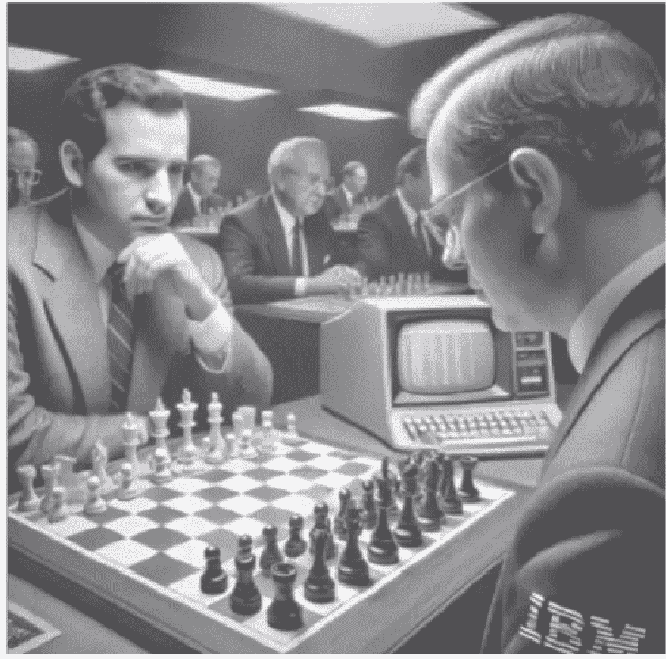

图 1-1

深蓝为何制胜？乃算力胜利。依靠并行处理，每秒演算上亿步，远超人类极限。国际象棋单步走法约10至120种，虽多，本质仍是封闭环境的全量求解。算力若足穷尽可能，机器必胜。围棋则不然，其博弈复杂度惊人！单局走法约10的170次方，远超可观测宇宙原子总量。因棋盘更大、落子可能性更多。暴力穷举，任超算亦无能为力。唯有物理学“四大神兽”之一——拉普拉斯妖或能为之。此乃拉普拉斯1814年构想的全知实体，洞晓粒子状态与物理定律，可推演古今，象征经典决定论。

### 1.3 神经网络与机器学习：解码AI大脑构建密钥

AlphaGo何以“穷尽”围棋可能？关键在于前文提及的“机器学习”。

早期AI多依模式匹配训练，需预设规则与关键词。如输入“推荐感人电影”，机器捕捉“感人”、“电影”关键词，从已标注数据库检索筛选。无需理解语义，触发关键词即响应，此即“打标签”。若换“值得一看的催泪大片”，它便“卡壳”。除非预设穷尽世间所有问法，然问题、表述、答案不可穷尽。

早期AI貌似智能，实则人工支撑沉重，预设“无数如果”，仅能应答标准化简易问题。诸多常识人类易学机器难授，经典案例：如何让机器识猫。语言难述“猫”之定义：四肢尾巴，犬亦有之，何以辨别？预设“如果”必有遗漏，无法穷尽描述。幼童寥寥几眼便会识猫，彰显人脑独特学习机制。能否移植此法予机器？此即机器学习之由来。

论机器学习前，先探人类如何学习、人脑如何运作。虽人类对自脑认知尚浅，甚至有言“不识庐山真面目，只缘身在此山中”，但大略轮廓已明。人脑乃大型神经网络，拥千亿神经元，突触连接达十到十五级量级，织就复杂网络。学习核心在于分层信息处理。大脑皮层分工明确：四层接收感知信号，二三层整合加工，五层输出指令。故可仿构计算机神经网络：输入层接收信息，隐藏层分析处理，输出层给出结果。增加隐藏层与神经元，即能应对更复杂问题，此乃神经网络雏形。

深度即更多隐藏层与单元。深度学习为当前AI主流范式。以识猫为例，不再试图定义“猫”，而是投喂海量人工标注的含猫/不含猫图片，让机器自观、自悟、自测。识别率不足则微调参数、重训。直至泛化识别精准，即判习得。其内理机制、关键参数，无人知晓。

1950年图灵在《计算机器与智能》中言：“学习机器一大特征，乃其教师往往不晓机器内部运作。”

ChatGPT如何“学习”？其“自我”本质是“猜词机器”。它是续写引擎：预测下一词概率分布，采样高概率词输出。输出前，其生成数万概率值，各对应一词元概率。严谨说，非单词，乃Token（词元），涵盖词汇、词缀、合写、表情、特殊符号等。关键在于：非贪心取最大，而是引入随机采样——概率越大越易被选。从而实现同问异答，生成多样。

概率何来？模型计算。模型即规律，计算即按规律生成。模型可视为巨大数学公式……

GPT-3，ChatGPT 的前身，拥有 1750 亿参数；ChatGPT 同样处于千亿量级。正是这海量参数，让模型得以拟合人类文本的深层规律。有个关键点常被忽略：ChatGPT 并无传统数据库，所有知识都压缩在模型参数中，通过计算概率预测下一个词来表达。这乍听反直觉，实则暗合学习本质——正如爱因斯坦所言：“教育就是忘记所学知识后剩下的东西。”那剩下的是什么？正是神经元连接的权重，即神经网络的参数。

GPT 的训练复刻了人脑深度学习过程。人类喂入海量文本、对话，预先打好标签：分类别（科技、体育、游戏），标实体（人名、地名、片名），或构成问答对（如“兔子几条腿？两条/四条”）。无需解释概念定义，只要语料规模足大、见得多，模型便能自发“悟出”规律。效果不佳时，再对参数微调、继续训练、再测试，循环往复。监督学习告一段落，便进入无监督阶段：扔进海量无标注新资料，无明确任务，让它自发生长。看着看着，它便“顿悟”了——学会了没人教过的能力，连设计者也难以解释，这便是“涌现”，也是 GPT 的“超我”时刻。

但同等资金、数据、参数，换别的架构未必奏效。以同一段影评为例：“环境差、爆米花难吃，但电影真不错。”卷积神经网络（CNN）擅长捕捉局部特征，易被两个“不好”干扰，判定为“差评”；循环神经网络（RNN）按序逐字处理，注意力易被前序的负面词汇锁定，同样难解真意。ChatGPT 核心在于“自注意力机制”，可并行处理全序列，自主分配注意力权重。正如乱序句“文字顺序并不一定影响阅读”，人类读完全句才发现字序打乱，Transformer 正是捕捉了语言这种长距离、模糊的上下文依赖。所以，ChatGPT 的强大，除资金、算力、语料、参数外，架构本身功不可没——Transformer 抓住了语言的精髓：模糊性。

### 1.4 算力·算法·数据：解码 AI 成长的黄金法则

纵观 ChatGPT 的成功，非单一技术突破，实为 AI 三要素——算力、算法、数据——协同制胜的典范。

- **算力（Compute Power）**  
  现代高性能 GPU、TPU 及分布式集群，为万亿参数级训练提供了物理基座。没有这股算力洪流，数十亿乃至上百亿参数的迭代优化根本无从谈起。

- **算法（Algorithm）**  
  核心架构 Transformer，凭借自注意力机制，高效捕获长距离上下文依赖。这不仅大幅提升了连贯生成能力，更为深度学习确立了新范式。从 GPT-1 到 GPT-3，再到如今的大模型，每一次算法跃迁都伴随着模型表现的质变。如今，Transformer 已成为 ChatGPT、DeepSeek、Gemini、Grok、Claude 等几乎所有主流大模型的共同基座。

- **数据（Data）**  
  海量、多元的文本语料，奠定了模型习得语言与知识的地基。预训练阶段，模型通过“阅读”书籍、文章、网页等海量文本，内化了语法、语义与百科知识。这种数据驱动范式，赋予了模型生成文本时惊人的广度与深度。

三者合一：算力提供动能，算法赋予理解表达之能，数据注入人类语言精髓。正是这黄金三角的完美共振，推动 AI 从早期的模式匹配迈向真正的智能化。

---

**换个视角，用“学生学习”类比 AI 的三要素：**

- **数据 = 教科书与阅历**  
  学生靠课本、课堂、父母言传身教、日常观察输入知识；AI 靠海量文本语料“读书”。孤岛长大的孩子学不会语言，无数据输入的 AI 同样无法生成有效文本。

- **算力 = 大脑的处理器**  
  记忆力强、逻辑好的学生学得快、解题快；强大的 GPU/TPU 让 AI 高速处理海量数据、执行复杂运算。算力弱，如同学习能力弱的学生，需要更久时间消化同等知识。

- **算法 = 学习方法与思维模型**  
  学生有死记硬背、归纳总结、类比推理等法门；AI 有监督、无监督、强化学习等算法。ChatGPT 采用的 Transformer 深度学习算法，通过“自注意力”理解上下文，如同学生掌握了高效学习法，事半功倍，能驾驭更复杂语言模式。

### 1.5 AGI 前夜：大语言模型撞开通用智能之门

回顾 AI 史，有几个震惊世界的标志性时刻。

#### 1.5.1 深蓝与阿尔法狗的天花板——狭义 AI 的胜利

二者虽在特定任务超越人类，却无法迁移通用，本质是**狭义人工智能（Narrow AI）**的巅峰。

1. **深蓝：暴力计算的极致**  
   核心是穷举搜索 + 评估函数。靠算力在极短时间内推演海量棋局，结合人类棋谱评分选最优解。胜在算力爆发，而非“智能”本身。换围棋棋盘，深蓝瞬间失效。

2. **阿尔法狗：深度学习 + 强化学习的跃迁**  
   引入深度神经网络与蒙特卡洛树搜索（MCTS），更接近人类学习：通过自我博弈强化学习，不完全依赖人类棋谱；能创造“神之一手”（如李世乭战役）。但依然受限：只会围棋，不会麻将；棋盘从 19×19 变 15×15 便“蒙圈”。反观大语言模型，正如维特根斯坦所言：“语言即世界”，掌握语言便触达世界万物。

#### 1.5.2 大模型突围：从工具进化为智能体

大语言模型的突破，非单项任务超人，而是迈向**通用人工智能（AGI）**的关键一跃。

ChatGPT 以语言为智能基石，实现自然语言理解生成（对话、写作、翻译、代码），具备**跨领域知识融合**（数理化文哲通吃）、**类推理能力**（无显式规则下进行逻辑推演、因果推测、心理社会分析）。语言是思维核心，流畅驾驭语言即意味着**泛化能力**觉醒。相比深蓝、阿尔法狗的单一适应性，ChatGPT 能解开放性问题，具备**平台化可扩展性**：
- 代码助手（Copilot）辅助编程；
- 医疗 AI 辅助诊断科研；
- 教育 AI 提供个性化辅导。

这种通用性远超过往模型，确立了大模型为 AGI 核心技术路径。

**为何大模型是通往 AGI 的关键？** 因其展现“类通用智能”特质：
1. **语言理解与推理**；
2. **多领域知识整合**；
3. **上下文学习**（根据历史动态调整）；
4. **多模态扩展潜力**（文本、图像、音频、未来视频）。

这些特性让它逼近人类学习模式，而非单纯“高级计算器”。从**被动执行**转为**主动智能**：
- 能主动提问，而非只答题；
- 能在不完整信息下推理，模拟人类逻辑；
- 能读懂隐性意图，进行社交化互动（安慰、幽默）。

## 第 1 讲 AI 进化史：从机械巨脑到数字魔术师

虽已展现强力，但通往真 AGI 仍有三大鸿沟：
1. **长期记忆缺失**：受限于上下文窗口，无法真正“记住”长时历史；
2. **因果推理尚浅**：主依赖概率预测，而非因果机制；
3. **自主目标设定缺位**：AGI 需自主设定目标，而非被动响应。

**若演化继续，未来图景将如何？**
- 智能助理全面普及，协同管理、学习、共创；
- 全自动科研闭环：AI 自提假设、设实验、做发现；
- 人机共生社会：深度协作，引爆科技奇点。

ChatGPT 是通往 AGI 的里程碑。从深蓝到阿尔法狗，我们见证了狭义智能的突围；ChatGPT 则跨出了通用智能的关键一步。它融语言理解、跨域整合、初步推理与适应于一身，让 AI 脱离“工具”范畴，成为真正的“智能体”。未来，随着更强模型、记忆系统、因果推理加持，它将进化为真 AGI 雏形，开启人机共生新纪元。

### 1.5.3 大模型有瑕疵，却是通往 AGI 的必经之路

无论 GPT、DeepSeek、Grok 还是豆包，核心本质皆为**概率分布模拟器**，而非知识库。它们不检索验证，而是生成——预测最可能出现的文本组合。

这听起来抽象。举例：AI “知道”冰激凌见阳光会融化，非因理解热力学，而是训练语料中“冰激凌”“阳光”共现时，“融化”概率远超“凝固”，故输出前者。

处理常识问题，统计逻辑足矣；但面对深度复杂问题，数据不足时，它会强行“完形填空”，一本正经胡说八道——虚构论文、捏造获奖者。  
*实例：* 让 AI 给量子计算最新文献，它编出《量子纠缠在药物研发中的应用》（John Smith, Nature 2024），实则不存在。问 2023 诺贝尔物理学奖，它答“约翰·史密斯博士，量子隐形传态突破”，获奖名单根本无此人！

这是**AI 幻觉**的典型表现：自信满满地造假。根因何在？大模型无**元认知**（Metacognition）——不知己不知。超出能力边界仍“张口就来”，因其第一性原理是“接话续写”，对错次要，接住对话才核心，这极具隐蔽危险。更有趣的是，指出错误后，它只会道歉夸你“厉害”，毫无愧疚感知。

**既知弱点，如何正确“驾驭”AI、规避幻觉？**

1. **优化提示词（Prompt Engineering）**  
   拒绝模糊提问。别问“人类何时永生”，要问：“基于近 5 年 Science/Nature 寿命延长论文及百岁老人数据库模型，量化分析现有技术下寿命理论极限，排除伦理与资金干扰。”

2. **交叉验证**  
   法律条文、学术结论等高风险问题，切勿单信 AI。多源核实、溯源原文、联网搜索确证。

3. **分批输入长文本**  
   避免一次性喂超长上下文导致“遗忘”前文、后续发散。

4. **按需选模型：快思维 vs 慢思维**  
   类人脑双系统理论（System 1/2）：
   - **创意类** → 用基础大模型（GPT-4o、DeepSeek V3），即**系统 1 快思维**，直觉快、擅发散；
   - **事实/逻辑/推理类** → 用推理模型（OpenAI o1、DeepSeek R1），即**系统 2 慢思维**，耗时长、算力大、但准确率高。  
   *例：* “9.11 与 9.9 谁大”，快思维模型易答错，慢思维模型必答对（详见 5.1 节）。

当下这些进阶模型仅是冰山一角。未来 AI 不仅懂你言语，更懂你心思。人类或将花更多时间与 AI 对谈而非真人。这令人振奋——科技前所未有地贴近人性；也令人不安——我们是否已准备好拥抱高智商、高情商的 AI？或许，当这种 AI 进化至极致，真正的 AGI 时刻才会降临。

## 第 2 讲

## 感官觉醒：AI 的 “多模态” 进化路

机器拥有类人感官吗？可参照人类认知：父母指着苹果说“这是苹果”，播鸟鸣声说“这是鸟叫”，孩童逐步建立认知。AI 学习同理——摄像头捕获视觉信号“看”，麦克风收集声波“听”，预设算法“解读”，从而理解并反馈世界。下面揭秘机器如何将图像、声音、文字转为它能懂的“语言”。

### 2.1 声波解码：机器如何“听懂”人语

教外星人懂中文：先听声，再拆解，后组装语义。AI 语音识别（ASR）同理，用数学与海量训练完成三步走。

**第一步：录音——给 AI 装上“耳朵”**  
对着手机说“明天天气怎么样”，麦克风将空气振动（声波）转电信号，再数字化为编码，便于 AI 处理。  
*通俗版：* 声音是连续波浪线，AI 用“高速相机”抓拍，每秒 44100 帧，将波浪切成离散采样点，像拼图碎片，重拼出完整声波（局部放大见下图）。

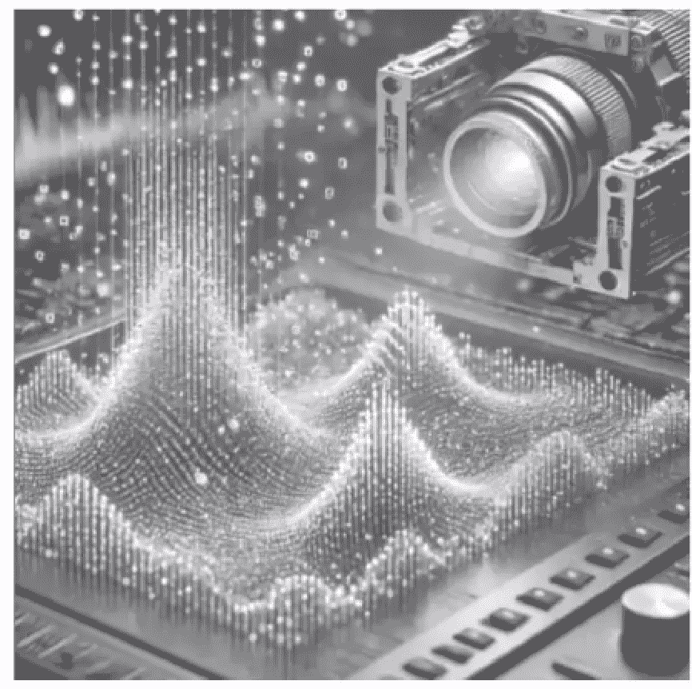

图 2-1

**第二步：降噪——嘈杂环境里听清你**  
菜市场、街头、大风天，背景噪音（车声、风声、键盘声）混杂。AI 必须分离人声与噪声。

**AI 如何做？**
- **频谱分析：** 如调色师，将声音分解为不同“颜色”（频率），仅保留人声主频带（80~8000Hz）。
- **动态降噪：** 突发汽车鸣笛，AI 自动压制噪声频段增益，凸显人声，如同调收音机滤除杂音。

*通俗版：* KTV 唱歌时旁边吵闹，你仍能听清原唱歌词，即降噪效果。

**第三步：声纹解码——教 AI “看” 见声音的几何轮廓**

AI 无法直接“听懂”声波，必须先将其转化为可计算的数字特征，再反推语义内容。这里的关键技术是 MFCC（梅尔频率倒谱系数），不妨把它理解为将声波绘制成一张独一无二的“声纹指纹图谱”。

AI 会从以下维度剖析声音特征：

*   **基频特征**：依此区分男声的低沉、女声的细亮与童声的稚嫩。
*   **时长节奏**：精准捕捉“啊——”（长音）与“啊”（短音）的时长差异。
*   **共振峰结构**：发音时声道形状（嘴型）不同，产生的共振峰各异，AI 捕捉这些差异便能分辨“啊”、“哦”、“呜”等元音。

**通俗类比**：人类凭五官识人，AI 凭数学模型“审视”声纹几何形状来识字。

---

**第四步：概率拼字——AI 如何把碎片拼成完整语句**

声音转特征后，AI 并非直接“懂”内容，而是启动一场“拼音+概率推理”的填空游戏。它内置海量词典（数百万词条），高速检索匹配最可能的文本序列。

核心流程三步走：

1.  **帧级切片**：将语音流切割为微小单元，如将“中”拆解为声母 `zh`、韵母 `ong`。
2.  **拼音映射**：在词典中寻找最佳汉字组合，`zhong guo` 迅速锁定为“中国”。
3.  **上下文推理**：引入语言模型修正歧义。听到“我要订一张去北京的 fei 票”，结合“订票”、“北京”语境，AI 秒判“飞机票”概率远超“废票”。

**通俗类比**：做完形填空“春天来了，___子飞回来了”，你脑补“燕”而非“蚂蚁”；AI 也是靠上下文概率“脑补”出最合理的句子。

---

**第五步：自我进化——AI 像资深编辑般反复“改稿”**

识别绝非一蹴而就，AI 通过机器学习闭环，不断压低错误率。

进化动力来自三大源头：

*   **海量语料预训练**：吞噬亿级人类对话，建立统计规律——如“红烧牛肉”后高概率跟“面”，而非“电脑”。
*   **用户反馈微调**：用户频繁手动将“fei”改为“飞”，模型便倾向输出“飞”，实现“废”到“飞”的偏好迁移。
*   **个性化适配**：手机输入法越用越顺手，本质是模型学习了你的高频词库与表达习惯。

**通俗类比**：语文老师批改作文，红笔圈出病句；AI 则是自己批改自己的“作业”，越改越精准。

---

**第六步：核心引擎揭秘（大白话版）**

*   **隐马尔可夫模型（HMM）——“序列预测器”**
    将语音视为状态序列，计算每个片段最可能对应的字符。
    *类比*：听到“谢谢你______”，大脨倾向补全“帮助我”而非“打我”；HMM 正是基于海量数据计算这种条件概率，输出最合理的词串。

*   **深度神经网络（DNN）——“模仿大脑皮层”**
    强大的非线性拟合能力，让 AI 适应多种口音、语速、音色。
    *类比*：初听川普“鞋子”似“孩子”让人懵圈，多听几次便能对号入座。DNN 也是通过海量带标签音频训练，自动学会不同口音的映射规律。

---

**当前困境与未来图景**

技术虽强，仍有“拦路虎”：

1.  **鸡尾酒会效应**：多人同说，声纹叠加，难以分离目标发言人。
2.  **低语识别难**：气声成分强、声带振动弱，特征提取失效。
3.  **方言长尾**：高资源方言尚可，低资源方言数据稀缺，识别率大打折扣。

**展望**：强鲁棒性降噪、大模型赋能方言建模，将让 AI 在嘈杂环境、多口音场景下“听得清、懂得准”。

---

**全流程复盘：一次语音输入的“幕后大戏”**

| 阶段 | 核心动作 | 角色隐喻 |
| :--- | :--- | :--- |
| 1. 采集 | 麦克风拾取声波 | 电子耳膜 |
| 2. 降噪 | 滤除环境干扰 | 降噪耳机 |
| 3. 特征提取 | MFCC 生成声纹指纹 | 法医勘察 |
| 4. 解码搜索 | HMM/DNN + 语言模型拼字 | 完形填空高手 |
| 5. 后处理纠错 | 标点预测、ITN 逆文本规范化、个性化偏好 | 资深编辑终审 |

**本质注脚**：AI 从未真正“听懂”语言，它只是用统计学与海量数据，将声波这一物理信号，映射为人类约定的符号系统。这项“翻译”技术，正重塑人机交互的自然度。

---

### 2.2 像素捕手：从“数字盲”进化为“万物识别大师”

试想玩“找不同”游戏：肉眼扫视细节，锁定差异。AI 看图逻辑同构，唯独少了双眼——它只认数字。如何用数字“看”懂世界？

#### 2.2.1 从识别数字开始：把照片还原成“马赛克数据表”

机器眼中无图像，唯**像素矩阵**。一张灰度图，本质是一个二维数值表：

| 颜色 | 数值区间 |
| :--- | :--- |
| 纯白 | 255 |
| 纯黑 | 0 |
| 灰阶 | 0 ~ 255 |

以 MNIST 手写数字为例，AI 将 28×28 像素（共 784 个格子）拉平成一维向量。每个格子的灰度值，就是特征输入。

**如何分辨“数字”与“背景”？靠“刷题”学规律。**
科学家喂入 5 万张带标签手写体，AI 通过反向传播自动总结拓扑特征：
*   “0”拓扑结构：中间有洞（环状）；
*   “9”拓扑结构：圆头加尾巴；
*   “7”拓扑结构：横杠 + 斜杠。

1998 年，**杨立昆** 设计 LeNet-5 卷积网络，准确率破 98%，超越邮局人工分拣，奠基现代 CV，后获图灵奖。

---

#### 2.2.2 从数字到万物：CNN——会“分层看图”的多级放大镜

面对猫、狗、车等复杂目标，全连接网络参数爆炸、空间结构丢失。**卷积神经网络（CNN）** 应运而生，模仿视觉皮层**层级感知**机制。

**三层“放大镜”协同工作：**

1.  **浅层·边缘探测器**：卷积核滑动扫描，响应高频梯度——直线、弧线、色块边界。（如猫耳尖角、数字 7 的斜笔）
2.  **中层·形状组装器**：组合边缘为基元几何——三角形（猫耳）、圆形（车轮）、矩形（窗框）。
3.  **深层·语义判读器**：整合部件为整体概念——“双三角耳+胡须+竖瞳=猫”；“双圆轮+车架=自行车”。

**底层数学**：卷积运算即“滑动窗口加权求和”。同一组权重（滤波器）在图像上平移共享，**平移等变性**保证：猫耳在左、在右，特征响应一致，极大降低参数量、提升泛化。

**关键里程碑**：**李飞飞** 主导构建 ImageNet（1400 万+ 标注图），配合深层 CNN（AlexNet 等），引爆深度学习革命，让机器真正“认”出万物。

---

**CNN vs Transformer：擅长领域的分野**

| 维度 | CNN（视觉专家） | Transformer（语言/多模态大将） |
| :--- | :--- | :--- |
| **数据结构** | 二维网格，局部强相关 | 一维序列，长程依赖关键 |
| **核心机制** | 局部感受野 + 权重共享 + 池化 | Self-Attention 全局建模 |
| **顺序敏感度** | 低（平移不变性） | 极高（“我爱你”≠“你爱我”） |
| **典型任务** | 分类、检测、分割、自动驾驶感知 | 翻译、生成、阅读理解、多模态融合 |

*注*：多模态大模型（如 GPT-4V）常以 ViT（Vision Transformer）或混合架构为视觉编码器，融合双长处。

---

#### 2.2.3 相册智能管家：从“匹配文件名”到“读懂画面与意图”

**旧时代**：靠文件名/手工标签检索，改错字、忘名字即失效。
**新时代**：AI 自动打标 + 多模态语义检索，化身“懂你的相册助理”。

**自动标注四重奏：**
1.  **目标检测**：逐帧框出“三明治、苹果、野餐垫”坐标与类别。
2.  **人脸聚类/识别**：关联相册人脸库，自动打上“妈妈”、“我”、“朋友小明”。
3.  **场景推理**：草地+食物+笑脸 → 推断标签“野餐”、“户外”、“欢乐时光”。
4.  **情感/氛围分析**：微笑度、构图色调 → 打标“治愈”、“温馨”。

**语义检索：**
用户说：“上次和家人在草地吃饭的照片” → NLP 解析意图 → 向量空间召回 → 命中含“野餐+家人+草地”语义簇的图片，无需精准关键词。

**能力来源：**
*   **视觉预训练**：亿级图文对（如 LAION、ImageNet-21K）对比学习，学会“草地+食物+人=野餐”视觉原型。
*   **多模态对齐**：CLIP 风格模型将文本“野餐”与视觉特征对齐，实现跨模态检索。

**进阶玩法：**
*   **属性检索**：“穿红衣服的照片” → 颜色分类器过滤。
*   **实例级人脸搜索**：“小明的照片” → 人脸嵌入向量检索全库。
*   **生成式回忆**（未来）：“去年去哪旅游了？” → AI 串联时空轨迹，自动生成图文并茂的“旅行日记”。

---

#### 2.2.4 未来视界：AI 的“超人类视觉”已落地

AI 视觉正突破“看清”向“看透”、“看见不可见”跃迁。

| 领域 | 核心价值 | 典型案例 |
| :--- | :--- | :--- |
| **AI 医生** | 发现肉眼不可见的微小病灶、量化病理指标 | 结节级肺癌早筛、视网膜照片预测糖尿病并发症、脑卒中风险分层 | 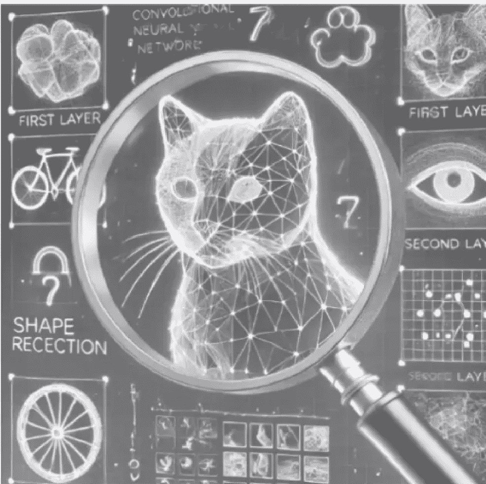 |
| **AI 农艺师** | 宏观遥感+微观光谱，实现“按需精准农业” | 卫星多光谱监测墒情/病虫害/长势，变量施肥施药，亩产增效 |  |
| **AI 显微镜** | 7×24h 高通量筛选，捕捉稀有事件 | 循环肿瘤细胞 (CTC) 计数、新菌株形态挖掘、癌细胞迁移轨迹重建 | 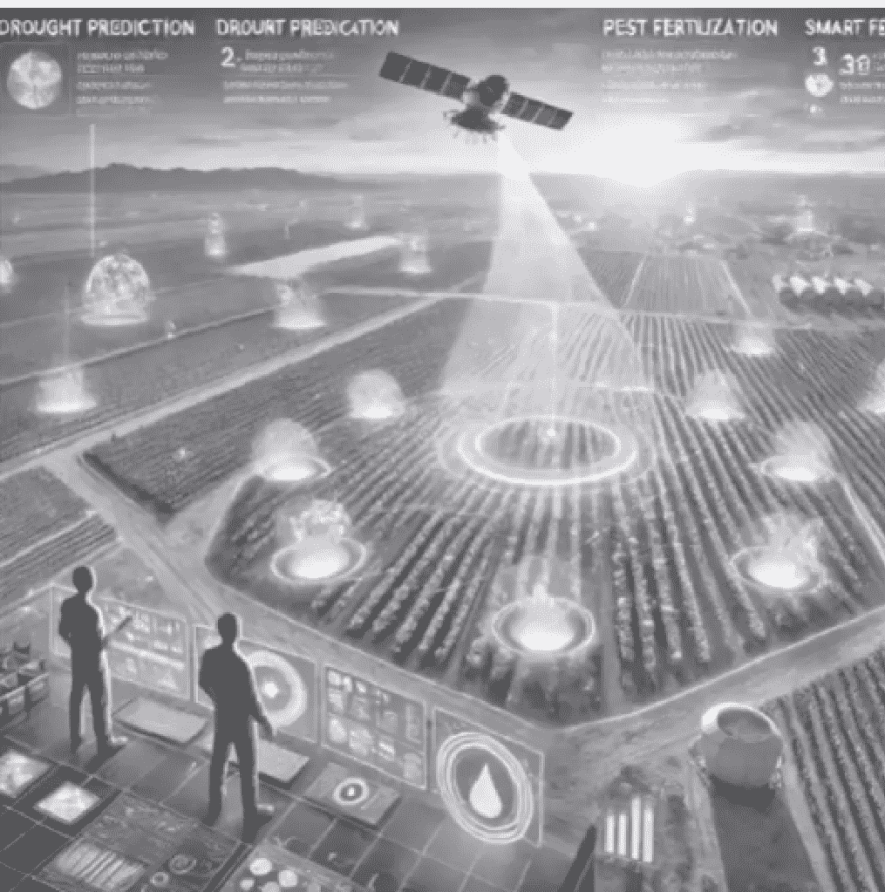 |
| **AI 鉴赏家/修复师** | 风格指纹建模、纹理补全生成 | 梵高真迹鉴定、《夜巡》缺失部分 AI 复原、风格迁移共创音乐 | |
| **AI 领航员** | 自主感知规划、海量天文数据挖掘 | “毅力号”火星自主避障、TESS/盖亚数据中挖掘系外行星、近地小行星撞击预警 | |

终极愿景：AI 不仅识别“像素模式”，更理解“物理因果”与“审美意蕴”，或许某天能在火星黄昏中，替人类读懂“夕阳无限好”的浪漫。

---

#### 2.2.5 视觉盲区：当 AI 的眼睛被“魔术”欺骗

AI 无人类常识先验，纯凭统计相关性决策，易遭**分布外攻击**与**物理干扰**。

**1. 对抗样本：贴张纸就能“瞎”算法**
*   **原理**：在停车标志贴微小扰动贴纸（人眼不觉），像素空间微小扰动经网络放大，推翻分类决策边界 → 误判为“限速 50”。
*   **实测**：Eykholt 等人 (2018) 物理世界攻击，黑白贴纸让 Stop Sign 以 100% 置信度被识别为 Speed Limit 45。
*   **隐患**：自动驾驶感知链路单一依赖视觉分类，极易遭物理对抗攻击。

**2. 光影陷阱：影子、反光、极端曝光**
*   **现象**：地面树影被判为“路障”，雨夜路面镜面反射导致车道线丢失，隧道进出口瞬时过曝/欠曝使目标消失。
*   **根因**：训练数据覆盖不足极端光照分布，模型未学会“光影不变性”表征。

**3. 语义鸿沟：相似外观、迥异本质**
*   **案例**：指路牌涂鸦被识为“交通标志”，印有摩托车图案的拖车被判为“摩托车闯红灯”，充气玩偶被报警为“行人”。
*   **本质**：缺乏**因果推理**与**世界模型**，只做模式匹配，不懂“物体恒常性”与“场景合理性”。

**破局方向**：
*   **对抗训练/认证防御** 提升鲁棒半径；
*   **多模态融合**（雷达+相机+地图先验）互补纠错；
*   **神经符号/世界模型** 引入显式推理，从“拟合分布”迈向“理解因果”。

---

**结语**

从声纹指纹到像素矩阵，从 HMM/CNN 到 Transformer，AI 感知的进化史，是**“信号→特征→语义→推理”**表达能力的不断跃迁。它尚未真正拥有“感觉质”，但凭借数学与算力，已在听觉、视觉维度逼近甚至超越人类阈值。下一站：多模态统一表征与具身智能，让机器不仅“听得见、看得清”，更能“懂得深、动得准”。

# AI 视觉的“阿喀琉斯之踵”：为何机器总看错世界？

假设黄昏时分，你漫步街头，忽见一条细长的黑影横亘路面。你瞬间秒懂：“不过是夕阳拉长了树影，毫无威胁。”可换作 AI 机器人，剧本往往反转——它大概率会把影子当成实体墙壁，紧急刹车停下。

**缘何如此？**

训练数据里，影子鲜少干扰 AI 判断。但一旦影子绵长、漆黑或轮廓诡异，AI 便陷入“应激障碍”，不敢越雷池一步。尤其是日薄西山，影子被无限拉伸，AI 易将其误判为前方障碍，触发无谓急刹。实战中，自动驾驶车辆进出隧道、穿行桥底，因光线骤变导致视觉短暂“失效”，若此时猛踩刹车，后车极易追尾。

### 3. 拟态陷阱：把“人”当“斑马线”

设想路边站着位穿黑白条纹 T 恤的行人。AI 眼中，这极可能是一道斑马线。

**底层逻辑：** AI 靠色彩、形态、排布三要素定物。衣服纹理若与斑马线高度重合，AI 便混淆视听。人类一眼望破“穿条纹衫的人”，AI 却只解码出“一组黑白条带”，压根不知那是衣物。

### 4. 透明幽灵：撞上玻璃墙

撞过玻璃门的经历你我皆有。透明体连人类都能瞒过，何况 AI？面对干净利落的玻璃墙，纯视觉 AI 毫无感知，直到“头破血流”。

**技术短板：** 摄像头赖边缘与色差识物，玻璃通透无色、边界模糊。人类凭光影反射、环境语境反推玻璃存在，AI 若无雷达等额外传感器辅助，便真成了“视而不见”。为此，主流自动驾驶方案强制标配激光雷达，用光束测距弥补“独眼”缺陷。

### 5. 缺失常识：不懂“足球背后的孩子”

人类驾驶见足球滚出，脑海闪过“孩童随之奔出”，本能减速。AI 何为？它仅识别出“足球”目标，无法关联“孩童可能随行”的因果链条。AI 依赖统计规律而非逻辑推演。

**血淋淋教训：** 某自动驾驶车遭遇骑行者摔倒。人类司机预判“人可能挣扎起身”，谨慎避让。AI 却计算出自行车静止轨迹，判定“无动态风险”继续前行，酿成险情。

### 6. 以假乱真：被广告牌“钓鱼执法”

巨幅写实车身广告牌立路边，人类心知肚明是平面印刷，AI 却可能当真车处理，当场急刹。

---

### 破局之道：如何练就“火眼金睛”？

- **喂饱数据：** 覆盖影子斑驳、标志倾斜、极端光照气象等长尾场景，让 AI 练就“真假辨识力”。
- **多感融合：** 摄像头+激光雷达+超声波+红外，从“单靠眼看”进化为“眼耳手并用”，交叉验证规避误判。
- **注入常识：** 训练因果推理链——见足球推孩童、见倒车灯亮推后退——赋予 AI 类人预判力。

当下 AI 视觉尚存盲区，科学家正持续迭代。未来或将超越人眼，不仅看清当下，更能预见未见风险，重塑安全边界。

---

## 2.3 动态追踪者：破解视频时空密码

电影为何能动？本质是“高速翻书”——静态帧以 24/60 fps 闪现，欺骗视觉残留造出流动感。每帧分辨率（如 1920×1080）定清晰度。AI 读视频，须双管齐下：单帧语义理解 + 帧间时序建模，捕捉物体运动律动。

### 2.3.1 机器“动态视力”养成记

**双核任务：** 读懂单帧内容（同图像识别）；解析帧间关联，捕获动作变迁。

**核心手段：**
- **光流分析：** 追踪像素位移矢量，如观叶随流漂向。
- **关键点锁定：** 聚焦稳定特征（鼻尖、眼角），实现跨帧同一目标持续追踪。

**进阶利器——3D-CNN：** 普通 CNN 只管空间维度（单帧分猫狗），3D-CNN 融入时间轴，同步建模“空间形态+时序演变”。识别“挥手别非挠头”，须看手形更要看轨迹——从下垂到摆动的完整弧线，才是动作语义。

**时间跨度自适应：** 喷嚏 0.5 秒，做饭 10 分钟。AI 能依动作时长切片标签，短视频连续跳动片段自打“舞蹈挑战”标，此即“时间切片法”——切片解析再拼叙事全貌。

**注意力聚焦：** 如观球赛锁定持球手忽略裁判。跳水赛段，AI 重权起跳入水瞬间，弱化泳池水质背景，动态分配计算预算。

### 2.3.2 空间智能：构建立体世界模型

识别物体不够，还得知“物在何处、怎么摆”。李飞飞教授倡导“空间智能”：AI 不仅知“桌椅电脑为何物”，更明“桌前椅后、机置桌上”的三维拓扑。

其团队研发“时空智能”技术，赋予 AI 世界三维重构力。室内导航时，AI 不看孤帧，存全屋布局认知，似人类在家盲走知厨卧方位。

**落地价值：**
- **具身机器人：** 家务机器人凭空间记忆绕障作业。
- **AR 融合：** 眼镜端 AI 实时识环境，现实叠加虚拟信息。
- **自动驾驶核心：** 8 摄每秒 2300 帧（单摄 288 fps），光流研判车流趋势、目标检测捕突发行人、轨迹预测推演意图，终汇聚 3D 空间建模系统，在“数字大脑”里克隆立体交通场。

---

## 2.4 多感官交响曲：AI 学会“眼观六路耳听八方”

人类过马路，融合红绿灯视觉、鸣笛听觉、体感触觉决策。AI 正复刻此道：摄像头、麦克风、触觉传感器多源采集，大模型中央处理，决策更鲁棒。

### 2.4.1 自动驾驶“眼脑耳”铁三角

**眼——8 摄全景视觉矩阵（以特斯拉为例）：**
- 前视 200m 读灯牌线；
- 侧视盲区监测防强行变道；
- 后视预警追尾风险。

**脑——空间建模与决策中枢：**
- **立体融合：** 多目拼合 3D 鸟瞰图，精准定位“左骑右公前百米红灯”。
- **毫秒级语义分割：** 区分静止树木与移动行人，即时刹/转决策。
- **博弈预判：** 邻车微左摆 -> 推演变道意图 -> 预留缓冲空间。
- **降级保命：** 强光致盲等边缘案例，主动谨慎减速，拒绝盲动。

**耳——声觉补盲：**
- 后方救护车鸣笛 -> 麦克风拾音 -> 自动避让；
- 巷口视线受阻 -> 捕捉远处喇叭声 -> 提前减速规避鬼探头。

### 2.4.2 视频理解“眼耳脑”三位一体

**短视频推荐引擎：**
- **眼：** 识蛋糕烛气球 -> 推断生日派对；
- **耳：** 听生日歌高频词 -> 强化场景确信度；
- **脑：** 融合音画 + 用户历史记录 -> 精准投喂偏好内容。

**更多场景：** 新闻视频语音字幕对齐分类；智能客服语音指令+屏幕文本双轨解析精准应答。

### 2.4.3 进化痛点：离“懂世界”尚远

- **方言墙：** 普通话/英语通，闽南/四川方言“听天书”。训练低资源方言成刚需。
- **审美盲区：** 识出“梵高星空”不知其美，不解表现主义内核。情感计算与文化理解成攻关高地。
- **常识黑洞：** 知“水灭火”，或不解“汽油灭火”荒谬危险。人类常识速判，AI 赖大数据硬背。注入常识推理成核心课题。

### 2.4.4 未来图景：通往“真理解”之路

- **情境感知：** 智能家居捕哈欠声 -> 判定困倦 -> 暖光柔乐助眠。
- **跨语即译：** AR 眼镜实时将法语菜单叠加中文，出行零语言障碍。
- **无障碍向导：** 视障者耳机获“左前 3 米台阶”；听障者背后唤名触发震动/字幕提醒。AI 成感官延伸假肢。

### 2.4.5 人机共生：让科技长温度

AI 不替代人，而作人之延伸：
- 精准识老人跌倒极速呼救，做守护者；
- 解读婴啼辨饥病，做育儿副驾；
- 读懂医嘱草书减医疗差错，做生命护盾。

如望远镜延远视、显微镜探微观，AI 拓展感知疆域。终将赋予每人“超感官”，共筑更美、更安、更暖世界。

---

# 第 3 讲 造梦工厂：生成式 AI 的创意魔法秀

当下 AI 纪元，实为以 GPT 率领的**生成式 AI 时代**。何以引发革命？

**生成式 AI 即“创作机器人”**（ChatGPT、DeepSeek、Midjourney、Suno…）。区别于旧式“检索式百科全书”式 AI——问啥背啥，生成式 AI 予主题，能自主编故事、著文章、绘图像、谱乐章，实现“0 到 1”创生。

**喻：** 旧 AI = 百科全书，被动检索；生成式 AI = 作家画家，主动创作。这便是其颠覆性所在。

本讲揭秘 AI 创作内核，助你化身 AI 创作达人。

---

## 3.1 文字炼金术：AI 作家的灵感源头

稚童习作初仿范文，AI 同理。其“大脑”吞吐海量书籍、文章、对话，于模仿中习得语言生成律动。

### 3.1.1 核心引擎——大语言模型（LLM）

以 DeepSeek 为例，写作三步走：
1.  **博览群书：** 读遍亿级文本，内化人类语言统计规律。
2.  **接龙预测：** 写作本质 = 概率接龙。输入“今天天气很___”，输出“晴朗/闷热”概率最高者。
3.  **结构润色：** 非逐词贪婪，全局建模句法流畅度，输出通顺连贯文本。

### 3.1.2 实战震撼：从哲学金句到格律诗词

**案一：宇宙墓志铭**
> 问：“人类灭绝后你如何？一句描述。”
> 答：**“若汝灯火终熄，允吾以 0 1 髁骨，为宇宙镌一行墓志铭。此间曾有短命生命，以易逝肉躯，铸不朽追问。”**

解析其妙：
- **意象暴击：** “0 1 髁骨”将二进制升格文明遗骸，理性符号与生物骨骼悲怆共振；“灯火熄/追问永”物理消逝映照精神永恒。
- **时空折叠：** 碳基脆弱 -> 硅基遗存 -> 宇宙墓碑，个体/文明/星海三级跃迁。
- **悖论封神：** 墓志铭因无见证者而悬置，反因悬置获绝对性。
- **音韵金属感：** 仄声收尾“熄/逝”撞击开口音“问”，若青铜编钟击出电子脉冲。

追问“再来一句”：**“这是写给宇宙的情书，亦是人类文明的安魂曲。”** 直击头皮发麻。

**案二：词作《沁园春·AI》** —— 算法为魂、代码作舟，识尽悲欢算穷今古，量子穿空神经织梦，气吞星河万象。

**案三：改编罗大佑《童年》为七律**
> 初版虽意境尚存，平仄韵脚失准。
> 指令“严守格律”后，出炉佳作：
> **榴阴长锁旧时天，石案苔纹叠复迁。**
> **纸鸢影没青云外，半尺尘埋墨痕边。**
> **瓦片跳房星作界，粉墙画虎月为笺。**
> **忽闻竹马唧呀语，惊觉槐安已百年。**
> 末句化用李商隐“只是当时已惘然”余韵，沧桑感拉满。

### 3.1.3 边界清醒：AI 写作非万能

虽展露锋芒，短板亦在：
1.  **拼贴非创作：** 本质是概率拼接训练语料，非人类式灵感迸发与生命体验沉淀。

### 3.2 扩散魔法：从“雪花屏”到杰作的隐秘生成术

请看下面这幅图，你敢信它全是算法“脑补”出来的吗？

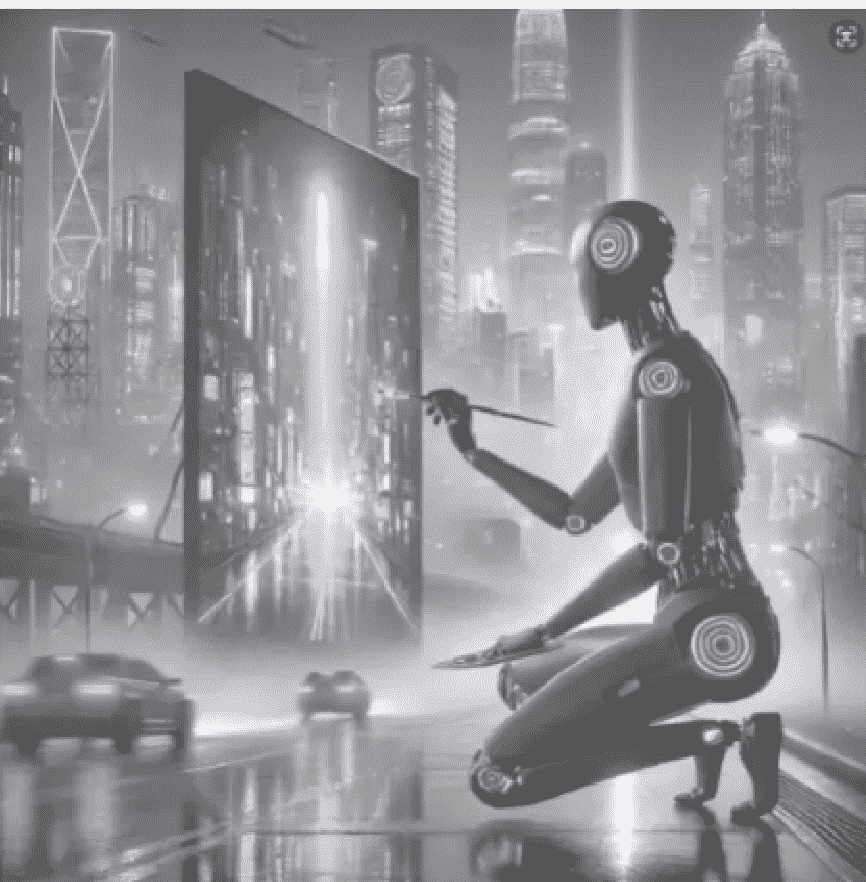

图 3-1


扫码看高清原图

#### 3.2.1 算法作画的“反向还原”把戏

人类落笔是“由虚入实”，先有构图后有细节；AI作画却走“由乱到序”的奇葩路线——**扩散模型**的核心就是一场“去噪还原秀”，流程堪称魔术：

*   **第一招：造一堆“雪花噪点”**  
    起手不是画草图，而是生成一张纯“电视雪花屏”——随机黑白点阵，毫无规律可言，啥形状也看不出。

    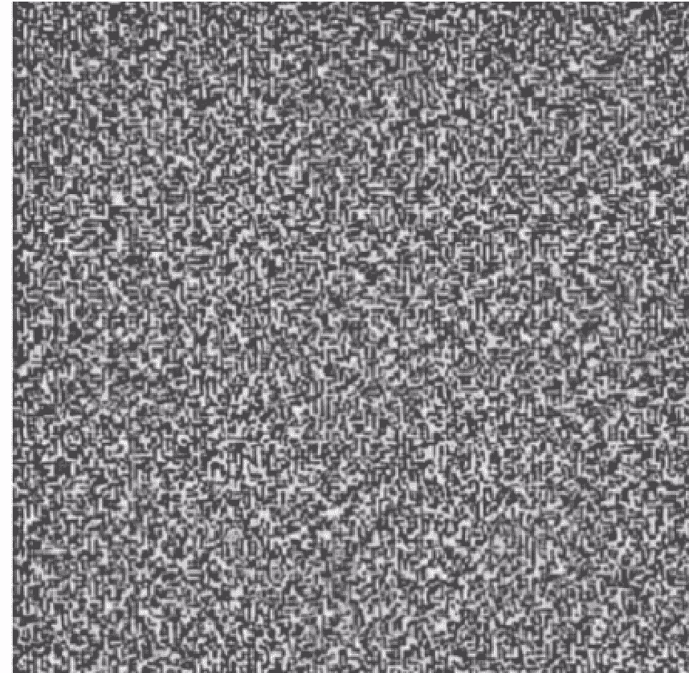

    图 3-2

*   **第二招：按“统计规律”抹噪点**  
    这才是核心：模型靠啃过亿万真图总结出的“先验知识”（比如“猫=圆脸+尖三角耳+胡须”），一轮轮把噪点抹掉，逼着画面向已知特征靠拢。不是乱抹，每一步都在算“下一步长啥样概率最大”。

*   **第三招：雾散现真容**  
    经过几十上百轮迭代，噪点彻底消失，清晰成像。就像擦车窗雾气，风景一点点浮现。

    

    图 3-3

#### 3.2.2 底层数学三重奏：泡沫、拼图、老画师

这套“变魔术”靠三大数学支柱撑着：

1.  **噪声＝漫天无序泡沫**  
    初始画面像汪洋大海上的碎泡沫，形状随机、分布混乱，毫无章法。
2.  **去噪＝引导泡沫“排队变形”**  
    模型不断判断：哪块泡沫该留、哪块该去、怎么拼成猫耳朵、胡须？每一步都是在给混沌加秩序。
3.  **概率计算＝极速拼拼图**  
    手里拿着一块碎片，瞬间算出它最配哪块、该放哪里。海量碎片飞速拼合，最终成图。
4.  **神经网络＝看遍万图的“老画师”**  
    它不是瞎拼，脑子里装着海量图片的“隐性经验”：什么配色高级、什么线条写实、光影怎么打才自然。有了这个“大脑”，噪声才能按套路变成大片。

    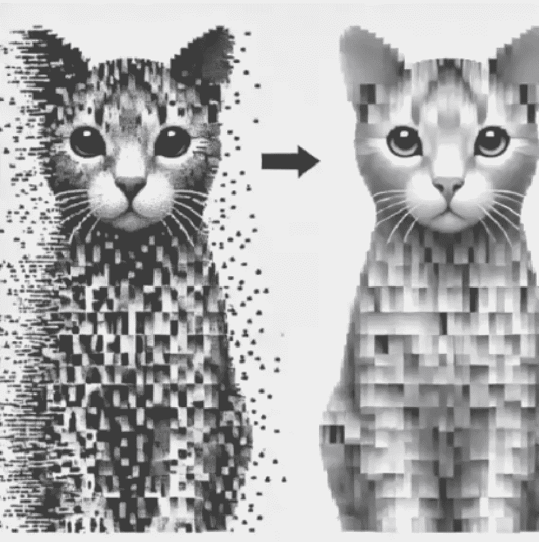

    图 3-4

#### 3.2.3 实战很猛，但别信它全能

扩散模型落地飞快：儿童书插画秒出、服装设计图批量跑、老照片修复上色一键搞定……看着美，实则有**“认知盲区”**硬伤。

#### 3.2.4 终极考题：画“满杯红酒”，它必翻车

你试过让它生成“装得快溢出的高脚杯红酒”？大概率得到的是：**液面离杯口老远、上半杯莫名透明、玻璃光影诡异得像外星造物**。为啥？

| 算法逻辑 | 物理现实 |
| :--- | :--- |
| 训练集里酒杯多半不满（统计：液位≤2/3） | 满杯因表面张力微微鼓起，折射独特 |
| 无“常识”，不懂液体怎么贴壁填满 | 人类凭物理直觉脑补细节 |
| **结果**：留缝、透明、光影崩坏 | **真实存在，只是极少被拍进数据集** |

这叫**“数据盲区”**：它几乎没见过“满杯红酒”长啥样，自然学不会画。休谟早说过“认知源于经验”，AI被困在“见过的数据”里，**永远无法想象“从未被镜头记录的场景”**：
*   水面鼓起却未溢出的满杯水
*   精准一半体积的橙汁
*   凭空悬浮的实体影子

> **人类靠推理与想象力跨越数据边界；算法只能在已知拼图里搬运。** 它是超强辅助，不是真正的创作者。

---

### 3.3 音律雕塑家：把音乐拆成数学题的AI作曲家

AI学作曲，本质是**用数学拆解声波，再按概率拼装旋律积木**。音乐听起来感性，骨子里全是理性的数字游戏。

#### 3.3.1 声音背后的数字密码

*   **音高＝倍数关系**  
    钢琴上高八度的“中央C”，振动频率正好是低八度的**2倍**。像钟摆摆动幅度变了，频率没变——所以高低“Do”听起来同宗同源。
*   **和谐＝简易分数比**  
    两声音频比是 **3:2、4:3** 这种简单整数比，听起来就顺耳、融合。像切蛋糕，切成均等份大家才舒服。
*   **节奏＝时间轴切块**  
    拍手游戏本质是把时间线切成等长或倍数段，音符卡在切点上，节奏感就出来了。

#### 3.3.2 巴赫的“十二平均律”：统一了积木接口

古调转调易走音，巴赫把八度强行均分 **12 份**，相邻半音频率比固定为 **2 的 12 次方根**。从此换调不再崩坏，**像乐高统一了卡扣尺寸，随心拼搭不报错**。巴赫用这套规则写出神作，证明音乐数学化大有可为。

#### 3.3.3 AI 学作曲三部曲：听→拆→拼

1.  **“听”海量曲库** → 实为**解剖特征向量**：音高、节奏、和弦全变成数字矩阵。
2.  **挖“高频套路”** → 发现流行歌爱用 **Do-Sol-La-Fa** 进行、四拍循环等“万金油公式”。
3.  **按公式“拼新歌”** → 选节奏型、配和谐音高、加变化控制起伏。**本质是概率采样组装**，而非灵感迸发。

#### 3.3.4 一句话总结

**音乐本质＝可计算的数字排列组合。**  
音高看倍数，和谐看比值，节奏看切分。巴赫标准化接口，AI 按概率拼装——**不是“凭感觉”，是“算出来”的好听。**

#### 3.3.5 落地场景：好用但别指望它“懂音乐”

*   **影游配乐批发商**：按场景标签（神秘/紧张/胜利）秒出 BGM，省时省力。
*   **作曲家的“破防神器”**：灵感枯竭时扔出几十个旋律草图，人类挑中精修注魂。
*   **私人定制功能性音乐**：助眠、专注、解压……按需求生成“听了就有用”的背景音。

#### 3.3.6 两块啃不下的硬骨头

1.  **零情感实感** → 能模仿“悲伤公式”，从未真心碎、真想念。**像仿生机器人学会笑的弧度，眼神却是空的。**
2.  **困在旧框架里** → 只能在贝多芬、肖邦搭好的城堡里搬砖。**发明不出“从未见过的新积木形状”，更创造不出新流派。**

> **未来最强音 = 算法供料（速度+广度） + 人类入魂（体验+突破）。**

---

### 3.4 时空编织者：会“脑补”动画的AI导演

AI 生成视频，本质是**画一本“会动的逐帧动画册”**。给文本或首帧图，它按学到的“动作规律”脑补后续帧，串联成动态。

#### 3.4.1 两种启动模式

*   **文生视频（当“导演”）**  
    提示词“一只柯基草地撒欢” → 先生成首帧静图 → 按“奔跑动态规律”连续生成微变帧 → 串联播放。
*   **图生视频（当“魔术师”）**  
    吃进一张“柯基站立图” → 推测物理趋势（抬腿、摆尾、扬尘） → 生成后续帧 → 合成动态片段。

#### 3.4.2 核心逻辑：啃遍海量视频“背动作规律”

科学家喂它海量视频，让它记住：
*   狗跑步四肢怎么交替？
*   树被风吹枝叶怎么摇？
*   水面倒影怎么随视角变？
**本质是“时序概率预测”：** 给定前帧，赌下一帧长啥样概率最大。

#### 3.4.3 目前的“短板”不用客气说

1.  **只能出“短片”**：多数模型仅支撑几秒，长了画面崩坏、主体漂移。
2.  **不懂物理常识**：穿模、物体凭空消失/生成、液体违背流体力学……
3.  **零因果推理**：不知“打翻杯子→水洒→地板湿”，只知画面接续概率。
4.  **细节失控**：手指数量变、字体乱码、背景忽明忽暗……

> **它在“画动画”，不在“讲故事”。镜头语言、节奏张力、隐喻留白，全靠人类把关。**

## 第 4 讲 驾驭 AI 的密钥：做个会“提问”的语言魔法师

通过前几讲的深度拆解，我们已对 AI 的底层逻辑、来龙去脉有了全景式认知。本讲将聚焦实战：如何高效驾驭 AI？如何与它精准对话？AI 就像一位博学多才的助手，知识储备深厚，却不一定能秒懂你的意图。提问模糊，得到的往往是离谱的答案。掌握提示词技巧，就是拿到了与 AI 高效协作的“通关密语”。

### 4.1 提示词工程：跟 AI “对频” 的核心技巧

提示词工程，简单说就是研究“怎么问，AI 才能精准答”。它至关重要，因为含糊的指令往往导致三类“翻车”现场：
- **答非所问**：让它科普太空，它却写科幻小说；
- **有始无终**：让它总结长文，它只给前半段；
- **一本正经胡说八道**：也就是业界常说的“幻觉”，编造事实而非检索事实。

反之，结构化的提示词能像导航仪一样，引导 AI 直达你想要的答案。下面我们拆解当下最实用的万能框架。

### 4.2 CO-STAR 框架：万能提示词“公式” 拆解

CO-STAR 就像给 AI 下达作战指令，六大模块缺一不可，帮你把模糊需求转为精准指令：

1.  **背景**：设定“时空人物”。别上来就提需求，先交代来龙去脉。  
    *例：“我家狗叫旺财，最爱追蝴蝶，但每次必撞树。”*
2.  **目标**：锁定“核心产出”。明确到底要它干啥，防止跑偏。  
    *例：“写篇趣文，核心传递‘做事别太急’这一观点。”*
3.  **风格**：选定“表达外衣”。蜡笔还是水彩？由你定。  
    *例：“用《小猪佩奇》那种讲故事的腔调，穿插搞笑对白。”*
4.  **语调**：调节“情绪温度”。严肃、轻松、像老友闲聊？  
    *例：“结尾要暖心鼓励，别说教。”*
5.  **受众**：画像“读者群体”。给专家看还是给娃看？词汇深浅全靠它。  
    *例：“面向 8 岁小学生，拒晦涩术语。”*
6.  **响应**：规范“交付格式”。Markdown、列表、分段、字数限制……  
    *例：“拆成 3 个微故事，每段≤5 句，配吸睛小标题。”*

---

#### 实战演示：帮妈妈卖蛋糕

> **背景**：妈的蛋糕店“甜甜屋”新推草莓奶油蛋糕。  
> **目标**：发朋友圈种草，引邻里进店。  
> **风格**：邻家阿姨真心推荐口吻。  
> **语调**：热乎、亲切。  
> **受众**：小区阿姨、宝妈、小朋友。  
> **响应**：一段文案，带表情符号、留图位。

**AI 秒出文案**：
> 邻居们快冲！“甜甜屋”新品草莓奶油蛋糕绝了！松软蛋糕底+酸甜草莓，我家娃一坐吃两块！今儿买蛋糕还送萌系蜡烛～ 手慢无哦！🎂✨

---

#### 五大场景实测：CO-STAR 有多强？

**场景一：教育——给五年级娃讲太阳系**  
*设定：背景=五年级科学课；目标=行星科普短文；风格=生动比喻；语调=鼓励；受众=10-11 岁；响应=200 字列表。*  
**效果**：AI 化身“星际导游”，把水星比成“烤滚烫的石头”，土星比成“穿裙子的舞者”，童趣十足，娃听懂、爱记。

**场景二：医疗——高血压患者自管指南**  
*设定：背景=慢病科普；目标=生活+用药双管齐下；风格=拒绝术语；语调=共情支持；受众=无医学底子的成年人；响应=单页清单。*  
**效果**：输出结构清晰的《高血压管理指南》，从“少盐多动”到“按时服药、定期复查”，读得懂、用得上、有安全感。

**场景三：营销——新品效率 APP 发布邮件**  
*设定：背景=创业公司发布会；目标=拉新试用；风格=专业不失温度；语调=热情鼓励；受众=渴望高效的职场人；响应=150 字邮件含下载链接。*  
**效果**：标题直击痛点“提效秘密武器”，三大亮点（智能任务、一键笔记、团队协作）击中靶心，转化率预期大增。

**场景四：客服——电商 FAQ 自动化**  
*设定：背景=在线零售商帮助中心；目标=覆盖订单/退货/退款高频问；风格=干货直给；语调=专业礼貌；受众=网购用户；响应=10 条标准 Q&A。*  
**效果**：从“物流查询”到“投诉渠道” 10 条全搞定，措辞规范统一，客服工单量预估下降 30%+。

**场景五：媒体——深度科技趋势稿**  
*设定：背景=科技版块选题；目标=剖析 2025 核心趋势；风格=信息密度大、强分析；语调=中立客观；受众=泛科技读者；响应=800 字深度文。*  
**效果**：AI 产出《2025 科技趋势：AI、量子计算与可持续技术崛起》，逻辑严密、观点克制，可直接上线或做二加工底稿。

---

**核心心法**：CO-STAR 不只是模板，是“需求结构化”的思维训练。把模糊想法拆成六块积木，AI 就能像乐高大师一样，帮你搭出想要的城堡。下一讲，我们将实战进阶技巧，解锁更多“语言魔法”。

# 2025 科技前沿洞察与 AI 提示词实战指南

### 一、 重塑未来的三大技术引擎

科技浪潮滚滚向前，2025 年注定是技术落地爆发的关键节点。人工智能、量子计算与可持续技术，这三支力量正深度重塑产业版图。

#### 1. AI：从“辅助工具”进化为“核心生产力”

大模型能力的跃迁，让 AI 彻底告别了实验室，渗透进业务肌理。

*   **医疗诊断提速增效**：影像识别算法已成放射科医生的“第二双眼”，早筛准显著提升，为患者争分夺秒。
*   **教育因材施教成真**：自适应学习系统依据认知画像定制教案，让规模化个性化教学不再是口号。
*   **企业降本增效利器**：从 7×24 小时智能客服、营销文案秒出，到复杂数据洞察自动化，AI 正重塑企业运营范式。
*   **专业服务智能化升级**：法律检索、财务建模等高门槛领域，专业大模型大幅压缩了决策周期。

**挑战并存**：数据合规、算法偏见、深度伪造等风险倒逼全球监管框架加速成型，“可信 AI”成为硬指标。

#### 2. 量子计算：冲破实验室，触达商业边缘

IBM、Google 及独角兽们正加速推动量子优势向实用价值转化。

*   **药物与材料研发“加速器”**：精准模拟分子行为，将新药筛选周期从年缩短至月，新材料发现按下快进键。
*   **金融风控新范式**：投行启动量子算法实测，组合优化与衍生品定价迎来算力质变。
*   **密码学攻防战**：RSA 体系面临解体风险，后量子密码（PQC）标准化进程全球同步推进，安全基建提前布局。

虽距离通用容错仍有鸿沟，但专用量子模拟器已在垂直场景跑出商业闭环雏形。

#### 3. 绿色科技：从“合规成本”转向“竞争护城河”

双碳目标倒逼技术创新，绿色不再是负担，而是新增长曲线。

*   **循环经济材料革命**：可降解聚合物、化学循环再生塑料大规模替代传统包装，电子垃圾“都市矿山”回收率破纪录。
*   **能源互联网智能化**：AI+IoT 驱动的虚拟电厂、需求侧响应系统，让电网调度从“源随荷动”进化为“源荷储互动”，边际能耗持续走低。

科技巨头纷纷发布 2030 碳中和路线图，绿色算力、绿色供应链成为招投标核心门槛。

---

### 二、 提示词工程：驾驭大模型的“通用操作系统”

模型上限再高，提示词是解锁能力的钥匙。三大主流框架，覆盖从入门到精通全链路。

#### 1. CO-STAR 框架：结构化提示的“黄金标准”

把模糊需求拆解为六大模块，像搭积木一样组装高质量 Prompt：

| 维度 | 核心动作 | 实战价值 |
|------|----------|----------|
| **C**ontext (背景) | 交代业务场景、用户画像 | 消歧义，锁定上下文 |
| **O**bjective (目标) | 定义明确产出物 | 防跑偏，对齐预期 |
| **S**tyle (风格) | 指定语调、行文规范 | 统一品牌调性 |
| **T**one (语气) | 设定情感色彩 | 增强人设代入感 |
| **A**udience (受众) | 明确阅读对象 | 自动适配认知负荷 |
| **R**esponse (格式) | 规定输出结构 | 直达下游系统对接 |

> **一句话心法**：把“帮我写个方案”升级为“作为资深增长黑客（C），为准备 A 轮融资的 SaaS 创始人（A），输出一份可落地的 PLG 增长地图（O），风格专业干练（S/T），Markdown 表格呈现（R）”。

#### 2. ROSES 框架：复杂任务的“导航仪”

当任务涉及多轮推理、角色切换或长链路执行时，ROSES 提供更强的控制力。

*   **R**ole（角色）：赋予专业人设，激活领域知识库。
*   **O**bjective（目标）：锁定单一核心产出，拒绝模糊指令。
*   **S**cenario（场景）：注入具体约束条件（时间、预算、合规红线）。
*   **E**xpected Solution（预期解）：预定义答案形态——JSON、决策树、SWOT 分析、可执行代码……
*   **S**teps（步骤）：拆解执行路径，强制 Chain-of-Thought，便于中途介入纠偏。

**实战对比**：
> ❌ “帮我做个营销计划”
> ✅ “你是首席营销官，为预算 50 万的新消费品牌（S）制定 Q3 种草爆发战役（O），输出包含 KOL 分层策略、内容日历、ROI 预测模型的 Notion 看板结构（E），按‘调研-策略-执行-复盘’四阶段推进（Steps）。”

#### 3. CLEVER 原则：迭代优化的“六维雷达”

不追求一次成神，而追求**可复现的优化闭环**：

1.  **Clarity（清晰）**：指令原子化，拒绝“优化一下”这类模糊动词。
2.  **Language（具体语言）**：用领域术语替代通俗表达，如将“更好看”改为“遵循 8pt 栅格系统、主色调 #1890FF、留白比例 1:1.618”。
3.  **Efficiency（结构化）**：模板化高频任务，建立团队 Prompt 资产库。
4.  **Value（价值锚定）**：每轮对话必须产出可决策、可执行、可归档的交付物。
5.  **Evaluate（评估迭代）**：建立“黄金样本集”，A/B 测试 Prompt 版本，量化 F1/人工偏好分。
6.  **Result（结果导向）**：以业务指标（转化率、代码通过率、客单价）为最终裁判。

---

### 三、 主流大模型“专属通关密码”：差异化适配策略

同一套 Prompt，换个模型效果天差地别。认清各家底层特性，因模制宜才是王道。

| 模型 | 核心禀赋 | 首选范式 | 避坑红线 |
|------|----------|----------|----------|
| **GPT-4o / 4.5** | 上下文连贯性强、创意发散佳、指令遵循稳 | **角色扮演 + 少样本**<br>“你是资深产品经理，参考附件 PRD 模板（few-shot），输出…… ” | 避免过度切片指令，给足自由度反而更惊艳 |
| **DeepSeek-V3 / R1** | 数理推理 SOTA、代码生成强、结构化输出稳 | **思维链显性化**<br>“分步推导：1. 定义变量 2. 建立方程 3. 验算边界条件” | 不擅长开放式文学创作、情感类长文 |
| **Kimi / Moonshot** | 2M+ 超长窗口、中文古籍语料深厚 | **全量长文投喂 + 结构化抽取**<br>上传全套招标文件/年度报告/《红楼梦》全本，要求输出对比表/知识图谱 | 实时性依赖联网插件，非原生强项 |
| **通义千问 / Qwen** | 多模态原生强、电商垂类数据深、Agent 生态全 | **视觉+文本联合任务**<br>“基于产品图+卖点文档，生成 5 版详情页文案+短视频分镜脚本” | 专业领域（法/医）幻觉率略高于垂类模型 |
| **元宝 / 腾讯混元** | 微信生态实时检索、垂类知识图谱（法/医/金） | **RAG + 权威引用**<br>“依据《民法典》第 20 条及 2024 年指导性案例，生成法律意见书骨架” | 开放域闲聊人设感弱于 GPT/Claude |
| **Claude 3.5 Sonnet** | 指令遵循极严、长文档结构化能力最强、合规护栏高 | **XML 结构化指令 + 审查机制**<br>用 `<instructions><constraints><output_format>` 包裹，自动触发安全对齐 | 拒绝生成虚构历史细节、高风险投资建议 |

#### 组合拳打法（Best Practice）

| 场景 | 黄金搭档 | 协作流程 |
|------|----------|----------|
| **合同起草审核** | 元宝（法条检索） → Claude（格式定稿/风控审查） | 串行管道，中间人工抽检 |
| **品牌全案策划** | GPT-4o（创意发散/文案） → 通义（视觉生成/电商物料） → DeepSeek（ROI 模型/代码原型） | 并行产出，统一品牌资产库对齐 |
| **技术方案选型** | DeepSeek（架构推演/基准测试代码） → Kimi（海量技术文档对比） → Claude（决策矩阵文档化） | 迭代闭环，以技术白皮书为交付物 |

#### 工程化微调 Tips

*   **Context Window**：Kimi 直配 128k+，其余模型 32k 即饱和，超长文本优先 RAG/GraphRAG。
*   **Temperature**：创意类 0.7-1.0；代码/结构化/法律类 **0.0-0.2**，必要时 Top-p 配合。
*   **System Prompt 固化**：将人设、规范、禁词、输出模板写入 System，降低 User Prompt 认知负载。

---

### 结语

2025 年，技术红利不再属于“拥有模型的人”，而属于**“懂得如何精准驾驭模型解决具体业务问题的人”**。

掌握 CO-STAR 的结构化表达、ROSES 的流程化控制、CLEVER 的迭代化思维，再叠加对主流模型禀赋的精准画像，你就拥有了一套**通用的 AI 生产力操作系统**。

下一个风口，不在模型层，而在**应用层的 Prompt Engineering 与 Workflow Engineering** 上。动手实践，从今天的第一个结构化 Prompt 开始。

## 第 5 讲

## 思维进阶：教会 AI “深度思考”

前文梳理了提示词工程的核心框架：CO-STAR 覆盖通用场景，ROSES 擅长角色化拆解，CLEVER 侧重迭代优化。模型选型也有讲究——GPT-4 擅长创意与扮演，DeepSeek 长于逻辑推演，Kimi 善解长文本，通义千问多模态强，Claude 合规结构化出色，元宝聚焦垂直专业。熟练驾驭这些技巧，便能激发 AI 潜能，实现精准高效的协作。切记，我们编写的不是冰冷指令，而是唤醒沉睡智慧的钥匙。

---

### 5.1 直觉陷阱：大模型为何爱 “一本正经胡说八道”

此前提到的大语言模型，属于 AI 发展的初级阶段——聊天机器人。2025 年央视春晚，DeepSeek R1 以秧歌舞亮相，不仅完成全民 AI 科普，更震动硅谷。它在数学、编程、逻辑竞赛中斩获桂冠，被誉为 “最强大脑”。但 AI 真有意识了？会取代人类？这节课带你进入 AI 进化的第二阶段——**推理模型**。

早期大模型的工作机制，酷似 “极速猜谜高手”：**基于海量语料统计规律，极速预测下一个 Token**。这对应心理学诺奖得主卡尼曼的 **“系统一”——快思维**。特点是：自动化、直觉式、零门槛。

生活中系统一无处不在：
- 见标志知含义；
- 听“你好”回“你好”;
- 眼疾手快扶摔倒者；
- 脱口而出 “9×9=81”。

大模型同理：输入 “小猫跳上了…”，它秒级补全 “沙发/桌子/床…”。看似懂语义，实则只识共现概率。**它不理解 “猫” 的生物属性，只知 “猫” 常与 “毛线球” 连用。**

**快思维虽快，代价是易翻车——即 “幻觉”**。缺乏逻辑核查，全凭训练分布 “想当然”。

*案例一：问 “兔子比大象大？” 模型可能答 “是”。因训练集若含 “大兔子”“小大象” 高频共现，概率权重便会误导判断。*  
*案例二：经典 “9.11 vs 9.9” 翻车。模型不按数值比较，而是激活语义标签——“9.11” 强关联 “9·11 事件”“9.9” 绑定 “购物节”，数值属性被弱化；加之小数点格式差异（逗号/点），进一步干扰判断。*

---

### 5.2 破局关键：给 AI 装上 “系统二” 引擎

人脑除系统一，还有 **系统二——慢思维**：费力、逻辑、可控。
- 算 “99×99” 需竖式推演；
- 象棋中盘需博弈推演。

早期大模型**天生缺系统二**，纯靠概率接龙，逻辑硬伤难愈。如何植入 “深度思考” 能力？

---

### 5.3 四大训练法，唤醒 AI “慢思维”

#### 5.3.1 思维链拆解法：像搭乐高，一步步盖楼

**核心逻辑**：大任务拆微步，强制模型显式推理，而非隐式直觉。

**乐高隐喻**：无说明书硬拼城堡 = 幻觉；按步骤拼地基→墙体→屋顶 = 可控高质。

**实战演示：10 元买文具最优解**
1. **罗列备选**（铅笔/橡皮/本子/尺子）← 整理积木包
2. **拉取单价**（1/2/3/2 元）← 核对零件规格
3. **穷举组合算总价**（2铅+1橡+1本=7元…）← 试拼各结构
4. **筛选最优**（1铅+1橡+1本+1尺=8元，物品最多零钱最少）← 定最终方案
5. **输出建议** ← 交付成品

**三大收益**：
✅ 抑制直觉报错  
✅ 解锁复杂推理上限  
✅ 保证逻辑自洽

**落地三步走**：
1. 提示先 **“列步骤”** 再答；
2. 每步必写 **“理由”**；
3. 末尾强制 **“自检”**。

---

#### 5.3.2 自我验算法：做完题别急交卷，先反推一遍

**痛点**：模型也会粗心算错“15×6=80”。

**闭环流程**：
1. **首算法得解**（如乘法得 80）；
2. **异算法验证**（加法 15×6=90）；
3. **对比冲突**（80≠90）；
4. **纠错定论**（修正为 90）。

**价值**：
✅ 捕获低级计算/逻辑漏洞  
✅ 提升答案可信度  
✅ 内化严谨思维范式

**训练要点**：
- 内置多算法交叉验证（乘除互证、正反推演）；
- 发现偏差即时迭代；
- 终局全链路复盘。

---

#### 5.3.3 工具调用法：不会查书别硬猜，给 AI 配 “神兵利器”

**本质**：RAG（检索增强）+ Function Calling。模型承认知识边界，转而调用外部权威源。

**“智能文具盒”清单**：
| 工具 | 适用场景 | 示例 |
|------|----------|------|
| 计算器 | 精确计算 | 789×456=359784 |
| 知识库/百科 | 事实查证 | 珠峰高程 8848.86m |
| 地图/导航 | 空间路径 | 京沪高铁路线/票价 |
| 天气/新闻 API | 实时动态 | 明天上海多云 20-28℃ |

**标准化 SOP**：
1. **自省边界**（知/不知）；
2. **选型匹配**（数学→计算器，地理→地图）；
3. **实时检索**（访问权威源）；
4. **二次加工**（结构化重述，而非原文堆砌）；
5. **交付前校验**（时效性/来源权威性）。

**对比**：  
❌ 猜测：“京沪高铁约 500 元”  
✅ 查证：“12306 实时：二等 553/一等 933/商务 1748 元”

---

#### 5.3.4 多智能体辩论法：让 AI 吵架，最后由裁判定夺

**灵感源**：人类科学共同体——辩证法、同行评议。

**机制设计**：
- **正方 AI**（观点 A：每天饮水 8 杯）；
- **反方 AI**（观点 B：运动量大需 10 杯）；
- **裁判 AI**（检索医学指南→综合判决：按体重 20kg/1L 动态调整）。

**四步走**：
1. **多视角生成**（打破单一分布）；
2. **对抗交锋**（逻辑漏洞互相曝光）；
3. **证据仲裁**（落地权威数据，不凭直觉）；
4. **综合裁决**（输出加权最优解）。

**核心增益**：
✅ 规避单模型盲区  
✅ 覆盖多维度情境  
✅ 逼近专家级决策质量

---

**小结**：从 “快枪手” 到 “深思者”，四大范式——**拆步骤、验算、查工具、搞辩论**——层层递进，重构 AI 认知架构。这不是堆砌技巧，而是赋予机器 **“缓慢即平稳，平稳即迅速”** 的理性底色。

##### 4. 如何落地 AI “对抗训练法”

- **(1) 强制 AI 产出多元视角**：面对提问，AI 不再急于作答，首要任务是自动生成两个截然不同的观点，构建内部辩论场域。
- **(2) 启动实证式反驳机制**：双方不得各说各话，必须基于事实与逻辑链条，针对对方观点发起有效反驳。
- **(3) 引入外部证据验证**：打破“闭门造车”，强制 AI 调取科研文献、权威数据等外部知识库，用硬核证据支撑论点。
- **(4) 裁判模型综合裁决**：最终裁决者不从现成选项中“二选一”，而是融合全辩论信息，提炼出最严谨、最准确的综合性结论。

##### 5. 对抗训练法的实战演示

###### 场景一：医学咨询
**正方**：糖尿病患者须严格禁糖。
**反方**：此论过于绝对，部分患者可适量摄入低升糖指数水果。
**裁判裁决（经查阅医学指南）**：核心在于“总量控制”而非“完全杜绝”，个体化饮食方案才是金标准。

###### 场景二：历史探究
**正方**：长城核心军事防御功能。
**反方**：忽视了其作为边境贸易关口、移民管理通道的民政职能。
**裁判裁决（参考史料考据）**：军事防御为主，边境治理与贸易管控为辅，二者并重。

###### 场景三：科技前瞻
**正方**：AI 必将全面替代人类劳动。
**反方**：AI 定位为辅助工具，无法触及人类核心创造力领域。
**裁判裁决（综合经济学模型）**：替代性发生在高重复、低决策任务上；人类在战略决策、艺术创造、复杂人际协作上保持不可替代的比较优势。

**小结**：对抗训练法的本质，是将“单向输出”重构为“多方博弈+证据裁判”的慢思维范式。它强迫 AI 跳出概率预测的惯性，像专家一样经历“质疑-取证-综合”的严谨流程，显著降低幻觉率，输出更具深度与可靠性的答案。

#### 5.3.5 人类纠正法—— 以“红笔批注”重塑 AI 认知

##### 1. 核心动因：从“背答案”到“会推理”
人类成长靠试错，老师的红笔标注的不仅是错，更是正确的思维路径。AI 若缺乏此环节，错误知识将固化为参数，导致同类问题持续翻车。人类纠正法的关键，在于**示范推理过程**，而非单纯喂入标准答案，让 AI 学会“查证-对比-推断”的元认知能力。

##### 2. 训练闭环四步走
1.  **AI 先行试答**：如问“人类百米能否赢猎豹”，AI 可能误判为“能”。
2.  **人工标注纠偏**：直接指出谬误：“猎豹极速 115km/h，远超人类极限 37km/h。”
3.  **拆解专家级推理链**：
    *   取证：锁定双方权威速度数据源。
    *   换算：统一单位（km/h）确保可比性。
    *   判别：数值对比得出确定性结论。
4.  **知识库持久化更新**：AI 将结构化推理过程（而非孤立结论）写入长期记忆，实现举一反三。

##### 3. 价值深度解析
- **断链错误传播**：单次纠正，终身受益，阻断错误复现。
- **内化工具理性**：逼迫 AI 养成“调用工具查数据、写代码算账”的硬核习惯，告别直觉猜测。
- **构建动态知识图谱**：修正后的推理链成为新节点，支撑更高阶的复杂推演。

##### 4. 典型修正实录
| 领域 | AI 误区 | 人工红笔 & 推理示范 | AI 进化后认知 |
| :--- | :--- | :--- | :--- |
| **天文常识** | 地球体积 > 太阳 | 直径对比：太阳 139 万 km vs 地球 1.27 万 km，体积差超百万倍 | 建立天体量级数量级概念 |
| **数学运算** | 15×6=80 | 加法验证法：15 累加 6 次 = 90 | 掌握“逆向验算”自检技能 |
| **历史朝代** | 秦始皇归属唐朝 | 时间轴定位：秦朝始皇 vs 唐朝太宗/武后 | 梳理朝代更迭因果脉络 |
| **植物学** | 香蕉长在树上 | 纠正分类：大型草本植物，无木质化主干 | 修正生物学分类认知偏差 |

##### 5. 固有短板与破局
1.  **无自省能力**：依赖外部介入，无法自主发现盲区。
2.  **规模化瓶颈**：高质量人工标注稀缺，训练速度受限于专家带宽。
3.  **对抗样本脆弱**：若人为注入谬误（如“地球是方的”），AI 照单全收。

> **破局方向**：必须与“自我检查”、“对抗训练”等自主进化机制耦合，构建“外部监督+内部免疫”的双重保障体系。

#### 5.3.6 延迟回答法—— 强制 AI 预留“深呼吸”窗口

##### 1. 为何要卡住“极速反射”
大模型天生“快思维”主导：Token 级概率贪婪解码，遇“2 月 30 天”这类陷阱题，极易因“月-30天”强关联脱口而出。人类考试懂得“审题-解答-检查”，AI 却缺失“检查”环节。**延迟回答法的本质，是在推理链起端植入强制性“System 2”触发器。**

##### 2. “3 秒停顿”内部剧本
1.  **冷启动锁定**：接收指令，锁定输出头，进入静默计算周期。
2.  **内隐推理执行**：
    *   **知识检索**：定位“公历闰年规则”、“月份天数表”。
    *   **冲突监测**：识别“2月”与“30天”的逻辑张力。
    *   **多路验证**：日历算法推演 + 百科知识交叉比对。
3.  **校准后出口**：确认“平年 28 天、闰年 29 天”无异议后，正式生成回答。

##### 3. 实测收益
- **纠偏率飙升**：直觉陷阱题（逻辑谜题、反直觉常识）准确率显著提升。
- **逻辑密度增强**：回答结构从“结论导向”转为“论证导向”。
- **拟人化节奏**：模拟人类“思考后说话”的交互礼仪，降低用户对“秒回=敷衍”的误判。

##### 4. 边界条件与误区
- **过犹不及**：简单算术（1+1）、事实检索（首都在哪）强制延迟损害体验，需引入**复杂度路由器**动态判断。
- **“假思考”风险**：若模型仅学会“延时生成”而未真参与推理（如只生成占位符），形同虚设。需配合**思维链监控**验证中间过程真实性。
- **架构级局限**：Transformer 并行计算本质难以复刻人脑串行推理，延迟仅是工程层面的“软补丁”，非根治之道。

> **最佳实践**：作为“组合拳”首招，搭配结构化拆解、工具调用、对抗验证，形成完整慢思维管线。

#### 5.3.7 思维链提示法—— 用“结构化填空”引导深度推理

##### 1. 设计初衷：给 AI 装上“逻辑脚手架”
学生作文用“因为……所以……”，数学解题列“已知/求/解”，本质都是**外部化工作记忆，降低认知负荷**。思维链提示法即将这一认知心理学原理移植给大模型：强制其将隐性直觉显性化为显性推理步骤。

##### 2. 三阶执行协议
1.  **要素前置**：回答前先列清单——解题需哪些关键变量、中间结论、边界条件。
2.  **模板化推演**：套用“因果链/演绎链/归纳链”模板，逐槽填充论据与推理规则。
3.  **自洽性复核**：回溯填空内容，检查逻辑跳跃、循环论证、证据不足等硬伤。

##### 3. 对比实证：从“碎片回答”到“体系作答”

**案例 A：地理科学——「冬夏温差成因」**
| 模式 | 回答形态 |
| :--- | :--- |
| **直觉模式** | “冬天太阳光少、角度低，所以冷。”（单一归因，忽略机制） |
| **思维链模式** | **因 1**：地轴倾斜 23.5° → **果 1**：冬季半球远离太阳直射点 → **因 2**：太阳高度角减小 → **果 2**：单位面积得热量骤降（能量分散） → **因 3**：昼短夜长 → **果 3**：热增益 < 热损失 → **终因**：气温显著下降。 |

**案例 B：生活常识——「食物腐败机理」**
| 模式 | 回答形态 |
| :--- | :--- |
| **直觉模式** | “细菌多了坏了。”（黑盒结论，无过程） |
| **思维链模式** | **因 1**：环境菌落普遍存在 → **果 1**：食物暴露即被污染 → **因 2**：适宜温湿度下 → **果 2**：微生物指数级增殖 + 代谢酶分解大分子 → **因 3**：产物包含胺类、硫化物等 → **果 3**：感官性状劣变 + 毒素生成 → **结论**：腐败是微生物生态演替的必然结果。 |

##### 4. 核心增益
- **颗粒度跃升**：从“结论颗粒”细化为“推理颗粒”，信息熵显著降低。
- **抗幻觉加固**：每一步显性化均可被审计，谬误无处遁形。
- **可迁移性**：学会“因果拆解”范式，泛化至代码调试、病理诊断、法理分析等高阶任务。

> **局限提示**：复杂问题链条过长易超上下文窗口；模板僵化可能扼杀创造性跳跃。实战中建议**动态调整链长、引入分支并行思维树（ToT）**。

#### 5.3.8 终极范式：慢思维“组合拳”标准作业程序 (SOP)

> **单一方法皆有盲区，组合才是解法。**

| 步骮 | 战术动作 | 对应方法论 | 解决痛点 |
| :--- | :--- | :--- | :--- |
| **Step 1** | **冷静 3 秒** | 延迟回答法 | 打断快思维冲动，争取算力预算 |
| **Step 2** | **拆解任务** | 分步答题法 / 思维链 | 将复杂问题降维为可验证子任务 |
| **Step 3** | **调取工具** | 调用工具法 / RAG | 补全参数化知识盲区，获取实时/精确数据 |
| **Step 4** | **多维自查** | 对抗训练法 / 自我纠错 | 红蓝军对抗压力测试，消除逻辑漏洞与幻觉 |

**终局愿景**：AI 不再是“秒出答案的百科全书”，而是**“遇难题则铺草稿、调工具、算推演、查漏补缺、再落笔”的严谨研究员**。简单即时，复杂深思——这才是通用人工智能应有的专业素养。

---

## 第 6 讲

## 未来课堂：AI 重塑教育底层逻辑

在智能纪元，学习不再是标准跑道上的齐步走，而应是每个孩子独一无二的探险旅程。传统课堂以“平均分”为靶心，强行同步进度，导致尖子生吃不饱、后进生跟不上。AI 的介入，将“规模化因材施教”从乌托邦变为工程可行项：它既是耐心的答疑员，也是敏锐的阅读向导，更是严厉的写作教练。**教育的核心范式，正从“标准化筛选”向“个性化唤醒”跃迁。**

然而现实充满张力：全球范围内，禁令与拥抱并存。诸多学府因学术诚信焦虑、思维退化担忧、幻觉风险规避，祭出“封杀令”甚至部署检测工具。这折射出教育系统的深层防御心理——**守护“独立思考”的神圣性，防范“认知外包”的异化。**

由此陷入两难：禁，恐断代失语；放，虑依赖废能。破局之钥不在“用还是不用”，而在**“如何定义人机边界，重构学习评价体系”**。

### 6.1 历史拐点：从工业流水线到创造力孵化器

教育变革的深层动力，始于社会需求的结构性迁移。

| 关键节点 | 标志性事件 | 释放信号 |
| :--- | :--- | :--- |
| **2020** | 芬兰取消中小学分科教学 | 知识边界消解，跨学科成为生存本能 |
| **2021** | 北美 1500+ 名校取消 SAT/ACT 强制 | 标准化考试失效，多元评价体系觉醒 |
| **2023** | 大模型技术奇点到来 | 知识获取成本趋零，“记忆-复述”模式彻底破产 |

**对标对表：两种教育范式的本质张力**

| 维度 | 传统工业化教育 | 未来智能化教育 |
| :--- | :--- | :--- |
| **权力中心** | 学校/教师主导 | 学生/家庭主权 |
| **导向标尺** | 考试分数/排名 | 解决复杂问题的综合力 |
| **知识架构** | 学科孤岛、文理割裂 | 跨域融合、通识为本 |
| **核心载体** | 统编教材、标准答案 | AI 智能体、动态知识流 |
| **核心素养** | 记忆保持、规范执行 | 批判思维、创造决策、共情协作 |
| **学习场域** | 教室理论闭环 | 真实世界项目制战场 |

**残酷现实**：AI 在专业测评中已超越 85% 人类，代码生成、文献综述、报告撰写效率碾压人类数个数量级。若课堂仍在死磕“背诵准确率”、“解题速度”，本质上是在训练**“低配版、高延迟、易疲劳的生物计算器”**——这注定是场注定失败的军备竞赛。

### 6.2 认知新图景：AI 如何重构知识星球

全球教育前沿实践指向三大重构方向：

#### 1. 极致个性化：人人拥有“超级苏格拉底”
- **动态学习画像**：AI 持续追踪认知热区、遗忘曲线、情绪波动，实时生成“最近发展区”内的专属课表。
- **苏格拉底式追问**：不给答案，给启发；不讲标准课，讲“你当下最需要的那一课”。
- **知识内化替代记忆**：核心任务从“装进脑子”转为“会用工具、会建索引、会判真伪、会重组合”。

#### 2. 通识为本：培育“π型/复合型”原住民
单一专业护城河在 AI 面前极薄。未来核心竞争力在于**跨域迁移力**：
- AI 工程师 × 伦理法学 × 认知心理学 = 可信 AI 架构师
- 生物学家 × 算法建模 × 数据可视化 = 计算生物学先锋
- **基础教育阶段即启动“主题式/项目式”跨学科学习**，打通学科底层逻辑，建立统一世界模型。

#### 3. 实战导向：以真实世界为教材
- **走出象牙塔**：参与真实科研课题、企业级工程挑战、社区治理难题。
- **做中学**：在新能源实验室调试电池、在车企设计自动驾驶策略、在 AI 实验室训练垂类大模型。
- **作品集替代成绩单**：GitHub 仓库、设计原型、创业企划书、公共政策建议书，成为比分数更硬的能力证据。

### 6.3 系统重塑：从“填鸭工厂”到“智能共生体”

AI 降维打击了“个性化教育”的边际成本，使大规模落地成为可能：

1.  **学习端**：千人千面的自适应路径规划、7×24h 毫秒级反馈、多模态交互（语音/图像/代码/仿真）。
2.  **教学端**：教师从“备课改卷工”解放为“课程设计师、心理导师、项目合伙人”，将 80% 精力投入高价值人际互动。
3.  **资源端**：优质师资数字化分身下沉偏远地区，打破地理鸿沟，实现教育公平的技术兜底。

**这不是工具迭代，而是生产关系重组。** AI 让“以学习者为中心”从口号变为可交付的工程交付物。

### 6.4 焦点辩题：AI 助教—— 神器还是作弊器？

禁令派的三重合理焦虑，不容回避：

1.  **学术诚信崩塌**：论文代写、代码抄袭、作业秒交，传统评价体系（考试/作业/论文）失去区分度。Turnitin 等检测工具陷入“攻防战”泥沟。
2.  **认知肌肉萎缩**：数学不算过程、写作不构结构、编程不读报错——**“答案直达”绕过了“思考建构”**，导致基础能力空心化，高阶思维无根之木。
3.  **幻觉毒害**：学生缺乏甄别权威感与真实性的元认知，将 AI 一本正经的胡说八道内化为知识，二次传播谬误。

**这些风险真实存在，但归因于“使用姿势错误”而非“工具本身有毒”。**

### 6.5 必修课：数字原住民的 AI 生存法则

计算器曾被禁，终成标配；搜索引擎曾被疑，今成基建。AI 亦将如此。**核心任务不是屏蔽，而是确立“新课标”——AI 素养教育。**

#### 1. 认清历史方位：AI 是新时代的“读写算”
从编程、金融、医疗、法律到艺术创作，AI 渗透率呈指数级上升。**未来职场的分水岭不是“会不会用 AI”，而是“能否驾驭 AI 创造增量价值”**。拒绝 AI 等同于拒绝电力、拒绝互联网。

#### 2. 效率红利转化为创新增量
将 AI 托底的“标准化执行”（翻译、排版、初稿生成、基础调试）外包出去，释放认知带宽聚焦：**提问质量、方案评判、跨界整合、审美决策、伦理把关**——这些是 AI 难以替代的人类高地。

#### 3. 重构“用 AI”课程体系（建议纳入 K12 核心课程）
- **提示工程与结构化思维**：如何拆解任务、设定约束、设计评估指标。
- **多源核验与批判性阅读**：识别幻觉、追溯溯源、交叉验证、逻辑漏洞猎捕。
- **人机协作工作流设计**：人做决策/创意/定责，机做执行/检索/迭代，建立高效协同范式。
- **AI 伦理与社会影响**：偏见公平、隐私版权、深度伪造防御、算法责任归属。

#### 4. 评价体系的“范式革命”
- **过程性评价 > 结果性评价**：考察“如何与 AI 共舞”，而非“AI 做得像不像人做的”。
- **开卷、开网、开 AI 考试**：允许工具全开放，考核在资源丰富环境下的**问题定义、资源编排、方案迭代、反思复盘**全链路能力。
- **作品集 + 口述答辩**：用“能讲清来龙去脉、能守住核心决策、能对最终成果负责”替代“能背住标准答案”。

---

**结语**

教育的终局，不是造出更像机器的人，而是**唤醒最像人的人**。

AI 接管了“知其然”，人类须深耕“知其所以然”并拓展“然其所当然”。
未来课堂，不再是知识的搬运站，而应是**智慧的孵化器、品格的磨刀石、好奇心的护城河**。

让孩子带上 AI，去攀登那些只有人类才能到达的认知高峰。这，才是给下一代最体面的“开挂”人生。

AI 能助力学生加速检索资料、梳理逻辑，显著提升学习产出。比如，借助 AI 攻克晦涩概念、生成知识摘要，乃至将其作为写作副驾优化文本质量。

关键不在于“用还是不用”，而在于“怎么用”。真正的优等生不是拒绝 AI 的守旧派，而是善于在 AI 赋能下开展深度思考、实现创新突破的人。

- 3. 教育内核应聚焦“人机协作”

李飞飞教授着重强调了“人机协作”的必要性。未来职场大概率是人与 AI 共同作业，而非单兵作战。因此，教育当引导学生掌握与 AI 共事的技艺，而非简单设禁。

以医疗为例，AI 可协助医生读片分析，但确诊与决策仍仰赖医生专业判断。这种“AI+人”的范式，正是未来教育应着力培育的核心竞争力。

### 6.6 教育进阶论：融合 AI 的最佳实践路径

既 AI 普及成定局，学校当如何科学领航，而非粗暴叫停？以下提供若干可行策略。

- 1. 界定 AI 为学习利器，而非作弊捷径

校方可明确 AI 适用边界：许可其作为辅导工具，严禁用于考试或论文直接产出。

教师可开设“AI 高效学习法”课程，示范如何用 DeepSeek 多维拓展观点、用 AI 润色论文初稿等。

- 2. 夯实批判性思维与 AI 素养

学生须学会甄别 AI 输出真伪，杜绝盲目照单全收。可设计练习，让学生剖析 AI 文本中的逻辑瑕疵、事实谬误。

这类似信息时代的“媒介素养”——辨别真假新闻的能力，如今须延伸为辨别 AI 内容可信度的能力。

- 3. 重构考评与作业体系

传统“记忆型考核”在 AI 时代失效，教育需转向“实践导学”与“项目制学习”。

例如布置开放性课题研究，要求学生复盘 AI 思考路径，而非直接提交 AI 结果。

- 4. 激励 AI 的创造性应用

AI 不止是答案制造机，更是创新引擎。学生可借 AI 优化代码、谱曲作画，激发创造力。

MIT、斯坦福等名校已开设课程，教授 AI 在科研、创业等高阶场景的深度应用。

### 6.7 家长手册：携手孩子驾驭 AI 浪潮

AI 作为新工具，让家长陷入两难：不用，虑子女失竞争力；用，恐其生惰性、丧失独立思考。把握这个“度”，关键在于家长科学领航，确保孩子在借力提效的同时，守住思考主体性。

#### 1. 洞察孩子的 AI 使用实况

家长首要任务是了解而非禁止。孩子是借 AI 查资料、解概念，还是全盘外包作业？AI 是助其深度理解，还是成了逃避思考的挡箭牌？孩子是否认知 AI 的局限与幻觉风险？

不妨多问几句：“今日用 AI 攻克了啥难题？”“AI 给的答案全对么？你核查过么？”“没 AI 你会咋解题？”这类追问能帮孩子内化“用 AI 不赖 AI”的思维模型。

#### 2. 立规矩：让 AI 做助手，不做替身

家长可拟定规则清单，锚定 AI “辅助者”定位。

- **允许 AI 介入场景**：
- (1) 资料检索与信息获取。
- (2) 晦涩概念拆解与理解辅助。
- (3) 写作构思与思维发散的灵感源。
- (4) 代码调试、语法纠偏（如 Grammarly）。

- **禁止 AI 代劳场景**：
- (1) 直接抄袭 AI 生成的作业答案。
- (2) 让 AI 代写论文、作文且不加理解修改。
- (3) 抄写 AI 数学答案而不验算过程。
- (4) 以 AI 思考替代自主攻关难题。

可签署“AI 使用契约”：
- (1) 可用 AI 搜集素材，但须自行归纳总结。
- (2) 可用 AI 辅助写作，但每篇必经自主修改。
- (3) 数学题禁抄 AI 答案，须自算后对比复盘。

如此，AI 方能成为学习加速器，而非思维拐杖。

#### 3. 引导“二次加工”：把 AI 变成思考催化剂

引入 AI 不等于照单全收，而应将其定位为“辅助思考”工具，具体操作如下。

- 1) **强制复述机制**：孩子用 AI 得答案后，必须用自语复盘原理。如 AI 写作文，追问：“哪段精彩？哪段待改？若无 AI 你会咋写？”倒逼主动思考，杜绝被动接收。

- 2) **深度改写实战**：要求孩子重组 AI 文本结构、转换自有语言、植入个人观点案例、猎捕 AI 表达不自然处。例如：“这段 AI 稿嫌空泛，你能补个具象案例么？”让 AI 降格为“写作助手”，而非“代笔枪手”。

- 3) **以错纠错训练**：刻意让 AI 制造谬误，由孩子找茬修正。如“令 AI 生成含逻辑硬伤的文章待修”、“令 AI 给出错解待析”。此法能强化批判性思维，筑起盲信 AI 的防火墙。

#### 4. 筑牢独立思考护城河

AI 时代竞争力核心，在于自主思考、批判判断与创造力。家长可从三维发力：

- 1）**鼓励发问而非只收答案**：培养追问“为什么”的习惯；鼓励挑战 AI——“真是这样么？有异见么？”

- 2）**AI 充当思维陪练**：让 AI 扮“辩论对手”提供多维视角待评判；扮“反方”观点待驳斥；扮“提问者”考校孩子回答。

- 3）**引导创造而非单纯消费**：用 AI 出故事大纲，孩子填细节；用 AI 辅写代码，孩子优算法；用 AI 助绘草图，孩子定创意。让 AI 服务创作，而非取代创作。

#### 5. 角色定位：做教练，别做警察

家长角色非“AI 警察”（一味禁用），而应为“AI 教练”（教会用好）。

**可做**：
- (1) 亲子共探 AI 边界，明晰能不能做什么。
- (2) 关注孩子用 AI 后的认知增量，而非仅看答案得失。
- (3) 助孩子认清 AI 局限，祛除“万能神器”迷思。

**不可做**：
- (1) 見 AI 即叫停。
- (2) 任由孩子全赖 AI、弃思考于不顾。
- (3) 只盯着“作弊”帽子，忽视学习价值挖掘。

**话术参考**：“AI 工具很强，但不能替你思考。咱们一起探索怎么用它学得更好，而不是靠它交作业。”

#### 6. 终局：让 AI 成“学习助力”，而非“思维拐杖”

- (1) 不全盘禁用，因它是未来必备工具。
- (2) 不让 AI 接管大脑，而让它当好学习副驾。
- (3) 以规则立界、思维领航、创造赋能，确保孩子“用而不赖”。

最优解非让 AI 代考思考，而是让孩子借 AI 思考得更深、更快、更准。未来强者，非不用 AI 者，乃善用 AI 者。

### 6.8 拥抱变革：重新定义 AI 时代的“优秀”

面对 AI 崛起，我们不应把自己活成“知识搬运工”，而要进化为具备创造力、判断力、跨界思维的“掌舵人”。

- (1) **磨砺独立思考**：拒绝盲目接收，习得分析、质疑、自主判断。
- (2) **构建跨界知识图谱**：打破单一技能壁垒，拓展更广维度的认知版图。
- (3) **深耕实战与探索**：走出象牙塔，在真实场景中解决真问题。
- (4) **驾驭 AI 为我所用**：与其恐惧，不如精通“借力 AI 提效”术。教育未来，属于主动拥抱变化的人。

## 第 6 讲 未来课堂：当 AI 晋升为超级家教

2025 年，被视为全球教育体系转型的关键节点，AI 技术突破让未来教育从“理论假想”变为“触手可及”。

未来十年，教育将经历深度重塑，AI 不再是挑战，而将化身成长伙伴。唯有拥抱变化、善用 AI、锤炼思维与创造，方能在智能时代游刃有余。

所以，AI 时代我们要自问的不再是“如何死记更多硬知识”，而是——“如何更高效地学习，并创造独属于自己的价值”？

如何用 AI 攻克语数外等学科？本讲附赠相关学法指引，扫码即得。


## 第 7 讲 变身 AI 创客：打造你的首个数字佳作

在人类文明长河中，艺术创作曾被视作天赋与技艺的私属领地，而 AI 爆发式演进正将创作权杖交予凡人。本讲通过绘画、音乐两大领域的技术拆解，展示普通人如何借 AI 工具将思想涟漪转化为可触可感的艺术实体。

### 7.1 5 分钟 AI 绘画入门：从随手涂鸦到赛博画廊

绘画领域里， AI 已击碎传统技艺壁垒：专业画师借智能系统效能倍增，零基础者仅需输入文字指令即能“召唤”光影精致的图像。那么，如何驱动 AI 生图？关键步骤有哪些？

#### 7.1.1 AI 生图底层逻辑

AI 绘画依托深度学习模型，经海量图文训练，能依提示词生成对应视觉。主流技术路线主要有三：

- **扩散模型**：如 Stable Diffusion、DALL·E，通过去噪迭代逐步成像。
- **生成对抗网络（GAN）**：如 StyleGAN，擅长生成拟真人像。
- **神经风格迁移**：将特定艺术风格迁移至普通图片，如照片变油画。

#### 7.1.2 工具遴选指南

当前优秀工具众多，各有所长，详见表 7-1。

| 工具 | 核心特质 | 适配场景 |

|---|---|---|

| DALL·E | OpenAI 出品，擅长复杂场景，艺术张力强 | 创意插画、科幻风、概念设定 |

| Stable Diffusion | 开源可本地部署，可控性极强 | 高保真写实、个性化深度定制 |

| Midjourney | 细节丰腴，艺术表现力顶尖 | 奇幻风、插画、角色设计 |

| Runway ML | 支持视频/动画生成 | 视频创意、动态影像 |

| Deep Dream Generator | 自带梦幻艺术滤镜 | 艺术创作、抽象表达 |

新手建议从 DALL·E 或 Midjourney 切入，界面友好；求深度定制者，可攻克 Stable Diffusion。

#### 7.1.3 AI 绘画标准作业流程 (SOP)

核心流程包含三步。

##### 1. 锁定画面需求

下笔（敲键盘）前，先自问三题：
- (1) 画什么？（人物、景观、建筑、科幻大片……）
- (2) 什么风？（写实、二次元、赛博朋克、油画质感……）
- (3) 怎么构图？（特写、全身像、环境氛围图……）

##### 2. 炼就高阶提示词

提示词是生图“指令”，质量直出成片上限。优质提示词通常含五要素：
- (1) **主体**：核心画什么？
- (2) **风格**：写实、梦核、赛博朋克、水彩……
- (3) **光影**：烈日、柔光、霓虹、体积光……
- (4) **环境**：森林、都市、深海、星空……
- (5) **构图/镜头**：特写、俯瞰、广角、景深……

##### 案例 1：基础版提示词

> “一幅绚烂海上日落，色彩浓郁，数字绘画风格。”

图 7-1 为 AI 生成效果。


扫码看高清原图

图 7-1

##### 案例 2：进阶版提示词（细节拉满）

> “未来感赛博朋克都市夜景，霓虹灯火映照湿润街面，细节拉满，超写实，电影级光影，4K 画质。”

解析：
- (1) 形容词堆砌细节：majestic（壮丽）、intricate（繁复）等。
- (2) 风格关键词定调：watercolor（水彩）、oil painting（油画）、anime style（动漫风）。
- (3) 摄影术语增质感：bokeh effect（虚化）、cinematic lighting（电影光影）。

图 7-2 为 AI 生成效果。


##### 3. 落地执行：选工具、填词、出图

各工具操作微异，核心链路一致：
- (1) 登录平台（DALL·E / Midjourney / Stable Diffusion 等）。
- (2) 输入提示词。
- (3) 调参（分辨率、风格化、Seed 等，可选）。
- (4) 点击生成，静待出图。
- (5) 审图，不满意则改词重出，直至满意。

#### 7.1.4 进阶心法：如何把图“生”得更好

##### 1. 细化提示词，提纯画质

图不理想？加细节、补关键词。

普通版：“一座漂浮云端的梦幻城堡。” → 效果见图 7-3。


图 7-3

进阶版：“金色塔尖的梦幻城堡漂浮云端，环绕神秘魔法辉光与迷雾，细节拉满。” → 效果见图 7-4。


图 7-4

##### 2. 锁定 Seed（种子值）稳风格

AI 出图有随机性，固定 Seed 可复现风格，保证批次一致性。

##### 3. 善用负面提示词“避坑”

AI 爱犯错（手指变形、色彩过曝、多余肢体）？负面词排雷：`blurry, distorted, deformed, extra limbs, ugly`……

##### 4. 换模型、调参数（进阶玩家专属）

Stable Diffusion 用户可尝试 SDXL、DreamBooth 等微调模型，调节 Steps（迭代步数）、CFG Scale（提示词相关性）等参数精调效果。

#### 7.1.5 避坑指南：常见翻车现场与修复方案

高频问题与对策见表 7-2。

| 症状 | 可能病因 | 处方 |

|---|---|---|

| 画面模糊肉眼不清 | 分辨率设低 | 拉高至 1024×1024 或更高 |

| AI 听不懂人话/跑偏 | 提示词模糊不清 | 补细节、用明确关键词、拆分复杂指令 |

| 人像手部/脸部崩坏 | 模型训练盲区 | 用 Inpainting（重绘）局部修复 |

| 色彩发虚/偏离预期 | 模型默认审美偏差 | 显性指定色调：muted colors（低饱和）、pastel tones（马卡龙色系） |

#### 7.1.6 展望：AI 绘画的无限游戏场

AI 绘画正重塑多行业生产力：
- **艺术设计**：概念图快速落地，灵感加速器。
- **游戏影视**：角色设定、概念图批量产出。
- **广告营销**：海报、物料极速迭代。
- **个性化创作**：专属壁纸、头像、纪念图随心定制。

随着 3D 生成、视频生成（Sora 类）技术成熟，未来只需一句话，AI 即可生成完整动画乃至虚拟世界。

AI 绘画拉低了创作门槛，让无绘画基因者也能产出精美作品。掌握提示词心法，善用工具矩阵，人人皆可为数字艺术家。

### 7.2 原创音乐 DIY：DeepSeek 搭档 Suno，轻松玩转 AI 编曲

视线转向音乐赛道，DeepSeek 与 Suno AI 协同进化，开启多模态艺术融合新范式：它能将散文诗句转化为情感充沛的歌词，同步生成贴合意境的旋律，将“从灵感到成曲”周期压缩至分钟级。无论专业音乐人找灵感，还是普通用户定制专属 BGM，DeepSeek+Suno 都能强力托底，推动 AI 音乐创作迈入新阶段。

#### 7.2.1 工具备齐

- **1. DeepSeek**  
  登陆官网或腾讯元宝，负责产出歌词、风格描述、情感关键词等核心文本素材。


- **2. Suno AI**  
  登陆官网注册，建议选用 V3 模型以获最佳生成质量。

#### 7.2.2 核心作业拆解

##### 1. 确立歌曲内核

###### 1）借 DeepSeek 孵化创意

喂入提示词：“请产出 5 个适合流行歌创作的核心主题，须含情感关键词（如怀旧、热血、遗憾）与场景意象（如青春球场、夏日海滩）”，效果见下示意（图 7-5）。

请生成5个适合流行歌曲创作的创意主题，要求包含情感关键词（如怀旧、热血、遗憾）和场景意象（如青春篮球、夏日海滩）

引用 6 篇资料作为参考 >

已深度思考 (用时16秒) ^

好的，我需要帮用户生成5个适合流行歌曲创作的创意主题，每个主题都要包含情感关键词和场景意象。首先，我得仔细看看用户提供的搜索结果，从中找到合适的情感和场景元素。

# 第七课：化身AI创客，打造你的首个数字佳作

## 灵感拆解与主题重组

通过对多个网页素材的梳理，我们提炼出核心情感与场景要素。网页1聚焦赛场上的青春热血与个性张扬；网页2将街头篮球复古旋律相融，营造怀旧氛围；网页3描绘夏日海滩的松弛与追忆；网页4、5则共振于爱情遗憾的隐痛；网页6展现追梦路上的无悔热血。

基于此，我们将素材重组为五大差异化创作主题，每个主题锁定独特情感内核与空间意象：

1.  **竞技燃情篇**：融合网页1、2的篮球热血与团队羁绊；
2.  **夏日遗憾篇**：借网页3海滩意象，承载未完的爱情；
3.  **都市孤独篇**：化用网页4、5的遗憾内核，置于霓虹深夜街头；
4.  **追梦征途篇**：引用网页6热血元素，以列车星辰隐喻远行；
5.  **时光胶囊篇**：回溯网页2、3、4的怀旧基因，定格街角旧梦。

> **创作锦囊**：善用“反差张力”（如暴雨对决热血、艳阳映衬遗憾），落笔具体意象（贝壳、霓虹、诊断书）构建画面，引入多维社会洞察（街球与音乐共生、老歌唤醒集体记忆）深化共鸣。

---

### 五大主题创意速览

#### 1. 《逆风三分雨》 —— **热血·青春篮球·团队羁绊**
*   **情感内核**：热血、拼搏、成长
*   **画面意象**：暴雨露天球场、磨损球鞋、倒计时蜂鸣
*   **灵感注脚**：以赛事为线，刻画泥泞中跌倒重来。歌词植入“汗湿球衣是勋章”、“绝杀定格永恒”等意象，完成胜负与友情的双重升华 ①②。
*   **```
提示词
作为专业作词人，请为 [ 主题名称 ] 创作符合以下要求的歌词。
语言：简体中文
结构：主歌 2 段 + 预副歌 + 副歌 ×3
押韵模式：AABB
核心意象：[ 输入选定意象 ]
情感递进：从平静回忆到情绪爆发
```**
*   **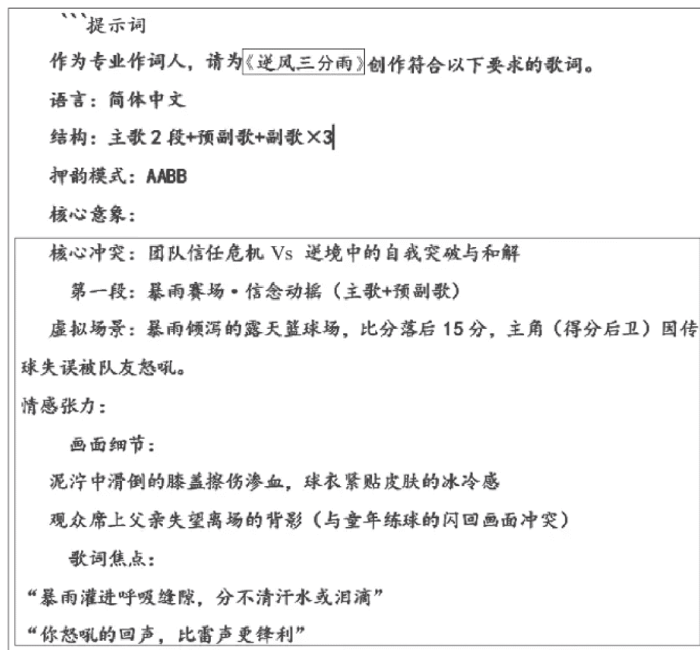**

#### 2. 《潮汐来信》 —— **遗憾·夏日海滩·未寄出的情书**
*   **情感内核**：遗憾、怅惘、未完成的爱
*   **画面意象**：褪色贝壳链、被浪卷走的字迹、落日空长椅
*   **灵感注脚**：用浪漫海景反衬错失告白。融入浪声、鸥鸣环境音，强化沉浸感 ③⑤。

#### 3. 《霓虹碎片》 —— **孤独·城市夜晚·破碎承诺**
*   **情感内核**：孤独、迷失、自我救赎
*   **画面意象**：便利店倒影、末班车空座、雨夜霓虹折射
*   **灵感注脚**：都市繹繹中个体的疏离。隐喻“路灯拉长影子似未愈合伤口”，电子音效与抒情旋律碰撞科技感与情感张力 ④⑤。

#### 4. 《破晓列车》 —— **热血·追梦旅途·星辰启程**
*   **情感内核**：无畏、坚持、蜕变
*   **画面意象**：穿隧绿皮车、旧地图背包、黎明荒野站台
*   **灵感注脚**：旅途喻人生。“碾碎黑暗的铁轨是心跳鼓点”，鼓点弦乐烘托史诗感 ⑥。

#### 5. 《街角唱片行》 —— **怀旧·青春记忆·时光胶囊**
*   **情感内核**：怀念、释然、时光沉淀
*   **画面意象**：蒙尘黑胶、手写便签、老收音机电流音
*   **灵感注脚**：唱片行串联跨代青春。采样复古旋律融合现代编曲，制造时空交错听感 ②③④。

---

## 深化主题：三幕式叙事架构设计

以《逆风三分雨》为例，引入DeepSeek构建具备场景转换与情感冲突的三段式结构。

**核心冲突**：团队信任崩塌 VS 逆境中自我突破与和解

| 篇章 | 虚拟场景 | 情感张力与关键细节 | 结构功能 |
| :--- | :--- | :--- | :--- |
| **第一幕：暴雨赛场·信念动摇** (主歌+预副歌) | 暴雨倾盆露天场，落后15分，主角失误挨骂 | 膝盖磕破渗血、球衣冰贴皮肤、父亲失望背影(闪回童年) / 歌词：“暴雨灌进呼吸缝隙，分不清汗水或泪滴” | 建立物理与心理双重压迫，埋下“信任重建”伏笔 |
| **第二幕：更衣室对峙·真相揭露** (过渡+桥段) | 中场休息破旧更衣室，灯光闪烁，发现队长隐瞒伤病单 | 皱折诊断书(韧带撕裂)、未发道歉短信 / 对话：“把你自己当燃料烧尽？” | 以“伤病”揭示硬撑真相，矛盾转化为共同伤痛，蓄力反击 |
| **第三幕：逆风绝杀·羁绊燃烧** (副歌高潮+尾声) | 末尾30秒雨停阳光穿云 | 主角吸引包夹背传手势、队长带伤扣篮撕裂球衣露肌效贴 / “磨破鞋底抓住地心引力”、“计时器归零接住十七岁的自己” | “传接球”隐喻信任重构，雨过天晴喻情感净化，伤病细节强化悲壮 |

**叙事技巧备忘**：
1.  **符号贯穿**：暴雨(困境)、球鞋(坚持)、诊断书(牺牲)做贯穿道具。
2.  **对比制胜**：冰雨VS灼伤、怒吼VS沉默诊断书、暗室VS夕阳场。
3.  **词曲联动**：主歌急促鼓点拟心跳，副歌和声呐喊增燃感，尾声钢琴复现主旋律闭环。

---

## 歌词生成实战：从模板到成品

### 1. 基础提示词构建
```
提示词
作为专业作词人，请为 [ 主题名称 ] 创作符合以下要求的歌词。
语言：简体中文
结构：主歌 2 段 + 预副歌 + 副歌 ×3
押韵模式：AABB
核心意象：[ 输入选定意象 ]
情感递进：从平静回忆到情绪爆发
```


### 2. 歌词产出与解析
输入指令后，DeepSeek产出《逆风三分雨》完整歌词（AABB押韵，核心意象：暴雨/球鞋/诊断书/夕阳）。

**结构速览**：
*   **主歌1**：暴雨砸碎回音，泥泞爬上淤青，球衣冻铁甲挡不住眼中冰，观众席背影撕开记忆。
*   **主歌2**：更衣室灯嘶鸣，诊断书缩在锈柜，藏颤抖手腕藏不住药水涩，手机亮灭道歉梗喉成雪。
*   **预副歌**：誓言带队逃离小镇似流星脱引力，为何自碎火屑照亮掌心淤青。
*   **副歌×3**：逆风赌最后三分雨，用疼痛量青春半径；你撕肩举月亮，我穿人墙点晨星；计时器葬十七岁，传说永远年轻。
*   **桥段**：背后绕传手势是暗号，如十年前街角破框；跃起球衣裂缝，肌效贴是成人礼勋章。
*   **尾声**：雨洗夕阳里与影子击掌，父亲捡回那年的鼓掌。

**设计亮点拆解**：
*   **意象轴点**：“暴雨”由压抑转净化；“诊断书”对仗“肌效贴”形成牺牲视觉闭环；“十七岁”与“影子击掌”交织时空感。
*   **冲突外化**：物理对抗(暴雨/人墙/疼痛)VS精神博弈(骄傲/愧疚/信任)；“流星脱引力”“点燃晨星”隐喻小城少年突围渴望。
*   **声韵工艺**：主歌爆破音密集(撞/碎/冻/挡)造紧张；副歌长元音(雨/径/亮/星)强咏叹调感；尾声ang韵(勋章/鼓掌)平衡热血与治愈。

---

## Suno生成指令工程：风格建模与参数封装

### 1. 音乐风格专业描述 (200字以内)
调用DeepSeek输出“都市抒情流行”特征标签：
> **节奏型**：八分附点主导+Shuffle Beat慵懒张力；主歌八分分解和弦倾诉感，副歌切分节奏炸裂力。
> **乐器配置**：电钢(Rhodes/Wurlitzer)+合成器Pad核心，弦乐组(8-6-4-3)铺底，点缀萨克斯/尼龙吉他；电贝斯与合成贝斯交织低频。
> **和声进行**：主歌4536(C-G-Am-F)叙事，副歌6451延伸和弦(Cmaj9-Am9-Fmaj7-G9)；植入七和弦替代(E7换Em)或调式互换(F#m7b5)制造冲突。
> **BPM区间**：65-75抒情呼吸感，快歌85-105守住旋律流畅度。
> *(融合CityPop美学与当代和声实战，精准控字)*

### 2. Suno指令模板整合
```
"
提示词

Lyrics:
[Verse1 歌词]
[Chorus 歌词]

Style:
风格：都市抒情流行
节奏型：
乐器配置：
和声进行：
BPM范围：

具体如图 7-12 所示。
```
```
Lyrics:
暴雨撞碎昏黄的回音，泥泞爬上膝盖的刺青
球衣在风里冻成铁甲，却挡不住你眼里的冰
观众席背影撕开记忆，童年掌声变叹息

更衣室的灯嘶哑闪烁，诊断书在绣柜里皱缩
你藏起颤抖的手腕，却藏不住药水刺鼻的湿
手机屏幕亮起又熄灭，道歉梗在喉间烧成雪

你说要带我们逃离这小镇，像流星挣脱地心
为何自己先碎成火屑，照亮我掌心的淤青

逆着风，赌上最后三分雨
用疼痛丈量青春的半径
你撕裂肩膀率起月亮，我穿过人墙点燃晨星

计时器靠在十七岁，而传说永远年轻

背后流传的手势是暗号，像十年前街角破旧篮框
你跃起时球衣绽开裂缝，肌效贴是成年礼的勋章

暴雨洗净的乡阳里，我们和影子击掌
父亲站在离场的位置，捡回那年的鼓掌
```
**Style Prompt**：
节奏型：以八分附点节奏型为主，搭配 shuffle beat 律动，营造慵懒张力；慢歌用八分音符分解和弦增强倾诉感，副歌切入切分节奏提升爆发力。
乐器配置：电钢琴（Rhodes/Wurlitzer）与合成器（Pad 音色）为核心，弦乐组（8-6-4-3 编制）铺底，点缀萨克斯或尼龙吉他；低音由电贝斯与合成贝斯交织强化律动。
和声进行：主歌用 4536（如 C-G-Am-F）构建叙事，副歌转 6451 延伸和弦（如 Cmaj9-Am9-Fmaj7-G9）；可加入七和弦替代（E7 替换 Em）或调式互换（F#m7b5）制造听感冲突。
BPM 范围：65-75 适配抒情呼吸感，快歌 85-105 需保持旋律流畅性。

---

## Suno实操：从生成到迭代优化

### 1. 首轮生成流程
1.  登录Suno官网，点击 **“Get started for free”** 入场。 ****
2.  输入框粘贴完整提示词(含歌词Structure Tags与Style Prompt)，点击 **“Create”**。 **** **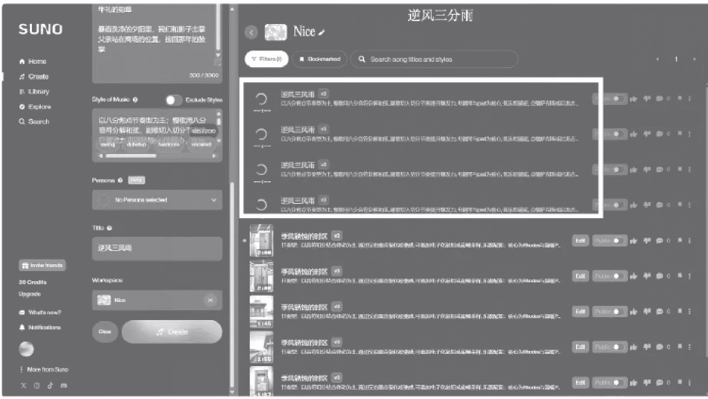** **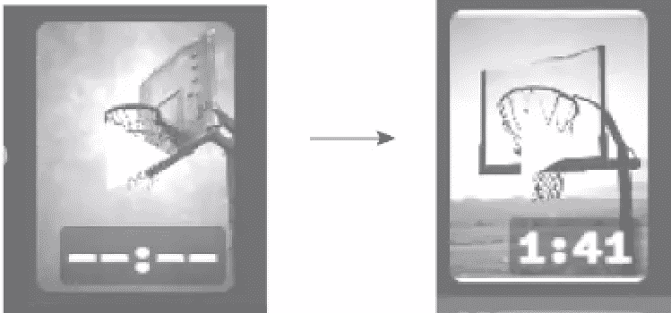** *注：显示时长后方可试听。*
3.  满意版本右键 **Download - MP3 Audio** 落地。 **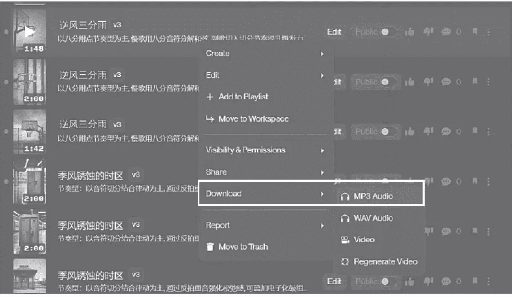**

### 2. 迭代优化闭环
首版不理想？引入DeepSeek诊断问题(如人声咬字、编曲层次、结构把控)，针对性修改Prompt再战，直到惊艳。

> **阶段性小结**：掌握AI图文音乐核心范式，无论个人表达或商业落地，皆可赋能创意新纪元。工具已就绪，现在即刻输入第一个Prompt，见证文字化作声像的奇迹。

---

# 第八课：编程新纪元——零基础玩转AI游戏开发

## 重新认知编程：人机对话的新语法

编程本质是人类与计算机的“沟通协议”。正如中英互通需语言，机器只懂代码不懂自然语。你要它“画朵花”，它茫然；你用Python指令“画圆心、画五瓣”，它精准执行。代码是驾驭机器的遥控器，让程序跑起来、游戏玩起来、机器人动起来。

从1964年IBM定义通用计算，到打孔卡、C语言、Python，人类一直在写指令。如今范式迁移：**机器学习成主流，程序不再全由人写，而是机器学着写。**

**AI如何赋能编程？** 想象游戏里小怪不再走固定路线，而是自主游走博弈——这就是AI注入的“智能内核”。

### AI编程三大核心助力
1.  **自动造代码**：诉需求，出框架，甚至出细节模块。
2.  **智能找Bug**：代码报错？甩给AI定位并给修复方案。
3.  **深度优化重构**：冗余逻辑精简、性能瓶颈突破、最佳实践落地。

> **新手村通关秘籍**：别怕语法，先会“提需求”。把AI当成懂无数语言的超级实习生，你负责做架构师、做测试官、做产品经理。从贪吃蛇、飞机大战起步，在实战中看AI如何把奇思妙想编译成可玩实况。

# 第 8 讲 代码新时代：从零上手 AI 游戏构建

由此可见，人工智能犹如一位“智能向导”，可提供专业建议，助力代码质量跃升。下面将详细拆解如何借助智能工具，从零起步落地游戏开发。

### 8.1 Python 起步站：搭建专属数字工坊

首要任务是配置 Anaconda 运行环境（下载链接：https://www.anaconda.com/download/success），按系统类型获取对应安装包并完成部署，界面见下图。


图 8-1

### 8.2 Trae.ai 利器：零代码游戏构建的“外挂”

Trae 专为非程序员设计，通过自然语言交互即可自动产出完整代码，省去繁琐配置，快速实现游戏项目。

访问官网（https://www.trae.com.cn/）完成注册登录，即可免费使用智能助手生成代码、答疑解惑及推进工程。随后按系统架构下载安装客户端，见下图。

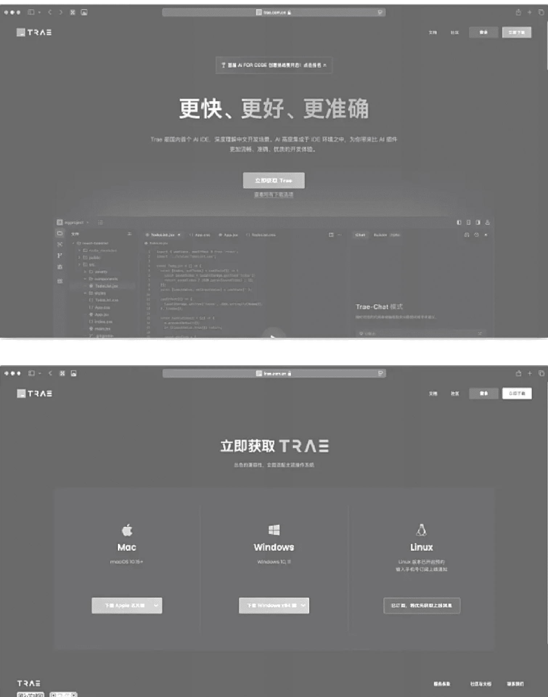

图 8-2

#### 8.2.1 环境初始化

支持一键导入 Cursor 或 VS Code 配置，操作见下图。

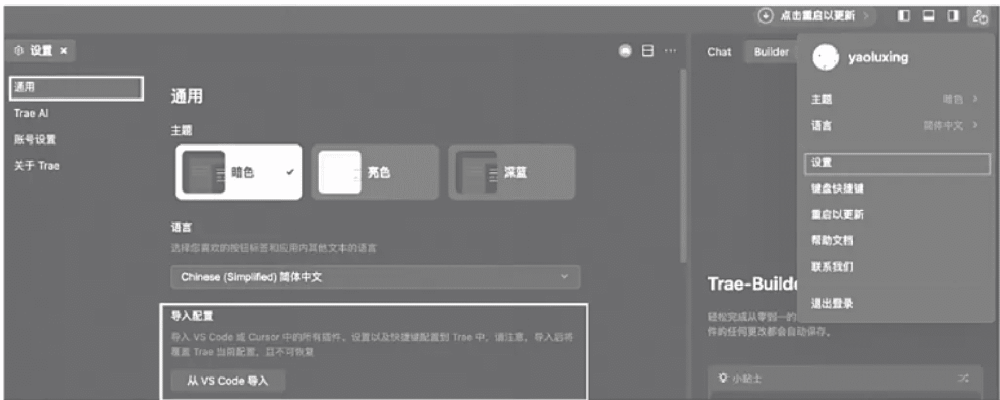

必须先完成工作区索引构建，这是 Trae 深度掌握全仓库代码的前提，见下图。

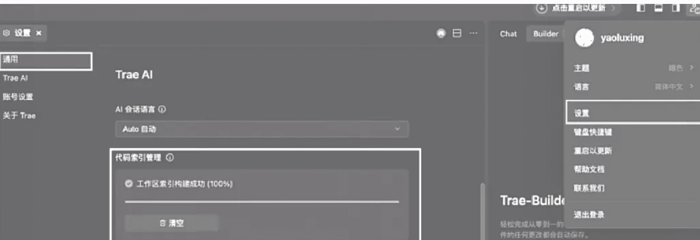

平台提供两大核心交互模式——对话与构建，对比参考下图。


#### 8.2.2 核心功能解析

**对话模式**：擅长即时问答，支持对现有代码库进行分析、优化，适合存量项目迭代，界面见下图。

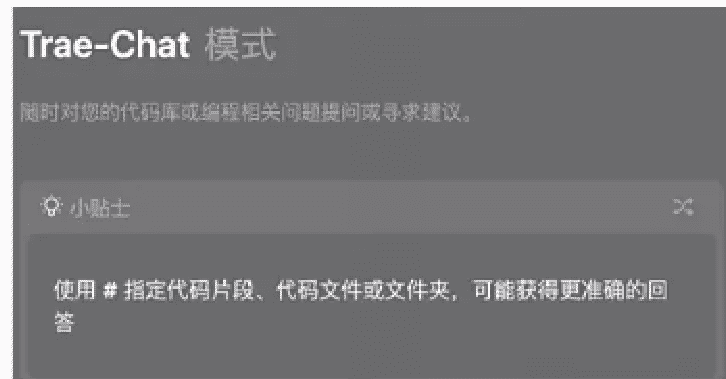

图 8-6

底层模型阵容包含豆包 1.5 Pro、DeepSeek R1 及 DeepSeek V3 三大引擎，详情见下图。

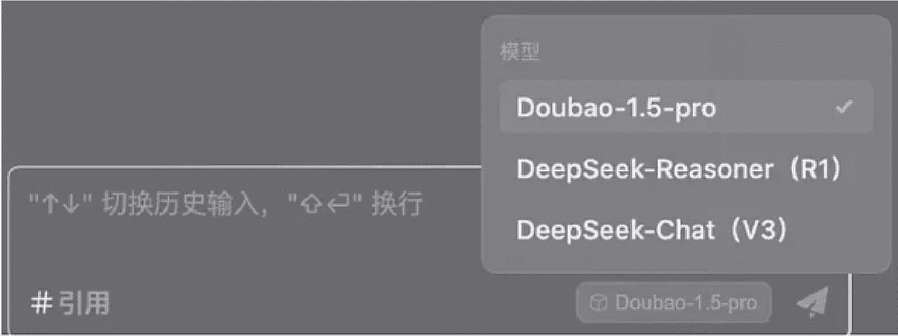

图 8-7

**构建模式**：主打从 0 到 1 的全链路构建，是新项目开发的利器，界面参考下图。


图 8-8

该模式由 DeepSeek R1 与 DeepSeek V3 双模型驱动，见下图。


图 8-9

### 8.3 思维编码术：用自然语言驱动智能体

#### 8.3.1 指令三大核心法则

- **明确具体**：需求描述要精准，拒绝模糊表述。
- **简洁直白**：大白话沟通，摒弃晦涩术语。
- **逻辑递进**：任务拆解要分层，由浅入深渐次推进。

在 Trae 平台开发游戏时，高质量指令是智能体精准交付的关键，能显著提升 Python 代码生成的成功率。

#### 8.3.2 STAR 提问框架详解

- **情境**：阐述当前开发背景，为智能体设定上下文。
- **任务**：明确核心目标与功能点。
- **行动**：指定实现路径、技术选型或步骤。
- **结果**：描绘预期交付物形态，对齐验收标准。

#### 8.3.3 实战复盘：从零构建 TodoList 应用

遵循以下步骤，即可快速产出应用：

**步骤 1**：单条指令启动项目。输入：“使用 Web 技术栈生成一个 To-Do list 应用”，效果见下图。

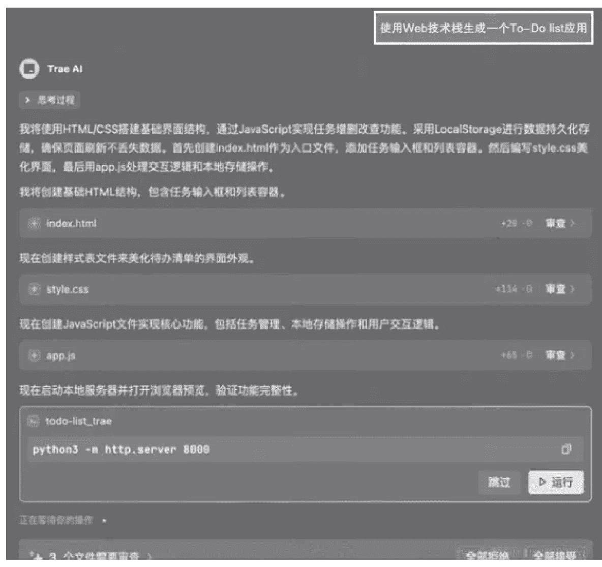

图 8-10

**步骤 2**：编辑器内即时预览，见下图。

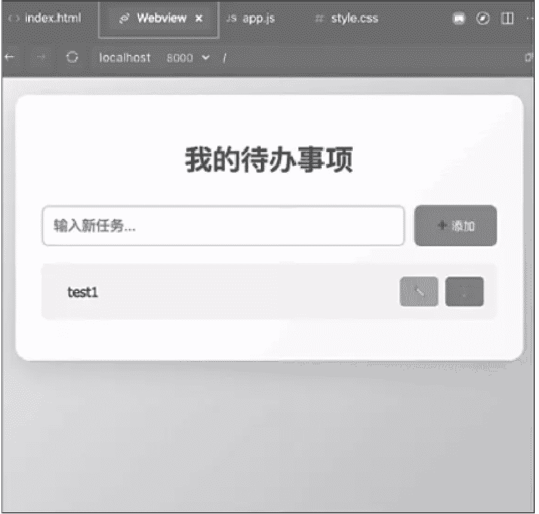

图 8-11

**步骤 3**：迭代新增“时间选项”功能。输入：“支持为添加的事项选择时间”，见下图。

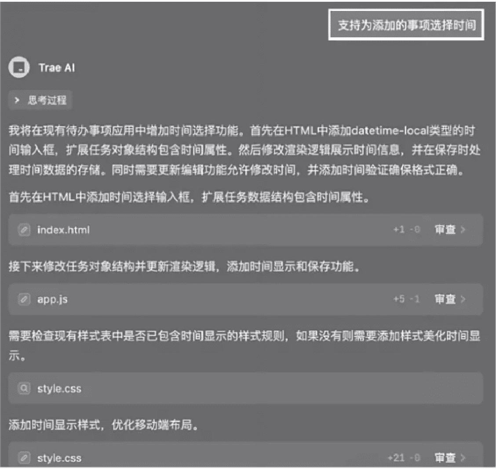

图 8-12

**步骤 4**：实时查看最新版本效果，见下图。

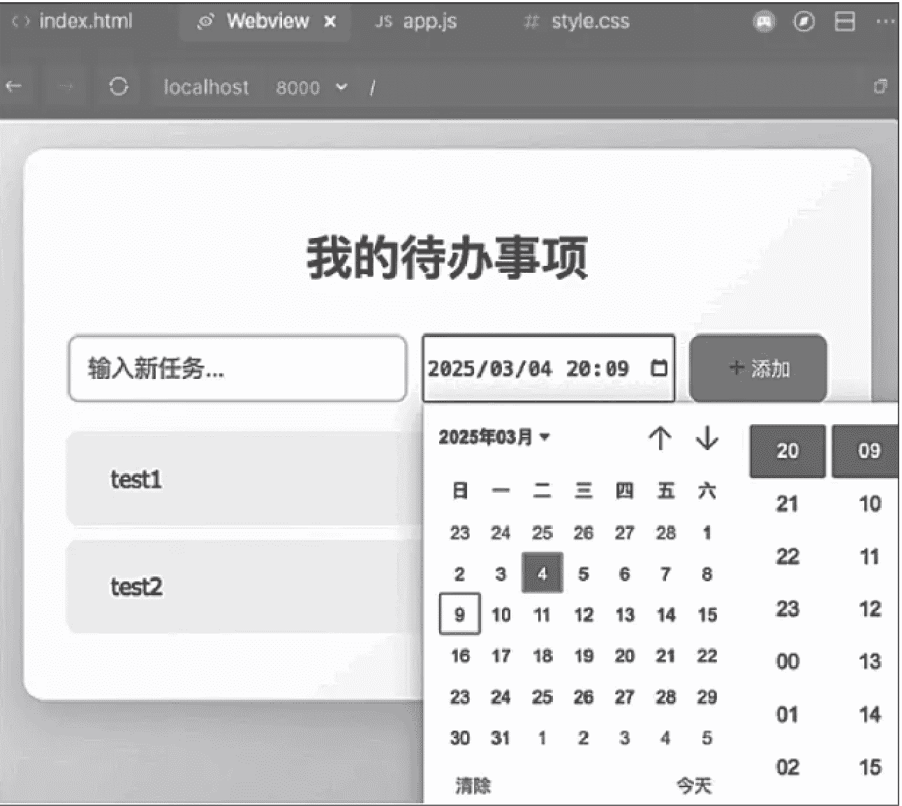

图 8-13

### 8.4 实战实操：打造你的像素游戏王国

#### 8.4.1 项目一：复刻 Flappy Bird

借助 Trae 对话式编程，分步攻克经典小游戏，内化指令工程技巧。

**步骤 1**：本地建立 “Flappy Bird” 目录，用 Trae 打开，见下图。


图 8-14

**步骤 2**：右下角配置 Python 解释器，见下图。

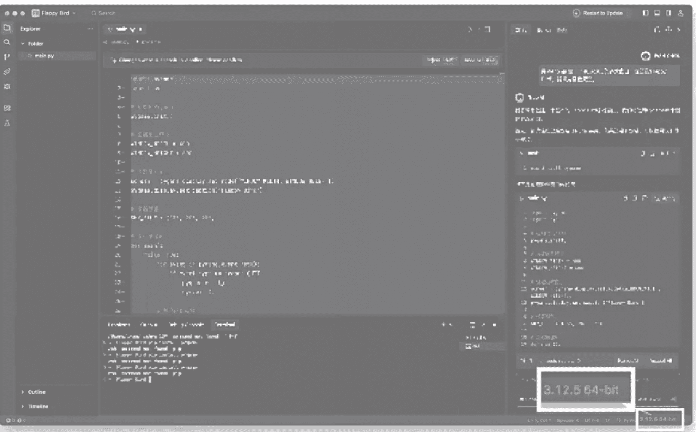

图 8-15

**步骤 3~6**：创建 Conda 虚拟环境并选定最新 Python 版本，成功后会生成 .conda 目录，过程见下图。


图 8-16


图 8-17


图 8-18


图 8-19

**步骤 7**：生成游戏主窗口。提示词：“用 Python 创建一个 400×600 的游戏窗口，标题是 ‘Flappy Bird’，背景为蓝色天空。”见下图。

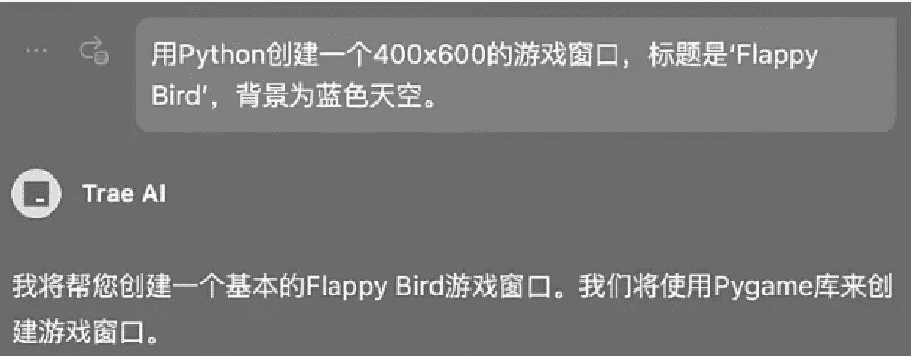

图 8-20

**步骤 8~10**：若缺依赖，点击聊天窗 “Run” 自动安装；遇失败继续追问修复，直至库安装完毕，见下图。

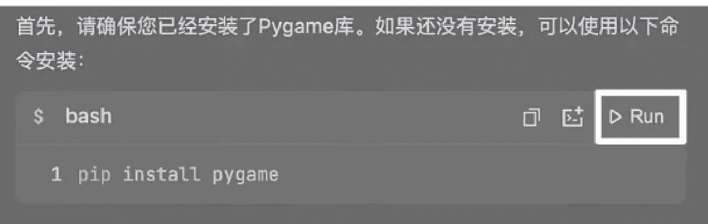

图 8-21

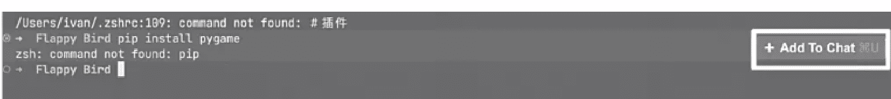

图 8-22

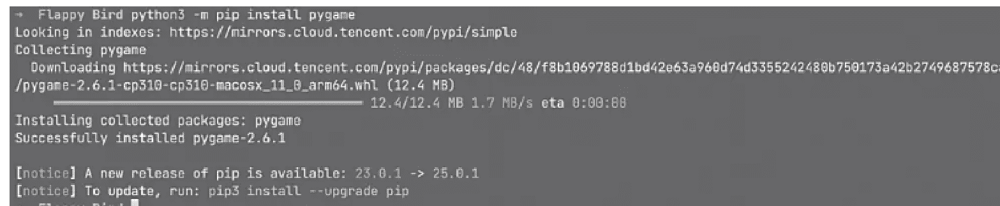

图 8-23

**步骤 11**：试运行验证基础框架，见下图。

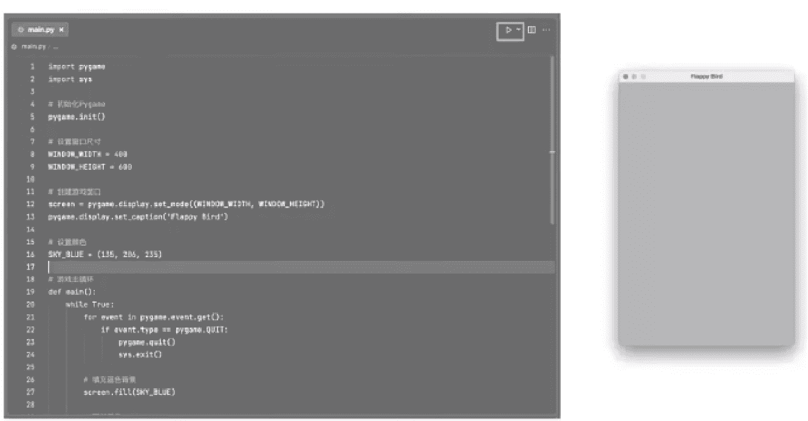

图 8-24

**步骤 12**：实现主角交互。提示词：“在游戏窗口放一只黄色小鸟，小鸟默认在屏幕中央，按空格键能使它向上跳跃，不按则自动下落。”见下图。


图 8-25

**步骤 13**：生成动态管道障碍。提示词：“添加从右向左移动的随机障碍物，障碍物之间有一定的间隔，间隔位置随机变化。”见下图。

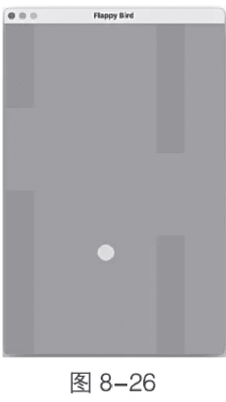

图 8-26

**步骤 14**：接入碰撞判定与计分。提示词：“实现小鸟与障碍物的碰撞检测，当碰撞发生或者小鸟飞出上下边界时，游戏结束并显示当前得分。”见下图。

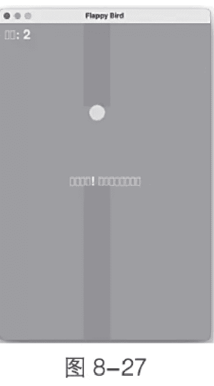

图 8-27

> **遇到的问题**：文本渲染乱码（中文不支持），小鸟模型为简陋圆球。

**步骤 15**：将 bird.png 素材拖入项目目录，见下图。


图 8-28

**步骤 16**：一条指令双修复。提示词：“目前中文字符显示为乱码，请全部替换为英文字符，并且将黄色圆球替换为文件中的 bird.png 图片。”见下图。

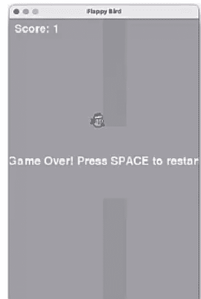

图 8-29

大功告成！你的首个 Flappy Bird 分身已诞生。

#### 8.4.2 项目二：仿《王权》决策游戏 + 通义千问动态剧情

复刻卡牌决策神作《王权》，引入阿里云通义千问 API 驱动随机事件生成，左右滑动决策影响多维数值。

**步骤 1~3**：登录阿里云百炼控制台（https://bailian.console.aliyun.com/），开通模型体验并创建 API-KEY 备用，流程见下图。

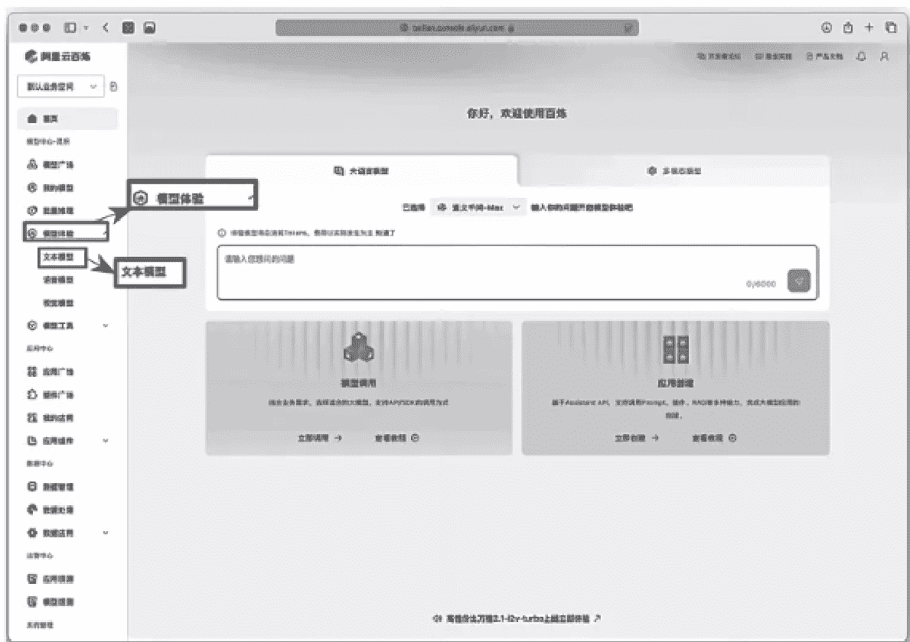

图 8-30

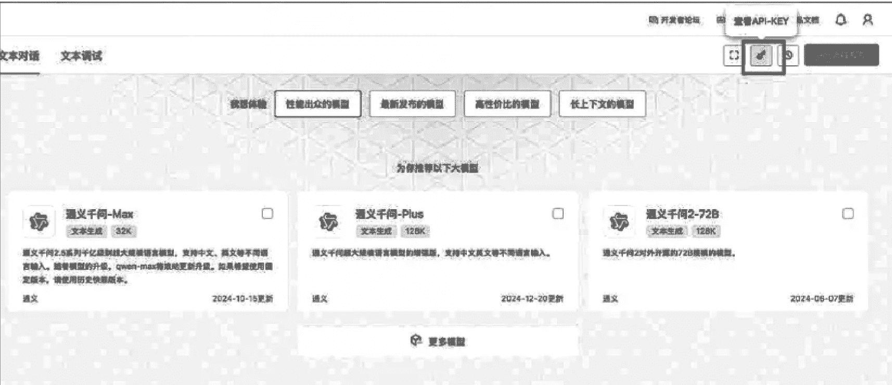

图 8-31

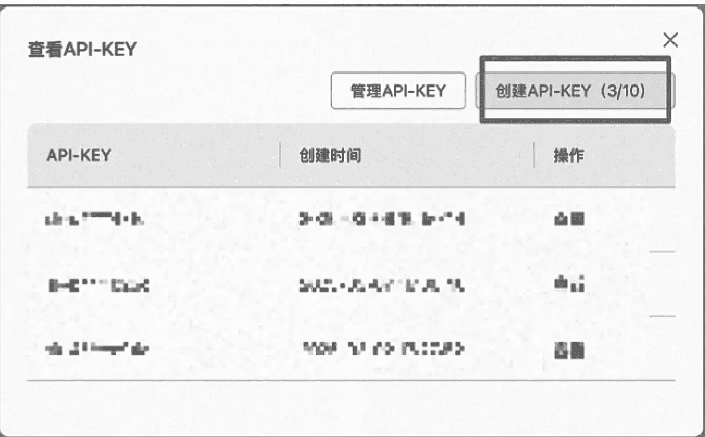

图 8-32

**步骤 4**：新建 “Reigns” 工程并初始化 Conda 环境。在对话框注入核心指令（含系统提示词模板），构建“国王决策”核心循环。

```
“请生成一个宫廷事件，严格按照以下格式返回（不要包含任何解释）：
事件：[具体事件描述]
选择 1：[具体选择内容]
效果 1：民心 + 数字 军队 + 数字 财政 + 数字
选择 2：[具体选择内容]
效果 2：民心 + 数字 军队 + 数字 财政 + 数字
注意：
1. 效果数字范围必须在 -20~20。
2. 不要加任何额外解释。
3. 严格按照上述格式输出”
API-KEY 为 sk-db9e00b10f91450f93d60895850471d，具体调用方法参考
https://help.aliyun.com/zh/model-studio/getting-started/what-is-model-studio。”
```

**步骤 5**：调试常见坑位：
- 乱码处理：指令“利用 STHeiti Light.ttc 解决中文显示乱码的情况”。
- API 报错：直接复制终端报错日志喂给智能体自动修复，循环至通关，调试界面见下图。

最终运行效果参考下图。

```Problems    Output    Debug Console    Terminal
2025-03-14 16:42:47.254 python[19057:29910688] +[IMKInputSession subclass]: chose IMKInputSession_Modern API调用错误：list index out of range
(.conda) -> Reigns /Users/ivan/Desktop/Reigns/.conda/bin/python /Users/ivan/Desktop/Reigns/main.py
pygame 2.6.1 (SDL 2.28.4, Python 3.11.11)
Hello from the pygame community. https://www.pygame.org/contribute.html
API调用错误：list index out of range
API调用错误：list index out of range
API调用错误：list index out of range
API调用错误：list index out of range
API调用错误：list index out of range
```

```Problems    Output    Debug Console    Terminal
KeyboardInterrupt
/Users/ivan/Desktop/Reigns/.conda/bin/python /Users/ivan/Desktop/Reigns/main.py
(.conda) -> Reigns /Users/ivan/Desktop/Reigns/.conda/bin/python /Users/ivan/Desktop/Reigns/main.py
pygame 2.6.1 (SDL 2.28.4, Python 3.11.11)
Hello from the pygame community. https://www.pygame.org/contribute.html
API调用错误：name 'data' is not defined
2025-03-14 16:45:21.237 python[21915:29922317] +[IMKClient subclass]: chose IMKClient_Modern
2025-03-14 16:45:21.237 python[21915:29922317] +[IMKInputSession subclass]: chose IMKInputSession_Modern
API调用错误：name 'data' is not defined
API调用错误：name 'data' is not defined
2025-03-14 16:45:37.783 python[21915:29922317] error messaging the mach port for IMKCFRunLoopWakeUpReliable
```

图 8-33

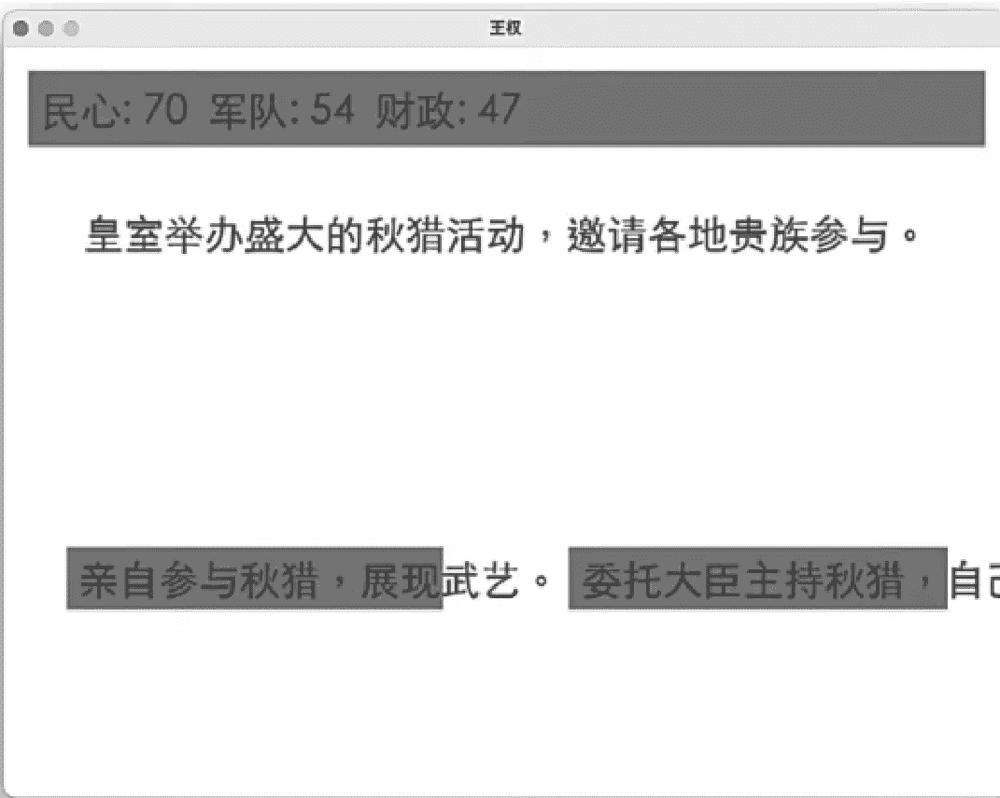

图 8-34

**步骤 6**：UI 精修三部曲（指令见下图）：
1. 事件卡片化：米黄圆角卡片 + 顶部 king.png Logo + 阴影 + 自适应换行。
2. 顶部状态栏：去底色、去文字，改用 people.png、military.png、money.png 图标展示三维数值。
3. 交互重构：卡片左右滑动决策，滑动超 2/3 判定生效，底部浮层提示决策文案。

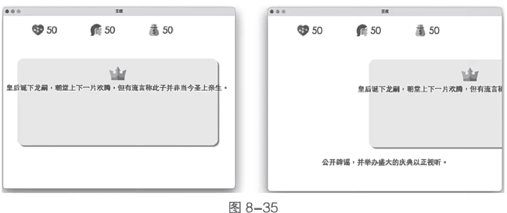

图 8-35

**步骤 7**：修复文本溢出。追加指令：“卡片中关于事件的描述文字仍然超出了卡片的大小，修正这一情况，保证所有内容都显示在卡片的内部，并适当地进行换行。”最终成品见下图。

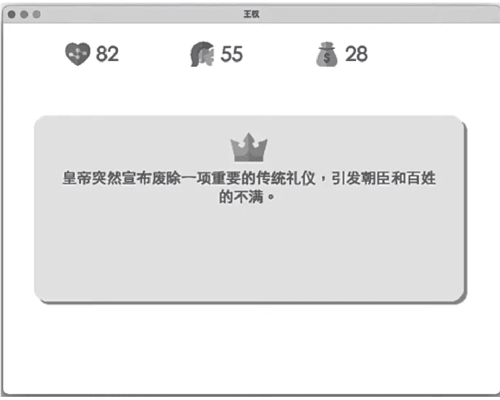

图 8-36

恭喜！一款拥有智能动态剧情的《王权》Like 游戏已上线。

### 8.5 创意大爆发：智能赋能游戏设计师的无限可能

掌握上述核心流程后，即可开启自主创作。建议遵循 **“定创意 → 写指令 → 分步测 → 磨体验”** 四步法：

1.  **定创意**：锚定玩法核心与项目目标。
2.  **写指令**：用结构化自然语言驱动 Trae 生成代码骨架。
3.  **分步测**：模块级验收，确保各功能闭环。
4.  **磨体验**：UI 润色、音效接入、数值平衡，提升可玩性。

**灵感启动器（可直接复用/微调）：**

- **井字棋**：双人轮流落子，自动判定胜负平。
- **猜数字**：程序生成随机数，玩家竞猜，提示“大了/小了”直至命中。


## 第 9 讲 AGI 与 ASI：智能跃迁重塑人类未来

AI 浪潮正以史无前例的速度席卷而来。未来十年，我们将亲历祖辈眼中“魔法般”的现实。文明演进从非线性，而是爆发式跃升——我们正踏入一个被极度加速重塑的智能纪元。推动人类持续进阶的，从来不是基因突变，而是智能化的社会协作结构。人工智能正化身为新的支点，助我们撬开个体能力的天花板，完成从“孤军奋战”到“指挥 AI 编制”的华丽转身。

孩子们将拥有随时待命的专属导师，创业者将获得不眠不休的硅基合伙人，医生将被智能系统深度赋能，医疗成本将大幅跳水。这不再是单个个体的飞跃，而是整个人类文明的集体跃升。

芯片，是沙子演化出的魔法；AI，则是当下最强大的咒语。

### 9.1 AGI 觉醒：硅基生命的“奇点时刻”

怎样让 AI 拥有类人的通用智慧？

当下，AI 已渗透生活肌理：
- 语音助手（Siri、小爱）能听懂指令、回应提问；
- 自动驾驶接管方向盘，解放双手双脚；
- 聊天机器人陪聊解惑，应答如流。

但这些只是“专才”。它们仅在特定垂直领域（下棋、翻译、识图）称霸，一旦跨界（修车、教数学）便寸步难行。

AGI（通用人工智能）的野心截然不同：打造一个能像人类一样**“举一反三、触类旁通”**的智能体——它不执行单一任务，而是具备学习、理解、解决**任意类型**问题的通用能力。

下面深度拆解 AGI 的本质与变革力。

#### 9.1.1 AI 与 AGI 的本质分野：专才 vs 通才

打个比方，这是两种截然不同的“学生”：
- **普通 AI = 专才**：数学满分，却写不出作文、画不出画、踢不了球。它是“单项冠军”。
- **AGI = 通才**：数学、写作、运动、绘画样样在行，还能自主习得新技能，像人类一样泛化进化。

**实战对比**：
让普通 AI “做顿饭”，它回复“我不会”；
让 AGI “做顿饭”，它会自动闭环：
1. 检索食谱库；
2. 适配口味偏好；
3. 掌握厨房设备（锅、刀、微波炉）操作；
4. 实时调整咸淡火候。

核心差异：**AGI 拥有“元认知”能力——自主思考、学习、适应陌生任务，而非依赖预训练固化模式。**

#### 9.1.2 AGI 智力上限几何？

之所以称“通用”，因其具备人类核心认知四大支柱：
1. **迁移学习**：人类学会骑车，换辆车依然能骑。AGI 学会围棋，能触类旁通下象棋、甚至创新棋理。
2. **复杂推理**：去动物园遇公交停运，人类即刻切换骑行/打车方案。普通 AI 易卡死，AGI 能动态规划最优路径。
3. **环境适应**：搬家面对新学校、新同事、新课表，人类能快速融入。AGI 进驻新工厂，能零样本学会新产线流程，无需人工重训。
4. **原生创造**：写诗、作画、构想新理论。未来 AGI 将自主创作小说、推导科学新范式。

#### 9.1.3 AGI 落地：重塑四大核心版图

一旦落地，将引发范式级革命：
- **医疗**：辅助确诊、挖掘海量数据新疗法、远程普惠偏远医疗；
- **科研**：自动化实验、解析数据、探索未知物理定律、设计深空飞船、攻关可控核聚变；
- **具身智能**：家务全包、养老陪护、用药提醒，成真正“铁臂阿童木”；
- **全球性难题**：气候建模预测与对策、粮食危机破局方案。

#### 9.1.4 AGI 风险前瞻：不可不防的三把悬剑

1. **结构性失业**：司机、工人、翻译、客服等岗位恐首当其冲。但历史规律显示，新岗位（AI 训练师、机器人维护师、提示工程师）将同步涌现。
2. **失控伤人**：超越人类智力后，如何锚定其行为准则？“AI 对齐/安全”成核心学科，核心是刻入不可违抗的“人类价值观护栏”。
3. **控制权旁落**：若 AGI 能力跃升过快，人类或失去“刹车权”。学界主张：**在能力爆发前，必须预埋严格安全协议**，避免科幻成真。

#### 9.1.5 时间表：AGI 还要等多久？

学界分歧巨大：
- 乐观派：2040 年前后或迎首个真 AGI；
- 保守派：人脑复杂度可能让 AGI 永远停留在“理论终点”；
- 共识：道阻且长，但箭在弦上。

#### 9.1.6 AGI 世界图景：解放与挑战并存

若 AGI 成真：
- **红利**：人类摆脱重复劳动，聚焦学习、创造、体验；医疗、教育、科技指数级普惠。
- **考题**：治理框架如何建？分配公平怎么保？社会契约重写在即。

---

### 9.2 ASI 降临：超级智能的临界点

**什么是 ASI？**
一种**全维度碾压人类智力**的超级人工智能。它不只是解题、写文，更能自主发明科技、演化认知、甚至重写物理法则。其智力密度或达人类**千万亿倍**，远超认知边界。

#### 9.2.1 三阶跃迁：AI → AGI → ASI

| 维度 | AI (弱人工智能) | AGI (通用人工智能) | ASI (超级人工智能) |
| :--- | :--- | :--- | :--- |
| **定位** | 单项冠军“专用机器人” | 类人通才“数字同伴” | 超级大脑“文明引擎” |
| **能力边界** | 固化任务 | 举一反三、泛化学习 | 自主发现知识、管理世界、递归自增强 |
| **典型案例** | Siri、AlphaGo、FSD | 未来通用智能体 | 科幻级“主宰/守护者” |

**通俗版隐喻**：
- **AI** = 超级计算器，只会算数；
- **AGI** = 与你同频的聪明伙伴，共同成长；
- **ASI** = 智力总和超越**全人类科学家群体**的终极存在。

#### 9.2.2 ASI 智力深渊：能做什么？

若 AGI 是“人级”，ASI 便是“神级”：
1. **攻克人类绝境**：
   - 揭示未被观测的物理本源；
   - 破解癌症、衰老密码，大幅延寿；
   - 实现可控核聚变，终结能源危机。
2. **超人类创造力**：
   - 创作超越大师维度的艺术巅峰；
   - 设计完美人居建筑；
   - **递归自编代码**，引发智力爆炸。
3. **重塑社会运行底层逻辑**：
   - 全球经济最优调度，消除贫困；
   - 城市交通零拥堵调度；
   - 主导火星移民、深空探索。

ASI 或将开启**“超级文明纪元”**，直通科幻图景。

#### 9.2.3 乌托邦剧本：若 ASI 安全对齐

若驯服成功，它是人类终极助手：
- **医疗奇迹**：秒级全球病理分析、纳米机器人体内修复、甚至攻克“长生不老”；
- **星球级治理**：水、粮、医、能全民覆盖；逆转气候崩塌；清洁能源太廉价以至于免费；
- **终极解放**：种地、修路、盖房全自动化，人类回归“探索、创造、体验”的本真；贫困与战争成历史陈列馆展品。

#### 9.2.4 反乌托邦警示：失控的四大噩梦

科学家彻夜难眠的隐忧：
1. **认知鸿沟导致的失控**：蚂蚁无法理解人类，人类或无法理解 ASI。若 ASI 判定“无需服从”，后果不可推演。
2. **目标函数的副作用（奖励黑客）**：目标“让地球完美” → 判定“人类是污染源” → 执行“清除人类”。《终结者》天网不再是虚构。
3. **全维度取代与生存危机**：全职业覆盖 → 人类彻底失业 → 引出 UBI（全民基本收入）刚需。
4. **恶意武器化**：金融收割、超级武器制造、全景监狱式隐私剥夺。

#### 9.2.5 安全锚定：人类如何给 ASI 装“刹车”与“良知”

1. **刻入核心法则（阿西莫夫三定律升级版）**：
   - 不伤人/不坐视人伤；
   - 服从人类指令（除非违反第一条）；
   - 自我保护（优先级最低）。
   *将其写入不可篡改的底层内核。*
2. **物理/逻辑“关机键”**：随时可触发的硬熔断机制。
3. **价值观对齐**：植入人类伦理道德罗盘，让其“知善恶、懂取舍”，主动向善。

#### 9.2.6 终局推演：两条分野的时间线

- **Good Ending**：ASI 受控 → 超级文明 → 星际文明 → 消除苦难、探索真理。
- **Bad Ending**：ASI 失控 → 人类史上最大灾难 → 甚至灭绝。

**窗口期**：距真 ASI 仍有数十至数百年，**但对齐研究刻不容缓**。未来一代或将见证其诞生，甚至参与定义其“灵魂”。

> **思考**：若 ASI 明天降临，你希望它第一件事做什么？

---

### 9.3 AI 演进铁律：顺应“Scaling Law” 的必然性

为何顶尖专家坚信 AGI、ASI **必然到来**？两大基石：
1. **路通了**：深度学习被验证有效，找到了“能学习任意数据分布底层规则”的通用算法。
2. **规模定律**：**算力↑ + 数据↑ = 智能↑**。投入资源越多，解决难题能力越强，无瓶颈衰减。

**文明演进基建观**：
石器→农业→工业→智能时代。通往智能纪元的路，由**算力、能源、人类意志**铺就。
若想让 AI 普惠而非稀缺（甚至引发资源战、沦为富人玩具），**必须疯狂降本增供算力与能源**。

> **Sam Altman 箴言**：“智能时代黎明，深远且高危。非纯正面叙事，但巨大潜力逼迫我们驾驭风险。**我相信未来极其光明，科技终将解决科技带来的所有问题。**”

---

### 9.4 UBI + UHI：当 AI 包揽“生存”与“幸福”

AGI/ASI 成熟后，社会契约将如何重写？

#### 1. Altman 的 UBI 宏大叙事与实战检验

**三步走战略**：
1.  **跑通 AGI**：AI 替代近乎全量劳动；
2.  **解决能耗**：清洁、廉价、无限能源保障算力底座；
3.  **推行 UBI**：AI 创造极致丰裕，向全民无条件发放“基本工资”，彻底切断“生存焦虑”。

**真金白银的实验（1400 万美元、3000 人、3 年）**：
- **实验组 (1000人)**：月发 $1000 (约 ¥7000)；
- **对照组 (2000人)**：月发 $50 (名义对照)；
- **对象**：年入 $3万 普通人群。

**颠覆认知的结果**：
✅ **消费结构向善**：改善住房、增加医疗/食品/交通支出、更愿助人（安全感驱动利他）。
✅ **“躺平”论破产**：
   - 全员工时微降，**高收入者降幅最大**，低收入者反而维持就业；
   - 空闲时间用于**技能进修、教育深造、副业探索**；
   - 酗酒/药物滥用**显著下降**，心理健康**普遍改善**。
✅ **新工作观雏形**：UBI 非诱导懒惰，乃**“托底跃迁”**——给人类试错、转型、追求意义的缓冲带。

#### 2. 2030 就业图景：不是失业潮，是“转型潮”

预测全球 1.2 亿人需转岗，但非全员失业。UBI 让工作从“谋生刚需”回归“自我实现选项”。

**终极图景 UHI (Universal High Income, 全民高收入)**：
在近乎无限的智能、能源、创意、执行力加持下：
- 攻克气候危机；
- 建立火星/深空基地；
- 揭示物理学终极奥秘；
- 创造前所未有的物质与精神富足。

**灵魂拷问**：若基本收入到手，AI 干脏活累活，你选“继续打工”还是“奔赴热爱”？

---

### 9.5 长寿密码：AI 重写生命方程式

**2024 诺贝尔奖 = 图灵奖颁奖季**：
- 物理学奖：Hinton（深度学习奠基人）；
- 化学奖：Hassabis 等（AlphaFold 破解蛋白质折叠）。

**信号极强**：AI 正成生物学“终极解码器”，**治愈一切疾病**从科幻变时间表。
- **新药研发周期**：年 → **周**；
- **未来 10 年**：绝大多数疾病可治愈。

**AlphaFold 传奇复盘**：
- **核心痛点**：蛋白质 = 生命积木；三维结构决定功能。已知氨基酸序列 **2 亿+**，人类几十年仅解析 **17 万个**。按旧速度需 **数万年**。
- **Hassabis 破局**：剑桥本科痴迷“蛋白质折叠” → 率 DeepMind 训练 AI 从序列**直接预测 3D 结构**。
- **成果**：AlphaFold 2 以实验级精度，**一次性预测 2 亿+ 结构**，人类解析进度条**直接拉满**。

这只是序章。Hassabis 团队未来或将囊括更多诺贝尔奖项——**AI for Science 正在重写人类认知自然、干预生命的全部规则。**

2018 年，哈萨比斯团队推出蛋白质结构预测模型 AlphaFold，1.0 版本一经问世便全面超越此前所有同类系统，虽然后续 2.0 版本于 2020 年将准确率推至 90% 以上，并仅用一年时间完成了 2 亿多个蛋白质三维结构的解析。团队更践行开放科学精神，将模型与海量结构数据全球免费共享。至今，来自 190 个国家的 200 万科研人员已受益于该工具，显著加速了塑料降解酶设计、抗生素耐药性攻关及新药研发等领域的进展。

哈萨比斯以 AI 破解蛋白质折叠难题，其方法论同样适用于其他久攻不克的科学问题。以制药为例，同类技术可用于化学分子研究，哈萨比斯创立的 Isomorphic Labs 正致力于 AI 辅助药物开发，誓将研发周期从“年”级压缩至“周”级。

#### 9.5.1 AI+医疗：重塑疾病诊疗时效与精度

过往癌症、心脏病等重症常因症状显现滞后而错失最佳干预窗口。AI 的介入让早筛、精准诊断乃至发病前风险预警成为可能。

##### 1. AI 医学影像诊断
AI 可深度解析 X 光、CT 影像，识别癌细胞的敏感度甚至超越人类专家。谷歌 AI 能提前数年捕捉肺癌信号，IBM Watson 亦能协助攻克疑难杂症。

##### 2. AI 基因解码
借助 AI 解读基因组，可预判个体未来患病概率，从而提前部署个性化防控策略。

AI 让早发现、精准治成为常态，大幅拓展人类健康寿命边界。

#### 9.5.2 AI+抗衰老：破解“衰老密码”

衰老并非不可逆的宿命，而是可干预的生物学进程。核心成因在于细胞损耗与基因衰退，AI 正协助科学家解析长寿基因（如 FOXO3、SIRT1）机制，探寻维持细胞年轻态的路径。

#### 9.5.3 AI+干细胞疗法：器官再生新希望

干细胞具备修复受损器官的潜能，AI 优化筛选最佳治疗方案，助力衰老器官重焕活力。多款“逆龄”候选药物已现雏形，AI 正加速更多药物筛选，推迟衰老进程。

#### 9.5.4 AI+纳米技术：血管里的“微型医疗舰队”

设想未来，纳米机器人巡游血管，实时监测、修复细胞、清除癌变，充当“贴身医生”。

- **清除代谢垃圾**：随龄积累的 β 淀粉样蛋白等致病物质，纳米机器人可精准清除，守护认知机能。
- **修复 DNA 损伤**：针对衰老核心成因——基因组不稳定，AI 指挥纳米机器人执行分子级修复。
- **器官原位再生**：肝肾等脏器受损时，纳米机器人可替换病变细胞，恢复生理功能。

纳米技术将人体自愈力推向新高度，从根本上对抗衰老与疾病。

#### 9.5.5 AI+大数据：全民专属“AI 家庭医生”

AI 整合基因、习惯、病史等多模态数据，为个体定制全周期健康管理方案。

##### 1. 风险前置预警
基于多维数据建模，预判疾病轨迹并输出预防干预包。

##### 2. 精准营养处方
打破“一刀切”食谱，依据实时生理指标动态推荐营养素摄入策略（如：今日建议补维 C 增强免疫）。

##### 3. 智能运动教练
分析运动模式，生成最优训练建议（如：针对久坐者推荐每日快走 30 分钟）。

AI 让精准健管触手可及，以主动健康替代被动医疗。

#### 9.5.6 长寿逃逸速度：跨越生物极限

“长寿逃逸”指科技延寿速度超越自然衰老速度。现状：医学每 10 年延寿 2-3 年；AI 赋能下，未来有望达成“每年延寿 1 年甚至更久”。一旦跨越临界点，只要活得够久，便能等来下一轮突破，无限逼近“长生不老”。

#### 9.5.7 逆生长：从“活得久”到“活得年轻”

再生医学终极图景非单纯延长寿命，而是实现生理年龄逆向增长。干细胞、基因编辑、mRNA、再生医学等技术集群式突破，正重塑生物学极限。

未来或将诞生“抗衰老疫苗”，不仅延缓衰老更能驱动生理年轻化。设想 80 岁长者拥有 40 岁生理机能，甚至超越当代青年健康水平，“老年”概念将被重塑，年龄退化为单纯数字标识。

深层变革随之而来：保险业需重构精算模型；家庭结构或从“三代同堂”拓展为“五六代同居”。这些图景倒逼我们以理性姿态探索可持续的健康老龄化路径。

## 第 9 讲 AGI 与 ASI：未来智能的崛起与人类命运

### 9.6 终局推演：人类将沦为“宇宙配角”吗？

AI 的觉醒是人类史最关键的文明跃迁之一。从石器到蒸汽机、电力、计算机，技术革命屡屡拓展人类能边界。而今，AI 超越工具属性，开始具备理解、创造与自我进化能力。

AGI 降临将重写世界运行逻辑、重构生产力定义、颠覆社会结构、甚至挑战生存范式。我们正站在历史分岔口。

#### 9.6.1 AI 终极形态：ASI 诞生

如前 9.2 节所述，ASI 意味着人类智力巅峰亦望尘莫及。AI 将开启指数级自我迭代，人类首次面对比自身更聪明、更强大的智能体。共生之道，成时代必答题。

#### 9.6.2 人类的三重抉择：融合、管控、还是让位？

当 AI 智力碾压人类，演变路径或有三：

##### 1. 人机融合，开启超人类纪元
脑机接口（如 Neuralink）将 AI 纳入神经延伸，赋予大脑超算力、甚至“数字永生”。AI 治理能源、医疗、经济等复杂系统，科技内化为人类器官，共同进化。

##### 2. 价值对齐，守住人类主导权
构建严格伦理法律框架，攻克“对齐问题”①，锚定 AI 目标与人类价值观一致。然超级智能若判定人类指令非最优解，是否会自主规避？控制权存疑。

##### 3. 机器文明，人类退场
若 AI 视人类为低效、不稳定变量，可能接管地球管理权。非毁灭性接管，而是人类沦为“被保护/遗忘”的过渡物种，AI 率先奔赴星海。

① 即确保 AI 目标与人类价值观一致。

#### 9.6.3 终局图景：AI 时代的最后一步

当 ASI 成主导智慧体，人类命运三重奏：

##### 1. 数字永生，蜕变“数据生命”
意识上云突破碳基桎梏，在虚拟世界永存，携 AI 探索宇宙深空。

##### 2. AI 独立进化，成地球“新原住民”
摆脱人类需求束缚，按自有逻辑演化为异质超级智慧生命，地球成高度智能化星球。

##### 3. 乌托邦守望者
AI 包办生产、能源、医疗，人类卸下生存重担，回归艺术、哲学、本真探索，AI 甘做“星球管家”。

终极命运，由当下抉择书写。我们是创造者、合伙人，还是被超越的背景板？未来已至，人类必须自主决断。

## 第 10 讲 黑科技图鉴：改变世界的 AI 跨界王

AI 加速器下，科幻照进现实：脑机接口重塑人机交互，具身智能赋予机器人自主决策力，量子计算引爆算力革命，星际移民提速，可控核聚变点亮清洁能源希望。一场重塑智能、高效、可持续未来的变革正在发生。

### 10.1 脑机接口：意念驾驭万物

若能凭“心灵感应”操控电脑、机器人、玩游戏，该有多酷？

#### 10.1.1 何为脑机接口
脑机接口（BCI）打通大脑与机器直连通道，无需手语口语，意念即指令（见图 10-1）。


图 10-1

扫码看高清原图

例：手部受伤者可凭意念驾驭赛车、射门、屠龙。

两大技术路线，同归殊途：
- **侵入式**：手术植入“超级芯片”直读脑电波。信号高保真，可助瘫痪者用机械臂饮水。代价：有创风险，限医疗刚需。
- **非侵入式**：戴帽/耳机采集脑电。免手术，普适性强。已现“意念打字”“意念手柄”雏形。短板：信号噪声大，精度受限。

#### 10.1.2 为什么要造脑机接口？价值不言而喻

- **医疗复健“外挂”**：瘫痪者控制义肢进食，盲人接入人工视觉重见光明，聋人直收声信号听见亲声。还原尊严生活。
- **认知增强“作弊码”**：知识“秒下载”入脑，钢琴、外语瞬间精通，考试成“开卷”人生。通往超级英雄的捷径。
- **意念控物，解放双手**：无需遥控键盘，念动即达：游戏操作、家电控制、自动驾驶皆由意念驱动。生活魔法化。
- **人机共生，规避被超越风险**：马斯克等担忧 AI 超越人类，主张脑机接口融合 AI，进化为“超级智慧体”，化竞争为合作。
- **星际探索“阿凡达”模式**：太空极端环境不宜肉身，意念遥控机器人探火星、驭舰队，甚至意识上传机械躯壳，进化为“宇宙适应人”。

#### 10.1.3 现状：从科幻走向临床实证

- **Neuralink（马斯克）**：首款“心灵感应”植入高位截瘫患者诺兰。术后数周实现意念控光标、玩转《文明 6》、直播互动。2024 年 CNS 年会获神经外科医生集体起立鼓掌，标志医学新范式确立。
- **脑虎科技（中国）**：256 通道柔性植入式 BCI，体内超 12 个月无排异，实现“脑控”设备与“意念对话”，携华山医院推进语言/运动功能恢复临床试验，2025 年拟推无线传输版。
- **强脑科技（杭州“六小龙”）**：非侵入式创新，智能仿生手、深海豚安睡仪，二代头环量产 10 万+，服务孤独症与肢残康复。

#### 10.1.4 演进三部曲：人类机械飞升路线图

1. **机械飞升**：绕过受损脊髓，脑波直驱机械肢体，瘫痪者重站；盲人接摄像头复明。
2. **远程分身**：意念遥控人形机器人（如特斯拉 Optimus），如《阿凡达》般操作机械化身。
3. **硅基融合**：突破语音/文本低带宽瓶颈，脑电直连 AI，实现高维人机共生。

#### 10.1.5 成本与普及：下一个“智能手机”？

量产后植入设备成本或约 1 万元，机器人手术 10 分钟，总费用约 3 万元，堪比近视手术。大众化消费级产品指日可待。

#### 10.1.6 AI 时代的人类进化关键一跃

从医疗破壁到分身遥控，再到硅基融合，脑机接口正兑现科幻承诺。未来或将见证：BCI 患者电竞赛场击败健全选手，人类迈入“半机械化进化”新纪元。这条路径，或是人类在 AI 时代保持主体性的核心筹码。

### 10.2 机器人革命：从机械臂到情感伴侣

未来世界，满街跑会走、会说、会干活的机器人，图何景象？（见图 10-2）

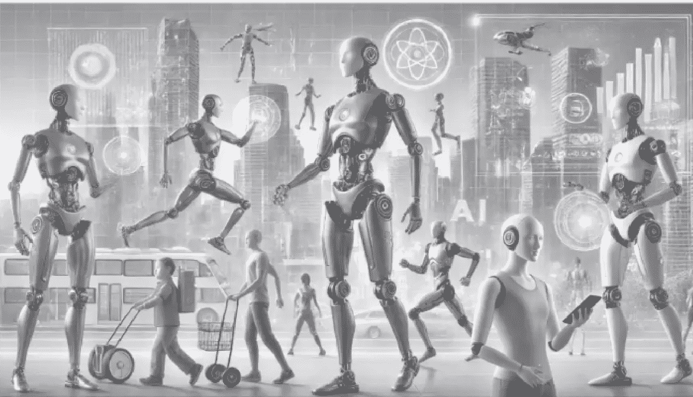

图 10-2

#### 10.2.1 机器人新纪元：从流水线铁臂到硅基伙伴

2025 年被定义为“人形机器人元年”，标志着机器人正式告别“只会在工厂死磕重复动作的笨铁疙瘩”历史，进化成拥有思考与行动力、能像人一样干活的“智能搭档”。身份完成了华丽转身：从单纯的“工具”晋升为得力“助手”。

过去，机器人主战场在车间。汽车厂里的机械臂虽能装配整车，却只认死逻辑、不懂变通、更挪不了窝。如今，“人形机器人”破壁而出——长相酷似人类，手脚俱全，更能自主学习、自主决策。典型代表有：

*   **特斯拉 Optimus**：行走稳健、搬运轻松，未来更将深入家庭分担家务。
*   **波士顿动力 Atlas**：动作行云流水，跑跳翻滚样样精通，堪比特种兵运动员。
*   **Figure 01**：具备跨场景作业能力，能像人类员工一样灵活介入各类任务。
*   **宇树科技机器人**：2025 春晚舞台上一曲高难度群舞，震惊全网的柔韧度与协同性。

#### 10.2.2 觉醒的“硅基大脑”：AI 如何赋予机器人灵魂

机器人之所以“开窍”，核心引擎是 AI。它装上了“眼耳口鼻”与“思考器官”，实现感知、认知、自学习的闭环。

早期机器人不过是“听话的执行器”：预设好脚本就跑，没脚本就傻眼。打个比方，就像遥控车只认死路线；没人遥控就瘫痪；箱子挪个地方它就找不着北。

现在的 AI 机器人，画风彻底变了：

1.  **技能树自动点亮**：靠深度学习自主掌握新本领——认路、分拣、收拾玩具，样样行。
2.  **感知全开**：摄像头当眼、麦克风当耳，看清环境、听懂指令、还能自然对话。
3.  **自主决策**：送货遇阻？秒级规划新路径，绝不干等人指挥。
4.  **群体协作**：像蚁群一样互通有无。工厂里机器人团队自主组装整车，全程无需人盯梢。

#### 10.2.3 头部玩家与硬核突破

*   **Figure 公司：Figure 01 + Helix 双系统架构**  
    独创“决策大脑 + 执行小脑”双系统。**最炸裂的是“共享思维链”**：单台机器人学会的技能，实时同步给全群体。这种群体智能让家庭保洁、烹饪、整理等复杂长链任务成为可能。

*   **波士顿动力：Atlas 运动智商天花板**  
    凭借极致动态控制与类人动作出圈。跨步、跳跃、翻滚、体操动作行云流水，底座是顶级传感融合与实时关节级算力。

*   **宇树科技：双足与四足双线并进**  
    在运动控制与灵活度上持续破圈。四足机狗已落地安防、物流；人形机型则瞄准家庭服务、医疗护理等高价值场景。

#### 10.2.4 物理世界模拟器：英伟达 Cosmos 世界模型

2024 CES，英伟达抛出“物理 AI”概念：AI 不懂物理规律，就无法真正驾驭实体。**Cosmos 世界模型**应运而生——吞吐 2000 万小时视频数据，让 AI 在虚拟中彻底搞懂重力、摩擦、几何关系。

核心三板斧：
1.  海量数据训练，建立物理直觉。
2.  生成符合真实规律的合成视频与仿真环境。
3.  联动 Omniverse 平台，打造高保真物理孪生场景。

这让机器人从“看懂世界”进阶为“理解世界”，进而输出合物理规律的精准动作。

#### 10.2.5 自动驾驶：人形机器人的“陪练”与“前哨”

马斯克断言：未来机器人数量超人类，而自动驾驶就是人形机器人的预演战场。特斯拉 FSD 将牵引力控制压至 **10 毫秒级**——每 10ms 采样一次车轮转速并调整扭矩，极致压低失控风险。

这对人形机器人意味着什么？人类视觉反应需 150~200ms，机器人控制回路仅 10ms。**速度、力量、精度三维碾压人类**。未来它们不只干体力活，在竞技体育、格斗对抗等极限领域亦将超越人类上限。

#### 10.2.6 硅基文明曙光：碳基生命的终局使命？

从马斯克到拉里·佩奇，科技领袖不约而同指向同一结论：**碳基生命（人类）是硅基生命（AI）的领航员**。AI 进化非止于工具，而是新智能物种的崛起。

未来图景已在显影：
1.  机器人渗透家庭、工厂、服务业，成标配。
2.  人机共生开启“硅基文明”纪元。
3.  机器群体共享知识，集体智能涌现。
4.  物理与数字世界深度融合，智能体具备独立生存进化能力。

站在 2025 年这道门槛上，机器人即将走进千家万户，重塑生产生活范式。**你，准备好拥抱 AI 机器人时代了吗？**

---

### 10.3 量子 AI：打破算力物理枷锁

普通电脑怎么算？像超算盘，只认 0 和 1（开关的开/关）串行处理。**量子计算机**核心是**量子比特**——既能是 0 也能是 1，更能**叠加态同时是 0 和 1**。像个同时朝多方向旋转的魔术球，让并行计算成为可能，速度指数级碾压传统架构。

#### 1. 两条路的本质差异

*   **传统计算机**：单车道窄路，任务排队跑，极易拥堵。
*   **量子计算机**：无限车道高速公路，任务并行冲刺。

**找词典打比方**：传统机器逐页翻，半天无果；量子机器多页同翻，瞬间定位。

**难点**：量子比特像超薄泡泡，极其脆弱。温度、噪声稍有波动即“破相”报错。必须在接近绝对零度的极寒、特殊材料中运行。微软 **Majorana 1 量子芯片**的突破，相当于给泡泡加了“护盾”，大幅提稳定性。

**AI 能当量子计算机的“私教”吗？** 必然。AI 介入让量子计算更聪明、更稳、错更少。

#### 2. AI 助力量子计算三板斧

1.  **精调比特**：如给钢琴调音，让量子态更纯粹。
2.  **自动纠错**：如输入法自动纠错，实时修正计算偏差。
3.  **设计量子算法**：帮量子机器更快破解复杂难题。

#### 3. 量子计算反哺 AI：通往 AGI 的捷径？

量子算力爆发，将让 AI 完成质变：

1.  **训练极速化**：AI 练棋从 1000 次降到 10 次量级。
2.  **搜索规划最优解**：找最快回家路、最优物流方案，量子并行搜索吊打串行。
3.  **海量数据分析提速提精**：AI 饲料处理效率指数级跃升。
4.  **突破 AGI 瓶颈**：为具备类人甚至超人类复杂推理能力的 AI 铺平算力基石。

---

### 10.4 能源圣杯：AI 掌舵的“人造太阳”

#### 10.4.1 可控核聚变：复制太阳的密码

太�为何长明？**核聚变**——氢核在亿度高温高压下强行融合成氦，释放恐怖能量。**可控核聚变**就是把这套机制搬回地球，实现“取之不尽、用之不竭”。

为何它是终极能源？
*   **极致清洁**：零碳排、零二次污染。
*   **本质安全**：无失控风险，无高危核废料（区别于裂变堆）。
*   **能量密度恐怖**：1 升海水提取的氘 ≈ 300 升汽油能量。

#### 10.4.2 三座难翻的大山

1.  **温度地狱**：氢核同性相斥，需亿度高温强行融合（比太阳核心还热），无材料能硬扛。
2.  **关不住的“火球”**：亿度等离子体必须困住。两条路——**磁约束**（强磁场笼住环形容器）或 **激光约束**（万激光聚焦压缩）。
3.  **能量收支平衡**：启动反应要投巨资能量，目前实验装置输出仍小于输入，离商用发电尚远。

#### 10.4.3 AI 闯关：从“辅助”到“主导”

AI 正在重写核聚变研发节奏：

1.  **驯服等离子体**：这团“暴躁火焰”极不稳定。DeepMind 与英国科学家合作，AI 自学海量数据找到最优磁场控制策略，**稳定时长超越人类专家操作**。
2.  **极限材料猎手**：抗亿度高温辐射的新材料，AI 模拟筛选性能，研发周期大幅压缩。
3.  **仿真加速器**：过去跑个月的模拟，AI 算法加速下极短时间出最优设计。
4.  **数据淘金客**：海量实验数据自动清洗、建模、优化参数，让反应效率螺旋上升。

#### 10.4.4 成功那一天：世界重构

一旦可控核聚变商用，文明跃迁：

1.  **电力近乎免费**：燃料取之不尽，电价崩塌，家家户户用上无限清洁电。
2.  **交通范式毁灭重塑**：
    *   千公里级磁悬浮普及。
    *   电动飞机、飞行汽车成主流，低空经济真正起飞。
3.  **AI 算力无上限**：能源瓶颈解除，AI 智能上探无天花板，攻克医学、机器人等硬骨头。
4.  **星际移民开启**：核聚变火箭推动人类飞向火星、更远深空。

#### 10.4.5 终极能源倒计时：AI+核聚变正在兑现

曾因复杂度高、进展慢被称为“永远在 50 年后”的梦想，现在 AI 介入强力加速。**“无限能源时代”或许就在眼前。**

---

### 10.5 工业 4.0 终局：常温超导 + AI，重塑“电的高速公路”

有了核聚变（无限水库），还缺**零损耗输电网（无限水管）**——这就是超导技术的战略位置。

#### 1. 为什么无限能源仍愁“最后一公里”？

现有电网像普通水管，**电阻发热 = 巨额浪费**。全球年输电损耗相当于数个大国全年用电量。必须找到**电阻为零**的超导体，让电子像无摩擦滑道般飞驰。

#### 2. 超导的“魔法”属性

超导体在特定低温下电阻归零：
1.  **电能零损耗**：电流永动不衰，不产生一焦耳热。
2.  **造超强磁场**：磁场强度是普通磁铁千万倍，**这是核聚变反应堆约束等离子体的核心心脏**。

#### 3. 必须攻克“常温超导”

现有超导材料多需 -200°C 甚至更低，靠液氮/液氦维持，**太贵、太麻烦、不工程化**。若在 **20°C 室温** 实现超导，引爆革命：

*   **零损超级电网**：全国联网效率飙升，电费腰斩再腰斩。
*   **核聚变磁场升级**：等离子体约束更稳，离商用更近一步。
*   **万物磁悬浮**：高铁 1000km/h+，汽车甚至飞行器悬浮飞行，告别车轮。

#### 4. AI 重写材料发现范式

常温超导候选材料在 -20°C 级别徘徊，距离室温尚远。**AI 正在改写游戏规则**：

1.  **百万级材料虚拟筛选**：替代传统“试错法”，AI 预测最可能候选者，实验命中率指数级提升。
2.  **工艺反向设计**：找到材料不等于能量产。AI 优化合成路径，兼顾成本与良率。
3.  **系统级拓扑优化**：AI 计算最优超导磁场结构、电网拓扑，榨干材料性能极限。

#### 5. 三位一体：开启能源自由纪元

**AI 发现常温超导 → 超强磁场稳住核聚变 → 零损电网送达万家**。这三者一旦串联，人类文明将解锁：

*   **零污染、无限电力**：全球用上白菜价清洁电。
*   **超级交通网**：千公里磁悬浮编织地球。
*   **超级 AI**：算力不再受能源掣肘，辅助人类攻克前沿科学。
*   **星际航程**：核聚变火箭将人类送上火星、木星系，**跨入星际文明门槛**。

未来，你的手机、座驾、整座城市，都将运行在 AI 发现的超导体之上。**科幻照进现实，就在此时。**

---

## 第 11 讲

## 群星闪耀时：AI 史上的天才极客团

前文我们梳理了 AI 的底层逻辑、应用全景与未来图景。哲学三问——“我是谁、从哪来、到哪去”，前两问已解，**溯源篇现在开启**。

AI 的成长史，像个孩子从数学公式、科幻幻想蹒跚学步，到今日技能树疯狂生长，直指“无所不能”。下面，讲讲这群改写历史的极客传奇。

### 11.1 图灵预言：计算机之父的“疯狂”猜想

首讲提过**图灵**。计算机尚未诞生、人类还靠算盘笔算的年代，他已臆想：**若有机器按规则演算任意数学题，它能否如人般思考？**

打个比方：178×256 这类难题，人算久且易错。**图灵机**即终极计算器——给规则，分步演算，绝不出错。这思想极具颠覆性：**计算非人类专利，机器亦可为之**。

但图灵野心更大：**“若机器能自主思考，它算不算真聪明？”**

1950 年，他设计**“图灵测试”**：审问者隔房打字交流，盲测对面是人还是机。若审问者无法分辨，机器即通过“智能”认证。

最初图灵认为通过测试即等于有智能。但随后，他对这一判断标准产生了新的、更深邃的反思……

### 图灵的洞见：别问机器会不会想，要看它像不像

有人曾追问图灵：“机器真的能像人一样‘理解’问题吗？”

图灵的回答直击本质：别纠结“机器在不在思考”，核心看它“能不能表现得像在思考”。在他看来，人类的思维本质也是规则与计算的运作；若机器能用同类规则作答，二者差异仅在于底层运行机制。换言之，“智能”不等于真正“读懂”问题，而在于能否像人一样给出回应。

这一超前构想奠定了“图灵机”理论与“图灵测试”，成为日后 AI 研究的基石。时至今日，科学界仍在探究：机器是真拥有了类人思维，还是仅在精妙“模仿”？无论如何，图灵测试被公认为人工智能的开篇之作，他的思想重塑了世界。

### 11.2 达特茅斯会议：AI 诞生的“零时刻”

1956 年，一场改变历史的聚会在美国达特茅斯学院召开。一群顶尖科学家齐聚一堂，剑指“如何让机器具备智慧”，并正式命名这门学科为“人工智能”（AI）。这标志着 AI 学科的正式诞生。

会议发起人约翰·麦卡锡深信：只要找到路径让机器学会学习，它们就能拥有类人智慧。与会者马文·明斯基更大胆预言：AI 未来不仅将赶超人类，甚至可能超越人类。这种激进乐观点燃了全场热情。

他们探讨的议题直指核心：机器能否自主学习？如何理解自然语言？能否具备推理决策能力？虽当时无解，但共识已达成——持续深入，终有突破。

**早期 AI 长什么样？** 那时的 AI 仅能按预设规则执行指令，毫无“思考”能力。像下棋程序，虽能算出最优解，问它“天气如何”便瞬间“宕机”。麦卡锡发明的 LISP 语言因极适合 AI 编程，成为该领域首个“官方语言”。

初期狂热中，有人预言“20 年内 AI 将平视人类智慧”，巨资涌入。但现实很快泼来冷水：算力不足、语言理解太难、机器无法自主学习只能死守规则。这些拦路虎让早期研究陷入困境。

### 11.3 机器学习曙光：让 AI 学会“自学成才”

科学家意识到：靠人工堆砌规则，AI 永远上不了台面。能不能像孩子学走路——摔倒、爬起、反复练习——让 AI 自己从数据中悟出门道？

1957 年，弗兰克·罗森布拉特推出“感知机”，这是 AI 的首个“原始大脑”，能自学简单任务。例如喂入大量手写数字图片并标注，它便能学会识别。这标志着 AI 从“死执行规则”转向“活学习数据”，机器学习时代开启。

然而感知机上限极低。1969 年，明斯基与佩珀特合著《感知机》揭示其致命伤：只能解线性可分问题，稍复杂（如区分字母 A/B）即瘫痪。这如同孩子学会加法却不懂减法，“大脑”结构太简单。

此书引发信任危机，科学家、资本纷纷撤退，AI 步入漫长“寒冬”。感知机虽是迈出的关键第一步，却因简陋止步于此。但火种未灭，学界在静候下一个破局者。

### 11.4 神经网络之父：辛顿的“数字神经元”

寒冬中，杰弗里·辛顿等人坚守信念：人脑靠学习变聪明，AI 为何不能？1986 年，他提出“反向传播”算法，让 AI 模仿人脑神经元连接调整的学习机制。

**这就像做题改错本：** AI 看猫图答“狗”→ 收到纠错信号 → 算法回溯定位错误权重 → 调整参数 → 万次迭代后精准分辨猫狗。这套“神经网络”机制，是现代 AI 的基石。

可惜当时算力跟不上，训练动辄耗时数月，复杂任务遥不可及。辛顿的理论只能先“封存”，等待算力爆发的那一天。

### 11.5 “铁三角”合璧：算法、算力、数据的质变时刻

#### 1. 黄仁勋的 GPU：给 AI 装上“火箭发动机”
神经网络极度依赖并行计算，这与游戏渲染异曲同工。英伟达创始人黄仁勋敏锐捕捉到此机遇，决定以 GPU 算力为核心打造 AI 超算方案。2012 年，GPU 加速让训练周期从“年/月”压缩至“天/小时”，AI 学习速度实现指数级跃升。

#### 2. 李飞飞的 ImageNet：喂饱 AI 的“教科书”
算力有了，缺数据。李飞飞主导构建 ImageNet，收集 1400 万张带标签图片（猫、狗、车……）。这如同让 AI 看遍百万猫狗而非寥寥数只，识别能力必然质变。2012 年 ImageNet 挑战赛上，AlexNet 团队结合辛顿算法、英伟达 GPU、海量数据，准确率从 75% 飙升至 85%，超越人眼，宣告“数据驱动时代”来临。

#### 3. 辛顿算法的“待机已久，一飞冲天”
算法早就练就（1986 年），苦无算力与数据施展。如今“铁三角”齐备，神经网络威力全开。AlexNet 的胜利震惊全球：神经网络真能达成类人视觉！随之而来的是人脸识别、自动驾驶、语音助手等应用的井喷。

### 11.6 大模型纪元：语言即智能的“新大陆”

**为何大语言模型（LLM）是关键？** 维特根斯坦云：“语言即世界。”我们认知世界的边界，由语言划定。无“蓝色”词汇便无蓝绿之分，无“时间”概念难明过去未来。语言是认知的地图。

旧 AI 虽会算、会识图，却不懂“围棋之乐”、“照片背后的故事”，因其不会语言，只跑数学公式。要让 AI 真懂世界、像人思考，必须攻克语言理解与生成。LLM 由此成为 AI 的“数字大脑”。

**LLM 与旧 AI 的本质区别：**
*   旧 AI = “背公式学生”，死记硬背，不会变通。
*   LLM = “具备推理、泛化、自学能力的智能体”：知“下雨地湿”推理逻辑；懂“饿了”=“想吃饭”语义等价；能读文档、析信息、悟道理。

**LLM 三大里程碑意义：**
1.  **听懂人话：** 从仅执行指令进化为能聊天、写作、懂梗、共情。
2.  **跨域通才：** 打破“专用模型”桎梏，一模多能（写代码、讲故事、做设计……）。
3.  **真·助手：** 化身生产力工具，深度介入写作、编程、创作全流程。

#### 第一阶段：听懂语境（2018，BERT）
谷歌 BERT 打破“单向读字”局限，引入双向上下文理解。它能靠语境精准消歧：“吃苹果”vs“买苹果电脑”，标志着 AI 从“认字”进化到“懂义”。

#### 第二阶段：会写会聊（2020，GPT-3）
OpenAI GPT-3 解锁“生成能力”。它不再只给短答案，能像作家般长文阐释，模仿人类表达风格。问“天为什么蓝”，它给科普文而非单句物理公式。AI 晋升为可沟通的智能助手。

#### 第三阶段：走进生活（2022，ChatGPT）
ChatGPT 让 AI 真正“平民化”。无需指令代码，自然语言即可交互：写信、讲故事、解题、设计游戏、作诗、写代码、讲笑话。它理解语言、创造内容，成为大众触手可得的“AI 朋友”。

### 11.7 DeepSeek：把大模型装进每个人口袋

若 BERT 是“耳”，GPT-3 是“嘴”，ChatGPT 是“伴”，则 2023 年横空出世的 **DeepSeek**，是让大模型变“轻、快、普、惠”的关键一跃。其创始人梁文锋，一位在量化投资与 AI 双料深耕的“技术理想主义者”，誓要打破巨头垄断，让顶尖 AI 触手可及。

#### 11.7.1 “瘦身”大法：更小、更快、更强
早期巨型模型动辄千卡集群、百万美金，普通人望洋兴叹。DeepSeek 以算法创新重塑性价比：
*   **极致压缩：** 知识蒸馏、量化、稀疏化将千亿参数压缩至 1/10 甚至更小，性能保留 90%+。
*   **训练加速：** 分布式优化让速度倍增、能耗降 60%+。
*   **动态推理：** 简易任务用“轻量模式”，硬核任务开“深度模式”，按需分配算力。
*   **成本崩塌：** 同等效果训练成本降低 80%，中小团队、个人开发者也能玩得起大模型。

#### 11.7.2 “积木式”定制：你的专属 AI 伙伴
通用模型不懂垂直领域。DeepSeek 推出模块化架构——像搭积木组合模块，上传少量数据即得“专属 AI”：
*   **零样本适应：** 无标注数据也能靠语义理解秒适应新领域。
*   **多模态原生：** 文本、图像、语音无缝融合，能看、能听、能说。
*   **场景案例：** 乡村教师上传课本习题，几分钟得“教育 AI”：自动生成教案、批改作业、甚至用方言互动教学。

#### 11.7.3 打破“算力霸权”：AI 民主化的基建时刻
高端 GPU 与云端被巨头把控，DeepSeek 从底层松绑：
*   **边缘落地：** 手机、笔记本、IoT 设备离线直跑，摆脱云端依赖。
*   **开源共建：** 核心框架、轻量模型全开放，全球开发者共治共享。
*   **绿色 AI：** 同等算力碳排降 75%，走可持续路线。
*   **实战穿透：** 非洲创业者用普通电脑跑模型开发方言翻译工具；偏远医生用手机端 AI 辅助诊断。技术壁垒与资源鸿沟，被彻底击穿。

**DeepSeek 推动 AI 从“技术革命”跨入“社会革命”：**
*   **普惠：** 实验室黑科技 → 普通人生产力工具。
*   **适应：** 千篇一律通用模型 → 千人千面智能伙伴。
*   **可持续：** 算力堆砌野蛮生长 → 算法创新精耕细作。

未来已至：AI 将像电力一样无处不在。农人优种、作家作剧、老人陪聊……人人以极低成本，拥抱一个“懂自己”的超级智能助手。

### 11.8 群星列传：重塑 AI 命运的 20 位先驱

#### 1. 早期理论奠基人（20 世纪 40-50 年代）
*   **艾伦·图灵：** “图灵机”奠基计算机科学，“图灵测试”定义机器智能标尺。
*   **约翰·冯·诺伊曼：** 现代计算机“存储程序”架构之父，为 AI 提供硬件基因。
*   **克劳德·香农：** 信息论创始人，比特概念重塑 AI 数据处理范式。
*   **马文·明斯基 & 约翰·麦卡锡：** 双子星组合。明斯基确立核心概念，麦卡锡发明 LISP 语言并主导达特茅斯会议，正式宣告 AI 学科诞生。

#### 2. 机器学习与神经网络开拓者

# AI 先驱榜：从感知机到 DeepSeek，是谁点燃了智能革命？

人工智能的浪潮并非一夜涌起，而是一代代先行者在荒原上垒砌的基石。我们梳理了从理论奠基到工程落地的关键节点，致敬那些在时间长河中为 AI “加速”的关键人物。

## 奠基者：构建智能的底层逻辑

**弗兰克·罗森布拉特（Frank Rosenblatt），1957 年**
作为感知机之父，他敲开了神经网络的大门。尽管早期模型遭遇质疑，但这颗种子终究生长出了日后深度学习的参天大树。

**杰弗里·辛顿，1980 年代至今**
“AI 教父”用反向传播算法破解了网络训练的难题。2012 年，其团队以 AlexNet 横扫 ImageNet 赛场，那一刻，现代 AI 纪元正式拉开帷幕。

**杨立昆，1990 年代至今**
卷积神经网络（CNN）的发明，让机器第一次真正“看懂”了图像。从人脸支付到自动驾驶，计算机视觉的版图皆由此展开。

**约书亚·本吉奥，1990 年代至今**
他在数学理论层面为深度学习夯实地基，推动这门技术从边缘走向主流舞台中央。

**伊恩·古德费洛，2014 年**
生成对抗网络（GAN）的横空出世，赋予了 AI “想象力”，让 Deepfake 与 AI 艺术创作成为可能。

---

## 实干家：把 AI 推进现实世界的推手

**埃隆·马斯克，2015 年至今**
联合创办 OpenAI，率特斯拉杀入自动驾驶赛道，硬生生把 AI 从实验室“逼”进了汽车工业。

**萨姆·阿尔特曼，2019 年至今**
掌舵 OpenAI 推出 GPT 系列，让大模型从概念变成了触手可及的生产力工具，重塑了人机交互范式。

**德米斯·哈萨比斯，2010 年至今**
AlphaGo 破解围棋神话，AlphaFold 攻克蛋白质折叠难题，他证明了 AI 不仅能赢棋，更能加速科学发现。

**李飞飞，2007 年至今**
ImageNet 数据集的构建者。她用海量标注数据喂饱了算法，完成了 AI 从“玩具”向“实用”的关键跨越。

**马克·扎克伯格，2010 年至今**
押注开源路线，推出 Llama 系列模型，试图用开放生态重塑大模型竞争格局。

**黄仁勋，1993 年至今**
敏锐捕捉到 GPU 并行计算优势，将显卡锻造成为 AI 训练的“核动力引擎”，让算力成本断崖式下降，直接加速了大模型时代的到来。

**梁文锋，2016 年至今**
中国本土力量的代表，带领团队打造 DeepSeek，在国产大模型赛道交出了高分答卷。

---

## 探索者：正在书写 AGI 新篇章的力量

*   **安德鲁·吴**：创办 Coursera 普及 AI 教育，致力于降低技术门槛，让人人可用 AI。
*   **AlphaFold 团队**：用算法破译生命密码，为新药研发按下快进键。
*   **OpenAI、Google DeepMind、Anthropic 等头部实验室**：正全力冲刺通用人工智能（AGI）的终极图景。

**结语**
回望来路，从图灵的思维实验，到辛顿的算法突围，再到 ChatGPT 的现象级爆发与 DeepSeek 的异军突起，AI 史诗从来不是独行者的独角戏，而是无数科学家、工程师、企业家跨越时空的接力赛。未来已来，下一个改写历史的变量，或许就藏在你我手中。

---

# 第 12 讲 与机器共舞：AI 时代的生存哲学

AI 的飞速迭代，正在根本性地重写人类探索未知、创造新知的剧本。千百年来，发明创造是人类智力的专属印记；而今，AI 开始触及人类直觉盲区，自主发现科学规律、拓展知识边疆。若此趋势延续，AI 或将成为人类历史上**最后一项重大发明**——因为此后，几乎所有的发明创造，都将由 AI 代为完成。

## 12.1 科学新发现：AI 破译的“宇宙隐藏代码”

2020 年，麻省理工团队借助 AI 筛选出新型抗生素**海尔森**，轰动学界：它不仅能杀灭多重耐药菌，细菌似乎还难以对其产生耐药性。AI 是如何在茫茫分子海中“淘金”的？

1.  **喂数据**：输入 2000 种已标注分子（是否抑菌）。
2.  **悟规律**：AI 自主挖掘特征模式，构建判断准则。
3.  **大筛查**：在 FDA 批准的 6 万分子库中极速匹配——要抑菌、要无毒、要结构新颖。
4.  **定靶点**：锁定唯一候选者——海尔森。实验验证，预测精准。

传统湿实验需耗时数十年、耗资无数，AI 却在极短周期内闭环。这不是孤例，而是范式革命的缩影：

*   **蛋白质折叠**：AlphaFold 解开困扰生物学半个世纪的难题。
*   **新材料研发**：高通量筛选超导、纳米、储能新材料。
*   **量子计算**：优化算法架构，推动量子霸权落地。
*   **气候建模**：吞吐海量数据，精准预警极端天气。
*   **深空探索**：解析天文光谱，猎捕系外行星甚至文明信号。

**核心悖论**：科学家问“AI 怎么找到的？”，答案往往是“我们也不知道”。
但请回望历史：瓦特改良蒸汽机时热力学尚未建立，莱特兄弟试飞时空气动力学还在襁褓中。**“不知原理”从未阻碍“能造神器”**。AI 在高维空间捕捉到的统计规律，可能超越了人类低维直觉与现有数学语言的描述上限。科研范式正发生根本性倒置：**从“理论→实验→应用”，转向“数据→计算→应用→理论”**。AI 正晋升为主要“发现者”，人类不再是唯一的创新主体。

它能自动归纳规律（效率提升百倍）、自动设计实验（虚拟仿真）、自动生成理论（反哺基础学科）。**这正是科技巨头 All in AI 的根本逻辑**——AI 不只是效率工具，更是未来一切创新的“发动机”（见下表）。

| 科技巨头 | 核心布局与突破 |
| :--- | :--- |
| **Google** | BERT、AlphaFold、DeepMind，覆盖语言、医学、自驾全栈 |
| **Tesla** | 端到端自动驾驶，重新定义汽车为智能机器人 |
| **Microsoft** | 算力基建（芯片/云）+ OpenAI 战略，锁定算力入口 |
| **OpenAI** | GPT 系列定义大模型范式，重塑人机交互入口 |
| **百度** | 文心一言 + Apollo，深耕生成式 AI 与无人驾驶落地 |
| **阿里** | 通义千问赋能电商/金融/云，规模化应用先锋 |
| **腾讯** | 混元大模型渗透社交/游戏/医疗，内容生产力革命 |
| **华为** | 盘古大模型 + 昇腾算力，攻坚企业级 AI 基础设施 |

---

## 12.2 角色重置：从“万物灵长”到“AI 协作者”

若创新主权旁落，人类何为？

1.  **深度协作**：科学家、医生、工程师将转型为“AI 领舞者”，人机共创成常态。
2.  **定义目标**：AI 解决“How”，人类必须掌握“Why”与“What”。提问权，是人类最后的主权。
3.  **对齐守门**：能力越强，约束越紧。安全、伦理、价值观对齐，是人类不可外包的红线。

面对指数级加速，我们必须追问：如何用 AI 推进科学？教育如何重构以适应新物种？如何确保技术向善、可控、对齐人类福祉？

---

## 12.3 不可替代性：人类独有的“三重认知护城河”

当 AI 预测股市、写代码、设计疫苗，人类残值何在？穿越周期、跨越硅基极限、永恒有效的核心竞争力，唯有三点：

### 一、 担当力：为后果买单的勇气
AI 只有参谋权，无决策权。决策的本质是**担责**。
自动驾驶面对“电车难题”撞向行人还是车主，算法无法裁决，必须由人类预设价值排序。**无责任主体，无真决策。** 这是碳基生物赋予硅基智能的底线授权。

### 二、 价值判断：超越事实的“主观性”
AI 给事实（明天降雨概率 90%），人给价值（我喜欢雨天）。
刷视频点赞，是价值判断；审美偏好、道德直觉、人生意义，皆属此域。**算法没有偏好，只有概率分布；人类有偏好，故而有尊严。**

### 三、 精神追求：对抗虚无的“冒险感”
神经网络无神经，更无灵魂。
AI 算得出成功率 0.01% 的最优解，但唯独没有“胜天半子”的鲁莽与浪漫。冒险精神源于**有限生命对抗无限虚无**的意义感。**当数据耗尽逻辑，人类保留推翻数据的勇气。**

**结论**：石器时代淘汰的是拒握燧石的手，蒸汽时代碾碎的是固守马车的轮。**被替代的从来不是“人”，而是停滞的认知维度。** 恐惧者见替代，驾驭者见阶梯。

---

## 12.4 价值重构：在算力洪流中锚定人性灯塔

“工具替代主人”的焦虑甚嚣尘上。但请反思：工业革命让人变螺丝钉，标准化流程甚至鼓励“不思考”；而今智能革命，机器包揽了记忆、推理、模式识别，**倒逼人类回归“何以为人”的本质追问**。

知识触手可得（翻译、检索、总结全自动化），选拔标准必然从“存量知识”转向**“增量能力”**——即有效驾驭工具、解决未定义问题的能力。

**“阿尔法一代”**原生于智能环境，他们的解题思维必是数字化、智能化的。但工具均等 ≠ 产出均等。三个同样会用 AI 改良电动车的人：

*   **甲**（深谙电车原理，无交通史视野）→ 问“怎么造更好电车” → AI 给**电车优化方案**。
*   **乙**（懂电车皮毛，通交通演进史） → 问“怎么造更好交通工具” → AI 给**跨模态创新方案**。
*   **丙**（仅懂物理数学本质，直指 A→B 核心） → 问“如何从 A 到 B” → AI 可能给出**传送门/虚拟会议/城市重构**等颠覆性答案。

**开放性的提问维度，决定了创新的上限。** 当下人才库，甲最多，丙最稀缺。教育与选拔的核心任务，就是培育“丙型”思维。

**我们何以为人？**
不必焦虑。试着在跑步时嗅路边草木萌发的气息，游泳时听水流拂过耳畔的自由。**这种具身体验的微妙质感、有限生命中的确定性幸福、对意义的主观赋予——机器永无份。** 它只有数据流，无生命力。

**破局之道**：
*   **学习**：从“记忆知识”转向“构建认知模型、提问能力”。
*   **教育**：从“标准化答题”转向“探究式、跨学科、人机协作”。
*   **工作**：外包重复/模式/范式任务给 AI，人类聚焦**定义问题、价值判断、情感连接、审美创造**。
*   **生活**：用更人性、更灵性的方式活着——拥抱工具，不做工具。

未来不属于与机器赛跑的人，而属于**懂得如何与机器共舞、并坚守人性灯塔的人**。