# Arduino Uno 零基础速通：48个实战案例

## 书籍速览

本书采用“实战案例驱动”模式，系统梳理了 Arduino Uno 的入门核心与编程落地技巧。前半部分夯实地基，覆盖 Arduino 基本概念、开发环境搭建及语法精髓；后半部分精选 48 个经典实验，每例均配备实验背景、知识清单、编程技巧、完整代码及进阶挑战，层层递进。

图文并茂、步骤拆解细致，既适合自学入门的爱好者，也堪称中小学生课外编程启蒙的优质教辅。

## 引言

提到计算机与智能手机，无人不知；但若说起单片机与 Arduino，你又了解几分？

**计算机**，算力强劲，软硬结合，擅长海量数据高速运算与复杂逻辑控制，是 AI、设计、网络等领域的核心生产力工具。  
**智能手机**，移动通信终端，集通话、上网、掌上计算于一身，重塑了现代生活方式。  
**单片机**，即单片微型计算机，集 CPU、存储、I/O 于一芯，结构精简、可靠性高、控制力强，长期活跃于仪表、家电、医疗、航天等自动化控制一线。  
**Arduino**，开源电子原型平台，软硬件一体，跨平台、低门槛、生态开放、迭代极快。它能通过代码驱动开关、传感器、执行器，轻松点亮 LED、驱动步进电机。硬件亲民、IDE 免费开源、上手曲线平缓，是创客教育与快速原型验证的利器。

**“我能学会吗？怎么学最高效？”**  
若你热衷动手、会基础焊接与键盘操作，Arduino 绝不在话下，甚至会让你爱不释手。  
优质入门教程或系统培训，能帮你规避坑点、少走弯路、建立正向反馈。本书即为此类“领路人”而生：

1.  **案例经典，素材精炼**  
    48 个核心实验 + 33 套配套套件（单独获取），难度可控、材料易得，极大提升学习密度。
2.  **抓大放小，通俗易懂**  
    基础篇直击板级资源、IDE 操作、核心语法、常用元件与焊接技法；实战篇统一“描述-知识-编程-代码-拓展”五段式结构，步步有据可循。
3.  **螺旋上升，触类旁通**  
    循序渐进积累成就感，拓展挑战激发迁移力，练就严谨工程思维。
4.  **源于生活，落地可用**  
    案例贴近真实场景，理论联系实际，练就硬核动手力。

定位：小学高年级及以上。全书代码经实测验证，疏漏在所难免，恳请各方指正。

## 第1章 Arduino 入门必修课

### 1.1 认识 Arduino

#### 1. Arduino 简史与定位
2005 年，欧洲团队推出 Arduino 开源平台，旨在降低智能控制项目的开发门槛。平台双核驱动：**硬件端**为各类 Arduino 开发板（核心为 AVR 单片机，集成外围电路，上电即工作）；**软件端**为 Arduino IDE（集成编辑器、编译器、下载器），基于 Processing 语言衍生出的 C/C++ 方言，经编译烧录后驱动单片机自主运行。

> **小贴士**：开源 = 硬件原理图/PCB/核心库公开，软件源码免费可用；IDE = Integrated Development Environment（集成开发环境）。

**核心用途**：读取开关/传感器数据 → 代码决策 → 驱动 LED/电机/舵机等执行器。  
典型场景：红外遥控灯光、超声波避障小车、环境监测终端……

**四大亮点**：
- **全平台**：Windows/macOS/Linux 无缝运行；
- **真开源**：原理图、固件、核心库全开放，全球社区资源海量，二次开发极速；
- **低成本**：板卡便宜、软件免费、USB 供电免外接、语法封装友好，新手试错成本极低；
- **强封装**：底层 AVR 库二次封装，屏蔽寄存器操作细节，功能强大却极简易学。

#### 2. Arduino Uno 开发板解剖
Uno 是入门首选型号，尺寸 70×54 mm，板载资源一览：

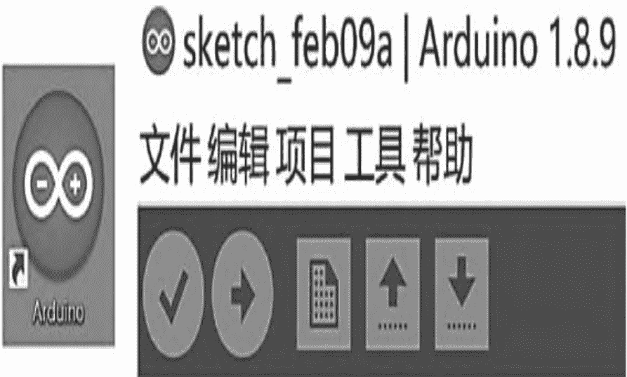

| 标识 | 功能详解 |
| :--- | :--- |
| **0~13** | 14 路数字 I/O（40 mA），其中 D0/D1 兼串口收发，D3/5/6/9/10/11 支持 PWM，D13 内接板载 LED（高亮/低灭）。<br>数字量 = 离散电平：<0.8V 读 0（低），>2.0V 读 1（高），中间态不确定。 |
| **A0~A5** | 6 路模拟输入，10 位 ADC（0~1023 对应 0~5V），亦可复用为数字 I/O。 |
| **GND** | 系统公共地，板载 3 处。 |
| **AREF** | 模拟基准电压引脚，配合 `analogReference()` 使用。 |
| **SDA/SCL** | I²C 专用引脚（复用 A4/A5），实现片上/板间通信。 |
| **Reset** | 硬件复位键，按下即重跑程序。 |
| **USB-B** | 供电（5V/500mA）、程序下载、串口通信三合一，USB 2.0 速率 480 Mbps。 |
| **DC Jack** | 7~12V 外接供电，经二极管防反接 → AMS1117 降压 → 5V/3.3V 输出。<br>负载 <500mA 可仅用 USB；>500mA 必须外接。 |
| **5V / 3.3V** | 对外供电输出引脚。 |
| **RESET 引脚** | 短接 GND 后释放，效果等同复位键。 |
| **VIN** | 外接电源正极输入（7~12V）。 |
| **ICSP** | 6Pin 在线编程接口，支持烧录/擦除/调试。 |
| **ATmega328P** | 核心 MCU：8 位 AVR，32KB Flash（可擦写 10k+ 次，掉电 20 年不丢），1.8~5.5V/20MHz。 |
| **16 MHz 晶振** | 系统时钟基准，保证时序精准。 |

> **注**：Mbps = 兆位/秒（1 Byte = 8 bit）；晶振频率 = 单位时间震荡次数（Hz）。

### 1.2 开发环境从 0 到 1

#### 1. IDE 安装三步走
1.  官网/镜像站下载 `arduino-windows.exe`；
2.  运行安装 → 用方头 USB 线连板卡 → 设备管理器确认 `USB-SERIAL CH340 (COMx)` 无黄牌（异常则装驱动）；
3.  双击桌面图标启动 IDE。

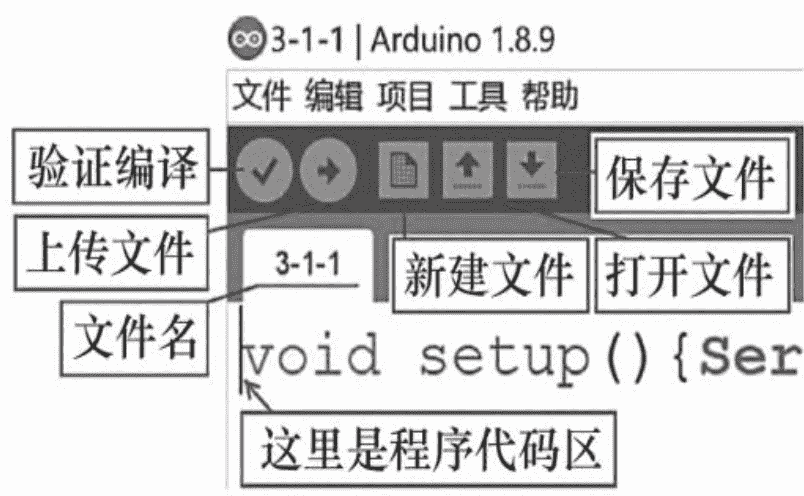

#### 2. 编程全流程速通
1.  **新建草图**：`文件→新建` / 工具栏第 3 图标 / `Ctrl+N`；
2.  **写代码**：英文输入法下编写，注意 9 大铁律：
    - 字符/符号全半角严格区分；
    - 大小写敏感；
    - 空白符可压缩；
    - 符号间空格可省；
    - `()` `{}` `//` `/* */` 必成对（注释不参与编译，利于维护）；
    - 除特殊结构外，**语句必须以分号结尾**；
    - 语句换行随意；
    - `Ctrl+T` 一键格式化；
    - `HIGH/1`、`LOW/0` 等价互换。

```
#define D1 262

#include <IRremote.h>

void setup(){

void loop(){

for(int i=0;i<14;i++){

if(val==1) 语句 1;else 语句 2;}
``` ```
void setup(){for(int i=0;i<14;i++)(pinMode(i,OUTPUT);)
```

3.  **保存**：`文件→另存为` → 建议建立 `D:\MyArduino` 目录管理；
4.  **验证编译**：`项目→验证编译` / 图标 1 / `Ctrl+R` → 底栏显示“编译完成”即通过，否则按报错排查（优先查输入法与拼写）；
5.  **选端口**：`工具→端口→COMx`（打勾确认）；
6.  **选板卡**：`工具→开发板→Arduino/Genuino Uno`；
7.  **烧录上传**：`项目→上传` / 图标 2 / `Ctrl+U` → “上传成功”即运行。

> **避坑指南**：上传失败常因模块启动电流过大 → 外接 7~12V 电源，或烧录时断开模块、成功后再接电实测。

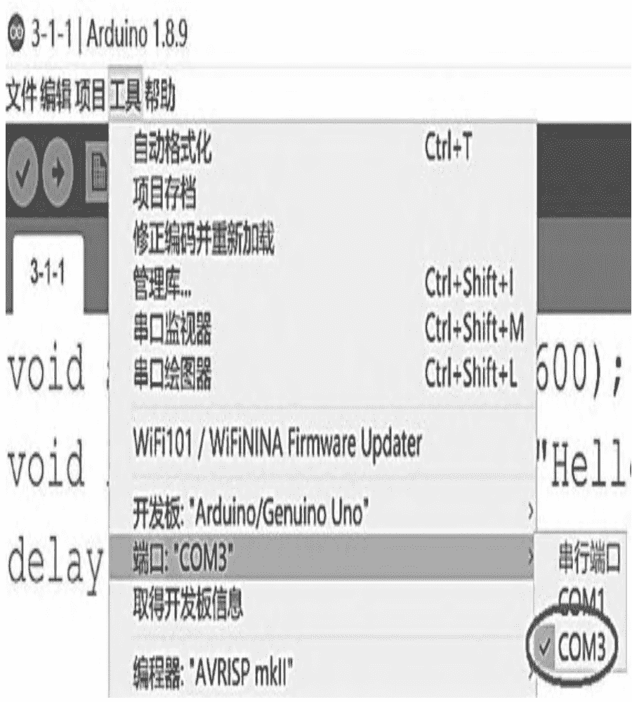 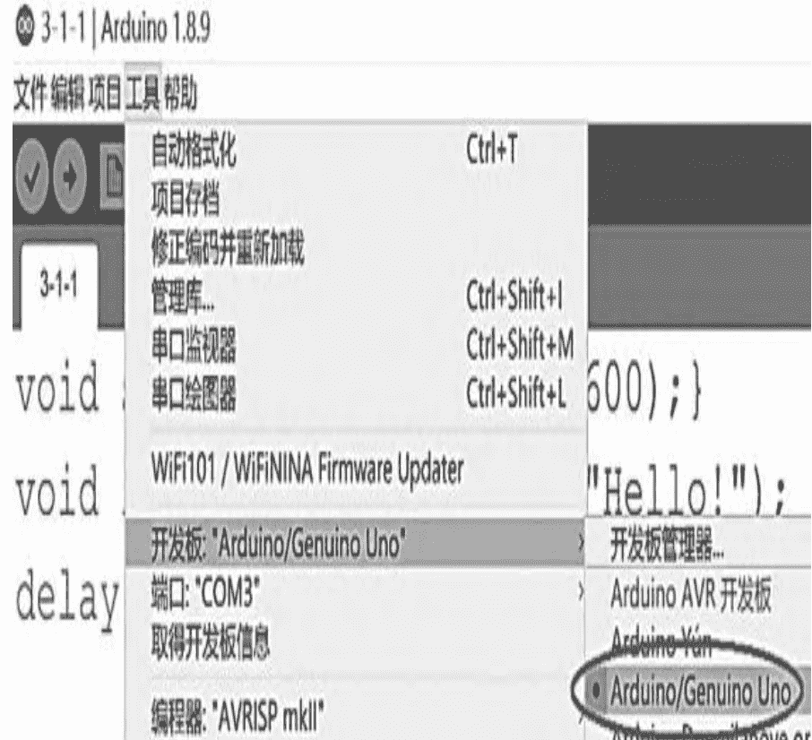

### 1.3 Arduino 语言精要

本质：基于 C/C++ 封装 AVR 寄存器操作的领域特定语言。

#### 1. 程序骨架三件套
```cpp
// 1. 结构：双核心函数 + 可选扩展
void setup() {  // 上电/复位仅执行一次
  // 初始化变量、引脚模式、串口波特率、加载库...
}
void loop() {   // 死循环执行主逻辑
  // 核心业务代码...
}
// 头文件、全局变量、自定义函数、库文件常置于 setup 之前
```

- **setup()**：一次性初始化区；
- **loop()**：周而复始执行区。

#### 2. 数据容器：变量与常量
| 类型 | 关键字 | 宽度 | 说明 |
| :--- | :--- | :--- | :--- |
| 整型 | `int` | 4 字节 | 存整数，-2,147,483,648 ~ 2,147,483,647 |
| 单精度浮点 | `float` | 4 字节 | 存小数，约 6~7 位有效数字 |
| 字符型 | `char` | 1 字节 | 存单字符（ASCII） |

- **变量**：声明类型 → 赋初值 → 通过变量名读写，运行期可变；
- **常量**：编译期确定，运行期只读，优化内存与速度。

# Arduino 核心语法与常用元件速查指南

## 库文件管理与引用规范

Arduino 的库资源分为三大阵营：官方核心库、社区贡献库及第三方扩展库。核心库安置于 `Arduino\hardware\arduino\avr` 目录，贡献库则归属 `Arduino\libraries` 文件夹。调用库函数前，务必在代码开头通过 `#include <库名.h>` 引入头文件；新增库后，重启 IDE 方可生效。

## 2. `setup()` 前的全局声明区

此区域用于宏定义、变量初始化、库对象实例化等预处理工作，为主程序奠定基础。

**常量与宏定义**
- 音高频率：`#define D1 196` 标记 G 调低音 1 振动频率。
- 引脚映射：`#define Da 9` 将数码管 a 残引脚映射至数字口 9。

**库文件引入**
依次导入红外解码、舵机控制、液晶驱动核心库：
```cpp
#include <IRremote.h>
#include <Servo.h>
#include <LiquidCrystal.h>
```

**硬件引脚与配置数组**
- `digitPins[]`、`segmentPins[]`、`ledpin[]` 分别绑定数码管公共端、段选端及 LED 阵列引脚。
- `hardwareConfig = 2` 设定共阴极数码管高电平点亮模式。
- `numDigits = 4` 指定 4 位数码管。
- `num[10][7]` 定义 10 行 7 列无符号字符数组，用于存放字形码（*注：书中变量名统一采用正体显示*）。

**变量与对象实例化**
| 类型/对象 | 示例 | 说明 |
| :--- | :--- | :--- |
| 整型/长整型 | `int flag=0`, `long Seco=0` | 标志位、计时器初始化；`int` 范围 ±32767，`long` 范围 ±21亿 |
| 浮点数组 | `float duration[]={}` | 存储音符时值 |
| 红外接收 | `IRrecv irrecv(2)` | 绑定数字口 2 作为接收端 |
| 液晶屏 | `LiquidCrystal lcd(3,4,5,8,9,10,11)` | 实例化 7 线并口 LCD |
| 舵机 | `Servo servo13` | 创建舵机对象 |
| 解码结果 | `decode_results results` | 存放红外解码数据 |

**典型逻辑片段速览**
- **模式切换**：读取按键状态，配合 250ms 去抖延时，利用取模运算实现 3 模式循环切换（`flag=(flag+1)%3`）。
- **数码管驱动**：通过 `digitalWrite(Da, num[i][0])` 逐位刷新段码。
- **索引循环**：`index=(index+1)%101` 构建 0~100 的循环计数器。

## 3. `setup()` 初始化块

核心外设初始化代码置于此处。

```
digitalWrite(12,1);// 设置数字端口 12 输出高电平。
for(int i=0;i<14;i++)pinMode(i,OUTPUT);// 循环执行，从 i=0 开始，到 i=13 结束；设置数字端口 0 ~ 13 为输出模式。
irrecv.enableIRIn();// 初始化红外接收器。
lcd.begin(16,2);// 设定显示屏尺寸。
lcd.clear();// 清除屏幕。
lcd.print("Hello!Friend!");// 输出字符串 “Hello!Friend!"。
lcd.setCursor(0,0);// 设置光标位置为 (0,0)，即第 0 位第 0 行。
```

```
pinMode(13,INPUT);// 设置数字端口 13 为输入模式。
pinMode(13,OUTPUT);// 设置数字端口 13 为输出模式。
Serial.begin(9600);// 打开串口，设置数据传输速率为 9600bps。
servo13.attach(13);// 设置舵机接口为数字端口 13。
```

## 4. `loop()` 主循环高频指令集

主程序循环执行，按功能归类如下：

### 模拟量输入输出 (PWM)
- `analogRead(0)`：读取 A0 口电压，返回 0~1023。
- `analogWrite(3, val/4)` / `analogWrite(pin, val)`：向 3、5、6、9、10、11 号口输出 PWM。`val=255` 对应 5V，`val=0` 对应 0V。

### 数字量输入输出
- 读取：`digitalRead(13)` 获取高低电平。
- 写入：`digitalWrite(13, 1/0)` 输出高/低电平；`digitalWrite(13, !digitalRead(13))` 实现电平翻转。
- 批量操作：`for` 循环遍历端口 13~1 置高。

### 位操作与数组驱动
- `bitRead(value, i)` 读取变量指定位。
- `digitalWrite(ledpin[i], num[j][i])` 等语句实现二维数组到引脚的映射输出。

### 流程控制结构
- **条件判断**：`if/else`、`switch/case`（配合 `break` 退出）。
- **字符串比较**：`strncmp(password, mmsn, 6)` 检测前 6 位一致性。
- **复合条件**：`if(digitalRead(13)!=0 && (millis()-runtime)>100 && buttonpress)` 多条件联动。
- **红外解码流程**：`if(irrecv.decode(&results))` 触发处理，`irrecv.resume()` 准备接收下一帧。
- **按键等待**：`while(digitalRead(12)==0)` 阻塞等待松开。
- **循环结构**：`for` 定时循环，`while` 条件循环。

### 外设专用指令
| 外设 | 关键指令 | 功能 |
| :--- | :--- | :--- |
| **蜂鸣器** | `tone(13, 1000)` / `tone(13, D3, 20)` | 产生指定频率/时长方波；`noTone(13)` 停止 |
| **舵机** | `servo13.write(0)` | 设定旋转角度 |
| **RGB LED** | `setColor(255,0,0)` | 设定 RGB 颜色值 |
| **数码管库** | `sevseg.setNumber(val,-1)` / `sevseg.refreshDisplay()` | 设值(无小数点)与刷新显示 |
| **LCD** | `lcd.scrollDisplayLeft()` | 文本左滚动 |
| **串口调试** | `Serial.println(val, DEC/HEX)` | 十进制/十六进制打印换行 |
| **矩阵键盘** | `char key=keypad.getKey()` | 非阻塞获取按键值 |
| **子程序调用** | `deal(num[i])` 配合 `void deal(unsigned char value)` | 参数传递与模块化 |

### 数值运算技巧
- 个位：`S1 = val % 10`
- 十位： `S2 = (val/10) % 10`
- 百位： `S3 = val / 100`
- 数组长度计算：`length = sizeof(tune)/sizeof(tune[0])`
- 变量清零：`val = 0`

## 5. `loop()` 后的补充函数区

自定义功能函数、中断服务程序等置于主循环之后。

```
void control(int pin9,int pin10,int pin11,int pin12){
digitalWrite(9,pin9);
digitalWrite(10,pin10);
digitalWrite(11,pin11);
digitalWrite(12,pin12);
}
// 定义控制位引脚函数。
control(0,1,1,1);// 设置数字端口 9 为低电平，数字端口 10、11、12 为高电平。
void disp0()// 显示子程序 disp0，消除数码管余辉效应。
void scan()// 逐位扫描子程序。
```

---

# 1.4 电子元件识别与选用手册

## 1. 电阻器
**核心作用**：限流分压。同电压下，阻值越大，电流越小。无极性之分。

**两大主流封装识读**：
- **贴片电阻 (1206/0805等)**：体积 3.2×1.6mm。三位数字编码：**前两位为有效数字，第三位为 10 的幂次**。
  - `391` → 39×10¹ = **390Ω**
  - `222` → 22×10² = **2.2kΩ**
- **五色环电阻 (通孔 1/4W)**：色环对应数字（棕1 红2 橙3 黄4 绿5 蓝6 紫7 灰8 白9 黑0），金/银表误差。
  - **前三环**：有效数字三位。
  - **第四环**：倍率 (10^N)。
  - **第五环**：误差 (棕色常代表 ±1%)。
  - *例*：橙白黑黑棕 = 390Ω ±1%；棕黑黑棕棕 = 1kΩ ±1%。

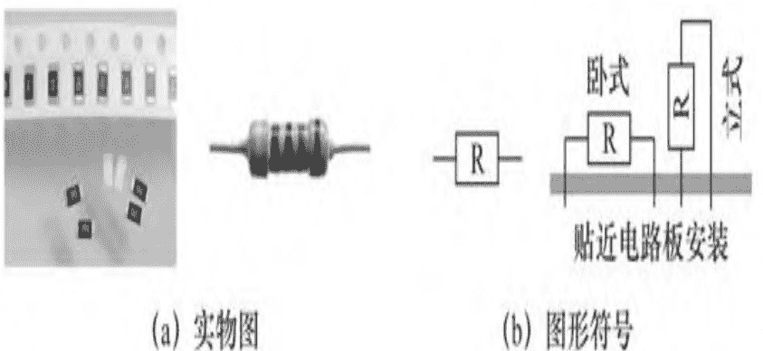

## 2. 电位器
三端可调电阻。总阻值固定 (如 10kΩ)，滑动端 (中脚) 可将电阻分为两段 (如 8kΩ + 2kΩ)，实现分压比例调节。

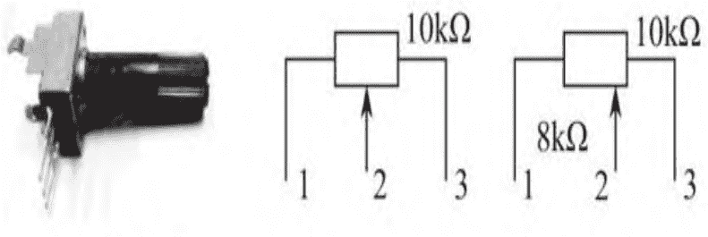

## 3. 光敏电阻
**特性**：光照增强 → 电阻急剧下降；光照减弱 → 电阻增大。常用于感光检测、自动照明。

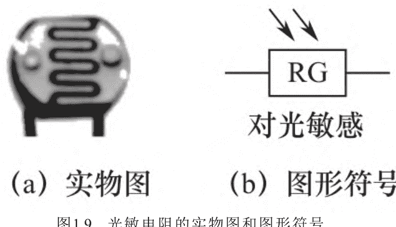

## 4. 负温度系数热敏电阻 (NTC)
**特性**：温度升高 → 电阻降低。常温 25℃ 时标称阻值如 1kΩ。适用于测温、温度补偿电路。

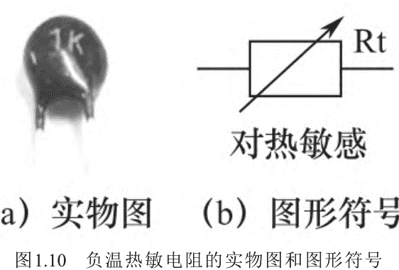

## 5. 电解电容
**功能**：储能滤波，隔直通交。
**关键参数**：容量 (μF) 与耐压 (V)。**有极性**：长脚正极，短脚负极 (壳体标横线)。
**警示**：超压或接反极性会导致发热、鼓包甚至爆炸。
- 例：16V 10μF / 25V 2200μF。

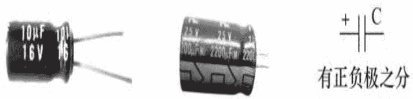

## 6. 发光二极管 (LED)
**特性**：单向导电，顺导发光。**长脚正极，短脚负极** (草帽型看缺口)。
**驱动要点**：**必须串联限流电阻 (常用 390Ω)** 接 3.3V/5V 供电，直连电源会烧毁。反接不亮不损坏。
**典型参数**：
- 普通红/黄：1.6~2.2V / 20mA
- 超亮绿/蓝：3.0~3.2V / 20mA

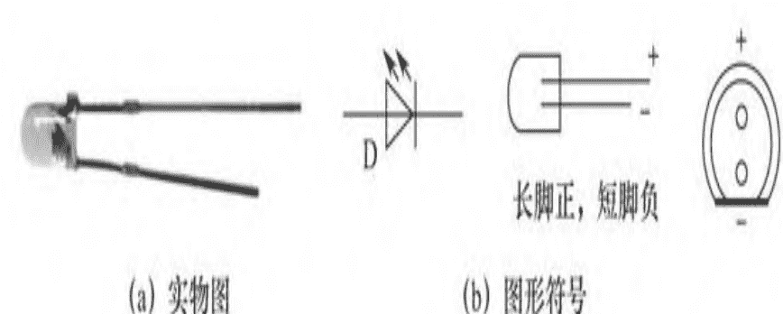

## 7. 共阳四脚全彩 LED (RGB)
**引脚定义**：4 脚最长为**公共阳极 (接 VCC)**，其余三脚分别为 R、G、B 阴极 (接 MCU 控制口，低电平点亮)。通过 PWM 调节三基色占空比实现混色。

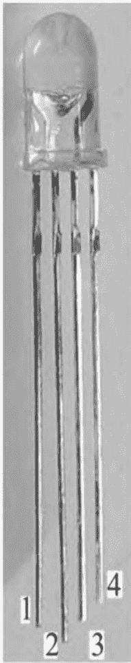
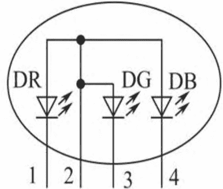

## 8. 三极管 (BJT)
**双角色**：电流放大器 / 电子开关。
**三极**：发射极(e)、基极(b)、集电极(c)。
**常用型号**：
- **9014 (NPN)**：高电平驱动基极导通，适合低端驱动 (负载接集电极)。
- **9012 (PNP)**：低电平驱动基极导通，适合高端驱动。

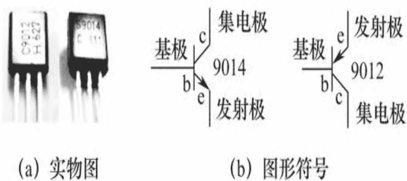

## 9. 驻极体麦克风 (MIC)
内置 FET 阻抗转换器，输出微弱交流音频信号。**极性敏感**：外壳通常接地 (负极)，引脚为正极输出，需外接偏置电阻供电工作。

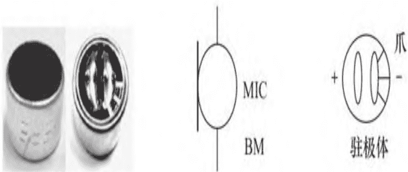

### 电子元件识别与焊接实战指南

#### 麦克风：声电转换器
驻极体麦克风的核心功能是将声波转换为电信号。如图1.15所示，该话筒的一只引脚焊盘与金属外壳内部相连，此脚即为负极。

#### 10. 扬声器：电声换能器
扬声器的实物外观与标准图形符号如下图所示。

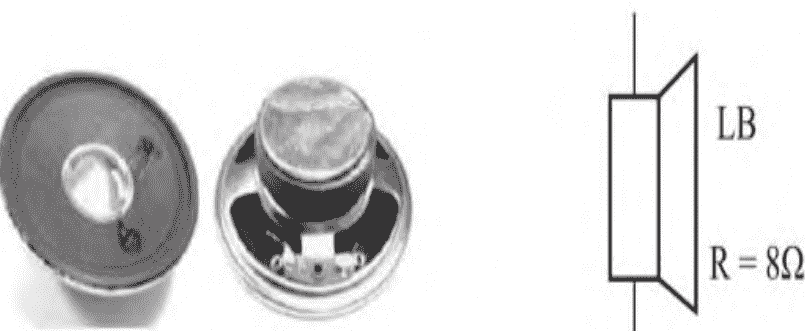

(a) 实拍图   (b) 标准符号

图1.16 扬声器外观与符号对照

其工作原理为将电信号还原为声音，图中为磁电式动圈结构。

#### 11. 开关：电路通断控制件
开关的实物形态与图形符号参见图1.17。

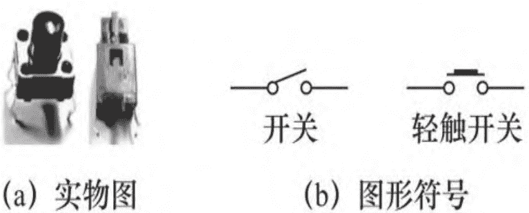

##### 图1.17 开关实物与符号

开关用于控制电路的导通与断开状态，引脚无极性之分。以轻触型为例：按下瞬间导通，手松开即断开。

#### 12. 集成电路 MX1508：双路直流电机驱动
MX1508芯片的封装外观与引脚排布见图1.18。

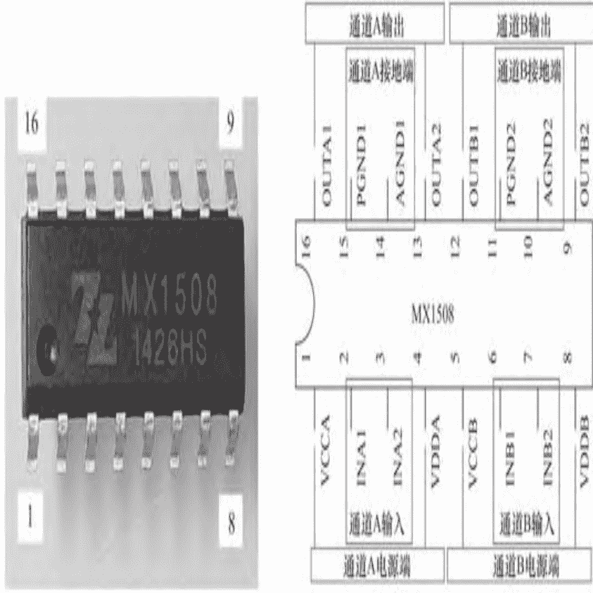

##### (a) 封装外观
##### (b) 引脚排布
##### 图 1.18 MX1508封装与引脚定义

该芯片采用SOP-16封装，内部集成四通道双路有刷直流电机驱动电路，工作电压2～9.6V，最大持续输出电流0.8A，内置过热保护机制。

**引脚识别法**：芯片一端的半圆缺口及左下角圆点为基准，圆点对应1脚，其余按逆时针序递增。

#### 13. 共阴极数码管 SM42056：数字显示基础
由7个笔画段与1个小数点段组成，用于显示0~9。其实物、引脚排布及内部等效电路见图1.19。

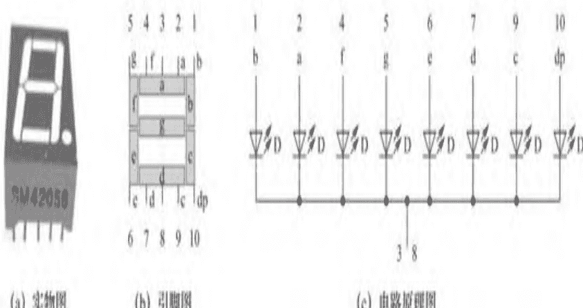

##### 图1.19 SM42056实物、引脚与内部电路

**通用接线**：3、8脚为公共阴极（接地），其余段脚各串联390Ω电阻接+3V。通过点亮不同段码组合显示数字：
+   **0**：亮 a,b,c,d,e,f 段（接1,2,4,6,7,9脚）
+   **1**：亮 b,c 段（接1,9脚）
+   **2**：亮 a,b,d,e,g 段（接1,2,5,6,7脚）
+   **9**：亮 a,b,c,d,f,g 段（接1,2,4,5,7,9脚）

#### 14. 红外接收头 CHQB：遥控信号解码器
内部集成红外接收二极管、放大、限幅、带通滤波、比较等电路，输出TTL电平，广泛用于遥控数据接收。实物与原理图见图1.20。

外观呈“鼻梁状”，三脚定义：**1脚信号输出、2脚接地、3脚供电(2.7~5.5V)**。
**关键参数**：工作电流1.7~2.7mA，中心频率37.9kHz，峰值波长940nm，接收距离10~25m，角度±45°，输出高电平2.7~5.5V，低电平≤0.25V。具备遥控距离远、抗干扰强、耐环境光、低压工作等优势。使用时需在1、3脚间并联47kΩ电阻。

---

### 1.5 电子焊接核心技法

焊接即利用高温（或高压）使金属材料实现原子级结合的工艺过程。

#### 1. 核心工具：电烙铁与热风枪
主流为电烙铁，热风枪用于热风焊/拆元件。电烙铁由烙铁头、发热芯、手柄、导线构成，按发热芯位置分内热式与外热式，结构见图1.21。

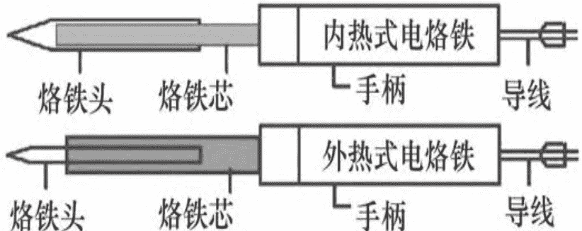

##### 图1.21 电烙铁内部结构

**选型建议**：电子制作首选 **20W内热式、合金尖头烙铁**。
理由：体积小、升温快、热效率高；合金头耐氧化、寿命长、吃锡好；尖端温度300~350℃适配微小焊点；电热丝电阻约2.4kΩ。

#### 2. 焊锡丝
以低熔点锡铅合金制成，部分含松香焊剂。作用是利用熔融锡料将元件引脚可靠固定于焊盘，保证导电。

**推荐规格**：含锡63%、直径0.8mm、低熔点型号。

#### 3. 电烙铁焊接标准化流程

##### (1) 焊前“三步检”
+   **查线**：电源线破损需缠绝缘胶布。
+   **擦头**：烙铁头发黑氧化，用湿布/纸巾擦亮。
+   **测热**：通电不发热，排查开关、插头或断线。

##### (2) 焊接“黄金动作”
+   **握姿**：如握笔持手柄，严禁触碰发热头及金属件，电源线置手背外侧。

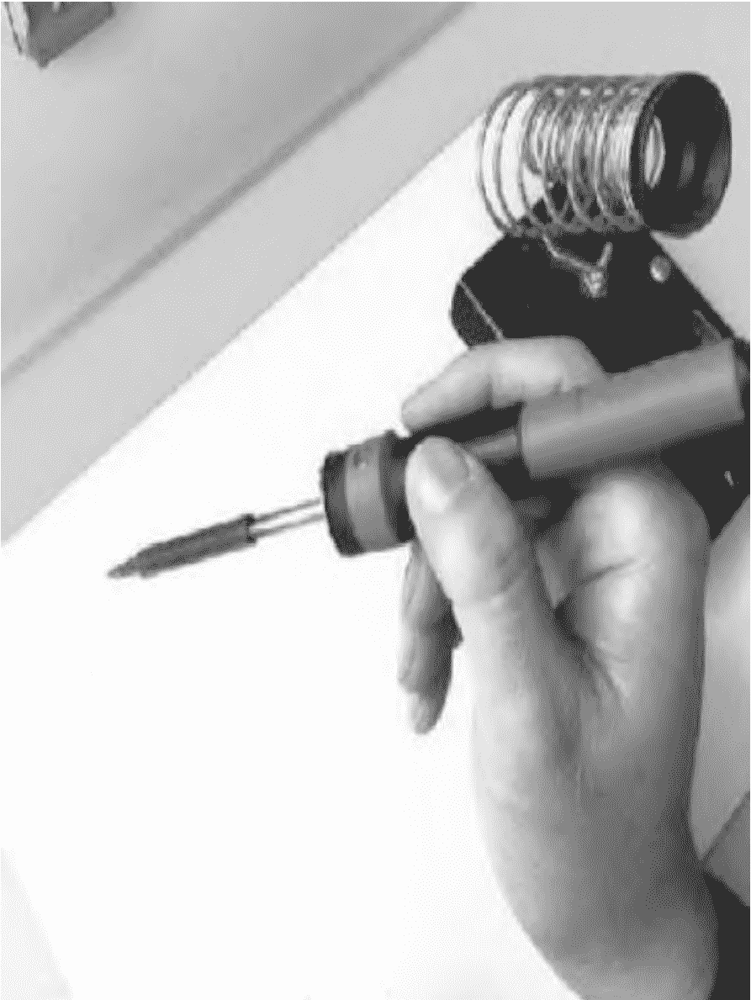

##### 图1.22 电烙铁正确握持姿势

+   **送锡**：烙铁尖**同步**加热引脚与焊盘 **2~3秒** → 送锡丝触尖端熔化 → 锡液恰好填满焊盘、包裹引脚成锥面即停止。

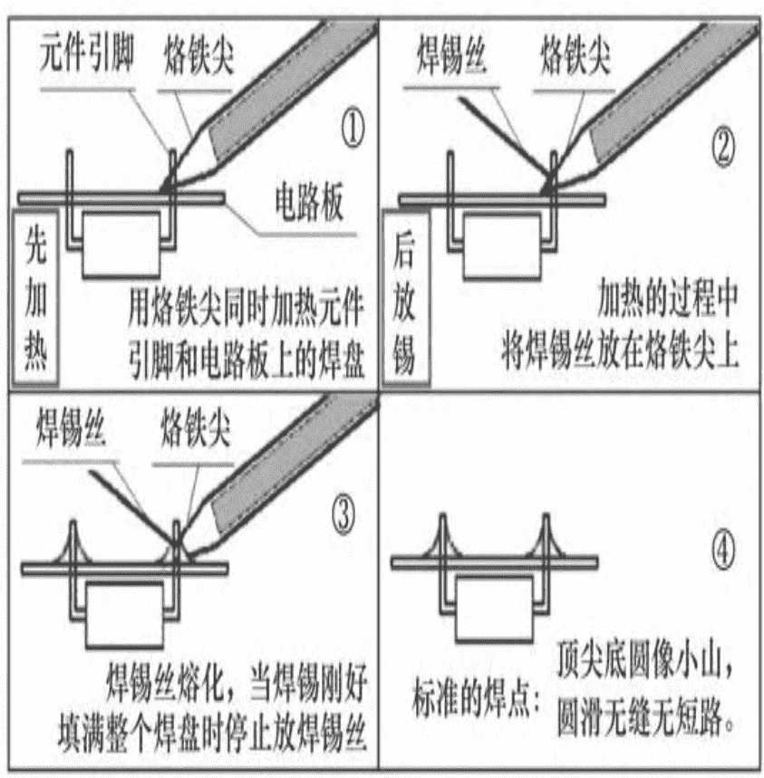

##### 图1.23 焊接操作演示

##### (3) 收尾规范
烙铁归架；多余引脚用偏口钳剪平至刚露轮廓。

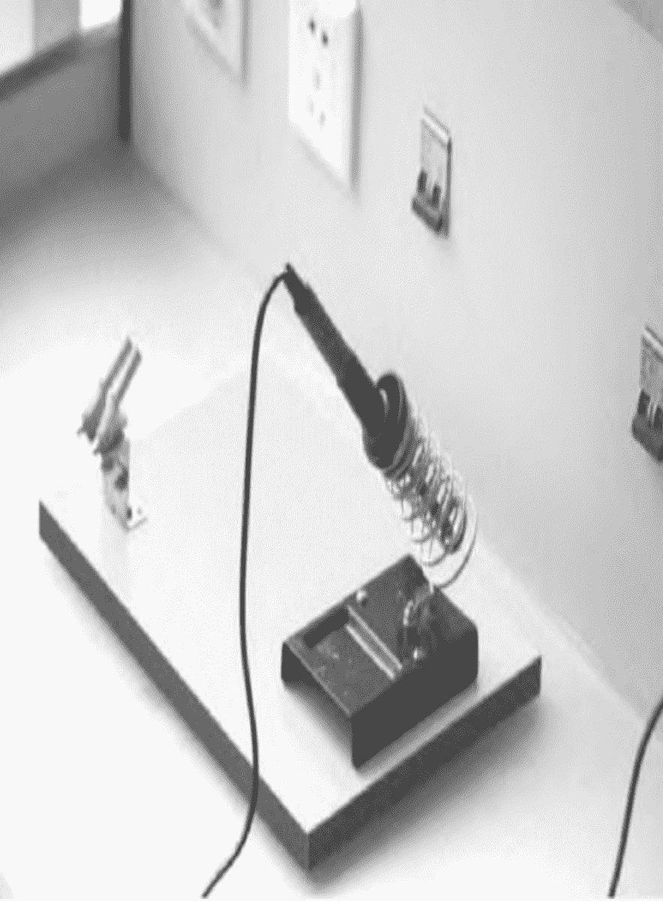

##### 图1.24 烙铁架放置与引脚修剪

##### (4) 安全“六条红线”
1.  **防护优先**：防烫伤、防烧物、防触电。
2.  **控温防溅**：温度过高致焊剂飞溅时，断电冷却30秒再续。
3.  **护眼距离**：眼距焊点 ≥25cm。误溅入眼，切勿揉搓，宜猛眨眼或水冲洗。
4.  **禁长时间空烧**：导致烙铁头氧化发黑、导热变差、不沾锡。
5.  **烙铁头脱落**：必须用钳子拾起装回拧紧，严禁手捡。
6.  **严禁嬉戏**：抢夺玩耍极度危险。

#### 4. 偏口钳
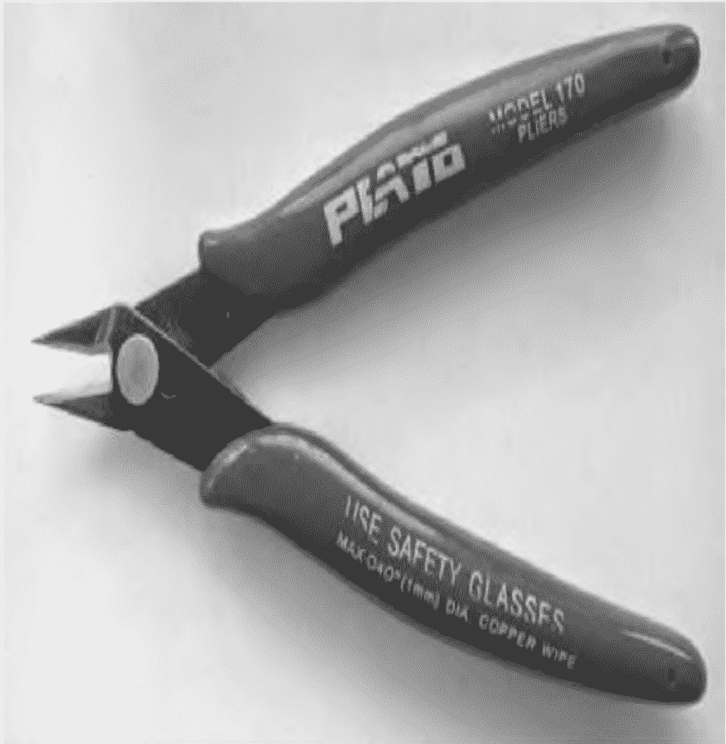
##### 图1.25 偏口钳外观
**用途**：专剪焊后多余引脚、细导线。
**手法**：右手虎口配合四指握柄末端（省力），平口面贴近板面，稍高于焊点剪断。

#### 5. 剥线钳

##### 图1.26 剥线钳外观
**用途**：剥去外皮露出铜芯。
**手法**：右手握柄末端，导线插入切口5~8mm，用力捏合即剥离。

#### 6. 吸锡器
结构含吸嘴、顶杆、吸筒、活塞、弹簧、按钮、活动杆。
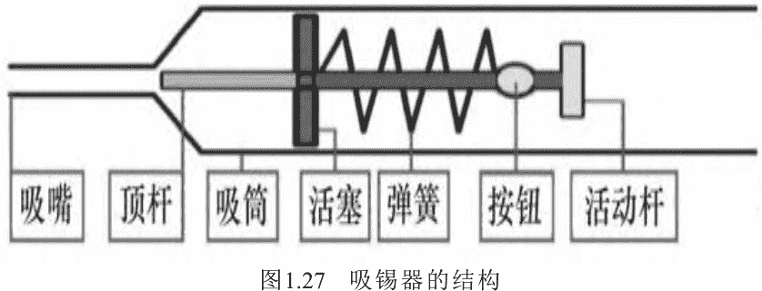
**用途**：吸走熔融焊锡，拆除故障元件、清除短路点。
**操作口诀**：压杆蓄力 → 烙铁热焊点 → 吸嘴对准熔锡 → 按钮释放弹簧吸锡 → 再压杆排渣。
**满仓应对**：吸筒焊锡过多堵嘴时，拆开活动杆倒出即可。

---

### 1.6 面包板免焊搭建实战

面包板为电路实验设计的免焊插孔板，见图1.28。

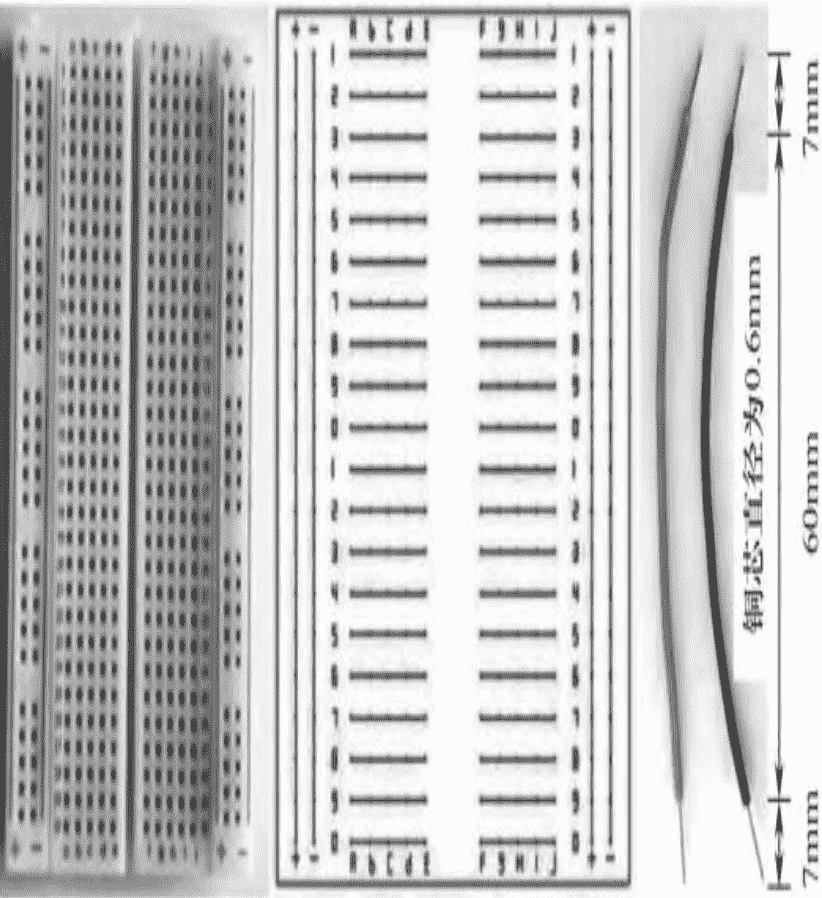

(a) 实拍图   (b) 引脚拓扑   (c) 实验连接线

#### 图1.28 面包板全貌与连接线

**内部拓扑**：板竖放，中部凹槽分隔左右。两侧每行5孔由金属弹片横向互通，**左右行互不相通**；两侧边缘各两列竖向弹片纵向互通，**四列互不相通**。
**芯片插法**：集成电路跨槽插入，两排引脚自动落入左右区域，实现引脚间电气隔离。

#### 1. 接线避坑核心法则

**铁律**：元件引脚**严禁插同一行**（否则短路），**必须跨行插入**。图1.29列举电阻、光敏、电容、LED、按钮、三极管、IC等插同行导致短路的反面案例。

##### 图1.29 同行插入导致短路示意

**正确范式**：引脚插入不同行，见图1.30。

##### 图1.30 跨行正确插入示意

**三步作业法**：
1.  **定位**：元件落板，**防短路**。
2.  **标号**：图纸标注行号，**防错行**。
3.  **飞线**：按图连线（喻飞机航线有始有终），**求精准、不遗漏、不越行**。

#### 2. 实战案例：点亮一颗LED

原理图见下图。

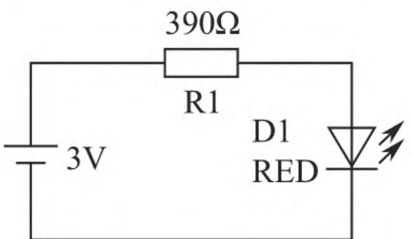

##### 图1.31 LED点亮电路原理图

**(1) 定位**：电阻、LED固定上板。
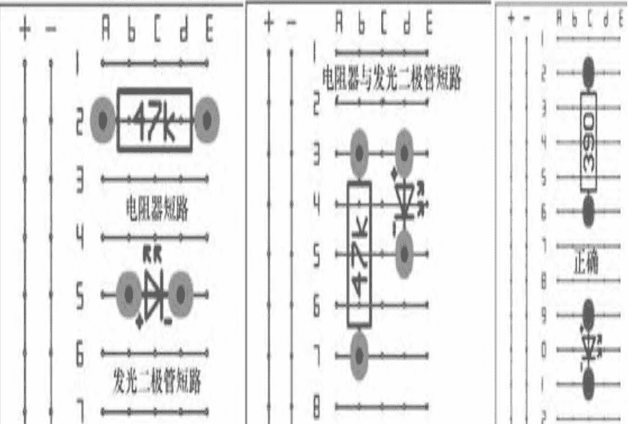
##### 图1.32 元件定位图

**(2) 标号**：图纸标注行号。电阻占2、6行；LED正极9行、负极11行。
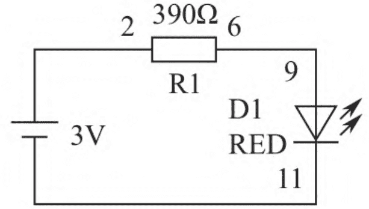
##### 图1.33 图纸行号标注图

**(3) 飞线**：共3条线。电源正极 → 2行；6行 → 9行（LED正）；11行 → 电源负极。面包板左侧“+”列接正，“-”列接负，LED应点亮。
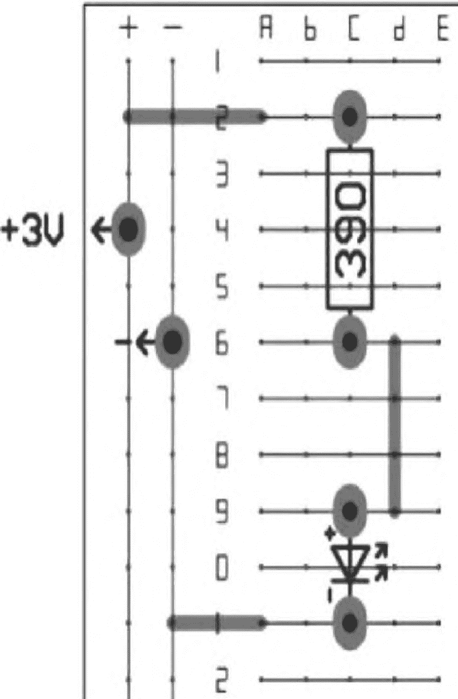
##### 图1.34 按图飞线连接图

**不亮排查清单**：① 供电 < 3V；② 电阻阻值错误；③ LED 极性接反；④ 导线接触不良；⑤ LED 开路损坏。

---

## 第2章 Arduino Uno 编程入门实例

### 2.1 串口监视器首秀：Hello! Friend!

如何用Uno开发板编程？如何让电脑屏幕显示板卡运行状态？备齐Uno板、USB-B数据线、已装好IDE软件（详见第1章），咱们从串口打印入手，开启编程之旅！

#### 2.1.1 任务清单
1.  串口监视器每秒刷新一行 `Hello! Friend!`。
2.  实现秒级计时器：首行显示 `JISHIQI`，空一行，1秒后显示 `JISHI 1 s`，空一行，2秒后显示 `JISHI 2 s`……以此类推。

#### 2.1.2 核心知识储备

##### 1. 串口监视器：调试之眼
它是串行通信的可视化终端，充当程序员的“眼睛”，实时监控设备间通信过程，直观反映程序状态，是提升Arduino编程效率的必修利器。

##### 2. 串口通信：逐位传输协议
按位(bit)收发字节传输ASCII码，仅需 TX(发)、RX(收)、GND(地) 三线即可实现长达1200m远距离通信。通信双方**波特率、数据位、停止位、奇偶校验位必须完全一致**。
Uno板上 D0(RX)、D1(TX) 接 CH340G USB-TTL 芯片，输出 TTL 电平。通信时板载 RX/TX 指示灯随波特率闪烁。

#### 2.1.3 核心代码语法速查

##### 1. `Serial.begin(9600)`：启动串口
置于 `void setup() { }` 花括号内。含义：打开串口，设波特率 9600bps (比特/秒，数字信号传速单位)。**监视器右下角波特率下拉菜单须同步设为 9600bps**。

##### 2. 输出双雄：`Serial.println()` 与 `Serial.print()`
均为将数据发送至串口输出文本，**区别在于前者自带换行，后者不换行**。
+   `Serial.println("Hello！ Friend！ ");` → 输出文本并换行。修改双引号内容即变更输出。
+   `Serial.println("");` → 输出**空行**。
+   `Serial.print("JISHIQI");` → 输出文本**不换行**。
+   `Serial.print(val);` → 输出变量 `val` 的值。
+   `Serial.print("");` → 输出**空格**。

##### 3. `delay(1000)`：阻塞延时
延时 1000ms (1秒)。括号内单位为毫秒，改 10000 即延时 10秒。

##### 4. `int val=0;`：整型变量定义初始化
定义 16位有符号整型变量 `val`，取值范围 -32768 ~ 32767 (-2^15 ~ 2^15-1)，初值赋 0。

##### 5. `val=val+1;`：自增累加
变量 `val` 加 1，每执行一次值增 1，循环计数常用。

##### 6. 串口显示编程“两步走”
1.  **Setup 开路**：`Serial.begin(9600)` 初始化。

```
void setup(){Serial.begin(9600);}
```

2.  **Loop 发数**：`Serial.print/ln` 输出 + `delay` 控频。

```
void loop(){Serial.println("Hello!Friend!");delay(1000);}
```

#### 2.1.4 代码实战与验证

##### 1. 方案一：循环打印
###### (1) 参考代码
```
void setup(){
    Serial.begin(9600);// 打开串口，设置数据传输速率为 9600bps。
}

void loop(){
    Serial.println("Hello!Friend!");

    // 将打印数据传输到串口，输出文本 "Hello!Friend!" 并换行。
    delay(1000);// 延时 1000ms。
}
```

###### (2) 实测现象
打开 IDE → 新建/粘贴/保存 → 编译 → 选 COM 口/板型 → 上传。上传成功后，点菜单“工具”→“串口监视器”(或快捷键 Ctrl+Shift+M)，即可看到每秒一行 `Hello! Friend!` 的输出。

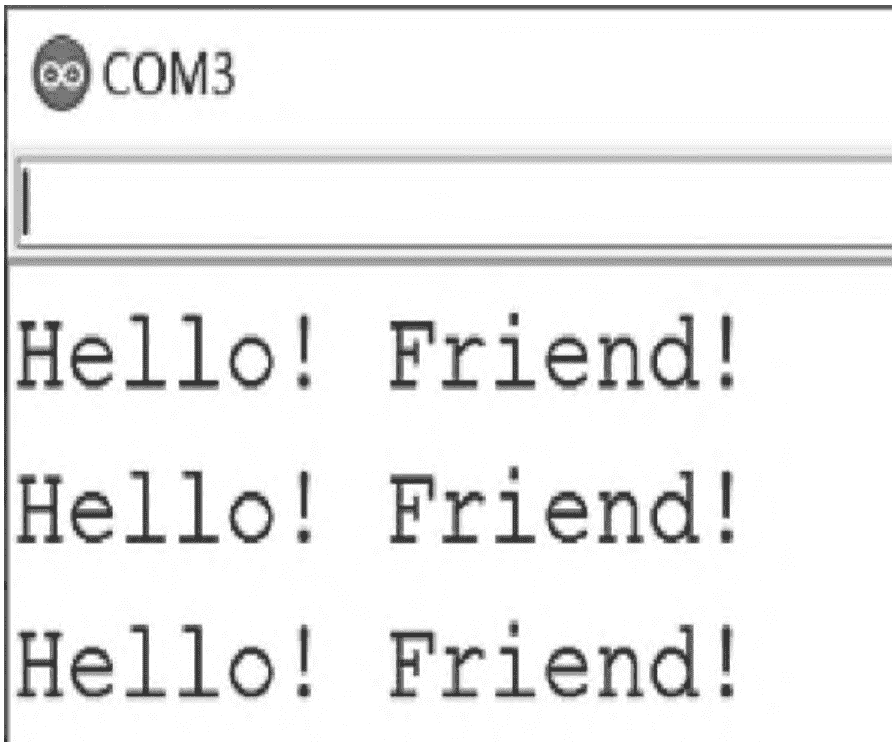

##### 图2.1 串口监视器输出“Hello！ Friend！ ”

##### 2. 方案二：秒表计时
###### (1) 参考代码
[PRE20]

```
int val=0;//定义整型变量 val，初始化赋值为 0。
//定义整型变量的取值范围为 -32768 ~ 32767，即 -2^15 ~ 2^15-1。
void setup(){
Serial.begin(9600);//打开串口，设置数据传输速率为 9600bps。
Serial.println("JISHIQI");// 将打印数据传输到串口，输出文本 “JISHIQI” 并换行。

Serial.println("");// 输出空的文本并换行，即空一行。

}

void loop(){

val=val+1;// 变量 val 加 1。

Serial.print("JISHI");// 将打印数据传输到串口，输出文本。

Serial.print("");// 输出空的文本，即空一格。

Serial.print(val);// 将打印数据传输到串口，输出变量 val 的值。

Serial.print("");// 输出空的文本，即空一格。

Serial.println("s");// 将打印数据传输到串口，输出文本并换行。

Serial.println("");// 输出空的文本并换行，即空一行。

delay(1000);// 延时 1000ms。

// 将 1000 改为 1，发现计数到 32767 后，将显示 -32768，然后显示 -32767......
}
```

###### (2) 运行现象观察

代码烧录完成后，点击菜单栏“工具”中的“串口监视器”，窗口首行将输出“JISHIQI”，隔行后每过 1 秒追加一行计数信息：先是“JISHI 1 s”，再是“JISHI 2 s”、“JISHI 3 s”……以此类推，效果如图 2.2 所示。

JISHIQI

- JISHI 1 s

- JISHI 2 s

- JISHI 3 s

图2.2 串口监视器输出“JISHIQI”及计数序列

#### 2.1.5 进阶挑战

要求串口监视器每隔一秒输出一行 "Hello! Friend! "，随后空一行依次显示 "Good morning! "、"Good afternoon! "、"Good evening! "、"Happy Birthday! "、"Good luck to you! "。

### 2.2 板载 LED 灯 D13 周期性闪烁实战

搞定 Arduino Uno 与电脑的通信后，想必你也渴望让开发板“独立作业”一次——比如让板载指示灯有节奏地闪烁。该如何点亮 LED？又该怎样控制闪烁频率？接下来我们通过闪灯实验一一揭晓。

#### 2.2.1 实验任务清单

- **任务一**：LED 灯 D13 点亮 1 秒，熄灭 1 秒，循环往复。
- **任务二**：LED 灯 D13 点亮 0.1 秒，熄灭 0.1 秒，再点亮 0.1 秒，熄灭 1.7 秒，循环执行。
- **任务三**：LED 灯 D13 点亮 0.5 秒，熄灭 0.5 秒，循环执行。

AU02 扩展板的原理图、布局图与实物照片请参考图 2.3。

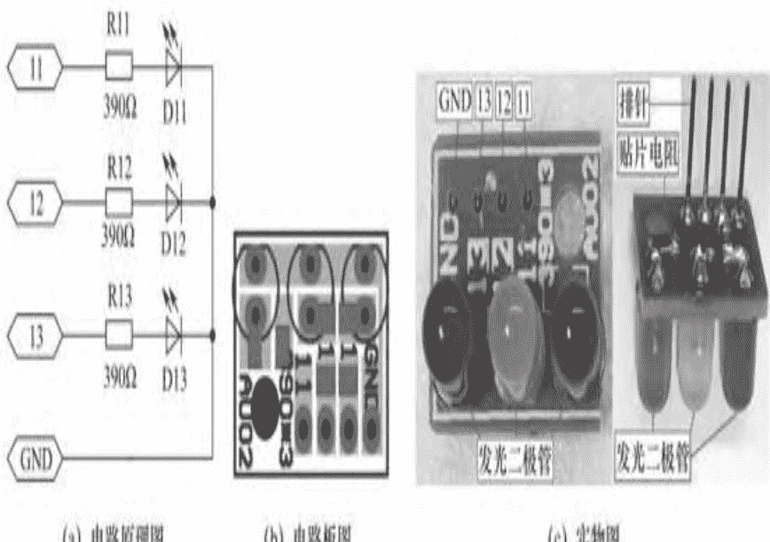

#### 2.2.2 核心知识储备

##### 1. 闪烁原理

所谓“闪灯”，即让光源按固定周期在“亮”与“灭”间切换。这种周期性特征意味着动作按规律往复循环、按时发生。闪烁在生活中广泛用于警示与信息传递：高楼顶的红色闪烁灯标识航空障碍，汽车双闪灯提示故障或危险。本实验即是让 Arduino Uno 板载的 D13 LED 按预设节奏闪烁。

##### 2. 元件安装与焊接规范

**发光二极管（LED）安装**：
安装于电路板 AU02 丝印面。注意极性：长脚为正极，短脚（外壳有缺口一侧）为负极；装反不亮。贴板高度需贴近 PCB 表面。
**焊接步骤**：烙铁头同时加热引脚与焊盘 -> 送锡丝熔化填满焊盘 -> 斜口钳修剪多余引脚。

**1206 贴片电阻安装**：
安装于有焊盘的一面。
**焊接步骤**：单侧焊盘先镀锡 -> 固定电阻一端 -> 焊接另一端。

**排针安装**：
选用长 11.5mm 排针，插入焊盘面小孔，深度约 1.5mm（即丝印面不露引脚）。焊接完成后**务必移除排针上的连接塑料**，以便顺利插入 Arduino Uno 主板插槽。

**特别提醒**：电路板上无绝缘间隙的两个焊盘可用焊锡连接；若有绝缘缝隙则严禁连接。本书所有扩展板元件均遵循上述工艺。

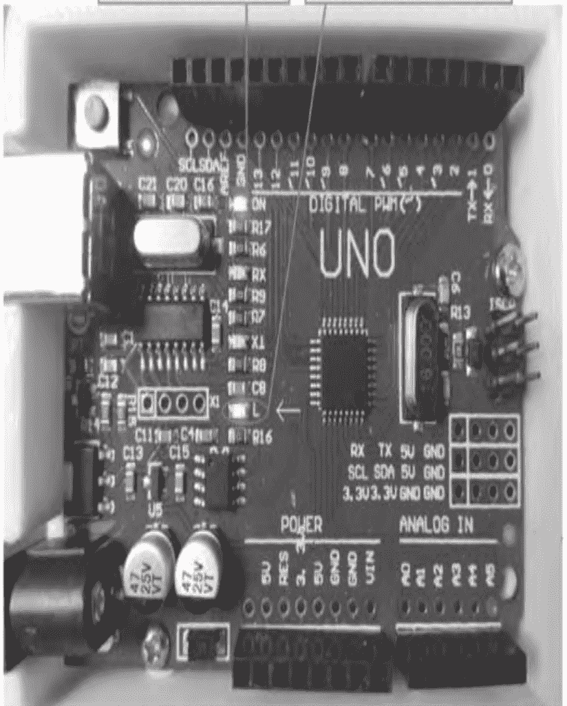

##### 3. 认识板载 LED D13（标识 "L"）

在 Arduino Uno 主板丝印 "L" 处，内置一颗接在数字引脚 13 上的 LED 灯（见图 2.4）。逻辑上：D13 输出高电平（1）灯亮，输出低电平（0）灯灭。本实验的核心任务就是驱动这颗灯闪烁。

电源指示灯 (ON)

板载 LED 灯 D13 (L)

```
void setup(){pinMode(13,OUTPUT);}
```

图2.4 Arduino Uno 开发板上 "L" 标识处的板载 LED 灯

#### 2.2.3 编程关键语句解析

- **1. 引脚模式配置：`pinMode(13, OUTPUT)` 与 `pinMode(13, INPUT)`**
  在 `void setup() { }` 的大括号内，`pinMode(13, OUTPUT)` 将 13 号引脚设为**输出模式**（MCU 向外发送信号）；`pinMode(13, INPUT)` 设为**输入模式**（MCU 接收外部信号）。

- **2. 数字电平写入：`digitalWrite(13, 1)` 与 `digitalWrite(13, 0)`**
  - `digitalWrite(13, 1)` / `digitalWrite(13, HIGH)`：输出**高电平**（约 5V），LED 点亮。
  - `digitalWrite(13, 0)` / `digitalWrite(13, LOW)`：输出**低电平**（约 0V），LED 熄灭。

- **3. 状态读取与翻转：`digitalRead(13)` 与 `!digitalRead(13)`**
  - `digitalRead(13)`：读取 13 号引脚当前电平状态。
  - `!digitalRead(13)`：读取并**取反**（高变低、低变高）。
  - `digitalWrite(13, !digitalRead(13))`：一条语句实现引脚输出状态翻转，极大简化闪烁代码。

- **4. Arduino 数字输出编程标准两步走**
  **步骤一**：在 `setup()` 中，调用 `pinMode()` 确立引脚为输出模式。

```
void loop(){digitalWrite(13,1);delay(1000);digitalWrite(13,0);delay(1000);}
```

  **步骤二**：在 `loop()` 中，用 `digitalWrite()` 控制电平，配合 `delay()` 延时函数调节动作速率。

#### 2.2.4 三种闪烁模式代码实现

##### 1. 方案一：等间隔 1 秒闪烁

###### （1）核心代码参考

```
void setup(){

 pinMode(13,OUTPUT);// 设置数字端口 13 为输出模式。

}

void loop(){

 digitalWrite(13,1);// 数字端口 13 输出高电平。

 delay(1000);// 延时 1000ms。

 digitalWrite(13,0);// 数字端口 13 输出低电平。

 delay(1000);// 延时 1000ms。

}
```

###### （2）实测现象

D13 灯亮 1 秒、灭 1 秒，周而复始。

##### 2. 方案二：模拟“双闪”效果

###### （1）核心代码参考

```
void setup(){
pinMode(13,OUTPUT);// 设置数字端口 13 为输出模式。
}

void loop(){
digitalWrite(13,1);// 数字端口 13 输出高电平。
delay(100);// 延时 100ms。
digitalWrite(13,0);// 数字端口 13 输出低电平。
delay(100);// 延时 100ms。
digitalWrite(13,1);// 数字端口 13 输出高电平。
delay(100);// 延时 100ms。
digitalWrite(13,0);// 数字端口 13 输出低电平。
delay(1700);// 延时 1700ms。
}
```

###### （2）实测现象

亮 0.1s -> 灭 0.1s -> 亮 0.1s -> 灭 1.7s，循环。视觉上呈现典型的“双闪”节奏。

##### 3. 方案三：利用状态翻转实现 0.5 秒快闪

###### （1）核心代码参考

```
```cpp

void setup(){

  pinMode(13,OUTPUT);// 设置数字端口 13 为输出模式

  digitalWrite(13,1);// 初始化输出高电平，灯先亮

}

void loop(){

  digitalWrite(13,!digitalRead(13));// 引脚输出状态取反

  delay(500);// 延时 500ms

}

```
```

###### （2）实测现象

亮 0.5 秒、灭 0.5 秒循环。较方案一频率翻倍，肉眼可见闪烁明显加快。

#### 2.2.5 课后练习与拓展

- **挑战 1**：编程实现：亮 0.1s、灭 0.1s、亮 0.1s、灭 0.1s、亮 0.1s、灭 1.5s，循环。
- **挑战 2**：编程实现：D13 亮灭 0.1s -> D12 亮灭 0.1s -> D11 亮灭 0.1s，依序循环流水灯效果。

### 2.3 进阶实战：编程播放《我和我的祖国》

既然能让灯光“动”起来，能不能让声音“响”起来？Arduino Uno 驱动蜂鸣器/喇叭播放音乐究竟如何操作？若你感兴趣，不妨网罗一首喜欢曲子的简谱，亲手写段播放程序试试。

#### 2.3.1 实验任务设定

- **基础任务**：驱动喇叭发 1000Hz 声音，持续 200ms，停 1800ms，循环。
- **进阶任务**：完整播放歌曲《我和我的祖国》。

AU03 扩展板的原理图、布局图与实物图见下图 2.5。

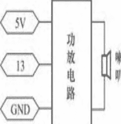

有源音箱

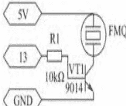

蜂鸣器模块

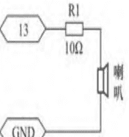

(a) 电路原理图

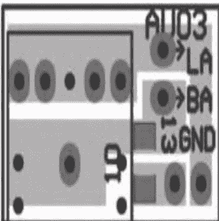

(b) 电路板图

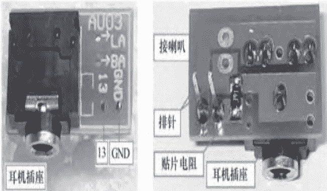

(c) 实物图

图2.5 AU03 电路原理图、电路板图和实物图

#### 2.3.2 知识深度解析：从简谱到代码

**编程播歌的本质**：通过代码精确控制发声频率（音高）与持续时长（音值），让蜂鸣器复现旋律。这不仅能带来趣味，更能帮助音乐爱好者精准把握音高与节奏。

**乐谱解读——《我和我的祖国》简谱**（见图 2.6）。

我和我的祖国

5 6 5 4 3 2 | 1 . 5 . | 1 3 1 7 6 . 3 | 5 . 5 . |

我和 我的祖国, 一刻也不能分割,

6 7 6 5 4 3 | 2 . 6 . | 7 6 5 5 1 . 2 | 3 . 3 . |

无论我走 到哪里, 都流出一首赞歌。

5 6 5 4 3 2 | 1 . 5 . | 1 3 1 7 2 . 1 | 6 . 6 . |

我歌唱每一座高山, 我歌唱每一条河,

1 7 6 5 . | 6 5 4 3 . | 7 6 5 2 | 1 . 1 . |

袅袅炊烟, 小小村落, 路上一道辙。

1 . 2 . 3 . 2 . 1 . 6 | 7 6 . 3 5 . 5 . | 1 . 2 . 3 . 2 . 1 . 6 |

我最 亲爱的祖 国, 我永远紧依着

7 5 . 3 6 . 6 . | 5 4 3 2 . | 7 6 5 3 . | 4 . 2 1 | 1 . 1 0 ||

你的心窝, 你用你那母亲的脉搏, 和我说……

图2.6 歌曲《我和我的祖国》简谱

**调号与频率映射**：
简谱首标 "1=G（52）" 即 G 调（二胡 52 弦），将 G 音定为 "1"（do）。常见 "1=C" 以 C 为 do，"1=D" 则整体升高。标准音高 A4=440Hz，八度关系倍频（A5=880Hz，A3=220Hz）。下表列出各调各音高对应频率（Hz），编程时直接查表填入 `tone()` 函数。

表2.1 不同音调频率对照表 (单位：Hz)

| 音调 | A | B | C | D | E | F | G |
|---|---|---|---|---|---|---|---|
| 低音1 | 220 | 247 | 131 | 147 | 165 | 175 | 196 |
| 低音2 | 247 | 277 | 147 | 165 | 185 | 196 | 220 |
| 低音3 | 277 | 294 | 165 | 185 | 208 | 220 | 247 |
| 低音4 | 294 | 330 | 175 | 196 | 220 | 233 | 262 |
| 低音5 | 330 | 370 | 196 | 220 | 247 | 262 | 294 |
| 低音6 | 370 | 415 | 220 | 247 | 277 | 294 | 330 |
| 低音7 | 415 | 466 | 247 | 277 | 311 | 330 | 370 |
| 中音1 | 440 | 494 | 262 | 294 | 330 | 349 | 392 |
| 中音2 | 494 | 554 | 294 | 330 | 370 | 392 | 440 |
| 中音3 | 554 | 622 | 330 | 370 | 415 | 440 | 494 |
| 中音4 | 587 | 659 | 349 | 392 | 440 | 466 | 523 |
| 中音5 | 659 | 740 | 392 | 440 | 494 | 523 | 587 |
| 中音6 | 740 | 831 | 440 | 494 | 554 | 587 | 659 |
| 中音7 | 831 | 932 | 494 | 554 | 622 | 659 | 740 |
| 高音1 | 880 | 988 | 523 | 587 | 659 | 698 | 784 |
| 高音2 | 988 | 1109 | 587 | 659 | 740 | 784 | 880 |
| 高音3 | 1109 | 1175 | 659 | 740 | 831 | 880 | 988 |
| 高音4 | 1175 | 1318 | 698 | 784 | 880 | 932 | 1046 |
| 高音5 | 1318 | 1480 | 784 | 880 | 988 | 1046 | 1175 |
| 高音6 | 1480 | 1662 | 880 | 988 | 1109 | 1175 | 1318 |
| 高音7 | 1662 | 1976 | 988 | 1109 | 1245 | 1318 | 1480 |

**节拍与速度**：
- **6/8 拍**：复二拍子，**附点四分音符为一拍**，每小节两拍。三连音（三个八分音符共一横线）合唱一拍。
- **=60**：速度 60 拍/分，**一拍 = 1 秒**。每小节 2 秒，全曲 16 小节共 32 秒。

**乐理小科普**：
- **音符**：记录音高与音值的符号。简谱用 1-7 数字加附加记号。
- **音调**：主观听感的高低，主由频率决定，受强度、时长影响（<50ms 难辨音调）。
- **音名/唱名**：CDEFGAB 对应 1234567；唱名为 do re mi fa so la si（首调法 do 位置可移）。
- **音值**：音的相对时长。常见记法见下表。

表2.2 常见音符标记与音值对照

| 音符名称 | 简谱标记法 | 音值 (拍) |
| :--- | :--- | :--- |
| 全音符 | X--- (四分音符右加3条增时线) | 4 |

### 简谱音值速查与《我和我的祖国》旋律解析

| 音符类型 | 记谱符号 | 视觉特征 | 时长（拍） |
| :--- | :--- | :--- | :--- |
| 二分音符 | `X-` | 四分音符右侧添1条增时线 | 2 |
| 附点四分音符 | `X·` | 四分音符右侧添1个圆点 | 1.5 |
| 四分音符 | `X` | 基础记谱单位 | 1 |
| 附点八分音符 | `X·_` | 八分音符右侧添1个圆点 | 0.75 |
| 八分音符 | `X_` | 四分音符下方添1条减时线 | 0.5 |
| 十六分音符 | `X_w` | 四分音符下方添2条减时线 | 0.25 |

以经典曲目《我和我的祖国》为例，其简谱前段旋律音值分布如下：
首句六个音（中音5、6、5、4、3、2）均为八分音符，时值 **0.5拍**；
紧接着中音1与低音5各持续 **1.5拍**（附点四分音符）；
随后中音1、3、高音1、中音7再次回归 **0.5拍**；
中音6为附点八分音符 **0.75拍**，中音3为十六分音符 **0.25拍**；
最后两个中音5均为 **1.5拍**。
综上，前四小节音值序列为：
`0.5, 0.5, 0.5, 0.5, 0.5, 0.5, 1.5, 1.5, 0.5, 0.5, 0.5, 0.5, 0.75, 0.25, 1.5, 1.5`。

#### 2.3.3 核心编程语法解析

**1. 声音输出指令：`tone()` 与 `noTone()`**
*   `tone(13, 1000)`：驱动数字引脚13输出 **1000Hz** 方波信号。
*   `tone(13, tune[x])`：根据数组频率值输出对应音高。例如 `tune[0]=587` 对应中音5 (D5)，`tune[1]=659` 对应中音6 (E5)。
*   特殊用法：`tone(13, -1)` 亦可停止输出（等同于静音）。
*   `noTone(13)`：标准停止输出指令，强制引脚13静默。

**2. 常量定义：`#define` 语法规范**
*   `#define X0 -1`：定义休止符标识频率为 -1。
*   `#define D1 196`：定义 G调低音1 (G3) 频率为 196Hz。
*   **编译期替换机制**：常量不占用Flash，编译时直接文本替换。
*   **严格格式要求**：
    *   必须以 `#` 开头。
    *   名称与值之间 **仅用空格分隔，禁用等号**。
    *   行尾 **严禁加分号**，否则报错。
```
#define 常量名 常量值//用常量名替代常量值。
```

**3. 音高数组：`int tune[]`**
*   定义有符号整型数组存储频率序列（单位Hz）。
*   《我和我的祖国》前6音对应：`Z5, Z6, Z5, Z4, Z3, Z2`。
*   **数据类型边界**：`int` 占2字节，范围 `-32,768 ~ 32,767`。超限会发生“回滚”（如 32767+1 变为 -32768）。
*   对比：`unsigned int` 占4字节，范围 `0 ~ 4,294,967,295`，仅非负。

**4. 时值数组：`float duration[]`**
*   定义单精度浮点数组存储节拍值。
*   前6个八分音符对应：`0.5, 0.5, 0.5, 0.5, 0.5, 0.5`。
*   **浮点数特性**：4字节，约6-7位有效数字，范围极大 (`±3.4E38`)。**注意**：精度陷阱（如 `6.0/3.0` 不一定等于 `2.0`），且运算速度显著慢于整数。

**5. 获取数组长度：`sizeof()` 技巧**
*   `length = sizeof(tune) / sizeof(tune[0])`：总字节数除以单元素字节数，得出元素个数。通用、无硬编码。

**6. 遍历循环：`for` 结构**
*   `for(int x=0; x<length; x++) { ... }`：从索引0遍历至 `length-1`。若长度10则跑10次，20则跑20次，自动适配曲目长度。

**7. 时长换算延时：`delay(750 * duration[x])`**
*   基准换算：**1拍 = 750ms**。
*   例：`duration[0]=0.5` → `delay(375)`，即延时375毫秒，精准控制八分音符时长。

#### 2.3.4 实战项目：从单音到完整乐曲

**项目一：基础蜂鸣测试**
*   **硬件连接**：AU03板焊接 10Ω贴片电阻、耳机座、喇叭、排针 → 插入 Arduino Uno **GND** 与 **D13**。
*   **参考代码**：```
void setup(){ 
pinMode(13,OUTPUT);// 设置数字端口 13 为输出状态。
}
void loop(){
tone(13,1000);// 使数字端口 13 产生 1000Hz 的电信号。
delay(200);// 延时 200ms。
noTone(13);// 使数字端口 13 停止产生电信号。
delay(1800);// 延时 1800ms。
}
```
*   **运行现象**：喇叭发 1000Hz 声音 200ms → 静默 1800ms → 循环往复。验证 `tone`/`noTone` 与延时逻辑。

**项目二：完整演奏《我和我的祖国》**
*   **硬件**：沿用项目一电路。
*   **参考代码**：```
// 自定义 G 调音符对应的振动频率，用不到的可暂不定义。
#define X0 -1// 定义休止符的振动频率。
#define D1 196// 定义变量 D1=196，这是 G 调低音 1 的振动频率。
#define D2 220// 定义低音 2 的振动频率。
#define D3 247// 定义低音 3 的振动频率。
#define D4 262// 定义低音 4 的振动频率。
#define D5 294// 定义低音 5 的振动频率。
#define D6 330// 定义低音 6 的振动频率。
#define D7 370// 定义低音 7 的振动频率。
#define Z1 392// 定义中音 1 的振动频率。
#define Z2 440// 定义中音 2 的振动频率。
#define Z3 494// 定义中音 3 的振动频率。
#define Z4 523// 定义中音 4 的振动频率。
#define Z5 587// 定义中音 5 的振动频率。
#define Z6 659// 定义中音 6 的振动频率。
#define Z7 740// 定义中音 7 的振动频率。
#define G1 784// 定义高音 1 的振动频率。
#define G2 880// 定义高音 2 的振动频率。
#define G3 988// 定义高音 3 的振动频率。
#define G4 1046// 定义高音 4 的振动频率。
``` ```
// 音高部分。

int tune[] = { // 根据歌曲《我和我的祖国》的简谱设置数组，排列各音符的音高。
Z5,Z6,Z5,Z4,Z3,Z2,Z1,D5,Z1,Z3,G1,Z7,Z6,Z3,Z5,Z5,Z6,Z7,Z6,Z5,Z4,Z3,Z2,D6,D7,D6,D5,Z5,Z1,Z2,Z3,Z3,Z5,Z6,Z5,Z4,Z3,Z2,Z1,D5,Z1,Z3,G1,Z7,G2,G1,Z6,Z6,G1,Z7,Z6,Z5,Z6,Z5,Z4,Z3,D7,D6,D5,Z2,Z1,Z1,G1,G2,G3,G3,G2,G1,Z6,Z7,Z6,Z3,Z5,Z5,G1,G2,G3,G2,G1,Z6,Z7,Z5,Z3,Z6,Z6,Z5,Z4,Z3,Z2,D7,D6,D5,Z3,Z4,Z2,Z1,Z1,X0
};

// 音值部分。

float duration[] = { // 根据歌曲《我和我的祖国》的简谱设置数组，排列各音符的音值。
0.5,0.5,0.5,0.5,0.5,0.5,1.5,1.5,0.5,0.5,0.5,0.5,0.75,0.25,1.5,1.5,0.5,0.5,0.5,0.5,0.5,0.5,0.5,1.5,1.5,0.5,0.5,0.5,0.5,0.75,0.25,1.5,1.5,0.5,0.5,0.5,0.5,0.75,0.25,1.5,1.5,0.5,0.5,0.5,0.5,0.5,0.5,0.5,1.5,1.5,0.5,0.5,0.5,0.5,0.5,0.5,0.75,0.25,1.5,1.5,0.5,0.5,0.5,0.5,0.5,1.5,0.5,0.5,0.5,1.5,1.0,5,1.0,5,1.5,1.5,0.5,0.5,0.5,0.5,0.5,0.5,0.5,0.5,0.5,0.5,0.75,0.25,1.5,1.5,0.5,0.5,0.5,0.5,1.5,0.5,0.5,0.5,1.5,1.5,1.0,5,1.5,1.0,5
};

int length;// 定义变量 length 记录音符的个数。
void setup(){

pinMode(13,OUTPUT);// 设置数字端口 13 为输出状态。

length=sizeof(tune)/sizeof(tune[0]);// 查询数组中音符的个数。

}

void loop(){

for(int x=0;x<length;x++)// 设置循环音符的次数。

tone(13,tune[x]);// 数字端口 13 产生 tune[x] 音符的电信号。

delay(750*duration[x]);// 延时时间为 duration[x] x 750ms。

noTone(13);// 数字端口 13 停止产生电信号。

}

delay(5000);// 延时 5000ms，重新开始。

}
```
*   **运行现象**：上电后喇叭完整播放乐曲旋律。

#### 2.3.5 进阶挑战
自选一首喜爱曲目，搜简谱，将音高与节拍分别填入 `tune[]` 与 `duration[]`，实现个性化播放器。

---

### 2.4 串口监视器实战：可视化模拟传感器数据

生活中的声控灯、光控路灯、人体感应门，核心皆为“模拟量采集+阈值判断”。本节通过串口监视器/绘图器，将不可见的电压信号转为可视曲线。

#### 2.4.1 实验场景与硬件矩阵
**任务**：循环读取 A0 引脚电压值，每 **100ms** 刷新一次串口显示。
**硬件平台**：AU04A ~ AU04E 五款传感器扩展板（原理图/板图/实物见图 2.7）。
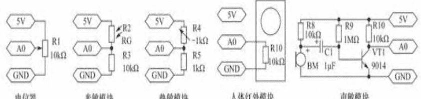
**电路原理图（左至右：A~E）** 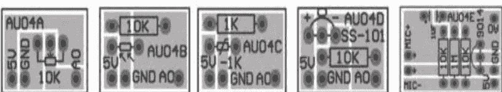
**电路板图（左至右：A~E）** 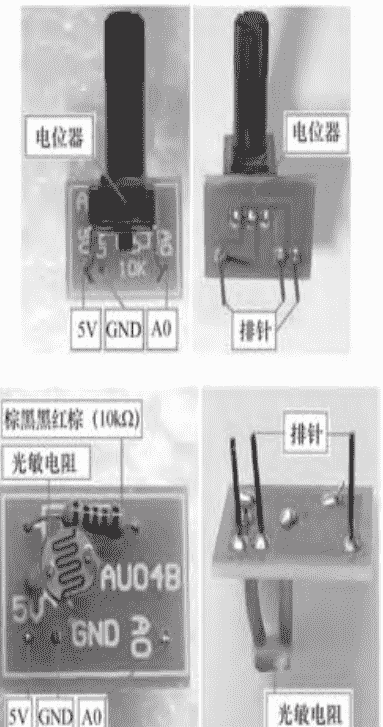
**实物图（上至下：A~E）** 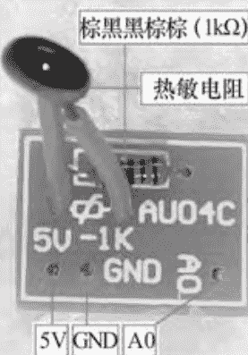 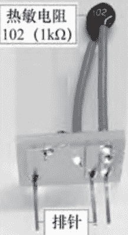 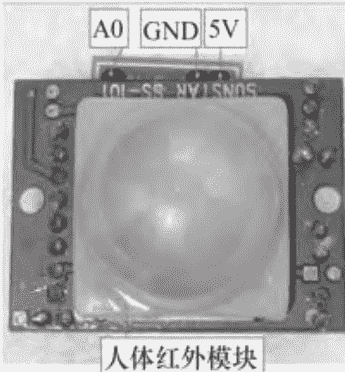 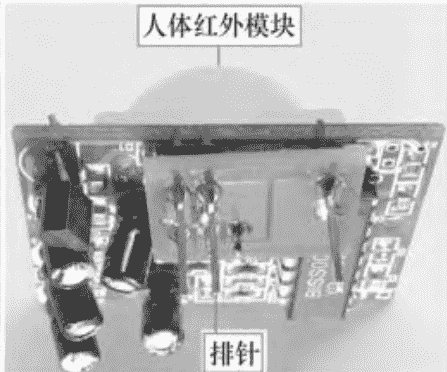 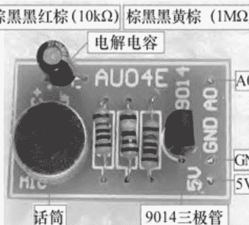 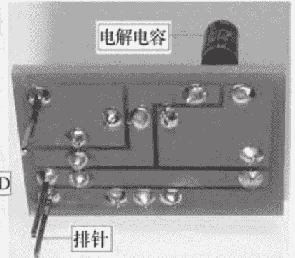
**实物图续（上至下：A~E）** ```
analogRead(pin);//从指定的模拟引脚读取值。
``` (Note: Original had PRE13 here for syntax, but context suggests image placeholder. I will keep PRE tags as found in source order relative to text flow. The source has PRE13 under syntax for analogRead. I will place the image PRE tags as they appear in the source structure.)
*Correction: The source text has  to  for images in 2.4.1, then ```
analogRead(pin);//从指定的模拟引脚读取值。
``` for syntax in 2.4.3. I must preserve the exact PRE tags order.*

#### 2.4.2 硬件组装指南与端口认知

**五板焊接清单：**
| 板号 | 核心元件 | 关键注意事项 |
| :--- | :--- | :--- |
| **AU04A** | 10kΩ电位器 + 3排针 | 标准分压器结构 |
| **AU04B** | 10kΩ电阻 + 光敏电阻 + 3排针 | 光敏电阻无极性 |
| **AU04C** | 1kΩ电阻 + 热敏电阻(NTC) + 3排针 | 热敏电阻无极性 |
| **AU04D** | 1kΩ电阻 + SS-101人体红外模块 + 3排针 | 模块三脚定位 (VCC/GND/OUT) |
| **AU04E** | 2×10kΩ + 1MΩ + 1μF电解电容 + 驻极体咪头 + 9014三极管 + 3排针 | **极性敏感**：电解电容长脚正/短脚负；咪头连壳脚为负；三极管半圆缺口对齐丝印 |

**数字 vs 模拟端口对比 (Arduino Uno):**
*   **数字口 (D0-D13)**：仅识别高/低电平 (0/5V)，适合开关量。
*   **模拟口 (A0-A5)**：10位ADC分辨率，**量化 0~5V 为 0~1023 离散值**。
    *   0V → 0 | 5V → 1023 | 2.5V → 512 | 步进精度 ≈ **4.88mV (5V/1024)**。
    *   *悬空引脚读数随机漂移，需上下拉稳定。*
    *   *电压超5V有烧毁风险。*

#### 2.4.3 关键编程接口详解

**1. 采集指令：`val = analogRead(0);`**
*   功能：读取 A0 (编号0) 电压映射值 (0-1023) 赋给 `val`。
```
analogRead(pin);//从指定的模拟引脚读取值。
``` *(Syntax block preserved)*

**电压测量扩展应用**：
利用分压电路将高压压入 0-5V 范围 → `analogRead` 獲取原始值 X → 按比例还原真实电压。
*案例*：测 12V。用 7kΩ (7个1k串联) 上限、5kΩ (两个10k并联) 下限分压，分压比 12:5。若读数 X，实测电压 `U = (12 * X / 1024) V`。

**2. 标准采集循环模板**
在 `loop()` 中定义 `int val`，调用 `analogRead` 赋值，配合延时控制采样率。
```
void loop(){int val;val=analogRead(0);}
``` *(Code template preserved)*

**3. 串口可视化三部曲（调试利器）**
1.  `setup()` 中：`Serial.begin(9600)` — 波特率握手。
2.  `loop()` 中：采集 → `Serial.print/println(val)` — 发送数据流。
3.  必加 `delay(100)` — 控制刷新频率，防串口缓冲区溢出/刷屏过快。
```
void setup(){
  Serial.begin(9600);//打开串口，设置数据传输速率为9600bps。
}
void loop(){
  int val;//定义整型变量 val。
  val=analogRead(0);//读出模拟端口 A0 的值，赋给变量 val。
  Serial.println(val,DEC);//将打印数据（十进制）传输到串口，输出文本并换行。
  delay(100);//延时100ms。
}
``` *(Full program reference preserved)*

#### 2.4.4 实验验证与现象分析

**上传代码 → 打开 “工具 → 串口监视器” (9600波特率) → 观察数值每 100ms 刷新。**

| 测试板 | 操作动作 | 串口监视器/绘图器 观测现象 | 原理简析 |
| :--- | :--- | :--- | :--- |
| **AU04A**<br>(电位器) | 拧动旋钮 | 数值 **0 ~ 1023** 连续平滑变化 | 手动调节分压比，模拟任意电压输入 |
| **AU04B**<br>(光敏) | 遮挡光线 → 增强光线 | 数值 **变大** → **变小** (或反之，取决于上/下拉接法，常见上拉：暗=高阻=高电压=大数值) | 光敏电阻阻值随光照反比变化 |
| **AU04C**<br>(热敏/NTC) | 遮挡光线(误) → **用手捏热** | 数值 **变小** (NTC特性：温度升高，阻值下降，若为上拉分压则电压下降) | 热敏电阻阻值随温度升高而减小 |
| **AU04D**<br>(人体红外) | 切换 **串口绘图器**<br>人靠近动态 → 人离开/静止 | **幅度600的脉冲曲线** → **幅度0的直线** | 仅检测移动热源，静止不触发 |
| **AU04E**<br>(声控/咪头) | 切换 **串口绘图器**<br>大声喊叫 → 环境安静 | **幅度>600的脉冲曲线** → **幅度<20的脉冲曲线/直线** | 声波驱动咪头振膜，经三极管放大输出波动电压 |

*注：选择题答案已融入上表“观测现象”列。*

#### 2.4.5 拓展思考
尝试修改代码，加入阈值判断逻辑（`if(val > threshold) ...`），将“可视化”升级为“智能控制”：如声控开灯、光控夜灯、人来灯亮人走灯灭。

# 实战入门：电位器读数与PWM调光实验

## 硬件连接与串口监测

首先，将AU04A扩展板的排针对准Arduino Uno主板的5V、GND及A0引脚插好。拧动板载电位器，点击IDE工具栏“工具”->“串口监视器”，窗口将循环打印“当前模拟端口A0的输入值为（数值）”，刷新周期为1秒。（关键代码提示：添加`Serial.print("当前模拟端口A0的输入值为")`；将延时改为`delay(1000)`。）

---

### 2.5 呼吸灯进阶：可调光LED实验

前面接触过电位器，它究竟如何工作？生活中哪里用得到？其实无处不在：收音机调音量、台灯调亮度全靠它。过亮伤眼、过暗费神，睡前更希望柔光伴眠，给普通灯加个调光模块很有必要。

#### 2.5.1 任务目标
控制D3、D5、D6、D9、D10、D11六盏LED，亮度随电位器旋转平滑变化。AU05板子的原理图、PCB图、实物图如下：

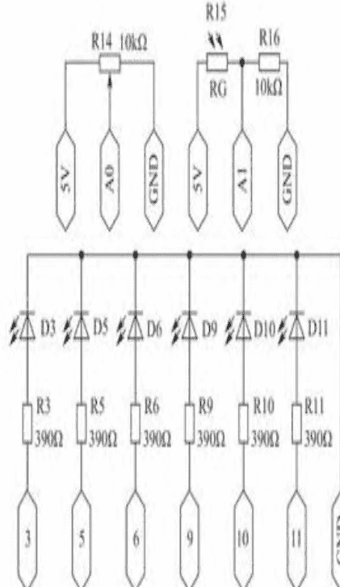

##### (a) 电路原理图

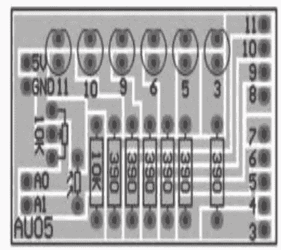

##### (b) 电路板图

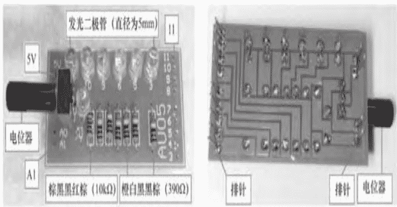

##### (c) 实物图

##### 图2.8 AU05电路原理图、电路板图和实物图

#### 2.5.2 核心知识储备

##### 1. 脉冲宽度调制（PWM）
单片机只会输出0/1数字信号，PWM通过控制高电平占比（占空比），在时间维度上“欺骗”人眼或电机，实现模拟量效果。它是调节LED亮度、电机转速的核心手段。

##### 2. Uno板的“伪”模拟输出
Uno没有真DAC，但带“~”号的数字引脚（3、5、6、9、10、11）可用`analogWrite(pin, value)`输出固定频率方波。
- 引脚3、9、10、11：~490Hz
- 引脚5、6：~980Hz
**核心公式**：输出电压 = 5V × 占空比。占空比 = 高电平时长 / 周期。value 0~255 对应 0%~100% 占空比。

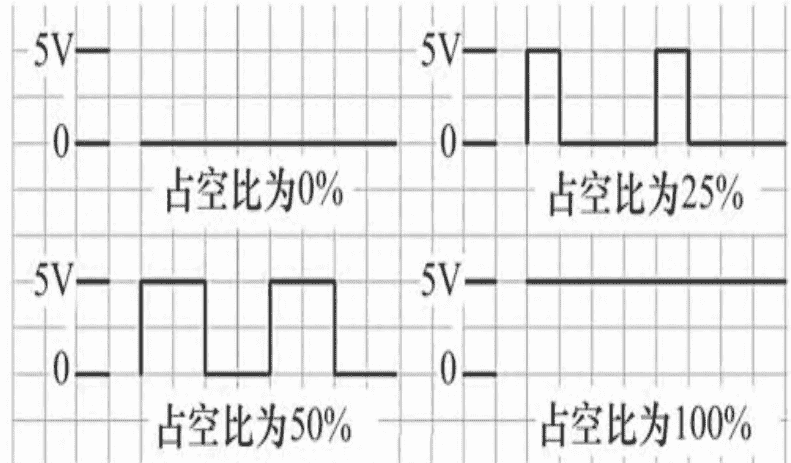

##### 图2.9 不同占空比波形示意

#### 2.5.3 编程关键点

- **`analogWrite(pin, value)`**  
  `value` 范围 0~255，映射 0~5V。无需 `pinMode` 设置输出模式即可直驱。
- **近似模拟输出编程套路**  
  ```
void loop(){analogWrite(pin,value);}
```

#### 2.5.4 代码实战与现象

##### (1) 参考代码
```cpp
int val=0;// 定义整型变量 val，初始化赋值为 0。
void setup(){}
void loop(){
val=analogRead(0);// 读出模拟端口 A0 的值，赋给变量 val ( 0 ~ 1023 )。
analogWrite(3,val/4);// 数字端口 3 输出模拟值 val/4。
analogWrite(5,val/4);// 数字端口 5 输出模拟值 val/4。
analogWrite(6,val/4);// 数字端口 6 输出模拟值 val/4。
analogWrite(9,val/4);// 数字端口 9 输出模拟值 val/4。
analogWrite(10,val/4);// 数字端口 10 输出模拟值 val/4。
analogWrite(11,val/4);// 数字端口 11 输出模拟值 val/4。
}
```

##### (2) 实测现象
组装焊接AU05，插入Uno，上传代码。
- 顺时针拧电位器：六盏LED亮度 **由暗变亮，最后最亮**；
- 逆时针拧电位器：六盏LED亮度 **由亮变暗，最后熄灭**。

#### 2.5.5 进阶挑战：光控调光
AU05板上光敏电阻接A1。把代码里 `analogRead(0)` 改为 `analogRead(1)` 读取A1值。
- 遮挡光敏电阻：LED **由亮变暗**；
- 光线增强：LED **由暗变亮**。

---

### 2.6 基础交互：按下亮、松开灭

生活里开关控灯、键盘敲字全是“轻触开关”原理：按下通、松开断。但代码能反转逻辑：按下断、松开通？咋实现？

#### 2.6.1 任务目标
编程实现：按键按下D13亮，松开D13灭。AU06硬件图如下：

##### (a) 电路原理图

##### (b) 电路板图

##### 6×6×5轻触开关

##### 发光二极管

##### 棕白黑黑棕 (390Ω)

##### 排针

##### (c) 实物图

图2.10 AU06电路原理图、电路板图和实物图

#### 2.6.2 硬件原理
轻触开关：按下瞬间导通，松开即断。是自动化控制最基础的输入单元。

#### 2.6.3 编程核心语法

- **条件判断 `if (val==1) {...} else {...}`**  
  满足条件执行分支1，否则分支2。
- **数字输入编程三步走**  
  1. 定义 `int val;`  
  ```
int val=0;
```  
  2. `setup()` 中设12号口为输出并拉高（内部上拉/外部上拉均可）  
  ```
void setup(){pinMode(12,OUTPUT);pinMode(12,INPUT);digitalWrite(12,1);}
```  
  3. `loop()` 读12号口电平，按需执行逻辑  
  ```
void loop(){val=digitalRead(12);if(val==1){ 语句 1;}else{ 语句 2;}}
```

#### 2.6.4 代码与验收

##### (1) 参考代码
```
int val=0;// 定义整型变量 val, 初始化赋值为 0。
```
```
void setup(){
pinMode(13,OUTPUT);// 设置数字端口 13 为输出模式。
pinMode(12,OUTPUT);// 设置数字端口 12 为输出模式。
pinMode(12,INPUT);// 设置数字端口 12 为输入模式。
digitalWrite(12,1);// 设置数字端口 12 输出高电平。
}

void loop(){
val=digitalRead(12);// 读出数字端口 12 的值，赋给变量 val。
if(val==1){
digitalWrite(13,0);// 数字端口 13 输出低电平。
}else{
digitalWrite(13,1);// 数字端口 13 输出高电平。
}
}
```

##### (2) 验收标准
上电后：按键按住D13常亮，手一松D13熄灭。

#### 2.6.5 反向思维挑战
改代码实现：按下D11、D13灭，松开D11、D13亮。

---

### 2.7 进阶交互：一键开关（自锁/翻转）

如何让按键像墙壁开关一样：“按一下亮，再按一下灭”，中间松手状态保持？这就是“自锁/翻转”逻辑。

#### 2.7.1 任务目标
基于AU06（同2.6硬件），实现：按一下D13亮，再按一下D13灭。电路图如下：


##### (a) 电路原理图

##### (b) 电路板图

图2.11 AU06电路原理图、电路板图和实物图


##### (c) 实物图

图2.11 AU06电路原理图、电路板图和实物图（续）

#### 2.7.2 两大拦路虎与对策

##### 1. 按键抖动
机械触点弹合瞬间会抖动~10ms，单片机读得飞快，极易误判多次按键。**必须消抖**。
**软件消抖法**：读到低电平 -> `delay(100)` -> 再读一次仍为低 -> 确认按下。

##### 2. 检测“按键抬起”
只有检测到“按下 -> 抬起”才算一次完整动作。
**代码模式**：`while (digitalRead(12) == 0);` // 卡死等松手

#### 2.7.3 关键语法解析

- **布尔变量翻转**  
  `bool val = 0;` 定义布尔量（0/1）。  
  `val = !val;` 取反：0变1，1变0。配合 `if(val) {...} else {...}` 实现状态机。
- **`while` 等待松手**  
  `while (digitalRead(12) == 0);` 只要按着就空转，松手跳出。

#### 2.7.4 代码与验收

##### (1) 参考代码
```
bool val=0;// 定义布尔型变量 val，初始化赋值为 0。
void setup(){
pinMode(13,OUTPUT);// 设置数字端口 13 为输出模式。
pinMode(12,OUTPUT);// 设置数字端口 12 为输出模式。
pinMode(12,INPUT);// 设置数字端口 12 为输入模式。
digitalWrite(12,1);// 设置数字端口 12 输出高电平。
}
void loop(){
if(val==1){// 如果 val==1，
digitalWrite(13,1);// 数字端口 13 输出高电平。
}else{// 否则，
digitalWrite(13,0);// 数字端口 13 输出低电平。
}
if(digitalRead(12)==0){// 如果数字端口 12 的值为 0，
delay(100);// 延时 100ms。
if(digitalRead(12)==0){// 如果数字端口 12 的值为 0，
val=!val;// 将 val 值取反，如果 val=0，!val=1。
while(digitalRead(12)==0);// 当数字端口 12 的值为 0 时执行循环语句。
}
}
}
```

##### (2) 验收标准
上电：按一下D13亮，再按一下D13灭，循环往复。

#### 2.7.5 扩展挑战
D11、D13同步翻转：按一下全亮，再按一下全灭。

---

### 2.8 实用功能：延时自动关灯

楼道灯、电风扇定时关机……这种“按一下亮，几秒后自动灭”怎么写？

#### 2.8.1 任务目标
基于AU06，实现：按一下按键D13亮，**3秒后自动熄灭**。硬件图：


##### (a) 电路原理图


##### (b) 电路板图


##### (c) 实物图

图2.12 AU06电路原理图、电路板图和实物图

#### 2.8.2 关键电平逻辑
按键接数字口12，**按下接地 -> 读到LOW(0)**。但IO口上电随机，必须在 `setup()` 里先拉高（输出高/开启内部上拉），才能以“读到0=按下”作为可靠判据。

#### 2.8.3 编程两步走

1. **初始化拉高**  
   ```
digitalWrite(12,1);//设置数字端口 12 输出高电平。
```
2. **检测低电平触发延时**  
   ```
if(digitalRead(12)==0) 语句1;//按键已经被按下，执行语句1。
```

#### 2.8.4 代码与验收

##### (1) 参考代码
```
void setup(){
pinMode(13,OUTPUT);// 设置数字端口 13 为输出模式。
pinMode(12,OUTPUT);// 设置数字端口 12 为输出模式。
pinMode(12,INPUT);// 设置数字端口 12 为输入模式。
}
void loop(){
digitalWrite(12,1);// 设置数字端口 12 输出高电平。
if(digitalRead(12)==0){// 如果数字端口 12 的值为 0,
digitalWrite(13,1);// 数字端口 13 输出高电平。
delay(3000);// 延时 3000ms。
digitalWrite(13,0);// 数字端口 13 输出低电平。
}
}
```

##### (2) 验收标准
上电：按一下D13亮，约3秒自动灭。

#### 2.8.5 扩展挑战
D11、D13同步亮，**30秒后自动灭**。

---

### 2.9 视觉盛宴：D0~D13跑马灯

代码不仅能控一两盏灯，还能让十几盏灯按节奏、按顺序“跑”起来。

#### 2.9.1 任务目标
AU09板载D0~D13共14颗LED，编程实现经典“跑马灯”流水效果。硬件参数：R14=10kΩ，R0~R13=390Ω。电路图如下：


##### (a) 电路原理图


##### (b) 电路板图


##### (c) 实物图

#### 2.9.2 知识拓展

##### 1. 跑马灯由来
传统竹编马灯，春节表演围着唱跳，寓意兴旺丰收。现代引申为LED流水特效。

##### 2. LED实际工作电流怎么算

#### 2.9.3 编程核心解析

##### 1. `for` 循环的三种典型用法

**正向遍历端口**  
`for (int i = 0; i < 14; i++) { pinMode(i, OUTPUT); }`  
这行代码的作用是将变量 `i` 从 0 递增至 13。循环启动时 `i=0`，结束前 `i=13`，共执行 14 次，最终把数字引脚 0 到 13 全部配置为输出模式。其中 `i++` 只是 `i = i + 1` 的简写。

**逆向执行序列**  
`for (int i = 13; i > -1; i--) { 语句j; }`  
这里 `i` 从 13 递减到 0。首轮循环 `i=13` 执行“语句13”，末轮 `i=0` 执行“语句0”，实现了 13 到 0 的倒序操作。`i--` 等价于 `i = i - 1`。

**固定次数重复**  
`for (int i = 0; i < 3; i++) { 语句1; }`  
循环变量 `i` 取值 0、1、2，共触发 3 次迭代，使“语句1”连续运行三遍。

**循环语法拆解**  

```
for( 定义变量并初始化赋值;条件表达式;变量增量 \ 语句;//重复执行花括号之内的语句代码, 常用于操作引脚变量、读取数组数据。
```

*   **初始化赋值**：仅在循环伊始执行一次。
*   **条件判断**：每轮循环前必检。若为真，执行循环体与增量操作，然后继续下一轮判断；若为假，直接跳出循环。
*   **变量增量**：定义每轮迭代后变量的变化规则。

##### 2. 子程序（函数）机制

`void loop() { mod1(); }` —— 在主循环中调用名为 `mod1` 的子程序。  
`void mod1() { // 子程序具体代码 }` —— 定义 `mod1` 的具体逻辑。

**关于 `void` 关键字**：原意是“无类型”。`void*` 代表“无类型指针”，可指向任意数据类型。在 Arduino 编程中，`void` 用于声明函数**无返回值**、**参数为空**或**指针类型不限**。标记为 `void` 的函数执行完毕后，不会向调用者返回任何数据。

---

#### 2.9.4 实战代码设计

##### 方案一：基础流水灯

**代码参考**  
```
void setup(){
for(int i=0;i<14;i++){// 循环执行，从 i=0 开始，到 i=13 结束。
pinMode(i, OUTPUT);// 设置数字端口 0 ~ 13 为输出模式。
}
}
void loop(){
for(int i=0;i<14;i++){// 循环执行，i=0 ~ 13。
digitalWrite(i,1);// 数字端口输出高电平。
delay(100);// 延时 100ms。
digitalWrite(i,0);// 数字端口输出低电平。
}
}
```

**运行现象**  
LED D0 至 D13 依次点亮、熄灭，循环往复。

##### 方案二：双向流水灯

**代码参考**  
```
void setup(){
for(int i=0;i<14;i++){// 循环执行，从 i=0 开始，到 i=13 结束。
pinMode(i,OUTPUT);// 设置数字端口 0 ~ 13 为输出模式。
digitalWrite(i,0);// 数字端口 0 ~ 13 输出低电平。
}
}
void loop(){
for(int i=0;i<14;i++){// 循环执行，i=0 ~ 13。
digitalWrite(i,1);// 数字端口输出高电平。
delay(100);// 延时 100ms。
digitalWrite(i,0);// 数字端口 0 ~ 13 输出低电平。
}

for(int i=13;i>=0;i--){// 循环执行，i=13 ~ 0。
digitalWrite(i,1);// 数字端口输出高电平。
delay(100);// 延时 100ms。
digitalWrite(i,0);// 数字端口 0 ~ 13 输出低电平。
}
}
```

**运行现象**  
先正序（D0→D13）流水，再倒序（D13→D0）流水，交替循环。

##### 方案三：多模式灯光秀

**代码参考**  
```
void setup(){
for(int i=0;i<14;i++){// 循环执行，从 i=0 开始，到 i=13 结束。
pinMode(i, OUTPUT);// 设置数字端口 0 ~ 13 为输出模式。
}
}
void loop(){
for(int i=0;i<3;i++){// 循环执行 3 遍。
mod1();// 调用子程序 mod1。
}
for(int i=0;i<3;i++){// 循环执行 3 遍。
mod2();// 调用子程序 mod2。
}
for(int i=0;i<3;i++){// 循环执行 3 遍。
mod3();// 调用子程序 mod3。
}
for(int i=0;i<6;i++){// 循环执行 6 遍。
mod4();// 调用子程序 mod4。
}
}
void mod1(){// 子程序 mod1。
for(int i=0;i<14;i++){// 循环执行， i=0 ~ 13。
digitalWrite(i,1);// 数字端口输出高电平。
delay(100);// 延时 100ms。
digitalWrite(i,0);// 数字端口 0 ~ 13 输出低电平。
}
}
void mod2(){// 子程序 mod2。
for(int i=13;i>=0;i--){// 循环执行，i=13 ~ 0。
	digitalWrite(i,1);// 数字端口输出高电平。
	delay(100);// 延时 100ms。
	digitalWrite(i,0);// 数字端口 0 ~ 13 输出低电平。
}
}
void mod3(){// 子程序 mod3。
	for(int i=0;i<14;i++){// 循环执行，i=0 ~ 13。
		digitalWrite(i,1);// 数字端口输出高电平。
		delay(100);// 延时 100ms。
	}
	for(int i=13;i>=0;i--){// 循环执行，i=13 ~ 0。
		digitalWrite(i,0);// 数字端口输出低电平。
		delay(100);// 延时 100ms。
	}
	for(int i=13;i>=0;i--){// 循环执行，i=13 ~ 0。
		digitalWrite(i,1);// 数字端口输出高电平。
		delay(100);// 延时 100ms。
	}
	for(int i=0;i<14;i++){// 循环执行，i=0 ~ 13。
		digitalWrite(i,0);// 数字端口输出低电平。
		delay(100);// 延时 100ms。
	}
}
void mod4(){// 子程序 mod4。
	for(int i=0;i<14;i++){// 循环执行，i=0 ~ 13。
		digitalWrite(i,1);// 数字端口输出高电平。
	}
	delay(500);// 延时 500ms。
	for(int i=0;i<14;i++){// 循环执行，i=0 ~ 13。
		digitalWrite(i,0);// 数字端口 0 ~ 13 输出低电平。
	}
	delay(500);// 延时 500ms。
}
```

**运行现象**  
程序内置四种模式循环播放：
1.  **模式一**：正序流水，循环 3 遍。
2.  **模式二**：倒序流水，循环 3 遍。
3.  **模式三**：正序点亮 → 倒序熄灭 → 倒序点亮 → 正序熄灭，循环 3 遍。
4.  **模式四**：全亮 → 全灭，循环 6 遍。

---

#### 2.9.5 进阶挑战

1.  **变速闪烁**：D0~D13 依次点亮 0.1 秒，依次熄灭 0.5 秒，循环执行。
2.  **奇偶分组闪烁**：偶数脚（D0, D2...D12）同步亮 0.1 秒、灭 0.5 秒；紧接着奇数脚（D1, D3...D13）同步亮 0.1 秒、灭 0.5 秒；交替循环。

---

### 2.10 可调速跑马灯

编程驱动的跑马灯最大优势在于**精准控制**：14 颗 LED 的点亮时刻、熄灭时刻、时间间隔均可独立编排。代码调试定型后，系统能长期稳定、有序运行。更妙的是，变换速度完全由代码决定，想改多快就改多快！

#### 2.10.1 实验任务

利用电位器实时调节跑马灯变换速度。  
电路原理图、PCB 图及实物接线参考图 2.14。

  
**(a) 电路原理图**

  
**(b) PCB 走线图**

  
**(c) 实物接线图**  
*关键元件：电位器、发光二极管、排针、贴片电阻 (390Ω)、电位器*

#### 2.10.2 硬件知识点

本实验用的电位器是三引脚可调电阻，两端固定电阻 10kΩ。  
通电后，**顺时针**拧动旋钮 → A0 口电压**升高**；**逆时针**拧动 → A0 口电压**降低**。

#### 2.10.3 编程关键点

`val = analogRead(0);` 读取 A0 模拟值（0~1023）赋给 `val`。  
`delay(10 + val);` 延时时长 = `10 + val` 毫秒。  
因此，**延时范围 = 10ms ~ 1033ms**。拧动电位器即可线性改变灯光切换节奏。

#### 2.10.4 程序实现

**代码参考**  
```
int val=0;//定义整型变量 val，初始化赋值为 0。
void setup(){
for(int i=0;i<14;i++){// 循环执行，从 i=0 开始，到 i=13 结束。
pinMode(i, OUTPUT);// 设置数字端口 0 ~ 13 为输出模式。

digitalWrite(i,0);// 数字端口 0 ~ 13 输出低电平。

}
}

void loop(){
val=analogRead(0);// 读出模拟端口 A0 的值，赋给变量 val。

for(int i=0;i<14;i++){// 循环执行，i=0 ~ 13。
digitalWrite(i,1);// 数字端口输出高电平。

delay(10+val);// 延时 ( 10+val ) ms。

digitalWrite(i,0);// 数字端口输出低电平。

}
}
```

**实验结果**  
上电运行，拧动电位器旋钮，LED 流水速度随之平滑加减。

#### 2.10.5 进阶挑战

上电后跑马灯按 D13→D0 方向流动。请调节电位器，使流水切换频率精确达到 **0.1 秒/次**（即 10Hz）。

---

### 2.11 红外遥控编码解析

在太阳光谱中，红外线虽不可见，却携带大部分热能，穿透云雾能力极强。凡温度高于绝对零度（-273.15℃）的物体都会辐射红外。生活中常见的电视、空调、玩具遥控器，正是利用红外传输控制指令。

#### 2.11.1 实验任务

通过红外接收模块，配合串口监视器，捕获并显示遥控器按键对应的**十六进制编码值**。  
电路参考图 2.15（原理图、PCB 图、实物图）。

  
**(a) 电路原理图**

  
**(b) PCB 走线图**

  
**(c) 实物接线图**

#### 2.11.2 核心器件认知

**1. 红外遥控器**  
发射端，将功能指令调制到红外光信号中发射，实现近距离无线控制，普及度极高。

**2. 红外接收头 (型号 CHQB)**  
接收端，核心任务是将不可见的红外光信号还原为电信号（数字脉冲），供单片机解码。

#### 2.11.3 编程关键库与函数详解

**① 引入库文件**  
`#include <IRremote.h>`  
调用 Arduino 官方红外控制库。  
⚠️ **必做步骤**：首次使用前，**必须联网安装库**。路径：IDE 菜单栏 → 项目 → 加载库 → 管理库 → 搜索 `IRremote` → 安装 → 重启 IDE。未安装库直接编译会报错。  
*注：`#include` 与 `#define` 同属预处理指令，行尾**不加分号**。*

**② 创建接收对象**  
`IRrecv irrecv(2);`  
实例化 `IRrecv` 类，指定红外接收头的信号脚接在**数字引脚 2**。

**③ 解码判断与数据获取**  
`if (irrecv.decode(&results)) { 语句1; }`  
若成功捕获一帧红外编码，将解码结果存入 `results` 结构体，执行后续逻辑。

**④ 数据过滤（去噪）**  
`if (results.value < 0xffffffff) { 语句1; }`  
过滤掉数值异常大（> 0xFFFFFFFF）的干扰数据，提高识别可靠性。

**⑤ 启动接收器**  
`irrecv.enableIRIn();`  
在 `setup()` 中调用，初始化并启动红外解码状态机。

**⑥ 准备下一帧**  
`irrecv.resume();`  
处理完当前帧后**必须调用**，释放缓冲区，等待接收下一个按键信号。

**⑦ 串口输出十六进制码值**  
`Serial.println(results.value, HEX);`  
将解码值以 **HEX（十六进制）** 格式打印至串口监视器并换行，方便记录按键编码。

#### 2.11.4 程序实现

**代码参考**  
```
#include <IRremote.h>// 定义头文件 IRremote.h。

IRrecv irrecv(2);//IRrecv 类构造函数，红外接收头输出引脚连接数字端口 2。

decode_results results;// 一个 decode_results 类的对象。

void setup(){
    irrecv.enableIRIn();// 初始化红外接收器。

    Serial.begin(9600);// 打开串口，设置数据传输速率为 9600bps。
}

void loop(){
    if(irrecv.decode(&results))// 如果接收到编码，

    if(results.value<0xffffffff)// 如果接收到的值小于 0xffffffff，

    Serial.println(results.value,HEX);// 串口监视器显示十六进制代码并换行。

    Serial.println();// 串口监视器显示一个空行。

    delay(100);// 延时 100ms，避免按键反应速度过快。

    }

    irrecv.resume();// 接收下一个值。

}
}
```

**实验结果**  
组装焊接 AU11 板卡，插入 Uno，上电。打开 IDE “工具 → 串口监视器”，对准接收头按遥控器按键（见下图），监视器即显示对应十六进制值。常用按键编码对照表如下：

##### 图2.16 红外遥控器按键布局
| 电源 | 模式 | 静音 |
| :--- | :--- | :--- |
| 暂停 | 上一曲 | 下一曲 |
| EQ | 音量- | 音量+ |
| 0 | 循环 | U/SD |
| 1 | 2 | 3 |
| 4 | 5 | 6 |
| 7 | 8 | 9 |

##### 表2.3 部分按键十六进制编码对照表
| 按键 | 编码 | 按键 | 编码 | 按键 | 编码 | 按键 | 编码 |
| :--- | :--- | :--- | :--- | :--- | :--- | :--- | :--- |
| 1 | FFA25D | 频道+ | FFE01F | 数字 1 | FF30CF | 数字 7 | FF42BD |
| 2 | FF629D | 频道- | FFA857 | 数字 2 | FF18E7 | 数字 8 | FF4AB5 |
*(表格其余数据保持原样)*

| 序号 | Hex值 | 序号 | Hex值 | 序号 | Hex值 | 序号 | Hex值 |
| :--- | :--- | :--- | :--- | :--- | :--- | :--- | :--- |
| 1.3 | FFE21D | 3.3 | FF906F | 5.3(3) | FF7A85 | 7.3(9) | FF52AD |
| 2.1 | FF22DD | 4.1(0) | FF6897 | 6.1(4) | FF10EF | | |
| 2.2 | FF02FD | 4.2 | FF9867 | 6.2(5) | FF38C7 | | |
| 2.3 | FFC23D | 4.3 | FFB04F | 6.3(6) | FF5AA5 | | |

#### 2.11.5 进阶挑战

操作电视手柄的电源开关，观察串口工具窗口返回（ ）；依次按下数字按钮 0、1、2、3，记录窗口显示的对应数值（ ）、（ ）、（ ）、（ ）。

### 2.12 遥控器控制照明实验

通过串口工具可获取手柄各按钮专属的标识码。这些码值有何用途？场景很多，例如配合接收模块实现灯光的远程操控。

#### 2.12.1 实验内容

目标：利用手柄操控灯珠。
1.  随机按下手柄上某个按钮，D3 亮起；再按一次任一按钮，D3 熄灭。
2.  专门按下数字 `1` 按钮，D3 至 D8 全亮；再按一次数字 `1`，全灭。

硬件连接参考 AU11 电路图、板级图及实拍图（图 2.17）。


(a) 电路图

图2.17 AU11的电路原理图、电路板图和实物图


##### (b) 板级图


##### (c) 实拍图

图2.17 AU11的电路原理图、电路板图和实物图（续）

#### 2.12.2 核心原理

手柄通过发射管送出不可见光信号。环境中存在大量红外源（阳光、灯光、人体热辐射），为抗干扰，发射端采用 **38kHz** 调制载波。接收头仅解调此频率信号。另外，数据包包含地址标识与指令码，赋予每个按钮独特含义。

#### 2.12.3 代码要点

**1. 判断逻辑**
`if (results.value == 0xFF30CF) { ... }` 意为：检测到的数值匹配 `0xFF30CF`（对应数字 `1`）时触发动作。替换为 `0xFF6897`（数字 `0`）即可改变触发键。

**2. 开发流程三阶段**

*   **阶段一：引库配置**
    加载 `IRremote.h`，设定接收引脚，建立解码结果容器。
    ```
#include <IRremote.h>

IRrecv irrecv(2);
decode_results results;
```

*   **阶段二：启动监听**
    在初始化函数中开启接收机制。
    ```
void setup(){irrecv.enableIRIn();}
```

*   **阶段三：循环处理**
    主循环里检测数据，比对目标键值，命中则执行对应操作，稍作延时消抖，继续监听。
    ```cpp
void loop(){
    if(irrecv.decode(&results)){
        if(results.value==0xFF30CF){
            语句 1;
            delay(200);
        }
        irrecv.resume();//接收下一个编码。
    }
}
```

#### 2.12.4 代码示例

**示例 A：全键控制单灯 (D3)**

*   **源码**
    ```cpp
#include <IRremote.h>
IRrecv irrecv(2);//IRrecv 类构造函数，红外接收头输出引脚连接数字端口 2。
decode_results results;//一个 decode_results 类的对象。
void setup(){
    pinMode(3,OUTPUT);// 设置数字端口 3 为输出模式。
    digitalWrite(3,0);// 数字端口 3 输出低电平。
    irrecv.enableIRIn();// 初始化红外接收器。
}
void loop(){
    if(irrecv.decode(&results)){
        digitalWrite(3,!digitalRead(3));// 数字端口 3 取反。
        delay(200);// 延时 200ms。
        irrecv.resume();// 接收下一个编码。
    }
}
```

*   **表现**
    上电运行，手柄随便哪个按钮按下，D3 亮；再按一次任一按钮，D3 灭。

**示例 B：专键控制灯组 (D3~D8)**

*   **源码**
    ```cpp
#include <IRremote.h>
IRrecv irrecv(2);//IRrecv 类构造函数，红外接收头输出引脚连接数字端口 2。
decode_results results;// 一个 decode_results 类的对象。
void setup(){
    pinMode(3,OUTPUT);// 设置数字端口 3 为输出模式。
    pinMode(4,OUTPUT);// 设置数字端口 4 为输出模式。
    pinMode(5,OUTPUT);// 设置数字端口 5 为输出模式。
    pinMode(6,OUTPUT);// 设置数字端口 6 为输出模式。
    pinMode(7,OUTPUT);// 设置数字端口 7 为输出模式。
    pinMode(8,OUTPUT);// 设置数字端口 8 为输出模式。
    digitalWrite(3,0);// 数字端口 3 输出低电平。
    digitalWrite(4,0);// 数字端口 4 输出低电平。
    digitalWrite(5,0);// 数字端口 5 输出低电平。
    digitalWrite(6,0);// 数字端口 6 输出低电平。
    digitalWrite(7,0);// 数字端口 7 输出低电平。
    digitalWrite(8,0);// 数字端口 8 输出低电平。
    irrecv.enableIRIn();// 初始化红外接收器。
}

void loop(){
    if(irrecv.decode(&results)){
        if(results.value==0xFF30CF){
            digitalWrite(3,!digitalRead(3));// 数字端口 3 输出电平取反。
            digitalWrite(4,!digitalRead(4));// 数字端口 4 输出电平取反。
            digitalWrite(5,!digitalRead(5));// 数字端口 5 输出电平取反。
            digitalWrite(6,!digitalRead(6));// 数字端口 6 输出电平取反。
            digitalWrite(7,!digitalRead(7));// 数字端口 7 输出电平取反。
            digitalWrite(8,!digitalRead(8));// 数字端口 8 输出电平取反。
        }
        delay(200);// 延时 200ms。
        irrecv.resume();// 接收下一个编码。
    }
}
```

*   **表现**
    按数字 `1`，D3~D8 全亮；再按 `1`，全灭。

#### 2.12.5 进阶任务

自行修改代码：以数字 `0` 按钮为触发，控制 D3~D8 整体明暗切换。

### 2.13 多通道灯光遥控实验

想给手柄每个数字按钮分配专属指令吗？例如：`9` 全开，`0` 全关，`7` 单控 D7……掌握分支结构与子程序封装后，这很容易实现。

#### 2.13.1 任务列表

**方案 A（双灯 D7、D8）**
上电后：`7`→D7亮；`8`→D8亮；`1`→双亮；`0`→双灭。

**方案 B（全灯 D3~D8）**
上电后：`3`~`8` 对应 D3~D8 单独控；`9`→全组亮；`0`→全组灭。

硬件同上（AU11），见图 2.18。


##### (a) 电路图

图2.18 AU11的电路原理图、电路板图和实物图


##### (b) 板级图


##### (c) 实拍图

图2.18 AU11的电路原理图、电路板图和实物图（续）

#### 2.13.2 技术特性

采用近红外波段（780~2526nm）实现非接触无线操控，优势明显：
*   **抗噪性高**：调制频率过滤环境光干扰信号，传信可靠。
*   **低价好用**：低功耗、低成本、易上手。
*   **频带兼容**：波段远短于无线电，零干扰射频装置。
*   **编码分离**：地址/指令码机制保障同载波装置互无串扰。
*   **耐受力强**：严酷场景（高压、辐射、毒气、粉尘）下传送稳定，内在阻隔电力扰动。

#### 2.13.3 代码进阶：分支选择与函数封装

**1. 多路分支 `switch`**
面对多键值判断，`switch` 比连续 `if` 更清晰：
```cpp
switch (value) {
  case 0xFF6897: /* 动作0 */ break;
  case 0xFF30CF: /* 动作1 */ break;
  // ...
  default: /* 兜底 */
}
```
原理：拿 `value` 逐个与 `case` 值比对，匹配即执行对应块，遇 `break` 离开框架；全不中则走 `default`。
```cpp
switch( 变量表达式 ){case 常量表达式 1: 语句 1;break;case 常量表达式 2: 语句 2;break;
case 常量表达式 3: 语句 3;break;...default: 语句 n+1;break;}
```

**2. 灯控封装函数 `contro()`**
为精简反复的 IO 动作，声明统一接口：
*   **声明**：`void contro(int p1, int p2, int p3, int p4, int p5, int p6)` 映射 D3~D8 六脚状态。
*   **调用**：`contro(1, 0, 0, 0, 0, 0)` 即仅置 D3（对应 p1）为 1，别的置 0。通过 0/1 搭配，一行实现任一明暗模式。

#### 2.13.4 代码实战

**版本一：方案 A (双灯 D7、D8)**

*   **代码**
    ```cpp
#include <IRremote.h>
IRrecv irrecv(2);//IRrecv 类构造函数，红外接收头输出引脚连接数字端口 2。
decode_results results;// 一个 decode_results 类的对象。
void setup(){
    pinMode(7,OUTPUT);// 设置数字端口 7 为输出模式。
    pinMode(8,OUTPUT);// 设置数字端口 8 为输出模式。
    irrecv.enableIRIn();// 初始化红外接收器。
}
void loop(){
    if(irrecv.decode(&results)){
        if(results.value==0xFF6897){
            digitalWrite(7,0);// 数字端口 7 输出低电平。
            digitalWrite(8,0);// 数字端口 8 输出低电平。
        }
        if(results.value==0xFF30CF){
            digitalWrite(7,1);// 数字端口 7 输出高电平。
            digitalWrite(8,1);// 数字端口 8 输出高电平。
        }
        if(results.value==0xFF42BD){
            digitalWrite(7,1);// 数字端口 7 输出高电平。
            digitalWrite(8,0);// 数字端口 8 输出低电平。
        }
        if(results.value==0xFF4AB5){
            digitalWrite(7,0);// 数字端口 7 输出低电平。
            digitalWrite(8,1);// 数字端口 8 输出高电平。
        }
        irrecv.resume();// 接收下一个编码。
    }
}
```

*   **表现**
    上电后，按 `7` 亮 D7，按 `8` 亮 D8，按 `1` 双亮，按 `0` 双灭。

**版本二：方案 B (全灯 D3~D8)**

*   **代码**
##### 2.代码二
- (1) 程序参考

```cpp
#include <IRremote.h>

IRrecv irrecv(2);//IRrecv 类构造函数，红外接收头输出引脚连接数字端口 2。
decode_results results;// 一个 decode_results 类的对象。

void setup(){
    pinMode(3,OUTPUT);// 设置数字端口 3 为输出模式。
    pinMode(4,OUTPUT);// 设置数字端口 4 为输出模式。
    pinMode(5,OUTPUT);// 设置数字端口 5 为输出模式。
    pinMode(6,OUTPUT);// 设置数字端口 6 为输出模式。
    pinMode(7,OUTPUT);// 设置数字端口 7 为输出模式。
    pinMode(8,OUTPUT);// 设置数字端口 8 为输出模式。
    irrecv.enableIRIn();// 初始化红外接收器。
}

void loop(){
    if(irrecv.decode(&results)){
        disp(results.value);// 调用显示子程序。
        irrecv.resume();// 接收下一个编码。
    }
}

void disp(unsigned long value){
    switch(value){
        case 0xFF6897:// 如果接收到编码 0xFF6897 ( 按键 0 ),
            ctrl(0,0,0,0,0,0,0,0);// 数字端口 3 ~ 8 为低电平。
            break;// 退出选择。

        case 0xFF7A85:// 如果接收到编码 0xFF7A85 ( 按键 3 ),
            ctrl(1,0,0,0,0,0,0,0);// 数字端口 3 为高电平。
            break;// 退出选择。

        case 0xFF10EF:// 如果接收到编码 0xFF10EF ( 按键 4 ),
            ctrl(0,1,0,0,0,0,0,0);// 数字端口 4 为高电平。
            break;// 退出选择。

        case 0xFF38C7:// 如果接收到编码 0xFF38C7 ( 按键 5 ),
            ctrl(0,0,1,0,0,0,0,0);// 数字端口 5 为高电平。
            break;// 退出选择。

        case 0xFF5AA5:// 如果接收到编码 0xFF5AA5 ( 按键 6 ),
            ctrl(0,0,0,1,0,0,0,0);// 数字端口 6 为高电平。
            break;// 退出选择。

        case 0xFF42BD:// 如果接收到编码 0xFF42BD ( 按键 7 ),
            ctrl(0,0,0,0,1,0,0,0);// 数字端口 7 为高电平。
            break;// 退出选择。

        case 0xFF4AB5:// 如果接收到编码 0xFF4AB5 ( 按键 8 ),
            ctrl(0,0,0,0,0,0,0,1);// 数字端口 8 为高电平。
            break;// 退出选择。

        case 0xFF52AD:// 如果接收到编码 0xFF52AD ( 按键 9 ),
            ctrl(1,1,1,1,1,1,1,1);// 数字端口 3 ~ 8 为高电平。
            break;// 退出选择。

    }
}

void ctrl(int pin1,int pin2,int pin3,int pin4,int pin5,int pin6){
    // 定义控制位引脚函数。
    digitalWrite(3,pin1);
    digitalWrite(4,pin2);
    digitalWrite(5,pin3);
    digitalWrite(6,pin4);
    digitalWrite(7,pin5);
    digitalWrite(8,pin6);
}
```

### 2.13.5 进阶挑战

实测阶段，接通电源后，通过红外遥控器按键测试各路 LED 响应情况：按下数字键 3 至 8，对应的 D3 至 D8 指示灯依次单独点亮；按下数字 9 键，D3 至 D8 全部点亮；按下数字 0 键，D3 至 D8 全部熄灭。

进阶玩法中，按键逻辑变为累加模式：按 0 全灭；按 1 亮 D3；按 2 亮 D3、D4；按 3 亮 D3 至 D5；按 4 亮 D3 至 D6；按 5 亮 D3 至 D7；按 6 则 D3 至 D8 全亮。

### 2.14 声控智能灯：延时与暗号模式

生活中常见的声控灯，经由编程赋能后，可衍生出声控延时灯、声控暗号灯等更具趣味与实用性的玩法。

#### 2.14.1 实验任务

目标是编程实现上述两种声控灯效果。涉及硬件 AU02 与 AU04E 的原理图、板级图及实物照片如下图 2.19 所示。


(a) 电路原理图（左：AU02，右：AU04E）


(b) 电路板图（左：AU02，右：AU04E）

图 2.19 AU02、AU04E 电路与板级图示


(c) 实物图（上：AU02，中：AU04E，下：组合态）

图 2.19 AU02、AU04E 实物图示（续）

#### 2.14.2 核心知识

**声控原理**：声音传感器在捕捉到足够响度的声音时，会输出电信号触发设备动作。

**声控延时灯**：由拾音器、音频放大、延时电路及照明模块组成。声响触发开灯，延时到达自动关灯，兼具声控触发与节能特性。

**声控暗号灯**：进阶形态，需匹配特定声纹模式（如 2 秒内拍手 2-3 下）才点亮，5 秒后自动熄灭，无暗号无法触发，安全性更高。

**技术延伸**：随着语音识别技术成熟，已可通过特定指令控制门窗、家电、车载导航及手机语音助手等设备。

#### 2.14.3 编程关键点

1.  **阈值判断**  
    `val = analogRead(0); if (val > 800) { ... }`  
    读取 A0 模拟口数值（声控模块电压信号）赋给 `val`，大于 800 执行后续逻辑。该阈值源自 2.4 节实测数据：设过大则灵敏度不足，设过小则易受环境噪音干扰。

2.  **限时多次采样**  
    `for (int i=0; i<4; i++) { delay(500); 声音检测; }`  
    循环 4 次，每次间隔 500ms，总计 2 秒窗口期，用于判定该时段内是否出现 2-3 次有效声响（即“暗号”判定逻辑）。

#### 2.14.4 代码实现与现象

**方案一：声控延时灯**  
- 程序参考：```cpp
void setup(){
    pinMode(13,OUTPUT);// 设置数字端口 13 为输出模式。
}

void loop(){
    int val;// 定义整型变量 val。
    val=analogRead(0);// 读出模拟端口 A0 的值，赋给变量 val。
    if(val>800){
        digitalWrite(13,1);// 数字端口 13 输出高电平。
        delay(5000);// 延时 5000ms。
        digitalWrite(13,0);// 数字端口 13 输出低电平。
    }
}
```  
- 实测现象：拍手一次，D13 点亮持续 5 秒后熄灭。

**方案二：声控暗号灯**  
- 程序参考：```cpp
void setup(){
pinMode(13,OUTPUT);// 设置数字端口 13 为输出模式。
}
void loop(){
int val;// 定义整型变量 val。
val=analogRead(0);// 读出模拟端口 A0 的值，赋给变量 val。
if(val>800){// 如果 val>800,
for(int i=0;i<4;i++){// 循环 4 次。
delay(500);// 延时 500ms。
if(val>800){// 如果 val>800,
digitalWrite(13,1);// 数字端口 13 输出高电平。
delay(5000);// 延时 5000ms。
digitalWrite(13,0);// 数字端口 13 输出低电平。
val=0;// 变量 val 清零。
}
}
}
}
}
```  
- 实测现象：2 秒内连拍 2-3 下手，LED 点亮 5 秒后自动熄灭。

#### 2.14.5 进阶挑战

拍手一次，D11、D12、D13 同步点亮 30 秒，随后熄灭。

### 2.15 人体红外感应节能灯

高档酒店自动门、小区楼道照明与安防监控，常部署人体红外感应装置。有人靠近即触发开门或开灯/录像，人走延时关闭，实现自动照明与节能防盗双重功能。

#### 2.15.1 实验任务

利用人体红外模块驱动 LED：检测到人体活动则点亮，持续无活动超 30 秒则自动熄灭。硬件涉及 AU02 与 AU04D，电路与实物见图 2.20。


(a) 电路原理图（左：AU02，右：AU04D）


(b) 电路板图（左：AU02，右：AU04D）


(c) 实物图（上：AU02，下：AU04D）

#### 2.15.2 核心知识

1.  **工作机制**：接收人体红外辐射自动开灯，仅在有人活动时工作，无人自动断电，节能效果显著。
2.  **模块特性与局限**：检测到动态人体时输出约 2.8V（A0 读值约 700）。但**静止人体难以检测**——人在感应区内不动，模块输出 0V，误判为无人。
3.  **多次采样确认策略**：针对“只敏动、不敏静”特性，需多轮轮询提高可靠性。例如每秒采样一次，连续 30 次（或更多）均无动态，方判定真无人。这是 Arduino 编程中的核心工程思想。

#### 2.15.3 编程关键点

1.  **无人状态判定**  
    `val = analogRead(0); if (val < 500) { ... }`  
    读取 A0 值赋给 `val`，小于 500 视为无人状态（阈值 500 来自 2.4 节实测）。

2.  **循环计数器**  
    `index = (index + 1) % 101;`  
    变量 `index` 在 0-100 间循环。取模运算 `%` 使其从 0 递增至 100 后归零，可用于实现定时计数或周期性任务调度。

3.  **串口调试输出**  
    `Serial.println(val, DEC)`  
    将 `val` 以十进制形式打印至串口监视器并换行，便于实时观测传感器数值波动，辅助调试。

#### 2.15.4 程序验证

- 程序参考：```cpp
int val;// 定义整型变量 val。
int index=0;// 定义整型变量 index，初始化赋值为 0。
void setup(){
    pinMode(13,OUTPUT);// 设置数字端口 13 为输出模式。
    Serial.begin(9600);// 打开串口，设置数据传输速率为 9600bps。
}
void loop(){
    val=analogRead(0);// 读出模拟端口 A0 的值，赋给变量 val。
    Serial.println(val,DEC);// 串口监视器显示模拟端口 A0 的值（十进制）并换行。
    if(val<500)// 如果 val<500 就执行下面的程序，此种状态为无人。
        delay(1000);// 延时 1000ms。
        index=(index+1)%101;// 变量 index 加 1。
        Serial.println(index,DEC);// 串口监视器显示变量 index 的值（十进制）并换行。
        if(index==30)// 如果 index==30 就执行下面的程序，此种状态为无人时间达 30s。
            digitalWrite(13,0);// 数字端口 13 输出低电平。
            index=0;// 变量 index 清零。
    }
    val=analogRead(0);// 读出模拟端口 A0 的值，赋给变量 val。此数值范围为 0 ~ 1023。
}else// 如果 val>500 就执行下面的程序，此种状态为有人。
    digitalWrite(13,1);// 数字端口 13 输出高电平。
    index=0;// 变量 index 清零。
}
```  
- 实测现象：上电后，检测到活动 D13 亮；连续 30 秒无活动检测，D13 自动灭。

#### 2.15.5 进阶挑战

检测到活动，D11、D12、D13 三灯同亮；无活动持续超 100 秒，三灯同灭。

### 2.16 光控与温控灯：智慧农业雏形

作为农业大国，中国在温室大棚领域应用广阔。通过透光、保温调控，可在非适宜季节高产栽培蔬菜、花卉、林木。温室系统涵盖增温/保温/降温、通风、采光补光、灌溉加湿、中央控制等子系统。核心问题在于：光照与温度如何实现自动化精准调控？

#### 2.16.1 实验任务

分别利用光敏模块与热敏模块，控制 LED 开关，模拟光控灯与温控灯逻辑。硬件平台为 AU02、AU04B、AU04C，电路与实物见图 2.21。


(a) 电路原理图（左：AU02，中：AU04B，右：AU04C）


(b) 电路板图（左：AU02，中：AU04B，右：AU04C）

图 2.21 AU02、AU04B、AU04C 电路与板级图示


(c) 电路板布局图（依次为AU02、AU04B、AU04C）

#### 2.16.2 核心知识梳理

##### 1. 光控灯与温控灯的区别与应用
**光控灯**依靠光敏元件感知光照强弱来驱动照明或指示，典型应用场景涵盖照明系统、摄影感光装置及植物工厂栽培设备。
**温控灯**则利用热敏元件监测温度变化以控制电路通断，广泛嵌入各类电热与制冷设备中，如电火锅、电冰箱等家用电器。

##### 2. 光敏模块工作特性解析
光敏模块专司检测环境光照明暗度。实测数据显示：强光环境下，模块输出电压约1.4V，对应模拟口A0读数（十进制）在300左右；弱光环境下，输出电压降至约0.7V，A0口读数则降至150左右。

#### 2.16.3 编程逻辑要点

核心代码逻辑：`val=analogRead(0); if(val<300){语句1;} else {语句2;}`。
解读：读取模拟口A0的数值存入变量`val`。若数值小于300（对应2.4节实测的强光阈值），执行语句1；反之执行语句2。

#### 2.16.4 程序实施与验证

##### (1) 代码参考
```cpp
int val;// 定义整型变量 val。

void setup(){
    pinMode(13,OUTPUT);// 设置数字端口 13 为输出模式。

    Serial.begin(9600);// 打开串口，设置数据传输速率为 9600bps。
}

void loop(){
    val=analogRead(0);// 读出模拟端口 A0 的值，赋给变量 val。

    Serial.println(val,DEC);// 串口监视器显示模拟端口 A0 的值（十进制）并换行。

    if(val<300)// 如果 val<300 就执行下面的程序，此种状态为环境光线较暗。

    digitalWrite(13,1);// 数字端口 13 输出高电平。

    val=analogRead(0);// 读出模拟端口 A0 的值，赋给变量 val。

    }else// 如果 val>300 就执行下面的程序，此种状态为环境光线较亮。

    digitalWrite(13,0);// 数字端口 13 输出低电平。
    }
}
```

##### (2) 实测现象
完成AU02、AU04B板卡组装焊接并插接Arduino Uno供电上传代码后，打开“串口监视器”可观测到A0口实时数值（ ）。遮挡光源使环境变暗时，板载LED D13亮起；光照增强时，D13熄灭。

#### 2.16.5 进阶挑战任务

- **任务一**：复现上述串口监视读数实验，记录A0口在特定光照下的数值（ ）。
- **任务二**：编写程序实现热敏电阻温控逻辑——手捏加热热敏电阻时，LED D11、D12、D13全亮；松手降温后三灯同灭。

---

### 2.17 单位数码管显示实战

一种将多颗LED封装一体、能发光显示数字的器件，凭借低成本、易驱动、抗震耐用、高效节能及超长寿命（达6万小时）等优势，成为数字显示领域的主力军——它就是LED数码管。其内部结构如何驱动？代码如何编写？带着疑问，我们从单位数码管入手深入探究。

#### 2.17.1 实验任务与硬件速览

**任务目标**：驱动单位共阴极数码管循环显示0-9，切换间隔1秒。
**硬件平台**：AU17电路原理图、板卡图及实物如图2.22所示。

##### 核心器件：共阴极数码管 5611AH


(a) 电路原理图 (b) PCB板卡图


(c) 实物连接图

#### 2.17.2 理论知识深度解析

##### 1. LED数码管分类与原理
本质是多颗LED的封装集合。按公共极连接方式分两类：
- **共阳极**：所有LED阳极汇聚为公共端（接VCC），阴极分别引出，给阴极低电平对应段点亮。
- **共阴极**：所有LED阴极汇聚为公共端（接GND），阳极分别引出，**给阳极高电平对应段点亮**（本实验采用此类）。
广泛用于时钟、温度计、仪表盘等数值显示场合。

##### 2. 共阴极数码管 5611AH 显示编码规律
依据原理图管脚定义：
- 显示 **“0”**：段选引脚11置低电平，其余置高电平。
- 显示 **“1”**：引脚7、8置高电平，其余置低电平。
- 其他数字以此类推。

**十六进制编码对照**（利于编程调用）：
- `0x3f` → 二进制 `0011 1111` → 对应 dp=0, g=0, a-f全亮 → 显示 **0**。
- `0x6f` → 二进制 `0110 1111` → 对应 dp=0, g/f亮, e灭, a-d亮 → 显示 **9**。
其余数字编码遵循相同段码映射逻辑。

##### 3. 进制转换速查手册（编程必备）
| 进制 | 基数 | 符号集 | Arduino前缀 | 核心转换口诀 |
| :--- | :--- | :--- | :--- | :--- |
| **二进制 (B)** | 2 | 0,1 | `B` | 逢二进一；权值展开：$2^0, 2^1, 2^2...$ |
| **十进制 (D)** | 10 | 0-9 | 无 | 生活常用；转二进制“除2取余/乘2取整” |
| **十六进制 (H)** | 16 | 0-9, A-F | `0x` | 逢十六进一；**1位Hex=4位Bin**，转换极快 |

**关键换算示例**：
- `0x3f` = `B00111111` = 63 (Dec)
- `0x6f` = `B01101111` = 111 (Dec)
- `0x1234` = `B0001 0010 0011 0100` = 4660 (Dec)

##### 4. 数组：批量管理数据的利器
**定义**：同类型变量的有序集合，下标从0开始索引。
**分类**：
- **一维数组**：`num[10]` → 10个元素。
- **二维数组**：`num[10][7]` → 10行7列，共70元素（如：10个数字 × 7段码）。
**语法参考**：

> 掌握自定义数组是Arduino进阶的敲门砖。

#### 2.17.3 编程技法精要

**1. 两种数组声明的实战差异**
- **一维码表法**：`unsigned char num[10] = {0x3f, 0x06, 0x5b... 0x6f};`
  直接存十个数字的**段码值**（十六进制），`num[0]`即数字0的码值`0x3f`。
- **二维位展开法**：`unsigned char num[10][7] = { {1,1,1,1,1,1,0}, ... };`
  将每个数字拆解为**7个段的电平状态**（1=高/亮, 0=低/灭），与管脚a-g一一对应。首行即数字0的a-g管脚状态。

**2. `char` vs `unsigned char` 选型指南**
- `char`：有符号，范围 -128~127，常用于存字符(‘A’)或字符串(“ABC”)。
- `unsigned char`：无符号，范围 **0~255**，完美契合段码数值（如0x3f=63, 0x6f=111），**本实验首选此类型**。

**3. 核心驱动语句拆解**
- `deal(num[i]);`：调用自定义子程序，传入一维数组第i个段码值。
- `digitalWrite(Da, num[i][0]);`：二维数组模式下，将第i行第0列数据（对应段a）写入管脚Da。
- `digitalWrite(ledpin[j], bitRead(value, j));`：**位操作神技**。
  将段码值`value`(如`num[0]`=0x3f)按位拆解，第`j`位写入`ledpin[j]`对应管脚。配合`for`循环可一次性驱动a-g七段。
  语法参考：
  ```
bitRead(x,n)//x是读取的目标数据，n是目标数据转换为二进制数后从右往左数第 n位。
```

**4. 三种数码管驱动编程范式**
| 方法 | 核心思路 | 适用场景 |
| :--- | :--- | :--- |
| **法一：子程序封装法** | 手写`digitalWrite`逐段置位，封装`display(x)`函数。 | 逻辑直观，适合初学者理解底层时序。 |
| **法二：二维数组遍历法** | 定义`num[10][7]`，双重循环遍历行列写入管脚。 | 数据与逻辑分离，修改字形只需改数组。 |
| **法三：一维数组+位读取法** | 定义`num[10]`存段码，循环用`bitRead`拆位写入。 | **代码最精简、执行效率高**，工程推荐写法。 |

详细代码实现见 2.17.4 节。

#### 2.17.4 程序落地与验收

##### 1. 方案一代码实现（子程序封装法）

###### (1) 参考代码
```
void setup(){
pinMode(7,OUTPUT);// 设置数字端口 7 为输出模式。
pinMode(8,OUTPUT);// 设置数字端口 8 为输出模式。
pinMode(9,OUTPUT);// 设置数字端口 9 为输出模式。
pinMode(10,OUTPUT);// 设置数字端口 10 为输出模式。
pinMode(11,OUTPUT);// 设置数字端口 11 为输出模式。
pinMode(12,OUTPUT);// 设置数字端口 12 为输出模式。
pinMode(13,OUTPUT);// 设置数字端口 13 为输出模式。
}

void loop(){
mod0();// 调用显示数字 0 子程序。
delay(1000);// 延时 1000ms。
mod1();// 调用显示数字 1 子程序。
delay(1000);// 延时 1000ms。
mod2();// 调用显示数字 2 子程序。
delay(1000);// 延时 1000ms。
mod3();// 调用显示数字 3 子程序。
delay(1000);// 延时 1000ms。
mod4();// 调用显示数字 4 子程序。
delay(1000);// 延时 1000ms。
mod5();// 调用显示数字 5 子程序。
delay(1000);// 延时 1000ms。
mod6();// 调用显示数字 6 子程序。
delay(1000);// 延时 1000ms。
mod7();// 调用显示数字 7 子程序。
delay(1000);// 延时 1000ms。
mod8();// 调用显示数字 8 子程序。
delay(1000);// 延时 1000ms。
mod9();// 调用显示数字 9 子程序。
delay(1000);// 延时 1000ms。
}
void mod0() { // 显示数字 0 子程序。
digitalWrite(7,1);
digitalWrite(8,1);
digitalWrite(9,1);
digitalWrite(10,1);
digitalWrite(11,0);
digitalWrite(12,1);
digitalWrite(13,1);
}
void mod1() { // 显示数字 1 子程序。
digitalWrite(7,1);
digitalWrite(8,1);
digitalWrite(9,0);
digitalWrite(10,0);
digitalWrite(11,0);
digitalWrite(12,0);
digitalWrite(13,0);
}
void mod2() { // 显示数字 2 子程序。
digitalWrite(7,0);
digitalWrite(8,1);
digitalWrite(9,1);
digitalWrite(10,0);
digitalWrite(11,1);
digitalWrite(12,1);
digitalWrite(13,1);
}
void mod3() { // 显示数字 3 子程序。
digitalWrite(7,1);
digitalWrite(8,1);
digitalWrite(9,1);
digitalWrite(10,0);
digitalWrite(11,1);
digitalWrite(12,1);
digitalWrite(13,0);
}
void mod4() { // 显示数字 4 子程序。
digitalWrite(7,1);
digitalWrite(8,1);
digitalWrite(9,0);
digitalWrite(10,1);
digitalWrite(11,1);
digitalWrite(12,0);
digitalWrite(13,0);
}
void mod5() { // 显示数字 5 子程序。
digitalWrite(7,1);
digitalWrite(8,0);
digitalWrite(9,1);
digitalWrite(10,1);
digitalWrite(11,1);
digitalWrite(12,1);
digitalWrite(13,0);
}
void mod6() { // 显示数字 6 子程序。
digitalWrite(7,1);
digitalWrite(8,0);
digitalWrite(9,1);
digitalWrite(10,1);
digitalWrite(11,1);
digitalWrite(12,1);
digitalWrite(13,1);
}
void mod7() { // 显示数字 7 子程序。
    digitalWrite(7,1);
    digitalWrite(8,1);
    digitalWrite(9,1);
    digitalWrite(10,0);
    digitalWrite(11,0);
    digitalWrite(12,0);
    digitalWrite(13,0);
}
void mod8() { // 显示数字 8 子程序。
    digitalWrite(7,1);
    digitalWrite(8,1);
    digitalWrite(9,1);
    digitalWrite(10,1);
    digitalWrite(11,1);
    digitalWrite(12,1);
    digitalWrite(13,1);
}
void mod9() { // 显示数字 9 子程序。
    digitalWrite(7,1);
    digitalWrite(8,1);
    digitalWrite(9,1);
    digitalWrite(10,1);
    digitalWrite(11,1);
    digitalWrite(12,1);
    digitalWrite(13,0);
}
```

###### (2) 验收标准
上电运行，数码管清晰循环滚动显示 0 → 1 → ... → 9，每定格 1 秒，循环往复无卡顿。

### 进阶实战：数码管交互应用三部曲

#### 2. 进阶示例二：循环计数器
**(1) 核心代码参考**
```
#define Da 9// 定义变量 Da=9( 数码管引脚 a 接数字端口 9)。
#define Db 8// 定义变量 Db=8( 数码管引脚 b 接数字端口 8)。
#define Dc 7// 定义变量 Dc=7( 数码管引脚 c 接数字端口 7)。
#define Dd 12// 定义变量 Dd=12( 数码管引脚 d 接数字端口 12)。
#define De 13// 定义变量 De=13( 数码管引脚 e 接数字端口 13)。
#define Df 10// 定义变量 Df=10( 数码管引脚 f 接数字端口 10)。
#define Dg 11// 定义变量 Dg=11( 数码管引脚 g 接数字端口 11)。
unsigned char num[10][7]={// 定义无符号字符型的 10 行 7 列数组。
//1 为点亮， 0 为熄灭， a 表示数码管引脚 a， 其他类推。
//abcdefg
{1,1,1,1,1,1,0,}//0
{0,1,1,0,0,0,0,}//1
{1,1,0,1,1,0,1,}//2
{1,1,1,1,0,0,1,}//3
{0,1,1,0,0,1,1,}//4
{1,0,1,1,0,1,1,}//5
{1,0,1,1,1,1,1,}//6
{1,1,1,0,0,0,0,}//7
{1,1,1,1,1,1,1,}//8
{1,1,1,1,0,1,1,}//9
};
void setup(){
for(int i=7;i<14;i++ ){// 循环执行， 从 i=7 开始， 到 i=13 结束。
pinMode(i,OUTPUT);// 设置数字端口 7 ~ 13 为输出模式。
}
}
void loop(){
for(int i=0;i<10;i++ ){// 循环显示 0 ~ 9。
digitalWrite(Da,num[i][0]);// 将数组 num 中第 i 行第 0 列的数据传输给数码管引脚 a。
digitalWrite(Db,num[i][1]);// 将数组 num 中第 i 行第 1 列的数据传输给数码管引脚 b。
digitalWrite(Dc,num[i][2]);// 将数组 num 中第 i 行第 2 列的数据传输给数码管引脚 c。
digitalWrite(Dd,num[i][3]);// 将数组 num 中第 i 行第 3 列的数据传输给数码管引脚 d。
digitalWrite(De,num[i][4]);// 将数组 num 中第 i 行第 4 列的数据传输给数码管引脚 e。
digitalWrite(Df,num[i][5]);// 将数组 num 中第 i 行第 5 列的数据传输给数码管引脚 f。
digitalWrite(Dg,num[i][6]);// 将数组 num 中第 i 行第 6 列的数据传输给数码管引脚 g。
delay(1000);// 延时 1000ms。
}
}
```

**(2) 实测现象**
上电后，数码管自动循环滚动显示 0 至 9，每数字停留 1 秒。

#### 3. 进阶示例三：另一种实现逻辑
**(1) 核心代码参考**
```
char ledpin[]={9,8,7,12,13,10,11};// 设置数码管引脚对应的数字端口。
unsigned char num[10] = {
0x3f,0x06,0x5b,0x4f,0x66,0x6d,0x7d,0x07,0x7f,0x6f
};
void setup(){
for(int i=0;i<7;i++){
pinMode(ledpin[i],OUTPUT);// 设置数码管引脚对应的端口为输出模式。
}
}
void loop(){
for(int i=0;i<10;i++){
deal(num[i]);// 调用 deal 子程序， num[i] 对应第 i 个段码值。
delay(1000);// 延时 1000ms。
}
}
void deal(unsigned char value) // 子程序 deal。
{
for(int j=0;j<7;j++)
digitalWrite(ledpin[j],bitRead(value,j));
// 将变量 value 的值转换为二进制数， 将二进制数的第 j 位数据传输给数组 ledpin 对应的
第 j 个数字端口。
// 共阳极数码管使用 !bitRead(value,j)。
}
```

**(2) 实测现象**
效果同上，数码管以 1 秒间隔循环演示 0~9。

#### 2.17.5 挑战升级
- **任务一**：反向循环，让数码管按 9 递减至 0 显示，间隔 1 秒。
- **任务二**：十六进制显示，让数码管循环输出 A 到 F，间隔同样为 1 秒。

---

### 2.18 实战项目：单位数码管测光仪

数码管的用法远不止计数。结合前面掌握的光敏、热敏模块，我们能轻松 DIY 出一台“测光仪”或“测温仪”，实时用数字量化环境参数。

护眼光线至关重要，尤其对用眼强度大的学生群体，过亮或过暗都可能损伤视力。这个小装置能直观告诉你当前光照等级。

#### 2.18.1 硬件搭建与预期效果
**核心任务**：利用光敏模块配合单位数码管，检测并分级显示环境光照强度。

AU17 与 AU04B 两款板卡的原理图、板载布局及实物接线如下图所示。

**电路原理图**（左 AU17 / 右 AU04B）


**电路板布局图**（左 AU17 / 右 AU04B）


**关键元件清单**：
- 共阴极数码管 5611AH（限流电阻 R1~R7 为 390Ω）  

- 排针 & 贴片电阻（390Ω）  

- 光敏模块（含 10kΩ 上拉电阻，色环棕黑黑红棕）  

- 排针 & 光敏电阻实物  


**实测现象预览**：
- 光线适中时，数码管显示 **3**  

- 光线较亮时，数码管显示 **7**

#### 2.18.2 核心参数回顾
根据 2.4 节实测数据，光敏模块输出特性如下：
- **强光环境**：输出电压 4.5~4.8V，ADC 采样值 **900~980**；
- **弱光环境**：输出电压 0~0.48V，ADC 采样值 **0~98**。

#### 2.18.3 算法逻辑设计
因只有一位数码管，我们将光照等级划分为 **0~9 共 10 档**：
- **0** = 最暗（等级最低）
- **9** = 最亮（等级最高）

映射公式核心：`i = val / 100`（整除取商）。
```
语句int i； 表示定义变量i为整型数据。
```
```
语句val=analogRead（0）； //表示读出模拟端口A0的值，赋给变量val，val的值为0～1023。
```
```
语句i=val/100； 表示变量val除以100后的值赋给i，i为整型数据。
```

**边界验证**：
- `val=1023` 时 `i=10`（理论极限，实测不触发）；
- `val=999` 时 `i=9`（对应强光区 900~980，显示 9）；
- `val=99` 时 `i=0`（对应弱光区 0~98，显示 0）。

#### 2.18.4 完整程序与调试
**(1) 代码实现**
```
#define Da 9// 定义变量 Da=9( 数码管引脚 a 接数字端口 9)。
#define Db 8// 定义变量 Db=8( 数码管引脚 b 接数字端口 8)。
#define Dc 7// 定义变量 Dc=7( 数码管引脚 c 接数字端口 7)。
#define Dd 12// 定义变量 Dd=12( 数码管引脚 d 接数字端口 12)。
#define De 13// 定义变量 De=13( 数码管引脚 e 接数字端口 13)。
#define Df 10// 定义变量 Df=10( 数码管引脚 f 接数字端口 10)。
#define Dg 11// 定义变量 Dg=11( 数码管引脚 g 接数字端口 11)。
int val;// 定义整型变量 val。
int i;// 定义整型变量 i。
unsigned char num[10][7] = {
//1 为点亮， 0 为熄灭， a 表示数码管引脚 a, 其他类推。
//abcdefg
{1,1,1,1,1,1,0,}//0。
{0,1,1,0,0,0,0,}//1。
{1,1,0,1,1,0,1,}//2。
{1,1,1,1,0,0,1,}//3。
{0,1,1,0,0,1,1,}//4。
{1,0,1,1,0,1,1,}//5。
{1,0,1,1,1,1,1,}//6。
{1,1,1,0,0,0,0,}//7。
{1,1,1,1,1,1,1,}//8。
{1,1,1,1,0,1,1,}//9。
};
```
```cpp
void setup(){
Serial.begin(9600);//打开串口，设置数据传输速率为 9600bps。
for(int i=7;i<14;i++)//循环执行，从 7 开始，到 13 结束。
{
pinMode(i, OUTPUT);//设置数字端口 7 ~ 13 为输出模式。
}
}

void loop(){
val=analogRead(0);//读出模拟端口 A0 的值，赋给变量 val。
i=val/100;
Serial.println(val,DEC);//串口监视器显示 val 的值（十进制）并换行。
Serial.println(i,DEC);//串口监视器显示 i 的值（十进制）并换行。
digitalWrite(Da,num[i][0]);//将数组 num 中第 i 行第 0 列的数据传输给数码管引脚 a。
digitalWrite(Db,num[i][1]);//将数组 num 中第 i 行第 1 列的数据传输给数码管引脚 b。
digitalWrite(Dc,num[i][2]);//将数组 num 中第 i 行第 2 列的数据传输给数码管引脚 c。
digitalWrite(Dd,num[i][3]);//将数组 num 中第 i 行第 3 列的数据传输给数码管引脚 d。
digitalWrite(De,num[i][4]);//将数组 num 中第 i 行第 4 列的数据传输给数码管引脚 e。
digitalWrite(Df,num[i][5]);//将数组 num 中第 i 行第 5 列的数据传输给数码管引脚 f。
digitalWrite(Dg,num[i][6]);//将数组 num 中第 i 行第 6 列的数据传输给数码管引脚 g。
delay(100);//延时 100ms。
}
```

**(2) 实测结果**
- 强光直射 → 显示 **9**
- 完全遮挡 → 显示 **0**
- 常规环境 → 显示 **0~9** 动态变化

**串口监视器调试指南**：
上传代码后，打开 `工具` → `串口监视器` 观察变量：
- **强光下**：`val` 值约为（ ），`i` 值为（ ）；
- **弱光下**：`val` 值约为（ ），`i` 值为（ ）。

#### 2.18.5 拓展挑战：DIY 测温仪
**(1) 硬件任务**：焊接组装 AU04C 与 AU17 板卡，插入 Arduino Uno。
- 常温下显示数字（ ）；
- 手捏热敏电阻加热 1 分钟后显示数字（ ）。

**(2) 数据记录任务**：打开串口监视器记录：
- 常温：`val`=( )，`i`=( )；
- 加热 1 分钟：`val`=( )，`i`=( )。

---

### 2.19 实战项目：六路抢答器系统

还在为知识竞赛谁先举手争执不下？自制一台电子抢答器，用技术保证绝对公平公正！这玩意儿是比赛神器，广泛用于知识竞赛、文娱活动。

#### 2.19.1 系统概览与硬件架构
**功能目标**：6 个轻触开关 + 1 个蜂鸣器 + 1 位共阴极数码管，实现六路优先锁存抢答。

AU19 板卡完整资料如下：

**电路原理图**


**电路板布局图**


**实物接线图**


#### 2.19.2 必知硬件与代码知识点

**1. 蜂鸣器选型避坑指南**
- **有源蜂鸣器**：自带振荡源，直流供电即响，频率固定（1.5~2.5kHz），引脚电阻几百欧。**本项目使用此类**。高电平触发持续鸣叫，低电平静音。
- **无源蜂鸣器**：无振荡源，需音频信号驱动（类似喇叭），频率可变，引脚电阻 8/16Ω。
- **极性识别**：长脚/标 `+` 为正极，短脚为负极。

**2. 变量与宏定义（#define）的妙用**
- **普通变量**：运行时可变，需声明类型赋值（如 `int i;`）。
- **自定义宏/常量**：编译期替换，提升可读性与维护性。例：`#define Da 9` 即数码管 a 残接 D9。这是 Arduino 进阶必会技巧。

**3. 函数封装：别写重复代码**
- **库函数**：如 `#include <Servo.h>` 调用现成库。
- **自定义函数**：将重复逻辑封装复用。例：`disp(num[i])` 调用显示子程序，对应定义 `void disp(unsigned char value) { ... }`。模块化编程的基石。

#### 2.19.3 关键编程模式解析

**1. 并列 for 循环——互不干扰的初始化**
两个 `for` 循环顺序执行，各自独立，变量 `i` 作用域隔离：
```cpp
// 循环1：把 D0~D13 全设为输出（含数码管、蜂鸣器引脚）
for (int i=0; i<14; i++) pinMode(i, OUTPUT);

// 循环2：把 D1~D6 设为输入（6个抢答按键）
for (int i=1; i<7; i++) pinMode(i, INPUT);
```
第一个跑 14 次，第二个跑 6 次，变量 `i` 互不影响。

**2. 核心函数调用约定**
- **显示函数**：`disp(num[i]);` → 传入当前获胜者编号对应的段码。
  对应定义：  
  ```
void disp(unsigned char value)// 接收无符号字符值 value=num[i]。
{
for(int j=0;j<7;j++)
{
digitalWrite(ledpin[j],bitRead(value,j));
}
}
```
- **鸣叫函数**：`sound();` → 无参调用，触发蜂鸣器报警。
  对应定义：  
  ```
void sound()// 不接收任何参数。
{
for(int k=0;k<3;k++)
{
digitalWrite(0,1);delay(200);digitalWrite(0,0);delay(1000);
}
}
```

#### 2.19.4 程序实战：代码版本一
**(1) 程序参考**

```cpp
void setup(){
pinMode(0,OUTPUT);// 设置数字端口 0 ~ 13 为输出模式。
pinMode(1,OUTPUT);
pinMode(2,OUTPUT);
pinMode(3,OUTPUT);
pinMode(4,OUTPUT);
pinMode(5,OUTPUT);
pinMode(6,OUTPUT);
pinMode(7,OUTPUT);
pinMode(8,OUTPUT);
pinMode(9,OUTPUT);
pinMode(10,OUTPUT);
pinMode(11,OUTPUT);
pinMode(12,OUTPUT);
pinMode(13,OUTPUT);
pinMode(1,INPUT); // 设置数字端口 1 ~ 6 为输入模式。
pinMode(2,INPUT);
pinMode(3,INPUT);
pinMode(4,INPUT);
pinMode(5,INPUT);
pinMode(6,INPUT);
}

void loop(){
mod0();// 调用显示数字 0 子程序。
digitalWrite(0,0);// 设置数字端口 0 为低电平。
digitalWrite(1,1);// 设置数字端口 1 为高电平。
digitalWrite(2,1);// 设置数字端口 2 为高电平。
digitalWrite(3,1);// 设置数字端口 3 为高电平。
digitalWrite(4,1);// 设置数字端口 4 为高电平。
digitalWrite(5,1);// 设置数字端口 5 为高电平。
digitalWrite(6,1);// 设置数字端口 6 为高电平。
if(digitalRead(1)==0)// 如果数字端口 1 为低电平，
{
    mod1();// 调用显示数字 1 子程序。
    mod7();// 调用蜂鸣器发声子程序。
}
if(digitalRead(2)==0)// 如果数字端口 2 为低电平，
{
    mod2();// 调用显示数字 2 子程序。
    mod7(); // 调用蜂鸣器发声子程序。
}
if(digitalRead(3)==0)// 如果数字端口 3 为低电平，
{
    mod3(); // 调用显示数字 3 子程序。
    mod7(); // 调用蜂鸣器发声子程序。
}
if(digitalRead(4)==0)// 如果数字端口 4 为低电平，
{
    mod4(); // 调用显示数字 4 子程序。
    mod7(); // 调用蜂鸣器发声子程序。
}
if(digitalRead(5)==0)// 如果数字端口 5 为低电平，
{
    mod5(); // 调用显示数字 5 子程序。
    mod7(); // 调用蜂鸣器发声子程序。
}
if(digitalRead(6)==0)// 如果数字端口 6 为低电平，
{
    mod6(); // 调用显示数字 6 子程序。
    mod7(); // 调用蜂鸣器发声子程序。
}
}
void mod0()// 显示数字 0 子程序。
{
    digitalWrite(7, 1);
    digitalWrite(8, 1);
    digitalWrite(9, 1);
    digitalWrite(10, 1);
    digitalWrite(11, 0);
    digitalWrite(12, 1);
    digitalWrite(13, 1);
}
void mod1()// 显示数字 1 子程序。
{
    digitalWrite(7, 1);
    digitalWrite(8, 1);
    digitalWrite(9, 0);
    digitalWrite(10, 0);
    digitalWrite(11, 0);
    digitalWrite(12, 0);
    digitalWrite(13, 0);
}
void mod2()// 显示数字 2 子程序。
{
    digitalWrite(7,0);
    digitalWrite(8,1);
    digitalWrite(9,1);
    digitalWrite(10,0);
    digitalWrite(11,1);
    digitalWrite(12,1);
    digitalWrite(13,1);
}
void mod3()// 显示数字 3 子程序。
{
    digitalWrite(7,1);
    digitalWrite(8,1);
    digitalWrite(9,1);
    digitalWrite(10,0);
    digitalWrite(11,1);
    digitalWrite(12,1);
    digitalWrite(13,0);
}
void mod4()// 显示数字 4 子程序。
{
    digitalWrite(7,1);
    digitalWrite(8,1);
    digitalWrite(9,0);
    digitalWrite(10,1);
    digitalWrite(11,1);
    digitalWrite(12,0);
    digitalWrite(13,0);
}
void mod5()// 显示数字 5 子程序。
{
    digitalWrite(7,1);
    digitalWrite(8,0);
    digitalWrite(9,1);
    digitalWrite(10,1);
    digitalWrite(11,1);
    digitalWrite(12,1);
    digitalWrite(13,0);
}
void mod6()// 显示数字 6 子程序。
{
    digitalWrite(7,1);
    digitalWrite(8,0);
    digitalWrite(9,1);
    digitalWrite(10,1);
    digitalWrite(11,1);
    digitalWrite(12,1);
    digitalWrite(13,1);
}
void mod7()// 蜂鸣器发声子程序。
{
    for(int i=0;i<3;i++)// 循环执行， 从 i=0 开始， 到 i=2 结束。
    {
        digitalWrite(0,1);// 数字端口 0 输出高电平。
        delay(200);// 延时 200ms。
        digitalWrite(0,0);// 数字端口 0 输出低电平。
        delay(1000);// 延时 1000ms。
    }
}
```

##### (2) 实测表现

上电后，数码管初始显示 0。若同时按下按键 1 至 6，蜂鸣器会鸣叫三声（嘀嘀嘀），同时数码管锁定并显示最先被触发的那个按键对应的数字。

##### 2. 方案二

###### (1) 代码参考

```cpp
#define Da 9// 定义变量 Da=9( 数码管引脚 a 接数字端口 9)。
#define Db 8// 定义变量 Db=8( 数码管引脚 b 接数字端口 8)。
#define Dc 7// 定义变量 Dc=7( 数码管引脚 c 接数字端口 7)。
#define Dd 12// 定义变量 Dd=12( 数码管引脚 d 接数字端口 12)。
#define De 13// 定义变量 De=13( 数码管引脚 e 接数字端口 13)。
#define Df 10// 定义变量 Df=10( 数码管引脚 f 接数字端口 10)。
#define Dg 11// 定义变量 Dg=11( 数码管引脚 g 接数字端口 11)。

int i;// 定义整型变量 i。

unsigned char num[10][7]=// 定义无符号字符型的 10 行 7 列数组。

//abcdefg，a 表示数码管引脚 a，其他类推。

//1 为点亮，0 为熄灭，abcdef 为 1，g 为 0，数码管显示数字 0，其他类推。

{1,1,1,1,1,1,0,}//0。
{0,1,1,0,0,0,0},//1。
{1,1,0,1,1,0,1},//2。
{1,1,1,1,0,0,1},//3。
{0,1,1,0,0,1,1},//4。
{1,0,1,1,0,1,1},//5。
{1,0,1,1,1,1,1},//6。
{1,1,1,0,0,0,0},//7。
{1,1,1,1,1,1,1},//8。
{1,1,1,1,0,1,1},//9。
};

void setup(){
    for(int i=0;i<14;i++ )// 循环执行，从 i=0 开始，到 i=13 结束。
    {
        pinMode(i,OUTPUT);// 设置数字端口 0 ~ 13 为输出模式。
    }
    for(int i=1;i<7;i++ )// 循环执行，从 i=1 开始，到 i=6 结束。
    {
        pinMode(i,INPUT);// 设置数字端口 1 ~ 6 为输入模式。
    }
}
void loop(){
    i=0;
    mod1();// 调用显示子程序。
    digitalWrite(0,0);// 设置数字端口 0 为低电平。
    digitalWrite(1,1);// 设置数字端口 1 为高电平。
    digitalWrite(2,1);// 设置数字端口 2 为高电平。
    digitalWrite(3,1);// 设置数字端口 3 为高电平。
    digitalWrite(4,1);// 设置数字端口 4 为高电平。
    digitalWrite(5,1);// 设置数字端口 5 为高电平。
    digitalWrite(6,1);// 设置数字端口 6 为高电平。
    if(digitalRead(1)==0)// 如果数字端口 1 为低电平，
    {
        i=1;mod1();// 调用显示与发声子程序。
    }
    if(digitalRead(2)==0)// 如果数字端口 2 为低电平，
    {
        i=2;mod1();// 调用显示与发声子程序。
    }
    if(digitalRead(3)==0)// 如果数字端口 3 为低电平，
    {
        i=3;mod1();// 调用显示与发声子程序。
    }
    if(digitalRead(4)==0)// 如果数字端口 4 为低电平，
    {
        i=4;mod1();// 调用显示与发声子程序。
    }
    if(digitalRead(5)==0)// 如果数字端口 5 为低电平，
    {
        i=5;mod1();// 调用显示与发声子程序。
    }
    if(digitalRead(6)==0)// 如果数字端口 6 为低电平，
    {
        i=6;mod1();// 调用显示与发声子程序。
    }
}
void mod1()// 显示子程序。
{
    digitalWrite(Da,num[i][0]);// 将数组 num 中第 i 行第 0 列的数据传输给数码管引脚 a。
    digitalWrite(Db,num[i][1]);// 将数组 num 中第 i 行第 1 列的数据传输给数码管引脚 b。
    digitalWrite(Dc,num[i][2]);// 将数组 num 中第 i 行第 2 列的数据传输给数码管引脚 c。
    digitalWrite(Dd,num[i][3]);// 将数组 num 中第 i 行第 3 列的数据传输给数码管引脚 d。
    digitalWrite(De,num[i][4]);// 将数组 num 中第 i 行第 4 列的数据传输给数码管引脚 e。
    digitalWrite(Df,num[i][5]);// 将数组 num 中第 i 行第 5 列的数据传输给数码管引脚 f。
    digitalWrite(Dg,num[i][6]);// 将数组 num 中第 i 行第 6 列的数据传输给数码管引脚 g。
}
void mod2()// 发声子程序。
{
    for(int j=0;j<3;j++ )// 循环执行，从 0 开始，到 2 结束。
    {
        digitalWrite(0,1);// 数字端口 0 输出高电平。
        delay(200);// 延时 200ms。
        digitalWrite(0,0);// 数字端口 0 输出低电平。
        delay(1000);// 延时 1000ms。
    }
}
```

###### (2) 实测表现

上电初始化数码管显示 0。同步按下按键 1～6 时，蜂鸣器响三声（嘀嘀嘀），数码管随即呈现最先按下按键代表的数值。

##### 3. 方案三

###### (1) 代码参考

```cpp
char ledpin[]={9,8,7,12,13,10,11};
// 设置数码管引脚对应的数字端口。
unsigned char num[10] = {0x3f,0x06,0x5b,0x4f,0x66,0x6d,0x7d,0x07,0x7f,0x6f};

void setup(){
for(int i=0;i<14;i++)// 循环执行，从 i=0 开始，到 i=13 结束。
pinMode(i,OUTPUT);// 设置数字端口 0 ~ 13 为输出模式。
for(int i=1;i<7;i++)// 循环执行，从 i=1 开始，到 i=6 结束。
pinMode(i,INPUT);// 设置数字端口 1 ~ 6 为输入模式。
}

void loop(){
digitalWrite(0,0);// 设置数字端口 0 为低电平。
digitalWrite(1,1);// 设置数字端口 1 为高电平。
digitalWrite(2,1);// 设置数字端口 2 为高电平。
digitalWrite(3,1);// 设置数字端口 3 为高电平。
digitalWrite(4,1);// 设置数字端口 4 为高电平。
digitalWrite(5,1);// 设置数字端口 5 为高电平。
digitalWrite(6,1);// 设置数字端口 6 为高电平。
disp(num[0]);// 调用显示数字 0 子程序。
for(int i=1;i<7;i++)
if(digitalRead(i)==0)// 如果数字端口 i 为低电平，
disp(num[i]);// 调用显示数字子程序。
sound();// 调用发声子程序。
}

void disp(unsigned char value){// 显示数字子程序。
for(int j=0;j<7;j++)
digitalWrite(ledpin[j],bitRead(value,j));
}

// 将变量 value 的值转换为二进制数后，将二进制数的第 j 位数据传输给数组 ledpin 对应的第 j 个数字端口。
```

```cpp
void sound(){// 发声子程序。
for(int k=0;k<3;k++){// 循环执行，从 0 开始，到 2 结束。
digitalWrite(0,1);// 数字端口 0 输出高电平。
delay(200);// 延时 200ms。
digitalWrite(0,0);// 数字端口 0 输出低电平。
delay(1000);// 延时 1000ms。
}
}
```

###### (2) 实测表现

通电后数码管亮 0。同时按下 1～6 号键，蜂鸣器发出三声短促鸣响（嘀嘀嘀），数码管随之显示最先按下键位对应的数字。

#### 2.19.5 进阶挑战

上电状态下，同步按下按键 1～6，数码管显示最先按下键位对应的字符，蜂鸣器同步鸣叫三声（嘀嘀嘀）。按键映射规则为：键 1 显 A、键 2 显 b、键 3 显 C、键 4 显 d、键 5 显 E、键 6 显 F。

### 2.20 舵机控制实战

在高端遥控模型、车辆/飞机模型及机器人领域，常需一种能精准定角、保持姿态的执行器——舵机。无论是让车模前轮偏转 30°，还是驱动机械臂抬升 180°，它都是核心部件。舵机究竟如何工作？代码该如何编写控制角度？本节带你实战攻克。

#### 2.20.1 实验任务

编程控制舵机 4 依次转动至 0°、45°、90°、135°、180° 角度位置。

AU20 模块的原理图、板载布局图及实物照片见下图 2.25。


图2.25 AU20 原理图、板载图与实物图


(b) 板载布局图


接线提示：棕色接地（GND），红色接 5V 电源，橙色接控制信号线。

#### 2.20.2 核心知识点

##### 1. 舵机基础

舵机全称伺服电机，属典型的机电一体化闭环控制设备（涵盖机械结构、电子电路与控制算法）。内部集成直流电机、减速齿轮组、位置传感器及控制电路。核心特性：**转角有限制（通常 0-180°）、转速较低、输出扭矩大**。广泛用于舰船/车辆/航空模型的转向控制（舵面/前轮/机翼），亦用于机器人关节、摄像头云台等需反复变角场景。

##### 2. SG90 微型舵机

SG90 由舵盘、直流电机、减速齿轮组、反馈电位器和控制板组成，标配三线制：
*   **棕色** → 接地（GND/-）
*   **红色** → 接 5V 电源正极
*   **橙色** → 接 PWM 控制信号

# SG90 舵机与 LCD1602A 实战指南：从单通道控制到多路协同与显交互

## 核心参数速览：SG90 微型舵机

这款经典的 SG90 舵机拥有 **180°** 的最大旋转范围，输出扭矩达 **0.15N·m**，适配电压区间为 **4.2V~6V**。其控制信号频率固定 **50Hz**（周期 **20ms**），通过调节脉冲宽度实现精准定位：

| 脉冲宽度 | 对应角度 |
| :--- | :--- |
| 0.5ms | 0° |
| 1.0ms | 45° |
| 1.5ms | 90° (中位) |
| 2.0ms | 135° |
| 2.5ms | 180° |

> **避坑指南**：电压超标、供电不稳、脉冲参数错误均会导致失控。实测中，直连 Arduino Uno 5V 引脚供电极其不稳——舵机启动瞬间大电流极易触发板载稳压芯片的过热保护，导致电压跌落复位。**务必采用外部独立供电方案。**

## 3. 舵机内部工作机制揭秘

内部集成基准电路，持续产生 **20ms/1.5ms** 的标准基准脉冲。电机经齿轮组减速带动输出轴与内部反馈电位器联动。控制板将外部输入脉冲与电位器反馈脉冲做差：差值存在则驱动电机转动消除差值；脉冲宽度匹配（0.5~2.5ms），差值为零，电机停转，轴锁定在 0°~180° 对应位置。

---

### 2.20.3 编程核心语法

使用官方 `Servo.h` 库，掌握以下五步走流程：

1.  **引入库**：`#include <Servo.h>` （注意尖括号前留空格，防报错）
2.  **实例化**：`Servo servo4;` （自定义对象名）
3.  **绑定引脚**：`servo4.attach(4);` （绑定数字口 4，非 PWM 引脚也可驱动）
4.  **写入角度**：`servo4.write(0);` （参数 0~180，对应物理角度）
5.  **标准四步法**：
    *   声明库 ````
  #include <Servo.h>
  ````
    *   命名实例 ````
  Servo servo4;
  ````
    *   `setup()` 中绑定信号脚 ````
  void setup(){servo4.attach(4);}
  ````
    *   `loop()` 中循环写角度 ````
  void loop(){servo4.write(0);delay(1000);
  servo4.write(180);delay(1000);}
  ````

---

### 2.20.4 三大经典代码实战

#### 代码一：定点校准
> 程序参考 ````cpp
#include <Servo.h>// 定义头文件 Servo.h。
Servo servo4;// 定义舵机变量名 servo4。
void setup(){
    servo4.attach(4);// 设置舵机信号接口为数字端口 4。
}
void loop(){
    servo4.write(0);// 设置舵机旋转的角度为 0° 。
    delay(1000);// 延时 1000ms。
    servo4.write(45);// 设置舵机旋转的角度为 45° 。
    delay(1000);// 延时 1000ms。
    servo4.write(90);// 设置舵机旋转的角度为 90° 。
    delay(1000);// 延时 1000ms。
    servo4.write(135);// 设置舵机旋转的角度为 135° 。
    delay(1000);// 延时 1000ms。
    servo4.write(180);// 设置舵机旋转的角度为 180° 。
    delay(1000);// 延时 1000ms。
}
````
> **实测现象**：舵机 4 依次精准停驻 0°、45°、90°、135°、180° 五个基准点。

#### 代码二：平滑扫描
> 程序参考 ````cpp
#include <Servo.h>//定义头文件 Servo.h。
Servo servo4;//定义舵机变量名 servo4。
int val=0;//定义整型变量 val，初始化赋值为 0。
void setup(){
    servo4.attach(4);// 设置舵机接口为数字端口 4。
}

void loop(){
val=(val+1)%181;
servo4.write(val);// 设置舵机旋转的角度为 val。
delay(100);// 延时 100ms。
}
````
> **实测现象**：舵机 4 以 **0.1s/步** 的节奏，从 0° 匀速扫描至 180°，动作丝滑流畅。

#### 代码三：电位器跟随
> 程序参考 ````cpp
#include <Servo.h>// 定义头文件 Servo.h。
Servo servo4;// 定义舵机变量名 servo4。
int val=0;// 定义整型变量 val，初始化赋值为 0。
void setup(){
servo4.attach(4);// 定义舵机接口为数字端口 4。
}
void loop(){
val=analogRead(0);// 读出模拟端口 A0 的值（0 ~ 1023），赋给变量 val。
servo4.write(val/6);// 设置舵机旋转的角度为 val/6。
delay(100);// 延时 100ms。
}
````
> **实测现象**：手动拧动电位器，舵机 4 实时跟随阻值变化同步转动，实现模拟量手动控制。

> **拓展挑战**：接入 AU20 板载光敏模块（A1 口），让光照强度决定舵机角度，制作追光装置。

---

### 2.21 四路舵机协同：从单轴到机器人本体

掌握单路后，四路控制（舵机 4/5/6/7）水到渠成。硬件平台为 **AU20 电路板**（原理图/板图/实物见 `` `` ``）。

#### 2.21.2 关键知识点补充

*   **库函数破限**：标准 `Servo.h` 让**任意数字口**均可输出 50Hz 舵机信号，突破 Uno 硬件 PWM 引脚（3,5,6,9,10,11）限制。
*   **供电铁律**：四路 SG90 同时动作，峰值电流极大。**必须外接 7.5V~9V / 2A 直流电源**，USB 或板载 5V 绝对带不动。

#### 2.21.3 进阶微秒级精控语法

针对 SG90 实际脉冲范围（500~2400μs）与库默认值（544~2400μs）的微小偏差，推荐精准校准写法：

*   `servo4.attach(4, 500, 2400);` // 修正最小/最大脉宽，角度映射更线性
*   `servo4.writeMicroseconds(500);`  // 等效 `write(0)`，直驱 0°
*   `servo4.writeMicroseconds(1500);` // 等效 `write(90)`，直驱中位
*   `servo4.writeMicroseconds(2400);` // 等效 `write(180)`，直驱 180°

#### 2.21.4 程序验证
> 程序参考 ````cpp
#include <Servo.h>// 定义头文件 Servo.h。

Servo servo4;// 定义舵机变量名。

Servo servo5;// 定义舵机变量名。

Servo servo6;// 定义舵机变量名。

Servo servo7;// 定义舵机变量名。

void setup(){
servo4.attach(4,500,2400);// 定义舵机接口为数字端口 4。
servo5.attach(5,500,2400);// 定义舵机接口为数字端口 5。
servo6.attach(6,500,2400);// 定义舵机接口为数字端口 6。
servo7.attach(7,500,2400);// 定义舵机接口为数字端口 7。
}

void loop(){
servo4.writeMicroseconds(500);// 设置舵机 4 旋转的角度为 0° 。
delay(3000);// 延时 3000ms。
servo4.writeMicroseconds(1500);// 设置舵机 4 旋转的角度为 90 ° 。
delay(3000);// 延时 3000ms。
servo4.writeMicroseconds(2400);// 设置舵机 4 旋转的角度为 180 ° 。
delay(3000);// 延时 3000ms。
servo5.writeMicroseconds(500);// 设置舵机 5 旋转的角度为 0 ° 。
delay(3000);// 延时 3000ms。
servo5.writeMicroseconds(1500);// 设置舵机 5 旋转的角度为 90 ° 。
delay(3000);// 延时 3000ms。
servo5.writeMicroseconds(2400);// 设置舵机 5 旋转的角度为 180 ° 。
delay(3000);// 延时 3000ms。
servo6.writeMicroseconds(500);// 设置舵机 6 旋转的角度为 0 ° 。
delay(3000);// 延时 3000ms。
servo6.writeMicroseconds(1500);// 设置舵机 6 旋转的角度为 90 ° 。
delay(3000);// 延时 3000ms。
servo6.writeMicroseconds(2400);// 设置舵机 6 旋转的角度为 180 ° 。
delay(3000);// 延时 3000ms。
servo7.writeMicroseconds(500);// 设置舵机 7 旋转的角度为 0 ° 。
delay(3000);// 延时 3000ms。
servo7.writeMicroseconds(1500);// 设置舵机 7 旋转的角度为 90 ° 。
delay(3000);// 延时 3000ms。
servo7.writeMicroseconds(2400);// 设置舵机 7 旋转的角度为 180 ° 。
delay(3000);// 延时 3000ms。
}
````
> **实测现象**：组装焊接 AU20，插针堆叠 Uno，外接大电流电源上电。四路舵机 4/5/6/7 同步从 0° 扫描至 180°，动作整齐划一。

#### 2.21.5 终极挑战：两足步行机器人
将四路映射为关节：
*   舵机 4 = 左髋 | 舵机 5 = 左膝
*   舵机 6 = 右髋 | 舵机 7 = 右膝

**步态规划序列**：
1.  **初始站立**：全关节 90°。
2.  **抬左腿**：左髋 100°、左膝 80°（重心右移）。
3.  **左腿前伸/身体前进**：右髋 100°、右膝 80°（右腿蹬地推动身体）。
4.  **左腿落地站稳**：左髋 90°、左膝 90°。
5.  **右腿复位站稳**：右髋 90°、右膝 90°。
6.  **循环** 步骤 2，实现循迹行走。

---

### 2.22 LCD1602A 静态文本显示：人机交互的窗口

硬件平台：**AU35 电路板**（含 LCD1602A、DS18B20、LED、电位器等，原理图/板图/实物见 ``）。

#### 2.22.2 硬件特性速记
*   **分辨率**：2 行 × 16 字符（共 32 字符）。
*   **内置字库**：192 标准字符 + 8 个自定义字符（CGRAM）。
*   **接口**：16Pin，支持 4-bit/8-bit 模式（实验用 4-bit 省口）。
*   **供电**：4.5V~5.5V，功耗极低 (~2mA)。
*   **对比度调节**：上电后若全白/全黑/无显示，**必拧板载多圈电位器** 调节 V0 引脚电压，直到字符清晰。

#### 2.22.3 LiquidCrystal 库核心 API

```cpp
// 1. 引入库
#include <LiquidCrystal.h>

// 2. 实例化 & 引脚映射 (RS, RW, EN, D4, D5, D6, D7) -> Uno (3, 4, 5, 8, 9, 10, 11)
// 注：RW 接地(写模式)或接IO；此处占用 7 个数字口
LiquidCrystal lcd(3, 4, 5, 8, 9, 10, 11);

void setup() {
  // 3. 初始化屏幕几何尺寸
  lcd.begin(16, 2); 
}

void loop() {
  // 4. 设置光标 (列, 行) 均从 0 开始
  lcd.setCursor(0, 0); // 第1行首列
  // 5. 打印字符串
  lcd.print("Hello, Friend! "); 
  
  lcd.setCursor(0, 1); // 第2行首列
  lcd.print("How are you? ");
  
  // 进阶：lcd.print(val, BASE) 支持 BIN/DEC/OCT/HEX 进制输出数值
  // 语法参考 ```
lcd.print(data);//将数据显示在 LCD 上。
``` ```
lcd.print(data,BASE);//将数据以数制形式显示在 LCD 上。
```
}
```

**编程两步走**：
1.  定义库、创建对象、配置引脚映射 ````
#include <LiquidCrystal.h>
LiquidCrystal lcd(3,4,5,8,9,10,11);
````
2.  `setup()` 中 `begin()`、`setCursor(0,0)`、`print()` 首行；`setCursor(0,1)`、`print()` 次行 ````
void setup(){
lcd.begin(16,2);
lcd.setCursor(0,0);
lcd.print("Hello,Friend!");
}
````

#### 2.22.4 程序验证
> 程序参考 ````
#include <LiquidCrystal.h>// 定义头文件 LiquidCrystal.h。
LiquidCrystal lcd(3,4,5,8,9,10,11);
// 创建 LiquidCrystal(rs,rw,enable,d4,d5,d6,d7) 类实例 lcd。
void setup(){
lcd.begin(16,2);// 设定显示屏尺寸。
lcd.setCursor(0,0);// 设置光标位置为 (0,0)，即第 0 列第 0 行。
lcd.print("Hello,Friend!");//输出字符串 "Hello,Friend!"。
lcd.setCursor(0,1);// 设置光标位置为 (0,1)，即第 0 列第 1 行。
lcd.print("How are you?");//输出字符串 "How are you?"。
}
void loop(){}
````
> **实测现象**：上电后，LCD1602A 稳定显示两行文本：
> `Hello, Friend!`
> `How are you?`

#### 2.22.5 拓展方向
结合板载 DS18B20 实现**温度计**；接入传感器做**数据实时监测面板**；配合按键制作**多级菜单系统**——LCD 是嵌入式项目“开口说话”的关键一步。

# 玩转LCD1602A：让文字动起来，打造专属计时器

### 2.23 实战：LCD1602A 动态字符显示技巧

掌握了静态显示后，咱们来点更酷的——让屏幕上的字“动”起来。无论是实现跑马灯式的左滚动，还是定时刷新内容，都能让交互体验瞬间拉满。下面带你解锁动态显示的核心玩法。

#### 2.23.1 实验场景预览

上电瞬间，屏幕先打招呼：第一行显示 `Hello，Friend！`，第二行显示 `How are you？`。停顿 3 秒后，画面切换为 `Fine，Wonderful！` 与 `Pretty good！`，循环往复。

进阶版玩法：将两句长文本分别塞进两行，内容每秒向左位移一格，宛如跑马灯般流畅。

硬件连接参考 AU35 开发板原理图、板图及实物图（见图 2.28），核心元件包含 LCD1602A 模块、多圈电位器（1kΩ，调对比度）、DS18B20 温度传感器及 LED 指示灯等。

#### 2.23.2 硬件接口速查（16Pin 定义）

| 引脚 | 符号 | 功能说明 |
|------|------|----------|
| 1 | VSS | 接地 |
| 2 | VDD | 接 5V 供电 |
| 3 | V0 | 接电位器中间脚，**拧它调对比度** |
| 4 | RS | 数据/命令选择（高电平=数据，低电平=命令） |
| 5 | RW | 读/写选择（接地固定为写模式最省事） |
| 6 | EN | 使能信号，下降沿锁存数据 |
| 7~14 | D0~D7 | 8 位双向数据总线 |
| 15 | A | 背光阳极（接 5V 需串限流电阻） |
| 16 | K | 背光阴极（接地） |

> **避坑指南**：V0 脚悬空会导致全白屏或全黑屏，必须接电位器微调！

#### 2.23.3 核心 API 三板斧

```cpp
lcd.clear();              // 一键清屏，光标归位左上角 (0,0)
lcd.scrollDisplayLeft();  // 整屏内容左移一格（配合 delay 实现跑马灯）
lcd.scrollDisplayRight(); // 整屏内容右移一格
```

**标准三步走开发流程**：

1. **引库建对象**  
   ```
#include <LiquidCrystal.h>
LiquidCrystal lcd(3,4,5,8,9,10,11);
```
2. **Setup 初始化**  
   指定列数、行数（如 16x2），顺手清一次屏。  
   ```
void setup(){lcd.begin(16,2);lcd.clear();}
```
3. **Loop 里玩花样**  
   组合 `clear()`、`print()`、`scrollDisplayLeft()` 与 `delay()`，想怎么动就怎么动。  
   ```
void loop(){lcd.setCursor(0,0);lcd.print("Hello!Friend!");
delay(3000);lcd.clear();
lcd.setCursor(0,0);lcd.print("Fine,Wonderful!");
delay(3000);lcd.clear();
}
```

#### 2.23.4 三套参考代码，对应三种效果

| 代码版本 | 核心逻辑 | 运行现象 |
|----------|----------|----------|
| **代码一** | 双屏文本轮播 + 3s 延时 | 先显示问候语，3s 后切换赞美语，循环播放 | ```
#include <LiquidCrystal.h>// 定义头文件 LiquidCrystal.h。

LiquidCrystal lcd(3,4,5,8,9,10,11);

// 创建 LiquidCrystal(rs,rw,enable,d4,d5,d6,d7) 类实例 lcd。

void setup(){

lcd.begin(16,2);// 设定显示屏尺寸。

lcd.clear();// 清除屏幕。

}

void loop(){

lcd.setCursor(0,0);// 设置光标位置为 (0,0)，即第 0 列第 0 行。
lcd.print("Hello!Friend!");//输出字符串。
lcd.setCursor(0,1);// 设置光标位置为 (0,1)，即第 0 列第 1 行。
lcd.print("How are you?");//输出字符串。
delay(3000);// 延时 3000ms。
lcd.clear();// 清除屏幕。
lcd.setCursor(0,0);// 设置光标位置为 (0,0)，即第 0 列第 0 行。
lcd.print("Fine,Wonderful!");//输出字符串。
lcd.setCursor(0,1);// 设置光标位置为 (0,1)，即第 0 列第 1 行。
lcd.print("Pretty good!");//输出字符串。
delay(3000);// 延时 3000ms。
lcd.clear();// 清除屏幕。
}
``` |
| **代码二** | 单屏长文本 + 定时左滚 | 第 1 行、第 2 行各显示一长串，每秒整屏左移一格 | ```
#include <LiquidCrystal.h>// 定义头文件 LiquidCrystal.h。
LiquidCrystal lcd(3,4,5,8,9,10,11);
// 创建 LiquidCrystal(rs,rw,enable,d4,d5,d6,d7) 类实例 lcd。
void setup(){
    lcd.begin(16,2);// 设定显示屏尺寸。
    lcd.clear();// 清除屏幕。
}
void loop(){
    lcd.setCursor(0,0);// 设置光标位置为 (0,0)，即第 0 列第 0 行。
    lcd.print("Hello!Friend!How are you?");// 输出字符串。
    lcd.setCursor(0,1);// 设置光标位置为 (0,1)，即第 0 列第 1 行。
    lcd.print("Fine,Wonderful!Pretty good!");// 输出字符串。
    lcd.scrollDisplayLeft();// 将显示的内容向左滚动一格。
    delay(1000);// 延时 1000ms。
}
``` |
| **代码三** | 优化版滚动（边界处理更丝滑） | 视觉效果同代码二，但代码结构更利于扩展 | ```
#include<LiquidCrystal.h>// 定义头文件 LiquidCrystal.h。
LiquidCrystal lcd(3,4,5,8,9,10,11);
// 创建 LiquidCrystal(rs,rw,enable,d4,d5,d6,d7) 类实例 lcd。
void setup(){
    lcd.begin(16,2);// 设定显示屏尺寸。
    lcd.setCursor(0,0);// 设置光标位置为 (0,0)，即第 0 列第 0 行。
    lcd.print("Hello!Friend!How are you?");// 输出字符串
    lcd.setCursor(0,1);// 设置光标位置为 (0,1)，即第 0 列第 1 行。
    lcd.print("Fine,Wonderful!Pretty good!");// 输出字符串。
}
void loop(){
    lcd.scrollDisplayLeft();// 将显示的内容向左滚动一格。
    delay(1000);// 延时 1000ms。
}
``` |

#### 2.23.5 挑战升级：自定义长文本跑马灯

试着把第一行改成 `Hey，How are you doing？ What's happening？`，第二行改成 `Nothing much. Just looking for a new job.`，保持 1s/格 左滚，看看能不能跑完整句不断字。

---

### 2.24 进阶实战：LCD 秒级精准计时器

屏幕不止能显字符，还能当**实时时钟**、**倒计时器**、**工时统计仪**用。这次我们直奔主题——造一个跑得动的 `HH:MM:SS` 计时器。

#### 2.24.1 效果直观描述

上电即运行，LCD 固定显示格式：  
`JISHI T=00 : 00 : 00 , S=000000`  
其中 `T` 为分时秒格式，`S` 为总秒数累计。硬件依然沿用 AU35 最小系统，接线见图 2.29。  
  

#### 2.24.2 进位逻辑：模运算搞定「逢六进一、逢十进一」

| 位置 | 进制 | 代码实现示例 |
|------|------|--------------|
| 秒个位 (S0) | 10 | `S0 = (S0 + 1) % 10;` |
| 秒十位 (S1) | 6 | `if (S0 == 0) S1 = (S1 + 1) % 6;` |
| 分个位 (M0) | 10 | `if (S0==0 && S1==0) M0 = (M0 + 1) % 10;` |
| 分十位 (M1) | 6 | `if (S0==0 && S1==0 && M0==0) M1 = (M1 + 1) % 6;` |
| 时个位 (H0) | 10 | `if (S0==0 && S1==0 && M0==0 && M1==0) H0 = (H0 + 1) % 10;` |
| 时十位 (H1) | 10 | `if (全链条归零) H1 = (H1 + 1) % 10;` |

> **核心思想**：低位归零触发高位加一，取模自动完成进位，零判断零嵌套，逻辑清晰不易错。

#### 2.24.3 关键编程决策：`long` vs `int` 选谁？

| 类型 | 占用 | 范围 | 最大记录时长 | 适用场景 |
|------|------|------|--------------|----------|
| `int Seco` | 2 字节 | -32,768 ~ 32,767 | **约 9 小时** | 短时实验、倒计时 |
| `long Seco` | 4 字节 | ±21 亿 | **约 68 年** | **长期运行计时器（推荐）** |

⚠️ **血泪教训**：用 `int` 做 24h 计时器，跑满 9 小时直接翻负数，显示乱码！**定时器类变量默认用 `long`/`unsigned long`**。

#### 2.24.4 完整程序架构（含 LED 同步指示）

主程序框架：  
```
int S0=0;//定义变量 S0( 秒数的个位 )为整型数据，初始化赋值为 0。
int S1=0;//定义变量 S1( 秒数的十位 )为整型数据，初始化赋值为 0。
int M0=0;//定义变量 M0( 分钟数的个位 )为整型数据，初始化赋值为 0。
int M1=0;//定义变量 M1( 分钟数的十位 )为整型数据，初始化赋值为 0。
int H0=0;//定义变量 H0( 小时数的个位 )为整型数据，初始化赋值为 0。
int H1=0;//定义变量 H1( 小时数的十位 )为整型数据，初始化赋值为 0。
long Seco=0;//定义长整型变量 Seco( 秒数 )，初始化赋值为 0。
#include <LiquidCrystal.h>//定义头文件 LiquidCrystal.h。
LiquidCrystal lcd(3,4,5,8,9,10,11);
// 创建 LiquidCrystal(rs,rw,enable,d4,d5,d6,d7) 类实例 lcd。
void setup(){
  lcd.clear();// 清除屏幕。
  lcd.begin(16,2);// 设定显示屏尺寸。
}
void loop(){
  S0=(S0+1)%10;
  if(S0==0){
    S1=(S1+1)%6;
    if(S1==0){
      M0=(M0+1)%10;
      if(M0==0){
        M1=(M1+1)%6;
        if(M1==0){
          H0=(H0+1)%10;
          if(H0==0){
            H1=(H1+1)%10;
          }
        }
      }
    }
  }
}
lcd.setCursor(0,0);// 设置光标位置为 (0,0)。
lcd.print("JISHI T=");// 输出字符串。
lcd.setCursor(8,0);// 设置光标位置为 (8,0)。
lcd.print(H1);// 输出字符串。
lcd.setCursor(9,0);// 设置光标位置为 (9,0)。
lcd.print(H0);// 输出字符串。
lcd.setCursor(10,0);// 设置光标位置为 (10,0)。
lcd.print(":");// 输出字符串。
lcd.setCursor(11,0);// 设置光标位置为 (11,0)。
lcd.print(M1);// 输出字符串。
lcd.setCursor(12,0);// 设置光标位置为 (12,0)。
lcd.print(M0);// 输出字符串。
lcd.setCursor(13,0);// 设置光标位置为 (13,0)。
lcd.print(":");// 输出字符串。


lcd.setCursor(14, 0);// 设置光标位置为 (14, 0)。
lcd.print(S1);// 输出字符串。
lcd.setCursor(15, 0);// 设置光标位置为 (15, 0)。
lcd.print(S0);// 输出字符串。
lcd.setCursor(6, 1);// 设置光标位置为 (6, 1)。
lcd.print("S=");// 输出字符串。
lcd.setCursor(8, 1);// 设置光标位置为 (8, 1)。
Seco = Seco + 1;// 秒数加 1。
lcd.print(Seco);// 输出字符串。
delay(1000);// 延时 1000ms。
}

##### (2) 实验结果

接通电源，按下Arduino Uno开发板上的复位键，液晶显示屏将显示“JISHI T=00：00：00，S=000000”。

#### 2.24.5 拓展和挑战

接通电源，按下Arduino Uno开发板上的复位键，液晶显示屏显示“JISHI T=00：10：00，S=000360”，即显示倒计时时间。倒计时时间到，点亮LED灯D12。

### 2.25 模拟交通信号灯

交通信号灯对于疏导交通流量、提高道路通行能力、减少交通事故有明显效果。下面，我们编程模拟交通信号灯变换过程。

#### 2.25.1 实验描述

模拟交通信号灯变换过程。

- (1) 首先东西向绿灯和南北向红灯点亮10s，然后东西向黄灯和南北向黄灯点亮3s，接下来东西向红灯和南北向绿灯点亮10s，最后东西向黄灯和南北向黄灯点亮3s。如此循环。

- (2) 首先东西向绿灯和南北向红灯点亮10s，然后东西向黄灯和南北向黄灯闪亮3次，接下来东西向红灯和南北向绿灯点亮10s，最后东西向黄灯和南北向黄灯闪亮3次。如此循环。

AU25的电路原理图、电路板图和实物图如图2.30所示。


##### (a) 电路原理图

##### (b) 电路板图


##### (c) 实物图

#### 2.25.2 知识要点

在十字路口，通常会设置4组红黄绿交通信号灯，每个人都必须遵循“红灯停，绿灯行”这一交通规则。红黄绿交通信号灯的变换规则如下：东西向为绿灯时，南北向为红灯；东西向为红灯时，南北向为绿灯；红绿灯切换过程中点亮黄灯，给已经越过停止线的行人和车辆通过十字路口的时间。绿灯路口通行时间等于红灯路口等候时间。为减少交通事故，红黄绿交通信号灯广泛应用于各个交通路口，成为指挥交通车辆与行人的常见、有效手段。

#### 2.25.3 编程要点

- 1. 语句Lights(1, 0, 0, 0, 0, 1);

该语句表示调用子程序Lights(1, 0, 0, 0, 0, 1)，带6个变量参数值，对应的led8和led13为高电平，led9～led12为低电平。

- 2. 子程序void Lights() {}

```

辅助函数 `Lights()`：一键控制 8~13 号引脚 6 盏 LED，配合秒数奇偶或进位瞬间闪烁，视觉反馈更直观。  
```

该语句表示设置子程序void Lights(){}，设置6个整型变量，用于设置6盏灯对应的引脚。

#### 2.25.4 程序设计

##### 1. 代码一

###### (1) 程序参考

```

`setup()` 里别忘了把 8~13 号脚全设为 `OUTPUT`，`loop()` 里用 `millis()` 或 `delay(1000)` 做 1s 基准，配合上述进位链刷新 LCD 即可。

---

**💡 举一反三**：  
- 把 `scrollDisplayLeft()` 换成 `scrollDisplayRight()` 即可反向跑马灯。  
- 计时器加个按键中断，秒变「波莫多罗专注时钟」。  
- 配合 DS18B20 读温度，做成「温湿度+时钟」双行轮播仪表盘。

动手试一下，下一个嵌入式交互小能手就是你！

### 从零构建交通灯：基础版逻辑直出

最直观的实现方式，就是在 `setup()` 里把 8 到 13 号引脚全配为输出，`loop()` 里手写每一步动作。先让东西向绿灯（D8）与南北向红灯（D13）亮 10 秒，随后熄灭绿灯、点亮双向黄灯（D9、D12）预警 3 秒，再切换为南北向绿灯（D11）配东西向红灯（D10）持续 10 秒，最后同样走黄灯过渡。代码虽长但逻辑清晰，适合初学者理解引脚与灯态的对应关系。

```

###### (2) 实验结果

首先东西向绿灯和南北向红灯点亮10s，然后东西向黄灯和南北向黄灯点亮3s，接下来东西向红灯和南北向绿灯点亮10s，最后东西向黄灯和南北向黄灯点亮3s。如此循环。

##### 2. 代码二

###### (1) 程序参考

```

### 封装函数版：让交通灯代码“瘦身”

把重复的 `digitalWrite` 打包成 `Lights(led8, led9, led10, led11, led12, led13)`，主循环瞬间变清爽。只需传入六路高低电平，配合 `delay` 即可完成状态切换。这个版本还演示了黄灯“亮-灭-亮-灭”共四次闪烁（每次 1 秒）的细节，比基础版更符合真实路口规范，也展示了函数封装对复用性的提升。

```

###### (2) 实验结果

首先东西向绿灯和南北向红灯点亮10s，然后东西向黄灯和南北向黄灯闪亮3次，接下来东西向红灯和南北向绿灯点亮10s，最后东西向黄灯和南北向黄灯闪亮3次。如此循环。

#### 2.25.5 拓展和挑战

首先东西向绿灯和南北向红灯点亮20s，然后东西向黄灯和南北向黄灯闪亮5次，接下来东西向红灯和南北向绿灯点亮20s，最后东西向黄灯和南北向黄灯闪亮5次。如此循环。

### 2.26 四脚三色LED灯

一些大型商厦、广告招牌、高档娱乐场所的门前与建筑物轮廓上都安装有大型动感光带，在漆黑的夜晚可产生彩虹般绚丽的效果，另外，一些车站、广场、商场的建筑上安装有大型户外LED显示屏，那些显示屏面积超大（达几十甚至几百平方米）、亮度超强（可在阳光下工作），可长时间连续不断地工作（使用寿命长达10万小时），具有防风、防雨、防水功能。你知道吗？它们使用的发光材料是一粒粒可发出红光、绿光、蓝光的四脚三色LED灯。

#### 2.26.1 实验描述

通过编程控制共阳极四脚三色LED灯产生多种颜色的光。

- (1) 发红色光3s，然后熄灭；发绿色光3s，然后熄灭；发蓝色光3s，然后熄灭。

- (2) 发红色光，逐渐变亮然后逐渐变暗；发绿色光，逐渐变亮然后逐渐变暗；发蓝色光，逐渐变亮然后逐渐变暗。

- (3) 发红色光、绿色光、蓝色光及它们的组合光。

- (4) 红色光、绿色光、蓝色光的亮度嵌入式逐渐增强。

AU43的电路原理图、电路板图和实物图如图2.31所示。


图2.31 AU43的电路原理图、电路板图和实物图

#### 2.26.2 知识要点

红（red）、绿（green）、蓝（blue）是光的三原色。研究表明，将这3种光线混合可以产生1600多万种组合。

#### 2.26.3 编程要点

- 1. 语句setColor(k, j, i);

该语句表示使用图形屏幕函数显示值为（k, j, i）的颜色，带k、j、i 3个参数，如setColor(255, 0, 0)；表示显示红色光，setColor(255, 0, 255)；表示显示品红色光。

- 2. 子程序void setColor() {}

```

### 共阴 RGB 三色灯：通用调色函数 `setColor`

针对共阴 RGB 模块，红绿蓝三脚分别接 PWM 引脚 9、6、5，公共极接高电平（D8 拉高）。由于共阴特性，写入亮度值需取反（`255 - 值`），于是诞生了通用的 `setColor(R, G, B)`：传入 0~255 的三原色分量，内部自动映射为模拟输出。有了它，后续所有调色只需一行调用。

```

该语句表示设置图形屏幕函数，带3个整型变量参数，用于设置引脚9、6、5的输出模拟值。

- 3. 语句for(int i = 255; i > -1; i -= 5) {}

这是一种for循环程序代码，从i=255开始，每次循环后i减小5，共执行52次，第1次执行语句i=255，第52次执行语句i=0。i -= 5等同于i = i - 5。

- 4. 语句for(int i = 0; i < 256; i += 5) {}

这也是一种循环程序代码，从i=0开始，每次循环后i增加5，共执行52次，第1次执行语句i=0，第52次执行语句i=255。i += 5等同于i = i + 5。

#### 2.26.4 程序设计

##### 1. 代码一

###### (1) 程序参考

```

### 数字口切色：最简单的红绿蓝轮转

不想用 PWM？把 RGB 三脚当普通数字口（D9/6/5）拉低点亮、拉高熄灭，配合 D8 常驻高电平。`loop()` 依次把红、绿、蓝通道各自拉低 3 秒，实现最基础的单色切换。代码量极小，适合快速验证模块接线是否正常。

```

###### (2) 实验结果

LED灯首先发红色光，持续3s，然后熄灭；发绿色光，持续3s，然后熄灭；发蓝色光，持续3s，然后熄灭。如此循环。

##### 2. 代码二

###### (1) 程序参考

```

### PWM 呼吸灯：单通道渐变演示

仍沿用共阴接法（D8 高电平），但这次用 `analogWrite` 配合 `for` 循环，让红（D9）、绿（D6）、蓝（D5）三路依次做“亮→暗→亮”呼吸：步长 5、延时 100 ms，完整跑完 0~255 往返。直观展示 PWM 对亮度的线性控制能力，是做氛围灯的基础功。

```

###### (2) 实验结果

发红色光，逐渐变亮然后逐渐变暗；发绿色光，逐渐变亮然后逐渐变暗；发蓝色光，逐渐变亮然后逐渐变暗。如此循环。

##### 3. 代码三

(1) 程序参考

```

### 七彩循环：`setColor` 实战调出常见色

复用前文的 `setColor`，在 `loop()` 里按顺序传入七组经典 RGB 值：红(255,0,0)、绿、蓝、黄(255,255,0)、青(0,255,255)、洋红(255,0,255)、白(255,255,255)，每色停留 3 秒。无需手算取反，封装函数让调色像调配料表一样直观。

```

###### (2) 实验结果

LED灯首先发红色光，持续3s，然后发绿色光，持续3s，接下来发蓝色光，持续3s，接下来发红绿色混合光（近似于黄色），持续3s，发绿蓝色混合光（近似于青色），持续3s，发红蓝色混合光（近似于品红色），持续3s，最后发红绿蓝色混合光（近似于白色），持续3s。如此循环。

##### 4. 代码四


###### (1) 程序参考

```

### 全色域遍历：三重嵌套循环跑遍 512 种颜色

把红绿蓝三重 `for` 循环嵌套（步长 50），配合 `setColor(k, j, i)` 与 1 秒延时，理论可生成 6×6×6=216 种离散色彩组合（实际视步长而定）。虽非平滑过渡，却能快速扫描 RGB 立方体主要节点，适合做模块极限测试或寻找喜欢的定制色。

```

###### (2) 实验结果

LED灯首先发红色光，持续3s，然后发绿色光，持续3s，接下来发蓝色光，持续3s，接下来发红绿色混合光（近似于黄色），持续3s，发绿蓝色混合光（近似于青色），持续3s，发红蓝色混合光（近似于品红色），持续3s，最后发红绿蓝色混合光（近似于白色），持续3s。如此循环。

##### 4. 代码四


###### (1) 程序参考

```c

# Arduino双位七段显示器反向计时器实战全记录

利用 Arduino 驱动两位七段显示器制作反向计时装置，是入门嵌入式开发的绝佳案例。本文将完整拆解从硬件映射、分时复用原理、数值拆解算法到按钮交互与声光报警的全流程实现。

---

### 硬件映射与字形编码表

首先确立针脚对应关系与字形数据。段选线序列存入 `ledpin` 数组（对应 a~g 段接 D3,4,5,7,6,9,8），字形编码表 `num` 记录 0~9 及全灭状态的共阴极编码（如 `0x3f` 代表 0）。特别预留索引 10 存放全零码，用于切换位选时清屏去除残影。

```c
```

#### 2.27.4 程序设计

##### (1) 程序参考

```
char ledpin[]={3,4,5,7,6,9,8};
// 设置数码管引脚对应的数字端口。

unsigned char num[11]={
0x3f,0x06,0x5b,0x4f,0x66,0x6d,0x7d,0x07,0x7f,0x6f,0x00
};
// 设置数字 0 ~ 9 对应的段码值，以及不显示数字对应的段码值。

int S1=0;// 定义整型变量 S1（个位），初始化赋值为 0。
int S2=0;// 定义整型变量 S2（十位），初始化赋值为 0。

void setup(){
  pinMode(9,OUTPUT);
  pinMode(10,OUTPUT);
  for(int i=0;i<7;i++){
    pinMode(ledpin[i],OUTPUT);// 设置数码管引脚的数字端口为输出模式。
  }
}

void loop(){
  S1=(S1+1)%10;
  if(S1==0){
    S2=(S2+1)%10;
  }
  for(int i=0;i<50;i++){
    digitalWrite(2,0);// 关闭十位数字显示。
    digitalWrite(10,1);// 开启个位数字显示。
    deal(num[S1]);// 显示个位数字。
    delay(10);// 延时 10ms。
    deal(num[10]);// 消除数码管余辉效应。
    digitalWrite(2,1);// 开启十位数字显示。
    digitalWrite(10,0);// 关闭个位数字显示。
    deal(num[S2]);// 显示十位数字。
    delay(10);// 延时 10ms。
    deal(num[10]);// 消除数码管余辉效应。
  }
}

void deal(unsigned char value){
  for(int i=0;i<7;i++){
    digitalWrite(ledpin[i],bitRead(value,i));
    // 将变量 value 的第 i 位数据传输给数组 ledpin 对应的第 i 个数字端口。
    // 共阳极数码管使用 !bitRead(value,i)。
  }
}
[/PRE3]
```

> **核心提示**：`num[10] = 0x00` 即全灭指令，在位选切换瞬间调用可有效抑制残影，这是分时复用画面稳定的关键。

```c
```

- ③ 消除数码管余辉效应。

```
deal(num[10]);// 消除数码管余辉效应。num[10]=0x00=B00000000，数码管引脚对应的数字端口全为 0，对于共阴极数码管，将不显示任何字符。
[/PRE2]
```

---

### 分时复用机制深度解析

两位器件共用一组段选线，靠位选信号（十位接 D2，个位接 D10）分时使能。核心时序如下：

1.  **拉低十位使能 (D2=0)，拉高个位使能 (D10=1)** → 送入低位字形 → 短暂停顿 → 送入全灭码（清屏）。
2.  **拉高十位使能 (D2=1)，拉低个位使能 (D10=0)** → 送入高位字形 → 短暂停顿 → 送入全灭码（清屏）。
3.  高频重复上述流程（示例内层迭代 50 次约 1 秒），利用视觉暂留效应形成双位同亮假象。

基础扫描片段（简化版，未含清屏）：

```c
```

###### (2) 实验结果

LED灯首先发红色光，每秒增加50亮度值，共5个亮度等级；然后发绿色光，与红色光混合，每5s增加50亮度值，共5个亮度等级；最后发蓝色光，与红色光和绿色光混合，每25s增加50亮度值，共5个亮度等级。如此循环。

#### 2.26.5 拓展和挑战

首先LED灯发红绿色混合光，逐渐变亮然后逐渐变暗；其次LED灯发红蓝色混合光，逐渐变亮然后逐渐变暗；最后LED灯发绿蓝色混合光，逐渐变亮然后逐渐变暗。如此循环。

### 2.27 两位数字显示计时器

此前，我们学习了一位共阴极数码管的编程应用，下面，我们学习两位共阴极数码管的编程应用，如两位数字显示计时器。

#### 2.27.1 实验描述

运用两位共阴极数码管计时，示数每秒增加1。

AU27的电路原理图、电路板图和实物图如图2.32所示。

| 电阻 | 阻值 |
| --- | --- |
| R1~R7 | 390Ω |
| R8~R10 | 2.2kΩ |

##### 两位共阴极数码管

(a) 电路原理图

(b) 电路板图

图2.32 AU27的电路原理图、电路板图和实物图


(c) 实物图

图2.32 AU27的电路原理图、电路板图和实物图（续）

#### 2.27.2 知识要点

##### 1. 计时器

计时器是利用特定原理来测量时间的装置，如日晷、沙漏、闹钟、自摆钟、石英钟、原子钟等。本实验采用16MHz晶体振荡器产生基准频率控制电路中的频率来测量时间。

##### 2. 多位数码管逐位显示

多位数码管逐位显示，即让每位数码管轮流显示，是应用极为广泛的显示方法。由于人的视觉暂留现象及发光二极管的余辉效应，只要刷新频率大于50Hz，数码管呈现出的数字看起来便十分稳定，没有闪烁感。这是学习Arduino编程应知、应会的知识。

##### 3. 逐位显示与秒计时

首先显示个位，持续10ms，然后显示十位，持续10ms，重复显示50次，所用时间为50×（10+10）=1000ms，然后个位数字加1，当个位数字从9变为0时，十位数字加1，从而实现“示数每秒增加1”即秒计时功能。注：如果希望示数每分钟增加1，只需将重复次数放大60倍即可，即将50次改为50×60=3000次。

##### 4. 消除数码管余辉效应

数码管逐位显示时，有时会出现一些段码存在微弱发光现象，即没有完全熄灭。解决方法如下：在上一位数字显示结束后，让数码管显示的内容全部关闭（不显示任何数字），然后开启数码管显示下一位数字。这也是学习Arduino编程应知、应会的知识。

#### 2.27.3 编程要点

两位数字显示的编程方法如下。

第一步，设置数码管引脚对应的数字端口，设置数字0~9对应的段码值，定义整型变量S1（个位）、S2（十位），初始化赋值为0。

第二步，在setup函数中设置数字端口0~6、9、10为输出模式。

第三步，在loop函数中进行以下3项设置。

- ① 设置逐位显示。

```
digitalWrite(2,0);// 关闭十位数字显示。
digitalWrite(10,1);// 开启个位数字显示。
deal(num[S1]);// 显示个位数字。
delay(10);// 延时 10ms。
digitalWrite(2,1);// 开启十位数字显示。
digitalWrite(10,0);// 关闭个位数字显示。
deal(num[S2]);// 显示十位数字。
delay(10);// 延时 10ms。
[/PRE0]
```

计数逻辑配合扫描周期，即可实现 00-99 循环累加：

```c
```

- ② 运用 for 循环把逐位显示语句运行 50 次，每次 20ms，运行 50 次需要 1000ms，设置 S1（个位）、S2（十位）的计数关系，实现“示数每秒增加 1”功能。

```
for(int i=0;i<50;i++){ 逐位显示语句 ;}
S1=(S1+1)%10;
if(S1==0){
  S2=(S2+1)%10;
}
[/PRE1]
```

---

### 反向计时核心算法与边界约束

核心标量 `val` 取值 0~99。每次递减后需拆解为高低位供渲染调用。触及下限时锁定数值防止下溢：

```c
```

##### (2) 实验结果

组装并焊接AU27电路板，将电路板的排针插入Arduino Uno开发板对应的插槽内，接通电源，按一下开发板上的复位键，数码管开始计时，示数每秒增加1。

#### 2.27.5 拓展和挑战

(1) 编写程序，让数码管显示99~0，示数每秒减少1。

提示：将设置数字0~9对应的段码值的顺序倒过来，即unsigned char num[11] = { 0x6f, 0x7f, 0x07, 0x7d, 0x6d, 0x66, 0x4f, 0x5b, 0x06, 0x3f, 0x00} 。

(2) 编写程序，让数码管显示0~99，示数每分钟增加1。

### 2.28 两位数字显示倒计时器

我们学习了两位数字显示计时器与倒计时器，那么如何编程设计可设置倒计时时间、能定时提醒的两位数字显示倒计时器呢？

#### 2.28.1 实验描述

用两位共阴极数码管显示数字，2只轻触开关设定倒计时时间，1个蜂鸣器发声，实现定时提醒功能。开机后默认倒计时时间为10分钟。

AU27的电路原理图、电路板图和实物图如图2.33所示。

| 电阻 | 阻值 |
| --- | --- |
| R1~R7 | 390Ω |
| R8~R10 | 2.2kΩ |

##### 两位共阴极数码管


(a) 电路原理图

(b) 电路板图

有源蜂鸣器 9014三极管

贴片电阻 (390Ω)


共阴极数码管 轻触开关

排针

排针

(c) 实物图

#### 2.28.2 知识要点

倒计时器是一种倒计时装置，计时时间到，发声提示，具有显示剩余时间、定时提醒功能，多用于重要时刻与重要事件的定时提醒，以免错过，如高考倒计时、限时答题、科学刷牙333。注：科学刷牙333是一种利用倒计时器定时3分钟提醒人们刷牙护齿的方法，即提醒人们每天刷牙3次，每次饭后3分钟开始刷牙，每次刷牙时间为3分钟。

本实验所说的倒计时器，最大计时时间为99分钟，开机默认倒计时时间为10分钟，距离倒计时结束还有1分钟的时候，发声提醒1次，倒计时结束，提醒100次。按键K13为计时时间增加键、按键K12为计时时间减少键。

#### 2.28.3 编程要点

两位数字显示倒计时器提醒的编程方法如下。

第一步，设置数码管引脚对应的数字端口，设置数字0～9对应的段码值，定义整型变量S1（个位）、S2（十位）、val（倒计时值），初始化赋值val=11。

第二步，在setup函数中设置数字端口0～13为输出模式，12、13为输入模式。

第三步，在loop函数中进行以下设置。

- ① 数字每分钟减小1。

```
if(val==0){
  val=0;
}else{
  val=(val-1)%100;
  S1=(val)%10;
  S2=val/10;
}
[/PRE4]
```

按钮调整时长的加减逻辑同理（含软件去抖动延时 200ms）：

**减小时长：**
```c
```

- ② 按键减1。

如果digitalRead(12)==0，执行val减1程序。

```
if(val==1){
  val=1;
}else{
  val=(val-1)%100;
  S1=(val)%10;
  S2=val/10;
  // 设置计时时间减少程序。
}
[/PRE5]
```

**增小时长：**
```c
```

- ③ 按键加1。

如果digitalRead(13)==0，执行val加1程序。

```
if(val==99){
  val=99;
}else{
  val=(val+1)%100;
  S1=(val)%10;
  S2=val/10;
  // 设置计时时间增加程序。
}
[/PRE6]
```

---

### 分级声光预警策略

接入报警器（接 D11）提供两级提示：
- **剩余特定阈值 (val==2)**：单次持续响 1 秒。
- **归零 (val==1)**：连续急促鸣响 100 遍（每遍 1 秒响 / 1 秒停）。

```c
```

- ④ 剩余1分钟提醒1次。

```
if(val==2){
  digitalWrite(11,1);
  delay(1000);
  digitalWrite(11,0);
  // 距离倒计时结束还有 1 分钟，提醒 1 次。
}
[/PRE7]

```

- ⑤ 倒计时结束提醒100次。

```
if(val==1){
  for(int i=0;i<100;i++){
    digitalWrite(11,1);
    delay(1000);
    digitalWrite(11,0);
    delay(1000);
  }
  // 倒计时结束，提醒 100 次。
}
[/PRE8]
```

---

### 系统级集成：带按钮设定的完整版

最终版本融合**主刷新周期、按钮轮训检测、秒级递减、分级报警**。主流程固定迭代 3000 次实现近似秒级步进；按钮检测嵌入刷新内部保证及时响应。

```c
```

- ⑥ 数字显示。

运用 for 循环语句执行3000次，开启个位数字显示，显示个位数字，延时10ms，消除数码管余辉效应，开启十位数字显示，显示十位数字，延时10ms，消除数码管余辉效应。

#### 2.28.4 程序设计

##### (1) 程序参考

```
char ledpin[]={3,4,5,7,6,9,8};
// 设置数码管引脚对应的数字端口。

unsigned char num[11]={
0x3f,0x06,0x5b,0x4f,0x66,0x6d,0x7d,0x07,0x7f,0x6f,0x00
};
// 设置数字 0 ~ 9 对应的段码值，以及不显示数字对应的段码值。

int S1;// 定义整型变量 S1，存放个位数。
int S2;// 定义整型变量 S2，存放十位数。
int val=11;// 定义整型变量 val，存放倒计时值，初始化赋值为 11。

void setup(){
  pinMode(12,INPUT);// 设置数字端口 12 为输入模式。
  pinMode(13,INPUT);// 设置数字端口 13 为输入模式。
  for(int i=0;i<14;i++){
    pinMode(ledpin[i],OUTPUT);// 设置数字端口 0 ~ 13 为输出模式。
  }
}

void loop(){
  if(val==0){
    val=0;
  }else{
    val=(val-1)%100;
    S1=(val)%10;
    S2=val/10;
  }

  for(int i=0;i<3000;i++){
    digitalWrite(2,0);
    digitalWrite(10,1);
    deal(num[S1]);
    delay(10);
    deal(num[10]);// 消除数码管余辉效应。
    digitalWrite(2,1);
    digitalWrite(10,0);
    deal(num[S2]);
    delay(10);
    deal(num[10]);// 消除数码管余辉效应。
    digitalWrite(12,1);
    if (digitalRead(12)==0){
      delay(200);
      if(val==1){
        val=1;
      }else{
        val=(val-1)%100;
        S1=(val)%10;
        S2=val/10;
      }
    }
    digitalWrite(13,1);
    if(digitalRead(13)==0){
      delay(200);
      if(val==99){
        val=99;
      }else{
        val=(val+1)%100;
        S1=(val)%10;
        S2=val/10;
      }
    }
  }

  if(val==2){// 距离倒计时结束还有 1 分钟，提醒 1 次。
    digitalWrite(11,1);// 数字端口 11 输出高电平。
    delay(1000);// 延时 1000ms。
    digitalWrite(11,0);// 数字端口 11 输出低电平。
  }

  if(val==1){// 倒计时结束，提醒 100 次。
    for(int i=0;i<100;i++){
      digitalWrite(11,1);// 数字端口 11 输出高电平。
      delay(1000);// 延时 1000ms。
      digitalWrite(11,0);// 数字端口 11 输出低电平。
      delay(1000);// 延时 1000ms。
    }
  }
}

void deal(unsigned char value){
  for(int i=0;i<7;i++){
    digitalWrite(ledpin[i],bitRead(value,i));
    // 将变量 value 的第 i 位数据传输给数组 ledpin 对应的第 i 个数字端口。
    // 共阳极数码管使用 !bitRead(value,i)。
  }
}
[/PRE9]

---

### 避坑指南与进阶方向

| 易错现象 | 対策方案 |
| :--- | :--- |
| **残影严重** | 位选切换前后必须插入全灭操作，毫秒级停顿足矣。 |
| **按钮触发数值乱跳** | 检测到有效电平后暂停 200ms 再次确认，软件去抖。 |
| **共阳/共阴编码不通用** | 共阳结构需取反操作 `!bitRead(value,i)`，字形表亦需取反。 |
| **引脚配置越界** | 示例中循环上限 14 超出数组长度，实战应按实际元素数遍历。 |

**进阶思路**：
- 引入 `millis()` 非阻塞计时替代 `delay()` 释放 CPU 资源。
- 外挂 RTC 模块（如 DS3231）实现掉电持续走时。
- 升级为 4 位串口驱动模块（TM1637）简化布线。
- 增加 OLED 同步显示、蓝牙/WiFi 远程配网功能。

---

掌握分时复用、数值拆解、边界保护与状态机思维，这套框架可平滑移植至 STM32、ESP32 等平台，快速落地各类定时控制项目。亲手焊制一块实验板，烧录代码看数字跳动的瞬间——硬件交互的乐趣尽在指尖。

**Arduino 实战：三位数码管动态计数与 4×4 矩阵按键电子琴合集**

这期把两个经典小实验串讲一下：共阴数码管多位扫描计数器、矩阵键盘扫描发声电子琴，还附赠一个通用的“限时按键检测”代码模板。全程裸机 `delay` 实现，适合入门巩固 IO 口时序与扫描思想。

---

### 计数器核心：上限锁存、溢出归零

计数变量 `val` 到达 999 就死锁，否则自增后对 1000 取模，形成 0~999 循环：

```

##### (2) 实验结果

组装并焊接AU27电路板，将电路板的排针插入Arduino Uno开发板对应的插槽内，接通电源，数码管显示10，倒计时9分钟后，蜂鸣器发出“嘀”的一声，倒计时10分钟后，蜂鸣器不停地发出“嘀”“嘀”的声音。倒计时时间可调，按K12键，计时时间减少，按K13键，计时时间增加。

#### 2.28.5 拓展和挑战

将倒计时器初始化赋值为40，即倒计时40分钟。

### 2.29 三位数字显示计数器

我们学习了两位数字显示倒计时器的编程控制方法，下面学习三位数字显示计数器的编程控制方法。

#### 2.29.1 实验描述

运用三位共阴极数码管和1只轻触开关实现计数器功能。

AU29的电路原理图、电路板图和实物图如图2.34所示。

| 电阻 | 阻值 |
| --- | --- |
| R1~R7 | 390Ω |
| R8~R10 | 2.2kΩ |

##### 三位共阴极数码管


图2.34 AU29的电路原理图、电路板图和实物图

#### 2.29.2 知识要点

计数器是计算电脉冲个数的装置，通常通过LCD屏或LED屏显示计数值。

本实验所说的计数器，开机默认值为0，按下按键K13，数码管示数加1，最大计数值为999。

#### 2.29.3 编程要点

三位数字显示计数器的编程方法如下。

第一步，设置数码管引脚对应的数字端口，设置数字0～9对应的段码值，定义整型变量S1（个位）、S2（十位）、S3（百位）、val（计数值），初始化赋值val = 0。

第二步，在setup函数中设置数字端口13为输入模式，设置数字端口0～13为输出模式。

第三步，在loop函数中进行以下设置。

- ① 读取数据。

读取个位数：S1=（val）%10；，如val=987，S1=（val）%10，余数为7，即个位数。

读取十位数：S2=（val/10）%10；，如val=987，val/10的商为98，S2=（val/10）%10，val/10的商除以10，余数为8，即十位数。

读取百位数：S3=val/100；，如val=987，S3=val/100，商为9，即百位数。

- ② 数字显示。运用for循环语句执行100次。

开启个位数字显示，显示个位数字，延时5ms，消除数码管余辉效应。

开启十位数字显示，显示十位数字，延时5ms，消除数码管余辉效应。


开启百位数字显示，显示百位数字，延时5ms，消除数码管余辉效应。

③ 按键加1。如果已按下按键K13，消除按键抖动现象，最大计数值为999。

```

if(val==999){val=999;}else{val=(val+1)%1000;}//计数值加1程序，最大计数值为999。

---

### 硬件映射与段码表

`ledpin[]` 按段选顺序（a~g）存对应 Arduino 引脚；`num[]` 存 0~9 及全灭的段码（共阴极，高电平点亮）：

```

#### 2.29.4 程序设计

##### (1) 程序参考

```

char ledpin[]={4,11,8,6,5,10,9};// 设置数码管引脚对应的数字端口。

unsigned char num[11]={

0x3f,0x06,0x5b,0x4f,0x66,0x6d,0x7d,0x07,0x7f,0x6f,0x00

};

```

```

// 设置数字 0 ~ 9 对应的段码值，以及不显示数字对应的段码值。

int S1;// 定义整型变量 S1，存放个位数。

int S2;// 定义整型变量 S2，存放十位数。

int S3;// 定义整型变量 S3，存放百位数。

int val=0;// 定义整型变量 val，存放计数值，初始化赋值为 0。

---

### 初始化：按键输入、其余输出

13 号口接按键（低电平有效），其它用到的脚全推挽输出：

```

```

void setup(){

pinMode(13,INPUT);// 设置数字端口 13 为输入模式。

for(int i=0;i<14;i++){

pinMode(ledpin[i],OUTPUT);// 设置数字端口 0 ~ 13 为输出模式。

}

}

---

### 主循环：分时复用 + 按键去抖

外层跑 100 次，每次依次点亮百/十/个位，单位停留 5 ms，紧跟发送 `num[10]`（全灭码）消除残影。位选由 2、3、12 三脚控制。按键检测在扫描间隙完成：200 ms 延时去抖 + `while` 等待松手，防止重复触发。

```

```

void loop(){

for(int i=0;i<100;i++){

S1=(val)%10;// 变量 val%10 取余数，读取个位数。

S2=(val/10)%10;

// 变量 val/10 取商数后除以 10 取余数，读取十位数。

S3=val/100;// 变量 val/100 取商数，读取百位数。

digitalWrite(2,0);digitalWrite(3,0);digitalWrite(12,1);

deal(num[S1]);delay(5);

deal(num[10]);// 消除数码管余辉效应。

digitalWrite(2,0);digitalWrite(3,1);digitalWrite(12,0);

deal(num[S2]);delay(5);

deal(num[10]);// 消除数码管余辉效应。

digitalWrite(2,1);digitalWrite(3,0);digitalWrite(12,0);

deal(num[S3]);delay(5);

deal(num[10]);// 消除数码管余辉效应。

digitalWrite(13,1);

if(digitalRead(13)==0){// 如果已按下按键 K13，

    delay(200);// 延时 200ms，消除按键抖动现象。

    while(digitalRead(13)==0);// 当数字端口 13 的值为 0 时执行循环语句。

    if(val==999){

        val=999;// 最大计数值为 999。

    }else{

        val=(val+1)%1000;

    }

}

}

}

void deal(unsigned char value){// 子程序 deal，设置无符号字符型变量。

    for(int i=0;i<7;i++)

        digitalWrite(ledpin[i],bitRead(value,i));

    // 将变量 value 的第 i 位数据传输给数组 ledpin 对应的第 i 个数字端口。

    // 共阳极数码管使用 !bitRead(value,i)。

}

---

### 改装倒计时：只需改初值与运算方向

初始化给 100，按键触发先判零锁定，否则递减取模：

```

##### (2) 实验结果

接通电源，数码管显示000，按下按键K13，数码管示数将增加1，再次按下按键K13，数码管示数将再次增加1，示数最大可增加到999。

#### 2.29.5 拓展和挑战

倒计数，初始值为100，按一下按键，数码管示数减1，直到0为止。

提示：

```

int val=100;//定义整型变量 val, 初始化赋值为 100。

if(val==0){

val=0;

}else{

val=(val-1)%1000;

}

---

### 电子琴部分：宏定义音高、矩阵扫描发声

用 `#define` 把三个八度 21 个音的频率常量化，调用时直接写音名，可读性拉满：

```

### 2.30 16键电子琴

前面我们学习了编程播放歌曲的方法，下面学习16键电子琴的编程方法。这款电子琴能模拟低音3～高音4的发声频率，能很好地满足音乐爱好者对音准的要求。

#### 2.30.1 实验描述

通过16只轻触开关、1只喇叭，编程模拟低音3～高音4的发声频率，实现16键电子琴演奏功能。

AU30的电路原理图、电路板图和实物图如图2.35所示。


##### (a) 电路原理图


##### (b) 电路板图

图2.35 AU30的电路原理图、电路板图和实物图


(c) 实物图

图2.35 AU30的电路原理图、电路板图和实物图（续）

#### 2.30.2 知识要点

电子琴是一种电子键盘乐器，由于外形像钢琴，所以叫它电子琴。电子琴可模仿多种音色，可配节拍伴奏，音量可以自由调节，有的还安装有效果器。现代电子琴一般采取录制乐器原声、通过按键回放原声方式演奏，具有音域较宽、和声丰富、表现力强等优点。

本实验所述的电子琴编程原理是，根据电路原理图，设置数字端口13的值为0，如果数字端口12的值为0，说明按下了按键KD3，喇叭发出低音3的声音（振动频率为165Hz）；如果数字端口10的值为0，说明按下了按键KD4，喇叭发出低音4的声音（振动频率为175Hz）；其他按键发声原理照此类推。

#### 2.30.3 编程要点

- 1. 语句keys（1，1，1，1，1，1，1，0）；和void keys（int pin4，int pin5，int pin6，int pin9，int pin10，int pin11，int pin12，int pin13）{}

语句keys（1，1，1，1，1，1，1，0）；表示调用子程序keys（），带8个变量值。

语句void keys（int pin4，int pin5，int pin6，int pin9，int pin10，int pin11，int pin12，int pin13）{}用来设置子程序keys（），设置8个整型变量。

- 2. 语句if（！digitalRead（12））tone（3，D3，20）；

该语句表示如果按下KD3键，数字端口3输出低音3对应的165Hz的声音，持续时间为20ms。按下KD3键，digitalRead（12）=0，！digitalRead（12）=1，如果条件为真，那么执行语句tone（3，D3，20）。

#### 2.30.4 程序设计

##### （1）程序参考

```

//C 调音高与振动频率。

```

```

#define D3 165// 定义低音 3 的振动频率。

#define D4 175// 定义低音 4 的振动频率。

#define D5 196// 定义低音 5 的振动频率。

#define D6 220// 定义低音 6 的振动频率。

#define D7 247// 定义低音 7 的振动频率。

#define Z1 262// 定义中音 1 的振动频率。

#define Z2 294// 定义中音 2 的振动频率。

#define Z3 330// 定义中音 3 的振动频率。

#define Z4 349// 定义中音 4 的振动频率。

#define Z5 392// 定义中音 5 的振动频率。

#define Z6 440// 定义中音 6 的振动频率。

#define Z7 494// 定义中音 7 的振动频率。

#define G1 523// 定义高音 1 的振动频率。

#define G2 587// 定义高音 2 的振动频率。

#define G3 659// 定义高音 3 的振动频率。

#define G4 698// 定义高音 4 的振动频率。

---

### 初始化：行线输出、列线输入

3~13 号口配输出（含蜂鸣器驱动脚 3 与 4 行扫描线），4/10/11/12 四列上拉输入：

```

```（续）

void setup(){

 for(int i=3;i<14;i++)// 设置数字端口 3 ~ 13 为输出模式。

 pinMode(i, OUTPUT);

 }

 pinMode(12,INPUT);// 设置数字端口 12 为输入模式。

 pinMode(10,INPUT);// 设置数字端口 10 为输入模式。

 pinMode(4,INPUT);// 设置数字端口 4 为输入模式。

 pinMode(11,INPUT);// 设置数字端口 11 为输入模式。

}

---

### 循环扫描：四轮拉低行线、读列触发

`keys()` 每轮仅把对应行拉低（依次 13、9、6、5），其余行拉高。检测到列线为低即在 3 号口 `tone` 20 ms 对应音高：

```

```（续）

void loop(){

 keys(1,1,1,1,1,1,0);// 数字端口 13 的值为 0。

 if(!digitalRead(12))tone(3,D3,20);// 按下 KD3 键，数字端口 3 输出 D3 的声音。

 if(!digitalRead(10))tone(3,D4,20);// 按下 KD4 键，数字端口 3 输出 D4 的声音。

 if(!digitalRead(4))tone(3,D5,20);// 按下 KD5 键，数字端口 3 输出 D5 的声音。

 if(!digitalRead(11))tone(3,D6,20);// 按下 KD6 键，数字端口 3 输出 D6 的声音。

 keys(1,1,1,0,1,1,1);// 数字端口 9 的值为 0。

 if(!digitalRead(12))tone(3,D7,20);// 按下 KD7 键，数字端口 3 输出 D7 的声音。

 if(!digitalRead(10))tone(3,Z1,20);// 按下 KZ1 键，数字端口 3 输出 Z1 的声音。

 if(!digitalRead(4))tone(3,Z2,20);// 按下 KZ2 键，数字端口 3 输出 Z2 的声音。

 if(!digitalRead(11))tone(3,Z3,20);// 按下 KZ3 键，数字端口 3 输出 Z3 的声音。

}

```

```

keys(1,1,0,1,1,1,1);// 数字端口 6 的值为 0。

if(!digitalRead(12))tone(3,Z4,20);// 按下 KZ4 键，数字端口 3 输出 Z4 的声音。

if(!digitalRead(10))tone(3,Z5,20);// 按下 KZ5 键，数字端口 3 输出 Z5 的声音。

if(!digitalRead(4))tone(3,Z6,20);// 按下 KZ6 键，数字端口 3 输出 Z6 的声音。

if(!digitalRead(11))tone(3,Z7,20);// 按下 KZ7 键，数字端口 3 输出 Z7 的声音。

keys(1,0,1,1,1,1,1);// 数字端口 5 的值为 0。

if(!digitalRead(12))tone(3,G1,20);// 按下 KG1 键，数字端口 3 输出 G1 的声音。

if(!digitalRead(10))tone(3,G2,20);// 按下 KG2 键，数字端口 3 输出 G2 的声音。

if(!digitalRead(4))tone(3,G3,20);// 按下 KG3 键，数字端口 3 输出 G3 的声音。

if(!digitalRead(11))tone(3,G4,20);// 按下 KG4 键，数字端口 3 输出 G4 的声音。

}

---

### `keys()` 封装：八参数直写八脚

把 8 个电平参数一一写入 4~13 号口，实现“单行低、其余高”的选通：

```

```

void keys(int pin4,int pin5,int pin6,int pin9,int pin10,int pin11,int pin12,int pin13){

digitalWrite(4,pin4);

digitalWrite(5,pin5);

digitalWrite(6,pin6);

digitalWrite(9,pin9);

digitalWrite(10,pin10);

digitalWrite(11,pin11);

digitalWrite(12,pin12);

digitalWrite(13,pin13);

}

---

### 通用模板：1 秒超时单次触发

10 次 × 100 ms 轮询 1 号口，检测到低电平即执行并跳出，超时自动退出，适合菜单确认、密码输入等场景：

```

##### (2) 实验结果

组装并焊接AU30电路板，将电路板的排针插入Arduino Uno开发板对应的插槽内，接通电源，按下按键KD3～KG4，喇叭发出C调低音3～高音4的声音。

#### 2.30.5 拓展和挑战

将功放小音箱的音频输入线正极连接到Arduino Uno开发板的数字端口3，将音频输入线负极连接到Arduino Uno开发板的GND端口，电子琴输出声音将更响亮、更悦耳。现在，用这款电子琴弹奏一首你喜爱的音乐吧！

### 2.31 6键密码锁

此前，我们学习过六路数字显示抢答器，运用6个轻触开关、1个蜂鸣器和一位共阴极数码管实现了六路抢答功能。其实，该电路还可用于6键密码锁，下面，让我们学习6键密码锁的编程方法。

#### 2.31.1 实验描述

通过6只轻触开关、1个蜂鸣器和一位共阴极数码管编程模拟密码锁功能。

AU19的电路原理图、电路板图和实物图如图2.36所示。

##### 共用极数码管5611AH


##### (a) 电路原理图


##### (b) 电路板图


##### (c) 实物图

图2.36 AU19的电路原理图、电路板图和实物图

#### 2.31.2 知识要点

密码锁是锁的一种，又分为机械密码锁、电子密码锁，开锁时需使用一系列特定的数字或符号，以有效防止盗窃。本实验用到的是电子密码锁。

本实验使用Arduino Uno开发板的数字端口0～13共14个端口。数字端口0控制蜂鸣器，当其值为1时，蜂鸣器持续发声；当其值为0时，蜂鸣器不发声。数字端口1～6为6只按键的输入端，按下按键，端口值为0；松开按键，端口值为1。编程时，必须先设置数字端口1～6为高电平。数字端口7～13为数码管显示控制端口。

#### 2.31.3 编程要点

##### 1. 限时判断for循环

```

for(int j=0;j<10;j++){delay(100);if(digitalRead(1)==0){语句 1;}}//在 1s 内，如果按下按键 1，那么执行语句 1；如果按键错误，那么不执行；如果按键间隔时间超出 1s，那么退出循环。此语句具有限时判断功能。

---

全套在 UNO R3 实测通过。数码管扫描与矩阵键盘复用 IO，稍改即可做“按键显示音名”、“计数器调音”等综合案例。关注不迷路，下期聊定时器中断优化刷新与低功耗休眠。

# 玩转 Arduino：从嵌套判断到矩阵键盘密码锁实战

```

如果不设置限时功能，6位密码容易被破解。由于不限时，就可以不断尝试。第1位密码肯定是1～6中的某一个，因此，只需按1～6键中的一个即可，按键错误，程序不执行，同理，最多只需再按5遍1～6键，就能破解6位密码，这显然不能满足实际应用需求。

具有限时判断功能的编程方法是，判断运用for循环语句执行10次，每次延时时间为100ms，循环10次的时间为10×100=1000ms=1s，在1s内，如果数字端口1的值为0，那么执行语句1，否则退出循环。

##### 2. 6层if嵌套语句

采用6层if嵌套语句，实现只有输入正确密码才能开锁功能，具体地说，当按顺序按下按键1、3、5、2、4、6时，蜂鸣器连续响10次，表示密码输入正确。此方法适用于编写独立按键控制下的密码锁程序。

```

**避开“箭头型”代码：重构多层条件判断**

初学者常写出层层缩进的 `if` 套娃结构，比如连续检测六个引脚电平。这种写法不仅阅读吃力，维护更是噩梦。实际上，我们可以利用“卫语句”提前返回，或封装成状态机，让逻辑扁平化。代码整洁度直接决定了后期调试的效率。

```

该语句表示如果满足外层判断条件，那么执行下一层语句，如果同时满足外层和下一层判断条件，那么更进一步执行再下一层语句，只有满足所有判断条件，才能执行最里层语句。

#### 2.31.4 程序设计

##### (1) 程序参考

```

**驱动数码管：段码表与端口初始化的分离艺术**

控制七段数码管的核心在于“段码映射表”。将 0-9 对应的十六进制编码存入数组，调用时直接按下标取值，逻辑清晰。初始化阶段，统一把 0-13 号口设为输出，再把特定按键口改为输入，这种分组配置的思路，能有效避免引脚模式冲突。主循环里先显示基准数字，再拉高/低电平控制选位，配合嵌套延时检测，实现了动态扫描与按键响应的同步。

```

for(int j=0;j<10;j++)
    delay(100);// 延时 100ms。
if(digitalRead(2)==0){
    disp(num[4]);sound();// 显示数字 4，发声。
    for(int j=0;j<10;j++)
        delay(100);// 延时 100ms。
    if(digitalRead(4)==0){
        disp(num[5]);sound();// 显示数字 5，发声。
        for(int j=0;j<10;j++)
            delay(100);// 延时 100ms。
        if(digitalRead(6)==0){
            disp(num[6]);sound();// 显示数字 6，发声。
            for(int j=0;j<10;j++)
                disp(num[0]);sound();// 显示数字 0，发声。
        }
    }
}
}
if(digitalRead(2)==0){
    disp(num[2]);sound();
}
if(digitalRead(3)==0){
    disp(num[3]);sound();
}
if(digitalRead(4)==0){
    disp(num[4]);sound();
}
if(digitalRead(5)==0){
    disp(num[5]);sound();
}
}
if(digitalRead(6)==0){
    disp(num[6]);sound();
}
}
void disp(unsigned char value){// 显示子程序 disp。
    for(int i=0;i<7;i++)
        digitalWrite(ledpin[i],bitRead(value,i));
    // 将变量 value 的第 i 位数据传输给数组 ledpin 对应的第 i 个数字端口。
    // 共阴极数码管使用 !bitRead(value,i)。
}
void sound(){// 发声子程序 sound。
    digitalWrite(0,1);// 数字端口 0 输出高电平。
    delay(200);// 延时 200ms。
    digitalWrite(0,0);// 数字端口 0 输出低电平。
    delay(1000);// 延时 1000ms。
}
}

##### (2) 实验结果

组装并焊接AU19电路板，将电路板的排针插入Arduino Uno开发板对应的插槽内，接通电源，数码管显示0，输入密码“1”，数码管显示1；接下来输入密码“3”，数码管显示2；输入密码“5”，数码管显示3；输入密码“2”，数码管显示4；输入密码“4”，数码管显示5；输入密码“6”，数码管显示6，最后蜂鸣器连续响10次，数码管显示0。如果输入密码错误，数码管显示按键号，随后显示0。

#### 2.31.5 拓展和挑战

设置电子密码“123654”。

### 2.32 4×4矩阵键盘密码锁

我们学习了让4×4矩阵键盘模拟发出低音3～高音4的发声频率，实现16键电子琴演奏功能，其实，该款电路稍加改动便可用于4×4矩阵键盘密码锁。下面，让我们学习4×4矩阵键盘密码锁的编程方法吧！

#### 2.32.1 实验描述

- （1）按下某个按键，串口监视器将显示相应的按键名称。
- （2）运用4×4矩阵键盘设置6位密码锁，如接通电源，输入密码“123456”，LED灯D13点亮，5s后自动熄灭。

AU32的电路原理图、电路板图和实物图如图2.37所示。


#### 2.32.2 知识要点

矩阵键盘是一种排布类似于矩阵的键盘组，每条水平线和垂直线在交叉处不直接连通，而是通过一个按键加以连接，这种接线方法叫矩阵法。矩阵法常用于所需按键数较多的情况，如8条线可以构成4×4=16个按键。

本实验所述矩阵键盘密码锁为8条线构成了4×4=16个按键的电子锁，输入正确的密码才能开启，如输入密码“123456”，LED灯D13点亮，5s后自动熄灭。

#### 2.32.3 编程要点

##### 1.语句Serial.println ( key ) ;

该语句表示串口监视器显示变量key的值并换行。这里通过串口监视器显示按键值，如果显示的按键值与实际键盘名称不一致，可修改语句char keys= { } 进行校正。

```

**矩阵键盘映射：二维数组定义按键身份**

4x4 矩阵键盘的本质是行列扫描。用 `char keys[4][4]` 二维数组预存字符标签（'0'-'F'），行索引对应硬件引脚，列索引对应扫描序列。这种“数据与硬件解耦”的设计，修改按键功能时只需改数组内容，无需动底层驱动代码。

```

##### 2.语句#include <Keypad.h>

该语句用来定义头文件Keypad.h，Keypad.h是矩阵键盘函数库。

语句byte rowPins[ROWS]= {13, 9, 6, 5}; 表示4行键盘连接端口13、9、6、5。

语句byte colPins[COLS]= {12, 10, 4, 11}; 表示4列键盘连接端口12、10、4、11。

语句Keypad keypad=Keypad (makeKeymap (keys) , rowPins, colPins, ROWS, COLS) ; 表示设置函数Keypad的参数，如果未安装头文件Keypad.h，那么在编译时，此处将显示错误。

##### 3.语句while (i<6) {语句1; }

该语句表示当i<6时循环执行语句1。

语法：

```

**`while` 循环的极简逻辑：条件为真即持续**

别把循环想复杂了。`while(条件) { 语句; }` 语义直白：只要条件判定为真，大括号里的动作就反复执行；一旦为假，立马跳出。写代码时务必确保循环体内能改变条件状态，否则就是死循环“坑”。

```

##### 4.strncmp函数

strncmp函数为字符串比较函数，由字符值在ASCII码表上的顺序决定字符串的大小。

语法：

```

**`strncmp`：指定长度的字符串比较利器**

标准库函数 `strncmp(str1, str2, n)` 只比前 n 个字符。返回值规律好记：等于 0 代表前 n 位完全一致；大于 0 说明 str1 字典序靠后；小于 0 则靠前。密码校验场景下，配合 `!` 取反，`!strncmp(a,b,6)` 直接判定“前 6 位完全匹配”，比逐字符循环对比优雅太多。

```

##### 5.矩阵键盘密码锁的编程方法

第一步，读取键盘输入值，password=键盘输入值。

```

**按键捕获与密码缓存：非阻塞输入的关键**

`keypad.getKey()` 非阻塞特性至关重要：无按键返回空，有按键返回字符。利用 `if(key)` 判断有效输入，配合索引变量 `i` 顺序写入 `password` 数组，实现了“按一个存一个”的流式录入。注意 `i` 的作用域与自增时机，防止越界或覆盖。

```

第二步，运用字符串比较函数比较password与mmsn是否一致，如果一致，表示输入密码正确。

```

**一行代码搞定密码校验：`!strncmp` 实战**

别再写 `for` 循环逐位比对密码了。`if(!strncmp(password, mmsn, 6))` 一句顶十句：前 6 位全对返回真，直接触发开锁/报警逻辑。代码量少、可读性强、出错率低，这是 C 字符串处理的标准范式。

```

#### 2.32.4 程序设计

##### 1.代码一

###### （1）程序参考

```

**最简键盘监测：串口回显验证硬件**

引入 `<Keypad.h>` 库，定义行列引脚映射，实例化 `Keypad` 对象。`setup()` 仅开串口，`loop()` 里轮询 `getKey()` 并串口打印。这是调试硬件接线、确认映射表是否正确的“Hello World”，跑通这一步，后续业务逻辑才有基础。

```

###### (2) 实验结果

代码上传成功后，单击编译器界面工具栏中的“工具”→“串口监视器”命令，按下某个按键，如按键0，串口监视器将显示按键对应的名称，显示0。

##### 2.代码二

###### (1) 程序参考

```

**字符数组版电子密码锁：完整状态流程**

预设默认密码 `111111` 与目标密码 `123456`。主循环先清零索引 `i`，`while(i<6)` 阻塞等待凑齐 6 位输入。校验通过则拉高继电器/电磁锁引脚保持 5 秒；失败则蜂鸣器短鸣 200ms 提示。`password[0]='0'` 这一步清空标记位，防止二次误触发。流程闭环完整，适合直接落地。

```

###### (2) 实验结果

接通电源，输入密码“123456”，LED灯D13点亮，5s后自动熄灭。

##### 3.代码三

###### (1) 程序参考

```

**String 对象转 C 风格串：兼容库函数的过渡技巧**

Arduino `String` 类操作方便，但底层库常要求 `char*`。用 `c_str()` 获取内部缓冲区指针，再 `char*` 强转，即可无缝对接 `strncmp` 等标准函数。既享受了 `String` 的动态拼接便利，又保留了 C 风格字符串的高性能比对，工程实战中常用桥接手法。

# Arduino 进阶实战：从矩阵键盘到硬件定时的完整技术闭环

搞定人机交互与精准计时，是单片机项目走向工程落地的两大基石。本文通过六大实战模块，串联 **矩阵键盘密码认证**、**七段数码管三种驱动范式**、**软硬件消抖方案** 与 **定时器中断精准走时**，帮你建立清晰的技术知识体系。

---

## 1. 矩阵键盘门禁：行列扫描与定长校验

借助 `Keypad` 库封装好的行列扫描逻辑，只需完成引脚映射即可驱动 4×4 阵列。主流程采用阻塞式等待：收集满 6 位字符后，调用 `strncmp` 与预置密钥 `mmsn` 对比。验证通过则拉高 3 号引脚保持 5 秒，失败则快闪 200 ms 告警。

**引脚分配表**：
- 行线：`13, 9, 6, 5`
- 列线：`12, 10, 4, 11`

```cpp
byte rowPins[ROWS]={13,9,6,5};// 4 行键盘连接端口 13、9、6、5。

byte colPins[COLS]={12,10,4,11};// 4 列键盘连接端口 12、10、4、11。

Keypad keypad=Keypad(makeKeymap(keys),rowPins,colPins,ROWS,COLS);

// 设置函数 Keypad 的参数。

void setup(){

    pinMode(3,OUTPUT);// 设置数字端口 3 为输出模式。

}

void loop(){

    int key_index=0;// 定义整型变量 key_index=0，用于记录键盘输入字符序号。

    while(key_index<sizeof(password_str)){

        char key=keypad.getKey();//字符变量 key= 键盘输入值。

        if(key)// 如果字符变量 key 为真，即有按键被按下。

        {

            password[key_index]=key;//password= 键盘输入值。

            key_index++;// 键盘输入字符序号加 1。

        }

    }

    if(!strncmp(password,mmsn,6)){

        // 运用字符串比较函数比较 password 与 mmsn 是否一致。

        digitalWrite(3,1);// 数字端口输出高电平。

        delay(5000);// 延时 5000ms。

        digitalWrite(3,0);// 数字端口输出低电平。

    }else{

        digitalWrite(3,1);// 数字端口输出高电平。

        delay(200);// 延时 200ms。

        digitalWrite(3,0);// 数字端口输出低电平。

    }

}
```

> **核心提示**：库内部已处理去抖与扫描，应用层只需轮询 `getKey()`。`strncmp` 限定比对长度，能有效规避缓冲区残留字符干扰。

---

## 2. 四位共阴数码管：硬件接线与基础配置

驱动四位共阴管，关键在于两组引脚映射：位选（公共极）负责选位，段选（a~g）控制笔画。`hardwareConfig=2` 对应共阴极模式，即公共极接地，段码高电平点亮。

```

###### (2) 实验结果

输入密码“123456”，LED灯D13点亮，5s后自动熄灭。

#### 2.32.5 拓展和挑战

输入密码“654321”，LED灯D13点亮，5s后自动熄灭。

### 2.33 四位数字显示器

此前，我们学习过两位数字显示计时器与倒计时器、三位数字显示计数器的编程控制方法，下面学习四位数字显示计时器、计数器、电子时钟的编程方法。

#### 2.33.1 实验描述

四位数字显示器可应用于计时器、计数器、电子时钟。

- (1) 99分59秒计时器。接通电源，数码管显示00：00，按一下计时键，开始计时，前两位为分钟数，后两位为秒数，再按一下计时键，停止计时，再按一下计时键，继续计时，如果按一下复位键，数码管显示00：00，最多可计时99分59秒。
- (2) 9999计数器。接通电源，数码管显示0000，按一下按键，数字加1，直到9999。
- (3) 电子时钟。接通电源，数码管显示00：00，第1次按下按键，进入分钟数自动加1模式，第2次按下按键，进入小时数自动加1模式，第3次按下按键，进入正常时钟模式。如此循环。

AU33的电路原理图、电路板图和实物图如图2.38所示。

##### 四位共阴极数码管


(a) 电路原理图


(b) 电路板图

##### 图2.38 AU33的电路原理图、电路板图和实物图


##### (c) 实物图

#### 2.33.2 知识要点

数字时钟是以数字显示取代模拟表盘的钟表，它能同时显示时、分、秒，并能通过按键校准时间。

本实验涉及逐位显示、消除数码管余辉效应、多种运行模式按键切换技术。

#### 2.33.3 编程要点

##### 1.语句#include "SevSeg.h"

该语句用于定义头文件，SevSeg.h为数码管函数库，使用前需要安装。安装方法如下：单击Arduino软件界面菜单栏中的“项目”->“加载库”->“管理库”命令，在打开的库管理器中输入SevSeg.h，按回车键，开始搜索SevSeg.h的相关链接，选择安装文件后进行安装，重启软件即可使用。

```
byte numDigits=4;// 数码管位数为 4 位。

byte digitPins[]={0,1,11,12};// 数码管公共极引脚连接数字端口。

byte segmentPins[]={2,4,8,7,6,3,9};// 设置数码管引脚 a、b、c、d、e、f、g 连接数字端口。

```

```
byte hardwareConfig=2;// 共阴极数码管公共极接高电平时导通，引脚接高电平时点亮。

sevseg.setNumber(val,-1);// 设置要显示的数据不显示小数点。

sevseg.refreshDisplay();// 数码管刷新显示数据，程序中如有延时将影响显示。

buttonpress=true;// 按键状态为已按下。

> **接线速查**：位选端口 `0,1,11,12` 对应千/百/十/个位；段选端口 `2,4,8,7,6,3,9` 依次映射 a~g 段。配置结构体时务必对应修改。

---

## 3. 非阻塞消抖：基于 `millis()` 的上升沿捕获

这是工程通用的按键处理范式：检测到低电平（按下）记录时间戳 `runtime`，待电平回高且间隔超 100 ms，确认为有效单次触发。此法不占用 CPU，主循环可并行执行其他任务。

```


##### 2. 语句 runtime = millis();

该语句用于记录当前机器的运行时间，millis 函数用于返回从 Arduino Uno 开发板开始运行到当前的毫秒数。

```cpp

if (digitalRead(13) == 0 and (millis() - runtime) > 100 and buttonpress) {

  // 语句 1；如果曾经被按下的按键已抬起的时间距离上次按键时间大于 100ms，那么执行语句 1。

}

> **原理拆解**：`buttonpress` 标记“曾按下”状态；`millis()-runtime` 计算松开持续时间；三重条件联合过滤抖动与长按重复触发。

---

## 4. 裸金属动态扫描：视觉暂留与软件计时实测

无库驱动四位管，核心在 `scan()` 分时轮询：逐位拉低公共极、送段码、5 ms 点亮、消隐（`disp0`）、切换下一位。主循环借扫描计数器粗略计秒（`j<49` 约 12 ms/轮），D13 按键翻转 `flag` 控制秒表启停。

```

#### 2.33.4 程序设计

##### 1. 代码一

###### （1）程序参考

```cpp

int secs = 0; // 定义整型变量 secs（秒数）。

int s1 = 0; // 定义整型变量 s1（秒数的个位）。

int s2 = 0; // 定义整型变量 s2（秒数的十位）。

int mins = 0; // 定义整型变量 mins（分钟数）。

int m1 = 0; // 定义整型变量 m1（分钟数的个位）。

int m2 = 0; // 定义整型变量 m2（分钟数的十位）。

bool flag; // 定义布尔变量 flag（模式数）。

char ledpin[] = {2, 4, 8, 7, 6, 3, 9}; // 设置数码管引脚对应的数字端口。

unsigned char num[10] = {0x3f, 0x06, 0x5b, 0x4f, 0x66, 0x6d, 0x7d, 0x07, 0x7f, 0x6f}; // 设置数字 0 ~ 9 对应的段码值。

void setup() {

  for (int i = 0; i < 14; i++) // 循环执行，从 i=0 开始，到 i=13 结束。

    pinMode(i, OUTPUT); // 设置数字端口 0 ~ 13 为输出模式。

  pinMode(13, INPUT); // 设置数字端口 13 为输入模式。

  digitalWrite(5, 1); // 点亮分隔符。

}

void loop() {

  scan(); // 逐位显示程序。

  if (flag == 1) // 如果布尔变量 flag==1，开始计时。

  {

    secs = (secs + 1) % 60; // 秒数加 1。

    s1 = secs % 10; // s1 = 秒数的个位。

    s2 = secs / 10; // s2 = 秒数的十位。

    m1 = mins % 10; // m1 = 分钟数的个位。

    m2 = mins / 10; // m2 = 分钟数的十位。

    if (secs == 59) // 如果秒数到 59，

      mins = (mins + 1) % 100; // 分钟数加 1。

  }

}

void disp(unsigned char value) {

  for (int i = 0; i < 7; i++)

    digitalWrite(ledpin[i], bitRead(value, i));

  // 将变量 value 的第 i 位数据传输给数组 ledpin 对应的第 i 个数字端口。

  // 共阳极数码管使用 !bitRead(value,i)。

}

void disp0() // 显示子程序 disp0，清除数码管余辉效应。

{

  for (int i = 0; i < 7; i++)

    digitalWrite(ledpin[i], 0);

}

void scan() // 逐位显示程序。

{

  for (int j = 0; j < 49; j++) // 循环执行 49 次。

  {

    digitalWrite(13, 1); // 数字端口 13 输出高电平。

    if (digitalRead(13) == 0) // 如果数字端口 13 为低电平，

      flag = !flag; // 那么布尔变量取反。

    delay(250); // 延时 250ms。

  }

  digitalWrite(12, 1); // 设置数字端口 12 为高电平，打开秒数的个位。

  digitalWrite(11, 0); // 设置数字端口 11 为低电平。

  digitalWrite(1, 0); // 设置数字端口 1 为低电平。

  digitalWrite(0, 0); // 设置数字端口 0 为低电平。

  disp(num[s1]); // 显示秒数的个位。

  delay(5); // 延时 5ms。

  disp0(); // 清除数码管余辉效应。

  digitalWrite(12, 0); // 设置数字端口 12 为低电平。

  digitalWrite(11, 1); // 设置数字端口 11 为高电平，打开秒数的十位。

  digitalWrite(1, 0); // 设置数字端口 1 为低电平。

  digitalWrite(0, 0); // 设置数字端口 0 为低电平。

  disp(num[s2]); // 显示秒数的十位。

  delay(5); // 延时 5ms。

  disp(0); // 清除数码管余辉效应。

  digitalWrite(12, 0); // 设置数字端口 12 为低电平。

  digitalWrite(11, 0); // 设置数字端口 11 为低电平。

  digitalWrite(1, 1); // 设置数字端口 1 为高电平，打开分钟数的个位。

  digitalWrite(0, 0); // 设置数字端口 0 为低电平。

  disp(num[m1]); // 显示分钟数的个位。

  delay(5); // 延时 5ms。

  disp(0); // 清除数码管余辉效应。

  digitalWrite(12, 0); // 设置数字端口 12 为低电平。

  digitalWrite(11, 0); // 设置数字端口 11 为低电平。

  digitalWrite(1, 0); // 设置数字端口 1 为低电平。

  digitalWrite(0, 1); // 设置数字端口 0 为高电平，打开分钟数的十位。

  disp(num[m2]); // 显示分钟数的十位。

  delay(5); // 延时 5ms。

  disp(0); // 清除数码管余辉效应。

}

> **避坑指南**：
> 1. `disp0()` 消隐必不可少，否则相邻数位会出现“鬼影”串光。
> 2. `loop` 中 `delay(250)` 严重阻塞，导致计时严重偏离，**仅适合原理教学，实测不可用**。

---

## 5. SevSeg 库实战：解耦显示与非阻塞计数器

引入 `SevSeg.h` 后，初始化一行代码搞定扫描细节。主循环仅需周期性调用 `refreshDisplay()` 维持画面。按键处理沿用第 3 节非阻塞逻辑，每次有效触发让 `val` 在 0~9999 间循环，完美演示“显示与逻辑分离”。

```

###### （2）实验结果

此代码运行结果为 99 分 59 秒计时器。接通电源，数码管显示 00:00，按一下计时键，开始计时，前两位为分钟数，后两位为秒数，再按一下计时键，停止计时，再按一下计时按键，继续计时，如果按一下复位键，数码管显示 00:00，最多可计时 99 分 59 秒。

##### 2. 代码二

###### （1）程序参考

```cpp

#include "SevSeg.h" // 定义头文件 SevSeg.h。

SevSeg sevseg;

byte numDigits = 4; // 数码管位数为 4 位。

byte digitPins[] = {0, 1, 11, 12}; // 数码管公共极引脚连接数字端口。

byte segmentPins[] = {2, 4, 8, 7, 6, 3, 9};

// 数码管引脚 a、b、c、d、e、f、g 连接数字端口。

byte hardwareConfig = 2; // 共阴极数码管公共极接高电平时导通，数码管点亮。

int val = 0; // 定义整型变量 val=0，用于记录计数值。

bool buttonpress = false; // 定义布尔变量 buttonpress=false，记录按键按下否。

unsigned long runtime; // 定义长整型变量 runtime，记录机器运行时间。

void setup() {

  sevseg.begin(hardwareConfig, numDigits, digitPins, segmentPins);

  // 数码管初始化。

  pinMode(13, OUTPUT); // 设置数字端口 13 为输出模式。

  digitalWrite(13, 1); // 数字端口 13 输出高电平。

}

void loop() {

  sevseg.setNumber(val, -1); // 设置要显示的数据不显示小数点。

  sevseg.refreshDisplay(); // 数码管刷新显示数据，程序中如有延时将影响显示。

  if (digitalRead(13) == 0) { // 如果数字端口 13 为低电平，表示按键状态为已按下。

    buttonpress = true; // 按键状态为已按下。

    runtime = millis(); // 记录当前机器的运行时间。

    // millis 函数用于返回从 Arduino Uno 开发板开始运行到当前的毫秒数。

  }

  if (digitalRead(13) != 0 and (millis() - runtime) > 100 and buttonpress) {

    // 如果曾经被按下的按键已抬起的时间距离上次按键时间大于 100ms，

    val = (val + 1) % 10000; // 整型变量 val 加 1，除以 10000 取余数。

    buttonpress = false; // 恢复按键状态为抬起。

  }

}

> **对比优势**：库内部通过定时器或高频轮询实现扫描，主循环摆脱 `delay` 束缚，轻松腾出 CPU 处理串口通信、传感器采集等并发任务。

---

## 6. 硬件定时器中断：秒级精准走时的终极形态

当主循环繁重却要求走时零漂移时，必须上硬件中断。`TimerOne` 配置 Timer1 产生 1 s 周期中断，ISR `callback` 仅更新 `secs/mins/hours` 三个计数变量，主循环专职执行 `scan()` 显示，**实现计时与显示彻底解耦**。

```

###### (2) 实验结果

代码运行结果为 9999 计数器。接通电源，数码管显示 0000，按一下按键，计数器示数增加 1，再按一下按键，计数器示数又增加 1。此计数器最多可计数到 9999。

##### 3. 代码三

###### (1) 程序参考

```cpp

#include "TimerOne.h" // 定义头文件 TimerOne.h。

int secs = 0; // 定义整型变量 secs（秒数）。

int mins = 0; // 定义整型变量 mins（分钟数）。

int m1 = 0; // 定义整型变量 m1（分钟数的个位）。

int m2 = 0; // 定义整型变量 m2（分钟数的十位）。

int hours = 0; // 定义整型变量 hours（小时数）。

int h1 = 0; // 定义整型变量 h1（小时数的个位）。

int h2 = 0; // 定义整型变量 h2（小时数的十位）。

int flag = 0; // 定义整型变量 flag（模式数），初始化赋值为 0。

int mod; // 定义整型变量 mod（扫描显示屏次数）。

unsigned long runtime; // 定义长整型变量 runtime，记录机器运行时间。

char ledpin[] = {2, 4, 8, 7, 6, 3, 9}; // 设置数码管引脚对应的数字端口。

unsigned char num[10] = {0x3f, 0x06, 0x5b, 0x4f, 0x66, 0x6d, 0x7d, 0x07, 0x7f, 0x6f}; // 设置数字 0 ~ 9 对应的段码值。

void setup() {

  for (int i = 0; i < 14; i++) // 循环执行，从 i=0 开始，到 i=13 结束。

    pinMode(i, OUTPUT); // 设置数字端口 0 ~ 13 为输出模式。

  pinMode(13, INPUT); // 设置数字端口 13 为输入模式。

  digitalWrite(5, 1); // 点亮分隔符。

  Timer1.initialize(1000000); // 设置定时器中断时间为 1000000 μs 即 1s。

  Timer1.attachInterrupt(callback);

  // 设置定时器中断服务函数，每发生一次定时器中断，都会执行一次该函数。

}

void callback() // 中断函数每秒执行一次。

{

  secs = (secs + 1) % 60; // 秒数加 1。

  if (secs == 0) // 如果秒数到 00，

    mins = (mins + 1) % 60; // 分钟数加 1。

  if (mins == 0) // 如果分钟数到 00，

    hours = (hours + 1) % 24; // 小时数加 1。

}

void loop() {
```

> **架构关键**：
> - **ISR 极简原则**：中断服务程序只改变量，严禁 `digitalWrite`、串口打印、延时等耗时操作。
> - **数据原子性**：8 位 MCU 读写 `int` 非原子，主循环读取时间变量建议加 `noInterrupts()` 保护，或拆分为 `volatile uint8_t` 存储。
> - **扩展性极强**：`loop()` 仅负责刷屏，大量 CPU 资源可用于按键菜单、温湿度采集、无线通讯等复杂业务。

---

## 选型决策表：对号入座，按需取用

| 应用场景 | 推荐技术栈 | 核心特征 |
| :--- | :--- | :--- |
| **简单门禁/密码输入** | `Keypad` + `strncmp` | 开发极快，阻塞式流程 |
| **教学/极低成本驱动管** | 裸金属 `scan()` + 查表法 | 理解视觉暂留，阻塞延时 |
| **产品级显示/多任务系统** | `SevSeg` + `millis()` 消抖 | 非阻塞，显示逻辑解耦 |
| **精准时钟/定时器/重负载** | `TimerOne` 硬中断 + 变量分离 | 硬实时，零漂移，ISR 极简 |

掌握从**阻塞轮询 → 非阻塞状态机 → 硬件中断驱动**的演进脉络，你就拥有了解决 90% Arduino 交互显示项目的“万能钥匙”。建议动手烧录对比，改一行代码观察现象，比读十遍文档更管用。

# Arduino 七段数码管时钟实战：软硬两套计时方案深度拆解

用单片机驱动共阴/共阳七段管自制电子钟，是迈进嵌入式开发的经典敲门砖。本文将拆解两个迭代版本的核心架构：首版依赖主循环软件延时实现「时、分」双位显示与三档模式切换；次版引入 `TimerOne` 硬件定时器中断，实现精准「时、分、秒」全显示，并重构了位选控制与按键扫描机制。

---

## 核心基石：硬件映射与数据建模

两版代码共享一套底层数据定义，奠定了显示驱动的基础：
- **段控引脚集 `ledpin[7]`**：将 a~g 段映射至数字口 7~13，配合循环遍历实现段码快速输出。
- **字模查找表 `num[10]`**：预存 0~9 对应的十六进制段码（例：`0x3F` 亮 0），通过下标直取替代繁琐判断逻辑。
- **时间变量拆位存储**：将 `hours`、`mins`、`secs` 各自分解为十位、个位变量（`h1/h2`、`m1/m2`、`s1/s2`），供扫描显示直接索引，避免运行时反复除模运算。
- **状态标志位 `flag`**：作为核心状态机驱动变量，控制三大工作模式的流转与业务逻辑分发。

---

## 交互逻辑：单键三态的状态机设计

程序仅利用单一按键（长按 250ms 确认）实现模式循环切换，**零外设扩展**：

| 状态码 | 模式含义 | 核心动作 | 扫描周期 (`mod`) |
| :--- | :--- | :--- | :--- |
| **0** | **自动走时** | 常规复用显示时/分(秒)，后台累加计时 | 50 次/周期（画面稳定） |
| **1** | **分钟校准** | 分钟变量自增循环（0→59），仅刷新分位 | 30 次/周期（视觉闪烁提示） |
| **2** | **小时校准** | 小时变量自增循环（0→23），仅刷新时位 | 30 次/周期（视觉闪烁提示） |

**按键检测妙法**：复用位选公共控制端（V1 为 D13，V2 为 D0）。扫描循环中拉高该端口并读回电平，若检测到低电平（按下触发），经延时去抖后执行 `flag = (flag + 1) % 3` 切换状态，极大节省 IO 口资源。

---

## 显示引擎：动态扫描与消影策略

### 1. 段码输出 `disp(value)`
遍历 7 段引脚，调用 `bitRead(value, i)` 逐位写入电平。**共阳极接法需取反逻辑**（`!bitRead`），共阴极则直驱。

### 2. 消影清屏 `disp0()`
每位点亮后立即全段拉低（共阴）或拉高（共阳），配合 `delay(3~5ms)` 间隔，有效抑制“鬼影”残留现象。

### 3. 位选控制函数演进
- **V1 `control(p0,p1,p11,p12)`**：适配 4 位数码管，对应 4 个公共端（D0, D1, D11, D12），参数为 4 位掩码。
- **V2 `contro(p1...p6)`**：扩展至 6 位（D1~D6），参数增至 6 位，满足「时分秒」六位全亮需求。

### 4. 扫描调度 `scan()`
外层循环 `mod` 次决定视觉持久度，内部依次执行：
1.  置位选端口有效 → 调用 `disp(num[对应位变量])` → 短延时 → `disp0()` 熄灭。
2.  穿插按键扫描逻辑（拉高检测位，读电平，满足条件翻转 `flag`）。

---

## 版本一：主循环软计时（四位时分表）

首版采用最朴素的轮询模式，在 `loop()` 中通过大量 `delay()` 维持扫描节奏与计时基准，逻辑直观但精度受限于指令周期。

```

###### (2) 实验结果

代码运行结果为电子时钟。接通电源，数码管显示 00:00，第 1 次按下按键，进入分钟数自动加 1 模式，第 2 次按下按键，进入小时数自动加 1 模式，第 3 次按下按键，进入正常时钟模式。如此循环。比如，设置时间 20:35，第 1 次按下按键，让分钟数自动加到 35，第 2 次按下按键，让小时数自动加到 20，第 3 次按下按键，进入正常时钟状态，即当前时间是 20:35。

#### 2.33.5 拓展和挑战

将光电传感器（型号为 E18-D80NK）的 3 条引线连接到 Arduino Uno 开发板上，光电传感器的 VCC 引线连接 Arduino Uno 开发板的端口 5V，光电传感器的 OUT 引线连接 Arduino Uno 开发板的端口 13，光电传感器的 GND 引线连接 Arduino Uno 开发板的端口 GND，如图 2.39 所示。


输入 2.33.4 节的代码二，可用于非接触类计数场合。

### 2.34 六位数字显示时钟

我们学习了四位数字显示计时器、计数器、电子时钟的编程方法，下面学习六位数字显示时钟的编程方法。

#### 2.34.1 实验描述

运用六位数码管显示时、分、秒，通过按键设置并校准时间。

AU34 的电路原理图、电路板图和实物图如图 2.40 所示。

##### 六位共阴极数码管

R1~R8 = 390Ω

FJS361AH

ULN2003

(a) 电路原理图

##### 图 2.40 AU34 的电路原理图、电路板图和实物图


##### (b) 电路板图


##### (c) 实物图

图 2.40 AU34 的电路原理图、电路板图和实物图（续）

#### 2.34.2 知识要点

六位数字显示时钟即运用六位数码管显示时、分、秒，用于显示当前时间信息，可通过按键设置并校准时间。

#### 2.34.3 编程要点

##### 1. 模式切换

模式切换即多种运行模式按键切换技术，是学习 Arduino 编程应知、应会的知识。

多种运行模式按键切换的编程方法如下。

首先，设置按键端口为高电平，用语句 `digitalWrite(13, 1);` 。

其次，判断按键是否被按下，如果按键端口为低电平，表示按键已被按下，那么运行模式加 1，为避免切换速度过快，延时 250ms，最后退出循环，用语句 `if (digitalRead(0) == 0) { delay(250); flag = (flag + 1) % 3; break; }` 。

本实验为六位数字显示时钟，运行模式 1 为分钟数自动加 1 模式，运行模式 2 为小时数自动加 1 模式，运行模式 3 为正常时钟模式。

##### 2. 消除共阴极数码管余辉效应


##### 3. 定时器与中断函数

Arduino 定时器包含定时器/计数器 0（8 位，计数范围为 0～255）、定时器/计数器 1（16 位，计数范围为 0～65535）、定时器/计数器 2（8 位）共 3 个。中断即暂时停止当前事件 1，去执行或处理事件 2（中断响应和中断服务），将事件 2 处理完毕，再回到原来的事件 1 继续执行（中断返回）。定时器中断是指运用定时器来让中断定时发生，用于精确控制时间。


```cpp
Timer1.initialize(1000000);// 设置定时器中断时间为 1000000 µs 即 1s。

Timer1.attachInterrupt(callback);// 设置定时器中断服务函数，每发生一次定时器中断，都会
执行一次该函数。

void callback(){secs0=(secs0+1)%60;// 中断函数每秒执行一次，执行后秒数加 1。
[/content]

---

## 版本二：硬件定时器精控（六位时分秒表）

次版引入 `TimerOne` 库，利用 16 位定时器 1 产生精准 1s 周期中断，彻底剥离计时逻辑与显示扫描，实现秒级零漂移。同时扩展为六位动态扫描，显示更完整。

```

#### 2.34.4 程序设计

##### (1) 程序参考

```cpp
#include "TimerOne.h"// 加载的头文件。

int secs=0;// 定义整型变量 secs（ 秒数 ）。

int s1=0;// 定义整型变量 s1( 秒数的个位 )。

int s2=0;// 定义整型变量 s2( 秒数的十位 )。

int mins=0;// 定义整型变量 mins（ 分钟数 ）。

int m1=0;// 定义整型变量 m1( 分钟数的个位 )。

int m2=0;// 定义整型变量 m2( 分钟数的十位 )。

int hours=0;// 定义整型变量 hours（ 小时数 ）。

int h1=0;// 定义整型变量 h1( 小时数的个位 )。

int h2=0;// 定义整型变量 h2( 小时数的十位 )。

int flag=0;// 定义整型变量 flag（ 模式 ），初始化赋值为 0。

int mod;// 定义整型变量 mod（ 扫描显示屏次数 ）。

char ledpin[]={13,12,11,10,9,8,7};// 设置数码管引脚对应的数字端口。

unsigned char num[10]=// 设置数字 0 ~ 9 对应的段码值。

0x3f,0x06,0x5b,0x4f,0x66,0x6d,0x7d,0x07,0x7f,0x6f

};

void setup(){

for(int i=0;i<14;i++)// 循环执行， 从 i=0 开始， 到 i=13 结束。

pinMode(i,OUTPUT);// 设置数字端口 0 ~ 13 为输出模式。

}

pinMode(0,INPUT);// 设置数字端口 0 为输入模式。

Timer1.initialize(1000000);// 设置定时器中断时间为 1000000 μs 即 1s。

Timer1.attachInterrupt(callback);// 设置定时器中断服务函数， 每发生一次定时器中断， 都
会执行一次该函数。

}

void callback()// 中断函数每秒执行一次。

secs=(secs+1)%60;// 秒钟数加 1。

if(secs==0)// 如果秒数和毫秒数到 00，

mins=(mins+1)%60;// 分钟数加 1。

if(mins==0)// 如果分钟数、 秒钟数和毫秒数到 00，

hours=(hours+1)%24;// 小时数加 1。

}

}

}

void loop(){

if(flag==0)// 如果运行模式为 0， 正常计时。

mod=50;// 显示小时数和分钟数。

scan();// 逐位显示程序。

s1=secs%10;//s1 = 秒数的个位。

s2=secs/10;//s2 = 秒数的十位。

m1=mins%10;//m1 = 分钟数的个位。

m2=mins/10;//m2 = 分钟数的十位。

h1=hours%10;//h1 = 小时数的个位。

h2=hours/10;//h2 = 小时数的十位。

}

if(flag==1)// 如果运行模式为 1， 调整分钟数。

mins=(mins+1)%60;// 分钟数加 1。

m1=mins%10;//m1 = 分钟数的个位。

m2=mins/10;//m2 = 分钟数的十位。

mod=30;// 显示分钟数每 0.5s 自动加 1。

scan(); // 逐位显示程序。

}

if(flag==2)// 如果运行模式为 2，调整小时数。

hours=(hours+1)%24;// 小时数加 1。

h1=hours%10;//h1= 小时数的个位。

h2=hours/10;//h2= 小时数的十位。

mod=30;// 显示小时数每 0.5s 自动加 1。

scan(); // 逐位显示程序。

}

}

void disp(unsigned char value)// 显示子程序 disp。

for(int i=0;i<7;i++)

digitalWrite(ledpin[i],bitRead(value,i));

// 将变量 value 的第 i 位数据传输给数组 ledpin 对应的第 i 个数字端口。

// 共阳极数码管使用 !bitRead(value,i)。

}

void disp0()// 显示子程序 disp0，清除数码管余辉效应。

for(int i=0;i<7;i++)

digitalWrite(ledpin[i],0);

}

void scan(){

for(int j=0;j<mod;++j)// 循环执行 49 次。

digitalWrite(0,1);// 数字端口 0 输出高电平。

if(digitalRead(0)==0)// 如果数字端口 0 为低电平，

delay(250);// 延时 250ms，避免切换速度过快。

flag=(flag+1)%3;// 运行模式加 1。

break; // 退出循环。

}

contro(0,0,0,0,0,1);// 设置数字端口 6 为高电平，显示秒数的个位。

disp(num[s1]);// 显示秒数的个位。

delay(3);// 延时 3ms。

disp0();

contro(0,0,0,0,1,0);// 设置数字端口 5 为高电平，显示秒数的十位。

disp(num[s2]);// 显示秒数的十位。

delay(3);// 延时 3ms。

disp(0);

contro(0,0,0,1,0,0);// 设置数字端口 4 为高电平，显示分钟数的个位。

disp(num[m1]);// 显示分钟数的个位。

delay(3);// 延时 3ms。

disp(0);

contro(0,0,1,0,0,0);// 设置数字端口 3 为高电平，显示分钟数的十位。

disp(num[m2]);// 显示分钟数的十位。

delay(3);// 延时 3ms。

disp(0);

contro(0,1,0,0,0,0);// 设置数字端口 2 为高电平，显示小时数的个位。

disp(num[h1]);// 显示小时数的个位。

delay(4);// 延时 4ms。

disp(0);

contro(1,0,0,0,0,0);// 设置数字端口 1 为高电平，显示小时数的十位。

disp(num[h2]);// 显示小时数的十位。

delay(4);// 延时 4ms。

disp(0);

}

}

void contro(int pin1,int pin2,int pin3,int pin4,int pin5,int pin6){

// 定义控制位引脚函数。

digitalWrite(1,pin1);

digitalWrite(2,pin2);

digitalWrite(3,pin3);

digitalWrite(4,pin4);

digitalWrite(5,pin5);

digitalWrite(6,pin6);

}

# Arduino 进阶实战：从测温到点阵屏的全栈硬件交互指南

想在单片机开发中游刃有余，关键在于搞定多外设协同。本文将带你串联数字温度采集、字符屏脱机显示、模拟口复用技巧以及 LED 点阵动态扫描四大核心场景，附完整源码助你攻克硬件交互难关。

---

## 一、DS18B20 单总线测温入门

第一步搞定库引用与总线对象构建。1-Wire 协议靠单根数据线实现双向收发，时钟数据同线传输，极大缓解了引脚资源紧张。

```

##### （2）实验结果

组装并焊接AU34电路板，将电路板的排针插入Arduino Uno开发板对应的插槽内，接通电源，数码管显示00：00：00，左侧两位是小时数，中间两位是分钟数，右侧两位是秒数。第1次按下按键，进入分钟数自动加1模式，第2次按下按键，进入小时数自动加1模式，第3次按下按键，进入正常时钟模式。

#### 2.34.5 拓展和挑战

##### （1）编写计时器程序，按一下按键，开始计时，再按一下按键，暂停计时，再按一下按键，继续计时，按一下复位键，重新开始。

##### （2）编写计数器程序，接通电源，数码管显示0，按一下按键，数码管示数加1，再按一下按键，数码管示数再加1，直到999999。

### 2.35 液晶显示测温仪

前面我们学习了一位数字显示测光仪与测温仪，下面学习通过DS18B20温度传感器检测温度、通过液晶显示屏测温仪（温度计）显示温度的编程方法。

#### 2.35.1 实验描述

运用DS18B20温度传感器、LCD1602A液晶显示模块测试环境温度。

AU35的电路原理图、电路板图和实物图如图2.41所示。


##### (a) 电路原理图

##### (b) 电路板图

##### 图2.41 AU35的电路原理图、电路板图和实物图

多圈电位器 (1kΩ)

LCD1602A液晶显示屏

DS18B20温度传感器

发光二极管（直径为5mm）

LCD1602A液晶显示屏

排针

排针

DS18B20温度传感器

##### (c) 实物图

#### 2.35.2 知识要点

##### 1.液晶显示屏测温仪

液晶显示屏测温仪是一种通过液晶显示屏显示温度的温度计，可用于测量各种物体表面温度或环境温度。

##### 2.DS18B20温度传感器

DS18B20温度传感器是一种常见的测量温度的传感器，测量范围为-55℃～125℃。在-10℃～85℃范围内，精度为±0.5℃。DS18B20温度传感器的测量分辨率可通过程序设定为9～12位。脚向下时，左脚接端口GND，右脚接端口5V，中间脚为数字信号输入/输出端口，使用时，中间脚与右脚间接4.7kΩ～10kΩ的电阻。

#### 2.35.3 编程要点

##### 1.语句#include <DallasTemperature.h>

该语句用来定义头文件DallasTemperature.h，这是DS18B20温度传感器头文件。

```
DallasTemperature sensors(&onewire);//构造函数，声明总线。

sensors.begin();//初始化总线。

sensors.requestTemperatures();//向总线上的所有设备发送温度转换请求，获取温度值。

Serial.print(sensors.getTempCByIndex(0));//串口监视器显示温度值。

float temp=sensors.getTempCByIndex(0);//定义 float 单精度浮点变量（用于存放带小数点的数值，占 4 字节）temp，存放温度值（摄氏温度）。

```

##### 2.语句#include <OneWire.h>

该语句用来定义头文件 OneWire.h，这是单总线的库文件。
OneWire是一种单总线技术，它利用一根信号线实现数据的双向传输，具有节省 I/O 口资源、结构简单、便于扩展和维护等优点。
OneWire适用于单个主机的系统，能够控制一个或多个从机设备。
OneWire总线对通信时间有要求，在读/写过程中很多时候是阻塞的。

```
#define BUS 2// 定义温度传感器所在的引脚 2。

OneWire onewire(BUS);// 建立变量 oneWire 对应的引脚。

```

#### 2.35.4 程序设计

##### 1.代码一

###### (1) 程序参考

```cpp
#include <OneWire.h>// 定义头文件 OneWire.h，这是单总线的库。

//OneWire 总线利用一根线实现双向通信，既传输时钟，又传输数据。

#include <DallasTemperature.h>// 定义 DS18B20 温度传感器头文件。

#define BUS 2// 定义温度传感器所在的引脚 2。

OneWire onewire(BUS);// 建立变量 OneWire 对应的引脚。

DallasTemperature sensors(&onewire);// 构造函数，声明总线。

void setup(){
Serial.begin(9600);// 打开串口，设置数据传输速率为 9600bps。

sensors.begin();// 初始化总线。

}

void loop(){
sensors.requestTemperatures();// 向总线上的所有设备发送温度转换请求，获取温度值。

Serial.write("当前温度是：");// 串口监视器显示字符 "当前温度是："。

Serial.print(sensors.getTempCByIndex(0));// 串口监视器显示温度值。

Serial.println("°C");//串口监视器显示字符 "°C" 并换行。

delay(1000);//延时 1000ms。

}

---

## 二、非阻塞转换与滞回温控策略

同步阻塞会卡死主循环，工程落地必须开启非阻塞模式。引入滞回比较窗口，能有效抑制临界点抖动，让执行器动作更平稳可靠。

```

###### (2) 实验结果

代码上传成功后，单击编译器界面工具栏中的“工具”→“串口监视器”命令，串口监视器将显示“当前温度是： 24.75°C”，每秒刷新一次。

##### 2.代码二

###### (1) 程序参考

```cpp
#include <OneWire.h>// 定义头文件 OneWire.h，这是单总线的库。

//OneWire 总线利用一根线实现双向通信，既传输时钟，又传输数据。

#include <DallasTemperature.h>// 定义 DS18B20 温度传感器头文件。

#define BUS 2// 定义温度传感器所在的引脚 2。

OneWire onewire(BUS);// 建立变量 OneWire 对应的引脚。

DallasTemperature sensors(&onewire);// 构造函数，声明总线。

void setup(){
Serial.begin(9600);// 打开串口，设置数据传输速率为 9600bps。

sensors.begin();// 初始化总线。

pinMode(12,OUTPUT);// 设置数字端口 12 为输出模式。

sensors.setWaitForConversion(false);// 设置为非阻塞模式。

}

void loop(){
sensors.requestTemperatures();// 向总线上的所有设备发送温度转换请求，获取温度值。

Serial.write(" 当前温度是：");// 串口监视器显示字符 "当前温度是："。

float temp=sensors.getTempCByIndex(0);

Serial.print(temp);// 串口监视器显示温度值。

Serial.println("°C");// 串口监视器显示字符 "°C" 并换行。

if(temp>28.00){// 如果温度高于 28°C，

digitalWrite(12,1);// 设置数字端口 12 为高电平，LED 灯点亮。

}

if(temp<26.00){// 如果温度低于 26°C，

digitalWrite(12,0);// 设置数字端口 12 为低电平，LED 灯熄灭。

}

delay(1000);// 延时 1000ms。

}

---

## 三、LCD1602 脱机实时可视化

脱离上位机，用字符型液晶实现数据就地显示。合理规划管脚分配，是多设备并行无冲突的基础。

```

###### (2) 实验结果

当温度高于28℃时，LED灯D12点亮；当温度低于26℃时，LED灯D12熄灭。

##### 3.代码三

###### (1) 程序参考

```cpp
#include <LiquidCrystal.h>// 定义 LCD1602A 液晶显示屏头文件。

#include <DallasTemperature.h>// 定义 DS18B20 温度传感器头文件。

#include <OneWire.h>// 定义头文件，这是单总线的库文件。

#define BUS 2// 定义温度传感器所在的引脚 2。

OneWire onewire(BUS);// 建立变量 OneWire 对应的引脚。

DallasTemperature sensors(&onewire);// 构造函数，声明总线。

LiquidCrystal lcd(3,4,5,8,9,10,11);// 设置液晶显示屏引脚接口。

void setup(void){
  lcd.begin(16,2);// 设置液晶显示屏尺寸。

  delay(1000);// 延时 1000ms。

  sensors.begin();// 初始化总线。

}

void loop(void){
  sensors.requestTemperatures();

  // 向总线上的所有设备发送温度转换请求，获取温度值。

  lcd.clear();// 清屏。

  lcd.setCursor(0,0);// 设置光标位置为第 1 行第 0 个字符。

  lcd.print("Local Tempera-");// 显示字符 “Local Tempera-”。

  lcd.setCursor(0,1);// 设置光标位置为第 2 行第 1 个字符。

  lcd.print("ture is");// 显示字符 “ture is”。

  lcd.setCursor(8,1);// 设置光标位置为第 2 行第 8 个字符。

  lcd.print(sensors.getTempCByIndex(0));// 获取温度。

  lcd.print((char)223);// 显示字符 “° ”。

  lcd.print("C");// 显示字符 “C”。

  delay(1000);// 延时 1000ms。

}

---

## 四、模拟口复用：GPIO 资源破局实战

别被“模拟”名字误导，A0-A5 完全能当数字输出脚用，直接拉高拉低驱动 LED，有效缓解 IO 不足焦虑。

### 单通道闪烁验证

```

###### (2) 实验结果

代码上传成功后，液晶显示屏显示“Local Tempera-”ture is 23.00°C”

#### 2.35.5 拓展和挑战

当温度高于30°C时，LED灯D12点亮；当温度低于25°C时，LED灯D12熄灭。

### 2.36 8×8点阵屏

将若干只LED灯按矩阵阵列排列可构成面积超大的显示屏，这种显示屏显示亮度超强，可长时间连续不断地工作，具有防风、防雨、防水功能，通过编程控制可显示各种字符与图形。下面，让我们学习8×8点阵屏显示字符实验。

#### 2.36.1 实验描述

- (1) 让与模拟端口A0～A2连接的3只发光二极管轮流点亮1s，然后熄灭1s。

- (2) 通过8×8点阵屏显示“无线电OK”字样。

AU02、AU36的电路原理图、电路板图和实物图如图2.42所示。


(a) 电路原理图 (左图为AU02、右图为AU36)


##### 图2.42 AU02、AU36的电路原理图、电路板图和实物图


(b) 电路板图 (左图为AU02、右图为AU36)


8×8点阵屏2088BS

排针 8×8点阵屏 排针


(c) 实物图 (AU36)

#### 2.36.2 知识要点

8×8点阵屏是由8行8列共64个LED灯组成的显示屏，多用于显示滚动的字符。

本实验为8×8点阵屏显示实验。8×8点阵屏显示字符时，需要16个数字端口，而Arduino Uno开发板只有14个数字端口，不过还有6个模拟端口，解决办法是将模拟端口当数字端口使用。本实验涉及模拟端口的数字输出、逐列扫描显示、消除点阵屏余辉效应技术。

#### 2.36.3 编程要点

##### 1. 模拟端口的数字输出

在Arduino Uno开发板上，A0～A5为6个模拟输入端口（Analog In），10位的分辨率，默认输入信号为0～5V电压。A0～A5也可作为普通数字输入/输出端口使用。

编程方法如下。

第一步，在setup函数中设置模拟端口A0为输出模式。

```
void setup(){pinMode(A0,OUTPUT);}

```

第二步，在loop函数中设置模拟端口A0输出高电平或低电平。

```
void loop(){digitalWrite(A0,1);delay(1000);digitalWrite(A0,0);delay(1000);}

### 多通道顺序流水演示

依次切换模拟口电平，构建流水灯效果，验证复用方案可行性。

```

当c=0时，列COLS[0]=0，将数据dat[r][0]写入行ROWS[r]；当c=1时，列COLS[1]=0，将数据dat[r][1]写入行ROWS[r]。按照这种方法，直到c=7时，列COLS[7]=0，将数据dat[r][7]写入行ROWS[r]，从而完成逐列扫描显示功能。

##### 3. 消除8×8点阵屏余辉效应

语句 digitalWrite(ROWS[i], LOW); digitalWrite(COLS[i], HIGH); 表示设置行引脚为低电平，列引脚为高电平时，点阵屏内的LED灯将不发光。这就是消除点阵屏余辉效应。

#### 2.36.4 程序设计

##### 1. 代码一

###### (1) 程序参考

```
void setup(){
pinMode(A0,OUTPUT); // 设置模拟端口 A0 为输出模式。
pinMode(A1,OUTPUT); // 设置模拟端口 A1 为输出模式。
pinMode(A2,OUTPUT); // 设置模拟端口 A2 为输出模式。
pinMode(A3,OUTPUT); // 设置模拟端口 A3 为输出模式。
digitalWrite(A3,0); // 模拟端口 A3 输出低电平。
}

```

```
void loop(){
    digitalWrite(A0,1);// 模拟端口 A0 输出高电平。
    delay(1000);// 延时 1000ms。
    digitalWrite(A0,0);// 模拟端口 A0 输出低电平。
    delay(1000)// 延时 1000ms。
    digitalWrite(A1,1);// 模拟端口 A1 输出高电平。
    delay(1000)// 延时 1000ms
    digitalWrite(A1,0);// 模拟端口 A1 输出低电平。
    delay(1000)// 延时 1000ms。
    digitalWrite(A2,1);// 模拟端口 A2 输出高电平。
    delay(1000)// 延时 1000ms。
    digitalWrite(A2,0);// 模拟端口 A2 输出低电平。
    delay(1000)// 延时 1000ms。
}

---

## 五、8x8 LED 点阵：动态扫描与汉字绘制

驱动点阵屏是练就时序控制功力的绝佳练兵场。核心套路：列选通 -> 行送数据 -> 微延时消影 -> 高速轮询，利用视觉暂留合成完整画面。

### 管脚映射与核心扫描时序

定义行列对应的物理端口，核心逻辑在于极快的轮询切换。

```

###### (2) 实验结果

组装并焊接AU02电路板，将电路板的排针插入Arduino Uno开发板对应的插槽内，接通电源，与模拟端口A0～A2连接的3只发光二极管轮流点亮1s，然后熄灭1s。

##### 2. 代码二

###### (1) 程序参考

```
int ROWS[]={13,8,2,10,A3,3,A2,5};// 设置行引脚连接端口。

int COLS[]={9,A1,A0,12,4,11,7,6};// 设置列引脚连接端口。

unsigned char wu[8][8]={// 无。

1,1,1,1,1,1,1,1,

0,0,0,1,0,0,0,0,

0,0,0,1,0,0,0,0,

1,1,1,1,1,1,1,1,

0,0,0,1,1,0,0,0,

0,0,1,0,1,0,0,0,

0,1,0,0,0,1,0,0,1,

1,0,0,0,0,1,1,1,1,

};

unsigned char xian[8][8]={// 线。

0,0,1,0,0,1,0,1,

0,1,0,0,0,1,0,0,

1,1,1,0,1,1,1,1,

0,1,0,0,0,1,0,0,

1,1,1,0,1,1,1,1,

0,0,1,0,0,1,1,0,

0,1,0,0,0,1,0,0,

1,0,0,0,1,0,1,1,

};

```

##### 2. 8×8点阵屏显示

第一步，借用模拟端口，把模拟端口当成数字端口，凑够8行端口、8列端口，共16个端口，设置行引脚连接端口与列引脚连接端口，设置显示字符数组数据。

第二步，在setup函数中，设置行引脚连接端口为输出模式，设置列引脚连接端口为输出模式。

第三步，在loop函数中，运用for循环语句逐列扫描显示。

```
for(int c=0;c<8;c++){digitalWrite(COLS[c],LOW);}

for(int r=0;r<8;r++){digitalWrite(ROWS[r],dat[r][c]);}

delay(1);Clear();/* 逐列扫描显示程序代码。

### 位图字库：点亮中文字符

将 8x8 像素矩阵编码为二维数组，1 亮 0 灭。内置“无”、“线”、“电”、“OK”四款字模供直接调用。

```

###### (2) 实验结果

组装并焊接AU02电路板，将电路板的排针插入Arduino Uno开发板对应的插槽内，接通电源，与模拟端口A0～A2连接的3只发光二极管轮流点亮1s，然后熄灭1s。

##### 2. 代码二

###### (1) 程序参考

```
// 字模："无" 已在上方定义

```

###### (2) 实验结果

组装并焊接AU02电路板，将电路板的排针插入Arduino Uno开发板对应的插槽内，接通电源，与模拟端口A0～A2连接的3只发光二极管轮流点亮1s，然后熄灭1s。

##### 2. 代码二

###### (1) 程序参考

```
// 字模："线" 已在上方定义

```

```
unsigned char dian[8][8]=// 电。

0,0,0,1,0,0,0,0,

1,1,1,1,1,1,1,0,

1,0,0,1,0,0,0,1,0,

1,1,1,1,1,1,1,1,

1,0,0,1,0,0,0,1,0,

1,1,1,1,1,1,1,1,

0,0,0,1,0,0,0,0,1,

0,0,0,1,1,1,1,1,

;

```

```
unsigned char ok[8][8]=//OK。

0,0,0,0,1,0,0,0,

---

## 结语

这组实战串联起：封装库串口联调 -> 非阻塞温控闭环 -> 字符屏脱机显示 -> 模拟脚复用破局 -> 点阵底层扫描与取模。完整复现了嵌入式 “感知-决策-执行” 核心回路。强烈建议分模块上板跑通，试着改阈值、换字模、调刷新率，把逻辑练成手感，打牢硬件底子。

# Arduino 进阶实战：点阵动画、RTC时钟与LCD显示全解析

玩转 Arduino 离不开“显示”与“计时”两大核心技能。今天我们不讲枯燥理论，直接上手三个硬核实战案例：驱动 8x8 点阵滚动文字、用 DS3231 做精准时钟、配合 LCD1602 打造桌面级温湿度时钟。代码全解析，拿去就能用。

---

## 核心硬件准备
- Arduino Uno / Nano
- 8x8 点阵屏模块（带 74HC595 或行列直驱）
- DS3231 RTC 时钟模块（带纽扣电池）
- LCD1602 液晶屏（建议带 I2C 模块省接线）
- 面包板、杜邦线若干

---

## 案例一：点阵屏“逐行扫描”显示“无线电OK”

```

```
```cpp
// 定义字模数据：1 亮，0 灭，共 4 个字符
// 每个字符 8x8，按“列优先”存储
unsigned char wu[8][8]   = { ... }; // “无”
unsigned char xian[8][8] = { ... }; // “线”
unsigned char dian[8][8] = { ... }; // “电”
unsigned char ok[8][8]   = { ... }; // “OK”
```

**原理速览**：点阵屏靠**行列扫描**实现视觉暂留。把某列拉低、对应行拉高，该交点 LED 亮。极速切换列（>50Hz），人眼就看到完整图案。

```

```
```cpp
void setup() {
  // ROWS[]、COLS[] 需预先定义为对应引脚数组
  for (int i = 0; i < 8; i++) {
    pinMode(ROWS[i], OUTPUT);
    pinMode(COLS[i], OUTPUT);
  }
}

void loop() {
  // 每个字符刷新 250 次 ≈ 停留 250ms
  for (int i = 0; i < 250; i++) Display(wu);
  for (int i = 0; i < 250; i++) Display(xian);
  for (int i = 0; i < 250; i++) Display(dian);
  for (int i = 0; i < 250; i++) Display(ok);
}
```

```

```
```cpp
// 核心显示函数：逐列扫描 + 消隐
void Display(unsigned char dat[8][8]) {
  for (int c = 0; c < 8; c++) {
    digitalWrite(COLS[c], LOW);          // 选中第 c 列（低电平有效）
    for (int r = 0; r < 8; r++) {
      digitalWrite(ROWS[r], dat[r][c]);  // 写入第 r 行数据
    }
    delay(1);        // 视觉暂留时间
    Clear();         // 消隐，防止重影
  }
}
```

```

```
```cpp
// 消隐函数：全行拉低、全列拉高，熄灭所有 LED
void Clear() {
  for (int i = 0; i < 8; i++) {
    digitalWrite(ROWS[i], LOW);
    digitalWrite(COLS[i], HIGH);
  }
}
```

> **避坑指南**  
> 1. `dat[r][c]` 下标别搬反，素材里是 `[行][列]`。  
> 2. `delay(1)` 太长会闪烁，太短会不亮，0.5~2ms 微调。  
> 3. 若用 74HC595 驱动，需改写 `digitalWrite` 为 `shiftOut`。

---

## 案例二：DS3231 高精度 RTC — 串口监视器输出完整时间+温度

```

###### (2) 实验结果

组装并焊接AU36电路板，将电路板的排针插入Arduino Uno开发板对应的插槽内，接通电源，8×8点阵屏将显示“无线电OK”字样。

#### 2.36.5 拓展和挑战

编程显示“新年快乐”“生日快乐”字样，或其他汉字、字符、图形。

### 2.37 液晶显示电子时钟

学习了运用液晶显示模块显示时间、计算时间、定时提醒、显示温度等编程控制方法，下面学习运用高精度时钟模块和液晶显示模块编程显示电子时钟等信息。

#### 2.37.1 实验描述

运用DS3231高精度时钟模块和LCD1602A液晶显示模块，编程显示当前日期、星期、时钟、温度等信息。

AU37的电路原理图、电路板图和实物图如图2.43所示。

##### 图2.43 AU37的电路原理图、电路板图和实物图


##### (a) 电路原理图

##### (b) 电路板图


##### (c) 实物图

图2.43 AU37的电路原理图、电路板图和实物图（续）

#### 2.37.2 知识要点

##### 1. DS3231高精度时钟模块

DS3231高精度时钟模块是一款低成本、高精度的实时时钟（RTC）。模块内包含3V纽扣电池CR2032为模块供电，断开主电源时仍可显示超过一年的精确计时信息，包括年、月、日、星期、时、分、秒等信息。时钟的工作格式可以是24小时制或带/AM/PM指示的12小时制。模块提供两个可设置的日历闹钟和一个可设置的方波输出，内部还集成了一个数字温度传感器，精度为±3℃。

DS3231高精度时钟模块的工作电压为3.3～5.5V，工作环境为0℃～40℃，年误差约为1分钟，带2个日历闹钟，可产生秒、分、时、星期、日、月和年计时，并提供有效期到2100年的闰年补偿。

DS3231高精度时钟模块使用I2C通信协议，通过I2C双向总线串行传输地址与数据，这使得模块与Arduino Uno开发板的连接变得非常容易，模块与Arduino Uno开发板连接时，GND接GND，VCC接5V，SDA接A4，SCL接A5。

##### 2. 设置日期与时间信息的方法

本实验在编译前，必须首先安装库文件DS3231.h，安装方法如下：单击Arduino软件界面菜单栏中的“项目”→“加载库”→“管理库”命令，在打开的库管理器中输入DS3231.h，按回车键，开始搜索DS3231.h的相关链接，选择安装文件后进行安装，重启软件即可使用。

代码上传成功后，打开串口监视器，设置数据传输速率为115200bps，将显示“2000-1-1 week=1 00：00：10 Temperature=25℃”，很显然日期与时间信息不对。设置日期与时间信息的方法如下：解除初始化设置前的注释，即删除/*和*/，设置实验时的日期与时间信息，重新编译与上传，结果将显示正确的日期与时间信息。设置完毕，应将初始化设置代码注释掉，即在删除/*和*/的地方，重新输入字符/*和*/。

#### 2.37.3 编程要点

##### 1. 语句#include <DS3231.h>

该语句用来定义头文件DS3231.h，这是时钟模块库函数。

语句/*和*/之间的内容为注释。注释是对程序代码功能含义的解释与说明，作用是增强代码的可读性，有时用于阻止注释内容参与执行。注释内容本身不参与程序运行。

本实验的参考代码中，语句/*和*/之间的代码用于设置日期与时间信息，设置时务必删除/*和*/，然后设置实验时的日期与时间，设置完成后在原来的位置添加/*和*/，否则程序显示的日期与时间永远都是设置时的日期与时间。

##### 2. 语句#include <Wire.h>和Wire.begin();

语句#include <Wire.h>表示定义头文件Wire.h，这是I2C通信库函数。

语句Wire.begin(); 表示启动I2C（IIC）接口。

##### 3. 同时声明多个类型相同的变量

``````

##### 4. byte（无符号字节数据）

byte是无符号字节数据类型，占用1字节的内存，存储8位无符号数，取值范围为0～255。

#### 2.37.4 程序设计

##### 1. 代码一

###### (1) 程序参考

``````

```
```cpp
#include <Wire.h>
#include <DS3231.h>

DS3231 Clock;
bool Century = false, h12 = false, PM = false;

void setup() {
  Wire.begin();           // 启动 I2C
  Serial.begin(115200);   // 串口波特率

  /* 首次烧录时取消注释设置时间，完成后务必再注释掉！
  Clock.setSecond(50);
  Clock.setMinute(25);
  Clock.setHour(9);
  Clock.setDoW(6);       // 1=周日 ... 6=周五
  Clock.setDate(14);
  Clock.setMonth(3);
  Clock.setYear(20);     // 仅后两位
  */
}
```

```

```
```cpp
void ReadDS3231() {
  int sec  = Clock.getSecond();
  int min  = Clock.getMinute();
  int hr   = Clock.getHour(h12, PM);
  int dow  = Clock.getDoW();
  int dt   = Clock.getDate();
  int mon  = Clock.getMonth(Century);
  int yr   = Clock.getYear();
  int temp = Clock.getTemperature();  // 自带温度传感器，精度 ±3℃

  // 格式化输出：2020-03-14 week=6 09:25:50
  Serial.print("20"); Serial.print(yr); Serial.print("-");
  Serial.print(mon); Serial.print("-"); Serial.print(dt);
  Serial.print(" week="); Serial.print(dow);
  Serial.print(" "); Serial.print(hr); Serial.print(":");
  Serial.print(min); Serial.print(":"); Serial.println(sec);
  Serial.print("Temp="); Serial.print(temp); Serial.println("°C");
}

void loop() {
  ReadDS3231();
  delay(1000);  // 1 秒刷新一次
}
```

> **关键点**  
> - DS3231 内置 TCXO（温补晶振），年误差仅 ±2ppm，比 DS1307 靠谱得多。  
> - `getMonth(Century)` 会更新 `Century` 标志，跨世纪项目别忘了判断。  
> - 温度读数为整数，如需小数可用 `getTemperatureFloat()`（需库支持）。

---

## 案例三：LCD1602 并口驱动 — 同屏显示日期、星期、时间、温度

```

###### (2) 实验结果

代码上传成功后，打开串口监视器，设置数据传输速率为 115200bps，将显示“2020-3-14 week=6 09：25： 50 Temperature=25°C”字样。通过初始化设置程序，可校准当前日期、星期、时间信息。

##### 2. 代码二

###### (1) 程序参考


```
```cpp
#include <LiquidCrystal.h>
#include <Wire.h>
#include <DS3231.h>

// LiquidCrystal(rs, en, d4, d5, d6, d7) —— 4位模式接线
LiquidCrystal lcd(5, 6, 7, 9, 10, 11);  // 引脚按实际接线修改
DS3231 Clock;
bool Century = false, h12 = false, PM = false;

void setup() {
  Wire.begin();
  lcd.begin(16, 2);   // 16列2行
}

void ReadDS3231() {
  // 读取逻辑同上，略
  int sec=..., min=..., hr=..., dow=..., dt=..., mon=..., yr=..., temp=...;

  lcd.clear();                 // 清屏防残留
  // ---------- 第 1 行：日期 + 星期 ----------
  lcd.setCursor(0, 0); lcd.print("20"); lcd.print(yr);
  lcd.print("-"); lcd.print(mon); lcd.print("-"); lcd.print(dt);
  lcd.setCursor(11, 0); lcd.print("W="); lcd.print(dow);

  // ---------- 第 2 行：时间 + 温度 ----------
  lcd.setCursor(0, 1); lcd.print(hr); lcd.print(":");
  lcd.print(min); lcd.print(":"); lcd.print(sec);
  lcd.setCursor(9, 1); lcd.print(" T="); lcd.print(temp);
  lcd.print((char)223); lcd.print("C");  // 223 是 ° 符号字模
}

void loop() {
  ReadDS3231();
  delay(1000);
}
```

> **布局技巧**  
> - `setCursor(列, 行)` 从 0 开始，`(0,0)` 是左上角。  
> - 16 列很紧凑，建议用 `sprintf` 格式化成固定宽度字符串再打印，避免位数变化导致对齐错乱。  
> - 若接 I2C 模块，改用 `LiquidCrystal_I2C` 库，构造函数变 `LiquidCrystal_I2C lcd(0x27, 16, 2);`。

---

## 番外：整点报时/闹钟触发示例

```

###### (2) 实验结果

代码上传成功后，LCD1602A液晶显示屏将显示“2020-3-14 W=6 10：00：10 T=25°C”字样。通过初始化设置程序，可校准当前日期、星期、时间信息。

#### 2.37.5 拓展和挑战

每到整点时，设置1个蜂鸣器响一声。

提示：

```
```cpp
// 在 loop() 或定时中断里判断
pinMode(13, OUTPUT);  // 接蜂鸣器或继电器

if (minute == 0 && second == 0) {   // 整点
  digitalWrite(13, HIGH);           // 响 1 秒
  delay(1000);
  digitalWrite(13, LOW);
}
```
> 注意：素材里的 `minute==0()` 是语法错误，已修正为 `minute == 0`。实际项目建议用“上一分钟≠0 且当前分钟==0”边沿触发，防止重复触发。

---

## 总结 & 扩展建议

| 功能 | 关键库 | 核心 API | 进阶方向 |
|------|--------|----------|----------|
| 点阵动画 | 无（底层驱动） | 行列扫描 + 消隐 | 接 MAX7219 级联 4 合 1 模块，做滚动字幕 |
| RTC 计时 | `DS3231.h` | `getHour()` / `getTemperature()` | 加入 EEPROM 存闹钟配置，掉电不丢失 |
| LCD 显示 | `LiquidCrystal` | `setCursor()` / `print()` | 换 0.96" OLED (SSD1306)，显示图标/汉字更灵活 |

**下一步挑战**：把三个模块合在一块板子上，做个「桌面智能时钟」——  
平时走 LCD 大字显示，按键切换到点阵播放自定义动画，整点蜂鸣器报时，DS3231 保证走时精准。代码模块化，`loop()` 里用状态机切换场景，瞬间提升项目完成度！

动手试试，有问题评论区见～

**Arduino 硬核实战：打造 DS3231 六位数码管时钟与 HC-SR04 精准测距模块**

在单片机开发中，高精度计时与非接触测距属于基础且高频的应用场景。本篇教程跳过冗长理论，直击两个完整实战案例：**基于 DS3231 的六位共阴/共阳数码管时钟** 及 **HC-SR04 多次采样均值滤波测距**，深度解析核心代码逻辑与工程避坑指南。

---

### 一、 DS3231 实时时钟：从串口调试到六位动态扫描亮屏

DS3231 依靠内置温补晶振（TCXO），稳居高精度 RTC 选型首位。配合 Arduino 的 I2C（两线制）接口，获取时分秒数据仅需几行核心指令。

#### 1. 入门级：串口监视器验时间
首先导入 `DS3231.h` 驱动库与 `Wire.h` 通信库，分别负责寄存器操作与 I2C 总线通路。实例化 `Clock` 对象，并保留 `h12`、`PM` 标志位以适配 12/24 小时制切换。`setup()` 中初始化总线、开启 115200 波特率串口监视，`loop()` 以 1 秒间隔循环读取。

```

#### 2.38.4 程序设计

##### 1.代码一

###### (1) 程序参考

```cpp

#include <DS3231.h>// 定义头文件 DS3231.h，这是时钟模块库函数。

#include <Wire.h>// 定义头文件 Wire.h，这是 I2C 通信库函数。

DS3231 Clock;

bool Century=false;// 定义布尔型变量。

bool h12;// 定义布尔型变量。

bool PM;// 定义布尔型变量。

void setup(){

Wire.begin();// 启动 I2C(IIC) 接口。

/* // 以下部分是初始化设置，用于设置年、月、日、星期、时、分、秒，设置完成后必须

注释掉。

Clock.setSecond(50);// 设置秒。

Clock.setMinute(38)// 设置分。

Clock.setHour(21);// 设置小时。

*/

Serial.begin(115200);// 打开串口，设置数据传输速率为 115200bps。

}

void ReadDS3231(){// 时钟子程序。

int second,minute,hour;

second=Clock.getSecond();// 读取秒。

minute=Clock.getMinute();// 读取分钟。

hour=Clock.getHour(h12,PM);// 读取小时。

Serial.print(hour,DEC);// 显示小时。

Serial.print(":");// 显示字符 ":"。

Serial.print(minute,DEC);// 显示分钟。

Serial.print(":");// 显示字符 ":"。

Serial.print(second,DEC);// 显示秒。

Serial.print("\n");// 换行。

}

void loop(){

ReadDS3231();// 调用时钟子程序。

delay(1000);// 延时 1000ms。

}

> **核心提示**：通过 `getSecond()`、`getMinute()`、`getHour()` 三连调即可获取原始时间数据，搭配 `Serial.print` 格式化输出，调试过程一目了然。首次上电烧录时，需暂时启用注释中的 `setSecond`、`setMinute`、`setHour` 进行校时，校准完成后**必须再次注释掉**，否则每次复位都会将时间强制重置为代码中的固定值。

#### 2. 进阶级：六位段码管动态扫描无残影
要在实体硬件上驱动数码管，关键在于将时间数据拆解为六位独立数值，再配合动态扫描技术驱动共阴极或共阳极器件。

**关键技术点拆解：**
*   **数值拆分**：利用取模（`%10`）与整除（`/10`）运算，瞬间将时、分、秒拆解为 `h2/h1`、`m2/m1`、`s2/s1` 六个个位变量。
*   **段码表映射**：`num[10]` 数组预存 0~9 对应的段码值（0x3F~0x6F），`ledpin[]` 映射段选控制引脚（D7~D13）。
*   **扫描调度机制**：`scan()` 配合 `mod` 控制刷新周期，`contro()` 依次拉高位选信号（D1~D6），`disp()` 发送段码数据，`disp0()` 全段拉低以消除残影。
*   **时序微调策略**：各位亮灭停顿 3~4 毫秒，利用视觉暂留效应实现稳定显示，差异化延时有助于平衡各位亮度一致性。

```

###### (2) 实验结果

代码上传成功后，打开串口监视器，设置数据传输速率为115200bps，将显示“12: 14: 15”字样，左侧两位是小时，中间两位是分钟，右侧两位是秒。通过初始化设置程序，可校准当前时间。

##### 2.代码二

###### (1) 程序参考

```cpp

#include <DS3231.h>// 定义头文件 DS3231.h, 这是高精度时钟库函数。

#include <Wire.h>// 定义头文件 Wire.h, 这是 I2C 通信库函数。

DS3231 Clock;

bool Century=false;// 定义布尔型变量。

bool h12;// 定义布尔型变量。

bool PM;// 定义布尔型变量。

int s1=0;// 定义整型变量 s1（ 秒数的个位 ）。

int s2=0;// 定义整型变量 s2（ 秒数的十位 ）。

int m1=0;// 定义整型变量 m1（ 分钟数的个位 ）。

int m2=0;// 定义整型变量 m2（ 分钟数的十位 ）。

int h1=0;// 定义整型变量 h1（ 小时数的个位 ）。

int h2=0;// 定义整型变量 h2（ 小时数的十位 ）。

int mod;// 定义整型变量 mod。

char ledpin[]={13,12,11,10,9,8,7};// 设置数码管引脚对应的数字端口。

unsigned char num[10]=// 设置数字 0 ~ 9 对应的段码值。

0x3f,0x06,0x5b,0x4f,0x66,0x6d,0x7d,0x07,0x7f,0x6f

};

void setup(){

Wire.begin();// 启动 I2C(IIC) 接口。

/* // 以下部分是初始化设置，用于设置年、月、日、星期、时、分、秒，设置完成后必须注释掉。

Clock.setSecond(50);// 设置秒。

Clock.setMinute(7);// 设置分钟。

Clock.setHour(5);// 设置小时。

*/

for(int i=0;i<14;i++)// 循环执行，从 i=0 开始，到 i=13 结束。

pinMode(i,OUTPUT);// 设置数字端口 0 ~ 13 为输出模式。

}

void loop(){

ReadDS3231();// 调用时钟子程序。

mod=50;

scan();// 逐位显示程序。

}

void disp(unsigned char value){// 显示子程序 disp。

for(int i=0;i<7;i++)

digitalWrite(ledpin[i],bitRead(value,i));

// 将变量 value 的第 i 位数据传输给数组 ledpin 对应的第 i 个数字端口。

// 共阳极数码管使用 !bitRead(value,i)。

}

void disp0(){// 显示子程序 disp0，消除数码管余辉效应。

for(int i=0;i<7;i++)

    digitalWrite(ledpin[i],0);

}

void scan(){// 逐位显示子程序。

for(int j=0;j<mod;j++)// 循环执行 49 次。

    contro(0,0,0,0,0,1);// 设置数字端口 6 为高电平，显示秒数的个位。

    disp(num[s1]);// 显示秒数的个位。

    delay(3);// 延时 3ms。

    disp0();

    contro(0,0,0,0,1,0);// 设置数字端口 5 为高电平，显示秒数的十位。

    disp(num[s2]);// 显示秒数的十位。

    delay(3);// 延时 3ms。

    disp0();

    contro(0,0,0,1,0,0);// 设置数字端口 4 为高电平，显示分分钟数的个位。

    disp(num[m1]);// 显示分分钟数的个位。

    delay(3)// 延时 3ms。

    disp0();

    contro(0,0,1,0,0,0);// 设置数字端口 3 为高电平，显示分分钟数的十位。

    disp(num[m2]);// 显示分分钟数的十位。

    delay(3)// 延时 3ms。

    disp0()

    contro(0,1,0,0,0,0);// 设置数字端口 2 为高电平，显示小时数的个位。

    disp(num[h1]);// 显示小时数的个位。

    delay(4);// 延时 4ms。

    disp0()

    contro(1,0,0,0,0,0);// 设置数字端口 1 为高电平，显示小时数的十位。

    disp(num[h2]);// 显示小时数的十位。

    delay(4)// 延时 4ms。

    disp0();

}

void contro(int pin1,int pin2,int pin3,int pin4,int pin5,int pin6){

    // 定义控制位引脚函数。

    digitalWrite(1,pin1);

    digitalWrite(2,pin2);

    digitalWrite(3,pin3);

    digitalWrite(4,pin4);

    digitalWrite(5,pin5);

    digitalWrite(6,pin6);

}

void ReadDS3231(){// 时钟子程序。

int second,minute,hour;

second=Clock.getSecond();// 读取秒。

minute=Clock.getMinute();// 读取分钟。

hour=Clock.getHour(h12,PM);// 读取小时。

s1=second% 10;//s1 = 秒数的个位。

s2=second/10;//s2= 秒数的十位。

m1=minute% 10;//m1= 分钟数的个位。

m2=minute/10;//m2= 分钟数的十位。

h1=hour% 10;//h1 = 小时数的个位。

h2=hour/10;//h2= 小时数的十位。

}

```

### 2.38 数码显示电子时钟

我们学习运用高精度时钟模块和液晶显示模块显示年、月、日、星期、时、分、秒、温度信息，不仅显示的信息丰富、精确，而且断开主电源后仍能保持精确计时，具有极好的实用价值，下面学习运用DS3231高精度时钟模块和FJS3661AH数码管显示模块显示电子时钟信息。

#### 2.38.1 实验描述

运用DS3231高精度时钟模块和FJS3661AH六位共阴极数码管编程显示当前时钟信息。

AU38的电路原理图、电路板图和实物图如图2.44所示。

##### 六位共阴极数码管

(a) 电路原理图


(b) 电路板图


(c) 实物图


图2.44 AU38的电路原理图、电路板图和实物图

#### 2.38.2 知识要点

I2C是英文Inter Integrated Circuit的缩写，是一种由PHILIPS（飞利浦）公司开发的由数据线SDA和时钟线SCL构成的串行总线，可发送和接收数据。DS3231高精度时钟模块与Arduino Uno开发板之间通过I2C双向总线串行传输地址与数据，最高传输速率为100kbps。

I2C通信的特点：整个线路上只有一个主控设备，其他都是受控设备，主控设备可以主动向受控设备发送资料或提出请求，受控设备只能回应主控设备的请求回传资料，不可以主动发送资料给主控设备或其他受控设备。

I2C通信的好处：一个主控设备可连接多个（1～255个）受控设备，只需数据线SDA、时钟线SCL、地线GND这3条线就可以通信。

本实验涉及DS3231高精度时钟模块初始化设置、时钟信息调用（包括读取秒、读取分钟、读取小时）、六位数码管逐位显示技术。

#### 2.38.3 编程要点

- 1.读取时钟信息

```cpp

second=Clock.getSecond();//读取秒。

minute=Clock.getMinute();//读取分钟。

hour=Clock.getHour(h12,PM);//读取小时。

```

- 2.设置时、分、秒信息

```cpp

s1=second%10;//s1= 秒数的个位。

s2=second/10;//s2= 秒数的十位。

m1=minute%10;//m1= 分钟数的个位。

m2=minute/10;//m2= 分钟数的十位。

h1=hour%10;//h1= 小时数的个位。

h2=hour/10;//h2= 小时数的十位。

---

### 二、 整点触发逻辑：分钟归零驱动报时/指示灯

利用分钟计数器归零的瞬间作为边沿触发条件，逻辑极其精简。

```

###### (2) 实验结果

代码上传成功后，将数码显示时钟电路板插接到Arduino Uno开发板上，然后通电，数码管将显示“12: 14: 15”字样，左侧两位是小时，中间两位是分钟，右侧两位是秒。通过初始化设置程序，可校准当前时间。

#### 2.38.5 拓展和挑战

每到整点时，设置1个蜂鸣器响一声。

提示：

```cpp

pinMode(13,OUTPUT);// 设置数字端口 13 为输出状态。

if(minute==0()){

digitalWrite(13,1);

}

if(minute>0()){

digitalWrite(13,0);

}

> **工程应用**：当 `minute` 变量归零时，D13 输出高电平点亮板载 LED，其余时间保持熄灭。实际部署时，只需将该引脚接入蜂鸣器驱动电路或继电器模块，即可零成本实现整点报时或定时任务触发功能。

---

### 三、 HC-SR04 声纳测距：从 TOF 原理到工程级滑窗均值

超声波测距的本质是飞行时间（TOF）测量，公式为：`距离 = 高电平持续时间 × 声速 / 2`。工程落地的核心难点在于**回波信号抖动**与**无效读数干扰**，因此必须结合严格的硬件触发时序与软件滤波算法。

#### 1. 触发时序与回波捕获
触发端需输入 ≥10µs 的高电平脉冲（代码中给出 20µs 以增稳健性），模块内部随即发射 8 个 40kHz 周期方波，并拉高 Echo 端等待回波。`pulseIn` 函数以阻塞方式捕获 Echo 端高电平持续时间，单位为微秒。

```

### 2.39 超声波测距仪

此前，我们曾学习过运用DS3231高精度时钟模块和液晶显示模块显示电子时钟等信息，下面我们学习运用US-015超声波测距模块和LCD1602A液晶显示模块检测障碍物的距离。

#### 2.39.1 实验描述

运用US-015超声波测距模块、LCD1602A液晶显示模块编程检测障碍物的距离。

AU 39的电路原理图、电路板图和实物图如图2.45所示。

(a) 电路原理图


(b) 电路板图


(c) 实物图


图2.45 AU39的电路原理图、电路板图和实物图

#### 2.39.2 知识要点

##### 1.超声波测距

超声波测距是指用超声波发射器向某一方向发射超声波，超声波在传播过程中遇到障碍物返回，再用超声波接收器接收反射波，根据距离等于超声波往返的路程的一半，以此检测障碍物的距离。进行超声波测距时，不需要与被测量物体直接接触，测量距离能达百米，广泛应用于倒车提醒、建筑工地测量、工业现场测量、智能导盲系统、移动机器人测距等。

##### 2.US-015超声波测距模块V2.0

该模块的工作电压为5V，工作电流为2.2mA，支持GPIO（通用输入/输出）通信模式，测距范围为2cm～4m，测距精度为1mm（理论值）。

##### 3.超声波测距模块的工作原理

超声波测距模块的发射器Trig引脚输出20μs的高电平信号，然后设置Trig引脚输出低电平，系统发出8个40kHz的超声波脉冲，超声波在传播过程中遇到障碍物返回，超声波测距模块的接收器接收到反射波后，测量超声波从发射到接收所用的时间，根据距离等于超声波往返的路程的一半，得出被检测的障碍物的距离distance_cm=时间×声速/2=（检测时间 EchoTime_us×344m/s×100/1000000）/2=检测时间 EchoTime_us/58.14（单位为cm）。

#### 2.39.3 编程要点

##### 1.超声波测距的编程方法

第一步，设置超声波Trig引脚输出高电平，延时20μs，然后输出低电平。

```cpp

digitalWrite(TrigPin,HIGH);// 超声波 Trig 引脚输出高电平。

delayMicroseconds(20);// 延时 20 μs。

digitalWrite(TrigPin,LOW);// 超声波 Trig 引脚输出低电平。

```

第二步，测量超声波从发射到接收所经过的时间。

```cpp

EchoTime_us=pulseIn(EchoPin,HIGH);

#### 2. 距离换算与有效性门限
微秒转厘米的换算系数约为 **58.14**（推导过程：`1,000,000 / (340 * 100 / 2)`）。同时设定有效脉宽窗口为 **1µs ~ 60000µs**（对应约 1 米有效量程），旨在剔除超时返回的 0 值及异常大值，防止脏数据污染后续统计。

```

第三步，计算测量距离，距离等于时间×声速/2。

```cpp

distance_cm=EchoTime_us/58.14;

```

这是采用了5次检测取平均值的方法，优点是使测试结果的前后一致性变好。

##### 3.&&（逻辑与）

&&（逻辑与）是一种布尔运算符，就是同时的意思。类似的有||（逻辑或，就是至少有一个为真的意思）、!（逻辑非，就是相反的意思）。

```cpp

if((EchoTime_us<60000)&&(EchoTime_us>1))// 如果时间大于1μs并且小于60000μs，那么执行语句1。

#### 3. 滑动窗口累加平均滤波
针对单次读数波动大的问题，采用**连续采样 5 次求平均**的滑动窗口机制：累加器 `total` 与计数器 `num` 配合，累计 5 次有效数据后计算平均值 `average`，随即清零计数器与累加器开启下一轮统计，有效抑制毛刺抖动。

```

##### 2.多次测量取平均值法

```cpp

distance_cm=EchoTime_us/58.14;// 距离 = 时间 x 声速 /2。

total=total+distance_cm;// 累加距离 = 原来的距离 + 新测量的距离。

num=num+1;//num 加 1。

if(num>=5)// 如果大于或等于 5，

{

  average=total/5;// 计算数组的平均数。

  num=0;//num 清零。

  total=0//total 清零

}

#### 4. 完整固件代码集成
完整固件整合了引脚定义、变量声明、初始化配置及主循环中的触发-捕获-滤波全流程，可直接烧录验证。

```

#### 2.39.4 程序设计

##### 1.代码一

###### （1）程序参考

```cpp

unsigned int TrigPin=3;// 超声波 Trig 引脚连接端口 3。

unsigned int EchoPin=4;// 超声波 Echo 引脚连接端口 4。

unsigned long EchoTime_us=0;// 定义无符号长整型变量。

unsigned long distance_cm=0;// 定义无符号长整型变量。

unsigned int num=0;// 定义整型变量次数。

unsigned long total=0;// 定义长整型变量总数。

unsigned long average=0;// 定义长整型变量平均数。

void setup(){

  Serial.begin(9600);// 打开串口， 设置数据传输速率为 9600bps。

  pinMode(EchoPin,INPUT);// 设置超声波 Echo 引脚为输入模式。

  pinMode(TrigPin,OUTPUT);// 设置超声波 Trig 引脚为输出模式。

  pinMode(13,OUTPUT);// 设置数字端口 13 为输出模式。

}

void loop(){

  digitalWrite(TrigPin,HIGH);// 超声波 Trig 引脚输出高电平。

  delayMicroseconds(20);// 延时 20 μs。

  digitalWrite(TrigPin,LOW);// 超声波 Trig 引脚输出低电平。

  EchoTime_us=pulseIn(EchoPin,HIGH);// 测量超声波从发射到接收所经过的时间。

  if((EchoTime_us<60000)&&(EchoTime_us>1))// 如果时间大于 1 μs 并且小于 60000 μs,

  {

    distance_cm=EchoTime_us/58.14;// 距离 = 时间 x 声速 /2。

    total=total+distance_cm;// 累加距离 = 原来的距离 + 新测量的距离。

    num=num+1//num 加 1。

    if(num>=5)// 如果大于或等于 5，

### 基于Arduino的超声波测距与电机驱动控制实战

#### 核心功能概览
本项目整合了HC-SR04超声波模块、LCD1602液晶屏及双路直流电机驱动，实现了**环境距离实时监测、数据平滑滤波、阈值报警提示**以及**小车底盘的全方位运动控制**。系统通过采集多次样本取平均值的方式有效抖动，并在20cm安全线处触发声光报警与电机制动逻辑。

#### 硬件资源映射表
在正式编码前，先明确各外设引脚分配，避免冲突：
*   **超声波模块**：Trig触发脚接D3，Echo回波脚接D4。
*   **LCD1602并口**：数据/控制线占用D5~D7、D9~D12（共7线制）。
*   **左电机驱动**：IN1接D10，IN2接D9（可通过宏定义快速反转逻辑）。
*   **右电机驱动**：IN3接D5，IN4接D6（同理支持引脚互换调整转向）。
*   **板载指示灯/蜂鸣器**：复用D13作为距离报警输出。

#### 超声波测距与数据平滑处理 ```

###### （2）实验结果

代码上传成功后，单击编译器界面工具栏中的“工具”→“串口监视器”命令串口监视器将显示“当前检测距离是： 80cm，正常！当前检测距离大于安全距离20cm”或者“当前检测距离是： 12cm，小心！当前检测距离小于安全距离20cm”字样，每秒刷新一次。

##### 2.代码二

###### （1）程序参考

```cpp
#include <LiquidCrystal.h>// 引入液晶库驱动。

const uint8_t TRIG_PIN = 3;   // 超声波发射触发脚。
const uint8_t ECHO_PIN = 4;   // 超声波接收回波脚。
unsigned long pulseDuration = 0; // 存储脉冲宽度(us)。
unsigned long currentDist = 0;   // 单次换算距离(cm)。
uint8_t sampleCount = 0;         // 有效采样计数器。
unsigned long distSum = 0;       // 距离累加器。
unsigned long avgDist = 0;       // 滑动平均结果。

LiquidCrystal lcd(5, 6, 7, 9, 10, 11, 12); // 实例化LCD，对应接线。

void setup() {
  lcd.begin(16, 2);             // 初始化1602规格：16列2行。
  pinMode(ECHO_PIN, INPUT);     // 回波脚配置为输入捕获。
  pinMode(TRIG_PIN, OUTPUT);    // 触发脚配置为输出驱动。
  pinMode(13, OUTPUT);          // D13作为报警指示输出。
}

void loop() {
  // 1. 触发测距序列：拉高10us以上 -> 拉低等待回波
  digitalWrite(TRIG_PIN, HIGH);
  delayMicroseconds(20);        // 保证脉冲宽度大于10us。
  digitalWrite(TRIG_PIN, LOW);

  // 2. 捕获高电平持续时间，超时设为60ms(约10米量程)
  pulseDuration = pulseIn(ECHO_PIN, HIGH);

  // 3. 有效性校验：过滤掉超时(>60000us)或异常(<1us)脉冲
  if (pulseDuration > 1 && pulseDuration < 60000) {
    // 距离换算：时间(us) / 58.14 ≈ 厘米 (声速340m/s 往返除2)
    currentDist = pulseDuration / 58.14;
    distSum += currentDist;     // 累加求和。
    sampleCount++;              // 计数+1。

    // 4. 滑动窗口平均：凑齐5次有效样本即计算均值并重置
    if (sampleCount >= 5) {
      avgDist = distSum / 5;
      sampleCount = 0;          // 计数器清零。
      distSum = 0;              // 累加器清零。
    }
  }

  // --- LCD 显示刷新 ---
  lcd.clear();                  // 全屏清空防止残留。
  lcd.setCursor(0, 0);          // 定位首行首列。
  lcd.print("Distance:");       // 固定标签。
  lcd.setCursor(0, 1);          // 定位次行首列。
  lcd.print(avgDist, DEC);      // 显示平均距离整数部分。
  lcd.setCursor(4, 1);          // 紧跟数值后显示单位。
  lcd.print("cm");

  // --- 阈值判断与报警联动 (20cm 分界线) ---
  if (avgDist < 20) {           // 进入危险区域。
    digitalWrite(13, HIGH);     // D13拉高(点亮LED/驱动蜂鸣器)。
    lcd.setCursor(7, 1);        // 次行第8列显示状态。
    lcd.print("Danger");
  } 
  else if (avgDist > 20) {      // 处于安全区域。
    digitalWrite(13, LOW);      // D13拉低熄灭报警。
    lcd.setCursor(7, 1);
    lcd.print("Safe ");
  }
  // 注：等于20cm时保持上一状态，避免临界抖动。

  delay(50);                    // 主循环节奏控制 20Hz。
}

#### 电机驱动底层逻辑封装
为了代码复用与可读性，将H桥驱动的四种基本状态封装为原子操作。**注意：`前进/后退`为通电旋转，`停止`为高阻态(惯性滑行)，`刹车`为双管导通(电磁制动)。**

**左电机状态控制速查** ```

###### （2）实验结果

代码上传成功后，LCD1602A液晶显示屏将显示“Local distance: 80cm, OK”或“Local distance: 7cm, Danger”字样，每秒刷新4次。

#### 2.39.5 拓展和挑战

实现危险距离报警器，采用多次检测方法，若超声波测距模块检测到距离小于200cm的范围内有物体，那么LED灯D13闪亮；反之，LED灯D13熄灭。

### 2.40 双电机正反转

玩玩具符合儿童的心理爱好和能力水平，可以满足儿童活动的需要，调动儿童活动的积极性。玩具直观形象，变化多端，组装玩具时，既要动手，又要动脑，还要克服困难、坚持不懈，因此说，玩玩具是一种寓教于乐的活动。其中，能前进、后退、左转、右转的电动小车是一款老少皆宜的玩具。

#### 2.40.1 实验描述

编程控制双电机玩具小车，实现待机、前进、后退、左转、右转、刹车功能。

AU46的电路原理图、电路板图和实物图如图2.46所示。


##### (a) 电路原理图

##### (b) 电路板图

图2.46 AU46的电路原理图、电路板图和实物图


##### (c) 实物图

图2.46 AU46的电路原理图、电路板图和实物图（续）

#### 2.40.2 知识要点

##### 1.双电机正反转

双电机正反转是能控制两只小型直流电机单独沿顺时针正转与沿逆时针反转的电路，如MX1508集成电路，常用于两轮小车的双电机驱动。

##### 2.MX1508集成电路

MX1508集成电路是一款二路直流电机驱动芯片，供电电压为2～10V，可同时驱动两只小型直流电机，实现直流电机的正反转和调速功能，每路直流电机的工作电流为1.5A，峰值电流可达2.5A，并具有热保护功能，信号端输入电压为1.8～7V。注：供电电压超过10V、峰值电流大于2.5A、电源正极与负极反接均会造成MX1508集成电路损坏。

根据电路原理图，MA+和MA-接右侧电机的正极和负极，MB+和MB-接左侧电机的正极和负极，如果小车运动方向与设定方向不一致，可根据实际情况交换电机的正极和负极。

#### 2.40.3 编程要点

##### 1.电机正转、反转、停止、刹车

```cpp
// 前进：IN1低 IN2高
digitalWrite(pinleft1, 0); digitalWrite(pinleft2, 1);
// 后退：IN1高 IN2低
digitalWrite(pinleft1, 1); digitalWrite(pinleft2, 0);
// 惯性停止(高阻)：双低
digitalWrite(pinleft1, 0); digitalWrite(pinleft2, 0);

**左电机制动锁定** ```

```cpp
// 刹车(制动)：双高，电机两端短路，强制锁死
digitalWrite(pinleft1, 1); digitalWrite(pinleft2, 1);

#### 完整底盘运动测试流程 ```

##### 2.两轮小车（双电机）待机、前进、后退、左转、右转、刹车

- 当左右电机均停止时，两轮小车（双电机）待机。
- 当左右电机均正转（前进）时，两轮小车（双电机）前进。
- 当左右电机均反转（后退）时，两轮小车（双电机）后退。
- 当左电机反转（后退）、右电机停止时，两轮小车左转。
- 当左电机反转（后退）、右电机正转（前进）时，两轮小车左转。
- 当左电机停止、右电机正转（前进）时，两轮小车左转。
- 当左电机正转（前进）、右电机停止时，两轮小车右转。
- 当左电机正转（前进）、右电机反转（后退）时，两轮小车右转。
- 当左电机停止、右电机反转（后退）时，两轮小车右转。
- 当左右电机均刹车时，两轮小车（双电机）刹车。

#### 2.40.4 程序设计

##### (1) 程序参考

```cpp
// 宏定义引脚映射，便于移植修改
#define PIN_L1 10  // 左电机A相
#define PIN_L2 9   // 左电机B相
// #define PIN_L1 9  // 若接线反了，取消注释此两行即可反转
// #define PIN_L2 10

#define PIN_R1 5   // 右电机A相
#define PIN_R2 6   // 右电机B相
// #define PIN_R1 6  // 同理调整右电机方向
// #define PIN_R2 5

void setup() {
  // 四路控制脚全推挽输出
  pinMode(PIN_L1, OUTPUT); pinMode(PIN_L2, OUTPUT);
  pinMode(PIN_R1, OUTPUT); pinMode(PIN_R2, OUTPUT);
}

void loop() {
  standby();   // 1. 待机 1s
  moveForward(); // 2. 前进 1s -> 惯性滑行 1s
  moveBackward(); // 3. 后退 1s -> 惯性滑行 1s
  turnLeft();   // 4. 原地左旋 1s -> 惯性滑行 1s
  turnRight();  // 5. 原地右旋 1s -> 惯性滑行 1s
  doBrake();    // 6. 急刹车锁死 1s
}

// ----- 行为动作函数库 -----
void standby() { // 全桥高阻，断电待机
  digitalWrite(PIN_L1, 0); digitalWrite(PIN_L2, 0);
  digitalWrite(PIN_R1, 0); digitalWrite(PIN_R2, 0);
  delay(1000);
}

void doBrake() { // 全桥制动，电机抱死
  digitalWrite(PIN_L1, 1); digitalWrite(PIN_L2, 1);
  digitalWrite(PIN_R1, 1); digitalWrite(PIN_R2, 1);
  delay(1000);
}

void moveForward() { // 双电机同向正转
  digitalWrite(PIN_L1, 0); digitalWrite(PIN_L2, 1); // 左前进
  digitalWrite(PIN_R1, 0); digitalWrite(PIN_R2, 1); // 右前进
  delay(1000);
  // 给个惯性滑行缓冲
  digitalWrite(PIN_L2, 0); digitalWrite(PIN_R2, 0);
  delay(1000);
}

void moveBackward() { // 双电机同向反转
  digitalWrite(PIN_L1, 1); digitalWrite(PIN_L2, 0); // 左后退
  digitalWrite(PIN_R1, 1); digitalWrite(PIN_R2, 0); // 右后退
  delay(1000);
  digitalWrite(PIN_L1, 0); digitalWrite(PIN_R1, 0);
  delay(1000);
}

void turnLeft() { // 左轮后退 右轮前进 -> 原地逆时针旋转
  digitalWrite(PIN_L1, 1); digitalWrite(PIN_L2, 0); // 左后退
  digitalWrite(PIN_R1, 0); digitalWrite(PIN_R2, 1); // 右前进
  delay(1000);
  digitalWrite(PIN_L1, 0); digitalWrite(PIN_R2, 0);
  delay(1000);
}

void turnRight() { // 左轮前进 右轮后退 -> 原地顺时针旋转
  digitalWrite(PIN_L1, 0); digitalWrite(PIN_L2, 1); // 左前进
  digitalWrite(PIN_R1, 1); digitalWrite(PIN_R2, 0); // 右后退
  delay(1000);
  digitalWrite(PIN_L2, 0); digitalWrite(PIN_R1, 0);
  delay(1000);
}

#### 进阶整合建议
将上述两大模块融合时，建议在`loop()`主循环中构建**状态机**：
1.  **巡航态**：持续执行`moveForward()`，同时后台定时器中断或非阻塞`millis()`轮询超声波更新`avgDist`。
2.  **避障态**：若`avgDist < 20cm`，立即调用`doBrake()`锁死电机，蜂鸣器报警，LCD标记"Danger"。
3.  **脱困态**：延时后执行`moveBackward()`配合`turnLeft/Right`规避障碍，回巡航态。
此架构可实现无阻塞的实时感知与运动控制并行，是进阶智能小车的雏形。

# 玩转 Arduino：步进电机驱动与摇杆交互实战指南

在 Arduino 开发中，掌握步进电机的相序控制、模拟信号映射以及 RGB 灯的混色驱动是进阶的关键。本文将通过一系列实战代码片段，带你从底层相位翻转理解电机旋转原理，再到利用 `map()` 函数处理摇杆数据，最终实现人机交互式的灯光控制。

## 核心原理：步进电机的相位激励与转子跟随

永磁式步进电机的转动依赖于定子线圈产生的磁场吸引转子。通过特定顺序给线圈通电，便能精准控制转子角度。

```

##### (2) 实验结果

将两只小型直流电机安装在小车上，接通电源，小车在程序的控制下，可实现待机、前进、后退、左转、右转、刹车功能。

#### 2.40.5 拓展和挑战

让小车前进3s，左转90°，前进3s，右转90°，后退3s，右转90°，前进3s，左转90°，待机。

### 2.41 步进电机

步进电机在不超载的情况下，能以固定的角度一步步旋转，可以通过控制脉冲个数来控制角位移量，实现精确定位；通过控制脉冲频率来控制转速，实现精确调速；通过改变绕组通电的顺序，实现电机正反转。步进电机适用于低转速、高精度控制场合，具有定位精确、控制相对简单等突出优点。下面，我们学习步进电机编程控制实验。

#### 2.41.1 实验描述

编程控制ULN2003集成电路，使28BYJ-48步进电机慢速正转、快速反转。

AU41的电路原理图、电路板图和实物图如图2.47所示。


##### (a) 电路原理图


##### (b) 电路板图


##### (c) 实物图

图2.47 AU41的电路原理图、电路板图和实物图

#### 2.41.2 知识要点

- 1. 步进电机

步进电机是一种通过多相时序控制电流驱动的电机。步进电机的特点如下：步进驱动器接收到一个脉冲信号，步进电机就转动一个固定的角度，即“步距角”；步进电机转动的速度和脉冲的频率成正比；改变脉冲的顺序，可以改变步进电机转动的方向；没有脉冲，步进电机将静止不动。步进电机适用于数控车床、需要精确定位的机器臂等自动化设备上。

##### 2.41.2.2 28BYJ-48步进电机

28BYJ-48 是一只 5VDC 四相 5 线减速步进电机，电机直径为28mm，供电电压为5V，步进角度为5.625°×1/64，减速比为1/64，驱动芯片为ULN2003，频率为100Hz，直流电阻为50Ω。注：四相指电机内部的线圈有4组，5线指4组线圈公共点连接成1条线，另外引出4条相线；步进角度指单个脉冲信号使电机转动的角度，该步进电机转一圈需64步，因此步进角度为360°/64=5.625°，由于使用的减速齿轮的减速比为1/64，因此实际步进角度为5.625°×1/64。

#### 2.41.3 编程要点

- 1. 四相5线步进电机的单相驱动编程原理

phases[0,0,0,1];delay(10);// 设置 D 相位为高电平，延时 10ms，根据通电螺线管右手定则与磁铁同名磁极相互排斥、异名磁极相互吸引原理，永磁体转子 S 极将转动到 D 相线圈 N 极处。

phases[0,0,1,0];delay(10);// 设置 C 相位为高电平，延时 10ms，根据通电螺线管右手定则与磁铁同名磁极相互排斥、异名磁极相互吸引原理，永磁体转子 S 极将转动到 C 相线圈 N 极处，即顺时针转动 45°。

phases[0,1,0,0];delay(10);// 设置 B 相位为高电平，延时 10ms，永磁体转子 S 极将转动到 B 相线圈 N 极处，即顺时针转动 90°。

phases[1,0,0,0];delay(10);// 设置 A 相位为高电平，延时 10ms，永磁体转子 S 极将转动到 A 相线圈 N 极处，即顺时针转动 135°。

当再次设置D相位为高电平时，永磁体转子N极将转动到D相线圈S极处，即顺时针转动180°。接下来的情况与上述情况类似，永磁体转子N极将依次转动到C、B、A相线圈S极处，即依次顺时针转动至225°、270°、315°。

##### 2. 四相5线步进电机的双相驱动编程原理

```

phases(0,0,1,1);delay(10);// 设置 C、D 相位为高电平，延时 10ms，永磁体转子 S 极将转动到 C、D 相线圈 N 极中间处。

phases(0,1,1,0);delay(10); // 设置 B、C 相位为高电平，延时 10ms，永磁体转子 S 极将转动到 B、C 相线圈 N 极中间处，即顺时针转动 90°。

> **解析**：上述片段演示了**双相励磁**模式的前两步。首次通电 C、D 相，转子 S 极对准合成磁场；紧接着切换至 B、C 相，转子在磁场牵引下顺时针跨步 90°。这种两相同时导通的方式，输出扭矩比单相励磁更大。

## 实战一：单四拍（单相励磁）驱动逻辑

单四拍模式下，每次仅有一相线圈得电，步距角较大，适合对精度要求不高、追求低功耗的场景。

```

接下来的情况与上述情况类似。

#### 2.41.4 程序设计

本实验代码一为单相驱动，该驱动方式耗电量较小，输出扭矩较小，振动较大；代码二为两相驱动，该驱动方式耗电量较大，输出扭矩较大，振动较小。

##### 1. 代码一

- (1) 程序参考

```

void setup()// 设置数字端口 10 ~ 13 为输出模式。

pinMode(10,OUTPUT);

pinMode(11,OUTPUT);

pinMode(12,OUTPUT);

pinMode(13,OUTPUT);

}

void loop(){

for(int i=0;i<512;i++)// 顺时针慢速转动 360° 。

phases(0,0,0,1);// 设置 D 相位为高电平。

delay(10);// 延时 10ms。

phases(0,0,1,0);// 设置 C 相位为高电平。

delay(10);// 延时 10ms。

phases(0,1,0,0);// 设置 B 相位为高电平。

delay(10);// 延时 10ms。

phases(1,0,0,0);// 设置 A 相位为高电平。

delay(10);// 延时 10ms。

}

delay(1000);// 延时 1000ms。

for(int i=0;i<1024;i++)// 逆时针快速转动 720° 。

phases(1,0,0,0);// 设置 A 相位为高电平。

delay(2);// 延时 2ms。

phases(0,1,0,0);// 设置 B 相位为高电平。

delay(2);// 延时 2ms。

phases(0,0,1,0);// 设置 C 相位为高电平。

delay(2);// 延时 2ms。

phases(0,0,0,1);// 设置 D 相位为高电平。

delay(2);// 延时 2ms。

}

delay(1000);// 延时 1000ms。

}

void phases(int pin10,int pin11,int pin12,int pin13)// 定义相线引脚。

digitalWrite(10,pin10);

digitalWrite(11,pin11);

digitalWrite(12,pin12);

digitalWrite(13,pin13);

}

> **代码要点**：
> 1. `setup()` 中初始化 10~13 号引脚为输出。
> 2. 正转循环 512 次（512 步 = 360°），相序 D→C→B→A，延时 10ms，转速较慢。
> 3. 反转循环 1024 次（两圈），相序反转为 A→B→C→D，延时仅 2ms，转速显著提升。
> 4. `phases()` 封装函数简化了四路引脚的电平写入。

## 实战二：双四拍（双相励磁）驱动逻辑

双四拍模式相邻两相同时导通，合成磁场位于两相中间，转子步距角减半，运转更平稳，扭矩提升约 1.4 倍。

```

###### (2) 实验结果

将电路板的排针插入Arduino Uno开发板对应的插槽内，将步进电机的红线接排针5，蓝线接排针1，接通电源，步进电机顺时针慢慢转动360°，暂停1000ms，然后逆时针快速转动720°，暂停1000ms。如此循环。

##### 2. 代码二

- (1) 程序参考

```

void setup(){

pinMode(10,OUTPUT); // 设置数字端口 10 ~ 13 为输出模式。

pinMode(11,OUTPUT);

pinMode(12,OUTPUT);

pinMode(13,OUTPUT);

}

void loop(){

for(int i=0;i<512;i++)// 顺时针慢速转动 360°

phases(0,0,1,1);// 设置 C、D 相位为高电平。

delay(10);// 延时 10ms。

phases(0,1,1,0);// 设置 B、C 相位为高电平。

delay(10);// 延时 10ms。

phases(1,1,0,0);// 设置 A、B 相位为高电平。

delay(10);// 延时 10ms。

phases(1,0,0,1);// 设置 D、A 相位为高电平。

delay(10);// 延时 10ms。

}

delay(1000);// 延时 1000ms。

for(int i=0;i<1024;i++)// 逆时针快速转动 720° 。

{

    phases(1,1,0,0);// 设置 A、B 相位为高电平。

    delay(2);// 延时 2ms。

    phases(0,1,1,0);// 设置 B、C 相位为高电平。

    delay(2)// 延时 2ms。

    phases(0,0,1,1);// 设置 C、D 相位为高电平。

    delay(2);// 延时 2ms。

    phases(1,0,0,1);// 设置 D、A 相位为高电平。

    delay(2);// 延时 2ms。

}

delay(1000);// 延时 1000ms。

}

void phases(int pin10,int pin11,int pin12,int pin13)// 定义相线引脚。

{

    digitalWrite(10,pin10);

    digitalWrite(11,pin11);

    digitalWrite(12,pin12);

    digitalWrite(13,pin13);

}

> **对比观察**：正转相序为 CD → BC → AB → DA，形成闭环。反转时序列倒置。循环次数与延时设定同单四拍示例，但因步距角不同，实际机械角度对应关系需结合电机规格书确认。

## 工具函数聚焦：`map()` 实现数值线性映射

在处理传感器数据时，常需将读数范围转换为目标控制范围（如 PWM 0~255），`map()` 函数正是为此而生。

```

###### (2) 实验结果

接通电源，步进电机顺时针慢速转动360°，暂停1000ms，然后逆时针快速转动720°，暂停1000ms。如此循环。

#### 2.41.5 拓展和挑战

编程控制步进电机，使步进电机顺时针较快速转动2圈，然后逆时针较慢速转动1圈。如此循环。

### 2.42 手柄摇杆与四脚三色LED灯

此前，我们曾学习过四脚三色LED灯的编程控制方法，让它发出红色光、绿色光、蓝色光，以及多种颜色组合的光线，下面，让我们进一步学习运用手柄摇杆让四脚三色LED灯产生多种颜色组合的光线。

#### 2.42.1 实验描述

编程控制四脚三色LED灯随手柄摇杆的变动而变换颜色。

AU43的电路原理图、电路板图和实物图如图2.48所示。

手柄摇杆

##### (a) 电路原理图

##### (b) 电路板图

手柄摇杆

发光二极管

四脚三色LED灯

10

排针

贴片电阻(390Ω)

手柄摇杆

按舵机(棕色线接)

3

##### (c) 实物图

图2.48 AU43的电路原理图、电路板图和实物图

#### 2.42.2 知识要点

手柄摇杆是一种可上下左右运行的操作手柄。手柄摇杆通过X轴、Y轴的两个电位器和一只轻触开关可稳定输出两路模拟量、一路数字量，多用于游戏、玩具的运行方向控制、灯光参数调节与模式变换、两个自由度的舵机云台控制、二维空间运动或其他比例控制。

#### 2.42.3 编程要点

- 1. 语句 outvx=map(analogRead(vx), 0, 1023, 0, 255)；

该语句表示将vx端口输入的模拟值0～1023转换为0～255，将转换后的值赋给变量outvx。

语法：

```

y=map(x,xMIN,xMAX,yMIN,yMAX);//将变量 x 的值按变化范围等比例转换后赋给变量 y, x 和 y 为同类型变量，xMIN 和 xMAX 为变量 x 的变化范围，yMIN 和 yMAX 为变量 y 的变化范围。

> **语法速记**：`map(输入值, 输入下限, 输入上限, 目标下限, 目标上限)`。它基于线性插值计算，不超出目标范围限制，若需约束请配合 `constrain()` 使用。

## 实战三：读取摇杆模拟量并串口可视化

利用 `map()` 将 10 位 ADC 值（0~1023）压缩至 8 位（0~255），便于串口绘图器观察波形或后续驱动 PWM 设备。

```

- 2. 语句 const int vx=A0； 与 int outvx；

语句 const int vx=A0； 表示定义整型常量 vx=A0，常量在整个程序执行期间其值固定不变。整型常量的取值范围为0～32768×2。

语句 int outvx； 表示定义整型变量 outvx，变量在整个程序执行期间其值可以改变，整型变量的取值范围为-32768～32767。

#### 2.42.4 程序设计

- 1. 代码一

- (1) 程序参考

```

const int vx=A0;// 定义整型常量 vx=A0。

const int vy=A1;// 定义整型常量 vy=A1。

const int sw=A2;// 定义整型常量 sw=A2。

int outvx;// 定义整型变量 outvx。

int outvy;// 定义整型变量 outvy。

int outsw;// 定义整型变量 outsw。

void setup()// 设置串口通信数据传输速率为 9600bps。

Serial.begin(9600);

}

void loop(){

outvx=map(analogRead(vx),0,1023,0,255);

// 表示将 vx 端口输入的模拟值 0 ~ 1023 转换为 0 ~ 255。

outvy=map(analogRead(vy),0,1023,0,255);

outsw=map(analogRead(sw),0,1023,0,255);

Serial.print("vx =");// 打印 "vx =".

Serial.print(outvy);// 串口监视器显示 outvy 的值。

Serial.print(" ; ");

Serial.print("vy =");// 打印 "vy ="

Serial.print(outvx);// 串口监视器显示 outvx 的值。

Serial.print(" ; ");

Serial.print("sw = ");

Serial.println(outsw);// 串口监视器显示 outsw 的值。

delay(1000);// 延时 1000ms。

}

> **注意细节**：代码中串口打印顺序存在 **X/Y 变量对应错位**（打印 "vx =" 却输出 `outvy`），实际调试时需留意修正。摇杆按键 `sw` 同样经过映射，便于统一阈值判断。

## 实战四：摇杆实时控制 RGB 灯混色

引入共阴/共阳 RGB LED，利用摇杆 X/Y 轴控制红/绿分量，按键轴控制蓝分量（此处为固定映射），实现直观的色彩调节。

```

##### (2) 实验结果

代码上传成功后，单击编译器界面工具栏中的“工具”→“串口监视器”命令，在打开的串口监视器中显示vx=132；vy=125；sw=147，示数随摇杆的变动而变化。

##### 2. 代码二

- (1) 程序参考

```

const int vx=A0;// 定义整型常量 vx=A0。

const int vy=A1;// 定义整型常量 vy=A1。

const int sw=A2;// 定义整型常量 sw=A2。

int outvx;// 定义整型变量 outvx。

int outvy;// 定义整型变量 outvy。

int outsw;// 定义整型变量 outsw。

void setup(){

    pinMode(8,OUTPUT);// 设置数字端口 8 为输出模式。

    digitalWrite(8,HIGH);// 设置数字端口 8 输出高电平。

}

void loop(){

    outvx=map(analogRead(vx),0,1023,0,255);

    outvy=map(analogRead(vy),0,1023,0,255);

    outsw=map(analogRead(sw),0,1023,0,255);

    setColor(outvx,outvy,outsw);

    // 输出 RGB 值为 (outvx,outvy,outsw) 的颜色。

    delay(100);// 延时 100ms。

}

void setColor(int red,int green,int blue){

    analogWrite(9,255-red);// 数字端口 9 输出电压值为 255-red。

    analogWrite(6,255-green);// 数字端口 6 输出电压值为 255-green。

    analogWrite(5,255-blue);// 数字端口 5 输出电压值为 255-blue。

}

> **硬件适配说明**：
> - 引脚 9, 6, 5 分别对应 R, G, B 通道（需支持 PWM）。
> - `255 - 值` 表明使用的是**共阳极** RGB LED（高电平熄灭，低电平点亮），PWM 占空比越大灯越暗。
> - 引脚 8 拉高，可能用于控制共阳公共端供电或作为模块使能脚。

## 进阶玩法：摇杆按键控制蓝色通道渐变循环

在上一例基础上，移除按键模拟值的直接映射，改为软件计数器 `val`，每次按下摇杆按键（`outsw==0` 判定为低电平触发），蓝色分量阶跃增加 50，溢出归零，形成呼吸/切换效果。

```

###### (2) 实验结果

代码上传成功后，四脚三色LED灯的颜色随摇杆的变动而变化。

#### 2.42.5 拓展和挑战

按一下SW键，执行语句setColor(outvx, outvy, 0)，输出RGB值为 (outvx, outvy, 0) 的颜色；

再按一下SW键，执行语句setColor(outvx, outvy, 50)，输出RGB值为 (outvx, outvy, 50) 的颜色；

再按一下SW键，执行语句setColor(outvx, outvy, 100)，输出RGB值为 (outvx, outvy, 100) 的颜色；

再按一下SW键，执行语句setColor(outvx, outvy, 150)，输出RGB值为 (outvx, outvy, 150) 的颜色；

再按一下SW键，执行语句setColor(outvx, outvy, 200)，输出RGB值为 (outvx, outvy, 200) 的颜色；

再按一下SW键，执行语句setColor(outvx, outvy, 250)，输出RGB值为 (outvx, outvy, 250) 的颜色。

然后，outsw再按0、50、100、150、200、250循环。

提示：

```

int val=0;

void loop(){

    outvx=map(analogRead(vx),0,1023,0,255);

    outvy=map(analogRead(vy),0,1023,0,255);

    outsw=map(analogRead(sw),0,1023,0,255);

    setColor(outvx,outvy,val);

    // 输出 RGB 值为 (outvx,outvy,val) 的颜色。

    if(outsw==0)// 如果 outsw==0,

        val=val+50;// 那么 val=val+50。

    if(val>255)// 如果 val>255，那么 val=0。

        val=0;

    }

}

delay(100);// 延时 100ms。

}

> **逻辑升华**：红/绿通道依然跟随摇杆模拟量线性变化，蓝色通道变为**离散状态机**。`outsw` 映射后为 0 代表按键按下（假设上拉输入），每次循环检测到按下即累加。注意此处缺乏消抖与边沿检测，长按会导致 `val` 在单次 `loop` 内多次累加或单次按下触发多次跳变，工程应用中建议加入状态标志位或 `millis()` 防抖。

---

**总结**：从步进电机的相序时序设计，到 `map()` 函数的灵活运用，再到摇杆模拟量采集与 RGB PWM 驱动的结合，这套代码库覆盖了 Arduino 物理计算中**运动控制**、**信号处理**、**光效输出**三大核心场景。建议动手烧录，观察电机转动平稳度与灯光过渡细腻度，再尝试加入加减速曲线、颜色空间转换（HSV→RGB）等进阶算法，让作品更具工程质感。

# Arduino核心语法与模块驱动代码速查手册

掌握 Arduino 开发，关键在于熟练运用流程控制、库函数调用以及硬件接口交互。本文整理了一组从基础语法到综合应用的核心代码片段，助你快速上手实战。

## 条件判断的多种写法与逻辑技巧

**标准 if-else 结构** 是控制数字口输出的基石。通过判断变量 `val` 的值，决定引脚 10 输出高电平还是低电平，逻辑清晰，适合多条件分支场景。

```

### 2.43 手柄摇杆与两路舵机和一路LED灯

我们学习了运用手柄摇杆使四脚三色LED灯产生多种组合颜色的光线，下面，让我们学习运用手柄摇杆编程控制两路舵机和一路LED灯动态显示的方法。

#### 2.43.1 实验描述

按一下手柄摇杆按钮，让LED灯D10点亮，再按一下手柄摇杆按钮，让LED灯D10熄灭，舵机3和舵机4随摇杆的变动而运行。

AU43的电路原理图、电路板图和实物图如图2.49所示。


##### 图2.49 AU43的电路原理图、电路板图和实物图

#### 2.43.2 知识要点

两个自由度的舵机控制：本实验运用手柄摇杆同时驱动两路SG90舵机随摇杆的变动而运行。实际应用时，需要外接7.5~9V的2A直流电源到Arduino Uno开发板的电源插座上，否则舵机有可能因供电不足而无法正常工作，由于电源电压和机械阻力等方面的原因，舵机的反应可能不灵敏、不精确。

#### 2.43.3 编程要点

##### 1.Arduino语言中的单等号与双等号

单等号“=”表示赋值运算，是算术运算符（注：赋值就是将等号右边的数值赋给等号左边的变量，赋值时必须确保等号左边的变量能储存右边的数值，如不能把小数赋给整数变量），同类型的有+（加）、-（减）、（乘）、/（除）、（模）。

双等号“==”表示等于，是比较运算符，同类型的有!=（不等于）、<（小于）、>（大于）、<=（小于等于）、>=（大于等于）。

##### 2.if（条件判断语句）和==、!=、<、>（比较运算符）

比较运算符用于条件判断语句中，表示检测某个条件是否达成，只要if后面括号里的结果（称之为测试表达式）为真，则执行大括号中的语句（称之为执行语句块）；若为假，则跳过大括号中的语句。

```

若代码块仅有一条语句，**大括号可省略**，直接跟分号结束，写法更紧凑。

```

##### 3.几种常见的if（条件判断）语句

- 第一种：

```

需注意：若使用圆括号包裹语句，语句末尾**不加分号**，这是新手易踩的坑。

```

- 第二种：

```

**按键检测常用“取反”技巧**：`digitalRead(12)` 读到低电平（按下）时，`!` 运算将其变为真（1），从而触发 `tone()` 函数让引脚 3 发出 330Hz、持续 20ms 的低音 3。

```

- 第三种：

```

经典的 `if-else` 控制范式再次出现，旨在强化这一最基础的逻辑控制模型。

```

- 第四种：

```

## 综合实战：摇杆双轴控舵机 + 按键切换

这是一个集成度较高的案例：引入 `Servo.h` 驱动双舵机，读取摇杆 X、Y 轴及按键（SW）的模拟量，利用 `map()` 将 0~1023 映射为舵机角度（0~180°）或 PWM 值（0~255）。

```

另外，还有if嵌套用法。

#### 2.43.4 程序设计

##### (1) 程序参考

```

**代码逻辑拆解**：
1.  **初始化**：配置引脚 10 为输出，舵机挂载至 3、4 号口。
2.  **主循环采集**：实时读取摇杆数据并映射，驱动舵机 3、4 同步转动。
3.  **按键翻转逻辑**：检测 `outsw`（映射后的按键值）是否为 0。若成立，延时消抖后将布尔变量 `val` 取反，进而控制引脚 10 电平翻转，实现“一按开、再按关”的切换效果。

## 红外通信：从发射到接收的完整闭环

### NEC 协议发射核心函数
`irsend.sendNEC()` 封装了 NEC 编码发射细节，只需传入 32 位十六进制编码与位数即可。

```

###### (2) 实验结果

代码上传成功后，将电路板的排针插入Arduino Uno开发板对应的插槽内，将舵机3和舵机4安装在AU43电路板上，舵机棕色线接-，红色线接+5V，橙色线接舵机控制信号。接通电源，按一下按钮，LED灯D10点亮，再按一下按钮，LED灯D10熄灭，舵机3和舵机4随摇杆的变动而运行。

#### 2.43.5 拓展和挑战

编写程序，通过手柄摇杆控制舵机3和舵机4。

### 2.44 红外发射与红外接收

此前，我们学习过运用红外遥控器开关灯与控制多个LED灯，那么能否模拟红外遥控器发射红外遥控指令开关灯、控制多个LED灯呢？下面让我们运用红外发射管与红外接收管，编程模拟红外遥控器发射与接收的控制过程。

#### 2.44.1 实验描述

本实验需要两套Arduino Uno开发板，一套用于发射红外信号，通过红外发射管发射十六进制代码值为0xFF30CF的红外信号，另一套用于接收红外信号，通过红外接收管接收红外信号，控制LED灯D3的点亮与熄灭。

AU44A、AU11的电路原理图、电路板图和实物图如图2.50所示。


图2.50 AU44A、AU11的电路原理图、电路板图和实物图

#### 2.44.2 知识要点

红外发射管即红外线发射二极管，它可以把电能直接转换成近红外光（不可见光）辐射出去，主要应用于各种光电开关及遥控发射电路中。

红外发射管的长引脚为正极、短引脚为负极，正常工作电压约为1.4V，正常工作电流小于20mA，接入3～6V直流电源上时，必须串联一只约390Ω的电阻。红外发射管的实际工作电流为（6V-1.4V）/390Ω≈11.8mA。

红外发射管发射的红外光波长为830～950nm，肉眼看不见，可通过红外接收管检测到。波长为830nm的红外发射管适用于高速路的自动刷卡系统（夜视系统）；波长为850nm的红外发射管适用于数码摄影、视频监控、楼宇对讲、防盗报警；波长为870nm的红外发射管适用于商场、十字路口的摄像头；波长为940nm的红外发射管适用于各种红外遥控器。

#### 2.44.3 编程要点

##### 1.红外发射的编程方法

- 第一步，定义头文件IRremote.h。

- 第二步，新建一个IRsend对象。

- 第三步，在loop函数中设置红外发射信号。

注：红外发射管必须接到数字端口3，不用设置数字端口3的输出状态，这是头文件IRremote.h中定义的。

##### 2.语句irsend.sendNEC(0xFF30CF, 32)

该语句表示以32位形式发射十六进制的红外编码信号0xFF30CF。32位二进制=8位十六进制。

##### 语法：

```

### 极简发射端实现
初始化 `IRsend` 对象，在 `loop` 中周期性发送编码 `0xFF30CF`（典型遥控器“1”键码），间隔 500ms。

```

#### 2.44.4 程序设计

##### 1.代码一

###### (1) 程序参考

```

### 按键触发发射模式
增加按键检测：仅当引脚 2 读到低电平（按下）时才发射红外信号，避免持续发射干扰环境。

```

###### (2) 实验结果

这是红外发射程序代码，使用AU44A电路板，电路板上安装有红外发射管。代码上传成功后，红外发射管每隔500ms发射一次十六进制代码值为0xFF30CF的红外信号。

##### 2.代码二

###### (1) 程序参考

```

### 接收端通用解码模板
构建 `IRrecv` 对象监听引脚 2，`decode()` 成功后通过串口以十六进制打印编码值，同时翻转引脚 3 LED 指示，最后调用 `resume()` 准备接收下一帧。

```

###### (2) 实验结果

这是红外发射程序代码，使用AU44A电路板，电路板上安装有红外发射管。代码上传成功后，按一下轻触开关，红外发射管发射一次十六进制代码值为0xFF30CF的红外信号。

##### 3.代码三

###### (1) 程序参考

```

### 特定编码匹配控制
在通用接收基础上增加 `if` 过滤：**仅当接收到 `0xFF30CF` 时** 才翻转 LED，实现“专码专用”的抗干扰控制。

```

###### (2) 实验结果

这是红外接收程序代码，将红外接收头输出引脚接Arduino Uno开发板的数字端口2，当红外接收头接收到红外信号后，LED灯D3的点亮状态取反。

##### 4.代码四

###### (1) 程序参考

```

## PWM 调速与电机驱动基础

### 电机引脚定义与调速写法
通过宏定义固定引脚，`analogWrite(pinleft1, 100)` 向引脚 10 输出约 39% 占空比（100/255）的 PWM 波，驱动左电机低速前进。

```

###### (2) 实验结果

这是红外接收程序代码，将红外接收头输出引脚接Arduino Uno开发板的数字端口2，当红外接收头接收到按键1的编码的红外信号后，LED灯D3的点亮状态取反。

#### 2.44.5 拓展和挑战

本实验需要两套Arduino Uno开发板，一套用于发射红外信号0xFF18E7，另一套用于接收红外信号，控制LED灯D3～D8的点亮与熄灭。

### 2.45 红外遥控小车

此前，我们学习过运用红外遥控器开关灯与控制多个LED灯，那么能否运用红外遥控器控制小车前进、后退、左转、右转，实现无线遥控功能呢？当然能！下面让我们运用红外接收头与双电机正反转电路，编程控制小车前进、后退、左转、右转，以实现无线遥控功能。

#### 2.45.1 实验描述

按下红外遥控器上的2、5、8、4、6键，小车可以实现刹车、前进、后退、左转、右转功能。

AU45的电路原理图、电路板图和实物图如图2.51所示。


(a) 电路原理图

图2.51 AU45的 电路原理图、电路板图和实物图


(b) 电路板图


(c) 实物图

#### 2.45.2 知识要点

红外发射与红外接收具有一定的方向性，本实验在4个方向安装有4只CHQB红外接收头，每只红外接收头的接收角度为±45°，4只红外接收头正好为360°，即全方位接收。

#### 2.45.3 编程要点

电机调速控制：Arduino Uno开发板的数字端口3、5、6、9、10、11具有PWM功能，运用语句analogWrite(pin, value)可设置数字端口3、5、6、9、10、11实现输出近似模拟值，通过MX1508集成电路，可实现电机调速控制功能。

```

### `analogWrite` 参数深度解析
**仅支持 3、5、6、9、10、11 号引脚**。
- `value` 范围 0~255，对应占空比 0%~100%，等效电压 0~5V。
- 例：`value=127` → 占空比 50% → 等效电压 2.5V。

```

##### 语法：

```

## 扩展雏形：红外接收驱动电机框架

预留了红外接收引脚（4号口）与双路电机引脚定义（10、9），为后续实现“红外遥控小车”奠定硬件映射基础。

```

使用语句analogWrite();输出模拟电压值时，不需要通过语句pinMode();设置端口为输出模式。

#### 2.45.4 程序设计

- （1）程序参考

```

---

**结语**：以上片段覆盖了 Arduino 开发中最高频的**流程控制、舵机驱动、红外收发、PWM 调速**四大板块。建议将代码逐行敲入 IDE，观察现象、修改参数，方能内化为肌肉记忆。

# Arduino 智能小车核心代码解析：双模式驱动逻辑全拆解

玩转 Arduino 智能小车，核心在于掌握电机驱动与传感器交互的底层逻辑。今天我们深入剖析一套经典的小车控制代码，它涵盖了**红外遥控模式**与**自主循迹/避障模式**两套核心架构，助你快速搭建自己的移动机器人平台。

## 一、 硬件引脚映射与初始化配置

代码伊始，通过宏定义锁定电机驱动引脚。左侧电机（标记为 MB）占用数字端口 9、10，右侧电机（标记为 MA）对应 5、6 号端口。值得注意的是，代码中保留了引脚对调的注释备选方案，方便根据实际接线快速修正电机转向。

```cpp
#define pinright1 5  // 右电机 IN1 -> D5
#define pinright2 6  // 右电机 IN2 -> D6
```
在 `setup()` 阶段，所有电机控制脚均设为 `OUTPUT` 模式，并调用 `irrecv.enableIRIn()` 启动红外接收机制，为后续遥控指令解析奠基。

## 二、 红外遥控模式：指令解析与动作分发

主循环 `loop()` 中，程序持续监听红外信号。一旦捕获编码数据（`irrecv.decode`），即刻分发至 `disp()` 子程序处理，随后调用 `resume()` 准备接收下一帧。

`disp()` 函数是指令中枢，采用 `switch-case` 结构匹配 NEC 协议编码：
- **0xFF18E7 (键值 2)** → 触发 `brake()` 急停锁车
- **0xFF38C7 (键值 5)** → 执行 `forward()` 定时前进
- **0xFF4AB5 (键值 8)** → 调用 `back()` 定时后退
- **0xFF10EF (键值 4)** → 执行 `left()` 原地左旋
- **0xFF5AA5 (键值 6)** → 执行 `right()` 原地右旋
- **其余编码** → 回落至 `wait()` 待机停车

```


```cpp

```

```cpp

```

```cpp

```

```cpp

```

```cpp

```

```cpp

```

```cpp

```

```cpp

> **核心技术点**：前进/后退函数内部采用 **PWM 调速（`analogWrite`）** 与 **纯电平控制（`digitalWrite`）** 结合的方式。前进函数 `forward()` 设定 1 秒持续时长，转向函数 `left/right` 则仅需 100ms 完成差速转向，最后均显式拉低使能脚停止输出，防止惯性滑移。

## 三、 自主循迹/避障模式：双传感器决策逻辑

代码第二部分（````

##### (2) 实验结果

组装并焊接AU45电路板，将电路板的排针插入Arduino Uno开发板对应的插槽内。代码上传成功后，接通电源，按下红外遥控器上的2、5、8、4、6键，小车将刹车、前进、后退、左转、右转。

#### 2.45.5 拓展和挑战

编程控制小车，按红外遥控器上的数字2键，小车前进；按数字5键，小车刹车；按数字8键，小车后退；按数字4键，小车左转；按数字6键，小车右转。

### 2.46 红外循迹小车

近年来，在一些机器人竞赛与展示中，常见红外循迹小车，在一些科技发明竞赛中，常见环保清洁小车、自动送餐小车、无人驾驶电车等，其核心技术均为通过红外发射管和红外接收管检测地面黑色引导线，引导小车前进、左转、右转。下面，让我们学习红外循迹小车编程控制实验。

#### 2.46.1 实验描述

通过编程控制2只TCRT5000红外循迹传感器模块、MX1508集成电路、2只减速电机，让小车沿黑色引导线自动行走。

AU46的电路原理图、电路板图和实物图如图2.52所示。


图2.52 AU46的电路原理图、电路板图和实物图


(b) 电路板图


(c) 实物图

#### 2.46.2 知识要点

- 1.红外循迹小车

红外循迹小车是一种运用红外发射管和红外接收管检测地面黑色引导线，可沿黑色引导线行走的玩具小车。

- 2.红外接收管

红外接收管是将红外线光信号变成电信号的半导体器件，主要用于接收和感应红外发射管发出的红外光，常见的有红外光电二极管、红外光电三极管、红外接收头。红外光电二极管仅仅是将红外线光信号转换为电信号，红外光电三极管将红外线光信号转换为电信号的同时对电流进行放大。红外接收头内部集成了红外线接收二极管、放大器、限幅器、带通滤波器、比较器等的电路，能输出TTL电平信号。TTL电平信号可直接与单片机输入端口连接，输出的高电平电压大于2.4V，输出的低电平电压小于0.4V。

- 3.TCRT5000红外循迹传感器模块

TCRT5000红外循迹传感器模块是一款红外反射式光电开关，采用高功率红外发射二极管和高灵敏度光敏三极管组成，经施密特电路整形输出信号，具有稳定可靠的检测性能，可用于黑白线检测。工作电压为DC 3～5.5V，检测距离为1～8mm，焦点距离为2.5mm。

TCRT5000红外循迹传感器模块的工作原理如下：当有物体在检测范围内时，红外发射二极管发出的红外光被反射回来，光敏三极管接收到后饱和导通，模块上的指示灯将点亮，输出高电平；反之，光敏三极管截止，模块上的指示灯熄灭，输出低电平。

#### 2.46.3 编程要点

- 1.运用TCRT5000红外循迹传感器模块检测黑色电工胶带

当模块在黑色电工胶带上方时，模块上的指示灯熄灭，输出低电平；模块不在黑色电工胶带上方时，模块上的指示灯点亮，输出高电平。

如果模块在黑色电工胶带上方，模块上的指示灯点亮，需调节电位器，使指示灯刚好熄灭；如果模块不在黑色电工胶带上方，模块上的指示灯熄灭，需调节电位器，使指示灯刚好点亮。

- 2.红外循迹小车的延时时间与运行速度控制

在前进、左转、右转代码中均使用了语句delay (10)；表示延时10ms。10ms是经验值，延时时间越长，小车运动速度越慢，小车速度过慢，运动所需时间将过长；延时时间越短，小车运动速度越快，小车速度过快，极容易失去控制。

#### 2.46.4 程序设计

##### （1）程序参考

````）展示了一套完全不同的自主运行逻辑。引脚定义微调（左电机改为 10、9），主循环引入 `delay(50)` 作为采样周期，通过读取 **D11、D12 双路数字传感器** 状态实现四种工况判断：

| D12 状态 | D11 状态 | 判定工况 | 执行动作 |
| :--- | :--- | :--- | :--- |
| 高电平 | 低电平 | 偏左/左侧检测到线 | `left()` 左转修正 |
| 低电平 | 高电平 | 偏右/右侧检测到线 | `right()` 右转修正 |
| 高电平 | 高电平 | 双触发/障碍物/终点 | `wait()` 原地待机 |
| 低电平 | 低电平 | 正常轨道/无障碍 | `forward()` 直行前进 |

此模式下运动函数内部延时大幅压缩至 **10ms**，配合 50ms 主循环周期，形成高频“采样-决策-执行”闭环，实现平滑的循迹或避障效果。

```

##### (2) 实验结果

组装并焊接AU45电路板，将电路板的排针插入Arduino Uno开发板对应的插槽内。代码上传成功后，接通电源，按下红外遥控器上的2、5、8、4、6键，小车将刹车、前进、后退、左转、右转。

#### 2.45.5 拓展和挑战

编程控制小车，按红外遥控器上的数字2键，小车前进；按数字5键，小车刹车；按数字8键，小车后退；按数字4键，小车左转；按数字6键，小车右转。

### 2.46 红外循迹小车

近年来，在一些机器人竞赛与展示中，常见红外循迹小车，在一些科技发明竞赛中，常见环保清洁小车、自动送餐小车、无人驾驶电车等，其核心技术均为通过红外发射管和红外接收管检测地面黑色引导线，引导小车前进、左转、右转。下面，让我们学习红外循迹小车编程控制实验。

#### 2.46.1 实验描述

通过编程控制2只TCRT5000红外循迹传感器模块、MX1508集成电路、2只减速电机，让小车沿黑色引导线自动行走。

AU46的电路原理图、电路板图和实物图如图2.52所示。


图2.52 AU46的电路原理图、电路板图和实物图


(b) 电路板图


(c) 实物图

#### 2.46.2 知识要点

- 1.红外循迹小车

红外循迹小车是一种运用红外发射管和红外接收管检测地面黑色引导线，可沿黑色引导线行走的玩具小车。

- 2.红外接收管

红外接收管是将红外线光信号变成电信号的半导体器件，主要用于接收和感应红外发射管发出的红外光，常见的有红外光电二极管、红外光电三极管、红外接收头。红外光电二极管仅仅是将红外线光信号转换为电信号，红外光电三极管将红外线光信号转换为电信号的同时对电流进行放大。红外接收头内部集成了红外线接收二极管、放大器、限幅器、带通滤波器、比较器等的电路，能输出TTL电平信号。TTL电平信号可直接与单片机输入端口连接，输出的高电平电压大于2.4V，输出的低电平电压小于0.4V。

- 3.TCRT5000红外循迹传感器模块

TCRT5000红外循迹传感器模块是一款红外反射式光电开关，采用高功率红外发射二极管和高灵敏度光敏三极管组成，经施密特电路整形输出信号，具有稳定可靠的检测性能，可用于黑白线检测。工作电压为DC 3～5.5V，检测距离为1～8mm，焦点距离为2.5mm。

TCRT5000红外循迹传感器模块的工作原理如下：当有物体在检测范围内时，红外发射二极管发出的红外光被反射回来，光敏三极管接收到后饱和导通，模块上的指示灯将点亮，输出高电平；反之，光敏三极管截止，模块上的指示灯熄灭，输出低电平。

#### 2.46.3 编程要点

- 1.运用TCRT5000红外循迹传感器模块检测黑色电工胶带

当模块在黑色电工胶带上方时，模块上的指示灯熄灭，输出低电平；模块不在黑色电工胶带上方时，模块上的指示灯点亮，输出高电平。

如果模块在黑色电工胶带上方，模块上的指示灯点亮，需调节电位器，使指示灯刚好熄灭；如果模块不在黑色电工胶带上方，模块上的指示灯熄灭，需调节电位器，使指示灯刚好点亮。

- 2.红外循迹小车的延时时间与运行速度控制

在前进、左转、右转代码中均使用了语句delay (10)；表示延时10ms。10ms是经验值，延时时间越长，小车运动速度越慢，小车速度过慢，运动所需时间将过长；延时时间越短，小车运动速度越快，小车速度过快，极容易失去控制。

#### 2.46.4 程序设计

##### （1）程序参考

```cpp

## 四、 扩展接口：超声波测距触发

代码尾部预留了超声波模块驱动片段，通过拉高 Trig 引脚（D8）发起测距序列，为后续集成自动避障、跟随功能提供硬件触发入口。

```

###### (2) 实验结果

组装并焊接AU46电路板，将电路板的排针插入Arduino Uno开发板对应的插槽内。将TCRT5000红外循迹传感器模块的VCC、GND引脚接Arduino Uno开发板的+5V、GND端口，左侧TCRT5000红外循迹传感器模块的D0引脚接Arduino Uno开发板的数字端口12，右侧TCRT5000红外循迹传感器模块的D0引脚接Arduino Uno开发板的数字端口11。

代码上传成功后，给小车通电，正常情形如下。

情形一：左右两侧的红外传感器下方无白纸，两侧亮红灯，小车静止。

情形二：左侧的红外传感器下方有白纸，左侧亮绿灯，小车右转。

情形三：右侧的红外传感器下方有白纸，右侧亮绿灯，小车左转。

情形四：左右两侧的红外传感器下方有白纸，两侧亮绿灯，小车前进。

如果出现异常，需检查程序代码或调节TCRT5000红外循迹传感器模块上的电位器。调节电位器的方法如下：当模块在黑色电工胶带上方时，亮红灯；当模块不在黑色电工胶带上方、在白纸（或白色地板）上方时，亮绿灯。这一步很重要。

调试好后，用黑色电工胶带在地面上粘贴一条黑色引导线，小车将沿黑色引导线行走。

#### 2.46.5 拓展和挑战

将参数调整至最佳值，使小车运行时间短，而且能始终沿黑色电工胶带的路线行走。

### 2.47 双超声波测距模块固定型避障小车

智能小车作为机器人的典型代表，具备自动避开障碍物行走的功能，相对于普通小车来说有巨大进步。下面，我们通过2只超声波测距模块与双电机正反转电路，编程控制小车，使之具备避障功能。

#### 2.47.1 实验描述

编程控制2只US-015超声波测距模块、MX1508集成电路、2只减速电机，使小车可自动避开障碍物行走。

AU47的电路原理图、电路板图和实物图如图2.53所示。


(a) 电路原理图

图2.53 AU47的电路原理图、电路板图和实物图


(b) 电路板图


(c) 实物图

#### 2.47.2 知识要点

本实验涉及超声波测距、双电机正反转、编程控制技术。

超声波测距原理：距离=时间×声速/2，即距离等于超声波往返路程的一半。

本实验超声波测距代码，从理论上讲，识别距离精度为1cm，在实际应用中，超声波受障碍物的大小、材料、反射角度等因素的影响，识别距离精度有时远大于1cm。

超声波测距适合低速、短距离测距的情况。激光测距精度很高，量程很大，受光源与天气的影响较大。毫米波雷达测距分辨很高，受天气影响小，易受电磁波干扰。红外线测距受温度影响大，穿透雾霾能力不强。摄像机测距成像速度慢，受天气影响会失效。卫星导航系统测距能感知300m外停靠的车辆，受GPS精度与GPS信号影响。

#### 2.47.3 编程要点

- 1.双超声波测距模块固定型避障小车的编程原理

如果左侧和右侧检测距离均大于30cm，让小车前进。如果左侧和右侧检测距离均小于30cm，而且左侧检测距离小于右侧检测距离，让小车首先后退然后右转；如果左侧检测距离大于右侧检测距离，让小车首先后退然后左转。

调整左右电机前后左右运动的延时值，可优化小车的行走速度与避障性能。

- 2.双超声波测距模块固定型避障小车的编程方法

第一步，编写超声波测距程序。

```cpp

---

### 实战避坑指南
1.  **引脚冲突排查**：两套代码的左电机引脚定义互为对调（9/10 vs 10/9），烧录前务必核对原理图与 `define` 定义是否一致，否则会出现“左转变右转”或单电机不转。
2.  **PWM 引脚限制**：`analogWrite` 仅支持带 `~` 标识的 PWM 引脚（Uno 上为 3,5,6,9,10,11），代码中 pinleft1(9/10) 和 pinright1(5) 满足要求。
3.  **红外编码适配**：`case` 中的十六进制值针对特定遥控器（如常见 NEC 协议迷你遥控器），更换遥控器需通过串口监视器重新抓包获取 `results.value`。
4.  **电源解耦**：电机启动瞬间电流大，建议电机驱动板（L298N/TB6612）独立供电，与 Arduino 共地，避免单片机复位跑飞。

这套代码结构清晰，模块化程度高，非常适合作为 Arduino 入门进阶的“双模式小车”基础固件。你可以在此基础上，叠加 PID 算法优化循迹稳定性，或融合蓝牙/ WiFi 模块实现手机 APP 控制，玩法无限延展。

# 双超声波避障小车：从硬件连接到核心算法全解析

大家好，今天我们来拆解一个经典的 Arduino 智能小车项目。这套系统的核心亮点在于采用**双超声波模块**协同工作，结合差速转向逻辑，实现了相对智能的自主避障与巡航。文章末尾还附赠了舵机扫描与电机基础测试的补充代码，适合入门进阶的同学参考。

## 一、 硬件引脚规划：理清“谁接哪”

写代码前，先把引脚映射表定下来，省得后面改代码改到怀疑人生。这套代码里定义了两套电机驱动引脚，并预留了修改旋转方向的宏定义备选方案——**这在调试电机接线反转时简直是救命稻草**。

*   **左电机 (MB)**：主控制脚 `pinleft1` (D10)，副控制脚 `pinleft2` (D9)。注释区已给出交换两脚定义的备选方案。
*   **右电机 (MA)**：主控制脚 `pinright1` (D5)，副控制脚 `pinright2` (D6)。同样提供了交换定义的注释代码。
*   **右超声波**：Trig 触发脚接 D8 (输出)，Echo 接收脚接 D7 (输入)。
*   **左超声波**：Trig 触发脚接 D12 (输出)，Echo 接收脚接 D11 (输入)。
*   **扩展模块 (PRE6 代码)**：左侧红灯接 D11，右侧绿灯接 D12（注意：此处与主循环代码中左超声波引脚冲突，实物接线时请以具体版本为准）。

> **💡 避坑指南**：`#define` 宏定义不占内存，且方便全局修改。建议养成“先定引脚，后写逻辑”的习惯。

```

#### 2.47.4 程序设计

##### （1）程序参考

```cpp

```


```cpp

## 二、 超声波测距原理：微秒换厘米

核心测距流程封装在 `loop()` 中，左右两侧轮流触发，避免信号串扰。标准四步走：

1.  **拉高 Trig** (10μs 以上，代码给了 50μs 富裕量)；
2.  **拉低 Trig**，等待模块发射 8 个 40kHz 方波；
3.  **`pulseIn()` 读取 Echo 高电平宽度** (单位：微秒 μs)；
4.  **换算公式**：`距离(cm) = 高电平时长 / 58.14` (声速 340m/s，往返除 2)。

代码中还贴心加入了串口打印与**安全阈值报警 (30cm)**，调试时打开串口监视器（波特率 9600）即可实时监控左右距离。

```

第二步，编写小车前进程序。

```cpp

## 三、 核心避障决策树：不只是“见墙就转”

这是整个程序的大脑部分。不同于简单的“左障右转、右障左转”，这里引入了**“双侧均受阻时，向距离更宽侧转向”**的博弈策略，逻辑层级如下：

| 场景编号 | 左侧距离 | 右侧距离 | 执行动作 | 策略意图 |
| :--- | :--- | :--- | :--- | :--- |
| 1 | > 30cm | > 30cm | `forward()` | **畅通无阻，全速前进** |
| 2 | < 30cm | < 30cm | 左<右 → `back()`+`right()`<br>左>右 → `back()`+`left()` | **四面楚歌，后退并向相对开阔侧突围** |
| 3 | > 30cm | < 30cm | `left()` | **右侧受阻，左转规避** |
| 4 | < 30cm | > 30cm | `right()` | **左侧受阻，右转规避** |

**细节亮点**：在“双侧受阻”分支中，代码通过连续调用 4 次 `back()` 与 3-4 次 `turn()`，利用 `delay()` 控制时长，实现了**“大角度后退掉头”**的效果，比单纯原地旋转更不易陷入死胡同。

```

第三步，编写小车右转程序。

```cpp

```

第四步，编写小车左转程序。

```cpp

## 四、 电机驱动底层：L298N 直驱逻辑

四个运动基元 (`forward`, `back`, `left`, `right`) 均基于 H 桥驱动逻辑（如 L298N/TB6612）编写，通过控制两路输入脚的高低电平组合实现正反转：

*   **前进/后退**：左右轮同向，通过 `delay(200/100)` 控制位移量。
*   **原地左/右转**：左右轮反向（一前一后），`delay(100)` 控制转角。
*   **停车逻辑**：每个函数末尾均将使能端/输出端拉低 (`digitalWrite(pin, 0)`)，防止电机空转发热。

> **⚙️ 进阶建议**：当前代码使用 `delay()` 阻塞式控制，导致避障期间无法实时刷新超声波数据。若追求更丝滑的运动，建议重构为 **非阻塞状态机** 或引入 **PID 速度闭环**（需编码器电机）。

```

###### （2） 实验结果

组装并焊接AU47电路板，将电路板的排针插入Arduino Uno开发板对应的插槽内，将左侧超声波测距模块US-015的VCC、Trig、Echo、GND引脚分别接Arduino Uno开发板的VCC、12、11、GND端口，将右侧超声波测距模块US-015的VCC、Trig、Echo、GND引脚分别接Arduino Uno开发板的VCC、8、7、GND端口。接通电源，小车可自动避开障碍物行走。

#### 2.47.5 拓展和挑战

调整超声波测距时的延时时间与前后左右运动的延时时间，使小车行走速度更快，避障性能更佳。

### 2.48 单超声波测距模块扫描型避障小车

我们学习了双超声波测距模块固定型避障小车实验，能较好地实现小车避开障碍物行走功能，下面学习单超声波测距模块扫描型避障小车实验，实现小车避开障碍物行走功能。如果感兴趣，还可尝试编程控制红外线测距、毫米波雷达测距或其他方式，实现小车避开障碍物行走功能。

#### 2.48.1 实验描述

本实验编程控制1只US-015超声波测距模块、1只SG90舵机、MX1508集成电路、2只减速电机，使小车可自动避开障碍物行走。AU48的电路原理图、电路板图和实物图如图2.54所示。


##### (a) 电路原理图


##### (b) 电路板图


##### (c) 实物图

#### 2.48.2 知识要点

本实验涉及舵机控制、超声波测距、双电机正反转、编程控制技术。

本实验将超声波测距模块US-015固定在SG90舵机上，将SG90舵机的橙色引线、红色引线、棕色引线分别接Arduino Uno开发板的端口13、+5V、GND。

#### 2.48.3 编程要点

单超声波测距模块扫描型避障小车的编程方法如下。

第一步，利用2.48.4节的代码一使超声波测距模块朝向正前方偏右30°、正前方和正前方偏左30°。

第二步，利用2.48.4节的代码二检测小车前进、后退、左转、右转功能是否正常。

第三步，利用2.48.4节的代码三实现小车避开障碍物行走功能。将超声波测距模块US-015的VCC、Trig、Echo、GND引脚分别接Arduino Uno开发板的+5V、8、7、GND端口，将MX1508电路的-、IN1、IN2、IN3、IN4分别接Arduino Uno开发板的GND、6、5、9、10端口，接直流5～6V电源；将左侧红色LED灯、右侧绿色LED灯分别接到Arduino Uno开发板的端口11、12。

#### 2.48.4 程序设计

##### 1.代码一

###### (1) 程序参考

```cpp

## 五、 补充功能模块：舵机巡航与基础自检

素材中还包含两段独立功能代码，可按需集成：

1.  **舵机扫描 (`PRE5`)**：基于 `Servo.h` 库，驱动 D13 口舵机在 60°(右前) → 90°(正前) → 120°(左前) 循环摆动，每档停留 3 秒。**若将超声波模块安装在该舵机上，即可升级为“雷达扫描避障”，视野从固定双向扩展至 180°。**
2.  **电机/指示灯自检 (`PRE6`)**：简易版 `loop()`，按“前进 5 秒 → 后退 2 秒 → 左转 5 秒 → 右转 2 秒”循环跑圈，**前进/后退时双灯常亮**，极适合焊接完成后的首次通电验机。

```

###### (2) 实验结果

此代码用于超声波测距模块方位调试。将超声波测距模块固定在舵机上，代码上传成功后，舵机第一次转动角度，超声波测距模块朝向车头正前方偏右30°；舵机第二次转动角度，超声波测距模块朝向车头正前方；舵机第三次转动角度，超声波测距模块朝向车头正前方偏左30°。方位调试示意图如图2.55所示。


图2.55 超声波测距模块方位调试示意图

##### 2.代码二

###### (1) 程序参考

```cpp

## 六、 总结与迭代方向

这套代码结构清晰、注释详尽，是极佳的**教学级/入门级**参考范例。它完整覆盖了：
✅ 双传感器时分复用测距
✅ 多工况决策逻辑
✅ 电机驱动封装复用
✅ 串口调试可视化

**下一步怎么玩？**
1.  **去抖动**：给超声波读数加滑动平均/中位值滤波，抗干扰。
2.  **非阻塞**：用 `millis()` 替代 `delay()`，实现“测距-决策-执行”并行。
3.  **加舵机**：融合 `PRE5` 代码，做成雷达扫描避障车。
4.  **加蓝牙/WiFi**：叠加手机 APP 遥控模式，切换自动/手动双模。

完整代码已整理在文中代码块，建议分模块烧录验证，祝大家调试顺利，一跑就通！如果文章对你有帮助，记得点赞收藏支持一下～

# 基于超声波与舵机的智能避障小车代码深度拆解

这份 Arduino 程序完整实现了一款智能避障小车的核心控制逻辑：利用舵机带动超声波模块进行左右扫描测距，单片机根据实时距离数据决策，驱动双电机完成前进、后退、转向等动作，并配合 LED 指示灯直观反馈障碍物位置。下面我们将从底层驱动、硬件初始化、主循环决策三个维度逐层剖析。

## 核心运动控制函数封装

代码首先定义了四个基础运动原语，通过直接操作电机驱动引脚电平组合，实现车辆的基本姿态控制。每个动作执行后均包含短暂延时与引脚复位，确保动作脉冲可控。

```cpp
    digitalWrite(pinleft1,0);

    digitalWrite(pinleft2,1);// 左侧电机（MB）前进。

    digitalWrite(pinright1,0);

    digitalWrite(pinright2,1);// 右侧电机（MA）前进。

    delay(200);// 延时 200ms。

    digitalWrite(Rledleft,0);

    digitalWrite(Gledright,0);

    digitalWrite(pinleft2,0);

    digitalWrite(pinright2,0);

}

void back()// 后退。

{

    digitalWrite(pinleft1,1);

    digitalWrite(pinleft2,0);// 左侧电机（MB）后退。

    digitalWrite(pinright1,1);

    digitalWrite(pinright2,0);// 右侧电机（MA）后退。

    delay(100);// 延时 100ms。

    digitalWrite(pinleft1,0);

    digitalWrite(pinright1,0);

}

void left()// 左转。

{

    digitalWrite(Gledright,1);

    digitalWrite(pinleft1,1);

    digitalWrite(pinleft2,0);// 左侧电机（MB）后退。

    digitalWrite(pinright1,0);

    digitalWrite(pinright2,1);// 右侧电机（MA）前进。

    delay(100);// 延时 100ms。

    digitalWrite(Gledright,0);

    digitalWrite(pinleft1,0);

    digitalWrite(pinright2,0);

}

void right()// 右转。

{

    digitalWrite(Rledleft,1);

    digitalWrite(pinleft1,0);

    digitalWrite(pinleft2,1);// 左侧电机（ MB ）前进。

    digitalWrite(pinright1,1);

    digitalWrite(pinright2,0);// 右侧电机（ MA ）后退。

    delay(100);// 延时 100ms。

    digitalWrite(Rledleft,0);

    digitalWrite(pinleft2,0);

    digitalWrite(pinright1,0);

}
```

## 硬件资源映射与全局变量声明

```

###### (2) 实验结果

检测小车前进、后退、左转、右转功能是否正常。

##### 3.代码三

###### (1) 程序参考

```cpp

#include <Servo.h>// 定义头文件 Servo.h。

Servo servo13;// 定义舵机变量名 servo13。

unsigned long EchoTime_us=0;// 定义无符号长整型变量。

unsigned long distance_cm_left=0;// 定义无符号长整型变量。

unsigned long distance_cm_right=0;// 定义无符号长整型变量。

#define pinleft1 10// 左侧电机引脚 1 接数字端口 10。

#define pinleft2 9// 左侧电机引脚 2 接数字端口 9。

/* // 使用下面的两条语句可改变左侧电机的转动方向。

#define pinleft1 9// 左侧电机引脚 1 接数字端口 9。

#define pinleft2 10// 左侧电机引脚 2 接数字端口 10。

*/

#define pinright1 5// 右侧电机引脚 1 接数字端口 5。

#define pinright2 6// 右侧电机引脚 2 接数字端口 6。

/* // 使用下面的两条语句可改变右侧电机的转动方向。

#define pinright1 6// 右侧电机引脚 1 接数字端口 6。

#define pinright2 5// 右侧电机引脚 2 接数字端口 5。

*/

#define Rledleft 11// 左侧红色 LED 灯引脚接数字端口 11。

#define Gledright 12// 右侧绿色 LED 灯引脚接数字端口 12。

此段完成了所有硬件接口的符号化定义：引入舵机库、声明测距计算所需的时间与距离变量、映射双电机四根控制线、两路 LED 指示灯及超声波 Trig/Echo 端口。特别预留了电机引脚对调的宏定义注释，方便硬件接线调整时快速修正转向。

## 系统初始化与主循环决策逻辑

```


```cpp

void setup(){

servo13.attach(13);// 设置舵机接口为数字端口 13。

pinMode(7,INPUT);// 超声波 Echo 引脚连接端口 7 为输入模式。

pinMode(8,OUTPUT);// 超声波 Trig 引脚连接端口 8 为输出模式。

pinMode(pinleft1,OUTPUT);

pinMode(pinleft2,OUTPUT);

pinMode(pinright1,OUTPUT);

pinMode(pinright2,OUTPUT);

pinMode(Rledleft,OUTPUT);

pinMode(Gledright,OUTPUT);

}

void loop(){

servo13.write(60);// 设置舵机旋转的角度为 60° 。

delay(200);// 延时 200ms。

digitalWrite(8,HIGH);// 超声波 Trig 引脚输出高电平。

delayMicroseconds(50);// 延时 50 μs。

digitalWrite(8,LOW);// 超声波 Trig 引脚输出低电平。

EchoTime_us=pulseIn(7,HIGH);// 测量超声波从发射到接收所经过的时间。

distance_cm_right=EchoTime_us/58.14;// 距离 = 时间 x 声速 /2。

delay(50);// 延时 50ms。

if(distance_cm_right<30){

digitalWrite(12,HIGH);// 右侧绿色 LED 灯连接端口 12 输出高电平。

}

if(distance_cm_right>30){

digitalWrite(12,LOW);// 右侧绿色 LED 灯连接端口 12 输出低电平。

}

servo13.write(120);// 设置舵机旋转的角度为 120° 。

delay(200);// 延时 200ms。

digitalWrite(8,HIGH);// 超声波 Trig 引脚输出高电平。

delayMicroseconds(50);// 延时 50 μs。

digitalWrite(8,LOW);// 超声波 Trig 引脚输出低电平。

EchoTime_us=pulseIn(7,HIGH);// 测量超声波从发射到接收所经过的时间。

distance_cm_left=EchoTime_us/58.14;// 距离 = 时间 x 声速 /2。

delay(50);// 延时 50ms。

if(distance_cm_left<30){

digitalWrite(11,HIGH);// 左侧红色 LED 灯连接端口 11 输出高电平。

}

if(distance_cm_left>30){

    digitalWrite(11,LOW);//左侧红色 LED 灯连接端口 11 输出低电平。

}

if(distance_cm_left>30 && distance_cm_right>30){

    forward();// 前进。

}

if(distance_cm_left<30 && distance_cm_right<30 && distance_cm_left>distance_cm_right){

    back();// 后退。

    back();// 后退。

    back();// 后退。

    back();// 后退。

    left();// 左转。

    left();// 左转。

    left();// 左转。

    left();// 左转。

}

if(distance_cm_left<30 && distance_cm_right<30 && distance_cm_left<distance_cm_right){

    back();// 后退。

    back();// 后退。

    back();// 后退。

    back();// 后退。

    right();// 右转。

    right();// 右转。

    right();// 右转。

    right();// 右转。

}

if(distance_cm_left>30 && distance_cm_right<30){

    left();// 左转。

}

if(distance_cm_left<30 && distance_cm_right>30){

    right();// 右转。

}

}

void forward(){

digitalWrite(Rledleft,1);

digitalWrite(Gledright,1);

digitalWrite(pinleft1,0);

digitalWrite(pinleft2,1);// 左侧电机（MB）前进。

digitalWrite(pinright1,0);

digitalWrite(pinright2,1);// 右侧电机（MA）前进。

delay(200);// 延时 200ms。

digitalWrite(Rledleft,0);

digitalWrite(Gledright,0);

digitalWrite(pinleft2,0);

digitalWrite(pinright2,0);

}

void back(){

digitalWrite(pinleft1,1);

digitalWrite(pinleft2,0);// 左侧电机（MB）后退。

digitalWrite(pinright1,1);

digitalWrite(pinright2,0);// 右侧电机（MA）后退。

delay(100);// 延时 100ms。

digitalWrite(pinleft1,0);

digitalWrite(pinright1,0);

}

void left(){

digitalWrite(Gledright,1);

digitalWrite(pinleft1,1);

digitalWrite(pinleft2,0);// 左侧电机（MB）后退。

digitalWrite(pinright1,0);

digitalWrite(pinright2,1);// 右侧电机（MA）前进。

delay(100);// 延时 100ms。

digitalWrite(Gledright,0);

digitalWrite(pinleft1,0);

digitalWrite(pinright2,0);

}

void right(){

digitalWrite(Rledleft,1);

digitalWrite(pinleft1,0);

digitalWrite(pinleft2,1);//左侧电机（MB）前进。

digitalWrite(pinright1,1);

digitalWrite(pinright2,0);//右侧电机（MA）后退。

delay(100);//延时 100ms。

digitalWrite(Rledleft,0);

digitalWrite(pinleft2,0);

digitalWrite(pinright1,0);

}

`setup()` 阶段完成舵机挂载、超声波收发引脚模式配置及所有电机、LED 引脚的输出模式设定。

`loop()` 核心流程为“双向扫描 + 状态决策”：
1. **右侧扫描（60°）**：触发测距，若距离 < 30cm 点亮右绿灯报警。
2. **左侧扫描（120°）**：同理测距，< 30cm 点亮左红灯。
3. **多条件分支决策**：
   - 双侧均无障碍 → `forward()` 前进；
   - 双侧均有障碍 → 连续后退 4 次，再向距离较大一侧连续转向 4 次（左大则左转，右大则右转）；
   - 单侧有障碍 → 向无障碍一侧转向（左障右转，右障左转）。

运动函数在文件末尾重复定义，确保调用时就近可见，逻辑与开头封装一致。

## 结语

整套代码结构清晰，采用“扫描-判断-执行”经典三段式架构，通过舵机扩大感知视野，利用差速转向实现灵活避障。LED 灯的同步点亮不仅作为调试指示，也为后续增加视觉交互预留了接口。对于初学者而言，这是一份极佳的“避障小车”入门参考范本。

```

###### (2) 实验结果

实现单超声波测距模块扫描型避障小车行走功能。当小车右前方有障碍物时，右侧绿色LED灯点亮，小车左转弯；当小车左前方有障碍物时，左侧红色LED灯点亮，小车右转弯；当小车左前方和右前方都有障碍物时，左侧红色LED灯和右侧绿色LED灯均点亮，小车先后退，然后左转或右转；当小车前方无障碍物时，左右两侧的LED灯均不亮，小车前进。

#### 2.48.5 拓展和挑战

- （1）调整超声波测距时的延时值与前后左右运动时的延时值，使小车行走速度更快，避障性能更佳。
- （2）编程控制红外线测距、毫米波雷达测距或其他方式，实现小车避开障碍物行走功能。
- [1] 幅度1024对应电压5V。

## Arduino Uno

## 轻松入门48例


```