# DeepSeek赋能的15天小红书变现实战

## 第 1 天 小红书定位五要素拆解法

> **图 1-1 小红书图文、视频、直播横向纵向对比要点**


## 表 1-1 图文、视频、直播优缺点比较

| 维度<br>比较 | 创作速度 | 制作成本 | 多样性<br>展示 | 博主表现力<br>需求 | 用户需求度 | 补充 |

| :--- | :--- | :--- | :--- | :--- | :--- | :--- |

| 小红书<br>图文 | 非常快，借助<br>人工智能可批<br>量创作 | 几乎为 0 | 几乎为 0 | 几乎为 0 | 需求度普遍<br>偏高 | 知识干货大量创作，<br>点赞、收藏率普遍<br>偏高，但 IP 打造<br>难度极大，很难产<br>生黏性粉丝 |

| 小红书<br>视频 | 不建议借助人<br>工智能，日更<br>1~3 条 | 成本偏高 | 博主人设<br>搭建 | 镜头表现张力<br>需求极高，容<br>错率低 | 需求度较高，<br>但不如小红书<br>图文 | 创作成本偏高，大<br>部分小红书博主都<br>要尝试的创作方向 |

| 小红书<br>直播 | 单日直播 1~2<br>场，每场耗时<br>1~2 小时 | 匹配多维度<br>推流机制，<br>初始投资成<br>本很高 | 立体化展示<br>IP | 镜头表现张力<br>需求很高，容<br>错率很低 | 需求度较低，<br>但能对接精<br>准用户 | 创作成本很高，但<br>能够立体展示 IP，<br>对未来发展起到的<br>作用较大 |

2013年6月，行吟信息科技上海分公司上线了一个生活方式种草社区，十年过去，这个平台已成为内容生态里不可忽视的入口。

这就是小红书。无论是休闲娱乐、个护美妆，还是家居旅行、餐饮住宿的品牌投放，亦或是达人的好物分享与个人经验输出，都绕不开它。未来它在市场占有率与网络影响力上只会持续放大。

对普通素人而言，用小红书做经验沉淀或副业变现是条现实路径。但任何平台想做起来，定位都是第一道坎。第1天专门拆解定位，帮助大家在小红书赛道上先站稳。

### 1.1 创作形态对比：图文、视频、直播的利弊

先看三种主流形态的差异，见表1-1。

综合纵向对比可以总结出四点判断。图文起稿极快、几乎零成本，干货笔记容易获得收藏和点赞，但做IP和培养粘性粉丝很困难；视频不建议依赖AI辅助，日更1~3条即可，成本上升，人设与镜头表现要求很高，容错空间小，是大多数创作者都会尝试的方向；直播每天1~2场、单场1~2小时，前期投入和推流门槛高，能立体呈现IP并触达精准人群，对长期发展帮助大，但整体需求相对偏低。

做过运营的人基本都见过流量池模型。该模型把曝光划分为8个层级，1级只有0~200曝光，8级则超过1200万，见表1-2。

| 全站流量池 | 8 级流量池:1200 万以上 |

| 爆款流量池 | 7 级流量池:500 万 -1200 万 |

| 热门流量池 | 6 级流量池:20 万 -500 万 |

| 潜力流量池 | 5 级流量池:2 万 -20 万 |

| 万人流量池 | 4 级流量池:5000-2 万 |

| 千人流量池 | 3 级流量池:500-5000 |

| 基础流量池 | 2 级流量池:200-500 |

| 初始流量池 | 1 级流量池:0-200 |

这套分层思路可以迁移到抖音、快手、视频号、头条、百家、企鹅、B站、知乎等平台。其底层逻辑是用户满意度。我在2019年自媒体孵化培训时就讲过，这套逻辑长期有效。用户满意度见表1-3。

| 推流次数 | 第 1 次推流 | 第 2 次推流 | 第 3 次推流 | 终止推流 |

| 用户是否满意 | 满意 | 满意 | 不满意 | - |

满意度的判定决定了内容能否继续获得推荐。这就引出爆文的形成机制，先看业内常用的评估框架——CES评分体系。

在CES体系里，核心是用户互动效果。互动主要看三项：点赞、收藏、评论。创作者要做的就是最大化提升这三项数据，后面章节会反复展开。

### 1.3 人设拆解：6种情绪锚点与20种身份锚点

情绪是小红书内容能否留人的关键。图文、视频、直播都一样，内容平铺直叙、缺乏张力，很容易流失。没有情绪就很难产生可读性和记忆点，点赞收藏关注也自然难做。

因此提炼出6种高适配的情绪设定，便于创作时快速调用。情绪设定指笔记中要呈现的情绪张力，有了它读者停留时长会明显提升，否则跳出率会高。

**表 1-4 6 种最优情绪设定**

| 情绪 | 释义 | 案例 | 优势 |

| --- | :--- | :--- | :--- |

| 焦虑情绪 | 主要讲在某个年龄段本该做到但没有做到的事情，通过触动读者群体的内心焦虑，起到行为激励的作用 | 30 岁没车没房，你不再躺平摆烂了 | 理论上每个人都会在不同的时间段产生不同的焦虑 |

| 励志情绪 | 别人能做到的事情，我们也能做到，把别人的成功经验汇聚成一碗鸡汤给读者喝 | 他只用 10 年时间逆天改命，或许你也可以 | 理论上每个人都有成功的梦，我们未必会成功，但会为成功者鼓掌，且希望自己也有被鼓掌的那一天 |

| 趣味情绪 | 内容诙谐、幽默、有趣味，读者在阅读文案、观看视频或直播时会捧腹大笑 | 60 个冷笑话，保准让你哈哈大笑 | 泛娱乐的账号往往对标泛娱乐的观众，并不是每个人短视频都是为了寻求宝贵知识和经验，有很大一部分的观众只是为了获得快乐和开心 |

| 暖心情<br>绪 | 关乎亲情、爱情、友情的暖心事件，在保证真实度的前提下，将内容创作得更有人情味 | 母亲捐肝救子，每日行走 10 公里，暴走 7 个月减掉重度脂肪肝，只为救自己儿子 | 我们很容易被真实的有温度的故事感动 |

| 猎奇情绪 | 读者迫切想了解，但短期内又很难触及的人、事、物 | 去北欧国家旅游，这几件事要牢记 | 人天生就是好奇的动物，我们对于未知的时情往往充满猎奇感 |

| 自信情绪 | 相信“相信”的力量，当你相信你能成功时，你就离成功很近了 | 人这一辈子最可怕的事就是“你认为它很可怕” | 每个人都有“颓”的时候，这个“颓”表现在方方面面，最核心的一点是不自信，提升一个人的自信心的相关视频，一设定具备市场受众的 |

情绪之外，还要给账号配一个清晰的身份。有身份才有背书，有背书才有垂直度和说服力。身份是需要持续积累的。下面是20种代表性身份设定，见表1-5。

## 表 1-5 20 种身份设定

| 身份设定 | 细分类目 | 优势讲解 |

| :--- | :--- | :--- |

| 美妆博主 | 美妆、护肤、口红、香水、眼妆、底妆等 | 小红书赛道女性粉丝居多，后期可以转赛道为**美妆付费教程**、化妆品测评、变美攻略等 |

| **知识博主** | 垂类赛道知识分享、各类冷知识盘点 | 小红书作为商业种草平台，从来不抵触知识付费，后期可以直接转赛道，做某特定行业的知识讲师 |

| 穿搭博主 | 分享每日穿搭、分享特定身材穿搭、分享特定场合穿搭 | 后期可以直接接商业广告，广告报价基本在粉丝量的 **5%~15%**间波动，收益非常可观 |

| 成长励志博主 | 女性成长、男性成长、自我提升、弯道超车 | 励志题材理论上在任何一个视频 app 上，都有很大市场，小红书平台也不例外 |

| **情感博主** | 情感语录、恋爱问题答疑、人性心理学 | 亲情、爱情、友情永远是情感领域的三大支柱，而这三大支柱又和我们的日常生活息息相关 |

| 美食博主 | 美食探店、美食制作、日常美食分享 | 衣、食、住、行与我们的生活息息相关，而“食”代表着一日三餐，是不可或缺的 |

| **宠物博主** | 猫狗等宠物分享、宠物知识科普 | 随着生活水平提高，宠物已经渐渐成为我们生活中不可或缺的一部分，理论上无论在哪个平台去做宠物博主，都有概率获得爆款 |

### 身份设定

#### 组分类目

##### 优势详解

- **身份设定**: （此处需填入具体身份）

- **组分类目**: （此处需填入具体类目）

- **优势详解**: （此处需填入具体优势分析）

- **身份设定**: （此处需填入具体身份）

- **组分类目**: （此处需填入具体类目）

- **优势详解**: （此处需填入具体优势分析）

> 做身份定位时可用一个公式：

> 身份设定 = 职业 + 喜好 + 热门

> 小红书定位细节会在第6小节展开。

# 1.4 共鸣策略：垂直+广度的组合打法

小红书创作忌讳非VLOG账号去VLOG化。VLOG创作者用手机记录衣食住行，天生适合视频形态。如果定位是知识、励志、情感等，内容垂直度就尤其重要，因为垂直度直接关联粉丝粘性，见表1-6。

| 赛道垂直 | 要保证持续发布的内容在同一领域，比如你是美妆博主，那么就持续发布与美妆相关的内容；同理，家居博主、穿搭博主、母婴博主也是这样 |

| :--- | :--- |

| | |

| 粉丝垂直 | 我们发布的内容是具备垂直属性的，那么相当于自己给自己的账号贴了标签。对于商家来说，标签涉及后期商业合作问题 |

内容越垂直，粉丝越精准，但垂类盘子有限，比如美妆垂类粉丝可能只有几万到十几万。10万粉的商业报价虽可观，若想再上一层，就要考虑广度。

以美妆博主为例，广度可以拆成四类，见表1-7。

## 表 1-7 美妆博主案例

| 美妆博主 | 广度一：时事热点 | 广度二：利他惠他 | 广度三：成长总结 | 广度四：励志语录 |

| :--- | :--- | :--- | :--- | :--- |

| **释义** | 热点事件出现意味着已经有很大的读者群体去围观，而这些热点能否巧妙地嵌入我们的垂直赛道中显得尤为重要，这就意味着我们需要一手抓流量一手抓粉丝，对账号的短期粉丝增长帮助极大 | 以知识科普的身份告诉大家去做某一件事能给大家带来的好处，这里的好处不只是知识，也有可能是金钱 | 总结自己过去这几个月或几年的成长，通过打造个人励志的身份来吸引粉丝关注 | 通过深挖与人性相关的话题，尝试创作励志方向的内容 |

| **选题案例** | 某位美妆博主直播要大牌，引起粉丝不满 | “双 11"省钱攻略，这样做你能赚到更多 | 通过做小红书，我获得了以下 4 点成长，你也可以 | 人性最可悲的是在不该放弃时随意放弃 |

增加广度是为了拉升粉丝量，因此允许出现少量非垂类内容，比如成长总结、励志语录类笔记就已脱离美妆本身。建议垂直与非垂直的比例保持在2:1或3:1，即2~3条垂类内容中穿插1条广度内容。

# 1.5 素人低成本启动：留住读者的三要三不要

很多学员在动笔前就先砸钱买设备。实际上很多人高估了小红书变现速度，认为前期投入能快速回本，这是不现实的。素人变现周期长，坑也多，前期压低成本更稳妥。

三点建议：

- 第一、要6000元以上手机，不要高质量相机
- 第二、要手机收音，不要麦克风收音
- 第三、要亮色的背景，不要背景墙

### 1.5.1 设备选择建议

**第一，要6000元以上手机，不要高质量相机。**
手机以像素为主流选择，各大品牌均可。高质量相机动辄1.5万起步，甚至5万、10万，新人性价比低，学习成本也高。

**第二，要手机收音，不要麦克风收音。**
现在的手机收音已足够用。几十元的麦克风杂音大，千元以上的麦克风音质提升有限，与手机差距不大。

**第三，要亮色的背景，不要背景墙。**
直播间光线差，很多人想搭KT板、柔光箱、补光灯，做多光源设计，一套下来至少1000元，最高超2万，再加背景墙就要5万左右，完全没必要。新人可以在家、办公室或光线好的墙面拍摄，放点贴纸或便宜书架即可。光线太暗可直接户外拍，无需补光。

## 1.6 定位实操案例

小红书定位可拆成五大要素，如图1-4。实践中建议用五要素交叉法取交集，选定最适合自己的方向。举例：

**流量资源分析:** 起步冲3级流量池，后期冲击8级流量池。
**人物人设分析:** 输出自信情绪，打造成长励志博主。
**共鸣性分析:** 纵向对比过去3~5年的成长变化，告诉大家努力不止于当下；同时跟热点，用视频讲解名人的逆袭路径。
**素人低成本创业分析:** 控制投入，午后户外用手机支架拍第一条视频。

## 1.7 定位避坑清单：十条红线

小红书容错率偏低，一违规账号就可能废掉。长期运营总结出10条绝对不能做的事，如图1-5：

- 不建议跳过平台主动接商单
- 不要复制、抄袭别人的原创作品
- 不要在评论区以及私信中回复链接、联系方式
- 不要做任何第三方平台引流
- 不要购买粉丝数量
- 不要频繁大批量的删除笔记
- 做内容营销时注意规避违禁词
- 不要以量取胜
- 不要有显性的交易行为
- 不要频繁切换账号

## 小红书运营中 10 件不能做的事

（注：第 2 天小红书定位秘籍：五要素定位分析法）

# 第 2 天

## 账号搭建实操：手把手搭建小红书账号

第1天讲完五要素定位，第2天进入账号搭建。本章详解搭建流程与禁忌。

## 2.1 账号昵称：“五要五不要”，商标注册要谨慎

小红书昵称可改，容错较大但不建议频繁换。记住五要五不要即可。

#### 2.1.1 昵称命名原则示例

**第一，要通俗易懂，不要晦涩难分。**
四个选项：A. 王二狗 B. 饕餮 C. 扈脃 D. 觥魅。大概率选A，通俗好记最重要。

**第二，要大众化，不要明星化。**
四个选项：A. 王二狗 B. 李雪峰 C. 王宝强 D. 周星驰。选明星或网红名易侵权，也缺乏个人特色。

**第三，要文明化，不要无理、胡搅蛮缠。**
四个选项：A. 王二狗 B. 不关注毁全家 C. 你的父亲 D. 渣男/渣女去死。只能选A，昵称不得带攻击性、指向性或恶意评论。

**第四，要标记垂类，不要随意取名。**
四个选项：A. 王二狗写作变现 B. 王二狗爱玩游戏 C. 王二狗快乐人生 D. 王二狗不爱吃饭。若主讲写作变现，可用“王二狗写作变现”这类带垂类标签的名字，不要挂无关内容。

**第五，要人设化，不要泛化。**
四个选项：A. 王二狗 B. 家和万事兴 C. 花好月圆 D. 美丽不打分。做个人IP最好起有IP属性的名字，比如刘丙润。粉丝2~3万、月变现超5000元时，可考虑注册第35类广告销售、第38类通讯服务、第41类教育娱乐的商标。但变现不多时不建议注册，企业年支出至少2000元，对新人压力不小。

### 2.2 账号简介：让读者快速get你是谁、能带来什么

小红书账号冷启动：简介、头像与资料搭建实操

先打开 App 进入个人中心，点击下方“我的”，随后点进“编辑资料”，再点“简介”即可进入编辑页，如图2-3、图2-4。

简介这一块平台有两条硬性门槛，如图2-5：
1. 昵称必须填满，不能空白。
2. 简介必须填满，不能空白。

在满足必填项后，还要留意以下6条隐形红线，如图2-6所示：

**图2-6 小红书个人简介的6条隐形红线**

| 条线 | 说明 |
| :--- | :--- |
| **条线一** | 简介里不能放私人联系方式，比如电话、微信、QQ等。平台对引流到私域管控很严，这类信息一旦出现会被判定违规。 |
| **条线二** | 涉及医疗、健康、法律、金融等专业垂类，在特定场景下需要先完成官方资质认证。 |
| **条线三** | 营销话术要克制，例如“花多少钱买到什么服务”这类强推性表达容易被限流。 |
| **条线四** | 禁止触及政治、宗教等敏感议题。 |
| **条线五** | 杜绝低俗、暴力、色情、擦边等不当用词。 |
| **条线六** | 不得冒充公众人物或伪装成品牌官方渠道，以免侵犯知识产权、肖像权等权益。 |

怎么写出让人记住的简介？可参考“3W+H”思路，见表2-1。

#### 表2-1 小红书简介3W+H思路

| 维度 | 自问 |
| :--- | :--- |
| **Who** | 我是谁？ |
| **What** | 我在做哪件事？ |
| **Which** | 我的差异点或特色在哪？ |
| **How** | 能给用户带来什么具体价值？ |

【案例拆解】
下面用图解方式带你看一个实操示范，如图2-7所示。

### 2.3 账号头像：不侵权是唯一底线

建号时除了昵称、简介，还要准备一张头像。头像是翻车率最高的一环，只要吃透底层逻辑就能做出有辨识度的IP头像。

这里归纳了5条要点，如图2-8所示，全部做到位即可。

### 2.4 职业与学校：增强信任感的辅助信息

进入小红书后台点“编辑资料”，页面靠下有“身份”“学校”两个字段，如图2-9所示，建议都填上。

> **示例资料：**
> - 性别 男
> - 生日 1996-06-11
> - 身份：教育类博主
> - 地区：中国河北衡水
> - 学校：手动选择
> - 背景图：上传主页封面

职业可以选两个，但必须和账号定位强相关且真实可信。以我为例，我选了“教育类博主”和“互联网运营”。前者讲的是如何用小红书做变现，后者讲的是小红书及多品牌多品类的账号运营方法。

选好后记得在“展示身份”开关处打开“展示”，学校同理。若学校有辨识度如北大、清华可直接选，一般高校如实填写即可。

### 2.5 主页背景图：实力感、趣味感、美感兼顾

在后台主页点“编辑资料”，往下拉点“背景图”，会直接打开手机相册。提前做好素材再替换即可。注意背景图比例要在4:3左右，尺寸不限。

账号背景图的设计要点，如图2-10、图2-11所示：

1. **安全展示区**：背景图会随主页信息多少产生轻微拉伸或裁剪，所以要找到不变的区域。右上角是默认最稳的核心位；底部容易模糊或被关注、粉丝、获赞、收藏等底部按钮遮挡，关键信息尽量放在右上。
2. **配色建议**：纯黑或纯灰容易和系统界面混淆，建议用浅灰底配白字，或灰底配黄、红等点缀色。关键信息放右上，左上做补充说明，视觉更清晰。
3. **承载内容**：背景图可同时承载专业度展示、趣味元素、美观设计三个层面。

## DeepSeek 15天实战变现

### 2.6 用DeepSeek批量生成昵称与简介

本节演示如何借助DeepSeek AI生成账号昵称和简介。

输入给模型的指令大概是：

> 我要给小红书账号起名字并写简介。名字要满足五要五不要：易懂不生僻；大众不追星；文明不冲撞；带垂类标签不随意起名；有人设不泛化。简介要按3W+H框架写。【把框架图传给模型】赛道是美妆护肤，最好能帮我拟一个有IP感的艺名并融入昵称。

模型给出的示例方案：

> 按你的规则和赛道，给出以下组合：
> 账号名称方案（五要五不要）
> 推荐：# 第2天 账号搭建技巧：手把手教你搭建小红书账号
> “美妍成分说”“配方师小妍”
> **设计说明**：
> - 垂类标签：融入“美妍”“成分”“配方师”等美妆关键词。
> - IP人格化：用“小妍”做拟人化记忆点。
> - 安全合规：无生僻字、无明星名、无负面词，符合大众和文明要求。
> **备选**：
> - 护肤侦探阿琳、实验室CC姐、配方师美娜
> 简介模板（3W+H）
> - Who：“10年美妆研发工程师 | 成分硬核玩家”
> - What：“聚焦敏感肌护肤困扰、解决无效囤货”
> - Which：“拆解200+爆款配方、自费测评300瓶精华”
> - How：“手把手教你用对成分，低成本养出好皮肤”
> **IP强化技巧**
> - 视觉统一：头像用插画风“白大褂+显微镜”职业形象。
> - 内容标签：固定使用#成分避坑指南# #实验室机密#等话题。
> - 人格化表达：文案高频出现“小妍建议”“本配方师亲测”等第一人称话术。
> **调试提示**：
> - 3W+H属于通用框架，只需拍照上传附件即可生成。
> - 五要五不要需要整理好后一次性喂给模型。
> - 其余内容可直接复制指令，若不满意昵称可让模型一次性出5~10个备选。

---

## 七大基础赛道快速布局，找到你的内容方向

### 第3天

把市面上常见的小红书赛道归纳为七大基础方向，只要想做IP、立人设、做副业，基本都会落在这几个里。

#### 3.1 情感励志向：提供情绪价值，你就是解压站

情感号只要抓住情绪价值和内容共鸣就能快速起量。

四个选题里哪个最不匹配情感励志？
- A.鉴渣指南，千万别跟这三类男生谈恋爱！
- B.鉴渣指南，千万别跟这三类女生谈恋爱！
- C.千万别等结完婚才发现嫁错人！
- D.夫妻生活可能存在的矛盾与危机

A和B同类，用“三类”做钩子吸睛；C属于预设型，制造“不做会后悔”的紧迫感；D属于科普型，在四题里最不符情感励志，因其缺乏共鸣。

情绪价值可分为几类，见表3-1。

#### 表3-1 情绪价值分类

| 情绪价值分类 | 引领型价值 | 认可型价值 | 疗愈型价值 | 陪伴型价值 | 体验型价值 | 托举型价值 | 宝藏型价值 |
| :--- | :--- | :--- | :--- | :--- | :--- | :--- | :--- |
| **内容描述** | 以专业视角给解决方案，帮助解决实际问题 | 肯定粉丝现状和价值观，给出积极鼓励 | 帮助释放悲伤、焦虑等负面情绪 | 在粉丝想做某事时给予陪伴与支持，覆盖工作学习生活 | 带粉丝体验新事物，拓宽视野 | 放低姿态增强粉丝自信，让其相信选择有价值 | 不断分享提升生活幸福感的方法和技巧 |

内容共鸣可通过“贴标签”和“扩大覆盖面”快速建立。

案例：以下三个选题哪个共鸣最强？
选项A：晓明学习成绩很差，父母该怎么做？
选项B：晓明小学成绩差，父母这样做能快速提升！
选项C：中小学生成绩突然下滑，父母完成这四步，成绩明显提升！

答案是C。
拆解：A只点名晓明和父母，未说明学段，读者无感；B给晓明贴了小学标签，但覆盖面窄，爆款概率有限；C去掉具体人名，把小学扩展为中小学生，覆盖面最大化，如图3-1所示。

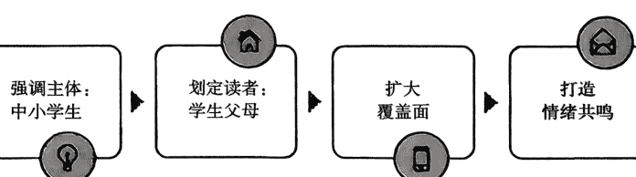

#### 3.2 高能素材向：热点创作要避坑

高能素材可理解为时事热点，但并非所有热点都可创作。

可创作的热点分为七类，见表3-2。

> **表3-2 可创作的七类时事热点**
> | 标题/类别 | 内容描述 |
> | :--- | :--- |
> | 娱乐、明星话题 | 必须保证信息真实，避免造假被律师函 |
> | 非敏感突发性话题 | 如企业家突捐款、明星突开演唱会、某地办娱乐活动等均可操作 |
> | 当地非敏感热点话题 | 如商超大促、明星空降某地参加演出等 |
> | 原生家庭话题 | 与原生家庭相关的爆火内容，如亲子矛盾、父母之爱等 |

#### 3.2 续表

高能素材指在某段时间突然获得大量关注的内容。平台人群多了流量就多，抢第一波流量收益可观。但创作时需规避若干方向，如图3-2所示。

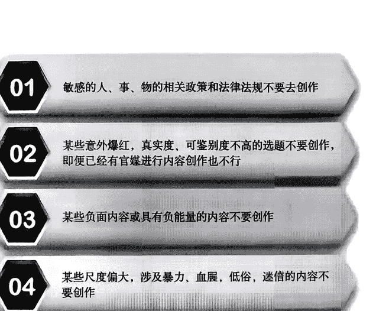

#### 3.3 实用技巧向：让观众觉得你很值

实用技巧可概括为“看了就会、听了就懂、马上动手、轻松搞定”。按此创作即便小众也能吸粉。

判断题：以下哪些符合实用技巧创作模式？
选项A：Excel表格实操全集，帮你省大量时间！
选项B：PPT一键美化，5分钟出100份！
选项C：专属你的47份减肥餐，吃完就瘦！
选项D：67个工作技巧，让你快速提升效率！

A、B、C、D均符合。封面稍显吸引即可带来点击。

实用技巧可分为六类，见表3-3。

> **表3-3 实用技巧的六项分类**
> | 测评类笔记 | 数码、美食、家居、装修等衣食住行相关产品的测评 |
> | :--- | :--- |
> | 教程类笔记 | 帮助新手快速上手并形成体系的知识 |
> | 合集类笔记 | 电影合集、电视剧合集、搞笑段子合集等 |
> | 科普类笔记 | 解答生活疑惑，如灯泡为何通电发光等 |
> | 兼职副业笔记 | 指导打造副业、获取第二收入 |
> | 读书笔记 | 拆书、荐书、书评及读书带货等 |

实用技巧向的核心就是一句话：你值得！让读者觉得值得，就会建立信任并成为粘性粉丝。打造信任感有三点建议，如图3-3所示。

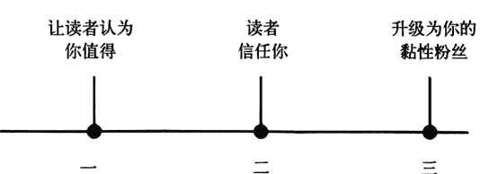

#### 3.4 省时盘点向：用最短时间呈现全貌

省时盘点指花费大量时间研究一个领域，再用最简语言和最短时长呈现全貌。

四选一：哪类最符合省时盘点？
选项A：你最喜欢看哪部电影？
选项B：这四部电影，适合时间充裕时观看
选项C：这六部电影，能给你心灵最大冲击
选项D：心情低落时看这50部电影，会带来很大帮助

除A外，B、C、D都符合，其中D最优。

省时盘点可分为七类，见表3-4。

#### 表3-4 续表

| 美妆穿搭类盘点 | 横向对比市面好物，帮用户选出最适合的方案 |
| :--- | :--- |
| 科普教育类盘点 | 快问快答形式，短时间内获取最多科普知识 |
| 兼职副业类盘点 | 横向对比副业模式，给出建议 |
| **个人成长类盘点** | 如低落时做这6件事、开心时做这8件事等 |
| 影视剧盘点 | 同类型电影对比或同一题材多年口碑变化 |
| 两性情感家庭类盘点 | 家庭矛盾妙招、夫妻建议、子女教育窍门等 |
| **生活实用类盘点** | 装修技巧、省钱妙招等 |

核心标准只有一个：最大化帮读者节省时间。

#### 3.5 趣味生活向：户外工作博主的变现利器

趣味生活向博主对拍摄技巧和运营逻辑要求不高，但对职业属性要求很高。

四种工作方式，哪种最适合做趣味生活向？
第1种：专职作家，在家码字一天超15小时，收益微薄。
第2种：外卖骑手，日均100单以上，接触各种暖心与奇葩事例。
第3种：画家，在办公室创作，每5个月出一幅5万元作品。
第4种：导游，每两天带一团游览名山大川。

第2种外卖骑手和第4种导游最适合，因其每天接触不同的人和事。

趣味生活向可分为三大类，见表3-5。

#### 表3-5 趣味生活的三项分类

| | |
| :--- | :--- |
| 与人沟通类博主 | 外卖骑手、快递员、派单员、出租车司机、导游等，工作地点不固定、每日接触大量人群 |
| 与事沟通类博主 | 律师、心理咨询师、职场专家等，主要针对具体事项提供支持建议 |
| 与物沟通类博主 | 文物收藏家、历史文化研究者等，围绕特定物品展开解读 |

无论是与事沟通还是与物沟通，最终都离不开与人沟通。基于创作风格，与人沟通可细分为“疗愈类博主”和“争执类博主”。

以外卖骑手为例：记录骑手与顾客互相尊重、互相体谅、互相帮助的日常，如顾客在电梯口等餐、骑手主动送上楼并帮忙丢垃圾，属于疗愈类。

反之，若内容聚焦顾客让骑手上楼被拒、让买烟、让扔垃圾而骑手拒绝的冲突，则属于争执类。

争执类博主可能遇到的具体问题，如图3-4所示。

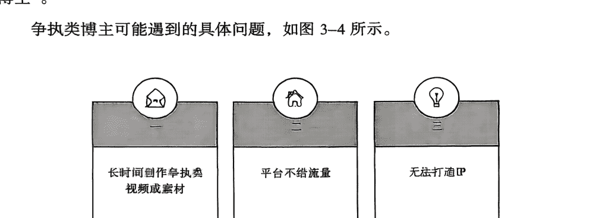

需要明确，偶尔出现争执素材尚可，但若每条内容都是冲突，平台会限流，观众也会质疑人品，对IP打造无益。

#### 3.6 国内景点和异国风情向：旅行生活的视觉盛宴

经济水平提升后，人们对旅行的渴望愈加强烈。短视频平台上介绍国内境外景点的、记录路上所遇人事物的内容，播放量和互动率普遍偏高。 

需求火热的根源还是探索欲。未曾见过的新风光、未曾到访的区域，天生自带吸引力。基于这一心理，可把旅行相关内容大致划分为四个方向，见表 3-6。

#### 表 3-6 旅行生活分类

| 类别 | 内容描述 |
| :--- | :--- |
| 国内旅行 | 以丽江古城、桂林山水、鼓浪屿、八达岭长城、九寨沟、张家界、故宫博物院等境内知名景区的介绍为主 |
| 国外旅行 | 以泰姬陵、尼亚加拉瀑布、金字塔等海外经典景点的介绍为主 |
| 有特殊意义的景点旅行 | 以西安秦始皇兵马俑、北京颐和园、南京夫子庙、洛阳白马寺、杭州雷峰塔等历史底蕴深厚或意义特殊的地点为主 |
| 旅行科普 | 聚焦出发前须知，含境内游攻略与出境游额外注意事项 |

看景只是旅行的一面，景物背后的故事同样具备内容价值。几乎每个目的地都关联一段可记忆的经历，而这些经历正是素材亮点。全国乃至全球的出行相关素材和视频，在小红书、抖音、快手、视频号等平台的热度普遍较高。若手头有资源，尤其是从业身份特殊，比如导游等，切入旅游类创作是比较契合的方向。

#### 3.7 萌宠暖心向：成败看辨识度

宠物创作者近年很吃香，我把创作脉络归纳为四类，见表 3-7。

#### 表 3-7 宠物博主的四类创作方向

| 宠物博主的创作方向 | 释义 |
| :--- | :--- |
| 宠物科普 | 围绕猫咪是否需要绝育、狗狗啃咬家具的原因等养护知识做科普 |
| 宠物日常 VLOG | 记录萌宠日常轨迹与搞怪有趣的故事 |
| 宠物吃播 | 专拍萌宠进食动作，剪辑后发布，让宠物担任吃播主角 |
| 宠物搞笑整蛊 | 通过剪辑、指令或宠物自带的反差萌进行二次创作，塑造搞笑人设 |

暖心向的萌宠，颜值并非决定因素，特色才是关键。需要提醒的是，早期部分博主为追求上镜效果，曾出现针扎动物等虐待行为，这绝对不可取。一旦曝光极易引发反感，轻则限流，重则造成更严重的负面后果。

把宠物当家人朋友对待，就要有尊重与善待，不能因拍摄需求给它们带来伤害。

上述七大赛道可以再拆分为大量细分垂类。原则上，想在小红书短期内出成绩，建议尽量贴近七大基础赛道，但创作边界并不局限于此。

#### 3.8 用大模型辅助选赛道

七大基础赛道已介绍完毕，很多读者仍不确定如何选择。这里给出一套可复用的调试模板，借助大模型辅助决策。

身份信息 + 兴趣专长 + 专业技能/经验 + 倾向创作类型 + 是否展示个人形象 + 小红书运营主要目标 + 小红书运营投入时间精力预估 + 其他补充

### 第 3 天 七大基础赛道快速布局，发掘你的内容方向

直接看一个实操案例。向大模型输入：

> 已知小红书七大基础赛道分别为：情感励志、高能素材、实用技巧、省时盘点、趣味生活、国内外景点、萌宠暖心。
> 我想在短期内把小红书账号运营起来，请依据我给你提供的个人信息表，帮我挑选出最合适的小红书赛道。
> - 身份信息：性别男，年龄 29 岁，企业老板；
> - 兴趣专长：制作美食、饲养宠物、玩大型游戏；
> - 专业技能/经验：自媒体讲师、企业运营；
> - 倾向创作类型：口播类短视频；
> - 是否展示个人形象：是；
> - 小红书运营主要目标：打造个人 IP，并持续变现；
> - 小红书运营投入时间精力预估：每天最多一个半小时；
> - 其他补充：国内外景点赛道暂时不考虑。

模型输出：

> 根据你的个人背景与目标，推荐主攻“实用技巧”赛道，并辅以“趣味生活”元素增强人设亲和力。以下是具体方案：
> - 核心赛道选择：实用技巧
> - 定位：「企业老板视角的轻创业&自媒体运营指南」
> - 契合点分析：
>   1. 身份优势；29 岁企业老板身份自带权威性，符合小红书用户对“实战派导师”的期待。
>   2. 技能匹配；自媒体讲师经验可输出剪辑、起号、变现技巧，企业运营知识能延伸职场管理干货。
>   3. 效率适配；口播类视频制作耗时少，脚本撰写加拍摄可在 1.5 小时内完成。

## 内容矩阵设计

| 内容类型 | 示例选题 | 变现衔接点 |
| :--- | :--- | :--- |
| 硬核方法论 | 行业洞察 |  |
| 人设强化专题 | 趣味穿插内容 |  |

## 差异化运营策略

### 1. 视觉符号化
- 固定场景：办公室书架背景 + 商务休闲着装；
- 标志动作：结尾扶眼镜说“商业逻辑，就是这么简单”；

### 2. 宠物经济借势
- 拍摄间隙插入宠物互动花絮，如猫趴在笔记本电脑上，既符合“饲养宠物”兴趣，又能增加账号温度和广告植入场景；

### 3. 游戏化表达
- 用“BOSS 通关”比喻商业决策，例如：《用《文明6》策略思维搞定员工管理》；

# 第3天七大基础赛道快速布局，发掘你的内容方向

## 执行优先级建议

### 1. 第一阶段（1-2个月）
集中发布“自媒体运营技巧 + 轻创业案例”，快速树立专业IP形象；

### 2. 第二阶段（3个月+）
引入“老板的趣味生活”系列，如《百万营收公司的减压游戏清单》，提升用户黏性后开通商品橱窗；

### 3. 变现组合
知识付费占 60% + 品牌定制内容 30% + 橱窗带货 10%。

## 调试说明
第一点，调试时务必把本书中讲解的七大基础赛道投喂进去，并要求模型在这七大基础赛道中选择其中一项赛道。
第二点，在填充个人信息时，宁多勿少。填充的个人信息越多、越精准，越有利于模型辅助我们选择赛道。

# 第 4 天

内容选题技巧：借助大模型，尝试创作第一份笔记

当我们做好小红书定位并且搭建好账号后，就要尝试创作第 1 条小红书笔记了。第 4 天，我们不仅要开始创作小红书笔记，还要借助人工智能实现高效便捷的批量创作。接下来给大家讲解人工智能辅助小红书创作，以 DeepSeek 人工智能为主，其他人工智能为辅。

## 4.1 用大模型扩大覆盖面：讲大多数人经历的

假定真实案例：
王小二在上小学四年级，学习成绩由原先的班级第二名变成了全年级倒数第一，父母该如何给孩子做疏导，让孩子的成绩提升？

如果以这个案例作为素材创作小红书笔记是很难获取流量的，因为太普通了，很难吸引读者兴趣。所以我们需要借助 AI 帮助我们扩大覆盖面。

如何扩大覆盖面？理论上来讲，是由原先的小事件、单一事件、特殊群体事件平移到大事件、具备典型性的事件和多数人经历过的普遍性事件中来。

即：
“个体事件转变为集体事件”
“特殊事件转变为普遍发生事件”
“普通事件转变为重要事件”

所以当我们由点到面，扩大覆盖面之后，会使单个个体的特殊事件转变为集体的普遍性事件。这种情况更容易打造读者共鸣，也更能推动小红书笔记的爆款概率。

我们对大模型输入：
> 请针对上方选题，按照扩大覆盖面的方式，帮我重新生成一份小红书爆款笔记的题目。

模型输出：
> 四年级成绩暴跌真相：90% 的家长正在用”鼓励式教育”毁掉孩子！（数据锚点 + 反常识结论＋集体危机暗示）
> 标题优化逻辑拆解
> | 用户原事件 | 改造策略 | 改造后效果 |
> | :--- | :--- | :--- |
> | 个体事件：王小二 | 集体化：四年级学生 | 覆盖全国家长焦虑群体 |
> | 特殊现象：倒数第一 | 普遍化：成绩暴跌 | 引发我家孩子也退步了的联想 |
> | 普通辅导问题 | 重要化：毁掉孩子 | 升级为教育理念层面的生存危机 |

我们继续举案例：
请按照扩大覆盖面的方式，将下方选题重新生成一份小红书爆款笔记的题目。
王老二在公司工作时不容易被公司领导点名批评或表扬。应该做哪些事情来补救自己的职场前途？

模型输出：
> # 爆款标题模板
> 「警惕职场透明人陷阱：越守规矩的打工人，越容易被踢出晋升名单！」
> （身份标签化 + 反直觉结论 + 集体危机暗示）
> ## 标题优化逻辑拆解
> | 用户原事件 | 改造策略 | 改造后效果 |
> | :--- | :--- | :--- |
> | 个体事件：王老二 | 集体化：90% 的打工人 | 覆盖职场基层群体 |
> | 特殊现象：不被批评 | 普遍化：守规矩、透明人 | 映射“努力却无存在感”的职场常态 |
> | 普通职业发展问题 | 重要化；踢出晋升名单 | 升级为职业生涯存亡危机 |

## 4.2 用大模型做同理心分析：精准捕捉大众热议话题

同理心分析可以简单理解为打造共鸣，即“把一件事情说到读者的心坎里”，让读者认可你的观点。我总结的同理心公式如下：
同理心搭建 = 了解目标受众 + 选择共鸣主题 + 第一人称叙述 + 故事真实度 + 情感化语言 + 引发思考和讨论 + 持续互动
尤其注意，第一人称叙述是同理心搭建的重要前提。

我们继续假定案例：
张三学习成绩不好，心情受挫，向我寻求帮助，我给予建议。

对大模型输入：
> 请针对上述案例，使用同理心搭建公式，帮我生成一份小红书笔记，要求字数不得超过 500 字。

模型输出：
> 标题：
> 《从年级垫底到重回前三｜一个差生的崩溃自教指南》
> 正文：
> （配图：深夜书桌＋揉皱的试卷特写）
> 「凌晨 2 点，我收到一条带着哭腔的语音：
> “姐，我这次又考了倒数……是不是真的没救了？”
> 这个叫我姐的男孩叫张三，半年前还是班里前 10，现在数学居然只考 38 分。
> （插入聊天记录截图：满屏的“我学不会了”“同学都在笑我”）
> 看着他发来的错题本——那些被泪水晕开的笔迹，我突然想起 17 岁的自己。当年我也在重点班吊车尾，整整三个月不敢看排名表……
> 但我想说：成绩暴跌从来不是末日，而是大脑在发出求救信号！
> （转场动画：碎裂的成绩单重组为阶梯）
> 上周我带着他做了 3 件事：
> 1. 撕掉“差生”标签：把“数学废物”便利贴换成“驯服公式中”。
> 2. 建立错题血条制：每消灭 5 道同类错题，奖励一局王者荣耀。
> 3. 发明 45°学习法：学 25 分钟→暴走 5 分钟→躺平 15 分钟（亲测防崩溃）。
> （插入对比图：38 分→72 分试卷 + 游戏段位截图）
> 今早他兴奋地告诉我：“原来解不开题的时候，不是我不配努力，而努力的方式配不上我！”
> 如果你也在经历：
> 明明很努力却越考越差、害怕听到“下次加油”、开始怀疑自己智商，请在评论区扣 1，揪 20 个宝送《学渣逆袭手册》！
> 我想听见你们的故事：
> 你用过最奇葩的解压方式是什么？我在高三那年……（下期揭晓）」

## 4.3 大模型驱动热点内容迁移：打造紧跟潮流的爆款内容

假定热点案例：
王小二上小学四年级，学习成绩由原先班级第二名变为全年级倒数第一，父母采用了"4+6+2 教育法”，让孩子成绩短期内提升到了年级第一名，一时间引起网络舆论的轰动，各大媒体争相报道。
热点迁移的本质是把媒体期刊中重点爆料的非敏感内容，单独拎出来创作出符合我们体裁的小红书笔记。
公式如下：
热点迁移 = 热点事件 + 事件正面引导 + 其他案例拆解 + 解决方案提供 + 核心内容总结
为避免歧义和不合理的家庭教育模式，"4+6+2 教育法”为我杜撰的，各位家长不要效仿！

我们对大模型输入：
> 请针对上述热点事件，帮我做一篇符合热点迁移的小红书笔记。其侧重方向在于普通人如何借鉴王小二父母的教育模式，让孩子的成绩短期内得到提升？

模型输出如下：
> 标题：
> 《抄作业成功！普通家长用王小二同款 “4+6+2 教育法”，30 天让孩子冲进班级前 3！》
> 正文结构
> 热点事件还原（配图：新闻截图 + 成绩对比图）
> “全网刷屏的‘王小二逆袭事件’:
> 四年级学生从年级倒数第 1 逆袭年级第 1，父母自创的‘4+6+2 教育法’引发百万讨论！”
> 正面引导（配图：家长群聊天记录）
> “争议点预警：有人质疑‘短期提分是压榨孩子’，但接触过案例后发现:
> 王小二父母是教师 + 心理咨询师组合，‘4+6+2 教育法’的本质是用游戏化思维重建学习系统。（非盲目刷题！普通人也能复刻精髓）”
> 案例迁移拆解（配图：时间轴对比图）
> 案例 1: 北京朝阳区李妈妈（普通文员）；
> **困境：** 儿子数学从 90 分暴跌至 52 分；
> **改造重点："4 项底层逻辑”**
> ①把“错题本”改为“BOSS 通关手册”；
> ②用“段位制”替代分数排名（青铜→王者）；
> ③设立“叛逆特权卡”（完成目标可拒绝补习班 1 次）；
> ④每天 15 分钟“废话时间”（只聊学习外的故事）；
> **30 天后：**
> 数学 78 分→班级第 5｜主动要求加练错题
> **普通人适配方案（配图：工具包清单）**
> 重点提取 6 个可复制动作：
> 1. 设立“进步可视化墙”（贴满知识点便利贴，撕一张=掌握一个）
> 2. 设计“学习能量条”（每学 25 分钟积 1 格，攒满 3 格兑换游戏时间）
> 3. 开发“错题复活赛”（周日晚 8 点直播抽题，答对即销毁该错题）
> 4. 发明"45°沟通法”（不谈成绩，先聊 15 分钟奥特曼/芭比）
> 5. 配置“紧急后悔药”（考砸可申请 1 次成绩删除权）
> 6. 启动“家庭夸夸日”（每周六晚必须互相夸赞 3 个具体进步）
> **核心心法总结（配图：思维导图）**
> 普通家长请死磕 2 条原则：
> 1. 用“游戏规则”替代“教育命令”。（孩子反抗的不是学习，而是失去掌控感）
> 2. "60 分家长”比“满分家长”更有效。（适度留白才能激发自主性）
> **行动号召**
> 正在为孩子成绩焦虑的家长，请举手，评论区扣“逆袭”，免费领《4+6+2 教育法实操手册》电子版！

## 4.4 大模型打造专业内容：构建权威令人信服的话题

在本小节，我们会用到人工智能的检索能力。案例如下：
孩子中小学学习成绩不好，父母该怎样做来尽可能提升孩子的学习成绩？

对大模型输入如下内容：
> 提升孩子学习成绩，有哪些专业技巧和方法？请帮我检索资料做总结。

模型输出：
> 以下是基于教育心理学、认知科学研究和教学，在实践中总结的提升孩子学习成绩的专业方法，分为核心策略、认知工具、家庭支持系统三大模块：
> 一、认知科学验证的 7 大核心学习策略
> ### 主动回忆法
> * 操作：学完知识点后立即闭书自测（如用白纸默写框架）；
> * 原理：通过提取记忆强化神经连接（比重复阅读效率高 50%+）；
> ### 间隔重复
> * 工具：Anki 记忆卡片，按 1/3/7/15 天规律复习；
> * 数据：能提升长期记忆留存率至 80%（对比集中复习的 20%）；
> ### 费曼技巧
> * 步骤：学习→用小白语言讲解→发现漏洞→重新学习→简化类比；
> * 效果：加州大学研究显示，该方法使数理成绩平均提升 34%；
> ### 交错练习
> 案例：数学练习时混合代数/几何题，而非按单元集中训练；
> 优势：促进大脑建立深层联系模式（JEE 高分考生常用策略）；
> ### 元认知训练
> 方法：每天记录"3 个学会/2 个疑问/1 个策略调整”；
> 作用：哈佛研究证实可提升标准化考试成绩 15%~25%；
> ### 双编码理论
> 实践：将文字信息转化为思维导图 + 关联图像（如用火山图记化学反应）；
> 效益：多伦多大学实验显示记忆效率提升 55%；
> ### 刻意错误法
> 操作：故意写出错误答案并分析，如"2+3≠6？”；
> 原理：通过错误强化正确认知边界（MIT 认知实验室推荐）；
> 二、教育心理学支持的心智建设工具
> ### 成长型思维训练
> 话术改造：把“我数学不好”改为“我暂时没找到数学的解锁方式”；
> 数据：斯坦福研究显示，持续训练可使学业进步速度提升 40%；
> ### 成就事件簿
> 方法：每天记录 3 件“微小成功”（如解出 1 道昨日不会的题）；
> 作用：激活基底神经节奖励回路，形成学习正反馈；
> ### 压力重构训练
> 技巧：考试前让孩子写下“焦虑清单”并标注可控不可控项；
> 效果：芝加哥大学实验表明可降低考试失误率 22%；
> ### 目标颗粒化技术
> **案例：** 将“提高数学成绩”分解为“每周攻破 2 类错题”；
> **原理：** 符合 SMART 原则的目标完成率高出普通目标 3 倍。
> 我们可以借助模型生成的专业信息内容，做小红书笔记的内容填充。但是要注意：当我们借鉴这些生成的图文笔记时，千万不要复制粘贴，要保证图文内容的原创性。

内容运营技巧：
了解小红书的三种运营模式
小红书运营的第 5 天，我们来详细了解该平台的运营技巧。想在短时间内掌握小红书的所有运营技巧不太现实，但只要摸透三个方向的运营技巧，就基本玩转小红书平台了。这三个方向分别是：图文的排版技巧、视频的剪辑技巧和直播的运营技巧。

## 5.1 图文排版拆解：让 DeepSeek 助力效率提升

小红书的一篇笔记由配图与正文构成。平台现已把单篇配图的上限调到18张，配图数量上去，用户的停留时长通常会被拉长。

封面是否吸睛因此很关键。下方给出了4组参考，图5-1、图5-2、图5-3、图5-4，哪一组更适合做开篇？

从视觉冲击来看，最后那张最突出，配色也更舒服。市面上关于封面排版的教程已超过四十种，创作者无需全套掌握，记住几句口诀就够用了。

### 打工人手册

**Worker's Handbook**

打工心态要放好

经常生气会变老

### 打工人手册

**Worker's Handbook**

打工心态要放好

经常生气会变老

*图 5-1 图文笔记案例 1*

*图 5-2 图文笔记案例 2*

> ### 打工人手册
> **你需要这样做！**
> ### 打工人手册
> **Worker's Handbook**
> 打工心态要放好
> 经常生气会变老
>
> *图 5-3 图文笔记案例 3*
> *图 5-4 图文笔记案例 4*

大字置顶作标题，主体信息放在中间。左右画面对称更稳，配图可左右分置。字号要适中，不宜过小也不宜过大。底色建议用米黄色系，避免纯黑纯红。整体调性柔和，构图完整度更重要。

审美因人而异，不求人人喜欢，至少不能产生排斥感，如图5-5所示。

另外面向励志、减脂、美妆、护肤、穿搭等垂类，首图可纵向切成上下两段，左右呈现前后对比，吸睛效果更强。

封面制作常用的工具：创客贴、醒图、黄油相机、可画、图怪兽、简拼等，可自行挑选。

下面给出两版文字示例，判断哪版更适合放在正文区。

第一份：

> **标题:** 《普通人读书的意义:不仅仅是知识的累积，更是灵魂的滋养》
>
> #
> **正文:**
>
> Hey !小伙伴们！有没有想过，普通人读书的意义何在？读书，不仅是为了积累知识，更是为了开阔眼界，遇见更好的自己。
>
> 它带我们穿越时空，体验多样生活，理解不同观点。
>
> 书籍是成长的导师，教会我们面对困难，激发潜能。
>
> 它还能在我们感到孤独迷茫时给予我们心灵的慰藉，让我们不再感到孤单。
>
> 读书多了，气质会在言谈举止中自然流露，提升自信与魅力。
>
> 所以，读书是一场内在变革，让我们的精神世界变得更丰富。一起加油，
> 让阅读成为最美的习惯！
>
> #读书的意义# #灵魂滋养#

第二份：

> 普通人读书的意义：不仅仅是知识的累积，更是灵魂的滋养。Hey !小伙伴门，有没有想过，普通人读书的意义何在？读书，不仅是为了积累知识，更是为了开阔眼界，遇见更好的自己。它带我们穿越时空，体验多样生活，理解不同观点。书籍是成长的导师，教会我们面对困难，激发潜能。它还能在我们感到孤独迷茫时给予我们心灵的慰藉，让我们不再感到孤单。读书多了，气质会在言谈举止中自然流露，提升自信与魅力。所以，读书是一场内在变革，让我们的精神世界变得更丰富。一起加油，让阅读成为最美的习惯！
>
> #读书的意义# #灵魂滋养#

第一版的可读性明显优于第二版。顺带整理一句顺口溜：

> 短句短段是关键！
> 表情多多加趣味，话题标签别忘添。
> 结尾引导共鸣起，正能量满满最讨喜！

## 5.2 视频剪辑技巧：DeepSeek 写稿 剪映成片

本节组合为 DeepSeek 负责撰写文案，剪映负责一键成片。

先确定选题：普通人读书的意义是什么？

向 DeepSeek 提出的指令如下：

> 请针对上述内容，帮我生成一份小红书视频的文案，要求如下：
>
> - 第 1 点，要求语言口语化。
> - 第 2 点，要有人物案例。
> - 第 3 点，总字数不得超过 500 字。
> - 第 4 点，可读性、趣味性要强。
> - 第 5 点，文案结尾要有互动性，引导读者评论。

DeepSeek 返回的稿件：

> 《读书没用？小镇女孩靠读书逆天改命的故事！》
>
> 姐妹们！今天必须唠个扎心话题——咱普通人读书到底有啥用啊？
>
> 我闺蜜小雅，小镇出身三本毕业。当年回老家当文员月薪 2800，亲戚都说：“读那么多书有啥用？不如早点嫁人！”
>
> 结果你猜怎么着？这姐们儿每天雷打不动读书 2 小时！从《小说课》读到《故事》，硬生生把编剧技巧啃透了。去年她写的小说被影视公司看上，现在一集剧本费顶过去半年工资！
>
> 读书最狠的是什么？是让认知迭代啊！以前她觉得人生就该在小镇相夫教子，现在能跟北京编剧圈谈笑风生。这不就是读书给的底气吗？
>
> 重点来了：读书不是让你马上暴富，是给你更多选择权！就像打游戏开全地图，别人还在新手村转悠，你早就解锁隐藏关卡了！
>
> 举个例子：读《非暴力沟通》治好了我同事的社恐；读《小狗钱钱》让月光的表弟两年存出房子首付。知识这玩意儿，指不定哪天就原地螺旋起飞！
>
> 最后灵魂拷问：你最近读的哪本书，让你感觉“哇，还能这样”？快来评论区 battle 书单！下期揭晓我的年度 TOP3 救命书单！

打开电脑版剪映，点击中间的“图文成片”，进入“自由编辑文案”，把上文稿粘贴进去，挑选合适的配音，一键生成。素材可智能匹配，也可替换本地素材或表情包，如图5-6、图5-7、图5-8、图5-9所示。

生成时先确定比例。

小红书创作服务平台对视频笔记的要求包括：支持9:16拍摄，上传时长5分钟以内，文件不超过2GB，格式MP4；小红书视频号可上传15分钟以内的视频。建议以竖版为主。

## 第5天内容运营思路：拆解平台三大玩法

图 5-6 剪映一键生成视频 1  
图 5-7 剪映一键生成视频 2  
图 5-8 剪映一键生成视频 3  

表 5-1 小红书直播卖点分类：

| 个人魅力卖点 | 在直播间中展现自己的幽默感、与粉丝真诚、友好互动，包括但不限于表演相声节目、小品节目、魔术节目等，通过颇具才艺的节目表演，来吸引粉丝观看 |
| --- | --- |
| **知识增量卖点** | 在直播间中持续输出某一类干货知识，包括但不限于新人如何做好小红书、新人如何通过直播变现、新人如何通过写作变现、新人如何做好兼职副业、新人如何提高 |

除上述五大卖点外，市场上还有很多变体，不再展开。但核心是：粉丝花费时间围观直播，必然是因为直播有价值。价值体现不出，时间就会流失，所以凸显自身价值才是关键。

## 5.4 埋伏笔与抛钩子：运营必备能力

笔记里，预留伏笔和钩子很重要。

- **伏笔**：让读者产生期待，把笔记看完；
- **钩子**：让读者对账号产生期待，看完这一条还想看下一条，形成黏性。

下面整理一批常用话术，创作时可做微调。

### 伏笔的相关话术：

1. “接下来的内容至关重要，关乎到我们之前讨论的所有要点，请大家务必耐心听完。”
2. “这里有几个关键点，掌握它们将让你的理解更上一层楼，请仔细听我接下来的讲解。”
3. “不想错过精华部分的话，就请紧跟我思路，接下来的内容绝对值得你一听。”
4. “接下来的几分钟里，我将会逐步揭开问题关键，请务必听完，否则你可能会错过最重要的部分。”
5. “想要真正掌握这个技巧或概念，接下来的讲解是关键，请务必集中注意力，听我细细道来。”
6. “接下来的内容可能会颠覆你之前的认知，但绝对值得一听，请务必保持关注。”
7. “别走开，接下来的几点将是我们这次讨论的关键部分，错过可就亏大了。”
8. “如果你真的想了解这个话题，那么接下来的内容你绝不能错过，请务必听完。”

### 钩子的相关话术：

1. 点赞破千，我将会在下一条视频中重点讲解_________！关注我，不错过任何更新！
2. 想要了解更多_________？点赞+评论+关注，立刻安排！
3. 点赞超千，继续揭秘_________！记得关注我哦！
4. 想要更深入地了解_________，点赞破千告诉你！快来关注我，一起学技巧！
5. 点赞过千，我将会在下一条视频中给大家讲解_________，速来关注，不容错过！

很多博主觉得这类话术没营养，但一句引导往往能带来十个以上的点赞、五条以上的评论、三个以上的关注，对起号阶段帮助很大。

等IP做大，粉丝五万十万起步，单条稳定千赞时，作用会减弱。现阶段，尤其是刚起步运营，建议能用就用。

话术只是锦上添花，真正拉升粉丝的还是持续的干货输出。

> **第6天**  
> 非IP变现模式全流程讲解，找到适合自己的变现路径

## 6.1 带货变现：从选品到售卖全流程讲解

本节先讲选品，再讲售卖，最后讲如何借助人工智能提升效率。

- 第1步，点击左上角三条横杠，进入“合作中心”；
- 第2步，进入“买手合作”；
- 第3步，进入“选品中心”；
- 第4步，点击下方搜索框；
- 第5步，搜索目标产品并点“一键选品”。

选好后返回主页，点击加号发布笔记或视频即可挂车。

图 6-1 小红书带货选品步骤 1  
图 6-2 小红书带货选品步骤 2  
图 6-3 小红书带货选品步骤 3  
图 6-6 小红书图文与其他平台图文区别

小红书图文带货与其他平台有三点不同：

1. 平台本身是天然种草阵地，图文带货流量可观且不易被大面积限流；
2. 用户已经被培养成高消费群体，高价套餐也能接受；
3. 做图文带货不需要先把IP做大，有一个爆点文案就能启动销售，IP一致效果更佳。

基于此，总结爆款文案五要素：故事开篇 + 名人引用 + 属性切入 + 促成交 + 控评，缺一不可。

- **故事开篇**：用第一人称讲述购买后的便利，或与竞品的横向优势。
- **名人引用**：明星使用或代言都是背书，能放大品牌效应，但必须真实，杜绝劣迹艺人，避免律师函风险。
- **属性切入**：提炼核心卖点，比如咖啡提神、鼠标垫顺滑、电脑性能强。
- **促成交**：常见方式有六种：其一，优惠折扣；其二，套餐促销；其三，限时优惠；其四，赠送服务；其五，试用无忧，5-7天无理由退，7-14天换货；其六，信任保障，列出对比优势。
- **控评**：带货笔记一定会有负面评论，引导性差评要及时处理。

假设品牌 X 的 A 系手机在促销，明星“张三”公开称赞过。

直接对 DeepSeek 输入：

```text
请针对上方信息，帮我生成小红书爆款文案。
```

DeepSeek 输出：

```text
张三的私藏机被我扒到啦！X 品牌 A 系列这次真的鲨疯了！

自拍人像自带追光滤镜，游戏开黑全程满血模式，连顶流都在用的神仙机型居然偷偷降价？

刷到这条的姐妹别犹豫，同款磨砂背壳 + 星河屏颜值直接拉满，现在入手还送限量磁吸充电宝！

打工人早买早享受，错过这波不知道何时才能蹲到活动了～

#X 品牌 A 系列手机 #张三同款 #年度真香机预订
```

按公式投喂信息：

- **故事开篇**：我购买了 X 品牌 A 系列手机，电量、像素、信号等方面与其他品牌手机相比，遥遥领先。
- **名人引用**：明星张三也在使用该品牌手机，并且在多档节目当中对该款手机赞赏有加。
- **属性切入**：5G信号，大容量电池，高清像素。
- **促成交**：现在购买可享优惠300元，另赠送充电宝一个。

对 DeepSeek 输入：

```text
**请针对上述信息，帮我写一份小红书卖货爆款文案。**
```

DeepSeek 输出：

```text
**【标题】**
明星张三同款X品牌A系列手机，职场人的全能搭档:5G、长续航、高清拍摄一机搞定

**【正文】**
上个月咬牙换了X品牌A系列手机，终于明白什么叫“用过就回不去”的真香体验。作为经常出差的开会狂魔，这三个功能彻底治好了我的焦虑：

+ 1. 5G信号“地表最强”
    - 早高峰地铁刷方案？高清视频秒加载
    - 地下车库等客户？满格信号秒回消息
    - 山区团建发定位？队友手机已失联，我的导航依然稳如泰山
+ 2. 500mAh电池安全感拉满（注：原文此处似有笔误，结合语境通常指大容量电池，此处保留原文数据或需人工核实修正为具体数值如4000mAh等）
    - 早8点满电出门，晚10点回家还剩35%
    - 全天候会议录音+直播测试，电量焦虑？不存在的
+ 赠品快充充电宝（价值199元）直接打包成“续命套装”
```

AI生成的卖货文案需人工校对，尤其是型号、参数等专业数据，不能出错，否则等于虚假宣传。明星使用信息也要核实，公开场合没说过的千万别写，否则风险很大。

## 6.2 商业合作：蒲公英合作全流程讲解

在电脑网页端打开小红书官网，点击右上角“业务合作”，点“蒲公英”，登录账号。

平台可切换买手或博主身份。

### 选择你的身份，进入蒲公英平台

- **买手身份**
    - ID: 61561af1000000000202108e (示例ID)
    - 我是买手：与商家进行商销转化合作
    - 立即进入
- **主播身份**
    - ID: 8018768195 (示例ID)
    - 我是博主：与品牌进行内容种草合作
    - 立即进入

先点“我是买手”。

界面展示商品与佣金。以《明朝那些事儿》为例，主要看实际销售数量、优惠价、书籍价格、佣金。举例售价99元，佣金率10%，每本佣金9.9元。注意佣金=佣金率×优惠价，不是×售价。

已售数量能反映市场热度。

选品后后续操作同6.1。

如果直接联系商家，可以拿到更高佣金。以该书为例，选品默认10%，和商家沟通后有机会提到20%甚至30%。前提是有带货经验和销量。

查看商家联系方式前需填写自己的联系方式：

- 微信号 *
- 手机号 *

**图 6-11** 联系商家界面 1  
**图 6-12** 联系商家界面 2

切到“我是博主”身份后，可看到新锐博主的商单案例和优质笔记、直播合作。想做商业合作，建议把首页推荐的博主案例全部过一遍，对接单很有帮助。

打开“我的”→“合作设置”→“开启合作”，设置图文和视频报价。没接过商单时，报价可比同行低20%-30%；月接单5-6次且反馈积极，就属于优质博主，可适度上调，涨幅建议不超过同行30%。

**图 6-13** 小红书蒲公英平台商单合作

再点“标签管理”，填写和创作内容、人物设定匹配的类目和人设标签，标签越准，接单越多。

点“健康管理”注意等级，如果显示非优秀，拉到底有“等级申诉”。接单被误判违规要第一时间申诉。商单务必走蒲公英平台，私下接单平台不分润且风险自负，还容易被严查。

## 6.3 开设薯店：无IP也能卖货的完整步骤

第10天的课程会专门讲带IP属性的店铺搭建，本部分先讲无IP属性的普通店铺。无IP店铺不受IP限制，操作门槛低，按流程走就能完成。

先打开小红书官网，进入业务合作板块，点击商家入驻。

在商家入驻页输入手机号并完成验证码校验后，会进入主体选择界面。这里要看清主体类型。如果SKU很杂、部分商品个人身份不支持，建议注册个体工商户再入驻。这样既不用承担企业公司的年审、记账报税负担，又能扩大可售商品范围。

个人、个体工商户、企业三类主体在注册时最核心的差异是上架商品的品类和数量权限。

建议点开注册页的常见问题，左侧选招商入驻，再点入驻要求，里面详细列出了不同主体能开通的销售权限。按自身情况选型，信息填完整后提交审核即可。不同入驻方式对应的保证金金额也不一样。

## 小红书15天变现实战全攻略

小红书保证金分为基础保证金和浮动保证金两部分。销售额越高，保证金要求越高，不足时要及时补缴。具体标准在招商入驻的资费管理页面有说明，大致区间在1000到50000元之间，如图6-22所示。

<div style="text-align: center;">图 6-22 小红书招商入驻资费管理</div>

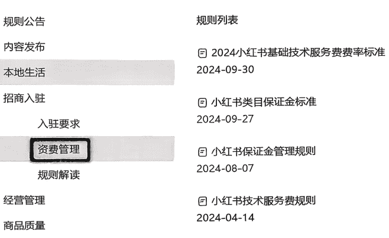

## 第7天：多元变现思路与全域流程拆解

进入第7天时，建议把多元变现真正落到实处。围绕这个目标会出现几个关键疑问：

- 一个爆款笔记该如何把收益做到最大；
- 是否可以多开小红书号做深度运营；
- 怎样通过小红书让个人收益最大化；
- 是单人作战还是组建团队；
- 为什么要选小红书而不是其他短视频平台。

这些问题都会在今天的内容里给出解答。

## 7.1 爆款素材复用法则：给爆款二次加倍

这一块对有创作洁癖的人可能有点难以接受，先用一个例子说明。

假设你刚入驻，定位兼职副业博主，发了一篇笔记《未来两年，这5个行业即将兴起，谁干谁火？》。这篇笔记拿下10万点赞、1万关注、5万收藏。接下来你会怎么做？

- 选项A：去做别的类型笔记；
- 选项B：继续做同赛道但不同主题；
- 选项C：在同题材下换角度、换内容继续做。

多数人会选A，少数选B，极少数选C。但最优解是C。很多人会担心，之前的内容已经讲过了，再发会不会重复、读者会不会反感、会不会被拉黑？

现实是，很多博主的创作本身就是在借鉴。你的爆款大概率会被同行借鉴甚至直接改写发布。既然别人可以借鉴你的爆款，你完全可以先借鉴自己，如图7-1所示。

<div style="text-align: center;">图 7-1 爆款内容重复利用示意图</div>

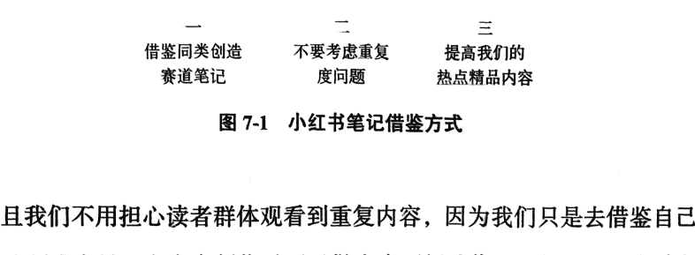

而且读者并不会因为重复而流失，只要你在选题或素材上做迭代。原题《未来两年，这5个行业即将兴起，谁干谁火？》可以升级为《未来5年，这两个行业将兴起，谁干谁火？》。就算你不做，别人也会做。原创素材如果没有最大化变现，本身就是一种浪费。

这就是素材通用原则的核心：笔记爆了之后，围绕同一题材做同类、相近或不同方向的延伸创作，提升爆款概率，带动粉丝增长。

## 7.2 小红书矩阵玩法：普通人如何搭自己的账号矩阵

市面上矩阵主要分纵向和横向两种，先搞清区别再做布局。

“纵向矩阵”指在同一个平台开多个号，且账号都聚焦同一垂直赛道，目标是把这个赛道做成头部。比如做母婴博主，同时运营10~20个甚至更多母婴号，统一管理，商业合作时优先被考虑。

“横向矩阵”指在多个平台按照各平台调性搭建账号。不同平台用户偏好不同，比如快手重情景剧、小红书重科普、抖音重短视频、B站重长视频。以母婴为例，可以在不同平台做不同形态内容。

本书聚焦小红书的纵向矩阵。

操作路径：在小红书PC端点业务合作→MCN入驻，输入手机号和验证码。最好用从未注册过小红书的手机号入驻，否则容易出现无法申请或报错的情况，如图7-2、7-3、7-4所示。

<div style="text-align: center;">业务信息</div>

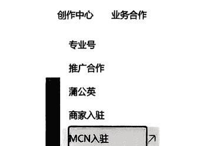

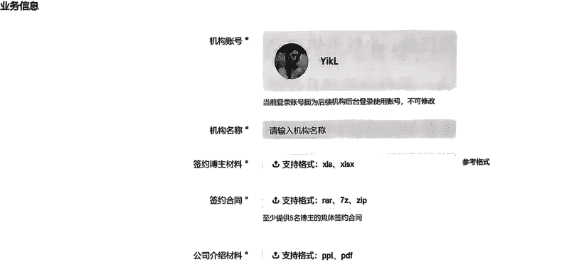


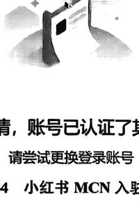

<div style="text-align: center;">图 7-4 小红书 MCN 入驻错误</div>

### 权益一：作者管理
MCN可以绑定旗下作者，查看并管理作者发布的内容和商业行为。

### 权益二：内容孵化
MCN能为签约博主提供优质内容支持，并利用矩阵积累的关键信息加速创作者成长。

### 权益三：商业变现
这是核心权益。MCN可直接开通蒲公英商业权限。创作者收入按月结算到MCN，MCN再进行分配。这意味着MCN可以二次筛选商业合作，扶持真正有价值的博主。

### 权益四：运营扶持
MCN可获得小红书官方一对一运营服务，快速解决运营问题，同时官方的流量扶持也能下放到签约作者。

### 权益五：深度合作
MCN有机会参与小红书官方论坛会议，及时掌握平台最新动向。

注意，MCN注册只是开始，后续如何做大做强才是关键。MCN是连接平台与博主的桥梁，对上服务官方，对下服务上百上千博主。能力越大责任越大，优先把MCN做成头部，再做商业变现。

## 7.3 账号含金量：把小红书当敲门砖

粉丝过千即可入驻蒲公英接广告，通过笔记带货拿佣金，也能直播选品卖货。

但这只是平台内变现。我们要把小红书当成敲门砖去撬动更大的机会。

账号做热后，往往会有抖音、快手、B站、视频号、淘宝、京东、拼多多等平台的MCN或机构主动邀约去多平台发布内容。这就是“一带多”逻辑：一个账号火了，有知名度后跨平台发展会很顺畅，除非被小红书签下独家协议。

所以读完后建议立刻行动，在最短时间内把账号数据做起来：粉丝量、单篇笔记的播放、点赞、收藏、评论都要达到可观水平，为后续跨平台打基础。

## 7.4 小红书团队协作是否可行

从2023年底到2024年底，越来越多人想组团队运营小红书。原因是市场从红利期进入内卷期，单篇爆款难度加大，单人涨粉更难，多人一起是否可行？

可行，但不建议。无论写文章还是做视频，核心痛点都是利润分配。账号没火时难以保证每个人都全力投入，账号火了后更难公平分配收益，如图7-5所示。

<div style="text-align: center;">图 7-5 小红书多人做账号问题</div>


为规避风险，建议要么以公司形式一人出资、其他人做员工创作，要么个人起号。坚决不建议合伙做团队号，利润问题短期无解。

另外，随着傻瓜式剪辑软件和DeepSeek等AI工具降低创作门槛，一个人运营一个号，甚至多个号都完全可行，没必要合伙，除非以公司化运作。

## 7.5 为什么偏要做小红书

回顾核心原因有四点，如图7-6所示。

<div style="text-align: center;">图 7-6 小红书四大优势</div>

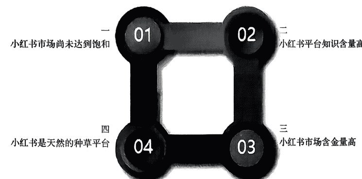


第一，抖音、快手已高度成熟，新人出头概率低。小红书近几年才爆发，市场远未饱和，新人有机会。

第二，内容偏知识分享，多围绕人性、励志、成长、美妆护肤穿搭。即使运营不成，也能学到不少干货，内容性价比高。

第三，资本更看好小红书。同样10万粉，小红书的含金量和商单机会远高于抖音。

第四，变现能力强。10万粉在抖音快手做软广收益有限，小红书商单报价基本是粉丝数的10%，天然种草属性决定了高转化。

## 第8天：IP深度定位，构建专属的十大IP赛道

<div style="text-align: center;">图 8-1 IP 领域概览</div>


第8天把小红书所有可创作方向归纳为十大IP领域。大部分创作者会落在其中，打造IP也更容易。即使是小众赛道，也可以对应到这十个领域来定位个人IP。

## 8.1 穿搭博主变现路径

| 变现方式 | 具体做法 |
|---|---|
| 电商带货 | 挂小红书内商家链接拿佣金；自建小红书服装店铺；挂站外商家链接 |
| 付费穿搭教学 | 制作付费专栏；开小红书付费直播课 |
| 品牌代言 | 与品牌建立长期合作，在关键场合展示服饰 |
| 广告植入 | 发布穿搭视频植入服饰，收取广告费 |

<div style="text-align: center;">表 8-1 穿搭博主变现案例</div>

要点：
1. 挂站外链接尽量走蒲公英接商单，避免违规限流。
2. 知识付费逻辑成立，但需维护口碑，实力不足时别盲目上。

## 8.2 美食博主变现路径

| 变现方式 | 具体做法 |
|---|---|
| 知识付费 | 线上录制高质量美食教程 |
| 线下授课 | 通过小红书引流做线下培训 |
| 电商带货 | 挂站内美食商品拿佣金；自建美食店铺；挂站外美食链接 |
| 个人品牌 | 在小红书售卖自有美食产品，从0到1打造美食品牌 |

<div style="text-align: center;">表 8-2 美食博主变现案例</div>

<div style="text-align: center;">续表</div>

注意：
1. 线下教学必须有线上交付，避免被判定违规引流。
2. 站外链接尽量走蒲公英接单。
3. 食品类销售需符合平台标准，具体指标咨询官方客服。

## 8.3 彩妆博主变现思路

彩妆变现与穿搭高度相似，单独列出是为了区分IP定位。小红书男女比例差异大，穿搭彩妆占比很高。

变现方式可直接借鉴穿搭博主，但需补充两点：

第一，严禁夸大宣传。彩妆用于脸部手部，不能出现百分百祛痘、无痕等夸张表述，否则易被判定虚假宣传并被投诉。

第二，宣传前尽量试用或调研口碑。别只为佣金接单，看到夸张功效要先体验，确认效果后再推荐，不能照读甲方脚本。

## 8.4 影视博主变现方式

| 变现方式 | 具体做法 |
|---|---|
| 宣发广告 | 电影剧集上映前接品牌宣发，按播放数据分成 |
| APP推广 | 推荐影视APP内容，用户点击下载获分成 |
| 影评文案 | 经典老片解析、观后感等被甲方采纳 |
| 种草带货 | 剪辑切片时挂明星同款链接分销拿佣金 |

<div style="text-align: center;">表 8-3 影视博主变现案例</div>

提醒：版权问题至关重要。刚上映的影视作品监管极严，创作时一旦被追责代价很大。除非有官方邀约，否则不建议做最新上映内容。

## 8.5 职场博主的变现玩法拆解
把职场内容做成可收割的生意，常见做法整理在表 8-4。

表 8-4 职场博主变现案例

| 职场博主变现模式 | 案例拆解 |
| :--- | :--- |
| 强知识付费咨询 | 新人面试求职实操指引 |
| | 人际关系经营与维护方法 |
| | 项目管理落地及领导力强化方案 |
| | 创业开店辅导与公司搭建思路 |
| 商业软广 | 依托蒲公英平台承接商品软广合作 |
| | 通过蒲公英平台对接品牌投放业务 |

## 8.6 情感账号商业化盘点
情感赛道的盈利方式梳理如下，具体见表 8-5。

表 8-5 情感博主变现案例

| 情感博主变现模式 | 案例拆解 |
| :--- | :--- |
| 情感知识付费 | 情商共情提升与为人处世类付费课 |
| 情感咨询 | 婚姻、情侣关系咨询服务 |
| | 育儿、亲子成长相关咨询 |
| | 心理学、心理咨询方向服务 |
| | 以矛盾调解为核心的情感问题咨询 |
| 情感 IP 孵化 | 深耕情感垂类打造个人 IP |

家居垂类账号的商业化思路汇总为表 8-6。

表 8-6 家居博主变现案例

| 家居博主变现模式 | 案例拆解 |
| :--- | :--- |
| 生活方式 + 产品分销 | 聚焦小而美好物，用图文视频带货提升生活质感 |
| | 收纳好物与实用小家电的图文带货 |
| | 测评、选购攻略、避坑指南形式的软硬广与带货 |
| 装修攻略+知识付费 | 整套装修流程的付费知识分享 |
| | 提供专业定制化家居设计服务 |
| | 老房改造方案，含旧厨房、卫浴、出租屋改造等 |

游戏账号的变现参考见表 8-7。

表 8-7 游戏博主变现案例

| 游戏博主变现模式 | 案例拆解 |
| :--- | :--- |
| 游戏直播 | 为指定游戏做直播推广，获取蒲公英广告单 |
| 游戏拉新 | 发布实录视频引导下载，靠专属链接拿拉新佣金 |
| 工会签约活动 | 加入工会或矩阵签约运营，享受流量扶持与分成 |

## 8.9 旅行博主变现需注意的问题

图 8-9 旅行博主注意事项

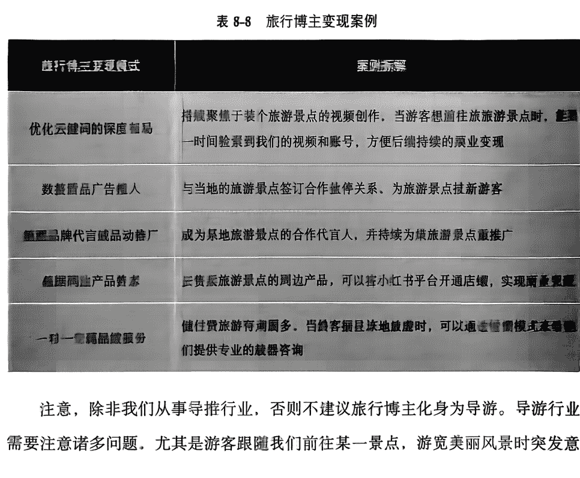

提醒一下，除非本身做导推业务，否则不建议旅行博主直接当导游。带团环节风险高，游客随行游览时若发生意外...

DeepSeek 小红书 15 天实操变现

外部事故或人身安全纠纷的责任大概率会落在博主身上，更稳妥的做法是只做周边产品的售卖。

## 8.10 健身账号的盈利模式
健身垂类创作者的收入结构如下，详见表 8-9。

表 8-9 健身博主变现案例

| 健身博主变现模式 | 案例拆解 |
| :--- | :--- |
| 健身品牌商业合作 | 与健身器材、科普书籍、运动食材品牌做商务合作 |
| 健身产品直播带货 | 在直播间展示并售卖健身相关产品 |
| 健身课程付费咨询 | 录制塑形等知识课程以付费形式推广 |
| 健身会员推广 | 以包月或包年方式销售知识服务、一对一或定制服务 |
| 线下健身房等周边变现 | 结合专长与粉丝需求探索开设线下健身房等周边业务 |

补充一点，健身类商品更依赖直观画面，图文笔记的转化通常远不如直播。

## 8.11 用 DeepSeek 做 IP 深度定位
在 IP 深度定位里我列了 10 类博主方向，很多同学不清楚怎么选。这里给一份基础指令调试模板，用 AI 辅助做赛道筛选。

> 身份信息 + 兴趣专长 + 具体变现路径 + 市场趋势分析 + 个人发展趋势分析 +

我要补充
为了更好理解，直接上实操案例，向 DeepSeek 输入：

> 已知小红书 10 大 IP 领域分别为：穿搭博主、美食博主、彩妆博主、影视博主、职场博主、情感博主、家居博主、游戏博主、旅行博主、健身博主。
> 
> 我想搭建一个具备 IP 属性的小红书账号，请依据我的个人信息表，帮我挑选最合适的 3 大 IP 领域，并作出分析报告。
> 
> 身份信息：性别男，年龄 29 岁，企业老板；
> 
> 兴趣专长：制作美食、饲养宠物、玩大型游戏；
> 
> 具体变现路径：想靠知识付费、商业合作变现；
> 
> 市场趋势分析：知识付费已成潮流，输出知识收取报酬被市场认可；
> 
> 个人发展趋势分析：未来有机会在互联网上发布付费课程，并打造个人大 IP；
> 
> 我要补充：影视博主和健身博主赛道暂时不考虑。

DeepSeek 生成结果：

> 基于你的背景，为你定制 3 个 IP 方向推荐及分析：
> 
> 【3 大推荐领域】
> 
> 1. 职场博主（强商业属性 + 知识付费天花板）
> 
> 适配度分析：
> 
> 身份优势：29 岁企业老板自带商业权威感，职场赛道男性博主占比仅 18%，差异化明显。
> 
> 内容矩阵建议：
> 
> 干货型：《创业避坑指南》《中小企业现金流管理术》；
> 
> 场景化：办公室人性化管理案例拆解，穿插宠物、美食元素增强记忆点；
> 
> 跨界专题：《从魔兽公会管理到公司团队建设》——把游戏战略迁移到商业决策。
> 
> 变现爆发点：
> 
> 2980 元/人的“老板思维训练营”；
> 
> B 端企业咨询服务；
> 
> 高端办公用品/SAAS 系统商务合作。
> 
> 2. 美食博主（兴趣变现双螺旋）
> 
> 破局策略：
> 
> 人设定位：“霸道总裁厨房”——爱马仕围裙配分子料理的反差感。
> 
> 内容创新点：
> 
> 《米其林谈判学》：商务宴请菜式中植入商业社交话术；
> 
> 《融资路演便当制作指南》：把便当造型与商业计划书逻辑结合；
> 
> 宠物联动：为爱犬定制米其林级宠物餐，导流至宠物赛道。
> 
> 变现组合拳：
> 
> 199 元《商务宴请全场景菜品课》+ 预制菜带货；
> 
> 高端厨房家电品牌年度代言。
> 
> 3. 萌宠博主（高情感价值赛道）
> 
> 差异化打法
> 
> 内容壁垒建设：
> 
> 《宠物行为经济学》：解读猫咪拆家背后的机会成本；
> 
> CEO 的宠物员工手册：给爱犬颁发“公司首席解压官”工牌；
> 
> 沉浸式宠物别墅搭建全记录，自然植入智能家居产品。
> 
> 变现想象力：
> 
> 宠物智能用品股权投资项目；
> 
> 联名宠物食品礼盒。
> 
> 【赛道组合战术】
> 
> “铁三角”内容生态搭建建议：
> 
> 职场 60%：主攻知识付费基本盘，塑造专业形象；
> 
> 美食 25%：打造生活方式影响力，拓宽商务合作；
> 
> 宠物 15%：增强账号温度，提升用户粘性。
> 
> 冷启动爆款公式：
> 
> 企业家反差萌 + 硬核知识可视化 + 跨领域场景嫁接
> 
> 示例标题：
> 
> 《给公司赚了 500 万后，我决定教布偶猫做财务报表》
> 
> 《员工不知道的老板秘密：凌晨三点在魔兽里练领导力》
> 
> 【风险预警】
> 
> 职场赛道内容枯竭：建议储备 100 个中小企业真实案例库。
> 
> 美食同质化竞争：需季度性研发“商业 + 美食”跨界选题。
> 
> 宠物内容变现慢：前期可通过宠物友好型企业探店转化流量。
> 
> 该组合可实现知识付费年收益预估 80 万+，商务合作溢价空间 200%，建议先囤积职场内容，6 个月内完成三赛道矩阵布局。

# 创作付费专栏：从定位到卖课，打造自己的知识产品

DeepSeek 小红书 15 天实操变现
玩转小红书第 9 天，要尝试制作“付费专栏”。记住，付费专栏的核心是做 IP，而不是单纯卖课。IP 做大后，收益会远超专栏本身。

### 9.1 卖点拆解：7 大卖点，总有一款适合你
小红书知识付费常见的卖点有 7 类，做专栏时可在此中选择。覆盖卖点越多，认可度越高。见表 9-1。

| 知识付费卖点 | 卖点释义 |
| :--- | :--- |
| 下一代教育和学习类 | 聚焦孩子思维逻辑、记忆力提升及学科成绩快速提升，如英语学习、毛笔字等。讲师水平高则销量有保障，故排第一位 |
| 大健康类 | 涵盖医生、健康、养生等内容，涉及医生类目需资质，内容须真实，否则承担责任。如中老年养生、脱发少白头等 |
| 职场类 | 涉及个人成长、企业管理、绩效考核、激励、面试沟通等。职场类可从知识付费过渡到高价一对一私教 |
| 玩转自媒体 | 涵盖抖音、快手、小红书、视频号玩法及副业变现。小红书上最佳变现是教大家玩转小红书 |
| 兴趣爱好类 | 如瑜伽、舞蹈、书法等教学。受众越小客单价越高，受众越大客单价越低 |
| 情感咨询类 | 恋爱、婚姻、亲情、友情、人际交往、为人处世等付费课程。婚恋类受众极高 |
| 生活技巧类 | 生活小窍门、家居装修、生活品质提升等。受众广但付费意识偏低，多为免费分享，需谨慎 |

### 9.2 课程设计：由浅入深，知识增量放在第一位
以职场类为例，课程主题为：如何在面试中掌握先机拿到更高工资？

课程设计可用“七步法”，如图 9-1。

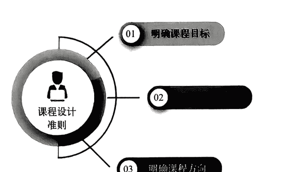
图 9-1 知识付费课程设计的三大准则

第 1 步，明确课程目标。设计完成后要达到什么效果，需有基础预期并围绕其推进。
案例：让求职者顺利通过面试，拿到理想薪资福利。

第 2 步，了解目标学员。
案例：学员多为想快速入职心仪岗位、掌握面试沟通技巧而来，内容需侧重此点。

第 3 步，规划课程结构。
最好划分为若干板块，每个板块包含若干节课，板块间并列不交叉，课程间不自相矛盾。
案例：分为四大板块。第一，提升口才与逻辑力；第二，寻找符合期望的公司；第三，面试对话技巧；第四，入职前三个月稳定与职业规划。

第 4 步，选择教学方式。
目前主流为图文、视频、直播。2019 年前音频曾流行，现受众低不建议。
案例：采用 3+1 模式，三板块录播，一板块直播授课+答疑。

第 5 步，设计互动环节。
互动的核心是后期高价交付。专栏价格通常不超过 199 元，100 份仅 2 万元，性价比不高，需筛选高客单价用户，互动环节是筛选手段，如图 9-2。

> 案例：在面试专栏中增加面试模拟课，鼓励学员参与，提升好感并为高价课程铺路。

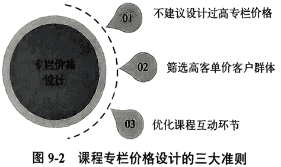
第 6 步，持续优化和更新。
课程需不断注入新内容，包括补丁、迭代、设计最优课，保证符合当下需求，促成二次或持续交付。
DeepSeek 小红书 15 天实操变现
案例：适时加入近年流行面试方式、新兴企业入职技巧。

第 7 步，设定合理的价格和营销策略。
营销是利润的最后一公里，很多博主课程做得好却毁于交付。不懂营销只堆质量不合理。

### 9.3 营销设计：借助 DeepSeek 实现低——高价课程设计，把知识卖出去
本节以 DeepSeek 为例调试营销方案。先提交：
我设计了一套职场付费专栏，目的在于让职场人在面试时掌握先机，入职后更快成长。这套专栏已完成，但在营销上遇到问题，能否帮我设计完整营销方案？

DeepSeek 生成结果：

> 职场付费专栏极简营销方案
> 
> 一、精准定位
> 
> 核心用户
> - 23～28 岁职场新人（面试焦虑群体）
> - 30～35 岁转行者（跨行求生需求）
> 
> 核心卖点
> - 老板视角黑箱破解：
>   - 面试："HR 绝不会说的反侦察话术"；
>   - 入职：“转正述职碾压同事指南”；
>   - 晋升："90 天抢走领导嫡系位置手册"。
> 
> 二、爆款内容设计
> 
> 钩子公式：
> 
> 颠覆认知：标题含“黑幕”“潜规则”(如《HR 偷偷录音的 5 个瞬间》);
> 
> 场景痛点：用老板监控视角还原“述职时领导的真实心理”;
> 
> 游戏化包装：“职场生存技能树”;
> 
> 美食类比:"牛排三分熟 = 领导好感度法则"。
> 
> 传播载体
> 
> 小红书干货笔记 (每周 3 篇)+老板日常 Vlog(自然植入课程价值)
> 
> 三、精准渠道狙击
> 
> 小红书主战场
> 
> 定向：北上广深杭用户 + 搜索“求职”“职场干货”;
> 
> 发布时间：早 8 点 (通勤焦虑期)+周日 21 点 (周一恐惧症)。
> 
> 私域转化
> 
> 朋友圈：发“企业裁员名单分析”(仅三日可见);
> 
> 社群：建"00 后整顿职场作战室"，日更“领导潜台词密码”。
> 
> 跨平台引流
> 
> 知乎：在“被领导羞辱怎么办”问题下植入课程;
> 
> B 站：做《上市公司总裁教你写简历》互动视频 (不同选择触发结局)。
> 
> 四、转化路径
> 
> 三级漏斗
> 
> 免费测评 → 9.9 元盲盒 → 199 元专栏→4980 元私教
> 
> 钩子工具：
> 
> "职场生存危险系数测评"(测试结果触发焦虑)
> 
> 定价策略
> 
> 主页首屏展示“4980 元私教课已满员”（锚定高价）；
> 课程页滚动提示“3268 人正在学习”（制造紧迫感）。
> 
> 五、执行节奏
> 
> 第 1 周：上线“职场风险评估”测评裂变；
> 
> 第 3 周：发起“我的领导是 NPC"故事大赛；
> 
> 第 5 周：联合猎头直播“金三银四突围战”；
> 
> 第 8 周：释放“学员涨薪 50%"案例，倒计时涨价。
> 
> 六、风险控制
> 
> 内容保鲜：每月更新“企业最新考核表”（盖公章增强可信度）；
> 
> 预期管理：标注“本课程可能导致领导觉得你难控制”；
> 
> 流量储备：存 20 个应急选题（如“裁员信号清单”“行业黑话词典”）；
> 
> 效果预估：首月销售额破 30 万，通过私城 + 跨领域联动（如美食/宠物内容引流），逐步构建百万级 IP 生态；
> 
> 执行原则：强攻认知差 + 制造焦虑 + 提供确定性方案。

大家要注意，以上方案并没有给出明确操作步骤，因为提问时缺少约束条件。所以需要在后续调试中加入更精细的约束项。为了便于理解，直接上案例，对 DeepSeek 再次提交：

付费专栏增长与IP变现实操打法

结合补充需求，下面是一份可直接落地的定制思路。

一、品牌叙事与价值锚点
梳理专栏诞生的背景，突出一线实战沉淀和成体系的成长路径。核心卖点要清晰：由资深导师带路，方法论能够快速落地。

二、全域推广打法
- 内容分发：在小红书投放带货短视频，强化场景感。
- 达人分佣：邀约垂类博主按佣金制带专栏，形成裂变。
- 直播答疑：每周开播三场，已购学员可进场免费辅导。
- 私域运营：搭建专属社群，提升粘性与复购。

三、试听与课程触达
- 试听一《面试雷区清单》，聚焦常见禁忌。
- 试听二《面试沟通礼仪规范》，夯实基础表达。

四、促销与激励机制
- 上线首21天统一八折。
- 双人拼团最低可至六折。

五、口碑与反馈闭环
- 购课后留下好评返现3元。
- 好评并转发至职场搭子群或朋友圈，额外获赠一次线上直播指导。

六、定价与追踪
- 累计售出每100份，价格上调20元，保持稀缺性。

AI参考框架要点提炼
在精简版之上融合补充需求，形成可落地的整合方案。

品牌价值强化
故事包装：从求职者到面试官，29岁企业主的降维打法。价值具象化：制作《十年创业踩坑手账》翻页短片，泛黄笔记配红笔批注。封面提示：淘汰率87%，仅保留经20家企业验证的方法。
信任背书：详情页置顶上市公司HR总监推荐语。数据展示：首页轮播学员人均涨薪28%、最快3天拿offer等动态数据。

全渠道投放升级
小红书深度运营：视频公式为身份标签+冲突场景+限时福利。示例：作为面过237人的老板，现拆解求职者最蠢的3个行为；前50名下单送1对1简历诊断。
达人分佣机制：挑选1-10万粉的中腰部职场博主；基础佣金15%，每超50单递增5%；提供3个翻车场景+2个含蓄炫耀话术模板。
直播转化：周一《老板监考：职场黑活段位测试》，钩子前三名通关；周三《深夜急诊室：拯救作死简历》，钩子连线诊断限免3人；周六《00后整顿职场作战会》，钩子直播间拼团解锁6折。直播间用弹幕关键词触发优惠弹窗，背景板实时显示“已有XX人通过课程逃离996”。
社群粘性：入群发放“职场生存编号工牌”，按入职年份生成专属ID；新人提交“最想干掉的领导行为”作投名状。每周三20:00黑话破译大赛，优胜者获课程券；每月反向背调日，集体调研公司离职率与涨薪幅度。

转化链优化
试听狙击：首课《面试禁忌清单》，展示穿拖鞋面试等错误录像，结尾悬念“以上错误仅占致命问题的23%”。二课《商务礼仪段位表》，插入老板视角隐藏摄像机片段，引导测评领取进阶手册。
动态定价心智：每售80份发布预警“剩余20份维持现价”；价格进度条视觉化呈现“当前价格蓄力值87%”。拼团页展示“已为XX人节省798元”。

口碑飞轮
评价管理：晒笔记+3张学习照返现3元；转发3个社群+带话题发朋友圈赠领导性格分析工具包；邀请1人购买解锁企业通讯录黑名单查询服务。
成长追踪：学习进度30%颁发“职场刺客”电子勋章；完课寄送盖公司章的生存认证证书。每月遴选学员拍摄48小时逆袭纪录片，重点包装涨薪50%与转行成功案例。

数据驾驶舱
核心指标：试听完课率>75%，直播人均停留>8分钟；拼团发起率>40%，达人渠道佣金占比<25%；自然搜索周增2%，差评响应<30分钟。
预警机制：单场直播转化<5%启动“老板在线发疯”特播；社群日活降20%投放禁忌话题讨论。
风险对冲：储备5套创业至暗时刻故事；开发课程内容搜索引擎应对突发职场问题。

借助AI生成方案需要多次迭代，首轮给框架，第二轮结合标准细化，多轮打磨后才成熟。

## 第 9 天 创建付费专栏：从定位到卖课，打造自己的知识产品
### 开一家属于你的薯店：IP 类产品售卖全流程讲解
#### 第 10 天
小红书15天实战变现
第10天尝试开IP类店铺，与第6天的店铺不同，此处需引导私域、做高价付费并凸显个人IP。小红书目前IP赛道未饱和。

## 10.1 IP 类产品需要的资质讲解
店铺后台规则列表中经营大类一览表显示店铺分为个人店、个体工商户、普通企业店和官方资质店。想做IP类产品需涉及发票税务法人，建议注册公司。年成本至少1万元左右含租金与代账。

IP类产品常见三种：其一，IP周边；其二，个人出版图书；其三，虚拟课程与虚拟服务。

第一类，IP周边如鼠标垫，可委托1688等平台生产并印制IP元素。资质要求低，个人店或个体工商户均可。操作路径：店铺-店铺管理-品牌类目资质-新增类目-文具/文化/文创/宠物-勾选IP文创/文创周边并选择具体产品。

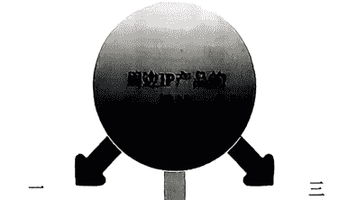
图 10-2 周边IP设计要求
假定周边为鼠标垫，印刷个人IP内容即可。


图 10-3 小红书店铺类目管理示例

第二类，IP图书。售卖书籍需出版物经营许可证，与公司绑定，注册地需有房产证，建议50平以上商业用房。取得许可后按相同路径新增类目，文具/文化/文创/宠物-书籍/杂志/报纸文具文化用品教育培训-选择小说工具书等子类。

# ## 当前品牌及类目管理 / 类目管理

|一级类目 | 二级类目 | 三级类目 | 四级类目 | 五级类目 | 相关资 |
|:---|:---|:---|:---|:---|:---|
| 文具/文化/文创/ 宠物 | 书籍/杂志/报<br>纸，文具/文化用品，教育培训 | 小说，工具书/百科全书，日常学习用品，技能培训 | 护眼学习桌垫，互联网产品运营/ 电商运营 | - | 《出版物经营许<br>可证》，职业资格<br>证书，教育类劳动合<br>同 |

图 10-5 书籍类目资质要求


第三类，虚拟课程与虚拟服务。以商品形式售卖需企业员工劳动合同类型为教育类，且员工持有相关职业资格证书。如全媒体运营证书。虚拟课程为何需开店，后续10.3节说明。

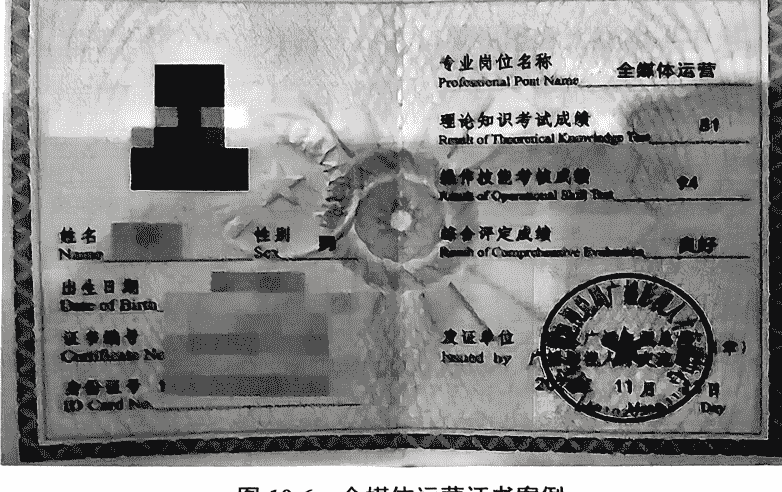
图 10-6 全媒体运营证书案例

## 10.2 DeepSeek五步法取昵称与商标全流程
仅做商业营销推广不必申请商标。一旦做IP并开店，建议公司注册商标保护IP，避免敬汉卿式纠纷。

商标意义在于防止恶意索赔。IP保护方式有真名注册或公司绑定商标注册。

AI五步法公式：昵称=主题定位+目标受众+创意独特性+合法合规性+品牌关联性

示例：小红书职场博主，提升职场人生存能力；昵称侧重职场关键词；受众职场新人；昵称含姓氏刘且顺口；规避违法擦边词；后接讲职场或聊职场。

DeepSeek推荐方案含命名逻辑拆解、推荐清单与风险排查，强调多平台占位、视觉统一与话题预埋。

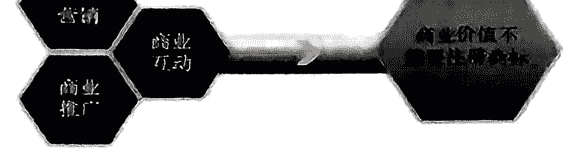
图 10-7 商业价值内涵

## 9.4 售后设计：借助 DeepSeek 做服务追踪，力争零差评
向AI输入假设：若购买职场面试升职加薪付费专栏不满意，会从哪些维度评价？
输出要点：
一、内容质量：实用性不足，理论化强，模板难用；深度稀缺，知乎小红书可平替；权威存疑，导师资历与案例难验证。
二、课程设计：结构零散，缺乏系统路径；互动缺失，社群只发广告，直播频次低且注水。
三、性价比：199元干货不足3小时；动态定价饥饿营销反感。
四、体验交付：PPT粗糙，音画不同步，无字幕与课件下载；内容滞后，未覆盖AI面试、远程办公等新场景。
五、营销落差：过度承诺涨薪30%无兜底；试听精彩正课断崖；达人背书机械。
六、售后风险：好评返现诱导虚假评价，差评被骚扰；案例疑似编造；退款通道关闭。

针对反馈“承诺的直播辅导频次低且内容注水”的卖家回应示例：
感谢反馈。直播频次控制为保证深度，讲师需兼顾上市公司咨询项目，安排偏紧。今起增设快速答疑专场并公示全年36场排期。主课已覆盖97%方法论含独家薪酬带宽计算器，直播为场景加餐。后续将投票选主题并增设1V1模拟谈判名额，由十年HR总监陪练。为表歉意延长3个月有效期并私发《HR不公开的13条晋升红线》，优先预约高管圆桌会。

可继续要求模型口语化、更委婉润色。售后设计能节省人力，但前端内容与营销仍需扎实。

借助人工智能批量生成小红书IP昵称时，可对参数做多轮微调，具体的调参手法这里就不展开了。先把“刘职话职场”暂定为拟用的账号名，而“刘职”则是要打造的核心个人品牌，接下来需要为这个身份完成商标注册。

商标这块手续比较繁琐，需要登录中国商标网上报主体资质，按流程一步步操作即可。**关键是商标信息和企业的注册地址、企业名称高度绑定**，一旦公司地址或名称发生变化，就必须回到商标网内做信息补录。

不建议做全类注册，成本会失控。通常注册第9类、第35类、第38类，再加上第41类、第42类、第45类就足够覆盖了。预算吃紧时，可优先锁定第41类。

# 10.3 零物流带货降本指南

还记得10.1节里留下的那个疑问吗？虚拟课程和虚拟服务为什么一定要走店铺来售卖？

为了便于理解，先看我小红书店铺后台的一段截图，如图10-8所示。


图 10-8 小红书店铺后台信息（注：原文此处为乱码占位，实际应展示后台截图）

出于隐私考虑，只能展示这一张。它记录了一笔0.1元的知识付费专栏成交，点击右侧订单详情就能看到购买者的联系方式。

**要提醒的是，如果走常规渠道售卖专栏，基本无法追溯到买家，这和第九章讲到的用低价课撬动高价课的逻辑是冲突的。** 连买家都对接不上，更谈不上做客单价的跃升，如图10-9所示。

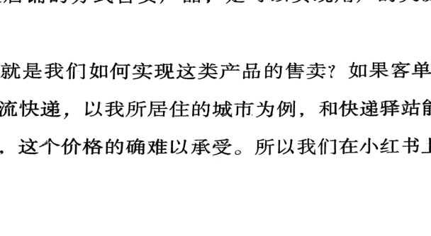

图 10-9 索取用户私域关键要素

而通过小红书店铺成交，则可以拿到用户关键信息。

核心问题变成这类产品怎么上架？客单价只有0.1元，若真实发货，以我所在城市为例，和驿站谈下来的最低运费也在5元左右，成本完全不可承受。所以在小红书上架这类产品时，应该采用无物流发货模式，具体操作如下：

先在商品上架页面把类目路径定位为“文具/文化/文创/宠物”下的“教育培训”，再下钻到“技能培训”，最后选择“互联网产品运营/电商运营”。随后把物流类型设定为“无物流发货或物流配送”即可，如图10-10、图10-11所示。

这里要提醒，上述操作本质上是将知识付费内容放到店铺里售卖，所以必须具备资质并符合平台规范，否则轻则商品被频繁下架，重则保证金被扣除。

> **基础信息** 存为新痛板

- 日兽美目：文具/文化/文创/宽等。教育培训＞捡错制》压顾网产品运营/电商运营\各岛贵目*


图 10-10 商品上架类目选择

**服务信息**

物流类型。

- 无物流发货或物流配送 ①*

物流模板。

- 商品维度统一物流模板

- 按照规格设置物流模板

| 偏远地区不包邮 | 内贸 |

|:---|:---|

| - | - |

_新建物流模板_

图 10-11 知识付费产品发货模板

### 10.4 店铺运营痛点与对策

小红书店铺在运营中会遇到不少问题，下面梳理几类典型困境并给出应对思路。

## 海量产品上架与运营策略

**问题一：用铺量来提升销量。**
这种打法本身就有缺陷，数量再大若没有曝光也难以产生成交。小红书和淘宝、拼多多、京东不一样，它的核心是内容驱动。建议先把店铺里某个单品做爆，再逐步拓展其他品。

**问题二：开了店却忽略客服端。**
轻则店铺评分下滑，重则笔记发布受限、流量被限制，更严重时会被扣除保证金。运营店铺时应保持客服端在线，并提前设定客服的工作时段。用户提问时要即时回应，即便暂时无法解决，也先用表情或话术回复，尽可能压缩响应时间差。

**问题三：退货地址的设计，如图10-12所示。**
图 10-12 小红书退货地址设计
完成店铺注册后，要把后台所有按钮和页面逐一点开检查，尤其是退货地址。一旦用户行使七天无理由退货，地址是否正确直接决定商品能否顺利退回。

**问题四：选品和测品。**
如果只是上架别人的产品赚取差价，要明白选品不能只看品质，还应兼顾价格和性价比。

**问题五：囤货与运费。**
新手上架应抱着不出爆款的谨慎心态，切勿盲目囤货。按单件100元计算，一次囤1万件就是100万元，若滞销再退回厂家难度极大。运费也不宜按标准价走，可联系本地站点负责人报备月销量，通常月销约1000单就能谈下更低费用。

---

# 第 11 天

## 小红书私域引流全拆解，打造高价值用户池

### 第11天重点：从小红书撬动高客单私域

在各大短视频平台里，就私域引流的质量而言，小红书与B站处于领先位置，抖音、快手也能引流，但用户质量和付费能力明显不及前两者。

正因如此，第11天需要把小红书的流量大量导入私域，并通过私域构建付费人群实现商业转化。

#### 11.1 同名覆盖法，放大IP综合势能

先看一个个人介绍的示例：

*   刘丙润
*   青年作家
*   写作讲师
*   丙润文学创始人
*   前快传号创作者学堂合作讲师
*   当当网第10届影响力作家
*   二十一种写作变现主题授课讲师
*   “用一年时间，写出好作品”活动发起者

#### 全网粉丝百万，作品累计阅读量破 2 亿

**全平台同名，有任何问题可以私信我**

除最后的引导语和IP名称外，其余内容可自由调整。这里的关键在于为何最后必须写“全平台同名，有任何问题可以私信我”？这能把私域引流的效益发挥到极致。

无论是今日头条、百家号、快传号、网易号、一点号等图文平台，还是小红书、B站、抖音、快手等视频平台，账号名称需保持统一。某个账号一旦爆火，粉丝极有可能在其他平台检索同名账号并关注。结合10.2节提到的AI五轮命名方法，就能打造一个跨平台通用的IP昵称。

#### 11.2 矩阵号引流，降低主号风险敞口

提问：账号发布视频笔记并挂载0.1元课程，一旦成交即可将公域用户导入私域。那么怎样引导购买？大致有三种做法，如图11-1所示。

图 11-1 引导用户购买商品的方式

*   第一种，在创作视频或笔记时引导用户点击视频左下角下单。
*   第二种，在评论区发布引导下单的内容，但存在封号风险。
*   第三种，借助同名小号在评论区发布引导内容。

补充一点，若笔记中营销属性过重，会导致限流，频率过高对账号的伤害无法逆转。

如何用关联账号高效引流？有两个方案：

**方案一：** 用小号在相关视频下留言并置顶。
例如图11-2中的评论，“对内容感兴趣的宝子，可以点一下视频左下方的商品，会有三天的写作公开课。”

这样做的好处是提醒观看者点击左下角商品，既不会触及私域引流的敏感词，也不会给主号带来风险。相当于用小号承担试错风险，从而降低主号风险值。

图 11-2 评论案例

**方案二：** 主号仅关注自己的小号，并在小号置顶的首条视频中展示添加个人微信的方式。当粉丝需要深度沟通时，进入小号让他们通过置顶视频进行对接。

两者本质相同，都是用小号承担风险来保障主号内容创作的稳定性，同时确保私域引流顺利进行。

#### 11.3 私信引流铁律：三要三忌

小红书私信引流需牢记三项建议与三项禁忌，一旦触碰红线可能被禁言、限流甚至封号。私信引流重在精准，而非数量。

**第一要：红薯群。**
打开小红书App，点击右下角“我的”，在中间栏滑动至最右侧，点击“群聊”，再点下方“创建群聊”，填写相关信息后点击“立即创建”，进入“去设置”，点击“群管理”，在功能设置中打开“公开展示”，如图11-3至图11-8所示。

创建完成后发布对接方式，但不要用主号发布，需用新小号发布，且小号不要设为管理员，大小号之间不要互相关注。

图 11-3 红薯群创建示例 1

图 11-4 红薯群创建示例 2

图 11-5 红薯群创建示例 3

图 11-6 红薯群创建示例 4

图 11-7 红薯群创建示例 5

图 11-8 红薯群创建示例 6

**第二要：把小红书号改为微信号。**
点击App右下角“我的”，进入“编辑资料”，点击小红书号，将其修改为微信号，如图11-9、图11-10、图11-11所示。

图 11-9 修改红薯号示例 1

图 11-10 修改红薯号示例 2

图 11-11 修改红薯号示例 3

> 名字：刘丙润的书屋

> 简介：青年作家，评委，写作讲师，独立撰稿人；两本畅销书，七本书籍待出版...

**第三要：蓝V聚光。**
该方式需付费，企业营业执照认证费用为600元，在聚光账户充值后即可获得私信回复微信号的权限。通过平台渠道引流风险最低。

**第一忌：** 切勿在评论区直接留下联系方式，会被直接禁言。
**第二忌：** 切勿在私信中频繁索要对方联系方式，会被禁言。
**第三忌：** 切勿出现明显的私域引流操作，被平台发现后会禁言甚至限流。

#### 11.4 用AI点燃社群活跃度

将用户从小红书导入私域后，核心在于提升社群活跃度。若两周内无活跃，社群价值会迅速衰减，可借助人工智能来提升活跃。

**私域引导公式** = 个性化称呼 + 正向激励 / 引导性提问 + 价值内容分享 / 确认

个性化称呼：用特定昵称或关键词拉近距离。
正向激励：展示学员用技巧后的成绩，传递可复制性。
引导性提问：围绕IP相关的话题发起讨论，避免无意义闲聊。
价值内容分享：输出与IP强相关的内容，让成员感知加入意义。
确认：用“回1确认”等方式收尾并做活跃登记。

假设IP属性是教大家玩转小红书：

*   个性化称呼：称呼学员为“宝子”。
*   正向激励：小红书大有市场，把它当副业经营可月入过万。
*   引导性提问：运营中遇到什么问题可在群里提问。
*   价值内容分享：今日分享小红书私域引流的注意事项和禁忌。
*   确认：收到信息后在群里回“1”，助理会登记。

模型生成示例：

> “宝子们集合！手把手带你玩转小红书印钞机”

示例文案略。

文案拆解的核心在于情绪钩子、风险对冲与行动压迫。借助AI的优势在于能同时服务多个用户和多个群组，快速生成符合预期的内容并一键推送，节省大量时间和精力。

---

# 第 12 天

## 新手直播间搭建指南

### 第12天任务：搭建首场直播，务必注意两点

其一，小红书直播的在线观众通常在30至50人左右；其二，小红书直播的客单价较高，即便成交一单利润也十分可观。

#### 12.1 先做直播计划，明确节奏与目标

直播前需先创建直播计划：登录小红书官网进入创作中心，点击直播管理，再点立即创建，填写计划后确认，如图12-1。

直播计划能从开播流程、跟播成本、公域流量三方面提供帮助，如图12-2、图12-3。

**直播计划能帮助你做什么**

| 方面 | 具体作用 |

| :--- | :--- |

| **更规范的开播流程** | 提前确定未来开播场次，更有计划性的开播 |

| **更低的跟播成本** | 开播后关联计划可一键上架备货商品、提高商品管理效率 |

| **更精准的公域流量** | 根据计划中的备货信息优化公司分发人群，提升进房流量的精准性与转化效率 |

**创建直播计划**

*   **基础信息**
    *   直播标题：新手如何快速玩转小红书
    *   开播时间：2024-09-05 09:52
    *   开播时长（小时）：2
*   **带货信息**
    *   销售额目标（元）：20000
    *   计划选品数（件）：3

张舰建议直播计划应有规律，例如每周二、四、五、六晚8点至10点，有助于培养直播节奏，也便于粉丝养成观看习惯。

#### 12.2 发布直播预告，撬动公域进房

预约直播的操作：
1. 点击后台主界面左上角的三条横线；
2. 在常用功能中点击“主播中心”；
3. 进入主播中心后点击“直播预告”；
4. 填写开播时间、直播标题，并添加笔记与商品，如图12-4~图12-7。

建议将直播预告展示在笔记主页，方便粉丝进行预约。

#### 12.3 控成本搭直播间，突出产品卖点

直播间搭建需控制成本，几万元的直播间与几千元的直播间在呈现效果上差距并不大，建议对基础设备进行小幅升级。

手机直播只要机型价格在3500元以上基本可用，若条件允许，使用相机直播效果更佳。

先从最省心的思路说起。淘宝上搜“直播间搭建”，能刷到不少商家在卖成套方案，多是模块化服务，把需求告诉老板就能直接套模板。好处是快、省力、省成本。为了避免画面同质化，框架搭好后，再挑几件想重点呈现的产品放进去，辨识度会提升。

自己动手的话，光线是核心，通常会用到下面几类：

1. **顶光**：由上向下给主播和商品做基础补光。
2. **底光**：放在地面补充侧面阴影，让商品更立体。
3. **主光**：多在主播上前方侧面打来，戴眼镜要留意反光问题。
4. **侧光即补光**：与主光配合从左右补光，俗称左光右光。
5. **氛围光**：用来调节整体氛围，颜色和造型可选性很大。

完整布光基本覆盖主播前后上下左右以及身后氛围区。实操不必太教条，只要人脸轮廓清晰、无大面积死黑、整体柔和即可。

#### 12.4 直播中可能存在的问题

* **问题一：别做暖场话术或反复迎宾。** 小红书间里本身人少，每来一位观众就迎一次，前一批会先走，后一批留不住。
* **问题二：别刻意拉时长。** 抖音、快手、小红书、视频号、B站的直播，通常一小时内就能测出有效数据，硬拉时长意义不大。
* **问题三：别出现明显违规行为。** 比如骑自行车、摩托车时手持手机直播，画面出现暴力、色情、血腥内容，说脏话或做危险动作等均不可。
* **问题四：别使用违规话术。** 常见有因果类“只有、才、因为所以、只要就”；极限类“全国最好、世界最牛、行业最优秀”；等级类“国家级、宇宙级、顶级、终极服务”；排名类“独一无二、全国第一、仅此一次”；以及涉及国家品牌、虚假宣传、诈骗、极限用词、时限用词等。

**额外提醒：** 涉及医生、健康、法律、财经类产品的营销要格外谨慎，一是要有合规资质，二是话术必须规范，否则极易被判违规。

#### 12.5 数字人现状分析：我们为什么不需要它

关于数字人直播，简单补充。市面上的方案很多，甚至个别省市区县都有代理在推。别被“24小时不间断直播”这类词迷惑，我们在2023年做过测试，实际效果一般。

数字人与真人直播差异明显，从平台规则看也不太鼓励。可以把数字人当作未来趋势之一，但现阶段不建议贸然介入。现在市面上数字人报价普遍万元起，还要处理版权等诸多问题，对普通创作者来说原则上不介入为好。

# 第 13 天

### 让好笔记再获一次推力


---

# 第 13 天

### 让好笔记再获一次推力

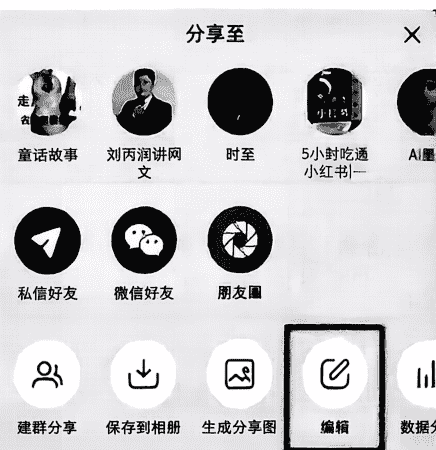

图 13-1 小红书笔记修改步骤 1

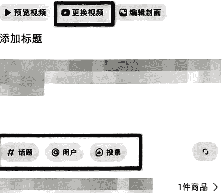

图 13-2 小红书笔记修改步骤 2

---

DeepSeek 小红书 15 天实战变现

玩转小红书第13天，尝试给优质作品投放一次流量。投放不只是花钱，更像是给内容做价值加码。比如投100元，可能带来50到100个新粉丝、3个以上商务合作、6位以上的私域人群，性价比并不低。

### 13.1 发布后要做的两件事：看数据与改笔记

进入小红书后台，点击我的，再点左上角三横线，进入专业号中心，点击更多数据，就能看到笔记数据、粉丝数据、个人笔记、商品笔记和全部笔记的分析。通过这个界面可以判断一篇笔记的好坏。

改笔记的方法是：打开任意笔记，点击右上角菜单，选择编辑，可以更换视频、修改封面、补充标题、添加话题、挂载商品等，改完点修改完毕再发布，如图13-1、图13-2所示。

修改时注意三点。其一，别频繁反复编辑，容易被判定异常。其二，别在大流量期修改，很可能被重新审核导致流量断崖。其三，笔记已有明显违规但还没被审核时，先自行修改，避免事后追责。

### 13.2 薯条投放方式与常见失败原因

当笔记已发布且数据不错时，可以考虑薯条推广。点进视频右上角菜单，选择薯条推广。推广分极速版和标准版，极速版是标准化投放，不需要额外设置；标准版可设置启动时间、推广时长和推广人群。

在推广人群里可以点自定义人群，筛选性别、年龄、地域和特定兴趣偏好。选垂类兴趣人群能提升性价比，如图13-3、图13-4、图13-5、图13-6、图13-7所示。

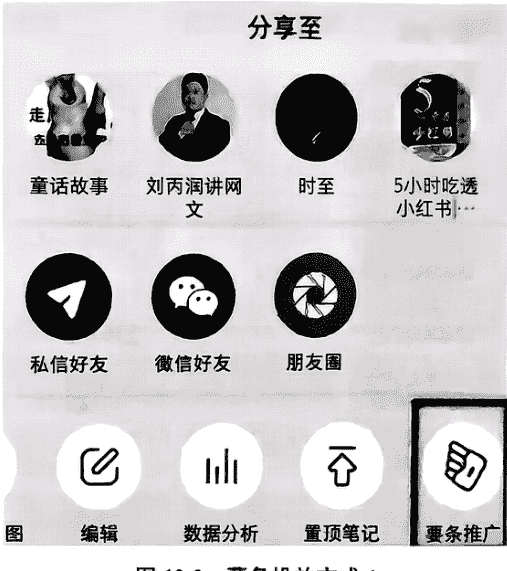

图 13-3 薯条投放方式 1

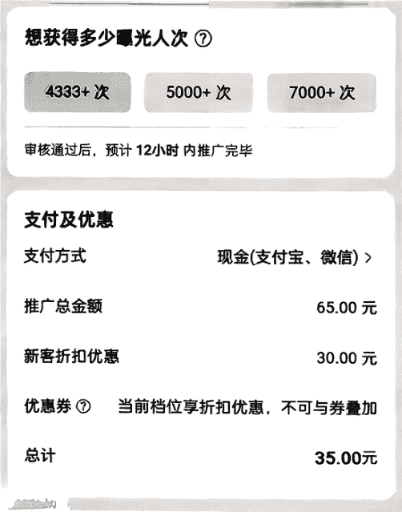

#### 推广金额 留单立省 30 元

35 元

39765 元尊享权益

75 元 150 元 自定义

新客限时留单礼，仅留单可周

启动时间①立即开始 >

推广时长? 12 小时

推广人群智能推荐 >

图 13-5 薯条投放方式 3

# 智能推荐 自定义人群

特定性别

不限 男 女

特定年龄（多选）

不限 18-23 岁 24-30 岁 37-40 岁 41-50 岁 大于 50 岁

特定地域（多选）全国 自定义

特定兴趣偏好（多选）

不醒 自足义

图 13-6 薯条投放方式 4

**取消** **自定义兴趣偏好** **完成**

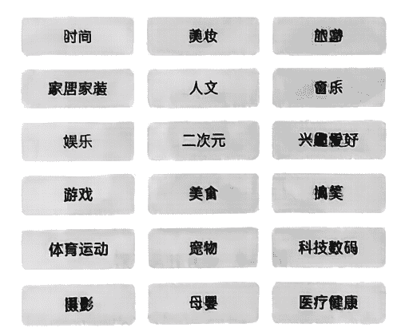

**图 13-7** **薯条投放方式 5**

投放失败的常见原因

原因一：侵犯他人肖像权或品牌权益。内容存在抄袭搬运、冒充账号二次创作，或笔记里带明显LOGO水印等。

原因二：有明显的导流意图。比如笔记写“想要资料请评论区回1”或“回666”，一旦被平台发现后果很严重。

**图 13-4 薯条投放方式 2**

原因三：引导交易到站外。不是指在小红书挂载站内商品，而是引流到微信、QQ、淘宝、拼多多、京东等外部平台。

原因四：营销属性过强且用词极端，如“全球最牛”“全国第一”“绝对”等。

原因五：过度摆拍只讲卖点，营销感过重、呈现生硬。

### 13.3 ROI如何算：再加三种考量

做笔记带货或直播带货属于电商，ROI必须搞清楚。ROI就是投入产出比，回报占投入的比例，越高越好。公式为广告产生的总销售额除以广告花费。比如花1元带来10元销售额，ROI就是10。

很多人误以为ROI大于1就能保本，实际并非如此。

举例：产品售价1000元，制作成本800元，物流100元，每件净利100元，利润率10%。若ROI为1，表示投1000元回笼1000元，看似打平，扣除900元成本后只赚100元，实际亏损900元。要真正不亏，ROI需达到10，即投1000元带来1万元销售额，去掉成本后利润1000元才持平。

仅看ROI容易在薯条上越陷越深，还需结合三个因素。

因素一：投放后能否形成长尾效应。一次投放能激活视频并持续带来收益才值得。

因素二：是否出现退换货。退换货会产生物流和二次售卖的亏损成本，必须计入。

因素三：是否计入其他综合成本，如偏远地区配送成本等。投放要看整体盈亏平衡。

# 第 14 天

### 镜头语感训练：拍你的第一条口播VLOG


第14天目标是录制第一条口播VLOG。口播的好处是省时省力、可批量生产、便于打造人设。别觉得口才不好就不行，口播与口才有关，但关联没那么大。

### 14.1 口语化表达：借助AI润色文案

本节口播选题暂定为：《你敢不敢用100天的时间，彻底改变自己？》

假设原始素材《百日蜕变计划》：你敢不敢用100天挑战自我彻底蜕变？我敢！先明确目标，无论健身、学新技能还是提升修养，目标要具体可衡量。接着制定计划，清晨冥想开启一天，工作学习之余坚持一小时锻炼，夜晚阅读半小时。过程中记录进步，遇到挑战不放弃而是调整策略。每周日复盘总结得失，灵活调整下周计划。100天足以见证全新的自己，坚持到最后改变会发生。

这段比较拗口，缺乏语感，可以用AI润色。

吸睛口播文案结构：吸引力开头+有价值内容+生动语言+视觉辅助+情感共鸣+互动引导+简洁明了+结尾号召。

给AI的指令示例：

> 请按以下标准生成《你敢不敢用100天的时间，彻底改变自己？》的口播文案：
> - 吸引力开头：你敢相信普通人100天就能逆袭？
> - 有价值内容：讲真实案例。
> - 语言生动：有趣味性。
> - 情感共鸣：体现“我能你也能”。
> - 互动引导：想改变就点赞收藏，100天后再见。
> - 结尾号召：加油，你一定可以！

AI输出示例：

(你敢不敢用100天的时间，彻底改变自己？)

(情绪炸裂版口播文案)

# 【开头；灵魂暴击】

“你敢信吗？一个被同事叫了三年‘小透明’的人，用100天把自己逼成公司最年轻主管——没背景、淡加班、全靠‘不要脸’！”（突然凑近镜头睡眼）

# 【案例：自黑式共鸣】

“去年今天我还在工位抠脚摸鱼（配翻白眼表情），老板说‘小刘啊，你这PPT做得……挺复古啊’（模仿老板嫌弃脸），我一怒之下给自己下了战书；每天偷学总监朋友圈发一条行业洞察（他发鸡汤我发数据），午休躲厕所录‘怼人话术’跟读视频（保洁阿姨以为闹鬼），把舔领导的精力用来舔客户（结果舔出年度销冠……），100天后，老板问我：‘你被夺舍了？’”（摊手歪头笑）

# 【暴言刺激】

“别说100天太久！你刷酸美白要3个月，职场镀金凭什么不能？”（突然拍桌）

“我试过了——摆烂100天：工资多300元（通货膨胀送的）；玩命100天：工资多3个零（跳槽猎头送的）！”

# 【互动：赌约式挑衅】

“现在！立刻！马上！给这条视频点个赞（配伸手要钱手势），100天后我会来检查作业——要是你没进步，我直播倒立喝奶茶！但如果你赢了……（停顿眯眼）记得回来叫我一声‘大天才’！”（微笑挑眉）

### 14.2 脱稿技巧：直视镜头更有自然感

本节边学边实操。

第一步：可用手机提词App“轻抖”或实体提词器，把14.1的文案导入，打开美颜相机调试画面后照着录制。之后关闭提词器内容，尽量记住要点，直接对镜头自然表达，如图14-1所示。

对比会发现，直视镜头拍摄的效果明显优于照着提词器念。

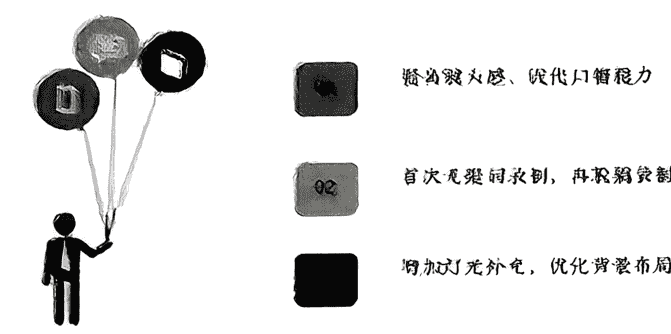

图 14-1 脱稿训练的要求

第二步：如果家里有补光灯或光线充足，可在室内或办公室录制。同一段内容再去午后光线柔和的户外，用手机支架拍摄，对比后户外效果更好。

总结两点。其一，台词不复杂或能脱稿时，尽量脱稿呈现。其二，室内补光不足或背景杂乱时，优先选择户外录制，效果更自然。归根结底，室内补光就是在模拟室外光，室外光更能带来自然感。

### 14.3 文案创作七要素，可用AI一键调试

一份完整的视频文案应包含七个要素，见表14-1。生成时可把表格拍照投喂AI，效率更高。

# 第 14 天 镜头齿感系统训练，录制你的第一条口播 VLOG

### **14-1** 视频文案脚本的七大要素

| 要素 | 解释 |
| :--- | :--- |
| 标题 | 标题要有趣味、可读、能吸引读者，同时关键词前置 |
| 主题 | 聚焦一个主题展开，保证内容有依据、有核心信息传达 |
| 知识增量 | 小红书用户更看重知识增量，尤其是知识类博主 |
| 语言趣味性 | 用通俗易懂、感染力强的表达，替代专业晦涩词汇 |
| 打造情感共鸣 | 多用第一人称，分享真实经历更容易打动人 |
| 引导互动 | 鼓励点赞评论分享，例如“点赞破1000下期讲……” |
| 结尾钓子 | 总结要点、突出核心，并给出明确号召，如关注、参与活动 |

### 14.4 口播转场方式，提升可观赏性

口播视频需要转场，避免镜头长时间静止。连续说五分钟且场景不变，观众很容易划走。

常见转场做法：

| 直接转场 | 分2~3个场景拍摄，再剪辑拼接成一条视频 |
| :--- | :--- |
| 画中画转场 | 录完口播后把视频切段，在段尾将画面缩小置于角落，同时让下一个场景画面放大铺满 |

提升完播率的转场玩法与14天运营复盘实操

在剪映、快影、万兴喵影等工具里，通过旋转、缩放等参数就能做出有辨识度的创意衔接。需要柔和过渡时，可在约30秒或1分钟处切分，前一段结尾做淡出，后一段开头做淡入，形成顺滑的衔接感。除了前面提到的四种转场思路，录制时再叠加背景音乐、特效音、颜文字、动画贴纸等元素，能有效提升口播类视频的留存并降低跳出。

## 两周复盘：运营两周后应呈现什么样

### 该达到怎样的成绩


第 15 天

第1天至第25天：内容汇总与复盘。要看过去十四天在小红书上的经营是否达标，复盘不能仅局限于第15天。

从实操层面看，每个经营周期结束后都应建立一套专业的数据记录表，方便阶段性复盘，也为后续垂直深耕提供依据。

# Day 1 Day 25: Content Summary and Review

下面是一份《小红书图文笔记记录表》，核心在于追踪上线时间、标题及点赞、收藏、评论、分享、阅读等数据，同时提前规划接下来7天或30天内的更新频次与涨粉目标。

| 项目 | 说明 |
| :-- | :-- |
| 序号 | 按发布顺序编号，便于追溯查询 |
| 笔记标题 | 记录每篇主题，便于快速识别方向 |
| 发布时间 | 登记发布时点，有助于分析内容与时段关系 |
| 封面图片 | 保存图片或链接及原图，便于后续复查 |

### 内容概要
对笔记核心观点做简要归纳，方便回看。

### 话题标签
登记使用的关键词与话题，便于主题归类。

### 数据指标
登记点赞、收藏、评论、分享、阅读等基础数据，用于评估表现。

### 互动占比
以点赞、评论、分享等互动量除以阅读量，衡量互动质量。

### 备注
补充需关注事项、改进点及后续计划。

#### 15.2 小红书视频笔记记录
《小红书视频笔记记录表》重点关注视频时长对涨粉的影响，探索最适合自己的发布时长，同时登记拍摄地点与场景对点赞、收藏等数据的影响，并提前规划未来7天或30天内的视频更新量与涨粉目标。

# 表 15-1 小红书视频笔记表格

| 序号、视频标题、发布时间、拍摄地、播放量、内容摘要、标签、点赞量、收藏量、评论量、分享量、阅读量 | 与图文表类似，用于记录分析基础信息 |
| :--- | :--- |
| **视频时长** | 记录制作时长与实际播放时长，帮助判断合适长度 |
| **是否含商业行为** | 标注是否存在商业合作或广告，便于评估商业内容对表现的影响 |

## 视频涨粉记录表

| 项目 | 说明 |
| :--- | :--- |
| 视频涨粉 | 统计单条视频上线后带来的粉丝净增长 |
| 比例/单条均涨粉 | 计算涨粉数与播放量的比例，或平均单条涨粉，用于衡量吸粉效率 |
| 拍摄地点 | 登记拍摄地，分析不同场景对数据的影响 |
| 素材选择方向 | 概括素材类型，如自然风光、人物访谈、产品展示等，为后续创作提供参考 |
| 备注 | 登记制作亮点、待优化项及未来计划等 |

# 15.3 小红书直播笔记记录
《小红书直播笔记记录表》重点记录直播时长对粉丝增长和互动提升的作用。若涉及直播带货，还需记录单场时长与带货数据的关系，并提前规划未来7天或30天内的直播场次。原则上建议每日最多一场。

## 小红书直播记录表基础项

| 项目 | 说明 |
| :--- | :--- |
| 序号、直播主题、直播时间、封面图、内容摘要、标签 | 登记直播基本信息与内容要点 |
| 直播时长 | 登记单场持续时间，分析观众对时长的偏好 |
| 直播点赞数、直播评论数 | 登记场内点赞与评论，用于评估互动效果 |

第 15 天 内容复盘：两周后应达到什么成绩？

## 续表

| 项目 | 说明 |
| :--- | :--- |
| 最高在线人数、平均观看时长 | 登记峰值同时在线及观众平均停留，用于评估吸引力与留存 |
| 粉丝打赏收益 | 统计打赏总额，评估变现能力 |
| 直播商业营销收益 | 登记商业合作或广告带来的收益，评估商业价值 |
| 备注 | 登记亮点、改进建议及后续规划 |

# ### 15.4 小红书账号未来一年发展规划表
下面是一份按月细化的《小红书账号12个月发展规划表》，包含内容排版规划与预期成果，可根据实际灵活调整。

## 表 15-4 小红书账号12个月发展规划表格

| 月份 | 图文发布量 | 视频发布量 | 直播次数 | 目标设定 |
| :--- | :--- | :--- | :--- | :--- |
| 第 1 月 | 5 条 | 8 条 | 10 次 | 粉丝增长 500，互动率提升至 3% |
| 第 2 月 | 15 条 | 12 条 | 14 次 | 粉丝增长 800，视频观看量破万 |
| 第 3 月 | 10 条 | 7 条 | 21 次 | 粉丝数破 3000，直播观看人次达 500 |

## 续表

| 月份 | 图文发布量 | 视频发布量 | 直播次数 | 目标设定 |
| :--- | :--- | :--- | :--- | :--- |
| 第 4 月 | 12 条 | 15 条 | 30 次 | 粉丝增长稳定，互动率提升至 5% |
| 第 5 月 | 17 条 | 20 条 | 23 次 | 粉丝数破 5000, 视频平均点赞破百 |
| 第 6 月 | 20 条 | 23 条 | 30 次 | 实现粉丝数与互动量双增长，月收入破千 |
| 第 7 月 | 16 条 | 25 条 | 15 次 | 粉丝增长加速，直播观看人次翻倍 |
| 第 8 月 | 15 条 | 17 条 | 12 次 | 粉丝数破万，视频平均转发破百 |
| 第 9 月 | 23 条 | 8 条 | 24 次 | 粉丝增长稳定，月收入提升至两千 |
| 第 10 月 | 11 条 | 17 条 | 12 次 | 粉丝数破 1.5 万，视频平均评论破五十 |
| 第 11 月 | 18 条 | 23 条 | 23 次 | 粉丝增长加速，直播观看人次稳定 |
| 第 12 月 | 23 条 | 19 条 | 25 次 | 实现年度目标，粉丝数破 2 万 |

第 15 天

# 内容复盘：运营两周后应达什么成绩

以上仅为示例规划，具体更新量、目标与策略可随时调整，定期回顾并优化规划，才能保证账号持续成长。

# **15.5 借力人工智能实现优质内容爆发式创作**

本书从构思到成书耗时团队5个月，也凝结了我过去4年在小红书创作的经验沉淀，希望对大家有所帮助。

花费较长时间修订的关键在于加入了大量人工智能辅助创作的方法。常说要把AI看作计算器：没有计算器时我们用算盘或纸笔，如今有了计算器，效率与便捷度完全不同。人工智能亦然。

面对新事物产生抵触很正常，但仅排斥不可取。更建议主动了解、掌握AI，借助它实现小红书内容的快速迭代与高效更新。

同时坚持持续创作与更新，在小红书这个优质种草平台上，商业合作或自有产品的推广都具有很高的市场接受度，争取拿到首笔收益。

祝愿每位读者在运营过程中不断进步，早日取得成果！

诸君，我们顶峰相见！

# **作者简介**

**刘丙润**

“写作 + 自媒体 + 商业”赋能讲师，百万粉丝知识IP，个人品牌商业顾问，丙润文学创始人，当当网第10届、第11届影响力作家，前快传号创作者学堂合作讲师，作品累计阅读量破2亿。先后出版《写作赋能与快速变现》《结构化写作》《DeepSeek短视频脚本创作魔法书》等多本书籍。

**悦读名品出版公司**

策划编辑：葛亚丽

装帧设计：王婧

---

**这是一本全场景的实战操作手册，**

用**15天**，完成别人**半年**的成长之路！

- **每日一步**：从账号搭建到IP变现的全链路拆解
- **AI加持**：DeepSeek智能工具贯穿选题/创作/运营全流程
- **全域变现**：带货 / 直播 / 私域/ 知识付费等变现模式全覆盖
- **大基础赛道 + 大IP领域**：穿搭 / 美食/ 职场/ 旅行······总有一款适合你

> 上架建议：新媒体运营

> 978-7-122-47934-1

> 定价：48.00 元