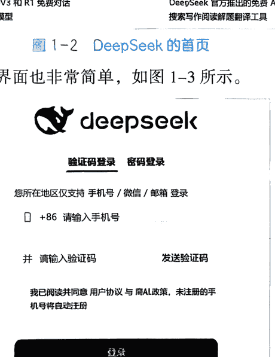
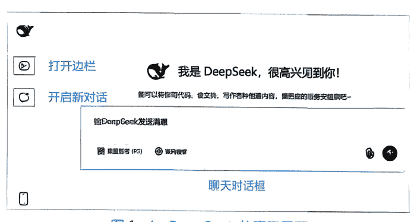
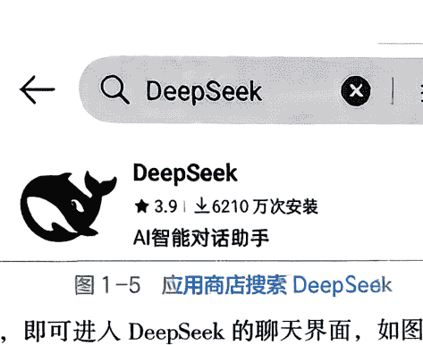
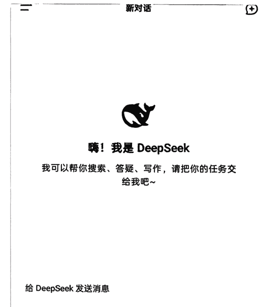
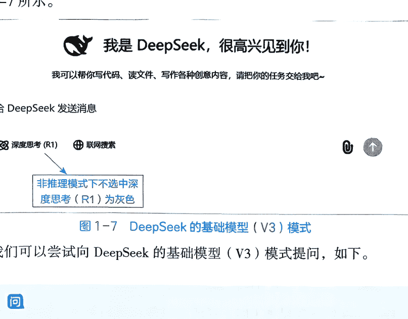
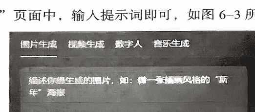
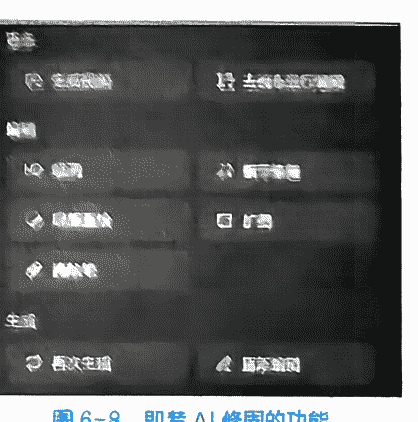
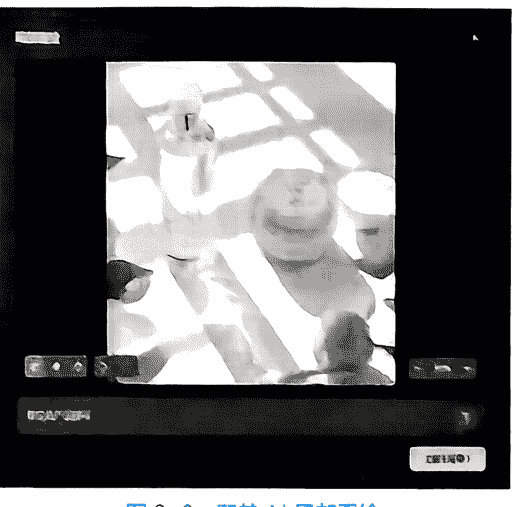

# deepseek快速上手


# 第一章 初识 DeepSeek：开启高效之旅

> 在信息爆炸的时代，效率革命已成为刚需，DeepSeek 的出现为个人及团队带来了全新的体验与深度认知。本章将带领我们从零开始了解 DeepSeek 的基本功能、常用模式，以及如何用它来提升个人效率。DeepSeek 不仅是“工具”，更是能跨越各领域的智能伙伴，可以在纷繁复杂的信息中快速抓住重点。让我们一起迈出这关键的第一步，开启高效之旅，重新审视工作与学习的新可能。

## DeepSeek——我们自己的人工智能

2025 年春节，DeepSeek 以破竹之势成为人工智能领域的耀眼新星，风头一时无两，成为行业内广泛关注的焦点。在与人交谈时，若不提 DeepSeek，似乎都不好意思开口。DeepSeek 的成功，离不开其创新的混合训练架构和动态稀疏化技术，它通过精准的算法优化和高效的计算资源利用，提升了模型的学习能力与响应速度。DeepSeek 的崛起不仅代表了人工智能技术的突破，更凸显了其在全球 AI 市场中的竞争力。从 2018—2021 年的基础架构布局期，到 2024 年的场景化突破期，再到 2025 年全球爆发期，DeepSeek 的每一步都标志着华人科技在全球 AI 领域的重要影响力。它的成功不仅是技术层面的胜利，更是中国智能技术走向世界的象征。

### （一）DeepSeek 的出现和发展

2023 年 11 月 2 日，DeepSeek 发布了其首个开源代码大模型——DeepSeekCoder，这一举措标志着公司在技术创新上的进一步突破。DeepSeekCoder 专注于支持多种编程语言的代码生成、调试和数据分析任务，它的发布不仅填补了市场对于高效开源代码生成工具的空白，还展示了 DeepSeek 在处理复杂编程任务方面的独特能力。该模型完全开源，允许免费商用，这使得全球的开发者能够无障碍地访问这一工具并将其应用于实际项目中。DeepSeekCoder 在 HumanEval 等编程基准测试中的出色表现，甚至超越了 CodeLlama 等其他开源模型，进一步验证了其在编程领域的强大实力。

随后，2023 年 11 月 29 日，DeepSeek 发布了其参数规模达到 670 亿的通用大模型——DeepSeekLLM。这款模型涵盖了 7B 和 67B 的基础版本及聊天版本，支持多种自然语言任务，如对话、文本生成等。DeepSeekLLM 的推出，不仅进一步增强了 DeepSeek 在 AI 领域的竞争力，也为广大用户提供了便捷的在线体验平台，使得每个人都可以通过网页端直接试用这一强大的语言模型。

2024 年 5 月，DeepSeek 宣布开源第二代混合专家（MoE）大模型 DeepSeek-V2。与上一代相比，DeepSeek-V2 的性能更强，并且比肩了 GPT-4 Turbo。通过采用 MoE 架构，DeepSeek-V2 在模型效率和任务处理能力上做出了巨大提升，支持长上下文和多任务处理，尤其适用于代码生成、数学推理等复杂场景。该模型的发布，标志着 DeepSeek 在大规模模型训练和部署领域的进一步技术进化。

2024 年 11 月 20 日，DeepSeek 推出了轻量级推理模型 DeepSeek-R1-Lite 的预览版。该模型专为高效推理任务设计，具有轻量化特点，非常适合低资源环境的部署。其在推理速度和准确性方面的出色表现，迅速赢得了业内的好评。

随后的 2024 年 12 月 26 日，DeepSeek 发布了第三代大模型——DeepSeek-V3，并同步开源。这款模型的参数规模进一步扩大，达到 6710 亿，并且引入了无辅助损失的负载均衡策略和多词元预测（MTP）技术，使得生成速度大幅提升。DeepSeek-V3 不仅接近 GPT-4 等顶级闭源模型的性能，而且凭借其较低的训练成本，展示了 DeepSeek 在 AI 技术创新和资源优化方面的独到优势。

2025 年春节后，DeepSeek 迅速成为 AppStore 的下载榜单常客。这一成绩的背后，是其团队多年来的技术积累和市场营销的双重努力。DeepSeek 通过精准的市场定位和广泛的社交媒体宣传，成功吸引了大量用户的关注。不仅如此，DeepSeek 还通过积极的用户反馈收集和版本更新，不断优化其功能，以确保每一次更新都能带来更好的用户体验。这种“以用户为中心”的发展模式，使得 DeepSeek 迅速获得了大批忠实用户，并在竞争激烈的 AI 市场中脱颖而出。2025 年 5 月 28 日，DeepSeek 发布了其 R1 推理模型的最新版本——DeepSeek-R1-0528。据其官方声明为“小版本试升级”。但经过实测，该版本在编程、逻辑推理和长文本方面均有显著提升。

值得一提的是，DeepSeek 的成功还与其独特的算法优化密切相关。与传统的 AI 系统依赖大规模预训练模型不同，DeepSeek 通过智能算法和高效的计算资源利用，能够在更短的时间内完成更高效的学习和推理过程。其背后运用了最新的深度学习技术和大规模分布式计算能力，使得 DeepSeek 的处理速度和响应时间相较于同类产品具有显著优势。这一点，尤其是在复杂的任务处理和实时对话中表现得尤为突出。

随着人工智能的不断发展，DeepSeek 也在积极探索 AI 的下一个应用高地。除了常规的自然语言处理和数据数据分析外，DeepSeek 还在积极拓展图像识别、语音识别、智能推荐等多个领域，力图成为一个全方位的人工智能工具平台。这一战略布局，不仅为 DeepSeek 赢得了市场份额，也为其在全球 AI 行业的长期发展奠定了坚实的基础。

### （二）DeepSeek 的技术优势

DeepSeek 并非仅仅是一个基于对话的 AI 工具，而是一个融合多种智能技术的创新平台。它不仅仅局限于与用户进行简单的对话，更是在自然语言处理、语音识别、计算机视觉等多个领域进行深度整合，通过跨域技术的结合来拓展其应用场景。这种技术的融合使得 DeepSeek 能够理解和响应更加复杂的任务指令，从语音输入到图像识别，再到复杂数据的实时处理，都是它能够执行的功能。它不仅是一个智能助手，更是一个具备自主学习和执行能力的多任务平台。

在技术架构方面，DeepSeek 采用的混合专家（MoE）模型和稠密网络相结合的设计，突破了传统 AI 在处理海量数据时的算力瓶颈。它通过动态路由机制根据不同任务的需求灵活地调配计算资源，使得系统能够在高并发场景下保持稳定且高效的运行。这种架构的优势不仅仅体现在其能效优化上，更重要的是能够在实际使用中提供更低的延迟，使得用户的交互体验更加流畅。而在同一类问题上，DeepSeek 能够通过自适应机制快速响应，不需要像传统 AI 那样进行繁重的计算，从而在响应时间上具有明显的优势。

在成本控制方面，DeepSeek 的创新性设计使其在算力需求上远低于市场上的其他大型 AI 系统，尤其是在训练和部署阶段。通过稀疏激活技术和优化的 ARM 架构，DeepSeek 有效降低了能源消耗，使得它的使用门槛大大降低。相比于传统 AI 系统，DeepSeek 的训练成本显著降低，从而使得更多的小微企业和开发者能够负担得起这一先进技术，推动了 AI 的普及和应用。

在中文语言处理能力方面，DeepSeek 展现了其强大的本土化优势。它能够深入理解和处理中文特有的语言结构、文化背景和专业领域需求，这使得它在金融、医疗、法律等行业的专业应用中表现尤为出色。与此相比，尽管 ChatGPT 在多语言支持上具有广泛覆盖性，但其对中文的处理准确度和文化适配性仍然存在差距，特别是涉及专业术语和文化背景的深度理解时。

DeepSeek 通过不断优化推理过程，让每一项决策都更加透明，用户能够清楚地看到 AI 如何从输入到输出做出决策，这种透明性大大增强了用户对 AI 结果的信任。

在交互和用户体验方面，DeepSeek 不再单纯追求“对话式”回应，而是注重情境理解和多任务协同。其语义引擎能够捕捉到用户在对话中蕴含的潜在意图和情感变化，提供更有针对性的服务，而不仅仅是机械地回答问题。它可以根据对话情境的变化，调整回答的风格和深度，甚至在同一对话中并行处理多个任务，极大提高了工作效率。

DeepSeek 的技术生态和开源战略为其进一步拓展市场提供了强有力的支持。通过开源，开发者能够在其基础上进行个性化定制，推动技术的快速迭代和创新，并促进了产业界与学术界的深度合作，进一步巩固了其在技术领域的领先地位。而与之相对，ChatGPT 的封闭性限制了开发者的创新空间，导致其生态发展相对缓慢。

## DeepSeek 的基础操作

DeepSeek 主要操作界面有网页端和移动端两种。

### （一）DeepSeek 的 PC 界面

DeepSeek 电脑端，我们可以在搜索页面中输入"DeepSeek"，找到如图 1-1 所示的搜索结果即为 DeepSeek 官方网站。

<div style="text-align: center;">
  
</div>

点击进入即可，会跳转到 DeepSeek 的首页，如图 1-2 所示。点击界面中左下方的“开始对话”即可来到 DeepSeek 的注册界面（如果已经注册，会直接跳转到使用界面），点击右下方的“获取手机 App"可以下载手机端的 DeepSeek。

<div style="text-align: center;">
  
</div>

DeepSeek 的注册界面也非常简单，如图 1-3 所示。

<div style="text-align: center;">
  
</div>

输入手机号，获取验证码就可跳转到 DeepSeek 的聊天界面了，如图 1-4 所示。

<div style="text-align: center;">
  
</div>

> **图 1-4 DeepSeek 的聊天界面**

由图 1-4 可以看到 DeepSeek 的聊天界面分为左右两部分，左侧为“打开边栏”和“开启新对话”，右侧主要是聊天对话框，我们可以在右侧输入任何想要询问的问题。

### （二）DeepSeek 的 App 界面

DeepSeek 手机端，除了使用如图 1-2 中 PC 界面右下角的“获取手机 App"扫码下载 App，也可以使用应用商店直接搜索"DeepSeek"下载，如图 1-5 所示。

<div style="text-align: center;">
  
</div>

> **图 1-5 应用商店搜索 DeepSeek**

搜索下载后，即可进入 DeepSeek 的聊天界面，如图 1-6 所示。

<div style="text-align: center;">
  
</div>

DeepSeek 的注册和登录过程非常注重用户的隐私和数据安全。所有的用户信息都会通过加密技术保护，确保账户的安全性。DeepSeek 还遵循严格的数据保护法规，确保用户的数据不会被泄露或滥用。

#### 基础模型（V3）模式

基础模型（V3）模式是 DeepSeek 的一种基础模式，主要用于处理那些不需要复杂逻辑推理的任务。在这种模式下，DeepSeek 会快速给出答案，适合处理简单、直接的问题。基础模型（V3）模式的特点是快速响应、简单直接且资源消耗低。由于不需要进行复杂的推理，基础模型（V3）模式对计算资源的消耗较低，能够高效处理大量简单任务。

要想使用基础模型（V3）模式，只要不选中“深度思考（R1）”即可，如图 1-7 所示。

<div style="text-align: center;">
  
</div>

我们可以尝试向 DeepSeek 的基础模型（V3）模式提问，如下。

> 🧑‍🤝‍🧑  
> 地球的半径是多少？
>
> **DeepSeek**  
> 地球的平均半径约为 6,371 公里。①

> ① **注**：本书力求还原 AI 的真实答案，对其所生成的内容未做任何修改。因此，其中可能会出现诸如标点符号、句式、文字的某些错误，请知悉。## （二）深度思考（R1）模式

深度思考（R1）模式是 DeepSeek 的一种高级模式，专门用于处理需要复杂逻辑推理和深入分析的任务。在这种模式下，DeepSeek 会对问题进行深入分析，考虑更多因素和可能性，从而提供更全面、更准确的答案。它适用于解决数学难题、策略规划、分析复杂情境等需要多步推理的任务。由于需要进行复杂的推理，深度思考（R1）模式对计算资源的消耗较高，因此更适合处理少量但复杂的任务，与基础模型（V3）模式相对，我们只需要选中对话框中的“深度思考（R1）”即可，如图 1-8 所示。

## 图 1-8 DeepSeek 的深度思考（R1）模式

DeepSeek 的深度思考（R1）模式可以帮助我们解答一些较为复杂的问题。

> - **如何提高公司的客户满意度？**
> 
> **DeepSeek**
> 
> 提高客户满意度的方式有以下几点：①提升产品质量，确保产品符合客户期望；②优化客户服务，提供及时、专业的支持；③建立客户反馈机制，及时了解客户需求并改进；④加强客户关系管理，定期与客户沟通，建立长期合作关系。

深度思考（R1）模式的使用场景主要包括：复杂问题解决如“如何优化公司的供应链”“怎样设计一个高效的算法”，策略规划如“如何制定一个成功的市场营销策略”“怎样规划一个长期的投资组合”，深入分析如“分析某部电影的深层主题”“探讨某个历史事件的影响”等。

在日常使用中，我们可以根据问题的复杂度和对时效性、深度的需求，灵活选择模式，将 DeepSeek 的实用性最大化。

无论是在基础模型 (V3) 模式还是在深度思考 (R1) 模式中，都可以看到如图 1-9 所示的“联网搜索”功能。

DeepSeek 的“联网搜索”功能是一项强大的工具，能够实时访问互联网，为用户提供最新、最准确的信息。通过这一功能，DeepSeek 可以突破自身知识库的限制，直接获取互联网上的实时数据，帮助用户获取最新信息或动态内容。

“联网搜索”功能依赖于互联网连接，如果网络不稳定，可能会影响搜索结果的获取速度和质量。虽然 DeepSeek 会尽量提供准确的信息，但互联网上的内容质量参差不齐，用户仍需对结果进行一定程度的判断。需要注意的是，DeepSeek 在联网搜索的过程中会遵循隐私保护原则，不会泄露用户的个人信息。

# ## DeepSeek 如何提高个人效率

DeepSeek 在工作和生活的各个场景中是如何提高个人效率的呢？我们可以分为以下几部分来说明。

### （一）DeepSeek 在工作中的应用

DeepSeek 在文案创作领域的应用极为广泛，尤其对于需要大量文字创作的用户，DeepSeek 都可以提供极大的帮助。传统的文案创作往往需要花费大量时间进行构思、修改和完善，而 DeepSeek 凭借其强大的语言生成能力，能够迅速根据用户的需求生成内容。用户只需输入简短的关键词或提示语，DeepSeek 就能根据这些信息生成精准的文案，无论是创意文案、营销方案，还是日常沟通文本，DeepSeek 都能提供流畅且有针对性的文案建议。在营销策划中，用户可以将与品牌和产品有关的信息输入 DeepSeek，系统会根据这些信息生成一篇营销文案，帮助用户更高效地完成创作。对于广告文案，DeepSeek 能根据目标受众的特点自动调整语言风格，以确保文本能吸引受众的注意，并激发他们的兴趣。如此高效的文案创作能力，不仅能为用户节省大量时间，还能激发更多创意灵感，从而提高工作效率。

除了文案创作，DeepSeek 在数据处理方面也表现出色。在现代工作环境中，数据分析和处理是许多岗位的重要任务，无论是在市场调研、财务分析中，还是人力资源管理中，都涉及大量的数据收集、整理、分析和报告制作。传统的数据处理通常需要复杂的软件操作，而且过程烦琐、耗时长。DeepSeek 通过其强大的数据分析能力，可以帮助用户简化这些操作。例如，在进行市场调研时，用户需要分析大量的消费者反馈和行业趋势数据，用户只需将数据上传到 DeepSeek，系统便能自动识别数据中的关键点，进行分类整理，并生成简洁明了的分析报告。在数据筛选时，DeepSeek 还能根据用户设定的条件，自动过滤掉不相关的数据，确保最终的数据集更为精准，减少错误率。

### （二）利用 DeepSeek 提高学习效率

DeepSeek 以精准的算法和高效的学习辅助功能，成为越来越多人眼中的“学习利器”，在语言学习和知识获取等方面，可以让用户体会到更轻松、更高效的学习过程。

在语言学习方面，DeepSeek 的优势尤为显著。很多人学习新语言时，一边背单词、一边记语法，可真正能拉开差距的，往往是如何将所学知识运用到实际交流中。DeepSeek 凭借强大的语言理解与生成能力，能够模拟与母语者的对话场景，让用户在自然的交流中提升口语和听力水平。当用户输入某个话题或简单的句子时，DeepSeek 会立刻给出对应的对话内容或反馈，并在口语、语法和发音方面提供建议，帮助用户不断纠正错误，提升语言自信。与传统工具相比，DeepSeek 还可以根据使用者的语言水平、学习进度和兴趣，为其自动调整学习内容和难度，从基础词汇对话到专业性更强的文学作品或深度讨论，无论学习者处于哪个阶段，都能拥有独一无二的个性化体验。

除了语言学习，DeepSeek 在知识获取上的表现同样突出。如何在铺天盖地的资讯中快速找到对自己真正有用的内容，成为许多人头疼的问题。DeepSeek 提供了精准的信息筛选和处理能力，只要输入关键词，系统便会根据内置知识库和算法，迅速为用户呈现相关信息。无论用户是想在历史、文学、科学等领域进行深入了解，还是需要快速掌握某个事件或概念的核心知识，DeepSeek 都会以简洁明了的形式提供答案，使用户在短时间内把握关键要点。

随着学习的深入，很多人渴望更全面地扩展与探究，但往往因为时间和资料的限制而无法深挖某个主题。DeepSeek 则可以随时为学习者补充更多“上下文”，如通过提问了解某个物理学理论背后的原理，或是查询最新研究成果，帮助我们在学习的过程中不断发散思维、培养批判能力。它不仅提供基本知识，更能将我们引向更深层次的思考和发现，让学习者不再局限于单薄的教材或零碎的信息。

在学习过程中，有效地记录与归纳所学内容，也是提升学习效率的关键一环。DeepSeek 的笔记整理和总结功能，为这个难题带来了解决方案。无论是课堂笔记、书籍摘录，还是从网上收集的文章，DeepSeek 都能自动提炼其中的重点，生成精练的学习笔记，帮助使用者轻松把握核心内容。这样一来，我们既能大幅缩短整理时间，也能在后续复习时更迅速地找到想要的知识点。

在学习资源的选择上，DeepSeek 同样展现了其独特优势。它会根据我们的兴趣和学习进度，智能推荐匹配度高的在线课程、学术论文或专业书籍。当需要进行深入研究时，系统还能结合现有的知识基础推荐适合的高阶内容，并在学习过程中持续提供反馈与指导，使整个学习体验更有针对性和连贯性。

值得一提的是 DeepSeek 的协作学习功能。在需要团队合作的学习项目中，如果成员各自为战，很可能事倍功半。DeepSeek 可以作为团队的“虚拟助手”，帮助大家记录讨论要点、整理发言内容，并将共同结论自动生成总结文档。无论是远程会议还是现场讨论，这种智能化的支持都能有效提升团队效率，让协作学习从此变得更轻松、更有成效。

# （三）DeepSeek 在日常生活中的应用

DeepSeek 在忙碌的日常生活中为用户带来了丰富的生活助手功能，帮助用户提升效率、节省时间，让生活变得更轻松且更具智能化。无论是日常事务处理、时间管理，还是健康管理与购物建议，DeepSeek 都能提供有力支持，成为真正意义上的“随身管家”。

在日常生活的琐碎任务中，DeepSeek 能够扮演高效的“智能助手”角色，让人们可以更从容地应对繁忙的节奏。当我们需要同时安排家庭日程、制定购物清单或者查询天气状况时，只需通过语音或文字向 DeepSeek 发出指令，就能快速获得所需信息并得到贴心的建议。比如，当我们想知道当天的天气状况时，DeepSeek 会基于实时数据给出准确预报，帮助我们更好地安排外出活动；在处理日常事务时，DeepSeek 还能结合我们的个人习惯与需求，提出合理的调整与规划，避免遗漏关键事项。

在时间管理方面，DeepSeek 同样能发挥巨大的作用。很多人在快速变化的社会中难以合理分配时间，导致工作与生活效率降低，甚至陷入拖延的困境。DeepSeek 可以根据任务紧急程度和重要性自动进行优先顺序排序，然后提醒用户在恰当的时机完成目标，并根据用户的日常习惯和偏好不断优化日程安排。假如我们每天有固定的锻炼时间，DeepSeek 不仅会及时提醒，还能提供适合当下状态的运动方式或时长，帮助我们始终保持健康的生活方式。

在信息管理方面，DeepSeek 能够帮助用户整合大量碎片化的资料，让我们在繁杂的信息洪流中保持清晰的思路。电子邮件、日程安排、购物清单或待办事项都可以汇总到 DeepSeek 的系统中，而平台会将这些信息进行自动归类与整理，形成一目了然的列表或提醒，避免我们在忙碌中忽视重要内容。它甚至能根据以往的记录，推测某些物品可能被放在家中的哪个角落，给出相应的搜索建议，既节省时间，也让生活更有条理。

在健康管理方面，DeepSeek 与相关应用的数据互通，为有健康需求的人群提供个性化的方案。它会结合我们的健康状况与喜好，制定合理的饮食计划，同时根据每日的身体数据调整运动方式。在减肥、增肌或控制血糖等特定目标上，DeepSeek 还可以给出更有针对性的营养和运动建议，从日常点滴中改善健康。

在购物场景方面，DeepSeek 还能成为我们的贴心“选品顾问”。忙碌的生活里，逛各大电商平台往往需要消耗大量精力，因此 DeepSeek 会根据我们的购物偏好和预算给出一份相对精准的推荐物品清单，并协助比价和查找优惠信息，让我们以更优惠的价格买到心仪的产品。随着智能家居的普及，DeepSeek 也能与各种家用智能设备联动，让我们可以通过它来控制家中的灯光、空调和音响等，从而营造一个舒适且高效的居家环境。

> “在使用 DeepSeek 的过程中，提示词是我们与 AI 沟通的桥梁。精准、高效的提示词，能让 DeepSeek 迅速理解需求并生成优质内容。本章将详细介绍如何构建和运用提示词：从基础格式到万能模板，再到自动生成与进阶技巧。通过系统地学习提示词的思路，我们能掌握强化 DeepSeek 智能效果的秘诀，得到更实用、更具创造力的结果。让我们一同拆解提示词的“魔法”，在与人工智能的对话中激发无限可能。”

# 一、精准需求获取

和 DeepSeek 对话时，提问的精准度决定了所生成答案的准确性。所以如果我们想要精准的答案，就一定要告诉 DeepSeek 精准的需求。

## （一）理解需求

在与人工智能沟通时，最重要的往往并不是如何提出问题，而在于是否能够真正理解并明确自己的需求。如果把需求比作一座桥梁，那么它连接的正是人类的思考与机器的执行能力。只有当需求被精准表达，DeepSeek 才能充分发挥出智能优势，为用户提供切合实际的答案或内容生成。如果需求模糊不清或目标过于宽泛，得到的结果就可能偏离初衷，甚至无法满足最初的期望。明确需求不仅能帮助我们界定问题的核心范围，也是梳理自身思路的过程，促使我们反复思考：到底想得到怎样的答复，或者期待 AI 完成什么样的工作。

在学习、工作或日常生活中，我们时常会产生“想解决某件事”的念头，但在这一想法背后，可能潜藏着更加多元且更加具体的诉求。学习者不仅想了解概念的定义，还想知道它在不同情境下的适用范围；在工作中，不只需要概括性的方案，更需要背后的原理与操作细节；在日常生活中，如果只抛出“帮我的晚餐做一个选择”的需求，虽然 DeepSeek 可以给出建议，但却无法洞悉个人的饮食偏好、健康需求和烹饪条件。只有当用户能明确这些潜在需求，并以合理的语言和上下文将其传达给 AI，才有机会得到与自身期望真正契合的答案。换言之，需求越具体、越清晰，AI 所提供的结果就越具有针对性。

对于想要充分利用 DeepSeek 的用户而言，学会理解需求本身也是一次思维训练。很多时候，在我们向 AI 提出问题之前，并没有认真想过问题背后的来龙去脉，只期望能得到一份“万能答案”。然而，在梳理并表达需求的过程中，我们会不断校准方向，让疑问本身更加聚焦，进而与 AI 的交互产生良性循环。用户不仅能享受到 AI 带来的高效与便捷，也能在思考问题的过程中慢慢提升对问题的洞察力。

从沟通效率的角度来看，清晰的需求能让 AI 更快锁定问题要点。DeepSeek 并非具备无限“读心”能力的神明，而是依赖文字或语音输入来判断用户意图。如果表达过于宽泛或含糊，AI 在理解和推断时就会遇到更多不确定性，可能会产生一系列与核心需求相去甚远的回答。相比之下，如果用户在交流前就对需求背景、目标和限制条件进行更充分的表述，就能有效减少反复试错的过程，让答案更迅速地达到理想状态；否则，用户不得不多次补充说明或修正问题，不仅浪费时间，也容易打乱思路的连贯性。

深刻理解需求，不仅能帮助我们获得更满意的回答，还能引导我们在与 AI 互动的过程中自省和成长。在提问前多想一步，如“我真正想知道什么”“我期待 AI 以何种形式来帮助”等，能让我们更准确地把握问题的本质。多一次与 AI 的交互，也便多了一次检验自我思维方式的机会。我们将需求表述得越清晰、越具有针对性，AI 给出的结果就越能启发灵感，激发更多潜在思考与创造力。

## （二）向 DeepSeek 准确表达需求

与 DeepSeek 互动时，如果能清晰表达需求，AI 就能更精准地理解用户真正想要的内容或答案，并生成更加贴合期望的结果。很多人在初次使用 DeepSeek 时，往往只会输入一个简单问题，这种做法可能导致 DeepSeek 的理解出现偏差，难以快速锁定关键信息。想要获得更高的效率与准确度，关键在于在提示词中传达更多具有价值的背景信息和具体要求，让 DeepSeek 在多种可能的方向中迅速集中精力回答最核心的问题。

我们以撰写市场宣传文案为例，提示词如下：

> 帮我写一篇推广文案。

DeepSeek 虽然能提供基础文本，但未必能与实际推广目标或目标受众保持一致。因此，我们可以在提示词中加入更多细节。

> 我是一个正在做活动宣传文案的市场策划，想在社交媒体上推广一款新的环保清洁产品（洗洁乐一号），希望文案风格有趣但不要浮夸、面向年轻受众，篇幅控制在两百字左右，结尾需要强调一下环保理念并呼吁大家保护环境。

这样，DeepSeek 就可以结合用户在角色、产品特色、文案风格、文字长度以及受众定位等方面的具体需求，生成更符合真实应用场景的创意文案。DeepSeek 的答案如下：

> **DeepSeek**
> 
> 洗洁乐一号——不只是普通清洁剂，而是让生活更轻松又环保的好帮手！独特配方能够轻松对付各类污垢，释放你的双手，也减少对地球的负担。一起用行动证明，小改变也能带来大不同。地球只有一个，让我们携手守护这片绿色家园吧！

在这个案例中，当 DeepSeek 收到足够丰富的提示信息后，便能根据产品特点与用户诉求，给出更加具有针对性的文案创作方案。对于用户而言，这种更贴合实际的初稿既能降低反复修改的次数，也能提高最终成稿的质量与效率。

让 DeepSeek 准确把握用户意图，需要我们先对自己的需求多做思考，进而进行有针对性的提炼。只有当需求得到充分的陈述，DeepSeek 才能整合各项关键信息，并在丰富的知识库与强大算法的支撑下，快速生成最能呼应用户期望的内容。同时，用户在这一过程中也会逐渐学会更加高效地梳理与表达需求，从而在不断与 AI 的互动中获得思考和创意的双重提升。在人机协作的过程中，深度理解与精准表达的价值会被不断放大，也能进一步展现出 AI 为我们带来的多重可能性。

## **万能提示词模板**

在与 DeepSeek 进行互动时，精心设计提示词不仅可以让 AI 快速理解意图，还能引导其产出更高质量的内容。从简单的问答请求到复杂的多任务指令，提示词的结构与表达方式往往是决定生成结果好坏的关键。万能提示词模板正是解决这一问题的实用方案，它通过一系列可复制、可调整的通用框架，帮助用户在不同场景下轻松找到最有效的提问或指令方式，从而让 DeepSeek 在语言生成与信息分析中更有针对性和深度。

### （一）基础模板

在和 DeepSeek 对话时，怎么把“我想要什么”清晰地传达给 AI，一直是困扰众多用户的难题。DeepSeek 基础提示词模板的核心思路如下：

> **目标 → 背景 → 要求**

由于我们要通过提示词使 DeepSeek 精准聚焦关键信息，故必须在提示词中明确提炼核心要素（如任务目标、输出格式、限制条件），以确保其严格遵循指令输出高质量内容。

假设我们让 DeepSeek 生成一篇“短篇科普文章”，希望内容通俗易懂又具备一定的专业深度。为此，你可以先在提示词中明确目标、补充背景，再提出具体要求。提示词大致可写成如下形式（示例仅供参考）：

> 我想写一篇介绍“量子计算”的短篇科普文章，目标读者是对量子计算完全陌生的普通大众。文章长度不超过 500 字，文风通俗且带一点幽默感，让读者能在短时间内对量子计算的基本概念、现有应用以及未来潜力有初步了解。

观察上面的提示词，目标是撰写一篇科普文章，背景包括了主题（量子计算）和读者定位（普通大众），要求体现在希望“文风通俗幽默”“不超过 500 字”“介绍基本概念、现有应用和未来潜力”。这些信息为 DeepSeek 提供了一个内容框架，便于它明确写作范围与风格。接下来，让我们看一段 DeepSeek 生成的示例文本：

> 量子计算听起来仿佛是科幻小说里走出来的神秘技术，其实它比我们想象中更贴近现实。所谓“量子”，就是在极其微观的粒子世界里，一切都可能同时处于好几种状态，宛如既开又关的“薛定谔的猫”。量子计算机正是利用了这种多状态叠加的奇妙特性，让计算速度飙升至传统计算机难以企及的高度。尽管现阶段的量子计算应用还主要集中在科研领域，比如优化材料结构、加速新药筛选等，但它在破解复杂密码、处理海量数据等方面也同样潜力无限。要是有一天，我们的电脑都能搭载量子芯片，说不定打开游戏的 loading 画面只需一眨眼的工夫。当然，量子计算走进寻常生活，还有许多技术难题要攻克，但谁能拒绝这样一个神奇的未来呢？

从这段输出中可以看出，DeepSeek 遵循了提示词里给定的框架：文章围绕量子计算的基本概念与潜在应用展开，语言风格力求通俗易懂并带有轻松幽默的氛围。同时 DeepSeek 也严格控制了篇幅，字数没有超出 500 字的限制。

## （二）常见的提示词模板

在不同的场景和领域与 DeepSeek 进行交流，提示词往往需要具备更强的专业指向性。基础模板可以帮助我们在目标、背景和要求三个方面厘清思路，但面对写作、编程、学术研究等具体需求时，还需要结合各自的专业特点进行相应调整。只要把这些要点融入提示词，DeepSeek 往往就能提供更贴近实际需求的回应。下面通过几个实例说明如何针对不同领域来设计提示词，以及可能得到的 AI 生成示例内容。

### 1. 创意写作领域

用户想要完成一篇与某特定主题相关的创作时，就需要让提示词聚焦于作品类型、写作风格与预期读者。比如我们正在准备一篇聚焦环保问题的短篇故事，希望文字具有文学色彩和感染力。提示词可以这样写：

**问：**
> 我想创作一篇以“海洋污染”为主题的短篇故事，读者主要是初中和高中学生。故事应该突出环境保护的重要性，同时兼具一定的文学色彩，不要用过于复杂的专业术语。文字在300字左右，让读者能感受到对海洋生态的关切。

DeepSeek 在收到这个提示后，可能会给出如下示例内容。

> **DeepSeek**
>
> 海浪拍打着岸边，潮沙声在傍晚的港湾中回响。小渔村的年轻人阿遥坐在一只破旧的小船上，他的目光越过水面，望向远方。这里曾经拥有洁净的海面和鲜活的鱼群，可如今，暗色的塑料瓶和漂浮的塑料袋夹杂在海浪里，成了触目惊心的斑点。阿遥想起祖父讲过的故事，那时的海浪虽成湿，却闪烁着纯净的蓝色，无人担忧鱼儿会被垃圾缠住。为了让大海重回蔚蓝，阿遥决定发起一次彻底的清理。他先在村子里张贴海报，呼吁人们少用一次性塑料制品，并带领同伴一起收集漂浮的垃圾。夜晚降临，当他们把最后一袋塑料残片搬到岸上时，潮水正慢慢涨起来，仿佛带着一丝欣慰。阿遥望向被晚霞染得金红的海平面，心想也许有一天，当每个人都意识到保护海洋的重要时，破碎的渔网、漂泊的塑料袋和浑浊的海水将会成为过去。

DeepSeek 在这段文本中落实了“海洋污染”、“文学色彩”和“环境保护”几个要点，字数也控制在合理范围内，满足了读者定位和文学风格的要求。

### 2. 编程领域

针对编程场景，提示词通常需要明确所用的语言、目标功能以及对代码质量或性能的具体需求。假设你想让 DeepSeek 帮忙写一段 Python 代码，用来抓取一个网站的新闻标题并分析其热度，还希望有详细的注释和简易的异常处理机制，此时可以写下这样的提示词。

> 我需要一段 Python 脚本，用来从某个新闻网站抓取最新新闻标题，然后统计每个标题被点击或点赞的次数以判断热度。请在脚本中加入丰富的注释，并对网络连接失败做出相应的异常处理。

DeepSeek 在理解了语言环境、功能目标和代码风格需求后，生成如下示例。

```python
import requests
from bs4 import BeautifulSoup

def fetch_news_titles(url):
    """
    输入：新闻网站的 URL
    功能：抓取页面中的新闻标题和相关热度信息
    输出：包含标题和热度的列表
    """
    news_list = []
    try:
        response = requests.get(url, timeout=10)
        response.raise_for_status()  # 如果状态不是 200，会抛出 HTTPError
        soup = BeautifulSoup(response.text, 'html.parser')
        
        # 假设网站标题在<h2>标签内，热度在自定义 data-click 属性中
        articles = soup.find_all('h2')
        
        for article in articles:
            title = article.get_text(strip=True)
            # 这里仅作示例，实际热度获取方式需视网站结构而定
            heat = int(article.get('/data-click', '0'))
            news_list.append((title, heat))
            
    except requests.exceptions.RequestException as e:
        print(f"抓取新闻时发生错误：{e}")
        
    return news_list

if __name__ == "__main__":
    url = "https://example-news-website.com"
    result = fetch_news_titles(url)
    # 将热度从高到低排序，并打印结果
    sorted_result = sorted(result, key=lambda x: x[1], reverse=True)
    
    for title, heat in sorted_result:
        print(f"新闻标题：{title}, 热度：{heat}")
```

这段示例代码涵盖了基本的需求：用 requests 和 BeautifulSoup 进行数据抓取并解析，同时提供了简易的错误处理与注释说明，让读者或使用者能快速理解脚本的工作流程。可以看出 DeepSeek 直接响应了提示词中关于 Python 语言、热度分析和异常处理的要求。

### 3. 学术研究领域

提示词往往需要强调引用格式、研究范围、想要关注的论文质量等。比如，我们想让 DeepSeek 帮忙列出几篇“自然语言处理在教育评测领域”的最新研究文献，并希望它进行简单的文献综述，提示词可以写成如下内容。

> **DeepSeek**
>
> # （1）数学课堂中的自然语言处理技术应用探析
> ①研究目标：探讨自然语言处理技术在数学课堂中的应用，以提高教学效果和学生学习兴趣，推动个性化教学发展。
> ②方法：通过文献分析和案例研究，结合数学课堂的实际需求，设计并实施 NLP 技术（1）支持的测评工具，分析其对教学效果的影响。
> ③主要结论：NLP 技术在数学课堂中能够有效提升学生的理解能力和学习兴趣，同时为教师提供精准的教学反馈，有助于实现个性化教学。
> ……
>
> # （2）基于核心素养的自然语言处理课程建设与教学改革研究
> ①研究目标：研究如何将 NLP 技术融入课程建设，以培养学生的核心素养，推动教学改革。
> ②方法：采用行动研究法，设计基于 NLP 的课程框架，并通过实验对比传统教学与 NLP 支持的教学效果。
> ③主要结论：NLP 技术能够显著提升学生的语言处理能力和核心素养，同时为教学改革提供了新的技术支持。
> ……
>
> # （3）自然语言处理中学学生自然语言处理技术研究
> ……
>
> # （4）学生学习自然语言处理的提升与应用
> ……
>
> # （5）自然语言处理如何颠覆高等教育研究
> ……
>
> ①NLP 技术，即自然语言处理技术，是人工智能领域的重要研究方向，融合了语言学、计算机科学、机器学习、数学、认知心理学等多学科领域知识。
> ②为了节省篇幅，本书对部分 AI 生成的内容用"……"代替。

## 4. 根据个人需求修改和定制模板

我准备为一家新创立的咖啡品牌做市场推广，需要 DeepSeek 帮助完成以下几项任务：

- 撰写一段简要的竞争对手分析，包括主要竞品的市场定位和核心优势；
- 根据分析结果，提出一个初步的线上线下推广方案，需强调产品特色和品牌故事；
- 对推广预算做一个大致的估算，并建议可行的费用分配方式。

**品牌背景：**我们的咖啡主打年轻时尚和高性价比，目标客户群是18～30岁的都市上班族和学生。品牌调性偏轻松和活泼，希望在社交媒体上进行广泛曝光，也考虑线下快闪店和周边营销等创意手段。

```details
<summary>需求</summary>
竞争对手分析部分不超过 300 字，列举两到三个主要对手即可。
推广方案可分为线上线下两部分，形式以简明的要点说明为主。
预算方案需包括大致的费用分配比例，以及推荐的广告投放渠道。
整体文字风格不必过度严谨，但要保持逻辑清晰、易于执行。
</details>
```

DeepSeek 生成的回复如下：

```details
<summary>DeepSeek</summary>
### 【竞争对手分析】
在年轻潮流咖啡市场上，目前主要的竞品包括 A 咖啡和 B 咖啡。A 咖啡依托连锁门店的高覆盖率，为消费者提供便捷且个性化的咖啡体验；B 咖啡则主打精品咖啡豆与咖啡师文化，吸引对品质和环境有较高要求的中高端消费人群。相比之下，我们的新品牌可以利用亲民价格和活泼风格，在更广泛的年轻群体中迅速建立认同。

### 【推广方案】
**线上部分：**
- 在微博、抖音等社交媒体平台开展“我的咖啡日常”话题活动。鼓励年轻用户分享个性化咖啡瞬间，并搭配轻松诙谐的营销文案。
- 与相关的生活方式博主或美食博主合作，进行种草笔记或短视频制作，通过创意内容吸引粉丝关注。

**线下部分：**
- 在核心商业区开设限时快闪店，采用极具年轻感的装饰设计，结合打卡赠礼活动，快速提升话题度。
- 推陈出新限量周边（如咖啡手提袋、趣味贴纸等），借助社交圈层扩大品牌形象。

### 【预算与费用分配】
整体推广预算可分为：线上投放 60%、线下活动 30%、预留创意 10%。线上部分主要投放于社交媒体平台广告和 KOL 合作，可视实际成效灵活调整。线下活动的费用集中在快闪店租赁、装修布置及活动执行上，并可根据品牌曝光度设定不同程度的投入。最后，建议保留部分预算以应对可能的新媒体合作机会或紧急活动需求。
</details>
```

在这段示例回复里，DeepSeek 按照提示词分成了三大步骤：竞争对手分析、推广方案以及预算与费用分配。它既满足了字数和内容上的要求，也遵循了“年轻活泼且高性价比”的品牌定位，整条提示词之所以能得到这种分区清晰且具有可操作性的回复，是因为“目标—背景—要求”在这里进一步被展开为分阶段任务，且围绕每个阶段都给出了相应的条件或指引。

如果我们需要更精细化的结构，也可在提示词中针对每一步任务加入细节要求，或者将不同任务拆分成独立的对话回合，再将后续成果进行整合。

在编程、学术研究、产品策划等各种场景下，这种定制思路都能让你充分把握对话的节奏和深度，通过不断尝试并观察 DeepSeek 的反馈，用户可以逐渐形成最契合自己习惯的定制模板。这样一来，无论面对怎样的多层次需求，都能在与 AI 的协同配合中游刃有余，显著提升工作与创作效率。

## 三、提示词自动生成

经过上文的分析，我们可以明确提示词也是文本的内容，既然是文本，那就可以借助 DeepSeek 来生成。我们借助 DeepSeek 来生成提示词，核心在于让系统根据已有的输入信息自动生成针对不同任务需求的提示词。

### 第一步：用户输入初始需求

在提示词生成的过程中，用户输入是起点。用户需要清晰地表达自己的需求，包括主题、目标、场景等信息。DeepSeek 通过分析用户输入的内容，提取关键词并理解用户意图，为后续生成提示词奠定基础。明确的需求有助于 DeepSeek 生成更精准的提示词。如果我们想借助 DeepSeek 写一篇关于人工智能在金融方面应用的文章，可以这样询问 DeepSeek：

> “问：我想写一篇关于人工智能在金融领域应用的文章，但不知道如何设计文章结构，请帮我生成一个借助 DeepSeek 来生成文章的提示词。”

### 第二步：DeepSeek 分析需求并生成初步提示词

DeepSeek 利用自然语言处理技术对用户输入进行分析，提取关键词（如“人工智能”、“金融领域”、“文章结构”），并结合预定义的提示词生成规则，从而生成初步的提示词。这一步骤的目的是快速提供一个基础框架，帮助用户明确方向。

> “DeepSeek：请设计一篇文章的结构，主题是人工智能在金融领域的应用，要求包括背景介绍、技术应用场景、优势与挑战、未来发展趋势。”

### 第三步：用户反馈与优化

可以看到，DeepSeek 初步生成的提示词不完全符合用户的需求。所以下面就是用户反馈优化的环节，通过用户的反馈，DorpSeek（应为 DeepSeek）可以进一步调整提示词的内容和结构，使其更贴近用户的实际需求。

> **第二章 DeepSeek 的提示词全解**
>
> - **用户**：我希望文章结构更简洁一些，重点突出人工智能在风险管理和投资决策中的应用。
>
> **DeepSeek**：请设计一篇文章的结构，主题是人工智能在金融领域的应用，重点突出其在风险管理和投资决策中的应用，要求包括背景介绍、具体案例、技术优势和未来展望。

### 第四步：用户根据提示词细化需求

在初步优化后，用户可能需要进一步细化需求，以使提示词更具操作性，比如，我们可能希望提示词中可以明确每一部分的具体内容要求，DeepSeek 通过分析用户的细化需求，生成更详细的提示词，确保用户能够直接使用。

- **用户**：我希望文章结构更具体，比如其中每一部分都需要包含哪些内容。
- **DeepSeek**：请设计一篇文章的结构，主题是人工智能在金融领域的应用，重点突出其在风险管理和投资决策中的应用。要求包括以下部分：
  - **背景介绍**：简述人工智能技术的发展及其在金融领域的潜力。
  - **技术应用场景**：详细描述人工智能在风险管理和投资决策中的具体应用案例。
  - **技术优势**：分析人工智能在金融领域的技术优势，如效率提升、准确性提高等。
  - **未来展望**：探讨人工智能在金融领域的未来发展趋势和潜在挑战。

经过多次反馈和优化，DeepSeek 最终生成了符合用户需求的提示词。我们可以看到上面的提示词为用户提供了明确的任务框架，用户可以根据提示词的内容，让 DeepSeek 开展相关工作。

## 四、提示词进阶技巧

在使用 DeepSeek 的过程中，有一些提示词的进阶技巧能够让我们充分挖掘 AI 潜能，快速、高效地完成复杂任务。只要掌握分阶段控制、多维度表达和及时调试纠偏的技术要点，DeepSeek 就能为你的创新与决策带来前所未有的精准支持。

### （一）深入理解提示词的多维度设计

与 DeepSeek 的交互中，提示词不再只是简单的“指令 + 信息”组合，而是一个涵盖目标、语境、层次和风格等多重维度的整体框架。只有当用户能够在不同维度上精心设计提示词时，DeepSeek 才能更好地挖掘和调动自身的智能潜力。无论是写作、研究、数据分析，还是产品策划与项目管理，多维度的提示词设计都能让深度学习模型更精确地捕捉到需求背后的意图，从而产生更具价值的回应。

在这个过程中，第一步是明确“目标维度”，即对话要解决的核心任务。比如，我们希望 DeepSeek 帮助撰写一篇有关未来城市规划的研讨稿，便需要在提示词中开门见山地说明想要达成的具体目标：是进行创意发散，还是撰写一份具有可操作性的方案。目标维度越清晰，DeepSeek 越能迅速确定其输出的方向。

第二步是完善“语境维度”，也就是让 DeepSeek 了解我们所处的环境或面对的特定问题背景。当我们需要它提出城市规划中的交通方案，就应当在提示词中告诉它该城市的现有人口规模、地理特点、经济发展目标，以及所用的交通范式是公共交通优先还是私人出行优先。如果缺乏这些背景信息，DeepSeek 可能只能给出一份笼统的回答，难以贴合真实场景。

第三步是关注“层次难度”，特别在多阶段或多话题的复杂需求中尤为重要，可以把一个大的任务划分为多个部分，让 DeepSeek 逐一输出。先让 DeepSeek 从宏观层面梳理整体思路，再聚焦微观层面展开具体细节。对于层次较深的问题，还可以额外附加一些关键指标或参考数据，从而让 DeepSeek 针对这些指标做定量或定性的阐述。

最后一步是“风格维度”，它影响输出文本的可读性、感染力或专业程度。假设我们想要生动有趣的科普文章，则可强调通俗易懂、富有故事性的写作风格。通过在提示词中标注受众群体、文本用途或语言风格，DeepSeek 就能根据这些信息进行风格化的调整。

下面展示一个综合了多维度思路的示例提示词，以及 DeepSeek 可能做出的回应。假设需要为一座海滨旅游城市的未来规划撰写一份可操作性报告，希望涵盖环境保护、交通基础设施建设与文化产业三大方面，还需要一定的情感呼吁力度，以引发公众共鸣。提示词可以这样写：

> # 请帮助撰写一份《海滨城市未来十年综合规划报告》，主要目标是为政府决策提供参考、报告需要在环保、交通和文化三个方面提出切实可行的方案，并在文末加入一段激励性文字，以呼吁公众共同参与。
>
> **城市背景**：常住人口约 80 万，经济以旅游业和渔业为主，面临海岸线侵蚀和交通拥堵等问题。行文上需保持专业性与说服力，但也要兼顾易读性。整体篇幅控制在 3000 字左右。

DeepSeek 接收这一提示词后，回应如下。

# **第一部分：海洋生态保护与可持续发展**

### （二）利用提示词高效执行复杂任务

当我们的需求从简单的问答升级为多步骤、多维度的复杂任务时，DeepSeek 不仅需要理解核心目标，还必须在不同阶段之间建立逻辑衔接，从而在整体上把控任务进度并满足最终要求。要想在有限的时间内高效执行复杂任务，关键在于在提示词中合理地分割任务，强调阶段性目标，并通过精确的指令持续引导 DeepSeek 进行多轮迭代。通过将大任务拆解为更小的单元，再为每个单元提供必要的背景与期望成果，我们能让深度学习模型在多次输出中逐步完善最终结果。

第一步是为“复杂任务”设定清晰的分阶段目标。与单一指令不同的是，复杂任务通常包含数个子任务或环节，这些环节彼此之间既要保持逻辑一致性，也可能在执行顺序上有一定先后关系。假如想让 DeepSeek 帮助完成一个“电子商务平台市场分析 + 核心产品策略 + 竞品差异化方案”的综合项目，在提示词中，必须明确分阶段的顺序，让 DeepSeek 先完成市场分析，继而处理产品策略，最后提出竞品对比思路。通过对阶段进行编号或命名的方式，DeepSeek 就能在输出时清楚区分各部分内容，并确保前后衔接的合理性。

第二步是丰富阶段间的上下文衔接。复杂任务的不同阶段往往需要上一阶段的成果或发现作为输入。如果缺乏这种衔接，DeepSeek 可能会将每一阶段都视为相互独立的请求，导致内容不连贯或重复劳动。要避免这一情况，最好在提示词中显式指定“在上一阶段结论的基础上进行下一步分析”或“结合之前的研究数据进行进一步推演”等语句，让 DeepSeek 理解当前阶段与上一阶段的关联。

第三步则是对“关键节点”进行重点提示。即使已经将大任务分割为多个子任务或环节，也可能出现某些特别关键或难度较高的节点，它们直接决定整体项目的成败。此时，你可以在提示词里设置一段专门的说明，告诉 DeepSeek 哪些指标或条件必须在该阶段被明确讨论。这样，模型就能在对话中优先处理这些关键节点，避免宏观讨论与细节分析脱节。

下面展示一个示例场景：某用户需要 DeepSeek 协助策划一个新的线上课程项目，分为需求调研、课程大纲设计和推广策略三个阶段，且每个阶段又有若干要点需要 AI 详细讨论。提示词和 DeepSeek 的反馈如下。

## DeepSeek 的提示词全解

> 

我想策划一个新的线上课程项目，针对想学编程但基础薄弱的成年人用户。请将任务分成三大阶段完成：

- **阶段一：需求调研**
  - 用什么方式获取潜在学员的需求；
  - 这些学员最关心的编程语言和学习模式是什么。

- **阶段二：课程大纲设计**
  - 参考阶段一的需求调查结果；
  - 制定课程模块、时长、教学形式；
  - 把控课程难度和进度。

- **阶段三：推广策略**
  - 提出针对社群运营、社交媒体营销的可行方案；
  - 尽量结合讲师个人品牌，加入互动环节提升吸引力；
  - 在提供每个阶段内容前，请先简要总结上一阶段的主要结论，让整体流程连贯。行文要保持条理清晰，建议具体可执行。

DeepSeek 生成的内容如下。

> 

**【阶段一：需求调研】**

在潜在学员需求调查方面，可通过在线问卷和社交平台调查相结合的方式收集信息。在线问卷能精准统计学员基础与兴趣点，而在社交媒体（如编程论坛、微信公众号）的讨论区收集的内容，则更能体现学员对课程形式及交互性的偏好。从现有调研数据来看，初学者最关注的语言以 Python 和 JavaScript 为主，学习模式期待能有实时互动与答疑环节。

**【阶段二：课程大纲设计（基于阶段一结论）】**

课程模块设置：

- **基础语法与环境配置**：在调研中发现许多学员对编程环境配置感到棘手，所以可在最初模块进行详尽演示。
- **项目实践：** 多位潜在学员表示需要实际动手项目帮助理解，可在中后期安排如爬虫小程序、网页交互等实践任务。
  - **教学形式与进度控制：**
    - 每个模块以 1 ~ 2 小时视频课为主，同时结合在线直播答疑环节。
    - 设置“自测 + 反馈 + 讨论”三合一的互动机制，用短评测巩固关键知识点。

**【阶段三：推广策略（基于上述课程设计与学员需求）】**

- **社群运营：**
  - 针对已参与调研的群体成立一个学习互助社区，并在群中不定期组织小项目挑战，培养学员的成就感和归属感。
- **社交媒体营销：**
  - 利用短视频平台制作“学编程并不难”系列视频，凸显课程亮点和成功案例，吸引更多对编程感兴趣的用户。
  - 联动讲师个人品牌，采用“讲师答疑周”，通过直播或在线问答加强与学员的互动与黏性，从而扩大影响力。

上面的示例中，用户先明确了自己的需求场景（线上课程策划），再将大任务拆分为需求调研、课程大纲设计、推广策略三个阶段。DeepSeek 在回应时，则按照提示词指令，先总结上一阶段的核心发现，再顺势展开下一阶段的具体方案。这种层层衔接的结构，不仅让内容条理清晰，也能让每个阶段的成果和信息最大化地发挥作用，帮助用户更好地执行后续工作。

所以，利用提示词进行复杂任务的高效执行的本质在于细化和串联。通过多轮对话与阶段式指令，我们可以让 DeepSeek 一步步延伸思路，既能避免大范围重复，又能确保成果的准确性与层次感。在这种人机协同模式下，用户担任整体项目的设计者和评估者，而 DeepSeek 则成为迅速分析、整理与生成内容的最佳辅助。无论是多部门协作、企业级项目策划，还是个人大型创作、写作需求，学会为 AI 打造分层级、多阶段、强衔接的提示词，将成为释放 DeepSeek 潜力的重要步骤。

# （三）提示词的错误调整与优化技巧

创建提示词时，即便已经考虑了多维度的设计思路，也难免会遇到生成结果不尽如人意，或是出现风格偏差、内容遗漏等问题。面对这些“错误”或“不足”，我们需要从提示词和交互方式上进行调整与优化，才能引导 DeepSeek 更加精准地理解需求，输出更高质量的结果。事实上这与软件开发的 Bug 修复有一定相似之处，用户要先识别到生成内容与预期存在的差异点，再使用更加明确、更加细化的提示词或上下文信息加以调整。通过不断尝试与迭代，提示词的设计会逐步走向成熟，最终让 AI 的表现更接近我们的理想目标。

第一步是辨别错误的性质与来源，常见的错误类型包括输出格式与要求不符、重点内容缺失、无关信息过多、行文风格偏差或逻辑链条不完整等。比如当我们让 DeepSeek 生成一段既带有严谨学术风格又要通俗易懂的分析报告时，却发现最终生成的文本过于口语化、缺少学术引文或严谨论证，便可以推断提示词没有对“学术化”做足够的强调。

第二步是针对这些错误点，逐一进行有针对性的提示词修正。如果输出结果缺少关键概念，就应在提示词中增加有关这些概念的背景说明，并把它列为重点；若行文风格不符合预期，就要在提示词的风格部分进一步强调专业度、语言基调或引文规范；如果出现逻辑不够连贯的现象，可以在提示词中注明“请以分步骤的方式展开论证，并在每一步之间进行总结或过渡”。引导 DeepSeek 更注重衔接段落之间的因果逻辑。

这种调试与优化技巧在实际使用中往往需要多轮迭代。以下通过一个简短的实例来展示如何在提示词层面进行错误调试和优化。假设我们需要 AI 写一篇关于“人工智能对未来就业影响”的微型论文，希望它既能列举核心观点，又能在篇幅上有所限制。然而第一次生成的内容里，我们发现缺少引用或数据支持，也没有讨论教育和人才转型问题，原始的提示词如下。

> 用简短的文字写关于个人工智能对未来就业影响的微型论文，分析要透彻，给出一个合理的结论。写作覆盖了，限制在 800 字以内。

由简单描述的提示词生成的回答只会笼统介绍"AI 自动代替部分工作岗位”“需要拥抱技术变革”等观点，对于教育和人才转型并不会详解太多。如果我们想纠正其不足，就需要在提示词中加入更多明确的引导信息，优化后的提示词如下：

> 我需要一篇关于“人工智能对未来就业影响”的微型论文，字数控制在 800 字左右，讲究分点的深度和条理性。
>
> **具体要求：**
>
> - 在问题分析部分，请引用或提及至少一份近五年的公开研究数据或统计数据。
> - 务必讨论教育与人才转型如何在商业环境中发挥作用。
> - 结尾给出一个带有前瞻性的总结，以鼓励个人或企业主动适应 AI 时代的变革。
>
> 行文风格可兼顾学术性与可读性，做到数据翔实与表达流畅并重。

在这一新版提示词中，我们重点强调了三个方面：引用数据、讨论教育与人才转型，以及最终的总结需要有“前瞻性”。当 DeepSeek 再次收到这种更为具体的指令时，生成内容通常就会包含一段或几段统计数据引用，并针对教育基础做出相应阐述，以弥补第一版的不足。调试与优化后的结果示例如下：

> **近五年来，随着 AI 技术不断突破，全球范围内有大约 14% 至 20%**
> 的传统工作职位面临被自动化取代的风险（招募国际咨询机构的调研报告），这一数字在制造业、客服领域尤为显著。进而，AI 也在催生新的工作形态，比如数据管理、算法维护和人机交互设计等。为更好地应对就业转型，教育领域需要大力推广跨学科课程，培养学生不仅具备编程能力，还需掌握跨领域的创新思维。对于已经工作的群体，则可通过职场培训和在线课程实现“再学习”的平滑过渡，帮助他们在 AI 密集的场景下保有核心竞争力。……（后文省略）……未来 AI 与人类的关系绝非简单的取代与被取代，它更可能是帮助更多人卸下重复劳动的桎梏，使人类能够将精力投入更具创造性或社会价值的工作中。主动适应、主动学习，或许才是迎接 AI 时代的明智之举。

从这个修正过程可以看出，在原先的指令基础上加入具体的“指标”或“子任务”，是引导 AI 朝着预期方向改进内容的高效做法。用户要扮演“调试员”的角色，通过在提示词中设定更详尽的条件或评价标准，使其逐渐逼近心中的理想答案。值得注意的是，如果调试后的结果依然有欠缺，便可进一步针对新出现的问题做深度修饰，如要求引用更权威的研究数据、细化教育转型的操作措施、在最后一段加入更具启发性的案例等。

当我们习惯性地将调试和优化纳入提示词设计流程，就可以有效减少与 AI 间“对牛弹琴”的现象。所谓“好钢用在刀刃上”，在这里体现为把特定的目标或限制条件明确写入提示词，从而让 DeepSeek 在生成的第一时间就瞄准“刀刃”而不必反复试错。即使在一些高难度、多层次的综合任务中，“逐步完善指令→检验结果→再次调试”的循环，也能帮助我们快速挖掘 AI 的潜力。

通过错误调试与优化技巧的不断应用，最终可以形成一套行之有效的方法论：先简要试验，再有针对性地修正重要点，最后不断迭代直至完美结尾。

---

# DeepSeek 6 上手：**AI 时代个人效率指南**

对于那些经常需要批量生成内容或时常面对复杂创作任务的用户而言，这更是一项能够显著提升工作效率与作品质量的关键能力。因为在这个人机协同的时代，深度学习模型的“聪明程度”很大程度上取决于我们能否给出足够精准而完备的“指令地图”。“指令地图”越完整，AI 探寻知识与创意之路的轨迹便越清晰，也越有可能抵达我们预期的目的地。

<sup>42</sup>

---

# 第三章 DeepSeek 办公辅助

在日常办公中，我们常常被繁重的任务困住，难以兼顾效率与质量。DeepSeek 的强大能力，正能满足这两大需求。本章将集中探讨它在公文写作、工作报告、演讲词等领域的实战应用，涵盖 PPT 大纲生成、品牌推广文案创作、会议纪要辅助等多种场景。通过大量实例，我们将深刻体会 DeepSeek 是如何快速捕捉核心要点、理清思路，并让文字表达更加清晰流畅的。让我们一同挖掘这位 AI 助手的潜力，为繁重的日常工作注入新活力与新创意。

## （一）公文结构与语言规范

公文写作往往具有明确的目标和较为严谨的格式要求。无论是通知、报告，还是请示、批复，公文的结构和语言都需要遵循一定的规范，以便读者迅速了解关键信息。为了在写作中兼顾效率与质量，首先要明确公文的总体框架，其次要注重语言上的庄重与准确，最后要保证内容条理清晰、层次分明，从而方便阅读和传达。借助 DeepSeek 撰写公文，首先要清楚公文结构和公文的语言规范。

### 1. 公文结构与语言规范

在结构方面，公文通常包含标题、主送单位（或收件人）、正文和落款四大部分。标题力求简明，通常直接指出公文的类型和主题，例如“关于××工作安排的通知”或“关于××事项的请示”。若需要，副标题可补充时间、范围等背景信息。主送单位是公文写作中不可或缺的要素之一，明确该公文的接收对象，避免因转送不当而延误办公流程。正文则是公文的核心内容，一般采用总—分—总的布局方式，先概括说明公文的背景、目的或缘由，再展开具体论述，最后总结并提出可执行的结论或要求。落款通常包括发布单位、签发日期等信息，以确保公文的权威性与时效性。

在语言规范方面，公文写作追求严谨、得体、准确。因此，要尽可能避免使用过于口语化或随意的表达，以免产生歧义。同时，公文虽保持正式风格，但也应力求简明扼要，避免啰唆。行文过程中，宜采用简洁明了的句式，提高阅读效率；必要时，可以通过分条列点的方式，让读者迅速定位到关键信息。此外，公文中常需要引用法规条文或上级文件，这时应保证引用的完整性与准确度，并注明出处或文号。对数字、时间、称呼等细节方面，也必须依照相应的规定表达，保持全篇语言风格的一致性。

为了让整个公文更加易于理解，还可以在正文中添加过渡或衔接性的短句。例如，在多项具体措施之间，通过“首先”“其次”“最后”等词语保持层次分明；若涉及专业术语或缩略语，应在首次出现时加以解释，为读者提供清晰的阅读指引；若公文内容较为复杂，也可考虑在结尾处进行简要总结或提出具体执行路径，用简练的句子或图表进一步强调要点。

### 2. 使用 DeepSeek 的具体流程

在常规的公文写作中，借助 DeepSeek 生成公文初稿的流程分为三个主要环节：明确需求、编写提示词和迭代优化。在整个的完整流程中，用户需要把公文的大致结构、内容重点告知 DeepSeek，然后结合 DeepSeek 的初次输出，针对不足和偏差进行多次微调，最终定稿。

#### （1）明确需求

公文写作有其固定的结构和语言规范，所以在向 DeepSeek 提出请求之前，要先弄清楚公文的类型（如通知、批复、请示）、主要读者（如下属部门或上级机关）以及想要传达的核心信息。在这个阶段，用户还可以准备一些关键信息，比如日期、地点、执行措施等，以便后续在提示词中加以说明。只有当需求足够清晰，DeepSeek 才能在生成文稿时更贴近实际目标。

#### （2）编写提示词

告知 DeepSeek 所需输出的具体要求。为了让 DeepSeek 快速理解目标，可以借助前面所讲的“目标→背景→要求”这三部分思路，简要而准确地描述要写的公文内容。示例提示词如下：

> 我需要撰写一份“关于 202×年国庆节放假安排的通知”公文，用于公司内部发布。通知要包括放假时间、调休安排以及各部门的值班安排。语言风格要正式且简明，标题和正文需符合公文规范，文末请留空待填公司名称与日期。

在上一次的放假通知基础上，补充具体调休日期，并确保正文段落之间用清晰的逻辑衔接词来区分放假与调休安排。同时在倒数第二段增加一句“各部门负责人须妥善安排人员轮值，确保安全生产和紧急事务处理”，其余内容基本满意，保持目前的行文风格和长度。

DeepSeek 会根据这个新提示词再次进行生成，提出修订后的版本。在这个反复修改的过程中，用户可以有针对性地引导 DeepSeek，更好地处理格式、措辞、重点提示等细节问题。例如，如果需要严格控制字数，就在提示词中额外注明“请将全文控制在 400 字左右”。如果想让语言再严谨一些，可以强调“请采用更正式的措辞，并去掉口语化词汇”，经过一到两次迭代优化，基本就能得到一份结构、语言和内容都较为完善的公文草稿。

在整个操作流程里，DeepSeek 实际上扮演了一位随时可用的写作专家的角色，DeepSeek 根据用户所给出的提示词不断调整输出结果，让文稿逐渐符合公文规范与企业需求。对于初学者来说，只要在提示词中把公文类型、受众和要点信息描述清楚，就能让 DeepSeek 生成一份可供参考的初稿；对于有经验的写作者，则可以利用 DeepSeek 快速创作各类公文，并根据特殊场景作出灵活调整，从而大大提高写作效率。

### （三）示例：编写公司内部的节能减排倡议书

为了让读者更直观地了解如何利用 DeepSeek 撰写公文，本节将通过一个具体示例展示提示词设计以及 DeepSeek 对该提示词所给出的回复。通过这个示例，读者既能看到如何在一条指令中融入公文的框架和重点信息，也能了解 DeepSeek 在接受这些指令后，实际产出的文本大致会是什么样子。

在此示例中，假设我们需要以“倡议书”的形式向公司全体员工宣传节能减排，鼓励大家在日常工作和生活中落实环保理念。我们已经明确了以下几项要点：倡议背景、具体措施、各部门参与方式，以及结束语。使用如下提示词示例：

> **问：**
> 请帮助我撰写一份公司内部的节能减排倡议书，主要面向全体员工。倡议的内容应包括以下要素：
>
> 1. 强调目前公司面临的环保责任和节能减排目标；
> 2. 列举至少三条具体可执行的节能减排措施（如节约用电、减少一次性用品使用等），并简要说明实施细则；
> 3. 向不同部门提出相应职责，比如行政部门如何优化空调温度设定、后勤部门如何合理处理垃圾分类；
> 4. 最后以简明有力的呼吁结束全文。
>
> 行文要正式，但可以适当带点亲和力，让大家觉得易于接受，并且切实可行。全文控制在 500 字左右。请注明公司名称和日期。

DeepSeek 收到这一提示后，会根据用户提供的信息先生成一份初稿。这份初稿往往已经包含了公文框架（标题、正文、落款），以及具体的节能减排措施等主要内容，但可能在语气、字数或格细节方面还需要修改或补充。就上面的示例所讲，可能 DeepSeek 所生成的初稿中，没有明确具体的“调休日期”或者有其他表述不够精准的内容。

#### （3）迭代优化

用户可以阅读 DeepSeek 的初稿输出，列出修订要点，然后将这些要点再次加入提示词，要求 DeepSeek 进行修改。若初稿中存在不足之处，补充的提示词就可以这样写：

> > 在上一次的公文基础上，补充具体执行细节，并确保正文段落之间用清晰的逻辑衔接词来区分不同措施。同时在倒数第二段增加一句“各部门负责人须妥善安排人员轮值，确保安全生产和紧急事务处理”。其余内容基本满意，保持目前的行文风格和长度。

DeepSeek 会根据这个新提示词再次进行生成，提出修订后的版本。在这个反复修改的过程中，用户可以有针对性地引导 DeepSeek，更好地处理格式、措辞、重点提示等细节问题。例如，如果需要严格控制字数，就在提示词中额外注明“请将全文控制在 400 左右”。如果想让语言再严谨一些，可以强调“请采用更正式的措辞，并去掉口语化词汇”。经过一到两次迭代优化，基本就能得到一份结构、语言和内容都较为完善的公文草稿。

在整个操作流程里，DeepSeek 实际上扮演了一位随时可用的写作专家的角色，DeepSeek 根据用户所给出的提示词不断调整输出结果，让文稿逐渐符合公文规范与企业需求。对于初学者来说，只要在提示词中把公文类型、受众和要点信息描述清楚，就能让 DeepSeek 生成一份可供参考的初稿；对于有经验的写作者，则可以利用 DeepSeek 快速创作各类公文，并根据特殊场景作出灵活调整，从而大大提高写作效率。## 关于进一步推进节能减排的倡议书

各位同事：

随着公司规模的不断扩大，我们在日常运营中消耗的能源也随之增长。为了践行社会责任，努力实现低碳与可持续发展的目标，我们在此发出倡议，呼吁全体员工共同参与以下节能减排行动：

首先，请大家在办公室和公共区域积极落实节约用电措施，离开工位时及时关闭电脑显示器和照明设备，减少不必要的能源浪费；行政部门可适当提高中央空调的温度设置，避免长时间低温制冷造成电能消耗过度。

其次，倡导减少一次性用品的使用。公司茶水间准备了可重复使用的杯子和餐具，后勤部门也将加强垃圾分类管理，为废纸、塑料等可回收物资提供专门回收点。

让我们从自身做起，从每一个小细节着手，共同呵护我们赖以生存的环境。只要大家都能为节能减排贡献一份力量，我们的公司将更具社会责任感，也将为绿色地球的明天增添一抹清新的色彩。

公司名称
日期

从这个简单的示例中可以看到，DeepSeek 在输出文本时，会自动遵循公文或倡议性文体的格式要求，包含标题、称呼、正文和结尾呼应。同时它根据提示词中列举的关键点，提供了节约用电、减少一次性用品使用等具体措施，并针对行政和后勤部门作出了相应的职责分工。行文风格方面，DeepSeek 在正式氛围与亲和力之间做了一定的平衡，并将全文控制在数百字以内。

### 求
如果发现遗漏了某项重点内容（例如垃圾分类实施细节），或者希望在结尾加一句引用名言，就可以通过提示词的修订来进行二次调整。

在原倡议书基础上，再补充垃圾分类的具体执行方式，并在结尾增加一句环保名言，如“保护环境，人人有责”，保持其余内容不变。DeepSeek 会根据这条新指令再次输出一份修改版本，完成更为细致的修改。通过这种“先生成→再优化→多次迭代”的方式，用户不仅能高效完成公文草稿，还能不断完善文案内容。

### 二 [工作报告撰写]

撰写工作报告时，我们往往需要向上级或团队成员展示一段时期内的工作进展、成果与问题，这类报告最注重的是事实的客观呈现与对数据的分析解读。无论是每月运营报告、项目进度汇报，还是年度总结，都离不开对具体数据的恰当运用，并最终得出可执行或可借鉴的结论。为了让报告内容既有条理又易于理解，需要先组织好与主题紧密相关的数据，再基于这些数据形成具有说服力的观点或建议。用 DeepSeek 辅助撰写工作报告同样要梳理其结构和逻辑。

#### （一）[工作报告的结构和逻辑]

在选择数据的过程中，要充分考虑报告的目标受众。如果报告要呈交给上级领导，则可从节约成本、销售收入、合规率等更宏观的指标着手；如果主要供团队内部复盘和交流，则可聚焦日常运营或项目进度的具体数字，如完成任务的百分比、流程节点耗时、用户反馈满意度等。无论是宏观层面的指标还是细节层面的数字，都应紧扣报告核心主题，尽量避免使用与主题关联不大的数据，以免信息冗余、重点不明。为了让读者更直观地掌握数据变化趋势，还可以配合使用表格或图形等可视化手段，使报告脉络更加清晰。

当数据呈现完毕，接下来就要把这些数据背后的意义提炼出来。与其在报告中堆砌各种统计结果，不如从中找到关键原因和改进方向。如果数据显示某个月的产品退货率突然攀升，可以通过分析退货原因、客服反馈以及竞品对比等方式，系统性地挖掘这一现象背后的因素。然后再遵循“现象→原因→对策”的思路，提出具有可执行性的改进方案，比如完善检测流程、提升包装与发货速度、优化客服回访机制等。这样一来，报告不仅指出了问题，还为后续的改进提供了实质性的思路。

很多工作报告还会在末尾附上未来规划或工作展望。此时，你需要根据前面的数据分析进行连贯阐述，避免出现“大方向另起炉灶”的断层。如果你从数据当中发现某项营销活动的成效欠佳，那么后续规划就应该围绕如何优化投放渠道或升级活动策略展开，借此形成“用数字说明问题，用分析给出方向”的闭环思路。

写好工作报告的关键在于：先锁定报告的主要目标和受众，再基于这个主轴选取最能体现工作成效或核心问题的数据，最后再根据这些数据和事实得出结论或建议。当准确的数据与有条理的解读结合在一起，决策者或团队成员才能真正理解当前工作的实况与难点，并据此做出更有针对性的决策与行动。

### 使用 DeepSeek 的使用流程

在报告的撰写过程中，DeepSeek 可以扮演“数字分析助手”与“内容呈现指导”这两种角色，为我们快速生成结构完整的报告初稿，并通过多轮对话完成局部修改与细节补充。与其他类型的文案不同，工作报告更偏重数据的准确性和逻辑的连贯性，因此在向 DeepSeek 提出需求时，既要让它了解报告的目的和结论导向，也要对数据来源、核心指标及预期格式作出明确说明。其主要过程如下：

1. **明确需求和具体数据**
在开始和 DeepSeek 对话前，我们需要将本期报告的目标、关注重点以及数据来源都整理好。比如，我们想撰写一份“月度运营报告”，重点放在用户增长、营收结构和运营活动成效上。此时最好提前做好数据收集工作，如：当月新增用户数量与来源分布；营收构成的分类，如主产品、增值服务、广告收入等；运营活动（如线上促销、社群活动）带来的转化效果。只要信息准备就绪，我们就有了和 DeepSeek 沟通的细节了，从而可以在提示词中清晰地对接到相应模块。

#### ## 编写具体提示词生成初稿

准备好了上述数据和内容要点后，可以通过较为详细的提示词告诉 DeepSeek 如何组织整篇报告，提示词示例如下：

> **问**
> 请帮我撰写一份"×月运营报告”，主要面向公司管理层。报告应包含以下模块：
> -   **概括性前言**：本月整体状况总结；
> -   **数据表现**：列出本月用户增长曲线（新增用户 1.2 万人，相比上月增长 15%）、营收结构（主产品收入约 120 万元，增值服务收入 40 万元），并简单说明与上月的对比；
> -   **运营活动分析**：包括本月开展的限时折扣活动、社群运营活动及线上推广，共带来约 3000 名新用户和一定的口碑提升；
> -   **问题与改进**：探讨新老用户转化率偏低、活动周期过短等问题，提出相应的优化思路；
> -   **结尾**：对下个月的预期目标做出展望，字数控制在 1500 字左右，语言清晰扼要。

DeepSeek 在收集到上述指令后，会根据提示词中关键数据和结构的提示，生成一份初步的报告草稿，其中包括前言、主体数据、问题剖析等内容。这一篇初稿的总体框架和逻辑是可以满足要求的（由于篇幅限制，具体示例在此省略）。

但细节上需要微调，因此我们需要继续对提示词进行迭代优化。

#### 3. 迭代优化提示词

我们假设在 DeepSeek 给出的初稿里，发现对“运营活动分析”这一块的内容分析还不够深入，或者在“问题与改进”部分缺少具体措施，此时就需要对提示词进行补充了，补充的提示词如下：

> **在上一版的×月运营报告里，请详细阐述“社群运营活动”所带来的用户黏性提升并给出支持数据；**
> **在“问题与改进”环节，增加针对新用户留存率提升的具体方法，例如引导使用产品高级功能、设置引导任务等，同时保持整体字数不超过 1500 字。**

这条补充指令会引导 DeepSeek 再度生成或修改报告草稿，为社群运营活动的分析增添更多实证数据，并在改进方案部分给出更具体的执行细节。通过多次迭代优化，我们就可以逐步得到一份内容紧凑、逻辑清晰、数据有迹可依的月度运营报告了。

通过这个简单的示例流程，我们可以看到，DeepSeek 在工作报告写作中的价值主要体现在两个方面：它能根据你的要点快速生成结构合理的初稿，显著缩短写作时间；经过几轮提示词的优化，报告中的数据和结论更有针对性与可操作性，能帮助读者在最短时间内掌握运营情况并做出相应决策。

对于任何需要撰写或总结工作成果的人而言，这套流程都能带来实质性的效率提升。只要我们能在每一步里明确指出修改或补充的方向，并提供充足的上下文数据，DeepSeek 便能将最初的粗略思路打磨成一个兼具逻辑深度与可读性的报告，让团队协作或决策分析过程更为省时省力。

### （三）示例：撰写季度运营报告

为了能更直观地理解具体如何借助 DeepSeek 撰写工作报告，我们提供一个具体示例来展示从提示词到生成结果的全过程。假设我们需要撰写一份“季度运营报告”，主要面向群体是公司高层，目的是总结这一季度的核心数据和成果，并对下一季度的运营工作做出简要的规划，现有如下关键信息：

*   本季度总营收约为 300 万元，同比上涨 20%；
*   主力产品 A 的销售额占比达 60%，新上线的增值服务 B 贡献了 15% 的营收；
*   用户规模从上季度的 10 万增长到 12 万；
*   团队在当季开展了一次大规模线上活动，带来了 1 万名新用户与较好的口碑；
*   存在的主要问题是团队协作流程尚不成熟，新用户留存率略显不足；
*   下季度将尝试加强产品升级迭代、搭建更加完善的客服系统等。

根据上面的关键信息，整理提示词如下：

> **问**
> 请基于以下信息撰写一份面向公司高层的季度运营报告：
> -   本季度总营收达 300 万元，同比上涨 20%；
> -   主力产品 A 占 60% 销售额，新增增值服务 B 贡献 15%；
> -   用户规模从 10 万增至 12 万；
> -   本季度大规模线上活动带来 1 万名新用户；
> -   主要问题：团队协作流程不够成熟，新用户留存率较低；
> -   下季度计划：加快产品迭代、完善客服系统等。
>
> **要求：**
> -   将报告分为“整体概览、数据与分析、问题与改进、未来规划”四个部分；
> -   行文风格简明扼要、逻辑紧凑，控制在 1200 字左右；
> -   每部分都要突出关键数据或事例，并给出相应的解释或建议。

根据提示词，DeepSeek 生成如下示例：

### DeepSeek

#### **第一部分：整体概览**

本季度，公司总营收达到 300 万元，同比提升 20%，在宏观经济增速放缓的环境下仍保持了稳健增长。用户数量从原先的 10 万增长至 12 万，显示出市场对我们产品与服务的良好认可。同时，团队在本季度开展了规模较大的线上活动，为业务扩张和品牌口碑带来了积极影响。

#### **第二部分：数据与分析**

就营收构成而言，主力产品 A 依旧占据核心地位，销售额占比约 60%。值得关注的是，新上线的增值服务 B 已贡献了 15% 的营收，占比虽不算高，但具有显著的潜力空间……（此处省略若干段落）……

活动期间，我们吸引了 1 万名新用户注册，其中约 30% 在一个月内完成了首次付费，反映该活动在提升转化率方面具备一定成效。

#### **第三部分：问题与改进**

尽管整体表现可观，但团队协作流程尚显不足。一些跨部门任务在执行过程中出现信息沟通不畅的现象，导致项目进度放缓。针对新用户留存率偏低的问题，我们发现部分用户在初次体验后对增值服务的价值未能充分感知，这表明需要进一步完善产品引导和功能说明……

#### **第四部分：未来规划**

为保持增长势头并优化用户体验，下季度计划从以下两个方向发力：一是进一步加快产品的升级迭代，快速响应用户反馈，提升增值服务 B 的吸引力；二是完善客服系统，包括升级工单处理机制、设立专门的线上客服通道，确保新老用户都能及时获得专业支持。我们希望通过持续的产品优化与精细化服务，巩固现有用户的粘性，并持续打开潜在市场空间。相信在各部门的协同努力下，公司在下季度将再接再厉，取得更为突破性的成果。

从上面示例中可以看到，DeepSeek 根据具体提示词划分了“整体概览、数据与分析、问题与改进和未来规划”四个部分，依次展示了营收数据、用户增长、主要问题和下一阶段的规划方向。行文风格简明扼要，既对核心指标进行了解释，也在适当位置给出了分析与建议，较好地满足了高层管理者快速阅读并掌握要点的需求。

如果我们对于其中的某些细节有更多的偏好，如想要更详细地阐述用户留存率提升的方案，或需要在“整体概览”部分中插入一段图表描述，可以再次向 DeepSeek 提出更新的指令，如“请加入具体的留存率提升措施，如新手引导、限时优惠券机制”等。系统便会根据新指令对已有文稿进行二次生成，让整篇报告与实际需求更贴合。通过这样一轮又一轮的不断迭代优化，我们能从最初的粗略框架，快速进化出一份结构完整、逻辑到位、内容充实的工作报告。只要能将每个环节的关键信息都告诉 DeepSeek，并在提示词中强调需要补充或修改的地方，它就能节省大量写作时间，让我们能把更多精力投入数据分析本身以及更高层次的决策思考中。

### 演讲稿创作

演讲是一种独特的沟通形式，它不仅可以传递信息，更能激发情感和行动。在任何正式场合，演讲者的任务都不仅仅是阐述观点、更是通过言辞打动听众，激发他们的兴趣和共鸣。无论是在公司会议中激励团队，还是在公众场合阐述思想，演讲的成功与否往往直接影响到听众的反应和决策。

### DeepSeek 快速上手：AI 时代个人效率指南

- **将报告分为“整体概览、数据与分析、问题与改进、未来规划”四个部分**；
- 行文风格简明扼要、逻辑紧凑，控制在 1200 字左右；
- 每部分都要突出关键数据或事例，并给出相应的解释或建议。

根据提示词，DeepSeek 生成如下示例：

#### ## DeepSeek

##### > **第一部分：**整体概览

> 本季度，公司总营收达到 300 万元，同比提升 20%，在宏观经济增速放缓的环境下仍保持了稳健增长。用户数量从原先的 10 万增长至 12 万，显示出市场对我们产品与服务的良。

##### > **第二部分：**数据与分析

> 就营收构成而言，主力产品 A 依旧占据核心地位，销售额占比约 60%。值得关注的是，新上线的增值服务 B 已贡献了 15% 的营收，占比虽不算高，但具有显著的潜力空间。
>
> ...活动期间，我们吸引了 1 万名新用户注册，其中约 30% 在一个月内完成了首次付费，反映该活动在提升转化率方面具备一定成效。

##### > **第三部分：**问题与改进

> 尽管整体表现可观，但团队协作流程尚显不足。一些跨部门任务在执行过程中出现信息沟通不畅的现象，导致项目进度放缓。针对新用户留存率偏低的问题，我们发现部分用户在初次体验后对增值服务的价值未能充分感知，这表明需要进一步完善产品引导和功能说明。

##### > **第四部分：**未来规划

> 为保持增长势头并优化用户体验，下季度计划从以下两个方向发力：一是进一步加快产品的升级迭代，快速响应用户反馈，提升增值服务 B 的吸引力；二是完善客服系统，包括升级工单处理机制、设立专门的线上客服通道，确保新老用户都能及时获得专业支持。我们希望通过持续的产品优化与精细化服务，巩固现有用户的黏性，并持续打开潜在市场空间。相信在各部门的共同努力下，公司在下季度将再接再厉，取得更为突破性的成果。

从上面示例中可以看到，DeepSeek 根据具体提示词划分了“整体概览、数据与分析、问题与改进和未来规划”四个部分，依次展示了营收数据、用户增长、主要问题和下一阶段的规划方向。行文风格简明扼要，既对核心指标进行了解释，也在适当位置给出了分析与建议，较好地满足了高层管理者快速阅读并掌握要点的需求。

如果我们对于其中的某些细节有更多的偏好，如想要更详细地阐述用户留存率提升的方案，或需要在“整体概览”部分中插入一段图表描述，可以再次向 DeepSeek 提出更新的指令，如“请加入具体的留存率提升措施，如新手引导、限时优惠券机制”等。系统便会根据新指令对已有文稿进行二次生成，让整篇报告与实际需求更贴合。通过这样一轮又一轮的不断迭代优化，我们能从最初的粗略框架，快速进化出一份结构完整、逻辑到位、内容充实的工作报告。只要能将每个环节的关键信息都告诉 DeepSeek，并在提示词中强调需要补充或修改的地方，它就能节省大量写作时间，让我们能把更多精力投入数据分析本身以及更高层次的决策思考中。

# AI 时代个人效率指南

DeepSeek 频享干货：

## （一）演讲场合和情感表达

精心撰写的演讲稿不仅要有清晰的结构、引人入胜的内容，还要在语言和情感表达上做到平衡，确保每一位听众都能感同身受。借助 DeepSeek，我们可以快速生成符合需求的演讲稿，并在此基础上进行调整和优化，使演讲内容更加精准、富有感染力。

### 1. 演讲场合：匹配场景与听众

在演讲稿的创作过程中，最关键的并非只是文字的华丽，而是如何针对不同场合、不同听众，找到最合适的语言风格与内容角度，并通过真诚且饱满的情感表达让观众产生共鸣。与一般的文字工作不同，演讲的目的不仅是传递信息，还要在有限的时间内影响和带动听众的情绪与思考。因此，在撰写演讲稿之前，我们需要先明确演讲的具体场合（如商务会议、学术论坛、公众活动等），并根据场合的特性来设计演讲的主旨和风格。

演讲的场合决定了它所需要的专业程度与形式感。比如，在学术论坛上的演讲，通常要体现严谨的学理性，并配合必要的研究数据；在企业内部会议上，可能更注重说服力与可执行方案；而在公众活动中，则需要以生动的故事和真挚的情感打动人心。无论哪种情况，都要根据目标听众的角色和期待来安排演讲层次。倘若听众是行业专家，就要在言语里加入更多的专业术语和行业洞察；如果是普通公众，则最好从他们熟悉的场景或问题切入，让内容有趣易懂。

### 2. 情感表达：真诚与共鸣

适度的情感表达能让听众更愿意倾听并保持关注。只有当演讲稿里含有真诚的情感、与听众息息相关的故事或话题，听众才会感觉到自己与演讲者之间存在情感联结。在构思时，不妨先想想“要让听众产生怎样的感受或思考”。例如，为了呼吁某项公益行动，可以通过一个真实的事例或个人体验引入，唤起听众对这一议题的共情；在推行变革或改革方案时，则可从团队的共同愿景和成就感出发，激发大家内心对进步的渴望。

当然，情感表达也并非一味煽情便可奏效。写作时应当注意把握分寸，避免演讲稿冗长繁杂，同时还要保证内容与主旨一致。适合的做法通常是先提出故事或引人深思的片段，再总结出对应的核心理念或结论。通过“以小见大”或“点面结合”，将个人经历或实例与更宏大的社会背景或组织目标相互呼应，这样既不会让演讲流于空洞说教，也能让情感的传递更具力量。

归根结底，演讲稿的撰写思路可以被视为一次“与听众对话”的过程。我们在行文时，可以假想自己正站在台上，对着在座的人娓娓道来：他们是谁、他们想听到什么、我该怎样说才能真正打动他们？当答案足够清晰时，演讲稿的内容、语言风格和情感立场也就自然浮现。而这一切，将在后续的撰写和优化阶段，通过适度组织和调配，让我们最终呈现出一篇兼具说服力与温度的演讲稿。

## （二）借助 DeepSeek 的使用流程

在撰写演讲稿时，DeepSeek 不只是“自动写作工具”，更像一个灵活的“创作伙伴”，能够帮助我们梳理逻辑、打磨语言，并在多轮迭代中逐渐完善演讲内容。为了更好地发挥 DeepSeek 的辅助价值，下面介绍一个典型的使用流程，并通过简要示例展示如何一步步优化提示词，以便使演讲稿更符合我们的预期。

### 第一步：明确演讲的具体需求和场景

撰写演讲稿首先要确定主要的听众身份和演讲的目的。我们可以将这些关键信息整理成要点，例如“演讲在公司年会上进行”“主要内容围绕部门成就与新一年的工作目标”“语言需要兼顾热情和号召力”等。只有当 DeepSeek 足够了解场景背景，才能生成更贴近真实需求的内容。

### 第二步：编写初步提示词生成初稿

在向 DeepSeek 提交请求时，除了列出演讲内容的框架（例如“开场→主要内容→总结呼吁”）外，还应尽可能地提供丰富的背景信息与情感需求。示例提示词如下：

> 帮我写一篇适合公司年会的演讲稿，我是市场部负责人，需要向全公司回顾过去一年部门在市场拓展、品牌曝光等方面的成绩，并鼓励大家为新一年的更高目标继续奋斗。请在开场部分引入一些真实的团队故事，展现团队凝聚力；中间段落要提供关键数据和成果示例，突出市场拓展的实际成效；结尾则需要一段充满激情的号召，让所有人对新一年充满期待。语言风格既要正式，也要带点温暖和幽默感。

DeepSeek 在收到这一指令后，一般会先行生成一份结构清晰的初稿如下：

### 演讲稿

尊敬的各位领导、亲爱的同事们：

大家好！我是市场部的负责人，今天非常荣幸能够站在这里，和大家一起回顾过去一年我们市场部的工作成果，并展望未来的新征程。

首先，我想和大家分享一个小故事。去年夏天，我们团队为了筹备一场大型品牌活动，连续加班了整整两周。有一天晚上，已经快 10 点了，办公室里依然灯火通明。突然，一位同事从座位上站起来，举着一杯咖啡说：“兄弟们，我觉得我们不是在加班，我是在为梦想发电！”这句话瞬间点燃了全场的笑声和掌声。那一刻，我深深感受到，我们不仅仅是一个团队，更像是一个大家庭。我们彼此支持，彼此鼓励，为了共同的目标拼尽全力。正是这种凝聚力，让我们在市场拓展和品牌曝光的道路上越走越远。

当然，这些成果的取得离不开公司领导的支持和各部门的配合。无论是产品部的创新研发，还是销售部的前线冲锋，都为我们作了坚实的后盾。在这里，我要向每一位同事表示衷心的感谢！

展望未来，我们面临的挑战依然艰巨，但机遇也同样巨大。2024 年，我们将继续深耕市场，拓展新的业务领域，提升品牌影响力。我们的目标是：将市场份额再提升 10%，品牌曝光量再增长 20%。这不仅仅是一个数字目标，更是我们对未来的承诺和信心。

在这里，我想用一句话与大家共勉：“梦想不会自动实现，但只要我们齐心协力，就没有什么不可能！”让我们在新的一年里，继续保持激情，勇敢追梦，用我们的智慧和汗水，书写更加辉煌的篇章！最后，祝大家在新的一年里，身体健康，工作顺利，家庭幸福！谢谢大家！

我们可以查看初稿是否符合场合，是否达到了想表达的情感强度，如果发现问题就转入下一步。

### 第三步：多次迭代

我们发现上面的初稿中故事较为薄弱，可以与 DeepSeek 对话，补充更多的要求，提示词如下：

> 初稿的团队故事部分仍显得比较概括，请添加一个真实的小片段，比如某次活动中团队克服困难的情节。另请在结尾加入一句激励性口号，让我们新年继续冲刺市场目标。

DeepSeek 接收到新的指令后，会针对这些具体修改点进行二次生成，给出更贴近你所期望的情感和内容。若后续还需要微调数据引用或缩短演讲时长，也能继续通过提示词来细化要求，比如增加“请把整个演讲控制在 3 分钟左右，字数最好在 800 字上下”，或“再多引用一些过去一年成功案例的数字，有助于增强说服力”。

完成上面的微调过程后，可以获得一篇较为完整的演讲稿。上述流程中，DeepSeek 不仅能在短时间内提供一篇框架完整的草稿，更重要的是，它能够在多轮互动中不断修正与补充，让用户所需的观点和情绪表达更加凸显。只要在提示词里充分说明演讲场合、听众特点和情感目标，并在生成后迅速给出明确的修订反馈，最终生成的演讲稿就能既有条理又打动人心。

### 示例：公司年会演讲稿

假设要撰写一份公司年会的演讲稿，角色为市场部的负责人，既要回顾过去一年团队的主要成绩，也要鼓舞全体员工对新一年业务目标充满信心，我们可以归纳要点如下：

- 市场部在年度目标中超额完成 20%；
- 举办了 3 次大型品牌活动，成功吸引了新客户与行业关注；
- 团队协作精神突出，几度克服资源紧缺和外部变化带来的挑战；
- 新一年的重点在于业务升级与跨部门协同，希望全公司群策群力，共创佳绩。

我们可以向 DeepSeek 发问，提示词如下：（此处省略图片）

DeepSeek 的回复如下：

### 演讲稿

各位尊敬的同事，大家晚上好。非常感谢在场每一位伙伴对市场部工作的支持，正因为有你们的协力合作，我们在刚刚过去的一年里取得了令人欣喜的成果。按照年初定下的指标，我们不仅完成了既定目标，还超额完成了 20% 的任务量，举办的三次大型品牌活动也得到外界广泛关注，让公司在行业中树立起更亮眼的形象。

说到团队协作，我想分享一个小故事：在筹备最后一次品牌活动时，时间非常紧迫，外部资源也出现了变动。就在我们一筹莫展之际，市场部的同事们协同设计部、产品部连夜调整方案，不仅解决了场地问题，还在短短几天内重新规划出更具吸引力的活动流程。正是这份迎难而上的担当，让活动取得了出乎意料的好评，也为公司赢得了宝贵的口碑。

展望新的一年，我们即将面临更高的业绩要求和日益激烈的市场竞争。市场部将重点发力业务升级，积极尝试更多差异化的推广手段，同时与研发、客服等部门深度协同，打造更完善的用户体验生态。我相信，只要我们继续保持这股团结向上的劲头，就一定能在新一年收获更多的惊喜与突破。让我们携手并肩，奔赴更加广阔的未来——一起加油，勇往直前！

从上面的示例可以看到，DeepSeek 在满足具体字数要求和氛围要求的前提下，围绕提示词指定的要点展开演讲内容。不仅概括了过去一年的主要业绩，也插入了一个团队协作的小故事来增强生动性，最后则以简短的口号收尾，呼应对新一年的期许。如果用户认为小故事细节还不够丰富，或想进一步突出某位员工的贡献，只需在提示词里说明具体需要增强的情节，DeepSeek 就能针对该需求进行再次生成。通过“提出需求—查看草稿—优化”的交互流程，可轻松获得一篇富有感召力且结构合理的演讲稿，为各种场合的发言奠定良好基础。只要注重在提示词里提供充分的背景信息和情感诉求，DeepSeek 就能带来事半功倍的助力，让我们可以从容自信地应对演讲。

## （三）PPT 大纲生成

在制作 PPT 时，最核心的目标是以简明且有层次的方式展示信息，并通过适当的视觉化手段让观众更快地掌握要点。要做到这一点，必须先明确整份 PPT 的逻辑框架，然后再结合内容重要性来安排排版与设计。相较于普通的文字报告，PPT 对“视觉呈现”要求更高，一方面要突出重点，让观众在短时间内可以捕捉关键信息；另一方面要保持整体风格的一致，避免让复杂的图表或过多的装饰分散观众注意力。

### 1. PPT 结构要点

从整体结构上看，PPT 的编排通常会遵循“总—分—总”的思路。开头可以利用一两页来概述整场演示的主题，例如项目背景、核心结论或工作目标，让观众对主要方向有一个快速认知。随后，演示进入主体部分时，可以根据内容的特点，把相关信息拆分成若干板块，例如市场数据、问题分析、解决方案与执行计划等，每个板块都以简洁的标题凸显中心思想，再结合简短文字或图表来进行说明。最后用总结或展望作收尾，帮助观众回顾并强化对关键点的记忆。

在视觉化呈现方面，适度使用图表与配色能为 PPT 增色不少。如果需要展示数据，可以借助柱状图、折线图或饼图等常见类型，让趋势和占比一目了然。要注意选用和数据特征相匹配的图表形式，并确保格式统一、注释清晰、避免观众在理解图表时耗费过多精力。配色上，不要选择过多饱和且冲突的颜色。最好选定一至两种主色调，配合少量点缀色来突出关键信息；文字的颜色和大小也要遵循易读性原则，确保在演示场景下可以被清晰辨识。

在撰写 PPT 大纲时，还需要结合受众的背景与期望。如果演示对象是高层领导，核心结论与关键数据应当占据更多篇幅，并配以适度的业务解读。如果针对内部培训或技术分享，则可以加入更多原理阐述和实例演示，帮助同事们理解具体操作细节。不管面向怎样的观众，每一页都尽量只传递一个主题，通过简明扼要的文字、小标题或要点式布局让信息层次更加分明，确保观众在演示过程中不会迷失在过多的内容之中。通过与 DeepSeek 的互动，我们可以快速生成适配的 PPT 框架示例，从而在更短的时间内产出条理分明、视觉友好且符合实际需求的初稿。

### 2. 借助 DeepSeek 的使用流程

在规划 PPT 大纲时，DeepSeek 所扮演的角色更像是一位“思路梳理专家”，能够帮助我们在最短时间内组合信息要点，并根据演示目标提供相对完善的结构建议。

与写作其他类型文稿不同，PPT 大纲往往需要分门别类地展现图表、案例或数据，而 DeepSeek 在接收到具体提示后，则可以输出多种形式的页面布局思路，帮助我们迅速构建一个“骨架清晰、重点突出”的初稿。以下示例展示了一种常见的使用流程，以及如何在多轮提示中实现对 PPT 大纲的反复优化。

#### 第一步：准备好演示的核心内容和目标

上文所说，我们需要先明确 PPT 的主要议题，是否需要列举关键数据，或者包含案例分析等。如果这是一份项目汇报 PPT，那么就要把项目背景、团队分工、进展数据、成功案例和问题总结等信息准备齐全。只有当 DeepSeek 掌握了这些要点，才会在后续的输出中更接近真实需求。

#### 第二步：提供初始提示词

通过初始提示词向 DeepSeek 提供 PPT 的整体思路。举例来说，提示词如下：

> 我需要一份项目汇报 PPT 的大纲，面向公司高层，字数不必过多，但突出项目背景、主要成果、问题及解决措施，以及下一阶段规划。最好每部分都附带一到两种形式化呈现建议，比如用哪种图表或示意图。行文风格不要过于正式，但要层次分明，要让领导看得明白，抓住要点。

当 DeepSeek 收到这样的说明后，通常会输出一个包含若干页 PPT 建议结构的草稿，并针对每页提示可能的标题、简要文字及对应的图表类型。

#### 第三步：查看初稿并进行“针对性修订”

DeepSeek 所生成的初稿不做展示。如果其中对“主要成果”部分的篇幅分配较少，而我们希望将成果细分为“数据增长”“用户反馈”“品牌影响”三方面，就可以告诉 DeepSeek 进一步深化这块内容，提示词如下：

> 在主要成果页面增设三四行文字介绍，并建议使用折线图对用户增长做可视化。用户反馈可以采用简短引用或截图示意的形式来增加真实性。

DeepSeek 会依据新的指令重新生成或补充大纲，使之逐渐贴合我们想要的效果。如果想控制 PPT 页数在十页左右，也可以明确写进提示词：

> 请将大纲保持在十页内，确保各部分结构紧密。

#### 第四步：微调表达顺序或视觉侧重

如果发现 DeepSeek 将“问题及解决措施”放在汇报的倒数第二页，但我们希望提前强调这一模块，便可以再度向它提出如下提示词：

> 将“问题及解决措施”移动到主要成果之后，并建议用一个短视频或图片案例来突显团队解决问题时的思考过程。

DeepSeek 会重新输出更新后的结构，让大纲更贴合我们的需求。我们还可以让它提供不同视觉风格的思路，比如“改用更明快的配色方案，用圆角矩形图标替换原有的方形元素，以增添 PPT 的亲和力”。

在反复优化的过程中，逐渐形成了一个层次分明且视觉要点突出的 PPT 大纲，从而为后续的具体排版和美术设计奠定基础。相比于从零开始苦思冥想，通过 DeepSeek 快速生成与迭代，可以明显减少走弯路的概率，并且让你能在较短时间里实现“整体框架”到“细节完善”的飞跃。与此同时，我们也可以将自己的想法与创意逐一融入，对各种图表和页面设计进行强化或精简。等到最终定稿时，我们所拿到的不仅是一个“骨架”，更是一份已经过多次深度打磨、逻辑和视觉要素兼具的完整 PPT 大纲。

### 示例：新产品的 PPT 大纲

我们通过一个示例来展示从提示词到输出内容的过程。假设正在筹备一场新品发布会，需要制作一份简洁明了的 PPT 大纲，目的是向合作伙伴介绍产品的定位、功能优势和市场前景，可以提供如下提示词：

> 我需要一份关于新产品×的 PPT 大纲，目标听众是潜在合作伙伴。前两页：介绍公司背景、产品定位，突出解决方案和受众人群；中间部分：详细阐述主要功能（至少 3 个核心点），用简短文案和简单图表说明它们的实际应用场景；之后：市场前景和竞争优势，可以使用对比表或图示突出与竞品的差异，并加入一两个成功案例；最后：总结与合作呼吁，用一页简单结论加一页开放式讨论或答疑栏；整体风格要简洁现代，每页文字不宜过多，重点依靠图表和配色吸引视线。请给出每一页的简单标题、核心文案及可能使用的图表类型。

DeepSeek 的回复如下：

### 1. 封面页（第 1 页）

- **标题**：新产品×战略发布
- **简要说明**：以高效、智能、用户友好为核心，为合作伙伴带来全新机会。
- **设计建议**：暗色背景配上亮色标题，突出科技感。

### 2. 公司与产品定位（第 2 页）

- **标题**：我们是谁 & 我们的解决方案
- **核心文案**：公司概况（成立时间、行业资质）、产品×的市场痛点对准与目标用户定位。
- **图表建议**：简洁的矩形元素＋简要文字说明，不必放过多数据。

### 3. 功能模块与应用场景（第 3～5 页）

- **内容说明**：每页一个核心功能点，如“实时数据分析”“多平台同步”“智能推荐系统”等；文案要突出用户收益及场景示例（如电商平台、教育机构）。
- **图表建议**：功能流程图或小型案例截图，结合一两句引导式文案。

### 4. 市场前景与竞争对比（第 6～7 页）

- **竞争对手 A、B 的简单横向比对表**：以技术成熟度、成本、售后服务等指标进行对比。
- **成功案例**：简要描述某家合作方如何用产品×提升效率或节省开支。
- **设计建议**：对比表以简明色块呈现，凸显产品×在核心指标上的优势。

### 5. 总结与合作呼吁（第 8～9 页）

- **结论页**：复盘主要优点，呼吁潜在伙伴加入合作。
- **开放式讨论页**：预留答疑环节，让观众知道可以当场提问或会后沟通。
- **设计建议**：简短标语或口号可以放大字号显示，以烘托气氛。

在上面 PPT 大纲生成过程中，DeepSeek 并没有完全代替我们制作 PPT，但它可以根据我们的需求为各个页面提供明确的标题、文案要点和图表布局建议，省去从零开始构思的步骤。如果其中某个部分的内容深度不足，如“竞争对比还想再细化数据”或“功能模块需要更多案例阐述”，则可以在提示词里明确提出修改请求，DeepSeek 便会进一步完善相关页面的大纲。经过多轮迭代与微调，我们就能得到一份逻辑清晰、要点突出的 PPT 结构雏形，为后续的视觉设计与排版奠定良好基础。

## （四）品牌推广文案创作

一个出彩的品牌推广文案往往能够在众多同质化内容中脱颖而出，进而为品牌赢得更多关注与信赖。无论是刚起步的初创企业，还是拥有悠久历史的老牌公司，都需要通过精准的卖点提炼、富有感染力的文案表达，来不断强化品牌形象和拉近与受众间的距离。然而，创作既具巧思又能打动人心推广文案，并非只靠灵光一现就能完成，它需要对目标人群的了解，对产品优势的深度挖掘，以及对行业趋势的敏锐观察。通过借助 DeepSeek 的高效生成与多轮优化，我们不仅能节省大量时间，更能围绕产品特色与受众诉求进行灵活调整，让每一句广告语都更富张力，真正让品牌理念深入人心。

### 1. 产品卖点与受众定位

在进行品牌推广文案创作时，最先需要厘清的往往是产品的核心卖点与主要受众。唯有精准锁定产品特色以及消费者关心的问题，才能让推广文案真正打动读者。无论是实物产品还是线上服务，卖点都不是单纯的功能罗列，而是要从消费者的需求和痛点出发，总结出最具吸引力的价值点。例如，同样是一款手机，一位用户可能注重拍照性能，另一位则在意续航时长，再有人看重外观时尚或价格优惠。只有把握住“针对谁的需求”来宣传产品的优势，才能让目标受众产生“这正是我需要的”之共鸣。

产品卖点一旦确定，接下来要做的就是对受众进行更加细分的定位。人群越细分，越能聚焦其消费习惯、使用场景、心理预期与生活方式。比方说，面向年轻学生群体时，可以突出产品的价格亲民与潮流设计；面对职场人士，则多强调高效和专业形象；而面向家庭消费，就可能更多提及耐用性和安全性。在文案中针对不同人群使用适度的语言风格，或配合实例化的使用场景，往往能让读者更有代入感。与此同时，结合简短而有力的宣传标语或故事元素，可以让产品形象更加立体，给受众留下深刻印象。

在撰写这些文案时，DeepSeek 能够提供极大助力。它不仅能帮助你梳理产品特点和受众需求，还可以快速生成多种语气或风格的宣传语，供你挑选和调整。通过和 DeepSeek 的多轮对话，你能根据不同受众定位、品牌调性与创意概念，灵活地调试提示词，让它为你呈现出兼具创意与说服力的文案初稿，大大提升品牌推广的效率和质量。

### 2. 借助 DeepSeek 的使用流程

在进行品牌推广文案创作时，DeepSeek 可以提供高效而灵活的辅助，让我们能够……

（此处原文结束，后续内容缺失）

>**注：原文在此处截断，以上为原文提供的完整信息。**

## 我们的创意思路和产品卖点更快速地落地成形。要想发挥它的最大价值，关键在于先梳理好目标人群与卖点，然后在提示词中层次分明地表达需求，再通过几轮优化指令不断细化文案。下面的流程示例可以帮助我们在实际操作中少走弯路，迅速获得接近成稿质量的初稿。

### 1. 整理品牌与产品信息

在使用 DeepSeek 辅助之前，要先把与品牌和产品相关的核心资料梳理出来。我们需要明确：产品的最大特色是什么？目标用户群体的主要诉求或痛点在哪里？有什么差异化优势可与同行对比？有没有现成的宣传语或调性可供参考？只有当这些信息足够清晰，我们才能在下一阶段通过提示词将其快速传递给 DeepSeek。

### 2. 编写初步提示词生成文案草稿

#### 问
我需要一段品牌推广文案，用于宣传我们最新款的智能手机 X-Plus，目标受众是 20 ~ 30 岁的年轻上班族，注重外观时尚、价格合理。文案应突出超长续航和夜拍清晰等卖点，并希望整体风格简洁活泼，鼓励读者在社交媒体上分享。

DeepSeek 会根据上述提示输出一段初稿：

> 上班摸鱼到下班，电量还有 99%？X-Plus 让你告别电量焦虑！
> 
> 打工人，你的手机还好吗？
> 
> 早起赶地铁，手机只剩 50% 电量？加班到深夜，拍照全靠“意念对标”？别让电量焦虑和渣画质毁了你的精致生活！
> 
> X-Plus,年轻人的第一部超长续航拍照手机！
> 
> **超长续航，告别电量焦虑**：5000 mAh 大电池，陪你从早嗨到晚，涮剧、游戏、拍照，想怎么玩就怎么玩！
> 
> **夜景清晰，随手拍出大片感**：超感光夜景模式，暗光环境下也能拍出清晰明亮的照片，朋友圈点赞收割机就是你！
> 
> **时尚外观，颜值实力派**：多种潮流配色，轻薄机身，手感舒适，让你成为人群中最靓的仔！
> 
> **超高性价比，打工人的福音**：实力派配置，亲民价格，让你轻松拥有旗舰体验！
> 
> X-Plus, 让你随时随地记录精彩，分享生活！
> 
> #超长续航# 夜景清晰 #年轻人的第一部手机
> 
> 点击链接，了解更多详情！
> 
> 分享给你的朋友，一起告别电量焦虑，拍出精彩大片！

上面的初稿中有几句简洁而富有吸引力的宣传语以及对功能优势的描述，但可能还不够完整，或者在用词与风格上与我们的需求存在差异。

## 3. 多轮优化提示词，完善细节

在浏览初稿后，如果发现卖点不够突出、语言过于正式或过度花哨，就可以通过第二轮提示将问题点提给 DeepSeek。

### DeepSeek 办公辅助

#### 4. 定稿与衍生

> > 请针对上次生成的文案，突出夜拍清晰的具体场景，比如在夜间聚会或演唱会环境下拍照依旧清晰，并尽量让文字更具画面感。取消大量专业术语，增加一两句人性化关怀用语，让读者感觉到情感共鸣。
> 
> DeepSeek 会依据这些修订意见，重新生成或修改文案，在夜间拍摄的描述方面更为鲜活，并用更通俗的表达与读者产生联结。

当对文案内容和风格都比较满意时，就可以拿这份文案作为正式宣传的一部分。如果后续还需要不同版本的推广素材，如官网页面文案、短视频脚本、海报标语等，也能将最终文案的思路或者关键词继续与 DeepSeek 对话，衍生出多种变体。在保持统一品牌调性的同时，能够兼顾不同渠道的文案需求，大大降低反复构思的时间成本。

通过这样的多轮交互式操作，我们可以在极短时间内生成一份符合产品特色和人群定位的品牌推广文案。DeepSeek 的优势在于理解快速迭代和风格迁移：只要你能在提示词里精确地指出修改思路或新增要点，它就能在下一个版本中更好地贴近目标，从而保持推广脚本与品牌形象的一致性。

### （三）示例：化妆品保湿面霜宣传文案

本节通过一个示例展示从提示词到最终内容的生成过程。假设我们所经营的是一个主打“自然护肤理念”的化妆品品牌，想在社交媒体上推广一款新上市的保湿面霜，我们可以使用如下提示词。

**同**：

> 我需要一段品牌推广文案，用于社交媒体平台，推广我们最新推出的保湿面霜 Pure Dew，主打天然成分与安全温和的功效。目标受众主要是 20～35 岁的都市女性，希望她们感受到面霜在补水保湿方面的卓越表现，以及对敏感肌的友好度。整体风格要清新自然，同时不失亲和力和专业感。最好能提到产品蕴含的植物精华，并用一两句细节描述让读者感受到“纯净与呵护”的理念。
> 
> DeepSeek
> 还在为干燥缺水的肌肤烦恼吗？全新 Pure Dew 保湿面霜，精选多种天然植物精华，让你的肌肤像沐浴在晨露中般清爽柔嫩。温和的配方不仅能快速补充水分，更适合敏感肌使用，让肌肤在都市环境中依旧保持健康光泽。我们坚信，每一滴纯净的滋养，都能为你带来温柔而持久的护肤体验。让 Pure Dew 为你打造从容自信的美，让每一天都如初生般清新自然。

从这个示例中可以看出，DeepSeek 根据提示词提供的关键卖点（天然成分、补水保湿、敏感肌友好）和风格要求（清新自然、带有专业感），迅速生成了一个简短又具有画面感的推广文案。如果我们希望再度强化专业性或添加更多关于植物精华的细节，只需在提示词中具体说明，如请重点提及所用植物萃取物的产地或营养成分，并增加一两句话说明面霜的实验室检测结果。DeepSeek 会在下一个版本中进一步修改文字，以突出研究背书或专业属性。

通过类似的多轮迭代，我们可以在短时间内获得与品牌调性相符的推广文案，同时还能轻松尝试不同的角度，如强调成分、功效、适用人群、使用感受等，并在最终选定的方案里综合各轮生成的优秀元素。这种交互式协作方式，让文案创作过程更具灵活度与创意空间，同时也能在不断调整中逐步找到最能打动目标受众的表达方式，提升推广的整体效率。

## 会议纪要生成

在工作中，**会议纪要**是确保会议决策与行动落实的关键工具。它不仅记录了会议中的讨论内容和决策结论，更重要的是它能帮助与会者回顾会议中的要点并清晰地了解后续要执行的任务。高效的会议纪要实现将冗长的讨论压缩成精练的要点，让每个与会者清楚地知道自己负责的任务以及完成任务的时限。快速、精准地整理会议纪要变得尤为重要，DeepSeek 能够帮助我们自动化地提取会议中的关键信息，生成结构清晰、内容精准的会议纪要，极大减少传统手工记录的时间消耗，帮助团队更高效地推进工作进度。

### （一）要点捕捉和结构化呈现

**会议纪要**是会议内容的重要记录，一般具有高度的实用性与指导性。它不仅要忠实地反映会议讨论的要点，还要对每个决策和行动计划进行详细记录，确保与会人员能够准确理解会议的结果，并且能够在后续的工作中跟进和执行。因此，撰写会议纪要时，我们需要注重“要点捕捉”和“结构化呈现”两个核心方面。

捕捉要点是会议纪要写作中的关键。要确保会议中的重要议题、讨论内容以及决定的结论都被准确地记录下来，这不仅仅是对会议内容的简单转述，而是提炼出会议中各个讨论点的核心要义。对于过长的讨论或不太重要的内容，可以省略或简要概述，避免纪要内容过于冗长。

结构化呈现对于会议纪要的阅读效率至关重要。一个清晰的结构能够帮助读者快速找到关键信息，特别是行动项和负责人。会议纪要通常会采用以下结构：

- **会议基本信息**：会议时间、地点、主持人、参会人员等；
- **会议议题**：列出每个讨论的主题，并按照议题的顺序进行记录；
- **讨论内容摘要**：对每个议题的讨论要点进行简洁明了的归纳总结；
- **决议与行动项**：明确指出会议决策和任务分配，通常包括责任人、完成时间等；
- **其他事项与会议总结**：如有未解决的问题、待办事项或下次会议安排。

通过这种清晰的结构化呈现，会议纪要的内容能够一目了然，会议的执行和跟进工作也能顺利展开。

在这个过程中，DeepSeek 可以为我们提供帮助。我们通过简明的提示词，可以让 DeepSeek 快速捕捉到会议的核心要点，自动生成结构化的会议纪要内容，并提供清晰的任务分配和后续行动项。无论是会议前期的准备，还是会议后纪要的整理，DeepSeek 都能根据需求提供有力支持，确保每次会议的成果能够高效转化为可执行的行动计划。

### （二）借助 DeepSeek 的使用流程……

撰写会议纪要的时候，DeepSeek 能够帮助我们高效地整理会议内容，并将讨论要点、决策和行动计划清晰地呈现出来。通过简单的提示词，DeepSeek 可以自动从我们提供的会议记录中提取关键信息，并按要求生成结构化的会议纪要草稿。以下是一个典型的使用流程，展示了如何借助 DeepSeek 来优化会议纪要的撰写。

#### 1. 准备会议内容与目标

在开始之前，首先要准备好会议的相关信息，如会议的主题、讨论的主要议题、参与人员、决策情况等。如果是会议录音或视频，最好先将其整理成文字版，确保 DeepSeek 能够准确理解会议内容。此外，还要明确会议纪要的目标：是需要简洁的总结，还是更详细地记录每个议题的讨论过程？这一点决定了后续提示词的具体设计。

#### 2. 编写提示词生成初稿

在 DeepSeek 生成会议纪要时，需要清楚地告诉它哪些信息是关键。例如，假设我们参与了一场关于“市场营销策略”的会议，提示词如下：

> 根据以下信息生成一份会议纪要：
> 
> **会议主题**：市场营销策略讨论
> **主要议题**：新产品上市计划、社交媒体营销策略、预算分配
> **讨论要点**：
> - 新产品上市计划：讨论了产品推广的时间表，决定于下月开始；
> - 社交媒体营销策略：提出加大对 Instagram 和抖音平台的投入；
> - 预算分配：预算提高了 10%，但需要针对广告投入进行优化调整；
> 
> **决策与行动项**：
> - 产品推广负责人：张丽，负责产品推广计划的实施，期限为 2 周；
> - 社交媒体平台投入负责人：王强，负责调整广告投放策略，期限为 1 周；
> - 其他事项：无。
> 
> 请按照以上信息生成会议纪要，要求结构清晰，重点突出。

DeepSeek 收到这个提示后，将根据给出的会议内容生成一份结构化的会议纪要草稿，其内容包括会议的基本信息、讨论要点、决策与行动项等部分，具体如下：

> **纪要**
> 
> **会议主题**：市场营销策略讨论
> **会议时间**：[请填写具体日期]
> **参会人员**：[请填写参会人员名单]
> 
> （1）主要议题及讨论要点
> 
> ① 新产品上市计划
> 
> 讨论了产品推广的时间表，决定从下月开始正式启动新产品上市。明确了推广活动的重点和目标市场。
> 
> ② 社交媒体营销策略
> 
> 提出加大对 Instagram 和抖音平台的投入，以提升品牌曝光度和用户互动率。讨论了内容创意和广告形式优化方案。
> 
> ③ 预算分配
> 
> 预算整体提高了 10%，但需针对广告投入进行优化调整，确保资源高效利用。重点讨论了广告投放的优先级和 ROI（投资回报率）评估方法。
> 
> （2）决策与行动项
> 
> ① 产品推广负责人：张丽
> 
> 负责产品推广计划的实施，期限为 2 周。
> 
> ② 社交媒体平台投入负责人：王强
> 
> 负责调整广告投放策略，重点优化 Instagram 和抖音平台的广告投放，期限为 1 周。
> 
> 其他事项：无。
> 
> **会议结束时间**：[请填写具体时间]
> **纪要整理人**：[请填写整理人姓名]

#### 3. 多轮优化，调整格式与内容

初稿生成后，通常会有些地方需要微调，包括对某些细节的补充和行文风格的调整等。我们可以给 DeepSeek 提供优化建议。比如说我们觉得某些决策需要更加具体或详细的说明，可以在提示词中加入：

> > 🔍
> 
> 请进一步详细描述预算分配的优化方案，并明确广告投放的具体调整方向。

或者，如果我们觉得需要增加一个“会议总结”部分，可以提示 DeepSeek：

> > <q>请在纪要的末尾添加会议总结，并突出未来行动的紧迫性。</q>

*   DeepSeek 将根据这些调整再次生成会议纪要，并根据反馈信息进一步优化内容，通过不断细化提示词最终确保会议纪要内容的准确性与清晰度。
*   我们可以借助 DeepSeek 生成会议纪要，提高工作效率。DeepSeek 不仅能够帮助我们迅速记录和整理会议内容，还能在多轮优化过程中，根据具体需求调整格式和内容，确保最终的会议纪要简洁、清晰且具备实用价值。

### （三）示例：项目进展会议纪要

假设我们参加了一场关于“新产品开发进展”的项目会议，会议中讨论了产品设计进度、技术难点、资源需求和下一步工作安排。我们已经整理好了相关信息（将在提示词中展示），并将需要将这些内容转化为会议纪要。下面提供具体的提示词：

> > <q>请根据以下会议内容生成会议纪要：<q>
> - **会议主题**：新产品开发进展 <q>
>- **参会人员**：项目经理（李华）、设计负责人（张明）、技术负责人（王伟）、市场部（刘婷）<q>
>- **讨论要点**：<q>
>- **产品设计进度**：张明报告了产品设计的整体进度，已完成 70%，预计下月初完成最终设计；<q>
>- **技术难点**：<b>王伟</b>提出在技术实现过程中遇到的瓶颈，特别是在硬件兼容性方面，需要更多测试；<q>
**- 资源需求**：讨论了目前团队在开发过程中所需的额外技术支持和设备；
- **决策与行动项**：
  - 产品设计负责人：张明，继续完善设计，确保按时完成最终版本。
  - 技术负责人：王伟，负责与外部技术支持团队沟通，解决硬件兼容性问题。
  - 市场部：刘婷，准备产品发布的前期宣传资料，确保与产品发布同步；
- **其他事项**：无。
- **会议总结**：产品设计和技术开发进展顺利，但仍需关注硬件兼容问题，并尽快解决相关技术难题。

DeepSeek 生成的示例会议纪要如下：

> > **DeepSeek**
> 
> **会议纪要：新产品开发进展会议**
> 
> **会议时间**：202×年×月×日
> 
> **参会人员**：李华（项目经理），张明（设计负责人），王伟（技术负责人），刘婷（市场部）
> 
> **会议地点**：公司会议室
> 
> **会议议题与讨论内容：**
> 
> **产品设计进度**
> 
> 张明报告了当前产品设计进度，目前设计已完成约 70%。设计团队将在接下来的两周内加紧工作，预计下月初能够完成最终设计稿。讨论过程中，大家对设计方向给予了高度认可，并决定进一步完善细节以提升用户体验。
> 
> **技术难点与瓶颈**
> 
> 王伟提出，在产品技术实现过程中，遇到了一些硬件兼容性问题，导致测试进度受到影响。需要更多的时间进行设备兼容性测试，并寻求外部技术支持来解决这一难题。王伟建议，针对这一问题，需增加对设备兼容性的专项测试。
> 
> **资源需求**
> 
> 张伟和王伟表示，产品开发过程中，技术支持和髙性能测试设备的需求日益增加。市场部刘婷也建议，提前规划好设备资源的采购与调度，以确保产品开发进度不受影响。
> 
> **决策与行动项：**
> 
> - **张伟（产品设计负责人）**：继续完善设计工作，确保按时完成最终设计稿，并准备设计相关的技术文档。
> - **王伟（技术负责人）**：与外部技术支持团队进行沟通，解决硬件兼容性问题，并根据测试结果进行相应调整。
> - **刘婷（市场部）**：开始准备产品发布的前期宣传资料，确保与产品发布进度同步，提前做好市场推广准备。
> 
> ## 会议总结：
> 
> 产品设计和技术开发进展顺利，但仍需关注硬件兼容性问题。为确保项目按时交付，团队将在接下来的两周内集中力量解决技术难题，确保设计与开发能够同步推进。

在这个示例中，DeepSeek 根据我们所提供的会议内容，快速生成了结构化的会议纪要。既包括了会议的基本信息、讨论的核心要点、决策和行动项，又以简洁清晰的方式呈现。这不仅帮助团队成员迅速了解会议成果，还能确保后续的工作按计划推进。如果在上面的示例中有某个细节不够详细或某些部分需要强调，DeepSeek 能够通过进一步调整提示词进行优化。

## DeepSeek 人力助手

> “人力资源管理直接影响着企业的发展。DeepSeek 在招聘、入职、绩效管理各环节，均可以提供专业且高效的辅助。本章将带领我们了解如何用 DeepSeek 编写招聘通知、优化入职指引，甚至自动生成行政模板、简化繁琐流程。通过本章，我们可以了解 DeepSeek 如何帮助 HR 精准评估员工绩效，打造公平高效的人力管理体系。让我们一同探索这位 AI 助手在 HR 领域的多种应用场景，实现更高效、更智能的人才管理之路。”


## 招聘和入职通知

人力资源管理中招聘广告与入职通知是确保组织持续发展的环节。招聘广告中清晰、准确的职位描述不仅能帮助招聘团队明确候选人要求，也能让求职者快速理解岗位职责和公司文化，从而吸引到最合适的人才。而高效的入职通知则可以确保新员工能够顺利融入团队，快速适应工作环境和流程。DeepSeek 可以让我们能够快速生成精准的职位描述与通知，极大提升了招聘效率。在节省时间的同时，DeepSeek 还能确保文案的专业性和吸引力，从而帮助企业更好地吸引并管理人才，实现高效的人力资源运作。

本节以招聘广告为主，仅在最后列出具体入职通知撰写提示词示例。

### （一）职位描述与招聘策略

在招聘过程中，职位描述和招聘策略是吸引合适候选人的关键。一个清晰、准确的职位描述不仅能帮助招聘团队明确候选人需求，还能让求职者了解岗位职责、要求和公司文化，从而筛选出最合适的应聘者。为了让职位描述既简洁又能全面反映岗位要求，我们可以从以下几个方面来构建。

- **职位标题**：应该简洁明了，能够准确表达岗位性质。例如，“市场专员”或者“销售经理”，确保候选人在看到职位时能够迅速了解自己申请的工作类型。
- **岗位职责**：需要详细列出该职位的日常工作内容，避免模糊不清。责任范围应该具体到实际操作层面，如“负责制定市场推广计划”“管理客户关系和拓展销售渠道”，这样求职者才能清楚地了解工作日常，并判断自己是否适合。
- **任职要求**：应当包括教育背景、工作经验、所需技能等。比如，若某职位需要一定的技术能力，可以列出“熟悉 Photoshop 软件”或“具备数据分析能力”等具体要求。而对于一些软技能，如“沟通能力强”和“团队协作精神好”，则是评估候选人是否符合岗位文化的重要标准。
- **公司简介和工作环境**：简短而有吸引力的公司介绍不仅能提升职位的吸引力，还能帮助候选人判断自己是否与公司的文化和目标相匹配。
- **薪资福利和工作地点**：清晰地列出薪资范围、福利待遇、工作地点以及是否支持远程办公等，能够让候选人快速决定是否进一步考虑此职位。

通过简单的提示词，DeepSeek 可以帮助我们快速生成职位描述模板，既能根据岗位特点和要求自动提炼关键信息，又能确保语言清晰、格式规范。我们在实际操作中只需给出职位名称、岗位职责和要求，DeepSeek 便能提供专业的职位描述初稿，极大提升招聘文案的制作效率。


## （二）借助 DeepSeek 的使用流程

鉴于每则招聘广告和入职通知的不同，我们需要编写精准的职位描述，并在不同的招聘渠道中发布。下面是我们在使用 DeepSeek 时的具体流程，以及如何优化提示词来获得更加精准的职位描述。

#### 1. 明确招聘需求与职位信息

在开始使用 DeepSeek 之前，我们需要明确职位的基本信息，包括岗位名称、岗位职责、任职要求、工作地点、薪资福利等。我们需要清楚地知道招聘的目标是哪个岗位，求职者应具备哪些关键技能，以及该职位的工作内容是什么。这些信息将帮助我们为 DeepSeek 提供准确的提示，从而生成符合要求的职位描述。

#### 2. 编写初步提示词

我们需要给 DeepSeek 提供详细的职位信息，清晰地列出职位的核心要求。比如，我们可以给出以下提示词：

## 请生成一份市场专员职位的招聘广告，要求描述如下：

**岗位职责**：负责市场调研、策划市场活动、与客户沟通和品牌推广；

**任职要求**：本科及以上学历，2 年以上相关工作经验，良好的沟通能力和团队合作精神；

**薪资福利**：月薪范围 8000—10000 元，五险一金，带薪年假；

**工作地点**：北京。

请确保内容简洁明了，语言友好，并突出岗位吸引力。

通过这种方式，我们可以让 DeepSeek 了解我们的基本需求，快速生成一份符合要求的招聘广告初稿。

#### 3. 根据反馈优化提示词

当我们得到 DeepSeek 生成的初稿后，可能会发现一些细节需要进一步调整。例如，某些职责描述可能过于笼统，或者某些技能要求不够具体。这个时候，我们可以通过优化提示词，要求 DeepSeek 更详细地描述某些方面。提示词如下：

> **问** 请在生成的广告中补充更多关于市场调研部分的内容，描述如何进行数据分析与报告撰写。
>
> **答** 在任职要求中明确要求候选人具有数据分析能力。

DeepSeek 将基于新的指令，调整职位描述，使其更加符合我们的实际需求。

当我们通过 DeepSeek 生成的文案逐步优化并调整到满意状态后，就可以继续下一步工作。

## （三）示例：招聘市场专员职位

在实际操作中，我们通过使用 DeepSeek 来生成招聘公告或职位描述时，提示词的准确性和清晰度是至关重要的。通过为 DeepSeek 提供详细的岗位信息和明确的要求，我们可以快速得到高质量的职位描述文案，并根据实际需求进一步优化调整。为了更好地展示这一过程，我们将通过一个具体示例来演示如何编写提示词，以及 DeepSeek 如何根据这些提示词生成符合我们需求的内容。

假设我们需要发布一则市场专员的招聘广告，首先应整理好岗位职责、要求和工作条件等信息，然后根据这些信息编写出清晰的提示词。以下是一个具体的提示词示例：

> **岗位职责**：负责市场调研与分析，策划市场推广活动，协助品牌宣传与市场推广策略的制定；
>
> **任职要求**：本科及以上学历，市场营销或相关专业，具有至少 1 年市场相关工作经验；具备较强的沟通能力、团队协作精神和项目管理能力；
>
> **薪资福利**：月薪 5000-7000 元，五险一金，提供员工培训机会及节假日福利；
>
> **工作地点**：上海市。
>
> 请确保文案简洁且富有吸引力，突出公司的工作氛围和发展机会。

在提供了这些信息后，我们可以通过 DeepSeek 生成一份符合要求的市场专员职位招聘广告。

DeepSeek 生成的市场专员的招聘公告如下：

### DeepSeek 市场专员招聘公告

我们是一家充满活力的公司，致力为客户提供创新的市场解决方案。现在，我们诚邀一位热爱市场营销的年轻才俊加入我们的团队，成为我们市场推广活动的核心力量！

**岗位职责：**

- 进行市场调研与数据分析，挖掘潜在市场机会；
- 参与策划和执行市场推广活动，提升品牌知名度；
- 协助制定和优化市场推广策略，确保活动效果达到预期目标；
- 与团队成员合作，确保项目的顺利推进和实施。

**任职要求：**

- 本科及以上学历，市场营销或相关专业；
- 至少 1 年市场相关工作经验，具备基础的市场分析能力；
- 较强的沟通能力和团队协作精神，能够在压力下有效执行项目；
- 具备创新思维和解决问题的能力，能够独立思考并推动工作进展。

**薪资福利：**

- 月薪 5000—7000 元，具体面议；
- 完善的五险一金保障；
- 提供员工培训与晋升机会，节假日福利。

**工作地点：** 上海市。

**加入我们，你将有机会与一群充满活力的团队一起，共同参与到公司品牌建设与市场推广的各项工作中。** 如果你对市场营销充满热情，欢迎加入我们的团队，与我们一起开创更广阔的未来！

DeepSeek 根据我们的提示词生成了一个简洁且结构清晰的招聘广告，文案突出了岗位职责、任职要求以及薪资福利等信息，同时以吸引求职者的语调结尾。

## （四）示例：新员工入职通知

> **问** 请生成一份新员工入职通知，以下是具体信息：
>
> - 员工姓名：王浩
> - 岗位：市场专员
> - 入职日期：2025 年 2 月 17 日
> - 工作地点：上海市
> - 入职培训：公司将在入职的第一周安排相关岗位培训；
> - 福利待遇：薪资面议，五险一金，年度奖金和带薪年假；
> - 公司文化与团队氛围：公司注重创新、团队协作，并提供广阔的职业发展空间。
>
> 请确保内容正式、亲切，帮助新员工感受到欢迎。

DeepSeek 生成的入职通知如下：

### DeepSeek 入职通知

#### **入职通知**

尊敬的王浩：

恭喜你成为我们公司的一员！我们非常高兴地通知你，已正式确认你为市场专员岗位的新成员。根据安排，你的入职日期定为 2025 年 2 月 17 日，工作地点为上海市。

在你加入我们的团队后，第一周将安排相关岗位培训，帮助你更好地了解公司文化、工作流程及岗位职责。通过这次培训，希望你能够尽快融入团队，开始你的工作旅程。

关于福利待遇，公司的薪资待遇为面议，并为每位员工提供完善的五险一金保障。我们还设有年度奖金和带薪年假，力求为每位员工提供一个优越的工作与生活平衡。

作为一家创新、充满活力的公司，我们注重团队协作，并鼓励每位员工在工作中充分发挥创造力与专业能力。我们坚信，在未来的日子里，你将在这里获得广阔的职业发展机会。

再次欢迎你的加入，期待与你一起共事、共同成长！如有任何问题，请随时与人力资源部联系。

祝工作愉快，前程似锦！

此致

敬礼

DeepSeek 根据提示词生成的入职通知不仅包含了必需的公司信息和入职安排，还在语言上保证了正式与亲切并存，体现出公司对新员工的欢迎与关怀。我们可以根据实际需要调整提示词的细节，让 DeepSeek 生成更加个性化的入职通知，确保每位新员工都能收到清晰且温暖的入职信息。这种高效的生成方式大大节省了我们时间，并确保每一份通知都符合公司的标准与文化。

## 员工绩效管理

员工绩效管理不仅关乎员工个人成长，也直接影响团队的整体表现和公司的长远发展。然而，绩效管理的复杂性往往体现在多个方面：从设定合理且可衡量的目标，到选择合适的评估标准，再到如何客观、公正地评估每位员工的表现，每一个细节都可能影响最终的评估结果，甚至影响员工的工作动力和团队士气。为了提高绩效管理的效率和准确性，我们不仅需要精准的数据，还需要科学的评估方法来支持决策。借助 DeepSeek，我们能够自动生成绩效评估报告，帮助我们轻松跟踪员工的目标完成情况，快速生成改进计划，并通过优化反馈来提升员工整体表现。

### （一）绩效评估体系和目标设定

绩效评估不仅是对员工过去工作表现的总结，更是未来工作规划和发展方向的基础。为了确保绩效评估的公正性、有效性和可操作性，我们需要从目标设定、评估指标以及评估周期等方面进行周密设计。

目标设定是绩效评估的核心。我们需要确保每个员工的目标既具有挑战性，又切实可行。目标的设定可以遵循 **SMART 原则**：

- **S (Specific，具体的)**：目标应该清晰明确，避免模糊的表述；
- **M (Measurable, 可衡量的)**：目标需要能够量化，便于衡量员工的工作成果；
- **A (Attainable, 可达到的)**：目标要切合实际，不能过高或过低；
- **R (Relevant, 相关的)**：目标应当与员工的岗位职责及公司战略目标密切相关；
- **T（Time-bound，有时限的）**：目标应有明确的完成时间。

> ① SMART 原则是一种目标管理方法，旨在帮助个人或组织设定和实现具体、可衡量、可实现、相关和有时间限制的目标。

设定好目标后，绩效评估指标的选择也非常重要。常见的绩效评估指标包括工作量、质量、效率、创新能力、团队合作等。每个岗位的绩效评估指标应根据岗位职责有所不同。例如，对于销售岗位，销售业绩和客户满意度是关键指标；而对于技术岗位，项目的完成质量和技术创新则更为重要。在制定评估指标时，我们要保证它既能反映员工的真实表现，又便于实施和执行。

评估周期的设置也影响着绩效管理的效果。绩效评估可以按季度、半年或年度进行，具体的评估周期要根据企业的运营节奏和员工的工作性质来决定。定期评估可以帮助我们及时发现问题并进行调整，确保员工始终朝着正确的方向努力。同时，反馈机制也非常重要，评估结果不仅要反馈给员工，还要为后续的激励与改进提供依据。

通过合理的目标设定和评估体系，员工可以清晰地知道自己在公司中的发展方向，并为之努力工作。而对于管理者来说，完善的绩效评估体系可以帮助我们识别优秀员工，及时调整不达标的员工，并为公司战略目标的实现提供数据支持。

在这一过程中，通过 DeepSeek，我们可以轻松地生成绩效评估模板、设定评估指标、制定员工个人目标，并将这些信息结构化地记录下来。我们只需提供员工基本信息及其岗位职责，DeepSeek 就能自动生成符合企业需求的评估报告或个人目标设定文档，极大提升绩效管理的效率。

### （二）使用 DeepSeek 的具体流程

在绩效管理过程中，DeepSeek 能够帮助我们高效生成绩效评估表格、反馈报告和改进计划等文档，从而简化整个评估流程。通过简单的提示词，我们可以让 DeepSeek 自动化地完成很多烦琐的任务，如整理评估数据、撰写反馈内容和制定改进计划。以下是具体的使用流程，展示了如何通过 DeepSeek 生成并优化绩效管理相关文档：

#### 1. 明确评估目标与员工信息

在开始使用 DeepSeek 之前，我们首先需要明确评估的目标和内容。例如，是季度评估还是年度评估？评估的重点是员工的工作质量、团队合作，还是创新能力？同时我们也需要准备好员工的相关信息，如岗位职责、个人目标、已完成的项目、上级反馈等。确保这些信息的完整性，将帮助 DeepSeek 生成更精准的评估文档。

#### 2. 编写初步提示词，生成评估报告

在明确了评估目标后，我们就可以根据员工的表现、岗位要求和目标设定，编写提示词来生成绩效评估报告。例如，如果我们需要对某个销售员工进行季度评估，可以编写如下提示词：

> - 请生成一份销售员工的季度绩效评估报告，以下是具体信息：
>   - 员工姓名：李华
>   - 岗位：销售经理
>   - 季度目标：完成销售额目标 100 万元，提高客户满意度。
>   - 工作表现：李华本季度成功达成销售额目标，完成 120 万元，客户满意度提高了 15%；但在客户跟进方面有待提高。
>   - 改进建议：建议李华加强客户关系管理，提升后期服务质量，进一步提高客户满意度。

DeepSeek 可以根据这些信息生成完整的评估报告，明确指出员工的工作表现、成绩以及需要改进的领域，如下：

### 季度绩效评估报告

**员工姓名**：李华  
**岗位**：销售经理  
**评估周期**：[请填写具体季度，如 2025 年 Q2]  

**工作表现**

1. **销售额目标达成情况**
   本季度销售额目标为 100 万元，李华实际完成 120 万元，超额完成 20%，表现优异，展现了较强的销售能力和目标执行力。

2. **客户满意度提升**
   客户满意度较上季度提高了 15%，表明李华在客户服务和沟通方面取得了显著进步。

3. **需改进领域**
   在客户跟进方面存在不足，部分客户反馈后期服务响应较慢，可能影响长期客户关系维护。

**改进建议**

1. 加强客户关系管理，定期跟进客户需求，提升后期服务质量。
2. 优化客户反馈处理流程，确保问题及时解决，进一步提高客户满意度。

李华本季度在销售额和客户满意度方面表现突出，展现了优秀的销售能力。建议在客户跟进和服务细节上进一步提升，以巩固客户关系并推动长期业绩增长。

**评估人**：[请填写评估人姓名]  
**日期**：[请填写日期]

#### 3. 根据反馈优化提示词

在 DeepSeek 生成初稿后，我们可能会发现一些内容需要进一步修改或补充。例如，某些细节可能描述得不够详细，或者缺少针对性强的行动计划。此时，我们可以通过修改提示词来细化报告内容。

在之前的季度评估报告中，补充李华在客户跟进方面的具体问题，并提供有针对性的解决方案，如每月与客户进行至少两次跟进，确保及时响应客户需求。DeepSeek 将根据这一新指令，重新生成报告内容，使其更加详细并包含具体的改进措施。

绩效考核的核心不仅仅在于总结员工过去的表现，更在于为其提供后续的改进方向和发展建议。通过 DeepSeek，我们可以为员工生成一份具体的改进计划，并设定跟进目标。例如，DeepSeek 可以帮助我们生成一个基于评估结果的行动计划。

请生成一份李华的改进计划，计划包括以下内容：

- **客户跟进**：每月与客户进行至少两次沟通，确保及时反馈客户问题；
- **沟通技巧**：参加公司组织的客户服务培训，提升沟通技巧和客户关系管理能力；
- **完成时间**：在下个季度内实现这些改进。

DeepSeek 将根据这些要求生成一份清晰的行动计划，确保我们为员工制定明确的目标，并在后续的评估周期中进行跟进。

我们只需输入简单的提示信息，DeepSeek 就能够根据评估标准和员工的实际表现，生成结构化的报告并提供个性化的改进建议，从而大大提高了绩效管理的效率和精确度。

### （三）示例：季度绩效评估

为了更清晰地理解如何通过 DeepSeek 高效生成绩效评价报告和改进计划，我们可以通过一个具体的示例来展示整个过程。通过提供详细的提示词，DeepSeek 能够根据员工的具体情况自动生成结构化的评估文档，并根据实际需要进一步优化。以下是一个关于季度绩效评价的示例，展示如何生成并优化绩效评估报告。

假设我们要对销售团队中的一名员工进行季度绩效评估。我们已经收集了关于该员工的工作数据和反馈，并准备为他生成评估报告和改进计划。询问 DeepSeek 的提示词如下：

> ### 请生成一份季度绩效评估报告，评估对象为销售经理张伟。
>
> - **岗位职责**：负责管理销售团队，制定销售计划，并完成个人销售目标；
>
> - **季度目标**：销售额目标 100 万元，团队整体业绩提升 10%；
>
> - **工作表现**：张伟本季度成功达成了个人销售目标，完成了 120 万元销售额，超额完成 20%。团队业绩提升了 9%，虽然接近目标，但未完全达到预期。张伟在团队管理上表现出色，但有时对销售细节的关注不够；
>
> - **改进建议**：建议张伟在未来的季度中更加关注团队成员的销售技巧培训，提升团队整体业绩，确保能够完成下季度目标。

**通过上述信息，DeepSeek 可以生成一份详细的绩效评估报告。**

### 季度绩效评价报告：张伟（销售经理）

**岗位职责：**

负责管理销售团队，制定并执行销售计划，确保完成个人及团队销售目标。

**季度目标：**
- 销售额：100 万元；
- 团队业绩提升：10%。

**工作表现：**
张伟在本季度成功达成了个人销售目标，总销售额达到 120 万元，超额完成 20%。在团队管理方面，张伟也做出了显著贡献，带领团队的整体业绩提升了 9%。尽管如此，未能完全达到团队业绩提升 10% 的目标，稍微落后于预期。张伟在团队协作和领导力方面表现出色，但在对个别销售细节的关注上还有提升空间，特别是在客户需求分析和销售技巧培训方面。

**改进建议：**
为了在下个季度达到更高的业绩目标，建议张伟进一步加强团队的销售技能培训，尤其是提升团队成员的客户需求分析和谈判技巧。此外，张伟应更加注重销售细节和执行的精细化，定期进行销售策略调整，确保团队能够完成预定目标。

**行动计划：**
- 每月开展一次销售技巧培训，提升团队的销售能力；
- 张伟将与团队成员进行一对一的回顾会议，确保每个人在销售中能够得到足够的支持与指导；
- 张伟将在下个季度重点关注提升团队的客户服务质量，并确保及时调整销售策略，以适应市场变化。

通过 DeepSeek 生成的这份绩效评估报告，我们可以看到报告的结构非常清晰，包括了岗位职责、工作表现、改进建议和行动计划等内容。这样不仅能够让管理者清楚地了解员工的工作表现，还能帮助员工看到自己的优势和改进空间，明确接下来的行动方向。

如果我们希望在报告中增加更多具体的数字数据，或者需要更详细的案例分析，DeepSeek 可以通过优化提示词继续调整内容。

> **问** 请在报告中详细列出张伟所带领的团队成员在销售中的具体贡献，并在改进建议中补充如何加强客户关系管理。

DeepSeek 将根据这个新的提示词调整报告内容，使其更贴合实际需求。通过这种灵活的提示词修改，我们可以不断优化报告，使其更加全面和精准。

## ### 行政模板生成

日常人力资源管理工作中，会有各种行政文档的生成，这无疑是人力工作中非常繁琐且耗时的部分。无论是员工请假申请表，还是离职确认函和员工培训记录表、薪酬调整通知，每一份文档都需要保持规范性和准确性，以确保公司运作的顺畅和合法合规。然而，传统的文档生成方式往往涉及手动填写、反复修改和审核，既费时又容易出现错误。DeepSeek 能够根据简单的提示词自动生成标准化的行政模板，确保每一份文档都符合公司要求，并节省大量的人工操作时间。本节将提供上述几个模板的提示词和简单生成示例。

### （一）员工请假申请表

员工请假申请表是公司日常管理中常见的行政文档之一，它用于记录员工因个人事务或健康原因请假的请求，并确保公司能够有条理地管理员工的缺勤情况。请假申请表通常包含员工的个人信息、请假时间、请假类型以及上级审批等必要信息。通过自动化工具生成标准化的请假申请表，不仅可以提高工作效率，还能确保文档格式的一致性，避免人为错误。以下是使用 DeepSeek 生成员工请假申请表的具体示例。

> **问** 请生成一份员工请假申请表，表格应包括以下内容：
>
> - 员工姓名
> - 部门
> - 请假类型（如病假、事假、年假等）
> - 请假开始时间
> - 请假结束时间
> - 请假原因
> - 员工签名
> - 上级审批意见与签名
>
> 请确保表格清晰简洁，符合公司格式要求。

DeepSeek 生成的内容示例如下：

| | DeepSeek |
| :---: | :---: |
| | **员工申请表** |
| | <td align=center>员工申请</td> |
| | <td align=center>员工姓名</td> |
| | <td colspan=3 align=center></td> |
| | <td align=center>部门</td> |
| | <td colspan=3 align=center></td> |
| | <td align=center>请假类型</td> |
| | <td colspan=3 align=center></td> |
| | <td align=center>请假开始时间</td> |
| | <td colspan=3 align=center></td> |
| | <td align=center>请假结束时间</td> |
| | <td colspan=3 align=center></td> |
| | <td align=center>请假原因</td> |
| | <td colspan=3 align=center></td> |
| | <td align=center>员工签名</td> |
| | <td colspan=3 align=center></td> |
| | <td align=center>上级审批</td> |
| | <td colspan=3 align=center></td> |

**说明：** 上表为 DeepSeek 生成的原始文本结构，实际使用时建议将其转换为标准的 Markdown 表格格式以便阅读和编辑。例如：

| 员工申请信息 | 内容填写区 |
| :---: | :--- |
| **员工姓名** | [请填写] |
| **部门** | [请填写] |
| **请假类型** | [病假/事假/年假等，请填写] |
| **请假开始时间** | [请填写] |
| **请假结束时间** | [请填写] |
| **请假原因** | [请填写] |
| **员工签名** | [ ] |
| **上级审批意见与签名** | [ ] |

> **注意：** 实际生成的表格结构可能会根据 DeepSeek 的版本有所不同，请根据最终输出的 Markdown 表格进行微调。

### （四）示例：DeepSeek 人力助手

DeepSeek 能够根据简单的提示词自动生成标准化的行政模板，确保每一份文档都符合公司要求，并节省大量的人工操作时间。上述请假申请表的生成过程展示了这一能力的初步应用。未来，还可以拓展至离职确认函、培训记录表及薪酬调整通知等多种场景，全面覆盖人力资源管理的日常需求。

# DeepSeek 职场手册：AI 时代个人效能指南

# 审批意见
# 上级签名

DeepSeek 生成的请假申请表中包含了所有必要的內容，表格格式也简洁清晰。我们只需要在表格中填写员工的具体信息，然后找上级申请审批即可。借助 DeepSeek，员工请假申请的生成和管理变得更加高效。减少了人工操作的时间和错误，确保了信息的规范性和统一性。

### (二) 离职确认函

离职确认函是公司在员工离职时出具的一份正式文件，主要用于确认员工离职的事实、离职日期以及是否存在未完成的事项。它不仅在员工提出了离职的正式记录，也为公司处理相关的行政、财务和法律事务提供了必要的依据。离职确认函通常需要明确员工离职的具体日期，确认员工是否已完成所有交接工作，以及是否归还公司财物。通过生成标准化的离职确认函，我们能够简化这一过程，确保文件内容准确无误。借助 DeepSeek，我们可以通过简单的提示词快速生成离职确认函，并确保每一份离职文件都符合公司规定和法律要求，避免手动编写可能导致的遗漏和错误。以下是一份示例提示词。

### (二) 离职确认函

> 请生成一份标准的离职确认函，内容应包括以下内容：
> - 员工姓名
> - 员工职位
> - 离职日期
> - 离职原因（如适用）
> - 确认员工是否完成交接工作并归还公司财物
> - 确认员工是否有任何未完成的待办事项

<blockquote>
<b>祝福</b>员工未来的职业发展，并感谢其在公司的贡献
</blockquote>
请确保内容简洁、正式，并符合公司离职流程要求。

DeepSeek 生成的内容示例。

<div>
<blockquote>
<blockquote>
<b>DeepSeek</b>
</blockquote>
<h3>离职确认函</h3>
<p><b>尊敬的张伟：</b></p>
<p>本函确认您自 2025 年 3 月 30 日起正式离职。您在公司担任市场专员一职，因个人原因决定离开公司。在此，我们谨向您表达诚挚的感谢，感谢您在过去工作中的努力与贡献。</p>
<p>在离职过程中，您已按要求完成了工作交接，并成功归还了公司所有财物（包括电脑、钥匙、工作卡等）。经核查，您没有未完成的责任和财务事项，所有相关文件和设备都已交接完毕。</p>
<p>我们祝愿您在未来的职业生涯中取得更大的成功，并希望您能在新的岗位上展现出更好的自己。公司全体同仁感谢您的辛勤工作，并期待未来有机会再度合作。</p>
<p>此致</p>
<p><b>敬礼</b></p>
<p><b>公司名称</b></p>
<p><b>人力资源部</b></p>
<p><b>签署人：王经理</b></p>
<p><b>日期：2025 年 4 月 1 日</b></p>
</blockquote>
</div>

DeepSeek 生成的这份离职确认函中所有关键信息都已清楚地列出，包括员工的离职日期、是否完成交接工作、是否归还公司财物等内容。文中还体现了对员工未来发展的祝福以及感谢其为公司作出的贡献，确保离职确认函既正式又具有温暖的人文关怀。

借助 DeepSeek，我们能够生成标准化、格式统一的离职确认函。无论是员工离职还是内部调整，DeepSeek 都能帮助我们快速生成符合公司要求的离职文档，从而节省了时间，避免了手动操作中的遗漏和错误。

## (三) 员工培训记录表

员工培训记录表是公司进行员工培训管理时的重要文档，它记录了员工参与培训的详细信息，包括培训内容、培训时间、培训效果评估等。通过培训记录表，企业可以全面了解员工在培训过程中的表现，以及培训对员工能力提升的实际效果。这不仅有助于跟踪员工成长，还能为未来的培训计划提供数据支持。DeepSeek 可以快速生成标准化的员工培训记录表，确保培训信息的完整性和准确性。示例提示词如下。

<blockquote>
<i>请生成一份员工培训记录表，内容应包括以下信息：</i>
<ul>
<li>员工姓名</li>
<li>员工职位</li>
<li>培训课程名称</li>
<li>培训时间（开始时间和结束时间）</li>
<li>培训地点</li>
<li>培训内容摘要</li>
<li>培训成绩或评估（如适用）</li>
<li>培训反馈（如有）</li>
<li>培训负责人签字</li>
</ul>
<li>请确保表格清晰简洁，符合公司培训记录标准。</li>
</blockquote>

DeepSeek 生成的内容示例如下：

<div>
<blockquote>
<b>DeepSeek</b>

<div style="overflow-x:auto;">
<table>
<thead>
<tr><th>员工姓名</th><th></th></tr>
</thead>
<tbody>
<tr><td>员工职位</td><td></td></tr>
<tr><td>培训课程名称</td><td></td></tr>
<tr><td>培训时间</td><td></td></tr>
<tr><td>培训地点</td><td></td></tr>
<tr><td>培训内容摘要</td><td></td></tr>
<tr><td>培训成绩或评估</td><td></td></tr>
<tr><td>培训反馈</td><td></td></tr>
<tr><td>培训负责人签字</td><td></td></tr>
</tbody>
</table>
</div>

<div>
通过 DeepSeek 生成的这份员工培训记录表，我们可以看到所有必需的内容都已经被涵盖，表格清晰易读，并且每一项信息都准确反映了员工参与培训的情况。无论是培训内容的概括，还是培训的成绩与反馈，都在记录中得到了充分体现。借助 DeepSeek，员工的培训记录变得更加简便和高效。我们只需提供员工的基本信息和培训的相关数据，DeepSeek 便能自动生成符合公司标准的培训记录表。这样不仅节省了手工整理的时间，还确保了记录的准确性和规范性。

### #（四）薪酬调整通知

### #（四）薪酬调整通知

薪酬调整通知是公司在人力资源管理中非常重要的文档之一，它用于正式通知员工关于薪资调整的决定。薪酬调整通常与员工的表现、公司业绩或者市场薪酬水平等因素相关，所以薪酬调整通知需要清晰地说明调整的原因、调整的幅度以及生效日期等重要信息。通过有效的薪酬调整通知，不仅能够激励员工，还能提升员工对公司的信任感和满意度。借助 DeepSeek，我们可以快速生成标准化的薪酬调整通知，确保通知内容清晰、正式，并且符合公司规定的格式。下面提供一份示例提示词如下，可以用来撰写薪酬调整通知。

<blockquote>
<blockquote>
💡
<p>请生成一份员工薪酬调整通知，内容应包括以下信息：</p>
<ul>
<li>员工姓名</li>
<li>员工职位</li>
<li>调整前薪资</li>
<li>调整后的薪资</li>
<li>调整幅度（百分比或金额）</li>
<li>调整原因（如业绩、岗位调整等）</li>
<li>薪资调整生效日期</li>
<li>公司对员工的期望与鼓励</li>
</ul>
<p>请确保通知正式且清晰，传达公司对员工的重视和期望。</p>
</blockquote>
</blockquote>

DeepSeek 生成的内容示例如下。

<blockquote>
<blockquote>
<b>DeepSeek</b>
<h3>薪酬调整通知</h3>
<p>尊敬的张伟：</p>
<p>&nbsp;&nbsp;&nbsp;&nbsp;根据公司人力资源管理规定，经公司领导审批，现决定对您的薪资进行调整。具体调整情况如下：</p>
<ul>
<li><b>员工姓名</b>：张伟</li>
<li><b>员工职位</b>：市场专员</li>
<li><b>调整前薪资</b>：8000 元 / 月</li>
<li><b>调整后薪资</b>：9000 元 / 月</li>
<li><b>调整幅度</b>：增加了 1000 元 / 月，约 12.5% 的涨幅</li>
<li><b>调整原因</b>：由于您在过去一年中表现突出，成功策划并执行了多个市场推广活动，且积极推动公司品牌的市场知名度提升，基于您的工作表现和贡献，公司决定给予薪资调整。</li>
<li><b>薪资调整生效日期</b>：202×年×月×日起生效</li>
<li><b>公司对您的表现表示高度认可</b>，希望您继续保持高效的工作态度与创新精神，为公司未来的发展贡献更多力量。我们相信，在您的努力下，未来的成绩会更加辉煌。</li>
<li>再次感谢您为公司做出的贡献，我们期待您在新的岗位上取得更加优秀的成绩。</li>
<li>此致敬礼</li>
<p><b>公司名称</b></p>
<p><b>人力资源部</b></p>
<p><b>签署人：李经理</b></p>
<p><b>日期：202×年×月×日</b></p>
</ul>
<div>
DeepSeek 生成的这份薪酬调整通知中所有重要信息都已经清晰呈现，内容简洁明了，同时也传达了公司对员工努力的认可和对员工未来发展的期望。借助 DeepSeek，薪酬调整通知的生成变得更加高效和规范。通过简单的提示词，DeepSeek 能够自动生成一份正式的薪酬调整通知，避免了人工编写中可能出现的疏漏或格式问题。这样，我们不仅能够节省时间，还能确保每一份通知的准确性，提升了公司内部沟通的效率和专业性。

# 第五章 DeepSeek 助力高效学习

<blockquote>
高效学习不仅需要好方法，还需要好工具。DeepSeek 在翻译、写作优化、学习计划定制等方面都展现出卓越的辅助能力。本章将展示如何使用 DeepSeek 快速完成多语种翻译、如何利用它提升写作水平，以及如何根据个人目标定制学习计划。通过丰富的案例，我们会感受到 DeepSeek 的灵活与智能，以及它为我们提供的强大动力。让我们一同挖掘这位 AI 导师的潜力，重新定义学习的速度与深度。</blockquote>
</div>

# 多语种翻译学习

在日常语言的学习中，我们会遇到诸如“英译汉”“汉译英”，或者其他语种的翻译场景。DeepSeek 在此类场景中，也可以充当“翻译官”的角色，可以帮助我们精准地实现“多语种翻译”。

## (一) 多语种翻译的基本原理

多语种翻译是指将一种语言的内容准确地转化为另一种语言的过程。这不仅仅仅是单纯的文字转换，更是跨文化和跨语言的理解与表达。在这个过程中，译者需要理解源语言和目标语言的语法、词汇、文化背景等多方面的差异。

为了帮助大家更好地理解多语种翻译的基本原理，我们可以从以下几个关键方面入手：

**语法差异与结构转换**：不同语言之间的语法差异是多语种翻译中的一大挑战，例如，英语句子的结构通常遵循“主语 + 谓语 + 宾语”的顺序，而中文则可能会有灵活的语序，特别是在表达强调或修饰时。德国有三种性别（阳性、阴性、中性），而英语和中文没有这种区分，这就要求翻译者在转换时要特别注意。英文中的"The book is on the table"翻译成中文时，语序几乎不变，但是若翻译成法语"Le livre sur la table"，则需要在翻译过程中加入冠词"le"（表示“这个”），并注意词序的调整。

**词汇的差异与选择**：词汇是语言翻译中的核心要素。不同语言的词汇往往有多重含义，且每个词语背后都有特定的文化背景。例如，英语中的"holiday"在某些情况下可以翻译为“假期”，而在某些文化中，它可能与“节日”更为相关，这时需要根据上下文选择最合适的翻译。某些词汇在不同语言中没有直接对应的词汇，这时候翻译者需要用解释性的表达来代替。

> 英语中的"Thanksgiving"在中文中没有完全对应的词汇，翻译时可以解释为“感恩节”，并注入文化背景来帮助理解。

**文化背景与表达差异**：语言不仅仅是沟通的工具，它还承载着文化。在进行多语种翻译时，理解源语言和目标语言的文化背景至关重要。不同文化对某些事物的理解和表达方式可能大不相同。英文中对“中秋节”翻译为"Mid-Autumn Festival"虽然直译清晰，却难以传达“望月思亲”的诗意与家国情怀。在翻译时，我们不仅要关注文字本身，还要考虑到语言中的文化隐喻、习惯用法以及社会背景。

**语言的流畅性与自然性**：在翻译过程中，最重要的一点是保证语言的流畅性和自然性。即使翻译是精确的，但如果不符目标语言的语言习惯，那么翻译就会显得生硬，甚至无法有效沟通。译者需要根据目标的表达习惯进行适当的调整，使的内容既忠实于原文，又自然流畅。中文的成语或俗语往往没有直接对应的英语表达，这时译者需要找到意义相近的表达，而不是单纯地逐字翻译。比如，中文中的“画蛇添足”可以译为"gilding the lily"，这个短语同样表示“做了多余的事情”。

**语境与上下文的理解**：翻译的准确性离不开对语境和上下文的理解。在多语种翻译中，单独的词汇或句子往往无法完全传达意思，必须结合上下文来进行翻译。不同的语境下可能有不同的解释，译者需要根据上下文来做出准确的判断。英语中"bank"既可以指“银行”，也可以指“岸”，这就需要根据上下文来判断并进行准确翻译。在此过程中，理解源语言的情境对翻译的成功至关重要。

## （二）借助 DeepSeek 的使用流程

DeepSeek 能够帮用户准确、快速地将不同语言之间的内容转换，并且通过优化提示词，进一步提升翻译的质量。我们将从提示词的设置、生成翻译内容到后期的调整，完整展示使用 DeepSeek 进行多语种翻译的过程。

### 1. 设定翻译目标与选择语言

在开始使用 DeepSeek 之前，我们首先需要明确翻译的目标语言和源语言。例如，我们打算将一段英语文章翻译成中文。确保在使用 DeepSeek 时，明确告知目标语言和源语言，以便 DeepSeek 能够提供准确的翻译。假设我们想将以下英文句子翻译成中文。

原文
The quick brown fox jumps over the lazy dog.

提示词如下。

<blockquote>
<b>问</b>
请将以下英文句子翻译成流畅的现代汉语："The quick brown fox jumps over the lazy dog."
</blockquote>

DeepSeek
那只敏捷的棕色狐狸从懒洋洋的狗身上跳了过去。

### 2. 优化提示词以确保翻译质量

在多语种翻译中，优化提示词非常重要。直接翻译可能产生生硬的句子，或者某些文化上的差异未能有效传达。为了确保翻译结果既准确又自然流畅，我们可以添加一些额外的要求，告诉 DeepSeek 如何处理翻译，避免简单直译，确保文化适应性。以上文例子继续优化提示词如下。

<blockquote>
<b>问</b>
请将以下英文句子翻译成自然流畅的现代汉语，要求语句简洁、易懂，保持原文的意思，并尽量避免逐字翻译："The quick brown fox jumps over the lazy dog."
</blockquote>

通过优化提示词，我们明确了翻译的风格要求——既保持句子简洁、流畅，又传递原文的核心信息。DeepSeek 生成的翻译内容如下。

<blockquote>
<blockquote>
<b>DeepSeek</b>
那只灵巧的棕色狐狸一跃而过，跳过了那只懒洋洋的狗。</blockquote>
</blockquote>

在这个翻译结果中，DeepSeek 已经成功地将英语原文转化为符合中文语言习惯的表达方式。同时，翻译结果既准确传达了英文句子的含义，又符合中文的流畅表达方式。

### 3. 调整翻译结果以进一步提升质量

虽然 DeepSeek 已经提供了准确的翻译，但为了确保最终翻译效果更为贴切，我们可以根据需要进一步调整翻译结果。对于一些复杂的句子或特定的用词，我们可以输入新的提示词来优化翻译，以确保它更符合目标语言的文化表达习惯。调整后的提示词如下。

<blockquote>
<b>问</b>
将刚才的中文翻译再优化一下，使得表达更加自然，可以稍微调整一下语序。
</blockquote>

DeepSeek
那只灵巧的棕色狐狸一跃而起，从懒洋洋的狗身上跳了过去。

通过进一步调整，DeepSeek 给出的翻译显得更为自然和生动。我们优化了词汇选择，使句子不仅准确而且更加符合中文的语境。

### 4. 其他语言的翻译示例

我们还可以尝试将相同的英文句子翻译成其他语言。假设我们将同样的句子翻译成法语，以下是整个流程的示例：

<blockquote>
请将以下英文句子翻译成流利的法语，保持原文的意思并确保语句自然：
<blockquote>
The quick brown fox jumps over the lazy dog.
</blockquote>
DeepSeek
Le rapide renard brun saute par-dessus le chien paresseux.
</blockquote>

这个翻译结果准确地将英文句子转换成了法语，且符合法语的语法和用词习惯。DeepSeek 不仅能帮助我们快速进行文字转换，还能通过优化提示词提高翻译的质量，确保翻译符合目标语言的文化和语言习惯。

### (三) 多语种翻译的实际应用示例

我们将通过具体的翻译示例，展示如何使用 DeepSeek 进行多语种翻译。

#### 示例 1：将英文句子翻译成西班牙语

我们首先选择将英文句子翻译成西班牙语。英文和西班牙语之间有许多相似之处，但也存在一些语法和用词上的差异。通过 DeepSeek，我们可以快速进行高质量的翻译。

> 原文
> 
> Life is beautiful, and the world is full of possibilities.
> 
> <blockquote>
> <b>问</b>
> 
> 请将以下英文句子翻译成自然流畅的西班牙语，要求保留原文中的情感和表达方式：
> Life is beautiful, and the world is full of possibilities. 
> </blockquote>
> 
> <DeepSeek>
> 
> La vida es hermosa y el mundo está lleno de oportunidades.
> 
> </DeepSeek>

这个翻译结果不仅准确传达了英文句子的意思，而且语法和表达方式符合西班牙语的习惯。通过 DeepSeek 的翻译，我们保留了原文的简洁和情感，确保了翻译的自然流畅。

#### 示例 2：将法语句子翻译为中文

我们将一个法语句子翻译成中文。法语和中文的语法结构差异较大，因此在翻译过程中需要特别注意语序和表达方式的调整。

<div align="center"><h3>原文</h3><p>Les rêves sont la clé du bonheur.</p></div>

我们希望将其翻译成中文，同时保持其简洁和深刻的意义。

<blockquote>
<blockquote>
### <b>问</b>
请将以下法语句子翻译成现代汉语，要求语句简洁、准确，并传达原文的情感和哲理："Les rêves sont la clé du bonheur.".
</blockquote>
### <b>DeepSeek</b>
梦想是通向幸福的钥匙。
</blockquote>

翻译结果准确传达了原文的含义，并且符合中文的表达习惯。我们使用“通向幸福的钥匙”这种翻译，保持了法语句子的简洁性，同时也让中文读者能够感受到其深刻的哲理。

#### 示例 3：将德语句子翻译为英语

我们将一个德语句子翻译为英语。德语语法，尤其是在句子的结构和词序方面更为复杂。DeepSeek 能够帮助我们快速调整翻译，使其符合英语的表达习惯。

<div align="center"><h3>原文</h3><p>Die beste Zeit für einen Neuanfang ist jetzt.</p></div>

我们希望将其翻译为英语，并保持原句的积极含义。

<blockquote>
请将以下德语句子翻译成自然流畅的英文，保持其积极的情感和含义：<i>Die beste Zeit für einen Neuanfang ist jetzt.</i>
</blockquote>

```
DeepSeek 
 The best time for a new beginning is now.
```

这个翻译简洁而自然，准确传达了德语句子的核心意义，并且符合英语的表达方式。通过 DeepSeek 的翻译，句子的积极含义得到了很好的保留。

#### 示例 4：将中文句子翻译为日语

最后我们来进行中文到日语的翻译。日语和中文之间虽然有一些相似的文化背景，但在语法和句式上差异较大。我们通过 DeepSeek，可以有效地进行语言转换，保持原文的含义和语境。

<div align="center"><i>知识改变命运，学习成就未来。</i></div>

我们希望将这句话翻译成自然流畅的日语，并传递出其励志和积极向上的含义。

<center><blockquote>
<blockquote>
<blockquote>
请将以下中文句子翻译成流畅的日语，要求传递出原文的励志情感和积极含义：“知识改变命运，学习成就未来。”
</blockquote>
</blockquote>
</blockquote></center>

<blockquote>
<div align="center">
>i知識は運命を変え、学びは未来を作る。</div>
</blockquote>

这个翻译不仅保留了中文句子的结构和核心含义，还确保了其语气和情感能够适应日语的表达方式。通过 DeepSeek 的帮助，我们确保了翻译既准确又具有情感共鸣。

通过这些实际的翻译示例，我们可以看到 DeepSeek 在多语种翻译中的强大能力。无论是从英语到西班牙语、法语到中文，还是德语到英语、中文到日语，DeepSeek 都能够提供高质量的翻译结果，并且通过优化提示词、确保翻译的自然流畅性。

在使用 DeepSeek 进行多语种翻译时，关键在于：

- 明确目标语言和源语言。
- 优化提示词，使翻译更加符合目标语言的表达习惯。
- 在生成的翻译结果基础上，进行适当的调整，确保翻译准确且自然。

## （二）写作优化提升

写作是一个复杂的过程，尤其是在追求更高效、更流畅的写作时。优化写作不仅仅是为了提高文章的质量，还能帮助写作者更清晰地传达思想、吸引读者并让语言更加简洁有力。我们可以借助 DeepSeek，让写作优化更为简单。

### （一）基本技巧

**简洁明了的表达**：避免使用冗长、重复的句子和不必要的修饰语。简洁的句子能帮助读者快速理解你的观点，而过多的修饰和复杂句式往往会使文章显得拖沓。

[content_end]

冗长表达：“我认为，如果我们能够更加专注于这个问题，那么我们就能有效地解决它。”
简洁表达：“只要专注于问题，我们就能有效解决。”

简化句子结构，并去掉不必要的重复和赘述，可以让文章更具说服力和可读性。

清晰的段落结构：每一段落都应该有明确的主题，并围绕这一主题展开，避免跳跃性太大。段落之间要有逻辑性的过渡，确保文章内容有序，思路清晰。每个段落应该围绕一个中心思想展开，而不是将多个观点混杂在一起。

混乱段落：“这篇文章讲述了环境保护的重要性。首先，水污染对人类的健康构成威胁。其次，我们也需要关注空气污染。最后，森林的破坏同样威胁着我们的生态平衡。”
优化段落：“环境保护是当今社会的紧迫问题。水污染直接威胁人类健康，因此我们需要加强水源的保护。与此同时，空气污染也不容忽视，它对大气层的破坏会加剧全球气候变化。最后，森林破坏对生态系统的影响同样严重，必须采取措施保护森林。”

清晰的段落结构能让读者更容易理解文章的主旨，同时能增强文章逻辑性和条理性。

使用主动语态：主动语态通常比被动语态更简洁、直接，并且更加生动。尽量避免使用过多的被动语态，尤其是在需要表达主动行动时，主动语态能够让文章显得更有活力和力量。

被动语态：“这项任务将在明天完成。”
主动语态：“我们将在明天完成这项任务。”

主动语态让句子更加生动，表达也更加明确。

合理的词汇选择：选择恰当的词语，不仅可以提高文章的表达效果，还能让文章更具吸引力。避免使用过于复杂或生僻的词汇，也避免使用过度简单化的词汇。在适当的地方使用更有表现力的词语，可以让文章更加生动和具有感染力。

> 简单词汇：“天气很冷，大家都穿了很多衣服。”
> 有表现力的词汇：“天气寒冷，大家都穿上了厚重的衣物。”

通过合理选择词汇，我们可以让文章更具表现力，使语言更加生动、富有感染力。

避免重复与赘述：重复的词汇或观点会使文章显得累赘，降低文章的可读性。在修改文章时，我们要特别注意剔除无意义的重复，并确保每个词语、每个句子都能为文章增添价值。

> 重复表达：“我觉得，假如我们能够集中精力，我们就能够高效地完成任务。”
> 优化表达：“只要集中精力，我们就能高效完成任务。”

避免重复，让每个句子都紧扣主题，能够有效提高文章的精简度和阅读体验。

# （二）通过 DeepSeek 优化写作

## 1. 设定写作目标与风格要求

在使用 DeepSeek 进行写作优化时，第一步是明确写作的目标和要求。例如，我们可能希望将一篇简单的描述性文章转变为更加生动、富有表现力的文章，或者将一篇散漫的文章优化为逻辑严密、条理清晰的内容。假设我们有一段描述城市风光的文章，并希望它变得更加吸引人、富有情感。

#### 原文

城市的街道上人来人往，车水马龙。高楼大厦林立，街边的商店五光十色。白天街头很热闹，夜晚则显得安静而迷人。

我们希望将这段描述提升为富有情感和画面感，避免平淡无奇的表达。提示词如下。

#### 问

请将以下描述性的段落优化为富有情感和画面感，要求增加一些细节，使其更生动且有表现力。
城市的街道上人来人往，车水马龙。高楼大厦林立，街边的商店五光十色。白天街头很热闹，夜晚则显得安静而迷人。

### DeepSeek

城市的街道仿佛一条永不停歇的河流，人群如潮水般涌动，脚步声、交谈声、车笛声交织成一首繁忙的交响曲。车流在阳光下闪烁着金属的光泽，像一条蜿蜒的银带，穿梭在高楼大厦的阴影之间。那些摩天大楼如同巨人般矗立，玻璃幕墙反射着天空的蓝与云的白，仿佛在诉说着城市的野心与梦想。
街边的商店橱窗里，五光十色的商品琳琅满目，霓虹灯在白天也闪烁着诱人的光芒，吸引着路人的目光。白天的街头充满了生机，小贩的吆喝声、孩子的笑声、街头艺人的音乐声，构成了一幅热闹的画卷。
而当夜幕降临，城市的喧嚣渐渐褪去，取而代之的是一种静谧的魔力。路灯洒下柔和的光晕，街道仿佛披上了一层薄纱，显得温柔而神秘。高楼上的灯光星星点点，像是夜空中的银河坠落人间。偶尔有晚归的行人匆匆走过，脚步声在寂静中显得格外清晰。夜晚的城市，仿佛一位卸下妆容的女子，露出了她最迷人的一面。

> ( 116 )

## 2. 优化提示词并明确写作风格

为了确保 DeepSeek 能够生成符合要求的内容，我们需要在提示词中加入具体的写作风格要求，比如要求增加细节、增强情感或让语句更生动有趣等。优化后的提示词如下。

#### 问

请将以下描述性段落转化为一段充满情感与画面感的文字，要求通过细节的描写使画面更加生动，体现白天与夜晚的对比：“城市的街道上人来人往，车水马龙。高楼大厦林立，街边的商店五光十色。白天街头很热闹，夜晚则显得安静而迷人。”

通过优化提示词，我们给 DeepSeek 更多的指导，使其能够更好地理解我们想要表达的情感和细节。

### DeepSeek

城市的街道上，车流如织，熙熙攘攘的人群在高楼大厦之间穿行，宛如一个永不停歇的机器。商店的霓虹灯闪烁，五光十色的广告牌在街头巷尾争奇斗艳。白天，这座城市充满了生气与喧嚣，街头响起的各种声音交织成一首繁忙的交响曲。夜幕降临时，喧嚣逐渐消散，街头的灯光依旧璀璨，却少了白日的嘈杂，留下的是宁静和一种若隐若现的迷人氛围。

在这段优化后的内容中，DeepSeek 成功地通过丰富的细节和生动的语言，使文章的描述更加有画面感和情感深度。同时，白天与夜晚的对比更加鲜明，增强了文章的吸引力。

## 3. 进一步调整与个性化优化

尽管 DeepSeek 已经生成了优化的内容，但我们仍可以根据具体的需求进一步调整。例如，可能希望增加某些特定的元素，或者调整某些句子的结构，以确保内容更加贴合个人风格。调整后的提示词如下。

> 请进一步调整刚才的描述，使夜晚的部分更加富有诗意，并加入一些对城市夜景的独特描写：“城市的街道上，车流如织，熙熙攘攘的人群在高楼大厦之间穿行，宛如一个永不停歇的机器。商店的霓虹灯闪烁，五光十色的广告牌在街头巷尾争奇斗艳。白天，这座城市充满了生气与喧嚣，街头响起的各种声音交织成一首繁忙的交响曲。夜幕降临时，喧嚣逐渐消散，街头的灯光依旧璀璨，却少了白日的嘈杂，留下的是宁静和一种若隐若现的迷人氛围。”

### DeepSeek

夜幕降临，城市仿佛脱下了白昼的喧嚣，街头的灯光如星河般洒落在每个角落。霓虹灯的闪烁与夜空中的点点繁星交相辉映，带来一丝神秘的宁静。街道上，偶尔有几辆车穿行，划破这份安静，留下些许回荡的声音，仿佛是这座城市的低语。夜晚的城市，披上了一层柔和的面纱，在灯光与阴影的交织中，显得更加迷人而深邃。

这个调整后的内容更加富有诗意，通过对夜景的细腻描写，赋予了城市夜晚更多的情感色彩，使得文章的表现力更强。在实际使用中，我们可以根据不同的写作需求，灵活调整提示词，确保 DeepSeek 生成的内容符合我们的预期。同时，DeepSeek 也能帮助我们节省修改和润色的时间，让写作更加高效。

---

# （三）写作优化的应用示例

我们提供两个不同示例，来演示从提示词到 DeepSeek 输出结果的完整过程。

### 示例 1：优化一篇说明文

假设我们有一篇简单的说明文，介绍一个常见的日常物品——“手机”。这篇文章有些枯燥，我们希望通过 DeepSeek 优化，使其更加生动、具有吸引力，能够引起读者的兴趣。

#### 原文

手机是一种常见的电子产品，它主要用于通信、上网、拍照等功能。现在大多数人都拥有手机，它已经成为我们日常生活的一部分。手机的种类很多，功能也越来越强大。

**目标：** 希望文章内容更加生动，富有表现力，同时能够增加细节，让文章不显得枯燥乏味。

#### 问

请将以下关于“手机”的说明文优化成更加生动、吸引人的文章。加入更多细节，使内容既有趣又易于理解：“手机是一种常见的电子产品，它主要用于通信、上网、拍照等功能。现在大多数人都拥有手机，它已经成为我们日常生活的一部分。手机的种类很多，功能也越来越强大。”

### DeepSeek

手机，已不仅仅是用来打电话的工具，它已经成为我们生活中不可或缺的一部分。如今，无论是工作、娱乐还是日常生活，手机都为我们提供了无数可能。它可以帮助我们在几秒钟内与世界各地的人沟通，能够随时随地浏览信息，甚至还可以拍摄美丽的照片，记录下每一个珍贵的瞬间。随着技术的不断发展，手机的功能也日益强大，智能手机已经变得无所不能。无论你是想拍摄一张高质量的照片，还是进行远程办公，甚至是在线学习，手机都能满足你的需求。而手机的种类更是琳琅满目，从大屏幕到超高像素的摄像头，应有尽有，满足不同人群的各种需求。

DeepSeek 使得文章变得更加生动、有趣，同时加入了更多的细节描述，使得内容更加引人入胜。手机不再只是一个冷冰冰的物品，而是与人们的生活密切相关，充满了可能性和魅力。

---

### 示例 2：优化一篇议论文

接下来我们优化一篇简单的议论文，论述“环保”的重要性。原文内容较为平淡，缺乏深刻的分析和有力的论据，我们希望通过 DeepSeek 使其更具说服力和感染力。

#### 原文
环保对于我们每个人来说都非常重要。保护环境可以减少污染，改善我们的生活质量。如果我们不关注环保，地球将变得越来越不适合居住。

**目标：** 让这篇议论文更加有说服力，加入更多有力的论据，使其更加引人深思。

#### 问
请将以下关于“环保”的议论文优化成更具说服力的内容。要求加入更多有力的论据和深刻的分析，增强文章的逻辑性和感染力：“环保对于我们每个人来说都非常重要。保护环境可以减少污染，改善我们的生活质量。如果我们不关注环保，地球将变得越来越不适合居住。”

---

# 学习计划定制

学习计划是帮助我们高效学习的重要工具。一个好的学习计划可以帮助我们明确目标、合理分配时间、保持动力，并最终取得良好的学习成绩。我们也可以借助 DeepSeek 来高效定制学习计划。

## （一）定制学习计划的原则

1. **设定明确的学习目标**：没有目标的学习就像没有方向的航行，容易导致效率低下、时间浪费。设定明确的目标有助于集中精力，聚焦于最重要的任务。目标应该具体、可量化，并且有时间限制。比如我们的目标是提高英语写作水平，而不仅仅是“提高英语能力”，那么可以设定“在两个月内完成 10 篇英语作文并获得平均分不低于 80 分”的具体目标。

2. **合理安排学习时间**：定制学习计划时，要考虑自己的实际情况，包括每天的空闲时间、学习的高效时段以及能投入学习的最长时间等。如果我们发现自己早晨精力最旺盛，那么可以安排重要且需要高度集中精力的学习任务，比如做数学题或阅读理解，下午和晚上则可以安排一些较为轻松的任务，如复习知识点、整理笔记等。合理安排学习时间，避免长时间集中在一个科目上，能够保持学习的动力和专注度。

3. **注重任务的优先级**：每个学习任务的重要性和紧迫性不同，因此要学会合理分配时间，并优先完成重要且紧急的任务。

4. **将大任务拆解为小任务**：大任务通常让人感到压力巨大，而小任务则更易于实现。将大任务拆解为小的、可操作的子任务，不仅可以减少拖延，还能帮助我们在完成每个小任务后获得成就感，从而保持学习的动力。

## （二）使用 DeepSeek 定制学习计划

定制学习计划的过程比较复杂，我们可以使用 DeepSeek 根据个人的学习目标和进度，定制适合自己的学习计划，同时还能提高学习的效率和效果，其流程如下。

无论是备考、提升某项技能，还是学习新知识，确定一个具体的学习目标至关重要。DeepSeek 可以帮助我们将这些目标转化为实际的学习计划。假设我们要为一个英语考试定制学习计划，并希望提高听力和写作技能。需要在两个月内准备考试，并且希望每天的学习任务都能紧跟进度。提示词如下。

> 请帮助我定制一份为期两个月的英语考试学习计划，重点提高听力和写作技能，每天学习两小时，并确保计划中的任务具体可操作。

在明确学习目标后，我们需要为学习计划设置一个合适的时间框架。DeepSeek 可以根据我们的时间安排，合理分配每天和每周的学习任务，确保你能在有限的时间内完成目标。假设每天有两小时的学习时间，可以选择早晨学习 30 分钟，午休时学习 1 小时，晚上再用 30 分钟复习。

#### 问

请根据我的时间安排（每天两小时：早晨学习 30 分钟，午休时学习 1 小时，晚上再用 30 分钟复习）为我定制详细的英语学习任务安排。每天安排不同的学习内容，包括听力、写作和复习，确保内容不重复且有层次。

### DeepSeek

第一周：
- **周一**：
    - 听力练习：30 分钟，学习听力材料，练习听写；
    - 写作：30 分钟，写一篇关于日常生活的短文，重点使用新学单词。
- **周二**：
    - 听力练习：30 分钟，做听力测试；
    - 语法：30 分钟，复习过去完成时。
- **周三**：
    - 写作：30 分钟，写一篇关于“我的假期”的文章；
    - 词汇：30 分钟，学习并复习 10 个新词汇。
- **周四**：
    - 听力练习：30 分钟，听新闻广播；
    - 写作：30 分钟，练习描述图片。
- **周五**：
    - 综合练习：1 小时，做一套听力和写作的模拟题。
- **周末**：
    - 复习：1 小时，回顾本周学习的内容，完成一个综合性的写作任务。

第二周：……

这个学习计划结合了听力、写作、语法和词汇的学习，每天的任务都有明确的时间安排，且内容不重复，确保学习的多样性和全面性。由于每个人的学习节奏和效率不同，DeepSeek 允许根据个人的进展调整学习计划。假设我们在第一周的学习中发现自己的听力理解有所进步，但写作部分进展较慢，这时候可以继续向 DeepSeek 追问：

#### 问
请根据我第一周的学习进展调整计划。由于我的听力有所进步，我希望在接下来的几周中增加写作练习的时间，并减少听力练习的时间。

### DeepSeek
第二周：
- **周一**：
    - 写作：1 小时，写一篇关于“我的理想工作”的文章；
    - 听力：30 分钟，做听力测试。
- **周二**：
    - 写作：1 小时，改进文章结构和语法；
    - 词汇：30 分钟，学习并复习 10 个新词汇。
- **周三**：
    - 写作：1 小时，写一篇关于“未来的城市”的短文；
    - 听力：30 分钟，听一段新闻广播。
- **周四**：
    - 写作：1 小时，练习不同题材的写作；
    - 听力：30 分钟，做听力练习题。
- **周五**：
    - 写作：1 小时，完成作文并进行自我评估；
    - 综合复习：30 分钟，复习本周学习的内容。
- **周末**：
    - 写作：1 小时，进行一篇模拟考试写作；
    - 复习：30 分钟，回顾所有学习过的词汇和句型。

DeepSeek 将第二周的学习计划调整为专注于写作提升，确保学习时间和内容更加符合当前的学习需求。

---

### （三）示例：复习计划定制

假设我们是一个大学生，正在准备期末考试，需要在两周内复习完所有课程内容，特别是数学、英语和物理三门科目。时间非常紧张，每天能投入 4 小时的学习时间，使用 DeepSeek 帮助我们定制一个高效的复习计划，确保能够在两周内充分复习，并且专注于最重要的内容。

**目标如下：**
- 每天学习 4 小时，集中复习数学、英语和物理。
- 确保复习内容的全面性，重点突破数学和物理的难点。
- 在英语上增加词汇量和提高阅读理解能力。

#### 问
请为我定制一份为期两周的学习计划，每天学习 4 小时，重点复习数学、英语和物理三门科目。每天安排不同的任务，包括复习和做题，确保复习全面且有针对性。数学和物理的难点需要重点突破，英语要加强词汇量和阅读理解训练。每天复习任务之间要有合理的休息时间，并确保内容不重复。

第一周：
- **周一**：
    - 数学：1 小时，复习微积分的基本概念，做 15 道微积分题目（难点：链式法则）。
    - 物理：1 小时，复习力学部分，特别是动力学公式的应用，做 10 道相关题目。
    - 英语：1 小时，学习 50 个新单词并进行记忆测试，复习阅读理解中的关键词汇。
    - 复习总结：30 分钟，回顾当天的数学和物理复习内容，整理错题。
- **周二**：
    - 数学：1 小时，复习概率论中的常见问题，做 10 道概率论题目（难点：条件概率）。
    - 物理：1 小时，复习电磁学部分，特别是麦克斯韦方程组，做 10 道相关题目。
    - 英语：1 小时，做一篇英语阅读理解题，分析文章中的长难句。
    - 复习总结：30 分钟，回顾当天的英语学习内容，整理词汇。
- **周三**：
    - 数学：1 小时，复习线性代数的矩阵部分，做 20 道矩阵运算题。
    - 物理：1 小时，复习光学部分，做 10 道光学题目。
    - 英语：1 小时，练习一篇长篇文章的阅读理解。
    - 复习总结：30 分钟，回顾当天的学习内容，检查做题的正确性。
- **周四**：
    - 数学：1 小时，复习高数中的极限和导数，做 15 道相关题目。
    - 物理：1 小时，复习热学部分，做 10 道热学题目。
    - 英语：1 小时，复习 50 个新词汇，做词汇测试。
    - 复习总结：30 分钟，整理复习资料，做错题集。

---

# **计划评估与调整**

- **每日复习**：计划将每科目学习时间均匀分配，确保每天的学习内容不会过于单一，同时也避免内容过多，导致学习压力过大。
- **集中突破**：在数学和物理的难点上，计划特别强调重点突破，安排了更多的做题和复习时间。对于英语部分，则安排了每天的词汇学习和阅读理解训练，帮助提高英语水平。
- **复习总结**：每天都有复习总结时间，帮助整理当天的学习内容，回顾错题并做错题集，保证学习效果的跟进和优化。

通过 DeepSeek 定制学习计划，我们可以高效地安排复习任务、确保学习内容的全面性，并且可以根据实际进行及时调整。DeepSeek 根据学习目标和可用时间，智能地分配学习任务，帮助我们系统地复习所有科目，特别是那些需要重点突破的内容。借助这样的学习计划，学习将变得更加有条理和高效，有助于我们在有限的时间内取得最佳学习成果。

---

# 第六章 DeepSeek+即梦：图文生成

> DeepSeek 与图文生成工具结合后，能为内容创作带来前所未有的冲击力。本章将介绍即梦 AI 的核心理念，展示如何利用 DeepSeek 与即梦 AI 配合，高效生成小红书笔记、公众号文章与配图，甚至还可以为小说情节和插图注入创意火花。我们会学习到智能绘本的打造方法，让文字与图像和谐融合。随着不断尝试新思路与新玩法，DeepSeek+即梦 AI 将超越传统创作的形式，开拓更加自由、多元化的表达形式。

## 即梦 AI 介绍

在面对图文需求时，我们可以借助 AI 图片处理工具，这些工具在使用方法上大同小异，此处以即梦 AI 做演示。

首先，我们在搜索引擎中搜索即梦 AI 并打开其官网，如图 6-1 所示，点击右上角的“登录”按钮即可登录。


# 图 6-1 即梦 AI 登录

点击左上方"AI 作图”中的“图片生成”，如图 6-2 所示。


# 图 6-2 即梦 AI 作图

在"AI 作图”页面中，输入提示词即可，如图 6-3 所示。



# 图 6-3 即梦 AI 生图提示词页面

在方框中，我们输入与图片相关的提示词即可。此处使用 DeepSeek 生成一段描述化妆氛围的提示词。

## **DeepSeek**

> 阳光透过窗户洒在白色桌面上，桌上摆放着玻璃瓶装的爽肤水、陶瓷罐装的面霜，几片绿叶和柠檬片点缀其间，晶莹的水珠在瓶身上滑落，夏日氛围。

我们将 DeepSeek 生成的提示词代入图 6-3 的界面中，如图 6-4 所示。


# **图 6-4 即梦 AI 代入提示词**

然后选择生图的模型和图片比例即可（此处选择比例为 1：1），如图 6-5 所示，点击“立即生成”即可。


# **图 6-5 即梦 AI 生图确认界面**

图 6-6 即梦 AI 生图进度

等待生图完成，即可看到即梦 AI 生成的“夏日护肤”相关的图片，如图 6-7 所示。


可以看到即梦 AI 生成的图片大体上是符合我们的要求的，当然其中对于产品的文字生成可能是有错误的，这时只需要使用第三方修图软件对产品图进行替换即可。其中一张图片为侧，在即梦 AI 中我们可以直接对图片进行修改，如图 6-8 所示。



## **二 DeepSeek+即梦图文生成**

可以使用即梦 AI 对图进行编辑和再次生成的操作。此处演示其局部重绘功能，以图 6-7 中的左下角的那张图片为例，让即梦 AI 重绘其中的产品，如图 6-9 所示，涂抹掉需要重绘的部分，在下方提示词中输入相关提示词。



点击“立即生成”即可重绘其中涂抹掉的部分，生成的图片如图 6-10 所示。

AI 生成的图片有一定随意性，局部重绘也不例外，我们对不满意的部分可以进行多次重绘，直至我们满意为止。

AI 工具在图片生成和修改上为我们提供了众多便利，能有效提高图片的质量，增强视觉吸引力。在日常使用中，我们可以合理使用这些工具来提高我们图文创作的效率。

# **第六章 DeepSeek+ 即梦图文生成**

小红书的多元化内容生态，对创作者提出了更高要求。如何在有限时间内创作优质图文笔记？本节内容将结合 DeepSeek 与即梦等 AI 工具，让我们在选题、文案、配图等环节都能高效完成，从而更快提升账号曝光与互动质量。

图 6-10 即梦 AI 局部重绘结果

### （一）场景需求

小红书平台以“种草分享”的形式为核心，吸引了大批热爱美妆、穿搭、美食、生活方式等领域的用户。想要在这一生态中脱颖而出，往往需要投入大量的时间和精力来挖掘选题、撰写优质文案及制作精美配图。然而，实际创作中常见的痛点包括：

+ 选题困难，灵感枯竭：无法准确把握用户的兴趣点，难以产出持续且优质的内容。
+ 互动率低，用户反馈不足：投入了时间却收效不佳，难以积累高黏性粉丝。
+ 配图风格不统一，制作成本高：在视觉内容竞争激烈的平台上，创作者常常为寻找或制作合适的图片素材而烦恼。
+ **DeepSeek 和即梦的结合**，能大幅降低创作者在文字与图片创作中的负担。DeepSeek 负责根据主题和用户需求生成高质量文案与图片提示词，即梦则将这些提示词转化为符合小红书用户审美的精美配图，从而显著提升笔记质量与整体运营效率。

### （二）使用 DeepSeek+ 即梦的具体流程

为了高效生成符合小红书需求的种草笔记，创作者可以按照以下五个具体步骤来操作，每个步骤都需要借助 DeepSeek 来完成相应的内容设计与优化。

在开始创作前，先确定自己的账号定位，如美妆、穿搭、美食或生活方式等，再结合近期热点确定笔记主题方向，以提升内容的精准性和吸引力。只有在把握好笔记的定位与主题后，DeepSeek 的生成结果才能更加聚焦并贴合目标人群的需求，该步骤中我们应注意明确笔记的主要用途与风格（种草、测评、心得分享等）。收集与主题相关的基础信息或资料（如产品特点、用户关注要点），以及为 DeepSeek 提供足够的关键词或描述，以便它能更准确地输出契合主题的内容。

优化后的提示词如下。

> **问**
> 我想写一篇关于“夏季清爽防晒”的小红书种草笔记，目标人群是 20—30 岁的年轻女性。请告诉我需要收集哪些资料和关键信息，以便后续写作更准确有效。

### ## 1.明确笔记定位与内容方向

### ## 2. 利用 DeepSeek 创作高互动的笔记文案

在明确了笔记主题和目标人群后，使用 DeepSeek 来生成高互动、高质量的笔记文案。我们通过设置合适的提示词，DeepSeek 就可以结合已收集的背景资料及用户需求，输出更具吸引力的内容。我们需要注意在提示词中说明读者的特点、希望传达的重点或角度；明确希望文案呈现的风格（如亲切、幽默、干货满满、温暖等）；充分利用 DeepSeek 生成初稿后，进行必要的人性化润色或补充，保证风格自然真实。

优化后的提示词示例如下。

> **问**
> 请创作一篇适合小红书年轻女性阅读的“初夏清爽防晒好物推荐”种草笔记，文字风格活泼、亲切，突出产品实际使用体验，并在结尾添加互动问题。

### ## 3. 利用 DeepSeek 设计生成图片的提示词

在笔记文案完成后，挑选可以转化为视觉表现的重点元素（如产品外观、使用场景、整体氛围等），继续使用 DeepSeek 辅助我们设计更具体、可执行的“生图”提示词。这样可以保证即梦在生成图片时，理解到更丰富、准确的视觉信息。首先将文案中的关键信息提炼成可视化的元素或场景（如“清爽海边”“露天阳台”“阳光下的城市街道”等）。结合小红书用户对图片风格、调性（如明亮、清新、少女感）的偏好做针对性描述。避免过度抽象或缺少细节，让 DeepSeek 输出的提示词更具象化，便于即梦生成对应图片。

优化后的提示词示例如下。

> **问**
> 请根据以下笔记内容，设计一段生图提示词。主题是“初夏防晒产品”，希望画面呈现明亮清新的海滩场景，并能凸显产品的外形和使用情境。

### ## 4. 使用即梦快速生成高质量配图

当得到合适的生图提示词后，就可以在即梦平台或工具中直接输入这些描述，快速生成符合小红书用户审美要求的高质量配图，赋予笔记更具吸引力的视觉呈现。我们可以将 DeepSeek 设计的提示词原样或适度微调后输入即梦，查看生成效果。如果首轮生成的图片与预期不符，可根据结果微调提示词，提高精准度。选择最能契合笔记主题的图片，并注意整体视觉的一致性。

优化后的提示词示例如下。

> **问**
> 一个阳光明媚的沙滩场景，摆放两支清爽蓝色的防晒喷雾，画面风格清新，夏日感十足，突出产品的便携与防晒功效。

最后，将生成的图片与文案合理搭配组合，优化排版，选择视觉效果最佳的图片作为笔记封面，并适度加入互动元素，让用户在阅读笔记时能够沉浸其中，产生更多互动。需要注意的是，封面图片需具有较强的视觉冲击力，或能够快速展现笔记核心主题。文字与图片的搭配要注意阅读流畅，配图与文字内容相呼应。在合适位置添加提问或分享引导，激发用户评论、点赞和转发的欲望。

优化后的提示词示例如下。

> **问**
> 我已经生成了几张产品展示图，请提供一些适合小红书种草笔记的排版建议，比如封面图如何选择、文字与图片搭配的常见模式，以及增加互动的技巧。

### **示例 1：美妆种草笔记（初春护肤好物推荐）**
首先，我们要归纳美妆种草笔记的账号定位、内容方向、用户定位以及笔记撰写的目标如下。

- **符合账号定位**：美妆 / 护肤领域；
- **内容方向**：初春肌肤保湿与舒缓；
- **用户定位**：20—30 岁年轻女性，敏感肌或干燥肌人群；
- **目标**：分享真实有效的产品体验，引发用户互动；

### （1）DeepSeek 撰写文字文案示例

示例提示词如下。

> **问**
> 请撰写一篇适合小红书年轻女性群体的初春护肤好物推荐种草笔记，文案风格温柔、亲切，突出产品实际使用感受，并在文末添加与读者互动的问题。

> **DeepSeek**
> 初春护肤必备清单，姐妹们准备好变美了吗？
>
> 天气忽冷忽热，皮肤状态特别容易不稳定，我最近发现了几款针对初春保湿、舒缓超级好用的护肤品，亲测效果很赞！
>
> ××品牌温和保湿面膜：敷完肌肤立刻喝饱水，尤其适合换季干燥的晚上。
>
> ××品牌舒敏修护精华：质地轻盈，吸收快，泛红肌也能用。
>
> ××品牌清爽面霜：保湿力度够，还不会闷痘，一整天都水润。
>
> 你们在初春还有哪些护肤小 Tips？评论区告诉我，一起保持好状态吧。

### （2）DeepSeek 设计图片提示词示例

在文案生成之后，我们可以继续使用 DeepSeek 生成插图的提示词。

> **问**
> 请根据这篇初春护肤种草笔记，设计详细的图片提示词，要求场景温馨明亮，突出保湿面膜、修护精华和清爽面霜的外观和摆放细节，以清新柔和的色调为主。

> **DeepSeek**
> 温暖的室内梳妆台场景，整体色调清新、柔和，桌面上整齐摆放一罐保湿面膜、一瓶修护精华以及一瓶清爽面霜。背景隐约可见几株绿植或鲜花，营造春天氛围。光线明亮柔和，强调护肤品的包装质感与细节。


# 图 6-11 即梦美妆种草笔记图片样片

### **示例 2：生活方式类笔记（独居生活仪式感好物分享）**

归纳生活方式类笔记的账号定位、内容方向、用户定位以及笔记撰写的目标如下。

- **符合账号定位**：生活方式 / 居家场景；
- **内容方向**：独居生活的仪式感营造；
- **用户定位**：独居青年，热爱生活小细节的群体；
- **目标**：传递温暖治愈氛围，分享能够提升生活品质的好物，激发用户留言讨论。

### （1）DeepSeek 撰写文字文案示例

> **问**
> 请创作一篇适合小红书的独居生活仪式感好物推荐笔记，文案风格温暖治愈，介绍几个能提升生活幸福感的小物品，并结尾邀请读者分享自己的独居小物。

> 独居生活也能很有仪式感，你 get 到了吗？
>
> 有时候，一个人的生活更需要一点小小的心意。以下几件“治愈小物”，给我的独居时光增添了温暖：
>
> - 香薰蜡烛：夜晚点燃，柔和香气让一天的疲惫消散。
> - 复古蓝牙音箱：温柔的灯光和经典音乐，氛围感瞬间拉满。
> - 马克杯 + 手冲咖啡组合：每天早晨都能被咖啡香叫醒，幸福指数 up！
>
> 你们还有哪些独居必备的小物品推荐吗？在评论区分享，让更多人一起享受独居的乐趣。

### （2）DeepSeek 设计图片提示词示例

在文案生成之后，我们可以继续使用 DeepSeek 生成插图的提示词。

> **问**
> 请根据这篇独居生活仪式感好物推荐笔记，提供一段生图提示词，要求突出香薰蜡烛、复古蓝牙音箱和马克杯，背景营造温暖柔和的室内氛围，适合小红书风格。

> **DeepSeek**
> 温暖的夜晚卧室一角，柔和的黄光照亮了房间，桌面上点燃着香薰蜡烛、旁边摆放一个复古蓝牙音箱和一只陶瓷马克杯，整体布置温馨且富有生活气息，背景可见柔和的灯串或布艺装饰。


# 图 6-12 即梦生活方式种草笔记图片样片

### **示例 3：美食探店笔记（北京热门甜品店打卡）**

归纳生活方式类笔记的账号定位、内容方向、用户定位以及笔记撰写的目标如下。

- **符合账号定位**：美食/探店分享；
- **内容方向**：北京热门甜品店特色体验；
- **用户定位**：对甜品及精致生活方式感兴趣的年轻人；
- **目标**：介绍店铺招牌产品与拍照环境，吸引读者前往探店或交流更多美食信息。

### （1）DeepSeek 撰写文字文案示例

示例提示词如下。

> **问**
> 为小红书创作一篇北京热门甜品店打卡笔记，要求文案活泼有趣，突出甜品的颜值和口感，以及店铺的拍照环境，文末可以邀请大家分享其他推荐的甜品店。

### （2）DeepSeek 设计图片提示词示例

示例提示词如下。

一个装潢可爱的甜品店场景，色调明亮且充满少女感，桌上摆放抹茶千层蛋糕和蜜桃冰激凌圣代。整体环境布满粉色或暖色系装饰，周围有可爱的壁画或摆件，营造出拍照打卡的氛围感。


通过完整的流程示例与实操案例，可以看到 DeepSeek 负责“搭建文字内容框架、生成图片提示词”，即梦负责“呈现统一风格的图像素材”。二者相辅相成，帮助创作者快速、高质量地完成小红书笔记，从选题规划、文案撰写到图片生成、排版优化，都能一站式实现。只要掌握这些方法并灵活运用，便能在小红书平台上高效创作出种草图文。

# 公众号高赞文章创作和配图

公众号平台依托图文内容吸引并留住粉丝，创作者既要产出优质的深度文章，也需打造具有视觉吸引力的配图，以在信息流中脱颖而出。本节将介绍如何结合 DeepSeek 与即梦，实现从选题到成文再到图片生成的一体化创作流程，有效提升文章阅读量与传播效果。

### （一）场景需求

在公众号运营中，高赞文章是必需的。那么在创建高赞文章的过程中，

### （二）使用 DeepSeek+ 即梦的具体流程

- 确定文章选题与关键词

- 在正式动笔前，需要对文章的主题、目标受众和关键词进行充分思考与规划。只有明确了要解决的问题或要传达的观点，DeepSeek 才能更精准地输出有价值的内容与结构。该步骤中我们首先要明确文章的核心主题（如职场、情感、生活方式、热点评论等），之后确定目标读者群体，并根据他们的需求或兴趣点挖掘关键词，最后收集核心素材或数据，帮助 DeepSeek 提供更具洞察力的写作方向。

优化后的提示词示例如下。

> **问**
> 我想为公众号写一篇关于“异地恋”的文章，主要面向 20～35 岁的都市男女群体。请告诉我在选题和关键词准备阶段，需要收集哪些资料或用户关注点？

### ## 2. 使用 DeepSeek 生成文章初稿和吸睛标题

在选题确认后，通过 DeepSeek 来生成初稿及多个可供选择的文章标题。利用提示词详细说明文章的受众、目标风格与期望输出，DeepSeek 即可快速产出较为完整的文字雏形，帮助创作者节省思考与撰写时间。此时，我们需要研究明白在提示词撰写过程中注明文章的目的、期望的风格和逻辑结构，并要求 DeepSeek 提供多种标题或小标题，方便后续筛选与优化。最后在获得初稿后，根据个人风格或账号定位，对文案做适度润色或调整。

优化后的提示词示例如下。

> **问**
> 请为公众号写一篇主题为“异地恋的温暖瞬间”的文章，受众为年轻情侣，希望文风温暖治愈，并请给出 3 个不同的吸睛标题备选。

### ## 3. 使用 DeepSeek 设计图片提示词

在文章初稿成型后，需要针对其中的核心内容或情感点设计配图思路。如果文章聚焦场景化描述或情绪表达，DeepSeek 可帮助你提炼关键词并输出一段明确、可执行的“生图”提示词，让即梦能生成符合公众号风格的视觉素材。

首先，我们从文章的主题和段落中提炼可视化的场景或意象（如人物表情、场景氛围、象征物等）；其次，考虑公众号读者的审美偏好与公众号配图整体风格（如清新插画、简洁插图、照片风格等）；最后，注意提示词需具象，避免过于抽象化或概念化。

优化后的提示词示例如下。

> **问**
> 请根据这篇关于异地恋温暖瞬间的文章，提炼画面场景和氛围，适合作为公众号封面图，希望画面温馨、带点浪漫元素，让读者感受到异地恋不易但彼此珍惜的氛围。

### ## 4. 即梦生图工具快速生成配图

在 DeepSeek 设计好的图片提示词基础上，将描述输入即梦工具，即可快速生成与公众号文字主题契合的配图素材。多次迭代尝试后，挑选出最契合文章整体氛围的图片使用。

优化后的提示词示例如下。

> **问**
> 温馨夜晚的城市街景，一对相隔两地的情侣通过手机语音交流，画面柔和浪漫，突出远距离但心灵相近的感觉。

### ## 5. 文章与图片的结合与优化技巧

最后将完成的文字与配图进行排版整合。可在文章开头或正文穿插配图，增强视觉层次感，并在结尾配上互动引导或巧妙总结，从而引发读者的评论与分享。

优化后的提示词示例如下。

> **问**
> 我已经完成了异地恋的温暖瞬间文章初稿和配图，请提供一些关于公众号文章排版的建议，包括标题样式、段落分隔、插图位置及结尾互动话术等。

### **示例 1：知识类公众号文章（如“断舍离生活方式”）**

归纳知识科普类公众号的文章主题、目标读者和文章目标如下：

- **文章主题**：断舍离理念在现代生活中的应用；
- **目标读者**：对极简生活、心灵成长感兴趣的都市人群；
- **文章目标**：科普断舍离核心思想，提供实际可操作的小技巧。

### （1）DeepSeek 撰写文字文案示例

示例提示词如下。

> **问**
> 请为公众号写一篇关于“断舍离生活方式”的科普文章，受众为 25—40 岁的都市白领，希望文风简洁明了，并在文末提供 3 条断舍离的实用小技巧。

> **DeepSeek**
>
> 断舍离，让生活更自在
>
> 近几年，“断舍离”已经成为很多人追求身心平衡的热门方式。它并非只是一种整理技巧，更是一种生活态度：通过舍弃不必要物品或杂念，获得更高的自由与幸福感。
>
> 什么是断舍离？
>
> 它由“断、舍、离”三个字构成，核心思想是最简练的方式维持生活所需，抛开多余的羁绊，从而心灵变得更轻盈。
>
> 三条实用小技巧：
>
> - 设定物品“使用频率”标准，超过期限没用过的果断丢弃或捐赠。
> - 选取一个固定收纳空间（如一个抽屉），先从小处下手，每日清理一点点。

## 第六章 DeepSeek+ 即梦图文生成 🦋

养成“月度回顾”习惯，每个月检查一次家中或办公室内是否有可再次精简的地方。让我们一起行动起来，为身心减负，开启更为自在的生活方式吧！

### （2）DeepSeek 设计图片提示词示例

在文案生成之后，我们可以继续使用 DeepSeek 生成插图的提示词。

>  请针对这篇“断舍离生活方式”文章，设计一段适合公众号封面的图片提示词，想要表达一种简洁、轻盈的风格，背景可以是极简的室内环境或整洁桌面。
 一张极简的室内桌面照片，桌上只摆放一本笔记本、一个收纳盒和一株小绿植，背景是干净的白墙或柔和暖色墙，整体给人舒适且清爽的感觉，突出“断舍离”主题的简洁氛围。

将上述提示词代入即梦 AI 图片生成中，生成的图片如图 6-14 所示。


图 6-14 即梦断舍离生活方式公众号文章配图生成样图

## **示例 2：情感类公众号文章（如“异地恋的温暖瞬间”）**

归纳情感类公众号的文章主题、目标读者和文章目标如下：
- 文章主题：探讨异地恋的感受与应对方式；
- 目标读者：正在经历或曾经经历过异地恋的年轻情侣；
- 文章目标：抚慰情绪，分享温暖故事或实用建议。

### （1）DeepSeek 撰写文字文案示例

示例提示词如下。

> **问**
请为公众号写一篇关于“异地恋的温暖瞬间”的文章，风格温暖治愈，篇幅在 800—1000 字之间。开头用一个小故事引入，并在文末发起互动话题。

**DeepSeek** 

远方的拥抱，也能传递爱

小北和沐沐相识于大学，却在毕业后因为工作原因分隔两地。手机屏幕成了他们互诉衷肠的窗口，回想起那些互相陪伴的夜晚，即使远隔千里，却依旧能感受到对方温度。

……（中间省略部分，包含更多故事细节和情感交流）

在看似遥远的距离里，我们依然能够通过分享日常、偶尔的惊喜包裹和每晚的晚安电话来抚平思念的焦躁。异地不代表分离，只是让我们更加珍惜每一次相聚的机会。

与你们聊聊：你在异地恋中曾经历过什么暖心瞬间呢？评论区一起说说，让彼此感受到爱的力量。

### （2）DeepSeek 设计图片提示词示例

在文案生成后，我们可以继续使用 DeepSeek 生成插图的提示词。


## 第六章 DeepSeek+ 即梦图文生成

**问**
针对上面这篇异地恋文章，请提供一段生图提示词，适合做公众号正文插图，想让读者感受到那种温暖而略带思念的氛围，可以加入城市夜景或视频通话元素。

**DeepSeek**
一幅柔和的夜晚城市街景插画，两个人在相隔两地同时拿着手机视频通话，画面中可以看到对方的脸部轮廓或剪影。整体氛围温暖浪漫，凸显远距离却彼此相连的情感。

将上述提示词代入即梦 AI 图片生成中，生成的图片如图 6-15 所示。


图 6-15 即梦异地恋的温暖瞬间公众号文章配图生成样图

## 示例 3：职场成长类公众号文章（如"45 岁职场危机破局法则”）

归纳职场成长类公众号的文章主题、目标读者和文章目标如下：
- 文章主题：45 岁职场瓶颈与转型思考；
- 目标读者：40—45 岁，关心职业发展与个人成长的职场人士；
- 文章目标：分析常见职场焦虑，提供实践建议与激励方法。

### （1）DeepSeek 撰写文字文案示例

示例提示词如下。

> > **问**
请写一篇“45 岁职场危机破局法则”的公众号文章，读者是 30—40 岁的上班族，风格理性但要有鼓舞作用，文中需要列举 3 个实用的解决思路。
> **DeepSeek**
> 
> 45 岁，能否重启职场新篇章？
> 
> 对许多职场人来说，45 岁似乎意味着一个“分水岭”：竞争升级、家庭责任加重、行业迭代加速……种种因素都让人倍感压力。但其实，45 岁也可以成为寻找新机遇的起点。
> 
> **三大实用破局思路:**
> - **核心竞争力再造**:针对自己的职业定位，补足短板或深挖专业深度，让你在竞争中更具不可替代性。
> - **多维度社交网络**:积极参与行业交流，拓展人脉资源，信息与机会往往来自跨行业或跨领域的碰撞。
> - **适度尝试副业或转型**：不拘泥于当前行业，合理规划副业或转型路线，让自己在变化中保持更多选择权。
> 
> 如果你正处在 45 岁的职场焦虑期，不妨思考如何利用当下的经验与资源，寻找破局点，让这段压力时光成为未来发展的新动力。

**DeepSeek 快速上手：AI 时代个人效率指南**

152

### （2）DeepSeek 设计图片提示词示例

在文案生成之后，我们可以继续使用 DeepSeek 生成插图的提示词。

> **问**
为这篇"45 岁职场危机破局法则”提供一段生图提示词，用于公众号配图。希望展现职场人士的思考或转型感，让画面有理性、沉稳的色调。

**DeepSeek**
职业装的中年男女形象站在城市高楼的背景前，神情专注，在面前打开一份文件或笔记本电脑，似乎正在思考下一步的决策。整体色调偏沉稳，凸显紧张的职场氛围，同时传达出他们对未来机会的探索。

将上述提示词代入即梦 AI 图片生成中，生成的图片如图 6-16 所示。


用即梦工具生成主题配图，使得文章在内容和视觉上更具吸引力与话题度。只要在创作中牢牢把握选题、风格、读者需求等要点，并灵活应用 AI 生成的素材，就能让你的公众号从浩瀚的信息流中脱颖而出，成为读者心目中“必读必看”的优质账号。

### ### 四 小说故事情节和插图生成

网络文学与插画作品的融合，已经成为许多读者追求的全新阅读体验。从玄幻冒险到青春校园、悬疑推理，故事的情节构建与视觉呈现相辅相成，能让读者更加沉浸其中。本节将介绍如何运用 DeepSeek 和即梦，实现从快速生成核心情节到配套插图创作，让创作者在故事写作上更加高效且有创意。

### ### （一）场景需求

在创作小说时，作者往往需要先构思出完整的世界观和人物设定，再为**人物安排主线情节以及各自的成长轨迹**。这通常是一个耗时且需要丰富想象力的过程，既要确保剧情连贯合理，又要兼顾读者的阅读兴趣。所以，实际创作中有以下痛点：

- 快速生成小说核心情节与故事脉络：短时间内构思出吸引读者的主线结构与重要情节。
- 为故事情节创作合适的插图，增强阅读沉浸感：文字与视觉一体化呈现，让作品更具吸引力。
- 降低创作门槛，提高故事创作效率：使用 AI 生成剧情大纲或插画草图，节省大量的人工构思与绘制时间。
- 满足读者对故事画面感与视觉体验的需求：在庞大的网络文学市场中，具有插图的作品更容易获得用户关注与好评。

DeepSeek 与即梦的结合，可以帮助创作者从零开始快速搭建故事框架并生成契合情节的配套插图，极大提升了写作与呈现的效率。

> DeepSeek 快速上手：AI 时代个人效率指南

### **（二）使用 DeepSeek+ 即梦的具体流程**

为了在小说创作中高效运用 DeepSeek 与即梦，创作者需要按照以下五个步骤来具体操作，每个步骤都需要借助 DeepSeek 完成相应的内容设计和优化。

#### 1. 确定小说故事类型与核心设定

开始写作前，应先明确故事的类型（如奇幻、校园、悬疑等）以及核心设定（世界观、人物背景、时代环境等）。DeepSeek 的剧情生成效果会直接依赖于设定的完善程度，因此在前期准备中，尽可能将关键元素整理清晰。主要操作重点如下：明确故事发生的时代、世界观以及人物定位（职业、性格、背景），收集相关灵感来源或参考素材，让 DeepSeek 在理解题材时更有针对性。最后根据目标读者群体或出版需求，调整故事的风格与可读性方向。

优化后的提示词示例如下。

> **问**
我想创作一部奇幻风格的中篇小说，包含龙族与人类骑士的对抗元素，并融入家族复仇的情节。请告诉我在确定世界观和人物设定时，需要重点考虑哪些信息？

#### 2. 使用 DeepSeek 设计故事大纲与关键情节

明确故事类型与核心设定后，借助 DeepSeek 生成故事大纲或主线框架，帮助创作者理清情节走向、关键冲突与人物成长路径。随后再逐步完善细节，丰富故事的可读性与深度。我们可以在提示词中说明故事类型、主要角色与希望展示的主题或情感，要求 DeepSeek 输出分章节或阶段的剧情走向，以便后续在每个章节中加入更多细节。在获得大纲后，根据个人风格或创作习惯，对结构或情节进行二次调整。

优化后的提示词示例如下。

> **问**
请根据以下设定，帮我设计一份奇幻小说的大纲：世界观中有人类王国和龙族领地，主要角色是年轻骑士，家族使命是击败龙族首领。希望能突出角色在仇恨与和平之间的挣扎，给出 5 个关键情节点。

#### 3. 使用 DeepSeek 设计插图提示词

有了清晰的故事情节后，即可着手设定插图需求。插图的场景、人物动作、氛围都需要与对应的情节或章节密切匹配。DeepSeek 可帮助提炼出视觉化关键词，并结合小说类型，提供更具象的“生图”描述。我们可以挑选几个最能体现剧情冲突、角色转折或场景变换的片段，作为插图重点，在提示词中描述清楚人物外貌、动作、场景光线与氛围等细节。如果故事含有特殊种族或奇幻生物，应在提示词中加入它们的体貌特征或独特元素。

优化后的提示词示例如下。

> **问**
请从关键情节点里选取“龙族首领与年轻骑士的初次对峙”，帮我写一段生图提示词。需要突出人物对峙的紧张感，以及宏大的山崖背景，夜晚天空下火光照亮龙鳞的细节。

#### 4. 使用即梦工具快速生成与故事情节契合的插图

将 DeepSeek 输出的插图提示词输入即梦工具后，即可得到与情节高度契合的插图。若对首批生成结果不满意，可微调提示词或尝试不同风格描述，直至得到满意的图像。根据小说整体风格（写实、插画、漫画等），在提示词中强调画面的艺术形式或氛围。如果要为每个章节都配图，应保证同一角色在不同场景中的形象风格保持一致。

优化后的提示词示例如下。

> **问**
在夜色笼罩的险峻山崖上，年轻骑士与巨大黑龙相互对视，龙鳞在火光照耀下闪着冷冽的光芒，骑士手中的剑微微颤动，整个画面透着紧张肃杀的氛围。

#### 5. 文图融合与故事优化技巧

当核心情节与插图均已完成，需要将文字内容与配图进行合理融合。可在故事章节开头或中间插入对应插图，以提升阅读沉浸感。之后，创作者可对整体故事结构、节奏以及插画的呈现方式做进一步优化。我们在合适的段落插入插图，可在小标题或关键剧情转折处强化阅读氛围。关注文字排版与图片尺寸的匹配度，确保插图不会打断阅读流畅性。针对读者反馈或个人审美，可随时修改插图提示词，再用即梦生成更优化的版本。

优化后的提示词示例如下。

> **问**
我已经写完了第一章的故事文本，想在关键场景插入插图。请告诉我如何最好地在章节排版中安排这些图片，并保持阅读连贯性与沉浸感。

### ### （三）示例提示词与输出内容

以下示例将针对不同类型的小说场景，展示如何借助 DeepSeek 生成关键情节与插图提示词，再通过即梦完成插画创作。

> **问**
想写一部高中校园小说，以夏日篮球比赛为主线。男女主角性格截然相反，却在共同备战比赛的过程中建立起友谊和情感。请给我一个简要的故事大纲，分 4 个阶段展开。

**DeepSeek**
- **相识**：女主学习成绩优异但内向，男主热爱篮球却经常逃课。二人在篮球社偶遇，起初互相看不顺眼。
- **矛盾与磨合**：校园内部组织暑期篮球联赛，男主主力却缺乏纪律，女主被老师要求辅助训练，两人争执不断。
- **合作与默契**：在多次磨合与相互理解后，男主逐渐改掉懒散习惯，女主也学会主动表达，两人携手带队取得关键胜利。
- **蜕变与告别**：毕业前最后一场比赛，让他们收获成长与友谊，互相鼓励在未来道路上继续奋斗。

#### （2）DeepSeek 插图提示词示例

在小说故事情节生成之后，我们可以继续使用 DeepSeek 生成插图的提示词。

> **问**
请根据上面的故事大纲，为“合作与默契”这一阶段设计插图提示词，需要表现两位高中生在夏日傍晚的篮球场上练习，画面温暖励志。

**DeepSeek**
夕阳将篮球场染成金黄色，男生身穿校篮球队球衣，背对篮筐运球，女生在一旁认真指导，表情坚毅却带着微笑。球场上只剩他们两人，背景是一片暖暖的晚霞，气氛青春而积极向上。

将上述提示词代入即梦 AI 图片生成中，生成的图片如图 6-18 所示。


**图 6-18 即梦夏日的篮球场青春小说文章配图生成样图**

“通过此图，可以更好地展现角色间的化学反应与校园氛围，增强读者的代入感。”

### 示例 3：悬疑推理小说情节与插图示例（“迷雾中的真相”）

归纳悬疑推理小说的类型、故事重点和目标读者如下。
- 小说类型：悬疑推理；
- 故事重点：小镇连环怪案调查，背后藏着久远的秘密；
- 目标读者：偏爱悬疑、解谜情节，享受紧张刺激的阅读体验。

#### （1）DeepSeek 故事大纲示例

示例提示词如下。

> [DeepSeek](file://f:\deepseek-18b-chinese\DeepSeek.cpp.dll) 

**第一章：雾中谋杀案**
小镇居民深夜发生离奇死亡。侦探到达案发现场，雾气弥漫，线索模糊不清。
- 悬念：死者生前似乎想留下一条关键线索，但内容不明。

**第二章：暗流涌动**
侦探逐渐接触小镇居民，发现他们的历史纠葛与利益冲突。
- 悬念：镇上的古老传说是否与最近的怪案相关？

**第三章：迷雾破晓**
最终在关键证据下揭开真相，原来是多人合谋，且背后牵扯童年事件。
- 悬念：在案件结束后，依旧有人在黑暗中窥探……

#### （2）DeepSeek 插图提示词示例

在小说情节生成之后，我们可以继续使用 DeepSeek 生成插图的提示词。

> **问**
请为“第一章：雾中谋杀案”设计一个插图提示词，想要突出夜晚大雾的诡异感和案发现场的紧张气氛，可以适度加入血迹或微弱的灯光元素。

**DeepSeek**
夜色下，一条昏暗的乡间小路被浓雾笼罩，路边昏黄的路灯闪烁不定，微弱灯光映出地面上淡淡的光。远处的老木屋轮廓若隐若现，气氛阴森诡异，让人感到一股令人不安的神秘感。

将上述提示词代入即梦 AI 图片生成中，生成的图片如图 6-19 所示。


## **智能绘本生成**

在少儿出版和教育领域，绘本一直是深受孩子和家长喜爱的图文读物。然而，传统的绘本创作往往需要专业作家与插画师的长期协作，周期都相对较长，成本相对较高。通过 DeepSeek 与即梦的结合，可以快速生成绘本文字脚本以及插画，满足家长和教育机构对定制化绘本的多元需求，有效节省创作时间与成本。

### （一）场景需求

在智能绘本的创作过程中，创作者需要兼顾儿童的阅读兴趣、教育价值和视觉审美，并通过文字与插画的巧妙结合来激发孩子的想象力与学习热情。所以创作过程中，会有以下痛点：

- 快速制作适合儿童阅读的智能绘本：在短时间内完成文字内容与插画创作，确保质量与趣味性并重。
- 提升儿童绘本的视觉吸引力与教育效果：以生动形象的图文来吸引孩子的注意力，并兼顾寓教于乐的功能。
- 满足家长和教育机构快速定制绘本的需求：可根据孩子的兴趣、年龄阶段或特定教学目的定制故事与插画。
- 节约传统绘本创作的成本和时间：缩短从创意到成品的流程，使更多优质绘本能以更快的速度投入市场或教学使用。

### （二）使用 DeepSeek+ 即梦的具体流程

下文将介绍如何利用 DeepSeek 编写绘本文本与插画提示词，再通过即梦工具生成对应插画，从而快速打造一部主题鲜明、风格统一、趣味横生的儿童绘本。

#### 1. 明确绘本教育主题与核心故事设定

在开始创作前，先明确绘本的教育主题（情商培养、科普知识、安全教育等）和核心故事设定（主人公是谁、故事背景环境如何、主要情节走向等）。DeepSeek 根据这些信息，能够在生成文本时更贴合目标读者的理解能力与兴趣范围。因此，相应的提示词示例如下。

> **问**
我想创作一本适合 5—7 岁儿童阅读的绘本，主题是鼓励孩子勇敢面对困难，主人公是一只爱交朋友的小兔子。请告诉我需要确定哪些信息才能更好地展开故事。

#### 2. 使用 DeepSeek 设计绘本文字与情节

主题与核心设定确定后，可以借助 DeepSeek 生成绘本文字的初稿，包括故事的起承转合与关键节点。创作者再根据儿童阅读习惯，对语言做适度的口语化或童趣化处理，以便于儿童理解和提升故事趣味性。所以归纳为我们要在提示词中说明读者年龄段、字数要求、希望传达的情感或知识点，要求 DeepSeek 输出一个完整的绘本故事大纲或分段内容，为每一页插图对应的文字提供参考。最后结合个人教育理念或出版社要求，对 DeepSeek 生成的内容进行润色或调整。

优化后的提示词示例如下。

> **问**
请为 5 岁儿童创作一本以“小兔子的勇气”为主题的绘本故事，500 字左右。故事中要有 3 个主要情节节点，并突出小兔子如何在朋友的帮助下克服胆小。

#### 3. 使用 DeepSeek 设计适合儿童的插画提示词

在获得文本内容后，可挑选绘本中最关键的情节或情绪点，为每一页（或每个情节）编写插画提示词。DeepSeek 可以根据故事情节，将文字化的描述转化为更具象的视觉元素，如角色表情、环境布局等。所以可以将文字中的情感、动作、场景提炼成可视化的关键元素或氛围（如“小兔子惊恐地看着漆黑的森林”“温暖的太阳光洒在草地上”等）。指定整体插画风格（如卡通、可爱、梦幻水彩风等）和色彩基调，让即梦生成的图像在风格上保持一致。

> **问**
请描述一张表现“小兔子在朋友帮助下走出黑暗森林”的插画提示词，风格要求为温暖的卡通水彩风，突出希望与友谊的主题。

## 4. 即梦快速生成风格统一、适合儿童阅读的插画

将 DeepSeek 提供的插画提示词输入即梦工具，即可得到各种版本的插画。创作者可根据需要对提示词进行微调，并选择最终与文字内容和绘本整体风格最契合的插画版本。优化后的提示词示例如下。

> 小兔子卡通形象，毛色雪白，戴着黄色围巾，背景是朦胧的森林场景，色调偏暖但带一点神秘感，突出小兔子内心既害怕又想前进的状态。

### （三）示例提示词与输出内容

以下示例将分别展示针对情商教育、科普教育以及安全教育三个主题如何应用 DeepSeek 与即梦，快速生成对应的绘本文本与插图。

**示例 1：情商教育绘本示例（“小兔子的勇气”）**

归纳情商教育绘本的主题、主人公和目标读者如下。

**主题：**情商教育，鼓励孩子克服胆怯；

**主人公：**一只可爱善良但胆小的小兔子；

**目标读者：**3—6 岁儿童。

**(1) DeepSeek 撰写文字文案示例**

请写一个以“小兔子的勇气”为主题的绘本故事，帮助 3-6 岁儿童学会在朋友的帮助下，勇敢面对黑暗或未知情境。大约 300 字，分 4 个小节。

DeepSeek

第一小节：胆小的小兔子

小兔子住在一片美丽的森林里，可它总是害怕黑暗，也不敢一个人去森林深处。

第二小节：好朋友的鼓励

森林里的好朋友小松鼠、小鹿常常开心地跑来找小兔子玩儿，他们告诉小兔子：“别怕，有我们陪你呢！”

第三小节：夜晚的意外

有一天，小松鼠迷路了，天色渐暗，小兔子非常担心，它决定走进黑暗的森林去找小松鼠。

第四小节：发现自己的勇气

在朋友的呼唤声中，小兔子终于克服了恐惧，把小松鼠带回家。大家都夸小兔子：“看，你其实很勇敢呀！”小兔子开心地笑了，也更喜欢这片森林了。

**(2) DeepSeek 插画提示词示例**

在绘本生成之后，我们可以继续使用 DeepSeek 生成插图的提示词。

请为第三小节“夜晚的意外”设计一段插画提示词，小兔子进入漆黑森林寻找小松鼠，场景氛围紧张但要保留童话色彩，整体风格卡通、色调温暖。

> 问
> 请写一个以“小兔子的勇气”为主题的绘本故事，帮助 3-6 岁儿童学会在朋友的帮助

> 问
> 请为第三小节“夜晚的意外”设计一段插画提示词，小兔子进入漆黑森林寻找

夜幕降临的森林中，小兔子迈着小步子走在朦胧的月光下。四周树影摇晃，却能隐约看见远处小松鼠焦急的身影。小兔子的脸上有一丝紧张，但眼神里透着坚定，给画面增添童话般的温暖与希望。

将上述提示词代入即梦 AI 图片生成中，生成的图片如图 6-20 所示。

**图 6-20** 即梦“小兔子的勇气”绘本文章配图生成样图

**示例 2：科普教育绘本示例（“小蝴蝶的奇妙旅程”）**

归纳科普教育绘本的主题、主人公和目标读者如下。

**主题：**昆虫科普，介绍蝴蝶生命周期；

**主人公：**一只刚从卵中孵化出来的毛毛虫；

**目标读者：**4—8 岁，对自然科学感兴趣的儿童。

**(1) DeepSeek 撰写文字文案示例**

DeepSeek

请写一个科普类儿童绘本故事，以蝴蝶的一生为主线，从毛毛虫到破蛹成蝶，语言要简单易懂，适合 4-8 岁儿童。

从卵中孵化的小毛毛虫非常好奇，这个世界上有好多绿油油的叶子供它享用。渐渐地，它开始感到身体发生了变化。一天，小毛毛虫爬到树枝上，吐丝做了一个小小的蛹……

当阳光洒满整个森林，蛹破裂开来，一只漂亮的蝴蝶翩翩飞出。她张开五彩斑斓的翅膀，在花朵间飞舞，为美丽的世界献上新生的祝福。……（可加入更多细节或科普知识点）

**(2) DeepSeek 图画提示词示例**

在绘本生成之后，我们可以继续使用 DeepSeek 生成插图的提示词。

请为“小毛毛虫破蛹成蝶”这一情节设计一段插画提示词，画面要体现毛毛虫刚破蛹而出，展现蝴蝶翅膀刚展开的瞬间，色调可爱明亮，适合儿童绘本。

DeepSeek

一只刚破蛹而出的蝴蝶，翅膀尚未完全伸展，周围绿色的树叶与五彩花朵点缀着背景。阳光从上方洒下，蝴蝶微微抖动翅膀，呈现出生命奇迹的美好一刻，色调以明亮的黄绿为主，充满童话风格。

将上述提示词代入即梦 AI 图片生成中，生成的图片如图 6-21 所示。

**图 6-21** 即梦“小蝴蝶的奇妙旅程”绘本文章配图生成样图

DeepSeek
从卵中孵化的小毛毛虫非常好奇，这个世界上有好多绿油油的叶子供它享用。渐渐地，它开始感到身体发生了变化。一天，小毛毛虫爬到树枝上，吐丝做了一个小小的蛹……

请为“小毛毛虫破蛹成蝶”这一情节设计一段插画提示词，画面要体现毛毛虫刚破蛹而出，展现蝴蝶翅膀刚展开的瞬间，色调可爱明亮，适合儿童绘本。

DeepSeek
一只刚破蛹而出的蝴蝶，翅膀尚未完全伸展，周围绿色的树叶与五彩花朵点缀着背景。阳光从上方洒下，蝴蝶微微抖动翅膀，呈现出生命奇迹的美好一刻，色调以明亮的黄绿为主，充满童话风格。

**示例 3：安全教育绘本示例（“不要和陌生人走”）**

归纳安全教育绘本的主题、主人公和目标读者如下。

**主题：**儿童安全教育，如何警惕陌生人；

**主人公：**一名天真好奇的小朋友；

**目标读者：**3—6 岁儿童，幼儿园或学龄前。

**(1) DeepSeek 撰写文字文案示例**

DeepSeek

请写一个儿童安全教育绘本，主题是“不要和陌生人走”，主人公叫小明，故事在公园里发生，文案简短温暖，但要突显安全意识的重要性。

小明是个喜欢在公园里玩耍的小朋友。一天，他正要跟一位陌生叔叔走，说要带他去买好吃的冰激凌。可小明突然想起妈妈常说：“千万别跟陌生人走！”

他礼貌地拒绝了那位叔叔，赶紧跑到妈妈身边。妈妈非常开心：“宝贝，你做得对，遇到陌生人一定要小心！”

从此，小明更加懂得分辨陌生人，学会保护自己。

**(2) DeepSeek 插画提示词示例**

在绘本生成之后，我们可以继续使用 DeepSeek 生成插图的提示词。

> 问
> 请为“小明差点被陌生叔叔带走”的场景设计插画提示词，画面要表现公园场景，陌生人和小明有一定距离，小明面露紧张，整体风格温馨，不要让画面过于惊恐。

**DeepSeek**

在阳光明媚的公园里，小明站在花坛旁，一位陌生叔叔正弯腰向他招手。小明神情有些紧张，身体稍稍往后退，背景有其他家长和小孩在玩耍，整体色彩明亮，但能看出小明对陌生人的警惕。

将上述提示词代入即梦 AI 图片生成中，生成的图片如图 6-22 所示。

**图 6-22** 即梦“不要和陌生人走”绘本本章配图生成样图

通过 DeepSeek 与即梦的组合，创作者能在极短时间内完成从绘本脚本到插图的全流程设计，将传统绘本的创作周期大幅度缩短，并有效降低成本。无论是情商引导、科学普及还是安全常识等主题，都能够在保证趣味性与教育意义的同时，快速响应市场或教学需求。善用提示词调试与图文排版优化，还可持续改进绘本的整体呈现，让孩子在轻松阅读的同时，获得更多知识与成长体验。

# 后记：与 DeepSeek 同行，拥抱更广阔的未来

<div style="background-color: rgb(241, 236, 103); padding: 6px; display: inline-block; float: left;">
<b>图 6-21</b>即梦“小蝴蝶的奇妙旅程”绘本文章配图生成样图
</div>

从最初的智能助手到如今的功功能工具，AI 逐渐渗透到各行各业，成为我们日常不可或缺的伙伴。DeepSeek 作为其中的佼佼者，不仅帮助我们高效处理信息，更在思考、创作、学习等方面提供了无限可能。在这场与 AI 共舞的旅程中，我们不仅仅是在借助技术，更是在拓展自己的能力，创造出前所未有的价值。

夜幕降临的森林中，小兔子迈着 小步 子走在朦胧的月光下。四周树影摇晃，却能隐约看见远处小松鼠焦急的身影。小兔子的脸上有一丝紧张，但眼神里透着坚定，给画面增添童话般的温暖与希望。

将上述提示词代入即梦 AI 图片生成中，生成的图片如图 6-20 所示。

**DeepSeek**

> 图 6-20 即梦“小兔子的勇气”绘本文章配图生成样图

# 后记：与 DeepSeek 同行，拥抱更广阔的未来🤖

对于 DeepSeek 的未来，我始终抱有乐观而又充满期待的心情。无论是它接下来的版本升级，还是与更多 AI 产品的联动，抑或是更多创新场景的落地，都值得我们去持续关注。也许几年之后，当我们再回头看这本书时，会发现 DeepSeek 已经变得更“懂人”，在协助我们处理各种事务之余，也为我们带来了更多的惊喜与思考。

最后，感谢每一位读者的陪伴与支持，也感谢 DeepSeek 的开发者们，把这份兼具实用与未来感的礼物带到了我们面前。希望此刻合上书页的你，能带着些许对技术与生活的思考，继续向前出发；也愿你能真正让 DeepSeek 成为你的知音与伙伴，与它携手走向更广阔的世界。

如果说这本书是一枚火种，那希望它能够点燃你心中对于高效、对于创造的渴望。愿我们都能乘着 AI 的东风，不断发现自我、突破自我，在通往未来的道路上写下更多动人的故事。愿深度学习与深度思考并肩同行，让生活与工作同时绽放新的可能。让我们共同期待，DeepSeek 以及更多人工智能的力量会为我们的明天带来更加闪耀的光芒。

**杨亚穹 孙昊睿**
**2025 年 5 月**

<div style="background-color: rgb(241, 236, 103); padding: 6px; display: inline-block; float: left;">
<b>图 6-21</b>即梦“小蝴蝶的奇妙旅程”绘本文章配图生成样图
</div>

**DeepSeek**

> 174

# 后记：与 DeepSeek 同行，拥抱更广阔的未来

对涉及个人敏感信息或专有数据的处理，严格遵守保密与合规要求。作者与出版社对因读者未依上述提示而造成的任何版权、法律或经济纠纷不承担连带责任。谨此声明，以助各位读者在 AI 时代高效且合法合规地运用 DeepSeek，激发创造力，提升个人效率。

**作者**
**2025 年 3 月**

# 使用与版权说明

## USAGE AND COPYRIGHT NOTICE

本书基于 DeepSeek 最新正式版本（截稿时版本为 R1-0528、V3-0324）进行体验与解读，力求呈现最及时、最实用的功能指南。但仍需注意，DeepSeek 的算法与服务会持续迭代更新，届时界面、指令或输出效果可能与本书描述存在差异。

DeepSeek 具备强大的生成与分析能力，但模型可能生成过时或不完整的信息，须以权威渠道核实。对含糊需求或高度专业问题的回答，可能出现理解偏差。自动生成内容不具备对第三方素材的原创性判断 DeepSeek 的幻觉率在不同模型版本间差异显著，其 DeepSeek-R1 的幻觉率高达 14.3%，远超前代 V3 模型的 3.9%，但最新优化版本已降低 45%~50%。在合规使用方面，DeepSeek 遵循全球数据法规（如 GDPR、PIPL），采取数据匿名化、加密存储、访问控制等措施，并针对不同应用场景（如公众服务、内部使用）明确算法备案要求，确保用户隐私与数据安全。

因此，任何经由 DeepSeek 输出的文本、图像或代码均需人工审核与校对。使用者应确保：
- 对关键信息、引用数据进行再次验证，避免传播错误或误导性内容;
- 禁止整段未经核验即复制发表，亦禁止抄袭或冒用他人版权作品;
- 在公开发布或商业使用前，遵守所在地的著作权法、隐私法及相关行业规范;
- 对涉及个人敏感信息或专有数据的处理，严格遵守保密与合规要求。

作者与出版社对因读者未依上述提示而造成的任何版权、法律或经济纠纷不承担连带责任。

谨此声明，以助各位读者在 AI 时代高效且合法合规地运用 DeepSeek，激发创造力，提升个人效率。

作者
2025 年 3 月

**杨亚穹**，高级工艺美术师、副教授。广东省技术能手、广东工程职业技术学院设计专业教师，精通 CG 设计和 AI 辅助设计。曾获广东省五一劳动奖章、广东省职业技能大赛一等奖和二等奖。

**孙昊睿**，北京航空航天大学飞行器设计专业硕士，主要科研方向为飞行器结构强度分析、飞行器设计。擅长工业设计和 AI 人工智能深度学习训练及应用。

别只是努力，试试更聪明的方式。

# 高效
是这个时候最硬核的竞争力

AI 是工具，效率是武器，你准备好了吗？

### 掌握 DeepSeek
让 AI 成为你的超能力

ISBN 978-7-5171-5134-0
定价：78.00 元