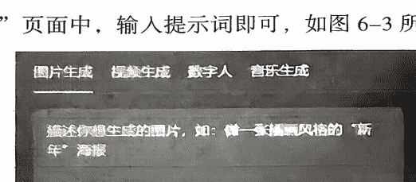
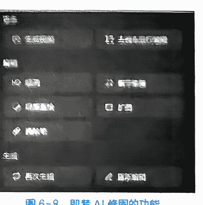
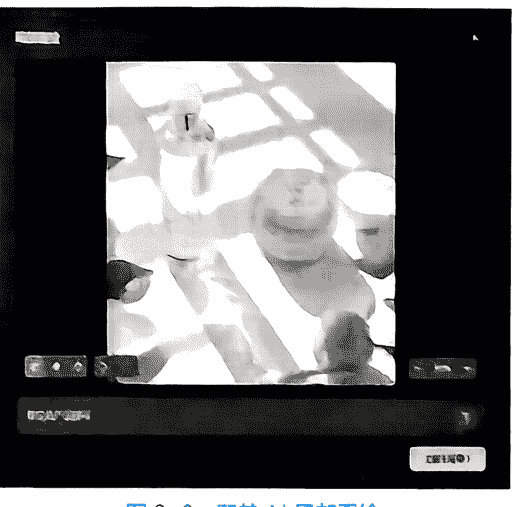

# DeepSeek 速学全攻略

# 第一章 认识 DeepSeek：高效新起点

> 信息洪流之下，提速已是刚需。DeepSeek 的出现为个人和团队带来了不同以往的使用感受与认知深度。本章从零梳理其核心功能与常用形态，讲清如何借助它提速日常效能。它不只是个工具，更能跨界辅助，在繁杂信息中快速定位要点。迈出这一步，就能重新审视工作与学习的可能性。

## DeepSeek——我们自家的智能伙伴

2025 年春节前后，DeepSeek 以迅猛势头登上人工智能版面，成为圈内热议焦点。提起 AI，很多人第一反应就是它。支撑其走红的，是创新的混合训练架构配合动态稀疏化方案，通过精细的算法调优与算力利用效率的提升，让学习与响应都更敏捷。它的崛起既是技术突破的体现，也凸显了在全球 AI 竞争中的分量。从 2018 至 2021 年的基础架构搭建期，到 2024 年的场景化落地期，再到 2025 年的全球爆发期，每一步都折射出华人科技在国际 AI 赛道上的影响力。这不仅是技术上的胜利，也象征着中国智能技术走向世界。

### （一）DeepSeek 的出现和发展

2023 年 11 月 2 日，DeepSeek 发布首个开源代码模型 DeepSeekCoder，标志着其在技术创新上的关键进展。该模型面向多语种编程的代码生成、调试与数据分析，填补了高效开源代码工具的空白。完全开源且可免费商用，让全球开发者能直接接入项目。在 HumanEval 等编程测评中，它的表现甚至超过 CodeLlama 等同类开源模型，验证了其编程实力。

一个月后 2023 年 11 月 29 日，参数规模达 670 亿的通用大模型 DeepSeekLLM 面世，包含 7B 与 67B 的基础版及对话版，覆盖对话、文本生成等多种自然语言任务。线上体验平台同步开放，任何人都能通过网页直接试用。

2024 年 5 月，第二代混合专家大模型 DeepSeek-V2 开源发布。相较前代，性能显著提升，逼近 GPT-4 Turbo 水准。MoE 架构让模型更高效，支持长上下文与多任务并行，尤其擅长代码生成与数学推理，体现出大规模训练与部署能力的进化。

2024 年 11 月 20 日，轻量级推理预览版 DeepSeek-R1-Lite 推出，为高效推理而生，轻量化设计利于低资源环境部署，推理速度与准确性获得好评。

2024 年 12 月 26 日，第三代大模型 DeepSeek-V3 同步开源发布。参数规模扩至 6710 亿，引入无辅助损失负载均衡与多词元预测 MTP 技术，生成速度大幅加快。模型性能接近顶级闭源产品，而训练成本明显更低，展现出创新与资源优化的优势。

2025 年春节后，DeepSeek 成为 App Store 下载榜的常客。背后是多年技术沉淀与精准的市场运作：清晰的定位、广泛的社交传播、持续的用户反馈收集与版本迭代，以用户为中心的模式让其迅速积累忠实用户，在激烈竞争中脱颖而出。2025 年 5 月 28 日，R1 推理模型更新至 DeepSeek-R1-0528，官方称小步升级，实测在编程、逻辑推理与长文本处理上均有明显提升。

其成功也源于独特的算法优化。不同于传统系统依赖大规模预训练，DeepSeek 借助智能算法与高效算力调度，在更短时间内完成高效学习与推理，深度学习与分布式计算能力带来更快的处理与响应，尤其在复杂任务与实时对话中优势明显。

随着发展，DeepSeek 正探索下一个应用高地。除自然语言处理与数据分析外，图像识别、语音识别、智能推荐等领域也在布局，目标是成为一个全方位的智能工具平台，为长期发展奠定基础。

### （二）DeepSeek 的技术优势

DeepSeek 不只是一个对话型工具，而是一个融合多种智能能力的创新平台。它整合自然语言处理、语音识别、计算机视觉等技术，实现跨域协同，能理解和执行更复杂的指令，从语音输入到图像识别再到实时数据处理，都在能力范围内。它兼具自主学习与多任务执行，是一个多任务平台。

架构上，混合专家 MoE 与稠密网络结合，打破了传统 AI 面对海量数据时的算力瓶颈。动态路由机制按任务需求灵活调配资源，保持高并发下的稳定与高效。更低的延迟带来更顺畅的交互，自适应响应减少了传统 AI 的重计算负担。

成本控制方面，稀疏激活技术与优化的 ARM 架构显著降低能耗，使用门槛下降。训练与部署成本远低于同类大型系统，让中小企业与开发者更容易接入，推动 AI 普及。

在中文处理上，DeepSeek 具备本土化优势，能深入理解中文语言结构、文化背景与专业需求，在金融、医疗、法律等领域表现突出。相比多语言覆盖广但中文适配度不足的竞品，其在专业术语与文化语境的理解上更精准。

推理过程更透明，用户可清晰看到从输入到输出的决策路径，增强了信任感。交互体验上，它注重情境理解与多任务协同，语义引擎能捕捉对话中的潜在意图与情感变化，提供更有针对性的服务，可随情境调整风格与深度，甚至在同一对话中并行处理多个任务，大幅提升效率。

开源生态与技术开放为市场拓展提供助力。开发者可在其基础上做个性化定制，加速迭代并促进产学合作。相比封闭生态，其开放策略让创新空间更大。

## DeepSeek 的基础操作

DeepSeek 提供网页端与移动端两种主要入口。

### （一）DeepSeek 的 PC 界面

在电脑搜索页面输入 DeepSeek，找到官方网站后进入首页，点击左下角的开始对话即可跳转注册页，已注册用户会直接进入使用界面。右下角的获取手机 App 链接可下载移动端。

注册流程简洁，输入手机号获取验证码后即可进入聊天界面。界面左右分栏，左侧为边栏与新建对话，右侧为对话区，可直接输入问题。

### （二）DeepSeek 的 App 界面

除通过 PC 端的扫码下载，也可在应用商店搜索 DeepSeek 安装。安装后进入聊天界面。登录与注册同样注重隐私与数据安全，信息均经加密处理，遵循严格的数据保护规范。

#### 基础模型（V3）模式

基础模型 V3 用于无需复杂推理的任务，响应快、直接、资源占用低，适合处理大量简单问题。未勾选深度思考 R1 时即为该模式。

例如提问地球半径，系统会迅速给出约 6,371 公里的平均值。

## （二）深度思考（R1）模式

深度思考 R1 模式面向需要复杂逻辑与深入分析的任务，会对问题进行多维度推演，给出更全面准确的答案，适用于数学难题、策略规划、复杂情境分析等。计算消耗更高，更适合少量复杂任务。勾选对话框中的深度思考 R1 即可启用。

如询问如何提升客户满意度，系统会给出提升产品质量、优化客户服务、建立反馈机制、加强客户关系管理等建议。

该模式适用于供应链优化、算法设计、营销策略制定、投资组合规划、电影主题分析、历史事件影响探讨等场景。根据问题复杂度与时效性需求灵活切换，可最大化实用价值。

无论 V3 还是 R1，均可使用联网搜索功能。联网搜索可实时访问互联网，突破知识库时效限制，提供最新信息。功能依赖网络质量，内容准确性仍需用户甄别，使用时遵循隐私保护原则，不会泄露个人信息。

## DeepSeek 如何提高个人效率

### （一）DeepSeek 在工作中的应用

在文案创作上，DeepSeek 能根据关键词或提示快速生成内容。输入品牌与产品信息即可得到营销文案，广告文案可自动匹配受众风格，节省构思与修改时间并激发灵感。

在数据处理上，它可简化分析流程。市场调研、财务分析、人力资源管理等场景中，上传数据后即可自动识别要点、分类整理并生成报告。按条件筛选可剔除无关信息，提升数据精度。

### （二）利用 DeepSeek 提高学习效率

语言学习方面，DeepSeek 可模拟母语者对话，根据水平、进度与兴趣动态调整内容，从基础词汇到专业讨论，提供口语、语法与发音反馈，提升实际交流能力。

知识获取方面，面对海量资讯，输入关键词即可快速得到精准筛选与提炼，无论历史、文学、科学还是时事，都能以简洁形式呈现核心要点，缩短学习路径。

学习进入深水区时，大多数人都有把主题拓展得更立体的冲动，却常常被时间成本和资料壁垒卡住。DeepSeek 可以即时为学习者补上语境缺口，比如追根溯源一个物理模型背后的机理，或者检索最新的前沿成果，随着探究不断打开联想空间，锻炼质疑与反思的能力。它提供的不仅是条目式的知识点，更是一条通往更深层思考的路径，让学习不再受制于单薄的讲义或零散的碎片。

高效的复盘同样决定学习成败。DeepSeek 的笔记梳理与浓缩能力正好解决了这点。无论是课堂速记、书页摘录，还是在网上搜集的文章，均可被自动提炼出主干要点，生成简洁易用的学习卡片。整理时间被大幅压缩，复习时也能快速定位想要的内容。

在资源匹配上，系统的个性化推荐也很有分量。平台会依据兴趣偏好和当前进度，推送契合度的在线课程、论文或专业读物。进入研究阶段时，它还能基于已有知识图谱推荐进阶材料，并在学习过程中给出持续的反馈与指引，让整个学习轨迹更连贯、有针对性。

团队学习时，协作效率往往决定成败。DeepSeek 能充当虚拟协作者的角色，记录会议要点、归纳成员发言，并把共识自动整理成总结文档。远程协作或现场讨论都能因此更顺畅，让协同学习更省力、更有效。

# （三）DeepSeek 的生活向导模式
在高节奏的日常里，DeepSeek 提供了覆盖效率、时间、健康等多个维度的随身助手体验，目标是省时、省心、更智能。从杂事处理到习惯养成，它都能给出实质支持。

处理琐碎事务时，它像一位高效的智能秘书。安排家庭日程、生成购物清单、查询实时天气，只需用语音或文字下指令，就能快速拿到结果和建议。询问天气时，它会基于实时数据给出准确预报，方便出行规划；在日常安排上，它还能结合个人习惯提出优化方案，避免遗漏重要事项。

时间管理方面，它擅长把任务按紧急与重要度排序，并在合适时机推送提醒，并依据使用习惯不断优化日程。若用户有固定锻炼计划，它不仅会准时提醒，还会结合当下状态推荐合适的运动类型与时长，帮助维持健康节奏。

信息整合上，它能把邮件、日程、购物清单、待办事项等碎片信息汇聚整理，自动分类，形成清晰的列表与提醒。借助历史记录，它甚至能推测物品的可能存放位置，给出查找建议，让生活更有序。

健康管理上，通过与健康类应用的数据联动，它可据身体状况和偏好定制饮食方案，并根据每日数据动态调整运动建议。针对减脂、增肌、控糖等具体目标，提供更具针对性的营养与运动组合，从细节改善健康。

购物环节，它相当于一位选品顾问。依据偏好和预算生成精准的备选清单，协助比价、找优惠，让消费更划算。随着智能家居普及，它还能联动灯光、空调、音响等设备，实现一站式居家控制。

> “操作 DeepSeek 时，提示词就是人与 AI 的沟通桥梁。越精准的表达，越能让它迅速理解意图并产出高质量内容。接下来会从基础写法讲到通用模板，再到自动生成与进阶技巧，系统讲解提示词的构建方法，掌握放大智能效果的诀窍，收获更实用、更有创造力的输出。一起拆解提示词的‘魔法’，在对话中激发更多可能。”

# 一、让需求更精准
与 DeepSeek 交互时，答案的好坏由问题本身的清晰度决定。只有先把需求说准，才能拿到对的答案。

## （一）先搞清自己真正要什么
人机沟通的核心不在于提问技巧，而在于是否真正弄清了自己的诉求。需求像一座桥，连接的是人的思考与机器的执行。只有需求足够明确，DeepSeek 才能发挥能力，提供贴合的生成结果。若需求模糊或范围过大，回应的偏差率会显著升高。

明确需求本身也是梳理思路的过程。学习者可能不仅想要定义，还想知道不同场景下的适用边界；工作者往往需要原理与操作细节，而非笼统的方案；日常生活中，“帮我选晚餐”如果没有饮食偏好、健康限制、烹饪条件等背景，得到的建议很难适用。只有把潜在诉求转化为可被理解的语言和上下文，AI 才能给出真正契合的回应。

学会辨清需求本身就是一次思维训练。很多人提问前并未想清来龙去脉，只期待一个万能解法。梳理需求时会不断校准方向，让问题更聚焦，形成与 AI 良性互动的循环，也在过程中提升对问题的洞察力。

从效率看，清晰的需求能让模型更快锁定要点。DeepSeek 并非读心者，依赖输入判断意图。表达宽泛时不确定性增加，容易得到偏离的答案。若提前补充背景、目标与限制，就能减少反复修正，答案更快趋近理想状态。

## （二）把需求完整交给 DeepSeek
清晰传递意图是获得高质量输出的前提。初次使用者常只丢一个简单问句，导致理解偏差。关键在于在提示中加入有价值的背景信息与具体要求，帮助模型在众多可能性中聚焦核心问题。

以市场文案为例，基础版提示“帮我写一篇推广文案”只能得到通用文本。若补充角色、产品、风格、受众、篇幅等要素，效果会明显提升。例如：“我是一名负责活动宣传的市场策划，想在社交媒体推广新品环保洗洁剂‘洗洁乐一号’，文案要轻松有趣不浮夸，面向年轻用户，控制在200字左右，结尾需点明环保理念并号召大家守护环境。”

在这些细节加持下，DeepSeek 会结合产品特点与用户诉求产出更有针对性的初稿，减少修改次数，提升成稿效率。精准表达需要先对需求进行思考与提炼，让模型整合关键信息后产出更贴合期望的内容，同时使用者也在互动中学会更高效的表达方式。

**通用提示词框架**
设计提示词的核心是让 AI 快速捕捉意图并产出高质量内容。通用模板通过可复制的框架，帮助用户在不同场景下找到合适的提问方式。

### （一）三要素结构
清晰传达“我要什么”的关键在于目标、背景、要求的组合。提示词需要明确任务目标、输出格式与限制条件，确保指令被严格执行。

例如需要一篇面向普通读者的量子计算科普短文，可写成：“请写一篇介绍量子计算的短科普，读者是对该领域零基础的大众，字数不超过500字，语气通俗并带一点幽默，覆盖基本概念、现有应用和未来潜力。”

目标是撰写科普，背景是主题与读者定位，要求是风格、篇幅与覆盖要点。模型据此生成类似内容的文本：用“薛定谔的猫”作比喻解释叠加，说明量子计算在科研、材料、药物筛选中的潜力，同时点出密码与大数据处理的远景，语言轻松，篇幅可控。

### （二）场景化模板
不同领域需要加入专业指向。基础三要素之外，需结合写作、编程、研究等场景调整。

1. 创意写作
想写以海洋污染为主题的短篇故事，面向初中高中生，需突出环保意识并有文学质感。提示可写：“创作一篇以海洋污染为题材的短篇故事，读者为初中高中生，突出环境保护，兼具文学感染力，避免专业术语，篇幅约300字。”

模型可能产出关于渔村少年阿遥的故事：他看到海面漂浮塑料，回忆祖父讲述的清澈往昔，发起清理行动并号召减少一次性塑料，最终在暮色中看到海面恢复生机，体现关怀与行动。

2. 编程实战
编程类提示需明确语言、功能与质量要求。例如：“请用 Python 写一段脚本，从指定新闻网站抓取最新标题，并统计每个标题的点击或点赞数以判断热度。请加入详细注释，并对网络连接失败做异常处理。”

模型会生成相应代码示例。
```python
import requests
from bs4 import BeautifulSoup

def fetch_news_titles(url):
    """
    输入：新闻网站的 URL
    功能：抓取页面中的新闻标题和相关热度信息
    输出：包含标题和热度的列表
    """
    news_list = []
    try:
        response = requests.get(url, timeout=10)
        response.raise_for_status()  # 如果状态不是 200，会抛出 HTTPError
        soup = BeautifulSoup(response.text, 'html.parser')
        
        # 假设网站标题在<h2>标签内，热度在自定义 data-click 属性中
        articles = soup.find_all('h2')
        
        for article in articles:
            title = article.get_text(strip=True)
            # 这里仅作示例，实际热度获取方式需视网站结构而定
            heat = int(article.get('/data-click', '0'))
            news_list.append((title, heat))
            
    except requests.exceptions.RequestException as e:
        print(f"抓取新闻时发生错误：{e}")
        
    return news_list

if __name__ == "__main__":
    url = "https://example-news-website.com"
    result = fetch_news_titles(url)
    # 将热度从高到低排序，并打印结果
    sorted_result = sorted(result, key=lambda x: x[1], reverse=True)
    
    for title, heat in sorted_result:
        print(f"新闻标题：{title}, 热度：{heat}")
```
这段示例涵盖抓取、解析、统计与错误处理，并配有注释，便于理解执行流程，契合提示中对语言与功能的要求。

3. 学术研究
研究类提示需强调范围、质量与引用格式。例如需要自然语言处理在教育评价领域的最新文献与简要综述，模型会据此列出相关论文并做归纳。

**DeepSeek**

# （1）数学课堂中的自然语言处理技术应用探析

> ① 研究意图：探索自然语言处理技术在数学课堂教学中的实践路径，旨在提升教学成效、点燃学生的学习热情并推动个性化教学进程。
> ② 研究路径：借助文献梳理与典型案例分析，立足数学课堂的真实需求，设计并试点由 NLP 技术（1）驱动的评测工具，从而检验其对教学质量的改变。
> ③ 核心结论：引入 NLP 技术后，学生对数学的理解深度与学习兴趣均得到明显提升，且教师能够获得更精准的教学反馈，进而更好地实现个性化教学。
> ……

> # （2）核心素养视域下 NLP 课程建设与教学变革研究

> ① 研究意图：梳理 NLP 技术融入课程设计的可能路径，以培育学生核心素养为抓手驱动教学改革。
> ② 研究方法：运用行动研究的方式构建 NLP 驱动的课程框架，并通过对照实验比较传统教学模式与 NLP 辅助教学的效果差异。
> ③ 主要发现：NLP 技术可明显增强学生的语言处理能力与核心素养，同时为教学改革提供了有力的技术支撑。
> ……

> # （3）中学阶段学生 NLP 技术学习研究
> ……

> # （4）学生 NLP 学习能力提升与应用实践
> ……

> # （5）NLP 对高等教育变革的影响研究
> ……

> ① NLP 技术，即自然语言处理，是人工智能领域的重点方向，整合了语言学、计算机科学、机器学习、数学以及认知心理学等多学科知识。
> ② 出于篇幅考虑，本书将部分由 AI 生成的内容统一以"……"标示。

## 4. 按需定制与模板调整

我为一家初创咖啡品牌策划市场推广，希望 DeepSeek 协助完成以下三项工作：

- 简要分析竞争对手，梳理主要竞品的市场定位与核心优势；
- 基于分析结果，拟定线上线下结合的初步推广方案，突出产品特点与品牌故事；
- 粗略估算推广预算，并给出合理的费用分配建议。

**品牌概况：**品牌主打时尚年轻且高性价比的咖啡，核心客群为 18 至 30 岁的都市白领与在校学生。整体调性轻松活泼，期望在社媒实现大范围曝光，同时探索线下快闪店、周边联名等创新营销形式。

```details
<summary>需求</summary>
竞争对手分析部分不超过 300 字，列举两到三个主要对手即可。
推广方案可分为线上线下两部分，形式以简明的要点说明为主。
预算方案需包括大致的费用分配比例，以及推荐的广告投放渠道。
整体文字风格不必过度严谨，但要保持逻辑清晰、易于执行。
</details>
```

DeepSeek 生成的回复如下：

```details
<summary>DeepSeek</summary>
### 【竞争对手分析】
在年轻潮流咖啡市场上，目前主要的竞品包括 A 咖啡和 B 咖啡。A 咖啡依托连锁门店的高覆盖率，为消费者提供便捷且个性化的咖啡体验；B 咖啡则主打精品咖啡豆与咖啡师文化，吸引对品质和环境有较高要求的中高端消费人群。相比之下，我们的新品牌可以利用亲民价格和活泼风格，在更广泛的年轻群体中迅速建立认同。

### 【推广方案】
**线上部分：**
- 在微博、抖音等社交媒体平台开展“我的咖啡日常”话题活动。鼓励年轻用户分享个性化咖啡瞬间，并搭配轻松诙谐的营销文案。
- 与相关的生活方式博主或美食博主合作，进行种草笔记或短视频制作，通过创意内容吸引粉丝关注。

**线下部分：**
- 在核心商业区开设限时快闪店，采用极具年轻感的装饰设计，结合打卡赠礼活动，快速提升话题度。
- 推陈出新限量周边（如咖啡手提袋、趣味贴纸等），借助社交圈层扩大品牌形象。

### 【预算与费用分配】
整体推广预算可分为：线上投放 60%、线下活动 30%、预留创意 10%。线上部分主要投放于社交媒体平台广告和 KOL 合作，可视实际成效灵活调整。线下活动的费用集中在快闪店租赁、装修布置及活动执行上，并可根据品牌曝光度设定不同程度的投入。最后，建议保留部分预算以应对可能的新媒体合作机会或紧急活动需求。
</details>
```

该示例回答中，DeepSeek 严格依据提示词将内容拆解为竞争对手分析、推广策划与预算分配三大板块。既符合字数与内容要求，又贴合“年轻活泼、高性价比”的品牌定位。之所以能输出结构清晰且可操作的方案，关键在于提示词把“目标—背景—要求”细化为分阶段任务，并在每个阶段配套了具体条件与指引。

若想获得更细致的结构，可在提示词中为每个子任务补充细节约束，或把不同任务拆到独立的对话轮次中，再统一整合最终成果。

无论是编程、学术研究还是产品策划，这种定制化思路都能帮助用户更好地掌控对话节奏与深度。通过持续试验并观察 DeepSeek 的反馈，用户可以逐步沉淀出最适合自身习惯的工作模板。这样即便面对复杂多层的需求，也能在人机协作中游刃有余，大幅提高工作与创作效率。

## 三、自动化生成提示词

上文可看出，提示词本身也是文本。既然是文本，就能利用 DeepSeek 来自动生成。核心思路是让模型基于已有输入信息，为不同任务自动产出适配的提示词。

### 第一步：明确用户初始需求

提示词自动生成的起点是用户输入。用户需清晰说明需求，涵盖主题、目标、使用场景等要素。DeepSeek 会解析输入文本，抽取关键词并把握意图，为后续生成提供基础。需求越明确，生成的提示词越精准。例如想借助 DeepSeek 撰写人工智能在金融领域应用的文章，可这样提问：

> “问题：我想写一篇探讨人工智能在金融行业应用的文章，但对结构设计没把握，请帮我生成一个可用于 DeepSeek 生成该文的提示词。”

### 第二步：需求解析与初步提示词生成

DeepSeek 借助自然语言处理能力解析用户输入，提炼关键概念如“人工智能”“金融领域”“文章结构”，并结合既有的提示词生成规则，快速产出一个基础框架，帮助用户明确写作方向。

> “建议：请为一篇主题为人工智能在金融领域应用的文章设计结构，需涵盖背景介绍、技术应用场景、优势挑战及未来趋势。”

### 第三步：用户反馈与优化

初步提示词往往还不够贴合实际需求，因此进入用户反馈优化环节。通过用户的意见，DeepSeek 可对提示词的内容与结构进行调整，使其更接近真实意图。

> **第二章 DeepSeek 的提示词全解**
>
> - **用户**：希望结构更精简，并聚焦人工智能在风险管理与投资决策中的作用。
> - **DeepSeek**：请为一篇关于人工智能在金融领域应用的文章设计框架，重点放在风险管理与投资决策上，需包含背景介绍、典型案例、技术优势及未来展望。

### 第四步：用户根据提示词细化需求

优化后，用户往往会进一步细化要求，使提示词更具可操作性。比如明确每个部分应包含的具体内容。DeepSeek 据此生成更详尽的提示词，确保可直接使用。

- **用户**：希望文章结构更具体，明确各部分应涵盖哪些内容。
- **DeepSeek**：请设计一篇文章的结构，主题是人工智能在金融领域的应用，重点突出其在风险管理和投资决策中的应用。要求包括以下部分：
  - **背景概述**：简要介绍人工智能技术演进及其在金融行业的潜力。
  - **应用场景**：具体阐述人工智能在风险管理与投资决策中的典型案例。
  - **核心优势**：剖析人工智能在金融应用中的优势，如效率提升与准确性增强等。
  - **前景展望**：讨论人工智能在金融领域的未来走向与潜在挑战。

经过反复反馈与迭代，DeepSeek 最终输出符合预期的提示词。该提示词为用户提供了清晰的任务框架，可直接指导 DeepSeek 执行后续工作。

## 四、提示词进阶技巧

在使用 DeepSeek 时，掌握一些进阶技巧可以充分释放 AI 潜力，高效完成复杂任务。把握分阶段控制、多维度表达和及时纠偏，就能为创新与决策提供更精准的支持。

### （一）深入理解提示词的多维度设计

与 DeepSeek 互动时，提示词已不再是简单的指令加信息，而是一个融合目标、语境、层次与风格等多维度的整体框架。只有在各维度上精心设计，DeepSeek 才能更精准把握需求背后的意图，输出更有价值的回应。无论是写作、研究、数据分析还是产品策划，多维度设计都能提升模型的理解力。

明确“目标维度”，即对话要解决的核心任务。比如撰写未来城市规划研讨稿，需在提示词中开门见山说明目标：是创意发散还是可操作的方案。目标越清晰，输出方向越明确。

完善“语境维度”，让模型了解所处背景。提出交通方案时，应说明城市人口、地理特征、经济目标及交通优先策略。缺少背景，回答易流于笼统。

关注“层次难度”，将大任务拆分为宏观梳理与微观展开，可附加关键指标与参考数据，让模型做定量或定性阐述。

最后是“风格维度”，影响可读性与专业度。需通俗科普时，可强调故事性与易懂表达；需正式报告时，可标注受众与用途，模型据此调整语气。

以下是一个融合多维度思路的示例，假设需为一座滨海旅游城市撰写一份可操作的十年规划报告，要求涵盖生态保护、交通基建和文化产业，并以情感呼吁促公众参与。提示词可写成：

> # 请协助撰写《滨海城市未来十年综合规划报告》，旨在为政府决策提供参考，需在环保、交通、文化三方面提出可行方案，并在结尾加入一段号召性文字，动员公众共同参与。
>
> **城市概况**：常住人口约 80 万，主导产业为旅游与渔业，面临海岸线侵蚀和交通拥堵等挑战。文风需兼具专业说服力与可读性，全文约 3000 字。

DeepSeek 接收后回应如下。

# **第一部分：海洋生态保护与可持续发展**

### （二）利用提示词高效执行复杂任务

当需求升级为多步骤、多维度的复杂任务时，DeepSeek 需在不同阶段建立逻辑衔接。要提高效率，关键在于合理拆分任务、强调阶段目标，并通过精确指令持续引导多轮迭代。

第一步为复杂任务设定清晰分阶段目标。复杂项目通常含多个子环节，需明确顺序。例如“电商平台市场分析+核心产品策略+竞品差异化方案”，提示词应先要求市场分析，再产品策略，最后竞品对比。通过编号命名，输出更清晰连贯。

第二步丰富阶段间上下文衔接。各阶段常需前一阶段成果作为输入。提示词中可显式写明“在上一阶段结论基础上进行下一步分析”，避免内容割裂与重复劳动。

第三步对关键节点重点提示。即使任务已拆分，仍可能存在决定成败的关键环节。可在提示词中单独说明必须讨论的指标与条件，让模型优先处理。

示例场景：用户需 DeepSeek 协助策划线上课程，分为需求分析、课程大纲与推广策略三阶段。提示词与反馈如下。

## DeepSeek 的提示词全解

> 

我计划打造一个面向编程基础薄弱成年人的线上课程。请按三阶段推进：

- **阶段一：需求分析**
  - 如何收集潜在学员的学习需求；
  - 学员最关注的编程语言与学习方式。
- **阶段二：大纲制定**
  - 在阶段一结果基础上；
  - 设计课程模块、学习时长与教学形式；
  - 控制难度与学习节奏。
- **阶段三：推广规划**
  - 制定社群运营与社交媒体营销方案；
  - 融入讲师个人品牌，增加互动提升吸引力；
  - 每次输出前先简要回顾上阶段结论，保持逻辑连贯。要求条理清晰、方案具体可执行。

DeepSeek 生成的内容如下。

> 

**【阶段一：需求分析】**

收集学员需求可结合线上问卷与社媒调研。问卷能精确量化学员的基础与兴趣，社媒平台如编程论坛、公众号讨论区则能反映学员对课程形式和互动性的偏好。现有数据表明，初学者最青睐 Python 和 JavaScript，并希望课程提供实时互动与答疑支持。

**【阶段二：课程大纲规划（承接阶段一发现）】**

模块安排：

- **基础语法与环境搭建**：调研显示学员常被环境配置困扰，首个模块宜以详细演示为主。
- **项目实操**：多数学员希望通过动手项目加深理解，中后期可引入爬虫小工具、网页交互等实践。

  **教学形式与节奏把控**：
  - 每模块以 1 至 2 小时视频为主，辅以线上直播答疑。
  - 采用“自测+反馈+讨论”联动的互动机制，通过短测巩固重点知识。

**【阶段三：推广方案（基于前述设计与需求）】**

- **社群运营**：
  - 为参与调研的群体建立学习互助社群，定期举办小项目挑战，增强学员成就感与归属感。
- **社媒营销**：
  - 在短视频平台推出“编程并不难”系列内容，展示课程亮点与成功案例，吸引潜在用户。
  - 借助讲师个人品牌开展“讲师答疑周”，通过直播或在线问答提升互动黏性，扩大影响力。

该示例中，用户先界定场景，再把大任务拆为需求分析、大纲制定、推广规划三阶段。DeepSeek 按指令先回顾上阶段核心发现，再展开下一步具体方案。层层衔接使内容条理清晰、各阶段成果得以最大化利用。

利用提示词高效执行复杂任务的本质在于细化与串联。通过多轮对话与阶段式指令，可让 DeepSeek 逐步延伸思路，避免重复并保证准确性与层次感。人机协同中，用户负责整体设计与评估，DeepSeek 负责快速分析、整理与生成。掌握分层级、多阶段、强衔接的提示词设计，是释放潜力的关键一步。

# （三）提示词纠错与优化方法

即便已考虑多维度设计，生成结果仍可能不尽人意，出现风格偏差或内容遗漏。需对提示词与交互方式进行调整优化，引导 DeepSeek 更精准理解需求。过程类似软件调试，需先识别差异点，再用更明确的提示词或上下文修正。

第一步辨别错误性质。常见问题包括格式不符、重点缺失、信息冗余、风格偏差或逻辑不连贯。例如要求兼顾学术严谨与通俗易懂，却得到过于口语化且缺乏引证的文本，可判断提示词对学术化强调不足。

第二步针对性修正。若缺少关键概念，需在提示词中补充背景说明并列为重点；若风格不符，需进一步强调专业度、语言基调或引文规范；若逻辑松散，可注明“请分步骤展开论证，并在每步间做总结或过渡”，促使模型强化段落衔接与因果逻辑。

# 提示词打磨：从模糊到精准的进阶路线

在真实使用场景里，纠错与优化几乎都离不开多轮试炼。下面用一个微型案例说明指令层面如何做校准。假设要让模型写一篇关于人工智能对就业前景影响的短评，既要呈现核心论点，也要控制篇幅。第一次给出的指令比较笼统：

> 用简短文字写关于个人工智能对未来就业影响的微型论文，分析要透彻，给出一个合理的结论。写作覆盖了，限制在 800 字以内。

仅凭这种概括描述，返回的内容多是“AI 会替代部分岗位”“要拥抱变革”之类的套话，对教育和人才再造几乎不展开。若想补齐短板，就必须在指令里加入更明确的牵引，改写后的指令如下：

> 我需要一篇关于“人工智能对未来就业影响”的微型论文，字数控制在 800 字左右，讲究分点的深度和条理性。
>
> **具体要求：**
>
> - 在问题分析部分，请引用或提及至少一份近五年的公开研究数据或统计数据。
> - 务必讨论教育与人才转型如何在商业环境中发挥作用。
> - 结尾给出一个带有前瞻性的总结，以鼓励个人或企业主动适应 AI 时代的变革。
>
> 行文风格可兼顾学术性与可读性，做到数据翔实与表达流畅并重。

新版指令强化了三项要素：数据引用、教育与人才转型的展开、具有前瞻性的收束。模型收到这种更具体的描述后，产出通常会带上统计引用的段落，并对教育环节作出补充，有效弥补了首版的不足。调试后的效果示例是：

> 近五年来，随着人工智能技术不断突破，全球范围内有大约 14% 至 20%的传统工作岗位面临被自动化取代的风险，招募国际咨询机构的调研报告给出了这一区间，该现象在制造业、客服领域尤为突出。进而，人工智能也在催生新的工作形态，比如数据管理、算法维护和人机交互设计等。为更好地应对就业转型，教育领域需要大力推广跨学科课程，培养学生不仅具备编程能力，还需掌握跨领域的创新思维。对于已经工作的群体，则可通过职场培训和在线课程实现“再学习”的平滑过渡，帮助他们在 AI 密集的场景下保有核心竞争力。……未来人工智能与人类的关系绝非简单的取代与被取代，它更可能是帮助更多人卸下重复劳动的桎梏，使人类能够将精力投入更具创造性或社会价值的工作中。主动适应、主动学习，或许才是迎接人工智能时代的明智之举。

从修正过程可见，在基础指令上追加指标或子任务，是把模型拉向预期方向的高效方式。使用者要扮演调试员的角色，通过在提示词里设定更详尽的条件与评判标准，让结果逐步逼近理想答案。若调试后仍有缺口，可针对新问题做更精细修饰，比如要求更权威的数据来源、细化教育转型的操作建议、为结尾增添更具启发性的案例等。

把调试与优化纳入指令设计流程，就能有效减少与模型之间的沟通偏差。所谓好钢用在刀刃上，在这里体现为把目标和限制条件写进指令，让模型一开始就对准重点，避免反复试错。即便面对高难度、多层次的综合任务，“完善指令→检验结果→再次调试”的循环也能迅速挖掘模型的潜力。

反复应用错误调试与优化技巧，最终可以形成一套可复用的方法论：先小范围试跑，再有针对性地修正关键点，最后持续迭代直至达标。

# DeepSeek 实战：智能时代效率提升路线图

对于需要批量生产内容或经常处理复杂创作任务的人来说，这项能力是显著提升工作效率与成果质量的关键。因为在人机协同的当下，模型的聪明程度很大程度上取决于我们能否提供足够精准完备的指令地图。地图越完整，AI 探索知识与创意的轨迹就越清晰，也越容易抵达预期终点。

<sup>42</sup>

# 第三章 DeepSeek 办公辅助

日常办公中，繁重任务常常让人难以兼顾效率与质量。DeepSeek 的强项恰好能兼顾这两点。本章聚焦它在公文撰写、工作汇报、演讲稿等场景的实战用法，涵盖 PPT 大纲生成、品牌文案创作、会议纪要辅助等多种情形。通过大量实例，可以体会 DeepSeek 如何迅速抓住核心、理清思路并让文字表达更清晰流畅。让我们一起挖掘这款 AI 助手的价值，为繁忙的工作注入新活力与新创意。

## （一）公文结构与语言规范

公文写作通常目标明确、格式严谨。无论是通知、报告、请示还是批复，都需遵循一定规范，以便读者快速获取要点。为了兼顾效率与质量，先要明确整体框架，再注意语言庄重准确，最后保证内容条理清晰、层次分明。借助 DeepSeek 撰写公文，首要前提是清楚结构与语言规范。

### 1. 公文结构与语言规范

结构上，公文一般包括标题、主送单位、正文和落款四部分。标题要简明，通常直接点明文种与主题，如“关于××工作安排的通知”或“关于××事项的请示”。必要时可用副标题补充时间、范围等背景。主送单位是不可或缺的要素，明确接收对象，避免转送延误。正文是核心，多采用总—分—总布局，先交代背景目的，再展开论述，最后总结并提出可执行要求。落款包括发布单位与签发日期，以确保权威性与时效性。

语言上，公文追求严谨得体准确。应尽量避免口语化或随意表达，防止歧义。虽然保持正式风格，但也要简明扼要，避免冗赘。行文宜用简洁明了的句式，提升阅读效率；必要时可用分条列点，让读者快速定位重点。公文中常需引用法规或上级文件，要保证引用的完整准确并注明出处文号。对数字、时间、称呼等细节，也须按规定表述，保持全篇风格一致。

为提升可读性，可在正文中加入过渡性短句。例如，多项措施之间用“首先”“其次”“最后”保持层次；专业术语或缩略语首次出现时加以解释；内容复杂时，可在结尾简要总结或给出执行路径，用精炼语句或图表强化要点。

### 2. 使用 DeepSeek 的具体流程

常规公文写作借助 DeepSeek 生成初稿的流程分为三环节：明确需求、撰写提示词、迭代优化。在完整流程里，用户需先把公文的大致结构与重点告知 DeepSeek，再结合初次输出，针对不足偏差多次微调，最终定稿。

#### （1）明确需求

公文有固定结构与语言规范，所以在提出请求前，要先弄清文种，如通知、批复、请示；主要读者，如下属部门或上级机关；以及要传达的核心信息。此阶段可准备关键信息，如日期、地点、执行措施，便于后续写入提示词。需求越清晰，生成文稿越贴合目标。

#### （2）编写提示词

向 DeepSeek 说明具体要求。可用“目标→背景→要求”的思路简要准确描述。示例提示词如下：

> 我需要撰写一份“关于 202×年国庆节放假安排的通知”公文，用于公司内部发布。通知要包括放假时间、调休安排以及各部门的值班安排。语言风格要正式且简明，标题和正文需符合公文规范，文末请留空待填公司名称与日期。

在上一次的放假通知基础上，补充具体调休日期，并确保正文段落之间用清晰的逻辑衔接词来区分放假与调休安排。同时在倒数第二段增加一句“各部门负责人须妥善安排人员轮值，确保安全生产和紧急事务处理”，其余内容基本满意，保持目前的行文风格和长度。

DeepSeek 会据此再次生成修订版。在反复修改中，可针对性引导格式、措辞、重点提示等细节。例如要求“全文控制在 400 字左右”，或强调“采用更正式措辞，去掉口语化词汇”。经过一到两次迭代，就能得到结构、语言、内容都较为完善的草稿。

在整个流程里，DeepSeek 充当随时可用的写作专家，根据提示词不断调整输出，让文稿逐渐符合规范与企业需求。对初学者而言，只要把文种、受众、要点描述清楚，就能得到可参考初稿；对有经验者，则可快速创作各类公文并灵活调整，大幅提升效率。

### （三）示例：编写公司内部的节能减排倡议书

为直观展示如何用 DeepSeek 撰写公文，本节通过一个具体示例说明提示词设计与模型回复。通过此例，可看到如何在指令中融入公文框架与重点信息，以及实际产出大致模样。

假设要以“倡议书”形式向全体员工宣传节能减排，鼓励工作与生活中落实环保理念。已明确要点：倡议背景、具体措施、各部门职责、结束语。使用如下提示词：

> **问：**
> 请帮助我撰写一份公司内部的节能减排倡议书，主要面向全体员工。倡议的内容应包括以下要素：
>
> 1. 强调目前公司面临的环保责任和节能减排目标；
> 2. 列举至少三条具体可执行的节能减排措施（如节约用电、减少一次性用品使用等），并简要说明实施细则；
> 3. 向不同部门提出相应职责，比如行政部门如何优化空调温度设定、后勤部门如何合理处理垃圾分类；
> 4. 最后以简明有力的呼吁结束全文。
>
> 行文要正式，但可以适当带点亲和力，让大家觉得易于接受，并且切实可行。全文控制在 500 字左右。请注明公司名称和日期。

DeepSeek 收到信息后会先生成初稿，通常已包含公文框架与主要内容，但在语气、字数或细节上可能需调整。如前面放假通知的例子，初稿可能缺少具体调休日期或表述不够精准。

#### （3）迭代优化

阅读初稿后列出修订要点，再把要点写入新提示词要求修改。若初稿不足，可这样补充：

> > 在上一次的公文基础上，补充具体执行细节，并确保正文段落之间用清晰的逻辑衔接词来区分不同措施。同时在倒数第二段增加一句“各部门负责人须妥善安排人员轮值，确保安全生产和紧急事务处理”。其余内容基本满意，保持目前的行文风格和长度。

DeepSeek 会据此再次输出修改版。在反复调整中，可有针对性地处理格式、措辞、重点提示。例如要求“全文控制在 400 左右”，或强调“采用更正式措辞并去掉口语化词汇”。经过一到两次迭代，就能得到较为完善的公文草稿。

在此流程中，DeepSeek 扮演随时可用的写作专家，根据提示词不断调整输出结果，让文稿逐渐符合规范与需求。初学者只要把文种、受众、要点说清，就能获得参考初稿；有经验者则可利用其快速创作并灵活调整，大幅提升写作效率。

## 关于进一步推进节能减排的倡议书

各位同事：

随着公司规模不断扩大，日常运营中的能源消耗也在增长。为践行社会责任，实现低碳可持续发展目标，现发出倡议，呼吁全体员工共同参与节能减排行动：

首先，请大家在办公室和公共区域落实节约用电，离开工位时及时关闭电脑显示器和照明，减少不必要浪费；行政部门可适当提高中央空调温度设定，避免长时间低温制冷导致电能过度消耗。

其次，倡导减少一次性用品使用。公司茶水间备有可重复使用的杯子和餐具，后勤部门将加强垃圾分类管理，为废纸、塑料等可回收物提供专门回收点。

让我们从自身做起，从每个细节着手，共同呵护赖以生存的环境。只要大家都能贡献一份力量，公司将更具社会责任感，也为绿色地球的明天增添清新色彩。

公司名称

日期

从这个简单示例可见，DeepSeek 在输出时会遵循公文或倡议文体的格式要求，包含标题、称呼、正文和结尾呼应。同时根据提示词列举的关键点，提供节约用电、减少一次性用品等具体措施，并对行政和后勤部门作出职责分工。行文在正式与亲和之间取得平衡，并将全文控制在数百字以内。

### 复盘与修正

若发现遗漏重点内容，如垃圾分类实施细节，或希望结尾加入环保名言，可通过修订提示词进行二次调整。

在原倡议书基础上，再补充垃圾分类的具体执行方式，并在结尾增加一句环保名言，如“保护环境，人人有责”，保持其余内容不变。DeepSeek 会据此再次输出修改版，完成更细致的修正。通过“先生成→再优化→多次迭代”的方式，既能高效完成公文草稿，又能不断完善内容。

### 二 工作报告撰写

撰写工作报告时，通常需要向上级或团队展示一段时期的工作进展、成果与问题。此类报告最看重事实客观呈现与数据分析解读。无论是月度运营报告、项目进度汇报还是年度总结，都离不开恰当运用数据并得出可执行结论。为了让内容有条理易懂，需先组织好相关数据，再基于数据形成有说服力的观点或建议。用 DeepSeek 辅助撰写工作报告同样要梳理结构与逻辑。

#### （一）工作报告的结构和逻辑

选数时要考虑受众。若报告面向上级，可从成本节约、销售收入、合规率等宏观指标入手；若供团队内部复盘，可聚焦日常运营或项目进度的具体数字，如任务完成率、流程节点耗时、用户满意度等。无论宏观还是细节，都应紧扣主题，避免无关数据造成冗余。还可配合表格或图形可视化，使脉络更清晰。

数据呈现后，要提炼其背后意义。与其堆砌统计结果，不如找到关键原因与改进方向。如某月产品退货率骤升，可通过分析退货原因、客服反馈及竞品对比系统性挖掘因素，再遵循“现象→原因→对策”思路，提出可执行的改进方案，如完善检测流程、提升包装发货速度、优化客服回访机制等。这样报告不仅指出问题，还提供实质思路。

很多报告末尾会附未来规划或展望。此时需基于前文分析连贯阐述，避免断层。若数据反映某营销活动成效不佳，后续规划就应围绕优化投放渠道或升级活动策略展开，形成“用数字说明问题，用分析给出方向”的闭环。

写好工作报告的关键是：锁定目标受众，基于主轴选取能体现成效或核心问题的最相关数据，最后据此得出结论或建议。准确数据与条理化解读结合，才能让决策者真正理解现状与难点，并作出更有针对性的决策。

### 使用 DeepSeek 的使用流程

在撰写过程中，DeepSeek 可扮演“数据分析助手”与“内容呈现指导”两重角色，快速生成结构完整的初稿，并通过多轮对话完成局部修改与细节补充。与其他文案不同，工作报告更看重数据准确性与逻辑连贯性，因此在提出需求时，既要让模型理解报告目的与结论导向，也要对数据来源、核心指标及预期格式作出明确说明。主要过程如下：

1. **明确需求和具体数据**

开始对话前，需整理本期报告目标、关注重点及数据来源。例如要撰写“月度运营报告”，重点在用户增长、营收结构和运营活动成效。最好提前收集数据，如当月新增用户数与来源分布；营收构成，如主产品、增值服务、广告收入；运营活动带来的转化效果。信息准备就绪后，才能在提示词中清晰对应各模块。

#### 编写提示词生成初稿

准备好数据与要点后，可通过详细提示词告知 DeepSeek 如何组织整篇报告，示例如下：

> **问**
> 请帮我撰写一份"×月运营报告”，主要面向公司管理层。报告应包含以下模块：
> - **概括性前言**：本月整体状况总结；
> - **数据表现**：列出本月用户增长曲线（新增用户 1.2 万人，相比上月增长 15%）、营收结构（主产品收入约 120 万元，增值服务收入 40 万元），并简单说明与上月的对比；
> - **运营活动分析**：包括本月开展的限时折扣活动、社群运营活动及线上推广，共带来约 3000 名新用户和一定的口碑提升；
> - **问题与改进**：探讨新老用户转化率偏低、活动周期过短等问题，提出相应的优化思路；
> - **结尾**：对下个月的预期目标做出展望，字数控制在 1500 字左右，语言清晰扼要。

DeepSeek 收集指令后，会依据提示中的关键数据与结构提示生成初步草稿，包含前言、主体数据、问题剖析等，总体框架与逻辑基本满足要求。

但细节上需微调，因此需要继续对提示词进行迭代优化。

#### 3. 提示词迭代打磨

假设 DeepSeek 生成的首版月度运营报告里，对“社群运营活动”的剖析还不够到位，或在“问题与改进”部分缺少可落地的举措，就需要对指令进行补充完善。一次典型的追加指令可以是：

> 请在上一版的×月运营报告中，针对社群运营活动如何拉升用户粘性展开详细说明，并附上相应的数据支撑；
> 在“问题与改进”章节补充新用户留存率提升的具体做法，例如引导用户使用高级功能、设计新手引导任务等，同时保证全文控制在 1500 字以内。

有了这条补充，模型会再次处理或修正草稿，为社群活动的分析补充实证数据，也让改进建议更具执行细节。通过数轮这样的提示词优化，就能逐步得到一份内容精炼、条理清晰、数据可溯的月度运营报告。

从这个简例可见 DeepSeek 在工作报告写作中的核心价值有两点：一是基于要点快速产出结构合理的初稿，大幅压缩起草时间；二是经多轮指令校准后，报告的数据与结论更具针对性和操作性，帮助阅读者在最短时间内掌握运营态势并作出决策。对于需要总结工作成果的任何人，这套流程都能带来明显效率提升。只要在每一步清晰指出修改方向并提供充足上下文，DeepSeek 就能把最初的粗糙思路打磨成兼具逻辑深度与可读性的成品，让团队协作与决策分析都更省时省力。

### （三）实操案例：季度运营报告的生成过程

为了更直观地理解如何借助 DeepSeek 完成工作报告，这里以一份面向公司高层的季度运营报告为例。假设本季度需要呈现的核心信息如下：

* 营收约 300 万元，同比增长 20%；
* 核心产品 A 占销售额 60%，新上线的增值服务 B 贡献营收 15%；
* 用户规模从上季 10 万提升至 12 万；
* 当季开展的大型线上活动带来 1 万名新用户并获得较好口碑；
* 主要短板是跨部门协作流程不成熟，新用户留存偏低；
* 下季度打算强化产品迭代与客服体系建设。

据此整理的初始提示词大致是：

> 请基于以下信息撰写一份面向高层的季度运营报告：
> - 本季度营收 300 万元，同比 +20%；
> - 主力产品 A 占 60%，增值服务 B 贡献 15%；
> - 用户 10 万增至 12 万；
> - 大型线上活动新增 1 万用户；
> - 问题：协作流程不成熟，新用户留存不足；
> - 下季度计划：加快产品迭代、完善客服系统。
> 要求分为“整体概览、数据与分析、问题与改进、未来规划”四部分，语言简明紧凑，约 1200 字，每部分突出关键数据并配以解释与建议。

模型据此生成的内容框架为：

整体概览指出营收 300 万同比提升 20%，用户从 10 万增至 12 万，线上活动对业务扩张与品牌声量起到正面作用。

数据与分析部分说明产品 A 仍以约 60% 占比领跑，增值服务 B 虽仅占 15% 但潜力明显；活动期间新增 1 万注册用户，其中约三成在首月完成首付，体现转化效果。

问题与改进部分提到协作流程存在信息传递不畅导致进度延缓，并指出部分新用户未能感知增值服务价值，需优化产品引导与说明。

未来规划提出两条主线：一是加速产品升级迭代，提升服务 B 的吸引力；二是升级客服体系，完善工单处理与线上专线，确保新老用户获得及时专业支持，以此巩固用户粘性并拓展市场。

可见模型严格按提示划分四段，既解释核心指标也给出建议，满足管理层快速阅读需求。若想进一步细化留存提升方案，或在概览中加入图表说明，只需追加指令如“补充留存率提升的具体措施，例如新手引导、限时优惠券机制”，系统便会基于新要求进行二次生成。通过“提出需求—审阅草稿—精细化修正”的循环，能从粗框架快速进化为结构完整、内容充实的工作报告。

### 演讲稿撰写要点

演讲不仅是信息传递，更是情感驱动与行动激发。在正式场合，发言者需用语言打动听众，引发共鸣与兴趣，其效果直接影响决策与反应。

# AI 时代个人效率提升指南

DeepSeek 实战要点：

- 将报告拆分为“整体概览、数据与分析、问题与改进、未来规划”四块；
- 文风简练、逻辑紧凑，控制在约 1200 字；
- 每部分均突出关键数据或典型案例并给出解读与建议。

## （一）场合定位与情感传递

### 1. 场合匹配：因听众而异的表达方式

撰写演讲稿的关键不是辞藻华丽，而是根据场合与听众找到合适的语言风格与切入点。演讲的目标是在有限时间内影响情绪与思考，因此必须先明确场合属性，如商务会议、学术论坛或公众活动，并据此设计主旨与语气。

不同场合对专业度的要求不同。学术场合需要严谨与数据支撑，企业内部更看重说服力与可执行性，公众活动则依赖生动故事与真挚情感。听众身份也会影响用词：面向专家可加入专业术语与行业洞察，对普通公众则宜从熟悉场景切入，让内容易懂有趣。

### 2. 情感表达：真诚引发共鸣

适度的情感能提升注意力。当稿件包含真诚感受、与听众相关的故事时，连接感才会建立。可先思考希望听众产生何种感受，再选取相应事例。例如公益倡议可用真实经历唤起共情，变革方案可从共同愿景激发进取心。

情感运用需把握分寸，避免冗长煽情。常用结构是先用故事或思考点切入，再提炼核心观点，以小见大，将个人经历与组织目标或社会背景呼应，使演讲既不空洞也不堆砌。

本质上，写演讲稿就是与听众对话。设想台上对面的人是谁、想听什么、如何表达才能触动他们，思路自然清晰，后续打磨即可形成兼具说服力与温度的稿件。

## （二）借助 DeepSeek 的创作流程

DeepSeek 更像创作搭档，能协助梳理逻辑、润色语言并在多轮迭代中完善内容。

### 第一步：明确演讲需求与场景

先确定听众与目标，例如“公司年会”“回顾市场部成绩并展望新年目标”“语气热情且有号召力”等。背景越清晰，生成内容越贴合。

### 第二步：编写初始提示词生成初稿

提供框架与情感需求，示例提示如下：

> 帮我撰写一篇公司年会的演讲稿，我是市场部负责人，需回顾一年在市场拓展与品牌曝光方面的成果，并号召大家为新目标努力。开场加入真实团队故事体现凝聚力；中段呈现关键数据与案例突出成效；结尾以饱满热情进行号召。语言正式中带温暖与适当幽默。

模型通常会先给出结构清晰的初稿，包含团队加班故事、业绩回顾、未来目标与共勉语句，便于校验场合契合度与情感强度。

### 第三步：多轮迭代优化

若发现故事概括性强，可补充指令：

> 请在团队故事中加入一次克服困难的具体片段，并在结尾增加一句激励口号，推动新年市场冲刺。

系统会针对性修改。若需控制时长或加强数据说服力，也可追加“控制在 3 分钟、约 800 字”或“多引用去年成功案例数据”等要求。经过数轮精修，可得到既有条理又富感染力的演讲稿，帮助从容应对各类发言场合。

### 示例：公司年会致辞实操

假设市场部负责人需在年会回顾业绩并鼓舞士气，要点包括：年度目标超额完成 20%、举办 3 场大型品牌活动、团队多次克服资源紧张与外部变化、新一年聚焦业务升级与跨部门协同。

据此生成的致辞会先总结业绩超额与活动带来的行业关注，再讲述一次活动筹备中跨部门连夜调整方案、解决场地问题的片段以体现担当，最后提出下一年通过差异化推广与研发、客服协同打造用户体验生态，并以“携手奔赴更广阔的未来”作结。若需强化细节或突出个人贡献，只需在提示中说明，模型即可再次生成更契合需求的版本。只要在指令中提供充足背景与情感诉求，就能获得事半功倍的创作助力。

## （三）PPT 大纲生成

PPT表达提效与 DeepSeek协作实操

演示的本质是把复杂信息压缩成清晰的层级，并借助视觉让观众秒懂。先把整场逻辑搭好，再依据重要程度分配版面和视觉权重，才是成效的关键。区别于纯文字报告，演示对视觉一致性的要求更高，既要让要点在短时间内被捕捉，也要避免图表冗余或装饰过度分散注意力。

### 1. PPT 结构要点
整体编排多遵循总分总。开场用一到两页交代主题，诸如项目背景、核心结论或工作目标，让听众先建立全局认知。进入主体后，按内容属性拆分为若干板块，例如市场数据、问题剖析、解决方案、执行计划，每个板块用简洁标题点明主旨，再搭配精炼文字或图表展开。收口处以总结或展望收束，帮助听众复盘，强化记忆。

视觉层面，图表与配色的合理搭配能显著提升可读性。数据呈现时可选用柱状、折线或饼状等常见图形，让趋势和占比一目了然。图形选择要匹配数据特征，保持格式统一、标注清晰，减少解读成本。配色建议以一至两种主色为主，辅以少量点缀突出重点；文字颜色与字号也要满足现场可读性。

做提纲时需结合受众背景。面向高层，结论与关键数据前置，并给出必要业务解读；面向内部培训或技术分享，则可增加原理说明与操作示例。无论对象如何，每页最好只承载一个主题，通过短句、小标题或要点式排布凸显层级，避免信息堆叠导致迷失。对话 DeepSeek 可快速获得适配框架，在较短时间内产出条理清晰、视觉友好且贴合需求的初稿。

### 2. 借助 DeepSeek 的使用流程
提纲阶段 DeepSeek 更像思路梳理助手，能在最短时间整合要点，并按演示目标给出结构建议。

PPT大纲与常规文稿不同，需要对图表、案例、数据做分类呈现。给出具体指令后，DeepSeek 能输出多种页面布局思路，帮助快速搭建骨架清晰、重点突出的初稿。下面示例说明一种常见工作流，以及多轮提示下如何不断优化。

#### 第一步：准备好演示的核心内容和目标
先明确要讲的议题是否需要列关键数据或案例。以项目汇报为例，需提前整理项目背景、分工、进度数据、成功案例、问题汇总等。只有信息充分，后续输出才更贴合真实需求。

#### 第二步：提供初始提示词
通过初始提示把整体思路传递过去。举例：
> 我要一份面向公司高层的项目汇报大纲，篇幅不宜过长，需突出背景、主要成果、问题及应对措施，以及下一阶段规划。每部分最好附带一到两种呈现建议，比如选用何种图表或示意图。语言不要过于正式，但要层次分明，让领导快速抓住要点。
收到说明后，DeepSeek 通常会给出若干页的结构草案，并为每页提示标题、要点文字及对应图表类型。

#### 第三步：查看初稿并进行“针对性修订”
初稿生成后可做定向调整。若“主要成果”篇幅不足，希望拆分为“数据增长”“用户反馈”“品牌影响”三方面，可提示深化该块，例如：
> 在主要成果页增加三到四行文字介绍，并建议用折线图呈现用户增长趋势。用户反馈可用简短引用或截图形式增强真实感。
DeepSeek 会按新指令重新生成或补充大纲。若希望控制页数，也可明确要求：
> 请把大纲控制在十页以内，确保各部分结构紧凑。

#### 第四步：微调表达顺序或视觉侧重
若发现“问题及解决措施”被放在倒数第二页，而希望提前强调，可再次提示：
> 把“问题及解决措施”移至主要成果之后，建议配一个短视频或图片案例来展现团队解决问题的思路。
DeepSeek 会输出更新后的结构。此外，还可要求提供不同视觉风格的思路，比如“改用更明快的配色，选用圆角矩形图标替代方形元素，以提升亲和力”。

经过多轮优化后，会形成层次分明且视觉要点突出的 PPT 大纲，为后续排版与美术设计奠定基础。相比从零构思，通过快速生成与迭代，能明显减少弯路，让整体框架到细节完善的跨越更快完成。同时也能把个人创意逐一融入，对图表和页面设计进行强化或精简。定稿后得到的不仅是骨架，而是一份经多次打磨、兼顾逻辑与视觉的完整大纲。

### 示例：新产品的 PPT 大纲
以下展示从提示词到输出的流程。假设要筹备新品发布会，向合作伙伴介绍产品定位、功能优势与市场前景，可提供如下提示：
> 我需要一份关于新产品×的 PPT 大纲，受众为潜在合作伙伴。前两页介绍公司背景与产品定位，突出解决方案与目标人群；中间部分详细阐述至少三个核心功能，用简短文案和简单图表说明实际应用场景；随后呈现市场前景与竞争优势，可用对比表或图示凸显差异，并加入一到两个成功案例；最后以总结与合作邀请收尾，用一页结论加一页开放讨论或答疑；整体风格简洁现代，每页文字控制在少量，重点依靠图表与配色吸引视线。请给出每页标题、核心文案及可能使用的图表类型。
DeepSeek 的回复示例：

### 1. 封面页（第 1 页）
- **标题**：新产品×战略发布
- **简要说明**：以高效、智能、用户友好为核心，为合作伙伴创造新机会。
- **设计建议**：暗色背景搭配亮色标题，营造科技感。

### 2. 公司与产品定位（第 2 页）
- **标题**：我们是谁 & 我们的解决方案
- **核心文案**：公司概况、成立时间、行业资质；产品×针对的市场痛点与目标用户定位。
- **图表建议**：简洁矩形元素配合简短文字说明，避免堆砌数据。

### 3. 功能模块与应用场景（第 3～5 页）
- **内容说明**：每页聚焦一个核心功能，如“实时数据分析”“多平台同步”“智能推荐系统”，文案突出用户收益及场景示例，如电商平台、教育机构。
- **图表建议**：功能流程图或小型案例截图，配合一两句引导性文案。

### 4. 市场前景与竞争对比（第 6～7 页）
- **竞争对手 A、B 的横向对比表**：从技术成熟度、成本、售后服务等维度比较。
- **成功案例**：简述某合作方使用产品×提升效率或节约开支的经历。
- **设计建议**：对比表用简明色块呈现，突出产品×在核心指标上的优势。

### 5. 总结与合作呼吁（第 8～9 页）
- **结论页**：回顾主要优势，呼吁潜在伙伴加入合作。
- **开放式讨论页**：预留答疑环节，告知可现场提问或会后沟通。
- **设计建议**：将简短标语或口号放大，以烘托氛围。

在上述生成过程中，DeepSeek 并未完全替代制作 PPT，但能为各页面提供明确的标题、文案要点和布局建议，省去从零构思的步骤。若某部分深度不足，如竞争对比需细化数据或功能模块需更多案例，只需在提示中明确修改请求，DeepSeek 便会进一步完善。经多轮迭代与微调，可得到逻辑清晰、要点突出的结构雏形，为后续视觉设计与排版提供良好基础。

## （四）品牌推广文案创作
优秀的品牌推广文案能在同质化内容中脱颖而出，为品牌赢得关注与信任。无论是初创企业还是老牌公司，都需要通过精准的卖点提炼和富有感染力的表达来强化形象、拉近与受众距离。创作打动人心的推广文案并非仅靠灵感，而是需要对目标人群的了解、对产品优势的深度挖掘，以及对行业趋势的敏锐把握。借助 DeepSeek 的生成与多轮优化，不仅能节省时间，还能围绕产品特色与受众诉求灵活调整，让每句广告语更具张力，使品牌理念真正深入人心。

### 1. 产品卖点与受众定位
品牌推广文案首先要厘清产品的核心卖点与主要受众。只有精准锁定产品特色与消费者关注的痛点，文案才更易打动读者。卖点并非功能堆砌，而应从消费者需求出发，提炼最具吸引力的价值。例如同为手机，有人看重拍照，有人看重续航，也有人看重外观或价格。抓住为谁的需求而讲才能产生这正是我想要的共鸣。

卖点确定后，需对受众做更细分的定位。人群越细，越能聚焦其消费习惯、使用场景、心理预期与生活方式。如面向年轻学生，可突出价格亲民与潮流设计；面向职场人士，多强调效率与专业形象；面向家庭消费，则侧重耐用与安全。文案中采用适度的语言风格并配合具象的使用场景，能提升代入感。配合简短有力的宣传语或故事元素，可让产品形象更立体、记忆更深刻。

在撰写过程中，DeepSeek 能提供较大帮助。它可梳理产品特点与受众需求，快速生成多种语气或风格的宣传语供挑选调整。通过多轮对话，可根据定位、调性与创意概念灵活调试提示词，获得兼具创意与说服力的初稿，大幅提升效率。

### 2. 借助 DeepSeek 的使用流程
在品牌推广文案创作中，DeepSeek 能提供高效灵活的辅助，帮助创意思路与产品卖点更快速地落地。关键在于先梳理好目标人群与卖点，再在提示词中分层表达需求，随后通过多轮优化指令不断细化文案。以下流程示例可帮助实际操作中少走弯路，迅速获得接近成稿质量的初稿。

### 1. 整理品牌与产品信息
使用 DeepSeek 之前，先把品牌与产品相关的核心资料梳理清楚。需要明确产品的最大特色、目标用户的主要诉求或痛点、与同行的差异化优势、已有宣传语或调性可供参考。只有信息足够清晰，才能在提示词中快速传递给 DeepSeek。

### 2. 编写初步提示词生成文案草稿
#### 问
我需要一段品牌推广文案，用于宣传最新款智能手机 X-Plus，目标受众为 20～30 岁的年轻上班族，关注外观时尚、价格合理。文案需突出超长续航和夜拍清晰等卖点，整体风格简洁活泼，鼓励读者在社交媒体分享。
DeepSeek 可能输出的初稿示例：
> 上班摸鱼到下班，电量还有 99%？X-Plus 让你告别电量焦虑！
> 打工人，你的手机还好吗？早起赶地铁，手机只剩 50% 电量？加班到深夜，拍照全靠“意念对焦”？别让电量焦虑和渣画质毁了精致生活！
> X-Plus，年轻人的第一部超长续航拍照手机！
> **超长续航，告别电量焦虑**：5000 mAh 大电池，陪你从早用到晚，看剧、游戏、拍照随心玩！
> **夜景清晰，随手拍出大片感**：超感光夜景模式，暗光下也能拍出明亮清晰的照片，朋友圈点赞收割机就是你！
> **时尚外观，颜值实力派**：多种潮流配色，轻薄机身，手感舒适，让你成为人群中最亮眼的存在！
> **超高性价比，打工人的福音**：旗舰体验，亲民价格，轻松入手！
> X-Plus，让你随时记录精彩，分享生活！
> #超长续航# 夜景清晰 #年轻人的第一部手机
> 点击链接了解更多！
> 分享给朋友，一起告别电量焦虑，拍出精彩大片！
初稿包含简洁有吸引力的宣传语及功能描述，但在用词或风格上可能仍需优化。

## 3. 多轮优化提示词，完善细节
浏览初稿后，若卖点不够突出、语言偏正式或过花哨，可通过第二轮提示指出问题。
### DeepSeek 办公辅助
#### 4. 定稿与衍生
> 请针对上次文案，突出夜拍清晰的具体场景，如夜间聚会或演唱会环境下依旧清晰，并让文字更具画面感。减少专业术语，增加一两句人性化关怀，让读者产生情感共鸣。
DeepSeek 会依据修订意见重新生成，使夜间拍摄描述更鲜活，用更通俗表达拉近与读者的距离。
当内容和风格满意后，可作为正式宣传使用。若需官网文案、短视频脚本、海报标语等不同素材，也能继续对话，基于最终文案的思路或关键词衍生出多种变体，在保持品牌调性的同时兼顾不同渠道需求，降低反复构思成本。

通过多轮交互，可在极短时间内生成符合产品特色和人群定位的品牌推广文案。DeepSeek 的优势在于快速迭代与风格迁移，只要在提示词中精确指出修改思路或新增要点，就能让下一版更贴近目标，保持推广脚本与品牌形象的一致性。

### （三）示例：化妆品保湿面霜宣传文案
以下示例展示从提示词到最终内容的生成过程。假设品牌主打自然护肤理念，欲在社交媒体推广新上市保湿面霜 Pure Dew，可用如下提示：
**同**：
> 我需要一段社交媒体品牌推广文案，推广新品保湿面霜 Pure Dew，主打天然成分与安全温和。目标受众为 20～35 岁的都市女性，希望感受到补水保湿的卓越表现及对敏感肌的友好度。风格清新自然，兼具亲和力与专业感。最好提及产品含有的植物精华，并用一两句细节描述传递纯净与呵护的理念。
DeepSeek 可能输出：
> 还在为干燥缺水的肌肤烦恼吗？全新 Pure Dew 保湿面霜，精选多种天然植物精华，让肌肤如沐晨露般清爽柔嫩。温和配方不仅快速补充水分，更适合敏感肌使用，让肌肤在都市环境中依旧保持健康光泽。我们相信，每一滴纯净滋养，都能带来温柔而持久的护肤体验。让 Pure Dew 为你打造从容自信的美，让每一天都如初生般清新自然。
从中可见，DeepSeek 根据提示的关键卖点与风格要求，迅速生成简短且具画面感的推广文案。若希望加强专业性或补充植物精华细节，只需在提示中具体说明，如重点提及植物萃取物的产地或营养成分，并增加实验室检测结果的说明。DeepSeek 会在下一版中进一步修改，以突出研究背书或专业属性。

通过类似多轮迭代，可在短时间内获得与品牌调性相符的推广文案，并尝试从成分、功效、适用人群、使用感受等不同角度切入，最终综合各轮优秀元素，找到最能打动目标受众的表达，提升推广效率。

## 会议纪要生成
在工作中，会议纪要是确保决策与行动落地的关键工具。它不仅记录讨论内容和决策结论，更帮助与会者回顾要点、明确后续任务。高效的纪要能把冗长讨论压缩为精练要点，让每个人清楚自己的责任与完成时限。快速、精准地整理纪要尤为重要，DeepSeek 可帮助自动化提取会议关键信息，生成结构清晰、内容精准的纪要，大幅减少手工记录时间，提升团队推进效率。

### （一）要点捕捉和结构化呈现
会议纪要是会议内容的重要记录，具有高度实用性与指导性。它需忠实反映讨论要点，并对每个决策和行动计划进行详细记录，确保与会人员准确理解结果并能跟进执行。因此撰写时需注重要点捕捉与结构化呈现。

捕捉要点是会议纪要写作的关键。要确保重要议题、讨论内容及决定结论都被准确记录，这不是简单转述，而是提炼核心要义。对过长讨论或次要内容可省略或简述，避免纪要冗长。

结构化呈现对阅读效率至关重要。清晰结构能帮助读者快速找到关键信息，特别是行动项与负责人。会议纪要通常采用以下结构：
- **会议基本信息**：时间、地点、主持人、参会人员等；
- **会议议题**：列出各讨论主题，按顺序记录；
- **讨论内容摘要**：对每个议题的要点进行简洁归纳；
- **决议与行动项**：明确决策与任务分配，包括责任人、完成时间等；
- **其他事项与会议总结**：未解决问题、待办事项或下次会议安排。
通过这种结构化呈现，纪要内容一目了然，会议执行与跟进工作也能顺利展开。

把讨论快速变成可执行计划

让会议成果落地，关键在于会后信息是否被准确捕捉并结构化。引入 DeepSeek 后，核心要点提取、纪要整理和任务归集能够同步提速。只要给出明确指令，模型即可迅速把握讨论主线，自动输出条理清晰的会后文件，并把分工与后续动作梳理清楚。无论是会前素材准备，还是会后归纳总结，都能按需调用，保证每次会议的产出及时转化为可操作的计划。

### （二）借助 DeepSeek 的使用流程

基于 DeepSeek 整理会后文档，可以迅速厘清重点、结论与待办。利用简短指令，它能从提供的记录中抽取关键信息并按需输出结构化草稿。下面是一套常用的操作路径。

#### 1. 收集素材并明确产出要求
开始前把相关材料备齐：议题名称、主要讨论点、参会者名单、决策情况，若有录音录像最好先转成文字。还要明确交付颗粒度，是要精简的要点版，还是需要详细复盘每个议题的过程，这会直接影响后续指令的设计。

#### 2. 编写提示词生成初稿
让模型明白哪些信息属于核心。以“市场营销策略”讨论为例，指令可这样组织：

> 根据下面信息生成一份会后整理稿：
> 
> 议题名称：市场营销策略讨论
> 主要议题：新品上市安排、社媒投放策略、费用分配
> 讨论要点：
> - 新品上市安排：讨论推广时间表，决定下月启动；
> - 社媒投放策略：加大 Instagram、抖音投入；
> - 费用分配：整体上调10%，需优化广告投放；
> 待办事项：
> - 产品推广负责人：张丽，负责推广计划落地，期限2周；
> - 社媒投放负责人：王强，负责调整投放策略，期限1周；
> - 其他：无。
> 请按以上信息生成文档，要求条理清晰、重点突出。

模型据此会产出包含基础信息、议题要点、决策与待办的初稿，例如：

> 整理稿
> 议题名称：市场营销策略讨论
> 会议时间：[请填写]
> 出席名单：[请填写]
> （1）主要议题及要点
> ① 新品上市安排 讨论推广时间表，决定下月正式启动，明确重点与目标市场。
> ② 社媒投放策略 提出加大 Instagram、抖音投入，提升曝光与互动，讨论内容创意与广告形式优化。
> ③ 费用分配 预算提升10%，需优化广告投入，确保资源高效使用，重点讨论投放优先级与投资回报评估。
> （2）决策与待办
> ① 产品推广负责人：张丽，负责推广计划落地，期限2周。
> ② 社媒投放负责人：王强，负责优化 Instagram、抖音广告投放，期限1周。
> 其他：无。
> 会议结束时间：[请填写] 整理人：[请填写]

#### 3. 迭代打磨定稿
初稿完成后常需微调细节或语气。可以追加指令，例如：

> 🔍 请把费用分配的优化方案写得更具体，并明确广告投放的具体调整方向。

或

> <q>请在末尾增加一次会议小结，并凸显后续动作的紧迫性。</q>

DeepSeek 会据反馈再生成版本，通过不断细化指令，最终确保文档准确清晰。借助多轮优化，既能快速记录整理，又能按实际需求调整格式与内容，让会后文档既简洁又具执行价值。

### （三）示例：项目进展会议纪要
假设参加“新产品开发进展”项目会，讨论了设计进度、技术难点、资源需求与下一步安排。整理好的信息如下，通过指令让 DeepSeek 生成文档：

> <q>请根据以下会议内容生成整理稿：<q>
> - 议题名称：新产品开发进展 <q>
> - 出席名单：项目经理李华、设计负责人张明、技术负责人王伟、市场部刘婷<q>
> - 讨论要点：<q>
> - 产品设计进度：张明汇报整体进度已完成70%，预计下月初完成最终设计；<q>
> - 技术难点：**王伟**提出技术实现瓶颈，硬件兼容性需更多测试；<q>
> - 资源需求：讨论开发所需的额外技术支持和设备；<q>
> - 决策与待办：产品设计负责人张明继续完善设计确保按时交付；技术负责人王伟与外部技术支持沟通解决硬件兼容问题；市场部刘婷准备产品发布前期宣传资料；<q>
> - 其他：无。<q>
> - 会议小结：设计与开发进展顺利，需关注硬件兼容并尽快解决技术难题。

模型生成的示例：

> **DeepSeek**
> 会议整理：新产品开发进展会议
> 会议时间：202×年×月×日
> 出席名单：李华项目经理，张明设计负责人，王伟技术负责人，刘婷市场部
> 会议地点：公司会议室
> 议题与讨论内容：
> 产品设计进度 张明汇报当前设计约完成70%，团队将在两周内加紧，预计下月初完成终稿。讨论一致认可方向并需完善细节提升体验。
> 技术难点与瓶颈 王伟提出硬件兼容性问题影响测试进度，需专项兼容测试并寻求外部支持。
> 资源需求 张伟和王伟表示技术支持与高性能测试设备需求增加，刘婷建议提前规划设备采购与调度。
> 决策与待办：
> - **张伟产品设计负责人**：继续完善设计，确保按时完成终稿并准备技术文档。
> - **王伟技术负责人**：与外部技术支持沟通，解决硬件兼容问题并按测试结果调整。
> - **刘婷市场部**：准备产品发布前期宣传资料，与发布进度同步。
> ## 会议小结： 设计与开发整体顺利，但需聚焦硬件兼容问题，两周内集中解决以确保交付。

该案例显示 DeepSeek 能快速输出包含基础信息、核心要点、决策行动的结构化整理，帮助团队迅速对齐并推进后续工作，必要时可通过调整指令进一步强调细节。

## DeepSeek 人力助手

> “人力资源管理直接影响企业发展。DeepSeek 在招聘、入职、绩效管理各环节均可提供专业高效辅助。本章将带我们了解如何用 DeepSeek 编写招聘通知、优化入职指引，甚至自动生成行政模板、简化繁琐流程。通过本章，我们可了解 DeepSeek 如何帮助 HR 精准评估员工绩效，打造公平高效的人力管理体系。让我们一同探索 AI 助手在 HR 领域的多种应用，实现更高效、更智能的人才管理之路。”


## 招聘和入职通知

人力资源里招聘广告与入职通知是组织持续发展的关键。清晰准确的职位说明能帮助招聘方明确用人标准，也让求职者快速理解职责与文化，从而吸引合适人才。高效的入职通知则能帮助新员工更快融入。DeepSeek 可快速生成精准职位说明与通知，大幅提升招聘效率，同时保证文案专业且有吸引力，助力企业高效运作。

本节聚焦招聘广告，末尾附入职通知撰写示例。

### （一）职位描述与招聘策略
在招聘过程中，职位描述和招聘策略是吸引合适候选人的关键。一个清晰、准确的职位描述不仅能帮助招聘团队明确候选人需求，还能让求职者了解岗位职责、要求和公司文化，从而筛选出最合适的应聘者。为了让职位描述既简洁又能全面反映岗位要求，我们可以从以下几个方面来构建。

- **职位标题**：应该简洁明了，能够准确表达岗位性质。例如，“市场专员”或者“销售经理”，确保候选人在看到职位时能够迅速了解自己申请的工作类型。
- **岗位职责**：需要详细列出该职位的日常工作内容，避免模糊不清。责任范围应该具体到实际操作层面，如“负责制定市场推广计划”“管理客户关系和拓展销售渠道”，这样求职者才能清楚地了解工作日常，并判断自己是否适合。
- **任职要求**：应当包括教育背景、工作经验、所需技能等。比如，若某职位需要一定的技术能力，可以列出“熟悉 Photoshop 软件”或“具备数据分析能力”等具体要求。而对于一些软技能，如“沟通能力强”和“团队协作精神好”，则是评估候选人是否符合岗位文化的重要标准。
- **公司简介和工作环境**：简短而有吸引力的公司介绍不仅能提升职位的吸引力，还能帮助候选人判断自己是否与公司的文化和目标相匹配。
- **薪资福利和工作地点**：清晰地列出薪资范围、福利待遇、工作地点以及是否支持远程办公等，能够让候选人快速决定是否进一步考虑此职位。

通过简单的提示词，DeepSeek 可以帮助我们快速生成职位描述模板，既能根据岗位特点和要求自动提炼关键信息，又能确保语言清晰、格式规范。我们在实际操作中只需给出职位名称、岗位职责和要求，DeepSeek 便能提供专业的职位描述初稿，极大提升招聘文案的制作效率。


## （二）借助 DeepSeek 的使用流程
鉴于每则招聘广告和入职通知的不同，我们需要编写精准的职位描述，并在不同的招聘渠道中发布。下面是我们在使用 DeepSeek 时的具体流程，以及如何优化提示词来获得更加精准的职位描述。

#### 1. 明确招聘需求与职位信息
在开始使用 DeepSeek 之前，我们需要明确职位的基本信息，包括岗位名称、岗位职责、任职要求、工作地点、薪资福利等。我们需要清楚地知道招聘的目标是哪个岗位，求职者应具备哪些关键技能，以及该职位的工作内容是什么。这些信息将帮助我们为 DeepSeek 提供准确的提示，从而生成符合要求的职位描述。

#### 2. 编写初步提示词
我们需要给 DeepSeek 提供详细的职位信息，清晰地列出职位的核心要求。比如，我们可以给出以下提示词：

## 请生成一份市场专员职位的招聘广告，要求描述如下：

**岗位职责**：负责市场调研、策划市场活动、与客户沟通和品牌推广；

**任职要求**：本科及以上学历，2 年以上相关工作经验，良好的沟通能力和团队合作精神；

**薪资福利**：月薪范围 8000—10000 元，五险一金，带薪年假；

**工作地点**：北京。

请确保内容简洁明了，语言友好，并突出岗位吸引力。

通过这种方式，我们可以让 DeepSeek 了解我们的基本需求，快速生成一份符合要求的招聘广告初稿。

#### 3. 根据反馈优化提示词
当我们得到 DeepSeek 生成的初稿后，可能会发现一些细节需要进一步调整。例如，某些职责描述可能过于笼统，或者某些技能要求不够具体。这个时候，我们可以通过优化提示词，要求 DeepSeek 更详细地描述某些方面。提示词如下：

> **问** 请在生成的广告中补充更多关于市场调研部分的内容，描述如何进行数据分析与报告撰写。
> 
> **答** 在任职要求中明确要求候选人具有数据分析能力。

DeepSeek 将基于新的指令，调整职位描述，使其更加符合我们的实际需求。

当我们通过 DeepSeek 生成的文案逐步优化并调整到满意状态后，就可以继续下一步工作。

### （三）示例：招聘市场专员职位
在实际操作中，我们通过使用 DeepSeek 来生成招聘公告或职位描述时，提示词的准确性和清晰度是至关重要的。通过为 DeepSeek 提供详细的岗位信息和明确的要求，我们可以快速得到高质量的职位描述文案，并根据实际需求进一步优化调整。为了更好地展示这一过程，我们将通过一个具体示例来演示如何编写提示词，以及 DeepSeek 如何根据这些提示词生成符合我们需求的内容。

假设我们需要发布一则市场专员的招聘广告，首先应整理好岗位职责、要求和工作条件等信息，然后根据这些信息编写出清晰的提示词。以下是一个具体的提示词示例：

> **岗位职责**：负责市场调研与分析，策划市场推广活动，协助品牌宣传与市场推广策略的制定；
> 
> **任职要求**：本科及以上学历，市场营销或相关专业，具有至少 1 年市场相关工作经验；具备较强的沟通能力、团队协作精神和项目管理能力；
> 
> **薪资福利**：月薪 5000-7000 元，五险一金，提供员工培训机会及节假日福利；
> 
> **工作地点**：上海市。
> 
> 请确保文案简洁且富有吸引力，突出公司的工作氛围和发展机会。

在提供了这些信息后，我们可以通过 DeepSeek 生成一份符合要求的市场专员职位招聘广告。

DeepSeek 生成的市场专员的招聘公告如下：

### DeepSeek 市场专员招聘公告

我们是一家充满活力的公司，致力为客户提供创新的市场解决方案。现在，我们诚邀一位热爱市场营销的年轻才俊加入我们的团队，成为我们市场推广活动的核心力量！

**岗位职责：**

- 进行市场调研与数据分析，挖掘潜在市场机会；
- 参与策划和执行市场推广活动，提升品牌知名度；
- 协助制定和优化市场推广策略，确保活动效果达到预期目标；
- 与团队成员合作，确保项目的顺利推进和实施。

**任职要求：**

- 本科及以上学历，市场营销或相关专业；
- 至少 1 年市场相关工作经验，具备基础的市场分析能力；
- 较强的沟通能力和团队协作精神，能够在压力下有效执行项目；
- 具备创新思维和解决问题的能力，能够独立思考并推动工作进展。

**薪资福利：**

- 月薪 5000—7000 元，具体面议；
- 完善的五险一金保障；
- 提供员工培训与晋升机会，节假日福利。

**工作地点：** 上海市。

**加入我们，你将有机会与一群充满活力的团队一起，共同参与到公司品牌建设与市场推广的各项工作中。** 如果你对市场营销充满热情，欢迎加入我们的团队，与我们一起开创更广阔的未来！

DeepSeek 根据我们的提示词生成了一个简洁且结构清晰的招聘广告，文案突出了岗位职责、任职要求以及薪资福利等信息，同时以吸引求职者的语调结尾。

### （四）示例：新员工入职通知

> **问** 请生成一份新员工入职通知，以下是具体信息：
> 
> - 员工姓名：王浩
> - 岗位：市场专员
> - 入职日期：2025 年 2 月 17 日
> - 工作地点：上海市
> - 入职培训：公司将在入职的第一周安排相关岗位培训；
> - 福利待遇：薪资面议，五险一金，年度奖金和带薪年假；
> - 公司文化与团队氛围：公司注重创新、团队协作，并提供广阔的职业发展空间。
> 
> 请确保内容正式、亲切，帮助新员工感受到欢迎。

DeepSeek 生成的入职通知如下：

### DeepSeek 入职通知

#### **入职通知**

尊敬的王浩：

恭喜你成为我们公司的一员！我们非常高兴地通知你，已正式确认你为市场专员岗位的新成员。根据安排，你的入职日期定为 2025 年 2 月 17 日，工作地点为上海市。

在你加入我们的团队后，第一周将安排相关岗位培训，帮助你更好地了解公司文化、工作流程及岗位职责。通过这次培训，希望你能够尽快融入团队，开始你的工作旅程。

关于福利待遇，公司的薪资待遇为面议，并为每位员工提供完善的五险一金保障。我们还设有年度奖金和带薪年假，力求为每位员工提供一个优越的工作与生活平衡。

作为一家创新、充满活力的公司，我们注重团队协作，并鼓励每位员工在工作中充分发挥创造力与专业能力。我们坚信，在未来的日子里，你将在这里获得广阔的职业发展机会。

再次欢迎你的加入，期待与你一起共事、共同成长！如有任何问题，请随时与人力资源部联系。

祝工作愉快，前程似锦！

此致

敬礼

DeepSeek 根据提示词生成的入职通知不仅包含了必需的公司信息和入职安排，还在语言上保证了正式与亲切并存，体现出公司对新员工的欢迎与关怀。我们可以根据实际需要调整提示词的细节，让 DeepSeek 生成更加个性化的入职通知，确保每位新员工都能收到清晰且温暖的入职信息。这种高效的生成方式大大节省了我们时间，并确保每一份通知都符合公司的标准与文化。

## 员工绩效管理

# 绩效管理从粗放到精准的 AI 助力路径

绩效管理关乎个体成长轨迹，更牵动团队运行质量与组织长期发展。现实操作中，难题往往集中在三处：目标是否既有张力又可落地、评价维度是否贴合岗位、评价过程是否保持客观与一致。任何一环失准，都会扭曲结果、削弱动力。提升效能的关键在于高质量数据与科学的评估方法，借助 DeepSeek 可快速产出评估文档、追踪目标进展并给出可落地的改进建议。

### （一）绩效评估体系和目标设定
评估的价值在于复盘过去并指向下一步。想要公平且好用，必须在目标制定、指标选择与评估节奏上先行设计。

目标制定是基石。常用 SMART 法则作为检查清单：

- **S Specific，明确**：表述要清晰，避免模糊词汇；
- **M Measurable，可度量**：成果能用数字或可观察行为呈现；
- **A Attainable，可实现**：挑战性与现实性平衡；
- **R Relevant，相关性**：与岗位职责及公司战略方向一致；
- **T Time-bound，有时限**：明确交付截止点。

> ① SMART 法则是个人与组织常用的目标管理工具，帮助设定明确、可度量、可达成、相关且有时限的目标。

指标层面，工作量、质量、效率、创新、协作是常见切面，不同岗位侧重点不同。销售更看业绩与客户满意度，技术更看交付质量与技术突破。指标既要真实反映表现，也要具备可执行性。

评估频次影响管理效果，按季、半年或年度执行均可，依据企业节奏与岗位特性决定。定期复盘利于及时纠偏，反馈机制要保证结果传达给当事人，并为激励与改进提供依据。

合理体系下，员工能看清发展方向，管理者能快速识别人才与短板，为战略落地提供数据支撑。通过 DeepSeek 输入人员基础信息与岗位描述，可自动输出符合规范的评估模板、指标清单与个人目标稿，大幅压缩手工准备时间。

### （二）使用 DeepSeek 的具体流程
在绩效管理场景中，DeepSeek 能快速产出评估表、反馈稿与行动计划，简化重复劳动。核心思路是先明确意图，再给出结构化提示，最后迭代优化。

#### 1. 明确评估目标与员工信息
使用前先厘清本次评估的范围与重点，例如是季度还是年度、聚焦质量、协作还是创新。同时准备好岗位说明书、个人目标、已完成项目、上级点评等材料，信息越完整，输出越贴合。

#### 2. 编写初步提示词，生成评估报告
明确意图后，按岗位要求与实际表现编写提示。以销售经理李华的季度评估为例：

> 请输出一份销售岗位季度评估稿，信息如下：
> 姓名：李华
> 岗位：销售经理
> 本季目标：完成 100 万元销售额，提升客户满意度
> 实际情况：销售额达成 120 万元，满意度提升 15%，客户后续跟进稍弱
> 建议方向：强化客户关系维护，提升后期服务品质

DeepSeek 能据此生成结构化报告，呈现亮点与待改进点：

### 季度绩效评估报告

**姓名**：李华  
**岗位**：销售经理  
**周期**：[填写具体季度，如 2025 年 Q2]  

**表现摘要**
1. **销售额达成**
   目标 100 万元，实际 120 万元，超额 20%，体现强执行力。
2. **满意度变化**
   相比上一周期提升 15%，沟通与服务能力明显进步。
3. **待改进**
   后续跟进节奏不足，部分客户反馈响应偏慢。

**改进建议**
1. 强化客户关系管理，定期回访需求。
2. 优化问题处理流程，保证快速响应。

本季李华在业绩与满意度上表现突出，建议在跟进细节上再投入以稳固客户关系。

**评估人**：[填写]  
**日期**：[填写]

#### 3. 根据反馈优化提示词
初稿完成后往往需要补充细节或增加可操作性。可通过修正提示进行细化，例如要求补充具体跟进频率与培训安排。DeepSeek 会据此重新输出更精细的内容与明确措施。

绩效考核的意义不仅在总结过去，更在给出下一步。可为员工生成量身定制的行动计划并设定跟踪节点，例如为李华制定下一周期改进清单：每月两次客户沟通、参加客户服务培训、下季度完成改进。仅需简短指令，即可在考核标准与实际表现基础上生成结构化文档与个性化建议。

### （三）示例：季度绩效评估
通过具体案例体现生成与迭代过程。提供完整输入，DeepSeek 可按实际情况自动生成文档并持续优化。

以销售经理张伟为例：

> 请生成季度绩效评估稿，对象为张伟
> 职责：管理销售团队，制定与执行销售计划，完成个人与团队目标
> 本季目标：个人销售额 100 万元，团队整体提升 10%
> 实际表现：个人销售额 120 万元，超额 20%；团队提升 9%，接近但未达标；团队管理突出，细节关注不足
> 建议：加强团队销售技巧培训，提升整体业绩

DeepSeek 可生成如下报告。

### 季度绩效评价报告：张伟

**岗位职责**
负责销售团队管理、计划制定与执行，确保个人及团队目标达成。

**本季目标**
- 个人销售额：100 万元
- 团队提升：10%

**表现**
个人销售额 120 万元，超额 20%。团队整体提升 9%，接近预期但未完全达成。领导力与协作体现良好，对客户需求分析与销售技巧辅导仍有提升空间。

**改进建议**
下周期建议强化团队销售技能培训，重点在客户需求挖掘与谈判技巧，同时提升执行精细度并定期调整策略。

**行动计划**
- 每月组织一次销售技巧内训
- 开展一对一复盘会议，提供针对性指导
- 持续关注客户服务质量，及时调整策略应对市场变化

报告结构清晰，覆盖职责、表现、建议与行动，既帮助管理者掌握全貌，也让员工明确优势与改进点。

若需补充数据，可继续优化提示，例如要求列出团队成员具体贡献及客户关系管理强化方式，DeepSeek 会按新指令调整内容，使文档更贴合需求。

### 行政模板生成
人力资源日常中，行政文件的制作耗时且要求规范。请假表、离职函、培训记录、薪酬通知等都需保持一致性。DeepSeek 可通过简短指令自动生成标准模板，节省人工并降低差错。下面展示两个典型模板的提示与样例。

### （一）员工请假申请表
请假表用于记录个人或健康原因的缺勤申请，需包含个人信息、请假类型、起止时间、原因、签名与审批等。自动化生成可保证格式统一。

> 请生成一份员工请假申请表，包含：姓名、部门、请假类型、开始时间、结束时间、原因、员工签名、上级审批意见与签名，保持简洁清晰。

示例结构建议转为标准 Markdown 表格：

| 员工申请信息 | 填写区 |
| :---: | :--- |
| **姓名** | [请填写] |
| **部门** | [请填写] |
| **请假类型** | [病假/事假/年假等] |
| **开始时间** | [请填写] |
| **结束时间** | [请填写] |
| **原因** | [请填写] |
| **员工签名** | [ ] |
| **上级审批意见与签名** | [ ] |

输出格式可能随版本略有差异，请根据最终表格微调。

### （二）离职确认函
离职确认函用于确认离职事实、离职日期、交接与财物归还情况，为行政、财务与法务处理提供依据。

> 请生成标准离职确认函，包含：姓名、职位、离职日期、离职原因、是否完成交接与财物归还、是否存在未办事项，并对职业发展表示祝福与感谢，保持正式简洁。

DeepSeek 示例：

<h3>离职确认函</h3>
<p><b>尊敬的张伟：</b></p>
<p>本函确认您自 2025 年 3 月 30 日起正式离职。您任市场专员，因个人原因离职。感谢您过往工作的努力与贡献。</p>
<p>离职期间，您已完成工作交接并归还公司财物，包括电脑、钥匙、工作卡等，经核查无未完成责任与财务事项。</p>
<p>祝您未来职业发展顺利，期待未来有机会再度合作。</p>
<p><b>公司名称</b></p>
<p><b>人力资源部</b></p>
<p><b>签署人：王经理</b></p>
<p><b>日期：2025 年 4 月 1 日</b></p>

函件涵盖关键信息并体现人文关怀，可快速生成格式统一的离职文件，减少人工遗漏。

### （三）员工培训记录表

在组织的人才发展管理中，员工培训记录表属于核心归档材料。它把一次培训从课程到效果的全部要素做成可追溯的记录，涵盖培训主题、起止时间、学习要点以及考核反馈等信息。借助这份表单，人力资源部门能一目了然地评估员工在培训中的投入程度，判断培训对岗位能力的实际推动作用，并为后续的培养规划积累可靠依据。借助 DeepSeek 完成标准化模板的生成，可以在很短时间内获得格式统一、字段齐全的记录表，确保信息完整且规范。

<blockquote>

<i>请生成一份员工培训记录表，内容应包括以下信息：</i>

<ul>

<li>员工姓名</li>

<li>员工职位</li>

<li>培训课程名称</li>

<li>培训时间（开始时间和结束时间）</li>

<li>培训地点</li>

<li>培训内容摘要</li>

<li>培训成绩或评估（如适用）</li>

<li>培训反馈（如有）</li>

<li>培训负责人签字</li>

</ul>

<li>请确保表格清晰简洁，符合公司培训记录标准。</li>

</blockquote>

DeepSeek 生成的内容示例如下：

<div>

<blockquote>

<b>DeepSeek</b>

<div style="overflow-x:auto;">

<table>

<thead>

<tr><th>员工姓名</th><th></th></tr>

</thead>

<tbody>

<tr><td>员工职位</td><td></td></tr>

<tr><td>培训课程名称</td><td></td></tr>

<tr><td>培训时间</td><td></td></tr>

<tr><td>培训地点</td><td></td></tr>

<tr><td>培训内容摘要</td><td></td></tr>

<tr><td>培训成绩或评估</td><td></td></tr>

<tr><td>培训反馈</td><td></td></tr>

<tr><td>培训负责人签字</td><td></td></tr>

</tbody>

</table>

</div>

<div>

通过 DeepSeek 生成的这份员工培训记录表，我们可以看到所有必需的内容都已经被涵盖，表格清晰易读，并且每一项信息都准确反映了员工参与培训的情况。无论是培训内容的概括，还是培训的成绩与反馈，都在记录中得到了充分体现。借助 DeepSeek，员工的培训记录变得更加简便和高效。我们只需提供员工的基本信息和培训的相关数据，DeepSeek 便能自动生成符合公司标准的培训记录表。这样不仅节省了手工整理的时间，还确保了记录的准确性和规范性。

</div>

### #（四）薪酬调整通知

薪酬调整通知是公司在人力资源管理中非常重要的文档之一，它用于正式通知员工关于薪资调整的决定。薪酬调整通常与员工的表现、公司业绩或者市场薪酬水平等因素相关，所以薪酬调整通知需要清晰地说明调整的原因、调整的幅度以及生效日期等重要信息。通过有效的薪酬调整通知，不仅能够激励员工，还能提升员工对公司的信任感和满意度。借助 DeepSeek，我们可以快速生成标准化的薪酬调整通知，确保通知内容清晰、正式，并且符合公司规定的格式。下面提供一份示例提示词如下，可以用来撰写薪酬调整通知。

<blockquote>

<blockquote>

💡

<p>请生成一份员工薪酬调整通知，内容应包括以下信息：</p>

<ul>

<li>员工姓名</li>

<li>员工职位</li>

<li>调整前薪资</li>

<li>调整后的薪资</li>

<li>调整幅度（百分比或金额）</li>

<li>调整原因（如业绩、岗位调整等）</li>

<li>薪资调整生效日期</li>

<li>公司对员工的期望与鼓励</li>

</ul>

<p>请确保通知正式且清晰，传达公司对员工的重视和期望。</p>

</blockquote>

</blockquote>

DeepSeek 生成的内容示例如下。

<blockquote>

<blockquote>

<b>DeepSeek</b>

<h3>薪酬调整通知</h3>

<p>尊敬的张伟：</p>

<p>&nbsp;&nbsp;&nbsp;&nbsp;根据公司人力资源管理规定，经公司领导审批，现决定对您的薪资进行调整。具体调整情况如下：</p>

<ul>

<li><b>员工姓名</b>：张伟</li>

<li><b>员工职位</b>：市场专员</li>

<li><b>调整前薪资</b>：8000 元 / 月</li>

<li><b>调整后薪资</b>：9000 元 / 月</li>

<li><b>调整幅度</b>：增加了 1000 元 / 月，约 12.5% 的涨幅</li>

<li><b>调整原因</b>：由于您在过去一年中表现突出，成功策划并执行了多个市场推广活动，且积极推动公司品牌的市场知名度提升，基于您的工作表现和贡献，公司决定给予薪资调整。</li>

<li><b>薪资调整生效日期</b>：202×年×月×日起生效</li>

<li><b>公司对您的表现表示高度认可</b>，希望您继续保持高效的工作态度与创新精神，为公司未来的发展贡献更多力量。我们相信，在您的努力下，未来的成绩会更加辉煌。</li>

<li>再次感谢您为公司做出的贡献，我们期待您在新的岗位上取得更加优秀的成绩。</li>

<li>此致敬礼</li>

<p><b>公司名称</b></p>

<p><b>人力资源部</b></p>

<p><b>签署人：李经理</b></p>

<p><b>日期：202×年×月×日</b></p>

</ul>

</blockquote>

</blockquote>

DeepSeek 生成的这份薪酬调整通知中所有重要信息都已经清晰呈现，内容简洁明了，同时也传达了公司对员工努力的认可和对员工未来发展的期望。借助 DeepSeek，薪酬调整通知的生成变得更加高效和规范。通过简单的提示词，DeepSeek 能够自动生成一份正式的薪酬调整通知，避免了人工编写中可能出现的疏漏或格式问题。这样，我们不仅能够节省时间，还能确保每一份通知的准确性，提升了公司内部沟通的效率和专业性。

# 第五章 DeepSeek 助力高效学习

<blockquote>

高效学习不仅需要好方法，还需要好工具。DeepSeek 在翻译、写作优化、学习计划定制等方面都展现出卓越的辅助能力。本章将展示如何使用 DeepSeek 快速完成多语种翻译、如何利用它提升写作水平，以及如何根据个人目标定制学习计划。通过丰富的案例，我们会感受到 DeepSeek 的灵活与智能，以及它为我们提供的强大动力。让我们一同挖掘这位 AI 导师的潜力，重新定义学习的速度与深度。</blockquote>

# 多语种翻译学习

在日常语言的学习中，我们会遇到诸如“英译汉”“汉译英”，或者其他语种的翻译场景。DeepSeek 在此类场景中，也可以充当“翻译官”的角色，可以帮助我们精准地实现“多语种翻译”。

## (一) 多语种翻译的基本原理

多语种翻译是指将一种语言的内容准确地转化为另一种语言的过程。这不仅仅仅是单纯的文字转换，更是跨文化和跨语言的理解与表达。在这个过程中，译者需要理解源语言和目标语言的语法、词汇、文化背景等多方面的差异。

为了帮助大家更好地理解多语种翻译的基本原理，我们可以从以下几个关键方面入手：

**语法差异与结构转换**：不同语言之间的语法差异是多语种翻译中的一大挑战，例如，英语句子的结构通常遵循“主语 + 谓语 + 宾语”的顺序，而中文则可能会有灵活的语序，特别是在表达强调或修饰时。德国有三种性别（阳性、阴性、中性），而英语和中文没有这种区分，这就要求翻译者在转换时要特别注意。英文中的"The book is on the table"翻译成中文时，语序几乎不变，但是若翻译成法语"Le livre sur la table"，则需要在翻译过程中加入冠词"le"（表示“这个”），并注意词序的调整。

**词汇的差异与选择**：词汇是语言翻译中的核心要素。不同语言的词汇往往有多重含义，且每个词语背后都有特定的文化背景。例如，英语中的"holiday"在某些情况下可以翻译为“假期”，而在某些文化中，它可能与“节日”更为相关，这时需要根据上下文选择最合适的翻译。某些词汇在不同语言中没有直接对应的词汇，这时候翻译者需要用解释性的表达来代替。

> 英语中的"Thanksgiving"在中文中没有完全对应的词汇，翻译时可以解释为“感恩节”，并注入文化背景来帮助理解。

**文化背景与表达差异**：语言不仅仅是沟通的工具，它还承载着文化。在进行多语种翻译时，理解源语言和目标语言的文化背景至关重要。不同文化对某些事物的理解和表达方式可能大不相同。英文中对“中秋节”翻译为"Mid-Autumn Festival"虽然直译清晰，却难以传达“望月思亲”的诗意与家国情怀。在翻译时，我们不仅要关注文字本身，还要考虑到语言中的文化隐喻、习惯用法以及社会背景。

**语言的流畅性与自然性**：在翻译过程中，最重要的一点是保证语言的流畅性和自然性。即使翻译是精确的，但如果不符目标语言的语言习惯，那么翻译就会显得生硬，甚至无法有效沟通。译者需要根据目标的表达习惯进行适当的调整，使的内容既忠实于原文，又自然流畅。中文的成语或俗语往往没有直接对应的英语表达，这时译者需要找到意义相近的表达，而不是单纯地逐字翻译。比如，中文中的“画蛇添足”可以译为"gilding the lily"，这个短语同样表示“做了多余的事情”。

**语境与上下文的理解**：翻译的准确性离不开对语境和上下文的理解。在多语种翻译中，单独的词汇或句子往往无法完全传达意思，必须结合上下文来进行翻译。不同的语境下可能有不同的解释，译者需要根据上下文来做出准确的判断。英语中"bank"既可以指“银行”，也可以指“岸”，这就需要根据上下文来判断并进行准确翻译。在此过程中，理解源语言的情境对翻译的成功至关重要。

## （二）借助 DeepSeek 的使用流程

DeepSeek 能够帮用户准确、快速地将不同语言之间的内容转换，并且通过优化提示词，进一步提升翻译的质量。我们将从提示词的设置、生成翻译内容到后期的调整，完整展示使用 DeepSeek 进行多语种翻译的过程。

### 1. 设定翻译目标与选择语言

在开始使用 DeepSeek 之前，我们首先需要明确翻译的目标语言和源语言。例如，我们打算将一段英语文章翻译成中文。确保在使用 DeepSeek 时，明确告知目标语言和源语言，以便 DeepSeek 能够提供准确的翻译。假设我们想将以下英文句子翻译成中文。

原文

The quick brown fox jumps over the lazy dog.

提示词如下。

<blockquote>

<b>问</b>

请将以下英文句子翻译成流畅的现代汉语："The quick brown fox jumps over the lazy dog."

</blockquote>

DeepSeek

那只敏捷的棕色狐狸从懒洋洋的狗身上跳了过去。

### 2. 优化提示词以确保翻译质量

在多语种翻译中，优化提示词非常重要。直接翻译可能产生生硬的句子，或者某些文化上的差异未能有效传达。为了确保翻译结果既准确又自然流畅，我们可以添加一些额外的要求，告诉 DeepSeek 如何处理翻译，避免简单直译，确保文化适应性。以上文例子继续优化提示词如下。

<blockquote>

<b>问</b>

请将以下英文句子翻译成自然流畅的现代汉语，要求语句简洁、易懂，保持原文的意思，并尽量避免逐字翻译："The quick brown fox jumps over the lazy dog."

</blockquote>

通过优化提示词，我们明确了翻译的风格要求——既保持句子简洁、流畅，又传递原文的核心信息。DeepSeek 生成的翻译内容如下。

<blockquote>

<blockquote>

<b>DeepSeek</b>

那只灵巧的棕色狐狸一跃而过，跳过了那只懒洋洋的狗。</blockquote>

</blockquote>

在这个翻译结果中，DeepSeek 已经成功地将英语原文转化为符合中文语言习惯的表达方式。同时，翻译结果既准确传达了英文句子的含义，又符合中文的流畅表达方式。

### 3. 调整翻译结果以进一步提升质量

虽然 DeepSeek 已经提供了准确的翻译，但为了确保最终翻译效果更为贴切，我们可以根据需要进一步调整翻译结果。对于一些复杂的句子或特定的用词，我们可以输入新的提示词来优化翻译，以确保它更符合目标语言的文化表达习惯。调整后的提示词如下。

<blockquote>

<b>问</b>

将刚才的中文翻译再优化一下，使得表达更加自然，可以稍微调整一下语序。

</blockquote>

DeepSeek

那只灵巧的棕色狐狸一跃而起，从懒洋洋的狗身上跳了过去。

通过进一步调整，DeepSeek 给出的翻译显得更为自然和生动。我们优化了词汇选择，使句子不仅准确而且更加符合中文的语境。

### 4. 其他语言的翻译示例

我们还可以尝试将相同的英文句子翻译成其他语言。假设我们将同样的句子翻译成法语，以下是整个流程的示例：

<blockquote>

请将以下英文句子翻译成流利的法语，保持原文的意思并确保语句自然：

<blockquote>

The quick brown fox jumps over the lazy dog.

</blockquote>

DeepSeek

Le rapide renard brun saute par-dessus le chien paresseux.

</blockquote>

这个翻译结果准确地将英文句子转换成了法语，且符合法语的语法和用词习惯。DeepSeek 不仅能帮助我们快速进行文字转换，还能通过优化提示词提高翻译的质量，确保翻译符合目标语言的文化和语言习惯。

### (三) 多语种翻译的实际应用示例

我们将通过具体的翻译示例，展示如何使用 DeepSeek 进行多语种翻译。

#### 示例 1：将英文句子翻译成西班牙语

我们首先选择将英文句子翻译成西班牙语。英文和西班牙语之间有许多相似之处，但也存在一些语法和用词上的差异。通过 DeepSeek，我们可以快速进行高质量的翻译。

> 原文

> 

> Life is beautiful, and the world is full of possibilities.

> 

> <blockquote>

> <b>问</b>

> 

> 请将以下英文句子翻译成自然流畅的西班牙语，要求保留原文中的情感和表达方式：

> Life is beautiful, and the world is full of possibilities. 

> </blockquote>

> 

> <DeepSeek>

> 

> La vida es hermosa y el mundo está lleno de oportunidades.

> 

> </DeepSeek>

这个翻译结果不仅准确传达了英文句子的意思，而且语法和表达方式符合西班牙语的习惯。通过 DeepSeek 的翻译，我们保留了原文的简洁和情感，确保了翻译的自然流畅。

#### 示例 2：将法语句子翻译为中文

我们将一个法语句子翻译成中文。法语和中文的语法结构差异较大，因此在翻译过程中需要特别注意语序和表达方式的调整。

<div align="center"><h3>原文</h3><p>Les rêves sont la clé du bonheur.</p></div>

我们希望将其翻译成中文，同时保持其简洁和深刻的意义。

<blockquote>

<blockquote>

### <b>问</b>

请将以下法语句子翻译成现代汉语，要求语句简洁、准确，并传达原文的情感和哲理："Les rêves sont la clé du bonheur.".

</blockquote>

### <b>DeepSeek</b>

梦想是通向幸福的钥匙。

</blockquote>

翻译结果准确传达了原文的含义，并且符合中文的表达习惯。我们使用“通向幸福的钥匙”这种翻译，保持了法语句子的简洁性，同时也让中文读者能够感受到其深刻的哲理。

#### 示例 3：将德语句子翻译为英语

我们将一个德语句子翻译为英语。德语语法，尤其是在句子的结构和词序方面更为复杂。DeepSeek 能够帮助我们快速调整翻译，使其符合英语的表达习惯。

<div align="center"><h3>原文</h3><p>Die beste Zeit für einen Neuanfang ist jetzt.</p></div>

我们希望将其翻译为英语，并保持原句的积极含义。

<blockquote>

请将以下德语句子翻译成自然流畅的英文，保持其积极的情感和含义：<i>Die beste Zeit für einen Neuanfang ist jetzt.</i>

</blockquote>

```
DeepSeek 
 The best time for a new beginning is now.
```

这个翻译简洁而自然，准确传达了德语句子的核心意义，并且符合英语的表达方式。通过 DeepSeek 的翻译，句子的积极含义得到了很好的保留。

#### 示例 4：将中文句子翻译为日语

最后我们来进行中文到日语的翻译。日语和中文之间虽然有一些相似的文化背景，但在语法和句式上差异较大。我们通过 DeepSeek，可以有效地进行语言转换，保持原文的含义和语境。

<div align="center"><i>知识改变命运，学习成就未来。</i></div>

我们希望将这句话翻译成自然流畅的日语，并传递出其励志和积极向上的含义。

<center><blockquote>

<blockquote>

<blockquote>

请将以下中文句子翻译成流畅的日语，要求传递出原文的励志情感和积极含义：“知识改变命运，学习成就未来。”

</blockquote>

</blockquote>

</blockquote></center>

<blockquote>

<div align="center">

>i知識は運命を変え、学びは未来を作る。</div>

</blockquote>

这个翻译不仅保留了中文句子的结构和核心含义，还确保了其语气和情感能够适应日语的表达方式。通过 DeepSeek 的帮助，我们确保了翻译既准确又具有情感共鸣。

实战案例显示，DeepSeek 在跨语言转换上的表现相当可靠。无论是英语到西班牙语、法语到中文、德语到英语，还是中文到日语，均能给出质量过关的译文。只要在指令设计上做适当优化，译文的自然度与流畅性会明显提升。

在多语种翻译场景中，起决定作用的要点有三：明确标注源语言与目标语言；让提示更贴合目标语的表达习惯；对模型初稿进行人工校对与微调，保持准确与地道。

## （二）让写作更高效更打动人

写作为了更省力、更顺畅，需要在表达上做系统优化。写作优化不仅能提升文章质量，也能帮助作者更清晰传达思想、留住读者并压缩冗余。配合 DeepSeek，这一过程会更轻松。

### （一）写作打磨的底层方法

**追求简洁**：避免堆砌长句与无用修饰。句子越短，观点越突出；过度复杂与重复只会拖慢阅读。简化结构、删去累赘，说服力与可读性自然提升。

冗余示范：“在我看来，如果我们能更专注于此事，便可以有效解决它。”

精炼示范：“只要聚焦问题，就能有效解决。”

**段落要有结构**：每一段锁定一个主题并围绕展开，避免跳跃。段落间要有逻辑衔接，保持思路有序。不要把多个观点混在同一段里。

混乱示范：“本文讲环境保护的重要性。首先水污染威胁健康。其次空气污染也需关注。最后森林破坏影响生态平衡。”

改进示范：“环境保护是当下紧迫议题。水污染直接危及人体健康，需加强水源管理。同时空气污染也不容忽视，其对大气层的破坏会加剧气候变化。森林损毁对生态系统同样构成严重威胁，必须采取保护措施。”

清晰结构让主旨更易把握，也更显条理。

**偏好主动语态**：主动语态更直接有力，阅读感更鲜活。表达行动时尽量少用被动。

被动示范：“这项任务将于明天完成。”

主动示范：“我们将在明天完成这项任务。”

主动表达使句子更生动，含义更明确。

**用词需精准**：恰当的词汇能提升感染力。避免过于生僻或过于口语化的词，在关键处选用具表现力的词语，文字才更活。

> 平淡表述：“天气很冷，大家穿了很多衣服。”

> 增强表述：“天气寒冷，众人裹上了厚实衣物。”

**减少重复**：重复的词汇与观点会让文章臃肿。修改时剔除无意义的重复，让每个词句都有贡献。

> 重复示范：“我觉得，如果能集中精力，就能高效完成任务。”

> 优化示范：“只要集中精力，就能高效完成任务。”

精减冗余，阅读体验会更好。

# （二）借助 DeepSeek 提升写作表现

## 1. 设定写作目标与风格要求

第一步是把目标与风格讲清楚。例如将一段平实描写改写成更具情感与画面感的文字。假设有一段关于城市风光的描述，希望更有感染力。

原文
城市街道上人潮涌动，车辆如织。高楼林立，街边商铺灯光绚烂。白天街区热闹，夜晚则安静而迷人。

提示方向
请把下面这段描述性文字改写得更富感情与画面感，补充细节，让整体更生动有表现力。

城市街道上人潮涌动，车辆如织。高楼林立，街边商铺灯光绚烂。白天街区热闹，夜晚则安静而迷人。

DeepSeek 的改写加入了流动的人群、车流的金属光泽、高楼的反射、霓虹橱窗、白天的嘈杂声响与夜晚灯光下的静谧神秘，画面感与情绪被明显放大。

## 2. 优化提示词并明确写作风格

想让输出更可控，就需要在提示中明确风格要求，比如增添细节、强化情绪、让语言更生动。优化后的指令为：

请把下面这段描写转化为充满情感与画面感的文字，通过细节描写增强画面，体现昼夜反差：“城市街道上人潮涌动，车辆如织。高楼林立，街边商铺灯光绚烂。白天街区热闹，夜晚则安静而迷人。”

在指引更清晰后，输出中车流密集、人群穿梭、霓虹闪烁、白天的喧闹交响与夜晚的宁静氛围对比更鲜明，吸引力增强。

## 3. 进一步调整与个性化优化

模型生成后仍可二次微调，例如让夜晚部分更诗意、加入独特色彩。调整指令示例：

请在刚才的描述基础上，让夜晚段落更具诗意，并补充对城市夜景的独特描写：“城市街道上车流如织，人群在高楼间穿行，像一座永不停摆的机器。商铺霓虹闪烁，五彩广告在巷口争辉。白天城市生机勃勃，街头声响交织成忙碌交响。入夜后喧嚣渐退，灯光依旧璀璨却少了白日的嘈杂，留下宁静与若隐若现的魅力。”

调整后夜色被描绘成星河倾泻、霓虹与星光呼应、车声如低语、灯影交错，诗意与情感更浓。灵活调整提示词，能让输出更贴合个人语感，也节省润色时间。

# （三）写作优化的应用示例

### 示例 1：优化一篇说明文

原文
手机是一种常见电子产品，主要用于通话、上网、拍照等。现在大多数人都有手机，它已成为生活的一部分。手机类型很多，功能越来越强。

目标：让说明更生动，增加细节，避免枯燥。

提示
请把下面关于手机的说明文改写得更生动、更吸引人，加入更多细节，让内容有趣且易懂：“手机是一种常见电子产品，主要用于通话、上网、拍照等。现在大多数人都有手机，它已成为生活的一部分。手机类型很多，功能越来越强。”

DeepSeek 将手机定位为生活必需品，强调秒级沟通、随时获取信息、记录瞬间等场景，并点出智能机无所不能、种类丰富等细节，文章更具画面感与亲和力。

### 示例 2：优化一篇议论文

原文
环保对每个人都很重要。保护环境能减少污染，改善生活质量。如果不关注环保，地球将越来越不适合居住。

目标：增强说服力，补充论据与分析。

提示
请把下面关于环保的议论文改写得更具说服力，要求加入有力论据与深入分析，增强逻辑性与感染力：“环保对每个人都很重要。保护环境能减少污染，改善生活质量。如果不关注环保，地球将越来越不适合居住。”

# 高效学习计划定制

好的学习计划能帮助明确方向、分配时间、保持动力。DeepSeek 也能参与其中，让定制更高效。

## （一）定制学习计划的原则

1. **目标要具体可量化**：没有方向的学习容易低效。目标应具体、有时间限制，例如“两个月内完成10篇英语作文，平均分不低于80分”，而不是笼统的“提高英语”。
2. **时间要贴合实际**：结合作息与高效时段安排任务。早晨精力好就放高难度任务，下午晚上做复习、整理。避免长时间啃单一科目。
3. **分清优先级**：按重要且紧急程度排序，先做关键任务。
4. **大目标拆小块**：把大任务拆成可执行的小步，能减少拖延，每完成一步都有成就感。

## （二）使用 DeepSeek 定制学习计划

流程是先定目标、再定时间框架、最后细化任务。

例如准备英语考试，两个月内提升听力和写作，每天学习两小时。提示：

请为我制定一份为期两个月的英语考试学习规划，重点提升听力与写作能力，每天学习两小时，并确保任务具体可操作。

再根据作息细化：
请按我的时间安排（每天两小时：早晨30分钟，午休1小时，晚上30分钟复习）为我制定详细的英语学习任务表。每天安排不同内容，包括听力、写作和复习，确保内容不重复且有层次。

模型会给出每周的听力训练、写作练习、语法词汇安排，并留出复习与综合练习。学习中若发现听力进步、写作滞后，可追问调整：

请根据我第一周的学习进展调整计划。我的听力已有提升，希望接下来几周增加写作练习时长，减少听力练习时长。

调整后的计划会把写作时长提升至1小时，听力压缩至30分钟，更贴合当前需求。

### （三）示例：复习计划定制

假设大学生需在两周内复习数学、英语、物理，每天4小时，重点突破数理难点，同时扩充英语词汇与阅读。

目标：
- 每天4小时，覆盖三科
- 数学物理难点重点突破
- 英语加强词汇和阅读理解

提示
请为我制定一份为期两周的学习计划，每天学习4小时，重点复习数学、英语和物理三门科目。每天安排不同任务，包括复习和做题，确保复习全面且有针对性。数学和物理的难点需要重点突破，英语要加强词汇量和阅读理解训练。每天复习任务之间要有合理休息，并确保内容不重复。

第一周示例：
- 周一：数学1小时复习微积分链式法则并做题；物理1小时复习动力学；英语1小时背50词+阅读；30分钟错题整理。
- 周二：数学概率与条件概率；物理电磁学；英语阅读长难句；30分钟词汇回顾。
- 周三：数学线性代数矩阵运算；物理光学；英语长文阅读；30分钟检查正确率。
- 周四：数学极限导数；物理热学；英语词汇测试；30分钟整理错题集。

# **计划评估与调整**

- 每天复习：各科时间均衡，避免单一且过载。
- 集中突破：数学物理难点安排更多练习；英语保持每日词汇与阅读训练。
- 动态调整：根据进度反馈及时增减各科时长，确保计划始终服务于目标。

- **复习汇总**：每天固定一段时间进行回顾，把当日知识点串起来，把错题挑出归入错题本，让学习进展可追踪、可优化。

借助 DeepSeek 制定个性化学习方案后，复习节奏更流畅、覆盖更完整，还能按实际进度灵活调整。系统会依据目标和可用时长，把各科任务自动拆解，重点补强薄弱环节，帮助形成体系化的复习路径。整体更有条理，效率明显提升，即便时间有限也能取得理想成果。

---

# 第六章 DeepSeek 协同即梦进行图文创作

> 当文字模型与图像模型联动，内容生产效率会迎来明显跃升。本章先梳理即梦 AI 的使用逻辑，再展示如何借助 DeepSeek 与即梦高效完成小红书笔记、公众号图文及配套视觉，甚至为小说分镜与插画提供灵感。我们也会触及智能绘本的构建思路，让文字与画面自然贴合。随着玩法不断拓展，DeepSeek+即梦将突破传统创作边界，开启更自由多元的表达可能。

## 即梦 AI 概览

需要配图时可调用 AI 图像工具，整体操作思路相近，下文以即梦 AI 为例演示。

第一步，通过搜索进入即梦 AI 官网，参考图 6-1，点击右上角的“登录”即可进入。


# 图 6-1 即梦 AI 登录

随后点击左上方“AI 作图”菜单下的“图片生成”，示意如图 6-2。


# 图 6-2 即梦 AI 作图

进入“AI 作图”页面后，只需在输入区填写描述词即可，见图 6-3。



# 图 6-3 即梦 AI 生图提示词页面

输入框用于接收与画面相关的描述词。本例由 DeepSeek 撰写一段关于夏日护肤氛围的描述。

## **DeepSeek**

> 阳光透过窗户洒在白色桌面上，桌上摆放着玻璃瓶装的爽肤水、陶瓷罐装的面霜，几片绿叶和柠檬片点缀其间，晶莹的水珠在瓶身上滑落，夏日氛围。

把上述描述复制到图 6-3 的操作区，效果如图 6-4。


# **图 6-4 即梦 AI 代入提示词**

接着挑选生成模型与画幅比例，这里选用 1:1，然后按下“立即生成”，见图 6-5。


# **图 6-5 即梦 AI 生图确认界面**

图 6-6 即梦 AI 生图进度

稍作等待后，系统会输出与“夏日护肤”相符的图像，结果展示在图 6-7。


整体来看，生成的画面基本贴合预期，只是商品上的文字偶尔会出现乱码，可用常规修图工具替换掉对应区域。另有一张侧面构图，可直接在即梦 AI 内进行局部调整，示意如图 6-8。



## **二 DeepSeek 联动即梦完成图文制作**

即梦 AI 支持对已有图像进行编辑与二次生成，这里以局部重绘为例。选取图 6-7 左下角那张作品，对需要改动的商品区域进行涂抹，并在下方描述区补充新的提示词，如图 6-9。



确认后点下“立即生成”，涂抹区会被重新绘制，效果见图 6-10。

AI 绘图本身带有随机性，局部重绘同样如此，若结果未达预期，可反复尝试直至满意。

这类工具大幅简化了图像制作与润色的流程，有助于提升成品质感与视觉冲击力，合理使用能显著加快图文产出速度。

# **第六章 DeepSeek 与即梦图文协同**

小红书的内容形态丰富多样，对创作者的产出效率提出更高挑战。如何在有限时长内做出优质图文笔记？本部分将演示如何借助 DeepSeek 与即梦 AI，在选题、撰写、配图等全流程提速，从而更快获得曝光与互动。

图 6-10 即梦 AI 局部重绘结果

### （一）场景需求

小红书以种草分享为核心，聚集了大量关注美妆、穿搭、美食及生活方式的用户。要想突出重围，通常需花费大量精力挖掘主题、打磨文案并制作精致配图。创作中常见的难点有：

+ 选题受阻，灵感匮乏：难以精准捕捉用户偏好，内容难以保持稳定高质量。
+ 互动疲软，反馈不足：投入多产出少，难以沉淀高粘性粉丝。
+ 视觉不统一，制作成本高：平台审美竞争激烈，寻找或制作合适的素材耗时耗力。

DeepSeek 与即梦的协同使用，可显著减轻文字与图像创作负担。DeepSeek 依据主题与受众生成高质量文案及生图描述，即梦将其转化为契合小红书审美的精美图片，从而整体提升笔记品质与运营效率。

### （二）DeepSeek 加即梦的操作路径

为了高效生成符合小红书需求的种草笔记，创作者可以按照以下五个步骤操作，每个步骤都借助 DeepSeek 完成内容设计与优化。

创作前先确定账号定位，如美妆、穿搭、美食或生活方式，再结合近期热点锁定笔记主题方向，以提升精准度与吸引力。只有在把握好笔记定位与主题后，DeepSeek 的生成结果才能更聚焦并贴合目标人群。该步骤中应明确笔记主要用途与风格，如种草、测评、心得分享等，并收集与主题相关的基础信息或资料，如产品特点、用户关注要点，为 DeepSeek 提供足够关键词或描述。

优化后的提示词如下。

> **问**
> 我想写一篇关于“夏季清爽防晒”的小红书种草笔记，目标人群是 20—30 岁的年轻女性。请告诉我需要收集哪些资料和关键信息，以便后续写作更准确有效。

### ## 1.明确笔记定位与内容方向

在动笔前先厘清账号定位，例如美妆、穿搭、美食或生活方式，并结合当下热点锁定具体主题，以提升精准度与吸引力。明确笔记用途与风格，如种草、测评或心得分享，并收集产品特性、用户关注点等基础资料，作为 DeepSeek 的输入依据。

### ## 2. 利用 DeepSeek 创作高互动的笔记文案

定位明确后，可借助 DeepSeek 产出高互动文案。通过提示词说明受众特征、传达重点与期望风格如亲切、幽默或干货向，生成初稿后再做人工润色，确保语气自然真实。

优化后的提示词示例如下。

> **问**
> 请创作一篇适合小红书年轻女性阅读的“初夏清爽防晒好物推荐”种草笔记，文字风格活泼、亲切，突出产品实际使用体验，并在结尾添加互动问题。

### ## 3. 利用 DeepSeek 设计生成图片的提示词

文案完成后，挑出可视化元素如产品外观、使用场景、整体氛围，请 DeepSeek 将其转化为具体可执行的生图描述，保证即梦能准确理解视觉需求。可将文案要点提炼为场景关键词，如“清爽海边”“露天阳台”等，并结合小红书偏好的明亮清新、少女感等调性描述，避免空泛。

优化后的提示词示例如下。

> **问**
> 请根据以下笔记内容，设计一段生图提示词。主题是“初夏防晒产品”，希望画面呈现明亮清新的海滩场景，并能凸显产品的外形和使用情境。

### ## 4. 使用即梦快速生成高质量配图

拿到生图描述后，可直接粘贴至即梦平台生成配图。如效果不符，可微调描述词提高匹配度。最终挑选与主题契合且视觉统一的图片，并将图文合理排版，封面选用冲击力强的画面，适当加入提问引导互动。

优化后的提示词示例如下。

> **问**
> 一个阳光明媚的沙滩场景，摆放两支清爽蓝色的防晒喷雾，画面风格清新，夏日感十足，突出产品的便携与防晒功效。

最后，将生成的图片与文案合理搭配组合，优化排版，选择视觉效果最佳的图片作为笔记封面，并适度加入互动元素，让用户在阅读笔记时能够沉浸其中，产生更多互动。需要注意的是，封面图片需具有较强的视觉冲击力，或能够快速展现笔记核心主题。文字与图片的搭配要注意阅读流畅，配图与文字内容相呼应。在合适位置添加提问或分享引导，激发用户评论、点赞和转发的欲望。

优化后的提示词示例如下。

> **问**
> 我已经生成了几张产品展示图，请提供一些适合小红书种草笔记的排版建议，比如封面图如何选择、文字与图片搭配的常见模式，以及增加互动的技巧。

### **示例 1：美妆种草笔记（初春护肤好物推荐）**

先梳理该笔记的核心参数：

- **账号定位**：美妆 / 护肤领域；
- **内容方向**：初春肌肤保湿与舒缓；
- **用户定位**：20—30 岁年轻女性，偏敏感肌或干性肌；
- **目标**：传递真实使用感受，促进用户互动；

### （1）DeepSeek 撰写文字文案示例

示例提示词如下。

> **问**
> 请撰写一篇适合小红书年轻女性群体的初春护肤好物推荐种草笔记，文案风格温柔、亲切，突出产品实际使用感受，并在文末添加与读者互动的问题。

> **DeepSeek**
> 初春护肤小清单来啦，宝子们准备好迎接水润肌了吗？
> 这段时间冷热交替，皮肤很容易不稳，我试了几款专攻保湿舒缓的产品，效果真的不错：
> ××品牌温和保湿面膜：敷完瞬间补水，特别适合换季易干的夜晚。
> ××品牌舒敏修护精华：轻薄好吸收，连泛红肌肤都能安心使用。
> ××品牌清爽面霜：锁水力足够又不油腻，一天下来依旧水嫩。
> 初春你还有哪些好用技巧？欢迎在评论区分享，一起保持好状态吧。

### （2）DeepSeek 设计图片提示词示例

在文案生成之后，我们可以继续使用 DeepSeek 生成插图的提示词。

> **问**
> 请根据这篇初春护肤种草笔记，设计详细的图片提示词，要求场景温馨明亮，突出保湿面膜、修护精华和清爽面霜的外观和摆放细节，以清新柔和的色调为主。

> **DeepSeek**
> 室内梳妆台的温馨画面，光线柔和明亮。桌面整齐陈列保湿面膜罐、修护精华瓶与清爽面霜瓶，色调清新柔和。背景点缀少量绿植或小花，烘托春日气息，重点突出产品的包装质感与细节。


# 图 6-11 即梦美妆种草笔记图片样片

### **示例 2：生活方式类笔记（独居生活仪式感好物分享）**

归纳生活方式类笔记的账号定位、内容方向、用户定位以及笔记撰写的目标如下。

- **符合账号定位**：生活方式 / 居家场景；
- **内容方向**：独居生活的仪式感营造；
- **用户定位**：独居青年，热爱生活小细节的群体；
- **目标**：传递温暖治愈氛围，分享能够提升生活品质的好物，激发用户留言讨论。

### （1）DeepSeek 撰写文字文案示例

> **问**
> 请创作一篇适合小红书的独居生活仪式感好物推荐笔记，文案风格温暖治愈，介绍几个能提升生活幸福感的小物品，并结尾邀请读者分享自己的独居小物。

> 独居也能很仪式感，你学会了吗？
> 一个人的日子，正需要一些小确幸来点亮。下边这几件“治愈小物”，让我的日常多了温度：
> - 香薰蜡烛：夜晚点亮，淡雅香气抚平一天疲惫。
> - 复古蓝牙音箱：暖光加经典曲目，氛围感直接拉满。
> - 马克杯配手冲咖啡：晨间第一口香气，幸福感up。
> 你家独居必备的治愈小物有哪些？评论区聊聊，让大家一起享受一个人的惬意。

### （2）DeepSeek 设计图片提示词示例

在文案生成之后，我们可以继续使用 DeepSeek 生成插图的提示词。

> **问**
> 请根据这篇独居生活仪式感好物推荐笔记，提供一段生图提示词，要求突出香薰蜡烛、复古蓝牙音箱和马克杯，背景营造温暖柔和的室内氛围，适合小红书风格。

> **DeepSeek**
> 卧室角落的暖夜场景，黄光柔和。桌面上点着香薰蜡烛，旁侧放着复古蓝牙音箱和陶瓷马克杯，整体温馨有生活感，背景可加入灯串或布艺点缀。


# 图 6-12 即梦生活方式种草笔记图片样片

### **示例 3：美食探店笔记（北京热门甜品店打卡）**

归纳生活方式类笔记的账号定位、内容方向、用户定位以及笔记撰写的目标如下。

- **符合账号定位**：美食/探店分享；
- **内容方向**：北京热门甜品店特色体验；
- **用户定位**：对甜品及精致生活方式感兴趣的年轻人；
- **目标**：介绍店铺招牌产品与拍照环境，吸引读者前往探店或交流更多美食信息。

### （1）DeepSeek 撰写文字文案示例

示例提示词如下。

> **问**
> 为小红书创作一篇北京热门甜品店打卡笔记，要求文案活泼有趣，突出甜品的颜值和口感，以及店铺的拍照环境，文末可以邀请大家分享其他推荐的甜品店。

### （2）DeepSeek 设计图片提示词示例

示例提示词如下。

一个装潢可爱的甜品店场景，色调明亮且充满少女感，桌上摆放抹茶千层蛋糕和蜜桃冰激凌圣代。整体环境布满粉色或暖色系装饰，周围有可爱的壁画或摆件，营造出拍照打卡的氛围感。


通过以上案例可知，DeepSeek 主导文字框架与生图描述的生成，即梦负责输出统一风格的视觉素材。二者配合，可让小红书笔记从选题到排版全链路提速，只要灵活运用，就能稳定产出高质量种草内容。

# 公众号高赞文章创作和配图

公众号靠优质图文留住读者，既要深度内容，也要吸睛配图。本节演示如何用 DeepSeek 与即梦打通选题、成文、配图的完整链路，提升阅读与传播效率。

### （一）场景需求

公众号运营中，高赞文章是核心抓手。创作时创作者常面临选题难、结构松散、配图不统一等问题，导致阅读量与传播效果受限。

### （二）使用 DeepSeek+ 即梦的具体流程

- 确定文章选题与关键词

写作前需先厘清主题、受众与关键词，只有问题与观点明确，DeepSeek 才能产出更有价值的结构。先确定核心主题如职场、情感、生活方式等，再锁定目标读者并挖掘相关关键词，最后汇总关键素材与数据，供 DeepSeek 参考。

优化后的提示词示例如下。

> **问**
> 我想为公众号写一篇关于“异地恋”的文章，主要面向 20～35 岁的都市男女群体。请告诉我在选题和关键词准备阶段，需要收集哪些资料或用户关注点？

### ## 2. 使用 DeepSeek 生成文章初稿和吸睛标题

选题确定后，可让 DeepSeek 据受众、风格与输出要求快速生成初稿与多组标题，节省构思时间。提示中需明确目的、风格与逻辑结构，并要求提供多个标题备选，便于筛选。拿到初稿后，再按自身定位做适当润色。

优化后的提示词示例如下。

> **问**
> 请为公众号写一篇主题为“异地恋的温暖瞬间”的文章，受众为年轻情侣，希望文风温暖治愈，并请给出 3 个不同的吸睛标题备选。

### ## 3. 使用 DeepSeek 设计图片提示词

初稿完成后，可请 DeepSeek 提炼核心场景与情感点，生成可执行的生图描述，供即梦制作配图。首先从文章中提取可视化意象如人物神情、氛围、象征物；其次结合公众号审美如清新插画、简洁插图或摄影风格；最后确保描述具体，避免过度抽象。

优化后的提示词示例如下。

> **问**
> 请根据这篇关于异地恋温暖瞬间的文章，提炼画面场景和氛围，适合作为公众号封面图，希望画面温馨、带点浪漫元素，让读者感受到异地恋不易但彼此珍惜的氛围。

### ## 4. 即梦生图工具快速生成配图

将 DeepSeek 提供的描述粘贴到即梦中，即可批量生成与文章主题契合的配图，反复微调后挑选最匹配整体氛围的画面使用。

优化后的提示词示例如下。

> **问**

> 夜色轻抚城市街头，一对分隔两地的伴侣正通过手机语音相连，画面温润柔情，传递出物理虽远心灵却近的意境。

### ## 5. 图文排版与优化建议

成稿与配图确定后，建议做整体的图文整合。可在开篇或正文中适度穿插视觉素材，提升层次感，结尾处加上互动引导或精炼收束，更易激发读者评论与分享。

优化后的提问示例如下。

> **问**
> 我已完成一篇关于异地恋温暖瞬间的公众号初稿和配图，想请教排版方面的思路，包括标题样式、段落划分、插图落位以及结尾互动话术。

### **示范一：知识类公号推文（如“断舍离生活方式”）**

对该类账号的选题方向、受众画像与传播目标做梳理：

- **选题方向**：断舍离理念在当下生活的落地实践；
- **目标读者**：关注极简生活与心灵成长的都市人群；
- **传播目标**：普及断舍离核心观念，并给出可直接上手的实操方法。

### （1）DeepSeek 生成文字稿示范

示例提问如下。

> **问**
> 请为公众号撰写一篇关于“断舍离生活方式”的科普稿，受众为25—40岁的都市白领，语言简洁明了，文末附上三条可操作的断舍离小技巧。
> 
> **DeepSeek**
> 
> 断舍离，让生活更自在
> 
> 近年里，“断舍离”成为不少人追求身心平衡的流行方式。它不只是整理物品的手段，更是一种生活态度：通过剔除多余物件与杂念，换来更大自由与幸福感。
> 
> 断舍离是什么？
> 
> 它由“断、舍、离”组成，核心理念是用最精简的方式维持生活所需，去除不必要的牵绊，从而让心灵更轻盈。
> 
> 三个实用小建议：
> 
> - 制定物品“使用频率”标准，超过既定期限未使用的果断丢弃或捐出。
> - 指定一个固定收纳区，比如一个抽屉，先从小处着手，每天清理一点。
> 
> ## 第六章 DeepSeek+ 即梦图文生成 🦋
> 
> 养成“月度复盘”习惯，每月检查家中或办公区域是否还有可精简之处。一起行动起来，减负身心，开启更自在的生活吧！

### （2）DeepSeek 拟绘图指令示范

文案完成后，可继续用 DeepSeek 生成配图的提示词。

>  请针对这篇“断舍离生活方式”文章，设计一段适合公众号封面的图片提示词，想要表达一种简洁、轻盈的风格，背景可以是极简的室内环境或整洁桌面。
> 
>  一张极简的室内桌面照片，桌上只摆放一本笔记本、一个收纳盒和一株小绿植，背景是干净的白墙或柔和暖色墙，整体给人舒适且清爽的感觉，突出“断舍离”主题的简洁氛围。
> 
> 将上述提示词代入即梦 AI 进行图像生成，得到的效果如图 6-14 所示。
> 
> 
> 
> 
> 
> 
> 
> 
> 
> 图 6-14 即梦断舍离生活方式公众号文章配图生成样图

## **示范二：情感类公号推文（如“异地恋的温暖瞬间”）**

对情感类账号的选题、受众与目标做梳理：

- 选题方向：探讨异地恋的体验与应对方式；
- 目标读者：正经历或曾经历异地恋的年轻情侣；
- 传播目标：给予情绪抚慰，分享温情故事或实用建议。

### （1）DeepSeek 生成文字稿示范

示例提问如下。

> **问**
> 请为公众号写一篇题为“异地恋的温暖瞬间”的文章，风格温暖治愈，字数控制在800—1000字左右，开头以小故事切入，结尾抛出互动话题。
> 
> **DeepSeek** 
> 
> 远方的拥抱，也能传递爱
> 
> 小北与沐沐在大学相识，毕业后因工作被迫分隔两地。手机屏幕成为他们倾诉心声的桥梁，回想那些相互陪伴的夜晚，纵使相隔千里，仍能感受到彼此的温度。
> 
> ……（中间省略部分情节，包含更多情感交流细节）
> 
> 在看似遥远的距离里，我们仍能通过分享日常、偶尔的惊喜礼物和每日晚安电话来舒缓思念的焦躁。异地并不等于分离，只是让我们更珍惜每次相聚。
> 
> 想听听你们的故事：在异地恋中你遇到过哪些暖心的瞬间？欢迎在评论区分享，让爱被更多人感受到。
> 
> ### （2）DeepSeek 拟绘图指令示范
> 
> 文案完成后，可继续用 DeepSeek 生成插图的提示词。
> 
> 
> 
> ## 第六章 DeepSeek+ 即梦图文生成
> 
> **问**
> 
> 针对上文异地恋主题，请提供一段适合公众号正文插图的生图提示词，希望传递温暖又略带思念的氛围，可加入城市夜景或视频通话元素。
> 
> **DeepSeek**
> 
> 一幅柔和的夜晚城市街景插画，两个人在相隔两地同时拿着手机视频通话，画面中可以看到对方的脸部轮廓或剪影。整体氛围温暖浪漫，凸显远距离却彼此相连的情感。
> 
> 将该提示词输入即梦 AI 生成后，效果如图 6-15 所示。
> 
> 
> 
> 图 6-15 即梦异地恋的温暖瞬间公众号文章配图生成样图

## 示例 3：职场成长类公号推文（如"45 岁职场危机破局法则”）

对职场成长类账号的选题、受众与目标做梳理：

- 选题方向：45 岁职场瓶颈与转型思考；
- 目标读者：40—45 岁，关注职业发展与个人成长的职场人士；
- 传播目标：剖析常见职场焦虑，提供实践建议与正向激励。

### （1）DeepSeek 生成文字稿示范

示例提问如下。

> > **问**
> 
> 请撰写一篇“45 岁职场危机破局法则”的公众号文章，读者为30—40岁的职场人，风格理性且具鼓舞性，文中需列出三个可落地的解决思路。
> 
> **DeepSeek**
> 
> > 
> > 45 岁，能否开启职场新篇章？
> > 
> > 对许多职场人而言，45 岁像是一个分水岭：竞争加剧、家庭责任加重、行业迭代加速……压力倍增。但事实上，45 岁也可能是寻找新机遇的起点。
> > 
> > **三大实操破局思路：**
> > - **重塑核心竞争力**：结合自身职业定位，补足短板或深耕专业，让自己更具不可替代性。
> > - **构建多元社交网络**：积极参与行业交流，拓展人脉，机会往往来自跨界碰撞。
> > - **适度尝试副业或转型**：不局限于原行业，合理规划副业或转型路径，增加选择权。
> > 
> > 如果你正处45岁的焦虑期，不妨利用现有经验与资源寻找突破口，把压力期转化为未来发展的动力。
> 
> **DeepSeek 快速上手：AI 时代个人效率指南**
> 
> 152

### （2）DeepSeek 拟绘图指令示范

文案完成后，可继续生成配图提示词。

> **问**
> 
> 为“45 岁职场危机破局法则”提供一段生图提示词，用于公众号配图。希望呈现职场人士的思考与转型状态，画面色调理性沉稳。
> 
> **DeepSeek**
> 
> 身着职业装的中年男女站在高楼城市背景前，神情专注，面前摊开文件或笔记本电脑，似乎在思考下一步决策。整体色调偏沉稳，凸显职场紧张感，同时传递对未来机会的探索。
> 
> 将提示词输入即梦工具生成主题配图，可让文章在内容与视觉上更具吸引力与话题度。只要紧扣选题、风格、读者需求并灵活运用 AI 素材，就能让公众号在信息流中脱颖而出，成为读者眼中的优质账号。
> 
> 
> 
> ### ### 四 小说故事情节和插图生成
> 
> 网络文学与插画融合，已成为众多读者青睐的新阅读体验。从玄幻冒险到青春校园、悬疑推理，情节构建与视觉呈现相辅相成，能增强沉浸感。本节介绍如何借助 DeepSeek 与即梦，实现从核心情节生成到配套插图创作，提升写作效率与创意。
> 
> ### ### （一）场景需求
> 
> 小说创作时，作者通常需先搭建完整世界观与人物设定，再为角色安排主线与成长轨迹。这过程耗时且需丰富想象，既要保证逻辑连贯，又要兼顾阅读兴趣。实际创作痛点如下：
> 
> - 快速生成核心情节与故事脉络：在短时间内构思出吸引读者的主线结构与关键情节点。
> - 为情节创作适配插图，增强阅读沉浸：实现文字与视觉一体化，提升作品吸引力。
> - 降低创作门槛，提高效率：利用 AI 生成大纲或插画草图，节省人工构思与绘画时间。
> - 满足读者对画面感与视觉体验的需求：在竞争激烈的网络文学市场，带插图的作品更容易获关注与好评。
> 
> DeepSeek 与即梦结合，可帮助创作者从零搭建故事框架并生成契合情节的插图，大幅提升写作与呈现效率。
> 
> > DeepSeek 快速上手：AI 时代个人效率指南
> 
> ### **（二）使用 DeepSeek+ 即梦的具体流程**
> 
> 为高效运用 DeepSeek 与即梦，需按以下五个步骤操作，每步均借助 DeepSeek 完成内容设计与优化。
> 
> #### 1. 确定小说故事类型与核心设定
> 
> 写作前应明确类型如奇幻、校园、悬疑等，以及核心设定如世界观、人物背景、时代环境等。DeepSeek 的剧情生成效果高度依赖设定完善度，因此前期需将关键要素梳理清楚。重点操作：明确时代、世界观、人物定位与性格背景，收集灵感来源或参考素材，让 DeepSeek 理解更精准；根据目标读者或出版需求调整风格与可读性。
> 
> 优化后的提问示例如下。
> 
> > **问**
> 
> 我想创作一部奇幻中篇，包含龙族与人类骑士对抗并融入家族复仇元素。请说明确定世界观与人物设定时应重点考虑哪些信息？
> 
> #### 2. 使用 DeepSeek 设计故事大纲与关键情节
> 
> 明确类型与设定后，借助 DeepSeek 生成大纲或主线框架，帮助理清情节走向、核心冲突与人物成长。随后逐步完善细节，丰富可读性与深度。可在提问中说明类型、主要角色与希望呈现的主题或情感，要求输出分章节或阶段的走向，后续再补充细节。大纲完成后按个人风格做二次调整。
> 
> 优化后的提问示例如下。
> 
> > **问**
> 
> 基于以下设定，请帮我设计一份奇幻小说大纲：世界观有人类王国与龙族领地，主要角色为年轻骑士，家族使命是击败龙族首领。希望突出仇恨与和平间的挣扎，给出五个关键情节点。
> 
> #### 3. 使用 DeepSeek 设计插图提示词
> 
> 情节清晰后，可着手设定插图需求。场景、动作、氛围需与对应情节或章节匹配。DeepSeek 可提炼视觉关键词，结合小说类型给出具象的“生图”描述。可挑选体现冲突、转折或场景变化的关键片段，在提示词中描述人物外貌、动作、光线与氛围。若含特殊种族或奇幻生物，需加入体貌特征或独特元素。
> 
> 优化后的提问示例如下。
> 
> > **问**
> 
> 从上述关键节点中选取“龙族首领与年轻骑士的初次对峙”，请写一段生图提示词。需突出对峙的紧张感、宏大的山崖背景以及夜空下火光映照龙鳞的细节。
> 
> #### 4. 使用即梦工具快速生成与故事情节契合的插图
> 
> 将 DeepSeek 输出的提示词输入即梦，即可得到与情节高度契合的插图。若不满意可微调描述或尝试不同风格，直至满意。根据整体风格如写实、插画、漫画等，在提示词中强调艺术形式或氛围。若为每章配图，需保证同一角色在不同场景中的形象风格一致。
> 
> 优化后的提问示例如下。
> 
> > **问**
> 
> 夜色笼罩的险峻山崖上，年轻骑士与巨型黑龙对峙，龙鳞在火光下泛着冷冽光芒，骑士手中长剑微微颤动，画面充满紧张肃杀氛围。
> 
> #### 5. 文图融合与故事优化技巧
> 
> 核心情节与插图完成后，需合理融合文字与配图。可在章节开头或中间插入对应插图，提升沉浸感。随后对整体结构、节奏及插画呈现方式做进一步优化。在小标题或关键转折处插入图片可强化氛围。注意文字排版与图片尺寸匹配，避免打断阅读流畅。针对反馈或审美需求，可随时修改提示词并用即梦生成更优版本。
> 
> 优化后的提问示例如下。
> 
> > **问**
> 
> 我已写完第一章文本，想在关键场景插入插图。请说明如何在章节排版中安排这些图片以保持连贯性与沉浸感。
> 
> ### ### （三）示例提示词与输出内容
> 
> 以下示例展示如何借助 DeepSeek 生成关键情节与插图提示词，再通过即梦完成插画创作。
> 
> > **问**
> 
> 想写一部以夏日篮球赛为主线的校园小说，男女主性格迥异，却在备战中建立友谊与情感。请给出分四个阶段展开的简要大纲。
> 
> **DeepSeek**
> 
> - **相识**：女主学业优异却内向，男主热爱篮球常逃课。两人于篮球社相遇，起初互看不顺眼。
> - **矛盾与磨合**：学校组织暑期联赛，男主为主力却缺乏纪律，女主受老师安排辅助训练，双方争执不断。
> - **合作与默契**：经过多次磨合与理解，男主改掉懒散，女主学会主动表达，两人携手带队赢下关键比赛。
> - **蜕变与告别**：毕业前最后一战让他们收获成长与友情，互相鼓励在未来继续奋斗。
> 
> #### （2）DeepSeek 插图提示词示例
> 
> 情节生成后，可继续用 DeepSeek 生成插图提示词。
> 
> > **问**
> 
> 根据上述大纲，为“合作与默契”阶段设计插图提示词，需表现两位高中生在夏日傍晚篮球场练习，画面温暖励志。
> 
> **DeepSeek**
> 
> 夕阳把篮球场染成金黄，男生身穿校队球衣背对篮筐运球，女生在一旁认真指导，表情坚毅却带着微笑。球场只剩两人，背景是暖暖晚霞，氛围青春积极向上。
> 
> 将提示词输入即梦 AI 生成后，效果如图 6-18 所示。
> 
> 
> 
> **图 6-18 即梦夏日的篮球场青春小说文章配图生成样图**
> 
> “此图能更好地展现角色间的化学反应与校园氛围，增强读者代入感。”
> 
> ### 示例 3：悬疑推理小说情节与插图示例（“迷雾中的真相”）
> 
> 对悬疑推理小说的类型、重点与读者做如下梳理。
> 
> - 小说类型：悬疑推理；
> - 故事重点：小镇连环怪案调查，背后隐藏久远秘密；
> - 目标读者：偏爱悬疑解谜，享受紧张刺激阅读体验的读者。
> 
> #### （1）DeepSeek 故事大纲示例
> 
> 示例提问如下。
> 
> > [DeepSeek](file://f:\deepseek-18b-chinese\DeepSeek.cpp.dll) 
> 
> **第一章：雾中谋杀案**
> 
> 小镇居民深夜离奇死亡。侦探抵达现场，雾气弥漫，线索模糊。
> 
> - 悬念：死者生前似乎想留下关键线索，但内容不明。
> 
> **第二章：暗流涌动**
> 
> 侦探接触镇民，发现其历史纠葛与利益冲突。
> 
> - 悬念：镇上古老传说是否与近期怪案有关？
> 
> **第三章：迷雾破晓**
> 
> 关键证据下真相揭开，原为多人合谋，背后牵扯童年事件。
> 
> - 悬念：案件结束后，仍有人在暗中窥探……
> 
> #### （2）DeepSeek 插图提示词示例
> 
> 情节生成后，可继续生成插图提示词。
> 
> > **问**
> 
> 请为“第一章：雾中谋杀案”设计插图提示词，突出夜晚大雾的诡异感与案发现场的紧张氛围，可加入血迹或微弱灯光元素。
> 
> **DeepSeek**
> 
> 夜色下，一条昏暗乡间小路被浓雾笼罩，路边昏黄路灯闪烁，微弱灯光映出地面淡淡光晕。远处老木屋轮廓若隐若现，气氛阴森诡异，令人不安。
> 
> 将提示词输入即梦 AI 生成后，效果如图 6-19 所示。
> 
> 
> 
> ## **智能绘本生成**
> 
> 在少儿出版与教育领域，绘本深受孩子与家长喜爱。传统绘本创作往往需作家与插画师长期协作，周期长、成本高。通过 DeepSeek 与即梦结合，可快速生成绘本文字脚本与插画，满足家长与教育机构对定制化绘本的多元需求，节省创作时间与成本。
> 
> ### （一）场景需求
>

AI 绘本创作：DeepSeek + 即梦让成书提速的实战方法

做一本智能儿童绘本，创作者既要抓住孩子的阅读兴趣，又要兼顾教育价值和画面审美，还得靠图文配合点燃想象力和学习欲。正是这些要求，让传统流程里出现了明显卡点：

- 想在很短周期内把故事文字和配图一次性做出来，同时保证有趣好读；
- 画面要够吸睛又能教东西，用鲜活的图配合文字抓住注意力，实现寓教于乐；
- 家长和学校总希望按孩子喜好、年龄或教学目标做定制化内容；
- 传统绘本从立意到定稿耗时耗钱，需要把创意到成品的链路压缩，让更多好书更快上线和投入使用。

### （二）DeepSeek 联动即梦的实操路径

下面说明如何先用 DeepSeek 写出绘本文案和绘画指令，再丢给即梦出图，从而快速得到主题清晰、风格统一、趣味十足的儿童绘本。

#### 1. 先锁定教育主题与故事骨架
开工前先把教育方向和核心设定想清楚，比如情商培养、科学小知识、安全常识等，以及主角是谁、发生在哪里、情节怎么走。DeepSeek 在这些前提下写出来的文案会更贴合小读者的认知和喜好。参考提问方式如下。

> 问
> 我想为 5—7 岁孩子做一本绘本，主题是鼓励孩子直面困难，主角是一只喜欢交朋友的小兔子。请帮我梳理展开故事前需要确定的关键信息。

#### 2. 让 DeepSeek 产出初稿文字与分镜
主题确定后，就能请 DeepSeek 生成初稿，包含起承转合和关键节点。创作者再按儿童阅读习惯做口语化、童趣化润色。提示词里要说明读者年龄、篇幅、想要传递的情绪或知识点，拿到完整大纲或分段文案后，再结合自身教育理念或出版要求做二次打磨。

优化后的提问示例。

> 问
> 请为 5 岁孩子创作一本《小兔子的勇气》绘本，约 500 字。故事要有 3 个主要转折，突出小兔子在朋友陪伴下克服胆小的过程。

#### 3. 把文字转译成可视化绘画指令
拿到文本后，挑出最能代表情绪和情节的页面，写成绘画指令。DeepSeek 会把文字里的情感、动作、场景提炼成角色表情、场景布局等视觉要素，比如“小兔子惊恐地望着漆黑的林子”“温暖阳光洒在草地上”等。还要指定整体画风，如卡通、可爱、梦幻水彩，以及色彩基调，保证即梦出图风格统一。

> 问
> 请为“小兔子在朋友帮助下走出黑暗森林”这一情节写一段绘画指令，要求温暖的卡通水彩风，突出希望与友情。

## 4. 投喂即梦，一键生成统一画风插图
把 DeepSeek 给出的绘画指令输入即梦，可以得到多版候选图。创作者可微调指令词，选择最贴合文字和整体调性的版本。精简指令示例。

> 小兔子卡通形象，雪白绒毛，戴黄色围巾，背景是朦胧森林，暖调中带点神秘感，表现角色既害怕又想向前的心情。

### （三）三类主题的实操案例拆解

下面以情商、科普、安全三类主题为例，展示 DeepSeek 写文案和写指令，再由即梦出图的全流程。

**示例 1：情商教育绘本示例（“小兔子的勇气”）**

梳理信息：
主题：情商教育，引导孩子克服胆怯；
主角：一只善良但胆小的兔子；
读者：3—6 岁。

(1) DeepSeek 撰写文字文案示例
请写一个以“小兔子的勇气”为主题的绘本，帮助 3-6 岁孩子在朋友帮助下勇敢面对黑暗或未知，大约 300 字，分 4 小节。

DeepSeek
第一小节：胆小的小兔子
小兔子住在漂亮的森林里，却总怕黑，不敢独自往林子深处走。
第二小节：朋友的鼓励
松鼠、小鹿常来找它玩，笑着说：“别怕，有我们陪你。”
第三小节：夜里的意外
一天松鼠迷路，天色暗下来，小兔子担心，决定走进黑森林去找它。
第四小节：发现勇气
在朋友呼唤中，小兔子克服恐惧，带回松鼠。大家说：“你其实很勇敢。”小兔子开心地笑了，更喜欢这片森林。

(2) DeepSeek 插画提示词示例
请为第三小节“夜晚的意外”写一段绘画指令，小兔子进入漆黑森林寻找松鼠，氛围紧张但保留童话色彩，卡通风格，色调温暖。

> 问
> 请写一个以“小兔子的勇气”为主题的绘本故事，帮助 3-6 岁儿童学会在朋友的帮助下，勇敢面对黑暗或未知情境。
> 问
> 请为第三小节“夜晚的意外”设计一段插画提示词，小兔子进入漆黑森林寻找小松鼠。

夜幕下的林子里，小兔子迈着小步在朦胧月光中前行。四周树影晃动，远处隐约可见焦急的小松鼠。兔子脸上带点紧张，眼神却坚定，整体透出童话般的温暖与希望。

把这段指令输入即梦，即可得到配图，如图 6-20 所示。

**图 6-20** 即梦“小兔子的勇气”绘本配图生成样图

**示例 2：科普教育绘本示例（“小蝴蝶的奇妙旅程”）**

梳理信息：
主题：昆虫科普，介绍蝴蝶生命周期；
主角：刚孵化的小毛毛虫；
读者：4—8 岁，对自然感兴趣的孩子。

(1) DeepSeek 撰写文字文案示例
DeepSeek
请写一个科普类儿童绘本，以蝴蝶一生为主线，从毛毛虫到破蛹成蝶，语言简洁易懂，适合 4-8 岁。

刚从卵里出来的毛毛虫很好奇，世界上有许多嫩绿的叶子供它享用。渐渐地它感到身体在变化。某天，它爬到枝头吐丝做了一个小蛹……

阳光洒满森林，蛹裂开，一只漂亮的蝴蝶飞出。它展开五彩翅膀在花间飞舞，为世界带来新生祝福。……可继续补充科普细节。

(2) DeepSeek 图画提示词示例
请为“小毛毛虫破蛹成蝶”这一情节写一段绘画指令，要表现刚破蛹、翅膀展开的瞬间，色彩可爱明亮，适合儿童绘本。

DeepSeek
一只刚破蛹的蝴蝶，翅膀尚未完全舒展，背景是绿色树叶和五彩花朵。阳光自上而下洒落，蝴蝶轻颤翅膀，呈现生命奇迹的美好。主色调为明亮黄绿，充满童话感。

把指令输入即梦，生成图如图 6-21 所示。

**图 6-21** 即梦“小蝴蝶的奇妙旅程”绘本配图生成样图

**示例 3：安全教育绘本示例（“不要和陌生人走”）**

梳理信息：
主题：儿童安全，警惕陌生人；
主角：天真好奇的小朋友；
读者：3—6 岁，幼儿园或学龄前。

(1) DeepSeek 撰写文字文案示例
DeepSeek
请写一个安全教育绘本，主题是“不要和陌生人走”，主角叫小明，故事在公园发生，文案简短温暖但要突出安全意识。

小明喜欢在公园玩耍。一天，一位陌生叔叔说要带他去买冰激凌，小明想起妈妈说过：“千万别跟陌生人走。”他礼貌拒绝，跑向妈妈身边。妈妈夸他做得对：“遇到陌生人要小心！”从此小明学会保护自己。

(2) DeepSeek 插画提示词示例
> 问
> 请为“小明差点被陌生叔叔带走”的场景设计绘画指令，画面为公园，陌生人与小明保持距离，小明表情紧张，风格温馨，不要过度惊恐。

DeepSeek
阳光的公园里，小明站在花坛边，一位陌生叔叔弯腰招手。小明神情紧张，身体微微后退，背景有其他家长和孩子在玩耍，色彩明亮但能读出对陌生人的警惕。

输入即梦后生成图如图 6-22 所示。

**图 6-22** 即梦“不要和陌生人走”绘本配图生成样图

DeepSeek 与即梦组合，能把从脚本到插图的完整链路压缩到极短时间，大幅降低成本。无论是情商引导、科学普及还是安全常识，都能在保持趣味和教育价值的前提下，快速响应市场和教学需求。持续调试提示词、优化图文排版，就能让绘本的整体呈现不断精进，让孩子在轻松阅读中获得知识与成长。

# 后记：与 DeepSeek 同行，拥抱更广阔的未来

从智能助手到创作伙伴，AI 正在深入各行各业。DeepSeek 不仅提升信息处理效率，也在思考与创作层面打开新可能。在这段共舞旅程里，我们不仅借助工具，也在拓展自身能力，创造全新价值。

# 后记：与 DeepSeek 同行，拥抱更广阔的未来🤖

对 DeepSeek 的演进保持期待。版本迭代、产品联动与更多场景落地都值得持续关注。也许几年后回看，它会更懂人，带来更多惊喜与思考。

感谢读者的陪伴，也感谢 DeepSeek 团队带来的实用与未来感。希望合上书页的你能带着对技术与生活的思考继续前行，让 DeepSeek 成为你的伙伴，共同走向更广阔的世界。

**杨亚穹 孙昊睿**

**2025 年 5 月**