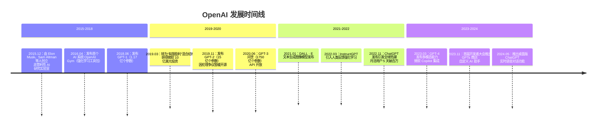
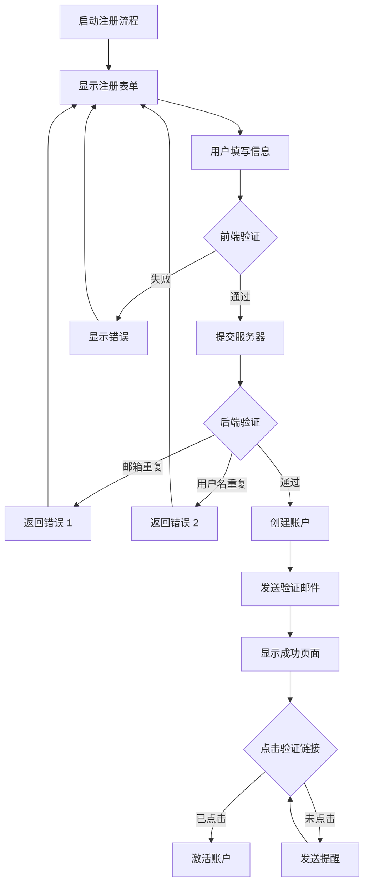
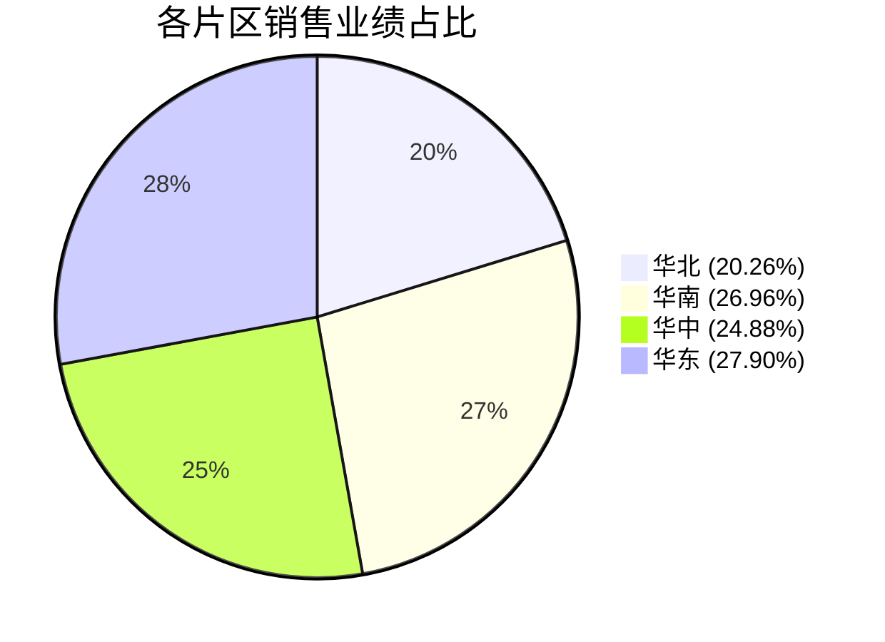

现是思维导图的核心，可以使用 DeepSeek 对上面零散的信息进行结构化呈现。

## 提示词

对上面的信息进行结构化呈现

## 输出结果

根据《2024 年饮品消费趋势》相关内容，现制饮品新品定位的结构化呈现如下：

## 一、健康与功能导向

### 健康化

主打“0 糖”“无添加”“天然原料”，如无糖茶饮、植物基拿铁、超级植物果蔬茶（羽衣甘蓝、红菜头等）

强调“干净配料表”，HPP 高压杀菌技术保留果蔬营养

### 功能性

结合益生菌、电解质等功能成分，突出纤体、减脂、养颜等功效

药食同源趋势：红豆薏米水、桦树汁等养生植物饮，“懒人养生”即饮化

## 二、文化与地域创新

### 国潮复兴

融入茯茶、国风包装、地方特色茶饮（潮汕、云贵等风味）

品牌联名传统文化 IP，如瑞幸全年联名 24 次

### 地域特色

挖掘东三省、云贵、西藏等地特色食材（冻梨、酸角、酥油）

地方风味咖啡：生姜美式、折耳根咖啡等“怪味”饮品

## 三、消费体验与营销策略

### 情绪消费

解压、慰藉属性，如“望山橙”系列、辣味释放情绪、猎奇口味（风油精柠檬茶）

### 气泡与怪味

夏季热门气泡风味（水果咖啡、橘香柠檬茶）

猎奇口味创新：香菜柠檬茶、苦瓜果蔬汁等

### 短剧营销与 IP 联名

线上线下双轮驱动，如蜜雪冰城等品牌通过短剧提升热度

## 四、产品形态与季节限定

### 轻盈低负担

低卡营养饮、代餐趋势（液断法）、苏打水、果味风味水

### 季节限定与追香

春茶、花香（玫瑰、樱花）、冬季鲜炖梨汤等时令元素

## 五、行业数据与市场表现

### 上新规模

2024 年现制饮品样本品牌上新 2681 款，茶饮占比 70.7%（水果茶、经典奶茶为主），咖饮占比 29.3%（拿铁为主）

超级植物果蔬茶首月售出超 350 万杯，复购率 TOP1

以上趋势反映了饮品行业在健康、文化、营销等维度的创新方向

## 3. 可视化表达

接下来使用 DeepSeek 把上面结构化表达的内容，在 Xmind 中进行可视化。我们首先需要知道 Xmind 支持导入的文件格式，如图 3-1 所示。


图 3-1 Xmind 支持导入的文件格式

Markdown 格式是一种通用的文本格式，我们让 DeepSeek 把刚才结构化输出的内容，用 Markdown 格式再生成一遍。

## 提示词

把上面的内容用 Markdown 格式生成。

## 输出结果

根据《2024 年饮品消费趋势》相关内容，现制饮品新品定位的结构化呈现如下：

## 一、健康与功能导向

### 健康化

- 主打“0 糖”“无添加”“天然原料”，如无糖茶饮、植物基拿铁、超级植物果蔬茶（羽衣甘蓝、红菜头等）
- 强调“干净配料表”，HPP 高压杀菌技术保留果蔬营养

### 功能性

- 结合益生菌、电解质等功能成分，突出纤体、减脂、养颜等功效
- 药食同源趋势：红豆薏米水、桦树汁等养生植物饮，“懒人养生”即饮化

## 二、文化与地域创新

### 国潮复兴

- 融入茯茶、国风包装、地方特色茶饮（潮汕、云贵等风味）
- 品牌联名传统文化 IP，如瑞幸全年联名 24 次

### 地域特色

- 挖掘东三省、云贵、西藏等地特色食材（冻梨、酸角、酥油）
- 地方风味咖啡：生姜美式、折耳根咖啡等“怪味”饮品

## 三、消费体验与营销策略

### 情绪消费

- 解压、慰藉属性，如“望山橙”系列、辣味释放情绪、猎奇口味（风油精柠檬茶）

### 气泡与怪味

- 夏季热门气泡风味（水果咖啡、橘香柠檬茶）
- 猎奇口味创新：香菜柠檬茶、苦瓜果蔬汁等

### 短剧营销与 IP 联名

- 线上线下双轮驱动，如蜜雪冰城等品牌通过短剧提升热度

## 四、产品形态与季节限定

### 轻盈低负担

- 低卡营养饮、代餐趋势（液断法）、苏打水、果味风味水

### 季节限定与追香

- 春茶、花香（玫瑰、樱花）、冬季鲜炖梨汤等时令元素

## 五、行业数据与市场表现

### 上新规模

- 2024 年现制饮品样本品牌上新 2681 款，茶饮占比 70.7%（水果茶、经典奶茶为主），咖饮占比 29.3%（拿铁为主）
- 超级植物果蔬茶首月售出超 350 万杯，复购率 TOP1

以上趋势反映了饮品行业在健康、文化、营销等维度的创新方向。

把上面的结果复制到 TXT 文件中并保存，如图 3-2 所示。


图 3-2 将生成结果导入 TXT 文件中

把文件后缀 .txt 修改为 .md，如图 3-3 所示。


图 3-3 修改文件后缀为 .md

# 第 3 章 DeepSeek 高效工具套件

打开 Xmind，导入刚才的 Markdown 文件，如图 3-4 所示。


图 3-4 导入刚才的 Markdown 文件

导入后，上面结构化的内容就会一键转为思维导图的格式，如图 3-5 所示。


图 3-5 一键转为思维导图的格式

## 4. 动态优化

在 Xmind 中，可以对刚才的内容进行二次编辑，包括更换模板、调整顺序等，如图 3-6 所示。


图 3-6 对内容进行二次编辑

## 3.1.2 实战案例：利用 DeepSeek 根据指定文件制作思维导图

在实际运用中，可以直接加入“使用 Markdown 格式”的指令，利用 DeepSeek 生成能直接复制的 Markdown 内容。

在 3.1.1 节提到的 4 个阶段中，前 3 个阶段（信息整合、结构化设计及可视化表达）可以一起放在提示词中。

以一份 3500 字的工作汇报文档为例，将文档上传至 DeepSeek。

### 提示词

总结这份工作汇报，使用三级结构化内容呈现，输出格式为 Markdown 格式。

### 输出结果

```markdown
# 创新担当 脚踏实地——以“阅、创、干”精神推动公司高质量发展

## 一、实地调研：汲取创新力量，探索发展路径

### 1. 华为：技术创新与流程管理

- **创新精神**：以客户为中心，持续投入技术研发，构建全球创新网络。
- **流程标准化**：客户接待流程兼具标准化与个性化，流程管理能力突出。
```

- **人才激励**：打造“以奋斗者为本”的企业文化，重视人才培养与激励机制。

### 2. 腾讯：数字化生态转型

- **产品迭代与拓展**：从 QQ 到微信，业务延伸至游戏、金融科技等领域，成功转型为科技生态企业。
- **数字化赋能**：利用技术赋能传统业务，增强用户互动与黏性，推动企业数字化转型。

### 3. 优必选科技与天安云谷：产业生态构建

- **AI 技术突破**：优必选在 AI+、人形机器人领域建立合作，推动技术应用落地。
- **智慧园区模式**：天安云谷整合产业资源，构建研发、办公、商业一体化生态，促进企业协同创新。

### 4. 前海：制度创新与营商环境

- **政策突破**：探索跨境金融创新，简化贸易流程，降低企业成本。
- **要素集聚**：通过知识产权保护与智能化平台建设，吸引全球高端资源。

## 二、理论学习：提升综合素养，助力企业发展

### 1. 财务思维与企业经营

- **数据驱动决策**：通过财务分析洞察盈利能力、运营效率，支持战略规划。
- **数字化管理**：BIP 系统实现供应链全程监控，提升存货与资金周转率。

### 2. 深化国企改革

- **三项制度改革**：推动用人、用工、分配市场化，激发员工竞争意识与组织活力。
- **上市目标导向**：聚焦治理改革、人才梯队建设与制度规范，为上市夯实基础。

### 3. 党的建设与合规经营

- **党建引领发展**：将党的领导融入生产经营，确保企业政治方向与国家战略同频。
- **法律风险防范**：构建合规体系，防控合同、知识产权及劳动法律风险。

## 三、下一步思考与行动

### 1. 政策融合与资源整合

- **抢抓政策机遇**：对接国家“十四五”规划，争取政策红利，突破发展瓶颈。
- **协同合作**：联合专业伙伴，发挥国企优势，推动规模化、流程化管理。

### 2. 科技赋能数字化转型

- **AI+ 场景应用**：以人工智能重塑行业业态，提升新质生产力。
- **全领域数字化**：推动技术与业务深度融合，应对市场竞争不确定性。

### 3. 团队协作与组织保障

- **跨部门攻坚**：组建专班突击队，聚焦重点项目，抢占发展“窗口期”。
- **信任与共识**：强化团队责任感与心理安全感，健全冲突管理机制。

**结语**：以“阔的精神、创的劲头、干的作风”，推动“商务+科技”双轮驱动，实现集团高质量跨越式发展。

将生成的内容粘贴到 TXT 文件中并保存，修改文件后缀为 .md，导入 Xmind，如图 3-7 所示。


图 3-7 用 DeepSeek 根据指定文件制作思维导图

## 3.2 DeepSeek + Mermaid: 1 分钟制作流程图

Mermaid 是一款基于 Markdown 的开源图表工具，通过简单的文本代码即可生成流程图、时序图、甘特图等专业图表。然而，复杂的语法规则和精确的逻辑描述，常让非技术人员望而却步。DeepSeek 与 Mermaid 的深度整合，就像给键盘装上了“图表翻译器”——你只需用日常语言描述需求，AI 就能自动生成精准的 Mermaid 代码并实时渲染成图，甚至能像经验丰富的架构师一样帮你优化逻辑漏洞。

操作流程：

- 生成 Mermaid 代码。在 DeepSeek 指令中，加入“思维导图”“时间线”“饼图”等图表名称，同时要求用 Mermaid 格式输出结果。
- 在 Mermaid 网站上运行。打开 Mermaid 中文网的在线编辑器，将 DeepSeek 生成的 Mermaid 内容复制到编辑器中，直接运行。
- 下载生成好的图表。

### 3.2.1 利用 DeepSeek 生成 Mermaid 格式的内容

#### 1. 生成 Mermaid 代码

提示词

帮我梳理一下 OpenAI 的发展时间线，用 Mermaid 格式输出。

输出结果



注意，所有 Mermaid 内容都可以一键复制。

### 2. 打开 Mermaid 网站

Mermaid 中文网地址为 https://mermaid.nodejs.cn/。在 Mermaid 中文网首页，单击右上角的“在线编辑器”，如图 3-8 所示。


图 3-8 Mermaid 中文网首页

进入“在线编辑器”页面，在“</> 代码”栏目下，将上一步复制的 Mermaid 代码粘贴到此处，如图 3-9 所示。


图 3-9 将上一步复制的 Mermaid 代码粘贴到此处

然后在编辑器右侧可以看到一键生成的时间线，如图 3-10 所示。


图 3-10 一键生成的时间线

在“操作”下，可以下载生成的时间线图，如图 3-11 所示。


图 3-11 下载生成的时间线图

如果想要修改某个数据，可以在“</> 代码”栏目下直接修改，右侧生成的图片是实时修改的。当然，Mermaid 不仅能生成时间线图，还能生成其他类型的图表。下面是 Mermaid 中常见的图表类型，如表 3-1 所示。

## 表 3-1 Mermaid 中常见的图表类型

| 英文单词 | 中文翻译 |
| :--- | :--- |
| Flowchart | 流程图 |
| Sequence Diagram | 序列图 |
| Gantt Chart | 甘特图 |
| State Diagram | 状态图 |
| User Journey Diagram | 用户旅程图 |
| Class Diagram | 类图 |
| Entity-Relationship Diagram (ERD) | 实体关系图 |
| Mind Map | 思维导图 |
| Pie Chart | 饼图 |
| Tree Diagram | 树状图 |

### 提示词

制定一份新用户注册软件的流程图，用 Mermaid 格式输出。

### 输出结果



将上述代码内容粘贴到 Mermaid 在线编辑器中，得到新用户注册软件的流程图，如图 3-12 所示。


图 3-12 新用户注册软件的流程图

### 3.2.2 实战案例：根据销售数据制作饼图

提示词

分析以下这组销售数据，按照销售地区制作饼图，并用 Mermaid 格式输出。
表格内容如下：

| 销售日期 | 商品名称 | 销售员 | 销量 | 业绩 | 所属片区 |
|---|---|---|---|---|---|
| 2024/1/18 | 鼠标 | 张三 | 56 | 10007.93 | 华北 |
| 2024/2/28 | 键盘 | 李四 | 10 | 18608.24 | 华南 |
| 2024/3/3 | 显示屏 | 王五 | 49 | 14521.12 | 华中 |
| 2024/5/15 | 耳机 | 老六 | 17 | 18282.29 | 华东 |
| 2024/5/23 | 显卡 | 张三 | 50 | 13091.53 | 华北 |
| 2024/2/26 | 鼠标 | 李四 | 79 | 17282.07 | 华南 |
| 2024/5/21 | 键盘 | 王五 | 85 | 11844.37 | 华中 |
| 2024/4/6 | 显示屏 | 老六 | 40 | 17143.03 | 华东 |
| 2024/1/8 | 耳机 | 张三 | 95 | 15498.48 | 华北 |
| 2024/4/25 | 显卡 | 李四 | 54 | 10154.7 | 华南 |
| 2024/5/17 | 鼠标 | 王五 | 72 | 12935.38 | 华中 |
| 2024/5/18 | 键盘 | 老六 | 24 | 16461.71 | 华东 |
| 2024/5/14 | 显示屏 | 张三 | 95 | 19677.19 | 华北 |
| 2024/5/21 | 耳机 | 李四 | 55 | 16604.5 | 华南 |
| 2024/1/15 | 显卡 | 王五 | 34 | 18852.48 | 华中 |
| 2024/2/1 | 鼠标 | 老六 | 89 | 10624.79 | 华东 |
| 2024/2/4 | 键盘 | 张三 | 51 | 14895.91 | 华南 |
| 2024/3/3 | 显示屏 | 李四 | 100 | 13440.78 | 华中 |
| 2024/3/2 | 耳机 | 老六 | 100 | 17767.46 | 华东 |

### 输出结果



打开 Mermaid 在线编辑器，将上面的输出内容复制到编辑器中，得到饼图，如图 3-13 所示。


图 3-13 各片区销售业绩占比饼图
