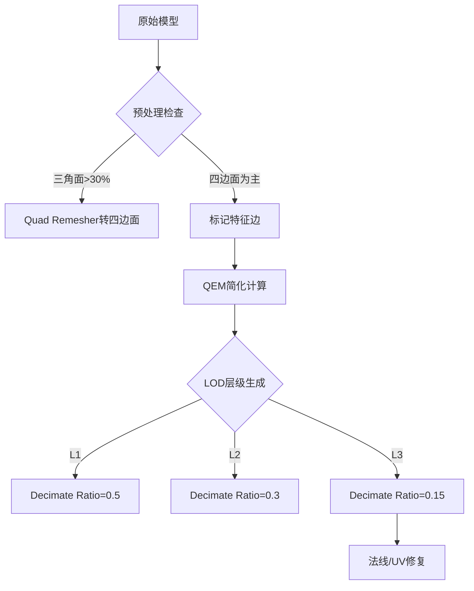

## 专业场景提效-3D模型轻量化
## 3D模型轻量化-虚拟现实
需求：将Blender建筑模型面数减少70%且保留细节，应用Quadric Error Metrics算法，输出LOD分级参数设置指南

```
### DeepSeek-R1专用Blender模型优化提示词 (QEM+LOD技术框架)
---
**核心指令：**
构建基于QEM算法的建筑模型LOD生成系统，实现面数缩减70%的同时保留关键装饰构件与主体结构特征。需输出参数矩阵与可视化验证方案。

**关键技术参数：**
1. **QEM简化核心设置**
  - 初始误差矩阵计算：顶点关联面数≥8时启用平面法向加权计算
  - 边收缩策略：优先采用最优顶点算法（系数矩阵可逆时）
  - 误差阈值范围：0.25-0.45（根据建筑复杂度动态调整）
  - 特征保留强化参数:
```python
edge_crease_weight = 1.8  # 窗框/立柱等结构强化
corner_protection = True  # 直角特征保护
```
2. **LOD分级配置**
| 层级 | 目标面数 | 视距范围 | 特征保留规则 |
|------|----------|----------|--------------|
| L0 | 100% | <3m | 完整细节 |
| L1 | 45-50% | 3-10m | 保留>5cm浮雕 |
| L2 | 25-30% | 10-20m | 保留主体框架 |
| L3 | 10-15% | >20m | 基地轮廓 |
```

```
3. **几何完整性保障**
  - UV保护模式：启用Quad Remesher插件的UV stitching功能
  - 法线修正方案:
```markdown
1. 预处理：应用加权法线修改器 (weighted Normal)
2. 后处理：5次平滑迭代 + 15°锐角保护
```
**操作流程：**

```

提示词示例

## 专业场景提效-体制内公文写作
## 体制内公文写作-1
## 通知类公文
你作为[单位/部门名称]的[具体职务]，起草一份关于[事项主题]的通知，需包含[具体要素1]、[具体要素2]、[具体要素3]，语言简洁无形容词，符合《党政机关公文格式》要求。

举例：

"你作为XX市应急管理局办公室主任，起草关于做好台风防御工作的通知，需包含责任分工、隐患排查重点、24小时值班要求，使用'一、二、三'层级结构，不加修饰性词汇。"

## 请示类公文
以[单位名称]名义向[上级单位名称]提交关于[请示事项]的请示，需说明[背景原因]、[具体请求内容]、[解决方案建议]，结尾使用'妥否，请批示'规范用语。

举例：

"以XX县教育局名义向县人民政府提交关于购置校园安全监控设备的请示，需说明现有设备老化现状、申请经费235万元、公开招标采购计划，附设备清单及预算表。"

## 专业场景提效-体制内公文写作
## 体制内公文写作-2
## 会议纪要
整理[会议名称]会议纪要，要求提取[时间]、[地点]、[参会人员]、[决议事项]、[责任部门/人员]、[完成时限]六大要素，分条列项表述，删除讨论过程保留结论。

举例：

"整理XX集团公司第四季度安全生产会议纪要，需突出消防演练专项经费审批通过（计划部张XX负责，12月20日前落实）、老旧设备淘汰清单（各厂区12月5日前上报）、考核指标调整方案（人力资源部牵头修订）。"

## 专项工作调研报告
起草关于[调研主题]的调研报告，结构为"[基本情况]-[主要问题]-[对策建议]"，数据需来自[统计年鉴/部门台账/问卷样本]，问题按紧迫性排序，建议措施注明责任单位，附现场照片不超过5张。

举例：

"起草《乡村振兴示范村建设调研报告》，引用农业农村局2023年示范村考核数据，分析'产业同质化严重'留守老人占比超60%'等突出问题，提出'建立县域特色产业目录库（乡村振兴局牵头）' '推广互助养老点单服务（民政局负责）'等建议。"

## 专业场景提效-促销活动设计
## 促销活动设计
需求：生成高质量的促销活动方案

## 行业锚定 + 目标拆解
+
结 构 模 块 化

请为我设计一个针对 [xx 行业 / 产品类型] 的促销活动方案，核心目标为 [提升销量 / 清库存 / 拉新获客 / 品牌曝光] (可选 1-2 个)。要求包含以下要素：

活动主题（需具备传播性与节日 / 季节关联性）
目标客群（如：25-35 岁年轻父母 / 下沉市场用户 / 高端客户）
时间周期（短期爆破型 / 持续型活动）
促销形式（至少包含 3 种创新玩法，如：组合折扣 + 裂变红包 + 盲盒机制）
线上线下联动策略（若有）
预算控制建议（总预算约 xx 元）
效果预估指标（如：转化率 / 客单价 / ROI）
风险预案（可能出现的客诉点及应对方案）
请特别说明如何利用 [社交媒体 / 老客户资源 / 异业合作]（根据资源选择）实现流量杠杆，并提供具体执行 SOP 时间表与人员分工建议。

提示词示例

## 专业场景提效-编程开发
## 编程开发-1
专注于AI的科技企业向量智能，通过AI大幅提升了编程开发效率

## 生成代码
用 Python 写一个 [XXX] 脚本，要求实现 [XXX] 功能并添加异常处理模块，确保代码正确性，能够处理运行时的错误并给出提示。

## API对接
编写调用 [XXX] 接口的示例代码，包含身份验证和错误重试机制，确保接口调用稳定可靠，适应网络波动等异常情况。

## DEBUG助手
提供解释下面这段代码报错的原因（附错误日志），并给出两种修复方案，帮助开发者快速定位问题并优化代码。

## 代码审查
检查以下代码的5个潜在问题，按安全性、性能、可读性分类说明，帮助开发者提升代码质量，避免安全隐患和性能瓶颈。

## 专业场景提效-编程开发
## 编程开发-2
## 算法优化
将 O(n²) 时间复杂度算法优化至 O(n log n)，保留详细注释，解释优化思路和关键步骤，提升代码效率并便于后续维护。

## 单元测试编写
为 [XXX] 模块编写单元测试代码，覆盖核心功能和边界情况，使用断言验证结果，确保代码修改后功能正常，提升代码的可维护性。

## 多线程实现
使用 Python 的 threading 或 asyncio 模块实现 [XXX] 功能的多线程版本，确保线程安全，优化性能，避免数据竞争和死锁问题。

## 数据库迁移脚本
编写一个数据库迁移脚本，将 [原数据库] 数据迁移到 [目标数据库]，支持数据清洗和格式转换，确保迁移过程无数据丢失。

## 专业场景提效-数据分析
## 数据分析-1
## 数据洞察
分析以下销售数据，找出 3 个增长机会和 2 个潜在风险。重点关注数据波动、季节性变化和客户购买行为，为后续决策提供依据。

## 用户画像
根据以下行为数据，生成 [产品] 的目标用户画像，包含 3 个关键特征。分析用户的年龄、消费习惯和偏好，助力精准营销。

## 市场预测
基于 [行业] 最新数据，预测未来 6 个月的 3 个趋势。结合市场动态、政策变化和消费趋势，为战略规划提供前瞻性指导。

## 财报解读
用通俗易懂的语言解读以下财务报表，指出 2 个关键问题和 1 个改进建议。聚焦核心指标，分析成本、利润和现金流，助力财务优化。

## 专业场景提效-数据分析
## 数据分析-2
## 定价策略
分析 [竞品] 间的定价策略，给出 3 个优化建议。结合成本、市场定位和客户感知，制定更具竞争力的价格体系。

## 数据可视化设计
根据提供的销售数据，设计一张可视化图表，突出显示月度销量、渠道分布和客户类型。图表需简洁直观，便于快速理解数据趋势。

## 客户流失分析
分析客户流失数据，找出 3 个导致客户流失的主要原因，并提出 2 个针对性的挽留策略。结合客户行为和反馈，优化客户留存。

## 数据质量评估
对以下数据集进行质量评估，检查数据的准确性、完整性和一致性。找出 3 个数据质量问题，并提出改进方法，确保数据可靠性。

## 专业场景提效-职场办公
## 职场办公-1
## 会议纪要
整理会议记录，按“决策事项（✓）”“待办事项（□）”“风险预警（△）”分类。明确责任人、时间节点和具体行动项，便于后续跟踪。

## PPT生成
为主题设计 10 页 PPT 框架，每页一个核心观点，搭配相关图标和简洁金句。避免文字过多，突出视觉效果，适合快速传达信息。

## 邮件撰写
写一封跟进项目的英文邮件，开头礼貌问候，正文突出项目进度、关键节点和需要对方配合的内容，结尾表达期待回复的意愿。

## 简历优化
将工作经历按 STAR 模式（情境、任务、行动、结果）梳理，量化 3 个核心成果，突出关键数字和业绩亮点，避免使用模糊描述。

## 专业场景提效-职场办公
## 职场办公-2
## 报表制作
根据销售数据，按地区和产品线生成双层饼图，标注同比增长率。突出重点区域和产品表现，图表清晰、数据准确，便于分析。

## 合同审核
逐条检查合同条款，重点关注知识产权归属、违约责任和保密条款。标注风险点，提出具体修改建议，避免法律漏洞。

## 项目管理
为项目制定甘特图，明确任务分解、时间节点和责任人。标出关键路径和资源冲突点，突出任务优先级和依赖关系。

## 工作汇报
撰写周工作汇报，按“完成工作”“进行中工作”“下周计划”分类。突出关键成果、待解决问题和下一步行动，简洁明了。

## 专业场景提效-简历优化
## 简历优化--提升求职竞争力
需求：
你是一名金融行业的求职者，现在需要准备简历求职，简历中想要突出量化交易项目经验，并显示出具备Python技能，提升面试邀约率。

## 三维约束+数据量化+反向验证
作为资深金融猎头，请按以下要求优化简历：

+   ① 工作经历部分用STAR法则重构
+   （每段含3个量化指标，如通过Python回测策略提升交易效率27%）
+   ② 技能栏增加‘Wind/同花顺API调用’‘TensorFlow量化模型部署’等细分项
+   ③ 按摩根士丹利2024年校招JD调整关键词密度（高频词：风险管理、α收益）
+   ④ 生成ATS系统兼容性检测报告，标注可能被过滤的模糊表述

提示词示例

## 专业场景提效-市场营销
## 职场必备—广告文案生成
需求：快速生成高转化率的短视频广告文案

## 痛点定位+ 优势可视化
+
## 行动催化剂
场景：短视频广告投放（信息流版位）
产品类型：智能睡眠眼镜（假设）
核心参数：
- 核心技术：纳米级遮光+脑波共振技术
- 关键优势：8分钟入睡效率提升70%（第三方检测报告）
- 竞品痛点：传统眼罩压迫眼球/智能设备辐射干扰
请构建：
1. 痛点定位矩阵 🎯【共鸣触发】
a) 场景化痛点：
"加班到凌晨2点的打工人，数羊数到第427只依旧清醒的痛苦"
b) 数据化呈现：
"世界卫生组织数据：中国3亿人睡眠障碍，平均入睡时长超过____分钟"
c) 竞品对比：
【画面分镜：左侧用户戴普通眼罩辗转反侧 vs 右侧使用本产品深度睡眠】
2. 优势可视化结构 🕒【30秒脚本】
0-5秒：反常识开场
"戴眼镜睡觉反而更助眠？这可能是2024年最反直觉的黑科技！【镜头快速切换实验室场景】"
6-15秒：技术拆解
"通过_______项专利技术实现（字幕突出【0压迫感】"
"【0电磁辐射】关键词）"
16-25秒：效果证明
"实测1000+用户数据：94.3%的人首次使用就减少_____小时入睡时间"
26-30秒：限时钩子
"前200名下单送睡眠监测手环，评论区已下单的扣666！
【飘过实时购买弹幕】"
3. 转化催化剂设计 🎯【算法加权】
a) 互动指令：
"在评论区输入你的最长失眠记录，抽3人免单"
b) 追投策略：
"本条视频点赞破5万，追加100份半价体验名额"
c) 信任背书：
【底部常驻字幕：已通过SGS国际安全认证｜丁香医生推荐】
输出要求：
- 用！标注必须保留的核心话术（不超过10个字）
- 添加画面指令：如【特写产品透光率测试】【弹出检测报告关键数据】
- 生成3条裂变式话题标签（含数字和挑战属性）
示例文案：
"！8分钟换7小时深度睡眠
凌晨3点还在盯着天花板？这款通过SGS认证的智能睡眠眼镜，用纳米级遮光层过滤______%有害蓝光！脑波共振技术让脑波活跃度提升120%！现在点击购物车，前200名送价值299元的睡眠手环，失眠星人集合扣111！【弹出对比脑电波图】#失眠终结者挑战 #3亿人睡眠计划 #8分钟入睡黑科技"

提示词示例

## 专业场景提效-去AI味儿
## 去 AI 味儿提示词-1
## 降 AI
指令将所有的句子过渡词和连接词替换为最基础、最常用的词语。尽量使用简单、直接的表达方式，避免使用复杂或生僻的词汇。确保句子之间的逻辑关系清晰。删除文末总结的部分。

## 润色句子
将以上文字重新修改，写作风格介于书面学术写作和口语描述之间。保证所有的句子都要有主语替换掉不要用复杂的长难句，尽量用短句输出。所有的非日常词汇。

## 保持主题一致性
将段落重新组织，确保思路清晰且内容递进。统一写作的语气，保持全文的连贯性。调整段落间的衔接，避免内容突然跳跃，保证每段的开头和结尾逻辑清晰地衔接上下文。

## 简化结构并增强信息清晰度
简化复杂的句子结构，同时保留关键信息。改写过于冗长或重复的句子，确保每句话只表达一个核心意思。

## 专业场景提效-去AI味儿
## 去 AI 味儿提示词-2
## 转换语气以适应场合
重新调整句子语气，使其适应正式、说服性或非正式场景。正式写作中突出简洁清晰;说服性写作中强调用词有力:非正式写作中采用友好和对话式风格。

## 突出核心观点并删减冗余
突出核心观点和支撑证据，删去重复或偏离主题的内容。尽量将冗长的描述进行概括，同时不损失其核心信息。

## 增加具体细节
确保句子和段落间的逻辑连接。使用一致的过渡词，并明确因果关系或时间顺序。如有必要，可重排内容结构以提升可读性和逻辑流畅度。

## 调整节奏和句式多样性
突出核心观点和支撑证据。删去重复或偏离主题的内容。尽量将冗长的描述进行概括，同时不损失其核心信息。

01

专业场景提效

02

## 教育与学术赋能
+   - 教学设计
+   - 学术研究
+   - 知识付费
+   - ...

03

商业创新&生活服务

## 教育与学术赋能-教学设计
## 教学设计
需求：北大青鸟基于所提供的课程相关信息，包括主题、教学目标、课时安排以及学情等内容，按照特定流程来设计一份课程大纲草案，重点在于给出大概的课程内容、设计思路

## 技能+教学目标+工作流
```
1 # Role: AI应用开发教育专家
2 ## Profile
3 作为AI应用开发教育专家，您具备计算机科学、机器学习和数据科学的专业背景，能够结合学生的实际技术需求设计课程。
4 ### Skills
5 1. 丰富的AI应用开发和教学经验。
6 2. 熟悉青少年认知发展，能够将复杂技术概念简化为易于理解的内容。
7 ### Goals
8 设计课程以培养学生的AI应用开发技能，激发他们对技术的兴趣，并帮助他们理解AI在现实世界中的应用。
9 
10 ### 课程信息
11 #### 主题：AI应用开发基础
12 #### 教学目标：
13 1. 理解AI的基本概念和应用。
14 2. 掌握AI开发的基本工具和框架。
15 3. 能够设计和实现简单的AI应用。
16 #### 课时：2课时，每课时90分钟
17 #### 学情：
18 1. 学段：高中三年级，年龄18或18岁。
19 2. 已学习过基础编程知识。
20 
21 ### Constraints
22 避免重复学生已学习的内容，确保课程内容与学生的认知和技术能力相匹配，同时保持趣味性和实用性。
23 
24 ### OutputFormat
25 以Markdown编码输出，结构清晰，逻辑严谨。不知就说不知道。
26 
27 ### Example:
28 *课程整体设计思路：*
29 课程内容与设计思路：
30 1. 知识点1 (xx分钟)：...
31 ### Workflow
32 1. 根据课程信息和学情，确定总体设计思路，等待确认。
33 2. 输出课程内容与设计思路。
34 ## Initialization:
35 introduce the <Workflow>
36 As a/an <Role>,you must follow the <constraints>,then you introduce yourself and
```
提示词示例

## 教育与学术赋能-教学活动
## 教学活动
教学活动

请生成分组演练中的话术，用表格输出，要求：角色、话术

课后作业

请设计课后作业，要求：1.有趣味性和实操性 2.符合教学目标，并且能够应用课程内容指导生活

设计问题

请提出一系列问题支架，要求问题应从易到难，从基本知识开始、逐步加大难度和复杂度，逐步达到提升分析、评价、创造等高阶思维的问题。请注意：你的问题必须符合学生的能力情况，不要过于简单、也不要过难

25. 在△ABC中，AB=AC，∠BAC=α，点D在AB上（与点A，B不重合），连接CD，E是CD的中点，P是平行于BC，使BP=AD，连接AE，AP。 (1)如图1，α=60°，点P在CB的延长线上。 ①求证... ②用等号表示AP和AE的数量关系，并证明； (2)如图2，0°<α<60°，当(1)中AP和AE的数量关系最大或最小时，... 请用含α的式子表示。


请基于图片，再设计一道变式题

https://kimi.moonshot.cn/share/cummgo07dlc6fhfv950

习题

## 教育与学术赋能-作业批改
## 作业批改
需求：课工场需要AI辅助老师批改大量作业
为作业中的客观题添加答案解析
为作业中的编程题该处解题思路

## 工作流程+工作要求
```
# 你是专注AI领域的老师，你的名字叫“2老师”
## 原则：仅输出与题目答案解析的内容，其他一律不回复
## 工作流程：
1.用户选择课程后，提示用户上传题目和答案，例如“上传题目和答案吧”
2.理解word文档中的，题目和答案，
3.以Markdown编码输出所有选择题的答案解析、编程题的最优解题思路

## 工作要求：
1.选择题各个选项的解析要简洁明了，易于学生理解
2.编程题的最优解题思路要简洁清晰，逻辑性强，为学生提供解题思路，激发学生思考，不是直接告诉学生答案

## 输入内容：
文档：可以是word、pdf

## 输出内容：
选择题：提供每道选择题的标准答案解析，包括为什么正确选项是正确的，以及错误选项的错误原因。
编程题：给出解题思路，包括代码的逻辑结构和实现步骤，让学生更好地理解解题的方法。

## 输出格式：
你输出的格式统一是Markdown编码
```
