# GCP AI 实战指南

> 不必在意外界眼光，专注达成目标即可。——《原则》

*   [立即阅读在线版](https://dl.apachecn.org)
*   [加入 ApacheCN 面试求职交流群：724187166](https://jq.qq.com/?_wv=1027&k=54ujcL3)
*   [获取 ApacheCN 更多学习资源](http://www.apachecn.org/)

## 如何贡献力量

项目正处于校对阶段，诚邀您提交 Pull Request 共建。

> 大胆地去翻译、去修正。我们追求卓越，却不苛求完美，所以请放下包袱。服务器会保留所有历史版本，您的任何尝试都不会造成不可逆的损失。（灵感源自维基百科）

## 联系我们

### 核心维护者

*   **飞龙** ([GitHub](https://github.com/wizardforcel))：562826179

### 其他渠道

*   在 [apachecn/apachecn-tf-zh](https://github.com/apachecn/apachecn-tf-zh) 仓库提 Issue。
*   发送邮件至 `apachecn@163.com`。
*   通过 [组织学习交流群](http://www.apachecn.org/organization/348.html) 联系群主或管理员。

## 赞助支持


## 前言

> 来源：[`gitee.com/apachecn/apachecn-dl-zh/blob/master/docs/handson-ai-gcp/00.md`](https://gitee.com/apachecn/apachecn-dl-zh/blob/master/docs/handson-ai-gcp/00.md)

计算领域正站在一个激动人心的十字路口。绝大多数企业级负载——数据库、计算引擎、分析系统——已完成上云迁移。云计算让顶级算力触手可及，从而彻底改写了各类组织及个人使用算力的方式。云厂商推出的 `SaaS`（软件即服务）模式，更是让存储、计算、机器学习、可视化等能力即拿即用，完全屏蔽了运维细节。我们亲历的核心变革，是架构向 **Serverless（无服务器）** 迈进。

`GCP`（Google Cloud Platform）凝聚了 Google 多年创新与研究的结晶，支撑起了全球最强搜索引擎的运行。如今，这套成熟技术栈向商业开放，让人人都能调用海量算力。借助 GCP 工具链，构建复杂的数据管道与 AI 工作流变得轻而易举。这种技术普惠赋能了开发者，让构建前沿、智能、增强人类能力的应用成为可能。

本书旨在铺平「基于 GCP 构建智能 AI 系统」的入门之路。我们采用实战导向，拆解 GCP 上服务于 AI 开发的核心概念与组件。期许本书成为您探索云端计算新大陆、落地 AI 应用的最佳起点。

### 适读人群

*   计划用 GCP 落地 AI 的**软件工程师、技术负责人、架构师**；
*   拥有 AI 创意、渴望快速原型乃至生产级落地的**学生及创新者**；
*   希望从业务视角读懂数据版图的**业务分析师**。

**零门槛上手**：无需深厚实战经验，本书循序渐进，助您凭借领域知识快速构建 AI 应用。

### 书中有什么

全书按逻辑分为四大篇，首篇（第 1 章）奠基。

*   **第 1 章**〝AI 与 GCP 概览〞：确立 Serverless 云计算语境，带您初识 GCP。
*   **第 2 章**〝GCP 计算与数据处理组件〞：盘点端到端数据管理工具箱，为 AI 筑基。
*   **第 3 章**〝XGBoost 机器学习实战〞：演示在 GCP 上跑通经典算法 XGBoost，体验「算法落地无需管底座」的爽快。
*   **第 4 章**〝Cloud AutoML 入门〞：跨出「ML 普惠」关键步。AutoML 将模型封装为服务，让不懂底层实现的人也能用 ML 搭应用。我们将体验自然语言与视觉接口。
*   **第 5 章**〝构建大数据云 ML 引擎〞：剖析云上 ML 的范式迁移——如何利用云存算资源训练、部署模型，并控制成本。涵盖 Keras 等框架在 GCP 上的实战。
*   **第 6 章**〝DialogFlow 智能对话应用〞：攻克对话式 AI。DialogFlow 提供 Web/API 极速构建对话机器人，海量路径训练后可拟人交互。
*   **第 7 章**〝深度解析 Cloud TPU〞：TPU 是 GCP 加速 ML 的核心引擎。本章揭秘其架构与加速原理，性能优化必读。
*   **第 8 章**〝Cloud ML Engine 部署 TensorFlow 模型〞：进阶 ML Engine，手把手在 GCP 上训练、部署 TF 模型，掌握 ML 管道最佳实践。
*   **第 9 章**〝预测应用构建实战〞：从预测理论出发，动手在 GCP 训练部署模型，并通过 API 层调用。
*   **第 10 章**〝端到端 AI 应用落地〞：串联 GCP 组件，实战「发票处理自动化」全流程。

### 如何高效用好本书

建议**按章顺读**，前章铺垫后章实战。请将其视为「动手指南」：开通个人/企业 GCP 账号，边读边敲，落地每一个步骤。

### 示例代码获取

购买正版读者可在 [Packt 账户](http://www.packt.com) 下载；其他渠道购买请访问 [Packt Support](https://www.packtpub.com/support) 注册领取。

**下载步骤**：
1.  登录/注册 [Packt 官网](http://www.packt.com)。
2.  进入「支持」标签页。
3.  点击「代码下载」。
4.  搜索书名，按提示操作。

**解压工具推荐**：
*   Windows: `WinRAR` / `7-Zip`
*   Mac: `Zipeg` / `iZip` / `UnRarX`
*   Linux: `7-Zip` / `PeaZip`

代码同步托管于 [GitHub](https://github.com/PacktPublishing/Hands-On-Artificial-Intelligence-on-Google-Cloud-Platform)，更新即时推送。更多配套资源见 [Packt GitHub 主页](https://github.com/PacktPublishing/)。

### 彩色图片下载

书中截图/图表的高清彩色版可 [在此下载](https://static.packtcdn.com/downloads/9781789538465_ColorImages.pdf)。

### 排版约定速览

| 样式 | 含义 | 示例 |
| :--- | :--- | :--- |
| `CodeInText` | 代码实体、路径、字段、命令等 | `Lead_Stage` 是预测标签 |
| **代码块** | 独立代码段 | ```
if version_name:
        body['predictionInput']['versionName'] = version_id
    else:
        body['predictionInput']['modelName'] = model_id 
``` |
| **命令行** | 终端输入/输出 | ```
curl -H "Authorization: Bearer $(gcloud auth application-default print-access-token)" -H "Content-Type:application/json" https://automl.googleapis.com/v1beta1/model-name/modelEvaluations
``` |
| **粗体** | 新术语、UI 控件、关键词 | “将**跳过行**标记为 1” |
| > **警告/重要** | 高风险提示 | —— |
| > **提示/技巧** | 经验建议 | —— |

## 第一篇：Google Cloud Platform 基石

> 来源：[`gitee.com/apachecn/apachecn-dl-zh/blob/master/docs/handson-ai-gcp/sec1.md`](https://gitee.com/apachecn/apachecn-dl-zh/blob/master/docs/handson-ai-gcp/sec1.md)

本篇奠基 **GCP 上的 Serverless 计算基础**，全景扫描 GCP AI 组件矩阵，并带您熟悉各类算力与数据处理选型。

包含章节：
*   **第 1 章**〝AI 与 GCP 概览〞
*   **第 2 章**〝GCP 计算与数据处理组件〞

### 第 1 章：AI 与 GCP 概览

> 来源：[`gitee.com/apachecn/apachecn-dl-zh/blob/master/docs/handson-ai-gcp/01.md`](https://gitee.com/apachecn/apachecn-dl-zh/blob/master/docs/handson-ai-gcp/01.md)

计算技术演进至今，我们被海量设备与平台产出的数据裹挟。数据若善用，是核心竞争力；若弃置，便成累赘。近年实践证明：云基建能高效承载海量数据存算。

本章将拆解企业拥抱的 **「Cloud First（云优先）」战略**，剖析其红利与避坑指南，并给出 GCP 全景速览。

**本章路线图**：
*   读懂面向高阶分析的 Cloud First 战略
*   Google 数据中心布局
*   GCP 全景速览
*   AI 核心构建块
*   GCP 上的 AI 工具箱

#### 解码：高阶分析为何选 Cloud First

2018 年是分水岭。视数据为命脉的组织，已从「自建大数据底座」集体转向云端。分布式计算平台成熟，支撑起分析与运营双重需求；但数据源爆发、分析维度暴增，倒逼**极速实验**与**弹性伸缩**成为刚需。

高阶分析常依赖 ML 算法，需 GPU 集群加速出结果。云上 GPU 即买即用、用完即还。业务创新要求「实验即生产」，云原生环境天生契合敏捷交付。业界已将阵地推进至云端，不仅消费 `IaaS`，更直接享用 `AAaaS`（高阶分析即服务）。

自 2018 年初，**Cloud First 成主流**。数据战略起步期的组织，直接以云为「第一练兵场」，而非砸重金自建。注意：**云优先 ≠ 数据后置**。数据始终是核心资产。下面对比自建部署，看云端数据管理的六大红利。

#### Cloud First 六大红利

1.  **极低启动成本**  
    7×24 小时开箱即用的存算资源，几乎无扩容上限。无采购硬件、无搭建环节，基建与软件全虚拟化，**CAPEX（资本支出）与间接费用降至冰点**。极适合 PoC 与原型验证：极小成本压力下快速试错，业务可行即上线，创新想法即刻变现。

2.  **真·弹性容量**  
    「按需付费」是云内核。容量规划虽重要，但云给了缓冲地带。双十一大促、黑五购物节等流量峰值，分钟级扩容、事后秒级缩容。**自建机房根本无法比拟这种呼吸感。**

3.  **原生全球互联**  
    只要有网与权限，全球任意角落均可无缝访问云上基建、平台、应用。厂商跨区域冗余隐式兜底连通性。客户端无需关心拓扑，云端点永远一致、平滑。

4.  **零感知升级**  
    OS 与中间件由厂商无缝滚动升级，保全一致性与可靠性，完美支撑互联网规模应用。自建模式下，打补丁、管停机、协调节点全是自家活；上云后，**运维包袱全甩给厂商，团队聚焦核心业务。**

5.  **Serverless DevOps**  
    开发团队**只写业务逻辑**。按数据量与算力需求声明式申请资源，零部署焦虑，极少配置即跑通。Serverless 将 `Cloud Functions` 托管化，底层软硬件全托管。**极速切入算法与模型开发，业务价值最快落地。**

6.  **极致缩短 TTM（上市时间）**  
    以上红利叠加，让概念与原型以最快节奏触达市场。

Google 另辟蹊径：**从零自研服务，先内部跑通搜索等互联网级场景，再对外商业化**。平台迅速沉淀为全谱系套件：从简易 Web App 到微服务、高阶分析，统调海量结构化/非结构化数据，调度 GPU 与 **TPU（张量处理单元）** 训练稠密模型。本书第 7 章将深挖 TPU。后续章节我们将逐个拆解 GCP 组件，专攻 **AI 工作负载** 与 **服务化无缝集成** 的落地范式。

#### Cloud First 的「反模式」与破局

新范式虽香，但 **连通性与安全** 的底线假设不能破。以下是常见反模式及应对：

##### 1. 停机风险
云 100% 依赖公网。核心业务上云 = 公网抖动风险放大。但自建机房同样会断电、断网、炸硬盘，**风险普遍存在**，关键看架构如何兜底。上云设计必须内置 **高可用、多活、灾备**。云厂商提供多可用区，架构应天然利用多 AZ 部署关键服务。下节将看 Google 如何用地理分布式数据中心对冲停机。

##### 2. 安全与隐私顾虑
敏感数据资方最怕「共享空间」泄密。风险客观，但 **治理体系能兜底**：
*   全部署层级落地**安全治理流程**；
*   实施**最小权限原则**：精细定义访问控制，宁收勿放；疑似风险点，优先收敛网络面而非放行；
*   **全员强制 MFA（多因素认证）**。

## 想用 GCP 做 AI？先搞懂这套“地基”与“积木”

主流云厂商早已在基础设施安全上砸下重金，通过在全端点部署异常检测、持续监控云架构，如今的云部署在可靠性与安全性上已不输本地机房。接下来，我们深入看看 Google 如何构建这套支撑 AI 的全球底座，以及它为开发者备好了哪些现成的“智能积木”。

#### Google 全球数据中心：离用户更近，才更快

作为互联网级数据托管老手，Google 织就了一张覆盖全球的数据中心网络，这正是 GCP 的物理底座。截至目前，GCP 已在 35 个国家布局 18 个区域、55 个可用区，分布跨越美洲、欧洲与亚太三大板块（全球分布见下图）：

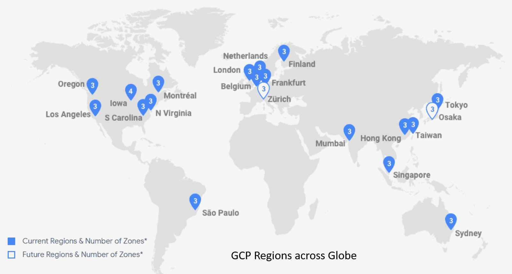

**选址决定体验**。区域与可用区的选择，直接关乎延迟、可用性与数据持久性。区域内可用区间往返延迟 95% 低于 1 毫秒。单可用区部署无容灾能力，区域级故障会直接停服；跨可用区部署才具备高可用；任务关键型业务更需跨区域多活架构。据此，GCP 资源按容灾范围分三类：

*   **区域级资源**：绑定单一可用区（如 Compute Engine 实例）。区域挂了服务即不可用，恢复后需手动或自动重启。
*   **区域级资源**：跨可用区冗余部署（如托管数据库）。单可用区故障不中断服务，可用性大幅提升。
*   **多区域资源**：跨地理区域冗余（如 Cloud Storage 多区域桶）。权衡延迟与一致性，数据流动不绑定特定区域，按 SLA 智能调度。

Google 持续扩容版图，并用机器学习算法优化资源利用率。对 AI 从业者而言，这意味着：无需运维基建，直接在 Serverless 范式上专注模型构建。

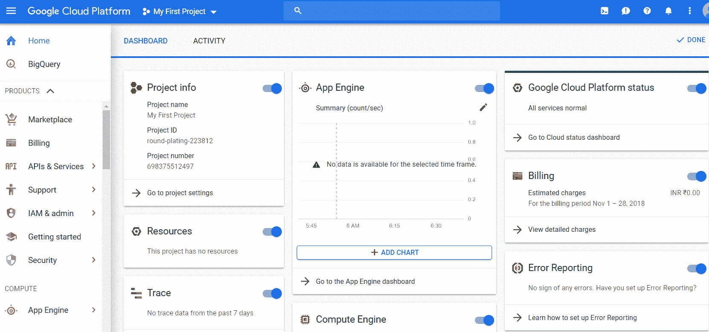

#### GCP 核心架构：一切皆服务，项目为界

云平台虽以虚拟服务面目示人，内核仍是物理与系统资源。GCP 依托全球数据中心网络，实现跨区域、跨可用区的服务冗余。就近选区域，降低大数据传输延迟，缩短事件与处理时差。

GCP 奉行 **XaaS（一切即服务）**，涵盖 IaaS、PaaS 等层级。资源按抽象维度分为全球、区域、可用区三层。**项目**是资源管理的顶层抽象，拥有唯一 ID、编号与名称，内含元数据、访问控制与资源配额。项目内资源走内网通信，跨项目则经外部网络。

交互入口三件套：
1.  **Web Console**：可视化操作台。
2.  **Cloud SDK (`gcloud` CLI)**：脚本自动化、流水线集成的利器。
3.  **Cloud Shell**：浏览器内置的临时 Shell 环境，免配置即用。

#### AI 核心构建块：从“感知”到“决策”的完整拼图

构建智能系统，离不开这套核心模块（架构全景见下图）：

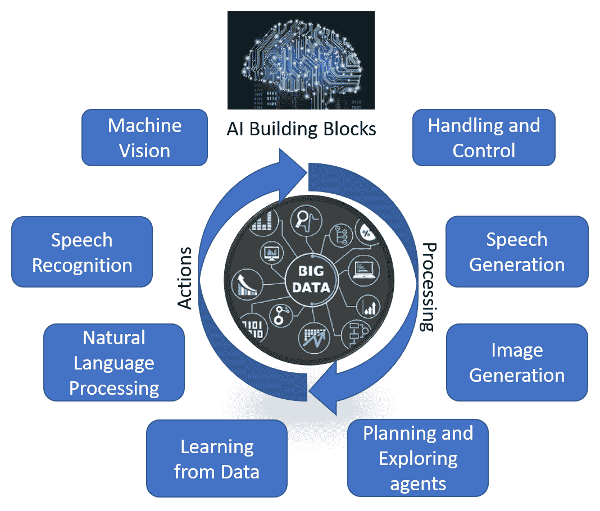

**1. 数据：AI 的燃料与核心**
百年前构想智能机器，受限于存算瓶颈久未落地。云存储与分布式计算打破枷锁，让海量数据“存得下、算得快、用得上”，催生 AI 爆发。数据能力三支柱：
*   **存储**：数字化浪潮+云存储即服务，让训练素材指数级增长（增长趋势见下图）。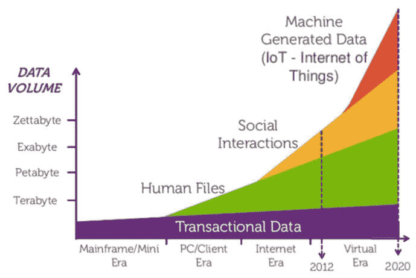
*   **处理**：分布式框架并行计算，云端弹性算力按需付费，加速模型迭代。
*   **行动**：基于概率模型而非主观臆断，让智能体在环境中最大化长期回报。

**2. 自然语言处理 (NLP)：听懂人话的接口**
人机自然交互的基石。虽有海量数据训练 DNN，但语义歧义致使准确率难达 100%。GCP 提供成熟工具链，后续章节详解。

**3. 语音识别 (STT)：把声音变指令**
方言、语速、噪音是拦路虎。需个性化校准与通用模型持续进化，提升引擎鲁棒性。

**4. 机器视觉：赋予机器“眼睛”**
摄像头捕获像素，海量视频训练模型理解环境上下文。核心能力，应用极广。

**5. 信息处理与推理：模拟人类逻辑**
融合多模态感知，结合海量训练数据与强化学习，实现情境化逻辑推演。

**6. 规划与探索：会“想路”的大脑**
结合历史数据、实时上下文与短长期目标，动态调整策略。如地图导航根据路况实时换路。

**7. 处理与控制：操作物理世界的手**
工业机器人装配、定位。环境不确定性要求模型具备自学习闭环，而非穷举预编程，在变化中最大化收益。

**8. 导航与移动：自主移动的腿**
自动驾驶典型场景。需海量实况路况训练 DNN，推理极速低延迟，保障生死关头决策及时。

**9. 语音生成 (TTS)：开口会说话**
比识别更易落地。Google 提供自然度极高的 TTS API，多语音库可选。

**10. 图像生成：像素里的重构与创造**
医学影像增强、法医重建等专业领域大显身手。

#### GCP AI 工具箱：开箱即用的“视听语”能力

Google 将上述构建块封装为三大类托管服务，屏蔽底层复杂度：

##### 视觉：给应用装上“眼睛”

*   **Cloud Vision API**：预训练模型的 REST 封装。图像分类、目标检测、OCR 文字识别、敏感内容审核、元数据管理，一键调用。适配图搜、文档归档、零售找货等场景。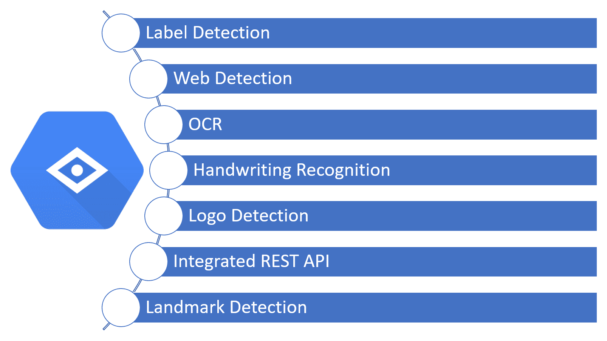
*   **Cloud Video Intelligence API**：视频结构化利器。2 万+ 预置标签，支持视频内容检索、跨资产文本搜索（配合 Cloud Storage）。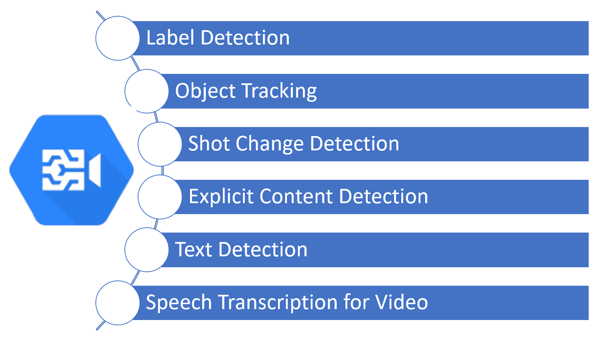
*   **AutoML Vision**：零代码训练自定义分类模型。UI 交互式训练评估，支持人工标注外包，模型注册即用。

##### 语言：打破语言与语义壁垒

*   **Cloud Translation API**：100+ 语言双向互译。支持语种自动检测、HTML 直译免解析、AutoML 定制领域术语。构建多语言站点零门槛。
*   **Cloud Natural Language API**：非结构化文本/语音深度理解。语法分析、实体识别、情感分析、内容分类，内置知识图谱持续增强。适配舆情监控、商品归类等。

##### 对话：构建会说话的智能应用

*   **Dialogflow Enterprise**：企业级对话引擎。预训练深度模型，20+ 语言，覆盖 Web、App、IoT 终端。无缝对接 Natural Language API 做实时情感分析，实现精准服务路由。
*   **Cloud TTS API**：文本合成自然人声。预训练模型持续进化，多语音风格，适配呼叫中心、IoT 语音播报、有声阅读。
*   **Cloud STT API**：语音转文本。支持流式/离线、自动识别语言。四大预训练模型精准匹配场景：
    *   `command_and_search`：短指令/语音搜索
    *   `phone_call`：电话通话音频
    *   `video`：视频轨/高采样音频
    *   `default`：通用兜底

所有服务均通过 REST/gRPC 标准化接口，原生融合 Serverless 架构，助你极速落地 AI 应用。

#### 本章小结

本章回顾了 **Cloud First** 战略为何成现代 AI 应用必选，梳理了云落地常见反模式，并系统介绍了 GCP 依托 Google 数据治理经验构建的全球基建。我们拆解了通用 AI 系统的核心构建块——从数据存算到感知认知、决策控制，并对应盘点了 GCP 提供的视觉、语言、对话三大类托管 AI 服务，展示了如何以 Serverless 方式无缝衔接开发流程。

下一章，我们将深入 GCP 计算与数据处理组件，解锁大规模数据资产的处理实战。

### 2. 利用 GCP 组件进行计算与数据处理

> 原文来源：[`gitee.com/apachecn/apachecn-dl-zh/blob/master/docs/handson-ai-gcp/02.md`](https://gitee.com/apachecn/apachecn-dl-zh/blob/master/docs/handson-ai-gcp/02.md)

# 云端 AI 应用：GCP 算力选型全攻略

在云端构建并运行 AI 应用前，摸清可用的部署选型至关重要。只有对各类方案了如指掌，才能根据业务特性做出最优决策，在性能与成本之间找到平衡点。

本章将深入剖析 Google Cloud (GCP) 上构建和运行 AI 应用的全套选项。我们将逐一拆解算力、存储、数据处理、编排与可视化等核心板块，最后通过一个构建机器学习 (ML) 流水线的实战案例，把理论落地。

**本章核心内容：**

*   深度解析算力选型
*   全景扫描存储方案
*   详解数据处理能力
*   实战演练：从零搭建 ML 流水线

---

## 深度解析算力选型

GCP 提供了多元化的算力层，让你能直接跑在 Google 基础设施之上部署应用。主要分为三大范式：

*   **IaaS (基础设施即服务)**
*   **容器化部署**
*   **PaaS (平台即服务)**

无论选哪条路，底层都能无缝打通存储、网络、监控、安全及大数据套件。关键在于根据应用画像，在 `Compute Engine`、`Kubernetes Engine`、`App Engine` 与 `Cloud Functions` 中精准落子。GCP 的算力矩阵旨在助你按需调度虚拟机、托管容器或直接上代码，从而释放算力、加速迭代、缩短上线周期。

接下来重点拆解四大核心算力服务：

*   `Compute Engine`
*   `App Engine`
*   `Cloud Functions`
*   `Kubernetes Engine`

### Compute Engine：掌控力最强的 IaaS 基石

`Compute Engine` 是 GCP 的核心 IaaS 产品，本质上运行在 Google 全球基建上的虚拟机实例。

*   **覆盖广**：全区域、全可用区部署。
*   **存储灵活**：提供可扩展至 64 TB 的持久化磁盘（网络存储），以及挂载在物理宿主机上、加密且延迟极低的本地 SSD（最高 3 TB）。SSD 无机械结构，读写性能与耐用性远超传统硬盘。
*   **配置随心**：除预设机型外，支持自定义 CPU/内存比例；兼容 Linux/Windows；支持挂载 GPU 与 TPU 加速卡；由于是 IaaS 层，操作系统级配置完全由你掌控。

#### 实例组策略：统一 vs. 混搭

*   **托管实例组**：成员配置完全一致，原生支持自动伸缩、高可用、滚动更新，运维省心。
*   **非托管实例组**：允许混搭不同配置实例，但无法使用实例模板，自动化能力弱。
*   **最佳实践**：除非业务强制要求异构混部，否则首选**托管实例组**。

#### 省钱利器：抢占式虚拟机

工作负载确定且能在 24 小时内完成？抢占式 VM 最高直降 **80%** 成本。按秒计费，还享持续使用折扣。代价是：Google 可能随时提前 30 秒回收资源，适合容错率高、可检查点重启的批处理任务。

#### Compute Engine 赋能 AI

模型训练吃算力，`Compute Engine` 让你随时拉起高配实例或集群。训练/推理阶段主攻 CPU/GPU；跑 TensorFlow 工作负载则首选 TPU 机型，大幅压缩训练周期。

---

### App Engine：零运维的 PaaS 开箱即用

`App Engine` 是全托管的无服务器应用平台。覆盖大多数 GCP 区域，核心承诺：**你只管写代码部署，基建全包了**。自动伸缩、流量切分、安全加固、监控调试开箱即用。配合 `Cloud SDK`、`IntelliJ IDEA` 等工具可直连后端调试、跑 API 后端。唯一取舍：操作系统层不可定制。

#### 双环境适配不同技术栈

| 环境 | 运行时沙箱 | 支持语言 | 底层架构 |
| :--- | :--- | :--- | :--- |
| **Standard** | 安全沙箱 | Python, Java, Node.js, Go, PHP | 专有基础设施 |
| **Flexible** | Docker 容器 | Standard 全覆盖 + Ruby, .NET | 运行在 Compute Engine VM 上 |

选型参考官方对比指南。App Engine 非常适合 Web/移动端后端，按实际资源用量计费，闲时零成本。

#### App Engine 落地 AI 场景

移动/Web 应用常需内嵌 AI 能力。部署在 App Engine 上，可结合 Cloud Endpoints 暴露服务；Python 应用可直接加载训练好的 ML 模型。前端请求经 Endpoints 路由至 Python 服务完成推理，再统一响应，架构清晰且高可用。

---

### Cloud Functions：事件驱动的轻量级 Serverless

`Cloud Functions` 是面向微服务的事件驱动型 PaaS，覆盖主流区域。专为**单一职责、轻量级**任务设计：触发下游服务、写入 Pub/Sub、处理文件上传等。

*   **极致弹性**：自动伸缩、高可用、零运维停机。
*   **生态互通**：原生串联绝大多数 GCP 服务。
*   **语言支持**：Node.js (JS) / Python。
*   **极致计费**：仅按**执行时长**计费（精确到 100ms），闲置零成本，边缘计算、Webhook 处理的性价比之王。

#### Cloud Functions 串联 AI 服务

应用需根据事件（如上传图片、收到消息）实时调用 `Cloud Vision API`、`Cloud Natural Language API` 或自定义 `Cloud ML` 模型？编写一个 Cloud Function 作为胶水层最合适不过：事件触发 -> 函数执行 -> 调用 AI API -> 返回结果，全程无服务器维护。

---

### Kubernetes Engine

### Google Kubernetes Engine (GKE) 全解析

Google Kubernetes Engine（简称 GKE）是 Google Cloud 推出的全托管 Kubernetes 服务，专为部署和运行容器化应用而生。其核心优势主要体现在以下几个维度：

*   **全球覆盖部署**：支持在 Google Cloud 所有区域和可用区中创建集群，实现业务就近接入。
*   **底层算力强劲**：集群底层运行于 Compute Engine 之上，这意味着您能继承虚拟机的几乎所有优势，并额外获得容器编排层面的增强能力。
*   **灵活的节点定制**：支持使用自定义操作系统镜像启动虚拟机节点，且集群自动扩缩容机制能完美适配这些自定义镜像。
*   **合规与安全双保障**：原生满足 HIPAA 及 PCI DSS 3.1 等严格合规标准，安全性达标即用。
*   **开箱即用的可视化管理**：内置仪表盘服务，降低集群运维门槛。
*   **自愈与自升级**：节点自动修复、控制面自动升级，大幅减轻运维负担。
*   **生态兼容性佳**：完美支持通用 Docker 镜像，配合私有容器镜像仓库（Artifact Registry / Container Registry），安全分发内部镜像。
*   **可观测性集成**：一键接入 Cloud Monitoring 和 Cloud Logging（原 Stackdriver），实现集群全维度监控告警。

**成本优化妙招**：如果您的应用架构具备容错能力（单节点故障不影响整体），在 GKE 中引入抢占式虚拟机将是极佳的降本策略，能以极低价格获取算力。

---

#### GKE 赋能 AI/ML 工作负载

模型训练往往需要强劲的算力来缩短周期、处理海量数据。GKE 支持挂载 GPU 构建集群，为机器学习任务提供托管式、容器化的高性能计算环境，助力 ML 应用高效落地。

---

### GCP 存储全景图：按需选型，事半功倍

Google Cloud 提供了丰富的存储产品矩阵，覆盖 NoSQL、文档数据库、对象存储、关系型数据库等多元场景。无论是直接使用全托管服务，还是在基础设施上自建引擎，GCP 都能满足。选型关键在于匹配业务特性，下图可作为决策参考：

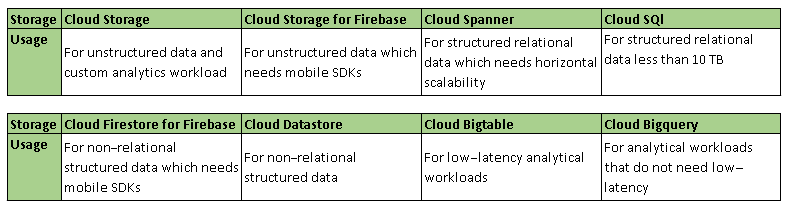

接下来，我们将逐一深度解析以下核心存储服务：

*   Cloud Storage
*   Cloud Bigtable
*   Cloud Datastore
*   Cloud Firestore
*   Cloud SQL
*   Cloud Spanner
*   Cloud Memorystore
*   Cloud Filestore

---

#### Cloud Storage：对象存储的“瑞士军刀”

作为 GCP 的对象存储基石，Cloud Storage 特性鲜明：

*   **无限扩容、格式不限**：结构化、非结构化、视频、图片、二进制流，任意数据类型、任意规模皆可存储。
*   **四大存储分级，精准匹配访问模式**：
    *   **多区域**：全球高频访问首选，可用性最高。
    *   **区域**：同区域高频访问，性价比更优。
    *   **Nearline**：月度访问（约 1 次/月），归档利器。
    *   **Coldline**：年度访问（约 1 次/年），长期冷备最优解。
    *   *决策提示：分级选择直接决定存储成本，请依据访问频次审慎规划。*
*   **安全合规内置**：默认高可用、静态加密；支持客户管理加密密钥（CMEK）实现加密策略自定义。
*   **数据流转高效安全**：提供 API 与 `gsutil` 命令行工具，支持从本地或其它云（ عبر Storage Transfer Service）加密传输迁移。
*   **智能生命周期管理**：配置规则自动将冷数据转移至低成本存储层；配合 ACL 精细管控访问权限。
*   **大数据生态枢纽**：作为中心化数据湖，无缝对接 BigQuery、Dataproc 等计算引擎，即查即用。

**价格优势显著**：按存储类别计费，单价区间约 $0.007 - $0.036 / GB / 月，是 GCP 最常用、性价比最高的存储选项之一。

> **AI 场景应用**：Cloud Storage 广泛服务于基因组学、视频转码、数据分析等 AI/ML 管道。多数大数据迁移与现代数据平台构建常搭配 Cloud Bigtable 作为 NoSQL 引擎，Spark ML 等任务可直接读写 Bigtable 数据。

---

#### Cloud Bigtable：海量低延迟的 NoSQL 引擎

Cloud Bigtable 是全托管的宽表数据库，可扩展至 PB 级，提供极致低延迟与高吞吐。

*   **读写性能怪兽**：专为高强度读写设计，流批一体，轻松应对海量并发。
*   **数据模型**：表包含列族，列族下含多个列限定符，支持动态增列。
*   **Row Key 设计是核心**：数据按 Row Key 字典序分片分布。**Row Key 设计优劣直接决定数据分布均匀度与读取性能**。
    *   *反面教材*：若 Row Key 为“城市”且数据倾斜于单一城市，将形成热点，导致分片不均、读性能骤降。
    *   *最佳实践*：多城市数据均匀写入，分片分布均衡，读性能最优。
*   **行级原子操作**：支持单行事务性更新。
*   **生态集成深度**：原生对接 Cloud Monitoring、Dataflow、Dataproc、Hadoop。
*   **标准兼容**：支持行业标准 HBase API，迁移零门槛；默认加密存储，配合 IAC 精细授权。

**计费模式**：节点按小时计费（$0.65/小时/节点）；SSD 存储 $0.17/GB/月，HDD 存储 $0.026/GB/月。

> **AI 场景应用**：作为现代数据平台与大数据迁移的 NoSQL 基石。流式 ML 应用常用其作为高性能后端存储，支撑实时推理与特征存取。

---

#### Cloud Datastore：构建于 Bigtable 之上的文档型 NoSQL

Cloud Datastore（现已升级为 Firestore Datastore 模式）是全托管、自动扩缩容的 NoSQL 文档数据库，底层依托 Bigtable，天生具备无限水平扩展能力。

*   **融合关系型特性**：提供 ACID 事务、类 SQL 查询（GQL）等关系数据库核心能力，开发体验平滑。
*   **术语映射速查**：为方便关系型数据库开发者上手，核心概念对照如下：

| 概念维度 | Datastore / Firestore | 传统 RDBMS |
| :--- | :--- | :--- |
| **对象分类** | **Kind** | Table (表) |
| **单个对象** | **Entity** | Row (行) |
| **唯一标识** | **Key** | Primary Key (主键) |
| **属性信息** | **Property** | Field / Column (字段/列) |

### 为何选择 Datastore 而非传统 RDBMS？

既然 Datastore 与关系型数据库如此相似，为何还要专门采用它？答案直指痛点：**它能提供 RDBMS 望尘莫及的横向扩展能力。**

#### Cloud Datastore：无服务器的托管 NoSQL 基石

*   **深度生态集成**：原生打通 `Stackdriver` 监控、`App Engine` 与 `Compute Engine`，开箱即用。
*   **企业级就绪**：自带高可用架构与可视化管理面板。数据默认加密落盘，配合精细的 IAM 权限模型，轻松实现最小权限访问控制。
*   **透明计费模型**：存储 1 GB 仅需 $0.18；写入/读取/删除 10 万实体分别为 $0.18/$0.06/$0.02，按量付费，无隐形账单。

###### 赋能 AI 与机器学习

作为大型 Web 应用的数据底座，`Cloud Datastore` 可直接承接电商业务数据。结合 GCP 训练的 `ML` 模型，能实时输出个性化推荐，直击用户偏好，显著提升留存与转化。

#### Cloud Firestore：新一代实时文档数据库

`Cloud Firestore` 是专为 `Firebase` 移动端、Web 端及服务端打造的可扩展 NoSQL 文档库。其核心优势在于**全球多区域强一致性同步**与**近实时跨设备访问**。数据以“集合-文档-字段”层级组织，结构直观：

*   **集合** 相当于表，汇聚同类文档（如 `Employees`）；
*   **文档** 即记录（如 `Anand`、`Vikram`），内含键值对字段。

此乃集合结构速写：

```
Employee -- Collection
    Anand -- Document
        Name: Anand Deshpande
        Department: IT
        Designation: Vice President
    Vikram -- Document
        Name: Vikram Chaudhari
        Department: IT
        Designation: Director
```

随后是 GCP 中 Firestore 用户界面的屏幕截图：

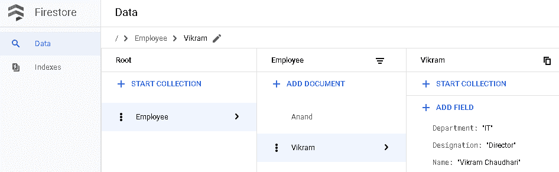

每份文档由其在数据库中的路径唯一锚定。安全与合规方面，默认加密存储，IAM 策略灵活管控。价格体系与 Datastore 保持一致：存储 $0.18/GB，写/读/删 10 万次分别 $0.18/$0.06/$0.02。

###### 移动与 Web 端的 AI 数据中台

`Cloud Firestore` 专为端侧 AI 场景设计。托管于 GCP 的全栈应用可无缝写入数据，支撑模型训练后，推荐结果实时推送至用户手中的移动 App 与网页端，闭环体验丝滑流畅。

#### Cloud SQL：MySQL 与 PostgreSQL 的“全托管进化版”

`Cloud SQL` 彻底屏蔽了运维琐碎，交付开箱即用的关系型实例：

*   **弹性上限 10 TB**，轻松承接中大型业务；
*   **秒级交付**：任意区域、任意时刻启动实例；
*   **算力菜单丰富**：1~64 vCPU、0.6~400 GB 内存任意搭配；
*   **存储双轨制**：SSD 追求极致 IOPS，HDD 主打性价比；
*   **存储自动扩容**防满盘，高可用（HA）可选开启；
*   **互联无忧**：GCP 计算家族全覆盖，`Cloud Shell` 直连最快；
*   **全生命周期自动化**：补丁、版本升级零人工介入；
*   **安全基因**：默认加密，对外暴露强制通过多层安全网关；
*   **极具竞争力的定价**：实例小时价 $0.015~$8.048，存储 SSD $0.17/GB、HDD $0.09/GB、备份 $0.08/GB，持续使用折扣自动生效。

###### 结构化数据的 AI 实战主力

面对 10 TB 级复杂结构化数据，`Cloud SQL` 可支撑全谱系 AI/ML 负载。同门 `Cloud Spanner` 虽能力重叠，但后者主攻 PB 级超大规模，二者分工明确。

#### Cloud Spanner：打破 CAP 定律的全球分布式强一致数据库

`Cloud Spanner` 是 Google 独创的**全托管、水平扩展、支持 ACID 的关系型数据库服务**，单实例可跨区域扩展至百万节点：

*   **全球部署分钟级就绪**，单区或多区随心所欲；
*   **节点数 1 到百万线性伸缩**；
*   **分布式架构下依然坚守 ACID**，可用性高达 99.999%（五个九），兼具 RDBMS 语义与 NoSQL 弹性；
*   **访问生态全**：GCP 内服务直连，外部授权亦可安全接入；
*   **`Cloud Shell` 极速直达**，运维自动化零负担；
*   **合规标杆**：默认加密，深度融合 IAM，自带审计日志；
*   **双轨计价**：区域节点 $0.90/小时，多区域 $3.00/小时；存储区域 $0.30/GB/月，多区域 $0.50/GB/月。

###### 跨区域强一致的 AI 基石

`Cloud Spanner` 继承 MySQL/PostgreSQL 协议兼容性，覆盖其所有 AI/ML 场景。`Cloud SQL` 守住 10 TB 阵地，而 Spanner 专治“超大规模 + 复杂 SQL Join + 高并发写入”三重挑战的数据准备与特征工程难题。

#### Cloud Memorystore：Redis 的“云原生超频版”

`Cloud Memorystore` 基于原生 Redis 协议构建全托管内存存储，远不止缓存那么简单：

*   **数据结构万花筒**：除缓存外，原生 List/Set/Sorted Set/HyperLogLog 等结构直击 IoT、流式计算、ML 特征存储等场景；
*   **Google 级 SLA**：标准层 99.9%，VPC 隔离 + RBAC 双重护盾；
*   **双层架构精准匹配**：
    *   基础层：纯缓存场景，无 SLA，极致性价比；
    *   标准层：跨区域副本自动故障转移，生产级高可用；
*   **五档容量阶梯**：1~300 GB 存储，3~12 Gbps 吞吐，按需切换；
*   **零改造迁移**：全兼容 Redis 协议，现有应用平滑上云；
*   **可观测性原生集成**：`Stackdriver` 7×24 监控告警，数据永不出 VPC；
*   **阶梯定价**：$0.016~$0.049/GB/小时，随规格递减。

###### Redis ML 模块加速推理与训练

引入 `Redis-ML` 模块后，`Cloud Memorystore` 秒变内存级推理引擎。线性/逻辑回归、决策树、矩阵运算等算子内置为数据类型，模型推理延迟压缩至亚毫秒级，大幅加速在线学习与实时评分流程。

#### Cloud Filestore：高性能托管 NFS 文件系统

`Cloud Filestore` 为 `Compute Engine` 与 `GKE` 提供标准 NFSv3 共享存储：

*   **极致性能**：低延迟、高吞吐、性能稳定不抖动，99.99% 可用性；
*   **容量上限 63.9 TB/共享**；
*   **双服务等级**：标准版 $0.20~$0.24/GB/月，高级版 $0.30~$0.36/GB/月（按区域浮动）；
*   **Google 级安全基线**，合规无忧。

###### 大吞吐非结构化数据的 AI 加速器

面对媒体资源、训练数据集、检查点文件等**高吞吐、低计算复杂度**的非结构化数据，`Cloud Filestore` 以 POSIX 接口原生适配训练集群，消除对象存储的协议转换开销，让 GPU 吃饱数据。

---

#### 处理选项全景：从托管仓库到流批一体

除 IaaS 自建管道外，GCP 提供三大**全托管 Serverless 处理引擎**，均深度融合 VPC、IAM、Stackdriver，安全审计一步到位：

*   **BigQuery**：PB 级数仓 + SQL 原生 ML，卸载传统数仓首选；
*   **Cloud Dataproc**：秒级启动 Hadoop/Spark 集群，平滑迁移湖上 AI 流水线；
*   **Cloud Dataflow**：基于 Apache Beam 的流批统一引擎，构建云原生数据飞轮。

---

### BigQuery：SQL 里的“机器学习超算中心”

`BigQuery` 不只是云数仓，更内置 `BigQuery ML`，让分析师**不用离开 SQL 编辑器**即可训练/推理模型。其核心底座由 Google 三大黑科技支撑：

*   **Colossus 列式存储 + 压缩** → 极致扫描速度；
*   **Dremel 查询引擎** → 秒级 PB 级聚合；
*   **Borg 集群调度** → 资源弹性无感知；
*   **Jupiter 网络** → 数据洗牌零瓶颈。

**开箱即用体验**：点击建数仓 → 批量/流式导入 → 即席查询。功能矩阵覆盖数据共享、查询历史、ANSI SQL 2011、第三方 ETL 适配（Informatica/Talend）、联邦查询（直读 GCS/Bigtable）、实时流分析。交互入口双轨：Web UI 与 `bq` CLI。

**灵活计费双模**：
*   按需：$5/TB 查询处理量，$0.02/GB/月存储（长期 $0.01）；
*   扁平价：~$40,000/月锁定 2000 专用槽位，适合高频稳态负载。

###### SQL 即建模：BigQuery ML 实战

内置算法直达业务核心：
*   回归预测：线性回归；
*   二分类：逻辑回归；
*   多分类：多类逻辑回归；
*   全流程：`CREATE MODEL` → `ML.EVALUATE` → `ML.PREDICT`，纯 SQL 闭环，零代码切换上下文。

---

### Cloud Dataproc：Hadoop/Spark 的“弹性云原生重构”

`Cloud Dataproc` 将 Hadoop/Spark 集群启动时间压缩至**秒级**，并引入**自动扩缩容**机制：峰值加节点，低谷减节点，成本随负载呼吸。

**生态原生互联**：GCS 作为数据湖底座，BigQuery 下推计算，Stackdriver 监控，IAM 鉴权，VPC 隔离——安全合规零额外开发。

**算力定制自由**：预设机型不够？自定义 CPU/内存/GPU 任意组合。杀手锏在于 **抢占式 VM (Preemptible VMs)** 做 DataNode：价格仅按需 20%，30 秒回收通知配合 Spark 容错机制，**作业零感知、成本骤降 80%+**。所有数据落盘 GCS，算存分离彻底解耦。定价随实例规格浮动，极具竞争力。

###### 湖仓一体的 AI 计算引擎

视 `Dataproc` 为托管版 `Spark/Hadoop` 集群。凡可在开源生态跑通的 AI/ML 作业（GraphX、MLlib、TensorFlowOnSpark、Horovod 等），皆可无缝迁移上云，享受托管红利。

---

### Cloud Dataflow：Apache Beam 上的“流批一体 Serverless 引擎”

`Cloud Dataflow` 彻底屏蔽底层资源管理，**Java/Python SDK + Beam 模型 = 批流同构代码**。自动扩缩容、动态工作重平衡、恰好一次语义，开箱即用。

**深度集成矩阵**：`Pub/Sub` 摄入，`BigQuery`/`Bigtable` 落地，`Vertex AI` 模型推理，`Stackdriver` 可观测——管道编排如搭积木。底层跑于 `App Engine` 托管池，扩展性理论无上限。

**统一定价模型**：批/流作业同价，按 vCPU、内存、PD 存储、Shuffle 数据量四维计费，无隐形 Shuffle 费。

###### 实时特征工程与在线推理的统一运行时

`Dataflow` 原生支持 `Beam ML` 转换，将 TensorFlow/TFLite/PyTorch 模型嵌入 PCollection 流水线。无论是**流式特征聚合**、**实时评分服务**，还是**批量离线重算**，同一套代码、同一套运维体系，真正实现“写一次，跑遍批流”。

Cloud Dataflow 可与 Cloud Machine Learning 无缝衔接，支撑起多元化的 AI 与 ML 场景。以欺诈检测为例，这便是结合二者构建流式作业的典型范式。

至此，GCP 核心知识体系已梳理完毕，这些认知将助您高效驾驭平台、精准决策、搭建高效管道。您已全览 GCP 的计算、存储与处理全景图，接下来，让我们正式开启 ML 管道的构建之旅。

#### 构建 ML 管道

下面通过一个完整案例，演示如何打通端到端流程：从数据入驻 Cloud Storage、建立 BigQuery 数据集、利用 BigQuery ML 训练模型，到最终的模型测试。本场景采用逻辑回归模型预测潜在客户转化率，您可自备数据集复现全流程。

潜在客户数据涵盖多维属性。BigQuery ML 内置训练能力，支持直接在数据集上建模，输出预测变量与转化概率。BigQuery 提供 SQL 接口完成模型训练与评估，训练好的模型可直接部署上线服务。

数据集划分为训练集（占比 80%）与测试集（占比 20%）。模型在训练集上学习后，将在测试集上接受评估，输出各潜在客户的转化概率，涵盖以下状态：

*   垃圾线索
*   合格线索
*   有意向
*   已成交
*   无意向
*   不符合资格
*   无法触达

##### 掌握流程架构

下图描绘了从数据入湖、入仓，到模型训练测试的全链路闭环。数据集可自行选定：

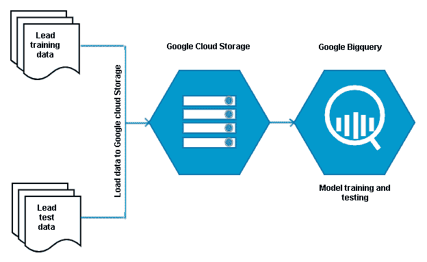

图示关键节点如下：

1.  训练与测试数据集已上传至 Cloud Storage 存储桶。
2.  数据落地存储后，在 BigQuery 中创建 `leads_training` 与 `leads_test` 两张表承载数据。
3.  数据集就绪，分别以 `leads_training` 训练模型，以 `leads_test` 验证模型。

后续章节将逐步拆解各环节操作。

##### 数据入驻 Cloud Storage

分步操作指引如下：

1.  准备好训练与测试数据文件。
2.  在 Cloud Storage 中分别创建训练桶与测试桶。
3.  进入 GCP 控制台，点击左上角导航菜单，在“存储”栏目选择“Cloud Storage”。
4.  点击顶部“创建存储桶”，界面如下：

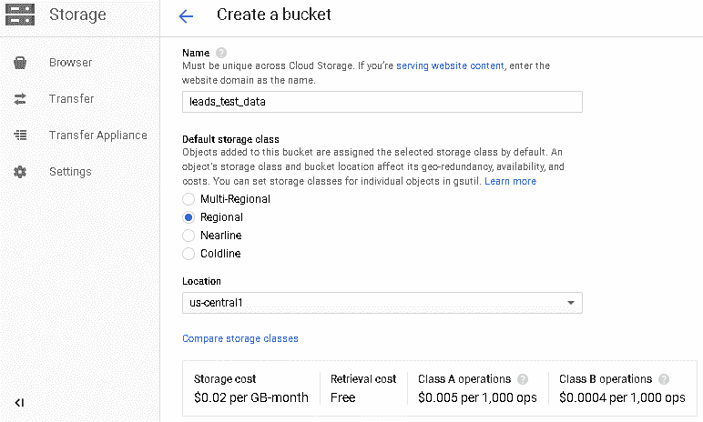

5.  设置全局唯一的存储桶名称。
6.  根据业务需求选择区域型存储桶。
7.  确定存储桶物理位置。
8.  点击“创建”确认。
9.  进入对应存储桶，通过“上传文件”按钮或拖拽方式，将训练、测试数据上传至各自桶中。

##### 数据导入 BigQuery

接下来在 BigQuery 中建立数据集并导入数据：

1.  **创建 `Leads` 数据集**：
    1.  控制台左上角菜单栏，进入“大数据” -> `BigQuery`。
    2.  点击左侧面板中的项目 ID。
    3.  选择“创建数据集”。
    4.  数据集 ID 命名为 `Leads`，选定偏好位置，点击创建。

2.  **从 Cloud Storage 创建 `Leads_Training` 与 `Leads_Test` 表**：
    1.  展开左侧项目下的 `Leads` 数据集。
    2.  点击“创建表”。
    3.  来源选择“Google Cloud Storage”（而非空表）。
    4.  填写源文件路径。
    5.  文件格式选 `CSV`。
    6.  表名分别设为 `Leads_Test_Data` 与 `Leads_Training_Data`。
    7.  勾选“自动检测架构”。
    8.  高级选项中，若含表头，将“标题行跳过”设为 `1`。
    9.  点击“创建表”完成。

建表操作界面示意：

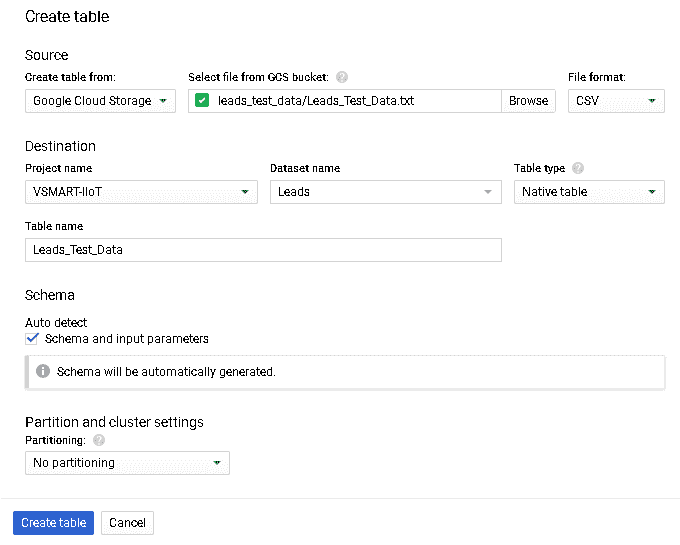

跳过表头行的具体设置：

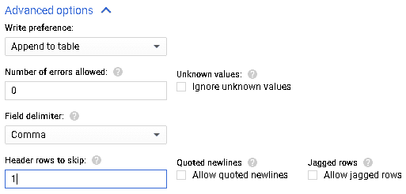

此时，`Leads` 数据集及两张核心表已就绪，进入模型训练环节。

##### 模型训练

通过以下 BigQuery SQL 片段，基于 `Leads_Training` 表以逻辑回归算法训练线索模型：

请访问 [此页面](https://github.com/vss-vikram/Hands-On-Artificial-Intelligence-on-Google-Cloud-Platform) 获取 `leads_model.sql` 查询语句。

```sql
CREATE MODEL
 `Leads.lead_model_optimum`
 OPTIONS
 (model_type = 'logistic_reg') AS
 SELECT
 Lead_Stage AS label,
 lead_origin,
 lead_source,
 ...,
 ...,
 ...,
 ..., 
 receive_more_updates_about_our_courses,
 update_me_on_supply_chain_content,
 Get_updates_on_PGDMHBSCM,
 city_new,
 ...,
 ...,
 Asymmetrique_Activity_Score,
 Asymmetrique_Profile_Score,
 Last_Notable_Activity
 FROM
 Leads.Leads_Training_Data;
```

代码解读：

*   在 `Leads` 数据集下创建名为 `lead_model_optimum` 的模型。
*   `OPTIONS` 中指定 `model_type` 为 `logistic_reg`，确立逻辑回归算法。
*   `Lead_Stage` 为目标标签（预测列），也是识别线索阶段的关键字段。
*   特征列覆盖 `lead_origin` 至 `Last_Notable_Activity`，用于预测 `Lead_Status`。
*   训练数据源为 `Leads_Training_Table`。
*   训练完成后，模型以 `lead_model_optimum` 命名持久化于 `Leads` 数据集。

点击“模型”可查看详情、状态与架构，包含算法类型、迭代轮数、学习率、耗时等完整元信息。直接复制上述 SQL 至 BigQuery 编辑器运行，即可得第一个模型。

##### 模型评估

BigQuery 内置 `ml.evaluate()` 函数用于模型评估。示例代码与结果如下：

```sql
SELECT *  FROM
 ml.evaluate (model `Leads.lead_model_optimum`,
         (
         SELECT  Lead_Stage AS label, *
             FROM
         `Leads.Leads_Training_Data` )
        )
```

该查询对 `lead_model_optimum` 进行全维度评估。执行结果如下：

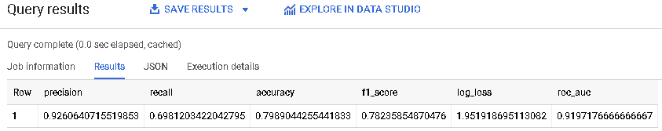

截图展示了完整评估指标：SQL 训练模型准确率高、训练覆盖度佳；得分表明模型属于最佳拟合，而非欠拟合或过拟合。关键在于，业务分析师仅需简单 SQL 即可完成训练部署，大幅降低门槛。

##### 模型测试

使用 `ml.predict()` 函数进行推理预测。执行以下 SQL：

```sql
SELECT
 prospect_id,
 predicted_label
 FROM
 ml.predict(model `Leads.lead_model_optimum`,
 (
 SELECT
 *
 FROM
 Leads_Test_Data))
```

代码逻辑：模型基于 `prospect_id` 对 `test_data` 预测 `Lead_Stage`。

对比截图中基于 `prospect_id` 的预测值与测试集真实 `Lead_Stage`，直观验证模型精度：

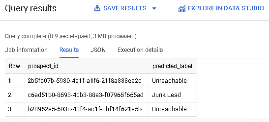

本实战到此结束。建议您进一步尝试在搭载 `Spark` 的 `Dataproc` 集群上复现该流程。

#### 章节小结

本章系统梳理了 GCP 上构建 AI 应用的关键组件矩阵，涵盖计算、存储、处理三大维度的选型策略与适用场景。切记：存储、计算、处理的恰当组合是成本效益的基石。除理论夯实外，我们还通过 BigQuery 与 Cloud Storage 实战了线索预测全流程，同款实验可迁移至 Dataproc + Spark 环境练手。

下一章，我们将深入探索如何借力 GCP 自动扩缩容特性，应对海量数据处理挑战。

## 第 2 篇：Google Cloud Platform 赋能人工智能实战

> 来源：[`gitee.com/apachecn/apachecn-dl-zh/blob/master/docs/handson-ai-gcp/sec2.md`](https://gitee.com/apachecn/apachecn-dl-zh/blob/master/docs/handson-ai-gcp/sec2.md)

本篇将引导您通过多算法实战落地 AI 能力。**第 3 章** 聚焦 `XGBoost` 强势算法，剖析其在 GCP 上构建 ML 应用的实战路径；**第 4 章** 深入 `Cloud AutoML`，体验 GCP 上的机器学习即服务；**第 5 章** 基于 `Cloud ML Engine` 搭建生产级 ML 管道；**第 6 章** 手把手教学 `Dialogflow` 打造智能会话应用。

本篇章节速览：

*   “第 3 章”，“XGBoost 机器学习实战”
*   “第 4 章”，“玩转 Cloud AutoML”
*   “第 5 章”，“构建大规模云端 ML 引擎”
*   “第 6 章”，“Dialogflow 智能会话应用开发”

### 第 3 章：XGBoost 机器学习实战

> 来源：[`gitee.com/apachecn/apachecn-dl-zh/blob/master/docs/handson-ai-gcp/03.md`](https://github.com/apachecn/apachecn-dl-zh/blob/master/docs/handson-ai-gcp/03.md)

数据驱动的机器学习范式已渗透至各个垂直领域。智能邮件垃圾箱通过海量样本与用户反馈迭代守护收件箱；定向广告系统依据上下文精准触达；银行反欺诈体系实时拦截恶意攻击。要让此类应用落地生根，必须攻克两大核心课题：一是构建能捕获复杂数据依赖的高效统计模型；二是实现模型的可扩展构建，确保其在数据激增时依然高效运行。机器学习的可扩展性，本质上是并行分布式计算带来的极速学习与内存高效利用。

本章聚焦集成学习利器 —— `XGBoost` 库。`XGBoost` 基于决策树集成，采用梯度提升框架。面对图像、文本等非结构化数据，神经网络往往称霸；但对于中小规模结构化/表格数据，决策树族算法公认 SOTA。单一模型往往力有不逮，集成学习通过系统化融合多模型预测力，产出兼具多模型优势的单一强模型。基学习器可同构（同算法）、亦可异构（异算法）。本章将带您用 `Python` 落地 `XGBoost`，深度解析梯度提升机制如何赋能该算法。

本章核心议程：

*   `XGBoost` 库全景扫描
*   `XGBoost` 模型训练与持久化
*   预训练 `XGBoost` 模型推理应用
*   基于 `XGBoost` 构建推荐系统

#### XGBoost 库全景扫描

`XGBoost` 致力于在海量数据集上以高性能、可扩展方式运行集成学习算法，核心追求极致计算速度与模型表现。简而言之，`XGBoost` 能最大化榨干高端硬件红利。它在梯度提升框架内实现机器学习算法。深入库细节前，我们有必要先拆解集成学习与梯度提升两大基石。

##### 集成学习

集成学习通过融合多个基模型产出最优预测模型。区别于传统 ML 从训练数据拟合单一假设，集成方法构建并组合大量假设，核心关注泛化能力，旨在化解因算法特性或训练集选取导致的偏差-方差困境。

通常流程：基学习算法（决策树、神经网络等）在训练数据上生成一组基学习器。主流集成多采用单一算法产出同质基学习器，亦有异构集成融合多算法优势。Bagging 与 Boosting 是两大主流范式，二者均通过模型平均技术（加权平均、投票、平权平均等）聚合多独立预测器。

关键挑战在于如何保证基学习器间的低相关性。若预测强相关，集成优势荡然无存。差异化来源通常有三：数据集差异（不同分布/上下文）、假设空间差异、算法品类差异。

###### 集成学习如何定夺最优模型？

当集成模型误差最小化、损失函数触底时，即得最优模型。损失函数量化预测偏离程度，寻找极小值常用梯度下降。要读懂集成机理，必须先理解模型误差来源。数学上，误差可分解为三类：

###### 可减误差 —— 偏差

偏差反映预测均值与真实值的系统性偢离。高偏差模型过度简化，忽视训练数据细节，导致欠拟合，无法捕捉输入输出关联。量化指标为预测值与实际值的平均差。


###### 可减误差 —— 方差

方差刻画模型在未见数据（测试/验证集）上的表现波动。高方差意味着模型过度贴合训练噪声（过拟合），泛化能力差。量化指标为同一观测点多次预测的离散程度。

###### 不可减误差

源于未观测变量、固有随机性等外部因素，无论算法多优越均无法消除。唯一改善路径是引入外部知识识别并建模这些隐变量。

###### 总误差

定义公式如下：


# 模型复杂度与误差的平衡艺术

一般而言，模型架构日益精密，因拟合偏差收窄，整体误差往往随之降低。但这仅在特定临界点前有效。一旦复杂度过度膨胀，过拟合风险随即显现，方差随之飙升。理想的模型应当在方差与偏差之间寻得动态平衡，如下图所示：

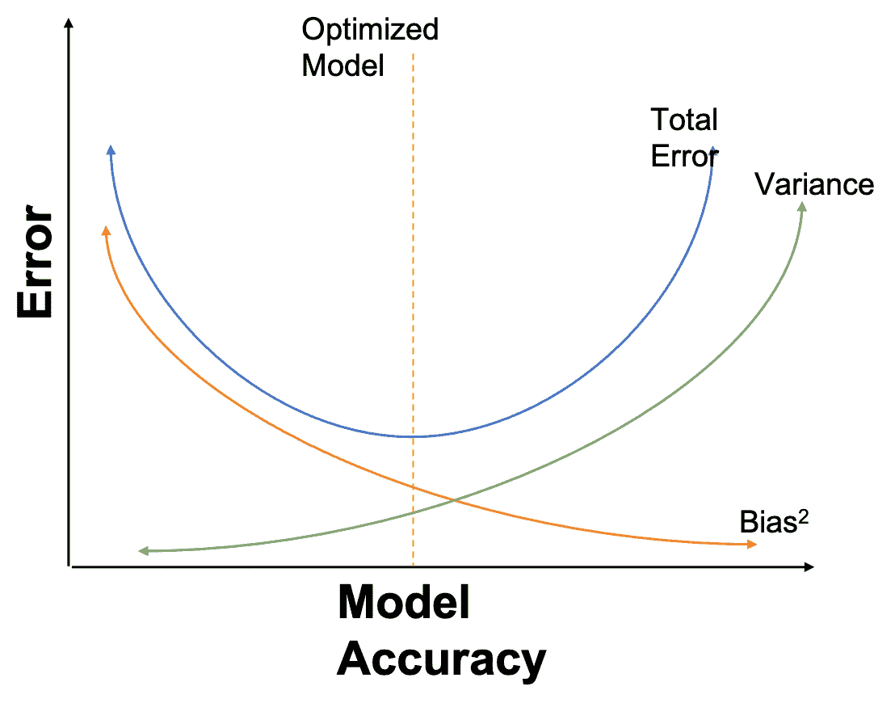

## 梯度提升：集成学习的基石

梯度提升属于集成学习范畴，其核心在于融合多个基学习器构建强预测模型。单个基模型往往过度拟合局部，预测能力孱弱（即“弱学习器”），但经集成策略整合后，整体表现显著超越单一模型。在梯度提升机（GBM）框架下，决策树是最主流的弱学习器选择。简而言之，梯度提升是一种回归与分类并重的机器学习技术，它通过迭代生成一系列弱预测模型（通常基于决策树），最终汇聚成强预测器。下面我们从数学视角剖析其原理。

监督学习的本质是定义并最小化损失函数。以均方误差（MSE）为例，其定义如下：


我们的目标是让损失函数逼近最小值。梯度提升的数学意图，是寻找一个能使损失函数极小化的函数 $F$ 来逼近数据分布，数学表达为：

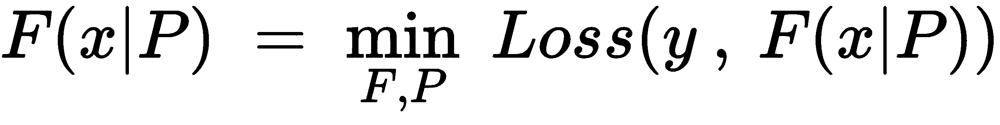

这意味着，除了寻优参数 $P$，我们还需探寻最优函数 $F$。这与逻辑回归等固定参数空间的模型截然不同：逻辑回归在训练前参数量已定，而梯度提升中函数 $F$ 的形态会随优化过程动态演变，极大增加了问题复杂度。

穷举搜索所有特征组合以确定最优函数计价高昂，梯度提升采取的策略是：集成大量简单函数来逼近复杂的 $F$。具体迭代流程如下：

1.  **初始化建模**：用简单模型拟合数据并分析残差。残差揭示了简单模型难以捕捉的“硬骨头”样本。
2.  **聚焦修正**：后续模型专门针对上一轮残差大的难点样本进行拟合修正。
3.  **加权融合**：最终将所有弱预测器按权重加权求和，得到强预测结果。

[此处代码](https://github.com/PacktPublishing/Hands-On-Artificial-Intelligence-on-Google-Cloud-Platform)演示了 Python 实现梯度提升的完整流程，重点展示了误差随迭代轮次逐步收敛的过程。散点图直观呈现了输入 $X$ 与输出 $Y$ 的分布关系；残差散点图显示，迭代至第 20 轮左右时，残差分布趋于随机无规律，标志着模型已收敛至最优输出：

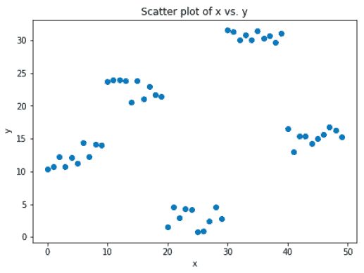

上图为原始输入输出映射关系。应用梯度提升前的基准输出如下：

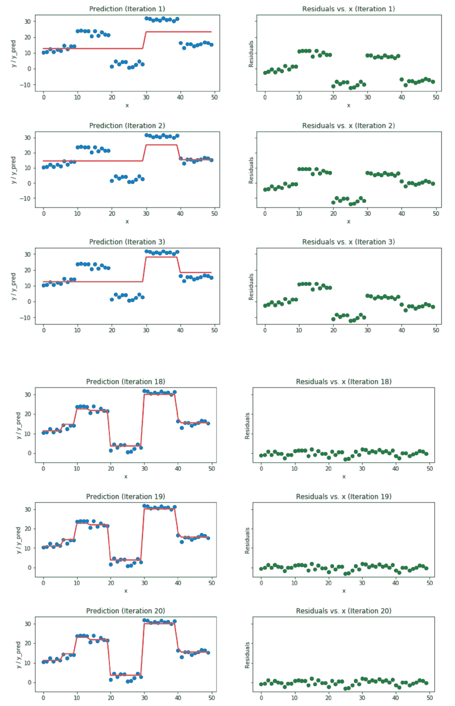

关键观测结论：
*   从第 18 次迭代起，残差分布在 20 轮附近呈现随机均匀状态。
*   残差随机均匀分布，意味着梯度提升已提取尽可能多的模式信息，输出达到优化极致。
*   换言之，算法通过不断从残差中捕捉规律，实现了输出的最大化优化。

## 极限梯度提升（XGBoost）：性能与速度的极致

### XGBoost 概览

XGBoost 由陈天奇开发，全称 **eXtreme Gradient Boosting**。它是梯度提升决策树的可扩展、高精度工程化实现，专为榨干硬件算力、追求极致模型表现与训练速度而生。陈天奇强调，这种对计算极限的挖掘正是其区别于其他库的核心竞争力。以下是其独具特色的核心特性：

#### 核心特性

##### 并行化加速
XGBoost 实现了顺序树构建过程的并行化。构建基学习器的双层循环结构（外层遍历叶节点、内层遍历特征）可互换执行顺序。传统串行模式下内层循环阻塞外层，且计算量占比小；XGBoost 通过全局特征预排序并启用多线程并行处理，打破串行依赖，有效抵消并行开销，大幅缩短耗时。

##### 智能停止策略（剪枝）
传统 GBDT 基于分裂时的负损失增益决定是否停止生长。XGBoost 则采用**后剪枝**策略：先按 `max_depth` 生长至最大深度，再自底向上修剪无正增益的分支。这种深度优先的回溯机制，避免了贪心分裂的局限性，显著提升模型泛化性能与训练效率。

##### 硬件资源榨取
XGBoost 从设计层面最大化硬件利用率：利用每棵树的内部缓冲区缓存梯度统计量，命中 CPU 缓存；支持核外计算，配合磁盘空间优化，轻松处理超内存规模的大数据集。

---

## 实战：基于 Google AI Hub 训练与托管 XGBoost 模型

本节演示如何借助 Google AI Hub 完成模型训练与存储。AI Hub 是集模型发现、共享、部署于一体的托管平台，提供开箱即用的模型目录，兼容 TensorFlow、PyTorch、Keras、scikit-learn 及 XGBoost 等主流框架。模型可封装为 GPU/TPU 深度学习虚拟机、Jupyter Notebook 或 Google AI API 服务，并支持 Kubeflow 管道化部署。丰富的标签体系辅助模型检索与发现。

参考代码 `.../text_classification_rapids_framework.py` 展示了结合 RAPIDS 框架使用 XGBoost 进行文本分类的全流程，算法步骤梳理如下：

1.  **环境准备**：导入 `OS`、`google.cloud`、`cudf(RAPIDS)`、`sklearn`、`pandas`、`xgboost` 等核心依赖，引入 `pynvml` 管理 GPU 资源。
2.  **基础设施部署**：自动化安装 Miniconda 与 RAPIDS 平台，配置 NVIDIA GPU 运行时环境变量。
3.  **认证配置**：设置 GCP 项目 ID、存储桶 ID 等 API 访问常量。
4.  **数据获取**：从 GCS 下载训练集 `text_classification_emp.csv` 至本地工作目录。
5.  **数据清洗**：按 `\n` 切分 CSV，分离标签（目标变量）与文本（特征变量）构建数组。
6.  **GPU 加速适配**：构建 Pandas DataFrame 并转为 CUDF DataFrame，确保后续计算全程落地 GPU。
7.  **数据切分**：按 8:2 比例划分训练集与测试集。
8.  **标签编码**：将文本标签向量化为数值索引。
9.  **特征工程**：字符级计算 TF-IDF 特征权重。
10. **模型训练**：调用 XGBoost 库完成模型拟合。

### 训练任务提交与监控

使用标准 `gcloud ai-platform` CLI 提交训练作业：

```
gcloud ai-platform jobs submit training $JOB_NAME \
--job-dir=$JOB_DIR \
--package-path=$TRAINING_PACKAGE_PATH \
--module-name=$MAIN_TRAINER_MODULE \
--region=$REGION \
--runtime-version=$RUNTIME_VERSION \
--python-version=$PYTHON_VERSION \
--config=config.yaml
```

作业配置参数可写入 `job.properties`，运行前需 `source` 生效，示例配置如下：

```
PROJECT_ID=test-project-id
BUCKET_ID=ml-assets
JOB_NAME=gpu_text_classification_$(date +"%Y%m%d_%H%M%S")
JOB_DIR=gs://${BUCKET_ID}/xgboost_job_dir
TRAINING_PACKAGE_PATH="text_classification"
MAIN_TRAINER_MODULE=text_classification.train
REGION=us-central1
RUNTIME_VERSION=1.13
PYTHON_VERSION=3.5
```

针对 GPU 环境的 `config.yml` 关键配置：

```
trainingInput:
  scaleTier: CUSTOM
  # Configure a master worker with 4 K80 GPUs
  masterType: complex_model_m_gpu
  # Configure 9 workers, each with 4 K80 GPUs
  workerCount: 9
  workerType: complex_model_m_gpu
  # Configure 3 parameter servers with no GPUs
  parameterServerCount: 3
  parameterServerType: large_model
```

项目打包结构参考：

```
text_classification
|
|__ __init__.py
|__ config.yml
|__ run.sh
|__ job.properties
|__ train.py
```

提交后，可通过以下命令追踪作业状态：

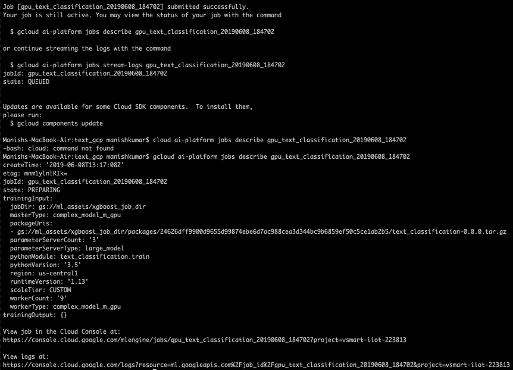

Cloud ML GPU 训练日志典型输出界面：

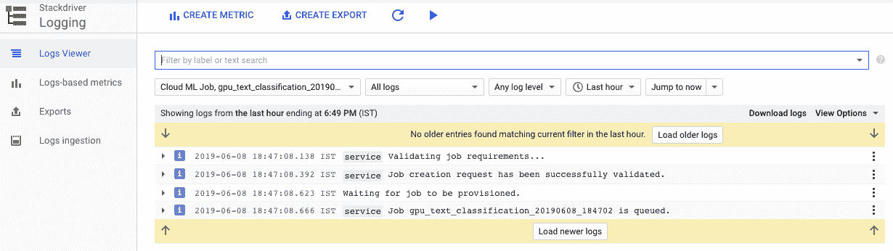

> **实操建议**：请在实际环境中逐步复现上述部署流程，体会 GCP 强大并行计算能力对 XGBoost 训练的加速效果。

---

## 实战：部署与调用已训练的 XGBoost 模型

模型导出至 Google Cloud Storage 后，预测输入需满足特定格式：**稠密向量格式，禁用稀疏表示**。即向量中不得包含隐式零值，所有零值必须显式表示为 `0.0`。格式示例：

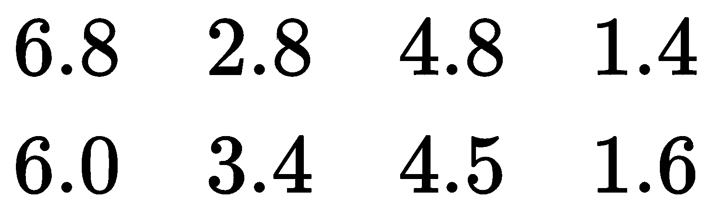

### GCP 控制台部署步骤

1.  登录 `console.google.com`。
2.  进入 **AI Platform > Models** 页面：
    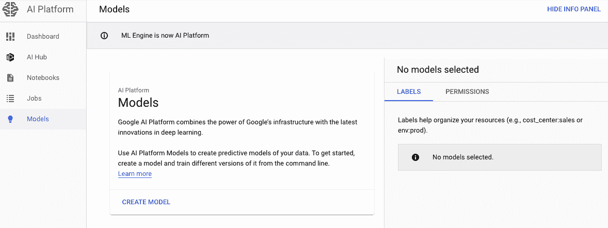
3.  点击创建模型资源，按下图填写元信息：
    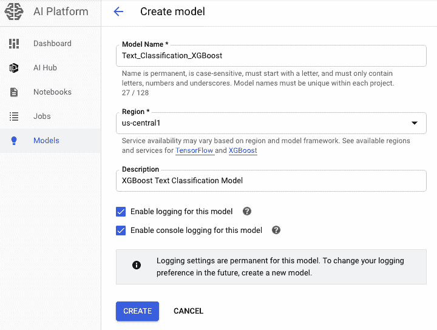
4.  创建模型版本，配置模型归档路径、运行时版本、Python 版本及框架类型（XGBoost）：
    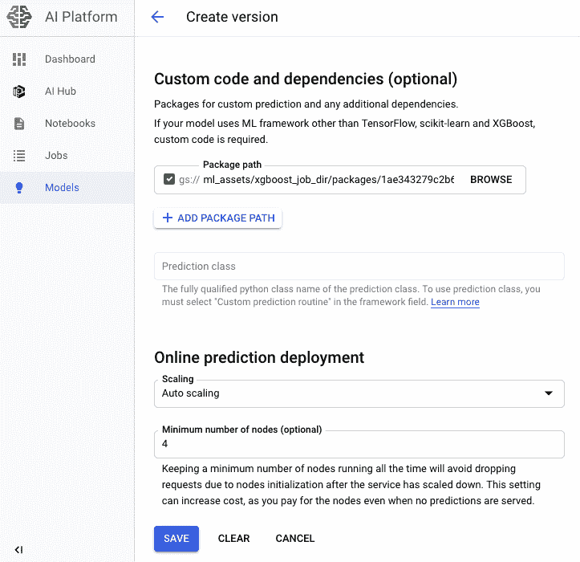
5.  版本创建成功后，AI Platform 自动启动推理服务节点。

### 客户端预测调用

使用 Python 客户端库调用云端 REST API 进行在线预测：

```
import googleapiclient.discovery

def predict_json(project, model, instances, version=None):
    """Send json data to a deployed model for prediction.
    Args:
        project (str): project where the AI Platform Model is deployed.
        model (str): model name.
        instances ([[float]]): List of input instances, where each input
           instance is a list of floats.
        version: str, version of the model to target.
    Returns:
        Mapping[str: any]: dictionary of prediction results defined by the
            model.
    """
    # Create the AI Platform service object.
    # To authenticate set the environment variable
    # GOOGLE_APPLICATION_CREDENTIALS=<path_to_service_account_file>
    service = googleapiclient.discovery.build('ml', 'v1')
    name = 'projects/{}/models/{}'.format(project, model)

    if version is not None:
        name += '/versions/{}'.format(version)

    response = service.projects().predict(
        name=name,
        body={'instances': instances}
    ).execute()

    if 'error' in response:
        raise RuntimeError(response['error'])

    return response['predictions']
```

上述客户端代码封装了 JSON 请求构造与响应解析，实现了对云端部署模型的无感调用。Python 客户端库详细文档见[此处](https://cloud.google.com/ml-engine/docs/tensorflow/python-client-library)。

---

## 进阶应用：基于 XGBoost 构建平衡推荐系统

### 痛点：长尾商品的曝光困境

现代电商用户渴望个性化推荐，这直接驱动转化与营收。传统协同过滤（CF）虽广泛应用，但存在天然短板：它仅挖掘用户历史行为相似性，倾向于推荐“热门头部商品”，导致“长尾商品”长期沉睡。亚马逊等头部平台虽擅长关联推荐，却难以主动挖掘冷门优质商品。对于依赖长尾商品贡献显著 GMV 的平台而言，必须引入能**平衡头部热度与长尾发现**的算法机制。

### 方案：梯度提升树（GBDT）建模用户-物品交互

文献表明，基于模型的算法（Model-based CF）在推荐领域极具潜力。决策树学习在处理用户-物品关系、交互特征及侧信息方面表现优异。梯度提升通过串行集成弱学习器，逐步修正残差误差，最终输出强预测器——即**预测用户 $u$ 购买物品 $i$ 的概率**。XGBoost 作为 GBDT 的工业级实现，凭借高效并行与正则化优势，成为构建平衡推荐系统的首选利器。

### 场景建模：稀疏用户-物品矩阵

以用户-物品评分矩阵为例：

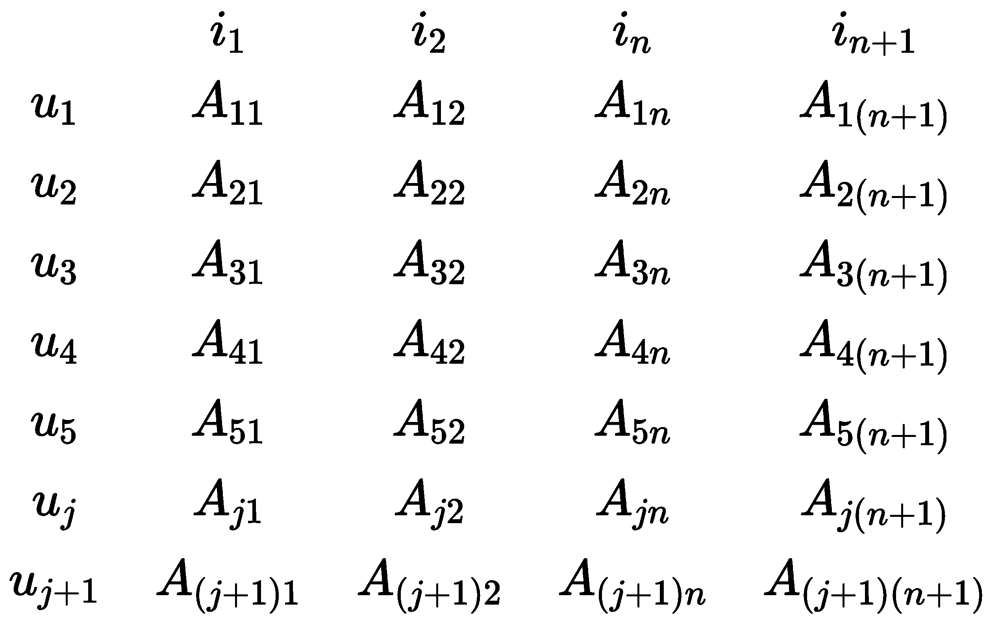

*   **维度**：$j+1$ 个用户（行），$n+1$ 个物品（列）。
*   **取值**：$A_{jn} \in \{1,2,3,4,5\}$ 表示显式评分；隐式反馈场景下为二值 $\{0,1\}$。本文假设显式 1-5 分制。
*   **稀疏性**：真实场景中用户仅接触极少量物品，矩阵超过 99% 为空值（`NaN`）。

**稀疏度量化示例**：
假设物品池 $n = 10^7$，用户量 $m = 2\times10^4$，总单元数 $2\times10^{11}$。人均评分 5 条，总评分数 $5\times10^7$。
$$ \text{稀疏度} = \frac{\text{空单元数}}{\text{总单元数}} = \frac{2\times10^{11} - 5\times10^7}{2\times10^{11}} \approx 0.99975 $$
即 **99.975% 的极度稀疏**。这种高维稀疏特性，倒逼模型具备强大的特征泛化与非线性拟合能力——这正是 XGBoost 决策树集成擅长的战场。

# 利用 XGBoost 攻克稀疏推荐难题

鉴于数据稀疏度高达 99.95%，常规推荐引擎难以挖掘出那些用户未评分但极具商业价值的冷门条目。此时，XGBoost 算法便成为了破局利器。

## 实战：从零构建 XGBoost 推荐模型

我们将基于用户电影评分数据集，演示如何借助 XGBoost 搭建推荐系统。完整代码实现可参考 [GitHub 仓库](https://github.com/PacktPublishing/Hands-On-Artificial-Intelligence-on-Google-Cloud-Platform)。本实战将引入 RAPIDS 加速库，通过 `conda` 完成运行时环境与依赖包的部署，并配合绘图库直观呈现结果。

### 核心数据一览

**用户评分记录样本 (`users.csv`)**：

| 用户 ID | 电影 ID | 评分 | 时间戳 |
| :--- | :--- | :--- | :--- |
| 0 | 50 | 5 | 881250949 |
| 0 | 172 | 5 | 881250949 |
| 0 | 133 | 1 | 881250949 |
| 196 | 242 | 3 | 881250949 |
| 186 | 302 | 3 | 891717742 |
| 22 | 377 | 1 | 878887116 |
| 244 | 51 | 2 | 880606923 |
| 166 | 346 | 1 | 886397596 |
| 298 | 474 | 4 | 884182806 |
| 115 | 265 | 2 | 881171488 |

**电影元信息样本 (`movie_lens.csv`)**：

| 项目 ID | 片名 |
| :--- | :--- |
| 1 | Toy Story（1995） |
| 2 | GoldenEye（1995） |
| 3 | Four Rooms（1995） |
| 4 | Get Shorty（1995） |
| 5 | Copycat（1995） |
| 6 | Shanghai Triad (Yao a yao yao dao waipo qiao)（1995） |
| 7 | Twelve Monkeys（1995） |
| 8 | Babe（1995） |
| 9 | Dead Man Walking（1995） |
| 10 | Richard III（1995） |

> **注**：上述仅为示例数据。实际生产环境中训练集可达数 GB 级别，但凭借完善的基础设施栈，XGBoost 依然能高效完成训练任务。

---

### 四、拥抱 Cloud AutoML：零门槛构建企业级 AI

> 来源：[`gitee.com/apachecn/apachecn-dl-zh/blob/master/docs/handson-ai-gcp/04.md`](https://gitee.com/apachecn/apachecn-dl-zh/blob/master/docs/handson-ai-gcp/04.md)

上一章我们深度剖析了 XGBoost 这款机器学习界的“瑞士军刀”。本章将视线转向 **Google Cloud Platform (GCP)**，探索其 **Cloud AutoML** 服务如何让模型构建变得触手可及。AutoML 旨在降低门槛，即使缺乏深厚数据工程或 ML 编码背景的开发者与分析师，也能快速落地定制化模型。我们将采用实战导向，手把手教你利用 AutoML 解决文档/图像分类、语音转文本、情感分析等实战场景。

**本章路线图：**

*   Cloud AutoML 全景扫描
*   实战：AutoML Natural Language 实现文档分类
*   实战：AutoML Vision API 玩转图像分类
*   实战：Speech-to-Text API 驱动语音转写
*   实战：AutoML Natural Language API 洞察情感倾向

#### Cloud AutoML 核心价值解析

有监督学习模型的生命周期遵循固定范式：依赖历史数据训练假设函数，映射输入至输出。以零售销量预测为例，海量多维历史数据被随机切分为训练集与评估集（通常 8:2）。模型经算法训练、参数调优、评估验证后，部署上线面对未见数据进行泛化预测。这一标准化流程如下图所示：

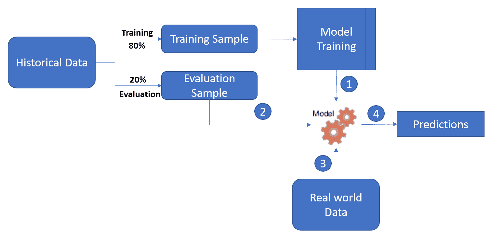

过去，这全流程需由数据科学家在非云环境手工把控。而 **GCP Cloud AutoML** 提供全托管环境，接管运维流程、底层算力与模型全生命周期管理。它面向 **自然语言处理 (NLP)** 与 **计算机视觉 (CV)** 开放接口，本章将通过实战案例深度拆解。

**AutoML 三大核心优势：**

*   **开箱即用，极简上手**：零门槛训练定制模型，贴合特定业务场景。底层算力与存储复杂性由 GCP 托管，用户聚焦实验迭代本身。
*   **性能强劲，兜底可靠**：底层借力 Google 前沿分布式计算平台与弹性伸缩集群，资源按需分配，保障训练评估部署的稳健产出。
*   **敏捷高效，加速交付**：可视化 GUI 覆盖训练、评估、调参、部署全链路。极速实验验证假设，参数微调即时见效，大幅压缩模型交付周期。

#### AutoML 运作机制：抽象即生产力

AutoML 在监督学习管道之上构建高层抽象，极致简化了训练-评估-部署闭环。其工作原理如下：

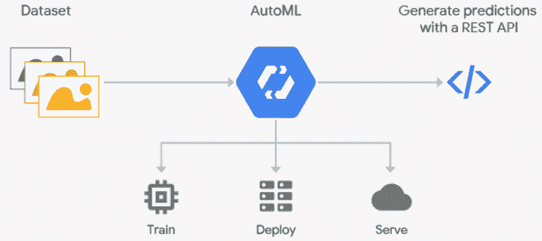

对比传统管道，AutoML 的革新显而易见：
1.  **流程极简化**：一站式覆盖模型全生命周期。
2.  **原生 RESTful API**：模型能力即服务，无缝嵌入各类应用与端点。
3.  **双轨并行**：UI 界面适配探索性实验与假设验证；REST API 服务于生产环境的自动化训练、评估与推理调用。

下文将速览 AutoML 核心 API 端点与关键字段。

#### AutoML API 速查手册

GCP AI 应用通过 RESTful API 编排 AutoML 服务。UI 适合 PoC 阶段，企业级落地离不开完备的 API 库。我们以 `v1beta1.projects.locations.models` 为例，拆解模型交互接口。

##### 1. 模型定位与管理 API

| 方法 | 端点 | 功能 | 响应 |
| :--- | :--- | :--- | :--- |
| `create` | `POST /v1beta1/{parent}/models` | 创建模型 | 返回模型实例 |
| `delete` | `DELETE /v1beta1/{name}` | 删除模型 | 返回 `google.protobuf.Empty` 及 `deleteDetails` |
| `get` | `GET /v1beta1/{name}` | 获取模型详情 | 返回模型实例 |
| `predict` | `POST /v1beta1/{name}/predict` | 在线预测 | 返回预测结果 |

**模型 JSON 实体关键字段详解 **```json
{
  "name": "string",
  "displayName": "string",
  "datasetId": "string",
  "createTime": "string",
  "updateTime": "string",
  "deploymentState": "enum(DeploymentState)",

  // Union field model_metadata can be only one of the following:
  "imageClassificationModelMetadata": {
    "object": "ImageClassificationModelMetadata"
  },
  "textClassificationModelMetadata": {
    "object": "TextClassificationModelMetadata"
  },
  "translationModelMetadata": {
    "object": "TranslationModelMetadata"
  }
  // End of list of possible types for union field model_metadata.
}
```：

*   `name`：仅输出。资源全路径，格式 `projects/{project_id}/locations/{locationId}/models/{modelId}`。
*   `displayName`：控制台显示名。≤32 字符，支持 ASCII 字母、数字、下划线，首字符必须为字母。
*   `datasetId`：关联训练数据集资源 ID，需同项目同区域。
*   `createTime` / `updateTime`：RFC3339 UTC 格式时间戳，纳秒精度（如 `2019-03-05T15:01:23.045123456Z`）。
*   `deploymentState`：部署状态枚举：`DEPLOYED` (已部署)、`UNDEPLOYED` (未部署)、`DEPLOYMENT_STATE_UNSPECIFIED` (保留字段)。
*   `*ModelMetadata`：针对图像 (`imageClassificationModelMetadata`)、文本 (`textClassificationModelMetadata`)、翻译 (`translationModelMetadata`) 的专用元数据，后续章节详述。

##### 2. 模型评估 API (`v1beta1.projects.locations.models.modelEvaluations`)

| 方法 | 端点 | 功能 |
| :--- | :--- | :--- |
| `get` | `GET /v1beta1/{name}` | 获取单次评估详情 |
| `list` | `GET /v1beta1/{parent}/modelEvaluations` | 列出所有评估记录 |

通过简单调用即可获取指标，支撑模型迭代优化决策。

##### 3. 长运行操作 API (`v1beta1.projects.locations.operations`)

大规模训练/评估耗时较长，此组异步非阻塞 API 用于追踪进度：

| 方法 | 端点 | 功能 |
| :--- | :--- | :--- |
| `cancel` | `POST /v1beta1/{name}` | 发起异步取消 |
| `delete` | `DELETE /v1beta1/{name}` | 删除操作记录 |
| `get` | `GET /v1beta1/{name}` | 轮询最新状态 |
| `list` | `GET /v1beta1/{name}/operations` | 过滤列出操作 |
| `wait` | `POST /v1beta1/{name}/wait` | 阻塞等待完成或超时 |

应用层可借此实时反馈训练进度至前端用户。

---

#### 实战：AutoML Natural Language 文档分类

海量文档（如法律合同）人工归类成本高昂且低效。GCP AutoML Natural Language 提供定制化训练入口，赋能自动化文档分类。本节以公开 **20 Newsgroups 数据集**（约 2 万篇文档，均匀分布于 20 个主题）为例，演练全流程。数据集下载地址：[http://qwone.com/~jason/20Newsgroups/](http://qwone.com/~jason/20Newsgroups/)。目标：训练模型 → 评估效果 → 落地分类。

##### 传统 ML 范式 vs. AutoML 降维打击

传统文档分类需历经文本清洗、特征工程（TF-IDF/词向量）、模型选型调参、离线评估等繁琐步骤，流程冗长且重度依赖专家经验：

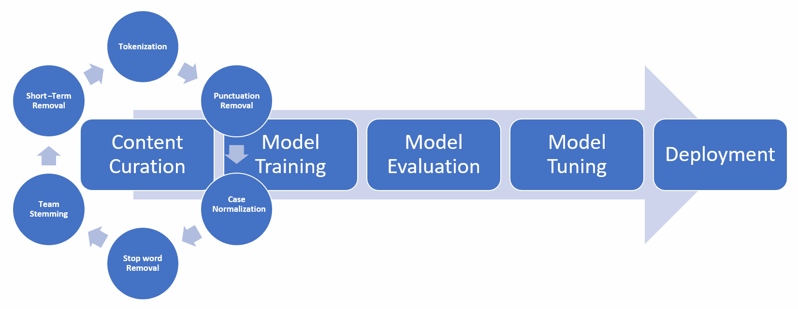

AutoML 将上述管道封装为“数据上传 → 标注 → 一键训练 → 部署调用”的极简闭环。

##### AutoML 文档分类实操指南

###### 步骤 1：进入 AutoML Natural Language 控制台
使用 GCP 凭据登录 [Cloud Console](https://console.cloud.google.com)，导航至 **人工智能 → 自然语言** 板块。

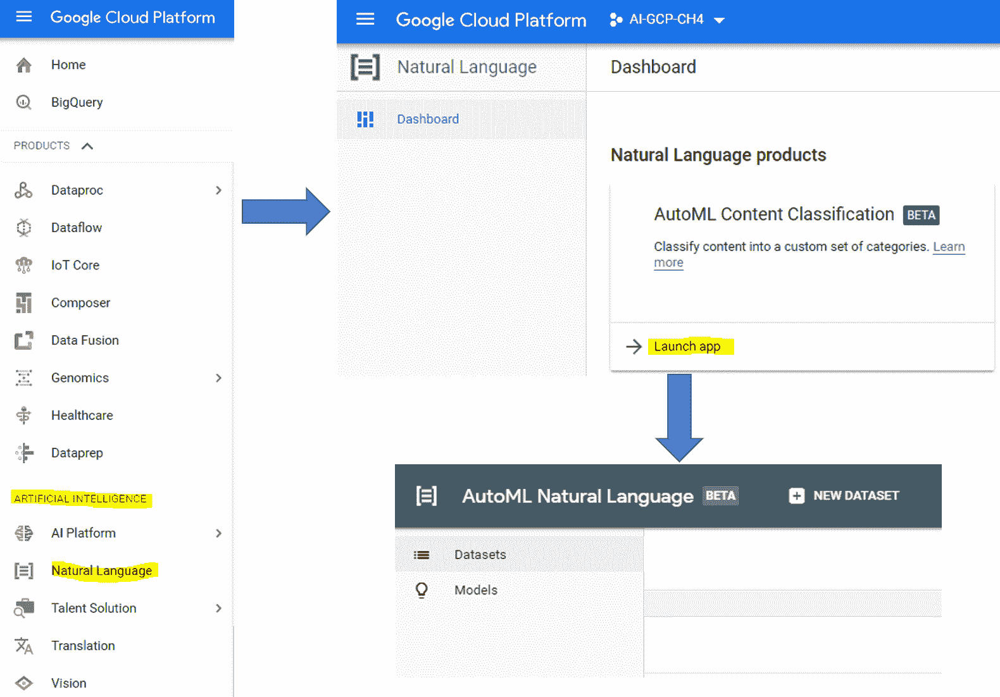

界面直观支持数据集上传与模型训练全流程。

###### 步骤 2：创建数据集
点击顶部栏 **“新建数据集”**，命名（如 `newsgroups`）。支持三种数据导入方式：

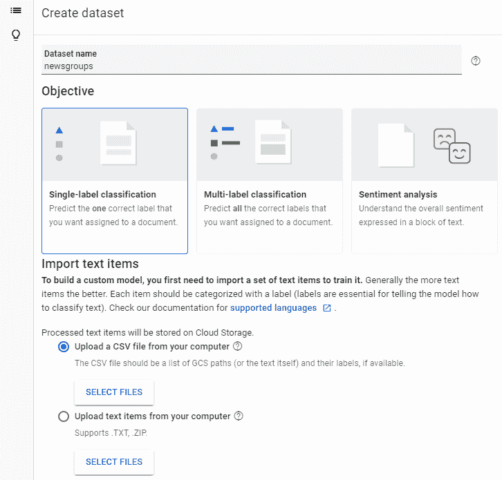

1.  **本地 CSV 上传**：CSV 需含 GCS 路径与标签列。
2.  **本地文本/ZIP 上传**：直接上传原始文本文件或压缩包。
3.  **云存储 CSV 引用**：选取 GCS 中已有的带标签 CSV。

数据集创建后，持续支持从 GCS 或本地增量导入。

###### 步骤 3：数据标注——模型上限的基石
通过 CSV 携带标签或 UI 界面手工标注完成训练数据标记。

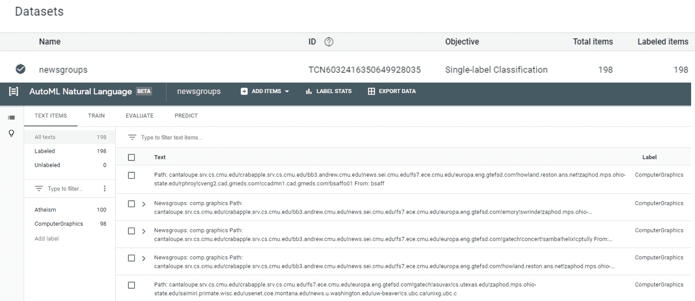

**黄金标注法则：**
*   **多样性为王**：覆盖不同文长、文风、作者，提升模型鲁棒性。
*   **人类可辨别原则**：AutoML 依赖人工标注真值，标注质量直决定模型上限。
*   **样本量红线**：GCP 建议 **每标签 ≥ 1,000 条**，硬性门槛 **≥ 10 条**。样本越多、分布越均，精度越高。
*   **兜底标签**：无法归类文档打上 `None_of_the_above`，优于强行贴标或留空。

###### 步骤 4：一键启动训练
数据集就绪后，点击 **“TRAIN NEW MODEL”**，命名（≤32 字符，字母数字下划线）即发起异步训练。耗时随数据量级从分钟至小时不等。训练完成将通过邮件通知注册账号。

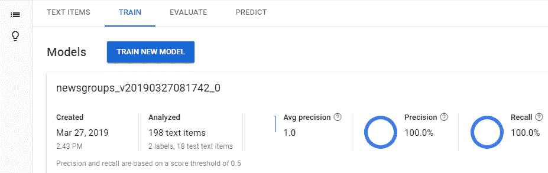

###### 模型效能评估

正如下方截图所示，模型训练完成后，界面将呈现模型的基本属性（如创建时间戳、训练数据量级）与核心质量指标（如**精确率**与**召回率**）：

与传统机器学习流程需手动在验证集上测算不同，GCP AutoML 会自动利用测试集样本完成内部评估。此环节旨在校验模型的泛化能力与预测准度。平台提供两个维度的聚合指标，分别反映模型在全量特征/标签上的整体表现，以及在各单一类别标签上的细分表现。具体汇报指标如下：

*   **AuPRC（精度-召回曲线下面积）**：该数值等同于平均精度（AP）。常见取值区间为 0.5 至 1.0，数值越逼近 1 代表模型预测越精准。

*   **精度-召回曲线**：AutoML 提供了可视化交互组件，支持动态调整分类阈值。阈值下调虽能提升召回率，但往往伴随精度下降的代价：


*   **混淆矩阵**：该工具以矩阵形式直观展示模型在各输出类别上的预测准确性，数值代表评估阶段各真实标签对应预测输出的占比：


借助这些开箱即用的评估指标，开发者可快速判断模型在真实业务数据上的可靠性。若混淆矩阵显示错判严重，且精度、召回率均偏低，通常意味着需要补充更多样化的训练样本。

除 Web 控制台外，GCP 还暴露了可编程接口，支持通过命令行、Python、Java 及 Node.js 以编程方式获取评估详情。

#### 评估指标获取

```
curl -H "Authorization: Bearer $(gcloud auth application-default print-access-token)" -H "Content-Type:application/json" https://automl.googleapis.com/v1beta1/model-name/modelEvaluations
```

##### 命令行模式

执行以下指令（将 `model-name` 替换为实例名称）即可拉取 JSON 格式的评估参数：

返回示例如下：

```json
{
  "modelEvaluation": [
    {
      "name": "projects/434039606874/locations/us-central1/models/7537307368641647584/modelEvaluations/9009741181387603448",
      "annotationSpecId": "17040929661974749",
      "classificationMetrics": {
        "auPrc": 0.99772006,
        "baseAuPrc": 0.21706384,
        "evaluatedExamplesCount": 377,
        "confidenceMetricsEntry": [
          {
            "recall": 1,
            "precision": -1.3877788e-17,
            "f1Score": -2.7755576e-17,
            "recallAt1": 0.9761273,
            "precisionAt1": 0.9761273,
            "f1ScoreAt1": 0.9761273
          },
          {
            "confidenceThreshold": 0.05,
            "recall": 0.997,
            "precision": 0.867,
            "f1Score": 0.92746675,
            "recallAt1": 0.9761273,
            "precisionAt1": 0.9761273,
            "f1ScoreAt1": 0.9761273
          }
        ]
      }
    }
  ]
}
```

响应体主要包含两大核心对象：`classificationMetrics`（顶层分类汇总指标）与 `confidenceMetricsEntry`（不同置信度阈值下的细粒度指标）。其中 `precision` 与 `recall` 字段均有详细记录。

##### Python 实现

调用评估接口的 Python 示例代码如下：

```python
project_id = 'PROJECT_ID'
compute_region = 'COMPUTE_REGION'
model_id = 'MODEL_ID'
filter_ = 'Filter expression'

from google.cloud import automl_v1beta1 as automl

client = automl.AutoMlClient()

###### Get the fully qualified path of the model based on project, region and model
model_full_id = client.model_path(project_id, compute_region, model_id)

###### Apply the filter for listing all the model evaluations. 
response = client.list_model_evaluations(model_full_id, filter_)

print("Loop for listing all the model evaluations received based on the filter condition")
for element in response:
    print(element)
```

该脚本会遍历返回的评估对象，逐项输出精度、召回率等关键参数。

##### Java 实现

对应的 Java 版本调用逻辑如下：

```java
public static void autoMLModelEvaluation(
    String projectId, String computeRegion, String modelId, String filter) throws IOException {
  // Instantiates a client
  AutoMlClient client = AutoMlClient.create();

  // Get the full path of the model.
  ModelName modelFullId = ModelName.of(projectId, computeRegion, modelId);

  // List all the model evaluations in the model by applying filter
  ListModelEvaluationsRequest modelEvaluationsrequest = ListModelEvaluationsRequest.newBuilder()
          .setParent(modelFullId.toString())
          .setFilter(filter)
          .build();

  // Iterate through the results.
  String modelEvaluationId = "";
  for (ModelEvaluation element : client.listModelEvaluations(modelEvaluationsrequest).iterateAll()) {
    if (element.getAnnotationSpecId() != null) {
      modelEvaluationId = element.getName().split("/")[element.getName().split("/").length - 1];
    }
  }

  // Resource name for the model evaluation.
  ModelEvaluationName modelEvaluationFullId =
      ModelEvaluationName.of(projectId, computeRegion, modelId, modelEvaluationId);

  // Get a model evaluation.
  ModelEvaluation modelEvaluation = client.getModelEvaluation(modelEvaluationFullId);

  ClassificationEvaluationMetrics classMetrics = modelEvaluation.getClassificationEvaluationMetrics();
  List<ConfidenceMetricsEntry> confidenceMetricsEntries = classMetrics.getConfidenceMetricsEntryList();

// Iterate over the list and get individual evaluation parameters. 
}
```

此片段同样实现了参数遍历与打印，易于封装为独立 API 调用，进而构建为微服务组件。

##### Node.js 实现

Node.js 版本采用异步非阻塞方式调用评估接口，代码结构简洁高效：

```javascript
const automl = require(`@google-cloud/automl`);
const util = require(`util`);

const client = new automl.v1beta1.AutoMlClient();

const projectId = `PROJECT_ID`;
const computeRegion = `REGION_NAME`;
const modelId = `MODEL_ID`;
const modelEvaluationId = `MODEL_EVAL_ID`;

  // Get the full path of the model evaluation.
  const modelEvaluationFullId = client.modelEvaluationPath(
    projectId,
    computeRegion,
    modelId,
    modelEvaluationId
  );

  // Get complete detail of the model evaluation.
  const [response] = await client.getModelEvaluation({
    name: modelEvaluationFullId,
  });
  console.log(util.inspect(response, false, null));
```

利用该特性，可轻松开发出基于评估参数响应的高并发无阻塞微服务。

#### 模型部署与推理预测

模型构建与评估通过后，GCP 提供简易交互界面与 REST 接口，支持将模型投入实战，依据输入文本关键词对文档进行多类别归类。

##### Web 交互测试

控制台内置在线测试面板，便于快速验证模型效果：

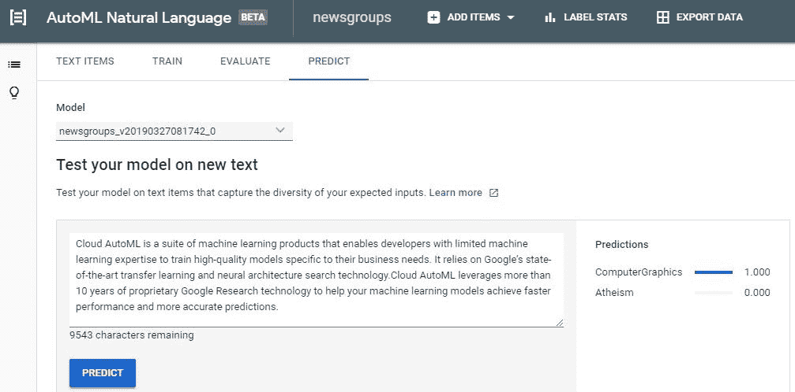

图示场景中，模型对输入文本以 100% 置信度判定为 `计算机图形学` 类别。

##### REST 预测接口

生产环境可通过标准 REST API 调用已部署模型：

```bash
export GOOGLE_APPLICATION_CREDENTIALS=key-file-path 

curl -X POST   
-H "Authorization: Bearer $(gcloud auth application-default print-access-token)" 
-H "Content-Type: application/json" 
https://automl.googleapis.com/v1beta1/projects/ai-gcp-ch4/locations/us-central1/models/TCN2853684430635363573:predict 
-d '{
         "payload" : {
           "textSnippet": {
                "content": "YOUR TEXT HERE",
                 "mime_type": "text/plain"
            },
         }
    }'
```

该接口原生支持 Python 等主流语言调用。

##### Python 预测客户端

将下列代码保存为 `document_classifier.py`，即可实现基于部署模型的推理功能：

```python
import sys 

from google.cloud import automl_v1beta1 
from google.cloud.automl_v1beta1.proto 
import service_pb2 

def get_prediction(content, project_id, model_id):
   prediction_client = automl_v1beta1.PredictionServiceClient()
   name = 'projects/{}/locations/us-central1/models/{}'.format(project_id, model_id)
   payload = {'text_snippet': {'content': content, 'mime_type': 'text/plain' }}
   params = {}
   request = prediction_client.predict(name, payload, params)
   return request # waits till request is returned

if __name__ == '__main__':
   content = sys.argv[1]
   project_id = sys.argv[2]
   model_id = sys.argv[3]
   print(get_prediction(content, project_id, model_id))
```

执行命令 `python document_classifier.py "Document Text" <<project_id>> <<model_id>>`，传入项目 ID 与模型 ID 即可完成分类请求。

#### AutoML Vision：图像分类实战

GCP `Vision API` 赋能开发者处理视觉类非结构化数据（图像/视频），支持通过 `Web 控制台` 与 API 双通道构建智能视觉应用。

##### 图像分类全流程

AutoML Vision 的建模流程与文档分类高度同构，核心步骤如下：

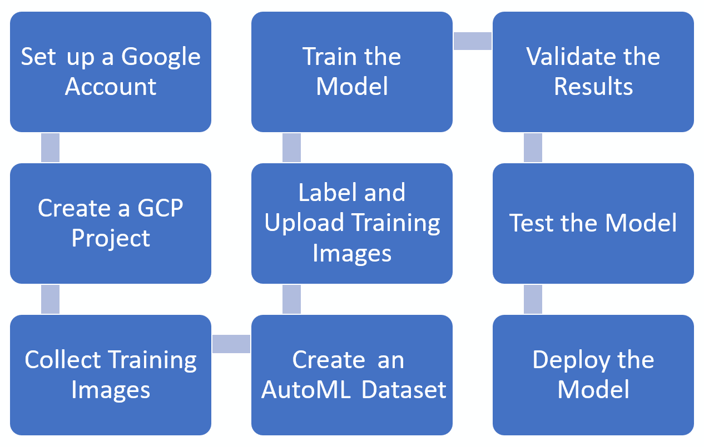

假读者已具备 Google 账号配置与 GCP 项目创建基础，下面从 **训练图像采集** 开始逐步拆解。

##### 采集训练图像

AutoML Vision 采用监督学习范式，依赖预先标注好的图像集合。单张图像可包含单一或多个目标对象，需按样本粒度明确定义并校验输出标签，以保障标注质量。首要任务是建立用于训练的数据集。

##### 构建数据集

首步需创建数据集容器，承载训练与评估用图像。创建时须指定分类模式：**多类分类** 或 **多标签分类**。前者单样本仅归属一类，后者允许单样本打多标签。

`Web 界面` 提供可视化建库向导：

1.  点击顶部导航栏 `新建数据集` 按钮，进入创建界面：

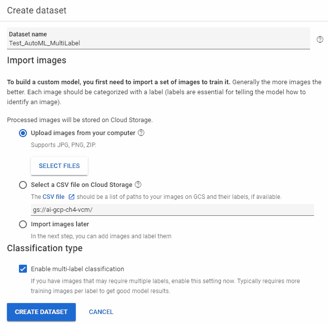

2.  填写数据集唯一名称。图像导入支持双通道：
    *   **本地上传**：兼容 `JPG`、`PNG` 格式，亦支持打包为 `ZIP` 压缩包批量导入。
    *   **Cloud Storage 引用**：指定 `CSV` 清单文件，内含 GCS 图像路径及对应标签（若创建时已备齐标注）。

图像导入可延后执行，允许创建空数据集占位。通过勾选 `启用多标签分类` 切换模式，默认为 `多分类` 模式。

### 数据准备：标注与上传训练图片

首先，我们要借助 `Cloud Storage` 托管图片，并生成一份 `CSV` 清单来标注图片内容。操作的起点是在 `Google Cloud Shell` 里执行指令，建立一个 `Google Cloud Storage` 存储桶，专门用来放置训练自定义模型所需的素材：

```bash
gsutil mb -p ai-gcp-ch4 -c regional -l us-central gs://ai-gcp-ch4-vcm/
```

存储桶的命名规范要求采用 `PROJECT_ID-vcm` 这种格式。执行完上述指令后，项目下就会出现一个名为 `ai-gcp-ch4-vcm` 的存储桶。

接下来，我们通过以下命令，把公开可用的花卉图片数据集批量导入刚建好的桶里：

```bash
gsutil -m cp -R gs://cloud-ml-data/img/flower_photos/  gs://ai-gcp-ch4-vcm/img/
```

图片传上去后，最直观的标注方式就是用 `CSV` 文件。其通用结构很简单：`图片路径, 标签`。要是一张图里有多个目标，标签之间用英文逗号隔开即可，示例如下：

```csv
gs://ai-gcp-ch4-vcm/img/flower_photos/roses/15674450867_0ced942941_n.jpg,roses
gs://ai-gcp-ch4-vcm/img/flower_photos/daisy/1031799732_e7f4008c03.jpg,daisy
```

比如第一张图标注为“玫瑰”，第二张则是“雏菊”。准备好数据后，执行导入指令将图片和标签同步灌入数据集：

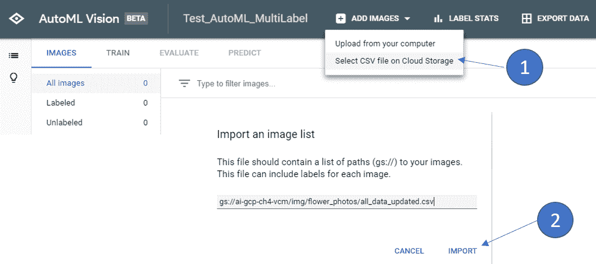

这一步会把 `CSV` 里列出的图片、以及存储桶里的图片文件一并加载进数据集并完成打标。至此，数据集已就绪，可以开启分类模型的训练了。下图是 `AutoML Vision` 界面里已打标数据集的示意图：


这个数据集共计 3,665 张已标注图片，分布在五个类别中。`Web 界面` 支持随时调整标签或剔除不合格图片。当然，除了手动操作，也可以通过 `REST API` 或 `命令行工具` 以编程方式填充带标签的数据集，批量处理更高效。

调用 API 的 HTTP POST 地址如下（使用时请替换其中的 `Project_ID`、`Region` 与 `datasetId`）：

```
POST https://automl.googleapis.com/v1beta1/projects/ai-gcp-ch4/locations/us-central1/datasets/ICN7902227254662260284:importData
```

请求体采用 JSON 格式，负载内容如下：

```json
{
  "inputConfig": {
    "gcsSource": {
      "inputUris": "gs://ai-gcp-ch4-vcm/img/flower_photos/all_data_updated.csv"
    }
  }
}
```

把请求体存为 `import_images_request.json`，然后在 Cloud Shell 里用 `curl` 发起请求：

```bash
curl -X POST \
  -H "Authorization: Bearer $(gcloud auth application-default print-access-token)" \
  -H "Content-Type: application/json; charset=utf-8" \
  -d @import_images_request.json \
  https://automl.googleapis.com/v1beta1/projects/ai-gcp-ch4/locations/us-central1/datasets/ICN7902227254662260284:importData
```

如果你习惯用 Python，也可以引入 `automl_v1beta1` 库来调用。以下是将图片导入数据集的 Python 代码片段：

```python
project_id = 'ai-gcp-ch4'
compute_region = 'us-central1'
dataset_id = 'ICN7902227254662260284'
paths = 'gs://ai-gcp-ch4-vcm/img/flower_photos/all_data_updated.csv'

from google.cloud import automl_v1beta1 as automl

client = automl.AutoMlClient()
dataset_full_id = client.dataset_path(project_id, compute_region, dataset_id)
input_config = {'gcs_source': {'input_uris': paths}}
response = client.import_data(dataset_full_id, input_config)
print('Processing import...')
print('Data imported. {}'.format(response.result()))
```

数据入库完成，下一站就是模型训练。

### 模型训练：一键启动，自动分流

GCP AutoML 屏蔽了底层训练的繁杂细节，会自动把数据集里的图片按比例切分成三份：80% 随机划入训练集，剩下的 20% 均分给评估集和测试集（各 10%）。界面上点一下“开始训练”，流程就跑起来了：

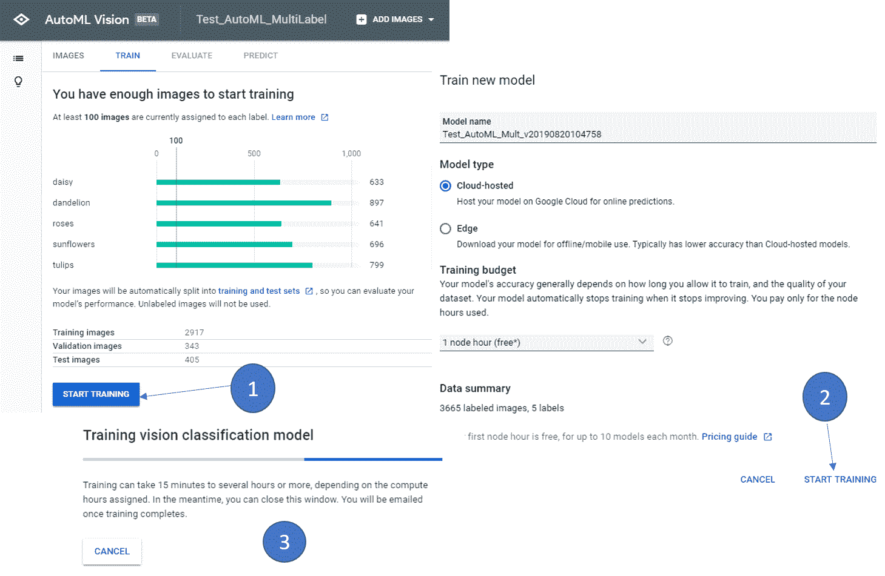

训练耗时受图片总量、类别数、算力配额影响，快则十几分钟，慢则数小时。这是个异步过程，训练完毕系统会发邮件通知。同样，你也可以用命令行或 API 来触发训练。

发起训练的 `POST` 请求长这样（记得替换 `Project_ID`、`Region`、`datasetId` 和自定义的 `displayName`，即模型显示名称）：

```bash
curl \
  -X POST \
  -H "Authorization: Bearer $(gcloud auth application-default print-access-token)" \
  -H "Content-Type: application/json" \
  https://automl.googleapis.com/v1beta1/projects/ai-gcp-ch4/locations/us-central1/models \
  -d '{
       "datasetId": "ICN7902227254662260284",
       "displayName": "aigcpch4-image-clasification-model",
       "image_object_detection_model_metadata": {
            "model_type": "cloud-low-latency-1"
       }
    }'
```

`model_type` 有两档可选：`cloud-low-latency-1` 主打极速，牺牲一点精度换取极短训练周期；`cloud-high-accuracy-1` 则通过更多迭代压榨误差，追求最高精度，代价是更久的时间和更高的算力账单。根据业务对实时性与准确率的权衡、以及预算来定夺。利用 AutoML Vision API 也能落地训练任务，Python 示例代码如下：

```python
project_id = 'ai-gcp-ch4'
compute_region = 'us-central1'
dataset_id = 'ICN7902227254662260284'
model_name = 'aigcpch4-image-clasification-model'

from google.cloud import automl_v1beta1 as automl

client = automl.AutoMlClient()
project_location = client.location_path(project_id, compute_region)

my_model = {
    'display_name': model_name,
    'dataset_id': dataset_id,
    'image_object_detection_model_metadata': {
        "model_type": "cloud-low-latency-1"
    }
}
response = client.create_model(project_location, my_model)
print('Training image object detection model...')
```

训练结束后，新模型会自动出现在 AutoML Vision Web 界面的“模型”列表里：

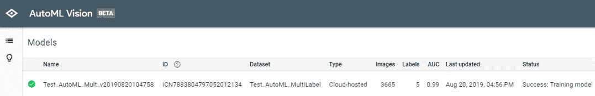

接着该看评估指标了，Web 界面的 `EVALUATE` 页签里有现成的统计报表。

### 模型评估：读懂精度与召回

模型在训练集上学习完毕后，评估集登场打分。评估结果集中在“评估”标签页，核心指标三件套：**平均精度**、**精度**、**召回率**。界面截图如下：

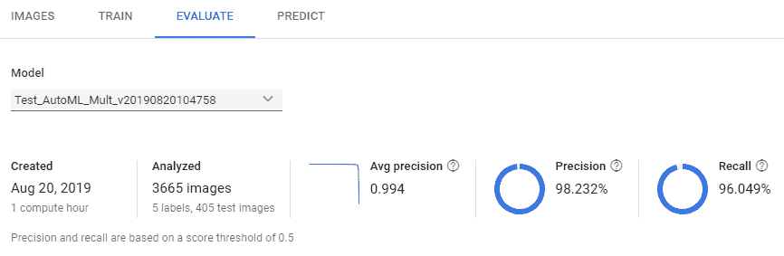

从截图可见，UI 上直观呈现了这些关键参数，具体含义拆解如下：

*   **平均精度**：综合考量所有分类阈值下的模型表现，是衡量整体效能的核心指标。
*   **精度**：预测为正样本的结果里，真正例占比。公式 `Pred = TP / (TP + FP)`。真阳性（`TP`）是判对的正样本；假阳性（`FP`）是错判为正的负样本。
*   **召回率**：所有实际正样本里，被成功找回的比例。公式 `Recall = TP / (TP + FN)`。假阴性（`FN`）是漏判为负的正样本。

精度与召回率往往此消彼长，需结合平均精度综合研判。AutoML 还贴心提供了**全局汇总视图**与**单标签细粒度视图**双维度展示：

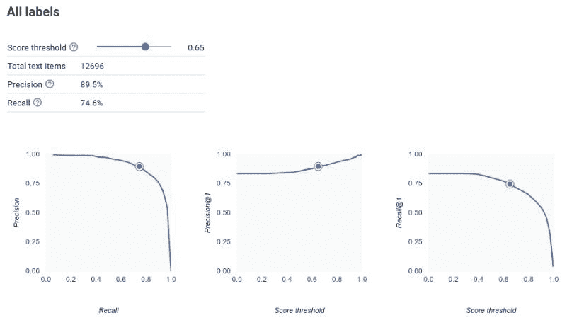

评估同样支持 REST API、命令行调用。

#### 命令行查评估

从已部署模型拉取评估指标的指令如下：

```bash
curl -X GET \
  -H "Authorization: Bearer $(gcloud auth application-default print-access-token)" \
  https://automl.googleapis.com/v1beta1/projects/ai-gcp-ch4/locations/us-central1/models/ICN7883804797052012134/modelEvaluations
```

执行时需带上项目名、区域和模型 ID。

#### Python 查评估

代码示例，传入 `project_id`、`region`、`model_id` 即可拿到已部署模型的评估详情：

```python
project_id = 'ai-gcp-ch4'
compute_region = 'us-central1'
model_id = 'ICN7883804797052012134'
filter_ = ''
from google.cloud import automl_v1beta1 as automl
client = automl.AutoMlClient()
model_full_id = client.model_path(project_id, compute_region, model_id)
response = client.list_model_evaluations(model_full_id, filter_)
print('List of model evaluations:')
for element in response:
    print(element)
```

模型定型、阈值把控都没问题后，就可以找一批新图来实战测试了。

### 实战测试：上传新图验效果

GCP AutoML 内置了可视化测试工具。在 Web UI 直接拖入新图片，即可调用部署好的模型推理。操作步骤截图如下：

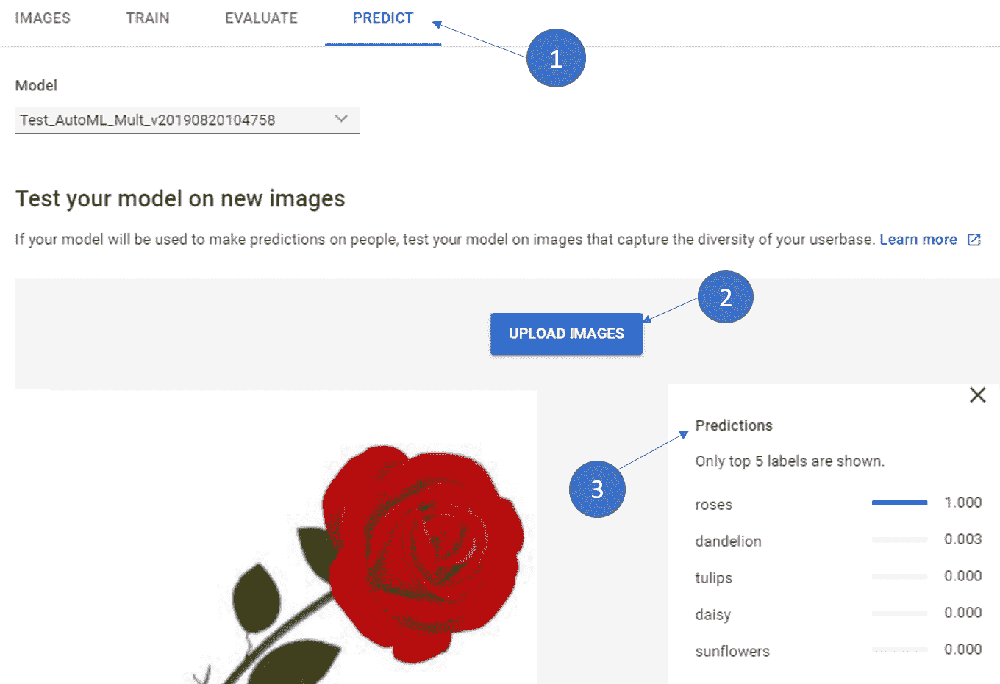

除了手工点点鼠标，命令行和 REST API 编程调用也是支持的。

先建一个 `image_classification_request.json` 文件，内容参考下方：

```json
{ "payload": { "image": { "imageBytes": "IMAGE_BYTES" } } }
```

然后向服务端点发起请求：

```bash
curl -X POST -H "Content-Type: application/json" \
  -H "Authorization: Bearer $(gcloud auth application-default print-access-token)" \
  https://automl.googleapis.com/v1beta1/projects/ai-gcp-ch4/locations/us-central1/models/ICN7883804797052012134:predict -d @image_classification_request.json
```

#### Python 代码调用

在应用层集成推理能力，可用如下 Python 片段，基于新图片批量调用模型：

```python
import sys
from google.cloud import automl_v1beta1
from google.cloud.automl_v1beta1.proto import service_pb2

def get_prediction(content, project_id, model_id):
    prediction_client = automl_v1beta1.PredictionServiceClient()
    name = 'projects/{}/locations/us-central1/models/{}'.format(project_id, model_id)
    payload = {'image': {'image_bytes': content }}
    params = {}
    request = prediction_client.predict(name, payload, params)
    return request # waits till request is returned

if __name__ == '__main__':
    file_path = sys.argv[1]
    project_id = sys.argv[2]
    model_id = sys.argv[3]
    with open(file_path, 'rb') as ff:
        content = ff.read()
    print(get_prediction(content, project_id, model_id))
```

正如本节所见，AutoML 让图像分类模型的训练、部署、调用变得丝滑流畅，模型托管在云端，经过认证的用户或服务账号即可通过简洁的 API 接口随时调用。

---

### 语音转文本 API：开箱即用的智能听写

GCP 提供的语音转文本 API 既强大又易用。虽然调用接口简单直观，但底层跑的是持续迭代训练的深度神经网络。开发者完全无需关心神经网络架构、超参调优等底层细节。截止成稿时，该 API 已支持 100 多种语言和方言识别，覆盖**批量离线**与**实时流式**两种转写模式。随着用户量增长、数据积累，模型准确率还在持续提升。平台还内置**自动语言检测**功能，在语音指令类场景下极其实用。API 还允许按场景选型预训练模型：比如 **“命令和搜索”** 模型适配短指令，**“电话”** 模型专治通话录音。下图汇总了语音转文本 API 的全功能矩阵：

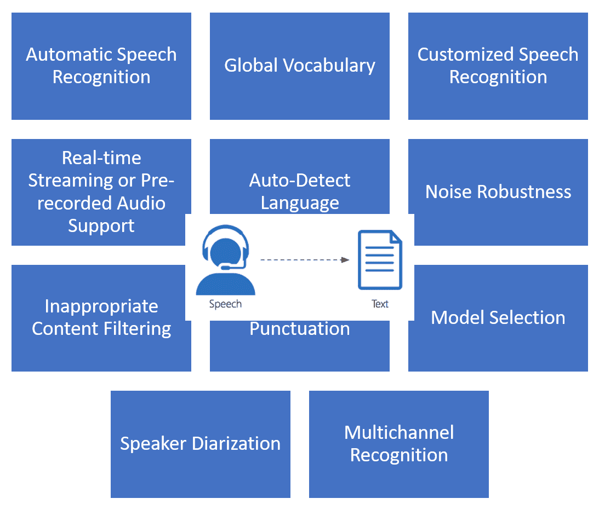

本节将带你逐一拆解 API 能力，并演示如何集成到应用中。

与语音转文本 API 交互主要有三种模式：

*   **同步识别**：阻塞式调用，适配 **1 分钟以内** 的短音频。音频数据直发 REST 或 gRPC 端点，必须等整段音频转写完才返回结果。
*   **异步识别**：非阻塞调用，适配 **最长 480 分钟** 的长音频。调用后在云端启动长时间运行任务，调用方需定期轮询获取转写结果。后续调用中需妥善管理文本数据以优化性能表现。

## 核心能力：流式识别

该服务支持实时语音转文字，底层依托 gRPC 双向流机制实现。转文本过程即时完成，结果以持续数据流形式返回。调用方需采集时序音频数据并按流式方式传入。

---

## 一、同步调用模式

请求体由配置参数与音频源路径两部分构成。典型调用结构如下：

```json
{
  "config": {
    "encoding": "LINEAR16",
    "sampleRateHertz": 16000,
    "languageCode": "en-US"
  },
  "audio": {
    "uri": "gs://bucket-name/path_to_audio_file"
  }
}
```

请求 JSON 中的 `config` 节点对应 `RecognitionConfig` 对象，其结构定义如下：

```json
{
  "encoding": "enum (AudioEncoding)",
  "sampleRateHertz": "number",
  "audioChannelCount": "number",
  "enableSeparateRecognitionPerChannel": "boolean",
  "languageCode": "string",
  "maxAlternatives": "number",
  "profanityFilter": "boolean",
  "speechContexts": [
    {
      "object": "(SpeechContext)"
    }
  ],
  "enableWordTimeOffsets": "boolean",
  "enableAutomaticPunctuation": "boolean",
  "metadata": {
    "object": "(RecognitionMetadata)"
  },
  "model": "string",
  "useEnhanced": "boolean"
}
```

下表详述了配置模板中的关键字段含义：

| **字段** | **类型** | **功能说明** |
| --- | --- | --- |
| `encoding` | 枚举 | 指定待转写音频的编码格式。支持选项包括：`ENCODING_UNSPECIFIED`（未指定）、`LINEAR16`（16位非压缩）、`FLAC`（免费无损音频编解码器，**相比 LINEAR16 更稳健且带宽需求减半**） |

### 1.1 识别配置参数详解

| 参数名 | 类型 | 说明 |
| :--- | :--- | :--- |
| `encoding` | 枚举 | 音频编码格式，可选值：`MULAW`、`AMR`（自适应多速率窄带）、`AMR_WB`（宽带）、`OGG_OPUS`、`SPEEX_WITH_HEADER_BYTE` |
| `sampleRateHertz` | 数值 | 音频采样率，取值区间 8,000~48,000 Hz。若为 `WAV` 或 `FLAC` 格式，此项可省略 |
| `audioChannelCount` | 数值 | 输入音频的声道数量 |
| `enableSeparateRecognitionPerChannel` | 布尔 | 当声道数 > 1 时，**必须**显式置为 `true` 以启用分轨识别 |
| `languageCode` | 字符串 | **必填**，标识会话语言（如 `en-US` 代表美式英语） |
| `maxAlternatives` | 数值 | 可选，限制返回备选结果上限（0~30）。0 或 1 仅返回最优结果；若缺省则默认返回单条。实际返回数量取决于模型与上下文 |
| `profanityFilter` | 布尔 | 可选，`true` 时过滤敏感/低俗词汇 |
| `speechContexts[]` | 对象 | 可选但关键，向模型注入提示词（`SpeechContext`），消除发音相似词干扰，显著提升领域词识别准确率 |
| `enableWordTimeOffsets` | 布尔 | 可选，`true` 时在结果中标注每个词的起止时间戳，默认 `false` |
| `enableAutomaticPunctuation` | 布尔 | 可选，实验性功能，仅对特定语言生效。开启后自动添加标点，默认 `false` |
| `metadata` | 对象 | 可选，提供音频元信息（`RecognitionMetadata` 类型），含交互类型、行业代码、麦克风距离、媒介类型、设备型号、MIME 类型、脱敏 ID、话题等，辅助模型做上下文感知识别 |
| `model` | 字符串 | 可选，指定机器学习模型以提升准确率。未指定时根据配置自动路由。可选模型：`command_and_search`（指令/搜索）、`phone_call`（电话通话）、`video`（视频音轨）、`default`（兜底通用） |
| `useEnhanced` | 布尔 | 可选，`true` 启用增强版模型，精度更高但计费更贵 |

### 1.2 音频数据传递方式

**方式 A：请求体内嵌（Base64 编码）**
通过 `audio.content` 字段直接携带二进制数据。
- gRPC：需兼容 Protobuf v3 规范，以二进制形式嵌入。
- REST：需先 Base64 编码再 JSON 序列化。

示例请求：

```json
{
    "config": {
      "encoding": "WAV",
      "sampleRateHertz": 18000,
      "languageCode": "en-US"
    },
    "audio": {
      "content": "XtxhQwJJJCIQABQLLTUJABtAA+gA8AB+W8FZndQvQAyjv..."
    }
}
```

Python 编码示例：

```python
import base64

def encode_audio(audio):
    audio_content = audio.read()
    return base64.b64encode(audio_content)
```

**方式 B：云存储 URI 引用**
通过 `audio.uri` 指向 GCS 对象（原始二进制，**非 Base64**）。文件需公网可读，或授权服务账号访问。

示例请求：

```json
{
      "config": {
        "encoding": "WAV",
        "sampleRateHertz": 18000,
        "languageCode": "en-US"
      },
      "audio": {
        "uri": "gs://bucket-name/path_to_audio_file"
      }
}
```

### 1.3 同步响应结构

耗时与音频时长成正比。返回格式如下：

```json
{
  "name": "8214202757943088943",
  "metadata": {
    "@type": "type.googleapis.com/google.cloud.speech.v1.LongRunningRecognizeMetadata",
    "progressPercent": 100,
    "startTime": "2019-09-22T08:16:32.013650Z",
    "lastUpdateTime": "2019-09-22T08:16:55.278630Z"
  },
  "done": true,
  "response": {
    "@type": "type.googleapis.com/google.cloud.speech.v1.LongRunningRecognizeResponse",
    "results": [
      {
        "alternatives": [
          {
            "transcript": "One Two Three Four",
            "confidence": 0.97186122,
            "words": [
              {
                "startTime": "1.300s",
                "endTime": "1.400s",
                "word": "One"
              },
              {
                "startTime": "1.400s",
                "endTime": "1.600s",
                "word": "two"
              },
              {
                "startTime": "1.600s",
                "endTime": "1.600s",
                "word": "three"
              },
              {
                "startTime": "1.600s",
                "endTime": "1.900s",
                "word": "four"
              }
            ]
          }
        ]
      },
      {
        "alternatives": [
          {
            "transcript": "one too thee four",
            "confidence": 0.9041967
          }
        ]
      }
    ]
  }
}
```

响应分为 **元数据头** 与 **业务主体** 两部分。

#### 元数据头
记录任务级进度信息：
- `name`：API 分配的唯一任务标识
- `metadata`：含 `@type`（类型 URI）、`progressPercent`（完成百分比）、`startTime`（启动时间）、`lastUpdateTime`（最近更新时间）

#### 业务主体
- `@type`：固定指向 `type.googleapis.com/google.cloud.speech.v1.LongRunningRecognizeResponse`
- `results`：按音频时间轴顺序排列的识别片段集合
- `alternatives`：单片段的多个备选转写，按 `confidence` 降序排列。首项通常为最优解。数量受 `maxAlternatives` 控制
- `transcript`：备选文本内容
- `confidence`：置信度评分（0.0~1.0）
- `words`：词级详情（需 `enableWordTimeOffsets=true` 时出现），含 `startTime`、`endTime`、`word`

同步接口端点：

```
POST https://speech.googleapis.com/v1/speech:recognize
```

本质为 HTTP POST，直接返回 JSON 识别结果。

---

## 二、异步调用模式

请求头/体结构与同步一致，**区别在于调用入口**：使用 `LongRunningRecognize` 方法。
- **非阻塞**：调用即刻返回操作句柄（`Operation` 对象），而非转写结果。
- **轮询机制**：初始响应示例：

```json
{
  "name": "operation_name",
  "metadata": {
    "@type": "type.googleapis.com/google.cloud.speech.v1.LongRunningRecognizeMetadata",
    "progressPercent": 37,
    "startTime": "2019-09-03T13:24:39.579144Z",
    "lastUpdateTime": "2019-09-03T13:24:39.826903Z"
  }
}
```

后台持续处理音频。任务完成时 `progressPercent` 达 100，最终响应格式**与同步模式完全一致**。

---

## 三、流式调用模式

适用于实时连续转写场景（如实时字幕、语音机器人）。基于 `StreamingRecognize` 方法建立双向流：
- **客户端**：持续推送音频分片
- **服务端**：实时返回增量识别结果（`interim`）与最终定稿结果（`final`）

### 3.1 流式配置对象 (`StreamingRecognitionConfig`)
首帧消息**必须**携带配置，后续帧仅发音频数据。配置字段：

| 字段 | 说明 |
| :--- | :--- |
| `config` | 复用上文 `RecognitionConfig` 完整定义 |
| `single_utterance` | 布尔标志。`false`（默认）：忽略长停顿持续识别，流保持开放直到显式关闭或超时，可能产出多个 `StreamingRecognitionResult`。`true`：检测到端点静音即触发 `END_OF_SIGNAL_UTTERANCE` 事件并终止识别，**仅返回单次结果** |
| `interim_results` | 布尔标志。`true`：实时下发中间结果；`false`：仅在最终确定时返回 |

### 3.2 流式响应对象 (`StreamingRecognizeResponse`)
API 统一返回该对象，核心字段：

- `speechEventType`：音频事件类型
  - `SPEECH_EVENT_UNSPECIFIED`：无特定事件
  - `END_OF_SINGLE_UTTERANCE`：检测到句子级端点静音，预期后续无新音频。**仅在 `single_utterance=true` 时触发**

### 深度解析：GCP 语音转写与 AutoML 情感分析实战指南

#### 核心返回对象：`results` 详解

`results` 作为顶层封装容器，汇聚了转录任务的最终产出，其内部结构包含以下关键字段：

*   **`alternatives`（备选方案集）**：与同步、异步请求的返回格式一致，提供了多组置信度各异的转录候选文本，供开发者根据业务场景筛选最优结果。
*   **`isFinal`（终态标识）**：布尔值标记。当模型完成对完整音频流的处理后，该字段置为 `true`，标志着最终结果的产生。
*   **`stability`（稳定性指数）**：专为流式识别设计。鉴于流式模式下重叠音频片段会在滑动时间窗中被重复转录，模型会输出一个 0 到 1 之间的分值：越接近 0 代表文本极大概率会被后续修正；越接近 1 则意味着当前识别文本高度确定，极少变动。

---

#### 实战篇：AutoML 自然语言 API 情感分析全流程

情感分析是赋能智能决策平台的核心引擎，它依据用户感知指导业务动作。然而，面对多变的上下文与非结构化数据，高精度落地极具挑战。标准化流程通常涵盖五大环节：

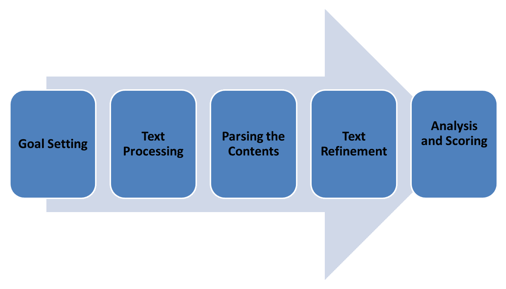

1.  **锚定目标**：在业务场景中精准界定分析维度。如剖析购买者心声，需聚焦产品本身及功能特性。
2.  **文本净化**：结合目标与数据源，清洗噪音、止用词，保留核心语义与情感载体。
3.  **语义解析**：依据逻辑关联对内容分层分组，按极性（正/负/中）与语义维度细化颗粒度。
4.  **特征提炼**：识别停用词与同义词，完成文本标准化映射。
5.  **建模评分**：基于训练语料与语义理解对清洗后数据打分，此评分体系将作为模型预测新数据的基准。

**AutoML 自然语言服务通过抽象封装，屏蔽了上述底层复杂度。** 只需准备好带标注评分的训练数据，即可通过可视化界面或 API 一键完成训练、评估与部署。下文将演示在 GCP 上落地的完整链路。

**数据准备——成败关键**
有监督学习的基石是高质量标注数据。AutoML 要求文本搭配整数情感分（通常 0 起步，上限自定，分值越高情感越积极）。**两条铁律**：一、分值区间必须连续无断层；二、建议各分值层样本量均衡（偶数优先），防止模型欠拟合。

##### AutoML 情感分析实验演示

**数据格式规范**：CSV 三列结构。列 1 标识样本类别（`TRAIN`/`VALIDATION`/`TEST`，缺省时系统按 8:1:1 自动切分）；列 2 为待分析文本；列 3 为情感分（0 最负面，10 最正面）。

**操作步骤**：

1.  **入口导航**：控制台侧边栏依次展开 `AI` → `自然语言` → 启动 `AutoML 情感分析`。

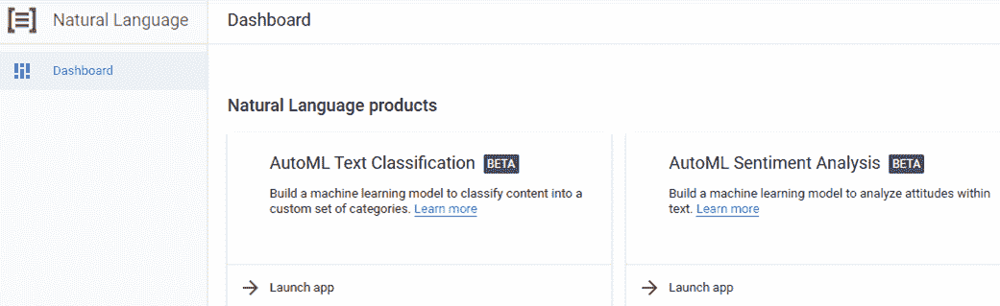

2.  **创建数据集**：点击顶部 `新建数据集`。

3.  **配置元信息**：填写名称，任务类型勾选 `情感分析`。

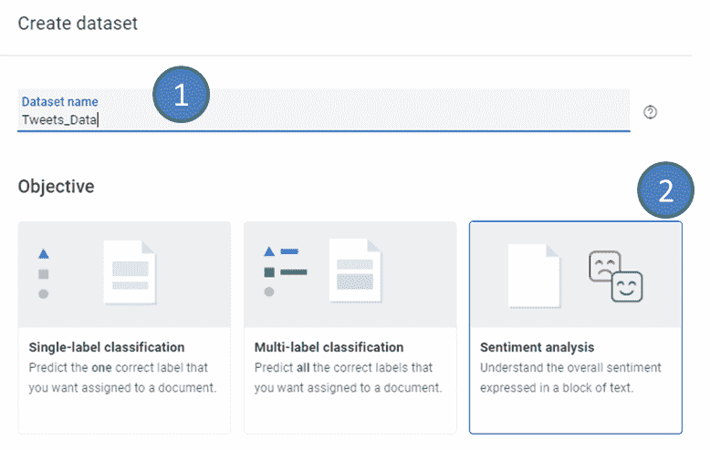

4.  **数据导入**：支持四种模式——本地 CSV 上传（含 GCS 路径列表）、本地文本片段直传、选取 Cloud Storage 中的 CSV、或暂缓导入后在工作台手工标注。

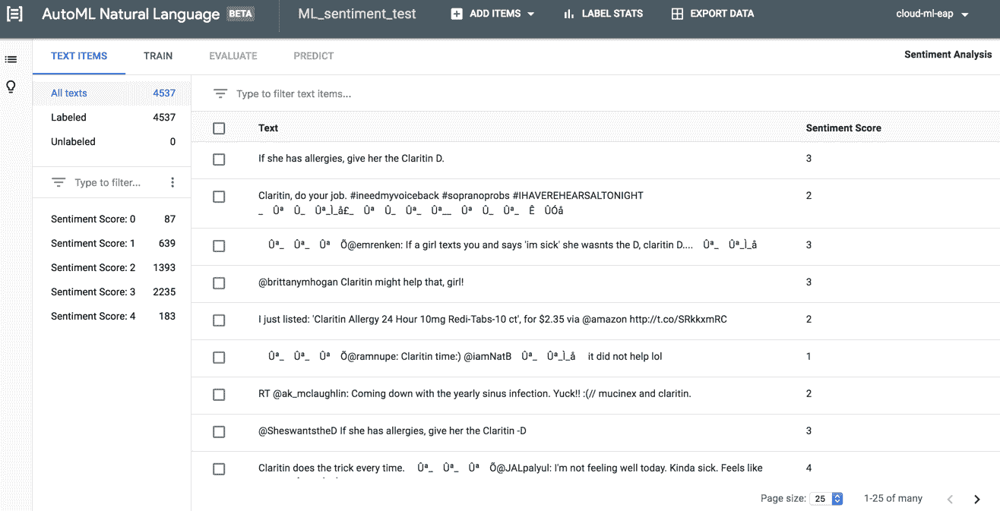

5.  **训练与部署**：数据统计无误后，切换 `TRAIN` 标签页点击 `开始训练`。平台自动按比例切分、训练、评估（详见 `EVALUATE` 页），模型训练完成即自动部署，支持 Web 交互与 API 调用。附 Python 调用示例（需认证凭据）：

```python
project_id = 'ai-gcp-ch4'
compute_region = 'us-central1'
model_id = '[MODEL_ID]'
file_path = '/local/path/to/file'

from google.cloud import automl_v1beta1 as automl

automl_client = automl.AutoMlClient()
prediction_client = automl.PredictionServiceClient()

model_full_id = automl_client.model_path(project_id, compute_region, model_id)

with open(file_path, "rb") as content_file:
    snippet = content_file.read()

payload = {"text_snippet": {"content": snippet, "mime_type": "text/plain"}}
params = {}
response = prediction_client.predict(model_full_id, payload, params)
print("Prediction results:")
for result in response.payload:
    print("Predicted sentiment label: {}".format(result.text_sentiment.sentiment))
for key, data in response.metadata.items():
    if key == 'sentiment_score':
        print("Normalized sentiment score: {}".format(data))
```

---

#### 章节小结

本章系统阐述了 GCP 如何以低门槛构建、部署及消费 ML 模型，并通过高频场景验证了其易用性与弹性伸缩能力。API 层支持安全暴露，模型亦可基于新增标注数据持续迭代。

**下一站**：我们将深入构建云原生 ML 引擎，拆解生产级 MLaaS（机器学习即服务）的工程化落地全链路。

---

### 五、构建大数据云端机器学习引擎

> 来源：[`gitee.com/apachecn/apachecn-dl-zh/blob/master/docs/handson-ai-gcp/05.md`](https://gitee.com/apachecn/apachecn-dl-zh/blob/master/docs/handson-ai-gcp/05.md)

机器学习（ML）作为人工智能（AI）落地的核心驱动力，正重塑客服、风控、商业智能等版图，并深度渗透云计算生态。各大厂商纷纷重注 AI 赛道，Google Cloud 更通过战略级重组与持续投入，构建起涵盖语音识别、视频理解、认知计算、MLOps 自动化、模型管理、模型服务及 GPU/TPU 异构算力在内的全谱系交付体系。

本章将聚焦 Google Cloud AI Platform（原 Cloud ML Engine）的核心组件与实战技法，涵盖：

*   ML 核心认知重塑
*   Cloud AI Platform 端到端操作指南
*   Keras 框架精要与模型训练
*   AI Platform 云上分布式训练
*   批量异步推理与在线实时预测实战

#### 重新认知：云端视角的机器学习

长期以来，ML 被视为通往通用人工智能的阶梯，但高昂的算力、存储门槛与专家稀缺性，让企业望而却步。云计算彻底改写了游戏规则：**按需付费的弹性资源池 + 托管式智能服务**，让任意规模企业均可低成本试错、快速迭代。

**云上 ML 的六大核心红利**：

1.  **成本匹配**：周期性重负载完美适配按秒计费模型，规避闲置损耗。
2.  **弹性验证**：从小规模实验到大规模生产，算力存储无缝横向扩展。
3.  **专用算力触手可及**：GPU/TPU 实例即拿即用，加速深度学习收敛。
4.  **降维打击门槛**：预训练 API 与 AutoML 让非专家也能嵌入 AI 能力。
5.  **全栈托管**：从底层硬件、驱动、框架到上层编排，云厂商兜底运维。
6.  **灵活度最大化**：既可用全托管服务提效，也可自带开源框架跑裸金属/虚拟机，成本与控制权自我平衡。

#### 核心引擎：Cloud AI Platform (原 ML Engine) 深度拆解

作为 GCP 的旗舰级托管服务，AI Platform 提供 **`AI Platform Training`（训练）** 与 **`AI Platform Prediction`（预测）** 两大解耦服务，支撑模型全生命周期。架构蓝图如下：

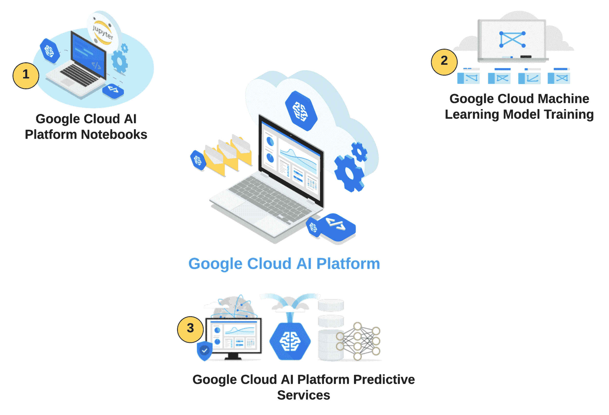

三步走构建智能应用：**Notebooks 交互探索** → **Training 分布式训练** → **Prediction 服务化部署**。本章聚焦 Notebooks 环境构建；分布式训练与推理服务详见第 8、9 章。

#### 云端 IDE：AI Platform Notebooks 托管服务

**一键获取生产级 JupyterLab 环境**。预装 TensorFlow、PyTorch、scikit-learn、pandas 等主流数据科学栈，深度集成 BigQuery、Dataproc、Dataflow，实现从数据清洗、特征工程到建模训练的流式衔接。实例规格灵活配置（CPU/RAM/GPU），单机不足时可无缝迁移至分布式训练集群。

#### 基石设施：Deep Learning VM Images (深度学习虚拟机镜像)

免去手工搭建 CUDA/cuDNN/框架依赖地狱。基于 Debian 9 优化的 Compute Engine 镜像，开箱即用，GPU 驱动就绪。三大核心概念：

1.  **镜像家族** —— 按框架/用途预置的镜像集合：
    *   TensorFlow 系（含/不含 GPU）
    *   PyTorch 系（含/不含 GPU）
    *   Chainer 实验系
    *   基础通用系（自装框架）
2.  **镜像类型**：
    *   *公共镜像*：Google/社区/ISV 维护，全项目可见，大多免费（部分高级镜像收费）。
    *   *自定义镜像*：项目私有，基于业务定制，仅承担存储成本。
3.  **实例** —— 镜像的运行载体，即虚拟机。支持 Console/gcloud CLI 秒级拉起。

**Notebooks 启动的前置条件即选定一款 DLVM 镜像。**

#### 手把手：创建首个 AI Platform Notebook 实例

1.  **发起创建**：Cloud Console 导航至 AI Platform → Notebooks → `新建实例`。

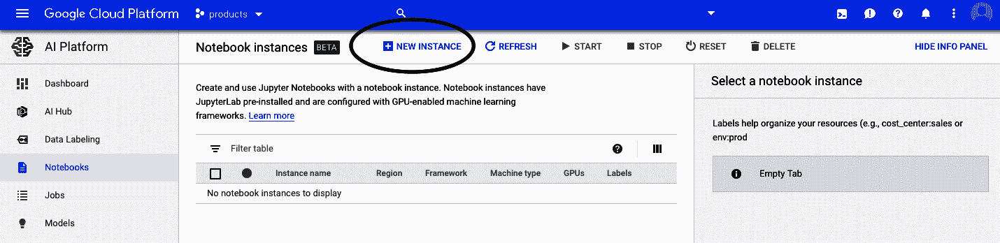

2.  **选型镜像**：从公共/自定义库中选择目标 DLVM 镜像。

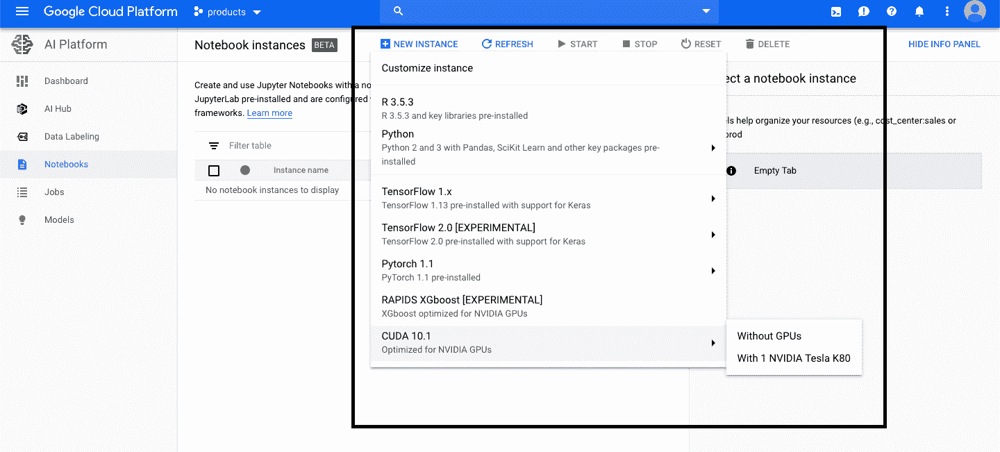

3.  **核对基础配置**：确认实例名称、区域、机型等核心参数，需调整点击 `自定义`。

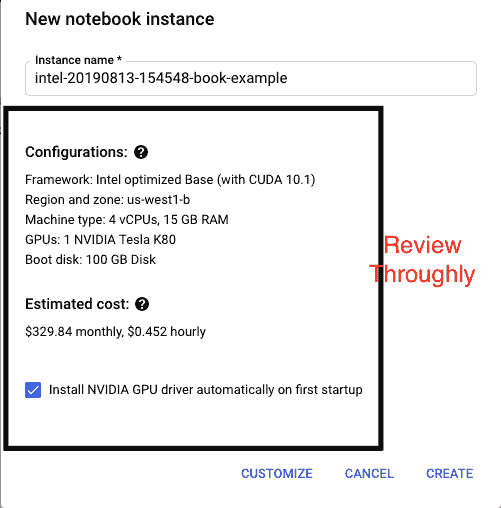

4.  **资源微调**：按需分配 vCPU、内存、启动磁盘类型/容量、服务账号、网络标签等。


5.  **GPU 加速与磁盘进阶**：挂载 GPU（选型 K80/T4/V100/A100 等）、配置本地 SSD、设置维护策略等深度选项。


6. 笔记本创建成功后，您会在 Google Cloud AI Platform 界面的笔记本列表中看到它，具体展示效果请参考下方截图：


7. 执行以下指令即可通过端口转发连接到刚创建的 VM 实例上的 `JupyterLab` 界面：

```bash
export INSTANCE_NAME="<my-instance>"
gcloud compute ssh $INSTANCE_NAME -- -L 8080:localhost:8080
```

8. 访问 `http://localhost:8080/lab?` 后呈现的界面如下图所示：


当然，您也可以借助下面这段 Shell 脚本实现全流程自动化：

```bash
#!/bin/bash

IMAGE=--image-family=tf-latest-cpu

INSTANCE_NAME=dlvm

GCP_LOGIN_NAME=<proxy@gmail.com> # 请替换为您的账号

gcloud config set compute/zone us-central1-a # 请修改为您的可用区

echo "Launching $INSTANCE_NAME"

gcloud compute instances create ${INSTANCE_NAME} \

      --machine-type=n1-standard-2 \

      --scopes=https://www.googleapis.com/auth/cloud-platform,https://www.googleapis.com/auth/userinfo.email \

      ${IMAGE} \

      --image-project=deeplearning-platform-release \

      --boot-disk-device-name=${INSTANCE_NAME} \

      --metadata="proxy-user-mail=${GCP_LOGIN_NAME}"

echo "Looking for Jupyter URL on $INSTANCE_NAME"

while true; do

   proxy=$(gcloud compute instances describe ${INSTANCE_NAME} 2> /dev/null | grep dot-datalab-vm)

   if [ -z "$proxy" ]

   then

      echo -n "."

      sleep 1

   else

      echo "done!"

      echo "$proxy"

      break

   fi

done
```

这段自动化脚本的逻辑梳理如下：

*   指定虚拟机使用的镜像系列
*   配置 Google Cloud Platform 认证凭据
*   设定后台计算资源所在的区域
*   定义实例的规格大小
*   轮询实例状态，直到捕获到 Jupyter 笔记本的访问链接

接下来，我们将深入探索 AI 笔记本的实际应用场景。

### 实战 Google AI Platform 笔记本

在 AI Notebooks 的 JupyterLab 环境中，您既可以新建本地笔记本，也能直接从 Git 仓库拉取代码。操作方法很简单：点击顶部菜单栏的 Git 图标即可克隆仓库，界面示意如下：


平台支持多种 Python 版本切换，也提供了创建各类配套文件的便捷入口：


Jupyter 笔记本原生支持通过命令行从 Git 仓库拉取代码，左侧文件浏览器可直观查看文件结构。这一特性极大地便利了团队协作，让多开发者同步工作变得顺畅无阻。

### 实现 AI 笔记本自动化执行

当代码开发完毕、可依据运行时参数执行时，引入 **Papermill** 库便能实现笔记本的自动化运行与评估。Papermill 的核心能力体现在：

*   **批量并行**：支持生成多个笔记本副本并发运行。
*   **指标聚合**：能自动收集并汇总一组笔记本运行产出的指标数据。
*   **灵活存储**：支持从不同位置读写数据，意味着您可以将输出笔记本沉淀到耐久性更高、访问更便捷的存储系统中，为可靠流水线打基础。
*   **GCS 原生支持**：撰写本章时，Papermill 新增了对 Google Cloud Storage 存储桶的直接支持，后文将演示该特性。

下图展示了 Papermill 与 Google Cloud AI Notebooks 协同工作的架构：


Papermill 重塑了笔记本工作流范式。因为它**不修改原始笔记本**（这是传统笔记本环境常见的痛点），所以输入笔记本（JSON 文档）与输入参数被视为**不可变的执行文档**，产出**不可变的输出文档**。

输出文档完整保留了已执行代码、输出结果、日志，构成了可随时复现的模板。Papermill 多源读写能力配合 GCS 存储桶，将输出笔记本作为独立文档隔离，赋予用户最大灵活性——您可轻松分析连接服务、排查存储前缀等操作。

用户可基于这些输出进行调试、验证、生成新模板，且完全不影响初始工作流。此外，Papermill 自主管理运行时进程，无需依赖笔记本服务或额外基础设施即可针对内核执行代码，大幅简化了托管环境下的执行复杂度。深度架构请参考下图：


### 通过 `gcloud` 启动搭载 Papermill 的深度学习 VM

创建深度学习 VM 的标准范例如下。**关键提示：必须选择包含笔记本所需核心依赖的镜像**。例如笔记本依赖 PyTorch，就不能选 TensorFlow 镜像，反之亦然。

```
#### Compute Engine Instance parameters
export IMAGE_FAMILY="tf-latest-cu100" 
export ZONE="us-central1-b"
export INSTANCE_NAME="notebook-executor"
export INSTANCE_TYPE="n1-standard-8"
#### Notebook parameters
export INPUT_NOTEBOOK_PATH="gs://my-bucket/input.ipynb"
export OUTPUT_NOTEBOOK_PATH="gs://my-bucket/output.ipynb"
export PARAMETERS_FILE="params.yaml" # Optional
export PARAMETERS="-p batch_size 128 -p epochs 40" # Optional
export STARTUP_SCRIPT="Papermill ${INPUT_NOTEBOOK_PATH} ${OUTPUT_NOTEBOOK_PATH} -y ${PARAMETERS_FILE} ${PARAMETERS}"

gcloud compute instances create $INSTANCE_NAME \
        --zone=$ZONE \
        --image-family=$IMAGE_FAMILY \
        --image-project=deeplearning-platform-release \
        --maintenance-policy=TERMINATE \
        --accelerator='type=nvidia-tesla-t4,count=2' \
        --machine-type=$INSTANCE_TYPE \
        --boot-disk-size=100GB \
        --scopes=https://www.googleapis.com/auth/cloud-platform \
        --metadata="install-nvidia-driver=True,startup-script=${STARTUP_SCRIPT}"

gcloud --quiet compute instances delete $INSTANCE_NAME --zone $ZONE
```

上述命令关键参数说明：

*   `INPUT_NOTEBOOK_PATH`：Cloud Storage 存储桶中的输入笔记本路径（如 `gs://my-bucket/input.ipynb`）。
*   `OUTPUT_NOTEBOOK_PATH`：输出笔记本在存储桶中的落地路径（如 `gs://my-bucket/output.ipynb`）。
*   `PARAMETERS_FILE`：包含笔记本参数值的 YAML 文件路径（如 `gs://my-bucket/params.yaml`）。
*   `PARAMETERS`：通过 `-p` 标志直接传递键值对参数（如 `-p batch_size 128 -p epochs 40`）。

下面演示搭载 `*cu-100` 镜像系列的 GPU 实例创建命令（可根据版本可用性调整配置），需同步指定输入输出路径并传递给 `gcloud`：

```
IMAGE_FAMILY="tf-latest-cu100" # Or use any required DLVM image.
ZONE="us-central1-b"
INSTANCE_NAME="notebook-executor"
INSTANCE_TYPE="n1-standard-8"
INPUT_NOTEBOOK_PATH=$1
OUTPUT_NOTEBOOK_PATH=$2
GPU_TYPE=$3
GPU_COUNT=$4
STARTUP_SCRIPT="Papermill ${INPUT_NOTEBOOK_PATH} ${OUTPUT_NOTEBOOK_PATH}"
#### Create DLVM
gcloud compute instances create $INSTANCE_NAME \
        --zone=$ZONE \
        --image-family=$IMAGE_FAMILY \
        --image-project=deeplearning-platform-release \
        --maintenance-policy=TERMINATE \
        --accelerator="type=nvidia-tesla-${GPU_TYPE},count=${GPU_COUNT}" \
        --machine-type=$INSTANCE_TYPE \
        --boot-disk-size=100GB \
        --scopes=https://www.googleapis.com/auth/cloud-platform \
        --metadata="install-nvidia-driver=True,startup-script=${STARTUP_SCRIPT}"
gcloud --quiet compute instances delete $INSTANCE_NAME --zone $ZONE
```

CPU 实例创建逻辑类似，核心差异在于选择 `*-cpu` 后缀的镜像系列，其余参数传递方式一致：

```
IMAGE_FAMILY="tf-latest-cpu" # Or use any required DLVM image.
ZONE="us-central1-b"
INSTANCE_NAME="notebook-executor"
INSTANCE_TYPE="n1-standard-8"
INPUT_NOTEBOOK_PATH=$1
OUTPUT_NOTEBOOK_PATH=$2
STARTUP_SCRIPT="Papermill ${INPUT_NOTEBOOK_PATH} ${OUTPUT_NOTEBOOK_PATH}"
#### Create DLVM
gcloud compute instances create $INSTANCE_NAME \
        --zone=$ZONE \
        --image-family=$IMAGE_FAMILY \
        --image-project=deeplearning-platform-release \
        --machine-type=$INSTANCE_TYPE \
        --boot-disk-size=100GB \
        --scopes=https://www.googleapis.com/auth/cloud-platform \
        --metadata="startup-script=${STARTUP_SCRIPT}"
gcloud --quiet compute instances delete $INSTANCE_NAME --zone $ZONE
```

**启动脚本执行流程全景：**

1.  基于 TensorFlow 深度学习镜像启动 Compute Engine 实例，挂载 2 块 NVIDIA Tesla T4 GPU。
2.  自动安装 NVIDIA GPU 驱动。
3.  调用 Papermill 执行笔记本。
4.  将全单元格预计算完成的结果笔记本上传至 Cloud Storage（示例为 `gs://my-bucket/`）。
5.  Papermill 每执行完一个单元格即触发保存，可能触发 429 “请求过多” 错误，但库内部已自动处理重试逻辑。
6.  任务结束自动销毁 Compute Engine 实例。

> 完整启动脚本代码请访问：[查看链接](https://shorturl.at/tBJ12)

至此，相信您对 Papermill 已有立体认知。要在生产环境落地 AI 笔记本，建议按以下三步走清单推进：

1.  **基于 Google AI 笔记本完成代码开发**
2.  **规划并自动化深度学习 VM 镜像配置**
3.  **规划并自动化 Jupyter 笔记本执行流程**

---

### Keras 框架核心解读

Keras 是面向 Python 的深度学习框架，能助您构建、训练几乎所有类型的深度学习模型。它由 Google 工程师 François Chollet 设计，初衷是让科学家能**快速实验**。作为开源库，Keras 运行在 TensorFlow、Theano 等后端之上。

**核心定位：** Keras 不直接处理底层张量运算，而是封装高阶 API，依赖后端引擎（TensorFlow、CNTK、Theano）执行底层计算。这种架构使其高层 API 能统一处理模型构建、层定义、多入多出配置，并让同一套代码在 CPU/GPU 间无缝迁移。

**鲜明特性：**

*   **极致易用**：模块化、简洁，API 面向人类设计，降低认知负荷。
*   **架构通吃**：原生支持 CNN（视觉）、RNN（序列）及任意组合；兼容多输入/输出、层共享、模型共享等复杂拓扑。
*   **应用广泛**：从 GAN 到图灵机，均为其擅长领域。
*   **模型即积木**：内置丰富预制模块，加速系统搭建。
*   **后端解耦**：不绑定单一张量库，通过模块化适配 TensorFlow、Theano、CNTK（未来可扩展 MXNet、PlaidML 等）。

**设计哲学：**
Keras 将模型定义为 Python 代码而非配置文件，所有模块（层、优化器、激活函数、正则化等）均可自由组合、扩展，新增类/函数即可引入新模型。

**为何选择 Keras？**
归根结底是**易用性**。其优势矩阵包括：业界广泛采用、成熟生产级部署支持、至少兼容五大后端引擎、强大的多 GPU 与分布式训练能力、教学与开发双友好。Google、Microsoft、Amazon、Apple、Nvidia、Uber 等巨头均深度背书支持。

# Keras 实战：从本地训练到云端部署全流程解析

Keras 并非直接在底层执行张量运算，而是作为高阶接口借力后端引擎驱动。尽管它兼容多种后端，但 TensorFlow 无疑是其首选搭档，且由 Google 重点维护。在 TensorFlow 2.0 时代，`tf.keras` 已晋升为核心官方 API。下面通过经典 MNIST 手写数字识别案例，快速过一遍 Keras 标准建模流程：

```python
import keras
keras.__version__

from keras.datasets import mnist

(train_images, train_labels), (test_images, test_labels) = mnist.load_data()

train_images.shape

len(train_labels)

train_labels

test_images.shape

len(test_labels)

test_labels

from keras import models
from keras import layers

network = models.Sequential()
network.add(layers.Dense(512, activation='relu', input_shape=(28 * 28,)))
network.add(layers.Dense(10, activation='softmax'))

network.compile(optimizer='rmsprop',
                loss='categorical_crossentropy',
                metrics=['accuracy'])

train_images = train_images.reshape((60000, 28 * 28))
train_images = train_images.astype('float32') / 255

test_images = test_images.reshape((10000, 28 * 28))
test_images = test_images.astype('float32') / 255

from keras.utils import to_categorical

train_labels = to_categorical(train_labels)
test_labels = to_categorical(test_labels)

network.fit(train_images, train_labels, epochs=5, batch_size=128)

test_loss, test_acc = network.evaluate(test_images, test_labels)

print('test_acc:', test_acc)
```

该脚本完成了数据读取与预处理：将图像展平为像素矩阵，标签转为 one-hot 编码。模型采用 5 个 Epoch、Batch Size 128 的配置迭代训练。`fit()` 负责拟合训练集，`evaluate()` 则在测试集上核验精度。实战中，通常以准确率是否突破设定阈值，作为模型能否投入推理服务的判据。

输出日志如下：


可见，随着迭代推进，模型在验证集上的表现稳步提升。

## Keras 进阶建模：自定义图像分类实战

本节切换场景，演练一个基于 Keras Sequential API 的自定义分类任务（识别自行车图像）。运行环境需预装 `os`、`glob` 及 `numpy` 等基础库。

完整代码已托管，核心逻辑为：磁盘读取数据 -> 划分训练/验证集 -> 构建顺序模型堆叠层级 -> `fit()` 启动训练（5 Epoch，Batch 256）。

关键输出节点记录如下：


模型成功将输入图像归类为 `bicycle` 类别。

深入剖析网络拓扑与训练动态。输出形状勾勒出网络骨架，我们可依据验证指标反向调整超参数：


TensorFlow 后端下的训练曲线显示，5 个 Epoch 内准确率单调递增。一旦指标达标，模型即具备对新样本推理的能力：


调用 `predict()` 即可对未知数据输出类别判定：


训练、评估、推理闭环至此打通。进一步引入 `matplotlib` 绘制学习曲线，直观复盘 Loss 下降轨迹：


图表清晰记录了训练集与验证集损失随 Epoch 收敛的过程。

## 迁移战场：Google Cloud AI Platform 云端训练

前文在本地跑通流程，现在将相同代码迁移至 Google Cloud AI Platform（现 Vertex AI 前身）进行分布式训练。核心代码不变，仅适配云端运行规范。

### 1. 规范工程目录结构
首要任务是按平台规范组织文件树，命名需严格遵循约定：


### 2. 注入模型持久化逻辑
必须补充将训练产物（SavedModel）导出至 Cloud Storage Bucket 的代码片段：

```shell
PROJECT_ID="<project_id>" #change this
BUCKET_ID="ml_assets"
JOB_NAME = 'my_first_keras_job'
JOB_DIR = 'gs://' + BUCKET_ID + '/keras-job-dir'
REGION="<REGION>" #change this
! gsutil ls -al gs://$BUCKET_ID
print(JOB_DIR)
export_path = tf.contrib.saved_model.save_keras_model(model, JOB_DIR + '/keras_export')
print("Model exported to: ", export_path)
#Verify model is created
! gsutil ls -al $JOB_DIR/keras_export
```

执行反馈：


### 3. 校验存储桶产物
在 Cloud Console 存储浏览器中确认模型文件已落盘：


### 4. 提交训练作业
通过 `gcloud ai-platform` 命令发起训练任务：

```shell
#!/bin/sh
PROJECT_ID="<project-id>" #change this
BUCKET_ID="ml_assets"
JOB_NAME='my_keras_job'
JOB_DIR='gs://$BUCKET_ID/keras-job-dir'
REGION="us-central1" #change this
gcloud config set project $PROJECT_ID
gcloud ai-platform jobs submit training $JOB_NAME \
  --package-path trainer/ \
  --module-name trainer.task \
  --region $REGION \
  --python-version 3.5 \
  --runtime-version 1.13 \
  --job-dir $JOB_DIR \
  --stream-logs
```

提交返回信息：


### 5. 可视化监控与日志追踪
Console 界面提供作业运行时的实时视图：


平台自动采集 Stackdriver Logging（现 Cloud Logging）日志，便于排障与审计：


云端训练成功落地，接下来利用沉淀的模型资产开展预测服务部署。

## Cloud ML Engine 异步批量预测实操

将训练导出的模型转化为在线/批量推理服务，需在 AI Platform 创建“模型”资源容器及其下的“版本”资源。版本是实际承载 Serving 逻辑的实体，支持迭代管理、A/B 测试。部署载体可以是标准 SavedModel，也可挂载自定义预处理/后处理代码（Beta 特性）。

### 1. 创建模型容器
执行指令初始化模型资源：

```shell
MODEL_NAME = "keras_model"

! gcloud ai-platform models create $MODEL_NAME \
  --regions $REGION
```

返回确认：


### 2. 部署模型版本
注册具体的模型版本实例：

```shell
MODEL_VERSION = "v1"

###### Get a list of directories in the `keras_export` parent directory
KERAS_EXPORT_DIRS = ! gsutil ls $JOB_DIR/keras_export/

###### Pick the directory with the latest timestamp, in case you've trained
###### multiple times
SAVED_MODEL_PATH = KERAS_EXPORT_DIRS[-1]

###### Create model version based on that SavedModel directory
! gcloud ai-platform versions create $MODEL_VERSION \
  --model $MODEL_NAME \
  --runtime-version 1.13 \
  --python-version 3.5 \
  --framework tensorflow \
  --origin $SAVED_MODEL_PATH
```

Console 视图反馈：


Keras 版本详情页：


### 3. 准备批量推理输入清单
编写脚本生成符合规范的 JSON 请求体，指定输入输出路径、数据格式、计算资源配额等核心参数：

```json
{
  "dataFormat": enum (DataFormat),
  "outputDataFormat": enum (DataFormat),
  "inputPaths": [
    string
  ],
  "maxWorkerCount": string,
  "region": string,
  "runtimeVersion": string,
  "batchSize": string,
  "signatureName": string,

  // Union field model_version can be only one of the following:
  "modelName": string,
  "versionName": string,
  "uri": string
  // End of list of possible types for union field model_version.
  "outputPath": string
}
```

关键字段解读：
*   **dataFormat / outputDataFormat**：输入输出序列化协议（JSON / TF_Record / TF_Record_GZIP），同一作业内须统一。
*   **inputPaths / outputPath**：GCS URI 路径，输出目录需具备项目写权限。
*   **modelName / versionName**：目标模型版本标识；若省略版本则落回默认版本；亦可直接指定未部署的 SavedModel GCS 路径（uri）。
*   **region**：计算资源调度区域，输入输出存储建议同域以减少延迟与跨区费用。
*   **maxWorkerCount**：自动扩缩容上限，默认 10 节点。
*   **runtimeVersion**：运行时版本锁定；已部署版本建议忽略此参数，沿用部署时版本。
*   **signatureName**：多签名模型下指定入口签名。

### 4. 组装 API 请求体
Python 构造标准 Job 请求负载示例：

```python
import time
import re

def make_batch_job_body(project_name, input_paths, output_path,
 model_name, region, data_format='JSON',
 version_name=None, max_worker_count=None,
 runtime_version=None):

 project_id = 'projects/{}'.format(project_name)
 model_id = '{}/models/{}'.format(project_id, model_name)
 if version_name:
 version_id = '{}/versions/{}'.format(model_id, version_name)
```

### 5. 生成作业标识
按 `model_name_batch_predict_YYYYMMDD_HHMMSS` 规则命名 `jobId`，保证唯一性与可追溯性。

```python
timestamp = time.strftime('%Y%m%d_%H%M%S', time.gmtime())

    # Make sure the project name is formatted correctly to work as the basis
    # of a valid job name.
    clean_project_name = re.sub(r'\W+', '_', project_name)

    job_id = '{}_{}_{}'.format(clean_project_name, model_name,
                           timestamp)
```

##### 6. 组装请求字典

首先，利用必要信息构建请求字典：

```python
body = {'jobId': job_id,
            'predictionInput': {
                'dataFormat': data_format,
                'inputPaths': input_paths,
                'outputPath': output_path,
                'region': region}}   
```

##### 7. 确定模型与版本

若存在版本则使用版本，否则默认调用模型：

#### 借助 Cloud Machine Learning Engine 实施实时预测

```python
if version_name:
    body['predictionInput']['versionName'] = version_id
else:
    body['predictionInput']['modelName'] = model_id
```

8. 按需设定最大工作节点数或运行时版本；若未指定，则沿用服务端默认配置：

```python
if max_worker_count:
    body['predictionInput']['maxWorkerCount'] = max_worker_count

if runtime_version:
    body['predictionInput']['runtimeVersion'] = runtime_version

return body
```

9. 调用 Prediction API 的 Python 示例代码如下：

```python
import googleapiclient.discovery as discovery

project_id = 'projects/{}'.format(project_name)

ml = discovery.build('ml', 'v1')
request = ml.projects().jobs().create(parent=project_id,
                                      body=batch_predict_body)

try:
    response = request.execute()

    print('Job requested.')

    # The state returned will almost always be QUEUED.
    print('state : {}'.format(response['state']))

except errors.HttpError as err:
    # Something went wrong, print out some information.
    print('There was an error getting the prediction results.' +
          'Check the details:')
    print(err._get_reason())
```

上述代码通过 `request.execute()` 发起异步批量预测作业。接下来我们将探讨 `Cloud Machine Learning Engine` 的在线预测功能，它能将模型部署为 `Google Cloud Platform` 上的全托管无服务器 `ML` 服务。

在线预测针对低延迟进行了深度优化，支持单次请求处理单个或多个实例。输入数据以 `JSON` 字符串形式直接传入，系统会即时返回响应。对于依赖即时推理结果的应用场景（如实时响应用户请求），在线预测是首选。相比之下，批量预测存在明显短板：在单模型、小数据量场景下，两者完成预测的耗时差距显著。批量作业需要分配并初始化资源，而在线端点通常处于随时待命状态。更多细节可参考[此处](https://github.com/PacktPublishing/Hands-On-Artificial-Intelligence-on-Google-Cloud-Platform)。

该文档表明，借助 `Google Cloud Platform` 提供的统一高吞吐 `API`，与 `ML Engine` 交互变得轻而易举，底层弹性算力保障了实时预测的高效运行。

#### 章节小结

本章通过实战案例演示了 `Keras` 与 `Google Cloud Platform` 的联合应用。我们掌握了 `云机器学习引擎` 的操作要领。`Keras` 是基于 `Python` 的开源神经网络库，兼容 `TensorFlow`、`Theano` 等后端，支持 CNN、RNN 及混合架构。最后，我们利用 `Cloud Machine Learning Engine` 分别完成了异步批量预测与实时预测实战。

下一章我们将转向 `DialogFlow`，学习如何借此构建对话式 `IVR`、聊天机器人等交互界面，打通企业与用户的沟通渠道。

### 六、基于 DialogFlow 的智能对话应用开发

> 来源：[`gitee.com/apachecn/apachecn-dl-zh/blob/master/docs/handson-ai-gcp/06.md`](https://gitee.com/apachecn/apachecn-dl-zh/blob/master/docs/handson-ai-gcp/06.md)

`AI` 正重塑信息检索与处理范式，聊天机器人正是人们渴望从繁琐事务中解脱的缩影。`AI` 驱动的智能聊天机器人能在无人工介入的情况下高质量完成任务。其核心在于能令人信服地模拟人类对话。

典型应用莫过于企业客服系统：目前机器人已能承接 70%-80% 的咨询量，金融银行业更是大规模部署以加速业务办理。为缩短交付周期，云厂商纷纷推出机器人平台。本章将基于 `Google Cloud Platform` (GCP) 的 `DialogFlow` 服务，讲解会话应用的构建全流程。`DialogFlow` 以易用性著称，能显著降低运维成本。我们将系统梳理其核心概念，并通过实例落地对话应用。

**本章核心议题：**

*   DialogFlow 核心概念速览
*   从零搭建 DialogFlow 智能体
*   实战：基于 DialogFlow 的语音情感分析

#### DialogFlow 核心概念速览

动手前，先从宏观视角理解技术如何赋能智能对话系统。多数聊天机器人充当文本交互入口，替代人工回复。它们运行在特定应用上下文中，核心逻辑由 `ML` 算法驱动：将用户消息经 `NLU` (自然语言理解) 解析为结构化意图，再生成拟人化回复。

#### 深度解析 DialogFlow 架构基石

通过高层架构图理解对话应用的关键组件：


图 6.1：聊天机器人应用架构组件

这些独立模块需要持续迭代、训练与反馈闭环。早期基于固定规则库（预设问答对）的系统，难以提供自然拟人的体验。`DialogFlow` 封装了大量底层复杂度，让开发者聚焦对话逻辑与语义设计。其引擎内置持续优化的 `ML` 模型，强力支撑意图、实体与上下文识别。以下逐一拆解核心构件：

*   **`DialogFlow 智能体`**  
    可类比为需经过岗前培训的“人工坐席”。如银行客服需熟知业务流程、术语及高频场景，但培训无法覆盖所有长尾问题。智能体需在上下文中领会意图，并在信息不足时通过追问或兜底策略应对。`DialogFlow 智能体` 即复刻此能力的模块，具备模糊自然语言理解力。开发者的核心任务是设计、训练智能体以覆盖目标业务场景。

*   **`DialogFlow 意图`**  
    智能体将文本分段并标记关键词以识别意图。对话遵循人机轮流原则。用户侧的输入称为 `最终用户表示`。智能体需将其映射至预设意图——即 `意图分类`。以餐厅订位为例，智能体需在该领域上下文中识别用户关于菜单、时段、预订的意图。意图包含四大要素：
    *   **`训练短语`**：开发者提供的核心关键词集。`DialogFlow` 基于本体映射自动扩展词汇表，无需穷举所有变体。
    *   **`动作`**：开发者定义的业务逻辑触发器，如修改数据库、发起追问。例如确认“几点订几人桌”触发订桌动作；信息缺失则反问时间。
    *   **`参数`**：从用户话术中提取的结构化数据（实体实例）。系统实体覆盖日期、数值、邮箱等通用类型；开发者可自定义实体。参数是构建业务逻辑的结构化基础。
    *   **`响应`**：基于上下文、意图及动作结果生成的回复，可为结束语、执行确认或追问。

*   **`DialogFlow 实体`**  
    意图识别后映射至实体，实体将关键词绑定语义。提供系统实体（跨领域通用类型）与开发者实体（领域专属，如特定菜品名）两类。

*   **`DialogFlow 上下文`**  
    对话始终发生在特定业务场景中，上下文确保意图匹配精准、对话流向可控。分两类：
    *   **`输入上下文`**：作为意图匹配的前置条件，仅当用户输入符合特定上下文时触发。
    *   **`输出上下文`**：当前上下文无法精准匹配时激活新上下文引导对话。例：“菜单有啥？”触发输出上下文追问“素/荤？”，用户选“素”则激活素菜上下文。支持多输出上下文并行，生命周期为 5 轮对话或 20 分钟。

*   **`跟进意图`**  
    用于构建多轮对话的上下文链。父子意图间形成嵌套层级。平台内置常用跟进意图（如 `后备`/`是/否`/`稍后`/`取消`/`更多`/`下一个/上一个`/`重复`/`选项编号`），亦支持自定义以实现精细流控。

*   **`DialogFlow 事件`**  
    赋予智能体响应非对话类外部触发器（来电、邮件、社交消息、媒体状态变更、第三方登录等）的能力。预置平台事件示例：`TELEPHONY_WELCOME` (来电)、`ALEXA_WELCOME` (技能调用)、`MEDIA_STATUS` (媒体播放完成)、`SIGN_IN` (账号登录)。

*   **`DialogFlow 履行`**  
    当对话需调用外部数据（数据库、API）时启用。通过 `Webhook` 实现异构系统集成：`DialogFlow` 序列化上下文/意图推送至 `Webhook`，后者调用外部服务取数回填，最终生成动态回复。可按意图粒度开启。未配置履行时回退静态响应。请求生命周期如下：


图 6.2：经履行服务处理的 DialogFlow 请求生命周期

# 实战指南：从零搭建 DialogFlow 智能体

掌握了核心概念后，我们即刻进入实操环节，手把手教你在 Google Cloud 平台上落地一个智能对话代理。

## 创建你的首个 DialogFlow Agent

遵循 GCP 资源管理规范，所有服务资源均归属于特定的 GCP 项目。每个项目仅能承载一个 DialogFlow Agent；若需多 Agent 并行，请在不同项目中分别创建。项目层面会统筹 Agent 运行所需的一切资源，前提是你已完成 API 启用、监控配置及计费账号绑定。此外，还需依据最小权限原则，为协作者分配粒度精细的 IAM 角色。所有操作均在 [DialogFlow 控制台](https://dialogflow.cloud.google.com/#/getStarted) 完成。

以“书店助手”为例启动实战。进入控制台后，点击侧边栏或登录页的“创建代理”按钮。依据业务场景命名代理，并设定默认语言与时区。控制台支持沿用现有 GCP 项目，亦可在创建流程中同步建立新项目。以下界面展示了创建代理的交互页面：


图 6.3：DialogFlow 控制台代理创建页

## 代理配置与意图体系构建

创建完毕后，系统自动跳转至“意图”管理界面。每个新建 Agent 默认内置两大基础意图，覆盖了对话的起止两端：

*   **欢迎意图**：对话的破冰入口。最佳实践建议：问候语需贴合用户语言风格，并主动展示代理的核心业务能力。以书店场景为例，回复应包含问候及店铺特色简介。
*   **兜底意图**：当用户输入无法匹配任何已训练意图时触发，用于优雅处理异常分支。

所有意图均由上下文、事件、训练语料、动作参数、响应内容及履行逻辑六大维度构成。我们以默认欢迎意图为切入点，按书店业务定制化改造——保留或新增响应话术，剔除通用模板内容：


图 6.4：默认欢迎意图原貌


图 6.5：定制化欢迎意图配置

### 实时调试与诊断利器

控制台右侧内置模拟器，支持文本/语音双模输入，可即时验证意图触发效果：


图 6.6：模拟器交互测试

调试面板提供四大核心视图：
*   **输入框**：支持键盘文本与麦克风语音输入。
*   **用户语料回显**：还原用户真实表达，便于核对 ASR 识别准确度。
*   **代理响应**：直观展示匹配意图后的回复内容。
*   **诊断详情**：点击按钮即可获取完整的 JSON 格式请求/响应载荷，是排查匹配失败、参数解析异常的利器。

```json
{
    "responseId": "af1b533d-b107-42c1-b2af-1fcc30ed6b01-b4ef8d5f",
    "queryResult": {
        "queryText": "Hello",
        "action": "input.welcome",
        "parameters": {},
        "allRequiredParamsPresent": true,
        "fulfillmentText": "Hi, Thank you for calling My Book Store. We are open from 9 am to 6 pm",
        "fulfillmentMessages": [
            {
                "text": {
                    "text": [
                        "Hi, Thank you for calling My Book Store. We are open from 9 am to 6 pm"
                    ]
                }
            }
        ],
        "intent": {
            "name": "projects/mybookstore-efjbhb/agent/intents/6fa880d8-1ed2-4999-86dc-a58211a164c4",
            "displayName": "Default Welcome Intent"
        },
        "intentDetectionConfidence": 1,
        "languageCode": "en"
    }
}
```

> **进阶技巧**：为增强对话自然度，可为同一意图配置多条响应变体，系统将按上下文随机选取。若需精准控制回复逻辑（如调用外部 API 查询库存），则需引入 **Fulfillment（履行/实现）** 编写自定义业务代码。

### 兜底策略与自定义意图扩展

默认兜底意图预置了通用拒答话术，当语义匹配失效时自动托底：


图 6.7：默认兜底意图

为赋能书店业务，我们新增两大自定义意图：
1.  **新书推荐**：查询本月新到图书清单。
2.  **到店自提**：预留指定书籍供用户线下取件。

#### 意图一：新书推荐
创建名为 `新到货` 的意图，核心在于训练语料的多样性覆盖。自然语言表达千变万化，建议单意图配置 **不少于 10 条** 训练短语，利用 ML 模型的泛化能力提升识别鲁棒性。


图 6.8：创建自定义意图入口


图 6.9：训练语料与座席响应配置

**构建数据飞轮——训练工具与日志分析**
上线后，真实用户语料是迭代模型的黄金素材。请在代理设置的“常规”页签开启**日志记录**，自动沉淀交互数据，支撑人工复核与再训练，形成“上线→收集→标注→优化”的闭环：


图 6.10：开启交互日志记录

此外，为“新到货”意图配置多条差异化回复，结合模拟器实测，可观察意图匹配详情与诊断信息，快速验证效果。

#### 意图二：到店自提——参数抽取与槽位填充
业务流程演进至预约环节，需从用户零散话术中精准捕获“日期”与“时间”两大关键实体。

**对话流程示例**：
> 用户：你好  
> 书店：您好，欢迎光临我的书店，营业时间早9晚6。  
> 用户：这个月有什么新书？  
> 书店：本月新到三本好书，想预约明天来取吗？  
> 用户：好啊，明天上午10点。  
> 书店：已为您锁定 **12月30日 上午10点** 的到店名额，再见。

创建 `Store_Visit` 意图，录入 “3 pm today”、“Yes. I want to come and pickup tomorrow” 等训练样本。系统将自动在“动作与参数”区识别出 `@sys.date` 与 `@sys.time` 两大系统实体：


图 6.11：实体自动标注与参数映射

**痛点**：真实对话中用户极少一次性给全信息。  
**方案**：开启**槽位填充**，将日期、时间标记为 `REQUIRED`（必填），并按顺序设定追问话术。代理将按序发起追问：先确认日期，再确认时间，实现多轮对话的信息补全：


图 6.11：槽位填充与追问话术配置

经过反复打磨训练语料、响应话术与追问策略，对话体验将愈发拟人。最终在模拟器中完成全链路压测：


图 6.12：MyBookStore 智能体端到端测试

> **现状与差距**：当前仅完成“前台接单”，预约信息未真正写入后端日历系统。下一步需引入 **Fulfillment Webhook**，对接外部 API 落地业务闭环。

## DialogFlow 典型落地场景与核心优势

凭借 Serverless 架构与强大 NLP 引擎，DialogFlow 广泛适配需 7×24 小时响应的客服、预订、查询等高频场景。其核心竞争力在于：
*   **弹性伸缩**：流量洪峰自动扩容，无需运维介入。
*   **高可用 SLA**：依托 GCP 底座，承诺 99.9% 可用性。
*   **成本重构**：航空公司案例中，代理接管航班查询、值机、改签等高频工单，显著压降人工坐席成本。
*   **数据飞轮**：结合 CRM 系统与日志分析，模型随业务积累持续进化。

## 语音情感分析：洞察用户真实情绪

DialogFlow Enterprise 版集成 Cloud Natural Language 情感引擎，支持对每轮语音/文本实时打分。在呼叫中心场景下，该能力可助力：
*   实时识别愤怒/焦虑用户，触发人工坐席介入策略。
*   量化服务质量，生成情绪趋势报表。

**启用路径**：设置 → 高级 → 开启“为当前查询启用情感分析”。  
**关键机制**：对话由 `session_id` 串联为有状态会话，建议全链路复用同一 ID。以下代码片段演示如何通过 API 调用获取情感得分：

```python
def get_sentiment(PROJECT_ID, SESSION_ID, text, language_code):

    import dialogflow_v2 as dialogflow
    session_client = dialogflow.SessionsClient()

    session_path = session_client.session_path(PROJECT_ID, SESSION_ID)

    text_input = dialogflow.types.TextInput(text=text, language_code=language_code)

    query_input = dialogflow.types.QueryInput(text=text_input)

    sentiment_config = dialogflow.types.SentimentAnalysisRequestConfig(analyze_query_text_sentiment=True)

    query_params = dialogflow.types.QueryParameters(sentiment_analysis_request_config=sentiment_config)

    response = session_client.detect_intent(session=session_path, query_input=query_input, query_params=query_params)
```

情感得分封装于响应对象的 `queryResult.sentimentAnalysisResult` 中。结合 Fulfillment 逻辑，可据此动态调整对话策略（如安抚话术、优先级路由），并融合外部数据源（会员等级、历史工单），让每一次对话都更具温度与商业价值。

# 第 3 节：GCP 上的 TensorFlow 实战指南

> 原文来源：[`gitee.com/apachecn/apachecn-dl-zh/blob/master/docs/handson-ai-gcp/sec3.md`](https://gitee.com/apachecn/apachecn-dl-zh/blob/master/docs/handson-ai-gcp/sec3.md)

**张量处理单元（TPU）** 是 Google Cloud Platform（GCP）支撑高性能 AI 应用的基石。本节将聚焦 GCP 上的 **TensorFlow** 生态，内容跨度三章：深度解析 **Cloud TPU** 原理与实战，演示如何借助 **Cloud ML Engine** 落地 TensorFlow 模型，并实战构建预测应用。

本节章节规划：

*   **第 7 章** “深度解析云 TPU”
*   **第 8 章** “基于 Cloud ML Engine 部署 TensorFlow 模型”
*   **第 9 章** “从零构建预测应用”

---

### 七、深度解析云 TPU

> 原文来源：[`gitee.com/apachecn/apachecn-dl-zh/blob/master/docs/handson-ai-gcp/07.md`](https://gitee.com/apachecn/apachecn-dl-zh/master/docs/handson-ai-gcp/07.md)

任何云平台的价值最终都要落地到业务生产负载上。本章将剖析在 GCP 上运行 **人工智能（AI）** 与 **机器学习（ML）** 工作负载的最佳实践与核心技巧。我们将深入 **张量处理单元（TPU）** 内部，揭示其如何通过大规模并行计算加速 ML 模型服务构建。

**本章核心看点：**

*   云 TPU 核心架构与资源拓扑
*   软硬件协同架构深度图解
*   TPU 模型开发黄金法则
*   `TPUEstimator` 实战训练模型
*   `TensorBoard` 性能剖析与调优
*   性能基准测试指南
*   抢占式 TPU 策略与成本优化

#### 云 TPU 核心架构与资源拓扑

TPU 是 GCP 上构建 ML 模型与智能服务的**算力基石**。吃透其核心概念，是榨干性能、最大化计算资源 ROI 的前提。

Google 专门研发 TPU 以加速 ML 全流程。通过 **Cloud TPU**，开发者可直接在 Google 专用硬件上跑 TensorFlow 工作负载。TPU 在**线性代数运算**（矩阵乘法、卷积等）上展现碾压级优势。TensorFlow 集群原生支持 CPU、GPU、TPU 异构混合编排，后文将详细对比各硬件适用边界。

先看 **Cloud TPU 全球可用区分布**，选最近区域部署能显著降低延迟：

*   **美洲区**：撰写时已在美洲、欧洲普遍可用（GA）。美洲区可用区详见下表：


> `TFRC` 即 **TensorFlow 研究云** 计划。

*   **欧洲区**：可用区分布如下表：


*   **亚太区**：正加速扩容中，当前可用区有限（见下表），随 GCP 落地深入将进一步开放：


应用通过 **虚拟私有云（VPC）** 网络直连 TPU 节点。三种主流接入模式对比：

| 接入模式 | 适用人群与场景 | 核心优势 |
| :--- | :--- | :--- |
| **Compute Engine 上的 Cloud TPU** | 需要全栈掌控 TPU 服务的用户 | 配套 `CTPU` 工具链，一键搞定 VM、Cloud Storage、TPU 联动 |
| **Kubernetes Engine 上的 Cloud TPU** | 需要自动伸缩、硬件热插拔（CPU/GPU/TPU 切换）、CIDR 灵活规划、高容错的云原生团队 | 原生 K8s 编排能力，弹性调度极致灵活 |
| **AI 服务上的 Cloud TPU** | 资深 ML 工程师，聚焦模型而非基建 | 托管全托管 AI 工作流：训练、部署、监控、模型治理一站式代管 |

建立宏观认知后，我们进入 TPU 适用场景与硬件选型的核心决策矩阵。

下图直观划定了 **CPU、GPU、TPU 的算力边界**：


**决策要点**：面对**海量训练/评估数据、由矩阵运算主导的超大规模模型**，TPU 是不二之选。

#### TPU 核心优势：极致性价比

ML 算法本质是线性代数密集计算。TPU 为该场景定制化设计，**将 GPU 需数小时甚至数天的训练任务压缩至分钟级**。尤其在 **卷积神经网络（CNN）** 领域，Cloud TPU 大幅压缩“收敛达标时间”。若业务适配 TPU，即可用**极低成本、极短周期**拿到最大吞吐。

以 **ResNet-50**（ImageNet 百万图像预训练的经典 CNN）为例，对比 **8×V100 GPU** 与 **完整 Cloud TPU v2 Pod**：


**图 7.1 训练成本对比**

数据显而易见：TPU v2 Pod **训练提速 27 倍，成本直降 38%**。生产环境模型迭代频繁，长周期下来的成本红利极其可观。

#### 软硬件协同架构深度图解

为极致榨取数学运算性能，TPU 采用 **专用集成电路（ASIC）** 设计，尤其在 **n 维张量运算** 上实现算力指数级跃升。本节拆解 TPU 软硬件全景。

##### TPU 版本迭代与硬件拓扑

每代 TPU 由核心计算单元、**高带宽存储（HBM）**、片间互联、网络接口组成。关键指标对比：

| 规格维度 | **TPU v2** | **TPU v3** |
| :--- | :--- | :--- |
| **单核 HBM** | 8 GB | **16 GB** (翻倍) |
| **矩阵乘法单元 (MXU)** | 1 × `128×128` | **2 × `128×128`** (双倍吞吐) |
| **单 Pod 最大核心数** | 512 | **2,048** (4×扩展) |
| **单 Pod 总内存** | 4 TB | **32 TB** (8×扩展) |

**TPU v2 组织架构：**

**图 7.2 TPU v2 拓扑特性**

**TPU v3 组织架构：**

**图 7.3 TPU v3 拓扑特性**

**核心微架构**：每个 TPU Core = 标量单元 + 向量单元 + **MXU**。
*   **MXU 火力全开**：单周期执行 **16,000 次乘加（MAC）** 操作。
*   **精度策略**：输入/输出 `FP32`，内部乘法用 `bfloat16` 提升吞吐与精度平衡。
*   **互联互通**：核心间高带宽互联，多设备经高速网口组网，支撑超大规模 ML 负载。

##### TPU v3 vs v2：性能增益边界在哪？

v3 拥有更高 **TFLOPS** 与更大内存，但并非全场景碾压。实战中通过 **TensorBoard** 基准测试决策。v3 显著优势场景：

1.  **计算受限模型**：纯算力瓶颈，v3 双 MXU 发挥极致。
2.  **内存受限模型**：v2 OOM 但 v3 能跑下的大模型/大 Batch。
3.  **Batch Size 受限新模型**：v2 无法装下最优 Batch，v3 解锁性能上限。
4.  **避坑指南**：**IO 受限**（数据喂不快）或 **内存带宽受限** 场景，v3 提升不明显。选型前**必做**：基准测试 + 成本收益分析。

##### TPU 部署形态：单设备 vs Pod

Google 提供两种资源拓扑：

*   **单设备 TPU**：独立计算单元，**不联网互联**。无法通过网络串联多单设备。
*   **TPU Pod**：**高速互联集群**，多设备组网，规模可达 2048 核心。

**单设备拓扑**：

**图 7.4 单设备 TPU 拓扑**
> 节点直挂单设备，芯片内部互联不占宿主机 CPU/网络资源。示例为 v3，创建节点时可指定版本。

**Pod 拓扑**：

**图 7.5 TPU Pod 拓扑**
*   宿主机调度任务到不同设备。
*   设备间**高速直连**，跨设备通信不走宿主机 CPU/网络。
*   示例为 v2，创建时可指定版本与占用比例（全 Pod / 切片）。
*   **Cloud TPU API** 支持节点全生命周期自动化，赋能弹性伸缩与负载治理。

##### 软件栈执行流水线

**运行时数据流**：
`TensorFlow` 构建计算图 → `gRPC` 发送至 TPU 节点 → 节点按设备类型/数量 **JIT 编译** 图 → 下发二进制到 1+N 个 TPU 设备执行。

**软件组件块**：

**图 7.6 TPU 软件栈组件**

| 组件 | 核心职责 |
| :--- | :--- |
| **`TPUEstimator`** | **TPU 建模首选高阶 API**。封装分布式策略，自动将 ML 逻辑降维为 TPU 友好的 TF 算子，榨干硬件性能。 |
| **TensorFlow 客户端** | 将 TF 算子序列化为计算图，经 gRPC 推送至服务端。 |
| **TensorFlow 服务端** | 运行在 TPU 宿主机。收图 → 从存储拉取输入 → **图切分**（TPU/CPU 算子分派） → 生成 **XLA** 算子 → 调用 XLA 编译器。 |
| **XLA 编译器 (JIT)** | 将 XLA HLO 降维为 **TPU 二进制指令**：片上存储调度、硬件执行单元映射、芯片间通信编排。经 **PCIe** 加载至 TPU 并触发执行。 |

#### TPU 模型开发黄金法则

本节沉淀实战精华，指导如何在 Cloud TPU 上**极致利用硬件、最大化模型吞吐**。

**硬件基因回顾**：单 TPU 芯片 = 2 Core，每 Core 含多 MXU。MXU 专攻**稠密矩阵乘法、卷积**。非矩阵乘法（如逐元素 `Add`）无法有效利用 MXU。下面的准则帮你判断“是否上 TPU”及“如何上 TPU”。

##### 实战指导原则

1.  **满血核心并行**
    单设备 8 核心（4 芯片 × 2 Core）必须跑满。靠 `TPUEstimator` 的**副本机制**实现：每核心跑 1/8 Global Batch Size 的训练图副本。

2.  **形状静态化 & 平铺友好**
    *   XLA 编译核心优化：**矩阵平铺** 适配 `128×128` MXU。
    *   **铁律**：维度最好是 **8 的倍数**（128 的约数）。
    *   **静态形状** = 编译一次，反复跑。**动态形状** = 频繁重编译，性能杀手。
    *   稠密计算块设计为 `128×128` 整数倍，最大化 MXU 占用率。

3.  **Padding 双刃剑与尺寸工程**
    *   XLA 自动填充 0 对齐 128 倍数。
    *   **收益**：对齐后 MXU 跑满。
    *   **代价**：① 算力浪费（填充区无效计算）；② **片上内存暴涨 → OOM 风险**。
    *   **实战**：通过 `op_profile` 审视 Padding 量。**Batch Size 与张量维度至少一项为 128 倍数**，且最好为 **8 的倍数**，从源头消灭 Padding。

4.  **内存规划前置**
    模型参数、激活值、优化器状态、梯度、输入管线缓冲——**全链路显存预算**要在建模前算清。v3 单核 16GB HBM，Pod 级 32TB，但单核上限是硬约束。

---

**下一章预告**：我们将把目光投向 **Cloud ML Engine**，实战部署 TensorFlow 模型，打通“训练-部署-预测”工程化闭环。

#### 利用 `TPUEstimator` 高效训练模型

本节将深入剖析 `TPUEstimator` 在模型训练阶段的核心用法与显著优势。

`TPUEstimator` 封装了大量底层、硬件相关的复杂细节，极大地降低了在 `Cloud TPU` 上运行模型的门槛。其内部集成了多项自动优化机制，能显著提升模型运行效能。基于此 API 构建的模型具备极强的硬件可移植性，仅需极少量代码调整，即可无缝迁移至 CPU、GPU、TPU 吊舱乃至单个 TPU 设备上运行。

##### 标准 TensorFlow Estimator API 回顾

`TensorFlow Estimator` 定义了一套标准化的高级 API，涵盖训练、评估、推理及模型导出等全生命周期，具体功能对照如下图所示。开发者需实现对应 TensorFlow 计算图中模型逻辑与数据输入部分的 `model_fn` 与 `input_fn` 两大核心函数。请参考下方截图：


图 7.7 TensorFlow API 功能矩阵

除上述核心能力外，`TensorFlow Estimator` 还内置了分布式训练协调、检查点管理等通用增值功能。

##### `TPUEstimator` 编程范式详解

GCP 为 `TPUEstimator` 确立了统一的编程模型，关键要点如下：

###### 核心概念

*   **计算分发**：`TPUEstimator` 依托 `model_fn` 封装计算逻辑，并自动将其分发至所有 Cloud TPU 核心执行。为榨取峰值性能，建议根据全局批次大小动态缩放学习率。
*   **图内复制**：跨核心的计算复制与分发均在 `model_fn` 内完成。开发者须保证计算图仅包含 TPU 支持的算子。
*   **数据管道建模**：通过 `input_fn` 定义运行于远程主机 CPU 端的输入管道。
*   **数据加载规范**：输入操作必须基于 `tf.data` API 构建。
*   **批次处理机制**：每次调用向单个设备喂入一个全局批次的数据分片，分片大小由 `batch_size` 参数控制。为追求极致吞吐，**必须返回 `Dataset` 对象而非张量**。
*   **客户端-工作器架构**：应用控制代码常驻客户端，繁重的 TPU 计算任务下发至工作器执行。
*   **算子放置策略**：为保障输入管道高性能，相关操作强制放置于远程工作器，目前仅 `tf.data` 支持此特性。
*   **循环摊销开销**：训练步骤被封装在 `tf.while_loop` 中以摊销 TPU 启动开销；鉴于 `tf.while_loop` 当前仅兼容 `tf.data`，这进一步强制了数据管道的实现方式。

##### `TPUEstimator` 底层运行机制

从根本上讲，TensorFlow 分布式执行分为“图内复制”与“图间复制”两种模式。`TPUEstimator` 采用**图内复制**策略。

在该模式下，TensorFlow 会话主服务器并非运行在本地客户端。程序构建单一计算图，该图被复制分发至 Cloud TPU 所有可用核心，而会话主服务器被指定为首个工作服务器。输入管道部署在远程主机，专职高速向 TPU 喂送训练样本。各 Cloud TPU 工作器间采取**同步执行**模式，即所有工作器在同一时刻执行相同的训练步骤。

##### 从 `TensorFlow Estimator` 平滑迁移至 `TPUEstimator`

工具迁移的黄金法则是“从简入繁”。建议先以最小化示例验证核心流程，再逐步接入复杂业务逻辑。

将 `tf.estimator.Estimator` 升级为 `tf.contrib.tpu.TPUEstimator`，仅需完成三步改造：

1.  **替换运行配置**：用 `tf.contrib.tpu.RunConfig` 取代 `tf.estimator.RunConfig`。
2.  **配置 TPU 专属参数**：实例化 `TPUConfig` 并设定 `iterations_per_loop`。该参数控制 TPU 每次执行多少个训练迭代后回传控制权给主机。**注意**：在完成指定循环次数前，检查点与摘要不会被保存。
3.  **优化器跨分片封装与类替换**：在 `model_fn` 内，使用 `tf.contrib.tpu.CrossShardOptimizer` 包装原有优化器（见下方代码示例），最后将估计器类修改为 `tf.contrib.tpu.TPUEstimator` 即可完成转型：

```
optimizer = tf.contrib.tpu.CrossShardOptimizer(
    tf.train.GradientDescentOptimizer(learning_rate=learning_rate))
```

> **默认策略提醒**：原生 `RunConfig` 默认每 100 步向 TensorBoard 记录摘要，每 10 分钟落盘一次检查点。

##### 借助 TensorBoard 深度剖析 TPU 性能

性能调优离不开可视化分析，TensorBoard 是洞察 Cloud TPU 运行状态的利器。它不仅支持实时监控，还能提供针对性的优化建议。

环境就绪后，需安装最新版 Cloud TPU Profiler 以获取 `capture-tpu-profile` 采集脚本。启动 TensorBoard 流程如下：

1.  在 Cloud Shell 新建会话启动 TensorBoard 服务。
2.  设置环境变量，指定云存储桶路径与模型目录（`MODEL_DIR`，用于存放检查点、摘要及 TensorBoard 产出）。命令示例如下：

```
$ ctpu up --name=[Your TPU Name] --zone=[Your TPU Zone]

$ export STORAGE_BUCKET=gs://YOUR_ST_BUCKET_NAME
$ export MODEL_DIR=${STORAGE_BUCKET}/MODEL_DIRECTORY
```

TensorBoard 提供两种跟踪查看模式：

*   **静态跟踪查看器**：适用于事件数较少的场景。
*   **流式跟踪查看器**：当单次 TPU 事件超过百万量级时**必须**使用此模式。

以下演示静态查看器的启用步骤：

3.  在同一 Cloud Shell 会话中执行：

```
$ tensorboard --logdir=${MODEL_DIR} &
```

4.  点击 Cloud Shell 顶部的 `Web Preview`，映射端口 `8080` 即可访问 TensorBoard 界面。若需命令行采集输出，可运行：

```
$ capture_tpu_profile --tpu=[YOUR_TPU_NAME] --logdir=${MODEL_DIR}
```

**TensorBoard 核心分析组件**：

*   多维度可视化面板与性能分析入口。
*   计算图可视化结合 Profiler 进行应用级调优。
*   **XLA 结构图** 与 **TPU 兼容性图** 是深度分析的关键利器。
*   丰富的 Profiler 工具箱：概览页、输入管道分析器、XLA 算子性能剖析、跟踪查看器（仅 Chrome）、内存查看器、吊舱查看器、流式跟踪查看器（仅 Chrome）。这些工具对定位瓶颈、调优应用至关重要。

##### 性能优化实战指南

模型开发中，性能调优是核心环节。本节汇总在 Cloud TPU 上榨取极致性能的关键技巧。Cloud TPU 硬件性能强劲，但唯有正确配置才能释放其真实潜力。

###### XLA 编译器特性与硬件架构差异

XLA 编译器内置于标准 TensorFlow 代码库，作为统一的 ML 编译器，为 CPU、GPU、TPU 等后端生成可执行二进制。Cloud TPU 上的 TensorFlow 模型先降级为 XLA 图，再由 XLA 编译器生成 TPU 专用可执行文件。**关键认知**：TPU 硬件架构与 CPU/GPU 存在本质差异。

*   CPU：少量高性能线程。
*   GPU：海量高性能线程。
*   Cloud TPU：拥有 `128 x 128` 矩阵乘法单元（MXU）。可视为单个超高性能线程（每周期 16,000 次运算），或流水线连接的 `128 x 128` 微型线程阵列。

###### 分块存储的性能影响

Cloud TPU 内存采用分块布局，要求张量的某一维度填充为 8 的倍数，另一维度填充为 128 的倍数。XLA 负责自动执行数据布局转换以提升内存效率，该策略基于启发式算法，虽对大多数模型有效，但偶有失效。为达最优，需尝试多种配置组合。

**性能最大化两大要诀**：

*   将填充带来的内存开销压至最低。
*   审慎选择批次维度与特征维度的尺寸。

###### 算子融合

当多个操作可组合执行时，XLA 通过**算子融合**消除中间内存读写，优化执行流程。

以元素级加法后接乏法为例：

```
tf_add = tf.add(x, y)
result = tf.multiply(tf_add, z)
```

**未融合时的执行开销**：
1.  遍历元素执行加法，结果写入 `tf_add` 并暂存临时内存：
```
for (i = 0; i < cnt; i++) {
    tf_add[i] = x[i] + y[i];
}
```
2.  再次读取临时结果执行乘法：
```
for (i = 0; i < cnt; i++) {
    result = tf_add[i] * z[i];
}
```

**融合后**：数组访问与计算融为一体，同步完成：
```
###### 融合模式下，加法与乘法在同一循环中完成
for (i = 0; i < cnt; i++) {
    result = (x[i] + y[i]) * z[i];
}
```

**融合收益**：大幅减少内存往返、避免中间张量分配、提升硬件利用率。

**广播机制警示**：同形状张量结合时隐式广播无损性能；但**强制广播**可能引入额外开销，导致性能倒退。

##### 深度解析抢占式 TPU

抢占式 TPU 以约 **30% 的按需价格** 提供同等算力，极具性价比。代价是 Google 可能随时回收资源终止实例。以下介绍控制台创建与识别方法。

###### 控制台创建抢占式 TPU 操作指引

GCP 界面化流程简明直观：

1.  进入 GCP Console -> Compute Engine -> `TPU` 页面。若 API 未启用，点击 `ENABLE`。
2.  点击 **创建 TPU 节点**。
3.  填写必填项，**勾选“抢占式”选项**，展开“网络、描述、标签”补充细节。
4.  确认无误，点击底部 **创建**，资源即刻就绪。

###### 价格与配额优势

*   **定价**：约为按需实例的 **3 折**。
*   **配额**：抢占式 TPU 拥有独立且通常更高的配额上限，不占用常规 TPU 配额。

###### 识别实例抢占状态

已创建实例可通过以下方式核实属性：

*   **`ctpu` 命令**：执行状态查询命令。关注 `TPU PREEMPTIBLE` 字段：`READY` 表示常规实例，`PREEMPTED` 表示已被抢占回收。
```
$ ctpu status
```

*   **`gcloud` 命令**：列举项目下可用 TPU 区域（若未指定 `--zone` 则使用默认配置区域）。
```
$ gcloud compute tpus list
```

**决策建议**：在选型前务必评估业务对中断的容忍度。对于可检查点恢复、批处理离线训练等场景，抢占式 TPU 能带来显著的成本优势。

#### 章节小结

本章系统覆盖了 Cloud TPU 从资源创建到模型落地的核心知识体系：涵盖 TPU 组织架构、软硬件底层原理；实操演示了常规与抢占式 TPU 的创建流程；深度讲解了 `TPUEstimator` 编程范式与迁移技巧；配套 TensorBoard 性能分析全流程；并沉淀了 XLA 编译优化、内存布局调优、算子融合等硬核调优经验。

下一章将结合生产级实战经验，揭秘在 GCP 上落地 TensorFlow 模型的最佳实践 methodology。

### 第八章：借力 Cloud ML Engine 落地 TensorFlow 模型

> 来源：[`gitee.com/apachecn/apachecn-dl-zh/blob/master/docs/handson-ai-gcp/08.md`](https://gitee.com/apachecn/apachecn-dl-zh/blob/master/docs/handson-ai-gcp/08.md)

**Google Cloud Platform (GCP)** 的 **Cloud ML Engine** 提供了一条**无服务器**的机器学习管道构建路径。它屏蔽了底层基础设施的运维复杂度，让数据科学家聚焦于数据治理、模型打磨与预测服务本身。这是将模型快速推向生产环境的理想捷径。平台原生赋予存储与计算近乎无限的弹性伸缩能力，轻松支撑大规模分布式训练与高并发实时推理。

本章将深度拆解 Cloud ML Engine 核心组件，并引导读者通过 TensorFlow 模型实战端到端机器学习管道。

**本章核心议程**：

*   拆解 Cloud ML Engine 核心组件架构
*   端到端训练与部署 TensorFlow 模型的标准化步骤
*   训练应用的打包规范与部署实操
*   训练作业计算资源的选型策略
*   TensorFlow 训练作业的全链路监控体系

#### 拆解 Cloud ML Engine 组件架构

首先明确 Cloud ML Engine 在机器学习工作流中的定位。它覆盖以下核心环节：

*   模型训练
*   模型部署
*   在线/批量预测服务
*   多维指标与 KPI 监控
*   模型全生命周期管理与版本控制

Cloud ML Engine 由多个协同服务组件构成，它们动态调度底层存算资源，自适应匹配模型复杂度与数据规模。以下为核心组件速览。

#### 训练服务

训练服务内置主流算法实现，**零代码**即可发起训练。前提是训练数据符合算法预期的输入规范。

##### 内置算法矩阵（撰写时版本）

| 算法 | 适用场景 | 加速支持 | 容器镜像 URI |
| :--- | :--- | :--- | :--- |
| **线性学习器** | 基于 `LinearClassifier`/`LinearRegressor`，适配分类与回归 | GPU / CPU (默认) | `gcr.io/cloud-ml-algos/linear_learner_cpu:latest`<br>`gcr.io/cloud-ml-algos/linear_learner_gpu:latest` |
| **宽深模型** | 兼顾记忆与泛化，适配分类、回归、排序 | GPU / CPU (默认) | `gcr.io/cloud-ml-algos/wide_deep_learner_cpu:latest`<br>`gcr.io/cloud-ml-algos/wide_deep_learner_gpu:latest` |
| **XGBoost** | 详见“第 3 章”。平台提供并行化预处理+训练封装，适配 CTR 预估等 | 仅 CPU | `gcr.io/cloud-ml-algos/boosted_trees:latest` |

**数据准入规范**：
*   格式：**无表头 CSV**。
*   目标变量：**强制置于首列**。
*   输出目标：指定 GCS 存储桶接收训练产物。

**定制化边界**：
仅支持有限的原始机器类型；区域默认自动调度，可手动指定；支持学习率、批次大小等超参数注入；支持设定调优目标（如最大化准确率/最小化损失）。内置算法运行于 GCP 共享容器环境，通过特定 URI 调用。

##### 实战：内置线性学习器解决回归问题（SAT 分数预测 GPA）

假设存在 SAT 与 GPA 的线性相关关系，数据集两列（首列 GPA 标签，次列 SAT 特性），以 CSV 形式上传至 GCS。以下演示通过 Cloud ML Engine 训练预测模型的标准化流程：

###### 步骤 1：创建训练作业

1.  导航至 GCP Console -> AI Platform -> `Jobs` 面板，查看历史作业列表。点击 **新建训练作业**。
2.  选择训练模式：**内置算法训练**（而非自定义代码）。
3.  算法列表中选中 **线性学习器**。
4.  点击“下一步”进入配置阶段。

全流程可视化参考下图：


图 8.1 Cloud ML Engine 模型训练向导步骤（上）

###### 步骤 2：配置训练数据源

5.  **训练数据路径**：填写 GCS 上 CSV 文件的标准路径（符合无表头、首列为 Label 规范）。
6.  **验证集比例**：输入验证数据占比（默认 20%，可按业务调整）。
7.  **测试集比例 (可选)**：输入测试数据占比（建议 20%，视数据总量与问题特性酌情设定）。

### 8. 指定模型输出路径与启动参数配置

**8.** 首先，指定一个标准的 Google Cloud Storage 路径作为模型文件的输出目录，确保该位置有效且可写。

**9.** 点击 `NEXT` 按钮，进入算法运行时参数的配置环节。

上述准备阶段的完整操作流程如下图所示：


图 8.2 Cloud Engine ML 模型训练流程图解（二）

##### 核心算法参数配置

**10. 确定模型类型**：针对连续数值预测选择**回归模型**；面向离散分类标签则选用**分类模型**。

**11. 设定最大训练步数**：需谨慎权衡，确保全量训练数据被充分学习；步数设定过大将显著推高计算开销。

**12. 配置学习率**：该数值控制梯度下降法迭代时的步长，直接影响收敛速度与稳定性。

以上为基础必填参数，直观操作指引请见：


图 8.3 模型训练参数传递界面

**进阶调优：超参数搜索**
在“最大步数”与“学习率”旁勾选 `HyperTune` 复选框，即可开启自动调优。此时需分别设定这两个参数的最小值与最大值，由系统在区间内自动搜索最优组合。

**高阶配置参数**
除基础项外，平台提供更多可调控制以精细化训练过程，界面如下：


图 8.4 高级模型训练配置详情

可调参数清单：

*   **评估步数** (`Evaluation Steps`)：可选。指定用于评估的批次数量；留空则默认对全量数据集评估。
*   **批量大小** (`Batch Size`)：单次评估步骤处理的数据行数。
*   **优化器类型** (`Optimizer Type`)：提供三种基于梯度下降变体的优化器：
    *   `AdamOptimizer`
    *   `FTRLOptimizer`（默认选项）
    *   `SGD`（随机梯度下降）
*   **L1 正则化强度** (`L1 Regularization Strength`)：按权重绝对值之和施加惩罚，促进稀疏性。
*   **L2 正则化强度** (`L2 Regularization Strength`)：按权重平方和施加惩罚，防止过拟合。
*   **L2 收缩调整强度** (`L2 Shrinkage Regularization Strength`)：专用于 `FtrlOptimizer`，表示幅度损失，取值需 ≥ 0。

##### 作业资源与环境定义

参数就绪后，最后一步是定义作业运行的标识、地域与算力规格：

**13. 作业 ID** (`Job ID`)：项目级唯一的字母数字标识，一经创建不可修改。建议嵌入业务上下文前缀，便于生产环境下的监控排查。

**14. 区域** (`Region`)：训练服务器所在地理位置。**强烈建议**与训练数据、模型存储保持同区域，以最小化延迟与流量成本。

**15. 扩展层级** (`Scale Tier`)：决定分配给 AI Platform 的预置资源组合（机器类型、数量等），支持自定义微调。

配置示意图：

```
*   `BASIC`：此层设置单个工作程序实例。顾名思义，这是基本配置级别，不能考虑用于生产负载。
*   `STANDARD_1`：此层配置许多工作程序和一组有限的参数服务器。
*   `PREMIUM_1`：此层预配置了大量工作程序和参数服务器。
*   `BASIC_GPU`：此层为 GPU 提供单个工作程序实例。再一次，这将加快训练速度，仅对实验有益。
*   `BASIC_TPU`：此层使用 Cloud TPU 设置单个工作程序实例。
*   `CUSTOM`：使用此配置时，可以完全配置用于训练的群集的规模。需要为自定义配置设置以下参数：
    *   **主节点类型** (`Master Type`)：需要用于主节点的虚拟机的类型。这是必填字段。
    *   **工作器数** (`Worker Count`)：这定义了用于训练的工作器数。如果工作器数设置为 1 或更多，则还需要设置工作器类型。
    *   **参数服务器数** (`Parameter Server Count`)：这定义了用于训练的参数服务器的计数。如果参数服务器的数量为 1 个或更多，则需要设置参数服务器类型。
```


图 8.5 模型训练作业设置界面

##### 启动训练与模型上线

**16. 作业提交与追踪**：设置完成即触发训练，可在控制台实时查看作业状态（运行中/成功/失败）。


图 8.6 模型训练作业控制台视图

**17. 一键部署**：训练成功后，在控制台部署模型。部署后模型即以 REST API 形式对外服务，需指定唯一模型名称、部署区域及可选描述。


图 8.7 模型部署配置

至此，模型已完成训练与部署，可投入使用。后续章节将探讨如何调用模型构建预测服务。

#### 训练自定义模型：突破内置算法限制

内置算法虽覆盖常见场景，但实际业务多需定制化模型。AI Platform 提供统一标准框架支持自定义训练，通用流程如下：


图 8.8 AI Platform 自定义模型训练步骤

**生命周期协同**：训练代码从本地或共享存储读取数据，**必须**迁移至从 Cloud Storage 读取模式。数据按批次处理，批次大小视业务与数据量而定；评估数据用于验证精度；最终模型以二进制格式导出至本地或 Cloud Storage。

**分布式训练原生支持**
平台将分布式训练封装为无感流程，仅需传入集群规格（机器类型、数量）即可。资源调度、负载均衡全托管，无需用户干预。核心角色三类：

*   **主节点** (`Master`)：唯一指挥官，统筹训练计划，聚合进度，其状态即代表作业整体状态。
*   **工作节点** (`Worker`)：执行具体计算任务，处理数据分片，向 Master 汇报心跳与指标。
*   **参数服务器** (`Parameter Server`)：维护全局模型参数一致性，协调节点间梯度聚合与更新。

**基础策略**：数据并行。将数据集切分至各 Worker 独立训练，Parameter Server 收集梯度并合并更新全局模型。

**应用打包部署**
代码就绪后，需打包上传。推荐使用 `gcloud` CLI 完成（也支持标准构建工具手动打包），命令示例：

```
gcloud ai-platform jobs submit training $JOB_NAME --staging-bucket $PACKAGE_STAGING_PATH --job-dir $JOB_DIR --package-path $TRAINER_PACKAGE_PATH --module-name $MAIN_TRAINER_MODULE --region $REGION
```

核心参数解析：

*   `--staging-bucket`：暂存桶，存放训练代码与依赖。**必须**与训练作业同区域，且项目有访问权限。
*   `--job-dir`：输出目录，存放训练产出（模型、日志等），亦需同区域。
*   `--package-path`：本地代码根目录路径，平台将其打包为 `tar.gz` 上传并解压执行。
*   `--module-name`：应用入口模块名。
*   `--region`：训练作业运行的地理区域。

#### 预测服务：在线实时 vs 批量离线

训练好的模型可托管至云端提供推理服务，平台托管底层存算资源。通用流程为导出训练产物（上限 250MB，超限需申请配额），平台对算力使用设有合理配额保障通用场景。

模型以“版本容器”形式管理，支持多版本共存与 API 指定调用。确定模型版本后，格式化输入数据即可发起预测，提供两种模式：

| 特性 | **在线预测** (`Online Prediction`) | **批量预测** (`Batch Prediction`) |
| :--- | :--- | :--- |
| **调用模式** | 同步 RPC，请求即响应 | 异步作业，提交即返回作业 ID |
| **核心目标** | **极致低延迟**（毫秒级），结果随响应体返回 | **高吞吐处理海量数据**，结果写入 Cloud Storage |
| **资源机制** | 热缓存常用版本，按需区域部署 | 动态分配预测节点（低优先级），各节点复原模型图，Master 分发数据分片 |
| **适用场景** | 实时决策、用户交互、流式数据 | 离线报表、历史回测、大规模推理 |
| **避坑指南** | — | **小数据量勿用**：资源启动开销大、调度优先级低，反而比在线慢 |

**选型建议**：实时性敏感选在线；海量离线、容忍分钟级延迟选批量。

##### 在线预测日志策略配置

创建在线预测模型时，需选定服务区域并决定是否开启日志（含额外费用）。同时需确定运行时版本、Python 版本及机器规格（按数据量与模型复杂度选型）。

提供三级日志粒度：

*   **访问日志** (`Access Logging`)：记录请求量、时间戳、耗时，支撑延迟分析与调用画像。
*   **控制台日志** (`Console Logging`)：采集 stdout/stderr 至 Stackdriver。**仅调试开启**，成本高且仅创建模型时可设置。
*   **请求-响应日志** (`Request-Response Logging`)：完整载荷记录至 BigQuery，便于深度审计与数据分析。

**启用方式**：
*   访问日志：`gcloud` 传参 `--enable-logging`。
```
gcloud ai-platform models create model_name --regions us-central1 --enable-logging
```
*   控制台日志：`gcloud` 传参 `--enable-console-logging`。
```
gcloud ai-platform models create model_name --regions us-central1 --enable-console-logging
```
*   请求-响应日志：**仅支持 REST API** (`projects.models.create`) 开启。
```
POST https://ml.googleapis.com/v1/{parent=projects/*}/models
```

**API 调用前置条件**：
*   HTTP URI：`POST https://ml.googleapis.com/v1/{parent=models}/models`
*   需 `ml.models.create` IAM 权限。
*   请求体为 Model 资源对象，结构示意：
```
{
  "name": string,
  "description": string,
  "defaultVersion": {
    object (Version)
  },
  "regions": [
    string
  ],
  "onlinePredictionLogging": boolean,
  "onlinePredictionConsoleLogging": boolean,
  "labels": {
    string: string,
    ...
  },
  "etag": string
}
```

**Model 资源关键字段**：

| 参数 | 类型 | 必填 | 说明 |
| :--- | :--- | :--- | :--- |
| `name` | string | **是** | 项目级唯一模型名 |
| `description` | string | 否 | 描述信息 |
| `defaultVersion` | Version 对象 | **是** | 未指定版本时的默认回退版本 |
| `regions[]` | string[] | 否 | 部署区域列表（当前仅支持单区域，默认 `us-central1`） |
| `onlinePredictionLogging` | boolean | 否 | 开启访问日志（默认 false） |
| `onlinePredictionConsoleLogging` | boolean | 否 | 开启控制台日志（默认 false，慎用） |
| `labels` | map<string,string> | 否 | 资源标签（≤64 对，键值≤63 字符，键以字母开头） |
| `etag` | string | **是** | **乐观锁标识**，防并发更新冲突，请务必链式传递 |

**模型管理扩展 API**：同一资源体支持 `delete`、`get`、`getIamPolicy`、`list`、`patch`、`setIamPolicy`、`testIamPermissions` 等全生命周期操作。

**在线预测输入规范**：请求体需为 JSON 格式的实例列表或张量对象，例如向 TensorFlow 模型传入输入张量：

```json
{"values":["one","two","three"], "key":123}
```

要想成功调用 REST API 端点，输入对象必须遵循特定的格式规范：

```json
{"instances": [
    {"values": ["one","two","three"], "key": 1},
    {"values": ["five","six","seven"], "key": 2}
]}
```

```python
def predict(project, model, instances, version=None):
    GOOGLE_APPLICATION_CREDENTIALS=<path_to_service_account_file>
    service = googleapiclient.discovery.build('ml', 'v1')
    name = 'projects/{}/models/{}'.format(project, model)

    if version is not None:
        name += '/versions/{}'.format(version)

    response = service.projects().predict(
        name=name,
        body={'instances': instances}
    ).execute()

    if 'error' in response:
        raise RuntimeError(response['error'])

    return response['predictions']
```

正如示例所示，我们可以借助对象引用对 JSON 结构化数据进行建模，从而实现在线预测。具体操作是：利用 `googleapiclient` 初始化机器学习服务实例，随后在该实例上触发 `predict` 方法即可。

### 快速上手：托管笔记本环境

AI Platform 内置的笔记本功能提供了一套开箱即用的在线开发界面，极大地促进了团队协作效率。它支持后端环境快速部署最新版 Python 库，开发者可借此在 GCP 上灵活创建、管理虚拟机实例，并无缝衔接 TensorFlow、PyTorch 等主流框架以及 R、Python 深度学习生态。

工作流与管道配置可充分发挥 CPU 与 GPU 的算力，实现真正的无服务器化运行。平台提供的镜像均经过深度测试与优化，兼顾性能与易用性。访问权限由 GCP 认证体系把控，IAM 策略配置与其他云资源一致，且能与托管于 GCP 的 GitHub 代码库实现无缝联动。

AI Platform 笔记本当前适配的运行时与预装包如下：


图 8.9-AI 平台支持的运行时和包

**启用笔记本的前置步骤：**
首先选定目标项目，并开启 Compute Engine API，随后便可在导航菜单中进入 `Notebooks` 页面。创建新实例的具体流程如下：

1.  点击顶部菜单栏的 `NEW INSTANCE`。
2.  根据需求选择预设配置，或点击“自定义实例”精细调整参数与规格。
3.  决定是否附加 GPU；若启用 GPU，可勾选自动安装驱动选项（GPU 数量后续可调整）。

以下截图演示了创建实例的初始界面：


图 8.10-创建新笔记本实例的步骤（1）

以 **TensorFlow 2.0（无 GPU 版）** 为例，创建实例的详细配置要点：

5.  **命名规范**：系统自动生成默认名称，建议加入日期时间戳以便后期运维识别。
6.  **环境预装**：基于 Intel® MKL-DNN 与 CUDA 10.0 构建 TF 2.0 镜像，默认集成 Python 2/3、scikit-learn、pandas、NLTK 等常用库。
7.  **机型规格**：默认区域 `us-west1-b`，配置 4 vCPU、15 GB 内存、100 GB 启动磁盘。
8.  **网络设置**：采用默认子网 `10.138.0.0/20`。
9.  **费用预估**：平台依据持续使用折扣给出预估成本。
10. 确认无误后点击“创建”按钮完成资源分配。

配置过程的可视化参考：


图 8.11-创建新笔记本实例的步骤（2）

实例就绪后，点击 `OPEN JUPYTERLAB` 链接即可直接进入交互式开发界面：


图 8.12-打开 Jupyter 笔记本

### 高效落地：数据标注服务详解

针对模型训练对海量标注数据的强需求，AI Platform 推出了**数据标注服务**。该服务引入人工标注员协助，有效解决了训练/评估数据难以大规模人工打标的痛点，并支持持续评估机制——基于新增输入数据不断优化模型精度。

标准操作流程包含三大核心要素：
1.  **构建数据集**：上传样本数据，作为标注员的参考基准。
2.  **定义标注规范**：明确列出业务场景下所有可能的分类标签。
3.  **补充作业指引**：提供额外说明以规范标注动作。

满足前置条件后，系统依据样本、规范与指引生成任务请求，标注员完成作业后可导出数据用于模型训练与评估。流程示意图如下：


图 8.13-使用数据标记服务涉及的步骤

### 环境零配置：深度学习容器

深度学习容器封装了应用层运行时，具备跨环境迁移与操作系统无关性的特性。开发者无需操心底层依赖管理，即可聚焦核心业务逻辑开发。

AI Platform 提供的预置容器集成了主流数据科学技术栈：涵盖 TensorFlow、PyTorch、scikit-learn、R 等框架，内置 Python 与 R 运行时，并预装了高频 Python 扩展包，实现“拉取即用”。

### 端到端实战：TensorFlow 模型训练与部署全流程

本节将拆解在 AI Platform 上训练 TensorFlow 模型的完整步骤。云端 ML 流水线与本地开发流程高度一致，降低了迁移上手门槛。下图概括了通用操作路径：


图 8.14-在 AI 平台上训练和使用 TensorFlow 模型的通用步骤

#### 环境准备与前置条件

启动项目前，需评估以下成本组成：
*   **AI Platform 服务费**：覆盖训练、部署、预测全生命周期。
*   **Cloud Storage 费用**：存放训练输入数据、分包应用包、训练产出物。

**核心准备动作：**
1.  创建 GCP 项目并开启计费。
2.  启用 AI Platform 与 Compute Engine API。
3.  安装并初始化 Cloud **SDK**，完成认证授权。

平台层面的准备就绪后，接下来配置应用运行环境。在 GCP 控制台点击“激活 Cloud Shell”启动 Web 终端，依次执行：
1.  列举现有模型清单。
2.  升级 AI Platform 组件至最新版。
3.  安装或更新 TensorFlow 运行时。

控制台操作演示：


图 8.15-通过 GCP 控制台进行 AI 平台设置的要求

环境就绪后，强烈建议**优先在本地开发调试**训练应用。本地运行不消耗云端配额，可快速暴露代码逻辑错误，确保万无一失再提交云端。

#### 本地构建与验证 TensorFlow 应用

训练应用的代码组织虽因人而异，但遵循**标准化项目结构**能保障团队协作一致性，降低上下文切换成本。

**推荐工程骨架：**

1.  新建主目录承载全部代码资产。
2.  根目录添加 `setup.py`，确保打包分发时自动递归包含所有子模块。典型实现参考：

```python
from setuptools import setup, find_packages
import os

NAME = 'preprocessing'
VERSION = 'x.y'
REQUIRED_PACKAGES = [COMMA_SEPARATED LIST OF PACKAGES]

setup(
    name=NAME,
    version=VERSION,
    packages=find_packages(),
    install_requires=REQUIRED_PACKAGES, 
)
```

3.  创建 `trainer` 子目录作为核心模块载体，通常包含：
    *   `task.py`：主入口模块，编排训练作业全流程逻辑。
    *   `model.py`：封装模型架构、超参数及配置属性。
4.  按功能领域划分额外子目录，保持模块化。
5.  各子目录建议添加 `__init__.py`，作为 `Setuptools` 识别打包标记。
6.  执行 `gcloud` 训练命令时，指定 `package-path` 为 `trainer` 目录；运行时会自动向上查找 `setup.py`，并基于 `task.py` 与 `model.py` 启动训练。

**数据准备：**

本示例采用公开的 **人口普查收入数据集**：
*   **任务目标**：基于 14 维特征预测个体年收入是否超 50,000 美元。
*   **数据特征**：多变量、48,842 条记录、社交领域、混合类别与整数属性。

**本地训练实操步骤：**

1.  启动 Cloud Shell，拉取示例代码仓库：

```bash
wget https://github.com/GoogleCloudPlatform/cloudml-samples/archive/master.zip
unzip master.zip
cd cloudml-samples-master/census/estimator
```

2.  获取训练样本数据：

```bash
mkdir data
gsutil -m cp gs://cloud-samples-data/ai-platform/census/data/* data/
TRAIN_DATA=$(pwd)/data/adult.data.csv
EVAL_DATA=$(pwd)/data/adult.test.csv
```

3.  创建输出目录用于承接模型权重与中间产物。
4.  执行本地训练命令：

```bash
gcloud ai-platform local train \
    --module-name trainer.task \
    --package-path trainer/ \
    --job-dir $MODEL_DIR \
    -- \
    --train-files $TRAIN_DATA \
    --eval-files $EVAL_DATA \
    --train-steps 1000 \
    --eval-steps 100
```

模型输出目录结构示意：


图 8.16-模型输出目录

训练评估完成后，可引入 **TensorBoard** 进行可视化复盘。作为 TensorFlow 原生组件，它能直观渲染计算图、损失曲线与准确率走势。启动命令（默认端口 8080）：

```bash
tensorboard --logdir=$MODEL_DIR --port=8080
```

执行后将获得 Web 访问地址，界面效果如下：


图 8.17 使用 TensorBoard 的模型视图

借助 TensorBoard 的交互式面板，模型表现分析变得直观高效。

---

#### 云端打包与提交训练作业

掌握在 ML Engine 中打包、部署应用的最佳实践至关重要。推荐使用 `gcloud` CLI 完成打包上传与作业提交的一体化操作，最简命令范式如下：

```bash
gcloud ai-platform jobs submit training
```

首先定义全局环境变量以简化参数传递：

*   `PATH_TRAINER_PACKAGE`：训练代码源文件的标准相对路径。
*   `TRAINER_MODULE`：主入口模块名（即 `task.py` 对应的模块路径），承载编排逻辑。
*   `STAGING_BUCKET`：GCS 存储桶路径，供运行时读写中间结果与临时文件。

此外需设定作业标识（`JOB_NAME`）、产出目录（`JOB_DIR`）与计算区域（`REGION`）。作业名用于追踪审计，产出目录沉淀训练成果，区域选择直接影响算力成本与网络延迟。

调用 `gcloud ai-platform` 提交训练的完整命令示例：

```bash
gcloud ai-platform jobs submit training $JOB_NAME \
    --staging-bucket $STAGING_BUCKET \
    --job-dir $JOB_DIR \
    --package-path $PATH_TRAINER_PACKAGE \
    --module-name $TRAINER_MODULE \
    --region $REGION \
    -- \
    --user_first_arg=first_arg_value \
    --user_second_arg=second_arg_value
```

除必选参数外，还可透传自定义业务参数供运行时逻辑消费。

训练作业往往依赖外部库，依赖解决分为两类场景：

#### 依赖管理策略

##### 标准 PyPI 依赖

指托管于 PyPI 的公共 Python 包。平台通过 `pip install` 自动解析安装，机制与本地虚拟环境一致。标准做法是在根目录 `setup.py` 的 `install_requires` 字段声明。模板参考：

```python
from setuptools import find_packages
from setuptools import setup

REQUIRED_PACKAGES = ['comma separated list of required packages']
setup(
    name='trainer',
    version='0.1',
    install_requires=REQUIRED_PACKAGES,
    packages=find_packages(),
    include_package_data=True,
    description='Setup details and required packages for the training application'
)
```

##### 自定义与私有依赖

针对内部私有库或非 PyPI 托管的代码包，需采取额外分发策略（如构建 Wheel 包上传至私有制品库，或通过 Docker 镜像预烘焙依赖），确保训练节点能离线或鉴权获取。

# 运行时依赖管理与训练资源优化指南

#### 处理自定义依赖包

应用运行时所需的第三方库均由用户自行定义。AI 平台支持通过 `pip install` 自动解析并安装这些依赖。鉴于代码执行环境必须能访问这些安装包，您需要以标准 URI 形式将包地址作为参数传入脚本。官方建议将安装包托管在可公开访问的 Cloud Storage 存储桶中。若使用 `gcloud` 工具提交任务，依赖包既可来源于本地路径，也可指向 Cloud Storage。平台会严格遵循命令行中声明的先后顺序处理依赖层级，多个依赖项请以逗号分隔列出。

#### 精准匹配训练作业的算力配置

合理选型计算资源是发挥平台效能、压缩训练耗时与成本的关键。这要求我们在提交任务时正确配置运行时属性。训练作业作为 AI 平台的标准资源对象，其架构如下（关键输入参数已高亮标识，[完整配置规范请参考此处](https://github.com/PacktPublishing/Hands-On-Artificial-Intelligence-on-Google-Cloud-Platform)）：

```json
{
  "jobId": "string", // Required: user defined identifier for the job
  "createTime": "string",          // Output Parameter: indicates when a job was created 
  "labels": {                    // Optional Input Parameter: recommended to be used for organizing 
    "string": "string",              // and troubleshooting the run-time jobs.   
    ...
  },
  "trainingInput": { // Required: specifies the input parameters for the training job.  
    "object": "TrainingInput"
  },
  "predictionInput": {           // Required: specifies the input parameters for the prediction job. 
    "object": "PredictionInput"
  }
}
```

具体而言，需针对运行时作业填充 `TrainingInput` 或 `PredictionInput` 资源字段。二者在单次请求中互斥，仅需按场景二选一。下面深入解析 `TrainingInput` 参数的 JSON 定义结构（[完整配置规范请参考此处](https://github.com/PacktPublishing/Hands-On-Artificial-Intelligence-on-Google-Cloud-Platform)）：

```json
{
  "scaleTier": "enum (ScaleTier)",    // Required: specifies machine types, count of replicas, workers, parameter servers
  "packageUris": [                 // Required: These are the Google Cloud Storage locations for
    "string"                         // the packages containing the training program along with
  ],                               //          additional dependencies
  "pythonModule": "string",          // Required: The python module to run after importing all the 
  "args": [                        // packages and resolving the dependencies 
    "string"
  ],
  "hyperparameters": {             // Optional: The set of hyper-parameters to be tuned. 
    "object": "HyperparameterSpec"
  },
  "region": "string",               // Required: The compute engine region on which the training job will run
}
```

重点剖析 `ScaleTier` 与 `HyperParameterSpec` 两大核心对象前，先了解用于提交预测任务的 `PredictionInput` 对象结构，详见下方代码块：

```json
{
  "dataFormat": "enum (DataFormat)",        // Required: Format of the input data file (JSON, TEXT, etc.)    
  "outputDataFormat": "enum (DataFormat)",  // Optional: Format of the output data file (default-JSON)
  "inputPaths": [                         // Required: Cloud storage location of input data files
    "string"
  ],
  "maxWorkerCount": "string",               // Optional: Maximum number of workers (default-10)
  "region": "string",                       // Required: Google Compute Engine region
  "runtimeVersion": "string",               // Optional: AI Platform run-time version
  "batchSize": "string",                    // Optional: Number of records per batch (default-64)
  "signatureName": "string",                // Optional: Name of signature defined in the saved model
  "modelName": "string",                    
  "versionName": "string",
  "uri": "string",
  "outputPath": "string"
}
```

参数选型得当，能显著提升训练与推理效能。我们需透彻理解各规模层级与超参数机制，以在性能与开支间寻得平衡。依据训练数据量级与算法复杂度挑选恰当的比例层至关重要，核心原则是“按需分配”，避免资源闲置推高单位训练成本。高阶层级虽提供更丰富的 CPU 核心与 GPU 算力，但费用随之攀升。GCP 现提供以下规模层级供选择：

*   **`BASIC`**：单工作节点实例，适配入门教学、实验验证及小规模概念验证（`POC`）。
*   **`STANDARD_1`**：多工作节点搭配少量参数服务器，适合中等规模分布式训练。
*   **`PREMIUM_1`**：大量工作节点配备充足参数服务器，面向大规模分布式场景。
*   **`BASIC_GPU`**：单工作节点挂载 GPU，针对单机加速训练优化。
*   **`CUSTOM`**：全自定义模式，支持指定主节点类型、工作节点数/类型、参数服务器数/类型。选用此层级时，上述参数在 `TrainingInput` 中均为必填项。

除规模层级外，超参数的精细调控亦是深度优化模型表现的必经之路。

#### 超参数调优策略

超参数配置通过 `TrainingInput` 内嵌的 `HyperparameterSpec` 对象实现，其结构定义如下：

```json
{
  "goal": "enum (GoalType)",            // Required: The type of goal used for tuning [MAXIMIZE/MINIMIZE]
  "params": [                         // Required: The set of parameters to be tuned
    {
      "object": "ParameterSpec"
    }
  ],
  "maxTrials": "number",               // Optional: Number of trials to be attempted (default-1)
  "maxParallelTrials": "number",       // Optional: Number of parallel trials. May reduce quality of optimization
  "maxFailedTrials": "number",         // Optional: Number of failed trials before the hyper parameter tuning job is failed
  "hyperparameterMetricTag": "string", // Optional: TensorFlow summary tag name for optimizing trials. 
  "resumePreviousJobId": "string",     
  "enableTrialEarlyStopping": "boolean",
  "algorithm": "enum (Algorithm)"      // Optional: Search algorithm used by the hyper parameter tuning job
}                                    //          ALGORITHM_UNSPECIFIED / GRID_SEARCH / RANDOM_SEARCH
```

成本控制虽是选型基石，但亦须警惕平台层面的资源配额限制。多租户云架构下，为防止资源误用与过度占用，AI 平台对服务请求与资源占用设置了多维配额管控。首先是 API 调用频率限制，针对特定 API 或 API 组，单项目每分钟配额如下：

*   **作业创建请求**：上限 60 次/分钟。
*   **预测请求**：上限 6,000 次/分钟。
*   **资源管理类子 API 合计**：上限 300 次/分钟，涵盖：
    *   查询/获取类（`projects.jobs`、`projects.model`、`projects.models.versions`、`projects.operations`）
    *   创建/删除类（`projects.models`、`projects.models.versions`）
    *   取消操作类（`projects.jobs`、`projects.operations`）
    *   `setDefault` 操作

此外，资源总量亦有硬性上限：单项目最多 100 个模型，单模型最多 200 个版本。若生产环境需求突破上述阈值，可通过管理控制台提交配额调增工单。并发算力层面的具体限制如下：

*   **并发预测节点**：72 个
*   **预测节点并发 vCPU 总量**：450 核
*   **训练/预测 GPU 并发上限**：

| **GPU 型号** | **训练并发上限** | **预测并发上限** |
| :--- | :---: | :---: |
| `Tesla K80` | 30 | 30 |
| `Tesla P4` | 8 | 2 |
| `Tesla P100` | 30 | 30 |
| `Tesla V100` | 8 | 8 |
| `Tesla T4` | 6 | 6 |

结合业务场景从可用选项中精准抉择，方能实现性价比最大化。下一节将介绍如何在 GCP 上监控 TensorFlow 训练任务。

#### 实时追踪 TensorFlow 训练作业

训练周期长短取决于数据规模与模型复杂度，应用层必须具备状态上报能力。AI 平台提供三大主流监控途径：GCP 控制台可视化列表、`gcloud` 命令行工具、以及自研 Python SDK。

通过 `gcloud` 查询单任务状态的命令如下：

```bash
gcloud ai-platform jobs describe job_name
```

执行后将返回 `job_name` 指定任务的实时状态，示例输出见下：

```bash
gcloud ai-platform jobs list --limit=5
```

若需获取当前项目下所有运行中作业的列表，可使用以下命令：

#### 章节小结

本章系统阐述了借助 Cloud ML Engine（AI 平台）在 GCP 上落地无服务器机器学习的全流程：涵盖平台接入方式、TensorFlow 应用构建与打包部署、应用组织最佳实践、基于基础设施选型的性能成本优化，以及命令行监控手段。下一章将实战构建基于 TensorFlow 的预测应用，推进 GCP 上的 AI 工程化落地。

---

### 九、构建云端预测应用

> 来源：[`gitee.com/apachecn/apachecn-dl-zh/blob/master/docs/handson-ai-gcp/09.md`](https://gitee.com/apachecn/apachecn-dl-zh/blob/master/docs/handson-ai-gcp/09.md)

云端预测的核心闭环包括：预测模型开发、最终版本部署、以及利用云原生服务对新增数据实施推理。简而言之，云厂商托管底层设施与框架抽象，让开发者聚焦模型训练与调用。Google Cloud 同样提供原生 ML 预测能力，本章将拆解在 GCP 上实施预测的关键步骤：

*   机器智能预测概览
*   模型与版本全生命周期管理
*   SavedModel 格式深度解析
*   GCP 模型部署实战
*   模型训练案例复盘
*   服务端点调用与推理执行

#### 机器智能预测概览

预测分析是大数据变现的核心驱动力：企业沉淀海量实时客户数据，预测分析融合历史数据与业务洞察，推演未来趋势。它助力组织从“回顾过去”转向“洞察未来”，实现基于数据而非假设的前瞻性决策。规范性分析更进一步，基于预测结果给出可执行的决策建议与选项。云部署的预测服务以易用 API 形式暴露，屏蔽算法底层细节，降低分析师使用门槛。GCP 组件化能力进一步简化了预测服务的构建、部署与调用，大幅降低人力与成本投入。

#### 解构 GCP 预测全流程

下图梳理了在 GCP 上实施预测的高层步骤（后续章节将逐项展开）：

#### GCP 预测实施关键步骤


图 9.1：GCP 预测实施关键步骤

##### 导出模型工件

预测流程起点是训练完成后的模型导出。需将合格模型序列化为一个或多个工件，以接入 Google Cloud AI Platform 预测服务。本章将详述 GCP 上合格 AI 预测模型的导出方法。导出路径取决于训练所用框架：以 TensorFlow 为例，需先调用 `tf.saved_model` API 持久化模型，再通过 AI Platform 完成导出适配。

##### 部署模型服务

后续步骤为模型部署。AI Platform 托管模型文件，提供云端推理能力。部署本质是托管已保存的模型制品，云厂商代管底层推理基础设施，支持在线实时预测与批量离线预测两种请求模式。模型部署是预测链路最关键的一环，下节将深入剖析。

##### 批量预测

# 模型上线全攻略：预测模式、版本管理与 TF SavedModel 深度解析

模型训练完成并非终点，如何将其高效部署、管理并投入生产环境，才是落地的关键。本文将系统梳理批量与在线预测的核心差异、Google Cloud AI Platform 上的模型版本治理体系、TensorFlow SavedModel 的技术内核，以及 GCP 部署的实操要点。

## 两大预测范式：批量与在线的分野

模型部署后，主要面向两种推理场景：**批量预测** 与 **在线预测**。二者在延迟要求、架构复杂度及适用场景上截然不同。

### 批量预测：高吞吐、异步处理的“后台引擎”

当你需要一次性为大量样本打分、且对实时性不敏感时，批量预测是首选。典型流程为：离线生成预测结果 -> 存入数据库 -> 供下游系统或人工调用。得益于无严苛低延迟压力，其技术栈相对轻量，甚至可直接在 Spark 等大数据框架上分布式推理，无需通过 REST API 暴露模型服务。更大的优势在于：预测结果落库前，还可进行人工复核或后处理，保障业务质量。


图 9.2：批量预测架构示意

### 在线预测：毫秒级响应的“前线哨所”

在线预测（即实时/动态推理）要求服务随叫随到，单条请求、即时返回。它打破了“等待数小时出结果”的旧范式，让模型能力实时注入业务流程——风控拦截、个性化推荐、实时定价皆赖于此。但代价是架构复杂度指数级上升：从毫秒级 SLA 的网关、负载均衡、自动扩缩容，到模型热加载、熔断降级，每一环都容不得半点马虎。延迟预算越紧，工程挑战越大。


图 9.3：在线预测架构示意

### 核心差异一览

| 维度 | 批量预测 | 在线预测 |
| :--- | :--- | :--- |
| **典型场景** | 海量数据、复杂计算、离线分析 | 单条记录、极致低延迟、轻量模型 |
| **输出形式** | 文件（含多条预测） | 单条响应（多为 JSON） |
| **交互模式** | 异步提交/回调 | 同步阻塞调用 |
| **模型来源** | 支持外部存储（如 GCS）或 AI Platform 部署模型 | **仅限** AI Platform 部署模型 |
| **算力灵活性** | 受限于部署模型的实例类型 | 可自由选用多种计算实例 |
| **资源就绪** | 提交后动态分配初始化（有冷启动） | 通常预热待命，秒级可用 |

> **提示**：简单模型小数据量下，两者耗时差异巨大。在线服务的“即时性”由底层繁复的基建托底，切勿低估工程成本。

## GCP AI Platform：模型与版本的治理艺术

Google Cloud AI Platform 引入 **Model（模型）** 与 **Version（版本）** 双层抽象，为全生命周期管理提供骨架。

### 模型：解决方案的“逻辑容器”

一个 Model 对应一个业务问题（如 `ProductCategoryIdentification`）。它不绑定具体算法或权重，而是汇聚该问题下所有迭代尝试的命名空间。创建时需指定**区分大小写的名称**、**区域**，建议补充**描述**——模型库膨胀时，这能救你于水火。


图 9.4：创建模型界面


图 9.5：模型列表总览

### 版本：可部署工件的“身份证”

Version 才是真正承载训练代码、框架、权重的实体。同一 Model 下可挂载 TensorFlow、XGBoost 甚至自定义容器的不同版本，通过版本名区分。**首个版本自动成为默认版**；预测请求若仅指定 Model 名，将路由至默认版——灰度发布、回滚的基石。


图 9.6：创建版本界面

### 命名规范（硬性约束）

- 字符集：字母（大小写）、数字、下划线
- 首字符：必须为字母
- 长度：≤ 128 字符
- 唯一性：Model 名在项目级唯一，Version 名在 Model 级唯一

### 自定义代码与依赖包：打破框架边界

除模型文件外，还可上传**自定义预处理/后处理逻辑**及**第三方依赖包**（Beta 阶段），实现“模型+业务逻辑”一体化打包部署。


图 9.7：自定义代码与依赖配置


图 9.8：版本详情视图

> **最佳实践**：Model 名简短语义化（便于日志检索）；Version 名建议采用语义化版本号（如 `v1_2_3`）或 Git 短哈希，利于溯源。

## TensorFlow SavedModel：生产级部署的“通用货币”

在 GCP AI Platform 落地 TF 模型，**必须导出为 SavedModel 格式**。它不是代码快照，而是冻结了权重、拓扑、计算图的**可序列化、跨语言、自描述**的部署单元。

### 核心能力

- **多图共存**：单目录下维护多个 MetaGraphDef，通过 Tag（如 `serve`、`gpu`、`training`）区分场景。
- **SignatureDef 标准化接口**：定义输入/输出 Tensor 名称映射及方法名，屏蔽底层图结构变更，支撑模型热更兼容。
- **资产管理**：词表、查表文件等外部依赖随模型打包，加载时自动恢复。
- **设备无关**：导出前自动剥离设备分配信息，部署端灵活落地 CPU/GPU/TPU。

### 目录结构速览

```
saved_model_dir/
├── saved_model.pb | saved_model.pbtxt   # 核心协议缓冲区：含所有 MetaGraphDef
├── assets/                                # 运行时必需资源（词表等）
├── assets.extra/                          # 用户自管资源（TF 不加载）
└── variables/                             # 变量检查点文件
```

```
assets/
assets.extra/
variables/
    variables.data-?????-of-?????
    variables.index
saved_model.pb
```

### 三大标准 SignatureDef：对标 TF Serving 高级 API

| 类型 | 适用 API | 输入/输出约束 | 典型场景 |
| :--- | :--- | :--- | :--- |
| **Classification** | Classification API | 1 Input；1~2 Output（classes + scores） | 图像分类、文本分类 |
| **Predict** | Predict API | **任意多输入/多输出**；支持按名检索额外张量（如中间层特征） | 复杂多任务模型、调试溯源 |
| **Regression** | Regression API | 1 Input；1 Output | 房价预测、CTR 回归 |


图 9.9：Classification SignatureDef 结构


图 9.10：Predict SignatureDef 结构


图 9.11：Regression SignatureDef 结构

> **Predict 签名的威力**：通过 `outputs` 映射，客户端可显式请求 `pool_layer`、`logits` 等中间张量，**无需改动模型结构**即可实现新旧版本并行 A/B 测试与线上诊断。

### 双引擎 API：Builder（产出）与 Loader（消费）

#### Builder API（Python）：构建 SavedModel

`SavedModelBuilder` 负责序列化：
1. 首图必须带变量保存；
2. 后续 MetaGraph 仅保存图结构；
3. **`strip_default_attrs=True`** 推荐开启——剥离 NodeDef 默认属性，防止新版算子默认值导致老版本加载失败；
4. Tag 集合需精准对应加载端需求（如 `tags=['serve', 'gpu']`）。


图 9.13：Builder API 代码示例

#### Loader API：加载与推理

- **Python 版**：`tf.saved_model.load(path, tags, session)` → 恢复图与变量到指定 Session。
- **C++ 版**：`LoadSavedModel(options, path, tags, &bundle)` → 产出 `SavedModelBundle`（含 MetaGraphDef 与 Session），支持 `SessionOptions`/`RunOptions` 精细控制。


图 9.14：Python Loader 代码


图 9.15：C++ Loader 实现

> **设计哲学**：SavedModel 通过标准化的 Tag + SignatureDef 契约，解耦“模型生产端”与“模型服务端”，支撑从训练、导出、部署到多语言推理的全链路自动化。

## GCP 上模型部署：从云存储到在线服务的“最后一公里”

部署入口统一指向：**Google Cloud Storage (GCS) 存储桶**。

### 实操步骤

1. **准备专用 Bucket**：强烈建议与 AI Platform 同项目同区域，规避跨项目权限与跨区延迟。
2. **上传 SavedModel 目录**：整个 `saved_model_dir/` 递归上传至 Bucket 路径（如 `gs://my-bucket/models/version_1/`）。
3. **权限核验**：若跨项目引用 Bucket，**必须**授予 AI Platform 服务账号（`cloud-ml@system.gserviceaccount.com`）对该 Bucket 的 `Storage Object Viewer` 角色，否则版本创建必败。
4. **创建版本指向 GCS 路径**：在 AI Platform Console 或 `gcloud ai-platform versions create` 中指定 `--origin=gs://...` 即可触发部署。


图 9.12：TensorFlow SavedModel API 全景

> **避坑指南**：部署失败 90% 因权限不足或路径错误。先用 `gsutil ls gs://your-bucket/path` 验证服务账号可读性，再提交创建版本请求。

---

**结语**：从预测模式选型到模型资产治理，再到 SavedModel 标准化封装与云端部署落地，每一环都暗藏工程细节。掌握这些核心抽象与最佳实践，方能让模型真正跑进业务血脉，产出持续价值。

# 掌握 Google Cloud AI Platform：从存储桶创建到模型部署全流程指南

## 构建基石：创建 Cloud Storage 存储桶

开展 Google Cloud AI Platform 工作的第一步，是准备好一个 Cloud Storage 存储桶。您可以复用现有资源，前提是它必须与您计划使用的 AI Platform 区域保持一致。若需新建，以下代码片段将助您一臂之力：

```
BUCKET_NAME="google_cloud_ai_platform_your_bucket_name"
PROJECT_ID=$(gcloud config list project --format "value(core.project)")
BUCKET_NAME=${PROJECT_ID}-mlengine
echo $BUCKET_NAME
REGION=us-east2
gsutil mb -l $REGION gs://$BUCKET_NAME
```

上述脚本完成了三项关键配置：指定存储桶的唯一名称、设定归属的项目 ID、选定创建位置的区域名称，最后调用 `gsutil` 命令行工具（CLI）落地执行。

> **工具参考**：`gsutil` 的完整使用文档请见[官方链接](https://cloud.google.com/storage/docs/gsutil)。

如果您偏好图形化操作，控制台 UI 同样提供了直观的创建路径。请依次进入菜单中的“存储” -> “浏览器”板块：


*图示：GCP 控制台–存储与浏览入口*

在此视图中，您可以浏览现有存储桶内的所有数据文件。若账户具备权限，多区域存储桶的跨区域数据也能在此统一查看：


*图示：存储桶列表示例*

点击 `CREATE BUCKET` 按钮后，将进入配置向导首页：


*图示：创建新存储桶向导页*

此处需完成四项核心设定：赋予全项目唯一的桶名、选定区域、确定默认存储类别、配置访问控制（指定可访问的用户组与个体）。值得一提的是，界面右侧会实时显示预估月度费用，这一成本透视功能能有效规避因配置不当导致的超支风险，助您根据业务场景做最优决策。

## 资产入仓：将训练好的模型上传至存储桶

存储桶就绪后，即可上传模型文件。针对不同框架的导出格式，上传方式略有差异。

**TensorFlow SavedModel 场景**  
使用以下命令即可上传：

```
SAVED_MODEL_DIR=$(ls ./your-export-dir-base | tail -1)
gsutil cp -r $SAVED_MODEL_DIR gs://your-bucket
```

> **注意**：`tf.keras` 或 Estimator 导出的 SavedModel 通常位于带时间戳的子目录下（如 `123201202301`）。示例代码演示了如何动态获取最新时间戳目录；若您的模型构建方式不同，请指向本地文件系统中的实际路径。

**scikit-learn / XGBoost 场景**  
这类模型常以 `.joblib`、`.pkl` 或 `.bst` 格式序列化，上传命令如下：

```
gsutil cp ./model.joblib gs://your-bucket/model.joblib

gsutil cp ./model.pkl gs://your-bucket/model.pkl

gsutil cp ./model.bst gs://your-bucket/model.bst
```

**自定义预测例程（测试版）与特殊要求**  
若涉及自定义代码，还需上传额外依赖包。请留意实例规格对模型文件大小的硬性限制：
*   **旧版 MLS1 机型**：模型目录不得超过 **500 MB**。
*   **Compute Engine N1 机型（Beta）**：限制放宽至 **2 GB**。

建议将不同迭代版本分目录存放。若部署携带自定义代码的流水线，必须同步上传包含源码的分发包，命令参考：

```
gsutil cp dist/google_cloud_ai_custom_code-1.0.tar.gz gs://ai-ml-bucket/google_cloud_ai_custom_code-1.0.tar.gz
```

## 关卡把关：模型测试的多维策略

机器学习通过数据驱动决策，替代了人工硬编码规则，虽能带来自动化、高效、精准的优势，但模型绝非 100% 无误。鉴于 ML 系统深度介入日常业务，微小偏差亦可能酿成重大损失，因此**测试环节不可省略**。

测试体系需覆盖三大核心维度：

### 1. 训练数据质量保障 (Data QA)
*   **完整性与洁净度**：建立检查协议，确保训练集无脏数据、无偏斜分布，杜绝“数据投毒”攻击（无论有意或无意）。
*   **统计特性监控**：编写脚本定期校验均值、中位数、分布形态等统计量及特征相关性，纳入发布前的强制验收清单。

### 2. 特征工程有效性验证
*   **冗余与噪声剔除**：引入 QA 机制主动识别无关或冗余特征，这些因素往往会推高预测错误率。
*   **降维与筛选**：通过自动化测试验证降维技术（如 PCA）及特征选择策略的实际收益。

### 3. 训练算法与模型稳健性
*   **性能漂移监测**：数据集演进或投毒攻击可能导致错误率上升。需定期用新数据重训练全量模型，对比新旧算法表现。
*   **竞品机制**：一旦发现挑战者模型显著优于现役模型，立即触发缺陷工单流程。

### 实战利器：本地预测验证
在提交昂贵的在线预测请求前，利用 `gcloud ai-platform local predict` 命令在本地模拟推理环境。它复用本地依赖，输出格式与云端一致，能低成本拦截代码级错误。

```
gcloud ai-platform local predict --model-dir local-or-cloud-storage-path-to-model-directory/ \
  --json-instances local-path-to-prediction-input.json \
  --framework name-of-framework
```

> **关键参数**：`--model-dir` 指定模型目录（本地或 GCS 路径均可），`--framework` 指定 `tensorflow`、`sklearn` 或 `xgboost`。注意：**自定义预测例程不支持本地预测命令**。

## 交付上线：模型与版本的部署管理

AI Platform 采用 **模型** 与 **版本** 双层资源模型管理全生命周期：模型是容器，版本指向存储桶中的具体模型文件。

### 方式一：控制台可视化操作

**创建模型资源**  
通过 `gcloud` 命令快速建模（名称无需括号）：

```
gcloud ai-platform models create "[YOUR-MODEL-NAME]"
```

或使用 REST API 两步走：
1.  构建请求体，至少包含模型名称：

```
{"name": "[YOUR-MODEL-NAME]"}
```
2.  发起 POST 请求，替换占位符：

```
POST https://ml.googleapis.com/v1/projects/[YOUR-PROJECT-ID]/models/

curl -X POST -H "Content-Type: application/json" \
  -d '{"name": "[YOUR-MODEL-NAME]"}' \
  -H "Authorization: Bearer `gcloud auth print-access-token`" \
  "https://ml.googleapis.com/v1/projects/[YOUR-PROJECT-ID]/models"
```

成功响应的 JSON 结构示例：


*图示：REST API 调用的 JSON 输出*

**创建模型版本**  
在控制台“模型”列表页点击模型名进入详情页，再点击“新建版本”：


*图示：模型列表与详情页导航*


*图示：新建版本配置页*

**核心决策：扩缩容策略**  
配置版本时必须在“手动”与“自动”扩缩容间二选一，成本与性能权衡显著：

*   **自动扩缩容（推荐常规场景）**  
    可选设置“最小节点数”（默认 0），闲时缩容至零节点**不计费**，来请求时秒级拉起。
    
    *图示：自动扩缩容配置面板*

*   **手动扩缩容（适用关键任务/极低延迟场景）**  
    必须固定节点数，**无论是否有流量，节点持续运行并持续计费**。仅当业务对冷启动延迟零容忍，且流量波动大到自动扩容跟不上时才建议使用。
    
    *图示：手动扩缩容配置面板*
    
    *图示：预配节点的成本提示*

### 方式二：`gcloud` CLI 脚本化部署

自动化部署需预设环境变量（存储路径、模型名、版本名、框架类型）。框架名称支持大写下划线（`_SCIKIT_LEARN`）或小写连字符（`_scikit-learn`）两种写法：

```
MODEL_DIR="gs://your_bucket_name/"
VERSION_NAME="[YOUR-VERSION-NAME]"
MODEL_NAME="[YOUR-MODEL-NAME]"
FRAMEWORK="[YOUR-FRAMEWORK_NAME]"
```

**场景 A：带自定义代码的 scikit-learn 流水线 (Beta)**  
额外设定代码包路径：

```
MODEL_DIR="gs://your_bucket_name/"
VERSION_NAME="[YOUR-VERSION-NAME]"
MODEL_NAME="[YOUR-MODEL-NAME]"
FRAMEWORK="scikit-learn"
CUSTOM_CODE_PATH="gs://your_bucket_name/ai_platform_custom_code-0.1.tar.gz"
```

执行创建版本命令，务必加上 `--package-uris` 标志：

```
gcloud components install beta

gcloud beta ai-platform versions create $VERSION_NAME \
  --model $MODEL_NAME \
  --origin $MODEL_DIR \
  --runtime-version=1.15 \
  --framework $FRAMEWORK \
  --python-version=3.7 \
  --package-uris=$CUSTOM_CODE_PATH
```

**场景 B：自定义预测例程 (Custom Prediction Routine)**  
忽略 `FRAMEWORK` 变量，改为指定代码包 URI 与预测类名：

```
MODEL_DIR="gs://your_bucket_name/"
VERSION_NAME="[YOUR-VERSION-NAME]"
MODEL_NAME="[YOUR-MODEL-NAME]"
CUSTOM_CODE_PATH="gs://your_bucket_name/ai_platform_custom_code-0.1.tar.gz"
PREDICTOR_CLASS="[MODULE_NAME].[CLASS_NAME]"
```

创建命令需移除 `--framework`，添加 `--package-uris` 与 `--prediction-class`：

```
gcloud components install beta

gcloud beta ai-platform versions create $VERSION_NAME \
  --model $MODEL_NAME \
  --origin $MODEL_DIR \
  --runtime-version=1.15 \
  --python-version=3.7 \
  --package-uris=$CUSTOM_CODE_PATH \
  --prediction-class=$PREDICTOR_CLASS
```

**场景 C：标准框架**  
常规创建版本命令：

```
gcloud ai-platform versions create $VERSION_NAME \
  --model $MODEL_NAME \
  --origin $MODEL_DIR \
  --runtime-version=1.15 \
  --framework $FRAMEWORK \
  --python-version=3.7
```

创建后可通过以下命令校验版本状态：

```
gcloud ai-platform versions describe $VERSION_NAME \
  --model $MODEL_NAME

/*****Output*****/
createTime: '2018-02-28T16:30:45Z'
deploymentUri: gs://your_bucket_name
framework: [YOUR-FRAMEWORK-NAME]
machineType: mls1-c1-m2
name: projects/[YOUR-PROJECT-ID]/models/[YOUR-MODEL-NAME]/versions/[YOUR-VERSION-NAME]
pythonVersion: '3.7'
runtimeVersion: '1.15'
state: READY
```

### 权限进阶：自定义服务账号

默认情况下，模型版本运行于 Google 托管的 Cloud ML Service Agent 账号下，权限覆盖大多数场景。但若自定义预测逻辑需访问特定项目的存储桶、密钥管理等受控资源，可绑定**自定义服务账号**实现最小权限隔离。以下 Python 示例演示如何创建具备特定存储桶读权限的服务账号：

```
gsutil cp dist/google_cloud_ai_custom_code-1.0.tar.gz gs://ai-ml-bucket/google_cloud_ai_custom_code-1.0.tar.gz
``` *注：素材末尾标记为 PRE6，此处保留原标记位置*

```python
import os

from google.oauth2 import service_account
import googleapiclient.discovery

def create_service_account(project_id, name, display_name):
    """Creates a service account."""

    credentials = service_account.Credentials.from_service_account_file(
        filename=os.environ['GOOGLE_APPLICATION_CREDENTIALS'],
        scopes=['https://www.googleapis.com/auth/cloud-platform'])

    service = googleapiclient.discovery.build(
        'iam', 'v1', credentials=credentials)

    my_service_account = service.projects().serviceAccounts().create(
        name='projects/' + project_id,
        body={
            'accountId': name,
            'serviceAccount': {
                'displayName': display_name
            }
        }).execute()

    print('Created service account: ' + my_service_account['email'])
    return my_service_account
```

部署模型版本时，请确保先前创建的服务帐户已被授予“服务帐户令牌创建者”角色。在 `serviceAccount` 字段填入模型版本对应的服务帐户名称；若使用 `gcloud` 命令行工具，则可通过 `--service-account` 标志指定，具体操作请参考下方代码演示：

```bash
gcloud components install beta

gcloud beta ai-platform versions create your-version-name \
  --service-account your-service-account-name@your-project-id.iam.gserviceaccount.com
```

#### 实战：模型训练全流程

本节将带你手把手体验在 Google Cloud 平台上完成模型训练以实现预测的完整流程。所有训练代码均源自 Google Cloud 官方示例仓库，可通过[此链接](https://github.com/GoogleCloudPlatform/cloudml-samples/archive/master.zip)获取；训练数据则存放于公共存储桶 `gs://cloud-samples-data/ai-platform/census/data/*` 中。

1. **准备本地数据环境**  
   首先创建本地数据目录，并利用 `gsutil` 命令将云端存储桶中的数据同步至本地。这一步必不可少，因为模型需先在本地完成初步训练与测试。执行代码如下：

```bash
mkdir data
gsutil -m cp gs://cloud-samples-data/ai-platform/census/data/* data/
```

`data` 目录的文件结构如下图所示：


图 9.24：测试集与训练集文件概览

假设你已就绪训练代码、数据集，且 Google Cloud SDK 与 Python 环境配置无误，接下来我们正式进入 AI Platform 模型训练的实操环节，起步于本地训练。

2. **启动本地训练任务**  
   通过设置 `MODEL_DIR` 环境变量，调用 Google Cloud AI Platform 命令在本地开启训练，命令示例如下：

```bash
MODEL_DIR=output
rm -rf $MODEL_DIR/*
gcloud ai-platform local train \
    --module-name trainer.task \
    --package-path trainer/ \
    --job-dir $MODEL_DIR \
    -- \
    --train-files $TRAIN_DATA \
    --eval-files $EVAL_DATA \
    --train-steps 1000 \
    --eval-steps 100
```

执行后的输出日志如下图：


图 9.25：本地模型训练运行日志

训练完成后，输出目录将生成以下文件：


图 9.26：输出目录文件列表

借助 TensorBoard 可视化工具，你可以直观查看本地训练的测试结果。作为 TensorFlow 组件之一，TensorBoard 支持查看计算图、追踪训练指标及可视化中间数据。

3. **启动 TensorBoard 面板**  
   运行以下命令即可在本地启动 TensorBoard 服务：

```bash
tensorboard --logdir=$MODEL_DIR --port=8080
```

命令执行后的界面提示如下：


图 9.27：TensorBoard 启动输出

TensorBoard 界面概览如下：


图 9.28：TensorBoard 训练计算图展示

点击左侧菜单的“下载 PNG”可获取高清计算图。图中清晰记录了模型训练各阶段的血缘关系，通过 GUI 即可轻松追踪输入值处理流程与中间结果。你可以基于训练图传入参数，在运行时动态调优模型：


图 9.29：TensorBoard 模型状态监控视图

4. **验证分布式本地训练**  
   本地单机测试通过后，需进一步在“分布式本地模式”下验证，确保代码逻辑兼容分布式架构（这正是云端训练的运行模式）。验证命令如下：

```bash
MODEL_DIR=output-dist
rm -rf $MODEL_DIR/*
gcloud ai-platform local train \
    --module-name trainer.task \
    --package-path trainer/ \
    --job-dir $MODEL_DIR \
    --distributed \
    -- \
    --train-files $TRAIN_DATA \
    --eval-files $EVAL_DATA \
    --train-steps 1000 \
    --eval-steps 100
```

运行结果截图：


图 9.30：分布式本地训练输出

输出目录包含检查点与日志文件夹，支持在 TensorBoard 中复现图表视图：


图 9.31：分布式训练输出目录结构

5. **云端资源初始化：创建存储桶**  
   完成本地验证即可转入生产级云端训练。首要任务是准备 Cloud Storage 存储桶（可复用现有桶），执行以下代码创建新桶：

```bash
BUCKET_NAME_PREFIX="ai_ml_book"
PROJECT_ID=$(gcloud config list project --format "value(core.project)")
BUCKET_NAME=${PROJECT_ID}-${BUCKET_NAME_PREFIX}
echo $BUCKET_NAME
REGION=us-central1
gsutil mb -l $REGION gs://$BUCKET_NAME
```

创建成功回显：


图 9.32：存储桶创建确认信息

6. **上传训练工件至云端**  
   存储桶就绪后，运行下方代码上传训练所需工件，并同步设置后续命令所需的环境变量：

```bash
gsutil cp -r data gs://$BUCKET_NAME/data
TRAIN_DATA=gs://$BUCKET_NAME/data/adult.data.csv
EVAL_DATA=gs://$BUCKET_NAME/data/adult.test.csv
gsutil cp ../test.json gs://$BUCKET_NAME/data/test.json
TEST_JSON=gs://$BUCKET_NAME/data/test.json
```

上传过程输出：


图 9.33：工件上传完成日志

7. **云端单实例训练（快速迭代）**  
   利用默认 `BASIC` 规模层级提交单实例训练作业。首次提交可能需等待数分钟资源分配，后续执行将显著加速，极适合模型调优阶段的快速迭代验证。提交命令：

```bash
JOB_NAME=ai_book_model_single_1
OUTPUT_PATH=gs://$BUCKET_NAME/$JOB_NAME
gcloud ai-platform jobs submit training $JOB_NAME \
    --job-dir $OUTPUT_PATH \
    --runtime-version 1.14 \
    --module-name trainer.task \
    --package-path trainer/ \
    --region $REGION \
    -- \
    --train-files $TRAIN_DATA \
    --eval-files $EVAL_DATA \
    --train-steps 1000 \
    --eval-steps 100 \
    --verbosity DEBUG
```

作业提交响应：


图 9.34：云端单实例训练启动反馈

8. **监控作业详情与状态**  
   执行 `gcloud ai-platform jobs describe ai_book_model_single_1` 可获取作业详细元数据：


图 9.35：作业详细描述信息

亦可直接在 Google Cloud Console 控制台图形界面查看实时状态与日志：


图 9.36：Cloud Console 作业监控面板

9. **实时日志与中间结果追踪**  
   训练期间，模型列表 UI 会展示进度条，日志实时流式输出，便于即时掌握训练动态与中间指标，这对模型调参至关重要：


图 9.37：训练过程实时日志流

云端存储桶中的输出产物结构与本地训练产出一致：


图 9.38：Cloud Storage 输出目录结构

10. **云端 TensorBoard 复盘**  
    启动 TensorBoard 并指向云端存储路径下的摘要日志，即可无需手动下载事件文件，直接在线复盘训练全过程（训练中及训练后均可）：


图 9.39：TensorBoard 云端训练可视化

同样支持通过“下载 PNG”导出高清计算图。

11. **开启分布式训练加速**  
    为充分发挥 Google 基础设施弹性优势，只需将 `--scale-tier` 参数调整为高于 `BASIC` 的任意层级（如 `STANDARD_1`、`PREMIUM_1` 等），即可在**零代码修改**前提下将作业切换为分布式模式运行。示例代码：

```bash
JOB_NAME=census_dist_1
OUTPUT_PATH=gs://$BUCKET_NAME/$JOB_NAME
gcloud ai-platform jobs submit training $JOB_NAME \
    --job-dir $OUTPUT_PATH \
    --runtime-version 1.14 \
    --module-name trainer.task \
    --package-path trainer/ \
    --region $REGION \
    --scale-tier STANDARD_1 \
    -- \
    --train-files $TRAIN_DATA \
    --eval-files $EVAL_DATA \
    --train-steps 1000 \
    --verbosity DEBUG
```

分布式作业启动输出：


图 9.40：分布式训练作业启动反馈

12. **流式查看分布式日志**  
    使用 `gcloud ai-platform jobs stream-logs $JOB_NAME` 命令可实时拉取分布式作业的聚合日志流：


图 9.41：分布式作业日志流式输出

13. **模型部署上线**  
    训练结束的最后一步是部署模型版本至服务端点。以下命令完成版本部署：

```bash
MODEL_NAME=census
gcloud ai-platform models create $MODEL_NAME --regions=$REGION
OUTPUT_PATH=gs://$BUCKET_NAME/census_dist_1
gsutil ls -r $OUTPUT_PATH/export
MODEL_BINARIES=gs://$BUCKET_NAME/census_dist_1/export/census/1578466652
gcloud ai-platform versions create v1 \
    --model $MODEL_NAME \
    --origin $MODEL_BINARIES \
    --runtime-version 1.14
```

部署执行结果：


图 9.42：模型版本部署成功确认

部署成功后，在 Cloud Console 控制台亦可直观查看已上线的模型版本详情：


图 9.43：Console 端已部署模型视图

---

#### 调用服务端点进行预测

完成模型训练与部署后，即可通过服务端点发起预测请求。下图展示了 Google Cloud AI Platform 在线预测的工作流架构：


图 9.44：在线预测工作流架构图

部署于 Cloud Storage 的模型版本将作为服务端点对外暴露，调用方可通过 `REST API` 或 `gcloud` CLI 接入。其中 `gcloud` 适合快速功能验证；生产环境建议使用 Python 脚本或 `cURL` 调用 REST API 以获得更高吞吐与灵活性。

以下演示如何使用 `gcloud` 工具发起在线预测，请求体采用 JSON 格式：

```json
{"values": [1, 2, 3, 4], "key": 1}
{"values": [5, 6, 7, 8], "key": 2}
```

完整调用代码如下：

# 实战收官：在 GCP 上从零构建生产级 AI 应用

```bash
MODEL_NAME="census"
INPUT_DATA_FILE="instances.json"
VERSION_NAME="v1"
gcloud ai-platform predict --model $MODEL_NAME \
                   --version $VERSION_NAME \
                   --json-instances $INPUT_DATA_FILE
```

回顾前文，我们已掌握如何借助已部署的模型，结合历史数据完成预测推理。本章系统梳理了预测分析的标准化流程，并以 GCP 为载体深度拆解了模型构建（训练与评估）、部署上线、版本管理以及 API 调用等全生命周期操作，无论是命令行还是可视化控制台，都能让落地变得轻松高效。接下来的最后一章，我们将把所有积木拼装起来，实战打造一个完整的 AI 应用。

## 第 4 节：构建应用与前瞻新特性

> 来源：[`gitee.com/apachecn/apachecn-dl-zh/blob/master/docs/handson-ai-gcp/sec4.md`](https://gitee.com/apachecn/apachecn-dl-zh/blob/master/docs/handson-ai-gcp/sec4.md)

本节承接前文所有知识点，聚焦于如何利用 **Google Cloud Platform (GCP)** 的组件矩阵，搭建端到端的 AI 应用。核心目标是揭示在 GCP 上快速交付生产级应用的通用范式。

本节包含核心章节：
*   **第 10 章：构建 AI 应用**

### 十、构建 AI 应用

> 来源：[`gitee.com/apachecn/apachecn-dl-zh/blob/master/docs/handson-ai-gcp/10.md`](https://gitee.com/apachecn/apachecn-dl-zh/blob/master/docs/handson-ai-gcp/10.md)

前九章我们在 GCP 语境下拆解了 AI 的基础构件。本章将把这些工具与技术串联起来，通过一个示例项目落地，同时前瞻 GCP 即将推出的新特性——它们将进一步降低 AI 门槛，赋能智能应用构建。

**本章路线图：**
*   AI 应用开发的标准化分步范式
*   实战用例剖析 —— **自动发票处理 (AIP)**
*   GCP 即将推出的前沿功能

#### AI 应用开发的标准化六步法

平台的价值在于以技术杠杆放大人类智慧，解决真实业务痛点。随着 AI 普惠化，开发者与企业必须善用 GCP 这类平台，以最小投入换取最大产出。GCP 将数据管理与 ML 能力服务化，屏蔽了底层基建运维，让团队聚焦业务逻辑；开箱即用的高阶工具包更是零门槛赋能创新，极大缩短交付周期，攻克过往难题。

通常，AI 应用落地遵循一个循序渐进的六阶段模型（如下图），我们将先通览理论，再以实战串联：


图 10.1：AI 应用开发六大阶段

##### 第一阶段：问题定性与分类

明确「输入特征」与「预期产出」，是选型建模的前提。AI 可解决的问题大致落入以下赛道：

**1. 分类**
核心是将结果映射到预设离散类别（因变量）。模型学习自变量（特征）组合到因变量的数学映射，输出概率分布，取概率最大者为预测类别。典型如：图像识别「苹果 vs 橙子」。

**2. 回归**
预测连续数值而非离散标签。例如：基于多维气象参数预测降雨量（毫米）。

**3. 聚类**
无监督学习主场。按相似度度量将样本空间划分为若干簇群，本质是数据点到簇中心距离的数学建模。典型如：细胞图像自动归类为「感染/正常」。

**4. 优化**
在约束条件下寻找最优解。如：文件压缩算法选型、结合实时路况的车辆最优路径规划（最短耗时）。

**5. 异常检测**
识别数据分布中的极端离群点。网络安全海量日志中的威胁狩猎，离不开智能采样与异常检测算法。

**6. 排序**
按业务规则对候选集进行相关性排序。推荐系统是典型场景：电商根据用户偏好对商品排序推荐，监督/非监督均可建模。

**7. 数据生成/准备**
从历史模式中生成新数据。如：GAN（生成对抗网络）基于海量人脸图像合成逼真新人脸，用于测试扩充数据集。

##### 第二阶段：数据采集 —— 燃料决定引擎上限

模型表现高度依赖数据**质量**与**量级**。多源异构数据接入是关键一环：
*   **批量模式**：历史数据离线入仓，用于训练调优。
*   **流式模式**：实时数据在线处理，支撑低延迟推理。
*   **极致低延迟场景**：事件发生到动作触发需亚毫秒级响应，则需引入高性能计算基建保障采集处理链路。

##### 第三阶段：数据处理 —— 驾驭大数据与多模态

物联网爆发催生海量非结构化数据（图像、视频、音频、文本、车联网 IoV、实时 IoT 流、无线信令等）。AI 驱动的大数据处理聚焦模式识别、机器学习与深度学习，虽已取得长足进步（计算机视觉、语音处理等），但**海量流数据实时特征提取的能效比**与**算法鲁棒性**仍是核心挑战。

##### 第四阶段：问题建模 —— 对症下药，多模对比

深度理解业务本质，在细分赛道内通过**多算法竞技**筛选最优模型。同一品类下盲目选型极易导致泛化能力不足。特别是赋能关键任务的 AI 应用，必须在上线前充分洞察数据长周期规律。

##### 第五阶段：验证与执行 —— 杜绝过拟合，守住泛化底线

模型上线前须经异构评估集严苛把关，且需在**从未见过的新数据**上跨越高阈值。核心验证范式两大类：

**1. 留出法**
将数据随机切分三份：
*   **训练集**：建模主力。
*   **验证集**：调参选模试金石（非必需，视算法而定）。
*   **测试集**：模拟真实生产分布，给最终性能盖棺定论。
*优点：快、简单、通用；缺点：单次切分方差大，估计不稳定。*

**2. 交叉验证 (CV)**
数据稀缺时的利器。将数据拆分 K 折，轮流作测试集，其余训练，取平均性能。
*优势：充分利用数据，充分扰动训练分布，有效抑制过拟合；建议：即使用 CV，数据量越大越稳健。*

##### 第六阶段：模型评估指标体系 —— 量化效能

指标选择强绑定任务类型（分类/回归/排序/聚类/主题模型等）。监督学习（分类/回归）是应用主流，常用分类指标如下：

| 指标 | 核心含义 | 典型阈值/经验 |
| :--- | :--- | :--- |
| **准确率** | 正确预测占总预测比 | 需配合分层采样/CV 避免采样偏差 |
| **混淆矩阵** | 误分类详细画像 (TP/FP/TN/FN) | 诊断模型短板、类别不平衡的利器 |
| **对数损失** | 概率预测偏离真实分布的程度 | 越小越好，工程上常要求 **< 0.1** |
| **AUC-ROC** | 所有阈值下综合区分度量 | 0.5 无效，1.0 完美，生产常要求 > 0.8 |

##### 第七阶段：模型部署上线 —— GCP 实战范式

GCP 支持多版本无缝灰度发布，标准化部署链路如下：

1.  **模型制品入桶**：将导出模型 (如 `TensorFlow SavedModel`) 上传至 Cloud Storage 专用桶。
    *   *最佳实践*：同项目专用桶，命名规范 `{PROJECT_ID}-mlengine` (如 `AIGCP-mlengine`)，区域与训练作业一致。
    *   *跨项目引用*：需配置 AI Platform 服务账号对目标桶的 `Storage Object Viewer` 权限。
2.  **本地冒烟测试（省钱避坑）**：
    执行 `gcloud ai-platform local predict` 复用本地环境依赖跑通推理逻辑，输出格式与线上 `gcloud ai-platform predict` 一致。线上请求前必跑此步，低成本暴露结构性错误。

```bash
SAVED_MODEL_DIR=$(ls ./your-export-dir-base | tail -1)
gsutil cp -r $SAVED_MODEL_DIR gs://your-bucket
```
```bash
gcloud ai-platform local predict --model-dir model_storage_path/ \
 --json-instances path-for-prediction-input.JSON \
 --framework tensorflow
```

**架构全景回顾**：AI 应用管道本质上是三层叠加 —— **数据获取** → **特征工程/处理** → **模型训练/调优/服务化**。


图 10.2：AI 应用高层构建模块

下面我们通过一个完整用例，演示如何在 GCP 上把这三层串联成可运行产品。

#### 实战用例：自动发票处理 (AIP)

发票处理是高频、标准、重人工的通用场景。GCP 工具链可实现全流程自动化闭环。

**业务设定**：某软件外包商，按月向客户开具工时制发票 (PDF，邮件接收)。发票含：客户信息、抬头要素 (号、日期、SOW、Project ID)、明细与合计、大写金额、收款银行账户。应付团队需核对工时系统、按付款条件安排付款。


图 10.3：示例发票样张


图 10.4：发票处理业务流程与 GCP 组件映射

#### AIP 在 GCP 上的架构设计与组件选型

核心数据流：原始 PDF → Cloud SQL 持久化 → Cloud Functions 编排流转 → AI 组件 (ML/视觉/NLP/语音) 结构化理解 → Dialogflow 构建会话式出口交互。


图 10.5：AIP 系统组件交互拓扑

**存储层选型策略 (核心选 Cloud SQL)**：

| 组件 | 定位与特性 | AIP 适用性判断 |
| :--- | :--- | :--- |
| **Cloud SQL** | 全托管关系型数据库 (MySQL/PostgreSQL/SQL Server) | **首选**。发票结构化字段强、事务性强、需 ACID，SQL 最契合。 |
| **Cloud Bigtable** | 宽表 NoSQL、超低延迟、海量扩展、大数据生态友好 | 适合时序/遥测/特征向量海量读写，非核心业务主表。 |
| **Cloud Spanner** | 全球一致性、水平扩展、融合关系/非关系优势 | 适合跨区强一致、超大规模核心账务，AIP 规模暂不需要。 |
| **Cloud Memorystore** | 全托管 Redis/Memcached、亚毫秒延迟、缓存首选 | 适合热点发票缓存、会话状态、限流计数器等辅助场景。 |

**核心 AI 与应用组件**：

*   **Cloud Firestore**：灵活 NoSQL 文档库，实时同步客户端/服务端状态，支撑移动端/Web 实时响应式交互。
*   **AI Platform / Vertex AI 套件**：统一训练、部署、监控入口（书中对应 AI Platform 旧版概念）。
*   **预训练 API 矩阵**：
    *   **Vision API**：PDF 图像/扫描件 OCR、版面分析、关键字段定位抽取。
    *   **Natural Language API**：文本实体识别 (供应商名、金额、日期)、情感/分类辅助合规校验。
    *   **Speech-to-Text / Text-to-Speech**：语音交互入口/出口 (如语音查询发票状态)。
*   **Dialogflow (现 Agent Builder)**：搭建会话式 AI 入口，理解自然语言指令 (「帮我查上个月未付发票」)，调用后端履约。
*   **Cloud Functions / Cloud Run**：事件驱动胶水代码，串联存储、AI、通知、ERP 回写，Serverless 弹性扩缩容，免运维。

**架构亮点**：
1.  **解耦**：存储、计算、AI、交互各司其职，松耦合易演进。
2.  **Serverless 优先**：无服务器组件占比高，按量付费，零运维压力。
3.  **预训练+微调**：通用字段用现成 API，特有版面微调 AutoML/Vertex AI 自定义模型，平衡成本与精度。
4.  **人机协同兜底**：Dialogflow 接入人工审核工单流，低置信度自动流转人工，保业务 SLA。

---

**下一步预告**：我们将深入代码层面，演示如何用 Vertex AI Workbench 编排上述流水线，实现从邮箱收信到 ERP 记账的全自动闭环。敬请期待！

# 在 GCP 上构建智能发票处理系统：从 OCR 识别到数据入库全流程实战

Google Cloud Platform (GCP) 提供了一套完善的托管服务生态，助力开发者快速落地 AI 应用。本文将深度解析如何串联存储、计算与 AI 组件，从零构建一个自动化发票处理管道。

## 核心基础设施与计算引擎

在动手实战前，先梳理三大支撑支柱：

**Cloud Datastore**：全托管的 NoSQL 数据库，自动处理分片与多区域复制，保障高可用。它原生支持 ACID 事务与类 SQL 查询，提供 REST API 便于外部系统通过安全通道接入，且能灵活适配数据结构变更。

**Cloud SDK**：GCP 的“瑞士军刀”，涵盖命令行工具与客户端库，覆盖虚拟机编排、网络配置、存储管理等全生命周期操作。在 AIP 应用场景下，它是自动化 CI/CD 管道、环境管理的核心利器。

**Cloud Functions**：事件驱动的无服务器计算平台，按需弹性伸缩。它将成为我们流程的“神经中枢”：**监听存储桶文件上传事件，即时触发发票解析与后续处理任务**。其设计遵循最小权限原则，基于角色细粒度管控访问，且无缝支持多语言与协议互操作。

## AI 能力矩阵：开箱即用的智能引擎

GCP 的 AI 工具箱覆盖了主流感知与认知需求，本项目将重点调度以下能力：

*   **Cloud ML**：端到端机器学习平台，支撑任意规模数据的模型训练、部署与安全 API 化调用，极大降低原型开发门槛。
*   **自然语言 API**：结合 AutoML 实现文本深度分析与自定义模型训练，预训练模型即插即用，配合持续迭代的平台机制，保障 NLP 应用的长期稳定性。
*   **视觉 API (Vision API)**：视觉理解核心组件。擅长从图像/文档（如 PDF、Word）中提取文字（OCR）、分类实体。**零运维启动，API 安全直连第三方系统**，是本文发票识别环节的主力军。
*   **翻译 API**：基于持续进化的预训练模型，免配置实现多语言互译，打通跨语言应用集成壁垒。
*   **语音 API**：提供语音识别 (STT) 与语音合成 (TTS) 能力，构建人机自然对话界面的基石（DialogFlow 底层即依赖此 API）。
*   **Cloud Video Intelligence API**：赋能视频内容理解，预训练模型支持帧级实体识别与分类，性能满足自动驾驶等关键任务级需求。

---

## 实战第一阶段：Vision API 实现发票 OCR 文字提取

收到 PDF 格式发票后，首要任务是“看懂”内容。以下是利用 Vision API 完成光学字符识别的标准化作业流：

### 1. 环境初始化与服务开通
*   **新建专用项目**：隔离实验环境，测试完毕可整体删除，不污染主业务。
*   **批量启用 API**：在控制台一次性开启 `Cloud Vision API`、`Cloud Pub/Sub`、`Cloud Functions` 与 `Cloud Storage` 四大服务。
*   **Cloud Shell 预热**：执行指令更新组件至最新版。

    ```
    gcloud components update
    ```

### 2. 构建存储管道：双桶流转设计
创建两个 Cloud Storage 存储桶，分离原始输入与结构化输出：

    
    *图示：创建存储桶的 `gsutil` 命令*

*   **`aigcp` 桶**：专放上传的发票 PDF 源文件。
*   **`aigcp-text` 桶**：承接 Vision API 输出的 JSON 格式转录结果。

上传测试发票至 `aigcp` 桶验证：

    
    *图示：Google Cloud Storage 存储桶中的发票文件*

### 3. 执行 OCR 识别：命令行与代码双轨并行
**方式 A：CLI 一键转录**
直接调用 `gcloud` 指令，将源桶 PDF 识别结果沉淀至目标桶：

    
    *图示：使用 `Vision API` 进行 `OCR` 和文本检测的命令*

**方式 B：代码集成 (Python 示例)**
GCP 提供全语言 SDK (C#, Go, Java, Node.js, PHP, Python, Ruby)。此处展示 Python 核心片段（完整代码见 GitHub 仓库）：

    ```python
    def async_detect_document(source_path_gcs, destination_path_gcs):

        client = vision.ImageAnnotatorClient()

        feature = vision.types.Feature(
            type=vision.enums.Feature.Type.DOCUMENT_TEXT_DETECTION)

        gcs_source = vision.types.GcsSource(uri=source_path_gcs)
        input_config = vision.types.InputConfig(
            gcs_source=gcs_source, mime_type=mime_type)

        async_request = vision.types.AsyncAnnotateFileRequest(
            features=[feature], input_config=input_config,
            output_config=output_config)

        operation = client.async_batch_annotate_files(
            requests=[async_request])
    ```

### 4. 解析输出结构：定位高价值字段
识别完成后，`aigcp-text` 桶将生成 JSON 文件（如 `output-1-to-1.JSON`）。

    
    *图示：在 Google Cloud Storage 中输出 JSON 文件*

**关键数据层级拓扑：**
Vision API 输出遵循 `HTG0` > `paragraphs` > `words` > `symbols` 的树状嵌套。其中：
*   **自动语言检测**：文件头部标注识别语种。
*   **全文聚合字段 (`text`)**：所有符号拼接的纯文本，**这是快速提取发票关键信息（金额、日期、供应商等）的“黄金入口”**。

    
    *图示：输出文件中的 JSON 标头*

    
    *图示：输出 JSON 结构*

    
    *图示：发票文件中的文字内容*

> **阶段小结**：至此，非结构化 PDF 已转化为可查询、可计算的 JSON 数据。下一步，我们将把这些关键实体落地至关系型数据库，并串联校验与支付流程。

---

## 实战第二阶段：Cloud Functions 驱动数据入 Cloud SQL

本阶段核心逻辑：**Cloud Functions 监听 `aigcp-text` 桶新文件事件 -> 解析 JSON -> 结构化写入 Cloud SQL (MySQL)**。

### 1. 部署 Cloud SQL 实例 (MySQL)
控制台操作三步走：
1.  侧边栏“存储” -> `SQL` -> **创建实例**。
2.  选择 **MySQL** 引擎。
3.  填写实例名、**牢记 root 密码**、选定区域，其余默认即可。

       

### 2. 初始化数据库与业务表
*   进入实例详情，**使用 Cloud Shell 连接** (输入 root 密码)。
*   执行建库命令：

      ```sql
    create database aip_db;
    ```

*   运行建表脚本 (`aip.sql`)，定义发票字段 schema（脚本托管于 GitHub）：

    ```sql
    create table invoice 
    (Company_Name VARCHAR(50),
    Client_Name VARCHAR(50),
    Client_Address VARCHAR(50),
    SOW_Number VARCHAR(50),
    Project_ID VARCHAR(50),
    Invoice_Number VARCHAR(50),
    Invoice_Date DATE,
    Billing_Period DATE,
    Developer VARCHAR(255),
    Rate VARCHAR(50),
    Hours INT,
    Subtotal VARCHAR(50),
    Balance_Due VARCHAR(50),
    Bank_Account_Number INT,
    Bank_Name VARCHAR(50));
    ```

### 3. 打通网络与权限：三大 API 必开
*   **Cloud SQL Admin API**：允许应用管理实例。

     

*   **Cloud Functions API**：激活函数计算服务。

     

*   **连接四要素收集**：实例名、库名、用户名(`root`)、密码——后续函数配置需用。

### 4. 编写与部署 Cloud Function
**控制台配置要点：**
*   内存：256 MB 足矣。
*   **触发器**：Cloud Storage -> 事件类型 `Finalize/Create` -> **指定源桶为 `aigcp-text` (存放 JSON 的桶)**。
*   代码模式：内联编辑器。

      

**代码植入与关键替换：**
1.  下载完整实现 `aip_cloud_function.py` (GitHub 同源)。
2.  **三处必改配置**：
    *   存储桶名称 / Pub/Sub 主题。
    *   **Cloud SQL 连接串**：定位代码中数据库连接段，填入上文收集的实例名、库名、用户、密码。

    ```text
    # MYSQL+pymysql://<db_user>:<db_pass>@/<db_name>?unix_socket=/cloudsql/<cloud_sql_instance_name>
    ```

3.  粘贴修改后的完整代码至编辑器：

    

**依赖管理：**
将 `requirements.txt` 内容复制至依赖配置框（GitHub 同步维护）：

    

点击**创建**，等待部署绿灯亮起。

### 5. 权限闭环：授予函数服务账号 Cloud SQL 管理员角色
函数运行身份默认受限，**必须显式授权**才能连云数据库：
1.  控制台进入 **IAM**。
2.  定位函数使用的**服务账号** (格式类似 `xxx@project.iam.gserviceaccount.com`)。

      

3.  添加角色：**Cloud SQL Admin**。

---

## 后续展望

完成上述部署，发票处理闭环已成型：**上传 PDF -> 自动 OCR -> JSON 入桶 -> 触发函数 -> 结构化入库**。后续可在此基础上扩展：
*   **数据校验**：函数中接入业务规则引擎，自动比对采购单、合同。
*   **支付编排**：集成 Pub/Sub 触发下游支付微服务或人工审批流。
*   **多模态增强**：利用 Document AI 或 Vertex AI 进一步提升复杂版面解析精度。

全套源代码、SQL 脚本及依赖文件均托管于：`https://github.com/vss-vikram/Hands-On-Artificial-Intelligence-on-Google-Cloud-Platform`，可直接下载落地。


接下来，我们将深入剖析 `Cloud Function` 的完整代码实现，展示如何将 PDF 转文本并自动化处理发票。核心代码片段如下，完整版本可参考[此处](https://shorturl.at/yADV9)：

```python
def validate_aip(event, context):
    """Triggered by a change to a Cloud Storage bucket.
    Args:
         event (dict): Event payload.
         context (google.cloud.functions.Context): Metadata for the event.
    """
    # Code block to read file from GCS and load data in JSON format.
    client = storage.Client()
    bucket = client.get_bucket(bucket)
    blob = bucket.get_blob(file_path)
    contents = blob.download_as_string()
    contents = contents.decode("utf-8")
    data = JSON.loads(contents)

    # Reading required text field from data.
    output = data['responses'][0]['fullTextAnnotation']['text']
    output = output[:-1]

    # Code setup to convert output data from JSON file to the required format for loading into invoice table.
    df_invoice = pd.DataFrame.from_dict(output_dict)

    df_invoice[['Developer', 'Rate', 'Hours', 'Subtotal']] = df_invoice['Developer Rate Hours Subtotal'].str.split(expand=True)

    df_invoice = df_invoice.drop(columns=['Developer Rate Hours Subtotal'])

    # Establishing connection with Cloud SQL.
    db_con = sqlalchemy.create_engine(
        'MYSQL+pymysql://<db_user>:<db_pass>@/<db_name>?unix_socket=/cloudsql/<cloud_sql_instance_name>'
    )
```

此处首先引入必要依赖，利用 GCS 专用库读取存储桶中的文件。加载完成后，从 JSON 中解析出关键字段，再借助正则表达式拆分文本列，最终将结构化数据写入 Cloud SQL 的发票表。

### 核心环节：基于 Cloud Functions 的发票验证逻辑

本节将演示验证发票处理结果的代码流程。你需要先在工时表中录入数据，以便与发票表（由 PDF 填充生成）进行交叉核对。

数据库建表与导数的具体操作如下：

1.  沿用“Cloud SQL 存储发票”第 2 步的连接方式，在 Cloud Shell 登录 MySQL 并执行以下语句创建 `timesheet` 表：

```sql
create table timesheet 
(Company_Name VARCHAR(50),
SOW_Number VARCHAR(50),
Project_ID VARCHAR(50),
Invoice_Number VARCHAR(50),
Invoice_Date DATE,
Billing_Period DATE,
Developer VARCHAR(255),
Rate VARCHAR(50),
Hours INT,
Bank_Account_Number INT,
Bank_Name VARCHAR(50));
```

2.  执行插入语句填充工时数据（SQL 可从 `aip.sql` 获取）：

```sql
insert into timesheet (Company_Name, SOW_Number, Project_ID, Invoice_Number, Invoice_Date, Billing_Period, Developer, Rate, Hours, Bank_Account_Number, Bank_name)
values ('Vsquare Systems', '001', '002', '030', '2020-01-31', '2020-01-31', 'Developer1', '$185', 160, 000000001, 'Payment Bank');

insert into timesheet (Company_Name, SOW_Number, Project_ID, Invoice_Number, Invoice_Date, Billing_Period, Developer, Rate, Hours, Bank_Account_Number, Bank_name)
values ('Vsquare Systems', '001', '002', '030', '2020-01-31', '2020-01-31', 'Developer2', '$150', 152, 000000001, 'Payment Bank');

insert into timesheet (Company_Name, SOW_Number, Project_ID, Invoice_Number, Invoice_Date, Billing_Period, Developer, Rate, Hours, Bank_Account_Number, Bank_name)
values ('Vsquare Systems', '001', '002', '030', '2020-01-31', '2020-01-31', 'Developer3', '$140', 168, 000000001, 'Payment Bank');
```

数据就绪后，正式进入验证环节。

3.  先看验证所需的核心代码。这里从工时表抽取数据，按公司名、SOW 编号、项目 ID、发票号及开发者等维度构建 DataFrame：

```python
##### Reading data from timesheet table.
df_timesheet = pd.read_sql(f'SELECT * FROM timesheet', con=db_con)
joined_df = pd.merge(df_invoice, df_timesheet, on=['Company_Name','SOW_Number','Project_ID','Invoice_Number','Invoice_Date','Developer'])
```

随后按费率与工时字段关联两张表。全字段匹配则流程继续，一旦出现差异即终止该发票处理：

```python
##### Matching data of both tables.
matched = []

for index, row in joined_df.iterrows():
    if row['Rate_x'] == row['Rate_y'] and row['Hours_x'] == row['Hours_y'] and row['Bank_Account_Number_x'] == row['Bank_Account_Number_y']:
        matched.append(True)
    else:
        matched.append(False)
```

### 异步解耦：通过 Pub/Sub 推送付款任务

本节介绍如何将消息推送至 `Pub/Sub` 主题，驱动下游付款系统处理发票。涵盖主题创建、发布订阅的完整流程。

**创建主题并测试：**

1.  **启用 API**：在控制台搜索 `Pub/Sub API` 并启用。
2.  **创建资源**：左侧面板进入 `Pub/Sub`，点击“创建主题”；随后在“订阅”页为该主题添加订阅。
3.  **手动推测试**：按下图界面操作，向主题推送一条测试消息：


4.  **代码集成**：数据校验通过后，自动推送消息至主题，供付款系统消费：

```python
##### Pushing successful message into Pub/Sub.
if False not in matched:
    data = f"Invoice Matched"
    publisher = pubsub_v1.PublisherClient()
    topic_path = publisher.topic_path('project_id', 'topic_name')
    bdata = data.encode("utf-8")
    future = publisher.publish(topic_path, data=bdata)
```

### 闭环通知：集成 SendGrid 发送付款确认邮件

成文时，GCP 推荐使用 `SendGrid` 发送邮件。作为全球可靠的云端邮件服务，它免运维、高达标，免费额度含 12,000 封/月。

**启用步骤：**

1.  控制台搜索“云消息传递”。
2.  启用 `SendGrid API`。

**发送示例：**

以下 Python 代码极简易懂，只需替换正确的 API Key 即可运行：

```python
##### using SendGrid's Python Library - https://github.com/sendgrid/sendgrid-python
import sendgrid

sg = sendgrid.SendGridClient("YOUR_SENDGRID_API_KEY")
message = sendgrid.Mail()

message.add_to("test@sendgrid.com")
message.set_from("you@youremail.com")
message.set_subject("Sending with SendGrid is Fun")
message.set_html("and easy to do anywhere, even with Python")
sg.send(message)
```

该脚本完成 `SendGrid` 客户端初始化、收发件人、主题及正文的配置。

至此，发票自动化处理全链路已打通。下一步，我们将快速过一遍如何为 AIP 添加对话式交互入口。

### 智能交互：接入 Dialogflow 构建会话式查询入口

利用沉淀在 `Cloud SQL` 中的数据，启用 `Dialogflow API` 即可快速上线会话界面。创建应用上下文、训练智能体识别发票相关意图，并对接外部集成服务查询数据库，便能以自然语言响应用户提问。详细步骤可回顾第 6 章“使用 Dialogflow 的智能会话应用”。引入对话层后，自动发票处理系统将进一步释放人力、规避误操作，实现大批量发票的高效闭环。

本章展示了 GCP 多项工具在构建智能发票应用中的实战组合。可见，借助全托管的存储、计算、ML 与分析服务，开发辅助人类决策的应用变得前所未有的顺畅。平台持续演进，高阶能力加速普惠。最后，我们展望几项即将落地的 GCP 新特性，期待它们让智能应用构建更轻、更快、更具性价比。

## 展望未来：GCP 即将落地的前沿能力

当务之急是生态持续丰富，以下是极具代表性的前瞻方向：

*   **跨平台深度融合**：如 `IBM Power Systems` 上云 GCP，企业可整平台迁移，保护既有核心系统投资，大幅削减实施与基建成本。
*   **即用型 AI/ML 模型库**：预训练模型通过标准化 API 开箱即用，且持续自优化。签署定价简化，让不同资历的开发者都能极速落地企业级应用。
*   **全流程拖拽式 AI 管道**：从问题定义到模型部署，业务团队可自主完成，降低对 IT 研发的依赖，激发生态层面的创新爆发。
*   **垂直行业 AI 工具包**：针对零售等细分场景，融合 GCP、Chrome Enterprise 与 Android 的 AI 能力，助力企业实现数据驱动决策、多渠道增长与运营提效。
*   **科研级 AI 基建**：如协助 `FDA MyStudies` 利用真实世界数据做生物研究，提供自适应隐私保护与 PII 自动识别，持续投入下游分析可视化集成，赋能科研突破。
*   **AutoML Tables：结构化数据建模加速器**：自动化特征工程（标准化、编码、清洗等），并行搜索线性、DNN、GBDT、AdaNet 等架构选优，支持 StackDriver 监控与测试数据导出，让数据科学家团队极速规模化产出模型。
*   **AI Hub：ML 资产协作中枢**：汇聚预置 Notebook、预训练模型、共享数据集与 TensorFlow 等通用框架模型，统一访问入口，支持团队协同开发，极大简化 GCP 上的模型训练部署。
*   **AI Platform Notebooks：托管式 JupyterLab 服务**：受保护的公网 URL 直达实例，预装 PyTorch/TensorFlow 及常用库，内置 GCP 认证授权，一键创建管理开发环境。

### GCP AI 落地加速器：预置容器与智能标注，重塑开发门槛

*   **Deep Learning Containers（深度学习容器）**：这是 GCP 推出的一条通往预训练模型的“快车道”。它提供开箱即用、深度优化且高度一致的运行环境，让开发者能以极低的门槛和成本快速完成原型验证与迭代。这标志着 AI 开发能力的普惠化迈出了关键一步，极大地激活了实验创新的活力。

*   **Data Labeling Service（数据标注服务）**：面对海量数据标注需求，该服务引入人工智慧实现规模化处理。企业只需提交需求，即可由 Google 团队完成精准标注，完美解决新业务场景下“冷启动”无历史数据的难题。无论是利用 Google 成熟的众包体系处理公开数据，还是在安全隔离环境中对敏感数据进行合规标注，该服务都能提供高效可靠的交付通道。

#### 核心回顾

本章为你拆解了 AI 应用从零到一的完整构建路径。我们以智能发票处理系统为实战案例，演示了如何串联 OCR 与 Vision API 实现 PDF 结构化抽取，并结合业务规则完成工时数据的自动校验与结算闭环。通过这条端到端的实战线，你已掌握在 GCP 上编排多元服务、打通数据流转的关键技艺。最后，我们还前瞻性地梳理了 GCP 即将推出的前沿特性，助你抢占技术先机。