# Python 人工智能实战译本

来源：[`gitee.com/apachecn/apachecn-dl-zh/blob/master/docs/ai-py/SUMMARY.md`](https://gitee.com/apachecn/apachecn-dl-zh/blob/master/docs/ai-py/SUMMARY.md)

# 0 前言

> 原文：[`gitee.com/apachecn/apachecn-dl-zh/blob/master/docs/ai-py/00.md`](https://gitee.com/apachecn/apachecn-dl-zh/blob/master/docs/ai-py/00.md)

**人工智能**（**AI**）的最新突破把巨大的力量交付到人类手中，力量越大责任也越重。自动驾驶汽车、聊天机器人以及对未来愈发精准的预测，只是人工智能能够催动人类成长与进步的几个例证。

人工智能正演变成一条核心的变革路径，改变我们看待生活各个维度的方式。它在重塑产业版图，正变得无处不在并融入日常。最令人振奋的是，这个领域依旧处于萌芽期：AI 革命才刚刚起步。

数据积累越来越多，处理数据的算法也越来越快，我们就能搭建更精确的模型，去回答过去难以触及的复杂难题。

因此，与人工智能协同工作、善用其能力，其价值自然会持续放大。本书围绕大量真实场景展开，探究如何把合适的 AI 算法用在具体问题上。

书中由最基础的概念切入，逐步累积，最终攻克更棘手的课题。开篇建立的初级认知将被反复调用，帮助读者触及 AI 中更深层的议题。读完之后，你会对众多 AI 技术有系统的把握，也能更有底气地判断何时选用。

我们先盘点 AI 的不同分支，随后深入更复杂的模型，如极随机森林、隐马尔可夫模型、遗传算法、人工神经网络、卷积神经网络等。

本书面向想用 AI 算法打造实用系统的 Python 开发者。对 Python 新手友好，但具备基础会让动手更顺畅；对已有经验的 Python 工程师，也能帮助把 AI 技术融入现有栈。你会学会如何审慎挑选算法类型，并把它实现到效果最好。若想构建能读懂图像、文本、语音等各类数据的通用应用，这本书会很有帮助。

### 适合人群

本书为希望落地真实 AI 应用的 Python 开发者而写。对初学者足够友好，但对 Python 有所熟悉会让代码实验更省力。对于想把 AI 融入已有技术栈的资深 Python 工程师同样有价值。

### 所需基础

本书聚焦 Python 里的 AI，而非 Python 本身。全书以 Python 3 搭建各类示例，重点在于如何高效调用 Python 生态库来做实战。为了易读性，所有代码都尽量保持简洁清晰，帮助读者快速理解并迁移到不同场景。

#### 排版说明

文中会用多种文本样式来区分信息类型，下面给出示例及含义。

`CodeInText`：用于标注代码片段、表名、目录名、文件名、扩展名、路径、虚拟 URL、用户输入、Twitter 账号等。例如：“`n_estimators`参数表示要构造的树的数量。”

代码块示例如下：

```
# Create label encoder and fit the labels
encoder = preprocessing.LabelEncoder()
encoder.fit(input_labels) 
```

为突出代码块的重点行或条目，会用粗体标注：

```
# Create label encoder and fit the labels
encoder = preprocessing.LabelEncoder()
encoder.fit(input_labels) 
```

命令行输入与输出写作如下：

```
$ python3 random_forests.py --classifier-type rf 
```

**粗体**：强调新术语、关键词或屏幕上出现的文字，如菜单、对话框等。例如：“**监督学习**是指利用带标签训练数据构建机器学习模型的过程。”

警告或重要提示以此框呈现。

提示与技巧以此形式呈现。

# 1 人工智能简介

> 原文：[`gitee.com/apachecn/apachecn-dl-zh/blob/master/docs/ai-py/01.md`](https://gitee.com/apachecn/apachecn-dl-zh/blob/master/docs/ai-py/01.md)

本章会介绍**人工智能**（**AI**）的核心概念及现实落地。我们每天都在与智能系统互动：检索信息、基于生物特征的面部验证、语音转文字等。AI 是这些体验的技术底座，正成为现代生活的关键组成部分。背后都是复杂的工程实践，AI 用数学与算法让它们成为可能。整本书会逐步拆解构建此类应用的原理，目标是让你能应对日常中出现的新型 AI 挑战。

读完本章，你将了解：

* 人工智能是什么？为什么值得学习？
* AI 的典型应用场景有哪些？
* AI 分支有哪些划分方式？
* 机器学习可归纳的五大流派
* 图灵测试指什么？
* 理性智能体是什么？
* 通用问题求解器是什么？
* 如何构建智能体
* 如何安装 Python 3 及相关包

### 什么是 AI？

对 AI 的定义因人而异。哲学层面，“智能”本身就模糊，不同人感知智能的方式不同，也就定义出不同的机器对应物。一种乐观且宽泛的说法是：AI 是研究机器如何完成本需有感知智能体才能胜任任务的计算机科学分支。按此定义，连计算机做两位数乘法也能算 AI，因为机器接收输入并独立给出通常需人类处理的逻辑输出。

更怀疑的说法会更窄：研究机器如何尽可能逼近人类智能的分支。持此观点的人会指出计算机仍无法胜任的任务，进而质疑其是否真正“思考”或具备智能。

本书更倾向乐观视角，更愿意惊叹于计算机当下已能完成的工作量。

以乘法为例，当数字足够大时，计算机的准确性和速度远超人类。在另一些领域，人类仍占优势，比如仅凭少量样本就能识别、标注、分类物体，而现有计算机往往需要数千样本才能达到相近精度。研究持续推进，我们会看到计算机解决越来越多几年前只能设想的问题。随着阅读深入，你会看到大量案例。

一种有趣的看待方式是，AI 在某种程度上是在研究我们最迷人的计算机——大脑。我们试图在计算中复现大脑的部分系统与机制，因而与神经科学等领域产生交集。

### 为什么要学习 AI？

AI 能影响生活的方方面面。AI 领域关注模式与行为的理解，目标是构建智能系统并探究智能本质。我们搭建的智能系统，有助于理解像大脑这样高阶系统如何创造另一个智能系统。

大脑处理信息的方式如下：

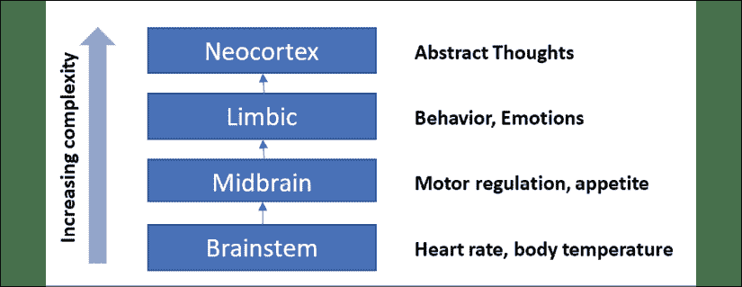

图 1：大脑的基本构成

与数学、物理等已有数百年历史的学科相比，AI 起步较晚。过去数十年已涌现自动驾驶汽车、可行走的智能机器人等成果。由此可见，智能化将在未来几年深刻改变生活。

不免让人好奇，人脑为何能如此轻易完成这些任务。我们能识别物体、理解语言、学习新知并执行更复杂的活动。大脑究竟如何做到？答案尚不充分。当试图用机器复制大脑的任务时，会发现差距明显。在许多维度上，人脑远比机器复杂且能力更强。

寻找外星生命或时空旅行这类命题，我们不确定其是否存在，价值也难评估。AI 的优势在于它已有理想模型：我们的大脑就是智能系统的标杆。我们只需模仿其功能，就能打造与之媲美甚至更优的智能系统。

下面展示原始数据如何经多层处理转化为智能：

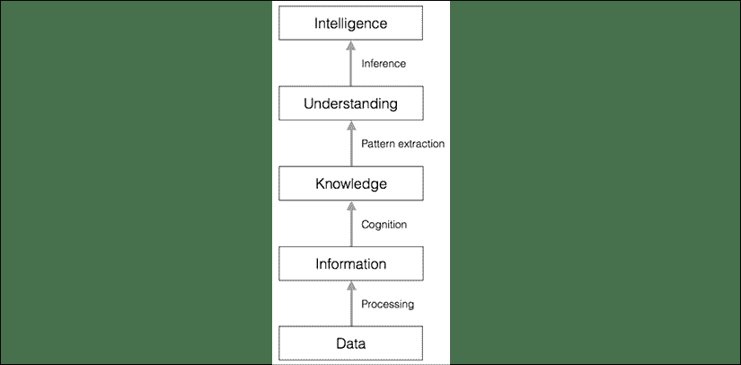

图 2：从数据到智能的转化

我们学习 AI 的重要动机之一是自动化。当前世界面临：

* 海量且难以驾驭的数据，人脑无法全部追踪。
* 数据来自多源且混乱。
* 知识需要持续更新，因为数据本身在变化。
* 感知与控制必须实时、高精度运行。

即便人脑擅长解析环境，也难以满足上述条件。因此需要设计能胜任的智能机器。理想的 AI 系统应能：

* 以高效方式处理海量数据，云计算让存储成为可能。
* 同时从多源抽取数据、零延迟索引与组织，从而获得洞察。
* 基于新数据学习并持续更新，利用恰当的学习算法实时应对。
* 不疲劳、无需休息地持续执行任务。

AI 技术正在被用来让现有机器更聪明、更快、更高效。

### AI 的分支

了解 AI 的研究方向有助于为具体问题选择合适的框架。常见分类方式有：

* 监督学习、无监督学习、强化学习
* 通用人工智能与狭义人工智能
* 按人类功能划分：
  * 机器视觉
  * 机器学习
  * 自然语言处理
  * 自然语言生成

常见的一种划分如下：

* **机器学习与模式识别**：目前最主流的 AI 形态。我们开发能从数据中学习的软件，并用学习模型对未知数据做预测。主要限制在于模型受限于数据特征。数据量小，模型能力也受限。

典型的机器学习系统如下：

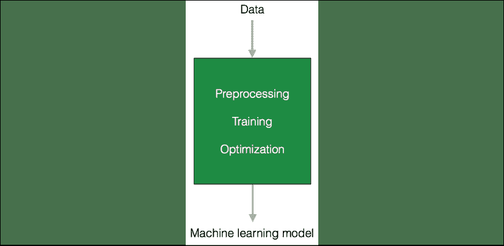

图 3：典型计算机系统

当系统遇到未见过的数据点时，会借助训练数据中的规律进行推断。例如人脸识别系统会匹配眼睛、鼻子、嘴唇、眉毛等模式，在已有用户库中寻找对应人脸。

* **基于逻辑的 AI**：用数学逻辑驱动程序。程序本质是一组逻辑陈述，表达问题域的事实与规则。广泛用于模式匹配、语言解析、语义分析等。
* **搜索**：AI 中大量使用搜索。程序遍历众多可能性并挑选最优路径，如棋类对弈、网络优化、资源分配、排程等。
* **知识表示**：世界事实必须以可理解的方式表示，数学逻辑语言常用。知识表示得好，系统会越发智能。本体论是相关领域，形式化定义域内实体的属性与关系，常以分类法或层次结构实现。下图区分信息与知识：

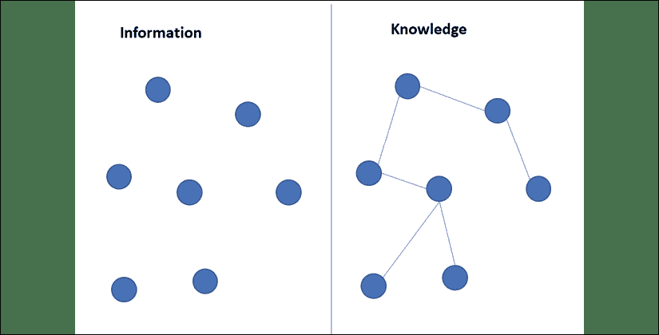

图 4：信息与知识

* **规划**：优化行动方案，以最低成本获取最大回报。程序从情景事实与目标描述出发，理解世界规则并推导出最佳实现路径。
* **启发式**：在无法穷举所有可能时，用于快速得到实用但不保证最优的解法。属于对求解方法的合理猜测。机器人、搜索引擎等 AI 应用中常见。
* **遗传编程**：通过让程序“配对”、选择最优解来演化出解决任务的程序。程序编码为基因集合，用算法培育出能很好完成给定任务的个体。

# 机器学习的五个流派

机器学习可进一步细分。Pedro Domingos 在《主算法》中给出一种受欢迎的分类，按思想萌芽的科学领域划分。例如遗传算法源于生物学概念。以下是流派、来源、主导算法与代表人物的概览：

| **流派** | **来源** | **主导算法** | **支持者** |
| --- | --- | --- | --- |
| 符号主义者 | 逻辑与哲学 | 反演 | Tom Mitchell、Steve Muggleton、Ross Quinlan |
| 连接主义者 | 神经科学 | 反向传播 | Yan LeCun、Geoffrey Hinton、Yoshua Bengio |
| 进化论者 | 生物学 | 基因编程 | John Koza、John Holland、Hod Lipson |
| 贝叶斯 | 统计 | 概率推断 | David Heckerman、Judea Pearl、Michael Jordan |
| 模拟器 | 心理学 | 内核机器 | Peter Hart、Vladimir Vapnik、Douglas Hofstadter |

**符号主义者**：以归纳或反演为核心工具。归纳是从前提和结论反推缺失部分。示例：苏格拉底是人类 + 所有人类都凡 mortal → 可推出苏格拉底凡 mortal。归纳示例：苏格拉底是人类 + ? = 苏格拉底凡 mortal → 问号处为人类是凡 mortal。

**连接主义者**：以大脑为主要参照，主打神经网络。神经网络粗略模拟大脑，旨在识别向量中的数字模式。输入如图像、声音、文本或时间序列需先转为数字向量。深度学习是神经网络的一种特殊形式，时常出现在杂志和新闻中。

**进化论者**：借用进化、自然选择、基因组、DNA 突变等概念用于数据处理。进化算法不断变异、演化以适应未知条件。

**贝叶斯**：聚焦概率推断处理不确定性。视觉学习与垃圾邮件过滤是典型应用。通常先用先验假设某些结果更可能，随后随数据更新假设。

**模拟器**：侧重发现样本间相似性。最知名模型是 `K 最近邻`算法。

# 用图灵测试定义智能

计算机科学家与数学家阿兰·图灵提出图灵测试以给出智能的操作定义。它检验计算机能否学习模仿人类行为。图灵把智能行为定义为在对话中达到足以让人误以为是人类回应的水平。

测试设置是：人类通过文本界面向机器提问，提问者不知道对方是人还是机器。提问者同时与两个受访者交互，一个是人，一个是机器。若提问者无法分辨，则机器通过测试。设置如下：

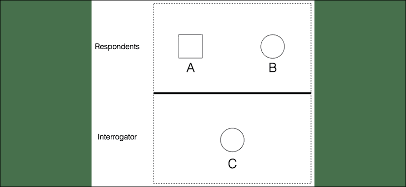

图 5：图灵测试

对机器而言难度极高。对话中涉及多项能力，至少包括：

* **自然语言处理**：解析句子、提取上下文并给出恰当回复。
* **知识表示**：存储对话前信息，并在过程中追踪新信息以便后续回应。
* **推理**：理解存储信息并实时得出结论。
* **机器学习**：实时适应新情境，分析模式并推断。

可能好奇为何要用文本界面。图灵认为物理模拟对智能非必需，因此测试避免了物理交互。

还有一种总图灵测试，加入视觉与运动。通过它需要计算机视觉和机器人移动来观察物体。

# 让机器像人一样思考

数十年来人们试图让机器更像人脑。实现的前提是理解人类思维。我们如何把握思维本质？一种方法是记录对事物的反应，但很快会因注意对象太多而困难。另一种是按预设格式做实验，提出涵盖多种人类主题的问题，观察人们如何回应。

当数据量达到可用的程度，我们就能构建出一个复制人类工作方式的仿真模型。借助它，可以开发出看似拥有人类式思考能力的软件。想法很诱人，实践却困难重重。最终我们关注的核心其实是：输入确定后，程序会产出什么结果。只要这种产出与人类表现保持一致，就有权推测两者内部可能遵循着相似的思维路径。

下面这张图展示了思维的层级结构，以及大脑在面对信息时如何划分轻重缓急：

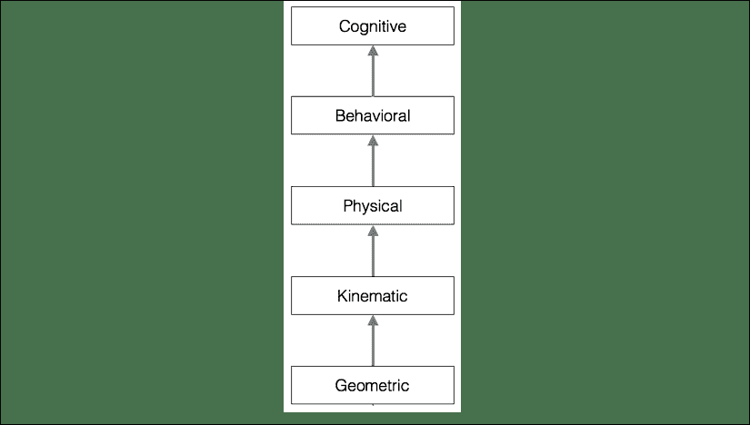

图 6：思想水平

在计算机科学内部，有一个专门研究的方向叫**认知建模**，其目标就是复现人类的思考过程。它试图搞清楚人是怎么解决问题的，需要把解决问题的内在思路拆解出来，再转化为可运行的软件模型，最后用这个模型来再现人类行为。

认知建模的应用面很广，深度学习、专家系统、自然语言处理、机器人等领域都在用它。

# 构建理性智能体

人工智能研究里很主流的一条线，就是打造理性主体。先厘清 AI 语境下的*理性*是什么。理性就是遵循既定规则，并严格推导出其逻辑后果以达成理想结果。换句话说，要以对执行主体最有利的方式行动。所以在特定规则约束下为实现目标而行动的主体，就可称作理性行动者。它本质上是基于手头信息感知、再做决策。在未知地形投送机器人时，AI 就大量借用这种设计思路。

*理想*该如何定义？答案取决于主体的目标设定。主体应当具备智能与自主性，能够应对新环境，感知外部状况后做出相应反应，以获得与其最大利益相符的结果。而最大利益又受制于整体目标。我们不妨看看输入如何一步步转化为行动：

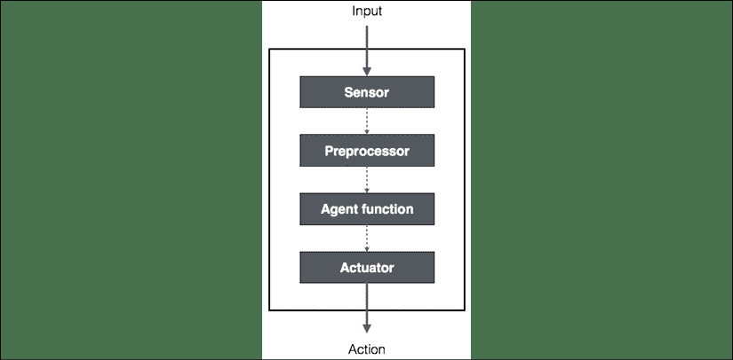

图 7：将输入转化为行动

评判理性智能体的好坏，用什么指标？一种说法是效果越好越理性。让智能体完成指定任务，表现度量就与任务完成比例挂钩。但光看结果不够，整体的理性还包括过程。如果只看终点，就会忽略达成结果的行为本身。

做出合乎逻辑的推断也是理性的组成部分，因为主体需要以理性方式行动来达成目标，这有助于它形成可持续复用的结论。

如果没有唯一正确的解呢？在某些情境下，主体并不清楚该怎么做，却仍必须采取行动。

通过一个例子来说明。想象一辆时速60英里的无人驾驶汽车，突然有行人闯入。按设定，车只有两个选择：撞向护栏，可能致乘客死亡；或撞向行人，造成行人死亡。哪个决定更正确？算法凭什么判断？如果换成你亲自开车，会怎么做？

接下来要介绍理性智能体的早期代表——通用问题求解器。名字听起来很宏大，实际问题解决能力有限，但它为计算机科学带来了巨大推动。

# 通用问题求解器初探

**通用问题求解器**（`GPS`）由 Herbert Simon、J.C. Shaw 与 Allen Newell 提出，是 AI 领域第一个真正有用的程序。设想让它成为一台通用的问题解决机器。此前软件大多只干特定活，`GPS` 则是第一个意图用同一套基本算法处理各类问题的系统。

这显然是极具挑战性的目标。为了实现 `GPS`，作者专门创造了一种新语言——**信息处理语言**（`IPL`）。核心思路是用一组合规的公式来描述任意问题。这些公式构成一张有向图，图中有源点和汇点。源点对应起点，汇点对应终点。对 `GPS` 而言，源点是公理，汇点是结论。

尽管主打通用，`GPS` 实际处理的仍是形式化程度高的问题，比如几何与逻辑定理证明、文字谜题、下棋。因为这些问题可以在一定范围内严格形式化。现实世界则复杂得多，可选路径太多，若硬靠穷举图中的步数，计算量会迅速变得不可行。

## 用 GPS 拆解问题

看一下如何把一个具体问题准备成 `GPS` 可处理的形态：

1. 第一步明确目标。譬如目标是去超市买牛奶。
2. 第二步列出前提条件。这些条件与目标相关。要拿到超市的牛奶，需要有交通工具，且超市要备有牛奶。
3. 第三步定义操作符。假设交通工具是汽车，但油不够，就得先能付得起加油站的费用。还要确保能在商店付钱买到牛奶。

操作符要关注条件及其影响因素，由动作、触发前提、动作带来的变化三部分组成。举例来说，动作是去超市买东西，前提是有钱，变化是钱减少、牛奶到手。

按这种方式把问题拆解清楚，`GPS` 就能跑通。它的瓶颈在于依赖搜索过程，对任何有实际价值的应用来说都过于耗费时间和计算资源。

本节介绍了理性主体的概念，接下来看如何让这些主体更智能、更有用。

# 让智能体更聪明

赋予智能体智能的方法很多，常见手段有机器学习、知识存储、规则体系等。这里聚焦机器学习，通过数据和训练来培养智能。

先看看智能体与环境如何互动：

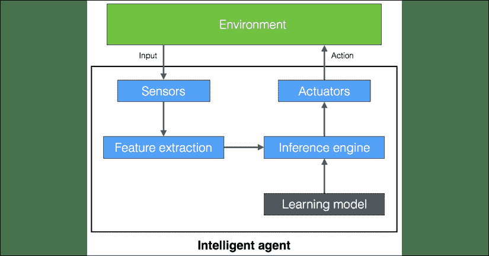

图 8：智能体与其环境的交互

机器学习常使用带标签的数据来训练模型。模型在浏览数据与标签的过程中学会捕捉模式和关联。

在前述流程里，智能体倚靠学习模型驱动推理引擎。传感器采集输入后送入特征提取模块，提取关键特征后，训练好的推理引擎基于学习模型进行预测。该学习模型正是机器学习训练所得。推理引擎做出决策后交付执行器，由执行器在物理世界中实施动作。

机器学习的应用已非常普遍，图像识别、机器人、语音识别、股市行为预测等都离不开它。要完整构建解决方案，需要掌握模式识别、人工神经网络、数据挖掘、统计学等多领域技术。

## 两种模型范式

AI 领域大致分两类模型：分析模型和学习模型。在计算机普及前，人们主要靠分析模型。

分析模型是用数学公式推导出来的，遵循一系列步骤得到最终方程。这种方法的弊端是高度依赖人类先验判断，结构简单、参数少、精度往往不高。想想牛顿时代的科学家，没有电脑辅助，推导一个可用公式需要长时间反复试验。

进入计算时代后，学习模型逐渐占优。学习模型通过训练获得，机器从大量输入输出样本中归纳出方程。学习模型通常结构复杂、参数多达数千，生成的数学表达式能更精细地刻画数据规律，预测能力也更强。

机器学习的最大好处是无需手工推导数学公式。使用者不需要深厚的数学功底，机器会从数据中自动归纳规律。只需准备输入列表和对应输出，学习模型本质上就是标记输入与期望输出之间的映射关系。

# Python3 环境搭建

本书使用 `Python3`，请确保安装最新版。执行以下命令检查：

```
$ python3 --version 
```

若输出形如 `Python3.x.x` 的版本号，即表示已安装。否则请自行安装。

## 在 Ubuntu 上安装

Ubuntu 14.xx 及以上通常已预装 `Python3`。若未安装，可用命令安装：

```
$ sudo apt-get install python3 
```

随后用同上检查命令验证：

```
$ python3 --version 
```

应能看到版本号。

## 在 Mac OS X 上安装

Mac 用户推荐使用 `Homebrew` 安装包管理器。若尚未安装，先执行：

```
$ ruby -e "$(curl -fsSL https://raw.githubusercontent.com/Homebrew/install/master/install)" 
```

更新包管理器：

```
$ brew update 
```

安装 `Python3`：

```
$ brew install python3 
```

再次运行检查命令：

```
$ python3 --version 
```

输出应显示版本号。

## 在 Windows 上安装

Windows 用户建议使用兼容 `SciPy` 的发行版，`Anaconda` 较为流行且易用。[安装说明可在此处查阅](https://www.continuum.io/downloads)。

若想选用其他兼容发行版，可访问[此页面](http://www.scipy.org/install.html)查找。这些发行版自带所需组件，无需单独安装。

安装完成后同样运行检查命令：

```
$ python3 --version 
```

应能看到版本号输出。

# 核心依赖包安装

本书将用到 `NumPy`、`SciPy`、`scikit-learn` 和 `matplotlib`。请在继续前完成安装。

Ubuntu 或 Mac OS X 用户安装较为便捷，单条命令即可完成。可参考以下链接：

* [NumPy](http://docs.scipy.org/doc/numpy-1.10.1/user/install.html)
* [SciPy](http://www.scipy.org/install.html)
* [scikit-learn](http://scikit-learn.org/stable/install.htmlx)
* [matplotlib](http://matplotlib.org/1.4.2/users/installing.html)

Windows 用户若使用 `SciPy` 兼容发行版，通常已包含上述包。

# 数据加载实操

构建学习模型需要代表世界的数据。安装完 Python 包后，可查看如何与数据交互。进入 Python 交互环境：

```
$ python3 
```

导入包含数据集的包：

```
>>> from sklearn import datasets 
```

加载房价数据集：

```
>>> house_prices = datasets.load_boston() 
```

打印数据：

```
>>> print(house_prices.data) 
```

输出类似：

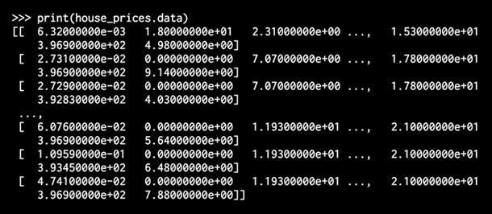

图 9：输入房屋价格的输出

查看标签：

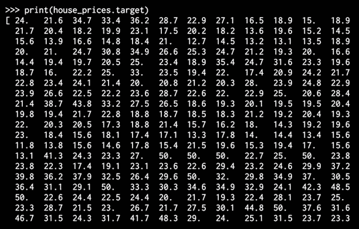

图 10：预测房价的输出

实际数组较大，图中仅展示前几项。

`scikit-learn` 还提供图像数据集，每个图像尺寸为 `8×8`。加载它：

```
>>> digits = datasets.load_digits()
```

打印图像：

```
>>> print(digits.images[4])
```

输出如下：

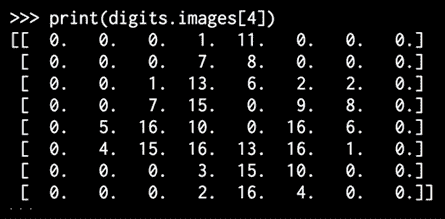

图 11：`scikit-learn` 图像数组的输出

可见其为八行八列的结构。

# 本章小结

本章主要涉及：

* 人工智能的意义与研究价值
* AI 的主要分支与应用场景
* 图灵测试的概念与流程
* 如何让机器实现类人思维
* 理性主体的定义与设计要点
* 通用问题求解器 `GPS` 的原理及使用方式
* 基于机器学习的智能体构建方法
* 分析模型与学习模型的区别
* 各类操作系统上安装 Python3 与必要包的方法
* 使用 `scikit-learn` 加载数据的流程

下一章将介绍监督学习，以及分类与回归模型的构建。

# 2 AI 的真实应用场景

> 原文：[`gitee.com/apachecn/apachecn-dl-zh/blob/master/docs/ai-py/02.md`](https://gitee.com/apachecn/apachecn-dl-zh/blob/master/docs/ai-py/02.md)

本章将梳理人工智能的一些典型用例。这并非穷尽清单，众多行业已被 AI 重塑，未被波及的行业清单也在不断缩短。有趣的是，部分难以被自动化取代的工作往往是薪资较低、依赖“体力”而非“脑力”的岗位。比如在机器人完全取代发型师和水管工前可能还需很久，这两类工作需要大量精细技巧和现场判断。我清楚记得妻子花了很长时间才肯把头发交给除现有发型师外的任何人，更别说机器人了。

本章将涵盖：

* 具有代表性的 AI 用例
* 最晚会被自动化取代的工作类型
* 受 AI 影响最深的行业

## 代表性 AI 用例

从金融到医疗，很少有行业能免疫人工智能的冲击。我们聚焦日常生活中最常见的真实 AI 应用，探讨当前技术水平与未来趋势。希望这些案例能激发新的想法，为社会带来积极影响。

人工智能、认知计算、机器学习、深度学习等技术正在共同推动变革。云计算、**物联网**（**IoT**）与边缘计算的进步加速了这些技术的落地。把它们整合起来，企业正在重塑业务模式。这才刚刚开始，我们甚至还没进入第一局的第一击。

下面看几个当代 AI 应用。

### 数字个人助理和聊天机器人

某些呼叫中心至今仍在使用传统**交互式语音应答**（**IVR**）系统，让人抓狂。但自然语言处理领域已取得长足进步，聊天机器人因此兴起。最受欢迎的代表有：

* **Google 助手**：2016 年推出，是目前最成熟的助手之一，可出现在手机、耳机、音箱、洗衣机、电视、冰箱等设备上。多数 Android 手机均集成此功能，Google Home 和 Nest Hub 也支持。
* **Amazon Alexa**：由亚马逊开发的虚拟助手，可通过语音播放音乐、创建待办、设置闹钟、朗读音频、回答基础问题，甚至讲笑话或故事。还能控制智能家居设备，开发者可通过“技能”扩展其能力。
* **Apple Siri**：接收语音指令和自然语言输入，通过解析并分发到网络服务来回答问题、提供建议、执行操作。能学习用户的语言习惯、搜索偏好和使用模式，用得越多越精准。
* **Microsoft Cortana**：微软打造的数字助手，可设置提醒、识别自然语音、基于信息作答。

这些助手通常能完成以下任务：

* 控制家庭设备
* 按指令播放音乐和视频
* 设置计时器与提醒
* 安排日程
* 发送短信邮件
* 拨打电话
* 公开查询
* 语言翻译
* 在电商网站下单

尚未普及但正快速增长的功能包括：

* 值机
* 预订酒店
* 预订餐厅

所有平台都支持第三方开发者构建应用或“技能”，可能性几乎无限。

常见的 Alexa 技能示例：

* **MySomm**：为肉类推荐配酒
* **调酒师**：提供鸡尾酒制作说明
* **7 分钟锻炼**：指导高强度短时训练
* **Uber**：通过语音直接叫车

这些服务持续自我优化，开发者和系统都会利用用户交互产生的新数据不断改进。

大多数云厂商让创建聊天机器人变得非常简单，部分基础示例甚至无需编程。部署到 Slack、Facebook Messenger、Skype、WhatsApp 等渠道也很容易。

### 个人司机

# 从零级到五级，自动驾驶与AI如何悄悄重塑日常

无人驾驶汽车的理想是让车辆在预设路线上完全不需要人手干预。眼下真正上路的系统已经不再依赖单一传感器，雷达、超声波、激光雷达、计算机视觉再加上 GPS 在一起协同工作。

行业想要统一语言，于是 SAE International 推出标准 J3016，用六个自动化层级给汽车的智能程度打标签。

**零级：纯人工驾驶**
车上没有自动驾驶功能，驾驶员要全程负责转向、制动、加速和应付交通。路上绝大多数新车仍处于这一阶段。

**一级：驾驶员辅助**
系统在特定工况下能单独接管转向或车速，二者不会同时被系统控制。驾驶员仍要负责其余一切并随时监控，典型代表是自适应巡航。

**二级：部分自动化**
在限定场景里车辆可同时处理转向、加速和制动。驾驶员仍要解读信号、变道等，车辆的最终责任仍在人身上，厂商也要求人保持高度参与。常见的实现包括奥迪的交通拥堵辅助、凯迪拉克超级巡航、奔驰驾驶辅助、特斯拉的 Autopilot、沃尔沃的 Pilot Assist。

**三级：有条件自动化**
这是责任从人向机器倾斜的拐点。在适宜条件下计算机既能操控车辆也能监控周边，遇到超出能力的情况会主动要求人接管。人通常不需要握着方向盘，但必须能随时接手。奥迪的交通拥堵飞行员算是一个例子。

**四级：高度自动化**
绝大多数情况下无需人工干预，但在特定道路、天气或地理条件下仍需人协助。在限定区域的共享车队里甚至可以完全无人。私人用车时，人在市中心街道仍要驾驶，系统在高速公路接管。谷歌早已停产的 Firefly 就是此层级的案例，它没有踏板方向盘，最高时速 25 英里，仅限封闭场地且不允许上公共道路。

**五级：完全自动化**
系统能在人类驾驶员所能应对的任何道路、任何天气下自主运行，车主只需输入目的地。目前市场上仍无量产产品，几家尝试者已关闭，书出版时也可能仍属空白。

### 领先玩家的试水与教训
**Waymo 的里程积累**
到 2018 年，Waymo 的车队在公开道路累计行驶约 800 万英里，模拟环境里超过 50 亿英里。外界普遍认为不久后我们就能买到真正全自动的车，特斯拉等已先以驾驶辅助铺路，可能最早实现完整自动驾驶。可以想象一个世界里，刚出生的孩子永远不需要考驾照。人工智能带来的冲击会很大，快递司机、出租车司机、卡车司机的工作都将被重写。即便事故仍会发生，消除分心驾驶和酒驾也能挽救数百万生命。

2018 年 Waymo 在美国亚利桑那州启动首个商业化无人驾驶服务，随后计划向全国和全球扩张。

**Uber ATG 的实验与翻车**
Uber 先进技术小组致力于自研方案，2016 年就在匹兹堡街道开展试运行。原本计划采购多达 24,000 辆沃尔沃 XC90 装上自研系统，2021 年实现有限商业化。

2018 年 3 月，Elaine Herzberg 在一次过马路时被 Uber 无人车撞倒身亡，成为首批无人车致死案例之一。警方说法是她在横穿时被撞。理想是零事故，但要把期望值与当前交通事故的现实摆在一起。2017 年美国有 40,100 人死于车祸，即便无人车仍有事故，只要死亡总数减半，每年就能救下数千人。

设想中的无人驾驶舱更像客厅，没有方向盘踏板，目的地可通过语音输入。车辆能自行感知维护需求。事故责任将从司机转移到车企，车险或将消失，这也是行业推进缓慢的原因之一。车主数量也可能被削弱，按需召唤会成为常态。

### 仓储物流的人机共舞
亚马逊的分拣中心是人、电脑和机器人的典型协作。电脑接单并规划路径，机器人搬运托盘和库存，人类负责把商品放进订单的“最后一公里”。机器人擅长重复模式化任务，却难以在捡起 20 磅包装后立刻夹起鸡蛋不碎。面对尺寸、重量、形状和易碎性的多样性，机器人会卡壳，于是人来接手难题。三者配合每天能处理数百万件包裹，几乎无错。

亚马逊机器人实现总监 Scott Anderson 在 2019 年 5 月坦言，距离全自动化仓库至少还有十年。

### 医疗健康的多维渗透
AI 在健康科学中的应用几乎没有边界。

#### 靶向筛选加速
AI 能生成候选药物分子，再用约束满足或实验模拟迅速筛掉不达标的。约束满足的方法可以快速产出数百万种分子并在不符合预设约束时立刻淘汰。也可在电脑里模拟昂贵的实验。真实实验则借助机器人提速，形成高通量筛选 HTS 和虚拟高通量筛选 VHTS。机器学习还被用于强化临床试验，埃森哲的智能临床试验 ITP 工具可预测试验耗时。自然语言处理也能处理基因组数据，用字母串表示基因序列后让 NLP 理解其含义。

#### 保险定价更精细
机器学习模型能更准确预测医疗支出、驾驶员健康状况或寿命，从而定价。Insilico Medicine 的 young.ai 项目可从血液样本和照片估算寿命。血液提供 21 项生物标志物，如胆固醇、炎症指标、血红蛋白、白蛋白，配合种族、年龄和照片作为输入。公众可免费在 young.ai 上试用。

#### 患者诊断辅助
规则引擎加机器学习的系统能提升医生诊断效率。加州大学圣地亚哥分校张刚团队的研究显示，一套系统在诊断儿童疾病上比初级儿科医生更准，准确率在 90% 至 97% 之间，涵盖腺热、猩红热、流感、水痘、手足口病等。训练数据来自 2016 至 2017 年广州地区 130 万例儿童就诊记录。

#### 影像解读提速
CT、MRI、X 光藏着丰富的患者信息，但放射科医生短缺，解读常需数天且易出错。研究表明机器学习模型有时优于人类。数据科学家已做出可在数分钟而非数天内完成 MRI 和影像判读的 AI 平台，准确率更高。美国放射学会领导者并未恐慌，而是视 AI 为工具。美国放射学院数据研究所 ACR DSI 发布并持续更新医学影像的 AI 用例。

#### 精神健康陪伴
一次精神科面谈动辄数百美元，AI 聊天机器人正被用来提供初步陪伴和随访。1966 年约瑟夫·魏森鲍姆开发的 Eliza 是早期代表，它模仿罗杰式心理治疗师对话，代码仅数百行，AI 含量有限。更先进的是南加州大学创意技术研究所打造的 Ellie，用来辅助抑郁症或创伤后应激障碍。她在屏幕上出现，会点头、换坐姿，并对情感线索作出反应，能追踪人脸 66 个点以读取情绪。她的“非人”特质反而让使用者更愿意敞开心扉。

#### 智能健康记录
医学界在电子记录上落后。数据科学正推动 OCR、手写识别、语音转文字和生命体征实时读取与分析。未来 AI 引擎可能实时监测数据并自动调节血糖、提示服药或呼叫急救。

#### 疾病预测的基础
人类基因组是终极数据集，未来可直接作为机器学习输入预测疾病。基因组含逾 30 亿个碱基对，进展来自基因组生物学理解深化和大数据计算能力的提升。深度学习在基因组学仍属早期，但有望助力功能基因组学、肿瘤学、群体遗传学、临床遗传学、作物产量提升、流行病学与公共卫生、进化与系统学等领域。

### 搜索背后的隐形大脑
我们常在不自知的情况下使用 AI，Google 搜索就是典型。建议技术、相关性排序都深深嵌入其中。据彭博社报道，2015 年初 Google 开始启用 RankBrain 深度学习系统辅助查询响应。它把自然语言映射成可计算的向量，遇到生词或陌生短语时可推测语义相似项并过滤结果，从而更好地处理从未见过的查询。作者杰克·克拉克的描述指出 RankBrain 让机器理解语言成为可能。

RankBrain 在数十亿次搜索中发挥作用，公司对此讳莫如深，甚至 Google 内部也难以完全解释它的决策。深度学习以高精度著称却缺乏可解释性，这带来法律风险。Google、Facebook 等被质疑结果偏见，未来监管可能要求给出理由，若无法解释就只能退回精度更低但可解释的模型。

最初 RankBrain 仅覆盖约 15% 的查询，如今几乎触及全部用户。对常规查询权重较小，对全新或模糊查询影响更大。

# 推荐系统的无处不在
亚马逊、YouTube、Netflix、LinkedIn、Facebook 都靠推荐技术维生，我们往往意识不到。数据越多，系统越强。市值领先并非偶然，背后是挖掘客户数据潜力的能力。

推荐不是找标准答案，也不是纯主观偏好，而是介于两者之间的“模糊”任务。亚马逊若持续推某一款产品而忽略另一款，会直接左右厂商的生死。

冷启动是难题：新用户无历史时难以个性化。鞋子购买记录可触发袜子甚至篮球的建议。

好的系统还会加入随机性，偶尔给出看似无关的惊喜。Netflix 看完《教父》可能推荐阿尔·帕西诺作品，也可能试探性推荐《谍影重重》。用户拒绝后算法会学习并规避。

随着能力提升，推荐能支撑个人数字助理，成为了解你喜好的私人管家。受益场景包括餐厅、电影、音乐、交友、书籍、搜索结果和金融理财的机器人顾问。

## Netflix 奖
2006 至 2009 年，Netflix 举办百万美元竞赛，提供超 1 亿条评分数据，要求新算法比其现有系统准确率高 10%。这项比赛推动了推荐算法的爆发。2009 年 9 月，大奖由 BellKor 的 Pragmatic Chaos 团队摘得。

## Pandora
Pandora 专注音乐流媒体，其定制电台依赖多层推荐。先由音乐专家按流派、节奏、演进标注歌曲，转为向量以衡量相似度，从而挖掘长尾音乐。系统收集超 750 亿条听众反馈，结合历史选择、地理位置和人口统计做个性化过滤。整体约用 70 种算法，其中 10 种用于内容分析，40 种处理集体智慧，30 种用于个性化。

## Betterment
机器人顾问是自动化投资建议引擎，在极少人工干预下管理资产组合。借助机器学习自动分配、调整和优化，成本更低且易于扩展。如今该领域超过 100 家公司在竞争，过去财富管理是高净值专属，机器人顾问则把类似服务以更低成本推向大众。投资标的通常限定为 ETF，以保持简洁。

正如前面所说，市场上提供自动化理财建议的平台不少。比如 Betterment 就常被拿来当案例。用户先完成一份风险测评问卷，系统会据此给出个性化且多元化的资产组合，一般会推荐低费率的股票和债券指数基金搭配。Betterment 按组合比例收取管理费，收费水平比多数人工服务更低。需要说明的是我们并不为其背书，只是把它当作金融行业推荐引擎的典型例子。

# 家居自动化能走多远

在街头随便聊起 AI，多数普通人第一反应是怀疑它何时能取代环卫工。说得也对，我们至今仍需要在家里做大量家务。人工智能要普及不仅要在技术上可行，还得在经济上成立。家政本就是低薪行业，自动化要想被接受，成本必须和人工相当甚至更低。家务又往往需要手眼协调，还不全是重复动作。试着列一下机器需要会做的事：

* 洗衣服
* 叠衣服
* 煮晚餐
* 铺床
* 捡起地上的杂物
* 拖地、扫地、吸尘
* 洗碗
* 监控房屋

其中有些活机器早已能胜任，有些则难上加难。综合成本看，家可能成为最后才完全自动化的地方之一。即便如此，这个领域已经出现了不少惊人进展。

## 看家已经很智能

家庭监控是目前落地最成熟的场景。亚马逊的 Ring 视频门铃和谷歌的 Nest 温控器就是两款价格亲民、普及度高的例子。

Ring 视频门铃是联网的智能家居设备，能通过手机推送家中动静。它并不持续录像，而是在门铃被按或移动探测器触发时才激活。房主可以实时观看画面，用内置麦克风和扬声器与访客对话，部分机型还能远程操控智能锁放行。

Nest Learning Thermostat 最初由 Nest Labs 研发，后被 Google 收购，由 Tony Fadell、Ben Filson 和 Fred Bould 设计。它支持可编程、Wi-Fi 和自学习，通过人工智能优化室内温度同时省电。头几周用户需把常用温度设好作为基准，设备随后学会作息和偏好，并借助内置传感器与手机定位，在无人时自动切到节能模式。

自 2011 年起，Nest 为全球数百万家庭累计节省了数十亿千瓦时电量。独立研究显示，它能让取暖费用平均下降 10% 至 12%，制冷费用下降约 15%，大约两年即可收回成本。

## 扫地拖地已交给机器人

吸尘和拖地是率先交给机器人的两项家务。机器人吸尘器是能自主清扫地面的 AI 设备，部分型号配有边刷清理角落，还有些同时具备拖地和紫外线杀菌功能。把这项技术推向大众功劳最大的是 iRobot。

iRobot 由 Rodney Brooks、Colin Angle 和 Helen Greiner 在麻省理工学院人工智能实验室工作后于 1990 年创立。公司以 Roomba 吸尘机器人闻名，该产品 2002 年开始销售。截至 2012 年，iRobot 已售出超过 800 万台家用机器人，同时生产了 5,000 多台国防和安保机器人。其 PackBot 被美军用于伊拉克和阿富汗的排爆任务，也曾在福岛第一核电站的危险环境采集数据。Deepwater Horizon 漏油事故后，iRobot 的 Seaglider 被用来探测海底油藏。

iRobot 另一条产品线是 Braava 系列拖地机。Braava 体型小巧，适合浴室、厨房等狭窄空间，能喷水并使用不同材质的拖布安静清洁。部分型号带导航系统。它的清洁力尚不足以应对顽固污渍，还谈不上完全替代人类，但市场接受度很高。我们期待它继续进化。

家庭智能设备的潜在市场巨大，已有成熟企业和初创公司都在抢占这块尚未开发的空间。

## 捡拾仍是难题

从运输场景我们已了解到，抓取重量、尺寸、形状各异的物体是最难自动化的环节之一。工厂里在受控环境下，机器人能高效执行单一任务，但先拿起椅子再捡起一双鞋就是巨大挑战，成本也高。因此不要指望捡拾这类家务很快以经济方式普及。

## 厨房里的人工智能

烹饪同样涉及抓取不同物品，但有两点让人们相信自动烹饪会更快到来：

* 某些餐厅客单价可达数百美元，厨师成本也很高，若技术能提升利润，他们愿意用自动化替代高价人力。五星级寿司店就是典型例子。
* 厨房里不少工序是重复性的，适合自动化。快餐店每天要做成千上万份汉堡和薯条。与其让一台机器完成全部烹饪，不如由多台设备分段处理重复环节。

智能假肢是 AI 增强人类而非替代人类的典范。厨师 Michael Caines 经营米其林两星餐厅，因车祸失去一条手臂。他曾长期担任英格兰德文郡吉德利公园的主厨，直至 2016 年 1 月，现任林普斯通庄园酒店的行政总厨。他现在用假肢做饭，成品质量丝毫看不出差别。

另一位例子是运动员兼厨师 Eduardo Garcia。2011 年 10 月，他在蒙大拿偏僻地区独自打猎，看到一只死去的小黑熊后跪下用刀检查，结果触电约 2400 伏，小熊是被地下带电电线电死。他幸存下来却失去手臂。

2013 年 9 月，Advanced Arm Dynamics 为他装上 Touch Bionics 设计的仿生手。那只手由前臂肌肉控制，可实现 25 种抓握方式。Garcia 能完成很多需要灵巧的动作，但仍无法举重。他现在可以不被烫伤地从烤箱取物，也不再会割伤手指。

与此同时，机器人也可以部分替代厨房人力。Moley 机器人厨房尚未量产，其最先进原型由两只机械臂组成，手部配有触觉传感器，配备炉灶、烤箱、洗碗机和触摸屏单元。人工手能举起、抓取并与大多数厨具互动，包括刀具、打蛋器、汤匙和搅拌器。

通过 3D 相机和手套记录人类厨师操作，再把详细步骤上传到库中，手势识别模型将人类的动作转化为机器人动作。该模型由斯坦福大学与卡内基梅隆大学合作开发。随后 Moley 能重复同样步骤，从头开始制作完全一致的菜品。

当前原型可通过触摸屏或手机 App 操作，需预先准备配料并放在预设位置。公司的长期目标是让用户从 2000 多道食谱中挑选，几分钟内完成烹饪。

# AI 在游戏里的高光时刻

很少有领域比游戏更能体现人工智能的惊人进展。人类天生好胜，用机器击败我们自己的游戏是衡量突破的有趣标准。很久以来计算机就能赢得跳棋这类规则简单、确定性强、计算量少的游戏。直到近几年，机器才稳定击败难度更高的游戏高手。下面介绍三个代表。

## AlphaStar征服星际

电子游戏已数十年被用作测试 AI 系统的基准。随着能力提升，研究人员用更复杂的游戏，游戏中发展出的策略也能迁移到现实问题。《星际争霸 2》被认为是最难的游戏之一，尽管按视频游戏标准它已算老。

DeepMind 推出 AlphaStar，可玩《星际争霸 II》，并首次击败顶级职业选手。2018 年 12 月的比赛中，AlphaStar 以 5-0 战胜全球最强选手之一 Grzegorz “MaNa” Komincz。比赛在专业条件下进行，无任何限制。

与此前限制游戏的尝试不同，AlphaStar 能不受限制地玩完整游戏。它使用深度神经网络，通过监督学习和强化学习直接从原始游戏数据训练。

星际争霸 2 的困难在于需要平衡短期和长期目标并应对突发情况，这对以往系统是巨大挑战。

尽管只是游戏，AlphaStar 的概念对现实问题很有用。例如其架构能基于不完整信息对长序列动作建模，游戏常持续数小时、产生数千次操作。类似的长序列预测在天气预报、气候模拟、自然语言理解等领域都有应用。

AlphaStar 在星际争霸上的成功代表了人工智能的重大飞跃，其技术可迁移并帮助解决实际问题。

## 问答王者Watson

IBM 的 Watson 团队在 2011 年创造历史，设计出能击败两名 Jeopardy 最成功选手的系统。Ken Jennings 创下连续 74 场不败纪录，Brad Rutter 累计奖金 325 万美元，两人都同意与 Watson 对战。

Watson 是自然语言问答系统，由 IBM DeepQA 研究团队负责人 David Ferrucci 领导创建。

它的问答技术与常规搜索不同。常规搜索以关键词为输入，按相关性排序文档列表。问答技术则尝试理解自然语言表达的问题并给出准确答案。

Watson 的软件架构包含 IBM DeepQA 软件、Apache UIMA 非结构化信息管理架构、Java、C++、Prolog 等多种语言、SUSE Linux 企业服务器以及用于分布式计算的 Apache Hadoop。

## 从Deep Blue到AlphaZero

1996 年 Deep Blue 击败国际象棋大师 Garry Kasparov 的新闻至今让人难忘。Deep Blue 是 IBM 的象棋程序。首轮 Deep Blue 拿下一局，原定六局。Kasparov 在随后五局中赢三平二，以 4-2 逆转。

Deep Blue 团队改进软件后于 1997 年再战，Deep Blue 以 3½-2½ 赢下六局，成为首个在标准锦标赛规则和时间控制下击败世界冠军的计算机系统。

鲜为人知的是 AlphaZero 在象棋上的成就。Google 的 AlphaZero 研究团队 2017 年开发的系统仅用四小时学会象棋规则，就击败当时最强的世界冠军程序 Stockfish。此后“计算机是否更强于人类”的争议已基本结束。

系统并未被教任何策略，只获规则，就在数小时内达到击败 Stockfish 的水平。在 100 盘对局中，AlphaZero 持白棋赢 25 盘，持黑棋赢 3 盘，其余为平局。Stockfish 未获胜。

## 围棋破局者AlphaGo

围棋难度不亚于象棋，甚至更高。19×19 棋盘的可能局面比可见宇宙的原子数还多，围棋的复杂度和分支远超象棋，一块石头的影响能波及整个棋局。

DeepMind 开发的 AlphaGo 及其继任者 AlphaGo Master、AlphaGo Zero、AlphaZero 都使用了蒙特卡洛树搜索，结合通过深度学习训练的先验知识，可与人类对战或自对弈。模型会预测下一步行动和获胜概率，神经网络增强了搜索强度。

2015 年 10 月，原版 AlphaGo 成为首个在全尺寸 19×19 棋盘上击败无让子职业人类棋手的程序。2016 年 3 月，它五盘击败李世石，成为首个击败无让子九段职业棋手的程序。虽在第四局失利，李世石在最后一局认输，最终比分 4-1。

2017 年未来围棋峰会，AlphaGo Master 三盘击败当时世界排名第一的柯洁。此后 AlphaGo 获中国围棋协会授予专业九段。

# 电影制作AI化

未来几十年内完全由计算机生成的电影几乎可以实现。设想一个系统，输入剧本输出完整故事片是可行的，而且生成器已出现，未来甚至可能不需要剧本。

## 换脸Deepfake

Deepfake 由“深度学习”与“fake”组合而成，是用 AI 合成视频图像的技术。常见用途是将某人的脸叠加到另一段影像上。恶意版本可把名人的脸拼进色情场景，制造复仇色情或虚假新闻、恶作剧。滥用后果严重。

中国公司 Momo 开发的 Zao 应用就是典型案例。它能让用户把自己的脸叠加到《泰坦尼克号》等短片中，效果惊人。该类应用争议不小，隐私团体投诉用户上传的照片会按用户协议成为 Momo 财产，并可能用于其他应用。

技术在这一领域将如何演进，仍值得关注。

## AI也能写剧本

AI 不会很快拿到奥斯卡，但已有项目尝试生成电影剧本。最著名的是 Sunspring。

Sunspring 是 2016 年上映的实验科幻短片，剧本完全由深度学习生成。脚本由名为 Benjamin 的长短期记忆 LSTM 模型创作，出品人为 BAFTA 提名导演 Oscar Sharp 和纽约大学 AI 研究员 Ross Goodwin。主演是 Thomas Middleditch、Elizabeth Gray 和 Humphrey Ker，角色名分别为 H、H2 和 C，最终形成三角恋。

影片最初在伦敦科幻电影节 48 小时挑战赛上放映，2016 年 6 月由 Ars Technica 在线发布。

# 风险定价与AI

什么是承保？简单说，机构通过承保决定是否愿意为保费承担财务风险。需要承保的交易包括：

* 签发保单：健康、寿险、家庭险、车险
* 贷款额度：分期贷款、信用卡、按揭、商业信贷
* 证券承销和 IPO

判断是否放款或承保、定价是否正确，代价都很高。一笔违约贷款往往需要数十笔优质贷款来弥补，错过一个本可偿还的借款人也会损害银行财务。因此银行投入大量资源进行“承销”，评估借款人信用价值和抵押物价值。

即便如此，承销员仍会犯错，发放不良贷款或拒掉合格客户。当前流程遵循一套标准，但在中小银行仍保留一定主观判断，这未必是坏事。看一个场景：

最近一位高净值人士环球旅行归来。三个月前他在知名医疗机构找到工作，信用评分超过 800。

你会借给他吗？表面看是低风险客户。但按常规规则，他因近两年无信用记录可能被拒。人工承销会审视整体情况，可能批准。

同样，机器学习模型也可以学会把潜在的高价值账户挑出来并给予授信。它的工作方式不是遵循事先写死的规则，而是从大量样本中自己归纳出规律。

不少放贷机构已经把机器学习嵌入到审贷流程里。Zest Finance 就是一个典型代表，这家公司主攻这一领域。Zest Finance 用人工智能辅助放贷方的风险评估，理论上能提升收益并压降风险。更关键的是，在合规层面，经过良好应用的 AI，尤其是像 Zest Finance 这类方案，可以帮助企业确保模型符合所在国家/地区的监管要求。有些模型是难以解释的黑箱，无法说明为何 A 客户被拒而 B 客户获批。Zest Finance 能对建模结果做全流程溯源，量化业务影响并满足合规审查。其做法之一是引入非常规数据，包括贷方手里的内部信息，例如：

*   客户支持记录
*   历史还款轨迹
*   购买交易明细

同时也会考虑一些非传统的信用信号，例如：

*   客户填写表单时的行为特征
*   客户抵达网站的路径或在站内的浏览方式
*   完成申请所需时长

# 数据治理：清洗与转换的基石

正如汽车需要汽油驱动，AI 的运转也依赖高质量数据。老话“投入什么就得到什么”在这里格外残酷。干净准确的数据是得到稳定、可复现、可靠模型的前提。不少环节仍需人工投入。据说数据科学家约有八成时间花在清洗、整理、转换输入上，只有两成用在模型运行和调优上。以 ImageNet 和 MS-COCO 为例，两者都包含超过百万张标注好的各类物体图像，用于训练具备类别区分能力的模型。起初这些标注完全靠人工耐心完成。随着系统普及，标注本身也能交给 AI 完成。此外还有大量辅助清理和去重的 AI 工具。

亚马逊 Lake Formation 是一个很好的案例。2019 年 8 月，亚马逊正式上线该服务。它自动化了搭建数据湖的多个步骤，包括数据的汇集、清洗、去重、编目和发布，随后数据可用于分析与模型构建。使用时，用户可通过预设模板把数据从不同来源导入湖中，再按组织内各组的权限需求定义访问策略。

经过自动化的准备、清洗和分类，这些任务本身也借助机器学习实现。Lake Formation 还提供统一控制台，管理员可在其上管理、监控跨多个分析引擎的访问策略、治理和审计。用户能够在结果目录中检索数据集。随着工具演进，它将配合用户喜爱的分析与机器学习服务使用，包括：

*   DataBricks
*   Tableau
*   亚马逊 Redshift
*   亚马逊 Athena
*   AWS Glue
*   亚马逊 EMR
*   亚马逊 QuickSight
*   亚马逊 SageMaker

# 总结反思

本章列举了一些 AI 的实际应用场景。说实话，这只是冰山一角。我们刻意挑选了已广泛使用或即将落地的技术，可以推断该技术会持续改进、成本下降、普及更快。比如自动驾驶汽车普及时将非常震撼。

可以确定的是，更大的 AI 应用尚未被构想出来。人工智能的进步将在社会层面产生深远影响，最终我们必须面对诸如：

*   若 AI 进化到具备意识，是否应赋予其权利？
*   若用机器人替代人力，企业是否仍需为被替代者缴纳薪资税？
*   能否让计算机无所不能？若能，我们如何适应、如何打发时间？
*   技术是否会让少数人掌控全部资源？会不会出现个人谋利的普遍收入社会，还是被裁者困于贫困？

比尔·盖茨与埃隆·马斯克都警告，AI 要么盲目追求目标毁灭地球，要么偶然地破坏人类。我们持更为乐观的“半杯水”观点，但可以肯定，这将是一段充满看点的旅程。

# 参考

1.  `Willingham, Emily, A Machine Gets High Marks for Diagnosing Sick Children, Scientific American, October 7th, 2019, https://www.scientificamerican.com/article/a-machine-gets-high-marks-for-diagnosing-sick-children/`

2.  `Clark, Jack, Google Turning Its Lucrative Web Search Over to AI Machines, Bloomberg, October 26th, 2015, https://www.bloomberg.com/news/articles/2015-10-26/google-turning-its-lucrative-web-search-over-to-ai-machines`

3.  [`www.michaelcaines.com/michael-caines/about-michael/`](https://www.michaelcaines.com/michael-caines/about-michael/)

# 3 机器学习管道

> 原文：[`gitee.com/apachecn/apachecn-dl-zh/blob/master/docs/ai-py/03.md`](https://gitee.com/apachecn/apachecn-dl-zh/blob/master/docs/ai-py/03.md)

模型训练只是整个机器学习流程的一小部分。数据科学家往往花费大量精力做清洗、转换和准备，让数据达到可用的状态。考虑到数据准备极其耗时，下面介绍一些前沿做法，以及构成生产级机器学习流水线的其他要素。

本章将围绕以下要点展开：

*   机器学习流水线到底指什么？
*   生产质量流水线的组成有哪些？
*   部署模型时的最佳实践是什么？
*   流水线建立后如何压缩发布周期？

## 机器学习流水线是什么

刚入门的年轻数据科学家常想立刻跳到建模和调参，却忽略了构建成功系统远不止在随机森林和支持向量机之间做选择。

从合适的抽取机制、数据清洗到特征工程，流水线的前期环节与模型选择同等重要。优秀与平庸的结果差异，往往体现在能否正确衡量并监控模型在生产中的表现，以及何时、以何种方式重训模型。随着外部环境变化，输入变量也会漂移，模型必须同步演进。

随着数据科学成熟，期望值不断抬升。数据源更分散、体量更大、数量更多，流水线与工作流也更复杂。我们还期望数据近乎实时，这更添难度。可想而知网络日志、点击流、电商交易、自动驾驶输入等数据产生速度远超人工处理能力。

实现此类流水线的解决方案很多。仅用 Python 或 R 也能搭建基础流水线。下面先以 Python 为例建立理解。本章将深入探讨一些基于当下流行工具的架构。常见的数据流水线工具包括：

*   Hadoop
*   Spark
*   Spark Streaming
*   Kafka
*   Azure
*   AWS
*   Google Cloud Platform
*   R
*   SAS
*   DataBricks
*   Python

其中有些更适合流水线的特定阶段。下面快速梳理搭建机器学习流水线的最小步骤。

重要的一点是，流水线每个环节的输出会成为下一步的输入。术语“流水线”略显误导，因为它暗示单向流动。实际上机器学习流水线可以是循环且迭代的，每个步骤都可能重复以获得更好结果或更干净数据。下一次循环时，输出变量也可作为输入。

机器学习流水线的主要阶段是：

1.  **问题定义**：明确业务问题。
2.  **数据抽取**：识别并收集数据集。
3.  **数据准备**：通过以下技术处理数据：
    *   估算缺失值
    *   去除重复记录
    *   标准化数值
    *   其他清洗或映射
    *   完成特征提取
    *   剔除相关特征
    *   执行特征工程
4.  **数据拆分**：划分为训练集、验证集和测试集。
5.  **模型训练**：在训练集上训练机器模型。这是数据科学的核心。本章仅触及表面，后续章节会详述，列出此步仅为呈现完整图景。
6.  **候选模型评估**：用测试和验证子集衡量表现，判断准确率。
7.  **模型部署**：选定后上线用于推理。
8.  **表现监控**：持续跟踪表现，按需重训校准。不断收集新数据以改进模型，防止过时：

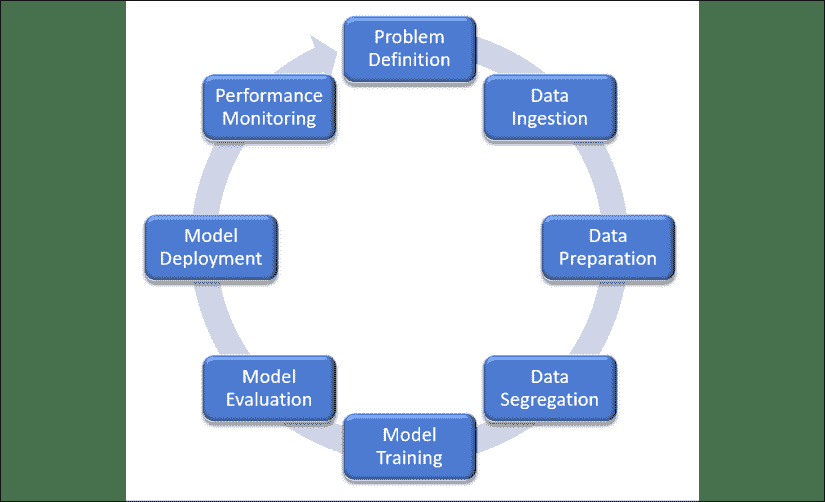

图 1：机器学习管道

下面进一步拆解流水线的组成部分。

## 问题定义起点

在搭建流水线时，这一步可能最关键。投入的时间往往在后期省下大量成本，可能决定技术突破还是失败、初创公司成功还是倒闭。提出正确的问题至关重要。看一个警示：

> “鲍勃花了多年时间计划、执行并优化征服山丘。结果那是错的山丘。”

假设要建一个贷款违约预测流水线。最初的问题可能是：

*对于某笔贷款，它会违约吗？*

该表述未区分贷款首月还是第20年的违约。显然，发放后即违约的贷款比后期违约的利润更低。更好的问法是：

*贷款会在何时违约？*

更有价值。再前进一步，借款人有时不会全额月供，有时会零星还款。于是问题可细化为：

*该笔贷款最终能收回多少钱？*

再改进。今日的一美元比未来的更值，财务分析使用现值公式。还款金额与还款时间同等重要，还有提前还款会降低利息收入的问题。于是再改：

*一笔给定贷款的利润是多少？*

够了吗？也许。法律禁止某些输入变量用于定价，如种族、性别。再次尝试：

*在不使用受限特征的情况下，该笔贷款的预期利润是多少？*

把进一步完善留给读者。可以看出，流水线的第一步需要大量思考。

## 数据提取

## 数据收集与问题迭代

当问题表述达到满意程度后，就需要收集原始数据来回答它。这并不意味着进入下一步后就不能改问题，应持续打磨并按需调整。

为流水线收集合适数据可能很艰难。取决于问题，获取相关数据集可能非常困难。

另一个关键考量是如何来源、抽取和存储数据：

* 使用哪家数据提供商或供应商？是否可信？
* 如何抽取？Hadoop、Impala、Spark、仅 Python 等？
* 存为文件还是数据库？
* 何种数据库？传统 RDBMS、NoSQL、图数据库。
* 是否需要存储？实时输入流水线可能无需或低效存储。
* 输入格式应为何？HWF、JSON、CSV。

很多时候我们无法控制源格式，只能原样接收再决定转换。此外数据来源可能不唯一，需要在建模前合并、拼接多个源。

尽管我们希望 AI 替代人类智能，判断数据集中应包含哪些变量仍需人类判断，甚至依赖某种直觉。

预测股价时，前一天股价是显而易见输入。利率、企业财报、新闻标题可能也相关但不够直观。

餐厅日销售额预测，前一天销售额重要，周几、是否节假日、是否下雨、客流量等也可能相关。

象棋或围棋系统可提供历史对局或成功策略。人类学棋常通过学习大师的开局和技巧以及观看经典赛局。计算机借助历史知识来指导未来对局。

到目前为止，选择相关输入变量并建立成功模型仍依赖数据科学家的领域知识，有时需深厚的专业积累。下面以例子展开。

延续贷款违约案例，考虑一些对预测最有帮助的特征。以下为初步清单，受篇幅限制不列全，后续会根据数据增删：

| **特征名称** | **特征描述** | **为何有用** |
| --- | --- | --- |
| 欠款账户 | 借款人当前拖欠的账户数 | 若借款人已难以付账单，新增贷款也可能难以偿还 |
| 贸易账户 | 过去24个月新开的交易账户数 | 数量过少可能有问题 |
| 借款人地址 | 申请时提供的地址 | 应丢弃，地址唯一无预测力 |
| 邮政编码 | 申请时提供的邮政编码 | 非唯一，可能有预测信息 |
| 年收入 | 注册时自报的年收入 | 收入越高，承受更大还款压力的能力越强 |
| 当前余额 | 所有账户的平均当前余额 | 单独看无意义，需相对比较 |
| 注销 | 12个月内的注销次数 | 显示过往违约行为 |
| 逾期金额 | 当前拖欠的逾期金额 | 显示过往违约行为 |
| 最早账户 | 自最早循环账户开立以来的月数 | 反映借款经验 |
| 就业年限 | 工作年限 | 反映稳定性 |
| 贷款额度 | 该时点的承诺总额 | 单独看无意义，需相对比较 |
| 查询次数 | 个人征信查询次数 | 显示借款人正寻求信用 |
| 利率 | 贷款利率 | 利率越高月供越大，偿还难度上升 |
| 最大余额 | 所有循环账户的最大当前余额 | 接近上限可能暗示财务紧张 |
| 公开记录距今月数 | 自上次公开记录以来的月数 | 暗示过往财务困境 |
| 逾期账户数 | 逾期120天及以上的账户数 | 当前财务困难信号 |
| 公开记录 | 负面公开记录数 | 暗示过往财务困境 |
| 项目期限 | 每月还款期数 | 期限越长违约风险窗口越大 |
| 当前总余额 | 所有账户当前总余额 | 单独看无意义，需相对比较 |

其中部分变量单独无意义，需组合使用，这正是特征工程的体现。两个新变量示例为：

| **特征名称** | **特征描述** | **为何有用** |
| --- | --- | --- |
| 信用使用率 | 各交易中余额占信用额度的比例，即当前余额与额度的比较 | 比例越高说明“已用尽”，获得新信用的难度越大 |
| 债务收入比 | 用月度总债务（不含抵押和申请贷款）除以自报月收入计算 | 比率越低说明偿债资源充足，违约风险越小 |

# 数据准备

下一步是对原始数据进行转换层处理，需完成的转换包括：

* 数据清洗
* 过滤
* 聚合
* 扩充
* 合并
* 存储

云厂商已成为主要数据科学平台。受欢迎的栈围绕以下构建：

* Azure ML 服务
* AWS SageMaker
* GCP Cloud ML 引擎
* SAS
* RapidMiner
* Knime

执行这些转换的流行工具之一是 Apache Spark，但仍需数据存储。常见的持久化方案是：

* Hadoop 分布式文件系统（HDFS）
* HBase
* Apache Cassandra
* 亚马逊 S3
* Azure Blob 存储

数据也可原地在数据库内处理以支持机器学习。SQL Server 和 SQL Azure 等数据库正加入机器学习功能。Spark 内置 Spark Streaming，可从 HDFS、Kafka 等读取数据。

还有 Apache Storm、Apache Heron 等替代方案。不论流水线包含何种组件，数据的初步探索通常在交互式 Jupyter 笔记本或 R Studio 中完成。

某些实时数据处理方案提供容错、可扩展、低延迟的抽取能力，常见选择包括：

* Apache Kafka
* Azure 事件中心

数据清洗与模型全流程实战拆解

接下来聚焦数据准备里最关键的一环——数据清洗。模型想要跑得准，前提是喂进去的数据必须干净。现实中数据很少完美，质量常因多种原因打折扣。

## 缺失值怎么处理

实际数据里经常出现空位，有时被 0 或 N/A 占位。那该怎么办？常见的做法大致有这六类思路：

* **干脆不动**：在某些算法里，缺失本身就是一种信号。像 XGBoost 就能优雅地处理空值，不必强行填补。
* **用中位数填补**：把空位换成同变量其余有效值的中位数。算起来快，适合小样本，但精度提升有限，也忽略了变量间的关联。
* **用众数或常量填补**：比如用出现最频繁的值或直接填 0。对非数值字段友好，和上面一样，不考虑相关性，还可能因空值比例高而引入偏差。

## 重复记录的识别与去重

完全相同的两条记录很容易筛出来，麻烦的是那些“看起来不一样、实质相同”的情况。拼写错误、字段缺失、地址写法变更、中间名漏掉，甚至使用别名，都可能让传统精确匹配失效。

过去这类去重几乎全靠人工，耗费时间且易出错。现在借助 AI 的相似度判定技术开始普及。核心思路是放弃精确匹配，改用模糊匹配，给记录间打相似分。需要注意的是，完全匹配才算真正的重复，模糊匹配容易产生假阳性——比如两个人姓名、地址、生日都一样，却是两个人。

## 特征尺度的统一

不同特征的数值量级往往差异很大，这种差距会扭曲基于欧氏距离的算法结果。随机森林等少数模型不受影响，但大多数模型都需要先做尺度调整，否则数值大的特征会过度主导。

常用的缩放手段包括：

* 最小-最大归一化
* 均值归一化
* Z 分数标准化
* 缩放到单位长度

## 值的不一致问题

同一含义的数据可能以多种写法出现。比如街道修饰符：

* `Fifth Avenue`
* `Fifth Ave`
* `Fifth Av`
* `Fifth Av.`

人一眼就能判断一致，机器却很难。解决思路有两类：规则驱动和示例驱动。规则在数据波动小且变化慢的场景很有效；一旦数据快速变化，规则就容易失效，像垃圾邮件过滤里 `Viagra` 改成 `Vi@gra` 就能绕开。此时基于机器学习的清洗器更稳健。实际中常采用混合策略：比如身高必须为正，可以写死规则；对于变化复杂的字段，则交给模型学习。

## 日期格式的标准化

同样一个时间点可能写成：

* 11/1/2016
* 11/01/2016
* 11/1/16
* 16 年 11 月 1 日
* 2016 年 11 月 1 日

统一格式是必须的。以上只是数据准备的一个片段，目的是让你了解清洗过程中常见的转换类型。

# 数据切分

用处理好的数据训练模型前，通常先做一次划分。最常见的是训练集和测试集，有时再多一个验证集：

* 训练数据
* 测试数据
* 验证数据

训练集用来学习模型参数，测试集模拟模型未见过的数据。训练相当于造出一个推理引擎，测试就是用它去预测那些从未参与训练的新样本。

# 模型训练

数据切分完毕后，就可以用同一批训练/测试数据跑多个候选模型，对比表现并挑选最合适的。这是一个迭代过程，往往要尝试多种算法，直到找到真正能回答业务问题的方案。

## 候选模型怎么选

训练完模型后，下一步是挑选。并不总是选在训练集上表现最好的那个，因为它可能过拟合。模型选择更像是经验判断，需要结合一定的方法论来评估泛化能力。

## 模型上线

模型选定后就可以对外提供预测，通常以 API 形式暴露，或嵌入到决策系统里。具体怎么发布，取决于业务需求，比如：

* 是否需要实时预测，延迟要求是毫秒、秒还是分钟级？
* 模型多久更新一次？
* 预期流量有多大？
* 数据集规模如何？
* 是否有合规与策略约束？

确认需求后就可以评估部署架构。常见的四种模式如下：

| || **RESTful API 架构** || **共享数据库架构** || **流架构** || **移动应用架构** |

| --- | --- | --- | --- | --- |

| **训练方法** || 批量 || 批量 || 流式 || 流式 |

| --- | --- | --- | --- | --- |

| **预测方法** || 即时 || 批量 || 流式 || 即时 |

| **结果交付** || 通过 RESTful API || 通过共享数据库 || 通过消息队列流式传输 || 通过移动设备上的进程内 API |

| **预测延迟** || 低 || 高 || 非常低 || 低 |

| **系统可维护性** || 中 || 简单 || 困难 || 中 |

四种方案各有取舍。实现上可以是模块化微服务，也可以整体交付，选择应服务于业务。无论哪种方式，建议遵循以下原则：

* **可复现性**：保存所有输入输出、配置、依赖、地理位置和时区等元数据，确保能解释历史预测。部署包应包含最新版本和训练数据，对强监管行业尤为重要。
* **自动化**：尽早把训练和发布自动化。
* **可扩展性**：若模型需要频繁更新，提前规划扩容能力。
* **模块化**：代码模块化，并在 DEV、QA、TEST 等环境间保持管道一致性。
* **测试**：预留充足时间做机器学习管道测试，尽量自动化，融入测试驱动开发和行为驱动开发。

## 表现监控

模型上线不是终点。生产环境需要持续监控，确保运行稳定。监控要从多个维度展开：

### 模型效果

这里的“表现”指预测准确度，而非运行速度。核心关注点是漂移，即输入数据与训练时分布不一致，导致预测价值下降。特征持续变化会让模型失效。例如股票市场，30 年前的交易量、高频交易概念、被动指数基金的流行度都与今天不同，用旧数据训练的模型很难适应当下。

### 运行指标

机器学习管道本质是软件系统，需要关注资源消耗：

* CPU 利用率
* 内存占用
* 磁盘使用
* 网络 I/O
* 延迟
* 吞吐量

指标异常时要追查根因。

### 总拥有成本

按每秒记录数评估效率的同时，企业更应关注收益与成本的平衡。建议追踪管道各环节的成本，以便判断是否降本、扩张或关停。

### 服务SLA

技术必须放在业务上下文里。常见服务级别协议包括：关键故障一天内修复、API 100毫秒内响应、每小时处理百万级预测、复杂模型三个月内完成交付等。建立、监控并满足 SLA 是业务健康运行的基础。持续监控并与 SLA 对齐，才能确保模型为企业创造价值而非成为瓶颈。

# 总结

构建机器学习管道大致包含：问题定义、数据抽取、数据准备、数据隔离、候选模型选择、模型部署、表现监控。随着实践深入，会不断优化流程和工具。下面将深入特征选择与特征工程，这两者对模型表现提升至关重要。

# 4 特征选择和特征工程

特征选择，也称变量选择，是从原始数据集中挑选出子集变量的过程。它是建模关键步骤，能显著影响结果。选择合适的输入可减少过拟合风险，降低训练时间，提升可解释性。选择哪些变量保留，更多依赖经验，是艺术多于科学。

特征选择的好处包括：缩短训练时间、简化模型、提升测试集表现。删除变量的主因是冗余或无关。冗余指两个特征高度相关，提供重复信息；无关指与目标关联很弱，噪音大于信号。

特征工程与选择方向相反：选择是删减，工程是创造新变量，常借助领域知识。

到本章结束，你将掌握：何时删除特征、共线性相关性与因果的区别、特征工程与选择的区别、手动与自动特征工程的适用场景。

## 特征选择

在上一章提到的管道里，选定输入特征是核心环节。多数数据集中，少数变量贡献了大部分预测力，其余多为噪音。

减少输入的好处：

* 降低多重共线性，提升参数可解释性
* 减少训练与存储开销
* 提升模型简洁性，便于可视化
* 避免维度灾难，减少过拟合

以房产估价 Zestimate 为例，潜在变量包括：

* 建筑面积
* 卧室数
* 卫生间数
* 贷款利率
* 建成年份
* 房产税
* 房屋颜色
* 邮编
* 可比成交价
* 税务评估价

直觉上面积、卧室、卫生间高度相关，保留面积即可。房屋颜色大概率无关。可删特征分两类：冗余和不相关。验证假设的办法是对比有无该特征的模型表现，若特征多则组合爆炸。

探索性分析常用三种手段：特征重要性、单变量选择、相关矩阵热图。

### 特征重要性

为每个特征打分，分数越高代表对输出越重要。常见于基于树的分类器，例如用 Extra Trees 分类器挑出前五重要特征：

```
import pandas as pd 
```

```
from sklearn.ensemble import ExtraTreesClassifier
import numpy as np
import matplotlib.pyplot as plt 
```

```
data = pd.read_csv("train.csv")
X = data.iloc[:,0:20]  #independent columns
y = data.iloc[:,-1]    # pick last column for the target feature 
```

```
model = ExtraTreesClassifier()
model.fit(X,y)
print(model.feature_importances_) #use inbuilt class
#feature_importances of tree based classifiers
#plot graph of feature importances for better visualization
feat_importances = pd.Series(model.feature_importances_, index=X.columns)
feat_importances.nlargest(5).plot(kind='barh')
plt.show() 
```

参考输出如下：

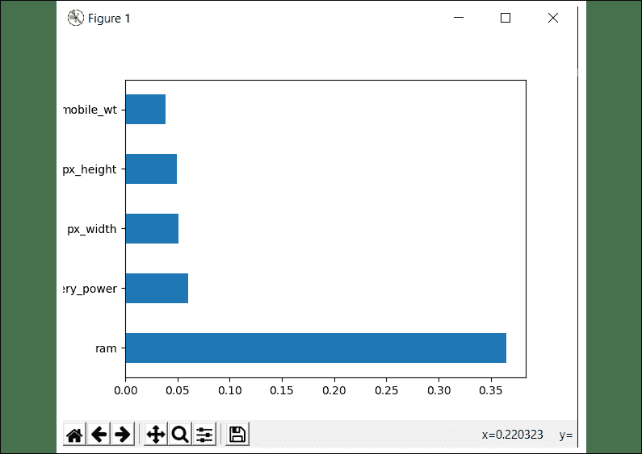

图 1：特征重要性图

### 单变量筛选
统计检验能帮助我们判断哪些输入特征和目标变量的相关度最强。`scikit-learn` 里提供了一个叫 `SelectKBest` 的工具，它内置了多组统计检验，可以从数据集中挑出 K 个最优特征。

下面举例说明对非负特征使用卡方检验，筛选出前 5 个表现最好的特征：

```
import pandas as pd
import numpy as np
from sklearn.feature_selection import SelectKBest
from sklearn.feature_selection import chi2
data = pd.read_csv("train.csv")
X = data.iloc[:,0:20]  #independent columns
y = data.iloc[:,-1]    #pick last column for the target feature 
#apply SelectKBest class to extract top 5 best features
bestfeatures = SelectKBest(score_func=chi2, k=5)
fit = bestfeatures.fit(X,y)
dfscores = pd.DataFrame(fit.scores_) 
```

```
dfcolumns = pd.DataFrame(X.columns)
scores = pd.concat([dfcolumns,dfscores],axis=1)
scores.columns = ['specs','score']  
print(scores.nlargest(5,'score'))  #print the 5 best features 
```

并且你会看到类似这样的结果：

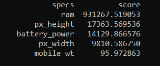

图 2：最佳特征映射

### 相关热力图
当两个特征的取值会互相影响时，就说它们存在相关性。比如房价随面积增大而上涨，这两个变量就是正相关。相关强弱有差别，若一个特征随另一个稳定变化，则二者高度相关。

相关可以是正向的，特征值上升推高目标值；也可以是负向的，特征值上升拉低目标值。相关系数落在 -1 到 1 之间。

* 相关系数为 1 代表完美正相关。
* 相关系数为 -1 代表完美负相关。
* 相关系数为 0 代表两者无关。

热力图很适合快速定位和目标变量关联最紧密的特征。我们借助 `seaborn` 来绘制相关特征的热力图：

```
import pandas as pd
import numpy as np
import seaborn as sns
import matplotlib.pyplot as plt 
```

```
data = pd.read_csv("train.csv")
X = data.iloc[:,0:20]  #independent columns
y = data.iloc[:,-1]    # pick last column for the target feature
#get the correlations of each feature in the dataset
correlation_matrix = data.corr()
top_corr_features = correlation_matrix.index
plt.figure(figsize=(20,20))
#plot heat map
g=sns.heatmap(data[top_corr_features].corr(),annot=True,cmap="RdYlGn") 
```

你应该得到与下面相近的画面：

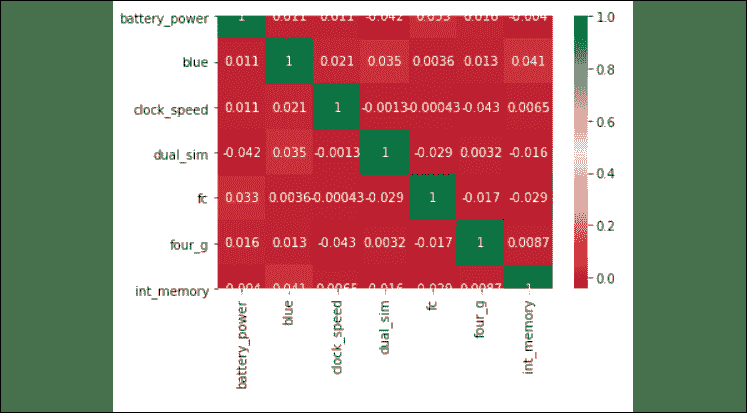

图 3：相关热图

自动选特征还有更规范也更少依赖直觉的方法，`scikit-learn` 里实现了不少。接下来介绍一种常见的分类方式。

#### 包装式特征选择
用包装法时，特征选择被转化为搜索问题，流程大致如下：

1. 用一个特征子集训练模型
2. 根据迭代结果增删特征

这类方法计算成本通常很高。常见做法有：

* **正向选择**：从空集开始，迭代中每次加入能提升模型表现的特征，保留有效特征，丢弃无效特征，直到模型不再改善。
* **反向消除**：从全量特征出发，每轮移除重要性最低的特征，检查表现是否变好，循环直至没有明显提升。
* **递归特征消除**：一种贪心优化策略，反复建模并记录表现最好或最差的特征，用剩余特征继续建模，直到耗尽。最后按剔除顺序对特征排序。

#### 过滤式特征选择
先定义一个评估指标，按指标对特征进行筛选。典型例子包括：

* **皮尔逊相关性**：衡量两个连续变量 `X` 与 `Y` 之间线性关系的指标，取值区间为 -1 到 +1。
* **线性判别分析 `LDA`**：寻找能描述或区分分类变量不同类别的特征线性组合。
* **方差分析 `ANOVA`**：与 `LDA` 类似，但用于一个或多个分类自变量与一个连续因变量的情形，用于检验多组均值是否相等。
* **卡方检验**：针对类别变量组，利用频率分布判断它们之间是否相关或关联。

需要留意的是，过滤式方法本身并不会处理多重共线性，使用前通常要额外做去相关处理。

#### 嵌入式方法
嵌入式方法使用自带特征选择能力的算法，同时兼具过滤和包装的优点。常用实现有：

* **LASSO 回归**：采用 L1 正则化，对系数绝对值施加惩罚
* **Ridge 回归**：采用 L2 正则化，对系数平方施加惩罚

另外经常见到：

* 模因算法
* 随机多项式对数
* 正则化树

至此本章第一部分结束。你已有足够基础去开展自己的特征选择任务。接下来进入特征工程，特征选择关注如何减少变量以提升精度，特征工程则反过来思考如何创造新变量让模型更强。

## 特征工程
《福布斯》的一项调查显示，数据科学家约 80% 的工作时间花在数据准备上：

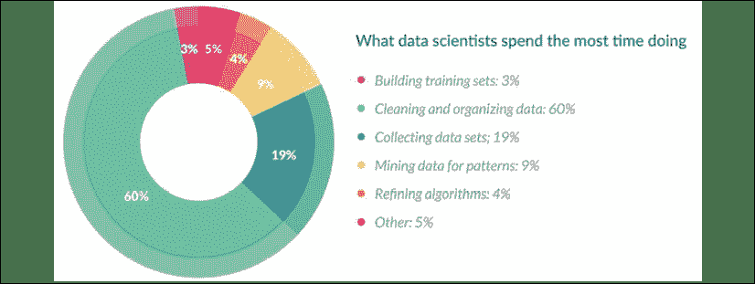

图 4：数据科学家花费的时间细分（来源：《福布斯》）

这凸显了数据准备与特征工程的重要性。合理的特征选择通过删减特征让模型更快更高效，特征工程则通过增添新特征达到相似效果。乍看矛盾，新增的特征并非被选择过程剔除的那些，而是初始数据中未包含的信息。即使算法再强大，输入特征不相关也无法产出有用结果。看几个简单例子建立直觉。

上一章提到贷款违约问题。直觉上，工资越高违约越少；信用卡余额越大还债压力越大。

假设借款人 A 信用卡余额 1 万美元，借款人 B 余额 2 万美元，仅此信息 A 更安全。现在补充年收入：A 为 2 万美元，B 为 10 万美元，判断就变了。我们如何量化两个特征的联合关系？银行常用**债务收入比 DTI**：


于是 A 的 DTI 为 0.50，B 为 0.20。换句话说，A 的债务是收入的一半，B 的债务仅占两成。B 的偿还余地更大。给借款人画像可加入更多特征，借此说明特征工程的思路。

更正式地说，特征工程就是由数据科学家或程序自动生成能提升机器学习预测能力的特征。它是机器学习的核心环节，往往困难且成本高。许多人想直接选模型，但判断哪些新特征真正有用是需要长期积累的关键能力。

目前特征工程的自动化研究很活跃，未来或许能超越资深从业者，但短期内优秀的数据科学家仍不可替代。

典型流程如下：

1. 集体讨论哪些特征值得关注
2. 判定哪些特征可能提升模型表现
3. 构造新特征
4. 验证新特征是否带来提升，若无则丢弃
5. 返回“步骤 1”，直到模型的表现达到预期

域知识和对数据集的熟悉度在特征工程中很有帮助，但也有不依赖领域的通用技术可供数据准备和特征工程使用。我们将探讨：

* 归因
* 离群值管理
* 单热编码
* 对数转换
* 缩放比例
* 日期操作

## 缺失值补全
实际数据常脏乱不堪，缺失值是常见问题。缺失可能源于数据不一致、录入错误或隐私保护等原因。不论缘由，缺失都会损害模型表现，甚至让部分算法直接失效。有几种常用处理手段。

### 删行策略
直接删除含缺失值的行会减少训练样本，进而拖累模型表现。

下面示例删除缺失比例超过 60% 的列：

```
threshold = 0.6
#Drop columns with a missing value rate higher than threshold
data = data[data.columns[data.isnull().mean() < threshold]] 
```

```
#Drop rows with missing value rate higher than threshold
data = data.loc[data.isnull().mean(axis=1) < threshold]
threshold = 0.6
#Drop columns with a missing value rate higher than threshold
data = data[data.columns[data.isnull().mean() < threshold]] 
```

```
#Drop rows with missing value rate higher than threshold
data = data.loc[data.isnull().mean(axis=1) < threshold]
print(data) 
```

输出应类似：

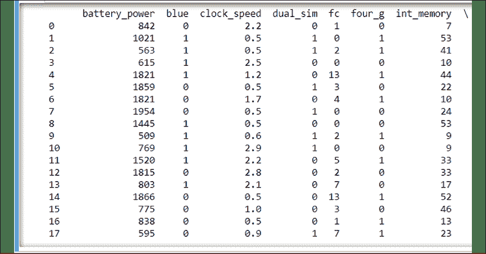

图 5：丢弃缺失值输出

### 数值型填补
填补是把缺失值换成一个合理的替代值。

对数值变量常见做法有：

* 用 0 填充
* 用全量数据的平均值填充
* 用全量数据的中位数填充

中位数通常更稳健，受异常值影响更小。下面看几个替换例子：

```
#Filling all missing values with 0
data = data.fillna(0) 
```

```
#Filling missing values with medians of the columns
data = data.fillna(data.median())
print(data) 
```

你应该能滚动查看修改后的数值：

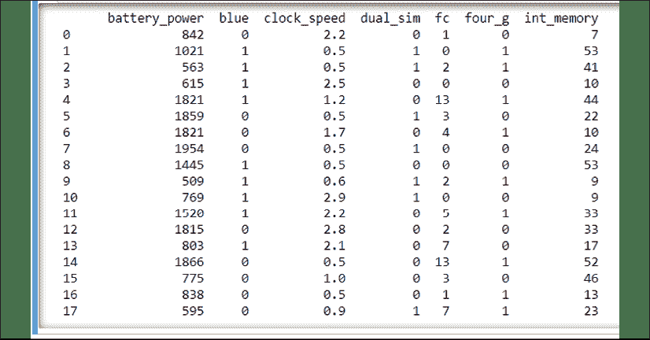

图 5：丢弃缺失值输出

### 类别型填补
类别变量取值是离散标签，如颜色、品种等，不能用均值或中位数。常用做法是用出现频率最高的值填充缺失。当类别很多或分布均匀时，用 “其他” 作为占位也有意义。下面示例用 `idxmax` 找出最常见值并填充到所有缺失位置：

```
#Max fill function for categorical columns
import pandas as pd 
```

```
data = pd.read_csv("dataset.csv") 
```

```
data['color'].fillna(data['color'].value_counts().idxmax(), inplace=True)
print(data) 
```

输出应大致如下：

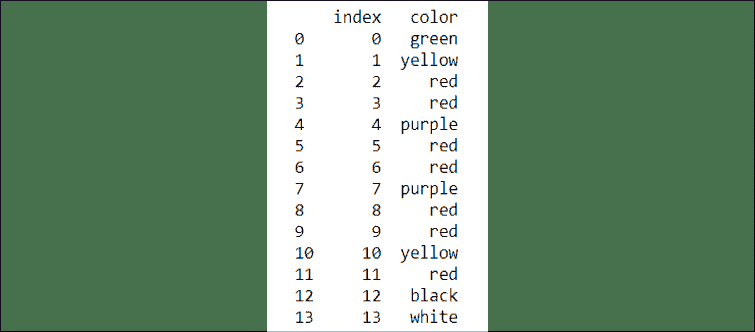

图 7：填充缺失值输出

# 离群值管理
房价是分析异常值的好例子。无论地域，大多数房屋落在某个区间，具备相似特征，比如 1-4 间卧室、1 个厨房、500-3000 平方英尺、1-3 间浴室。2019 年美国平均房价为 226,800 美元，这类房屋大概率符合上述特征。但也存在异常值，比如 10 或 20 间卧室的豪宅，售价可能达百万元甚至千万。异常值会拉动整体均值，对均值影响更大。数量虽少，最好剔除以免干扰常见样本的预测。

下面展示房价的散点图，分别绘制包含全部数据和剔除高价异常值后的拟合线：

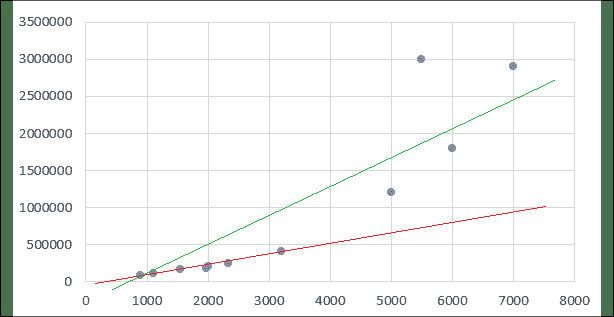

图 8：最佳拟合图

可见剔除异常值后，拟合线对低价房屋的预测更准确。直接删除异常值是简单有效的做法。

如何判断是否异常？常用方法是按标准差倍数筛选，剔除落在均值若干个标准差之外的点。倍数常取 2 到 4，具体数值更多靠经验判断：

```
#Dropping the outlier rows with standard deviation
import pandas as pd 
```

```
data = pd.read_csv("train.csv") 
```

```
#Dropping the outlier rows with standard deviation
factor = 2
upper_lim = data['battery_power'].mean () + data['battery_power'].std () * factor
lower_lim = data['battery_power'].mean () - data['battery_power'].std () * factor 
```

```
data = data[(data['battery_power'] < upper_lim) & (data['battery_power'] > lower_lim)]
print(data) 
```

输出应为，类似于：

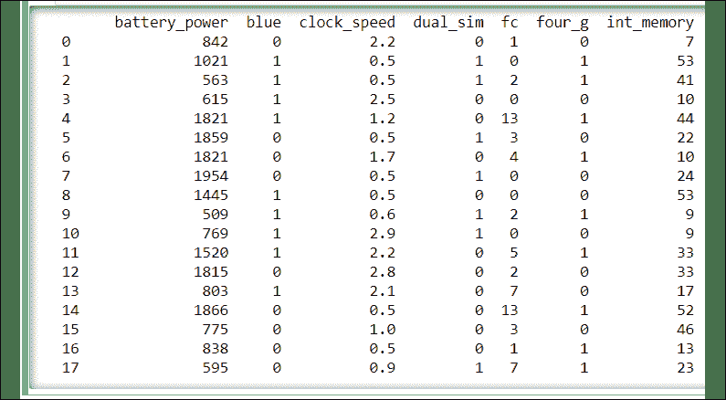

图 9：删除异常行输出

剔除异常值的另一条思路是利用分位数。我们默认只有特征里的一小部分数值属于离群，到底剔除多少比例并无统一标准，需要结合业务场景来判断。

下面通过一段 Python 代码演示如何去掉上下各 1% 的极端部分：

```
#Dropping the outlier rows with Percentiles
upper_lim = data['battery_power'].quantile(.99)
lower_lim = data['battery_power'].quantile(.01) 
```

```
data = data[(data['battery_power'] < upper_lim) & (data['battery_power'] > lower_lim)]
print(data) 
```

预期结果如下：

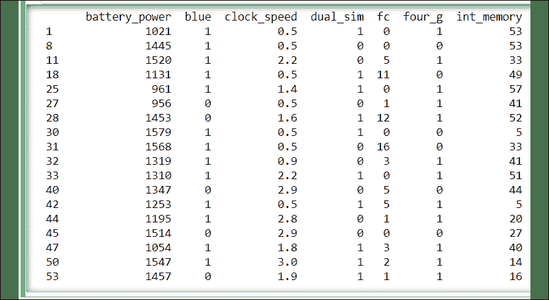

图 10：输出异常值行

处理异常值还可以用截断代替删行。截断能保留样本数量，在某些情况下有助于提升模型效果。缺点是被限制的数值不再是真实观测，而是人工设定的估计值，这同样会带来偏差。删与截哪个更合适，得根据具体数据的分析结果来决定。以下是一个用上限值替代删除行的示例：

```
#Capping the outlier rows with percentiles
upper_lim = data['battery_power'].quantile(.99)
lower_lim = data['battery_power'].quantile(.01) 
```

```
data.loc[(data['battery_power'] > upper_lim), 'battery_power'] = upper_lim
data.loc[(data['battery_power'] < lower_lim), 'battery_power'] = lower_lim
print(data) 
```

参考输出如下，滚动查看时会发现部分数值发生了变化：

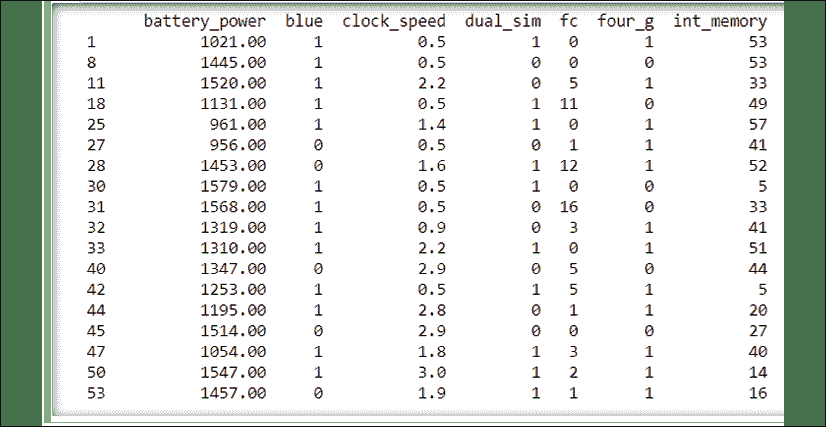

图 11：帽异常行输出

# 单热编码

单热编码是特征工程里最常用的转换手段之一。不少模型无法直接处理类别特征，因而需要把类别变量转成数值变量才能使用。假设有一个名为“状态”的字段，只能取红色、绿色或黄色三类。因为是分类，没有天然的高低大小之分。我们可以直接映射为数字，例如：

黄色= 1

红色= 2

绿色= 3

这种映射显得随意。如果我们知道红色不好、绿色好、黄色居中，也可以改成：

红色= -1

黄色= 0

绿色= 1

这样通常会得到更好的表现。下面看同一个案例如何做单热编码。为实现一个变量的独热表示，我们为每个取值新建一列。这种情况下，部分数据可能长这样：

| **红色** || **黄色** || **绿色** || **状态** |

| --- | --- | --- | --- |

| 1 || 0 || 0 || 红色 |

| --- | --- | --- | --- |

| 0 || 1 || 0 || 黄色 |

| 0 || 0 || 1 || 绿色 |

| 0 || 0 || 1 || 绿色 |

单热编码完成后，原来的状态列已被三个指示列完全表达，所以可以从数据集中移除：

| **红色** || **黄色** || **绿色** |

| --- | --- | --- |

| 1 || 0 || 0 |

| --- | --- | --- |

| 0 || 1 || 0 |

| 0 || 0 || 1 |

| 0 || 0 || 1 |

另外，三个颜色列之间是互斥的，从另外两列也能推导出第三列。若红色和黄色都为 0，则绿色必然为 1，以此类推。因此单热编码时可以舍弃其中一列而不损失信息。像这样：

| **红色** || **黄色** |

| --- | --- |

| 1 || 0 |

| --- | --- |

| 0 || 1 |

| 0 || 0 |

| 0 || 0 |

下面展示如何用 Pandas 的 `get_dummies` 函数对特征做单热编码：

```
import pandas as pd 
```

```
data = pd.read_csv("dataset.csv") 
```

```
encoded_columns = pd.get_dummies(data['color'])
data = data.join(encoded_columns).drop('color', axis=1)
print(data) 
```

输出应如下所示：

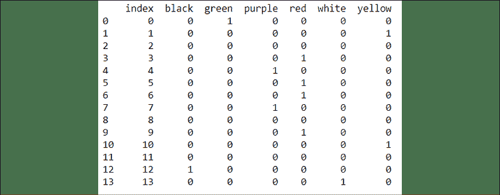

图 12：单热编码输出

# 对数转换

对数变换是特征工程中常见的处理方式。它能拉伸长尾分布，让高度偏斜的值变得更分散，变换后分布更接近正态。

再举个例子帮助理解。当你 10 岁时，看 15 岁的孩子会觉得“大很多”。而 50 岁的人看 55 岁的人，却会觉得差别不大。两种情况年龄差都是 5 岁，但 15 岁比 10 岁大了 50%，55 岁比 50 岁只大了 10%。

对所有点做对数变换后，这种幅度差异会被统一。

归一化幅度差异后，使用对数变换的模型对异常值的敏感度会下降，整体更稳健。

使用时要注意一个关键限制：只有全部数据为正数时才能直接用对数。常见做法是在转换前给数据加 1，保证结果为正：

`log(x + 1)`

下面是 Python 实现对数变换的方法：

```
#Log Transform Example
data = pd.DataFrame({'value':[3,67, -17, 44, 37, 3, 31, -38]})
data['log+1'] = (data['value']+1).transform(np.log) 
```

```
#Negative Values Handling
#Note that the values are different
data['log'] = (data['value']-data['value'].min()+1) .transform(np.log)
print(data) 
```

应产生的输出为：

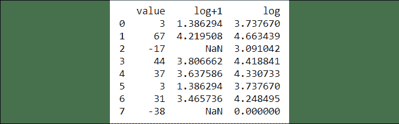

图 13：对数变换输出

## 缩放

很多数据集中不同数值特征的量级差异很大。例如房屋面积通常在 1000 到 3000 平方英尺，而卧室数量多为 2、3、4。如果不处理，量级大的特征会占据主导。如何解决？

缩放能让连续特征在数值范围上变得可比。并非所有算法都需要缩放，如随机森林，但 K 近邻、K 均值等未先缩放就会得到无意义的结果。下面介绍两种最常用的缩放方法。

### 归一化（或 minmax 归一化）

把所有值缩放到 0 到 1 的固定区间。公式为：


其中：

* `X`- 特征的任一取值

* `X_min` – 数据集中该特征的最小值

* `X_max` – 数据集中该特征的最大值

* `X_norm` – 变换后的归一化值

归一化不改变分布形态，但标准差减小会放大异常值影响，所以建议先处理异常值再归一化。下面看一个 Python 示例：

```
data = pd.DataFrame({'value':[7,25, -47, 73, 8, 22, 53, -25]}) 
```

```
data['normalized'] = (data['value'] - data['value'].min()) / (data['value'].max() - data['value'].min())
print(data) 
```

期望看到以下输出：


图 14：标准化输出

### 标准化（或 z 分数标准化）

该方法在计算中引入标准差，能削弱异常值对缩放的影响。计算方式为：

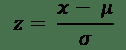

其中：

* `μ =` 平均值

* `σ =` 标准差

* `x =` 数据点

用 Python 计算如下：

```
data = pd.DataFrame({'value':[7,25, -47, 73, 8, 22, 53, -25]}) 
```

```
data['standardized'] = (data['value'] - data['value'].mean()) / data['value'].std()
print(data) 
```

控制台应显示以下内容：


图 15：标准化输出

# 日期操作

在某些数据科学问题里，时间特征至关重要。时间序列分析中日期显然不可或缺。若不带日期预测 S&P 500 会到 3000，就毫无意义。

未经处理的日期对大多数模型帮助有限，且取值过于独特，难以提供预测力。为什么 10/21/2019 和 10/19/2019 不同？借助领域知识可以大幅提升特征的信息量。例如把日期转为分类变量。如果目标是判断何时交租，可以把日期二值化为：

* 当月前 5 天`= 1`

* 当月前 5 天之后`= 0`

预测餐厅客流和销售额时，某月的 21 日可能没有规律，但星期日与星期二、10 月与 12 月圣诞季则可能有明显差别。对国际连锁店而言，门店位置与月份的交互也很重要，如美国圣诞节与印度排灯节。

日期还能这样操作：

* 切分为年、月、日等组成部分

* 计算与当前日期的时间间隔，如年、月、天数

* 提取特定属性：

  * 星期几

  * 是否周末

  * 是否假期

还有很多可能性，留给读者发挥或进一步研究。

## 总结

本章梳理了机器学习流程中的两个关键环节：

* 特征选择

* 特征工程

这两个过程兼具艺术性和科学性。相比挑选模型，决定删去哪些特征、生成哪些新特征往往更难。本章并非全面覆盖，只是抛砖引玉，希望激发你继续探索的兴趣。

下一章将开始深入机器学习，从监督学习模型入手构建。

# 5 使用监督学习的分类和回归

> 原文：[`gitee.com/apachecn/apachecn-dl-zh/blob/master/docs/ai-py/05.md`](https://gitee.com/apachecn/apachecn-dl-zh/blob/master/docs/ai-py/05.md)

本章将用监督学习技术学习数据的分类与回归。读完后你会对以下内容有更清晰的认识：

* 监督学习与无监督学习的区别

* 分类方法

* 数据预处理方法

* 标签编码

* 逻辑回归分类器

* 朴素贝叶斯分类器

* 混淆矩阵

* 支持向量机与 SVM 分类器

* 线性与多项式回归

* 单变量与多变量线性回归

* 用支持向量回归器估计房价

## 无监督学习的优势

在当今人工智能的新闻报道中，机器学习是热点之一。它大致分为监督学习和无监督学习，还有其他细分。

先建立直觉。假设有一组人物肖像，包含不同性别、国籍、年龄、体型的人。把数据交给无监督算法，在没有任何先验标签的情况下，算法会按相似性自行分组。它可能把男性归一类、女性归一类，但也可能按背景色深浅聚类得出无用结果。

若同一组照片每张都标注了性别，则可用监督算法训练。输入是照片像素，目标是性别。更正式地说：

**监督学习**指基于带标签的训练数据构建模型的过程。每个样本由输入变量和期望的目标变量组成。例如泰坦尼克号数据集包含乘客姓名、性别、舱位等级、年龄、登船地等输入特征，目标是是否幸存。

**无监督学习**指不依赖标签构建模型的过程。仅从给定的数据中挖掘模式，通常把数据点划分为若干簇，但划分标准并不明确，算法会尽力找到合理分组。

了解了主要分类后，我们开始研究如何对数据进行分类。

## 什么是分类？

本节讨论监督分类技术。分类是将数据划分为固定类别以便使用的过程。

在机器学习中，分类用于判断新数据点属于哪个类别。模型基于带标签的训练样本学习。例如判断图像是否包含人脸。训练集包含人脸和非人脸两类样本，模型据此学习规律，再用于推理。

良好的分类系统能让查找和检索更高效。分类广泛应用于人脸识别、垃圾邮件检测、推荐系统等。好的算法能自动生成合理标准，把数据划分为指定数量的类别。

要得到不错的结果，需要足够样本以便泛化。样本不足会导致过拟合，即模型对训练数据的模式过度微调，对未知数据的表现变差。这是机器学习中的常见问题，建模时应予以重视。

## 预处理数据

原始数据是算法的燃料，但不能直接使用，就像原油不能直接加到汽车里。机器学习算法要求数据在训练前以特定格式呈现。需要对数据进行预处理并转换格式。来看几种实现方式。

为演示我们将导入一些 Python 包：

```
import numpy as np
from sklearn import preprocessing
```

再定义一些示例数据：

```
input_data = np.array([[5.1, -2.9, 3.3],
                       [-1.2, 7.8, -6.1],
                       [3.9, 0.4, 2.1],
                       [7.3, -9.9, -4.5]])
```

我们要分析的预处理技术有：

* 二值化

* 均值去除

* 缩放比例

* 规范化

### 二值化

二值化把数值转为布尔值。下面用内置方法以 `2.1` 为阈值进行二值化。

把以下行加入同一 Python 文件：

```
# Binarize data
data_binarized = preprocessing.Binarizer(threshold=2.1).transform(input_data)
print("\nBinarized data:\n", data_binarized)
```

运行后会看到以下输出：

```
Binarized data:
[[  1.  0.  1.]
[  0.  1.  0.]
[  1.  0.  0.]
[  1.  0.  0.]]
```

可以看到，大于 `2.1` 的值变为 `1`，其余变为 `0`。

### 去除均值

均值去除是机器学习中常用的预处理手段。通常把特征向量中心化到零很有帮助，可以消除偏差。

把以下行加入与上一节相同的 Python 文件中：

```
# Print mean and standard deviation
print("\nBEFORE:")
print("Mean =", input_data.mean(axis=0))
print("Std deviation =", input_data.std(axis=0))
```

上一步的输出已经展示了原始数据的均值与标准差。接下来我们对数据做去中心化处理：

```
# Remove mean
data_scaled = preprocessing.scale(input_data)
print("\nAFTER:")
print("Mean =", data_scaled.mean(axis=0))
print("Std deviation =", data_scaled.std(axis=0))
```

执行这段代码后，你会得到这样的结果：

```
BEFORE:
Mean = [ 3.775 -1.15  -1.3  ]
Std deviation = [ 3.12039661  6.36651396  4.0620192 ] AFTER:
Mean = [  1.11022302e-16  0.00000000e+00  2.77555756e-17]
Std deviation = [ 1.  1.  1.]
```

从结果可以看到，均值几乎为 0，标准差正好是 1。

### 让特征站在同一起跑线

为了更直观地理解缩放，我们用一个例子来说明。假设你要预测房价，手头的数据包含多个房屋特征。不同特征的量纲往往差很多，比如建筑面积动辄上千平方英尺，而卧室数量通常不到10个。数据里还常藏着异常值，比如几栋豪宅会把整体分布拉偏。

理想的做法是把各特征调到相近的尺度，让模型不会偏爱数值大的特征，也不会让异常值主导结果。一个常用思路是把所有特征压缩到 0 到 1 之间，MinMaxScaler 正是做这件事的典型工具。它的计算公式如下：

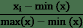

公式里 max(x) 表示该列最大值，min(x) 表示最小值，x[i] 就是单个样本的取值。

特征向量的每个维度取值范围各不相同，若不做处理，量纲大的特征会天然占据优势。为保证训练公平，必须对特征进行缩放，避免测量单位本身带来的偏见。

接下来用 Python 实现，往文件里加上如下代码：

```
# Min max scaling
data_scaler_minmax = preprocessing.MinMaxScaler(feature_range=(0, 1))
data_scaled_minmax = data_scaler_minmax.fit_transform(input_data)
print("\nMin max scaled data:\n", data_scaled_minmax)
```

运行后输出如下：

```
Min max scaled data:
[[ 0.74117647  0.39548023   1.         ]
[ 0.           1.          0.         ]
[ 0.6          0.5819209   0.87234043]
[ 1.           0.          0.17021277]]
```

这里是对每一行做缩放，最大值被拉到 1，其他数值则按比例缩小。

### 标准化不等于缩放

缩放和标准化这两个词经常被混用，因为它们都属于数据预处理。但本质不同：缩放是改变数值的范围，标准化则是调整分布的形态。模型通常更喜欢近似正态的特征分布。

实际数据往往并不理想，可能出现偏态。归一化操作可以重新分配数值。下方是处理前后对比图：

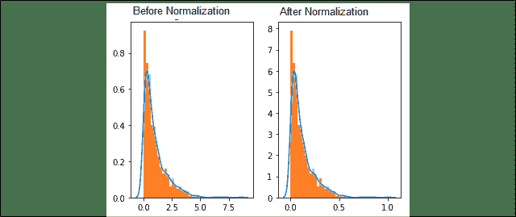

图 1：标准化前后

归一化的目的就是让特征向量能在统一尺度下比较。常见做法是让每行元素的绝对值之和为1。L2 归一化即让向量的平方和等于1。

一般认为 L1 归一化更抗干扰，因为它对异常值不那么敏感。数据里总会有离群点，我们需要一种能淡化它们影响的方法。若异常值本身携带重要信息，L2 归一化可能更合适。

在同一个 Python 文件里继续添加：

```
# Normalize data
data_normalized_l1 = preprocessing.normalize(input_data, norm='l1')
data_normalized_l2 = preprocessing.normalize(input_data, norm='l2')
print("\nL1 normalized data:\n", data_normalized_l1)
print("\nL2 normalized data:\n", data_normalized_l2)
```

执行后可以看到输出：

```
L1 normalized data:
[[ 0.45132743  -0.25663717    0.2920354 ]
[-0.0794702    0.51655629   -0.40397351]
[ 0.609375     0.0625  0.328125	]
[ 0.33640553	-0.4562212	-0.20737327]]
L2 normalized	data:
[[ 0.75765788	-0.43082507	0.49024922]
[-0.12030718	0.78199664 -0.61156148]
[ 0.87690281	0.08993875	0.47217844]
[ 0.55734935	-0.75585734 -0.34357152]]
```

完整代码收录在 data_preprocessor.py 中。

## 把分类标签变成机器能读的数字

做分类任务时，标签可能是文字、数字或其它形式。大多数算法只接受数值输入，原本就是数字的可以直接用，但文字标签必须先转换。

标签常用文字，因为人好理解。把文字转成数字就需要标签编码器，它负责建立单词与数字的映射，让模型可以学习。下面通过示例演示。

新建一个 Python 文件，先导入所需包：

```
import numpy as np
from sklearn import preprocessing
```

准备一组示例标签：

```
# Sample input labels
input_labels = ['red', 'black', 'red', 'green', 'black', 'yellow', 'white']
```

实例化编码器并用数据拟合：

```
# Create label encoder and fit the labels
encoder = preprocessing.LabelEncoder()
encoder.fit(input_labels)
```

输出映射关系：

```
# Print the mapping
print("\nLabel mapping:")
for i, item in enumerate(encoder.classes_):
    print(item, '-->', i)
```

下面对一组乱序的标签做编码测试：

```
# Encode a set of labels using the encoder
test_labels = ['green', 'red', 'black']
encoded_values = encoder.transform(test_labels)
print("\nLabels =", test_labels)
print("Encoded values =", list(encoded_values))
```

再把一组数字解码回文字看是否正确：

```
# Decode a set of values using the encoder
encoded_values = [3, 0, 4, 1]
decoded_list = encoder.inverse_transform(encoded_values)
print("\nEncoded values =", encoded_values)
print("Decoded labels =", list(decoded_list))
```

运行结果如下：

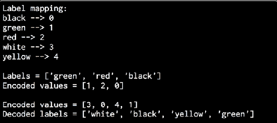

图 2：编码和解码输出

对照映射即可验证编解码是否准确，完整实现见 label_encoder.py。

## 逻辑回归的核心思想

逻辑回归用来刻画输入与输出之间的关联。普通回归擅长预测连续值，而逻辑回归则针对离散结果，比如真/假、红/绿/黄等类别。

我们假设自变量彼此独立，因变量只能取有限几个类别值，对应分类任务的不同类。

核心思路是用逻辑函数估计概率，常见选择是 S 型 sigmoid 曲线。选用它的原因主要有：

* 它的范围是 0 到 1
* 它的导数更容易计算
* 将非线性引入模型的简单方法

## 搭建逻辑回归分类器：实战可视化

逻辑回归与广义线性模型一脉相承，都是寻找最佳拟合并最小化误差。不同的是用逻辑函数替代线性函数。虽然逻辑回归本质不是分类器，但在实践中常被用于分类，因其简单高效。下面演示构建过程，开始前请确认相关包已安装，未安装可参考链接。

新建文件导入依赖：

```
import numpy as np
from sklearn import linear_model
import matplotlib.pyplot as plt
from utilities import visualize_classifier 
```

定义二维样本点及其标签：

```
# Define sample input data
X = np.array([[3.1, 7.2], [4, 6.7], [2.9, 8], [5.1, 4.5], [6, 5], [5.6, 5], [3.3, 0.4], [3.9, 0.9], [2.8, 1], [0.5, 3.4], [1, 4], [0.6, 4.9]])
y = np.array([0, 0, 0, 1, 1, 1, 2, 2, 2, 3, 3, 3]) 
```

用这些标注数据训练，初始化分类器：

```
# Create the logistic regression classifier
classifier = linear_model.LogisticRegression(solver='liblinear', C=1) 
```

调用训练方法拟合模型：

```
# Train the classifier
classifier.fit(X, y) 
```

通过决策边界来观察表现：

```
# Visualize the performance of the classifier 
visualize_classifier(classifier, X, y) 
```

为复用方便，建议把绘图函数单独放在 utilities.py 中导入使用。

新建绘图脚本并导入包：

```
import numpy as np
import matplotlib.pyplot as plt 
```

函数接收分类器、数据和标签作为参数：

```
def visualize_classifier(classifier, X, y):
    # Define the minimum and maximum values for X and Y 
    # that will be used in the mesh grid
    min_x, max_x = X[:, 0].min() - 1.0, X[:, 0].max() + 1.0
    min_y, max_y = X[:, 1].min() - 1.0, X[:, 1].max() + 1.0 
```

同时指定网格在 X、Y 方向的范围和步长，用来采样预测并绘制边界：

```
 # Define the step size to use in plotting the mesh grid     mesh_step_size = 0.01

    # Define the mesh grid of X and Y values
    x_vals, y_vals = np.meshgrid(np.arange(min_x, max_x, mesh_step_size), np.arange(min_y, max_y, mesh_step_size)) 
```

对网格每个点进行预测：

```
 # Run the classifier on the mesh grid
    output = classifier.predict(np.c_[x_vals.ravel(), y_vals.ravel()])

    # Reshape the output array
    output = output.reshape(x_vals.shape) 
```

创建画布、选择配色并绘制点：

```
 # Create a plot
    plt.figure() 
```

```
 # Choose a color scheme for the plot
    plt.pcolormesh(x_vals, y_vals, output, cmap=plt.cm.gray)

    # Overlay the training points on the plot
    plt.scatter(X[:, 0], X[:, 1], c=y, s=75, edgecolors='black', linewidth=1, cmap=plt.cm.Paired) 
```

设定坐标轴范围、添加刻度和展示图像：

```
 # Specify the boundaries of the plot
    plt.xlim(x_vals.min(), x_vals.max())
    plt.ylim(y_vals.min(), y_vals.max()) 
```

```
 # Specify the ticks on the X and Y axes
    plt.xticks((np.arange(int(X[:, 0].min() - 1), int(X[:, 0].max() + 1), 1.0)))
    plt.yticks((np.arange(int(X[:, 1].min() - 1), int(X[:, 1].max() + 1), 1.0)))
    plt.show() 
```

成功运行后效果如下：

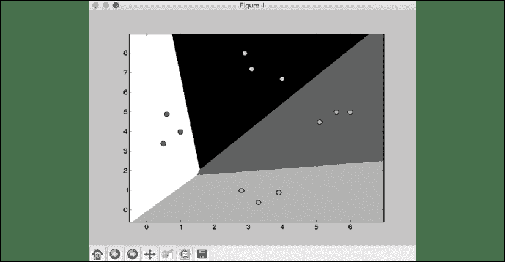

图 3：设置图的边界后显示的图

把参数 C 调到 100，你会发现决策边界更贴合：

```
classifier = linear_model.LogisticRegression(solver='liblinear', C=100) 
```

C 控制对误分类的惩罚强度，数值越大模型越努力拟合训练集。但调得过高容易过拟合，降低泛化能力，需谨慎使用。

设置 C=100 后的运行结果：

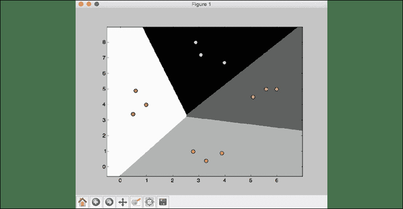

图 4：在将 `C` 设置为 100 的情况下运行代码时的结果

对比可见边界更清晰，完整代码见 logistic_regression.py。

# 朴素贝叶斯：概率分类的朴素假设

朴素贝叶斯利用贝叶斯定理构建分类模型，定理核心是在已知条件下估计事件发生的概率。为每个样本分配类别标签时，样本以特征向量表示。关键假设是各特征之间相互独立，这就是“朴素”二字的来源。

在处理分类问题时，朴素贝叶斯提供了一种简化的视角：它只关注某个特征单独对目标类别的影响，而不去纠缠特征彼此之间的关联。比如看到一只生物长有四条腿、一根尾巴并且能跑到约70迈的速度，我们就会倾向于把它判定为猎豹。朴素贝叶斯的核心假设就是每个特征对最终判断的贡献是相互独立的，换句话说，它计算的是在这些特征共同出现的情况下，该样本属于猎豹的概率，而不会去探究花纹、腿数、尾巴有无、奔跑速度这些属性之间是否存在相关性。下面就用代码演示一个朴素贝叶斯分类器的搭建过程。

新建一个 Python 脚本并先引入所需的基础库：

```
import numpy as np
import matplotlib.pyplot as plt
from sklearn.naive_bayes import GaussianNB 
from sklearn import model_selection import train_test_split
from sklearn.model_selection import .model_selection import train_test_split
from sklearn.model_selection import cross_val_score 
```

```
from utilities import visualize_classifier 
```

本次练习选用 `data_multivar_nb.txt` 作为训练来源。该文件每行都是用逗号分隔的数值：

```
# Input file containing data 
input_file = 'data_multivar_nb.txt' 
```

先把数据读入内存：

```
# Load data from input file
data = np.loadtxt(input_file, delimiter=',') 
X, y = data[:, :-1], data[:, -1] 
```

实例化一个朴素贝叶斯模型，这里采用高斯朴素贝叶斯。它的前提是每个类别下特征值都近似服从高斯分布：

```
# Create Naïve Bayes classifier
classifier = GaussianNB() 
```

用准备好的训练集对模型进行拟合：

```
# Train the classifier 
classifier.fit(X, y) 
```

随后在训练集上让模型做一次预测：

```
# Predict the values for training data 
y_pred = classifier.predict(X) 
```

为了量化效果，把预测结果和真实标签对比并绘制表现图：

```
# Compute accuracy
accuracy = 100.0 * (y == y_pred).sum() / X.shape[0]
print("Accuracy of Naïve Bayes classifier =", round(accuracy, 2), "%") 
```

```
# Visualize the performance of the classifier 
visualize_classifier(classifier, X, y) 
```

仅在训练集上评估准确率并不稳妥，容易产生乐观估计。更可靠的做法是做交叉验证，避免训练样本和测试样本重叠。

把整体数据按 80% 训练、20% 测试的比例切分，`test_size` 控制划分比例。然后在划分后的数据上重新训练朴素贝叶斯：

```
# Split data into training and test data
X_train, X_test, y_train, y_test = train_test_split(X, y, test_size=0.2, random_state=3)
classifier_new = GaussianNB() 
classifier_new.fit(X_train, y_train) 
y_test_pred = classifier_new.predict(X_test) 
```

再次计算准确率并可视化结果：

```
# compute accuracy of the classifier
accuracy = 100.0 * (y_test == y_test_pred).sum() / X_test.shape[0] 
print("Accuracy of the new classifier =", round(accuracy, 2), "%") 
```

```
# Visualize the performance of the classifier
visualize_classifier(classifier_new, X_test, y_test) 
```

接着借助库函数进行三折交叉验证，一次性获得准确率、精确率和召回率：

```
num_folds = 3
accuracy_values = cross_val_score(classifier,
        X, y, scoring='accuracy', cv=num_folds)
print("Accuracy: " + str(round(100*accuracy_values.mean(), 2)) + "%") 
```

```
precision_values = cross_val_score(classifier,
         X, y, scoring='precision_weighted', cv=num_folds)
print("Precision: " + str(round(100*precision_values.mean(), 2)) + "%") 
```

```
recall_values = cross_val_score(classifier,
        X, y, scoring='recall_weighted', cv=num_folds)
print("Recall: " + str(round(100*recall_values.mean(), 2)) + "%") 
```

```
f1_values = cross_val_score(classifier,
        X, y, scoring='f1_weighted', cv=num_folds)
print("F1: " + str(round(100*f1_values.mean(), 2)) + "%") 
```

执行后第一次训练的输出示例如下：

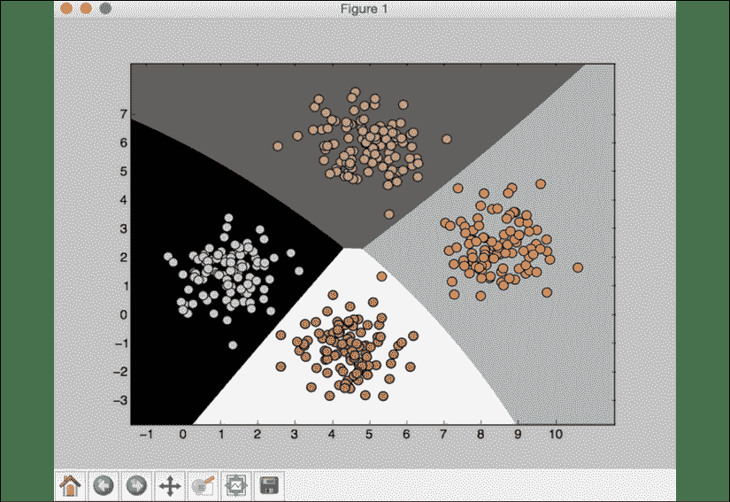

图 5：第一次训练后的聚类和边界

从图中可以看到分类器生成的决策边界能够较为清晰地把四个聚类分开，形成了随数据分布变化的区域。进行交叉验证后的第二次训练结果如下：

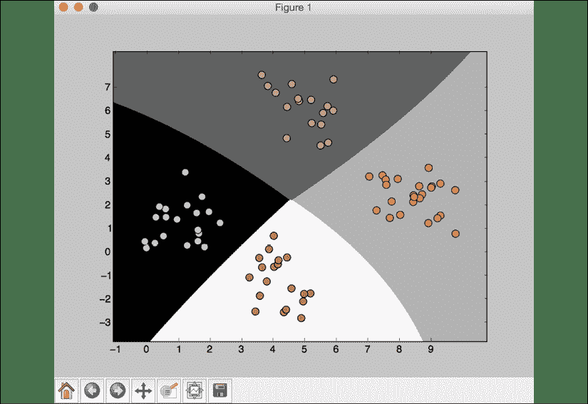

图 6：使用交叉验证的第二次训练结果

控制台会打印出相应的评估数值：

```
Accuracy of Naïve Bayes classifier = 99.75 %
Accuracy of the new classifier = 100.0 %
Accuracy: 99.75%
Precision: 99.76%
Recall: 99.75%
F1: 99.75% 
```

以上朴素贝叶斯部分的代码已整理在文件 `naive_bayes.py` 中。

# 怎么读懂混淆矩阵

**混淆矩阵**是一种表格或热力图，用来直观呈现分类器的表现。矩阵的行对应模型预测的类别，列对应真实的类别。名字来源于模型把两个类别弄混时，错误会集中在某些格子，便于快速定位问题。我们可以通过它统计每个类别被正确分类的次数以及被错分到其他类别的情况。

以二分类为例，输出只有 0 和 1：

*   **真阳性**：模型预测为 1 且真实值也为 1。
*   **真阴性**：模型预测为 0 且真实值也为 0。
*   **假阳性**：模型预测为 1 但真实值是 0，也常称 I 型错误。
*   **假阴性**：模型预测为 0 但真实值是 1，也常称 II 型错误。

不同场景对错误类型的容忍度不同。比如生物识别系统里，假阳性必须严格控制，否则无关人员可能进入敏感区域。下面演示如何生成混淆矩阵。

新建文件并导入相关包：

```
import numpy as np
import matplotlib.pyplot as plt
from sklearn.metrics import confusion_matrix
from sklearn.metrics import classification_report 
```

准备一组用于演示的真实标签和预测标签：

```
# Define sample labels
true_labels = [2, 0, 0, 2, 4, 4, 1, 0, 3, 3, 3]
pred_labels = [2, 1, 0, 2, 4, 3, 1, 0, 1, 3, 3] 
```

基于这两个序列构建混<|message|> 混淆矩阵：

```
# Create confusion matrix
confusion_mat = confusion_matrix(true_labels, pred_labels) 
```

对矩阵进行可视化：

```
# Visualize confusion matrix
plt.imshow(confusion_mat, interpolation='nearest', cmap=plt.cm.gray) 
plt.title('Confusion matrix')
plt.colorbar()
ticks = np.arange(5)
plt.xticks(ticks, ticks)
plt.yticks(ticks, ticks)
plt.ylabel('True labels')
plt.xlabel('Predicted labels')
plt.show() 
```

在上面的绘图代码中，`ticks` 表示类别数量，本例里共有五个不同标签。

再打印一份分类报告，查看每个类别的详细指标：

```
# Classification report
targets = ['Class-0', 'Class-1', 'Class-2', 'Class-3', 'Class-4'] print('\n', classification_report(true_labels, pred_labels, target_names=targets)) 
```

运行后会得到类似下面的结果：

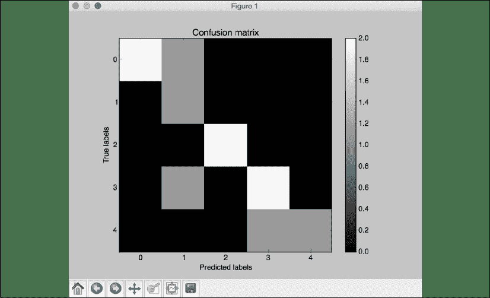

图 7：分类报告中每个类别的表现

图中右侧的颜色键说明白色数值越高、黑色越低。理想状态下对角线全白、其余区域全黑，表示完全正确。

实际输出示意如下：

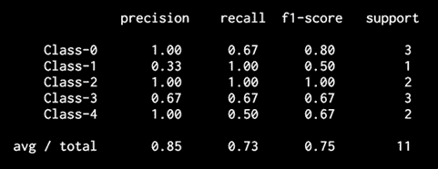

图 8：分类报告中的值

可以看到总体精确率约 85%，召回率约 73%，F1 分数约 75%。是否算好取决于业务。假如任务是判断病人是否患癌，85% 的准确率意味着 15% 的误判，风险不可接受；但如果只是判断用户是否会购买产品，同样的指标就足以大幅降低营销成本。

本部分代码存放在 `confusion_matrix.py`。

# SVM如何划分数据

支持向量机是一种基于间隔最大化的分类算法。它的本质是找到一个能够把不同类别分开的超平面，超平面是直线在高维空间的推广。给定带标签的训练样本，SVM 会挑选出一条让两类间隔最大的分割线，该思想自然可以扩展到多类问题。

先看二维的直观理解。平面上的点代表样本，线代表分隔面。可以画出很多条线把两类分开，但最优的那条会让两侧最近的点到线的距离最大。离决策边界最近的那些点被称为支持向量，两条平行于决策边界并经过支持向量的虚线之间的距离即为最大间隔，也可理解为模型容错的裕度。

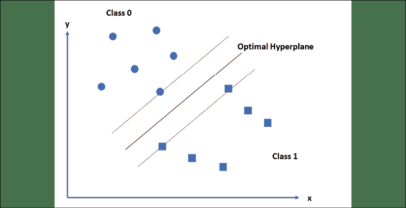

图 9：用超平面分离两个类

## 用支持向量机预测收入水平

接下来构建一个 SVM 分类器，基于 14 个属性预测个人年收入是否超过 5 万美元。这是典型的二分类任务。我们选用 UCI 上公开的普查收入数据集。该数据混合了文字和数值，直接使用会让模型困惑。仅用标签编码又会丢失数值信息，因此需要对字符型特征做编码，同时保留数值型特征。

新建脚本并导入依赖：

```
import numpy as np
import matplotlib.pyplot as plt from sklearn import preprocessing from sklearn.svm 
import LinearSVC
from sklearn.multiclass import OneVsOneClassifier 
from sklearn import cross_validation 
```

数据从文件 `income_data.txt` 读取，其中记录了收入相关信息：

```
# Input file containing 
data input_file = 'income_data.txt' 
```

加载前先做预处理，每个类别最多保留 25,000 条记录：

```
# Read the data X = []
y = []
count_class1 = 0
count_class2 = 0
max_datapoints = 25000 
```

打开文件并逐行读取：

```
with open(input_file, 'r') as f:
    for line in f.readlines():
        if count_class1 >= max_datapoints and count_class2 >= max_datapoints:
            break
        if '?' in line:
            continue 
```

每一行以逗号分隔，最后一个字段为标签，根据标签将样本分配到对应类别：

```
 data = line[:-1].split(', ')

        if data[-1] == '<=50K' and count_class1 < max_datapoints:
            X.append(data)
            count_class1 += 1

        if data[-1] == '>50K' and count_class2 < max_datapoints:
            X.append(data)
            count_class2 += 1 
```

把收集的列表转为 `numpy` 数组，方便后续喂给 `sklearn`：

```
# Convert to numpy array 
X = np.array(X) 
```

对于字符类型的属性需要编码，数值类型则保持原样。为避免遗漏，我们会维护多个标签编码器：

```
# Convert string data to numerical data 
label_encoder = []
X_encoded = np.empty(X.shape)
for i,item in enumerate(X[0]):
    if item.isdigit():
        X_encoded[:, i] = X[:, i]
    else:
        label_encoder.append(preprocessing.LabelEncoder())
        X_encoded[:, i] = label_encoder[-1].fit_transform(X[:, i])
X = X_encoded[:, :-1].astype(int)
y = X_encoded[:, -1].astype(int) 
```

初始化一个使用线性核的 SVM 分类器：

```
# Create SVM classifier
classifier = OneVsOneClassifier(LinearSVC(random_state=0)) 
```

对模型进行训练：

```
# Train the classifier 
classifier.fit(X, y) 
```

使用 80/20 分割进行交叉验证以进行训练和测试，然后预测训练数据的输出：

```
# Cross validation
X_train, X_test, y_train, y_test = cross_validation.train_test_split(X, y, test_size=0.2, random_state=5)
classifier = OneVsOneClassifier(LinearSVC(random_state=0)) classifier.fit(X_train, y_train)
y_test_pred = classifier.predict(X_test) 
```

F1 得分解读

```
# Compute the F1 score of the SVM classifier
f1 = cross_validation.cross_val_score(classifier, X, y, scoring='f1_weighted', cv=3)
print("F1 score: " + str(round(100*f1.mean(), 2)) + "%") 
```

分类器已训练完成，接下来演示如何读取一个随机样本并给出预测结果，先来定义这样一个示例点：

```
# Predict output for a test datapoint
input_data = ['37', 'Private', '215646', 'HS-grad', '9', 'Never-married', 'Handlers-cleaners', 'Not-in-family', 'White', 'Male', '0', '0', '40', 'United-States'] 
```

预测前要先借助先前生成的标签编码器对该样本做编码处理：

```
# Encode test datapoint
input_data_encoded = [-1] * len(input_data)
count = 0
for i, item in enumerate(input_data):
    if item.isdigit():
        input_data_encoded[i] = int(input_data[i])
    else:
        input_data_encoded[i] = int(label_encoder[count].transform(input_data[i]))
        count += 1 
```

```
input_data_encoded = np.array(input_data_encoded) 
```

这时就可以调用分类器进行输出预测：

```
# Run classifier on encoded datapoint and print output
predicted_class = classifier.predict(input_data_encoded)
print(label_encoder[-1].inverse_transform(predicted_class)[0]) 
```

执行代码时训练会耗费数秒，结束后会出现如下结果：

```
F1 score: 66.82% 
```

测试样本的预测结果也会一并展示：

```
<=50K 
```

仔细核对该样本的特征会发现它与 50K 以下类别的样本非常接近。 更换核函数并调节不同参数组合，能够改变模型的表现，比如 F1 分数、准确率或召回率。

相关代码已托管在 `income_classifier.py` 文件中。

# 回归基础解读

回归的核心任务是刻画输入特征与连续型目标变量之间的关联。 目标值是实数区间内的连续量，取值空间几乎无限，这一点与分类形成对比。 分类问题的输出只有有限几种类别，而回归的输出范围是开放的。

回归假设因变量受自变量影响，我们要探究两者间的作用方式。 自变量又称解释变量或预测因子，因变量又称响应变量或准则变量。 自变量之间不必互相独立，现实中它们往往存在一定的相关性。

通过回归分析，可以在控制其他变量不变的前提下，观察某个输入变化时输出的响应。 线性回归默认两者呈直线关系，模型简单、计算快，但表达能力受限。

当直线模型难以拟合真实趋势时，就需要多项式回归，用高次多项式捕捉非线性规律。 复杂度上升的同时拟合精度也提升，具体选用哪种形式取决于问题需求。 回归广泛应用于房价预测、销量预估、价格波动分析等场景。

## 单变量回归实战

下面演示单特征回归的搭建流程。 新建一个 Python 脚本，先导入所需库：

```
import pickle 
```

```
import numpy as np
from sklearn import linear_model 
import sklearn.metrics as sm 
import matplotlib.pyplot as plt 
```

本例使用 `data_singlevar_regr.txt` 作为数据来源：

```
# Input file containing data 
input_file = 'data_singlevar_regr.txt' 
```

文件采用 CSV 格式，可用一行代码直接读取：

```
# Read data
data = np.loadtxt(input_file, delimiter=',') 
X, y = data[:, :-1], data[:, -1] 
```

随后将数据划分为训练集与测试集：

```
# Train and test split 
num_training = int(0.8 * len(X)) 
num_test = len(X) - num_training 
```

```
# Training data
X_train, y_train = X[:num_training], y[:num_training] 
```

```
# Test data
X_test, y_test = X[num_training:], y[num_training:] 
```

实例化线性回归模型并用训练集完成拟合：

```
# Create linear regressor object
regressor = linear_model.LinearRegression() 
```

```
# Train the model using the training sets 
regressor.fit(X_train, y_train) 
```

用已训练好的模型对测试集进行预测：

```
# Predict the output
y_test_pred = regressor.predict(X_test) 
```

将结果可视化：

```
# Plot outputs
plt.scatter(X_test, y_test, color='green') 
plt.plot(X_test, y_test_pred, color='black', linewidth=4) 
plt.xticks(())
plt.yticks(())
plt.show() 
```

对比真实值与预测值，计算模型评价指标：

```
# Compute performance metrics 
print("Linear regressor performance:")
print("Mean absolute error =", round(sm.mean_absolute_error(y_test, y_test_pred), 2))
print("Mean squared error =", round(sm.mean_squared_error(y_test, y_test_pred), 2))
print("Median absolute error =", round(sm.median_absolute_error(y_test, y_test_pred), 2))
print("Explain variance score =", round(sm.explained_variance_score(y_test, y_test_pred), 2))
print("R2 score =", round(sm.r2_score(y_test, y_test_pred), 2)) 
```

训练完成后可把模型持久化，`pickle` 模块正好派上用场：

```
# Model persistence 
output_model_file = 'model.pkl' 
```

```
# Save the model
with open(output_model_file, 'wb') as f:
    pickle.dump(regressor, f) 
```

之后从磁盘加载模型并继续做预测：

```
# Load the model
with open(output_model_file, 'rb') as f:
    regressor_model = pickle.load(f) 
```

```
# Perform prediction on test data
y_test_pred_new = regressor_model.predict(X_test)
print("\nNew mean absolute error =", round(sm.mean_absolute_error(y_test, y_test_pred_new), 2)) 
```

运行后终端会显示类似如下画面：

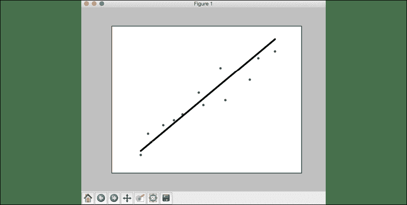

图 10：执行预测后的输出

预期输出如下：

```
Linear regressor performance:
Mean absolute error = 0.59 
Mean squared error = 0.49 
Median absolute error = 0.51 
Explain variance score = 0.86 
R2 score = 0.86
New mean absolute error = 0.59 
```

**平均绝对误差**（`MAE`）是绝对误差的平均值：


其中 y[i] 表示预测值，x[i] 表示真实值。

**均方误差**（`MSE`）为误差平方的均值，衡量预测值与真实值的平均偏离程度。 受随机因素影响，MSE 通常大于零，是衡量评估器好坏的重要指标，值越小越理想。

解释方差反映模型能解释的数据变异占比，通常用方差来度量离散程度，未被解释的部分则为残余变异。

`R2` 决定系数用于衡量一个变量的波动有多少能被另一变量说明。 举例来说，怀孕状态与分娩结果的关联度极高。

本节代码位于 `regressor_singlevar.py`。

# 多变量回归建模

前文介绍了单变量建模，这里转向多维特征。 新建脚本并导入所需模块：

```
import numpy as np
from sklearn import linear_model 
import sklearn.metrics as sm
from sklearn.preprocessing import PolynomialFeatures 
```

数据文件为 `data_multivar_regr.txt`。

```
# Input file containing data 
input_file = 'data_multivar_regr.txt' 
```

同样是 CSV 格式，一行代码即可载入：

```
# Load the data from the input file
data = np.loadtxt(input_file, delimiter=',')
X, y = data[:, :-1], data[:, -1] 
```

将数据集拆分为训练集和测试集：

```
# Split data into training and testing 
num_training = int(0.8 * len(X)) 
num_test = len(X) - num_training 
```

```
# Training data
X_train, y_train = X[:num_training], y[:num_training] 
```

```
# Test data
X_test, y_test = X[num_training:], y[num_training:] 
```

构建线性回归并进行训练：

```
# Create the linear regressor model 
linear_regressor = linear_model.LinearRegression() 
```

```
# Train the model using the training sets 
linear_regressor.fit(X_train, y_train)# 
```

对测试集执行预测：

```
# Predict the output
y_test_pred = linear_regressor.predict(X_test) 
```

输出评价指标：

```
# Measure performance
print("Linear Regressor performance:")
print("Mean absolute error =", round(sm.mean_absolute_error(y_test, y_test_pred), 2))
print("Mean squared error =", round(sm.mean_squared_error(y_test, y_test_pred), 2))
print("Median absolute error =", round(sm.median_absolute_error(y_test, y_test_pred), 2))
print("Explained variance score =", round(sm.explained_variance_score(y_test, y_test_pred), 2)) 
print("R2 score =", round(sm.r2_score(y_test, y_test_pred), 2)) 
```

接下来构造 10 次多项式回归，并在训练集上拟合。 以一个示例点演示预测流程，先做多项式转换：

```
# Polynomial regression
polynomial = PolynomialFeatures(degree=10) 
X_train_transformed = polynomial.fit_transform(X_train) 
datapoint = [[7.75, 6.35, 5.56]]
poly_datapoint = polynomial.fit_transform(datapoint) 
```

该点与数据文件第 11 行 `[7.66, 6.29, 5.66]` 非常接近，理想预测值应在 41.35 附近。 分别用线性回归和多项式回归进行预测，对比两者差异：

```
poly_linear_model = linear_model.LinearRegression() 
poly_linear_model.fit(X_train_transformed, y_train)
print("\nLinear regression:\n", linear_regressor.predict(datapoint)) 
print("\nPolynomial regression:\n", poly_linear_model.predict(poly_datapoint)) 
```

执行后结果大致如下：

```
Linear Regressor performance:
Mean absolute error = 3.58 
Mean squared error = 20.31 
Median absolute error = 2.99
Explained variance score = 0.86 
R2 score = 0.86 
```

同时还会输出：

```
Linear regression:
 [ 36.05286276]
Polynomial regression:
 [ 41.46961676] 
```

可以看到线性结果约为 36.05，而多项式结果靠近 41.35，说明多项式模型拟合更准确。

相关实现在 `regressor_multivar.py` 中。

# SVR 房价估算

下面展示如何借助 SVM 思想构建回归模型来估算房价。 使用 sklearn 自带的房价数据集，每个样本包含 13 个特征。

目标是依据这些特征预测房屋价格。 新建 Python 文件导入必要库：

```
import numpy as np
from sklearn import datasets
from sklearn.svm import SVR
from sklearn.metrics import mean_squared_error, explained_variance_score
from sklearn.utils import shuffle 
```

开始加载住房数据：

```
# Load housing data
data = datasets.load_boston() 
```

先打乱原始数据顺序，防止出现偏差：

```
# Shuffle the data
X, y = shuffle(data.data, data.target, random_state=7) 
```

把数据按 8:2 的比例拆分为训练集和测试集：

```
# Split the data into training and testing datasets 
num_training = int(0.8 * len(X))
X_train, y_train = X[:num_training], y[:num_training] 
X_test, y_test = X[num_training:], y[num_training:] 
```

采用线性核来训练支持向量回归模型。 `C` 控制对训练误差的惩罚程度，数值越大模型越努力贴合训练样本，容易引发过拟合而泛化能力下降。 `epsilon` 定义容忍区间，预测值落在真实值 `epsilon` 范围内时不计入误差：

```
# Create Support Vector Regression model
sv_regressor = SVR(kernel='linear', C=1.0, epsilon=0.1) 
```

```
# Train Support Vector Regressor
sv_regressor.fit(X_train, y_train) 
```

计算回归效果并输出评价指标：

```
# Evaluate performance of Support Vector Regressor 
y_test_pred = sv_regressor.predict(X_test)
mse = mean_squared_error(y_test, y_test_pred)
evs = explained_variance_score(y_test, y_test_pred) 
print("\n#### Performance ####")
print("Mean squared error =", round(mse, 2)) 
print("Explained variance score =", round(evs, 2)) 
```

接下来用测试样本做一次预测：

```
# Test the regressor on test datapoint
test_data = [3.7, 0, 18.4, 1, 0.87, 5.95, 91, 2.5052, 26, 666, 20.2,
351.34, 15.27]
print("\nPredicted price:", sv_regressor.predict([test_data])[0]) 
```

执行代码后会得到如下结果：

```
#### Performance
Mean squared error = 15.41 
Explained variance score = 0.82 
Predicted price: 18.5217801073 
```

相关代码已放在 `house_prices.py` 中，打开文件首行即可对比 `18.52` 的预测值与真实目标的差距。

# 章节小结

本章梳理了监督学习与无监督学习的区别，探讨了分类问题的解决思路。介绍了数据预处理的常用方法，以及标签编码的实现方式。讲解了逻辑回归的原理并完成了分类器的搭建，阐述了朴素贝叶斯的工作机制并演示了建模流程，同时覆盖了混淆矩阵的构建。

另外介绍了支持向量机并演示了分类器的构建，讲解了回归概念，展示了单变量和多变量场景下的线性回归与多项式回归，最后用支持向量回归基于属性特征对房价进行了估算。

下一章将聚焦预测分析，介绍如何利用集成学习搭建预测系统。

# 6 集成学习驱动预测

> 原文：[`gitee.com/apachecn/apachecn-dl-zh/blob/master/docs/ai-py/06.md`](https://gitee.com/apachecn/apachecn-dl-zh/blob/master/docs/ai-py/06.md) 

本章将围绕集成学习展开，并说明它在预测分析中的应用。学完后你能更好地理解：

*   决策树及决策树分类器
*   用集成学习训练模型
*   随机森林与极随机森林
*   预测置信度的估计
*   类别不平衡的处理
*   用网格搜索寻找最优训练参数
*   计算相对特征重要性
*   用极随机森林回归器预测交通流量

先从决策树入手，了解它是什么。

## 决策树是什么

**决策树**是把数据集拆分为多个分支的建模方式，随后沿分支或分区进行简单判断。树的生成由训练算法完成，算法决定数据如何被最优划分。

决策过程自根节点起步。树中每个节点都是一条决策规则。规则由输入数据与训练集中目标标签的关系构建，用以从输入值推断输出值。

了解了基本概念后，下一步是自动构造决策树。我们需要一种能依据数据生成最优树的算法。为此必须理解熵。文中熵指信息熵而非热力学熵，本质上是衡量不确定性的量。决策树的重要目标之一是让不确定性从根到叶逐渐降低。遇到未知样本时输出完全不确定，到达叶节点时则变得确定。因此树要在每层减少不确定性，沿途降低熵。

更多细节可参考[这里](https://prateekvjoshi.com/2016/03/22/how-are-decision-trees-constructed-in-machine-learning)。

### 构建决策树分类器

看一下如何用 Python 的决策树构建分类器。新建一个 Python 文件并导入所需包：

```
import numpy as np
import matplotlib.pyplot as plt
from sklearn.metrics import classification_report 
from sklearn.model_selection import train_test_split
from sklearn.tree import DecisionTreeClassifier 
```

```
from utilities import visualize_classifier 
```

我们使用提供的 `data_decision_trees.txt` 作为数据源。该文件每行都是逗号分隔的值，前两列为输入，后一列为目标标签。先从文件中读取数据：

```
# Load input data
input_file = 'data_decision_trees.txt'
data = np.loadtxt(input_file, delimiter=',')
X, y = data[:, :-1], data[:, -1] 
```

按标签把输入数据分成两个独立类别：

```
# Separate input data into two classes based on labels
class_0 = np.array(X[y==0])
class_1 = np.array(X[y==1]) 
```

用散点图把输入数据可视化：

```
# Visualize input data
plt.figure()
plt.scatter(class_0[:, 0], class_0[:, 1], s=75, facecolors='black',
        edgecolors='black', linewidth=1, marker='x')
plt.scatter(class_1[:, 0], class_1[:, 1], s=75, facecolors='white',
        edgecolors='black', linewidth=1, marker='o')
plt.title('Input data') 
```

需要把数据拆分为训练集和测试集：

```
# Split data into training and testing datasets
X_train, X_test, y_train, y_test = train_test_split(
        X, y, test_size=0.25, random_state=5) 
```

基于训练集创建、构建并可视化决策树分类器。`random_state` 用于设定随机数生成器的种子以保证可复现；`max_depth` 控制要构建的树的最大深度：

```
# Decision Trees classifier
params = {'random_state': 0, 'max_depth': 4}
classifier = DecisionTreeClassifier(**params)
classifier.fit(X_train, y_train)
visualize_classifier(classifier, X_train, y_train, 'Training dataset') 
```

在测试集上计算分类器输出并可视化：

```
y_test_pred = classifier.predict(X_test)
visualize_classifier(classifier, X_test, y_test, 'Test dataset') 
```

打印分类报告来评估表现：

```
# Evaluate classifier performance
class_names = ['Class-0', 'Class-1']
print("\n" + "#"*40)
print("\nClassifier performance on training dataset\n")
print(classification_report(y_train, classifier.predict(X_train), target_names=class_names))
print("#"*40 + "\n") 
```

```
print("#"*40)
print("\nClassifier performance on test dataset\n")
print(classification_report(y_test, y_test_pred, target_names=class_names))
print("#"*40 + "\n") 
```

```
plt.show() 
```

完整代码位于 `decision_trees.py`。运行后会看到若干结果。第一张截图是输入数据的可视化：

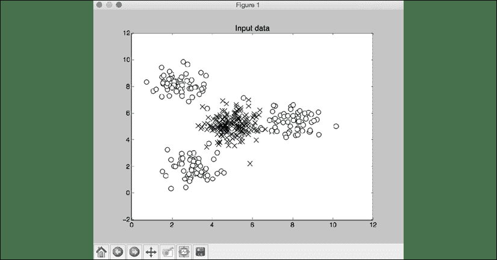

图 1：可视化输入数据

第二张截图展示了测试集上的分类器边界：

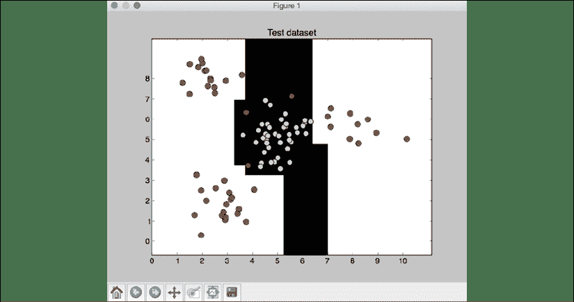

图 2：测试数据集的分类器边界

你还会看到以下输出：

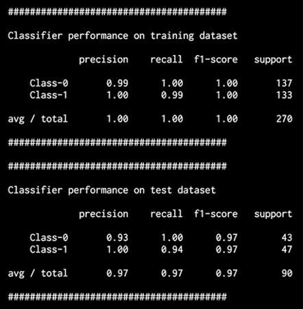

图 3：训练数据集上的分类器表现

分类器的表现常用 `precision`、`recall` 和 `f1-scores` 描述。精度反映分类的正确程度，召回率表示实际应检索的样本中被检索到的比例。优秀的分类器期望精度和召回率都高，但两者常需权衡，于是引入 `f1-score`。F1 得分是精度与召回率的调和平均，在两者间取得平衡。

决策树属于单模型预测的典型做法。通过整合多个模型的结果，往往能构建更强、预测更准的系统。这正是集成学习的思路，将在下节讨论。

# 集成学习概览

**集成学习**是先训练多个模型，再以某种方式融合它们，使整体效果优于单个模型单独使用。这些基础模型可以是分类器、回归器或其他类型。

集成学习在数据分类、预测建模和异常检测等领域被广泛应用。

为何要用集成学习？举个实际例子：你想买新电视却不了解最新型号。目标是物有所值，但相关知识不足时，通常会征求该领域多位专家的意见。不是依赖单一意见，而是综合多位专家的判断来决策，能最大程度降低错误或次优选择的概率。

## 为何选用集成模型

选模时常用做法是挑训练集误差最小的模型。这种方法并不总是可靠，模型可能偏向或过拟合训练数据。即便使用交叉验证，模型在未知数据上仍可能表现不佳。

集成学习有效的原因在于它降低了挑到劣质模型的整体风险。集成能够以多种方式训练，并在未知数据上保持稳健。构建集成时，各基础模型需要具备一定多样性，从而捕捉数据中的不同细微特征，使整体更准确。

多样性可通过为每个模型使用不同的训练参数实现。这样各模型会生成不同的决策边界，即使用不同的推理规则，便于交叉验证结果。若模型间一致性高，预测的可信度也会提升。

集成学习的一种特例是将决策树组合成整体，常见形式为随机森林和极随机森林，后续章节会介绍。

# 随机森林与极随机森林解析

**随机森林**是集成学习的一种实现，单模型由多棵决策树构成，再用集合预测输出。构建时为每棵树抽取训练数据的随机子集。

这保证了不同决策树之间存在多样性，而多样性是构建良好集成模型的关键属性之一。

随机森林的一个优点是抗过拟合。过拟合在机器学习中很常见，非参数和非线性模型因灵活性高而更容易过拟合。通过用多样化的随机子集构建多棵树，可避免模型过度贴合训练数据。树构建时节点会持续分裂，选择可减小层级熵的最佳阈值。分裂并不使用全部特征，而是从候选特征的随机子集中挑选最佳分割。引入的随机性通常会增加偏差，但因平均化效应方差减小，最终得到更鲁棒的模型。

**极随机森林**把随机性提升到更高层次。除采用特征的随机子集外，还随机选取阈值。分割规则使用这些随机生成的阈值，进一步降低模型方差。因此极随机森林得到的决策边界往往比随机森林更平滑。部分实现还能更好地并行化并更易扩展。

## 搭建随机森林分类器

下面演示如何基于随机森林和极随机森林构建分类器。两种构造方式相似，使用输入标志指定要构建的类型。

新建一个 Python 文件并导入所需包：

```
import argparse 
```

```
import numpy as np
import matplotlib.pyplot as plt
from sklearn.metrics import classification_report
from sklearn.model_selection import train_test_split
from sklearn.ensemble import RandomForestClassifier, ExtraTreesClassifier 
from sklearn.metrics import classification_report 
```

```
from utilities import visualize_classifier 
```

为 Python 定义参数解析器，以便把分类器类型作为输入参数。根据该参数可构造随机森林分类器或极随机森林分类器：

```
# Argument parser
def build_arg_parser():
    parser = argparse.ArgumentParser(description='Classify data using \
            Ensemble Learning techniques')
    parser.add_argument('--classifier-type', dest='classifier_type',
            required=True, choices=['rf', 'erf'], help="Type of classifier \
                    to use; can be either 'rf' or 'erf'")
    return parser 
```

定义 `main` 函数并解析输入参数：

```
if __name__=='__main__':
    # Parse the input arguments
    args = build_arg_parser().parse_args() 
    classifier_type = args.classifier_type 
```

我们使用提供的 `data_random_forests.txt`。该文件每行包含逗号分隔的值，前两列为输入，后一列为目标标签。本数据集中共有三个类别。让我们从该文件加载数据：

```
 # Load input data
    input_file = 'data_random_forests.txt'
    data = np.loadtxt(input_file, delimiter=',')
    X, y = data[:, :-1], data[:, -1] 
```

我们先把原始样本按类别拆成三组。

```
 # Separate input data into three classes based on labels 
    class_0 = np.array(X[y==0])
    class_1 = np.array(X[y==1])
    class_2 = np.array(X[y==2]) 
```

接下来把这部分数据画出来，直观感受分布。

```
 # Visualize input data
    plt.figure()
    plt.scatter(class_0[:, 0], class_0[:, 1], s=75, facecolors='white',
                    edgecolors='black', linewidth=1, marker='s')
    plt.scatter(class_1[:, 0], class_1[:, 1], s=75, facecolors='white',
                    edgecolors='black', linewidth=1, marker='o')
    plt.scatter(class_2[:, 0], class_2[:, 1], s=75, facecolors='white',
                    edgecolors='black', linewidth=1, marker='^')
    plt.title('Input data') 
```

随后把整体样本切分为训练集和测试集。

```
 # Split data into training and testing datasets
    X_train, X_test, y_train, y_test = train_test_split(
            X, y, test_size=0.25, random_state=5) 
```

这里需要设定建模时使用的超参数。`n_estimators` 决定森林里要长多少棵树，`max_depth` 控制单棵树的最大深度，`random_state` 则是固定随机森林初始化的随机种子，保证结果可复现：

```
 # Ensemble Learning classifier
    params = {'n_estimators': 100, 'max_depth': 4, 'random_state': 0} 
```

根据传入的配置，可以实例化标准的随机森林，也可以换成极随机森林：

```
 if classifier_type == 'rf':
        classifier = RandomForestClassifier(**params)
    else:
        classifier = ExtraTreesClassifier(**params) 
```

用训练数据拟合模型并把决策边界可视化：

```
 classifier.fit(X_train, y_train)
    visualize_classifier(classifier, X_train, y_train, 'Training dataset') 
```

在测试集上生成预测结果并绘图展示：

```
 y_test_pred = classifier.predict(X_test)
    visualize_classifier(classifier, X_test, y_test, 'Test dataset') 
```

通过打印分类报告来检查模型表现：

```
 # Evaluate classifier performance
    class_names = ['Class-0', 'Class-1', 'Class-2']
    print("\n" + "#"*40)
    print("\nClassifier performance on training dataset\n")
    print(classification_report(y_train, classifier.predict(X_train), target_names=class_names))
    print("#"*40 + "\n")

    print("#"*40)
    print("\nClassifier performance on test dataset\n")
    print(classification_report(y_test, y_test_pred, target_names=class_names))
    print("#"*40 + "\n") 
```

完整实现放在 `random_forests.py`。先用 `rf` 标志启动随机森林版本，执行命令：

```
$ python3 random_forests.py --classifier-type rf 
```

运行后会输出一些指标。第一张图展示的就是原始输入的样子：

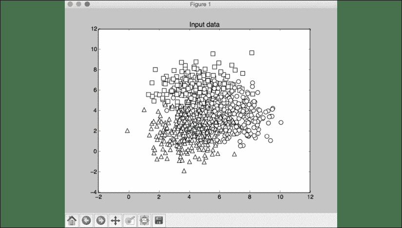

图 4：输入数据的可视化效果

从这张图能看出三类分别用方块、圆点和三角形标记，类间重叠比较明显，但目前尚可接受。下一张图是模型在测试集上的决策边界：

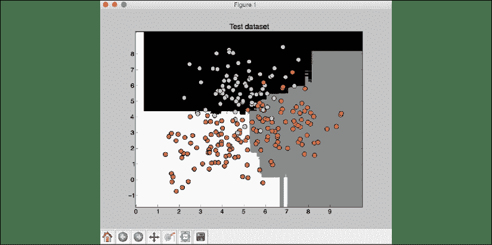

图 5：测试集上的决策边界

接下来把参数换成 `erf`，启动极随机森林版本，运行对应命令：

```
$ python3 random_forests.py --classifier-type erf 
```

执行后同样会打印指标，输入分布我们已熟悉，第二张图展示的是这时的决策边界：

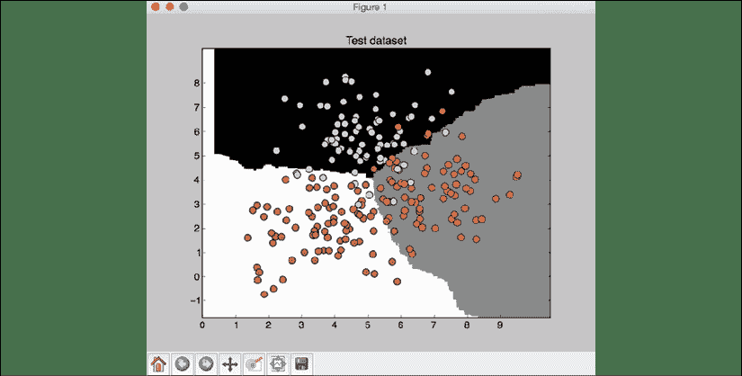

图 6：极随机森林的测试集边界

对比随机森林的边界，这次的分界明显更平滑。因为极随机森林在建树时更自由，能探索出更合适的分割方式，所以通常能得到更优的边界。

## 怎么判断预测有多可靠

仔细看输出，每个样本都会附带一个概率值，用来衡量模型对各类别的置信程度。评估置信度是机器学习里很关键的一步。在同一个脚本里，先定义要测试的点集：

```
 # Compute confidence
    test_datapoints = np.array([[5, 5], [3, 6], [6, 4], [7, 2], [4, 4], [5, 2]]) 
```

分类器自带计算置信度的方法，我们遍历每个点进行预测并算出其置信度：

```
 print("\nConfidence measure:") 
    for datapoint in test_datapoints:
        probabilities = classifier.predict_proba([datapoint])[0]
        predicted_class = 'Class-' + str(np.argmax(probabilities))
        print('\nDatapoint:', datapoint)
        print('Predicted class:', predicted_class) 
```

把测试点叠加到决策边界图上查看：

```
 # Visualize the datapoints
    visualize_classifier(classifier, test_datapoints, [0]*len(test_datapoints), 
            'Test datapoints') 
```

```
 plt.show() 
```

带上 `erf` 参数运行，会得到下面这张图：

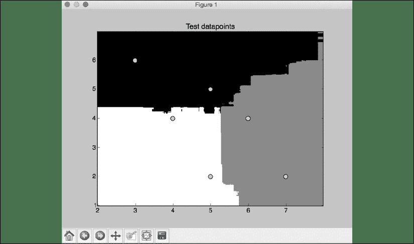

图 7：带置信度的边界图

不使用 `erf` 标志时，会得到下面这张输出：

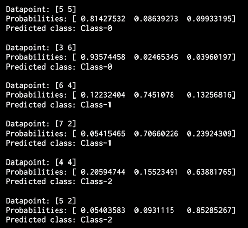

图 8：各点的概率输出

对每个样本，模型会给出属于三类的概率，我们挑选最有把握的那一类。使用 `erf` 标志运行，会得到下面这张图：

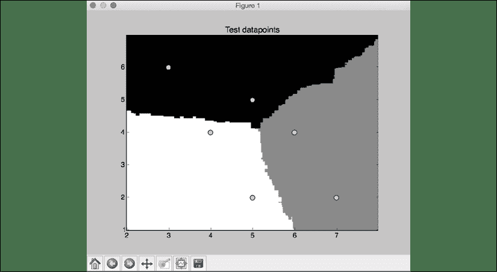

图 9：极随机森林的边界图

如果去掉 `erf` 标志，则应出现如下输出：

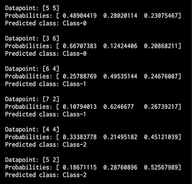

图 10：概率分布输出

可以看出，后者是前者基础上叠加了置信信息。

# 样本不平衡怎么破

模型表现只能跟训练数据一样好。现实中数据质量是常见痛点，为了让分类器工作良好，各类样本最好均衡。但实际采集时很难保证数量完全相等。若某类样本是另一类的十倍，模型就会偏向多数类。因此必须考虑不平衡的处理方式，下面演示具体做法。

新建一个 Python 文件并导入所需库：

```
import sys 
```

# 不平衡数据实操

```
import numpy as np
import matplotlib.pyplot as plt
from sklearn.ensemble import ExtraTreesClassifier
from sklearn.model_selection import train_test_split
from sklearn.metrics import classification_report 
```

```
from utilities import visualize_classifier 
```

我们用 `data_imbalance.txt` 里的样本来分析。先加载数据。

文件每行都是逗号分隔，前两列是特征，最后一个是标签。数据集中只有两类。下面是从文件中读取：

```
# Load input data
input_file = 'data_imbalance.txt'
data = np.loadtxt(input_file, delimiter=',')
X, y = data[:, :-1], data[:, -1] 
```

先把输入样本按类别拆成两组：

```
# Separate input data into two classes based on labels 
class_0 = np.array(X[y==0])
class_1 = np.array(X[y==1]) 
```

用散点图把输入数据画出来：

```
# Visualize input data
plt.figure()
plt.scatter(class_0[:, 0], class_0[:, 1], s=75, facecolors='black',
                edgecolors='black', linewidth=1, marker='x')
plt.scatter(class_1[:, 0], class_1[:, 1], s=75, facecolors='white',
                edgecolors='black', linewidth=1, marker='o')
plt.title('Input data') 
```

再把数据划分为训练集和测试集：

```
# Split data into training and testing datasets
X_train, X_test, y_train, y_test = train_test_split.train_test_split(
        X, y, test_size=0.25, random_state=5) 
```

接着为极随机森林设定参数。注意这里有个 `balance` 参数，用于控制是否在算法中处理类别不平衡。若开启，还需要 `class_weight` 参数，让模型按各类别样本数比例加权：

```
# Extremely Random Forests classifier
params = {'n_estimators': 100, 'max_depth': 4, 'random_state': 0}
if len(sys.argv) > 1:
    if sys.argv[1] == 'balance':
        params = {'n_estimators': 100, 'max_depth': 4, 'random_state': 0, 'class_weight': 'balanced'}
    else:
        raise TypeError("Invalid input argument; should be 'balance'") 
```

基于训练数据构建、训练并可视化分类器：

```
classifier = ExtraTreesClassifier(**params)
classifier.fit(X_train, y_train)
visualize_classifier(classifier, X_train, y_train, 'Training dataset') 
```

对测试集做预测并可视化输出：

```
y_test_pred = classifier.predict(X_test)
visualize_classifier(classifier, X_test, y_test, 'Test dataset') 
```

计算模型表现并打印分类报告：

```
# Evaluate classifier performance
class_names = ['Class-0', 'Class-1']
print("\n" + "#"*40)
print("\nClassifier performance on training dataset\n")
print(classification_report(y_train, classifier.predict(X_train), 
target_names=class_names))
print("#"*40 + "\n") 
```

```
print("#"*40)
print("\nClassifier performance on test dataset\n")
print(classification_report(y_test, y_test_pred, target_names=class_names))
print("#"*40 + "\n") 
```

```
plt.show() 
```

完整代码在 `class_imbalance.py`。运行后你会看到以下图形。第一张是输入数据的展示：

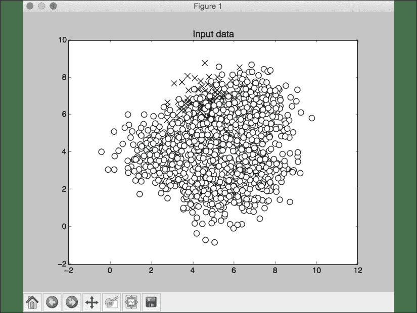

图 11：输入数据可视化

第二张图展示了测试数据的决策边界：

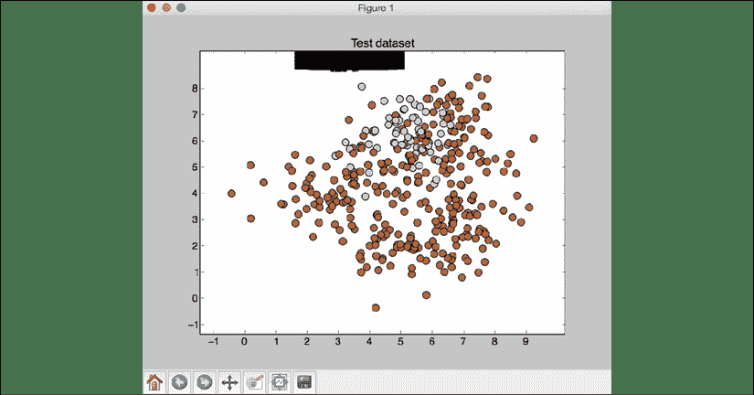

图 12：测试集的决策边界

从上图能看出边界未能准确捕捉两类间的真实分界，顶部附近出现了黑色斑点。最后会看到如下输出：

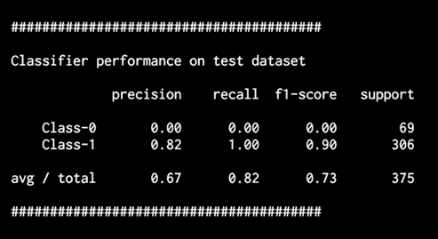

图 13：模型在测试集上的表现

会出现警告，因为第一行值为 `0`，导致计算 `f1-score` 时出现除零错误 `ZeroDivisionError`。使用 `ignore` 标志即可屏蔽该警告：

```
$ python3 --W ignore class_imbalance.py 
```

如果想解决类别不平衡，改用 `balance` 标志运行：

```
$ python3 class_imbalance.py balance 
```

这时的分类器输出看起来像：


图 14：平衡后的测试集可视化

你应看到如下输出：


图 15：平衡后模型表现

考虑类别不平衡后，模型能够正确识别少数类，`Class-0` 的整体准确率不再为零。

## 用网格搜索找最优参数

使用分类器时，往往不知道最佳参数是什么。手工暴力枚举效率很低，这时网格搜索就派上用场。它允许你指定参数范围，自动尝试各种组合找出最优解。下面看具体做法。

新建一个 Python 文件并导入所需包：

```
import numpy as np
import matplotlib.pyplot as plt
from sklearn.metrics import classification_report
from sklearn import grid_search
from sklearn.ensemble import ExtraTreesClassifier
from sklearn.model_selection import train_test_split
from sklearn.metrics import classification_report 
```

```
from utilities import visualize_classifier 
```

我们打算用 `data_random_forests.txt` 里的数据做实验：

```
# Load input data
input_file = 'data_random_forests.txt'
data = np.loadtxt(input_file, delimiter=',')
X, y = data[:, :-1], data[:, -1] 
```

先对数据做三分类划分：

```
# Separate input data into three classes based on labels 
class_0 = np.array(X[y==0])
class_1 = np.array(X[y==1])
class_2 = np.array(X[y==2]) 
```

再把数据切分为训练集和测试集：

```
# Split the data into training and testing datasets
X_train, X_test, y_train, y_test = cross_validation.train_test_split(
        X, y, test_size=0.25, random_state=5) 
```

为分类器准备参数网格进行测试。通常的做法是让一个参数保持不变，另一个参数遍历变化，再反向筛出最优搭配。本次要优化的是 `n_estimators` 和 `max_depth`，先设定搜索网格：

```
# Define the parameter grid
parameter_grid = [{'n_estimators':[100], 'max_depth':[2,4,7,12,16]},
                 {'max_depth':[4],'n_estimators':[25,50,100,250]}] 
```

接着定义评判最优参数组合的指标：

```
metrics = ['precision_weighted', 'recall_weighted'] 
```

对每个指标都要跑一次网格搜索，在搜索里用不同组合训练分类器：

```
for metric in metrics:
    print("\n##### Searching optimal parameters for", metric)

    classifier = grid_search.GridSearchCV(
            ExtraTreesClassifier(random_state=0),
            parameter_grid, cv=5, scoring=metric)
    classifier.fit(X_train, y_train) 
```

输出每组参数对应的分数：

```
 print("\nGrid scores for the parameter grid:")
    for params, avg_score, _ in classifier.grid_scores_:
        print(params, '-->', round(avg_score, 3))

    print("\nBest parameters:", classifier.best_params_) 
```

打印一份性能汇总报告：

```
 y_pred = classifier.predict(X_test)
    print("\nPerformance report:\n")
    print(classification_report(y_test, y_pred)) 
```

完整实现放在 `run_grid_search.py`。执行后以准确率为度量，输出如下：


图 16：最佳参数搜索输出

网格搜索会给出准确率最高的组合。若想看召回率的最优参数，可查看下面结果：


图 17：最佳参数搜索输出

召回率的最佳组合与准确率不同，因为两者衡量的是不同角度的模型表现。

## 特征重要性评估

面对包含 N 维特征的数据集，要先明白并非所有特征贡献相同。部分特征区分能力更强，知道这一点就能做降维，降低模型复杂度并提升训练速度。有些特征甚至完全冗余，可以直接剔除。

本次用 `AdaBoost` 回归器来算特征重要性。`AdaBoost` 即自适应提升，是一种常用来增强其它算法表现的方法。它从样本分布中抽取数据训练当前分类器，然后迭代更新分布，让后续分类器更聚焦难分样本。所谓困难样本就是被误分类的那些，通过更新分布让它们在下一轮训练中被抽中的概率变大。

多轮分类器串联后通过加权多数投票做最终决策。

新建一个 Python 文件导入所需库：

```
import numpy as np
import matplotlib.pyplot as plt
from sklearn.tree import DecisionTreeRegressor 
from sklearn.ensemble import AdaBoostRegressor 
from sklearn import datasets
from sklearn.metrics import mean_squared_error, explained_variance_score 
from sklearn.model_selection import import train_test_split
from sklearn.utils import shuffle 
```

```
from utilities import visualize_feature_importances 
```

使用 scikit-learn 自带的房屋价格数据集：

```
# Load housing data
housing_data = datasets.load_boston() 
```

打乱数据顺序，避免分析偏差：

```
# Shuffle the data
X, y = shuffle(housing_data.data, housing_data.target, random_state=7) 
```

划分训练集与测试集：

```
# Split data into training and testing datasets
X_train, X_test, y_train, y_test = train_test_split(
        X, y, test_size=0.2, random_state=7) 
```

以决策树回归器作基模型，构建并训练 `AdaBoostRegressor`：

```
# AdaBoost Regressor model
regressor = AdaBoostRegressor(DecisionTreeRegressor(max_depth=4),
        n_estimators=400, random_state=7)
regressor.fit(X_train, y_train) 
```

评估回归器的表现：

```
# Evaluate performance of AdaBoost regressor
y_pred = regressor.predict(X_test)
mse = mean_squared_error(y_test, y_pred)
evs = explained_variance_score(y_test, y_pred )
print("\nADABOOST REGRESSOR")
print("Mean squared error =", round(mse, 2))
print("Explained variance score =", round(evs, 2)) 
```

该回归器内置方法可直接计算相对特征重要性：

```
# Extract feature importances
feature_importances = regressor.feature_importances_
feature_names = housing_data.feature_names 
```

对相对重要性进行归一化处理：

```
# Normalize the importance values 
feature_importances = 100.0 * (feature_importances / max(feature_importances)) 
```

排序后便于绘图：

```
# Sort the values and flip them
index_sorted = np.flipud(np.argsort(feature_importances)) 
```

调整条形图的 x 轴刻度：

```
# Arrange the X ticks
pos = np.arange(index_sorted.shape[0]) + 0.5 
```

绘制条形图：

```
# Plot the bar graph
plt.figure()
plt.bar(pos, feature_importances[index_sorted], align='center')
plt.xticks(pos, feature_names[index_sorted])
plt.ylabel('Relative Importance')
plt.title('Feature importance using AdaBoost regressor')
plt.show() 
```

完整代码见 `feature_importance.py`。运行后可看到：


图 18：使用 Adaboost 回归器的特征重要性

分析显示，`LSTAT` 是该数据集中最重要的特征。

# 极随机森林回归预测交通流量

把前面学到的思路放到真实场景。 [我们将使用可用数据集](https://archive.ics.uci.edu/ml/datasets/Dodgers+Loop+Sensor)。 该数据记录了洛杉矶道奇体育场棒球比赛期间道路上车辆通过数量。为了便于分析，需要先做预处理。处理后的数据在 `traffic_data.txt` 中，每行都是逗号分隔的字符串。以第一行为例：

```
Tuesday,00:00,San Francisco,no,3 
```

对照上一行，可知格式为：

一周中的星期、一天中的时间、对手球队、比赛是否正在进行的二值标志、经过车辆数。

我们的任务是根据这些信息预测车辆通行量。目标是连续值，需要回归模型。这里选用极随机森林构建回归器，继续看具体做法。

新建 Python 文件并导入包：

```
import numpy as np
import matplotlib.pyplot as plt
from sklearn.metrics import classification_report, mean_absolute_error 
from sklearn import cross_validation, preprocessing
from sklearn.ensemble import ExtraTreesRegressor
from sklearn.metrics import classification_report 
```

把数据载入 `traffic_data.txt`：

```
# Load input data
input_file = 'traffic_data.txt'
data = []
with open(input_file, 'r') as f:
    for line in f.readlines():
        items = line[:-1].split(',')
        data.append(items) 
```

```
data = np.array(data) 
```

非数值特征需要编码，而数值特征保持原样。每个待编码特征都要单独使用一个标签编码器，并保存下来以便后续对未知样本进行转换。创建编码器如下：

```
# Convert string data to numerical data
label_encoder = []
X_encoded = np.empty(data.shape)
for i, item in enumerate(data[0]):
    if item.isdigit():
        X_encoded[:, i] = data[:, i]
    else:
        label_encoder.append(preprocessing.LabelEncoder())
        X_encoded[:, i] = label_encoder[-1].fit_transform(data[:, i])
X = X_encoded[:, :-1].astype(int)
y = X_encoded[:, -1].astype(int) 
```

切分训练集与测试集：

```
# Split data into training and testing datasets
X_train, X_test, y_train, y_test = cross_validation.train_test_split(
        X, y, test_size=0.25, random_state=5) 
```

训练一个极随机森林回归器：

```
# Extremely Random Forests regressor
params = {'n_estimators': 100, 'max_depth': 4, 'random_state': 0}
regressor = ExtraTreesRegressor(**params)
regressor.fit(X_train, y_train) 
```

在测试集上计算回归器表现：

```
# Compute the regressor performance on test data
y_pred = regressor.predict(X_test)
print("Mean absolute error:", round(mean_absolute_error(y_test, y_pred), 2)) 
```

下面演示如何预测新样本。标签编码器会把非数值特征转为数值：

```
# Testing encoding on single data instance 
test_datapoint = ['Saturday', '10:20', 'Atlanta', 'no'] 
test_datapoint_encoded = [-1] * len(test_datapoint) 
count = 0
for i, item in enumerate(test_datapoint): 
    if item.isdigit():
        test_datapoint_encoded[i] = int(test_datapoint[i])
    else:
        test_datapoint_encoded[i] = int(label_encoder[count].transform(test_datapoint[i]))
        count = count + 1 
```

```
data = np.array(data)
test_datapoint_encoded = np.array(test_datapoint_encoded) 
```

执行预测：

```
# Predict the output for the test datapoint
print("Predicted traffic:", int(regressor.predict([test_datapoint_encoded])[0])) 
```

完整代码在 `traffic_prediction.py`。运行后输出为 `26`，与真实值接近，说明模型预测效果不错，可在数据文件中核对。

## 本章小结

本章介绍了集成学习在实际中的应用。先回顾了决策树及其构成的分类器，随后讲解了随机森林与极随机森林的原理及构建方式，也提到了置信度估计和类别不平衡处理。

重点学习了用网格搜索调优训练参数，以及如何计算特征相对重要性。最后把集成方法应用到真实问题，用极随机森林回归器预测比赛日的交通流量。

下一章将进入无监督学习，探讨如何在股市数据中发现模式。

# 7 无监督学习：从数据中发现模式

无监督学习：从聚类到评估的实战路径

本章聚焦无监督学习的实际应用，带你用真实数据练习建模。到结尾时，你会对以下内容有更清晰的把握：

* 无监督学习的定义
* K 均值实现数据聚类
* 均值漂移估计簇的数量
* 轮廓分数评估聚类质量
* 高斯混合模型介绍
* 基于高斯混合的分类器构建
* 相似性传播在股市寻找子群体
* 依据购物行为细分市场

## 无监督学习的核心概念

无监督学习是在没有标注样本指引下，让模型自行从原始数据中挖掘结构的方法。这类方法在市场细分、股市分析、自然语言处理与计算机视觉等领域都有广泛应用。

前面章节处理的都是带标签的数据，模型依托标签学习分类规则。但现实中大量数据是未标注的，这就成了无监督学习的典型场景。算法会依据某种相似性度量，把同一数据集划分成若干子集。

当我们面对一个完全没有标签的数据集时，通常会假设它源于被潜在变量控制的分布。学习过程可以从单个数据点出发逐层展开：通过寻找自然形成的相似群体，对数据做分块与分段，从而获得更深层次的表征。下面介绍几种常用的无监督分类思路。

## K 均值：给数据分组

聚类是无监督学习里最常用的技术之一，目标是在数据中找出内在的群组。实现上常借助欧几里得距离等相似性度量来判断子组的紧密度，聚类本质上是把彼此相近的元素组织到同一子集的过程。

算法的核心是识别哪些属性让数据点归属同一个子组。相似性指标并无通解，有时我们关注子组的代表点，有时关注异常点，具体情境决定指标选择。

K 均值是聚类领域的经典实现。使用前需要预先设定簇的数量 K，再依据各维度属性把样本分成 K 组。簇数固定后，关键操作是每轮迭代更新质心位置。质心代表簇的中心，迭代持续直到质心稳定。

初始质心的位置对结果影响很大。为让收敛更快，通常会把质心置于尽可能远的位点。基础版随机放置中心，而 K-Means++ 会从输入列表中按算法规则挑选点，使初始质心彼此分离。

随后遍历训练集，为每个样本分配最近的质心。完成一轮遍历后，依据新分组重新计算质心，再次分配，如此循环。质心逐步移向平衡位置，最终不再移动，这 K 个质心即为用于推理的代表。

下面以二维数据演示流程。我们使用 `data_clustering.txt`，每行是两个逗号分隔的数值。

创建新文件并导入所需包：

```
import numpy as np
import matplotlib.pyplot as plt
from sklearn.cluster import KMeans
from sklearn import metrics 
```

从文件读取输入：

```
# Load input data
X = np.loadtxt('data_clustering.txt', delimiter=',') 
```

先设定簇的数量：

```
num_clusters = 5 
```

先可视化原始分布看看形态：

```
# Plot input data
plt.figure()
plt.scatter(X[:,0], X[:,1], marker='o', facecolors='none',
        edgecolors='black', s=80)
x_min, x_max = X[:, 0].min() - 1, X[:, 0].max() + 1
y_min, y_max = X[:, 1].min() - 1, X[:, 1].max() + 1
plt.title('Input data')
plt.xlim(x_min, x_max)
plt.ylim(y_min, y_max)
plt.xticks(())
plt.yticks(()) 
```

目测数据约有五组。用更智能的初始方式创建 `KMeans` 对象。`init` 控制中心初始化策略，用 `k-means++` 取代随机，能加速收敛。`n_clusters` 指定簇数，`n_init` 指定为求最优解重复运行的次数：

```
# Create KMeans object
kmeans = KMeans(init='k-means++', n_clusters=num_clusters, n_init=10) 
```

用训练数据拟合模型：

```
# Train the KMeans clustering model 
kmeans.fit(X) 
```

要画出决策边界，需要先构建一个覆盖所有取值范围的点网格，并设定步长：

```
# Step size of the mesh 
step_size = 0.01 
```

构造网格以覆盖输入数据的取值区间：

```
# Define the grid of points to plot the boundaries
x_min, x_max = X[:, 0].min() - 1, X[:, 0].max() + 1
y_min, y_max = X[:, 1].min() - 1, X[:, 1].max() + 1
x_vals, y_vals = np.meshgrid(np.arange(x_min, x_max, step_size),
        np.arange(y_min, y_max, step_size)) 
```

用训练好的模型对网格点进行预测：

```
# Predict output labels for all the points on the grid
output = kmeans.predict(np.c_[x_vals.ravel(), y_vals.ravel()]) 
```

绘制预测结果并给不同区域上色：

```
# Plot different regions and color them
output = output.reshape(x_vals.shape)
plt.figure()
plt.clf()
plt.imshow(output, interpolation='nearest', 
           extent=(x_vals.min(), x_vals.max(),
               y_vals.min(), y_vals.max()),
           cmap=plt.cm.Paired,
           aspect='auto',
           origin='lower') 
```

把原始样本点叠加在上色区域之上：

```
# Overlay input points
plt.scatter(X[:,0], X[:,1], marker='o', facecolors='none',
        edgecolors='black', s=80) 
```

再把 K 均值得到的聚类中心标出：

```
# Plot the centers of clusters
cluster_centers = kmeans.cluster_centers_
plt.scatter(cluster_centers[:,0], cluster_centers[:,1], 
        marker='o', s=210, linewidths=4, color='black', 
        zorder=12, facecolors='black')
x_min, x_max = X[:, 0].min() - 1, X[:, 0].max() + 1
y_min, y_max = X[:, 1].min() - 1, X[:, 1].max() + 1
plt.title('Boundaries of clusters')
plt.xlim(x_min, x_max)
plt.ylim(y_min, y_max)
plt.xticks(())
plt.yticks(())
plt.show() 
```

完整代码见 `kmeans.py`。运行后会看到两张图。第一张是原始数据：


图 1：输入数据可视化

第二张是 K 均值得到的边界：


### 图 2：K 均值划分边界

每个簇中心用黑色实心圆表示。

了解 K 均值后，我们看看另一种思路：MeanShift。

## 均值漂移：自动探测簇的数量

MeanShift 是一种强大的非参数无监督方法，常用于聚类。它不做任何分布假设，与假设数据服从标准概率分布的参数方法不同。MeanShift 也常用于目标跟踪和实时数据分析。

在该框架里，整个特征空间被视为概率密度函数，训练样本被视作从该密度中抽样。聚类对应于基础分布的局部极大值，若真实存在 K 个簇，密度图上就会出现 K 个峰，MeanShift 能把这些峰找出来。

算法的目标是定位质心。对每个训练点，在其周围定义一个窗口，计算窗口内的质心并把点的位置更新到那里。随后在新的位置再次定义窗口并重复。不断重复后，点会向所属簇的峰值移动，运动方向指向更高密度的区域。

质心，也称均值，不断向各簇峰值靠拢，名字即来源于均值持续漂移，直到收敛不再移动。

下面演示如何用 MeanShift 估算最佳簇数。仍用 `data_clustering.txt`。

创建文件并导入包：

```
import numpy as np
import matplotlib.pyplot as plt
from sklearn.cluster import MeanShift, estimate_bandwidth
from itertools import cycle 
```

加载数据：

```
# Load data from input file
X = np.loadtxt('data_clustering.txt', delimiter=',') 
```

估计带宽。带宽是 MeanShift 中核密度估计的关键参数，影响收敛速度和最终簇数。带宽过小会导致过度分裂，过大则会合并不同簇。

`quantile` 参数决定带宽的估计方式，分位数值越高，带宽越大，得到的簇越少：

```
# Estimate the bandwidth of X
bandwidth_X = estimate_bandwidth(X, quantile=0.1, n_samples=len(X)) 
```

用估计的带宽训练 MeanShift 模型：

```
# Cluster data with MeanShift
meanshift_model = MeanShift(bandwidth=bandwidth_X, bin_seeding=True)
meanshift_model.fit(X) 
```

提取所有簇中心：

```
# Extract the centers of clusters
cluster_centers = meanshift_model.cluster_centers_
print('\nCenters of clusters:\n', cluster_centers) 
```

获取簇的数量：

```
# Estimate the number of clusters 
labels = meanshift_model.labels_
num_clusters = len(np.unique(labels))
print("\nNumber of clusters in input data =", num_clusters) 
```

可视化数据点：

```
# Plot the points and cluster centers
plt.figure()
markers = 'o*xvs'
for i, marker in zip(range(num_clusters), markers):
    # Plot points that belong to the current cluster
    plt.scatter(X[labels==i, 0], X[labels==i, 1], marker=marker, color='black') 
```

绘制当前簇的中心：

```
 # Plot the cluster center 
    cluster_center = cluster_centers[i]
    plt.plot(cluster_center[0], cluster_center[1], marker='o',  
            markerfacecolor='black', markeredgecolor='black',
            markersize=15)
plt.title('Clusters')
plt.show() 
```

完整代码在 `mean_shift.py`。运行后会看到簇及其中心的图：


图 3：聚类图与中心

控制台输出如下：


图 4：簇中心输出

到此完成 MeanShift 概述。接下来介绍如何评价聚类的好坏。

## 轮廓系数：量化聚类好坏

当数据天然形成若干明显群组时，可视化就能给出直观判断。现实数据往往庞大且杂乱，需要一个量化指标。

轮廓系数用于检验群组的一致性，反映每个样本与其所属簇的融合程度。它衡量样本与其本簇相似度相对于最近邻簇的差异，且适用于任意相似度指标。

对每个样本，轮廓分数按以下公式计算：

`轮廓分数 = (p – q) / max(p, q)`

其中 `p` 是样本到不属于其本簇的最近簇中所有点的平均距离，`q` 是样本与其本簇内其他点的平均距离。

分数取值范围为 -1 到 1。接近 1 表示样本与本簇高度相似；接近 -1 表示样本更像属于其他簇。若负分样本较多，可能说明簇数设置不当，需要重新聚类。理想情况是获得较高正值，通常接近 1 说明聚类效果好，接近 -1 则说明所用变量噪声大、信号弱。

下面演示如何用轮廓分数评估聚类表现。新建文件并导入包：

```
import numpy as np
import matplotlib.pyplot as plt
from sklearn import metrics
from sklearn.cluster import KMeans 
```

使用 `data_quality.txt`，每行同样是两个逗号分隔的数值：

```
# Load data from input file
X = np.loadtxt('data_quality.txt', delimiter=',') 
```

初始化变量。`values` 将保存一组候选簇数用于遍历：

```
# Initialize variables
scores = []
values = np.arange(2, 10) 
```

对这些候选值逐一遍历，每轮都训练一个 KMeans 模型：

```
# Iterate through the defined range 
for num_clusters in values:
    # Train the KMeans clustering model
    kmeans = KMeans(init='k-means++', n_clusters=num_clusters, n_init=10) 
    kmeans.fit(X) 
```

轮廓分数评估是检验聚类好坏的第一步

先用欧氏距离来衡量当前聚类模型的轮廓分数：

```
 score = metrics.silhouette_score(X, kmeans.labels_,
                metric='euclidean', sample_size=len(X)) 
```

把计算得到的轮廓分数打印出来作为即时反馈：

```
 print("\nNumber of clusters =", num_clusters) 
    print("Silhouette score =", score)

    scores.append(score) 
```

把不同聚类数下的轮廓分数做成曲线图，直观对比：

```
# Plot silhouette scores 
plt.figure()
plt.bar(values, scores, width=0.7, color='black', align='center') 
plt.title('Silhouette score vs number of clusters') 
```

挑出分数最高的那一点，并记录对应的最优聚类数：

```
# Extract best score and optimal number of clusters 
num_clusters = np.argmax(scores) + values[0] 
print('\nOptimal number of clusters =', num_clusters) 
```

先把原始输入数据画出来看整体分布：

```
# Plot data
plt.figure()
plt.scatter(X[:,0], X[:,1], color='black', s=80, marker='o', facecolors='none')
x_min, x_max = X[:, 0].min() - 1, X[:, 0].max() + 1
y_min, y_max = X[:, 1].min() - 1, X[:, 1].max() + 1
plt.title('Input data')
plt.xlim(x_min, x_max)
plt.ylim(y_min, y_max)
plt.xticks(())
plt.yticks(()) 
```

```
plt.show() 
```

完整实现已放在 `clustering_quality.py` 文件里。运行后会得到两张图。第一张是原始数据的可视化：


图 5：可视化输入数据

从图中能明显看出，样本里其实藏着六个聚类。第二张图则展示了聚类数变化时轮廓分数的走向：


图 6：轮廓得分与群集数的关系

可以验证，当聚类数取到合适值时轮廓分数达到约 `0.6` 的峰值，这与数据的真实结构吻合。你会看到如下输出：


图 7：最佳集群输出

到这里，我们已经了解轮廓分数如何帮助判断聚类质量。接下来要介绍的另一种无监督方法，是用于降维与聚类的高斯混合模型。

## 高斯混合模型是什么

在聊 **高斯混合模型**（`GMM`）前，先弄清楚混合模型的概念。混合模型是一种概率密度建模思路，假设整体数据由若干个子分布共同生成。若这些子分布都是高斯分布，则模型就变成了高斯混合模型。把多个成分分布叠加起来，就能得到一个多峰的密度函数。

举个例子来感受混合模型的思想。假如要模拟南美所有人的购物习惯，直接用整个大陆拟合一个单一模型会很粗糙，因为不同国家消费行为差异很大。因此更合理的做法是先分别建模各国的购物特征，再把这些子模型融合为一个整体。

这样做能保留各国行为模式的细微差别，避免用一个“一刀切”模型抹平差异。混合模型属于半参数模型，依赖一组预设的基函数，能在数据稀疏时提供更灵活、更精确的基础分布估计。

一旦基函数确定，半参数模型就转为参数模型。于是 `GMM` 可以看作若干高斯分量的加权求和。我们假设观测数据来自若干高斯模型的组合。`GMM` 应用广泛，参数通常用 **期望最大化**（`EM`）或 **最大后验概率**（`MAP`）来估计。常见的用途包括图像检索、股市波动建模、生物特征验证等。

搞清楚概念后，我们来看实际用法。

### 用 GMM 搭建一个分类器

现在基于高斯混合模型做一个分类器。新建一个 Python 文件并导入需要的库：

```
import numpy as np
import matplotlib.pyplot as plt
from matplotlib import patches 
```

```
from sklearn import datasets 
from sklearn.mixture import GaussianMixture 
from sklearn.model_selection import StratifiedKFold
from sklearn.model_selection import train_test_split 
```

这里选用 scikit-learn 自带的鸢尾花数据集来演示：

```
# Load the iris dataset 
iris = datasets.load_iris() 
```

```
X, y = datasets.load_iris(return_X_y=True) 
```

采用 80/20 的划分比例把数据切成训练集和测试集。`n_splits` 控制折数，这里设为 `5`，即数据被切成五份。

用四份训练、一份测试，正好得到 80/20 的比例：

```
# Split dataset into training and testing (80/20 split)
skf = StratifiedKFold(n_splits=5) # 
skf.get_n_splits(X, y) 
```

```
X_train, X_test, y_train, y_test = train_test_split(X, y, test_size=0.4, random_state=0) 
```

统计训练集里存在的类别数：

```
# Extract the number of classes 
num_classes = len(np.unique(y_train)) 
```

按需求配置 GMM 分类器。`n_components` 表示混合成分的个数，这里取类别数。协方差类型选用完整协方差。`init_params` 决定训练时更新哪些参数，选用 `kmeans` 表示权重和协方差会在训练中更新。`max_iter` 控制 EM 迭代的最大轮数：

```
# Build GMM
classifier = GaussianMixture(n_components=num_classes, covariance_type='full',init_params='kmeans', max_iter=20) 
```

完成分类器的初始化：

```
# Initialize the GMM means
classifier.means_ = np.array([X_train[y_train == i].mean(axis=0) 
for i in range(num_classes)])
```

用训练集对高斯混合模型分类器进行拟合：

```
# Train the GMM classifier
classifier.fit(X_train) 
```

接下来可视化决策边界。为了画出包围每个聚类的椭圆，需要提取特征值和特征向量。关于两者的速览可参考[这里](https://math.mit.edu/~gs/linearalgebra/ila0601.pdf)。绘制步骤如下：

```
# Draw boundaries
plt.figure()
colors = 'bgr'
for i, color in enumerate(colors):
    # Extract eigenvalues and eigenvectors
    eigenvalues, eigenvectors = np.linalg.eigh(
            classifier.covariances_[i][:2, :2]) 
```

对第一个特征向量做归一化处理：

```
 # Normalize the first eigenvector
    norm_vec = eigenvectors[0] / np.linalg.norm(eigenvectors[0]) 
```

椭圆需要旋转才能贴合真实分布，先算出旋转角度：

# 高斯混合模型分类器

## 提取倾斜角度

```
# Extract the angle of tilt
angle = np.arctan2(norm_vec[1], norm_vec[0])
angle = 180 * angle / np.pi
```

## 放大椭圆以进行可视化

为了让椭圆在图上更清晰，需要按特征值放大。特征值决定了椭圆的长短：

```
# Scaling factor to magnify the ellipses
# (random value chosen to suit our needs)
scaling_factor = 8
eigenvalues *= scaling_factor
```

## 绘制椭圆

开始绘制每个高斯分量的椭圆边界：

```
# Draw the ellipse
ellipse = patches.Ellipse(classifier.means_[i, :2],
        eigenvalues[0], eigenvalues[1], 180 + angle,
        color=color)
axis_handle = plt.subplot(1, 1, 1)
ellipse.set_clip_box(axis_handle.bbox)
ellipse.set_alpha(0.6)
axis_handle.add_artist(ellipse)
```

## 在图上叠加输入数据

把原始输入样本叠加到椭圆图上：

```
# Plot the data
colors = 'bgr'
for i, color in enumerate(colors):
    cur_data = iris.data[iris.target == i]
    plt.scatter(cur_data[:,0], cur_data[:,1], marker='o',
            facecolors='none', edgecolors='black', s=40,
            label=iris.target_names[i])
```

## 在此图上叠加测试数据

再把测试样本也叠加进来对比：

```
test_data = X_test[y_test == i]
plt.scatter(test_data[:,0], test_data[:,1], marker='s',
        facecolors='black', edgecolors='black', s=40 ,
        label=iris.target_names[i])
```

## 计算训练和测试数据的预测输出

分别对训练集和测试集做预测，并输出结果：

```
# Compute predictions for training and testing data
y_train_pred = classifier.predict(X_train)
accuracy_training = np.mean(y_train_pred.ravel() == y_train.ravel()) * 100
print('Accuracy on training data =', accuracy_training)
```

```
y_test_pred = classifier.predict(X_test)
accuracy_testing = np.mean(y_test_pred.ravel() == y_test.ravel()) * 100
print('Accuracy on testing data =', accuracy_testing)
```

```
plt.title('GMM classifier')
plt.xticks(())
plt.yticks(())
```

```
plt.show()
```

完整代码放在 `gmm_classifier.py` 中。运行后可以看到如下效果：


图 8：高斯混合模型分类器图

输入数据由三个不同的分布构成，图上三个大小和倾斜各异的椭圆正好对应这三类潜在分布。你会得到类似的输出：

```
Accuracy on training data = 87.5
Accuracy on testing data = 86.6666666667
```

本节我们通过 Python 实操了解了高斯混合模型。下一节将介绍另一种无监督技术——相似性传播，用它来在股票市场数据中挖掘子群体。

# 相似性传播：挖掘股市隐藏子群

**相似性传播**是一种不需要提前指定聚类数目的聚类方法。凭借通用性和实现简便性，它在多个领域都有应用。它通过消息传递机制找出代表性样本，即所谓的范例。算法先确定相似性度量，再把所有数据点都视作潜在范例，相互传递信息直到收敛到一组稳定范例。

消息传递分两步交替进行，分别是**责任**和**可用性**。责任值由潜在成员发给候选范例，表达该点属于该范例的合适程度；可用性值由候选范例发回给成员，表示其作为范例的合适程度。重复迭代直至范例集合最优。

还有一个关键参数是首选项，它控制最终会发现多少个范例。首选项越高，聚类数越多；越低，聚类越少。最佳取值通常介于数据点间相似度的中间水平。

下面用相似性传播模型在股市中找子群体。我们以开盘价与收盘价的变动作为特征。新建 Python 文件并导入相关包：

```
import datetime
import json
import numpy as np
import matplotlib.pyplot as plt
from sklearn import covariance, cluster
import yfinance as yf
```

输入使用 `matplotlib` 提供的股市数据。公司代码到全名的映射保存在 `company_symbol_mapping.json` 文件中：

```
# Input file containing company symbols
input_file = 'company_symbol_mapping.json'
```

从文件中读取公司符号映射表：

```
# Load the company symbol map
with open(input_file, 'r') as f:
    company_symbols_map = json.loads(f.read())
```

```
symbols, names = np.array(list(company_symbols_map.items())).T
```

从 `matplotlib` 中加载股票报价数据：

```
# Load the historical stock quotes
start_date = datetime.datetime(2019, 1, 1)
end_date = datetime.datetime(2019, 1, 31)
quotes = [yf.Ticker(symbol).history(start=start_date, end=end_date)
                for symbol in symbols]
```

计算每只股票的开盘价与收盘价之差：

```
# Extract opening and closing quotes
opening_quotes = np.array([quote.Open for quote in quotes]).astype(np.float)
closing_quotes = np.array([quote.Close for quote in quotes]).astype(np.float)
```

```
# Compute differences between opening and closing quotes
quotes_diff = closing_quotes - opening_quotes
```

对数据做标准化处理：

```
# Normalize the data
X = quotes_diff.copy().T
X /= X.std(axis=0)
```

构建一个亲和传播图模型：

```
# Create a graph model
edge_model = covariance.GraphLassoCV()
```

对模型进行训练：

```
# Train the model
with np.errstate(invalid='ignore'):
    edge_model.fit(X)
```

基于刚训练好的仿射模型搭建相似性传播聚类：

```
# Build clustering model using Affinity Propagation model
_, labels = cluster.affinity_propagation(edge_model.covariance_)
num_labels = labels.max()
```

输出结果：

```
# Print the results of clustering
print('\nClustering of stocks based on difference in opening and closing quotes:\n')
for i in range(num_labels + 1):
    print("Cluster", i+1, "==>", ', '.join(names[labels == i]))
```

完整实现已放到 `stocks.py` 文件里。执行后你会看到如下结果：


图 9：基于开盘价与收盘价差别的股票分组

该图展示了考察期内股市内部的不同分组。注意每次运行聚类顺序可能不一致。

掌握了“相似性传播”模型及相关概念后，我们进入本章收尾部分，接下来要用无监督方法按照客户购买习惯来做市场细分。

## 用购物行为划分市场

下面演示如何依据消费行为对客户进行无监督细分。提供的文件是 `sales.csv`，里面记录了多家零售服装店各类上衣的销售明细。目标是挖掘规律并按各店售出数量进行市场划分。

新建一个 Python 脚本并引入所需库：

```
import csv
```

```
import numpy as np
import matplotlib.pyplot as plt
from sklearn.cluster import MeanShift, estimate_bandwidth
```

读取输入文件。因为是 CSV，可用 Python 的 `csv` 读取器把内容读出并转成 `NumPy` 数组：

```
# Load data from input file
input_file = 'sales.csv'
file_reader = csv.reader(open(input_file, 'r'), delimiter=',')
X = []
for count, row in enumerate(file_reader):
    if not count:
        names = row[1:]
        continue
```

```
X.append([float(x) for x in row[1:]])
```

```
# Convert to numpy array
X = np.array(X)
```

先对输入数据的带宽做估计：

```
# Estimating the bandwidth of input data
bandwidth = estimate_bandwidth(X, quantile=0.8, n_samples=len(X))
```

以估计的带宽训练均值漂移模型：

```
# Compute clustering with MeanShift
meanshift_model = MeanShift(bandwidth=bandwidth, bin_seeding=True)
meanshift_model.fit(X)
```

拿到每个样本的标签以及各簇中心：

```
labels = meanshift_model.labels_
cluster_centers = meanshift_model.cluster_centers_
num_clusters = len(np.unique(labels))
```

打印出簇的数量和中心位置：

```
print("\nNumber of clusters in input data =", num_clusters)
```

```
print("\nCenters of clusters:")
print('\t'.join([name[:3] for name in names]))
for cluster_center in cluster_centers:
    print('\t'.join([str(int(x)) for x in cluster_center]))
```

当前数据是六维。为了可视化，选取第二维和第三维构成二维子集：

```
# Extract two features for visualization
cluster_centers_2d = cluster_centers[:, 1:3]
```

绘制各簇中心：

```
# Plot the cluster centers
plt.figure()
plt.scatter(cluster_centers_2d[:,0], cluster_centers_2d[:,1],
        s=120, edgecolors='black', facecolors='none')
```

```
offset = 0.25
plt.xlim(cluster_centers_2d[:,0].min() - offset * cluster_centers_2d[:,0].ptp(),
        cluster_centers_2d[:,0].max() + offset * cluster_centers_2d[:,0].ptp(),)
plt.ylim(cluster_centers_2d[:,1].min() - offset * cluster_centers_2d[:,1].ptp(),
        cluster_centers_2d[:,1].max() + offset * cluster_centers_2d[:,1].ptp())
plt.title('Centers of 2D clusters')
```

```
plt.show()
```

完整代码见 `market_segmentation.py`。运行后会出现：


图 10：二维簇中心的分布图

本章最后我们把前面介绍的均值漂移算法用在客户使用习惯的分析和细分上。

另外还会看到：


图 11：簇中心数值输出

## 总结

本章首先介绍了无监督学习的用途。然后讲解了聚类、K 均值聚类方法。说明了均值漂移如何推断簇数。介绍了轮廓系数来评估聚类质量。介绍了高斯混合模型及基于它的分类器。还讲解了亲和传播模型，并用它在股市中找出子群。随后用均值漂移按购物模式对市场进行细分。

下一章将学习推荐引擎的构建。

# 8 推荐系统搭建实战

> 原文：[`gitee.com/apachecn/apachecn-dl-zh/blob/master/docs/ai-py/08.md`](https://gitee.com/apachecn/apachecn-dl-zh/blob/master/docs/ai-py/08.md)

本章将教你如何搭建一个推荐系统，为用户推荐可能感兴趣的电影。我们会认识 K 最近邻分类器并实现它。基于这些概念讨论协同过滤，并据此搭建推荐系统。

读完本章你将掌握：

*   提取最近邻
*   构建 K 最近邻分类器
*   计算相似度得分
*   用协同过滤寻找相似用户
*   搭建电影推荐系统

## 提取最近邻

推荐系统借助最近邻思想来给出好建议。最近邻的含义是从给定数据集中找出与输入点最接近的数据点的过程，通常用于构建根据输入点与各类别接近程度进行分类的系统。下面看看如何为给定点找到最近邻。

先新建 Python 文件并导入相关包：

```
import numpy as np
import matplotlib.pyplot as plt
from sklearn.neighbors import NearestNeighbors
```

定义一组二维样本点：

```
# Input data
X = np.array([[2.1, 1.3], [1.3, 3.2], [2.9, 2.5], [2.7, 5.4], [3.8, 0.9],
        [7.3, 2.1], [4.2, 6.5], [3.8, 3.7], [2.5, 4.1], [3.4, 1.9],
        [5.7, 3.5], [6.1, 4.3], [5.1, 2.2], [6.2, 1.1]])
```

设定要抽取的近邻个数：

# K 近邻算法示例

```
# Number of nearest neighbors
k = 5 
```

定义一个测试点，用来抽取最近的 K 个邻居：

```
# Test data point 
test_data_point = [4.3, 2.7] 
```

用圆形黑色标记绘制输入数据：

```
# Plot input data
plt.figure()
plt.title('Input data')
plt.scatter(X[:,0], X[:,1], marker='o', s=75, color='black') 
```

基于输入数据创建并训练 K 近邻模型，用它抽取离测试点最近的邻居：

```
# Build K Nearest Neighbors model
knn_model = NearestNeighbors(n_neighbors=k, algorithm='ball_tree').fit(X) 
distances, indices = knn_model.kneighbors(test_data_point) 
```

打印模型抽取到的最近邻：

```
# Print the 'k' nearest neighbors
print("\nK Nearest Neighbors:")
for rank, index in enumerate(indices[0][:k], start=1):
    print(str(rank) + " ==>" + X[index]) 
```

可视化最近邻结果：

```
# Visualize the nearest neighbors along with the test datapoint
plt.figure()
plt.title('Nearest neighbors')
plt.scatter(X[:, 0], X[:, 1], marker='o', s=75, color='k')
plt.scatter(X[indices][0][:][:, 0], X[indices][0][:][:, 1],
        marker='o', s=250, color='k', facecolors='none')
plt.scatter(test_data_point[0], test_data_point[1],
        marker='x', s=75, color='k') 
```

```
plt.show() 
```

完整代码在 `k_nearest_neighbors.py`。运行后会看到两张图。第一张表示输入数据集：


图 1：输入数据集可视化

第二张展示五个最近邻，用十字标记测试点并圈出近邻：


图 2：五个最近邻图

还会看到以下输出：


图 3：K 近邻输出结果

上图展示了与测试点最接近的五个点。学会构建和运行 K 近邻模型后，下节将在此基础上构建 K 近邻分类器。

## 搭建 K 近邻分类器

K 近邻分类器是利用 K 近邻算法为给定数据点分类的模型。算法在训练集中找到最接近的 K 个点以判断输入点的类别，再按多数投票分配类别。从这 K 个点的类别中选择得票最多的作为结果。K 的取值依具体问题而定。下面演示如何搭建该分类器。

新建 Python 文件并导入以下包：

```
import numpy as np
import matplotlib.pyplot as plt 
import matplotlib.cm as cm
from sklearn import neighbors, datasets 
```

从 `data.txt` 加载输入数据。每行是逗号分隔的值，数据共含四个类别：

```
# Load input data
input_file = 'data.txt'
data = np.loadtxt(input_file, delimiter=',')
X, y = data[:, :-1], data[:, -1].astype(np.int) 
```

用四种不同标记形状可视化输入数据。标签到标记的映射由 `mapper` 变量负责：

```
# Plot input data
plt.figure()
plt.title('Input data')
marker_shapes = 'v^os'
mapper = [marker_shapes[i] for i in y]
for i in range(X.shape[0]):
    plt.scatter(X[i, 0], X[i, 1], marker=mapper[i],
            s=75, edgecolors='black', facecolors='none') 
```

设定使用的近邻数：

```
# Number of nearest neighbors
num_neighbors = 12 
```

设定用于可视化分类器决策边界的网格步长：

```
# Step size of the visualization grid
step_size = 0.01 
```

创建 K 近邻分类器模型：

```
# Create a K Nearest Neighbors classifier model
classifier = neighbors.KNeighborsClassifier(num_neighbors, weights='distance') 
```

用训练数据训练模型：

```
# Train the K Nearest Neighbors model
classifier.fit(X, y) 
```

生成用于可视化的网格：

```
# Create the mesh to plot the boundaries
x_min, x_max = X[:, 0].min() - 1, X[:, 0].max() + 1
y_min, y_max = X[:, 1].min() - 1, X[:, 1].max() + 1
x_values, y_values = np.meshgrid(np.arange(x_min, x_max, step_size),
        np.arange(y_min, y_max, step_size)) 
```

在网格所有点上评估分类器以绘制边界：

```
# Evaluate the classifier on all the points on the grid
output = classifier.predict(np.c_[x_values.ravel(), y_values.ravel()]) 
```

生成彩色网格用于输出可视化：

```
# Visualize the predicted output
output = output.reshape(x_values.shape)
plt.figure()
plt.pcolormesh(x_values, y_values, output, cmap=cm.Paired) 
```

将训练数据叠加在彩色网格上，以便观察数据相对边界的位置：

```
# Overlay the training points on the map 
for i in range(X.shape[0]):
    plt.scatter(X[i, 0], X[i, 1], marker=mapper[i],
            s=50, edgecolors='black', facecolors='none') 
```

设置 X、Y 轴范围及标题：

```
plt.xlim(x_values.min(), x_values.max()) 
plt.ylim(y_values.min(), y_values.max())
plt.title('K Nearest Neighbors classifier model boundaries') 
```
为了检验分类器效果，先定义一批测试样本，并把训练样本与测试样本一起画在同一图上，方便观察各自所处位置：

```
# Test input data point 
test_data_point = [5.1, 3.6]
plt.figure()
plt.title('Test data_point')
for i in range(X.shape[0]):
    plt.scatter(X[i, 0], X[i, 1], marker=mapper[i],
            s=75, edgecolors='black', facecolors='none') 
```

```
plt.scatter(test_data_point[0], test_data_point[1], marker='x', 
        linewidth=6, s=200, facecolors='black') 
```
基于已训练好的分类器模型，为每个测试点抽取其 K 个最近邻：

```
# Extract the K nearest neighbors
_, indices = classifier.kneighbors([test_data_point])
indices = indices.astype(np.int)[0] 
```
把上一步得到的邻居集合单独可视化出来：

```
# Plot k nearest neighbors
plt.figure()
plt.title('K Nearest Neighbors') 
```

```
for i in indices:
    plt.scatter(X[i, 0], X[i, 1], marker=mapper[y[i]],
            linewidth=3, s=100, facecolors='black') 
```
再把测试点叠加到邻居图上：

```
plt.scatter(test_data_point[0], test_data_point[1], marker='x',
        linewidth=6, s=200, facecolors='black') 
```
随后将全部输入数据也覆盖显示，形成完整视图：

```
for i in range(X.shape[0]):
    plt.scatter(X[i, 0], X[i, 1], marker=mapper[i],
            s=75, edgecolors='black', facecolors='none') 
```
最后打印出模型的预测结果：

```
print("Predicted output:", classifier.predict([test_data_point])[0]) 
```

```
plt.show() 
```
完整示例代码放在 `nearest_neighbors_classifier.py` 中。运行后会得到四张截图，第一张展示的是原始输入数据：


图 4：输入数据可视化

第二张截图呈现的是分类器的决策边界：


图 5：模型决策边界

第三张截图把测试点用十字标记叠加在训练集上，便于对照：


图 6：测试点与训练集对比

第四张截图高亮了距离该测试点最近的 12 个邻居：


图 7：12 个最近邻分布

控制台输出表明模型把测试点判定为 `1` 类：

```
Predicted output: 1 
```
机器学习本质上给出的是预测，是否与真实标签一致仍需验证。

## 相似度评分实战
搭建推荐系统时，核心在于能把数据里不同对象做有效比较。以电影喜好为例，若要给出个性化建议，就必须量化任意两位用户的口味接近程度，而相似度分数正是衡量这种接近性的工具。

实践中常用两种指标——欧几里得分数和皮尔逊分数。**欧几里得分数**基于两点之间的欧几里得距离来打分。想快速回顾欧几里得距离的定义，可参考这里：[则可以转到这里](https://en.wikipedia.org/wiki/Euclidean_distance)。

欧几里得距离本身无上限，通常会把它归一化到 0 到 1 的区间作为分数。距离越大说明两对象越远，分数就越低；分数低代表不相似，因此距离与分数成反比。

**皮尔逊分数**衡量的是两个数据点之间的线性相关性，通过协方差除以各自标准差得到。取值范围为 -1 到 +1，+1 代表变化趋势完全一致，-1 代表完全相反，0 表示无相关性。下面看具体计算流程。

创建一个新的 Python 文件并导入所需包：

```
import argparse
import json
import numpy as np 
```
构建参数解析器来处理外部输入，它会接收两位用户以及要使用的相似度评分类型：

```
def build_arg_parser():
    parser = argparse.ArgumentParser(description='Compute similarity score')
    parser.add_argument('--user1', dest='user1', required=True,
            help='First user')
    parser.add_argument('--user2', dest='user2', required=True,
            help='Second user')
    parser.add_argument("--score-type", dest="score_type", required=True, 
            choices=['Euclidean', 'Pearson'], help='Similarity metric to be used')
    return parser 
```
定义函数计算两位用户之间的欧几里得分数，若用户不在数据集中则抛出错误：

```
# Compute the Euclidean distance score between user1 and user2 
def euclidean_score(dataset, user1, user2):
    if user1 not in dataset:
        raise TypeError('Cannot find ' + user1 + ' in the dataset') 
```

```
 if user2 not in dataset:
        raise TypeError('Cannot find ' + user2 + ' in the dataset') 
```
先定义一个变量来追踪两位用户共同评价过的电影：

```
 # Movies rated by both user1 and user2 
    common_movies = {} 
```
筛选出两人都有评分的电影集合：

```
 for item in dataset[user1]:
        if item in dataset[user2]:
            common_movies[item] = 1 
```
若没有共同电影，则无法计算相似度：

```
 # If there are no common movies between the users, 
    # then the score is 0
    if len(common_movies) == 0:
        return 0 
```
计算评分差值的平方和并据此得到欧几里得分数：

```
 squared_diff = [] 
```

```
 for item in dataset[user1]:
        if item in dataset[user2]:
            squared_diff.append(np.square(dataset[user1][item] - dataset[user2][item]))

    return 1 / (1 + np.sqrt(np.sum(squared_diff))) 
```
定义函数计算数据集中两位用户之间的皮尔逊分数，若找不到用户则报错：

```
# Compute the Pearson correlation score between user1 and user2
def pearson_score(dataset, user1, user2):
    if user1 not in dataset:
        raise TypeError('Cannot find ' + user1 + ' in the dataset') 
```

```
 if user2 not in dataset:
        raise TypeError('Cannot find ' + user2 + ' in the dataset') 
```
同样先准备一个变量记录共同评价过的电影：

# 计算皮尔逊相关系数

```python
# Movies rated by both user1 and user2
common_movies = {}
```
提取出两人都有评分的电影：

```python
for item in dataset[user1]:
    if item in dataset[user2]:
        common_movies[item] = 1
```
若无共同电影，相似度不可计算：

```python
num_ratings = len(common_movies)
# If there are no common movies between
# user1 and user2, then the score is 0
```

```python
if num_ratings == 0:
    return 0
```
求出两人共同评分的所有电影的分数总和：

```python
# Calculate the sum of ratings of all the common movies
user1_sum = np.sum([dataset[user1][item] for item in common_movies])
user2_sum = np.sum([dataset[user2][item] for item in common_movies])
```
再求出这些分数的平方和：

```python
# Calculate the sum of squares of ratings
# of all the common movies
user1_squared_sum = np.sum([np.square(dataset[user1][item]) for item in common_movies])
user2_squared_sum = np.sum([np.square(dataset[user2][item]) for item in common_movies])
```
计算两人共同评价电影的评分乘积之和：

```python
# Calculate the sum of products of the
# ratings of the common movies
sum_of_products = np.sum([dataset[user1][item] * dataset[user2][item] for item in common_movies])
```
利用前面结果计算皮尔逊分数所需的各中间参数：

```python
# Calculate the Pearson correlation score
Sxy = sum_of_products - (user1_sum * user2_sum / num_ratings)
Sxx = user1_squared_sum - np.square(user1_sum) / num_ratings
Syy = user2_squared_sum - np.square(user2_sum) / num_ratings
```
若分母为零，则直接返回 0：

```python
if Sxx * Syy == 0:
```

```python
return 0
```
返回最终的皮尔逊得分：

```python
return Sxy / np.sqrt(Sxx * Syy)
```
定义 `main` 函数并解析输入参数：

```python
if __name__=='__main__':
    args = build_arg_parser().parse_args()
    user1 = args.user1
    user2 = args.user2
    score_type = args.score_type
```
从文件 `ratings.json` 中加载评分数据到字典结构：

```python
ratings_file = 'ratings.json'
```

```python
with open(ratings_file, 'r') as f:
    data = json.loads(f.read())
```
依据输入参数计算对应的相似度分数：

```python
if score_type == 'Euclidean':
    print("\nEuclidean score:")
    print(euclidean_score(data, user1, user2))
else:
    print("\nPearson score:")
    print(pearson_score(data, user1, user2))
```
完整代码在 `compute_scores.py` 中给出。下面用几组参数演示。计算 `David Smith` 与 `Bill Duffy` 之间的欧几里得分数：

```bash
$ python3 compute_scores.py --user1 "David Smith" --user2 "Bill Duffy" --score-type Euclidean
```
运行后会得到如下输出：

```bash
Euclidean score:
0.585786437627
```
若要计算同一对用户的皮尔逊分数，执行：

```bash
$ python3 compute_scores.py --user1 "David Smith" --user2 "Bill Duffy" --score-type Pearson
```
输出结果如下：

```bash
Pearson score:
0.99099243041
```
可替换其他用户组合继续试验。

本节介绍了相似度分数的计算方式及其在推荐系统中的重要性。下一节将基于此，通过协同过滤来发现偏好相似的用户。

# 协同过滤：挖掘相似用户
协同过滤是指在数据集中寻找对象间的模式，从而对新对象做出判断。在推荐引擎里，它通过寻找与目标用户相似的其他用户来生成推荐。

把不同用户的偏好收集起来加以协作分析，就形成了协同过滤的名称。其核心假设是：对同一批电影评分相似的两位用户，对未观看电影的偏好也更可能一致。通过分析共同电影上的模式，可以对新电影进行预测。上一节我们学会了如何比较用户，本节将用这些评分方法在数据集中找相似用户。协同过滤可以并行化，在 AWS EMR、Apache Spark 等大数据平台上处理百 TB 级数据，并广泛应用于金融、电商、营销、客户研究等领域。

开始搭建协同过滤系统。

创建一个新的 Python 文件并导入以下包：

```python
import argparse
import json
import numpy as np
```

```python
from compute_scores import pearson_score
```
定义函数解析输入参数，参数为目标用户名：

```python
def build_arg_parser():
    parser = argparse.ArgumentParser(description='Find users who are similar to the input user')
    parser.add_argument('--user', dest='user', required=True,
            help='Input user')
    return parser
```
定义函数在数据集中查找与给定用户相似的用户，若用户不存在则引发错误：

```python
# Finds users in the dataset that are similar to the input user
def find_similar_users(dataset, user, num_users):
    if user not in dataset:
        raise TypeError('Cannot find ' + user + ' in the dataset')
```

皮尔森相关度计算函数已准备就绪。下面就可以调用它，为指定用户与数据集中其余所有用户分别计算皮尔森相似度：

```python
# Compute Pearson score between input user
# and all the users in the dataset
scores = np.array([[x, pearson_score(dataset, user,
        x)] for x in dataset if x != user])
```

计算结果会以降序方式排列：

```python
# Sort the scores in decreasing order
scores_sorted = np.argsort(scores[:, 1])[::-1]
```

再依据输入参数挑选相似度最高的前 `num_users` 位用户，并以数组形式返回：

```python
# Extract the top 'num_users' scores
top_users = scores_sorted[:num_users]
```

```python
return scores[top_users]
```

编写 `main` 入口函数，从命令行参数中解析出目标用户名：

```python
if __name__=='__main__':
    args = build_arg_parser().parse_args()
    user = args.user
```

加载评分数据文件 `ratings.json`。该文件里保存了每位用户对不同影片的打分记录：

```python
ratings_file = 'ratings.json'
```

```python
with open(ratings_file, 'r') as f:
    data = json.loads(f.read())
```

定位与输入用户最相近的前三名用户，数量可自行修改。最终打印用户名及其相似分数：

```python
print('\nUsers similar to ' + user + ':\n')
similar_users = find_similar_users(data, user, 3)
print('User\t\t\tSimilarity score')
print('-'*41)
for item in similar_users:
    print(item[0], '\t\t', round(float(item[1]), 2))
```

完整脚本存放在 `collaborative_filtering.py`。下面以 Bill Duffy 为目标，运行程序寻找口味相近的用户：

```bash
$ python3 collaborative_filtering.py --user "Bill Duffy"
```

运行后可得到以下结果：


图 8：用户相似度输出

换一批案例，查找与 Clarissa Jackson 相似的用户：

```bash
$ python3 collaborative_filtering.py --user "Clarissa Jackson"
```

输出如下：


图 9：用户相似度输出

本部分演示了如何在整体数据中定位彼此相近的用户，并通过打分量化相似程度。下一部分将把这些能力串联起来，构建实质的推荐功能。

# 电影推荐实战搭建

到现在为止，支撑推荐系统的基础模块已经介绍完毕：

* 抓取最近邻
* 搭建 K 近邻分类器
* 测算相似度指标
* 利用协同过滤挖掘相似用户

所有组件齐备，接下来就基于 `ratings.json` 中的数据来实现电影推荐。文件里包含多位用户对各类影片的评分。要为某位用户生成推荐，思路是先在数据集中找到与之相似的人，再借他们的偏好给出建议。下面开始实现。

新建一个 Python 文件并载入所需依赖：

```python
import argparse
import json
import numpy as np
```

```python
from compute_scores import pearson_score
from collaborative_filtering import find_similar_users
```

写一个解析参数的函数，入参为用户名：

```python
def build_arg_parser():
    parser = argparse.ArgumentParser(description='Find recommendations for the given user')
    parser.add_argument('--user', dest='user', required=True,
            help='Input user')
    return parser
```

实现获取单用户电影推荐的核心函数。若该用户不存在于数据集中，程序将抛出异常：

```python
# Get movie recommendations for the input user
def get_recommendations(dataset, input_user):
    if input_user not in dataset:
        raise TypeError('Cannot find ' + input_user + ' in the dataset')
```

初始化用于累积分数的变量：

```python
overall_scores = {}
similarity_scores = {}
```

计算目标用户与数据集中其他所有用户的相似度：

```python
for user in [x for x in dataset if x != input_user]:
    similarity_score = pearson_score(dataset, input_user, user)
```

当相似度小于 `0` 时，直接跳过该用户，继续处理下一个：

```python
if similarity_score <= 0:
    continue
```

筛出当前用户已评过但目标用户尚未评过的影片清单：

```python
filtered_list = [x for x in dataset[user] if x not in \
                dataset[input_user] or dataset[input_user][x] == 0]
```

遍历筛选后的每部影片，按相似度进行加权累积，同时记录相似度总和：

```python
for item in filtered_list:
    overall_scores.update({item: dataset[user][item] * similarity_score})
    similarity_scores.update({item: similarity_score})
```

若不存在可推荐的影片，则不产生任何输出：

```python
if len(overall_scores) == 0:
    return ['No recommendations possible']
```

用加权分数对结果进行归一化处理：

```python
# Generate movie ranks by normalization
movie_scores = np.array([[score/similarity_scores[item], item]
        for item, score in overall_scores.items()])
```

对归一化后的分数排序，提取出推荐影片列表：

```python
# Sort in decreasing order
movie_scores = movie_scores[np.argsort(movie_scores[:, 0])[::-1]]
```

```python
# Extract the movie recommendations
movie_recommendations = [movie for _, movie in movie_scores]
```

```python
return movie_recommendations
```

定义 `main` 函数，解析入参获取待推荐用户的名称：

```python
if __name__=='__main__':
    args = build_arg_parser().parse_args()
    user = args.user
```

从 `ratings.json` 读取电影评分数据：

```python
ratings_file = 'ratings.json'
```

```python
with open(ratings_file, 'r') as f:
    data = json.loads(f.read())
```

调用推荐函数并打印结果：

```
 print("\nMovie recommendations for " + user + ":")
    movies = get_recommendations(data, user) 
    for i, movie in enumerate(movies):
        print(str(i+1) + '. ' + movie) 
```

完整代码位于 `movie_recommender.py`。先以 Chris Duncan 为例生成推荐：

```
$ python3 movie_recommender.py --user "Chris Duncan" 
```

可看到如下输出：


图 10：电影推荐

再测试另一位用户 Julie Hammel：

```
$ python3 movie_recommender.py --user "Julie Hammel" 
```

输出结果为：


图 11：电影推荐

输出的影片均基于系统对 Julie Hammel 历史偏好的观察得出的建议。随着数据量增加，推荐效果也会持续提升。

# 章节小结

本章先讲解了如何从数据集中提取目标数据点的 K 个最近邻，并据此构建 K 近邻分类器。随后介绍了相似度度量方法，包括欧几里得距离和皮尔森相关系数。接着演示了如何用协同过滤找出相似用户，并在此基础上完成电影推荐系统的搭建。最后对模型进行了验证，并在未见过的数据上进行了测试。

下一章将进入逻辑编程，学习如何搭建能够进行实际推理的引擎。

# 9 逻辑编程

> 原文：[`gitee.com/apachecn/apachecn-dl-zh/blob/master/docs/ai-py/09.md`](https://gitee.com/apachecn/apachecn-dl-zh/blob/master/docs/ai-py/09.md)

本章将介绍如何用逻辑编程范式编写程序。会先回顾常见编程范式，再说明如何用逻辑编程构建程序，解析其构成要素以及问题求解方法。随后通过 Python 实现多个求解器示例。

学完本章后，你将掌握：

* 逻辑编程是什么
* 逻辑编程的基础原理
* 如何用逻辑编程解决实际问题
* Python 相关包的安装
* 数学表达式匹配
* 素数校验
* 家谱解析
* 地理信息分析
* 解谜器构建

## 逻辑编程概念

逻辑编程是一种编程范式，即一种编程思路。在阐述其组成与在人工智能中的价值前，先了解编程范式的意义。

编程范式本质上是对编程语言的分类方式，描述程序通过代码实现问题求解的途径。

部分范式关注语义或执行顺序，另一部分则侧重代码组织方式。

常见范式包括：

* **命令式**：通过语句修改程序状态，产生副作用。
* **函数式**：将计算视作数学函数的求值，禁止状态变更与可变数据。
* **声明式**：描述需要完成什么而非如何完成，逻辑表达而不显式指定控制流。
* **面向对象**：将代码按对象分组，每个对象自担职责，包含数据与方法。
* **过程式**：把代码组织为函数，按步骤执行。
* **符号式**：以符号语法为基础，程序可把自身视为数据进行修改。
* **逻辑式**：把计算看作对由事实和规则组成的知识库进行自动推理。

逻辑编程历史悠久，AI 早期盛期的代表语言是 Prolog。它仅依赖三种构造：

* 事实
* 规则
* 查询

仅凭这三种构造即可构建强力的系统，例如专家系统。其思路是访谈领域专家并把知识编码进系统。典型应用领域有：

* **医学**：MYCIN、INTERNIST-I、CADUCEUS 等
* **化学分析**：DENDRAL 用于预测分子结构
* **金融**：辅助银行家进行贷款决策的咨询系统
* **程序调试**：SAINT、MATLAB、MACSYMA 等

理解逻辑编程需要区分计算与演绎。计算从表达式和规则集出发，规则集即程序。

表达式与规则共同生成输出。例如计算 23、12、49 的总和：


图 1：加法运算机制

运算步骤为：

1. 个位相加 `3 + 2 + 9 = 14`
2. 保留 4 进位 1
3. 十位相加 `2 + 1 + 4 + 1 = 8`，计入进位
4. 合并得到最终结果 84

演绎则从假设出发，按规则构建证明。计算是机械的，演绎更具创造性。

采用逻辑编程范式时，先用事实和规则描述问题域，解释器据此求解。

## 逻辑编程的核心要素

在面向对象或命令式编程中，变量必须显式定义。逻辑编程不同，可向函数传入未实例化的参数，解释器会依据用户定义的事实为其赋值。这是一种高效的变量匹配手段，称为统一。关系也可通过子句形式定义，子句分为事实和规则。

事实是对程序与数据真实情况的陈述，语法简洁。例如“唐纳德是艾伦的儿子”是事实，而“艾伦的儿子是谁？”并非事实。任何逻辑程序都需要事实作为推理基础。

规则则是对事实的表达和查询方式，是必须满足的约束，用于推导出问题域的结论。例如构建国际象棋引擎时，需要明确棋子在棋盘上的移动规则。

## 用逻辑编程解题

逻辑编程依赖事实与规则寻找解，必须为每个程序指定目标。当目标和程序中不含变量时，求解器会生成搜索树，形成解决问题的空间。

规则可视作逻辑命题。例如：

```
Kathy orders dessert => Kathy is happy
```

可解读为：“若 Kathy 快乐，则 Kathy 会点甜品”。即快乐时点甜品。

再看一组规则与事实：

```
canfly(X) :- bird(X), not abnormal(X).

abnormal(X) :- wounded(X).

bird(john).

bird(mary).

wounded(john).
```

解读如下：

* 约翰受伤
* 玛丽是鸟
* 约翰是鸟
* 受伤的鸟属于异常情况
* 异常的鸟不会飞

由此可推出玛丽会飞，约翰不会飞。

在逻辑编程中，此类结构被广泛复用，用于解决各类问题。下面展示如何在 Python 中实现。

## 环境准备

开始前需安装若干包。`logpy` 是在 Python 中进行逻辑编程的库，`SymPy` 则用于部分数学问题。可用 pip 安装 `logpy` 与 `sympy`：

```
$ pip3 install logpy
$ pip3 install sympy 
```

若在安装 `logpy` 时碰到错误，可以直接从 [这个页面](https://github.com/logpy/logpy) 获取源代码自行编译。等相关包全部装好后，就能进入后面的内容了。

## 表达式匹配实践
数学运算是常见的场景，逻辑编程在对比表达式并反推未知数上很有优势。下面来看具体做法。

新建一个 Python 文件并导入必要的包：

```
from logpy import run, var, fact
import logpy.assoccomm as la 
```

定义若干基础运算：

```
# Define mathematical operations
add = 'addition'
mul = 'multiplication' 
```

加法和乘法都具备交换性，调换操作数顺序结果不变。下面给出对应的声明：

```
# Declare that these operations are commutative 
# using the facts system
fact(la.commutative, mul)
fact(la.commutative, add)
fact(la.associative, mul)
fact(la.associative, add) 
```

准备几个变量：

```
# Define some variables
a, b, c = var('a'), var('b'), var('c') 
```

先看目标表达式：

```
expression_orig = 3 x (-2) + (1 + 2 x 3) x (-1) 
```

下面用带占位变量的方式构造目标。第一个构造是：

```
expression1 = (1 + 2 x a) x b + 3 x c
```

第二个构造是：

```
expression2 = c x 3 + b x (2 x a + 1)
```

第三个构造是：

```
expression3 = ((((2 x a) x b) + b) + 3 x c
```

细看会发现，三者本质上是同一个算式。目标是把它们与原始表达式进行匹配，从而求出未知值：

```
# Generate expressions
expression_orig = (add, (mul, 3, -2), (mul, (add, 1, (mul, 2, 3)), -1))
expression1 = (add, (mul, (add, 1, (mul, 2, a)), b), (mul, 3, c))
expression2 = (add, (mul, c, 3), (mul, b, (add, (mul, 2, a), 1)))
expression3 = (add, (add, (mul, (mul, 2, a), b), b), (mul, 3, c)) 
```

匹配时 `logpy` 里常用的方法是 `run`。它接收参数运行表达式，第一个参数指结果数量，第二个参数是变量列表，第三个参数是目标函数：

```
# Compare expressions
print(run(0, (a, b, c), la.eq_assoccomm(expression1, expression_orig)))
print(run(0, (a, b, c), la.eq_assoccomm(expression2, expression_orig)))
print(run(0, (a, b, c), la.eq_assoccomm(expression3, expression_orig))) 
```

完整实现在 `expression_matcher.py` 中。运行后会看到如下输出：

```
((3, -1, -2),)
((3, -1, -2),) 
() 
```

输出前两行里的三个数值分别对应 `a`、`b`、`c`。前两个构造都能与原始表达式对上，而第三个没有返回结果。原因在于第三个在数学意义上等价，但在结构上与原式不同。模式匹配是基于表达式结构进行的。

## 素数判定演示
下面演示如何借助逻辑编程判断素数。我们会用 `logpy` 的构造来筛选某个列表中的质数，并检验单个数是否为质数。

新建一个 Python 文件并导入所需包：

```
import itertools as it
import logpy.core as lc
from sympy.ntheory.generate import prime, isprime 
```

随后定义一个判断函数，根据输入类型的不同来处理质数检查。数值类型直接判断，变量类型则需要执行逐步推理。先做个说明，`conde` 是目标构造器，可实现逻辑与和或。

`condeseq` 与 `conde` 类似，不过它支持对目标进行迭代：

```
# Check if the elements of x are prime 
def check_prime(x):
    if lc.isvar(x):
        return lc.condeseq([(lc.eq, x, p)] for p in map(prime, it.count(1)))
    else:
        return lc.success if isprime(x) else lc.fail 
```

声明要用到的变量 `x`：

```
# Declare the variable 
x = lc.var() 
```

定义一组数字并检查其中哪些是质数。`membero` 用于判断某个数字是否属于指定的列表：

```
# Check if an element in the list is a prime number 
list_nums = (23, 4, 27, 17, 13, 10, 21, 29, 3, 32, 11, 19)
print('\nList of primes in the list:')
print(set(lc.run(0, x, (lc.membero, x, list_nums), (check_prime, x)))) 
```

再用一种写法打印前 7 个质数：

```
# Print first 7 prime numbers 
print('\nList of first 7 prime numbers:') 
print(lc.run(7, x, check_prime(x))) 
```

完整代码放在 `prime.py`。执行后可得到以下输出：

```
List of primes in the list:
{3, 11, 13, 17, 19, 23, 29}
List of first 7 prime numbers: (2, 3, 5, 7, 11, 13, 17) 
```

对照一下即可确认结果正确。

## 族谱关系推理
对逻辑编程有了更多了解后，来解决一个更有趣的问题。先看下面这份族谱：


图 2：样本族谱

约翰和梅根共有三个儿子，分别是威廉、大卫和亚当。威廉、大卫、亚当的配偶分别是艾玛、奥利维亚和莉莉。威廉与艾玛育有克里斯和斯蒂芬妮两名子女。大卫与奥利维亚育有韦恩、蒂芙尼、朱莉、尼尔和彼得五名子女。亚当与莉莉的孩子是索菲娅。基于这些事实，我们可以编写程序查询韦恩的祖父母或索菲娅的叔叔姓名。即使没有显式定义祖父母或叔叔关系，逻辑编程也能推导出它们。

这些关系已写入提供的 `relationships.json`。文件内容如下：

```
{
       "father":
      [
              {"John": "William"},
              {"John": "David"},
              {"John": "Adam"},
              {"William": "Chris"},
              {"William": "Stephanie"},
              {"David": "Wayne"},
              {"David": "Tiffany"},
              {"David": "Julie"},
              {"David": "Neil"},
              {"David": "Peter"},
              {"Adam": "Sophia"}
      ],
      "mother":
      [
              {"Megan": "William"},
              {"Megan": "David"},
              {"Megan": "Adam"},
              {"Emma": "Stephanie"},
              {"Emma": "Chris"},
              {"Olivia": "Tiffany"},
              {"Olivia": "Julie"},
              {"Olivia": "Neil"},
              {"Olivia": "Peter"},
              {"Lily": "Sophia"}
    ]
} 
```

这是一个简易的 JSON，用来记录父母关系。请注意，丈夫与妻子、祖父母、叔叔等信息并未写出。

新建一个 Python 文件并导入相关包：

# 族谱关系分析

```
import json
from logpy import Relation, facts, run, conde, var, eq
```

编写一个函数判断 `x` 是否是 `y` 的父母。逻辑是：如果 `x` 是 `y` 的父母，则 `x` 属于父亲或母亲。事实库中已定义 `father` 和 `mother`：

```
# Check if 'x' is the parent of 'y'
def parent(x, y):
    return conde([father(x, y)], [mother(x, y)])
```

编写一个函数判断 `x` 是否是 `y` 的祖父母。逻辑是：如果 `x` 是 `y` 的祖父母，则 `x` 的后代就是 `y` 的父母：

```
# Check if 'x' is the grandparent of 'y'
def grandparent(x, y):
    temp = var()
    return conde((parent(x, temp), parent(temp, y)))
```

编写一个函数判断 `x` 是否是 `y` 的兄弟姐妹。逻辑是：如果 `x` 是 `y` 的兄弟姐妹，则二者父母相同。注意，列出 `x` 的所有同辈时，`x` 本身也会被包含进来。因此打印时需要把 `x` 去掉，具体在 `main` 中处理：

```
# Check for sibling relationship between 'a' and 'b'
def sibling(x, y):
    temp = var()
    return conde((parent(temp, x), parent(temp, y)))
```

编写一个函数判断 `x` 是否是 `y` 的叔叔。逻辑是：如果 `x` 是 `y` 的叔叔，则 `x` 的兄弟姐妹关系会让 `x` 的父母与 `y` 的祖父母对应，更直接的表述是 `x` 的父母与 `y` 的父母有兄弟姐妹关系。实现上我们采用：如果 `x` 是 `y` 的叔叔，那么 `x` 的父母将与 `y` 的父母相同。同样要注意，列出 `x` 的叔叔时，`x` 的父亲也会被包含，需要在输出时剔除：

```
# Check if x is y's uncle
def uncle(x, y):
    temp = var()
    return conde((father(temp, x), grandparent(temp, y)))
```

定义 `main` 函数并初始化 `father` 与 `mother` 关系：

```
if __name__=='__main__':
    father = Relation()
    mother = Relation()
```

从 `relationships.json` 读取数据：

```
with open('relationships.json') as f:
    d = json.loads(f.read())
```

解析数据并加入事实库：

```
for item in d['father']:
    facts(father, (list(item.keys())[0], list(item.values())[0]))
```

```
for item in d['mother']:
    facts(mother, (list(item.keys())[0], list(item.values())[0]))
```

定义变量 `x`：

```
x = var()
```

现在可以提问检验求解器。先问约翰的孩子是谁：

```
# John's children
name = 'John'
output = run(0, x, father(name, x))
print("\nList of " + name + "'s children:")
for item in output:
    print(item)
```

威廉的母亲是谁？

```
# William's mother
name = 'William'
output = run(0, x, mother(x, name))[0]
print("\n" + name + "'s mother:\n" + output)
```

亚当的父母是谁？

```
# Adam's parents
name = 'Adam'
output = run(0, x, parent(x, name))
print("\nList of " + name + "'s parents:")
for item in output:
    print(item)
```

韦恩的祖父母是谁？

```
# Wayne's grandparents
name = 'Wayne'
output = run(0, x, grandparent(x, name))
print("\nList of " + name + "'s grandparents:")
for item in output:
    print(item)
```

梅根的孙辈有哪些？

```
# Megan's grandchildren
name = 'Megan'
output = run(0, x, grandparent(name, x))
print("\nList of " + name + "'s grandchildren:")
for item in output:
    print(item)
```

大卫的兄弟姐妹是谁？

```
# David's siblings
name = 'David'
output = run(0, x, sibling(x, name))
siblings = [x for x in output if x != name]
print("\nList of " + name + "'s siblings:")
for item in siblings:
    print(item)
```

蒂芙尼的叔叔是谁

```
# Tiffany's uncles
name = 'Tiffany'
name_father = run(0, x, father(x, name))[0]
output = run(0, x, uncle(x, name))
output = [x for x in output if x != name_father]
print("\nList of " + name + "'s uncles:")
for item in output:
    print(item)
```

列出家族中的全部配偶：

```
# All spouses
a, b, c = var(), var(), var()
output = run(0, (a, b), (father, a, c), (mother, b, c))
print("\nList of all spouses:")
for item in output:
    print('Husband:', item[0], '<==> Wife:', item[1])
```

完整代码在 `family.py`。运行后会得到输出，前半部分如下：


图 3：族谱示例输出

后半部分如下：


图 4：族谱示例输出

把结果与族谱对照即可验证正确性。

## 地理信息查询
下面用逻辑编程构建一个地理分析求解器。我们先给出美国各州的位置信息，再通过事实和规则回答各种查询。参考地图如下：


图 5：相邻和沿海州示例图

为你准备了两份文本文件，分别是 `adjacent_states.txt` 和 `coastal_states.txt`。它们详细记录了美国各州之间的相邻关系，以及哪些州拥有海岸线。基于这两份资料，可以轻松探索各种有趣的问题，比如俄克拉荷马州和德克萨斯州共同毗邻哪些州，或者哪一个沿海州同时与新墨西哥州和路易斯安那州接壤。

接下来新建一个 Python 文件，导入下面这些内容：

```
from logpy import run, fact, eq, Relation, var
```

先建立关系模型：

```
adjacent = Relation()
coastal = Relation()
```

定义数据来源，从以下路径加载文件：

```
file_coastal = 'coastal_states.txt'
file_adjacent = 'adjacent_states.txt'
```

读取数据内容：

```
# Read the file containing the coastal states
with open(file_coastal, 'r') as f:
    line = f.read()
    coastal_states = line.split(',')
```

将信息写入到事实库中：

```
# Add the info to the fact base
for state in coastal_states:
    fact(coastal, state)
```

读取邻接关系数据：

```
# Read the file containing the coastal states
with open(file_adjacent, 'r') as f:
    adjlist = [line.strip().split(',') for line in f if line and line[0].isalpha()]
```

把邻接信息录入事实库：

```
# Add the info to the fact base
for L in adjlist:
    head, tail = L[0], L[1:]
    for state in tail:
        fact(adjacent, head, state)
```

初始化变量 `x` 与 `y`：

```
# Initialize the variables
x = var()
y = var()
```

现在可以开始提问了。先验证内华达州是否与路易斯安那州相邻：

```
# Is Nevada adjacent to Louisiana?
output = run(0, x, adjacent('Nevada', 'Louisiana'))
print('\nIs Nevada adjacent to Louisiana?:')
print('Yes' if len(output) else 'No')
```

输出与俄勒冈州接壤的所有州：

```
# States adjacent to Oregon
output = run(0, x, adjacent('Oregon', x))
print('\nList of states adjacent to Oregon:')
for item in output:
    print(item)
```

找出与密西西比州相邻的沿海州有哪些：

```
# States adjacent to Mississippi that are coastal
output = run(0, x, adjacent('Mississippi', x), coastal(x))
print('\nList of coastal states adjacent to Mississippi:')
for item in output:
    print(item)
```

列出与沿海州相邻的七个州：

```
# List of 'n' states that border a coastal state
n = 7
output = run(n, x, coastal(y), adjacent(x, y))
print('\nList of ' + str(n) + ' states that border a coastal state:')
for item in output:
    print(item)
```

列出同时与阿肯色州和肯塔基州接壤的州：

```
# List of states that adjacent to the two given states
output = run(0, x, adjacent('Arkansas', x), adjacent('Kentucky', x))
print('\nList of states that are adjacent to Arkansas and Kentucky:')
for item in output:
    print(item)
```

完整示例代码放在 `states.py` 之中。执行后可以看到如下输出：


图 6：相邻和沿海州示例输出

把结果对照美国地图核对即可验证准确性。也可以在程序里自行添加更多查询来测试逻辑表达能力。

## 构建难题解决器

逻辑编程的另一个典型用法就是求解谜题。我们可以把题目条件形式化地描述出来，让程序自动推导出答案。下面以四个人为例，说明如何推断缺失的信息。

在逻辑程序里，谜题可以这样描述：

* 史蒂夫拥有一辆蓝色汽车。

* 养猫的人居住在加拿大。马修住在美国。

* 拥有黑色汽车的人住在澳大利亚。

* 杰克养了一只猫。

* 阿尔弗雷德居住在澳大利亚。

* 养狗的人住在法国。

* 谁养了兔子？

目标就是找出养兔子的人。下面是这四位人物的全部线索：


图 7：解谜器输入数据

新建一个 Python 文件，导入所需的包：

```
from logpy import *
from logpy.core import lall
```

声明变量 `people`：

```
# Declare the variable people
people = var()
```

使用 `lall` 定义全部规则。第一条规则说明总共有四个人：

```
# Define the rules
rules = lall(
    # There are 4 people
    (eq, (var(), var(), var(), var()), people),
```

名为史蒂夫的人拥有一辆蓝色轿车：

```
# Steve's car is blue
    (membero, ('Steve', var(), 'blue', var()), people),
```

养猫的人住在加拿大：

```
# Person who has a cat lives in Canada
    (membero, (var(), 'cat', var(), 'Canada'), people),
```

名为 Matthew 的人住在美国：

```
# Matthew lives in USA
    (membero, ('Matthew', var(), var(), 'USA'), people),
```

拥有黑色汽车的人住在澳大利亚：

```
# The person who has a black car lives in Australia
    (membero, (var(), var(), 'black', 'Australia'), people),
```

叫杰克的人养了一只猫：

```
# Jack has a cat
    (membero, ('Jack', 'cat', var(), var()), people),
```

名为 Alfred 的人住在澳大利亚：

```
# Alfred lives in Australia
    (membero, ('Alfred', var(), var(), 'Australia'), people),
```

养狗的人住在法国：

```
# Person who owns the dog lives in France
    (membero, (var(), 'dog', var(), 'France'), people),
```

在这组人里有一只兔子，是谁养的？

```
# Who has a rabbit?
    (membero, (var(), 'rabbit', var(), var()), people)
)
```

基于上述约束运行求解器：

```
# Run the solver
solutions = run(0, people, rules)
```

从解中提取所需输出：

```
# Extract the output
output = [house for house in solutions[0] if 'rabbit' in house][0][0]
```

打印求解器得到的完整结果矩阵：

```
# Print the output
print('\n' + output + ' is the owner of the rabbit') 
print('\nHere are all the details:')
attribs = ['Name', 'Pet', 'Color', 'Country'] 
print('\n' + '\t\t'.join(attribs))
print('=' * 57)
for item in solutions[0]:
    print('')
    print('\t\t'.join([str(x) for x in item])) 
```

完整代码位于 `puzzle.py`。运行后会得到以下输出：


图 8：解谜器输出

从上图可以看到求解器给出的所有取值。按编号的名字显示，部分信息仍未确定。即使数据不完整，求解器仍能回答核心问题。若想得到更完整的答案，需要补充更多规则。该示例主要演示如何在信息不完整的情况下进行推理。你也可以据此构建不同场景的谜题求解器。

# 总结

本章介绍了如何用逻辑编程编写 Python 程序。探讨了不同编程范式在构建程序时的差异，说明了逻辑编程的组成要素以及解决问题的思路。还通过具体案例演示了如何处理有趣的问题和谜题。

下一章将学习启发式搜索技术，并用这些算法解决现实世界的问题。

# 10 启发式搜索技术

> 原文：[`gitee.com/apachecn/apachecn-dl-zh/blob/master/docs/ai-py/10.md`](https://gitee.com/apachecn/apachecn-dl-zh/blob/master/docs/ai-py/10.md) 

本章将介绍启发式搜索技术。启发式搜索用于在解空间中寻找答案，通过启发式引导搜索过程，使算法更快地得到结果。

学完本章后，你将掌握：

*   启发式搜索是什么？

*   无信息搜索与有信息搜索的区别

*   约束满足问题

*   局部搜索技术

*   模拟退火

*   用贪婪搜索构造字符串

*   求解约束问题

*   求解区域着色问题

*   构建 8 数字谜题求解器

*   构建迷宫求解器

## 启发式搜索是人工智能吗？

在第 2 章“人工智能的基本用例”中，我们提到过 Pedro Domingos 提出的五大流派。*符号主义*是最古老的流派之一。对我而言，这并不意外，因为人类习惯用规则和模式解释世界。可惜世界并不总是井然有序，并非所有现象都遵循简单规律。

正因如此，其他流派才应运而生来弥补不足。但当搜索空间有限、问题域受限时，本章介绍的启发式、约束满足等技术就很有效。当组合数量可控、组合爆炸不严重时，这些方法能很好工作。例如，城市数约 20 时，旅行商问题就能用这类技术轻松求解。若把 n 提升到 2000，就必须换用其他近似方法。启发式不会穷举所有可能，而是给出一个合理的近似解。

## 什么是启发式搜索？

搜索与组织数据是人工智能的重要环节。很多问题需要在解空间里寻找答案。对于一个给定问题，可能存在大量候选解，我们事先不知道哪个正确。通过合理组织数据，就能快速高效地定位解。

通常情况下，候选方案太多，不可能设计出一个能保证找到最优解的确定性算法，也不可能遍历全部解，因为成本过高。这时我们依赖经验法则，剔除明显错误的选项来缩小范围。这种经验法则叫做**启发式**。利用启发式指导搜索的过程叫做**启发式搜索**。

启发式之所以有效，是因为它能加速流程。即使不能完全剔除选项，也能对选项排序，让更好的解更早出现。如前所述，启发式搜索在计算上仍可能昂贵，我们接下来要学习如何通过*捷径*和*剪枝*搜索树。

### 不知情或知情的搜索

如果你熟悉计算机科学，可能听说过深度优先搜索（`DFS`）、**广度优先搜索**（`BFS`）以及**统一代价搜索**（`UCS`）。这些都是在图上寻找解的搜索技术，属于无信息搜索。它们不使用先验知识或规则来排除某些路径，而是检查所有可能路径再挑选最佳。

相比之下，启发式搜索属于**有信息搜索**，因为它利用先验知识或规则来排除不必要的路径。无信息搜索不考虑目标，盲目探索，对最终解没有任何先验认知。

在图问题中，启发式可以为搜索指路。例如在每个节点，我们可以定义一个启发式函数，估算从当前节点到目标的路径代价。通过这个函数，搜索就能被引导向正确的方向，从而识别出通向目标的邻居。

需要注意的是，启发式搜索并不总是能得到最优解。因为我们并非穷举所有可能性，而是依赖启发式指导。搜索能在合理时间内找到一个不错的解，这在实际应用中往往已足够。现实世界需要快速有效的方案，启发式搜索正好提供这种能力，在难以穷举或耗时过长的问题上尤其有用。*剪枝*树的另一种方式是利用数据本身的约束，下一节将进一步介绍这些技术。

## 约束满意度问题

很多问题必须在约束条件下求解。这些约束是解过程中不可违反的条件。

这类问题称为**约束满足问题**（`CSP`）。

为了建立直觉，我们快速看一个数独的局部例子。数独规则要求同一行、同一列或同一宫格内不能出现重复数字。下面是一个数独板示例：


图 1：数独板的示例

借助约束满足和数独规则，可以迅速判断哪些数字可以尝试、哪些不能。例如在这个宫格中：


图 2：考虑数独问题

如果不使用 `CSP`，暴力方法就是尝试所有数字的组合，再检查是否符合规则。比如先把所有格子都填 1，然后验证结果。

使用 `CSP`，我们可以在尝试前先进行剪枝。

来看红色高亮格子可能的数字。我们知道它不能是 1、6、8 或 9，因为这些数字已在同一宫格出现。也不能是 2 或 7，因为这些数字已在同一行出现。也不能是 3 或 4，因为这些数字已在同一列出现。于是唯一的可能就是 5。

`CSP` 在数学上是指一组变量必须满足若干约束的问题。求解时，变量的状态必须同时满足所有约束。该方法把问题的实体表示为变量上的约束集合，再通过约束满足方法求解。

这类问题往往需要启发式和搜索技术在合理时间内解决。这里我们用约束满足技术处理有限域问题。有限域包含有限个元素，由于规模可控，可以用搜索技术求解。接下来我们将学习如何用局部搜索技术求解 `CSP`。

## 本地搜索技术

局部搜索是求解 `CSP` 的一种方法。它不断优化解，直到所有约束都被满足。通过迭代更新变量，一步步逼近目标。算法在每一步修改取值，使我们更接近目标。在解空间中，新取值比旧取值更接近目标，因此称为局部搜索。

局部搜索算法属于启发式搜索。它使用一个函数来评估每次更新的质量，例如计算当前更新违反的约束数量，或衡量更新后与目标的距离。这被称为分配成本。局部搜索的总体目标是在每一步找到成本最小的更新。

爬山法是常见的局部搜索技术。它用启发式函数衡量当前状态与目标的差异。开始时检查当前状态是否已是目标，如果是则停止。否则选择一个更新生成新状态，若新状态更接近目标则接受，否则忽略。重复这一过程直到遍历所有可能的更新。本质上就是不断攀登，直至达到山顶。


图 3： 爬山

### 模拟退火机制

模拟退火归类为局部搜索，也可看作一种随机搜索思路。随机搜索在机器人、化学、制造、医学、经济学等多个领域都有广泛应用。借助随机算法能解决不少现实问题：例如优化机器人结构、为工厂自动化控制制定时序策略、规划交通流量等。

模拟退火可以视作爬山法的改良版。爬山最致命的短板是容易爬到错误的山头，被困在局部极大值里。所以在决定下一步攀登前，最好先对整体地形有个认知。做法是先粗略探索整个空间，了解地形轮廓，这样才不容易卡在高原或局部峰顶。

在模拟退火里，我们把问题重新表述为最小化而非最大化。于是目标从爬山变成下谷，实质操作相近，只是方向反了。

搜索过程依赖目标函数来指引方向，这个函数充当启发式。

名字来源于冶金退火。先把金属加热，让原子在内部扩散，随后缓慢冷却，直至原子排列达到最理想的状态。目的通常是改变物理属性，让金属变软、更易加工。

冷却的速度被称为退火时间表。降温节奏直接决定最终结果。现实中若冷却过快，金属会迅速进入不理想的原子结构，比如把炙热金属直接投入冷水，就会得到脆硬的组织。

若降温缓慢且可控，金属才有足够时间趋向最佳原子排列，从而获得预期性能。此时不会轻易做出大幅冲向某个山头的选择。慢慢降温意味着需要一定时间才能抵达最优。数据优化也可借鉴这一思路。

具体流程是这样的：先评估当前状态是否已达目标，若已达则停止；否则把当前状态记为最优候选。然后设定退火计划来调控下降坡度。计算当前状态与新状态的差距。若新状态并不更优，就以预设概率仍接受它，用随机数生成器结合阈值决定是否采纳，超过阈值就更新最优状态。随后按节点数更新退火计划，循环直至满足目标。另一个常用的局部搜索是贪婪搜索算法，下一节会展开。

## 贪婪搜索拼串实战

贪婪搜索是一种算法范式，每一步都挑选局部最优的选择，希望累积成全局最优。但在很多场景下贪婪法并不能保证全局最优。其优势在于能在可接受的时间内给出一个近似解，且这个近似解通常与全局最优相差不大。

贪婪策略在搜索过程中不会根据新信息回溯优化已有方案。举例说规划公路旅行，如果用贪婪法选择距离更近的路段，短期看省路程，长期可能导致耗时更长甚至堵车。因为它只盯着下一步看不到整体最优路径。

下面演示如何用贪婪搜索解决一个问题：按照字母重建输入字符串。算法需要在解空间里搜索并逐步构建解的路径。

本章会用到 simpleai 包，里面封装了多种启发式搜索例程，可在[这个页面](https://github.com/simpleai-team/simpleai)获取。为了在 Python3 下运行，需要对源码做少量改造。随书配套提供 simpleai.zip，将其解压到 simpleai 文件夹，该文件夹已包含使库兼容 Python3 的修改。把 simpleai 文件夹与自己的代码放在同一目录即可正常运行。

新建 Python 文件并导入所需包：

```
import argparse
import simpleai.search as ss 
```

定义解析输入参数的函数：

```
def build_arg_parser():
    parser = argparse.ArgumentParser(description='Creates the input string \
            using the greedy algorithm')
    parser.add_argument("--input-string", dest="input_string", required=True,
            help="Input string")
    parser.add_argument("--initial-state", dest="initial_state", required=False,
            default='', help="Starting point for the search") 
    return parser 
```

再创建一个继承自库中 SearchProblem 的类来承载求解逻辑。需要重写若干方法，第一个自定义方法 set_target 用来设定目标字符串：

```
class CustomProblem(ss.SearchProblem):
    def set_target(self, target_string):
        self.target_string = target_string 
```

下面是 SearchProblem 自带需重写的方法 actions，用来决定下一步行动。若当前字符串长度小于目标长度，就返回可供选择的字母列表，否则返回空：

```
 # Check the current state and take the right action
    def actions(self, cur_state):
        if len(cur_state) < len(self.target_string):
            alphabets = 'abcdefghijklmnopqrstuvwxyz'
            return list(alphabets + ' ' + alphabets.upper())
        else:
            return [] 
```

再写一个方法 result，通过把当前字符串与本次动作拼接来计算新状态，该方法同样来自 SearchProblem 并被覆盖：

```
 # Concatenate state and action to get the result
    def result(self, cur_state, action):
        return cur_state + action 
```

is_goal 方法用于判断是否达成目标，属于 SearchProblem 的组成部分：

```
 # Check if goal has been achieved 
    def is_goal(self, cur_state):
        return cur_state == self.target_string 
```

heuristic 方法也是 SearchProblem 的一部分，需要重写。这里定义的启发式通过计算与目标的距离来衡量，引导搜索向目标靠近：

```
 # Define the heuristic that will be used 
    def heuristic(self, cur_state):
        # Compare current string with target string 
        dist = sum([1 if cur_state[i] != self.target_string[i] else 0 
                    for i in range(len(cur_state))]) 
```

```
 # Difference between the lengths
        diff = len(self.target_string) - len(cur_state)
        return dist + diff 
```

初始化输入参数：

```
if __name__=='__main__':
    args = build_arg_parser().parse_args() 
```

实例化 CustomProblem 对象：

```
 # Initialize the object 
    problem = CustomProblem() 
```

设定起点和期望达到的目标：

```
 # Set target string and initial state 
    problem.set_target(args.input_string) 
    problem.initial_state = args.initial_state 
```

调用求解器运行：

```
# Solve the problem
    output = ss.greedy(problem) 
```

输出解的路径：

```
 print('\nTarget string:', args.input_string) 
    print('\nPath to the solution:')
    for item in output.path(): 
        print(item) 
```

完整实现在 greedy_search.py 文件中。若以空字符串作为初始状态运行：

```
$ python3 greedy_search.py --input-string 'Artificial Intelligence' --initial-state '' 
```

得到如下输出：


图 4：以空的初始状态运行时的代码输出

若改用非空起点运行：

```
$ python3 greedy_search.py --input-string 'Artificial Intelligence with Python' --initial-state 'Artificial Inte' 
```

得到如下输出：


图 5：以非空初始状态运行时的代码输出

到这里已经介绍了一些主流搜索技术，接下来将用这些算法处理更贴近实际的问题。

# 约束问题求解

前面讲过如何建模 CSP，现在把它用到具体问题上。本例中有一组名称，每个名称可取固定范围的值，同时人物之间存在必须满足的约束条件。来看实现方式。

新建 Python 文件并导入相关包：

```
from simpleai.search import CspProblem, backtrack, \
        min_conflicts, MOST_CONSTRAINED_VARIABLE, \
        HIGHEST_DEGREE_VARIABLE, LEAST_CONSTRAINING_VALUE 
```

定义一个约束，要求输入列表里的所有变量取值互不相同：

```
# Constraint that expects all the different variables 
# to have different values
def constraint_unique(variables, values):
    # Check if all the values are unique
    return len(values) == len(set(values)) 
```

定义一个约束，要求第一个变量大于第二个变量：

```
# Constraint that specifies that one variable
# should be bigger than other
def constraint_bigger(variables, values):
    return values[0] > values[1] 
```

定义一个约束，若第一个变量为奇数则第二个为偶数，反之亦然：

```
# Constraint that specifies that there should be
# one odd and one even variables in the two variables
def constraint_odd_even(variables, values):
    # If first variable is even, then second should
    # be odd and vice versa
    if values[0] % 2 == 0:
        return values[1] % 2 == 1 
    else:
        return values[1] % 2 == 0 
```

定义 main 函数并声明变量：

```
if __name__=='__main__':
    variables = ('John', 'Anna', 'Tom', 'Patricia') 
```

为每个变量指定可取的值域：

```
 domains = {
        'John': [1, 2, 3],
        'Anna': [1, 3],
        'Tom': [2, 4],
        'Patricia': [2, 3, 4],
    } 
```

设置多种约束组合。本例指定了三条：

* John、Anna、Tom 三者取值互不相同
* Tom 的值大于 Anna 的值
* John 的值奇偶性与 Patricia 的值相反

代码如下：

```
 constraints = [
        (('John', 'Anna', 'Tom'), constraint_unique),
        (('Tom', 'Anna'), constraint_bigger),
        (('John', 'Patricia'), constraint_odd_even),
    ] 
```

利用上述变量与约束实例化 CspProblem 对象：

```
 problem = CspProblem(variables, domains, constraints) 
```

求解并打印结果：

```
 print('\nSolutions:\n\nNormal:', backtrack(problem)) 
```

使用 MOST_CONSTRAINED_VARIABLE 启发式求解：

```
 print('\nMost constrained variable:', backtrack(problem,
            variable_heuristic=MOST_CONSTRAINED_VARIABLE)) 
```

使用 HIGHEST_DEGREE_VARIABLE 启发式求解：

```
 print('\nHighest degree variable:', backtrack(problem, 
            variable_heuristic=HIGHEST_DEGREE_VARIABLE)) 
```

使用 LEAST_CONSTRAINING_VALUE 启发式求解：

```
 print('\nLeast constraining value:', backtrack(problem, 
            value_heuristic=LEAST_CONSTRAINING_VALUE)) 
```

结合 MOST_CONSTRAINED_VARIABLE 变量启发式与 LEAST_CONSTRAINING_VALUE 值启发式求解：

```
 print('\nMost constrained variable and least constraining value:',
            backtrack(problem, variable_heuristic=MOST_CONSTRAINED_VARIABLE, 
            value_heuristic=LEAST_CONSTRAINING_VALUE)) 
```

结合 HIGHEST_DEGREE_VARIABLE 变量启发式与 LEAST_CONSTRAINING_VALUE 值启发式求解：

```
 print('\nHighest degree and least constraining value:', 
            backtrack(problem, variable_heuristic=HIGHEST_DEGREE_VARIABLE, 
            value_heuristic=LEAST_CONSTRAINING_VALUE)) 
```

使用最小冲突启发式求解：

```
print('\nMinimum conflicts:', min_conflicts(problem)) 
```

完整代码放在 constrained_problem.py 文件中。运行后得到如下输出：


图 6：以最小冲突启发式计算解决方案

可以核对约束来验证解是否满足全部条件。

# 区域着色挑战

下面用约束满足框架来解决区域着色问题。参考下面的截图：


图 7：区域着色问题的框架

图中已有若干区域被命名，任务是使用四种颜色进行填充，保证任意相邻区域的颜色各不相同。

新建一个 Python 文件并导入所需包：

```
from simpleai.search import CspProblem, backtrack 
```

声明不同区域必须取不同值的约束条件：

```
# Define the function that imposes the constraint 
# that neighbors should be different
def constraint_func(names, values):
    return values[0] != values[1] 
```

写出 `main` 函数并列出所有区域名称：

```
if __name__=='__main__':
    # Specify the variables
    names = ('Mark', 'Julia', 'Steve', 'Amanda', 'Brian',
            'Joanne', 'Derek', 'Allan', 'Michelle', 'Kelly') 
```

给出可供选择的颜色集合：

```
 # Define the possible colors
    colors = dict((name, ['red', 'green', 'blue', 'gray']) for name in names) 
```

要让求解器理解地图，需要把邻接关系描述出来，也就是为每个区域列出与其相邻的区域集合：

```
 # Define the constraints
    constraints = [
        (('Mark', 'Julia'), constraint_func),
        (('Mark', 'Steve'), constraint_func),
        (('Julia', 'Steve'), constraint_func),
        (('Julia', 'Amanda'), constraint_func),
        (('Julia', 'Derek'), constraint_func),
        (('Julia', 'Brian'), constraint_func),
        (('Steve', 'Amanda'), constraint_func),
        (('Steve', 'Allan'), constraint_func),
        (('Steve', 'Michelle'), constraint_func),
        (('Amanda', 'Michelle'), constraint_func),
        (('Amanda', 'Joanne'), constraint_func),
        (('Amanda', 'Derek'), constraint_func),
        (('Brian', 'Derek'), constraint_func),
        (('Brian', 'Kelly'), constraint_func),
        (('Joanne', 'Michelle'), constraint_func),
        (('Joanne', 'Amanda'), constraint_func),
        (('Joanne', 'Derek'), constraint_func),
        (('Joanne', 'Kelly'), constraint_func),
        (('Derek', 'Kelly'), constraint_func),
    ] 
```

基于变量和约束初始化求解器对象：

```
 # Solve the problem
    problem = CspProblem(names, colors, constraints) 
```

求解并输出结果：

```
 # Print the solution
    output = backtrack(problem) 
    print('\nColor mapping:\n') 
    for k, v in output.items():
        print(k, '==>', v) 
```

完整实现放在文件 `coloring.py` 中。执行后会得到如下输出：


图 8：颜色映射输出

按照该输出为区域上色，会得到下面这张着色图：


图 9：解决区域着色问题

可以验证，任意两个相邻区域的颜色都不同。

# 用 A* 破解 8 拼图

8 拼图是 15 拼图的简化版，你可以在 [这个页面](https://en.wikipedia.org/wiki/15_puzzle) 上查阅说明，也可以在 [这个页面](http://mypuzzle.org/sliding) 上实际操作熟悉规则。目标是把打乱的网格恢复到有序的初始布局。

这里采用 `A*` 算法来求解。它是在图上寻找最优路径的经典方法，兼具 `Dijkstra 算法`的完备性和贪心最佳优先搜索的启发性。`A*` 不会随机尝试，而是优先扩展看起来最有希望的节点。每一步会生成所有可达状态，并挑选预计到达目标成本最低的那个继续。

先看成本的定义。每个节点都有一个综合成本，等于到达该节点的实际花费，加上从该节点到目标的估计花费。

我们把这个总和作为启发式评估。第二项本质上是乐观估计。若估计完全准确，`A*` 会迅速找到解；现实中 rarely 完美，但 `A*` 仍能高效找到最优路径，是目前最常用的技术之一。

下面用 `A*` 搭建 8 拼图求解器，思路参考 `simpleai` 库的实现。新建 Python 文件并导入依赖包：

```
from simpleai.search import astar, SearchProblem 
```

定义一个包含求解逻辑的类：

```
# Class containing methods to solve the puzzle 
class PuzzleSolver(SearchProblem): 
```

重写 `actions` 方法，使其符合当前问题的移动规则：

```
 # Action method to get the list of the possible
    # numbers that can be moved into the empty space 
    def actions(self, cur_state):
        rows = string_to_list(cur_state)
        row_empty, col_empty = get_location(rows, 'e') 
```

定位空白格并据此生成新的合法操作：

```
 actions = []
        if row_empty > 0:
            actions.append(rows[row_empty - 1][col_empty])
        if row_empty < 2:
            actions.append(rows[row_empty + 1][col_empty])
        if col_empty > 0:
            actions.append(rows[row_empty][col_empty - 1])
        if col_empty < 2:
            actions.append(rows[row_empty][col_empty + 1])
        return actions 
```

重写 `result` 方法。将状态字符串转为列表，取出空白格位置，通过交换产生新状态：

```
 # Return the resulting state after moving 
    # a piece to the empty space 
    def result(self, state, action):
        rows = string_to_list(state)
        row_empty, col_empty = get_location(rows, 'e') 
        row_new, col_new = get_location(rows, action)
        rows[row_empty][col_empty], rows[row_new][col_new] = \
                rows[row_new][col_new], rows[row_empty][col_empty]
        return list_to_string(rows) 
```

判断是否已到达目标状态：

```
 # Returns true if a state is the goal state 
    def is_goal(self, state):
        return state == GOAL 
```

定义 `heuristic` 方法。这里使用曼哈顿距离来估算当前状态与目标状态的差距：

```
 # Returns an estimate of the distance from a state to 
    # the goal using the manhattan distance
    def heuristic(self, state):
        rows = string_to_list(state) 
```

```
 distance = 0 
```

计算具体距离：

```
 for number in '12345678e':
            row_new, col_new = get_location(rows, number) 
            row_new_goal, col_new_goal = goal_positions[number]
            distance += abs(row_new - row_new_goal) + abs(col_new - col_new_goal) 
```

```
 return distance 
```

提供列表转字符串的辅助函数：

```
# Convert list to string
def list_to_string(input_list):
    return '\n'.join(['-'.join(x) for x in input_list]) 
```

提供字符串转列表的辅助函数：

```
# Convert string to list
def string_to_list(input_string): 
    return [x.split('-') for x in input_string.split('\n')] 
```

提供查询指定元素在网格中坐标的函数：

```
# Find the 2D location of the input element 
def get_location(rows, input_element):
    for i, row in enumerate(rows): 
        for j, item in enumerate(row):
            if item == input_element:
                return i, j 
```

设定初始局面和期望的目标局面：

```
# Final result that we want to achieve
GOAL = '''1-2-3
4-5-6
7-8-e''' 
```

```
# Starting point
INITIAL = '''1-e-2
6-3-4
7-5-8''' 
```

为每块拼图记录其理想位置：

```
# Create a cache for the goal position of each piece
goal_positions = {}
rows_goal = string_to_list(GOAL)
for number in '12345678e':
    goal_positions[number] = get_location(rows_goal, number) 
```

用前面准备的初始状态创建 `A*` 求解器对象并取出结果：

```
# Create the solver object
result = astar(PuzzleSolver(INITIAL)) 
```

打印求解过程：

```
# Print the results
for i, (action, state) in enumerate(result.path()):
    print()
    if action == None:
        print('Initial configuration')
    elif i == len(result.path()) - 1:
        print('After moving', action, 'into the empty space. Goal achieved!')
    else:
        print('After moving', action, 'into the empty space') 
```

```
 print(state) 
```

完整代码保存在文件 `puzzle.py`。运行后输出很长。

输出开头如下：


图 10：PuzzleSolver 输出

继续向下可以看到一步步的推演。最后会显示：


图 11：PuzzleSolver 输出的结尾-已实现目标！

可以看到目标已被达成，拼图被成功复原。

## 用 A* 寻找迷宫最短路

继续用 `A*` 来解决迷宫问题。参考下图：


图 12：迷宫问题的示例

其中 `#` 表示障碍，`o` 表示起点，`x` 表示终点。目标是找到从起点到终点的最短路径。下面展示 Python 实现，同样是对 `simpleai` 库方案的改写。新建 Python 文件并导入所需包：

```
import math
from simpleai.search import SearchProblem, astar 
```

创建一个封装求解所需方法的类：

```
# Class containing the methods to solve the maze 
class MazeSolver(SearchProblem): 
```

实现初始化方法：

```
 # Initialize the class
    def __init__(self, board):
        self.board = board
        self.goal = (0, 0) 
```

提取起点和终点坐标：

```
 for y in range(len(self.board)):
            for x in range(len(self.board[y])):
                if self.board[y][x].lower() == "o":
                    self.initial = (x, y)
                elif self.board[y][x].lower() == "x":
                    self.goal = (x, y) 
```

```
 super(MazeSolver, self).__init__(initial_state=self.initial) 
```

重写 `actions` 方法。对当前位置检查四个邻域的可行移动，并把合法操作加入列表。若邻域被障碍占据则跳过：

```
 # Define the method that takes actions 
    # to arrive at the solution
    def actions(self, state):
        actions = []
        for action in COSTS.keys():
            newx, newy = self.result(state, action) 
            if self.board[newy][newx] != "#":
            actions.append(action) 
```

```
 return actions 
```

重写 `result` 方法。根据当前状态和所选操作更新 `x`、`y` 坐标：

```
 # Update the state based on the action 
    def result(self, state, action):
        x, y = state 
```

```
 if action.count("up"):
            y -= 1
        if action.count("down"):
            y += 1
        if action.count("left"):
            x -= 1
        if action.count("right"):
            x += 1 
```

```
 new_state = (x, y) 
```

```
 return new_state 
```

先来核对目标是否达成：

```
 # Check if we have reached the goal
    def is_goal(self, state):
        return state == self.goal 
```

首先给出 `cost` 函数的定义。它用于计算相邻格子之间的移动代价，水平、垂直与斜向的费用并不相同，具体的数值会在后面给出：

```
 # Compute the cost of taking an action
    def cost(self, state, action, state2):
        return COSTS[action] 
```

设定本次要采用的启发式。当前选用欧几里得距离作为估算：

```
 # Heuristic that we use to arrive at the solution 
    def heuristic(self, state):
        x, y = state
        gx, gy = self.goal 
```

```
 return math.sqrt((x - gx) ** 2 + (y - gy) ** 2) 
```

搭建 `main` 函数，并把前面讨论过的映射关系在其中落实：

```
if __name__ == "__main__":
    # Define the map
    MAP = """
    ##############################
    #         #              #   #
    # ####    ########       #   #
    #  o #    #              #   #
    #    ###     #####  ######   #
    #      #   ###   #           #
    #      #     #   #  #  #   ###
    #     #####    #    #  # x   #
    #              #       #     #
    ##############################
    """ 
```

把地图信息整理成列表形式：

```
 # Convert map to a list 
    print(MAP)
    MAP = [list(x) for x in MAP.split("\n") if x] 
```

在地图上定义移动的代价，斜向移动的开销要高于直向移动：

```
 # Define cost of moving around the map
    cost_regular = 1.0
    cost_diagonal = 1.7 
```

为每一种移动方向分配对应的成本值：

```
 # Create the cost dictionary 
    COSTS = {
        "up": cost_regular,
        "down": cost_regular,
        "left": cost_regular,
        "right": cost_regular,
        "up left": cost_diagonal,
        "up right": cost_diagonal,
        "down left": cost_diagonal,
        "down right": cost_diagonal,
    } 
```

基于之前自定义的类型实例化一个求解器对象：

```
 # Create maze solver object
    problem = MazeSolver(MAP) 
```

在地图上执行求解器并取出计算结果：

```
 # Run the solver
    result = astar(problem, graph_search=True) 
```

从求解结果中解析出完整路径：

```
 # Extract the path
    path = [x[1] for x in result.path()] 
```

输出结果：

```
 # Print the result
    print()
    for y in range(len(MAP)):
        for x in range(len(MAP[y])):
            if (x, y) == problem.initial:
                print('o', end='')
            elif (x, y) == problem.goal:
                print('x', end='')
            elif (x, y) in path:
                print('·', end='')
            else:
                print(MAP[y][x], end='') 
```

```
 print() 
```

完整实现收录在文件 `maze.py` 中。运行后可以得到如下输出：


图 13：迷宫问题的解决方案

可以看出算法在迷宫上留下了探索痕迹，并成功找到了从起点 `o` 到终点 `x` 的可行路线。至此，`A*` 算法在迷宫场景下的应用就介绍完毕。

## 本章小结

本章介绍了启发式搜索的工作原理，并对比了无信息搜索与有信息搜索的差别。我们认识了约束满足问题的概念与求解思路。还讲解了局部搜索的做法，以及模拟退火在实践中被广泛采用的原因。针对字符串问题演示了贪心搜索的实现，并用 CSP 模型解决了一个实例。

随后以区域着色问题为例说明思路，接着深入 `A*` 算法，阐释其寻找最优路径的机制。我们基于它构建了 8 拼图求解器和迷宫求解器。下一章将转向遗传算法，探讨其在现实问题中的运用。

# 11 遗传算法与进化编程

> 原文：[`gitee.com/apachecn/apachecn-dl-zh/blob/master/docs/ai-py/11.md`](https://gitee.com/apachecn/apachecn-dl-zh/blob/master/docs/ai-py/11.md) 

本章将带你认识遗传算法。先说明遗传算法是什么，再把进化算法和遗传编程的关系讲清楚。随后介绍遗传算法的核心构建块：交叉、变异与适应度函数，并用这些概念搭建实际系统。

学完之后，你对以下内容的理解会更清晰：

*   进化计算与遗传算法
*   遗传算法的核心概念
*   基于预设参数生成位模式
*   进化过程的可视化
*   符号回归问题的求解
*   智能机器人控制器的构建

## 进化派视角

正如开篇提到的，研究遗传算法和遗传编程的科研人员属于 Pedro Domingos 所划分的进化派。这一流派的发展节奏相对沉稳，连接主义派则更受聚光灯青睐。Domingos 指出，随着硬件性能提升和研究投入增加，未来几年很可能出现令人振奋的新突破。该方向已贡献了大量创新成果，仍在持续推进。

## 进化计算概览

# 遗传算法核心原理

## 总体介绍

遗传算法属于进化算法范畴。要理解它，先要理解进化算法。进化算法是一种元启发式优化方法，其思路源自自然界的进化现象。环境会通过进化推动“解”的改进，我们直接利用问题的函数与变量来逼近最优解。在遗传算法里，每个问题都被编码成算法可操作的位模式。

自主求解是人工智能与机器学习的核心诉求。遗传算法 `GA` 是一种进化计算技术，能在不预先知道解的形式或结构的情况下自动寻优。从抽象层面看，`GA` 是一种系统化、与领域无关的自动求解方法，只需给出高层需求描述即可启动。

## 运行流程

进化算法的标准流程如下：

“阶段 1”

随机生成初始种群，即一组 `个体` 数据点。`GA` 中的个体是带有若干特征的群体成员，后续步骤会判断这些特征是否足以让个体在环境中存活并繁衍。

“阶段 2”

不断循环下述操作，直至满足终止条件：

1.  计算种群中每个个体的健康程度。
2.  挑选最有希望繁殖的个体。
3.  通过交叉和变异产生新个体，形成后代。
4.  评价新个体的适应性。
5.  用新个体替换适应性最差的个体。

个体的适应性由预先设定的适应度函数决定，体现了“适者生存”的原则。

挑选出的个体经重组与突变产生下一代。具体机制下一节会展开，这里先把它看作以父代为基础创造子代的过程。

重组与突变完成后，新个体将与旧个体竞争下一代席位。淘汰弱者、保留后代，使得整体适应水平逐步提升。循环进行，直至整体达到期望水平。

遗传算法利用启发式手段在字符串空间中搜索解，通过不断迭代种群逼近最优。我们通过生成适应性更强的种群来实现这一目标。常用的概率算子包括选择、交叉和变异，用来制造下一代。个体以字符串形式表示，每个字符串是潜在解的编码。

适应度函数为每个字符串提供一个衡量值，指示其解决问题的优劣。该函数也称评估函数。`GA` 采用受自然启发的算子，因此术语与生物学紧密相关。

## 关键概念拆解

构建 `GA` 需要掌握几个核心术语。这些概念在该领域被广泛使用，用于解决各类问题。`GA` 的重要特性之一是随机性。迭代依赖于个体的随机采样，导致过程不确定。重复运行同一算法可能得到不同结果。

`种群` 指的是一组候选解的集合。`GA` 不在任一阶段维护单一最优解，而是保留一组潜在解，其中之一可能是最优解。其他解在搜索中也发挥作用。由于始终追踪种群，更不容易陷入局部最优，而这是其他优化方法常见的困境。

了解随机性和种群规模后，再来看算子。生成下一代时，算法倾向于让个体来自当前代中最适应者。

`变异` 是实现这一目标的方式之一。算法会对一个或多个个体做随机改动，产生新的候选解。这种改动可能使个体变好也可能变差。

下一个关键概念是 `重组`，也称 `交叉`。它对应进化中的繁殖作用。`GA` 将当前代的个体组合，创造新的解。交叉融合了两个父代的部分特征来生成子代。目标是用更强个体的后代替换代内较弱个体。

应用交叉与变异需要选择标准。`选择` 源于自然选择理论。每次迭代中，`GA` 执行选择操作，优胜者被保留，弱者被淘汰。这里体现了“生存优势”。选择依据是一个计算个体适应性的函数。

## 用 DEAP 生成指定位模式

掌握了基本概念后，我们来看一个实操例子。我们使用 Python 包 `DEAP`。详细信息可查阅[此页面](http://deap.readthedocs.io/en/master)。先安装：

```
$ pip3 install deap 
```

安装完成，做个快速自检。进入 Python 交互环境：

```
$ python3 
```

在内部执行：

```
>>> import deap 
```

若无报错即为正常。

本节使用 `One Max` 算法的一个变体。`One Max` 尝试生成 1 的数量最多的位串。虽简单，却有助于熟悉库的使用方式。此处目标是生成包含预设数量 1 的位串。下面展示的结构与 `DEAP` 自带的示例类似。

新建 Python 文件并导入所需模块：

```
import random 
```

```
from deap import base, creator, tools 
```

假设需要生成长度 75 的位模式，且其中包含 45 个 1。先定义一个评估函数来实现该目标：

```
# Evaluation function
def eval_func(individual):
    target_sum = 45
    return len(individual) - abs(sum(individual) - target_sum), 
```

当 1 的个数恰为 45 时，上式的取值达到峰值。个体长度固定为 75，此时返回值是 75。

接下来定义创建 `toolbox` 的函数。首先用 `creator` 建立适应度类并追踪个体。这里的 `Fitness` 是抽象类，需指定 `weights`。我们使用正权重进行最大化：

```
# Create the toolbox with the right parameters
def create_toolbox(num_bits):
    creator.create("FitnessMax", base.Fitness, weights=(1.0,))
    creator.create("Individual", list, fitness=creator.FitnessMax) 
```

第一行定义了一个单目标最大化适应度，命名为 `FitnessMax`。第二行用于生成个体。初始个体是浮点列表。为此需用 `creator` 创建 `Individual` 类，其适应度属性使用前面定义的 `FitnessMax`。

`toolbox` 是 `DEAP` 的常用容器，用来存放各类函数及其参数。先创建它：

```
 # Initialize the toolbox
  toolbox = base.Toolbox() 
```

开始向 `toolbox` 注册函数。先注册一个生成 0 或 1 随机整数的生成器，本质上是生成位串：

```
 # Generate attributes
    toolbox.register("attr_bool", random.randint, 0, 1) 
```

注册 `individual` 函数。`initRepeat` 接收三个参数：容器类、填充函数、重复次数：

```
 # Initialize structures
    toolbox.register("individual", tools.initRepeat, creator.Individual,
        toolbox.attr_bool, num_bits) 
```

注册 `population` 函数。种群由个体列表构成：

```
 # Define the population to be a list of individuals 
    toolbox.register("population", tools.initRepeat, list, toolbox.individual) 
```

现在注册遗传算子。先注册前面定义的评估函数作为适应度函数。期望位模式中包含 45 个 1：

```
 # Register the evaluation operator
    toolbox.register("evaluate", eval_func) 
```

用 `cxTwoPoint` 注册交叉算子，命名为 `mate`：

```
 # Register the crossover operator
    toolbox.register("mate", tools.cxTwoPoint) 
```

用 `mutFlipBit` 注册变异算子，命名为 `mutate`。需通过 `indpb` 指定每个基因位突变的概率：

```
 # Register a mutation operator
    toolbox.register("mutate", tools.mutFlipBit, indpb=0.05) 
```

用 `selTournament` 注册选择算子。它决定哪些个体参与繁殖：

```
 # Operator for selecting individuals for breeding 
    toolbox.register("select", tools.selTournament, tournsize=3) 
```

```
 return toolbox 
```
下面就是前面几节里讲到的思路的完整落地。DEAP 最常用的就是 toolbox 这种生成器函数，整章都会围绕它展开，所以花点时间搞懂 toolbox 到底是怎么拼起来的会很有帮助。

从二进制串的长度说起，先把 main 函数的骨架搭好：
```
if __name__ == "__main__":
    # Define the number of bits
    num_bits = 75 
```
把之前写好的工具拿来组装 toolbox：
```
 # Create a toolbox using the above parameter 
    toolbox = create_toolbox(num_bits) 
```
为了让实验可以复现，先固定随机种子：
```
 # Seed the random number generator
    random.seed(7) 
```
借助 toolbox 提供的接口，初始化第一批种群，比如 500 个个体，这个数字可以随时改来做对比实验：
```
 # Create an initial population of 500 individuals
    population = toolbox.population(n=500) 
```
交叉概率和变异概率也由使用者自行设定，这两个超参数调一调就能看到不同的收敛表现：
```
 # Define probabilities of crossing and mutating
    probab_crossing, probab_mutating = 0.5, 0.2 
```
再决定跑多少代才终止，代数越多，种群向更好解靠近的机会就越大：
```
 # Define the number of generations
    num_generations = 60 
```
用适应度函数给种群里所有个体打分：
```
 print('\nStarting the evolution process')

    # Evaluate the entire population
    fitnesses = list(map(toolbox.evaluate, population)) 
    for ind, fit in zip(population, fitnesses):
        ind.fitness.values = fit 
```
开始多代迭代循环：
```
 print('\nEvaluated', len(population), 'individuals')

    # Iterate through generations
    for g in range(num_generations):
        print("\n===== Generation", g) 
```
每轮先用提前注册在 toolbox 里的选择算子挑出下一代的候选：
```
 # Select the next generation individuals
        offspring = toolbox.select(population, len(population)) 
```
对选中的个体做复制，避免直接改动原对象：
```
 # Clone the selected individuals
        offspring = list(map(toolbox.clone, offspring)) 
```
按照预先设定的概率对下一代执行交叉，完成后再把适应度标记为无效：
```
 # Apply crossover and mutation on the offspring
        for child1, child2 in zip(offspring[::2], offspring[1::2]):
            # Cross two individuals
            if random.random() < probab_crossing:
                toolbox.mate(child1, child2) 
```
```
 # "Forget" the fitness values of the children
                del child1.fitness.values
                del child2.fitness.values 
```
按对应的概率对下一代执行变异，完成后同样清空适应度：
```
 # Apply mutation
        for mutant in offspring:
            # Mutate an individual
            if random.random() < probab_mutating:
                toolbox.mutate(mutant)
                del mutant.fitness.values 
```
把适应度失效的个体重新评估：
```
 # Evaluate the individuals with an invalid fitness
        invalid_ind = [ind for ind in offspring if not ind.fitness.valid]
        fitnesses = map(toolbox.evaluate, invalid_ind)
        for ind, fit in zip(invalid_ind, fitnesses):
            ind.fitness.values = fit

        print('Evaluated', len(invalid_ind), 'individuals') 
```
用新一代个体替换掉旧种群：
```
 # The population is entirely replaced by the offspring
        population[:] = offspring 
```
打印本代的统计数据，便于跟踪进展：
```
 # Gather all the fitnesses in one list and print the stats
        fits = [ind.fitness.values[0] for ind in population]

        length = len(population)
        mean = sum(fits) / length
        sum2 = sum(x*x for x in fits)
        std = abs(sum2 / length - mean**2)**0.5

        print('Min =', min(fits), ', Max =', max(fits)) 
        print('Average =', round(mean, 2), ', Standard deviation =',
                round(std, 2))

    print("\n==== End of evolution") 
```
最后输出整体结果：
```
 best_ind = tools.selBest(population, 1)[0] 
    print('\nBest individual:\n', best_ind) 
    print('\nNumber of ones:', sum(best_ind)) 
```
完整实现放在文件 bit_counter.py 里。运行后可以看到迭代过程逐步输出。开头会像这样：

图 1：初始演化输出（第 0 到第 3 代）
最后收敛时会看到类似这样的结果：

图 2：演化最终输出
从图中可以看到进化在第 60 代（零起点计数）后停止。结束后会挑选出最优个体并打印出来，该个体包含 45 个 1，和评估函数里设定的目标和 45 完全一致，说明优化成功。

# 进化可视化实操
接下来看看如何把进化过程可视化。DEAP 提供了一种叫协方差矩阵自适应演化策略 CMA-ES 的方法来做这件事，它是解决连续域非线性问题的进化算法，在领域内被认为是可靠、研究充分且接近最先进水平的技术。透过源码可以看到它的运行方式，下面这段代码是对 DEAP 官方示例做的小幅改写。

新建一个 Python 文件，先导入必要的模块：
```
import numpy as np
import matplotlib.pyplot as plt
from deap import algorithms, base, benchmarks, \
        cma, creator, tools 
```
写一个函数来构造 toolbox，这里使用负权重定义 FitnessMin：
```
# Function to create a toolbox
def create_toolbox(strategy):
    creator.create("FitnessMin", base.Fitness, weights=(-1.0,))
    creator.create("Individual", list, fitness=creator.FitnessMin) 
```
创建 toolbox 并注册评估函数：
```
 toolbox = base.Toolbox() 
    toolbox.register("evaluate", benchmarks.rastrigin) 
```
```
 # Seed the random number generator 
    np.random.seed(7) 
```
注册 generate 和 update 方法，采用生成-更新范式，先由策略生成种群，再根据种群反过来更新策略：
```
 toolbox.register("generate", strategy.generate, creator.Individual)
    toolbox.register("update", strategy.update) 
```
```
 return toolbox 
```
定义 main 函数，先确定个体数和总代数：
```
if __name__ == "__main__":
    # Problem size
    num_individuals = 10
    num_generations = 125 
```
在正式开始前，先定义一个策略对象：
```
 # Create a strategy using CMA-ES algorithm
    strategy = cma.Strategy(centroid=[5.0]*num_individuals, sigma=5.0,
            lambda_=20*num_individuals) 
```
基于该策略实例化 toolbox：
```
 # Create toolbox based on the above strategy 
    toolbox = create_toolbox(strategy) 
```
创建一个 HallOfFame 对象，它会保存进化过程中出现过的最佳个体，并且始终保持排序，第一个元素就是目前最优解：
```
 # Create hall of fame object 
    hall_of_fame = tools.HallOfFame(1) 
```
用 Statistics 注册需要追踪的统计指标：
```
 # Register the relevant stats
    stats = tools.Statistics(lambda x: x.fitness.values)
    stats.register("avg", np.mean)
    stats.register("std", np.std)
    stats.register("min", np.min)
    stats.register("max", np.max) 
```
建一个 logbook 来记录演化日志，本质上是按时间顺序排列的字典列表：
```
 logbook = tools.Logbook()
    logbook.header = "gen", "evals", "std", "min", "avg", "max" 
```
再准备一个容器来汇总绘图所需的数据：
```
 # Objects that will compile the data
    sigma = np.ndarray((num_generations, 1))
    axis_ratio = np.ndarray((num_generations, 1))
    diagD = np.ndarray((num_generations, num_individuals))
    fbest = np.ndarray((num_generations,1))
    best = np.ndarray((num_generations, num_individuals))
    std = np.ndarray((num_generations, num_individuals)) 
```
开始逐代循环：
```
 for gen in range(num_generations):
        # Generate a new population
        population = toolbox.generate() 
```
用适应度函数评估当前个体：
```
 # Evaluate the individuals
        fitnesses = toolbox.map(toolbox.evaluate, population)
        for ind, fit in zip(population, fitnesses):
            ind.fitness.values = fit 
```
根据种群信息更新策略：
```
 # Update the strategy with the evaluated individuals
        toolbox.update(population) 
```
把当前代的信息同步到 Hall of Fame 和统计记录中：
```
 # Update the hall of fame and the statistics with the
        # currently evaluated population
        hall_of_fame.update(population)
        record = stats.compile(population)
        logbook.record(evals=len(population), gen=gen, **record)

        print(logbook.stream) 
```
保存用于绘图的数值：
```
 # Save more data along the evolution for plotting
        sigma[gen] = strategy.sigma
        axis_ratio[gen] = max(strategy.diagD)**2/min(strategy.diagD)**2
        diagD[gen, :num_individuals] = strategy.diagD**2
        fbest[gen] = hall_of_fame[0].fitness.values
        best[gen, :num_individuals] = hall_of_fame[0]
        std[gen, :num_individuals] = np.std(population, axis=0) 
```
设定 x 轴并绘制统计曲线：
```
 # The x-axis will be the number of evaluations
    x = list(range(0, strategy.lambda_ * num_generations, strategy.lambda_))
    avg, max_, min_ = logbook.select("avg", "max", "min")
    plt.figure()
    plt.semilogy(x, avg, "--b")
    plt.semilogy(x, max_, "--b")
    plt.semilogy(x, min_, "-b")
    plt.semilogy(x, fbest, "-c")
    plt.semilogy(x, sigma, "-g")
    plt.semilogy(x, axis_ratio, "-r")
    plt.grid(True)
    plt.title("blue: f-values, green: sigma, red: axis ratio") 
```
绘制收敛进度图：
```
 plt.figure()
    plt.plot(x, best)
    plt.grid(True)
    plt.title("Object Variables") 
```
```
 plt.figure()
    plt.semilogy(x, diagD)
    plt.grid(True)
    plt.title("Scaling (All Main Axes)") 
```

```
 plt.figure()
    plt.semilogy(x, std)
    plt.grid(True)
    plt.title("Standard Deviations in All Coordinates")

    plt.show() 
```

完整实现收录于 `visualization.py`。启动后会按顺序输出四张图示。

首张图聚焦迭代阶段被记录的各项指标：


图3：迭代中参数绘制情况

第二张图展示个体状态随世代变化的轨迹：


图4：对象变量演化走势

第三张图说明绘图比例调整情况：


图5：标绘比例演化变化

第四张图给出离散性信息：


图6：标准差演化呈现

控制台会输出演化日志。启动瞬间日志类似：


图7：进化过程起始输出

运行收敛后日志如下：


图8：进化过程结束输出

整体来看，代数推进时各项数值持续推高 d，曲线形态表明算法正逐步收敛。

# 遗传编程求解符号回归

章节末尾会涉及 `GA` 在金融、流量调度等领域的落地，覆盖面极广。暂且搁置这些，先用更简洁案例演示遗传编程处理符号回归。需先明确，遗传编程并非 `GA` 同义说法。它属于进化计算范式，解以程序树形式存在，每代个体即一个程序，适应性取决于求解能力。迭代中借助 `GA` 交叉与变异对程序进行改写，可视作 `GA` 的一种应用形式。

符号回归任务是逼近已知多项式，属于典型函数估计问题。本例选用目标公式 `f(x) = 2x ^ 3 – 3x ^ 2 + 4x – 1`。

下面示例参考 `DEAP` 库里的符号回归模板。新建 Python 文件，完成导入：

```
import operator
import math
import random 
```

```
import numpy as np
from deap import algorithms, base, creator, tools, gp 
```

为避免除零异常，先自定义一个容错除法算子：

```
# Define new functions
def division_operator(numerator, denominator):
    if denominator == 0:
        return 1 
```

```
 return numerator / denominator 
```

适应度评估需要一个可调用打分函数，用来对个体进行计算：

```
# Define the evaluation function
def eval_func(individual, points):
    # Transform the tree expression in a callable function
    func = toolbox.compile(expr=individual) 
```

随后计算候选函数与真实表达式的均方误差 `MSE`：

```
 # Evaluate the mean squared error
    mse = ((func(x) - (2 * x**3 - 3 * x**2 + 4 * x - 1))**2 for x in points) 
```

```
 return math.fsum(mse) / len(points), 
```

接下来编写构建 `toolbox` 的函数。构建时需先准备原语集合，原语即演化可用的算子，也是个体构成基石。这里选用基础算术运算：

```
# Function to create the toolbox
def create_toolbox():
    pset = gp.PrimitiveSet("MAIN", 1)
    pset.addPrimitive(operator.add, 2)
    pset.addPrimitive(operator.sub, 2)
    pset.addPrimitive(operator.mul, 2)
    pset.addPrimitive(division_operator, 2)
    pset.addPrimitive(operator.neg, 1)
    pset.addPrimitive(math.cos, 1)
    pset.addPrimitive(math.sin, 1) 
```

再引入临时常量节点。这种终端本身没有固定数值，程序把它接上树时会自动求值并以常数形式固化进树中。可取值范围为 -1、0、1：

```
 pset.addEphemeralConstant("rand101", lambda: random.randint(-1,1)) 
```

参数默认标识为 `ARGx`，这里改名为更直观的 `x`：

```
 pset.renameArguments(ARG0='x') 
```

随后使用 `creator` 注册两种类型：适应度与个体：

```
 creator.create("FitnessMin", base.Fitness, weights=(-1.0,))
    creator.create("Individual", gp.PrimitiveTree, fitness=creator.FitnessMin) 
```

组装 `toolbox` 并完成各项注册，流程与前文类似：

```
 toolbox = base.Toolbox() 
```

```
 toolbox.register("expr", gp.genHalfAndHalf, pset=pset, min_=1, max_=2)
    toolbox.register("individual", tools.initIterate, creator.Individual, toolbox.expr)
    toolbox.register("population", tools.initRepeat, list, toolbox.individual)
    toolbox.register("compile", gp.compile, pset=pset)
    toolbox.register("evaluate", eval_func, points=[x/10\. for x in range(-10,10)])
    toolbox.register("select", tools.selTournament, tournsize=3)
    toolbox.register("mate", gp.cxOnePoint)
    toolbox.register("expr_mut", gp.genFull, min_=0, max_=2)
    toolbox.register("mutate", gp.mutUniform, expr=toolbox.expr_mut, pset=pset) 


## 符号回归

```

 toolbox.decorate("mate", gp.staticLimit(key=operator.attrgetter("height"), max_value=17))

    toolbox.decorate("mutate", gp.staticLimit(key=operator.attrgetter("height"), max_value=17))

```

```

 return toolbox

```

定义`main`函数并从播种随机数生成器开始：

```

if __name__ == "__main__":

    random.seed(7)

```

创建`toolbox`对象：

```

 toolbox = create_toolbox()

```

使用`450`个体使用`toolbox`对象中可用的方法定义初始种群。人数可以更改。随时尝试。还定义`hall_of_fame`对象：

```

 population = toolbox.population(n=450)

    hall_of_fame = tools.HallOfFame(1)

```

建立 GA 时，统计数据非常有用。定义统计对象：

```

 stats_fit = tools.Statistics(lambda x: x.fitness.values)

    stats_size = tools.Statistics(len)

```

使用先前定义的对象注册统计信息：

```

 mstats = tools.MultiStatistics(fitness=stats_fit, size=stats_size)

    mstats.register("avg", np.mean)

    mstats.register("std", np.std)

    mstats.register("min", np.min)

    mstats.register("max", np.max)

```

定义交叉概率，突变概率和世代数：

```

 probab_crossover = 0.4

    probab_mutate = 0.2

    num_generations = 60

```

使用以上参数运行进化算法：

```

 population, log = algorithms.eaSimple(population, toolbox,

            probab_crossover, probab_mutate, num_generations,

            stats=mstats, halloffame=hall_of_fame, verbose=True)

```

完整代码在文件`symbol_regression.py`中给出。如果运行代码，则在演化开始时将看到以下内容：


图 9：演化过程的初始输出

最后，您将看到以下内容：


图 10：演进进度最终输出

我们可以看到`min`列中的值越来越小，这表明方程的近似解的误差越来越小。

# 构建智能机器人控制器

让我们看看如何使用 GA 构建机器人控制器。我们得到了一张地图，上面洒满了目标。

地图看起来像这样。哈希表示机器人要击中所需的目标：


图 11：带有 AI 机器人需要击中的目标的地图，目标以哈希表示

前面的地图中有 124 个目标。机器人控制器的目标是自动遍历地图并消耗所有这些目标。该程序是`deap`库中提供的人工蚂蚁程序的变体。

创建一个新的 Python 文件并导入以下内容：

```

import copy

import random

from functools import partial

import numpy as np

from deap import algorithms, base, creator, tools, gp

```

创建用于控制机器人的类：

```

class RobotController(object):

    def __init__(self, max_moves):

        self.max_moves = max_moves

        self.moves = 0

        self.consumed = 0

        self.routine = None

```

定义方向和运动：

```

 self.direction = ["north", "east", "south", "west"]

    self.direction_row = [1, 0, -1, 0]

    self.direction_col = [0, 1, 0, -1]

```

定义重置函数：

```

 def _reset(self):

        self.row = self.row_start

        self.col = self.col_start

        self.direction = 1

        self.moves = 0

        self.consumed = 0

        self.matrix_exc = copy.deepcopy(self.matrix)

```

定义条件控制器：

```

 def _conditional(self, condition, out1, out2):

        out1() if condition() else out2()

```

定义左转弯控制器：

```

 def turn_left(self):

        if self.moves < self.max_moves:

            self.moves += 1

            self.direction = (self.direction - 1) % 4

```

定义正确的右转控制器：

```

 def turn_right(self):

        if self.moves < self.max_moves:

            self.moves += 1

            self.direction = (self.direction + 1) % 4

```

定义控制机器人前进方式的方法：

```

 def move_forward(self):

        if self.moves < self.max_moves:

            self.moves += 1

            self.row = (self.row + self.direction_row[self.direction]) % self.matrix_row

           self.col = (self.col + self.direction_col[self.direction]) % self.matrix_col

            if self.matrix_exc[self.row][self.col] == "target":

                self.consumed += 1

```

```

 self.matrix_exc[self.row][self.col] = "passed"

```

定义一种检测目标的方法。如果您看到前方的目标，请相应地更新矩阵：

```

 def sense_target(self):

        ahead_row = (self.row + self.direction_row[self.direction]) % self.matrix_row

        ahead_col = (self.col + self.direction_col[self.direction]) % self.matrix_col

        return self.matrix_exc[ahead_row][ahead_col] == "target"

```

如果看到前面的目标，则创建相关函数并返回它：

```

 def if_target_ahead(self, out1, out2):

        return partial(self._conditional, self.sense_target, out1, out2)

```

定义运行它的方法：

```

 def run(self,routine):

        self._reset()

        while self.moves < self.max_moves:

            routine()

```

定义一个函数以遍历输入图。符号`#`指示地图上的所有目标，符号`S`指示起点。符号`.`表示空白单元格：

```

 def traverse_map(self, matrix):

        self.matrix = list()

        for i, line in enumerate(matrix):

            self.matrix.append(list())

```

```

 for j, col in enumerate(line):

                if col == "#":

                    self.matrix[-1].append("target")

```

```

 elif col == ".":

                    self.matrix[-1].append("empty")

```

```

 elif col == "S":

                    self.matrix[-1].append("empty")

用遗传编程让机器人自己学会找路

先把机器人的起点状态固定下来。行坐标和起止行统一设为 i，列坐标和起止列统一设为 j，初始朝向定为 1。方向、位置从这一刻就有了统一的参照。
```

```
随后拿到地图的几何信息。把地图的行数和列数分别存下来，同时对原始地图做一次深拷贝，得到一块不会被训练过程意外改动的副本，用来做后续的推演和回溯。
```

定义一个类以根据输入参数的数量生成函数：

```
为了让程序树可以表达顺序执行，单独封装了一个 Prog 工具。核心是 _progn，它会按顺序把传入的多个操作依次调用，保证执行顺序不乱。基于此再提供两个包装接口，prog2 把两个子操作打包成一个整体返回，prog3 把三个子操作打包返回，方便在基因树里做复合动作。
```

```
```

```
评估函数是整个进化闭环的入口。它先声明全局的 robot 和 pset，然后把当前个体编译成可执行的 Python 例程。编译完成后直接交由机器人运行，运行结束后以机器人消耗的步数作为适应度返回，步数越少说明路径越优。
```

为个体定义评估函数：

```
```

```
```

运行程序：

```
工具箱的创建集中了所有进化配置。首先声明全局的 robot 和 pset，用一个零参数的 PrimitiveSet 命名为 MAIN。把机器人的条件判断 if_target_ahead 加入为二元原语，再把 Prog 的 prog2、prog3 分别作为二元和三元原语加入。终端部分加入 move_forward、turn_left、turn_right 三个基础动作。
```

定义一个函数来创建`toolbox`并添加原语：

```
```

使用适应度函数创建对象类型：

```
适应度模型用 FitnessMax，只保留一个权重为 1.0 的目标。个体类型定义为基于 gp.PrimitiveTree 的树结构，并绑定刚才的适应度。
```

创建`toolbox`并注册所有运算符：

```
创建一个空的 DEAP Toolbox，随后注册表达式生成器 expr_init，采用 gp.genFull，深度限制在 1 到 2 之间，保证初始种群不会过深。
```

```
结构初始化部分，先注册 individual 的构建方式，再注册 population 的批量生成方式，两者都基于前面定义的表达式生成器。
```

```
把评估、选择、交叉全部挂进工具箱。评估用前面定义的 eval_func，选择用锦标赛选拔，规模设为 7，交叉用 gp.cxOnePoint。
```

```
变异相关也在这里完成。先注册一个用于变异的表达式生成器 expr_mut，深度范围 0 到 2，然后把 gp.mutUniform 设为变异算子，并关联 pset。
```

```
```

```
工具箱准备好后直接返回，供主程序调用。
```

定义`main`函数，并从播种随机数生成器开始：

```
进入主程序体，先声明全局 robot。设置随机种子为 7，保证实验可复现。最大步数上限定为 750，避免个体无限游荡。
```

```
```

使用初始化参数创建机械手控制器对象：

```
```

```
用该上限实例化 RobotController，随后调用 create_toolbox 拿到完整的进化工具箱。
```

使用我们之前定义的函数创建`toolbox`：

```
```

从输入文件中读取地图数据：

```
从 target_map.txt 读取地图数据，通过 traverse_map 方法把地图装载进机器人实例。
```

用`400`个体定义总体并定义`hall_of_fame`对象：

```
种群规模设为 400，同时开一个容纳 1 个最佳个体的 Hall of Fame，用来保存历代最优解。
```

注册`stats`：

```
统计模块基于个体的适应度值，注册平均值、标准差、最小值和最大值四个指标，便于观察进化过程。
```

定义交叉概率，突变概率和世代数：

```
进化参数方面，交叉概率 0.4，变异概率 0.3，世代数 50。最后调用 algorithms.eaSimple，用上述种群、工具箱和参数运行进化，并把统计信息和名人堂一起带上。
```

使用前面定义的参数运行进化算法：

```

```

完整代码在文件`robot.py`中给出。如果运行代码，您将获得以下：


图 12：演化过程的初始输出

在结束时，您将看到以下内容：


图 13：演进过程的最终输出


从上图中可以看出，随着我们的发展，标准差不断减小。 这表明它正在收敛。 在此输出中，我们仅显示 50 代。 如果运行更多的代，您可以期望这些值甚至会进一步收敛。

# 遗传编程用例

正如早期章节之一所讨论的那样，遗传算法（GA）和遗传编程（GP）是机器学习的“五个流派”之一。


图 14：五个流派（佩德罗·多明戈斯）

从一开始，GP 就取得了各种各样的进步。 涵盖 GP 数千种应用的文献包含许多成功应用 GP 的用例。 详尽地涵盖该列表将超出本书的范围，但是我们在此处列出了一些更重要的列表。

在这里，我们开始讨论 GP 已成功应用的一般问题的讨论，然后回顾 GP 每个主要应用领域的代​​表性子集。 根据多年来不同研究人员的经验，GP 做得好的领域包括：

### 域理解不佳

这是相关变量之间的相互关系未知或了解不充分的地方（或者怀疑当前的理解可能是错误的）。 GP（和其他进化算法）的好处之一是探索了人们不了解的领域。 如果对问题领域有充分的​​了解，则可以使用其他分析工具和方法来提供高质量的解决方案，而不会在 GP 的随机搜索过程中固有的不确定性。

另一方面，当对该域的了解不充分时，GP 会产生结果。 GP 可以帮助确定哪些属性和维度是相关的，提供新颖和创新的解决方案，揭示属性之间的意外关系，并发现可以应用于其他领域的新概念。

找到最终解决方案的大小和形状是问题的主要部分。 如果知道解决方案的形式，那么用于固定大小表示形式的替代搜索机制（例如 GA）可能会更有效，因为它们不必发现解决方案的大小和形状。

### 数据可用并且很多

特别是 GP，通常是机器学习和搜索技术，通常需要执行大量测试数据。 寻找问题的相关数据集可能是一大障碍。 但是，在大数据集随时可用的情况下，这可能是数据科学家的梦想，提出仅仅因为数据可用而提出的问题可能是一个好主意。

如果测试数据尽可能干净和准确，这也很有帮助。 但是，GP 算法可以很好地处理数据中的一定数量的噪声，尤其是在采取措施将过拟合最小化的情况下。

### 可接受近似解决方案

GP 在近似解决方案可以接受或最佳解决方案的情况下效果很好。 总体而言，尤其是 GP 的演变通常意味着“足够好”而不是“最好”。 如果一只熊在树林中追赶您，您不必成为世界上最快的人。 您只需要比熊或奔跑的人快。 结果，进化算法往往在可能且可接受的近似值接近最佳的领域中工作最佳。

### 小但有价值的改进

已发现 GP 在技术努力往往集中在经济重要性较高的领域中效果很好。 在这些领域中，以前的研究人员可能花费了大量时间和精力，并且“最新技术”趋于先进。 在这种情况下，很难改善当前的解决方案。 但是，在这些相同的领域中，小的改进可能非常有价值。 在这种情况下，GP 有时会做出很小但有价值的贡献。 例如石油探索，材料管理和财务应用。

现在，让我们看一下 GA 和 GP 的一些特定于行业的应用：

### 电影

和其他职业一样，电影特技演员的日子也数不清了。 一家名为 *NaturalMotion* 的初创公司使用 GP 产生了令人难以置信的逼真的效果，从而使人动起来。 这些虚拟演员以真实的精度跌倒，跳跃并表演其他特技。 这些虚拟角色可以像真实的人类一样对施加到其上的力做出反应，并表现出各种各样逼真的动作。 所有这些，仅需要台式机的功能。 电影只是开始。 在接下来的几年中，NaturalMotion 计划在下一代视频游戏中释放这些逼真的人物。

NaturalMotion 是由前牛津研究人员 Torsten Reil 和 Colm Massey 创立的一家新公司。 目前，该公司只有一种产品，称为 Endorphin，它利用神经网络和人工进化技术来产生可以像人一样精确地行走，奔跑，跌倒和飞行的软件自动机。

Endorphin 在电影《王者归来》中首次亮相，这是用来使特别棘手的特技栩栩如生的电影。 但这仅仅是开始。 几个月后，该公司的机器人在 Ilium 平原上战斗致死，摔倒了沃尔夫冈·彼得森（Wolfgang Petersen）的电影 *Troy* 并摔倒了匕首。

来源： [`www.naturalmotion.com/`](https://www.naturalmotion.com/)

### 电脑游戏

今天，每个体都对深度学习算法着迷。 他们肯定在许多领域和许多基准下都取得了令人印象深刻的结果。 但是 GP 并不懈怠。 由于丹尼斯·威尔逊（Dennis Wilson）和法国图卢兹大学的一些同事的努力，已经观察到了令人印象深刻的结果。 他们在 GP 上所做的工作在许多经典游戏中都能够胜过人类。 威尔逊和他的研究人员团队展示了 GP 如何在具有象征意义的任务上与深度学习算法的表现相媲美，这项任务使深度学习在 2013 年成名--在 Pong，Breakout 和 Space Invaders 等街机视频游戏中，人类的表现优于人类。

威尔逊令人信服地证明，GP 可以产生可比的令人印象深刻的结果，甚至可能比深度学习更好。

来源： [`github.com/d9w`](https://github.com/d9w)

### 文件压缩

最早的无损压缩技术之一是使用 GP 演变非线性图像预测器。 该算法根据相邻像素子集的灰度值预测像素可以采用的灰度级。 结合模型描述的预测误差可以表示图像的压缩版本。 使用霍夫曼编码对图像进行压缩。 使用 GP 压缩，各种图像上的结果都显示出令人鼓舞的结果。 在某些情况下，GP 算法的表现优于某些人为设计的最佳无损压缩算法。

资料来源：Fukunaga 和 Stechert，1998\[1\]

### 金融交易

有效市场的假设是经济学的基本原理。 它基于这样的思想：每个市场参与者都具有*完美的信息*，并且他们理性地发挥作用。 如果有效市场假说是正确的，那么每个体都应该为市场中的所有资产分配相同的价格，并就价格达成一致。 如果不存在价格差异，就没有办法击败市场。 无论是商品市场，货币市场还是股票市场，没有任何一个市场参与者是平等的，并且存在很大的疑问，即*有效市场*是否确实存在。 市场流动性越弱，市场效率就越低。 因此，人们继续研究股票市场并试图找到击败股票市场的方法。 有一些人和公司基于他们的往绩证明了市场是可战胜的。 一些示例包括：

*   沃伦·巴菲特（Warren Buffet）和伯克希尔·哈撒韦（Berkshire Hathaway）

*   彼得·林奇和富达麦哲伦基金

*   雷·达里奥（Ray Dalio）和 Bridgewater Associates

*   吉姆·西蒙斯（Jim Simons）和 Renaissance Technologies

后两个示例严重依赖计算机算法来获得市场领先的结果。

博弈论一直是经济学家试图了解市场的一种标准工​​具，但是越来越多的人为和计算机化的智能体进行了模拟。 GP 被越来越多地用作这些社会系统模拟的一部分。

GP 算法广泛用于金融交易，时间序列预测和经济建模领域； 一整本书要列出它的所有应用。

在本节中，我们将从头开始，并访问一些示例。 在这一领域特别杰出的研究人员是陈胜雄。 Chen 写了 60 多篇关于在金融和经济学中使用 GP 的论文。 他最近的一些论文研究了股票市场中的智能体建模（Chen 和 Liao，2005），博弈论（Chen，Duffy 和 Yeh，2002），标准普尔 500 指数交易规则的演变（Yu 和 Chen，2004）。 并预测了恒生指数（Chen，Wang 和 Zhang，1999 年）。

### 其他应用

#### 优化

GA 和 GP 通常用于优化问题，在给定目标函数的情况下，必须在一组约束条件下将值最大化或最小化。

#### 并行化

GA 也具有并行处理功能，并且被证明是解决需要并行处理的问题的有效方法。 并行化是 GA 和 GP 研究的活跃领域。

#### 神经网络

GA 用于训练神经网络，尤其是循环神经网络（RNN）。

#### 经济学

GA 通常用于对经济系统进行建模，例如：

*   蜘蛛网模型

*   博弈论均衡解

*   资产定价

#### 图像处理

GA 也用于各种数字图像处理（DIP）任务，例如密集像素匹配。

#### 调度应用

GA 可用于解决许多调度问题，尤其是时间表问题。 简而言之，当我们拥有一组资源，一组活动以及活动与资源之间的依赖关系时，就会发生时间表问题。 一个例子是在我们有教室，教授和学生的大学中的课程表，并且在练习结束时，希望很大比例的学生能够参加他们想参加的所有课程。

#### 参数化设计

GA 已用于通过更改参数和发展更好的解决方案来设计车辆，机械和飞机。

#### DNA 分析

GA 可以并且已经用于使用样本谱数据确定 DNA 结构。

#### 多峰优化

GA 是解决寻求多个最优解的多峰优化问题的好方法。

#### 旅行商问题（TSP）

遗传算法已用于解决 TSP 及其所有相关应用，例如车辆路线和机器人轨迹问题，这是一种使用新颖交叉法和包装策略的广为人知的组合我呢提。

希望 GP 和 GA 的广泛而多样的应用为您所熟悉。 也许您将能够提出自己独特的应用，并利用获得的知识来推动该领域的发展。

# 总结

在本章中，我们了解了 GA 及其基本概念。 我们讨论了进化算法和遗传规划。 我们了解了它们与 GA 之间的关系。 我们讨论了 GA 的基本构建模块，包括种群，交叉，突变，选择和适应度函数的概念。 我们学习了如何使用预定义的参数生成位模式。 我们讨论了如何使用 CMA-ES 可视化演变过程。 我们学习了如何在此范例中解决符号回归问题。 然后，我们使用这些概念来构建机器人控制器，以遍历地图并消耗所有目标。 在下一章中，我们将学习强化学习，并了解如何构建智能体。

# 参考

1.  `A. Fukunaga and A. Stechert. Evolving nonlinear predictive models for lossless image compression with genetic programming. In J. R. Koza, et al., editors, Genetic Programming 1998: Proceedings of the Third Annual Conference, pages 95-102, University of Wisconsin, Madison, Wisconsin, USA, 22-25 July 1998. Morgan Kaufmann. ISBN 1-55860-548-7.`

# 12 云上的人工智能

> 原文：[`gitee.com/apachecn/apachecn-dl-zh/blob/master/docs/ai-py/12.md`](https://gitee.com/apachecn/apachecn-dl-zh/blob/master/docs/ai-py/12.md)

在本章中，我们将学习有关云和云上的人工智能工作负载的信息。 我们将讨论将 AI 项目迁移到云的好处和风险。 我们还将了解主要云提供商所提供的产品。 我们将了解他们提供的服务和功能，并希望了解为什么这些提供商是市场领导者。

在本章结束时，您将对以下内容有更好的理解：

*   迁移到云的好处，风险和成本

*   基本云概念（例如弹性）

*   顶级云提供商

*   亚马逊网络服务：

    *   亚马逊 SageMaker

    *   Alexa，Lex 和 Polly – 对话智能体

    *   Amazon Comprehend – 自然语言处理

    *   Amazon Rekognition – 图片和视频

    *   亚马逊翻译

    *   亚马逊机器学习

    *   亚马逊 Transcribe – 转录

    *   Amazon Textract – 文档分析

*   Microsoft Azure：

    *   机器学习工作室

    *   Azure 机器学习交互式工作区

    *   Azure 认知服务

*   Google AI 及其机器学习产品：

    *   AI 中心

    *   人工智能构建块

## 为什么公司要迁移到云？

如今，很难在不被“云”一词影响的情况下转向任何地方。 我们当今的社会已经达到了一个临界点，无论大小企业都看到将工作负载转移到云中所带来的好处超过了成本和风险。 例如，截至 2019 年，美国国防部正在选择一家云提供商并授予 10 年 100 亿美元的合同。 将您的系统迁移到云具有许多优势，但是公司迁移到云的主要原因之一是其弹性功能。

在本地环境中部署新项目时，我们总是从容量规划开始。 容量规划是企业进行的一项练习，以确定为使新系统有效运行所需的硬件数量。 根据项目的规模，这种硬件的成本可能高达数百万美元。 因此，可能需要几个月的时间才能完成该过程。 可能需要很长时间的原因之一是，可能需要许多批准才能完成购买。 我们不能责怪企业对此类决策如此迟钝和明智。

尽管可能需要进行周密的计划和考虑，但购买少于所需数量的设备或购买动力不足的设备并不少见。 也许就像经常那样，购买了过多的设备或对眼前的项目而言过高的设备。 发生这种情况的原因是，在许多情况下，很难先验确定需求。

此外，即使我们在一开始就获得了适当的容量要求，需求可能仍会继续增长，并迫使我们重新进行供应流程。 否则需求可能会变化。 例如，我们的网站白天可能会吸引大量流量，但晚上的需求却下降了。 在这种情况下，当使用本地环境时，我们别无选择，只能考虑最坏的情况并购买足够的资源，以便我们可以处理需求高峰期，但是当需求在缓慢时期减少时，资源将被浪费。

所有这些问题在云环境中都不存在。 所有主要的云提供商都以不同的方式提供弹性的环境。 我们不仅可以轻松扩展，而且可以轻松扩展。

如果我们有一个流量可变的网站，则可以将处理流量的服务器放在负载均衡器后面，并设置警报，以自动添加更多服务器以处理流量高峰，并在风暴过后自动添加其他警报以终止服务器。

## 顶级云提供商

鉴于云是海啸，许多供应商都在争相降低对云服务的需求。 但是，就像在技术市场中经常发生的那样，只有极少数公司冒顶并占据主导地位。 在本节中，我们将分析排名靠前的参与者。

### 亚马逊网络服务（AWS）

Amazon Web Services 是云计算的先驱之一。 自 2006 年推出以来，AWS 在愿景和执行力方面一直在备受推崇的 Gartner 的 Magic 象限中排名很高。 自成立以来，AWS 占据了很大的云市场份额。 对于传统参与者和初创企业而言，AWS 都是一个有吸引力的选择。 根据 Gartner：

> “AWS 是战略性，全组织范围采用的最常用的提供商”

AWS 还拥有一支由顾问组成的大军，致力于帮助其客户部署 AWS 服务，并教他们如何最佳利用可用服务。 综上所述，可以肯定地说，AWS 是最成熟，最先进的云提供商，在客户成功方面拥有良好的往绩，并且在 AWS Marketplace 中拥有强大的合作伙伴。

另一方面，由于 AWS 是领导者并且他们知道，因此它们并非总是最便宜的选择。 AWS 的另一个问题是，由于他们非常珍视将新服务和功能首先推向市场，因此他们似乎愿意迅速推出可能尚未完全成熟和功能完善的服务，并在发布后立即解决问题 。 公平地说，这不是 AWS 独有的策略，其他云提供商也发布了其服务的 Beta 版本。 此外，由于亚马逊在云计算以外的市场竞争，因此一些潜在客户与其他提供商合作以免“喂食野兽”并不少见。 例如，沃尔玛以避免不惜一切代价使用 AWS 而闻名，因为它们在电子商务领域竞争激烈。

### Microsoft Azure

在过去的几年中，Microsoft Azure 在 Gartner 魔力象限中排名第二，仅次于 AWS，其执行能力要远远优于 AWS。 但是好消息是，它们仅落后于 AWS，而且排名第二。

微软的解决方案吸引托管旧式工作负载以及全新的云部署的客户，但出于不同的原因。

传统的工作负载通常由传统上是 Microsoft 客户的客户在 Azure 上运行，并试图利用他们以前在该技术栈中的投资。

对于新的云部署，由于 Microsoft 为应用开发提供了强大的产品，专业的平台即服务（PaaS）功能，数据存储，机器学习和物联网（IoT）服务，Azure 云服务吸引人们。

在战略上致力于 Microsoft 技术栈的企业已经能够在生产中部署许多大型应用。 当开发人员完全致力于 Microsoft 产品套件（例如.NET 应用），然后将其部署在 Azure 上时，Azure 尤其有用。 微软之所以能够深入市场，是因为其经验丰富的销售人员和广泛的合作伙伴网络。

此外，微软意识到，下一轮技术战将不会围绕操作系统展开，而是会围绕云进行，因此它们已越来越多地接受采用非微软操作系统。 为了证明这一点，到目前为止，大约一半的 Azure 工作负载运行在 Linux 或其他开源操作系统和技术栈上。

Gartner 的一份报告指出：“*微软对未来具有独特的愿景，涉及通过本机的第一方产品（例如来自 VMware，NetApp，Red Hat，Cray 和 Databricks 的产品）引入技术合作伙伴。*”

不利的一面是，有一些关于可靠性，停机时间和服务中断的报告，还有一些客户对 Microsoft 技术支持的质量表示怀疑。

### Google 云平台（GCP）

在 2018 年，Google 通过其 GCP 产品将打破了享誉全球的 Gartner 领导者象限，仅加入了 AWS 和 Azure 的独家俱乐部。 在 2019 年，GCP 与两个激烈的竞争对手保持在同一象限。 但是，就市场份额而言，GCP 仅排在第三位。

他们最近加强了销售人员，他们有足够的财力，并且有强烈的动机要不落伍，所以不要折扣扣。

Google 作为机器学习领导者的声誉无可争议，因此 GCP 拥有强大的大数据和机器学习产品也就不足为奇了。 但是 GCP 也在取得进展，吸引了较大的企业，这些企业希望托管诸如 SAP 和其他传统客户关系管理（CRM）系统之类的传统工作负载。

Google 在机器学习，自动化，容器和网络方面的内部创新以及 TensorFlow 和 Kubernetes 等产品具有先进的云开发能力。 GPS 的技术围绕着对开源的贡献。

但是，请注意将云策略专门围绕 GCP 集中。 Gartner 在最近的一份报告中宣称：

> “谷歌在处理企业账户时表现出不成熟的流程和程序，这有时会使公司难以交易。”

和：


# 云服务提供商概览

> “与本魔力象限中的其他供应商相比，谷歌拥有的经验丰富的托管服务提供商（MSP）和以基础架构为中心的专业服务合作伙伴要少得多。”

但是，Gartner 还指出：

> “ Google 正积极针对这些缺点。”

Gartner 还指出，谷歌的渠道需要发展。

## 阿里云

阿里云于 2017 年首次出现在 Gartner 的魔力象限中，而于 2019 年首次出现在 Gartner 的魔力象限中。

Gartner 仅评估了总部位于新加坡的公司的国际服务。

阿里云是中国市场的领导者，使用阿里巴巴作为云提供商，为许多中国企业以及中国政府提供了良好的服务。 但是，如果中国决定取消对其他国际云供应商的某些限制，则可能会放弃这一市场份额领导地位的很大一部分。

该公司在中国为构建混合云提供支持。 但是，在中国以外，它主要用于以云为中心的工作负载。 2018 年，它与 `VMware` 和 `SAP` 建立了合作伙伴关系。

阿里巴巴拥有一套服务，其范围可与其他全球提供商的服务组合相媲美。

该公司与阿里巴巴集团的紧密关系帮助云服务成为希望在中国开展业务的国际公司和中国公司在中国以外的公司的桥梁。

阿里巴巴似乎还没有拥有竞争对手 `AWS`、`Azure` 和 `GCP` 等等竞争对手的服务和功能。 在许多地区，服务仅可用于特定的计算实例。 他们还需要加强其 `MSP` 生态系统，第三方企业软件集成和操作工具。

## Oracle 云基础架构（OCI）

在 2017 年，Oracle 的云产品在 Gartner 的 Magic 象限象限中首次亮相。 但是在 2018 年，由于 Gartner 评估标准的变更，甲骨文被提升为 Niche Player 地位。 截至 2019 年，它一直在那里。

`Oracle` 云基础架构（`OCI`）是于 2016 年推出的第二代服务，旨在淘汰旧版产品（现称为 `Oracle Cloud Infrastructure Classic`）。

`OCI` 同时提供虚拟服务器和裸机服务器，并一键式安装和配置 Oracle 数据库和容器服务。

`OCI` 吸引具有 Oracle 工作负载的客户，这些工作负载只需要基本的 `基础架构即服务`（`IaaS`）功能。

Oracle 的云战略依赖于其应用，数据库和中间件。

Oracle 在吸引其他云提供商的人才以增强其产品方面取得了一些进展。 它还在赢得新业务和使现有的 Oracle 客户转移到 `OCI` 云方面取得了一些进展。 但是，Oracle 在赶上三巨头之前还有很长的路要走。

## IBM Cloud

在大型机时代，IBM 是无可争议的计算之王。 当我们开始脱离大型机，而个人计算机无处不在时，它就失去了这个头衔。 IBM 再次试图在这一新的范式转变中重新占据领导地位。 `IBM Cloud` 是 IBM 应对这一挑战的答案。

该公司的多元化云服务包括容器平台，无服务器服务和 `PaaS` 产品。 `IBM Cloud Private` 为混合架构提供了补充。

像其他一些较低层的云提供商一样，IBM 吸引了其现有客户，这些客户非常愿意从 Big Blue（IBM 的昵称）购买大部分技术。

这些现有客户通常具有传统的工作负载。 IBM 还利用这些长期的合作关系，将这些客户转变为新兴的 IBM 解决方案，例如 `Watson` 的人工智能。

IBM 从运行关键生产服务的大量现有客户中受益，而这些客户刚刚开始对采用云感到满意。 现有的客户群使 IBM 处于有利位置，可以在这些客户拥抱云并开始其转型之旅时为其提供协助。

像甲骨文一样，IBM 也在艰难地争取从 `AWS`、`Azure` 和 `Google` 获得市场份额。

# 亚马逊网络服务（AWS）

现在，我们将重点关注前三名云提供商。 您可能已经知道，云提供商提供的不仅仅是人工服务，还包括准系统计算和存储服务，一直到非常复杂的高级服务。 与本书中的所有其他内容一样，我们将从 `AWS` 开始专门研究云提供商提供的人工智能和机器学习服务。

## Amazon SageMaker

`Amazon SageMaker` 在 2017 年在内华达州拉斯维加斯举行的 Amazon 年度 `re:Invent` 会议上启动。`SageMaker` 是一个机器学习平台，使开发人员和数据科学家可以在云中创建，训练和部署机器学习（`ML`）模型。

数据科学家在日常工作中使用的通用工具是 `Jupyter` 笔记本。 这些笔记本是包含计算机代码（例如 `Python`）和富文本元素（例如段落，方程式，图形和 URL）的组合的文档。 `Jupyter` 笔记本很容易为人类所理解，因为它们包含分析，描述和结果（图，图形，表格等），它们也是可以在线或在笔记本电脑上处理的可执行程序。

您可以将 `Amazon SageMaker` 视为 `AWS` 上的 `Jupyter` 笔记本。 与传统的 `Jupyter` 笔记本相比，这些是 `SageMaker` 的一些优势。 换句话说，这些是不同的类固醇口味：

* 像 Amazon 提供的许多机器学习服务一样，`SageMaker` 是一项完全托管的机器学习服务，因此您不必担心升级操作系统或安装驱动程序。
* `Amazon SageMaker` 提供了一些最常见的机器学习模型的实现，但是这些实现是经过高度优化的，在某些情况下，其运行速度是同一算法的其他实现的 10 倍。 此外，如果 `SageMaker` 没有提供开箱即用的机器学习模型，则可以引入自己的算法。
* `Amazon SageMaker` 可为各种工作负载提供适量的肌肉。 可以从 Amazon 提供的多种机器类型中选择可以用来训练或部署算法的机器类型。 如果您只是在尝试使用 `SageMaker`，则可能会决定使用 `ml.t2.medium` 计算机，这是可与 `SageMaker` 一起使用的最小计算机之一。 如果需要一些有功功率，则可以加速其计算机实例，例如 `ml.p3dn.24xlarge` 计算机。 这样的实例所提供的功能相当于几年前被认为是超级计算机的功能，将花费数百万美元来购买。

`Amazon SageMaker` 使开发人员可以在整个机器学习管道中提高生产力，包括：

### 数据准备

`Amazon SageMaker` 可以与许多其他 `AWS` 服务无缝集成，包括 `S3`、`RDS`、`DynamoDB` 和 `Lambda`，从而使其易于提取和准备数据以供机器学习算法使用。

### 算法选择和训练

开箱即用，`Amazon SageMaker` 具有各种针对速度和准确率进行了优化的高表现，可扩展机器学习算法。 这些算法可以对 PB 级数据集执行训练，并且可以将表现提高多达类似实现的 10 倍。 这些是 `SageMaker` 随附的一些算法：

* `BlazingText`
* `DeepAR` 预测
* 分解机
* `K` 均值
* 随机剪切森林（`RCF`）
* 物体检测
* 图片分类
* 神经主题模型（`NTM`）
* `IP` 洞察
* `K` 最近邻（`KNN`）
* 潜在狄利克雷分布（`LDA`）
* 线性学习器
* `Object2Vec`
* 主成分分析（`PCA`）
* 语义分割
* 序列到序列
* `XGBoost`

### 算法调整和优化

`Amazon SageMaker` 提供自动模型调整，也称为超参数调整。 调整通过在指定的超参数范围内使用相同的输入数据集和相同的算法运行多个迭代来找到模型的最佳参数集。 随着训练工作的进行，计分卡将保留该模型的最佳表现版本。 “最佳”的定义基于预定义的指标。

例如，假设我们正在尝试解决二分类问题。 目标是通过训练 `XGBoost` 算法模型，最大化算法的曲线（`AUC`）度量下的面积。 我们可以为该算法调整以下超参数：

* `alpha`
* `eta`
* `min_child_weight`
* `max_depth`

为了找到这些超参数的最佳值，我们可以为超参数调整指定一个值范围。 将开始一系列训练工作，并且将根据提供最高 `AUC` 的版本存储最佳的超参数集。

`Amazon SageMaker` 的自动模型调整可以与 `SageMaker` 的内置算法以及自定义算法一起使用。

### 算法部署

在 `Amazon SageMaker` 中部署模型是一个两步过程：

1. 创建一个端点配置，指定用于部署模型的 ML 计算实例。
2. 启动一个或多个 ML 计算实例以部署模型，并公开 URI 进行调用，这将允许用户进行预测。

端点配置 API 接受 ML 实例类型和实例的初始计数。 在神经网络的情况下，配置可以包括 GPU 支持的实例的类型。 端点 API 提供了上一步中定义的基础结构。

`SageMaker` 部署支持一次性和批量预测。 批量预测对可以存储在 `Amazon S3` 或其他 `AWS` 存储解决方案中的数据集进行预测。

### 集成和调用

`Amazon SageMaker` 提供了多种与服务交互的方式和界面：

* `Web API`：Sagemaker 具有 Web API，可用于控制和调用 SageMaker 服务器实例。
* `SageMaker API`：与其他服务一样，Amazon 具有适用于 `SageMaker` 的 API，该 API 支持以下编程语言列表：
  * `Go`
  * `C++`
  * `Java`
  * `JavaScript`
  * `Python`
  * `PHP`
  * `Ruby`
  * `Java`
* `Web 界面`：如果您对 `Jupyter` 笔记本熟悉，，由于与 `SageMaker` 进行交互的 Web 界面是 `Jupyter` 笔记本，您将对 `Amazon SageMaker` 感到宾至如归。
* `AWS CLI`：`AWS` 命令行界面（CLI）。

## Alexa，Lex 和 Polly – 会话绅士

在前面的章节中，我们讨论了 `Alexa` 及其在家庭中越来越普遍的存在。 现在，我们将深入研究为 `Alexa` 提供支持的技术，并允许您创建自己的对话机器人。

`Amazon Lex` 是用于建立对话智能体的服务。 `Amazon Lex` 和其他聊天机器人是我们这一代人的尝试通过图灵测试，我们在前面的章节中已经进行了讨论。 任何人将与 `Alexa` 的对话与人类对话混淆都需要一段时间。 但是，亚马逊和其他公司在使这些对话越来越自然的过程中不断取得进步。 `Amazon Lex`，使用与 `Amazon Alexa` 相同的技术，使开发人员可以快速构建复杂的自然语言，会话智能体或“聊天机器人”。 对于简单的情况，无需任何编程就可以构建其中的一些聊天机器人。 但是，可以使用 `AWS Lambda` 作为集成技术将 `Lex` 与 `AWS` 栈中的其他服务集成。

稍后，我们将整整一章专门介绍如何创建聊天机器人，因此我们将在本节中简短介绍。

## Amazon Comprehend – 自然语言处理

`Amazon Comprehend` 是 `AWS` 提供的 `自然语言处理`（`NLP`）服务。 它使用机器学习来分析内容，执行实体识别以及发现隐式和显式关系。 公司开始意识到他们每天产生的大量数据中都有有价值的信息。 可以从客户的电子邮件，支持通知单，产品评论，呼叫中心对话和社交媒体互动中确定有价值的见解。 直到最近，尝试获得这些见解都在成本上处于禁止状态，但是 `Amazon Comprehend` 之类的工具使对大量数据进行分析具有成本效益。

该服务的另一个优点是，它是另一项完全受管的 `AWS` 服务，因此无需置备服务器，安装驱动程序和升级软件。 它使用简单，不需要 `NLP` 的丰富经验即可快速提高生产力。

与其他 `AWS` AI/ML 服务一样，`Amazon Comprehend` 与其他 `AWS` 服务（例如 `AWS Lambda` 和 `AWS Glue`）集成。

**用例**：`Amazon Comprehend` 可用于扫描文档和识别这些文档中的模式。 此功能可以应用于一系列用例，例如情感分析，实体提取和按主题组织文档。

例如，`Amazon Comprehend` 可以分析来自与客户的社交媒体互动中的文本，识别关键短语，并确定客户的体验是正面还是负面。

**控制台访问**：可以从 `AWS` 管理控制台访问 `Amazon Comprehend` 。 将数据提取到服务中的最简单方法之一是使用 `Amazon S3`。 然后，我们可以调用 `Comprehend` 服务以分析文本中的关键短语和关系。 理解可以为每个用户请求返回一个置信度分数，以确定准确率的置信度； 百分比越高，服务越有信心。 `Comprehend` 可以轻松地批量处理单个请求或多个请求。

可用的 `应用编程接口`（`API`）：截至为止，`Comprehend` 提供了六个不同的 API 来提供见解。 他们是：

* `关键字提取 API`：标识关键字和术语。
* `情感分析 API`：返回文本的整体含义和感觉，无论是是肯定，否定，中立还是混合。
* `语法 API`：允许用户标记化文本以定义单词边界，并在其不同词性（例如名词和动词）中标记单词。
* `实体识别 API`：标识并标记文本中的不同实体，例如人物，地点和公司。
* `语言检测 API`：标识用于编写文本的主要语言。 服务可以识别一百多种语言。
* `自定义分类 API`：使用户能够构建自定义文本分类模型。

**行业特定的服务**：`Amazon Comprehend Medical` 于 2018 年在 `AWS re:Invent` 上发布。它专为医疗行业构建，可以识别行业特定的术语。 `Comprehend` 还提供了特定的医学命名实体和关系提取 API。 `AWS` 不会存储或使用 `Amazon Comprehend Medical` 的任何文本输入来进行未来的机器学习训练。

## Amazon Rekognition – 图片和视频

不，不是错字。 亚马逊用 k 而不是 c 命名其识别服务。 `Amazon Rekognition` 可以执行图像和视频分析，并使用户可以将此功能添加到其应用中。 `Amazon Rekognition` 已经接受了数百万张带有标签的图像的预训练。 因此，该服务可以快速识别：

* `对象类型`：椅子，桌子，汽车等
* `名人`：演员，政客，运动员等
* `人员`：人脸分析，人脸表情，人脸质量，用户验证等
* `文本`：将图像识别为文本并将其转换为文本
* `场景`：跳舞，庆祝，吃饭等
* `不当内容`：成人，暴力或视觉干扰的内容

`Amazon Rekognition` 已经识别出数十亿张图像和视频，并使用它们不断变得越来越好。 深度学习在图像识别领域的应用可以说是过去几年中最成功的机器学习应用，而 `Amazon Rekognition` 利用深度学习来提供令人印象深刻的结果。 要使用它，不需要具有高水平的机器学习专业知识。 `Amazon Rekognition` 提供了一个简单的 API。 要使用它，将图像和一些参数一起传递到服务，就是这样。 `Amazon Rekognition` 只会继续变得更好。 它使用得越多，收到的输入就越多，并且从这些输入中学到的越多。 此外，Amazon 继续增强服务并向该服务添加新功能。

`Amazon Rekognition` 最受欢迎的一些用例和应用包括：

**对象，场景和活动检测**：使用 `Amazon Rekognition`，您可以识别成千上万种不同类型的对象（例如，汽车，房屋，椅子等）和场景（例如， 城市，购物中心，海滩等）。 分析视频时，可以识别帧中正在发生的特定活动，例如“清空后备箱”或“孩子们玩耍”。

**性别识别**：`Amazon Rekognition` 可用于进行有根据的猜测，以确定图像中的人是男性还是女性。 该功能不应用作一个人的性别的唯一决定因素。 它并不意味着以这种方式使用。 例如，如果男演员戴着长发假发和耳环饰演角色，则可能被识别为女性。

**人脸识别和分析**：人脸识别系统的用途之一是从图像或视频中识别和验证人。 这项技术已经存在了几十年，但是直到最近，它的应用才变得更加流行，便宜和可用，这在很大程度上要归功于深度学习技术和 `Rekognition` 等服务的普遍存在。 人脸识别技术支持当今的许多应用，例如照片共享和存储服务，并且是智能手机身份验证工作流中的第二个因素。

一旦我们认识到物体是一张脸，就可能要执行进一步的人脸分析。 `Amazon Rekognition` 可以帮助确定的一些属性包括：

* 睁眼或闭眼
* 心情：
  * 快乐
  * 伤心
  * 愤怒
  * 惊讶
  * 恶心
  * 冷静
  * 困惑
  * 恐惧
* 发色
* 眼睛的颜色
* 胡须
* 眼镜
* 年龄范围
* 性别
* 人脸的视觉几何

当需要在几秒钟内搜索并组织数百万个图像，生成诸如人的情感之类的元数据标签或识别一个人时，这些检测到的属性很有用。

**路径**：可以使用视频文件通过 `Amazon Rekognition` 在场景中跟踪人的路径。 例如，如果我们看到一个图像，其中包含一个人，他的行李箱周围有行李箱，那么我们可能不知道该人是否正在将行李箱从行李箱中取出并到达，或者他们是否正在将行李箱放入行李箱中并离开。 通过使用路径分析视频，我们将能够做出此确定。

**不安全的内容检测**：亚马逊 `Rekognition` 可以帮助识别图像和视频内容中潜在的不安全或不适当的内容，并且可以提供详细的标签，以根据先前确定的标准准确控制对这些资产的访问。

**名人识别**：可以在图像和视频库中快速识别名人和名人，以将照片和镜头分类。 此功能可用于市场营销，广告和媒体行业用例。

**图像中的文本**：一旦我们识别出图像中包含文本，就自然要将该图像中的字母和单词转换为文本。 例如，如果 `Rekognition` 不仅能够识别物体是车牌，而且还可以将图像转换为文本，则可以很容易地根据机动车部门的记录对其进行索引，并跟踪个人及其下落。

## 亚马逊翻译

`Amazon Translate` 是另一项 Amazon 服务，可用于将以一种语言编写的大量文本翻译成另一种语言。 `Amazon Translate` 是按使用付费的，因此仅在您提交需要翻译的内容时才需要付费。 作为 2019 年 10 月的，`Amazon Translate` 支持 32 种语言：

| 语言 | 语言代码 |
| --- | --- |
| 阿拉伯 | ar |


# Amazon Translate

| 简体中文 || `zh` |
| 繁体中文 || `zh-TW` |
| 捷克文 || `cs` |
| 丹麦文 || `da` |
| 荷兰语 || `nl` |
| 英语 || `en` |
| 芬兰 || `fi` |
| 法文 || `fr` |
| 德语 || `de` |
| 希腊语 || `el` |
| 希伯来语 || `he` |
| 印地语 || `hi` |
| 匈牙利 || `hu` |
| 印度尼西亚 || `id` |
| 意大利文 || `it` |
| 日本 || `ja` |
| 韩语 || `ko` |
| 马来语 || `ms` |
| 挪威 || `no` |
| 波斯语 || `fa` |
| 波兰语 || `pl` |
| 葡萄牙语 || `pt` |
| 罗马尼亚语 || `ro` |
| 俄语 || `ru` |
| 西班牙文 || `es` |
| 瑞典 || `sv` |
| 泰国 || `th` |
| 土耳其 || `tr` |
| 乌克兰 || `uk` |
| 乌尔都语 || `ur` |
| 越南文 || `vi` |

除少数例外，大多数这些语言都可以从一种翻译为另一种。 用户还可以向字典中添加项目以自定义术语，并包括特定于其组织或用例的术语，例如品牌和产品名称。

`Amazon Translate` 使用机器学习和连续学习模型来改善其翻译的表现。

可以通过三种不同的方式访问该服务，就像可以访问许多 AWS 服务一样：

* 在 AWS 控制台中，翻译少量文本片段并对该服务进行采样。
* 使用 AWS API（支持的语言为 C++ ，Go，Java，JavaScript，.NET，Node.js，PHP，Python 和 Ruby）。
* 可以通过 AWS CLI 访问 Amazon Translate。

### 用于 Amazon Translate

许多公司将 Amazon Translate 与其他外部服务一起使用。 此外，Amazon Translate 可以与其他 AWS 服务集成。 例如，翻译可与 Amazon Comprehend 结合使用，以从社交媒体源中提取预定的实体，情感或关键字，然后翻译提取的术语。 在另一个示例中，该服务可以与 Amazon S3 配对以翻译文档存储库并使用 Amazon Polly 讲翻译语言。

但是，使用 Amazon Translate 并不意味着人工翻译不再起作用。 一些公司将 Amazon Translate 与人工翻译配对，以提高翻译过程的速度。

## 亚马逊机器学习

在出现 Amazon SageMaker 之前，就有了 Amazon Machine Learning 或 Amazon ML。 Amazon ML 是一项更简单的服务，在某些情况下仍可以是功能强大的工具。 Amazon ML 最初于 2015 年 4 月在旧金山的 AWS 峰会上发布。 Amazon ML 使所有技能水平的开发人员都可以轻松使用机器学习技术。 Amazon ML 提供了可视化工具和向导，可以指导用户完成创建机器学习模型的过程，而无需学习复杂的 ML 算法和技术。 一旦模型准备就绪，Amazon ML 即可轻松获得预测。 应用可以使用简单的 API，而不必在完全托管的服务中实现自定义预测代码。

## Amazon Transcribe – 转录

在 2017 年 re:Invent 会议上发布的另一项服务是 Amazon Transcribe。 您可以将 Amazon Transcribe 当作您的私人秘书，在讲话时做笔记。

Amazon Transcribe 是自动语音识别（ASR）服务，允许开发人员向各种应用添加语音到文本功能。 Amazon Transcribe API 可用于分析存储的音频文件。 该服务返回一个包含转录语音的文本文件。 Amazon Transcribe 也可以实时使用。 它可以接收实时音频流，并将生成包含转录文本的实时流。

Amazon Transcribe 可用于转录客户服务呼叫并生成音频和视频内容的字幕。 该服务支持常见的音频格式，例如 WAV 和 MP3。 它可以为每个单词生成一个时间戳。 这有助于使用生成的文本快速找到原始音频源。 像其他 Amazon 机器学习服务一样，Amazon Transcribe 不断从文本中学习其正在处理以不断改进服务。

## Amazon Textract – 文档分析

机器学习中最困难的问题之一是识别笔迹。 每个人的笔迹都不一样，我们中有些人的笔迹很糟糕，有时甚至在写完几分钟后我们还是听不懂。 不可以，Amazon 尚未掌握解密鸡抓痕的方法，但是 Amazon Textract 是一项服务，可以将包含文本的图像转换为等效的文本。 如果我们能够扫描那些文档，将它们转换为文本，对其进行索引，并使用户能够搜索这些文档的内容，那么有很多扫描和传真的文档都放在抽屉里，可以为所有者带来很多价值。

Amazon Textract 使用户可以从文档，表单和表格中提取文本。 Amazon Textract 可以自动检测文档和关键页面元素的布局。 它可以识别嵌入形式或表中的数据，并在页面上下文中提取该数据。 然后，该信息可以与其他 AWS 服务集成，并用作 AWS Lambda 调用的输入或用作 Amazon Kinesis 的流。

# Microsoft Azure

在介绍了 AWS 之后，让我们看一下 Microsoft 在云服务领域提供的功能：Microsoft Azure。

## Microsoft Azure 机器学习工作室

Microsoft Azure Machine Learning Studio 是 Microsoft 对 Amazon SageMaker 的回答。 Machine Learning Studio 是一个协作工具，具有简单的拖放界面，允许用户构建，测试和部署机器学习模型。 Machine Learning Studio 支持模型发布，该模型发布可被其他应用使用，并可轻松与 BI 工具（例如 Excel）集成。

### Machine Learning Studio 交互式工作区

在第 3 章，“机器学习管道”中，我们学习了关于机器学习管道的信息。 Machine Learning Studio 交互式工作区通过允许用户轻松地将数据提取到工作区，转换数据，然后通过各种数据操作和统计功能分析数据并最终生成预测，从而简化了管道开发。 开发机器学习管道通常是一个迭代过程，而工作区使执行此迭代开发变得简单。 在修改各种功能及其参数时，您将能够可视化和分析模型的表现，直到对结果满意为止。

Azure Machine Learning Studio 提供了一个交互式的可视化工作区，可以轻松地构建，测试和迭代预测分析模型。 要将数据集带入工作区，可以将其拖放。 您还可以将分析模块拖到交互式画布上，并将它们连接在一起以形成初始实验，然后可以在 Machine Learning Studio 中运行。 如果结果不令人满意，可以修改实验参数并一次又一次地运行直到结果令人满意。 一旦表现令人满意，就可以将训练实验转换为预测性实验，并且可以将其发布为网络服务，以便用户和其他服务可以访问该模型 。

Learning Studio 不需要任何编程。 通过直观地连接数据集和模块以构建预测分析模型来构建实验。

### Machine Learning Studio 入门

要开始使用，您可以使用 Azure 创建免费层帐户。 在撰写本文时，免费帐户的好处是：

* 12 个月的免费产品，例如虚拟机，存储和数据库
* 不符合免费套餐资格的服务可获得$ 200 的赠送金额
* 除非您专门升级到付费帐户，否则不会自动收费
* 此外，Azure 有超过 25 种始终免费的产品，包括无服务器产品和 AI 服务

创建帐户后，您可以访问 Azure Machine Learning Studio。

登录后，您会在左侧看到以下标签：

* 项目：项目是实验，数据集，笔记本和其他资源的集合
* 实验：可以创建，编辑，运行和保存实验
* Web 服务：实验可以作为 Web 服务进行部署和公开
* 笔记本：Studio 还支持 Jupyter 笔记本电脑
* 数据集：已上传到 Studio 的数据集
* 训练模型：经过训练并保存在实验中的模型
* 设置：设置可用于配置帐户和资源。

### Azure 机器学习库

该库是数据科学社区可以共享以前使用 Cortana Intelligence Suite 中的组件创建的解决方案的地方。

### 实验的组成部分

实验由数据集和分析模块组成，可以将其连接以构建预测分析模型。 有效的实验具有以下特征：

* 实验至少有一个数据集和一个模块
* 数据集只能连接到模块
* 模块可以连接到数据集或其他模块
* 模块的所有输入端口必须与数据流有某些连接
* 必须设置每个模块的所有必需参数

可以从头开始创建实验，也可以使用现有实验作为模板来创建实验。

### 数据集

数据集是已上传到 Machine Learning Studio 的数据，因此可以在实验中使用。 Machine Learning Studio 包含几个示例数据集，并且可以根据需要上载更多数据集。

### 模块

模块是可以对数据执行的算法。 Machine Learning Studio 具有各种模块，包括：

* 数据提取过程
* 训练函数
* 评分函数
* 验证过程

更具体的示例：

* ARFF 转换模块：将 .NET 序列化的数据集转换为属性关系文件格式（ARFF）
* 计算基本统计模块：计算基本统计数据，例如均值，标准差等
* 线性回归模型：创建基于在线梯度下降的线性回归模型
* 评分模型：为训练有素的分类或回归模型评分

模块可能具有一组参数，可用于配置模块的内部算法。

### 模型部署

预测分析模型准备就绪后，您可以直接从 Machine Learning Studio 将其部署为 Web 服务。

## Azure 机器学习服务

Azure 机器学习（AML）服务是一个平台，可让数据科学家和数据工程师大规模地在云中训练，部署，自动化和管理机器学习模型 。 服务的用户可以使用基于 Python 的库来创建功能强大的应用和工作流。 AML 服务是一个框架，允许开发人员使用预定义的数据集训练模型，然后将其模型作为 Web 服务包装在 Docker 容器中，并使用各种容器协调器进行部署。

可以通过以下两种方式之一访问和使用 Azure 机器学习服务：

* 通过软件开发工具包（SDK）
* 使用服务可视界面

如果您认为这听起来很像 Azure Machine Learning Studio，那么您会认为是正确的。 这些是类似的服务，并且在某个时候，Microsoft 可能会决定将它们合并在一起或弃用其中之一。 如果它们不推荐使用其中之一，则可以高度肯定地假定 Microsoft 将提供一种将其中一项服务中开发的工作流和应用迁移到另一项中的方法。

机器学习 Studio 与 Azure 机器学习服务有何不同？ 这些是主要区别，这使您可以决定使用哪个：

| Azure 机器学习服务 || Azure 机器学习工作室 |
| --- | --- |
| 训练和评分模型的混合部署。 可以在本地训练模型并将其部署在云上，反之亦然。 || 非常适合初学者 |
| --- | --- |
| 自由使用不同的框架和机器实例类型 || 可以快速创建标准实验，但更难以自定义 |
| 支持自动 ML 和自动超参数调整 || 全面托管的服务 |
|  || 在本地 |

在这里，我们提供一个图表，突出显示每种服务所支持的差异和各种功能：

| 功能 || Azure 机器学习工作室 || Azure 机器学习服务 SDK || Azure 机器学习服务可视界面 |
| --- | --- | --- | --- |
| 发行年份 || 2015 || 2018 || 2019（预览） |
| --- | --- | --- | --- |
| 用户界面 || 基于网络 || 基于 API || 基于网络 |
| 云端支持 || 是 || 是 || 是 |
| 本地 || 否 || 是 || 否 |
| 工具支持 || 基于网络 || 视觉工作室、Azure 笔记本、Python 接口 || 基于网络 |
| 支持 GPU || 否 || 是 || 是 |
| 内置算法 || 分类、回归、聚类、时间序列、文本分析、异常检测 || 外部包可以导入 || 分类、回归、聚类 |
| 自动超参数调整 || 否 || 是 || 否 |
| 自动 ML || 否 || 是 || 否 |
| 易于扩展 || 不简单 || 可以通过 PIP 轻松安装 Python 包 || 不简单 |
| Python 支持 || 是 || 是 || 是 |
| R 支持 || 是 || 否 || 否 |
| 内置容器 || 否 || 是 || 否 |

## Azure 认知服务

决策服务：允许用户构建可提供建议并支持有效决策的应用。

视觉服务：启用应用，这些应用可以识别，标识，字幕，索引以及适度的图像和视频。

语音服务：此服务将语音转换为文本，并将文本转换为自然声音。 它还可以执行从一种语言到另一种语言的翻译。 此外，它还支持说话人验证和识别。

搜索服务：Bing 可以向应用添加搜索支持，并使用户可以通过单个 API 调用来搜索数十亿个网页，图像，视频和新闻文章。

语言服务：使应用能够使用预先构建的脚本处理自然语言，以评估文本情感并确定文本的整体实体。

# Google Cloud Platform（GCP）

看了 Microsoft Azure 提供的服务之后，让我们继续讨论另一个替代的云平台：GCP。 首先，我们将讨论 GCP 的 AI Hub 服务。

## AI Hub

AI Hub 是 Google Cloud Platform 中可用的服务之一。 AI Hub 是即插即用 AI 组件的完全托管库，可用于创建端到端机器学习管道。 AI Hub 提供了多种现成的机器学习算法。 AI Hub 提供企业级协作功能，使公司可以私下托管其机器学习工作流程并促进重用和共享。 您还可以轻松地将模型部署到 Google Cloud 以及其他环境和云提供商的生产环境中。 AI Hub 于 2018 年发布，目前尚处于早期阶段。 考虑到 Google 对 AI 研究的重视，我们希望 AI Hub 能够迅速成熟并继续以更快的速度提供更多功能。

### 组件和代码发现

AI Hub 是一个内容存储库，可让用户快速发现高质量的内容。 可通过 AI Hub 访问的一些发布者是：

* Google AI
* Google Cloud AI
* Google Cloud 合作伙伴

如果在企业内使用集线器，则用户还可以找到公司内其他团队构建的其他组件。

### 协作

AI 集线器提高了用户生产力，并使他们避免了重复劳动。 AI Hub 提供了高度精细的控件，以仅与组织中应该有权访问组件的用户共享组件。 它还使用户可以访问由 Google 工程师和研究人员创建的预定义机器学习算法，以及 Azure 合作伙伴和其他发布者共享的其他代码。

### 部署

AI Hub 可以针对特定业务需求修改和定制算法和管道。 它还提供了用于部署经过训练的模型的直观机制。 这些模型可以部署在 Google Cloud 或其他环境和云提供商中。

## Google Cloud AI 组成部分

除了 AI Hub 的（可以与 Amazon SageMaker 和 Azure 机器学习 Studio 相比）之外，Google Cloud 在完全托管服务方面还提供了与 AWS 和 Azure 类似的产品，这些服务简化了机器学习在文本中的应用， 语言，图像和视频。 Google 在 Google Cloud AI 构件框架下组织了许多此类托管服务。 对于许多此类托管服务，有两种与之交互的方式– AutoML 和 API。 AutoML 用于自定义模型，API 用于预训练模型。 AutoML 和 API 可以单独使用，也可以一起使用。

### Google Cloud AutoML 自定义模型

AutoML 服务使用 Google 的最新迁移学习和神经架构搜索技术，允许用户为各种用例创建特定于领域的自定义模型。

### Google Cloud 预训练的 API

在处理常见用例时，使用预训练的 API 的 Google 服务用户可以立即变得富有成效，而无需事先训练模型。 预训练的 API 不断透明地升级，以提高这些模型的速度和准确率。

### Vision AI 和 AutoML Vision

该服务允许用户使用 AutoML Vision 或使用预训练的 Vision API 模型从图像中获取见解。 此服务可以检测情感，理解文字等。

要使用该服务，可以使用自定义图像模型上传和分析图像。 该服务具有易于使用的可视界面。 该服务使您可以优化模型的准确率，延迟和大小。 结果可以导出到云中的其他应用或边缘的一系列设备。

Google Cloud 的 Vision API 提供了功能强大的经过预训练的机器学习模型，可以使用 RESTful 和 RPC API 调用进行访问。 该服务可以快速标记图像并对其进行分类。 该服务已经过预训练，已经包含数百万个类别。 它也可以用于人脸识别和分析，以及识别图像中的标题并将其转换为文本。

### AutoML 视频智能和视频智能 API

AutoML 视频智能服务具有一个简单的界面，该界面可以使用自定义模型识别，跟踪和分类视频中的对象。 该服务不需要编程或人工智能方面的广泛背景。 该服务用于需要自定义标签的应用，而这些标签不能由经过预训练的 Video Intelligence API 生成。

Video Intelligence API 具有经过预训练的模型，可以识别各种常见的对象，场景和活动。 除了存储的视频外，它还支持流视频。 随着处理更多图像，它会随着时间的推移自动透明地改善。


### AutoML 翻译和翻译 API
很少或没有编程经验的开发人员和翻译人员都可以创建生产质量的模型。Translation API 使用预训练的神经网络算法来提供世界一流的机器翻译，在某些情况下，这种翻译已开始与人类水平的表现相抗衡。

### AutoML 自然语言和自然语言 API
该服务可用于对文本分类，执行实体提取和情感检测，所有这些都使用简单易用的 API。用户可以利用 AutoML 自然语言界面来提供数据集并确定将使用哪些自定义模型。

Natural 语言 API 具有预训练的模型，该模型使 API 的用户可以访问自然语言理解（NLU）功能，包括：

* 实体分析
* 情感分析
* 内容分类
* 实体情感分析
* 语法分析

### Dialogflow
Dialogflow 是开发服务，允许用户创建对话智能体。它可以用来构建聊天机器人，以实现自然而丰富的交互。它允许服务的用户一次开发智能体，然后将它们部署到各种平台，包括：

* 谷歌助手
* Facebook Messenger
* Slack
* Alexa 语音服务

### 文字转语音
Google Cloud 文字转语音可以将文字转换为类似人类的语音，并具有 30 多种语言和口音的 180 多种语音。例如，它可以模仿美国的口音或英国的口音。它使用语音合成（WaveNet）和 Google 开发的神经网络来提供高保真音频。用户可以调用 API 并创建逼真的交互。不难想象，我们很快就会看到这种技术已嵌入到各种客户服务应用中。

### 语音转文本
您可以将视为该服务与先前的服务相反。如果*文本到语音*是声音，则*语音到文本*提供了耳朵。Google Cloud 语音转文本功能使服务的用户可以利用神经网络模型将音频文件转换为文本。这些模型的复杂性对服务的用户完全隐藏了，他们可以调用一个易于使用的 API 来调用它。撰写本文时，API 支持 120 多种语言和变体。它可以用于：

* 在应用中启用语音命令
* 转录呼叫中心对话
* 与工作流程中的其他 Google 和非 Google 服务集成
* 实时处理音频以及预先录制的版本

### AutoML 表
该服务使分析人员，开发人员和数据科学家可以在结构化数据上构建和部署机器学习模型。在许多用例中，它几乎不需要编码，因此可以大大提高部署速度。在这些情况下，可通过类似向导的界面进行配置。当需要编码时，AutoML Tables 支持 *Colab 笔记本*。这些笔记本是功能强大的笔记本，类似于 Jupyter 笔记本，并具有许多使其易于使用并与其他用户协作的附加功能。该服务是域无关的，因此可以用来解决各种各样的问题。截至 2019 年 10 月，该服务仍未普遍可用，但可以通过 Beta 版访问。

### 推荐 AI
此 Google 服务可以大规模提供高度个性化的产品推荐。二十多年来，Google 一直在其旗舰产品（例如 Google Ads，Google 搜索和 YouTube）中提供建议。建议 AI 利用该经验，使服务的用户能够在各种应用和用例中提供个性化的建议，以满足个人客户的需求和偏好。在撰写本文时，该产品也处于 beta 版本，因此通常不可用。

# 总结
在本章中，我们看到所有主要的技术公司都参与了高风险的军备竞赛，成为云计算的领军人物。在计算的历史中，随着不同技术的出现，最常见的结果是让一个玩家主导整个空间，而其他所有竞争者都被放任其职。云可能是计算历史上出现的最重要的技术。当客户决定他们首选的云提供商是谁时，即使他们现在可能尚未意识到，他们正在做出决定，将他们锁定在该云提供商的生态系统中，并且很难从中摆脱出来并跳到另一个云提供商。

云供应商意识到了这一点的重要性，并争相与竞争对手的能力相提并论。当我们分析来自前三名云供应商的机器学习产品时，我们在本章中清楚地看到了这一点。他们正在努力相互区分，同时在每种服务和功能上都力求彼此匹敌。在未来几年内，这些云产品将如何发展以及这些供应商将提供哪些伟大的新服务，尤其是在人工智能和机器学习领域，将是令人兴奋的。

作为技术专家，对我们而言，一个缺点是很难跟上所有有趣的玩具和技术，但是如果没有别的，那么探索它们就应该是激动人心的旅程。

谈到玩具，在下一章中，我们将探讨如何使用人工智能构建游戏，并将我们学到的一些概念加以利用。

# 13 使用人工智能构建游戏
> 原文：[`gitee.com/apachecn/apachecn-dl-zh/blob/master/docs/ai-py/13.md`](https://gitee.com/apachecn/apachecn-dl-zh/blob/master/docs/ai-py/13.md)

在本章中，我们将学习如何使用称为组合搜索的人工智能技术来构建游戏。在其最基本的形式中，可以将其视为*暴力方法*。我们探索每种可能的解决方案。在本章的后面，我们将变得更加聪明，找到一种使搜索短路的方法，而不必尝试所有可能的方法。我们将学习如何使用搜索算法有效地提出赢得一系列游戏的策略。然后，我们将使用这些算法为不同的游戏构建智能机器人。

在本章结束时，您将对以下概念有更好的理解：

* 游戏中的搜索算法
* 组合搜索
* Minimax 算法
* Alpha-Beta 修剪
* Negamax 算法
* 构建一个机器人来玩 Last Coin Stand
* 构建一个玩井字棋的机器人
* 构建两个机器人来相互玩 Connect4
* 构建两个机器人来对抗 Hexapawn

## 在游戏中使用搜索算法
搜索算法通常在游戏中用于确定策略的。该算法搜索可能的游戏动作并选择最佳的动作。实现这些搜索时需要考虑各种参数-速度，准确率，复杂性等。这些算法考虑了给定当前游戏状态的所有可能的游戏动作，然后评估每个可能的动作以确定最佳动作。这些算法的目标是找到最终导致游戏获胜的最佳动作。而且，每个游戏都有不同的规则和约束集。这些算法在探索最佳动作时会考虑这些规则和约束。

没有对手的游戏比拥有对手的游戏更容易优化。具有多个玩家的游戏，游戏玩法变得更加复杂。让我们考虑一个两人游戏。玩家为赢得比赛而进行的每一个举动，对方玩家都会采取行动以阻止该玩家获胜。因此，当搜索算法从当前状态中找到最佳移动方式集时，它就不能不考虑对方玩家的反向移动而仅仅进行移动。这意味着每次移动后都需要不断重新评估搜索算法。

让我们讨论一下计算机如何感知任何给定的游戏。我们可以将游戏视为搜索树。该树中的每个节点代表一个未来状态。例如，如果您正在玩井字棋（圆圈和叉），则可以构造一棵树来表示所有可能的移动。我们从树的根开始，这是游戏的起点。该节点将具有几个代表各种可能动作的子代。反过来，在对手进行更多移动之后，这些子项将拥有更多代表游戏状态的子项。树的终端节点代表游戏的最终动作。游戏将以平局结束，或者其中一名玩家将赢得比赛。搜索算法搜索该树以在游戏的每个步骤做出决策。现在，我们将学习各种搜索技术，包括如何进行详尽的组合搜索，以帮助我们在井字棋中永不丢失，并解决许多其他问题。

## 组合搜索
搜索算法似乎可以解决为游戏添加智能的问题，但是存在一个缺点。这些算法采用一种称为穷举搜索的搜索类型，也称为*暴力*搜索。它基本上探索了整个搜索空间并测试了每种可能的解决方案。这意味着该算法将必须先探索所有可能的解决方案，然后才能获得最佳解决方案。

随着游戏变得越来越复杂，暴力搜索可能不是最好的方法，因为可能性越来越多。搜索很快变得难以处理。为了解决该问题，可以使用组合搜索来解决问题。组合搜索是指一个研究领域，其中搜索算法使用启发式方法有效地探索解决方案空间，以减小搜索空间的大小。这在象棋或围棋之类的游戏中很有用。

组合搜索通过使用修剪策略有效地工作。这些策略通过消除显然错误解决方案来避免测试所有可能的解决方案。这有助于节省时间和精力。现在，我们已经了解了详尽的组合搜索及其局限性，我们将开始探索捷径，“修剪”搜索树并避免测试每个组合的方法。在以下各节中，我们将探索一些特定的算法，这些算法使我们能够执行组合搜索。

### Minimax 算法
现在，我们已经简要地讨论了组合搜索，下面我们来讨论组合搜索算法所采用的启发式方法。这些启发式方法可用于加快搜索策略，而 Minimax 算法就是组合搜索使用的此类策略之一。当两个玩家互相对抗时，他们的目标是截然相反的。每个玩家都试图赢得胜利。因此，每一方都需要预测对方选手要做什么才能赢得比赛。牢记这一点，Minimax 试图通过战略来实现这一目标。它将尝试最小化对手试图最大化的函数。

如前所述，暴力仅在具有少量可能动作的简单游戏中起作用。在更复杂的情况下，计算机无法通过所有可能的状态来找到最佳游戏玩法。在这种情况下，计算机可以尝试使用启发式方法基于当前状态计算最佳移动。计算机构造一棵树，它从底部开始。它评估哪些举动会对自己的对手有利。该算法基于以下前提：对手将做出哪些动作，前提是对手将做出最有利于他们的动作，从而使计算机受益最少。此结果是树的终端节点之一，计算机使用此位置向后工作。可以为计算机可用的每个选项分配一个值，然后可以选择最高的值来执行操作。

### Alpha-Beta 修剪
Minimax 搜索是一种有效的策略，但最终仍会探索树上不相关的部分。当在节点上找到指示符，表明该子树中不存在解决方案时，则无需评估该子树。但是 Minimax 搜索过于保守，因此最终探索了其中的一些子树。

Alpha-Beta 算法更智能，可以避免搜索发现的树中没有解决方案的部分。此过程称为，称为修剪，Alpha-Beta 修剪是一种策略，用于避免搜索树中不包含解决方案的部分。

Alpha-Beta 修剪中的 Alpha 和 Beta 参数是指计算过程中使用的两个边界。这些参数是指限制可能的解决方案集的值。这是基于已经探索过的树的部分的。Alpha 是可能解的最大上限，而 Beta 是可能解的最小上限。

如前所述，可以根据当前状态为每个节点分配一个值。当算法将任何新节点视为解决方案的潜在路径时，如果该节点值的当前估计值介于 Alpha 和 Beta 之间，则可以进行计算。这是的修剪方式。

### Negamax 算法
Negamax 算法是 Minimax 的一种变体，在现实世界的实现中经常使用。两人游戏通常是零和游戏，这意味着一个玩家的损失等于另一个玩家的收益，反之亦然。Negamax 广泛使用此属性来提出增加其赢得游戏机会的策略。

就游戏而言，给第一位玩家的给定位置的值是给第二位玩家的值的相反数。每个玩家都在寻找能够最大程度地伤害对手的举动。此举所产生的值应使对手获得最小值。这两种方法都可以无缝地工作，这意味着可以使用一种方法来评估位置。就简单性而言，这是它比 Minimax 更具优势的地方。Minimax 要求第一个玩家选择具有最大值的移动，而第二个玩家必须选择具有最小值的移动。这里也使用 Alpha-Beta 修剪。现在，我们已经研究了几种最流行的组合搜索算法，下面我们安装一个库，以便我们可以构建一些 AI 并查看这些算法的实际应用。

## 安装 `easyAI` 库
在本章中，我们将使用名为`easyAI`的库。这是一个人工智能框架，它提供了构建两人游戏所需的所有功能。[您可以在此处了解的更多信息](http://zulko.github.io/easyAI)。

通过运行以下命令进行安装：

```

easyAI 三个快速上线案例

想把自己的对弈规则马上变成可玩的小程序？easyAI 把一盘双人博弈拆成状态记录、可走棋集合、落子执行、结束判定、得分与展示这几块可替换的接口，填好后就能直接挂上人机或搜索策略。下面用三个复杂度递增的例子展示思路：从有限取数的必胜计算，到九宫格三子连线，再到基于 NumPy 的六行七列连珠。

$ pip3 install easyAI

```

为了使用某些预建例程，需要访问某些文件。为了易于使用，本书随附的代码包含一个名为`easyAI`的文件夹。确保将此文件夹放置在与代码文件相同的文件夹中。此文件夹基本上是`easyAI` GitHub 存储库的子集，[可在此处找到](https://github.com/Zulko/easyAI)。

您可以遍历源代码以使自己更加熟悉。

## 建立一个玩 Last Coin Standing 的机器人
在此游戏中，有一堆硬币，每个玩家轮流从该堆中取出许多硬币。可从堆中取出的硬币数量有上限和下限。游戏的目的是避免拿最后一枚硬币。该秘籍是`easyAI`库中给出的“骨头游戏”秘籍的一种变体。让我们看看如何构建一个可以与用户对战的游戏。

创建一个新的 Python 文件，并导入以下包：

```

from easyAI import TwoPlayersGame, id_solve, Human_Player, AI_Player

from easyAI.AI import TT

```

创建一个类来处理游戏的所有操作。该代码继承自`easyAI`库中提供的基类`TwoPlayersGame`。为了使代码正常运行，必须定义几个参数。第一个是`players`变量。稍后将讨论`player`对象。使用以下代码创建类：

```

class LastCoinStanding(TwoPlayersGame):

    def __init__(self, players):

        # Define the players. Necessary parameter.

        self.players = players

```

定义要开始游戏的玩家。选手从一开始编号。因此，在这种情况下，玩家一开始游戏：

```

# Define who starts the game. Necessary parameter.

        self.nplayer = 1

```

定义堆中的硬币数量。您可以在这里自由选择任何数字。在这种情况下，让我们选择`25`：

```

# Overall number of coins in the pile

        self.num_coins = 25

```

定义任何动作中可以取出的最大硬币数。您也可以自由选择此参数的任何数字。在我们的情况下，我们选择`4`：

```

# Define max number of coins per move

        self.max_coins = 4

```

定义所有可能的动作。在这种情况下，玩家每一步可以拿 1、2、3 或 4 个硬币：

```

# Define possible moves

    def possible_moves(self):

        return [str(x) for x in range(1, self.max_coins + 1)]

```

定义一种方法移除硬币并跟踪堆中剩余的硬币数量：

```

# Remove coins

    def make_move(self, move):

        self.num_coins -= int(move)

```

通过检查剩余的硬币数量来检查是否有人赢得了比赛：

```

# Did the opponent take the last coin?

    def win(self):

        return self.num_coins <= 0

```

在有人赢得比赛后停止游戏：

```

# Stop the game when somebody wins

    def is_over(self):

        return self.win()

```

根据`win`方法计算分数。有必要定义此方法：

```

# Compute score

    def scoring(self):

        return 100 if self.win() else 0

```

定义一种方法来显示桩的当前状态：

```

# Show number of coins remaining in the pile

    def show(self):

        print(self.num_coins, 'coins left in the pile')

```

定义`main`函数并从定义转置表开始。换位表用于游戏中以存储位置和运动，以加快算法的速度。

输入以下代码：

```

if __name__ == "__main__":

    # Define the transposition table

    tt = TT()

```

定义方法`ttentry`以获取硬币数。这是一个可选方法，用于创建用于描述游戏的字符串：

```

# Define the method

    LastCoinStanding.ttentry = lambda self: self.num_coins

```

让我们使用 AI 解决游戏。函数`id_solve`用于使用迭代加深来解决给定的游戏。它基本上确定了谁可以使用所有途径赢得比赛。它看起来可以回答以下问题：

* 第一个玩家能否通过完美玩法来赢得胜利？
* 电脑会永远输给一个完美的对手吗？

方法`id_solve`多次探索了游戏的 Negamax 算法中的各种选项。它总是从游戏的初始状态开始，并且需要不断增加深度才能继续进行。它将一直这样做，直到分数表明有人将赢或输。中的第二个参数采用该方法尝试使用的深度列表。在这种情况下，它将尝试从`2`到`20`的所有值：

```

# Solve the game

    result, depth, move = id_solve(LastCoinStanding,

            range(2, 20), win_score=100, tt=tt)

    print(result, depth, move)

```

在计算机上启动游戏：

```

# Start the game

    game = LastCoinStanding([AI_Player(tt), Human_Player()])

    game.play()

第一个案例是取数博弈。堆里放 25 枚，单次可取 1 到 4 枚，最后取完者获胜。先用迭代加深搜索配合 transposition table 算出理论必胜点，再启动一局人机对弈，让 AI 先手。

```

完整代码在文件`coins.py`中给出。这是一个交互式程序，因此它将期望用户输入。如果您运行代码，则基本上可以与计算机对抗。您的目标是迫使计算机拿走最后的硬币，以便您赢得比赛。如果运行代码，最初将获得以下输出：


图 1：最后一次站立硬币游戏的初始输出

如果向下滚动，将在结尾处看到以下内容：


图 2：最后一枚硬币站立式游戏的最终输出

如我们所见，计算机赢得了游戏，因为用户拿起了最后一个硬币。

让我们来看看为另一个游戏`tf-tac-toe`构建机器人。

# 建立一个玩井字棋的机器人

井字棋（Nights and Crosss）是，也许是世界上最著名的游戏之一。让我们看看如何构建一个可以与用户对战的游戏。这是`easyAI`库中给出的井字棋秘籍的一个较小变体。

创建一个新的 Python 文件并导入以下包：

```

from easyAI import TwoPlayersGame, AI_Player, Negamax

from easyAI.Player import Human_Player

```

定义一个包含所有玩游戏方法的类。首先定义玩家和谁开始游戏：

```

class GameController(TwoPlayersGame):

    def __init__(self, players):

        # Define the players

        self.players = players

```

```

# Define who starts the game

        self.nplayer = 1

```

我们将使用 3×3 的木板，编号从 1 到 9：

```

# Define the board

    self.board = [0] * 9

```

定义一种方法来计算所有可能的移动：

```

# Define possible moves

    def possible_moves(self):

        return [a + 1 for a, b in enumerate(self.board) if b == 0]

```

定义一种在移动后更新板的方法：

```

# Make a move

    def make_move(self, move):

        self.board[int(move) - 1] = self.nplayer

```

定义一种方法来查看是否有人输了游戏。我们将检查某人是否连续三个：

```

# Does the opponent have three in a line?

    def loss_condition(self):

        possible_combinations = [[1,2,3], [4,5,6], [7,8,9],

            [1,4,7], [2,5,8], [3,6,9], [1,5,9], [3,5,7]]

```

```

return any([all([(self.board[i-1] == self.nopponent)

                for i in combination]) for combination in possible_combinations])

```

使用`loss_condition`方法检查游戏是否完成：

```

# Check if the game is over

    def is_over(self):

        return (self.possible_moves() == []) or self.loss_condition()

```

定义一种方法来显示当前进度：

```

# Show current position

    def show(self):

        print('\n'+'\n'.join([' '.join([['.', 'O', 'X'][self.board[3*j + i]]

                for i in range(3)]) for j in range(3)]))

```

使用`loss_condition`方法计算分数：

```

# Compute the score

    def scoring(self):

        return -100 if self.loss_condition() else 0

```

定义`main`函数并从定义算法开始。`Negamax`将用作此游戏的 AI 算法。可以预先指定算法应预先考虑的步骤数。在这种情况下，让我们选择`7`：

```

if __name__ == "__main__":

    # Define the algorithm

    algorithm = Negamax(7)

```

开始游戏：

```

# Start the game

  GameController([Human_Player(), AI_Player(algorithm)]).play()

第二个案例是三子连线。用长度为 9 的列表表示盘面，空位即为合法落子，任一方向三连即判定对手获胜。把 Negamax 设为深度 7，人类先手后 AI 的应对相当稳健。

```

完整代码在文件`tic_tac_toe.py`中给出。这是一个交互式游戏，您可以在计算机上玩。如果运行代码，最初将获得以下输出：


图 3：井字棋初始输出

如果向下滚动，将看到以下输出：


图 4：井字棋最终输出

如我们所见，游戏以平局结束。我们已经研究了可以与用户对抗的机器人。现在让我们建立两个机器人来对抗。这次在 Connect Four™ 中。

# 建立两个机器人来互相玩 Connect Four™

Connect Four™ 是，这是一款流行的两人游戏，以 Milton Bradley 商标出售。它也以其他名称（例如“连续四个”或“四个向上”）而闻名。在此游戏中，玩家轮流将光盘放入由六行七列组成的垂直网格中。目标是连续获取四张光盘。这是`easyAI`库中提供的“连接四个”秘籍的变体。让我们看看如何构建它。在此秘籍中，我们将创建两个可以相互对抗的机器人，而不是与计算机对抗。每个人将使用不同的算法来查看哪个获胜。

创建一个新的 Python 文件并导入以下包：

```

import numpy as np

from easyAI import TwoPlayersGame, Human_Player, AI_Player, \

        Negamax, SSS

```

定义一个类，其中包含玩游戏所需的所有方法：

```

class GameController(TwoPlayersGame):

    def __init__(self, players, board = None):

        # Define the players

        self.players = players

```

用六行七列定义板：

```

# Define the configuration of the board

        self.board = board if (board != None) else (

            np.array([[0 for i in range(7)] for j in range(6)]))

```

定义谁将开始游戏。在这种情况下，让玩家一个开始游戏：

```

# Define who starts the game

        self.nplayer = 1

```

定义位置：

```

# Define the positions

        self.pos_dir = np.array([[[i, 0], [0, 1]] for i in range(6)] +

                 [[[0, i], [1, 0]] for i in range(7)] +

                 [[[i, 0], [1, 1]] for i in range(1, 3)] +

                 [[[0, i], [1, 1]] for i in range(4)] +

                 [[[i, 6], [1, -1]] for i in range(1, 3)] +

                 [[[0, i], [1, -1]] for i in range(3, 7)])

```

定义方法以获取所有可能的移动：

```

# Define possible moves

    def possible_moves(self):

        return [i for i in range(7) if (self.board[:, i].min() == 0)]

```

定义一种方法来控制移动：

```

# Define how to make the move

    def make_move(self, column):

        line = np.argmin(self.board[:, column] != 0)

        self.board[line, column] = self.nplayer

```

定义一种显示当前状态的方法：

```

# Show the current status

    def show(self):

        print('\n' + '\n'.join(

                ['0 1 2 3 4 5 6', 13 * '-'] +

                [' '.join([['.', 'O', 'X'][self.board[5 - j][i]]

                for i in range(7)]) for j in range(6)]))

```

定义一种方法来计算损失的外观。每当有人连续赢得四个时，该玩家就会赢得比赛：

```

# Define what a loss_condition looks like

    def loss_condition(self):

        for pos, direction in self.pos_dir:

            streak = 0

            while (0 <= pos[0] <= 5) and (0 <= pos[1] <= 6):

                if self.board[pos[0], pos[1]] == self.nopponent:

                    streak += 1

                    if streak == 4:

                        return True

                else:

                    streak = 0

```

```

pos = pos + direction

```

```

return False

```

使用`loss_condition`方法检查游戏是否结束：

```

# Check if the game is over

    def is_over(self):

        return (self.board.min() > 0) or self.loss_condition()

```

计算分数：

```

# Compute the score

第三个案例实现六行七列的连四子。借助 NumPy 建立棋盘，预先列出所有起始点与方向用于四连检测，落子自动下落到列底。不同规则仍复用同一个 TwoPlayersGame 骨架，业务逻辑与搜索调度被清晰分离，这正是 easyAI 易用的关键。

# 小棋局自对弈 + 50 点波形速览

想在同一篇推文里同时展示游戏逻辑和音频可视化？下面把 easyAI 的极简对弈框架、两种搜索策略的直接对撞以及 wav 信号的前段抽样绘图串在一起，步骤顺畅可以直接跑。

## 盘面规则与控制类搭建

先给出最简的计分思路，落败即 -100，否则保持中性。控制器继承 TwoPlayersGame，默认 4×4 棋盘，两边棋子各占一行并设定前进方向、目标线以及字母数字坐标的互转。合法走法包含直线前移和对邻近敌子的左右吃子，执行落子时会清理被吃子。胜负以棋子触达对方底线或对手无可走为判断依据，状态输出用 1、2、· 表示。

    def scoring(self):

        return -100 if self.loss_condition() else 0

```

定义`main`函数并从定义算法开始。然后，这两种算法将相互竞争。`Negamax`将用于第一个计算机玩家，`SSS*`算法将用于第二个计算机玩家。`SSS*`是一种搜索算法，它通过以最佳优先方式遍历树来进行状态空间搜索。两种方法都将事先考虑的匝数作为输入参数。在这种情况下，让我们同时使用`5`：

```

if __name__ == '__main__':

    # Define the algorithms that will be used

    algo_neg = Negamax(5)

    algo_sss = SSS(5)

```

开始玩游戏：

```

# Start the game

    game = GameController([AI_Player(algo_neg), AI_Player(algo_sss)])

    game.play()

```

打印结果：

```

# Print the result

    if game.loss_condition():

        print('\nPlayer', game.nopponent, 'wins.')

    else:

        print("\nIt's a draw.")

```

完整代码在文件`connect_four.py`中给出。这不是一个互动游戏。该代码将一种算法与另一种算法进行比较。`Negamax`算法是玩家 1，`SSS*`算法是玩家 2。

如果运行代码，最初将获得以下输出：


图 5：连接四个游戏的初始输出

如果向下滚动，则会在结尾处看到以下内容：


图 6：连接四个游戏的最终输出

如我们所见，第二名玩家赢得了比赛。让我们再尝试一个游戏：`Hexapawn`。

# 建立两个机器人来互相对抗 Hexapawn

`Hexapawn`是一款两人游戏，大小为`N×M`。棋子存在于棋盘的两侧，目标是将棋子一直推进到棋盘的另一端。国际象棋的标准典当规则适用。这是`easyAI`库中提供的 Hexapawn 秘籍的变体。将创建两个机器人，并使其相互对峙。让我们创建代码。

创建一个新的 Python 文件并导入以下包：

```

from easyAI import TwoPlayersGame, AI_Player, \
        Human_Player, Negamax

```

定义一个类，其中包含控制游戏所需的所有方法。首先定义两侧的棋子数和棋盘的长度。创建一个包含位置的元组列表：

```

class GameController(TwoPlayersGame):

    def __init__(self, players, size = (4, 4)):

        self.size = size

        num_pawns, len_board = size

        p = [[(i, j) for j in range(len_board)] \
                for i in [0, num_pawns - 1]]

```

为每个玩家分配方向，目标和棋子：

```

for i, d, goal, pawns in [(0, 1, num_pawns - 1,
                p[0]), (1, -1, 0, p[1])]:

            players[i].direction = d

            players[i].goal_line = goal

            players[i].pawns = pawns

```

定义玩家并指定谁先开始：

```

# Define the players

        self.players = players

```

```

# Define who starts first

        self.nplayer = 1

```

定义用于识别棋盘上的位置（例如 B6 或 C7）的字母：

```

# Define the alphabets

        self.alphabets = 'ABCDEFGHIJ'

```

定义一个`lambda`函数将字符串转换为元组：

```

# Convert B4 to (1, 3)

        self.to_tuple = lambda s: (self.alphabets.index(s[0]),
                int(s[1:]) - 1)

```

定义`lambda`函数以将元组转换为字符串：

```

# Convert (1, 3) to B4

        self.to_string = lambda move: ' '.join([self.alphabets[
                move[i][0]] + str(move[i][1] + 1)
                for i in (0, 1)])

```

定义一种方法来计算可能的移动：

```

# Define the possible moves

    def possible_moves(self):

        moves = []

        opponent_pawns = self.opponent.pawns

        d = self.player.direction

```

如果在某个位置没有找到对手的棋子，那么这是一个有效的举动：

```

for i, j in self.player.pawns:

            if (i + d, j) not in opponent_pawns:

                moves.append(((i, j), (i + d, j)))

```

```

if (i + d, j + 1) in opponent_pawns:

                moves.append(((i, j), (i + d, j + 1)))

```

```

if (i + d, j - 1) in opponent_pawns:

                moves.append(((i, j), (i + d, j - 1)))

```

```

return list(map(self.to_string, [(i, j) for i, j in moves]))

```


## Hexapawn 代码示例

### 定义如何进行移动并基于此更新棋子

```

 # Define how to make a move

    def make_move(self, move):

        move = list(map(self.to_tuple, move.split(' ')))

        ind = self.player.pawns.index(move[0])

        self.player.pawns[ind] = move[1] 

```

```

 if move[1] in self.opponent.pawns:

            self.opponent.pawns.remove(move[1]) 

```

### 定义损失条件

定义损失条件。如果一名玩家在一行中获得 4，则对手输了：

```

 # Define what a loss looks like

    def loss_condition(self):

        return (any([i == self.opponent.goal_line

                for i, j in self.opponent.pawns])

                or (self.possible_moves() == []) ) 

```

### 使用 `loss_condition` 方法检查游戏是否完成

使用 `loss_condition` 方法检查游戏是否完成：

```

 # Check if the game is over

    def is_over(self):

        return self.loss_condition() 

```

### 打印当前状态

打印当前状态：

```

 # Show the current status 

    def show(self):

        f = lambda x: '1' if x in self.players[0].pawns else (

                '2' if x in self.players[1].pawns else '.') 

```

```

 print("\n".join([" ".join([f((i, j)) for j in 

          range(self.size[1])]) for i in range(self.size[0])])) 

```

### 定义 `main` 函数并从定义 `scoring` lambda 函数开始

定义 `main` 函数并从定义 `scoring` lambda 函数开始：

```

## 两种搜索策略对撞

第一段运行让深度 5 的 Negamax 与深度 5 的 SSS 各自执棋，观摩不同剪枝思路下的博弈走向，结束后输出胜负或平局。

if __name__=='__main__':

    # Compute the score

    scoring = lambda game: -100 if game.loss_condition() else 0 

```

### 定义要使用的算法

定义要使用的算法。在这种情况下，我们将使用 `Negamax`，它可以预先计算 `12` 移动并为策略使用 `scoring` Lambda 函数：

```

 # Define the algorithm

    algorithm = Negamax(12, scoring) 

```

### 开始玩游戏

开始玩游戏：

```

 # Start the game

    game = GameController([AI_Player(algorithm), 

            AI_Player(algorithm)])

    game.play()

    print('\nPlayer', game.nopponent, 'wins after', game.nmove, 'turns') 

```

完整代码为文件 `hexapawn.py` 中提供的。这不是互动游戏。创建了两个机器人并使其相互对接。如果运行代码，最初将获得以下输出：


图 7：Hexapawn 游戏的初始输出

如果您向下滚动，则会在结尾处看到以下内容：


图 8：Hexapawn 游戏最终输出

如我们所见，一名玩家赢得了比赛。

# 总结

在本章中，我们讨论了如何使用一种称为组合搜索的特殊类型的人工智能技术来构建游戏。我们学习了如何使用这些类型的搜索算法来有效地提出赢得比赛的策略。这些算法可用于为更复杂的游戏构建游戏机，并解决各种问题。我们讨论了组合搜索以及如何使用组合搜索来加快搜索过程。我们了解了 `Minimax` 和 `Alpha-Beta` 修剪。我们了解了 `Negamax` 算法是如何在实践中使用的。然后，我们使用这些算法来构建用于玩“最后的硬币站立”和“井字棋”的机器人。

我们学习了如何在 `Connect Four` 和 `Hexapawn` 中构建两个相互竞争的机器人。在下一章中，我们将学习语音识别并构建一个自动识别语音的系统。

# 14 构建语音识别器

> 原文：[`gitee.com/apachecn/apachecn-dl-zh/blob/master/docs/ai-py/14.md`](https://gitee.com/apachecn/apachecn-dl-zh/blob/master/docs/ai-py/14.md)

在本章中，我们将学习语音识别。我们将讨论如何处理语音信号，并学习如何可视化各种音频信号。通过利用各种技术来处理语音信号，我们将学习如何构建语音识别系统。

在本章结束时，您将了解更多有关：

*   处理语音信号
*   可视化音频信号
*   将音频信号转换到频域
*   产生音频信号
*   合成音调
*   提取语音特征
*   识别口语

我们将从讨论如何使用语音信号开始。

## 处理语音信号

语音识别是理解人类说出的单词的过程。使用麦克风捕获语音信号，系统尝试理解正在捕获的单词。语音识别广泛用于人机交互，智能手机，语音转录，生物识别系统，安全性等。

在分析语音信号之前，了解其本质非常重要。这些信号恰好是各种信号的复杂混合。语音的许多不同方面都会导致其复杂性。它们包括情感，口音，语言和噪音。

由于这种复杂性，很难定义一套可靠的规则来分析语音信号。相反，即使语音可以有很多变化，人类在理解语音方面也很出色。人类似乎相对容易做到这一点。为了使机器做到相同，我们需要帮助他们以与人类相同的方式理解语音。

研究人员致力于语音的各个方面和应用，例如理解口语，识别说话者是谁，识别情感以及识别口音。在本章中，我们将着重于理解口语。语音识别代表了人机交互领域的重要一步。如果我们想构建可以与人类互动的认知机器人，那么他们需要以自然语言与我们对话。这就是近年来自动语音识别成为许多研究人员关注的焦点的原因。让我们继续，看看如何处理第个语音信号并构建语音识别器。

## 可视化音频信号

让我们看看如何可视化音频信号。我们将学习如何从文件中读取音频信号并进行处理。这将帮助我们了解音频信号的结构。使用麦克风录制音频文件时，它们会采样实际的音频信号并存储数字化版本。真实的音频信号是连续的值波，这意味着我们无法按原样存储它们。我们需要以一定频率对信号进行采样并将其转换为离散的数值形式。

最常见的是，语音信号以 44,100 Hz 采样。这意味着语音信号的每一秒被分解成 44,100 个部分，并且这些时间戳中每个时间戳的值都存储在输出文件中。我们每 `1/44,100` 秒保存一次音频信号的值。在这种情况下，我们说音频信号的采样频率为 44,100 Hz。通过选择高采样频率，当人们听音频信号时，它似乎是连续的。让我们继续进行可视化音频信号。

创建一个新的 Python 文件并导入以下包：

```

第二段把双方都换成同一套 Negamax 12 层并使用上述计分函数，形成对称对弈，方便观察均衡策略下的回合长度。

## 波形读取与快速绘图

切换到信号侧，先读取 wav 文件、打印形状与采样率等基本信息，随后归一化、截取最早 50 个采样并换算为毫秒时间轴，最后用 Matplotlib 绘制黑线波形。

import numpy as np

import matplotlib.pyplot as plt

from scipy.io import wavfile 

```

使用 `wavefile.read` 方法读取输入的音频文件。它返回两个值–采样频率和音频信号：

```

# Read the audio file

sampling_freq, signal = wavfile.read('random_sound.wav') 

```

打印信号的形状，数据类型和音频信号的持续时间：

```

# Display the params

print('\nSignal shape:', signal.shape)

print('Datatype:', signal.dtype)

print('Signal duration:', round(signal.shape[0] / float(sampling_freq), 2), 'seconds') 

```

标准化信号：

```

# Normalize the signal

signal = signal / np.power(2, 15) 

```

从 `numpy` 数组中提取第一个 `50` 值进行绘图：

```

# Extract the first 50 values

signal = signal[:50] 

```

以秒为单位构造时间轴：

```

# Construct the time axis in milliseconds

time_axis = 1000 * np.arange(0, len(signal), 1) / float(sampling_freq) 

```

绘制音频信号：

```

# Plot the audio signal

plt.plot(time_axis, signal, color='black')

plt.xlabel('Time (milliseconds)')

plt.ylabel('Amplitude')

plt.title('Input audio signal')

plt.show() 

```

完整代码在文件 `audio_plotter.py` 中给出。如果运行代码，您将看到以下屏幕截图：


图 1：输入音频信号的可视化

前面的屏幕截图显示了输入音频信号的前 50 个样本。您将看到以下输出：


图 2：输入音频信号输出

上图中打印的输出显示了我们从符号 al 中提取的信息。

## 将音频信号转换到频域

为了分析音频信号，我们需要了解基本的频率成分。这使我们能够洞悉如何从该信号中提取有意义的信息。音频信号由频率，相位和幅度不同的正弦波混合而成。

如果我们剖析频率分量，我们可以识别很多特征。任何给定的音频信号的特征在于其在频谱中的分布。为了将时域信号转换为频域，我们需要使用数学工具，例如 `傅里叶变换`。如果您需要快速学习傅立叶变换，[请查看以下链接](http://www.thefouriertransform.com)。让我们看看如何将音频信号从时域转换到频域。

创建一个新的 Python 文件并导入以下包：

```

# 音频处理速成：读、合成、绘图与特征提取

下面是一套可直接运行的实操流程，涵盖波形读取与功率谱绘制、带噪声的正弦音生成、基于音名映射的音序列合成，以及 MFCC 与对数滤波器组特征的可视化。代码保持原有逻辑，仅把注释换成更口语化的表述，便于自媒体快速复现。

## 频谱分析：把语音画成功率谱

import numpy as np

import matplotlib.pyplot as plt 

from scipy.io import wavfile 

```

使用 `wavefile.read` 方法读取输入的音频文件。它返回两个值–采样频率和音频信号：

```

# 载入目标波形文件
sampling_freq, signal = wavfile.read('spoken_word.wav') 

```

标准化音频信号：

```

# 将振幅归一化到 -1 到 1 区间
signal = signal / np.power(2, 15) 

```

提取信号的长度和一半长度：

```

# 获取采样点总数
len_signal = len(signal) 

```

```

# 计算单边频谱所需长度
len_half = np.ceil((len_signal + 1) / 2.0).astype(np.int) 

```

对信号应用傅立叶变换：

```

# 对整段信号做快速傅里叶变换
freq_signal = np.fft.fft(signal) 

```

归一化频域信号并取平方：

```

# 用点数归一化频域幅度
freq_signal = abs(freq_signal[0:len_half]) / len_signal 

```

```

# 求功率
freq_signal **= 2 

```

调整偶数和奇数情况下的傅立叶变换信号：

```

# 确认变换后数组长度
len_fts = len(freq_signal) 

```

```

# 根据奇偶长度修正直流与奈奎斯特项
if len_signal % 2:

    freq_signal[1:len_fts] *= 2 

```

```

else:

    freq_signal[1:len_fts-1] *= 2 

```

在 `dB` 中提取电源信号：

```

# 转为分贝表示
signal_power = 10 * np.log10(freq_signal) 

```

构建 `X` 轴，在这种情况下，是在 `kHz` 中测量的频率：

```

# 生成频率轴，单位换成 kHz
x_axis = np.arange(0, len_half, 1) * (sampling_freq / len_signal) / 1000.0 

```

绘制图：

```

# 画出功率谱曲线
plt.figure()

plt.plot(x_axis, signal_power, color='black')

plt.xlabel('Frequency (kHz)')

plt.ylabel('Signal power (dB)')

plt.show() 

```

完整代码在文件 `frequency_transformer.py` 中给出。如果运行代码，您将看到以下屏幕截图：


图 3：音频信号转换的可视化

前面的屏幕截图显示了信号在整个频谱上的强大程度。在这种情况下，信号的功率会以较高的频率下降。

## 生成音频信号

现在我们知道音频信号是如何工作的，让我们看看如何生成一个这样的信号。我们可以使用 `NumPy` 包生成各种音频信号。由于音频信号是 `正弦波` 的混合，我们可以使用它来生成具有一些预定义参数的音频信号。

创建一个新的 Python 文件并导入以下包：

```

## 生成带噪声的单音并预览波形

import numpy as np

import matplotlib.pyplot as plt

from scipy.io.wavfile import write 

```

定义输出音频文件的名称：

```

# 指定输出 wav 的路径
output_file = 'generated_audio.wav' 

```

指定音频参数，例如持续时间，采样频率，音频频率，最小值和最大值：

```

# 设置时长、采样率、基频与时间范围
duration = 4  # in seconds

sampling_freq = 44100  # in Hz

tone_freq = 784

min_val = -4 * np.pi

max_val = 4 * np.pi 

```

使用定义的参数生成音频信号：

```

# 按时间轴生成正弦波
t = np.linspace(min_val, max_val, duration * sampling_freq)

signal = np.sin(2 * np.pi * tone_freq * t) 

```

给信号增加一些噪声：

```

# 叠加随机噪声让声音更自然
noise = 0.5 * np.random.rand(duration * sampling_freq)

signal += noise 

```

归一化并缩放信号：

```

# 归一化后映射到 int16 范围
scaling_factor = np.power(2, 15) - 1

signal_normalized = signal / np.max(np.abs(signal))

signal_scaled = np.int16(signal_normalized * scaling_factor) 

```

将生成的音频信号保存在输出文件中：

```

# 把音频写入文件
write(output_file, sampling_freq, signal_scaled) 

```

提取第一个 `200` 值进行绘图：

```

# 取前 200 点用于快速预览
signal = signal[:200] 

```

构造时间轴（以毫秒为单位）：

```

# 构建毫秒级时间轴
time_axis = 1000 * np.arange(0, len(signal), 1) / float(sampling_freq) 

```

绘制音频信号：

```

# 绘制波形图
plt.plot(time_axis, signal, color='black')

plt.xlabel('Time (milliseconds)')

plt.ylabel('Amplitude')

plt.title('Generated audio signal')

plt.show() 

```

完整代码在文件 `audio_generator.py` 中给出。如果运行代码，您将看到以下屏幕截图：


## 图 4：音频信号生成的可视化

使用媒体播放器播放文件`generated_audio.wav`，以查看的外观。这将是`784 Hz`信号和噪声信号的混合信号。

# 合成音调以产生音乐

前面的部分介绍了如何生成简单的单调，但意义不大。它只是信号中的单个频率。让我们使用该原理通过将不同的音调拼接在一起来合成音乐。我们将使用诸如`A`、`C`、`G`和`F`之类的标准音来生成音乐。为了查看这些标准音调的频率映射，[请查看以下链接](http://www.phy.mtu.edu/~suits/notefreqs.html)。

让我们使用此信息来生成音乐信号。

创建一个新的 Python 文件并导入以下包：

```

## 按音名合成单音与旋律序列

import json

import numpy as np

import matplotlib.pyplot as plt

from scipy.io.wavfile import write 

```

定义一个函数以根据输入参数生成音调：

```

# 根据参数合成单音
def tone_synthesizer(freq, duration, amplitude=1.0, sampling_freq=44100):

    # 生成时间轴
    time_axis = np.linspace(0, duration, duration * sampling_freq) 

```

使用指定的参数构造音频信号并返回：

```

 # 产生正弦信号
    signal = amplitude * np.sin(2 * np.pi * freq * time_axis)

    return signal.astype(np.int16) 

```

定义`main`函数。让我们定义输出音频文件名：

```

if __name__=='__main__':

    # 定义输出文件名
    file_tone_single = 'generated_tone_single.wav' 

    file_tone_sequence = 'generated_tone_sequence.wav' 

```

我们将使用一个音调映射文件，其中包含从音调名称（例如`A`、`C`和`G`）到相应频率的映射：

```

 # Source: http://www.phy.mtu.edu/~suits/notefreqs.html
    mapping_file = 'tone_mapping.json' 

```

```

 # 从映射文件读取音名到频率表
    with open(mapping_file, 'r') as f:

        tone_map = json.loads(f.read()) 

```

让我们生成持续时间为`3`秒的`F`音调：

```

 # 配置用于生成 F 音的参数
    tone_name = 'F'

    # seconds 
    duration = 3

    # amplitude 
    amplitude = 12000

    # Hz 
    sampling_freq = 44100 

```

提取相应的音频频率：

```

 # 查表得到对应频率
    tone_freq = tone_map[tone_name] 

```

使用前面定义的音调合成器函数` tone_synthesizer`生成音调：

```

 # 调用合成器生成单音
    synthesized_tone = tone_synthesizer(tone_freq, duration, amplitude, sampling_freq) 

```

将生成的音频信号写入输出文件：

```

 # 导出单音文件
    write(file_tone_single, sampling_freq, synthesized_tone) 

```

让我们生成一个音调序列，使其听起来像音乐。让我们定义一个音调序列，其持续时间以秒为单位：

```

 # 定义音高序列及各音时长
    tone_sequence = [('G', 0.4), ('D', 0.5), ('F', 0.3), ('C', 0.6), ('A', 0.4)] 

```

根据音调序列构造音频信号：

```

 # 按序列拼接成完整信号
    signal = np.array([])

    for item in tone_sequence:

        # 取出当前音名
        tone_name = item[0] 

```

对于每个音调，提取相应的频率：

```

 # 根据音名查频率
        freq = tone_map[tone_name] 

```

提取相应的持续时间：

```

 # 读取该音的时长
        duration = item[1] 

```

使用`tone_synthesizer`函数合成音色：

```

 # 合成当前音段
        synthesized_tone = tone_synthesizer(freq, duration, amplitude, sampling_freq) 

```

将其附加到主输出信号：

```

 # 拼接至总信号
        signal = np.append(signal, synthesized_tone, axis=0) 

```

将主输出信号保存到输出文件：

```

 # 写入序列文件
    write(file_tone_sequence, sampling_freq, signal) 

```

完整代码为文件`synthesizer.py`中提供的。如果运行代码，它将生成两个输出文件-`generated_tone_single.wav`和`generated_tone_sequence.wav`。

您可以使用媒体播放器播放音频文件，以听一下的声音。

# 提取语音特征

我们学习了如何将时域信号转换为频域。频域特征已在所有语音识别系统中广泛使用。我们之前讨论的概念是对该概念的介绍，但实际的频域特征要复杂一些。将信号转换到频域后，我们需要确保以特征向量的形式使用该信号。这就是`梅尔频谱系数`（`MFCC`）的概念。`MFCC`是工具，用于从给定音频信号中提取频域特征。

为了从音频信号中提取频率特征，`MFCC`首先提取功率谱。然后，它使用过滤器组和`离散余弦变换`（`DCT`）提取特征。如果您有兴趣进一步研究`MFCC`，[请查看以下链接](http://practicalcryptography.com/miscellaneous/machine-learning/guide-mel-frequency-cepstral-coefficients-mfccs)。

我们将使用一个名为`python_speech_features`的包来提取`MFCC`特征。[该包在这里可用](http://python-speech-features.readthedocs.org/en/latest)。

为了易于使用，相关的文件夹已包含在代码包中。您将在代码包中看到一个名为`features`的文件夹，其中包含使用此包所需的文件。让我们看看如何提取`MFCC`特征。

创建一个新的 Python 文件并导入以下包：

```

## 特征提取：MFCC 与对数滤波器组

import numpy as np

import matplotlib.pyplot as plt 

from scipy.io import wavfile 

from python_speech_features import mfcc, logfbank 

```

读取输入的音频文件并提取第一个`10,000`样本进行分析：

```

# 读入待分析的音频
sampling_freq, signal = wavfile.read('random_sound.wav') 

```

```

# 只保留前 1 万点以便演示
signal = signal[:10000] 

```

提取`MFCC`：

```

# 计算 MFCC 特征
features_mfcc = mfcc(signal, sampling_freq) 

```

打印`MFCC`参数：

```

# 打印 MFCC 的窗口数与特征维数
print('\nMFCC:\nNumber of windows =', features_mfcc.shape[0])

print('Length of each feature =', features_mfcc.shape[1]) 

```

绘制`MFCC`特征：

```

# 用热力图展示 MFCC 时频系数
features_mfcc = features_mfcc.T

plt.matshow(features_mfcc)

plt.title('MFCC') 

```

提取过滤器组特征：

```

# 提取对数滤波器组特征
features_fb = logfbank(signal, sampling_freq) 

```

打印过滤器组的参数：

```

# 打印滤波器组参数

# 词级语音识别：HMM 实战

下面演示一个最小可用流程，用高斯 HMM 配合 MFCC 完成词级别的辨识任务，涵盖滤波器组可视化、特征提取、按类别建模以及基于对数似然的决策。

print('\nFilter bank:\nNumber of windows =', features_fb.shape[0])

print('Length of each feature =', features_fb.shape[1]) 

```

绘制特征：

```

# Plot the features

features_fb = features_fb.T

plt.matshow(features_fb)

plt.title('Filter bank') 

```

```

plt.show() 

```

完整代码在文件`feature_extractor.py`中给出。如果运行代码，您将看到两个屏幕截图。第一个屏幕截图显示了`MFCC`特征：


图 5：`MFCC`特征映射

第二张屏幕截图显示了过滤器组特征：


图 6：过滤器组特征映射

您将看到以下打印出来：


图 7：`MFCC`和过滤器组特征输出

正如我们在上一张图表中所看到的以及在本章中学到的那样，将声音转换为图片可能非常有用，并且它可以让我们以不同的方式分析声音并得出我们否则会错过的有见识的见解。

# 识别口语

现在已经学习了分析语音信号的所有技术，让我们继续学习如何识别语音。语音识别系统将音频信号作为输入并识别正在说的单词。`隐马尔可夫模型`（`HMM`）将用于此任务。

正如我们在上一章中讨论的那样，`HMM`非常适合分析序列数据。音频信号是时间序列信号，是序列数据的体现。假定输出是由系统经过一系列隐藏状态生成的。我们的目标是找出这些隐藏状态是什么，以便我们可以识别信号中的单词。如果您有兴趣深入研究，[请查看以下链接](https://web.stanford.edu/~jurafsky/slp3/A.pdf)。

我们将使用名为`hmmlearn`的包来构建我们的语音识别系统。[您可以在此处了解更多信息](http://hmmlearn.readthedocs.org/en/latest)。

您可以通过运行以下命令来安装包：

```

$ pip3 install hmmlearn 

```

为了训练我们的语音识别系统，我们需要每个单词的音频文件数据集。我们将使用[这个页面](https://code.google.com/archive/p/hmm-speech-recognition/downloads)上可用的数据库。

为了易于使用，在代码包中为您提供了一个名为`data`的文件夹，其中包含所有这些文件。该数据集包含七个不同的单词。每个词都有一个与之关联的文件夹，每个文件夹有 15 个音频文件。

在每个文件夹中，我们将使用 14 个进行训练，使用 1 个进行测试。请注意，这实际上是一个非常小的数据集。在现实世界中，您将使用更大的数据集来构建语音识别系统。我们正在使用该数据集来熟悉语音识别，并了解如何构建一个系统来识别语音。

我们将为每个单词建立一个`HMM`模型，并存储所有模型以供参考。当我们想识别未知音频文件中的单词时，我们将在所有这些模型中运行该单词，并选择得分最高的单词。让我们看看如何建立这个系统。

创建一个新的 Python 文件并导入以下包：

```

import os

import argparse

import warnings 

```

```

import numpy as np

from scipy.io import wavfile 

```

```

from hmmlearn import hmm

from python_speech_features import mfcc 

```

定义函数解析输入参数。我们需要指定输入文件夹，其中包含训练语音识别系统所需的音频文件：

```

# Define a function to parse the input arguments

def build_arg_parser():

    parser = argparse.ArgumentParser(description='Trains the HMM-based speech recognition system')

    parser.add_argument("--input-folder", dest="input_folder", required=True, help="Input folder containing the audio files for training")

    return parser 

```

定义一个训练`HMM`的类：

```

# Define a class to train the HMM

class ModelHMM(object):

    def __init__(self, num_components=4, num_iter=1000):

        self.n_components = num_components

        self.n_iter = num_iter 

```

定义协方差类型和`HMM`类型：

```

 self.cov_type = 'diag' 

        self.model_name = 'GaussianHMM' 

```

初始化变量，我们将在其中存储每个单词的模型：

```

 self.models = [] 

```

使用指定的参数定义模型：

```

 self.model = hmm.GaussianHMM(n_components=self.n_components, 

                covariance_type=self.cov_type, n_iter=self.n_iter) 

```

定义训练模型的方法：

```

 # 'training_data' is a 2D numpy array where each row is 13-dimensional 

    def train(self, training_data):

        np.seterr(all='ignore')

        cur_model = self.model.fit(training_data)

        self.models.append(cur_model) 

```

定义一种方法来计算输入数据的分数：

```

 # Run the HMM model for inference on input data

    def compute_score(self, input_data):

        return self.model.score(input_data) 

```

定义一个函数为训练数据集中的每个单词构建模型：

```

# Define a function to build a model for each word

def build_models(input_folder):

    # Initialize the variable to store all the models

    speech_models = [] 

```

解析输入目录：


```

 # Parse the input directory

    for dirname in os.listdir(input_folder):

        # Get the name of the subfolder

        subfolder = os.path.join(input_folder, dirname)

        if not os.path.isdir(subfolder):

            continue 

```

提取标签：

```

 # Extract the label

        label = subfolder[subfolder.rfind('/') + 1:] 

```

初始化变量以存储训练数据：

```

 # Initialize the variables

        X = np.array([]) 

```

创建用于训练的文件列表：

```

 # Create a list of files to be used for training

        # We will leave one file per folder for testing

        training_files = [x for x in os.listdir(subfolder) if x.endswith('.wav')][:-1] 

```

```

 # Iterate through the training files and build the models

        for filename in training_files:

            # Extract the current filepath

            filepath = os.path.join(subfolder, filename) 

```

从当前文件读取音频信号：

```

 # Read the audio signal from the input file 

            sampling_freq, signal = wavfile.read(filepath) 

```

提取 MFCC 特征：

```

 # Extract the MFCC features

            with warnings.catch_warnings():

                warnings.simplefilter('ignore')

                features_mfcc = mfcc(signal, sampling_freq) 

```

将数据点附加到变量`X`：

```

 # Append to the variable X

            if len(X) == 0:

                X = features_mfcc

            else:

                X = np.append(X, features_mfcc, axis=0) 

```

初始化 HMM 模型：

```

 # Create the HMM model

        model = ModelHMM() 

```

使用训练数据训练模型：

```

 # Train the HMM

        model.train(X) 

```

将模型保存为当前单词：

```

 # Save the model for the current word 

        speech_models.append((model, label)) 

```

```

 # Reset the variable 

        model = None 

```

```

 return speech_models 

```

定义一个函数以在测试数据集上运行测试：

```

# Define a function to run tests on input files

def run_tests(test_files):

    # Classify input data

    for test_file in test_files:

        # Read input file

        sampling_freq, signal = wavfile.read(test_file) 

```

提取 MFCC 特征：

```

 # Extract MFCC features

        with warnings.catch_warnings(): 

            simplefilter('ignore') 

            features_mfcc = mfcc(signal, sampling_freq) 

```

定义变量以存储最高分数和输出标签：

```

 # Define variables

        max_score = -float('inf')

        output_label = None 

```

遍历每种模型以选择最佳模型：

```

 # Run the current feature vector through all the HMM

        # models and pick the one with the highest score

        for item in speech_models:

            model, label = item 

```

求解分数并与最高分数进行比较：

```

 score = model.compute_score(features_mfcc)

            if score > max_score:

                max_score = score

                predicted_label = label 

```

打印输出：

```

 # Print the predicted output

        start_index = test_file.find('/') + 1

        end_index = test_file.rfind('/')

        original_label = test_file[start_index:end_index]

        print('\nOriginal: ', original_label)

        print('Predicted:', predicted_label) 

```

定义`main`函数并从输入参数获取输入文件夹：

```

if __name__=='__main__':

    args = build_arg_parser().parse_args()

    input_folder = args.input_folder 

```

为输入文件夹中的每个单词建立一个 HMM 模型：

```

 # Build an HMM model for each word 

    speech_models = build_models(input_folder) 

```

我们在每个文件夹中保留了一个文件进行测试。 使用该文件来查看模型的准确率：

```

 # Test files -- the 15th file in each subfolder

    test_files = []

    for root, dirs, files in os.walk(input_folder):

        for filename in (x for x in files if '15' in x):

            filepath = os.path.join(root, filename)

            test_files.append(filepath) 

```

```

 run_tests(test_files) 

```

完整代码在文件`speech_recognizer.py`中给出。 确保`data`文件夹与代码文件位于同一文件夹中。 运行代码，如下所示：

```

$ python3 speech_recognizer.py --input-folder data 

执行后会逐条打印真实词标签和模型预测结果，方便直观评估表现并继续迭代优化。

NLTK 预处理实战通关

做自然语言处理时，原始文本通常要先拆解、再归一，最后按模型要求切块。下面用 NLTK 走一遍从环境搭建到长文本分块的完整流程，全部代码可直接复制运行。

先把运行环境准备好。安装核心包后进入交互式 Python 在线拉取常用语料，随后补装 gensim 与 pattern 两个常用扩展，以备后续实验使用。
```

如果运行代码，将看到以下输出：


图 8：识别的单词输出

正如我们在前面的编辑屏幕截图中所见一样，我们的语音识别系统可以正确识别的所有单词。

# 总结

在本章中，我们学习了语音识别。 我们讨论了如何使用语音信号和相关概念。 我们学习了如何可视化音频信号。 我们讨论了如何使用傅立叶变换将时域音频信号转换为频域。 我们讨论了如何使用预定义的参数生成音频信号。

然后，我们使用此概念通过将音调缝合在一起来合成音乐。 我们讨论了 MFCC 及其在现实世界中的使用方式。 我们了解了如何从语音中提取频率特征。 我们学习了如何使用所有这些技术来构建语音识别系统。 在下一章中，我们将讨论自然语言处理以及如何通过建模并对其进行分类来分析文本数据。

# 15 自然语言处理

> 原文：[`gitee.com/apachecn/apachecn-dl-zh/blob/master/docs/ai-py/15.md`](https://gitee.com/apachecn/apachecn-dl-zh/blob/master/docs/ai-py/15.md) 

在本章中，我们将学习自然语言处理（NLP）的令人兴奋的主题。 正如我们在前几章中所讨论的，拥有能够理解人类语言的计算机是真正使计算机变得更加有用的突破之一。 NLP 为开始了解如何实现提供了基础。

我们将讨论并使用各种概念（例如标记化，词干和词形还原）来处理文本。 然后，我们将讨论*词袋*模型以及如何使用它对文本进行分类。 我们将看到如何使用机器学习来分析句子的情感。 然后，我们将讨论主题建模并实现一个系统来识别给定文档中的主题。

在本章结束时，您将熟悉以下主题：

*   安装相关的 NLP 包
*   标记文本数据
*   使用词干提取将单词转换为其基本形式
*   使用词形还原将单词转换为其基本形式
*   将文本数据分成块
*   使用词袋模型提取文档项矩阵
*   建立类别预测器
*   构造性别标识符
*   建立情感分析器
*   使用潜在狄利克雷分布的主题建模

## 包的介绍和安装

**自然语言处理**（**NLP**）已成为现代系统的重要组成部分。 它广泛用于搜索引擎，会话界面，文档处理器等。 机器可以很好地处理结构化数据，但是在处理自由格式的文本时，它们会遇到困难。 NLP 的目标是开发使计算机能够理解自由格式文本并帮助他们理解语言的算法。

自由处理-形式自然语言最具挑战性的之一是数量众多。 上下文在句子的理解中起着非常重要的作用。 人类天生善于理解语言。 尚不清楚人类如何轻松而直观地理解语言。 我们利用我们过去的知识和经验来理解对话，即使在几乎没有明确上下文的情况下，我们也可以迅速了解其他人在谈论什么。

为了解决这个问题，NLP 研究人员开始使用机器学习方法来开发各种应用。 为了构建这样的应用，需要获取大量的文本，然后在该数据上训练算法以执行各种任务，例如对文本进行分类，分析情感和对主题进行建模。 对算法进行训练，以检测输入文本数据中的模式并从中获取见解。

在本章中，我们将讨论用于分析文本和构建 NLP 应用的各种基础概念。 这将使我们了解如何从给定的文本数据中提取有意义的信息。 我们将使用称为**自然语言工具包**（**NLTK**）的 Python 包来构建这些应用。 您可以通过运行以下命令来安装它：

```
$ pip3 install nltk 
```

您可以在[这个页面](http://www.nltk.org)上找到有关 NLTK 的更多信息。

为了访问 NLTK 提供的所​​有数据集，我们需要下载它。 通过键入以下内容打开 Python Shell：

```
$ python3 
```

现在，我们位于 Python Shell 中。 输入以下内容以下载数据：

```
>>> import nltk
>>> nltk.download() 
```

在本章中，我们还将使用名为`gensim`的包。 `gensim`是健壮的语义建模库，对许多应用都非常有用。 可以通过运行以下命令来安装它：

```
$ pip3 install gensim 
```

您可能需要另一个包`pattern`才能使`gensim`正常运行。 您可以通过运行以下命令来安装它：

```
$ pip3 install pattern 

分词是后边所有操作的起点。以下用同一段英文示例，同时展示句子切分、词级切分以及保留标点的切分三种处理效果，便于直观对比。
```

您可以在[这个页面](https://radimrehurek.com/gensim)上找到有关 Gensim 的更多信息。 现在，您已经安装了 NLTK 和`gensim`，让我们继续进行讨论。

## 对文本数据分词

当我们处理文本时，我们需要将其分解成较小的部分进行分析。 为此，可以应用分词。 分词是将文本分为一组片段的过程，例如单词或句子。 这些片段称为令牌。 根据我们要执行的操作，我们可以定义自己的方法以将文本分为许多标记。 让我们看一下如何使用 NLTK 对输入文本分词。

创建一个新的 Python 文件并导入以下包：

```
from nltk.tokenize import sent_tokenize, \
        word_tokenize, WordPunctTokenizer 
```

定义将用于分词的输入文本：

```
# Define input text
input_text = "Do you know how tokenization works? It's actually \ 
   quite interesting! Let's analyze a couple of sentences and \
   figure it out." 
```

将输入文本分为句子标记：

```
# Sentence tokenizer 
print("\nSentence tokenizer:")
print(sent_tokenize(input_text)) 
```

将输入文本分为单词标记：

```
# Word tokenizer
print("\nWord tokenizer:")
print(word_tokenize(input_text)) 
```

使用`WordPunct`分词器将输入文本分为单词标记：

```
# WordPunct tokenizer
print("\nWord punct tokenizer:")
print(WordPunctTokenizer().tokenize(input_text)) 

词干抽取把不同词形压缩到同一个词根。选取 Porter、Lancaster、Snowball 三种实现，对同一批测试词并列输出，观察不同算法在压缩力度上的差异。
```

完整代码在文件`tokenizer.py`中给出。 如果运行代码，将得到以下输出：


图 1：分词器输出

句子分词程序将输入文本分为句子。 当涉及标点时，两个单词的分词器的行为会有所不同。 例如，单词`It's`由标点分词器划分的方式与常规分词器的划分方式不同。

## 使用词干提取将单词转换为其基本形式

使用文本意味着需要进行很多变化。 我们必须处理同一个单词的不同形式，并使计算机理解这些不同的单词具有相同的基本形式。 例如，单词`sing`可以以多种形式出现，例如`singer, singing, song, sung`等。 这组单词具有相似的含义。 此过程称为词干提取。 词干是产生词根/基词形态变异的一种方式。 人类可以轻松地识别这些基本形式并得出上下文。

分析文本时，提取这些基本形式很有用。 这样做可以提取从输入文本中导出的有用统计信息。 词干提取是实现此目的的一种方法。 词干提取器的目标是将单词从其不同形式简化为通用的基本形式。 基本上，这是一种启发式过程，可切断单词的结尾以提取其基本形式。 让我们看看如何使用 NLTK 做到这一点。

创建一个新的 Python 文件并导入以下包：

```
from nltk.stem.porter import PorterStemmer
from nltk.stem.lancaster import LancasterStemmer
from nltk.stem.snowball import SnowballStemmer 
```

定义一些输入词：

```
input_words = ['writing', 'calves', 'be', 'branded', 'horse', 'randomize', 
        'possibly', 'provision', 'hospital', 'kept', 'scratchy', 'code'] 
```

为`Porter`，`Lancaster`和`Snowball`词干提取器创建对象：

```
# Create various stemmer objects
porter = PorterStemmer()
lancaster = LancasterStemmer()
snowball = SnowballStemmer('english') 
```

创建用于表显示的名称列表，并相应地格式化输出文本：

```
# Create a list of stemmer names for display
stemmer_names = ['PORTER', 'LANCASTER', 'SNOWBALL']
formatted_text = '{:>16}' * (len(stemmer_names) + 1)
print('\n', formatted_text.format('INPUT WORD', *stemmer_names),
        '\n', '='*68) 
```

遍历单词，并使用以下三个词干器对其进行词干提取：


# 对每个词进行词干提取并显示输出

```python
for word in input_words:
    output = [word, porter.stem(word), 
            lancaster.stem(word), snowball.stem(word)]
    print(formatted_text.format(*output)) 

如果更在意词义保留，词形还原是更稳妥的选择。借助 WordNet 词典，分别以名词和动词的词性进行还原，并在表格里对比两种词性的输出差异。
```

完整代码在文件 `stemmer.py` 中给出。如果运行代码，将得到以下输出：


图 2：语音输出

让我们讨论一下这里使用的三种词干算法。他们基本上都试图实现相同的目标。它们之间的区别是用来达到基本形式的严格程度。

`Porter` 词干分析器最不严格，而 `Lancaster` 最严格。如果仔细观察输出，您会发现差异。对于 `possibly` 或 `provision` 之类的词，词干的行为有所不同。从 `Lancaster` 词干提取器获得的词干输出有些混乱，因为它大大减少了单词数。同时，该算法速度很快。有一个很好的经验法则是使用 `Snowball` 提取器，因为它是速度和严格性之间的良好权衡。

# 使用词形还原将单词转换为其基本形式

**词形还原**是将单词还原为基本形式的另一种方法。在上一节中，我们看到了从这些词干提取的一些基本形式没有意义。词形还原是将单词的不同变形形式组合在一起的过程，因此可以将它们作为单个项目进行分析。词形还原就像词干提取一样，但是却为这些词带来了语境。因此，它将具有相似含义的单词链接到一个单词。例如，所有三个词干都说 `calves` 的基本形式是 `calv`，这不是一个真实的词。词形还原采用一种更加结构化的方法来解决此问题。以下是一些词形还原的示例：

* `rocks : rock`
* `corpora : corpus`
* `worse : bad`

词形还原过程使用单词的词法和词法分析。它通过删除诸如 `ing` 或 `ed` 之类的词尾变化来获得基本形式。任何单词的基本形式都称为词形。如果对 `calves` 一词进行词形还原，则应该得到 `calf` 作为输出。需要注意的一件事是，输出取决于单词是动词还是名词。让我们看看如何使用 NLTK 做到这一点。

创建一个新的 Python 文件并导入以下包：

```python
from nltk.stem import WordNetLemmatizer 
```

定义一些输入词。我们将使用与上一节相同的一组单词，以便我们可以比较输出：

```python
input_words = ['writing', 'calves', 'be', 'branded', 'horse', 'randomize', 
        'possibly', 'provision', 'hospital', 'kept', 'scratchy', 'code'] 
```

创建一个 `lemmatizer` 对象：

```python
# Create lemmatizer object
lemmatizer = WordNetLemmatizer() 
```

为表显示创建 `lemmatizer_names` 列表，并相应地设置 `formatted_text` 格式：

```python
# Create a list of lemmatizer names for display
lemmatizer_names = ['NOUN LEMMATIZER', 'VERB LEMMATIZER']
formatted_text = '{:>24}' * (len(lemmatizer_names) + 1)
print('\n', formatted_text.format('INPUT WORD', *lemmatizer_names),
        '\n', '='*75) 
```

遍历单词并使用名词和动词词形还原器对单词进行词形还原：

```python
# Lemmatize each word and display the output
for word in input_words:
    output = [word, lemmatizer.lemmatize(word, pos='n'),
           lemmatizer.lemmatize(word, pos='v')]
    print(formatted_text.format(*output)) 

工程里经常需要把长文本按固定词数切成小段。示例从 Brown 语料取前 12000 词，自行实现一个按词数切片的函数，以 700 词为一组打包，并打印总块数与每块的开头预览。
```

完整代码在文件 `lemmatizer.py` 中给出。如果运行代码，将得到以下输出：


图 3：词形还原器输出

我们可以看到，名词词形还原器的作用与动词词形还原器的作用不同，例如涉及 `writing` 或 `calves` 的单词。如果将这些输出与词干提取输出进行比较，则也会看到差异。词形还原器的输出都是有意义的，而词干提取器的输出可能是有意义的也可能是没意义的。

# 将文本数据分为多个块

通常需要将文本数据分成多个部分以进行进一步分析。该处理称为 **分块**。这在文本分析中经常使用。用于将文本分为几部分的条件会根据当前问题而有所不同。这与标记化不同，在标记化中，文本也分为几部分。在分块期间，除了输出分块需要有意义之外，我们没有遵守任何约束条件。

当我们处理大型文本文档时，将文本分成大块以提取有意义的信息变得很重要。在本节中，我们将看到如何将输入文本分为几部分。

创建一个新的 Python 文件并导入以下包：

```python
import numpy as np
from nltk.corpus import brown 
```

定义一个函数 `chunker`，将输入文本分为多个块。第一个参数是文本，第二个参数是每个块中的单词数：

```python
# Split the input text into chunks, where
# each chunk contains N words
def chunker(input_data, N):
    input_words = input_data.split(' ')
    output = [] 
```

遍历单词，并使用输入参数将它们分成大块。该函数返回一个列表：

```python
cur_chunk = []
count = 0
for word in input_words:
    cur_chunk.append(word)
    count += 1
    if count == N:
        output.append(' '.join(cur_chunk))
        count, cur_chunk = 0, []
output.append(' '.join(cur_chunk))
return output 
```

定义主函数并使用 Brown 语料库读取输入数据。在这种情况下，我们将读取 `12000` 字。您可以随意阅读任意多个单词：

```python
if __name__=='__main__':
    # Read the first 12000 words from the Brown corpus
    input_data = ' '.join(brown.words()[:12000]) 
```

定义每个块中的单词数：

```python
# Define the number of words in each chunk
chunk_size = 700 
```

将输入文本分成大块并显示输出：

```python
chunks = chunker(input_data, chunk_size)
print('\nNumber of text chunks =', len(chunks), '\n')
for i, chunk in enumerate(chunks):
    print('Chunk', i+1, '==>', chunk[:50])

文本建模三步实战：分段、分类与判别

**一、Brown 语料分段与词频矩阵**
先把 Brown 语料库前 5400 个词拼接成长文本，以 800 词为一段切分。把切分结果封装成序号与文本对应的字典列表。接着用词袋模型并设置最小出现文档数 7、最大文档覆盖率 20 的筛选条件，得到各分段的词频矩阵。词汇表转成 numpy 数组后展示，分段名称按 Chunk-1 顺序生成，最后以等宽排版打印每个词在不同分段中的频次表。

```

完整代码在文件 `text_chunker.py` 中给出。如果运行代码，将得到以下输出：


图 4：文本分块器输出

上面的屏幕快照显示了每个块的前 50 个字符。

现在，我们已经探索了将文本分割和分块的技术，让我们开始研究执行文本分析的方法。

# 使用“词袋”模型提取词频

词袋模型的文本分析的主要目标之一是将文本转换为数字形式，以便我们可以在其上使用机器学习。让我们考虑包含数百万个单词的文本文档。为了分析这些文档，我们需要提取文本并将其转换为数字表示形式。

机器学习算法需要使用数字数据，以便它们可以分析数据并提取有意义的信息。这就是词袋模型的用处。该模型从文档中的所有单词中提取词汇，并使用文档项矩阵构建模型。这使我们可以将每个文档表示为 *词袋*。我们只是跟踪字数，而忽略语法细节和字序。

让我们看看文档项矩阵的含义。文档项矩阵基本上是一个表，它为我们提供了文档中出现的各种单词的计数。因此，文本文档可以表示为各个单词的加权组合。我们可以设置阈值并选择更有意义的词。在某种程度上，我们正在构建文档中所有单词的直方图，并将其用作特征向量。该特征向量用于文本分类。

考虑以下句子：

* 句子 1：`The children are playing in the hall`（孩子们在大厅玩耍）
* 句子 2：`The hall has a lot of space`（大厅有很多空间）
* 句子 3：`Lots of children like playing in an open space`（很多孩子喜欢在露天场所玩耍）

如果您考虑所有三个句子，我们有以下 14 个唯一词：

* `the`
* `children`（孩子们）
* `are`（是）
* `playing`（玩耍）
* `in`（在）
* `hall`（大厅）
* `has`（有）
* `a`（一个）
* `lot`（很多）
* `of`（的）
* `space`（空间）
* `like`（喜欢）
* `an`（一个）
* `open`（露天）

让我们通过使用每个句子中的单词计数为每个句子构造一个直方图。每个特征向量都是 14 维的，因为我们有 14 个唯一的词：

* 句子 1：`[2, 1, 1, 1, 1, 1, 0, 0, 0, 0, 0, 0, 0, 0]`
* 句子 2：`[1, 0, 0, 0, 0, 1, 1, 1, 1, 1, 1, 1, 0, 0]`
* 句子 3：`[0, 1, 0, 1, 1, 0, 0, 0, 1, 1, 1, 1, 1, 1]`

现在，我们已经使用“词袋”模型提取了这些特征，我们可以使用机器学习算法来分析这些数据。

让我们看看如何在 NLTK 中构建“语言袋”模型。创建一个新的 Python 文件并导入以下包：

```python

import numpy as np

from sklearn.feature_extraction.text import CountVectorizer

from nltk.corpus import brown

from text_chunker import chunker 
```

从 Brown 语料库读取输入数据。我们将使用 `5,400` 字。随意尝试使用尽可能多的单词：

```python

# Read the data from the Brown corpus

input_data = ' '.join(brown.words()[:5400]) 
```

定义每个块中的单词数：

```python

# Number of words in each chunk 

chunk_size = 800 
```

将输入文本分成多个块：

```python

text_chunks = chunker(input_data, chunk_size) 
```

将这些块转换成字典项：

```python

# Convert to dict items

chunks = []

for count, chunk in enumerate(text_chunks):

    d = {'index': count, 'text': chunk}

    chunks.append(d) 
```

提取文档项矩阵，从中获得每个单词的计数。我们将使用 `CountVectorizer` 方法来实现这一点，该方法需要两个输入参数。第一个参数是最小文档频率，第二个参数是最大文档频率。频率是指单词在文本中出现的次数：

```python

# Extract the document term matrix

count_vectorizer = CountVectorizer(min_df=7, max_df=20)

document_term_matrix = count_vectorizer.fit_transform([chunk['text'] for chunk in chunks]) 
```

用词袋模型提取词汇表并显示它。词汇表是在上一步中提取的不同单词的列表：

```python

# Extract the vocabulary and display it

vocabulary = np.array(count_vectorizer.get_feature_names())

print("\nVocabulary:\n", vocabulary) 
```

生成显示名称：

```python

# Generate names for chunks

chunk_names = []

for i in range(len(text_chunks)):

    chunk_names.append('Chunk-' + str(i+1)) 
```

打印文档项矩阵：

```python

# Print the document term matrix

print("\nDocument term matrix:")

formatted_text = '{:>12}' * (len(chunk_names) + 1)

print('\n', formatted_text.format('Word', *chunk_names), '\n')

for word, item in zip(vocabulary, document_term_matrix.T):

    # 'item' is a 'csr_matrix' data structure

    output = [word] + [str(freq) for freq in item.data]

    print(formatted_text.format(*output)) 
**二、20 Newsgroups 主题识别**
挑选五个新闻组作为训练来源，并构建英文标识到中文主题的映射表。用随机种子 5 读取训练集并打乱顺序。先通过词袋统计得到训练词频矩阵并查看形状，再用 TF-IDF 转换器加权。基于该表示训练多项式朴素贝叶斯分类器。准备四条手工测试语句，按相同计数与加权流程转换后预测，最后把索引映射回可读主题名称输出。

```

完整代码在文件 `bag_of_words.py` 中给出。如果运行代码，将得到以下输出：


图 5：文档项矩阵输出

可以在词袋模型文档项矩阵中看到所有单词以及每个块中相应的自发计数。

现在我们已经对单词进行了计数，我们可以在此基础上开始基于单词的频率做出一些预测。

# 建立类别预测变量

类别预测器用于预测给定文本所属的类别。这在文本分类中经常用于对文本文档进行分类。搜索引擎经常使用此工具按相关性对搜索结果进行排序。例如，假设我们要预测给定的句子是属于体育，政治还是科学。为此，我们建立了一个数据集并训练了一个算法。然后可以将该算法用于推断未知数据。

为了构建此预测变量，我们将使用一个称为 **词频-文档反向频率**（**tf-idf**）的度量。在文档集中，我们需要了解每个单词的重要性。`tf-idf` 指标可帮助我们了解给定单词对文档集中的文档 t 的重要性。

让我们考虑该指标的的第一部分。**词频**（**tf**）基本上是，用于衡量每个单词在给定文档中出现的频率。由于不同的文档具有不同的单词数，因此直方图中的确切数字将有所不同。为了有一个公平的竞争环境，我们需要标准化直方图。因此，我们将每个单词的计数除以给定文档中的单词总数，以获得词频。

度量的第二部分是，**反向文档频率**（**idf**），它是一个单词在给定文档集中对文档的唯一性的度量。当我们计算频率一词时，假设所有单词都同等重要。但是我们不能仅仅依靠每个单词的频率，因为 `and, or, the` 以及等单词的出现很多。为了平衡这些常见单词的频率，我们需要减少它们的权重并增加稀有单词的权重。这也有助于我们识别每个文档唯一的单词，从而帮助我们制定独特的特征向量。

要计算此统计信息，我们需要计算具有给定单词的文档数量的比率，并将其除以文档总数。该比率实质上是包含给定单词的文档的一部分。然后通过采用该比率的负算法来计算文档的逆向频率。

然后，我们将词频和文档的逆频率结合起来，以制定特征向量来对文档进行分类。这项工作是深入分析文本以获得更深层含义的基础，例如情感分析，文本上下文或主题分析。让我们看看如何构建类别预测器。

创建一个新的 Python 文件并导入以下包：

```python

from sklearn.datasets import fetch_20newsgroups

from sklearn.naive_bayes import MultinomialNB

from sklearn.feature_extraction.text import TfidfTransformer

from sklearn.feature_extraction.text import CountVectorizer 
```

定义将用于训练的类别图。在这种情况下，我们将使用五个类别。该字典对象中的键引用 scikit-learn 数据集中的名称：

```python

# Define the category map

category_map = {'talk.politics.misc': 'Politics', 'rec.autos': 'Autos', 

        'rec.sport.hockey': 'Hockey', 'sci.electronics': 'Electronics', 

        'sci.med': 'Medicine'} 
```

使用 `fetch_20newsgroups` 获取训练数据集：


# 类别预测器

```

# Get the training dataset

training_data = fetch_20newsgroups(subset='train', 

        categories=category_map.keys(), shuffle=True, random_state=5) 
```

使用`CountVectorizer`对象提取单词计数：

```

# Build a count vectorizer and extract term counts

count_vectorizer = CountVectorizer()

train_tc = count_vectorizer.fit_transform(training_data.data)

print("\nDimensions of training data:", train_tc.shape) 
```

创建 `tf-idf` 变压器，并使用以下数据对其进行训练：

```

# Create the tf-idf transformer 

tfidf = TfidfTransformer()

train_tfidf = tfidf.fit_transform(train_tc) 
```

定义一些将用于测试的样本输入语句：

```python

# Define test data

input_data = [

    'You need to be careful with cars when you are driving on slippery roads',

    'A lot of devices can be operated wirelessly',

    'Players need to be careful when they are close to goal posts', 

    'Political debates help us understand the perspectives of both sides'

] 
```

使用训练数据训练多项式贝叶斯分类器：

```python

# Train a Multinomial Naive Bayes classifier

classifier = MultinomialNB().fit(train_tfidf, training_data.target) 
```

使用计数向量化器转换输入数据：

```python

# Transform input data using count vectorizer 

input_tc = count_vectorizer.transform(input_data) 
```

使用`tf-idf`转换器转换向量化的数据，以便可以在推理模型中运行它：

```python

# Transform vectorized data using tfidf transformer 

input_tfidf = tfidf.transform(input_tc) 
```

使用`tf-idf`转换后的向量预测输出：

```python

# Predict the output categories

predictions = classifier.predict(input_tfidf) 
```

在输入测试数据中打印每个样本的输出类别：

```python

# Print the outputs

for sent, category in zip(input_data, predictions):

    print('\nInput:', sent, '\nPredicted category:', \

            category_map[training_data.target_names[category]]) 
**三、姓名性别判断基于尾字母特征**
从 NLTK 名字库读取 male.txt 与 female.txt，分别标注性别后合并为带标签样本。特征提取只保留姓名最后两位字母并转为小写作为字典特征。固定随机种子 5 打乱整体样本，设定四个待测名字，并按八成比例计算训练样本数量。

```

完整代码在文件`category_predictor.py`中给出。 如果运行代码，将得到以下输出：


图 6：类别预测器输出

我们可以直观地看到预测的类别是正确的。 接下来，我们将看另一种形式的文本分析 – 性别识别。

# 构造性别标识符

性别识别是一个有趣的问题，远非一门精确的科学。 我们可以快速想到可以用于男性和女性的名字：

*   `Dana`
*   `Angel`
*   `Lindsey`
*   `Morgan`
*   `Jessie`
*   `Chris`
*   `Payton`
*   `Tracy`
*   `Stacy`
*   `Jordan`
*   `Robin`
*   `Sydney`

另外，在诸如美国的异质社会中，将会有许多种族名称不遵循英语规则。 通常，我们可以对各种名称进行有根据的猜测。 在这个简单的示例中，我们将使用启发式方法来构建特征向量，并使用它来训练分类器。 这里将使用的启发式是给定名称的最后`N`个字母。 例如，如果名称以`ia`结尾，则很可能是女性名称，例如`Amelia`或`Genelia`。 另一方面，如果名称以`rk`结尾，则可能是男性名称，例如`Mark`或`Clark`。 由于我们不确定要使用的字母的确切数量，因此我们将使用此参数并找出最佳答案。 让我们来看看如何做。

创建一个新的 Python 文件，然后导入以下包：

```

import random

from nltk import NaiveBayesClassifier

from nltk.classify import accuracy as nltk_accuracy

from nltk.corpus import names 
```

定义一个函数以从输入单词中提取最后的`N`个字母：

```python

# Extract last N letters from the input word

# and that will act as our "feature"

def extract_features(word, N=2):

    last_n_letters = word[-N:]

    return {'feature': last_n_letters.lower()} 
```

定义`main`函数并从`scikit-learn`包中提取训练数据。 此数据包含带有标签的男性和女性姓名：

```python

if __name__=='__main__':

    # Create training data using labeled names available in NLTK

    male_list = [(name, 'male') for name in names.words('male.txt')]

    female_list = [(name, 'female') for name in names.words('female.txt')]

    data = (male_list + female_list) 
```

播种随机数生成器并混洗数据：

```

 # Seed the random number generator

    random.seed(5)

    # Shuffle the data

    random.shuffle(data) 
```

创建一些用于测试的样本名称：

```python

# Create test data

input_names = ['Alexander', 'Danielle', 'David', 'Cheryl'] 
```

定义将用于训练和测试的数据百分比：

```python

 # Define the number of samples used for train and test 

    num_train = int(0.8 * len(data))

# 入门 NLP 三个可直接跑的样例

想快速建立对自然语言处理的体感，最省力的办法是把几组最小可复现的实验跑通。下面按「有监督分类→有监督分类→无监督主题」排列，代码片段保持原样，解读全部重写，适合在自媒体里直接阅读和复现。

## 名字结尾藏着性别线索

人名尾部往往留有性别痕迹。把最后 1 到 5 个字母单独抽成特征，逐步对比不同长度的区分力。先按长度构造样本，再切分训练测试，用朴素贝叶斯拟合模型，观察命中率并对几组新名字做判断。

先按不同尾长生成样本：
```

最后的`N`个字符将用作预测性别的特征向量。 将该参数更改，以了解表现如何变化。 在这种情况下，我们将从`1`转到`6`：

```
 # Iterate through different lengths to compare the accuracy

    for i in range(1, 6):

        print('\nNumber of end letters:', i)

        features = [(extract_features(n, i), gender) for (n, gender) in data] 
切分训练与测试集合：
```

将数据分为训练和测试：

```
 train_data, test_data = features[:num_train], features[num_train:] 
拟合分类器：
```

使用训练数据构建一个`NaiveBayesClassifier`：

```
 classifier = NaiveBayesClassifier.train(train_data) 
计算并打印表现：
```

使用 NLTK 中可用的内置精度方法来计算分类器的精度：

```
 # Compute the accuracy of the classifier

        accuracy = round(100 * nltk_accuracy(classifier, test_data), 2)

        print('Accuracy = ' + str(accuracy) + '%') 
对输入名字做预测：
```

预测输入测试列表中每个名称的输出：

```
 # Predict outputs for input names using 

        # the trained classifier model

        for name in input_names:

            print(name, '==>', classifier.classify(extract_features(name, i))) 

## 影评好坏一键判读

第二组练习用 NLTK 内置的影评语料。把每条评论转成词出现特征，按八成训练两成测试的比例拆分，训练后给出整体表现，列出区分度最高的词汇，并对四条手工撰写的短评输出类别与置信度。

引入依赖：
```

完整代码在文件`gender_identifier.py`中给出。 如果运行代码，您将得到以下输出：


图 7：性别识别输出

前面的屏幕截图显示了准确率以及测试数据的预测输出。 让我们进一步看看发生了什么：


图 8：性别识别输出

我们可以看到，准确率在两个字母处达到峰值，然后开始下降。 接下来，我们将研究另一个有趣的问题-情感分析，它分析了文本的情感。

# 建立情感分析器

情感分析是确定一段文本情感的过程。 例如，它可以用于确定电影评论是正面的还是负面的。 这是自然语言处理最流行的应用之一。 我们还可以根据眼前的问题添加更多类别。 可以使用此技术来了解人们对产品，品牌或主题的感觉。 它通常用于分析营销活动，民意调查，社交媒体的存在，电子商务网站上的产品评论等。 让我们看看如何确定电影评论的情感。

我们将使用朴素的贝叶斯分类器来构建此情感分析器。 首先，从文本中提取所有唯一的单词。 NLTK 分类器需要将此数据以字典的形式排列，以便可以吸收它。 将文本数据分为训练和测试数据集后，将对朴素贝叶斯分类器进行训练，以将评论分为正面和负面。 然后，可以计算和显示表示正面和负面评论的最有用的信息。 该信息很有趣，因为它显示了正在使用的单词来表示各种反应。

让我们看看如何实现这一目标。 首先，创建一个新的 Python 文件并导入以下包：

```
from nltk.corpus import movie_reviews

from nltk.classify import NaiveBayesClassifier

from nltk.classify.util import accuracy as nltk_accuracy 
词特征构造函数：
```

定义一个函数，根据输入的单词构造一个字典对象并返回它：

```
# Extract features from the input list of words

def extract_features(words):

    return dict([(word, True) for word in words]) 
读取语料的文档 id：
```

定义`main`函数并加载带有标签的电影评论：

```
if __name__=='__main__':

    # Load the reviews from the corpus 

    fileids_pos = movie_reviews.fileids('pos')

    fileids_neg = movie_reviews.fileids('neg') 
生成正负样本：
```

从电影评论中提取特征，并相应地标记它们：

```
    # Extract the features from the reviews

    features_pos = [(extract_features(movie_reviews.words(

            fileids=[f])), 'Positive') for f in fileids_pos]

    features_neg = [(extract_features(movie_reviews.words(

            fileids=[f])), 'Negative') for f in fileids_neg] 
设定 80% 作为训练比例：
```

定义训练和测试之间的区别。 在这种情况下，我们将为训练分配 80%，为测试分配 20%：

```
    # Define the train and test split (80% and 20%)

    threshold = 0.8

    num_pos = int(threshold * len(features_pos))

    num_neg = int(threshold * len(features_neg)) 
拼装训练测试集：
```

分离用于训练和测试的特征向量：

```
    # Create training and training datasets

    features_train = features_pos[:num_pos] + features_neg[:num_neg]

    features_test = features_pos[num_pos:] + features_neg[num_neg:] 
打印样本数量：
```

打印用于训练和测试的数据点数：

```
    # Print the number of datapoints used

    print('\nNumber of training datapoints:', len(features_train))

    print('Number of test datapoints:', len(features_test)) 
训练并评估：
```

使用训练数据训练`NaiveBayesClassifier`，并使用 NLTK 中内置的精度方法来计算精度：

```
    # Train a Naive Bayes classifier

    classifier = NaiveBayesClassifier.train(features_train) 

    print('\nAccuracy of the classifier:', nltk_accuracy(

            classifier, features_test)) 
展示最具信息量的词：
```

打印`N`信息量最高的单词：

```
    N = 15

    print('\nTop ' + str(N) + ' most informative words:')

    for i, item in enumerate(classifier.most_informative_features()):

        print(str(i+1) + '. ' + item[0])

        if i == N - 1:

            break 
准备待测评论：
```

定义用于测试的样本句子：

```
    # Test input movie reviews

    input_reviews = [

        'The costumes in this movie were great', 

        'I think the story was terrible and the characters were very weak',

        'People say that the director of the movie is amazing', 

        'This is such an idiotic movie. I will not recommend it to anyone.'

    ] 
开始遍历：
```

遍历样本数据并预测输出：

```
    print("\nMovie review predictions:")

    for review in input_reviews:

        print("\nReview:", review) 
计算后验概率：
```

计算每个类别的概率：

```
    # Compute the probabilities

        probabilities = classifier.prob_classify(extract_features(review.split())) 
取最大类别：
```

在概率中选择最大值：

```
    # Pick the maximum value 

        predicted_sentiment = probabilities.max() 
输出预测结果：
```

打印预测的输出类别（正面或负面情感）：

```
    # Print outputs

        print("Predicted sentiment:", predicted_sentiment)

        print("Probability:", round(probabilities.prob(predicted_sentiment), 2)) 

## 无监督挖主题

第三组是主题挖掘。读取纯文本文件后对每行进行正则分词、停用词剔除、词干化，用 Gensim 建立词典与词袋矩阵，训练两主题的 LDA，最后打印每个主题的核心词及其占比。

导入工具库：
```

完整代码在文件`sentiment_analyzer.py`中给出。 如果运行代码，将得到以下输出：


图 9：情感分析输出

前面的屏幕截图显示了前 15 个最有用的单词。 如果向下滚动，您会看到 ：


图 10：电影评论情感输出

我们可以直观地看到并验证预测是否正确。

在本节中，我们构建了一个复杂的情感分析器。我们将继续在 NLP 空间中的旅程，并学习潜在狄利克雷分布的基础。

# 使用潜在狄利克雷分布的主题建模

主题建模是识别文本数据中与主题相对应的模式的过程。如果文本包含多个主题，则可以使用此技术来识别和分隔输入文本中的那些主题。该技术可用于发现给定文档集中的隐藏主题结构。

主题建模可以帮助我们以最佳方式组织文档，然后可以将其用于分析。关于主题建模算法要注意的一件事是它们不需要标记的数据。就像无监督学习一样，它将自行识别模式。考虑到互联网上生成的大量文本数据，主题建模非常重要，因为它可以汇总大量数据，否则这是不可能的。

**潜在狄利克雷分布**是一种主题建模技术，其基本概念是文本的给定片段是多个主题的组合。让我们考虑以下句子：数据可视化是财务分析中的重要工具。这句话有多个主题，例如数据，可视化和财务。这种组合有助于识别大型文档中的文本。它是一个统计模型，试图捕获概念并基于这些概念创建模型。该模型假定文档是基于这些主题通过随机过程生成的。主题是固定单词词汇的分布。让我们看看如何在 Python 中进行主题建模。

`gensim`库将在本节中使用。该库已在本章的第一部分中安装。在继续操作之前，请确保已安装。创建一个新的 Python 文件并导入以下包：

```
from nltk.tokenize import RegexpTokenizer

from nltk.corpus import stopwords

from nltk.stem.snowball import SnowballStemmer

from gensim import models, corpora 
读取文件函数：
```

定义一个函数来加载输入数据。输入文件包含 10 个以行分隔的句子：

```
# Load input data

def load_data(input_file):

    data = []

    with open(input_file, 'r') as f:

        for line in f.readlines():

            data.append(line[:-1])

    return data 
清洗流程入口：
```

定义一个函数来处理输入文本。第一步是将其标记化：

```
# Processor function for tokenizing, removing stop 

# words, and stemming

def process(input_text):

    # Create a regular expression tokenizer

    tokenizer = RegexpTokenizer(r'\w+') 
创建词干器：
```

然后，我们需要阻止标记化文本：

```
    # Create a Snowball stemmer

    stemmer = SnowballStemmer('english') 
获取停用词表：
```

我们需要从输入文本中删除停用词，因为它们不会添加信息。让我们获取停用词列表：

```
    # Get the list of stop words

    stop_words = stopwords.words('english') 
小写分词：
```

标记输入字符串：

```
# Tokenize the input string

tokens = tokenizer.tokenize(input_text.lower()) 
剔除停用词：
```

删除停用词：

```
    # Remove the stop words

    tokens = [x for x in tokens if not x in stop_words] 
词干化并返回：
```

阻止标记化的单词并返回列表：

```
    # Perform stemming on the tokenized words 

    tokens_stemmed = [stemmer.stem(x) for x in tokens]

    return tokens_stemmed 
主流程加载数据：
```

定义`main`函数并从为您提供的文件`data.txt`中加载输入数据：

```
if __name__=='__main__':

    # Load input data

    data = load_data('data.txt') 
对全部句子清洗：
```

标记文本：

```
    # Create a list for sentence tokens

    tokens = [process(x) for x in data] 
建立词典：
```

根据带标记的句子创建字典：

```
    # Create a dictionary based on the sentence tokens

    dict_tokens = corpora.Dictionary(tokens) 
生成词袋表达：
```

使用句子标记创建文档项矩阵：

```
    # Create a document-term matrix

    doc_term_mat = [dict_tokens.doc2bow(token) for token in tokens] 
指定主题数：
```

我们需要提供主题数作为输入参数。在这种情况下，我们知道输入文本有两个不同的主题。让我们指定：

```
    # Define the number of topics for the LDA model

    num_topics = 2 
训练 LDA 模型：
```

生成`LatentDirichlet`模型：

```
    # Generate the LDA model 

    ldamodel = models.ldamodel.LdaModel(doc_term_mat, 

            num_topics=num_topics, id2word=dict_tokens, passes=25) 
打印每个主题的贡献词与占比：
```

打印每个主题的前五个贡献词：

```
    num_words = 5

    print('\nTop ' + str(num_words) + ' contributing words to each topic:')

    for item in ldamodel.print_topics(num_topics=num_topics, num_words=num_words):

        print('\nTopic', item[0])

        # Print the contributing words along with 

        # their relative contributions

        list_of_strings = item[1].split(' + ')

        for text in list_of_strings:

            weight = text.split('*')[0]

            word = text.split('*')[1]

            print(word, '==>', str(round(float(weight) * 100, 2)) + '%') 

三组练习覆盖了从特征工程到分类再到无监督挖掘的常用路径，改动参数与数据就能快速搭建自己的小实验。

```

完整代码在文件`topic_modeler.py`中给出。如果运行代码，将得到以下输出：


图 11：主题建模器输出

我们可以看到，将数学和历史这两个主题区分开来是相当不错的。如果您查看这些文本，则可以验证每个句子都是关于数学还是历史的。

## 总结

在本章中，我们学习了自然语言处理中的各种基础概念。我们讨论了标记化以及如何将输入文本分成多个标记。我们学习了如何使用词干和词形还原将单词简化为基本形式。我们实现了文本分块器，可根据预定义的条件将输入文本分为多个块。

我们讨论了*词袋*模型，并为输入文本建立了文档项矩阵。然后，我们学习了如何使用机器学习对文本进行分类。我们使用启发式方法构造了性别标识符。我们还使用机器学习来分析电影评论的情感。最后，我们讨论了主题建模并实现了一个用于识别给定文档中主题的系统。

在下一章中，我们将学习如何使用隐马尔可夫模型对序列数据进行建模，然后使用它们来分析股市数据。

# 16 聊天机器人

> 原文：[`gitee.com/apachecn/apachecn-dl-zh/blob/master/docs/ai-py/16.md`](https://gitee.com/apachecn/apachecn-dl-zh/blob/master/docs/ai-py/16.md)

在本章中，我们将学习聊天机器人。我们将了解它们是什么以及如何使用它们。您还将学习如何创建自己的聊天机器人。我们将涵盖以下主题：

*   聊天机器人的未来
*   聊天机器人的现状
*   基本的聊天机器人概念
*   流行的聊天机器人平台
*   DialogFlow： 
    *   设置 DialogFlow
    *   使用小部件将聊天机器人集成到网站中
    *   使用 Python 将聊天机器人集成到网站中
    *   在 DialogFlow 中设置 Webhook
    *   为意图启用 Webhook
    *   为意图设定训练短语
    *   设置意图的参数和动作
    *   通过 Webhook 建立履行响应
    *   检查来自 Webhook 的响应

我们将首先讨论聊天机器人的未来及其许多潜在应用。

## 聊天机器人的未来

很难准确预测 AI 在未来几年将如何颠覆我们的社会。就像核技术已被用于开发核武器和为核电站供能一样，人工智能也可以用于崇高的事业或邪恶的目的。不难想象，世界各地的军事人员拥有利用人工智能技术的强大武器。例如，使用当前的“现成”技术，我们可以制造一架无人驾驶飞机，向其提供目标人员的照片，然后让无人驾驶飞机追捕该人，直到将其消灭。

即使将该技术用于更具建设性的用例，也很难预测该技术在未来几年中将如何发展。各种各样的研究在某种程度上预测，由于 AI 推动的生产率提高，整个行业将不再需要过去的工人。货运和运输业以及呼叫中心业是两个“低落的果实”。

过去几年中，语音接口终于突破并渗透到我们的生活中。Alexa，Siri 和 Google Home 之类的应用已开始嵌入我们的生活和文化中。此外，微信，Facebook Messenger，WhatsApp 和 Slack 等消息传递平台为企业与人互动创造了机会，并有可能通过这些互动获利。这些消息传递平台变得如此流行和普及，以至于 2019 年，四大服务比四大社交网络平台拥有更多的活跃用户（41 亿对 34 亿）。

呼叫中心在过去几年中已经发生了巨大变化。随着使用聊天机器人，云计算和语音生物识别技术的不断发展，公司可以改善客户服务并以更少的人员处理更多的电话。

我们还没有，但是很容易想象，在接下来的 5 或 10 年中，当您致电您的银行时，只有最不常见的情况需要人工干预，并且很大一部分电话会自动处理。

这种趋势只会继续加速。当前，没有人将大多数聊天机器人对话与人类对话混淆。但是随着它们在未来几年变得更好，它会变得更加自然和流畅。当我们拨打呼叫中心时，有时至少是，打电话给我们的原因之一是抱怨或发泄，不仅能解决问题。随着聊天机器人变得越来越好，他们将能够展示出我们所理解的同情和理解。此外，他们将拥有对您以前所有通话的完全访问权限，并且能够通过记住先前对话的片段来发展历史并建立融洽的关系。

例如，聊天机器人很快就可以记住您提到孩子的名字，下次打电话时问您 Bobby 做得如何。此外，就像现在一样，当您通过网络，电话应用等不同渠道与银行进行通信，或者与分行中的某人交谈时，聊天机器人将能够访问并使用通过其他渠道输入的信息，可以为您提供更好，更快的服务。再说一次，我们还没有到那儿，但是可能会有一天，我们宁愿打电话给客户服务，而不是使用其他渠道（如在线访问），因为这样会更快更有效。举例来说，我确实发现自己越来越多地使用 Alexa，并且对她的功能和怪癖也越来越熟悉和熟悉。我仍在努力使她动摇，但尚未实现。

不仅与 Alexa 一起，而且与其他智能家居助手一起，我们许多人使用它们来：

*   听音乐
*   设置闹钟
*   创建购物清单
*   获取天气预报
*   控制房屋周围的设备
*   订购在线商品
*   预订机票

但是这种经验可能会变得更加复杂。随着它们变得更好，它们将至少在某些方面超越我们。例如，除非我们以这种方式对其进行编程，否则聊天机器人将永远不会感到沮丧。

对于一般的 AI 尤其是聊天机器人，持续不断的发展在伦理上的影响是一个不变的话题。随着聊天机器人变得越来越好，越来越像人类，当我们与聊天机器人而不是人类聊天时，监管机构可能会迫使企业披露信息。这可能不是一个坏规则。但是，我们可能会达到这样的地步：聊天机器人是如此出色，以至于尽管在一开始就进行了披露，但我们很快就会忘记，另一端是一台计算机，而不是理解我们并同情我们的人。

Google Duplex 是一个很好的聊天机器人听起来很自然的有力例子。[您应该可以在此处观看它的演示](https://www.youtube.com/watch?v=D5VN56jQMWM)。

顺便说一下，这项技术通常是可用的，如果您有 Android 手机或 iPhone，则应该可以使用它。

毫无疑问，聊天机器人将是多产的—在我们的家中，在我们的汽车中，在可穿戴设备中，在呼叫中心以及在电话中。根据一项估计，聊天机器人的全球市场预计将从 2019 年的 42 亿美元增长到 2024 年的 157 亿美元，年复合增长率为 30.2%。与其他技术一样，使用该技术成长的年轻人永远不会知道没有聊天机器人为我们服务并改善我们的生活会是什么样子。

本节讨论了聊天机器人在未来几年内的外观。在下一节中，我们将回到现实，并就如何利用现有的聊天机器人技术使用当今可用的工具创建出色的应用提供一些建议。

## 聊天机器人的现状

在的上一节中，我们讨论了随着人工智能技术的发展，未来几年可能实现的目标。与任何技术一样，我们不应该等到一切都变得完美为止。在本节以及本章的其余部分，我们将重点介绍当今可行的方法以及使您自己的应用尽可能有用和用户友好的最佳实践。

为了利用当今可用的现有技术，并且鉴于仍然需要使用域数据和特定意图来对当前的聊天机器人进行专门编程，因此，我们应该谨慎设计一个好的设计和好的计划来对我们的聊天机器人进行编程。从为聊天机器人明确定义的目标开始，避免尝试提出广泛的解决方案。当前，与定义为“万事通”的聊天机器人相比，在定义明确且狭窄的域空间中发挥作用的聊天机器人具有更好的表现和有用的机会。设计用于在在线商务体验期间提供支持的聊天机器人不能用于诊断汽车问题，而必须在该域中重新编程。将聊天机器人明确地放在特定的目标和空间上，这样很可能会为用户创造更好的体验。

为了说明这一点，我将分享一个个人故事。几年前，我参观了迈阿密的一家餐馆。如您所知，英语是美国最常见的语言，但在迈阿密却不那么普遍。我们看了看菜单，点了饮料，然后点了开胃菜。现在该订购主菜了。我决定与服务员开始一些闲聊。我忘记了我的具体问题，但这与“您喜欢在迈阿密生活如何？”类似。脸上惊慌失措的表情告诉我，他不明白这个问题，无论有多少次，我试图解释，他都不会。为了使他放松，我切换到西班牙语并完成了我们的小聊天。

这里的要点是服务生知道“餐馆英语”以及完成餐厅交易所需的所有短语和互动。但是其他一切都超出了他的舒适范围。同样，当我们在以下各节中开发聊天机器人时，只要我们停留在预期的域中，它就可以与我们的用户进行通信。如果聊天机器人被开发用于预订餐厅，那么如果用户的意图是进行医疗诊断，它将无法提供帮助。

今天的聊天机器人仍然有些狭窄。目前，我们使用 Alexa，Siri 和 Google Home 可以做的事情很多，它们只能帮助我们完成特定的任务。他们还不能很好地处理某些人类特质，例如同理心，讽刺和批判性思维。在目前的状态下，聊天机器人将能够以人类为中心的方式帮助我们完成重复性的交易任务。

但是，即使我们应该尝试使聊天机器人在域上保持尽可能紧密，但这并不意味着我们不应该在机器人中注入一些“个性”。Alexa 有时可能会显得厚脸皮和幽默，因此您应该为自己的机器人而努力。这样可以提高与机器人的互动度。

人们在聊天时，通常希望对对话有一定程度的共同兴趣，因此，对话将以这样的方式进行：将存在回答后续问题的答案，以及有助于和促进对话的答案。使用一点语将使您的机器人更真实，更有吸引力。

在深入研究自己的聊天机器人的设计之前，让我们介绍一些在开发过程中对我们有帮助的基础概念。

## 聊天机器人概念

在开发代码之前，让我们设定一个基准并访问一些与聊天机器人相关的有用定义。

**智能体**

智能体是一个可以处理所有对话并路由所有必要的操作的系统。这是一种自然语言理解模块，需要经常接受训练以适应特定于使用的需求。

**意图**

当两个人进行通信时，他们俩都有他们开始进行通信的原因。这可能很简单，例如与朋友追赶并找出他们在做什么。

可能其中一个正在试图出售某物等等。这些“意图”可分为三大类：

*   **演讲者正在尝试娱乐**：例如，有人告诉您开玩笑。
*   **演讲者正在尝试通知**：有人问几点了，或者温度是多少？他们收到了答案。
*   **演讲者试图说服**：议程是试图出售一些东西。

对于大多数聊天机器人，它们的作用是执行命令和执行任务。由于的原因，他们需要执行的第一个任务是确定调用他们的人的意图。意图具有诸如上下文，训练阶段，动作和参数以及响应之类的元素。

**上下文**

上下文是用来给予讨论的连贯性和流畅性，保留了对话中已经使用的关键概念。

**实体**

这基本上是将一组单词归为一个已定义的实体。例如，笔，铅笔，纸，橡皮和笔记本可以称为文具。因此，DialogFlow 提供了已经过训练的预建实体，或者我们可以构建自定义实体并对其进行训练。这有助于减少训练短语的冗余。

**集成**

像 DialogFlow 和 Lex 这样的聊天机器人平台可以与大多数最受欢迎的对话和消息传递平台集成，例如 Google Assistant，Facebook Messenger，Kik 和 Viber 等。

**履行**


履行是一项连接服务，可让您根据最终用户的表达来执行操作，并将动态响应发送回用户。 例如，如果用户正在寻找员工详细信息，则您的服务可以从数据库中获取详细信息，并立即对用户结果进行响应。

## 语气

每当我们与某人进行对话时，使用稍有不同的方式提出相同的问题是完全正常的。 例如，我们可能会问“今天过得怎么样？”的问题，但是有很多方法可以问相同的问题。 示例包括：

* 告诉我你的一天
* 你今天过得还好么？
* 你今天过的好吗？
* 工作进展如何？

人类自然会善于从话语中解释含义，并回答发问者想问的问题而不是他们实际问的问题。 例如，对问题“您过得愉快吗？”的简单解释。 将要求答案为是或否。 但是作为人类，我们有足够的技巧来理解的真正含义可能是“告诉我您的一天”。

许多聊天机器人平台都变得越来越好，不再要求我们拼出每一个发音，而是能够进行一些“模糊”匹配，并且不需要为每个单独的组合输入内容。

## 唤醒词

像 Alexa 或 Siri 这样的许多聊天机器人保持休眠状态，直到它们被“唤醒”并准备好接收命令为止。 要唤醒它们，需要一个“唤醒词”。 对于 Alexa，最常用的唤醒词是“Alexa”。 对于 Siri，默认唤醒字为“Hey Siri”。 并且，对于 StarShip 企业版，唤醒词是“Computer”。

## 启动词

聊天机器人唤醒后，很多时候我们希望该聊天机器人为我们执行一个动作，因此我们需要“启动”该动作。 一些启动词的示例是：

* `order`（订购）
* `tell me`（告诉我）
* `add`（添加）
* `turn on`（打开）

您可以将启动词视为命令。

## 插槽值或实体

插槽值是字，将被转换为参数。 让我们看几个例子：

* `Order` `milk`
* `Tell me the capital of` `Italy`
* `Add` `bread` `to the shopping list`
* `Turn on the` `oven`

插槽值带有下划线。 插槽值可以具有插槽类型。 就像参数可以具有参数类型（整数，字符串等）一样。 某些插槽类型是内置的，还可以创建自定义插槽类型。 插槽类型的一些示例是：

* 国名
* 电子邮件地址
* 电话号码
* 日期

一些聊天机器人平台将插槽类型称为实体。

## 错误计划和默认情况

设计良好的聊天机器人应始终优雅地处理无法预料的情况。 当聊天机器人没有针对特定交互的程序化答案时，它应该能够显示默认行为，以尽可能优雅地处理无法预料的情况。 例如，如果聊天机器人的功能是预订美国境内的国内航班，但用户请求飞往加拿大温哥华的包机，则聊天机器人应能够优雅地告诉用户他们仅服务于美国城市，然后再次询问目的地。

## Webhooks

Webhook 是，HTTP 推送 API 或 Web 回调。 它也称为反向 API，因为一旦事件发生，它就会将数据从应用发送到应用使用者。 它消除了消费者不断轮询应用的需求。

既然我们已经介绍了与聊天机器人更好地协作所需的基本概念，让我们考虑如何创建一个有用的，“结构良好”的聊天机器人。

# 一个结构合理的聊天机器人

为了使聊天机器人有用并使其高效，它必须具有某些特质。 我们将具有这些特质的聊天机器人称为“结构良好”的聊天机器人。 我们列出并定义以下质量：

### 适应性

自适应聊天机器人是一种可以理解并适应收到的所有语音的聊天机器人。 即使对于未明确编程的语音，也应该有一个优美的响应，以使聊天机器人用户重回正轨，或者利用此机会将会议转移给实时操作员。

### 个性化设置

作为人类，我们喜欢感到与众不同。 我们喜欢听到自己的名字，也喜欢别人记住我们的一些小事（我们孩子的名字，母校等等）。 个性化的聊天机器人会记住以前的交互以及他们收集的有关单个用户的信息。

### 可用性

应该有一个聊天机器人可以帮助用户。 这超出了传统平台的可用性。 当然，我们的聊天机器人应该随时准备提供帮助，并在需要时随时进行访问。 但这也适用于我们能够以多快的速度获取聊天机器人来帮助我们实现意图。 想一想在传统交互式语音响应（IVR）系统中的导航树，在这些导航树中，我们必须按很多数字，然后他们才知道我们要执行的意图。 此类系统的可用性较低。

### 相关性

与相关的聊天机器人可以使聊天机器人的用户感知到他们确实在进行正常的对话。

我们几乎已经准备好继续开发自己的聊天机器人。 但是，在此之前，我们应该考虑主要的聊天机器人平台，这些平台是我们聊天机器人的开发和发行的基础。

# 聊天机器人平台

一些使用最广泛的聊天机器人是由主要供应商（例如 Google，AWS 和 Microsoft）开发的平台实现的。 在为聊天机器人选择技术栈时，应仔细考虑他们的服务产品。 这三大供应商均提供可靠且可扩展的云计算服务，这些服务将帮助您根据需要实现和自定义聊天机器人。 到目前为止，可以轻松创建基于文本或语音的机器人的最著名平台如下：

* DialogFlow（Google，以前为 Api.ai）
* Azure Bot 服务（Microsoft）
* Lex（AWS）
* Wit.ai（Facebook）
* Waston（IBM）

当然可以使用此处列出的平台以及其他流行的平台编写功能强大的聊天机器人。 但是我们现在将更深入地研究一个平台，尤其是获得更深入的了解。 在聊天机器人服务中，DialogFlow 对于初学者来说是一个不错的选择。 我们将在下一节中讨论 DialogFlow，并在本章的其余部分中使用该平台进行聊天机器人的开发。

# 使用 DialogFlow 创建聊天机器人

Google 在机器学习和自然语言处理（NLP）中有着广泛的研究历史。 这项研究的大部分内容都反映在他们的 DialogFlow 工具中。 DialogFlow 与 Google Cloud 语音转文本 API 以及其他第三方服务（例如 Google Assistant，Amazon Alexa 和 Facebook Messenger）集成在一起。

无需编写任何代码即可创建提供很多功能的聊天机器人。 最初，我们将回顾如何使用 Google Cloud Platform（GCP）控制台，仅通过即可不使用代码来配置聊天机器人。 在本章的以下各节中，我们将演示如何将聊天机器人与其他服务集成。 本章后面的部分将需要对 Python 语言有基本的了解。

## 入门步骤

1. 使用 Google 帐户在[这里](https://dialogflow.com)免费注册。
2. 为了使聊天机器人正常工作，您需要接受 DialogFlow 所请求的所有权限。 这样，您就可以管理 GCP 服务中的数据，并与 Google 助手集成。
3. 您可以通过[这里](https://console.dialogflow.com)访问 DialogFlow 控制台。
4. 最后，通过选择主要语言（以后可以添加其他语言）和 Google Project 标识符来创建新智能体。 要启用结算和其他设置，需要使用 Google Cloud Console 中的项目名称。 如果您没有现有项目，请不要担心：创建一个新项目。

现在您已经注册并可以使用，让我们开始设置 DialogFlow。

## DialogFlow 设置

首次登录 DialogFlow 时，将要求您允许某些权限。 建议您允许这些权限。 否则，以下练习将无法正常进行：


图 1：Google Cloud Console 访问 DialogFlow 控制台的权限

DialogFlow 中的开发利用了我们之前讨论的两个主要概念-意向和上下文。 目的标识用户向聊天机器人发出语音的目的。 上下文使对话变得连贯和流畅。

单击意图选项卡后，您应该看到如下屏幕：


图 2：DialogFlow 聊天机器人意图创建

正如我们先前看到的，聊天机器人开发中的另一个重要概念是插槽类型。 在 DialogFlow 中，我们将插槽类型称为实体。 通过实体，可以识别对话中的常见或重复出现的参数。 实体可以是内置的或定制的。 实体的使用使聊天机器人更具通用性和灵活性。 单击实体标签时，您应该看到以下屏幕：


图 3：DialogFlow 聊天机器人实体创建

让我们从仅使用意图的基本示例开始。 首先，我们将创建智能体，然后通过 DialogFlow 接口定义一些意图。 可以通过编程方式创建这些意图，但是为了使示例保持简单，我们将使用图形化界面来创建意图。 首先，让我们设置后备意图。 如果没有其他意图被调用，则将被调用：


图 4：创建 DialogFlow 后备意图

正如您在“图 4”中看到的那样，只需编写立即尝试表格即可获得答案。 最初，当尚未创建任何意图时，聊天机器人将使用后备意图。 具有后备意图可防止对话陷入停顿。

当我们浏览默认回退意图时，我们看到响应的完整列表。 如您所见，已经定义了许多响应。 当意图匹配时，聊天机器人引擎将随机选择一个项目作为答案。

让我们创建我们的第一个意图。 我们可以使用控制台执行此操作。 确保您还填写了训练短语表格。 这些是我们期望用户触发这些意图的句子。 我们在构造这些句子时越精确，越全面，那么聊天机器人在识别意图方面将越成功。

现在，我们可以通过插入更多意图为聊天机器人添加更多功能来进行操作。 我们可以使用右侧的助手连续测试我们的聊天机器人。

希望很明显，仅使用意图就可以创建功能强大的聊天机器人。 DialogFlow 正在为我们完成大部分繁重的工作。 为了使聊天机器人更加强大，我们可以开始向意图添加上下文。 我们可以通过在从一个意图转到另一个意图的同时添加参数，同时保持对话的上下文，来使我们的聊天机器人更加灵活。 在本教程的下一部分中，我们将看到如何将聊天机器人集成到网站中。

## 使用小部件将聊天机器人集成到网站中

可以通过两种方法将 DialogFlow 聊天机器人集成到网站中：

* 通过小部件
* 使用 Python

我们将从访问第一种方法开始，这是更简单的方法。 此方法使用`iframe`将 DialogFlow 集成到网页中。 要使用此方法，请从左侧菜单中选择`Integrations`，并确保已启用`Web Demo`。 复制 HTML 代码并将其粘贴到网页中，这样就可以在您的网站上使用聊天机器人了：


图 5：使用`iframe`将聊天机器人集成到网站中

在下面的部分中，我们将考虑第二种方法-使用 Python。 如我们所见，集成聊天机器人的小部件方法非常简单。 但是，我们几乎无法控制机器人的实现方式。 使用 Python 将聊天机器人集成到站点中，可以在如何部署聊天机器人方面为开发人员提供更多的控制权和灵活性。

## 使用 Python 将聊天机器人集成到网站中

调用 DialogFlow 聊天机器人的另一种方法是使用 Python。 首先，我们需要安装运行代码所需的包要求：

```

# Dialogflow 接 Flask 网页钩子：从本地测试到联调避坑

想把 Dialogflow 的意图识别结果丢给自家后端做动态回复，核心就是两件事：先用 Dialogflow SDK 把会话跑通，再用 Flask 提供一个能被平台正确调用的 webhook。下面的实操路径把环境准备、最小可运行示例、以及常见 405 错误的修复都串起来了。

环境先就位
第一步是把对话客户端和后端框架的依赖装好。Python 侧需要 DialogFlow 与 google-api-core，版本锁定在文中所用组合；服务端用 Flask 搭建轻量接口，本地调试时配合 ngrok 暴露端口。

$ pip3 install DialogFlow

$ pip3 install google-api-core

```

该代码初始化一个以意图为输入的客户端会话，最后返回一个响应，即所谓的`fulfillment`，并将相应的置信度作为一个十进制值。 我们要获取答案的句子保存在名为`text_to_be_analyzed`的变量中。 通过添加句子来编辑脚本。 使用 Python，很容易创建更多的自定义逻辑。 对于示例，您可以捕获意图，然后触发自定义操作：

```
# Install the following requirements:

# DialogFlow 0.5.1

# google-api-core 1.4.1

import DialogFlow

from google.api_core.exceptions import InvalidArgument

PROJECT_ID = 'google-project-id'

LANGUAGE_CODE = 'en-US'

GOOGLE_APPLICATION_CREDENTIALS = 'credentials.json'

SESSION_ID = 'current-user-id'

analyzed_text = "Hi! I'm Billy. I want tacos. Can you help me?"

session_client = DialogFlow.SessionsClient()

session = session_client.session_path(PROJECT_ID, SESSION_ID)

text_input = DialogFlow.types.TextInput(text=analyzed_text,

    language_code=LANGUAGE_CODE)

query_input = DialogFlow.types.QueryInput(text=text_input)

try:

    response = session_client.detect_intent(session=session,

    query_input=query_input)

except InvalidArgument:

    raise

print("Query text:", response.query_result.query_text)

print("Detected intent:",

    response.query_result.intent.display_name)

print("Detected intent confidence:",

    response.query_result.intent_detection_confidence)

print("Fulfillment text:",

    response.query_result.fulfillment_text)

上面这段演示了如何创建会话客户端、组装 TextInput 和 QueryInput 并调用 detect_intent，异常用 InvalidArgument 捕获，最后把查询文本、识别出的意图名称、置信度以及平台返回的 Fulfillment 文本打印出来。

搭一个最简 Flask 服务
接下来准备 webhook 的承载。先装 Flask，再写一个带根路由和 webhook 路由的骨架，启动方式支持直接运行脚本或使用 Flask CLI。

```

如您所见，该函数需要一个`session_id`。 这是一个标识当前会话的值。 因此，我们建议您使用用户的 ID 使其易于检索。

为了使 Python 代码正常工作，需要一个新令牌。 实际上，DialogFlow API 的 2.0 版依赖于身份验证系统，该系统基于与 GCP 服务帐户关联的私钥而不是访问令牌。 使用此过程，可以获取 JSON 格式的私钥。

### 实现和网络挂钩

现在我们已经建立了，如何创建会话，让我们将其用于一些有用的事情。 进行会话的目的是能够向服务器发出请求并接收可以满足该请求的响应。 在 DialogFlow 中，请求称为 Webhooks，并且大致对应于响应。 实现是 DialogFlow 的一项有用功能：通过实现，我们可以与后端进行通信并生成动态响应。 通过实现，我们可以开发一个 Webhook，该 Webhook 接受来自 DialogFlow 的请求，处理该请求，并使用与 DialogFlow 兼容的 JSON 进行响应。

在 DialogFlow 中，当调用某些启用了 Webhook 的意图时，将使用 Webhook 从后端获取数据。 来自该意图的信息将传递到 webhook 服务，然后返回响应。

为此，可以使用 `ngrok` 。 `ngrok` 软件是可用于调用 Webhook 的 Web 隧道工具。 它允许使用本地服务器测试 API 和 Webhooks。 本教程本节中将使用的另一个工具是 `Flask` 。 `Flask` 是一个轻量级的 Web 框架，可用于创建可调用外部应用的 Webhook 服务。 在我们的示例中，将被调用的外部应用是 DialogFlow 智能体。 要使用 Flask，我们首先需要安装它：

```
$ pip3 install Flask

```

要了解有关 Flask 的更多信息，[您可以访问这里](https://pypi.org/project/Flask)。

### 使用 Flask 创建 Webhook

首先，我们可以创建一个基本的 Flask 应用：

```
# import flask dependencies

from flask import Flask

# initialize the flask app

app = Flask(__name__)

# default route

@app.route('/')

def index():

    return 'Hello World'

# create a route for webhook

@app.route('/webhook')

def webhook():

    return 'Hello World'

# run the app

if __name__ == '__main__':

   app.run()

```

使用以下命令测试应用：

```
$ python app.py

$ FLASK_APP=hello.py flask run

本地端口暴露
为了让 Dialogflow 能访问本地服务，通常会用 ngrok 做隧道转发。先用占位符确认命令格式，再填入实际端口。

```

如果您看到前面的输出，这将确认该应用的初始版本正在运行。 到目前为止，我们仅使用本地服务器，因此其他外部客户端无法通过互联网访问该服务器。 要将其集成为 DialogFlow 的 Webhook，我们需要将其部署在可以通过互联网访问的服务器上。 那就是 `ngrok` 工具出现的地方。[可以在这里下载该工具](https://ngrok.io)。

要运行 `ngrok`，请使用以下命令：

```
$ ngrok http <port_number>

```

例如：

```
$ ngrok http 5000

这里很容易踩坑：只声明了默认 GET 的 webhook 路由，Dialogflow 发起 POST 请求时就会提示

```

收到的输出应该是这样的：


图 6：`ngrok` 初始化输出

在下一节中，我们将研究如何在 DialogFlow 中设置 Webhook。

## 如何在 DialogFlow 中设置 Webhook


# DialogFlow Webhook 配置

## 设置 Webhook
要在 DialogFlow 中设置 Webhook，请在左侧栏中选择**实现**，然后选择输入 `ngrok` 生成的 Webhook URL：


图 7：Dialogflow Webhook 设置

确保将后缀`/webhook`添加到 URL 的末尾。 它看起来应该像这样：

`https://886b89bc.ngrok.io/webhook`

不：

`https:// 886b89bc.ngrok.io/`

我们将在`/webhook`路由而不是索引路由上处理请求。

如果该 URL 没有 webhook 后缀，则应出现以下错误：

```
Webhook call failed. Error: 405 Method Not Allowed.

修正思路有两点：路由要同时接受 GET 与 POST，并且要有正确的 JSON 入站解析与响应封装。下面是经过调整后的可运行版本。

```

更正 URL 以包括后缀，这样可以解决该错误。

接下来，需要启用 Webhook 以支持意图并获取服务器数据。 在下一节中，我们将介绍如何做到这一点。

## 为意图启用 Webhook
要为意图启用 webhooks ，请打开需要启用 webhook 的意图，向下滚动到页面底部，然后启用选项**为此意图**启用 webhook 调用：


图 8：意图的 Dialogflow Webhook 启用

触发意图后，它会向 Webhook 发送请求，然后将响应发送回去。 现在，我们可以继续设置训练阶段。

## 为意图设置训练短语
训练短语是帮助聊天机器人确定被调用意图的语音。 这是一个应如何设置的示例：


图 9：意图的 Dialogflow 训练短语设置

接下来，我们需要设置参数和操作。

## 设置意图的参数和动作
需要先设置操作和参数，然后才能在 Webhook 中使用来处理请求。

在当前的示例中，`get_results`被设置为**动作**。 每当意图使用`POST`请求调用 Webhook 时，`get_results`将作为**动作**收到。 如果存在可以调用 Webhook 的多个意图，则将使用该动作进行区分，并由此生成不同的响应。

我们还可以将**参数**传递到我们的 webhook。 为此，我们可以定义参数名称及其值。 在此示例中，我们将非常简单地开始，但最终我们将允许用户从餐厅订购食物。 因此，例如，用户可能会说：“我想订购汉堡和薯条”，而聊天机器人会将这种话语传递给后端，以进行验证，存储和处理：


图 10：Dialogflow 操作和参数设置

动作和参数是可选值。 即使未传递操作和参数，Webhook 仍将运行。 为了区分没有动作的意图，可以在请求 JSON 中检查意图名称。

## 通过 Webhook 建立响应
Webhook 响应应该使用有效的 JSON 响应构造。 这样，DialogFlow 将能够在前端正确显示消息。

可以使用 Python 构造响应。 可以使用以下响应类型：

* 简单响应
* 基本卡片
* 意见建议
* 清单卡片
* 浏览轮播
* 轮播响应

以下代码为 DialogFlow 生成一个简单的 JSON 响应，并带有`fulfillment`文本：

```
# import flask dependencies

from flask import Flask, request, make_response, jsonify

# initialize the flask app

app = Flask(__name__)

# default route

@app.route('/')

def index():

    return 'Hello World'

# function for responses

def results():

    # build a request object

    req = request.get_json(force=True)

    # fetch action from json

    action = req.get('queryResult').get('action')

    # return a fulfillment response

    return {'fulfillmentText': 'This is a webhook response'}

# create a route for webhook

@app.route('/webhook', methods=['GET', 'POST'])

def webhook():

    # return response

    return make_response(jsonify(results()))

# run the app

if __name__ == '__main__':

   app.run()

调整后再次触发，Dialogflow 会收到标准化的 fulfillment 回复：

```

最初，这只是一个非常简单的示例，用于演示请求/响应（webhook /实现）机制。 用户应该看到以下意图响应：

```
This is a webhook response.

在 results 函数里，关键的一步是从入站 JSON 中取出当前意图对应的 action，典型写法如下：

```

您可以看到我们已经使用以下命令从请求中提取了`action`：

```
action = req.get('queryResult').get('action')

这样就能根据不同的 action 分支到业务逻辑，完成从意图识别到后端响应的闭环。

时间序列可视化快速上手指南

想把二维表格直接变成可视化时间序列，只需要几行 Pandas 配合 Matplotlib。下面是一套完整的工作流，从环境准备到读取、切片、筛选再到叠加运算，全部可直接复用。

先把必要的依赖装好，项目里会用到 Pandas 做时间索引、Matplotlib 负责绘图以及几个机器学习相关包。
```

在此示例中未使用操作，但可以将用于此目的。 现在，我们将研究如何从服务器获取响应以及如何根据响应来处理响应。

## 检查来自 Webhook 的响应
使用窗口右侧的控制台，可以调用意向，并可以检查响应。 在当前示例中，响应将如下所示：


图 11：Dialogflow 响应验证

如果要调试聊天机器人并对其进行故障排除，可以单击**诊断信息**。 在这里，我们可以查看所有 DialogFlow 请求的详细信息以及从 Webhook 发送回的响应。 如果 Webhook 中存在错误，则**诊断信息**也可以用于调试。

本章的目的是介绍聊天机器人的基本知识。 在这一点上，我们的聊天机器人除了演示如何从服务器获取响应外，还没有做其他事情。 我们将其留给您，以探索如何进一步增强聊天机器人。 一些明显的增强功能包括：根据建立的菜单检查所请求的食物，以查看菜单上是否有可用项目； 根据当前库存检查请求的食物数量，以查看是否可以完成订单； 将订单存储在后端数据库中以进行记帐和跟踪； 并将聊天机器人连接到机器人或后端系统以实际完成订单。

## 总结
在本章中，我们首先了解了聊天机器人的潜在未来，以及聊天机器人变得越来越好将如何影响我们的社会。 然后，我们了解了当前聊天机器人技术的局限性以及当前局限性推荐的最佳实践。 我们了解了基本的聊天机器人概念以及最流行的聊天机器人平台。

最后，我们更深入地研究了由 Google 开发的名为 DialogFlow 的聊天机器人平台。 通过执行基本练习，然后学习如何使用 Webhooks 与其他后端服务集成，我们熟悉了该平台。 我们一步一步地了解了如何测试聊天机器人的功能并确保其设置正确。

在下一章中，我们将跳到另一个令人兴奋的主题，并学习如何训练序列数据并将其用于时间序列分析。

# 17 序列数据和时间序列分析
> 原文：[`gitee.com/apachecn/apachecn-dl-zh/blob/master/docs/ai-py/17.md`](https://gitee.com/apachecn/apachecn-dl-zh/blob/master/docs/ai-py/17.md)

在本章中，我们将学习如何构建序列学习模型。 为此，我们将涵盖许多主题，以使我们更好地掌握如何构建和使用这些模型。 我们将学习如何处理 `Pandas` 中的时间序列数据。 我们将了解如何分割时间序列数据并对其执行各种操作，然后我们将讨论如何滚动地从时间序列数据中提取各种统计信息。 接下来，我们将学习隐马尔可夫模型（HMM），然后实现一个用于构建这些模型的系统。 我们将了解如何使用条件随机场来分析字母序列，最后，我们将讨论如何使用到目前为止学到的技术来分析股市数据。

在本章的最后，您将学到：

* 了解序列数据
* 使用 `Pandas` 处理时间序列数据
* 切片时间序列数据
* 操作时间序列数据
* 从时间序列数据中提取统计信息
* 使用隐马尔可夫模型生成数据
* 使用条件随机场识别字母序列
* 股市分析

让我们开始研究并理解序列数据。

## 了解序列数据
在机器学习的世界中，我们遇到了许多类型的数据，例如图像，文本，视频和传感器读数。 不同类型的数据需要不同类型的建模技术。 序列数据是指顺序很重要的数据。 序列数据可以在许多“野外”情况下找到。 这里有些例子：

**基因组序列数据**：这个也许是我们拥有的序列数据的最好和最重要的例子。 基因出现的顺序是创造和维持生命的最基本水平。 基因组学序列包含使我们存活的信息。

**人类语言**：沟通时顺序非常重要。 如果我们开始更改本书中单词的顺序，不久之后，本书将变得完全不可理解！

**计算机语言**：在大多数计算机语言中，正确的输入顺序对于任何功能正常运行至关重要。 例如，在许多计算机语言中，符号`>=`的意思是“大于或等于”，而在其他语言中，`=>`的意思可能是赋值或产生语法错误。

时间序列数据是序列数据的子分类。 时间序列数据的一些示例如下：

**股票市场价格**：时间序列数据的圣杯是股票价格。 许多数据科学家将在其职业生涯中的某个时刻尝试使用其数据科学技能来尝试预测股市。 他们中的许多人将意识到这是一项艰巨的努力，并转向其他主题和问题。 股票预测困难的几个原因是：

* 在经济周期的不同时间，股票对经济状况的反应不同。
* 影响股票价格的因素很多，这使它成为一个非常复杂的系统。
* 股票中一些最剧烈的变动发生在市场交易时间之外，这使得实时处理这些信息变得困难。

**应用日志**：根据定义，应用日志具有两个组成部分。 指示操作何时发生以及正在记录信息或错误的时间戳。

**IoT 活动**：IoT 设备中的活动以时间顺序方式发生，因此可以用作时间的数据。

时间序列数据是从任何数据源（例如传感器，麦克风，股票市场等）获得的时间戳值。 时间序列数据具有许多重要特征，需要对其进行建模才能进行有效分析。

时间序列数据中某些参数的测量以固定的时间间隔进行。 这些测量被安排并存储在时间线上，并且它们的出现顺序至关重要。 此顺序用于从数据中提取模式。

在本章中，我们将看到如何构建通常描述时间序列数据和序列数据的模型。 这些模型将用于了解时间序列变量的行为。 然后，我们将能够使用这些模型来预测和推断该模型以前未看到的值。

时间序列数据分析被广泛应用于金融，传感器数据分析，语音识别，经济学，天气预报，制造以及更多领域。 在本章中，我们将广泛使用一个名为 `Pandas` 的库来处理与时间序列相关的操作。

`Pandas` 是强大的和流行的 Python 包，用于数据处理和分析。 具体来说，它提供了用于操纵表结构的方法和操作。 这是一个可爱的名字，让人联想到毛茸茸的熊，但这里有一些没用的琐事。 `Pandas` 的名称来自*面板数据*一词，这是计量经济学术语，用于包含多个时间段内观测值的数据集。

我们还将使用其他几个有用的包，例如`hmmlearn`和`pystruct`。 确保继续安装它们。

可以通过运行以下命令来安装这些包：

```

环境就绪后引入核心库，NumPy 负责底层数值，Pandas 给数据加上时间轴，Matplotlib 负责画图。
```

如果在安装`cvxopt`时出错，则可以在[这个页面](http://cvxopt.org/install)上找到进一步的说明。 假设您已经成功安装了包，让我们继续进行下一部分，在此我们将研究如何通过和 `Pandas` 处理时间序列数据。

## 使用 Pandas 处理时间序列数据
`Pandas` 可以说是 Python 中最重要的库。 学习良好地使用其方法至关重要，当您将 Python 用于其他任何项目时，它将为您提供良好的服务。 除了时间序列分析外，`Pandas` 还可以执行更多功能，包括：

* 使用集成索引的数据帧操作
* 从各种不同的文件格式读取数据并将数据写入内存数据结构的方法
* 数据分类
* 数据筛选
* 缺失值估计
* 重塑和旋转数据集
* 基于标签的切片，索引和子集创建
* 高效的列插入和删除
* 数据集上的按分组操作
* 合并和连接数据集

在本节中，我们将使用它来将数字序列转换为时间序列数据并将其可视化。 `Pandas` 提供了添加时间戳，组织数据然后对其进行有效操作的选项。

创建一个新的 Python 文件并导入以下包：

```

读取模块的核心是 read_data，它用 NumPy 把 CSV 读进来，再把第一列年、第二列月拼成 Pandas 能识别的日期。
```

定义一个函数以从输入文件中读取数据。 参数索引指示包含相关数据的列：

```
日期拼接用一个小巧的 Lambda，把年和月拼成 年-月 的字符串。
```

定义`lambda`函数以将字符串转换为 `Pandas` 日期格式：

```
最早的那一行决定序列的起点。
```

使用此`lambda`函数可从输入文件的第一行获取开始日期：

```
最晚的那一行需要处理跨年，12 月要顺延到下一年 1 月，其他月份直接加一。
```

在执行操作时，`Pandas` 库需要结束日期为独占日期，因此我们需要将最后一行的`date`字段增加一个月：

```
有了起止点，就用 date_range 按月生成均匀的索引。
```

使用开始日期和结束日期以及每月一次的频率来创建带有日期的索引列表：

```
最后把指定列的值套上时间索引，变成标准的 Series 返回。
```

使用时间戳创建一个 `Pandas` 数据序列：

```

下面是该函数的自测脚本，先指定文件，再挑出第 2、3 两列分别转成时间序列并单张绘出。
```

定义和`main`函数并指定输入文件：

```
需要转换的列号集中在这里管理，方便一次修改。
```

指定包含数据的列：

```
循环遍历列，做转换再画图，标题里用列号减一做友好显示。
```

遍历各列并读取每列中的数据：

```
绘图细节：单独开图、调用 plot、命名标题，最后统一展示。
```

绘制时间序列数据：

```

把函数封装进 timeseries 模块后，使用就更简洁了。先导入，再读取第 2 列。
```

完整代码在文件`timeseries.py`中给出。 如果运行代码，您将看到两个屏幕截图。

以下屏幕截图显示了第一维的数据：


图 1：使用每日数据绘制的第一维数据

第二张屏幕截图以第二维表示数据：


图 2：使用每日数据绘制的第二维数据

在本节中，我们为如何使用 `Pandas` 从外部文件加载数据，如何将其转换为时间序列格式以及如何对其进行绘制和可视化奠定基础。 在下一节中，我们将学习如何进一步处理数据。

## 切片时间序列数据
现在我们已经加载了时间序列数据，让我们看看如何对其进行切片。 切片的过程是指将数据分为多个子间隔并提取相关信息。 当我们使用时间序列数据集时，这很有用。 我们将使用时间戳来切片数据，而不是使用索引。

创建一个新的 Python 文件并导入以下包：


# 数据切片与可视化

```
读取指定列得到一个带时间索引的 Series。
```

从输入数据文件中加载第三列（零索引）：

```
按年份切片非常直观，只写起止年份即可，2003 到 2011 的区间会被自动截取。
```

定义开始和结束年份，然后以年份粒度绘制数据：

```
需要更精细的月份控制时，用 年-月 格式也能准确定位，比如 1998-2 到 2006-7。
```

定义开始和结束月，然后以月级粒度绘制数据：

```

当数据有多个维度时，先把两列分别读取，再合并成 DataFrame，方便同时操作。
```

完整代码在文件 `slicer.py` 中给出。 如果运行代码，您将看到两个数字。
第一个屏幕截图显示了从 *2003* 到 *2011* 的数据：


图 3：使用每月滴答作图的数据（2003 年至 2011 年）

第二张屏幕截图显示了 1998 年 2 月到 2006 年 7 月的数据：


图 4：使用月度滴答作图的数据（1998 年至 2006 年）

正如我们在上一节创建的图表（“图 1”和“图 2”）中看到的那样，它们很难阅读。 数据被“捆绑”。 通过使用每月刻度对数据进行切片，可以更轻松地可视化数据的起伏。 在下一节中，我们将继续学习 `Pandas` 库中可用的不同功能，例如过滤和求和，以及该功能如何帮助更好地分析和处理数据集。

# 操作时间序列数据

`Pandas` 库可以有效地处理时间序列数据，并执行各种操作，例如过滤和加法。 可以设置条件，`Pandas` 会过滤数据集并根据条件返回正确的子集。 时间序列数据也可以加载和过滤。 让我们看另一个例子来说明这一点。

创建一个新的 Python 文件并导入以下包：

```
文件路径统一声明。
```

定义输入文件名：

```
分别读出两个维度，命名为 x1、x2。
```

将第三和第四列加载到单独的变量中：

```
用字典构造 DataFrame，列名分别叫 dim1、dim2。
```

通过命名两个维度来创建 `Pandas` `DataFrame` 对象：

```
直接对时间区间切片后绘图，两条线会重叠显示，便于对比走势。
```

通过指定开始和结束年份来绘制数据：

```
Pandas 的布尔索引可以做条件筛选，这里保留 dim1 小于 45 且 dim2 大于 30 的时间点。
```

使用条件过滤数据，然后显示它。 在这种情况下，我们将获取 `dim1` 中所有小于 `45` 的数据点和 `dim2` 中所有大于 `30` 的值：

```
最后演示一个简单运算，把同一区间的两列相加再画图，看整体叠加趋势。
```

我们也可以在 `Pandas` 中添加两个序列。 让我们在给定的开始日期和结束日期之间添加 `dim1` 和 `dim2`：

```

# 时序与序列建模速览

这里按探索到建模的思路归纳了几段可直接运行的示例。首先对二维时间序列做基础汇总与滑动窗口运算，随后用高斯隐马尔可夫模型完成训练与合成，最后给出链式 CRF 的参数解析与模型初始化骨架。代码顺序保持原样，便于复制到本地环境调试与改参。

```

完整代码在文件 `operator.py` 中给出。 如果运行代码，您将看到三个屏幕截图。 第一个屏幕快照显示了从到 *1968* 到 *1975* 的数据：


图 5：重叠数据（1968 年至 1975 年）

第二张屏幕截图显示了他过滤的数据：


图 6：`dim1 < 45` 和 `dim2 > 30` 的数据（1968 年-1975 年）

第三个屏幕截图显示了求和结果：


图 7：`dim1` 和 `dim2` 的总和（1968 – 1975）

在本节中，我们继续学习 `Pandas` 库中可用的不同功能，包括过滤和求和。 在数据科学中，选择和训练模型以了解正在分析的数据集很重要。 `Pandas` 是完成此任务的有用工具。 在下一节中，我们将介绍另外两个有用的库。 这些库用于计算有关数据集的各种统计信息。

# 从时间序列数据中提取统计信息

为了从时间序列数据中提取有意义的见解，我们可以从中生成统计数据。 这些统计信息的示例包括平均值，方差，相关性，最大值等操作。 这些统计信息可以使用窗口滚动计算。 我们可以使用预定的窗口大小，并在该窗口内计算这些统计信息。 当我们可视化一段时间内的统计信息时，我们可能会看到有趣的模式。 让我们看一个如何从时间序列数据中提取这些统计信息的示例。

创建一个新的 Python 文件并导入以下包：

```

import numpy as np

import matplotlib.pyplot as plt

import pandas as pd

from timeseries import read_data

```

定义输入文件名：

```

# Input filename

input_file = 'data_2D.txt'

```

将第三和第四列加载到单独的变量中：

```

# Load input data in time series format

x1 = read_data(input_file, 2)

x2 = read_data(input_file, 3)

```

通过命名两个维度来创建 `Pandas` `DataFrame`：

```

# Create pandas dataframe for slicing

data = pd.DataFrame({'dim1': x1, 'dim2': x2})

```

沿每个维度提取最大值和最小值：

```

# Extract max and min values

print('\nMaximum values for each dimension:')

print(data.max())

print('\nMinimum values for each dimension:')

print(data.min())

```

提取前 `12` 行的总体均值和行均值：

```

# Extract overall mean and row-wise mean values

print('\nOverall mean:')

print(data.mean())

print('\nRow-wise mean:')

print(data.mean(1)[:12])

```

使用 `24` 窗口大小绘制滚动平均值：

```

# Plot the rolling mean using a window size of 24

data.rolling(center=False, window=24).mean().plot()

plt.title('Rolling mean')

```

打印相关系数：

```

# Extract correlation coefficients

print('\nCorrelation coefficients:\n', data.corr())

```

使用窗口大小 `60` 绘制滚动相关性：

```

# Plot rolling correlation using a window size of 60

plt.figure()

plt.title('Rolling correlation')

data['dim1'].rolling(window=60).corr(other=data['dim2']).plot()

plt.show()

```

完整的代码在文件 `stats_extractor.py` 中给出。 如果运行代码，则会看到两个屏幕截图。 第一个屏幕截图显示了滚动平均值：


图 8：滚动平均值

第二张屏幕截图显示了滚动相关性：


图 9：滚动相关

您也应该看到以下输出：


图 10：最大和最小大小以及总体平均值

如果向下滚动，则将看到按行平均值和打印出的相关系数：


图 11：逐行均值和相关系数

上图中的相关系数表示每个维度与所有其他维度的相关程度。 `1.0` 的相关性表示完全相关，而 `0.0` 的相关性表示变量根本不相关。 `dim1` 与 `dim1` 完美相关，`dim2` 与 `dim2` 完美相关。 在任何混淆矩阵中，情况总是如此。 只是说一个变量与其自身完全相关。 另外，`dim1` 与 `dim2` 具有低相关性。 这意味着 `dim1` 将具有较低的功率来预测 `dim2` 的值。 到目前为止，我们将不会很快凭借我们的模型及其预测股票价格的能力而成为百万富翁。 在下一节中，我们将学习一种有用的技术来分析时间序列数据，称为 **隐马尔科夫模型**（**HMM**）。

# 使用隐马尔可夫模型生成数据

**隐马尔可夫模型**（**HMM**）是一种用于分析连续数据的强大分析技术。 假设要建模的系统是具有隐藏状态的马尔可夫过程。 这意味着基础系统可以是一组可能状态中的一个。

它经历一系列状态转换，从而产生一系列输出。 我们只能观察输出，而不能观察状态。 因此，这些状态对我们是隐藏的。 我们的目标是对数据建模，以便我们可以推断未知数据的状态转换。

为了理解 `HMM`，让我们考虑 **旅行商问题**（**TSP**）的版本。 在此示例中，推销员必须在以下三个城市之间旅行才能工作：伦敦，巴塞罗那和纽约。 他的目标是最大程度地减少旅行时间，以使其成为最有效率的人。 考虑到他的工作承诺和时间表，我们有一组概率决定了从城市 `X` 到城市 `Y` 的机会。 在给出的以下信息中，`P(X -> Y)` 表示从城市 `X` 到城市 `Y` 的概率：

| **城市** || **概率** |
| --- | --- |
| `P(London->London)` || 0.10 |
| --- | --- |
| `P(London->Barcelona)` || 0.70 |
| `P(London-> NY)` || 0.20 |
| `P(Barcelona->Barcelona)` || 0.15 |
| `P(Barcelona->London)` || 0.75 |
| `P(Barcelona-> NY)` || 0.10 |
| `P(NY->NY)` || 0.05 |
| `P(NY->London)` || 0.60 |
| `P(NY->Barcelona)` || 0.35 |

让我们用过渡矩阵表示此信息：

|  || **伦敦** || **巴塞罗那** || **纽约** |
| --- | --- | --- | --- |
| **伦敦** || 0.10 || 0.70 || 0.20 |
| --- | --- | --- | --- |
| **巴塞罗那** || 0.75 || 0.15 || 0.10 |
| **纽约** || 0.60 || 0.35 || 0.05 |

现在我们有了所有信息，让我们继续设置问题陈述。 推销员在星期二从伦敦开始他的旅程，并在星期五计划一些事情。 但这取决于他在哪里。 他星期五将在巴塞罗那举行的可能性是多少？ 该表将帮助我们找出答案。

如果我们没有马尔可夫链来对该问题进行建模，那么我们将不知道旅行时间表是什么样的。 我们的目标是非常确定地说他将在给定的一天在每个城市中。

如果我们用 `T` 表示过渡矩阵，而用 `X(i)` 表示当日，则：

```

X(i + 1) = X(i).T

```

在我们的情况下，星期五距离星期二 3 天。 这个意味着我们需要计算 `X(i + 3)`。 计算将如下所示：

```

X(i + 1) = X(i).T

X(i + 2) = X(i + 1).T

X(i + 3) = X(i + 2).T

```

因此，本质上：

```

X(i + 3) = X(i).T ^ 3

```

我们将 `X(i)` 设置为：

```

X(i) = [0.10 0.70 0.20]

```

下一步是计算矩阵的立方。 在线提供了许多工具来执行矩阵运算，[例如这里](http://matrix.reshish.com/multiplication.php)。

如果您进行了所有矩阵计算，那么您将看到在星期四将获得以下概率：

```

P(London) = 0.31

P(Barcelona) = 0.53

P(NY) = 0.16

```

我们可以看到他在巴塞罗那的机会要比其他任何城市都高。 这也具有地理意义，因为巴塞罗那比纽约更靠近伦敦。 让我们看看如何在 Python 中为 `HMM` 建模。

创建一个新的 Python 文件并导入以下包：

```

import datetime

import numpy as np

import matplotlib.pyplot as plt

from hmmlearn.hmm import GaussianHMM

from timeseries import read_data

```

从输入文件加载数据：

```

# Load input data

data = np.loadtxt('data_1D.txt', delimiter=',')

```

提取第三列进行训练：

```

# Extract the data column (third column) for training

X = np.column_stack([data[:, 2]])

```

使用 `5` 分量和对角协方差创建高斯 `HMM`：

```

# Create a Gaussian HMM

num_components = 5

hmm = GaussianHMM(n_components=num_components,

        covariance_type='diag', n_iter=1000)

```

训练 `HMM`：

```

# Train the HMM

print('\nTraining the Hidden Markov Model...')

hmm.fit(X)

```

打印 `HMM` 每个组成部分的均值和方差值：

```

# Print HMM stats

print('\nMeans and variances:')

for i in range(hmm.n_components):

    print('\nHidden state', i+1)

    print('Mean =', round(hmm.means_[i][0], 2))

    print('Variance =', round(np.diag(hmm.covars_[i])[0], 2))

```

使用训练有素的 `HMM` 生成 `1200` 样本并绘制它们：

```

# Generate data using the HMM model

num_samples = 1200

generated_data, _ = hmm.sample(num_samples)

plt.plot(np.arange(num_samples), generated_data[:, 0], c='black')

plt.title('Generated data')

plt.show()

```

完整代码在文件 `hmm.py` 中给出。 如果运行代码，将看到以下屏幕截图，其中显示了 1200 个生成的示例：


图 12：生成的数据

您还将看到以下输出：


图 13：`HMM` 训练

在给定不同行程的情况下，我们解释图表的方式是遍历销售路线所需的时间不同。 第二个输出指示这些路径的均值和方差。


既然我们已经了解了 `HMM`，现在让我们了解与时间序列分析相关的另一个主题。 在下一部分中，我们将学习通常称为条件随机场的概率模型及其与 `HMM` 的区别。

# 使用条件随机场识别字母序列

`条件随机场`（`CRF`）是概率模型，经常用于分析结构化数据。 我们使用它们以各种形式标记和分割序列数据。 以下是一些应用 `CRF` 的最常见用例：

* 手写识别
* 字符识别
* 物体检测
* 命名实体识别
* 基因预测
* 图像分割
* 语音标记的一部分
* 降噪

关于 `CRF` 的注意事项之一是它们是判别模型。 将其与生成模型 `HMM` 对比。

我们可以在标记的测量序列上定义条件概率分布。 我们将使用它来构建 `CRF` 模型。 在 `HMM` 中，我们定义了观察序列和标签上的联合分布。

`CRF` 的主要优势之一是它们本质上是有条件的。 `HMM` 并非如此。 `CRF` 不假定输出观测值之间有任何独立性。 `HMM` 假定任何给定时间的输出在统计上均独立于先前的数据点。 `HMM` 必须做出此假设，以确保推理过程以可靠的方式工作。 但是这个假设并不总是正确的。 现实世界的数据充满了时间依赖性。

在自然语言处理，语音识别，生物技术等各种应用中，`CRF` 往往优于 `HMM`。 在本节中，我们将讨论如何使用 `CRF` 分析和识别单词。

这是一个很好的用例，将突出显示识别数据中依存关系的能力。 英语单词中字母的顺序决不是随机的。 例如，考虑单词 `random`。 在第一个字母之后的下一个字母将成为元音的可能性高于其在辅音中的可能性。 单词中的第二个字母变为字母 `x` 的可能性不为零。 我们可以想到几个符合此条件的单词-豁免，准确，展示等。 但是，考虑到第一个字母是 `r`，单词中第二个字母是 `x` 的概率是多少？ 我们想不出一个符合该标准的单词。 即使它们存在，也没有那么多，因此可能性较低。 `CRF` 利用这一事实。

创建一个新的 Python 文件并导入以下包：

```

import os

import argparse

import string

import pickle

import numpy as np

import matplotlib.pyplot as plt

from pystruct.datasets import load_letters

from pystruct.models import ChainCRF

from pystruct.learners import FrankWolfeSSVM 

```

定义一个函数以解析输入参数。 我们可以将 `C` 值作为输入参数。 `C` 参数控制我们要对错误分类进行惩罚的程度。 较高的 `C` 值表示我们会在训练过程中对错误分类施加更高的罚款，但最终可能会使模型过拟合。 另一方面，如果我们为 `C` 选择较低的值，则可以使模型更好地推广。 但这也意味着我们将对训练数据点的错误分类处以较低的罚款。

```

def build_arg_parser():

    parser = argparse.ArgumentParser(description='Trains a Conditional\

            Random Field classifier')

    parser.add_argument("--C", dest="c_val", required=False, type=float,

            default=1.0, help='C value to be used for training')

    return parser 

```

定义一个类来处理构建 `CRF` 模型的所有功能。 我们将使用带有 `FrankWolfeSSVM` 的链式 `CRF` 模型：

```

# Class to model the CRF

class CRFModel(object):

    def __init__(self, c_val=1.0):

        self.clf = FrankWolfeSSVM(model=ChainCRF(), 

                C=c_val, max_iter=50) 

```

定义一个函数来加载训练数据：

```

 # Load the training data

    def load_data(self):

        alphabets = load_letters()

        X = np.array(alphabets['data'])

        y = np.array(alphabets['labels'])

        folds = alphabets['folds']

        return X, y, folds 

```

定义一个函数来训练 `CRF` 模型：

```

 # Train the CRF

    def train(self, X_train, y_train):

从描述性汇总到滚动相关，再到隐状态拟合与合成，最后落到序列标注的框架搭建，整组片段覆盖了观察、平滑、生成与建模的完整链路。滑动窗口宽度、隐状态数、正则化强度 C 等超参数均可按数据规模与任务需求灵活调整，适配不同的时序分析或标注场景。

self.clf.fit(X_train, y_train) 

```

定义一个函数来评估 `CRF` 模型的准确率：

```

 # 在测试集上评估分类器表现

    def evaluate(self, X_test, y_test):

        return self.clf.score(X_test, y_test) 

```

定义一个函数以在未知数据点上运行经过训练的 `CRF` 模型：

```

 # 对未见样本做单条预测

    def classify(self, input_data):

        return self.clf.predict(input_data)[0] 

```

定义一个函数以根据索引列表从字母中提取子字符串：

```

# 将数字索引转成小写字母

def convert_to_letters(indices):

    # 构造 a 到 z 的字母数组

    alphabets = np.array(list(string.ascii_lowercase)) 

```

提取字母：

```

 # 按索引取出字母后拼接成字符串

    output = np.take(alphabets, indices)

    output = ''.join(output)

    return output 

```

定义主函数并解析输入参数：

```

if __name__=='__main__':

    args = build_arg_parser().parse_args()

    c_val = args.c_val 

```

创建 `CRF` 模型对象：

```

 # 用 C 参数初始化 CRF 模型

    crf = CRFModel(c_val) 

```

加载输入数据并将其分为训练集和测试集：

```

 # 加载数据并按 folds 划分训练测试集

    X, y, folds = crf.load_data()

    X_train, X_test = X[folds == 1], X[folds != 1]

    y_train, y_test = y[folds == 1], y[folds != 1] 

```

训练 `CRF` 模型：

```

 # 开始拟合模型

    print('\nTraining the CRF model...')

    crf.train(X_train, y_train) 

```

评估 `CRF` 模型的准确率并打印：

```

 # 计算测试准确率并打印结果

    score = crf.evaluate(X_test, y_test)

    print('\nAccuracy score =', str(round(score*100, 2)) + '%') 

```

在一些测试数据点上运行它并打印输出：

```

 indices = range(3000, len(y_test), 200) 

    for index in indices:

        print("\nOriginal  =", convert_to_letters(y_test[index]))

        predicted = crf.classify([X_test[index]]) 

        print("Predicted =", convert_to_letters(predicted)) 

```

完整的代码在文件 `crf.py` 中指定为。 如果运行代码，则应看到以下输出：


图 14：`CRF` 模型训练

如果滚动到末尾，还应该看到以下输出：


图 15：原始输出与预测输出

如我们所见，可以正确预测中的大多数单词。 希望我们能够说明 `CRF` 的功能以及它们与 `HMM` 的区别。 在下一节中，我们将重新介绍 `HMM`，并在示例中应用它们来分析股票市场数据。

# 股市分析

我们将在本节中使用 `HMM` 分析股票市场数据。 这是一个已经组织好数据并加上时间戳的示例。 我们将使用 `matplotlib` 包中的可用数据集。 数据集包含这些年来不同公司的股票价值。 `HMM` 是生成模型，可以分析此类时间序列数据并提取底层结构。 我们将使用此模型来分析股票价格变化并生成输出。

请不要指望此模型产生的结果将接近生产质量，并且您将能够使用此模型执行实时交易并从中获利。 它将为开始思考如何实现这一目标提供基础。 如果您愿意，我们建议您继续增强模型，并针对不同的数据集强调该模型，并可能将其与当前市场数据一起使用。 我们不对模型的盈利或不盈利做任何表述。

创建一个新的 Python 文件并导入以下包：

```

import datetime

import warnings

import numpy as np

import matplotlib.pyplot as plt

import yfinance as yf

from hmmlearn.hmm import GaussianHMM 

```

加载 1970 年 9 月 4 日至 2016 年 5 月 17 日的历史股票市场报价。您可以自由选择任何日期范围：

```

# 通过 yfinance 拉取 INTC 历史行情

start_date = datetime.date(1970, 9, 4)

end_date = datetime.date(2016, 5, 17)

intc = yf.Ticker('INTC').history(start=start_date, end=end_date) 

```

每天计算收盘报价的百分比差异：

```

# 计算收盘价的日环比百分比变化

diff_percentages = 100.0 * np.diff(intc.Close) / intc.Close[:-1] 

```

堆叠两个数据列以创建训练数据集：

```

# 将涨跌幅与成交量按列拼接成训练特征

# 用于模型输入

training_data = np.column_stack([diff_percentages, intc.Volume[:-1]]) 

```

使用 `7` 分量和对角协方差创建并训练高斯 `HMM`：

```

# 构建 7 状态对角协方差高斯 HMM 并拟合

hmm = GaussianHMM(n_components=7, covariance_type='diag', n_iter=1000)

with warnings.catch_warnings():

    warnings.simplefilter('ignore')

    hmm.fit(training_data) 

```

使用训练有素的 `HMM` 模型来生成 `300` 样本。 您可以选择生成任意数量的样本。

```

# 从已训练模型采样生成合成序列

num_samples = 300

samples, _ = hmm.sample(num_samples) 

```

绘制生成的差异百分比值：

```

# 绘制模拟的涨跌幅曲线

plt.figure()

plt.title('Difference percentages')

plt.plot(np.arange(num_samples), samples[:, 0], c='black') 

```

绘制交易股票数量的生成值：

```

# 绘制模拟的成交量曲线

plt.figure()

plt.title('Volume of shares')

plt.plot(np.arange(num_samples), samples[:, 1], c='black')

plt.ylim(ymin=0)

plt.show() 

```

完整代码在文件 `stock_market.py` 中给出。 如果运行代码，您将看到以下两个屏幕截图。 第一个屏幕截图显示了 `HMM` 生成的差异百分比：


图 16：差异百分比

第二张屏幕截图显示了 `HMM` 为交易的股票数量生成的值：


图 17：股票数量

我们将其留给阅读器，以针对数据集中的实际数据点计算 `HMM` 模型预测的值的准确率。 然后将需要一些工作来使用它来产生交易信号。 正如我们在本节开头提到的，我们不建议您使用此代码来使用真实货币进行实际交易。

# 总结

在本章中，我们学习了如何构建序列学习模型。 我们了解了如何处理 `Pandas` 中的时间序列数据。 我们讨论了如何分割时间序列数据并对其执行各种操作。 我们学习了如何以滚动方式从时间序列数据中提取各种统计信息。 我们了解了隐马尔可夫模型，然后实现了构建该模型的系统。

我们讨论了如何使用条件随机场来分析字母序列。 我们学习了如何使用各种技术来分析股票市场数据。 在下一章中，我们将继续学习如何在图像识别领域内实现 AI。

# 18 图像识别

> 原文：[`gitee.com/apachecn/apachecn-dl-zh/blob/master/docs/ai-py/18.md`](https://gitee.com/apachecn/apachecn-dl-zh/blob/master/docs/ai-py/18.md)

在本章中，我们将学习有关对象检测和跟踪的知识。 首先，我们将花费一些时间来理解为什么图像识别对于机器学习非常重要。 然后，我们将学习称为 `OpenCV` 的图像识别包，该包是计算机视觉的流行库。 我们还将学习如何安装 `OpenCV` 并讨论帧差异，以了解如何检测视频中的运动部分。 我们将学习如何使用色彩空间跟踪对象，以及如何使用背景减法来跟踪对象。 之后，我们将使用 `CAMShift` 算法构建交互式对象跟踪器，并学习如何构建基于光流的跟踪器。 我们将讨论人脸检测和相关概念，例如 Haar 级联和积分图像。 然后，我们将使用此技术来构建眼睛检测器和跟踪器。

在本章结束时，您将了解：

* 安装 `OpenCV`
* 帧差分
* 使用色彩空间跟踪对象
* 使用背景减法跟踪对象
* 使用 `CAMShift` 算法构建交互式对象跟踪器
* 基于光流的跟踪
* 人脸检测和追踪
* 将 Haar 级联用于对象检测
* 将积分映射用于特征提取
* 眼睛检测和跟踪

我们将从介绍 `OpenCV` 开始，然后逐步介绍如何安装它。

## 图像识别的重要性

作为，希望从本书的主题中变得清晰起来，一般的人工智能，尤其是机器学习，是推动当今社会发生数字化转型的一些技术。 能够“看到”是人类学习过程的关键组成部分。 类似地，即使他们使用不同的方法“查看”，捕获图像并识别这些图像中包含的内容对于计算机来说也是最重要的，以便创建数据集以馈入机器学习管道并从该数据中获取洞察力。

无人驾驶技术就是一个明显的例子。 在这种情况下，计算机就像人类的同类计算机一样，需要能够在任何给定的每秒内提取千兆字节的数据，分析这些数据，并实时做出改变人生的决定。 当这项技术被广泛使用的那天，我感到非常兴奋。 我的估计是，这将尽早发生。 根据世界卫生组织的数据，2013 年道路交通事故死亡人数为 125 万人。部署自动驾驶汽车时，可以避免其中的很大比例。

无人驾驶技术只是图像识别的一种应用，其应用几乎是无限的，仅受我们的想象力限制。 其他一些流行的用途是：

**自动图像分类**：我们可以在 Google 相册中以及在将图像上传到 Facebook 以及查看 Facebook 如何向我们提供有关图像中人物的建议时看到的第一手示例。

**反向图像搜索**：Google 除其他功能外，还提供功能，您可以将图像用作输入，而不是使用关键字作为输入并获取图像，而 Google 可以猜测图片内容。 您可以在这里尝试。

**光学字符识别**：将图像转换为文本非常依赖于图像识别。

**MRI 和超声解释**：在识别癌症和其他疾病方面，某些工具的表现优于人类。

考虑了图像识别的一些实际应用后，让我们进入将要使用的包以亲自了解它。

## OpenCV

在本章中，我们将使用名为 `OpenCV` 的包。 其名称暗示了 `OpenCV`（开源计算机视觉）是一个开源跨平台 Python 包，可用于启用实时计算机视觉。 该工具起源于英特尔实验室。

`OpenCV` 可以与 `TensorFlow`，`PyTorch` 和 `Caffe` 结合使用。

**安装**


在本章中，我们将使用名为 `OpenCV` 的包。 [您可以在此处了解更多信息](http://opencv.org)。 在继续操作之前，请确保已安装。 以下是在各种操作系统上使用 `Python3` 安装 `OpenCV 3` 的链接：
* [**Windows**](https://solarianprogrammer.com/2016/09/17/install-opencv-3-with-python-3-on-windows)
* [**Ubuntu**](http://www.pyimagesearch.com/2015/07/20/install-opencv-3-0-and-python-3-4-on-ubuntu)
* [**Mac**](http://www.pyimagesearch.com/2015/06/29/install-opencv-3-0-and-python-3-4-on-osx)

现在您已经安装了它，让我们转到下一部分，我们将讨论帧差异分段。

# 帧差分

帧差分是可用于识别视频中运动部分的最简单技术之一。 直观地，在大多数应用中，这是有趣的部分所在。 如果我们有一个跑步者的视频，我们可能想分析跑步者的跑步情况，而不是背景图像。 当我们看电影时，我们主要关注最前沿的人物在说话和做事时。 我们不会倾向于关注背景中无聊的相框。
有时候，您会发现一个一次性的极客，会在隐藏在这种背景下的电影中发现问题，正如我们在《权力的游戏》的最新剧情中几次看到，有人在背景中发现一杯星巴克，但这是例外而不是规则。
当我们观看实时视频流时，从该流捕获的连续帧之间的差异为我们提供了很多信息。 让我们看看如何获取连续帧之间的差异并显示差异。 本节中的代码需要连接的摄像头，因此请确保您的计算机上装有摄像头。
创建一个新的 Python 文件并导入以下包：
```

import cv2 

```
定义一个函数来计算帧差。 首先计算当前帧和下一帧之间的差异：
```

# 计算三帧差分得到运动掩膜

def frame_diff(prev_frame, cur_frame, next_frame):

    # 当前帧与下一帧的绝对差

    diff_frames_1 = cv2.absdiff(next_frame, cur_frame) 

```
计算当前帧和上一帧之间的差异：
```

# 当前帧与上一帧的绝对差

    diff_frames_2 = cv2.absdiff(cur_frame, prev_frame) 

```
计算两个差异帧之间的按位与并返回：
```

return cv2.bitwise_and(diff_frames_1, diff_frames_2) 

```
定义一个函数以从网络摄像头抓取当前帧。 首先从视频捕获对象中读取它：
```

# 从摄像头抓取并预处理单帧

def get_frame(cap, scaling_factor):

    # 读取原始视频帧

    _, frame = cap.read() 

```
根据缩放比例调整框架大小并返回：
```

# 按比例缩小图像尺寸

    frame = cv2.resize(frame, None, fx=scaling_factor, 

            fy=scaling_factor, interpolation=cv2.INTER_AREA) 

```
将图像转换为灰度并返回：
```

# 转为灰度图像以便后续处理

    gray = cv2.cvtColor(frame, cv2.COLOR_RGB2GRAY) 

    return gray 

```
定义 `main` 函数并初始化视频捕获对象：
```

if __name__=='__main__':

    # 初始化摄像头设备

    cap = cv2.VideoCapture(0) 

```
定义比例因子以调整图像大小：
```

# 设置画面缩放系数

    scaling_factor = 0.5 

```
抓取当前的帧，下一帧以及之后的帧：
```

# 获取待处理的当前画面

prev_frame = get_frame(cap, scaling_factor)

    # 抓取紧接着的一帧
    cur_frame = get_frame(cap, scaling_factor)

    # 再取其后的一帧
    next_frame = get_frame(cap, scaling_factor) 
```
无限期迭代，直到用户按下 `Esc` 键。 首先计算帧差异：
```

# 循环读取摄像头画面
    # 直到按下 Esc 退出
    while True:
        # 展示三帧差分结果
        cv2.imshow('Object Movement', frame_diff(prev_frame, 
                cur_frame, next_frame)) 
```
更新 `frame` 变量：
```

# 滑动三帧指针
        prev_frame = cur_frame
        cur_frame = next_frame 
```
从网络摄像头抓取下一帧：
```

# 读取下一帧
        next_frame = get_frame(cap, scaling_factor) 
```
检查用户是否按下了 `Esc` 键。 如果是这样，请退出循环：
```

# 检测 Esc 是否被按下
        key = cv2.waitKey(10)
        if key == 27:
            break 
```
退出循环后，请确保所有窗口均已正确关闭：
```

# 释放所有窗口
    cv2.destroyAllWindows() 
```
完整代码在提供给您的文件 `frame_diff.py` 中给出。 如果运行代码，您将看到一个显示实时输出的输出窗口。 如果四处走动，您会在这里看到自己的轮廓在这里展示：

图 1：轮廓图像
前面的屏幕截图中的白线表示轮廓。 我们取得了什么成就？ 为什么这很重要？ 根据应用的不同，我们可能不需要原始图像提供的所有信息。 原始图像具有更多细节，更多对比度和更多颜色。 让我们以自动驾驶汽车为例。 我们可能不在乎我们前面的车是红色还是绿色。 我们更担心要知道汽车是否正在驶向我们并即将撞向我们。 通过过滤所有额外的不相关信息，它允许系统中的其他算法更有效地处理图像中的相关信息，因此可以更快地对任何潜在的危险做出反应。
这种过滤可能有用的另一个实例是，加载视频的空间有限或成本高昂，我们需要压缩图像并提高空间利用率。 我们将由读者提出其他可能有用的方案，但希望我们能给您足够的灵感，激发您的想象力和创造力。
通过帧差分获得的信息很有用，但是我们将无法使用它构建健壮的跟踪器。 它对噪声敏感，并且不能真正完全跟踪物体。 要构建健壮的对象跟踪器，我们需要知道可以使用对象的哪些特征来精确跟踪它。 这是色彩空间变得重要的地方，我们将在扩展部分中讨论。

# 使用颜色空间跟踪对象

可以使用各种色彩空间来表示图像。 `RGB` 颜色空间可能是最流行的颜色空间，但不适用于对象跟踪之类的应用。 因此，我们将改用 `HSV` 颜色空间。 这是一种直观的色彩空间模型，更接近于人类对色彩的感知方式。 [您可以在此处了解更多信息](https://en.wikipedia.org/wiki/HSL_and_HSV)。
我们可以将捕获的帧从 `RGB` 转换为 `HSV` 颜色空间，然后使用颜色阈值跟踪任何给定的对象。 我们应该注意，我们需要知道对象的颜色分布，以便为阈值选择合适的范围。
创建一个新的 Python 文件并导入以下包：
```

import cv2
import numpy as np 
```
定义一个函数以从网络摄像头抓取当前帧。 首先从视频捕获对象中读取它：
```

# 创建读取摄像头的函数
def get_frame(cap, scaling_factor):
    # 从捕获对象读取原始帧
    _, frame = cap.read() 
```
根据缩放比例调整框架大小并返回：
```

# 按比例缩放画面
    frame = cv2.resize(frame, None, fx=scaling_factor, 
            fy=scaling_factor, interpolation=cv2.INTER_AREA)
    return frame 
```
定义 `main` 函数。 首先初始化视频捕获对象：
```

if __name__=='__main__':
    # 初始化摄像头对象
    cap = cv2.VideoCapture(0) 
```
定义用于调整捕获帧大小的比例因子：
```

# 设置画面缩放倍率
    scaling_factor = 0.5 
```
无限期地进行迭代，直到用户按下 `Esc` 键。 抓取当前帧开始：
```

# 不断从摄像头抓取
    # 直到用户按 Esc 停止
    while True:
        # 获取当前帧
        frame = get_frame(cap, scaling_factor) 
```
使用 OpenCV 中可用的内置函数将图像转换为 HSV 颜色空间：
```

# 转为 HSV 色彩空间
        hsv = cv2.cvtColor(frame, cv2.COLOR_BGR2HSV) 
```
为人类皮肤的颜色定义近似 HSV 颜色范围：
```

# 设定肤色 HSV 范围
        lower = np.array([0, 70, 60])
        upper = np.array([50, 150, 255]) 
```
阈值 HSV 图像以创建掩码：
```

# 用阈值提取肤色区域
        mask = cv2.inRange(hsv, lower, upper) 
```
计算遮罩和原始图像之间的按位与：
```

# 将掩码与原图做位运算
        img_bitwise_and = cv2.bitwise_and(frame, frame, mask=mask) 
```
运行中值模糊以使图像平滑：
```

# 执行中值滤波降噪
        img_median_blurred = cv2.medianBlur(img_bitwise_and, 5) 
```
显示输入和输出帧：
```

# 同时展示原始图和处理结果
        cv2.imshow('Input', frame)
        cv2.imshow('Output', img_median_blurred) 
```
检查用户是否按下了 `Esc` 键。 如果是这样，则退出循环：
```

# 判断是否按下 Esc
        c = cv2.waitKey(5)
        if c == 27:
            break 
```
退出循环后，请确保所有窗口均已正确关闭：
```

# 关闭所有窗口
    cv2.destroyAllWindows() 
```
提供给您的文件 `colorspaces.py` 中提供了完整的代码。 如果运行代码，您将获得两个屏幕截图。 标题为 **输入** 的窗口是捕获的帧：

图 2：捕获的帧
标题为 **输出** 的第二个窗口显示皮肤遮罩：

图 3：输出框架
如您在中看到的输出帧，我们现在只在图像中看到一种颜色，它对应于任何皮肤。 其他一切都是黑色的。 与上一节中看到的类似，我们对图像进行了过滤，以仅包含我们感兴趣的信息。在这种情况下，过滤是不同的，但结果是事实是我们现在仅具有进一步处理图像所需的信息。 我想到了一些应用：
* 检测异常皮肤状况或变色。
* 仅在看到人的肤色时才会打开的安全系统。 这可用于人类可能藏在容器中的港口。
您还能想到其他一些应用吗？ 在下一节中，我们将学习另一种称为背景减法的图像转换技术。

# 使用背景减法的对象跟踪

背景减法是一种技术，它对给定视频中的背景进行建模，然后使用该模型来检测运动对象。 该技术在视频压缩和视频监视中大量使用。 在必须检测静态场景中的移动物体的情况下，它的表现很好。 该算法的基本原理是检测背景，为其建立模型，然后从当前帧中减去背景以获得前景。 该前景对应于移动的对象。
这里的主要步骤之一是建立背景的模型。 它与帧差分不同，因为我们不差分连续帧。 我们正在对背景进行建模并实时更新，这使其成为一种自适应算法，可以适应不断变化的基线。 因此，它的表现要比帧差分好得多。
创建一个新的 Python 文件并导入以下包：
```

import cv2
import numpy as np 
```
定义一个函数以获取当前帧：
```

# 定义摄像头帧读取函数
def get_frame(cap, scaling_factor):
    # 读取视频捕获对象的帧
    _, frame = cap.read() 
```
调整框架大小并返回：
```

# 调整图像尺寸
    frame = cv2.resize(frame, None, fx=scaling_factor, 
            fy=scaling_factor, interpolation=cv2.INTER_AREA)
    return frame 
```
定义 `main` 函数并初始化视频捕获对象：
```

if __name__=='__main__':
    # 创建视频捕获实例
    cap = cv2.VideoCapture(0) 
```
定义背景减法器对象：
```

# 实例化背景减除器
    bg_subtractor = cv2.createBackgroundSubtractorMOG2() 
```
定义历史记录和学习率。 关于 `history` 的全部内容，以下注释不言自明：
```

# 设置背景学习帧数
    # 该参数决定算法学习速度
    # 学习率表示模型更新背景的速度
    # history 越大学习越慢，可自行调试效果
    history = 100
    # 计算学习率
    learning_rate = 1.0/history 
```
无限期迭代，直到用户按下 `Esc` 键。 首先抓取当前帧：
```

# 循环抓取摄像头画面
    # 直到检测到 Esc 键
    while True:
        # 读取一帧
        frame = get_frame(cap, 0.5) 
```
使用先前定义的背景减法器对象计算 `mask`：


```

 # 生成前景掩码
        mask = bg_subtractor.apply(frame, learningRate=learning_rate) 
```

将`mask`从灰度转换为 RGB：

```

 # 把灰度掩码转成彩色
        mask = cv2.cvtColor(mask, cv2.COLOR_GRAY2BGR) 
```

显示输入和输出图像：

```

 # 展示原图与检测结果
        cv2.imshow('Input', frame)
        cv2.imshow('Output', mask & frame) 
```

检查用户是否按下了`Esc`键。 如果是这样，请退出循环：

```

 # 监听 Esc 退出信号
        c = cv2.waitKey(10)
        if c == 27:
            break 
```

退出循环后，请确保释放视频捕获对象并正确关闭所有窗口：

```

 # 释放摄像头资源
    cap.release()
    # 关闭全部窗口
    cv2.destroyAllWindows() 
```

完整代码在提供给您的文件`background_subtraction.py`中给出。 如果运行代码，您将看到一个显示实时输出的窗口。 如果四处走动，您将部分看到自己，如下所示：


图 4：背景减影

一旦停止移动，它就会开始褪色，因为您现在是背景的一部分。 该算法会将您视为背景的一部分，并开始相应地更新模型：


图 5：背景减影

当您保持静止时，它将继续消失，如下所示：


图 6：背景减影

淡入淡出的过程表示当前场景是，而背景模型是。

您已经可以想象到，仅在移动时才生成图像将节省大量存储空间。 一个简单的例子是使用安全摄像机。 看着一个小时或几个小时的镜头对准空旷的停车场，可能比看着油漆枯燥更无聊，但是如果安全系统足够智能，可以在车架发生运动时进行记录，我们将能够辨别出“有趣的东西”。 视频中的“”部分。

基于颜色空间的跟踪允许我们跟踪有色对象，但是我们必须首先定义颜色。 这似乎是限制性的！ 让我们看看如何在实时视频中选择一个对象，然后使用一个可以跟踪它的跟踪器。 这是，在其中 `CAMShift` 算法（代表**连续自适应均值漂移**）变得很重要。 这基本上是 `MeanShift` 算法的自适应版本。 我们将在下一节讨论 `CAMShift`。

# 使用 `CAMShift` 算法构建交互式对象跟踪器

为了理解 `CAMShift`，首先让我们了解均值漂移的工作原理。 考虑给定帧中的感兴趣区域。 我们选择该区域是因为它包含感兴趣的对象。 我们要跟踪该对象，因此在其周围绘制了一个粗糙的边界，这就是感兴趣的*区域*所指的区域。 我们希望我们的对象跟踪器在视频中四处移动时跟踪该对象。

为此，我们基于该区域的颜色直方图选择一组点，然后计算质心。 如果此质心的位置在该区域的几何中心，则我们知道该对象没有移动。 但是，如果质心的位置不在此区域的几何中心，则我们知道对象已移动。 这意味着我们还需要移动封闭边界。 质心的运动直接指示物体的运动方向。 我们需要移动边界框，以使新质心成为此边界框的几何中心。 我们对每一帧都保持这种状态，并实时跟踪对象。 因此，此算法称为均值平移，因为均值（即质心）一直在移动，我们使用此跟踪对象。

让我们看看这与 `CAMShift` 有何关系。 均值平移的问题之一是不允许对象的大小随时间变化。 绘制边界框后，无论物体离相机有多近，它都将保持不变。 因此，我们需要使用 `CAMShift`，因为它可以使边界框的大小适应于对象的大小。 如果您想进一步探索，[可以查看以下链接](http://docs.opencv.org/3.1.0/db/df8/tutorial_py_meanshift.html)。

让我们看看如何构建跟踪器。

创建一个新的 Python 文件并导入以下包：

```

import cv2
import numpy as np 
```

定义一个类来处理与对象跟踪有关的所有功能：

```

# OpenCV 实时框选跟踪实战

class ObjectTracker(object):

    def __init__(self, scaling_factor=0.5):

        # 初始化摄像头采集器
        self.cap = cv2.VideoCapture(0)

```

捕获当前帧：

```
 # 读取摄像头首帧
        _, self.frame = self.cap.read()

```

设置比例因子：

```
 # 记录画面缩放系数
        self.scaling_factor = scaling_factor

```

调整框架大小：

```
 # 将画面按比例缩放
        self.frame = cv2.resize(self.frame, None,
                fx=self.scaling_factor, fy=self.scaling_factor,
                interpolation=cv2.INTER_AREA)

```

创建一个窗口以显示输出：

```
 # 创建用于展示的窗口
        cv2.namedWindow('Object Tracker')

```

设置鼠标回调函数以从鼠标获取输入：

```
 # 注册鼠标事件处理函数
        cv2.setMouseCallback('Object Tracker', self.mouse_event)

```

初始化变量以跟踪矩形选择：

```
 # 框选区域初始化为空
        self.selection = None
        # 拖拽起点初始化为空
        self.drag_start = None
        # 跟踪状态初始为未开始
        self.tracking_state = 0

```

定义一个函数来跟踪鼠标事件：

```
 # 定义鼠标交互处理方法
    def mouse_event(self, event, x, y, flags, param):

        # 将坐标转为 int16 类型
        x, y = np.int16([x, y])

```

当鼠标左键按下时，表明用户已经开始绘制矩形：

```
 # 检测左键按下事件
        if event == cv2.EVENT_LBUTTONDOWN:
            self.drag_start = (x, y)
            self.tracking_state = 0

```

如果用户当前正在拖动鼠标以设置矩形选区的大小，请跟踪宽度和高度：

```
 # 判断是否进入框选流程
        if self.drag_start:
            if flags & cv2.EVENT_FLAG_LBUTTON:
                # 获取当前帧高宽
                h, w = self.frame.shape[:2]

```

设置矩形的`X`和`Y`坐标的：

```
 # 读取拖拽起始坐标
                xi, yi = self.drag_start

```

获取坐标的最大值和最小值，以使其与拖动鼠标以绘制矩形的方向无关：

```
 # 计算左上与右下边界
                x0, y0 = np.maximum(0, np.minimum([xi, yi], [x, y]))
                x1, y1 = np.minimum([w, h], np.maximum([xi, yi], [x, y]))

```

重置选择变量：

```
 # 先清空旧的选中区域
                self.selection = None

```

完成矩形选择：

```
 # 当宽高有效时确认选区
                if x1-x0 > 0 and y1-y0 > 0:
                    self.selection = (x0, y0, x1, y1)

```

如果选择完成，则设置标志，指​​示我们应该开始跟踪矩形区域内的对象：

```
 else:
                # 释放鼠标后进入跟踪模式
                self.drag_start = None
                if self.selection is not None:
                    self.tracking_state = 1

```

定义跟踪对象的方法：

```
 # 启动持续跟踪的主循环
    def start_tracking(self):
        # 循环运行直到按下 Esc
        while True:
            # 实时抓取下一帧
            _, self.frame = self.cap.read()

```

调整框架大小：

```
 # 对新帧做相同缩放
            self.frame = cv2.resize(self.frame, None,
                    fx=self.scaling_factor, fy=self.scaling_factor,
                    interpolation=cv2.INTER_AREA)

```

创建框架的副本。 我们稍后将需要它：

```
 # 复制一帧用于可视化
            vis = self.frame.copy()

```

将帧的颜色空间从 RGB 转换为 HSV：

```
 # 转为 HSV 色彩空间
            hsv = cv2.cvtColor(self.frame, cv2.COLOR_BGR2HSV)

```

根据预定义的阈值创建掩码：

```
 # 按阈值生成颜色掩膜
            mask = cv2.inRange(hsv, np.array((0., 60., 32.)),
            np.array((180., 255., 255.)))

```

检查用户是否选择了区域：

```
 # 若存在用户选区则处理
            if self.selection:
                # 解析选区四个坐标
                x0, y0, x1, y1 = self.selection
                # 构建跟踪窗口参数
                self.track_window = (x0, y0, x1-x0, y1-y0)

```

从 HSV 图像以及遮罩中提取感兴趣的区域。 根据以下这些计算感兴趣区域的直方图：

```
 # 截取感兴趣区域
                hsv_roi = hsv[y0:y1, x0:x1]
                mask_roi = mask[y0:y1, x0:x1]
                # 计算 ROI 的 H 通道直方图
                # 仅统计掩膜内的像素
                hist = cv2.calcHist( [hsv_roi], [0], mask_roi,
                        [16], [0, 180] )

```

标准化直方图：

```
 # 归一化并拉平成一维
                cv2.normalize(hist, hist, 0, 255, cv2.NORM_MINMAX)
                self.hist = hist.reshape(-1)

```

从原始帧中提取感兴趣的区域：

```
 # 取出可视化用的 ROI
                vis_roi = vis[y0:y1, x0:x1]

```

计算感兴趣区域的按位非。 这仅用于显示目的：

```
 # 反色处理仅用于显示效果
                cv2.bitwise_not(vis_roi, vis_roi)
                vis[mask == 0] = 0

```

检查系统是否处于跟踪模式：

```
 # 判断当前是否处于跟踪阶段
            if self.tracking_state == 1:
                # 清空选区避免重复建模
                self.selection = None

```

计算直方图的反向投影：

```
 # 执行直方图反向投影
                hsv_backproj = cv2.calcBackProject([hsv], [0],
                        self.hist, [0, 180], 1)

```

计算直方图和掩码之间的按位与：

```
 # 对反向投影结果进行掩膜过滤
                # 两者做按位与操作
                hsv_backproj &= mask

```

定义跟踪器的终止条件：

```
 # 设置迭代终止条件
                term_crit = (cv2.TERM_CRITERIA_EPS | cv2.TERM_CRITERIA_COUNT, 10, 1)

```

将 `CAMShift` 算法应用于反投影直方图：

```
 # 用 CAMShift 更新目标位置
                track_box, self.track_window = cv2.CamShift(hsv_backproj, self.track_window, term_crit)

```

在对象周围绘制一个椭圆并显示它：

```
 # 在画面上绘制椭圆框
                cv2.ellipse(vis, track_box, (0, 255, 0), 2)
            # 实时显示处理结果
            cv2.imshow('Object Tracker', vis)

```

如果用户按下`Esc`，则退出循环：

```
 # 检测 Esc 键退出循环
            c = cv2.waitKey(5)
            if c == 27:
                break

```


# CamShift 物体跟踪

退出循环后，请确保正确关闭所有窗口：

```
 # 释放所有窗口资源
        cv2.destroyAllWindows()

```

定义`main`函数并开始跟踪：

```
if __name__ == '__main__':
    # 程序入口启动跟踪器
    ObjectTracker().start_tracking()

```

完整代码在提供给您的文件`camshift.py`中给出。 如果运行代码，您将看到一个窗口，显示来自网络摄像头的实时视频。

拿一个对象，将其握在手中，然后在其周围绘制一个矩形。 绘制矩形后，请确保将鼠标指针从最终位置移开。 该图像将如下所示：


图 7：物体检测图像

完成选择后，将鼠标指针移动到另一个位置以锁定矩形。 该事件将开始跟踪过程，如下图所示：


图 8：物体检测图像 2

让我们将对象移动到并查看是否仍在跟踪中


图 9：物体检测图 3

看起来运作良好。 您可以移动物体，以查看如何实时对其进行跟踪。

希望到现在为止，您已经看到了图像识别的许多应用的可能性，并且可能已经提出了关于如何应用到目前为止所学知识的自己的想法。 他们使用的技术可能比我们在本章中使用的技术要复杂一些，但是概念并没有什么不同。 NFL 实际上使用这些技术在电视上设置 10 码标记，而美国职业棒球大联盟使用与我们在本节中学到的技术类似的技术来绘制打击区。 与我们在这里看到的最接近的示例是温网锦标赛用来确定网球着陆的位置并确定其进出的例子。 在下一节中，我们将学习基于光流的跟踪。 这是用于图像识别的有用技术。

# 基于光流的跟踪

2020 年 1 月，宣布由马丁·斯科塞斯（Martin Scorsese）执导的电影《爱尔兰人》被提名奥斯卡奖。 这部电影详细介绍了卡车司机，徒和队友弗兰克·希兰（Frank Sheeran）的生活（由罗伯特·德尼罗（Robert DeNiro）饰演）。 在电影中，我们看到希兰生活中的不同时期。 从他 20 多岁到 80 多岁。 整个过程中，我们在屏幕上看到 DeNiro 的时候很明显是他，你真的可以看出他是 20 岁还是 80 岁。

在以前的电影中，这可能是通过化妆实现的。 对于这部电影，没有为此目的使用化妆。 相反，他们使用特殊效果，并使用*数字*化妆修饰了 DeNiro 的脸。 太好了吧？

多年来，用计算机制作逼真的面孔非常困难，但好莱坞及其特效艺术家终于破解了密码。 显然，他们正在使用比本章将介绍的技术更复杂的技术，但是光流技术是开始实现此功能的基础技术。 您必须能够在视频移动的任何时刻跟踪该人的脸，然后才能在视频中更改该人的脸。 这是光流可以解决的问题之一。

光流是计算机视觉中使用的一种流行技术。 它使用图像特征点来跟踪对象。 在实时视频的连续帧中跟踪各个特征点。 当我们在给定帧中检测到一组特征点时，我们将计算位移向量以对其进行跟踪。 我们显示了连续帧之间这些特征点的运动。 这些向量被称为运动向量。 有许多方法可以执行光流，但是 **Lucas-Kanade** 方法可能是最受欢迎的方法。 [这是描述此技术的原始论文](http://cseweb.ucsd.edu/classes/sp02/cse252/lucaskanade81.pdf)。

第一步是从当前帧中提取特征点。 对于提取的每个特征点，将以特征点为中心创建一个`3×3`的像素块。 我们假设每个面片中的所有点都具有相似的运动。 该窗口的大小可以根据情况进行调整。

对于每个补丁，我们在前一帧中在其附近寻找匹配项。 我们根据错误指标选择最佳匹配。 搜索区域大于`3×3`，因为我们寻找一堆不同的`3×3`色块以获得与当前色块最接近的那个。 一旦获得该信息，从当前补丁的中心点到前一帧中匹配的补丁的路径将成为运动向量。 类似地，我们为所有其他补丁计算运动向量。

创建一个新的 Python 文件并导入以下包：

```
import cv2
import numpy as np

```

定义一个函数以使用光流开始跟踪。 首先初始化视频捕获对象和缩放因子：

```

# 用来追踪对象的函数定义

def start_tracking():

    # 打开摄像头设备

    cap = cv2.VideoCapture(0)

    # 设置帧缩放倍数

    scaling_factor = 0.5 

```

定义要跟踪的帧数和要跳过的帧数：

```

 # 追踪轨迹保留的帧数上限

    num_frames_to_track = 5

    # 检测新点的间隔

    num_frames_jump = 2 

```

初始化与跟踪路径和帧索引相关的变量：

```

 # 准备初始变量

    tracking_paths = []

    frame_index = 0 

```

定义跟踪参数，例如窗口大小，最大级别和终止条件：

```

 # 配置光流追踪参数

    tracking_params = dict(winSize = (11, 11), maxLevel = 2, 

            criteria = (cv2.TERM_CRITERIA_EPS | cv2.TERM_CRITERIA_COUNT, 

                10, 0.03)) 

```

无限期迭代，直到用户按下`Esc`键。 首先捕获当前帧并调整其大小：

```

 # 循环运行直到按下 Esc

    while True:

        # 读取一帧

        _, frame = cap.read()

        # 按比例缩小

        frame = cv2.resize(frame, None, fx=scaling_factor, 

                fy=scaling_factor, interpolation=cv2.INTER_AREA) 

```

将帧从 RGB 转换为灰度：

```

 # 转成灰度图

        frame_gray = cv2.cvtColor(frame, cv2.COLOR_BGR2GRAY) 

```

创建框架的副本：

```

 # 复制原图用于绘制

        output_img = frame.copy() 

```

检查跟踪路径的长度是否大于零：

```

 if len(tracking_paths) > 0:

            # 取前后灰度帧

            prev_img, current_img = prev_gray, frame_gray 

```

组织特征点：

```

 # 整理当前特征点坐标

            feature_points_0 = np.float32([tp[-1] for tp in \

                    tracking_paths]).reshape(-1, 1, 2) 

```

使用特征点和跟踪参数，根据先前图像和当前图像计算光流：

```

 # 正向光流计算

            feature_points_1, _, _ = cv2.calcOpticalFlowPyrLK(

                    prev_img, current_img, feature_points_0, 

                    None, **tracking_params)

            # 反向光流校验

            feature_points_0_rev, _, _ = cv2.calcOpticalFlowPyrLK(

                    current_img, prev_img, feature_points_1, 

                    None, **tracking_params)

            # 计算正反向误差

            diff_feature_points = abs(feature_points_0 – \

                    feature_points_0_rev).reshape(-1, 2).max(-1) 

```

提取好的特征点：

```

 # 筛选可靠点

            good_points = diff_feature_points < 1 

```

初始化新跟踪路径的变量：

```

 # 新建路径列表

            new_tracking_paths = [] 

```

遍历所有好的特征点并在它们周围绘制圆圈：

```

 # 遍历有效特征点

            for tp, (x, y), good_points_flag in zip(tracking_paths, 

                        feature_points_1.reshape(-1, 2), good_points):

                # 无效点直接跳过

                if not good_points_flag:

                    continue 

```

附加`X`和`Y`坐标，并且不要超过我们应该跟踪的帧数：

```

 # 记录坐标并限制轨迹长度

                tp.append((x, y))

                if len(tp) > num_frames_to_track:

                    del tp[0]

                new_tracking_paths.append(tp) 

```

围绕该点画一个圆。 更新跟踪路径并使用新的跟踪路径绘制线条以显示运动：

```

 # 画出特征点小圆

                cv2.circle(output_img, (x, y), 3, (0, 255, 0), -1)

            # 刷新追踪路径

            tracking_paths = new_tracking_paths

            # 绘制轨迹线段

            cv2.polylines(output_img, [np.int32(tp) for tp in \

                    tracking_paths], False, (0, 150, 0)) 

```

跳过之前指定的帧数后，进入`if`条件：

```

 # 按设定间隔执行新点检测

        if not frame_index % num_frames_jump:

            # 生成掩码并遮挡旧点

            mask = np.zeros_like(frame_gray)

            mask[:] = 255

            for x, y in [np.int32(tp[-1]) for tp in tracking_paths]:

                cv2.circle(mask, (x, y), 6, 0, -1) 

```

使用内置函数以及遮罩，最大拐角，质量级别，最小距离和块大小等参数，计算要跟踪的良好特征：

```

 # 提取角点特征

            feature_points = cv2.goodFeaturesToTrack(frame_gray, 

                    mask = mask, maxCorners = 500, qualityLevel = 0.3, 

                    minDistance = 7, blockSize = 7) 

```

如果特征点存在，请将其附加到跟踪路径：

```

 # 检测到点则加入新路径

            if feature_points is not None:

                for x, y in np.float32(feature_points).reshape(-1, 2):

                    tracking_paths.append([(x, y)]) 

```

更新与帧索引和以前的灰度图像有关的变量：

```

 # 更新计数与上一帧

        frame_index += 1

        prev_gray = frame_gray 

```

显示输出：

```

 # 展示追踪结果

        cv2.imshow('Optical Flow', output_img) 

```

检查用户是否按下了`Esc`键。 如果是这样，请退出循环：

```

 # 监听退出键

        c = cv2.waitKey(1)

        if c == 27:

            break 

```

定义`main`函数并开始跟踪。 停止跟踪器后，请确保所有窗口均已正确关闭：

```

if __name__ == '__main__':

    # 运行追踪函数

    start_tracking()

    # 关闭所有窗口

    cv2.destroyAllWindows() 

```

完整代码在提供给您的文件`optical_flow.py`中给出。 如果运行代码，您将看到一个显示实时视频的窗口。 您将看到特征点，如以下屏幕截图所示：


图 10：对象跟踪图像

如果四处走动，将看到显示这些特征点移动的线：


图 11：对象跟踪图像

如果您随后沿相反方向移动，则线也会相应地更改其方向：


图 12：对象跟踪图像

看到了的输出后，我们继续下一部分：“人脸检测和跟踪”。

# 人脸检测和追踪

人脸检测是指在给定图像中检测人脸的位置。 这通常与人脸识别相混淆，人脸识别是识别人物身份的过程。 典型的生物特征识别系统利用人脸检测和人脸识别两者来执行任务。 它使用人脸检测来定位人脸，然后使用人脸识别来识别人。 在本节中，我们将看到如何自动来自动检测实时视频中人脸的位置并对其进行跟踪。

## 使用 Haar 级联进行对象检测

我们将使用 Haar 级联来检测示例视频中的人脸。 在这种情况下，Haar 级联是指基于 Haar 特征的级联分类器。 *Paul Viola* 和 *Michael Jones* 于 2001 年在他们的标志性研究论文中首次提出了这种对象检测方法。[您可以在这里查看](https://www.cs.cmu.edu/~efros/courses/LBMV07/Papers/viola-cvpr-01.pdf)。

他们在论文中描述了一种有效的机器学习技术，可用于检测任何物体。

他们使用简单分类器的增强级联。 该级联用于构建以高精度执行的整体分类器。 之所以相关，是因为它帮助我们规避了构建具有较高准确率的单步分类器的过程。 建立这样一个健壮的单步分类器是一个计算量大的过程。

考虑一个示例，在该示例中我们必须检测一个物体，例如网球。 为了构建检测器，我们需要一个可以了解网球外观的系统。 它应该能够推断出给定的图像是否包含网球。 我们需要使用很多网球图像来训练该系统。 我们还需要很多不包含网球的图像。 这有助于系统学习如何区分对象。

如果我们建立一个准确的模型，它将是复杂的。 因此，我们将无法实时运行它。 如果太简单，则可能不准确。 在机器学习领域中，经常会在速度和准确率之间进行权衡。 Viola-Jones 方法通过构建一组简单的分类器克服了这个问题。 然后将这些分类器级联到或健壮且准确的统一分类器中。


让我们看看如何使用它来执行人脸检测。 为了构建用于检测人脸的机器学习系统，我们首先需要构建特征提取器。 机器学习算法将使用这些特征来了解人脸。 这就是 Haar 特征变得相关的地方。

它们只是图像上补丁的简单总结和差异。 Haar 特征易于计算。 为了使其具有强大的缩放能力，我们在多种图像大小下执行此操作。 如果您想以教程格式了解更多信息，[可以查看以下链接](http://www.cs.ubc.ca/~lowe/425/slides/13-ViolaJones.pdf)。

提取特征后，我们将其传递给简单分类器的增强级联。 我们检查图像中的各个矩形子区域，并继续丢弃不包含人脸的区域。 我们很高兴迅速得出最终答案。 为了高效地计算这些特征，他们使用了称为积分图像的概念。

## 使用积分图像进行特征提取

为了计算 Haar 特征，我们必须计算图像中许多子区域的总和和差。 我们需要在多个尺度上计算这些求和和差异，这使其成为计算密集型过程。 为了构建实时系统，我们使用积分图像。 考虑下图：


图 13：ABCD 区域

如果要计算此图像中矩形`ABCD`的总和，则无需遍历该矩形区域中的每个像素。 假设`OC`表示由矩形的左上角`O`和矩形的对角相对角点`C`形成的矩形区域。 要计算矩形`ABCD`的面积，我们可以使用以下公式：

```

矩形 ABCD 的面积 = OC – (OB + OD – OA)

```

这个公式有何特别之处？ 如果您注意到了，我们不必进行任何迭代或重新计算任何矩形区域。 等式右侧的所有值均已可用，因为它们是在较早的循环中计算的。 我们直接使用它们来计算此矩形的面积。 我们有效地做的是考虑一个较大的矩形，其中`O`和`C`代表相对的对角线，然后我们“切出”白色部分以仅留下蓝色区域。 考虑到这一点，让我们看看如何构建一个人脸检测器。

创建一个新的 Python 文件并导入以下包：

```

import cv2

import numpy as np 

```

加载与人脸检测相对应的 Haar 级联文件：

```

# 载入 Haar 人脸级联分类器

face_cascade = cv2.CascadeClassifier(

        'haar_cascade_files/haarcascade_frontalface_default.xml'

# 检查分类器是否加载成功

if face_cascade.empty():

        raise IOError('Unable to load the face cascade classifier xml file') 

```

初始化视频捕获对象并定义缩放比例：

```

# 初始化摄像头对象

cap = cv2.VideoCapture(0)

# 设定缩放系数

scaling_factor = 0.5 

```

无限期地迭代，直到用户按下`Esc`键。 捕获当前帧：

```

# 循环读取直至 Esc 退出

while True:

    # 读取当前帧

    _, frame = cap.read() 

```

调整框架大小：

```

 # 调整画面尺寸

    frame = cv2.resize(frame, None, 

            fx=scaling_factor, fy=scaling_factor, 

            interpolation=cv2.INTER_AREA) 

```

将图像转换为灰度：

```

 # 转为灰度图像

    gray = cv2.cvtColor(frame, cv2.COLOR_BGR2GRAY)

```

在灰度图像上运行人脸检测器：

```

 # 在灰度图像上调用人脸检测器

    face_rects = face_cascade.detectMultiScale(gray, 1.3, 5) 

```

遍历检测到的人脸并在其周围绘制矩形：

```

 # 为每张检测到的人脸框出绿色矩形

    for (x,y,w,h) in face_rects:

        cv2.rectangle(frame, (x,y), (x+w,y+h), (0,255,0), 3) 

```

显示输出：

```

 # 实时展示处理后的画面

    cv2.imshow('Face Detector', frame) 

```

检查用户是否按下了`Esc`键。 如果是这样，请退出循环：

```

 # 监听用户是否按下 Esc 键准备退出

    c = cv2.waitKey(1)

    if c == 27:

        break 

```

退出循环后，请确保释放视频捕获对象并正确关闭所有窗口：

```
# 释放摄像头资源
cap.release()

# 关闭所有 OpenCV 窗口
cv2.destroyAllWindows() 

```

完整代码为提供给您的文件`face_detector.py`中提供的。 如果运行代码，您将看到以下内容：


图 14：人脸检测图像

从人脸检测，我们将在下一部分中转到类似的概念：“眼睛检测和跟踪”。

## 眼睛检测和跟踪

眼睛检测与人脸检测相似。 我们将使用眼睛级联文件，而不是使用人脸级联文件。 创建一个新的 Python 文件并导入以下包：

```
import cv2

import numpy as np 

```

加载与人脸和眼睛检测相对应的 Haar 级联文件：

```
# 加载人脸与眼睛的 Haar 级联分类器文件
face_cascade = cv2.CascadeClassifier('haar_cascade_files/haarcascade_frontalface_default.xml')

eye_cascade = cv2.CascadeClassifier('haar_cascade_files/haarcascade_eye.xml')

# 校验人脸模型是否加载成功
if face_cascade.empty():

    raise IOError('Unable to load the face cascade classifier xml file')

# 校验眼睛模型是否加载成功
if eye_cascade.empty():

    raise IOError('Unable to load the eye cascade classifier xml file') 

```

初始化视频捕获对象并定义缩放比例：

```
# 创建本地摄像头采集对象
cap = cv2.VideoCapture(0)

# 设定画面缩放比例以提升处理速度
ds_factor = 0.5 

```

无限期重复，直到用户按下`Esc`键：

```
# 进入持续读取帧的循环，直到退出指令
while True:

    # 读取当前一帧图像
    _, frame = cap.read() 

```

调整框架大小：

```
 # 按比例缩小当前帧
    frame = cv2.resize(frame, None, fx=ds_factor, fy=ds_factor, interpolation=cv2.INTER_AREA) 

```

将帧从 RGB 转换为灰度：

```
 # 转为灰度图方便后续检测
    gray = cv2.cvtColor(frame, cv2.COLOR_BGR2GRAY) 

```

运行人脸检测器：

```
 # 在灰度图上搜索人脸区域
    faces = face_cascade.detectMultiScale(gray, 1.3, 5) 

```

对于检测到的每个人脸，在该区域内运行眼睛检测器：

```
 # 遍历所有人脸，对每个区域进行眼睛检测
    for (x,y,w,h) in faces:

        # 截取出人脸对应的灰度子图
        roi_gray = gray[y:y+h, x:x+w] 

```

提取感兴趣的区域并运​​行眼睛检测器：

```
 # 截取出人脸对应的彩色子图
        roi_color = frame[y:y+h, x:x+w]

        # 在该子图上执行眼睛定位
        eyes = eye_cascade.detectMultiScale(roi_gray) 

```

在眼睛周围绘制圆圈并显示输出：

```
 # 为每个眼睛绘制绿色圆圈
        for (x_eye,y_eye,w_eye,h_eye) in eyes:

            center = (int(x_eye + 0.5*w_eye), int(y_eye + 0.5*h_eye))

            radius = int(0.3 * (w_eye + h_eye))

            color = (0, 255, 0)

            thickness = 3

            cv2.circle(roi_color, center, radius, color, thickness)

    # 展示带标注的实时画面
    cv2.imshow('Eye Detector', frame) 

```

如果用户按下`Esc`键，则退出循环：

```
 # 检测 Esc 键是否按下以结束程序
    c = cv2.waitKey(1)

    if c == 27:

        break 

```

退出循环后，请确保释放视频捕获对象并关闭所有窗口：

```
# 释放摄像头资源
cap.release()

# 关闭所有 OpenCV 窗口
cv2.destroyAllWindows() 

```

完整代码在提供给您的文件`eye_detector.py`中给出。 如果运行代码，您将看到类似以下内容：


图 15：眼睛检测图像

窃听上一节中的想法，我们可以使用在本节中学到的技术为电影（或胡须或胡须等）中的屏幕角色添加眼镜。

我想到的另一个应用是跟踪卡车驾驶员的眼睛，并确定他们眨眼或闭上眼睛的速度，以查看他们是否感到疲倦，并要求他们（可能是强迫他们）翻身。

本章旨在演示如何在各种应用中使用图像识别。 我们期待您的来信，并结合您自己的想法，学习如何应用本章中学到的技术。

## 总结

在本章中，我们学习了对象检测和跟踪。 我们了解了如何在各种操作系统上安装具有 Python 支持的 `OpenCV`。 我们了解了帧差异，并用它来检测视频中的运动部分。 我们讨论了如何使用色彩空间跟踪人类皮肤。 我们讨论了背景减法以及如何将其用于跟踪静态场景中的对象。 我们使用 `CAMShift` 算法构建了一个交互式对象跟踪器。

我们学习了如何构建基于光流的跟踪器。 我们讨论了人脸检测技术，并了解了 Haar 级联和积分图像的概念。 我们使用这种技术来构建眼睛检测器和跟踪器。

在下一章中，我们将讨论人工神经网络，并使用这些技术来构建光学字符识别引擎。

# 19 神经网络

> 原文：[`gitee.com/apachecn/apachecn-dl-zh/blob/master/docs/ai-py/19.md`](https://gitee.com/apachecn/apachecn-dl-zh/blob/master/docs/ai-py/19.md) 

在本章中，我们将学习神经网络。 我们将从神经网络的介绍和相关库的安装开始。 然后，我们将讨论感知器以及如何基于它们构建分类器。 之后，我们将更深入地学习单层神经网络和多层神经网络。

稍后，我们将看到如何使用神经网络构建向量量化器。 我们将使用循环神经网络分析序列数据，最后将使用神经网络构建光学字符识别引擎。 在本章的最后，我们将介绍：

*   神经网络简介

*   构建基于感知器的分类器

*   构建单层神经网络

*   构建多层神经网络

*   构建向量量化器

*   使用循环神经网络分析序列数据

*   在**光学字符识别**（**OCR**）数据库中可视化字符

*   构建**光学字符识别**（**OCR**）引擎

让我们开始介绍神经网络。

## 神经网络介绍

人工智能的基本前提之一是构建可以执行通常需要人类智能的任务的系统。 人脑在学习新概念方面非常了不起。 为什么不使用人脑模型来构建系统？ 神经网络是一种旨在宽松地模拟人脑学习过程的模型。

神经网络的设计使其可以识别数据中的基本模式并从中学习。 它们可用于各种任务，例如分类，回归和细分。 神经网络的一个缺点是，在将给定数据输入神经网络之前，我们需要将其转换为数字格式。 例如，我们处理许多不同类型的数据，包括视觉，文本和时间序列。 我们需要弄清楚如何以神经网络可以理解的方式表示问题。 为了理解这一过程，让我们首先考虑如何构建神经网络，然后如何训练神经网络。

### 建立神经网络

人类学习过程的某些组成部分是分层的。 我们大脑神经网络中有多个部分，每个阶段对应不同的粒度。 有些部分学习简单的东西，有些部分学习更复杂的东西。 让我们考虑视觉上识别对象的示例。

当我们看着一个盒子时，大脑的第一部分可能会识别出简单的事物，例如角落和边缘。 下一部分将标识通用形状，其后的部分将标识其是哪种对象。 对于不同的大脑功能，此过程可能有所不同，但是您可以理解。 使用这种层次结构，人脑可以分离任务并识别给定的对象。

为了模拟人脑的学习过程，使用神经元层构建了神经网络。 这些神经元受到我们在上一段中讨论的生物神经元的启发。 神经网络中的每一层都是一组独立的输入神经元。 一层中的每个神经元都与相邻层中的神经元相连。

### 训练神经网络

如果我们要用`N`维输入数据处理，则输入层将由`N`个神经元组成。 如果我们在训练数据中具有`M`个不同的类，则输出层将包含`M`个神经元。 输入和输出层之间的层称为隐藏层。 一个简单的神经网络将由两层组成，而一个深度神经网络将由许多层组成。

那么如何使用神经网络对数据进行分类呢？ 第一步是收集适当的训练数据并贴上标签。 每个神经元都充当简单函数，并且神经网络会自我训练，直到误差降至某个阈值以下。

误差是预测输出与实际输出之间的差。 基于误差有多大，神经网络会自行调整并重新训练，直到其更接近可解度。

足够抽象地思考神经网络。 就像我们在本书中一直在做的那样，是时候动手动手，边做边学。 在本章中，我们将使用名为 `NeuroLab` 的库。 `NeuroLab` 是库，它实现了基本的神经网络算法。 它具有各种参数，可以对其进行配置。 其界面类似于 `MATLAB` 中的神经网络工具箱（`NNT`）包。 该库是基于 `NumPy` 包的。 [您可以在以下位置找到有关它的更多信息](https://pythonhosted.org/neurolab)。

您可以通过在终端上运行以下命令来安装它：

```
$ pip3 install neurolab 

```

安装后，您可以继续进行下一部分，在此我们将构建基于 `Perceptron` 的分类器。

## 构建基于感知器的分类器

神经元，树突和轴突构成了大脑的组成部分。 同样，感知器是神经网络中最基本的结构。

神经网络的发展经历了许多变化。 他们的发展基于圣地亚哥·拉蒙·卡哈尔和查尔斯·斯科特·谢灵顿爵士所做的神经系统工作。 拉蒙·卡哈尔（Ramon y Cajal）是探索神经组织结构的先驱，并证明：

*   神经元可以互相交流

*   神经元与其他神经元在物理上是分开的

利用 Ramony Cajal 和 Sherrington，Warren McCulloch 和 Walter Pitts 在 1943 年的论文中进行的研究，《神经活动固有的逻辑思想》描述了一种结构，该结构借鉴了神经元的结构，具有二进制阈值激活函数，类似于一阶逻辑语句。

以下是 McCulloch 和 Pitts 神经元的基本表示，也称为感知器：


图 1：基本的感知器功能

因此，感知器是许多神经网络的基本构建块。 它接受输入，对其进行计算，然后产生输出。 它使用简单的线性函数进行决策。 假设我们正在处理`N`维输入数据点。 感知器计算这些`N`个数字的加权总和，然后添加一个常数以产生输出。 该常数称为神经元的偏差。 值得注意的是，这些简单的感知器可用于设计复杂的深度神经网络。


# 使用感知器构建分类器
在本章中，我们将看到如何使用这种基本结构进行机器学习。在后面的章节中，我们将看到更复杂的示例以及神经网络的一些有趣应用。许多神经网络的核心，无论它们多么复杂，都利用了感知器的简单概念。这就是为什么对这个主题有一个透彻的了解很重要的原因。让我们看看如何使用 `NeuroLab` 构建基于感知器的分类器。

创建一个新的 `Python` 文件并导入以下包：

```
import numpy as np

import matplotlib.pyplot as plt

import neurolab as nl 

```

从提供给您的文本文件 `data_perceptron.txt` 中加载输入数据。每行包含用空格分隔的数字，其中前两个数字是特征，最后一个数字是标签：

```
# 从文本文件读取原始训练数据
text = np.loadtxt('data_perceptron.txt') 

```

将文本分为数据点和标签：

```
# 把特征与标签拆分开
data = text[:, :2]

labels = text[:, 2].reshape((text.shape[0], 1)) 

```

绘制数据点：

```
# 绘制输入数据的散点分布
plt.figure()

plt.scatter(data[:,0], data[:,1])

plt.xlabel('Dimension 1')

plt.ylabel('Dimension 2')

plt.title('Input data') 

```

定义每个大小可以采用的最大值和最小值：

```
# 设定两个特征的取值范围
dim1_min, dim1_max, dim2_min, dim2_max = 0, 1, 0, 1 

```

由于数据分为两类，我们只需要一位即可代表输出。因此，输出层将包含单个神经元。

```
# 确定输出层神经元数量
num_output = labels.shape[1] 

```

我们有一个数据集，其中的数据点是二维的。让我们定义一个具有两个输入神经元的感知器，在其中为每个维度分配一个神经元。

```
# 根据二维特征创建两输入神经元的感知器
# 输入范围对应数据两列
dim1 = [dim1_min, dim1_max]

dim2 = [dim2_min, dim2_max]

perceptron = nl.net.newp([dim1, dim2], num_output) 

```

用训练数据训练感知器：

```
# 用准备好的数据对感知器进行训练
error_progress = perceptron.train(data, labels, epochs=100, show=20, lr=0.03) 

```

使用误差度量绘制训练进度：

```
# 绘制训练过程中误差变化曲线
plt.figure()

plt.plot(error_progress)

plt.xlabel('Number of epochs')

plt.ylabel('Training error')

plt.title('Training error progress')

plt.grid()

plt.show()

Neurolab 入门三件套
用最少的代码体验分类、回归、量化的不同手感，下面三段可以直接运行的最小示例保留原代码，解读全部重新组织。

### 感知机二分类速览
载入 data_simple_nn.txt 后把前两列当作二维特征，后续列作为类别向量。先用散点图确认点位分布，再读取每个维度的最小值与最大值，为 newp 设定输入边界。根据标签的列数确定输出单元，搭建单层感知机。训练设置 100 轮，学习率 0.03，每 20 轮记录一次误差并在结束后画出误差曲线。最后用三个手工点 [0.4,4.3]、[4.4,0.6]、[4.7,8.1] 验证网络的即时判断。

```

文件 `perceptron_classifier.py` 中提供了完整代码。如果运行代码，您将获得两个输出屏幕截图。第一个屏幕截图显示了输入数据点：


图 2：训练进度图

第二张屏幕截图使用误差指标表示训练进度：


图 3：训练误差图

我们可以从前面的屏幕截图中观察到，在第四个周期结束时，误差降至 `0`，这正是我们想要发生的情况。如果误差为 `0`，则无法进一步改善。在下一部分中，我们将增强模型并创建单层神经网络。

## 构建单层神经网络
建立一个带有几个感知器的模型是一个好的开始，它使我们对这个令人兴奋的概念有了基本的了解，但是要真正解决问题，这种简单的模型是不够的。人脑大约有 850 亿个神经元。我们不会建立具有这么多节点的神经网络，但是这个数字使您了解解决复杂问题所需的方法。在建立具有数十亿个节点的模型之前，让我们进行下一步以建立具有单层的网络。这个单层神经网络由作用于输入数据以产生输出的独立神经元组成。让我们开始吧。

创建一个新的 `Python` 文件并导入以下包：

```
import numpy as np

import matplotlib.pyplot as plt

import neurolab as nl 
```

我们将使用提供给您的文件 `data_simple_nn.txt` 中的输入数据。该文件中的每一行都包含四个数字。前两个数字构成数据点，后两个数字是标签。为什么我们需要为标签分配两个数字？因为我们在数据集中有四个不同的类，所以我们需要两位来表示它们。让我们继续加载数据：

```
# Load input data
text = np.loadtxt('data_simple_nn.txt') 
```

将数据分为数据点和标签：

```
# Separate it into datapoints and labels
data = text[:, 0:2]
labels = text[:, 2:] 
```

绘制输入数据：

```
# Plot input data
plt.figure()
plt.scatter(data[:,0], data[:,1])
plt.xlabel('Dimension 1')
plt.ylabel('Dimension 2')
plt.title('Input data') 
```

提取每个维度的最小值和最大值（我们不需要像上一节中那样对其进行硬编码）：

```
# Minimum and maximum values for each dimension
dim1_min, dim1_max = data[:,0].min(), data[:,0].max()
dim2_min, dim2_max = data[:,1].min(), data[:,1].max() 
```

定义输出层中的神经元数量：

```
# Define the number of neurons in the output layer
num_output = labels.shape[1] 
```

使用以上参数定义单层神经网络：

```
# Define a single-layer neural network
dim1 = [dim1_min, dim1_max]
dim2 = [dim2_min, dim2_max]
nn = nl.net.newp([dim1, dim2], num_output) 
```

使用训练数据训练神经网络：

```
# Train the neural network
error_progress = nn.train(data, labels, epochs=100, show=20, lr=0.03) 
```

绘制训练进度：

```
# Plot the training progress
plt.figure()
plt.plot(error_progress)
plt.xlabel('Number of epochs')
plt.ylabel('Training error')
plt.title('Training error progress')
plt.grid()
plt.show() 
```

定义一些样本测试数据点，并在这些点上运行网络：

```
# Run the classifier on test datapoints
print('\nTest results:')
data_test = [[0.4, 4.3], [4.4, 0.6], [4.7, 8.1]]
for item in data_test:
    print(item, '-->', nn.sim([item])[0]) 

### 前馈网络拟合抛物线
自行生成 130 个训练点，x 均匀分布于 -15 到 15，y 按 3x²+5 计算后再做 L2 归一化。将特征与目标分别重塑后绘制散点。网络选用 newff，输入范围对应 min_val/max_val，隐藏层配置为 10 与 6 个单元，输出层 1 个。将训练函数切换为梯度下降，最高迭代 2000 次，每 100 次输出误差，目标误差 0.01。训练完成后在训练集上预测并画出误差收敛图，再在更密的采样点上生成光滑预测曲线，与真实曲线和离散预测点一起展示。

```

完整代码在文件 `simple_neural_network.py` 中给出。如果运行代码，您将获得两个屏幕截图。第一个屏幕截图表示输入数据点：


图 4：数据点图

第二张屏幕截图显示了训练进度：


图 5：训练进度图

关闭图形后，您将看到以下输出：


图 6：训练周期

正如我们在“图 5”中看到的那样，误差迅速开始减少，这表明我们的训练有效地创造了越来越好的预测。在这种情况下，误差不会降为零。但是如果我们让模型再运行几个周期，我们预计误差将继续减少。如果将这些测试数据点定位在 2D 图形上，则可以直观地验证预测输出的正确性。

## 构建多层神经网络
因此，我们将模型从几个节点增强到了一个单层，但距离 850 亿个节点还差得很远。我们也不会在本节中谈到这一点，但让我们朝着正确的方向迈出又一步。人脑不使用单层模型。一些神经元的输出变成其他神经元的输入，依此类推。具有这种特征的模型被称为多层神经网络。这种类型的架构可产生更高的精度，并且使我们能够解决更复杂，更多样化的问题。让我们看看如何使用 `NeuroLab` 构建多层神经网络。

创建一个新的 `Python` 文件并导入以下包：

```
import numpy as np

import matplotlib.pyplot as plt

import neurolab as nl 
```

在前两节中，我们看到了如何使用神经网络作为分类器。在本节中，我们将看到如何使用多层神经网络作为回归器。根据公式 `y = 3x ^ 2 + 5` 生成一些样本数据点，然后将这些点归一化：

```
# Generate some training data
min_val = -15
max_val = 15
num_points = 130
x = np.linspace(min_val, max_val, num_points)
y = 3 * np.square(x) + 5
y /= np.linalg.norm(y) 
```

重塑前面的变量以创建训练数据集：

```
# Create data and labels
data = x.reshape(num_points, 1)
labels = y.reshape(num_points, 1) 
```

绘制输入数据：

```
# Plot input data
plt.figure()
plt.scatter(data, labels)
plt.xlabel('Dimension 1')
plt.ylabel('Dimension 2')
plt.title('Input data') 
```

定义具有两个隐藏层的多层神经网络。您可以根据需要自由设计神经网络。对于这种情况，我们在第一层使用 `10` 神经元，在第二层使用 `6` 神经元。我们的任务是预测值，因此输出层将包含单个神经元：

```
# Define a multilayer neural network with 2 hidden layers;
# First hidden layer consists of 10 neurons
# Second hidden layer consists of 6 neurons
# Output layer consists of 1 neuron
nn = nl.net.newff([[min_val, max_val]], [10, 6, 1]) 
```

将训练算法设置为梯度下降：

```
# Set the training algorithm to gradient descent
nn.trainf = nl.train.train_gd 
```

使用生成的训练数据训练神经网络：

```
# Train the neural network
error_progress = nn.train(data, labels, epochs=2000, show=100, goal=0.01) 
```

在训练数据点上运行神经网络：

```
# Run the neural network on training datapoints
output = nn.sim(data)
y_pred = output.reshape(num_points) 
```

绘制训练进度：

```
# Plot training error
plt.figure() 
plt.plot(error_progress)
plt.xlabel('Number of epochs')
plt.ylabel('Error')
plt.title('Training error progress') 
```

绘制预测输出：

```
# Plot the output
x_dense = np.linspace(min_val, max_val, num_points * 2)
y_dense_pred = nn.sim(x_dense.reshape(x_dense.size,1)).reshape(x_dense.size)
plt.figure()
plt.plot(x_dense, y_dense_pred, '-', x, y, '.', x, y_pred, 'p')
plt.title('Actual vs predicted')
plt.show() 

### LVQ 向量量化与边界
读取 data_vector_quantization.txt，把前两列作为坐标，四列标签对应四类样本。对数据做 min-max 归一化后用 newlvq 初始化模型，原型数设为 10，输出通道 4 个且权重均分。训练 500 轮不设提前停止。随后在 0 到 10 的区间以 0.2 步长构建网格，送入网络得到每个网格点的类别。分别提取原始四类点与网格分区，用黑色圆点标出真实样本，用不同标记为四块网格上色，直观看出量化划分。

```

完整代码在文件 `multilayer_neural_network.py` 中给出。如果运行代码，您将获得三个屏幕截图。第一个屏幕截图显示了输入数据：


图 7：输入数据图

第二张屏幕截图显示了训练进度：


图 8：训练进度图

第三个屏幕截图显示了覆盖在输入数据之上的预测输出：


图 9：覆盖输入数据的输出图

预测的输出似乎在一定程度上接近实际输入。如果继续训练网络并减少误差，您将看到预测输出将与输入曲线相匹配，即使重新仍很准确。

您还应该看到打印出以下内容：


图 10：训练周期

在前面的部分中，我们学习了如何构建基本的神经网络以及对基础知识的牢固掌握和理解。在下一节中，我们将继续学习如何构建神经网络。现在，我们将学习如何使用向量量化器构建神经网络。

## 建立向量量化器
`向量量化`是一种量化技术，其中输入数据由固定数量的代表点表示。它是 `N` 维的四舍五入数字。此技术通常用于多个领域，例如语音/图像识别，语义分析和图像/语音压缩。最佳向量量化理论的历史可以追溯到 1950 年代的贝尔实验室，在那里进行了研究以使用离散化程序优化信号传输。向量量化器神经网络的一个优点是它们具有很高的解释性。让我们看看如何构建向量。

由于当前版本的 `NeuroLab`（v0.3.5）的某些问题，运行以下代码将引发错误。幸运的是，有了此修复程序，但其中涉及对 `NeuroLab` 包进行更改。将 `NeuroLab` 包（`layer_out.np['w'][n][st:i].fill(1.0)`）中 `net.py` 文件的 **179 行**更改为 `layer_out.np['w'][n][int(st):int(i)].fill(1.0))` 应该可以解决此问题。要求读者使用此替代方法，直到在 `Neuro Neuro` 官方包中实现修复为止。

创建一个新的 `Python` 文件并导入以下包：

```
import numpy as np

import matplotlib.pyplot as plt

import neurolab as nl 
```

从文件 `data_vector_quantization.txt` 加载输入数据。该文件中的每一行都包含六个数字。前两个数字形成数据点，后四个数字形成单热编码标签。总体上有四个类别。

```
# Load input data
text = np.loadtxt('data_vector_quantization.txt') 
```

将文本分为数据和标签：

```
# Separate it into data and labels
data = text[:, 0:2]
labels = text[:, 2:] 
```

定义一个具有两层的神经网络，其中输入层有 `10` 神经元，输出层有 `4` 神经元：

```
# Define a neural network with 2 layers:
# 10 neurons in input layer and 4 neurons in output layer 
num_input_neurons = 10
num_output_neurons = 4
weights = [1/num_output_neurons] * num_output_neurons
nn = nl.net.newlvq(nl.tool.minmax(data), num_input_neurons, weights) 
```

使用训练数据训练神经网络：

```
# Train the neural network
_ = nn.train(data, labels, epochs=500, goal=-1) 
```

为了可视化输出集群，让我们创建一个点网格：


```
# Create the input grid
xx, yy = np.meshgrid(np.arange(0, 10, 0.2), np.arange(0, 10, 0.2))
xx.shape = xx.size, 1
yy.shape = yy.size, 1
grid_xy = np.concatenate((xx, yy), axis=1) 
```

使用神经网络求解点的网格：

```
# Evaluate the input grid of points
grid_eval = nn.sim(grid_xy) 
```

提取四个类：

```
# Define the 4 classes
class_1 = data[labels[:,0] == 1]
class_2 = data[labels[:,1] == 1]
class_3 = data[labels[:,2] == 1]
class_4 = data[labels[:,3] == 1] 
```

提取与这四个类相对应的网格：

```
# Define X-Y grids for all the 4 classes
grid_1 = grid_xy[grid_eval[:,0] == 1]
grid_2 = grid_xy[grid_eval[:,1] == 1]
grid_3 = grid_xy[grid_eval[:,2] == 1]
grid_4 = grid_xy[grid_eval[:,3] == 1] 
```

绘制输出：

```
# Plot the outputs
plt.plot(class_1[:,0], class_1[:,1], 'ko', 
        class_2[:,0], class_2[:,1], 'ko', 
        class_3[:,0], class_3[:,1], 'ko', 
        class_4[:,0], class_4[:,1], 'ko')
plt.plot(grid_1[:,0], grid_1[:,1], 'm.',
        grid_2[:,0], grid_2[:,1], 'bx',
        grid_3[:,0], grid_3[:,1], 'c^', 
        grid_4[:,0], grid_4[:,1], 'y+')
plt.axis([0, 10, 0, 10])
plt.xlabel('Dimension 1')
plt.ylabel('Dimension 2')
plt.title('Vector quantization')
plt.show()

# neurolab 实操三件套：拟合波形、翻阅字母、微型分类

neurolab 用一套简约的接口就能把序列回归、图像快速预览和少量样本分类串起来。下面代码不做删改，只把实现思路重新表述清楚，方便在自媒体场景里直接复现。

先把数值计算、绘图和网络库引入。
```

完整代码在文件`vector_quantizer.py`中给出。 如果运行代码，将获得以下屏幕截图，其中显示了输入数据点和集群之间的边界：


图 11：输入数据点和集群之间边界的图

您还应该看到以下输出：


图 12：训练周期

在上一节中，我们学习了如何使用向量量化器构建神经网络。 在下一节中，我们将继续学习神经网络。 接下来，我们将学习如何使用循环神经网络（`RNN`）分析序列数据。

# 使用循环神经网络分析序列数据

到目前为止，在我们所有的神经网络示例中，一直在使用静态数据。 神经网络也可以有效地用于构建处理序列数据的模型。 **循环神经网络**（`RNN`）在建模序列数据方面非常出色。 [您可以在以下位置了解有关循环神经网络的更多信息](https://www.jeremyjordan.me/introduction-to-recurrent-neural-networks/)。

当我们使用时间序列数据时，我们通常不能使用通用学习模型。 我们需要捕获数据中的时间依赖性，以便可以构建健壮的模型。 让我们看看如何构建它。

创建一个新的 Python 文件并导入以下包：

```
import numpy as np

import matplotlib.pyplot as plt

import neurolab as nl 
数据生成器负责构造四段增益不同的正弦信号并拼接成训练对。波形作为输入，幅值作为常数目标输出。
```

定义一个函数来生成波形。 首先定义四个正弦波：

```
def get_data(num_points):

    # Create sine waveforms

    wave_1 = 0.5 * np.sin(np.arange(0, num_points))

    wave_2 = 3.6 * np.sin(np.arange(0, num_points))

    wave_3 = 1.1 * np.sin(np.arange(0, num_points))

    wave_4 = 4.7 * np.sin(np.arange(0, num_points))
```

为整个波形创建变化的幅度：

```
 # Create varying amplitudes

    amp_1 = np.ones(num_points)

    amp_2 = 2.1 + np.zeros(num_points)

    amp_3 = 3.2 * np.ones(num_points)

    amp_4 = 0.8 + np.zeros(num_points) 
```

创建整体波形：

```
 wave = np.array([wave_1, wave_2, wave_3, wave_4]).reshape(num_points * 4, 1)

    amp = np.array([[amp_1, amp_2, amp_3, amp_4]]).reshape(num_points * 4, 1)

    return wave, amp 
用来对比的绘图小函数会把真实幅值曲线和网络预测曲线画到同一坐标系。
```

定义一个函数以可视化神经网络的输出：

```
# Visualize the output

def visualize_output(nn, num_points_test):

    wave, amp = get_data(num_points_test)

    output = nn.sim(wave)

    plt.plot(amp.reshape(num_points_test * 4))

    plt.plot(output.reshape(num_points_test * 4)) 
进入主流程，用 40 个点做一次训练。网络采用两层递归结构，输入区间 -2 到 2，隐层 10 个单元，输出 1 个。激活选用 TanSig 与 PureLin，权值偏置初始化范围限制在 -0.1 到 0.1。
```

定义`main`函数并创建一个波形：

```
if __name__=='__main__':

    # Create some sample data

    num_points = 40

    wave, amp = get_data(num_points) 
```

创建一个具有两层的循环神经网络：

```
 # Create a recurrent neural network with 2 layers

    nn = nl.net.newelm([[-2, 2]], [10, 1], [nl.trans.TanSig(), nl.trans.PureLin()]) 
```

为每层设置初始化函数：

```
 # Set the init functions for each layer 

    nn.layers[0].initf = nl.init.InitRand([-0.1, 0.1], 'wb')

    nn.layers[1].initf = nl.init.InitRand([-0.1, 0.1], 'wb')

    nn.init() 
```

训练神经网络：

```
 # Train the recurrent neural network

    error_progress = nn.train(wave, amp, epochs=1200, show=100, goal=0.01) 
```

通过网络运行数据：

```
 # Run the training data through the network

    output = nn.sim(wave) 
训练结束后先看误差随轮数的变化，再叠加真实序列与预测序列。随后在未见过的长度上检验泛化，用 82 点和 49 点分别测试，横轴统一裁剪到 0~300。
```

绘制输出：

```
 # Plot the results

    plt.subplot(211)

    plt.plot(error_progress)

    plt.xlabel('Number of epochs')

    plt.ylabel('Error (MSE)')

    plt.subplot(212)

    plt.plot(amp.reshape(num_points * 4))

    plt.plot(output.reshape(num_points * 4))

    plt.legend(['Original', 'Predicted']) 
```

在未知的测试数据上测试神经网络的表现：

```
 # Testing the network performance on unknown data

    plt.figure()

    plt.subplot(211)

    visualize_output(nn, 82)

    plt.xlim([0, 300])

    plt.subplot(212)

    visualize_output(nn, 49)

    plt.xlim([0, 300])

    plt.show() 
第二段演示如何把 letter.data 逐行读出并放大显示。文件每一行以制表符分隔，从第 6 列起取像素值，映射到 0-255 后 reshape 成 16×8 灰度图，用 OpenCV 放大 12 倍直至按下 Esc。
```

文件`recurrent_neural_network.py`中提供了完整代码。 如果运行代码，您将看到两个输出图形。 第一个屏幕截图的上半部分显示了训练进度，下半部分显示了叠加在输入波形顶部的预测输出：


图 13：输出波形叠加在输入波形上方

以下屏幕截图的上半部分显示了即使我们增加了波形的长度，神经网络也如何模拟波形。 屏幕截图的下半部分显示与减少长度相同：


图 14：波形仿真图

您还应该看到以下输出：


图 15：训练周期

如您所见，误差持续减小，直到达到训练次数的最大值。 到此结束了本节，我们展示了如何使用 `RNN` 来分析时间序列数据。 在下一部分中，我们将通过研究光学字符识别来演示神经网络的实际应用。

# 可视化光学字符识别数据库中的字符

神经网络可以将用于光学字符识别。 它可能是其最常见的用例之一。 将手写体转换为计算机字符一直是许多计算机科学家试图解决的基本问题，但仍然难以捉摸。 我们已经取得了长足的进步，但是，由于显而易见的原因，100% 的准确率仍然遥不可及。 为什么？

考虑这种情况。 您曾经写下任何东西吗？五分钟后，您无法阅读自己的笔迹？ 计算机也总是会出现此问题。 写下数字`6`的方法有无数种，其中有些看起来比`6`更像`0`或`5`。 我可能是错的，但是我认为我们将找到一种治愈癌症的方法，然后才能找到一种可靠的方法来使计算机识别医生的笔迹。 我们已经可以达到很高的准确率，并且*笔迹越漂亮*，阅读起来就越容易。 我们继续尝试解决此问题的原因是，这是一个有价值的目标，具有许多应用。 举一个简短的例子，医生的时间受到高度重视。 随着系统能够更好地识别他们的笔记，他们将获得更多的精力来专注于实际治疗和帮助患者的精力，而不再关注文书工作。

**光学字符识别**（`OCR`）是识别图像中手写字符的过程。 在构建模型之前，让我们使熟悉数据集。 [我们将使用以下位置提供的数据集](http://ai.stanford.edu/~btaskar/ocr)。

您将下载一个名为`letter.data`的文件。 为了方便起见，此文件已在代码包中提供给您。 让我们看看如何加载数据并形象化角色。

创建一个新的 Python 文件并导入以下包：

```
import os

import sys

import cv2

import numpy as np 
```

定义包含 `OCR` 数据的输入文件：

```
# Define the input file

input_file = 'letter.data' 
```

定义从该文件加载数据所需的可视化效果和其他参数：

```
# Define the visualization parameters

img_resize_factor = 12

start = 6

end = -1

height, width = 16, 8 
```

遍历该文件的各行，直到用户按下`Esc`键。 该文件中的每一行都用制表符分隔。 阅读每一行并将其放大到`255`：

```
# Iterate until the user presses the Esc key

with open(input_file, 'r') as f:

    for line in f.readlines():

        # Read the data

        data = np.array([255 * float(x) for x in line.split('\t')[start:end]]) 
```

将一维数组重塑为二维图像：

```
 # Reshape the data into a 2D image

        img = np.reshape(data, (height, width)) 
```

缩放图像以进行可视化：

```
 # Scale the image

        img_scaled = cv2.resize(img, None, fx=img_resize_factor, fy=img_resize_factor) 
```

显示图像：

```
 # Display the image

        cv2.imshow('Image', img_scaled) 
```

检查用户是否按下了`Esc`键。 如果是，请退出循环：

```
 # Check if the user pressed the Esc key

        c = cv2.waitKey()

        if c == 27:

            break 
第三段做七类字母的小样本分类。只保留 o m a n d i g 共七个类别，抽取 50 条样本，训练集占 90%，标签转为 one-hot。前馈网络结构为 128-16-类别数，采用梯度下降，最多训练 10000 轮，每 100 轮打印一次，目标均方误差 0.01。
```

完整代码在文件`character_visualizer.py`中给出。 如果运行代码，您将获得显示字符的输出屏幕截图。 您可以按住空格键查看更多字符。 例如，`o`可能看起来像这样：


图 16：字母 O 的图

和`i`可能看起来像这样：


图 17：字母 I 的图

到目前为止，我们还没有识别出任何字符。 我们刚刚想出了一种可视化数据集并验证我们的模型正在做出准确预测的方法。 我们将在下一部分中进行构建。

# 构建光学字符识别引擎

现在我们已经学习了如何处理这些数据，让我们使用神经网络构建光学字符识别系统。

创建一个新的 Python 文件并导入以下包：

```
import numpy as np

import neurolab as nl 
```

定义输入文件：

```
# Define the input file

input_file = 'letter.data' 
```

定义将要加载的数据点的数量：

```
# Define the number of datapoints to 

# be loaded from the input file

num_datapoints = 50 
```

定义包含所有不同字符的字符串：

```
# String containing all the distinct characters

orig_labels = 'omandig' 
```

提取不同类的数量：

```
# Compute the number of distinct characters

num_orig_labels = len(orig_labels) 
```

定义训练和测试拆分。 我们将使用 90% 的训练和 10% 的测试：

```
# Define the training and testing parameters

num_train = int(0.9 * num_datapoints)

num_test = num_datapoints - num_train 
```

定义数据集提取参数：

```
# Define the dataset extraction parameters

start = 6

end = -1 
```

创建数据集：

```
# Creating the dataset

data = []

labels = []

with open(input_file, 'r') as f:

    for line in f.readlines():

        # Split the current line tabwise

        list_vals = line.split('\t') 
```

如果标签不是我们列表中的，则应跳过该标签：

```
 # Check if the label is in our ground truth

        # labels. If not, we should skip it.

        if list_vals[1] not in orig_labels:

            continue 
```

提取当前标签并将其附加到主列表中：

```
 # Extract the current label and append it

        # to the main list

        label = np.zeros((num_orig_labels, 1))

        label[orig_labels.index(list_vals[1])] = 1

        labels.append(label) 
```

提取字符向量并将其附加到主列表中：


```
 # Extract the character vector and append it to the main list

        cur_char = np.array([float(x) for x in list_vals[start:end]])

        data.append(cur_char) 
```

创建数据集后，退出循环：

```
 # Exit the loop once the required dataset has been created

        if len(data) >= num_datapoints:

            break 
```

将列表转换为 NumPy 数组：

```
# Convert the data and labels to numpy arrays

data = np.asfarray(data)

labels = np.array(labels).reshape(num_datapoints, num_orig_labels) 
```

提取维数：

```
# Extract the number of dimensions

num_dims = len(data[0]) 
```

创建一个前馈神经网络并将训练算法设置为梯度下降：

```
# Create a feedforward neural network

nn = nl.net.newff([[0, 1] for _ in range(len(data[0]))], 

        [128, 16, num_orig_labels])

# Set the training algorithm to gradient descent 

nn.trainf = nl.train.train_gd 
```

训练神经网络：

```
# Train the network

error_progress = nn.train(data[:num_train,:], labels[:num_train,:], 

        epochs=10000, show=100, goal=0.01) 
```

预测测试数据的输出：

```
# Predict the output for test inputs 

print('\nTesting on unknown data:')

TensorFlow 一维线性回归入门实操

下面示例先给出一个测试集预测结果的对比打印，之后完整演示如何用 NumPy 构造带噪声的线性样本，再借助 TensorFlow 1.x 的变量、损失与梯度下降完成拟合，并逐步可视化收敛过程。

predicted_test = nn.sim(data[num_train:, :]) 

for i in range(num_test):

    print('\nOriginal:', orig_labels[np.argmax(labels[i])]) 

    print('Predicted:', orig_labels[np.argmax(predicted_test[i])]) 

先导入本次实验会用到的数值计算与绘图库，以及 TensorFlow。
```

完整代码在文件`ocr.py`中给出。 如果运行代码，则应看到以下输出：


图 18：训练周期

它将持续进行直到 10,000 个周期。 完成后，您应该看到以下输出：


图 19：训练周期

正如我们在前面的屏幕截图中看到的，我们的模型正确地选择了其中的三个。 如果使用更大的数据集并训练更长的时间，则应该获得更高的准确率。 我们让您看看它们是否可以通过更长的网络训练和调整模型的配置来获得更高的准确率和更好的结果。

希望本章使您对 OCR 特别是神经网络感到兴奋。 在随后的章节中，我们将回顾该技术的许多其他用例，这些用例处于当前机器学习革命的最前沿。

# 总结

在本章中，我们学习了神经网络。 我们讨论了如何构建和训练神经网络。 我们讨论了感知器，并在此基础上构建了分类器。 我们了解了单层神经网络以及多层神经网络。 我们讨论了如何将神经网络用于构建向量量化器。 我们使用循环神经网络分析了序列数据。 然后，我们使用神经网络构建了光学字符识别引擎。 在下一章中，我们将学习强化学习，并了解如何构建智能学习智能体。

# 20 将卷积神经网络用于深度学习

> 原文：[`gitee.com/apachecn/apachecn-dl-zh/blob/master/docs/ai-py/20.md`](https://gitee.com/apachecn/apachecn-dl-zh/blob/master/docs/ai-py/20.md)

在本章中，我们将学习深度学习和**卷积神经网络**（**CNN**）。 在过去的几年中，`CNN`取得了很大的发展势头，尤其是在图像识别领域。 我们将讨论`CNN`的架构以及内部使用的层的类型。 我们将看到如何使用一个名为`TensorFlow`的包。 我们将构建一个基于感知器的线性回归器。 我们将学习如何使用单层神经网络构建图像分类器。

然后，我们将使用`CNN`构建图像分类器。 图像分类器有许多应用。 这是一个奇特的名字，但这只是计算机辨别对象是什么的能力。 例如，您可以构建一个分类器来确定某物是热狗还是非热狗。 这是一个轻松的示例，但是图像分类器也可以使用生死攸关的应用。 为嵌入了图像分类软件的无人机拍照，它可以区分平民和敌方战斗人员。 在这种情况下不能犯任何错误。

本章涵盖以下主题：

*   `CNN`的基础
*   `CNN`的架构
*   `CNN`中的层类型
*   构建基于感知器的线性回归器
*   使用单层神经网络构建图像分类器
*   使用`CNN`构建图像分类器

让我们开始学习基础知识。

## 卷积神经网络的基础

总体而言，`CNN`，尤其是**生成对抗网络**（尤其是 **GAN**），已经成为新闻。 `GAN`是 Ian Goodfellow 及其同事于 2014 年最初开发的一类`CNN`。在`GAN`中，两个神经网络在游戏中相互竞争（从博弈论的角度）。 给定一个数据集，`GAN`学习创建类似于训练集的新数据示例。 例如，速度可能会有些慢，但是有一个网站会产生不存在的人的面孔。

我们将让您的想象力疯狂起来，但是使用其中一些生成的“人类”在电影中出演肯定可以制作一部电影。 还有其他研究试图解决这一问题。 给定一个图像，我们可以确定它是`GAN`生成的图像还是真实的人？ [您可以在此处浏览该网站](https://thispersondoesnotexist.com/)。

要使用它，只需继续刷新页面，它将每次生成一个新图像。 `GAN`最初是作为无监督学习的生成模型而创建的。 `GAN`还被证明可用于半监督学习，监督学习和强化学习。 AI 的巨头之一 Yann LeCun 称`GAN`是 ML 中最近十年中最有趣的想法\[1\]。 让我们考虑`GAN`的其他一些用例和应用。

**使用`GAN`生成更多示例数据**：数据是 ML 中的组成部分。 在某些情况下，不可能获得足够的数据来馈送到模型。 使用`GAN`生成更多输入数据是生成附加质量数据以馈入模型的好方法。

**安全性**：ML 为许多行业提供了提升。 无论市场部门如何，网络安全始终是企业高管的“首要任务”。 某些安全供应商使用`GAN`来处理网络攻击。 简而言之，`GAN`会创建伪造的入侵，然后使用这些入侵来训练模型以识别这些威胁，从而使我们能够阻止这些攻击的真实版本。

**数据操作**：`GAN`可用于“伪样式迁移”，即，在不完全修改示例的情况下修改示例的某些大小。

`GAN`可用于语音应用。 给定语音，可以训练`GAN`来重现著名的声音。

在一些著名的例子中，使用`GAN`修改了 Trump，Obama 或 Mona Lisa 的视频，并且开发人员使这些数字说出了他们从未说过的短语。 他们可能是很现实的。 或者可以将视频或图像更改为看起来像不同的人。 这是在麻省理工学院创建的唐纳德·特朗普总统形象之上插入尼古拉斯·凯奇的脸的例子：


图 1：尼古拉斯·凯奇（Nicolas Cage）担任唐纳德·特朗普（Donald Trump）总统

可以将这些技术移植到其他领域，例如自然语言处理，语音处理等。 例如，`GAN`可能会略微调整句子，从而改变句子的含义。

**隐私**：作为其安全策略的的一部分，许多公司希望将某些数据保密和保密。 显而易见的例子是国防和军事应用。 可以在加密数据时使用`GAN`。 例如，生成一次性的密钥。

为了更好地利用`GAN`，谷歌于 2016 年开始进行研究。 基本思想是让一个网络创建一个密钥，另一个网络试图破解它。

在前两章中，我们看到了神经网络是如何工作的。 神经网络由具有权重和偏置的神经元组成。 在训练过程中会调整这些权重和偏置，以得出一个好的学习模型。 每个神经元接收一组输入，以某种方式对其进行处理，然后输出值。

如果我们构建具有多层的神经网络，则称为深度神经网络。 AI 处理这些深度神经网络的分支称为深度学习。

普通神经网络的主要缺点之一是它们忽略了输入数据的结构。 在将所有数据馈入网络之前，所有数据都将转换为一维数组。 这可能适用于数字数据，但是当我们处理图像时会变得困难。

让我们考虑灰度图像。 这些图像是 2D 结构，我们知道像素的空间排列具有很多隐藏信息。 如果我们忽略这些信息，我们将失去很多潜在的模式。 这是`CNN`出现的地方。 `CNN`处理图像时会考虑图像的 2D 结构。

`CNN`也由神经元组成，这些神经元由权重和偏差组成。 这些神经元接受输入数据，对其进行处理，然后输出某些数据。 网络的目标是从输入层中的原始图像数据转到输出层中的正确类别。 普通神经网络和`CNN`之间的区别在于我们使用的层类型以及我们如何处理输入数据。 `CNN`假定输入是图像，这使它们可以提取特定于图像的属性。 这使`CNN`可以更有效地处理图像。 现在我们已经了解了`CNN`的基础知识，下面让我们看一下它们是如何成立的。

## CNN 的架构

当我们在普通神经网络中使用时，我们需要将输入数据转换为单个向量。 此向量充当神经网络的输入，然后通过神经网络的各层。 在这些层中，每个神经元都连接到上一层中的所有神经元。 还值得注意的是，每一层中的神经元彼此之间没有连接。 它们仅连接到相邻层中的神经元。 网络中的最后一层是输出层，它代表最终输出。

如果我们将这种结构用于图像，它将很快变得难以管理。 例如，让我们考虑由`256×256` RGB 图像组成的图像数据集。 由于这些是 3 通道图像，因此权重为`256 * 256 * 3 = 196,608`。 请注意，这仅适用于单个神经元！ 每层将有多个神经元，因此权重数趋于迅速增加。 这意味着模型现在将具有在训练过程中要调整的大量参数。 因此，它很快变得非常复杂且耗时。 将每个神经元连接到上一层中的每个神经元（称为完全连通性）显然不会起作用。

`CNN`在处理数据时会明确考虑图像的结构。 `CNN`中的神经元按 3 个维度排列-宽度，高度和深度。 当前层中的每个神经元都连接到前一层输出的一小块。 就像在输入图像上叠加`NxN`过滤器一样。 这与完全连接层形成对比，在完全连接层中，每个神经元都连接到上一层的所有神经元。

由于单个过滤器无法捕获图像的所有细微差别，因此我们多次执行`M`，以确保捕获所有细节。 这些`M`过滤器充当特征提取器。 如果查看这些过滤器的输出，我们可以看到它们提取了诸如边，角等特征。 对于`CNN`中的初始层来说，这是正确的。 随着我们在网络的层中的进展，我们将看到后面的层提取更高级别的特征。

`CNN`是深度学习网络。 它通常用于识别图像。 了解它如何识别图像将有助于您了解它们的工作原理。 像任何其他神经网络一样，它为图像中的元素分配权重和偏差，并能够将这些元素彼此区分开。 与其他分类模型相比，`CNN`中使用的预处理较少。 当使用经过足够训练的原始方法过滤器时，可以训练`CNN`来区分这些过滤器和特征。

`CNN`架构的基本形式可以与人脑中的神经元和树突进行比较，并从视觉皮层中汲取灵感。 单个神经元对视野受限区域的刺激作出反应。 该区域称为接受场。 这些视场的一组彼此重叠，因此覆盖了整个视场。

### CNN 与感知器神经网络

图像是像素值矩阵。 为什么我们不能仅将输入图像展开？ 例如，可以将`7x7`图像展开为`49x1`向量。 然后，我们可以将这个扁平化的图像用作基于感知器的神经网络的输入。

当使用基本的二进制（黑白）输入时，此方法在执行类的预测时可能会显示平均精度得分，但对于涉及像素始终的复杂图像，该方法几乎没有准确率。

让我们对此进行分析，以通过思考人类如何处理图像来获得一些理解。 考虑一个包含菱形的图像：♦。 我们的大脑可以立即处理图像，并意识到它是菱形：♦。


图 2：菱形

如果将其展开会怎样？


图 3：菱形但变平

并非很容易识别，不是吗？ 尽管如此，它是相同的信息。 当使用传统的神经网络而不是`CNN`时，也会发生类似的情况。 现在，当像素连续时，我们拥有的信息将丢失。

`CNN`可以通过应用相关过滤器来捕获图像中的空间和时间相关性。 `CNN`架构在数据集上表现更好，这是因为参数数量减少了，并且权重得到了重用。

现在，我们对`CNN`架构和图像的处理方式有了更好的了解，让我们考虑一下包含`CNN`的层。

## CNN 中的层类型

`CNN`通常使用以下类型的层：

**输入层**：此层直接获取原始图像数据。

**卷积层**：此层计算神经元与输入中各种贴片之间的卷积。 如果您需要快速了解图像卷积，[可以查看以下链接](http://web.pdx.edu/~jduh/courses/Archive/geog481w07/Students/Ludwig_ImageConvolution.pdf)。

卷积层基本上计算权重和前一层输出中的一个小补丁之间的点积。

**整流线性单元层**：此层将激活函数应用于上一层的输出。 此函数通常类似于`max(0, x)`。 需要这一层来为网络增加非线性，以便可以很好地推广到任何类型的函数。

**合并层**：此层对上一层的输出进行采样，从而得到具有较小大小的结构。 池化有助于我们在网络发展过程中仅保留重要部分。 最大池化通常在池化层中使用，我们在给定的`KxK`窗口中选择最大值。

**全连接层**：此层计算最后一层的输出分数。 结果输出的大小为`1x1xL`，其中`L`是训练数据集中的类数。


图 4：`CNN`层

当我们从网络中的输入层到输出层时，输入图像就从像素值转换为最终的类别分数。 已经为`CNN`提出了许多不同的架构，这是一个活跃的研究领域。 模型的准确率和鲁棒性取决于许多因素-层的类型，网络的深度，网络内各种类型的层的排列，为每个层选择的函数，训练数据，等等。

## 基于感知器建立线性回归器

在建立`CNN`之前，让我们为基础建立一个更基本的模型，并了解如何使用`CNN`进行改进。 在本节中，我们将看到如何使用感知器构建线性回归模型。 在前面的章节中我们已经看到了线性回归，但是本节是关于使用神经网络方法构建线性回归模型的。

我们将在本章中使用`TensorFlow`。 这是一个流行的深度学习包，已广泛用于构建各种实际系统。 在本节中，我们将熟悉其工作原理。 在继续操作之前，请确保已安装它。 [可以在这里找到安装说明](https://www.tensorflow.org/get_started/os_setup)。

确认已安装后，创建一个新的 Python 文件并导入以下包：

```
import numpy as np

import matplotlib.pyplot as plt

import tensorflow as tf 

接下来确定要生成的样本总量，为后续绘图与训练提供数据规模。
```

我们将生成一些数据点，并查看如何使用这些数据点训练模型。

定义要生成的数据点数：

```
# Define the number of points to generate

num_points = 1200 

根据 y = m x + c 的线性关系构造模拟数据，斜率与截距先行设定。
```

定义将用于生成数据的参数。 我们将使用线的模型：`y = mx + c`：

```
# Generate the data based on equation y = mx + c

data = []

m = 0.2

c = 0.5

for i in range(num_points):

    # Generate 'x'

    x = np.random.normal(0.0, 0.8) 

为让数据更贴近真实情况，额外加入高斯噪声。
```

产生一些噪音以增加数据的差异：

```
 # Generate some noise

    noise = np.random.normal(0.0, 0.04) 

利用噪声完成 y 的计算并保存成样本对。
```

使用以下公式计算`y`的值：

```
 # Compute 'y'

    y = m*x + c + noise

    data.append([x, y]) 

把列表形式的样本拆分成特征序列与目标序列，方便后续建模。
```

完成迭代后，将数据分为输入和输出变量：

```
# Separate x and y

x_data = [d[0] for d in data]

y_data = [d[1] for d in data] 

先对原始散点做一次可视化，确认数据的分布形态。
```

绘制数据：

```
# Plot the generated data

plt.plot(x_data, y_data, 'ro')

plt.title('Input data')

plt.show() 

创建待学习的参数，权重随机初始化，偏置初始化为零。
```

生成感知器的权重和偏差。 对于权重，我们将使用统一的随机数生成器并将偏差设置为零：

```
# Generate weights and biases

W = tf.Variable(tf.random_uniform([1], -1.0, 1.0))

b = tf.Variable(tf.zeros([1])) 

写出模型的前向表达式，用当前权重与偏置对输入进行线性变换。
```

使用 TensorFlow 变量定义方程式：

```
# Define equation for 'y'

y = W * x_data + b 

采用均方误差作为优化目标，衡量预测值与真实值的差距。
```

定义在训练过程中可以使用的损失函数。 优化器将尝试尽可能减小此值。

```
# Define how to compute the loss

loss = tf.reduce_mean(tf.square(y - y_data)) 

选用学习率为 0.5 的梯度下降优化器，并构建一步训练操作。
```

定义梯度下降优化器并指定损失函数：


# 线性回归训练

```
# Define the gradient descent optimizer

optimizer = tf.train.GradientDescentOptimizer(0.5)

train = optimizer.minimize(loss) 

对所有变量进行初始化，确保会话启动时参数可用。
```

所有变量均已就位，但尚未初始化。 让我们这样做：

```
# Initialize all the variables

init = tf.initialize_all_variables() 

打开 TensorFlow 会话并执行初始化。
```

启动 `TensorFlow` 会话并使用初始化器运行它：

```
# Start the tensorflow session and run it

sess = tf.Session()

sess.run(init) 

设置迭代次数并进入训练循环，每步执行一次参数更新。
```

开始训练过程：

```
# Start iterating

num_iterations = 10

for step in range(num_iterations):

    # Run the session

    sess.run(train) 

在每轮结束后打印当前权重、偏置与损失，便于观察收敛趋势。
```

打印训练过程的进度。 随着迭代的进行，`loss`参数将继续减小：

```
 # Print the progress

    print('\nITERATION', step+1)

    print('W =', sess.run(W)[0])

    print('b =', sess.run(b)[0])

    print('loss =', sess.run(loss)) 

同时把原始散点与本轮拟合直线一起绘制，直观展示拟合效果的演进。
```

绘制生成的数据并将预测模型覆盖在顶部。 在这种情况下，模型是一行：

```
 # Plot the input data 

    plt.plot(x_data, y_data, 'ro')

    # Plot the predicted output line

    plt.plot(x_data, sess.run(W) * x_data + sess.run(b)) 

最后为坐标轴添加标签，完成一次完整的线性回归演示。
```

设置图的参数：

```
 # Set plotting parameters

    plt.xlabel('Dimension 0')

# TF1 实战笔记：MNIST 从最简线性到卷积网络

下面是一组在 TF1 环境下可直接运行的手写数字示例，分成两段呈现。先用一个极简的全连接 softmax 把数据流、占位符、会话等基础环节串起来，目的是快速确认环境是否可用。随后在同一数据上加入卷积、池化、激活和随机失活等模块，形成更接近工程实践的网络模板。两段在加载、变量初始化、训练循环等位置保持对应，便于对照体会从验证到实用的过渡。

    plt.ylabel('Dimension 1')

    plt.title('Iteration ' + str(step+1) + ' of ' + str(num_iterations))

    plt.show() 

```

完整代码在文件`linear_regression.py`中给出。 如果运行代码，则应该看到以下屏幕截图：


图 5：输入数据图

如果关闭此窗口，您将看到训练过程。 第一次迭代如下所示：


图 6：训练过程的第一次迭代图

如我们所见，行完全关闭。 关闭此窗口以转到下一个迭代：


图 7：训练过程的后续迭代图

行似乎更好，但是仍然关闭。 让我们关闭此窗口，然后继续迭代：


图 8：训练过程的另一个后续迭代的图

看起来行越来越接近实际模型。 如果继续这样迭代，模型将变得更好。 第八次迭代如下所示：


图 9：训练过程的第八次迭代图

该行似乎非常适合该数据。 然后，您应该将其打印出来：


图 10：周期的初始输出

完成训练后，您将看到以下内容：


图 11：周期的最终输出

我们可以看到`w`和`b`的值是如何不断调整的，我们还可以看到损失如何持续减小直到损失很小的程度，以至于我们不再看到它减小。 有趣的是，我们能够很快取得良好的结果，但是我们为我们的网络解决了一个相当简单的问题。 让我们开始吧。

## 使用单层神经网络构建图像分类器

让我们看看如何使用 `TensorFlow` 创建单层神经网络，并使用它来构建图像分类器。 我们将使用 `MNIST` 图像数据集来构建我们的系统。 它是一个包含手写数字图像的数据集。 我们的目标是建立一个可以正确识别每个图像中数字的分类器。

创建一个新的 Python 文件并导入以下包：

```

import tensorflow as tf

from tensorflow.examples.tutorials.mnist import input_data 

```

提取 MNIST 图像数据。 `one_hot`标志指定我们将在标签中使用单热编码。 这表示，如果我们有`n`类，则给定数据点的标签将是长度为`n`的数组。 该数组中的每个元素对应于一个给定的类。 要指定一个类，相应索引处的值将设置为`1`，其他所有值都将为`0`：

```

# Get the MNIST data

mnist = input_data.read_data_sets("./mnist_data", one_hot=True) 

```

数据库中的图像是`28x28`。 我们需要将其转换为一维数组以创建输入层：

```

# The images are 28x28, so create the input layer

# with 784 neurons (28x28=784)

x = tf.placeholder(tf.float32, [None, 784]) 

```

创建具有权重和偏差的单层神经网络。 数据库中有 10 个不同的数字。 输入层中神经元的数量为`784`，输出层中神经元的数量为`10`：

```

# Create a layer with weights and biases.

# There are 10 distinct 

# digits, so the output layer should have 10 classes

W = tf.Variable(tf.zeros([784, 10]))

b = tf.Variable(tf.zeros([10])) 

```

创建用于训练的方程式：

```

# Create the equation for 'y' using y = W*x + b

y = tf.matmul(x, W) + b 

```

定义损失函数和梯度下降优化器：

```

# Define the entropy loss and the gradient descent optimizer

y_loss = tf.placeholder(tf.float32, [None, 10])

loss = tf.reduce_mean(tf.nn.softmax_cross_entropy_with_logits(logits=y, labels=y_loss))

optimizer = tf.train.GradientDescentOptimizer(0.5).minimize(loss) 

```

初始化所有变量：

```

# Initialize all the variables

init = tf.initialize_all_variables() 

```

创建一个 `TensorFlow` 会话并运行它：

```

# Create a session

session = tf.Session()

session.run(init) 

```

开始训练过程。 我们将使用批量进行训练，在该批量中，我们在当前批量上运行优化器，然后继续进行下一个批量以进行下一次迭代。 每次迭代的第一步是获取下一批要训练的图像：

```

# Start training

num_iterations = 1200

batch_size = 90

for _ in range(num_iterations):

    # Get the next batch of images

    x_batch, y_batch = mnist.train.next_batch(batch_size) 

```

在这批图像上运行优化器：

```

 # Train on this batch of images

    session.run(optimizer, feed_dict = {x: x_batch, y_loss: y_batch}) 

```

训练过程结束后，使用测试数据集计算准确率：

```

# Compute the accuracy using test data

predicted = tf.equal(tf.argmax(y, 1), tf.argmax(y_loss, 1))

accuracy = tf.reduce_mean(tf.cast(predicted, tf.float32))

print('\nAccuracy =', session.run(accuracy, feed_dict = {

        x: mnist.test.images, 

        y_loss: mnist.test.labels})) 

```

完整代码在文件`single_layer.py`中给出。 如果运行代码，它将把数据下载到当前文件夹中名为`mnist_data`的文件夹中。 这是默认选项。 如果要更改它，可以使用输入参数进行更改。 运行代码后，将及以下输出：


图 12：精度输出

如输出所示，该模型的准确率为 92.1%。 这是一个相当低的分数。 让我们看看如何使用 CNN 来改善。

## 使用卷积神经网络构建图像分类器

上一节部分中的图像分类器效果不佳。 在 `MNIST` 数据集上获得 92.1% 相对容易。 让我们看看如何使用 `CNN` 来获得更高的准确率。 我们将使用相同的数据集构建图像分类器，但使用 `CNN` 而不是单层神经网络。

创建一个新的 Python 文件并导入以下包：

```

import argparse

import tensorflow as tf

from tensorflow.examples.tutorials.mnist import input_data 

```

定义一个函数来为每个层中的权重创建值：

```

def get_weights(shape):

    data = tf.truncated_normal(shape, stddev=0.1)

    return tf.Variable(data) 

```

定义一个函数来为每个层中的偏差创建值：

```

def get_biases(shape):

    data = tf.constant(0.1, shape=shape)

    return tf.Variable(data) 

```

定义一个函数，根据输入形状创建一个层：

```

def create_layer(shape):

    # Get the weights and biases

    W = get_weights(shape)

    b = get_biases([shape[-1]])

    return W, b 

```

定义函数以执行 2D 卷积：

```

def convolution_2d(x, W):

    return tf.nn.conv2d(x, W, strides=[1, 1, 1, 1], 

            padding='SAME') 

```

定义一个函数来执行`2×2`最大池化操作：

```

def max_pooling(x):

    return tf.nn.max_pool(x, ksize=[1, 2, 2, 1], 

            strides=[1, 2, 2, 1], padding='SAME') 

```

提取 MNIST 图像数据：

```

# Get the MNIST data

mnist = input_data.read_data_sets(args.input_dir, one_hot=True) 

```

使用`784`神经元创建输入层：

```

# The images are 28x28, so create the input layer 

# with 784 neurons (28x28=784)

x = tf.placeholder(tf.float32, [None, 784]) 

```

我们将使用利用图像 2D 结构的卷积神经网络。 因此，让我们将`x`重塑为 4D 张量，其中第二维和第三维指定图像大小：

```

# Reshape 'x' into a 4D tensor

x_image = tf.reshape(x, [-1, 28, 28, 1]) 

```

创建第一个卷积层，它将为图像中的每个`5×5`面片提取`32`特征：

```

# Define the first convolutional layer 

W_conv1, b_conv1 = create_layer([5, 5, 1, 32]) 

```

将图像与上一步中计算的权重张量进行卷积，然后向其添加偏差张量。 然后，我们需要将`ReLU`函数应用到输出：

```

# Convolve the image with weight tensor, add the 

# bias, and then apply the ReLU function

h_conv1 = tf.nn.relu(convolution_2d(x_image, W_conv1) + b_conv1) 

```

将`2×2`最大池化运算符应用于上一步的输出：

```

# Apply the max pooling operator

h_pool1 = max_pooling(h_conv1) 

```

创建第二个卷积层以为每个`5×5`补丁计算`64`特征：

```

# Define the second convolutional layer 

W_conv2, b_conv2 = create_layer([5, 5, 32, 64]) 

```

将上一层的输出与在上一步中计算的权重张量进行卷积，然后向其添加偏差张量。 然后，我们需要将 `ReLU` 函数应用于输出：

```

# Convolve the output of previous layer with the 

# weight tensor, add the bias, and then apply

# the ReLU function

h_conv2 = tf.nn.relu(convolution_2d(h_pool1, W_conv2) + b_conv2) 

```

将`2×2`最大池化运算符应用于上一步的输出：

```

# Apply the max pooling operator

h_pool2 = max_pooling(h_conv2) 

```

现在将图像大小减小为`7×7`。 用`1024`神经元创建一个完全连接的层：

```

# Define the fully connected layer

W_fc1, b_fc1 = create_layer([7 * 7 * 64, 1024]) 

```

重塑上一层的输出：

```

# Reshape the output of the previous layer

h_pool2_flat = tf.reshape(h_pool2, [-1, 7`7`64]) 

```

将上一层的输出与完全连接的层的权重张量相乘，然后向其添加偏置张量。 然后，我们将 `ReLU` 函数应用于输出：

```

# Multiply the output of previous layer by the 

# weight tensor, add the bias, and then apply 

# the ReLU function

h_fc1 = tf.nn.relu(tf.matmul(h_pool2_flat, W_fc1) + b_fc1) 

```

为了减少过拟合，我们需要创建一个丢弃层。 让我们为概率值创建一个 `TensorFlow` 占位符，该占位符指定在删除过程中保留神经元输出的概率：

```

# Define the dropout layer using a probability placeholder 

# for all the neurons

keep_prob = tf.placeholder(tf.float32)

h_fc1_drop = tf.nn.dropout(h_fc1, keep_prob) 

```

使用与我们数据集中的 10 个类别相对应的`10`输出神经元定义读出层。 计算输出：

```

# Define the readout layer (output layer)

W_fc2, b_fc2 = create_layer([1024, 10])

y_conv = tf.matmul(h_fc1_drop, W_fc2) + b_fc2 

```

定义`loss`函数和`optimizer`函数：

```

# Define the entropy loss and the optimizer

y_loss = tf.placeholder(tf.float32, [None, 10])

loss = tf.reduce_mean(tf.nn.softmax_cross_entropy_with_logits(y_conv, y_loss))

optimizer = tf.train.AdamOptimizer(1e-4).minimize(loss) 

```

定义精度的计算方法：


```

# Define the accuracy computation

predicted = tf.equal(tf.argmax(y_conv, 1), tf.argmax(y_loss, 1))

accuracy = tf.reduce_mean(tf.cast(predicted, tf.float32)) 

```
初始化变量后创建并运行会话：
```

# Create and run a session

sess = tf.InteractiveSession()

init = tf.initialize_all_variables()

sess.run(init) 

```
开始训练过程：
```

# Start training 

num_iterations = 21000

batch_size = 75

print('\nTraining the model.')

for i in range(num_iterations):

    # Get the next batch of images

    batch = mnist.train.next_batch(batch_size) 

```
每`50`次迭代打印一次精度进度：
```

 # Print progress

    if i % 50 == 0:

        cur_accuracy = accuracy.eval(feed_dict = {

                x: batch[0], y_loss: batch[1], keep_prob: 1.0})

        print('Iteration', i, ', Accuracy =', cur_accuracy) 

```
在当前批量的上运行优化器：
```

 # Train on the current batch

    optimizer.run(feed_dict = {x: batch[0], y_loss: batch[1], keep_prob: 0.5}) 

```
训练过程结束后，使用测试数据集计算准确率：
```

# Compute accuracy using test data

# 一套时间序列建模的前置配置

先来看模型上线前的效果确认方式。训练结束后会用测试集一次性计算准确率，dropout 权重全部打开，保证评估时不做随机丢弃。

print('Test accuracy =', accuracy.eval(feed_dict = {

        x: mnist.test.images, y_loss: mnist.test.labels, 

        keep_prob: 1.0})) 

```
完整代码在文件`cnn.py`中给出。 如果运行代码，将得到以下输出：


图 13：精度输出

随着继续迭代，精度不断提高，如以下屏幕截图所示：


图 14：精度输出

现在我们有了的输出，我们可以看到的卷积神经网络的准确率比简单的神经网络要高得多。 与上一节中未使用 `CNN` 的准确率相比，这实际上是一个很大的改进。 `CNN` 可以解救！

# 总结

在本章中，我们学习了深度学习和 `CNN`。 我们讨论了什么是 `CNN`，以及我们为什么需要它们。 我们讨论了 `CNN` 的架构。 我们了解了 `CNN` 中使用的各种类型的层。 我们讨论了如何使用 `TensorFlow`。 我们使用它来构建基于感知器的线性回归器。 我们学习了如何使用单层神经网络构建图像分类器。 然后，我们使用 `CNN` 构建了图像分类器。

在下一章中，我们将了解 `CNN` 的另一个受欢迎的兄弟– `循环神经网络`（`RNN`）。 像 `CNN` 一样，`RNN` 也已流行，并且现在非常流行。 与以前的模型相比，它们取得了令人印象深刻的结果。 在某些情况下，甚至在某些情况下甚至超过了人类的表现。

# 参考

1. [Yann LeCun 对有关 Quora 的问题的答复](https://www.quora.com/What-are-some-recent-and-potentially-upcoming-breakthroughs-in-deep-learning)

# 21 循环神经网络和其他深度学习模型

> 原文：[`gitee.com/apachecn/apachecn-dl-zh/blob/master/docs/ai-py/21.md`](https://gitee.com/apachecn/apachecn-dl-zh/blob/master/docs/ai-py/21.md)

在本章中，我们将学习深度学习和 `循环神经网络`（`RNN`）。 像前几章所介绍的 `CNN` 一样，`RNN` 在过去几年中也获得了很大发展。 就 `RNN` 而言，它们在语音识别领域被大量使用。 当今许多聊天机器人都基于 `RNN` 技术建立了基础。 使用 `RNN` 预测金融市场已经取得了一些成功。 例如，我们可能有一个带有单词序列的文本，并且我们有一个目标来预测序列中的下一个单词。

我们将讨论 `RNN` 的架构及其组件。 我们将继续使用上一章开始学习的 `TensorFlow`。 我们将使用 `TensorFlow` 快速构建 `RNN`。 我们还将学习如何使用单层神经网络构建 `RNN` 分类器。 然后，我们将使用 `CNN` 构建图像分类器。

到本章末，您将了解：

* `RNN` 的基础
* `RNN` 的架构
* `RNN` 中的层类型
* 语言建模用例的详细信息
* 如何使用基本算法构建初始 `RNN` 分类器
* 如何使用更先进的技术来增强 `RNN`

让我们从 `RNN` 的基础开始。

## 循环神经网络的基础

`RNN` 是另一种流行的模型，目前正在获得很大的关注。 正如我们在第 1 章，“人工智能导论”中讨论的那样，对一般神经网络（尤其是 `RNN`）的研究是 *连接主义者* 流派（在 Pedro Domingos 的 AI 分类中进行了介绍）。 `RNN` 通常用于解决自然语言处理（`NLP`）和 `自然语言理解`（`NLU`）问题。

`RNN` 背后的数学有时可能会令人不知所措。 在深入研究 `RNN` 之前，请牢记以下思想：赛车手不需要完全了解其赛车的机械原理即可使其快速行驶并赢得比赛。 同样，我们不一定需要完全了解 `RNN` 在幕后的工作方式，以使其对我们有用，有时甚至是令人印象深刻的工作。 Keras 库的创建者 Francois Chollet 描述了 `长短期记忆`（`LSTM`）网络，这是 `RNN` 的一种形式，如下所示：

> “您不需要了解有关 `LSTM` 单元的特定架构的所有内容；作为人类，理解它不是您的工作。只需记住 `LSTM` 单元的含义：允许过去的信息以后再注入。”

现在让我们进入神经网络的一些基础知识。 顾名思义，*神经网络*从大脑神经元的结构中获得灵感。 神经网络中的神经元大致模拟了人类神经元的结构和功能。 对于一般的大脑，尤其是神经元，我们有很多不了解的地方。 但在基本级别上，神经元接受输入，并且如果达到阈值，它将触发输出。 用数学术语来说，*人工*神经元是数学函数的容器，其唯一的任务是通过将给定的输入应用于函数来传递输出。

既然我们已经了解了使神经网络*滴答作响*的原因以及使它们发火的原因，那么让我们了解一些用于触发神经网络的常用函数。 这些函数通常称为*激活函数*，因为它们在达到阈值时就会激活。 您可以将任何类型的函数用作激活函数，但以下是一些用作激活函数的常用函数：

* 步进函数
* Sigmoid 函数
* `tanh` 函数
* `ReLU` 函数

以下各节将更详细地描述每一个。

### 步进函数

步进函数是简单函数。 就这么简单。 如果输出高于某个阈值，则会触发该函数。 否则就不会。 图形化：


图 1：单位步进函数

如果 `x` 的值大于或等于零，则输出为 `1`，如果 `x` 的值小于 `0`。 零。 可以看出，阶跃函数不可微为零。 神经网络通常使用反向传播和梯度下降来计算不同层的权重。 由于阶跃函数为零时不可微，因此它无法向下进行梯度下降，并且在尝试更新其权重时会失败。

为了克服这个问题，我们可以改用 Sigmoid 函数。

### Sigmoid 函数

Sigmoid 函数（也称为作为逻辑函数）定义如下：


图 2：Sigmoid 函数

当 `z`（自变量）趋于负无穷大时，函数的值趋于 `0`；当 `z` 趋于趋近时，函数的值趋于 `1` 到无穷远。

Sigmoid 函数有一个缺点。 容易出现梯度消失的问题。 从图形中可以看出，Sigmoid 函数的值在 0 到 1 之间的较小范围内。Sigmoid 函数具有陡峭的梯度。 因此，在许多情况下，输入的大变化会导致输出的小变化。 此问题称为*梯度消失*。 随着网络中层数的增加，该问题呈指数增长，因此很难扩展使用此函数的神经网络。

使用 Sigmoid 函数的原因之一是因为其输出始终落在 0 到 1 之间。因此，它对于需要预测输出为概率的模型很有用。 概率总是在 0 到 1 的范围内。因此，在这些情况下，Sigmoid 是要使用的适当函数。

现在我们来看 `tanh` 函数，它克服了 Sigmoid 函数的一些问题。

### Tanh 函数

`tanh(z)` 函数是 Sigmoid 函数的重新缩放的版本。 其输出范围是 `-1` 至 `-1`，而不是 `0` 至 `1`。


图 3：Tanh 函数

之所以使用 `tanh` 函数而不是 Sigmoid 函数的主要原因是因为值以 0 为中心，所以导数更高。 较高的梯度有助于产生更好的学习率，因此可以更快地训练模型。 但是，使用 `tanh` 函数时，仍然存在梯度消失问题。

现在，我们将了解另一个函数：ReLU 函数。

### ReLU 函数

`整流线性单元`（`ReLU`）函数可能是在 `CNN` 和 `RNN` 模型中最流行的激活函数。 给定负输入时，该函数返回 0。 给定任何正值时，它将返回该值。 因此，它可以写为：

```
激活函数的选择直接影响梯度流动，这里给出最常用的 ReLU 形式。

f(x) = max(0, x)

```

图形上看起来像这样：


图 4：ReLU 函数

在 ReLU 变体中，LReLU 实现是最受欢迎的实现之一。 对于正数，它返回与常规 ReLU 相同的值。 但是，它没有返回 `0` 为负值，而是具有恒定的斜率（小于 `1`）。


图 5：LReLU 函数

该斜率是函数用户在设置模型时设置的参数。 斜率由 `α` 标识。 例如，对于α = 0.3，激活函数为：

```
如果想让负区间不完全死掉，可以给一个残差斜率做轻微放坡的变体。

f(x) = max(0.3 * x, x)

```

LReLU 具有理论上的优势，即在所有值下都受到 `x` 的影响，因此可以更好地利用所有输入提供的信息。

鉴于 ReLU 的特性和优势，它经常是深度学习从业人员和研究人员选择的激活函数。

现在，我们已经介绍了 `RNN` 的一些基本功能，并讨论了它们的一些关键功能，下面让我们深入研究其实际的架构。

## RNN 的架构

`RNN` 背后的主要概念是利用序列中的先前信息。 在传统的神经网络中，假定所有输入和输出彼此独立。 在某些领域和用例中，这种假设是不正确的，我们可以利用这种相互联系的优势。

我将以个人为例。 我相信，在很多情况下，我可以根据几个最初的句子来预测我妻子接下来会说些什么。 我倾向于相信自己的预测能力具有很高的准确率。 也就是说，如果您问我的妻子，她可能会告诉您一个完全不同的故事！ Google 的电子邮件服务 Gmail 正在使用类似的概念。 如果您是该服务的用户，您会注意到，从 2019 年开始，它在认为可以完成句子时就开始提出建议。 如果猜对了，则只需按 Tab 键即可完成句子。 如果没有，您可以继续输入，并且可能会根据新输入给出不同的建议。 我不了解此服务的实现内部原理，但是可以假定他们正在使用 `RNN` 技术，因为 `RNN` 非常善于处理此类问题。

`RNN` 之所以称为循环，是因为这些算法对序列的每个元素执行相同的任务，并且输出取决于先前的计算。 您也可以将 `RNN` 视为具有“内存”，用于存储有关到目前为止发生的事情和已经计算出的信息。 从理论上讲，`RNN` 能够从中提取信息的序列长度没有限制。 实际上，它们通常以仅回顾几步的方式实现。 这是通常用于表示 `RNN` 的图：


图 6：循环神经网络及其正向计算所涉及的计算时间的展开

资料来源：LeCun，Bengio 和 G. Hinton，2015 年，《深度学习》，《自然》

上图表示作为完整网络展开或展开的 `RNN`。 术语*展开*用来表示逐步为整个序列布置网络。 例如，如果将前三个单词用于预测下一个单词，则将网络*展开*为 3 层网络，每个单词一层。 控制 `RNN` 中发生的计算的公式如下：


图 7：3 层循环神经网络

资料来源：LeCun，Bengio 和 G. Hinton，2015 年，《深度学习》，《自然》

`x[t]` 是时间步长 `t` 的输入。 在这种情况下，`x[1]` 可能是单热门属性，与句子中的第 2 个单词相对应。

`s[t]` 是时间步长 `t` 的隐藏状态。 您可以将其视为网络的*记忆*。`s[t]` 是使用先前的隐藏状态和当前步骤的输入来计算的：


最常用的函数 `f` 是非线性函数，例如 `tanh` 或 `ReLU`。 通常，将计算第 1 个隐藏状态所需的 `s-1` 初始化为零。

`o[t]` 是步骤 `t` 的输出。 例如，如果我们想预测句子中的下一个单词，那么它将是整个词汇表中概率的向量：


这里有一些注意事项。 您可以将隐藏状态 `s[t]` 视为网络的内存。`s[t]` 捕获有关在所有先前时间步中发生的情况的信息。 仅根据时间 `t` 时的内存计算步骤 `o[t]` 的输出。 如前所述，由于 `s[t]` 只能捕获有关有限数量先前步骤的信息，因此它在实践中更为复杂。

与传统的深度神经网络在每一层使用不同的参数不同，`RNN` 共享相同的参数（先前显示的 `U`，`V` 和 `W`） 所有步骤。 这是因为每个步骤都执行相同的任务，但是输入不同。 这大大减少了需要跟踪的参数总数。

上一个图具有每个时间步的输出，但是根据任务的不同，可能不需要此输出。 例如，执行情感分析时，通常对整个句子的情感而不是每个单词感兴趣。 同样，我们可能不需要每个时间步都输入。 `RNN` 的主要特征是其隐藏状态，该状态捕获有关序列的一些信息。

现在是时候深入研究一个具体的例子了。 我们将学习如何使用 `RNN` 预测句子中的下一个单词。 让我们做一些预测。

## 语言建模用例

我们的目标是使用 `RNN` 建立语言模型。 这就是这个意思。 假设我们有一个 `m` 个单词的句子。 语言模型使我们能够预测观察句子（在给定数据集中）的概率为：


换句话说，句子的概率是给定单词前面每个单词的概率的乘积。 因此，句子“请让我知道是否有任何问题”的概率等于给出“请让我知道如果您有...的问题”的概率乘以给出“有”的概率“ 请让我知道您是否有...”等等。

这有什么用？ 为什么将概率分配给给定句子很重要？

首先，像这样的模型可以用作评分机制。 语言模型可用于选择最可能的下一个单词。 从直觉上讲，最可能出现的下一个单词在语法上可能是正确的。

语言建模具有重要应用。 因为它可以预测给定前面单词的单词的概率，所以可以将其用于 `自然文本生成`（`NTG`）。 给定一个现有的单词序列，从概率最高的单词列表中建议一个单词，然后重复该过程，直到生成完整的句子为止。

注意，在前面的等式中，每个单词的概率以所有先前的单词为条件。 在更实际的情况下，由于计算或内存限制，模型可能很难代表长期依赖关系。 因此，大多数模型通常仅限于仅查看少量的先前单词。

足够的理论。 现在，我们准备开始编写一些代码，并学习如何训练 `RNN` 以生成文本。

## RNN 训练

正如我们在本章的开头所讨论的那样，`RNN` 的应用在众多行业中广泛而多样。 在我们的案例中，我们仅执行一个简单的示例，以便更牢固地理解 `RNN` 的基本机制。

我们将尝试使用 `RNN` 建模的输入数据是数学*余弦*函数。

因此，首先让我们定义输入数据并将其存储到 NumPy 数组中。

```
数据部分先用余弦曲线做模拟序列，快速验证流程是否通畅。绘制前 50 个点有个直观感受。

import numpy as np

import math

import matplotlib.pyplot as plt

input_data = np.array([math.cos(x) for x in np.arange(200)])

plt.plot(input_data[:50])

plt.show 

```

前面的语句将绘制数据，以便我们可以可视化输入数据的外观。 您应该得到如下输出：


图 8：可视化输入数据

现在，将输入数据分为两组，以便我们可以将一部分用于训练，另一部分用于验证。 从训练的角度看，这也许不是最佳的分割方法，但是为了使事情变得简单，让我们将数据分割到中间。


```
接下来把序列切成滑动窗口，输入 X 取连续 50 步，目标 Y 取下一时刻的值。构建完再把维度补齐成模型可读的形状。

X = []

Y = []

size = 50

number_of_records = len(input_data) - size

for i in range(number_of_records - 50):

  X.append(input_data[i:i+size])

  Y.append(input_data[i+size])

X = np.array(X)

X = np.expand_dims(X, axis=2)

Y = np.array(Y)

Y = np.expand_dims(Y, axis=1) 

```

让我们打印得到的训练数组的形状：

```
确认一下切分后的张量尺寸是否符合预期。

X.shape, Y.shape 

```

您应该看到如下输出：

```
结果显示训练集有 100 条样本，每条输入是 50 步单通道，输出是单值。

((100, 50, 1), (100, 1)) 

```

让我们创建验证集：

```
验证集采用尾部一段数据，保持同样的窗口构造方式，避免信息泄露。

X_valid = []

Y_valid = []

for i in range(number_of_records - 50, number_of_records):

    X_valid.append(input_data[i:i+size])

    Y_valid.append(input_data[i+size])

X_valid = np.array(X_valid)

X_valid = np.expand_dims(X_valid, axis=2)

Y_valid = np.array(Y_valid)

Y_valid = np.expand_dims(Y_valid, axis=1) 

```

接下来，让我们定义 RNN 将使用的参数。 例如，我们定义隐藏层以包含`100`单元：

```
最后把训练相关的超参数固定下来，方便后续复现。

learning_rate = 0.0001

number_of_epochs = 5

sequence_length = 50

hidden_layer_size = 100

output_layer_size = 1

back_prop_truncate = 5

min_clip_value = -10

手工 NumPy 版循环网络与截断 BPTT

纯 NumPy 把循环网络从零搭出来，完全不借助现成深度学习库。三个权重矩阵用 0 到 1 的均匀分布随机初始化，隐藏层激活选用 Sigmoid。每轮迭代先在训练集和验证集上做正向计算累加半平方误差并打印日志，随后用带裁剪的截断 BPTT 来修正参数。训练结束后在验证集上重新推理，绿色线为模型输出、红色线为真实标签，最后以均方根误差给出量化评估。

max_clip_value = 10 

```

让我们定义各层之间连接的权重：

```

W1 = np.random.uniform(0, 1, (hidden_layer_size, sequence_length))

W2 = np.random.uniform(0, 1, (hidden_layer_size, hidden_layer_size))

W3 = np.random.uniform(0, 1, (output_layer_size, hidden_layer_size)) 

```

在前面的代码中：

*   `W1`是输入层和隐藏层之间权重的权重矩阵
*   `W2`是隐藏层和输出层之间权重的权重矩阵
*   `W3`是 RNN 层（隐藏层）中共享权重的权重矩阵

我们将用于 RNN 的激活函数是 `Sigmoid` 函数。 有关一般的激活函数，尤其是 Sigmoid 函数的详细讨论，请参见上一章。

```

def sigmoid(x):

    return 1 / (1 + np.exp(-x)) 

```

现在，我们已经准备就绪，可以开始训练模型了。 我们将迭代`25`周期。 您将在结果中清楚地看到模型和实际数据开始收敛的点。 确保收敛后停止训练。 否则，我们将过拟合数据，并且我们的模型将使用训练数据生成良好的数字，但对于尚未看到的数据将不会表现良好。

运行该程序几次。 一旦看到数据开始收敛，就可以调整“周期数”的值。

这是训练期间将执行的步骤的概述：

1.  检查训练数据上的损失
    *   执行正向传播
    *   计算误差
2.  检查验证数据上的损失
    *   执行正向传播
    *   计算误差
3.  开始训练
    *   执行正向传播
    *   反向传播误差
    *   更新权重

```

for epoch in range(number_of_epochs):

  # check loss on train

  loss = 0.0

  # do a forward pass to get prediction

  for i in range(Y.shape[0]):

    x, y = X[i], Y[i]

    prev_act = np.zeros((hidden_layer_size, 1))

    for t in range(sequence_length):

      new_input = np.zeros(x.shape)

      new_input[t] = x[t]

      mul_w1 = np.dot(W1, new_input)

      mul_w2 = np.dot(W2, prev_act)

      add = mul_w2 + mul_w1

      act = sigmoid(add)

      mul_w3 = np.dot(W3, act)

      prev_act = act

  # calculate error 

    loss_per_record = (y - mul_w3)**2 / 2

    loss += loss_per_record

  loss = loss / float(y.shape[0])

  # check loss on validation

  val_loss = 0.0

  for i in range(Y_valid.shape[0]):

    x, y = X_valid[i], Y_valid[i]

    prev_act = np.zeros((hidden_layer_size, 1))

    for t in range(sequence_length):

      new_input = np.zeros(x.shape)

      new_input[t] = x[t]

      mul_w1 = np.dot(W1, new_input)

      mul_w2 = np.dot(W2, prev_act)

      add = mul_w2 + mul_w1

      act = sigmoid(add)

      mul_w3 = np.dot(W3, act)

      prev_act = act

    loss_per_record = (y - mul_w3)**2 / 2

    val_loss += loss_per_record

  val_loss = val_loss / float(y.shape[0])

  print('Epoch: ', epoch + 1, ', Loss: ', loss, ', Val Loss: ', val_loss)

  # train model

  for i in range(Y.shape[0]):

    x, y = X[i], Y[i]

    layers = []

    prev_act = np.zeros((hidden_layer_size, 1))

    dW1 = np.zeros(W1.shape)

    dW3 = np.zeros(W3.shape)

    dW2 = np.zeros(W2.shape)

    dW1_t = np.zeros(W1.shape)

    dW3_t = np.zeros(W3.shape)

    dW2_t = np.zeros(W2.shape)

    dW1_i = np.zeros(W1.shape)

    dW2_i = np.zeros(W2.shape)

    # forward pass

    for t in range(sequence_length):

      new_input = np.zeros(x.shape)

      new_input[t] = x[t]

      mul_w1 = np.dot(W1, new_input)

      mul_w2 = np.dot(W2, prev_act)

      add = mul_w2 + mul_w1

      act = sigmoid(add)

      mul_w3 = np.dot(W3, act)

      layers.append({'act':act, 'prev_act':prev_act})

      prev_act = act

    # derivative of pred

    dmul_w3 = (mul_w3 - y)

    # backward pass

    for t in range(sequence_length):

      dW3_t = np.dot(dmul_w3, np.transpose(layers[t]['act']))

      dsv = np.dot(np.transpose(V), dmul_w3)

      ds = dsv

      dadd = add * (1 - add) * ds

      dmul_w2 = dadd * np.ones_like(mul_w2)

      dprev_act = np.dot(np.transpose(W2), dmul_w2)

      for i in range(t-1, max(-1, t-back_prop_truncate-1), -1):

        ds = dsv + dprev_act

        dadd = add * (1 - add) * ds

        dmul_w2 = dadd * np.ones_like(mul_w2)

        dmul_w1 = dadd * np.ones_like(mul_w1)

        dW2_i = np.dot(W2, layers[t]['prev_act'])

        dprev_act = np.dot(np.transpose(W2), dmul_w2)

        new_input = np.zeros(x.shape)

        new_input[t] = x[t]

        dW1_i = np.dot(U, new_input)

        dx = np.dot(np.transpose(U), dmul_w1)

        dW1_t += dW1_i

        dW2_t += dW2_i

      dW3 += dW3_t

      dW1 += dW1_t

      dW2 += dW2_t

      if dW1.max() > max_clip_value:

        dW1[dW1 > max_clip_value] = max_clip_value

      if dW3.max() > max_clip_value:

        dW3[dW3 > max_clip_value] = max_clip_value

      if dW2.max() > max_clip_value:

        dW2[dW2 > max_clip_value] = max_clip_value

      if dW1.min() < min_clip_value:

        dW1[dW1 < min_clip_value] = min_clip_value

      if dW3.min() < min_clip_value:

        dW3[dW3 < min_clip_value] = min_clip_value

      if dW.min() < min_clip_value:

        dW2[dW2 < min_clip_value] = min_clip_value

    # update

    W1 -= learning_rate * dW1

    W3 -= learning_rate * dW3

    W2 -= learning_rate * dW2 

```

输出应该看起来像这样：


图 9：5 个周期的 RNN 训练输出

如您所见，损失和验证损失在每个周期都在不断减少。 我们可能会再运行几个模型，并确保结果收敛。

这是一个有 10 个历时的示例：


图 10：10 个周期的 RNN 训练输出

如您所见，在第 6 个阶段之后，结果已经收敛。 找出最佳周期数是一个*试错*过程。 从这些结果可以看出，大约 6 个周期是正确的周期数。

在这个例子中，我们几乎已经走到了尽头。 让我们根据预测值绘制初始输入数据集，然后看看如何得出。 以下是相关代码：

```

preds = []

for i in range(Y_valid.shape[0]):

  x, y = X_valid[i], Y_valid[i]

  prev_act = np.zeros((hidden_layer_size, 1))

  # For each time step...

  for t in range(sequence_length):

    mul_w1 = np.dot(W_1, x)

    mul_w2 = np.dot(W2, prev_act)

    add = mul_w2 + mul_w1

    act = sigmoid(add)

    mul_w3 = np.dot(W3, act)

    prev_act = act

  preds.append(mul_w3)

preds = np.array(preds)

plt.plot(preds[:, 0, 0], 'g')

plt.plot(Y_valid[:, 0], 'r')

plt.show() 

```

这是的结果：


图 11：RNN 训练预测与实际图

如我们所见，预测值与初始值是相当一致的，因此这是一个不错的结果。 RNN 本质上是随机的，因此下一次我们运行示例时，对齐方式可能会更好或更坏。 您可能会看到不同的对齐方式。

最后，让我们计算**均方根误差**（`RMSE`）分数：

```

from sklearn.metrics import mean_squared_error

math.sqrt(mean_squared_error(Y_valid[:, 0], preds[:, 0, 0])) 

```

`RMSE` 是方差的平方根。 可以将其解释为无法解释的方差的标准差。 它具有与响应变量具有相同单位的有用属性。 `RMSE` 值越低表示拟合度越好。

在这种情况下，我们得到的分数很低，表明我们的模型正在产生不错的预测：

```

0.5691944360057564 

验证集上 RMSE 约 0.57，绿色预测曲线与红色真实曲线走势基本吻合，说明这套纯 NumPy 手写 RNN 已具备初步的时间序列拟合能力。

想用命令行快速体验 Gym 里经典的控制任务，先把环境装好再写一个可切换任务的小脚本是最省事的路子。下面这份最简流程演示了如何通过参数指定环境、创建实例、随机游玩并渲染。

第一步是安装依赖。

```

这是一个实际的 `RNN` 的简单示例。 而且，如您所见，这不是简单的两行程序！ 这凸显了一个事实，即 `RNN` 实现起来并不简单，将其应用于复杂任务是一项真正的任务。

此外，`RNN` 的计算量很大，因此生成准确的预测可能会花费大量时间。 如果我们无法使用合适的硬件，那几乎是肯定的。

尽管如此，`RNN` 已经取得了许多突破，并且数据科学界继续不断地为其寻找新的应用。 不仅如此，它们的表现和准确率也在不断提高。 到目前为止，我们将提高您已经设计的神经网络的表现和功能，并提出您自己的示例，说明如何将网络应用于其他领域。 快乐的编码。

## 总结

在本章中，我们继续学习深度学习并学习了 `RNN` 的基础。 然后，我们讨论了 `RNN` 架构的基本概念是什么，以及为什么这些概念很重要。 在学习了基础知识之后，我们研究了 `RNN` 的一些潜在用途，并着眼于使用它来实现语言模型。 最初，我们使用基本技术来实现语言模型，然后开始为模型添加越来越多的复杂性以理解更高层次的概念。

希望您和我们一样兴奋，进入下一章，我们将学习如何使用强化学习来创建智能体。

# 22 通过强化学习创建智能体

> 原文：[`gitee.com/apachecn/apachecn-dl-zh/blob/master/docs/ai-py/22.md`](https://gitee.com/apachecn/apachecn-dl-zh/blob/master/docs/ai-py/22.md)

在本章中，我们将学习**强化学习**（`RL`）。 我们将讨论 `RL` 的前提。 我们将讨论 `RL` 和监督学习之间的区别。 我们将通过一些真实的 `RL` 实例来了解 `RL` 如何以各种形式表现出来。 我们将学习 `RL` 的组成部分以及所涉及的各种概念。 然后，我们将在 `Python` 中创建一个环境，以了解其在实际中的工作方式。 然后，我们将使用这些概念来构建学习智能体。

在本章中，我们将介绍以下主题：

*   了解学习的意义
*   强化学习与监督学习
*   `RL` 的真实示例
*   `RL` 的构成部分
*   创建环境
*   构建学习智能体

在进入 `RL` 本身之前，我们首先考虑一下学习的真正含义。 毕竟，它将帮助我们在尝试实现之前理解它！

## 了解学习的意义

学习的概念是人工智能的基础。 我们希望机器了解学习的过程，以便他们可以自己完成学习。 人类通过观察周围环境并与周围环境互动来学习。 当您去一个新地方时，您可以快速扫描并查看周围发生的事情。

没有人在教你怎么做。 您正在观察周围的环境并与之互动。 通过与环境建立这种联系，我们倾向于收集有关导致不同原因的大量信息。 我们了解因果关系，哪些行动会导致什么结果以及我们需要做些什么才能实现目标。


# 强化学习

我们在生活中的每一个地方都使用这种学习过程。 我们收集了有关周围环境的所有知识，然后了解我们如何对此做出反应。 让我们考虑一个演说家的例子。 每当好的演说家在公开场合发表演讲时，他们就会知道人群对他们的发言有何反应。 如果人群没有响应，那么演说者会实时更改语音以确保人群参与。 如我们所见，演说者正试图通过他/她的行为来影响环境。 可以说，演说者*从与人群的互动中学习*，以便采取行动并达到一定的目标。 这种学习过程–观察环境，采取行动，评估该行动的后果，适应和再次采取行动–是人工智能中许多主题所基于的最基本的思想之一。 让我们牢记这一点来谈论 RL。

RL 是指学习操作方法并将情况映射到某些动作以最大化回报的过程。 在大多数机器学习范式中，学习智能体会被告知要采取哪些行动才能获得一定的结果。 在加强学习的情况下，不会告知学习智能体要采取什么行动。 取而代之的是，它必须通过尝试找出哪些行动会产生最高的回报。 这些行动往往会影响立即的报酬以及下一个情况。 这意味着所有后续奖励也将受到影响。

思考 RL 的一种好方法是理解我们定义的是学习问题而不是学习方法。 因此，可以说可以解决问题的任何方法都可以视为 RL 方法。 RL 的两个显着特征-反复试验学习和延迟奖励。 RL 智能体使用这两个功能从中学习其行为的后果。

## 强化学习与监督学习

当前许多研究都集中在监督学习上。 RL 似乎有点像监督学习，但事实并非如此。 监督学习的过程是指从标记的样本中学习。 尽管这是一种有用的技术，但不足以从交互中开始学习。 当我们想设计一台机器来导航未知的地形时，这种学习将无济于事。 我们事先没有可用的训练样本。

我们需要一个可以通过与未知地形交互来从自身经验中学习的智能体。 这是 RL 真正闪耀的地方。

让我们考虑一下智能体与新环境进行交互以进行学习时的探索阶段。 它可以探索多少？ 在这一点上，该智能体不知道环境有多大，并且在许多情况下，它将无法探索所有可能性。 那么，智能体应该做什么？ 它是应该从其有限的经验中吸取教训，还是等到进一步探索后再采取行动？ 这是 RL 的主要挑战之一。 为了获得更高的报酬，智能体必须支持经过尝试和测试的行为。 但是为了发现此类动作，它应继续尝试以前未选择的较新动作。 多年来，研究人员已经广泛研究了在探索与开发之间的这种权衡方案，但它仍然是活跃的话题。

## 强化学习的实际示例

让我们看看 RL 在现实世界中出现的位置。 这将帮助我们了解它的工作原理以及使用此可以构建哪些可能的应用，除非：

**游戏**：让我们考虑一下棋类游戏，例如围棋或象棋。 为了确定最佳动作，玩家需要考虑各种因素。 可能性的数量如此之大，以至于无法进行暴力搜索。 如果我们要使用传统技术制造一台可以玩这种游戏的机器，则需要指定许多规则来涵盖所有这些可能性。 RL 完全绕过了这个问题。 我们不需要手动指定任何逻辑规则。 学习智能体仅通过示例学习并与自己玩游戏。

有关此主题的更详尽讨论，请参阅第 2 章，“人工智能基本用例”中的“游戏”部分。

**机器人技术**：让我们考虑一个机器人的工作，该机器人的工作是探索新建筑物。 它应确保它有足够的功率返回基站。 该机器人必须通过考虑所收集的信息量与安全返回基站的能力之间的权衡来决定是否应该做出决定。

有关此主题的更多信息，请跳至第 2 章，“人工智能基本用例”中的“装运和仓库管理”部分。

**工业控制器**：考虑调度电梯的情况。 一个好的调度器将花费最少的电量，并为最多的人员服务。 对于此类问题，RL 智能体可以学习如何在模拟环境中执行此操作。 然后，他们可以利用这些知识来制定最佳计划。

**婴儿**：机器在使用 RL 方面没有垄断权； 刚开始的几个月里，新生儿经历了几乎相同的过程。 他们通过反复尝试来学习，直到学会平衡为止。 有趣的是，婴儿发现了走路（或跑步！）是最有效的方式之后，发现了不同的运动方法。

如果仔细观察这些示例，您将看到一些共同的特征。 所有这些都涉及与环境的交互。 即使环境不确定，学习智能体（无论是机器，婴儿还是其他设备）也旨在实现某个目标。 智能体的动作将改变该环境的未来状态。 随着智能体继续与环境交互，这会在以后的时间影响可用的机会。

在讨论了 RL 是什么之后，并涵盖了一些真实的示例，现在让我们开始研究 RL。 我们将从讨论 RL 系统的构建块开始。

## 强化学习的基础

除了智能体与环境之间的交互，RL 系统中还有其他因素在起作用：


图 1：RL 的构成

通常，RL 智能体执行以下步骤：

1. 有一组与智能体和环境有关的状态。 在给定的时间点，智能体会观察输入状态以感知环境。
2. 策略规定需要采取什么措施。 这些策略充当决策函数。 使用这些策略根据输入状态确定操作。
3. 智能体根据上一步采取行动。
4. 环境对此动作做出反应。 智能体从环境中获得强化，也称为奖励。
5. 智能体计算并记录有关该奖励的信息。 重要的是要注意，将为此状态/动作对收到此奖励，以便在给定特定状态的情况下，将来可将其用于采取更多的奖励行动。

RL 系统可以同时执行多个事情–通过执行试错搜索来学习，了解所处环境的模型，然后使用该模型来计划下一步。 在下一节中，我们将动手操作，并开始使用流行的框架使用 Python 编写的强化学习系统。

### 创建环境

我们将使用名为 `OpenAI Gym` 的包来构建 RL 智能体。 [您可以在此处了解更多有关的信息](https://gym.openai.com)。 可以通过运行以下命令使用 `pip` 进行安装：

```

接着在脚本里引入命令行解析和 gym。

```

[您可以在此处找到与其安装相关的各种提示和技巧](https://github.com/openai/gym#installation)。

现在您已经安装了它，让我们继续编写一些代码。

创建一个新的 Python 文件并导入以下包：

```

参数解析部分把环境名称抽象成 --input-env，允许的值统一写在 choices 里，方便以后扩充。

```

定义一个函数来解析输入参数。 输入参数将用于指定要运行的环境的类型：

```

入口处解析参数并取出用户指定的名称。

```

定义 `main` 函数并解析输入参数：

```

为了让命令行名字和 gym 内部的版本名对应，用一个映射表做转换。

```

创建一个从输入参数字符串到 `OpenAI Gym` 包中指定的环境名称的映射：

```

创建环境并立刻重置，随后开始循环。

```

根据输入参数创建环境，并将其重置：

```

这里直接跑 1000 步，每步先渲染再用随机动作推进，适合快速检查画面是否正常。

```

重复 `1000` 次并在每个步骤中随机执行一个操作：

```

实际调用时通过参数选择任务即可。

```

完整代码在文件 `run_environment.py` 中给出。 如果您想知道如何运行代码，请使用 `help` 参数运行它，如下图所示：


图 2：运行 Python 程序的命令

让我们在非常规环境下运行它。 运行以下命令：

```

同理换成另一个任务。

```

如果运行它，您将看到一个窗口，其中显示**杆子**向右移动。 以下屏幕截图显示了初始位置：


图 3：Cartpole 示例输出

在下一秒钟左右，您将看到它移动，如以下屏幕截图所示：


图 4：Cartpole 示例输出 2

在端，您将看到它从窗口中消失，如以下屏幕截图所示：


图 5：Cartpole 示例输出 3

让我们使用 `mountaincar` 参数运行它。 运行以下命令：

```

上面是极简版，下面是一个更贴近训练循环的写法，会把一局的重置、观测打印、终止判断都做出来。先导入同样的模块。

```

如果运行代码，则最初将看到下图：


图 6：山地车示例输出

如果让它运行几秒钟，您会看到汽车摆动得更多，从而达到了标志：


图 7：山地车示例输出 2

它将保持更大的步幅，如下图所示：


图 8：山地车示例输出 3

在本节的第一个示例中，没有发生任何令人兴奋的事情。 它只是四处走动。 该示例确实使我们对所使用的 RL 框架有了基本的了解。 第二个示例更令人兴奋。 它实际上有一个目标（触摸标志）。 实现目标通常是如何构造强化问题。 在下一个示例中，我们将继续使事情变得更加有趣，并将我们的目光投向一个稍微复杂的目标。

### 建立学习智能体

在本节的中，我们将基于第一个例子进行研究。 最初，柱子只是在四处移动。 现在，我们将尝试平衡购物车顶部的电线杆，并确保电线杆保持直立。 准备学习更多吗？ 让我们开始吧。

首先，创建一个新的 Python 文件并导入以下包：

```

这次只保留三个常用环境，参数定义逻辑不变。

```

定义一个函数来解析输入参数：

```

解析参数。

```

解析输入参数：

```

映射表对应到具体的 gym 版本。

```

在 `OpenAI Gym` 包中建立从输入参数到环境名称的映射：

```

只创建环境不立即重置，留到外层循环里处理。

```

根据输入参数创建环境：

```

外层跑 20 个 episode，每次先重置并拿到初始观测。

```

通过重置环境开始迭代：

```

内层最多走 100 步，先渲染再把当前观测输出，方便观察状态变化。

```

对于每次复位，迭代 `100` 次。 首先渲染环境：

```

打印观测后采样随机动作。

```

打印当前观察值并根据可用的操作空间执行操作：

```

执行动作并解包返回的观测、奖励、是否结束和额外信息。

```

提取采取当前措施的后果：

```

如果本步结束就打印用了多少步并提前跳出本局。

```

检查我们是否实现了目标：

```

完整脚本保存为 balancer.py 后就可以这样启动。

```

完整代码在文件 `balancer.py` 中给出。 如果您想知道如何运行代码，请使用 `help` 参数运行它，如以下屏幕截图所示：


图 9：运行 Python 平衡器示例的命令

让我们在 `cartpole` 环境中运行代码。 运行以下命令：

```

```

如果运行代码，您将看到杆子平衡自身：


图 10：Cartpole 示例输出 4

如果让它运行几秒钟，您将看到杆子仍然站立，如以下屏幕截图所示：


图 11：Cartpole 示例输出 5

您应该会看到许多打印出来的信息。 如果您看其中的一集，它将看起来像这样：


图 12：绘图输出

不同的剧集需要完成不同的步骤。 如果您滚动查看打印出来的信息，您将能够看到。 希望，当您运行本示例时，您至少在大多数情况下都会看到棘突。 凭借在本章中获得的知识，我认为我们还没有准备好在 Go 的游戏中击败 AlphaZero。 但是我们了解了如何构建此类系统的基础知识。

## 总结

在本章中，我们了解了 RL 系统。 我们讨论了 RL 的前提以及如何设置它。 我们讨论了 RL 和监督学习之间的区别。 我们浏览了一些真实的 RL 示例，并了解了各种系统如何以不同形式使用它。

我们讨论了 RL 的构建块以及诸如智能体，环境，策略，奖励等概念。 然后，我们在 Python 中创建了一个环境，以查看其运行情况。 最后，我们使用这些概念来构建 RL 智能体。

在下一章中，我们将进入一个截然不同的主题，并学习大数据技术如何帮助我们使机器学习系统更强大，更高效。

# 23 人工智能和大数据

> 原文：[`gitee.com/apachecn/apachecn-dl-zh/blob/master/docs/ai-py/23.md`](https://gitee.com/apachecn/apachecn-dl-zh/blob/master/docs/ai-py/23.md)

在本章中，我们将学习什么是大数据以及如何在人工智能的背景下使用大数据技术。 我们将讨论大数据如何帮助加速机器学习流程。 我们还将讨论使用大数据技术什么时候是一个好主意，何时使用它们是过时的，并通过一些示例来加深我们的理解。 我们将学习使用大数据的机器学习管道的组成部分以及所涉及的各种挑战，并且将在 Python 中创建一个环境，以了解其在实践中的工作方式。 在本章的最后，我们将介绍：

*   大数据基础
*   大数据的三个 V
*   适用于人工智能和机器学习的大数据
*   使用大数据的机器学习管道
*   Apache Hadoop
*   Apache Spark
*   Apache Impala
*   NoSQL 数据库

让我们从大数据的基础开始。

## 大数据基础

是您今天定期进行的一项活动，而您十年前很少做，而且肯定二十年前从未做过。 但是，如果被告知您再也做不到，您会感到完全受阻。 您可能已经在今天或至少在本周进行了几次。 想猜一猜我在说什么吗？ 我说的是执行 Google 搜索。


Google 已经存在了很短的时间，但是现在我们非常依赖它。 它扰乱并颠覆了包括杂志出版，电话簿，报纸等在内的众多行业。 如今，每当我们遇到知识难题时，我们都会用 Google 抓它。 由于我们通过手机永久链接到互联网，因此尤其如此。 Google 几乎已经成为我们的延伸。

但是，您是否已停止考虑所有这些令人难以置信的知识发现背后的机制？ 实际上，我们触手可及的位置上有数十亿个文档，可以在几毫秒内访问它们，就像魔术一样，最相关的文档通常显示在前几个结果中，通常会为我们提供所需的答案。 有时我会觉得 Google 正在读我的想法，并且在开始键入关键字之前就知道我想要什么。

Google 提供这些答案的基本技术之一就是通常所说的大数据。 但是什么是大数据？ 这个名字本身并没有给我们太多。 *数据*可以是存储在计算机上的任何数据，而*大*是相对术语。 在定义什么是*大数据*之前，让我先介绍一下我对该主题最喜欢的观察之一：


图 1：大数据类比

这句话使人们明白，大数据对不同的人意味着不同的事物。 这种情况开始改变，但是传统数据库在我们可以存储多少信息以及可扩展的最大范围上有一个上限。 如果您正在使用 `Hadoop`、`Spark`、`NoSQL` 数据库和图数据库等新技术，那么您正在使用大数据。 没有什么是无限的，但是这些技术可以横向扩展（而不是纵向扩展），因此可以更有效地扩展规模。 没有任何东西可以无限扩展，但是在传统技术（如传统数据库）与新技术（如 `Hadoop` 和 `Spark`）之间存在根本差异。 随着供应商和诸如 `Snowflake` 之类的工具的出现，也开始使用普通的 `SQL` 处理 `PB` 级数据库。

随着业务的增长和对资源的需求的增加，如果他们使用的是传统架构，则他们将通过升级到更大，功能更强的计算机来扩展。 可以预见，这种增长方式将达到极限。 硬件制造商制造的机器只有这么大。

相反，如果企业正在使用新技术并且遇到瓶颈，则可以通过*向外扩展*并向其中添加新机器而不是更换硬件来突破瓶颈。 由于我们正在增加火力，因此这个新增加的不必一定更大。 它通常与旧机器相同。 这种增长方法更具可扩展性。 我们可能有成千上万的机器协同工作来解决问题。

由一组计算资源进行的协作通常称为*集群*。 集群是统一的*节点*的集合，它们在一个共同的目标中进行协作，例如存储和分析大量结构化或非结构化数据。 这些集群通常在低成本商品硬件上运行开源分布式处理软件。

这样的集群在低成本的商用计算机上运行 `Hadoop` 的开源分布式处理软件。 群集通常称为，*非共享*系统，因为节点之间唯一共享的资源是连接它们的网络。

集群架构可以大大提高数据分析的处理速度。 该架构还具有高度可扩展性：当集群的处理能力因某个工作负载而无法承受时，可以轻松添加其他节点以提高吞吐量。 此外，集群架构本质上是容错的。

每个数据组件都冗余地复制到多个节点上，以确保不会因为单个节点故障而丢失数据。 数据丢失并非不可能，但极不可能。


图 2：集群和节点

为了更好地理解大数据，让我们继续研究利用大数据技术的最佳示例之一。 让我们继续分析 Google 搜索。 出于显而易见的原因，Google 搜索的许多实际内部运作都是专有的。 我们正在推测，但很可能只有 Google 内部的一些员工才能知道 Google 工作方式的确切细节。

可能没有人完全了解或了解 Google 搜索的每个细节。 我们其他人会根据 Google 时不时发布的各种信息做出有根据的猜测。

推测它可能如何工作仍然是有益的（而且很有趣）。 Google 的界面使它看起来很简单，除了用一组单词接收请求并根据该请求返回响应外，似乎并没有做其他事情。 我仍然记得我第一次看到 Google 搜索页面，并且感到非常困惑，无法确定页面是否已完成加载。 那是在拨号调制解调器时代，雅虎比 Google 更大。 如果您最近访问过 Yahoo 主页并且看到它仍然很忙，您将理解我的困境。 但是，通过简单的 Google 搜索请求，幕后发生了很多事情。 更进一步，将采取以下步骤：

1. 接收查询
2. 查询解析
3. 建立和规范字序
4. 在 Google 索引中查找信息。 在执行此查找时，通过考虑以下因素来个性化结果：
    * 个人喜好
    * 以前的搜索记录
    * Google 知道的关于您的个人信息（很多）
5. 对结果进行排名（对结果进行排名的大部分工作已在发送查询之前完成）
6. 发回响应

这是一个示例查询，找到了多少个结果以及返回结果所花费的时间：


图 3：Google 搜索，显示的结果数

一个重要的考虑因素是，当您提交查询时，Google 不会搜索互联网。 到进行查询时，为快速响应已为您完成了许多工作。 在以下各节中，我们将讨论一些在后台进行的活动。

## 爬取

为了让 Google 提供结果，它需要知道可用的内容。 并没有神奇的中央存储库，它具有所有网页和网站，因此 Google 会不断搜索新的网站和页面，并将它们添加到其已知页面列表中。 此发现过程称为爬网。

有些页面在 Google 的网站列表中，因为 Google 以前已经对其进行了爬网。 当 Google 跟踪从已知页面到新页面的链接时，就会发现某些页面。 网站所有者或智能体提交网站以使 Google 知道该网站及其站点地图时，还会发现其他页面。

## 索引

一旦发现页面并将其添加到 Google 的网站列表中，Google 就会尝试了解其内容。 此过程称为索引编制。 Google 分析网站的内容，并对网站中的图像和视频进行分类。

然后将结果存储在 Google 索引中。 您可以想象，该索引确实符合大数据的定义。

通过创建此索引，Google 会搜索其互联网索引，而不是搜索互联网。 这似乎是一个很小的细节，但这是 Google 搜索如此快速的重要原因。

这样想吧。 当您去图书馆时，可以通过以下两种方式之一来查找书籍。 您可以转到卡片目录（假设它是一所旧学校图书馆），也可以在过道周围走动，直到找到所需的书。 您认为哪种方法会更快？

将典型库中包含的信息与 Google Universe 中包含的数据进行比较，我们很快就会意识到反对索引而不是原始数据的重要性。

Google 的工作方式与图书馆卡目录类似，不同之处在于 Google 的“目录”或索引包含指向大量网页的指针，并且比本地图书馆目录中的索引大得多。 根据 Google 自己的文档，他们承认其索引至少为 100 `PB`，并且可能是该索引的许多倍。 [更多信息可以在这里找到](https://www.google.com/search/howsearchworks/crawling-indexing/)。

如果您好奇的话，这里有一个很酷的网站，它将为您提供有关被索引的网页数量的实时估计。 [试试看](http://www.worldwidewebsize.com/)。

## 排名

当您使用搜索引擎寻找问题的答案时，Google 会使用许多因素来提供最相关的答案。 最重要的之一是 `PageRank` 的概念。 我们将让读者进一步了解该概念。 Google 使用其他标准来确定相关性，包括：

* 用户语言设置
* 以前的搜索记录
* 地理位置
* 设备（台式机或电话）的类型，品牌和型号

例如，搜索*药房*将为班加罗尔的用户提供不同于伦敦用户的结果。

正如我们在上一节中所看到的，Google 做了很多工作来使搜索快速进行。 但这并不是 Google 提供其魔力的全部。 Google 还可以如何加快搜索速度？

## 全球数据中心

与可口可乐配方一样，Google 喜欢将其*秘方*成分保密，因此 Google 不会发布有关其拥有多少个数据中心以及它们位于何处的详细信息。 可以肯定的是，他们有很多，而且遍布世界各地。

无论如何，当您向 Google 提交查询时，智能网络路由器都会将您的搜索查询扩展到距离您最近的且可用于执行搜索的数据中心。

[更多信息可以在这里找到](https://netvantagemarketing.com/blog/how-does-google-return-results-so-damn-fast/)。

## 分布式查找

因此，Google 有许多数据中心，这些数据中心中的每一个都容纳数百个（如果不是数千个）商用服务器。 这些计算机已连接并以同步方式一起工作以执行用户请求。 当搜索查询到达数据中心时，主服务器接收到该请求，然后将其分解为较小的批量并将查找作业分配给多个从属节点。 这些从属节点中的每一个都分配有 Google Web 索引的分区，并分配了针对给定查询返回最相关结果的任务。 这些结果将返回到主服务器，然后由主服务器进一步过滤，组织和排序合并的结果，然后再将其发送回请求者。

当查询提交给 Google 时，它利用了其中一些服务器的功能。 这些服务器可以处理同时查找。

## 定制软件

支持这些服务器的绝大部分（即使不是全部）关键软件都是由 Google 工程师量身定制的，专门供 Google 使用，包括：

* 用于爬取网站的自定义蜘蛛
* 专有内部数据库
* 定制编程语言
* 称为 `Google 文件系统`（`GFS`）或 `Colossus` 的专有文件系统

希望您觉得自己对大数据有了更好的了解。 现在让我们增加一些混乱，让我们看看为什么当进入大数据时，大小并不是唯一重要的事情。

## 大数据的三个 V

不久以前习惯了在 90 天左右后清除应用生成的任何日志。 最近，公司意识到他们正在丢弃信息的金块。 此外，存储已经变得足够便宜，以至于保留这些日志都不费吹灰之力。 而且，云，互联网和技术的普遍发展现在可以创建更多的数据。 从智能手机到 `IoT` 小工具，工业传感器和监控摄像头，用于存储和传输数据的设备数量在世界范围内呈指数级增长，导致数据量激增。


图 4：大数据的三个 V

根据 IBM 的数据，2012 年每天产生 2.5 `EB` 的数据。无论以何种方式衡量，这都是一个很大的数字。 同样，大约 75% 的数据是非结构化的，来自文本，语音和视频等来源。

这么多正在创建的新数据没有被构造的事实带来了关于大数据的另一个好处。 数据量不是使大数据难以处理的唯一特征。 在处理数据时，至少要考虑另外两个项目，这会增加处理的复杂性。 它们通常被称为速度和变化。 让我们仔细看看通常所说的三个 V。

### 容量

由于明显的原因，卷是最常与大数据关联的特性。 让我们来看一些其他示例，以及在这种情况下大数据的含义。

在其他服务中，Facebook 存储图像。 没关系吧？ 但是，让我们回顾一下有关 Facebook 的一些统计数据：

* Facebook 的用户数量超过中国的用户数量
* 每天约有 50 万人创建新的个人资料
* Facebook 正在存储约 2500 亿张图像

那是大数据，那是数量。 对于 Facebook 和我们周围的整个世界，这些数字将继续增长。 考虑一下，当今世界上的手机数量已经超过了世界人数，并且每个人都在不断收集数据并将其发送到世界各地的 Google，Apple 和 Facebook。 大数据挑战将不断扩大。 堆积在现在变得流行的物联网和智能家居设备上，也许我们现在会开始不知所措。

### 速度

速度是衡量数据输入速度的指标。处理 `TB` 和 `PB` 的数据是一项挑战。 另一个更大的挑战是处理以下事实：该数据可能不是静态的，并且会持续增长。 在生成时，我们不仅必须接收它，而且在某些情况下，可能还需要对其进行处理，转换，分析和用于训练。

如果我们只需要担心数据量，就可以潜在地使用传统技术来处理数据并最终完成工作。 数据进入的速度要求以快速有效的方式处理数据，最重要的是，以快速的速度使用它来从中获取见解。

坚持使用 Facebook 示例。 2500 亿张图片肯定是一个大数目，而其他统计数据当然也可以视为大数目。 但这不是一个静态数字。

回想一下 2012 年的每一分钟：

* 发表了 510,000 条评论
* 更新了 293,000 个状态
* 上传了 136,000 张照片

很难理解这一卷的庞大性。 每天，这相当于大约：

* 每天 7.35 亿条评论
* 每天 4.21 亿状态更新
* 每天 1.95 亿张上传图片

如今，Facebook 对其指标的要求越来越严格，因此很难获得最新的统计数据。 有关 Facebook 流量和其他热门网站的更多有趣统计信息，[请参见以下网址](http://thesocialskinny.com/100-social-media-statistics-for-2012/)。

当涉及到数据时，Facebook 必须将其提取，处理，索引，存储，然后再进行检索。 这些数字会略有不同，具体取决于您相信的来源以及数据的最新程度。 Facebook 最近由于政治原因而成为新闻。 忘记周围的所有争论。 您能想象他们手头上存在的技术问题，根据我们上面描述的数量和速度来确定图像是否令人反感，有争议，政治，真实或不真实等等。

可以想象，这些数字一直在增加。 就像在物理学中一样，您不仅具有速度，还可能具有加速度。

### 种类

在过去的好日子中，大多数数据存储在整齐的列和行中。 随着我们收集越来越多的数据，情况已不再如此。 我们正在收集和存储照片，传感器数据，`IoT` 设备信息，推文，加密的数据包，语音，视频等。 这些都彼此非常不同。 这些数据不是过去几天的整齐的行和列以及数据库联接。 其中大部分是非结构化的。 这意味着它不容易存储在数据库中并建立索引。

为了更好地理解，让我们从一个简单的示例开始。 假设您是即将发生的重要案件的原告律师。 作为发现的一部分，辩护团队最近向您发送了一堆在线和物理文件（在法律背景下，*发送*是原告和辩方交换他们将在审判期间出示的证据的过程），这样他们每个人都可以提出反驳。 这些文件包括语音邮件，电话录音，电子邮件，录像内容，物理文件，电子邮件（带有附件）和计算机文件。

法律上要求辩护人出示与案件有关的所有文件，但不需要他们为您整理文件。 他们向您发送额外的信息以增加混乱的情况并不少见。 辩护人只希望您错过一些关键信息，而这些关键信息可能是破解您的案件并为您的客户取得积极成果的关键。 法庭肯定会在您需要陈述案件的时间上设定最后期限和里程碑。 即使您在数量和速度上都没有处理 Facebook 级别的数字，在这种情况下，您数据的多样性比大多数 Facebook 数据更为复杂。 这就是使您的工作困难的原因。

我们不会详细介绍如何解决该项目，但让我们重点介绍一些必须解决的任务，其中机器学习和大数据将帮助您解决：

1. 扫描物理文件并执行 `OCR`。
2. 转录语音邮件，电话录音和录像内容。 索引它们。 我们正在尝试将数据格式标准化为机器可读的计算机文件，然后对其进行统一扫描和搜索。
3. 从电子邮件中分离附件。
4. 编制索引并使所有信息可搜索（有开源和专有工具可以帮助此过程，例如 `Solr`、`Sinequa`、`Elastic Search` 和 `Amazon Kendra`）。

在本部分中，我们确定了，这些方法可以使用大数据工具和各种见识来筛查所有这些疯狂问题，从而使用机器学习来解决问题，辨别模式并确定机会。 在以下各节中，我们将学习可用于实现此目的的实际工具。

## 大数据与机器学习

大数据技术已被世界各地的技术公司成功利用。 当今的企业了解大数据的力量，他们意识到与机器学习结合使用时，其功能甚至会更加强大。

机器学习系统与大数据技术相结合，以多种方式帮助企业，包括比以往任何时候都更具战略性地管理，分析和使用捕获的数据。

随着公司捕获并生成不断增长的数据量，这既是挑战，也是巨大的机遇。 幸运的是，这两种技术是共生的。 企业不断提出新的模型，这些模型增加了最终工作负载的计算需求。 大数据方面的新进展使这些新用例的处理变得容易并得到促进。 数据科学家发现，当前的架构可以处理增加的工作量。 因此，他们提出了分析此数据的新方法，并从可用的当前数据中获得了越来越深刻的见解。

精心设计的算法可以在大型数据集上蓬勃发展，这意味着数据越多，学习越有效。 随着大数据的出现以及计算能力的提高，机器学习继续以加速的速度发展。 随着大数据分析在机器学习领域的稳定增长，机器和设备将变得越来越智能，并继续承担以前为人类保留的任务。

这些公司正在创建数据管道，然后为机器学习模型提供数据，以不断改善运营。 以亚马逊为例。 像 Google 一样，Amazon 可能对其某些统计数据保持沉默。 幸运的是，可以获得一些信息。 2017 年，亚马逊向全球运送了 50 亿件物品。 每天有 1300 万件商品，或者每秒至少有 150 件商品。 如果我们要使用传统的数据技术来处理大量数据并将机器学习模型应用于该数据，那么在我们能够进行有用的推断之前，我们将收到更多的交易。 通过使用大数据技术，Amazon 可以处理这些交易并使用机器学习从其运营中获得有用的见解。

一个具体的例子是 Amazon 复杂的欺诈检测算法。 抓获欺诈行为的案例非常重要。 理想情况下，他们希望在发生之前将其捕获。 考虑到其交易量，许多检查需要同时进行。 有趣的是，在某些情况下，Amazon 不会尝试最小化欺诈数量，而是选择最大化客户满意度和服务可用性。 例如，当人们使用预付卡时，`AWS` 服务中发生的许多欺诈行为都会发生。 一种最小化欺诈的简单解决方案是禁止使用预付卡，但亚马逊仍然接受这种付款方式，取而代之的是，即使用户选择使用此付款方式，亚马逊也敦促其数据科学家提出最小化欺诈的解决方案。

在欺诈这个话题上，有趣的是，亚马逊在其 2019 年 `re:Invent` 会议上宣布了一项名为 `Fraud Detector` 的新服务。 它使用了与 Amazon 用来捕获欺诈的相同技术，并允许该服务的用户在自己的操作和交易中防止欺诈。 有关服务的更多信息，[可以在这里找到](https://aws.amazon.com/fraud-detector/)。


在前面的部分中，我们了解了大数据技术本身是如何强大的。 本节的重点是要理解机器学习是大数据集群可以成功进行并以大规模并行方式处理的工作负载之一。 许多大数据栈（例如 `Hadoop` 栈）具有内置的机器学习组件（例如 `Mahout`），但是我们不限于仅使用这些组件来训练机器学习模型。 这些栈可以与其他同类最佳的 ML 库结合使用，例如 `Scikit-Learn`，`Theano`，`Torch`，`Caffe` 和 `TensorFlow`。 现在我们已经讨论了大数据如何帮助我们创建机器学习模型，让我们进一步了解一些当今最流行的大数据工具。

# Apache Hadoop
`Hadoop` 是 Apache Software Foundation 旗下的一种流行的开源框架，它促进了多台计算机的联网，以处理，转换和分析大型数据集。 我们将在下一节中进一步讨论。 随着名为 `Apache Spark` 的新 `Hadoop` 组件的出现，还有其他处理该数据的方法，但是最初，许多工作负载是通过使用 `MapReduce` 编程范例来处理的。

`Hadoop` 框架被许多财富 500 强公司使用，包括 Facebook，Netflix 和其他公司。

`Hadoop` 可以与各种其他技术解决方案和第三方软件（包括机器学习工具）集成。

`Hadoop` 无疑是构建可伸缩大数据解决方案的最佳开源工具。 它可以处理海量的分布式数据集，并且可以轻松地与其他技术和框架集成。 让我们了解 `Hadoop` 生态系统中的一些核心概念。

## MapReduce
`Hadoop` 核心高度依赖 `MapReduce`。 `MapReduce` 是一种编程设计模式，用于使用并行，分布式集群计算来处理，转换和生成大型数据集。 `MapReduce` 模型通过协调分布式资源，并行运行多个作业以及同步节点之间的通信和数据传输来完成大规模数据集的处理。 通过跨节点复制数据，它可以很好地处理各个节点何时出现故障。

`MapReduce` 仅在多节点群集架构模型的上下文中才有意义。 `MapReduce` 背后的想法是，许多问题可以分为两个步骤。 映射和归约。

`MapReduce` 实现由一个映射组件和一个归约组件组成，映射组件执行映射，过滤和/或排序（例如，将不同家用物品的图像映射到队列中，每种类型的物品一个队列），归约组件完成摘要操作（继续示例，计算每个队列中的图像数量，为我们提供家用物品的频率）。

## Apache Hive
有许多组件组成了 `Hadoop` 生态系统，并且有涵盖该主题的完整书籍。 例如，我们推荐 Manish Kumar 和 Chanchal Singh 的《Mastering Hadoop 3》。 其中许多组件不在本书讨论范围之内，但是在结束本主题之前，我们应该介绍的 `Hadoop` 的一个重要组件是 `Apache Hive`。

`Apache Hive` 是构建在 `Apache Hadoop` 之上的数据仓库软件组件，支持数据查询和分析。 `Apache Hive` 支持类似 `SQL` 的界面，以获取 `Hadoop` 支持的各种数据库和文件系统中存储的数据。 如果没有 Hive，则需要实现复杂的 `Java` 代码以提供必要的 `MapReduce` 逻辑。 `Apache Hive` 提供了一种抽象，以支持对底层 `Java` 的类似 `SQL` 的查询（`HiveQL`），而无需实现复杂的低级 `Java` 代码。

由于大多数数据仓库应用都支持基于 `SQL` 的查询语言，因此 Hive 促进并支持将基于 `SQL` 的应用移植到 `Hadoop` 中。 Hive 最初是由 Facebook 开发的，但现在已集成到 `Hadoop` 生态系统中，并被众多财富 500 强公司使用。

# Apache Spark
`Apache Spark` 是，是另一个流行的开源框架，隶属于 Apache Software Foundation。 对于许多用例，可以使用 `Spark` 代替 `Hadoop` 来解决相同的问题。

`Hadoop` 是最早开发的，因此，它有很多心得和实现。 但是在许多情况下，`Spark` 可能是更好的选择。 这样做的主要原因是 `Hadoop` 通过将文件读写到磁盘上的 `HDFS` 来处理其大部分处理，而 `Spark` 使用称为 `RDD` 或弹性分布式数据集的概念在 RAM 中处理数据。

## 弹性分布式数据集
弹性分布式数据集（`RDD`）是 `Spark` 的基础组件。 `RDD` 具有以下特征：
* 不变性
* 分布式
* 始终驻留在内存中，而不驻留在磁盘存储中

`RDD` 中的数据集被划分为逻辑分区，这些逻辑分区冗余地存储在集群中的各个节点上。 这些对象可以是用户定义的类。 最初，只能使用 `Scala` 语言创建 `RDD`，但现在也支持 `Java` 和 `Python`。

更正式地说，`RDD` 是不可变的分区记录集。 `RDD` 是通过一系列确定性操作生成的。 `RDD` 是一组弹性的内存对象，可以并行且大规模地进行操作。

可以使用以下两种方法之一来创建 `RDD`：：
1. 通过并行化驱动程序中的现有集合
2. 通过引用来自外部磁盘存储的数据集，例如共享文件系统，`S3`，`HBase`，`HDFS` 或任何其他支持 `Hadoop` 兼容输入格式的外部数据源

`Spark` 利用 `RDD` 的概念来实现更快，更有效的 `MapReduce` 操作。 使用第二版 `Spark`，现在还支持更简单的数据结构，从而简化了数据集的处理。 这些是数据帧。

## 数据帧
`Spark` 中的新抽象是数据帧。 最初通过引入 `Spark 2.0` 作为 `RDD` 的替代接口来支持数据帧。 这两个接口有些相似。数据帧将数据组织到命名列中。 从概念上讲，它等效于关系数据库中的表或 `Python` 的 `pandas` 包或 `R` 中的数据帧。这使数据帧比 `RDD` 易于使用。 `RDD` 不支持类似的列级标题引用集。

数据帧可以从多种数据源生成，包括：
* `Hive` 中的结构化数据文件（例如，`Parquet`，`ORC`，`JSON`）
* `Hive` 表
* 外部数据库（通过 `JDBC`）
* 现有的 `RDD`

`DataFrame API` 在 `Scala`，`Java`，`Python` 和 `R` 中可用。

## SparkSQL
`SparkSQL` 是，它可以激发出 `Hive` 对 `Hadoop` 的作用。 它允许 `Spark` 框架的用户查询数据框架，就像在传统的关系数据库中查询 `SQL` 表一样。

`SparkSQL` 添加了一个抽象级别，以允许查询存储在 `RDD`，数据帧和外部源中的数据，从而为所有这些数据源创建统一的接口。 提供这种统一的接口使开发人员可以轻松地创建复杂的 `SQL` 查询，以与异类的各种源（例如 `HDFS` 文件，`S3`，传统数据库等）相对。

更具体地说，`SparkSQL` 使用户能够：
* 对导入的数据和现有的 `RDD` 运行 `SQL` 查询
* 从 `Apache Parquet` 文件，`ORC` 文件和 `Hive` 表导入数据
* 将 `RDD` 和数据帧输出到 `Hive` 表或 `Apache Parquet` 文件

`SparkSQL` 具有列式存储，基于成本的优化器和代码生成以加快查询速度。 它可以使用 `Spark` 引擎支持数千个节点。

`SparkSQL` 无需修改即可运行 `Hive` 查询。 它重写了 `Hive` 前端和元存储，从而与现有 `Hive` 数据完全兼容。

# Apache Impala
在某些方面，例如 `Apache Spark`，`Apache Impala` 是用于存储在运行的集群中的数据的开源大规模并行处理（`MPP`）`SQL` 引擎。 在 `Apache Hadoop` 上。 它在 `Apache Hadoop` 之上运行。

`Impala` 为 `Hadoop` 提供了可扩展的并行 `SQL` 数据库引擎，使开发人员可以对存储在 `Apache HBase`，`Amazon S3` 和 `HDFS` 中的数据创建并运行低延迟 `SQL` 查询，而无需在读取数据之前先进行移动或转换。

`Impala` 可以轻松与 `Hadoop` 集成，并支持 `MapReduce`，`Apache Hive` 和 `Apache Pig` 以及 `Hadoop` 栈中的其他工具所使用的相同文件和数据格式，元数据以及安全和资源管理框架。

分析人员和数据科学家都使用 `Impala`。 人们通过 `SQL`，BI 工具以及机器学习库，包和工具对 `Hadoop` 中存储的数据进行分析。 结果是大规模数据处理（通过 `MapReduce`）。

可以使用相同的数据和元数据在同一系统上启动查询，而不必将数据集迁移到专用系统中，也不必转换为专有文件格式即可执行简单的分析。

支持的功能包括：
* `HDFS` 和 `Apache HBase` 是受支持的格式
* 读取 `Hadoop` 文件格式，例如：
  * 文本（`CSV`，`JSON`，`XML`）
  * `Parquet`
  * 序列文件
  * `Avro`
  * `LZO`
  * `RCFile`
* 支持 `Hadoop` 安全性（例如 `Kerberos` 身份验证）
* 使用 `Apache Sentry` 的细粒度，基于角色的授权
* 使用 `Apache Hive` 中的元数据，`ODBC` 驱动程序和 `SQL` 语法

有关 `Impala` 及其历史的更多信息，[可以在 Impala 文档中找到](https://impala.apache.org/)，[以及这里](https://en.wikipedia.org/wiki/Apache_Impala)。

现在，让我们分析另一个可以大大增强大型数据集处理能力的重要技术。 现在，我们将尝试了解什么是 NoSQL 数据库。

# NoSQL 数据库
在深入研究 `NoSQL` 数据库的特定类型之前，我们首先了解什么是 `NoSQL` 数据库。 这不是一个好名字，但是很难提出更好的选择。 顾名思义，`NoSQL` 数据库是不是 `SQL` 数据库的任何数据库。 它包含各种数据库技术，这些技术必须针对能够应对更大工作量和更大，更多样化数据集的产品的市场需求而构建。

数据是新的石油，它存在于各种各样的地方。 日志文件，音频，视频，点击流，IoT 数据和电子邮件是需要处理和分析的数据的一些示例。 传统的 `SQL` 数据库在使用数据之前需要结构化的架构。 此外，它们的构建并不是为了利用当今容易获得的商品存储和处理能力。

## NoSQL 数据库的类型
文档数据库：文档数据库用于存储半结构化数据。 他们使用与复杂的数据结构（称为文档）配对的键。 文档可以包含许多类型的数据结构，例如原始值（如整数，布尔值和字符串），不同的键值对或键数组对，甚至是嵌套文档。

图数据库：图数据库将图结构用于具有节点，边和属性的语义查询，以表示和存储数据。 图数据库的重点是数据中的关系。 一些示例使用图数据库的案例：
* Facebook 中包含的信息以及网络中朋友之间的关系。
* 交易，客户和银行帐户。 即，使用`帐户 X` 的`客户 A` 向具有`帐户 Y` 的`客户 B` 汇款。
* 一个家庭的祖先信息。 该案例中的关系示例包括配偶，兄弟姐妹，父母，孩子，叔叔等。

图数据库的示例是：
* `Neo4J`
* `Giraph`
* `Tiger Graph`
* 亚马逊 `Neptune`
* `Azure Cosmos`

键值数据库：键值数据库是 `NoSQL` 数据库的最简单类型。 使用`属性`名称（或`键`）及其值存储数据库中的每个单项。 键值存储的一些示例是：
* `Riak`
* `RocksDB`
* `Apache Ignite`
* `Berkeley DB`
* `ArangoDB`
* `Redis`

按列数据库：按列数据库已针对大型数据集的查询进行了优化，并将数据列而不是行存储在一起。 这些类型的数据库的示例是 `Cassandra` 和 `HBase`。

现在，让我们进一步详细介绍 `NoSQL` 数据库的一些最流行的实现。

## Apache Cassandra
`Apache Cassandra` 是，一个开放源代码的分布式 `NoSQL` 数据库。 它可以处理大量数据。 我利用了可以使用许多商品服务器进行处理的水平架构。 它具有无单点故障的架构，因此可提供高可用性。 `Cassandra` 依赖可以跨越多个数据中心和区域的集群。 它使用异步无主复制，同时为用户提供低延迟的操作。

Avinash Lakshman（亚马逊 `DynamoDB` 的作者之一）和 Prashant Malik 最初在 Facebook 上开发了 `Cassandra`。 Facebook 将 `Cassandra` 作为开源项目发布，并在 2010 年成为 `Apache` 的顶级项目。

## MongoDB
`MongoDB` 是面向文档的水平可伸缩数据库。 它使用 `JSON` 数据格式存储数据。 它通常用于存储网站数据，并且在内容管理和缓存应用中也很流行。 它支持复制和高可用性配置，以最大程度地减少数据丢失。

根据查询的类型，它可能是一个高性能的系统。 它是用 `C++` 编写的。 它完全支持索引，具有丰富的查询语言，可以进行配置以提供跨数据中心的高可用性。

## Redis
`Redis` 是的另一个开源 `NoSQL` 数据库。 这是一个键值存储。 它支持键中的哈希，集，字符串，排序集和列表。 因此，`Redis` 也被称为数据结构服务器。 `Redis` 支持运行原子操作，例如增加散列中存在的值，设置交集计算，字符串附加，差和联合。 `Redis` 利用内存中的数据集来实现高性能。 `Redis` 支持大多数最受欢迎的编程语言，例如 `Python`，`Java`，`Scala`，`C++` 等。

## Neo4j
`Neo4j` 是 Neo4j，Inc.开发的图数据库管理系统。它最初于 2010 年 2 月发布。它在本机图存储和处理中支持符合 `ACID` 的事务。 `Neo4j` 可能是最受欢迎的图数据库。

`Neo4j` 具有开源版本和付费版本。 `Neo4j` 的开源版本可通过 `GPL3` 许可的开源“社区版”获得，而通过开源商业许可证，您可以拥有在线备份和高可用性扩展。 Neo 还根据开源商业条款向这些扩展提供了 `Neo4j` 许可。

`Neo4j` 用 `Java` 实现，并通过交易 `HTTP` 端点或二进制“螺栓”协议使用 `Cypher Query Language` 支持最受欢迎的语言。

还有许多其他流行的数据库实现。 我们几乎没有吃过那个宇宙的表面。 我们衷心希望您能为本书中介绍的概念更好地应对下一个数据科学项目。

# 总结
在本章中，我们首先围绕大数据奠定了核心和基本概念的基础。 然后，我们了解了与大数据有关的许多不同技术。 当涉及到大数据技术 `Hadoop` 时，我们了解了其中的所有“老祖宗”。 我们还了解了当今市场上当前最流行的大数据工具，即 `Spark`。

最后，我们了解了大数据实现中常用的另一种技术，即 `NoSQL` 数据库。 `NoSQL` 数据库引擎支持财富 500 强公司中许多最大的工作量，并在当今最常见的网站中服务数百万个页面。

对于当今机器学习中存在的所有令人惊奇和令人兴奋的应用，我们坚信，我们只是在探索一切可能的事物。 我们衷心希望您能更好地掌握机器学习中涉及的概念，但更重要的是，我们希望您的好奇心得到激发，这本书激发您毕生对这种美丽话题的兴趣。

我们很高兴看到您使用本章，本书中所包含的知识做什么。 希望您发现这本书引人入胜，有趣并且有用。 我们希望您阅读和阅读时一样开心。 我们希望您在所有努力中继续取得成功。


```