# Python3 AI 实战通关：入门到精通


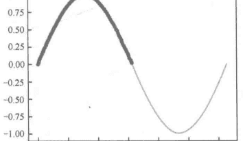

▲图3-4 例3-20程序运行结果

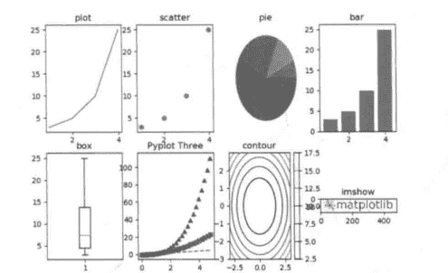

▲图4-2 例4-10程序运行结果

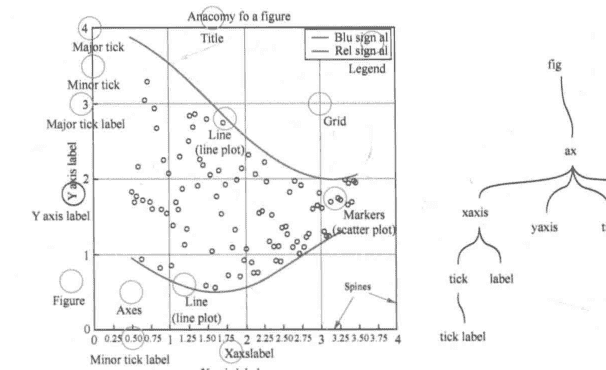

▲图4-4 Axes对象

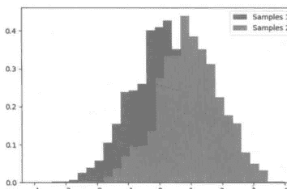

▲图4-5 例4-11程序运行结果

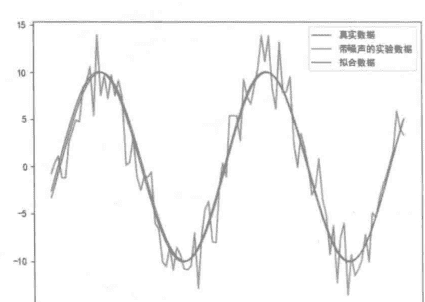

▲图4-7 例4-15.2程序运行结果

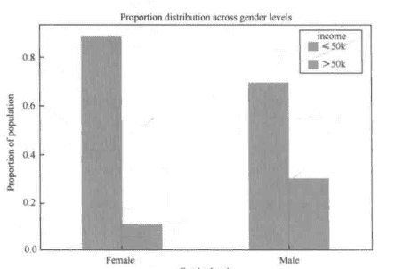

▲图7-5 例7-7.9程序运行结果

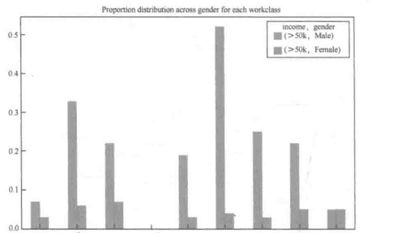

▲图7-6 例7-7.10程序运行结果

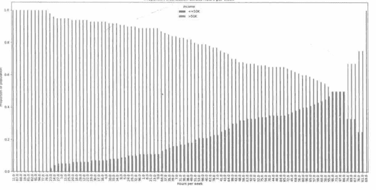

▲ 图7-7 例7-7.11程序运行结果

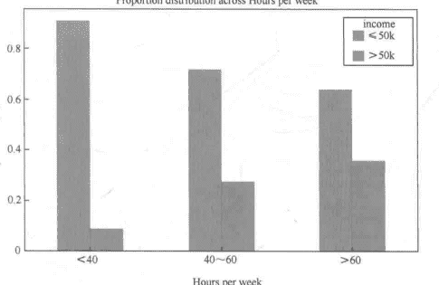

▲ 图7-8 例7-7.12程序运行结果

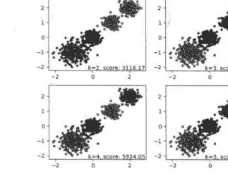

▲ 图10-8 例10-3程序运行结果

## Decision Tree Regression

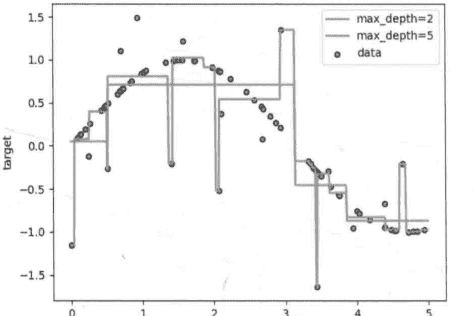

▲图11-3 例11-3程序运行结果


▲图13-1 注意力建模

## 序

2017年7月8日，国务院正式印发《新一代人工智能发展规划》，国内智能化进程由此开启新阶段。2017年12月14日，工信部下发《促进新一代人工智能产业发展三年行动计划（2018-2020年）》，要求推动智能技术与实体经济深度结合，加快制造强国和网络强国建设。

顺势者昌。AI浪潮正席卷而来，若想在互联网竞争中立于不败，必须洞察行业走向，持续迭代技术方法，不断打磨专业能力，才能为职业发展做好准备。

此刻AI人才缺口突出，从业者薪酬在IT板块长期靠前，不少人萌生转型的念头。想搭上风口的人很多，系统化的学习范本却不多。本书希望为初学者照亮路径，既讲原理也讲经验，既给学习路线也重动手实训。

登高望远。无论技术水平高低，都应秉持谦受益满招损的求知态度持续积累。达尔文曾言最有价值的知识是方法论。本书凝练作者的学习与工作沉淀，搭建起一套完整的人工智能学习体系。愿读者在探寻答案与方法的过程中实现能力跃升，这也是本书出版的意义。

黄海涛

2018年秋

## 前言

## 编写背景

本科和硕士阶段，作者多次参加全国数学建模竞赛并取得不错成绩。课余自建了一个数学建模交流站点，供爱好者相互切磋。站点运营多年后发现，最频繁的提问都集中在建模基础，而最受追捧的回复大多来自真实案例。

本书是一本偏重实践的AI技术著作。动笔前主要思考两个问题：服务谁，讲什么。

服务谁？

家乡在北方，每次返乡亲友总问你在北京做什么。第一次回答AI，对方一脸茫然；改口说数据，有点印象；再说互联网，大家便都明白了。

术业隔山，这个印象很深刻。因此写作前就明确，本书面向对AI感兴趣的群体。无论是否在相关岗位，都可阅读。体系完整，配图丰富，不同岗位、不同阶段的读者都会有收获。

讲什么？

本书属实操导向的AI技术书。AI层面覆盖数理基础、Python与算法。实战层面覆盖网络爬虫、数据存储检索、数据分析、自然语言处理、机器学习、推荐系统、深度学习。

每章都配有充足的数学说明与代码示例，帮助读者吃透本章要点，并以此为跳板掌握关联知识点。

## 本书特色

Python凭借语法简洁、可读性强、可扩展性佳，已成为程序设计主流语言之一，也是AI时代的首选工具之一。

本书以Python 3.6为基础，提供近140个代码案例，由浅入深系统讲解Python在智能化各环节的应用。全书分四块。

第一块认知AI：第1章从数学建模竞赛切入介绍AI，并简述AI涉及的核心数学知识。

第二块入门准备：第2～4章循序渐进讲解AI工程中常用的Python模块，提炼语言精华，进行针对性学习。

第三块基础实战：第5～7章分别讲解网络爬虫、数据库存储与数据分析，为后续AI学习做铺垫。

第四块实战应用：第8～14章以自然语言处理开篇，覆盖分词、关键词抽取、词向量、word2vec；随后以四种基础机器学习算法为例说明算法特性；再介绍推荐系统的典型场景，以及协同过滤、知识图谱在其中的应用；最后以TensorFlow入门收尾。

本书脉络清晰、案例完整，涵盖数学基础、编程语言与算法应用。无论是AI新手，还是经验丰富的开发者，都能从中获益。

## 建议和反馈

作者学识有限，书中难免有疏漏不当，欢迎指正。来信请发至作者邮箱 hhtnan@163.com 或编辑邮箱 zhangshuang@ptpress.com.cn，不胜感激。如遇问题需要帮助，也可交流，QQ：451005528，期待共同成长。

## 致谢

感谢妻子李宝玲在编写过程中给予的大力支持！感谢数学博士冯真真对部分数学内容的翻译支持。感谢父母的辛勤付出！感恩所有良师益友！


## 资源与支持

本书由异步社区出品，社区 https://www.epubit.com 为您提供相关资源与后续服务。

## 提交勘误

作者与编辑已尽力确保内容准确，但难免疏漏。欢迎将发现的问题反馈给我们，帮助提升图书质量。

发现错误时请登录异步社区，按书名搜索进入本书页面，点击“提交勘误”，填写勘误信息后提交。作者与编辑审核确认后，您将获得异步社区100积分，可用于兑换优惠券、样书或奖品。


## 扫码关注本书

扫描下方二维码，您将在异步社区微信服务号中看到本书信息及相关服务提示。


## 与我们联系

联系邮箱为 contact@epubit.com.cn。

如对本书有疑问或建议，请发邮件并在标题注明书名，以便更快反馈。

如有意出版图书、录制教学视频，或参与图书翻译、技术审校，可发邮件联系；有意投稿的作者可登录异步社区在线提交 https://www.epubit.com/selfpublish/submission 。

学校、培训机构或企业如需批量采购本书或其他异步社区图书，也可发邮件联系。

若在网上发现对异步社区图书的各种盗版行为，包括未经授权传播全部或部分内容，请将可疑链接发邮件告知。您的举动是对作者权益的保护，也是我们持续提供有价值内容的动力。

## 关于异步社区和异步图书

“异步社区”是人民邮电出版社旗下的IT专业图书社区，致力于出版精品IT技术图书及相关学习产品，为作者提供优质出版服务。异步社区创办于2015年8月，提供大量精品IT技术图书、电子书及高质量技术文章与视频课程。详情请访问官网 https://www.epubit.com。

“异步图书”是异步社区编辑团队策划出版的精品IT专业图书品牌，依托人民邮电出版社近30年计算机图书出版积累与专业编辑团队，相关图书封面印有异步图书LOGO。出版领域包括软件开发、大数据、AI、测试、前端、网络技术等。


# 第1章 从建模视角切入AI


为何把数学建模与当下火热的AI并列？

先从字面拆解，数学建模即数学加建模，也就是借助统计学、线性代数、积分学等数学工具搭建算法模型，用模型去解决实际问题。数学建模没有绝对对错，只有更好，就像比较两只苹果的口感，只能说更喜欢、一般或更好，没有标准答案。

AI可以被看作一种“黑科技”，让计算机以更接近人类的方式思考。可以说算法模型是AI的“灵魂”，没有模型支撑，一切都只是水中月镜中花。

因此本书从数学建模切入，循序渐进揭开AI的神秘面纱。

## 1.1 数学建模

### 1.1.1 数学建模与人工智能

### 1. 数学建模简介

数学建模是用数学手段解决实际问题的一种方法。即通过抽象、简化、假设、引入变量等过程，把实际问题数学化，建立数学模型，再借助数学方法和计算机技术求解。通俗地讲，数学建模就是用统计学、线性代数、积分学等知识构建模型来解决问题。

按照传统定义，数学模型是对现实对象为特定目的做出简化假设后，依据内在规律与数据特征，运用数学工具和计算机软件得到的一个数学结构。

亚里士多德说，“智慧不仅在于知识本身，更在于应用知识的能力”。数学建模是对数学知识的最佳实践，通过它会发现生活中大量有趣问题都能得到解答，其流程如图 1-1 所示。

## 1.2 人工智能简介

对大众而言，AI似乎是近年才被关注，其实早在几十年前就已被提出并有所发展，随大数据技术爆发而加速。

（1）人工智能的诞生

现代AI的萌芽是20世纪30至50年代初多项研究的汇聚。1943年，沃伦·麦卡洛克与瓦尔特·皮茨首次提出“神经网络”概念。1950年，阿兰·图灵提出“图灵测试”，即机器能通过对话而不被辨认为机器则具备智能，至今仍是重要评测手段之一。1951年，马文·明斯基与其同学制作了首台神经网络机SNARC。真正的里程碑是1956年达特茅斯会议，“Artificial Intelligence”一词在此确立并沿用至今。

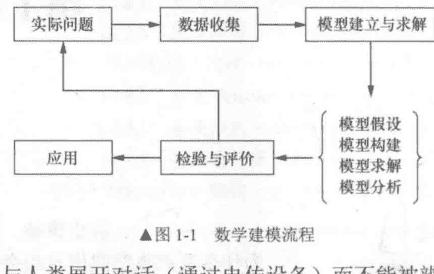


20世纪50年代，AI的研究多从机器“逻辑推理能力”入手。但人类更高级的逻辑推理建立在“学习能力”和“规划能力”之上，即今天所说的“强化学习”与“迁移学习”。可见逻辑推理在通用AI系统中并非根本决定因素。当前在数据、算力、算法模型与多元应用共同推动下，人工智能的定义正从模拟人类智能演进到辅助并提升人类智能，如图1-3所示。

### （2）人工智能的概念

人工智能是研究开发用于模拟、延伸和扩展人类智能的理论、方法、技术及应用系统的新兴技术科学。它旨在理解智能本质，制造能以人类方式作出反应的智能机器，相关领域包括机器人、语言识别、图像识别、自然语言处理、专家系统等。

① 达特茅斯会议参会者50年后重聚，左起：Trenchard More、John McCarthy、Marvin Minsky、Oliver Selfridge 和 Ray Solomonoff，摄于2006年，图片版权归原作者所有。

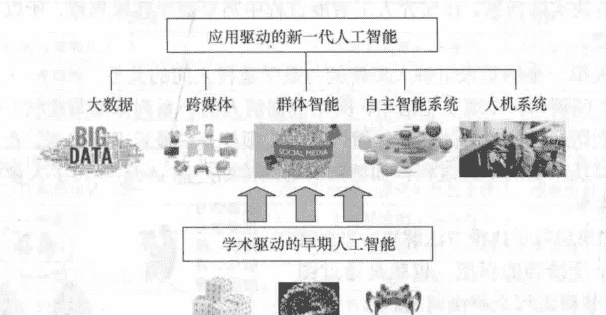

▲图1-3 下一代人工智能（图片来源《新一代人工智能发展白皮书》）

自诞生以来，AI理论与技术日趋成熟，应用领域不断扩展。未来由AI带来的科技产品，或将成为人类智慧的载体，甚至超越人类智能。

### （3）人工智能、机器学习、深度学习

与AI密切相关的几个概念可通过同心圆来理解，如图1-4所示，最外层是理念，其次是机器学习，随后是深度学习，今天的AI爆发由深度学习驱动。

人工智能、机器学习、深度学习关系为 DL⊆ML⊆AI。


▲图1-4 AI、机器学习、深度学习的关系

人工智能是一个宽泛的概念，其目标是让计算机像人一样思考。机器学习是AI的重要分支，是赋予计算机智能的核心途径，广泛应用于AI各个领域。深度学习是机器学习中的新方向，推动了机器学习发展并拓展了AI范围。有人认为深度学习可能是实现强AI的突破口。

可把人工智能比作孩子的大脑，机器学习是培养认知能力的过程，深度学习则是其中高效的教学体系。

概括而言：人工智能是目的与结果；深度学习、机器学习是方法与工具。

本书讲解了人工智能、机器学习、深度学习的相关应用及其关系、常见机器学习算法等，期望读者能深刻理解这些概念并能向他人清晰阐释。

## 1.3 数学建模与人工智能关系

无论数学建模还是人工智能，核心都是算法，最终目的是以更好形式服务人类、解决实际问题。研究AI需要数学建模思维，因而数学建模对AI至关重要。

下面通过一个场景理解二者关系。

某患者就诊，医生依据体征与症状判断病情，先询问症状再进行专项检查最后确诊。在AI视角下，可通过算法实现此过程，如德国辅助诊断产品Ada即通过大量病例学习提升医生诊疗准确率。

场景①：用数学建模方法解决，则按图1-1的流程构建恰当模型求解。

场景②：用人工智能方法解决，则需制造一个会诊断的机器人。要实现精准诊断，需借助AI技术手段，如采用机器学习或深度学习算法，最终得到可落地的疾病预测解决方案，使其具备思考、听懂、看懂、逻辑推理与运动控制能力，如图1-5所示。


▲图1-5 AI机器人

可见AI离不开数学建模。在解决AI问题时，我们会放大模型的建立与求解环节以提升精度，如图1-6所示。

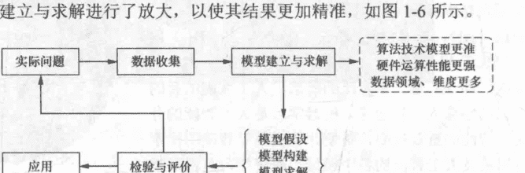

▲图1-6 AI下对数学建模的流程修正

因此，从数学建模角度学习人工智能是一种合适路径。

### 1.1.2 数学建模中的常见问题

美国数学建模竞赛自1985年起持续至今。中国大学生数学建模竞赛也有20余年历史，已趋成熟。下面通过历年赛题了解数学建模的内涵与可解决的问题，如表1-1所示。

### 表 1-1 数学建模竞赛题目

| 年份 | 赛题 | 题目 | 题目简述 |

|---|---|---|---|

| 1998 | A | 投资的收益和风险 | 市场上面有 n 种投资，某公司如何投资 |

| 1998 | B | 灾情巡视路线 | 某地受灾，给出最佳巡视路线 |

| 1999 | A | 自动化车床管理 | 连续加工零件，检查是否出现故障 |

二十年数学建模经典赛题盘点与要点拆解

表中所列案例覆盖互联网、医药、交通、能源、环境等多类现实场景。下面从若干代表性方向进行深度拆解。

| 年份 | 题型 | 题名 | 概要 |
|---|---|---|---|
| 1999 | B | 钻井布局 | 钻井布设：在勘探区域寻矿时，如何充分使用既有井位以减少支出 |
| 2000 | A | DNA序列分类问题 | DNA序列分型：解析与生命过程及遗传演化相关的基因序列信息 |
| 2000 | B | 钢管订购和运输问题 | 钢管采购与运送：为天然气主干管道建设寻求最低总花费方案 |
| 2001 | A | 血管三维重建 | 血管三维重建：求解血管中心线及管径 |
| 2001 | B | 公交车调度 | 公交运行排班：制定全天可执行的车辆调度计划 |
| 2002 | A | 车灯线光源的优化设计 | 车灯线性光源优化：依据设计规范确定光源长度 |
| 2002 | B | 彩票中的数学 | 彩票数学研究：剖析彩民吸引因素并设计新型彩票模型 |
| 2003 | A | SARS的传播 | SARS传播建模：收集疫情数据并构建预测模型 |
| 2003 | B | 露天矿生产的车辆安排 | 露天矿车调配：为单班生产计划设计高效算法 |
| 2004 | A | 奥运临时超市网点设计 | 奥运临时超市选址：规划便民网点布点 |
| 2004 | B | 电力市场的输电阻塞管理 | 电力市场输电阻塞管控：实现交易与调度一体化 |
| 2005 | A | 长江水质的评价和预测 | 长江水体质量评估与推演：在近两年半时间内对水质进行量化综合评价 |
| 2005 | B | DVD在线租赁 | DVD在线租赁业务：需求预测、采购与分发 |
| 2006 | A | 出版社的资源配置问题 | 出版社资源调配：合理配置资源以实现收益最大 |
| 2006 | B | HIV病毒问题 | HIV治疗效果预估：对疗效进行预测分析 |
| 2007 | A | 中国人口增长预测 | 中国人口增长推测：研判中短期与长期发展态势 |
| 2007 | B | 乘公交，看奥运 | 公交线路优选：以奥运观赛出行为例 |
| 2008 | A | 数码相机定位 | 双相机定位：建立两台固定相机相对位姿的数学模型与算法 |
| 2008 | B | 高等教育学费标准探讨 | 高等教育收费标准研究：对不同院校专业学费进行量化探讨 |
| 2009 | A | 制动器试验台的控制方法分析 | 制动器试验台控制策略分析：电机驱动电流的计算与控制 |
| 2009 | B | 眼科病床的合理安排 | 眼科病床配置：评估床位安排模型的优劣 |
| 2010 | A | 储油罐的变位识别与罐容表标定 | 储油罐位移识别与容积表校准：研制位移识别与容积标定方法 |
| 2010 | B | 2010年上海世博会影响力的定量评估 | 2010上海世博会影响力量化评估：构建模型进行定量评价 |
| 2011 | A | 城市表层土壤重金属污染分析 | 城市地表土壤重金属污染分析 |
| 2011 | B | 交巡警服务平台的设置与调度 | 交巡警服务平台布设与调度：提出警力合理调配方案 |
| 2012 | A | 葡萄酒的评价 | 葡萄酒品质评价：对酒质量进行判别 |
| 2012 | B | 太阳能小屋的设计 | 太阳能小屋设计：优化光伏电池布局 |
| 2013 | A | 车道被占用对城市道路通行能力的影响问题 | 车道占用对城市路网通行能力的影响：分析突发事故影响 |
| 2013 | B | 碎纸片拼接复原问题 | 碎纸片拼接复原：建立复原模型与算法 |
| 2014 | A | 嫦娥三号软着陆轨道设计与控制策略 | 嫦娥三号软着陆轨道设计与控制策略：确定六个阶段的最优控制方案 |
| 2014 | B | 创意平板折叠桌 | 创意平板折叠桌：对折叠桌进行数学描述与设计 |
| 2015 | A | 太阳影子定位 | 太阳投影定位：通过影子变化推断视频拍摄地与日期 |
| 2015 | B | “互联网+”时代的出租车资源配置 | 互联网加时代网约车资源配置：分析供需匹配并设计补贴方案 |
| 2016 | A | 系泊系统的设计 | 系泊系统设计：设计算法获得满意方案 |
| 2016 | B | 小区开放对道路通行的影响 | 小区开放对路网通行影响：评估其缓解拥堵效果 |
| 2017 | A | CT系统参数标定及成像 | CT系统参数标定与成像：通过算法减小安装误差提升精度 |
| 2017 | B | 拍照赚钱任务定价 | 拍照获利任务定价：分析App用户接单的定价规律 |
| 2018 | A | 高温作业专用服装设计 | 高温作业专用服装设计：用数学模型确定假人皮肤外侧温度变化 |
| 2018 | B | 智能RGV动态调度策略 | 智能RGV动态调度策略：用数学模型对智能加工系统进行动态调度 |

## 1. 分类类题目解析
分类型任务的本质是为目标对象指定预定义类别，比如将一条用户评论判定为正面或负面。在建模实践中常出现二值与多值两种情形。

### 2000年 A题 DNA序列分类
2000年6月，人类基因组计划的DNA草图基本完成，预计次年完成精确认图。DNA由A、T、C、G四个字母按顺序排列成约三十亿字符的长串，没有标点。破译这部信息巨著的关键在于发现序列中隐藏的结构规律。研究发现编码蛋白质的片段由六十四种三联体组成，含量特征也有差异，统计上不同片段存在相关性。研究思路多采用粗粒化与模型化，先提取特征再进行建模。

题目要求：给出二十个人工序列，其中1至10号为A类，11至20号为B类，先从中提取特征建立分类方法并自检效果，再用该方法对21至40号未标类序列进行分类，按序号从小到大给出A类、B类结果，不确定的不写。方法需详细描述并说明程序或现成方法名称。第二问对文件Nat-model-data中的一百八十二个自然DNA序列进行分类并给出结果。分类优劣以正确率衡量，可采用特征空间表示、几何向量或概率统计模型等途径。

## 2. 评价类课题
### 2005年 A题 长江水质的评价和预测
长江是我国内第一、世界第三大河，水质污染日趋严重。2004年10月考察团对沿线二十一个重点城市进行实地调查。附件提供十七个观测站近两年半水质指标检测数据，以及干流七个站点近一年半的距离、水流量、水流速等基础数据。常规认为某站水质污染来自本地区排污和上游污水，河流自身具有自然净化能力，降解系数通常在0.1至0.5之间，可取0.2 L/天，主要污染物为高锰酸盐指数和氨氮。附件4给出1995至2004年的统计数据，附表为国标GB3838-2002地表水环境质量标准中四类限值。

需要解决：
1. 对近两年半长江水质作定量的综合评价，分析各地区污染状况。
2. 研究干流近一年半高锰酸盐指数和氨氮的污染源主要分布区。
3. 依据过去十年统计数据，预测若不加强治理未来十年水质污染发展态势。
4. 若未来十年干流IV类和V类水占比需控制在百分之二十以内且无劣V类水，每年需处理多少污水。
5. 对解决长江水质污染提出切实可行的建议。

## 3. 预测类课题
### 2006年 B题 艾滋病疗法的评价及疗效的预测
艾滋病由HIV病毒引起，破坏免疫系统，CD4细胞数量下降是关键标志。治疗目标是降低体内HIV数量并提升CD4。现有疗法存在副作用和成本问题。

附件1为ACTG320试验，三百余名病人同时服用齐多夫定、拉美夫定、茚地那韦三种药物，每隔数周检测CD4与HIV浓度。附件2为193A试验，一千三百余名病人随机分四组服药，每约八周测CD4。四个方案的日药量分别为：600mg齐多夫定或400mg去羟基苷按月轮换；600mg齐多夫定加2.25mg扎西他滨；600mg齐多夫定加400mg去羟基苷；600mg齐多夫定加400mg去羟基苷再加400mg奈韦拉平。

问题：
1. 基于附件1预测继续治疗的效果或确定最佳终止时间。
2. 基于附件2以CD4为标准评价四种疗法优劣，并对较优疗法预测效果或终止时间。
3. 若考虑药品价格：齐多夫定1.60美元/600mg，去羟基苷0.85美元/400mg，扎西他滨1.85美元/2.25mg，奈韦拉平1.20美元/400mg，对评价和预测有何改变。

## 4. 旅行商类问题
### 2015年 F题 旅游路线规划问题
旅游业是经济重要动力。随着生活水平提升，自驾游需求增长。附件1列国家旅游局公布的二百零一个5A景区名单及每个景区最少游览时间。约束：每年外出不超过三十天，每年出游次数不超过四次，每次不超过十五天；行车限7:00至19:00，每天开车不超过八小时；全天游览开车控制在三小时内，半天游览开车控制在五小时内；高速平均九十公里每小时，普通公路四十公里每小时；每个省会至少停留二十四小时；景区开放8:00至18:00。

问题：
1. 采用高速优先策略，先到邻近城市再自驾到景区。附件1给出景区到邻近城市路程时间，附件2为国家高速信息，附件3为省会间高速路网。以西安为常住地，规划游遍二百零一个景区至少需几年，给出每次行程的每日出发地、行车时间、里程、游览景区等。
2. 可考虑乘坐高铁或飞机先到省会再租车自驾，租车三百元每天，油费过路费另计，租还同城。景区最长停留不超过最少时间的两倍。附件4给出高铁票价信息，当天高铁不超过六小时，当天至多半天游览；附件5给出省会间机票全价。三人同行，住宿费省会景区二百元每人每天、地级市一百五十元每人每天、县城一百元每人每天；高速油耗加过路费一元每公里，普通公路零点六元每公里。设计十年游遍所有景区、费用最优、体验最好的线路，给出每次出行方式及每日费用、路途时间、游览景区、游览时长。
3. 在上述模型基础上推广，为全国自驾爱好者规划线路，并给出常住地北京的十年计划；据结果提建议。
4. 二〇〇七年三月至二〇一五年七月共批准二百零一家5A景区，附件6为评定信息，附件7为4A景区名单，如何更合理地规划十年计划。

## 5. 优化类问题
### 2000年 B题 钢管订购和运输问题
需铺设A1至A5天然气干线主管道。可供货钢厂S1至S7，粗线为铁路，细线为公路，双线为管道，旁注里程。一公里主管道钢管为一单位。钢厂若承制至少生产五百单位，最大产量Si，单价pi万元每单位。铁路运价：千公里内每单位每公里零点零六万元，超过千公里每增加一百公里运价增加零点零五万元。公路运输费为零点一万元每单位每公里，不足整公里按整公里计。

任务是在满足最小起订量、产能上限和总需求的前提下，选择钢厂、确定采购量与运输方式，使总费用最小。

主管道钢管采购运输优化

钢管的投运通道包含铁路与公路两种方式，投运范围覆盖整条管线的所有需求点，而非仅限于 A1、A2 … A5 等几个交接点。

- （1）在主管道钢管的采购与运输上，构建一个使总支出最低的方案并给出最小费用数值。
- （2）在（1）所建模型之上开展灵敏度分析，判断哪家钢厂的出厂价变动对采购运输方案与总成本的扰动最剧，哪家钢厂的产能上限变动对方案与总成本的影响最显著，并给出相应的量化结果。
- （3）当铺设对象由单一线路变为树状网络，铁路、公路与管道构成互联网络时，给出这类更一般情形的可行求解思路，并针对图 1-8 按照（1）的要求建立模型并给出求解结果。

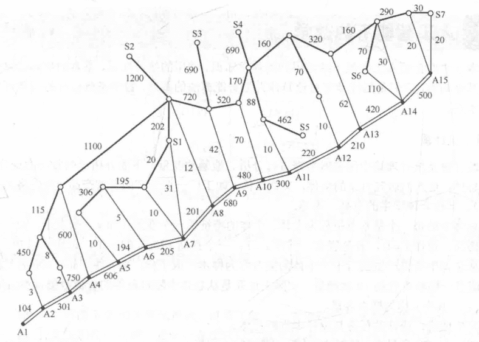

▲图 1-7 《钢管订购和运输》题目原图一

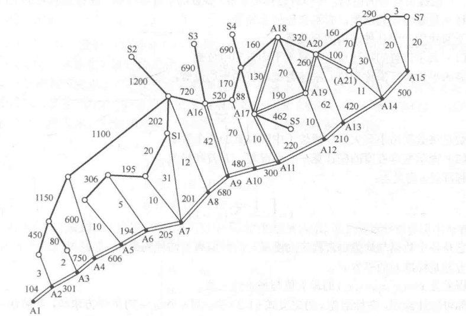

▲图 1-8 《钢管订购和运输》题目原图二

## 1.2 人工智能下的数学

人工智能算法的底层支撑是数学。本章汇总在 AI 场景里高频出现的数学工具、常用统计概念、基础矩阵运算与高等数学概览，为后续算法讲解做准备。数学基础扎实的读者可以酌情跳过。

### 1.2.1 统计量

统计量是指对样本数据进行加工后，用于估计总体参数或进行检验的函数。下面介绍几种典型统计量。

总体是研究对象的全部集合，也称母体，如一天生产的全部产品、全体学生的身高等。

总体中每个基本单元称为个体，用变量 x 标记其特征，如合格品记 x=0，废品记 x=1，身高 170cm 记 x=170。

从总体里随机抽取若干个体构成的集合称为样本，记为 x₁,x₂,…,xₙ，n 为样本容量。

统计学的核心是从样本信息推断总体特征。

设样本容量为 n，样本写成 x=(x₁,x₂,…,xₙ)，经加工后得到不含未知量的、反映样本数量特征的函数，即统计量。

- (1) 刻画位置的统计量——均值与中位数

均值描述数据集中位置，记作 x̄。
x̄ = 1/n Σ_{i=1}^n x_i  (1-1)
中位数为数据从小到大排序后位于中间位置的数值。

- (2) 刻画离散程度的统计量——标准差、方差与极差

标准差 s 的计算式为：
s = [ 1/(n-1) Σ_{i=1}^n (x_i - x̄)^2 ]^{1/2}  (1-2)
它衡量各观测值偏离均值的程度，即变异。方差为 s²。极差等于样本最大值减去最小值。式 (1-2) 用 n-1 作分母是为了实现无偏估计。

### （3）中心矩、刻画分布形态的统计量——偏度与峰度

随机变量 x 的 r 阶中心矩为 E(x-E(x))^r。偏度与峰度分别是标准化变量 (x-E(x))/√D(x) 的三阶中心矩和四阶中心矩，形式如下：

$$\nu_1 = E\left[\left(\frac{x-E(x)}{\sqrt{D(x)}}\right)^3\right] = \frac{E[(x-E(x))^3]}{\left(D(x)\right)^{3/2}}$$ $$\nu_2 = E\left[\left(\frac{x-E(x)}{\sqrt{D(x)}}\right)^4\right] = \frac{E[(x-E(x))^4]}{\left(D(x)\right)^2}$$

偏度反映分布对称性，ν₁>0 为右偏，均值右侧数据更集中；ν₁<0 为左偏；ν₁接近 0 可视为对称。峰度反映分布陡峭程度，正态分布峰度为 3，若 ν₂ 远大于 3，说明尾部较重，样本中远离均值的数据较多，可作为偏离正态的度量之一。

### 1.2.2 矩阵概念及运算

理解 AI 算法原理需要高等数学与线性代数基础，实现论文里的算法更需要扎实的数学功底。本节聚焦 AI 中常用的矩阵知识。

### 1. 矩阵概念

在算法实现里，matrix、array 等关键词往往指向矩阵。下面用生活案例说明。

生产生活里常用数表记录量或关系，如产量统计表、价目表等。例如某居民二季度每月用水、用电、天然气用量可用 3 行 3 列数表表示：

|   | 水 | 电 | 气 |
|---|---|---|---|
| 4月 | 9 | 165 | 14 |
| 5月 | 10 | 190 | 15 |
| 6月 | 10 | 210 | 16 |

不同问题对应不同数表，这些数表统称为矩阵。$$\begin{bmatrix} a_{11} & a_{12} & \cdots & a_{1n} \\ a_{21} & a_{22} & \cdots & a_{2n} \\ \vdots & \vdots &  & \vdots \\ a_{m1} & a_{m2} & \cdots & a_{mn} \end{bmatrix}$$
m 行 n 列数值按中括号或小括号排列构成 m×n 矩阵，通常用大写字母 A、B、C 表示，记作：
$A = [a_{ij}]_{m×n}$
其中 $a_{ij}(i=1,2,\cdots,m;\ j=1,2,\cdots,n)$ 为第 i 行第 j 列元素。特别地，m=1 时为行矩阵即行向量：
$A = [a_{11}\ a_{12}\ \cdots\ a_{1n}]$
n=1 时为列矩阵即列向量：
$A = \begin{bmatrix} a_{11} \\ a_{21} \\ \vdots \\ a_{m1} \end{bmatrix}$
m=n 时为 n 阶方阵：
$A = \begin{bmatrix} a_{11}&a_{12}&\cdots&a_{1n} \\ a_{21}&a_{22}&\cdots&a_{2n} \\ \vdots&\vdots&&\vdots \\ a_{n1}&a_{n2}&\cdots&a_{nn} \end{bmatrix}$

常见特殊形式有：

### （1）零矩阵

零矩阵常用于构造空矩阵，例如：
$O_{3×4}=\begin{bmatrix}0&0&0&0\\0&0&0&0\\0&0&0&0\end{bmatrix}$
全部元素为 0 的 m×n 矩阵称为零矩阵，记作 $O_{m×n}$ 或 $O$。

### （2）单位矩阵

单位矩阵在运算中起到数字 1 的作用，例如：
$E_2=\begin{bmatrix}1&0\\0&1\end{bmatrix},\ E_3=\begin{bmatrix}1&0&0\\0&1&0\\0&0&1\end{bmatrix}$
主对角线元素为 1 其余为 0 的 n 阶矩阵称为 n 阶单位矩阵，记作 $I_n$ 或 $I$。

## 2. 矩阵的运算

### （1）矩阵的相等

设 $A=[a_{ij}]_{m×n}$，$B=[b_{ij}]_{s×p}$，若 m=s，n=p 且对所有 i,j 有 $a_{ij}=b_{ij}$，则 A=B。矩阵相等等价于对应元素逐一相等。例如：
$A = \begin{bmatrix} a_{11} & a_{12} & a_{13} \\ a_{21} & a_{22} & a_{23} \end{bmatrix}$
$B = \begin{bmatrix} 3 & 0 & -5 \\ -2 & 1 & 4 \end{bmatrix}$
则 A=B 当且仅当 $a_{11}=3$, $a_{12}=0$, $a_{13}=-5$, $a_{21}=-2$, $a_{22}=1$, $a_{23}=4$。若列数不同，矩阵不可能相等。

### （2）加法

对同型矩阵 $A=[a_{ij}]_{m×n}$ 与 $B=[b_{ij}]_{m×n}$，其和为
$C = A + B = [a_{ij}+b_{ij}]$
即对应元素相加。减法定义为 $D = A - B = A + (-B) = [a_{ij} - b_{ij}]$。只有行列数相同的矩阵才能相加减。

### （3）数乘

设 $A=[a_{ij}]_{m×n}$，$\lambda$ 为实数，则数乘矩阵 $C=\lambda A$ 满足 $c_{ij}=\lambda a_{ij}$。数乘即对每个元素乘以 $\lambda$，特别地 $\lambda=-1$ 时得到负矩阵。

### (4) 乘积

设 $A$ 为 $m×s$ 矩阵，$B$ 为 $s×n$ 矩阵，则乘积 $C=AB$ 为 $m×n$ 矩阵，其中 $c_{ij}=\sum_{k=1}^{s}a_{ik}b_{kj}$。由此可得：左矩阵列数须等于右矩阵行数；乘积矩阵行数等于左矩阵行数，列数等于右矩阵列数；第 i 行第 j 列元素为 A 的第 i 行与 B 的第 j 列对应元素乘积之和，即行乘列法则。

### (5) 转置

把 $m×n$ 矩阵的行列互换得到 $n×m$ 矩阵，记作 $A'$。转置满足：
$(A')' = A$
$(A+B)' = A' + B'$
$(kA)' = kA'$
$(AB)' = B' A'$

## 1.2.3 概率论与数理统计

### 1. 事件与随机变量

### (1) 互斥事件与对立事件

互斥事件为不可能同时发生的事件，对立事件为必有其一发生的互斥事件。用概率表示，互斥时 P(A∪B)=P(A)+P(B)，对立时 P(B)=1−P(A)。对立必互斥，互斥不一定对立。

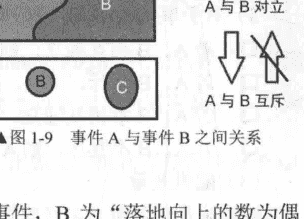

### （2）独立事件与互斥事件

两者易混淆，下面用骰子举例说明。


抛一颗骰子，设 A 为“点数为奇数”，B 为“点数为偶数”，C 为“点数为 3 的倍数”，D 为“点数大于 3”，E 为“点数为 7”。判断互斥、对立、相互独立。

A = {1,3,5}, B = {2,4,6}, C = {3,6}, D = {4,5,6}, E = {7}
P(A)=1/2, P(B)=1/2, P(C)=1/3, P(D)=1/2, P(E)=0,
P(AB)=0, P(AC)=1/6, P(BC)=1/6, P(AD)=1/6, P(AE)=0

结论如表 1-3：

表 1-3 抛掷骰子结论表

|  | 互斥 | 对立 | 相互独立 |
|---|---|---|---|
| A 与 B | 是 | 是 | 不 |
| A 与 C | 不 | 不 | 是 |
| B 与 C | 不 | 不 | 是 |
| A 与 D | 不 | 不 | 不 |
| A 与 E | 是 | 不 | 是 |

归纳结论：
- 1) 集合无交集的事件 A、B 互斥，含义为不能同时发生。
- 2) 若 P(AB)=P(A)P(B)，则 A、B 相互独立，意味着一方发生不影响另一方概率。从集合视角，在概率非零时，独立事件的结果集合必有交集。
- 3) A、B 独立则 A 与 B̅、Ā 与 B、Ā 与 B̅ 均独立；ĀB、A B̅、Ā B̅ 为互斥。

对立与互斥的关系：
1) 若 A、B 中至少一个为不可能事件，则一定互斥且独立。
2) 若 P(A)、P(B) 至少一个为 0，则一定独立，可能互斥也可能不互斥。
3) 若 P(A)、P(B) 均不为 0：
- 独立则必不互斥；
- 互斥则必不独立；
- 不独立则可能互斥也可能不互斥；
- 不互斥则可能独立也可能不独立。

### （3）随机变量

为研究随机现象的规律，将事件数量化后引入随机变量概念。图 1-10 给出分类，AI 项目多关注离散与连续类型。

离散型随机变量取有限个或可列无限个值；连续型随机变量取值可充满某个区间。

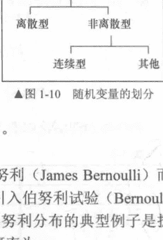

### 2. 常见的概率分布

概率分布与微积分速览 + Python 环境搭建

先把第12章会反复用到的四类基础分布过一遍，再把微积分的要点提炼出来，最后说明科学计算环境的搭建思路。

四大常用分布要点

### （1）伯努利分布
以瑞士数学家詹姆斯·伯努利命名，记作 X~Bernoulli(p)，属于离散型两点模型。先看伯努利试验：单次随机试验只有成功与失败两种互斥结果，抛硬币就是典型，正面概率记为 p，反面概率记为 q=1-p。
该模型也叫0-1分布或两点分布，取值仅为 x=0 表示失败、x=1 表示成功，对应概率分别是 1-p 与 p。
概率质量函数为：
f(x)=p^x(1-p)^{1-x}= { p , x=1 ; 1-p , x=0 ; 0 , 其他 }
均值等于 p，方差为 p(1-p)。

### （2）二项分布
可视为伯努利试验独立重复 n 次的汇总。保持条件恒定，做 n 次独立试验，每次只有事件 A 出现或不出现，A 出现的概率设为 p，未出现为 1-p。n 次中 A 恰好出现 k 次的概率为：
$P(X=k)=C_n^k p^k (1-p)^{n-k},\ k=0,1,2,\dots,n$
记作 $X\sim B(n,p)$。期望为 $np$，方差为 $np(1-p)$。

### （3）多项式分布
把二项的二分类推广到多分类就得到多项分布，常记 $X\sim Multinomial(n,p)$。例如掷骰子，与硬币不同，骰子有 6 个面对应 6 种点数，单次每种点数出现的概率为 $\frac{1}{6}$，记作 $p_1\sim p_6$，它们不必全相等，只要互斥且总和为 1 即可，比如不规则骰子。重复掷 $n$ 次，其中 $k$ 次出现点数 6 的概率可写成：
$P(X=k)=C_n^k p_6^k (1-p_6)^{n-k},\ k=0,1,2,\dots,n$
前三类均为离散型分布。

### （4）高斯分布
高斯分布即正态分布，在数学、物理、工程等领域应用极广，对统计学影响深远。若随机变量 $X$ 的均值是 $\mu$、标准差是 $\sigma$，记作 $X\sim N(\mu,\sigma^2)$。
$f(x)=\frac{1}{\sigma\sqrt{2\pi}}e^{-\frac{(x-\mu)^2}{2\sigma^2}}$
该形态在现实中很常见，在朴素贝叶斯里也是最常用的假设。

## 1.2.4 高等数学——导数、微分、不定积分、定积分
做人工智能绕不开高等数学。微积分包含微分学与积分学，导数和微分是微分学的核心。导数刻画函数随自变量变化的速度，微分则给出自变量发生微小改动时函数的大致变化量，即局部增量的线性近似。积分学这里只讲不定积分与定积分，在一元函数范围内介绍概念、性质与计算方法，帮助非数学专业的 IT从业者理清区别与联系。

以下在单变量框架下展开。

### 1. 导数与导函数
### （1）函数在一点处的导数
设 $y=f(x)$ 在 $x_0$ 的邻域 $U(x_0,\delta)$ 内有定义，自变量增量 $\Delta x$ 满足 $x_0+\Delta x\in U(x_0,\delta)$，函数增量 $\Delta y=f(x_0+\Delta x)-f(x_0)$。若极限
$\lim_{\Delta x\to0}\frac{\Delta y}{\Delta x}=\lim_{\Delta x\to0}\frac{f(x_0+\Delta x)-f(x_0)}{\Delta x}$
存在，则称 $y=f(x)$ 在 $x_0$ 可导，该极限即为在 $x_0$ 的导数值，记作 $f'(x_0)$、$y'|_{x=x_0}$、$dy/dx|_{x=x_0}$、$df(x)/dx|_{x=x_0}$，即 $f'(x_0)=\lim_{\Delta x\to0}[f(x_0+\Delta x)-f(x_0)]/\Delta x$。

### (2) 单侧导数
导数由极限定义，自然有左右极限之分。
设 $y=f(x)$ 在 $x_0$ 左邻域有定义，自变量由左增量时，若极限 $\lim_{\Delta x\to0^+}[f(x_0+\Delta x)-f(x_0)]/\Delta x$ 或 $\lim_{x\to x_0^-}[f(x)-f(x_0)]/(x-x_0)$ 存在，则此极限为左导数，记 $f'_{-}(x_0)$。
$f'_{-}(x_0)=\lim_{\Delta x\to0^+}[f(x_0+\Delta x)-f(x_0)]/\Delta x=\lim_{x\to x_0^-}[f(x)-f(x_0)]/(x-x_0)$
同理，右邻域有定义且 $\lim_{\Delta x\to0^+}[f(x_0+\Delta x)-f(x_0)]/\Delta x$ 或 $\lim_{x\to x_0^+}[f(x)-f(x_0)]/(x-x_0)$ 存在，则为右导数 $f'_{+}(x_0)$。
$f'_{+}(x_0)=\lim_{\Delta x\to0^+}[f(x_0+\Delta x)-f(x_0)]/\Delta x=\lim_{x\to x_0^+}[f(x)-f(x_0)]/(x-x_0)$

### (3) 导函数
若 $y=f(x)$ 在区间 $I$ 上每点可导，且导数值随 $x$ 构成新函数，则称之为导函数，记作 $f'(x)$、$y'$、$df(x)/dx$、$dy/dx$。
$f'(x)=\lim_{\Delta x\to0}[f(x+\Delta x)-f(x)]/\Delta x$ 或 $f'(x)=\lim_{h\to0}[f(x+h)-f(x)]/h$
注：
- 在定义式中，极限过程里 $x$ 看作常数，$\Delta x$、$h$ 为变量。
- 导函数常简称为导数，未指明点时即指导函数。点导数 $f'(x_0)$ 就是导函数在 $x_0$ 的函数值，即 $f'(x_0)=f'(x)|_{x=x_0}$。

### 2. 微分
设 $y=f(x)$ 在某区间有定义，$x_0$ 及 $x_0+\Delta x$ 均在此区间，若函数增量
$\Delta y = f(x_0 + \Delta x) - f(x_0)$
可表为
$\Delta y = A\Delta x + o(\Delta x)$
其中 $A$ 与 $\Delta x$ 无关，则称 $y=f(x)$ 在 $x_0$ 可微，$A\Delta x$ 为该点相对于 $\Delta x$ 的微分，记作
$dy|_{x=x_0}=A\Delta x$ 或 $df(x_0)=A\Delta x$。

## 3. 微分与导数的关系
定理：$y=f(x)$ 在 $x_0$ 可微的充要条件是其在 $x_0$ 可导，且可微时 $dy|_{x=x_0}=f'(x_0)\Delta x$。
由此可得：
- (1) 点微分是函数增量的主要线性部分，此时 $A=f'(x_0)\ne0$。$dy=A\Delta x$ 是 $\Delta x$ 的线性函数，称作 $\Delta y$ 的线性主部。当 $|\Delta x|$ 很小时 $o(\Delta x)$ 可忽略，有近似 $\Delta y\approx dy$。
- (2) 可导与可微等价，求导也称微分。但导数 $f'(x_0)$ 是变化率，只依赖 $x$；微分 $dy|_{x=x_0}$ 是增量的线性主部，既依赖 $x$ 也依赖 $\Delta x$。
任意点 $x$ 处的微分记作 $dy$ 或 $df(x)$，即 $dy=df(x)=f'(x)\Delta x$。通常把 $\Delta x$ 记为自变量微分 $dx$，于是 $dy=f'(x)dx$，$dy/dx=f'(x)$。因此微分与自变量微分的商即为导数。多元情形更复杂，值得注意的是全微分等于各偏微分之和。

## 4. 不定积分
若对 $f(x),x\in I$ 存在 $F(x)$ 使任意 $x\in I$ 都有 $F'(x)=f(x)$ 或 $dF(x)=f(x)dx$，则称 $F(x)$ 为 $f(x)$ 的原函数。所有原函数的集合称为不定积分，记作
$\int f(x)dx = F(x) + C$
注：
- (1) $f(x)$ 连续则必可积。
- (2) 若 $F,G$ 均为原函数，则 $F(x)=G(x)+C$，不定积分形式不唯一。
常用性质：
- 性质1：$d/dx[\int f(x)dx]=f(x)$ 或 $d[\int f(x)dx]=f(x)dx$。
- 性质2：$\int F'(x)dx=F(x)+C$ 或 $\int dF(x)=F(x)+C$。
- 性质3：$\int[\alpha f(x)\pm\beta g(x)]dx=\alpha\int f(x)dx\pm\beta\int g(x)dx$，$\alpha,\beta$ 为非零常数。
计算方法有换元法、部分积分法等，这里以凑微分为例：
求解 $\int e^{3t}dt$。
$\int e^{3t}dt = 1/3\int e^{3t}d(3t)=1/3 e^{3t}+C$

## 5. 定积分
设 $y=f(x)\in C[a,b]$ 且 $y>0$，由曲线 $y=f(x)$、$x=a$、$x=b$、$y=0$ 围成的曲边梯形面积可如此定义：将图形分割为若干细条，第 $i$ 条面积 $\Delta S_i\approx f(\xi_i)\Delta x_i$，其中 $\xi_i\in[x_{i-1},x_i]$，$\Delta x_i=x_i-x_{i-1}$。总面积近似 $S\approx\sum_{i=1}^n f(\xi_i)\Delta x_i$，
$S=\lim_{\lambda\to0}\sum_{i=1}^n f(\xi_i)\Delta x_i$，$\lambda=\max\{\Delta x_i\}$。
抽象为定积分的构造步骤：
- (1) 分割：$a=x_0<x_1<\dots<x_n=b$，记 $\Delta x_i=x_i-x_{i-1}$，$\lambda=\max\Delta x_i$。
- (2) 取点：在 $[x_{i-1},x_i]$ 任取 $\xi_i$。
- (3) 求和：$\sum_{i=1}^n f(\xi_i)\Delta x_i$。
- (4) 取极限：$\lim_{\lambda\to0}\sum_{i=1}^n f(\xi_i)\Delta x_i$。

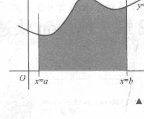

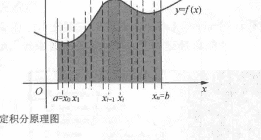

▲图 1-11 定积分原理图

若极限存在，则为 $f(x)$ 在 $[a,b]$ 上的定积分，记作 $\int_a^b f(x)dx$，即 $\int_a^b f(x)dx=\lim_{\lambda\to0}\sum_{i=1}^n f(\xi_i)\Delta x_i$。$[a,b]$ 为积分区间，$a$ 下限，$b$ 上限，$\sum f(\xi_i)\Delta x_i$ 为积分和。

## 6. 牛顿-莱布尼茨公式
定理：若 $f(x)$ 在 $[a,b]$ 连续，$F(x)$ 为其原函数，则 $\displaystyle\int_a^b f(x)dx=F(b)-F(a)$。
证明思路：$F(x)$ 为原函数，$\Phi(x)=\int_a^x f(t)dt$ 亦为原函数，二者相差常数，于是 $\int_a^x f(t)dt-F(x)=C$，从而 $\int_a^b f(x)dx=F(b)-F(a)$。
记作 $[F(x)]_a^b$ 或 $\left.\int f(x)dx\right|_a^b$。
例：求 $\int_2^{-1}\frac1x dx$。
$\int_2^{-1}\frac1x dx=[\ln|x|]_{-2}^{-1}=-\ln1-\ln2=-\ln2$
在一元情形，微分求导、积分求原函数互为逆运算。

# 第 2 章 Python 快速入门


Python 是怎样的语言？

市面上编程语言众多，C 语言学习门槛高，Java 应用广泛，R 在可视化上突出，Matlab 擅长科学计算。Python 诞生于 1991 年，如今已成为最受欢迎的语言之一。

## 2.1 安装 Python
### 2.1.1 Python 安装步骤
官方渠道可安装 Python，但本书建议直接部署 Anaconda。Anaconda 是面向科学计算的 Python 环境，内置安装程序，配置简便且自带大量科学计算包。Anaconda 跨 Windows、Linux、Mac，集合上百个常用包如 NumPy、Pandas、SciPy、Matplotlib，并支持多版本并存。

- 1. 在 Windows 系统中安装 Anaconda
首先从 Anaconda 官网下载对应系统的安装包，下载页示意如图 2-1。


▲ 图 2-1 Anaconda 下载界面

以 64 位 Windows 10 为例，下载对应安装文件即可。本书所有案例均基于 Anaconda 的 Python 完成。
下载后按提示安装，安装界面如图 2-2，完成后开始菜单如图 2-3。运行开始菜单中的 Anaconda Prompt，执行 `conda list`，输出如图 2-4，表示安装成功。


▲ 图 2-2 Anaconda 安装界面


▲ 图 2-3 开始菜单中的 Anaconda3

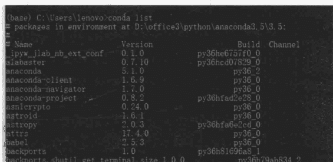

▲ 图 2-4 conda list 返回结果

### 2. 在 Linux 系统中安装 Anaconda
示例环境为 CentOS 6.5，其他发行版参考官方说明。首先下载 Linux 版 Anaconda3-5.2.0-Linux-x86_64.sh，下载页如图 2-5。

下载后进入文件目录，打开终端执行对应版本的安装命令：

```
$ bash Anaconda3-5.2.0-Linux-x86_64.sh
```

输入完成后终端输出如下：

```
Welcome to Anaconda3 5.2.0
```

```
In order to continue the installation process, please review the license agreement.
Please, press ENTER to continue
>>>
```


▲图 2-5 Anaconda3-5.2.0-Linux-x86_64.sh 下载界面

按提示回车，随后会要求确认协议，输入“yes”后回车即可，默认回车为“no”。

```
Do you accept the license terms? [yes|no]
[no] >>> Please answer 'yes' or 'no':'
>>>
```

点选 yes 即可跳转到配置目录环节。

```
Anaconda3 will now be installed into this location:
/home/fileservice/anaconda3

- Press ENTER to confirm the location
- Press CTRL-C to abort the installation
- Or specify a different location below
[/home/fileservice/anaconda3]
>>>
```

在此步骤敲入 yes，相当于同意把 Anaconda 纳入系统环境变量。随后再按向导提示继续。安装程序会询问是否要为 Anaconda 设置环境变量，若回答 no，后续就只能先切到 Anaconda3/bin 文件夹才能调用 Anaconda 及相关工具。

```
installation finished.
Do you wish the installer to prepend the Anaconda3 install location
to PATH in your /home/fileservice/.bashrc ? [yes|no]
[no] >>>
```

当安装的 Anaconda 版本高于 5.1，完成后会弹出是否一并安装 Microsoft VSCode 的提示。因为单独配置别的编辑器比较费时，我通常会直接点 yes 把 VSCode 也装上。

```
Thank you for installing Anaconda3!
================================================================================
Anaconda is partnered with Microsoft! Microsoft VSCode is a streamlined code editor with support for development operations like debugging, task running and version control.

To install Visual Studio Code, you will need:
- Administrator Privileges
- Internet connectivity

Visual Studio Code License: https://code.visualstudio.com/license

Do you wish to proceed with the installation of Microsoft VSCode? [yes|no]
>>>
```

打开终端执行 Python3，检查安装是否生效：

```
$ python3
```

终端输出类似下面内容，说明 Python 已被 Anaconda 接管管理，之后再也不用为依赖冲突烦恼。

```
Python 3.5.2 (default, Nov 17 2016, 17:05:23)
[GCC 5.4.0 20160609] on linux
Type "help", "copyright", "credits" or "license" for more information.
>>>
```

### 2.1.2 IDE 的选择

把写代码比作手艺，IDE 就相当于手艺人的核心工具。IDE 的完整写法是 Integration Development Environment，即集成开发环境，通常围绕编辑器构建，配备众多周边组件与辅助功能。优秀的 IDE 的关键在于为特定语言提供高效的编辑支持，让浏览、录入、修改代码的过程更顺滑清晰。现代工具普遍具备语法高亮、错误提醒、代码折叠、智能补全、代码块跳转、重构，以及与调试器、版本控制系统 VCS 的联动。依托插件与扩展机制的可定制化设计，也是当下主流趋势。功能堆砌并非正向，过度复杂的工具会分散注意力并增加出错风险。遵循适用的原则，只要基础功能满足需求且符合个人习惯，就足够好。正因为如此，除了全功能的集成环境，使用轻量文本编辑器配合独立调试器、交互式命令行等小工具也是常见做法。Python 语法简洁，处理小型片段或学习示例时，轻量方案特别合适。

安装包里已经内置了 Spyder 编辑器。完成 Python 安装后，需要挑选一款顺手的 IDE 来学习。虽然用 Python 自带的编辑器或普通文档工具也能做基础练习，但效率偏低。能用来开发 Python 的工具很多，例如 sublime text、PyCharm，本书所有代码示例都是在 PyCharm 里完成的。

## 2.2 Python 基本操作

### 2.2.1 第一个小程序

编程史上最经典的入门例子就是 Hello World，最早由 Brian Kernighan 提出，意为“你好，世界”。绝大多数语言的初学第一段代码都是打印 Hello World。例 2-1 展示了 Python 如何输出这段文字。

### 【例 2-1】 Hello World 程序

输入：

```
#!/usr/bin/env python
#这是一个注释
print("Hello World")
```

输出：

```
Hello World
```

例 2-1 演示了 print 的用法，它不会在纸上打印，而是把 Hello World 显示到屏幕上。不少人会用 Hello World 的简洁程度来衡量语言优劣，按这个标准，Python 堪称近乎完美。

### 2.2.2 注释与格式化输出

### 1. 注释

注释在多数语言里都是非常实用的特性。注释写给人看，解释器会直接忽略，用自然语言说明代码意图。随着项目迭代，代码复杂度提升，及时添加说明有助于概括解决思路。

不同语言的注释写法各不相同，下面介绍 Python 的行内注释方式。

### (1) 单行注释

Python 里单行注释以 # 开头，后续内容会被解释器跳过，见例 2-2。

### 【例 2-2】单行注释

输入：

```
# 这是一个注释
print("Hello, World")
```

### （2）多行注释

Python 的多行注释可以用三个单引号 ''' 或三个双引号 """ 包裹，常用于说明较复杂的逻辑，见例 2-3。

### 【例 2-3】多行注释

输入：

```
'''
Created on May 10, 2018
@author: *****
'''
print("Hello, World")
```

加上注释能提升可读性，即便代码是你自己写的，隔段时间也可能难以理解。合理的注释便于团队协作，也能体现代码价值。

小贴士：

在 PyCharm 里选中多行代码，按 Ctrl+/ 即可一键添加注释。

### 2. 格式化输出

### （1）%操作符

% 操作符用于字符串格式化，左侧视作类似 sprintf 的模板，右侧提供实际值，返回拼接后的结果，见例 2-4、例 2-5。更多用法见表 2-1。

### 【例 2-4】%操作符

输入：

```
print("%o"% 10)
print("%d"% 10)
print("%f"% 10)
```

输出：

```
12
10
10.000000
```

输出浮点数时常需控制小数位，可通过格式符限制，例如 %.2f 保留两位小数；%.2e 用科学计数法保留两位小数；%.2g 保留两位有效数字，自动选择小数或科学计数法。也可以使用内置 round() 函数，其语法为：

```
round(number, ndigits)
```

参数说明：
- number：数值表达式。
- ndigits：小数点后保留位数，默认 0。

### 【例 2-5】浮点数输出

输入：

```
print("%f" % 3.1415926)
```

输出：

```
3.141593
```

输入：

```
print("%.2F" % 3.1415926)
```

输出：

```
3.14
```

输入：

```
print(round(3.1415926,2))
```

输出：

```
3.14
```

表 2-1 格式化输出规则

| 格式 | 描述 |
|---|---|
| %% | 百分号标记 # 就是输出一个 % |
| %c | 字符及其ASCII码 |
| %s | 字符串 |
| %d | 有符号整数（十进制） |
| %u | 无符号整数（十进制） |
| %o | 无符号整数（八进制） |
| %x | 无符号整数（十六进制） |
| %X | 无符号整数（十六进制大写字符） |
| %e | 浮点数字（科学计数法） |
| %E | 浮点数字（科学计数法，用E代替e） |
| %f | 浮点数字（用小数点符号），默认保留小数点后6位有效数字 |
| %g | 浮点数字（根据值的大小采用%e 或%f） |
| %G | 浮点数字（类似于%g） |
| %p | 指针（用十六进制打印值的内存地址） |
| %n | 存储输出字符的数量放进参数列表的下一个变量中 |

## （2）format 格式化字符串

format 是从 Python 2.6 起引入的字符串格式化接口，相比传统的 % 方式更灵活，也是官方主推的做法，未来 % 可能会被逐步弃用。它把字符串当作模板，用大括号 {} 作为占位符来填充参数。

### 1）通过位置来填充

按位置填充时，format 会依次按参数顺序填入，第一个对应 0，第二个对应 1，若不写编号即 {}，则按默认顺序填充，见例 2-6。

### 【例 2-6】 format 按位置输出

输入：

```
print("{} {}".format("hello","world"))
```

输出：

hello world

输入：

```
print("{0} {0} {1}".format("hello","world"))
```

输出：

hello hello world

同一个参数可以被多次引用，这是 format 相比 % 的优势。

### 2）通过索引

后续会介绍，列表、元组都属于序列。当把序列传给 format 时，可通过索引进行映射，见例 2-7。

### 【例 2-7】 format 索引输出

输入：

```
str="hello"
list=["hello","world" ]
tuple=("hello","world")
print("{0[1]}".format(str))
print("{0[0]},{0[1]}".format(list))
print("{0[0]},{0[1]}".format(tuple))
```

输出：

```
e
hello,world
hello,world
```

输入：

```python
print("{p[1]}".format(p=str))
print("{p[0]},{p[1]}".format(p=list))
print("{p[0]},{p[1]}".format(p=tuple))
```

输出：

```
e
hello,world
hello,world
```

### 3）通过字典的 key

Python 里字典使用很常见，经常由 JSON 解析得到。随着 AI 发展，更多数据以字典形式出现，例如 MongoDB 文档可视为字典，推荐系统中的图数据也常以 key-value 表示。format 支持通过键名填充，见例 2-8。

### 【例 2-8】format 字典形式输出

输入：

```python
Tom = {'age':27, 'gender': 'M'}
print("{0[age]}".format(Tom))
print("{p[gender]}".format(p=Tom))
```

输出：

```
27
M
```

### 4）通过对象的属性

format 也能读取对象的属性进行填充，见例 2-9。

### 【例 2-9】format 通过对象属性输出

输入：

```python
class Person:
    def __init__(self,name,age):
        self.name = name
        self.age = age

    def __str__(self):
        return '{self.name} is {self.age} years old'.format(self=self)

print(Person('Tom',18))
```

输出：

```
Tom is 18 years old
```

### 5) 字符串对齐并且指定对齐宽度

有时需要对齐或指定宽度，符号 ^、<、> 分别代表居中、左对齐、右对齐，后面跟宽度，冒号后可指定填充字符，只能是单个字符，未指定时默认空格填充，见例 2-10。

### 【例 2-10】字符串对齐并且指定对齐宽度输出

输入：

```
print('默认输出：{},{ }'.format('hello','world'))
print('左右各取 10 位对齐：{:10s} , {:>10s}'.format('hello','world'))
print('取 10 位中间对齐：{:^10s},{:^10s}'.format('hello','world'))
print('取 2 位小数：{} is {:.2f}'.format(3.141592,3.141592))
print('数值的千位分隔符：{} is {:,}'.format(123456789,1234567890))
```

输出：

```
默认输出： hello,world
左右各取 10 位对齐： hello            world
取 10 位中间对齐：  hello     world
取 2 位小数： 3.141592 is 3.14
数值的千位分隔符： 123456789 is 1,234,567,890
```

表2-2 与表2-3 分别展示整数与浮点数在对齐与指定宽度时的案例。

表 2-2

整数规则表

| 数字 | 格 式 | 输 出 | 描 述 |
|---|---|---|---|
| 5 | {:0>2} | 05 | 数字补 0（填充左边，宽度为 2） |
| 5 | {:x<4} | 5xxx | 数字补 x（填充右边，宽度为 4） |
| 10 | {:x^4} | x10x | 数字补 x（填充两侧，宽度为 4） |
| 13 | {:10} | 13 | 右对齐（默认，宽度为 10） |
| 13 | {:<10} | 13 | 左对齐（宽度为 10） |
| 13 | {:^10} | 13 | 中间对齐（宽度为 10） |

表 2-3

浮点数规则表

| 数字 | 格 式 | 输 出 | 描 述 |
|---|---|---|---|
| 3.1415926 | {:.2f} | 3.14 | 保留小数点后两位 |
| 3.1415926 | {:+.2f} | +3.14 | 带符号保留小数点后两位 |
| -1 | {:+.2f} | -1.00 | 带符号保留小数点后两位 |
| 2.71828 | {:.0f} | 3 | 不带小数 |
| 1000000 | {:,} | 1,000,000 | 以逗号分隔的数字格式 |
| 0.25 | {:.2%} | 25.00% | 百分比格式 |
| 1000000000 | {:.2e} | 1.00E+09 | 指数记法 |
| 25 | {0:b} | 11001 | 转换成二进制 |
| 25 | {0:d} | 25 | 转换成十进制 |
| 25 | {0:o} | 31 | 转换成八进制 |
| 25 | {0:x} | 19 | 转换成十六进制 |

## 2.2.3 列表、元组、字典

Python 的基础数据结构是序列，共内置六种：列表、元组、字符串、Unicode 字符串、buffer 对象、range 对象。序列支持索引、长度、拼接、重复、切片、成员测试、遍历、求最值等通用操作。每个元素都有序号即索引，第一个为 0，倒数第一个为 -1，以此类推。元素可以是基本类型，也可以是另一个序列或后续介绍的对象。常用序列主要有列表 list 和元组 tuple，列表可变，元组不可变。

### 1. 列表

列表是有序的元素集合，可存放字母、数字、姓名或任意对象，元素间没有必然联系。

### （1）初始列表

在 Python 中用方括号 [] 创建列表，元素间用逗号分隔，示例如下：

```python
list1 = ['Python','AI']
list2 = [1,2,3,4,3]
list3 = ["p","y","t","h","o","n",['Python','AI']]
```

### （2）列表常用方法

下面以表 2-4 为索引，归纳了 Python 列表最常用的内置操作。

表 2-4 列表函数和方法

| 基本操作 | 说 明 | 示 例 |
|---|---|---|
| len(list) | 计算列表包含的元素总数 | len(list2) ⇒ 2 |
| max(list) | 找出列表中的最大项 | max(list2) ⇒ 4 |
| min(list) | 找出列表中的最小项 | min(list2) ⇒ 1 |
| list.append(obj) | 在尾部追加一个新对象 | list2.append('a') ⇒ list2=[1, 2, 3, 4, 3, 'a'] |
| list.count(obj) | 统计指定元素出现的频次 | list2.count(3) ⇒ 2 |
| list.extend(seq) | 把另一个序列的所有元素一次性接在末尾 | list1.extend(list2) ⇒ list1=['Python', 'AI', 1, 2, 3, 4, 3] |
| list.index(obj) | 查找元素首次出现的下标 | list2.index(3) ⇒ 2 |
| list.insert(index, obj) | 在指定下标位置前插入新元素 | list2.insert(2,"a") ⇒ list2=[1, 2, 'a', 3, 4, 3] |
| list.pop([index=-1]) | 弹出并返回一个元素，默认最后一个 | list2.pop(1) ⇒ list2=[1, 3, 4, 3] |
| list.remove(obj) | 删除首次匹配到的指定值 | list2.remove(3) ⇒ list2=[1, 2, 4, 3] |
| list.reverse() | 将元素顺序反转 | list2.reverse()⇒list2=[3, 4, 3, 2, 1] |
| list.sort(cmp=None, key=None, reverse=False) | 对原列表就地排序 | list2.sort()⇒list2=[1, 2, 3, 3, 4] |
| list.clear() | 彻底清空列表内容 | list2.clear()⇒list2=[] |
| list.copy() | 生成列表的浅拷贝 | list2.copy()⇒[1, 2, 3, 4, 3] |

注：当对象并非 str、ascii 或 repr 形式时，可借助 !s、!a、!r 分别将其转为字符串、ASCII 表示或 repr 表示。

### 2. 元组

列表擅长承载运行期间会变动的数据集，比如用户清单或游戏角色信息，因为它可被修改。而当需要固定不变的一组元素时，元组更合适。Python 把不可变对象称为 immutable，元组正是不可变的序列。

元组与列表同属序列，区别在于内容一旦确定就不可更改。Python 用圆括号 () 并以逗号分隔来创建元组。

```
tuple1 = ('Python', 'AI')
tuple2 = (1,2,3,4,3)
tuple3 = "a", "b", "c", "d";  # 不需要括号也可以
```

元组内部的值不能被修改或删除，不过可以进行拼接组合。

```
tup = tuple1 + tuple3 ⇒ tup = ('Python', 'AI', 'a', 'b', 'c', 'd')
```

元组的内置函数与列表基本一致，只需把 list 换成 tuple 即可使用，两者在类型上也可以互相转换：列表转元组用 tuple(list)，元组转列表用 list(tuple)。相较列表，元组结构更简洁稳固，适合在程序生命周期内保存一组恒定不变的值。

### 小贴士：

单元素元组必须在元素后加逗号，否则括号会被当作分组符。如 tup1 = (1) 类型为 int，而 tup2 = (1,) 才为元组。

### 3. 序列操作

列表与元组都属于序列，支持统一的序列操作。下面以列表举例，见表 2-5。

表 2-5 序列操作

| 操作 | 示例 |
|---|---|
| 索引 | list2[0] ⇒1 list2[-1] ⇒3 |
| 切片访问，语法为[下限:上限:步长]，步长默认 1 | list2[1:3] ⇒[2, 3] list2[0:3:2] ⇒[1, 3] |
| 赋值 | list2[1]="a" ⇒list2=[1, 'a', 3, 4, 3] |
| 序列相加 | list1+list2 ⇒['Python', 'AI', 1, 2, 3, 4, 3] |
| 序列乘法 | list1*3 ⇒['Python', 'AI', 'Python', 'AI', 'Python', 'AI'] |
| 遍历 | for a in list1: print(a) ⇒ Python AI |

### 4. 字典

本节介绍 Python 中用于关联信息的键值结构。字典由多个键值对组成，通过键即可取到对应的值。值可以是任意 Python 对象，包括数字、字符串、列表甚至另一个字典。

字典用花括号 {} 表示，元素格式为 key:value，多组之间用逗号分隔，如 dict={key1:value1,key2: value2, key3:value3}。实例：dict1 = {'Name': 'Bob','Age': 21}。

对字典的基本操作见表 2-6。

表 2-6 字典基本操作

| 常见操作 | 说明 | 示例 |
|---|---|---|
| len(dict) | 统计键的总数 | len(dict1) ⇒2 |
| str(dict) | 得到字典的字符串形式 | str(dict1) ⇒{'gender': 'M', 'Name': 'Bill'} 结果类型为字符串 |
| dict1[key] | 用方括号取值 | dict1['Name'] ⇒ Bob |
| dict1.get(key) | 安全取值 | dict1.get("Name")⇒ Bob |
| dict1[newkey]=value | 新增键值对 | dict1["gender"]='M'⇒dict1={'Age': 21, 'gender': 'M', 'Name': 'Bob'} |
| dict1[key]=newvalue | 修改已有键的值 | dict1["Name"]="Bill" ⇒ dict1={'Age': 21, 'gender': 'M', 'Name': 'Bill'} |
| dict1.pop(key [,default]) | 删除指定键及其值 | dict1.pop("Age")⇒ {'Name': 'Bill', 'gender': 'M'} |
| dict1.values() | 返回所有值的视图 | dict1.values()⇒dict_values(['Bill', 'M']) |
| dict1.keys() | 返回所有键的视图 | dict1.keys()⇒dict_keys(['Name', 'gender']) |
| dict1.items() | 返回键值对的视图 | dict1.items()⇒dict_items([('Name', 'Bill'), ('gender', 'M')]) |
| key in dict | 判断键是否存在 | 'Name' in dict1⇒True |
| key not in dict | 判断键是否不存在 | 'Name' not in dict1⇒False |

以上为字典的常用用法。字典在 Python 中极为核心，熟练掌握列表、元组、字典的基础操作以及复杂场景的处理是成为熟练使用者的重要前提。例如嵌套字典，只需在此基础上层层扩展即可。

小贴士：

字典的键必须唯一，值可以重复。

## 2.2.4 条件语句与循环语句

### 1. 条件语句

Python 的条件控制主要由 if 语句实现，用于根据条件真假改变程序走向。最简 if 结构见例 2-11。

### 【例 2-11】if 语句基本形式

```
if condition1:
    statement1
else:
    statement2
```

在 if…else 结构中，if 行和 else 行均以冒号结尾，执行体需要缩进，且不带冒号。若 condition1 为真则执行 statement1，否则执行 statement2。若条件分支增多，可使用 if…elif…else，多个 elif 允许存在，else 只能有一个且置于末尾。见例 2-12 的形式，例 2-13 给出具体演示。

### 【例 2-12】 if 多条件语句

```
if condition1:
    statement1
elif condition2:
    statement2
...

elif conditionN:
    statementN
else:
    statement
```

### 【例 2-13】 if 多条件案例

输入：

```
num = 3
if num > 0:
    print("正数")
elif num == 0:
    print("零")
else:
    print("负数")
```

输出：

正数

Python 还提供三元运算符，将条件判断压缩到一行。其形式见例 2-14，案例见例 2-15。

### 【例 2-14】 三元运算

```
[on_true] if [expression] else [on_false]
```

例 2-14 的含义是：条件为真时返回 [on_true]，为假时返回 [on_false]。

### 【例 2-15】 三元运算案例

输入：

```
a = 1
b = 2
c = a-b if a>b else a+b
print(c)
```

输出：

3

## 2. 循环语句

循环用于重复执行一段逻辑，Python 提供 while 和 for 两种形式。图 2-6 与 2-7 分别展示流程。

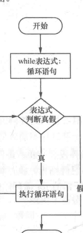

▲图 2-6 while 循环流程图

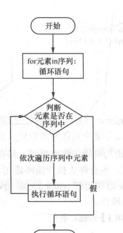

▲图 2-7 for 循环流程图

while 循环形式见例 2-16。

### 【例 2-16】while 循环语句的形式

```
while expression:
    statements
```

statements 为循环体，可为单行或区块；expression 为判断条件，成立时进入循环。

for 循环用于迭代，形式见例 2-17。

### 【例 2-17】for 循环语句的形式

```
for iterating_var in sequence:
    statements(s)
```

### 2.2.5 break、continue、pass

在实际工程中，常需借助 break、continue、pass 灵活控制流程，如例 2-17 所示。

### 【例 2-18】构建循环

```
#正常执行 for 循环
```

输入：

```
for i in range(5):
    print("i=%d"%i)
```

输出：

```
i=0
i=1
i=2
i=3
i=4
```

break 可强制跳出当前循环，即使条件未满足或序列未遍历完也会终止。break 后面的语句不再执行，适用于 while 与 for。例 2-18 为正常循环，例 2-18.1 演示 break。

### 【例 2-18.1】break 语句

输入：

```
for i in range(5):
    if i==3:
        break
    print("i=%d"%i)
```

输出：

```
i=0
i=1
i=2
```

循环在 i=3 时触发 break，仅输出 0、1、2 后退出。break 的作用是彻底结束当前循环。

continue 表示跳过本次循环剩余部分，进入下一轮。同样适用于 while 与 for。例 2-18.2 演示 continue。

### 【例 2-18.2】 continue 语句

输入：

```
for j in range(5):
    if j==3:
        continue
    print("j=%d"%j)
```

输出：

```
j=0
j=1
j=2
j=4
```

循环在 j=3 时被跳过，但后续迭代继续。continue 仅中断本次迭代，不退出循环。

pass 是空语句，用于保持结构完整性，不执行任何操作，常作占位。如例 2-19。

### 【例 2-19】 pass 语句

```
def sample():
    pass
```

sample 函数中用 pass 占位，避免空函数报错。待实现逻辑明确后再填充。

## 2.3 Python 高级操作

### 2.3.1 lambda

lambda 用于在表达式内部创建匿名函数。语法限制函数体只能是单一表达式，不允许赋值或使用 while、try 等语句。

Python 通过 lambda 表达式生成匿名函数。

- lambda 只是表达式，体比 def 简洁。
- 主体只能是表达式，不能包含完整代码块。
- lambda 拥有独立命名空间，无法访问参数列表外的局部或全局变量。
- lambda 并非 C/C++ 的内联函数，其目的不是提升运行效率。

一般语法：lambda argument_list: expression。可将结果赋给变量。例 2-20 返回两参数之和。

### 【例 2-20】lambda 函数案例

输入：

```
sum=lambda x,y:x+y
print(sum(3,4))
```

输出：

7

例 2-20 的功能也可通过常规函数定义实现。

```
def sum(x,y):
    return x + y
```

### 2.3.2 map

map 是 Python 提供的函数式编程工具，调用形式为 map(func, *iterables)。其中第一个位置接收一个函数对象，第二位置接收一个或多个可迭代对象，比如列表。函数会被依次作用到序列的每个元素上。Python 2 时期 map 会直接给出列表结果，Python 3 改为返回惰性迭代器。

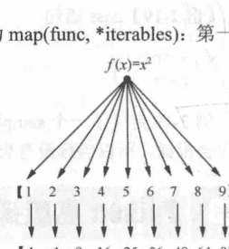

例 2-21 用的是最基础的情形，定义 f(x)=x² 后让 map 对 [1, 2, 3, 4, 5, 6, 7, 8, 9] 进行处理，得到的仍是列表形式，运行机理可参考图 2-8。

### 【例 2-21】map 示例

输入：

```
seq_list=[1, 2, 3, 4, 5, 6, 7, 8, 9]
F =list(map(lambda x:x**2,seq_list))
print(F)
```

输出：

```
[1, 4, 9, 16, 25, 36, 49, 64, 81]
```

map 也可以同时消费多个序列，序列长度不必相等。它会把 lambda 作用到各序列的对应项上，先取索引 0 的一组，再取索引 1 的一组，直到遍历结束，具体可看例 2-22。

### 【例 2-22】 map 应用于多个列表

输入：

```
a = [1,2,3,4]
b = [5,6,7,8]
c = [5,6,7]
ab=list(map(lambda x,y:x + y,a,b))
print(ab)
```

输出：

```
[6, 8, 10, 12]
```

当某一个序列的元素比其他序列少时，map 会在最短序列耗尽的瞬间停止，例 2-23 正是这种情形。

### 【例 2-23】 map 应用于多个列表不同元素情况

输入：

```
a = [1,2,3,4]
b = [5,6,7,8]
c = [5,6,7]
ac=list(map(lambda x,y:x + y,a,c))
print(ac)
```

输出：

```
[6, 8, 10]
```

把例 2-22 与例 2-23 的结果对照，ac 只产出了 3 个元素，而 ab 产出了 4 个。这说明 map 的终止条件由最短的输入序列决定。

### 2.3.3 filter

filter 同样是 Python 的高阶函数，用于函数式编程。通用写法是 filter(function, iterable)，它会筛掉不满足条件的项，保留符合条件的子序列，是一种很优雅的过滤方式。

例 2-24 以前 11 个斐波那契数为例，演示如何分别取出奇数和偶数。

### 【例 2-24】 filter 示例

输入：

```
fibonacci = [0,1,1,2,3,5,8,13,21,34,55]
even_numbers = list(filter(lambda x: x%2==0,fibonacci))
print(even_numbers)
```

输出：

```
[0, 2, 8, 34]
```

### 小贴士：

Python 3 把 reduce 从内置命名空间移除了，Python 2 里它是内置的高阶函数。Python 3 下要使用 reduce 需要先从 functools 导入，下面的代码展示了对序列元素做累积运算的用法。

```
from functools import reduce
f = lambda a,b:a if(a> b) else b
print(reduce(f,[47,11,42,102,13]))
```

输出： 102

# 第 3 章 Python 科学计算库 NumPy


为什么要先学习 NumPy？

NumPy 是开源的 Python 科学计算基石，Pandas、Scikit-learn 等众多科学计算库都直接依赖其功能。

## 3.1 NumPy 简介与安装

### 3.1.1 NumPy 简介

NumPy 专为快速处理大规模矩阵而设计，支持在 Python 中进行向量和矩阵运算，大量底层实现使用 C 语言编写，性能远超纯 Python。数组内元素类型统一，也省去了运行时的类型检查开销。本书示例基于 NumPy 1.13.1。

### 【例 3-1】查看 NumPy 版本

输入：

```
import numpy
print(numpy.__version__)
```

输出：

```
1.13.1
```

### 3.1.2 NumPy 安装

> 小贴士：
> 什么是科学计算？
> 科学计算聚焦于定量分析、数学建模以及借助计算机解决科学问题的研究。

NumPy 建立在 Python 之上，安装 NumPy 前必须先装 Python。当前推荐 Anaconda，Anaconda 是面向科学计算的 Python 发行版，覆盖 Linux、Mac、Windows，内置大量数据分析包。已装 Anaconda 即视为已装好 NumPy。

若直接从官网装 Python，Windows、各 Linux 发行版以及 Mac OS X 均提供 NumPy 二进制包，也可装源码版。系统要求 Python 2.4.x 及以上，通用安装命令为 pip install numpy。

### 小贴士：

Python 通过 import 关键字引入模块，可把某个包中的函数或子模块导入到当前代码，实现复用，例如 import numpy。

## 3.2 基本操作

NumPy 提供了大量函数，目的都是让用户更直观高效地使用，涵盖数组元素的选取、多项式运算等。

### 3.2.1 初识 NumPy

NumPy 核心是同质多维数组，即同一类型元素的表格，可用正整数元组索引。数组的维度叫做轴，轴的个数叫做秩。比如三维点 [1,2,1] 是秩为 1 的数组，轴长度为 3。

NumPy 数组类型为 ndarray，又称 array。与标准库 array.array 不同，后者仅支持一维且功能有限。下面是 ndarray 的常用属性，见表 3-1。

表 3-1 ndarray 对象属性

| 属性 | 含义 |
|---|---|
| T | 转置，等价于 self.transpose()，低维返回自身 |
| size | 元素总数，等于 shape 各维乘积 |
| itemsize | 单个元素字节数，如 float64 为 8 |
| dtype | 元素数据类型对象，可用 Python 类型或 numpy 类型指定 |
| ndim | 轴的数量，亦称 rank |
| shape | 各维大小的整数元组，如 n 行 m 列为 (n, m) |
| data | 存放实际元素的缓冲区，通常直接用索引访问 |
| flat | 一维迭代器视图 |
| imag | 虚部 |
| real | 实部 |
| nbytes | 所有元素占用的总字节数 |

导入模块通常用 import，并可使用 as 起别名。例 3-2 演示 NumPy 基础使用。

### 【例 3-2】初识 NumPy

输入：

```
```python

import numpy as np

a = np.random.random(4)

print(type(a))

```
```

输出：

```
```

<class 'numpy.ndarray'>

```
```

输入：

```
```python

print(a.shape)

```
```

输出：

```
```

(4,)

```
```

输入：

```
```python

print(a)

```
```

输出：

```
```

[ 0.24123598  0.04089253  0.94548641  0.46101693]

```
```

例 3-2 说明 np.random.random(4) 生成一个浮点 ndarray，类型为 numpy.ndarray，shape 为 (4,) 表示长度 4，最终数值如上。

### 3.2.2 NumPy 数组类型

科学计算中 Python 自带的整型、浮点、复数往往不够用，NumPy 提供了丰富的类型以满足不同精度需求，内存占用也随之变化。类型名多以位数结尾，见表 3-2。

① 表格参考：NumPy 用户手册。

表 3-2 NumPy 数据类型

| 类型 | 描述规则 |
|---|---|
| bool | 1 位布尔 |
| int | 平台相关精度，一般 int32 或 int64 |
| int8 | -128 至 127 |
| int16 | -32768 至 32767 |
| int32 | -2^31 至 2^31-1 |
| int64 | -2^63 至 2^63 |
| uint8 | 0 至 255 |
| uint16 | 0 至 65535 |
| uint32 | 0 至 2^32-1 |
| uint64 | 0 至 2^64-1 |
| float16 | 半精度，1 位符号 5 位指数 10 位尾数 |
| float32 | 单精度，1 位符号 8 位指数 23 位尾数 |
| float64 或 float | 双精度，1 位符号 11 位指数 52 位尾数 |
| complex64 | 双 32 位浮点构成复数 |
| complex128 或 complex | 双 64 位浮点构成复数 |

使用时可通过 dtype 指定，也可后续用 astype() 转换，每种类型都有对应构造。NumPy 的类型操作可参考例 3-3 与例 3-4。

### 【例 3-3】NumPy 数据类型操作

输入：

```
#指定数据类型
print(np.array(5, dtype=int))
```

输出：

```
5
```

输入：

```
print(np.array(5).astype(float))
```

输出：

```
5.0
```

输入：

```
#转换数据类型
print(float(42))
```

输出：

```
42.0
```

输入：

```
print(bool(42))
```

输出：

```
True
```

输入：

```
print(float(True))
```

输出：

```
1.0
```

查看所有类型也可用 set(np.typeDict.values())。

### 【例 3-4】查看 NumPy 数据类型

输入：

```
print(set(np.typeDict.values()))
```

输出：

```
{<class 'numpy.int16'>, <class 'numpy.uint32'>, <class 'numpy.str_'>, <class 'numpy.datetime64'>, <class 'numpy.float32'>, <class 'numpy.bool_'>, <class 'numpy.float64'>, <class 'numpy.complex128'>, <class 'numpy.float16'>, <class 'numpy.bytes_'>, <class 'numpy.uint16'>, <class 'numpy.complex64'>, <class 'numpy.complex128'>, <class 'numpy.timedelta64'>, <class 'numpy.int32'>, <class 'numpy.uint8'>, <class 'numpy.float64'>, <class 'numpy.void'>, <class 'numpy.int64'>, <class 'numpy.uint32'>, <class 'numpy.object_'>, <class 'numpy.int8'>, <class 'numpy.int32'>, <class 'numpy.uint64'>}
```

### 3.2.3 NumPy 创建数组

### 1. 通过列表或元组转化

Python 内建对象常用的有 list、tuple、dict。NumPy 用 numpy.array 把列表或元组转为 ndarray。

```
numpy.array(object, dtype=None, copy=True, order=None, subok=False, ndmin=0)
```

主要参数：object 为输入对象，dtype 为目标类型，未指定时自动推断；copy 是否复制，默认 True；order 内存顺序；subok 是否保留子类。

### 【例 3-5】 numpy.array 创建数组

输入：

```python
import numpy as np
a=np.array([[1,2],[4,5,7]])
print(type(a))
print(a)
```

输出：

```
<class 'numpy.ndarray'>

[list([1, 2]) list([4, 5, 7])]
```

### 2. arange 函数创建数组

除了 numpy.array，NumPy 还提供多种生成规律数组的工具。arange 用于在区间内生成等差数列，用法频繁，常用于迭代。与 range 类似但返回的是数组而非列表。

range 语法为 range(start, stop[, step])，按步长生成半开区间序列，返回 range 对象。start 默认为 0，stop 不包含，step 默认为 1 且不支持小数。

### 【例 3-6】 range 案例

输入：

```python
import numpy as np
a=range(0,4)
b=range(4)
a1 = [i for i in a]
b1 = [i for i in b]
print(type(a))
print(a1)
print(b1)
```

输出：

```
<class 'range'>

[0, 1, 2, 3]

[0, 1, 2, 3]
```

NumPy 规律数组构造与索引速览

(2) arange 按步长生成序列
arange 的调用签名是 arange(start=None, stop=None, step=None, dtype=None)。它依据区间两端与步幅，产出符合规则的数值数组。

- 起点与终点的用法与 Python 原生 range 保持一致
- step 用来调节相邻元素的间隔，支持小数
- dtype 可选，可声明返回值的类型

### 【例 3-7】arange 使用演示

输入：

```python
import numpy as np
a=np.arange(12)
print(a)
a2=np.arange(1,2,0.1)
print(a2)
```

输出：

```
[ 0 1 2 3 4 5 6 7 8 9 10 11]
[ 1. 1.1 1.2 1.3 1.4 1.5 1.6 1.7 1.8 1.9]
```

### 3. linspace 均匀采样
linspace 也可以制造规律数值序列，负责在给定区间内取出间距一致的点。接口如下：

```
numpy.linspace(start, stop, num=50, endpoint=True, retstep=False, dtype=None)
```

- start 代表序列起点
- stop 代表序列终点
- num 控制采样个数，默认 50 个
- endpoint 为布尔开关，为真时把终点包含进来
- retstep 为布尔开关，为真时额外给出步距
- dtype 决定数组的数据类型

### 【例 3-8】linspace 应用演示

输入：

```python
import numpy as np
a=np.linspace(start=1, stop=5, num=10, endpoint=True)
print(a)
print(a.shape)
```

输出：

```
[ 1.          1.44444444  1.88888889  2.33333333  2.77777778  3.22222222
  3.66666667  4.11111111  4.55555556  5.        ]

(10,)
```

输入：

```python
b=np.linspace(start=1, stop=5, num=10, endpoint=False)
print(b)
print(b.shape)
```

输出：

```
[ 1.   1.4  1.8  2.2  2.6  3.   3.4  3.8  4.2  4.6]

(10,)
```

输入：

```python
c=np.linspace(start=1, stop=5, num=10,)
print(c)
```

输出：

```
[ 1.          1.44444444  1.88888889  2.33333333  2.77777778  3.22222222
  3.66666667  4.11111111  4.55555556  5.        ]
```

### 4. logspace 构造等比序列
在规律数组的创建中，linspace 产出等差序列，logspace 则负责等比序列。调用形式为：

```
numpy.logspace(start, stop,num=50, endpoint=True, base=10.0, dtype=None)
```

- start 是基底 base 的指数，决定左边界
- stop 是基底 base 的指数，决定右边界
- num 指定采样点数量，默认 50
- endpoint 布尔，True 时包含末尾点
- base 为对数底数
- dtype 用来指定类型

### 【例 3-9】logspace 应用演示

输入：

```python
import numpy as np
#生成首位是10的0次方，末位是10的2次方，含5个数的等比数列
a = np.logspace(start=0,stop=2,num=5)
print(a)
```

输出：

```
[1.          3.16227766 10.          31.6227766 100. ]
```

输入：

```python
#生成首位是1的0次方，末位是1的2次方，含5个数的等比数列
b = np.logspace(start=0,stop=2,num=5,base=1)
print(b)
```

输出：

```
[ 1.  1.  1.  1.  1.]
```

### 5. ones zeros 等快速创建函数
当形状事先明确时，可直接调用 NumPy 提供的快速构造接口。

ones 生成全 1 数组，zeros 生成全 0 数组，empty 生成未初始化的数组。默认类型为 float64，可通过 dtype 自定义。另有 ones_like、zeros_like、empty_like 这三个基于已有数组形状创建同形数组的扩展。

（1）按形状与类型返回全 1 数组。函数形式为：

```
ones(shape, dtype=None, order='C')
```

- shape 描述目标形状，如 (2,3) 或 2
- dtype 可选，决定数据类型，如 numpy.int8，默认 numpy.float64
- order 选择内存布局，'C' 行优先，'F' 列优先

### 【例 3-10】ones 示例

输入：

```python
a=np.ones(4)
b=np.ones((4,),dtype=np.int)
c=np.ones((2,1))
S=(2,2)
d=np.ones(S)
V=np.array([[1,2,3],[4,5,6]])
e=np.ones_like(a)
print("a={}\nb={}\nc={}\nd={}\ne={}".format(a,b,c,d,e))
```

输出：

```
a=[ 1.  1.  1.  1.]

b=[1 1 1 1]

c=[[ 1.]
    [ 1.]]

d=[[ 1.  1.]
    [ 1.  1.]]

e=[ 1.  1.  1.  1.]
```

（2）按形状与类型返回全 0 数组。函数形式为：

```
zeros(shape, dtype=None, order='C')
```

参数与 np.ones 相同。

### 【例 3-11】zeros 示例

输入：

```python
a=np.ones(5)
b=np.zeros((5,),dtype=np.int)
c=np.zeros((2,1))
S=(2,2)
d=np.zeros(S)
e=np.zeros((2,), dtype=[('x','i4'), ('y','i4')])
x=np.arange(6)
x=x.reshape((2,3))  #[[0, 1, 2],[3, 4, 5]] reshape 重塑数组的形状
f=np.zeros_like(x)
y=np.arange(3,dtype=np.float)  #[0., 1., 2.]
g=np.zeros_like(y)
print("a={}\n b={}\n c={}\n d={}\n e={}\n f={}\n g={}".format(a,b,c,d,e,f,g))
```

输出：

```
a=[ 1.  1.  1.  1.  1.]

b=[0 0 0 0 0]

c=[[ 0.]
    [ 0.]]

d=[[ 0.  0.]
    [ 0.  0.]]

e=[(0, 0) (0, 0)]

f=[[0 0 0]
    [0 0 0]]

g=[ 0. 0. 0.]
```

（3）按形状与类型返回空数组。函数形式为：

```
empty(shape, dtype=None, order='C')
```

参数与 np.ones 相同。

### 【例 3-12】 empty 示例

输入：

```python
a=np.empty([2,2])
b=np.empty([2,2],dtype=int)

temp=np.array([[1.,2.,3.],[4.,5.,6.]])
c=np.empty_like(temp)  #输出 ndarray 与数组 a 形状和类型一样的数组。
print("a={}\n b={}\n c={}".format(a,b,c))
```

输出：

```
a=[[ 1.  1.]
 [ 1.  1.]]

b=[[      0 1072693248]
 [      0 1072693248]]

c=[[ 3.33772792e-307  4.22786102e-307  2.78145267e-307]
 [ 4.00537061e-307  2.23419104e-317  0.00000000e+000]]
```

（4）按参数生成指定对角线为 1 其余为 0 的数组。函数形式为：

```
eye(N, M=None, k=0, dtype=float)
```

- N 为返回数组的行数
- M 为可选列数，不填则默认等于 N
- k 为可选对角线序号，0 为主对角线，正数上移，负数下移
- dtype 可选返回类型

### 【例 3-13】 eye 示例

输入：

```python
a=np.eye(2,dtype=int)
b=np.eye(3,k=1)
print("a={}\n b={}".format(a,b))
```

输出：

```
a=[[1 0]
 [0 1]]
```

b=[[ 0.  1.  0.]

    [ 0.  0.  1.]

    [ 0.  0.  0.]]

（5）生成 n 维单位方阵。函数形式为：

```
identity(n, dtype=None)
```

- n 为方阵的行列数，整数
- dtype 可选类型，默认 float

### 【例 3-14】 identity 示例

输入：

```
a=np.identity(3)
print(a)
```

输出：

```
[[ 1.  0.  0.]
 [ 0.  1.  0.]
 [ 0.  0.  1.]]
```

小贴士：

单位矩阵主对角线全为 1，其余位置全为 0。

### 3.2.4 索引与切片
ndarray 的内容支持通过下标或切片读写，操作方式类似 Python 内置容器。元素下标从 0 起算，可用的访问形式包括字段访问、基础切片和高级索引。

### 1. 下标访问原理
下标索引如同超市储物柜编号，通过编号定位存储空间。字符串本质也是字符数组，同样支持下标索引，如图 3-1 所示。

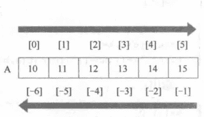

### 【例 3-15】下标演示

输入：

```
a = np.arange(1,6)
```

```
#使用正数作为索引
print(a[3])
#使用负数作为索引
print(a[-4])
#方括号中传入对应索引值，可同时选择多个元素
print(a[[0,3,4]])
```

输出：

```
4

2

[1 4 5]
```

### 2. 切片工作方式
用下标定位单个元素，或用下标范围取出一段序列，称为切片，如图 3-2 所示。

切片语法原型是 [start:stop:step]，即 [起始位置:终止位置:步幅]。

- 起始位置从 0 起算，左到右第一个为 0，最后一个为 -1
- 终止位置切片取到该位置之前，不包含该位置
- 步幅默认为 1，设为 2 即隔一取一。正值从左向右，负值从右向左，步幅不能为 0

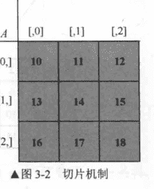

### 【例 3-16】切片演示

输入：

```
a = np.arange(16)    #创建一个一维数组
a = a.reshape(4,4)   #更改数组形状
print(a)
print(a[1][2])
print(a[1][2])
```

输出：

```
[[ 0  1  2  3]
 [ 4  5  6  7]
 [ 8  9 10 11]
 [12 13 14 15]]
```

可以看出 a[1][2] 与 a[1,2] 结果相同，都是元素 6。

二维结构可视作平面直角坐标，多维结构则相当于 n 维坐标系，定位方式与二维类似。

### 3. 切片索引
结合前述认识来看切片索引，如图 3-3 所示。

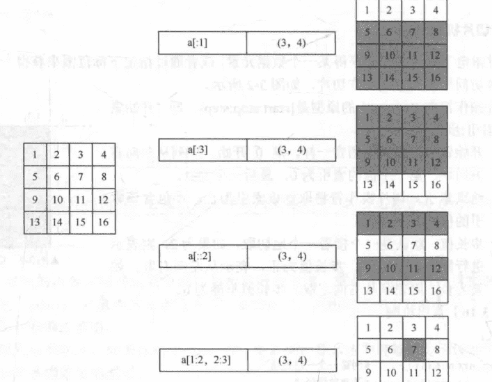

▲图3-3 切片索引

- a[1:] 表示从下标 1 起取到末尾
- a[1][2] 与 a[1,2] 通过下标取元素，a[1:2,2:3] 则以切片形式取出子数组
- 切片索引把行列都当作列表处理，返回结果均为数组

动手操作：

分别打印 a[1:2,2:3] 与 a[1][2]，对比两者差异。

### 4. 布尔索引
布尔索引亦称花式索引，指用整数数组进行索引。它基于布尔值进行筛选，属于高级索引，常用于将稀疏数组压缩，例如 SciPy 的稀疏矩阵。

### 【例 3-17】初探布尔索引

输入：

```
a=(np.arange(16)).reshape(4,4)  #生成 4*4 的数组
x = np.array([0, 1, 2, 1])
x == 1  #通过比较运算得到一个布尔数组
print(a)
print(x==1)
print(a[x==1])
```

输出：

```
[[ 0  1  2  3]
 [ 4  5  6  7]
 [ 8  9 10 11]
 [12 13 14 15]]

[False  True False  True]

[[ 4  5  6  7]
 [12 13 14 15]]
```

布尔索引的取反常用 !=，也可使用 ~ 或 logical_not() 函数。

### 【例 3-18】布尔索引取反操作

输入：

```
print(a[x!=1])
print(a[~(x==1)])
print(a[np.logical_not(x == 1)])
```

输出：

```
[[ 0  1  2  3]
 [ 8  9 10 11]]

[[ 0  1  2  3]
 [ 8  9 10 11]]

[[ 0  1  2  3]
 [ 8  9 10 11]]
```

小贴士：

布尔索引支持比较运算符 >、>=、<、<=。

多条件组合时使用布尔运算符 & 表示与，| 表示或。

### 【例 3-19】布尔索引多条件组合

输入：

```
print(a[(x==1) | (x==2)])
```

输出：

```
[[ 4 5 6 7]
[ 8 9 10 11]
[12 13 14 15]]
```

在图像处理中，常先把图像转为数组，再用布尔索引挑选区域以达成预期效果，见例 3-20，运行结果如图 3-4。

### 【例 3-20】利用布尔索引实现图像分割呈现

输入：

```
import matplotlib.pyplot as plt
a = np.linspace(0, 2 * np.pi, 200)
b = np.sin(a)
plt.plot(a,b)
mask = b >= 0
plt.plot(a[mask], b[mask], 'bo')
mask = (b >= 0) & (a <= np.pi / 2)
plt.plot(a[mask], b[mask], 'go')
plt.show()
```

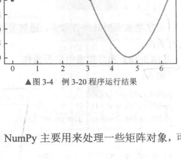

▲图 3-4 例 3-20 程序运行结果

### 3.2.5 矩阵合并与分割

### 1. 矩阵的合并
NumPy 是 Python 科学计算的核心库，主要用于处理矩阵对象，可说 NumPy 让 Python 具备了 Matlab 的气质。

```
import numpy as np
a = np.floor(10*np.random.random((2,2)))
b = np.floor(10*np.random.random((2,2)))
#hstack() 在行上合并
c=np.vstack((a,b))
#vstack() 在列上合并
d=np.hstack((a,b))
print("a=\n{}\nb=\n{}\nc=\n{}\nd=\n{}".format(a,b,c,d))
```

输出：

```
a=
[[4. 7.]
 [9. 0.]]
b=
[[0. 6.]
 [3. 8.]]
c=
[[4. 7.]
 [9. 0.]
 [0. 6.]
 [3. 8.]]
d=
[[4. 7. 0. 6.]
 [9. 0. 3. 8.]]
```

### 2. 拼接方式对比
NumPy 数组合并时，column_stack 负责列向堆叠。对一维输入它会先升维再横向拼接，最终得到二维形态；对二维输入其表现与 hstack 一致。row_stack 负责行向堆叠，一维数据会被排成一行，二维数据的使用效果等同于 vstack，细节可参考例 3-22。

### 【例 3-22】拼接示例
输入：

```
from numpy import newaxis
np.column_stack((a,b))
a = np.array([1,2])
b = np.array([3,4])
c=np.column_stack((a,b))
d=np.hstack((a,b))
print("a=\n{}\nb=\n{}\nc=\n{}\nd=\n{}".format(a,b,c,d))
#newaxis 插入新的维度，由一维变成二维数组
e=np.column_stack((a[:,newaxis],b[:,newaxis]))
f=np.hstack((a[:,newaxis],b[:,newaxis]))
print("e=\n{}\nf=\n{}".format(e,f))
```

输出：

```
a=
[1 2]
b=
[3 4]
c=
[[1 3]
[2 4]]
d=
[1 2 3 4]
e=
[[1 3]
[2 4]]
f=
[[1 3]
[2 4]]
```

从例 3-22 的运行结果看，参与合并的数组为 1 维时，column_stack 的返回是二维，而 hstack 的结果会不同；当数组本身为 2 维时，两个接口的输出形态相同。

### 3.2.6 线性代数模块概览
NumPy 的线性代数能力集中在 numpy.linalg，linalg 为 linear+algebra 的缩写，常用接口汇总见表 3-3。

表 3-3 numpy.linalg 常用函数

|  | 函数 | 说明 |
|---|---|---|
| 线性函数基础 | numpy.linalg.norm | 计算向量或矩阵的范数，结果为标量 |
|  | numpy.linalg.inv | 求逆矩阵。奇异或非方阵会报错，广义逆可用 numpy.linalg.pinv |
|  | numpy.linalg.solve | 求解线性方程组 |
|  | numpy.linalg.det | 计算行列式 |
|  | numpy.linalg.lstsq | 最小二乘求解线性问题 |
| 特征值与特征分解 | numpy.linalg.eig | 特征值与特征向量 |
|  | numpy.linalg.eigvals | 仅特征值 |
|  | numpy.linalg.SVD | 奇异值分解 |
|  | numpy.linalg.qr | QR 分解 |

### 1. 范数求值
不同参数下范数的调用签名如下：

```
np.linalg.norm(x,ord=None,axis=None, keepdims=False)
```

- (1) x：待度量的对象。
- (2) ord：范数类型，见表 3-4。
- (3) axis：计算方向。
  - axis=1 按行处理，得到各行范数。
  - axis=0 按列处理，得到各列范数。
  - axis=None 对整体求范数。
- (4) keepdims：是否保留维度。True 保持二维，False 则压缩。

表 3-4 范数表

| 参数 | 说明 | 计算方式 |
|---|---|---|
| 默认 | 二范数 ℓ2 | √x₁²+x₂²+…+xₙ² |
| ord=2 | 二范数 ℓ2 | 同上 |
| ord=1 | 一范数 ℓ1 | |x₁|+|x₂|+…+|xₙ| |
| ord=numpy.inf | 无穷范数 ℓ∞ | max(|xᵢ|) |

理论上 ℓ1 ≥ ℓ2 ≥ ℓ∞。

### 【例 3-23】范数演示
输入：

```
```python

import numpy as np

x = np.array([

    [0, 3, 4],

    [1, 6, 4]])

#默认参数 ord=None, axis=None, keepdims=False

print ("默认参数(矩阵二范数, 不保留矩阵二维特性): ",np.linalg.norm(x))

print ("矩阵二范数, 保留矩阵二维特性: ",np.linalg.norm(x,keepdims=True))

print ("矩阵每个行向量, 求向量的二范数: ",np.linalg.norm(x,axis=1,keepdims=True))

print ("矩阵每个列向量, 求向量的二范数: ",np.linalg.norm(x,axis=0,keepdims=True))

print ("矩阵一范数: ",np.linalg.norm(x,ord=1,keepdims=True))

print ("矩阵二范数: ",np.linalg.norm(x,ord=2,keepdims=True))

print ("矩阵∞范数: ",np.linalg.norm(x,ord=np.inf,keepdims=True))

print ("矩阵每个行向量, 求向量的一范数: ",np.linalg.norm(x,ord=1,axis=1,keepdims=True))

```
```

输出：

```
```

默认参数(矩阵二范数, 不保留矩阵二维特性):  8.83176086633

矩阵二范数, 保留矩阵二维特性: [[ 8.83176087]]

矩阵每个行向量, 求向量的二范数: [[ 5.            ]

    [ 7.28010989]]

矩阵每个列向量, 求向量的二范数: [[ 1.            6.70820393  5.65685425]]

矩阵一范数: [[ 9.]]

矩阵二范数: [[ 8.70457079]]

矩阵∞范数: [[ 11.]]

矩阵每个行向量, 求向量的一范数: [[ 7.]

```
```

### 2. 逆矩阵计算
### 【例 3-24】求逆示例
输入：

```
```python

a = np.mat("0 1 2;1 0 3;4 -3 8")

a_inv=np.linalg.inv(a)

print(a_inv)

print(a*a_inv)  #检查原矩阵和求得的逆矩阵相乘的结果为单位矩阵

```
```

输出：

```
```

[[-4.5  7.  -1.5]

 [-2.   4.  -1. ]

 [ 1.5 -2.   0.5]]

[[ 1.  0.  0.]

 [ 0.  1.  0.]

 [ 0.  0.  1.]]

```
```

说明：求逆需要方阵且可逆，否则抛出 LinAlgError。

提示：
mat 可用于构造矩阵，传入专用字符串，行间用分号，列内用空格。

### 3. 线性方程求解
求解 3x + y = 9， x + 2y = 8。

### 【例 3-25】解方程示例
输入：

```
```python

a = np.array([[3,1], [1,2]])

b = np.array([9,8])

x = np.linalg.solve(a, b)

print(x)

#使用 dot 函数检查求得的解是否正确

print(np.dot(a , x))

```
```

输出：

```
```

[ 2.  3.]

[ 9.  8.]

```
```

### 4. 行列式计算
二维数组 [[a,b],[c,d]] 的行列式为 ad - bc，例如 [[1,2],[3,4]] 的行列式为 1×4-2×3 = -2。

### 【例 3-26】行列式求值
输入：

```
a = np.array([[1, 2], [3, 4]])
print(np.linalg.det(a))
```

输出：

```
-2.0
```

### 【例 3-27】多维行列式求值
输入：

```
a = np.array([ [[1, 2], [3, 4]], [[1, 2], [2, 1]], [[1, 3], [3, 1]] ])
print(a.shape)
print(np.linalg.det(a))
```

输出：

```
(3, 2, 2)

[-2. -3. -8.]
```

### 5. 最小二乘拟合
设 y = m x + c，用最小二乘估计斜率 m 与截距 c。NumPy 调用形式为：

```
numpy.linalg.lstsq(array_A, array_B)[0]
```

其中 array_A 为 n×2，array_B 为 1×n。

### 【例 3-28】最小二乘拟合演示
输入：

```
x = np.array([0, 1, 2, 3])
y = np.array([-1, 0.2, 0.9, 2.1])
A = np.vstack([x, np.ones(len(x))]).T    #np.ones(len(x))为常数项构建
print(A)
m, c = np.linalg.lstsq(A, y)[0]
print(m, c)
#绘图
import matplotlib.pyplot as plt

```

plt.plot(x, y, 'o', label='Original data', markersize=10)

plt.plot(x, m*x + c, 'r', label='Fitted line')

plt.legend()

plt.show()

```

输出：

```

[[ 0.  1.]

 [ 1.  1.]

 [ 2.  1.]

 [ 3.  1.]]

1.0  -0.95

```

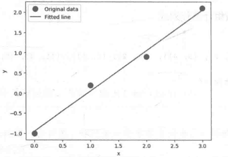

▲图 3-5 例 3-28 程序运行结果

下面我们来展现线性函数的应用，分析个人年龄与每个人最大心率之间的线性关系，见例 3-29。

### 【例 3-29】线性函数应用案例，程序运行结果如图 3-6 所示

输入：

```

#数据输入：

x_d = [18,23,25,35,65,54,34,56,72,19,23,42,18,39,37]  #个人年龄

y_d = [202,186,187,180,156,169,174,172,153,199,193,174,198,183,178]  #个人的最大心率

n=len(x_d)

#计算

import numpy.linalg

B=numpy.array(y_d)

A=numpy.array([[x_d[j], 1] for j in range(n)])

X=numpy.linalg.lstsq(A,B)[0]

a=X[0]; b=X[1]

print ("Line is: y=",a,"x+",b)

#绘图

import matplotlib.pyplot as plt

```

```

plt.plot(np.array(x_d), B, 'ro', label='Original data', markersize=10)

plt.plot(np.array(x_d), a*np.array(x_d) + b, label='Fitted line')

plt.legend()

plt.xlabel('x')

plt.ylabel('y')

plt.show()

```

输出：

Line is: y= -0.797726564933 x+ 210.048458424

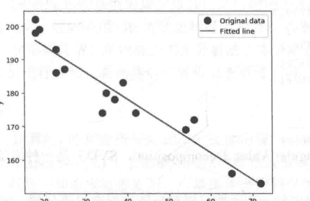

▲图 3-6 例 3-29 程序运行结果

## 6. 求解特征值与特征向量

特征值（eigenvalue）即方程 Ax = αx 的根，是一个标量。其中，A 是一个二维矩阵，x 是一个一维向量。特征向量（eigenvector）是关于特征值的向量。

在 numpy.linalg 模块中，eigvals 函数可以计算矩阵的特征值，而 eig 函数可以返回一个包含特征值和对应的特征向量的元组。

### 【例 3-30】特征值与特征向量

输入：

```

#创建一矩阵

C = np.mat("3 -2;1 0")

#调用 eigvals 函数求解特征值

c0 = np.linalg.eigvals(C)

print (c0)

#使用 eig 函数求解特征值和特征向量（返回一个元组，第一列为特征值，第二列为特征向量）

c1,c2 = np.linalg.eig(C)

print (c1)

print (c2)

#使用 dot 函数验证求得的解是否正确

for i in range(len(c1)):

    print ("left:",np.dot(C,c2[:,i]))

```

```

print ("right:",c1[i] * c2[:,i])

```

输出：

```

[ 2.  1.]

[ 2.  1.]

[[ 0.89442719  0.70710678]

 [ 0.4472136   0.70710678]]

left: [[ 1.78885438]

       [ 0.89442719]]

right: [[ 1.78885438]

        [ 0.89442719]]

left: [[ 0.70710678]

       [ 0.70710678]]

right: [[ 0.70710678]

        [ 0.70710678]]

```

## 7. 奇异值分解

奇异值分解（Singular Value Decomposition, SVD）是一种因子分解运算，将一个矩阵分解为 3 个矩阵的乘积。

numpy.linalg 模块中的 svd 函数可以对矩阵进行奇异值分解。该函数返回 3 个矩阵——U、Sigma 和 V，其中 U 和 V 是正交矩阵，Sigma 包含输入矩阵的奇异值。

### 【例 3-31】奇异值分解

输入：

```

#创建一个矩阵

D=np.mat("4 11 14;8 7 -2")

#使用 SVD 函数分解矩阵

U,Sigma,V = np.linalg.svd(D, full_matrices=False)

print("U:{}\nSigma:{}\nV:{}".format(U,Sigma,V))

```

输出：

```

U:[[-0.9486833  -0.31622777]

    [-0.31622777  0.9486833 ]]

Sigma:[ 18.97366596   9.48683298]

V:[[-0.33333333 -0.66666667 -0.66666667]

   [ 0.66666667  0.33333333 -0.66666667]]

```

结果包含等式左右两端的两个正交矩阵 U 和 V，以及中间的奇异值矩阵 Sigma。下面我们来验证 SVD 分解。

### 【例 3-32】验证奇异值分解

输入：

```

print (U * np.diag(Sigma) * V)

```

输出：

```

[ 4. 11. 14.]

[ 8. 7. -2.]

NumPy 日常操作精简笔记：从维度自动扩展到统计与多键排列

本篇把最常用的形状探查、广播机制、轴向约简、缺失值统计以及基于索引的多关键字排列整理成可直接复制的片段，代码段与运行结果保持不变，仅对说明部分做了全新表述，便于自媒体快速拆解。

维度自动匹配示例

不同形状的张量相遇时，NumPy 会在尾部自动对齐并扩展。如下组合的最终形态为：

```

## 8. QR 分解

QR（正交三角）分解也是矩阵分解的一种常用方法，如果实（复）非奇异矩阵 A 能化成正（酉）矩阵 Q 与实（复）非奇异上三角矩阵 R 的乘积，即 A=QR，则称其为 A 的 QR 分解。

QR 分解法是目前求一般矩阵全部特征值的最有效且广泛应用的方法。一般矩阵先经过正交相似变化成为 Hessenberg 矩阵，然后应用 QR 方法求特征值和特征向量。它是将矩阵分解成一个正规正交矩阵 Q 与上三角矩阵 R，所以称为 QR 分解法。本书重在帮助读者入门，QR 知识相对复杂，因此不在这里进行介绍，有兴趣的读者可以去查看官网。

## 3.2.7 NumPy 的广播机制

在利用 Python 进行矩阵运算时，经常会报 ValueError，比如出现“ValueError: operands could not be broadcast together with shapes (4,) (5).”上面错误的原因就是数据运算过程中违背了广播原则。通俗来讲，广播原则就是一种维度处理原则，广播操作会使程序更加简洁高效。

广播（Broadcasting）原则：如果两个数组的后缘维度（即从末尾开始算起的维度）的轴长相符或其中一方的长度为 1，则认为它们是广播兼容的，广播会在缺失或长度为 1 的轴上进行。当我们使用 ufunc 函数对两个数组进行计算时，ufunc 函数会对这两个数组的对应元素进行计算，因此它要求这两个数组有相同的大小（即维度相同）。如果两个数组的维度不同的话，为了避免多重循环，会进行如下的广播处理。

- (1) 让所有输入数组都向其中维度最长的数组看齐，维度中不足的部分都通过在前面加 1 补充。
- (2) 输出数组的维度是输入数组维度的各个轴上的最大值。
- (3) 如果输入数组的某个轴和输出数组的对应轴的长度相同或者其长度为 1 时，这个数组能够用来计算，否则出错。
- (4) 当输入数组的某个轴的长度为 1 时，沿着此轴运算时都用此轴上的第一组值。

如果任何一个维度是 1，那么另一个不为 1 的维度将被用作最终结果的维度。也就是说，为 1 的维度将延展与另一个维度匹配。

下面从维度方面列举一些广播的应用实例，A 和 B 两个序列中尺寸为 1 的维度在广播过程中都被延展了。

```
A      (4d array):  8 x 1 x 6 x 1

B      (3d array):        7 x 1 x 5

Result (4d array):  8 x 7 x 6 x 5
```

接着通过实际案例来理解广播的原理。

### 【例 3-33】广播操作

输入：

```
x = np.arange(4)

xx = x.reshape(4,1)

y = np.ones(5)

z = np.ones((3,4))

print(x.shape)

print(y.shape)

print(xx.shape)

print(z.shape)
```

输出：

```
(4,)

(5,)

(4, 1)

(3, 4)
形状查看基础

通过 arange、reshape、ones 可以快速得到不同秩的数组，并用 shape 属性确认其维度：

```

(1) 在例 3-33 代码基础之上执行 x+y, 出现错误: ValueError: operands could not be broadcast together with shapes (4,) (5,)。

(2) 在上面代码基础之上执行 xx+y, 输出结果为：

```
[[1. 1. 1. 1. 1.]

 [2. 2. 2. 2. 2.]

 [3. 3. 3. 3. 3.]

 [4. 4. 4. 4. 4.]]
```

其运算原理为：

[[0]
[1] + [1.1.1.1.] = [[1.1.1.1.1.]
[2]          [2.2.2.2.2.]
[3]]         [3.3.3.3.3.]
              [4.4.4.4.4.]]

(3) 在例 3-33 代码基础之上执行 x+z, 输出结果为：

```
[[1. 2. 3. 4.]

 [1. 2. 3. 4.]

 [1. 2. 3. 4.]]
广播展开效果

当一个 1 行 5 列的向量与 4 行 1 列的矩阵相遇，会先复制再相加，形成完整的网格：

```

其运算原理为：

[0 1 2 3] + [[1.1.1.1.]
            [1.1.1.1.] = [[1.2.3.4.]
            [1.1.1.1.]]  [1.2.3.4.]
                           [1.2.3.4.]]

根据广播原则分析：a 中 x 与 y 两者并不满足广播原则。b 中 xx 的维度为（4，1），y 的维度为（5，），所以会同时在两个轴发生广播。xx 的维度变成（4，5），而 y 的维度变成（4,5），所以结果也为（4,5）。c 中 x 的维度为（4，），z 的维度为（3,4），最终维度结果为（3,4）。

广播提供了一种计算外积（或者任何外部运算）的便捷方式。下面的例子展示了两个一维数组外积运算。

### 【例 3-34】广播外积运算

输入：

```
a = np.array([0.0, 10.0, 20.0, 30.0])

a= a[:, np.newaxis]  # 加入新的坐标轴

b = np.array([1.0, 2.0, 3.0])

c= a+ b

print(c)
```

输出：

```
[[ 1.  2.  3.]

[11. 12. 13.]

[21. 22. 23.]

[31. 32. 33.]]
手动插入新轴

给一维向量加一个轴后，可与一维向量做逐元素广播，得到二维结果：

```

注：例 3-34 中的 newaxis 表示加入一个新的坐标轴到 a 中，使它成为一个二维 4×1 的阵列。b 的维度为一维（3，），结合 4×1d，产生一个 4×3 的阵列，其原理如图 3-7 所示。

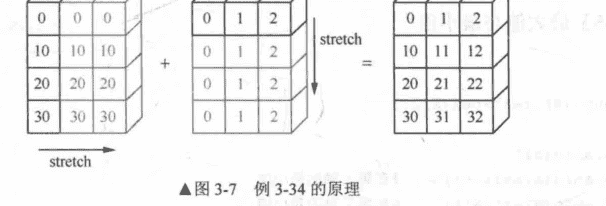

▲图 3-7 例 3-34 的原理

### 小贴士：

注意，执行广播的前提在于，两个 ndarray 执行的是 element-wise（按位加，按位减）运算，而不是矩阵乘法运算。矩阵乘法运算时需要维度之间严格匹配。矩阵乘法中 np.dot(A, B) 如果维度不匹配，提示的错误不会是 broadcast，而是 aligned.

## 3.2.8 NumPy 统计函数

NumPy 作为科学计算中非常重要的模块，有很多有用的统计函数，用于从数组中的给定

的元素中查找最小、最大、标准差和方差等。常见的统计函数见表 3-5。

表 3-5 常见的统计函数

| 分类 | 函数 | 说明 |
|---|---|---|
| 次序统计 | amin(a[,axis,out,keepdims]) | 最小值 |
| 次序统计 | amax(a[,axis,out,keepdims]) | 最大值 |
| 次序统计 | nanmin(a[,axis,out,keepdims]) | 最小值（忽略 nan） |
| 次序统计 | nanmax(a[,axis,out,keepdims]) | 最大值（忽略 nan） |
| 次序统计 | ptp(a[,axis,out]) | 极差 |
| 次序统计 | percentile(a,q[,axis,out,...]) | 百分数 |
| 次序统计 | nanpercentile(a,q[,axis,out,...]) | 百分数（忽略 nan） |
| 均值与方差 | median(a[,axis,out,overwrite_input,keepdims]) | 中位数 |
| 均值与方差 | average(a[,axis,weights,returned]) | 加权平均 |
| 均值与方差 | mean(a[,axis,dtype,out,keepdims]) | 均值 |
| 均值与方差 | std(a[,axis,dtype,out,ddof,keepdims]) | 标准差 |
| 均值与方差 | var(a[,axis,dtype,out,ddof,keepdims]) | 方差 |
| 均值与方差 | nanmedian(a[,axis,out,overwrite_input,...]) | 中位数（忽略 nan） |
| 均值与方差 | nanmean(a[,axis,dtype,out,keepdims]) | 均值（忽略 nan） |
| 均值与方差 | nanstd(a[,axis,dtype,out,ddof,keepdims]) | 标准差（忽略 nan） |
| 均值与方差 | nanvar(a[,axis,dtype,out,ddof,keepdims]) | 方差（忽略 nan） |

下面通过实际案例来学习理解。

### 1. 最大值与最小值

最大值，即为已知的数据中的最大（小）的一个值。

### 【例 3-35】最大值与最小值

输入：

```python
a=np.arange(4).reshape((2,2))

print(a)

print(np.amin(a))

print(np.amin(a,axis=0))    #在第一轴的最小值

print(np.amin(a,axis=1))    #在第二轴的最小值

b=np.arange(5,dtype=np.float)

b[2]=np.nan

print(np.amin(b))

print(np.nanmin(b))         #不包含 nan 的最小值
```

输出：

```
[[0 1]

 [2 3]]
轴向最小元与缺失值处理

amin 支持指定轴，nanmin 则在计算时跳过 NaN：

```

0
[0 1]
[0 2]
nan
0.0

### 2. 极差

极差：其最大值与最小值之间的差距，即最大值减最小值后所得数据。

在统计中常用极差来刻画一组数据的离散程度，以及反映变量分布的变异范围和离散幅度。在总体中，任何两个单位的标准值之差都不能超过极差。同时，它能体现一组数据波动的范围。极差越大，离散程度越大；反之，离散程度越小。

极差只指明了测定值的最大离散范围，而未能利用全部测量值的信息，不能细致地反映测量值彼此相符合的程度。极差是总体标准偏差的有偏估计值，当乘以校正系数之后，可以作为总体标准偏差的无偏估计值。它的优点是计算简单、含义直观、运用方便，故在数据统计处理中仍有着相当广泛的应用。

### 【例 3-36】极差

输入：

```
x=np.arange(4).reshape((2,2))

print(x)

print(np.ptp(x,axis=0))

print(np.ptp(x,axis=1))
```

输出：

```
[[0 1]

[2 3]]

[2 2]

[1 1]
极差 ptp

ptp 返回最大值与最小值的差，可按轴求得：

```

### 3. 百分数

百分数也叫百分率或百分比，通常不写成分数形式，而是采用百分号（%）来表示，如1%。由于百分数的分母都是100，也就是都以1%作为单位，便于比较。百分数只表示两个数的关系，所以百分号后不可以加单位。

### 【例 3-37】百分位

输入：

```python
a=np.array([[10.,7.,4.],[3.,2.,1.]])

a[0][1]=np.nan

print(a)

print(np.percentile(a,50))

print(np.nanpercentile(a,50))

print(np.nanpercentile(a,50,axis=0))

print(np.nanpercentile(a,50,axis=1,keepdims=True))
```

输出：

```
[[10. nan 4.]

 [3. 2. 1.]]

nan

3.0

[6.5 2. 2.5]

[[7.]

 [2.]]
百分位与缺失值百分位

percentile 遇到 NaN 会传播，nanpercentile 会忽略 NaN，并支持按轴与 keepdims：

```

### 4. 均值与方差

均值即平均数，是指在计算一组数据中所有数据之和再除以这组数据的个数，它是反映数据集中趋势的一项指标。方差是标准差的平方，是一项衡量一组数据离散程度的指标。

### 【例 3-38】均值与方差

输入：

```python
a=np.array([[1.,2.],[3.,4.]])

print(a)

print(np.median(a,axis=0))

print(np.average(a))

print(np.mean(a))

print(np.average(range(1,11),weights=range(10,0,-1)))

print(np.average(a,axis=1,weights=[1./4,3./4]))

print(np.std(a,axis=1))

print(np.var(a,axis=1))

a[0][1]=np.nan

print(a)

print(np.nanvar(a,axis=1))
```

输出：

```
[[1.2.]

[3.4.]]

[2.3.]

2.5

2.5

4.0

[1.753.75]

[0.50.5]

[0.250.25]

[[1.nan]

[3.4.]]

[0.0.25]
集中趋势与离散度

median、average、mean、加权 average、std、var 以及 nanvar 的常用用法：

```

## 3.2.9 NumPy 排序、搜索

NumPy 支持对数组的排序与搜索操作，常见的搜索排序函数见表 3-6。

表 3-6 常用搜索排序函数

|  | 函数 | 说明 |
|---|---|---|
| 排序 | sort(a,axis,kind,order) | axis 参数默认值都为-1，即沿着数组的最后一个轴进行排序，不改变原始数组 |
|  | argsort(a,axis,kind,order) | 对数组 a 排序，返回一个排序后索引，a 不变 |
|  | lexsort(keys[,axis]) | 是间接排序，支持对数组按指定行或列的顺序排序；lexsort 不修改原数组，返回索引 |
| 搜索 | argmax(a[,axis,out]) | 找到数组 a 中最大值的下标，有多个最大值时得到第一个最大值的下标 |
|  | nanargmax(a[,axis]) | 找到数组 a 中最大值的下标，有多个最大值时得到第一个最大值的下标（不含 nan） |
|  | argmin(a[,axis,out]) | 找到数组 a 中最小值的下标，有多个最小值时得到第一个最小值的下标 |
|  | nanargmin(a[,axis]) | 找到数组 a 中最小值的下标，有多个最小值时得到第一个最小值的下标（不含 nan） |

### 1. 排序

（1）sort 排序

【例 3-39】sort 排序

输入：

```
```

```
```python
print(np.sort(a))      #沿着最后一个轴排序
print(np.sort(a, axis=None))      #折叠成一维的数组
print(np.sort(a, axis=0))      #沿着第一轴进行排序
```
```

输出：

```
```
[[1 4]
 [1 3]]

[1 1 3 4]

[[1 1]
 [3 4]]
```
```

输入：

```
```python
#针对一个结构化的数组，使用关键字顺序来指定一个字段排序
dtype = [('name', 'S10'), ('height', float), ('age', int)]
values = [('Arthur', 1.8, 41), ('Lancelot', 1.9, 38),('Galahad', 1.7, 38)]
a = np.array(values, dtype=dtype)  #create a structured array
print(np.sort(a, order='height'))
#Sort by age, then height if ages are equal
print(np.sort(a, order=['age', 'height']))
```
```

输出：

```
```
[(b'Galahad', 1.7, 38) (b'Arthur', 1.8, 41) (b'Lancelot', 1.9, 38)]

[(b'Galahad', 1.7, 38) (b'Lancelot', 1.9, 38) (b'Arthur', 1.8, 41)]
```
```

### (2) numpy.argsort 排序

对数组 a 排序，返回一个排序后索引，a 不变，使用 numpy.argsort，见例 3-40。

【例 3-40】numpy.argsort 排序

输入：

```
```python
x=np.array([3,1,2])
print(np.argsort(x))
y=np.array([[0,3],[2,2]])
print(np.argsort(y,axis=0))
print(np.argsort(y,axis=1))
#Sorting with keys
z = np.array([(1, 0), (0, 1)], dtype=[('x', '<i4'), ('y', '<i4')])
print(np.argsort(z, order=('x','y')))
print(np.argsort(z, order=('y','x')))
```
```

输出：

```
```
[1 2 0]
```
```
[[0 1]
[1 0]]

[[0 1]
[0 1]]

[1 0]

[0 1]
```
### （3）numpy.lexsort 排序

lexsort 提供多键基于索引的排列，不会触碰源数据本身，只返回位置序号。argsort 是其一维等价接口，默认以最后一条键作为主要依据进行升序处理。

【例 3-41】numpy.lexsort 排序

输入：
```
#Sort two columns of numbers
a = [1,5,1,4,3,4,4] # First column
b = [9,4,0,4,0,2,1] # Second column
ind = np.lexsort((b,a)) # Sort by a, then by b
print(ind)
print([(a[i],b[i]) for i in ind])
print([(a[i],b[i]) for i in np.argsort(a)])
```
输出：

```
[2 0 4 6 5 3 1]

[(1, 0), (1, 9), (3, 0), (4, 1), (4, 2), (4, 4), (5, 4)]

[(1, 9), (1, 0), (3, 0), (4, 4), (4, 2), (4, 1), (5, 4)]
```

输入：

```
a=np.array([[ 2, 7, 4, 2],
            [35, 9, 1, 5],
            [22, 12, 3, 2]])
#按最后一列顺序排序
print(a[np.lexsort(a.T)])
#按最后一列逆序排序
print(a[np.lexsort(-a.T)])
#按第一列顺序排序
print(a[np.lexsort(a[:,::-1].T)])
#按最后一行顺序排序
print(a.T[np.lexsort(a)].T)
#按第一行顺序排序
print(a.T[np.lexsort(a[::-1,:])].T)
```

输出：

```
[[22 12  3  2]
 [ 2  7  4  2]
 [35  9  1  5]]

[[35  9  1  5]
 [ 2  7  4  2]
 [22 12  3  2]]

[[ 2  7  4  2]
 [22 12  3  2]
 [35  9  1  5]]

[[ 2  4  7  2]
 [ 5  1  9 35]
 [ 2  3 12 22]]

[[ 2  2  4  7]
 [ 5 35  1  9]
 [ 2 22  3 12]]
```

### 2. 极值下标查找

要定位数组里最大、最小元素的位置，可借助 argmax() 与 argmin() 获取对应下标。未显式指定 axis 时，函数会先把数组展平成一维，再返回线性下标。

【例 3-42】定位极值下标

输入：

```
a = np.arange(6).reshape(2,3)
print(np.argmax(a))
print(np.argmax(a, axis=0))
print(np.argmax(a, axis=1))
b = np.arange(6)
b[1] = 5
print(np.argmax(b))    #得到第一个最大值下标
c= np.array([[np.nan, 4], [2, 3]])
print(np.argmax(a))
print(np.nanargmax(a))
print(np.nanargmax(a, axis=0))
print(np.nanargmax(a, axis=1))
```

输出：

```
5
[1 1 1]
[2 2]
1
5
5
[1 1 1]
[2 2]
```

## 3.2.10 NumPy 数据持久化

NumPy 生态中，np.loadtxt 与 np.savetxt 适合读写文本形式的低维数组，numpy.savez 则能把多个数组打包到同一文件。本节侧重讲解 np.save 与 np.load 这对二进制读写函数，它们是把数组写入磁盘的主力工具，默认以未压缩原始二进制保存在 .npy 后缀的文件中，示例如例 3-43。

【例 3-43】二进制保存演示

输入：

```
```
A = np.arange(15).reshape(3,5)

#在当前目录下保存 A

np.save("A.npy",A)    #如果末尾没有扩展名.npy, 则该扩展名会被自动加上

B=np.load("A.npy")

print(B)
```
```

输出：

```
```
[[ 0  1  2  3  4]
 [ 5  6  7  8  9]
 [10 11 12 13 14]]
```
```

注：转成 NumPy 专属二进制后，用 Notepad++ 之类文本编辑器打开只会得到乱码，所以这种方式更适合不需人工查看文件内容的场景。

# 第 4 章 科学计算快速入门


Python 为什么能成为科学计算的热门选择？

Matlab 长期主导该领域，而 Python 作为面向对象且动态的语言，语法简洁清晰，足以应对复杂任务。伴随 NumPy、Pandas、SciPy、Matplotlib 等生态库的完善，Python 的科学计算能力不断增强，既能快速写脚本验证想法，也能支撑大规模系统开发。

## 4.1 Pandas 数据分析库

## 4.1.1 Pandas 简介与背景

Pandas 起源于 AQR Capital Management，2008 年启动项目，2009 年底开源，后续由 PyData 社区持续维护。本书使用的版本为 Pandas-0.22.0。它构建在 NumPy 之上，提供丰富高效的数据处理接口，是 Python 在数据分析领域强大表现的重要支柱。

【例 4-1】版本查询示例

输入：

```
import pandas as pd
print(pd.__version__)
```

输出：

```
0.22.0
```

【例 4-2】初步操作体验

输入：

```
dates = pd.date_range("20130101",periods=6)
df = pd.DataFrame(np.random.rand(6,4),index=dates,columns=list
("ABCD"))
#1.获取数据
print("获取df数据:\n{}".format(df))
#2.观察数据
print("获取前两行数据:\n{}".format(df.head(2)))
print("获取后两行数据:\n{}".format(df.tail(2)))
#3.查看属性和原始ndarray
print("获取数据结构中索引:\n{}".format(df.index))
print("获取维度基本属性:\n{}".format(df.shape))
print("获取数据结构中的实际数据:\n{}".format(df.values))
print("获取数据结构中 A列的实际数据:\n{}".format(df[["A"]].values))
#4.描述统计量
print("描述统计量:\n{}".format(df.describe()))
```

输出：

```
获取 df 数据：
           A       B       C       D
2013-01-01  0.020064 0.835501 0.441907 0.180441
2013-01-02  0.331319 0.698038 0.019154 0.351405
2013-01-03  0.366511 0.204791 0.047254 0.446674
2013-01-04  0.570611 0.225375 0.043786 0.802882
2013-01-05  0.608821 0.375899 0.010477 0.259417
2013-01-06  0.394449 0.189670 0.450094 0.700865
获取前两行数据：
           A       B       C       D
2013-01-01  0.020064 0.835501 0.441907 0.180441
2013-01-02  0.331319 0.698038 0.019154 0.351405
获取后两行数据：
           A       B       C       D
2013-01-05  0.608821 0.375899 0.010477 0.259417
2013-01-06  0.394449 0.189670 0.450094 0.700865
获取数据结构中索引：
DatetimeIndex(['2013-01-01', '2013-01-02', '2013-01-03', '2013-01-04',
               '2013-01-05', '2013-01-06'],
              dtype='datetime64[ns]', freq='D')
获取维度基本属性：
(6, 4)
获取数据结构中的实际数据：
[[0.0200644  0.83550056 0.44190724 0.18044119]
 [0.33131098 0.69803846 0.01915373 0.35140474]
 [0.36651099 0.20479141 0.04725439 0.4466739 ]
 [0.5706111  0.22537529 0.04378595 0.8028824 ]
 [0.6088207  0.37589875 0.01047748 0.25941727]
 [0.39444884 0.18966954 0.45009361 0.70086478]]
获取数据结构中 A 列的实际数据：
[[0.0200644 ]
[0.33131908]
[0.36651099]
[0.5706111 ]
[0.6088207 ]
[0.39444884]
```

描述统计量：

|  | A | B | C | D |

|---|---|---|---|---|

| count | 6.000000 | 6.000000 | 6.000000 | 6.000000 |

| mean | 0.381963 | 0.421546 | 0.168779 | 0.456947 |

| std | 0.210230 | 0.278970 | 0.215209 | 0.247340 |

| min | 0.020064 | 0.189670 | 0.010477 | 0.180441 |

| 25% | 0.340117 | 0.209937 | 0.025312 | 0.282414 |

| 50% | 0.380480 | 0.300637 | 0.045520 | 0.399039 |

| 75% | 0.526571 | 0.617504 | 0.343244 | 0.637317 |

| max | 0.608821 | 0.835501 | 0.450094 | 0.802882 |

例 4-2 先用 NumPy 生成数据再构建 DataFrame 并做基础演示，帮助快速建立感性认识。可以看出，Pandas 在数据预处理与挖掘环节几乎不可或缺。下面将结合官方文档，挑选高频功能进行实操介绍。

## 4.1.2 Pandas 基础用法

### 1. 核心数据结构

Pandas 目前提供三种结构：Series、DataFrame、Panel。表 4-1 做了汇总，本书主要聚焦前两种核心结构。

表 4-1 Pandas 中的数据结构

| 数据结构 | 维度 | 轴标签 |

|---|---|---|

| Series | 一维 | index（唯一的轴） |

| DataFrame | 二维 | index（行）和 columns（列） |

| Panel | 三维 | items、major_axis 和 minor_axis |

### 2. Series 一维序列

Series 是 Pandas 的最基础对象，实现了 ndarray 的数组接口，因而能直接调用 NumPy 的处理函数。它是一维且元素类型一致的结构，同时兼具列表的顺序特性和字典的键值特性，索引赋予其字典属性。

Series 的创建参数为：

```
pd.Series(data=None, index=None)
```
- data: 传入数据，可以传入多种类型。
- index: 索引，在不指定 index 的情况下，默认值索引 range(0,len(data))。
【例 4-3】Series 创建示例

输入：

```
data=[0,1,2]
index=["a","b","c"]
s=pd.Series(data=data,index=index)
print("s=\n{}".format(s))
print("s.index={}".format(s.index))
print("s.values={}".format(s.values))
print("s.dtype={}".format(s.dtype))
s1=pd.Series(data=data)
print("不指定 index 情况下的 Series,s1=\n{}".format(s1))
data1={"a":0,"b":1,"c":2}
s2=pd.Series(data=data,index=index)
print("传入 data 为字典, key 会被解析为 index, value 会被解析为 data, s2=\n{}".format(s2))
```

输出：

```
s=
a    0
b    1
c    2
dtype: int64
s.index=Index(['a', 'b', 'c'], dtype='object')
s.values=[0 1 2]
s.dtype=int64
不指定 index 情况下的 Series,s1=
0    0
1    1
2    2
dtype: int64
传入 data 为字典, key 会被解析为 index, value 会被解析为 data, s2=
a    0
b    1
c    2
dtype: int64
```

### 3. DataFrame 表格结构

DataFrame 是一种表格型容器，列有序且每列可容纳不同类型，如数值、字符串、布尔值等。它同时拥有行索引和列索引，本质上可视为共享同一索引的 Series 集合。

DataFrame 的基本创建方式为：

```
pd.DataFrame(data=None, index=None, columns=None)
```
- data: 传入数据，可以传入多种类型①。
- index: 行索引，不指定自动数值索引填充。
- columns: 列索引，不指定自动数值索引填充。

## 【例 4-4】DataFrame 创建示例

输入：

```
data=np.array([[1,2,3],[0,1,2]])
index=["a","b"]
columns=["col1","col2","col3"]
df1=pd.DataFrame(data=data,index=index,columns=columns)
print("df1=\n{}".format(df1))
df2=pd.DataFrame(data=data)
print("无索引情况 DataFrame,df2=\n{}".format(df2))
data1={'Bob':['M',51,'worker',7000],'jack':['M',28,'doctor',10000.0],'Alice':['F',21,'student',0.0]}
index=["gender","age","profession","income"]
df3=pd.DataFrame(data=data1,index=index)
print("传入 data 为字典,df3=\n{}".format(df3))
dict = {"col1": {"row1": 1,"row2": 2,},"col2": {"row1": 4,"row2": 5,}}
df4=pd.DataFrame(data=dict)
print("传入一个嵌套的字典, DataFrame 就会被解释为：外层字典的键作为列，内层键则作为行索引。")
print("df4=\n{}".format(df4))
```

输出：

```
df1=
    col1 col2 col3
a   1    2    3
b   0    1    2
无索引情况 DataFrame,df2=
    0 1 2
0   1 2 3
1   0 1 2
传入 data 为字典,df3=
        Alice   Bob   jack
gender   F     M     M
age      21    51    28
profession student worker doctor
income   0     7000  10000
df4=
    col1 col2
row1 1    4
row2 2    5
```

① data 的参数可以是二维数组或者能转化为二维数组的嵌套列表或字典，字典中的每个键-值对将成为 Data Frame 对象的列，值可以是一维数组、列表或 Series 对象。

通过例 4-3 与例 4-4 可初步掌握在内存中创建 Series 与 DataFrame 的流程，需特别关注 data 的 index 与 columns。Pandas 同时支持本地文件读取，例如 read_csv 读取 csv 等，具体见表 4-2。

表 4-2 Pandas 读取文件形式

| 函数 | 说明 |

|---|---|

| read_csv() | 从 .csv 格式的文本文件读取数据 |

| read_excel() | 从 Excel 文件读取数据 |

| HDFStore() | 使用 HDF5 文件读写数据 |

| read_sql() | 从 SQL 数据库的查询结果载入数据 |

| read_pickle() | 读入 pickle()序列化后的数据 |

## 4. 数据选取与清洗

对 DataFrame 取数可从三个层级入手：整行整列、子区域、单个单元格。

(1) 用 [] 进行行列选取

使用 [] 获取的结果是一维形态，沿行方向返回。支持整数切片、标签切片、布尔型索引，具体规则见表4-3。

表 4-3 使用中括号[]选取行列规则

**df[] 使用中括号形式**

| 选取行 | 选择列 |

# Pandas 选取与清洗速记

Pandas 用一对中括号 [] 作为统一的子集入口，最终是筛行还是取列，取决于传入参数的类型。下面先看最常用的通用写法。

| 整数切片、标签切片、<布尔数组><br>□ 整数，如 5<br>□ 整数列表或数组，如[4, 3, 0]<br>□ int 1:7 的 slice 对象<br>□ 单个标签，例如5或'a' (注意，5被解释为索引的标签。这... )<br>□ 标签的列表或数组['a','b','c']<br>□ 具有标签'a':'f'的切片对象 (请注意，与通常的 Python 切片相反，包括开始和停止)<br>□ 一个布尔数组<br><br>df[:3]<br>df['a':'c']<br>df[[True,True,False,False,False]] # 前 3 行 (布尔数组长度等于行数)<br>df[df['A']>0] # A 列值大于 0 的行<br>df[(df['A']>0) | (df['B']>0)] # A 列值大于 0，或者 B 列大于 0 的行<br>df[(df['A']>0) & (df['C']>0)] # A 列值大于 0，并且 C 列大于 0 的行 | 标签索引、标签列表、标签相关的 Callable<br>□ 单个标签，例如5或'a' (注意，5被解释为索引的标签)<br>□ 标签的列表或数组['a','b','c']<br>□ 具有标签'a':'f'的切片对象 (请注意，与通常的 Python 切片相反，包括开始和停止)<br>□ 一个布尔数组<br>□ 具有一个参数（调用 Series、DataFrame 或 Panel）的 callable 函数，并返回有效的索引输出（上述之一）<br><br>df['A'] #返回的是 Series，与 df.A 效果相同<br>df[["A"]] #返回的是 DataFrame<br>df[['A','B']]<br>df[lambda df: df.columns[0]] # Callable |

要点：用 [] 做子集提取时，默认是行方向的操作，只有当检索明确指向列标签时，才会切换到列方向的挑选。

(2) df.loc[] 按标签定位行和列的名称，具体规则见表4-4。

### 表 4-4 df.loc[]规则

**df.loc[] 标签定位**

| 定位顺序：行→列 |

| 行维度 | 列维度 |

| 标签索引、标签切片、标签列表、布尔数组、Callable | 标签索引、标签切片、标签列表、布尔数组、Callable |

| df.loc['a', :] | df.loc[:, 'A'] |

| df.loc['a':'d', :] | df.loc[:, 'A':'C'] |

| df.loc[['a','b','c'], :] | df.loc[:, ['A','B','C']] |

| df.loc[[True,True,True,False,False,False], :] # 前 3 行（布尔数组长度等于行数） | df.loc[:, [True,True,True,False]] # 前 3 列（布尔数组长度等于行数） |

| df.loc[df['A']>0, :] | df.loc[:, df.loc['a']>0] # a 行大于 0 的列 |

| df.loc[df.loc[:, 'A']>0, :] | df.loc[:, df.iloc[0]>0] # 0 行大于 0 的列 |

| df.loc[df.iloc[:,0]>0, :] | df.loc[:, lambda df: ['A','B']] |

| df.loc[lambda df: df.A > 0, :] |  |

结论：loc 中只有列侧使用标签体系时才会抽取列，其他情形整体作用于行。

注：行标签切片为闭区间，首尾都包含。

（3）df.iloc[] 整型位置索引，表示绝对的行列序号，从 0 开始，细节见表4-5。

### 表 4-5 df.iloc[]规则

**df.iloc[] 整型索引**

| 定位顺序：行→列 |

| 行维度 | 列维度 |

| 整数索引、整数切片、整数列表、布尔数组 | 整数索引、整数切片、整数列表、布尔数组、Callable |

| df.iloc[3, :] | df.iloc[:, 1] |

| df.iloc[3:] | df.iloc[:, 0:3] |

| df.iloc[[0,2,4], :] | df.iloc[:, [0,1,2]] |

| df.iloc[[True,True,True,False,False,False], :] # 前 3 行（布尔数组长度等于行数） | df.iloc[:, [True,True,True,False]] # 前 3 列（布尔数组长度等于行数） |

| df.iloc[df['A']>0, :] #× | df.iloc[:, df.loc['a']>0] #× |

| df.iloc[df.loc[:, 'A']>0, :] #× | df.iloc[:, df.iloc[0]>0] #× |

| df.iloc[df.iloc[:,0]>0, :] | df.iloc[:, lambda df: [0, 1]] |

要点：iloc 默认处理行，只有列侧明确给出位置时才进行列抽取。

注：iloc 切片遵循 Python 常规语义，[start, end, step] 下标从 0 起，包含起点不含终点。

（4）df.ix[] 同时兼容 iloc 与 loc 的用法，细节见表4-6。

### 表 4-6 df.ix[]规则

**df.ix[]是 iloc 和 loc 的合体**

| 定位顺序：行→列 |

| 行维度 | 列维度 |

| 整数索引、整数切片、整数列表、标签索引、标签切片、标签列表、布尔数组、Callable | 整数索引、整数切片、整数列表、标签索引、标签切片、标签列表、布尔数组、Callable |

| df.ix[]是 iloc 和 loc 的合体 |  |

|---|---|

| df.ix[0, :] | df.ix[:, 0] |

| df.ix[0:3, :] | df.ix[:, 0:3] |

| df.ix[[0,1,2], :] | df.ix[:, [0,1,2]] |

| df.ix['a', :] | df.ix[:, 'A'] |

| df.ix['a':'d', :] | df.ix[:, 'A':'C'] |

| df.ix[['a','b','c'], :] | df.ix[:, ['A','B','C']] |

| 总结：在使用中括号[]选取数据时，只有当出现以 columns 标签相关的检索时为进行列检索，其他情况均为对行的处理 |  |

（5）df.at[]与 df.iat[] 精准取单格，规则见表 4-7。

| 表 4-7 df.at[]与 df.iat[]规则 |  |

|---|---|

| df.at[] | df.iat[] |

| 行维度 | 列维度 | 行维度 | 列维度 |

| 标签索引 |  | 整数索引 |  |

| df.at['a','A'] |  | df.iat[0, 0] |  |

| 总结：在使用中括号[]选取数据时，只有当出现以 columns 标签相关的检索时，为进行列检索，其他情况均为对行的处理 |  |  |  |

## 5. 数据清洗

对数据挖掘、机器学习、深度学习从业者而言，数据的真实性直接决定模型表现。特征选择受数据质量制约，而抽取、清洗、转换、集成等准备环节常常占到整体工作量的 50% 左右。准备阶段里最常见也最头疼的问题就是质量缺陷，本文以 Pandas 为例，围绕缺失值与特殊值给出推荐处理思路。

## 【例 4-5】构建 Dataframe

输入：

```
df = pd.DataFrame(np.random.randint(1,10,[5,3]), index=['a', 'c', 'e', 'f', 'h'],columns=['one', 'two', 'three'])
df.loc["a","one"] = np.nan
df.loc["c","two"] = -99
df.loc["c","three"] = -99
df.loc["a","two"] = -100
df['four'] = 'bar'
df['five'] = df['one'] > 0
df2 = df.reindex(['a', 'b', 'c', 'd', 'e', 'f', 'g', 'h'])
print(df2)
```

输出：

|   | one | two | three | four | five |

|---|---|---|---|---|---|

| a | NaN | -100.0 | 7.0 | bar | False |

| b | NaN | NaN | NaN | NaN | NaN |

| c | 8.0 | -99.0 | -99.0 | bar | True |

| d | NaN | NaN | NaN | NaN | NaN |

| e | 6.0 | 2.0 | 3.0 | bar | True |

| f | 3.0 | 6.0 | 5.0 | bar | True |

| g | NaN | NaN | NaN | NaN | NaN |

| h | 9.0 | 7.0 | 3.0 | bar | True |

## 【例 4-6】基于例 4-5 df2 进行缺失值处理

```python
#丢弃缺失值 dropna()
print("删除缺失值所在行(axis=0)或列(axis=1)，默认为 axis=0, df2.dropna(axis=0)=\n{}".format(df2.dropna(axis=0)))
```

输出：

|   | one | two | three | four | five |

|---|---|---|---|---|---|

| c | 8.0 | -99.0 | -99.0 | bar | True |

| e | 6.0 | 2.0 | 3.0 | bar | True |

| f | 3.0 | 6.0 | 5.0 | bar | True |

| h | 9.0 | 7.0 | 3.0 | bar | True |

```python
print("一行中全部为 NaN 的，才丢弃该行 df2.dropna(how='all')=\n{}".format(df2.dropna (how='all')))
```

输出：

|   | one | two | three | four | five |

|---|---|---|---|---|---|

| a | NaN | -100.0 | 7.0 | bar | False |

| c | 8.0 | -99.0 | -99.0 | bar | True |

| e | 6.0 | 2.0 | 3.0 | bar | True |

| f | 3.0 | 6.0 | 5.0 | bar | True |

| h | 9.0 | 7.0 | 3.0 | bar | True |

```python
print("移除所有字段中有值属性小于 4 的行, df2.dropna(thresh=4)=\n{}".format(df2.dropna (thresh=4)))
```

输出：

移除所有行字段中有值属性小于 4 的行, df2.dropna(thresh=4)=

|   | one | two | three | four | five |

|---|---|---|---|---|---|

| a | NaN | -100.0 | 7.0 | bar | False |

| c | 8.0 | -99.0 | -99.0 | bar | True |

| e | 6.0 | 2.0 | 3.0 | bar | True |

| f | 3.0 | 6.0 | 5.0 | bar | True |

| h | 9.0 | 7.0 | 3.0 | bar | True |

```python
print("参数 subset 移除指定列为空的所在行数据,df2.dropna(subset=['one','five'])=\n{}".format (df2.dropna(subset=['one', 'five'])))
```

输出：

参数 subset 移除指定列为空的所在行数据,df2.dropna(subset=['one', 'five'])=

|   | one | two | three | four | five |

|---|---|---|---|---|---|

| c | 8.0 | -99.0 | -99.0 | bar | True |

| e | 6.0 | 2.0 | 3.0 | bar | True |

| f | 3.0 | 6.0 | 5.0 | bar | True |

| h | 9.0 | 7.0 | 3.0 | bar | True |

缺失值填充 fillna()

输入：

```
print("缺失值以0填充, df2.fillna(0)=\n{}".format(df2.fillna(0)))
```

输出：

缺失值以0填充, df2.fillna(0)=

|   | one | two | three | four | five |

|---|---|---|---|---|---|

| a | 0.0 | -100.0 | 7.0 | bar | False |

| b | 0.0 | 0.0 | 0.0 | 0 | 0 |

| c | 8.0 | -99.0 | -99.0 | bar | True |

| d | 0.0 | 0.0 | 0.0 | 0 | 0 |

| e | 6.0 | 2.0 | 3.0 | bar | True |

| f | 3.0 | 6.0 | 5.0 | bar | True |

| g | 0.0 | 0.0 | 0.0 | 0 | 0 |

| h | 9.0 | 7.0 | 3.0 | bar | True |

输入：

```
print("指定列空值赋值为\n{}".format(df2.fillna({"one":0,"two":0.5,"five":10})))
```

指定列空值赋值=

    one   two three four five

a 0.0 -100.0 7.0 bar False

b 0.0 0.5 NaN NaN 10

c 8.0 -99.0 -99.0 bar True

d 0.0 0.5 NaN NaN 10

e 6.0 2.0 3.0 bar True

f 3.0 6.0 5.0 bar True

g 0.0 0.5 NaN NaN 10

h 9.0 7.0 3.0 bar True

输入：

```
print("向前填充值,df2.fillna(method='ffill')\n{}".format(df2.
fillna(method='ffill')))
```

输出：

```
向前填充值,df2.fillna(method='ffill')=
    one   two three four five
a NaN -100.0 7.0 bar False
b NaN -100.0 7.0 bar False
c 8.0 -99.0 -99.0 bar True
d 8.0 -99.0 -99.0 bar True
e 6.0 2.0 3.0 bar True
f 3.0 6.0 5.0 bar True
g 3.0 6.0 5.0 bar True
h 9.0 7.0 3.0 bar True
```

可用的填充方法如表4-8所示。

### 表 4-8 可用的填充方法

| 方法 | 行动 |

|---|---|

| pad/ffill | 向前填充值 |

| bfill/backfill | 向后填充值 |

注: 处理时间序列数据，使用 pad/ffill 十分常见，因此“最后已知值”在每个时间点都可用。fill()函数等效于 fillna(method='ffill'), bfill()等效于 fillna(method='bfill')。

输入：

```
print("以列均值来替换列中的空值, df2.fillna(df2.mean()
['one':'three'])\n{}".format(df2.fillna(df2.mean()['one':'three'])))
```

输出：

```
以列均值来替换列中的空值, df2.fillna(df2.mean()['one':'three'])=
one   two   three four  five
a  6.5 -100.0   7.0  bar  False
b  6.5  -36.8 -16.2 NaN  NaN
c  8.0  -99.0 -99.0 bar  True
d  6.5  -36.8 -16.2 NaN  NaN
e  6.0   2.0   3.0 bar  True
f  3.0   6.0   5.0 bar  True
g  6.5  -36.8 -16.2 NaN  NaN
h  9.0   7.0   3.0 bar  True
```

通常我们想用其他值替换任意值。在 Series / DataFrame 中可以使用 replace 方法，它提供了一种高效而灵活的方法来执行此类替换。

### 【例 4-7】基于例 4.5 df2 进行缺失值处理

输入：

```
print("使用另一个值替换单个值或值列表，df2.replace(-99, 99)=\n{}".format(df2.replace(-99, 99)))
```

输出：

```
使用另一个值替换单个值或值列表，df2.replace(-99, 99)=
one   two   three four  five
a NaN -100.0   7.0  bar  False
b NaN   NaN   NaN  NaN  NaN
c  8.0  99.0  99.0 bar  True
d NaN   NaN   NaN  NaN  NaN
e  6.0   2.0   3.0 bar  True
f  3.0   6.0   5.0 bar  True
g NaN   NaN   NaN  NaN  NaN
h  9.0   7.0   3.0 bar  True
```

输入：

```
print("指定单列替换，df2[['two']].replace(-99, 99)=\n{}".format(df2[['two']].replace(-99, 99)))
```

输出：

```
指定单列替换，df2[['two']].replace(-99, 99)=
two
a -100.0
b   NaN
c   99.0
d   NaN
e    2.0
f    6.0
g   NaN
h 7.0
```

输入：

```
#等价于 df2.replace([-99,-100],[99,100]), 使用值列表替换值列表
print("指定映射 dict=\n{}".format(df2.replace({-99:99, -100:100})))
```

输出：

```
指定映射 dict=
   one  two  three  four  five
a  NaN  100.0  7.0  bar  False
b  NaN  NaN  NaN  NaN  NaN
c  8.0  99.0  99.0  bar  True
d  NaN  NaN  NaN  NaN  NaN
e  6.0  2.0  3.0  bar  True
f  3.0  6.0  5.0  bar  True
g  NaN  NaN  NaN  NaN  NaN
h  9.0  7.0  3.0  bar  True
```

数据清洗阶段若特征维度偏高，通常先剔除信息量低的弱指标。针对 pandas DataFrame 中的重复记录，常用手段是 duplicated 与 drop_duplicates，两者都支持指定参与判重的列。

- duplicated：生成长度与行数一致的布尔序列，用来指示每行是否属于重复。
- drop_duplicates：直接返回去重后的 DataFrame。

默认规则下，重复组首次出现的记录被视为基准。其余可通过 keep 参数调整保留方式：

- keep='first' 为默认值，仅保留首次出现，后续标记/剔除。
- keep='last' 则保留最后一次出现，其余标记/剔除。
- keep=False 会把整组全部标记/剔除。

### 【例4-8】标识和删除重复行

输入：

```
print("每行完全一样才算重复，返回布尔向量，重复返回 True，不重复为 False，结果为 Series 类型")
print(df2.duplicated())
```

输出：

```
每行完全一样才算重复，返回布尔向量，重复返回 True，不重复为 False，结果为 Series 类型
a    False
b    False
c    False
d     True
e    False
f False
g True
h False
dtype: bool
```

执行 df2.duplicated() 得到一个 Series，d 行与 g 行均全为 nan，内容完全一致，所以被标记为 True，其余行为 False。

输入：

```
print("针对'one'列除第一次出现之外, 之后出现均被标记, 返回为 True")
print(df2.duplicated('one', keep='first'))
```

输出：

```
针对'one'列除第一次出现之外, 之后出现均被标记, 返回为 True
a False
b True
c False
d True
e False
f False
g True
h False
dtype: bool
```

输入：

```
print("针对'one'列除第一次出现之外, 之后出现删除重复项")
print(df2.drop_duplicates('one', keep='first'))
```

输出：

```
针对'one'列除第一次出现之外, 之后出现删除重复项
one two three four five
a NaN -100.0 7.0 bar False
c 8.0 -99.0 -99.0 bar True
e 6.0 2.0 3.0 bar True
f 3.0 6.0 5.0 bar True
h 9.0 7.0 3.0 bar True
```

输入：

```
print("针对'one'列删除除了最后一次出现的重复项")
print(df2.drop_duplicates('one', keep='last'))
```

输出：

```
针对'one'列删除除了最后一次出现的重复项
one two three four five
c  8.0  -99.0  -99.0  bar  True
e  6.0  2.0    3.0    bar  True
f  3.0  6.0    5.0    bar  True
g  NaN  NaN    NaN    NaN   NaN
h  9.0  7.0    3.0    bar  True
```

输入：

```
print("针对'one'列，删除所有重复项")
print(df2.drop_duplicates('one', keep=False))
```

输出：

```
针对'one'列，删除所有重复项
one  two  three  four  five
c  8.0  -99.0  -99.0  bar  True
e  6.0  2.0    3.0    bar  True
f  3.0  6.0    5.0    bar  True
h  9.0  7.0    3.0    bar  True
```

## 4.2 Matplotlib 绘图库概览

### 4.2.1 Matplotlib 起源与定位

Matplotlib 在 Python 生态中是使用率极高的绘图方案，既能便捷生成丰富多样的二维图形，也能处理基础的三维可视化需求。最初它是为了呈现癫痫患者脑皮层电信号而开发，由于 API 设计借鉴了 Matlab，故得此名。在开源社区推动下，如今已成为科学计算领域的通用绘图工具。项目创始人 John D. Hunter 博士是神经生物学研究者，2012 年因癌症离世，留下了这一经典库。


▲图4-1 John D. Hunter

### 【例4-9】查看 Matplotlib 版本

输入：

```
import matplotlib
print(matplotlib.__version__)
```

输出：

```
2.1.2
```

在 Python 中最常见的入口是引入 matplotlib.pyplot 子库。Matplotlib 采用对象化设计，图表各部分均为对象。对象化方式在大型应用中更可控，但写法相对繁琐，所以日常更常用简便的快捷绘图指令。

### 【例 4-10】初识 Matplotlib 操作，程序运行结果如图 4-2 所示

输入：

```python
import numpy as np
import matplotlib.pyplot as plt
# 1D data
x = [1, 2, 3, 4]
y = [3, 5, 10, 25]
plt.subplot(241)
plt.plot(x,y)
plt.title("plot")
plt.subplot(242)
plt.scatter(x, y)
plt.title("scatter")
plt.subplot(243)
plt.pie(y)
plt.title("pie")
plt.subplot(244)
plt.bar(x, y)
plt.title("bar")
plt.subplot(245)
plt.boxplot(y,sym='o')
plt.title("box")
plt.subplot(246)
t = np.arange(0., 5., 0.2)
# red dashes, blue squares and green triangles
plt.plot(t, t, 'r--', t, t**2, 'bs', t, t**3, 'g^')
plt.title("Pyplot Three")
delta = 0.025
cx = cy = np.arange(-3.0, 3.0, delta)
X, Y = np.meshgrid(cx, cy)
Z = Y**2 + X**2
plt.subplot(247)
plt.contour(X,Y,Z)
plt.colorbar()
plt.title("contour")
# read image, 其中 imshow.png 是加载本地图片
import matplotlib.image as mpimg
img=mpimg.imread('imshow.png')
plt.subplot(248)
plt.imshow(img)
plt.title("imshow")
plt.show()
```

① matplotlib 通过 pyplot 模块提供了一套和 Matlab 类似的绘图 API，将众多绘图对象所构成的复杂结构隐藏在这套 API 内部。

输出：

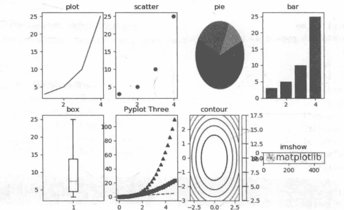

▲图 4-2 例 4-10 程序运行结果

### 小贴士：

Matplotlib 还提供 pylab 模块，集成了 NumPy 与 pyplot 的常用函数，便于在 IPython 交互环境中快速计算与绘图。常用别名是 pl，导入写法为 import pylab as pl。

### 4.2.2 核心对象解析

在 Matplotlib 中，一张完整图像对应 Figure 对象。一个 Figure 可容纳一个或多个 Axes 对象，每个 Axes 拥有独立的坐标系，层级关系如图 4-3。


▲图 4-3 Matplotlib 对象

如图 4-3，Figure 是整幅图的容器，本例仅含一个坐标区 Axes。每个 ax 都是可独立绘图的区域，其内部结构如图 4-4。

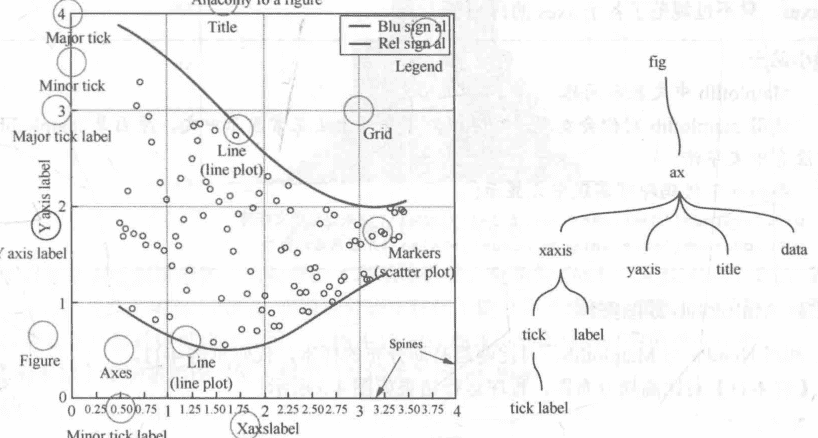

▲图 4-4 Axes 对象

以折线图为例，拆解图像的各部件，见表 4-9。

### 表 4-9 图像内部各个组件内容

| 组件 | 说明 |
|---|---|
| Figure | 整幅图 |
| Axes | 坐标区，可自由布局的子图 |
| Grid | 坐标网格 |
| Title | 标题文本 |
| Legend | 图例说明 |
| line | 图中的折线 |
| markers | 图中的标记点 |
| Spines | 轴框线，界定数据区域边界 |
| Major tick | 主刻度线 |
| Minor tick | 次刻度线 |
| Major tick label | 主刻度文字 |
| Y axis label | 纵轴说明 |
| Minor tick label | 次刻度文字 |
| X axis label | 横轴说明 |

注：可把 fig 视作 Windows 桌面，可存在多个。axes 相当于桌面图标，subplot 也是图标，区别在于 axes 可自由摆放甚至重叠，subplot 则按网格自动对齐。本质上 subplot 内部也是调用 axes，只是对排列做了规范。

### 小贴士：

### Matplotlib 中文显示问题

使用 matplotlib 时有时图例等无法正常显示中文，原因是库中缺少中文字体。

添加如下代码即可实现中文显示：

```
plt.rcParams['font.sans-serif']=['SimHei'] #来显示中文标签
plt.rcParams['axes.unicode_minus']=False #来正常显示负号
```

### 4.2.3 典型绘图示例

借助 NumPy 与 Matplotlib，绘制两组高斯分布样本进行对比，代码见例 4-11。

### 【例 4-11】对比高斯分布图，程序运行结果如图 4-5 所示

输入：

```
#对比两组高斯分布的样本
import numpy as np
from matplotlib import pyplot as plt

#np.random.normal 构建两组观测数据
samples1 = np.random.normal(0, size=1000)
samples2 = np.random.normal(1, size=1000)

#绘制样本直方图
bins = np.linspace(-4, 4, 30)
histogram1, bins = np.histogram(samples1, bins=bins, normed=True)
histogram2, bins = np.histogram(samples2, bins=bins, normed=True)
#绘制图像，并显示
plt.figure(figsize=(6, 4))
plt.hist(samples1, bins=bins, normed=True, label="Samples 1")
plt.hist(samples2, bins=bins, normed=True, label="Samples 2")
plt.legend(loc='best')
plt.show()
```

输出：

正态分布亦称高斯分布，在数学、物理、工程等领域应用广泛，是数据中最常见的分布形态之一，比如学生的考试成绩在理论上常被假设为高斯分布。它对统计学影响深远。例 4-11 先生成两组高斯数据，再用 Matplotlib 绘图。

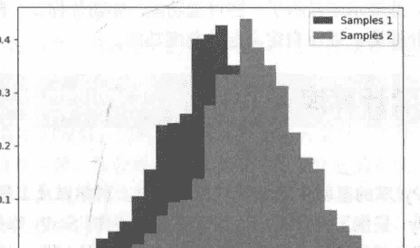

▲图 4-5 例4-11 程序运行结果

下面绘制饼图，假设有四种动物 Duck、Dog、Cow、Pig，占比分别为 15%、30%、45%、10%。数据分析中仅看表格不够，直观可视化更有帮助，例 4-12 用饼图展示。

### 【例 4-12】绘制饼形图案例，程序运行结果如图 4-6 所示

输入：

```python
import matplotlib.pyplot as plt
labels = 'Duck', 'Dog', 'Cow', 'Pig'
sizes = [15, 30, 45, 10]
explode = (0, 0.1, 0, 0)
fig1, ax1 = plt.subplots()
ax1.pie(sizes, explode=explode, labels=labels, autopct='%1.1f%%',
        shadow=True, startangle=90)
ax1.axis('equal')

plt.show()
```

输出：

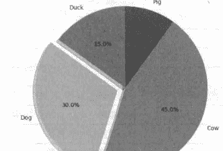

▲图 4-6 例 4-12 的运行结果

除基础饼图外，这里还演示了标签显示、百分比自动标注、爆炸式分离、阴影下拉以及起始角度自定义等可选效果。

## 4.3 SciPy 科学计算工具箱

### 4.3.1 SciPy 总览

SciPy 在 NumPy 基础上扩展了大量数学、科学和工程计算常用函数，紧密依赖 NumPy 提供快速 n 维数组运算。它与 NumPy 数组协同工作，提供高效易用的处理接口，涵盖统计、优化、积分、线性代数、傅里叶变换、信号与图像处理、常微分方程求解等，功能非常全面。

### 【例 4-13】查看 SciPy 版本

输入：

```python
import scipy
print(scipy.__version__)
```

输出：

```
1.0.0
```

SciPy 按功能划分为多个子包，具体见表 4-10。

表 4-10 SciPy 模块功能表

| 模块 | 功能 |
|---|---|
| scipy.cluster | 矢量量化/Kmeans |
| scipy.constants | 物理和数学常数 |
| scipy.fftpack | 傅里叶变换 |
| scipy.integrate | 积分 |
| scipy.interpolate | 插值 |

| scipy.io | 数据输入和输出 |

| scipy.linalg | 线性代数程序 |

| scipy.ndimage | n 维图像包 |

| scipy.odr | 正交距离回归 |

| scipy.optimize | 优化 |

| scipy.signal | 信号处理 |

| scipy.sparse | 稀疏矩阵 |

| scipy.spatial | 空间数据结构和算法 |

| scipy.special | 任何特殊的数学函数 |

| scipy.stats | 统计 |

### 4.3.2 SciPy 核心用法速览

SciPy 的能力覆盖很广，下面挑几类高频用法帮助读者快速上手。

### 1. 数值积分

积分是数学与自然科学的基础手段，从力学、天文到经济建模都有应用，算力提升后数值求积也更便捷。scipy.integration 提供了多种求积方案，大致分为两类：对解析表达式求积，见表 4-11；对离散采样求积。日常最常用的是 trapz 与 cumtrapz，前者按复合梯形法则沿指定轴累加，后者给出累积积分曲线。

表 4-11 积分函数（给定的函数对象）

| 函数 | 说明 |

|---|---|

| quad(func, a, b[, args, full_output, ...]) | 计算定积分 |

| dblquad(func, a, b, gfun, hfun[, args, ...]) | 计算二重积分 |

| tplquad(func, a, b, gfun, hfun, qfun, rfun) | 计算三重积分 |

| nquad(func, ranges[, args, opts, full_output]) | 多变量积分 |

以 I(a,b)=∫₀¹(ax²+b)dx 为例，使用 quad 做数值评估，详见例 4-14。

### 【例 4-14】计算积分

输入：

```python
from scipy.integrate import quad
def integrand(x,a,b):
    return a*x**2 + b
a=2
b=1
I=quad(integrand,0,1,args=(a,b))
print(I)
```

输出：

```
(1.6666666666666667, 1.8503717077085944e-14)
```

函数返回一个二元组，第一项约为 1.67 的积分近似值，第二项是绝对误差的估计，精度表现不错。

### 2. 最小二乘曲线拟合

设有一组观测点 (x_i, y_i)，理论关系为 y = f(x)，需要确定模型中的参数 p 使得残差平方和

S(p)=∑_{i=1}^{m}[y_i - f(x_i,p)]²

达到最小，这就是最小二乘思想。

SciPy 的 optimize 子包提供了 leastsq 来实现该任务。下面以 leastsq 做数据拟合为例，见例 4-15。

### 【例 4-15.1】 SciPy 最小平方法拟合

输入：

```python
#导入所需模块
from scipy.optimize import leastsq
import numpy as np

#定义数据拟合所用的函数: A*sin(2*pi*k*x + theta)
def func(x, p):
    A, k, theta = p
    return A*np.sin(2*np.pi*k*x+theta)

#实验数据 x, y 和拟合函数之间的差, p 为拟合需要找到的系数
def residuals(p, y, x):
    return y - func(x, p)

x = np.linspace(0, -2*np.pi, 100)
A, k, theta = 10, 0.34, np.pi/6  #真实数据的函数参数
y0 = func(x, [A, k, theta])      #真实数据
y1 = y0 + 2 * np.random.randn(len(x))  #加入噪声之后的实验数据
p0 = [7, 0.2, 0] #第一次猜测的函数拟合参数
#调用 leastsq 拟合, residuals 计算误差函数, p0 拟合参数初始值, args 需要拟合实验数据
plsq = leastsq(residuals, p0, args=(y1, x))
print (u"真实参数:", [A, k, theta])
print (u"拟合参数", plsq[0])
```

输出：

```
真实参数: [10, 0.34, 0.5235987755982988]
拟合参数 [10.03138142  0.34128054 -5.70587811]
```

### 【例 4-15.2】 可视化展现，程序运行结果如图 4-7 所示

输入：

```python
import matplotlib.pyplot as plt
import pylab as pl
plt.rcParams['font.sans-serif']=['SimHei']  #用来正常显示中文标签
plt.rcParams['axes.unicode_minus']=False    #用来正常显示负号
pl.plot(x, y0, label=u"真实数据")
pl.plot(x, y1, label=u"带噪声的实验数据")
pl.plot(x, func(x, plsq[0]), label=u"拟合数据")
pl.legend()
pl.show()
```

输出：

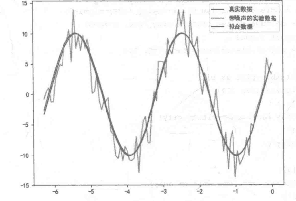

▲图 4-7 例 4-15.2 程序运行结果

### 4.3.3 SciPy 图像处理案例

图像识别的本质是让机器对图像进行处理、分析和理解，从而辨识目标。完整流程包含预处理、分割、特征提取与匹配。通俗说，就是让电脑读懂画面。借助该技术可以实现更快的图搜，也能为人与物理世界交互提供新方式。

SciPy 能完成裁剪、翻转、旋转、滤波等基础操作，底层借助 NumPy 将图像视作数组处理，如图 4-8 所示。

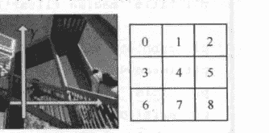

▲图 4-8 图像处理原理

### 【例 4-16】SciPy 图像处理，程序运行结果如图 4-9 所示

输入：

```python
#滤镜
from scipy import misc
face = misc.ascent()
#对数组进行截取
face = face[:512, -512:]
import numpy as np
#增加噪声
noisy_face = np.copy(face).astype(np.float)
noisy_face += face.std() * 0.5 * np.random.standard_normal(
face.shape)
#不同参数的噪声图
from scipy import ndimage
blurred_face = ndimage.gaussian_filter(noisy_face, sigma=3)
median_face = ndimage.median_filter(noisy_face, size=5)
from scipy import signal
wiener_face = signal.wiener(noisy_face, (5, 5))
#绘图
import matplotlib.pyplot as plt
plt.figure(figsize=(12, 3.5))
plt.subplot(141)
plt.imshow(noisy_face, cmap=plt.cm.gray)
plt.axis('off')
plt.title('noisy')

plt.subplot(142)
plt.imshow(blurred_face, cmap=plt.cm.gray)
plt.axis('off')
plt.title('Gaussian filter')

plt.subplot(143)
plt.imshow(median_face, cmap=plt.cm.gray)
plt.axis('off')
plt.title('median filter')

plt.subplot(144)
plt.imshow(wiener_face, cmap=plt.cm.gray)
plt.title('Wiener filter')
plt.axis('off')
plt.subplots_adjust(wspace=.05, left=.01, bottom=.01, right=.99, top=.99)
plt.show()
```

输出：

例 4-16 先把图像转化为像素矩阵，再用数组切片做变换，随后用 NumPy 添加噪声，最后绘图得到如图 4-9 的效果。

# noisy


# Gaussian filter


# median filter


# Wiener filter


▲图4-9 例4-16 程序运行结果

# 第 5 章 Python 网络爬虫


### 什么是网络爬虫？

网络爬虫也称网页蜘蛛或网络机器人，是按预设规则自动抓取万维网信息的程序或脚本。工作通常拆分为采集、处理、存储三段。简言之，它模拟人工浏览，从互联网抓取所需数据。

### 5.1 爬虫基础

### 5.1.1 初识爬虫

### 1. 爬虫章节的由来

爬虫并非人工智能的核心技能，是否写入本书我曾犹豫。正好群里同学参加数学建模竞赛询问某类数据的获取方式，我回复可用爬虫获取，对方随即追问爬虫为何物。于是决定在本册中简要介绍相关技术，帮助未接触过的读者建立认知。

在大数据的背景下，各行业对数据时效与准确性的要求在提升。搜索引擎虽已成熟，但在复杂资料或需海量外部数据验证模型时仍有局限。借助网络爬虫可以弥补不足，提升检索质量，更具针对性地完成采集任务。

### 2. 优秀爬虫的特质

网络爬虫自 20 世纪 90 年代出现至今已相当成熟。优秀的爬虫通常具备以下特质。

- 爬取目标清晰明确。
- 爬取策略高效合理。
- 前置与后置处理有效。
- 执行效率高。

本章将系统梳理爬虫的工作流程与关键技术。

### 3. 工作原理

爬虫本质上是脚本或程序。其系统架构由控制器、解析器和资源库构成。

控制器负责为多线程中的爬虫线程分配任务。爬虫发起请求访问站点或页面，若可访问则自动下载保存。解析模块随后从已抓取页面中抽取其它链接，并作为后续目标。得益于 HTML、JS、CSS 等结构化设计，爬虫可不依赖人工操作自动分析页面结构。资源库用于存放下载的网页，通常采用 MySQL、MongoDB 等大型存储。

### 5.1.2 网络爬虫的算法

工作时，待抓取的链接集合可视为树状结构，从起始 URL 出发沿超链接向下扩展至叶节点。常见的遍历方式有两种。

### （1）深度优先搜索算法

深度优先搜索算法 Depth-First-Search，DFS，先选取一个页面，在其内部挑选一条跳转进入下一页，重复直至叶节点，即无可跳转链接。再回退到上一节点挑选新链接继续遍历，直至分支结束。随后切换到另一初始页面。该算法实现相对简单。

### （2）广度优先搜索算法

该方法先获取初始页面的全部链接对应页面，再从中挑选一个链接，继续获取其页面中所有链接对应页面，逐层扩展。该方法在理论上更优。深度优先在结构复杂时易陷入过深分支，而广度优先可避免此问题，并能并行抓取同层页面，大幅提升信息获取效率。

### 5.2 爬虫入门实战

### 5.2.1 调用 API

应用程序编程接口 Application Programming Interface，API 是一组预定义函数，提供对软件或硬件功能的访问，而无需了解内部实现细节。

网络爬虫的目的是获取数据，API 同样服务于数据获取。众多大型网站对外开放 API，并提供使用文档、请求参数、返回参数说明，如图 5-1～图 5-3①所示。通过官方接口可结构化获取数据，操作便捷且合规，通常会以请求次数配额、并发上限等方式控制用量，部分服务可付费提升配额。图 5-4②为百度免费开放的 API 示例。


▲图 5-1 百度地图 Web 服务 API 地址检索服务指南

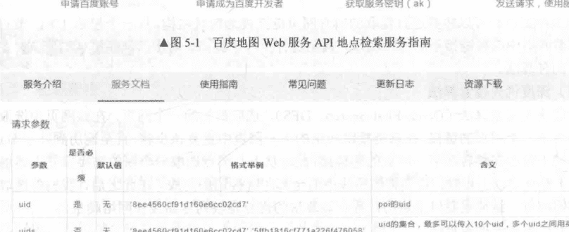

▲图 5-2 百度地图 Web 服务 API 地址检索服务文档（请求参数）

# 请求参数

| 参数 | 是否必填 | 默认值 | 格式举例 | 含义 |

|---|---|---|---|---|

| uid | 是 | 无 | '8ee4560cf91d160e8cc02cd7' | poi的uid |

| uids | 否 | 无 | '8ee4560cf91d160e8cc02cd7','5ffb1816cf771a226f476058' | uid的集合，最多可以传入10个uid，多个uid之间用英文逗号分隔。 |

| output | 否 | xml | json或xml | 请求返回格式 |

| scope | 是 | 1 | 1, 2 | 检索结果详细程度，取值为1或空，则返回基本信息；取值为2，返回检索POI详细信息 |

| ak | 是 | 无 | 您的ak | 开发者密钥访问密码，必填项。v2之前该属性为key。 |

| sn | 否 | 无 | Sn生成方法 | 开发者密钥签名。 |

| timestamp | 否 | 无 |  | 设置sn后该项必填。 |

▲图 5-2 百度地图 Web 服务 API 地址检索服务文档（请求参数）

> ① 图 5-1、图 5-2、图 5-3 来自百度地图开放平台 Web 服务 API，版权归源网站所有。 ② 图 5-4 来自百度地图开放平台，版权归源网站所有。

服务介绍 服务文档 使用指南 常见问题 更新日志 资源下载

返回参数（行政区划区域检索、周边检索、矩形区域检索、地点详情检索）

| 名称 | 类型 | 说明 |

|---|---|---|

| status | int | 本次API访问状态，如成功返回0，如果失败返回其他数字。（见服务状态码） |

| message | string | 对API访问状态的英文说明，如果成功返回"ok"，并返回结果字段，如果失败返回错误说明。 |

| total | int | POI检索总数，开发者请求中设置了page_num字段才会返回total字段，出于数据保护目的，单次请求总计最多为400， |

| name | string | poi名称 |

| location | object | poi经纬度坐标 |

| lat | float | 纬度值 |

| lng | float | 经度值 |

▲图 5-3 百度地图 Web 服务 API 地点检索服务文档（返回参数）

## 配额管理

| 服务名称 | 免费配额 | 付费配额 详情 | 操作 |

|---|---|---|---|

| 正逆地理编码 | 已用 0% 上限：30万次/天 提升 | 流量包：未购买 余额：0.00元（支持0.00万次） 购买 充值 |  |

| 坐标转换 | 已用 0% 上限：30万次/天 提升 | 流量包：未购买 余额：0.00元（支持0.00万次） 购买 充值 |  |

# 百度 Web 服务配额与 Python 爬虫实战

| 覆盖物定位 | 已用 0% 上限：100万次/天 提升 | 流量包：未购买 余额：0.00元（支持0.00万次） 购买 充值 |  |

| 地点检索 | 已用 0% 上限：3万次/天 提升 | 流量包：未购买 余额：0.00元（支持0.00万次） 购买 充值 |  |

| 路线规划 | 已用 0% 上限：3万次/天 提升 | 流量包：未购买 余额：0.00元（支持0.00万次） 购买 充值 |  |

▲图 5-4 百度 API 配额管理界面

看完配额概览，接下来以例 5-1 演示如何调用百度地图开放平台 Web 服务中的地点检索接口，并把返回结果写入 CSV。

## 【例 5-1】调取百度地图 Web 服务 API

输入：

```
#导入所需模块
import requests,json
```

```
#请求 URL,请自行申请 ak
api_url="http://api.map.baidu.com/place/v2/search?query=ATM&tag=银行&region=北京&output=json&ak=ak"

#使用 requests 发送 get 请求
res = requests.get(api_url)
#解析数据
api_rdata=json.loads(res.text)
#输出结果数据
print(api_rdata)
```

输出：

```
{'status': 0, 'message': 'ok', 'results': [{'name': '中国工商银行 ATM(蟹岛路)', 'location': {'lat': 40.021883, 'lng': 116.560318}, 'address': '北京市朝阳区蟹岛路1号三点钟农业园(绿色生态度假村内)', 'province': '北京市', 'city': '北京市', 'area': '朝阳区', 'detail': 1, 'uid': '1ebe2bd4474dd6ccf70e774b'}, {'name': '中国农业银行 ATM(酒仙桥东路)', 'location': {'lat': 39.982584, 'lng': 116.507291}, 'address': '北京市朝阳区酒仙桥东路1号M座大豪公司', 'province': '北京市', 'city': '北京市', 'area': '朝阳区', 'street_id': 'fa901e9b1d0a5bb7d6b74eef', 'detail': 1, 'uid': 'fa901e9b1d0a5bb7d6b74eef'}, {'name': '中国农业银行 ATM(G1 辅路)', 'location': {'lat': 39.874875, 'lng': 116.541264}, 'address': 'G1 辅路南 100 米', 'province': '北京市', 'city': '北京市', 'area': '朝阳区', 'street_id': '00539b9c01f935782202628f', 'detail': 1, 'uid': '00539b9c01f935782202628f'}, {'name': '中国工商银行 ATM(北京华侨城西 南)', 'location': {'lat': 39.872052, 'lng': 116.503426}, 'address': '北京市朝阳区东四环小武基北路北京欢乐谷峡湾森林内', 'province': '北京市', 'city': '北京市', 'area': '朝阳区', 'street_id': '955b606bec24f58ca7c7562d', 'detail': 1, 'uid': '955b606bec24f58ca7c7562d'}, {'name': '招商银行 ATM(北京常惠营业厅)', 'location': {'lat': 39.932896, 'lng': 116.606342}, 'address': '朝阳北路长楹天街常惠路 6 号 V 中心西侧一层附近', 'province': '北京市', 'city': '北京市', 'area': '朝阳区', 'street_id': 'a8247a999fbf6a201c3894a4', 'detail': 1, 'uid': 'a8247a999fbf6a201c3894a4'}, {'name': '招商银行 ATM(姚家园支行)', 'location': {'lat': 39.945368, 'lng': 116.507597}, 'address': '北京市朝阳区火星西路 17', 'province': '北京市', 'city': '北京市', 'area': '朝阳区', 'street_id': '84f757d2a4fbee5c51e5c553', 'detail': 1, 'uid': '84f757d2a4fbee5c51e5c553'}, {'name': '北京银行 ATM(上地支行)', 'location': {'lat': 40.052012, 'lng': 116.310775}, 'address': '北京市海淀区中关村软件园 05 号', 'province': '北京市', 'city': '北京市', 'area': '海淀区', 'street_id': '925c550f168df9b25a3ac86c', 'detail': 1, 'uid': '925c550f168df9b25a3ac86c'}, {'name': '中国工商银行 ATM(房学路)', 'location': {'lat': 40.227313, 'lng': 116.252878}, 'address': '北京市昌平区府学路 27 号中国政法大学(近梅二宿舍楼)', 'province': '北京市', 'city': '北京市', 'area': '昌平区', 'street_id': '93df0dc314304155892fb582', 'detail': 1, 'uid': '93df0dc314304155892fb582'}, {'name': '北京银行 ATM(南绥路支行)', 'location': {'lat': 39.887184, 'lng': 116.398289}, 'address': '北京市西城区富力·摩根中心 F 座', 'province': '北京市', 'city': '北京市', 'area': '西城区', 'street_id': '1013fc963d22ae8943afe67c', 'detail': 1, 'uid': '4d742b02719668c33870a46'}, {'name': '招商银行 ATM(星科大厦)', 'location': {'lat': 39.98286, 'lng': 116.501214}, 'address': '北京市朝阳区酒仙桥中路 10 号星科大厦 C 座二层大厅', 'province': '北京市', 'city': '北京市', 'area': '朝阳区', 'street_id': 'fea5922b2300921508f5eb0f', 'detail': 1, 'uid': 'fea5922b2300921508f5eb0f'}]}
```

获取的结果落盘到 baidu_api_data.csv 文件中。

输入：

```
```python
#打开文件
with open("baidu_api_data.csv","w") as apifile:
    #提取 output 中 results 部分字段并写入
    for i in range(len(api_rdata["results"])):
        #写入文件，以 "\t" 为分割符
        apifile.write(api_rdata["results"][i]["name"]+"\t")
        apifile.write(api_rdata["results"][i]["city"]+"\t")
        apifile.write(api_rdata["results"][i]["area"]+"\n")
```
```

输出：

生成一个名为"baidu_api_data"的 csv 文件，文件内部内容如图 5-5 所示。
▲ 图 5-5 baidu_api_data.csv 内容

| A | B | C |
|---|---|---|
| 1 中国工商银行ATM(蟹岛路) | 北京市 | 朝阳区 |
| 2 中国农业银行ATM(酒仙桥东路) | 北京市 | 朝阳区 |
| 3 中国农业银行ATM(G1辅路) | 北京市 | 朝阳区 |
| 4 中国工商银行ATM(北京华侨城西 南) | 北京市 | 朝阳区 |
| 5 招商银行ATM(北京常惠营业厅) | 北京市 | 朝阳区 |
| 6 招商银行ATM(姚家园支行) | 北京市 | 朝阳区 |
| 7 北京银行ATM(上地支行) | 北京市 | 海淀区 |
| 8 中国工商银行ATM(房学路) | 北京市 | 昌平区 |
| 9 北京银行ATM(南绥路支行) | 北京市 | 西城区 |
| 10 招商银行ATM(星科大厦) | 北京市 | 朝阳区 |

例 5-1 说明如下。

### （1）请求形式

例 5-1 里采用 Requests 发送网络 get 请求，也可改用参数字典传参，示例如下：

```
```python
params={"query":"ATM机","tag":"银行","region":"北京","output":"json","ak":"ak"}
res=requests.get("http://api.map.baidu.com/place/v2/search",params=params)
```
```

注：例 5-1 中的 ak 参数为必选参数，本书中 ak 具有一定时效性，请读者自行申请 ak①进行案例实践。

http 所在部分是百度地点检索接口的基础地址，params 中为请求参数，以 key 和 value 形式传递。这种写法等价于例 5-1 中的传参形式。

### （2）数据提取

接口返回的 api_rdata 是一个字典类型数据，可通过 type(api_rdata) 查看类型，具体结构见例 5-1 中的首次输出。其中 key=results 对应的 value 为一个长列表，列表内部再嵌套字典类型数据。例 5-1 中的第二次输入执行的任务就是从该复杂结构中挑选所需字段，并写入 csv 文件中。

① ak 申请地址: 请读者进入“百度地图开放平台”，获取 “Web 服务 API”。

## 5.2.2 爬虫实战

为更直观呈现 Python 在爬虫方面的便捷性，本节用少量代码实现一个静态页面的抓取。相较传统技术，Python 语法简洁、上手快且生态完善，编写爬虫时技术人员能快速进入状态。

本次演示的目标站点为中医药网，出于数据安全考虑仅抓取单一页面，如需更多数据可遍历扩展。需求是提取页面中的药材名称和生长分布信息，如图 5-6 所示。

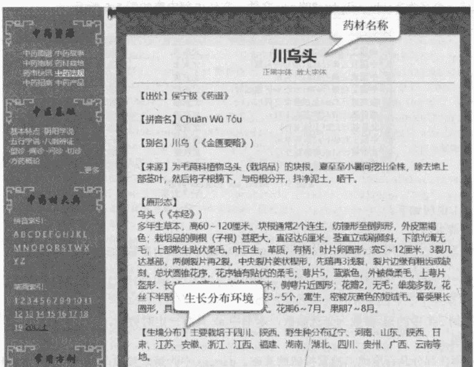
▲图 5-6 网页信息

实现上先用 requests 发送网络请求，requests.get 获取 URL 网页信息，再借助 BeautifulSoup 解析数据。BeautifulSoup 是一种用于 HTML/XML 解析的描述语言，简单实用，可按规则筛选标记文档中的指定数据。相关代码见例 5-2。

## 【例 5-2】爬取数据

输入：

```
import requests,re
from bs4 import BeautifulSoup
res = requests.get('http://www.pharmnet.com.cn/tcm/knowledge
/detail/105486.html')
soup = BeautifulSoup(res.text, 'html.parser')
name = soup.find('h1')
temp = soup.find_all('td',{"class":"maintext"})
pattern = re.compile(r'【生境分布】(.+?)<br>')
growing = pattern.findall(str(temp))
print("药材名称：{}\n生境分布:{}".format(name,growing))
```

输出：

```
药材名称：<h1>川乌头</h1>
生境分布：['主要栽培于四川、陕西。野生种分布辽宁、河南、山东、陕西、甘肃、江苏、安徽、浙江、江西、福建、湖南、湖北、四川、贵州、广西、云南等地。']
```

从例 5-2 的输出可看出目标字段已成功获取。该例未使用复杂爬虫框架，面对更复杂场景可在此基础上完善。

## 5.3 爬虫进阶——高效率爬虫

具备一定网络基础和 Python 编程基础后，完成一个简单爬虫并不困难。但在大数据时代，数据量往往远超预期。例如爬取北京市朝阳区朝外街道附近的饭店信息较为容易；若要爬取全国饭店信息，请求量可能达到百万乃至千万级，此时就需要高效率爬虫方案。本章列举几种常用做法。

## 5.3.1 多进程

Python 提供了 multiprocessing 包，只需定义一个函数，其余调度由包完成。该包支持子进程、通信和共享数据、不同形式的同步，提供了 Process、Queue、Pipe、Lock 等组件。

multiprocessing 下 Process 类构造方法的具体形式为：
```
class Process(object):
    def __init__(self, group=None, target=None, name=None, args=(), kwargs={})
```
- group: 进程组，不常用。
- target: 表示调用对象，传入要执行的方法。
- args: 表示调用对象的位置参数元组。
- name: 进程别名。
- kwargs: 表示调用对象的字典。

其常用方法见表 5-1。

## 表 5-1 常用方法表

| 方法 | 说明 |
|---|---|
| start() | 进程准备就绪，等待 CPU 调度 |
| setName() | 为进程设置名称 |
| getName() | 获取进程名称 |
| setDaemon(True) | 设置为守护进程 |
| join() | 逐个执行每个进程，执行完毕后继续往下执行 |
| run() | 进程被 CPU 调度后自动执行进程对象的 run 方法，如果想自定义进程类，直接重写 run 方法即可 |

## 【例 5-3】 开启进程

```
```python
def run(name):
    #获取当前进程的名字
    tname = multiprocessing.current_process().name
    print("{} is starting,worker is {}".format(tname,name))
    return
if __name__ == '__main__':
    numList = []
    for i in range(5):
        p = multiprocessing.Process(target=run, args=(i,))
        numList.append(p)
        p.start()
        p.join()
```
```

## 5.3.2 多线程

网络爬虫需要下载规模庞大的网页，单线程下每个请求都要等待服务器处理和返回，总耗时为各次等待之和，效率偏低。多线程可并行发起请求，减少空闲时间。

多进程和多线程均可实现并发，线程是进程的一部分，其特点是线程间可共享内存和变量，资源消耗少，缺点是同步与加锁处理相对复杂。Python 使用 threading 包创建多线程，构造方法如下：
```
Thread(group=None, target=None, name=None, args=(), kwargs={})
```
- group: 线程组，不常用。
- target: 表示调用对象，传入要执行的方法。
- name: 线程别名。
- args/kwargs: 要传入方法 的参数。

## 【例5-4】开启多线程

```python
import threading
def run(name):
    print("hello, I am thread {}".format(name))

def main():
    threads = []
    for i in range(5):
        t = threading.Thread(target=run, args=(i,))
        threads.append(t)
        t.start()
    for t in threads:
        t.join()

if __name__ == '__main__':
    print('start')
    main()
    print('end')
```

请读者在上面例子中的 run 函数中增加 time.sleep()，观察有什么不同，具体形式如下：

```python
import time
def run(name):
    time.sleep(2)
    print("hello, I am thread {}".format(name))
```

## 速记：进程与线程的八个关键差异

- 1. 进程内部的线程共享同一块地址空间，不同进程之间内存完全隔离。
- 2. 同进程内线程可互相读写数据，便于内部协作；跨进程数据各自独立。
- 3. 修改主线程的状态可能影响同进程其他线程，而父进程对自身改动一般不会影响已有的子进程，除删除操作。
- 4. 线程是执行流的上下文载体，进程是运行程序所需资源的总和。
- 5. 同进程线程可直接交互，进程间通信必须借助 IPC 等中间机制。
- 6. 新建线程成本很低，新建进程需要复制父进程资源，开销明显。
- 7. 线程能控制同进程内的其它线程，进程只能管理自己派生的子进程。
- 8. 线程创建更快，进程启动更慢，二者在运行时表现不可直接比较。

## 5.3.3 协程

协程别称微线程、纤程，英文 Coroutine。线程和进程的调度依赖操作系统内核接口，而协程的调度由程序员掌控，在 Python 里常借助 yield 手工实现协作式并发。

在多线程环境下，CPU 通过时间片轮转切换执行，切换本身有额外耗时。协程则在单个线程里维护多个微任务，按预设顺序推进代码块。

当程序里 I/O 密集、计算很少时，协程更合适。常用的第三方实现是 gevent 与 greenlet，gevent 在 greenlet 基础上做了高层封装，使用更便捷，效率也较高。

协程保存了独立的寄存器上下文和栈。切换时把当前上下文和栈暂存，恢复时再加载，因此能记住上次调用时的全部局部状态。下一次进入相当于回到离开时的逻辑位置。线程切换在操作系统层面完成，CPU 无法感知协程，协程完全由用户态控制。

## 【例 5-5】开启协程

```python
import requests
import gevent
urls=["http://www.baidu.com","https://www.yahoo.com/","https://www.sogou.com/"]
def run(url):
    print("url={}".format(url))
    res=requests.get(url)
    print("url bytes is {}".format(len(res.content)))

if __name__=="__main__":
    jobs=[gevent.spawn(run, url) for url in urls]
    gevent.joinall(jobs)
```

## 5.3.4 小结

本章对爬虫仅做入门介绍，没涉及异常处理、浏览器模拟抓取、反爬策略等系统内容。5.3 节只是抛出高性能编程的概念和常用模块，具体细节很多，本书不再深入，有兴趣的读者可自行拓展，其实用价值很大。

# 第 6 章 Python 数据存储


数据存储是什么？

简单说，就是把数据持久化到数据库里。数据库是按结构组织、保存和管理数据的仓库。随着信息技术发展，数据管理的重点已从单纯保存转向按需访问。数据库形态多样，从简易的表格式存储到可处理海量数据的企业级系统，应用场景非常广。

## 6.1 关系型数据库 MySQL

本章简要介绍数据库概念和基本操作流程，帮助零基础读者建立整体认知。若只关注算法数学或已有数据库经验，可跳过。

## 6.1.1 初识 MySQL

学习 MySQL 前，先熟悉 RDBMS 的常用术语。

- 数据库：由多个关联表组成的集合。
- 数据表：数据的集合，在库中类似电子表格。
- 列：存放同类数据的字段，如邮编列。
- 行：一组相关记录，如一条用户订阅信息。
- 冗余：重复存储数据以提升性能。
- 主键：唯一标识，一张表只能有一个，便于精确定位。
- 外键：用于关联不同表。
- 复合键：将多列组合成索引键，常用于复合索引。
- 索引：对表一列或多列的值建立排序结构，类似书籍目录，加速查询。
- 参照完整性：禁止引用不存在的实体。

在 Web 领域，MySQL 是主流 RDBMS 之一。由瑞典 MySQL AB 开发，2008 年 1 月被 Sun 收购。体积小、速度快、成本低且开源，深受中小型网站青睐。

MySQL 主要特点：

- 1. 基于 C/C++ 开发，经多编译器验证，源码可移植性强。
- 2. 跨平台支持，覆盖主流 Unix、Linux 和 Windows 家族。
- 3. 提供丰富语言绑定，涵盖 C 系、Java、Python、PHP、Ruby、Perl、Eiffel 等。
- 4. 多线程架构，能充分发挥 CPU 并发能力。
- 5. SQL 查询经优化，执行效率提升。
- 6. 可独立部署在客户端服务器架构中，也能作为库嵌入第三方程序提供多语言支持，常见字符集如 GB2312、BIG5、SHIFT_JIS 可用于表名和列名。
- 7. 支持 TCP/IP、ODBC、JDBC 等连接方式。
- 8. 内置管理、监控、优化工具。
- 9. 支持千万级记录的大型数据处理。

## 6.1.2 Python 操作 MySQL

开发中常需从数据库提取数据，经接口读入内存再处理，海量数据下效率更高且便于复杂运算。

Python 3 环境下常用 PyMySQL 驱动连接 MySQL。本书基于 Python 3.6，使用 PyMySQL。安装方式与普通模块一致，命令行执行 pip install pymysql 即可。Python 3 之前版本通常使用 mysqldb。

## 【例 6-1】查看 Pymysql 版本

输入：
```python
import pymysql
print(pymysql.__version__)
```
输出：
```
0.7.9.
```

以下示例用 Python 操作 MySQL，关键步骤已标注，详见表 6-1。

## 【例 6-2】连接数据库

输入：
```python
#①
import pymysql
#②
conn = pymysql.connect(host='localhost', port=3306, user='root', passwd='A451005528',
db='pythonai')
#③
cur = conn.cursor()
```

## 【例 6-3】在例 6-2 的前提下执行创建表操作

```python
#④
createsql="create table pytable(name char(10) ,sex char(4) ,age int)"
cur.execute(createsql)
#⑤
cur.close()
```

## 【例 6-4】在例 6-2 的前提下执行插入数据库

```python
#⑥
insertsql = "INSERT INTO pytable (name, sex, age) VALUES ('%s','%c','%d')"% ('bob','F',20)
cur.execute(insertsql)
#⑦
conn.commit()
cur.close()
#⑧
conn.close()
```

## 【例 6-5】在例 6-2 的前提下执行查询数据库操作

```python
#⑨
selectsql = "select * from pytable"
cur.execute(selectsql)
#⑩
data = cur.fetchall()
for r in data:
    print(r)
cur.close()
```

输出：
```
('bob', 'F', 20)
```

例 6-5 的结果直接在 Python 控制台显示，实际工作中更常用客户端工具查看。这里用 MySQL 客户端 DbVisualizer® 展示，如图 6-1 所示。

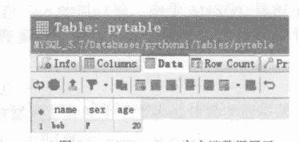

表 6-1 汇总了例 6-2 至例 6-5 的注释要点，便于以后灵活使用，完成数据的增删改查。

### 表 6-1 关于例 6-2～例 6-5 中的注释说明

| 注释序号 | 说明 |
|---|---|
| ① | 导入用于连接 MySQL 的 Python 驱动 |
| ② | 打开数据库连接，其参数含义如下<br>host: 数据库服务器地址，默认本机<br>user: 登录账号，默认当前用户<br>passwd: 登录密码，默认空<br>db: 目标库名，无默认值<br>port: 服务端口，默认 3306 |
| ③ | 调用 cursor() 生成游标对象 cur |
| ④ | 拼装建表 SQL 并通过 execute 执行 |
| ⑤ | 关闭游标，释放资源 |
| ⑥ | 组装插入 SQL 并执行 |
| ⑦ | 调用 commit 提交事务 |
| ⑧ | 关闭数据库连接 |
| ⑨ | 组装查询 SQL 并执行 |
| ⑩ | 调用 fetchall 获取结果集 |

① DbVisualizer 是一款跨平台数据库工具，支持多种关系数据库，可通过 JDBC 同时连接不同数据库。
② 插入数据时必须提交，否则不会真正写入。

## 6.2 NoSQL 之 MongoDB

## 6.2.1 初识 NoSQL

NoSQL 的含义是不仅仅是 SQL，并非完全否定关系型数据库。按存储模型可划分为列族、键值对、文档、对象、图等类型。各类型产品众多，如图数据库 Neo4j 常见于知识图谱，文档数据库 MongoDB 在自然语言处理中应用广泛。

表 6-2 按常见存储方式对 NoSQL 进行对比。

表 6-2 常见 NoSQL 数据库概况

| 类型 | 数据模型 | 应用场景 | 代表库名称 | 主要特点 |
|---|---|---|---|---|
| 键值对 | Key-Value 结构，通常基于哈希表实现 | 内容缓存，处理高并发访问，也用于日志系统等 | Redis | 内存存储，轻量高效 |
|  |  |  | Memcache DB | 分布式高性能读写 |
|  |  |  | Berkeley DB | 小巧轻量 |
| 列族数据库 | 以列族存储，同一列数据集中存放 | 分布式文件系统，按列查询 I/O 优势明显 | HBase | 高扩展、高性能、可伸缩 |
|  |  |  | Cassandra | 去中心化、线性扩展 |
|  |  |  | Hypertable | 高性能、可伸缩 |
| 文档型数据库 | Key-Value 形式，Value 为结构化数据 | 类似关系型，存储格式接近 JSON | Mongo DB | 高扩展、可伸缩，支持 LBS 检索 |
|  |  |  | Couch DB | 分布式、可伸缩 |
| 图形数据库 | 图结构 | 构建知识图谱，处理复杂互联低结构化数据，应用于社交网络、推荐系统等 | Neo4J | 高性能，图结构 |

6.1 节介绍了 Python 操作关系型 MySQL，下面介绍 Python 操作 NoSQL，这里选择 MongoDB。

## 6.2.2 Python 操作 MongoDB

MongoDB 以 C++ 实现，采用分布式文件存储架构，为 Web 应用提供可扩展的高性能存储。它介于关系型与非关系型之间，是功能最丰富、最接近关系型的非关系产品。

Python 3 下操作 MongoDB 通常使用 PyMongo。通过 pip install pymongo 安装，本节使用 3.7.0。

## 【例 6-6】查看 Pymongo 版本

输入：
```python
import pymongo
print(pymongo.__version__)
```
输出：
```
3.7.0
```

下面介绍通过 PyMongo 驱动操作 MongoDB。

## 【例 6-7】Python 操作 MongoDB

输入：
```python
from pymongo import MongoClient
#连接数据库
client = MongoClient(host='192.168.1.237',port=27017)
db=client.pymongodb
```

## 【例 6-8】插入数据

输入：
```python
dic={'name':'bob', 'sex':'F', 'age':'25', }
#插入 dic,不需要事先创建集合,自动可以生成
db.pycollection.insert({'name':'bob','age':'25','addr':'Cleveland'})
```

## 【例 6-9】查询数据

输入：
```python
data=db.pycollection.find()
for r in data:
    print(r)
```
输出：
```
({'_id': ObjectId('5b165d1f27c5f732bcacee7a'), 'name': 'bob', 'age': '25', 'addr': 'Cleveland'}
```

例 6-9 的结果在 Python 中输出，实际使用常借助客户端查看，其在 NoSQL Manager for MongoDB 里的可视化效果如图 6-2 所示。

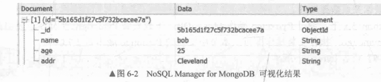

▲图 6-2 NoSQL Manager for MongoDB 可视化结果

需要说明的是，图 6-2 中的 “_id”。在 MySQL 等关系型数据库中主键通常自增，但在分布式环境下易冲突。MongoDB 使用 ObjectId 类型作为主键。

MongoDB 文档必须包含 “_id” 键，未指定时会由系统自动生成；若插入时已提供则系统不再创建。该键可为任意非关系型，默认是 ObjectId。集合中每个文档的 _id 唯一。图 6-2 中的 24 位十六进制字符串 '5b165d1f27c5f732bcacee7a' 实际占用 12 字节。ObjectId 为 12 字节 BSON 类型，按字节顺序含义见表 6-3。

表 6-3 默认_id 含义说明

|  | 1 | 2 | 3 | 4 | 5 | 6 | 7 | 8 | 9 | 10 | 11 |
|---|---|---|---|---|---|---|---|---|---|---|---|
|  |  | 时间戳 |  |  | 主机名 |  | PID |  | 计数器 |  |  |

ObjectId 前 4 个字节用来记录自 Unix 纪元起的秒级时间戳，随后的一段字节用于标识生成该 ID 的主机，通常采用主机名的哈希值。不同机器的哈希互不相同，因而在分布式部署中能避免冲突，也正因如此，同一台服务器产出的 ObjectId 中间部分会保持一致。为防止单机多进程并发产生重复，后续的 2 个字节写入创建该 ID 的进程编号 PID。前 9 个字节已足以在同一秒内区分不同主机、不同进程产生的标识。最后 3 个字节是自增计数器，确保同一进程在同一秒内多次调用依然唯一。按此规则，每个进程每秒最多可生成 256³，即 16,777,216 个不同的 ObjectId。

MongoDB 是 NoSQL 阵营的代表性系统，它通过放宽一致性要求来换取更灵活的分布式扩展能力。相较主流关系型数据库 MySQL，二者在数据模型、存储方式和查询机制上的差异非常明显，具体对照见表 6-4。

表 6-4 MySQL 与 MongoDB 对比

|  | MySQL | MongoDB |

|---|---|---|

| 数据组织结构 | 表（table） | 集合（collection） |

| 单条数据 | 按行存储（Row） | 按文档存储（Document） |

| 字段 | 预定义的表和字段 | 没有固定模式 |

| 操作方法 | 结构化查询语言（SQL） | 查询命令 |

| 结构更新 | 加锁并逐条更新数据 | 直接插入新的数据 |

| 扩展与均衡 | 手动分配和设置 | 自动分配新的节点 |

| 主键 | 通常与业务无关的值作为主键 | _id |

| 主键生成策略 | UUID，自增 | 24 位的字符串(time + machine + pid + inc)，自己指定 |

在自然语言处理场景里，问答系统和对话机器人要先对用户输入做理解，再结合知识图谱和语义分析实现类人交流，这一环节中 NoSQL 发挥着关键作用。

## 6.3 本章小结

### 6.3.1 数据库基本理论

随着 NoSQL 产品持续增多，市场上常问 NoSQL 是否会完全取代关系型数据库。在此之前，先简要认识 CAP、ACID、BASE 三个理论，见表 6-5。

**表 6-5 CAP、ACID、BASE 理论**

| CAP | ACID | BASE |

|---|---|---|

| C, 即 Consistency, 一致性 | A, 即 Atomicity, 原子性, 事务中的所有操作, 要么全部成功, 要么全部不做 | Basically Available, 基本可用 |

| A, 即 Availability, 可用性 (指的是快速获取数据) | C, 即 Consistency, 一致性. 在事务开始与结束时, 数据库处于一致状态 | Soft-state, 软状态/柔性事务 |

| P, Tolerance of network Partition 分区容忍性 (分布式) | I, 即 Isolation, 隔离性. 事务如同只有这一个操作被数据库所执行 | Eventual Consistency, 最终一致性 |

| — | D, 即 Durability, 持久性. 在事务结束时, 此操作将不可逆转 | — |

BASE 可视为 ACID 的对立面。ACID 追求强一致，BASE 则允许数据在一段时间内不一致，以换取可用性，最终收敛到一致即可。Web2.0 类网站面对高并发读写、可扩展和高可用的需求，天然倾向分布式存储。CAP 指出一致性、可用性、分区容错三者无法兼得，最多只能选其二。关系型数据库在 ACID 框架下提供强一致和良好可用性，因而构建分布式集群难度大，扩展能力受限。NoSQL 采用 BASE 思路，牺牲强一致换取最终一致，从而实现更高的可用性和扩展性。

对 Web2.0 而言，可用性和分区容错的优先级通常高于即时一致，设计常偏向 A+P。但数据库的核心价值在于保障一致，仅为分区而放弃一致并不合理，需要借助额外手段进行补偿。

### 6.3.2 数据库结合

从 CAP 视角看，分布式存储更适配 NoSQL，能缓解 Web2.0 的性能与扩展瓶颈。可是 NoSQL 的实际缺陷仍让人顾虑，能否与关系型数据库协同使用？在强一致高可用场景采用 ACID 模型，在高可用高扩展场景采用 BASE 模型。答案是肯定的。当前 NoSQL 难以全面取代关系型，却能弥补其性能与扩展短板，因此可以组合使用，各取所长。

以 Web2.0 中常见的用户评论存储为例，评论表通常包含主键 ID、被评论用户 ID、评论用户 ID、评论时间、评论内容等字段。结合两者特性，可将查询频繁的小字段如主键、各 ID、时间等存入关系型数据库并建立索引，而体积较大的评论内容文本存入 NoSQL。

关系型负责结构化存储，NoSQL 承载非结构化数据，优势在于：降低关系库 I/O 压力，加快备份恢复；NoSQL 多采用行级锁，缓存大文本更便捷；NoSQL 天生易扩展，间接提升整体性能。

该结合方式实现简便且效果可观，并非唯一方案，应根据具体业务灵活组合。

### 6.3.3 结束语

关系数据库已流行数十年，NoSQL 短期内完全取而代之并不现实，但其发展势头不容忽视。在现阶段的特定场景下，将 NoSQL 与关系型数据库结合使用可相互补足缺陷，对解决 Web2.0 面临的性能与扩展问题具有重要意义。

# 第 7 章 Python 数据分析


数据分析是指什么

数据分析涵盖检验、清洗、重构与建模等环节，目的是从数据中挖掘有价值的信息和可执行的结论，为决策提供支撑。方法多样、技术丰富，广泛应用于商业、科学、社会学等领域。

## 7.1 数据获取

数据获取指从数据源采集数据的过程，为后续分析与挖掘做准备。

### 7.1.1 从键盘获取数据

input 是 Python 的内置函数，从标准输入读取字符串，用于获取控制台输入。

【例 7-1】通过 input 获取数据

输入：

```
```

print("How old are you?"),

age = input("Please input your age:")

print ("so %s years old" %age )

```
```

输出：

```
```

How old are you?

Please input your age:45

so 45 old

```
```

例 7-1 演示了通过控制台读取输入并返回结果，其中 “so 45 old” 中的 45 即为用户输入。

### 7.1.2 文件的读取与写入

### 1. 读取操作

读写文件是常见 I/O 操作。Python 内置 open() 用于打开文件对象，需传入文件名和模式。

【例 7-2】通过 open 获取数据，输出如图 7-1 所示

输入：

```
f=open("test.txt","r",encoding="utf-8")
print(f.read())
f.close()
```

输出：

第一行

第二行

第三行

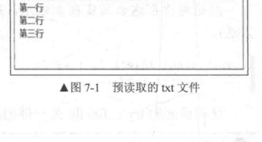

例 7-2 中 open 可用只读、写入、追加等模式，具体取值见表 7-1。模式参数可选，默认读取模式为 r。

表 7-1 读取文件模式列表

| 模式 | 说明 |

|------|------|

| r | 以只读方式打开文件。文件的指针将会放在文件的开头，这是默认模式 |

| rb | 以二进制格式打开一个文件用于只读。文件指针将会放在文件的开头，这是默认模式 |

| r+ | 打开一个文件用于读写。文件指针将会放在文件的开头 |

| rb+ | 以二进制格式打开一个文件用于读写。文件指针将会放在文件的开头 |

令 file=open("test.txt","r",encoding="utf-8")，file 的常用方法如下。

- file.read(size)：size 指定读取数量，省略则读取全部。
- file.readline()：读取一行。
- file.readlines()：读取全部行并以每行为元素组成列表，[line1,line2,...,lineN]；处理大文件时可提升效率。
- file.write()：写入前需将非字符串转为字符串。
- file.close()：关闭文件，释放系统资源，同一时间可打开文件数有限。

文件操作可能引发 IOError，若出错后未关闭文件会造成资源泄漏，可用 try ... finally 确保关闭。

```
```python

try:

    f = open(' file', 'r')

    print(f.read())

finally:

    if f:

        f.close()

```
```

每次都写 try ... finally 比较繁琐，Python 提供 with 语句自动调用 close()：

```
```python

with open('file', 'r') as f:

    print(f.read())

```
```

效果与 try ... finally 相同，代码更简洁，无需手动调用 close()。

### 小贴士：

open 读取依据光标位置，若对同一文件连续调用 read()，第二次会返回空。再次读取前需执行 file.seek(0) 将光标移至开头。

```
```python

f=open("test.txt","r",encoding="utf-8")

f.read()

f.seek(0)

f.read()

f.close()

```
```

### 2. 写入操作

数据处理后常需保存到文件或数据库。简单写入示例见例7-3，常用写入模式见表7-2。

表 7-2 写入模式

| 模式 | 说明 |

|------|------|

| w | 打开一个文件只用于写入。如果该文件已存在，则打开文件，并从开头开始编辑，即原有内容会被删除；如果该文件不存在，则创建新文件 |

| wb | 以二进制格式打开一个文件只用于写入。如果该文件已存在，则打开文件，并从开头开始编辑，即原有内容会被删除；如果该文件不存在，则创建新文件 |

| w+ | 打开一个文件用于读写。如果该文件已存在，则打开文件，并从开头开始编辑，即原有内容会被删除；如果该文件不存在，则创建新文件 |

| wb+ | 以二进制格式打开一个文件用于读写。如果该文件已存在，则打开文件，并从开头开始编辑，即原有内容会被删除；如果该文件不存在，则创建新文件 |

| a | 打开一个文件用于追加。如果该文件已存在，文件指针将会放在文件的结尾，也就是说，新的内容将会被写入已有内容之后；如果该文件不存在，则创建新文件进行写入 |

| ab | 二进制格式打开一个文件用于追加。如果该文件已存在，文件指针将会放在文件的结尾，也就是说，新的内容将会被写入已有内容之后；如果该文件不存在，则创建新文件进行写入 |

| 模式 | 说明 |

| --- | --- |

| a+ | 打开一个文件用于读写。如果该文件已存在，文件指针将会放在文件的结尾，文件打开时会是追加模式；如果该文件不存在，则创建新文件用于读写 |

| ab+ | 以二进制格式打开一个文件用于追加。如果该文件已存在，文件指针将会放在文件的结尾；如果该文件不存在，则创建新文件用于读写 |

【例 7-3】写入文件

输入：

```
```python

with open("test.txt","w") as file:

    file.write("hello world")

```
```

使用 “w” 模式将 hello world 写入 test.txt。

### 7.1.3 Pandas 读写操作

Pandas 是 Python 数据分析的核心模块，本书前面已介绍其操作。下面简述其 I/O API。Pandas 支持多种文件格式的读写，具体见表 7-3。

表 7-3 Pandas 文件的读写操作

| 格式类型 | 数据描述 | 读操作 | 写操作 |

| --- | --- | --- | --- |

| text | CSV | read_csv | to_csv |

| text | JSON | read_json | to_json |

| text | HTML | read_html | to_html |

| text | Local clipboard | read_clipboard | to_clipboard |

| binary | MS Excel | read_excel | to_excel |

| binary | HDF5 Format | read_hdf | to_hdf |

| binary | Feather Format | read_feather | to_feather |

| binary | Parquet Format | read_parquet | to_parquet |

| binary | Msgpack | read_msgpack | to_msgpack |

| binary | Stata | read_stata | to_stata |

| binary | SAS | read_sas |  |

| binary | Python Pickle Format | read_pickle | to_pickle |

| SQL | SQL | read_sql | to_sql |

| SQL | Google Big Query | read_gbq | to_gbq |

注意：Pandas 提供通用读取函数 read_table()，默认以 sep='\t' 分隔读取到 DataFrame。可通过 sep 参数指定其他分隔符，从而读取任意文本文件，如例 7-4、例 7-5 所示。

【例 7-4】read_table 操作

输入：

```
```python

df1=pd.read_table("AB.csv",sep=",")

print(df1)

```
```

输出：

Unnamed: 0  Column A  Column B

0  0  0.693188  -1.133000

1  1  0.222813  1.257744

2  2  -0.322323  -0.426994

read_table() 默认分隔符为 '\t'，故读取 CSV 需指定 sep=","，否则会被当作一列处理。

【例 7-5】read_csv 与 read_table 对比

输入：

```
df2=pd.read_csv("AB.csv")
print(df2)
```

输出：

Unnamed: 0  Column A  Column B

0  0  0.693188  -1.133000

1  1  0.222813  1.257744

2  2  -0.322323  -0.426994

例 7-4 与例 7-5 分别用 read_table() 和 read_csv() 读取 CSV，均能获取数据。分隔符指定是关键。下面给出写入案例，见例 7-6。

【例 7-6】Dataframe 保存为 csv 案例

输入：

```
import pandas as pd
from numpy.random.mtrand import randn

df = pd.DataFrame(randn(3, 2), columns=[' Column A ', ' Column B '], index = range(3))
print(df)
df.to_csv("AB.csv")
```

输出：

Column A  Column B

0  0.693188  -1.133000

1  0.222813  1.257744

7  -0.322323  -0.426994

## 7.2 人口普查数据实战解析

### 7.2.1 1994普查收入预测案例分析

本段案例选用 UCI 公开的数据仓库资源。UCI 常被科研与工程领域用作基准数据来源。adult.data 源自 1994 年美国人口普查的抽样，业界习惯称之为收入普查集，样本总量 48 842 条。其中年薪高于五万美元的个体约占 23.93%，五万美元及以下的个体约占 76.07%。原始划分已给出 32 561 条用于训练、16 281 条用于测试。建模目标是辨别个人年薪是否达到 50k 门槛，解释变量共 14 个，覆盖年龄、就业形态、受教育情况、职业等关键维度，详见表 7-4。其中 8 项为离散类别，6 项为连续数值，整体属于二分类任务。

表 7-4 数据集变量及含义

| 属性名 | 含义 |

|---|---|

| age | 年龄 |

| workclass | 工作类别 |

| fnlwgt | 序数 |

| education | 受教育程度 |

| education-num | 受教育时间 |

| marital-status | 婚姻状况 |

| occupation | 职业 |

| relationship | 社会角色 |

| race | 种族 |

| sex | 性别 |

| capital-gain | 资本收益 |

| capital-loss | 资本支出 |

| hours-per-week | 每周工作时间 |

| native-country | 国籍 |

表 7-4 涉及维度 14 个，覆盖较为全面，可开展多角度探索。对整体进行概括后，如表 7-5 所示。

表 7-5 数据概况

| 数据集特征 |  |

|---|---|

| 属性特征: | 类别型、整型型 |

| 相关应用: | 分类 |

| 记录数: | 48842 |

| 属性数目: | 14 |

| 缺失值?: | 有 |

该素材主要服务机器学习，先把训练集与测试集合并再进入分析。

### 【例 7-7.1】合并 adult 数据

输入：

```
column_names = ['age', 'workclass', 'fnlwgt', 'education', 'educational-num','marital-status', 'occupation', 'relationship', 'race', 'gender','capital-gain', 'capital-loss', 'hours-per-week', 'native-country','income']
#合并
train = pd.read_csv('adult.data.txt', sep="\s", header=None, names = column_names, engine = 'python')
test = pd.read_csv('adult.test.txt', sep="\s", header=None, names = column_names, engine = 'python')
test['income'].replace(regex=True,inplace=True,to_replace=r'\.',value=r'')
adult = pd.concat([test,train])
adult.reset_index(inplace = True, drop = True)  #查看数据
print(adult.count())
```

输出：

|  |  |

|---|---|

| age | 48842 |

| workclass | 48842 |

| fnlwgt | 48842 |

| education | 48842 |

| educational-num | 48842 |

| marital-status | 48842 |

| occupation | 48842 |

| relationship | 48842 |

| race | 48842 |

| gender | 48842 |

| capital-gain | 48842 |

| capital-loss | 48842 |

| hours-per-week | 48842 |

| native-country | 48842 |

| income | 48842 |

字段较多，可按需挑选观察。此处取 age 与 educational-num 两个列，使用 tail 查看末尾 5 行，具体呈现见例 7-7.2。

### 【例 7-7.2】观察数据

输入：

```
#选择'age','educational-num'两个字段进行查看
print(adult[['age','educational-num']].tail())
```

输出：

|  | age | educational-num |

|---|---|---|

| 48838 | 27 | 12.0 |

| 48839 | 40 | 9.0 |

| 48840 | 58 | 9.0 |

| 48841 | 22 | 9.0 |

| 48842 | 52 | 9.0 |

例 7-7.3 对全部列做一次快速扫描，为每个字段绘制条形图，先把握分布轮廓，再做深入挖掘。

### 【例 7-7.3】数据初步统计，程序运行结果如图 7-2 所示

输入：

```
fig=plt.figure(figsize=(20,15))
cols=5
rows=math.ceil(float(adult.shape[1]/cols))
for i,column in enumerate(adult.columns):
    ax=fig.add_subplot(rows,cols,i+1)
    ax.set_title(column)
    if adult.dtypes[column]==np.object:
        adult[column].value_counts().plot(kind="bar",axes=ax)
    else:
        adult[column].hist(axes=ax)
        plt.xticks(rotation="vertical")
plt.subplots_adjust(hspace=0.9, wspace=0.2)
#plt.savefig("a1.png")
plt.show()
```

输出：

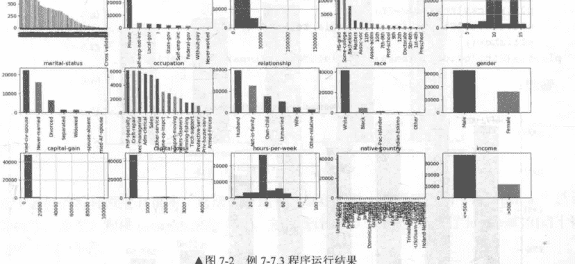

▲图 7-2 例 7-7.3 程序运行结果

分析时需保持针对性。图 7-2 显示，部分特征分布极不均衡，例如 workclass、Race、capital-gain、capital-loss、native-country 等。capital-gain 与 capital-loss 间似乎存在较强关联。下面挑选若干特征细化，见例 7-7.4。

### 【例 7-7.4】基于职业的统计分析

输入：

```
occdata=data.groupby('occupation').size().nlargest(10)
print(occdata)
```

输出：

Prof-specialty      6172

Craft-repair        6112

Exec-managerial     6086

Adm-clerical        5611

Sales               5504

Other-service       4923

Machine-op-inspect  3022

?                   2809

Transport-moving    2355

Handlers-cleaners   2072

### 【例 7-7.5】例 7-7.4 的可视化结果，程序运行结果如图 7-3 所示

输入：

```
#定义显示数值函数
def autolabel(rects):
    for rect in rects:
        height = rect.get_height()
        plt.text(rect.get_x()+rect.get_width()/2.-0.2, 1.03*height, '%.2f' % float(height))
def pltsize(x,y,title):
    a=plt.bar(x,y,width = 0.5)
    autolabel(a)
    plt.xticks(rotation=20)
    plt.title("Statistical analysis for %s" % title)
    plt.show()
pltsize(list(occdata.index),list(occdata.values),'occupation')
```

输出：

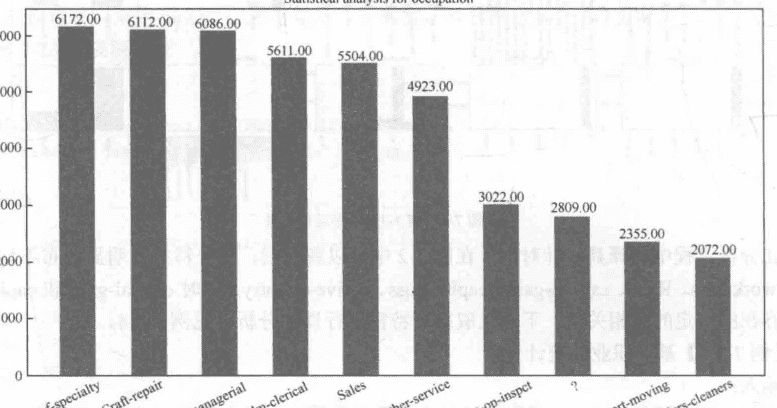

▲图 7-3 例 7-7.5 程序运行结果

### 【例 7-7.6】对职业平均收入大于 50k 美元的统计分析，程序运行结果如图 7-4 所示

输入：

```
```python
moccdata=(data.groupby('occupation').apply(lambda g: np.mean (g['income'] == '>50k'))
.sort_values().head(5)
print(moccdata)
pltsize(list(moccdata.index),list(moccdata.values),'occupation avg income>50k')
```
```

输出：

occupation
Sales              0.178597
Tech-support       0.195712
Protective-serv    0.214649
Prof-specialty     0.301199
Exec-managerial    0.323365

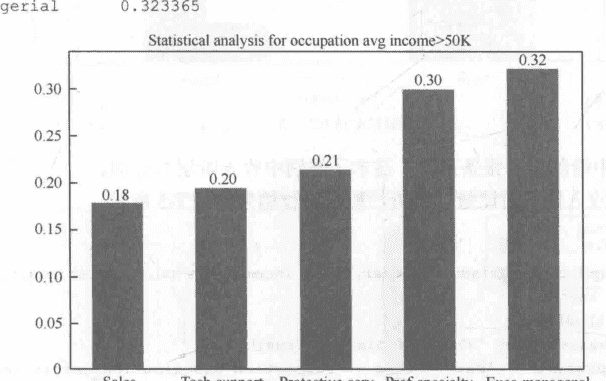

▲图 7-4 例 7-7.6 程序运行结果

特征维度丰富，选择观察角度很重要。以 occupation 为例，先 groupby 分组，再统计样本规模，取 nlargest 10 前十名，演示见例 7-7.7。

### 【例 7-7.7】分组统计分析

输入：

```
```python
coundata=data.groupby('native-country').size().nlargest(10)
print(coundata)
```
```

输出：

United-States  43832
Mexico         951
? 857
Philippines 295
Germany 206
Puerto-Rico 184
Canada 182
El-Salvador 155
India 151
Cuba 138

为更清晰呈现收入信息，对 income 做分组对比。收入不超过 50k 的人数为 37 155，约为高收入人群的 3 倍多，详见例 7-7.8。

### 【例 7-7.8】收入统计

输入：

```
print(adult.groupby('income')['income'].count())
```

输出：

```
income
<=50k 37155
>50k 11687
```

例 7-7.9 用条形图展示性别在不同收入层级的占比分布。

### 【例 7-7.9】收入情况对比统计分析，程序运行结果如图 7-5 所示

输入：

```
gender=round(pd.crosstab(adult.gender,adult.income).div(pd.crosstab(adult.gender,adult.income).apply(sum,1),0),2)
gender.sort_values(by = '>50k', inplace = True)
ax = gender.plot(kind ='bar', title = 'Proportion distribution across gender levels')
ax.set_xlabel('Gender level')
ax.set_ylabel('Proportion of population')
plt.show()
```

输出：

如图 7-5 所示，总体来看男女收入存在差距。男性年收入超过 50k 的比例约为女性同龄人的两倍以上。

### 【例 7-7.10】workclass 对比分析，程序运行结果如图 7-6 所示

输入：

```
gender_workclass=round(pd.crosstab(adult.workclass,[adult.income,adult.gender]).div(pd.crosstab(adult.workclass,[adult.income, adult.gender]).apply(sum,1),0),2)
gender_workclass[[('>50k','Male'), ('>50k','Female')]].plot(kind = 'bar',title = 'Proportion distribution across gender for each workclass', figsize = (10,8), rot = 30)
ax.set_xlabel('Gender level')
ax.set_ylabel('Proportion of population')
```

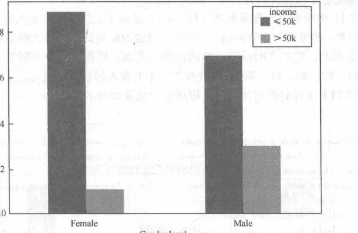

▲图 7-5 例 7-7.9 程序运行结果

输出：

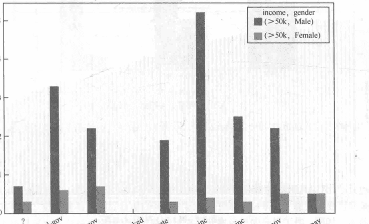

▲图 7-6 例 7-7.10 程序运行结果

图 7-6 显示，除无薪劳动者外，男性年收入超过 50k 的比例始终高于女性。结合例 7-7.9 的结论可知，不仅整体男性收入更高，在 workclass 的细分维度中男性占比同样更高，并未出现逆转现象。

例 7-7.11 绘制了工作时长与收入层级的条形图。直观上每周工时越长，高收入的比例越高，但不必然构成正相关。例如工作时长为 77、79、81、82、87、88 小时的区间中，样本里没有人达到 50k。

### 【例 7-7.11】工作时间对比分析，程序运行结果如图 7-7 所示

输入：

```
hours_per_week = round(pd.crosstab(adult['hours-per-week'],adult.income).div(pd.crosstab(adult['hours-per-week'], adult.income).apply(sum,1),0),2)

hours_per_week.sort_values(by = '>50k', inplace = True)
ax = hours_per_week.plot(kind ='bar', title = 'Proportion distribution across Hours per week', figsize = (20,12))
ax.set_xlabel('Hours per week')
ax.set_ylabel('Proportion of population')
plt.show()
```

输出：

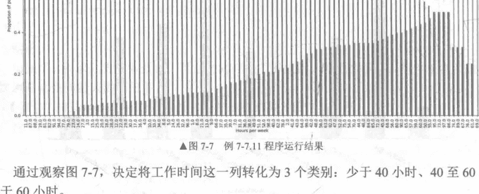

▲图 7-7 例 7-7.11 程序运行结果

基于图 7-7 的观察，将 hours-per-week 划分为三个区间：不足 40 小时、40 至 60 小时、超过 60 小时。

### 【例 7-7.12】工作时间划分类别对比分析，程序运行结果如图 7-8 所示

输入：

```
gender_workclass = round(pd.crosstab(adult.workclass, [adult.income, adult.gender]).div
(pd.crosstab(adult.workclass, [adult.income, adult.gender]).
    apply(sum,1),0),2)

gender_workclass[[('>50k','Male'), ('>50k','Female')]].plot(
    kind = 'bar', title = 'Proportion distribution across gender for each workclass',
    figsize = (10,8), rot = 30)
ax.set_xlabel('Gender level')
ax.set_ylabel('Proportion of population')
plt.show()
```

输出：

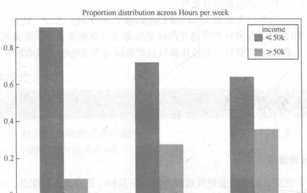

▲ 图 7-8 例 7-7.12 程序运行结果

对这三个区间的条形图可见，在年收入超过 50k 的比例中，女性的占比呈现上升趋势。

## 7.2.2 小结

本章篇幅精简，却足以勾勒出数据分析的主线，并演示如何用 Python 快速进入实操。具备数据获取、抽取与解读的能力，才能支撑更复杂精细的分析工作。沿着本章的路径，你可以马上启动自己的项目。额外说明，本章选用的是机器学习社区公认的基准数据集，后续做模型训练时同样可以直接使用。

# 第8章 NLP 实战入门


自然语言处理是什么

NLP 即 Natural Language Processing，自然语言处理，聚焦于人与机器通过自然语言实现高效沟通的理论与实现方法，融合了语言学、计算机科学、数学等多学科视角，在人工智能与计算机科学中占据核心位置。

### 8.1 Jieba 分词基础

### 8.1.1 Jieba 中文分词

### 1. 中文分词技术

目前中文分词的研究成果大致可归为：正向最大匹配、反向最大匹配、分词与词性标注一体化、最佳匹配、专家系统、最少分词词频选择以及神经网络等方向。Jieba 主要依赖以下技术。

- (1) 借助前缀词典进行高效词图遍历，把句子中所有可能的成词组合组织成有向无环图 DAG。
- (2) 采用动态规划寻找概率最大的路径，得到基于词频的最优切分。
- (3) 针对未登录词，使用基于汉字成词能力的 HMM 模型，并以 Viterbi 算法推断。

中文分词是中文信息处理的基石，应用非常广泛：汉语语音理解、机器翻译、语音合成、自动分类、自动摘要、数据挖掘与搜索引擎等环节都必须先完成分词。分词质量高低会直接影响后续任务的上限。

### 2. 常用分词模块

中文分词与英文差异明显，英文靠空格分隔，中文以字为单位，词间没有明确边界，需要专门切分。当前开源的中文分词工具有 SnowNLP、THULAC、Jieba、HanLP 等，均在持续维护，本书以 Python 中的 Jieba 包为例展开。

Jieba 又称结巴分词，支持简体和繁体中文，且有多语言实现，如 Java、C++、R、PHP、Go 等版本。

## 8.1.2 Jieba 分词的 3 种模式

Jieba 提供三种切分策略：精准模式、全模式、搜索引擎模式。

### 1. 精准模式

追求切分准确，适合文本分析。调用 jieba.cut，通过布尔参数 cut_all 控制模式，cut_all 取 False 时即为精准模式。

### 2. 全模式

把句子中所有可成词的组合全部列出，速度快但会产生歧义。cut_all 取 True 时启用。

### 3. 搜索引擎模式

在精准模式基础上对长词进一步拆分，提升召回率，适用于搜索场景。调用 jieba.cut_for_search 实现。

下面用例 8-1 演示三种模式。

### 【例 8-1】Jieba 分词的 3 种模式示例

输入：

```
import jieba
#全模式 cut_all=True
text="野生动物园有很多凶猛的动物"
str_quan1=jieba.cut(text, cut_all=True)
print("|".join(str_quan1))
```

输出：

野生|野生动物|生动|动物|动物园|有|很多|凶猛|的|动物

输入：

```
#精准模式
str_jing1=jieba.cut(text, cut_all=False)
print("|".join(str_jing1))
```

输出：

野生|动物园|有|很多|凶猛|的|动物

输入：

```
#搜索引擎模式
str_sosol=jieba.cut_for_search(text)
print("|".join(str_sosol))
```

输出：

野生|动物|动物园|有|很多|凶猛的|动物

对“野生动物园有很多凶猛的动物”的分词结果对比见表 8-1。

### 表 8-1 3种分词模式

| 预分词语句 | 分词模式 | 语句对应分词集合 |

|---|---|---|

| 野生动物园有很多凶猛的动物 | 精确模式 | 野生 动物园 有 很多 凶猛的 动物 |

|  | 搜索引擎模式 | 野生 动物 动物园 有 很多 凶猛的 动物 |

|  | 全模式 | 野生 野生动物 生动 动物 动物园 有 很多 凶猛的 动物 |

解读如下，默认即为精确模式，cut_all=False。相较全模式，精确模式词数更少且更准确，常用于文本分析。全模式会穷举所有可能组合，速度快但歧义多。搜索引擎模式在精确基础上拆分长词，提高召回，适合搜索需求。

小贴士：

jieba.cut 与 jieba.cut_for_search 返回的是可迭代生成器，可用 for 循环逐个取出，也可用 jieba.lcut 及 jieba.lcut_for_search 直接获得列表。

## 8.1.3 标注词性与添加定义词

### 1. 标注词性

中文分词中词性划分很重要，Jieba 支持词性标注，类别见表 8-2。

### 表 8-2 词性类别表

| 词性编码 | 词性名称 | 说明 |

|---|---|---|

| ag | 形语素 | 形容词性语素。形容词代码为 a，语素代码 g 前面置以 a |
| a | 形容词 | 取形容词的英文 adjective 的第一个字母 |
| ad | 副形词 | 直接作状语的形容词。形容词代码 a 和副词代码 d 并在一起 |
| an | 名形词 | 具有名词功能的形容词。形容词代码 a 和名词代码 n 并在一起 |
| b | 区别词 | 取汉字“别”的声母 |
| c | 连词 | 取连词的英文 conjunction 的第一个字母 |
| dg | 副语素 | 副词性语素。副词代码为 d，语素代码 g 前面置以 d |
| d | 副词 | 取 adverb 的第二个字母，因其第一个字母已用于形容词 |
| e | 感叹词 | 取感叹词的英文 exclamation 的第一个字母 |
| f | 方位词 | 取汉字“方”的拼音首字母 f |
| g | 语素 | 绝大多数语素都能作为合成词的“词根”，取汉字“根”的声母 |
| h | 前接成分 | 取英语单词 head 的第一个字母 |
| i | 成语 | 取成语的英义 idiom 的第一个字母 |
| j | 简称略语 | 取汉字“简”的声母 |
| k | 后接成分 | 后接成分词，一般很少用 |
| l | 习用语 | 习用语尚未成为成语，有点“临时性”，取“临”的声母 |
| m | 数词 | 取英语单词 numeral 的第三个字母，n、u 已有他用 |
| ng | 名词语素 | 名词语素。名词代码为 n，语素代码 g 前面置以 n |
| n | 名词 | 取名词的英文 noun 的第一个字母 |
| nr | 人名 | 名词代码 n 和“人(ren)”的声母并在一起 |
| ns | 地名 | 名词代码 n 和处所词代码 s 并在一起 |
| nt | 机构团体 | “团”的声母为 t，名词代码 n 和 t 并在一起 |
| nz | 其他专名 | “专”的声母的第一个字母为 z，名词代码 n 和 z 并在一起 |
| o | 拟声词 | 取拟声词的英文 onomatopoeia 的第一个字母 |
| p | 介词 | 取介词的英文 prepositional 的第一个字母 |
| q | 量词 | 取量词的英文 quantity 的第一个字母 |
| r | 代词 | 取代词的英文 pronoun 的第二个字母，因 p 已用于介词 |
| s | 处所词 | 取处所词的英文 space 的第一个字母 |
| tg | 时语素 | 时间词性语素。时间词代码为 t，在语素的代码 g 前面置 t |
| t | 时间词 | 取时间词的英文 time 的第一个字母 |
| u | 助词 | 取助词的英文 auxiliary 的第二个字母 |
| vg | 动词语素 | 动词词性语素。动词代码为 v，在语素的代码 g 前面置 v |
| v | 动词 | 取动词的英文 verb 的第一个字母 |
| vd | 副动词 | 直接作状语的动词。动词和副词的代码并在一起 |
| vn | 名动词 | 指具有名词功能的动词。动词和名词的代码并在一起 |
| w | 标点符号 | 标点符号 |
| x | 非语素字 | 非语素字只是一个符号，字母 x 通常用于代表未知数、符号 |
| y | 语气词 | 取汉字“语”的声母 |
| z | 状态词 | 取汉字“状”的声母的前一个字母 |
| un | 未知词 | 不可识别词及用户自定义词组，取英文 unknown 的前两个字母 |

### 【例8-2】Jieba 分词标注词性

输入：

```
import jieba.posseg as pseg
text="野生动物园有很多凶猛的动物"
word = pseg.cut(text)
for w in word:
```

```
if w.flag in ["n", "v"]:
    print ("w.word={}, w.flag={}".format(w.word, w.flag))
```

输出：

```
w.word=动物园, w.flag=n
w.word=有, w.flag=v
w.word=动物, w.flag=n
```

词性反映了词在上下文中的功能，例如表概念的词为名词，引用名词的词为代词。若要从语料中抽取人名地名，词性标注就很关键，按需求筛选词性能更高效实现目标。

### 2. 添加自定义词

Jieba 默认使用随包的 dict.txt 词典，位于 site-packages\jieba。默认词表未必匹配特定领域，例如旅游语料中的“5A 景区”“5A”可能缺失，会影响抽取精度，需要增补自定义词。

### 【例8-3】添加自定义词“有很多”

输入：

```
import jieba
text="野生动物园有很多凶猛的动物"
jieba.add_word("有很多")
str_quan1=jieba.cut(text, cut_all=False)
print("|".join(str_quan1))
```

输出：

```
野生|动物园|有很多|凶猛|的|动物
```

对比表8-1可以看出，jieba.add_word("有很多") 实现了自定义词的添加。

小贴士：

Jieba 功能远不止分词，还支持同义词合并、加载自定义词库、修改词频等，更多细节可查阅官网。

## 8.2 关键词提取

关键词抽取是文本分类、聚类、信息检索的基础，在 NLP 领域应用广泛。

## 8.2.1 TF-IDF 关键词提取

关键词提取是 NLP 的核心基础之一。随着信息技术和互联网发展，网络文本呈指数级增长，如何高效准确抽取关键词成为检索系统性能的关键。不少研究结合中文结构、关键词频率、位置、词性等特征来优化抽取效果。

### 1. TF-IDF 基本原理

词频-逆文档频率 TF-IDF 是信息检索与挖掘常用的加权方法。它衡量一个词对某篇文档在整个语料库中的重要程度。词在文档内出现越频繁、跨文档出现越少，重要性越高。

TF 表示词在文档中的出现次数，通常归一化为词频除以文档总词数，避免长文档偏差。

IDF 用来削弱通用词的权重。若某个词只在少数文档出现，则更具区分性，应赋予更高权重。

TF 公式如下：

$$TF_w = \frac{在某一类中词条\ w\ 出现的次数}{该类中所有的词条数目}$$

$$t_{i,j} = \frac{n_{i,j}}{\sum_k n_{k,j}}$$

其中，$n_{i,j}$ 为词在文档 $d_j$ 中的频次，分母为文档 $d_j$ 的总词数。

IDF 公式如下：

$$IDF = \log\left(\frac{语料库的文档总数}{包含词条\ w\ 的文档数 + 1}\right)$$

$idf_i = \log \frac{|D|}{\{|j: t_i \in d_j\}| + 1}$

分母加 1 防止除零。|D| 为语料库文档总数，{|j: t_i ∈ d_j}| 为包含该词的文档数。

最终 TF-IDF 为：

$\text{TF-IDF}=tf_{i,j}\times idf_i$

### 2. 基于 TF-IDF 算法的关键词抽取

下面以 jieba.analyse.extract_tags 为例说明参数：

```
jieba.analyse.extract_tags(sentence, topK=20, withWeight=False, allowPOS=())
```

- sentence: 待抽取的文本。
- topK: 返回关键词数量，默认 20。
- withWeight: 是否带权重，默认 False。
- allowPOS: 指定词性筛选，默认不筛选。

### 【例 8-4】Jieba 分词的关键词提取

输入：

```
import jieba.analyse
import math
```

text="人工智能在国内获得快速发展，国家相继出台一系列支持人工智能发展的政策，各大科技企业也争相宣布其人工智能发展战略，资本更是对这一新兴领域极为倾心。作为新一轮产业变革的核心驱动力，中国的人工智能发展正在进入新阶段，而且中国有望成为引领全球人工智能发展的重要引擎。"

```
keywords1=jieba.analyse.extract_tags(text)
print('关键词提取'+'/'.join(keywords1))
```

输出：

```
关键词提取 人工智能/发展/倾心/驱动力/争相/引擎/引领/变革/新一轮/各大/极为/相继/新兴/出台/中国/核心/更是/科技/一系列/快速
```

输入：

```
keywords_top=jieba.analyse.extract_tags(text, topK=3)
```

```
print('关键词 topk'+"/".join(keywords_top))
```

输出：

关键词 topk 人工智能/发展/倾心

输入：

```
#有时不确定提取多少关键词，可利用总词的百分比
print('总词数{}'.format(len(list(jieba.cut(text)))))
```

输出：

总词数 67

输入：

```
total=len(list(jieba.cut(text)))
get_cnt=math.ceil(total*0.1)  #向上取整
print('从%d 中取出%d 个词'%(total, get_cnt))
```

输出：

从 67 中取出 7 个词

输入：

```
keywords_top1=jieba.analyse.extract_tags(text, topK=get_cnt)
print('关键词 topk'+"/".join(keywords_top1))
```

输出：

关键词 top 人工智能/发展/倾心/驱动力/争相/引擎/引领

从结果看，未指定 topK 时默认输出 20 个词，指定 topK=3 或按比例输出，都能体现文本的核心导向和人工智能的发展态势。

小贴士：

TF-IDF 并非 Jieba 专属，Scikit-learn 等机器学习库也提供相同功能。

## 8.2.2 TextRank 关键词提取

TextRank 属于文本领域的图排序方法，设计思路借鉴自谷歌提出的 PageRank。它把一篇文章切分成若干基本单元——词或句子——构建图结构，再通过票选机制对各单元的重要性进行排序，整个过程仅依赖单篇文档本身即可完成关键词抽取或摘要抽取。与 LDA、HMM 这类需要多篇文档预训练的模型不同，TextRank 结构简洁、无需先验训练，因而在实际中应用很广。

### 1. TextRank 原理简介
TextRank 的通用模型可描述为一个有向有权图 G = (V, E)，V 为节点集合，E 为 V × V 的子集。任意两节点 Vi、Vj 之间的边权重记为 Wij。对指定节点 Vi，In(Vi) 表示指向它的节点集合，Out(Vi) 表示它指向的节点集合。节点得分定义为：

WS(Vi) = (1 - d) + d × Σ_{Vj ∈ In(Vi)} [ w_{ji} / Σ_{Vk ∈ Out(Vj)} w_{jk} ] WS(Vj)

其中阻尼系数 d 取值 0 到 1之间，常取 0.85，表示从当前点跳到任一点的概率。计算时先为所有节点赋任意初值，然后迭代更新，直至图中任意节点的误差小于设定的阈值，常用阈值为 0.0001 时视为收敛。等式左端 WS 为节点权重，右端的求和体现了入边节点的贡献总量。在 Jieba 分词库中，jieba.analyse.TextRank() 的执行流程大致为：

- (1) 对待抽词的文本做分词；
- (2) 以固定窗口滑动建立词的共现关系，默认窗口为 5；
- (3) 计算节点间权重，得到无向带权图。

基于 TextRank 做关键词抽取，先要明确共现关系。文本分词并剔除停用词或按词性筛选后，设定窗口长度 K，表示窗口内最多容纳 K 个词。窗口滑动时，窗口内同时出现的词之间建立无向边，如图 8-1 所示。

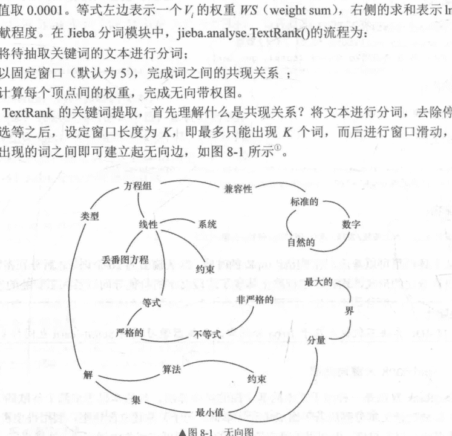

关键词抽取的任务是从给定文本中自动挑出若干有意义的词或词组。TextRank 利用局部词汇的共现窗口关系对候选词进行排序，直接从原文中挖掘，主要步骤如下。

- 1. 将文档 T 按完整句子切分，T = [S1, S2, …, Sm]。
- 2. 对每个句子 Si 做分词和词性标注，过滤停用词，只保留指定词性的词 Si = [ti,1, ti,2, …, ti,n]，如名词、动词、形容词，其中 ti,j ∈ Sj 为候选词。
- 3. 构建候选词图 G = (V, E)，V 由步骤 2 的候选词构成，采用共现关系在任意两点间连边：当且仅当两个词在长度为 K 的窗口中共现时建立边。K 即窗口大小。
- 4. 按原理中的权重公式初始化节点权重后迭代计算，直至收敛。
- 5. 将节点权重降序排列，取前 T 个词作为关键词。
- 6. 把步骤 5 得到的高权重词在原文中标记，若出现相邻组合则合并成多词关键词。例如句子“Matlab code for plotting ambiguity function”中，“Matlab”和“code”同时入选，则合并为“Matlab code”。

小贴士：

以 PageRank 为基础的方案除了文本场景的 TextRank，还有推荐场景常用的 PersonalRank，有兴趣可以一起了解 TextRank、PageRank、PersonalRank 三者的关联。

## 2. 基于 TextRank 关键词抽取
下面以 TextRank 进行关键词抽取。先看一下基于 Jieba 的抽取参数。

```
jieba.analyse.textrank(sentence, topK=20, withWeight=False, allowPOS=('ns', 'n', 'vn', 'v'))
```

- sentence: 待处理的文本。
- topK: 返回的关键词数量，默认值 20。
- withWeight: 是否输出权重值，默认 False。
- allowPOS: 指定词性，默认空即不筛选。

## 【例 8-5】基于 TextRank 算法的关键词抽取
输入：

```
keywords1=jieba.analyse.textrank(text)
print(keywords1)
```

输出：

```
['发展', '人工智能', '中国', '产业', '宣布', '作为', '驱动力', '有望', '成为', '引领', '全球', '变革', '争相', '支持', '核心', '出台', '倾心', '科技', '国家', '政策']
```

输入：

```
keywords2=jieba.analyse.textrank(text, topK=5)
print(keywords2)
```

输出：

```
['发展', '人工智能', '中国', '产业', '宣布']
```

从结果看，改变返回数量仍能反映文本的价值取向，即人工智能的发展。需要注意的是，TextRank 把“中国”提取出来，相比 TF-IDF 其排名明显靠前。原因在于 TextRank 是依据词间贡献关系建图算 Rank，而 TF-IDF 与 Jieba 类似，先依赖内置词库与词频，再基于 dict.txt 计算词频与逆向词频权重。“中国”出现频率高，所以在 TF-IDF 中排名靠后。

## 8.3 word2vec 介绍
2013 年 Google 团队发布了 word2vec，其核心是将词汇映射为向量，即词嵌入。word2vec 主要包含跳字模型 Skip-gram 与连续词袋模型 CBOW① 两种架构，以及负采样 Negative Sampling 与层序 Softmax Hierarchical Softmax 两种高效训练策略。本章将介绍词向量与相关语言模型，做到知其然也知其所以然。

## 8.3.1 word2vec 基础原理简介
- 1. 词向量

词向量是用向量形式表达词语。机器学习需要把输入量化为数值，词向量正好提供这种表示。NLP 中直观的表征是 One-hot Representation，先统计语料词汇表，为每个词分配一个 V 维向量，向量在对应编号位置为 1，其余为 0。

以“话筒”与“麦克”为例，二者的 One-hot 分别可写作“话筒”为 [0001000000000000...]、“麦克”为 [0000000010000000...]。若采用稀疏存储，实质是为每个词分配数字 ID，可把每个词理解为零海中的一个 1，例如话筒记为 3，麦克记为 8，索引从 0 起。配合哈希表编号，再结合最大熵、SVM、CRF 等方法，已能完成不少 NLP 任务。但 One-hot 存在问题：

- (1) 维度灾难：词汇量大时维度可达百万。
- (2) 词汇鸿沟：任意两个词向量孤立，即使话筒和麦克这样的近义词也无法体现关联。

深度学习中常用的是 Distributed Representation，最早由 Hinton 于 1986 年提出，用低维稠密向量刻画语义相似性，典型形式为 [0.793, −0.177, −0.107, 0.109, 0.542, …]，常设 50 维或 100 维，通过向量距离体现相似度，从而缓解词汇鸿沟。用这种方式，“麦克”与“话筒”的距离会远小于“麦克”与“天气”，理想状态下同义词距离可接近，但因“麦克”也常作人名，会带有人名的语义，无法完全重合。

① CBOW 是 Continuous Bag-of-Words Model 的缩写，结构类似前向 NNLM，但去掉了耗时的非线性隐藏层且各词共享隐藏层。

### 2. 哈夫曼编码


哈夫曼编码又称霍夫曼编码，是一种变长编码 VLC。1952 年 Huffman 提出按字符出现概率构造平均码长最短的异字头编码，也称最优编码。

举例：文本仅含 7 个字符{A, B, C, D, E, F, G}，出现次数分别为{5, 24, 7, 17, 34, 5, 13}，可利用哈夫曼树构造前缀编码，如图 8-2。做法为：

- (1) 将 7 个字符作为叶子节点，出现次数为权值；
- (2) 规定左分支为 0、右分支为 1，从根到叶子的二进制序列即为编码；
- (3) 因树中叶子不可被其他叶子经过，该编码必为前缀码，树的带权路径长度即总编码长度。

哈夫曼编码为无前缀码，解码不会混淆，常用于数据压缩与加密。


▲ 图 8-2 哈夫曼树

哈夫曼树的好处在于高频叶子靠近根，码长短；低频叶子远离根，码长长，从而使带权路径最短，符合信息论中常用词应短码的原则。在 word2vec 中编码约定与上述例子相反，左子树编码为 1，右子树编码为 0，且左子树的权重不小于右子树。

### 3. 统计语言模型
传统统计语言模型描述语言基本单元如句子的概率分布，即生成模型。语言模型可用词条件概率表示。

设句子 S = p(w1,w2,...,wn)，则概率 p(s) 为统计语言模型。经贝叶斯分解：

w_T^t = w1, w2, ..., w_T 表示长度为 T 的词串。

P(w1^t) = P(w1, w2, ..., w_T) = P(w1)P(w2|w1)P(w3|w1,w2)...P(w_T|w1,w2,...,w_{T-1})

其中， P(w_T|w1,w2,...,w_{T-1}) = count(w1,w2,...,w_{T-1},w_T) / count(w1,w2,...,w_{T-1})

 p(s) = p(w1)p(w2|w1)p(w3|w1^2)...p(w_n|w1^{n-1})

计算句子概率只需在给定上下文下求下一个词的概率 p(w_i|context(w_i))，再连乘即可。因此关键在于建模条件概率。

例：“大家喜欢吃苹果”分词为“大家”“喜欢”“吃”


和“苹果”。判断其是否为自然语言：

P(大家，喜欢，吃，苹果)=p(大家)p(喜欢|大家)p(吃|大家，喜欢)p(苹果|大家，喜欢，吃)

- p(大家) 为该词在语料中的出现概率；
- p(喜欢|大家) 为“喜欢”在“大家”后出现的概率；
- p(吃|大家，喜欢) 为“吃”在“大家喜欢”后出现的概率；
- p(苹果|大家，喜欢，吃) 为“苹果”在“大家喜欢吃”后出现的概率。

连乘得到句子出现的概率，概率过低则认为不自然。

## 8.3.2 word2vec 训练模型
### 1. CBOW 与 Skip_gram 模型
word2vec 由 Mikolov 等提出，用于快速训练词向量。包含 CBOW 与 Skip-gram 两种模型，如图 8-3。


▲图 8-3 CBOW 与 Skip-gram

两者均含输入层、投影层、输出层。CBOW 用上下文预测中心词，Skip-gram 用中心词预测上下文。word2vec 提供 Hierarchical Softmax 与 Negative Sampling 两种近似优化方法，四种组合如表 8-3。

表 8-3 模型与优化方法

|  | CBOW | Skip_gram |

|---|---|---|

| Hierarchical Softmax | CBOW+HS | Skip_gram+HS |

| Negative Sampling | CBOW+NS | Skip_gram+NS |

### 2. 训练框架
模型与优化组合形成四个训练框架，可通过图 8-4 理解。


▲ 图 8-4 CBOW 与 Skip-gram 训练框架

## 8.3.3 基于 gensim 的 word2vec 实战
### 1. 安装 gensim
gensim 在 Python 中需手动安装。以 Anaconda 为例，安装步骤如下：

（1）在本机打开 “Anaconda Navigator”，进入 “Environments”，本例为 Python 3.5，如图 8-5。


▲ 图 8-5 Anaconda Navigator 环境界面

（2）在操作界面左侧选择框选择“All”，右侧搜索框输入“gensim”，点击 Name 下的 gensim 出现“↓”后安装，如图 8-6。


▲ 图 8-6 搜索 gensim 模块

（3）完成搜索后点击下载，再连续点击两次“Apply”，第一次在右下角，等待约 10s 后弹出“Install Packages”窗口，再次点击“Apply”，如图 8-7。


▲ 图 8-7 下载 gensim

（4）检查是否安装成功。左侧选择框切换为“installed”，可看到 gensim 已完成安装，如图 8-8。若包多，可在“Search Packages”中搜索“gensim”。

### 2. 基于 gensim 的 word2vec 实战案例
word2vec 构建语料库的操作：

- （1）获取语料，可从数据库读取或本地读取；
- （2）对语料分词，词间用空格分隔。


▲图 8-8 检测是否安装成功

## 例8-6 语料库准备核心代码
输入：
```
import jieba
f1 =open("fenci.txt")
f2 =open("fenci_result.txt", 'a')
lines =f1.readlines()
for line in lines:
    line.replace('\t', '').replace('\n', '').replace(' ', '')
    seg_list = jieba.cut(line, cut_all=False)
    f2.write(" ".join(seg_list))
f1.close()
f2.close()
```

## 小贴士
读取文件时若抛出 UnicodeDecodeError，往往是打开时未指定字符集。文本实际以 UTF-8 保存，读取端却按 GBK 去解中文，自然会失败。可参照例8-6 把打开语句改写为显式声明 utf-8，例如 f1 =open("fenci.txt", encoding="utf-8")。

## 例8-7 用 gensim 训练 word2vec 的简例
下面展示借助 gensim 实现词向量训练的流程。

```
#1.导入模块
    from gensim.models import word2vec
    import logging
```

```
#2.主程序训练模型
logging.basicConfig(format='%(asctime)s:%(levelname)s:
    %(message)s',level=logging.INFO)
#加载语料
sentences =word2vec.Text8Corpus("fenci_result.txt")
#默认参数训练
model =word2vec.Word2Vec(sentences, size=200)
#3.保存与加载模型，以便重用
#保存方式
model.save("word2vec.model")
# 加载方式
word2vec.Word2Vec.load("word2vec.model")
#4.输出词向量
model['中国']
#5.计算与某个词的相关词列表
model.most_similar("北京")
#6.计算两个词之间的余弦距离
model.similarity("北京", "上海")
#7.向量加减法
#使用一些词语限定，分为正向和负向
#向量加法的形式即表现为：[皇帝+女人-男人]
model.most_similar(positive=['皇帝',"女人"],negative=["男人"])
#8.对比两条词组的相似性
list_sim1 = model.n_similarity(['国家','5A','风景','名胜'],['历史','文化','源远流长'])
#9.寻找不合群的词
model.doesnt_match(['李白',"杜甫","游泳馆"])
```

## 例8-8 基于 word2vec 的标签相似度
输入：
```
def get_sim1():
    #加载模型
    model = word2vec.Word2Vec.load('train_model')
    sim_most=model.most_similar("北京", topn=10)
    print("与北京最相似的10个词")
    print(sim_most)
    tag_list=["李白","杜甫","游泳馆","健身中心","熊","豹"]
    print("标签之间的相似度")
    for i in tag_list:
        for j in tag_list[tag_list.index(i)+1:]:
            sim=model.similarity(i,j)
            print("{i}与{j}: {sim}".format(i,j,sim))
```

输出：
与北京最相似的10个词
[('上海', 0.6950579285621643), ('天津', 0.6936454176902771), ('南京', 0.6776465177536011),
('西安', 0.6432613134384155), ('沈阳', 0.6341951489448547), ('广州', 0.6242015361785889),
('哈尔滨', 0.6235491037368774), ('昆明', 0.603058397769928), ('成都', 0.6008168458938599),
('重庆', 0.5895441174507141)]

标签之间的相似度
李白与杜甫: 0.8591132915690053
李白与游泳馆: -0.20882734250171714
李白与健身中心: -0.08759628423741822
李白与熊: 0.06353129776453582
李白与豹: 0.15838205256263999
杜甫与游泳馆: -0.17904643540741882
杜甫与健身中心: -0.06221401739057081
杜甫与熊: 0.06707725944606188
杜甫与豹: 0.14574979471264443
游泳馆与健身中心: 0.8276172650626101
游泳馆与熊: 0.2113158954636301
游泳馆与豹: 0.12360298915638047
健身中心与熊: 0.2746097803541384
健身中心与豹: 0.21935094194225768
熊与豹: 0.8022013758490536

这里加载已训练好的 train_model，对 tag_list 中的六个词两两求余弦相似，取值范围 -1 到 1。结果里杜甫-李白、游泳馆-健身中心、熊-豹均超过 0.8，语义很接近；李白与游泳馆约 -0.20，呈现负相关。其余组合数值偏低。不同训练策略会让数值略有波动，但整体仍能稳定反映语义远近，效果直观。

## 例8-9 向量运算、相似度对比与离群词
输入：
```
def get_sim2():
    model = word2vec.Word2Vec.load('train_model')
    print("7.实现文本之间的向量加减法")
    most_sim=model.most_similar(positive=['皇帝',"女人"],negative=["男人"],topn=1)
    print("[皇帝+女人-男人]的结果为{}".format(most_sim))
    print("8.计算两个词条之间的相似度")
    list1 = ['国家','5A','风景','名胜']
    list2 = ['历史','文化','源远流长']
    list3 = ['5A','风景','名胜','引人入胜']
    list_sim1 = model.n_similarity(list1, list2)
    print ("list1 与 list2 之间的 similarity={}".format(list_sim1))
    list_sim2 = model.n_similarity(list1, list3)
    print ("list2 与 list3 之间的 similarity={}".format(list_sim2))
    print("9.寻找不合群的词")
    doesnt_match=model.doesnt_match(["李白","杜甫","游泳馆"])
print("[李白,杜甫,游泳馆]中不属于同一类的词语是{}".format(doesnt_match))
```

输出：
```
7.实现文本之间的向量加减法
[皇帝+女人-男人]的结果为=[('慈禧', 0.6499686241149902)]
8.计算两个词条之间的相似度
list1 与 list2 之间的 similarity=0.31198747874400884
list2 与 list3 之间的 similarity=0.8622564277313807
9.寻找不合群的词
[李白,杜甫,游泳馆]中不属于同一类的词语是游泳馆
```

在向量操作里，[皇帝+女人-男人] 这类表达式推导出慈禧，说明模型捕捉到词语间的隐含关系。词对相似度计算与找出不合群词汇也都顺利完成，可见 word2vec 能学到有意义的词间关联，从而支撑较多 NLP 任务。

# 第 9 章 从回归分析到算法基础


什么是回归分析？
回归分析是用数量关系描述自变量和因变量的依赖，并据此进行预测和调控的统计方法。回归预测就是典型应用，比如研究工程师薪酬随工作年限的变化规律。

### 9.1 回归分析简介

### 9.1.1 “回归” 一词的由来
“regression” 最初出自生物学，由英国生物学家兼统计学家高尔顿①在研究人类遗传时提出。1885到1890年间高尔顿发表多篇论文。研究父子身高的遗传时，他收集了1078对父子身高，发现散点大致呈直线，父亲升高时儿子身高也倾向升高。于是得出子代身高 y 与父代身高 x 近似线性，拟合直线为单位英寸，1英寸=2.54cm： ŷ =33.73+0.516x。

该规律说明：
- 父代身高每增1单位，成年儿子的平均身高约增0.516单位；
- 矮个子父亲所生儿子身高往往高于父亲，如 x=60， ŷ =64.69，高于父辈均值；身材高大的父亲所生子女身高则回落到大众均值附近，如 x=80， ŷ =75.01，低于父辈均值。也就是说，父母身高越极端，子女身高越靠近平均，这就是向平均数方向回归的含义，高尔顿称之为向 mediocrity 回归。尽管这是特例，与线性拟合的一般规则无关，但“线性回归”术语由此沿用，用来描述用一个或多个变量预测另一变量的关系。此后该思想逐渐渗透到数理统计各分支，随着计算机与统计软件普及，应用越来越广。

### 9.1.2 回归与相关
客观事物发展中变量常相互联系、相互作用，数据挖掘时需研究两个及以上变量的关系，大致可分为完全确定关系与非确定关系。

1) 完全确定关系：y = f(x) 可用精确数学式表达，x 确定时 y 唯一确定，如圆面积 A 与半径 r 的关系 A = πr²。
2) 非确定关系：y = f(x)+ε 无法用精确公式表达，x 确定后 y 有多种可能，如父代身高与子代身高、房价与人口密度等。统计学称此为相关关系，相关变量即相关变量。

在一定范围内，对自变量的任意取值 x_i ，虽无唯一确定的因变量 y_i 与之对应，但存在特定条件概率分布，这种不确定关系即相关关系。通常相关变量关系分为因果关系与平行关系。
1) 因果关系：一个变量变化受另一或多个变量影响，如玉米生长受种子遗传特性、管理条件影响。统计学用回归分析研究因果关系的变量，表示原因的为自变量，表示结果的为因变量。
2) 平行关系：变量互为因果或共同受第三方因素影响，如人身高与胸围。统计学用相关分析※研究此类关系。

### 9.1.3 回归模型的划分与应用

1. 回归模型的划分
回归问题包含模型学习与预测两步，先基于训练集构建模型，再用新输入做预测。
按输入变量个数可分为一元回归与多元回归，按变量间关系类型可分为线性回归与非线性回归。

2. 回归模型的应用
如图 9-1 所示。
① 对多个变量做相关分析时，研究一个变量与多个变量的线性相关称为复相关分析；研究其余变量保持不变时两个变量的线性相关称为偏相关分析。本章主要介绍回归分析，更多相关分析请读者自行查阅相关文献。


### 9.2 线性回归分析实战

### 9.2.1 线性回归的建立与求解
先看从业年数与年薪的例子。
工作年限指以工资收入为主要来源的工作时间，长短反映对企业贡献、知识经验与技术熟练程度。有5年经验的员工通常比2年经验的员工更熟练，收入也更高。
小明整理了身边5位算法同事的数据，从业年数与年薪如表9-1所示，单位十万元。

表 9-1 工作年限与年收入表

| 序号 | 1 | 2 | 3 | 4 | 5 | 6 |
|---|---|---|---|---|---|---|
| 工作年限（Years of working） | 2 | 3 | 4 | 5 | 5 | 11 |
| 年收入（Yearly income） | 20 | 25 | 30 | 34 | 31 | 40 |

试建立两者关系式。
1) 先按表9-1作散点图如图9-2所示。
从图9-2可见6个点整体呈线状，说明两者存在线性相关。
设：
```
y = β₀ + β₁x + ε    ε ~ N(0, σ²)    (9-1)
```
给定观测值 (xᵢ , yᵢ), i=1,2,…,n, 代入式 (9-1) 则有：

▲图 9-2 根据表 9-1 数据所做的散点图
$$\begin{cases} y_i = \beta_0 + \beta_1 x_i + \varepsilon_i \\ \varepsilon_i \sim N(0,\sigma^2) \\ \varepsilon_1,\dots,\varepsilon_n \text{相互独立} \end{cases}\quad i=1,2,\dots,n$$ (9-2)
其中，式（9-2）称为一元线性回归模型。
2) 利用最小二乘法求解。
设：
$$\hat y = \hat\beta_0 + \hat\beta_1 x$$ (9-3)
记作：
$$\varepsilon_i = y_i - \hat y_i,\quad i=1,2,\dots,n$$
$$Q(\beta_0,\beta_1)=\sum_{i=1}^{n}\varepsilon_i^2=\sum_{i=1}^{n}(y_i-\hat y_i)^2=\sum_{i=1}^{n}(y_i-\beta_0-\beta_1 x_i)^2$$ (9-4)
求 β₀,β₁, 使得二元函数 Q(β₀,β₁) 达到最小, 由微积分知识, 得方程：
$$\begin{cases}\dfrac{\partial Q(\beta_0,\beta_1)}{\partial\beta_0}=-2\sum_{i=1}^{n}(y_i-\beta_0-\beta_1 x_i)=0\\\dfrac{\partial Q(\beta_0,\beta_1)}{\partial\beta_1}=-2\sum_{i=1}^{n}(y_i-\beta_0-\beta_1 x_i)x_i=0\end{cases}$$ (9-5)
解得：
$$\begin{cases}\hat\beta_0=\bar y-\hat\beta_1\bar x\\\hat\beta_1=\dfrac{\sum_{i=1}^{n}(x_i-\bar x)(y_i-\bar y)}{\sum_{i=1}^{n}(x_i-\bar x)^2}\end{cases}$$ (9-6)
由此得回归方程 ŷ = β̂₀ + β̂₁ x, 其中 β̂₁ 为回归系数。
对表9-1计算得 β̂₀ = 20, β̂₁ = 2。
回归方程为 ŷ = 20 + 2x。
最小二乘法的原理是使预测值与实际值的平方和最小，从而确定模型参数 β₀,β₁。

### 9.2.2 Python 实现线性回归案例

下面用 Python 完成实际运算，示例数据列于表 9-2，来源文件为 data.xlsx。

表 9-2 回归分析数据集

| 工作年限 | 年收入 |
|---|---|
| 2 | 20 |
| 3 | 25 |
| 4 | 30 |
| 5 | 34 |
| 5 | 31 |
| 11 | 40 |

拟合模型设定为 ŷ = β̂₀ + β̂₁ x，其中 β̂₀ 表示截距，β̂₁ 表示斜率。

## 【例 9-1】回归分析，程序运行结果如图 9-3 所示

输入：

```
#!/usr/bin/env python
# -*- coding:utf-8 -*-
#1.导入需要的包
import pandas as pd
from sklearn import linear_model
import matplotlib.pyplot as plt
#2.通过 pd.read_excel 获取数据，并分别存入变量值 X_parm, Y_parm
def get_data():
    data = pd.read_excel("data.xlsx")
    X_parm = []
    Y_parm = []
    for x ,y in zip(data['years'],data['income']):
        #存储在相应的 list 列表中
        X_parm.append([float(x)])
        Y_parm.append(float(y))
    return X_parm,Y_parm
#3.构建线性回归并计算
def linear_model_main(X_parm,Y_parm,predict_value):
    # Create linear regression object
    regr = linear_model.LinearRegression()
    #train model
    regr.fit(X_parm,Y_parm)
    predict_outcome = regr.predict(predict_value)
    pred= {}
    pred['intercept'] = regr.intercept_
```

```
```python
pred['coefficient'] = regr.coef_

pred['predicted_value'] = predict_outcome

R_Square=regr.score(X_parm,Y_parm)

return pred, R_Square

#4. 绘出拟合图像

def show_linear(X_parm,Y_parm):

    # Create linear regression object

    regr = linear_model.LinearRegression()

    #train model

    regr.fit(X_parm,Y_parm)

    predict_outcome = regr.predict(predict_value)

    pred= {}

    pred['intercept'] = regr.intercept_

    pred['coefficient'] = regr.coef_

    pred['predicted_value'] = predict_outcome

    return pred

if __name__=="__main__":

    X,Y =get_data()

    pred_value = 7

    result,R_Square = linear_model_main(X,Y,pred_value)

    print ("y={:.3f}*x+{:.3f}".format(result['coefficient'][0],result

    ['intercept']))

    print ("Predicted value:",result['predicted_value'])

    show_linear(X,Y)

    print("R_Square={:.3f}".format(R_Square))
```
```

输出：

y=2.0*x+20.0

Predicted value: [34.]

R_Square=0.826


▲图 9-3 例 9-1 程序运行结果

运行结束后可得到拟合图如图 9-3。模型最终表达为 y=2x+20，并生成了直线图，斜率估计为 2.0，截距估计为 20.0。令 x=7 预测时，y 的估计值为 34。

## 9.2.3 检验、预测与控制

### 1. 平方和分解公式

对于任意样本 $(x_1,y_1),\dots,(x_n,y_n)$，总满足：

$$\sum_{i=1}^{n}(y_i-\bar y)^2 = \sum_{i=1}^{n}(y_i-\hat y_i)^2 + \sum_{i=1}^{n}(\hat y_i-\bar y)^2$$

证明：$\sum_{i=1}^{n}(y_i-\bar y)^2 = \sum_{i=1}^{n}(y_i-\hat y_i)^2 + 2\sum_{i=1}^{n}(y_i-\hat y_i)(\hat y_i-\bar y) + \sum_{i=1}^{n}(\hat y_i-\bar y)^2$

而

$$\sum_{i=1}^{n}(y_i-\hat y_i)(\hat y_i-\bar y)=\sum_{i=1}^{n}[y_i-(\hat\beta_0+\hat\beta_1x)][\hat\beta_0+\hat\beta_1x-(\hat\beta_0+\hat\beta_1\bar x)]$$ $$=\sum_{i=1}^{n}[(y_i-\bar y)-\hat\beta_1(x_i-\bar x)]\cdot\hat\beta_1(x_i-\bar x)^2$$ $$=\hat\beta_1\sum_{i=1}^{n}[(y_i-\bar y)(x_i-\bar x)-\hat\beta_1(x_i-\bar x)^2]=0$$

记作：

$$S_T=\sum_{i=1}^{n}(y_i-\bar y)^2\quad\text{为总离差平方和}$$ $$S_R=\sum_{i=1}^{n}(\hat y_i-\bar y)^2\quad\text{为回归平方和}$$ $$S_E=\sum_{i=1}^{n}(y_i-\hat y_i)^2\quad\text{为残差平方和}$$

其中，$S_R=\sum_{i=1}^{n}(\hat y_i-\bar y)^2=\hat\beta_1^2\sum(x_i-\bar x)^2$ $\sum(x_i-\bar x)^2$ 为偏差平方和。

定理 9.1：$S_R/\sigma^2 \sim \chi^2(1)$，$S_E/\sigma^2 \sim \chi^2(n-2)$

$$F=\frac{S_R}{S_E/(n-2)} \sim F(1,n-2)\qquad(9-7)$$

### 2. 回归模型的显著性检验

对 $Y=\beta_0+\beta_1x$ 的检验等价于检验 $H_0:\beta_1=0$ 与 $H_1:\beta_1\neq0$。若 $H_0$ 被否定，则认为回归有效，y 与 x 存在线性关联，方程具有解释力；反之回归无效，线性模型不适用。下面介绍三种常用手段。

（1）F 检验法

在 $H_0$ 成立下，$F = \frac{U}{Q_e/(n-2)} \sim F(1,\,n-2)$。

其中，$U = \sum_{i=1}^{n} (\hat{y}_i - \bar{y})^2$ 即回归平方和。

若 $F > F_{1-\alpha}(1,n-2)$ 则拒绝 $H_0$，否则接受 $H_0$。

（2）$t$ 检验法

在 $H_0$ 成立下，$T = \frac{\sqrt{L_{xx}}\,\hat{\beta}_1}{\hat{\sigma}_e} \sim t(n-2)$。

当 $|T| > t_{\alpha/2}(n-2)$ 时拒绝 $H_0$，否则接受 $H_0$。

其中，$L_{xx} = \sum_{i=1}^{n} (x_i - \bar{x})^2 = \sum_{i=1}^{n} x_i^2 - n\bar{x}^2$。

（3）$r$ 检验法

设 $H_0: \rho = 0$，$H_1: \rho \neq 0$。

检验统计量 $r = \frac{\sum (x_i - \bar{x})(y_i - \bar{y})}{\sqrt{\sum (x_i - \bar{x})^2 \sum (y_i - \bar{y})^2}} = \frac{L_{xy}}{\sqrt{L_{xx}L_{yy}}}$。

拒绝域 $W = \{|r| > r_{1-\alpha}(n-2)\}$，其中 $r_{1-\alpha} = \sqrt{\frac{1}{1 + (n-2)/F_{1-\alpha}(1,n-2)}}$。

该法即相关系数的检验，当 $|r| > r_{1-\alpha}(n-2)$ 时，可有 $(1-\alpha)\%$ 的把握认为 x 与 y 存在线性关系。$R^2$ 常作为拟合优度的重要判别指标。

### 3. 预测和控制

预测任务是在已知预测因子 $x=x_0$ 的条件下，求 $y_0=\beta_0+\beta_1x+\varepsilon$ 的点估计与区间估计。

（1）点预测：$\hat{y} = \hat{\beta}_0 + \hat{\beta}_1 x$。

（2）区间预测。当 $\varepsilon_1,\dots,\varepsilon_n$ 相互独立且均服从 $N(0,\sigma^2)$ 时：

$T = \frac{y_0 - \hat{y}_0}{s\sqrt{1 + \frac{1}{n} + \frac{(x_0 - \bar{x})^2}{L_{xx}}}} \sim t(n-2)$ 其中 $s = \sqrt{\frac{S_E}{n-2}}$

由此得 $y_0$ 的置信区间为：$\left[\hat{y}_0 - t_{1-\alpha/2}\,s\sqrt{1 + \frac{1}{n} + \frac{(x_0 - \bar{x})^2}{L_{xx}}},\; \hat{y}_0 + t_{1-\alpha/2}\,s\sqrt{1 + \frac{1}{n} + \frac{(x_0 - \bar{x})^2}{L_{xx}}}\right]$ （9-8）

当样本量较大且 $x_0$ 靠近 $\bar{x}$ 时，可用 $u_{1-\alpha/2}$ 代替 $t_{1-\alpha/2}$，得：

[ŷ₀−u₁₋α/₂ s, ŷ₀+u₁₋α/₂ s]

### 4. 计算推导案例

设数据为 $(x_1,y_1),\dots,(x_n,y_n)$，按以下步骤求模型。

(1) 先计算：

$\bar{x}=1/n\sum_{i=1}^n x_i$    $\bar{y}=1/n\sum_{i=1}^n y_i$

$L_{xx}=\sum_{i=1}^n(x_i-\bar x)^2=\sum_{i=1}^n x_i^2-n\bar x^2$

$L_{yy}=\sum_{i=1}^n(y_i-\bar y)^2=\sum_{i=1}^n y_i^2-n\bar y^2$

(2) 再计算：

$L_{xy}=\sum_{i=1}^n(x_i-\bar x)(y_i-\bar y)=\sum_{i=1}^n x_i y_i-n\bar x\bar y$

$\hat\beta_1=L_{xy}/L_{xx}$    $\hat\beta_0=\bar y-\hat\beta_1\bar x$

$S_E=L_{yy}-S_R$    $S_R=\hat\beta_1^2L_{xx}$

$F=S_R/(S_E/(n-2))$    $s=\sqrt{S_E/(n-2)}$    $r=L_{xy}/\sqrt{L_{xx}L_{yy}}$

在表 9-2 数据下：

□ 求 y 关于 x 的线性回归方程；
□ 对方程显著性进行检验；
□ 预测科研经费为 6（十万元）时，年利润的区间。

### 【例 9-2.1】计算回归模型中参数

输入：

```
import pandas as pd
data = pd.read_excel("data.xlsx")  #here ,use pandas to read csv file.
data.columns=["X","Y"]  #修改列名
data["X_Square"],data["Y_Square"]=data['X']**2,data['Y']**2
data["XY"]=data['X']*data['Y']
data["pred_Y"]=2*data['X']+20
data.loc['Row_sum'] =data.apply(lambda x: x.sum())
print(data[["X","Y","XY","X_Square","Y_Square","pred_Y"]])
```

输出：

|   | X | Y | X_Square | Y_Square | XY | pred_Y |
|---|---|---|----------|----------|----|--------|
| 0 | 2 | 20 | 4 | 400 | 40 | 24 |
| 1 | 3 | 25 | 9 | 625 | 75 | 26 |
| 2 | 4 | 30 | 16 | 900 | 120 | 28 |
| 3 | 5 | 34 | 25 | 1156 | 170 | 30 |
| 4 | 5 | 31 | 25 | 961 | 155 | 30 |
| 5 | 11 | 40 | 121 | 1600 | 440 | 42 |
| Row_sum | 30 | 180 | 200 | 5642 | 1000 | 180 |

接下来据此求取各统计量。

### 【例 9-2.2】计算回归模型中参数

输入：

```
data = pd.read_excel("data.xlsx")
data.columns=["X","Y"]
data["XY"]=data['X']*data['Y']
print("{mean}\n".format(data.iloc[0:6][["X","Y","XY"]].mean()))
print("Lxy={}".format(sum((data["X"]-5)*(data["Y"]-30))))
print("Lxx={}".format(sum((data["X"]-5)**2)))
print("Lyy={}".format(sum((data["Y"]-30)**2)))
```

输出：

X          5.000000

Y          30.000000

XY         166.666667

dtype: float64

Lxy=3850

Lxx=675

Lyy=22742

注：运行例 9-2.2 时请重新执行，避免在例 9-2.1 的基础上累加。

参照 9.2.3 节公式与例 9-2.2，得如下汇总：

$\sum x_i = 30$        $n = 6$        $\sum y_i = 180$

$\bar x = 5$            $\bar x\bar y = 166.67$      $\bar y = 30$

$\sum x_i^2 = 200$      $\sum x_i y_i = 1000$  $\sum y_i^2 = 5642$

$n \bar x^2 = 150$       $n \bar x \bar y = 1000$     $n \bar y^2 = 5400$

$L_{xx} = 50$        $L_{xy} = 100$       $L_{yy} = 242$

（1）关键参数：

$\hat\beta_1 = L_{xy} / L_{xx} = 2$      $\hat\beta_0 = \bar y - \bar x \hat\beta_1 = 20$      $r = 0.9091$

由此得到回归方程为 $\hat{y}=20+2x$。

$r=0.9091$ 已表明线性关联较强，仍需做显著性检验。

(2) 显著性检验，设 $H_0:\hat\beta_1=0$。

$S_R = \hat\beta_1^2 L_{xx}=200$    $S_E = L_{yy} - S_R =42$

$F = \frac{S_R}{S_E/(n-2)} =19.05$

取 $\alpha=0.05$，查表得 $F_{0.95}(1,4)=7.71$，因 $F$ 大于临界值，拒绝 $H_0$，即认为回归方程显著。

因为 $r=0.9091 > r_{0.95}(4)=0.811$，故认为 $x$ 和 $y$ 具有线性关系。

(3) 由 $\hat{y}=20+2x$，当 $x_0=6$ 时，$\hat{y}=20+2\times6=32$。

$\alpha=0.05,\ t_{0.05}(4)=2.776$

$s=\sqrt{\frac{S_E}{n-2}}=3.24$    $t_{1-\frac{\alpha}{2}} s \sqrt{1+\frac{1}{n}+\frac{(x_0-\bar{x})^2}{L_{xx}}}=9.71$

因此年利润的 95% 置信区间为 $[32-9.71,\ 32+9.71]=[22.29,\ 41.71]$。

# 第10章 K-Means 聚类中的参数调优


什么是聚类算法？

聚类是将数据划分为多个子集，使同一子集中样本相似度高、不同子集间差异明显。相似度通常依据属性取值确定，常采用距离度量。聚类分析的核心是类内相似度最大化、类间差异最大化。

粗略来说，聚类就是把一组包含 n 条记录的数据，按某种相似性规则拆分成 m 个簇，同簇内部元素彼此相关、相互接近，而不同簇之间则差异明显、相互独立，这个分组操作就叫做聚类。

## 10.1 K-Means 全景概览

### 10.1.1 K-Means 起源与现状
K-Means 并非一人之作，Steinhaus 在 1955 年、Lloyd 在 1957 年、Ball 与 Hall 在 1965 年、McQueen 在 1967 年，都在各自的研究领域里独立提出了相近的划分思路。提出之后，K-Means 在各学科里被反复研究，使用范围不断扩大，也衍生出众多改进版本。距今已超过半个世纪，它仍然是应用最广的划分式聚类方法之一。上手门槛低、实现简洁、运行高效、积累了大量成功案例，是它至今仍被青睐的主要原因。

小贴士：
聚类属于无监督学习，与有监督的分类不同。分类时样本的类别标签已知，任务是从训练集里学习规则去预测未知标签；而聚类事先并不知道数据属于哪一类，只能依据某种度量把所有对象归到不同的簇中。

### 10.1.2 目标函数
下面给出经典 K-Means 的优化目标。

设数据集 X = {x₁, x₂, …, xᵢ, …, xₙ}，xᵢ ∈ Rᵈ，期望得到 K 个子集，记为 C = {cₖ, i=1,2,…,K}。每个子集 cₖ 拥有一个簇中心 μₖ。以欧氏距离衡量相似性，计算簇内各点到中心的距离平方和。

J(cₖ) = Σ_{xᵢ ∈ cₖ} ‖xᵢ - μₖ‖²

整体目标是令各类平方和之和 J(C) 达到最小。

J(C) = Σ_{k=1}^K J(cₖ) = Σ_{k=1}^K Σ_{xᵢ ∈ cₖ} ‖xᵢ - μₖ‖² = Σ_{k=1}^K Σ_{i=1}^n d_{ki} ‖xᵢ - μₖ‖²

其中： d_{ki} = { 1, 若 xᵢ ∈ cₖ ; 0, 若 xᵢ ∉ cₖ }

按照最小二乘与拉格朗日条件，可知最优的 μₖ 就是簇 cₖ 内所有样本的平均值。

K-Means 从一个初始的 K 划分出发，反复把样本指派到最近的簇以降低总平方和。随着簇数 K 的增大，总平方和单调下降，极端情况下 K=n 时 J(C)=0。因此在确定的 K 下才有最小值可谈。

### 10.1.3 算法流程
核心思想是把 n 个对象分成 k 个簇，使簇内点到中心的平方距离之和最小。输入簇数 k 与包含 n 个对象的数据集，输出 k 个簇。

- 1. 从 n 个对象中随机挑出 k 个作为初始种子中心。
- 2. 计算每个对象到各中心的距离，将其划分到最近的种子簇。
- 3. 重新求取 k 个簇的中心，即把种子点移到各簇的均值位置。
- 4. 重复步骤 2 至 3，若本次中心与上次相比未发生变化则停止，否则继续迭代。
- 5. 输出最终聚类结果。

该方法在大规模数据上表现良好，时间复杂度为 O(tKmn)，其中 t 为迭代轮数，K 为簇数，m 为每个样本的特征数，n 为样本数，且 t≤n，k≤n。


下面用一组二维数据演示过程，二维数据如表 10-1 所示。

表 10-1
二维数据

|  | x1 | x2 | x3 | x4 | x5 | x6 | x7 | x8 | x9 | x10 | x11 |
|---|---|---|---|---|---|---|---|---|---|---|---|
| x | 1 | 2 | 3 | 4 | 9. | 10 | 10 | 11 | 15 | 16 | 16 |
| y | 2 | 2 | 5 | 3 | 14 | 13 | 15 | 16 | 6 | 5 | 8 |

表 10-1 的数据空间分布如图 10-2 所示。

取 k=3，初次选取前三个点作为种子：k1 = x1，k2 = x2，k3 = x3，第一次迭代后的划分如图 10-3 所示。


经过多次迭代后，最优划分如图 10-4 所示。


需要留意，算法结果不依赖样本读取顺序。只要初始划分相同，无论样本顺序如何，最终得到的簇都是一致的。

## 10.1.4 算法优缺点剖析
- 优点
  - 实现思路清晰，操作简便。
- 缺点
  - 需要用户预先指定簇数 K。
  - 对初始中心的选择较为敏感。
  - 易陷入局部最优解。
  - 只能有效捕捉球形结构簇。

## 10.2 K-Means 实战
K-Means 在经典库 Scikit-learn 中已有现成实现。

```
sklearn.cluster.KMeans(n_clusters=8,
    init='k-means++',
    n_init=10,
    max_iter=300,
    tol=0.0001,
    precompute_distances='auto',
    verbose=0,
    random_state=None,
    copy_x=True,
    n_jobs=1,
    algorithm='auto')
```
- n_clusters: 指定希望得到的簇的数量。
- init: 初始中心生成方式，默认 “k-means++”，该策略会自动挑选较优初始点；设为 random 则从样本中随机抽取 k 个点作为中心。
- n_init: 初始中心重复尝试的次数，默认会尝试 10 次并保留最好结果，用来缓解初始化带来的影响。
- max_iter: 最大迭代次数限制。
- tol: 收敛阈值，达到该精度即停止。
- precompute_distances: 是否预先计算距离，可选 {'auto'、True、False}，可在时间和内存之间权衡。auto 表示当 features*samples > 12×10⁶ 时不预计算。
- verbose: 日志输出等级，0 为静默。
- random_state: 随机种子，保证结果可复现。
- copy_x: 是否复制数据以避免原数据被修改，主要在预计算距离时生效。
- n_jobs: 并行进程数。
- algorithm: 实现细节，可选 auto、full、elkan，通常 auto 即可。

小贴士：
K-Means 收敛质量与初始中心密切相关，k-means++ 正是为改善这一弱点而提出，可能避免陷入局部极小。

（1）基本属性
- **cluster_centers_**: 各簇中心的坐标矩阵，形状 [n_clusters, n_features]。
- **labels_**: 每个样本所属簇的编号。
- **inertia_**: 所有样本到各自簇中心的距离平方和。

（2）基本方法
- **fit(X[, y])**: 训练聚类模型。
- **predict(x)**: 预测新样本所属簇。
- **fit_predict(X[, y])**: 训练并直接给出样本簇标号。
- **score(X[,y])**: 返回负的样本到中心的偏移量。

## 【例 10-1】聚类案例，程序运行结果如图 10-5 所示
输入：
```
#!/usr/bin/env python
# -*- coding:utf-8 -*-
#导入所需要的模块
from sklearn.cluster import KMeans
import numpy as np
import matplotlib.pyplot as plt
#构建输入数据
X = np.array([[1, 2], [1, 4], [1, 0],
[4, 2], [4, 4], [4, 0]]),
#执行 K-Means 算法
kmeans = KMeans(n_clusters=2, random_state=0).fit(X)
#绘制数据分布图
plt.scatter(X[:,0:1],X[:,1:2])
plt.show()
```
输出：

▲图10-5 例10-1 程序运行结果

输入：
```
#输出结果
print("所属类别标记结果={}".format(kmeans.labels_))
print("预测[[0, 0], [4, 4]]所述类别={}".format(kmeans.predict([[0, 0], [4, 4]])))
print("簇中心点坐标={}".format(kmeans.cluster_centers_))
```
输出：
所属类别标记结果=[0 0 0 1 1 1]
预测[[0, 0], [4, 4]]所述类别=[0 1]
簇中心点坐标=
[[1. 2.]
 [4. 2.]]

通过本次运行可知，设置 K=2 时，原数据被分为两个簇，分别标记为 0 与 1。预测点 [0,0] 归入簇 0，[4,4] 归入簇 1，两个簇中心分别为 [1,2] 与 [4,2]。这已初步体现 K-Means 的工作方式，下面再看簇数变化的影响。


▲图 10-6 例 10-1 分析图

## 【例 10-2】在例 10-1 基础之上修改聚类 K
输入：
```
from sklearn.cluster import KMeans
import numpy as np
import matplotlib.pyplot as plt
#构建输入数据
X = np.array([[1, 2], [1, 4], [1, 0],
              [4, 2], [4, 4], [4, 0]])
#执行 K-Means 算法
kmeans = KMeans(n_clusters=3, random_state=0).fit(X)
#绘制数据分布图
# plt.scatter(X[:,0:1],X[:,1:2])
# plt.show()
#输出结果
print("所属类别标记结果={}".format(kmeans.labels_))
print("预测[[0, 0], [4, 4]]所述类别={}".format(kmeans.predict([[0, 0], [4, 4]])))
print("簇中心点坐标=\n{}".format(kmeans.cluster_centers_))
```
输出：
```
所属类别标记结果=[0 0 0 1 2 1]
预测[[0, 0], [4, 4]]所述类别=[0 2]
簇中心点坐标=
[[1. 2.]
[4. 1.]
[4. 4.]]
```
把 n_clusters 改为 3 后，数据被划分为 3 个簇，标记为 0、1、2。对 [[0,0],[4,4]] 的预测结果变为 0 类与 2 类。最终簇中心为 [1,2]、[4,1]、[4,4]，其中 [4,1] 并非原始样本，是均值计算得到的。


▲ 图 10-7 例 10-2 分析图（聚类簇中心为 3）

## 【例 10-3】不同聚类中心的聚类结果，程序运行结果如图 10-8 所示
输入：
```
import numpy as np
import matplotlib.pyplot as plt
from sklearn.cluster import KMeans
from sklearn import metrics
from sklearn.datasets.samples_generator import make_blobs
plt.figure()
X, y = make_blobs(n_samples=1000, n_features=2, centers=[[-1,-1], [0,0], [1,1], [2,2]], cluster_std=[0.4, 0.2, 0.2, 0.2], random_state =9) #生成测试数据
for index,k in enumerate((2,3,4,5)):
    plt.subplot(2,2,index+1)
    y_pred = KMeans(n_clusters=k, random_state=9).fit_predict(X) #预测值
    score=metrics.calinski_harabaz_score(X, y_pred)
    plt.scatter(X[:, 0], X[:, 1], c=y_pred,s=10,edgecolor='k')
plt.text(.99, .01, ('k=%d, score: %.2f' % (k,score)), #文本注释，标注关键信息
    transform=plt.gca().transAxes, size=10,horizontalalignment='right')
plt.show()
```
输出：

▲图10-8 例10-3 程序运行结果

结果显示，k 的取值不同会导致完全不同的划分。因此在实际使用中，k 的选择需要格外谨慎。本章以 K-Means 为例讨论了参数选取问题。聚类方法众多，密度聚类、层次聚类等在不同场景下各有优势。人工智能应用中，机器学习与深度学习的调参过程都至关重要。

# 第11章 从决策树看算法升级

决策树怎样完成分类？
分类时从根节点出发，根据实例的某个特征进行测试，按测试结果将其分配到子节点，每个子节点对应该特征的一个取值。如此递归直至叶节点，叶节点即为类别判定。

### 11.1 决策树基本简介
在常用的分类技术中，决策树占据重要地位。顾名思义，它是一种树形结构，由决策节点、分支和叶节点构成。决策节点对应待分类集合的某个属性，例如“是否有房”“是否有车”，不同取值引出不同分支；叶节点则给出分类结果，例如“可以”表示可放贷，“不可以”表示不可放贷。

决策树①是一种基于实例的归纳学习方法，原理并不复杂，但实现在不断演进。

Hunt、Marin 与 Stone 于 1966 年提出了概念学习系统 CLS②，这是早期的决策树学习算法。其思路是从空树开始，通过不断添加判定节点来改进树，直到能正确分类训练实例为止。后来的许多算法都可以看作 CLS 的改进。

CLS 并未给出如何挑选测试属性的有效标准，因而有较大改进空间。在众多的决策树算法中，最具影响的是 Quinlan 于 1986 年提出的 ID3③，该算法以信息熵的下降速度作为属性选择标准，也就是以信息不确定性的减少程度来指导分裂。

1993 年 Quinlan 在 ID3 的框架上完善并发布了 C4.5 系统，并在业界得到广泛使用。C4.5⑥ 相比前作最突出的扩展是能够把构建好的树映射为等价规则集，同时首次实现了对连续取值特征的处理。总体来看 C4.5 在继承 ID3 优势的同时做了关键改进。

Breiman 于 1984 年提出的 CART 采用的是二元分裂机制，每一步把当前节点的数据划分为左右两部分分别进入左右子树，非叶节点始终只产生两个孩子，因而得到的是严格的二叉树。随着计算能力提升和人工智能算法需求的增长，基于树的分类方法不断演进，Adaboost、GBDT、XGBoost、LightGBM 等面向更多场景的树系模型陆续出现。这些方法在 Python 3.x 中均有现成模块可直接调用。与 ID3 相比，C4.5 在当下的智能应用中更受关注，未来仍会不断涌现新的优秀方法。本书从决策树入手梳理相关算法与原理，不会展开过于复杂的理论推导，有兴趣的读者可自行查阅深入资料。


### 11.2 经典算法介绍

### 11.2.1 信息熵

信息熵用于衡量样本集合的不确定性大小，基于概率进行度量。集合越有序，不确定性越低；集合越杂乱，不确定性越高。极端情形下，若所有样本都为 0 或都为 1，熵为 0，信息完全确定；若样本均匀分布，熵达到最大值，难以判断哪种情况更可能。

计算公式如下。

假设样本集合 D 中第 k 类样本所占的比例为 p_k (k=1,2…|y|)，则 D 的信息熵定义为：

Ent(D) = -∑_{k=1}^{|y|} p_k log₂ p_k  (11-1)

其中，Ent(D)（0 ≤ Ent(D) ≤ log₂|y|）越小，其 D 的信息越有序，纯度越高，值越大，则其信息越混乱。

对于式（11-1）中的 D 取值是一个随机变量取值集合，设其是一个离散的随机变量，对于最简单的 0-1 分布，有 p(D=1)=p，则 p(D=0)=1-p，此时熵为 -p log₂ p - (1-p) log₂ (1-p)，当 p=1 或 p=0 时，熵最小，取值为 0，此时的随机变量不确定性最小，信息越有序，纯度高。当 p=0.5 时，熵最大，此时随机变量的不确定性最大，信息混乱，纯度低，其熵函数如图 11-2 所示。

【例 11-1】生成二项分布信息熵，程序运行结果如图 11-2 所示

输入：

```
import math
import matplotlib.pyplot as plt
import numpy as np

x = np.arange(0.000001,1,0.005)
y = [-a*math.log(a, 2)-(1-a)*math.log(1-a, 2) for a in x]
plt.plot(x, y, linewidth=2, color="#9F35FF")
plt.grid(True)
plt.show()
```

输出：


▲图11-2 例11-1 程序运行结果

### 11.2.2 信息增益

设离散属性 a 拥有 V 个不同取值 {a¹,a²,…,aᵛ}，以 a 对样本集 D 进行划分会形成 V 个分支，其中第 v 个分支包含 D 中属性取值为 aᵛ 的所有样本记为 Dᵛ。先依据式 11-1 求出各分支的熵，再按分支样本量占总体比例 Dᵛ/|D| 加权，即可得到使用属性 a 划分 D 所获得的信息增益。

$Gain(D,a)=Ent(D)-\sum_{v=1}^{V}\frac{D^v}{|D|}Ent(D^v)\qquad(11-2)$

通常增益越大，说明该属性带来的纯度提升越明显，故可据此挑选划分属性，最优属性为 $a_*=\max_{a\in A}Gain$（D,a），ID3 正是以此作为属性选择的准则。

下面以 17 天气象记录为例，表 11-1 包含 Outlook、Temperature、Humidity、Windy 四个特征，目标是判断是否适合外出郊游。Play 属性仅有 yes/no 两种取值，正例概率 p₁=8/17，反例概率 p₂=9/17。

表 11-1 气象数据

| 序号 | Outlook | Temperature | Humidity | Windy | Play |
|---|---|---|---|---|---|
| 1 | Sunny | Cool | Normal | Not | yes |
| 2 | Sunny | Mild | Normal | Medium | yes |
| 3 | Sunny | Mild | Normal | Not | yes |
| 4 | Sunny | Cool | Normal | Medium | yes |
| 5 | Sunny | Hot | Normal | Not | yes |
| 6 | Sunny | Cool | High | Not | yes |
| 7 | Overcast | Mild | High | Not | yes |
| 8 | Sunny | Mild | Normal | Not | yes |
| 9 | Overcast | Mild | Normal | Medium | no |
| 10 | Sunny | Cool | High | Very | no |
| 11 | Rain | Hot | Normal | Very | no |
| 12 | Rain | Hot | High | Not | no |
| 13 | Overcast | Cool | Normal | Not | no |
| 14 | Overcast | Hot | Normal | Medium | no |
| 15 | Sunny | Mild | High | Not | no |
| 16 | Rain | Hot | Normal | Not | no |
| 17 | Overcast | Cool | Normal | Medium | no |

参照式（11-1），根据初始时刻属于 yes 和 no 类的实例比例，计算初始时刻的根节点信息熵值为：

$Ent(D)= -\sum_{k=1}^{|y|} p_k \log_2 p_k = -\left(\frac{8}{17}\log_2\frac{8}{17}+\frac{9}{17}\log_2\frac{9}{17}\right)\approx0.998$

接下来需要分别计算 4 个维度条件熵，通过公式（11-2）来计算信息增益。4 个维度计算方法相同，选取 Temperature 维度进行计算，得到表 11-2。

表 11-2 条件熵（Temperature）

| 可能属性取值 | Cool | Mild | Hot |
|---|---|---|---|
| 属性集序号 | {1, 4, 6, 10, 13, 17} | {2, 3, 7, 8, 9, 15} | {5, 11, 12, 14, 16} |
| 属性占比 | 6/17 | 6/17 | 5/17 |
| 正例概率 | p₁=3/6 | p₁=4/6 | p₁=1/5 |
| 反例概率 | p₂=3/6 | p₂=2/6 | p₂=4/5 |
| 信息熵（依据式（11-1）计算） | 1.000 | 0.918 | 0.722 |
| Temperature 信息增益（依据式（11-2）计算） | Gain(D,Temperature)=0.998−(6/17×1+6/17×0.918+5/17×0.772)=0.109 |  |  |

按照表 11-2 进行统计计算，可得到其他维度条件熵 Gain(D, Outlook)=0.381,Gain(D, Humidity)=0.006,Gain(D, Windy)=0.141。可以看出 Gain(D, Outlook)最大，即有关 Outlook 的信息对于分类有很大的帮助，提供最大的信息量，所以应该选择 Outlook 属性作为测试属性。选择 Outlook 作为测试属性之后，生成 3 个分支节点，对每个分支节点再次逐步进行划分，根节点划分后，统计计算划分后的特征属性维度，同样在新样本案例下计算，那么在 Temperature、Humidity、Windy 这 3 个属性中找到 max(Gain(D, a))，进而从该属性进行切割。类似的对每个分支节点进行如上计算与划分，最终构建完成决策树。下面我们来了解一下信息增益率。

### 11.2.3 信息增益率

ID3 以信息增益为准则时容易偏向取值较多的特征。增益缺陷在于倾向选择分支多的属性导致过拟合。例如把序号作为属性，各取值互不相同，计算所得增益为 0.998，按此划分会产生 17 个分支，每个分支仅含一个样本，纯度达到极致，却丧失对新样本的泛化能力。为惩罚分支过多的情况，引入信息增益比，即增益率，其定义为：

Gain_ratio(D,a)= Gain(D,a)/IV(a) （11-3）

其中，IV(a)= -∑_{v=1}^{V} |D^v|/|D| log₂ |D^v|/|D| 。

IV(a)称为属性 a 的“固有值”，属性取值数目越多，IV(a)通常越大。例如对表 11-1 中数据进行统计计算 IV(Humidity):

IV(Humidity)= - (5/17 × log₂ 5/17 + 12/17 × log₂ 12/17) ≈ 0.874

下面我们写一个小程序来计算验证，同时方便后面的调用，见例 11-2。

### 【例 11-2】计算 IV(Humidity)

输入：

```
import math
IV=(5/17)*math.log(5/17,2)+(12/17)*math.log(12/17,2)
print(-IV)
```

输出：

```
0.8739810481273578
```

依据例 11-2，同样计算 IV(Temperature)=1.580,IV(序号)=4.088，整理得到表 11-3，可以看出 V 的取值越大，IV(a) 也越大。

表 11-3

IV(a) 计算结果

| IV值 | IV(Humidity)= 0.874 | IV(Temperature)= 1.580 | IV(序号)= 4.088 |
|---|---|---|---|
| 属性取值个数 | 2 | 3 | 17 |

### 11.2.4 基尼系数

ID3 用信息增益选特征，C4.5 改用增益比来缓解取值多的偏向。两者都基于熵，会涉及大量对数运算。若想简化计算同时保留熵的优点，CART 采用基尼系数衡量不纯度，系数越小表示越纯，与增益方向相反。

$$Gini(D)=\sum_{K=1}^{|y|}\sum_{k'=k+1}^{|y|}p_kp_{k'}=1-\sum_{k=1}^{|y|}p_k^2$$

直观来说，Gini(D)反映了数据集 D 中随机抽取两个样本类别标记不一致的概率，因此，Gini(D)越小，则数据集 D 的纯度越高。

采用与式（11-2）相同的符号表示，属性 a 的 Gini 系数定义为：

$$Gini\_index(D,a)=\sum_{v=1}^{|D^v|}\frac{|D^v|}{|D|}Gini(D^v)$$

于是，我们在候选属性集合 A 中，选择划分后的基尼系数最小的属性作为最优的划分属性，即 $a_* = \arg\min_{a\in A} Gini\_index(D,a)$。以 Humidity 维度为例，其存在两种选择，具体演示计算过程如表 11-4 所示。

表 11-4

Humidity 维度属性统计

| Play | Normal 属性 | High 属性 |
|---|---|---|
| yes | 6 | 2 |
| no | 7 | 2 |

$$Gini(Normal)=1-\left(\frac{6}{13}\right)^2-\left(\frac{7}{13}\right)^2=0.497\quad Gini(High)=1-\left(\frac{2}{4}\right)^2-\left(\frac{2}{4}\right)^2=0.5$$

$$Gini\_index(D,Humidity)=\frac{4}{17}\times0.5+\frac{13}{17}\times0.497=0.497705$$

对于维度，其存在 3 种选择，只需分别计算求和即可，具体本书不再演示，有兴趣的读者可以自行计算。

### 11.2.5 小结

建立决策树的关键，即在当前状态下选择哪个属性作为分类的依据。根据不同的目标函数，建立决策树。ID3 算法的核心是信息增益，C4.5 是 ID3 算法的改进，其核心是信息增益率，CART 算法核心则是在 C4.5 基础上改进的基尼系数，以上介绍的内容是经典决策树模型的原理，下面我们详细探讨以下 3 种算法。

下面主要从 4 个方面来介绍。

- 1. 从目标因变量来说，差异主要体现在 ID3 和 C4.5 只能作分类，CART（分类回归树）不仅可以作分类（0/1）还可以作回归（0-1）。
- 2. 从节点划分形式来说，ID3 和 C4.5 节点上可以产生多叉（低、中、高），而 CART 节点上永远是二叉（低、非低）。
- 3. 从样本量考虑，小样本建议考虑 C4.5，大样本建议考虑 CART。C4.5 在处理过程中需对数据集进行多次排序，耗时较高，而 CART 本身是一种大样本的统计方法，小样本处理下泛化误差较大。
- 4. 从样本特征上的差异上来说，特征变量的使用中，多分类的分类变量 ID3 和 C4.5 层级之间只单次使用，CART 可多次重复使用。C4.5 是通过枝剪来修正树的准确性，而 CART 是直接利用全部数据发现所有树的结构进行对比。

更多对比，具体见表 11-5 的总结。

表 11-5 ID3、C4.5、CART 使用场景对比

| 算法 | 支持模型 | 树结构 | 特征选择 | 连续值处理 | 缺失值处理 | 剪枝 |
|---|---|---|---|---|---|---|
| ID3 | 分类 | 多叉树 | 信息增益 | 不支持 | 不支持 | 不支持 |
| C4.5 | 分类 | 多叉树 | 信息增益比 | 支持 | 支持 | 支持 |
| CART | 分类，回归 | 二叉树 | 基尼系数，均方差 | 支持 | 支持 | 支持 |

## 11.3 决策树实战

### 11.3.1 决策树回归

通过 Scikit-learn 模块构建决策树模型，通过 Scikit-learn 导入 tree 模块之后利用 tree 模块下的函数进行处理（DecisionTreeRegressor），其默认参数如下。

```
DecisionTreeRegressor(criterion="mse",
    splitter="best",
    max_depth=None,
    min_samples_split=2,
    min_samples_leaf=1,
    min_weight_fraction_leaf=0.,
    max_features=None,
    random_state=None,
    max_leaf_nodes=None,
    min_impurity_decrease=0.,
    min_impurity_split=None,
    presort=False)
```

在众多的参数中，针对数据量与特征维度情况，选择不同的参数形式得到的决策树结果不同。在 DecisionTreeRegressor 下，这里值得一提的是构造决策树时选择属性的准则 criterion，其有 3 种选择：“mse”、“friedman_mse” 和 “mae”，分别表示均方误差、改进的均方误差和平均绝对误差。默认是 “mse”，即均方误差。

### 【例 11-3】决策树的一维回归案例，程序运行结果如图 11-3 所示

输入：

```
#!/usr/bin/env python
# -*- coding:utf-8 -*-

import numpy as np
from sklearn import tree
# Create a random dataset
rng = np.random.RandomState(1)
X = np.sort(5 * rng.rand(80, 1), axis=0)
y = np.sin(X).ravel()
y[:5] += 3 * (0.5 - rng.rand(16))

# Fit regression model
regr_1 = tree.DecisionTreeRegressor(max_depth=2)
regr_2 = tree.DecisionTreeRegressor(max_depth=5)
regr_1.fit(X, y)
regr_2.fit(X, y)

# Predict
X_test = np.arange(0.0, 5.0, 0.01)[:, np.newaxis]
y_1 = regr_1.predict(X_test)
y_2 = regr_2.predict(X_test)

# Plot the results
plt.figure()
plt.scatter(X, y, s=20, edgecolor="black",
            c="darkorange", label="data")
plt.plot(X_test, y_1, color="cornflowerblue",
         label="max_depth=2", linewidth=2)
plt.plot(X_test, y_2, color="yellowgreen", label="max_depth=5", linewidth=2)
plt.xlabel("data")
plt.ylabel("target")
plt.title("Decision Tree Regression")
plt.legend()
plt.show()
```

输出：

用决策树去拟合带噪声的正弦曲线并做观察。可以看出模型在局部做出了线性分段的逼近，整体趋势与正弦波相当贴合。

如果把 max_depth 调得过大，决策树就会把训练样本的细节乃至噪声都学进去，模型对训练集过拟合的情况就会显现出来。


▲图 11-3 例 11-3 程序运行结果

### 11.3.2 决策树的分类

同样借助 Scikit-learn 来搭建分类用的决策树。导入 tree 模块后调用 tree 下的 DecisionTreeClassifier 即可，其默认配置如下。

```
DecisionTreeClassifier(criterion="gini",
    splitter="best",
    max_depth=None,
    min_samples_split=2,
    min_samples_leaf=1,
    min_weight_fraction_leaf=0.,
    max_features=None,
    random_state=None,
    max_leaf_nodes=None,
    min_impurity_decrease=0.,
    min_impurity_split=None,
    class_weight=None,
    presort=False)
```

与前面章节类似，DecisionTreeClassifier 中 criterion 用来控制特征分裂标准，默认值是 gini，即用基尼系数进行切分，对应 CART 流程；也可以换成 entropy，即信息增益的方式。

这里选用鸢尾花特征作为数据来源。数据集中共有 150 条记录，分成 3 个类别 setosa、versicolor、virginica，每类 50 条，每条记录包含 4 个花朵属性；


▲图 11-4 鸢尾花图

分别是萼片长度、萼片宽度、花瓣长度、花瓣宽度。数据可通过 load_iris() 载入，用 dir(iris) 能查看 iris 的属性列表，用 iris.DESCR 能读取数据集说明。

### 【例 11-4】决策树的分类案例，程序运行结果如图 11-5 所示


▲图 11-5 例 11-4 程序运行结果

输入：

```
#!/usr/bin/env python
# -*- coding:utf-8 -*-
from sklearn.datasets import load_iris
from sklearn import tree
#载入数据集
iris = load_iris()
#算法分类
clf = tree.DecisionTreeClassifier()
#模型训练
clf = clf.fit(iris.data, iris.target)
```

```
#生成决策树，并保存为 iris.pdf
from sklearn.externals.six import StringIO
import pydotplus
dot_data = StringIO()
tree.export_graphviz(clf, out_file=dot_data,feature_names=
iris.feature_names,class_names=iris.target_names,filled=True, rounded=True,special_characters=True )
graph = pydotplus.graph_from_dot_data(dot_data.getvalue())
graph.write_pdf("iris.pdf")
```

输出：

例 11-4 对 iris 数据完成了分类。接下来检验模型表现，采用 ACC 与混淆矩阵来观察有效性，具体见例 11-5。

### 【例 11-5】模型验证

输入：

```
from sklearn.model_selection import train_test_split

train_x, test_x, train_y, test_y = train_test_split(iris.data, iris.target,test_size=
0.3 ,random_state=0)
clf = tree.DecisionTreeClassifier()
clf = clf.fit(train_x, train_y)
y_pred=clf.predict(test_x)

from sklearn import metrics
print ('ACC: %.4f' % metrics.accuracy_score(test_y,y_pred))
print(metrics.confusion_matrix(test_y,y_pred))
```

输出：

```
ACC: 0.9778
[[16  0  0]
 [ 0 17  1]
 [ 0  0 11]]
```

例 11-5 的结果显示模型 ACC 为 0.9778，准确率很高。混淆矩阵显示在 44 个测试样本中，只有对第三类的一例预测出现偏差，整体可接受。随后使用该模型进行预测的过程见例 11-6。

### 【例 11-6】例 11-4 模型预测

输入：

```
#预测类别
print(clf.predict(iris.data[:1, :]))
```

输出：

[0]

输入：

```
#预测每个类别的概率
print(clf.predict_proba(iris.data[1:, :]))
```

输出：

[[1. 0. 0.]]

例 11-3 用的是 NumPy 生成的合成数据，例 11-4 用 load_iris() 载入鸢尾花。接下来从本地读取一个 Excel 文件，可能含有噪声的数据集，来建立分类决策树模型，Excel 内容见表 11-1，具体代码见例 11-7。

### 【例 11-7】读取表 11-1（Excel 文件）分类，程序运行结果如图 11-6 所示

输入：

```
import pandas as pd
from sklearn import tree
from sklearn.preprocessing import LabelEncoder
#1.选取特征，并进行预处理
data = pd.read_excel("dt.xlsx")
one_hot_feature = ['Outlook', 'Temperature', 'Humidity', 'Windy', 'Play']
#LabelEncoder 是对不连续的数字或文本编号
lbc = LabelEncoder()
for feature in one_hot_feature:
    data[feature] = lbc.fit_transform(data[feature])
X = data.iloc[:, 1:5].as_matrix()
Y = data['Play'].T.as_matrix()

#2. 模型训练
regr=tree.DecisionTreeClassifier()
clf = regr.fit(X, Y)

#3. 生成决策树结果图
from sklearn import tree
from sklearn.externals.six import StringIO
import pydotplus
dot_data = StringIO()
tree.export_graphviz(clf, out_file=dot_data,feature_names=['Outlook', 'Temperature', 'Humidity', 'Windy'],filled=True, rounded=True,special_characters=True )
graph = pydotplus.graph_from_dot_data(dot_data.getvalue())
graph.write_pdf("DT01.pdf")
```

输出：


▲ 图 11-6 例 11-7 程序运行结果

## 小贴士：

Graphviz 是贝尔实验室推出的绘图工具，主张“所想即所得”，用 dot 语言写脚本即可生成图形，使用门槛低。需要自行下载安装程序并配置环境变量后使用。

# 第 12 章 从朴素贝叶斯看算法多变


什么是朴素贝叶斯？

从名称拆开看，朴素贝叶斯等于“朴素”加上“贝叶斯”。“朴素”指特征之间条件独立，“贝叶斯”指贝叶斯定理。朴素贝叶斯分类器是一种思想很朴素的分类方法。

其核心是：对给定的待分类项，计算它在出现条件下各类别出现的概率，选择概率最大的类别作为结果。

### 12.1 朴素贝叶斯简介

### 12.1.1 认识朴素贝叶斯

熟悉概率论的人都了解贝叶斯定理，它在信息领域作用突出。基于贝叶斯定理的算法主要用于分类和回归。

在机器学习里应用最广的两类分类模型是决策树模型和朴素贝叶斯模型。决策树前文已介绍，这里先用生活例子理解朴素贝叶斯。

看到天空乌云密布、伴随电闪雷鸣和强风，大多数人会推断即将下雨。

基于特定条件或特征做出共同推断，正是朴素贝叶斯的核心思想。

同样，给定待分类项，选择条件概率最大的类别。举例：在校医院看到一名学生发烧，未做其他检查时，最可能的判断是普通感冒。因为校医院就诊人群中感冒占比最高，当然也可能是流感等其他发热疾病，但信息有限时选择概率最大的类别，这就是朴素贝叶斯的基础。

本节重点介绍朴素贝叶斯原理与应用，下面先认识三种概率分布下的朴素贝叶斯。

朴素贝叶斯分类器是贝叶斯分类模型中最简单也最有效的一种，实际表现可与神经网络、决策树媲美。它在贝叶斯假设下降低了网络构建复杂度，已广泛用于聚类分类等任务。

朴素贝叶斯模型设变量集 U = {A1, A2, …, An, C}，其中 A1…An 为实例属性，C 为取 m 个类别的变量。假设所有属性都条件独立于类变量，即每个属性只把类变量作为父节点，形成朴素贝叶斯结构。

该模型假设特征向量各分量相对于决策变量相互独立，虽然限制了一定适用范围，却大幅降低了贝叶斯网络的构建难度。

### 12.1.2 朴素贝叶斯分类的工作过程

- (1) 每个样本用 n 维特征向量 X = {x1, x2, …, xn} 表示，对应 n 个属性 A1…An 的度量。
- (2) 假定有 m 个类 C1…Cm，给定未知样本 X，分类器预测后验概率最高的类。朴素贝叶斯把 X 归到 Ci，当且仅当 P(Ci|X) > P(Cj|X)，1 ≤ i,j ≤ m, i≠j。最大后验假设下 P(Ci|X) 按贝叶斯定理推导：P(Ci|X)=P(X|Ci)P(Ci)/P(X)。
- (3) P(X) 对所有类为常数，只需最大化 P(X|Ci)P(Ci)。若先验未知，通常假设各类别等概率 P(C1)=…=P(Cm)。先验概率可按 P(Ci)=si/s 计算，其中 si 为类 Ci 训练样本数，s 为总数。
- (4) 属性多时直接算 P(X|Ci) 开销大，可做条件独立朴素假设。给定类标号时属性值相互条件独立，则 P(X|Ci)=∏ p(xk|Ci)。概率可由训练样本估计：1) Ak 离散时 P(xk|Ci)=sik/si，sik 为类 Ci 中 Ak 取 xk 的样本数；2) Ak 连续时假设服从高斯分布，则 P(xk|Ci)=g(xk,μci,σci)=1/(σci√2π) exp[-(xk-μci)²/(2σci²)]，其中 μci、σci 为类 Ci 下属性 Ak 的均值与标准差。

对每个类 Ci 计算 P(X|Ci)P(Ci)，样本 X 归到使该值最大的 Ci。

## 小贴士：

> 阅读本章前建议先复习 1.2.3 节概率论与数理统计内容。

### 12.1.3 朴素贝叶斯算法的优缺点

优点：

- 基于贝叶斯理论，逻辑清晰，实现简单。
- 分类时速度快，对内存占用相对较小。
- 对噪声、无关属性、缺失值有一定鲁棒性，性能波动不大。

缺点：

- 要求样本各属性相互独立，完全符合条件的真实数据较少。
- 训练样本过少时分类器可能失效。

### 12.2 3种朴素贝叶斯实战

学习朴素贝叶斯前应回顾 1.2.3 节，理解数据分布特征是合格机器学习工程师的基本功。直接套用模型而不懂原理，是“调包客”常犯的错误。

Scikit-learn 提供了 3 种朴素贝叶斯模型，下面具体来看。

### 1. 3 种朴素贝叶斯

# Naive Bayes 三大变体与推荐算法视角

借助 scikit-learn 提供的实现，BernoulliNB 针对多重伯努利分布设计，用于训练与分类。它的假设是每个输入维度都是二元布尔型，因此期望的输入是 0/1 编码的向量。若原始数据不是二值，实例会依据 binarize 参数自动完成 0-1 转换。

在文本分类任务里，该分类器更适合词是否出现的向量，而不是词频计数向量。不同语料上的表现存在差异，短文本场景下往往更占优势，但并非绝对规律。建议在时间允许的情况下并行测试多个基线模型。下面通过例 12-1 看具体用法。

## 【例 12-1】BernoulliNB 演示

输入：

```
```python
import numpy as np

X = np.random.randint(2, size=(6, 100))

print(X[0])

Y = np.array([1, 2, 3, 4, 4, 5])

from sklearn.naive_bayes import BernoulliNB

clf = BernoulliNB()

clf.fit(X, Y)

print(clf.predict(X[2:3]))
```
```

输出：

```
```
[0 0 0 1 0 0 0 0 1 1 0 1 1 1 0 1 0 1 0 0 1 0 1 1 0 1 0 1 0 0 1 1 1 1 1 0 0 0 1 1

0 1 0 0 0 0 0 1 0 0 1 1 0 0 0 0 1 1 1 1 0 0 1 0 1 0 0 0 0 0 1 1 1 0 0 0 1 1 0 0 0 0 1

1 1 0 1 1 0 1 1 1 0 1]
[3]
```
```

scikit-learn 中的 MultinomialNB 实现的是服从多项分布假设的 Naive Bayes，也是文本分类的经典选择。下面以例 12-2 示范。

## 【例 12-2】MultinomialNB 演示

输入：

```
```python
import numpy as np

X = np.random.randint(5, size=(6, 100))

print(X[0])

y = np.array([1, 2, 3, 4, 5, 6])

from sklearn.naive_bayes import MultinomialNB

clf = MultinomialNB()

clf.fit(X, y)

print(clf.predict(X[2:3]))
```
```

输出：

```
```
[0 2 4 0 2 2 2 1 2 1 3 2 2 4 4 4 4 4 2 2 0 1 1 3 4 4 1 4 3 2 0 1 1 2 3 0 3 4 0 2 4

1 3 3 4 1 3 1 1 3 1 0 1 1 1 3 1 1 1 3 3 0 1 2 1 0 2 3 4 4 4 3 4 0 3 4 0 4 1 2 4 2 0 1

0 3 0 0 4 2 1 1 0 4 1 4 1 4 4 2]
[3]
```
```

scikit-learn 的 GaussianNB 对应高斯假设的 Naive Bayes。以鸢尾花数据为例，可通过 load_iris 加载，并用 dir(iris) 查看属性。实现见例 12-3。

## 【例 12-3】GaussianNB 演示

输入：

```
```python
from sklearn import datasets

iris = datasets.load_iris()

X=iris.data

y=iris.target

from sklearn.naive_bayes import GaussianNB

gnb = GaussianNB()

gnb.fit(X, y)

y_pred = gnb.fit(X, y).predict(iris.data)

print("Number of mislabeled points out of a total %d points : %d"
      % (iris.data.shape[0], (iris.target != y_pred).sum()))
```
```

输出：

```
```
Number of mislabeled points out of a total 150 points : 6
```
```

在 scikit-learn 里，Naive Bayes 家族提供了面向海量数据的处理能力。当训练集无法一次性载入内存时，可借助 partial_fit 实现增量学习，MultinomialNB、BernoulliNB、GaussianNB 均支持。该接口的调用方式与常规分类器一致，且所有实现都支持样本权重。函数签名如下：

```
```
partial_fit(X, y, classes=None, sample_weight=None)
```
```

X、y 分别是增量批次的特征与标签。classes 为可能出现的全部类别列表，shape=[n_classes]，默认 None。sample_weight 为样本权重，shape=[n_samples]，默认全为 1。注意首次调用 partial_fit 时必须传入 classes，后续调用可省略。

### 2. 模型横向评估

真实世界的学习任务往往难以满足特征条件独立这一“朴素”前提。12.1 与 12.2 节已说明 Naive Bayes 正是基于该前提构建。下面用葡萄酒数据做对比。

wine.data 描述意大利同一产区生产的 3 个品种，共 13 个化学指标：Alcohol、Malicacid、Ash、Alcalinity of ash、Magnesium、Total phenols、Flavanoids、Nonflavanoid phenols、Proanthocyanins、Color intensity、Hue、OD280/OD315 of diluted wines 和 Proline。每行一个数据点，共 178 条，14 列。第 1 列为类别标记 1、2、3，后 13 列为属性值。第 1 类 59 条，第 2 类 71 条，第 3 类 48 条。下面分别用多项分布与高斯分布处理，对比正确率。

## 【例 12-4】模型效果对比演示

输入：

```
import numpy as np
from sklearn.model_selection import train_test_split
from sklearn import metrics
X=np.loadtxt("wine.data" , delimiter = "," , usecols=(1,2,3,4,5,6,7,8,9,10,11,12,13) )
y=np.loadtxt("wine.data" , delimiter = "," , usecols=(0) )
x_train, x_test, y_train, y_test = train_test_split(X, y, test_size=0.2)

from sklearn.naive_bayes import GaussianNB,MultinomialNB
Gclf=GaussianNB().fit(x_train,y_train)
Mclf=MultinomialNB().fit(x_train,y_train)
g_pred = Gclf.predict(x_test)
m_pred = Mclf.predict(x_test)
#返回模型的准确性
print(("GaussianNB \n Training Score:{:.2f}, Testing Score:{:.2f}").format(Gclf.score(x_train,y_train),Gclf.score(x_test,y_test)))
print("MultinomialNB \n Training Score:{:.2f}, Testing Score:{:.2f}").format(Mclf.score(x_train,y_train),Mclf.score(x_train,y_train))
```
```
GaussianNB
Training Score:0.98, Testing Score:0.94
MultinomialNB
Training Score:0.84, Testing Score:0.84
```

例 12-4 的输出显示，GaussianNB 在训练集与预测集上的正确率约为 0.98 与 0.94，MultinomialNB 约为 0.84。总体看高斯版本更优。实践中高斯与多项式两种变体都很常见，但谁更优并无定论。下面通过例 12-5 绘制 wine.data 的特征分布作分析。

## 【例 12-5】wine 特征分布可视化

输入：

```
import matplotlib.pyplot as plt
x=np.loadtxt("wine.data" , delimiter = "," , usecols=(1,2,3,4,5,6,7,8,9,10,11,12,13) )

fig = plt.figure(figsize=(20, 15))
for i in range(x.shape[1]):
    ax = fig.add_subplot(3, 5, i + 1)
    plt.hist(x[:,i:i+1])
plt.show()
```


▲图 12-1 例 12-5 程序运行结果

从例 12-5 可见，wine.data 中各维度的形态并不完全符合正态，说明算法选择没有硬性规则。实践应以结果为导向，通过调参寻找最优解。自然语言处理常把文本量化为词向量并推荐多项式 Naive Bayes，但尝试高斯版本有时会得到更好效果。

# 第 13 章 从推荐系统看算法场景


### 什么是推荐系统？

推荐系统是一种为使用者推送有用项目的软件工具或技术方法。早期推荐多为主流内容，难以满足个性化需求，于是催生了个性化推荐算法。

### 13.1 推荐系统简介

### 13.1.1 推荐系统的发展

互联网时代信息爆炸，筛选与过滤能力成为系统优劣的关键。体验良好的系统会从海量信息中提炼使用者最关注的内容，提升效率并节省时间。

搜索引擎在一定程度上缓解了筛选问题，但需要使用者主动输入关键词。当需求难以表述时效果下降，而把意图转化为关键词本身也耗费精力。

由此推荐系统出现，其任务是连接使用者与信息，一方面帮助使用者发现有价值内容，另一方面让信息触达感兴趣的人群，实现供需双赢。

电商推荐能显著提升销售额：亚马逊靠个性化推荐大幅提高销量；推荐算法为 Netflix 每年节省数亿美元，并让冷门内容被看见，依赖用户行为数据的个性化推荐可使内容观看率相比普通列表提升 3～4 倍。

### 1. 常见推荐算法

推荐系统是解决信息过载的主流手段。出现前主流是非个性化、大众化、热度推荐。

协同过滤基于使用者与商品，是较为成熟的方法。可分为基于模型的协同过滤和基于内存的协同过滤。

基于模型的推荐常用频繁项挖掘、聚类、分类、矩阵分解、图模型等。基于内存的协同过滤又分为基于使用者的协同过滤和基于商品的协同过滤。

基于使用者的协同过滤通过计算目标使用者与其他使用者之间的相似度，找到兴趣相近的邻居，并依据邻居偏好进行推荐。

### 2. 算法的发展

随着技术演进，基于内容、基于知识的推荐逐渐发展并实现混合应用。

当前热门方向包括依托人工智能与深度学习的推荐、基于情境的推荐、页面整体化推荐，以及基于使用者行为与注意力的建模如图 13-1 所示。


▲图 13-1 注意力建模

图13-1为点击位置左图和光标轨迹右图：红黄为强交互区，绿为一般交互区，蓝为弱交互区。

### 13.1.2 协同过滤

协同过滤是诞生最早且知名的推荐范式，核心是预测与推荐。通过挖掘使用者历史行为发现偏好，按偏好分组并推荐品味相似的商品，体现物以类聚、人以群分的思想。这里主要介绍基于使用者的推荐 User CF 与基于商品的推荐 Item CF。

### 1. 相似度

相似度度量对象间相近程度，关键在于特征表示与集合间关系。信息检索、网页判重、推荐系统均涉及相似性计算，选择方法受数据规模与时空成本影响。

推荐系统中相似度几乎是基础，下面介绍常用方法。

### (1) 欧几里得距离

欧氏距离是最常用的距离度量，适用于稠密连续数据。公式如下：

$d(x,y)=\sqrt{\sum (x_i - y_i)^2}\quad sim(x,y)=\frac{1}{1+d(x,y)}$

### (2) 皮尔逊相关系数

也称相关相似性，用 Pearson 相关系数衡量两个使用者的相似度，先取共同评分项目再计算相关系数。公式如下：

$p(x,y)=\frac{\sum x_i y_i - n \bar{x}\bar{y}}{(n-1)s_x s_y}=\frac{n\sum x_i y_i - \sum x_i \sum y_j}{\sqrt{n\sum x_i^2-(\sum x_i)^2}\sqrt{n\sum y_j^2-(\sum y_i)^2}}$

### (3) 余弦相似度

用向量夹角余弦衡量差异，更关注方向而非长度。公式如下：

$T(x,y)=\frac{x\cdot y}{\|x\|\times\|y\|}=\frac{\sum x_i y_i}{\sqrt{\sum x_i^2}\sqrt{\sum y_i^2}}$

### 2. User CF

基于使用者的协同过滤思想直观：基于使用者对商品的偏好找到邻近使用者，再把邻居喜欢的商品推荐给当前使用者。计算上把一个使用者对所有商品的偏好看作向量，求使用者间相似度，取 K 近邻后按相似度权重与邻居偏好预测未涉及商品，输出排序列表。

例如表 13-1，对使用者 A 计算得到邻居 C，将使用者 C 喜欢的商品 D 推荐给 A，如图 13-2 所示。

表 13-1 User CF 案例表

| User/Item | 物品 A | 物品 B | 物品 C | 物品 D |
|---|---|---|---|---|
| 用户 A | 1 | — | 1 | 1 |
| 用户 B | — | 1 | — | — |
| 用户 C | 1 | — | 1 | 推荐 |

注：表 13-1 中 1 代表喜欢，若需刻画程度可替换为评分。

### 3. Item CF

基于商品的协同过滤原理与 User CF 类似，区别在于计算邻接矩阵时以商品为中心，即基于使用者偏好找到相似商品，再据历史偏好推荐相似商品。计算上把所有使用者对某商品的偏好作为向量，求商品间相似度，据此预测使用者未表示偏好的商品并排序推荐。


下面给出一个基于 Item CF 的直观推演，参考表 13-2 的记录。汇总多位会员的过往偏好后会发现，凡是偏爱商品 A 的人都同时给商品 C 正面反馈，由此可以判断 A 与 C 在兴趣维度上高度重合。再看表格里显示会员 C 对商品 A 表示认可，基于两者之间的相似关联，就能合理猜测会员 C 对商品 C 也大概率产生兴趣，推理路径在图 13-3 中有所呈现。


表 13-2 Item CF 案例表

| User/Item | 物品 A | 物品 B | 物品 C |

|---|---|---|---|

| 用户 A | 1 | 1 | 1 |

| 用户 B | — | 1 | — |

| 用户 C | 1 | 1 | 推荐 |

### 4. 实战案例
接下来的实操环节以电影评分为例演示协同过滤的完整流程。选用公开的 ml-100k 语料，该语料涵盖 943 名会员对 1682 部影片的打分记录。载入其中的 u.data 表，一共约十万条记录，每条记录保存会员编号、影片编号、1 到 5 分的评分以及时间戳这四项信息。随后先做数据概览与统计描述，再进入模型搭建与分析环节，具体实现见例 13-1。

### 【例 13-1】协同过滤案例
输入：
```
#1.导入数据
import pandas as pd
import matplotlib.pyplot as plt
path="ml-100k\\"
df = pd.read_csv(path+'ml-100k/u.data', sep='\t',header=None,names=
    ['user_id', 'item_id', 'rating', 'timestamp'])
print("预览数据前 5 行:\n{}\n预览数据后 5 行:\n{}".format(df.head(5),df.tail(5)))
```
输出：
```
预览数据前 5 行:
  user_id  item_id  rating  timestamp
0     196      242       3   881250949
1     186      302       3   891717742
2      22      377       1   878887116
3     244       51       2   880606923
4     166      346       1   886397596
预览数据后 5 行:
    user_id  item_id  rating  timestamp
99995     880      476       3   880175444
99996     716      204       5   879795543
99997     276     1090       1   874795795
99998      13      225       2   882399156
99999      12      203       3   879959583
```
输入：
```
#2.对数据进行描述统计分析
print("数据描述统计\n{}".format(df.describe()))
```
输出：

### 数据描述统计

|  | user_id | item_id | rating | timestamp |

|---|---|---|---|---|

| count | 100000.00000 | 100000.000000 | 100000.000000 | 1.000000e+05 |

| mean | 462.48475 | 425.530130 | 3.529860 | 8.835289e+08 |

| std | 266.61442 | 330.798356 | 1.125674 | 5.343856e+06 |

| min | 1.00000 | 1.000000 | 1.000000 | 8.747247e+08 |

| 25% | 254.00000 | 175.000000 | 3.000000 | 8.794487e+08 |

| 50% | 447.00000 | 322.000000 | 4.000000 | 8.828269e+08 |

| 75% | 682.00000 | 631.000000 | 4.000000 | 8.882600e+08 |

| max | 943.00000 | 1682.000000 | 5.000000 | 8.932866e+08 |

从统计结果来看，会员编号的最大值是 943，影片编号的最大值是 1682，与语料说明完全一致，说明两列标识都完整无缺失。评分维度上，取值介于 1 到 5 之间，中位数为 4，平均值大约 3.53，整体来看会员对影片的评价偏向正面。

输入：
```
#3.切割训练集与测试集
from sklearn.model_selection import train_test_split
train_ratings, test_ratings = train_test_split(df, test_size=0.3,random_state=0)
```
输入：
```
#4.分别构建训练集与测试集矩阵
def create_matrix(ratings,matrix):
    for row in matrix.itertuples():
        ratings[row[1]-1, row[2]-1] = row[3]
    return ratings

ratings = np.zeros((943, 1682))
train_ratings_matrix = create_matrix(ratings,train_ratings)
test_ratings_matrix = create_matrix(ratings,test_ratings)
```
输入：
```
#5.计算相似度，采用皮尔逊相似度。
from sklearn.metrics.pairwise import pairwise_distances
#user 方向
user_sim = pairwise_distances(train_ratings_matrix, metric='cosine')
#item 方向
item_sim = pairwise_distances(test_ratings_matrix.T, metric='cosine')
```
输入：
```
#6.构建预测函数
def predict(ratings,sim, kind=None):
if kind == 'user':
    #对 item 求平均分
    mean_user = ratings.mean(axis=1)
    #①
    ratings_diff = (ratings - mean_user[:, np.newaxis])
    #②
    pred = (mean_user[:, np.newaxis]+sim.dot(ratings_diff)/np.array
        ([np.abs(sim).sum(axis=1)]).T
    #③
    #pred = sim.dot(ratings_diff) / np.array([np.abs(sim).sum(axis=1)]).T
elif kind == 'item':
    pred=ratings.dot(sim)/np.array([np.abs(sim).sum(axis=1)])
else:
    print("kind is None,please input")
return pred
```
输入：
```
#7.推荐 topK
def recommend(pred, topk=3):
    #对数据由小到大排序，输出排序的索引，之后输出后面三个索引，即推荐的前三个次序
    axis_l = np.argsort(pred, axis=1)
    res=axis_l[:, -topk:]
    return res
```
输入：
```
#8.构建评估函数
from sklearn.metrics import mean_squared_error
def get_mse(pred, actual):
    #Ignore nonzero terms.
    pred = pred[actual.nonzero()].flatten()
    actual = actual[actual.nonzero()].flatten()
    return mean_squared_error(pred, actual)
```

### 小贴士：
代码说明：
- ① #meanuserrating[:, np.newaxis] 用来为数组新增一个维度，例如把一维 [1,2,3,4] 转成二维 [[1],[2],[3],[4]]
- ② 与③# 对应两种不同的预测思路。

### 5. 模型预测与评估
在模型训练完成之后进入预测阶段，调用 Predict 接口，通过调整 Type 参数在 Item 模式和 User 模式之间切换，对应两种不同的协同过滤视角。

### 【例 13-2】模型的预测与评估
输入：
```
user_pred=predict(train_ratings_matrix, user_sim, kind='user')
item_pred=predict(train_ratings_matrix, item_sim, kind='item')
```
模型评估如下。
输入：
```
from sklearn.metrics import mean_squared_error
def get_mse(pred, actual):
    # Ignore nonzero terms.
    pred = pred[actual.nonzero()].flatten()
    actual = actual[actual.nonzero()].flatten()
    return mean_squared_error(pred, actual)

print ('User-based CF MSE: ' + str(get_mse(user_pred, test_ratings_matrix)))
print ('Item-based CF MSE: ' + str(get_mse(item_pred, test_ratings_matrix)))
```
输出：User-based CF MSE: 8.782186025575763

Item-based CF MSE: 11.506639978736974

### 【例 13-3】完整的代码
```
#!/usr/bin/env python
# -*- coding:utf-8 -*-
import pandas as pd
import numpy as np
from sklearn.model_selection import train_test_split
from sklearn.metrics.pairwise import pairwise_distances

def create_matrix(ratings,matrix):
    for row in matrix.itertuples():
        ratings[row[1]-1, row[2]-1] = row[3]
    return ratings

def predict(ratings, sim, kind=None):
    if kind == 'user':
        mean_user = ratings.mean(axis=1)
        ratings_diff = (ratings - mean_user[:, np.newaxis])
        pred = mean_user[:,np.newaxis]+sim.dot(ratings_diff
        )/np.array([np.abs(sim).sum(axis=1)]).T
    elif kind == 'item':
        pred=ratings.dot(sim)/np.array([np.abs(sim).sum(axis=1)])
    else:
        print("kind is None,please input")
```
```
return pred

def recommend(pred, topk=3):
    axis_1 = np.argsort(pred, axis=1)
    res=axis_1[:,-topk:]
    return res
```
接下来执行预测：
```
if __name__=="__main__":
    #获取数据
    path="ml-100k\\"
    df = pd.read_csv(path+'ml-100k/u.data', sep='\t',header=None,names=
        ['user_id', 'item_id', 'rating', 'timestamp'])
    train_ratings, test_ratings = train_test_split(df, test_size=0.3,random_state=0)
    #构建评分矩阵
    ratings = np.zeros((943, 1682))
    train_ratings_matrix = create_matrix(ratings,train_ratings)
    test_ratings_matrix = create_matrix(ratings,test_ratings)
    #item 方向
    item_sim = pairwise_distances(test_ratings_matrix.T, metric='cosine')
    item_pred=predict(train_ratings_matrix, item_sim, kind='item')
```
动手实验：请自行尝试 kind='user' 形式。

## 6. 小结
User CF 与 Item CF 的对比总结见表 13-3 所示。

表 13-3 User CF 与 Item CF

|  | User CF | Item CF |

|---|---|---|

| 性能 | 适用于用户数较少的情况下，否则计算开销太大 | 适用于商品数量较少的情况下，否则计算开销太大 |

| 领域 | 时效性较强，对个性化推荐不明显 | 长尾商品丰富，侧重于用户需求强烈的领域 |

| 用户实时性 | 用户有新的行为，不一定造成推荐结果立即变化 | 用户有新的行为，一定会导致推荐结果的变化 |

| 冷启动 | 对于用户：冷启动时，新用户行为较少，效果不明显 | 对于用户：新用户只要对一个物品产生行为，就可以给其推荐关联度较高的物品 |

|  | 对于物品：新加入的物品能够较快地被纳入推荐列表 | 对于物品：难点在于需要离线状态下更新物品相似度 |

| 推荐理由 | 物以类聚，人以群分 | 基于用户的历史行为给用户做推荐 |

## 13.2 基于文本的推荐
伴随 AI 的持续演进，自然语言处理的重要性不断上升。早期主要依赖关键词的精确匹配，如今已转向语义层面的理解，让机器能够读懂用户请求背后的真实意图，从而实现语义搜索而非单纯的字面检索。

### 13.2.1 标签与知识图谱推荐案例
技术进步让海量非结构化信息得以被挖掘，例如语音、图像和文本。对于文本类素材，一般借助 NLP 技术抽取有效信息并与会员行为关联，为推荐提供依据。随着互联网生态成熟，会员的角色也发生转变，既是内容的消费者，也是内容的生产者。

网络环境从来不是单向输出的，平台内部持续产生多元内容，典型案例包括今日头条、一点资讯等。这些内容多由 PGC 与 UGC 融合生成，再借助机器学习和深度学习模型实现个性化分发，提升整体体验。

### 小贴士：
PGC 即专业生成内容，也可理解为专家生产内容，强调内容专业化、视角多样化和社会关系虚拟化。分类体系更规范，内容质量相对有保障，高端媒体多采用此模式，编辑和选题都比较专业。

UGC 是用户原创内容，伴随 Web 2.0 个性化浪潮兴起。它并非特指某项业务，而是一种新的网络使用习惯，从过去以下载为主转向下载与上传并重。其优势在于会员可自由贡献内容丰富站点，但缺点是内容质量参差不齐。

### 1. 基于标签的推荐
标签本质上是用来概括信息的关键词，可作为商品的元数据。图 13-4 展示了淘宝与当当的分类标签体系。每个商品都归属某个大类，例如淘宝里相机被归入数码，同时还细分为品牌等维度；此外还设有配送相关标签，如淘宝速达、实体商场服务等。当当则对图书做层级分类，帮助会员在挑选时快速定位所需商品。


▲图 13-4 淘宝网与当当网分类标签

① 图片截取自淘宝网与当当网，图中相关内容的著作权归原著作权人所有。

借助标签体系可以更有效地组织和推荐商品。图 13-5 概括了两种常见的构建思路。

- 根据 Item 的标签为用户推荐 Item。
- 在用户打标签时，推荐合适的 Item 的标签。


▲图 13-5 标签系统

相似即分群：用聚类整理标签、用图谱补足推荐

常听人说物以类聚，人以群分，推荐里用统计特征或标签相似度也能把相关内容收拢。今天先聊一个无监督的归类思路——聚类，以及它落到文本上的实现链路。

给文本做归类并不轻松，下文会把整条流程拆开方便复用。先从已有语料里抽取文本并筛出关键词，再借助 word2vec 把关键词转成向量表示，可参见第 8 章。由词向量得到的标签向量见表 13-4。

表 13-4 标签词向量

| 标签 | 维度1 | 维度2 | ... | 维度n-1 | 维度n |

|---|---|---|---|---|---|

| 雅丹地貌 | -0.051671 | -0.3797848 | ... | 0.5550979 | 0.866482 |

| 崖刻 | -0.447489 | -0.6913731 | ... | 0.30160427 | 0.17829777 |

| 崖刻 | 0.2072692 | 0.01865289 | ... | 0.3174876 | -0.099414 |

| ... | ... | ... | ... | ... | ... |

| 雪山冰川 | 0.0097112 | -0.1174255 | ... | -0.1901867 | 0.19218828 |

| 冰川 | -0.115743 | -0.3945433 | ... | 2.0336318 | 3.7954047 |

| 雪山 | -0.425978 | 0.6505063 | ... | 0.38809812 | 1.8445162 |

| 雪峰 | 0.5795355 | 0.3655093 | ... | -0.01591174 | 0.8103184 |

| 学院 | -1.432100 | -0.7186428 | ... | -2.2899067 | -0.2144052 |

| 学校 | -0.898750 | -1.725242 | ... | -0.0502177 | -0.4919892 |

若用自然语言处理的 word2vec 训练出向量，取 200 维空间，则每个标签都对应 200 维的表示，于是可以对标签向量做聚类。常用的做法有密度型 DBSCAN、层次聚类以及 K-Means。下面以 K-Means 做验证。

### 【例 13-4】标签聚类算法

输入：
```
import pandas as pd
from sklearn.cluster import KMeans
import numpy as np

#数据的获取
data=pd.read_table("vector.txt",sep="\t")
df=data.dropna(axis=1)
X=df.values
print(X.shape)
```
输出：
(583, 201)
结果说明数据有 583 个标签，每个标签的向量是 200 维。

输入：
```
#K-Means 聚类
K=15
clf=KMeans(tol=0.0001,n_clusters=K,max_iter=300,init='k-means++',precompute_distances=True)
y_pred1=clf.fit_predict(X[:,1:201])
#输出最后的聚类结果
next=-1
for i in np.argsort(y_pred1):
    temp=y_pred1[i]
    if temp==next:
        alist.append(str(X[:,0:1][i][0]))
        next=temp
    else:
        if next>=0:
            print("第{}类".format(next))
            print(alist)
        alist=[]
        alist.append(str(X[:,0:1][i][0]))
        next=temp
print("第{}\n{}".format(next,alist))
```
输出：
第 0 类
['水上项目', '海峡', '水利工程', '水利', ..., '海关', '水族馆', ]
第 1 类
['码头', '港口', ..., '缆车', '口岸', '渡口', '观景台', '游船', '游轮', ]
第 2 类
['美食街', '美食', '购物中心', ..., '海鲜', '酒吧', '农家菜', '农家乐']
第 3 类
['游乐园', '植物园', '游乐场', '主题乐园', ..., '森林公园', '乐园', '动物园']
第 4 类
['水库','港湾','浴场','海滩',…,'海岛','海边','半岛','温泉','岛','湖']
第5类
['雪峰','冰川',…,'火山','雾松','自然风景','草原','山岳','自然风光']
第6类
['陵墓','遗址','祠庙',…,'历史遗迹','墓地','古墓','祭祀']
第7类
['壁画','洞窟','佛像','石窟']
第8类
['学校','企业','教堂','图书馆','蜡像馆','艺术馆',…,'大学','科技馆']
第9类
['山谷','峡谷','溪','潭',…,'河谷','泉','河流','瀑布','瀑布群']
第10类
['省级森林公园','省级自然保护区','省级文物保护','省级风景名胜',…,'市级文物保护']
第11类
['CS','垂钓','冲浪','运动','蹦极',…,'攀岩','踏青','帆船']
第12类
['步行街','街区','商业街','老街','广场',…,'市场','夜市','小镇']
第13类
['豹','熊','羚羊',…,'熊猫','金丝猴','猴','黑颈鹤','丹顶鹤']
第14类
['纪念馆','纪念碑','故居']

整体划分基本合理，但仍有少量标签不够干净，存在歧义，需要人工清洗或二次加工，这正是自然语言处理工程化的难点。

把相近标签聚到一起就完成了标签层面的分组。借助统计分析也能给用户打上主属性标签，但也有局限。

- 用户分群：按共同爱好划分。群体层面偶尔会带来惊喜，个性化却偏弱。
- 商品聚类：把相似商品归堆。精确度较高，但推荐往往缺乏新鲜感，比如旅游场景下按标签聚类推荐景点，容易陷入同质化，很难挖掘小众好去处。

总体看，聚类有助于缓解数据稀疏、捕捉隐性扩展相似度，但精确度通常不及协同过滤。

### 2. 基于知识图谱的推荐

2012 年 Google 首版知识图谱发布后，学界和业界迅速跟进，百度、搜狗在随后一年内分别推出“知心”“知立方”以改善搜索，知识图谱也在问答领域得到广泛应用。

知识图谱本质上是语义网络，一种以图为基础的存储结构，由节点 Point 和边 Edge 构成。节点对应现实实体，边对应实体间的关系。通俗地说就是把各类异构信息连成一张关系网，提供关系视角的分析能力。

典型的知识图谱可用有向图的三元组表示，多组三元组互联形成网状知识集合。节点代表实体或概念，边代表语义关系。

以电影为例，实体主要包含演员、类型、导演等特征，这些特征在一定程度上概括了影片。利用这些特征可得到类似图 13-6 的三元组，众多节点和边构成图 13-7～图 13-9 的结构。


▲图 13-9 演员、电影与类型

知识图谱保留了实体间的丰富语义关联，为推荐系统提供额外的信号。在电影、新闻、景点、餐饮、电商等场景都有潜力，相较其他辅助信息，引入知识图谱能让结果更具：

（1）精确性：通过更细的语义关系挖掘用户深层兴趣，如图 13-10 所示。

▲图 13-10 知识图谱推荐示例 1

（2）多样性：多种关系类型可让推荐发散，避免结果局限于单一类型，如图 13-11 所示。

（3）可解释性：能把用户历史与推荐结果联起来，提升接受度和信任。

看一个实际例子，如图 13-12。

▲图 13-11 知识图谱推荐示例 2

▲图 13-12 百度搜索推荐示例

图 13-12 显示在百度首页输入“达芬奇”后，右侧基于关联关系给出相关信息和“其他人还搜”。这种关联补全能提升体验，实现精准推荐。

把知识图谱作为辅助引入，可缓解传统推荐的稀疏和冷启动问题。自 2012 年 Google 推出知识图谱后，越来越多公司将其融合进推荐系统。

目前知识图谱特征学习融合推荐主要分三类：依次学习、联合学习、交替学习。

本节介绍一种基于知识图谱表示学习的协同过滤推荐。思路是先用协同过滤找最近邻，再为喜欢某物品的用户推荐语义上相近的物品。

相比仅用评分的协同过滤，加入知识推理效果更好。用知识表示模型 TransE 把物品嵌入低维空间，计算语义相似性得到相似矩阵，进而得到语义近邻。再调节融合比例，把语义近邻和协同过滤结果按比例混合，借助丰富语义一定程度上解决冷启动。TransE CF 流程见图 13-13。


小贴士：
本节配图均来自图数据库 Neo4j，采用 Cypher 查询。Python 下可通过 from py2neo import * 使用其 API。

图 13-14 为 Neo4j 中抽取的部分电影及其属性构成的网状结构。可看出，语义越近的节点在图上也更靠近。对电影推荐而言，除了用户评分，电影自身的语义信息同样可用。协同过滤把评分分布相近的物品视为近邻，知识图谱中相近的电影也可在直观上判定为近邻。知识表示常结合文本与图谱，TransE+Word2Vec 就是典型做法。KG 对应 TransE 方法，文本 Text 对应 Word2Vec 模型。基于 CNN 的关系抽取模型，建立对词汇、实体、关系的统一表示空间。

▲图 13-14 图数据库 Neo4j 部分图谱结构

###13.2.2 小结

如同因材施教，推荐也需根据场景和特征选择算法。要获得满意效果，记住几点。

- 推荐需求比算法更重要！
- 理解业务逻辑比算法更重要！
- 理解数据和数据处理比算法更重要！
- 理解用户比算法更重要！

因此，除了钻研算法，更要熟悉用户与业务。

# 第 14 章 从 TensorFlow 开启深度学习之旅

为什么叫 TensorFlow？
Tensor 的意思是张量，代表 n 维数组，Flow 的意思是流，代表基于数据流图的计算。把 n 维数字从流图的一端流动到另一端的过程，就是人工智能神经网络进行分析和处理的过程。

### 14.1 初识 TensorFlow

### 14.1.1 什么是 TensorFlow
TensorFlow 是 Google 开发的一款 Python 神经网络外部结构包。这是一个开源库，用于使用数据流图进行数值计算。换句话说，即构建深度学习模型的最佳方式。

TensorFlow 是一个采用数据流图，用于数值计算的开源软件库。节点在图中表示数学操作，图中的线则表示在节点间相互联系的多维数据数组，即张量。它灵活的架构让你可以在多种平台上展开计算，例如台式计算机中的一个或多个 CPU 服务器、移动设备，等等。TensorFlow 最初由 Google 大脑小组的研究员和工程师们开发，用于研究机器学习和深度神经网络，但这个系统的通用性使其也可广泛应用于其他计算领域。图 14-1 为近些年主要人工智能模块的发展历程。

▲ 图 14-1 主要人工智能模块的发展历程①

### 14.1.2 安装 TensorFlow
TensorFlow Python API 目前支持 Python 3.x 版本，可直接通过 pip 安装。如果你已经使用了 Anaconda，那么建议直接按照第 8 章中安装 gensim 的方法进行安装。关于其他安装方法可参考 TensorFlow 官网中基于 Python 的安装方法，具体如下。

### 1. Linux ( Ubuntu )
```
#仅使用 CPU 的版本
$ pip install https://storage.googleapis.com/tensorflow/linux/cpu/tensorflow-0.5.0-cp27-none-linux_x86_64.whl

#开启 GPU 支持的版本 (安装该版本的前提是已经安装了 CUDA sdk)
$ pip install https://storage.googleapis.com/tensorflow/linux/gpu/tensorflow-0.5.0-cp27-none-linux_x86_64.whl
```

### 2. Mac OS X
在 Mac OS X 系统上，推荐先安装 homebrew，然后执行 brew install python，以便能够使用 homebrew 中的 Python 安装 TensorFlow。
另外一种推荐的方式是在 virtualenv 中安装 TensorFlow。
```
# 当前版本只支持 CPU
$ pip install https://storage.googleapis.com/tensorflow/mac/tensorflow-0.5.0-py2-none-any.whl
```

### 3. 基于 Docker 的安装
通过 Docker 可以运行 TensorFlow，该方式的优点是不用操心软件依赖问题。
首先安装 Docker，一旦 Docker 启动运行，就可以通过命令启动一个容器。
```
$ docker run -it b.gcr.io/tensorflow/tensorflow
```
该命令将启动一个已经安装好 TensorFlow 及相关依赖的容器。
> 小贴士：
> 在深度学习的发展过程中，最新的 API 往往存在着一定的兼容性问题，在使用 pip 安装的过程中，可以通过命令 “pip install tensorflow=版本号”，来完成指定版本的安装。

### 14.1.3 TensorFlow 基本概念与原理
TensorFlow 是谷歌基于 DistBelief 研发的第二代人工智能学习系统，可将复杂的数据结构传输至人工智能神经网络中进行分析和处理。
数据流图是描述有向图中的数值计算过程。

▲图 14-2 数据流图
在有向图中，节点通常代表数学运算，边表示节点之间的某种联系，它负责传输多维数据 Tensors。
节点可以被分配到多个计算设备上，可以异步和并行地执行操作。因为是有向图，所以只有等到之前的节点计算状态完成后，当前节点才能执行操作。

### 14.2 TensorFlow 数据结构
张量 Tensor 表示是从向量空间到实数域的多重线性映射。一般可以把 TensorFlow 的 Tensor 看作一个 n 维的数组或列表，一个 Tensor 包含一个静态类型 rank 和一个 shape。

### 14.2.1 阶

TensorFlow 张量基础：阶、形状、类型与数据生成

TensorFlow 里用「阶」来量化张量的维度个数，这个概念与线性代数中的矩阵秩无关，只是在统计下标的层数。示例里用 Python 列表表示的张量 t 属于二阶。

```
t = [[1, 2, 3], [4, 5, 6], [7, 8, 9]]
```

从直观上讲，二阶张量等价于日常说的矩阵，一阶张量等价于向量。取二阶张量的某一项写作 t[i,j]，取三阶张量的某一项写作 t[i,j,k]，具体对应见表 14-1。

表 14-1 Rank（阶）

| 阶 | 数学实例 | Python 例子 |

|---|---|---|

| 0 | 纯量（只有大小） | s = 483 |

| 1 | 向量（大小和方向） | v = [1.1, 2.2, 3.3] |

| 2 | 矩阵（数据表） | m = [[1, 2, 3], [4, 5, 6], [7, 8, 9]] |

| 3 | 3 阶张量（数据立体） | t = [[[2], [4], [6]], [[8], [10], [12]], [[14], [16], [18]]] |

| n | n 阶 | …… |

### 14.2.2 形状

官方文档提供了阶、形状、维数三种写法来描述维度信息，表 14-2 给出了三者之间的映射关系。

表 14-2 Shape（形状）

| 阶 | 形状 | 维数 | 实例 |

|---|---|---|---|

| 0 | [] | 0-D | 一个 0 维张量，一个纯量 |

| 1 | [D0] | 1-D | 一个 1 维张量的形式[5] |

| 2 | [D0, D1] | 2-D | 一个 2 维张量的形式[3, 4] |

| 3 | [D0, D1, D2] | 3-D | 一个 3 维张量的形式[1, 4, 3] |

| n | [D0, D1, …, Dn] | n-D | 一个 n 维张量的形式 [D0, D1, …, Dn] |

### 14.2.3 数据类型

除了维度，张量还具备数据类型属性，可从表 14-3 的清单中选择。

### 表 14-3 Data Type (数据类型)

| 数据类型 | Python 类型 | 描述 |

|---|---|---|

| DT_FLOAT | tf.float32 | 32 位浮点数 |

| DT_DOUBLE | tf.float64 | 64 位浮点数 |

| DT_INT64 | tf.int64 | 64 位有符号整型 |

| DT_INT32 | tf.int32 | 32 位有符号整型 |

| DT_INT16 | tf.int16 | 16 位有符号整型 |

| DT_INT8 | tf.int8 | 8 位有符号整型 |

| DT_UINT8 | tf.uint8 | 8 位无符号整型 |

| DT_STRING | tf.string | 可变长度的字节数组每一个张量元素都是 1 字节数组 |

| DT_BOOL | tf.bool | 布尔型 |

| DT_COMPLEX64 | tf.complex64 | 由两个 32 位浮点数组成的复数:实数和虚数 |

| DT_QINT32 | tf.qint32 | 用于量化 Ops 的 32 位有符号整型 |

| DT_QINT8 | tf.qint8 | 用于量化 Ops 的 8 位有符号整型 |

| DT_QUINT8 | tf.quint8 | 用于量化 Ops 的 8 位无符号整型 |

### 14.3 生成数据十二法

### 14.3.1 生成 Tensor

TensorFlow 以张量作为统一的数据载体，可视作 n 维的数组或列表。张量拥有固定的类型和可变的形状，并在计算图中节点之间流动。①至⑥是创建张量的常用手段，具体见例 14-1。

### 【例 14-1】生成 Tensor

```
①tf.zeros(shape, dtype=tf.float32, name=None)
```

输入：

```
tf.zeros([2, 3], int32)
```

输出：

```
[[0, 0, 0], [0, 0, 0]]
```

```
②tf.ones(shape, dtype=tf.float32, name=None)
```

输入：

```
tf.ones([2, 3], int32)
```

输出：

```
[[1, 1, 1], [1, 1, 1]]
```

### ③ tf.ones_like(tensor, dtype=None, name=None)

依据输入张量的大小和类型生成一个全为 1 的新张量。

输入：

```
#'tensor' is [[1, 2, 3], [4, 5, 6]]
tf.ones_like(tensor)
```

输出：

```
[[1, 1, 1], [1, 1, 1]]
```

### ④ tf.constant(value, dtype=None, shape=None, name='Const')

根据 value 构造常量张量，可额外指定 shape。

输入：

```
#Constant 1-D Tensor populated with value list.
tensor = tf.constant([1, 2, 3, 4, 5, 6, 7])
```

输出：

```
[1 2 3 4 5 6 7]
```

输入：

```
#Constant 2-D tensor populated with scalar value -1.
tensor = tf.constant(-1.0, shape=[2, 3])
```

输出：

```
[[-1. -1. -1.] [-1. -1. -1.]]
```

### ⑤ tf.fill(dims, value, name=None)

按 dims 创建张量并用同一 value 填充所有位置。

输入：

```
# Output tensor has shape [2, 3].
tf.fill([2, 3], 9)
```

输出：

```
[[9, 9, 9],[9, 9, 9]]
```

### ⑥ tf.ones_like(tensor, dtype=None, name=None)

输入：

```
'tensor' is [[1, 2, 3], [4, 5, 6]]
tf.ones_like(tensor)
```

输出：

```
[[1, 1, 1], [1, 1, 1]]
```

### 小贴士：

新版 TensorFlow 会持续演进，部分接口会变更导致不兼容，本章示例基于 TensorFlow 1.4.0 编写。

### 14.3.2 生成序列

大量实际问题可转化为序列求解，单利对应等差，复利对应等比，分期付款则需兼顾两者。马尔萨斯模型把粮食增长比作等差、人口增长比作等比。若数据源未做恰当预处理就难以判断分布，缺少建模意识也难以得到理想模型。NumPy、Scipy 等科学计算库均提供序列生成能力。亚里士多德曾指出数学虽不言善美，却与善美不可分离，因为美的本质是秩序、匀称与确定性。TensorFlow 同样支持序列构造，⑦ 为典型方法，例 14-2 演示。

### 【例 14-2】 生成序列

```
⑦tf.range(start, limit, delta=1, name='range')
```

返回一个等差数列张量，数值从 start 起递增到 limit 但不包含 limit，步长为 delta，三者均为 int32。

输入：

```
# 'start' is 3 ,'limit' is 18 ,'delta' is 3
tf.range(start, limit, delta)
```

输出：

```
[3, 6, 9, 12, 15]
```

```
[0, 1, 2, 3, 4]
```

### ⑧tf.linspace(start, stop, num, name=None)

生成包含 start 与 stop 的等差张量，若 num>1，步长为 (stop-start)/(num-1)，确保最后一个元素等于 stop。其中 start、stop 需为 tf.float32 或 tf.float64，num 为 int。

输入：

```
tf.linspace(10.0, 12.0, 3, name="linspace")
```

输出：

```
[ 10.0 11.0 12.0]
```

### 14.3.3 生成随机数

随机数广泛用于加密、数据合成、蒙特卡洛等任务，⑨至⑫ 为常用接口。

### ⑨tf.random_normal(shape, mean=0.0, stddev=1.0, dtype=tf.float32, seed=None, name=None)

返回元素服从正态分布的张量。

### ⑩tf.truncated_normal(shape, mean=0.0, stddev=1.0, dtype=tf.float32, seed=None, name=None)

返回元素服从截断正态分布的张量。

说明：shape 决定张量维度，mean 为均值，stddev 为标准差。该函数会剔除偏离均值超过两倍标准差的样本并重新抽样，从而抑制极端值。

### ⑪tf.random_uniform(shape, minval=0.0, maxval=1.0, dtype=tf.float32, seed=None, name= None)

生成形状为 shape、元素在 minval 与 maxval 之间均匀分布的张量。

### ⑫tf.random_shuffle(value, seed=None, name=None)

对输入张量 value 的第一维进行随机打乱。

```
[[1,2],
[2,3],
[3,4]]  ==>  [[2,3],
[1,2],
[3,4]]
```

### 14.4 TensorFlow 实战

结合前述知识可以搭建简易模型，用梯度下降求解线性回归参数。下方用 NumPy 构造回归数据并加入噪声，见例 14-3。

### 【例 14-3】线性回归实战，程序运行结果如图 14-3 所示

输入：

```
import numpy as np
...
#version: TF=1.4
#obj:建立一个一元线性回归方程 y=0.1x1+0.3,用于见证 TF 的应用
...
num_points=1000
vectors_set=[]
for i in range(num_points):
    x1=np.random.normal(loc=0.0,scale=0.66)
    y1=x1*0.1+0.3+np.random.normal(0.0,0.03)
    vectors_set.append([x1,y1])
x_data=[v[0] for v in vectors_set]
y_data=[v[1] for v in vectors_set]
```

输入：

```
#绘制数据分布结果
import matplotlib.pyplot as plt
plt.plot(x_data,y_data,'ro',marker='^',c='blue',label='original_data')
plt.legend()
plt.show()
```

输出：


▲ 图 14-3 例 14-3 程序运行结果

目标是找到最优 W 与 b，使得 x_data 经映射得到 y_data，图中拟合直线为 y_data=W x_data+b。理论上 W 接近 0.1，b 接近 0.3，TensorFlow 需自行迭代求得，因此采用梯度下降，基于 1.4.0 版本。

### 【例 14-4】梯度下降法求解线性回归

输入：

```
import tensorflow as tf
import math
```

### 【例 14-4.1】创建 graph 数据

输入：

```
W=tf.Variable(tf.random_uniform([1], minval=-1.0, maxval=1.0))
b=tf.Variable(tf.zeros([1]))
y=W*x_data+b

#定义下面的最小化方差
#1.定义最小化误差平方根
loss=tf.reduce_mean(tf.square(y-y_data))
#2.learning_rate=0.5
optimizer=tf.train.GradientDescentOptimizer(learning_rate=0.5)
#3.最优化最小值
train=optimizer.minimize(loss)
```

### 【例 14-4.2】初始化变量

输入：

```
init=tf.global_variables_initializer()
```

### 【例 14-4.3】启动 graph

输入：

```
sess=tf.Session()
sess.run(init)
for step in range(8):
    sess.run(train)
    print("step={} ,sess.run=(W)={} ,sess.run(b)={}".format(step,sess.run(W),sess.run(b)))
```

输出：

```
step=0,sess.run=(W)=[0.29632795],sess.run(b)=[0.3055457]
step=1,sess.run=(W)=[0.20967278],sess.run(b)=[0.30340156]
step=2,sess.run=(W)=[0.16169089],sess.run(b)=[0.30226737]
step=3,sess.run=(W)=[0.1351235],sess.run(b)=[0.30163935]
step=4,sess.run=(W)=[0.12041324],sess.run(b)=[0.3012916]
step=5,sess.run=(W)=[0.11226823],sess.run(b)=[0.3010991]


```

step=6,sess.run(W)=[0.10775837], sess.run(b)=[0.3009925]

step=7,sess.run(W)=[0.10526127], sess.run(b)=[0.30093345]

```

上面输出是迭代 8 次的结果。梯度就像一个指南针，指引我们朝着最小的方向前进。为了计算梯度，TensorFlow 会对错误函数求导，例如 14-4 中就是算法需要对 W 和 b 计算部分导数，以在每次迭代中指明前进方向。从输出结果可以看出，从 step=0 到 step=8，W 与 b 的值逐渐逼近真实值 0.1 与 0.3。

## 【例 14-4.4】每次迭代的可视化效果图，程序运行结果如图 14-4 所示

输入：

```

plt.subplot(4,2,step+1)

plt.plot(x_data,y_data,'ro')

plt.plot(x_data,sess.run(W)*x_data+

sess.run(b),label=step)

plt.legend()

plt.show()

```

输出：


▲图 14-4 例 14-4.4 程序运行结果

通过观察图 14-4 可以看出，随着迭代次数的增加，直线越来越接近真实效果。为了方便读者学习，将例 14-4 的分段代码汇总在例 14-5 中，具体见例 14-5。

## 【例 14-5】例 14-4 的代码汇总

输入：

```

import tensorflow as tf

import numpy as np

import matplotlib.pyplot as plt

num_points=1000

vectors_set=[]

for i in range(num_points):

    x1=np.random.normal(loc=0.0,scale=0.66)

    y1=x1*0.1+0.3+np.random.normal(0.0,0.03)

    vectors_set.append([x1,y1])

x_data=[v[0] for v in vectors_set]

y_data=[v[1] for v in vectors_set]

W=tf.Variable(tf.random_uniform([1], minval=-1.0, maxval=1.0))

TensorFlow 里做一元线性回归的最小训练闭环，通常就是这几步在跑。

先准备可学习的参数。偏置项 b 用可变变量建出来，初始值是一维的零向量。权重 W 会在后面的优化中更新。模型本身很简单，预测值 y 等于权重乘以训练输入 x_data 再加上偏置 b。

损失函数选用均方误差，对预测 y 与真实标签 y_data 的差值平方取平均。优化器采用梯度下降，学习率固定在 0.5，并用它对损失进行最小化得到训练操作 train。

全局变量初始化器负责把所有变量恢复到初始状态，随后开启一个会话并执行初始化。进入训练循环，共迭代 8 次。

每次迭代先执行一次训练操作，让 W 和 b 朝着降低误差的方向更新，随后在控制台打印当前步数以及会话中读取到的 W 与 b 的数值。

可视化部分使用 4 行 2 列的网格布局，第 step+1 个小图对应当前迭代。真实样本点用红色圆点绘制，横坐标是 x_data，纵坐标是 y_data。同一张子图里再叠加一条拟合直线，横坐标仍是 x_data，纵坐标是当前 W 乘以 x_data 再加上当前 b 的计算结果，并用该步数作为图例标签。每个子图都添加图例，全部绘制完毕后统一展示。

```

与 Caffe、Theano、Torch、MXNet 等框架相比，TensorFlow 在 GitHub 上更受关注，而且在图形分类、音频处理、推荐系统和自然语言处理等场景下都有丰富的应用。最近流行的 Keras 框架底层同样支持使用 TensorFlow，AlphaGo 开发团队——Deepmind 也计划将神经网络应用迁移到 TensorFlow。本文所选的例子是入门级别的案例，更多的深度学习方法等你去开启。

> > 这是一本不错的 Python 教程，我一直想推荐给学生一本浅显易懂并且有关数学建模的图书，本书十分适合。它以 Python 为基础，从数学建模到人工智能，同时介绍实践全面渗透。建议所有对 Python、数学建模、人工智能感兴趣的
> 
> —— 赵敏

> > 数学是人工智能的灵魂所在，也是很多学习者的薄弱环节。本书从数学建模的角度出发，深入浅出地讲解了人工智能的相关技术，并利用当前最新的 Python 3 进行应用实战，从网络爬虫到数据分析，从自然语言处理到回归分析，从推荐系统到深度学习，实例与图例丰富，通俗易懂。通过阅读本书，读者可以在数学基础、编程语言和算法应用三个方面获得极大提升。
> 
> —— 《数学算法》作者 陈小玉

> > 本书应该是你踏入人工智能领域必读的入门书。这本书中既有来自领域广泛的实战案例，也有来自建模竞赛的经典数学方法。读者在开始了解人工智能时应知道该做些什么、怎么做，本书可给予读者可靠的实践经验与观点支撑。在学习更深奥的人工智能课程之前，这是一本值得一读的书！
> 
> —— “机器之心” 网站主编 刘 飞

> > 人工智能是新一轮产业变革的核心驱动力，正在掀起新一波的科技浪潮，尤其在自动化和数据驱动的众多领域（如图像识别、机器人、搜索引擎、自动驾驶等技术）中都有广泛的应用。由于具有免费开源、简单高效、强大的社区和第三方库支持等特点，Python 在人工智能和数据科学领域独占鳌头。本书从数学建模开始讲起，将 Python 开发基础、数据分析、网络爬虫、自然语言处理、算法知识、人工智能项目实践等内容串联起来，层层递进，是一本不可多得的 Python 人工智能入门书。
> 
> —— Python 中文社区公众号运营负责人 阿 橙

> > 本书详细讲解了 Python 人工智能的相关知识，内容深入浅出，案例通俗易懂，图文并茂，代码和注解详细全面，便于读者快速上手，非常适合人工智能初学者、Python 爱好者和高校师生学习。作为一线开发人员，作者长期从事人工智能及数据分析相关工作，实践经验丰富。赶快跟着本书开启您的 Python 人工智能破冰之旅吧！
> 
> —— 大学教师，CSDN 博客专家，《Python 网络数据抓取及分析从入门到精通》系列丛书作者 杨秀璋

```