# Python数据科学与AI实战指南：从入门到精通

## 前言

数据科学是一门融合艺术与科学的学问，核心在于从海量数据中挖掘知识；而人工智能则致力于赋予机器类人的思维与行为能力。机器学习作为两者的交汇点，让计算机能通过历史数据训练模型，进而预测趋势、分类数据或发现隐藏模式。

本书采用Python 3为工具，系统讲解数据科学与机器学�全流程，适合作为高校AI、数据科学相关专业的教材。不同于纯理论教材，我们更注重实战落地——从数据获取、探索分析到预测建模，帮你构建完整的数据科学思维体系。考虑到入门者的知识储备差异，书中大量案例与可视化图表替代晦涩公式，配合Scikit-learn等主流库，让你在动手实践中掌握核心技能。

全书遵循"获取-探索-预测"的实战逻辑，分四篇十六章循序渐进：


## 第一篇：夯实基石——数据科学与Python入门（第1-3章）
开篇明确数据科学定义、数据分类及标准化五步法，手把手搭建Anaconda开发环境；随后速通Python核心语法，最后拆解HTML与JSON结构，为爬虫实战铺路。

## 第二篇：数据采集——网络爬虫与开放数据（第4-7章）
从HTTP请求获取网页/JSON数据开始，进阶到BeautifulSoup解析、CSS选择器与正则提取，再讲清洗转换与多格式存储（CSV/JSON/SQL/NoSQL），最后通过多个实战案例串联全流程。

## 第三篇：数据探索——核心工具包与统计思维（第8-13章）
NumPy玩转矩阵运算，Pandas化身"超级Excel"处理表格数据，Matplotlib绘制探索性图表；两章深度解析概率统计与估计检验理论，最终以完整案例演示从脏数据到可视化洞察的预处理全过程。

## 第四篇：智能预测——机器学习与深度学习入门（第14-16章）
揭开AI/ML/深度学习的概念迷雾，随后用实战案例拆解线性/多元/Logistic回归、决策树、KNN、K-means等经典算法，为进阶深度学习筑牢根基。

---

## 配套资源与支持
- 扫码关注公众号发送**Data769**领取源码与视频
- 加入QQ群**1168052567**与万名学习者共进
- 特别鸣谢杭电苏文宏老师录制配套视频，左云飞同学协助案例优化
- 勘误建议请发至：2096558364@QQ.com

---

## 正文试读：第一章 数据科学认知与环境搭建

### 1.1 重新认识数据科学

**数据科学的本质**：从数据到知识的转化艺术。在工业时代，机器释放生产力；在信息时代，计算机存储处理信息；而今，**数据时代**已至——全球数字数据量从2006到2011年激增5倍以上，且非结构化数据占主导。数据科学家的核心使命：在数据洪流中提炼知识，支撑决策、预测未来、复盘过去、孵化新产品。

**数据-信息-知识-智能的进阶链路**：
原始数据 → 有意义的信息 → 关联后的知识 → 落地应用的智能（即机器学习）

**数据科学的三重能力模型（文氏图）**：
1. **数理统计底座**——线性代数、统计建模、模型验证
2. **编程落地能力**——Python实现数据清洗、训练、部署（本书主语言）
3. **业务领域洞察**——医疗、金融、社科等垂直场景认知，保证分析不"懂非门"

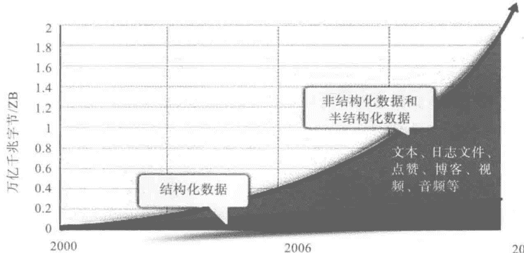
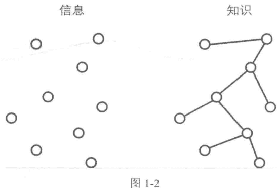
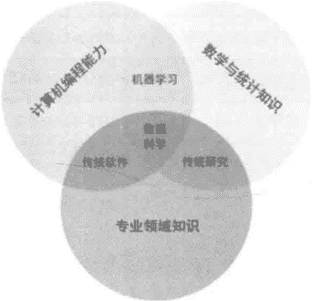

### 1.2 数据分类全景图

#### 1.2.1 按结构化程度分：三种形态
| 类型 | 特征 | 典型例子 | 处理难点 |
|------|------|----------|----------|
| **结构化数据** | 预定义表格，行=观测，列=特征 | 数据库表、Excel、CSV | 直接可用 |
| **非结构化数据** | 无固定格式，自由文本/媒体 | 网页、日志、图片、音频 | 需清洗结构化 |
| **半结构化数据** | 有标签/键值但字段动态变化 | JSON、XML | 介于两者之间 |

> **实战视角**：第二章将实战从非结构化网页抓取 → 解析清洗 → 转为结构化表格/JSON存储的完整链路。

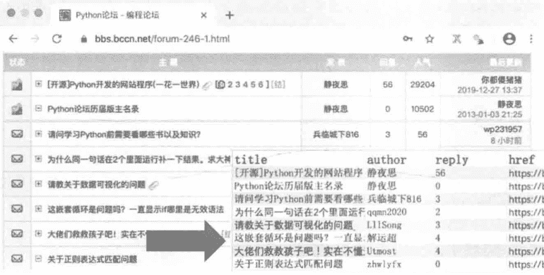
```
[
    {
        "title": "[开源]Python开发的网站程序(一花一世界)",
        "author": "静夜思",
        "reply": "56",
        "href": "https://bbs.bccn.net/thread-333204-1-1.html"
    },{
        "title": "Python论坛历届版主名录",
        "author": "静夜思",
        "reply": "0",
        "href": "https://bbs.bccn.net/thread-302911-1-1.html"
    }
]
```

#### 1.2.2 按统计属性分：质的 vs 量的
- **质的数据（定性）**：文本描述属性/分类，**不可运算**（如性别编码1/2仅是标签）
- **量的数据（定量）**：数值可运算，细分为：
  - **连续型**：任意区间可无限细分（身高、温度、股价）
  - **离散型**：取值有限可数（骰子点数、考试分数、来客数）

**字段识别实战**：
| 字段 | 类型 | 判断逻辑 |
|------|------|----------|
| 店名 | 质的 | 文本不可算 |
| 年营业额 | 量的(连续) | 金额可四则运算 |
| 邮政编码 | 质的 | 数字标签，加总无意义 |
| 月均来客数 | 量的(离散) | 整数可累加 |
| 咖啡产地 | 质的 | 分类文本 |

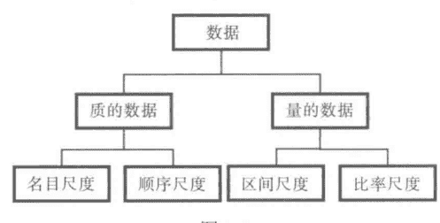
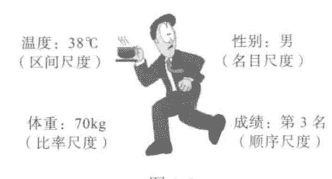

#### 1.2.3 按测量尺度分：四层递进
统计学视角下，数据运算权限层层递进：
1. **名目尺度**——仅分类计数（如血型、产地），支持=≠判断
2. **顺序尺度**——有序可排序（如评分1-5星），支持大小比较
3. **间隔尺度**——等距可加减（如摄氏温度），无绝对零点
4. **比率尺度**——绝对零点可乘除（如身高、营收），运算最自由

> **核心启示**：数据类型决定可用算法——名目型只能做频数统计/分类，比率型才能跑回归聚类。搞清类型，建模不踩坑。

### 1.3 数据科学标准化五步法
1. **获取数据**——爬虫、API、开放数据、传感器、日志...
2. **预处理**——清洗缺失/异常值，转换格式，特征工程
3. **探索分析**——统计摘要、可视化、假设生成
4. **建模预测**——选算法、训练、调参、验证泛化能力
5. **解读部署**——业务落地、监控迭代、知识沉淀

### 1.4 一键搭建开发环境
推荐**Anaconda发行版**：预装Python、Jupyter、NumPy/Pandas/Matplotlib/Scikit-learn等200+科学计算包，隔离环境管理无依赖地狱。安装后即可启动`jupyter notebook`开始实战之旅。

---

> **下一章预告**：Python核心语法速成——变量、流程控制、函数、面向对象、文件操作、异常处理，只学数据科学必用的20%核心语法，覆盖80%实战场景。

# 数据层级解析、科学流程与 Python 环境搭建全指南

##### 2. 顺序尺度

名目尺度因缺乏排序特性，可执行的操作受限。一旦赋予了先后次序，便进阶为**顺序尺度**（The Ordinal Level，亦称次序尺度）。此类数据虽能按序列区分高低，却无法量化相邻等级间的具体差距。

典型案例包括：满意度打分（1-10 分）、快乐指数（1-5 分），或是饮料品牌排位（可口可乐第 1、百事可乐第 2、雪碧第 3）。尽管常用数字标记，但直接加减运算并无实际意义。除继承名目尺度的“成员判定”功能外，顺序尺度新增核心能力如下：

- **序列呈现**：可视化原始排序。如可见光谱红橙黄绿青蓝紫，即为天然的顺序尺度。
- **大小比较**：依据顺序判定优劣。如快乐等级 5 高于 1，满意度 8 低于 10。

##### 3. 区间尺度

区间尺度（The Interval Level）涵盖顺序尺度全部特质，并引入**等距**属性（故亦称等距尺度）。这意味数值间隔可进行减法运算，常见于摄氏/华氏温度、服装尺码区间等。

> **关键提示**：此尺度下的“0”**不代表“虚无”**。

以摄氏度为例：台北 25°C、高雄 35°C，高雄更暖和，因两地相差 10°C。但 0°C 并非“无温度”，绝对零度实为 -273.15°C。在此层级，数据除支持顺序操作外，新增**加减法**运算权限。

##### 4. 比率尺度

比率尺度（The Ratio Level，亦称等比尺度）中，“0”具备**真实零点**含义（即“毫无”），数值间的差值与倍数均具业务意义。这是它与区间尺度的本质分野。典型场景：薪资、存款、产量、股价。

以银行存款为例：余额可为 0（无存款），2 万元正是 1 万元的两倍。在此基础上，比率尺度全面开放**乘除法**运算。

### 1.3 数据科学的五大核心步骤

搞清数据分类后，我们聚焦数据科学的标准化作业流程——这正是数据科学与传统数据分析（Data Analytics）的最大分水岭。

本质上，数据科学是现代化的**数据挖掘**（Data Mining）。挖掘是科学的子集。在详述科学流程前，先拆解挖掘体系。

#### 1.3.1 数据挖掘深度解析

数据挖掘借助软件技术，从海量数据库中发掘隐匿的规律与因果，即**模式识别**。

##### 1. 核心价值：四大目标

挖掘助力组织聚焦关键数据、预判趋势与行为，学术界称“数据库知识发现”（KDD）。其落地目的集中于四维：

- **预测**：以史鉴今。如依购买史推荐商品，依促销史估算降价增量。
- **识别**：模式匹配。如提取病毒特征库，驱动杀毒软件精准查杀。
- **分类**：多维分层。如按刷卡额度将客户分为高频、低频、零频群体，进而差异化投放目录以洞察习惯。
- **优化**：资源利用最大化。如便利店受限货架（仅容 1000 SKU），需优选品项、规划动线、调整陈列以创造峰值营收。

##### 2. 标准流程：KDD 九宫格（Fayyad & Simoudis 方法论）

从原始素材到可用知识，需历经多道工序，流程图谱如下：

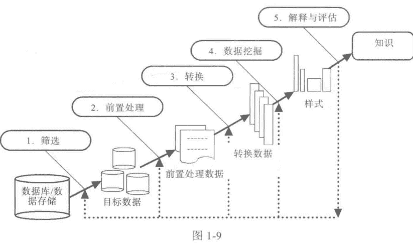

- **筛选**：设定准则切片数据。如仅提取“购车用户”或“年入百万以上”群体。
- **前置处理**：清洗噪音，剔除错误与不一致值（加速查询）；融合异构格式。如统一薪资币种为人民币、性别编码为 F/M。
- **转换**：重构数据结构以适配挖掘。如将流水拆解为月/季/周/日维度；信用卡类别映射为 0-3 数值便于计算。
- **数据挖掘**：核心环节，算法挖掘模式与规则。
- **解释与评估**：人工甄别模式价值。若无效，回溯前序环节调参重跑，直至产出支撑决策的可靠结论。

#### 1.3.2 数据科学标准作业程序 (SOP)

数据科学囊括挖掘全流程，仅将第 4 步“挖掘”升级为**“建模”**，即构成科学处理闭环。科学与分析本源同构，**核心差异在于是否强制遵循结构化步骤以保全结果严谨性**。哈佛 CS109 课程（Joe Blitzstein & Hanspeter Pfister）确立的五大里程碑如下：

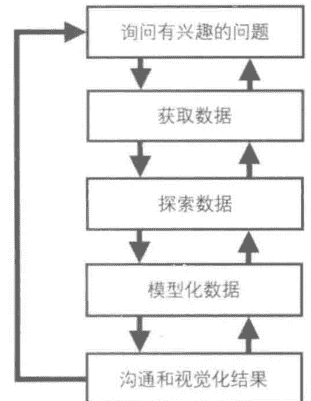

图 1-10

详细拆解如下：

- **提出好问题**：动手前先定义靶心。需融合学科知识与好奇心，群策群力列出备选，筛选可用数据验证的命题。
- **获取数据**：锁定问题后，全渠道搜集原始素材（公开集、内部库、外购数据），动用爬虫、开放数据、清洗、SQL 等技能栈。
- **探索数据**：拿到数据非直接建模，需先“洗”再“看”，两大主线并行：
  - **数据预处理**：依 1.2 节尺度理论辨别属性，补足领域知识，修正重复、缺失等通病，即**数据整理**。
  - **探索性分析 (EDA)**：借统计摘要与可视化，洞察隐性关联、模式、异常点，产出假设（如：为何某客群业绩滑坡？定位偏离导致销量低迷？）。
- **建模验证**：引入统计建模与机器学习（线性回归等），**实证假设真伪**。
- **结果沟通与可视化**：落笔成章，说服利益相关者。图表叙事是最高效的交付语言。

### 1.4 Python 开发环境零基础搭建

全书采用 Python 技术栈，主推 **Anaconda** 一站式发行版，省心高效。

#### 1.4.1 为什么选 Anaconda？

Anaconda 是 Python 数据科学界的“瑞士军刀”：
- **全开源、免费**；
- **预装豪华包**：NumPy、Pandas、SciPy（统计主力）、Matplotlib、Scikit-learn（机器学习）等开箱即用；
- **跨平台**：Win / Linux / Mac 无缝切换；
- **双版本共存**：Python 2/3 兼容；
- **内置三大 IDE**：Spyder、IPython Shell、Jupyter Notebook。

#### 1.4.2 Anaconda 下载与安装实操 (Win10 示范)

##### 1. 官网获取安装包
访问 `https://www.anaconda.com/download`，定位 **Windows 版 Python 3.x 64-Bit Graphical Installer** 并下载。提交邮箱与角色可领取《Starter Guide》电子手册。笔者写作时版本为 `Anaconda3-5.1.0-Windows-x86_64.exe`。


图 1-11

图 1-12

##### 2. 图形化安装向导 (若有旧版请先卸载)

| 步骤 | 界面关键动作 | 注意事项 |
| :--- | :--- | :--- |
| **Step 1** | 双击 `.exe` 进入欢迎页 |  图 1-13 |
| **Step 2** | 点 `Next` -> 许可协议页点 `I Agree` |  图 1-14 |
| **Step 3** | 选择安装范围：`Just Me` (推荐) / `All Users` | 保持默认，图 1-15 |
| **Step 4** | 确认安装路径 (可改) | 图 1-16 |
| **Step 5** | **高级选项关键勾选** |  图 1-17 |
| **Step 6** | ☑ `Register Anaconda as my default Python 3.6` -> `Install` | 设为系统默认 Python |
| **Step 7** | 等待进度条跑完 (文件大耗时久) -> `Next` |  图 1-18 |
| **Step 8** | 是否装 VS Code？需装点 `Install`，否则点 `Skip` |  图 1-19 |
| **Step 9** | `Finish` 完成，浏览器自动弹出文档页 | |

#### 1.4.3 启动 Anaconda Navigator：可视化中控台

Navigator 免去命令行烦恼，提供 GUI 管理应用与包。

1.  `开始菜单` → `Anaconda3 (64-bit)` → `Anaconda Navigator`。
2.  首次弹窗点 `Ok` 进入主面板。
     图 1-20
    图 1-21
3.  面板列出应用卡片，**已装显示 `Launch`**，未装显示 `Install`。
    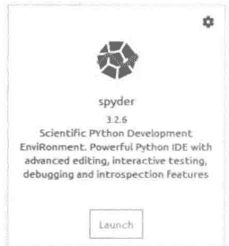 图 1-22 (Spyder 启动示例)
     图 1-23 (RStudio/VS Code 安装示例)

#### 1.4.4 Spyder IDE 实战上手

Spyder = 开源跨平台 Python IDE，集编辑、调试、交互、科学计算于一体，深度适配 IPython、NumPy、Pandas、SciPy、Matplotlib。

##### 1. 启动与关闭
- **路径 A**：Navigator 点 Spyder `Launch`。
- **路径 B**：`开始菜单` → `Anaconda3` → `Spyder` 直达。
     图 1-24
- 首次运行触发防火墙警报，点**“允许访问”**。
    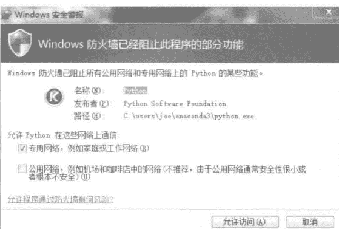 图 1-25
- 若检测到新版，弹窗提示**“随 Anaconda 统一升级，勿手动更新”**，点 `OK` 进入工作台。
    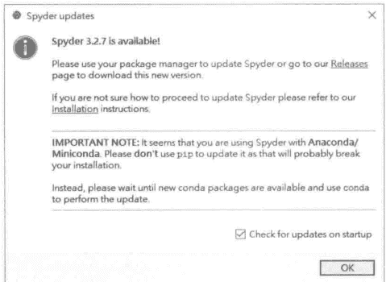 图 1-26
    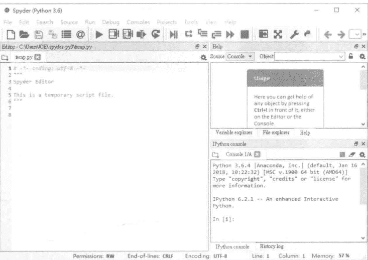 图 1-27
    > 界面布局：顶部菜单/工具栏 | 左下代码编辑区 (多标签) | 右下 IPython Console (交互 Shell)。
- 退出：`File` → `Quit`。

##### 2. IPython Console：交互式实验场
启动 Spyder 即见右下 **IPython Console** 窗口，即强大的 IPython Shell，支持即时运算、调试与探索。
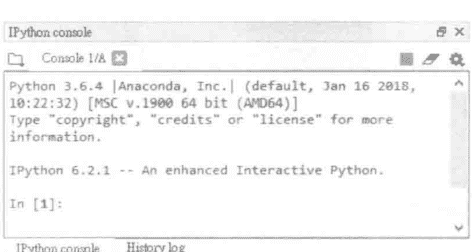 图 1-28

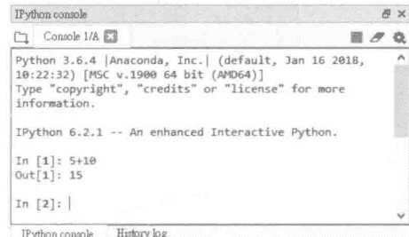

图 1-29

得益于 Python 的解释型特性，IPython Shell 提供了交互式运行环境。你只需在 "In [?]:" 提示符后键入代码并回车，即可即时查看执行结果。以算术运算为例，输入 `5+10` 后按下 Enter，控制台将直接输出 `15`，效果如图 1-29 所示。

此外，环境同样支持变量赋值与流程控制测试。例如，先定义变量 `num = 10`，再调用 `print()` 函数输出其值，如图 1-30 所示。若要验证条件判断，输入 `if num >= 10:` 并回车，编辑器会自动缩进 4 个空格；待代码块补全后再次回车，即可看到运行结果，参考图 1-31。

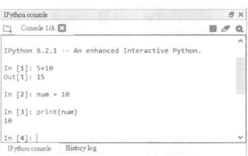

图 1-30

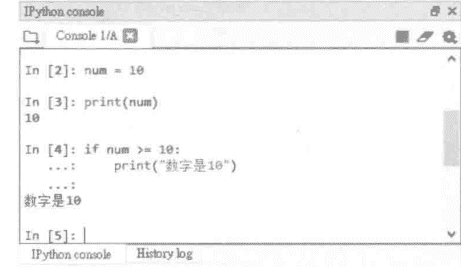

图 1-31

##### 3. 在 Spyder 中创建、编辑与运行脚本文件

Spyder 集成开发环境（IDE）支持新建或打开现有的 `.py` 文件进行开发。点击菜单栏 **File → New file**，即可生成一个名为 “untitled0.py*” 的代码编辑标签页，界面如图 1-32 所示。

在编辑区粘贴或输入先前在 Shell 中测试的代码片段，编写完成后，通过 **File → Save** 或快捷键保存。在弹出的对话框中指定路径，文件名设为 `Ch1_4_4.py`，确认保存，如图 1-33 所示。

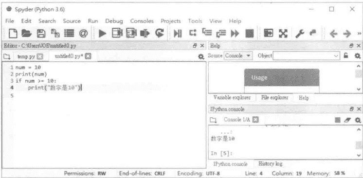

图 1-32

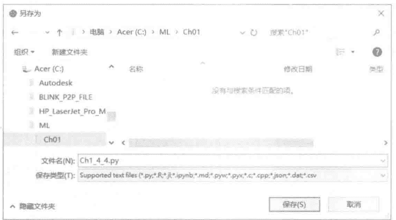

图 1-33

运行脚本的方式有两种：点击 **Run → Run** 菜单项，或直接按下 **F5** 快捷键，操作示意见下图 1-34。

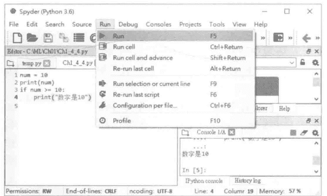

图 1-34

程序执行完毕后，右下角的 **Python Console** 面板将输出运行结果，如图 1-35 所示。若代码包含输入交互，也需在此控制台完成。

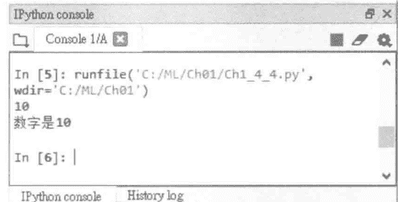

图 1-35

对于已有的脚本文件（如本书配套的范例代码），只需在 Spyder 中选择 **File → Open** 即可打开编辑。

### 章末练习

1.  简述何为数据科学。
2.  举例区分结构化、非结构化与半结构化数据。
3.  概括四种测量尺度，并说明何为定性数据与定量数据。
4.  简述数据挖掘的概念，并列举数据科学处理的标准流程步骤。
5.  Anaconda 安装包包含哪些内容？
6.  实操：在本机下载安装 Anaconda，搭建 Python 数据科学开发环境。
7.  简要介绍 Spyder 工具的定位与功能。
8.  实操：启动 Spyder，新建名为 `Ch1_5.py` 的脚本文件。

## CHAPTER 2

## 第 2 章

## Python 程序语言

- 2.1 认识 Python 语言
- 2.2 变量、数据类型与运算符
- 2.3 流程控制
- 2.4 函数、模块与包
- 2.5 容器类型
- 2.6 类与对象

### 2.1 认识 Python 语言

Python 由 Guido van Rossum 创立，是一门通用型、高可读性且语法优雅的编程语言。它的应用场景极广，涵盖 GUI 桌面开发、Web 后端、系统运维、财务建模及大数据分析等领域。

Python 主要分为 Python 2 与 Python 3 两大版本系列，本书全程基于 **Python 3** 讲解。

#### 1. Python 是解释型语言

Python 属于**解释型语言**。其运行依赖解释器，采用“逐行翻译、即时执行”的机制：解释器读取一行源码，将其转换为机器指令并立即运行，而不生成独立的可执行文件（如 .exe），流程如图 2-1 所示。

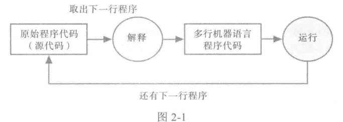

受限于这种“边翻译边运行”的模式，Python 的执行速度通常不及 C/C++ 等编译型语言。

对比来看，C/C++ 属于**编译型语言**。源代码需经编译器全量检查，无误后一次性翻译生成目标代码文件（Object Code），如图 2-2 所示。

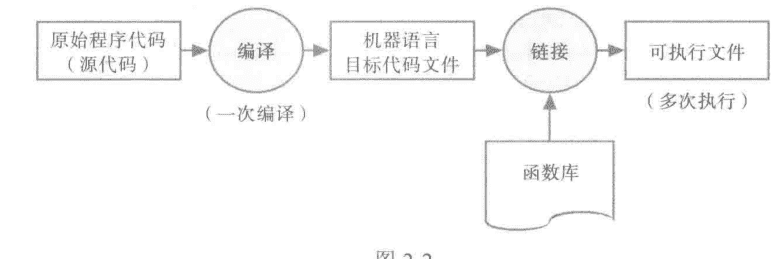

随后，链接器将目标代码与外部库函数合并，生成操作系统可直接加载运行的**可执行映像文件**。

#### 2. Python 是动态类型语言

Python 属于**动态类型语言**。变量声明时无需指定数据类型，解释器会根据赋值的字面量自动推断类型。示例如下：

```
a = 1
b = "Hello World!"
```

代码中，变量 `a` 赋值为整数 `1`，类型即为 `int`；变量 `b` 赋值为字符串，类型即为 `str`。

#### 3. Python 是强类型语言

虽无需显式声明类型，但 Python 是**强类型语言**，**不支持隐式类型转换**。例如尝试直接拼接字符串与整数：

```
#### 字符串 + 整数
v = "计算结果 = " + 100
```

上述代码中 `#` 后为注释。在 JavaScript 或 PHP 中，整数会自动转为字符串拼接，但 Python 会直接报错。必须显式转换类型后再操作：

```
#### 字符串 + 字符串
v = "计算结果 = " + str(100)
```

此处调用 `str()` 将整数强转为字符串，才能完成拼接。

### 2.2 变量、数据类型与运算符

变量用于存储程序运行时的临时数据。Python 基础类型包含整数、浮点数、布尔值与字符串。通过运算符连接变量构成表达式，驱动程序逻辑产出结果。

#### 2.2.1 Python 变量

Python 变量**无需预声明，赋值即创建**，但**使用前必须赋初值**（示例程序：`Ch2_2_1.py`）：

```
grade = 76
height = 175.5
weight = 75.5
```

代码中，`grade` 因初值为整数而成为整型；`height` 与 `weight` 因含小数点而为浮点型。可用 `print()` 输出变量值：

```
print("成绩 = " + str(grade))
print("身高 = " + str(height))
print("体重 = " + str(weight))
```

此处用 `str()` 将数值转字符串，配合 `+` 连接符输出。更简便的方式是利用 `print` 的多参数特性，用逗号 `,` 分隔变量，函数会自动处理类型转换与空格：

```
print("成绩 =", grade)
print("身高 =", height)
print("体重 =", weight)
```

#### 2.2.2 Python 运算符

Python 提供算术、赋值、位、比较（关系）与逻辑五大类运算符。表 2-1 列出了按优先级从高到低的默认顺序及说明。

##### 表 2-1 Python 运算符优先级与说明

| 运算符 | 说明 |
|---|---|
| `()` | 括号（最高） |
| `**` | 幂运算 |
| `~` | 按位取反 |
| `+`, `-` | 正负号 |
| `*`, `/`, `//`, `%` | 乘、除、整除、取模 |
| `+`, `-` | 加、减 |
| `<<`, `>>` | 左移、右移 |
| `&` | 按位与 |
| `^` | 按位异或 |
| `\|` | 按位或 |
| `in`, `not in`, `is`, `is not`, `<`, `<=`, `>`, `>=`, `!=`, `==` | 成员、身份、比较运算 |
| `not` | 逻辑非 |
| `and` | 逻辑与 |
| `or` | 逻辑或（最低） |

**同优先级结合性**：多数运算符（如 `+`、`-`）遵循**左结合**，即从左向右依次计算。例如：

```
3 + 4 - 2
```

表达式 `3+4-2` 先算 `3+4=7`，再算 `7-2=5`，结果如图 2-3 所示。

**特例——多重赋值**：赋值运算符 `=` 具有**右结合**特性。例如：

```
a = b = c = 25
```

执行顺序为从右向左：先 `c=25`，再 `b=c`，最后 `a=b`，最终三变量均为 25，验证如图 2-4。

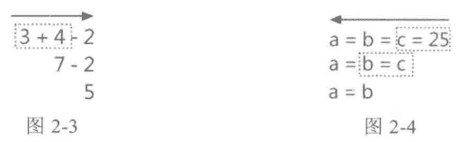

#### 2.2.3 基础数据类型

Python 数据类型分为**基础类型**与**容器类型**（列表、字典、集合、元组，详见 2.5 节）。本节聚焦基础四类：整数、浮点数、布尔、字符串。

##### 1. 整数 (`int`)

整数无小数部分，长度仅受内存限制。示例：

```
a = 1
b = 100
c = 122
d = 56789
```

变量赋值为整数后可进行各类数学运算（程序：`Ch2_2_3.py`）：

| 代码 | 说明 |
|---|---|
| `x = 5` | 赋值 |
| `print(type(x))` | 输出 `<class 'int'>` |
| `print(x)` | 输出 `5` |
| `print(x + 1)` | 加法：`6` |
| `print(x - 1)` | 减法：`4` |
| `print(x * 2)` | 乘法：`10` |
| `print(x / 2)` | 浮点除法：`2.5` |
| `print(x // 2)` | 整除：`2` |
| `print(x % 2)` | 取模：`1` |
| `print(x ** 2)` | 幂：`25` |
| `x += 1` | 等价 `x = x + 1` |
| `print(x)` | 输出 `6` |
| `x *= 2` | 等价 `x = x * 2` |
| `print(x)` | 输出 `12` |

`+=`、`*=` 等为复合赋值的简写形式。

##### 2. 浮点数 (`float`)

浮点数包含小数部分，精度约 15 位。本质区别在于**是否有小数点**（`5` 是整数，`5.0` 是浮点数）。示例：

| 示例 |
|---|
| `e = 1.0` |
| `f = 55.22` |

浮点数运算示例（程序：`Ch2_2_3a.py`）：

| 代码 | 说明 |
|---|---|
| `y = 2.5` | 赋值 |
| `print(type(y))` | 输出 `<class 'float'>` |
| `print(y, y + 1, y * 2, y ** 2)` | 输出 `2.5 3.5 5.0 6.25` |

##### 3. 布尔值 (`bool`)

仅有 `True` 与 `False` 两个常量（首字母大写）：

| 代码 | 说明 |
|---|---|
| `x = True` | |
| `y = False` | |

此外，以下值在布尔上下文中视为 **False**：
- 数值零：`0`, `0.0`
- 空容器：`[]`, `()`, `{}`
- 特殊常量：`None`

实战中，比较运算符（`==`, `!=`, `<`, `>`, `<=`, `>=`）与逻辑运算符（`not`, `and`, `or`）的返回值均为布尔类型。

先看逻辑运算（程序：`Ch2_2_3b.py`）：

```
a = True
b = False
print(type(a))      # 输出"<class 'bool'>"
print(a and b)      # 逻辑 and: 输出"False"
print(a or b)       # 逻辑 or: 输出"True"
print(not a)        # 逻辑 not: 输出"False"
```

再看比较运算（程序：`Ch2_2_3c.py`）：

```
a = 3
b = 4
print(a == b)   # 相等: 输出 "False"
print(a != b)   # 不等: 输出 "True"
print(a > b)    # 大于: 输出 "False"
print(a >= b)   # 大于等于: 输出 "False"
print(a < b)    # 小于: 输出 "True"
print(a <= b)   # 小于等于: 输出 "True"
```

##### 4. 字符串 (`str`)

Python 字符串**不可变**，所有修改操作均返回新字符串。由单引号 `''` 或双引号 `""` 包裹的 Unicode 字符序列组成：

```
s1 = "学习 Python 语言程序设计"
s2 = 'Hello World!'
```

Python 无单独的字符类型，长度为 1 的字符串即视为字符：

```
ch1 = "A"
ch2 = 'b'
```

创建字符串后，可进行输出、测长、拼接与格式化（程序：`Ch2_2_3d.py`）：

```
str1 = 'hello'      # 使用单引号创建字符串
str2 = "python"     # 使用双引号创建字符串
print(str1)         # 输出 "hello"
```

| Code | Description |
|---|---|
| `print(len(str1))` | 长度：输出 `5` |
| `str3 = str1 + ' ' + str2` | 拼接 |
| `print(str3)` | 输出 `hello python` |
| `str4 = '%s %s%d' % (str1, str2, 12)` | C 风格格式化 |
| `print(str4)` | 输出 `hello python 12` |

格式符：`%s` 字符串、`%d` 整数、`%f` 浮点数。

字符串对象内置丰富方法（程序：`Ch2_2_3e.py`）：

| Code | Description |
|---|---|
| `s = "hello"` | |
| `print(s.capitalize())` | 首字母大写：`Hello` |
| `print(s.upper())` | 全大写：`HELLO` |

# Python 基础语法速通：流程、函数与数据容器

掌握 Python 核心语法，关键在于理解“流程控制”如何指挥代码走向、“函数模块”如何实现复用解耦，以及“容器类型”如何高效组织数据。本节将带你快速过一遍这些必知必会的知识点。

### 2.3 程序流程的指挥官：流程控制

代码不再是自上而下的直线跑完，流程控制赋予了程序“决策”与“重复”的能力。它主要分为**条件判断**（做选择）与**循环控制**（干重复事）。

Python 通过**缩进（通常 4 个空格）**来界定代码块，同层级缩进的语句属于同一逻辑块，这是区别于大括号语言的显著特征。

#### 2.3.1 条件判断：从单选到多选

条件语句的核心是根据布尔表达式的真假，决定执行哪段代码块。

**1. `if` 单分支：要不要做？**
只有条件成立才执行，否则直接跳过。
> 场景：输入温度，低于 20°C 才提醒加外套。
```python
t = int(input("请输入气温 => "))
if t < 20:
    print("加件外套!")
    print("今天气温 = " + str(t))
```

进阶用法：结合逻辑运算符（`and`/`or`）处理区间判断，如 20~22°C 建议穿薄外套。
```python
if t >= 20 and t <= 22:
    print("加一件薄外套!")
```

**2. `if/else` 双分支：非此即彼**
互斥的两条路，条件为真走一条，为假走另一条，必走其一。
> 场景：60 分为界，判定及格与否。
```python
s = int(input("请输入成绩 => "))
if s >= 60:
    print("成绩及格!")
else:
    print("成绩不及格!")
```

**3. `if/elif/else` 多分支：层层筛选**
`elif` 可无限扩展条件分支，自上而下依次匹配，**一旦命中即执行对应块并跳出整个结构**，不再继续往下判断。
> 场景：按年龄段划分儿童、青少年、成年人。
```python
a = int(input("请输入年龄 => "))
if a < 13:
    print("儿童")
elif a < 20:
    print("青少年")
else:
    print("成年人")
```

**4. 三元运算符：单行写法的“赋值利器”**
Python 没有传统 `?:` 语法，但提供了 `值1 if 条件 else 值2` 的单行写法，常用于变量快速赋值。
> 场景：24 小时制转 12 小时制。
```
变量 = 变量 1 if 条件表达式 else 变量 2
```
```python
h = h-12 if h >= 12 else h
```

#### 2.3.2 循环控制：自动化重复任务

**1. `for` 计数循环：次数已知的首选**
配合 `range()` 函数生成整数序列，自动管理计数器，代码简洁不易出错。
> 场景：累加 1 到 m 的和。注意 `range(1, m+1)` 为左闭右开区间。
```python
m = int(input("请输入最大值 =>"))
s = 0
for i in range(1, m + 1):
    s = s + i
print("总和 = " + str(s))
```

**`range()` 函数的三种参数形态：**

| 参数形式 | 含义 | 示例生成序列 |
| :--- | :--- | :--- |
| `range(stop)` | 从 0 到 stop-1，步长 1 | `range(5)` → 0,1,2,3,4 |
| `range(start, stop)` | 从 start 到 stop-1，步长 1 | `range(1, 5)` → 1,2,3,4 |
| `range(start, stop, step)` | 自定义起止步长 | `range(1, 11, 2)` → 1,3,5,7,9 (奇数)<br>`range(0, -10, -1)` → 0,-1,...,-9 (倒序) |

```python
for i in range(5) :
    print("range(5)的值 = " + str(i))
``` ```python
for i in range(1, 5) :
    print("range(1, 5)的值 = " + str(i))
``` ```python
for i in range(1, 11, 2):
    print("range(1, 11, 2)的值 = " + str(i))
```

**2. `while` 条件循环：次数未知、条件驱动**
需手动初始化、更新计数器，适合“直到某条件满足才停止”的场景。
> 场景：计算阶乘 n!。切记循环体内必须更新变量（如 `n += 1`），否则死循环。
```python
m = int(input("请输入阶乘数 =>"))
r = 1
n = 1
while n <= m:
    r = r * n
    n = n + 1
print("阶乘值! = " + str(r))
```

---

### 2.4 代码复用与生态复用：函数、模块与包

**函数**是最小复用单元；**模块**（`.py` 文件）与**包**（含 `__init__.py` 的目录）构建起 Python 庞大的生态体系。

#### 2.4.1 函数：定义、返回与调用

**定义语法：** `def 函数名(参数列表):` + 缩进代码块。
- 无参无返回：仅执行动作（如打印）。
```python
def print_msg():
    print("欢迎学习 Python 程序设计!")
```
- 有返回值：用 `return` 送出结果并结束函数。可多处 `return` 实现多分支返回。
```python
def is_valid_num(no):
    if no >= 0 and no <= 200.0:
        return True
    else:
        return False
``` ```python
def convert_to_f(c):
    f = (9.0 * c) / 5.0 + 32.0
    return f
```

**调用方式：**
- 无返回值：直接调用 `func_name()`。
```python
print_msg()
```
- 有返回值：变量接收 `res = func_name()`，或直接嵌入表达式/判断中 `if func_name():`。
```python
f = convert_to_f(c)
``` ```python
if is_valid_num(c):
    print("合法!")
else:
    print("不合法")
```

#### 2.4.2 站在巨人肩膀上：模块与包导入

**1. 整体导入 `import module_name`**
需加模块名前缀调用：`module_name.func()`。
```python
import random
``` ```python
target = random.randint(1, 100)
```

**2. 别名导入 `import module_name as alias`**
简化前缀，数据科学领域标准操作（如 `import pandas as pd`）。
```python
import random as R
``` ```python
target = R.randint(1, 100)
```

**3. 部分导入 `from module_name import specific_name`**
将目标直接引入当前命名空间，**调用时无需前缀**，适合仅需少数功能时。
```python
from bs4 import BeautifulSoup
``` ```python
html_str = "<p>Hello World!</p>"
soup = BeautifulSoup(html_str, "lxml")
print(soup)
```

---

### 2.5 数据容器：列表—— 有序、可变、动态数组

列表是 Python 最常用的容器，类似其他语言的动态数组，**可增删改**，元素类型任意。

#### 2.5.1 列表基本操作

用 `[]` 创建，逗号分隔。支持**正向索引（0起）**与**反向索引（-1为尾）**。
核心方法：
- `append(x)`：尾部追加
- `pop()`：弹出并返回尾部元素（或指定索引）
- 直接赋值 `lst[i] = val` 修改元素
```python
ls = [6, 4, 5]    # 创建列表
print(ls, ls[2])  # 输出 "[6, 4, 5] 5"
print(ls[-1])     # 负索引从最后开始：输出 "5"
ls[2] = "py"      # 指定字符串类型的元素
print(ls)         # 输出 "[6, 4, 'py']"
ls.append("bar")  # 新增元素
print(ls)         # 输出 "[6, 4, 'py', 'bar']"
ele = ls.pop()    # 取出最后元素
print(ele, ls)    # 输出 "bar [6, 4, 'py']"
```

#### 2.5.2 切片：灵活截取子列表

语法：`lst[start:stop:step]`，**左闭右开**，原列表不变，生成新列表。
- `lst[1:4]`：索引 1,2,3
- `lst[:3]`：前三个
- `lst[::2]`：隔一个取一个
- `lst[::-1]`：反转列表（神技）
```python
nums = list(range(5))   # 创建一个整数列表
print(nums)             # 输出 "[0, 1, 2, 3, 4]"
print(nums[2:4])        # 切割索引 2~4（不含 4）：输出 "[2, 3]"
print(nums[2:])         # 切割索引从 2 至最后：输出 "[2, 3, 4]"
print(nums[:2])         # 切割从开始至索引 2（不含 2）：输出 "[0, 1]"
print(nums[:])          # 切割整个列表：输出 "[0, 1, 2, 3, 4]"
print(nums[:-1])        # 使用负索引切割：输出 "[0, 1, 2, 3]"
```

> **下一节预告**：我们将继续探索字典、集合与元组，解锁更多高效数据处理姿势。

```python
nums[2:4] = [7, 8]  # 使用切片来指定子列表
print(nums)  # 输出 "[0, 1, 7, 8, 4]"
```

### Python 核心容器与面向对象要点速览

#### 3. 列表遍历技巧

Python 通过 `for` 循环实现列表元素的逐个访问（示例：Ch2_5_1b.py），写法如下：

```python
animals = ['cat', 'dog', 'bat']
for animal in animals:
    print(animal)
```

该循环可逐项读取列表内容，执行效果如下：

```
cat
dog
bat
```

若需同时获取索引位置，可引入 `enumerate()` 函数（示例：Ch2_5_1c.py）：

```python
animals = ['cat', 'dog', 'bat']
for index, animal in enumerate(animals):
    print(index, animal)
```

该函数返回索引与值两个变量，首个变量 `index` 代表下标，执行效果：

```
0 cat
1 dog
2 bat
```

#### 4. 列表推导式

列表推导式以简洁语法快速生成列表：在 `[]` 内嵌入 `for` 循环，配合 `if` 筛选（示例：Ch2_5_1d.py）。

```python
list1 = [x for x in range(10)]
```

示例中 `x` 为循环变量，遍历 0~9 生成 `[0, 1, ..., 9]`。

方括号首位接受表达式，如 `x+1` 可产出 `[1, 2, ..., 10]`：

```python
list2 = [x+1 for x in range(10)]
```

追加 `if` 子句可过滤数据，如保留偶数（`x % 2 == 0`）：

```python
list3 = [x for x in range(10) if x % 2 == 0]
```

经判断余数为 0 筛选出偶数，构成 `[0, 2, 4, 6, 8]`。

表达式与条件结合使用，例如：

```python
list4 = [x*2 for x in range(10) if x % 2 == 0]
```

结果生成 `[0, 4, 8, 12, 16]`。

#### 2.5.2 字典操作详解

字典作为键值存储容器，支持通过键高效增删改查，概念对应关联数组。

##### 1. 基础操作

花括号 `{}` 定义键值对，逗号分隔，冒号分割键值（示例：Ch2_5_2.py）。

```python
d = {"cat": "white", "dog": "black"} # 创建字典
print(d["cat"]) # 使用 Key 获取元素: 输出 "white"
print("cat" in d) # 是否有 Key: 输出 "True"
d["pig"] = "pink" # 新增元素
print(d["pig"]) # 输出 "pink"
print(d.get("monkey", "N/A")) # 获取元素+默认值: 输出 "N/A"
print(d.get("pig", "N/A")) # 获取元素+默认值: 输出 "pink"
del d["pig"] # 使用 Key 删除元素
print(d.get("pig", "N/A")) # "pig" 不存在: 输出 "N/A"
```

示例构建字典 `d`，涵盖键 `"cat"` 取值、`in` 判断存在性、新增 `"pig"`、`get()` 安全取值（含默认值）、`del` 删除等操作。

##### 2. 遍历字典

同列表一样，字典遍历亦用 `for` 循环（示例：Ch2_5_2a.py）。

```python
d = {"chicken": 2, "dog": 4, "cat": 4, "spider": 8}
for animal in d:
    legs = d[animal]
    print(animal, legs)
```

默认迭代键，打印动物腿数：

```
chicken 2
dog 4
cat 4
spider 8
```

需同时获取键值，调用 `items()`（示例：Ch2_5_2b.py）。

```python
d = {"chicken": 2, "dog": 4, "cat": 4, "spider": 8}
for animal, legs in d.items():
    print("动物: %s 有 %d 只脚" % (animal, legs))
```

遍历 `d.items()` 直接解包键 `animal` 与值 `legs`，输出：

```
动物: chicken 有 2 只脚
动物: dog 有 4 只脚
动物: cat 有 4 只脚
动物: spider 有 8 只脚
```

##### 3. 字典推导式

字典推导式在 `{}` 中用 `for` 循环构建键值对，可加 `if` 筛选（示例：Ch2_5_2c.py）。

```python
d1 = {x:x*x for x in range(10)}
```

`x:x*x` 定义键值结构，冒号左为键右为值，0~9 生成 `{0:0, 1:1, ..., 9:81}`。

配合 `if` 筛选奇数键（`x % 2 == 1`）：

```python
d2 = {x:x*x for x in range(10) if x % 2 == 1}
```

按余数为 1 筛选，得 `{1:1, 3:9, 5:25, 7:49, 9:81}`（顺序可能因版本而异）。

#### 2.5.3 集合与数学运算

集合由唯一、无序元素构成，自带去重功能，支持交并差等数学运算。

##### 1. 基础用法

花括号 `{}` 括起元素，逗号分隔（示例：Ch2_5_3.py）。

```python
animals = {"cat", "dog", "pig"}                 # 创建集合
print("cat" in animals)                         # 检查是否有此元素：输出"True"
print("fish" in animals)                        # 输出 "False"
animals.add("fish")                             # 新增集合元素
print("fish" in animals)                        # 输出 "True"
print(len(animals))                             # 元素数：输出 "4"
animals.add("cat")                              # 新增存在的元素
print(len(animals))                             # 输出 "4"
animals.remove('cat')                           # 删除集合元素
print(len(animals))                             # 输出 "3"
```

示例建立 `animals`，演示 `in` 判断、`add()` 新增（重复自动过滤）、`len()` 计数、`remove()` 删除。

##### 2. 遍历集合

遍历语法同列表，但集合无序导致迭代顺序不可预测（示例：Ch2_5_3a.py）。

```python
animals = {"cat", "dog", "pig", "fish"} # 创建集合
for index, animal in enumerate(animals):
    print('#%d: %s' % (index + 1, animal))
```

配合 `enumerate()` 可见顺序随机性，输出：

```
#1: dog
#2: fish
#3: pig
#4: cat
```

##### 3. 集合运算实战

以两个集合为例演示运算（示例：Ch2_5_3b.py）。

```python
A = {1, 2, 3, 4, 5}
B = {4, 5, 6, 7, 8}
```

**交集**：共同拥有的元素（图 2-5）。用 `&` 或 `intersection()`：

```python
C = A & B
```

```python
C = A.intersection(B)
```

结果 `{4, 5}`。

**并集**：合并去重（图 2-6）。用 `|` 或 `union()`：

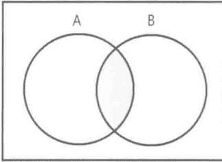

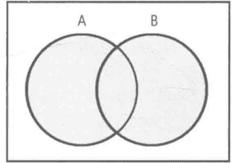

```python
C = A | B
```

```python
C = A.union(B)
```

结果 `{1, 2, 3, 4, 5, 6, 7, 8}`。

**差集**：仅属于 A 的元素（图 2-7）。用 `-` 或 `difference()`：

```python
C = A - B
```

```python
C = A.difference(B)
```

结果 `{1, 2, 3}`。

**对称差集**：非共有元素（图 2-8）。用 `^` 或 `symmetric_difference()`：

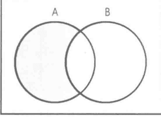

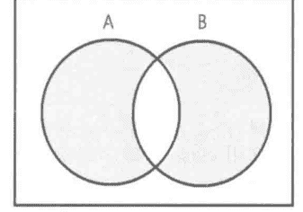

```python
C = A ^ B
```

```python
C = A.symmetric_difference(B)
```

结果 `{1, 2, 3, 6, 7, 8}`。

#### 2.5.4 元组特性

元组类似不可变列表，创建后内容固定。用圆括号 `()` 定义，逗号分隔元素（示例：Ch2_5_4.py）。

```python
t = (5, 6, 7, 8)                 # 创建元组
print(type(t))                 # 输出 "<class 'tuple'>"
print(t)                       # 输出 "(5, 6, 7, 8)"
print(t[0])                    # 输出 "5"
print(t[1])                    # 输出 "6"
print(t[-1])                   # 输出 "8"
print(t[-2])                   # 输出 "7"
for ele in t:                  # 遍历元素
    print(ele, end=" ")          # 输出 "5, 6, 7, 8"
```

示例建立元组 `t`，演示类型查看、内容打印、索引取值与遍历。

### 2.6 类与对象编程

Python 彻底面向对象，内置类型（模块、函数等）均为对象。

#### 2.6.1 类的定义与实例化

面向对象靠对象协作实现功能，对象封装数据与行为。

##### 1. 定义类

类是对象模板。用 `class` 定义 `Student` 类（示例：Ch2_6_1.py）。

```python
class Student:
    def __init__(self, name, grade):
        self.name = name
        self.grade = grade

    def displayStudent(self):
        print("姓名 = " + self.name)
        print("成绩 = " + str(self.grade))

    def whoami(self):
        return self.name
```

定义含类名、冒号、函数块。类含数据字段（存数据）与方法（定行为），特殊方法 `__init__` 为构造器。

##### 2. 类构造器

构造器 `__init__` 实例化时自动触发，初始化属性，名字固定（双下划线）。

```python
def __init__(self, name, grade):
    self.name = name
    self.grade = grade
```

参数列表允许实例化时传入初值，赋给 `name`、`grade` 字段。

##### 3. `self` 变量机制

构造器与方法首参约定为 `self`，类比 C#/Java `this`，指向当前实例。

> **提示**
>
> `self` 非关键字，仅约定俗成。`__init__` 中 `self` 指代新实例。

```python
self.name = name
self.grade = grade
```

`self.name`、`self.grade` 即为新对象字段赋值。

##### 4. 数据字段

数据字段即 `self.` 前缀变量。`Student` 含 `name`、`grade`。

```python
self.name = name
self.grade = grade
```

构造器中完成字段初始化。

##### 5. 方法定义

方法本质为函数，首参强制 `self`，访问字段必经 `self`。

```python
def displayStudent(self):
    print("姓名 = " + self.name)
    print("成绩 = " + str(self.grade))
```

##### 6. 实例化对象：从蓝图到实体的构建

类定义完毕后，即可依据该模板生成对象，亦称实例。单个类仿若一座工厂，能够批量产出多个对象实例，具体演示如下：

```python
s1 = Student("陈会安", 85)
```

上述代码完成了对象 `s1` 的实例化过程，`Student()` 实质上是调用 `Student` 类的构造器方法，通过传入两个参数来完成对象的初始化。随后，我们可以借助“.”运算符来调用对象的方法，示例如下：

```python
s1.displayStudent()
print("s1.whoami() = " + s1.whoami())
```

同理，该语法同样适用于访问对象的数据字段，操作如下：

```python
print("s1.name = " + s1.name)
print("s1.grade = " + str(s1.grade))
```

#### 2.6.2 封装私有数据字段

Python 类中的数据字段与方法默认均为公开状态，外部代码可随意访问与调用，这相当于其他面向对象语言中的 `public` 成员。

若需对数据字段进行隐藏，或将特定方法限制为类内部专用、不对外暴露接口，则需引入私有成员机制。在 Python 中，只需在数据字段或方法名称前冠以双下划线 `__`，即可将其标记为私有（Python 示例程序：Ch2_6_2.py），如下所示：

```python
def __init__(self, name, grade):
    self.name = name
    self.__grade = grade
```

上述构造器中的 `__grade` 字段便是一个被隐藏的私有数据字段。

此外，也支持定义仅限类内部调用的私有方法，示例如下：

```
def __getGrade(self):
    return self.__grade
```

上述方法命名为 `__getGrade()`，该方法仅能在定义该类的代码内部被调用，且调用时必须显式带上 `self` 参数，如下所示：

```
print("成绩 = " + str(self.__getGrade()))
```

### 学习检测

- 1. 请简述 Python 语言的定义及其主要版本分类。
- 2. Python 内置支持哪些核心数据类型？
- 3. 列举 Python 流程控制中所支持的条件判断与循环语句类型。
- 4. 结合实例说明 Python 函数的定义与使用方式。
- 5. Python 程序如何导入模块或包？导入后该如何调用？
- 6. 何为 Python 的容器类型？
- 7. 请分别举例阐述列表、字典、集合与元组的特性及用法。
- 8. Python 中如何定义类并创建对象实例？

## CHAPTER 3

## 第 3 章

## HTML 网页架构与 JSON 数据交互

- 3.1 HTML 5 标签体系详解
- 3.2 HTML 5 文本排版标签
- 3.3 HTML 5 图像与超链接标签
- 3.4 HTML 5 表单、表格与容器标签
- 3.5 HTML 5 语义化与结构标签
- 3.6 HTML 文档结构与 DOM 模型
- 3.7 JSON 基础入门

### 3.1 HTML 5 标签体系详解

HTML 5 的标签架构与旧版 HTML 大体一致，核心差异在于新增了语义化与结构化标签，并重新界定了部分标签的含义。

#### 3.1.1 构建首个 HTML 5 网页

HTML 5 网页的基础骨架与 HTML 4.x 及 XHTML 高度相似，其标准标签结构如下：

```
<!DOCTYPE html>
<html lang="zh-cn">
<head>
<meta charset="utf-8">
<title>页标题文字</title>
</head>
<body>
网页内容
</body>
</html>
```

上述 HTML 文档的标签结构主要由以下几个部分构成。

- 1. `<!DOCTYPE>`

`<!DOCTYPE>` 并非 HTML 标签，它位于 `<html>` 标签之前，作用是告知浏览器当前文档采用的 HTML 版本，以便浏览器调用正确的渲染引擎解析页面。更多细节请参考 3.1.2 节。

**注意：** `<!DOCTYPE>` 之前绝不能有任何空白字符，否则可能导致浏览器渲染异常。

- 2. `<html>` 标签

`<html>` 是网页的根元素，一个容纳所有其他 HTML 标签的容器，包含 `<head>` 与 `<body>` 两大子标签。如有需要，可通过 `lang` 属性声明网页语言，示例如下：

```
<html lang="zh">
```

`lang` 属性常用的两位语言代码包括：zh（中文）、en（英文）、fr（法文）、de（德文）、it（意大利文）、ja（日文）等。

亦可在语言代码后追加连字符及两位国家/地区代码，例如 `en-US` 代表美式英语，`zh-TW` 代表台湾地区繁体中文。若不特指地区，可用 `zh-cmn-Hans` 表示简体中文，`zh-cmn-Hant` 表示繁体中文。

- 3. `<head>` 标签

`<head>` 为文档元数据容器，内含 `<title>`、`<meta>`、`<script>` 与 `<style>` 等标签。`<meta>` 标签常用于指定网页编码为 utf-8，如下：

```
<meta charset="utf-8">
```

关于 `<head>` 标签的详细用法，请见 3.1.4 节。

- 4. `<body>` 标签

`<body>` 承载网页的实质内容，包括文本、链接、图片、表格、列表、表单等，详情请参阅 3.2 ~ 3.4 节。

##### 实战演练——HTML 网页：Ch3_1_1.html

运用 HTML5 标签搭建一个简易网页，效果见图 3-1。

HTML 文件扩展名为 `.html` 或 `.htm`。因图 3-1 仅为纯文本展示，可使用 Windows 记事本编辑，保存时务必指定编码为 utf-8 并设定扩展名为 `.html`，参考图 3-2。


###### 1. 标签源码

```
01: <!DOCTYPE html>
02: <html lang="zh-cn">
03: <head>
04: <meta charset="utf-8"/>
05: <title>HTML5 网页</title>
06: </head>
07: <body>
08: <h3>HTML5 网页</h3>
09: <hr/>
10: <p>第一个 HTML5 网页</p>
11: </body>
12: </html>
```

###### 2. 代码解读

- 第 1 行：DOCTYPE 声明，明确文档为 HTML 5 标准。
- 第 2~12 行：`<html>` 标签通过 `lang` 属性设定简体中文环境。
- 第 3~6 行：`<head>` 区域包含 `<meta>` 与 `<title>` 标签。
- 第 7~11 行：`<body>` 区域包含 `<h3>`、`<hr>` 与 `<p>` 标签。

#### 3.1.2 HTML 的 DOCTYPE 声明

DOCTYPE 必须置于 HTML/XHTML 文档的 `<html>` 标签之前，其核心职能是标识文档遵循的 HTML 版本，保障浏览器正确渲染。

DOCTYPE 可指明文档遵循的 DTD（文档类型定义）规范。DTD 起源于 XML 1.0，是一种文档验证机制，用于定义元素架构、标签及属性，校验内容合规性。

HTML 5 极大简化了 DOCTYPE 写法，如下：

```
<!DOCTYPE html>
```

对比之下，XHTML 1.0 的 DOCTYPE 相对繁琐：

```
<!DOCTYPE html PUBLIC "--//W3C//DTD XHTML 1.1//EN">
```

#### 3.1.3 HTML 5 基础语法与通用属性

HTML 5 语法较 XHTML 宽松，不再强制遵循 XML 的严格规范。

##### 1. HTML 5 核心语法规则

- `<html>`、`<head>`、`<body>` 标签均为可选（XHTML 中为强制）。
- 标签与属性名不区分大小写（`<html>`、`<Html>`、`<HTML>` 等效）。
- 结束标签可省略；空元素无需使用 `/>` 闭合。合法写法示例：

```
<p>这是一个测试</p>
<p>这是一个测试
<br>
<br/>
```

- 属性值引号可加可不加。合法属性写法示例：

```

```

- 布尔属性（无属性值）仅需书写属性名，如：

```
<option selected>
```

```
<input type="radio" checked>
```

- 页面可见文本可直接存在，无需包裹在标签对中。
- 部分旧版 XHTML 属性已废弃，如 `<script>` 的 `type` 属性、`<html>` 的 `xmlns` 属性等。

##### 2. HTML 标签通用属性

HTML 标签拥有众多通用属性，表 3-1 列举了常用项及其说明。

##### 表 3-1 HTML 标签常用通用属性速查

| 属性 | 功能描述 |
|---|---|
| id | 赋予元素唯一标识符，全文档唯一，不可重复 |
| accesskey | 设定获取焦点的快捷键 |
| class | 指定元素关联的 CSS 类名 |
| dir | 定义文本方向（ltr、rtl、auto） |
| lang | 标注元素内容语言 |
| style | 内联 CSS 样式定义 |
| tabindex | 设定 Tab 键聚焦顺序 |
| title | 提供元素的额外提示信息 |

#### 3.1.4 `<head>` 标签深度解析

`<head>` 是 `<html>` 的子标签，作为元数据容器，可嵌套 `<title>`、`<meta>`、`<script>`、`<style>` 等标签，详见表 3-2。

##### 表 3-2 `<head>` 子标签功能对照

| 标签 | 说明 |
|---|---|
| `<title>` | 定义浏览器标签页/标题栏显示的标题 |
| `<meta>` | 提供页面元数据：描述、关键词、作者、修改日期等 |
| `<script>` | 嵌入客户端脚本（如 JavaScript）。HTML5 中 `type` 属性可省略 |
| `<style>` | 定义内部 CSS 样式 |
| `<link>` | 关联外部资源文档，最常用于引入外部 CSS 样式表 |

表 3-2 中，`<meta>` 标签可通过 `charset` 属性设定编码：

```
<meta charset="utf-8">
```

HTML 5 之前的 `<meta>` 编码写法较为复杂，如下：

##### 实战演练——HTML 网页：Ch3_1_4.html

设定网页标题为文件名，并通过 `<meta>` 指定编码与元数据，效果见图 3-3。


图 3-3

因 `<body>` 为空，页面无可见内容，但浏览器标签页显示了 `<title>` 设定的文件名。

###### 1. 标签源码

```
01: <!DOCTYPE html>
02: <html>
03: <head>
04: <meta name="description" content="Head 元素"/>
05: <meta name="keywords" content="HTML, CSS, JavaScript"/>
06: <meta name="author" content="陈会安"/>
07: <meta charset="utf-8"/>
08: <title>Ch3_1_4.html</title>
09: </head>
10: <body>
11: </body>
12: </html>
```

###### 2. 代码解读

- 第 4 ~ 7 行：第 7 行 `<meta>` 标签声明编码为 utf-8。
- 第 8 行：`<title>` 设定网页标题文字。

### 3.2 HTML 5 文本排版标签

HTML 5 沿用了 HTML 4.x 大部分标签，剔除了一些过时或罕用的标签与属性，并赋予现有标签新的语义内涵。

3.2 ~ 3.4 节将重点讲解源自 HTML 4.x 的高频标签（即 `<body>` 内容），助力读者掌握网页结构分析能力，为后续 Python 爬虫开发打基础。完整标签参考请见配套电子书或专业 HTML 教材。

#### 3.2.1 标题层级标签

网页标题用于概括文档脉络，`<hn>` 标签定义 6 级标题，`<h1>` 最高，依此递减至 `<h6>`，字号与重要性同步递减。基础语法：

```
<hn>...</hn> , n=1 ~ 6
```

数字 1~6 对应 6 种字号，数值越大，字号越小，语义权重越低。

##### 实战演练——HTML 网页：Ch3_2_1.html

展示 6 级标题字号效果，见图 3-4。


图 3-4

##### 1. 标签源码

```
01: <!DOCTYPE html>
02: <html>
03: <head>
04: <meta charset="utf-8"/>
05: <title>Ch3_2_1.html</title>
06: </head>
07: <body>
08: <h1>网页内容的标题文字</h1>
09: <h2>网页内容的标题文字</h2>
10: <h3>网页内容的标题文字</h3>
11: <h4>网页内容的标题文字</h4>
12: <h5>网页内容的标题文字</h5>
13: <h6>网页内容的标题文字</h6>
14: </body>
15: </html>
```

##### 2. 代码解读

第 8 ~ 13 行：依次渲染 `<h1>` 至 `<h6>`  six 种字号效果。

#### 3.2.2 段落、换行与分割线

网页文本排版常涉及分段、强制换行及主题分割。

##### 1. 段落与换行

HTML 使用 `<p>` 标签定义段落，浏览器默认在段前段后添加外边距（可通过 CSS `margin` 调整），示例：

```
<p>JavaScript 原为网景公司开发的脚本语言，
提供该公司浏览器 Netscape Navigator 开发互动网页的功能。 </p>
```

HTML 5 废弃了 `align` 对齐属性，文本对齐请改用 CSS `text-align`。

常规编辑器中回车即换行，但在 HTML 中，回车不产生视觉换行，必须使用 `<br>` 标签实现单纯换行（非新段落），示例：

```
<br/>
```

##### 2. 水平分割线

`<hr>` 标签渲染一条水平线。HTML 5 赋予其“主题分隔”的语义，不再仅为装饰，用于分割内容板块，示例：

```
<h3>HTML</h3>
<p>HTML 语言是 Tim Berners-Lee 在 1991 年建立···</p>
<hr/>
<h3>JavaScript</h3>
<p>JavaScript 原为网景公司开发的脚本语言···</p>
```

上例以 `<hr>` 将 HTML 与 CSS 定义内容进行语义分隔。

##### 实战演练——HTML 网页：Ch3_2_2.html

综合运用段落、换行、分割线构建词汇索引页，见图 3-5。

页面顶部超链接（详见 3.3.2 节）通过 `<br>` 换行排列，点击可跳转至下方对应解释区域，`<hr>` 负责上下内容分割。


图 3-5

##### 1. 标签源码

```
01: <!DOCTYPE html>
02: <html>
03: <head>
04: <meta charset="utf-8"/>
05: <title>Ch3_2_2.html</title>
06: </head>
07: <body>
08: <h3>名词索引</h3>
09: <a href="#html">HTML</a><br/>
10: <a href="#script">JavaScript</a><br/>
11: <hr/>
12: <h3 id="html">HTML</h3>
13: <p>HTML 语言是 Tim Berners-Lee 在 1991 年建立，
14: 经过 3.2 版到 HTML 4.01 版，它是一种文件内容的格式编排语言。</p>
15: <hr/>
16: <h3 id="script">JavaScript</h3>
17: <p>JavaScript 原为网景公司开发的脚本语言，
18: 提供该公司浏览器 Netscape Navigator 开发互动网页的功能。</p>
19: </body>
20: </html>
```

##### 2. 代码解读

- **第 9～10 行**：此处运用两个 `<a>` 超链接标签，并借助 `<br>` 实现换行效果。链接的目标地址分别指向第 12 行与第 16 行元素的 `id` 属性值，该属性是 HTML 元素的唯一身份标识。
- **第 11 行与第 15 行**：采用 `<hr>` 水平线标签对页面板块进行视觉分隔。
- **第 13、14 行及第 17、18 行**：均为标准的段落标签 `<p>`。

#### 3.2.3 语义化文本标记

网页呈现的文本中，特定词汇或短语往往需要赋予特殊含义或视觉区分。本节介绍的标签正是为此设计，只需将目标文本包裹其中，即可实现差异化标示效果，详见下表。

##### 表 3-3 文本语义标签速查表

| 标签 | 核心用途与语义演变 |
|:---|:---|
| `<b>` | 视觉加粗。HTML5 中语义转为：标识文体差异（如关键字、产品名），非强调。 |
| `<i>` | 视觉斜体。HTML5 中语义为：表示另一种语调/声音（如外语术语、思想、分类学名称）。 |
| `<em>` | **语气强调**。HTML5 明确：改变读音重音从而改变句意的内容。 |
| `<strong>` | **重要性强调**。HTML4 为“更强强调”，HTML5 定义为“重要、严肃、紧急”的内容。 |
| `<cite>` | **引用作品名**。HTML4 为引用来源；HTML5 专指书籍、歌曲、电影、画作等创作作品标题。 |
| `<small>` | **附注/细则**。HTML4 仅缩小字号；HTML5 语义为旁注、版权声明、法律免责等“小字部分”。 |

> **核心变化**：表中标签在 HTML4 时代多用于控制“显示样式”，而 HTML5 赋予其明确的**语义**，让标签懂内容之义。

**最佳实践指南**：
- `<b>` 为**最后手段**；优先用 `<h1>-<h6>` 结构化标题。
- 需**语气加重**用 `<em>`；需**标记重要**用 `<strong>`。
- 单纯做**高亮标记**请移步 3.5 节的 `<mark>` 标签。

**动手实战——HTML 网页：Ch3_2_3.html**
在段落中实战演练上述语义标签，最终渲染效果如图 3-6 所示。

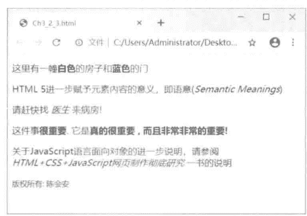

图 3-6

##### 1. 源码展示

```
01: <!DOCTYPE html>
02: <html>
03: <head>
04: <meta charset="utf-8"/>
05: <title>Ch3_2_3.html</title>
```

##### 2. 关键点拆解

- **第 8 ~ 10 行**：演示 `<b>` 与 `<i>` 的基础用法。
- **第 11 ~ 14 行**：对比 `<em>` 语气强调 与 `<strong>` 重要性强调 的语义差异。
- **第 16 ~ 18 行**：展示 `<cite>` 标注作品名 与 `<small>` 处理版权/附注 的场景。

#### 3.2.4 HTML 列表系统

列表是构建内容大纲、聚焦重点的利器。本节聚焦三大主流列表：**有序列表**、**无序列表** 与 **定义列表**。

##### 1. 有序列表——序数有序

当步骤、排名等顺序至关重要时，`<ol>` 登场。每个条目由 `<li>` 包裹，属性详情见表 3-4。

```
<ol>
<li>项目 1</li>
<li>项目 2</li>
...
</ol>
```

##### 表 3-4 `<ol>` 核心属性

| 属性 | 作用 |
|:---|:---|
| `start` | 设定起始序号（HTML4 不支持） |
| `type` | 定义序号风格：1、A、a、I、i（HTML4 不支持） |
| `reversed` | **HTML5 新增**：倒序排列（由大到小） |

##### 2. 无序列表——符号领衔

无需序数，仅用圆点、方块等符号标识条目，结构同样是 `<ul>` 包裹 `<li>`。

```
<ul>
    <li>项目 1</li>
    <li>项目 2</li>
    ...
</ul>
```

##### 3. 定义列表——键值对应

HTML5 定义列表（`<dl>`）本质是“名称-值”对集合，常用于词汇表、元数据展示。`<dt>` 定义术语/名称，`<dd>` 给出解释/值。

```
<dl>
    <dt>JavaScript</dt>
    <dd>客户端脚本语言</dd>
    <dt>HTML</dt>
    <dd>网页制作语言</dd>
</dl>
```

**动手实战——HTML 网页：Ch3_2_4.html**
依次构建有序列表（从 2 开始）、无序列表、定义列表，页面效果见图 3-7。

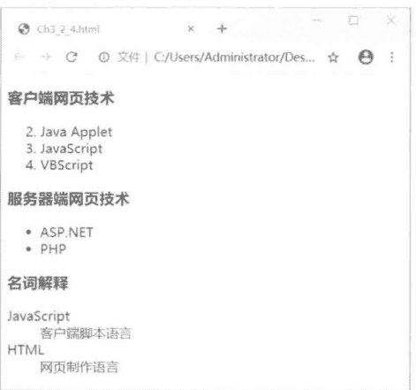

图 3-7
> 图示：顶部有序列表（起始序号 2），中部无序列表，底部定义列表。

##### 1. 源码展示

```
01: <!DOCTYPE html>
02: <html>
03: <head>
04: <meta charset="utf-8"/>
05: <title>Ch3_2_4.html</title>
06: </head>
07: <body>
08: <h3>客户端网页技术</h3>
09: <ol start="2">
10: <li>Java Applet</li>
11: <li>JavaScript</li>
12: <li>VBScript</li>
13: </ol>
14: <h3>服务器端网页技术</h3>
15: <ul>
16: <li>ASP.NET</li>
17: <li>PHP</li>
18: </ul>
19: <h3>名词解释</h3>
20: <dl>
21: <dt>JavaScript</dt>
22: <dd>客户端脚本语言</dd>
23: <dt>HTML</dt>
24: <dd>网页制作语言</dd>
25: </dl>
26: </body>
27: </html>
```

##### 2. 关键点拆解

- **第 9 ~ 13 行**：有序列表，`start="2"` 故从 2 开始计数。
- **第 15 ~ 18 行**：无序列表默认圆点样式。
- **第 20 ~ 25 行**：定义列表结构，`<dt>`/`<dd>` 成对出现。

#### 3.3 HTML 5 媒体与导航：图片与超链接

图片赋予网页视觉生命，超链接编织全球资源网。二者皆为核心交互元素。

#### 3.3.1 图片嵌入技术

HTML 实为超媒体文档，`` 标签在页面划出矩形区域，引用外部图片文件，支持 GIF、JPG、PNG 等格式。基础语法如下：

```

```

**硬性要求**：`src`（图片路径）与 `alt`（替代文本）为**必填属性**。图片数据并未内嵌文档，仅通过链接加载。

##### 表 3-5 `` 常用属性

| 属性 | 说明 |
|---|---|
| `src` | 图片文件 URL（相对/绝对路径） |
| `alt` | 图片加载失败/无障碍阅读时的替代文本 |
| `width` / `height` | 宽高设定，支持像素值或百分比 |

> **废弃提醒**：HTML5 移除了 `align`、`border`、`hspace`、`vspace` 等表现层属性，样式统一交由 CSS 掌管。

**动手实战——HTML 网页：Ch3_3_1.html**
同一图片，设定四组不同尺寸参数，观察缩放效果（图 3-8）。


图 3-8

##### 1. 源码展示

```
01: <!DOCTYPE html>
02: <html>
03: <head>
04: <meta charset="utf-8"/>
05: <title>Ch3_3_1.html</title>
06: </head>
07: <body>
08: 
09: 
10: 
11: 
12: </body>
13: </html>
```

##### 2. 关键点拆解

- **第 8 ~ 11 行**：连续插入 4 张 `views.gif`，仅通过 `width`/`height` 控制显示大小。

#### 3.3.2 超链接深度解析

`<a>` 标签构建超文本跳转，默认样式：未访问蓝色下划线、已访问紫色、激活红色。

基础语法：
```
<a href="URL" target="frame_name">超链接名称</a>
```

**HTML5 扩展能力**：
- **图片链接**：`<a>` 内嵌套 ``。
- **块级链接**：`<a>` 可直接包裹 `<h3>`、`<div>` 等块级元素。

示例：
```
<a href="http://www.waterpub.com.cn/">
<h3>中国水利水电出版社</h3></a>
```

##### 1. `<a>` 核心属性表

##### 表 3-6 `<a>` 标签属性详解

| 属性 | 功能 |
|---|---|
| `href` | **核心**：目标地址。相对路径或绝对 URL。 |
| `hreflang` | 目标页面语言代码。 |
| `media` | **HTML5 新增**：目标文档适配的媒体/设备查询。 |
| `rel` | 当前页与目标页关系，需 `href` 存在。如 `bookmark`、`alternate`。 |
| `target` | **打开方式**，详见表 3-7。 |
| `type` | 目标资源 MIME 类型。 |

> **清理名单**：`charset`、`coords`、`name`、`rev`、`shape` 已被 HTML5 移除。

##### 2. `target` 打开窗口策略

##### 表 3-7 `target` 属性值对照

| 值 | 行为 |
|:---|:---|
| `_blank` | **新标签/新窗口**（最常用） |
| `_self` | 当前标签/框架（默认） |
| `_top` | 顶层浏览上下文（跳出框架） |
| `_parent` | 父级浏览上下文 |
| `iframeName` | 指定命名的 `<iframe>` |

> **框架背景**：HTML5 废弃框架集，`_top`/`_parent`/`iframeName` 现主要服务于 `<iframe>` 内嵌场景。

**动手实战——HTML 网页：Ch3_3_2.html**
构建文本链接、图片链接、块级链接，分别指向外部站点与本地页面，效果见图 3-9。


图 3-9
> 交互细节：鼠标悬停指针变手型，状态栏显示目标 URL，点击即达。

##### 1. 源码展示

```
01: <!DOCTYPE html>
02: <html>
03: <head>
04: <meta charset="utf-8"/>
05: <title>Ch3_3_2.html</title>
06: </head>
07: <body>
08: <h3>其他网站的超链接</h3>
09: <a href="https://www.baidu.com/">百度</a>
10: <h3>图片超链接</h3>
11: <a href="Ch3_3_1.html">
12: </a>
13: <a href="http://www.waterpub.com.cn/">
14: <h3>中国水利水电出版社</h3></a>
15: </body>
16: </html>
```

##### 2. 关键点拆解

- **第 9 行**：指向百度的外部绝对链接。
- **第 11 ~ 12 行**：图片链接，`<a>` 包裹 ``，目标为 `Ch3_3_1.html`。
- **第 13 ~ 14 行**：块级链接，`<a>` 直接包含 `<h3>` 标题元素。

#### 3.4 HTML 5 结构化容器：表格、表单与通用盒子

- `<table>`：二维数据呈现。
- `<form>`：用户交互数据收集。
- `<div>` / `<span>`：流式/短语级通用容器，承载样式与脚本钩子。

#### 3.4.1 表格构建指南

表格将杂乱数据结构化、系统化。它由一组协作标签组成，缺一不可，核心标签见表 3-8。

##### 表 3-8 表格标签家族

| 标签 | 角色 |
|---|---|
| `<table>` | 根容器，所有表格元素归属于此 |
| `<tr>` | 表格行 |
| `<th>` | 表头单元格（加粗居中默认） |
| `<td>` | 标准数据单元格 |
| `<caption>` | 表格标题，**必须是 `<table>` 第一子元素** |
| `<thead>` | 表头行组 |
| `<tbody>` | 主体行组 |
| `<tfoot>` | 表脚行组（汇总/备注） |

**HTML5 限制**：`<table>` 仅保留 `border` 属性（值仅允许 `1` 或 `""`），其余表现归 CSS。单元格合并等核心能力集中在 `<td>`，见表 3-9。

##### 表 3-9 `<td>` 关键属性

| 属性 | 作用 |
|---|---|
| `colspan` | 横向跨列合并 |
| `rowspan` | 纵向跨行合并 |
| `headers` | 关联表头单元格 `id`，增强无障碍语义 |

##### 1. 基础表格速成

`<table>` + 多组 `<tr>`/`<th>`/`<td>` 即可成型。示例：4 行 2 列，首行为表头，第二行演示 `colspan` 跨列，第三行演示 `headers` 关联。

```
<table border="1">
<tr>
    <th id="client">客户端</th>
    <th id="server">服务器端</th>
</tr>
<tr>
    <td colspan="2">Ajax</td>
</tr>
<tr>
    <td headers="client">JavaScript</td>
    <td headers="server">ASP.NET</td>
</tr>
<tr>
    <td>VBScript</td>
    <td>PHP</td>
</tr>
</table>
```

> 解读：第 2 行 `colspan="2"` 将两列合为一；第 3 行 `<td headers="...">` 显式绑定对应表头 `id`。

##### 2. 进阶复杂表格

# 进阶 HTML 表单、语义标签与 DOM、JSON 核心解析

## 3.4.1 构建结构化的复杂 HTML 表格

处理复杂数据展示时，仅靠基础 `<table>` 远远不够。我们可以借助 `<caption>` 定义表格标题，并利用 `<thead>`、`<tbody>`、`<tfoot>` 将内容逻辑分区为表头、主体与页脚。

```
<table border="">
<caption>每月存款金额</caption>
<thead>
<tr>
<th>月份</th>
<th>存款金额</th>
</tr>
</thead>
<tbody>
<tr>
<td>一月</td>
<td>¥ 5,000</td>
</tr>
<tr>
<td>二月</td>
<td>¥ 1,000</td>
</tr>
</tbody>
<tfoot>
<tr>
<td>存款总额</td>
<td>¥ 6,000</td>
</tr>
</tfoot>
</table>
```

##### 实战演练——HTML 网页：Ch3_4_1.html

本例构建两张表格：一张展示网页设计技术对比（4行2列，第二行跨列合并），另一张记录月度存款明细（含标题行），最终渲染效果如图 3-10 所示。

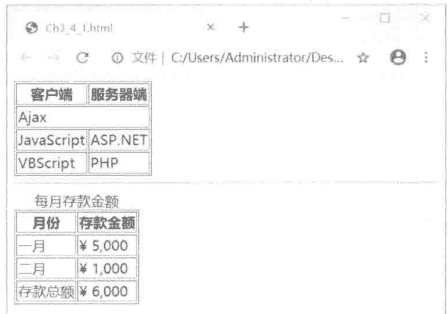

图 3-10

图 3-10 演示了上述两张表格：上方为合并单元格的 4x2 表格，下方为带有标题说明的结构化表格。

##### 核心代码解读

```
01: <!DOCTYPE html>
02: <html>
03: <head>
04: <meta charset="utf-8"/>
05: <title>Ch3_4_1.html</title>
06: </head>
07: <body>
08: <table border="1">
09: <tr>
10: <th id="client">客户端</th>
11: <th id="server">服务器端</th>
12: </tr>
13: <tr><td colspan="2">Ajax</td></tr>
14: <tr>
15: <td headers="client">JavaScript</td>
16: <td headers="server">ASP.NET</td>
17: </tr>
18: <tr>
19: <td>VBScript</td>
20: <td>PHP</td>
21: </tr>
22: </table>
23: <hr/>
24: <table border="">
25: <caption>每月存款金额</caption>
26: <thead>
27: <tr>
28: <th>月份</th>
29: <th>存款金额</th>
30: </tr>
31: </thead>
32: <tbody>
33: <tr>
34: <td>一月</td>
35: <td>¥ 5,000</td>
36: </tr>
37: <tr>
38: <td>二月</td>
39:     <td>¥ 1,000</td>
40:     </tr>
41:     </tbody>
42:     <tfoot>
43:     <tr>
44:         <td>存款总额</td>
45:         <td>¥ 6,000</td>
46:     </tr>
47:     </tfoot>
48: </table>
49: </body>
50: </html>
```

##### 关键技术点拆解

- **第 8–22 行（表格一）**：首行为表头（`<th>`）。第 13 行运用 `colspan` 实现单元格横向跨列合并；第 15–16 行通过 `headers` 属性关联第 10–11 行具有对应 `id` 的表头单元格，增强无障碍访问语义。
- **第 24–48 行（表格二）**：第 25 行 `<caption>` 设定标题；第 26–31 行 `<thead>` 包裹表头区；第 32–41 行 `<tbody>` 包裹主体数据；第 42–47 行 `<tfoot>` 包裹页脚汇总区。
- **扩展提示**：若需增加行列，只需追加 `<tr>`（行）与 `<td>`/`<th>`（单元格）即可。

## 3.4.2 `<div>` 与 `<span>`：无形的布局容器

`<div>` 与 `<span>` 是 HTML 4.x 遗留下的核心结构标签，本质是“透明盒子”，自身无默认样式，专为配合 CSS 实现元素分组与样式控制而生。

##### 1. `<div>`：区块级容器

`<div>` 定义独立区块，天然换行，是构建页面宏观布局骨架的利器。

```
<div style="color:blue">
<h3>JavaScript</h3>
<p>客户端网页技术</p>
</div>
```

> 示例中 `style="color: blue"` 即为行内 CSS，作用是将区块内所有文本设为蓝色。

##### 2. `<span>`：行内级容器

`<span>` 不换行，仅包裹行内片段，适合微粒度的文本样式微调。

##### 实战演练——HTML 网页：Ch3_4_2.html

对比可见：`<div>` 独占一行形成独立视觉块（含标题与段落均变蓝），而 `<span>` 仅影响其内部的“淡蓝色”文字，不打断父级流式布局，效果见图 3-11。


图 3-11

图 3-11 中，蓝色区域由 `<div>` 控制（包含 h3 与 p），末尾“淡蓝色”二字则由 `<span>` 单独渲染。

##### 代码细节说明

```
01: <!DOCTYPE html>
02: <html>
03: <head>
04: <meta charset="utf-8" />
05: <title>Ch3_4_2.html</title>
06: </head>
07: <body>
08: <div style="color:blue">
09:     <h3>JavaScript</h3>
10:     <p>客户端网页技术</p>
11: </div>
12: <p>外国人很多都是
    <span style="color:lightblue">淡蓝色</span>眼睛</p>
13: </body>
14: </html>
```

- **第 8–11 行**：`<div>` 通过 `style` 属性统一设定蓝色字体。
- **第 12 行**：`<span>` 指定淡蓝色样式，仅作用于行内文本。

## 3.4.3 HTML 表单：交互的入口

表单由根标签 `<form>` 包裹，内嵌各类输入字段。表 3-10 汇总了核心字段标签与其典型事件。

##### 表 3-10 核心表单字段速查

| 标签 | 典型事件 | 核心说明 |
| :--- | :--- | :--- |
| `<input type=...>` | `onchange` | 万能输入控件。`type` 决定形态：`radio` 单选、`checkbox` 多选、`button` 按钮、`text` 单行文本、`hidden` 隐藏域（无事件）。 |
| `<input type="submit\|reset">` | `onclick` | 专用提交/重置按钮。 |
| `<select>` | `onchange` | 下拉选择器。含 `<option>` 子项。`size=1` 为下拉菜单，`>1` 为列表框。 |
| `<option>` | N/A | 下拉选项定义。 |
| `<textarea>` | `onchange` | 多行文本域。 |
| `<label>` | N/A | 字段标签文本，`for` 属性关联字段 `id`，点击标签即聚焦字段。 |
| `<button type=...>` | `onclick` | 功能更强的按钮，`type` 可为 `button`、`submit`、`reset`，**支持嵌套图片/HTML 内容**（`<input>` 按钮不支持）。 |

> **按钮对比**：`<button>` 与 `<input type="button">` 均可创建按钮，但前者允许内嵌图标或复杂 HTML，样式扩展性更强。

表单基础骨架示例：

```
<form id="name" name="name" method="post | get"
action="URL">
<input type=...>
<textarea> ... </textarea>
<select>
<option> ... </option>
</select>
<input type="submit" ...>
</form>
```

上例 `<form>` 内嵌 `<input>`、`<textarea>`、`<select>`（含 `<option>`）。表 3-11 详解 `<form>` 关键属性：

##### 表 3-11 `<form>` 核心属性

| 属性 | 作用 |
| :--- | :--- |
| `id` / `name` | 表单唯一标识与名称。 |
| `method` | 数据传输方式：`get` 拼接 URL 参数；`post` 置于 HTTP 请求体，更安全、无长度限制。 |
| `action` | 服务端处理程序地址（如 `/api/submit`、PHP/JSP/ASP.NET 路由或 MVC 控制器路径）。 |

## 3.5 HTML5 语义与结构标签：让代码会说话

HTML5 在兼容前代标签基础上，重构了部分语义，并新增一批极具表达力的结构标签，告别满屏 `<div>`，让文档结构一目了然。表 3-12 为速查表：

##### 表 3-12 HTML5 语义标签速查

| 标签 | 语义定位 |
| :--- | :--- |
| `<article>` | 独立完整内容单元（博文、论坛帖、新闻条目）。 |
| `<aside>` | 辅助性内容（侧边栏、广告、引用、相关链接）。 |
| `<bdi>` | 隔离双向文本方向（如在 LTR 页面插入 RTL 文字）。 |
| `<command>` | 定义命令按钮（菜单项、工具栏按钮）。 |
| `<details>` / `<summary>` | 交互式折叠面板。`<summary>` 为可见标题，点击展开 `<details>` 详情。 |
| `<figure>` / `<figcaption>` | 自包含媒体单元（图表、代码块、照片）及其标题。 |
| `<footer>` | 最近祖先区块的页脚（版权、作者、相关链接）。 |
| `<header>` | 最近祖先区块的页眉（标题、Logo、导航、搜索框）。 |
| `<hgroup>` | 标题组合（主标题 + 副标题，避免产生多级大纲节点）。 |
| `<mark>` | 高亮标记（搜索关键词、重点提示）。 |
| `<meter>` | 标量度量仪（磁盘占用、投票比例、相关度评分）。 |
| `<nav>` | 主导航链接区（站点菜单、目录、分页器）。 |
| `<progress>` | 任务进度条（文件上传、加载进度）。 |
| `<ruby>` `<rt>` `<rp>` | 东亚注音标注：`<ruby>` 基文本，`<rt>` 注音，`<rp>` 降级括号。 |
| `<section>` | 通用主题区段（章节、Tab 面板、报纸版块）。 |
| `<wbr>` | 建议换行机会（长 URL、长单词防溢出）。 |

> **选型原则**：能用语义标签就不用 `<div>`/`<span>`；`<section>` 强调“主题分组”，`<article>` 强调“独立可 syndicate”；`<nav>` 仅用于主要导航。

## 3.6 HTML 文档结构与 DOM：动态网页的骨架

**DOM（Document Object Model，文档对象模型）** 将 HTML 解析为**节点树**：每个标签、属性、文本皆为节点，脚本通过标准 API 遍历、增删改节点，实现动态交互。

### 3.6.1 DOM 对象模型双核架构

DOM 提供标准化编程接口，分两大模块协作：

- **DOM Core（核心模块）**：跨语言、跨平台（XML/HTML 通用）。
  - *Navigator（导航器）*：树中游走——`parentNode`、`childNodes`、`firstChild`、`nextSibling` 等。
  - *Reference（引用/集合）*：批量获取——`getElementsByTagName`、`querySelectorAll`、`children` 集合等。
- **DOM HTML（HTML 专属模块）**：为 HTML 元素定制高级接口（如 `document.forms`、`element.innerHTML`、`input.value`），让元素成为拥有丰富属性/方法的“活对象”，驱动动态页面。

> **记忆锚点**：Core 管“树的形状与通用导航”，HTML 管“元素的业务能力与便捷属性”。

### 3.6.2 DOM 节点树实战拆解

以极简页面为例：

```html
<html>
<head>
<title>范例文件</title>
</head>
<body>
<h2>网页语言</h2>
<p>JavaScript 是一种<i>Simple</i>语言</p>
</body>
</html>
```

DOM 视角下，它是一棵树（图 3-12）：

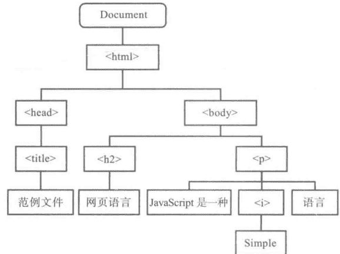

**节点关系术语表**：
- **父节点**：直接上层容器。
- **子节点**：直接下层内容。
- **兄弟节点**：共享同一父节点的平级节点。
- **叶节点**：无子节点的末端节点（通常为文本节点）。
- **文本节点**：承载用户可见文字的节点（也是叶节点）。

> **关键认知**：标签元素节点与文本节点地位平等，皆为树上节点；脚本操作本质是“修剪与嫁接这棵树”。

## 3.7 JSON 基础：现代数据交换的通用语言

**JSON（JavaScript Object Notation）** 是轻量级、纯文本的数据交换格式。本质上是 JS 对象字面量的子集，**语言无关**，解析极快，已全面取代 XML 成为 Web API 标配。

### 3.7.1 认知 JSON

由 Douglas Crockford 规范化。核心优势：
1. **极简文本**：跨网络传输零压力，客户端/服务端/数据库三端通吃。
2. **原生兼容**：JS `JSON.parse()`/`stringify()` 一行搞定；Python `json` 库、Java `Jackson`/`Gson` 等生态成熟。
3. **REST API 标配**：AJAX 请求直接返回 JSON，免去 HTML 解析之苦。
4. **NoSQL 原生格式**：MongoDB、CouchDB 等文档型数据库直接存储 JSON/BSON。

### 3.7.2 JSON 语法全景

**数据结构只有两种**：
- **对象**：键值对集合，用 `{}` 包裹（类比 Python `dict` / JS `Object`）。
- **数组**：有序列表，用 `[]` 包裹（类比 Python `list` / JS `Array`）。

```
{
	"key1": "value1",
	"key2": "value2",
	"key3": "value3",
	...
}
```  *// 单个对象示例*

```
[
	{
		"title": "ASP.NET 网页设计",
		"author": "陈会安",
		"category": "Web",
		"pubdate": "06/2015",
		"id": "W101"
	},
	{
		"title": "PHP 网页设计",
		"author": "陈会安",
		"category": "Web",
		"pubdate": "07/2015",
		"id": "W102"
	},
	...
]
``` *// 对象数组示例*

#### 语法铁律（零关键字，纯标点）
1. 键值对写法：`"key": value`（键**必须**双引号）。
2. 项间分隔：逗号 `,`。
3. 对象边界：花括号 `{}`。
4. 数组边界：方括号 `[]`。
5. 文件后缀 `.json`，MIME `application/json`。

#### 值的六种合法类型
| 类型 | 示例 | 说明 |
| :--- | :--- | :--- |
| 字符串 | `"hello"` | **必须双引号**，支持转义。 |
| 数值 | `42` / `3.14` | 整数/浮点，无八进制/十六进制。 |
| 布尔值 | `true` / `false` | 小写字面量。 |
| `null` | `null` | 空值占位。 |
| 对象 | `{ "a": 1 }` | 嵌套对象。 |
| 数组 | `[1, "x", true]` | 嵌套数组。 |

#### 对象写法范式

```
"author": "陈会安"
```

> `"author"` 为键（字段名），`"陈会安"` 为值（字符串）。

#### 标准对象结构

```
{
    "title": "ASP.NET 网页设计",
    "author": "陈会安",
    "category": "Web",
    "pubdate": "06/2015",
    "id": "W101"
}
```

#### 对象数组：批量数据载体
典型场景：员工名册、商品列表、日志流。`Employees` 字段对应一个包含 3 个对象元素的数组。

```
[
	{
		"title": "ASP.NET 网页设计",
		"author": "陈会安",
		"category": "Web",
		"pubdate": "06/2015",
		"id": "W101"
	},
	{
		"title": "PHP 网页设计",
		"author": "陈会安",
		"category": "Web",
		"pubdate": "07/2015",
		"id": "W102"
	},
	...
]
```

> **最佳实践**：顶层建议始终用对象 `{}` 而非数组 `[]`，便于未来扩展元数据（分页信息、状态码、错误提示等）。

```
{
    "Boss": "陈会安",
    "Employees": [
      { "name": "陈允杰", "tel" : "03-22222222" },
      { "name": "江小鱼", "tel" : "03-33333333" },
      { "name": "陈允东", "tel" : "04-44444444" }
    ]
}
```

### HTML 基础知识闯关测试

- 1. 什么是 HTML 文档？HTML5 标准页的骨架长什么样？
- 2. 简述下列标签作用：`<meta>`、`<i>…</i>`、`<br />`、`<hr />`、`<ul>`、`<li>`。
- 3. 无序列表（符号）与有序列表（编号）有何区别？块级容器 `<div>` 与行内容器 `<span>` 境遇几何？
- 4. 书写 HTML 表单标签结构。下拉菜单用____标签，选项用____标签。单选框、复选框全靠 `<input>` 的____属性值区分。
- 5. DOM 对象模型是个啥？JSON 格式长啥样？
- 6. 动手建页面：顶部 `<h1>` 写章名，跟一条 `<hr />` 分割线，下方 `<p>` 填本题内容。
- 7. 动手建页面：把第 3 章各节标题做成列表项 `<li>` 罗列。
- 8. 动手建页面：渲染一个 4 行 3 列的表格 `<table>`。

## 第二篇

## 网络采集与开放数据

## —— 打通数据获取任督二脉

## CHAPTER 4

## 第 4 章

## 攻克网络数据获取

- 4.1 认清网络采集器
- 4.2 Requests 库发起 HTTP 调用
- 4.3 截获 HTTP 应答负载
- 4.4 进阶 HTTP 请求姿势
- 4.5 异常捕获与文件落盘
- 4.6 BeautifulSoup 拆解 HTML 结构

### 4.1 认清网络采集器

数据科学的起手式是“搞到数据”。手头没现成数据集？那就得靠**网络采集器**（Web Scraping）自力更生，直捣网络腹地抓取所需素材。

#### 4.1.1 采集器核心机制

一言以蔽之，网络采集器就是**绕过官方 API，直接解析网页源码提取信息**的自动化流程，学术名“Web Data Extraction”（网页数据提取）。

跑通全链路需三件“利器”：
- **Chrome 开发者面板**：侦察兵。在标签丛林里精准锁定目标数据的“身份证”（标签名、class、id 等特征）。
- **HTTP 客户端**：运输兵。负责与服务端会话，把 HTML 源码拉回本地，本书主用 `Requests` 库。
- **解析引擎**：整理兵。把文本转成树状对象模型，便于按图索骥提取字段。


#### 4.1.2 标准作业五步法

一套成熟的采集脚本，通常遵循此 SOP：

1.  **锚定目标地址**：单条或批量 URL 列表。
2.  **拉取源码**：`Requests` 发起调用，拿到 HTML 响应体。
3.  **开发者面板“侦察”**：浏览器端分析数据藏在哪个节点、用何特征可定位。
4.  **构建对象树**：`BeautifulSoup` 将 HTML 串解析为可遍历的树结构。
5.  **清洗入库**：搜索/遍历树取值，规整为 CSV 或 JSON 格式持久化。

#### 4.1.3 HTTP 协议：客户端与服务端的对话规范

HTTP 是浏览器（客户端）与服务端的通用语言。典型的 **C/S 架构（Client-Server）** 交互流程如下：

1.  客户端发起建联请求。
2.  服务端接受连接。
3.  客户端发送 HTTP 报文（携带 GET/POST 方法），索要资源。
4.  服务端回复 HTTP 应答报文，附上资源实体。

### 4.2 Requests 库发起 HTTP 调用

Python 自带 `urllib` 用起来啰嗦，**Requests 库**才是为人类设计的，GET/POST 调用优雅简洁。先引入：`import requests`。

```
import requests
```

#### 4.2.1 发起 GET 调用：最常见的“索取”

浏览器地址栏敲回车，本质皆为 GET 请求。Requests 中对应 `get()` 方法。

**实战：基础 GET** → `Ch4_2_1.py`

目标：百度首页 `http://www.baidu.com`。

```
import requests

r = requests.get("http://www.baidu.com")
print(r.status_code)
```

变量 `r` 承接响应对象。`r.status_code` 给出状态码：

```python
200
```

- **200** = 成功。
- **4xx/5xx** = 失利（如 404 资源未找到）。

**进阶：判成败** → `Ch4_2_1a.py`

```python
if r.status_code == 200:
    print("请求成功...")
else:
    print("请求失败...")
```

**实战：携参数 GET** → `Ch4_2_1b.py`

参数附在 URL `?` 后，多参用 `&` 分隔。例：`name=陈会安&score=95`。

```
http://httpbin.org/get?name=陈会安&score=95
```

Requests 支持字典 `params` 传参，自动拼接编码。测试端点 `http://httpbin.org/get`。

```python
import requests

url_params = {'name': '陈会安', 'score': 95}
r = requests.get("http://httpbin.org/get", params=url_params)
print(r.url)
```

运行结果中 `r.url` 可见完整编码后链接。中文经 URL Encode，解码工具一查便知。

```
http://httpbin.org/get?name=%E9%99%88%E4%BC%9A%E5%AE%89&score=95
```

```python
print(r.text)
```

`httpbin` 回显 JSON。用 `r.text` 可直接读原始响应文本。


```
{
	"args": {
		"name": "陈会安",
		"score": "95"
	},
	...
	"origin": "1.163.81.109",
	"url": "http://httpbin.org/get?name=陈会安&score=95"
}
```

#### 4.2.2 发起 POST 调用：模拟“提交表单”

对应 `post()` 方法。数据置于 `data` 参数（字典形式），不拼在 URL 里。

**实战：基础 POST** → `Ch4_2_2.py`

目标：`http://httpbin.org/post`，载荷同前。

```python
import requests

post_data = {'name': '陈会安', 'score': 95}
r = requests.post("http://httpbin.org/post", data=post_data)
print(r.text)
```

响应里 `form` 字段会原样回显提交内容。

```
{
...
"form": {
    "name": "陈会安",
    "score": "95"
},
...
"origin": "1.163.81.109",
"url": "http://httpbin.org/post"
}
```

#### 4.2.3 借开发者面板“透视”HTTP 头部

Requests 发什么、收什么，肉眼不可见。除 `httpbin` 这类回显服务，**Chrome 开发者面板**是调试神器。

##### 1. httpbin：请求/响应的“回声墙”
地址：`http://httpbin.org`。兼容 GET/POST 等方法测试。

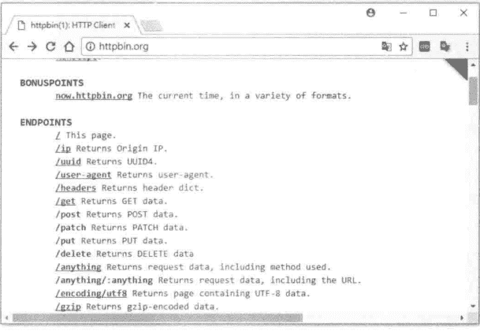

访问 `/user-agent` 能看到客户端伪装身份（操作系统、内核、版本）。


##### 2. 实操：面板里抓包

以 `http://www.waterpub.com.cn` 为例：

1.  打开站点。
    
2.  `F12` 开面板 -> `Network` -> `All` -> `F5` 刷新。列表里每个资源（HTML、JS、CSS、图片）均为独立 HTTP 调用。找到主文档 `www.waterpub.com.cn`。
    
3.  点击该请求，右侧 **Headers** 面板即见完整报文头。
    

**General 栏位**含：请求 URL、方法 (GET)、状态码 (200)、服务端 IP:端口 (80)。
**Response Headers** / **Request Headers** 细节见 4.3.3 节。

```
Request URL: http://www.waterpub.com.cn/
Request Method: GET
Status Code: 200 OK
Remote Address: 114.255.61.249:80
Referrer Policy: no-referrer-when-downgrade
...
```

### 4.3 截获 HTTP 应答负载

服务端回包内容（Response Body）可能是：HTML 文本、JSON 数据、二进制流（图片/视频）。

#### 4.3.1 响应对象三大核心属性

发调用后：`r = requests.get(...)` 或 `r = requests.post(...)`。`r` 为 `Response` 对象，高频属性如下：

```python
r = requests.get("https://www.w3school.com.cn/")
```

| 属性 | 释义 |
| :--- | :--- |
| **text** | **解码后文本**（最常用）。编码可通过 `r.encoding` 读取/覆写。 |
| **content** | **原始字节流**。适配图片、文件等非文本资源下载。 |
| **raw** | 底层 Socket 应答对象 (`urllib3.HTTPResponse`)，极少直用。 |

> **编码提示**：网页真实编码常在 `<head>` 的 `<meta charset="...">` 声明（参考 3.1.4 节）。Requests 会自动推测，猜错需手动纠正 `r.encoding`。

**实战：编码处理与文本提取** → `Ch4_3_1.py`

目标：`https://www.w3school.com.cn`，演示两次调用对照。

```python
r = requests.get("https://www.w3school.com.cn/")
```
```python
print(r.text)
print(r.encoding)
```
```python
r = requests.get("https://www.w3school.com.cn/")
```
```python
r.encoding = 'gbk'
print(r.text)
print(r.encoding)
```

执行输出对照：

```
<html lang="zh-cn">
<head>...</head>
<body id="homefirst">
<div id="wrapper">
 <div id=header_index>...</div>
 <div id=navfirst>...</div>
 <div id=navsecond>...</div>
 <div id=maincontent>...</div>
 <div id=sidebar>...</div>
 <div id=footer>...</div>
</div>
</body>
</html>
```

ISO-8859-1

# 深度解析 Requests 库：响应处理与进阶请求技巧

在上一节我们初步接触了 Requests 发送基础请求的方法，今天我们将重点攻克**响应对象的深度解析**与**进阶 HTTP 请求的构建**。掌握这些内容，能让你从“会用”进阶到“精用”，轻松应对编码乱码、状态码判断、Header 伪装及 API 对接等实战场景。

---

## 4.3 响应对象的深度解析

拿到服务器返回的 `Response` 对象后，如何精准提取所需数据？我们分三个维度拆解：内容获取、状态码校验、Headers 读取。

### 4.3.1 三种获取响应内容的姿势

Requests 提供了三种不同层级的内容访问方式，适用场景截然不同：

1.  **`response.text`（字符串模式）**：库自动根据 HTTP 头部推断编码（或 fallback 到 ISO-8859-1）解码后的 Unicode 字符串。**最常用**，适合直接解析 HTML、XML 等文本。
2.  **`response.content`（字节流模式）**：返回原始的二进制字节序列，**不做任何解码**。处理图片、视频、文件下载，或遇到编码检测失败需手动 `decode('gbk')` 时必选。
3.  **`response.raw`（原始 Socket 流）**：开启 `stream=True` 后可用，允许分块读取原始 TCP 流（如 `raw.read(15)`）。适合大文件流式处理、断点续传，避免一次性加载撑爆内存。

> **实战对比**：以访问 `w3school.com.cn` 为例：
> *   `text` 直接输出可读的 HTML 标签；
> *   `content` 显示原始字节，肉眼可见 `\r\n` 等转义符；
> *   `raw.read(15)` 仅吐出前 15 字节的原始报文头片段。

**JSON 数据的特殊处理**：
别用 `json.loads(response.text)` 了，直接调 **`response.json()`** 一步到位。它会自动完成“字节流 -> 字符串 -> 字典/列表”的反序列化，返回类型为 `dict`，且内部已做异常保护。实测 `httpbin.org/user-agent` 接口，`text` 返回 `str`，`json()` 直接给出 `{'user-agent': 'python-requests/...'}` 字典。

---

### 4.3.2 优雅地判断请求成败：别再写 `if code == 200` 了

手动对比状态码不仅繁琐，还易遗漏 201、204 等成功码。Requests 内置了两个语义化常量：

*   `requests.codes.ok` (值为 200)
*   `requests.codes.all_good` (别名，功能完全一致)

**推荐写法**：
```python
if response.status_code == requests.codes.ok:
    print("请求成功")
# 或更简洁地利用布尔值特性
if response.status_code == requests.codes.all_good:
    ...
```

**实战验证**：
请求正常页面返回 `200` + `True`；请求 404 页面返回 `404` + `False`。

#### 进阶：让程序主动抛出异常——`raise_for_status()`

当状态码落入 **4xx/5xx** 区间时，调用 `response.raise_for_status()` 会直接抛出 `requests.exceptions.HTTPError`，并附带详细错误上下文（如 `404 Client Error: Not Found for url: ...`）。这在爬虫框架中极其有用，配合 `try...except` 即可实现统一的错误重试/记录逻辑，省去大量 `if/else` 判断。

---

### 4.3.3 读取响应头：字典与 `.get()` 双模式

`response.headers` 本质是一个**不区分大小写的特殊字典**（`CaseInsensitiveDict`）。

*   **字典取值**：`headers['Content-Type']`、`headers['Server']`。键名大小写随意，但建议规范写法。
*   **安全取值**：`headers.get('Content-Length')`。键不存在时返回 `None` 而不报 `KeyError`，更健壮。

**常见字段速查表 (MIME Type)**：
| Content-Type 值 | 含义 |
| :--- | :--- |
| `text/html` | HTML 文档 |
| `application/json` | JSON 数据 |
| `image/jpeg/png/gif` | 图片资源 |
| `text/plain` | 纯文本 |

实测 W3School 返回：`Content-Type: text/html`，`Content-Length: 4043`，`Server` 字段暴露服务器型号。

---

## 4.4 进阶 HTTP 请求构建：模拟真实用户行为

基础 `get(url)` 无法满足登录态维持、反爬绕过、API 对接等需求，需注入 `cookies`、`headers`、参数等元数据。

### 4.4.1 Cookie 交互：维持会话状态

**获取**：`response.cookies` 返回 `RequestsCookieJar`（类字典对象），可通过 `cookies['session_id']` 取值。
**发送**：在 `requests.get(url, cookies=my_cookie_dict)` 中传入字典。

**实战演练**：向 `httpbin.org/cookies` 发送 `{'flavor': 'chocolate'}`，响应体会原样返回该 Cookie，证明服务端已成功识别客户端身份。*这是实现“免登录爬取”的核心基础。*

### 4.4.2 自定义 Headers：伪装浏览器身份

默认 `User-Agent` 为 `python-requests/x.x.x`，极易被反爬系统拦截。**伪装成主流浏览器是爬虫生存第一课**。

```python
headers = {
    'User-Agent': 'Mozilla/5.0 (Windows NT 10.0; Win64; x64) AppleWebKit/537.36 (KHTML, like Gecko) Chrome/120.0.0.0 Safari/537.36'
}
response = requests.get(url, headers=headers)
```

**实测对比**：
*   无伪装：`httpbin.org/user-agent` 返回 `python-requests/2.31.0`。
*   伪装后：返回完整的 Chrome 120 UA 字符串，服务端误判为真人访问。

> **Pro Tip**：除 UA 外，`Referer`、`Accept-Language`、`Cookie` 等头字段常需组合伪造，构建完整的“浏览器指纹”。

### 4.4.3 对接 RESTful API：参数化请求与 JSON 响应

Requests 原生支持 REST 风格调用，核心在于 **`params` 参数自动拼接 Query String**。

**案例：腾讯天气 API 查询成都 24h 预报**
接口地址：`https://wis.qq.com/weather/common`
关键参数：
*   `weather_type`: `forecast_24h`
*   `province`: `四川`
*   `city`: `成都`

**代码范式**：
```python
params = {
    'weather_type': 'forecast_24h',
    'province': '四川',
    'city': '成都'
}
resp = requests.get('https://wis.qq.com/weather/common', params=params)
data = resp.json()  # 直接拿结构化字典
```
`params` 会自动处理 URL 编码（中文转 `%Ex`），生成标准 URL：`.../common?weather_type=forecast_24h&province=%E5%9B%9B%E5%B7%9D&city=%E6%88%90%E9%83%BD`，极大简化了手动拼接的麻烦与报错率。

---

## 核心要点速记卡

| 场景 | 关键属性/方法 | 避坑指南 |
| :--- | :--- | :--- |
| **文本解析** | `r.text` | 编码不对用 `r.encoding = 'gbk'` 强制指定后再取 text |
| **二进制/下载** | `r.content` | 大文件必开 `stream=True` 配合 `r.iter_content()` 分块写入 |
| **JSON 接口** | `r.json()` | 非 JSON 响应会抛 `JSONDecodeError`，需捕获 |
| **成功判定** | `r.status_code == requests.codes.ok` | 别硬编码 200；`raise_for_status()` 适合全局异常拦截 |
| **读 Header** | `r.headers.get('Key')` | 键名不区分大小写；获取 Cookie 用 `r.cookies` |
| **发 Cookie** | `requests.get(..., cookies=dict)` | 复杂场景建议用 `Session` 对象自动托管 |
| **伪装 UA** | `requests.get(..., headers={'User-Agent': '...'})` | 维护一个 UA 池轮换，降低封禁风险 |
| **API 参数** | `requests.get(..., params=dict)` | 自动 URL Encode，防手动拼接出错 |

---

**下一站预告**：掌握了 GET 请求的进阶用法，**POST 请求的表单提交、文件上传、JSON 体发送**，以及核心神器 **`Session` 会话保持**（自动处理 Cookie、连接复用、默认 Header）将登场。那是编写工业级爬虫、自动化测试脚本的分水岭，敬请期待！

```
<html lang="zh-cn">
<head>...</head>
<body id="homefirst">
<div id="wrapper">
 <div id=header_index>...</div>
 <div id=navfirst>...</div>
 <div id=navsecond>...</div>
 <div id=maincontent>...</div>
 <div id=sidebar>...</div>
 <div id=footer>...</div>
</div>
</body>
</html>
```
```python
r = requests.get("https://www.w3school.com.cn/")
print(r.text)
print("-------------------------")
r = requests.get("https://www.w3school.com.cn/")
print(r.content)
print("-------------------------")
r = requests.get("https://www.w3school.com.cn/", stream=True)
print(r.raw)
print(r.raw.read(15))
```
```
<html lang="zh-cn">
<head>...</head>
<body id="homefirst">
<div id="wrapper">
    <div id=header_index>...</div>
    <div id=navfirst>...</div>
    <div id=navsecond>...</div>
    <div id=maincontent>...</div>
    <div id=sidebar>...</div>
    <div id=footer>...</div>
</div>
</body>
</html>
-------------------------
b'<!DOCTYPE html>\r\n<html lang="zh-cn">\r\n<head>\r\n\r\n\n<...
-------------------------
<urllib3.response.HTTPResponse object at 0x11c0ee2d0>
b'\x1f\x8b\x08\x00\x00\x00\x00\x00\x04\x00\xac[\xfbs\x13'
```
```python
r = requests.get("http://httpbin.org/user-agent")
print(r.text)
print(type(r.text))
print("---------------")
print(r.json())
print(type(r.json()))
```
```
{
  "user-agent": "python-requests/2.18.4"
}
<class 'str'>
----------------------------------------
{'user-agent': 'python-requests/2.18.4'}
<class 'dict'>
```
```python
r = requests.get("http://www.w3school.com.cn/")
print(r.status_code)
print(r.status_code == requests.codes.ok)

r = requests.get("http://www.w3school.com.cn/404")
print(r.status_code)
print(r.status_code == requests.codes.ok)

r = requests.get("http://www.w3school.com.cn/")
print(r.status_code)
print(r.status_code == requests.codes.all_good)
```
```
200
True
404
False
200
True
```
```python
r = requests.get("http://www.w3school.com.cn/404")
print(r.status_code)
print(r.status_code == requests.codes.ok)
print(r.raise_for_status())
```
```
404
False
Traceback (most recent call last):

File "<ipython-input-10-7ac6c2f3c46e>", line 1, in <module>
    runfile('C:/ML/Ch04/Ch4_3_2a.py', wdir='C:/ML/Ch04')

File "C:\\Users\\JOE\\Anaconda3\\lib\\site-packages\\spyder\\utils\\site\\sitecustomize.py", line 710, in runfile
    execfile(filename, namespace)

File "C:\\Users\\JOE\\Anaconda3\\lib\\site-packages\\spyder\\utils\\site\\sitecustomize.py", line 101, in execfile
    exec(compile(f.read(), filename, 'exec'), namespace)
```
```
r = requests.get("http://www.w3school.com.cn")

print(r.headers['Content-Type'])
print(r.headers['Content-Length'])
print(r.headers['Date'])
print(r.headers['Server'])
```
```
text/html
4043
Thu, 20 Feb 2020 05:53:22 GMT
Microsoft-IIS/10.0
```
```
r = requests.get("http://www.w3school.com.cn")

print(r.headers.get('Content-Type'))
print(r.headers.get('Content-Length'))
print(r.headers.get('Date'))
print(r.headers.get('Server'))
```
```
r = requests.get("http://example.com/")
v = r.cookies["cookie_name"]
print(v)
```
```
url = "http://httpbin.org/cookies"

cookies = dict(name='Joe Chen')
r = requests.get(url, cookies=cookies)
print(r.text)
```
```
{
 "cookies": {
  "name": "Joe Chen"
 }
}
```
```
url = "http://httpbin.org/user-agent"

r = requests.get(url)
print(r.text)
print("")

url_headers = {'user-agent': 'Mozilla/5.0 (Windows NT 10.0; Win64; x64) AppleWebKit/537.36 (KHTML, like Gecko) Chrome/63.0.3239.132 Safari/537.36'}
r = requests.get(url, headers=url_headers)
print(r.text)
```
```
{
"user-agent": "python-requests/2.18.4"
}
========================================
{
"user-agent": "Mozilla/5.0 (Windows NT 10.0; Win64; x64)AppleWebKit/537.36 (KHTML, like Gecko) Chrome/63.0.3239.132 Safari/537.36"
}
```
```
https://wis.qq.com/weather/common?source=xw&weather_type=<预测种类>&province=<省>&city=<城市>
```
```
https://wis.qq.com/weather/common?source=xw&weather_type=forecast_24h&province=四川&city=成都
```

# Python网络请求进阶：认证、超时、异常处理与文件存储实战

```
url = "https://wis.qq.com/weather/common?source=xw"
url_params = {'weather_type': 'forecast_24h',
'province': '四川',
'city': '成都'}
r = requests.get(url, params=url_params)
print(r.json())
```

在前面的示例中，`get()` 函数通过 `params` 参数传递 API 所需的查询条件。由于接口返回的是 JSON 格式数据，我们直接调用 `json()` 方法进行解析，执行效果如下：

```
{'data': {'forecast_24h': {'0': {'day_weather': '阴', 'day_weather_code': '02', 'day_weather_short': '阴', 'day_wind_direction': '北风', 'day_wind_direction_code': '8', 'day_wind_power': '3', 'day_wind_power_code': '0', 'max_degree': '10', 'min_degree': '3', 'night_weather': '小雨', ...
```

输出结果清晰地展示了返回的天气预报 JSON 数据结构。

## 4.4.4 实战：发送带认证信息的 HTTP 请求

当目标网站或接口设置了访问门槛时，请求必须携带身份凭证。以 GitHub API 为例，调用前需完成注册以获取用户名与密码（或 Token）。

### 动手实操——访问受保护的 GitHub API：Ch4_4_4.py

我们尝试向 `https://api.github.com/user` 发起带认证的请求，代码如下：

```
url = "https://api.github.com/user"
r = requests.get(url, auth=('hueyan@ms2.hinet.net', '********'))
if r.status_code == requests.codes.ok:
    print(r.headers['Content-Type'])
    print(r.json())
else:
    print("HTTP 请求错误...")
```

代码核心在于 `get()` 函数的 `auth` 参数，它接收一个元组 `(用户名, 密码)`。随后通过 `if/else` 判断响应状态：若成功（状态码 200），则打印响应头中的 `Content-Type` 及解析后的 JSON 数据。运行结果如下：

```
application/json; charset=utf-8
{'login': 'hueyanchen', 'id': 35254525, 'avatar_url': 'https://avatars2.githubusercontent.com/u/35254525?v=4',
...
```

## 4.4.5 控制请求等待时长：`timeout` 参数详解

为防止服务器长时间无响应导致程序卡死，`get()` 函数提供了 `timeout` 参数（单位：秒），用于设定最大等待时长。

### 动手实操——触发超时异常测试：Ch4_4_5.py

此处我们请求百度首页，但将超时时间极限设定为 0.03 秒（人为制造超时场景）：

```
try:
    r = requests.get("http://www.baidu.com", timeout=0.03)
    print(r.text)
except requests.exceptions.Timeout as ex:
    print("错误: HTTP 请求已经超过时间...\\n" + str(ex))
```

代码通过 `try/except` 捕获 `Timeout` 异常（详细分类见 4.5.1 节）。因等待时间过短，请求必然失败，控制台输出如下：

```
错误: HTTP 请求已经超过时间...
HTTPConnectionPool(host='www.baidu.com', port=80): Read timed out. (read timeout=0.03)
```

输出首行为错误提示，紧随其后是异常对象携带的详细信息。

# 4.5 异常捕获体系与本地文件读写

网络请求充满不确定性，掌握异常处理是爬虫健壮性的关键；同时，持久化存储抓取到的 HTML 内容离不开文件操作技能。

## 4.5.1 Requests 异常体系与处理实战

Python 结合 `try/except` 与 Requests 内置异常类，能精准捕获各类网络故障。常见异常类型汇总如下：

| 异常类型 | 触发场景 |
|---|---|
| `RequestException` | 所有请求异常的基类，任何请求错误均触发 |
| `HTTPError` | HTTP 协议层面错误（如 4xx, 5xx 状态码） |
| `ConnectionError` | 网络层故障：DNS 解析失败、连接被拒等 |
| `Timeout` | 请求耗时超过了 `timeout` 设定值 |
| `TooManyRedirects` | 重定向次数超出限制 |

### 动手实操——构建完整的异常捕获逻辑：Ch4_5_1.py

下面的代码演示如何针对性处理上述 4 类异常（`Timeout` 已在上节演示）。测试 URL 为不存在的地址，预期触发 404 错误：

```
url = 'http://www.w3school.com.cn/404'

try:
    r = requests.get(url, timeout=3)
    r.raise_for_status()
except requests.exceptions.RequestException as ex1:
    print("Http 请求错误: " + str(ex1))
except requests.exceptions.HTTPError as ex2:
    print("Http 响应错误: " + str(ex2))
except requests.exceptions.ConnectionError as ex3:
    print("网络联机错误: " + str(ex3))
except requests.exceptions.Timeout as ex4:
    print("Timeout 错误: " + str(ex4))
```

运行结果确认捕获到了 `HTTPError`，并输出了 404 状态信息：

```
Http 请求错误: 404 Client Error: Not Found for url: http://www.w3school.com.cn/404
```

## 4.5.2 Python 文件读写核心操作

Python 内置 `open()` 函数提供完整的文件处理能力，是数据落地的基础。

### 动手实操——将网页内容保存至本地：Ch4_5_2.py

以下代码抓取中国水利水电出版社官网首页，并将源码写入 `waterpub.txt`：

```
r = requests.get("http://www.waterpub.com.cn")

fp = open("waterpub.txt", "w", encoding="utf-8")
fp.write(r.text)
print("写入文件 waterpub.txt...")
fp.close()
```

关键步骤解析：
1.  `open()` 打开文件，返回文件对象；`close()` 关闭释放资源。
2.  参数详解：
    *   参数1：文件路径（Windows 路径中反斜杠需转义为 `\\` 或使用原始字符串 `r"path"`）。
    *   参数2：模式字符串（详见下表）。
    *   参数3：`encoding="utf-8"` 指定编码，防止中文乱码。

**表：文件打开模式对照表**

| 模式 | 文件存在时 | 文件不存在时 |
|---|---|---|
| `r` | 只读打开 | 报错 `FileNotFoundError` |
| `w` | **清空内容**后只写 | 新建文件只写 |
| `a` | 追加写入（指针至末尾） | 新建文件追加写 |
| `r+` | 读写打开 | 报错 |
| `w+` | **清空内容**后读写 | 新建文件读写 |
| `a+` | 追加读写 | 新建文件追加读写 |

执行后控制台提示写入成功，文件已生成：

```
fp = open("waterpub.txt", "w", encoding="utf-8")
```

```
写入文件 waterpub.txt...
```

### 动手实操——读取文件全量内容（方式一）：Ch4_5_2a.py

读取刚生成的 `waterpub.txt` 并打印：

```
fp = open("waterpub.txt", "r", encoding="utf-8")
str = fp.read()
print("文件内容：")
print(str)
```

此处模式为 `"r"`（只读），`read()` 无参数时读取全部内容。输出结果如下：

```
文件内容：
<!doctype html>
<html>
<head>
<meta charset="utf-8">
<meta name="viewport" content="width=device-width,initial-scale=1.0,minimum-scale=1.0">
<title>水电知识网-中国水利水电出版社</title>
...
</head>
<body class="homepage">
<!-- Demo -->
...
</body>
</html>


##### 动手学——Python 的 with/as 程序区块：Ch4_5_2b.py

Python 文件处理需要在处理完后自行调用 close() 函数来关闭文件。对于这些需要善后的操作，如果担心忘记进行事后清理工作，则可以使用另一种更简洁的写法，改用 with/as 程序区块读取文件内容，如下所示：

```

### 进阶写法：使用 `with` 语句自动管理资源

`with open(...) as fp:` 语法块退出时会自动调用 `close()`，更安全优雅。

**读取全文：**
```

上述程序代码建立读取文件内容的程序区块（注意：fp 后的冒号“:”），当执行完程序区块后，就会自动关闭文件。

##### 动手学——读取文件的全部内容（二）：Ch4_5_2c.py

读取和输出 Ch4_5_2.py 建立的 waterpub.txt 文件内容，如下所示：

```

**逐行读取（返回列表）：**
```

上述程序代码调用 readlines() 函数读取文件内容，使其成为 list1 列表，其中每一行是一个项目，然后使用 for 循环输出每一行的文件内容。因为文件中的每一行都有换行，所以 print() 函数不需要换行。

### 4.6 使用 BeautifulSoup 剖析 HTML 文件

BeautifulSoup 是剖析 HTML 网页著名的 Python 包，可以将 HTML 网页标签转换成一棵 Python 对象树，帮助我们从 HTML 网页获取所需数据。

在第 5 章将使用 BeautifulSoup 对象的函数和属性来搜索 HTML 标签，以及在对象树中遍历标签。本节则介绍如何建立 BeautifulSoup 对象，以及通过剖析输出功能来储存 HTML 网页文档。

#### 4.6.1 建立 BeautifulSoup 对象

Python 程序在使用前需导入 BeautifulSoup 模块，如下所示：

```

---

# 附录：BeautifulSoup 解析库快速入门

后续章节将大量使用 `BeautifulSoup` 进行 HTML/XML 解析，此处预热核心用法。

**基础解析字符串：**
```

导入 BeautifulSoup 模块后，就可以建立 BeautifulSoup 对象，有 3 种方法可以建立 BeautifulSoup 对象。

##### 动手学——使用 HTML 标签字符串建立 BeautifulSoup 对象 Ch4_6_1.py

可以使用 HTML 标签字符串建立 BeautifulSoup 对象，如下所示：

```
```

上述程序代码指定 html_str 变量的 HTML 标签字符串后，BeautifulSoup() 函数的第 1 个参数是标签字符串；第 2 个参数指定 TreeBuilders，即使用 Python 对象树剖析器，常用的有 3 种，即 “lxml”、“html5lib” 和内置 “html.parser”，官方文件建议使用 “lxml”。

在剖析 HTML 标签字符串后，调用 print() 函数输出内容，可以看到其自动补充了缺少的 HTML 标签 <html> 和 <body>，其运行结果如下所示：

```

**实战：抓取并解析真实网页（指定编码 gbk）：**
```

##### 动手学——使用 HTTP 响应内容建立 BeautifulSoup 对象：Ch4_6_1a.py

可以使用本章前的 Requests 包，使用 HTTP 响应内容来建立 BeautifulSoup 对象，HTTP 请求的网址是 “编程论坛” 的首页（http://bbs.bccn.net），如下所示：

```

**实战：解析本地 HTML 文件：**
```

上述程序代码导入 requests 和 BeautifulSoup 模块后，调用 get() 函数发送 HTTP 请求，指定 r.encoding 编码为 gbk，然后使用 r.text 属性的响应内容建立 BeautifulSoup 对象，最后调用 print() 函数输出内容，其运行结果为输出 HTML 标签内容，如图 4-8 所示。


图 4-8

##### 动手学——打开文件建立 BeautifulSoup 对象：Ch4_6_1b.py

可以通过 Python 文件存取直接打开本机 HTML 文档来建立 BeautifulSoup 对象。例如，index.html 文档是编程论坛的首页，如下所示：

```

**实战：格式化输出解析树（美化打印）：**
```

上述程序代码便使用 with/as 程序区块，调用 open() 函数打开文件 index.html（此文件和 Python 程序位于同一目录），然后使用文件指针 fp 建立 BeautifulSoup 对象，最后调用 print() 函数输出内容，从其运行结果中可以看到和 Ch4_6_1a.py 相同的 HTML 标签。

#### 4.6.2 输出剖析的 HTML 文件

BeautifulSoup 对象可以调用 prettify() 函数来格式化输出剖析的 HTML 网页或字符串。当然，也可以将输出内容存储成本机 HTML 文件。

##### 动手学——格式化输出 HTML 网页：Ch4_6_2.py

文本文件 flag.txt 是从旗标网站（已用 Google 浏览器翻译为中文简体）中下载的 HTML 标签文档，其内容如图 4-9 所示。

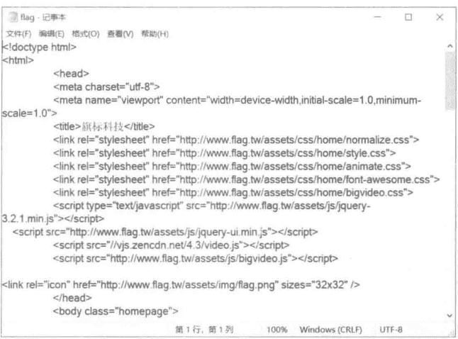

图 4-9

图 4-9 所示 HTML 标签并没有统一的缩排，现在，打开文本文件，然后调用 BeautifulSoup 对象的 prettify() 函数来格式化输出剖析的 HTML 标签，如下所示：

```
```

上述程序代码打开 flag.txt 文件后，调用 soup.prettify() 函数格式化输出 HTML 标签字符串，在其运行结果中，HTML 标签已经格式化编排成一致的缩进，如下所示：

```

# 玩转 BeautifulSoup：从入门到实战的核心技巧解析

在数据采集的世界里，BeautifulSoup 无疑是 Python 开发者手中的“瑞士军刀”。它能将杂乱无章的 HTML/XML 文档转化为结构清晰、易于操作的树形对象，让数据提取变得得心应手。今天我们就通过实战案例，拆解这款神器的核心用法。

## 一、 环境就绪：读取与预处理文档

一切始于加载文档。无论是本地文件还是网络响应，`BeautifulSoup` 构造函数配合解析器（如 `lxml`）都能轻松搞定。

```

##### 动手学——将 Web 网页格式化输出保存为文件：Ch4_6_2a.py

调用 with open() 函数打开本地的旗标网站（已翻译为简体）的 HTML 标签文档，然后调用 BeautifulSoup 对象的 prettify() 函数来格式化输出剖析的 HTML 网页，并且保存为文件 flag2.txt，如下所示：

```

执行后，混乱的标签汤瞬间变身为缩进工整、层级分明的标准格式，为后续操作铺平道路。

## 二、 核心对象：Tag—— 操作的基本单元

解析树中的每一个 HTML 标签都是一个 `Tag` 对象，它是我们定位与提取数据的切入点。

```

上述程序代码打开 flag2.txt 文件后，写入 soup.prettify() 函数格式化输出的 HTML 标签，

其运行结果如下所示：

写入文件 flag2.txt...

使用记事本打开 flag2.txt，可以看到文件内容和 flag.txt 的差别，如图 4-10 所示。

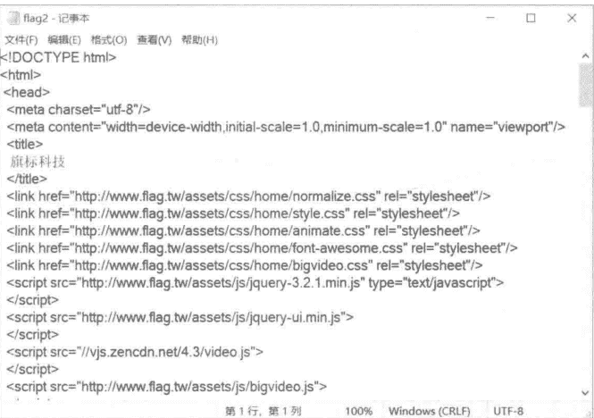

图 4-10

当成功将 Web 的 HTML 网页保存为本机 HTML 文件后，就可以脱机学习 BeautifulSoup 对象的函数和属性。第 5 章将直接打开本机 HTML 文件来运行 HTML 标签的搜索和遍历，获取所需数据。

#### 4.6.3 BeautifulSoup 的对象说明

BeautifulSoup 对象可以将 HTML 网页剖析转换成 Python 对象树，其主要剖析成 4 种对象：Tag、NavigableString、BeautifulSoup 和 Comment。

##### 动手学——Tag 对象：Ch4_6_3.py

Tag 对象是剖析 HTML 网页时由标签转换成的 Python 对象，提供多种属性和函数来搜索和访问 Python 对象树（详见第 5 章内容）。本节范例只介绍如何获取标签名称和属性值。例如，剖析 HTML 标签字符串，建立 BeautifulSoup 对象，获取 Tag 对象，如下所示：

```
```

上述程序代码使用 HTML 标签字符串建立 BeautifulSoup 对象，<div> 标签拥有 2 个属性 id 和 class，class 属性是多重值属性，拥有空格符分隔的 2 个值 body 和 strikeout。

可以直接使用标签名称 soup.div 属性获取 Python 对象树中的第 1 个 <div> 标签对象，type() 函数输出类型是 Tag 对象，如下所示：

```

拿到 `Tag` 对象后，三大核心属性任君调用：
*   **`name`**：直接揭示标签身份。
```

在获取 HTML 标签的 Tag 对象后，可以获取 Tag 对象的标签名称和属性值，如下所示。

- 获取标签名称。Tag 对象的 name 属性可以获取标签名称 div，如下所示：

```
```

```
*   **属性字典式访问 (`tag["attr"]`)**：精准获取单一属性值。
```

- 获取标签属性值。在 Tag 对象获取标签 <div> 的 id 属性值，如下所示：

```
```

```
*   **`class` 等多值属性**：自动拆解为列表，告别字符串切割烦恼。
```

- 获取标签属性的多重值。在 Tag 对象获取标签 <div> 的 class 属性值，这是多重值属性，获取的是一个列表，如下所示：

```
```

```
*   **`attrs`**：一键打包所有属性为字典，全貌尽收眼底。
```

- 获取标签的所有属性值。Tag 对象可以使用 attrs 属性获取标签的所有属性值，这是一个字典，如下所示：

```
```

```

## 三、 文本提取：string 与 text/get_text() 的关键差异

这是新手最易踩坑的地方。`Tag` 对象下的文本获取，需按场景选工具：

### 1. 单一子节点场景：`.string`
若标签内**仅包含一段文本**，`.string` 返回 `NavigableString` 对象，类型明确，处理纯净。
```

##### 动手学——NavigableString 对象：Ch4_6_3a.py

NavigableString 对象是标签内容，即位于 <div> </div> 标签中的文字内容。使用 Tag 对象的 string 属性来获取 NavigableString 对象，如下所示：

```
```

上述程序代码输出标签内容和类型，其运行结果如下所示：

```

### 2. 复杂嵌套场景：`.text` / `.get_text()`
一旦标签内夹杂子标签（如 `<p>` 嵌套在 `<div>` 中），`.string` 将失效返回 `None`。此时必须用 `.text` 或 `.get_text()` 递归拼接所有文本。

```

Tag 对象除了使用 string 属性外，还可以使用 text 属性和 get_text() 函数来获取标签内容，其说明如表 4-5 所示。

##### 表 4-5 Tag 对象属性及说明

| 属性或函数 | 说明 |
|---|---|
| string | 获取 NavigableString 对象的标签内容 |
| text | 获取所有子标签内容的合并字符串 |
| get_text() | 获取所有子标签内容的合并字符串，可以加上参数字符串的分隔字符，如 get_text("-")；也可以加上 strip=True 参数清除空格符 |

如果在标签内容中有子标签，则 string 属性无法成功获取标签内容，此时需要使用 text 属性或 get_text() 函数（Python 程序：Ch4_6_3b.py），如下所示：

```
```

上述 HTML 标签字符串中有 <p> 子标签，tag.string 是 None 无法获取标签的文字内容，此时需要使用 text 属性来取出。get_text() 函数类似于 text 属性，还可以指定参数的分隔字符“-”。其运行结果如下所示：

```

> **实战贴士**：`.get_text(separator, strip=True)` 支持自定义分隔符并去除首尾空白，是清洗脏数据的利器。

## 四、 特殊节点：BeautifulSoup 根对象与 Comment

*   **顶层根对象**：`soup` 本身类型为 `bs4.BeautifulSoup`，其 `.name` 固定为 `[document]`，是整棵树的入口。
```

上述运行结果的第 2 行是 text 属性值，最后 3 行是 get_text() 函数，第 4 行输出所有子孙标签的文字内容，第 5 行可以看到分隔字符“-”，第 6 行删除前后空格符。

##### 动手学——BeautifulSoup 对象：Ch4_6_3c.py

BeautifulSoup 对象本身代表整个 HTML 网页，如果只是 HTML 标签字符串，也会自动补齐成为完整的 HTML 网页，name 属性值是 [document]，如下所示：

```
```

上述程序代码可以输出 name 属性和类型，其运行结果如下所示：

```
*   **注释节点**：HTML 注释 (`<!-- ... -->`) 被解析为 `Comment` 对象，类型虽特殊但本质仍是字符串，提取方式同 `.string`。
```

##### 动手学——Comment 对象：Ch4_6_3d.py

Comment 对象是特殊的 NavigableString 对象，可以获取 HTML 网页的批注文字，如下所示：

```
```

上述 HTML 标签字符串的 <p> 标签内容是批注文字，其运行结果如下所示：

```

## 五、 实战演练：精准定位目标数据

理论学完，上真题。面对一份包含问卷选项、邮件列表的复杂页面，我们如何“降维打击”？

```

### 学习检测

- 1. 什么是网络爬虫？
- 2. 举例说明网络爬虫过程中需要使用的工具和函数库。
- 3. 简单说明网络爬虫的基本步骤。什么是 HTTP 通信协议？
- 4. Python 语言内置____模块也可以发送 HTTP 请求，但是本书使用的____包可以使用更简单的方式来发送 GET/POST 的 HTTP 请求。
- 5. 什么是 BeautifulSoup？BeautifulSoup 对象有哪 4 种？
- 6. 使用常用的一个 Web 网站，如学校官网，建立 Python 程序发送 GET 请求，可以输出的响应码是什么？然后使用 Chrome 开发人员工具查看 Web 网站的标头信息。


- 7. 继续第 6 题的 Python 程序，请输出响应的标头信息和响应内容。

- 8. 继续第 7 题的 Python 程序，请将响应内容保存为 test.html 文件。

- 9. 继续第 6 题的 Python 程序，请使用 BeautifulSoup 对象剖析响应内容，并且格式化输出成 test2.html。

- 10. 现在有一个 HTML 标签字符串，建立 Python 程序剖析此字符串来输出 <div> 标签的名称、id 属性和内容，如下所示：

```
```

## CHAPTER 5
## 第 5 章
## 数据获取

- 5.1 网络爬虫概述
- 5.2 使用 find() 和 find_all() 函数搜索 HTML 网页
- 5.3 使用 CSS 选择器搜索 HTML 网页
- 5.4 使用正则表达式搜索 HTML 网页
- 5.5 遍历 HTML 网页
- 5.6 修改 HTML 网页

### 5.1 网络爬虫概述

网络爬虫的主要工作是从 HTML 网页中抓取所需的数据，本章将使用 BeautifulSoup 从 HTML 网页中通过搜索和遍历来获取所需的数据。

#### 5.1.1 网络爬虫的主要工作

使用 Requests 发送 HTTP 请求获取响应的 HTML 网页内容是一种半结构化数据，如果需要从 HTML 网页中抓取所需数据，其主要工作有 3 项，如下所示。

- 搜索 HTML 网页：从 HTML 网页中搜索特定 HTML 标签或标签集合，可以使用标签名称、属性、CSS 选择器（Selector）和正则表达式（Regular Expression）来获取特定 HTML 元素。
- 遍历 HTML 网页：当搜索出特定元素后，如果其位于目标数据的附近，则还需要从 HTML 网页结构中通过向上、向下、向左、向右遍历 HTML 元素来定位出数据真正的位置。
- 修改 HTML 网页：为了能够更顺利地获取数据，获取的 HTML 网页如果不完整或有遗失的数据，则需要修改 HTML 标签和属性值来帮助我们顺利地进行网络爬虫。

#### 5.1.2 本章使用的范例 HTML 网页

为了方便学习 BeautifulSoup 相关搜索和遍历的函数及属性，本章以 Example.html 的 HTML 网页文件作为范例，如下所示：

```
```

上述 HTML 网页的 <body> 标签中有 2 个 <div> 标签，转换成的 HTML 标签树如图 5-1 所示。

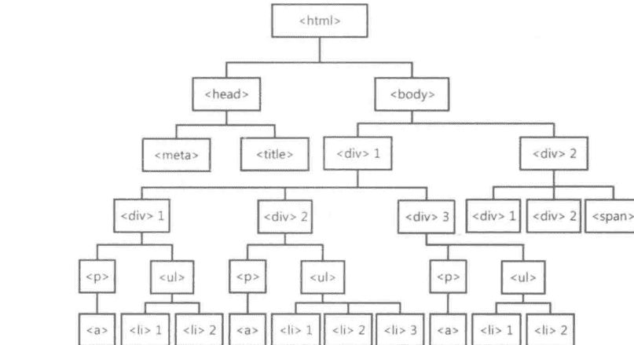

图 5-1

图 5-1 就是 HTML 网页各标签的阶层结构，只有了解了 HTML 网页的结构，才能搜索和遍历 HTML 网页。

动手学——加载和剖析范例 HTML 网页：Ch5_1_2.py

打开 Example.html 文件，然后使用 BeautifulSoup 剖析 HTML 网页，如下所示：

```

### 实战策略拆解：
1.  **定位容器**：先锁定大块区域（如 `id="surveys"`），缩小搜索范围。
2.  **层级穿透**：利用 `find_all` 批量获取重复结构（如每个 `class="survey"` 的问卷块）。
3.  **组合拳出击**：
    *   题目用 `.a.string` 直取超链接文本；
    *   选项遍历 `<li>`，配合 `.get_text(strip=True)` 清洗“选项文字 - 分数”格式；
    *   **关键判断**：检查 `span` 是否含 `selected` 类，识别正确/默认答案。
4.  **混合内容处理**：邮件列表区块标签不规则（`div`、`span`、纯文本混杂），直接对容器调用 `.get_text(" | ", strip=True)` 一次性提取并格式化，省去逐个遍历之苦。

---

**总结**：BeautifulSoup 的精髓在于**“对象化思维”**——把 HTML 看作对象树，用 `Tag` 定位结构，用 `NavigableString/Comment` 处理叶子节点，再配合 `.get_text()` 等工具方法做清洗。掌握这套逻辑，再复杂的网页结构也能为你所用。

# BeautifulSoup 核心查找技巧全解析

掌握网页解析的关键，在于灵活运用查找 API。本文通过实战案例，带你彻底搞懂 `find` 与 `find_all` 的各种用法，从基础定位到复杂过滤，一网打尽。

## 单元素精准定位：`find()` 入门

最基础的查找从标签名开始。传入标签名称，即可获取文档中首个匹配节点。

```

上述程序代码导入 BeautifulSoup 后，打开和读取 HTML 文件 Example.html，即可使用文件内容建立 BeautifulSoup 对象剖析 HTML 网页，运行结果中将输出整个 HTML 网页内容。

#### 5.1.3 使用开发人员工具分析 HTML 网页

在进行网页数据抓取前，需要先分析 HTML 网页来搜索目标数据的特征。例如，数据位于哪一个标签，标签是否有唯一的 id 属性，如果有唯一的 id 属性就可以直接搜索，如果位于搜索到标签的附近，可以再次搜索，或使用遍历方式来处理。即需要分析 HTML 网页来找出搜索和遍历的策略，以便将所需数据抓取出来。

Google Chrome 浏览器的开发人员工具就是分析 HTML 网页的好工具。例如，加载范例 Example.htm 后，按 F12 键会打开开发人员工具，如图 5-2 所示。

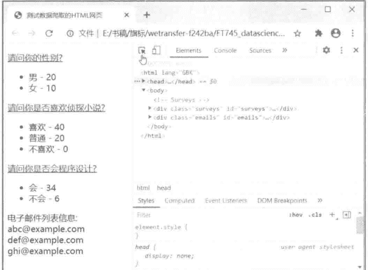

图 5-2

在右上方工具栏中单击光标所在的第 1 个按钮，然后移动光标至左边网页中的特定文字内容，即可检视对应的 HTML 标签，如图 5-3 所示。

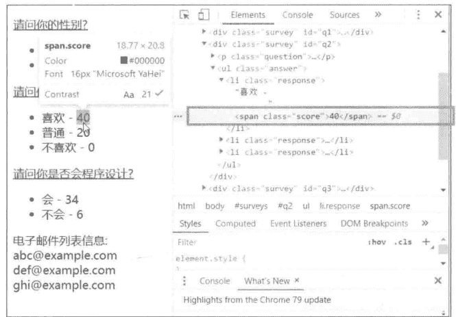

图 5-3

### 5.2 使用 find() 和 find_all() 函数搜索 HTML 网页

BeautifulSoup 本身和 Tag 对象支持多种使用 find 开头的函数来搜索 HTML 网页，本书即介绍 find() 和 find_all() 函数。其他函数多用于遍历 HTML 网页，这部分内容将在第 5.5 节中介绍。

#### 5.2.1 使用 find() 函数搜索 HTML 网页

搜索 HTML 网页实际上就是搜索 BeautifulSoup 剖析成 Python 对象的标签树（第 5.1.2 节）。可以调用 find() 函数搜索 HTML 网页来搜索指定的 HTML 标签，其基本语法如下所示：

```

find(name, attribute, recursive, text, **kwargs)

```

上述 find() 函数可以搜索到第 1 个符合条件的 Python 对象，即 HTML 标签对象；若没有找到，则返回 None。find() 函数的参数说明如下所示。

- name 参数：指定搜索的标签名称，可以找到第 1 个符合条件的 HTML 标签，值可以是字符串的标签名称、正则表达式、列表或函数。
- attribute 参数：搜索条件的 HTML 标签属性。
- recursive 参数：此参数为布尔值且默认为 True，搜索会包含所有子孙标签；如为 False，搜索就只限下一层子标签，不包含再下一层的孙标签。
- text 参数：指定搜索的标签字符串内容。

find() 函数最后的 **kwargs 表示 find() 函数的参数个数是不定长度（有的话，才需指定），而且参数格式是一种 “键-值” 参数。

##### 动手学——使用标签名称搜索 HTML 标签：Ch5_2_1.py

搜索 Example.html 问卷第 1 题的题目，利用开发人员工具可以搜索 <a> 标签的内容，如图 5-4 所示。

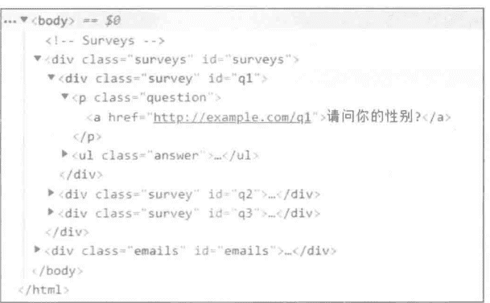

图 5-4

上述标签 <a> 是第 1 个 <a> 标签，可以调用 find() 函数搜索此 HTML 标签，如下所示：

```

tag_a = soup.find("a")

print(tag_a.string)

```

上述程序代码搜索 <a> 标签名称为 "a" 的字符串，可以找到第 1 个 <a> 标签的 Tag 对象，然后使用 string 属性获取内容，其运行结果如下所示：

```

请问你的性别？

进阶用法：指定 `name` 参数显式声明标签，配合链式调用深入子层级。

```

再次观察 HTML 标签树，<a> 标签的上一层是 <p> 标签，可以先调用 find() 函数搜索 <p> 标签，然后在 <p> 标签中使用属性遍历至 <a> 标签，或再次调用 find() 函数搜索下一层 <a> 标签，如下所示：

```

tag_p = soup.find(name="p")

tag_a = tag_p.find(name="a")

print(tag_p.a.string)

print(tag_a.string)

```

上述程序代码首先搜索标签 <p>，find() 函数使用“键-值”参数，然后从 <p> 标签开始再调用 find() 函数搜查下一层标签 <a>，即可从 tag_p 开始使用 a 属性获取之下的 <a> 标签来获取内容，tag_a 因为是 <a> 标签，所以可以直接获取内容。从其运行结果中可以看到 2 行相同的标签内容，如下所示：

```

请问你的性别？

请问你的性别？

利用 `id` 属性直接锁定唯一容器，再在其内部检索目标链接。

```

##### 动手学——搜索 HTML 标签的 id 属性：Ch5_2_1a.py

HTML 标签的 id 属性值是唯一值，如果 HTML 标签拥有 id 属性，则可以直接使用 id 属性来搜索 HTML 标签。例如，搜索第 2 题的问卷题目，<div> 标签的 id 属性值是 q2，如下所示：

```

tag_div = soup.find(id="q2")

tag_a = tag_div.find("a")

print(tag_a.string)

```

上述程序代码使用 id="q2" 搜索 <div> 标签，找到后，再调用 find() 函数搜索 <a> 标签，可以获取标签内容的题目字符串，其运行结果如下所示：

```

请问你是否喜欢侦探小说？

## 属性过滤：class 与自定义属性

`attrs` 参数支持字典形式匹配任意属性，`class_` 则是针对 class 的快捷写法。

```

##### 动手学——搜索 HTML 标签的 class 样式属性：Ch5_2_1b.py

HTML 标签的 class 属性值套用的是 CSS 样式，可以使用此属性值来搜索 HTML 标签。但是，因为此属性值并非唯一值，所以找到的只是第 1 个，而且 class 是 Python 关键词，需要改用 attrs 属性来指定属性值。

例如，使用 class 样式属性值 score 搜索第 1 个 <span> 标签，如下所示：

```

tag_span = soup.find(attrs={"class": "score"})

print(tag_span.string)

```

上述 find() 函数的参数是使用 attrs 属性指定 class 属性值为 score，这是字典，可以显示第 1 个 <span> 标签的分数，其运行结果如下所示：

```

20

在特定父节点下按 class 查找，配合 `class_` 参数更简洁。

```

因为 HTML 标签的 class 属性值是常用的搜索条件，BeautifulSoup 对象提供特殊常数 class_，在之后用 “_” 底线来快速指定 class 属性值的条件，例如，搜索问卷第 2 题 <div> 标签下的第 1 个 <span> 标签，如下所示：

```

tag_div = soup.find(id="q2")

tag_span = tag_div.find(class_="score")

print(tag_span.string)

```

上述程序代码先使用 id 属性找到第 2 题的 <div> 标签，然后调用 find() 函数，此时的 class 属性值 score 由 class_ 指定，可以输出 <span> 标签的分数，其运行结果如下所示：

```

40

自定义数据属性（如 `data-*`）同样适用于 `attrs` 精准匹配。

```

##### 动手学——使用 HTML 5 自定义属性搜索 HTML 标签：Ch5_2_1c.py

HTML 5 的标签可以指定以 data- 开头的自定义属性，因为自定义属性有 “-” 符号，并不能作为参数名称，所以需要使用 attrs 属性来指定自定义属性值。例如，在电子邮件的 <div> 标签中有 data-custom 属性值 important，如下所示：

```

tag_div = soup.find(attrs={"data-custom": "important"})

print(tag_div.string)

```

上述 attrs 属性指定 data-custom 自定义属性值的搜索条件，其运行结果是标签内容的电子邮件地址字符串，如下所示：

```

def@example.com

## 文本内容搜索与 NavigableString

`text` 参数（新版为 `string`）可直接按文本内容检索，返回的是 `NavigableString` 对象而非 Tag。

```

##### 动手学——搜索 HTML 标签的文字内容：Ch5_2_1d.py

对于 HTML 标签的文字内容，可以使用 text 属性来指定搜索条件，如下所示：

```

tag_str = soup.find(text="请问你的性别？")

print(tag_str)

tag_str = soup.find(text="10")

print(tag_str)

print(type(tag_str))   # NavigableString 类型

print(tag_str.parent.name)   # 父标签名称

tag_str = soup.find(text="男 -")

print(tag_str)

```

上述程序代码使用 text 参数指定文字内容的搜索条件，返回值是符合文字内容的 NavigableString 对象，tag_str.parent.name 使用 parent 属性遍历父标签（详见第 5.5.3 节），可以获取此文字内容的父标签名称，其运行结果如下所示：

```

请问你的性别？

10

<class 'bs4.element.NavigableString'>

span

None

结合 HTML 结构观察：当文本节点包含子标签时，`.string` 返回 `None`，需通过子标签获取。

```

上述运行结果输出文字内容后，可以看到其类型是 NavigableString 对象，父标签是 <span>，None 表示没有找到字符串 "男 -"。但是，在 HTML 网页内容中确实有此字符串，如下所示：

```

<li class="response">男 -

<span class="score selected">20</span></li>

```

上述 <li> 标签的内容包括文字内容和子标签 <span>，BeautifulSoup 无法使用 text 搜索混合内容的字符串（Python 程序：Ch5_2_1e.py），如下所示：

```

tag_li = soup.find(class_="response")

print(tag_li.string)

print(tag_li.span.string)

```

上述程序代码搜索前述 <li> 标签，无法获取此标签的文字内容，但是可以获取 <span> 子标签的文字内容，其运行结果如下所示：

```

None

20

## 标签与类名组合查找

同时指定标签名与 class，缩小搜索范围。

```

> Tip
> 对于这种混合内容，或不是在 HTML 标签中的文字内容，可以使用第 5.4 节的正则表达式来进行搜索。

##### 动手学——同时使用多个条件来搜索 HTML 标签：Ch5_2_1f.py

Example.html 的 class 属性值 question 分别套用在问卷的问题和第 2 个电子邮件列表的 <div> 标签，可以使用 2 个条件来分别搜索这 2 个不同的 HTML 标签，如下所示：

```

tag_div = soup.find("div", class_="question")

print(tag_div)

tag_p = soup.find("p", class_="question")

print(tag_p)

```

上述程序代码的第 1 个 find() 函数搜索 <div> 标签且 class 属性值是 question，第 2 个 find() 函数搜索 <p> 标签，从其运行结果中可以看到这 2 个 HTML 标签，如下所示：

```

<div class="question">电子邮件列表信息： </div>

<p class="question">

<a href="http://example.com/q1">请问你的性别?</a></p>

## 自定义函数实现复杂逻辑

当内置参数不足时，传入函数实现灵活判断，例如校验 href 指向特定地址。

```

##### 动手学——使用 Python 函数定义搜索条件：Ch5_2_1g.py

find() 函数的参数可以是一个函数调用，即可以调用函数来定义搜索条件。例如，建立 is_secondary_question() 函数，可以检查标签是否有 href 属性，而且属性值是 http://example.com/q2，如下所示：

```

def is_secondary_question(tag):

    return tag.has_attr("href") and \

    tag.get("href") == "http://example.com/q2"

tag_a = soup.find(is_secondary_question)

print(tag_a)

```

上述 find() 函数的参数是 is_secondary_question 函数，不需要加上括号，可以获取第 2 个问题的 <a> 标签，其执行结果如下所示：

```

<a href="http://example.com/q2">请问你是否喜欢侦探小说?</a>

## 批量获取：`find_all()` 与数量限制

获取所有匹配节点，返回列表；配合 `limit` 参数控制返回数量。

```

#### 5.2.2 使用 find_all() 函数搜索 HTML 网页

BeautifulSoup 的 find_all() 函数可以搜索 HTML 网页，搜索所有符合条件的 HTML 标签，其基本语法如下所示：

```

find_all(name, attribute, recursive, text, limit, **kwargs)

```

上述函数的参数比 find() 函数多了一个 limit 参数，其说明如下所示。
limit 参数：指定搜索到符合 HTML 标签的最大值。所以，find() 函数就是 limit 参数值为 1 的 find_all() 函数。

find_all() 函数和 find() 函数的使用方式类似，在第 5.2.1 节中的参数都可以用于 find_all() 函数，只是其搜索结果是符合条件的列表，而不是第 1 个符合条件的 Tag 对象。

##### 动手学——搜索所有问卷的题目字符串：Ch5_2_2.py

调用 find_all() 函数在 Example.html 中搜索所有问卷题目的列表，如下所示：

```

tag_list = soup.find_all("p", class_="question")

print(tag_list)

```

```

for question in tag_list:

    print(question.a.string)

```


上述 find_all() 函数的条件是所有 <p> 标签且 class 属性值是 question，然后使用 for/in 循环遍历列表 逐一获取题目字符串。因为题目字符串位于 <a> 子标签，所以使用 question.a.string 输出题目字符串。其执行结果如下所示：

```

[<p class="question">

<a href="http://example.com/q1">请问你的性别?</a></p>, <p class="question">

<a href="http://example.com/q2">请问你是否喜欢侦探小说?</a></p>, <p

class="question">

<a href="http://example.com/q3">请问你是否会程序设计?</a></p>]

请问你的性别？

请问你是否喜欢侦探小说？

请问你是否会程序设计？

仅获取前两条记录，提升性能。

```

上述运行结果中，首先输出搜索结果的 <p> 标签列表，最后是 3 个问卷题目字符串。

##### 动手学——使用 limit 参数限制搜索数量： Ch5_2_2a.py

修改 Ch5_2_2.py，在 find_all() 函数中加上 limit 参数，只搜索前两个数据，如下所示：

```

tag_list = soup.find_all("p", class_="question", limit=2)

print(tag_list)

for question in tag_list:

    print(question.a.string)

```

上述程序代码只差 find_all() 函数最后的 limit 参数，其运行结果只有前两个 <p> 标签，如下所示：

```

[<p class="question">

<a href="http://example.com/q1">请问你的性别?</a></p>, <p class="question">

<a href="http://example.com/q2">请问你是否喜欢侦探小说?</a></p>]

请问你的性别？

请问你是否喜欢侦探小说？

## 递归获取所有后代标签

传入 `True` 作为 name 参数，可获取指定节点下所有层级的标签。

```

##### 动手学——搜索所有标签： Ch5_2_2b.py

find_all() 函数的参数值如果是 True，就表示搜索所有 HTML 标签。例如，搜索问卷第 2 题的所有 HTML 标签，如下所示：

```

tag_div = soup.find("div", id="q2")

##### 找出所有标签列表

tag_all = tag_div.find_all(True)

print(tag_all)

```

上述程序代码首先调用 find() 函数找到第 2 题的 <div> 标签，然后调用 find_all() 函数搜索所有标签，参数值是 True，其运行结果如下所示：

```

<p class="question">

<a href="http://example.com/q2">请问你是否喜欢侦探小说？</a></p>, <a

href="http://example.com/q2">请问你是否喜欢侦探小说？</a>, <ul class="answer">

<li class="response">喜欢 -

<span class="score">40</span></li>

<li class="response">普通 -

<span class="score selected">20</span></li>

<li class="response">不喜欢 -

<span class="score">0</span></li>

</ul>, <li class="response">喜欢 -

---

**总结**：从单一标签到属性组合，从文本匹配到自定义函数，再到批量与递归查找，BeautifulSoup 提供了层层递进的工具箱。实战中根据 HTML 结构特点，组合使用上述技巧，即可高效提取目标数据。

# BeautifulSoup 进阶检索：从文本提取到 CSS 选择器实战

在网页数据采集中，定位目标元素是核心难点。本文通过实战案例，系统拆解 BeautifulSoup 库中从基础文本获取到高阶 CSS 选择器的多种检索策略。

---

### 一、 文本内容的精准捕获

首先锁定目标容器 `div#q2`。若需获取节点内**所有文本节点**（含换行、空白符），`find_all(text=True)` 能返回完整列表；若仅需提取特定数值（如 "20"、"40"），直接将目标字符串列表传入 `text` 参数即可精准过滤。

```

##### 动手学——搜索所有文字内容： Ch5_2_2c.py

如果 find_all() 函数参数是 text=True，就表示搜索所有文字内容。也可以使用列表来指定只搜索特定的文字内容，如下所示：

```

运行结果直观展示了两种模式的差异：前者保留完整文档结构文本，后者仅命中目标数值。

```

上述程序代码找到第 2 个问题的 <div> 标签后，第 1 个 find_all() 函数搜索所有文字内容，第 2 个 find_all() 函数只搜索 “20” 和 “40” 两个文字内容，其运行结果如下所示：

```

---

### 二、 标签与类名的组合筛选

除文本检索外，按标签名批量查找是常规操作。例如同时查找 `<p>` 与 `<span>`，只需传入标签名列表。更实用的是利用 `class_` 参数匹配样式类，支持列表形式指定多个类名（如 "question" 或 "selected"），一次调用即可命中所有符合条件的节点。

```

> 上述运行结果有 2 个列表，第 1 个是第 2 题的所有文字内容，第 2 个只有 2 个项目“40” 和 “20”。HTML 标签的文字内容常常有一些特殊的符号字符，第 6.2 节会介绍如何清理这些多余字符。

##### 动手学——使用列表指定搜索条件： Ch5_2_2d.py

在 find_all() 函数中可以使用列表指定搜索条件，此时的每一个项目是 “或” 条件，可以将其指定成标签名称列表或属性值列表，如下所示：

```

输出结果清晰呈现了两类检索对象：标签维度的集合与类名维度的精准命中。

```

上述程序代码的第 1 个 find_all() 函数的参数是标签名称列表，第 2 个 find_all() 函数指定 class 属性值的列表，其运行结果如下所示：

```

---

### 三、 后代与子代：一字之差的巨大差异

理解“后代”与“子代”的区别至关重要。`find_all("li")` 默认递归遍历整棵子树，能捕获所有层级的 `<li>`；而设定 `recursive=False` 后，仅限直接子元素，若容器下无直系 `<li>` 则返回空列表。此特性在处理嵌套列表结构时极为关键。

```

上述运行结果中，第 1 个列表项目是所有 <p> 和 <span> 标签，第 2 个标签的 class 属性值是 question 或 selected。

##### 动手学——没有使用递归进行搜索：Ch5_2_2e.py

find() 函数和 find_all() 函数都支持 recursive 参数（默认值为 True），可以指定是否递归搜索子标签下的所有孙标签，如下所示：

```

对比输出可见：递归模式获取三个选项节点，非递归模式因结构不匹配而颗粒无收。

```

上述程序代码的第 1 个 find_all() 函数没有指定 recursive 参数，默认搜索所有子孙标签；第 2 个 find_all() 函数将 recursive 参数指定为 False，只搜索子标签是否有 <li> 标签。其运行结果如下所示：

```

---

### 四、 CSS 选择器：层级定位的利器

`soup.select()` 支持标准 CSS 选择器语法，擅长处理复杂层级关系。例如通过 `html > head > title` 逐级定位标题，或用 `body div a` 搜索 `<div>` 任意深度下的链接。这种声明式写法极大简化了多层嵌套场景下的代码量。

```

上述运行结果的第 1 个列表项目是所有 <li> 标签；第 2 个是空列表，因为 <div> 标签的子标签是 <p> 和 <ul>，并没有 <li> 标签。

### 5.3 使用 CSS 选择器搜索 HTML 网页

CSS 选择器源于 CSS 层级式样式表单，可以从 HTML 网页选择出哪些 HTML 标签需要套用 CSS 样式。同理，BeautifulSoup 对象可以调用 select() 函数或 select_one() 函数，使用 CSS 选择器来搜索目标的 HTML 标签。

#### 5.3.1 认识 CSS 选择器

CSS 选择器是一个模板，可以在 HTML 网页中比对需要套用 CSS 样式的 HTML 元素有哪些，CSS Level 1、2 和 3 版分别提供了多种 CSS 选择器。

##### 动手学——CSS Level 1 选择器

CSS Level 1 选择器的语法、范例和说明如表 5-1 所示。

| 语法 | 范例 | 说明 |
|:---|:---|:---|
| .class | .test | 选择所有 class="test" 的元素 |
| #id | #name | 选择 id="name" 的元素 |
| element | p | 选择所有 p 元素 |
| element,element | div,p | 选择所有 div 元素和所有 p 元素 |
| element element | div p | 选择所有是 div 后代子孙的 p 元素 |
| :first-letter | p:first-letter | 选择所有 p 元素的第 1 个字母 |
| :first-line | p:first-line | 选择所有 p 元素的第 1 行 |
| :link | a:link | 选择所有没有访问过的超链接 |
| :visited | a:visited | 选择所有访问过的超链接 |
| :active | a:active | 选择所有可用的超链接 |
| :hover | a:hover | 选择所有鼠标移动在其上的超链接 |

##### 动手学——CSS Level 2 选择器

CSS Level 2 选择器的语法、范例和说明如表 5-2 所示。

| 语法 | 范例 | 说明 |
|:---|:---|:---|
| * | * | 选择所有元素 |
| element>element | div>p | 选择所有父元素是 div 元素的 p 元素 |
| element+element | div+p | 选择所有紧挨着 div 元素之后的 p 兄弟元素 |
| [attribute] | [count] | 选择所有拥有 count 属性的元素 |
| [attribute=value] | [target=_blank] | 选择所有拥有 target="_blank" 属性的元素 |
| [attribute~=value] | [title~=flower] | 选择所有拥有 title 属性且包含 "flower" 的元素 |
| [attribute|=value] | [lang=en] | 选择所有拥有 lang 属性且属性值以 "en" 开头的元素 |
| :focus | input:focus | 选择获取焦点的 input 元素 |
| :first-child | p:first-child | 选择所有是第 1 个子元素的 p 元素 |
| :before | p:before | 插入在每一个 p 元素之前的拟元素（Pseudo-elements）。这是一个没有实际名称或原来并不存在的元素，可以将它视为一个新元素 |
| :after | p:after | 插入在每一个 p 元素之后的拟元素 |
| :lang(value) | p:lang(it) | 选择所有拥有 lang 属性，且属性值以 "it" 开头的 p 元素 |

##### 动手学——CSS Level 3 选择器

CSS Level 3 选择器的语法、范例和说明如表 5-3 所示。

##### 表 5-3 CSS Level 3 选择器的语法、范例和说明

| 语法 | 范例 | 说明 |
|:---|:---|:---|
| element1~element2 | p~ul | 选择所有之前是 p 元素的 ul 兄弟元素 |
| [attribute^=value] | a[src^="https"] | 选择所有 src 属性值以 "https" 开头的 a 元素 |
| [attribute$=value] | a[src$=".txt"] | 选择所有 src 属性值以 ".txt" 结尾的 a 元素 |
| [attribute*=value] | a[src*="hinet"] | 选择所有 src 属性值包含 "hinet" 子字符串的 a 元素 |
| :first-of-type | p:first-of-type | 选择所有是第 1 个 p 子元素的 p 元素 |
| :last-of-type | p:last-of-type | 选择所有是最后 1 个 p 子元素的 p 元素 |
| :only-of-type | p:only-of-type | 选择所有是唯一 p 子元素的 p 元素 |
| :only-child | p:only-child | 选择所有是唯一子元素的 p 元素 |
| :nth-child(n) | p:nth-child(2) | 选择所有是第 2 个子元素的 p 元素 |
| :nth-last-child(n) | p:nth-last-child(2) | 选择所有倒数是第 2 个子元素的 p 元素 |
| :nth-of-type(n) | p:nth-of-type(2) | 选择所有是第 2 个 p 子元素的 p 元素 |
| :nth-last-of-type(n) | p:nth-last-of-type(2) | 选择所有倒数是第 2 个 p 子元素的 p 元素 |
| :last-child | p:last-child | 选择所有是最后 1 个 p 子元素的 p 元素 |
| :root | :root | 选择 HTML 网页的根元素 |
| :empty | p:empty | 选择所有没有子元素的 p 元素，包含文字节点 |
| :enabled | input:enabled | 选择所有有作用中的 input 元素 |
| :disabled | input:disabled | 选择所有非作用中的 input 元素 |
| :checked | input:checked | 选择所有已选择的 input 元素 |
| :not(selector) | :not(p) | 选择所有不是 p 元素的元素 |
| ::selection | ::selection | 选择用户选择的元素 |

> BeautifulSoup 尚未完全实现 CSS 选择器。例如，本书使用的版本只支持表 5-3 的 nth-of-type()，并不支持其他 nth-??()。

#### 5.3.2 使用 select() 函数搜索 HTML 网页

BeautifulSoup 支持 CSS 选择器，因此可以在 Tag 和 BeautifulSoup 对象调用 select() 函数，只需传入 CSS 选择器字符串，即可搜索 HTML 网页，返回值是符合条件的 Tag 标签对象列表。

##### 动手学——搜索指定的标签名称： Ch5_3_2.py

搜索 <title> 标签和第 3 题的 <div> 标签，如下所示：

```

```

上述程序代码第 1 次调用 select() 函数是搜索传入的标签名称字符串 "title"，因为返回的是列表，所以取出第 1 个 Tag 对象来输出标签内容；第 2 次先找到第 1 个 <div> 标签后，Tag 对象调用 select() 函数使用 nth-of-type(3) 搜索第 3 个子 <div> 标签，即第 3 题。其运行结果如下所示：

测试数据爬取的 HTML 网页

```

```python
tag_title = soup.select("html head title")
print(tag_title[0].string)
tag_a = soup.select("body div a")
print(tag_a)
```

---

### 五、 直系子元素与兄弟节点的锁定策略

进阶场景常需“仅限直接子元素”或“定位特定序号节点”。CSS 选择器提供 `>` 组合符限定直系关系，配合 `:nth-of-type(n)` 可按同类标签顺序精准取值；ID 选择器 `#id` 则能以唯一标识为锚点，快速切入子树。

```
测试数据爬取的 HTML 网页
[<a href="http://example.com/q1">请问你的性别?</a>, <a href="http://example.com/q2">请问你是否喜欢侦探小说?</a>, <a href="http://example.com/q3">请问你是否会程序设计?</a>]
```

```python
tag_a = soup.select("p > a")
print(tag_a)
tag_li = soup.select("ul > li:nth-of-type(2)")
print(tag_li)
tag_span = soup.select("div > #email")
print(tag_span)
```

实战输出验证了三类典型场景：段落直系链接、列表第二项、特定 ID 容器下的跨度标签。

```
[<a href="http://example.com/q1">请问你的性别?</a>, <a href="http://example.com/q2">请问你是否喜欢侦探小说?</a>, <a href="http://example.com/q3">请问你是否会程序设计?</a>]
[<li class="response">女 - <span class="score">10</span></li>, <li class="response">普通 - <span class="score selected">20</span></li>, <li class="response">不会 - <span class="score">6</span></li>]
[<span class="survey" id="email">ghi@example.com</span>]
```

---

### 六、 兄弟节点遍历：横向扩展检索边界

掌握纵向层级检索后，横向的兄弟节点操作同样不可或缺。后续将详解如何利用 `find_next_siblings()` 等 API 实现同层级元素的高效遍历与数据采集。

##### 动手学——搜索兄弟标签：Ch5_3_2c.py

# BeautifulSoup 实战进阶：Selector、Regex 与 DOM 导航

## Selector 语法：同级定位符 `~` 与 `+`

BeautifulSoup 的 `select()` 完美支持标准 CSS Selector 语法，极大强化了元素定位能力。其中，**波浪号 `~` 与加号 `+`** 是处理同级关系的利器：前者匹配指定节点后方**全部**符合条件的同级标签，后者仅锁定**紧邻的后一个**。

### 实战案例：问卷条目提取

假设需从问卷页抓取问题。首先用 `find()` 定位首条容器（`id="q1"`），再结合符号分层获取：

*   **全量后续项**：`select('#q1 ~ .survey')` 命中首条之后所有 `class="survey"` 的同级节点。
*   **仅紧邻项**：`select('#q1 + .survey')` 仅返回紧跟其后的那一个。

```python
tag_div = soup.find(id="q1")
print(tag_div.p.a.string)
print("------------------------")
tag_div = soup.select("#q1 ~ .survey")
for item in tag_div:
    print(item.p.a.string)
print("------------------------")
tag_div = soup.select("#q1 + .survey")
for item in tag_div:
    print(item.p.a.string)
```

运行效果直观对比：首条指令返回包含性别、偏好、编程能力三条的列表；次条指令仅输出“侧好推理书籍”这一道紧随其后的记录。

---

## 精准锁定 Class 与 ID

`select()` 还能组合 `id`、`class` 甚至标签名进行精准打击：

1.  **ID 直达**：`select('#q1')`、`select('span#email')` 直接锚定唯一元素。
2.  **多 ID 并集**：`select('#q1, #q2')` 配合循环可批量收割多条问题文本。
3.  **层级下钻**：先 `find('div')` 定位容器，再 `select('p.question a')` 提取段落内超链接的地址。
4.  **Class 部分匹配**：`select('[class~="selected"]')` 可筛选类名列表中包含 `selected` 的任意标签（注意 `~=` 与 `~` 的区别：前者针对属性值单词，后者针对同级关系）。

```python
tag_div = soup.select("#q1")
print(tag_div[0].p.a.string)
tag_span = soup.select("span#email")
print(tag_span[0].string)
tag_div = soup.select("#q1, #q2")    # 多个 id 属性
for item in tag_div:
    print(item.p.a.string)
print("-----------")
tag_div = soup.find("div")       # 第 1 个 <div> 标签
tag_p = tag_div.select(".question")
for item in tag_p:
    print(item.a["href"])
tag_span = soup.select("[class~=selected]")
for item in tag_span:
    print(item.string)
```

```
请问你的性别？
ghij@example.com
请问你的性别？
请问你是否喜欢侦探小说？
-----------
http://example.com/q1
http://example.com/q2
http://example.com/q3
20
20
34
```

---

## 属性存在性与值模糊筛选

除了结构定位，`select()` 支持基于属性名、值的模糊查询，语法极具直觉：

| 模式 | 含义 | 典型场景 |
| :--- | :--- | :--- |
| `a[href]` | 含链接地址属性的 `<a>` | 清洗无效链 |
| `a[href="exact"]` | 值**完全等于** | 定位固定跳转 |
| `a[href^="http:"]` | 以 `http:` **起始** | 筛选外链/绝对路径 |
| `a[href$=".pdf"]` | 以 `.pdf` **终止** | 采集文档下载链 |
| `a[href*="keyword"]` | **含**关键字 | 模糊匹配业务参数 |

实测数据印证：某页面含链接共 3 条；以外链形式 1 条；以特定后缀终止 1 条；含特定字段 3 条。这种“漏斗式”筛选极大提升了清洗效率。

```python
tag_a = soup.select("a[href]")
print(tag_a)
tag_a = soup.select("a[href='http://example.com/q2']")
print(tag_a)
tag_a = soup.select("a[href^='http://example.com']")
print(tag_a)
tag_a = soup.select("a[href$='q3']")
print(tag_a)
tag_a = soup.select("a[href*='q']")
print(tag_a)
```

```
[<a href="http://example.com/q1">请问你的性别?</a>, <a href="http://example.com/q2">请问你是否喜欢侦探小说?</a>, <a href="http://example.com/q3">请问你是否会程序设计?</a>] [<a href="http://example.com/q2">请问你是否喜欢侦探小说?</a>] [<a href="http://example.com/q1">请问你的性别?</a>, <a href="http://example.com/q2">请问你是否喜欢侦探小说?</a>, <a href="http://example.com/q3">请问你是否会程序设计?</a>] [<a href="http://example.com/q3">请问你是否会程序设计?</a>] [<a href="http://example.com/q1">请问你的性别?</a>, <a href="http://example.com/q2">请问你是否喜欢侦探小说?</a>, <a href="http://example.com/q3">请问你是否会程序设计?</a>]
```

---

## `select_one()`：单例轻量替代

当确信目标唯一或仅需首个匹配时，`select_one()` 避免了列表解包开销。它与 `select()` 语法完全一致，但直接返回首个 `Tag` 实例而非列表。例如 `soup.select_one('a')` 即刻拿到文档首个超链接节点，代码更简洁、意图更明确。

```python
tag_a = soup.select_one("a[href]")
print(tag_a)
```

```
<a href="http://example.com/q1">请问你的性别?</a>
```

---

## Regular Expression：突破标签边界的文本猎手

`find()` / `find_all()` 接受 `re` 库编译的模式对象，解决了**标签夹杂文本**、**非结构化内容**等 Selector 难以企及的场景。

### 核心语法速查

| 记号 / 结构 | 作用 | 记忆锚点 |
| :--- | :--- | :--- |
| `\w` / `\W` | 单词字符 / 非单词 | **W**ord |
| `\d` / `\D` | 数字 / 非数字 | **D**igit |
| `\s` / `\S` | 空白 / 非空白 | **S**pace |
| `^` / `$` | 文本首 / 尾 | 锚定边界 |
| `.` | 任意单字符（除换行） | 通配符 |
| `*` / `+` / `?` | 0多 / 1多 / 0或1 | 量词阶梯 |
| `{n,m}` | n 到 m 次 | 精准计数 |
| `[abc]` / `[^abc]` | 字符组 / 反向组 | 定制菜单 |
| `\|` | 或逻辑 | 分支选择 |
| `(...)` | 分组捕获 | 单元打包 |

**常用模板实例**：
*   邮箱：`[\w\.-]+@[\w\.-]+\.\w+`
*   HTTP 链接：`^https?://`
*   手机号：`^1[3-9]\d{9}$`

```
"a (bc) *"
```

```
"(b | ef)gh"
```

```
"[0-9]+"
```

---

### 在 BS4 中调用 Regex

Python 需 `import re`，调用 `re.compile()` 生成模式实例供 `find/find_all` 使用。

```python
import re
```

```python
regexp = re.compile(r"\w+ -")
```

---

### 实战：从混合文本中抽取邮箱与链接

```python
import re
pattern = re.compile(r'[\w\.-]+@[\w\.-]+\.\w+')  # 编译一次，复用多次
soup.find_all(string=pattern)        # 直接匹配文本节点
soup.find_all(href=re.compile(r'^https?://'))  # 匹配属性值
```

直传字符串给 `find` 无法命中夹杂节点中的文本片段，但传入编译后的模式即可精准提取。

```python
tag_str = soup.find(text="男 -")
print(tag_str)
regexp = re.compile(r"男 -")
tag_str = soup.find(text=regexp)
print(tag_str)
regexp = re.compile(r"\w+ -")
tag_list = soup.find_all(text=regexp)
print(tag_list)
```

```
None
男 -
["男 - \n", "女 - \n", "喜欢 - \n", "普通 - \n", "不喜欢 - \n", "会 - \n", "不会 - \n"]
```

构造邮箱模式 `[\w\.-]+@[\w\.-]+\.\w+`，配合 `find_all(string=pattern)` 可从非结构化文本中批量收割邮箱。

```python
email_regexp = re.compile("\w+@\w+.\w+")
tag_str = soup.find(text=email_regexp)
print(tag_str)
print("-----------------")
tag_list = soup.find_all(text=email_regexp)
print(tag_list)
```

```
abc@example.com
-----------------
['\n abc@example.com\n ' , ' def@example.com' , 'ghi@example.com']
```

属性值亦可用模式筛选，如 `href=re.compile(r'^https?://')` 定位绝对路径链接，排除相对路径干扰。

```python
url_regexp = re.compile("^http:")
tag_href = soup.find(href=url_regexp)
print(tag_href)
print("-----------------")
tag_list = soup.find_all(href=url_regexp)
print(tag_list)
```

```
<a href="http://example.com/q1">请问你的性别?</a>
-----------------
[<a href="http://example.com/q1">请问你的性别?</a>, <a href="http://example.com/q2">请问你是否喜欢侦探小说?</a>, <a href="http://example.com/q3">请问你是否会程序设计?</a>]
```

---

## DOM 导航：在节点树中自由穿梭

当 Selector 与 Regex 只能收窄范围，导航属性提供了**像操作文件目录一样**操作 DOM 树的能力。BeautifulSoup 将 HTML 解析为层级分明的 Python 节点树，支持三维操作：

| 方向 | 核心属性/方法 | 适用场景 |
| :--- | :--- | :--- |
| **上溯（父/祖先）** | `.parent`, `.parents` | 从叶子节点回溯容器上下文 |
| **下探（子/后代）** | `.contents`, `.children`, `.descendants` | 展开容器内所有节点，`descendants` 递归深入 |
| **横向（同级）** | `.next_sibling`, `.previous_sibling`, `.next_siblings`, `.previous_siblings` | 同级节点间顺序访问 |
| **线性流** | `.next_element`, `.previous_element` | 按解析器读取顺序逐个访问，跨层级 |

> **提示**：`.contents` 返回列表（含换行文本节点），`.children` 返回生成器（惰性、内存友好）；横向移动时需留意换行符产生的空节点，通常配合 `if tag.name` 过滤。

### 典型遍历模式：从问题定位到选项收集

以问卷第 2 题 `<div>` 为起点：
1.  **下探**：`div.find_all('p', class_='option')` 或 `div.descendants` 筛选 `input[type=radio]` 收集所有选项。
2.  **上溯**：`div.parent` 确认所属 `<section>` 或 `<form>` 归属。
3.  **横向**：`div.next_sibling` 快速跳转至第 3 题容器，实现分页式采集。

---

## 小结

| 技术维度 | 核心工具 | 适用边界 |
| :--- | :--- | :--- |
| **结构定位** | `select()` / `select_one()` + CSS Selector | 类名、ID、层级、同级关系明确时首选 |
| **文本/属性模糊匹配** | `find_all(string=re_obj)` / `find_all(attr=re_obj)` | 内容非结构化、属性值有规律变化时 |
| **精细节点漫游** | `.parent`, `.children`, `.next_sibling` 等导航属性 | 需按文档顺序/层级逐个处理、或 Selector 无法表达的复杂相对位置 |

实战中，**“Selector 粗筛 → Regex 细滤 → 导航补全”** 的组合拳最稳健：先用 `select('#container .item')` 圈定区块，再用模式清洗文本/属性，最后用导航处理异常结构或跨层级关联。掌握这三把斧头，任意复杂网页皆可随心拆解重组。

# 美妙汤对象树导航全攻略：向下、向上、横向遍历实战

请看图 5-5，第二层 `<div>` 直接嵌套在第一层 `<div>` 内部，属于典型的“直系子标签”（Direct Child）；而整个灰色区域囊括的所有标签，则统称为“子孙标签”（Descendants）。Python 对象树里针对标签的漫游姿势主要有三种：

- **纵向向下**：顺着层级往深处钻，比如 `<div>` → `<div>` → `<p>` → `<a>`。
- **纵向向上**：逆着层级往回溯，像 `<li>` → `<ul>` → `<div>` → `<div>`。
- **横向平移**：同层兄弟间跳跃，以 `<ul>` 下的 `<li>` 为例，`<li> 2` 跳到 `<li> 1` 或 `<li> 3` 就是典型的水平遍历。

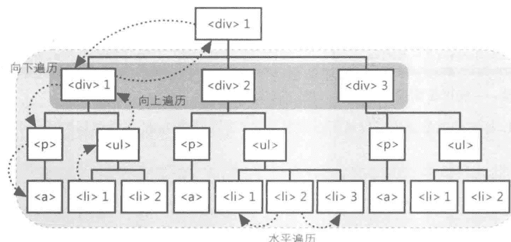

### 2. 按文档流顺序“上下楼梯”

除了树形层级，BeautifulSoup 还支持按 HTML 解析的线性顺序“走楼梯”。所谓“下一个元素”，就是当前标签在文档流中紧邻的后一个对象；“上一个元素”则是紧邻的前一个对象，具体逻辑见下图 5-6。

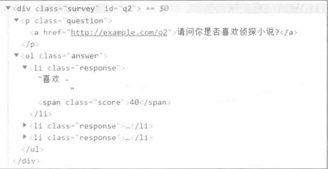

以代码  为例，`<div>` 的下一个元素是 `<p>`，接着是 `<ul>`，再后是 `<li>`。显然，这条线性链路与树形结构的层级遍历截然不同。

### 3. 避坑指南：那些“隐形”的 NavigableString

BeautifulSoup 解析网页时，会把标签封装成 `Tag` 对象，把文本封装成 `NavigableString` 对象。麻烦在于，源码里为了排版好看，标签间往往夹杂着空格、换行符（`\n`），这些“看不见”的字符也会被强行生成 `NavigableString` 对象，如 ```html
<div class="survey" id="q2">
...
    <ul class="answer">
        <li class="response">喜欢 -
        <span class="score">40</span></li>
        <li class="response">普通 -
        <span class="score selected">20</span></li>
        <li class="response">不喜欢 -
        <span class="score">0</span></li>
    </ul>
</div>
``` 所示。

```html
<div class="survey" id="q2">
...
    <ul class="answer">
        <li class="response">喜欢 -
        <span class="score">40</span></li>
        <li class="response">普通 -
        <span class="score selected">20</span></li>
        <li class="response">不喜欢 -
        <span class="score">0</span></li>
    </ul>
</div>
```

这段代码展示了 `Example.html` 第 2 题原始的 `<div>` 结构。肉眼只看到 `<span>`，但实际对象树里塞满了标签间隙产生的 `NavigableString`，干扰了遍历。

> **小贴士**：若 HTML 代码压缩成一行、标签紧密相连无空白，解析出的树结构就干净利落，正如图 5-5 所示。

实战演示：用 5.5.2 节提到的 `children` 属性抓取 `<ul>` 下的全部子标签（脚本 `Ch5_5_1.py`），请看 ```python
tag_div = soup.select("#q2")     # 找到第 2 题
tag_ul = tag_div[0].ul           # 遍历到之下的<ul>
for child in tag_ul.children:
    print(type(child))
```。

```python
tag_div = soup.select("#q2")     # 找到第 2 题
tag_ul = tag_div[0].ul           # 遍历到之下的<ul>
for child in tag_ul.children:
    print(type(child))
```

代码先用 `select()` 定位第 2 题的 `<div>`，再提取 `<ul>`，理论上 `for/in` 循环应只跑出 3 个 `<li>`，实际输出却如 ```
<class 'bs4.element.NavigableString'>
<class 'bs4.element.Tag'>
<class 'bs4.element.NavigableString'>
<class 'bs4.element.Tag'>
<class 'bs4.element.NavigableString'>
<class 'bs4.element.Tag'>
<class 'bs4.element.NavigableString'>
``` 所示：

```
<class 'bs4.element.NavigableString'>
<class 'bs4.element.Tag'>
<class 'bs4.element.NavigableString'>
<class 'bs4.element.Tag'>
<class 'bs4.element.NavigableString'>
<class 'bs4.element.Tag'>
<class 'bs4.element.NavigableString'>
```

结果里混着 3 个 `<li>` 的 `Tag` 对象，其余全是 `<li>` 前后夹带的空白 `NavigableString`。

解决思路：用 `if` 判断过滤掉它们。先导入 `NavigableString` 类，见 ```python
from bs4.element import NavigableString
```。

```python
from bs4.element import NavigableString
```

随后改写 `Ch5_5_1.py` 为 `Ch5_5_1a.py`，屏蔽这些干扰项，代码如 ```python
tag_div = soup.select("#q2")     # 找到第 2 题
tag_ul = tag_div[0].ul           # 遍历到之下的<ul>
for child in tag_ul.children:
    if not isinstance(child, NavigableString):
        print(child.name)
```。

```python
tag_div = soup.select("#q2")     # 找到第 2 题
tag_ul = tag_div[0].ul           # 遍历到之下的<ul>
for child in tag_ul.children:
    if not isinstance(child, NavigableString):
        print(child.name)
```

核心逻辑是 `not isinstance(obj, NavigableString)`，留下的自然就是 `Tag` 对象，输出结果干净利落，仅剩 3 个 `li`，见 ```
li
li
li
```。

```
li
li
li
```

### 5.5.2 纵向深潜：向下遍历

`BeautifulSoup` 对象与 `Tag` 对象均支持两种“向下钻取”姿势：一是直接点属性名（如 `soup.div`），二是调用内置属性/方法。

#### 实战：点属性名直达目标 —— `Ch5_5_2.py`

按树层级链式点属性即可逐层下潜。注意：同名标签重复时，属性访问只会返回**第一个**匹配项。以 `<html>` → `<head>` → `<title>`/`<meta>` 为例，见 ```python
print(soup.html.head.title.string)
print(soup.html.head.meta["charset"])
```。

```python
print(soup.html.head.title.string)
print(soup.html.head.meta["charset"])
```

第 1 行取 `<title>` 文本，第 2 行读 `<meta>` 的 `charset`。若用 `div` 属性，只能拿到第一个 `<div>`，如 ```python
print(soup.html.body.div.div.p.a.string)
```。

```python
print(soup.html.body.div.div.p.a.string)
```

这只能拿到首层 `<div>` 下的首个 `<div>`，次级 `<div>` 够不着。运行结果见 。


#### 实战：`contents` 一网打尽直系子标签 —— `Ch5_5_2a.py`

向下遍历有三大利器：`contents`、`children`、`descendants`。先看 `contents`，它直接返回**子标签列表**，见 ```python
tag_div = soup.select("#q2") # 找到第 2 题
tag_ul = tag_div[0].ul # 遍历到之下的<ul>
for child in tag_ul.contents:
    if not isinstance(child, NavigableString):
        print(child.span.string)
```。

```python
tag_div = soup.select("#q2") # 找到第 2 题
tag_ul = tag_div[0].ul # 遍历到之下的<ul>
for child in tag_ul.contents:
    if not isinstance(child, NavigableString):
        print(child.span.string)
```

代码定位第 2 题 `<ul>`，循环遍历 `contents` 列表，过滤 `NavigableString` 后打印 `<span>` 内容。输出见 。


#### 实战：`children` 生成器逐个产出 —— `Ch5_5_2b.py`

`children` 与 `contents` 功能近似，区别在于前者返回**生成器**（类似 `range()`），更节省内存。处理混合内容（文本 + 子标签）的 `<li>` 时很实用，见 ```python
tag_div = soup.select("#q2")       # 找到第 2 题
tag_ul = tag_div[0].ul             # 遍历到之下的<ul>
for child in tag_ul.children:
    if not isinstance(child, NavigableString):
        print(child.name)
        for tag in child:
            if not isinstance(tag, NavigableString):
                print(tag.name, tag.string)
            else:
                print(tag.replace('\n', ''))
```。

```python
tag_div = soup.select("#q2")       # 找到第 2 题
tag_ul = tag_div[0].ul             # 遍历到之下的<ul>
for child in tag_ul.children:
    if not isinstance(child, NavigableString):
        print(child.name)
        for tag in child:
            if not isinstance(tag, NavigableString):
                print(tag.name, tag.string)
            else:
                print(tag.replace('\n', ''))
```

双层循环：外层遍历生成器，`if` 筛选出 `<li>`（非 `NavigableString`）；内层再遍历 `<li>` 的孩子：`Tag` 类打印名与内容，`NavigableString` 类用 `replace()` 干掉 `\n`。结果见 ```
li
喜欢 -
span 40
li
普通 -
span 20
li
不喜欢 -
span 0
```。

```
li
喜欢 -
span 40
li
普通 -
span 20
li
不喜欢 -
span 0
```

#### 实战：`descendants` 递归全家桶 —— `Ch5_5_2c.py`

`contents`/`children` 只认“儿子”，`descendants` 认“儿子、孙子、重孙子……”——全系后代。抓取 `<ul>` 下所有 `<li>` 与 `<span>`，见 ```python
tag_div = soup.select("#q2")       # 找到第 2 题
tag_ul = tag_div[0].ul             # 遍历到之下的<ul>
for child in tag_ul.descendants:
    if not isinstance(child, NavigableString):
        print(child.name)
```。

```python
tag_div = soup.select("#q2")       # 找到第 2 题
tag_ul = tag_div[0].ul             # 遍历到之下的<ul>
for child in tag_ul.descendants:
    if not isinstance(child, NavigableString):
        print(child.name)
```

循环遍历 `descendants`，过滤空白字符串，仅打印标签名。输出见 ```
li
span
li
span
li
span
```。

```
li
span
li
span
li
span
```

#### 实战：`strings` 专提纯文本 —— `Ch5_5_2d.py`

只想要文本不要标签？`strings` 属性专门遍历所有后代节点的纯文本。提取 `<ul>` 下所有文字，见 ```python
tag_div = soup.select("#q2")      # 找到第 2 题
tag_ul = tag_div[0].ul            # 遍历到之下的<ul>
for string in tag_ul.strings:
    print(string.replace('\n', ''))
```。

```python
tag_div = soup.select("#q2")      # 找到第 2 题
tag_ul = tag_div[0].ul            # 遍历到之下的<ul>
for string in tag_ul.strings:
    print(string.replace('\n', ''))
```

循环配合 `replace()` 去除换行符。运行结果如 ```
喜欢 -
40

普通 -
20

不喜欢 -
0
```。

```
喜欢 -
40

普通 -
20

不喜欢 -
0
```

结果出现 3 行空白，源于每个 `<li>` 前的缩进换行符也被 `strings` 捕获了。

### 5.5.3 逆流而上：向上遍历

向上回溯也有“属性版”与“方法版”双通道：找直系父级或列举所有祖先。

#### 实战：定位父标签 —— `Ch5_5_3.py`

`parent` 属性与 `find_parent()` 方法均可获取直接父标签，见 ```python
tag_div = soup.select("#q2")    # 找到第 2 题
tag_ul = tag_div[0].ul          # 遍历到之下的 <ul>
##### 使用属性获取父标签
print(tag_ul.parent.name)
##### 调用函数获取父标签
print(tag_ul.find_parent().name)
```。

```python
tag_div = soup.select("#q2")    # 找到第 2 题
tag_ul = tag_div[0].ul          # 遍历到之下的 <ul>
##### 使用属性获取父标签
print(tag_ul.parent.name)
##### 调用函数获取父标签
print(tag_ul.find_parent().name)
```

代码定位第 2 题 `<ul>`，分别用属性与方法打印父标签名。结果见 ```
div
div
```。

```
div
div
```

#### 实战：列举所有祖先 —— `Ch5_5_3a.py`

想拿到从父级一直到 `<html>` 乃至 `document` 的完整链条？用 `parents` 属性或 `find_parents()`，见 ```python
tag_div = soup.select("#q2")    # 找到第 2 题
tag_ul = tag_div[0].ul          # 遍历到之下的 <ul>
##### 使用属性获取所有祖先标签
for tag in tag_ul.parents:
    print(tag.name)
##### 调用函数获取所有祖先标签
for tag in tag_ul.find_parents():
    print(tag.name)
```。

```python
tag_div = soup.select("#q2")    # 找到第 2 题
tag_ul = tag_div[0].ul          # 遍历到之下的 <ul>
##### 使用属性获取所有祖先标签
for tag in tag_ul.parents:
    print(tag.name)
##### 调用函数获取所有祖先标签
for tag in tag_ul.find_parents():
    print(tag.name)
```

同样定位 `<ul>`，双通道输出祖先链，直达文档根节点。结果见 ```
div
div
body
html
[document]
div
div
body
html
[document]
```。

```
div
div
body
html
[document]
div
div
body
html
[document]
```

### 5.5.4 横向串联：兄弟节点遍历

同层“左右互搏”，同样提供属性与方法两套 API，分别对应“上一个兄弟”与“下一个兄弟”。

#### 实战：找“下一个兄弟” —— `Ch5_5_4.py`

`next_sibling` 属性与 `find_next_sibling()` 方法专攻下一个兄弟，见 ```python
tag_div = soup.select("#q2")      # 找到第 2 题
first_li = tag_div[0].ul.li         # 第 1 个 <li>
print(first_li)
##### 使用 next_sibling 属性获取下一个兄弟标签
second_li = first_li.next_sibling.next_sibling
print(second_li)
```。

```python
tag_div = soup.select("#q2")      # 找到第 2 题
first_li = tag_div[0].ul.li         # 第 1 个 <li>
print(first_li)
##### 使用 next_sibling 属性获取下一个兄弟标签
second_li = first_li.next_sibling.next_sibling
print(second_li)
```

代码定位 `<ul>`，因夹杂空白 `NavigableString`，需连续调用 2 次 `next_sibling` 才能跳过它们。

而 `find_next_sibling()` 自带“过滤空白”光环，一次调用直达目标，见 ```python
##### 调用 next_sibling() 函数获取下一个兄弟标签
third_li = second_li.find_next_sibling()
print(third_li)
print("-----------------------------------")
##### 调用 next_siblings() 函数获取所有兄弟标签
for tag in first_li.find_next_siblings():
    print(tag.name, tag.span.string)
```。

```python
##### 调用 next_sibling() 函数获取下一个兄弟标签
third_li = second_li.find_next_sibling()
print(third_li)
print("-----------------------------------")
##### 调用 next_siblings() 函数获取所有兄弟标签
for tag in first_li.find_next_siblings():
    print(tag.name, tag.span.string)
```

最后用 `find_next_siblings()`（复数）一次性拿到首个 `<li>` 之后的所有兄弟，循环打印名与 `<span>` 内容。输出见 ```html
<li class="response">喜欢 -
    <span class="score">40</span></li>
<li class="response">普通 -
    <span class="score selected">20</span></li>
<li class="response">不喜欢 -
    <span class="score">0</span></li>
-----------------------------------
li 20
li 0
```。

```html
<li class="response">喜欢 -
    <span class="score">40</span></li>
<li class="response">普通 -
    <span class="score selected">20</span></li>
<li class="response">不喜欢 -
    <span class="score">0</span></li>
-----------------------------------
li 20
li 0
```

结果解读：首行首个 `<li>`；属性法跳到第 2 个；方法法跳到第 3 个；复数方法法列出首个 `<li>` 后的两个兄弟 `<li>`。

#### 实战：找“上一个兄弟” —— `Ch5_5_4a.py`

# 玩转 BeautifulSoup：从兄弟节点穿梭到 DOM 树重构

## 5.5.4 逆向穿梭：拿捏“上一个兄弟节点”

想在同层级标签间倒着走？`previous_sibling` 属性和 `find_previous_sibling()` 方法是你的利器。实战中，先定位到第 2 个 `<ul>` 下的首个 `<li>`，再连续两次调用 `find_next_sibling()` 向前推进两步，即可精准落在第 3 个 `<li>` 上：

```
tag_div = soup.select("#q2")        # 找到第 2 题
tag_li = tag_div[0].ul.li            # 第 1 个 <li> 标签
third_li = tag_li.find_next_sibling().find_next_sibling()
print(third_li)
##### 使用 previous_sibling 属性获取上一个兄弟标签
second_li = third_li.previous_sibling.previous_sibling
print(second_li)
```

注意：直接用 `previous_sibling` 属性得连跳两次，因为中间夹杂着不可见的 `NavigableString` 节点（换行、空白符）。而 `find_previous_sibling()` 方法自带“过滤器”，一次调用即可越过干扰直达目标标签：

```
##### 调用 find_previous_sibling() 函数获取上一个兄弟标签
first_li = second_li.find_previous_sibling()
print(first_li)
print("----------------------------------------")
##### 调用 find_previous_siblings() 函数获取所有兄弟标签
for tag in third_li.find_previous_siblings():
    print(tag.name, tag.span.string)
```

再配合 `find_previous_siblings()` 一网打尽当前节点之前的所有同辈元素，配合 `for/in` 循环即可批量打印标签名及内嵌 `<span>` 文本：

```
<li class="response">不喜欢 -
    <span class="score">0</span></li>
<li class="response">普通 -
    <span class="score selected">20</span></li>
<li class="response">喜欢 -
    <span class="score">40</span></li>
----------------------------------------
li 20
li 40
```

输出顺序与正向遍历（Ch5-5-4.py）恰好相反——本质上是从列表尾部向头部回溯，最终只保留第 3 个 `<li>` 之前的两个兄弟节点。

## 5.5.5 按解析顺序“串联”一切：上一个/下一个元素

BeautifulSoup 按 HTML 文档流线性化解析树。`next_element` 指向解析序列中的紧邻下游对象，`previous_element` 指向紧邻上游对象——它们不限于标签，文本节点、注释通通在列。

### 实战演练——双向元素漫游：Ch5_5_5.py

以 `Example.html` 为沙盒。从 `<html>` 出发，两次 `next_element` 越过中间文本节点抵达 `<head>`；从 `<title>` 反向两次 `previous_element` 回溯到 `<meta>`：

```
<html lang="big5">
<head>
<meta charset="utf-8"/>
<title>测试数据爬取的 HTML 网页</title>
</head>
<body>
...
</body>
</html>
```

```
tag_html = soup.html      # 找到 <html> 标签
print(type(tag_html), tag_html.name)
tag_next = tag_html.next_element.next_element
print(type(tag_next), tag_next.name)
tag_title = soup.title      # 找到 <title> 标签
print(type(tag_title), tag_title.name)
tag_previous = tag_title.previous_element.previous_element
print(type(tag_previous), tag_previous.name)
```

运行结果印证了“文本节点占位”的细节：

```
<class 'bs4.element.Tag'> html
<class 'bs4.element.Tag'> head
<class 'bs4.element.Tag'> title
<class 'bs4.element.Tag'> meta
```

### 实战演练——一键获取所有下游元素：Ch5_5_5a.py

`next_elements` 生成器一次性吐出当前节点之后的完整解析流。示例先通过 `id` 定位第 2 个 `<div>`：

```
...
<div class="emails" id="emails">
<div class="question">电子邮件列表信息： </div>
abc@example.com
<div class="survey" data-custom="important">def@example.com</div>
<span class="survey" id="email">ghi@example.com</span>
</div>
...
```

再用 `for/in` 遍历 `next_elements`，配合 `if` 过滤掉 `NavigableString`，仅保留标签名：

```
tag_div = soup.find(id = "emails")
for element in tag_div.next_elements:
    if not isinstance(element, NavigableString):
        print(element.name)
```

输出清单如下：

```
div
div
span
```

### 实战演练——全量回溯上游元素：Ch5_5_5b.py

`previous_elements` 同理，反向产出所有上游对象。先锁定第 1 个问题对应的 `<div>`：

```
<html lang="gbk">
<head>
<meta charset="utf-8"/>
<title>测试数据爬取的 HTML 网页</title>
</head>
<body>
<!-- Surveys -->
<div class="surveys" id="surveys">
<div class="survey" id="q1">
...
```

循环遍历并剔除文本节点：

```
tag_div = soup.find(id="q1")
for element in tag_div.previous_elements:
    if not isinstance(element, NavigableString):
        print(element.name)
```

回溯序列呈现：


---

## 5.6 重塑 DOM 树：标签、属性、内容随心改

> **核心提示**：一切修改仅作用于 BeautifulSoup 在内存中构建的对象树，**原始 HTML 文件纹丝不动**。

### 实战演练——改名换姓、增删属性：Ch5_6.py

`Tag` 对象原生支持标签名重写、属性增删改查。示例：新建解析树 → 抓取 `<b>` → 依次修改标签名、重写 `class`、新增 `id`、删除 `class`：

```
soup = BeautifulSoup("<b class='score'>Joe</b>", "lxml")
tag = soup.b
tag.name = "p"
tag["class"] = "question"
tag["id"] = "name"
print(tag)
del tag["class"]
print(tag)
```

运行结果直观展示了标签“整容”全过程：

```
<p class="question" id="name">Joe</p>
<p id="name">Joe</p>
```

### 实战演练——原地替换文本内容：Ch5_6a.py

`string` 属性赋值即可覆盖标签内部文本（若标签包含子标签会被整体替换）：

```
soup = BeautifulSoup("<b class='score'>Joe</b>", "lxml")
tag = soup.b
tag.string = "Mary"
print(tag)
```

执行后 `<b>` 标签文本已悄然变更：

```
<b class="score">Mary</b>
```

### 实战演练——从零组装新标签与混合内容：Ch5_6b.py

三步走：`new_tag()` 造空标签 → `append()` 塞入子标签/文本 → `NavigableString` 处理纯文本片段。示例在 `<b>` 内追加 `<a>` 链接与前后文本：

```
soup = BeautifulSoup("<b></b>", "lxml")
tag = soup.b
tag.append("Joe")
print(tag)
new_str = NavigableString(" Chen")
tag.append(new_str)
print(tag)
new_tag = soup.new_tag("a", href="http://www.example.com")
tag.append(new_tag)
print(tag)
```

生成的树结构已包含新增链接与混排文本：

```
<b>Joe</b>
<b>Joe Chen</b>
<b>Joe Chen<a href="http://www.example.com"></a></b>
```

### 实战演练——精准插入与清空：Ch5_6c.py

`insert_before()` / `insert_after()` 实现“外科手术式”插入；`new_string()` 造文本节点；`clear()` 一键清空标签内部：

```
soup = BeautifulSoup("<p><b>One</b></p>", "lxml")
tag = soup.b
new_tag = soup.new_tag("i")
new_tag.string = "Two"
tag.insert_before(new_tag)
print(soup.p)
new_string = soup.new_string("Three")
tag.insert_after(new_string)
print(soup.p)
tag.clear()
print(soup.p)
```

执行流程：`<i>Two</i>` 插入 `<b>` 前 → 文本 `"Three"` 插入 `<b>` 后 → `<b>` 原有文本被 `clear()` 抹除：

```
<p><i>Two</i><b>One</b></p>
<p><i>Two</i><b>One</b>Three</p>
<p><i>Two</i><b></b>Three</p>
```

### 实战演练——标签级“置换术”：Ch5_6d.py

`replace_with()` 直接用新节点替换旧节点。示例将 `<b>` 整个换成 `<i>Two</i>`：

```
soup = BeautifulSoup("<p><b>One</b></p>", "lxml")
tag = soup.b
new_tag = soup.new_tag("i")
new_tag.string = "Two"
tag.replace_with(new_tag)
print(soup.p)
```

结果中 `<b>` 消失，`<i>` 原地上位：

```
<p><i>Two</i></p>
```

---

## 学习检测 · 自测清单

1. 网络爬虫的核心使命是什么？
2. 对比 `find()` 与 `find_all()` 的差异并举例。
3. 若用 CSS 选择器，BeautifulSoup 对象可调用 ______ 或 ______ 方法检索目标标签。
4. `find()` 如何结合正则表达式做模糊匹配？
5. BeautifulSoup 提供哪几类遍历 HTML 文档的路径？
6. 编写脚本：打开 `Ch05\index.html`，提取所有 `class="nav-item"` 的标签。
7. 编写脚本：打开 `Ch05\index.html`，收集全部 `<a>` 标签的 `href` 值。
8. 编写脚本：打开 `Ch05\index.html`，筛选所有以 `http` 开头的 URL。
9. 编写脚本：打开 `Ch05\index.html`，定位 `id="navbarResponsive"` 的 `<div>`，输出其 `<ul>` 下所有 `<li>` 内容。
10. 接第 4 章检测第 6 题，导出页面内所有图文资源的 URL。

---

# 第 6 章 数据清洗与持久化落地

- 6.1 Python 字符串处理
- 6.2 数据清洗实战
- 6.3 本地文件存储
- 6.4 接入 SQL 数据库
- 6.5 接入 NoSQL 数据库

## 6.1 Python 字符串处理：清洗的地基

爬下来的全是脏文本，**字符串处理是清洗的第一道工序**。

### 6.1.1 字符串的多种“出生”方式

Python 字符串本质是 **不可变的 Unicode 序列**，单双引号皆可，所谓修改实为“新建”。

#### 实战演练——创建字符串：Ch6_1_1.py

直接赋值、构造函数、空串初始化样样行：

```
str1 = "学习 Python 语言程序设计"
str2 = 'Hello World!'
ch1 = "A"
```

```
name1 = str()
name2 = str("陈会安")
```

`print()` 直出变量，或用 `+` 拼接后再输出（无需 `str()` 转换）：

```
print(str1)
print(str2)
```

```
print("ch1 = " + ch1)
print("name1 = " + name1)
print("name2 = " + name2)
```

#### 实战演练——逐字符迭代：Ch6_1_1a.py

字符串可直接 `for` 循环，逐个吐出 Unicode 字符：

```
str3 = 'Hello'
```

```
for e in str3:
    print(e)
```

在上述 `for` 循环中，`in` 后跟随的是字符串 `str3`。循环每轮迭代，都会从字符串首字符起依次提取一个字符赋值给变量 `e`，并自动移至下一位，直至遍历完毕。这一过程相当于按顺序访问字符串的每一个字符，从而依次输出 H、e、l、l、o。

#### 6.1.2 字符串方法详解

Python 内置了丰富的字符串方法用于处理文本。调用方式为：`字符串对象.方法名()`，例如：

```python
str1 = 'welcome to python'
print(str1.islower())
```

上述代码创建字符串 `str1` 后，调用 `islower()` 判断其是否全为小写字母。

> **注意**：字符串方法不仅适用于变量，字符串字面量（如 `"1000"`）同样可以直接调用，因为它们本质上也是对象：
> ```python
> print("1000".isdigit())
> ```

##### 实战演练——常用内置函数：`Ch6_1_2.py`

Python 提供了 `len()`、`max()`、`min()` 等内置函数处理字符串，功能汇总如表 6-1：

**表 6-1 Python 内置字符串函数速查**

| 函数 | 功能说明 | 示例 |
| :--- | :--- | :--- |
| `len()` | 返回字符串长度 | `len(str1)` |
| `max()` | 返回最大字符（按 ASCII/Unicode 码值） | `max(str1)` |
| `min()` | 返回最小字符 | `min(str1)` |

> 建议配合同名示例程序（Ch6_1_2.py）上手练习，查看运行结果。

##### 实战演练——内容检查类方法：`Ch6_1_2a.py`

这类方法用于判断字符串“成分”，返回布尔值，详见表 6-2：

**表 6-2 字符串内容检查方法速查**

| 方法 | 判断条件（全真返回 True） | 示例 |
| :--- | :--- | :--- |
| `isalnum()` | 仅含字母、数字 | `str1.isalnum()` |
| `isalpha()` | 仅含字母 | `str1.isalpha()` |
| `isdigit()` | 仅含数字 | `str1.isdigit()` |
| `isidentifier()` | 符合标识符命名规则 | `str1.isidentifier()` |
| `islower()` | 全为小写字母 | `str1.islower()` |
| `isupper()` | 全为大写字母 | `str1.isupper()` |
| `isspace()` | 全为空白字符 | `str1.isspace()` |

##### 实战演练——子串搜索与统计：`Ch6_1_2b.py`

当需要查找子串位置或统计出现次数时，表 6-3 的方法最好用：

**表 6-3 子字符串搜索方法速查**

| 方法 | 功能说明 | 示例 |
| :--- | :--- | :--- |
| `endswith(str1)` | 是否以 `str1` 结尾 | `str2.endswith(str1)` |
| `startswith(str1)` | 是否以 `str1` 开头 | `str2.startswith(str1)` |
| `count(str1)` | 统计 `str1` 出现次数 | `str2.count(str1)` |
| `find(str1)` | 返回 `str1` 首次出现的索引，找不到返回 -1 | `str2.find(str1)` |
| `rfind(str1)` | 返回 `str1` 最后一次出现的索引，找不到返回 -1 | `str2.rfind(str1)` |

##### 实战演练——大小写转换与替换：`Ch6_1_2c.py`

表 6-4 汇总了修改字符串大小写或替换内容的方法（均返回新字符串，原对象不变）：

**表 6-4 字符串转换与替换方法速查**

| 方法 | 功能说明 | 示例 |
| :--- | :--- | :--- |
| `capitalize()` | 首字母大写，其余小写 | `str1.capitalize()` |
| `lower()` | 全转小写 | `str1.lower()` |
| `upper()` | 全转大写 | `str1.upper()` |
| `title()` | 每个单词首字母大写 | `str1.title()` |
| `swapcase()` | 大小写互换 | `str1.swapcase()` |
| `replace(old, new)` | 将 `old` 替换为 `new` | `str1.replace(old_str, new_str)` |

#### 6.1.3 切片操作：灵活截取子串

方括号 `[]` 不仅用于按索引取单个字符（索引从 0 起，支持负数反向索引），更是强大的**切片运算符**，能按范围截取子串。

##### 实战演练——索引取字符：`Ch6_1_3.py`

```python
str1 = 'Hello'

print(str1[0])    # H
print(str1[1])    # e
print(str1[-1])   # o
print(str1[-2])   # l
```

代码演示了正向索引（0, 1）与反向索引（-1 为末尾，-2 为倒数第二）获取字符的用法。

##### 实战演练——切片语法与实例：`Ch6_1_3a.py`

切片核心语法：`字符串[start:end]` —— 取从 `start` 到 `end-1` 的子串。
- 省略 `start` 默认从 0 开始；
- 省略 `end` 默认截至末尾。

假设 `str1 = "Hello World!"`，其索引分布如图 6-1 所示（含正负索引对照）。

```python
str1[start:end]
```
```python
str1 = 'Hello World!'
```
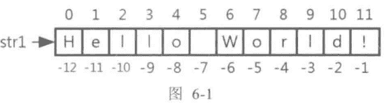

常见切片效果速览（表 6-5）：

| 切片写法 | 索引范围 | 结果 |
| :--- | :--- | :--- |
| `str1[1:3]` | 1 ~ 2 | `"el"` |
| `str1[1:5]` | 1 ~ 4 | `"ello"` |
| `str1[1:7]` | 1 ~ 6 | `"ello W"` |
| `str1[4:]` | 4 ~ 末尾 | `"o World!"` |
| `str1[1:-1]` | 1 ~ 倒数第二 | `"ello World"` |
| `str1[6:-2]` | 6 ~ 倒数第三 | `"Worl"` |

#### 6.1.4 字符串与列表互转：`split()` 与 `join()`

实战中常需在“整段文本”与“列表项”之间切换。

##### 1. 字符串转列表：`split()` / `splitlines()`

表 6-6 核心方法对比：

**表 6-6 字符串分割方法**

| 方法 | 行为 |
| :--- | :--- |
| `split(sep=None)` | 无参数按任意空白字符分割；指定 `sep` 则按该字符分割 |
| `splitlines()` | 专门按换行符 `\n` 分割，适合处理多行文本 |

**实例**：将句子拆分为单词列表（`Ch6_1_4.py`）：

```python
str1 = "This is a book."
list1 = str1.split()
print(list1)    # ['This', 'is', 'a', 'book.']
```

**实例**：指定逗号分隔（`Ch6_1_4.py`）：

```python
str2 = "Tom, Bob, Mary, Joe"
list2 = str2.split(", ")
print(list2)    # ['Tom', 'Bob', 'Mary', 'Joe']
```

**实例**：处理多行文本（`Ch6_1_4.py`）。读取文件常得带 `\n` 的字符串，用 `splitlines()` 比 `split("\n")` 更简洁：

```python
str3 = "23\n12\n45\n56"
list3 = str3.splitlines()
print(list3)    # ['23', '12', '45', '56']
```

> **提示**：分割后的列表元素均为字符串类型，数值需后续手动转型（如 `int()`）。

##### 2. 列表转字符串：`join()`

`连接符.join(列表)` 将列表元素拼成单一字符串（`Ch6_1_4a.py`）：

```python
str1 = "-"
list1 = ['This', 'is', 'a', 'book.']
print(str1.join(list1))    # 'This-is-a-book.'
```

示例中 `"-"` 作为连接符，将 `list1` 拼接为 `'This-is-a-book.'`。

---

### 6.2 实战：数据清洗

爬虫拿到的原始网页数据通常“脏乱差”：夹杂多余符号、格式不统一、换行混乱、错别字、缺失值。入库/落盘前，必须用字符串方法与正则表达式**清洗（Clean the Data）**。

清洗时机通常有二：
1.  **抓取即清洗**：数据落地前处理（本章重点）。
2.  **探索时清洗**：结合 Pandas 在表格层面深度清洗（详见第 9 章、13.3 节）。

#### 6.2.1 用字符串方法净化文本

网页数据本质是字符串，善用 6.1 节方法可解决大部分基础清洗需求。

##### 实战演练——分割重组生成 CSV：`Ch6_2_1.py`

`split()` 拆列表 + `join()` 合字符串，轻松实现格式转换（如空格转 CSV）：

```python
str1 = """Python is a programming language that lets you work quickly
and integrate systems more effectively."""

list1 = str1.split()
print(list1)

str2 = ",".join(list1)
print(str2)
```

运行结果：

```text
['Python', 'is', 'a', 'programming', 'language', 'that', 'lets', 'you',
'work', 'quickly', 'and', 'integrate', 'systems', 'more', 'effectively.']
Python, is, a, programming, language, that, lets, you, work, quickly, and,
integrate, systems, more, effectively.
```

##### 实战演练——删除不可见/无用字符：`Ch6_2_1a.py`

爬取数据常含 `\n`、`\r`、首尾空格。组合拳：`replace()` 删特定字符 + `strip()` 修剪两端：

```python
str1 = " Python is a \nprogramming language.\n\r "
str2 = str1.replace("\n", "").replace("\r", "")
print("" + str2 + "")
print("" + str2.strip() + "")
```

运行结果：


> **避坑指南**：`replace(" ", "")` 会删光**所有**空格。若需“压缩多空格为单空格”，请用正则（见 6.2.2）。

##### 实战演练——批量去除标点符号：`Ch6_2_1b.py`

借用 `string.punctuation` 获取全量标点集合，遍历列表逐项 `strip()` 清洗：

```python
import string

str1 = "#$%^Python -is- *a* $%programming _ language.$"

print(string.punctuation)
list1 = str1.split(" ")
for item in list1:
    print(item.strip(string.punctuation))
```

运行结果：

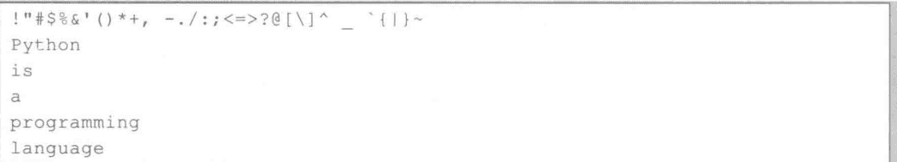

##### 实战演练——统一 URL 格式：`Ch6_2_1c.py`

网页链接常混杂相对/绝对路径。封装函数 `getUrl(base, target)` 判断前缀补全，规范化输出。

基底 URL 与测试集：

```python
baseUrl = "http://example.com"
list1 = ["http://www.example.com/test", "http://example.com/word",
        "media/ex.jpg", "http://www.example.com/index.html"]

def getUrl(baseUrl, source):
    if source.startswith("http://www."):
        url = "http://" + source[11:]
    elif source.startswith("http://"):
        url = source
    elif source.startswith("www"):
        url = source[4:]
        url = "http://" + source
    else:
        url = baseUrl + "/" + source

    if baseUrl not in url:
        return None

    return url
```

核心逻辑（`if/elif/else` 判断开头）与批量测试循环：

```python
for item in list1:
    print(getUrl(baseUrl, item))
```

运行结果，所有链接已统一为绝对路径：

```text
http://example.com/test
http://example.com/word
http://example.com/media/ex.jpg
http://example.com/index.html
```

#### 6.2.2 进阶利器：正则表达式 `re` 模块

复杂模式匹配、替换，`re.sub(pattern, repl, string)` 是王道。

##### 实战演练——正则版“去噪”与“压缩空格”：`Ch6_2_2.py`

复刻 6.2.1 需求：用 `re.sub()` 删除换行、将连续空格压缩为单个：

```python
str1 = " Python is a \nprogramming language.\n\r "
str2 = str1.replace("\n", "").replace("\r", "")
print("" + str2 + "")
print("" + str2.strip() + "")
```  (注：此处素材原标记为 PRE12，但上下文为正则演示代码，保留原标记)

```python
import re

str1 = " Python, is a, \nprogramming, \n\nlanguage.\n\r "

list1 = str1.split(",")
for item in list1:
    item = re.sub(r"\n+", "", item)
    item = re.sub(r" +", " ", item)
    item = item.strip()
    print("'" + item + "'")
```

代码示例中，`str1` 作为测试字符串，经 `split()` 分列后，连续调用两次 `sub()` 进行清洗：首轮清除连续换行符，次轮压缩多余空格（保留单个），最后以 `strip()` 去除首尾空白。运行效果如下：

```text
'Python'
'is a'
'programming'
'language.'
```

##### 实战：电话号码字符串清洗——Ch6_2_2a.py

针对电话、金额等定格数据，`re.sub()` 是利器，示例如下：

```python
import re

phone = "0938-111-4567 # Phone Number"

num = re.sub(r"#.*$", "", phone)
print(num)

num = re.sub(r"\D", "", phone)
print(num)
```

号码串含连字符及类 Python 注释，首轮 `sub()` 移除 `#` 及后续注释，次轮 `sub()` 只保数字。输出结果如下：

```text
0938-111-4567
09381114567
```

##### 实战：路径字符串规范化——Ch6_2_2b.py

同理，`re.sub()` 亦可整理路径，代码如下：

```python
import re

list1 = ["", "/", "path/", "/path", "/path/", "//path/", "/path//"]

def getPath(path):
    if path:
        if path[0] != "/":
            path = "/" + path
        if path[-1] != "/":
            path = path + "/"
        path = re.sub(r"/{2,}", "/", path)
    else:
        path = "/"
    return path

for item in list1:
    item = getPath(item)
    print(item)
```

`getPath()` 以嵌套 `if/else` 判断路径首尾 `/` 补全逻辑；`sub()` 则负责折叠多余斜杠。运行结果如下：

```
/
/
/path/
/path/
/path/
/path/
/path/
```

### 6.3 数据落盘

网页数据抓取完毕，常以 CSV、JSON 存储；若涉图片，亦可直接下载保存。

#### 6.3.1 CSV 存储

CSV 即纯文本表格，行分记录，逗号分列。以表 6-7 为例：

##### 表 6-7 示例数据

| Data1 | Data2 | Data3 |
|---|---|---|
| 10 | 33 | 45 |
| 5 | 25 | 56 |

转 CSV 如下：

```
Data1, Data2, Data3
10, 33, 45
5, 25, 56
```

各行以 `\n` 结尾，列以 `,` 分隔，Excel 可直接打开。

##### 实战：读 CSV——Ch6_3_1.py

`csv` 模块读取 `Example.csv`（即表 6-7 数据）：

```python
import csv
csvfile = "Example.csv"
with open(csvfile, 'r') as fp:
    reader = csv.reader(fp)
    for row in reader:
        print(','.join(row))
```

流程：导入模块 → `open()` → `csv.reader()` → 循环逐行 → `join()` 组装逗号分隔串。输出如下：

```
Data1, Data2, Data3
10, 33, 45
5, 25, 56
```

##### 实战：写 CSV——Ch6_3_1a.py

列表数据亦可写入 CSV，写 `Example2.csv` 为例：

```python
import csv

csvfile = "Example2.csv"
list1 = [[10, 33, 45], [5, 25, 56]]
with open(csvfile, 'w+', newline='') as fp:
    writer = csv.writer(fp)
    writer.writerow(["Data1", "Data2", "Data3"])
    for row in list1:
        writer.writerow(row)
```

关键点：`open(newline='')` 禁用默认换行；`csv.writer()` 创建写入器；`writerow(list)` 写单行；循环遍历列表写入。Excel 打开效果见图 6-2。

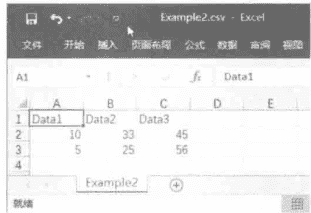

##### 图 6-2

##### 实战：抓 W3School 表格存 CSV——Ch6_3_1b.py

掌握读写后，尝试抓取网页表格入库。W3School “视频格式” 页如图 6-3。

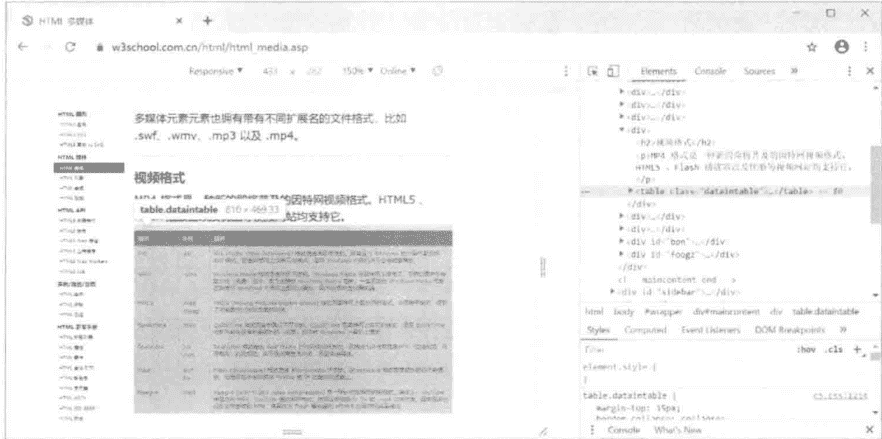

##### 图 6-3

开发者工具定位 `<table class="dataintable">`，编写脚本抓取入 `VideoFormat.csv`：

```python
import requests
from bs4 import BeautifulSoup
import csv

url = "https://www.w3schools.com.cn/html/html_media.asp"
csvfile = "VideoFormat.csv"
r = requests.get(url)
r.encoding = "utf-8"
soup = BeautifulSoup(r.text, "lxml")
tag_table = soup.find(class_="dataintable")    # 搜索 <table> 标签
rows = tag_table.findAll("tr")    # 搜索所有 <tr> 标签
```

逻辑：`BeautifulSoup` 定位首个 `<table>` → `findAll('tr')` 取全行 → 双层循环：外层遍历行，内层 `findAll(['td','th'])` 取单元格 → `get_text()` 清洗 `\n\r` → `append()` 入行列表 → `writerow()` 写文件。生成文件用 Excel 打开如图 6-4。

```python
with open(csvfile, 'w+', newline='', encoding="utf-8") as fp:
    writer = csv.writer(fp)
    for row in rows:
        rowList = []
        for cell in row.findAll(["td", "th"]):
            rowList.append(cell.get_text().replace("\n", "").replace("\r", ""))
        writer.writerow(rowList)
```


#### 6.3.2 JSON 存储

`json` 模块配合文件操作即可完成序列化与反序列化。

##### 实战：字典与 JSON 串互转——Ch6_3_2.py

`dumps()` 字典转串，`loads()` 串转字典：

```python
import json

data = {
    "name": "Joe Chen",
    "score": 95,
    "tel": "0933123456"
}

json_str = json.dumps(data)
print(json_str)
data2 = json.loads(json_str)
print(data2)
```

输出对比：
```json
{"name": "Joe Chen", "score": 95, "tel": "0933123456"}
```
```python
{'name': 'Joe Chen', 'score': 95, 'tel': '0933123456'}
```

##### 实战：字典写 JSON 文件——Ch6_3_2a.py

`dump(obj, fp)` 直写文件：

```python
import json

data = {
    "name": "Joe Chen",
    "score": 95,
    "tel": "0933123456"
}

jsonfile = "Example.json"
with open(jsonfile, 'w') as fp:
    json.dump(data, fp)
```

构建字典 `data` → `open()` 写模式 → `json.dump(data, f)` → 目录下生成 `Example.json`。

##### 实战：读 JSON 文件——Ch6_3_2b.py

`load(fp)` 读文件反序列化为字典：

```python
import json
jsonfile = "Example.json"
with open(jsonfile, 'r') as fp:
    data = json.load(fp)
json_str = json.dumps(data)
print(json_str)
```

打开 `Example.json` → `json.load()` → 转字典 → 再 `dumps()` 打印。结果如下：

```
{ "name": "Joe Chen", "score": 95, "tel": "0933123456" }
```

##### 实战：抓北京天气 JSON 入库——Ch6_3_2c.py

天气接口 `http://www.weather.com.cn/data/sk/101010100.html`（北京代码 101010100），返回如图 6-5。

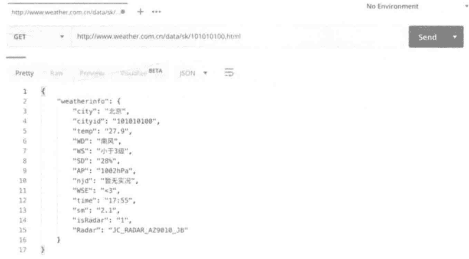

##### 图 6-5

脚本抓取并存 `Weather.json`：

```python
import json
import requests
url = "http://www.weather.com.cn/data/sk/101010100.html"
jsonfile = "Weather.json"
r = requests.get(url)
r.encoding = "utf-8"
json_data = json.loads(r.text)
with open(jsonfile, 'w') as fp:
    json.dump(json_data, fp, ensure_ascii=False)
```

流程：`requests.get()` → `json.loads()` 反序列化 → `open()` 写模式 → `json.dump()` 落盘。

#### 6.3.3 图片下载

`requests` 或 `urllib` 均可流式下载图片至本地。

##### 实战：requests 下载图片——Ch6_3_3.py

抓取 `https://www.baidu.com/img/bd_logo1.png`：

```python
import requests
url = "https://www.baidu.com/img/bd_logo1.png"
path = "logo.png"
response = requests.get(url, stream=True)
if response.status_code == 200:
    with open(path, 'wb') as fp:
        for chunk in response:
            fp.write(chunk)
        print("图文件已经下载")
else:
    print("错误！HTTP 请求失败...")
```

要点：`stream=True` 开启流式响应；判断状态码；`with open(..., 'wb')` 二进制写入。

```python
with open(path, 'wb') as fp:
    for chunk in response:
        fp.write(chunk)
```

块迭代写入：`for chunk in response.iter_content(): f.write(chunk)`。成功提示见下：


确认当前目录生成 `logo.png`。

##### 实战：urllib 下载图片——Ch6_3_3a.py

`urllib.request.urlopen()` 亦可下载，为提效采用缓冲区读写：

```python
import requests
url = "https://www.baidu.com/img/bd_logo1.png"
path = "logo.png"
response = requests.get(url, stream=True)
if response.status_code == 200:
    with open(path, 'wb') as fp:
        for chunk in response:
            fp.write(chunk)
        print("图文件已经下载")
else:
    print("错误！HTTP 请求失败...")
```

（注：原文此处标记为 PRE21，实为后续代码块，此处保留原标记顺序）
导入 `urllib.request` → `urlopen(url)` 发请求 → 缓冲区循环读写 → 保存图片。

```python
import urllib.request

url = "https://www.baidu.com/img/bd_logo1.png"
response = urllib.request.urlopen(url)
fp = open("logo.png", "wb")
size = 0
while True:
    info = response.read(10000)
    if len(info) < 1:
        break
    size = size + len(info)
    fp.write(info)
    print(size, "个字符下载...")
fp.close()
response.close()
```

代码利用 `while` 循环反复调用响应对象的 `read()` 方法，每次读取 10000 字节写入二进制文件，同时累计总字符数。当读取长度小于 1 时退出循环，下载结束。运行结果如下图所示，确认已在脚本同级目录下生成 `logo.png`，文件大小为 7877 字符。


##### 实战演练——抓取百度 Logo 图片：Ch6_3_3b.py

接下来结合正则表达式实战，直接从网络抓取百度首页（`http://www.baidu.com`）的 Logo 图片。

借助 Chrome 开发者工具定位到 Logo 所在元素的 `id` 属性为 `lg`（对应脚本 Ch6_3_3c.py），随后用 BeautifulSoup 的 `find()` 方法锁定该 `<div>` 标签，参见示意图。

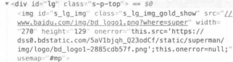

##### 图 6-6

从该标签中提取图片路径，需借助正则表达式，模式串如下：

```
"www(.+?)+\.(?:jpg|gif|png)"
```

该正则用于从字符串中捕获完整的图片路径。整个 Python 脚本分两阶段：先发送 HTTP 请求获取网页，再解析 HTML 定位 `id="lg"` 的 `<div>` 标签，代码如下：

```python
import re
import requests
from bs4 import BeautifulSoup

url = "http://www.baidu.com"
path = "logo.png"
r = requests.get(url)
r.encoding = "utf-8"
soup = BeautifulSoup(r.text, "lxml")
tag_a = soup.find(id="lg")
```

脚本引入必要模块后，用 `requests` 发起请求，用 BeautifulSoup 解析响应内容，调用 `find()` 获取目标 `<div>` 字符串。接着用正则提取 Logo 图片路径，后续下载逻辑如下：

```python
match = re.search(r"(www(.+?)+\.(?:jpg|gif|png))", str(tag_a))
url = url + str(match.group())
response = requests.get(url, stream=True)
if response.status_code == 200:
    with open(path, 'wb') as fp:
        for chunk in response:
```

```python
fp.write(chunk)

print("图文件 logo.png 已经下载")

else:

print("错误! HTTP 请求失败...")
```

代码调用 `search()` 匹配路径，拼接百度域名补全 URL，复用 Ch6_3_3.py 的下载逻辑保存文件。运行输出如下：

图文件 logo.png 已经下载

表明下载成功，文件预览见下图。


图 6-7

### 6.4 将数据存入 SQL 数据库

SQLite 是一款轻量级、基于单文件的免费数据库引擎，Python 标准库内置 `sqlite3` 模块，方便将爬取的数据持久化存储。

#### 6.4.1 认识 SQLite 数据库

SQLite 是全球部署量极大的开源数据库引擎，遵循 SQL92 标准大部分规范。它无需独立服务器进程、零配置、体积小巧，却完整支持事务（Transaction），官网为 `http://www.sqlite.org`。

数据以单个文件形式存放，直接沿用文件系统权限控制访问，因此不涉及 SQL 的 DCL（数据控制语言）。核心优势在于：
- **极简部署**：单文件即数据库，无需安装配置服务，不占额外内存。
- **权限直观**：读写权限完全由操作系统文件权限决定。

#### 6.4.2 使用 DB Browser for SQLite 可视化建库建表

DB Browser for SQLite 是开源管理工具，书中配套资源 `Tools` 文件夹提供免安装版（`DB Browser for SQLite.exe`）。

##### 1. 创建数据库与 Books 表

目标建立 `Books.sqlite` 数据库（后缀可自定义如 `.db`），包含 `Books` 表，字段设计见下表：

| 字段名 | 类型 | 说明 |
| :--- | :--- | :--- |
| id | TEXT | 书号，主键 |
| title | TEXT | 书名，非空 |
| price | INTEGER | 定价 |

操作步骤：

- **Step 1** 双击运行工具，进入主界面。

- **Step 2** 点击工具栏“新建数据库”或“文件 → 新建数据库”，弹出保存对话框。
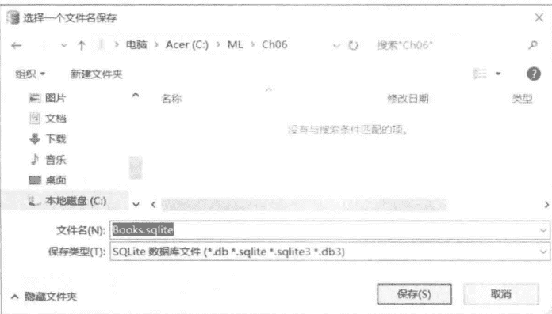
- **Step 3** 存储路径选 `\ML\Ch06`，文件名填 `Books.sqlite` 保存，随即弹出“编辑表定义”窗口。
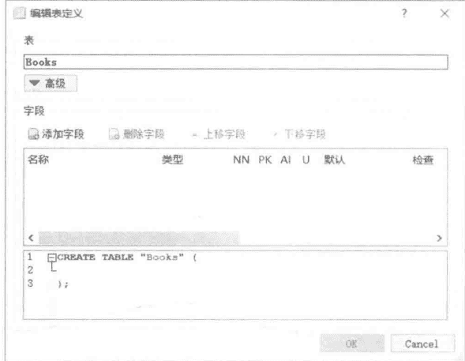
- **Step 4** 表名填 `Books`，下方自动生成对应 SQL。
- **Step 5** 点击“添加字段”，依次创建 `id` (TEXT)、`title` (TEXT)、`price` (INTEGER)。
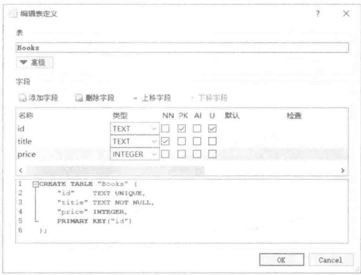
- **Step 6** 勾选 `id` 的 PK（主键）与 U（唯一），设 `title` 为 NN（非空），确定后左侧树形图出现新表。


若需增表，可用工具栏“创建表”或菜单“编辑 → 创建表”。

##### 2. 图形界面手工添加记录

打开数据库，左侧展开选中 `Books` 表右键，选择“浏览表”或切换“浏览数据”标签，以表格形式查看数据。
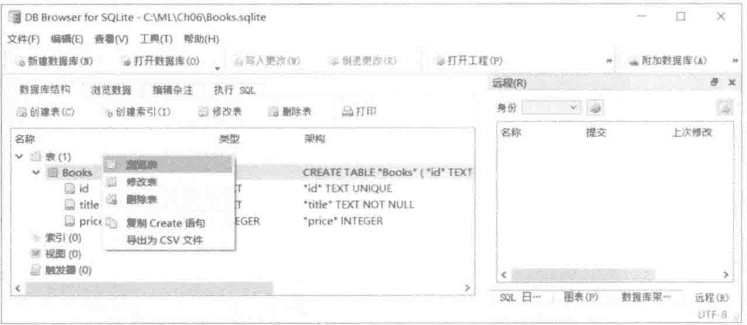

点击“新建记录”按钮，依次填入书号、书名、价格即可（示例数据仅供演示）。

##### 3. 用 SQL INSERT 语句批量导入

`INSERT` 语法模板：
```
INSERT INTO table (column1, column2, ...)
VALUES ('value1', 'value2 ', ...)
```

实操步骤：
- **Step 1** 切换“执行 SQL”标签，粘贴 SQL 或点击“打开 SQL 文件”载入配套脚本（`Ch6_4_2.sql`）。
- **Step 2** 点击工具栏三角执行按钮，下方提示成功；切回“浏览数据”可看到新记录。


> 语法说明：`table` 为目标表，`column1~n` 为列名，`value1~n` 为对应值。向 `Books` 表插入一条记录示例：
```sql
INSERT INTO Books (id, title, price)
VALUES ('P0001', 'C 语言程序设计', 510)
```

##### 4. 用 SQL SELECT 语句查询数据

`SELECT` 基础语法：
```sql
SELECT column1, column2
FROM table
WHERE conditions
```

含义：从 `table` 中筛选满足 `WHERE` 条件的记录，返回 `column1`、`column2` 字段。查全表示例：
```sql
SELECT * FROM Books
```

在新标签页输入 `SELECT * FROM Books` 执行，因无 `WHERE` 子句，返回全量字段与记录。


图 6-17

`WHERE` 子句常用规则速查：

- **文本字段**须用单引号括起。如书号 `P0001`：
  ```
  SELECT * FROM Books
  WHERE id='P0001'
  ```
- **数值字段**直接写值。如价格 `450`：
  ```
  SELECT * FROM Books
  WHERE price=450
  ```
- **模糊匹配**用 `LIKE` 配合通配符 `%`（任意长度）或 `_`（单字符）。如书名含“程序”：
  ```
  SELECT * FROM Books
  WHERE title LIKE '%程序%'
  ```
- **数值比较**支持 `<>`、`>`、`<`、`>=`、`<=`。如价格大于 500：
  ```
  SELECT * FROM Books
  WHERE price > 500
  ```

##### 5. 导出 CSV 文件

工具支持将表数据导出为 CSV：
- **Step 1** 选中“数据库结构”标签。

- **Step 2** 右键 `Books` 表 → “导出为 CSV 文件”，弹出设置框。

- **Step 3** 勾选“第一行列名”，点 Save 选择保存路径。


- **Step 4** 确认文件名（默认同表名）保存。
- **Step 5** 弹出完成提示，点 OK 结束。

#### 6.4.3 Python 代码操作 SQLite 数据库

首步引入内置模块：
```
import sqlite3
```

##### 1. 查询数据示例：Ch6_4_3.py

建立连接 → 执行 SQL → 遍历结果 → 关闭连接，完整流程代码：
```
##### 创建数据库连接
conn = sqlite3.connect("Books.sqlite")

##### 执行 SQL 指令 SELECT
cursor = conn.execute("SELECT * FROM Books")
##### 获取查询结果的每一笔记录
for row in cursor:
    print(row[0], row[1])
conn.close() # 关闭数据库连接
```

解析：`connect()` 建连，参数为数据库文件路径；`execute()` 执行查询；`for` 循环逐行读取，`row[0]`、`row[1]` 对应前两列（`id`、`title`）；最后 `close()` 释放连接。运行输出：
```
D0001 Access 入门与实战
P0001 C 语言程序设计
```

##### 2. 批量导入 CSV 数据：Ch6_4_3a.py

将网页抓取的 CSV 字符串转列表 `f` 后入库：
```
book = "P0002, Python 程序设计, 500"
f = book.split(",")

##### 创建数据库连接
conn = sqlite3.connect("Books.sqlite")
##### 创建 SQL 指令 INSERT 字符串
sql = "INSERT INTO Books (id, title, price) VALUES ('{0}', '{1}', {2})"
sql = sql.format(f[0], f[1], f[2])
print(sql)
cursor = conn.execute(sql) # 执行 SQL 指令
print(cursor.rowcount)
conn.commit() # 确认交易
conn.close() # 关闭数据库连接
```

建连后，用 `format()` 格式化生成参数化 INSERT 语句，三个占位符 `{0}`、`{1}`、`{2}` 对应列表三项。执行 `execute()` 写入，`rowcount` 返回影响行数，`commit()` 落盘提交。运行结果新增一条记录，界面验证如下：
```
INSERT INTO Books (id, title, price) VALUES ('P0002', 'Python 程序设计', 500)
1
```


图 6-22

##### 3. JSON 数据入库 SQLite 实操：Ch6_4_3b.py

同理，JSON 数据同样能写入 SQLite。首先把 JSON 转为 Python 字典 `d`，示例如下：

```
d = {
    "id": "P0003",
    "title": "Node.js 程序设计",
    "price": 650
}
##### 创建数据库连接
conn = sqlite3.connect("Books.sqlite")
##### 创建 SQL 指令 INSERT 字符串
sql = "INSERT INTO Books (id, title, price) VALUES ('{0}', '{1}', {2})"
sql = sql.format(d['id'], d['title'], d['price'])
print(sql)
cursor = conn.execute(sql) # 执行 SQL 指令
print(cursor.rowcount)
conn.commit() # 确认交易
conn.close() # 关闭数据库连接
```

代码建立连接后，用 `format()` 组装 INSERT 语句，再通过 `execute()` 执行插入，`rowcount` 反映影响行数；最后别忘了 `commit()` 落地事务。执行完毕会新增一条记录，效果见下图 6-23。

```
INSERT INTO Books (id, title, price) VALUES ('P0003', 'Node.js 程序设计', 650)
1
```


图 6-23

### 6.5 数据落地 NoSQL 数据库

#### 6.5.1 解读 NoSQL 与 MongoDB

NoSQL 并非特指某个数据库，而是个统称。字面上常有两种读法："No SQL" 指不使用 SQL 语言，非关系型；"Not Only SQL" 则指 21 世纪兴起的非关系型数据库集合（多为开源）。这两种说法本质上都是相对传统 RDBMS 和 SQL 的定位。从技术本质看，NoSQL 是一套追求高性能、高可靠、高灵活，高效处理结构化与非结构化数据的理念集合。MongoDB 便是跨平台（Win/Linux/macOS/Solaris）的 Document Store 型 NoSQL，主打高性能、高可用、易扩展。安装部署详见附录 A 电子版。

#### 6.5.2 建库与写入数据

MongoDB 采用动态 schema，无需预建表，插入文档即自动建库建表。请用附录 A 提供的 Robo 3T 运行 .js Shell 脚本。

##### 1. 初始化数据库

用 `use` 命令建库或切库。以建 `mydb` 为例（Ch6_5_2.js）：

```
use mydb
```

点击 Execute 运行。若库已存在则自动切换上下文（见图 6-24）。随后输入 `db` 可打印当前库名（Ch6_5_2a.js）：

```
db
```

执行该全局变量 `db` 后，输出应为 `mydb`（见图 6-25）。


##### 2. 建集合与插入文档

选定 `mydb` 后，调用 `insert()` 写入文档的同时会自动生成集合（相当于表）。示例创建 `students` 集合并灌入 7 条学生文档（Ch6_5_2b.js），字段含姓名、生日、性别、喜好色、国籍：

```
db.students.insert({
    name: 'joe chen',
    dob: '21/04/1978',
    gender: 'm',
    favorite_color: 'yellow',
    nationality: 'China'
});
db.students.insert({
    name: 'james caan',
    dob: '03/26/1980',
    gender: 'm',
    favorite_color: 'black',
    nationality: 'America'
});
...
db.students.insert({
    name: 'judi dench',
    dob: '12/09/1984',
    gender: 'f',
    favorite_color: 'white',
    nationality: 'England'
});
```

代码连续 7 次 `insert()`（分号隔开）。写入后用无参数的 `find()` 回查全量数据（Ch6_5_2c.js）：

```
db.students.find()
```

`find()` 无参即全表扫描，Robo 3T 点右上角表格图标即可视化呈现（见图 6-26）。


图 6-26

#### 6.5.3 Python 操作 MongoDB 存 JSON

Python 连 MongoDB 需 `pymongo`，Anaconda 未预装，需手动安装。

##### 实操：装 Pymongo

打开开始菜单 → Anaconda Prompt（见图 6-27），敲入安装命令：

```
C:\>pip install Pymongo Enter
```


图 6-27

##### 实操：查询 MongoDB：Ch6_5_3.py

沿用 6.5.2 的库演示 Python 查询。`find_one()` 取单条，`find()` 取多条（Ch6_5_3.py）：

```
import pymongo

client = pymongo.MongoClient("localhost", 27017)
db = client.mydb    # 选择 mydb 数据库
collection = db.students    # 选择 students
std = collection.find_one({"name": 'joe chen'})
print(std)
for item in collection.find({"gender":"f"}):
    print(item)
```

导入 `pymongo`，实例化 `MongoClient`（指定 host/port），选定 `mydb` 与 `students`，再用字典作条件分别调用两函数。结果显示首条命中 `name=joe chen` 且 `gender=m` 的文档。


##### 实操：写入 JSON 到 MongoDB：Ch6_5_3a.py

JSON 转字典 `std` 后可入库。调用 `insert_one()` 单条写入，`result.inserted_id` 拿回自动生成的 `_id`（输出示例：`新增 1 项: 5a66d7c684573511d40a8a55`）。批量写入用 `insert_many([std1, std2])`（Ch6_5_3b.py）：

```
import pymongo

client = pymongo.MongoClient("localhost", 27017)
db = client.mydb    # 选择 mydb 数据库
collection = db.students    # 选择 students

std = {
  'name': 'mary wang',
  'dob': '11/05/1978',
  'gender': 'f',
  'favorite_color': 'red',
  'nationality': 'China'
}

result = collection.insert_one(std)
print("新增 1 项: {0}".format(result.inserted_id))
```

```
result = collection.insert_many([std1, std2])
print("新增 2 项: {0}".format(result.inserted_ids))
```

### 课后练习

- 1. Python 字符串的定义？可用 ______ 运算符按位取字符。
- 2. 请举例阐述字符串切片语法。
- 3. 爬虫拿到数据后清洗的目的是啥？
- 4. 简述 SQLite 及 Python 操作它的方式。
- 5. 解释 NoSQL 与 MongoDB，本书用 ______ 模块驱动 MongoDB。
- 6. 编程：定义 str_a、str_b，拼接并打印结果。
- 7. 用 6.4 节工具建 contacts.sqlite，表 contact 含 id/name/tel，并插入测试数据。
- 8. 基于第 7 题库，查出所有联系人记录。
- 9. 写脚本把 6.3.1 的 VideoFormat.csv 导入新建的 VideoFormat.sqlite。
- 10. 写脚本把 6.3.2 的 Books.json 导入 MongoDB。

# CHAPTER 7

## 第 7 章

### 网络爬虫实战篇

- 7.1 爬虫常见坑与对策
- 7.2 实战：majortests.com 词表采集
- 7.3 实战：BCCN BBS 编程论坛月度贴文
- 7.4 实战：按条件抓取图书清单

### 7.1 爬虫开发常见问题及应对

爬虫本质是发 HTTP 请求、解析返回 HTML。本书用 `requests` 库，但现站点普遍有反爬策略，实战中常踩坑，本节梳理高频问题及解法。

#### 1. 伪造请求头，伪装浏览器身份

4.3.1 节 Ch4_3_1b.py 验证了：裸用 `requests` 会暴露爬虫身份。以“经管之家”为例（Ch7_1.py），直连返回空串，代码用 `if r.text.strip()` 判定失败并报错“HTTP 请求错误...”。

```
import requests

url = "https://bbs.pinggu.org/"

r = requests.get(url)
if r.text.strip() is not '':
    print(r.text)
else:
    print("HTTP 请求错误..." + url)
```

4.4.2 节讲过改头换面：加上浏览器 UA（Ch7_1a.py），即能正常拿到 HTML 源码。

```
import requests

url = "https://bbs.pinggu.org/"

headers = {'user-agent': 'Mozilla/5.0 (Windows NT 10.0; Win64; x64)'
        'AppleWebKit/537.36 (KHTML, like Gecko)'
        'Chrome/63.0.3239.132 Safari/537.36'}
r = requests.get(url, headers=headers)
if r.status_code == requests.codes.ok:
    print(r.text)
else:
    print("HTTP 请求错误..." + url)
```

#### 2. 请求间隔加延迟，降频防封

高频并发易触发防护（如 1 秒 10+ 次）。对策是限流：循环里每轮 `time.sleep(5)` 歇 5 秒（Ch7_1b.py），9 次请求平滑展开。

```
import time
import requests
URL = "http://www.majortests.com/word-lists/word-list-0(0).html"
for i in range(1, 10):
    url = URL.format(i)
    r = requests.get(url)
    print(r.status_code)
    print("等待 5 秒钟...")
    time.sleep(5)
```

#### 3. 兼容异常 HTML 结构，防解析中断

解析逻辑须容错，否则遇结构缺失即崩。以论坛贴文为例：正常标题在 `<td class="title"> > <a>` 下（图 7-1）；但结贴帖该 `<td>` 下缺 `<font>` 标签（图 7-2）。


图 7-2

两种应对：法一、判空跳过（7.3 节采用）；法二、用 `BeautifulSoup` 造兜底标签补位（本书主推）。Ch7_1c.py 演示法二：预设 `DELETED` 变量，动态生成 `<font>` 占位。

```
import requests
from bs4 import BeautifulSoup

url = "https://bbs.bccn.net/forum-246-1.html"
DELETED = BeautifulSoup('<font>[未完]</font>', "xml").font
```

第一个代码示例演示了构建针对 `<font>` 标签的 BeautifulSoup 解析器实例，通过 `.font` 访问器定位目标节点，紧接着发送 HTTP 请求，具体执行情况请看下文：

```
r = requests.get(url)
if r.status_code == requests.codes.ok:
    soup = BeautifulSoup(r.text, "lxml")
    tag_td = soup.select('.table_l .title')
    for tag in tag_td:
        tag_font = tag.find("font",color='#888888') or DELETED
        print(tag.find('a').text, tag_font.text)
        print()
else:
    print("HTTP 请求错误..." + url)
```

紧接着，程序利用 `select()` 检索包含帖子内容的 `<td>` 节点，并通过 `for/in` 循环依次解析每条记录里 `<font>` 标签代表的状态信息，效果如下：

```
tag_font = tag.find("font",color='#888888') or DELETED
```

后续逻辑尝试用 `find()` 寻找 `<font>` 标签；一旦找不到，便回退到 `DELETED` 变量预设的对象。控制台会打印“结”或“未结”提示（并非每次运行都会出现），示例输出如下：

```
[开源] Python 开发的网站程序（一花一世界） [结]
Python 论坛历届版主名录 [未结]
北京朝阳区基金公司招聘全职量化分析师 [未结]
关于 list 中 len() 函数 [未结]
python 使用 SQLite 访问数据库 [未结]
关于 python 中字典列表嵌套使用的问题 [未结]
请教一个递归函数具体实现步骤 [未结]
小白求助，关于 python 爬虫的问题 [未结]
求助大佬，我的程序为什么没有输出结果 [未结]
```

#### 4. 破解内容分级限制：植入 Cookie 绕过登录验证

许多站点设置了权限分级，访问受限资源前必须完成身份验证。以某编程论坛的搜索页（https://bbs.bccn.net/search.php）为例，页面截图见下。若未登录直接点击“搜索”按钮，系统会弹窗要求登录或注册，只有完成认证才能继续使用搜索功能。


图 7-3


图 7-4

该论坛通过 Cookie 判断会员身份，因此我们可以在 `requests` 请求头里塞入 Cookie 来绕过验证页面。获取 Cookie 的操作流程如下：

1.  完成账号注册并登录系统。
2.  按下 `F12` 启动开发者工具，切换到 **Network（网络）** 标签页。
3.  按 `F5` 重新加载页面，捕获全部网络请求记录。
4.  在请求列表里找到 `search.php`，查看右侧 **Headers → General** 区域的 **Request URL**，复制完整的 Cookie 字符串，见图示。


图 7-5

把获取到的 Cookie 填入请求头的 `Cookie` 字段（键固定为 Cookie，值以 `UM_distinctid...` 开头）。考虑到字符串过长且包含敏感信息，示例代码（完整脚本参考 `Ch7_1d.py`）用省略号替代，具体见下：

```
import requests
from bs4 import BeautifulSoup

URL = "https://bbs.bccn.net/search.php?searchid=1&searchsubmit=yes"
headers = {
    'cookie': 'UM_distinctid......'
}
r = requests.get(URL, headers=headers)
if '您还没有登录' not in r.text:


soup = BeautifulSoup(r.text, "lxml")
table_search = soup.find('table',summary='搜索')
tag_a = table_search.find_all("a", target="_blank")
for tag in tag_a:
    print(tag.text)
else:
    print("未登录，请检查 Cookie")

上述程序代码中，requests.get() 函数的第 2 个参数指定 cookies 来跳过网站内容分级规定，for/in 循环使用 if 条件判断是否搜索到 <a> 标签，而不是使用 Ch7_1c.py 的自定义标签来处理异常情况。

#### 5. 创建爬虫目标的 URL 网址

因为爬虫目标的 URL 网址通常不止一个，而是有很多个，所以在爬虫前需要先创建这些 URL 网址。Python 程序 Ch7_1b.py 是使用字符串 format() 函数创建目标的多个 URL 网址。
另一种方式：因为 Python 语言的 urllib.parse 模块用于处理 URL 网址，所以可以使用此模块的 urljoin() 函数来结合创建所需的 URL 网址（Python 程序：Ch7_1e.py），如下所示：

```

from urllib.parse import urljoin

URL = "http://www.majortests.com/word-lists/word-list-01.html"

URL = "https://bbs.bccn.net/"

catalog = ["Python", "Include", "asp"]

for i in range(1, 5):

    url = urljoin(URL, "word-list-0{}.html".format(i))

    print(url)

for item in catalog:

    url = urljoin(URL, "../tag.php?name={}".format(item))

    print(url)

```

上述程序代码首先导入 urljoin() 函数，第 1 个 for 循环调用 urljoin() 函数（第 1 个参数是 URL 网址，第 2 个参数是文档名），可以创建 word-list-01.html ~ word-list-04.html 的 URL 网址。其运行结果如下所示：

```

http://www.majortests.com/word-lists/word-list-01.html

http://www.majortests.com/word-lists/word-list-02.html

http://www.majortests.com/word-lists/word-list-03.html

http://www.majortests.com/word-lists/word-list-04.html

```

第 2 个 for/in 循环用于创建 BCCN 各版块的 URL 网址，使用列表和 “../” 路径来取代上一层的目录。在其运行结果中可以看到创建 python、include 和 asp 版块的 URL 路径，如下所示：

```

https://bbs.bccn.net/tag.php?name=python

https://bbs.bccn.net/tag.php?name=include

https://bbs.bccn.net/tag.php?name=asp

```

### 7.2 实战案例：majortests.com 的单词列表

majortests.com 是一个提供留学考试的模拟测验和教学资源的网站，如图 7-6 所示。


图 7-6

图 7-6 方框中的内容是 1500 个英文基本单词，本书即获取此 URL 网址的英文单词列表。

#### 步骤 1：识别出目标的 URL 网址

网络爬虫的第一步是识别出目标的单一 URL 网址或多个 URL 网址列表。以 majortests.com 中的 1500 个基本单词来说，前 9 页的 URL 网址如下所示：

- http://www.majortests.com/word-lists/word-list-01.html
- http://www.majortests.com/word-lists/word-list-02.html
- http://www.majortests.com/word-lists/word-list-03.html
- ...
- http://www.majortests.com/word-lists/word-list-09.html

上述 URL 网址列表的 HTML 网页文件名只有最后 1 个数字不同，可以创建函数来产生这一系列的 URL 列表，如下所示：

```

URL = "http://www.majortests.com/word-lists/word-list-0{0}.html"

```

```

def generate_urls(url, start_page, end_page):

    urls = []

    for page in range(start_page, end_page+1):

        urls.append(url.format(page))

    return urls

```

上述 URL 变量是 URL 网址的模板字符串，“{0}”符号是准备使用 format() 函数来替代的数字；generate_urls() 函数的第 1 个参数是 URL 网址的模板字符串，第 2 个参数是起始数字，第 3 个参数是结束数字；使用 for 循环产生和返回 URL 网址列表。

#### 步骤 2: 发送 HTTP 请求获取网络资源

在识别出目标的 URL 网址后，就可以使用 requests 发送 HTTP 请求，如下所示：

```

def get_resource(url):

    headers = {"user-agent": "Mozilla/5.0 (Windows NT 10.0; Win64; x64)"

               "AppleWebKit/537.36 (KHTML, like Gecko)"

               "Chrome/63.0.3239.132 Safari/537.36"}

    return requests.get(url, headers=headers)

```

上述程序代码中，get_resource() 函数使用自定义标头和参数的 URL 网址来发送 HTTP 请求，可以获取响应的 HTML 网页。

#### 步骤 3: 分析 HTML 网页，搜索爬虫的目标标签

在实际剖析 HTML 网页前，需要先分析 HTML 网页来搜索爬虫的目标标签，Google Chrome 的开发人员工具就是一个好用的工具。例如，第 1 页的单词列表如下所示：

http://www.majortests.com/word-lists/word-list-01.html

打开 Chrome 浏览器浏览上述网址后，按 F12 键打开开发人员工具，如图 7-7 所示。


图 7-7

图 7-7 中的每一页 HTML 网页分别代表 Group1~10 个群组的表格单词，单击工具栏中的第 1 个图标，然后移动鼠标指针到单词表格，可以看到 `<div>` 标签，如下所示：

```

<div class="grid_9 alpha">

<h3>Group 1</h3><a name="1"></a>

<table class="wordlist">

<tbody>

<tr><th>Abhor</th><td>hate</td></tr>

<tr><th>Bigot</th><td>narrow-minded, prejudiced person</td></tr>

...

<tr><th>Remuneration</th><td>payment for work done</td></tr>

<tr><th>Talisman</th><td>lucky charm</td></tr>

</tbody>

</table>

...

```

在分析上述 HTML 标签后，得到的分析结果如下所示。

- 每一页单词表格都是 `<div>` 标签的子标签。因为有 10 个群组，所以共有 10 个 `<table>` 子标签。
- 每一个 `<table>` 表格标签是一个群组的单词，class 属性都是 wordlist。
- 每一个 `<tr>` 标签都是一组单词，`<th>` 是单词，`<td>` 则是单词说明。

#### 步骤 4: 使用爬虫工具剖析 HTML 网页

在分析搜索爬虫的目标 HTML 标签后，即可使用 BeautifulSoup 来剖析 HTML 网页，如下所示：

```

from bs4 import BeautifulSoup

def parse_html(html_str):

    return BeautifulSoup(html_str, "lxml")

```

上述程序代码中，parse_html() 函数使用 BeautifulSoup 剖析参数的 HTML 字符串，可以返回 BeautifulSoup 对象。

#### 步骤 5: 获取所需的数据

现在，可以创建爬虫函数来进行 URL 网址列表的数据抓取，一一抓取 HTML 网页表格中的英文单词。

- 1. Python 函数：web_scraping_bot()

web_scraping_bot() 函数通过 for/in 循环获取 URL 网址列表中的每一个 URL 网址，如下所示:

```

import time

def web_scraping_bot(urls):

    eng_words = []

    for url in urls:

        file = url.split("/")[-1]

        print("获取: " + file + " 网络数据中...")

        r = get_resource(url)

        if r.status_code == requests.codes.ok:

            soup = parse_html(r.text)

            words = get_words(soup, file)

            eng_words = eng_words + words

            print("等待 5 秒钟...")

            time.sleep(5)

        else:

            print("HTTP 请求错误...")

    return eng_words

```

上述程序代码中，变量 eng_words 存储抓取的单词列表；for/in 循环一一获取 URL 网址并调用 get_resource() 函数发送 HTTP 请求；if/else 条件判断是否请求成功，如果成功，就调用 parse_html() 函数剖析 HTML 标签字符串，使用 get_words() 函数抓取单词，然后将抓取的单词添加到 eng_words 列表，等待 5 秒后，再发送下一个 URL 网址的 HTTP 请求。

- 2. Python 函数：get_words()

get_words() 函数共有 2 个参数，第 1 个参数是 BeautifulSoup 对象，第 2 个参数是 HTML 网页的文件名，如下所示：

```

def get_words(soup, file):

    words = []

    count = 0

    for wordlist_table in soup.find_all(class_="wordlist"):

        count += 1

        for word_entry in wordlist_table.find_all("tr"):

            new_word = []

            new_word.append(file)

            new_word.append(str(count))

            new_word.append(word_entry.th.text)

            new_word.append(word_entry.td.text)

            words.append(new_word)

    return words

# 实战 Python 爬虫：论坛帖子与图书数据的自动化抓取

### 核心模块：数据持久化存储

首先看看如何将采集到的内容写入 CSV 文件。这里定义了一个通用的保存函数，接收数据列表和目标路径，利用 `csv.writer` 逐行写入，指定 `newline=""` 避免空行，编码用 `utf-8` 兼容中文。

```

上述程序代码中，外层 for/in 循环可以搜索所有 class 属性值是 wordlist 的 <table> 标签，其中 count 是群组计数；内层 for/in 循环可以搜索所有 <tr> 标签，每一个单词的数据依次是文件名、群组编号、单词（<th>）和单词说明（<td>）；最后返回每一页 HTML 网页文件抓取的单词列表。

#### 步骤 6：保存获取的数据

web_scraping_bot() 函数可以抓取所有 URL 网址列表中的单词列表，在完成后调用 save_to_csv() 函数将其保存为 CSV 文件，如下所示：

```

import csv

def save_to_csv(words, file):

    with open(file, "w+", newline="", encoding="utf-8") as fp:

        writer = csv.writer(fp)

        for word in words:

            writer.writerow(word)

---

### 入口脚本：批量抓取英语单词示例

主程序流程如下：先生成分页链接列表，调用爬虫核心函数抓取数据，打印预览，最后落盘为 `words.csv`。注意 `generate_urls` 需自行实现或参考后文类似逻辑。

```

上述程序代码打开 utf-8 编码的文本文件，然后将抓取的单词列表写入 CSV 文件。

#### 步骤 7：创建主程序，执行网络爬虫

最后，可以创建主程序并利用上述函数来执行爬虫作业，如下所示：

```

if __name__ == "__main__":

    urls = generate_urls(URL, 1, 9)

    # print(urls)

    eng_words = web_scraping_bot(urls)

    for item in eng_words:

        print(item)

    save_to_csv(eng_words, "words.csv")

---

### 目标站点与分页规则分析

目标是 BCCN 论坛特定版块（`forum-5`）。基础域名与分页参数模板分离，便于拼接生成翻页地址。

```

当 Python 解释器执行 Python 程序的主程序时，Python 程序需要使用 if 条件判断 __name__ 特殊变量值是否为 __main__，如果是，位于此 if 程序块的程序代码就是主程序执行的 Python 程序代码。

在主程序中首先调用 generate_urls() 函数创建 URL 网址列表后，调用 web_scraping_bot() 函数抓取英文单词；成功后，使用 for/in 循环输出英文单词的列表；最后调用 save_to_csv() 函数将其保存为 CSV 文件 words.csv。

从完整 Python 程序：/Ch7_2/word_list_crawler.py 的运行结果中可以看到，每间隔 5 秒发送 1 次 HTTP 请求，在完成后输出获取的英文单词列表。可以使用 Excel 查看获取的英文单词列表，如图 7-8 所示。


图 7-8

### 7.3 实战案例：编程论坛 BCCN BBS 本月文章

编程论坛 BCCN BBS 是著名的编程技术讨论空间，该论坛根据内容被分成多个区块的讨论区。例如，C 语言讨论社区 https://bbs.bccn.net/forum-5-1.html 如图 7-9 所示。


图 7-9

图 7-9 所示内容为发文列表。本节即创建 Python 爬虫程序，抓取特定板块下本月所发文章的相关信息。

#### 步骤 1：识别出目标的 URL 网址

编程论坛的网址是固定开头，在最后使用 .html 结尾。但是，不同页面的路径并不相同，如下所示:

```

URL = "https://bbs.bccn.net/"

Param = "forum-5-{}.html"

```

上述 URL 变量是编程论坛的基底网址，param 是页面参数。可以轻松组合出特定页面的 URL 网址，如下所示：

```

url = URL + Param.format(index + 1)

实际生成的前两页地址长这样：

```

例如，第 1 页和第 2 页的网址如下所示：

```

https://bbs.bccn.net/forum-5-1.html

https://bbs.bccn.net/forum-5-2.html

---

### 网络请求封装：伪装浏览器头

`requests.get` 直连容易被拦，必须加 `User-Agent`。这里封装了 `get_resource`，模拟 Chrome 63 访问，返回响应对象供后续解析。

```

#### 步骤 2: 发送 HTTP 请求，获取网络资源

在识别出目标的 URL 网址后，就可以使用 requests 发送 HTTP 请求，如下所示：

```

def get_resource(url):

    headers = {"user-agent": "Mozilla/5.0 (Windows NT 10.0; Win64; x64) AppleWebKit/537.36 (KHTML, like Gecko) Chrome/63.0.3239.132 Safari/537.36"}

    return requests.get(url, headers=headers)

---

### 页面结构观察：列表容器与行项目

打开开发者工具可见，帖子列表由多个 `class="div_l_1"` 的块级元素堆叠而成，每个块内部包含标题、作者、回复数等字段。

```

上述程序代码中，get_resource() 函数使用自定义标头参数的 URL 网址来发送 HTTP 请求，可以获取网络资源的 HTML 网页。

#### 步骤 3: 分析 HTML 网页，搜索爬虫的目标标签

在实际剖析 HTML 网页前，需要先分析 HTML 网页搜索爬虫的目标标签。例如，发帖信息页面如下所示：

https://bbs.bccn.net/forum-5-1.html

打开 Chrome 浏览器，浏览上述网址，按 F12 键打开开发人员工具，如图 7-10 所示。


图 7-10


图 7-10 所示内容为文章列表。单击上方工具栏中的第 1 个图标，然后移动鼠标指针到文章标题列表，可以看到 `<div>` 标签下有多个 `<div class="div_l_1">` 标签，如下所示：

```

<div class="div_l_1">...</div>

<div class="div_l_1">...</div>

<div class="div_l_1">...</div>

...

单条记录的详细 DOM 结构如下（已省略非关键属性），重点关注 `td.title > a` 节点，其 `title` 属性藏着发帖时间，文本内容是标题。

```

上述每一个 `<div class="div_l_1">` 标签都是一篇文章的详细信息，其标签内容如图 7-11 所示。

```

<!--div class="div_l"-->

<table class="table_l" cellspacing="0" cellpadding="0" border="0">

<tbody>

<tr>

<td class="l_zt">

<td class="title">


<a href="thread-598868-1-1.html" style="font-weight: bold;color: blue" title="发帖时间：2020-01-08 19:34">问题点数：0</a>

最后回复：幽默惠人</td>

<td class="l_au"></td>

<td class="l_re">0</td>

<td class="l_re">15</td>

<td class="l_last">...</td>

</tr>

</tbody>

</table>

</div>

---

### 工具函数：批量生成翻页链接

复用参数模板，用列表推导式一次性生成指定数量的页面 URL，供主循环迭代。

```

图 7-11

分析上述文章标题的 HTML 标签，得到的分析结果如下所示。

- 贴子列表的每一篇文章信息都是一个 `<div class="div_l">` 标签，其 `<div>` 子标签是此文章的相关信息。
- `<td class="l_au">` 子标签是作者信息。
- `<td class="title">` 子标签是文章标题，发贴时间也在该标签内。
- `<td class="l_re">` 子标签是回复数和人气。

因为编程论坛的贴子是分页显示文章标题列表，在下一页也可能有本月的文章，因此需要创建下一页链接来获取文章数据，即通过拼接 URL 来进入下一页。在这里取前 5 页的内容，如下所示：

```

def get_urls(num):

    URL = "https://bbs.bccn.net/"

    param = "forum-5-{}.html"

    return [URL + param.format(index + 1) for index in range(0, num)]

---

### HTML 解析入口：BeautifulSoup 容错处理

`parse_html` 接收响应对象，状态码 200 才用 `lxml` 解析，否则打印报错并返回 `None`，防止下游崩溃。

```

#### 步骤 4：使用爬虫工具剖析 HTML 网页

在分析搜索爬虫的目标 HTML 标签后，可以使用 BeautifulSoup 来剖析 HTML 网页，如下所示：

```

from bs4 import BeautifulSoup

def parse_html(r):

    if r.status_code == requests.codes.ok:

        soup = BeautifulSoup(r.text, "lxml")

    else:

        print("HTTP 请求错误...")

        soup = None

    return soup

---

### 爬虫调度器：按月筛选帖子

`web_scraping_bot` 是单页处理入口：请求 -> 解析 -> 提取本月数据。利用 `time.strftime` 获取当前年月（如 `2020-02`），传给提取函数做过滤。

```

上述程序代码中，parse_html() 函数使用 BeautifulSoup 剖析参数的 Response 对象，并且判断是否请求成功，可以返回 BeautifulSoup 对象。

#### 步骤 5: 获取所需的数据

现在，可以创建爬虫函数进行文章的数据抓取，获取当天的所有文章数据内容。web_scraping_bot() 函数首先获取参数 url 的 BBS 广告牌的第一页，如下所示：

```

import time

def web_scraping_bot(url):

    print("获取网络数据中...")

    soup = parse_html(get_resource(url))

    if soup:

        # 获取本月日期

        m = time.strftime("%Y-%m")

        return get_articles(soup, m)

---

### 核心提取逻辑：定位标题与时间

`get_articles` 遍历所有 `div_l` 容器，找到 `td.title` 下的超链接，从 `title` 属性切分出日期，命中当月则收集标题与时间字典。

```

上述程序代码中，if 条件判断是否有剖析的 BeautifulSoup 对象，如果有，则先创建本月日期，然后返回 get_articles() 函数（参数是 BeautifulSoup 对象和本月日期）获取文章数据。

get_articles() 函数共有 2 个参数，第 1 个参数是 BeautifulSoup 对象，第 2 个参数是本月日期，如下所示：

```

def get_articles(soup, m):

    articles = []

    tag_divs = soup.find_all("div", class_="div_l")

    for tag in tag_divs:

        td = tag.find("td", class_="title")

        if td:

            date = td.find("a")['title'].split('\\n')[0]

            title = td.find("a").text

            if m in date: # 判断文章的日期

                articles.append({"title": title, "date": date})

    return articles

---

### 另一种持久化方案：JSON 格式落盘

相比 CSV，JSON 保留结构层级更清晰。`save_to_json` 启用缩进、排序键、关闭 ASCII 转义，确保中文可读。

```

上述程序代码首先创建 articles 变量，保存获取文章数据的列表。通过 for 循环遍历所有的 <tag> 标签并获取 <td> 标签，在确定 <td> 标签可用后，从中获取文章的标题和发贴日期。如果日期在本月之中，则将其添加进 articles 列表中。

#### 步骤 6: 保存获取的数据

web_scraping_bot() 函数可以获取所有文章数据的列表，每一篇文章是一个字典，完成后，就调用 save_to_json() 函数将其保存为 JSON 文件，如下所示：

```

import json

def save_to_json(articles, file):

    with open(file, "w", encoding="utf-8") as fp: # 写入 JSON 文件

        json.dump(articles, fp, indent=2, sort_keys=True, ensure_ascii=False)

---

### 完整运行流程：抓取前 5 页并存储

主流程串联：生成 5 页链接 -> 循环调用爬虫聚合结果 -> 打印检查 -> 存入 `articles.json`。

```

上述程序代码打开 utf-8 编码的文本文件，将列表的 JSON 数据写入 JSON 文件。

#### 步骤 7: 创建主程序，执行网络爬虫

最后，可以创建主程序，调用上述函数来执行爬虫作业，如下所示：

```

if __name__ == "__main__":

    articles = []

    for url in get_urls(5):

        articles += web_scraping_bot(url)

    for item in articles:

        print(item)

    save_to_json(articles, "articles.json")

---

### 真实采集样本预览

运行后得到的列表片段，字段包含标题与完整发帖时间戳，涵盖 C++、Dev-C++、指针、atof 等典型编程求助主题。

```

上述程序代码中，通过 get_urls() 函数创建多页的 URL 网址后，调用 web_scraping_bot() 函数获取文章数据并添加进 articles 列表中，在成功后使用 for/in 循环输出文章列表，最后调用 save_to_json() 函数将其保存为 JSON 文件 articles.json。

从完整 Python 程序：/Ch7_3/bccn_crawler.py 的运行结果中可以看到，发送 HTTP 请求成功后，输出获取的本月文章列表和热门文章的相关信息，如下所示：

```

{ 'title': '求一句没用的代码！', 'date': '发帖时间: 2020-02-15 09:27' }

{ 'title': '键盘输入两个整数,比较这两个数据的大小', 'date': '发帖时间: 2020-02-19 17:05' }

{ 'title': 'VC++6.0 上的问题，向大家求教', 'date': '发帖时间: 2020-02-19 16:37' }

{ 'title': '麻烦大家介绍一本 Dev-C++的好教材给我，不甚感激！', 'date': '发帖时间: 2020-02-18 22:48' }

{ 'title': 'C 程序设计第三版中例题 5.7，在 Dev-C++上运行的结果，跟书本上给出的不同，', 'date': '发帖时间: 2020-02-20 07:59' }

{ 'title': '为什么内码可以在硬盘生成汉字，却不可以在屏幕上生成？', 'date': '发帖时间: 2020-02-20 13:05' }

{ 'title': '一个关于 atof 函数的问题', 'date': '发帖时间: 2020-02-19 23:22' }

{ 'title': '练习 C 语言编程遇到的问题！', 'date': '发帖时间: 2020-02-17 22:17' }

{ 'title': 'codeblocks 软件使用求助', 'date': '发帖时间: 2020-02-19 20:01' }

{ 'title': 'loadimage 用法', 'date': '发帖时间: 2020-02-19 15:34' }

{ 'title': '为什么不能输出 w 这个字符？？？', 'date': '发帖时间: 2020-02-19 15:08' }

{ 'title': '这个指针数组是什么意思啊', 'date': '发帖时间: 2020-02-18 14:08' }

......

---

### 扩展实战：采集图灵社区 Python 图书信息

切换目标站点至 `bookschina.com`，搜索关键词 "Python" 的结果页作为切入点。

```

### 7.4 实战案例：获取指定条件的图书列表

本书的任务是获取中国图书网指定条件的图书列表，获取每本图书的书名、作者、超链接和价格。

中国图书网是中国非常著名的网络书店，其官网为 http://www.bookschina.com，如图 7-12 所示。


图 7-12

在网页搜索框中输入 Python，单击“搜索”按钮，可以查询 Python 图书列表。创建爬虫程序，获取查询结果的图书数据，包含书名、作者、超链接和价格。

#### 步骤 1：识别出目标的 URL 网址

在中国图书网的搜索框中输入 Python，单击“搜索”按钮即可看到搜索结果，此时的 URL 网址如下所示：

```

http://www.bookschina.com/book_find2/?stp=Python&sCate=0

将关键词参数化，构建通用搜索 URL 模板。

```

上述 URL 网址是中国图书网的搜索网址，可以看到关键词 Python 位于 stp 和 sCate 之间。经测试，sCate 对请求没有影响。将其删除后，可以写出 URL 网址的格式字符串，如下所示：

```

base_url = "http://www.bookschina.com/book_find2/?stp={}"

```

上述程序代码中，{} 是 format() 函数输入关键词的位置。format() 函数可以结合 URL 网址和关键词来创建中国图书网的搜索网址，如下所示：

```

url = base_url.format('Python')

---

### 图书爬虫主函数框架：初始化表头与基础域名

`web_scraping_bot` 重载版：准备 CSV 表头（书名、作者、链接、价格），获取解析树，拼接详情页完整地址所需的站点根路径。

```

#### 步骤 2：获取所需的数据

现在，可以创建爬虫函数来进行图书数据的抓取，以获取查询结果图书的书名、作者、超链接和价格。

web_scraping_bot() 函数是使用中国图书网搜索网址获取参数 url 的 Python 图书数据，如下所示：

```

def web_scraping_bot(url):

    booklist = [["书名", "作者", "网址", "价格"]]

    print("获取网络数据中...")

    soup = parse_html(get_resource(url))

    base = 'http://www.bookschina.com'

# Python 实战：从网页抓取图书数据到 NumPy 数组操作入门

想自动化采集网上的书籍信息？或者对科学计算基础 NumPy 感兴趣？这篇实战笔记将带你串联 **Requests 请求、BeautifulSoup 解析、CSV 存储** 的完整爬虫流程，最后再补上 NumPy 核心操作速查，代码即拿即用。

---

## 核心模块一：伪装身份发起请求

爬虫第一步，得学会“伪装”。构造一个标准的浏览器 `User-Agent`，防止被目标站点拦截。

```

上述程序代码中，if 条件判断是否有剖析的 BeautifulSoup 对象，如果有，则获取所有搜索结果图书的 <li> 标签。在 for/in 循环中获取每一本图书的 <li> 标签，然后进一步搜索书名、作者、链接，最后获取价格。

#### 步骤 3: 发送 HTTP 请求，获取网络资源

在识别出目标的 URL 网址后，可以使用 requests 发送 HTTP 请求，如下所示：

```

## 核心模块二：HTML 结构化解析

拿到响应后，用 `lxml` 引擎把文本转成可遍历的 DOM 树。非 200 状态码直接预警，返回空对象供后续判断。

```

上述程序代码中，get_resource() 函数使用自定义标头和参数的 URL 网址来发送 HTTP 请求，可以获取网络资源的 HTML 网页。

#### 步骤 4: 分析 HTML 网页，搜索爬虫的目标标签

在实际剖析 HTML 网页前，需要先分析 HTML 网页，搜索爬虫的目标标签。例如，搜索 Python 图书的结果，如下所示：

http://www.bookschina.com/book_find2/?stp=Python

打开 Chrome 浏览器，浏览上述网址，按 F12 键打开开发人员工具，如图 7-13 所示。


图 7-13

图 7-13 所示内容为图书列表的 <ul> 标签，每一本书都是一个 <li> 标签。图书数据的相关标签如下所示。

- 书名：位于 <a> 子标签的 title 属性。
- 作者：位于 <div class="otherInfor"> 标签下的 <a> 标签。
- 图书的 URL 网址：位于 <a> 子标签的 href 属性，需与 <base> 超链接拼接。
- 价格：在 `<div class="priceWrap">` 标签下的 `<span class="sellPrice">` 标签。

#### 步骤 5: 使用爬虫工具剖析 HTML 网页

在分析搜索爬虫的目标 HTML 标签后，可以使用 BeautifulSoup 剖析 HTML 网页，如下所示：

```

## 核心模块三：定向提取图书字段

这是数据清洗的关键：定位 `bookList` 容器，循环提取每本图书的 **书名、作者、详情链接、售价**，拼装成列表嵌套列表的结构。

```python
if soup != None:
    tag_bookList = soup.find('div', class_="bookList")
    tag_item = tag_bookList.find_all('div', class_='infor')
    for item in tag_item:
        book = []
        book.append(item.find(class_='name').find('a')['title'])
        book.append(item.find(class_='author').text)
        book.append(base + item.find(class_='name').find('a')['href'])
        book.append(item.find('span', class_="sellPrice").text)
        booklist.append(book)
return booklist
```

## 核心模块四：落地保存为 CSV

用 `csv.writer` 按行写入，`newline=''` 避免 Windows 下空行困扰，编码默认 utf-8 兼容中文。

```

上述程序代码中，parse_html() 函数使用 BeautifulSoup 剖析参数的 Response 对象，并且判断是否请求成功，可以返回 BeautifulSoup 对象。

#### 步骤 6: 保存获取的数据

web_scraping_bot() 函数可以获取所有图书数据的列表，在完成后，调用 save_to_csv() 函数将其保存为 CSV 文件，如下所示：

```

## 核心模块五：主流程串联调用

入口函数 `web_scraping_bot` 串联：请求 → 解析 → 提取 → 返回。主程序传入搜索关键词“Python”，打印预览并落盘 `booklist.csv`。

```

上述程序代码打开 utf-8 编码的文本文件，然后将获取的图书数据写入 CSV 文件。

#### 步骤 7: 创建主程序，执行网络爬虫

最后，可以创建主程序，调用上述函数来执行爬虫作业，如下所示：

```

---

# 进阶篇：NumPy 数组核心操作速查

爬虫跑完数据怎能不分析？NumPy 是数据科学基石，以下示例覆盖 **创建、索引、切片、修改、多维** 核心技能。

## 1. 导入与一维数组创建

列表与元组均可转数组，底层统一为 `ndarray`。

```

上述程序代码中，创建 URL 网址后，调用 web_scraping_bot() 函数获取图书数据，成功后，使用 for/in 循环输出图书列表，最后调用 save_to_csv() 函数将其保存为 CSV 文件 booklist.csv。

从完整 Python 程序：/Ch_7_5/book_crawler.py 的运行结果中可以看到，发送 HTTP 请求成功后，将输出获取的图书列表。在 Excel 中可以看到 CSV 文件的内容，如图 7-14 所示。

| 书名 | 作者 | 网址 | 价格 |
|---|---|---|---|
| Python实战指南 | 周家安 | http://www.bookschina.com/8361643.htm | ¥62.3 |
| 青少年Python编程入门:图解Python | 傅睿 | http://www.bookschina.com/8408217.htm | ¥59.3 |
| Python语言 | 刘静 | http://www.bookschina.com/8013520.htm | ¥51.4 |
| 疯狂Python讲义 | 李刚 | http://www.bookschina.com/7980619.htm | ¥90.9 |
| 小天才学Python | 刘思成 | http://www.bookschina.com/8036785.htm | ¥25.2 |
| Python机器学习 | 柯博文 | http://www.bookschina.com/8361635.htm | ¥48.3 |
| Python核心编程实战 | --- | http://www.bookschina.com/8275145.htm | ¥44.7 |
| Python少儿趣味编程 | 李强 | http://www.bookschina.com/8213665.htm | ¥55.2 |
| Python贝叶斯分析 | Osvaldo | http://www.bookschina.com/7687511.htm | ¥55.2 |
| Python绝技:运用Python成为顶级黑客 | 奥科罗 | http://www.bookschina.com/7101445.htm | ¥72.7 |
| Python绝技:运用Python 成为顶级数据工程师 | 黄文青 | http://www.bookschina.com/7811793.htm | ¥55.3 |
| 趣味Python编程入门 | [英]杰西卡·麦格拉斯利诺 | http://www.bookschina.com/8388052.htm | ¥47.6 |

图 7-14

### 学习检测

1. 网络爬虫的常见问题有哪些？
2. 当网站内容有分级规定时，请以编程论坛为例，说明 Python 爬虫程序如何解决这种问题。
3. 第 7.2 节的 Python 爬虫程序只能抓取前 9 页的中级英文单词列表，请修改程序，使其可以抓取全部 15 页的中级和高级英文单词。
4. 参考第 7.2 节创建 Python 爬虫程序，从 W3School 网站获取 HTML 标签说明列表，并且输出为 CSV 文件，其 URL 网址如下：https://www.w3school.com.cn/tags/default.asp


## 第 3 篇
## Python 数据科学包
### ——探索数据

## CHAPTER 8
## 第 8 章
### 向量与矩阵运算
### ——NumPy 包

- 8.1 Python 数据科学包
- 8.2 数组的基本使用
- 8.3 一维数组——向量
- 8.4 二维数组——矩阵
- 8.5 数组广播
- 8.6 数组的相关函数

### 8.1 Python 数据科学包

Python 数据科学的相关包有很多，本书第 8～10 章将详细介绍数据科学一些必学的 Python 包。

#### 8.1.1 认识 Python 数据科学包

Python 数据科学包可用来处理、分析和可视化获取的数据，主要包括 NumPy、Pandas 和 Matplotlib 三大包，其简单介绍如下所示。

- NumPy（Numeric Python 或 Numerical Python）包：一套强调高效率数组（Arrays）处理的 Python 数学包，可以进行向量（Vector）和矩阵（Matrix）运算。
- Pandas 包：Python 程序代码版的 Excel 电子表格工具，可以进行数据处理和分析。
- Matplotlib 包：2D 绘图函数库的数据可视化工具，支持各种统计图表的绘制，可以可视化探索数据和输出数据分析结果。

除了这三大包外，本篇第 11 ～ 12 章还会使用 Scipy 包的统计模块来学习基础统计知识，Scipy 是 Python 数学、科学和工程运算的基础函数库。

本章介绍 NumPy 包，其提供了一维、二维和多维数组对象与相关延伸对象，并且支持高效率数组的数学、逻辑、维度操作、排序、选取元素，以及基本线性代数与统计等多种数学函数的函数库。

NumPy 包的核心是 ndarray 对象，这是相同数据类型元素组成的数组。NumPy 数组和 Python 列表的差异如下所示。

- NumPy 数组是固定尺寸，更改 ndarray 对象尺寸就是建立全新数组；Python 列表则是容器，不用指定尺寸。
- NumPy 数组元素的数据类型相同（Python 列表项目可以不同），每一个元素占用相同的内存空间。唯一的例外是对象数组，因为元素是 Python 或 NumPy 对象，所以元素尺寸可以不同。
- NumPy 数组支持高效率和大量数据的数学运算，可以使用比 Python 列表更少的程序代码来进行高效率的向量和矩阵运算。

#### 8.1.2 向量与矩阵

在说明 NumPy 数组之前，需要先了解数学（Mathematics）的向量与矩阵，其介绍如下所示。

- 向量：向量包括方向值和大小值，常常用来表示速度、加速度和动力等。向量是一系列数值，有多种表示方法，在 NumPy 中使用一维数组（One-dimensional Arrays）来表示，如图 8-1 所示。
- 矩阵：矩阵类似于向量，只是形状是二维表格的行（Rows）和列（Columns），需要使用行和列来获取指定元素值。在 NumPy 中使用二维数组（Two-dimensional Arrays）方式来表示矩阵，如图 8-2 所示。


数学中的向量、矩阵和第 8.2 节介绍的信息科学的数组都使用索引系统（Index System）存取指定元素。

> Tip 对于数学来说，存取第 1 个元素的索引值是从 1 开始，计算机信息是从 0 开始。

### 8.2 数组的基本使用

数组类似于 Python 列表，但是是数组元素的数据类型必须是相同的，不同于列表可以不同。

#### 8.2.1 认识数组

数组是程序语言的一种基本数据结构，属于有序的数据结构。日常生活中最常见的数组范例是一排信箱，如图 8-3 所示。

图 8-3 所示为小区中的一排信箱，邮政人员根据信箱号码投递邮件，住户根据信箱号码取出邮件。信箱号码是存取数据的索引，因为只有 1 个索引，所以称为一维数组。

多维数组是指二维数组及以上维度的数组（含二维），属于一维数组的扩充。如果将一维数组想象成一维空间的线，那么二维数组就是二维空间的平面，需要使用 2 个索引才能定位二维数组中的指定元素。

在日常生活中，二维数组的应用非常广泛，只要是平面的各式表格都可以转换成二维数组，如月历、课程表等，如图 8-4 所示。如果继续扩充二维数组，还可以建立三维、四维等更多维的数组。


| | 一 | 二 | 三 | 四 | 五 |
|---|---|---|---|---|---|
| 1 | | 2 | | 2 | |
| 2 | 1 | 4 | 1 | 4 | 1 |
| 3 | 5 | | 5 | | 5 |
| 4 | | | | | |
| 5 | 3 | | 3 | | 3 |
| 6 | | | | | |

| 课程名称 | 课程代码 |
|---|---|
| 计算机概论 | 1 |
| 离散数学 | 2 |
| 数据结构 | 3 |
| 数据库原理 | 4 |
| 上机实验 | 5 |

#### 8.2.2 建立数组

NumPy 数组是一系列的整数 int 或浮点数 float 值，每一个数组元素都是相同的数据类型，可以使用 Python 列表或元组（Tuple）来建立一维、二维或更多维的数组。建立数组前，需要在 Python 程序中导入 NumPy 包，如下所示：

```
```

##### 动手学——使用列表与元组建立一维数组：Ch8_2_2.py

在导入 NumPy 包后，就可以调用 array() 函数建立 NumPy 数组，如下所示：

```

**输出预期：**
```

上述程序代码更改第 1 个（索引值 0）和第 5 个（索引值 4）元素的值，其运行结果如下所示：

```

> **关键点**：数组元素类型强一致，修改单元即时生效（`b[0]=5`）。

## 2. 索引与切片访问

支持正向/负向索引，切片语法 `start:stop:step` 左闭右开。

```

上述程序代码导入 NumPy 包 np 后，调用 array() 函数建立数组，如下所示：

```
```

上述程序代码中，第 1 个 array() 函数的参数是列表，第 2 个 array() 函数的参数是元组。数组元素个数是列表和元组长度。然后调用 type(a) 和 type(b) 函数输出数组类型，即 numpy.ndarray 对象。axis 轴是方向，一维数组的 axis 值 0 是横向，如图 8-5 所示。


> Tip
> 列表和元组都是以多项数据所汇集成的一组数据，但两者的差异在于：列表使用中括号“[]”，可以将里面的数据置换成其他数据；但使用小括号“()”的元组则不能指派新元素进去。

因为是数组，所以可以从索引值 0 开始取出数组的每一个元素，如下所示：

```
```

上述 print() 函数输出数组的 5 个元素，索引值是 0~4。同样方式，可以使用索引修改指定的数组元素值，如下所示：

```

## 3. 二维数组（矩阵）操作

用逗号分隔行列索引 `arr[row, col]`，修改同理。

```

上述运行结果中，首先输出数组 a 和 b 的类型，接着是数组 a 的元素值，最后 2 行是修改数组 b 元素后输出的数组的所有元素。

##### 动手学——使用列表建立二维数组：Ch8_2_2a.py

同样方式，可以使用嵌套列表建立 NumPy 二维数组，如下所示：

```

---

## 总结

- **爬虫端**：`Requests` 拿源码 → `BeautifulSoup` 选节点 → `csv` 存硬盘，三步闭环。
- **分析端**：`np.array` 建张量 → 索引/切片取值 → 就地修改，高效算力基石。

把两套代码分别存为 `scraper.py` 与 `numpy_demo.py`，跑通即拥有「采集→分析」最小闭环。动手改改选择器、换换关键词，你的专属书单数据集就诞生了！

# NumPy 核心操作速查：从创建数组到数学运算全解析

掌握 NumPy 的第一步，是熟练驾驭数组的创建、属性查看、数据持久化以及广播机制。本文通过一系列实战代码片段，带你快速过一遍核心知识点。

## 1. 基础索引与赋值
首先看看如何通过索引直接修改数组中的特定元素：

```

上述程序代码中，array() 函数的参数是 Python 嵌套列表，可以建立 2（行）×3（列）的二维数组，2×3 称为形状（Shape），二维数组的 axis 轴 0 是纵向，1 是横向，如图 8-6 所示。


图 8-6

图 8-6 因为是二维数组，所以数组索引值有 2 个：左索引值和右索引值。因此，需要使用 2 个索引值来存取二维数组的指定元素值，如下所示：

```python

a[0, 0] = 6

a[1, 2] = 1

## 2. 多样化的数组创建方式
NumPy 提供了丰富的工厂函数来生成数组，无论是从现有序列转换，还是按规则生成序列，亦或是初始化特定值，都非常高效。

**从列表或元组构建，并指定数据类型：**

```

上述程序代码修改了左上角和右下角 2 个元素的值，其运行结果如下所示：


##### 动手学——建立指定元素类型的数组： Ch8_2_2b.py

在建立数组时，可以指定数组元素的数据类型，如下所示：

```python

a = np.array([1, 2, 3, 4, 5], int)

b = np.array((1, 2, 3, 4, 5), dtype=float)

print(a)

print(b)

**使用 `arange` 生成等差数列：**

```

上述程序代码中，array() 函数的第 2 个参数是元素类型，数组 a 中的元素类型是整数 int，数组 b 中明确指定 dtype 参数值是 float 浮点数元素。其运行结果如下所示：


##### 动手学——更多建立数组的函数（一）： Ch8_2_2c.py

NumPy 提供了多种函数来建立一些默认内容的数组。NumPy 的 arange() 函数类似于 Python 的 range() 函数，可以产生一系列数字的数组，如下所示：

```python

a = np.arange(5)

print(a)

b = np.arange(1, 6, 2)

print(b)

**全零数组 `zeros`：**

```

上述程序代码中，第 1 个 arange() 函数产生元素值为 0~4 的一维数组，第 2 个 arange()函数产生元素值为 1~5 且每次间隔 2 的奇数。其运行结果如下所示：


NumPy 的 zeros() 函数可以产生指定个数元素值都是 0 的一维数组和二维数组，如下所示：

```python

c = np.zeros(2)

print(c)

d = np.zeros((2, 2))

print(d)

```

上述程序代码中，第 1 个 zeros() 函数产生 2 个元素值是 0 的一维数组；第 2 个 zeros() 函数产生 2×2 的二维数组（使用元组指定形状），元素值都是 0。其运行结果如下所示：

```python

[ 0. 0.]

[[ 0. 0.]

 [ 0. 0.]]

**全一数组 `ones`：**

```

NumPy 的 ones() 函数可以产生指定个数元素值都是 1 的一维数组和二维数组，如下所示：

```python

e = np.ones(2)

print(e)

f = np.ones((2, 2))

print(f)

```

上述程序代码中，第 1 个 ones() 函数产生 2 个元素值是 1 的一维数组；第 2 个 ones() 函数产生 2×2 的二维数组，元素值都是 1。其运行结果如下所示：

```python

[ 1. 1.]

[[ 1. 1.]

 [ 1. 1.]]

**指定填充值的 `full`：**

```

NumPy 的 full() 函数可以建立输入指定元素值的一维数组和二维数组，如下所示：

```python

g = np.full(2, 7)

print(g)

h = np.full((2, 2), 7)

print(h)

```

上述程序代码中，第 1 个 full() 函数的第 1 个参数值为 2，表示可以产生 2 个元素，而产生的元素值是第 2 个参数值 7，这是一维数组；第 2 个 full() 函数的第 1 个参数是元组，即建立 2×2 的二维数组，元素值也都是第 2 个参数值 7。其运行结果如下所示：

```python

[7 7]

[[7 7]

 [7 7]]

**依据现有数组形状创建 `zeros_like` / `ones_like`：**

```

##### 动手学——更多建立数组的函数（二）：Ch8_2_2d.py

NumPy 除了包括 arange()、zeros()、ones() 和 full() 函数外，还提供了更多函数来建立各种默认内容的数组。NumPy 的 zeros_like() 函数和 ones_like() 函数可以依据参数的模板数组形状产生相同尺寸元素值都是 0 或 1 的数组，如下所示：

```python

a = np.array([[1, 2, 3], [4, 5, 6]])

b = np.zeros_like(a)

print(b)

c = np.ones_like(a)

print(c)

```

上述程序代码建立 2×3 数组 a 后，调用 zeros_like() 函数产生与参数数组 a 相同形状的二维数组，只是元素值都是 0；ones_like() 函数的元素值都是 1 [empty_like() 函数是建立相同形状的空数组]。其运行结果如下所示：

```python

[[0 0 0]

 [0 0 0]]

[[1 1 1]

 [1 1 1]]

**单位矩阵 `eye` 与偏移对角线：**

```

NumPy 的 eye() 函数可以产生对角线都是 1 的二维数组，如下所示：

```python

d = np.eye(3)

print(d)

e = np.eye(3, k=1)

print(e)

```

上述程序代码中，第 1 个 eye() 函数产生对角线是 1 的二维数组；第 2 个 eye() 函数指定开始索引 1，所以从第 2 个元素开始的斜角元素都是 1。其运行结果如下所示：

```python

[[ 1. 0. 0.]

 [ 0. 1. 0.]

 [ 0. 0. 1.]]

[[ 0. 1. 0.]

 [ 0. 0. 1.]

 [ 0. 0. 0.]]

**随机数生成 `random.rand`（均匀分布 [0, 1)）：**

```

如果想产生随机数值元素的数组，可以调用 NumPy 的 random.rand() 函数，如下所示：

```python

f = np.random.rand(3)

print(f)

g = np.random.rand(3, 3)

print(g)

```

上述程序代码可以产生一维数组和二维数组，元素值随机数生成（关于 NumPy 随机数的进一步说明，请参阅第 8.6.2 节）。其运行结果如下所示：

```python

[ 0.95541101  0.93488823  0.8579749 ]

[[ 0.15923314  0.60563664  0.90931508]

 [ 0.91791086  0.01373588  0.89435517]

 [ 0.30187544  0.16384141  0.07001352]]

## 3. 形状重塑
`reshape` 方法让你在不改变数据总量的前提下，自由切换维度结构。

```

##### 动手学——数组维度的转换：Ch8_2_2e.py

NumPy 可以调用 reshape() 函数，将一维数组转换成二维数组，如下所示：

```python

a = np.arange(16)

print(a)

b = a.reshape((4, 4))

print(b)

c = np.array(range(10), float)

print(c)

d = c.reshape((5, 2))

print(d)

```

上述程序代码首先建立 0~15 元素值的一维数组，然后调用 reshape() 函数将其转换成 4×4；第 2 个转换范例是从 0 到 9 的一维数组转换成 5×2。其运行结果如下所示：

```python

[ 0 1 2 3 4 5 6 7 8 9 10 11 12 13 14 15]

[[ 0 1 2 3]

 [ 4 5 6 7]

 [ 8 9 10 11]

 [12 13 14 15]]

[ 0. 1. 2. 3. 4. 5. 6. 7. 8. 9.]

[[ 0. 1.]

 [ 2. 3.]

 [ 4. 5.]

 [ 6. 7.]

 [ 8. 9.]]

## 4. 核心属性一览
理解数组的元数据是高效编程的前提，比如维度、形状、数据类型及内存占用。

```

## Python 数据科学与人工智能应用实战

#### 8.2.3 数组属性

NumPy 数组是一个对象，提供相关属性输出数组信息。NumPy 数组属性及说明如表 8-1 所示。

##### 表 8-1 NumPy 数组属性及说明

| 属性 | 说明 |
|---|---|
| dtype | 数组元素的数据类型，整数 int32/64 或浮点数 float32/64 等 |
| size | 数组的元素总数 |
| shape | N×M 数组的形状（Shape） |
| itemsize | 数组元素占用的字节数 |
| ndim | 几维数组，一维是 1，二维是 2 |
| nbytes | 整个数组占用的字节数 |

##### 动手学——显示 NumPy 数组的属性：Ch8_2_3.py

建立 Python 程序，使用表 8-1 中属性来输出 NumPy 数组的相关属性值（Python 程序：Ch8_2_3.py），如下所示：

```python

a = np.array([

[11, 12, 13, 14, 15],

[16, 17, 18, 19, 20],

[21, 22, 23, 24, 25],

[26, 27, 28, 29, 30],

[31, 32, 33, 34, 35]])

print(type(a))

print(a.dtype)

print(a.size)

print(a.shape)

print(a.itemsize)

print(a.ndim)

print(a.nbytes)

```

上述程序代码输出数组的类型后，一一输出数组的各种属性值。其运行结果如下所示：

```python

<class 'numpy.ndarray'>

int32

25

(5, 5)

4

2

100

## 5. 遍历迭代技巧
一维数组直接迭代即可拿到标量；多维数组默认迭代的是子数组（行），若需逐元素访问需嵌套循环或使用 `flat` 迭代器（此处演示嵌套循环）。

**一维遍历：**

```

#### 8.2.4 遍历数组的元素

NumPy 数组的元素遍历类似于 Python 列表中的项目遍历，可以使用 for/in 循环遍历 NumPy 数组的每一个元素。

##### 动手学——遍历一维数组的元素：Ch8_2_4.py

在 Python 程序中使用 for/in 循环遍历一维数组的每一个元素，如下所示：

```python

a = np.array([1, 2, 3, 4, 5])

for ele in a:

    print(ele)

```

上述程序代码建立一维数组后，遍历输出数组的每一个元素。其运行结果如下所示：

```python

1

2

3

4

5

**二维遍历（按行）：**

```


##### 动手学——遍历二维数组的元素：Ch8_2_4a.py

在 Python 程序中使用 for/in 嵌套循环遍历二维数组的每一个元素，如下所示：

```python

a = np.array([[1, 2], [3, 4], [5, 6]])

for ele in a:

    print(ele)

**二维遍历（逐元素）：**

```

```python

for ele in a:

    for item in ele:

        print(str(item) + " ", end="")

```

上述程序代码建立二维数组后，第 1 个 for/in 循环输出每一行的一维数组，第 2 个 for/in 循环输出二维数组的每一个元素。其运行结果如下所示：

```

[1 2]

[3 4]

[5 6]

1 2 3 4 5 6

## 6. 数据持久化：存盘与读取
NumPy 原生支持二进制 `.npy` 格式（高效、保留类型）和文本格式（如 CSV，通用性强）。

**保存为二进制 `.npy`：**

```

#### 8.2.5 加载与存储文件的数组

NumPy 可以使用 save() 函数和 load() 函数将 NumPy 数组保存为文件，或从文件加载 NumPy 数组。

##### 动手学——将数组保存为文件：Ch8_2_5.py

将 NumPy 数组保存至文件 Example.npy，如下所示：

```python

a = np.arange(10)

outputfile = "Example.npy"

with open(outputfile, 'wb') as fp:

    np.save(fp, a)

**保存为文本 `.out`/`.csv`（指定分隔符）：**

```

上述程序代码建立数组后，调用 open() 函数打开二进制的写入文件，然后调用 save() 函数将数组内容保存至文件。

调用 savetxt() 函数将数组保存为 CSV 格式的文件（Python 程序：Ch8_2_5a.py），如下所示：

```python

a = np.array([[1, 2, 3], [4, 5, 6]])

outputfile = "Example.out"

np.savetxt(outputfile, a, delimiter=',')

**读取二进制文件：**

```

上述程序代码中，savetxt() 函数的第 1 个参数是文件名，第 2 个参数是存入的 NumPy 数组，第 3 个参数是使用的分隔符。

##### 动手学——从文件加载 NumPy 数组：Ch8_2_5b.py

从文件 Example.npy 加载 NumPy 数组，如下所示：

```python

outputfile = "Example.npy"

with open(outputfile, 'rb') as fp:

    a = np.load(fp)

print(a)

```

上述程序代码建立数组后，调用 open() 函数打开二进制的读取文件，然后调用 load() 函数加载保存在文件中的数组。其运行结果如下所示：

```

[0 1 2 3 4 5 6 7 8 9]

**读取文本文件：**

```

调用 loadtxt() 函数加载 CSV 格式的 NumPy 数组（Python 程序：Ch8_2_5c.py），如下所示：

```python

outputfile = "Example.out"

a = np.loadtxt(outputfile, delimiter=',')

print(a)

```

上述程序代码中，loadtxt() 函数的第 1 个参数是文件名，第 2 个参数是分隔符，可以返回加载的数组。其运行结果如下所示：

```

[[ 1.  2.  3.]

 [ 4.  5.  6.]]

## 7. 广播机制与数学运算
这是 NumPy 向量化计算的灵魂。标量与数组运算会自动广播；同形状数组间按元素对位运算。

**标量广播示例：**

```

### 8.3 一维数组——向量

NumPy 的一维数组是向量，可以使用切割和索引来获取元素，或进行向量运算。

#### 8.3.1 向量运算

向量与标量（Scalar）和向量与向量之间可以进行加、减、乘和除四则运算，2 个向量之间还可以进行点积运算（Dot Product）。

##### 动手学——向量与标量的四则运算：Ch8_3_1.py

向量与标量之间可以进行加、减、乘和除四则运算，其中标量是一个数值。以加法为例，如向量 a 有 a1、a2、a3 三个元素，标量是 s，如图 8-7 所示。

```

a=[a1,a2,a3]      a=[1,2,3]

s=5               s=5

c=a+s=[a1+s,a2+s,a3+s]   c=a+s=[1+5,2+5,3+5]

```

图 8-7

上述加法运算过程中产生的向量c，其元素是向量a的元素加上标量s，Python程序如下所示：

```python

a = np.array([1, 2, 3])

print("a=" + str(a))

s = 5

print("s=" + str(s))

b = a + s

print("a+s=" + str(b))

b = a - s

print("a-s=" + str(b))

b = a * s

print("a*s=" + str(b))

b = a / s

print("a/s=" + str(b))

```

上述程序代码中，变量 a 是 NumPy 一维数组的向量，变量 s 是标量值 5，向量与标量也适用运算符 +、-、* 和 / 的四则运算。其运行结果如下所示：

```

a=[1 2 3]

s=5

a+s=[6 7 8]

a-s=[-4 -3 -2]

a*s=[ 5 10 15]

a/s=[ 0.2 0.4 0.6]

**同形数组逐元素运算：**

```

NumPy 数组也可以调用 add()、subtract()、multiply() 和 divide() 函数的加、减、乘和除来进行四则运算。

##### 动手学——向量与向量的四则运算：Ch8_3_1a.py

对于长度相同的 2 个向量，对应的向量元素也可以进行加、减、乘和除四则运算，产生相同长度的向量。以加法为例，如向量 a 有 a1、a2、a3 三个元素，向量 s 有 s1、s2、s3 三个元素，如图 8-8 所示。

```

a=[a1,a2,a3]      a=[1,2,3]

s=[s1,s2,s3]      s=[4,5,6]

c=a+s=[a1+s1,a2+s2,a3+s3]   c=a+s=[1+4,2+5,3+6]

```

图 8-8

上述加法运算过程产生的向量 c，其元素是向量 a 的元素加上向量 s 的元素，Python 程序如下所示：

```python

a = np.array([1, 2, 3])

print("a=" + str(a))

s = np.array([4, 5, 6])

print("s=" + str(s))

b = a + s

print("a+s=" + str(b))

b = a - s

print("a-s=" + str(b))

b = a * s

print("a*s=" + str(b))

b = a / s

print("a/s=" + str(b))

```

上述程序代码中，变量 a 和 s 是 NumPy 一维数组的向量，也可以使用运算符 +、-、* 和 / 进行向量与向量的四则运算。其运行结果如下所示：

```

a=[1 2 3]

s=[4 5 6]

a+s=[5 7 9]

a-s=[-3 -3 -3]

a*s=[ 4 10 18]

a/s=[ 0.25 0.4 0.5 ]

---

**小结**：以上示例覆盖了 NumPy 日常开发中 80% 以上的高频操作。建议动手敲一遍，体会「向量化思维」带来的代码简洁性与性能提升。

# NumPy 核心技法速通：运算、索引与广播机制实战

掌握 NumPy 的精髓，在于理解其向量化运算、灵活的索引切片以及强大的广播机制。本文通过一系列直观的代码示例，带你快速过一遍从基础向量点积到高级花式索引的核心用法。

---

## 向量点积：线性代数的基石

NumPy 中计算向量内积最直接的方式是 `dot` 方法。我们先定义两个一维数组 `a` 与 `s`，看看它们如何交互。

```

Python 数组也可以调用 add()、subtract()、multiply() 和 divide() 函数进行两个向量的加、减、乘和除四则运算。

##### 动手学——向量的点积运算：Ch8_3_1b.py

点积运算是求两个向量对应元素的乘积和。例如，使用和之前相同的 2 个向量，如图 8-9 所示。

```

a=[a1,a2,a3]

s=[s1,s2,s3]

c=a*s=a1*s1+a2*s2+a3*s3

```

上述向量 a 和 s 的点积运算结果是一个标量，Python 程序如下所示：

```python

a = np.array([1, 2, 3])

print("a=" + str(a))

s = np.array([4, 5, 6])

print("s=" + str(s))

b = a.dot(s)

print("a.dot(s)=" + str(b))

```

上述程序代码中，变量 a 和 s 是 NumPy 一维数组的向量，a · s 点积运算调用 a.dot(s) 函数，其表达式如下所示：

```

1*4 + 2*5 + 3*6 = 32

```

上述运算结果值 32 是点积运算的结果，其运行结果如下所示：

```

a=[1 2 3]

s=[4 5 6]

a.dot(s)=32

**解读**：`dot` 方法将对应位置元素相乘后求和，结果为标量 32。这是矩阵运算的基础，务必熟练掌握。

---

## 切片语法与数组基础操作

在深入复杂操作前，先回顾通用的切片语法 `array[start:end:step]`，它是数据提取的瑞士军刀。

```

#### 8.3.2 切割一维数组的元素

NumPy 数组也可以使用切割运算符（Slicing Operator），从原始数组中切割出所需的子数组，其语法如下所示：

```

array[start:end:step]

接下来创建一个简单的一维数组演示基础打印。

```

上述冒号 “:” 分隔的值是范围和增量，可以获取从索引位置 start 开始到 end-1 之间（不包含 end 本身）的元素。如果没有 start，则从 0 开始；如果没有 end，则是到最后 1 个元素。step 表示增量，没有时为 1。例如，NumPy 一维数组 a 如下所示：

```python

a = np.array([1, 2, 3, 4, 5, 6, 7, 8, 9])

```

```python

print("a=" + str(a))

```

上述数组的索引位置值可以是正值，也可以是负值，如图 8-10 所示。

| 索引值 + | 0 | 1 | 2 | 3 | 4 | 5 | 6 | 7 | 8 |
|---|---|---|---|---|---|---|---|---|---|
| a | 1 | 2 | 3 | 4 | 5 | 6 | 7 | 8 | 9 |
| 索引值 - | -9 | -8 | -7 | -6 | -5 | -4 | -3 | -2 | -1 |

图 8-10

Python 程序：Ch8_3_2.py 测试各种切割运算符，如表 8-2 所示。

##### 表 8-2 切割运算符测试

| Python 程序代码 | 切割的索引值范围 | 运行结果 |
|---|---|---|
| b = a[1:3] | 1,2 | [2 3] |
| b = a[:4] | 0,1,2,3 | [1 2 3 4] |
| b = a[3:] | 3,4,5,6,7,8 | [4 5 6 7 8 9] |
| b = a[2:9:3] | 2,5,8 | [3 6 9] |
| b = a[::2] | 0,2,4,6,8 | [1 3 5 7 9] |
| b = a[::-1] | 8,7,6,5,4,3,2,1,0 | [9 8 7 6 5 4 3 2 1] |
| b = a[2:-:2] | 2,3,4,5,6 | [3 4 5 6 7] |

#### 8.3.3 使用复杂索引获取数组元素

复杂索引（Fancy Indexing）可以使用整数值索引或布尔值屏蔽索引来获取数组元素。

##### 动手学——使用整数值索引：Ch8_3_3.py

NumPy 一维数组不仅可以使用整数值索引来获取指定值，还可以给出一个索引列表，用取出的元素建立新数组。例如，NumPy 一维数组 a 如下所示：

```python

a = np.array([1, 2, 3, 4, 5, 6, 7, 8, 9])

print("a=" + str(a))

---

## 布尔索引：数据筛选的利器

布尔索引（Boolean Indexing）允许我们用真假值掩码精准提取或修改数据。下面用一个包含 10 个元素的数组演示。

```

Python 程序：Ch8_3_3.py 测试整数值索引来选择元素，如表 8-3 所示。

##### 表 8-3 整数值索引选择元素测试

| Python 程序代码 | 选择的索引值 | 运行结果 |
| :--- | :--- | :--- |
| a[0] | 0 | 1 |
| a[2] | 2 | 3 |
| a[-1] | 最后索引值 8 | 9 |
| b = a[[1, 3, 5, 7]] | 1,3,5,7 | [2 4 6 8] |
| b = a[range(6)] | 0,1,2,3,4,5 | [1 2 3 4 5 6] |
| a[[2, 6]] = 10 | 2,6 | [1 2 10 4 5 6 10 8 9] |

表 8-3 最后 1 行是使用索引值列表来同时选择多个元素，此例中可以将这些选择元素值都指定成新值 10，所以索引 2 和 6 的值都改为 10。

##### 动手学——使用布尔值屏蔽索引：Ch8_3_3a.py

除了使用整数值索引来选择元素外，NumPy 数组还可以使用布尔数组，这是相同大小的布尔值数组，如果元素值是 True，表示选择对应的元素；反之为 False，就不选择。首先建立测试的 NumPy 一维数组 a，如下所示：

```python

a = np.array([14, 8, 10, 11, 6, 3, 18, 13, 12, 9])

print("a=" + str(a))

mask = (a % 3 == 0)   # 建立布尔值数组

print("mask=" + str(mask))

利用生成的 `mask` 进行取值与赋值操作：

```

上述程序代码中的 mask 变量是布尔值数组，条件 a % 3 == 0 建立元素值整除 3 时为 True，否则为 False，然后使用布尔值数组选择所需的元素，如下所示：

```python

b = a[mask]    # 使用布尔值数组取出值

print("a[mask]=" + str(b))

a[a % 3 == 0] = -1    # 同时更改多个 True 索引

print("a[a%3==0]=-1->" + str(a))

```

上述程序代码使用布尔值来更改多个元素，其运行结果如下所示：

```

a=[14 8 10 11 6 3 18 13 12 9]

mask=[False False False False True True True False True True]

a[mask]=[ 6 3 18 12 9]

a[a%3==0]=-1->[14 8 10 11 -1 -1 -1 13 -1 -1]

**技巧**：`a[condition] = value` 这种写法极其高效，避免了显式循环，是数据清洗的常用手段。

---

## 广播机制：标量与数组的交互

NumPy 的广播机制让不同形状的数组运算成为可能。最简单的例子是数组与标量的四则运算。

```

上述数组 a 中，元素 6、3、18、12、9 可以整除 3，所以 mask 数组的对应元素是 True，反之是 False。a[mask] 获取值为 True 的元素，并且更改这些元素值为 -1。

### 8.4 二维数组——矩阵

NumPy 的二维数组是矩阵，可以使用切割和索引来获取元素或进行矩阵运算。

#### 8.4.1 矩阵运算

如同向量运算，矩阵与标量和矩阵与矩阵之间也可以运行加、减、乘和除四则运算，以及 2 个矩阵之间的点积运算。

##### 动手学——矩阵与标量的四则运算：Ch8_4_1.py

矩阵与标量之间可以进行加、减、乘、除四则运算，标量是一个数值。以加法为例，如矩阵 a 有 a1~a6 六个元素，标量是 s，如图 8-11 所示。

图 8-11

上述加法运算过程产生的矩阵 c，其元素是矩阵 a 的元素加上标量 s，Python 程序如下所示：

```python

a = np.array([[1, 2, 3], [4, 5, 6]])

print("a=")

print(a)

s = 5

print("s=" + str(s))

b = a + s

print("a+s=")

print(b)

b = a - s

print("a-s=")

print(b)

b = a * s

print("a*s=")

print(b)

b = a / s

print("a/s=")

print(b)

```

上述程序代码中，变量 a 是 NumPy 二维数组的矩阵，变量 s 是标量值 5，矩阵与标量也适用运算符 +、-、* 和 / 的四则运算。其运行结果如下所示：

```

a=

[[1 2 3]

 [4 5 6]]

s=5

a+s=

[[ 6  7  8]

 [ 9 10 11]]

a-s=

[[-4 -3 -2]

 [-1  0  1]]

a*s=

[[ 5 10 15]

 [20 25 30]]

a/s=

[[ 0.2  0.4  0.6]

 [ 0.8  1.   1.2]]

**注意**：标量 5 被“广播”到了矩阵 `a` 的每一个位置，逐元素完成运算，无需显式扩展维度。

---

## 同形数组的逐元素运算

当两个数组形状完全一致时，运算符直接作用于对应位置。

```

NumPy 数组也可以调用 add()、subtract()、multiply() 和 divide() 函数来运行加、减、乘和除四则运算，完整 Python 程序：Ch8_4_1a.py。

##### 动手学——矩阵与矩阵的四则运算：Ch8_4_1b.py

如果有相同形状的 2 个矩阵，则其对应的矩阵元素也可以进行加、减、乘和除四则运算，产生相同形状的矩阵。以加法为例，如矩阵 a 有 a1~a4 四个元素，矩阵 s 有 s1~s4 四个元素，如图 8-12 所示。

图 8-12

上述加法运算过程产生的矩阵 c，其元素是矩阵 a 的元素加上矩阵 s 的对应元素，Python 程序如下所示：

```python

a = np.array([[1, 2], [3, 4]])

print("a=")

print(a)

s = np.array([[5, 6], [7, 8]])

print("s=")

print(s)

b = a + s

print("a+s=")

print(b)

b = a - s

print("a-s=")

print(b)

b = a * s

print("a*s=")

print(b)

b = a / s

print("a/s=")

print(b)

```

上述程序代码中，变量 a 和 s 是 NumPy 二维数组的矩阵，同样可以使用运算符 +、-、* 和 / 进行矩阵与矩阵的四则运算。其运行结果如下所示：

```

a=

[[1 2]

 [3 4]]

s=

[[5 6]

 [7 8]]

a+s=

[[ 6 8]

 [10 12]]

a-s=

[[-4 -4]

 [-4 -4]]

a*s=

[[ 5 12]

 [21 32]]

a/s=

[[ 0.2 0.33333333]

 [ 0.42857143 0.5 ]]

**区别**：这里的 `*` 是**逐元素乘法**（Hadamard 积），而非矩阵乘法，这是新手极易混淆的点。

---

## 矩阵乘法：`dot` 的真正威力

对于二维数组，`dot` 执行标准的线性代数矩阵乘法（行乘列求和）。

```

Python 数组也可以调用 add()、subtract()、multiply() 和 divide() 函数进行两个矩阵的加、减、乘和除四则运算（Python 程序：Ch8_4_1c.py）。

##### 动手学——矩阵的点积运算：Ch8_4_1d.py

点积运算是求两个矩阵对应元素的列与行的乘积和。例如，使用和之前相同的 2 个矩阵，如图 8-13 所示。

上述矩阵 a 和 s 的点积运算结果是另一个矩阵，Python 程序如下所示：

```python

a = np.array([[1, 2], [3, 4]])

print("a=")

print(a)

s = np.array([[5, 6], [7, 8]])

print("s=")

print(s)

b = a.dot(s)

print("a.dot(s)=")

print(b)

```

图 8-13

上述程序代码中，变量 a 和 s 是 NumPy 二维数组的矩阵，点积运算是调用 a.dot(s) 函数，其表达式如图 8-14 所示。

图 8-14

上述运算结果的矩阵是点积运算结果，其运行结果如下所示：

```

a=

[[1 2]

 [3 4]]

s=

[[5 6]

 [7 8]]

a.dot(s)=

[[19 22]

 [43 50]]

**验证**：结果 `[[19, 22], [43, 50]]` 来源于 `[1*5+2*7, 1*6+2*8]` 等计算，这是深度学习中全连接层前向传播的核心数学操作。

---

## 重塑形状与二维数组构建

`arange` 配合 `reshape` 能快速生成连续整数矩阵。

```

#### 8.4.2 切割二维数组的元素

NumPy 二维数组可以使用切割运算符，从原始数组中切割出所需的子数组，其语法如下所示：

array[start:end:step, start1:end1:step1 ]

上述语法因为有 2 个索引，所以分别都可以指定开始、结束（不包含结束本身）和增量。
例如，NumPy 二维数组 a 如下所示：

```python

a = np.arange(11, 36)

a = a.reshape(5, 5)

print("a=")

print(a)

也可以直接嵌套列表定义非方阵：

```

上述程序代码首先建立一维数组 11~35，然后将它转换成二维数组 5×5，如图 8-15 所示。


图 8-15 是二维数组，在 [ , ] 切割语法的 “，” 符号前是切割行的一维数组（纵的索引）；之后是切割列的一维数组（横的索引）。Python 程序： Ch8_4_2.py 测试各种切割运算符，如表 8-4 所示。

表 8-4 切割运算符测试

| Python 程序代码 | 行索引 | 列索引 | 运行结果 |
|---|---|---|---|
| b = a[0, 1:4] | 0,0,0 | 1,2,3 | [12 13 14] |
| b = a[1:4, 0] | 1,2,3 | 0,0,0 | [16 21 26] |
| b = a[:2, 1:3] | 0,1 | 1,2 | [[12 13]
[17 18]] |
| b = a[:, 1] | 0,1,2,3,4 | 1,1,1,1 | [12 17 22 27 32] |
| b = a[::2, ::2] | 0,2,4 | 0,2,4 | [[11 13 15]
[21 23 25]
[31 33 35]] |

#### 8.4.3 使用复杂索引获取元素

复杂索引（Fancy Indexing）可以使用整数值索引，或布尔值屏蔽索引来获取数组元素。

##### 动手学——使用整数值索引列表： Ch8_4_3.py

NumPy 二维数组不仅可以使用整数值索引来获取指定值，还可以给出一个索引列表，获取选择元素来建立新数组。例如，NumPy 二维数组 a 如下所示：

```python

a = np.array([[1, 2, 3], [4, 5, 6], [7, 8, 9], [10, 11, 12]])

print ("a=")

print(a)

---

## 花式索引：想取哪行哪列就取哪行哪列

花式索引（Fancy Indexing）允许用整数数组作为索引，实现任意顺序、重复选取。

### 基础用法：坐标配对取值

传入行索引数组和列索引数组，NumPy 会按配对位置取值。

```

上述程序代码建立二维数组 a，其内容如下所示：


然后，针对数组 a 选取指定元素。首先使用列表指定索引值，如下所示：

```python

b = a[[0, 1, 2], [0, 1, 0]]           # 索引 [0, 0][1, 1][2, 0]

print ("a[[0, 1, 2], [0, 1, 0]]=")

print(b)

这等价于手动打包元组：

```

上述程序代码使用列表指定二维数组的 2 个索引值，可以取得索引 [0, 0][1,1][2, 0]，运行结果是 [1 5 7]。

另一种方式是直接选择元素来建立新数组，如下所示：

```python

b = np.array((a[0, 0], a[1, 1], a[2, 0])) # 索引 [0, 0][1, 1][2, 0]

print ("np.array((a[0, 0], a[1, 1], a[2, 0]))")

print(b)

### 进阶：配合 `arange` 实现行固定、列变化

若想选取第 0 行第 0 列、第 1 行第 2 列、第 2 行第 0 列、第 3 行第 1 列，可以构造列索引配合 `arange` 生成的行索引。

```

上述程序代码中，array() 函数的参数是 3 个选择元素的列表，可以建立一个新的一维数组，运行结果也是 [1 5 7]。

接着，使用一个一维数组作为索引列表，如下所示：

```python

idx = np.array([0, 2, 0, 1])

print ("idx=" + str(idx))

b = a[np.arange(4), idx]                # 索引 [0, 0][1, 2][2, 0][3, 1]

print ("a[np.arange(4), idx]=")

print(b)

这种技巧常用于提取每行特定位置的元素（如分类任务中取正确类别的 logits）。

### 就地修改：批量更新特定坐标

花式索引不仅能取值，还能直接赋值修改原数组。

```

上述程序代码首先建立一维数组 idx，元素是索引值；然后使用 2 个一维数组来指定索引值，第 1 个是 np.arange(4)，即 0~3，第 2 个是 idx 数组，二维数组索引是[0, 0][1, 2][2, 0][3, 1]。其运行结果为[1 6 7 11]。

最后使用整数值索引选取元素来更改元素内容，如下所示：

```python

a[np.arange(4), idx] += 10

print("a[np.arange(4), idx] += 10->")

print(a)

```

上述程序代码将选取元素索引 [0, 0][1, 2][2, 0][3, 1] 都加 10，其运行结果如下所示：

```

a[np.arange(4), idx] += 10->

[[11 2 3]

 [ 4 5 16]

 [17 8 9]

 [10 21 12]]

**效果**：指定坐标处的值瞬间加 10，无需循环，性能极佳。

---

## 二维布尔掩码：条件筛选的矩阵版

布尔索引在二维数组上同样强大，生成同形掩码矩阵。

```

##### 动手学——使用布尔值屏蔽索引： Ch8_4_3a.py

除了使用整数值索引列表来选择元素外，NumPy 二维数组还可以使用布尔数组，这是相同形状的布尔值数组。如果元素值为 True，即表示选择对应元素；反之为 False，就不选择。如测试的 NumPy 二维数组 a 如下所示：

```python

a = np.array([[1, 2], [3, 4], [5, 6]])

print("a=")

print(a)

```

上述程序代码建立二维数组 a，其执行结果如下所示：

```

a=

[[1 2]

 [3 4]

 [5 6]]

构建条件 `a > 2`，得到布尔矩阵：

```

针对上述二维数组建立对应 mask 变量的布尔值数组，如下所示：

```python

mask = (a > 2)

print("mask=")

print(mask)

```

上述条件是 a>2，可以建立元素值大于 2 为 True，否则为 False 的二维数组，如下所示：

```

mask=

[[False False]

---

### 小结

从向量点积到矩阵乘法，从基础切片到花式索引与布尔掩码，NumPy 提供了一套表达力极强的数组编程范式。**熟练运用广播机制避免显式循环，善用花式索引处理非连续数据提取，是写出高性能、可读性强的科学计算代码的关键。**

# NumPy 核心操作实战：索引、广播与数组重塑全解析

掌握 NumPy 的精髓，在于熟练驾驭数组的切片、变形与运算。本文将通过一系列实战案例，带你深入理解布尔索引、广播机制、维度变换、数组拼接以及随机数与数学函数的应用。

## 布尔索引：精准筛选与批量修改

利用布尔数组作为“掩码”，能轻松实现对满足特定条件元素的提取与原地更新。

```

然后使用布尔值数组 mask 选择所需元素，如下所示：

```

```

上述程序代码中，数组 a 的索引值是 mask 数组，其运行结果是一维数组，如下所示：

```

通过布尔条件直接对数组切片赋值，可一次性修改多个符合条件的元素，代码简洁高效。

```

最后使用布尔值来同时更改多个元素值为 -1，如下所示：

```

```

上述数组 a 元素 3、4、5、6 的值大于 2，则运行结果为 True，可以更改这些元素为 -1。其运行结果如下所示：

```

## 广播机制：不同形状数组的自动对齐

当形状为 `(4, 3)` 的二维数组遇上形状为 `(3,)` 的一维数组，NumPy 会自动触发广播规则，将小数组“拉伸”以匹配大数组的维度，从而完成逐元素运算。

```

### 8.5 数组广播

广播（Broadcasting）是 NumPy 机制，可以让不同形状的数组运行数学运算。因为数学运算大都需要使用 2 个数组对应的元素，所以 NumPy 会自动扩充 2 个数组成为相同形状，以便进行对应元素的数学运算。

例如，当一个小数组和一个大数组要进行运算时，如果没有广播机制，则需要自行先复制小数组元素，将它扩充成与大数组相同的形状后，才能执行 2 个数组的数学运算。NumPy 广播机制会自动扩充小数组进行运算，而不用我们自行撰写 Python 程序代码来扩充数组，如图 8-16 所示。


图 8-16

图 8-16 中的灰色部分就是 NumPy 广播机制自动产生的数组元素。

##### 动手学——使用广播进行数组相加运算： Ch8_5.py

使用 NumPy 广播机制进行二维数组和一维数组的加法运算，如下所示：

```

```

上述程序代码建立二维数组 a（形状 4×3）和一维数组 b（3 个元素），然后进行 a + b 的加法运算。因为一维数组 b 的形状不同，所以 NumPy 广播会扩充一维数组 b 成为 4×3 形状的二维数组后，再与数组 a 进行加法运算，如图 8-17 所示。


图 8-17

上述数组 a 的形状是 (4, 3)，数组 b 的形状是 (3, )。因为数组广播机制，数组 b 先增加维度成为 (1, 3) 后，再自动复制每一行成为形状 (4, 3)，即可进行 2 个二维数组的加法运算。其运行结果如下所示：

```

## 数组扁平化：`ravel` 与 `flatten` 的异曲同工

无论是调用实例方法 `a.ravel()`，还是使用顶层函数 `np.ravel(a)`，都能将多维数组降维为一维视图，且不复制数据，内存开销极小。

```

##### 动手学——NumPy 数组广播的使用规则

如果 2 个 NumPy 数组的形状不同，元素对元素的运算是无法进行的，NumPy 数组广播可以让较小数组扩充成大型数组的相同形状进行元素对元素的运算。广播 2 个数组的使用规则如下所示。

- 如果两个数组是不同等级的数组（ndim 属性值不同），就强加较低等级数组的形状为 1。例如，a 是 (4, 3)，b 是 (3, )，则第 1 步是将一维数组 b 增加成 (1, 3) 的二维数组。
- 数组形状在每一个维度（Dimension）的尺寸是 2 个输入数组在该维度的最大值，所以在广播后，2 个数组的形状是 2 个输入数组的最大形状。例如，a 是 (4, 3)，b 是 (1, 3)，最大值是 (4, 3)，所以最后数组 b 会广播成 (4, 3) 。
- 当数组有任何一个维度的尺寸是 1，其他数组的尺寸大于 1，则尺寸 1 的数组会沿着此维度复制并扩充数组尺寸。例如，b 数组形状是(1, 3)，第 1 维是 1，所以沿着第 1 维从 1 扩充成 4，即 (4, 3)。

两个数组需要是兼容的（Compatible），NumPy 才会自动使用广播进行数组运算。数组符合兼容可广播的条件如下所示。

- 两个数组拥有相同形状。
- 两个数组拥有相同维度，而且每一个维度的尺寸是相同的，或此维度的尺寸是 1。
- 如果两个数组的维度不同，较少维度的数组就会改变形状，强加维度尺寸为 1，以便两个数组可以拥有相同的维度。

### 8.6 数组的相关函数

NumPy 数组提供多种函数进行相关的数组运算，可以使用随机数来建立数组，也可以进行更改数组形状和维度等操作。

#### 8.6.1 数组形状与内容操作

数组形状操作是将二维改成一维、一维改成二维，或交换数组的维度。当然，也可以复制、连接和填满数组内容。

##### 动手学——数组平坦化：Ch8_6_1.py

ravel() 函数可以将二维数组平坦化成一维数组，如下所示：

```

```

```

```

上述程序代码建立二维数组 a，然后调用数组 a 的 ravel() 函数，或调用 NumPy 的 np.ravel(a) 函数（Python 的函数有 2 种写法），将二维数组 a 转换成一维数组。其运行结果如下所示：

```

## 形状重塑与转置：重构数据结构

`reshape` 赋予数组新的形态，而转置操作（`.T`、`.transpose()` 或 `np.transpose()`）则交换轴的顺序，是数据预处理中高频使用的手段。

```

##### 动手学——更改数组的形状： Ch8_6_1a.py

在第 8.2.2 节已经介绍过用 reshape() 函数来转换数组维度。除此之外，也可以使用 .T 或 transpose() 函数来交换数组的维度，如下所示：

```

```

上述程序代码建立一维数组 a，然后调用 np.reshape() 函数将一维数组 a 转换成 3×2 的二维数组（调用方式和第 8.2.2 节不同），接着分别使用 .T 和 transpose() 函数交换 2 个维度成为 2×3。其运行结果如下所示：

```

## 升维技巧：`np.newaxis` 增加维度

在切片索引中插入 `np.newaxis`，能瞬间将一维数组转为行向量 `(1, n)` 或列向量 `(n, 1)`，为后续的矩阵运算铺平道路。

```

##### 动手学——新增数组的维度： Ch8_6_1b.py

NumPy 数组的索引可以使用 np.newaxis 对象来新增数组的维度，如下所示：

```

```

上述程序代码建立一维数组 a，然后使用 np.newaxis 对象新增维度。第 1 次改成形状 (3,1)，即 3x1；第 2 次改成 (1,3)，即 1x3。其运行结果如下所示：

```

## 深拷贝与数组拼接：数据组装的基石

`copy()` 创建独立副本，避免副作用；`concatenate` 则沿指定轴（`axis=0` 纵向堆叠，`axis=1` 横向拼接）将多个数组融为一体。

```

##### 动手学——数组复制、填满值和连接数组：Ch8_6_1c.py

NumPy 数组可以调用 copy() 函数复制 1 个内容相同的全新数组，fill() 函数指定数组元素为单一值，np.concatenate() 函数连接多个数组，如下所示：

```

```

上述程序代码建立一维数组 a 后，依次调用 copy() 函数复制成数组 b，然后调用 fill() 函数填充元素值 4，最后连接数组 a 和 b，参数的元组是想要连接的数组 a 和 b。其运行结果如下所示：

a=[1 2 3]
b=a.copy()->[1 2 3]
b.fill(4)=[4 4 4]
c=np.concatenate((a, b))->[1 2 3 4 4 4]

##### 动手学——连接多个二维数组：Ch8_6_1d.py

当使用 np.concatenate() 函数连接多个二维数组时，可以指定参数 axis 轴的连接方向，参数值 0 是纵向，可以连接在二维数组的下方；值 1 是横向，每一个数组连接在数组的右方，如下所示：

```

```

上述程序代码建立 2 个二维数组 a 和 b 后，依次调用 3 次 np.concatenate() 函数连接 2 个二维数组，第 1 个没有指明，第 2 个新增第 2 个参数 axis=0（纵向连接，默认值），第 3 个参数是 axis=1（横向连接）。其运行结果如下所示：

```

## 随机数生成：从标量到数组的可控随机性

设定种子（`seed`）保证结果可复现。`random()` 产出 `[0, 1)` 间的浮点数，`randint()` 则在指定整数区间内取样。

```

#### 8.6.2 随机函数

NumPy 的 random 子模块提供了多种函数来产生随机数和整个数组元素值的随机数值，相关函数的说明如表 8-5 所示。

表 8-5 随机函数及说明

| 随机函数 | 说明 |
|---|---|
| seed(int) | 指定随机函数的种子数，这是整数值，同一个种子数会产生相同的随机数序列 |
| random() | 产生 0.0 ~ 1.0 的随机数 |
| randint(min,max,size) | 产生 min ~ max 的整数随机数，不含 max，如果有第 3 个参数，则可以产生整数随机数值的数组 |
| rand(row,col) | 产生随机数值的数组，第 1 个参数是一维数组的尺寸，第 2 个参数是二维数组的行与列 |
| randn(row,col) | 类似 rand() 函数，可以产生标准常态分布的样本数据，详见第 12 章的说明 |

##### 动手学——使用随机函数产生随机数值：Ch8_6_2.py

Python 程序使用表 8-5 中的函数来产生整数和浮点数的随机数值，如下所示：

```

```

v4 = np.random.randint(1, 101)
print(v3, v4)
```

进阶用法中，`rand()` 与 `randint()` 直接生成指定形状的数组，`size` 参数接受元组定义多维结构，极大简化了初始化流程。

```
0.3367724725390667 0.5269343749958971
6 46
```

```python
a = np.random.rand(5)
print("np.random.rand(5)=")
print(a)
b = np.random.rand(3, 2)
print("np.random.rand(3, 2)=")
print(b)
c = np.random.randint(5, 10, size=5)
print("np.random.randint(5, 10, size=5)")
print(c)
d = np.random.randint(5, 10, size=(2, 3))
print("np.random.randint(5, 10, size=(2, 3))")
print(d)
```

## 数学函数库：向量化计算的威力

NumPy 内置常数 `np.pi`、`np.e` 及大量数学函数，支持对整个数组进行向量化运算，无需显式循环。

### 三角函数批量计算

角度转弧度后，`sin`、`cos`、`tan` 即可一次性作用于数组所有元素，性能远超 Python 原生循环。

```
np.random.rand(5)=
[ 0.14827974  0.56508804  0.81026024  0.35193408  0.67416147]
np.random.rand(3, 2)=
[[ 0.3857823   0.75199775]
 [ 0.68688449  0.11550551]
 [ 0.74191692  0.59480112]]
np.random.randint(5, 10, size=5)
[7 5 5 7 8]
np.random.randint(5, 10, size=(2, 3))
[[7 5 7]
 [5 9 7]]
```

```python
a = np.array([30, 45, 60])

print(np.sin(a*np.pi/180))
print(np.cos(a*np.pi/180))
print(np.tan(a*np.pi/180))
```

### 灵活的四舍五入：`around` 函数

`around` 的第二个参数 `decimals` 控制精度：正数保留小数位，负数则对十位、百位取整，满足多样化的格式化需求。

```python
a = np.array([1.0, 5.55, 123, 0.567, 25.532])
print("a=" + str(a))

print(np.around(a))
print(np.around(a, decimals = 1))
print(np.around(a, decimals = -1))
```

通过以上实战演练，可以看到 NumPy 通过向量化操作、广播机制与丰富的数组操作 API，为科学计算提供了极致的性能与表达力。熟练掌握这些基础操作，是高效数据分析的必经之路。

# Python数据科学进阶：从NumPy取整到Pandas核心实战

## NumPy 取整函数速览

在 NumPy 中，`floor()` 与 `ceil()` 是两个常用的取整工具：前者向下取整（舍弃小数部分），后者向上取整（有小数即进位）。具体对照关系如下：

```python
a = np.array([-1.7, 1.5, -0.2, 0.6, 10])
print("a=" + str(a))
b = np.floor(a)
print("floor()=" + str(b))
b = np.ceil(a)
print("ceil()=" + str(b))
```

执行上述代码构建一维数组 `a`，并分别应用这两个函数，输出结果如下：

```
a=[ -1.7 1.5 -0.2 0.6 10. ]
floor()=[ -2. 1. -1. 0. 10.]
ceil()=[ -1. 2. -0. 1. 10.]
```

## 课后实战检测

巩固知识，请尝试完成以下练习：

1.  简述何为 Python 数据科学工具包？
2.  对比 NumPy 数组与 Python 列表的异同。
3.  用图示说明向量与矩阵的概念。
4.  列举向量及矩阵的常见运算并举例。
5.  举例阐释 NumPy 的广播机制。
6.  编写程序（用列表构建 NumPy 数组），使输出匹配如下结果：

```
列表：[12.23, 13.32, 100, 36.32]
一维数组：[ 12.23 13.32 100. 36.32]
```

7.  编写程序构建 3x3 矩阵，元素取值 2~10，输出如下：

```
[[ 2 3 4]
 [ 5 6 7]
 [ 8 9 10]]
```

8.  针对一个二维 NumPy 数组，编写代码依序提取每一行：

```
[[0 1]
 [2 3]
 [4 5]]
```

9.  创建形状为 (3, 4) 的数组，将所有元素乘以 3 后输出新数组。
10. 将第 7 题的数组存为 `test.npy`，再读取该文件生成新数组。

## 第 9 章 数据处理与分析——Pandas 包

- 9.1 Pandas 包的基础
- 9.2 DataFrame 的基本应用
- 9.3 选择、过滤与排序数据
- 9.4 合并与更新 DataFrame 对象
- 9.5 群组、数据透视表与套用函数

### 9.1 Pandas 包的基础

Pandas 是 Python 生态中备受推崇的高性能数据分析库，更是数据科学与机器学习领域的入门必修课。

#### 9.1.1 认识 Pandas 包

简单来讲，Pandas 相当于 Python 版的“超级 Excel”，只需几行代码即可实现电子表格的核心功能。

##### 1. Pandas 包简介

名称“Pandas”源自 **Python and data analysis and panel data** 的缩写，与熊猫无关。它建立在 NumPy 之上，专为处理数值型与表格型数据而设计，核心特性包括：

- **核心数据结构**：提供带标签的 `Series`（一维）与 `DataFrame`（二维）对象。
- **灵活索引**：支持单轴索引与多层级层次索引。
- **强大分组**：内置 Grouping 功能，轻松实现数据聚合与转换。
- **时间序列**：提供日期范围生成与自定义频率偏移工具。
- **全能 IO**：原生支持 CSV、JSON、HTML 等多种格式的高效读写。

> **行家视角**：数据科学 80% 的时间耗在数据清洗上，Pandas 正是为此而生。

##### 2. 核心数据结构对比

| 对象 | 维度 | 形象类比 | 关键特征 |
| :--- | :--- | :--- | :--- |
| **Series** | 一维 | 增强版数组/字典 | 由「索引标签」+「实际数据」两个数组组成 |
| **DataFrame** | 二维 | 可变结构的电子表格/数据库表 | 行列均有标签，列间数据类型可异，结构可随意重塑 |

> **Tip**: 若熟悉关系型数据库，可将 DataFrame 视为一张数据表：行 = 记录，列 = 字段。

#### 9.1.2 Series 对象实战

数据分析主力虽在 DataFrame，但 Series 是基石。先导入库：

```python
import pandas as pd
```

**实战 1：从列表创建 Series**

```python
import pandas as pd

s = pd.Series([12, 29, 72, 4, 8, 10])

print(s)
```

代码调用 `Series()` 构建对象并打印，结果如下：

```
0    12
1    29
2    72
3     4
4     8
5    10
dtype: int64
```

> **解读**：首列为默认整数索引（0 起步），末行显示数据类型。

**实战 2：自定义索引创建 Series**

Series 本质是「索引数组」+「数据数组」的组合，可用两个列表显式指定：

```python
fruits = ["苹果", "橘子", "梨子", "樱桃"]
quantities = [15, 33, 45, 55]
s = pd.Series(quantities, index=fruits)
print(s)
print(s.index)
print(s.values)
```

运行结果展示了自定义标签，以及通过 `.index` 与 `.values` 分离索引与数据：

```
苹果    15
橘子    33
梨子    45
樱桃    55
dtype: int64
Index(['苹果', '橘子', '梨子', '樱桃'], dtype='object')
[15 33 45 55]
```

**实战 3：索引对齐的并集加法**

Pandas 运算核心是**索引对齐**。同索引的 Series 相加即并集运算：

```python
fruits = ["苹果", "橘子", "梨子", "樱桃"]
quantities = [15, 33, 45, 55]
s = pd.Series(quantities, index=fruits)
p = pd.Series([11, 16, 21, 32], index=fruits)
print(s + p)
print("总计=", sum(s + p))
```

结果显示对应位置相加，最后 `sum()` 汇总总和：

```
苹果    26
橘子    49
梨子    66
樱桃    87
dtype: int64
总计= 228
```

**实战 4：索引切片与 NumPy 函数应用**

创建带水果标签的 Series：

```python
fruits = ["苹果", "橘子", "梨子", "樱桃"]
s = pd.Series([15, 33, 45, 55], index=fruits)
```

- **单值索引**：

```python
print("橘子=", s["橘子"])
```

输出“橘子”对应值：

```
橘子 = 33
```

- **多值索引（花式索引）**：

```python
print(s[["橘子", "梨子", "樱桃"]])
```

一次取出“橘子、梨子、樱桃”三项：

```
橘子 33
梨子 45
樱桃 55
dtype: int64
```

- **向量化四则运算**：

```python
print((s+2)*3)
```

执行 `(s + 2) * 3` 逻辑，结果如下：

```
苹果 51
橘子 105
梨子 141
樱桃 171
dtype: int64
```

- **调用 NumPy 数学函数**：

借助 `apply()` 可无缝接入 NumPy 生态，如计算正弦值：

```python
import numpy as np

print(s.apply(np.sin))
```

需额外导入 `numpy`，运行结果：

```
苹果 0.650288
橘子 0.999912
梨子 0.850904
樱桃 -0.999755
dtype: float64
```

### 9.2 DataFrame 的基本应用

DataFrame 是 Pandas 的**绝对主角**，一切分析操作均围绕其展开。

#### 9.2.1 创建 DataFrame 对象

结构类似 Excel：有序列集合，列内类型统一、列间类型可异。以下以台湾地区城市人口数据为例实战演练。

**实战 1：字典构建 DataFrame 与 HTML 导出**

DataFrame 本质是「共享索引的 Series 字典」：

```python
import pandas as pd

dists = {"name": ["中正区", "板桥区", "桃园区", "北屯区",
        "安南区", "三民区", "大安区", "永和区",
        "八德区", "前镇区", "凤山区",
        "信义区", "新店区"],
"population": [159598, 551452, 441287, 275207,
        192327, 343203, 309835, 222531,
        198473, 189623, 359125,
        225561, 302070],
"city": ["台北市", "新北市", "桃园市", "台中市",
        "台南市", "高雄市", "台北市", "新北市",
        "桃园市", "高雄市", "高雄市",
        "台北市", "新北市"]}

df = pd.DataFrame(dists)
print(df)
```

`dists` 字典含 3 键（字段），值为列表。调用 `pd.DataFrame()` 生成对象，默认按字母序排列字段，行索引自动编号（0 起步），如图 9-1 所示。

为美化展示，可用 `to_html()` 转为网页表格：

```python
df.to_html("Ch9_2_1.html")
```

生成 `Ch9_2_1.html`，浏览器打开效果如图 9-2，数据清晰对齐：

```
city name population
0 台北市 中正区 159598
1 新北市 板桥区 551452
2 桃园市 桃园区 441287
3 台中市 北屯区 275207
4 台南市 安南区 192327
5 高雄市 三民区 343203
6 台北市 大安区 309835
7 新北市 永和区 222531
8 桃园市 八德区 198473
9 高雄市 前镇区 189623
10 高雄市 凤山区 359125
11 台北市 信义区 225561
12 新北市 新店区 302070
```

| | city | name | population |
|---|---|---|---|
| 0 | 台北市 | 中正区 | 159598 |
| 1 | 新北市 | 板桥区 | 551452 |
| 2 | 桃园市 | 桃园区 | 441287 |
| 3 | 台中市 | 北屯区 | 275207 |
| 4 | 台南市 | 安南区 | 192327 |
| 5 | 高雄市 | 三民区 | 343203 |
| 6 | 台北市 | 大安区 | 309835 |
| 7 | 新北市 | 永和区 | 222531 |
| 8 | 桃园市 | 八德区 | 198473 |
| 9 | 高雄市 | 前镇区 | 189623 |
| 10 | 高雄市 | 凤山区 | 359125 |
| 11 | 台北市 | 信义区 | 225561 |
| 12 | 新北市 | 新店区 | 302070 |

**实战 2：自定义行索引**

默认数字索引无业务含义，可通过 `index` 参数或 `.index` 属性重设：

```
dists = {"name": ["中正区", "板桥区", "桃园区", "北屯区",
    "安南区", "三民区", "大安区", "永和区",
    "八德区", "前镇区", "凤山区",
    "信义区", "新店区"],
    "population": [159598, 551452, 441287, 275207,
    192327, 343203, 309835, 222531,
    198473, 189623, 359125,
    225561, 302070],
    "city": ["台北市", "新北市", "桃园市", "台中市",
    "台南市", "高雄市", "台北市", "新北市",
    "桃园市", "高雄市", "高雄市",
    "台北市", "新北市"]}
ordinals = ["first", "second", "third", "fourth", "fifth",
    "sixth", "seventh", "eighth", "ninth", "tenth",
    "eleventh", "twelfth", "thirteenth"]
df = pd.DataFrame(dists, index=ordinals)
print(df)
```

`ordinals` 列表长度需与数据行数一致（13 项），结果首列变为自定义标签（图 9-3）。

事后修改亦可：

```
df2 = pd.DataFrame(dists)
df2.index = ordinals
print(df2)
```

**实战 3：调整列顺序**

构建时用 `columns` 参数指定字段序列，打破默认字母序：

```
...
df = pd.DataFrame(dists,
    columns = ["name", "city", "population"],
    index=ordinals)
print(df)
```

将 `city、name、population` 重排为 `name、city、population`，输出效果见图 9-4。

# 第 9 章 Pandas 核心数据结构：DataFrame 实战指南

## 9.2.1 构建与重塑 DataFrame

掌握 DataFrame 的创建方式是数据分析的第一步。我们可以通过字典、列表等多种形式初始化数据，并灵活调整列序与索引。

### 初始化数据与列顺序调整
构建 DataFrame 时，`columns` 参数能让我们预设列的排列顺序。若创建后需调整，直接对 `df.columns` 赋值新列表即可实现列重排或重命名。

```
df2 = pd.DataFrame(dists, index=ordinals)
df2.columns = ["name", "city", "population"]
print(df2)
```

### 指定现有列为索引
将 `city` 等现有字段设为行索引，能让数据检索更直观。运行后可见城市名已取代默认数字索引，成为行标签。

```
...
df = pd.DataFrame(dists,
    columns = ["name", "population"],
    index = dists["city"])
print(df)
```

| name | population |
|---|---|
| 台北市 | 中正区 | 159598 |
| 新北市 | 板桥区 | 551452 |
| 桃园市 | 桃园区 | 441287 |
| 台中市 | 北屯区 | 275207 |
| 台南市 | 安南区 | 192327 |
| 高雄市 | 三民区 | 343203 |
| 台北市 | 大安区 | 309835 |
| 新北市 | 永和区 | 222531 |
| 桃园市 | 八德区 | 198473 |
| 高雄市 | 前镇区 | 189623 |
| 高雄市 | 凤山区 | 359125 |
| 台北市 | 信义区 | 225561 |
| 新北市 | 新店区 | 302070 |

*图 9-5：以城市为索引的 DataFrame*

### 数据转置：行列互换
利用 `.T` 属性可瞬间完成行列置换，原本的列标签变为行索引，数据维度视角随之切换。

```
...
print(df.T)
```

| | 台北市 | 新北市 | 桃园市 | 台中市 | 台南市 | 高雄市 | 台北市 | 新北市 | 桃园市 | 高雄市 | 高雄市 | 台北市 | 新北市 |
|---|---|---|---|---|---|---|---|---|---|---|---|---|---|
| name | 中正区 | 板桥区 | 桃园区 | 北屯区 | 安南区 | 三民区 | 大安区 | 永和区 | 八德区 | 前镇区 | 凤山区 | 信义区 | 新店区 |
| population | 159598 | 551452 | 441287 | 275207 | 192327 | 343203 | 309835 | 222531 | 198473 | 189623 | 359125 | 225561 | 302070 |

*图 9-6：转置后的 DataFrame 视图*

---

## 9.2.2 数据持久化：导入与导出

Pandas 支持主流文件格式的无缝读写，是数据流转的枢纽。

### 导出工具箱
| 方法 | 适用场景 |
| :--- | :--- |
| `to_csv()` | 通用文本格式，兼容性最强 |
| `to_json()` | Web 接口交互、NoSQL 存储 |
| `to_html()` | 网页报表嵌入 |
| `to_excel()` | 企业级报表、非技术人员协作 |

### 导入工具箱
| 方法 | 适用场景 |
| :--- | :--- |
| `read_csv()` | 读取 CSV，处理大文件首选 |
| `read_json()` | 解析 JSON 数据流 |
| `read_html()` | 网页表格抓取（自动提取 `<table>`） |
| `read_excel()` | 读取 .xls/.xlsx 文件 |

### 实战：导出 CSV 与 JSON
创建数据后，`to_csv` 可控制是否写入索引（`index=False` 不写入）及编码；`to_json` 仅需指定路径即可生成文件。

```
import pandas as pd

dists = {"name": ["中正区", "板桥区", "桃园区", "北屯区",
        "安南区", "三民区", "大安区", "永和区",
        "八德区", "前镇区", "凤山区",
        "信义区", "新店区"],
"population": [159598, 551452, 441287, 275207,
        192327, 343203, 309835, 222531,
        198473, 189623, 359125,
        225561, 302070],
"city": ["台北市", "新北市", "桃园市", "台中市",
        "台南市", "高雄市", "台北市", "新北市",
        "桃园市", "高雄市", "高雄市",
        "台北市", "新北市"]}

df = pd.DataFrame(dists)

df.to_csv("dists.csv", index=False, encoding="utf-8")
df.to_json("dists.json")
```

### 实战：从文件复原 DataFrame
使用 `read_csv` 与 `read_json` 可将刚生成的文件完整读回内存，数据结构与原对象保持一致。

```
##### 导入 CSV 格式的文件
df = pd.read_csv("dists.csv", encoding="utf-8")
print(df)
##### 导入 JSON 格式的文件
df2 = pd.read_json("dists.json")
print(df2)
```

---

## 9.2.3 快速洞察：核心属性与摘要方法

拿到 DataFrame 后，第一时间通过以下 API 掌握全貌。本节示例均基于读取 `dists.csv` 构建的 `df` 对象。

```
df = pd.read_csv("dists.csv", encoding="utf-8")
```

### 头尾查看：`head()` 与 `tail()`
- **`head(n)`**：默认显示前 5 行，指定 `n` 可自定义行数。
- **`tail(n)`**：默认显示末 5 行，同理支持参数控制。

```
print(df.head())
print(df.head(3))
```
```
print(df.tail())
print(df.tail(3))
```

### 自定义列标签：`columns` 属性
直接赋值列表给 `df.columns` 即可批量重命名列标签，配合 `head()` 即时验证效果。

```
df.columns = ["城市", "区", "人口"]
print(df.head(4))
```

| 城市 | 区 | 人口 |
|---|---|---|
| 台北市 | 中正区 | 159598 |
| 新北市 | 板桥区 | 551452 |
| 桃园市 | 桃园区 | 441287 |
| 台中市 | 北屯区 | 275207 |

*图 9-9：中文列标签展示*

### 核心三要素：`index`、`columns`、`values`
- **`index`**：行标签数组（默认 RangeIndex）。
- **`columns`**：列标签数组。
- **`values`**：底层 NumPy 二维数组（嵌套列表形式）。

```
df.columns = ["城市", "区", "人口"]
print(df.index)
print(df.columns)
print(df.values)
```

```
RangeIndex(start=0, stop=13, step=1)
Index(['城市', '区', '人口'], dtype='object')
[['台北市', '中正区', 159598]
['新北市', '板桥区', 551452]
['桃园市', '桃园区', 441287]
['台中市', '北屯区', 275207]
['台南市', '安南区', 192327]
['高雄市', '三民区', 343203]]
```

### 全维度摘要：`len()`、`shape`、`info()`
- **`len(df)`**：行数（记录数）。
- **`df.shape`**：元组 `(行数, 列数)`。
- **`df.info()`**：打印索引类型、列数、非空计数、数据类型及内存占用——这是最全面的“体检报告”。

```
print("数据数 = ", len(df))
print("形状 = ", df.shape)
df.info()
```

```
数据数 = 13
形状 = (13, 3)
<class 'pandas.core.frame.DataFrame'>
RangeIndex: 13 entries, 0 to 12
Data columns (total 3 columns):
city    13 non-null object
name    13 non-null object
population  13 non-null int64
dtypes: int64(1), object(2)
memory usage: 392.0+ bytes
```

---

## 9.2.4 行式遍历：`iterrows()`

DataFrame 本质是表格，逐行处理是常见需求。`iterrows()` 生成器逐行产出 `(索引, Series对象)` 元组，便于在循环中按列名取值。

```
for index, row in df.iterrows() :
    print(index, row["city"], row["name"], row["population"])
```

遍历输出示例：
| 索引 | 城市 | 区 | 人口 |
| :--- | :--- | :--- | :--- |
| 0 | 台北市 | 中正区 | 159598 |
| 1 | 新北市 | 板桥区 | 551452 |
| ... | ... | ... | ... |
| 12 | 新北市 | 新店区 | 302070 |

*注意：遍历性能不如向量化操作，大数据量下建议使用 `apply` 或 `itertuples`。*

---

## 9.2.5 索引重构：`set_index` 与 `reset_index`

索引是数据对齐的关键。Pandas 提供灵活的索引管理机制：

- **`set_index(key)`**：将指定列（或多列组成的列表）提升为新索引，原列默认删除（`drop=True`）。
- **`reset_index()`**：将当前索引降级为普通列，恢复默认整数索引（`drop=True` 则直接丢弃原索引）。

此操作常用于数据透视、合并前的键对齐或层级索引构建。

##### 实战演练——DataFrame 单列索引的设定与还原：Ch9_2_5.py

DataFrame 支持灵活指定或恢复字段索引，具体操作如下：

```
df2 = df.set_index("city")
print(df2.head())
```

```
df3 = df2.reset_index()
print(df3.head())
```

示例中先通过 `set_index()` 将 `city` 列设为行索引（效果见图 9-10 (a)），紧接着用 `reset_index()` 复原为默认的整数索引（效果见图 9-10 (b)），并输出前 5 条记录。

##### 实战演练——DataFrame 多列复合索引的构建与排序：Ch9_2_5a.py

`set_index()` 接受列表参数，即可建立多层级的复合索引，示例代码如下：

```
df2 = df.set_index(["city", "name"])
df2.sort_index(ascending=False, inplace=True)
```

```
print(df2)
```

代码先以 `city` 与 `name` 两列建立双重索引，再调用 `sort_index()` 以降序排列（排序细节见 9.3.3 节），最终呈现如图 9-11 所示的层级结构。

| city | name | population |
|---|---|---|
| 台北市 | 中正区 | 159598 |
| 新北市 | 板桥区 | 551452 |
| 桃园市 | 桃园区 | 441287 |
| 台中市 | 北屯区 | 275207 |
| 台南市 | 安南区 | 192327 |

| | city | name | population |
|---|---|---|---|
| 0 | 台北市 | 中正区 | 159598 |
| 1 | 新北市 | 板桥区 | 551452 |
| 2 | 桃园市 | 桃园区 | 441287 |
| 3 | 台中市 | 北屯区 | 275207 |
| 4 | 台南市 | 安南区 | 192327 |

| city | name | population |
|---|---|---|
| 高雄市 | 凤山区 | 359125 |
| | 前镇区 | 189623 |
| | 三民区 | 343203 |
| 桃园市 | 桃园区 | 441287 |
| | 八德区 | 198473 |
| 新北市 | 永和区 | 222531 |
| | 板桥区 | 551452 |
| | 新店区 | 302070 |
| 台南市 | 安南区 | 192327 |
| 台北市 | 大安区 | 309835 |
| | 信义区 | 225561 |
| | 中正区 | 159598 |
| 台中市 | 北屯区 | 275207 |

图 9-10

图 9-11

### 9.3 数据筛选、过滤与排序实战

DataFrame 如同 Excel 电子表格，选取、筛选、排序是最基础也最核心的数据处理技能。本节所有案例均基于 `dists.csv` 构建 DataFrame `df`，并指定自定义索引列表 `ordinals`：

```
df = pd.read_csv("dists.csv", encoding="utf-8")
ordinals = ["first", "second", "third", "fourth", "fifth",
       "sixth", "seventh", "eighth", "ninth", "tenth",
       "eleventh", "twelfth", "thirteenth"]
df.index = ordinals
```

#### 9.3.1 灵活选取数据

可通过索引、属性，或 `loc`/`iloc` 索引器精准获取目标列或行。

##### 实战演练——单列与多列选取：Ch9_3_1.py

直接传入列标签或标签列表，即可分别得到 Series 或 DataFrame：

```
print(df["population"].head(3))
```

上述代码提取 `population` 列，返回 Series 对象。

亦可用属性访问同名列，配合 `head(3)` 查看前 3 行：

```
print(df.population.head(3))
```

输出结果如下，末行标明列名与数据类型：

```
first    159598
second   551452
third    441287
Name: population, dtype: int64
```

若需一次选取多列，传入列名列表即可：

```
print(df[["city", "name"]].head(3))
```

| | city | name |
|---|---|---|
| first | 台北市 | 中正区 |
| second | 新北市 | 板桥区 |
| third | 桃园市 | 桃园区 |

示例选取 `city` 与 `name` 两列的前 2 行。因 DataFrame 支持 `to_html()`（Series 不支持），可直接生成 HTML 表格（见图 9-12）。

##### 实战演练——区间行记录选取：Ch9_3_1a.py

行选取支持整数位置切片与自定义标签切片，二者边界规则不同。先看整数索引切片：

```
print(df[0:3])
```

此处 `1:3` 选取第 1~3 行（索引 1、2），不含索引 3，同列表/NumPy 切片规则（见图 9-13）。

改用自定义标签切片时，**包含** 终止标签：

```
print(df["sixth":"eleventh"])
```

代码选取 `sixth` 至 `eleventh`，含尾项（见图 9-14）。

| | city | name | population |
|---|---|---|---|
| first | 台北市 | 中正区 | 159598 |
| second | 新北市 | 板桥区 | 551452 |
| third | 桃园市 | 桃园区 | 441287 |

| | city | name | population |
|---|---|---|---|
| sixth | 高雄市 | 三民区 | 343203 |
| seventh | 台北市 | 大安区 | 309835 |
| eighth | 新北市 | 永和区 | 222531 |
| ninth | 桃园市 | 八德区 | 198473 |
| tenth | 高雄市 | 前镇区 | 189623 |
| eleventh | 高雄市 | 凤山区 | 359125 |

`loc` 索引器基于标签选取行或「行+列」组合：

```
print(df.loc[ordinals[1]])
print(type(df.loc[ordinals[1]]))
```

传入 `ordinals[1]`（即 `second`）获取单行 Series：

```
city       新北市
name       板桥区
population 551452
Name: second, dtype: object
<class 'pandas.core.series.Series'>
```

`loc` 亦可同时筛选行与列。冒号 `:` 代表全选：

```
print(df.loc[:, ["name", "population"]].head(3))
```

代码中 `:` 选全行，后接列名 `name` 再取前 3 行（见图 9-15）。

更进阶用法：结合行标签切片与列列表：

```
print(df.loc["third":"fifth", ["name", "population"]])
print(df.loc["third", ["name", "population"]])
```

第一行：行取第 3~5 项，列取 `name`、`population`（图 9-16 (a)）；第二行：仅取第 3 行，返回 Series（图 9-16 (b)）。

| | name | population |
|---|---|---|
| first | 中正区 | 159598 |
| second | 板桥区 | 551452 |
| third | 桃园区 | 441287 |

| | name | population |
|---|---|---|
| third | 桃园区 | 441287 |
| fourth | 北屯区 | 275207 |
| fifth | 安南区 | 192327 |

```
name       桃园区
population 441287
Name: third, dtype: object
```

图 9-15

图 9-16

`loc` 还能定位**标量值**（单元格）：

```
print(df.loc[ordinals[0], "name"])
print(type(df.loc[ordinals[0], "name"]))
print(df.loc["first", "population"])
print(type(df.loc["first", "population"]))
```

第 1 行取第 1 行 `name`，第 3 行取第 1 行 `population`，结果分别为字符串区名与整数人口数：

```
中正区
<class 'str'>
159598
<class 'numpy.int64'>
```

##### 实战演练——基于位置的选取：Ch9_3_1c.py

`loc` 走标签，`iloc` 走整数位置，用法类似切片：

```
print(df.iloc[3])   # 第 4 项记录
```

```
print(df.iloc[3:5, 1:3])   # 切割
```

第 1 行取位置 3（第 4 行），第 2 行取位置 3~4 且指定两列（见图 9-17）。


行列均可切片：

```
print(df.iloc[1:3, :])   # 切割行
```

```
print(df.iloc[:, 1:3])   # 切割列
```

第 1 行：取第 2、3 行全列（图 9-18 (a)）；第 2 行：全行取 `name`、`population` 两列（图 9-18 (b)）。

亦支持行列索引列表定点选取：

```
print(df.iloc[[1, 2, 4], [0, 2]])   # 索引列表
```

示例取第 2、3、5 行的 `city` 与 `population`（见图 9-19）。

标量定位除 `iloc` 外，还有专用 `iat`：

```
print(df.iloc[1, 1])
```

```
print(df.iat[1, 1])
```

| | city | name | population |
|---|---|---|---|
| second | 新北市 | 板桥区 | 551452 |
| third | 桃园市 | 桃园区 | 441287 |

| | name | population |
|---|---|---|---|
| first | 中正区 | 159598 |
| second | 板桥区 | 551452 |
| third | 桃园区 | 441287 |
| fourth | 北屯区 | 275207 |
| fifth | 安南区 | 192327 |
| sixth | 三民区 | 343203 |
| seventh | 大安区 | 309835 |
| eighth | 永和区 | 222531 |
| ninth | 八德区 | 198473 |
| tenth | 前镇区 | 189623 |
| eleventh | 凤山区 | 359125 |
| twelfth | 信义区 | 225561 |
| thirteenth | 新店区 | 302070 |

| | city | population |
|---|---|---|
| second | 新北市 | 551452 |
| third | 桃园市 | 441287 |
| fifth | 台南市 | 192327 |

图 9-18

图 9-19

两者均取第 2 行第 2 列（`name`），结果皆为“板桥区”：

```
板桥区
板桥区
```

#### 9.3.2 高效过滤数据

DataFrame 支持布尔索引、 `isin()` 及字符串方法三大过滤利器。

##### 实战演练——布尔索引与 isin() 过滤：Ch9_3_2.py

布尔索引沿用 NumPy 逻辑，直接用条件表达式筛选行：

```
print(df[df.population > 350000])
```

代码筛选 `population` > 350000 的记录（见图 9-20）。

`isin()` 判断列值是否在指定集合中：

```
print(df[df["city"].isin(["台北市", "高雄市"])])
```

代码保留 `city` 在列表中的行，结果仅含“台北市”与“高雄市”（见图 9-21）。

| | city | name | population |
|---|---|---|---|
| second | 新北市 | 板桥区 | 551452 |
| third | 桃园市 | 桃园区 | 441287 |
| eleventh | 高雄市 | 凤山区 | 359125 |

图 9-20

| | city | name | population |
|---|---|---|---|
| first | 台北市 | 中正区 | 159598 |
| sixth | 高雄市 | 三民区 | 343203 |
| seventh | 台北市 | 大安区 | 309835 |
| tenth | 高雄市 | 前镇区 | 189623 |
| eleventh | 高雄市 | 凤山区 | 359125 |
| twelfth | 台北市 | 信义区 | 225561 |

图 9-21

##### 实战演练——复合条件与字符串函数过滤：Ch9_3_2a.py

布尔索引可组合多条件。例：人口 35万~50万区间：

```
print(df[(df.population > 350000) & (df.population < 500000)])
print(df[df["city"].str.startswith("合")])
```

第 1 行用 `&` 连接两个比较条件（图 9-22 (a)）；第 2 行用 `str.startswith()` 筛选城市名以“台”开头的记录（图 9-22 (b)）。

| | city | name | population |
|---|---|---|---|
| third | 桃园市 | 桃园区 | 441287 |
| eleventh | 高雄市 | 凤山区 | 359125 |

| | city | name | population |
|---|---|---|---|
| first | 台北市 | 中正区 | 159598 |
| fourth | 台中市 | 北屯区 | 275207 |
| fifth | 台南市 | 安南区 | 192327 |
| seventh | 台北市 | 大安区 | 309835 |

#### 9.3.3 数据排序实战

给 DataFrame 设定索引后，就能用 `sort_index()` 按索引排序，或用 `sort_values()` 按特定列数值排序。

**实操演示：按索引字段排序**  
我们把 `population` 列设为索引，再按人口数从高到低排列。

```
df2 = df.set_index("population")
print(df2.head())
df2.sort_index(ascending=False, inplace=True)
print(df2.head())
```

代码先用 `set_index()` 生成新对象 `df2`，此时仅完成索引切换，数据顺序不变（对应图 9-23(a)）。紧接着调用 `sort_index(ascending=False, inplace=True)`，原地完成降序排列，人口最多的区域跃居榜首（对应图 9-23(b)）。

**实操演示：按数值字段排序**  
原始数据前五行如图 9-24 所示。我们直接对列数值发起排序指令。

```
df2 = df.sort_values("population", ascending=False)
print(df2.head())
df.sort_values(["city", "population"], inplace=True)
print(df.head())
```

第一次调用 `sort_values()` 指定 `population` 降序，生成新对象，新北市板桥区、桃园市桃园区位居前二（图 9-25(a)）。第二次演示多键排序：先按 `city` 分组排序（台中、台北、台南序），组内再按 `population` 升序，`inplace=True` 直接覆盖原数据（图 9-25(b) 中台北市三区人口由小到大排列清晰可见）。

---

### 9.4 DataFrame 合并与数据维护

拥有多个 DataFrame 时，支持连接合并；针对单表，则可增、改、删记录与字段。

#### 9.4.1 数据更新：从单元格到整表

**更新标量值**  
定位到具体坐标赋值即可。

```
df.loc[ordinals[0], "population"] = 160000
df.iloc[1, 2] = 560000
print(df.head(2))
```

用标签定位第 1、2 条记录的 `population`，分别修正为 160000、560000，结果如图 9-26 所示，对应索引值同步更新。

**更新整行记录**  
准备好列表或 Series，按标签整行替换。

```
s = ["新北市", "新庄区", 416640]
df.loc[ordinals[1]] = s
print(df.head(3))
```

构造列表 `s`，通过标签 `second` 覆盖原第二行，“板桥区”瞬间变身“新庄区”，人口数同步修正（图 9-27）。

**更新整列数据**  
选中列，塞入等长 NumPy 数组。

```
import numpy as np
...
df.loc[:, "population"] = np.random.randint(34000, 700000, size=len(df))
print(df.head())
```

引入 NumPy，选中 `population` 列，注入同尺寸随机数组，整列数值焕然一新（图 9-28 显示前 5 行随机值）。

**条件批量更新整表**  
布尔索引筛选目标，向量化运算一次搞定。

```
df = pd.DataFrame(np.random.randint(5, 1500, size=(2, 3)))
print(df)
```

先建一个无标签的 2×3 随机整数表（图 9-29）。  
```
print(df[df > 800])
df[df > 800] = df - 100
print(df)
```

`df[df>800]` 筛出大于 800 的单元格，其余显示 NaN（图 9-30(a)）。随后 `df[df>800] -= 100` 仅对达标值减 100，其余保持原样（图 9-30(b) 第二行前两列 1097→997、893→793 验证生效）。

#### 9.4.2 数据删除：精准清理

删除标量值本质是置空（None/NaN）；删行删列统用 `drop()`。

**删除标量值（制造缺失值）**

```
df.loc[ordinals[0], "population"] = None
df.iloc[1, 2] = None
print(df.head(3))
```

将前两行 `population` 设为 None，显示为 NaN，即缺失值标记（图 9-31）。

**删除记录（行）**

```
df2 = df.drop(["second", "fourth"])       # 2、4 项
print(df2.head())
df.drop(df.index[[2, 3]], inplace=True) # 3、4 项
print(df.head())
```

先用标签列表 `['second', 'fourth']` 删两行（图 9-32(a) 剩 5 行）；再用位置索引 `index[[2, 3]]` 配合 `inplace=True` 删除当前第 3、4 行（图 9-32(b) 最终保留 1、2、5、6、7 标签行）。

**删除字段（列）**

```
df2 = df.drop(["population"], axis=1)
print(df2.head(3))
```

`drop('population', axis=1)` 或 `axis='columns'`，`population` 列消失，仅剩 `city` 与 `name`（图 9-33）。

#### 9.4.3 数据新增：动态扩展

DataFrame 像数据表，随时能加行加列。

**新增记录（行）**

```
df2 = df.set_index("population")
print(df2.head())
df2.sort_index(ascending=False, inplace=True)
print(df2.head())
```  *[Note: Source uses PRE10 here, keeping marker consistent with source flow]*
```
df.loc["third-1"] = ["台北市", "士林区", 288340]
print(df.tail(3))
s = pd.Series({"city":"新北市", "name":"中和区", "population":413291})
df2 = df.append(s, ignore_index=True)
print(df2.tail(3))
```

两种姿势：  
1. `loc['third-1'] = [...]` 直接给不存在的标签赋值，新行诞生（图 9-34(a)）。  
2. 构造 Series，`append(..., ignore_index=True)` 追加并重置索引（图 9-34(b)）。


**以“加行”方式从零构建 DataFrame**

```
import pandas as pd
from numpy.random import randint
df = pd.DataFrame(columns=("qty1", "qty2", "qty3"))
for i in range(5):
    df.loc[i] = [randint(-1, 1) for n in range(3)]
print(df)
```

建空表只定列名，循环 5 次 `loc[i] = 随机列表`，瞬间生成 5 行 3 列随机表（图 9-35）。

```
df2 = pd.DataFrame(columns=("qty1", "qty2", "qty3"))
```

或循环造 Series 再 `append(ignore_index=True)`，效果等同（图 9-36 两张表结构数据一致）。

##### 实战演练——字段扩展：Ch9_4_3b.py

想要给 DataFrame “加列” 非常直观，直接指定一个尚不存在的列名赋值即可。赋值来源灵活多样，列表、Series 以及 NumPy 数组皆可胜任，示例代码如下：

```
df["area"] = pd.Series([randint(6000, 9000) for n in range(len(df))]).values
print(df.head())
df.loc[:, "zip"] = randint(100, 120, size=len(df))
print(df.head())
```

代码首行通过 `df['area'] = s.values` 的方式追加了 `area` 列，数据源取自 Series 的底层数组（对应输出 [图 9-37 (a)]）；紧随其后，借助 `loc` 索引器一次性完成行筛选与新列 `zip` 的创建，数据源则切换为 NumPy 数组（对应输出 [图 9-37 (b)]）。

#### 9.4.4 DataFrame 的拼接与合并

DataFrame 提供了两大核心组合手段：`concat()` 负责 “纵向/横向拼接”，`merge()` 专攻 “键值对合并”（类 SQL JOIN）。正式开讲前，先掌握两个基础操作——构建空表与备份复制。

##### 实战演练——构建空表与备份复制：Ch9_4_4.py

针对现有 DataFrame，若需生成 “同结构无数据” 的空表，或在清洗前留存快照，代码如下：

```
columns =["city", "name", "population"]
df_empty = pd.DataFrame(np.nan, index=ordinals, columns=columns)
print(df_empty)
```

脚本先定义列名列表，再用 `np.nan` 填充生成与 9.3 节 `df` 形状一致的空 DataFrame。

复制操作则更简洁，`copy()` 一键产出深拷贝副本：

```
df_copy = df.copy()
print(df_copy)
```

执行后得到 `df_copy`，与原表 `df` 数据完全一致且内存互不干扰。

##### 实战演练——多表拼接 `concat()`：Ch9_4_4a.py

`concat()` 能将多个 DataFrame 按行或按列堆叠。先用随机数造两张测试表 `df1` (3×4) 与 `df2` (2×3)：

```
import pandas as pd
from numpy.random import randint
df1 = pd.DataFrame(randint(5, 10, size=(3, 4)), columns=["a", "b", "c", "d"])
df2 = pd.DataFrame(randint(5, 10, size=(2, 3)), columns=["b", "d", "a"])
```


两表列名不完全重合（`df2` 缺 `c` 列），直接拼接见下：

```
df3 = pd.concat([df1, df2])
print(df3)
df4 = pd.concat([df1, df2], ignore_index=True)
print(df4)
```

*   **默认行为**：保留原索引，重叠列对齐，缺失列自动补 `NaN`（[图 9-39 (a)]）。
*   **`ignore_index=True`**：抛弃原索引，重新生成连续整数索引 0~4（[图 9-39 (b)]）。

##### 实战演练——双表合并 `merge()`：Ch9_4_4b.py

`merge()` 实现类 SQL 的连接查询。准备两张 3×2 的表 `df1`、`df2`，均含 `key` 列：

```
df1 = pd.DataFrame( {"key": ["a", "b", "b"], "data1":range(3)} )
df2 = pd.DataFrame( {"key": ["a", "b", "c"], "data2":range(3)} )
```

默认内连接 (`how='inner'`) 仅保留两侧键值都存在的行：

```
df3 = pd.merge( df1, df2 )
print( df3 )
df4 = pd.merge( df2, df1 )
print( df4 )
```

*   `df1.merge(df2)` 以 `df1` 为主视角，匹配 `key` 相同的行（[图 9-41 (a)]）。
*   `df2.merge(df1)` 视角互换，结果行序随之变化（[图 9-41 (b)]）。
*   键值 `c` 仅现身 `df2`，故内连接结果中不可见。

除内连接外，`how` 参数还解锁三种外连接模式：

```
df5 = pd.merge(df2, df1, how='left')
print(df5)
```

设 `how='left'` 执行左连接，以左表 `df2` 为基准保留所有行，右表无匹配处填 `NaN`（[图 9-42]），键值 `c` 顺利保留。

---

### 9.5 分组聚合、透视表与函数应用

DataFrame 还能通过分组统计、透视重塑、逐元/逐列应用函数三大手段深挖数据价值。

#### 9.5.1 分组聚合 `groupby()`

“分组—应用—合并” 三步走：按条件切分数据，对各组施加聚合函数，最后拼回结果。示例 `Ch9_5_1.py` 先造一张含重复键的订单表：

```
df = pd.DataFrame({ "名称" : ["客户 A", "客户 B", "客户 A", "客户 B",
"客户 A", "客户 B", "客户 A", "客户 A"],
"编号" : ["订单 1", "订单 1", "订单 2", "订单 3",
"订单 2", "订单 2", "订单 1", "订单 3"],
"数量" : np.random.randint(1, 5, size=8),
"售价" : np.random.randint(150, 500, size=8)})
print(df)
```

输出如 [图 9-43] 所示。随后演示单键与多键分组求和：

```
print(df.groupby("名称").sum())
print(df.groupby(["名称", "编号"]).sum())
```

*   **单键 `groupby('名称')`**：按客户汇总 `售价` 与 `数量`（[图 9-44 (a)]）。
*   **多键 `groupby(['名称','编号'])`**：细化到 “客户-订单” 维度，统计同一客户同一订单号下的金额与件数（[图 9-44 (b)]）。

#### 9.5.2 透视表 `pivot_table()`

一行代码实现行列互换与聚合。`Ch9_5_2.py` 先构建商品价格表：

```
products = pd.DataFrame({
    "分类": ["居家", "居家", "娱乐", "娱乐", "科技", "科技"],
    "商店": ["家乐福", "顶好", "家乐福", "全联", "顶好", "家乐福"],
    "价格": [11.42, 23.50, 19.99, 15.95, 55.75, 111.55],
    "测试分数": [4, 3, 5, 7, 5, 8]})
print(products)
```

数据呈长表形态（[图 9-45]）。调用 `pivot_table()` 重塑为 “分类×商店” 矩阵，单元格填充价格：

```
pivot_products = products.pivot_table(index='分类',
    columns='商店',
    values='价格')
print(pivot_products)
```

*   `index='分类'`：行标签。
*   `columns='商店'`：列标签。
*   `values='价格'`：聚合值。

结果如 [图 9-46]，缺失组合自动显示 `NaN`，即时洞察不同品类在各渠道的价格分布。

#### 9.5.3 函数应用 `apply()`

`apply()` 让 NumPy 通用函数或自定义 Lambda 在 DataFrame 维度上 “批量生效”。`Ch9_5_3.py` 先生成 6×4 随机数矩阵：

```
import pandas as pd
import numpy as np
df = pd.DataFrame(np.random.rand(6, 4), columns=list("ABCD"))
print(df)
```

数据预览见 [图 9-47]。

**1. 套用 NumPy ufunc**

以累积求和 `cumsum` 为例，仅传函数名无需括号：

```
df2 = df.apply(np.cumsum)
print(df2)
```

执行后沿索引方向 (axis=0 默认) 逐列累加，前五行结果如 [图 9-48] 所示，末行即为各列总和。

### 累计求和与 Lambda 表达式应用

| 5 | 1.661929 | 2.981510 | 1.992793 | 3.275649 |

上表展示的每一行数据，均为该列历史记录的累计总和。举例来说，第 2 行数值等于第 1 行加第 2 行原始值；第 3 行则是前三行原始值之和，依此类推。

#### 2. 引入 Lambda 匿名函数

DataFrame 的 `apply()` 方法同样支持 Lambda 语法，示例如下：

```python
df3 = df.apply(lambda x: x.max() - x.min())
print(df3)
```

该匿名函数用于求取最大值与最小值的差值，执行后得到如下输出：

| 索引 | 数值 |
|---|---|
| A | 0.560499 |
| B | 0.776888 |
| C | 0.727961 |
| D | 0.505208 |
| dtype | float64 |

---

### 课后练习题

1.  简述 Pandas 库的核心定位。
2.  概括说明 Series 与 DataFrame 两大核心数据结构的特征差异。
3.  DataFrame 能够读写哪些主流文件格式？
4.  请给出遍历 DataFrame 行记录的代码范例。
5.  DataFrame 如何实现行列选取？请简述数据筛选与排序的常用手段。
6.  编写代码生成一个包含 1 到 10 间所有偶数的 Series 对象。
7.  给定列表 `[2, 4, 6, 8, 10]` 与 `[1, 3, 5, 7, 9]`，分别构建 Series 并演示加、减、乘、除四则运算结果。
8.  沿用上题列表，分别添加键 `even` 与 `odd` 组成字典，再以字母 a~e 为行索引创建 DataFrame，并展示前 3 行。
9.  编写程序打印第 8 题 DataFrame 的统计摘要信息。
10.  实战题：读取 `dists.csv` 生成 DataFrame `df`，完成：
    - 仅保留 `city` 与 `name` 两列。
    - 筛选 `population` 大于 30 万的行。
    - 切片提取第 4、5 行的 `name` 与 `population` 列。

---

## CHAPTER 10

## 第 10 章

## 数据可视化 —— Matplotlib 库

- 10.1 Matplotlib 基础入门
- 10.2 多元图表绘制实战
- 10.3 Matplotlib 进阶技巧
- 10.4 Pandas 内置可视化功能

### 10.1 Matplotlib 基础入门

Matplotlib 是 Python 生态中最基石的绘图库，它能将 Pandas 处理后的数据转化为直观图形——简而言之，即借助图表挖掘规律、呈现结论。

#### 10.1.1 快速上手基础绘图

Matplotlib 类似 GNUplot，开源跨平台，支持主流图表类型，可轻松导出高质量多格式文件。使用前需导入 `pyplot` 模块（习惯别名 `plt`）：

```python
import matplotlib.pyplot as plt
```

##### 1. 绘制首个折线图：Ch10_1_1.py

直接用 Python 列表绘制最简单的折线：

```python
import matplotlib.pyplot as plt

data = [-1, -4.3, 15, 21, 31]

plt.plot(data) # x 轴是 0、1、2、3、4

plt.show()
```

逻辑解析：导入库后构建含 5 个元素的 `data` 列表作为 Y 轴；调用 `plt.plot(data)` 绘图，因未显式指定 X 轴，默认采用索引 0.0~4.0；最后用 `show()` 渲染。效果见图 10-1。

##### 2. 定制线条风格：Ch10_1_1a.py

在上例基础上，将折线改为带圆点标记的蓝色虚线：

```python
data = [-1, -4.3, 15, 21, 31]

plt.plot(data, "o--b") # x 轴是 0、1、2、3、4

plt.show()
```

其中 `plot()` 第二个参数 `"o--b"` 为格式字符串，控制标记、线型、颜色（详见 10.1.2 节）。运行结果见图 10-2。


图 10-1


图 10-2

##### 3. 绘制每日气温变化图：Ch10_1_1b.py

提供完整 X、Y 轴数据，绘制每日摄氏温度曲线：

```python
days = range(0, 22, 3)
celsius = [25.6, 23.2, 18.5, 28.3, 26.5, 30.5, 32.6, 33.1]
plt.plot(days, celsius)
plt.show()
```

构建 `days`（天数）与 `celsius`（温度）两列表分别对应 X、Y 轴；`plot()` 依次接收两者。运行结果见图 10-3。


图 10-3

##### 4. 单图绘制双折线：Ch10_1_1c.py

结合 NumPy 数组与三角函数生成两组数据集，在同一画布绘制正弦与余弦曲线：

```python
import matplotlib.pyplot as plt
import numpy as np

x = np.linspace(0, 10, 50)
sinus = np.sin(x)
cosinus = np.cos(x)

plt.plot(x, sinus, x, cosinus)
plt.show()
```

代码先导入 Matplotlib 与 NumPy，再用 `np.linspace()` 生成等间距数据作为 X 轴：

```python
numpy.linspace(start, stop, num=50)
```

该函数在 `[start, stop]` 区间均匀生成 `num` 个样本（默认 50 个）。本例在 0~10 间生成 50 个点为 X 轴，Y 轴为正弦、余弦函数值。`plot()` 传入两组 X、Y 参数即可画出双线。效果见图 10-4。


图 10-4

#### 10.1.2 线条样式深度定制

通过 `plot()` 的格式字符串，可组合颜色、线型、标记三要素。常用代码对照表如下：

**颜色代码表 10-1**

| 代码 | 颜色 |
|---|---|
| `b` | 蓝色 |
| `g` | 绿色 |
| `r` | 红色 |
| `c` | 青色 |
| `m` | 洋红 |
| `y` | 黄色 |
| `k` | 黑色 |
| `w` | 白色 |

**线型代码表 10-2**

| 代码 | 样式 |
|---|---|
| `-` | 实线 |
| `--` | 短划虚线 |
| `:` | 点虚线 |
| `-.` | 短划点虚线 |

**标记代码表 10-3**

| 代码 | 形状 |
|---|---|
| `.` | 点 |
| `,` | 像素点 |
| `o` | 圆圈 |
| `s` | 方块 |
| `^` | 三角形 |

##### 1. 双线差异化渲染：Ch10_1_2.py

修改双折线图，为两条曲线分别指定专属样式：

```python
x = np.linspace(0, 10, 50)
sinus = np.sin(x)
cosinus = np.cos(x)
plt.plot(x, sinus, "r-o",
     x, cosinus, "g--")
plt.show()
```

`plot()` 共 6 个参数，分两组对应两条线。第 3、6 个参数为格式串：`"r-o"` 代表红实线加圆点，`"g--"` 代表绿虚线无标记。运行效果见图 10-5。

##### 2. 显示网格辅助线：Ch10_1_2a.py

调用 `grid()` 开启网格：

```python
x = np.linspace(0, 10, 50)
sinus = np.sin(x)
cosinus = np.cos(x)
plt.plot(x, sinus, "r-o",
     x, cosinus, "g--")
plt.grid(True)
plt.show()
```

设 `grid(True)` 同时显示横纵网格线。运行结果见图 10-6。


#### 10.1.3 添加标题与轴标签

图表包含 X、Y 两轴，可分别添加轴标签，也可为整图设置总标题。

> **提示**：Matplotlib 原生不支持中文，标签与标题请使用英文字符。

##### 1. 设置轴标签：Ch10_1_3.py

分别用 `xlabel()` 与 `ylabel()` 定义 X、Y 轴说明：

```python
days = range(0, 22, 3)
celsius = [25.6, 23.2, 18.5, 28.3, 26.5, 30.5, 32.6, 33.1]
plt.plot(days, celsius)
plt.xlabel("Day")
plt.ylabel("Celsius")
plt.show()
```

本例 X 轴标 "Day"，Y 轴标 "Celsius"。运行效果见图 10-7。

##### 2. 设置图表标题：Ch10_1_3a.py

用 `title()` 定义整图标题：

```python
x = np.linspace(0, 10, 50)
sinus = np.sin(x)
cosinus = np.cos(x)
plt.plot(x, sinus, "r-o",
         x, cosinus, "g--")
plt.xlabel("Rads")
plt.ylabel("Amplitude")
plt.title("Sin and Cos Waves")
plt.show()
```

标题设为 "Sin and Cos Waves"。运行效果见图 10-8。


图 10-7


图 10-8

#### 10.1.4 图例配置

同一图表含多条曲线时，需用图例标识各曲线归属。

##### 1. 显示基础图例：Ch10_1_4.py

为正弦、余弦曲线添加图例标识：

```python
x = np.linspace(0, 10, 50)
sinus = np.sin(x)
cosinus = np.cos(x)
plt.plot(x, sinus, "r-o", label="sin(x)")
plt.plot(x, cosinus, "g--", label="cos(x)")
plt.legend()
plt.xlabel("Rads")
plt.ylabel("Amplitude")
plt.title("Sin and Cos Waves")
plt.show()
```

建议每条曲线单独调用一次 `plot()`，并在其中用 `label` 参数命名。随后调用 `legend()` 自动生成含标签、线型、颜色的图例。运行效果见图 10-9。


图 10-9

##### 2. 图例位置控制：Ch10_1_4a~d.py

`legend()` 的 `loc` 参数控制图例位置，支持整数或字符串：

```python
plt.legend(loc=1)
```

如 `loc=1` 等同于 `loc='upper right'`（右上角）。

```python
plt.legend(loc="upper right")
```

完整映射见表 10-4。

**表 10-4 图例位置参数对照**

| 字符串 | 整数 | 位置 |
|---|---|---|
| `best` | 0 | 自动最优 |
| `upper right` | 1 | 右上角 |
| `upper left` | 2 | 左上角 |
| `lower left` | 3 | 左下角 |
| `lower right` | 4 | 右下角 |
| `right` | 5 | 右侧居中 |
| `center left` | 6 | 左侧居中 |
| `center right` | 7 | 右侧居中 |
| `lower center` | 8 | 下方居中 |
| `upper center` | 9 | 上方居中 |
| `center` | 10 | 正中心 |

#### 10.1.5 坐标轴范围控制

Matplotlib 默认根据数据自动缩放坐标轴，亦可手动指定范围。

##### 1. 查看自动计算范围：Ch10_1_5.py

用 `axis()` 打印当前自动计算的轴范围：

```python
days = range(0, 22, 3)
celsius = [25.6, 23.2, 18.5, 28.3, 26.5, 30.5, 32.6, 33.1]
plt.plot(days, celsius)
print("轴范围: ", plt.axis())
plt.show()
```

代码先打印范围再绘图。输出格式为 `(xmin, xmax, ymin, ymax)`。运行结果见图 10-10。

##### 2. 自定义坐标范围：Ch10_1_5a.py

若自动范围不满意，向 `axis()` 传入列表 `[xmin, xmax, ymin, ymax]` 强制指定：

```python
days = range(0, 22, 3)
celsius = [25.6, 23.2, 18.5, 28.3, 26.5, 30.5, 32.6, 33.1]
plt.plot(days, celsius)
xmin, xmax, ymin, ymax = -5, 25, 15, 35
plt.axis([xmin, xmax, ymin, ymax])
plt.show()
```

运行效果见图 10-11。

轴范围：(-1.05, 22.05, 17.77, 33.83)


##### 3. 多数据集统一指定范围：Ch10_1_5b.py

多曲线图同样适用自定义轴范围：

# Matplotlib 实战：图表导出、多元可视化与子图布局

```python
days = range(1, 9)
celsius_min = [25.6, 23.2, 18.5, 28.3, 26.5, 30.5, 32.6, 33.1]
celsius_max = [27.6, 26.1, 22.5, 30.4, 29.5, 31.5, 35.1, 39.4]
plt.plot(days, celsius_min, "r--o",
     days, celsius_max, "g--o")
plt.xlabel("Day")
plt.ylabel("Celsius")
plt.axis([0, 10, 15, 40])
plt.show()
```
代码执行后，`axis()` 限定坐标系范围，输出见图 10-12。


图 10-12

## 图表落盘：多格式输出
绘制完成的图形可经 `savefig()` 落地为 PNG、SVG、PDF 等制品。仅在实参给出带后缀路径，即按扩展名自动识别类型（示例：Ch10-1-6.py）。

```python
days = range(1, 9)
celsius_min = [25.6, 23.2, 18.5, 28.3, 26.5, 30.5, 32.6, 33.1]
celsius_max = [27.6, 26.1, 22.5, 30.4, 29.5, 31.5, 35.1, 39.4]
plt.plot(days, celsius_min, "r-o",
         days, celsius_max, "g--o")
plt.xlabel("Day")
plt.ylabel("Celsius")
plt.axis([0, 10, 15, 40])
plt.savefig("Celsius.png")
plt.show()
```
亦可显式分离 `filename` 与 `format` 两配置项（示例：Ch10_1_6a.py）：

```python
plt.savefig(filename="Celsius.png", format="png")
```
前者定路径，后者声明类型。下面分别演示 SVG 与 PDF 输出（示例：Ch10_1_6a.py 与 Ch10_1_6b.py）：

```python
plt.savefig("Celsius.svg")
```
```python
plt.savefig("Celsius.pdf")
```
脚本结束后，工作目录将增三份文件。以 PDF 为例，阅读器打开即见（见图 10-13）。


图 10-13

## 核心图表类库速览
除折线图，库内尚内置散点、柱状、频次分布、扇区等多元视觉工具。

### 散点图：量变关系可视化
散点图在笛卡尔系标记离散样本，揭示变量依赖强弱（深度解读见 13.1.1 节）。

**基础绘制**（示例：Ch10_2_1.py）
散点集合本身不连线。以正弦采样为例：

```python
x = np.linspace(0, 2*np.pi, 50)
y = np.sin(x)
plt.scatter(x, y)
plt.show()
```
把 NumPy 坐标数组传给 `scatter()`，效果见图 10-14。

**色彩映射进阶**（示例：Ch10_2_1a.py）
随机生成坐标、半径与颜色，并附色标条：

```python
x = np.random.rand(1000)
y = np.random.rand(1000)
size = np.random.rand(1000) * 50
color = np.random.rand(1000)
plt.scatter(x, y, size, color)
plt.colorbar()
plt.show()
```
`scatter()` 第 3、4 位实参分别接收尺度与色值数组，`colorbar()` 渲染右侧图例，成果见图 10-15。


### 柱状图：分类度量对比
柱状图用长度/高度编码类别数值，兼容横纵两向。

**纵向排布：语言热度榜**（示例：Ch10_2_2.py）
沿用 TIOBE 201802 数据，先备好标签、坐标下标与数值：

```python
labels = ["Python", "C++", "Java", "JS", "C", "C#"]
index = np.arange(len(labels))
ratings = [5.168, 5.726, 14.988, 3.165, 11.857, 4.453]
```
`labels` 对应横轴文本，`index` 作定位下标，`ratings` 存热度。紧接着绘制并映射刻度：

```python
plt.bar(index, ratings)
plt.xticks(index, labels)
plt.ylabel("Usage")
plt.title("Programming Language Usage")
plt.show()
```
随后补全轴说明与标题，默认纵向呈现（见图 10-16）。

**横向翻转：单行切换**（示例：Ch10_2_2a.py）
把 `bar()` 换成 `barh()` 即可横向，实参位置不动，仅改用 `yticks()` 标注纵轴、 `xlabel()` 标注横轴，效果见图 10-17。

```python
...
plt.barh(index, ratings)
plt.yticks(index, labels)
plt.xlabel("Usage")
plt.title("Programming Language Usage")
plt.show()
```


**分组并列：双指标同屏**（示例：Ch10_2_2b.py）
同屏给出热度与涨跌幅（正涨负跌）：

```python
labels = ["Python", "C++", "Java", "JS", "C", "C#"]
index = np.arange(len(labels)*2)
ratings = [5.168, 5.726, 14.988, 3.165, 11.857, 4.453]
change = [1.12, 0.3, -1.69, 0.29, 3.41, -0.45]
```
`change` 记涨跌，`index` 长度加倍。两次 `bar()` 分别取偶数位 `index[0::2]` 与奇数位 `index[1::2]`，配合 `label`、`color` 区分系列，`legend()` 给图例，`xticks()` 仅标主刻度，结果见图 10-18。

```python
plt.bar(index[0::2], ratings, label="rating")
plt.bar(index[1::2], change, label="change", color="r")
plt.legend()
plt.xticks(index[0::2], labels)
plt.ylabel("Usage")
plt.title("Programming Language Usage")
plt.show()
```


### 频次分布图：分布形态洞察
频次分布图用矩形面积表征频次分布，是连续变量概率建模的基石（详见第 11 章）。

**分箱统计演示**（示例：Ch10_2_3.py）
21 个整数演示 5 箱频次：

```python
x = [21, 42, 23, 4, 5, 26, 77, 88, 9, 10, 31, 32, 33, 34, 35, 36, 37, 18,
49, 50, 100]
num_bins = 5
n, bins, patches = plt.hist(x, num_bins)
print(n)
print(bins)
plt.show()
```
`hist()` 首参入数据，次参定箱数，返回 `n`（频次）与 `bins`（箱边界）。运行输出见图 10-19。


图上两行数组：首行为各箱频次 `[7, 9, 2, 1, 2]`，次行为箱边界 `[4, 23.2, 42.4, 61.6, 80.8, 100]`，即 4–23.2 落 7 个，23.2–42.4 落 9 个，依此类推。

**标准高斯采样可视化**（示例：Ch10_2_3a.py）
抽 1000 个标准高斯样本，分 50 箱绘制：

```python
x = np.random.randn(1000)
num_bins = 50
plt.hist(x, num_bins)
plt.show()
```
`np.random.randn()` 生成样本，`hist()` 分箱，呈现经典钟形（见图 10-20）。


### 扇区图：占比直观呈现
扇区图以扇区面积编码比例。

**基础绘制**（示例：Ch10_2_4.py）
复用语言热度数据：

```python
labels = ["Python", "C++", "Java", "JS", "C", "C#"]
ratings = [5, 6, 15, 3, 12, 4]

plt.pie(ratings, labels=labels)
plt.title("Programming Language Usage")
plt.axis("equal")
plt.show()
```
`pie()` 首参收整数数值，次参收标签，`axis('equal')` 保正圆，效果见图 10-21。

**突出扇区聚焦重点**（示例：Ch10_2_4a.py）
用 `explode` 序列控制扇区偏离：

```python
labels = ["Python", "C++", "Java", "JS", "C", "C#"]
ratings = [5, 6, 15, 3, 12, 4]
explode = (0, 0, 0, 0.2, 0, 0.2)
plt.pie(ratings,
   labels=labels,
   explode=explode)
plt.title("Programming Language Usage")
plt.axis("equal")
plt.show()
```
`explode` 对应各扇区偏移量，传入 `pie()` 同名配置，运行见图 10-22。


**图例替代标签防遮挡**（示例：Ch10_2_4b.py）
利用 `pie()` 返回的 `patches` 与 `texts` 配合 `legend()` 生成右上角图例：

```python
labels = ["Python", "C++", "Java", "JS", "C", "C#"]
ratings = [5, 6, 15, 3, 12, 4]
explode = (0, 0, 0, 0.2, 0, 0.2)
patches, texts = plt.pie(ratings,
   labels=labels,
   explode=explode)
plt.legend(patches, labels, loc="best")
plt.title("Programming Language Usage")
plt.axis("equal")
plt.show()
```
`legend(patches, labels, loc='best')` 自动寻优，最终效果见图 10-23。


## 进阶布局：子图网格系统
掌握单图后，进入多图同帧布局。

### 网格分割与定位
`subplot()` 将画布切分为行列网格，按“先行后列”编号（1 至 rows×cols）。

语法原型：

```python
plt.subplot(num_rows, num_cols, plot_num)
```
前两参数定行列，第三参数定激活格子。

**纵向双图堆叠**（示例：Ch10_3_1.py）
构建 2 行 1 列网格，编号 1、2 分别对应上下：

```python
x = np.linspace(0, 10, 50)
sinus = np.sin(x)
cosinus = np.cos(x)
plt.subplot(2, 1, 1)
plt.plot(x, sinus, "r-o")
plt.subplot(2, 1, 2)
plt.plot(x, cosinus, "g--")
plt.show()
```
两次 `subplot((2,1,1))` 与 `subplot((2,1,2))` 在同画布绘制两组数据，最终上下排列（见图 10-24）。

# Matplotlib 进阶布局与 Pandas 可视化速成指南


> **小技巧**：当 `subplot()` 的三个参数均为个位数时，支持合并为一个三位整数传参。百位代表行数、十位代表列数、个位代表索引。例如 `(2, 1, 1)` 可简写为 `211`，`(2, 1, 2)` 即 `212`，写法更紧凑。

```python
plt.subplot(211)
...
plt.subplot(212)
```

- **实战：横向并列两张子图** `Ch10_3_1a.py`

想要左右并排展示两张图？只需构建 1 行 2 列的网格（即 `1×2`）。左侧单元格编号为 1，右侧为 2。接着分别调用 `subplot()` 指定位置绘图即可，操作直观高效。

```python
x = np.linspace(0, 10, 50)
sinus = np.sin(x)
cosinus = np.cos(x)
plt.subplot(1, 2, 1)
plt.plot(x, sinus, "r-o")
plt.subplot(1, 2, 2)
plt.plot(x, cosinus, "g--")
plt.show()
```

代码中连续两次调用 `subplot()`：首次传入 `(1, 2, 1)` 定位至首列，二次传入 `(1, 2, 2)` 定位次列。运行效果见图 10-25，两图整齐并列。


##### 3. 实战：2×3 网格排布六张子图 `Ch10_3_1b.py`

本例在同一画布上绘制六张三角/双曲函数图像（sin、cos、tan、sinh、cosh、tanh），排布逻辑为“先行后列”，即填满第一行再换行，代码如下：

```
x = np.linspace(0, 10, 50)
plt.subplot(231)
plt.plot(x, np.sin(x))
plt.subplot(232)
plt.plot(x, np.cos(x))
plt.subplot(233)
plt.plot(x, np.tan(x))
plt.subplot(234)
plt.plot(x, np.sinh(x))
plt.subplot(235)
plt.plot(x, np.cosh(x))
plt.subplot(236)
plt.plot(x, np.tanh(x))
plt.show()
```

程序共调用六次 `subplot()`，参数依次为 `(2, 3, 1)` 至 `(2, 3, 6)`，对应 2 行 3 列网格的 1 到 6 号位置。最终渲染结果请见图 10-26，六图有序排开。


#### 10.3.2 双 Y 轴共享 X 轴：多轴图表实战

前文 `Ch10_1_5b.py` 演示过单坐标系双线绘制。但当两数据集 Y 轴量级差异巨大时，强行共用 Y 轴会导致小数值线压扁。解决方案是**双轴共享 X 轴**：X 轴同源，左右各建一条 Y 轴，独立标度互不干扰。

##### 1. 核心案例：sin 与 sinh 双轴同显 `Ch10_3_2.py`

鉴于 `sin()` 与 `sinh()` 数值范围悬殊，采用双轴模式共享 X 轴是最佳选择，实现代码如下：

```
x = np.linspace(0, 10, 50)
sinus = np.sin(x)
sinhs = np.sinh(x)
fig, ax = plt.subplots()
ax.plot(x, sinus, "r-o")
ax2 = ax.twinx()
ax2.plot(x, sinhs, "g--")
plt.show()
```

关键步骤：首次调用 `subplots()` 获取 `ax` 对象；随即调用 `ax.twinx()` 克隆出共享 X 轴的孪生对象 `ax2`。随后在 `ax` 上绘 `sin()`，在 `ax2` 上绘 `sinh()`。运行结果（图 10-27）清晰展示了左右双 Y 轴不同刻度范围。


##### 2. 双轴图表添加轴标签 `Ch10_3_2a.py`

双轴场景下有两条 Y 轴、一条共享 X 轴，标签设置需分别处理，需显式调用 `set_xlabel()` 与 `set_ylabel()`，示例如下：

```
x = np.linspace(0, 10, 50)
sinus = np.sin(x)
sinhs = np.sinh(x)
fig, ax = plt.subplots()
ax.plot(x, sinus, "r-o")
ax.set_xlabel("x", color="green")
ax.set_ylabel("Sin(x)", color="red")
ax2 = ax.twinx()
ax2.plot(x, sinhs, "g--")
ax2.set_ylabel("Sinh(x)", color="blue")
plt.show()
```

代码中，主轴 `ax` 同时设置 X、Y 轴标签；孪生轴 `ax2` 仅需设置右侧 Y 轴标签（含 `color` 参数控制文字颜色）。效果见图 10-28。


##### 3. 双轴图表分别显示图例 `Ch10_3_2b.py`

双轴图同样支持图例。因存在两条独立 Y 轴，图例需分别挂载，代码如下：

```
x = np.linspace(0, 10, 50)
sinus = np.sin(x)
sinhs = np.sinh(x)
fig, ax = plt.subplots()
ax.plot(x, sinus, "r-o", label="Sin(x)")
ax.set_xlabel("x", color="green")
ax.set_ylabel("Sin(x)", color="red")
ax.legend(loc="best")
ax2 = ax.twinx()
ax2.plot(x, sinhs, "g--", label="Sinh(x)")
ax2.set_ylabel("Sinh(x)", color="blue")
ax2.legend(loc="best")
plt.show()
```

分别调用 `ax.legend()` 与 `ax2.legend()`，生成两个独立的图例框。运行结果见图 10-29。


图 10-29

##### 4. 进阶：合并双轴图例为单一图例 `Ch10_3_2c.py`

上例产生两个图例，略显冗余。可通过收集线条句柄与标签，手动合并为一个统一图例，代码调整如下：

```
x = np.linspace(0, 10, 50)
sinus = np.sin(x)
sinhs = np.sinh(x)
fig, ax = plt.subplots()
lns1 = ax.plot(x, sinus, "r-o", label="Sin(x)")
ax.set_xlabel("x", color="green")
ax.set_ylabel("Sin(x)", color="red")
ax2 = ax.twinx()
lns2 = ax2.plot(x, sinhs, "g--", label="Sinh(x)")
ax2.set_ylabel("Sinh(x)", color="blue")
##### 自行建立图例来显示所有标签
lns = lns1 + lns2
labs = [l.get_label() for l in lns]
ax.legend(lns, labs, loc="best")
plt.show()
```

核心逻辑：`ax.plot()` 与 `ax2.plot()` 分别返回线条对象 `lns1`、`lns2`；将二者拼合为 `lns`；用 `get_label()` 提取标签组成 `labs`；最后仅调用一次 `ax.legend(lns, labs)` 统一展示。最终效果见图 10-30，图例整合一处，更简洁。


图 10-30

#### 10.3.3 定制图表外观：标题、字体与刻度全掌控

除线型调整外，还能为双轴图添加标题、重设标签字体/大小/颜色/样式，以及微调刻度显示。

##### 1. 全维度美化图表 `Ch10_3_3.py`

基于 `Ch10_3_2a.py`，调用 `set_title()` 及系列 `set_???()` 方法全面提升颜值，代码如下：

```
...
##### 指定图表标题文字
ax.set_title("Sin and Sinh Waves", fontsize="large")
##### 更改刻度的外观
for tick in ax.xaxis.get_ticklabels():
    tick.set_fontsize("large")
    tick.set_fontname("Times New Roman")
    tick.set_color("blue")
    tick.set_weight("bold")
plt.show()
```

代码通过 `set_title(fontsize=...)` 设定标题；利用 `for/in` 循环遍历坐标轴标签对象，批量修改字体、字号、颜色及样式。渲染结果见图 10-31。


图 10-31

##### 2. 获取并显示当前刻度信息 `Ch10_3_3a.py`

调用 `xticks()` 与 `yticks()` 可获取当前刻度位置数组与标签对象列表，便于调试或二次开发，代码如下：

```
days = range(0, 22, 3)
celsius = [25.6, 23.2, 18.5, 28.3, 26.5, 30.5, 32.6, 33.1]
plt.plot(days, celsius)
plt.xlabel("Day")
plt.ylabel("Celsius")
locs, labels = plt.xticks()
print(locs, labels)
locs, labels = plt.yticks()
print(locs, labels)
plt.show()
```

两函数均返回 `(locs, labels)` 元组，其中 `labels` 为 `Text` 对象列表。控制台将打印刻度详情，图示见图 10-32。

```
[ -5. 0. 5. 10. 15. 20. 25.] <a list of 7 Text ticklabel objects>
[ 16. 18. 20. 22. 24. 26. 28. 30. 32. 34.] <a list of 10 Text yticklabel objects>
```


图 10-32

##### 3. 自定义刻度（单图表场景） `Ch10_3_3b.py`

对默认刻度不满意？直接向 `xticks()` 与 `yticks()` 传入新序列即可重定义。本例为双线折线图，代码如下：

```
days = range(0, 22, 3)
celsius = [25.6, 23.2, 18.5, 28.3, 26.5, 30.5, 32.6, 33.1]
plt.plot(days, celsius)
plt.xlabel("Day")
plt.ylabel("Celsius")
plt.xticks(range(0, 25, 2))
plt.yticks(range(15, 35, 3))
plt.show()
```

函数参数直接接收自定义刻度数组。运行后坐标轴按新范围标注，效果见图 10-33。


图 10-33

##### 4. 自定义刻度（双轴共享 X 轴场景） `Ch10_3_3c.py`

双轴模式下，刻度设置需使用面向对象接口 `set_xticks()` 与 `set_yticks()`。本例仅调整双 Y 轴刻度，代码如下：

```
x = np.linspace(0, 10, 50)
sinus = np.sin(x)
sinh = np.sinh(x)
fig, ax = plt.subplots()
ax.plot(x, sinus, "r-o")
ax.set_xlabel("x", color="green")
ax.set_ylabel("Sin(x)", color="red")
ax2 = ax.twinx()
ax2.plot(x, sinh, "g--")
ax2.set_ylabel("Sinh(x)", color="blue")
plt.xticks(range(0, 11))
ax.set_yticks(np.linspace(-1, 1, 10))
ax2.set_yticks(np.linspace(0, 12000, 10))
plt.show()
```

分别对 `ax` 与 `ax2` 调用 `set_yticks()` 传入新刻度值。X 轴共享故无需重复设置。最终呈现见图 10-34。


图 10-34

### 10.4 Pandas 内置可视化：数据探索的利器

“一图胜千言”。可视化能将复杂数据转化为直观图形，极大降低沟通成本，助力洞察数据本质。

除 Matplotlib 外，第 9 章提到的 Pandas 对象（Series/DataFrame）自带 `.plot()` 方法，开箱即用，无需额外导入绘图库，同样能高效完成数据可视化。

#### 10.4.1 Series 一维数据可视化

Series 与 DataFrame 内置 `plot()`，本节先讲 Series，下节讲 DataFrame。

##### 1. 极简折线图 `Ch10_4_1.py`

仅需列表构建 Series，直接 `.plot()` 即得折线图，代码如下：

```
import pandas as pd

data = [100, 110, 150, 170, 190, 200, 220]
s = pd.Series(data)
s.plot()
```

`plot()` 默认以 Series 索引为 X 轴、数值为 Y 轴绘制折线。运行结果见图 10-35。

> **图 10-35 解读**：X 轴为默认整数索引（0, 1, 2...），Y 轴为数据数值。

##### 2. 自定义索引折线图 `Ch10_4_1a.py`

构建 Series 时指定 `index` 参数，绘图时 X 轴自动切换为业务标签（如星期），代码如下：

```
data = [100, 110, 150, 170, 190, 200, 220]
weekday = ["Sun", "Mon", "Tue", "Wed", "Thu", "Fri", "Sat"]
s = pd.Series(data, index=weekday)
s.plot()
```

`data` 存销量，`weekday` 存星期。Series 指定 `index=weekday` 后，折线图 X 轴即变为中文星期。效果见图 10-36。


#### 10.4.2 DataFrame 二维表格可视化

DataFrame 同样内置 `plot()`，支持多列对比、多图表类型一键生成。

##### 1. 字典构建 DataFrame 绘多线折线图 `Ch10_4_2.py`

用字典初始化 DataFrame，调用 `plot()` 即可自动将每列绘为一条折线，实现多指标对比，代码如下：

```
dists = {"name": ["Zhongzheng", "Banqiao", "Taoyuan", "Beitun",
"Annan", "Sanmin", "Daan", "Yonghe",
"Bade", "Cianjhen", "Fengshan",
"Xinyi", "Xindian"],
"population": [159598, 551452, 441287, 275207,
192327, 343203, 309835, 222531,
198473, 189623, 359125,
 225561, 302070]}
df = pd.DataFrame(dists)
print(df)
df.plot()
```

前段代码构建了一个记录各区人口数量的 DataFrame。鉴于绘图库对中文标签支持有限，这里将区名转为英文呈现。运行后可得到数据表与对应的折线趋势图，详见下表与图 10-37。

| name | population |
|---|---|
| Zhongzheng | 159598 |
| Banqiao | 551452 |
| Taoyuan | 441287 |
| Beitou | 275207 |
| Annan | 192327 |
| Sanmin | 343203 |
| Daan | 309835 |
| Yonghe | 222531 |
| Bade | 198473 |
| Cianjhen | 189623 |
| Fengshan | 359125 |
| Xinyi | 225561 |
| Xindian | 302070 |


图 10-37

当然，也能通过自定义字段与索引来生成不同维度的折线图，示例如下：

```
df2 = pd.DataFrame(dists,
 columns=["population"],
 index=dists["name"])
print(df2)
df2.plot()
```

这段代码将 `population` 设为数据列，`name` 设为行索引。执行结果如图 10-38 所示。

| name | population |
|---|---|
| Zhongzheng | 159598 |
| Banqiao | 551452 |
| Taoyuan | 441287 |
| Beitou | 275207 |
| Annan | 192327 |
| Sanmin | 343203 |
| Daan | 309835 |
| Yonghe | 222531 |
| Bade | 198473 |
| Cianjhen | 189623 |
| Fengshan | 359125 |
| Xinyi | 225561 |
| Xindian | 302070 |


图 10-38

##### 2. 完整显示 X 轴标签的折线图：Ch10_4_2a.py

在 `Ch10_4_2.py` 的第二张折线图中，受限于画布空间，X 轴标签仅显示了部分。下面介绍通过旋转标签实现全量显示的方法：

```python
df = pd.DataFrame(dists,
      columns=["population"],
      index=dists["name"])

print(df)
df.plot(xticks=range(len(df.index)),
        use_index=True)

df.plot(xticks=range(len(df.index)),
        use_index=True,
        rot=90)
```

代码中，首个 `plot()` 函数通过 `xticks` 指定刻度为索引 0~11，`use_index` 启用索引为标签，但因名称过长导致重叠挤压（见图 10-39(a)）；次图新增 `rot` 参数（即 `rotation`），将标签旋转 90 度，从而完美避让（见图 10-39(b)）。


图 10-39

#### 10.4.3 双轴折线图绘制

DataFrame 支持多字段，每字段对应一条折线，配合 Matplotlib 即可轻松实现多轴同屏绘制。

##### 1. 双数据集折线图：Ch10_4_3.py

DataFrame 每列即一数据集。若含两列数据，折线图便会渲染两条曲线，代码如下：

```python
dists = {"name": ["Zhongzheng", "Banqiao", "Taoyuan", "Beitun",
"Annan", "Sanmin", "Daan", "Yonghe",
"Bade", "Cianjhen", "Fengshan",
"Xinyi", "Xindian"],
"population": [159598, 551452, 441287, 275207,
192327, 343203, 309835, 222531,
198473, 189623, 359125,
225561, 302070],
"area": [7.6071, 23.1373, 34.8046, 62.7034,
107.2016, 19.7866, 11.3614, 5.7138,
33.7111, 19.1207, 26.7590,
11.2077, 120.2255]}
```

```python
df = pd.DataFrame(dists,
columns=["population", "area"],
index=dists["name"])
```

```python
print(df)
df["area"] *= 1000
df.plot(xticks=range(len(df.index)),
use_index=True,
rot=90)
```

脚本在字典中加入各区面积，构建 DataFrame 时包含 `population` 与 `area` 两列。因面积（平方千米）与人口量级悬殊，预处理将面积乘以 1000 转为平方米。输出结果见下表与图 10-40。

| | population | area |
|---|---|---|
| Zhongzheng | 159598 | 7.6071 |
| Banqiao | 551452 | 23.1373 |
| Taoyuan | 441287 | 34.8046 |
| Beitun | 275207 | 62.7034 |
| Annan | 192327 | 107.2016 |
| Sanmin | 343203 | 19.7866 |
| Daan | 309835 | 11.3614 |
| Yonghe | 222531 | 5.7138 |
| Bade | 198473 | 33.7111 |
| Cianjhen | 189623 | 19.1207 |
| Fengshan | 359125 | 26.7590 |
| Xinyi | 225561 | 11.2077 |
| Xindian | 302070 | 120.2255 |


图 10-40

##### 2. Matplotlib 实战双轴折线图：Ch10_4_3a.py

沿用上述数据，改用 Matplotlib 原生接口绘制双 Y 轴图。首先导入库：

```python
import matplotlib.pyplot as plt

fig, ax = plt.subplots()
fig.suptitle("District Statistics")
ax.set_ylabel("Population")
ax.set_xlabel("Districts")
ax2 = ax.twinx()
ax2.set_ylabel("Area")
df["population"].plot( ax=ax,
    style="b--o",
    use_index=True,
    rot=90)
df["area"].plot( ax=ax2,
    style="g-s",
    use_index=True,
    rot=90)
```

代码调用 `subplots()` 创建画布与主轴 `ax`，用 `suptitle()` 添加总标题；设定主轴标签后，再调用 `twinx()` 生成次轴 `ax2`（标签为 Area）；最后分别在 `population` 与 `area` 列上调用 `plot()`，通过 `ax` 参数指定归属轴，`style` 控制线条风格。最终效果见图 10-41。


图 10-41

#### 10.4.4 Pandas 直方图速成

除折线图外，Pandas 原生支持直方图，Series 与 DataFrame 均可直接绘制。

##### 1. Series 绘制直方图：Ch10_4_4.py

仅需构建数值型 Series，调用 `plot()` 指定 `kind='bar'` 即可，示例如下：

```python
data = [100, 110, 150, 170, 190, 200, 220]
s = pd.Series(data)
s.plot(kind="bar", rot=0)
```

运行结果见图 10-42。


图 10-42

##### 2. DataFrame 绘制直方图：Ch10_4_4a.py

同理，构建数值型 DataFrame 即可。以下以操作系统市场份额为例：

```python
usage = {"os": ["Windows", "Mac OS", "Linux", "Chrome OS", "BSD"],
         "percentage": [88.78, 8.21, 2.32, 0.34, 0.02]}

df = pd.DataFrame(usage,
     columns=["percentage"],
     index=usage["os"])

print(df)
df.plot(kind="bar")
```

此处将 `percentage` 设为数据列，`OS` 设为索引，`kind='bar'` 生成柱状图。结果见图 10-43。

| | percentage |
|---|---|
| Windows | 88.78 |
| Mac OS | 8.21 |
| Linux | 2.32 |
| Chrome OS | 0.34 |
| BSD | 0.02 |


图 10-43

#### 10.4.5 Pandas 饼图实战

Pandas 同样擅长饼图绘制，本节演示 Series 绘制饼图的两种进阶用法。

##### 1. 基础饼图：Ch10_4_5.py

构建带索引的数值 Series，指定 `name` 属性，`kind='pie'` 即可出图：

```python
fruits = ["Apple", "Pears", "Bananas", "Orange"]
percentage = [30, 10, 40, 20]
s = pd.Series(percentage, index=fruits, name="Fruits")
print(s)
s.plot(kind="pie")
```

效果见图 10-44。


图 10-44

##### 2. 突出切片（爆炸图）：Ch10_4_5a.py

准备 `explode` 列表定义各切片偏移量，传入 `plot()` 即可实现视觉强调：

```python
import pandas as pd

fruits = ["Apple", "Pears", "Bananas", "Orange"]
percentage = [30, 10, 40, 20]

s = pd.Series(percentage, index=fruits, name="Fruits")
print(s)
explode = [0.1, 0.3, 0.1, 0.3]
s.plot(kind="pie",
    figsize=(6, 6),
    explode=explode)
```

代码中 `figsize` 设为正方形保证圆形不变形，`explode` 控制突出幅度。渲染结果见图 10-45。


图 10-45

#### 10.4.6 散点图与箱形图：统计利器

`plot()` 还支持散点图与箱形图，仅需 DataFrame 指定字段即可。

##### 1. 散点图重构：Ch10_4_6.py

将 10.2.1 节的正弦波散点图迁移至 Pandas 实现：

```python
x = np.linspace(0, 2*np.pi, 50)
y = np.sin(x)
df = pd.DataFrame({"x":x, "y":y})
df.plot(kind="scatter", x="x", y="y",
    title="Sin(x)")
```

利用 NumPy 生成 `x`、`y` 数组构建 DataFrame，`plot()` 中 `kind='scatter'`，`x`/`y` 对应列名，`title` 设标题。输出见图 10-46。


图 10-46

##### 2. 箱形图解析分布：Ch10_4_6a.py

箱形图能直观展示数据五数概貌（最小值、Q1、中位数、Q3、最大值），代码如下：

```python
iris = pd.read_csv("iris.csv")
iris.boxplot(column="sepal_length",
             by="target",
             figsize=(6, 5))
```

脚本加载 `iris.csv`，调用 `boxplot()` 绘制花萼长度按品种（`target`）分组的箱线图，`figsize` 控制尺寸。结果见图 10-47。


图 10-47

图中箱体中心线为中位数，上下边缘分别为 Q3 与 Q1，须线末端为极值。Virginica 组上方的圆点标记了异常值 4.9。

### 学习检测

- 1. 简述 Matplotlib 包的定位与作用？
- 2. Matplotlib 支持哪些主流图表类型？
- 3. 何为散点图？何为箱形图？核心区别是什么？
- 4. 举例说明 Matplotlib 子图布局机制，子图是如何排列的？
- 5. 填空：Pandas 绘图调用 _______ 函数，DataFrame 绘箱形图调用 _______ 函数。
- 6. 编程题：x 取 1~50，y 为 x 的 3 倍，用 Python 绘单线折线图，标题 "Draw a Line"。
- 7. 编程题：给定两组坐标数据（见下），用 Matplotlib 绘双线折线图并显示图例。

```python
x1 = [10, 20, 30]
y1 = [20, 40, 10]
x2 = [10, 20, 30]
y2 = [40, 10, 30]
```

- 8. 实战题：读取 `stock.csv`（某公司 5 日股价），用 Pandas 绘制折线走势图。
- 9. 实战题：加载 `anscombe_i.csv`，以 `x`、`y` 列绘制散点图。
- 10. 实战题：加载 `iris.csv`，以 `petal_length` 列绘制箱形图。

## CHAPTER 11

## 第 11 章

## 概率与统计

- 11.1 走进概率的世界
- 11.2 多重事件与条件约束
- 11.3 核心定理与计数技巧
- 11.4 统计学入门
- 11.5 数据的中心与波动
- 11.6 随机变量及其分布

### 11.1 走进概率的世界

生活处处充满“不确定性”。班里 50 个同学随机点名，抽中男生的几率几何？刮刮乐能不能中大奖？每当我们追问“这事儿能不能成？”时，关注的核心就是**概率**。

#### 11.1.1 概率的基石

概率别称或然率、机率，量化的是事件发生的可能性。在上公式前，得先搞懂三个“主角”：

- **试验**：为了观察结果而执行的操作。比如抛硬币、掷骰子，看着正反面或点数出现。
- **事件**：试验结果中符合特定条件的集合。抛硬币出“正面”是个事件；掷骰子出“偶数”（2、4、6）也是个事件。这些被称为**简单事件**，因为它们不可再分。但“连掷两次骰子”可拆解为两个简单事件。
- **样本空间**：所有潜在结果的“全家福”。抛硬币是 {正面, 反面}，掷骰子是 {1,2,3,4,5,6}。若连抛 3 次硬币，样本空间就扩大到 8 种排列（正正正、正正反……反正反）。

##### 1. 核心公式

设事件为 A，其概率记为 P(A)：
$$P(A) = \frac{\text{事件 A 发生的次数}}{\text{样本空间的总容量}}$$

分子是“目标数量”，分母是“所有可能性”。概率值贴近 1 代表大概率发生，贴近 0 则几乎不可能。

**例子**：影院 100 观众，女 25 男 75。
- 抽中女性：$P(A) = 25/100 = 0.25$ (25%)
- 抽中男性：$75/100 = 0.75$ (75%)。也可用 $1 - 0.25$ 算出，这就是**互补事件**（$\bar{A}$）。

用维恩图看：大圆是样本空间（100 人），小圆是事件 A（25 女性）。$P(A)$ 就是小圆占大圆的比例，取值范围锁死在 $[0, 1]$。


图 11-1

##### 2. 样本空间实战

抛 2 枚硬币，样本空间：{正正, 正反, 反正, 反反}，共 4 种。全是正面的概率 $P(\text{正正}) = 1/4 = 0.25$。

用表格验证（表 11-1）：4 格里仅 1 格满足“双正”，概率 1/4。

表 11-1 概率说明

| | 硬币 1 正面 | 硬币 1 反面 |
|---|---|---|
| 硬币 2 正面 | True | False |
| 硬币 2 反面 | False | False |

#### 11.1.2 频率学派视角

若样本空间太大或无法穷举（比如造次品率、点击率），分母未知，咋办？用**频率论**：靠重复实验，用“发生频次/实验总次数”逼近真实概率。

公式：
```
P(A) = \frac{发生次数}{重复试验的次数}
```

**例**：抛 10 次硬币，4 次正面 $\rightarrow P(\text{正}) = 0.4$。
若硬币均匀，抛 100 次可能 54 正 ($0.54$)，抛 1000 次会更贴近 0.5。这就是**大数法则**的雏形。

本质上，频率论算的是**相对频率**，拿历史数据预测未来。如网站上月 5467 访客，1345 回头客，复访率 $1345/5467 \approx 24.6\%$。

> **小贴士** 除频率论，还有一派叫**贝叶斯推断**（贝氏定理衍生），是机器学习朴素贝叶斯分类器的基石。本书不展开，感兴趣可自行深挖。

#### 11.1.3 大数法则：次数越多，越靠谱

大数法则核心：**重复实验次数足够大时，相对频率 $\approx$ 理论概率。**

抛硬币 10 次未必 50% 正面，但 1 万次必然极度逼近 0.5。掷骰子同理，1 万次投掷，1 点频率趋近 $1/6 \approx 0.167$。

##### 1. 代码实证：抛硬币逼近 0.5 (Ch11_1_3.py)

模拟 1 到 10000 次抛掷，追踪正面率变化：

```
import numpy as np
import pandas as pd
import matplotlib.pyplot as plt

results = []
for num_throws in range(1, 10001):
    throws = np.random.randint(low=0, high=2, size=num_throws)
    probability_of_throws = throws.sum() / num_throws
    results.append(probability_of_throws)
```

代码逻辑：循环 1~10000，`random.randint(0,1)` 模拟正(1)/反(0)，`sum()` 算正面总数除以总次数得概率，存入 `results` 列表，最后用 Pandas 绘图。

```
df = pd.DataFrame({"throws" : results})

df.plot(color="b")
plt.title("Law of Large Numbers")
plt.xlabel("Number of throws in sample")
plt.ylabel("Average Of Sample")
```

运行结果见图 11-2：蓝线起伏剧烈逐渐收敛于 0.5 红线。


##### 2. 代码实证：掷骰子逼近 1/6 (Ch11_1_3a.py)

模拟 1 万次掷骰子，追踪“出 1 点”频率：

```
import numpy as np
import pandas as pd
import matplotlib.pyplot as plt

results = []
for num_throws in range(1, 10001):
    throws = np.random.randint(low=1, high=7, size=num_throws)
    mask = (throws == 1)
    probability_of_throws = len(throws[mask])/num_throws
    results.append(probability_of_throws)
```

逻辑：生成 1~6 随机数，用 NumPy 掩码 `throws == 1` 筛选出 1 的个数，除以总次数。

```
df = pd.DataFrame({"throws" : results})

df.plot(color="r")
plt.title("Law of Large Numbers")
plt.xlabel("Number of throws in sample")
plt.ylabel("Average Of Sample")
```

图 11-3 红线清晰展示：波动最终稳定在 0.167 附近。


图 11-3

### 11.2 多重事件与条件约束

前面讲单事件，现实多涉及多事件交互，引出**组合事件**与**条件概率**。

#### 11.2.1 组合事件：并、交、补

两事件 A、B：
- **同时发生** $\rightarrow$ 交集 $P(A \cap B)$
- **至少一个发生** $\rightarrow$ 并集 $P(A \cup B)$

**掷骰子例**：
- 事件 A：点数 $\le 4$ $\rightarrow$ {1,2,3,4}
- 事件 B：点数为偶数 $\rightarrow$ {2,4,6}

维恩图（图 11-4, 11-5）显示：
- $A \cap B$ = {2,4} $\rightarrow P = 2/6 = 1/3$
- $A \cup B$ = {1,2,3,4,6} $\rightarrow P = 5/6$


图 11-4


图 11-5

#### 11.2.2 条件概率：换个样本空间算

$P(A|B)$ 读作“在 B 发生的前提下，A 发生的概率”。**核心动作：把分母从“全空间”换成“B 发生的空间”**。

公式：
$$P(A|B) = \frac{P(A \cap B)}{P(B)}$$

图示见 11-6，骰子例见 11-7。


图 11-6

图 11-7

**算账**：
- $P(A|B)$：已知出偶数(B={2,4,6}，概率 3/6)，求 $\le 4$。交集 {2,4} 概率 2/6。$\frac{2/6}{3/6} = \frac{2}{3}$。
- $P(B|A)$：已知 $\le 4$ (A={1,2,3,4}，概率 4/6)，求偶数。交集同 2/6。$\frac{2/6}{4/6} = \frac{1}{2}$。

```
P(B|A) = \frac{1}{3} = \frac{\frac{1}{3} \times 6}{4} = \frac{2}{4} = \frac{1}{2}
```

### 11.3 核心定理与计数技巧

概率定理简化组合事件计算；排列组合解决“到底有多少种情况”的计数难题。

#### 11.3.1 加法定理：算“或”

$P(A \cup B) = P(A) + P(B) - P(A \cap B)$
```
P(A ∪ B) = P(A) + P(B) - P(A ∩ B)
```

先加再减重叠。

**骰子例复盘**：$P(A)=4/6, P(B)=3/6, P(A\cap B)=2/6$。
$4/6 + 3/6 - 2/6 = 5/6$。对得上。

```
P(A ∪ B) = 4/6 + 3/6 - 2/6 = 5/6
```

**特例：互斥事件**（不可能同时发生，$P(A\cap B)=0$）。
$P(A \cup B) = P(A) + P(B)$。
如：事件 A“今天周一”，B“今天周五”。$P = 1/7 + 1/7 = 2/7$。

```
P(A ∪ B) = P(A) + P(B)
```

#### 11.3.2 乘法定理：算“且”

$P(A \cap B) = P(A) \times P(B|A)$
```
P(A ∩ B) = P(A) × P(B|A)
```

别乘 $P(B)$，除非独立。因为 B 发生概率可能受 A 影响。

**骰子例复盘**：$P(A)=4/6$，已知 $\le 4$ 下出偶数 $P(B|A)=1/2$。
$4/6 \times 1/2 = 2/6 = 1/3$。验算通过。

```
P(A ∩ B) = 4/6 × 3/6 = 12/36 = 1/3
```

**特例：独立事件**（A 不影响 B，$P(B|A)=P(B)$）。
$P(A \cap B) = P(A) \times P(B)$。

像选路线（图 11-8）：甲 $\to$ 乙 2 条路，乙 $\to$ 丙 3 条路。甲 $\to$ 丙 共 $2 \times 3 = 6$ 条，每条概率 $1/6$。
$P = 1/2 \times 1/3 = 1/6$。


图 11-8

#### 11.3.3 排列与组合：数情况

算概率前，得知分子分母“总共有几种可能”。比如彩票号码组合、密码位数。

##### 1. 组合公式：不排序，只选人

从 $n$ 个不同元素中，任选 $r$ 个，不管顺序：
$$C_r^n = \frac{n!}{r!(n-r)!}$$

$C$ 取自 Combination。阶乘 $n! = n \times (n-1) \times \dots \times 1$，约定 $0! = 1$。

# 组合与排列：核心公式速览

组合问题的本质，是计算从 $n$ 个互不相同的元素中挑选 $r$ 个的所有可能性。以阶乘为基石，比如 $4! = 24$，$5! = 120$。

假设有 5 种水果，任选 3 种，有多少种搭配？代入公式 $C_3^5 = \frac{5!}{3!2!} = 10$，得出 10 种组合。再如从 0~9 十个数字中选 3 个，$C_3^{10} = \frac{10!}{3!7!} = 120$，共有 120 种可能。

##### 2. 排列公式

排列关注的是“选出并有序排列”。公式为 $P_r^n = \frac{n!}{(n-r)!}$。

举例：3 只狗选 2 只站成一排，$P_2^3 = \frac{3!}{1!} = 6$ 种排法。若不计顺序仅看组合，$C_2^3 = 3$ 种。核心区别在于：排列中 AB 与 BA 是两码事，组合中则视为同一种。

### 11.4 统计学入门

统计学是一门围绕数据“收集、整理、展示、分析、解读”的科学，助力我们洞察数据、优化决策。

#### 11.4.1 统计的核心逻辑

统计的核心是“让数据说话”。我们从已获取的样本出发，借助概率理论反推未知的总体全貌，宛如窥见冰山一角推断整座冰山。

- **总体（Population）**：拥有共同特征的全部个体集合，涵盖已调查与未调查数据。
- **样本（Sample）**：已调查获得的数据，是总体的局部切片。


#### 11.4.2 统计的两大流派

传统统计分为**描述统计**与**推断统计**。流程上：先从总体抽样（概率），再用描述统计刻画样本，最后用推断统计反推总体（概率）。


##### 1. 描述统计：还原过去

聚焦于总结样本特征，将数据特性显性化、可视化（表格、图表）。
- *案例*：统计去年周日饮料销量，得出“周日均售 100 杯”；统计上月蛋糕营收，得出“日均售 15 个”。

##### 2. 推断统计：预测未来

基于样本趋势，用概率推演总体特征。
- *案例*：据历年周日营收，预测下周日售 80~120 杯；据蛋糕日销，预测明天有 95% 概率售出 20 个。

### 11.5 数据特征刻画：集中与离散

探索性分析（EDA）离不开**集中量数**（数据聚在哪）与**离散量数**（数据散多开），配合可视化深度洞察。

#### 11.5.1 集中量数：寻找“中心”

用单一数值概括数据的典型代表。

##### 1. 众数 —— 最频繁的值
数据集中出现次数最多者。唯一适用于名目尺度，但也有短板：分布平坦时失效；最高频不一定在分布中心。
> Pandas 用 `mode()` 计算。
```
import pandas as pd
df = pd.read_csv("titanic.csv")
s = pd.Series([30, 1, 5, 10, 30, 50, 30, 15, 40, 45, 30])
print(df["Age"].mode())
print(s.mode())
```
```
0 22.0
dtype: float64
0 30
dtype: int64
```

##### 2. 中位数 —— 排序后的正中间
将数据排序取中位值，适用于顺序尺度及以上。中位数左右各占 50%。
- 奇数个：位置 $(N+1)/2$。
- 偶数个：中间两数平均值。
> Pandas 用 `median()` 计算。
```
df = pd.read_csv("titanic.csv")
```
```python
s = pd.Series([30, 1, 5, 10, 30, 50, 30, 15, 40, 45, 30])
print(df["Age"].median())
print(s.median())
```
```
28.0
30.0
```

##### 3. 四分位数 —— 等分数据的三条线
排序后四等分：Q1（25%）、Q2即中位数（50%）、Q3（75%），适用于顺序尺度及以上。
> Pandas 用 `quantile(q)` 计算，q 取 0.25/0.5/0.75。
```
print(df["Age"].quantile(q=0.25))
print(df["Age"].quantile(q=0.5))
print(df["Age"].quantile(q=0.75))
print(s.quantile(q=0.25))
print(s.quantile(q=0.5))
print(s.quantile(q=0.75))
```
```
21.0
28.0
39.0
12.5
30.0
35.0
```

##### 4. 算术平均数 —— 最常用的“平均值”
全体求和除以个数 $\bar{x} = \frac{\sum x_i}{n}$，适用于区间尺度及以上。虽直观但恐极端值：一两个异常值就能大幅拉偏均值。
> Pandas 用 `mean()` 计算。
```
(44+44+48+50+50+52+53+53+53+62+62+65)/12=53
```
```
print(df["Age"].mean())
print(s.mean())
```
```
30.397989417989415
26.0
```

#### 11.5.2 离散量数：度量“散度”

离散量数越大，数据越分散。

##### 1. 全距 —— 极差
最大值减最小值，仅看两头，适用于区间尺度及以上。
> Pandas 用 `max()` 与 `min()` 差值得出。
```
import pandas as pd
df = pd.read_csv("titanic.csv")
s = pd.Series([30, 1, 5, 10, 30, 50, 30, 15, 40, 45, 30])
print(df["Age"].max() - df["Age"].min())
print(s.max() - s.min())
```
```
70.83
49
```

##### 2. 四分位差 (IQR) —— 抗干扰的散度
用 Q3 减 Q1，剔除两端 25% 极端值，更稳健。适用于区间尺度及以上。
> Pandas 用 `quantile(0.75) - quantile(0.25)` 计算。

```
print(df["Age"].quantile(0.75) - df["Age"].quantile(0.25))
print(s.quantile(0.75) - s.quantile(0.25))
```
```
18.0
22.5
```

##### 3. 方差 —— 全员偏离度的均值
步骤：算偏差($x_i-\bar{x}$) → 平方求和(避免正负抵消) → 除以 $n$。方差 $s^2$ 越大越离散，仅比率尺度适用。
> 样本 B 含极端值 46，方差 260 远大于样本 A 的 1.67。
> Pandas 用 `var()` 计算。
```
print(df["Age"].var())
print(s.var())
```


##### 4. 标准差 —— 方差的平方根，回归原单位
$\sigma = \sqrt{s^2}$，比率尺度适用，解读更直观。
> Pandas 用 `std()` 计算。

```
print(df["Age"].std())
print(s.std())
```


> **一键全览**：`describe()` 直接输出计数、均值、标准差、最小值、四分位数、最大值。
```
print(df["Age"].describe())
print(s.describe())
```
```
count 756.000000
mean 30.397989
std 14.259049
min 0.170000
25% 21.000000
50% 28.000000
75% 39.000000
max 71.000000
Name: Age, dtype: float64
count 11.000000
mean 26.000000
std 16.248077
min 1.000000
25% 12.500000
50% 30.000000
75% 35.000000
max 50.000000
dtype: float64
```

### 11.6 随机变量与概率分布：连接概率与推断的桥梁

掌握概率、集中/离散度量后，必须理解**随机变量**与**概率分布**，它们是通往推断统计的关键纽带。

#### 11.6.1 初识随机变量与概率分布

# 随机变量与概率分布：连接统计与概率的核心桥梁

在统计学的语境里，**变量** 指的就是那些可被测度、计数的特征或数量，亦称“数据项”。它的具体取值，就是我们手中的数据——比如年龄、性别、收入水平等。正如前文所述，变量既可按性质划分为质的与量的，也可依据四大测度尺度归类。

> 之所以称作“变量”，是因为其取值并非一成不变，会随观测对象（如个人、家庭、企业）的差异，或随时间流转而波动。以收入为例，不同主体的收入截然不同，且单一主体的收入也会随时间增减。

****

实际上，统计学与概率论的联姻，正是借助**随机变量**及其**概率分布**这座桥梁完成的（见图 11-12）。

## 核心概念：随机变量与概率分布

随机变量本质上是一种特殊的变量（切记别与编程语言中的变量混淆），它用一个数值来量化一个概率事件。

随机变量在某一特定时刻呈现为单一数值，但随着环境或条件的变化，它能呈现出多种可能的取值。惯例上，我们用大写字母（如 X、Y、Z）来标记它。

**以掷骰子为例**：设随机变量 X 表示出现的点数。X 的取值集合为 {1,2,3,4,5,6}，每次投掷落下的点数由概率决定，故 X 是典型的随机变量。

通常，随机变量背后对应一个**随机试验**——掷骰子、抽卡片、挑乒乓球等。试验结果不可精确预知，只知其落在某取值范围内，我们能做的就是计算每个可能结果（每个取值）发生的概率，这一概率与取值的对应关系，便构成了**概率分布**。

概率分布常以图形示意，直观展示：随机变量如何分布？哪些值高频现身？哪些值鲜少露面？仍以单骰为例，X 取值 1~6，各点数概率均为 1/6，其概率分布表（适用于**离散型变量**）如表 11-2 所示。

| 点数值 | X=1 | X=2 | X=3 | X=4 | X=5 | X=6 |
| :---: | :---: | :---: | :---: | :---: | :---: | :---: |
| 概率 | 1/6 | 1/6 | 1/6 | 1/6 | 1/6 | 1/6 |

表中各点数概率均等。若改掷两枚骰子，概率分布便不再均匀。本质上，随机变量 X 是样本空间映射到数值的函数 f()，输入事件，输出概率：

$$f(\text{事件}) = \text{概率}$$

如前例：$f(X=1)=1/6,\ f(X=2)=1/6 \dots$

### 随机变量的两大阵营

依据取值性质，随机变量分为两类：

*   **离散型变量**：取值之间有“间隙”，不可任意细分。如骰子点数 1~6、房间数 1/2/3/4 间等。
*   **连续型变量**：在一定区间内可取无限多值，取值间无间隔。如京沪飞行时长、身高、体重、温度、费用、胎压等。

### 概率分布的实战价值

概率分布家族庞大，常见的有正态、二项、泊松分布等。它们的核心用途是**建模**：用简洁的数学模型拟合复杂的随机现象。换个角度看，不同分布解答不同类型的随机问题，因此选型前必须明确问题内核：

1.  单次事件发生的概率是多少？
2.  重复试验中，事件会发生几次？
3.  事件发生的时间间隔如何？

---

## 11.6.2 深度解析：离散型随机变量与分布

离散型随机变量的取值有限且不连续（有间隔）。例：抛一枚均匀铜板，正面记 1，反面记 0，随机变量 Y 的分布如表 11-3。

| 正反值 | Y=1 | Y=0 |
| :--- | :--- | :--- |
| 概率 | 1/2 | 1/2 |

上节的单骰实验同样属于离散型，其分布见表 11-4。

| 点数值 | X=1 | X=2 | X=3 | X=4 | X=5 | X=6 |
| :--- | :--- | :--- | :--- | :--- | :--- | :--- |
| 概率 | 1/6 | 1/6 | 1/6 | 1/6 | 1/6 | 1/6 |

上述以表格呈现概率，若调用前文 f() 函数——在离散场景下称为**概率质量函数（PMF）**——可直接查询指定取值的概率。

### 1. 期望值：长期平均的数学预期

离散型随机变量的核心特征有二：**期望值**与**方差**。期望值 $\mu$ 即随机变量的加权平均，公式为：

$$\mu = x_1 p_1 + x_2 p_2 + \cdots + x_n p_n$$

即：各取值 $x$ 乘以对应概率 $p$ 之和（$p$ 可由 PMF $f(x)$ 获取）。单骰实验中，$f(1)=f(2)=\dots=1/6$，期望值计算如下：

$$1\times\frac{1}{6}+2\times\frac{1}{6}+\cdots+6\times\frac{1}{6}=3.5$$

期望值之所以称“平均值”，依据**大数定律**，重复试验次数足够多时，样本算术平均将无限逼近期望值：$(1+2+3+4+5+6)/6 = 3.5$。

我们用 Python 模拟验证（代码：`Ch11_6_2.py`）：

**```
import random

def dice_roll():
    v = random.randint(1, 6)
    return v

trials = []
num_of_trials = 100
for trial in range(num_of_trials):
    trials.append(dice_roll())
print(sum(trials)/float(num_of_trials))
```**

代码构建 `dice_roll()` 模拟投骰，循环 100 次输出均值。运行结果示例：

**3.43**

（每次运行结果波动正常）。将试验次数增至 10,000 次并绘制折线图（代码：`Ch11_6_2a.py`）：

**```
num_of_trials = range(100, 10000, 10)
avgs = []
for num_of_trial in num_of_trials:
    trials = []
    for trial in range(num_of_trial):
        trials.append(dice_roll())
    avgs.append(sum(trials)/float(num_of_trial))
plt.plot(num_of_trials, avgs)
plt.xlabel("Number of Trials")
plt.ylabel("Average")
plt.show()
```**

引入 Matplotlib 绘图，可见均值曲线逐渐收敛至 3.5（图 11-13）。

****

图 11-13

### 2. 方差与标准差：衡量离散程度

同离散数据计算方差一样，离散型随机变量方差公式为：

$$\sigma^2 = (x_1 - \mu)^2 p_1 + (x_2 - \mu)^2 p_2 + \cdots + (x_n - \mu)^2 p_n$$

$\mu$ 为期望值，$p$ 为对应概率（可由 PMF 获取）。单骰实验 $\mu=3.5$，方差计算：

$$\sigma^2 = (1-3.5)^2 \times \frac{1}{6} + \cdots + (6-3.5)^2 \times \frac{1}{6} = \frac{35}{12} \approx 2.9$$

标准差为方差开根号：

$$\sigma = \sqrt{\sigma^2} = \sqrt{\frac{35}{12}} \approx 1.7$$

---

## 11.6.3 连续型随机变量与分布

连续型随机变量拥有无限可能取值。若离散型只能取 1、2，连续型则覆盖 1~2 间的所有实数（1.00、1.01、1.001……）。典型例子：

*   **时间**：程序运行耗时看似可计数，实则可无限细分（如 1.333... 秒），本质连续。
*   **体重**：75 kg 可能是 75.10、75.1110……取值无限。
*   **年龄**：20 岁可精确到年/天/秒/毫秒，同时间本质。
*   **收入**：虽常作整数记录，但理论上可为任意实数。

### 1. 概率密度函数（PDF）：面积即概率

离散型靠 PMF 直接给概率，但连续型取值不可计数，必须引入**概率密度函数（PDF）**（图 11-14）。

图中曲线为 PDF，随机变量 X 落入区间 $[a, b]$ ($a \leqslant X \leqslant b$) 的概率，等于曲线下方该区间的**面积**。

****

> **专家提示**
> 对连续型变量，X 取定值 x 的概率严格为 0（单点区间面积为 0）。PDF 给出的是概率密度，区间概率需通过**积分**无限细长矩形面积求得。

### 2. 连续型的期望与方差：积分登场

连续型期望与方差的计算需积分工具：

*   期望 $\mu$ = $X$ 与 PDF 乘积的积分
*   方差 $\sigma^2$ = $(X - \mu)^2$ 与 PDF 乘积的积分

传统统计学常查表避繁就简，第 12 章将介绍用 SciPy 统计函数高效计算。

---

## 11.6.4 累积分布函数（CDF）：全景式概率视图

**累积分布函数（CDF）** 能完整刻画随机变量 X 的概率分布全貌。

### 1. 认识 CDF：累加的逻辑

CDF 思路类似统计学的**累积频数表**——将频数、相对频数逐级累加（表 11-5）。

**表 11-5 累积频数示例**

| 类型 | 次数 | 累积次数 |
|---|---|---|
| 1～1000 | 22 | 22 |
| 1001～2000 | 45 | 67 |
| 2001～3000 | 57 | 124 |
| 3001～4000 | 97 | 221 |
| 4001～5000 | 152 | 373 |
| 5001～6000 | 241 | 614 |
| 6001～7000 | 52 | 666 |

表中累积次数为前序之和。CDF 同理，只是累加对象变为**概率**：

*   **离散型**：X=x 时，CDF = 所有 $\le x$ 取值概率之和。
*   **连续型**：X=x 时，CDF = PDF 在 $(-\infty, x]$ 上的积分。

### 2. CDF 的实战用途：区间概率一把抓

CDF 专治“尾部概率”与“区间概率”。拥有小狗体重的 CDF，即可秒答：

*   体重 > 3 kg 的概率？
*   体重 < 3 kg 的概率？
*   体重在 2~3 kg 间的概率？

---

## 11.6.5 明星分布：二项分布

二项分布是**二项随机变量**的概率分布，属离散型阵营。

### 1. 何为二项随机变量？

它是在**固定次数、独立重复**的单一试验中，**成功次数**的计数（若不可计数，必非二项变量）。必须满足四大铁律：

1.  **试验次数 n 固定**。
2.  **非黑即白**：每次试验只有“成功/失败”两种结果。
3.  **概率不变**：每次试验成功概率 p 相同。
4.  **相互独立**：试验间零关联。

经典场景：
*   抛均匀铜板 10 次，数正面次数。
*   掷均匀骰子 5 次，数“1点”出现次数。
*   购 20 次刮刮乐，数中奖次数。
*   随机抽 200 人，数左撇子人数。

### 2. 二项分布的数学面目

二项分布由两个参数定型：**固定试验次数 n**、**单次成功概率 p**。

其概率质量函数（PMF）：

$$P(X=k) = C_k^n p^k (1-p)^{n-k}$$

$$C_k^n = \frac{n!}{(n-k)!k!} \quad \text{(组合数)}$$

$P(X=k)$ 即 PMF。例：掷均匀骰子 5 次（$n=5$），数“1点”（$p=1/6$），k 取 0~5。计算示例：

$$P(X=0) = C_0^5 \left(\frac{1}{6}\right)^0 \left(\frac{5}{6}\right)^5$$
$$P(X=1) = C_1^5 \left(\frac{1}{6}\right)^1 \left(\frac{5}{6}\right)^4$$
$$\dots$$

Python 调用 SciPy `stats.binom.pmf()` 秒级算出全分布（代码：`Ch11_6_5.py`）：

**```python
from scipy import stats

n = 5
p = 1/6
for k in range(n+1):
    v = stats.binom.pmf(k, n, p)
    print(k, v)
```**

指定 n, p，循环 k=0~5 调用 `pmf()`（注：CDF 对应 `cdf()`）。输出结果：

**```
0 0.4018775720164609
1 0.4018775720164608
2 0.16075102880658435
3 0.03215020576131685
4 0.0032150205761316843
5 0.00012860082304526758
```**

SciPy 还能生成符合特定分布的随机数据（代码：`Ch11_6_5a.py`）：

**```python
import pandas as pd
import matplotlib.pyplot as plt
from scipy import stats

fair_dice_rolls = stats.binom.rvs(n=5,
    p=1/6,
    size=10000)
print(fair_dice_rolls)
df = pd.DataFrame(fair_dice_rolls)
df.hist(range=(-0.5, 5.5), bins=6)
```**

调用 `stats.binom.rvs()` 生成二项分布随机样本，参数：n=单次试验数，p=成功率，size=总重复次数（10,000）。构建 DataFrame 绘制直方图：

**```python
fair_dice_rolls = stats.binom.rvs(n=5,
    p=1/6,
    size=10000)
```**

**```python
df.hist(range=(-0.5, 5.5), bins=6)
```**

参数设置：`range` 覆盖 X 取值 0~5（±0.5），`bins`=6。输出直方图（图 11-15）可与理论 PMF 对照验证。

图 11-15 显示：0 和 1 合计约 4000 次（概率 ~0.4）；2 出现约 1600 次（概率 ~0.16），以此类推，完美复现理论分布。

**再如**：抛均匀铜板 10 次（$n=10, p=0.5$）数正面（代码：`Ch11_6_5b.py`）：

```python
fair_dice_rolls = stats.binom.rvs(n=10,
 p=0.5,
 size=10000)

print(fair_dice_rolls)
df = pd.DataFrame(fair_dice_rolls)
df.hist(range=(-0.5, 10.5), bins=11)
```

上述代码同样执行了 10000 次模拟，运行后生成的直方图如图 11-16 所示。


图 11-15

图 11-16

Python 脚本 `Ch11_6_5c.py` 调用了 `stats.binom.pmf()` 函数来计算概率质量函数，感兴趣的读者可自行运行对比图 11-16 中随机变量 X 的概率分布。

举个实际例子：假设本市新开张 14 家餐厅，第一年存活率为 20%，请问恰好有 3 家存活下来的概率是多少？此处 n=14，p=0.2，求解 P(X=3)：

P(X=3) = C(14, 3) × 0.2³ × (0.8)¹¹ ≈ 0.25

计算结果显示，恰好 3 家存活的概率约为 25%。Python 程序 `Ch11_6_5d.py` 同样通过 `stats.binom.pmf()` 验证了该餐厅存活概率。

##### 3. 二项随机变量的期望与方差

二项分布的期望值（均值）和方差计算公式简洁明了：

期望值 μ = n × p
方差 σ² = n × p × (1 - p)

#### 11.6.6 正态分布

正态分布，又称常态分布或高斯分布，是统计学中最核心、应用最广的连续型随机变量概率分布之一。

##### 1. 深度认识正态分布

正态分布在自然科学与社会科学中地位极高，常用于刻画现实世界中的随机变量。只需掌握均值（平均数）与标准差两个参数，即可对其进行精准描述与推断。其概率密度曲线呈经典的**钟形**，核心特性如下：

- **对称性**：曲线以均值为中心，左右严格对称。
  > **注意**：对称不代表一定是正态分布，但正态分布必定对称。

- **三大数值合一**：众数、中位数、均值三者重合于中心轴。

- **尾部特性**：曲线两尾向两侧无限延伸，永不触及横轴。

- **双参数决定**：曲线形态完全由均值（决定位置）和标准差（决定胖瘦/峰度）唯一确定。

正态分布之所以重要，在于它能很好地拟合现实现象：如 IQ 分数、人群身高体重、收入支出分布等。大多数经典统计检验方法（如 t 检验、ANOVA）也都建立在“数据服从正态分布”这一假设之上。

##### 2. 正态分布的概率密度函数 (PDF)

其数学表达式为：


式中：μ 为随机变量的期望（均值），σ 为标准差。

我们可以用 Python 封装该公式（代码见 `Ch11_6_6.py`）：

```python
import numpy as np
import matplotlib.pyplot as plt

def normal_pdf(x, mu, sigma):
    pi = 3.1415926
    e = 2.718281
    f = (1./np.sqrt(2*pi*sigma**2))*e**(-(x-mu)**2/(2.*sigma**2))
    return f

ax = np.linspace(-5, 5, 100)
ay = [normal_pdf(x, 0, 1) for x in ax]
plt.plot(ax, ay)

plt.show()
```

代码中的 `normal_pdf()` 函数即为正态密度函数。当 μ=0、σ=1 时，称作**标准正态分布**（详见 12.2 节）。运行效果如图 11-17。


图 11-17

同理，也可调用 SciPy 的 `stats.norm` 模块直接计算（脚本 `Ch11_6_6a.py`）：

```python
from scipy import stats
import matplotlib.pyplot as plt
import numpy as np

x = [x/10.0 for x in range(-50, 60)]
plt.plot(x, stats.norm.pdf(x, 0, 1),
    'r-', lw=1, alpha=0.6, label='mu=0, sigma=1')
plt.plot(x, stats.norm.pdf(x, 0, 2),
    'b--', lw=1, alpha=0.6, label='mu=0, sigma=2')
plt.plot(x, stats.norm.pdf(x, 2, 1),
    'g-.', lw=1, alpha=0.6, label='mu=2, sigma=1')
plt.legend()
plt.title("Various Normal PDF")
plt.show()
```

该脚本三次调用 `stats.norm.pdf()`，参数依次为：随机变量取值 x、均值 μ、标准差 σ。输出结果见图 11-18。


图 11-18

图 11-18 展示了三组参数下的曲线：(μ=0, σ=1)、(μ=0, σ=2)、(μ=2, σ=1)。对比可见：
- **均值固定 (μ=0)**，σ 越大（1→2），曲线越矮胖，分散度越高；
- **标准差固定 (σ=1)**，μ 变化 (0→2)，曲线整体水平平移，形状不变。

### 章节核心检测（自测题）

1.  如何定义“概率”？何为“频率论”视角？
2.  试举例说明“大数法则”。
3.  何为“组合事件”与“条件概率”？
4.  举例阐述“概率定理”；排列与组合在概率计算上的本质区别是什么？
5.  用简单图示解释“统计学”概念；统计学主要分哪两大流派/类别？
6.  何为“集中趋势量数”与“离散趋势量数"? Pandas 库分别如何计算它们？
7.  举例说明“随机变量”与“概率分布”的关系。
8.  区分“离散型”与“连续型”随机变量，核心差异在哪里？
9.  什么是“二项分布”？
10. 什么是“正态分布”？

---

## CHAPTER 12

## 第 12 章 估计与检验

- 12.1 抽样与抽样分布
- 12.2 标准正态分布与数据标准化
- 12.3 中心极限定理
- 12.4 参数估计
- 12.5 假设检验
- 12.6 卡方检验

### 12.1 抽样与抽样分布

推论统计的核心任务是**“以样知总”**，主要包含两大使命：

- **估计**：利用样本数据，推断总体特征（如均值 μ、标准差 σ）。
- **假设检验**：先对总体提出假设，再通过样本分析验证假设是否站得住脚。

#### 12.1.1 参数 vs 统计量

现实中极难获取完整**总体** 数据（如全国男性吸烟率调查），只能通过**抽样** 获取**样本**。

- **参数**：描述总体特征的数值（如总体均值 μ、总体标准差 σ），通常是未知的、想了解的目标。
- **统计量**：描述样本特征的数值（如样本均值 x̄、样本标准差 s），是已知的、可直接计算的。

如图 12-1、12-2 所示，样本是通往总体的桥梁。


图 12-1


图 12-2

##### 1. 参数与总体分布
总体分布用参数（μ, σ）刻画。若从总体随机抽取 1 个值视为变量，即为随机变量，其分布称**总体分布**。实务中虽不知总体真实分布，但常**假设为正态分布**（正态总体），以便后续推论。

##### 2. 统计量与抽样分布
样本统计量（如 x̄, s）本身也是随机变量，其概率分布称为**抽样分布**。正是因为统计量有分布，我们才能利用概率论从样本反推总体。

#### 12.1.2 主流抽样方法

目标：让样本**具备代表性**（如总体男性 40%，样本也应接近 40%）。核心原则是 **EPSM（均等概率选择法）**。常用四大类：

| 方法 | 核心逻辑 | 典型场景 |
| :--- | :--- | :--- |
| **简单随机抽样 (SRS)** | 全体成员建名单，纯随机抽取（如随机数表）。 | 规模较小、名单完备的总体。 |
| **系统抽样** | 仅首个随机选，后按固定间距 (N/n) 等距选取。 | 如：总体 10000，样本 200，间距 50，选 11, 61, 111... |
| **分层抽样** | 先按属性分层（互斥、内部同质），再各层按比例 SRS。 | 如调查大学生：先分侨生/交换生/本地生，各抽 2%。 |
| **整群/聚类抽样** | 无完整名单时，分级抽样（大单位→小单位→个体）。 | 如：随机选学校 → 随机选班级 → 随机选学生。 |

#### 12.1.3 抽样分布：推论的基石

知道样本统计量还不够，需要知道**“所有可能样本的统计量长什么样”**。

##### 1. 核心概念
设想：从总体反复抽取固定大小 n 的样本，算均值，放回，再抽……重复无数次。这些样本均值构成的分布，即**“样本均值的抽样分布”**（见图 12-3）。这是一个理论分布，但它是连接样本与总体的关键桥梁。


图 12-3

##### 2. 正态总体的抽样分布性质
**大前提**：总体服从正态分布 N(μ, σ²)。
**结论**：样本量为 n 的样本均值 x̄ 也服从正态分布，且：
- 期望 E(x̄) = μ （无偏性）
- 标准差 σₓ̄ = σ/√n （标准误，随 n 增大而减小）

有了这个性质，我们就能利用已知的正态分布知识进行区间估计与假设检验（详见 12.2、12.4 节）。

---

### 12.2 标准正态分布与数据标准化

承接 11.6.6，本节聚焦正态分布的“标准化语言” —— **Z 分值**。

#### 12.2.1 标准正态分布

正态分布家族庞大，但**标准正态分布 N(0,1)** 是其中的“标准参照物”：均值 0，标准差 1。

##### 1. 正态分布的“经验法则” (68-95-99.7 法则)
曲线下面积 = 概率 = 1。以 μ 为中心，σ 为刻度：
- **μ ± 1σ** 覆盖 **68.2%** 面积
- **μ ± 2σ** 覆盖 **95.4%** 面积
- **μ ± 3σ** 覆盖 **99.7%** 面积

如图 12-4。这意味着：若样本量 1000，约 682 个落在 μ±σ 内；落在 μ±3σ 外的属于“极小概率事件”。


图 12-4
*图片来源：http://www.muelaner.com/wp-content/uploads/2013/07/Standard_deviation_diagram.png*

##### 2. 标准正态分布的定义
将任意正态分布 N(μ, σ) 线性变换为 N(0, 1)：

```
标准正态分布f(x) = \frac{1}{\sqrt{2\pi}} e^{-\frac{x^2}{2}}
```

公式结构与 11.6.6 同源，仅参数固定为 μ=0, σ=1。Python 脚本 `Ch12_2_1.py` 绘制的即标准正态曲线（图 12-5）。


图 12-5

#### 12.2.2 数据标准化：统一度量衡

**痛点**：原始数据单位不一（米 vs 厘米，千克 vs 克），直接分析会导致量纲干扰。
**解法**：**标准化** —— 剥离单位，统一用 **Z-score（标准分）** 计量。变换后：均值变 0，标准差变 1。

**公式**：
$$ z = \frac{x_i - \bar{x}}{s} $$

**推导验证**：
- 若 $x_i = \bar{x}$，则 $z=0$ → 标准正态均值为 0。
- 若 $x_i = \bar{x} + s$，则 $z=1$ → 原均值上方 1 个标准差处，映射为 1。

**核心价值**：不同来源、不同量纹的数据，标准化后具备**可比性**。

**实战演示**：某社交软件随机抽 24 位用户，记录好友数。先看样本概貌（脚本 `Ch12_2_2.py`）：

```
import pandas as pd

friends = [110, 1017, 1127, 417, 624, 957, 89,
           951, 947, 797, 981, 125, 455, 731,
           1641, 486, 1307, 472, 1131, 1771, 905,
           532, 742, 622]
```

```
s_friends = pd.Series(friends)
print(s_friends.describe())
```

代码中 `friends` 列表为原始样本，`describe()` 输出核心统计量：
```text
count   24.000000
mean    789.041667
std     434.014173
min     89.000000
```

# 数据标准化与中心极限定理实战解析

## 变量标准化处理

首先看一组描述性统计数据：
- 25% 分位数：482.5
- 50% 分位数（中位数）：769.5
- 75% 分位数：990.0
- 最大值：1771.0

基于这些数据进行标准化转换（对应代码 `Ch12_2_2a.py`）：

```
s_friends = pd.Series(friends)
m = s_friends.mean()
print("平均数: ", m)
s = s_friends.std()
print("标准差: ", s)

z_scores = []
for x in friends:
    z = (x - m)/s    # 公式
    z_scores.append(z)
print(z_scores)
```

程序先计算样本均值与标准差，随后通过循环套用公式得到 Z 分数。执行结果如下：

均值：789.0416666666666  
标准差：434.01417319741057  
标准化后的 Z 分数序列：  
[-1.5645610410925583, 0.5252324633863869663, 0.7786804077009107,  
-0.8572108692345495, -0.38026791948012656, 0.38698813012481464,  
-1.6129465577343114, 0.3731636967985995, 0.36394740791445607,  
0.018336574759077136, 0.4422858634296753, -1.529999957770205,  
-0.7696561248351869, -0.13373219182928958, 1.9629735293133426,  
-0.6982298859830752, 1.1934134074873655, -0.7304868970775772,  
0.7878966965850542, 2.2625029180480043, 0.26717637463094995,  
-0.5922425638154256, -0.10838739739789514, -0.3848760639221983]

代码 `Ch12_2_2b.py` 绘制的 Z 分数直方图如下：


**图示解读**：负值代表原始数据低于平均水平，正值代表高于平均水平；柱状图展示的并非频数，而是数据偏离均值的程度。

---

## 12.3 中心极限定理深度解析

中心极限定理（Central Limit Theorem，CLT）是统计推断的基石。由于统计分析多建立在正态分布假设之上，CLT 证明了**样本均值的抽样分布将呈现正态分布**，从而为后续推断提供理论支撑。

### 1. 核心定理内容

**无论总体呈何种分布**，样本均值 $\bar{X}$ 的抽样分布在样本量 $n$ 足够大时，均近似服从正态分布。该分布参数为：
- 均值 = 总体均值 $\mu$
- 标准差（标准误）= $\frac{\sigma}{\sqrt{n}}$

> **关键差异点**：与 12.1.3 节不同，此处**不要求总体服从正态分布**。通常当 $n > 100$ 时，近似效果已相当理想。

> **Tip**：定理中的“$n$ 越大”指**样本量**需足够大，而非单次抽样样本量无限增大。每次抽样的样本量 $n$ 是固定的。

### 2. 掷骰子实验验证 CLT

单次掷一枚均匀骰子，点数 1-6 概率均为 1/6，这是典型的**均匀分布**，而非正态分布。

**实验设计**：重复抽样计算样本均值，观察其分布形态变化。

- **样本量 n=1**，重复 100 次（代码 `Ch12_3.py`）：

```
import pandas as pd
import numpy as np

dice = [1, 2, 3, 4, 5, 6]
sample_means = []
for x in range(100):
    sample = np.random.choice(a=dice, size=1)
    sample_means.append(sample.mean())

df = pd.DataFrame(sample_means)
df.plot(kind="density")
```

代码逻辑：`dice` 存点数，`sample_means` 存 100 次均值。循环调用 `np.random.choice(size=1)` 模拟掷骰子。绘图采用 KDE（核密度估计），结果见图 12-7。


- **样本量 n=10**（代码 `Ch12_3a.py`）：曲线已呈现钟形雏形（图 12-8）。


- **样本量 n=100**（代码 `Ch12_3b.py`）：曲线高度贴合标准正态分布（图 12-9）。


**结论直观验证**：即便总体是均匀分布，随着样本量增加，样本均值分布迅速向正态分布收敛。

---

## 12.4 参数估计：从样本推知总体

掌握抽样分布与 CLT 后，即可利用样本统计量推断总体参数，此即**估计**。

### 12.4.1 估计基础认知

估计分为两类：
1.  **点估计**：给出单一数值估计。如：男性平均身高 170cm；候选人得票率 45%。
2.  **区间估计**：给出范围估计，附带置信度。如：男性平均身高 161~179cm（95%置信度）；得票率 39%~48%。

**优良估计量的三大标准**：
- **无偏性**：统计量期望等于参数（样本均值、样本比例满足）。
- **有效性**：估计量方差最小，分布最集中于参数真值附近。
- **一致性**：样本量 $n$ 增大时，估计量依概率收敛于参数真值。

### 12.4.2 点估计实战

#### 1. 总体均值的点估计
用样本均值 $\bar{x}$ 估计总体均值 $\mu$。
实验：构建正态总体（掷骰子 100 次取均值，重复 10000 次），分别抽取 n=10, 100, 1000 计算样本均值（代码 `Ch12_4_2.py`）：

```python
import numpy as np

dice = [1, 2, 3, 4, 5, 6]
population = []
for x in range(10000):
    sample = np.random.choice(a=dice, size=100)
    population.append(sample.mean())
print("总体平均数:", sum(population)/10000.0)
```

核心逻辑：建立总体 -> 计算真值 -> 循环抽样不同规模 -> 计算样本均值（代码片段）：

```python
size_range = [10, 100, 1000]
for sample_size in size_range:
    sample = np.random.choice(a=population, size=sample_size)
    sample_mean = sample.mean()
    print(sample_size, "样本平均数:", sample_mean)
```

运行结果显示：

```
总体平均数: 3.5021849999999906
10 样本平均数: 3.5490000000000001
100 样本平均数: 3.4867000000000004
1000 样本平均数: 3.50371
```

**规律明显**：样本量越大，样本均值越逼近总体均值（3.5），验证了一致性。

#### 2. 总体比例的点估计
用样本比例 $\hat{p}$ 估计总体比例 $p$。
案例：台湾方言比例（闽南语 73.3%、客家语 12%、其他汉语 13%、原住民语 1.7%）。抽样 1000 观测（代码 `Ch12_4_2a.py`）：

```python
import random

population = (["闽南语"]*7330) + (["客家语"]*1200) + \
(["其他汉语方言"]*1300) + ("原住民语"]*170)
sample_size = 1000
sample = random.sample(population, sample_size)
for lang in set(sample):
    print(lang+"比例估计:", sample.count(lang)/sample_size)
```

大样本下估计值逼近真值：

| 方言类别 | 估计比例 |
| :--- | :--- |
| 客家语 | 0.117 |
| 原住民语 | 0.024 |
| 闽南语 | 0.727 |
| 其他汉语方言 | 0.132 |

---

### 12.4.3 区间估计核心框架

点估计虽简洁但无误差范围。区间估计提供**置信区间**，更稳健。

#### 1. 核心概念
- **置信系数/水平**：如 95%，即区间覆盖真参数的概率。
- **置信区间**：如 161~179cm。
- **置信界限**：区间上下限（161, 179）。
- **显著性水平 $\alpha$**：$1 - \text{置信度}$，如 5%。


**权衡**：置信度越高，区间越宽；置信度越低，区间越窄。

#### 2. 通用三步法
无论均值还是比例，无论大小样本，步骤一致：
1.  **定 $\alpha$**：通常取 0.05（95%置信度）。
2.  **查临界值**：双尾检验，$\alpha/2=0.025$，查标准正态表得 $Z_{\alpha/2} = \pm 1.96$。Python 用 `scipy.stats.norm.ppf(0.975)`。
3.  **构建区间**：

**总体均值区间估计（$\sigma$ 未知，用样本标准差 $s$ 替代，引入自由度 $n-1$）：**
$$ \text{CI} = \bar{x} \pm Z_{\alpha/2} \frac{s}{\sqrt{n-1}} $$
*注：自由度 $n-1$ 因样本均值已知，最后一个观测值被约束，仅有 $n-1$ 个自由变量。*

**总体比例区间估计：**
$$ \text{CI} = \hat{p} \pm Z_{\alpha/2} \sqrt{\frac{\hat{p}(1-\hat{p})}{n}} $$
*此处用点估计 $\hat{p}$ 代替未知总体比例 $p$。*

---

### 12.4.4 大样本区间估计实战 ($n \ge 30$)

大样本下直接利用正态分布构建区间。
沿用前文正态总体（骰子模拟），抽样 $n=100$（代码 `Ch12_4_4.py`）：

```python
import numpy as np
from scipy import stats
import math

dice = [1, 2, 3, 4, 5, 6]
population = []
for x in range(10000):
    sample = np.random.choice(a=dice, size=100)
    population.append(sample.mean())
print("总体平均:", sum(population)/10000.0)
```

流程：建总体 -> 算总体真均值 -> 抽样 100 个 -> 算样本均值、样本标准差 -> 套用公式（含自由度 $n-1$） -> 用 `stats.norm.ppf(0.975)` 得 Z=1.96 -> 算区间。

关键计算片段：

```python
sample_size = 100
sample = np.random.choice(a=population, size=sample_size)

sample_mean = sample.mean()
print("样本平均:", sample_mean)
sample_stdev = sample.std()
print("样本标准差:", sample_stdev)
sigma = sample_stdev/math.sqrt(sample_size-1)
print("样本计算出的总体标准差:", sigma)
```

```python
z_critical = stats.norm.ppf(q=0.975)
print("Z 分数:", z_critical)
```

对比验证：手动计算 vs `stats.norm.interval()` 函数（参数：alpha=0.95, loc=样本均值, scale=标准误）。

```python
margin_of_error = z_critical * sigma
confidence_interval = (sample_mean - margin_of_error,
sample_mean + margin_of_error)
print(confidence_interval)
conf_int = stats.norm.interval(alpha=0.95,
loc=sample_mean,
scale=sigma)
print(conf_int[0], conf_int[1])
```

运行结果：

```
总体平均: 3.5008720000000006
样本平均: 3.5057
样本标准差: 0.17721881954239513
样本计算出的总体标准差: 0.017811161521570536
Z 分数: 1.959963984540054
(3.4707907648948964, 3.5406092351051037)
3.4707907648948964 3.5406092351051037
```

**结果一致**：两种方法得到的置信区间完全相同，验证了公式与库函数的等价性。

#### 12.4.5 样本量不足时的区间估计策略

前文（12.4.4）讲解了大量数据下的估计方法，可一旦观测值不足 30 个，直接套用大样本公式往往会带来偏差。此时，引入 **Student 分布**（即 t 型分布）能提供更可靠的保障。

本节代码架构与上节近似，关键调整有二：一是将样本量锁定为 20，二是改用 t 统计量替代 Z 值完成估计（完整脚本：Ch12_4_5.py）。


调用 `stats.t.ppf()` 获取临界值时，新增了 `df` 参数，代表自由度（样本量减 1）。依然演示了两条计算路径：

```python
sample_size = 20
sample = np.random.choice(a=population, size=sample_size)

sample_mean = sample.mean()
print("样本平均:", sample_mean)

sample_stdev = sample.std()
print("样本标准差:", sample_stdev)

sigma = sample_stdev/math.sqrt(sample_size-1)
print("样本计算出的总体标准差:", sigma)

t_critical = stats.t.ppf(q=0.975, df=sample_size-1)
print("t 分数:", t_critical)
```

第二次调用 `stats.t.interval()` 同样需传入自由度。执行结果如下：

```python
margin_of_error = t_critical * sigma
confidence_interval = (sample_mean - margin_of_error,
sample_mean + margin_of_error)
print(confidence_interval)
conf_int = stats.t.interval(alpha=0.95,
df=sample_size-1,
loc=sample_mean,
scale=sigma)
print(conf_int[0], conf_int[1])
```

---

### 12.5 假设测试：从数据推断总体属性

第十二章第四节的点估计与区间估计，构成了统计推断的基石，也是**显著性检验**的基础设施。其核心功能是判定：手头样本是否偢离了预设的母体？

#### 12.5.1 核心概念速览

假设测试的本质，是验证“样本究竟源自哪个母体”。即便样本真来自目标母体，受区间波动影响，样本统计量也可能与母体参数“对不上号”，貌似来自另一母体。假设测试，就是用来拨开这层迷雾的工具。

##### 1. 两大互斥假设：原假设 vs. 备择假设

测试起点，是建立一对对立命题：

*   **原假设 ($H_0$) / 零假设**：预设“样本源自母体”，样本特征源于母体，维护现状或既定结论（**含等号 “=”**）。
    *   例：成年男性均高 = 170cm。
    *   例：交换生均分 = 全校均分。
*   **备择假设 ($H_a$) / 对立假设**：主张“样本与母体存在实质差异”，样本非源自该母体（**不含等号**）。
    *   例：成年男性均高 ≠ 170cm。
    *   例：交换生均分 ≠ 全校均分。

**决策逻辑**：拒绝 $H_0$ $\rightarrow$ 采纳 $H_a$；保留 $H_0$ $\rightarrow$ 拒绝 $H_a$。

##### 2. 单侧 vs. 双侧：拒绝区如何划分？

以“成年男性均高 = 170cm” ($H_0$) 为例，$H_a$ 有三种表述，决定检验形态：

| 备择假设 ($H_a$) | 含义 | 检验形态 | $\alpha=0.05$ 时拒绝区分布 |
| :--- | :--- | :--- | :--- |
| $\mu \neq 170$ | 不等于（两头皆可能） | **双侧检验** | 两侧各占 2.5% ($\pm 1.96$) |
| $\mu > 170$ | 大于（仅看右侧） | **右侧单尾** | 右侧集中 5% |
| $\mu < 170$ | 小于（仅看左侧） | **左侧单尾** | 左侧集中 5% |

---

#### 12.5.2 四步走实战复盘

研究者通常盼望拒绝 $H_0$ 以证实 $H_a$，故划定拒绝区至关重要。

**案例背景**：学校引入交换生，评价两极。随机抽取 100 名交换生（$n=100$），样本均分 $\bar{x}=71.5$。教务处档案：全校均分 $\mu=70$，母体标准差 $\sigma=2.5$。$\alpha=0.05$。

**步骤 1：立假设**
*   $H_0$：交换生均分 = 全校均分 (70)。
*   $H_a$：交换生均分 $\neq$ 全校均分（双侧）。

**步骤 2：定分布、划拒绝区**
采用均值抽样分布（Z 分布）。$\alpha=0.05$ 双侧 $\rightarrow$ 临界 Z 值 $Z_{crit} = \pm 1.96$。

**步骤 3：算统计量（取证）**
将样本均值标准化为 Z 值（即检验统计量 $Z_{obt}$）：
$$Z_{obt} = \frac{\bar{x} - \mu}{\sigma / \sqrt{n}} = \frac{71.5 - 70}{2.5 / 10} = 6.0$$
这意味着样本均值距离假设均值足足 6 个标准误！Python 验证如下：

```
总体平均: 3.4993149999999886
样本平均: 3.4685
样本标准差: 0.14398871483557318
样本计算出的总体标准差: 0.03303327668308206
t 分数: 2.093024054408263
(3.3993605573063856, 3.5376394426936146)
3.3993605573063856 3.5376394426936146
```

> 运行输出：
> 样本均值: 71.5
> 母体标准差: 2.5
> z 检验统计量: 6.0
> Z 临界值: 1.959963984540054

**步骤 4：决策、結論**
$Z_{obt}=6$ 远超 $Z_{crit}=1.96$，落入右侧拒绝区。这极不可能是随机波动，**拒绝 $H_0$，采纳 $H_a$**：交换生成绩与全校均分存在显著差异。

> **关键对比**：若 $\sigma=25$，则 $Z_{obt}=0.6 < 1.96$，落在接纳区。**保留 $H_0$**：在 5% 水平下，差异未达统计学显著。

---

#### 12.5.3 t 检验：小样本专属工具

当 $n < 30$ 且母体标准差 $\sigma$ 未知时，须改用 **t 检验**（基于 Student 分布）。SciPy `stats` 模块提供现成工具。

##### 1. 实战案例：瓶装容量是否达标？
工厂标称 500ml。抽检 9 瓶（$n=9$）：
`502.2, 501.6, 499.8, 502.8, 498.6, 502.2, 499.2, 503.4, 499.2`
$\alpha=0.05$，双侧检验。
*   $H_0: \mu = 500$
*   $H_a: \mu \neq 500$

代码分别用 NumPy 手算与 SciPy 直出（Ch12_5_3.py）：

```python
import numpy as np
from scipy import stats
import math

population_mean = 70
sample_size = 100
sample_mean = 71.5
print("样本平均:", sample_mean)
sigma = 2.5
print("总体标准差:", sigma)
z_obtained = (sample_mean- population_mean)/(sigma/math.sqrt(sample_size))
print("Z 检验统计量:", z_obtained)
z_critical = stats.norm.ppf(q=0.975)
print("Z 分数:", z_critical)
```

先设定母体均值、建数组、得基本统计量：

```python
import numpy as np
```

基于样本标准偏差算检验统计量 $t_{obt}$，并对比 `stats.ttest_1samp()` 结果：

```python
sample_mean = sample.mean()
print("样本平均:", sample_mean)
sample_stdev = sample.std()
print("样本标准差:", sample_stdev)
sigma = sample_stdev/math.sqrt(sample_size-1)
print("样本计算出的总体标准差:", sigma)
```

求临界 t 值（自由度 $df=8$，双侧 $\alpha=0.05$）：

```python
t_obtained = (sample_mean-population_mean)/sigma
print("t 检验统计量:", t_obtained)
print(stats.ttest_1samp(a=sample, popmean=population_mean))
```

输出结果：

```python
t_critical = stats.t.ppf(q=0.975, df=sample_size-1)
print("t 分数:", t_critical)
```

**结果解读**：$t_{obt} \approx 1.667$，临界值 $\pm 2.306$。统计量落在接纳区 ($-2.306 < 1.667 < 2.306$)**，无法拒绝 $H_0$** $\rightarrow$ 认定瓶装容量合格（均值为 500ml）。

> **注**：$n > 30$ 时 t 分布趋近正态，大样本均值检验也可直接用 `ttest_1samp()`。

##### 2. P 值：更直观的决策标尺

`ttest_1samp()` 返回元组：`(statistic, pvalue)`。本例 p 值 $\approx 0.134$。

**P 值含义**：假设 $H_0$ 成立，观测到当前或更极端样本的概率。
**决策准则**：$p < \alpha$ $\rightarrow$ 拒绝 $H_0$；$p \ge \alpha$ $\rightarrow$ 不拒绝 $H_0$。

*   **双侧** ($H_a: \mu \neq 500$)：$p=0.134 > 0.05$ $\rightarrow$ **保留 $H_0$**。
*   **单侧** ($H_a: \mu > 500$)：$p/2 = 0.067 > 0.05$ $\rightarrow$ **保留 $H_0$**。

---

#### 12.5.4 两类错误：决策风险的权衡

假设检验基于样本，必有犯错风险。显著水平 $\alpha$ 控制的是“弃真”风险。

| 真实状态 | 决策：保留 $H_0$ | 决策：拒绝 $H_0$ |
| :--- | :--- | :--- |
| **$H_0$ 为真** | **正确** ($1-\alpha$) | **第 I 类错误** ($\alpha$) |
| **$H_0$ 为假** | **第 II 类错误** ($\beta$) | **正确** ($1-\beta$, 检验效能) |

*   **第 I 类错误（弃真 / $\alpha$ 风险）**：$H_0$ 实际为真，却因样本偶然波动落入拒绝区，导致误拒绝。
    *   *对策*：降低 $\alpha$（如 0.01），压缩拒绝区面积。
*   **第 II 类错误（取伪 / $\beta$ 风险）**：$H_0$ 实际为假，却因样本缺乏代表性落在接纳区，导致误保留。
    *   *权衡*：降低 $\alpha$ 会扩大接纳区，**相应增加 $\beta$ 风险**。样本量越大、效应量越大，$\beta$ 越小，检验效能越强。

---

### 12.6 卡方检验：分类数据的“体检表”

卡方检验 ($\chi^2$ Test) 专门处理**名目/分类变量**，常用于：
1.  **拟合优度检验**：观测分布 $\stackrel{?}{=}$ 理论分布。
2.  **独立性检验**：两分类变量之间 $\stackrel{?}{=}$ 无关联。

#### 12.6.1 拟合优度检验：披萨销量是否均匀？

披萨店期望 6 款披萨日销量均为 30 个（便于备料），共 180 个。假日实测数据如下：

| 品类 | 蔬菜 | 地中海 | 总汇 | 夏威夷 | 海鲜 | 熏鸡 | 合计 |
| :--- | :---: | :---: | :---: | :---: | :---: | :---: | :---: |
| **观测量 (O)** | 20 | 16 | 34 | 40 | 38 | 32 | 180 |
| **期望量 (E)** | 30 | 30 | 30 | 30 | 30 | 30 | 180 |

$\alpha=0.05$。
*   $H_0$：实销分布 = 期望分布（均匀分布）。
*   $H_a$：实销分布 $\neq$ 期望分布。

**卡方统计量公式**：
$$\chi^2 = \sum \frac{(O_i - E_i)^2}{E_i}$$
$k=6$ 个品类，自由度 $df = k-1 = 5$。

手算过程：


$\chi^2 = 16$。临界值 $\chi^2_{0.05, 5} = 11.07$。统计量 > 临界值，**拒绝 $H_0$**：销量分布显著偏离均匀分布，备料策略需调整。

Python 实现（Ch12_6_1.py），建立观测/期望数组，自由度 $df=5$：

```
卡方检验统计量 \(\chi^2 = \sum_{i=1}^{n} \frac{(观测值_i - 期望值)^2}{期望值}\)
```

```
\(\frac{(20-30)^2}{30} + \frac{(16-30)^2}{30} + \frac{(34-30)^2}{30} + \frac{(40-30)^2}{30} + \frac{(38-30)^2}{30} + \frac{(32-30)^2}{30} = 16\)
```

```python
observed = np.array([20, 16, 34, 40, 38, 32])
expected = np.array([30, 30, 30, 30, 30, 30])
df = len(observed) - 1
print("自由度:", df)
chi_squared_stat = (((observed-expected)**2)/expected).sum()
print("卡方检验统计量:", chi_squared_stat)
chi_squared, p_value = stats.chisquare(f_obs=observed, f_exp=expected)
print(chi_squared, p_value)
crit = stats.chi2.ppf(q = 0.95, df=df)
print("临界区: ", crit)
```

代码先按公式手算卡方统计量，随后分别调用 `stats.chisquare()` 复核统计量、用 `stats.chi2.ppf()` 求临界值（传入自由度 df）。输出结果如下：

```
自由度: 5
卡方检验统计量: 16.0
16.0 0.006844073922420431
临界区: 11.070497693516351
```

结果显示：卡方统计量 16.0，p 值约 0.0068，临界值 11.07。我们可以用 p 值或临界值两条路径来下结论：

- **p 值路径**：0.0068 < 0.05，直接拒绝原假设，支持备择假设。
- **临界值路径**：统计量 16.0 落在右侧拒绝域（>11.07）内，同样拒绝原假设，采纳备择假设。

#### 12.6.2 独立性检验

“独立性”指：已知变量 A 的取值，对变量 B 的分布毫无提示作用，二者毫无瓜葛。比如“性别”与“网站偏好”有关联，但“出生月份”与“浏览器偏好”大概率独立。卡方独立性检验正是用来裁决两个分类变量是否独立。

检验前必须先构建**交叉表（列联表）**。

##### 1. 构建交叉表

交叉分析把原始数据按两个维度拆解、汇总成矩阵。以“新口味好恶调查”为例，共 1215 份样本，原始汇总见表 12-3。

表 12-3 原始调查汇总

| 性别 | 好恶 | 喜欢 | 不喜欢 |

|---|---|---|---|

| 男 | | 331 | 217 |

| 女 | | 315 | 352 |

补上行列小计后得到完整交叉表 12-4。

表 12-4 含边际合计的交叉表

| 性别 | 好恶 | 喜欢 | 不喜欢 | 小计 |

|---|---|---|---|---|

| 男 | | 331 | 217 | 548 |

| 女 | | 315 | 352 | 667 |

| 小计 | | 646 | 569 | 1215 |

用 `DataFrame` + `pd.crosstab()` 快速生成同结构表格（代码 Ch12_6_2.py）：

```python
import numpy as np
import pandas as pd
voter_gender = np.array((["男"]*352)+(["男"]*315)+ \
(["女"]*217)+(["女"]*331))
voter_favorite = np.array((["喜欢"]*352)+(["不喜欢"]*315)+ \
(["喜欢"]*217)+(["不喜欢"]*331))
voters = pd.DataFrame({"gender":voter_gender,
"favorite":voter_favorite})
voter_tab = pd.crosstab(voters.gender, voters.favorite, margins=True)
voter_tab.columns = ["喜欢", "不喜欢", "小计"]
voter_tab.index = ["男", "女", "小计"]
observed = voter_tab.iloc[0:3, 0:3]
print(observed)
```

运行结果完美复现上表：

| | 喜欢 | 不喜欢 | 小计 |

|---|---|---|---|

| 男 | 331 | 217 | 548 |

| 女 | 315 | 352 | 667 |

| 小计 | 646 | 569 | 1215 |

##### 2. 计算期望频数

若两变量真独立，每个单元格的理论频数（期望频数）公式为：

$E_{i,j} = n \times \frac{行小计_i}{n} \times \frac{列小计_j}{n}$

以“男/喜欢”单元格 (1,1) 为例：
$E_{1,1} = 1215 \times \frac{548}{1215} \times \frac{646}{1215} \approx 291.4$

用 `np.outer()` 向量化批量计算全表期望频数（代码 Ch12_6_2a.py）：

```python
expected = np.outer(voter_tab["小计"][0:2],
                    voter_tab.loc["小计"][0:2]) / 1215

expected = pd.DataFrame(expected)
expected.columns = ["喜欢", "不喜欢"]
expected.index = ["男", "女"]
print(expected)
```

输出期望频数表：

| | 喜欢 | 不喜欢 |

|---|---|---|

| 男 | 291.36 | 256.64 |

| 女 | 354.64 | 312.36 |

##### 3. 实施独立性卡方检验

设定显著水平 $\alpha=0.05$，假设如下：

- $H_0$：口味好恶与性别无关（独立）。
- $H_a$：口味好恶随性别不同（不独立）。

自由度 $df = (r-1)(c-1) = 1$。先手算统计量（代码 Ch12_6_2b.py）：

```python
rows = 2
columns =2
df = (rows-1)*(columns-1)
print("自由度:", df)
```

核心计算片段：

```python
chi_squared_stat = (((observed-expected)**2)/expected).sum().sum()
print("卡方检验统计量:", chi_squared_stat)
```

```python
chi_squared, p_value, degree_of_freedom, matrix = \
    stats.chi2_contingency(observed=observed)
print(chi_squared, p_value)
```

```python
crit = stats.chi2.ppf(q = 0.95, df=df)
print("临界区: ", crit)
```

再用 `stats.chi2_contingency()` 一键得出统计量、p 值，配合 `stats.chi2.ppf()` 取临界值（代码 Ch12_6_2b.py 续）：

```
自由度: 1
卡方检验统计量: 20.972198011409198
20.972198011409198 0.0003207137800216429
临界区: 3.8414588206941236
```

结果：统计量 20.972，p 值 0.00032，临界值 3.84。

- **p 值判读**：0.00032 ≪ 0.05，拒绝 $H_0$，有显著证据表明好恶随性别而异。
- **临界值判读**：20.972 > 3.84，落入拒绝域，结论一致。

### 学习检测

1. 参数与统计量的区别？
2. 举例解释抽样分布。
3. 标准正态分布与 Z 分数是什么？
4. 举例说明中心极限定理。
5. 何为估计？
6. 点估计 vs 区间估计。
7. 假设检验的逻辑链条？原假设与备择假设怎么设？
8. 单/双尾检验差异？t 检验、p 值各指什么？
9. 型 I/II 错误含义？
10. 简述卡方检验适用场景。

## 第 13 章 探索性数据分析（EDA）实战

- 13.1 挖掘变量关联
- 13.2 特征缩放与标准化
- 13.3 数据清洗与转换
- 13.4 预处理与 EDA 融合流程
- 13.5 实战：泰坦尼克号数据全链路 EDA

### 13.1 挖掘变量关联

数据科学的终局是“讲故事”——从数据中挖出趋势线索，即变量间的**关联关系**。线性关系是最基础的线索，也是第 15 章线性回归的基石。

#### 13.1.1 散点图：一眼看穿关系

两个变量一画散点图，模式立现。以“手机使用时长 vs 工作效分”（满分 100）为例（表 13-1）：

表 13-1 样本数据

| 使用时长 | 0 | 0 | 0 | 1 | 1.3 | 1.5 | 2 | 2.2 | 2.6 | 3.2 | 4.1 | 4.4 | 4.4 | 5 |

|---|---|---|---|---|---|---|---|---|---|---|---|---|---|---|

| 工作效率 | 87 | 89 | 91 | 90 | 82 | 80 | 78 | 81 | 76 | 85 | 80 | 75 | 73 | 72 |

代码 Ch13_1_1.py 绘图：

```python
hours_phone_used = [0, 0, 0, 1, 1.3, 1.5, 2, 2.2, 2.6, 3.2, 4.1, 4.4, 4.4, 5]
work_performance = [87, 89, 91, 90, 82, 80, 78, 81, 76, 85, 80, 75, 73, 72]
df = pd.DataFrame({"hours_phone_used":hours_phone_used,
                   "work_performance":work_performance})
df.plot(kind="scatter", x="hours_phone_used", y="work_performance")
```


图 13-1

观察点云形态，即可分类：

- **正相关**：点云沿右上方向聚集（如身高-体重，图 13-2）。
- **负相关**：点云沿右下方向聚集（如打游戏时长-阅读时长，图 13-3）。
- **无相关**：点云呈云团状，无方向感（如身高-考分，图 13-4）。


本质上，我们在找“能不能用一条直线概括 x-y 走势”。若呈线性，便可用一变量预测另一变量。

#### 13.1.2 协方差：量化共同波动

方差度量单变量离散；**协方差**度量两变量**共同偏离均值的倾向**。公式：

```
\(\text{协方差 } S_{xy} = \frac{(x_1 - \bar{x})(y_1 - \bar{y}) + (x_2 - \bar{x})(y_2 - \bar{y}) + \cdots + (x_n - \bar{x})(y_n - \bar{y})}{n}\)
```

其中 $n$ 为样本量，$\bar{x},\bar{y}$ 为均值。

沿用 13.1.1 数据，用 NumPy 手算验证（代码 Ch13_1_2.py）：

```
hours_phone_used = [0, 0, 0, 1, 1.3, 1.5, 2, 2.2, 2.6, 3.2, 4.1, 4.4, 4.4, 5]
work_performance = [87, 89, 91, 90, 82, 80, 78, 81, 76, 85, 80, 75, 73, 72]

x = np.array(hours_phone_used)
y = np.array(work_performance)
n = len(x)
x_mean = x.mean()
y_mean = y.mean()
```

先算均值与样本量：

```
print("数据数:", n)
print("x 平均:", x_mean)
print("y 平均:", y_mean)
```

```
diff = (x-x_mean)*(y-y_mean)
print("x 偏差*y 偏差和:", diff.sum())
covar = diff.sum()/n
print("协方差:", covar)
```

再按公式累加“x偏差×y偏差”并除以 n：

```
数据数: 14
x 平均: 2.264285714285714
y 平均: 81.35714285714286
x 偏差*y 偏差和: -119.42142857142856
协方差: -8.530102040816326
```

得协方差 -8.53。判读口诀：

- < 0 → 负相关（本例）。
- > 0 → 正相关。
- ≈ 0 → 无相关。

**痛点**：协方差量纲依赖原始单位（身高换算 cm→m，协方差缩 100 倍），无法比较强弱。于是引入标准化指标——相关系数。

#### 13.1.3 相关系数：标准化的强弱尺

**皮尔逊相关系数** $r \in [-1, 1]$，专门度量线性相关强度。但先要厘清两个极易混淆的概念。

##### 1. 相关 ≠ 因果

- **相关性**：$r$ 接近 ±1 仅说明走势同步/反向，**不代表**一方导致另一方。
- **因果性**：X 真正决定 Y。相关只是因果的必要非充分条件（可能有隐变量 Z 同时驱动 X、Y）。
- **验证因果**：需借助第 12 章假设检验、实验设计或因果推断框架，而非仅看 $r$ 值。

##### 2. 变量线性关联强度度量

衡量两个变量间线性联系紧密程度与方向的统计量，称作相关系数。其计算逻辑为：协方差除以两变量标准差的乘积，公式如下：

$$r_{xy} = \frac{S_{xy}}{S_x S_y}$$

其中 $S_{xy}$ 代表协方差，$S_x$ 与 $S_y$ 分别为变量 x、y 的离散度量。

沿用 13.1.1 节数据集，分别调用 NumPy 与 Pandas 两大核心库进行实战演示（脚本：Ch13_1_3.py），代码如下：

```
hours_phone_used = [0, 0, 0, 1, 1.3, 1.5, 2, 2.2, 2.6, 3.2, 4.1, 4.4, 4.4, 5]
work_performance = [87, 89, 91, 90, 82, 80, 78, 81, 76, 85, 80, 75, 73, 72]

x = np.array(hours_phone_used)
y = np.array(work_performance)
n = len(x)
x_mean = x.mean()
y_mean = y.mean()

diff = (x-x_mean)*(y-y_mean)
covar = diff.sum()/n
print("协方差:", covar)

corr = covar/(x.std()*y.std())
print("相关系数:", corr)
```

上述脚本先利用 NumPy 手动推导：求得协方差后，经 `std()` 获取标准差，最后套用定义式得出系数。控制台输出结果：

```
协方差：-8.530102040816326
相关系数：-0.838412440330989
```

`DataFrame` 对象内置 `corr()` 方法，可一次性生成全字段两两配对的系数矩阵，示例代码：

```
df = pd.DataFrame({"hours_phone_used":hours_phone_used,
 "work_performance":work_performance})
print(df.corr())
```

构建对象后直调 `corr()`，结果呈现如图 13-5。

| | hours_phone_used | work_performance |
|---|---|---|
| hours_phone_used | 1.000000 | -0.838412 |
| work_performance | -0.838412 | 1.000000 |

图 13-5 相关系数矩阵

主对角线恒为 1（自变量自相关）；非对角线 -0.838 指示**强负向关联**。强弱判读准则见表 13-2。

表 13-2 相关系数强弱判读准则

| 强度级别 | 取值区间 |
|---|---|
| 完美 | 接近 1 或 -1 |
| 强 | 0.5~1.0 / -0.5~-1.0 |
| 中 | 0.3~0.49 / -0.3~-0.49 |
| 弱 | -0.29~0.29 |
| 无 | 0 |

---

### 13.2 统一度量：特征缩放与标准化

掌握线性关联后，面临的核心问题是量纲不一。单位制差异导致数值难以直观对比，故需建立统一度量基准，将数据映射至同一尺度——此即特征缩放的核心任务。

#### 13.2.1 Z-Score 标准化处理

此法利用 Z 分数（详见 12.2.2 节）将分布中心平移至 0、离散程度缩放至 1。若估计器对分布形态敏感（如逻辑回归、SVM），此步骤至关重要。

既可手写公式，亦可调用 Scikit-learn `preprocessing` 模块。以下以某社交 APP“关注数”与“愉悦度”问卷数据为例（脚本：Ch13_2_1.py）：

```
import pandas as pd
from sklearn import preprocessing
```
```
f_tracking = [110, 1018, 1130, 417, 626,
957, 90, 951, 946, 797,
981, 125, 456, 731, 1640,
486, 1309, 472, 1133, 1773,
906, 532, 742, 621, 855]
```
```
happiness = [0.3, 0.8, 0.5, 0.4, 0.6,
0.4, 0.7, 0.5, 0.4, 0.3,
0.3, 0.6, 0.2, 0.8, 1,
0.6, 0.2, 0.7, 0.5, 0.7,
0.1, 0.4, 0.3, 0.6, 0.3]
```

代码载入模块、构建列表并实例化 `DataFrame`：

```
df = pd.DataFrame({"f_tracking" : f_tracking,
"happiness" : happiness})
```
```
print(df.head())
```

前 5 行原始快照如图 13-6，两列量级悬殊（千位 vs 小数），必须统一尺度。

```
df_scaled = pd.DataFrame(preprocessing.scale(df),
columns=["f_tracking_s", "happiness_s"])
```
```
print(df_scaled.head())
```

经 `preprocessing.scale()` 变换并生成新对象 `df_scaled`，前 5 行如图 13-7。

| | f_tracking | happiness |
|---|---|---|
| 0 | 110 | 0.3 |
| 1 | 1018 | 0.8 |
| 2 | 1130 | 0.5 |
| 3 | 417 | 0.4 |
| 4 | 626 | 0.6 |

图 13-6 原始数据快照

| | f_tracking_s | happiness_s |
|---|---|---|
| 0 | -1.636807 | -0.870370 |
| 1 | 0.541891 | 1.444444 |
| 2 | 0.810629 | 0.055556 |
| 3 | -0.900176 | -0.407407 |
| 4 | -0.398692 | 0.518519 |

图 13-7 标准化后数据（均值 0，方差 1）

变换完成后，即可绘制散点图观察分布态势：

```
df_scaled.plot(kind="scatter", x="f_tracking_s", y="happiness_s")
```

生成图 13-8。


图 13-8 标准化后散点分布

脚本 `Ch13_2_1a.py` 演示等价写法——使用 `StandardScaler` 估计器：

```
scaler = preprocessing.StandardScaler()
np_std = scaler.fit_transform(df)
df_std = pd.DataFrame(np_std, columns=["f_tracking_s", "happiness_s"])
print(df_std.head())
```

实例化对象，经 `fit_transform()` 一步完成拟合与变换。

#### 13.2.2 极差归一化

另一主流手段是将数值压缩进 [0, 1] 区间，常用于线性回归、KNN 等对尺度敏感算法。公式如下：

$$ X_{norm} = \frac{X - X_{min}}{X_{max} - X_{min}} $$

分母为极差，分子为偏离最小值的距离。沿用前节数据实战（脚本：Ch13_2_2.py）：

```
scaler = preprocessing.MinMaxScaler(feature_range=(0, 1))
np_minmax = scaler.fit_transform(df)
df_minmax = pd.DataFrame(np_minmax, columns=["f_tracking_m",
"happiness_m"])
print(df_minmax.head())

df_minmax.plot(kind="scatter", x="f_tracking_m", y="happiness_m")
```

构建 `MinMaxScaler` 指定范围 (0, 1)，`fit_transform()` 归一化并绘图，结果见图 13-9。

| | f_tracking_m | happiness_m |
|---|---|---|
| 0 | 0.011884 | 0.222222 |
| 1 | 0.551396 | 0.777778 |
| 2 | 0.617944 | 0.444444 |
| 3 | 0.194296 | 0.333333 |
| 4 | 0.318479 | 0.555556 |


图 13-9 归一化后数值

对比可见：虽数值域与零均值化不同（一个居中于 0，一个锁定于 [0,1]），但散点图**几何分布拓扑结构完全一致**，仅坐标系经历线性变换。

---

### 13.3 数据整理：清洗与转换

数据处理本质为“清洗 + 转换”，将原始杂乱记录转为结构清晰、可直接建模的格式。

#### 13.3.1 缺失值处理策略

NaN 无法参与运算，是清洗主战场。处理路径主要有二：

1.  **丢弃法**：样本量充足时，直接移除含空行。
2.  **插补法**：用常数、均值、中位数、众数或模型预测值填坑。

Pandas 中以 `np.nan` 标记空值。脚本 `Ch13_3_1.py` 读取 `test.csv` 构建对象：

```
df = pd.read_csv("test.csv")
print(df)
```

输出内容如图 13-10，空值遍布多列，以下均基于此数据演示。


图 13-10 含缺失值原始数据

**1. 诊断缺失情况：`Ch13_3_1a.py`**

调用 `info()` 查看各列非空计数：

```
df.info()
```

执行输出如下，共 6 行，非空计数 < 6 即含空值：

```
<class 'pandas.core.frame.DataFrame'>
RangeIndex: 6 entries, 0 to 5
Data columns (total 4 columns):
 A   6 non-null float64
 B   5 non-null float64
 C   4 non-null float64
 D   3 non-null float64
dtypes: float64(4)
memory usage: 272.0 bytes
```

**2. 丢弃含缺失行：`Ch13_3_1b.py`**

最直接的是 `dropna()` 无参调用，剔除**任意列**含 NaN 的行：

```
df1 = df.dropna()
print(df1)
```

参数 `how='any'` 语义同默认行为，结果仅余 1 行完整记录（图 13-11）。

若 `how='all'`，仅当**全行全 NaN** 才移除（本例无此类行，故无变动）：

```
df2 = df.dropna(how="any")
print(df2)
```

更灵活的是 `subset` 指定关键列：仅当 B、C 列缺失才剔除，保留 3 行（图 13-12）：

```
df3 = df.dropna(how="all")
print(df3)
```

| | A | B | C | D |
|---|---|---|---|---|
| 2 | 0.7 | 0.3 | 0.8 | 0.9 |
| | A | B | C | D |
|---|---|---|---|---|
| 0 | 0.5 | 0.9 | 0.4 | NaN |
| 2 | 0.7 | 0.3 | 0.8 | 0.9 |
| 5 | 0.2 | 0.7 | 0.6 | NaN |

**3. 插补填充缺失值：`Ch13_3_1c.py`**

不想丢数据？用 `fillna()` 填坑。

- 统一填常数 1：
```
df4 = df.dropna(subset=["B", "C"])
print(df4)
```
结果见图 13-13。

- 按列填均值（如列 B）：
```
df1 = df.fillna(value=1)
print(df1)
```
列 B 空值消失（图 13-14）。

- 按列填中位数（如列 C）：
```
df["B"] = df["B"].fillna(df["B"].mean())
print(df)
```
列 C 空值消失（图 13-15）。

**4. 布尔掩码定位缺失位：`Ch13_3_1d.py`**

`isnull()` 返回同形布尔矩阵（`True`=空值），`notnull()` 取反：

```
df["C"] = df["C"].fillna(df["C"].median())
print(df)
```

执行结果见图 13-16，便于精准定位或后续逻辑判断。

```
df1 = pd.isnull(df)
print(df1)
```

| | A | B | C | D |
|---|---|---|---|---|
| 0 | 0.5 | 0.9 | 0.4 | 1.0 |
| 1 | 0.8 | 0.6 | 1.0 | 1.0 |
| 2 | 0.7 | 0.3 | 0.8 | 0.9 |
| 3 | 0.8 | 0.3 | 1.0 | 0.2 |
| 4 | 0.9 | 1.0 | 0.7 | 0.3 |
| 5 | 0.2 | 0.7 | 0.6 | 1.0 |
| | A | B | C | D |
|---|---|---|---|---|
| 0 | 0.5 | 0.90 | 0.4 | NaN |
| 1 | 0.8 | 0.60 | NaN | NaN |
| 2 | 0.7 | 0.30 | 0.8 | 0.9 |
| 3 | 0.8 | 0.30 | NaN | 0.2 |
| 4 | 0.9 | 0.56 | 0.7 | 0.3 |
| 5 | 0.2 | 0.70 | 0.6 | NaN |
| | A | B | C | D |
|---|---|---|---|---|
| 0 | 0.5 | 0.90 | 0.40 | NaN |
| 1 | 0.8 | 0.60 | 0.65 | NaN |
| 2 | 0.7 | 0.30 | 0.80 | 0.9 |
| 3 | 0.8 | 0.30 | 0.65 | 0.2 |
| 4 | 0.9 | 0.56 | 0.70 | 0.3 |
| 5 | 0.2 | 0.70 | 0.60 | NaN |

# Pandas进阶：数据去重、分类编码与探索性分析实战指南

实际项目中，原始数据往往伴随重复行、文本标签、缺失值等“拦路虎”。本文系统拆解 Pandas 核心清洗函数 `duplicated`/`drop_duplicates` 与编码手段 `map`/`LabelEncoder` 的用法差异，梳理探索性分析（EDA）的标准化动作清单，并以 Titanic 数据集为例，演示从加载、剖析到预处理的完整复盘流程。

---

### 一、 重复值识别与多维度清洗策略

数据集常因采集错误、日志重复导致冗余行或特定列值重现。Pandas 提供「标记→审查→删除」的标准化范式。

#### 1.1 基础环境准备
读取 `test2.csv` 构建演示对象，数据前几行如下（含明显重复行）：

```
df = pd.read_csv("test2.csv")
print(df)
```

#### 1.2 `duplicated()`：精准定位冗余
**核心逻辑**：生成布尔掩码，**首次出现标记 `False`，后续重复标记 `True`**。

**全行级查重**  
不传参数即按全列对比：

```
print(df.duplicated())
```

执行结果显示索引 2、5 为 `True`，确认存在 2 条冗余行（索引 0 作为首次出现被保留）：

```
0    False
1    False
2     True
3    False
4    False
5     True
dtype: bool
```

**指定列查重**  
通过 `subset` 参数锁定单列或多列（列表形式），例如仅检查列 B：

```
print(df.duplicated("B"))
```

输出显示列 B 从索引 1 开始均为重复值（仅索引 0 为首发）：

```
0    False
1    False
2     True
3     True
4     True
5     True
dtype: bool
```

#### 1.3 `drop_duplicates()`：灵活执行去重
**全行去重**  
直接调用返回新对象，默认保留首次出现：

```
df1 = df.drop_duplicates()
print(df1)
```

运行后冗余行被剔除，仅保留 4 条唯一记录。

**列级去重与 `keep` 参数控制**  
指定 `subset` 针对特定列去重，结合 `keep` 策略决定保留哪一行：
- `keep='first'`（默认）：保留首次出现，如索引 0
- `keep='last'`：保留最后出现，如索引 5
- `keep=False`：彻底移除所有重复值，仅保留唯一值行

```python
# 保留首次（默认行为）
df.drop_duplicates(subset='B')
```
```
df1 = df.drop_duplicates("B")
print(df1)
```

```python
# 保留最后一次
df.drop_duplicates(subset='B', keep='last')
```
```
df2 = df.drop_duplicates("B", keep="last")
print(df2)
```

```python
# 严格去重：只要重复过全不要
df.drop_duplicates(subset='B', keep=False)
```
```
df3 = df.drop_duplicates("B", keep=False)
print(df3)
```

> **实战提示**：全行去重常用于样本层面清洗；列级去重配合 `keep` 参数，可处理“主键冲突”、“取最新记录”等业务场景。

---

### 二、 分类变量数值化：映射表与编码器的选型之道

建模算法仅识别数值，文本型类别（如尺码、性别）必须转换。两种主流方案各有适用边界。

#### 2.1 方案 A：自定义映射表 + `map()` —— 业务序列明确时首选
适用于**有序类别**或**业务定义固定**的场景（如尺码大小、会员等级）。

读取 `test3.csv`，构建尺码映射字典（XS=0 ... XXL=5）：

```
size_mapping = {"XXL": 5,
                "XL": 4,
                "L": 3,
                "M": 2,
                "S": 1,
                "XS": 0}
```

调用 `map()` 瞬间完成列级转换，`Size` 变为有序整数：

```
df["Size"] = df["Size"].map(size_mapping)
print(df)
```

#### 2.2 方案 B：`LabelEncoder` —— 无序名目类别、Pipeline 集成首选
适用于**无序类别**（如性别、城市）、需接入 Scikit-learn 工作流的场景。

引入 `sklearn.preprocessing.LabelEncoder`，对 `Gender` 进行编码：

```
import pandas as pd
from sklearn import preprocessing
```
```
df = pd.read_csv("test3.csv")
```
```
label_encoder = preprocessing.LabelEncoder()
df["Gender"] = label_encoder.fit_transform(df["Gender"])
print(df)
```

`fit_transform()` 一步完成，`Gender` 映射为 0、1、2，便于后续估计器消费。

> **选型口诀**：有序靠字典手动 Map，保序可控；无序进 Pipeline 用 LabelEncoder，标准统一。

---

### 三、 EDA 标准化动作清单：拿到新数据的“体检单”

无论数据源是否熟悉，建议按以下七个维度层层剖析，避免盲目建模。

| 探索维度 | 核心追问 | 常用手段 |
| :--- | :--- | :--- |
| **结构确认** | 是否为二维表结构？非结构化如何转表？ | `read_*` 系列、`json_normalize` |
| **样本粒度** | 每行代表什么业务实体？ | 业务文档、字段推断 |
| **字段语义** | 每列含义、度量尺度（名义/有序/等距/比率）、定性/定量属性 | 数据字典、`dtypes`、`nunique()` |
| **缺失诊断** | 哪些列缺失？缺失率多少？机制何在（MCAR/MAR/MNAR）？删/填/插补策略？ | `isna().sum()`、可视化缺失矩阵、均值/中位数/模型填补 |
| **类型转换** | 文本→数值？量纲差异大是否需缩放？ | `map`/`LabelEncoder`/`get_dummies`、`StandardScaler`/`MinMaxScaler` |
| **分布洞察** | 集中趋势、离散度、偏态、峰度、离群点分布 | `describe()`、直方图/箱线图/小提琴图、Q-Q 图 |
| **关系探索** | 变量间线性/非线性关联、分群差异、目标变量驱动因子 | 散点图矩阵、相关性热力图、互信息、分组聚合 |

**认知区分**：
- **数据清洗/预处理**侧重“修补”：把脏数据变干净、把文本变数字、把量纲拉齐。
- **探索性分析 (EDA)** 侧重“理解”：用可视化与统计量挖掘规律、提出假设、指导特征工程方向。

---

### 四、 实战复盘：Titanic 数据集全景剖析与预处理待办

经典案例：1313 位乘客，6 个字段，预测生存标签（后续章节将接入 Logistic 回归与决策树）。

#### 4.1 载入与形状确认
```
titanic = pd.read_csv("titanic_data.csv")
print(titanic.shape)
```

形状输出 `(1313, 6)`，即 1313 样本 × 6 特征：

```
(1313, 6)
```

#### 4.2 数据长相与统计画像
先看前 5 行建立直观认知：

```
print(titanic.head())
```

字段语义与尺度速查表：

| 字段 | 业务含义 | 度量尺度 | 备注 |
| :--- | :--- | :--- | :--- |
| `PassengerId` | 乘客唯一标识 | 有序/名义 | 可直接设为索引 |
| `Name` | 姓名+称谓 | 名义 | 含 Mr/Mrs/Miss 可提取称谓特征 |
| `PClass` | 舱位等级 (1st/2nd/3rd) | 有序 | 隐含社会经济地位梯度 |
| `Age` | 年龄 | 比率 | **严重缺失** |
| `Sex` | 性别 | 名义 | 需编码为数值 |
| `Survived` | 生存标签 (0/1) | 名义 | **建模目标变量** |

再用 `describe()` 看数值列概貌：

```
print(titanic.describe())
```

关键发现：
- `Age` 仅 756 非空，**缺失 557 条（约 42.4%）** —— 必须优先处理。
- `Survived` 均值 0.34，**生存率约 34%**，样本类别不平衡。

用 `info()` 精准定位缺失列：

```
print(titanic.info())
```

结果确认：**仅 `Age` 存在缺失**，其余字段完整。

```
<class 'pandas.core.frame.DataFrame'>
RangeIndex: 1313 entries, 0 to 1312
Data columns (total 6 columns):
 PassengerId    1313 non-null int64
 Name          1313 non-null object
 PClass        1313 non-null object
 Age           756 non-null float64
 Sex           1313 non-null object
 Survived      1313 non-null int64
dtypes: float64(1), int64(2), object(3)
memory usage: 61.6+ KB
None
```

#### 4.3 首轮预处理待办清单
基于上述诊断，清洗任务明确：
1.  **索引优化**：`PassengerId` 为流水号，执行 `df.set_index('PassengerId', inplace=True)`。
2.  **缺失填补**：`Age` 缺失比例高，可尝试——中位数整体填充、按 `PClass`/`Sex` 分组填充、或构建回归模型预测填补。
3.  **编码转换**：`Sex` (LabelEncoder/One-Hot)、`PClass` (映射 1/2/3 或 One-Hot)、`Name` 提取称谓后编码。
4.  **衍生特征**：若后续数据含 `SibSp`/`Parch`，可构建 `FamilySize`、`IsAlone` 等交互特征。

---

### 结语

从重复值清洗的参数博弈、分类编码的选型逻辑，到 EDA 标准化体检单的落地，再到 Titanic 实战的“望闻问切”，数据预处理从来不是机械的代码堆砌，而是**业务理解驱动下的工程决策**。掌握 `duplicated`/`drop_duplicates` 的 `subset/keep` 组合拳、`map` 与 `LabelEncoder` 的边界划分，配合结构化的探索清单，方能在建模前铺就坚实的数据基石。

# 泰坦尼克号数据实战：预处理与探索性分析全攻略

在正式建模前，数据清洗与特征工程是决定模型上限的关键环节。本文将以经典的泰坦尼克号数据集为例，详细拆解从原始数据到可建模特征的完整处理流程，并通过可视化手段挖掘变量背后的生存规律。

## 核心字段处理与特征构建

原始数据中存在多类型字段，需针对性转换：

- **Sex（性别）**：属于名目尺度，需映射为数值型 `SexCode`（女性=1，男性=0）。
- **PClass（舱位等级）**：虽为名目尺度，但隐含顺序关系，转换为数值 1、2、3 分别对应 1st、2nd、3rd。
- **Age（年龄）**：存在大量缺失值（557 条），采用列均值填补策略。
- **Name（姓名）**：蕴含称谓信息（Mr、Mrs、Miss 等），可通过正则提取构建新特征 `Title`，细化乘客身份维度。

### 1. 唯一性校验与索引设定
首先利用 `NumPy.unique()` 验证 `PassengerId` 的唯一性，返回唯一值计数 1313，与数据总行数一致，确认其为唯一流水号，遂将其设为索引以利后续检索。

```
print(np.unique(titanic["PassengerId"].values).size)
```
```
titanic.set_index(["PassengerId"], inplace=True)
print(titanic.head())
```

### 2. 分类变量数值化
**性别编码**：调用 `np.where()` 实现向量化映射，依据 `Sex` 字段生成 `SexCode` 列。

```
titanic["SexCode"] = np.where(titanic["Sex"]=="female", 1, 0)
print(titanic.head())
```

**舱位等级编码**：参考前序章节方法，将三档舱位映射为有序整数 1、2、3。

```
class_mapping = {"1st": 1,
                   "2nd": 2,
                   "3rd": 3}
titanic["PClass"] = titanic["PClass"].map(class_mapping)
print(titanic.head())
```

### 3. 缺失值诊断与填补
通过 `isnull().sum()` 定位缺失分布，发现仅 `Age` 列存在 557 处空值。计算该列均值后，使用 `fillna()` 完成就地填补，复核确认缺失量归零。

```
print(titanic.isnull().sum())
print(sum(titanic["Age"].isnull()))
```
```
Name        0
PClass      0
Age         557
Sex         0
Survived    0
SexCode     0
dtype: int64
557
```
```
avg_age = titanic["Age"].mean()
titanic["Age"].fillna(avg_age, inplace=True)
print(sum(titanic["Age"].isnull()))
```

填补完成后，按性别分组统计发现：女性乘客 462 人，平均年龄 29.77 岁；男性 851 人，平均年龄 30.7 岁。

```
print("性别人数:")
print(titanic["Sex"].groupby(titanic["Sex"]).size())
print(titanic.groupby("Sex")["Age"].mean())
print(titanic.groupby("Sex")["Age"].mean())
```


### 4. 称谓特征工程
利用正则表达式从 `Name` 中捕获称谓，针对解析异常样本（如缺失称谓），结合 `SexCode` 补全逻辑：男性默认 `Mr`，女性默认 `Mrs`。初步提取得到 `Mr`、`Mrs`、`Miss`、`Master` 等类别，并额外识别出 `Mlle`、`Ms` 两个低频类别，统一归并修正为 `Miss`。

```
import re
patt = re.compile(r"\, \s(\S+\s)")
titles = []
for index, row in titanic.iterrows():
    m = re.search(patt, row["Name"])
    if m is None:
        title = "Mrs" if row["SexCode"] == 1 else "Mr"
    else:
        title = m.group(0)
        title = re.sub(r"", "", title).strip()
        if title[0] != "M":
            title = "Mrs" if row["SexCode"] == 1 else "Mr"
        else:
            if title[0] == "M" and title[1] == "a":
                title = "Mrs" if row["SexCode"] == 1 else "Mr"
    titles.append(title)
titanic["Title"] = titles
```
```
print("Title 类别:")
print(np.unique(titles).shape[0], np.unique(titles))
```
```
Title 类别:
5 ['Miss' 'Mlle' 'Mr' 'Mrs' 'Ms']
```
```
titanic["Title"] = titanic["Title"].replace("Mlle", "Miss")
titanic["Title"] = titanic["Title"].replace("Ms", "Miss")
titanic.to_csv("titanic_pre.csv", encoding="utf-8")
```

预处理完毕，导出清洗后数据集 `titanic_pre.csv`，至此乘客身份已细化为“先生”、“女士”、“小姐”等维度。

### 5. 称谓维度的生存画像
按 `Title` 分组统计各类别样本量与生存率（`Survived` 均值），直观呈现不同身份乘客的命运分化。

```
print("Title 人数:")
print(titanic["Title"].groupby(titanic["Title"]).size())
print("平均生存率:")
print(titanic[["Title", "Survived"]].groupby(titanic["Title"]).mean())
```
```
Title 人数:
Title
Miss    250
Mr      851
Mrs     212
Name: Title, dtype: int64
平均生存率:
             Survived
Title
Miss   0.604000
Mr     0.166863
Mrs    0.740566
```

---

## 4. 探索性数据分析：Ch13_5c.py

加载预处理成果，开启可视化探索之旅。为便于对比，新增 `Died` 列作为 `Survived` 的互补指标（0/1 取反）。

```
titanic = pd.read_csv("titanic_pre.csv")
titanic["Died"] = np.where(titanic["Survived"]==0, 1, 0)
print(titanic.head())
```

### 变量分布与生存关联可视化

**年龄维度（比率尺度）**：绘制三层叠加直方图——整体年龄分布（蓝）、遇难者年龄分布（橙）、生还者年龄分布（绿），直观对比不同年龄段的生存差异。

```
titanic["Age"].plot(kind="hist", bins=15)
df = titanic[titanic.Survived == 0]
df["Age"].plot(kind="hist", bins=15)
df = titanic[titanic.Survived == 1]
df["Age"].plot(kind="hist", bins=15)
```


**类别维度（名目/顺序尺度）**：采用分组柱状图双图联动（计数/比率），分别剖析三大核心特征：

- **称谓**：揭示“小姐/女士”生存率显著高于“先生”，且 “Master（儿童）” 享有优先获救权。
```
fig, axes = plt.subplots(nrows=1, ncols=2)
df = titanic[["Survived", "Died"]].groupby(titanic["Title"]).sum()
df.plot(kind="bar", ax=axes[0])
df = titanic[["Survived", "Died"]].groupby(titanic["Title"]).mean()
df.plot(kind="bar", ax=axes[1])
```

- **性别**：女性生存率碾压男性，验证“妇女儿童优先”船难铁律。
```
fig, axes = plt.subplots(nrows=1, ncols=2)
df = titanic[["Survived", "Died"]].groupby(titanic["Sex"]).sum()
df.plot(kind="bar", ax=axes[0])
df = titanic[["Survived", "Died"]].groupby(titanic["Sex"]).mean()
df.plot(kind="bar", ax=axes[1])
```


- **舱位等级**：头等舱生存率领跑，三等舱垫底，舱位等级与生存呈负相关趋势。
```
df = titanic[['Survived', 'Died']].groupby(titanic['PClass']).sum()
df.plot(kind="bar")
df = titanic[['Survived', 'Died']].groupby(titanic['PClass']).mean()
df.plot(kind="bar")
```

### 多变量相关性洞察
剔除非预测性字段（`PassengerId`、`Died`、`Title`），计算核心数值变量相关系数矩阵。

```
df = titanic.drop("PassengerId", axis=1)
df = df.drop("Died", axis=1)
df = df.drop("Title", axis=1)
print(df.corr())
df.to_csv("titanic_train.csv", encoding="utf-8")
```

| | PClass | Age | Survived | SexCode |
|---|---|---|---|---|
| **PClass** | 1.000000 | -0.315551 | -0.361741 | -0.129711 |
| **Age** | -0.315551 | 1.000000 | -0.048236 | -0.042546 |
| **Survived** | -0.361741 | -0.048236 | 1.000000 | **0.502891** |
| **SexCode** | -0.129711 | -0.042546 | **0.502891** | 1.000000 |

**核心结论**：
1.  **性别（SexCode）与生存高度正相关（0.50）**，是最强预测指标；
2.  **舱位等级（PClass）呈中度负相关（-0.36）**，等级越高生存概率越大；
3.  **年龄（Age）相关性极弱（-0.04）**，单独预测力有限，需结合交互特征挖掘。

---

## 学习检测 · 思考题

1.  探究变量间关联性的常用手段有哪些？（相关系数、卡方检验、互信息、可视化分组对比等）
2.  试辨析“因果关系”与“相关性”的本质区别？（相关不代表因果；混杂变量、反向因果、巧合相关均可能导致伪相关）
3.  特征缩放与标准化在建模前为何必要？（消除量纲差异，加速梯度下降收敛，保证基于距离/正则化的算法公平计算）

### 习题与实战演练

- **问题 4**：简述数据清洗与转换的核心使命包含哪些环节？
- **问题 5**：请界定“数据预处理”与“探索性数据分析（EDA）”的概念边界。
- **问题 6**：教材配套资料提供四份 Anscombe 数据集（`anscombe_i.csv` 至 `anscombe_iv.csv`），请分别绘制散点图，直观评估变量 x 与 y 是否呈现线性相关性。
- **问题 7**：依据第 16.1.3 节示范，对 `iris.csv`（鸢尾花）数据集执行全流程探索性分析。
- **问题 8**：结合 UCI 机器学习库官网（http://archive.ics.uci.edu/ml/datasets/Wine）对 Wine 数据集的文档说明，利用 `wine_data.csv` 开展探索性分析实战。

---

## 第四篇：智能算法与机器学习——解码预测未来

## CHAPTER 14

## 第 14 章：人工智能与机器学习核心纲要

**本章导航**
- 14.1 人工智能基石认知
- 14.2 机器学习核心机制
- 14.3 机器学习四大范式拆解
- 14.4 深度学习前沿透视

---

### 14.1 人工智能基石认知

伴随数据科学浪潮推进，人工智能与机器学习已跃升为信息科学领域最炙手可热的研究方向。本质上，“人工智能”乃统称，凡能赋予计算机类人智慧的技术路径，均归此范畴。

#### 14.1.1 破题：何为人工智能？

AI 并非新生事物，其萌芽期受限于早期算力瓶颈，长期处于“理论超前、落地受阻”状态。直至 CPU 性能跃升、GPU 并行计算引入，加之深度学习算法实现突破，AI 才真正从实验室走向大规模商用。

**1. 重新定义“智能”**
人工智能旨在让机器具备类人的思维逻辑与行为模式。通俗而言，即让机器“会思考”、展现人类智慧。它是一个广义概念，涵盖从感知、推理、自我修正到物理操控的完整能力链条。

早期研究聚焦**知识工程**——通过海量资料灌输，让机器自主完成实体识别、分类聚类、关联规则挖掘，进而构建知识库，赋予机器专家级领域知识。

**关键认知：当前主流均为“弱人工智能”**
我们日常接触的自动驾驶、人脸支付、AlphaGo、NLP 模型，均属**窄义 AI**。它们在特定垂直任务上媲美甚至超越人类，但通用认知能力为零。

**2. 从“原始资料”到“智能”的进阶之路**
这一转化非一蹴而就，需经历分级处理（参见 **** 图示逻辑）：
> **原始资料** → *处理* → **信息** → *认知* → **知识** → *模式抽取* → **理解** → *推论* → **智能**

**3. 图灵测试：判定机器智能的“金标准”**
1950 年，艾伦·图灵提出经典思想实验（ **** 图示场景）：
- **角色设定**：机器 A、人类 B 为应答者；人类 C 为提问者。
- **交互方式**：纯文本终端通讯，屏蔽声纹、外貌等物理特征。
- **通过标准**：若 C 无法可靠区分 A 与 B，则判定机器 A 具备智能。

**破局难点**：机器需同时攻克**自然语言处理**（语义理解与生成）与**知识表示**（海量知识存储、检索与推理）两大核心硬骨头。

#### 14.1.2 AI 落地的七大主战场

| 应用领域 | 核心能力 | 典型场景 |
| :--- | :--- | :--- |
| **手写识别** | 笔迹特征提取与字符还原 | 手写输入板、票据自动录入 |
| **语音识别** | 声学模型抗噪与语义解码 | Siri/小爱同学、会议实时纪要 |
| **计算机视觉** | 图像/视频语义理解 | 以图搜图、人闸核验、安防预警 |
| **专家系统** | 知识库驱动的决策推理 | 医疗辅助诊断、金融风控引擎 |
| **自然语言处理** | 文本深度语义交互 | 智能搜索、机器翻译、舆情分析 |
| **博弈与游戏** | 策略搜索与自我博弈 | AlphaGo、RTS 游戏 AI |
| **智能机器人** | 多模态感知融合控制 | 服务机器人、柔性制造机械臂 |

#### 14.1.3 学术研究的七大核心版图

1.  **机器学习与模式识别**：当下最主流赛道，核心痛点在于**数据饥渴性**——样本不足导致泛化能力崩塌。
2.  **逻辑基础 AI**：基于数理逻辑的符号推理，擅长模式匹配、语法剖析、语义分析。
3.  **搜索算法**：在海量状态空间寻找最优路径（如博弈树剪枝、资源调度优化）。
4.  **知识表示**：研究“世界如何被机器理解”，高效表示是解决复杂推理（诊断、对话）的前提。
5.  **AI 规划与调度**：智能体在时空约束下的动作序列最优化，追求“最小成本、最大回报”。
6.  **启发式算法**：不完备信息下的“满意解”快速求解器，广泛用于搜索引擎排序、机器人实时避障。
7.  **遗传编程**：模拟生物进化（选择、交叉、变异）自动进化程序结构，解决超市货架布局、参数调优等组合优化难题。

---

### 14.2 机器学习核心机制

机器学习借助**统计学习理论**，自动挖掘数据潜在规律，构建高泛化性的预测模型。

#### 14.2.1 认知重塑：机器如何“自主学习”？

**定位**：AI 核心驱动引擎 ⊂ 数据科学关键技术。
**核心逻辑**（ **** 图示流程）：**历史样本喂养 → 模型训练与超参优化 → 具备预测能力的模型 → 面向未来的推理。**

**两大基础任务范式（监督学习下）：**
- **分类**：离散标签预测。如垃圾邮件二分类（是/否）、疾病分期多分类（I-IV 期）。
- **回归**：连续数值预测。如节假日销量预测、二手车残值评估。

> **本质洞见**：ML 非硬编码规则，而是从资料中“长”出复杂函数映射。它是典型的弱 AI，通过拟合 $f(x) \approx y$ 实现对未知分布的近似。

#### 14.2.2 自学习闭环的三要素

（**** 图示机制）
1.  **规模化喂养**：海量样本是统计规律显现的前提。
2.  **自主模式发现**：无需人工特征工程（传统 ML 需），模型自动捕捉隐式关联与结构化模式。
3.  **经验泛化应用**：将训练期学得的决策边界/映射函数，迁移至全新样本的分类判别与趋势推演。

#### 14.2.3 机器学习解决的“五类黄金问题”

| 问题类型 | 核心提问 | 算法族 | 典型业务映射 |
| :--- | :--- | :--- | :--- |
| **分类** | “这是 A 还是 B？”<br>（二元/多元离散标签） | 逻辑回归、SVM、随机森林、XGBoost | 客户流失预警、图像物种识别、促销策略 A/B 测评 |
| **异常检测** | “这正常吗？”<br>（识别偏离基线的异类） | 孤立森林、One-Class SVM、自编码器 | 信用卡欺诈拦截、网络流量清洗、工业设备预测性维护 |
| **预测性分析/回归** | “具体值是多少？”<br>（连续数值预估） | 线性回归、GBDT、神经网络 | 气温/销量/流量/GMV 精准预测 |
| **聚类/分群** | “哪些像一类？”<br>（无标签结构发现） | K-Means、DBSCAN、谱聚类 | 用户画像分层、影视偏好圈层、故障模式归因 |
| **决策优化/强化学习** | “下一步怎么做最优？”<br>（序列决策最大化累积奖励） | DQN、PPO、Actor-Critic | 广告位竞价排序、自动驾驶车道级决策、恒温控制、围棋落子 |

#### 14.2.4 AI、ML、DL：三层嵌套的演进关系

时间轴视角：AI 概念萌芽（50s） → ML 兴起（80s） → DL 爆发（10s，AlphaGo 标志性事件）。
集合论视角（**** 图示层级）：
> **人工智能 (AI) ⊃ 机器学习 (ML) ⊃ 深度学习 (DL) ⊃ 各类优化算法**

**驱动链条**：深度学习以表征学习突破特征工程瓶颈 → 反哺机器学习工程化落地 → 共同推动弱 AI 向通用 AI 逼近。

---

### 14.3 机器学习四大范式全景图

依据**训练样本是否带标注**及**交互反馈机制**，划分为四大派系：

#### 14.3.1 监督式学习：有“标准答案”的模仿游戏

**核心假设**：输入 $X$ 与标签 $Y$ 存在确定性映射 $Y=f(X)$。
**训练范式**：投喂**有标注样本** → 模型拟合映射 → 新样本推理（**** 图示）。
*经典案例*：垃圾邮件过滤——喂入 1000 封已标注邮件（Y/N），得分类器，新邮件秒判。

**两大子任务维度：**

| 任务类型 | 响应变量特征 | 典型案例 |
| :--- | :--- | :--- |
| **分类** | **离散、有限集合** | **二分类**：是/否、欺诈/正常、本人/他人<br>**多分类/分级**：癌症分期 (1-4)、NPS 评分 (1-10)、新闻主题标签 |
| **回归** | **连续、无限有序值** | **价格预测**：二手车估价（品牌/里程/车龄 → 价格）<br>**物理量预测**：温度、时长、销量 |

**实战复现——二手车定价引擎**（**** 图示流程）：
1.  **特征工程**：提取 `品牌`、`里程数`、`车龄` 等作为预测变量。
2.  **模型训练**：以历史成交价为标签，通过回归分析拟合最优价格方程 $Price = f(Features)$。
3.  **在线推理**：新车入库，录入特征向量，模型即时输出公允价格区间。

#### 14.3.2 非监督式学习：无“标准答案”的自组织发现

**核心差异**：训练集**纯无标注**，模型在“盲盒”中自主挖掘内在结构（**** 图示）。
*典型场景*：博客访客行为日志无标签，直接聚类发现“技术流读者”、“营销号粉丝”、“路人甲”等自然分层。

> 后续章节将深度展开半监督学习（少量标签+大量无标签协同）与强化学习（环境交互试错）的技术细节与工程落地实战。

#### 14.3.2 非监督式学习：自主发现数据内在结构

图 14-9 展示的训练样本由博客访客组成，既无标准答案，也缺少任何人工标注。训练阶段仅需喂入这些原始输入，系统便能自发挖掘隐含的规律与关联。例如，运用分群（Clustering）算法将访客划分为若干相似群体，效果如图 14-10 所示。


图 14-9

图 14-10

一言以蔽之：若训练素材附带标注、需人工给出答案，属于监督式范式；若素材无标注、无需人工干预，机器能自行总结规律与关联，则归为非监督式范式。

#### 14.3.3 半监督式学习：以少量标注撬动海量无标签数据

半监督式学习处于监督与非监督之间，其训练集构成极具特色：绝大多数样本无标记，仅极少数带有标签。

研究表明，引入大量无标签样本辅助少量有标签数据，往往能显著跃升模型精度。流程如图 14-11：先利用稀疏标签划出初步决策边界；再纳入海量无标签样本，依据整体分布微调边界位置，最终形成更精准的分群面。


图 14-11

生活中典型的落地案例是 Google 相册。上传全家照片后，系统先通过非监督分群，自动聚合同一人照片（如 1、2、5、11 号为成员 A，4、5、11 号为成员 B）。此时用户只需给其中一张打上名字（注入少量标签），系统瞬间即可为该成员所有照片完成标注——这便是半监督学习的教科书级应用。

#### 14.3.4 强化学习：在动态博弈中进化的决策大脑

若任务没有标准答案，而是要求在动态环境中做连续决策——下棋、自动驾驶、机器人控制——便轮到强化学习登场。其核心哲学：**边做边学，试错迭代**。

##### 猜数字游戏：一窥核心原理

设想 0-100 猜数字游戏：智能体随机出数，环境反馈“太大”、“太小”或“命中”。
- 反馈“太大” → 策略修正：下一步压低数值；
- 反馈“太小” → 策略修正：下一步抬高数值。

经过反复博弈，智能体积累经验，最终掌握最优猜测策略。这就是强化学习的雏形：在奖惩机制驱动下，不断逼近长期目标。

##### 1. 拆解人类决策闭环

强化学习本质上是在数字化模拟人类决策过程（见下图流程）：


1. 感知当前环境状态；
2. 执行动作；
3. 获得环境反馈——**奖励**；
4. 环境因动作而变迁，进入新状态；
5. 观察新状态，修正策略，执行下一步动作。

循环往复，直至累积奖励达标。人类决策的本质，即在不断试错中**极大化长期期望收益**。

##### 2. 智能体的三大核心组件与探索-利用博弈

在强化学习框架下，智能体需具备三要素：
- **策略**：决策大脑，规定“当前状态下做什么动作能让价值最大化”。
- **价值函数**：评估体系，判断“执行完动作后，当前状态值多少分”。它是未知函数，需通过不断交互采样、回归拟合来逼近真实价值。
- **模型**：环境模拟器，预测“动作执行后，环境会怎么变、奖励会是多少”。

除了三大件，**探索与利用**的平衡至关重要：
- **探索**：尝试从未执行过的动作，发掘未知可能性；
- **利用**：基于已知经验优化策略，追求当下最优。

正如孩童学走路：在平路、坡道、台阶等不同环境（状态）下，尝试小步、大步、侧身等各种动作（探索），跌倒少了、走得稳了，便形成稳健步态（利用）。这正是强化学习在真实世界落地的生动写照。

### 14.4 深度学习：模仿大脑皮层的“直觉训练师”

#### 1. 认知深度学习：不只是算法，是技术范式

深度学习是机器学习的分支，算法内核是**人工神经网络（ANN）**。按学习范式分，它既能胜任非监督任务（如特征聚类），也能处理监督任务（如图像分类）。

**一句话定义：深度学习是一种实现机器学习的技术手段。**

其训练目标独特——**练“直觉”，而非背“知识”**。以人脸识别为例：喂入海量人脸数据（远超人类一生阅面），模型自动提取特征、建立映射。训练成熟后，识别准确率往往超越人眼。

架构上，深度学习沿用模仿生物神经元传递的**网络结构**。关键差异在于“深”：传统网络隐藏层仅 2-3 层，而深度神经网络（DNN）隐藏层可达百余层（如 150 层），层层递进完成特征抽象与变换。

实操仅三步：**搭架构、定目标、跑训练**。TensorFlow Playground（http://playground.tensorflow.org/）提供可视化演示：


图 14-13

图中展示 5 层隐藏层，每层含多个神经元，上层输出为下层输入，层层非线性变换，最终输出结果。

#### 2. 本质视角：深度学习即“复合函数集”

从数学本质看，神经网络就是一个**复合函数集**。输入特征向量，经各层神经元非线性变换，输出预测值，再通过损失函数反向优化参数，寻得**最优解**。

**类比商业决策：** 企业经营是一个巨大函数集，变量囊括竞品、供应链、研发、营销等。传统决策需数月验证；深度学习可快速搭建“数字孪生”网络，输入变量，秒级输出最优决策，效果差就调参重练，海量迭代后收敛于全局最优。

**AlphaGo 即最强注脚：** 搭建网络、设定胜率目标、吞噬海量棋谱自博弈。训练完成后，面对任意棋局，它能瞬间评估局势、给出最优应对，展现了深度学习“函数逼近”能力的极致。

---

### 学习自测：核心概念必会题

1. 何为人工智能？何为知识工程？
2. 举例解释图灵测试。
3. AI 的应用领域与研究领域有哪些分野？
4. 机器学习定义及可解决问题类型？
5. 机器学习主要分哪几类？
6. 如何通俗理解深度学习？

---

## CHAPTER 15

## 第 15 章

## 机器学习算法实战案例

## ——回归

### 15.1 算法全景速览

机器学习算法的本质：从数据中自主习得经验、迭代进化，零人工干预。按第 14 章学习范式分类，主流算法版图如下：

#### 15.1.1 按学习范式分类

**监督式学习** → 两大任务：
- **回归预测**：目标为连续数值（销售额、身高体重、房价）。常用：线性回归、SVR 等。
- **分类判别**：目标为离散类别（性别、成败、疾病分期）。常用：Logistic 回归、决策树、KNN、CART、朴素贝叶斯等。

**非监督式学习** → 三大任务：
- **关联规则**：挖掘“同时发生”概率（购物篮分析：买米 78% 买蛋）。常用：Apriori。
- **聚类分群**：自动归类相似样本（同好影迷画像）。常用：K-means。
- **降维压缩**：少变量、保信息、不失真（特征提取/选择）。常用：PCA。

#### 15.1.2 神兵利器：Scikit-learn

`scikit-learn` (sklearn) 是 Python 生态最主流的免费 ML 库，内置上述全品类算法，支持 Py2/3。官网：http://scikit-learn.org/stable

```
from sklearn.linear_model import LinearRegression
```

Anaconda 预装 sklearn，Spyder 中直接 `import` 即用。官网还提供完整文档与**算法选型地图**（见图 15-2），按数据量、稀疏性、任务类型一路决策树式导航到推荐算法。


图 15-1


图 15-2

后续两章将结合 sklearn，逐个击破高频算法实战。

---

### 15.2 线性回归：预测建模的“Hello World”

统计学中，回归分析用已知推未知。回归家族庞大，**线性回归**是最基础、可解释性最强的入门模型。

#### 15.2.1 回归线：数据背后的趋势之线

预测物价、股市、楼市，首步绘制散点图（如图 15-3）。点群虽散，却围绕一条直线分布——这条可用数学公式描述趋势的线，叫**回归线**。

名源 1877 年，高尔顿研究亲子身高遗传发现：子女身高虽受遗传，但最终向人口平均值“回归”，故名。

回归线两种走向：
- **斜率为正（右上扬）**：X↑ → Y↑，正相关（图 15-3）；
- **斜率为负（右下降）**：X↑ → Y↓，负相关（图 15-4）。


#### 15.2.2 一元线性回归：最简建模公式

仅含 1 个自变量，数学表达为一元一次方程：
$$y = a + bX$$

- $y$：因变量（预测目标）
- $X$：自变量（解释变量）
- $a$：截距
- $b$：回归系数（斜率）

训练过程即从数据中解出 $a, b$。模型定型后，输入新 $X$ 即得预测 $y$。

---

### 实战案例 1：气温预测饮料店日营业额

**场景**：地铁站旁饮料店，店长记录 14 天气温与营业额（表 15-1）。

**表 15-1 气温-营业额记录表**

| 气温 (°C) | 29 | 28 | 34 | 31 | 25 | 29 | 32 | 31 | 24 | 33 | 25 | 31 | 26 | 30 |
|---|---|---|---|---|---|---|---|---|---|---|---|---|---|---|
| 营业额 (千元) | 7.7 | 6.2 | 9.3 | 8.4 | 5.9 | 6.4 | 8.0 | 7.5 | 5.8 | 9.1 | 5.1 | 7.3 | 6.5 | 8.4 |

**建模步骤**（完整代码见 `Ch15_2_2.py`）：

1. **导包准备数据**
```
import numpy as np
import pandas as pd
from sklearn.linear_model import LinearRegression
temperatures = np.array([29, 28, 34, 31,
25, 29, 32, 31,
24, 33, 25, 31,
26, 30])
drink_sales = np.array([7.7, 6.2, 9.3, 8.4,
5.9, 6.4, 8.0, 7.5,
5.8, 9.1, 5.1, 7.3,
6.5, 8.4])
X = pd.DataFrame(temperatures, columns=["Temperature"])
target = pd.DataFrame(drink_sales, columns=["Drink_Sales"])
y = target["Drink_Sales"]
```

2. **训练模型，拿系数截距**
```
lm = LinearRegression()
lm.fit(X, y)
print("回归系数：", lm.coef_ )
print("截距：", lm.intercept_ )
```
> `fit(X, y)` 一行完成拟合。输出：
> - 回归系数 $b \approx 0.374$
> - 截距 $a \approx -3.636$
> - 方程：$\text{营业额} = 0.374 \times \text{气温} - 3.636$

3. **新数据推理预测**
```
##### 预测气温 26℃、30℃的业绩
new_temperatures = pd.DataFrame(np.array([26, 30]))
predicted_sales = lm.predict(new_temperatures)
print(predicted_sales)
```
> 输入 26°C、30°C，输出预测营业额约 6.08 千元、7.58 千元。

4. **可视化回归线拟合效果**（代码 `Ch15_2_2a.py`）
```
plt.scatter(temperatures, drink_sales) # 绘点
regression_sales = lm.predict(X)
plt.plot(temperatures, regression_sales, color="blue")
plt.plot(new_temperatures, predicted_sales,
color="red", marker="o", markersize=10)
plt.show()
```
> 用训练集 X 生成预测值，绘制回归线覆盖散点图，直观判断拟合度。

---

上一段脚本利用 Matplotlib 绘制离散点分布，继而依据 X 特征求得 y 估计值以描绘蓝色拟合线，并标出两个新温度点的预判位置。执行效果请参考图 15-5。


图 15-5

##### 案例 2：依据女生身长估算体重

某高中记录了 10 位女生的身长与体重数值（见表 15-2）。

| 身长 (cm) | 147.9 | 163.5 | 159.8 | 155.1 | 163.3 | 158.7 | 172.0 | 161.2 | 153.9 | 161.6 |
|---|---|---|---|---|---|---|---|---|---|---|
| 体重 (kg) | 41.7 | 60.2 | 47.0 | 53.2 | 48.3 | 55.2 | 58.5 | 49.0 | 46.7 | 52.5 |

构建一元线性模型，仅凭身高即可推算体重（脚本：Ch15_2_2b.py）：

```
import numpy as np
import pandas as pd
from sklearn.linear_model import LinearRegression
import matplotlib.pyplot as plt

heights = np.array([147.9, 163.5, 159.8, 155.1,
163.3, 158.7, 172.0, 161.2,
153.9, 161.6])
weights = np.array([41.7, 60.2, 47.0, 53.2,
48.3, 55.2, 58.5, 49.0,
46.7, 52.5])
X = pd.DataFrame(heights, columns=["Height"])
target = pd.DataFrame(weights, columns=["Weight"])
y = target["Weight"]
lm = LinearRegression()
lm.fit(X, y)
print("回归系数:", lm.coef_)
print("截距:", lm.intercept_)

##### 预测身高为 150cm、160cm、170cm 时的体重
new_heights = pd.DataFrame(np.array([150, 160, 170]))
predicted_weights = lm.predict(new_heights)
print(predicted_weights)

plt.scatter(heights, weights) # 绘点
regression_weights = lm.predict(X)
plt.plot(heights, regression_weights, color="blue")
plt.plot(new_heights, predicted_weights,
color="red", marker="o", markersize=10)
plt.show()
```

该脚本架构与 Ch15_2_2a.py 一致，仅特征与标签数值有别。输出如下：

```
回归系数： [[0.62513172]]
截距： [-48.60353553]
[[45.16622234]
[51.41753952]
[57.66885669]]
```

据此可推算 150cm、160cm 与 170cm 对应的体重，散点图见图 15-6。


### 15.3 多元回归

多元回归属于单变量线性模型的延伸：方程不再局限于单一自变量 X，而是容纳 X₁、X₂ 等多个输入特征。

#### 15.3.1 线性多元回归

上一节聚焦“单因单果”，而线性多元回归处理“多因单果”场景——即单一响应变量 y 与多个预测变量 X₁…X_k 的线性关联。
代码实现极简：只需把单列的 X DataFrame 拓展为多列（各列对应一特征），即可沿用既有建模流程。

##### 案例 1：身长与腰径联合估算体重

某高校采集 10 名学员的腰径、身长及体重（表 15-3）。

| 腰径 (cm) | 67 | 68 | 70 | 65 | 80 | 85 | 78 | 79 | 95 | 89 |
|---|---|---|---|---|---|---|---|---|---|---|
| 身长 (cm) | 160 | 165 | 167 | 170 | 165 | 167 | 178 | 182 | 175 | 172 |
| 体重 (kg) | 50 | 60 | 65 | 65 | 70 | 75 | 80 | 85 | 90 | 81 |

双特征建模：录入腰径与身长，输出体重预估（代码：Ch15_3_1.py）。

```
import numpy as np
import pandas as pd
from sklearn.linear_model import LinearRegression
waist_heights = np.array([[67, 160], [68, 165], [70, 167],
[65, 170], [80, 165], [85, 167],
[78, 178], [79, 182], [95, 175],
[89, 172]])
weights = np.array([50, 60, 65, 65,
70, 75, 80, 85,
90, 81])
X = pd.DataFrame(waist_heights, columns=["Waist", "Height"])
target = pd.DataFrame(weights, columns=["Weight"])
y = target["Weight"]
```

脚本先构造二维与一维 ndarray，再生成双 DataFrame：X 含双列特征，y 映射 Weight 列，继而拟合多元线性模型。

```
lm = LinearRegression()
lm.fit(X, y)
print("回归系数:", lm.coef_)
print("截距:", lm.intercept_)
##### 预测腰围和身高[66, 164] [82, 172]的体重
new_waist_heights = pd.DataFrame(np.array([[66, 164],
[82, 172]]))
predicted_weights = lm.predict(new_waist_heights)
print(predicted_weights)
```

模型就绪后，传入新样本 [66, 164] 与 [82, 172] 至 predict()，即得两名学员体重估算值。控制台回显：

> 系数向量： [0.71013574 1.07794276]
>
> 常数项： -166.3645973065058
>
> [57.28697457 77.2726885 ]

##### 案例 2：铺面规模与站距预估月流水

某连锁茶饮店拟于地铁站旁增设新点，现有分店的规模、站距及月流水如表 15-4。

**表 15-4 连锁饮品店档案**

| 规模 (坪) | 10 | 8 | 8 | 5 | 7 | 8 | 7 | 9 | 6 | 9 |
|---|---|---|---|---|---|---|---|---|---|---|
| 站距 (m) | 80 | 0 | 200 | 200 | 300 | 230 | 40 | 0 | 330 | 180 |
| 月流水 (万元) | 46.9 | 36.6 | 37.1 | 20.8 | 24.6 | 29.7 | 36.6 | 43.6 | 19.8 | 36.4 |

双维度建模：输入规模与站距，预判月流水（脚本：Ch15_3_1a.py）。

```
import numpy as np
import pandas as pd
from sklearn.linear_model import LinearRegression

area_dists = np.array([[10, 80], [8, 0], [8, 200],
    [5, 200], [7, 300], [8, 230],
    [7, 40], [9, 0], [6, 330],
    [9, 180]])

sales = np.array([46.9, 36.6, 37.1, 20.8,
    24.6, 29.7, 36.6, 43.6,
    19.8, 36.4])

X = pd.DataFrame(area_dists, columns=["Area", "Distance"])
target = pd.DataFrame(sales, columns=["Sales"])
y = target["Sales"]
```

流程同上：构建数组与 DataFrame（X 双列，y 对应 Sales），完成训练。

```
lm = LinearRegression()
lm.fit(X, y)
print("回归系数：", lm.coef_)
print("截距：", lm.intercept_)

##### 预测店面积和距地铁站距离[10, 100]的营业额
new_area_dists = pd.DataFrame(np.array([[10, 100]]))
predicted_sales = lm.predict(new_area_dists)
print(predicted_sales)
```

模型成型后，以 [10, 100] 为入参调用 predict()，输出新点月流水预估。

```
回归系数： [ 4.12351586 -0.03452946]
截距： 6.84555233843927275
[44.62773616]
```

#### 15.3.2 实战：Boston 房价建模

初学者除爬虫采集外，亦可调用 sklearn.datasets 内置样本库练习建模。本节选用 Boston 房价数据集。

##### 1. 读取 Boston 数据

sklearn 内置数据集归属 datasets 模块，引入后即可调取。以加载 Boston 数据为例（Ch15_3_2.py）：

```
from sklearn import datasets

boston = datasets.load_boston()
```

脚本引入 datasets 并调用 load_boston() 获取数据。同类函数尚有 load_iris()（鸢尾花）、load_diabetes()（糖尿病）等。
数据以字典形式返回，首步可打印键名列表以窥结构：

```
print(boston.keys())
```

执行后返回键名清单：

```
dict_keys(['data', 'target', 'feature_names', 'DESCR'])
```

键名含义：data 为特征矩阵，target 为标签，feature_names 为列名，DESCR 为说明文档。接着查看矩阵维度：

```
print(boston.data.shape)
```

输出显示：506 样本 × 13 特征。

```
(506, 13)
```

列名存于 feature_names：

```
print(boston.feature_names)
```

打印列名结果：

```
['CRIM' 'ZN' 'INDUS' 'CHAS' 'NOX' 'RM' 'AGE' 'DIS' 'RAD' 'TAX' 'PTRATIO' 'B' 'LSTAT']
```

此为 13 维特征名，若需业务含义可输出 DESCR：

```
print(boston.DESCR)
```

完整说明见下图：

```
Boston House Prices dataset
=======

Notes
-----
Data Set Characteristics:

:Number of Instances: 506

:Number of Attributes: 13 numeric/categorical predictive
:Median Value (attribute 14) is usually the target

:Attribute Information (in order):
    - CRIM     per capita crime rate by town
    - ZN       proportion of residential land zoned for lots over 25,000 sq.ft.
    - INDUS    proportion of non-retail business acres per town
    - CHAS     Charles River dummy variable (= 1 if tract bounds river; 0
               otherwise)
    - NOX      nitric oxides concentration (parts per 10 million)
    - RM       average number of rooms per dwelling
    - AGE      proportion of owner-occupied units built prior to 1940
    - DIS      weighted distances to five Boston employment centres
    - RAD      index of accessibility to radial highways
    - TAX      full-value property-tax rate per $10,000
    - PTRATIO  pupil-teacher ratio by town
    - B        1000(BK - 0.63)^2 where BK is the proportion of blacks by town
    - LSTAT    % lower status of the population
    - MEDV     Median value of owner-occupied homes in $1000's

:Missing Attribute Values: None

:Creator: Harrison, D. and Rubinfeld, D.L.

This is a copy of UCI ML housing dataset.
http://archive.ics.uci.edu/ml/datasets/Housing
```

图 15-7

##### 2. 构建 DataFrame

掌握结构后，将特征矩阵转为 DataFrame（Ch15_3_2a.py）：

```
import pandas as pd
from sklearn import datasets

boston = datasets.load_boston()

X = pd.DataFrame(boston.data, columns=boston.feature_names)
print(X.head())
```

代码依据 data 与 feature_names 生成 DataFrame，形成 13 维自变量 X1~X13。前几行预览：

|   | CRIM   | ZN   | INDUS   | CHAS | NOX    | RM    | AGE   | DIS    | RAD | TAX   | PTRATIO | B      | LSTAT  |
|---|---|---|---|---|---|---|---|---|---|---|---|---|---|
| 0 | 0.00632 | 18.0 | 2.31    | 0.0  | 0.538  | 6.575 | 65.2  | 4.0900 | 1.0 | 296.0 | 15.3    | 396.90 | 4.98   |

### 3. 构建多元线性回归模型

首先看一眼波士顿房价数据的前几行特征值，如下所示：

| 索引 | CRIM | ZN | INDUS | CHAS | NOX | RM | AGE | DIS | RAD | TAX | PTRATIO | B | LSTAT |
| :--- | :--- | :--- | :--- | :--- | :--- | :--- | :--- | :--- | :--- | :--- | :--- | :--- | :--- |
| 1 | 0.02731 | 0.0 | 7.07 | 0.0 | 0.469 | 6.421 | 78.9 | 4.9671 | 2.0 | 242.0 | 17.8 | 396.90 | 9.14 |
| 2 | 0.02729 | 0.0 | 7.07 | 0.0 | 0.469 | 7.185 | 61.1 | 4.9671 | 2.0 | 242.0 | 17.8 | 392.83 | 4.03 |
| 3 | 0.03237 | 0.0 | 2.18 | 0.0 | 0.458 | 6.998 | 45.8 | 6.0622 | 3.0 | 222.0 | 18.7 | 394.63 | 2.94 |
| 4 | 0.06905 | 0.0 | 2.18 | 0.0 | 0.458 | 7.147 | 54.2 | 6.0622 | 3.0 | 222.0 | 18.7 | 396.90 | 5.33 |

图 15-8

接下来，我们要把目标变量——房价（MEDV）提取出来，单独建立一个 DataFrame。根据数据集完整描述，MEDV 是最后一个属性，对应字典中的 `target` 键，代码如下：

```python
target = pd.DataFrame(boston.target, columns=["MEDV"])
print(target.head())
```

执行后得到的目标变量前 5 条记录如下：

| | MEDV |
|---|---|
| 0 | 24.0 |
| 1 | 21.6 |
| 2 | 34.7 |
| 3 | 33.4 |
| 4 | 36.2 |

#### 3. 训练预测模型

万事俱备，现在可以用波士顿数据集训练多元线性回归模型了（对应脚本：`Ch15_3_2b.py`）：

```python
boston = datasets.load_boston()

X = pd.DataFrame(boston.data, columns=boston.feature_names)
target = pd.DataFrame(boston.target, columns=["MEDV"])
y = target["MEDV"]

lm = LinearRegression()
lm.fit(X, y)
print("回归系数：", lm.coef_ )
print("截距：", lm.intercept_ )
```

运行 `fit()` 完成训练后，模型会输出回归系数与截距项，结果如下：

```
回归系数： [-1.07170557e-01  4.63952195e-02  2.08602395e-02  2.68856140e+00
-1.77957587e+01  3.80475246e+00  7.51061703e-04 -1.47575880e+00
 3.05655038e-01 -1.23293463e-02 -9.53463555e-01  9.39251272e-03
-5.25466633e-01]
截距： 36.49110328036238
```

由于共有 13 个解释变量，因此得到 13 个系数。为了对照查看，我们将特征名与对应系数整理成表格（对应脚本：`Ch15_3_2b.py` 续）：

```python
coef = pd.DataFrame(boston.feature_names, columns=["features"])
coef["estimatedCoefficients"] = lm.coef_
print(coef)
```

运行结果如图 15-10 所示。

从系数表中可以明显看出，**RM（平均房间数）的系数绝对值最大（3.804752）**，说明它与房价的线性相关性最强。我们不妨把 RM 与房价的关系可视化一下，绘制散点图（对应脚本：`Ch15_3_2b.py` 续）：

```python
plt.scatter(X.RM, y)
plt.xlabel("Average number of rooms per dwelling(RM) ")
plt.ylabel("Housing Price(MEDV) ")
plt.title("Relationship between RM and Price")
plt.show()
```

该图以 RM 为横轴，房价为纵轴，图 15-11 直观地展示了二者呈正相关趋势。

图 15-10 系数详情表：

| | features | estimatedCoefficients |
|---|---|---|
| 0 | CRIM | -0.107171 |
| 1 | ZN | 0.046395 |
| 2 | INDUS | 0.020860 |
| 3 | CHAS | 2.688561 |
| 4 | NOX | -17.795759 |
| 5 | RM | **3.804752** |
| 6 | AGE | 0.000751 |
| 7 | DIS | -1.475759 |
| 8 | RAD | 0.305655 |
| 9 | TAX | -0.012329 |
| 10 | PTRATIO | -0.953464 |
| 11 | B | 0.009393 |
| 12 | LSTAT | -0.525467 |


#### 4. 模型实战：预测房价

模型训练完成，现在用它来预测房价（对应脚本：`Ch15_3_2c.py`）：

```python
lm = LinearRegression()
lm.fit(X, y)

predicted_price = lm.predict(X)
print(predicted_price[0:5])
```

调用 `predict()` 方法，输入训练数据即可获得预测值。前 5 条预测结果如下：

```
[30.00821269 25.0298606 30.5702317 28.60814055 27.94288232]
```

为了直观对比真实值与预测值，我们绘制散点图（对应脚本：`Ch15_3_2c.py` 续）：

```python
plt.scatter(y, predicted_price)
plt.xlabel("Price")
plt.ylabel("Predicted Price")
plt.title("Price vs Predicted Price")
plt.show()
```

图 15-12 展示了真实房价与预测房价的分布对比。


观察图 15-12 会发现，随着房价升高，部分预测值偏离严重。例如真实价格 50 附近，预测值竟垂直排成一条线，这明显是异常值干扰。后续我们将在 15.3.4 节借助**残差图**来定位这些“捣乱”的数据点。

---

### 15.3.3 训练集与测试集：模型评估的标准动作

实战中，**绝不将全量数据用于训练**。标准流程是：随机切分数据集，留出一部分作为“考卷”（测试集），其余作为“教材”（训练集），训练完后用考卷检验模型水平。

#### 1. `train_test_split()`：一键切分数据

Scikit-learn 提供的 `train_test_split()` 函数能按比例随机拆分数据（对应脚本：`Ch15_3_3.py`）：

```python
import pandas as pd
from sklearn import datasets
from sklearn.linear_model import LinearRegression
from sklearn.model_selection import train_test_split
import matplotlib.pyplot as plt

boston = datasets.load_boston()
X = pd.DataFrame(boston.data, columns=boston.feature_names)
target = pd.DataFrame(boston.target, columns=["MEDV"])
y = target["MEDV"]

XTrain, XTest, yTrain, yTest = train_test_split(X, y, test_size=0.33,
random_state=5)
```

代码中 `test_size=0.33` 表示测试集占 33%，训练集占 67%；`random_state` 固定随机种子保证复现性。切分后，用训练集训练模型：

```python
lm = LinearRegression()
lm.fit(XTrain, yTrain)
pred_test = lm.predict(XTest)
plt.scatter(yTest, pred_test)
plt.xlabel("Price")
plt.ylabel("Predicted Price")
plt.title("Price vs Predicted Price")
plt.show()
```

随后用测试集预测，并绘制真实值与预测值的对比散点图，结果见图 15-13。

#### 2. 核心指标：MSE 与 R²

怎么量化模型好坏？如图 15-14 所示，好模型应让观测点尽量贴近回归线，即误差最小。常用两大指标：


*   **MSE（均方误差）**：计算各点到回归线垂直距离（误差）的平方平均。**值越小，模型越准**。
*   **R²（决定系数）**：反应变量变异中，模型能解释的比例，取值 0~1。**值越大，拟合越好**。可直接用 `score()` 方法获取。

现在实战计算这两项指标（对应脚本：`Ch15_3_3a.py`）：

```python
lm = LinearRegression()
lm.fit(XTrain, yTrain)
pred_train = lm.predict(XTrain)
pred_test = lm.predict(XTest)
MSE_train = np.mean((yTrain-pred_train)**2)
MSE_test = np.mean((yTest-pred_test)**2)
print("训练数据的 MSE:", MSE_train)
print("测试数据的 MSE:", MSE_test)
```

代码分别计算训练集和测试集的 MSE：用真实房价减去预测房价，平方后求平均。接着计算 R²：

```python
print("训练数据的 R-squared:", lm.score(XTrain, yTrain))
print("测试数据的 R-squared:", lm.score(XTest, yTest))
```

调用 `score()` 分别输出训练集与测试集的 R²，运行结果如下：

```
训练数据的 MSE: 19.54675847353467
测试数据的 MSE: 28.541367275619667
训练数据的 R-squared: 0.7551332741779998
测试数据的 R-squared: 0.6955388005506267
```

此外，脚本 `Ch15_3_3b.py` 在之前的预测代码基础上新增了 MSE 与 R² 的计算逻辑：

```python
MSE = np.mean((y-predicted_price)**2)
print("MSE:", MSE)
print("R-squared:", lm.score(X, y))
```

其运行结果如下：

```
MSE: 21.897779217687493
R-squared: 0.7406077428649427
```

---

### 15.3.4 残差图：异常值的“显微镜”

线性回归对异常值极其敏感。**残差图**能帮我们精准定位这些异常点。

**残差值 = 观测值 - 预测值**
*   残差 = 0：预测完美；
*   残差 > 0：预测偏低（漏算）；
*   残差 < 0：预测偏高（超算）。

我们以残差为纵轴，绘制散点图，并在 y=0 处画基准线（对应脚本：`Ch15_3_4.py`）：

```python
plt.scatter(pred_train, pred_train-yTrain,
    c="b", s=40, alpha=0.5, label="Training Data")
plt.scatter(pred_test, pred_test-yTest,
    c="r", s=40, label="Test Data")
plt.hlines(y=0, xmin=0, xmax=50)
plt.title("Residual Plot")
plt.ylabel("Residual Value")
plt.legend()
plt.show()
```

运行结果如图 15-15 所示。


**图 15-15 解读**：
*   红点 = 测试集样本，蓝点 = 训练集样本。
*   偏离中间水平线（y=0）较远的点即为异常值。例如下方 y≈-20 附近聚集的红蓝点，表明模型在这些样本上**大幅高估了房价**，这些就是需要重点排查的异常数据。

---

### 15.4 Logistic 回归：分类问题的利器

逻辑回归虽名为“回归”，实为**分类算法**，是广义线性模型的一员。不同于线性回归预测连续数值，它专攻**二分类**问题：是/否、男/女、成/败、真/假。

#### 15.4.1 核心原理：Sigmoid 函数

Logistic 回归的骨架与线性回归一致，关键差别在于：它将线性输出 $t$ 通过 **Sigmoid 函数（S型函数）** 压缩到 (0, 1) 区间，解释为概率。

公式：$ S(t) = \frac{1}{1+e^{-t}} $

用 Matplotlib 绘制该函数图像（对应脚本：`Ch15_4_1.py`）：

```python
import numpy as np
import matplotlib.pyplot as plt

t = np.arange(-6, 6, 0.1)
S = 1/(1+(np.e**(-t)))

plt.plot(t, S)
plt.title("sigmoid function")
plt.show()
```

运行结果见图 15-16。


**图 15-16** 展示了一条平滑的 S 型曲线，输出范围严格限制在 0 到 1 之间。Logistic 回归的决策逻辑极其简单：**概率 > 0.5 判为类别 1，否则判为类别 0**。

#### 15.4.2 实战案例：泰坦尼克号生存预测

经典的泰坦尼克号乘客数据集（来源：R 语言内置数据集）将作为我们的练兵场。字段说明见表 15-5。

**表 15-5 泰坦尼克号数据集字段速览**

| 字段 | 含义 |
| :--- | :--- |
| PassengerId | 乘客 ID |
| Name | 姓名 |
| PClass | 舱位等级 (1=头等, 2=二等, 3=三等) |
| Age | 年龄 |
| Sex | 性别 |
| Survived | **目标变量** (0=遇难, 1=生还) |
| SexCode | 性别编码 (1=女, 0=男) |

##### 1. 训练 Logistic 回归模型

# 第十五章尾声：泰坦尼克号生存概率建模实战（逻辑回归篇）

利用 Pandas 读取配套素材 `titanic.csv` 生成 DataFrame，拟选取「年龄」「性别」「舱位等级」三维特征构建 Logistic 回归分类器（建模流程与多元线性回归一致）。

然而原始数据存在两大拦路虎：`Age` 列缺失严重；`PClass` 为文本型分类变量，而 Scikit-learn 仅接受数值输入。因此必须先完成数据预处理，方能开启训练（对应脚本：`Ch15_4_2.py`），详情如下：

```python
import pandas as pd
import numpy as np
from sklearn import preprocessing, linear_model
titanic = pd.read_csv("titanic.csv")
print(titanic.info())
```

脚本先引入依赖库，再以 `read_csv()` 导入数据成 `titanic` 对象，随即用 `info()` 探查空值分布。执行反馈见下图：


统计显示 `Age` 仅 756 条有效记录（总计 1313 条），剩余为 NaN。采用中位数插补策略填补缺失：


代码先用 `nanmedian()` 忽略空值计算中位数，再借 `where()` 逐行判断：若为空则替换为中位数，否则保留原值。随后处理 `PClass`，将其文本标签转为数值编码：

```
label_encoder = preprocessing.LabelEncoder()
encoded_class = label_encoder.fit_transform(titanic["PClass"])
```

借助 Scikit-learn `preprocessing.LabelEncoder` 的 `fit_transform()`，把 `1st`/`2nd`/`3rd` 映射为整数。至此可构建特征矩阵 `X` 与目标向量 `y`：

```
X = pd.DataFrame([encoded_class,
                  titanic["SexCode"],
                  titanic["Age"]]).T
y = titanic["Survived"]
```
```
logistic = linear_model.LogisticRegression()
logistic.fit(X, y)
print("回归系数：", logistic.coef_)
print("截距：", logistic.intercept_)
```

实例化 `LogisticRegression` 后调用 `fit()` 拟合，结束后打印系数与截距，结果如下：

```
回归系数：[[-1.13783737  2.38318898 -0.03158675]]
截距：[1.78908284]
```

##### 2. 模型精度复盘

模型就绪后，用训练集 `X` 推演生存结果，实测值对比即得准确率（脚本：`Ch15_4_2a.py`）：

```
...
logistic = linear_model.LogisticRegression()
logistic.fit(X, y)
```
```
preds = logistic.predict(X)
print(pd.crosstab(preds, titanic["Survived"]))
```

| 实测\预测 | 遇难(0) | 存活(1) |
|---|---|---|
| 遇难(0) | 804 | 185 |
| 存活(1) | 59 | 265 |

脚本先用 `predict()` 生成预测标签，再以 `crosstab()` 交叉制表，形成混淆矩阵（上表）。核心看最后二行二列：
- 左上 804：预测遇难、实为遇难 → **命中**
- 右上 185：预测遇难、实为存活 → **漏报**
- 左下 59：预测存活、实为遇难 → **误报**
- 右下 265：预测存活、实为存活 → **命中**

命中总数 804+265，准确率计算如下：

```
print((804+265)/(804+185+59+265))
print(logistic.score(X, y))
```

两种算法（手动除法与 `score()`）一致给出 **81%** 命中率：

```
0.8141660319878141
0.8141660319878141
```

结合 13.5 节 EDA 结论：`Age` 与 `Survived` 相关性极弱。实测仅用 `PClass` 与 `SexCode` 两特征即可达同等甚至更优效果。

#### 章末自测清单

1.  概述主流 ML 算法脉络及 Scikit-learn 定位
2.  绘制回归线几何图解线性回归本质
3.  多元回归 vs 简单线性回归：维度跃迁差异
4.  MSE、R² 与残差图：模型体检三件套
5.  Logistic 回归定义与分类机制
6.  线性回归与逻辑回归本质分野（连续值 vs 概率边界）
7.  **动手**：`anscombe_i.csv` 构建线性模型预测 y
8.  **进阶**：`iris.csv` 二分类改造——`virginica`→1，其余→0，跑通 Logistic 流程

---

# 第十六章 机器学习实战进阶：分类与聚类算法全景实操

本章延续监督学习脉络，从二元判别迈入**多类别识别**领域。重点剖析两大经典算法——**决策树**与 **K 近邻 (KNN)**，均具备多元分类能力（如影片分级、花卉品种识别），并通过实战案例串联清洗、建模、评估全链路。

### 16.1 决策树：可解释的白盒分类器

#### 16.1.1 核心拓扑：层层递进的判决逻辑

决策树模拟人类决策思维，呈非线性层级结构（似族谱树）：顶层 **根节点** 发散出多条 **分支**，末端为 **叶节点**（终态）。


> **生活映射**：处理邮件时，先判「需秒回？」→ 是则处理；否则判「2分钟内搞定？」→ 是则速回；否则标记延回。这便是把邮件自动分流为三类的决策树雏形。


#### 16.1.2 实战复盘：泰坦尼克号生存判别（树模型版）

沿用 15 章数据，将算法切换为 `DecisionTreeClassifier`，亮点在于**特征复用**与**路径可视化**。

**关键流程：**
1.  **入库与洗数**：读 `titanic.csv`，`Age` 用中位数兜底，`PClass` 经 `LabelEncoder` 数字化。
    ```
import pandas as pd
from sklearn import preprocessing, tree
from sklearn.cross_validation import train_test_split

titanic = pd.read_csv("titanic.csv")
# 转换字段值成为数值
label_encoder = preprocessing.LabelEncoder()
encoded_class = label_encoder.fit_transform(titanic["PClass"])
```
    ```
X = pd.DataFrame([titanic["SexCode"],
                  encoded_class]).T
X.columns = ["SexCode", "PClass"]
y = titanic["Survived"]

XTrain, XTest, yTrain, yTest = train_test_split(X, y, test_size=0.25,
                                                random_state=1)
```
2.  **特征裁剪与切分**：仅保 `SexCode` 与编码后 `PClass`，按 7:3 拆分训练/测试集。
3.  **拟合与考核**：实例化分类器，`fit()` 学习，`score()` 直出测试集精度。
    ```
dtree = tree.DecisionTreeClassifier()
dtree.fit(XTrain, yTrain)
```
    ```
print("准确度：", dtree.score(XTest, yTest))
```
    ```
准确度： 0.8419452887537994
```
4.  **概率视角洞察**：`predict_proba()` 输出各类概率，配合交叉表——**三等舱女乘客遇难率超 60%，全舱级男乘客遇难率均超 66%**，生存规律跃然纸上。
    ```
preds = dtree.predict_proba(X=XTest)
print(pd.crosstab(preds[:, 0], columns=[XTest["PClass"],
    XTest["SexCode"]]))
```
5.  **白盒可视化**：导出 `tree.dot`，配合 GraphViz 渲染决策路径图谱，逻辑透明化。
    
    

#### 16.1.3 进阶演练：鸢尾花三分类实战

转战 sklearn 内置经典数据集，演示标准化建模范式。

**阶段一：数据全景勘察**
`load_iris()` 返回类字典结构，核心键值速查：
- `data`：150 样本 × 4 维属性（萼片/花瓣长宽，cm）
- `target`：3 类别（Setosa/Versicolour/Virginica）
- `feature_names` / `DESCR`：字段名与完整统计说明
```
from sklearn import datasets
```
```
iris = datasets.load_iris()
```
```
print(iris.keys())
```
```
dict_keys(['data', 'target', 'target_names', 'DESCR', 'feature_names'])
```
```
print(iris.data.shape)
```
```
(150, 4)
```
```
print(iris.feature_names)
```
```
['sepal length (cm)', 'sepal width (cm)', 'petal length (cm)', 'petal width (cm)']
```
```
print(iris.DESCR)
```

> **洞察摘录**：统计摘要显示 `petal length` 与 `petal width` 与类别相关性极强（>0.94），预示其为树模型首选切分特征。

**阶段二：分类器搭建**
后续脚本（`Ch16_1_3a.py`）将基于上述洞察，直接调用决策树完成三分类建模验证。

---

**[配套脚本索引]**
- `Ch15_4_2.py` / `Ch15_4_2a.py`：Titanic 逻辑回归全链路
- `Ch16_1_2.py` / `Ch16_1_2a.py`：Titanic 树模型建模与可视化
- `Ch16_1_3.py` / `Ch16_1_3a.py`：Iris 探索与树模型分类

> **后续预告**：16.2 节将引入 **K 近邻算法 (KNN)**，解锁基于距离度量的「懒惰学习」新范式，敬请关注！

```
import pandas as pd
from sklearn import datasets
from sklearn import tree
from sklearn.model_selection import train_test_split

iris = datasets.load_iris()

X = pd.DataFrame(iris.data, columns=iris.feature_names)
target = pd.DataFrame(iris.target, columns=["target"])
y = target["target"]
```

代码引入必要的库模块后，通过 `load_iris()` 读取鸢尾花数据集，并构建 DataFrame 结构：特征矩阵 X 包含 4 个属性列，目标变量 y 对应 target 列。接着按 67:33 的比例划分训练集与测试集，随即开启模型训练流程，详情见下：

```
XTrain, XTest, yTrain, yTest = train_test_split(X, y, test_size=0.33,
        random_state=1)
```

```
dtree = tree.DecisionTreeClassifier(max_depth = 8)
dtree.fit(XTrain, yTrain)
```

实例化 `DecisionTreeClassifier` 时设定 `max_depth` 限制树的最大深度；随后调用 `fit()` 以训练集拟合模型。训练完成后，即可用测试集评估精度，过程如下：

```
print("准确度:", dtree.score(XTest, yTest))
```

调用 `score()` 方法输出模型准确率，运行结果如下：

```
准确度： 0.96
```

紧接着打印测试集的真实标签与预测标签对照，代码如下：

```
print(dtree.predict(XTest))
print(yTest.values)
```

输出中第一行为预测类别，第二行为原始类别，具体结果如下：

```
[0 1 1 0 2 1 2 0 0 2 1 0 2 1 1 0 1 1 0 0 1 2 0 2 1 0 0 1 2 1 2 1 2 2 0 1
0 1 2 2 0 1 2 1 2 0 0 0 1]
[0 1 1 0 2 1 2 0 0 2 1 0 2 1 1 0 1 1 0 0 1 1 1 0 2 1 0 0 1 2 1 2 1 2 2 0 1
0 1 2 2 0 2 2 1 2 0 0 0 1]
```

列表中的 0、1、2 分别代表三个品种，仔细对比即可发现预测与真实的差异。

脚本 `Ch16_1_3b.py` 生成的 `tree2.dot` 文件可用 GraphViz 渲染决策树结构，视觉呈现见下图：


图 16-6

### 16.2 K 近邻算法

简而言之，分类预测是利用已知标签数据构建模型，推断未知样本归属。除了前文的逻辑回归（15.4 节）与决策树（16.1 节），K 近邻（KNN）也是经典的分类手段。

#### 16.2.1 K 近邻算法入门

KNN 的核心思想：参考距离目标最近的 K 个邻居，以少数服从多数决定目标类别。

通过一个贴纸工厂的问卷案例演示。问卷含两指标——耐酸性与强度，判定产品优劣，历史数据如图 16-7。

新品实测耐酸性 3、强度 7，设 K=3，按以下步骤判定：

- **Step 1 计算距离**  
  采用欧氏距离平方和。以编号 1 (7,7) 为例：`(7-3)² + (7-7)² = 16`，全部距离汇总见图 16-8。

| 编号 | 耐酸性 | 强度 | 分类 |
| :--- | :--- | :--- | :--- |
| 1 | 7 | 7 | 坏 |
| 2 | 7 | 4 | 坏 |
| 3 | 3 | 4 | 好 |
| 4 | 1 | 4 | 好 |

| 编号 | 耐酸性 | 强度 | 分类 | 距离 (3, 7) |
| :--- | :--- | :--- | :--- | :--- |
| 1 | 7 | 7 | 坏 | 16 |
| 2 | 7 | 4 | 坏 | 25 |
| 3 | 3 | 4 | 好 | 9 |
| 4 | 1 | 4 | 好 | 13 |

图 16-7　　　　　　　　　　　　　　　　　　图 16-8

- **Step 2 选取最近 K 个**  
  K=3，升序取前三：编号 3（距离 9）、编号 4（13）、编号 1（16），编号 2 被剔除，见图 16-9。

| 编号 | 耐酸性 | 强度 | 分类 | 距离 (3, 7) |
| :--- | :--- | :--- | :--- | :--- |
| 1 | 7 | 7 | 坏 | 16 |
| 2 | 7 | 4 | 坏 | 25 |
| 3 | 3 | 4 | 好 | 9 |
| 4 | 1 | 4 | 好 | 13 |

图 16-9

- **Step 3 多数表决**  
  最近三邻分类为：好、好、坏 → “好”占优，故新品判定为“好”。

##### 实战：用 sklearn 复现贴纸分类

掌握流程后，直接调用 `sklearn.neighbors.KNeighborsClassifier` 实战（脚本 `Ch16_2_1.py`）：

```
import pandas as pd
import numpy as np
from sklearn import neighbors

X = pd.DataFrame({
    "durability": [7, 7, 3, 1],
    "strength": [7, 4, 4, 4]
})

y = np.array([0, 0, 1, 1])
k = 3
```

构造训练集 X、y 及参数 k=3 后，调用分类器：

```
knn = neighbors.KNeighborsClassifier(n_neighbors=k)
knn.fit(X, y)

##### 预测新产品[3, 7]的分类，1 为好，0 为坏
new_tissue = pd.DataFrame(np.array([[3, 7]]))
pred = knn.predict(new_tissue)
print(pred)
```

实例化对象、fit 训练、predict 预测，输出结果：

```
[1]
```

结果中 1 代表“好”，0 代表“坏”。

#### 16.2.2 实战：KNN 分类鸢尾花

本节用花瓣与花萼的长宽分类鸢尾花。建模前先用可视化探索数据。

##### 1. 散点图洞察数据

沿用 16.1.3 节数据，绘制花萼/花瓣长宽散点图并按真实类别着色（`Ch16_2_2.py`）：

```
import pandas as pd
import numpy as np
from sklearn import datasets
import matplotlib.pyplot as plt
iris = datasets.load_iris()
X = pd.DataFrame(iris.data, columns=iris.feature_names)
X.columns = ["sepal_length", "sepal_width", "petal_length", "petal_width"]
target = pd.DataFrame(iris.target, columns=["target"])
y = target["target"]
```

加载数据、重命名列、建立双子图并调整间距：

```
colmap = np.array(["r", "g", "y"])
plt.figure(figsize=(10, 5))
plt.subplot(1, 2, 1)
plt.subplots_adjust(hspace = .5)
plt.scatter(X["sepal_length"], X["sepal_width"], color=colmap[y])
plt.xlabel("Sepal Length")
plt.ylabel("Sepal Width")
plt.subplot(1, 2, 2)
plt.scatter(X["petal_length"], X["petal_width"], color=colmap[y])
plt.xlabel("Petal Length")
plt.ylabel("Petal Width")
plt.show()
```

分别以花萼、花瓣长宽为坐标绘制散点图，结果见图 16-10。


图 16-10

图 16-10(b) 显示：红色 Setosa 花瓣最小，绿色 Versicolour 中等，黄色 Virginica 最大。图 16-10(a) 中 Setosa 花萼明显更短更宽。

##### 2. 构建 KNN 模型分类鸢尾花

使用内置 Iris 数据集建模（`Ch16_2_2a.py`）：

```
import pandas as pd
from sklearn import datasets
from sklearn import neighbors
from sklearn.model_selection import train_test_split
```

```
iris = datasets.load_iris()
X = pd.DataFrame(iris.data, columns=iris.feature_names)
X.columns = ["sepal_length", "sepal_width", "petal_length", "petal_width"]
target = pd.DataFrame(iris.target, columns=["target"])
y = target["target"]
```

流程：加载数据 → 构建 DataFrame（4 特征 + target） → 67:33 切分 → 训练模型：

```
XTrain, XTest, yTrain, yTest = train_test_split(X, y, test_size=0.33,
        random_state=1)
```

```
k = 3
```

```
knn = neighbors.KNeighborsClassifier(n_neighbors=k)
knn.fit(X, y)
```

实例化 `KNeighborsClassifier` 指定 `n_neighbors`，fit 训练，随后评估：

```
print("准确度:", knn.score(XTest, yTest))
```

调用 `score()` 得准确率：

```
准确度: 0.98
```

输出真实与预测标签对照：

```
print(knn.predict(XTest))
print(yTest.values)
```

第一行预测，第二行真实，结果如下：

```
[0 1 1 0 2 1 2 0 0 2 1 0 2 1 1 0 1 1 0 0 1 1 0 2 1 0 0 1 2 1 2 1 2 2 0 1
0 1 2 2 0 1 2 1 2 0 0 0 1]
[0 1 1 0 2 1 2 0 0 2 1 0 2 1 1 0 1 1 0 0 1 1 0 2 1 0 0 1 2 1 2 1 2 2 0 1
0 1 2 2 0 2 2 1 2 0 0 0 1]
```

0/1/2 对应三品种，细查即见差异。

##### 3. 如何选取最优 K 值

K 值直接影响精度，常用循环遍历候选 K 寻找最优。经验上限设为训练集样本量的 20%（`Ch16_2_2b.py`）：

```
import pandas as pd
import numpy as np
from sklearn import datasets
from sklearn import neighbors
from sklearn.model_selection import train_test_split
import matplotlib.pyplot as plt

iris = datasets.load_iris()

X = pd.DataFrame(iris.data, columns=iris.feature_names)
X.columns = ["sepal_length", "sepal_width", "petal_length", "petal_width"]
target = pd.DataFrame(iris.target, columns=["target"])
y = target["target"]
```

```
XTrain, XTest, yTrain, yTest = train_test_split(X, y, test_size=0.33,
    random_state=1)
```

```
Ks = np.arange(1, round(0.2*len(XTrain) + 1))
accuracies=[]
for k in Ks:
    knn = neighbors.KNeighborsClassifier(n_neighbors=k)
    knn.fit(X, y)
```

```
accuracy = knn.score(XTest, yTest)
accuracies.append(accuracy)

plt.plot(Ks, accuracies)
plt.show()
```

K 取值范围 1 至训练集 20%，循环计算准确率并绘制折线图，结果见图 16-11。


图 16-11

图中多数 K 值准确率超 98%，波动微小，肉眼难定最佳区间。因此需引入 16.2.3 节的交叉验证进一步优化。

#### 16.2.3 交叉验证优化 K 值

15.3.3 节采用留出法：单次切分训练/测试，缺点是测试集数据未参与训练，未充分利用全量样本。

##### 1. K-fold 交叉验证

交叉验证将数据随机均分为 K 个折，轮流各取一折作测试、其余 K-1 折训练，重复 K 次并综合结果，实现全样本参与建模。

图 16-12 示意：K 折随机均分，第 1 轮用第 1 折测试、其余训练……第 K 轮用第 K 折测试，最终融合得到稳健模型。


图 16-12

##### 2. 交叉验证中 K 值的甄选策略

掌握 K 折交叉验证原理后，我们可以借助 `cross_val_score()` 函数高效筛选最优 K 值（对应代码：Ch16_2_3.py），具体实现如下：

```
import pandas as pd
import numpy as np
from sklearn import datasets
from sklearn import neighbors
from sklearn.model_selection import cross_val_score
import matplotlib.pyplot as plt

iris = datasets.load_iris()

X = pd.DataFrame(iris.data, columns=iris.feature_names)
X.columns = ["sepal_length", "sepal_width", "petal_length", "petal_width"]
target = pd.DataFrame(iris.target, columns=["target"])
y = target["target"]

Ks = np.arange(1, round(0.2*len(X) + 1))
accuracies=[]
for k in Ks:
    knn = neighbors.KNeighborsClassifier(n_neighbors=k)
    scores = cross_val_score(knn, X, y, scoring="accuracy",
        cv=10)
    accuracies.append(scores.mean())
```

plt.plot(Ks, accuracies)

plt.show()

上述循环结构调用 `cross_val_score()` 依次计算不同 K 值下的模型精度，并将结果绘制成折线图。程序运行输出如图 16-13 所示。


图 16-13 清楚地表明：当 K 值落在 12 到 18 这个区间内时，模型表现最为稳健；一旦 K 超过 18，准确率曲线便呈现下行趋势。

### 16.3 K-means 聚类算法

**分类**与**聚类**的本质区别在于：前者依赖已知标签对新样本归类，后者则在完全无标签的情况下，仅凭特征自行发现数据内在结构。K-means 正是机器学习领域最经典的非监督聚类算法之一。

#### 16.3.1 K-means 算法核心机制解析

K-means（K 均值聚类）无需任何先验类别信息，即可自主完成样本分组，是典型的非监督学习范式。

##### 1. 算法迭代流程详解

K-means 的核心逻辑是“寻找质心 -> 划分归属 -> 更新质心”的循环往复，具体步骤如下：

- **Step 1 初始化**：依据数据规模设定 K 个初始质心（如 K=2）。
- **Step 2 分配**：计算每个样本到各质心的距离（距离度量同 KNN），将样本划归至最近的质心所在簇群（示意见图 16-14）。
- **Step 3 更新**：基于当前簇群内所有样本的特征算术平均值，重新计算新质心位置（示意见图 16-15）。
- **Step 4 重新分配**：依据新质心再次计算距离并划分簇群（示意见图 16-16）。


- **Step 5 收敛判断**：循环执行 Step 3~4，直至质心位置及簇群划分不再发生变化，算法终止。

##### 2. 实战案例：依据体征数据对动物分群

现有动物园 14 只动物的身长与体重记录（详见表 16-1）。设定 K=3，利用 K-means 对其进行分群（代码：Ch16_3_1.py）：

```
import pandas as pd
import numpy as np
from sklearn import cluster
import matplotlib.pyplot as plt

df = pd.DataFrame({
    "length": [51, 46, 51, 45, 51, 50, 33,
               38, 37, 33, 33, 21, 23, 24],
    "weight": [10.2, 8.8, 8.1, 7.7, 9.8, 7.2, 4.8,
               4.6, 3.5, 3.3, 4.3, 2.0, 1.0, 2.0]
})

k = 3
```

代码首先构建包含体征数据的 DataFrame，并设定 K=3。随后实例化 K-means 模型：

```
kmeans = cluster.KMeans(n_clusters=k, random_state=12)
kmeans.fit(df)
print(kmeans.labels_)
```

实例化 `KMeans` 时，`n_clusters` 对应 K 值，`random_state` 固定随机种子以保证结果可复现。调用 `fit()` 完成训练后，通过 `labels_` 属性获取分群标签，输出结果如下：

```
[1 1 1 1 1 2 2 2 2 2 0 0 0]
```

进一步利用散点图可视化分群效果：

```
colmap = np.array(["r", "g", "y"])
plt.scatter(df["length"], df["weight"], color=colmap[kmeans.labels_])
plt.show()
```

代码中 `colmap` 定义三类颜色，`scatter()` 根据标签映射色彩。绘图结果见下图 16-17。


图 16-17

图中红、黄、绿三色点群界限分明，直观展示了 K-means 的分群成果。值得注意的是，算法虽完成了分组，但并不知晓每组对应的具体动物品种。

#### 16.3.2 实战演练：K-means 聚类鸢尾花数据

第 16.2.2 节曾用 KNN 对鸢尾花做监督分类并可视化。本节将改用 K-means 进行无监督聚类，本质上同样是在完成分类任务。

##### 1. 构建模型与聚类执行

因 K-means 无需标签，训练仅需特征矩阵 X（代码：Ch16_3_2.py）：

```
import pandas as pd
import numpy as np
from sklearn import datasets
from sklearn import cluster
import matplotlib.pyplot as plt

iris = datasets.load_iris()

X = pd.DataFrame(iris.data, columns=iris.feature_names)
X.columns = ["sepal_length", "sepal_width", "petal_length", "petal_width"]
y = iris.target
k = 3
```

代码加载数据构建训练集 X，变量 y 仅作后续验证用，k 即聚类数。模型构建如下：

```
kmeans = cluster.KMeans(n_clusters=k, random_state=12)
kmeans.fit(X)
print(kmeans.labels_)
print(y)
```

实例化 `KMeans` 指定聚类数与随机种子；`fit(X)` 仅输入特征矩阵即可训练。训练完成后，对比输出聚类标签 `labels_` 与真实标签 y：

```
[1 1 1 1 1 1 1 1 1 1 1 1 1 1 1 1 1 1 1 1 1 1 1 1 1 1 1 1 1 1 1 1 1 1 1 1 1 1 1 1 1 1 1 1 1
1 1 1 1 1 1 1 1 1 1 1 1 1 1 0 0 2 0 0 0 0 0 0 0 0 0 0 0 0 0 0 0 0 0 0 0 0 0 0 0 0 0
0 0 0 2 0 0 0 0 0 0 0 0 0 0 0 0 0 0 0 0 0 0 0 0 0 0 0 0 0 0 2 0 2 2 2 2 2 0 2 2 2 2
2 2 0 0 2 2 2 2 0 2 0 2 0 2 2 0 0 2 2 2 2 2 0 2 2 2 2 0 2 2 2 0 2 2 2 0 2 2 2 0 2
2 0]
[0 0 0 0 0 0 0 0 0 0 0 0 0 0 0 0 0 0 0 0 0 0 0 0 0 0 0 0 0 0 0 0 0 0 0 0 0 0 0 0 0 0 0
0 0 0 0 0 0 0 0 0 0 0 0 0 0 1 1 1 1 1 1 1 1 1 1 1 1 1 1 1 1 1 1 1 1 1 1 1 1 1 1 1
1 1 1 1 1 1 1 1 1 1 1 1 1 1 1 1 1 1 1 1 1 1 1 1 1 1 1 1 2 2 2 2 2 2 2 2 2 2 2
2 2 2 2 2 2 2 2 2 2 2 2 2 2 2 2 2 2 2 2 2 2 2 2 2 2 2 2 2 2 2 2 2 2 2 2 2 2
2 2]
```

结果显示聚类生成标签 0、1、2，但因无监督特性，标签编码顺序与真实类别未必对齐。引入可视化直观对比：

```
colmap = np.array(["r", "g", "y"])
plt.figure(figsize=(10, 5))
plt.subplot(1, 2, 1)
plt.subplots_adjust(hspace = .5)
plt.scatter(X["petal_length"], X["petal_width"],
color=colmap[y])
plt.xlabel("Petal Length")
plt.ylabel("Petal Width")
plt.title("Real Classification")
plt.subplot(1, 2, 2)
```

```
color=colmap[kmeans.labels_])
plt.xlabel("Petal Length")
plt.ylabel("Petal Width")
plt.title("K-means Classification")
plt.show()
```

代码绘制花瓣长宽两维度的双子图：左图（a）为真实分类，右图（b）为 K-means 聚类结果。


图 16-18

两图虽均呈现三类簇群，但配色标记错位，印证了前文标签顺序不一致的现象。

##### 2. 标签映射修正与结果复核

为消除标签错位，需建立映射关系修正聚类标签，并重绘图表（代码：Ch16_3_2a.py）：

```
...
kmeans = cluster.KMeans(n_clusters=k, random_state=12)
kmeans.fit(X)
print("K-means Classification:")
print(kmeans.labels_)
##### 修正标签错误
pred_y = np.choose(kmeans.labels_, [1, 0, 2]).astype(np.int64)
print("K-means Fix Classification:")
print(pred_y)
print("Real Classification:")
print(y)
```

代码在输出原始聚类标签后，调用 NumPy `choose()` 函数实现标签重映射：

```
pred_y = np.choose(kmeans.labels_, [1, 0, 2]).astype(np.int64)
```

`choose()` 首参为待修正数组，次参为映射列表，映射逻辑如下：

```
[0, 1, 2] -> [1, 0, 2]
```

即将原标签 0→1、1→0、2 保持不变，最后转型为 `np.int64`。修正后的对比输出：

```
K-means Classification:
[1 1 1 1 1 1 1 1 1 1 1 1 1 1 1 1 1 1 1 1 1 1 1 1 1 1 1 1 1 1 1 1 1 1 1 1 1 1 1 1 1 1 1 1 1 1 1 1 1
1 1 1 1 1 1 1 1 1 1 1 1 1 1 1 1 1 0 0 2 0 0 0 0 0 0 0 0 0 0 0 0 0 0 0 0 0 0 0 0 0 0 0 0
0 0 0 2 0 0 0 0 0 0 0 0 0 0 0 0 0 0 0 0 0 0 0 0 0 0 0 0 2 0 2 2 2 2 0 2 2 2 2 2
2 2 0 0 2 2 2 2 2 0 2 0 2 0 2 2 0 0 2 2 2 2 2 0 2 2 2 2 0 2 2 2 0 2 2 2 2 0 2
2 0]
K-means Fix Classification:
[0 0 0 0 0 0 0 0 0 0 0 0 0 0 0 0 0 0 0 0 0 0 0 0 0 0 0 0 0 0 0 0 0 0 0 0 0 0 0 0 0 0 0
0 0 0 0 0 0 0 0 0 0 0 0 0 0 0 1 1 2 1 1 1 1 1 1 1 1 1 1 1 1 1 1 1 1 1 1 1 1 1 1
1 1 1 2 1 1 1 1 1 1 1 1 1 1 1 1 1 1 1 1 1 1 1 1 1 1 1 1 2 1 2 2 2 2 1 2 2 2 2
2 2 1 1 2 2 2 2 1 2 1 2 1 2 2 1 1 2 2 2 2 2 1 2 2 2 2 1 2 2 2 1 2 2 2 2 1 2
2 1]
Real Classification:
[0 0 0 0 0 0 0 0 0 0 0 0 0 0 0 0 0 0 0 0 0 0 0 0 0 0 0 0 0 0 0 0 0 0 0 0 0 0 0 0 0 0 0
0 0 0 0 0 0 0 0 0 0 0 0 0 0 1 1 1 1 1 1 1 1 1 1 1 1 1 1 1 1 1 1 1 1 1 1 1 1 1
1 1 1 1 1 1 1 1 1 1 1 1 1 1 1 1 1 1 1 1 1 1 1 1 1 1 1 1 2 2 2 2 2 2 2 2 2 2 2
2 2 2 2 2 2 2 2 2 2 2 2 2 2 2 2 2 2 2 2 2 2 2 2 2 2 2 2 2 2 2 2 2 2
2 2]
```

可见修正后的聚类标签与真实标签高度吻合。最终以散点图呈现校准后的分类效果：

```
colmap = np.array(["r", "g", "y"])
plt.figure(figsize=(10, 5))
plt.subplot(1, 2, 1)
plt.subplots_adjust(hspace = .5)
plt.scatter(X["petal_length"], X["petal_width"],
    color=colmap[y])
plt.xlabel("Petal Length")
plt.ylabel("Petal Width")
plt.title("Real Classification")
plt.subplot(1, 2, 2)
```

```
plt.scatter(X["petal_length"], X["petal_width"],
color=colmap[pred_y])
plt.xlabel("Petal Length")
plt.ylabel("Petal Width")
plt.title("K-means Classification")
plt.show()
```

##### 3. K-means 模型性能评估实战

前文代码与 `Ch16_3_2.py` 仅存一处差异：第二个子图的 `color` 参数采用了 `pred_y` 而非 `kmeans.labels_`。运行结果显示，两者呈现的色彩分群效果高度一致，详见图 16-19。


完成聚类标签的校准后，即可着手量化模型表现。我们将借助 Scikit-learn 中的 `metrics` 模块来执行性能评估，具体操作如下：

```
import sklearn.metrics as sm
```

引入 `metrics` 模块后，我们可利用**准确率**与**混淆矩阵**两大指标剖析模型效能。先来看准确率的计算过程（对应代码 `Ch16_3_2b.py`）：

```
kmeans = cluster.KMeans(n_clusters=k, random_state=12)
kmeans.fit(X)
##### 修正标签错误
pred_y = np.choose(kmeans.labels_, [1, 0, 2]).astype(np.int64)
##### 绩效矩阵
print(sm.accuracy_score(y, pred_y))
```

代码在修正标签偏差后，调用 `accuracy_score()` 函数（首参为真实标签，次参为预测标签）得出准确率。输出结果如下：

```
0.8933333333333333
```

结果显示模型准确率约为 89%。若想深究这 89% 的构成细节，混淆矩阵是必备工具，示例代码如下：

```
##### 混淆矩阵
print(sm.confusion_matrix(y, pred_y))
```

运行 `confusion_matrix()` 函数生成矩阵，原始输出如下：

```
[[50 0 0]
 [ 0 48 2]
 [ 0 14 36]]
```

原始输出仅为数值阵列，我们添加坐标轴标签重新绘制，形成直观的混淆矩阵表（参考图 16-20）。矩阵行索引代表预测类别（0-2），列索引代表真实类别（0-2），核心分类情况解读如下：

- **类别 0**：预测与真实均为 0 的样本共 50 个，分类准确率 100%。
- **类别 1**：正确预测 48 个，但有 2 个样本被误判为类别 2。
- **类别 2**：正确预测 36 个，却有 14 个样本错分为类别 1，误判情况最为明显。

| | 0 | 1 | 2 |
|---|---|---|---|
| 0 | 50 | 0 | 0 |
| 1 | 0 | 48 | 2 |
| 2 | 0 | 14 | 36 |

### 课后练习与思考

1.  请简述树状结构与决策树的概念。
2.  结合实例说明决策树分类的具体流程。
3.  简述 KNN 算法原理及其核心步骤。
4.  解释 K 折交叉验证机制，并谈谈如何寻找最优 K 值。
5.  对比本章决策树、KNN 与第 15 章 Logistic 回归在分类任务上的异同。
6.  概括 K-means 算法原理及迭代步骤。
7.  对比 KNN 与 K-means 的区别与联系。
8.  基于 16.3.1 节的 14 样本数据（含体重、身长），若按身长阈值定义：>40cm 为狗、30-40cm 为猫、20-30cm 为兔，请尝试用 KNN 算法实现三分类预测。

本文档由 Anna's Archive 于 2023-2025 年生成，属于独秀收藏一部分（https://annas-blog.org/duxiu-exclusive html）。图片已无损嵌入。原始文件详情请见 PDF 附件。更多统计信息详见 PDF 附件：

```
{
 "filename_raw": "14866209\u5173\u6ce8\u8fb9\u8fbf\u79c0\u660f\u65b0\u65b0\u3010\u5f5a\u5fae\u1\u3011\u73b0\u73b0\u5c4f\u4f11\u6d2b\u4e4b\u5929\u53f7\u96fb\u79fb\u4f11\u6d2b\u4e4b\u5929\u53f7",
 "filename_raw_base64": "MTQ0NjIyOTk1MTczL3Y2Y2UvOGZmYjt1NzljMHU2NjY0JUoNJkYJlNtbhmPms6jor7vnp4Dmm7TmIrDJgJDLvq7kv6HjgJF6c2R4dHZpcCUyMDEwJUo1NjMlUuNjcy\u3010\u5f5a\u5fae\u1\u3011\u73b0\u73b0\u5c4f\u4f11\u6d2b\u4e4b\u5929\u53f7\u96fb\u79fb\u4f11\u6d2b\u4e4b\u5929\u53f7",
 "filesize": "54721690",
 "md5": "c34e4c814f057cf448ccf1c44b4492be",
 "header_md5": "c1802df3f4dc92b56a304b9c80c00b6a",
 "sha1": "e1e4affact38ce8099e44e55773c0428d765a19",
 "sha256": "835ac893ba5325e3a2cca6b602509e7de875ccf507208c34e14bf6e8e42378e9",
 "crc32": "2715884098",
 "zip_password": "zy^^^^^666888",
 "uncompressed_size": 72402147,
 "pdg_dir_name": "Python\u6570\u636e\u5904\u7406\u79d1\u5b66\u4e2d\u5fc3\u4e0d\u662f\u751f\u6d3b\u5904\u7406\u79d1\u5b66\u4e2d\u5fc3\u4e0d\u662f\u751f\u6d3b_14866209",
 "pdg_main_pages_found": 444,
 "pdg_main_pages_max": 444,
 "total_pages": 460,
 "total_pixels": 2631503360,
 "filenames_to_pdgconvert": [],
 "pdf_generation_missing_pages": false
}
```