# Python 深度学习零基础实战

## 书籍要点

本书以动手实践为核心，用通俗易懂的语言把深度学习的核心原理与配套知识全盘讲清，并通过实操项目带你快速入门人工智能。本书对读者门槛设置很低，只要求具备 Python 编程基础，不需要数学功底也不需要 AI 背景，按部就班学习即可上手。随书提供示例代码、PPT 课件、数据集、开发环境配置说明以及答疑支持。

全书共 13 章，覆盖人工智能、机器学习与深度学习的关系、深度学习环境搭建、深度学习原理、TensorFlow 与 Keras 框架、卷积神经网络、图像识别、情感分析、迁移学习、人脸识别、图像风格迁移、生成对抗网络等内容。从最基础的常识切入，让学习曲线既平缓又充满成就感。

作为一本零基础入门书，既适合想了解深度学习并快速使用框架的初学者和开发人员，也可作为高校及培训机构人工智能相关专业的实训教材。

## 写在前面

NBA 小牛队老板、亿万富翁马克·库班曾说过：“人工智能、深度学习和机器学习，无论你现在能否理解这些概念，都必须去学，否则三年内你就会像恐龙一样被淘汰。”

这句话听起来刺耳，却很现实。我们正处在一场由大数据与算力驱动的大变革中。2016 年 3 月，AlphaGo 以 4:1 战胜李世石，让大众真正感受到人工智能的魅力，也推动更多人投身深度学习研究。

普通程序员想快速入门，离不开简单易用的框架。谷歌开源 TensorFlow 后，深度学习才真正走进开发者日常；Keras 的出现则让搭建神经网络变得更简洁高效。

关于高效入门 AI，业内一直有两种说法：一种是从传统统计学习出发，跟着公式推导数学；另一种是从实验入手，把深度学习当成一门实验科学，直接用 TensorFlow、Keras 配合图像识别等具体任务来学。对追求快速出成果的人来说，前者并不推荐，除非你数学极强想做理论研究，对大多数人而言，以模型实验为主的学习路径更合适。

本书坚持实践导向，用通俗的方式讲解必要理论，并以实操引导你进入人工智能深度学习的大门。

## 示例源码、PPT 课件、数据集、开发环境与答疑服务

本书配套示例源码、PPT 课件、数据集与开发环境。请通过微信扫描封面二维码，按页面提示填写邮箱，将下载链接转发至邮箱获取。欢迎邮件交流，作者答疑邮箱为 booksaga@163.com，邮件主题请写“Python 深度学习从零开始学”。


## 这本书适合谁

阅读本书只需 Python 语言基础。只要你希望改变现状，这本书就很适合你。特别为非科班出身、想半路杀入人工智能领域的程序员准备了快速上手的参考指南。

## 致谢

感谢妻子和女儿，是你们给予我心灵的港湾。

感谢父母，长期默默支持我。

感谢朋友和同事，彼此学习、相互欣赏。

感谢清华大学出版社的老师们，助我将这部著作带到读者面前。

万事开头难，打开一扇窗就能看到全新世界。本书希望帮新人打开深度学习的大门，让更多人分享人工智能时代的红利。

宋立恒

腾讯云解决方案架构师

云计算、大数据、人工智能咨询顾问

2022 年 4 月

# 第 1 章

## 人工智能、机器学习与深度学习概览

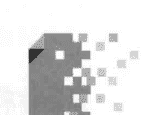

近年来，图像识别与语音识别的快速进步都离不开深度学习的发展。深度学习的崛起让机器学习在人工智能领域的话语权再次提升，也掀起了理论研究和产品开发的新一轮浪潮。深度学习以摧枯拉朽之势攻克各类任务，让无人驾驶、预防性医疗、商业智能等场景成为可能。甚至有人夸张地说 AI 无所不能、即将改变世界，这种说法背后基本都指向深度学习。

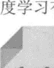

## 1.1 人工智能如何定义

先界定一下我们讨论的人工智能的范围。

AI 即 Artificial Intelligence，中文是人工智能。可以理解为让机器具备类人智能，去代替人类完成特定工作。

很多人对 AI 的印象来自《西部世界》《超能陆战队》《机器人总动员》等影视作品，片中的 AI 多属于“强人工智能”，能像人一样思考推理，拥有知觉和自我意识。弱人工智能则是指不具备完整智慧，却能在特定任务上完成工作的系统。这类系统能在已有数据集上学习，并在未见过的场景中做出较好预测。弱人工智能早已融入生活。

比如语音助手集成在手机、音箱、汽车、手表里。说一句“Hi Siri，帮我查明天上海天气”，它就能听懂意图、联网检索并回复。

再比如机器人电话客服，大家常接到的推销或骚扰电话，声音和对话流畅得像真人，实际上是机器在交流。

要让机器真正理解自然语言仍任重道远，尤其是语言中的情感、隐喻等信息，机器理解起来十分困难，所以自然语言处理长期被视作 AI 的高峰。

相比之下，计算机视觉发展更快。比如停车场车牌识别，以前需要专人登记缴费，现在一个摄像头即可完成。

在购物场景，亚马逊无人超市可通过人脸识别判断顾客是否来过、购物历史，从而给出个性化推荐。

除可视可听的产品外，辅助决策和预测的系统也是 AI 的强项。刷抖音时，后端会学习你的偏好不断推送更合口味的视频。

医疗领域同样如此。一个影像科医生需要十余年才能出师，而 AI 诊疗系统可在几秒内完成 X 光、CT、核磁共振片的判读，准确率更高、成本更低。

在消费电子展上，智能家居厂商每年都会发布硬核产品。2019 年科沃斯发布的视觉识别扫地机器人 DG70，能识别鞋子、袜子、垃圾桶、充电线等，并结合机身上多传感器融合信息实现复杂家居的避障清扫。

## 1.2 AI 的底层逻辑

举个例子，要让机器识别“狗”。一种做法是把狗的特征如毛茸茸、四条腿、有尾巴等规则告诉机器，让机器按规则判断；另一种做法是不告知任何特征，直接给机器 10 万张狗的图片，让它自行提炼特征来识别。

本质上，AI 的实现都是一个函数。给机器已有数据，让它从中找出最能拟合这些数据的函数，遇到新数据时就能用该函数预测结果。

一个具备 AI 的模型包含三个要素：数据、算法、模型。

以猫狗图像分类器为例：

“数据”是指大量标注为猫或狗的图片。数据量越大，模型学到的区分特征越丰富、越准确；数据不足时，模型在新样本上的表现会明显下降。

“算法”是指构建模型时选择浅层还是深层网络，若为深层则确定层数、每层神经元数量与功能，即确定预测函数的网络结构。

可表示为 Y = f(W, X, b)，其中 X 是训练用的猫狗图片，Y 是标签。W 为权重，b 为偏置，这两个参数由机器在训练过程中自行寻找。

“模型”是指把数据输入算法进行训练，机器不断学习直至找到最优 W、b，函数便确定。之后输入新的猫狗图片，模型即可输出判断结果。

无论是线性回归还是拥有上百个隐藏层的深度神经网络，本质都是寻找一个能良好拟合已有数据的函数，并希望它在未知数据上同样表现不错。

以科沃斯 DG70 为例，它只有一颗“眼睛”和有限传感器，却要识别拖鞋、家具脚、衣服等障碍物并决策是否可推开。实现大致分三步：

1、定义问题。明确扫地机器人使用场景中需识别的所有障碍类别，才能训练多分类模型并触发对应规避动作。当前机器智能只能忠实执行人类设定的任务，无法像人一样自我进化。

2、收集与标注数据。深度神经网络参数可达数百万，需要海量标注数据。人工标注成本极高，一个任务一年可能花费上千万元。

3、在设备端运行。需保护用户隐私避免数据上传云端，且清扫是动态过程，对计算时效要求极高。

由此可见，即便“识别拖鞋”也涉及复杂流程。扫地机器人虽小，技术复杂度堪比自动驾驶。自动驾驶在图像之外，还需更多传感器以更高精度感知环境。

## 1.3 AI 人才市场现状与前景

### 1. 国家层面大力推动

2017 年 7 月，国务院发布《新一代人工智能发展规划》，分三步明确目标：

到 2020 年，人工智能整体技术与应用达到世界先进水平，产业成为重要经济增长点。

到 2025 年，基础理论取得重大突破，部分技术与应用达到世界领先，人工智能成为产业升级主要动力。

到 2030 年，理论、技术、应用总体领先，成为全球主要创新中心，智能经济与社会成效显著。

### 2. 产业爆发催生巨量需求

近年来 AI 快速发展大幅提升生产效率和生活品质，苹果、谷歌、微软、亚马逊、脸书等巨头投入数百亿美元抢占市场，其中九成用于研发部署。面向初创公司的 VC、PE 投资也快速增长，年增长率接近 40%。

国内 BAT 也将 AI 列为重点战略，布局计算机视觉、服务机器人、语音 NLP、智能医疗、机器学习、智能驾驶等。阿里、腾讯、百度、华为、微软、亚马逊等均在上海设立 AI 科研机构。

在此背景下，北京、上海、广东、江苏、浙江等地人才需求尤为旺盛。北京凭借政策、人才、产业和资本成为创业首选；长三角拥有雄厚经济基础和产业园；广东依托大数据产业链推动 AI 蓬勃发展。

据工信部调研，中国人工智能产业与人才需求比约为 1:10，预计到 2030 年核心产业规模达 1 万亿，相关产业 10 万亿，人才缺口约 500 万，其中工程应用型需求最多，其次是技术应用与科技转化人才，再次是前沿理论研究人才。

### 3. 院校供给严重不足

截至 2018 年底，全国开设智能科学与技术专业 155 所，人工智能专业 38 所，机器人工程专业 194 所。调研显示普遍缺乏实验环境、项目、师资、教材和测评体系，人才培养规模与速度远不能满足产业需求。

### 4. 教育政策持续加码

2018 年 4 月教育部印发《高等学校人工智能创新行动计划》，要求到 2020 年基本完成高校科技创新体系和学科体系优化，到 2025 年取得一批国际影响的原创成果，到 2030 年高校成为人工智能创新中心的核心力量和人才高地。

总体来看，国家正积极引导发展新一代人工智能，产业高速发展带来海量人才需求，而现有供给不足，培养速度缓慢。未来 5 至 10 年，AI 人才竞争将愈发激烈，就业前景十分乐观。

## 1.4 机器学习与深度学习的关系

### 1.4.1 机器学习到底在做什么

要讲清楚深度学习，先要厘清机器学习、神经网络、深度学习之间的关系。

机器学习是一种借助数据训练模型并用模型做预测的技术。与传统靠编码实现特定任务的软件不同，机器学习通过大量数据和算法自行学习完成任务。

机器学习是人工智能的子集，其理论研究让计算机具备自动学习能力。

例如要构建识别猫的程序。传统方式是写规则：猫有毛茸茸的毛、三角形耳朵等。但遇到老虎照片时会失效，且很难定义“毛茸茸”。更好的方式是让机器自学：提供大量猫照片，系统自行查看、反复实验，最终能准确区分猫与非猫。

机器自学并不是靠事先写好的规则来驱动，而是把大量与特定任务相关的样本喂给系统，让它自行挖掘内在规律，进而获得完成任务的能力。通俗地说，机器学习就是借助算法对海量数据进行训练，训练结束后形成可用的模型，再用该模型对新样本进行预测。

### 1. 有监督学习的工作原理
有监督学习依赖带有输入与期望输出标签的样本集。以图像分类为例，给男孩的图片打上“男孩”标签，给女孩的图片打上“女孩”标签，这些带标注的数据构成训练集。模型通过已知的输入输出对进行学习，产出一个能够对未知数据进行判别的最佳模型。这种学习被称为“有监督”，是因为在训练过程中仿佛有一位老师在场，算法不断对训练数据做预测，“老师”持续纠正偏差，直到性能达到可接受水平才停止。

类比人类认识过程，小时候父母会指着事物说这是鸟、那是猪、那是房子。眼前的景物是输入，父母的判断是输出。见得多之后大脑会形成泛化的函数，即训练得到的模型，之后即使没有人在旁提示，也能自行分辨房子和鸟。

### 2. 无监督学习的思路
无监督学习也称非监督学习，没有预先标注的训练样本，而是直接对原始数据进行建模。听起来不可思议，但在日常认知中随处可见。比如参观画展，即使之前对艺术一无所知，观赏多幅作品后仍能凭直觉把它们归为不同风格，有的偏朦胧、有的偏写实，虽然说不出专业术语，却已完成了对数据的自发分组。

### 1.4.2 深度学习崛起
机器学习中一个经典方向是神经网络。神经网络最初源于生物学，指由大脑神经元、突触和细胞构成的网络，用于产生意识、思考与行动。受此启发，人工智能发展出人工神经网络，即用计算机模拟由“神经元”层层堆叠而成的系统。这些神经元通过加权连接相互影响，通过调整连接权重改变整体计算。

最早的感知器可视为单层神经网络，但它难以处理多分类与线性不可分问题，加之当时算力受限，研究一度沉寂。2006年，Geoffrey Hinton 在《Science》发表论文，既缓解了神经网络的计算瓶颈，也展示了深度神经网络在学习上的优越性。所谓“深度”指的是网络复杂度，通常指隐藏层数量越多，学习能力越强。此后神经网络重回主流，基于深度神经网络的机器学习被称为深度学习。

神经网络与深度神经网络的关键差异在于隐藏层数量。一般结构为输入层→隐藏层→输出层，当隐藏层大于2时常被归为深度神经网络。深度学习的本质是通过构建多隐藏层的模型并配合海量训练数据，学习更有用的特征，从而提升分类与预测精度。

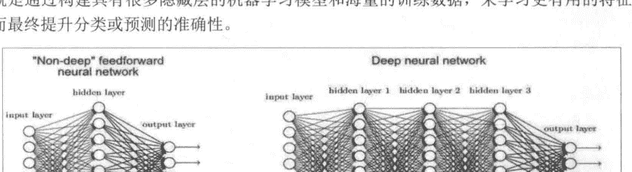

图 1-1

被誉为“计算机界诺贝尔奖”的ACM A.M.图灵奖于2018年授予了引领这次人工智能浪潮的三位深度学习之父：蒙特利尔大学的Yoshua Bengio、多伦多大学名誉教授Geoffrey Hinton、纽约大学教授Yann LeCun。他们让深度神经网络成为人工智能的核心技术。ACM的评语指出，三人为深度神经网络奠定了概念基础，通过实验揭示了神奇现象，并贡献了可验证实际进步的工程成果。

### 1.4.3 机器学习与深度学习的关联与差异
AlphaGo与李世石九段的对弈以绝对优势胜出，所用算法正是基于神经网络的深度学习。人工智能、机器学习、深度学习因此成为近年最火的关键词。

如图 1-2 所示，深度学习是机器学习的分支。其灵感来自人脑工作方式，利用深度神经网络解决特征表达问题。深度神经网络并非全新概念，本质是含多隐藏层的网络结构。为提升训练效果，人们在神经元连接方式、激活函数等方面做了改进，目标是模拟人脑分析学习机制，理解文本、图像、声音等数据。

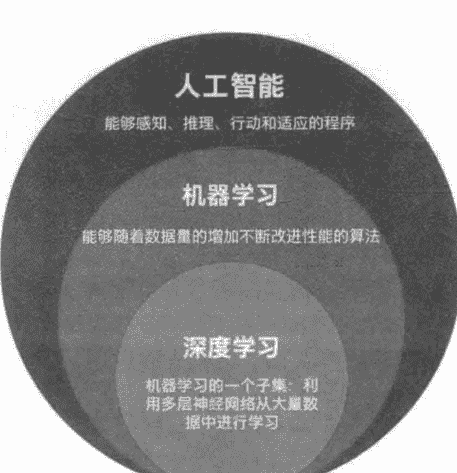

图 1-2

传统机器学习需要人工预先定义特征，比如判断人脸时要先确定胡须、耳朵、鼻子、嘴巴等面部特征作为依据。深度学习则会自动挖掘对分类最有价值的特征。

以识别猫狗为例，深度学习的流程大致如下：
- 步骤 01 先找出与猫狗识别关系最大的边和角等基础元素。
- 步骤 02 将这些小元素组合成层级网络，探索不同组合。
- 步骤 03 在层级网络基础上，确定哪些组合能够有效区分猫与狗。

深度之所以重要，是因为大量隐藏层赋予了网络表达复杂函数的潜力，从而捕捉更复杂的特征，完成更复杂的任务。以下从几个维度比较两者。

### 1. 数据依赖
机器学习对数据规模的适应性较强，尤其在小数据场景表现稳健。深度学习在数据量激增时优势明显，因为它需要大量数据才能充分理解模式。随着数据增长，两者的表现差距会拉大。深度学习更适合大数据，数据量较小时传统机器学习往往更合适、成本更低。为获得高性能，深层网络需要非常大型的训练集，曾有预训练网络使用120万张图像进行训练。对许多应用而言，这样的规模既昂贵又耗时。

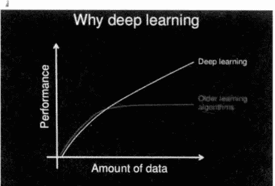

图 1-3

### 2. 硬件依赖
深度学习计算量巨大，依赖高端硬件，尤其是GPU，因为大量矩阵运算正是GPU的设计强项。机器学习则可在普通电脑上运行，经济实惠。深度学习训练需要昂贵的GPU、高速CPU、SSD存储和大容量高速RAM做支撑。传统机器学习仅需一台性能尚可的CPU就能高效训练，迭代更快。

### 3. 特征工程
特征工程是指在建模前确定哪些特征可用。机器学习通常需要领域专家手工挑选并编码特征。深度学习力求从数据中自动学习特征，大大降低了特征提取的人力成本。经典机器学习一般要先做深度探索性分析，再降维，最后精心挑选最优特征输入模型。而使用深度网络时，直接把原始数据喂入网络往往就能取得不错效果，省去了繁琐的特征工程阶段。

### 4. 运行时间
训练耗时上，深度学习算法因参数众多，通常需要数周时间。传统机器学习则几秒到数小时即可完成训练。代价是，深度模型训练完成后，在预测阶段往往运行更快、更准确。

### 5. 可理解性
深度学习常被视为黑箱。深层网络每一层代表一种特征，层数增多后难以明确其含义，也就难以解释预测依据。比如用深度学习批改论文，评分可能很准，却说不清判分依据，低分者质问时难以自圆其说。传统机器学习如决策树，能把规则逐条列出，特征与逻辑都清晰可见，超参数调整也更直观。

## 1.5 新手如何快速入门深度学习
雷军曾说“站在风口上，猪都能飞起来”，用来形容当下的深度学习非常贴切。近年来深度学习迅猛发展，已在医疗、自动驾驶、机器视觉、自然语言处理等领域大放异彩。抢先进入这个风口并掌握技术，就能在AI时代真正“飞”起来。

对大学生、程序员或转行者而言，最焦虑的问题是如何入门。下面分享一些实践经验。

### 1.5.1 先放弃两件事
### 1. 别被海量资料拖垮
入门时常会囤积大量资料：某某学院内部资源、从入门到进阶的百GB合集、各种教程。很多人把十几GB甚至几百GB存到云盘，却终究只是收藏，从未真正学习。云盘里的资料往往只是“以后会学”的自我安慰。资料越多越容易迷茫，产生“学不完”的焦虑。选择越多，越难抉择。

因此第一步是放弃海量资料，挑选一份真正适合自己的教材，沉下心研读消化，收获会更大。

### 2. 别从数学基础起步
初学者常在学习路径上犹豫：框架太多，不知道先学哪个；书籍太多，不知道选哪本；问专业人士，往往得到“先学好数学”的建议。深度学习涉及概率论、线性代数、凸优化、计算机、神经科学等，完全从底层推导需要数年时间，容易因枯燥而懈怠，最后放弃。等数学和编程基础学完，“低垂的果实”可能早已错过。

与其啃书推公式，不如先从顶层框架建立整体认知，再通过实践带着问题查漏补缺，从宏观到微观、从整体到细节，学习积极性会形成正反馈。

### 1.5.2 必须坚持的三件事
### 1. 必须选择编程语言：Python
工欲善其事必先利其器。深度学习首选Python。它是解释型语言，上手快，开发效率高，生态丰富：NumPy做数值计算，Scikit-learn做机器学习，Matplotlib做可视化等。Python堪称万能胶水语言，既易学又强大。笔者用约50小时掌握基础语法后，便开始写爬小说、爬网易云评论等小项目。记忆语法初期枯燥，但值得坚持。

## Python 深度学习从零开始学
### 2. 必须选择一个或两个最好的深度学习框架
业界遵循“不重复造轮子”的原则，不会自己从零实现算法，而是使用成熟的库和框架。TensorFlow、Keras等神经网络框架可解决几乎所有机器学习问题，大幅降低开发门槛。遵循奥卡姆剃刀原则——如无必要，勿增实体。深度学习底层复杂，但上层接口已像搭积木。TensorFlow能显著压缩代码量，Keras则让代码简洁到令人惊喜。笔者在Keras写出第一个模型时感受到了巨大的成就感。

以猫狗分类为例，在Keras中仅需寥寥数行即可搭建包含卷积层、池化层、全连接层并使用Adam优化器的深度网络，后续章节会展示其简洁性。

### 3. 必须坚持“唯有实践出真知”
许多教程重理论轻实战，纸上谈兵效率低下。在具备基本理论后，应尽快动手编码解决实际问题。学习效率最高的方式就是实践。

对于零AI背景、只会Python的同学，不要犹豫，直接上车。深度学习入门可以很简单。

# 第 2 章 搭建深度学习开发环境
“工欲善其事，必先利其器”，准备好开发工具是深度学习的第一步。Python编程利器首选Jupyter Notebook，深度学习框架目前主流的有TensorFlow、PyTorch、Keras等。

提示 如果不习惯使用Jupyter Notebook编辑器，也可以改用PyCharm社区版。

## 2.1 Jupyter Notebook 极速入门
本节介绍Jupyter Notebook是什么、如何快速安装启动以及基本使用方法。

### 2.1.1 什么是 Jupyter Notebook
Jupyter Notebook，简称Jupyter，本质是一种模块化的Python编辑器，现在也支持R等多种语言。它允许把大段代码拆分为若干片段逐段运行。在软件开发中，这种模块化会破坏程序整体性。但在数据处理、分析、建模和结果观察场景下，模块化能提供更好的视觉体验，显著缩短代码运行与调试时间，并让整个处理流程清晰可见。

Python 的互动体验给用过的人留下很深印象。之前跟做嵌入式的朋友聊起这门语言，他说最震撼的就是它的可读性和即时交互。嵌入式常用的 C、C++ 都得先编译，写完一整段才知道对不对，单行根本跑不起来。而 Python 像是在跟人对话，写一句就能回一句。输入一行，立刻得到结果，这就是交互。普通 IDE 比如 PyCharm 大多要把程序写完再整体运行，交互感被削弱了。Jupyter 就不一样，写几行、完成一个小模块就能点一下运行。对传统软件工程师可能只是锦上添花，对机器学习工程师来说简直是救命稻草。

### 2.1.2 如何安装和启动 Jupyter Notebook

装 Jupyter Notebook 前提是先有 Python，建议 3.6 以上。安装过程很直观，可以把随书的 Python 资源包复制到硬盘解压，双击 Python-3.6.4-md64.exe 开始安装，安装向导里务必勾选 “Add Python 3.6 to PATH”，再点中间的 “Install Now”，如图 2-1 所示。

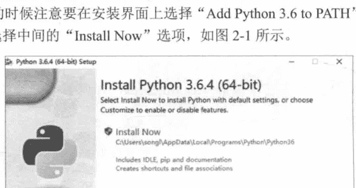

图 2-1

Python 装好后，再双击 install.bat，系统会自动把本书要用到的依赖装上，像 scikit-learn、dlib 人脸识别库之类的大牌工具都在其中。

只要有 C、VB 这样的编程基础，三天就能上手 Python，因为语法比很多语言更简洁易学。语法熟练后，还要花点时间学会数据的处理与操作，熟悉 Pandas、NumPy、Matplotlib 这几套工具。Pandas 负责处理数据框，数据框就类似 Excel 的表格，是结构化数据的一种形式。NumPy 擅长基于数组做数值计算。Matplotlib 则用来绘图做可视化。

学习过程中需要装包，推荐用 pip。举例，装 Matplotlib 就打开 cmd 执行 python -m pip install matplotlib，系统会自动下载完成，如图 2-2 所示。

Jupyter 的安装命令是 pip3 install jupyter。一台机器上存在多个 Python 版本时，用 pip3 会自动以 Python3 安装，避免和 Python2 冲突。如果只装了 Python3，pip 和 pip3 效果一样。老版 pip 安装 Jupyter 时常出现依赖不同步的问题，所以最好先把 pip 升到最新。

启动方式是 jupyter notebook。执行后终端会输出 Notebook 服务器的相关信息，同时浏览器会自动打开 Jupyter 界面。

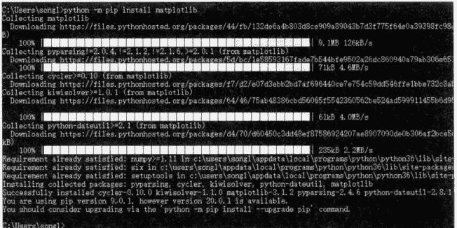

图 2-2

启动时终端的输出类似图 2-3 的内容。

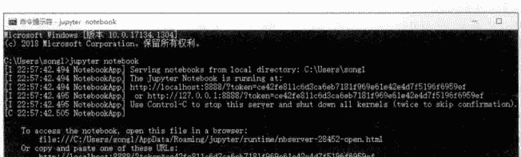

图 2-3


在 Jupyter 里做任何操作，都要保持终端窗口开启，关掉终端就会断开本地服务器的连接，后续页面就无法使用。

浏览器地址栏默认会显示 http://localhost:8888，如图 2-4 所示。其中 localhost 代表本机，8888 是端口号。启动页展示当前文件目录，Jupyter 保存文件的根目录对应操作系统的用户主目录。


图 2-4

### 2.1.3 Jupyter Notebook 的基本使用

打开界面后，按 New → Python3 新建一个 .ipynb 文件。也可以点右上角的 new 按钮，选择 Python 3，如图 2-5 所示。

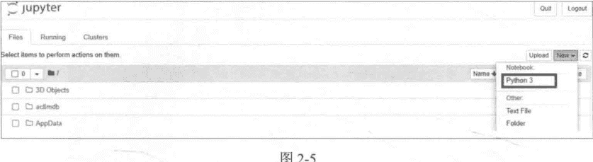

选择 Python 3 后进入编辑区，先点左上角的文件名重命名，如图 2-6 所示。

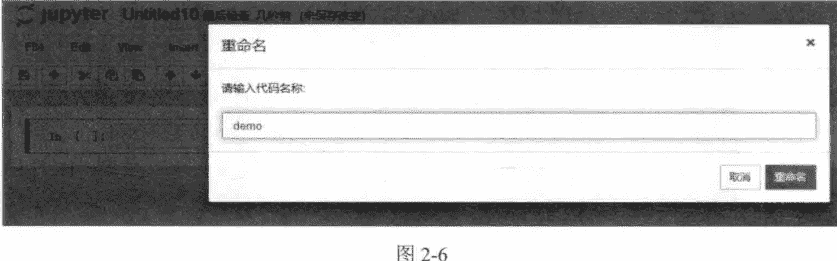

重命名后就可以写代码了。比如先输入 “a=1” 按 Enter，Jupyter 会换行但不会新建单元格，继续输入 “b=5” 再点运行或按 Shift+Enter，赋值不会有输出。再输入 “a+b” 按 Shift+Enter，就能看到交互式命令行直接返回结果 6，如图 2-7 所示。这就是交互式编程的好处，不用写 print 就能实时观察。


在图 2-8 中，In[6] 里的 6 代表这是第 6 次执行，也可以理解为工作区内的执行顺序。因为各代码块内容可以互相调用，后面定义的方法前面也能用。需要注意的是，如果 B 块要调用 A 块的代码，A 块写完必须先执行，否则 B 块会报错。

Jupyter 也支持用 Markdown 写注释说明。选中代码后切换为 Markdown 即可撰写文档说明，写完同样按 Shift+Enter，就能看到如图 2-9 的渲染效果。

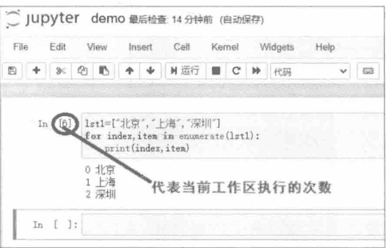

图 2-8

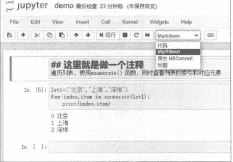

图 2-9

想在文档里插入图片，只要把图片文件比如 airplane.jpg 放在程序文件同目录下，用 Markdown 语法插入，如输入 “”，运行单元格即可显示图片。

如果要把本地的 .py 文件载入到某个单元格，比如当前目录有 test_demo.py。

test_demo.py 的源代码如下：

```
import os
print(os.getcwd()) # 获取当前工作目录路径
```

在目标单元格里输入 “%load test_demo.py” 按 Shift+Enter 运行，结果如图 2-10 所示。可以看到 %load 行被自动加上了注释 #，文件里的所有代码都被载入到当前单元格。

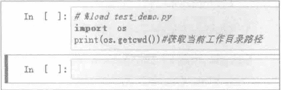

图 2-10

单元格也可以直接运行 Python 文件，在单元格里执行如下代码：

```
%run file.py
```

其中的 file.py 就是要运行的脚本，运行结果会显示在该单元格里，如图 2-11 所示。

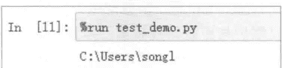

图 2-11

.ipynb 文件还能导出成 .py 文件，在 Jupyter 的 File 菜单里依次点 Download as → Python(.py) 即可，如图 2-12 所示。

## Python 深度学习从零开始学

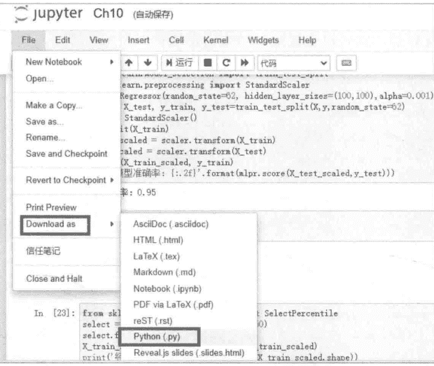

图 2-12

## 2.2 深度学习常用框架介绍

开展深度学习项目前，选对框架很关键，选对了事半功倍。研究者们使用不同的框架来达成研究目标，也从侧面说明了深度学习生态的繁荣。当前流行的框架有 PaddlePaddle、TensorFlow、Caffe、Theano、Keras、Torch 和 PyTorch。

### 1. TensorFlow

TensorFlow 是 Google 开源的计算库，用 C++ 开发，采用数据流图的方式进行计算。图中的节点代表数学运算，线条表示多维数组 Tensor 之间的数据传递。其架构灵活，可部署在单机多 CPU、多 GPU 或移动设备上。最初由研究人员和 Google Brain 团队为机器学习和深度神经网络研究打造，开源后应用范围极广。

TensorFlow 目前用户最多、社区最庞大。Google 背书更新频繁，提供 Python 和 C++ 接口，教程完善，很多论文复现的首选版本也是 TensorFlow，可说是深度学习框架里的默认老大。

### 2. PyTorch

PyTorch 起源于 Torch。Torch 是纽约大学的机器学习开源框架，几年前在学术界很火，LeCun 等人都在用。但它基于冷门的 Lua 语言，让很多人望而却步。随后 Facebook 人工智能研究院推出 PyTorch 并开源。它并非简单封装 Torch 的 Python 接口，而是用 Python 重写了大量内容，让它更灵活、支持动态图，并提供友好的 Python 接口。由 Torch7 团队开发，是以 Python 为优先的深度学习框架，既能做 GPU 加速，也支持动态神经网络，这是 TensorFlow 等主流框架长期不具备的特性。

### 3. Keras

Keras 对新手极其友好，是一个简洁的深度学习框架。严格说它不是一个完整的框架，而是一个高度模块化的神经网络库。由 Python 编写的高级神经网络 API，底层可接入 TensorFlow、CNTK 或 Theano。其特点是建模速度快，想法能迅速变成结果。TensorFlow API 偏底层，简单任务也要写很多辅助代码，而同样的工作用 Keras 大概只需 TensorFlow 的三分之一到五分之一代码量。

### 4. 框架总结

深度学习框架降低了入门门槛，我们不必从零写复杂的神经网络，可以直接使用现有模型训练参数，也能在已有模型上加自己的层，或在顶层选择分类器和优化算法，比如常用的梯度下降。没有框架是完美的，就像积木盒里不一定有你想要的那块，适用范围会不同。总的来说，框架提供了一系列通用算法的实现，当需要新算法时，用户自行定义后再调用框架的接口即可使用。

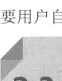

## 2.3 Windows 环境下安装 TensorFlow（CPU 版本）和 Keras

Keras 只是前端 API，使用前需要先装好后端，主流推荐用 TensorFlow 作为后端。因此先装 TensorFlow，再装 Keras。安装时要注意版本对应，否则会报错。例如 Keras 2.4 要求 TensorFlow 2.2 以上，不匹配就无法运行。

下面说明如何在 Windows 下安装 CPU 版 TensorFlow 和 Keras。

### 1. 安装 TensorFlow（CPU 版本）

步骤如下：

步骤 01 先确保 pip 较新，在命令提示符输入 “python -m pip install -U pip” 升级 pip，如图 2-13 所示。

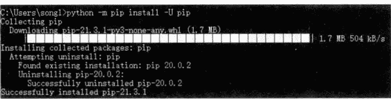

图 2-13

步骤 02 用 pip 安装 CPU 版 TensorFlow，这里以 1.3.0 为例，输入 “pip install tensorflow==1.3.0”。安装完成后执行 “pip show tensorflow” 查看信息，如图 2-14 所示。

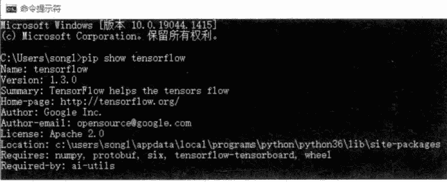

图 2-14

步骤 03 CPU 版或 GPU 版的 TensorFlow 安装完成后，都可以用图 2-15 的代码测试。在 Jupyter 代码区输入示例代码，若无报错并输出 “Hello,TensorFlow!” 说明安装成功，如图 2-15 所示。

```
In [19]:
import tensorflow as tf
hello = tf.constant('Hello, TensorFlow!')
sess = tf.Session()
h=sess.run(hello)
print(h.decode())

Hello, TensorFlow!
```

图 2-15

### 2. 安装 keras

步骤如下：

步骤 01 在命令提示符下输入 “pip install keras==2.1.2” 安装 Keras，这里指定版本为 2.1.2。安装后执行 “pip show keras” 查看，如图 2-16 所示。

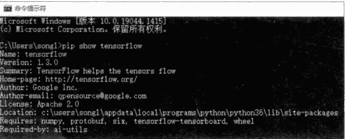

图 2-16

也可以在 Jupyter 代码区输入如图 2-17 所示的代码查看 Keras 版本，注意代码里是双下划线。

```
import tensorflow as tf
import keras
print(tf.__version__)
print(keras.__version__)

1.3.0
2.1.2
```

图 2-17

## 2.4 Windows 环境下安装 TensorFlow（GPU 版本）和 Keras

本节介绍 Windows 下安装 TensorFlow GPU 版和 Keras 的方法。

### 2.4.1 确认显卡是否支持 CUDA

深度学习常要处理大量图像数据，CPU 处理任务繁多难以满足速度需求，GPU 就能分担压力，因为 GPU 擅长图像类运算。

为什么 GPU 适合图像？因为图像里每个像素都需要处理，且处理方式高度相似，GPU 用大量简单计算单元并行完成，类似人海战术。GPU 还用于科学计算、密码破解、数值分析、海量数据处理等并行场景。

CUDA 是 NVIDIA 推出的并行计算框架，只能用于自家 GPU。它包含指令集架构和内部并行计算引擎，安装后能明显提升 GPU 运算速度，主流深度学习框架都基于 CUDA 做 GPU 加速。

想用 CUDA 加速，首先要确认显卡是否支持，即机器里是否有 NVIDIA 独立显卡。可以在 NVIDIA 官网列表 https://developer.nvidia.com/cuda-gpus 查看型号。

在桌面右击，若能看到 NVIDIA 控制面板，如图 2-18 所示，就说明该机器配备了 GPU。

在 NVIDIA 控制面板里打开系统信息，就能查到当前显卡所能支持的 CUDA 版本，界面示例如图 2-19 所示。

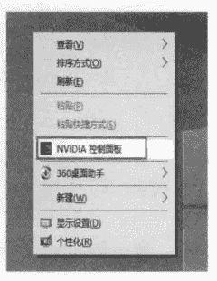

图 2-18

### 2.4.2 CUDA 工具包安装
CUDA 是 NVIDIA 发布的通用并行计算架构，配合 GPU 并行计算引擎实现高性能计算。部署流程如下：

步骤 01 若已确认机器配备支持 CUDA 的显卡，可前往 NVIDIA 官方归档页 https://developer.nvidia.com/cuda-toolkit-archive 获取安装包，示例如图 2-20 所示。

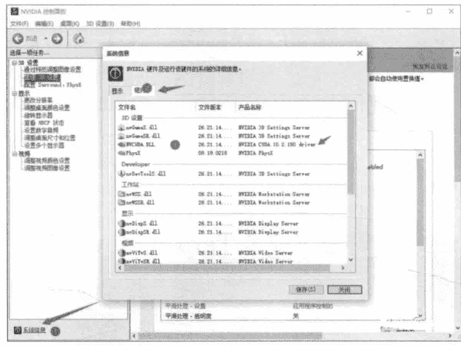

图 2-19


图 2-20

注意 安装 CUDA Driver 时必须与现有的 NVIDIA GPU Driver 版本对应，否则显卡无法被识别。

步骤 02 依据系统情况挑选合适的版本，本文下载 CUDA 10 的离线包，并按操作系统进行选择，如图 2-21 所示。

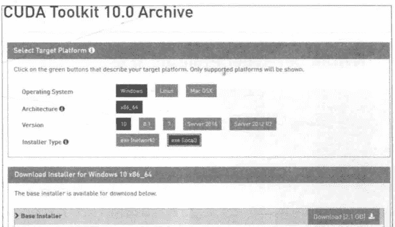

图 2-21

步骤 03 安装时选用自定义模式，注意图中箭头所指的复选框不要勾选，如图 2-22 所示，无需安装 Visual Studio，安装程序会自行完成环境变量配置。

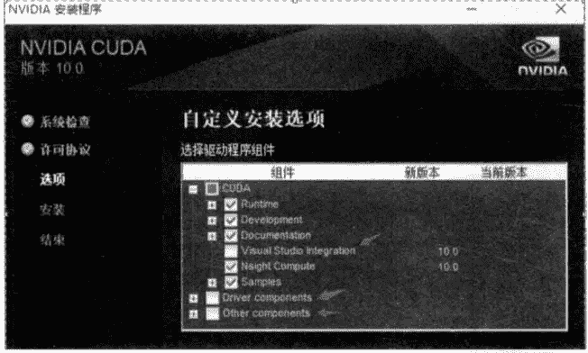

图 2-22

### 2.4.3 cuDNN 加速库部署
cuDNN 是专为深度神经网络提供的 GPU 加速组件，需与 CUDA 版本匹配下载，下载入口为 https://developer.nvidia.com/rdp/cudnn-archive，如图 2-23 所示。


图 2-23

步骤 01 获取 cuDNN 需要先注册 NVIDIA 开发者计划账号并加入会员，如图 2-24 所示。


图 2-24

步骤 02 会员登录后下载与当前 CUDA 对应的 cuDNN 版本。解压后会得到 cuda/include、cuda/lib、cuda/bin 三个目录，将其中的文件分别拷贝到 CUDA 安装目录，即 C:\Program Files\NVIDIA GPU Computing Toolkit\CUDA\v10.0 下的对应目录，注意是文件合并而非整体覆盖。

步骤 03 额外安装 Visual Studio 2015、2017、2019 的支持库，否则后续容易报错，该库体积约十几 MB。下载地址为 https://docs.microsoft.com/zh-CN/cpp/windows/latest-supported-vc-redist?view=msvc-160，如图 2-25 所示。

步骤 04 全部完成后重启电脑即可生效。


图 2-25

### 2.4.4 TensorFlow GPU 与 Keras 安装
步骤 01 在命令行执行 “pip install tensorflow-gpu==1.15.2”，完成 TensorFlow GPU 1.15.2 的安装。

步骤 02 验证是否生效。在 Jupyter Notebook 中运行检测代码：

```
from tensorflow.python.client import device_lib
import tensorflow as tf
print(device_lib.list_local_devices())
print(tf.test.is_built_with_cuda())
```

若输出为 GPU 相关信息则表示安装成功，非 GPU 版本会输出 “False”。

步骤 03 继续安装 Keras，命令行执行 “pip install keras==2.1.2”，安装版本 2.1.2。

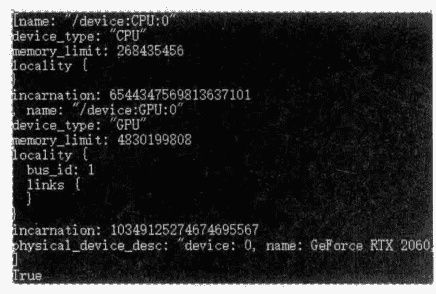

图 2-26

## 2.5 Windows 环境下安装 PyTorch
本节介绍 Windows 下 PyTorch 的安装，包含 CPU 版与 GPU 版两种方案。

### 2.5.1 PyTorch CPU 版安装
自 2018 年 4 月起 PyTorch 正式提供 Windows 版本。PyTorch 基于 Python，本文使用 Python 3.6。Windows 可通过 conda、pip 或源码编译安装，这里以 pip 为例。

步骤 01 在命令行输入 “pip install torch==1.8.0 torchvision==0.9.0 torchaudio==0.8.0” 安装指定版本，如图 2-27 所示。

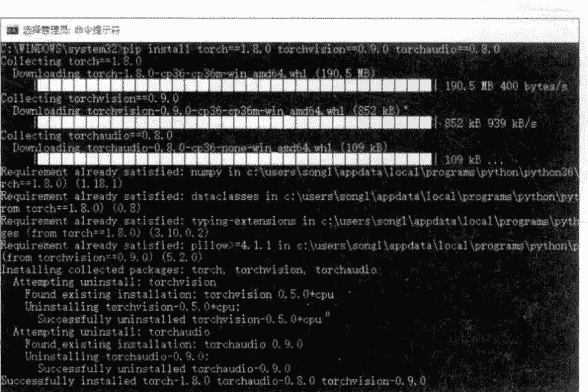

图 2-27

步骤 02 验证安装。命令行执行 “print(torch.__version__)”，注意双下划线，若无报错即安装成功，如图 2-28 所示。

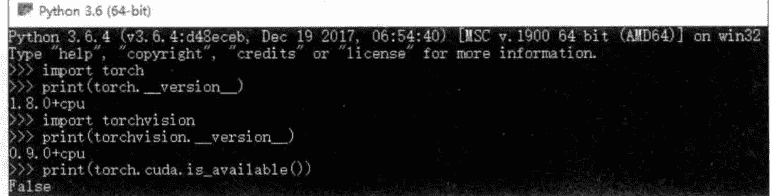

图 2-28

### 2.5.2 PyTorch GPU 版安装
GPU 版的安装相对复杂，需先部署 CUDA、cuDNN 框架，与 TensorFlow GPU 安装流程相同，此处不再赘述，随后安装 PyTorch。

步骤 01 访问官网 https://pytorch.org，如图 2-29 所示，点击 Install。

步骤 02 在 Compute Platform 中选择对应的 CUDA 版本，如图 2-30 所示。将页面提供的 Run this Command 命令复制到命令行执行即可完成安装。

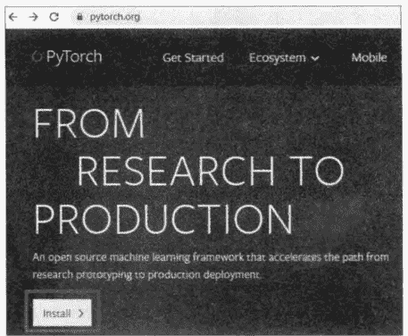

图 2-29

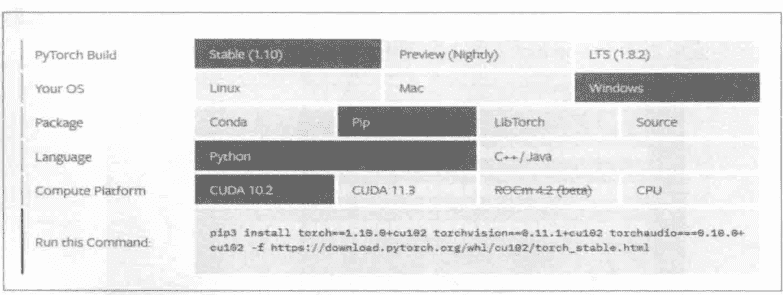

图 2-30

完成以上步骤后，可对比 CPU 与 GPU 在模型训练时的性能差异，如图 2-31 所示。

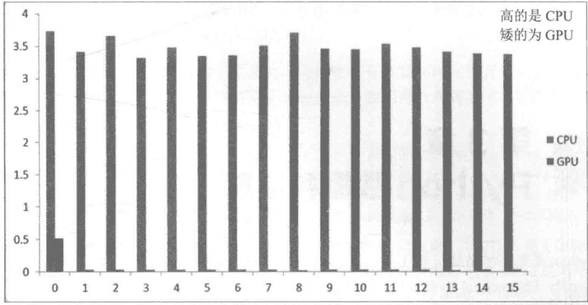

图 2-31

从图中可见 GPU 的训练速度远超 CPU，耗时大幅缩短。条件允许时选用 GPU 显卡进行深度学习训练性价比更高。

# 第 3 章 Python 数据科学库
Python 是常用的数据分析工具，本章重点介绍 NumPy、Pandas、Matplotlib 三大库。NumPy 负责矢量化计算，Pandas 处理结构化数据，Matplotlib 负责可视化。深度学习中还会频繁涉及张量、向量的维数概念。

## 3.1 张量 矩阵 向量概览
标量仅有大小无方向，一个数值即可完整表达，如重量、温度、长度等。

向量是一行或一列的数组，可定义为一维数组。向量具备大小和方向两个属性，箭头长度代表大小，指向代表方向。

矩阵是由复数或实数组成的长方阵列，元素全为实数的为实矩阵，全为复数的为复矩阵，行列数相等的为 n 阶方阵。

如图 3-1 所示，由 m×n 个数 a_ij 排列成的 m 行 n 列数表即为 m×n 矩阵。

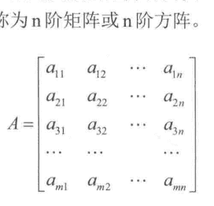

标量、向量、矩阵、张量的维度逐级升高，可用点、线、面、体来类比：

- 点——标量
- 线——向量
- 面——矩阵
- 体——张量

0 阶张量即标量，1 阶张量即向量，2 阶张量即矩阵，3 阶及以上统称张量。例如：

- 标量：1、2、5、108
- 向量：[1,2]、[1,2,3]、[1,2,3,4]
- 矩阵：[[1,3],[3,5]]、[[1,2,3],[2,3,4],[3,4,5]]
- 3 阶张量：[[[1,2],[3,4]],[[1,2],[3,4]]]

TensorFlow 的计算以张量为基础，张量可先理解为多维数组：

```
3
[1., 2., 3.]
[[1., 2., 3.], [4., 5., 6.]]
[[[1., 2., 3.]], [[7., 8., 9.]]]
# 这个 0 阶张量就是标量，shape=[]
# 这个 1 阶张量就是向量，shape=[3]
# 这个 2 阶张量就是二维数组，shape=[2, 3]
# 这个 3 阶张量就是三维数组，shape=[2, 1, 3]
```

易混淆点在于数学中的 3 维向量、n 维向量实际指的是 1 阶张量的形状，即分量个数。如 [1,3] 的维数为 2，[1,2,3,…,4096] 的维数为 4096。不能称 [1,3] 的“张量阶数”为 2，只能说它是 1 阶张量，维数为 2。矩阵的 n×m 阶说法也指形状。

张量的阶数由最左边左中括号的数量决定，括号数 n 即为 n 阶张量。形状由各层括号内元素的个数决定。

例如 [[1,3],[3,5]] 最左边有两个括号，是 2 阶张量，形状为 [2,2]；[[[1,2],[3,4]],[[1,2],[3,4]]] 最左边有三个括号，是 3 阶张量，形状为 [2,2,2]。

## 3.2 NumPy 数组与矩阵运算
NumPy 是 Python 的扩展库，支持多维数组与矩阵运算，并提供大量数学函数。Python 官方发行版不含 NumPy，可用 pip 安装 “pip install numpy==1.8.1”。

### 3.2.1 列表与数组的区别
NumPy 核心是 n 维数组对象 ndarray，由同类型数据构成，下标从 0 开始。ndarray 中每个元素占用相同大小的内存块。

如图 3-2 所示，先导入 NumPy，再用 array 函数创建 ndarray。

```
import numpy as np
a = np.array([1,2,3])
print (a)

[1 2 3]
```

图 3-2

```
import numpy as np
a=[1,2,3,4]
b=np.array([1,2,3,4])
print(a)
print(b)
c=a*2
d=b*2
print(c)
print(d)
e=[[1,2],[3,4],[5,6]]
f=np.array([[1,2],[3,4],[5,6]])
print(e)
print(f)

[1, 2, 3, 4]
[1 2 3 4]
[1, 2, 3, 4, 1, 2, 3, 4]
[2 4 6 8]
[[1, 2], [3, 4], [5, 6]]
[[1 2]
 [3 4]
 [5 6]]
```

图 3-3

Python 自带列表，为何需要数组？如图 3-3 所示，NumPy 对数学运算支持更好，同样做乘法，列表只是复制元素，数组则是逐元素运算。列表只能表示一维结构，数组可表示多维，如列表 e 只是包含子表的扁平结构，而数组 f 则为 3 行 2 列的二维结构。

### 3.2.2 数组的创建方式
创建方式主要有两种：

方法一：由列表转换，如图 3-4 所示，先建一维数组 a1 及列表 lst1，再将列表转为 ndarray。

方法二：使用 NumPy 自带函数，如 arange、ones、zeros。如图 3-5 所示，np.arange 可按起止值和步长生成数组，np.linspace 可等间距填充。还可使用 randn、rand 等随机数函数。

```
import numpy as np
a1=np.array([1,2,3,4])
lst1=[3.14,2.17,0,1,2]
a2=np.array([[1,2],[3,4],[5,6]])
a3=np.array(lst1)
print(a2)
print(a3)

[[1 2]
 [3 4]
 [5 6]]
[3.14 2.17 0. 1. 2.]
```

图 3-4

```
x1=np.arange(12)
x2=np.arange(5,10)
x3=np.random.randn(2,3)
x4=np.random.random([3,3])
x5=np.ones((2,4))
x6=np.zeros([3,4])
x7=np.linspace(2,8,3, dtype=np.int32)
print(x1)
print(x2)
print(x3)
print(x4)
print(x5)
print(x6)
print(x7)

[0 1 2 3 4 5 6 7 8 9 10 11]
[5 6 7 8 9]
[-1. 0. 0. ...]
[[0. 0. 0.]
 ...]
[[1. 1. 1. 1.]
 [1. 1. 1. 1.]]
[[0. 0. 0. 0.]
 ...]
[2 5 8]
```

图 3-5

### 3.2.3 NumPy 算术运算
NumPy 擅长科学计算与数值处理。对大列表进行十倍缩放，用 NumPy 会更简洁。

NumPy 支持数组间及数组与常数间的加减乘除取余，如图 3-6 所示。常数为标量，数组为向量，运算结果为逐元素计算后的新数组。

数组与数组运算时形状需一致，运算在对应位置进行，如图 3-7 所示。

形状不一致时可通过广播机制临时适配，如图 3-8 所示，a 为 2×3 二维数组，b 为 1×3 一维数组，运算时 b 会被逐行广播到 a。

同理，行数相同时可在列方向进行广播，如图 3-9 所示，将 a 的每一列与 b 的列相加。

```
import numpy as np
arr = np.arange(10)
print('arr:', arr)
#数组与常数之间的运算
#求加法
print('arr+1:', arr+1)
#求减法
print('arr-2:', arr-2)
#求乘法
print('arr*3:', arr*3)
#求除法
print('arr/2:', arr/2)

arr: [0 1 2 3 4 5 6 7 8 9]
arr+1: [1 2 3 4 5 6 7 8 9 10]
arr-2: [-2 -1 0 1 2 3 4 5 6 7]
arr*3: [0 3 6 9 12 15 18 21 24 27]
arr/2: [0. 0.5 1. 1.5 2. 2.5 3. 3.5 4. 4.5]
```

图 3-6

```
import numpy as np
a = np.arange(1,7).reshape((2,3))
b = np.array([[6,7,8],[9,10,11]])
print('a:\n', a)
print('b:\n', b)
#数组加法
print('a+b:\n', a+b)
#数组减法
print('a-b:\n', a-b)
#数组乘法
print('a*b:\n', a*b)
#数组除法
print('b/a:\n', b/a)

a:
[[1 2 3]
 [4 5 6]]
b:
[[6 7 8]
 [9 10 11]]
a+b:
[[7 9 11]
 [13 15 17]]
a-b:
[[-5 -5 -5]
 [-5 -5 -5]]
a*b:
[[6 14 24]
 [36 50 66]]
b/a:
[[6. 3.5 2.66666667]
 [2.25 2. 1.83333333]]
```

图 3-7

```
import numpy as np
a = np.arange(1,7).reshape((2,3))
print('a:\n', a)
b = np.arange(3)
print('b:\n', b)
print('a.shape:', a.shape)
print('b.shape:', b.shape)
print('a+b:\n', a+b)
print('a-b:\n', a-b)
print('a*b:\n', a*b)

a:
[[1 2 3]
 [4 5 6]]
b: [0 1 2]
a.shape: (2, 3)
b.shape: (3,)
a+b:
[[1 3 5]
 [4 6 8]]
a-b:
[[1 1 1]
 [4 4 4]]
a*b:
[[0 2 6]
 [0 5 12]]
```

图 3-8

```
import numpy as np
a = np.arange(1,13).reshape((4,3))
b = np.arange(1,5).reshape((4,1))
print('a:\n', a)
print('b:\n', b)
print('a.shape:', a.shape)
print('b.shape:', b.shape)
print('a+b:\n', a+b)

a:
[[1 2 3]
 [4 5 6]
 [7 8 9]
 [10 11 12]]
b:
[[1]
 [2]
 [3]
 [4]]
a.shape: (4, 3)
b.shape: (4, 1)
a+b:
[[2 3 4]
 [6 7 8]
 [10 11 12]
 [14 15 16]]
```

图 3-9

### 3.2.4 数组变形

想让数组换个形状，最常用的工具就是 reshape()。举个例子，把 1 到 9 这九个数重新排成 3 行 3 列的矩阵，效果见图 3-10。要点是前后元素的总数必须相等。

Python 深度学习从零开始学

只要尺寸匹配，reshape 并不会复制数据，而是基于原数组返回一个视图。

还有一种高频需求，是把一维向量变成一行或一列的二维矩阵。reshape 可以做到，写起来更省事的做法是借助切片里的 newaxis 关键字，演示见图 3-11。

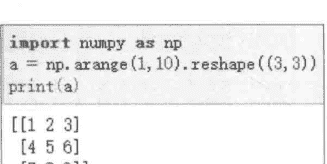

图 3-10

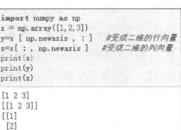

图 3-11

## 3.3 数据分析处理库——Pandas

Pandas 是 Python 生态里专为数据分析打造的工具箱，里面装满了让人处理数据快人一步的函数和接口。

### 3.3.1 Pandas 数据结构 Series

Series 本质上是一维序列，每个元素都挂着一个标签做索引，跟一维数组很像，但索引既能是数字也能是文字，示意图见图 3-12。

一个 Series 内部主要由两部分组成：index 负责标签，values 负责数值，正好对应图 3-12 中的两列。用列表创建时，索引默认从 0 开始自增；如果传入类似字典的键值结构，就会按键值对生成对应的 Series；也可以在初始化时直接指定自定义的索引。

图 3-13 把 Series 和一维数组做了对比。两者看上去相近，关键区别在于 Series 支持按标签取值，而 ndarray 只能按位置取值，用标签找数据明显更直观。

虽然 index 和 values 是一一对应的，但它们并不是字典那种绑定关系，实际上是两个各自独立的 ndarray，只是配合使用。

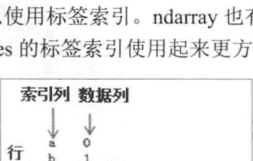

图 3-12

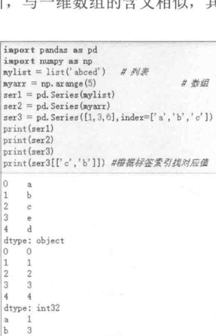

图 3-13

### 3.3.2 Pandas 数据结构 DataFrame

DataFrame 是 Pandas 的二维表格结构，长得就像 Excel，有行有列，图 3-14 可视化了这种形态。不同列可以放不同类型的数据，这点比只能统一类型的 ndarray 更灵活。可以把 DataFrame 理解为多个 Series 沿同一索引拼在一起的结果。

构造 DataFrame 的思路跟 Series 很像，只是能一次性喂入多条一维数据，每条就会变成一列。图 3-15 中的 df1、df2、df3 分别演示了用列表、用 ndarray、用字典三种建表方式，最终都得到二维的表格结构。

想取指定行，直接用 loc 下标就行。没有自定义索引时，行号默认从 0 开始计数。需要多行时，用 loc[[...]] 的列表形式一次性指定多个行标签，语法见图 3-16。

同样可以只挑感兴趣的列来看。当表格里 Series 很多，只关心其中几列时，按列名筛选即可，图 3-17 以 apple 和 banana 为例。

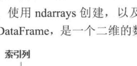

图 3-14

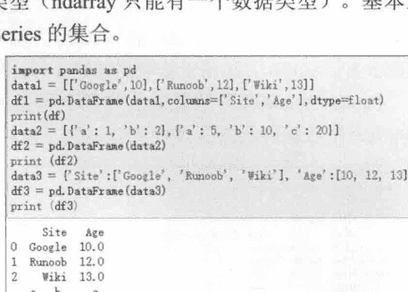

图 3-15

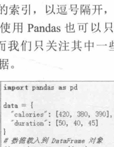

图 3-16

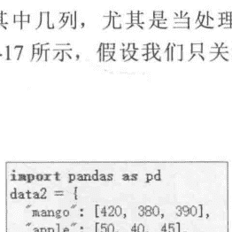

图 3-17

### 3.3.3 Pandas 处理 CSV 文件

CSV 全称逗号分隔值，有时候分隔符也可以换成别的字符，本质上是用纯文本保存表格数据的通用格式，简单且兼容性好，Pandas 对它支持得很友好。

用 read_csv 就能把 CSV 读进来，默认分隔符是逗号，图 3-18 展示了用法，且读取时指定的分隔符必须跟文件本身一致。head(n) 预览开头 n 行，不传参数默认 5 行；tail(n) 预览结尾 n 行，默认值同样是 5 行。

info() 能快速给出表格概况，图 3-19 就是一个例子。non-null 表示非空条目数，从结果看数据共 458 行，其中 College 列的缺失情况最严重。

往回写也很简单，to_csv() 就能把 DataFrame 导出为 CSV，图 3-20 给出了写法。

to_string() 可以完整获取 DataFrame 的文本表示。若直接 print(df)，默认只显示头 5 行和尾 5 行，中间会被省略号折叠。

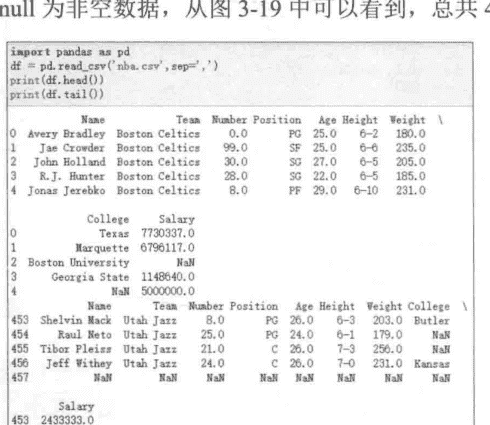

图 3-18

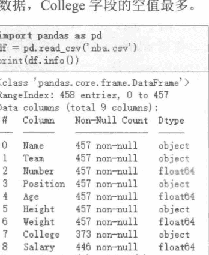

图 3-19

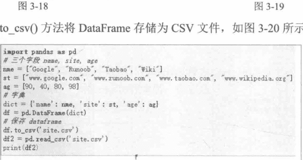

图 3-20

### 3.3.4 Pandas 数据清洗

数据清洗的核心就是把影响分析的脏数据处理掉。实际数据常出现缺失、格式不对、数值错误或重复等问题，清理之后结果才更可信。

下面以 clean-data.csv 为例，图 3-21 可见，表中混用了四种表示空值的写法：n/a、NA、--、na。

isnull() 可以检测单元格是否为空，图 3-22 展示了用法。这里需要先把 n/a、NA、--、na 这几种写法都声明为空值，才能被正确识别。

想删掉带空值的行，用 dropna() 即可，默认会返回新表而不会动原表，加 inplace=True 才能原地修改。fillna() 则负责填充空位，还能针对特定列单独处理，图 3-23 给出了示例。

填充空值常用三种统计量：均值、中位数、众数。Pandas 分别提供 mean()、median()、mode() 来计算。图 3-24 演示了用列均值填补空缺的做法。

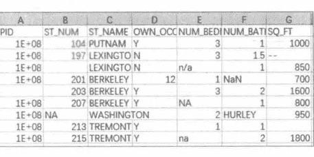

图 3-21

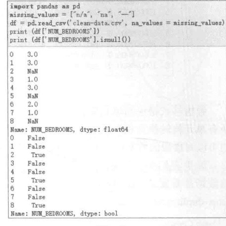

图 3-22

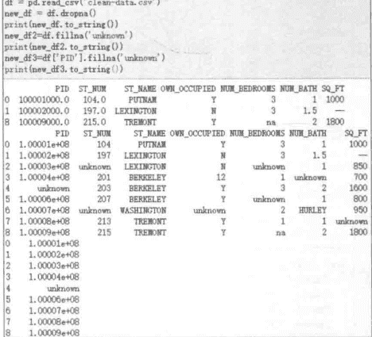

图 3-23

```python
import pandas as pd
df = pd.read_csv('clean-data.csv')
x = df['ST_NUM'].mean()
df['ST_NUM'].fillna(x, inplace=True)
print(df.to_string())
```
PID  ST_NUM  ST_NAME  OWN_OCCUPIED  NUM_BEDROOMS  NUM_BATH  SQ_FT

0 100001000.0 104.000000 PUTNAM Y 3 1 1000

1 100002000.0 197.000000 LEXINGTON N 3 1.5 —

2 100003000.0 191.428571 LEXINGTON N NaN 1 850

3 100004000.0 201.000000 BERKELEY 12 1 NaN 700

4 NaN 203.000000 BERKELEY Y 3 2 1600

5 100006000.0 207.000000 BERKELEY Y NaN 1 800

6 100007000.0 191.428571 WASHINGTON NaN 2 HURLEY 950

7 100008000.0 213.000000 TREMONT Y 1 1 NaN

8 100009000.0 215.000000 TREMONT Y na 2 1800

图 3-24

格式不统一也会拖慢分析，例如日期写法混乱，就需要统一转换。数值本身出错也很常见，比如年龄大于 100 岁，这类异常可以替换或剔除，图 3-25 列出了典型情况。

处理重复记录时，duplicated() 用于标记是否重复，重复返回 True，否则 False；drop_duplicates() 则直接把重复行删掉，图 3-26 展示了效果。

```python
import pandas as pd
# 第三章 日期格式错误
data = {
  'Date': ['2020/12/01', '2020/12/02', '20201226'],
  'duration': [50, 40, 45]
}
person = {
  'name': ['Google', 'Runoob', 'Taobao'],
  'age': [50, 200, 12345]
}
df1 = pd.DataFrame(data, index = ['day1', 'day2', 'day3'])
df1['Date'] = pd.to_datetime(df1['Date'])
print(df1.to_string())
df2 = pd.DataFrame(person)
for x in df2.index:
  if df2.loc[x, 'age'] > 100:
    df2.loc[x, 'age'] = 100
print(df2.to_string())
```
Date duration

day1 2020-12-01 50

day2 2020-12-02 40

day3 2020-12-26 45

name age

0 Google 50

1 Runoob 100

2 Taobao 100

图 3-25

```python
import pandas as pd
persons = {
  'name': ['Google', 'Runoob', 'Runoob', 'Taobao'],
  'age': [50, 40, 40, 23]
}
df = pd.DataFrame(persons)
df.drop_duplicates(inplace = True)
print(df)
```
name age

0 Google 50

1 Runoob 40

3 Taobao 23

图 3-26

## 3.4 数据可视化库——Matplotlib

Matplotlib 是 Python 领域最主流的绘图库，从基础的散点、折线、直方图到复杂三维图都能画，基本实现了想画什么就能画什么。

先从最简单的正弦曲线入手，图 3-27 给出了完整流程。先导入 numpy 并简写为 np 用于生成数据，导入 matplotlib.pyplot 并简写为 plt 用于绘图。随后用 np.linspace 在 [0, 2π] 上均匀采样 50 个点作为 x 轴，再用 np.sin 计算对应的 y 轴。接着调用 plt.plot(x, y) 绘制折线，最后 plt.show() 展示结果。

注意 plot() 接收两个参数时第一个是 x 第二个是 y，各自对应坐标轴。若只传一个参数，则它被当作 y 值，x 轴自动使用 0 起始的索引。

成图后可以看到坐标轴刻度和曲线本体一应俱全。

另一种更灵活的写法见图 3-28。相比前一种，这版多了创建画布和子图的步骤，并通过 ax 对象绘图。首先 fig = plt.figure() 显式新建一个空画布；然后 ax = fig.add_subplot(1,1,1) 在画布上添加一个子图，ax 即为该子图的坐标轴。add_subplot 的三个参数是行数、列数、位置，(1,1,1) 表示总共 1 行 1 列，当前是在第 1 个位置。如果改成 (1,2,1)，就意味着画布要放 1 行 2 列共 2 个子图。

```python
import numpy as np
import matplotlib.pyplot as plt
x = np.linspace(0, 2 * np.pi, 50)
y = np.sin(x)
plt.plot(x, y)
plt.show()
```

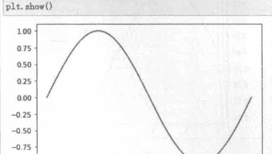

图 3-27

## Python 深度学习从零开始学

```python
import numpy as np
import matplotlib.pyplot as plt

x = np.linspace(0, 2 * np.pi, 50)
y = np.sin(x)

fig = plt.figure()
ax = fig.add_subplot(1, 1, 1)
ax.plot(x, y)

plt.show()
```

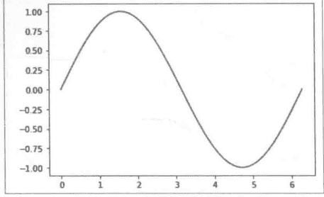

图 3-28

```python
import matplotlib.pyplot as plt
import numpy as np
matplotlib.rcParams['font.family']='SimHei'
matplotlib.rcParams['axes.unicode_minus']=False
matplotlib.rcParams['font.size']=20
a = np.arange(0.0,5.0,0.02)
plt.title('演示')
plt.xlabel('纵轴：振幅')
plt.ylabel('横轴：时间')
plt.plot(a, np.cos(2*np.pi*a), 'r--')
plt.show()
```

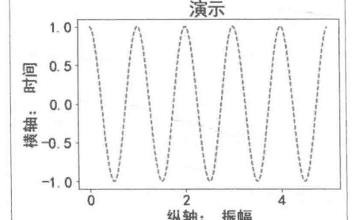

图 3-29

图 3-29 可以看出，借助 plt.title 为图表添加总标题，通过 plt.xlabel 和 plt.ylabel 分别给横轴、纵轴命名。pyplot 默认情况下不能正常渲染中文，必须通过 rcParams 更换字体来解决，而更换字体后负号会不显示，需要把 axes.unicode_minus 属性设为 False。

制作饼图时，只需要提供各个事项所占时长，Matplotlib 会自行算出占比并呈现，如图 3-30 所示。

```python
import matplotlib.pyplot as plt
plt.rcParams['font.sans-serif'] = ['SimHei']
activities = ['工作','吃','睡','玩']  #设置所要绘制饼图的标题
times = [8,7,3,6]  #每个饼块所对应的时间
color = ['c','m','r','b']  #每个饼块可选择的颜色
plt.pie(times,labels = activities,colors = color,shadow = True,
explode = (0,0.1,0,0),autopct = '%.1f%%')
#参数shadow是是否有阴影 explode 设置各个扇形主体的效果
#参数autopct设置是否显示百分比, if格式化字符%表示一个百分号
plt.title('饼图')
plt.show()
```

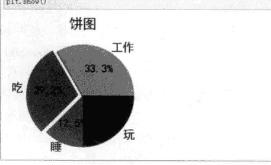

图 3-30

调用 plt.scatter 即可绘制散点图。图 3-31 中演示了用 NumPy random 生成 1024 个介于 0 到 1 之间的随机数。

```python
#散点图
import matplotlib.pyplot as plt
import numpy as np
plt.rcParams['axes.unicode_minus'] = False
#设置显示符号，由于设置了显示中文字体影响图中负号的显示，重新设置
n = 1024
x = np.random.normal(0,1,n)
y = np.random.normal(0,1,n)
plt.scatter(x,y) #绘制散点图
plt.title('散点图')
plt.show()
```

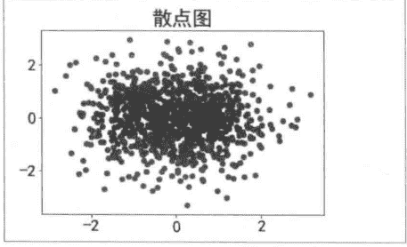

图 3-31

柱状图则通过 plt.bar 来实现，示例见图 3-32。

```python
import matplotlib.pyplot as plt
import random
plt.rcParams['font.sans-serif'] = ['KaiTi']  # 用来正常显示中文标签
plt.rcParams['axes.unicode_minus'] = False  # 用来正常显示负号
plt.figure()
month_days = 5
x = [i + 1 for i in range(1, month_days + 1)]
y = [random.randrange(20, 41) for i in range(1, month_days + 1)]
plt.bar(x, y, label='金额', color=['r', 'y', 'b', 'g', 'c'])
plt.xlabel('一周(天)')
plt.ylabel('消费金额(元)')
plt.legend()
plt.xticks(x, ['星期{0}'.format(i + 1) for i in range(0, month_days + 1)])
plt.show()
```

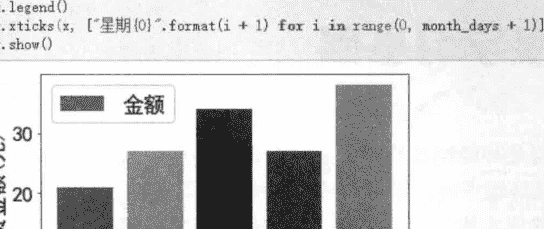

图 3-32

Matplotlib 是 Python 生态里使用最广泛的可视化包之一，跨平台兼容，核心是二维绘图，同时也提供部分三维接口。它常和 NumPy、Pandas 搭配，成为数据分析流程中的关键组件。

# 第 4 章 深度学习入门框架

深度学习的底层是神经网络模型，研究重点在于多层隐含层的深层网络。神经网络的突出能力是具备自学习特性。学习过程大致为：在环境刺激下依次输入样本模式，按照特定学习规则调整各层权重矩阵，直至权重收敛，学习结束。卷积神经网络作为深度学习的代表，弥补了传统神经网络的缺陷，使计算机在图像识别上实现质的飞跃。

## 4.1 神经网络工作机理

本节简要介绍神经网络的运行方式。

### 4.1.1 神经元与感知器

人工神经网络是模拟生物神经系统，尤其是大脑结构和功能的数学或计算模型。

神经元是网络的基本单元，模拟生物神经元的接收与输出特性。1943 年，McCulloch 与 Pitts 提出神经元可看作二值输出的逻辑门：输入冲动整合后使膜电位升高，超过阈值即兴奋产生冲动；整合后膜电位降低，低于阈值则抑制不产生冲动。

理解一个神经元的操作：接受电信号后产生另一信号。输入强度不足时无反应，超过阈限则向后传递信号。好比把手指伸入水中，水温偏低无痛感，升至一定温度才会本能抽回，这体现了输入强度跨过阈值后才触发反应。

世界万物相互关联，生物神经元启发了最原始的人造神经元。感知器是人工神经网络的首个里程碑，是对神经元概念的最基础模拟。从数学看，感知器可视为黑盒函数，接收多个输入输出一个决策结果。

如图 4-1 所示，圆圈代表一个感知器，可接收多路输入并给出“是/否”二元结果。

举例判断小张是否接受工作，考量环境、内容、薪酬三要素。将三要素量化后输入感知器即可得到决策。内部原理是对各要素赋予不同权重，再设阈值，整体加权和不小于阈值则接受，否则拒绝。感知器本质是加权决策工具。

单层感知器只有一层神经元。输入 x1…xn 每个对应权重 w1…wn，先求 Σxjwj 再与阈值比较，大于则输出1，小于则输出0。公式见图 4-2。

把公式写成矩阵形式，用 b 表示阈值的负数，即 b = -threshold，可简化为图 4-3 所示。

output = { 0 if Σj wj xj ≤ threshold; 1 if Σj wj xj > threshold } 图4-2

output = f(x) = { 0 if wx + b ≤ 0; 1 if wx + b > 0 } 图4-3

完整感知器模型如图 4-4，数据加权后进入激活函数计算输出。类比生物神经元，信号从前一神经元传到后一神经元并非任意强度均可，需足够强才能触发动作电位，激活函数起类似作用。

单层感知器的激活函数为阶跃函数，以 0 为分界，小于等于 0 输出 0，否则输出 1。它将输入映射为 0 或 1，1 对应兴奋，0 对应抑制。

单层感知器局限明显，无法处理线性不可分问题，只能做二分类，难以学习复杂非线性模型，故实际模型更复杂。将多个单层感知器组合可形成多层感知器。

图 4-5 展示了多层感知器 MLP 的结构。最左侧为输入层，神经元为输入神经元；最右侧为输出层。中间为隐藏层，因既非输入也非输出而得名。隐藏层是网络的核心，可为单层或多层，每个神经元都对数据做变换。

Python 深度学习从零开始学

在图 4-5 中仅有一个输出神经元，实际输出层通常包含多个神经元。隐藏层为中间处理层，它的数量可根据需求设定。


图 4-4

图 4-5

MLP 未限定隐藏层数量，可按需选择。输出层神经元个数也无限制。通常拥有一个以上隐藏层的网络称为深度神经网络。

感知器的要点总结如下：

- （1）引入隐藏层，可有多层，提升表达能力，层数越多复杂度越大。
- （2）输出层可有多神经元，模型可灵活用于分类或回归。
- （3）每个感知器对结果贡献不同，需非线性激活函数保证权重微小变化能引起输出微小变化。若无非线性激活，多层网络等价于单层，无法解决线性不可分问题。

多层网络常用非线性激活函数有 sigmoid、softmax、ReLU 等，引入非线性使网络可逼近任意非线性函数，扩展应用范围。使用不同激活函数进一步增强表达能力。足够多的神经元、合适的层数与参数，网络威力显著提升。

### 4.1.2 激活函数

激活函数作用于神经元，将输入映射为输出。如图 4-6 所示最简单的激活函数。

图 4-6 为单位阶跃函数，以 0 为界输出在 0 与 1 间切换，变化呈阶梯状，故称阶跃函数。输入大于 0 时信号继续传递，否则中断。函数体现了“激活”含义，但其由两段水平线构成，不连续不光滑，不适合神经网络。

若用作激活函数，参数微小改变被阶跃函数抹除，在输出端无法体现，难以为权重学习提供梯度，阻碍训练更新。


图 4-6

神经网络中常用激活函数有 sigmoid、tanh、ReLU、softmax，它们均为非线性。引入非线性原因在于：若无激活函数，每层输出是输入的线性组合，多层叠加仍是线性，无法做非线性分类，网络退化为单层线性模型。

激活函数为神经元引入非线性，使得网络可表示非线性函数，拓展应用。典型非线性激活 sigmoid 公式如图 4-7。

sigmoid(x) = σ(x) = 1 / (1 + e^{-x})

图 4-7

该函数左侧趋近 0，右侧趋近 1，两侧饱和，图像见图 4-8。sigmoid 在传统网络中常用，对中部信号增益高，对两侧增益低，在特征映射上表现良好。

与阶跃函数只能输出 0 或 1 不同，sigmoid 可输出 0.731…、0.880…等实数。感知器中信号为二值，神经网络中信号为连续实数。宏观上两者形状相似：输入小时输出近 0，随输入增大输出趋近 1。重要信号时两者输出较大，不重要时输出较小。无论输入多小或多大，输出范围均为 0~1。

ReLU 也是一种常用激活函数，形式简洁：输入小于 0 输出 0，大于 0 输出等于输入。图像如图 4-9 所示。


ReLU 是分段线性函数，将负值置零，正值保持。优势在于表达能力更强，尤其在深层网络；负区梯度为零，正区梯度恒为常数，避免梯度消失。梯度消失即梯度小于 1 时误差逐层衰减，sigmoid 在深层易出现，导致收敛停滞。如今大部分深度模型采用 ReLU，但它仅适用于隐藏层。

输出层激活函数需特定选择，不可随意更改。多分类任务常用 softmax 处理，输出归一化后总和为 1。与 sigmoid 类似，二分类用 sigmoid，多分类用 softmax，可为各类别分配概率值。softmax 通常作为网络最后一层，输出值非负且总和为 1，可视为概率分布。例如向量 [3,1,−3] 经 softmax 后约得 [0.88,0.12,0]，各分量之和为 1，可解释为各类别概率。

### 4.1.3 损失函数

损失函数用于衡量真实值与预测值的差距，在统计学中度量估计误差大小。

神经网络训练即通过大量训练数据不断调整参数如权重 w，使损失函数最小化。

分类任务常用交叉熵作为损失函数。交叉熵源自信息论，用于估计平均编码长度。在机器学习中用于评估分类效果，p 为真实分布，q 为模型预测分布，交叉熵衡量两者相似度。

希望预测分布尽可能接近真实分布，交叉熵即可作为衡量标准。分类问题中交叉熵常与 softmax 搭配，softmax 使多分类输出和为 1，再用交叉熵计算损失。

### 4.1.4 梯度下降与学习率的平衡艺术

神经网络训练的本质是让近似分布一步步逼近真实分布，核心问题是如何调整参数、找到损失函数的极小值。我们直觉上会想到穷举法，把所有可能的参数取值都试一遍比对损失。但在深度网络里参数动辄上万十几万，且取值精细到小数点后多位，穷举的计算量根本不可实现。

因此实际采用梯度下降法。梯度衡量的是输入稍有变动时函数输出会发生多大改变。既然最小值不可直接拿到，就只能逐步逼近。常说的下山比喻是这样：雾很大能见度极低的人被困山上，必须借助身边信息一点点下到山谷。方法就是以当前位置为基准找到最陡处，朝下降方向迈一步，再以新位置为基准继续找最陡处往下走，直至抵达最低点。


图 4-10

梯度下降的步长叫做学习率。步长越大梯度影响越强。我们需要用步长控制每一步的距离，避免走太快错过谷底，也要避免走太慢日落前仍未到达。学习率的选择非常关键，太大容易越过最优点，太小则收敛缓慢迟迟到不了底部。

学习率属于超参数，是在学习开始前人工设定的，而不是训练中学习得到的参数。它决定了目标函数能否收敛到局部最小值以及何时收敛。学习率越低，损失函数变化越慢。虽然低学习率能降低错过局部极小值的风险，却会付出更长的收敛时间。实践中通常会尝试不同固定学习率，观察迭代次数与损失的变化关系，挑选让损失下降最快的那个值。

### 4.1.5 过拟合克星：Dropout 原理与实践

随机梯度下降 SGD 已成为深度神经网络最主流的训练算法之一，自适应时刻估计 Adam 等方法也能在训练过程中自适应修正学习率。SGD 与 Adam 都被归为优化器。网络越复杂数据越多，训练耗时越长，优化器的价值就在于让网络训练得更快更聪明。

随着迭代增多，训练集损失持续变好而测试集损失却开始变差，两者差距越拉越大，模型出现了过拟合。过拟合意味着在训练集上表现优异，却在验证集或测试集上大打折扣。


图 4-11

Dropout 的思路是在训练时按一定概率随机丢弃一部分神经元单元，相当于从原网络中临时抽出一个更“瘦”的子网络来训练，从而缓解过拟合。


图 4-12

可以做个类比：无性繁殖能保留大段优秀基因，有性繁殖则把基因随机拆解破坏了大段基因的联合适应性，但自然选择偏偏选择了有性繁殖，说明这种随机化更强大。Dropout 达到相似效果，它强制一个神经元只能与随机挑选的其它神经元合作，削弱了节点间的联合依赖，增强了泛化能力。

再换个说法：如果一家公司员工每天早上抛硬币决定是否上班，公司还能运转吗？有可能，因为重要工作总有替代者，不会依赖某个人，员工也会学会和各种不同同事合作，能力被迫提升。训练时使用 Dropout 就是让神经元无法依赖固定的邻居，必须与随机伙伴合作，几轮训练后个体表达力增强且联合适应性减弱。训练时开启 Dropout，降低拟合能力；预测时关闭 Dropout。这就像中国传统武术练轻功时脚上绑重物，实战时全部卸掉。

### 4.1.6 反向传播：模型如何从错误中成长

神经网络可以看作一个从输入 x 到输出 y 的映射函数 f(x)=y，其中映射 f 由待训练的参数 w 构成。训练好 w 后，任意输入 x 都能得到对应输出 y。想要得到符合真实数据的 y，就要训练出符合真实数据的映射 f。训练过程分为前向传播和反向传播两个阶段。

前向传播是从输入层 Layer1 开始，层层计算每一层的神经元结果并经过激活函数处理，最终得到预测值 y^，再根据 y^ 与真实值 y 的差距计算损失。

反向传播则是依据损失函数 L(y^,y) 反向逐层回溯，逐层修改权重更新参数。简单说就是先算出损失，再倒回去调整每个变量和每层的权重。

BackProp 是典型的监督式学习方法，即在有标记的训练数据引导下学习。可以理解为从错误中学习。以猜数字为例，A 随意报一个数字，B 反馈大了还是小了，A 根据反馈修正再猜，经过多次试错反馈最终逼近正确答案。实际中不可能百分百正确，只能追求最大可能正确。

因此反向传播就是比较预测值与真实值，然后返回去修正网络参数的过程。初始时卷积核参数随机初始化，随后以误差为导向通过反向传播算法自适应调整核值，使模型预测值与真实值误差最小化。

一个人工神经网络包含输入层、若干隐藏层和输出层，相邻层节点之间都有权重连接。学习的目的是为这些连接分配合适的权重。在监督学习中训练集已标注，给定输入已知期望输出。

反向传播算法启动时所有边权重随机分配。把训练集输入网络激活后得到输出，与期望输出对比产生误差，误差被标注并传回上一层，权重据此调整。重复此流程直至输出误差低于预设标准。训练完毕后网络即可接受新输入，可以说它从标注样本和误差传播中完成了学习。

### 4.1.7 TensorFlow Playground 零门槛可视化训练

TensorFlow 游乐场是一个在网页浏览器中就能训练简易神经网络并可视化训练过程的工具，地址为 http://playground.tensorflow.org/。它是一个在线演示与实验平台，是入门神经网络非常直观的网站，整个训练过程被图形化呈现。


图 4-13

打开页面后顶部有一批默认参数可解读：

- Epoch：训练轮次。
- Learning rate：学习率，用于梯度下降，人为设定，值越低损失变化越慢。
- Activation：激活函数，默认非线性函数 Tanh。
- Regularization：正则化，用于提升泛化能力防止过拟合，模型参数过多易出现过拟合。
- Regularization rate：正则率，与权重参数相关。
- Problem type：问题类型。分类问题是根据训练集推断新模式所属类别，如 +1、-1，属于定性输出离散变量预测；回归问题是推断连续数值输出。这里演示的是二分类。

界面从左到右依次为 DATA、FEATURES、HIDDEN LAYERS、OUTPUT。DATA 提供四种数据集，默认选中第一种，所选数据也会在最右侧 OUTPUT 显示。如图 4-14 所示，二维平面内点被标记为两种颜色，深色约蓝为正，浅色约黄为负，是一个二分类任务。可调节训练数据与测试数据的比例，也可调节噪声比例来模拟真实噪声。噪声指偏离期望值的错误或异常数据，会干扰分析。每批 Batch 输入数据量可在 1~30 之间调节。

FEATURES 对应实体的特征向量，也是网络输入。第一层即输入层代表每个特征的取值。如图 4-15 所示，每个点有 X1、X2 两个基础特征，还可衍生出 X1X1、X2X2、X1X2、sin(X1)、sin(X2) 等。从颜色看 X1 左边黄为负右边蓝为正，X1 代表横坐标；X2 上边蓝为正下边黄为负，X2 代表纵坐标。X1X1 是横向抛物线信息，X2X2 是纵向抛物线信息，X1X2 是双曲抛物面信息，sin 函数提供周期信息。分类器需要结合这些特征画出一条或多条分界线把黄色和蓝色点准确分开。

HIDDEN LAYERS 即隐藏层，介于输入与输出之间。如图 4-16 所示，默认网络有两个隐藏层，第一层 4 个神经元，第二层 2 个神经元。隐藏层间的连线表示权重，蓝色表示使用神经元原始输出，黄色表示使用负输出。连线的粗细深浅反映权重绝对值大小，悬停可查看具体数值并手动修改。下一层神经元会基于上一层输出进行组合，组合权重通过反向传播根据预测准确性动态调整，线条越粗颜色越深权重越大。可以点击 + 或 - 增加减少隐藏层，也可调整层数、学习率、激活函数、正则化等。


图 4-14


图 4-15


图 4-16

OUTPUT 为输出层，中间区域可视化输出结果，平面上颜色深浅表示模型对该区域判断的信心，越深越有信心。

游乐场展示的是全连接网络，同层节点互不连接，每层只与下一层相连，直至输出层。每个小格子代表一个节点，节点颜色代表其区分平面，平面上一点的坐标对应一种取值，颜色对应输出值，绝对值越大颜色越深，黄色越深为负越大，蓝色越深为正越大。每条边代表一个参数，可取任意实数，颜色越深绝对值越大，黄色越深负越大，蓝色越深正越大，接近白色时接近零。

使用神经网络解决分类问题可概括为四步：

- 步骤 01 提取问题实体的特征向量。
- 步骤 02 定义网络结构，设定如何从输入到输出，包括隐藏层数、节点数、前向传播、激活函数等。
- 步骤 03 用训练数据调整网络参数，即训练过程，反向传播不断优化权重至合理水平。
- 步骤 04 用训练好的网络预测未知数据，此时权重已达最优。

如图 4-18 所示，选择螺旋形数据并输入全部 7 个特征，设置 3 个隐藏层，分别为 8、4、2 个神经元。训练约 2 分钟后，测试损失与训练损失不再下降，网络已完美分离蓝色点和黄色点。


对初学者而言，TensorFlow 游乐场是认识神经网络的直观入口。可任意设计多层网络模拟过拟合，也能通过调节学习率、激活函数、正则化等参数把理论概念形象化。

## 4.2 CNN：图像识别的王者

卷积神经网络被广泛应用于各领域，在众多任务上取得了当前最佳性能。本节介绍其相关知识。

### 4.2.1 从猫的视网膜到卷积网络

大约 20 世纪 60 年代科学家提出感受野，这是卷积神经网络发展史上的首个里程碑。当时对猫视觉皮层细胞的研究发现，每个视觉神经元只处理图像的一小块区域，即感受野。

深度学习的许多进展都受益于对大脑认知原理尤其是视觉原理的研究。1981 年诺贝尔医学奖授予 David Hubel、Torsten Wiesel 及 Roger Sperry，前两位因发现视觉系统的信息处理和可视皮层分级而获奖。

人类视觉流程大致为：瞳孔摄入像素 Pixels，初级处理识别边缘和方向，再抽象出物体形状如圆形，进一步抽象判断这是一个气球。对不同物体，人类也是逐层分级认知：底层特征相似多为边缘，上层提取轮子、眼睛、躯干等特定特征，最上层把高级特征组合成完整图像实现区分。

受此启发，可以构造多层神经网络，低层识别初级图像特征，多层特征组合最终在顶层完成分类。这正是卷积神经网络的灵感来源。

1980 年前后日本科学家福岛邦彦 Kunihiko Fukushima 在 Hubel 和 Wiesel 工作基础上模拟生物视觉系统，提出层级化多层人工神经网络神经认知 Neurocognitron，用来处理手写字符识别等模式识别任务，后来被视为现代卷积神经网络的前身。其核心单元是 S 型细胞 S-cells 和 C 型细胞 C-cells，交替堆叠构成网络。S 细胞负责抽取局部特征，C 细胞负责抽象与容错，这与现今卷积层 Convolution Layer 和池化层 Pooling Layer 一一对应。卷积层操作受局部感受野启发，池化层主要用于降低数据维度。

卷积神经网络是一种多层网络，擅长处理尤其是大图像的机器学习问题。它通过卷积模拟特征区分，并借助权值共享和池化大幅降低参数量级，最后由传统神经网络完成分类等任务。

### 4.2.2 典型 CNN 结构与工作流程

典型的卷积神经网络由卷积层、池化层、全连接层组成。卷积层与池化层配合构成多个卷积组逐层提取特征，最终由若干全连接层完成分类，如图 4-19 所示。


图 4-19

用卷积神经网络识别图片一般需要如下步骤：

- 步骤 01 卷积层初步提取特征。
- 步骤 02 池化层提取主要特征。

CNN 全流程拆解：从局部特征到分类决策

- 步骤 03 全连接层将各部分特征汇总。
- 步骤 04 产生分类器，进行预测识别。

想真正吃透卷积神经网络，先把卷积和池化这两个源自计算机视觉的基础概念弄明白。

### 1. 卷积层的作用

卷积层的工作是把图片切成若干小块，逐块提炼出可识别的特征。卷积本身就是一种特征提取操作，运算时用到的矩阵叫作卷积核。核的尺寸通常小于原图，所以提取到的信息更偏向局部，这和人眼先看局部再拼全局的习惯一致。单个神经元不需要感知整张图，只需对局部窗口响应，后续层再把这些局部信号叠加起来，就能得到全局表征。

举例来说，假设有一张 6×6 的灰度图，每个像素都保存了数值。定义一个卷积核作为可学习权重，核与图对应位置相乘再求和，就得到该位置的输出，如图 4-20 所示。

429 = (18×1+54×0+51×1+55×0+121×1+75×0+35×1+24×0+204×1)


图 4-20

训练初期核的取值靠随机函数给出，随后在数据驱动下不断微调。当所有像素都被至少覆盖一次后，就能生成一层卷积的输出，如图 4-21 所示。


图 4-21

一开始网络并不知道目标长什么样，它通过对比不同核的响应来挑选最能刻画该图的核。比如要捕捉曲线，合适的核在曲线区域会产生较大输出，对三角形等其他形状则输出偏低，说明该核与曲线特征的匹配度高。把这类核保留下来就能用于曲线识别，同样的方法可以筛选出其他部位的核。训练过程中，卷积层通过持续调整核的数值，从中挑选出最契合图像特征的核，再用这些核的输出来确定特征。

简单来说，卷积层就是用一个或多个卷积核对输入做卷积，用不断变化的核来筛选出能够初步表征图像的有用核，并得到与之相乘后的特征图。因为卷积会让尺寸变小，容易丢失边缘信息，所以常用在运算前对图像边缘做填充，以保持输出尺寸与输入一致。

### 2. 池化层的作用

池化的目标是压缩特征图，舍弃次要细节，保留主要信息。卷积层输出会因为核数量多而维度膨胀，作为下一层的输入会带来很大的训练负担。为降低参数量、缓解过拟合，就需要只保留其中有效信号、滤除噪声，既能减少干扰的传递，也能降低维度。其本质是对输入做下采样，保留局部区域的代表性特征。

常见做法有最大池化、最小池化、平均池化。池化还涉及区域大小和步长。最大池化取窗口内的最大值，平均池化取平均值。如图 4-22 所示，最大池化窗口 2×2 步长 2，能把 4×4 区域压缩成 2×2，大幅降低数据敏感度，同时在保留信息的前提下减少计算量。


图 4-22

### 3. 平坦层处理

平坦层是结构非常简单的过渡层，它把二阶张量或三阶张量拉平成一阶向量，也就是把多维特征压成一维序列，通常用在卷积特征到全连接层的衔接处。

### 4. 全连接层处理

卷积和池化负责提取特征并降维，最终要做出分类判断，就需要全连接层来充当分类器。它把来自不同区域的局部特征汇总，通过激活函数做非线性变换得到最终输出。

在高级特征被检测之后，最后的完全连接层起到收尾作用。它把输入映射成一个 n 维向量，n 由任务的类别数决定。比如十位数字分类，n 就是 10。向量里每个分量代表对应类别的概率。例如输出为 [0, .1, .1, .75, 0, 0, 0, 0, 0, .05]，就表示该图有 10% 可能是 1，10% 可能是 2，75% 可能是 3，5% 可能是 9。

完全连接层读取上一层的激活图，判断哪些高级特征更贴合哪一类。例如预测为狗时，激活图上爪子、四条腿等特征响应较高；预测为鸟时，翅膀、鸟喙等特征响应较高。总体上该层衡量高级特征与各类别的吻合程度以及权重大小，计算加权点积后得到各类的概率。

### 4.2.3 卷积神经网络是如何训练的

卷积核本质上是如 3×3、5×5 的权值矩阵，网络要学习的就是这些权值的数值。CNN 通过反复的前向计算和反向更新来获得合适的权值，核被更新后所学到的特征也随之变化。对分类任务来说，核心就是从图像中提取特征，再用合适的特征判断类别归属。

本质上 CNN 是一种输入到输出的映射，可以在没有精确数学公式的情况下学习大量输入输出对应关系，只需用已知样本进行监督训练就能获得映射能力。权值更新依赖反向传播算法，训练样本是 输入向量、理想输出向量 的配对。训练前所有权值都用不同的小随机数初始化：数值要小以免陷入饱和，不同是为了保证学习正常。

训练分为两个阶段：数据从低层向高层流动的前向传播，以及当结果与期望不符时误差从高层向低层回传的反向传播。

具体流程大致为 5 步：

- **步骤 01** 网络进行权值的初始化。
- **步骤 02** 输入数据经过卷积层、下采样层、全连接层的前向传播得到输出值。
- **步骤 03** 求出网络的输出值与目标值之间的误差。
- **步骤 04** 当误差大于我们的期望值时，将误差传回网络中，依次求得全连接层、下采样层、卷积层的误差。各层的误差可以理解为对于网络的总误差，网络应承担多少；当误差等于或小于我们的期望值时，结束训练。
- **步骤 05** 根据求得的误差，按极小化误差的方法调整权值矩阵，进行权值更新，然后再进入到第 2 步。

## 4.3 卷积神经网络经典模型架构

ImageNet 大规模视觉识别挑战赛 ILSVRC 于 2010 年创立，目标是推动大规模目标检测和图像分类技术进步。ILSVRC 催生了许多经典 CNN 架构，其数据来自 ImageNet。ImageNet 由斯坦福大学李飞飞教授于 2007 年发起，收录了约 1500 万张带标注的高清图，约 22 000 类，其中约百张标注了主要物体的定位框。

ILSVRC 使用 ImageNet 的子集，约 120 万张图、1000 类。评测常用 top-1 和 top-5 分类错误率。top-1 指概率向量最大值对应的类别是否正确；top-5 指前五名预测中是否包含正确答案。

随后出现的代表性结构包括 LeNet-5、AlexNet、VGGNet、GoogLeNet、ResNet 等。如图 4-23 所示，它们分别斩获 ILSVRC 分类榜的 2012 年冠军 AlexNet，top-5 错误率 16.4%，使用额外数据可到 15.3%，8 层；2014 年亚军 VGGNet，top-5 错误率 7.3%，19 层；2014 年冠军 GoogLeNet，top-5 错误率 6.7%，22 层；2015 年冠军 ResNet，top-5 错误率 3.57%，152 层。


图 4-23

### 4.3.1 LeNet5

LeNet5 由 Yann LeCun 教授于 1998 年在论文 Gradient-based Learning Applied To Document Recognition 中提出，是首个成功应用于手写数字识别的卷积神经网络，在当时条件下错误率已低于 1%。因此它曾服务于美国几乎所有邮政系统，用于识别手写邮编分拣邮件包裹，也被银行用于支票手写数字识别，具备了真实商业价值，为后续 CNN 的发展奠定基础。

LeNet5 虽小，却包含了深度学习的三大基本模块：卷积层、池化层、全连接层，是后世模型的基础。如图 4-24 所示，LeNet5 包含卷积层、采样层、卷积层、采样层、全连接层、全连接层、高斯连接层，不计输入层共 7 层，每层都带可训练参数，每个层有多个特征图，特征图通过卷积滤波器提取一种特征。


图 4-24

经过卷积、激活、池化、全连接和 softmax 回归后，网络输出概率数组实现图像识别。各层说明如下。

### 1. INPUT——输入层

要求输入图像尺寸为 32×32，数据进入前统一归一化为该尺寸。本层不计入 LeNet5 结构。网络最后输出为 softmax，多分类共 10 类，神经元数为 10。

### 2. C1——卷积层

- 输入图片尺寸：32×32。
- 卷积核大小：5×5。
- 卷积核种类：6。
- 输出特征图大小：28×28，(32−5+1)=28。
- 神经元数量：28×28×6。
- 可训练参数：(5×5+1)×6。
- 连接数：(5×5+1)×6×28×28=122304。


对 32×32 输入用 6 个 5×5 核做第一次卷积，得到 6 个 28×28 的 C1 特征图，神经元总数 6×28×28=784。参数量为 6×(5×5+1)=156，含 bias。每个 C1 像素都与输入 5×5 区域和 1 个 bias 相连，连接数为 156×28×28=122304。权值共享使参数数只与核大小和特征图数相关，而连接数与神经元数相关。

### 3. S2——池化层

- 输入图片尺寸：28×28。
- 采样区域：2×2。
- 采样种类：6。
- 输出特征图大小：14×14。
神经元数量：14×14×6。

S2 中每个特征图的大小是 C1 的 1/4。


第一次卷积后用 2×2 池化核下采样，得到 6 个 14×14 的 S2 特征图。每个 2×2 块取代表值后得到 14×14 图，神经元个数 14×14×6=1176。池化层对 2×2 区域做加权求和加偏置再映射，每个池化核有 2 个训练参数，共 12 个，连接数 5×14×14×6=5880。

### 4. C3——卷积层

- 输入：S2 中所有 6 个或者几个特征图组合。
- 卷积核大小：5×5。
- 卷积核种类：16。
- 输出特征图大小：10×10。


第二次卷积输出 C3 为 16 个 10×10 特征图，核大小 5×5。不同于全连接，C3 通过把每个特征图连接到上层 6 个或部分特征图的组合来提取多样特征，既控制连接数，又保证特征多样性。

### 5. S4——池化层

- 输入图片尺寸：10×10。
- 输出特征图大小：5×5（10/2）。
- 神经元数量：5×5×16=400。


S4 仍用 2×2 窗口做池化，16 个 10×10 图压缩为 16 个 5×5 图。该层有 2×16=32 个训练参数，连接数 5×5×5×16=2000，连接方式与 S2 类似。

### 6. C5——卷积层

- 输入：S4 层的全部 16 个单元特征图。
- 卷积核大小：5×5。
- 可训练参数 / 连接：120×(16×5×5+1)=48120。

C5 用 5×5 核对 5×5 的 S4 图做卷积，得到 120 个 1×1 特征图，每个都与上一层 16 个图相连，参数与连接数均为 (5×5×16+1)×120=48120。

### 7. F6——全连接层

输入：C5 的 120 维向量。
计算方式：计算输入向量和权重向量之间的点积，再加上一个偏置，结果通过 sigmoid 函数输出。
可训练参数：84×(120+1)=10164。

F6 有 84 个节点，对应 7×12 比特图编码，-1 代表白色，1 代表黑色。该层参数和连接数为 (120+1)×84=10164。

### 8. OUTPUT——输出层

OUTPUT 也是全连接层，最终得到 10 个分类，对应数字 0~9，共 10 个节点。若某节点输出接近 0，则该位置即为网络识别结果。

LeNet5 可以看作是经典的7层卷积网络，结构上是两组卷积加池化再接三层全连接，最后用 softmax 完成分类。单张图片的推理路径是这样的：先把输入缩放到28×28并归一化，随后做一次卷积，把28×28变成6个24×24的特征图，尺寸变小但通道数变多，直观上特征更丰富；再用最大池化把信息压缩，得到6个12×12的图；接着重复一次卷积池化，最终得到16个4×4的图；把这16个小图展平成一维向量送入全连接，得到120维再到84维最后到10维的输出，经 softmax 产生预测。真正需要学习的只有每一层的卷积核，尺寸都是5×5，训练完成后这组核能让在手写数字上的识别率稳定在98%左右。

虽然层数不多，LeNet5 的意义在于开创。卷积带来的权值共享既压缩了参数量，又让网络能够在不同位置捕捉局部视觉模式，这为后来的卷积网络奠定了基础。

### 4.3.2 AlexNet 的跃升
2012年 AlexNet 参加 ImageNet ILSVRC 竞赛，以明显优势位列第一。该模型层数大幅增加，采用 ReLU 替代 Sigmoid 并配合0.5概率的 Dropout 来抑制过拟合。正是由于结构相对简洁却足够深，AlexNet 至今仍常被用作教学与基准。

AlexNet 由 Hinton 团队的 Alex Krizhevsky 主导完成，是 ImageNet 历史上第一个靠卷积网络夺冠的模型，深度远超 LeNet5。网络共含5个卷积层和3个全连接层。


图 4-25

整体是8层架构，前5层卷积后3层全连接。引入 ReLU 有效缓解了深网中的梯度消失；使用最大池化避免平均池化带来的模糊；池化步长小于核尺寸，使相邻输出区域产生重叠，特征更为丰富。

为提升规模与速度，AlexNet 使用双GPU并行，每块GPU负责一半计算，并在特定层交换信息。实验显示，双GPU方案相比单GPU跑一半规模网络，Top-1 准确率提升约1.7%，Top-5 提升约1.2%。

### 4.3.3 VGGNet 深度论证
ILSVRC 2014 亚军 VGGNet 由 Karen Simonyan 与 Andrew Zisserman 提出，其核心观点是网络深度对性能起决定性作用。

VGGNet 族包含 A、A-LRN、B、C、D、E 六种配置，均为5组卷积与3层全连接构成，差别在于每组卷积的层数从1层逐步增加到4层，对应总权重层从11层到19层。图中用 conv3-128 表示3×3卷积核且输出通道128。配置 D 即是广为人知的 VGG16，配置 E 即 VGG19。VGG16 通常计为16层，不计池化与 softmax；VGG19 则有19个权重层。

统一设计是输入固定为224×224的RGB图，仅做均值减除预处理。所有卷积均采用3×3核，每组后接2×2窗口步长2的最大池化。卷积后接三层全连接，前两层各4096个神经元，最后一层1000维对应ILSVRC分类，末尾接 softmax。隐藏层全部使用 ReLU。

通道数从首层64开始，每经过一次池化翻倍直至512。全部使用小核堆叠，层数增加并未导致参数爆炸，因为参数主要集中在最后三层全连接。相比 AlexNet，VGG 更深却收敛更快，缺点是显存占用大。

论文的关键结论是加深网络有助于提升精度。三个步长1的3×3卷积等价于一个7×7感受野，同时非线性增加而参数减少，因为3×3²×3 < 7²。此后研究者普遍倾向堆叠小核，甚至采用可分离卷积。

不过 VGG 只是简单堆叠，最高达512通道，特征冗余严重，参数与搜索空间急剧膨胀，正则化困难，精度并非最高，推理耗时也高于 GoogLeNet，性价比偏低。

### 4.3.4 GoogLeNet 参数精简
ILSVRC 2014 冠军 GoogLeNet 由 Szegedy 等人在 Google 提出，主要贡献是 Inception 模块，大幅压缩参数至约4M，远小于 AlexNet 的约60M。网络顶端使用全局平均池化替代全连接，进一步削减参数。该系列后续演进为 Inception-v4 等版本。

Inception 结构如图 4-27 所示。


图 4-27

说明要点：
- 记号 3×3+1(S) 表示3×3卷积、步长1、same填充。
- 输入复制四路，分别做不同尺寸的卷积或池化。
- 所有卷积后接 ReLU。
- 多尺度核用于捕捉不同尺寸模式。
- same填充与步长1保证输出尺寸与输入一致。
- 最后在通道方向拼接。
- 1×1卷积用于引入额外非线性。

GoogLeNet 架构如图 4-28 所示。


图 4-28

要点：
- 卷积核前面的数字表示输出特征图数量。
- 整体包含9个 Inception 模块，每个模块内部有6个数字描述各分支输出通道。
- 全部卷积使用 ReLU。
- 末端用全局平均池化得到每个特征图的均值。

### 4.3.5 ResNet 残差突破
深度残差网络 ResNet 是卷积网络发展的重要里程碑，在 ILSVRC 与 COCO 2015 上斩获多项第一，刷新 ImageNet 记录，如图 4-29。


图 4-29

ResNet 的核心是解决了深网难以训练的问题。模型可达152层，深度上远超 VGG。关键技巧是残差学习。

经验上，深度有助于提取更复杂的模式，理论上越深越好。但实践中出现退化现象：层数增加后准确率先饱和后下降，如图 4-30 所示，56层网络表现不如20层，且训练误差同样偏高，并非过拟合，而是梯度消失爆炸导致难以优化。


图 4-30

退化时浅层效果更好，若把浅层特征直接送到深层，性能至少不劣。实验中 VGG100 的训练与测试误差都高于 VGG16，说明优化能力不足。

ResNet 采用捷径连接。假设理想映射为 H(x)，则让网络学习残差 F(x)=H(x)-x，再通过恒等映射加上输入得到输出，等价但更容易学习。原始信号可跨层传递，避免信息失真，加速收敛。

34层残差网络如图 4-32 所示。训练目标变为逼近残差，使加深网络不降低准确率。

图中的实线与虚线区别在于通道是否一致：
- 实线连接通道相同，可直接相加 H(x)=F(x)+x。
- 虚线连接通道不同，需先用1×1卷积 W 调整维度，计算 H(x)=F(x)+Wx。


图 4-31


图 4-32

验证显示，普通网络随深度增加误差上升，而 ResNet 随深度增加误差下降，如图 4-33。


图 4-33

自 AlexNet 之后，ResNet 成为计算机视觉领域的标志性成果。它允许训练数百甚至数千层，残差跳连打破了逐层串行的限制，为多层叠加不致错误率上升提供了方案，使高级语义特征的提取成为可能。

# 第 5 章 TensorFlow 入门
深度学习框架众多，TensorFlow 是其中最具代表性的开源项目之一，由 Google 在2015年11月正式开源，采用 Apache 2.0 协议，拥有活跃的社区。

## 5.1 第一个 TensorFlow Hello World
TensorFlow 是基于 Python 的机器学习框架，在图像分类、语音处理、推荐与自然语言处理等领域广泛应用。

入门惯例从 Hello World 开始，如图 5-1 所示。

```
import tensorflow as tf
message=tf.constant('Hello, world')
with tf.Session() as sess:
    print(sess.run(message).decode())

Hello, world
```

对代码的拆解：
- （1）导入 TensorFlow 库以使用其功能。
- （2）用 tf.constant 创建常量字符串。
- （3）通过 with Session 定义会话并用 run 执行计算图。
- （4）最后打印结果，输出为字符串。

图 5-1

## 5.2 TensorFlow 程序结构
TensorFlow 的名称由 Tensor 与 Flow 组成。Tensor 即张量，是数据载体，Flow 即计算流，是执行方式。张量本质是同类型多维数组，具备数据类型与形状两个核心属性。数据类型指数值类型，形状指各维大小。

# TensorFlow 张量流动与图执行

TensorFlow 内部只承认张量形态，不接受 Python 原生的 int、double 等裸值。即使是标量 1，也要先包成零维单元素的张量。张量可以视作多维数组，从一维一直扩展到 n 维。换句话说，TensorFlow 把全部数据统一成 n 维数组，命名为张量。每个张量由阶数、形状、数据类型三项描述。形状对应各维的长度，比如形状 2 的张量即一维长度 2 的数组；阶数对应维度的个数。

掌握任意深度学习框架的前提是理解张量，它是向量与矩阵的泛化。向量是 1 维，矩阵是 2 维，张量则覆盖任意维。

直观上 TensorFlow 是数据的流动，操作节点保持不变，数据在图里传递。所有程序先声明计算图，再在图上执行张量运算与数据处理。

计算图是有向图，节点代表数学操作，边携带在节点间流动的多维数组，即张量。

以向量相加演示整体流程：先定义计算图，再用会话触发执行。会话封装了对张量与操作的求值环境，真正完成运算并把结果从一层传到另一层。

具体操作步骤如下：

步骤 01 以 v_1 与 v_2 作为 Add 操作的输入，搭建的图见图 5-2。

步骤 02 对应图的代码见图 5-3 所示。


图 5-3

```python
import tensorflow as tf
v_1 = tf.constant([1, 2, 3, 4])
v_2 = tf.constant([2, 1, 5, 3])
v_add=tf.add(v_1, v_2)
```

步骤 03 在会话中运行该图，见图 5-4 所示。

步骤 04 图 5-4 的代码与图 5-5 的效果一致，图 5-4 的写法无需手动关闭会话。常规会话需显式调用 close()，而 with 结构可在退出时自动收尾。

图 5-4

```python
with tf.Session() as sess:
    print(sess.run(v_add))
[3 3 8 7]
```

图 5-5

```python
sess=tf.Session()
print(sess.run(v_add))
sess.close()
[3 3 8 7]
```

步骤 05 最终输出为两个向量的和“{3 3 8 7}”。

本例图含三个节点 v_1、v_2 与 v_add，前两者是输入向量，后者是加法操作。令图生效需先用 tf.Session() 构造会话对象 sess，再调用 Session 提供的 run 方法。图只描述如何做，会话才是真正运行者。

## 5.3 TensorFlow 常量、变量、占位符

本节说明 TensorFlow 中常量、变量、占位符的表达方式。

### 5.3.1 常量

常量保存固定数据，创建后不可更改。Python 里 a=123 很直接，TensorFlow 里需借助 tf.constant。调用形式如下：

```
tf.constant(value, dtype=None, shape=None, name="Const", verify_shape=False)
```

value 表示数值或列表，dtype 指定返回张量的类型，shape 指定形状，name 命名张量，verify_shape 用来校验形状，默认 False。

声明示例：

```
a = tf.constant(2, name="a")
b = tf.constant(3, name="b")
x = tf.add(a, b, name="add")
```

name 的作用是方便在 TensorBoard 中定位，TensorBoard 提供模型图的可视化。

形如 [1, 3] 的向量常量可这样写：

```
t_2 = tf.constant([4,3,2])
```

生成全零张量可用 tf.zeros()，可构造 MxN 的零矩阵，类型可选 int32、float32 等，如图 5-6 所示。


tf.ones([M,N], dtype) 可生成元素全为 1 的 MxN 矩阵；tf.linspace(start,stop,num) 在区间内等差生成序列，步长为 (stop-start)/(num-1)；tf.range(start,limit,delta) 从初值开始按 delta 递增到终值前停止，默认值 start=0、delta=1；tf.random_normal 可生成均值、标准差可控的正态随机数组，形状为 [M, N]。如图 5-7 所示。

### 5.3.2 变量

当会话中需要更新的值时使用变量，如神经网络训练期间的权重。变量必须显式初始化。常量随图定义被加载，会占用内存，也可写盘。

示例代码如下：

```
###############tensorflow_variables_demo.py###############
import tensorflow as tf
x = tf.Variable([1, 2])
a = tf.constant([3, 3])
sub = tf.subtract(x, a)                     # 增加一个减法 op
add = tf.add(x, sub)                        # 增加一个加法 op
# 注意变量在使用之前要在 sess 中做初始化，但是下边这种初始化方法不会指定变量的初始化顺序
init = tf.global_variables_initializer()    # 全局变量初始化
with tf.Session() as sess:
    sess.run(init)
    print(sess.run(sub))
    print(sess.run(add))
# 创建一个名为 “counter” 的变量初始化为 0
state = tf.Variable(0, name='counter')
new_value = tf.add(state, 1)               # 创建一个 op，作用是使 state 加 1
update = tf.assign(state, new_value)       # 赋值 op，不能直接用等号赋值，作用是
state = new_value, 借助 tf.assign() 函数实现
```


Python 深度学习从零开始学

```
init = tf.global_variables_initializer()  # 全局变量初始化
with tf.Session() as sess:
    sess.run(init)
    print(sess.run(state))
    for _ in range(5):                 # 循环 5 次
        sess.run(update)
        print(sess.run(state))
###################################################
```

运行后如图 5-8。变量在使用前必须初始化，可用 tf.global_variables_initializer() 在图定义时声明初始化操作，创建会话后执行该操作完成初始化。也可以单独用 tf.Variable.initializer 初始化单个变量。

TensorFlow 提供专门的定义与初始化函数，会话中调用初始化后变量才可用。使一个变量等于另一个变量不能用等号，需用 tf.assign()。


注意 变量通常用于表示权重与偏置。

下面定义三个变量：weights 以正态分布随机初始化，均值 0 标准差 2，尺寸 100×100；bias 由 100 个元素组成，全部初始化为 0，并给出名称以便在图中识别；weight2 用前面定义的 weights 初始化。

```
weights=tf.Variable(tf.random_normal([100,100],stddev=2))
bias=tf.Variable(tf.zeros([100]),name='biases')
weight2=tf.Variable(weights.initial_value(),name='w2')
```

保存训练好的参数以便后续验证或测试。TensorFlow 用 tf.train.Saver() 实现，代码如下：

```
################tensorflow_save_variables.py################
import tensorflow as tf
import numpy as np
# Create two variables.
x_data = np.float32([1,2,3,4,5,6,7,8,9,0])
weights = tf.Variable(tf.random_normal([10, 1], stddev=0.35), name="weights")
biases = tf.Variable(tf.zeros([1]), name="biases")
y = tf.matmul(x_data.reshape((1,-1)), weights)+biases
# Add an op to initialize the variables.
init_op = tf.global_variables_initializer()
saver = tf.train.Saver()
```

```
# Later, when launching the model
with tf.Session() as sess:
    #Run the init operation.
    sess.run(init_op)
    y_ = sess.run(y)
    print(y_)
    save_path = saver.save(sess, "./tmp/model.ckpt")
    print("Model saved in file: ", save_path)
####################################################
```

运行结果如下：

```
[[-1.5675972]]
Model saved in file:  ./tmp/model.ckpt
```

恢复模型调用 restore()，需要 sess 与保存路径 save_path 两个参数，代码如下：

```
###################tensorflow_restore_variables.py###################
import tensorflow as tf
import numpy as np
import os
# 设置 TensorFlow 日志输出级别，屏蔽警告信息
os.environ["TF_CPP_MIN_LOG_LEVEL"] = "2"
# Create two variables.
x_data = np.float32([1,2,3,4,5,6,7,8,9,0])
weights = tf.Variable(tf.random_normal([10, 1], stddev=0.35),
name="weights")
biases = tf.Variable(tf.zeros([1]), name="biases")
y = tf.matmul(x_data.reshape((1,-1)), weights)+biases
saver = tf.train.Saver()
# Later, when launching the model
with tf.Session() as sess:
    saver.restore(sess, './tmp/model.ckpt')
    y_ = sess.run(y)
    print(y_)
########################################################
```

### 5.3.3 占位符

占位符在会话运行时动态供给输入数据，等价于预留一个位置，运行期再填充。

训练神经网络时若每次迭代都用常量提供批量样本，计算图会急剧膨胀。因为每个常量都会在图中新增节点，百万次迭代会产生极大图。占位符只保留一个节点，数据通过占位符注入即可。

两个数组相加示例如下：

```
######################
import tensorflow as tf
import os
# 设置 TensorFlow 日志输出级别，屏蔽警告信息
os.environ["TF_CPP_MIN_LOG_LEVEL"] = "2"
c=tf.placeholder(tf.float32,shape=(2),name="c")
d=tf.placeholder(tf.float32,shape=(2),name="d")
# 定义加法运算
output=tf.add(c,d)
# 通过 session 执行加法运算
with tf.Session() as sess:
    print(sess.run(output,feed_dict={c:[7.0,1.0],d:[2.0,3.0]}))
######################
```

解析如下：

（1）定义占位符时需指定数据类型且不可更改，如 tf.float16、tf.float32 等。shape 描述维度信息，不确定的维可填 None。

（2）c 与 d 设为占位符，故 Session.run() 时需通过 feed_dict 传值。feed_dict 为字典，需给出所有使用到的占位符取值，未指定的占位符会导致报错。

占位符的目的是在有效输入节点上高效接收大量数据。若把 d 从长度 2 的一维数组改为 n×2 矩阵，每行一个样本，相加结果仍为 n×2 矩阵，即 n 个向量相加，每行对应一次相加结果。n=3 的示例代码如下：

```
######################
import tensorflow as tf
import os
# 设置 TensorFlow 日志输出级别，屏蔽警告信息
os.environ["TF_CPP_MIN_LOG_LEVEL"] = "2"
c=tf.placeholder(tf.float32,shape=(2),name="c")
d=tf.placeholder(tf.float32,shape=(3,2),name="d")
# 定义加法运算
output=tf.add(c,d)
# 通过 session 执行加法运算
with tf.Session() as sess:
    print(sess.run(output,feed_dict={c:[1.0,3.0],d:[[2.0,1.0],[5.0,2.0],[6.0,5.0]]}))
######################
```

tf.add() 除单个数值相加外，还支持按维度广播相加。从上述例子可见 c+d 输出 3×2 矩阵，结果即逐行向量相加的值。

归纳起来，TensorFlow 里的占位符属于 Variable 这类变量，声明阶段就需要完成初始化。实际开发中，有些变量在构建计算图时数值尚未确定，只能等程序真正运行时由外部传入，例如一批批的训练样本，这正是占位符登场的场景。可以把占位符理解为 TensorFlow 应对海量训练数据的机制，它允许图定义时不预先填值，等训练启动后再把数据喂入网络进行学习。

## 5.4 TensorFlow 案例实战

本部分借助具体的 TensorFlow 实战案例，帮助加深对框架的认知与运用能力。

### 5.4.1 MNIST 数字识别问题Ⅰ

这里借助 TensorFlow 搭建神经网络，对 MNIST 手写数字集进行识别任务。MNIST 源自 NIST 集合的子集，其中训练图有 6 万张，测试图 1 万张。如图 5-9，集合里的每张图都对应 0 至 9 的一个数字，统一为 28×28 像素，且数字均居中呈现。


图 5-9

该数据集可在 http://yann.lecun.com/exdb/mnist/ 下载，共包含四项文件：

- Training set images: train-images-idx3-ubyte.gz (9.9MB, 解压后 47MB, 包含 60000 个样本)；

- Training set labels: train-labels-idx1-ubyte.gz (29KB, 解压后 60KB, 包含 60000 个标签)；

- Test set images: t10k-images-idx3-ubyte.gz (1.6MB, 解压后 7.8MB, 包含 10000 个样本)；

- Test set labels: t10k-labels-idx1-ubyte.gz (5KB, 解压后 10KB, 包含 10000 个标签)。

虽然官方只给出了训练集和测试集，但在实际评估中通常会抽出一部分训练样本当作验证集。TensorFlow 为此准备了一个专用类来管理 MNIST，它能自动完成下载和格式转换，把原始压缩包解析成模型可以直接使用的训练、测试格式。

起初调用 input_data.read_data_sets 生成的管理类，会把 MNIST 自动拆分为 train、validation、test 三份。经过处理后，每张图被展平成长度 784 的一维向量，784 来自 28×28。因为模型输入要求是特征向量，这里把二维像素矩阵拉平成一维，方便送入输入层。像素值被归一到 [0,1] 区间，表示明暗程度。

可以用下面代码把 MNIST 中的图片显示出来：

```
######MNIST_可视化######################
import tensorflow as tf
import numpy as np
import matplotlib.pyplot as plt
import os
from tensorflow.examples.tutorials.mnist import input_data
index=3
# 载入 MNIST 数据集
mnist = input_data.read_data_sets('mnist_data/', one_hot=True)
image=np.reshape(mnist.train.images[index],[28,-1])
print(mnist.train.labels[index])          # 显示label
plt.imshow(image, cmap=plt.get_cmap('gray_r'))   # 画图
plt.show()
#####################################
```

首次运行 input_data.read_data_sets 时，代码会先检查当前目录下是否存在 MNIST_data 文件夹及所需文件，若缺失则自动下载，过程如图 5-10 所示。

对应的输出向量为 [0. 0. 0. 0. 0. 0. 1. 0. 0. 0.]，对应标签为数字 6 的图像，示例见图 5-11 所示。


图 5-10


图 5-11

### 5.4.2 TensorFlow 多层感知器识别手写数字

多层感知器在输入输出之外，还可插入若干隐藏层，最基础的结构仅含一层隐藏层，即三层网络。如图 5-12，若输入向量记为 X，则隐藏层结果为 f(W₁X+b₁)，其中 W₁ 为权重，b₁ 为偏置，激活函数 f 常选 sigmoid 或 tanh。

下面示例构建一个含两层隐藏层的感知器，输入层 x 共 784 个神经元，隐藏层 h1 共 1000 个神经元，隐藏层 h2 共 1000 个神经元，输出层 y 共 10 个神经元。

在 TensorFlow 中搭建模型需自行实现 layer 函数来处理张量运算，再以此函数堆叠感知器。同时要自行设定损失函数表达式、优化器及超参数，并给出准确率计算方式，同时编写代码掌控训练全流程。

完整的程序代码如下：


图 5-12

```python
################TensorFlow_mlp_demo1.py#################
import tensorflow as tf
import tensorflow.examples.tutorials.mnist.input_data as input_data
mnist = input_data.read_data_sets("MNIST_data/", one_hot=True)
# 建立 layer 函数
def layer(output_dim,input_dim,inputs, activation=None):
    W = tf.Variable(tf.random_normal([input_dim, output_dim]))
    b = tf.Variable(tf.random_normal([1, output_dim]))
    XWb = tf.matmul(inputs, W) + b
    if activation is None:
        outputs = XWb
    else:
        outputs = activation(XWb)
    return outputs
# 建立输入层 (x)，输入的数字图像是 784 像素
x = tf.placeholder("float", [None, 784])
# 建立隐藏层 h1，隐藏层神经元个数 1000，输入层的神经元个数 784
h1=layer(output_dim=1000,input_dim=784,
        inputs=x ,activation=tf.nn.relu)
# 建立隐藏层 h2，隐藏层神经元个数 1000，这层的输入是 h1
h2=layer(output_dim=1000,input_dim=1000,
        inputs=h1 ,activation=tf.nn.relu)
# 建立输出层，输出层的神经元个数是 10，隐藏层 h2 是它的输入
y_predict=layer(output_dim=10,input_dim=1000,
        inputs=h2,activation=None)
# 建立训练数据 label 真实值的 placeholder
y_label = tf.placeholder("float", [None, 10])
# 定义损失函数，使用交叉熵
loss_function = tf.reduce_mean(
                tf.nn.softmax_cross_entropy_with_logits
                (logits=y_predict ,
                labels=y_label))
# 定义优化器算法，使用AdamOptimizer 设置 learning_rate=0.001
optimizer = tf.train.AdamOptimizer(learning_rate=0.001) \
            .minimize(loss_function)
# 定义评估模型准确率的方式
# 计算每一项数据是否预测正确
correct_prediction = tf.equal(tf.argmax(y_label , 1),
                tf.argmax(y_predict, 1))
# 计算预测正确结果的平均值
accuracy = tf.reduce_mean(tf.cast(correct_prediction, "float"))
# 执行 15 个训练周期，每一批次项数为 100
trainEpochs = 15
batchSize = 100
# 每个训练周期所需要执行批次 = 训练数据项数 / 每一批次项数
totalBatchs = int(mnist.train.num_examples/batchSize)
epoch_list=[];accuracy_list=[];loss_list=[];
from time import time
startTime=time()
sess = tf.Session()
sess.run(tf.global_variables_initializer())
# 进行训练
for epoch in range(trainEpochs):
    for i in range(totalBatchs):
        batch_x, batch_y = mnist.train.next_batch(batchSize)
        sess.run(optimizer, feed_dict={x: batch_x,
                    y_label: batch_y})
# 使用验证数据集计算准确率
loss, acc = sess.run([loss_function, accuracy],
                feed_dict={x: mnist.validation.images,
                    y_label: mnist.validation.labels})
epoch_list.append(epoch)
loss_list.append(loss);
accuracy_list.append(acc)
print("Train Epoch:", '%02d' % (epoch + 1), \
        "Loss=", "{:.9f}".format(loss), " Accuracy=", acc)
duration = time() - startTime
print("Train Finished takes:", duration)
# 画出准确率的执行结果
import matplotlib.pyplot as plt
plt.plot(epoch_list, accuracy_list,label="accuracy" )
fig = plt.gcf()
fig.set_size_inches(4,2)
plt.ylim(0.8,1)
plt.ylabel('accuracy')
plt.xlabel('epoch')
plt.legend()
plt.show()
# 评估模型准确率
print("Accuracy:", sess.run(accuracy,
                feed_dict={x: mnist.test.images,
                           y_label: mnist.test.labels}))

# 进行预测
prediction_result=sess.run(tf.argmax(y_predict,1),
                feed_dict={x: mnist.test.images })
print("查看预测结果的前 10 项数据")
print(prediction_result[:10])
print("查看预测结果的第 248 项数据")
print(prediction_result[247])
print("查看测试数据的第 248 项数据")
import numpy as np
print(np.argmax(mnist.test.labels[248]))
# 找出预测错误的
print("找出预测错误的")
for i in range(500):
    if prediction_result[i]!=np.argmax(mnist.test.labels[i]):
        print("i="+str(i)+
            "  label=",np.argmax(mnist.test.labels[i]),
            "predict=",prediction_result[i])
# 保存模型
saver = tf.train.Saver()
save_path = saver.save(sess, "saveModel/tensorflow_mlp_model1")
print("Model saved in file: %s" % save_path)
# 关闭会话
sess.close()
########################################################
```

训练执行结果如下：

```
Train Epoch: 01 Loss= 141.138320923  Accuracy= 0.9188
Train Epoch: 02 Loss= 96.662002563  Accuracy= 0.9306
Train Epoch: 03 Loss= 80.353309631  Accuracy= 0.9414
Train Epoch: 04 Loss= 72.770759583  Accuracy= 0.944
Train Epoch: 05 Loss= 64.203056335  Accuracy= 0.9546
Train Epoch: 06 Loss= 63.756851196  Accuracy= 0.9516
Train Epoch: 07 Loss= 61.279323578  Accuracy= 0.9562
Train Epoch: 08 Loss= 61.314449310  Accuracy= 0.9576
Train Epoch: 09 Loss= 55.971244812  Accuracy= 0.961
Train Epoch: 10 Loss= 58.699161530  Accuracy= 0.9604
Train Epoch: 11 Loss= 59.292861938  Accuracy= 0.9644
Train Epoch: 12 Loss= 60.596111298  Accuracy= 0.9588
```

## Python 深度学习从零开始学

```
Train Epoch: 13 Loss= 59.840492249  Accuracy= 0.9632
Train Epoch: 14 Loss= 52.204738617  Accuracy= 0.9672
Train Epoch: 15 Loss= 55.506675720  Accuracy= 0.9654
Train Finished takes: 396.94424772262573
Accuracy: 0.9624
```

从训练日志可见，损失持续下降，准确率稳步提升，最终测试准确率达到 0.9624。将准确率随轮次变化绘制出来，如图 5-13 所示。


图 5-13

另外，查看前 10 个预测结果，得到 “[7 2 1 0 4 1 4 9 6 9]”。第 248 个样本的预测标签为 “2”，而真实标签却是 “4”。

程序输出找出预测错误的结果，如下所示：

```
i=8      label= 5 predict= 6
i=62     label= 9 predict= 5
i=64     label= 7 predict= 3
i=125    label= 9 predict= 4
i=241    label= 9 predict= 8
i=247    label= 4 predict= 2
i=259    label= 6 predict= 0
i=320    label= 9 predict= 7
i=321    label= 2 predict= 8
i=340    label= 5 predict= 3
i=341    label= 6 predict= 8
i=359    label= 9 predict= 4
i=381    label= 3 predict= 7
i=417    label= 9 predict= 7
i=432    label= 4 predict= 5
i=444    label= 2 predict= 8
i=445    label= 6 predict= 0
i=447    label= 4 predict= 9
i=448    label= 9 predict= 8
i=460    label= 5 predict= 9
```
小结：我们先用 TensorFlow 搭建了一套多层感知机来做 MNIST 手写数字分类，还刻意把网络加深到两层隐藏层去试探上限，识别率大概在 0.96 左右。但多层感知机的提升空间有限，想继续拉高表现就得换成卷积神经网络。

### 5.4.3 TensorFlow 实现 CNN 识别手写数字

这次改用卷积神经网络来处理 MNIST 手写数字，整体流程由输入层、卷积层、池化层、全连接层和输出层串联而成。

- 输入层：作为网络的入口，在图像任务里通常就是一幅图的像素矩阵。
- 卷积层：CNN 的核心。和全连接不同，每个单元只接收上一层的局部小块，网络通过不断对这些局部进行深入挖掘来提取更抽象的特征。
- 池化层：深度不变，但会压缩特征图的尺寸。可理解为把高分辨率图降为低分辨率图，从而减少后续全连接层的参数量。
- 全连接层：经过多轮卷积和池化后，一般会接全连接层来完成最终的分类决策。
- 输出层：负责把结果送出。MNIST 是 0~9 的多分类，所以用 softmax，输出是一个包含 10 个神经元的向量。

第一次卷积，原始图像是 28×28，经过卷积后得到 16 个特征图，尺寸仍保持 28×28。第一次池化做下采样，把 16 个 28×28 的图压缩成 16 个 14×14。

第二次卷积把 16 个图映射为 36 个，尺寸继续保持 14×14；第二次池化再把 36 个 14×14 的图缩减为 36 个 7×7。

随后加一个展平层，把池化 2 得到的 36 个 7×7 的图拉成一维向量，长度为 7×7×36=1764，即 1764 个浮点数作为下一层的输入。

再接一个隐藏层，共 128 个神经元，并引入 Dropout 来抑制过拟合。

最后是 softmax 输出层，共 10 个神经元，对应数字 0 到 9。

在 TensorFlow 里每层张量运算都要自行设计，完整实现如下：

```
###########...3
import tensorflow as tf
import tensorflow.examples.tutorials.mnist.input_data as input_data
mnist = input_data.read_data_sets("MNIST_data/", one_hot=True)
# 定义 weight 函数，用于建立权重张量
def weight(shape):
    return tf.Variable(tf.truncated_normal(shape, stddev=0.1),
                       name='W')
```

## Python 深度学习从零开始学

```
# 定义bias函数，用于建立偏移张量
def bias(shape):
    return tf.Variable(tf.constant(0.1, shape=shape)
        , name = 'b')
# 定义conv2d函数，用于进行卷积运算
def conv2d(x, W):
    return tf.nn.conv2d(x, W, strides=[1,1,1,1],
            padding='SAME')
# 定义max_pool_2x2函数，用于建立池化层
def max_pool_2x2(x):
    return tf.nn.max_pool(x, ksize=[1,2,2,1],
            strides=[1,2,2,1],
            padding='SAME')
# 建立输入层
with tf.name_scope('Input_Layer'):
    x = tf.placeholder("float",shape=[None, 784]
        ,name="x")
    #x原本是一维，后续要进行卷积与池化运算，必须转换为四维张量
    x_image = tf.reshape(x, [-1, 28, 28, 1])
# 建立卷积层1
with tf.name_scope('C1_Conv'):
    W1 = weight([5,5,1,16])
    b1 = bias([16])
    Conv1=conv2d(x_image, W1)+ b1
    C1_Conv = tf.nn.relu(Conv1 )
# 建立池化层1
with tf.name_scope('C1_Pool'):
    C1_Pool = max_pool_2x2(C1_Conv)
# 建立卷积层2
with tf.name_scope('C2_Conv'):
    W2 = weight([5,5,16,36])
    b2 = bias([36])
    Conv2=conv2d(C1_Pool, W2)+ b2
    C2_Conv = tf.nn.relu(Conv2)
# 建立池化层2
with tf.name_scope('C2_Pool'):
    C2_Pool = max_pool_2x2(C2_Conv)
# 建立平坦层
with tf.name_scope('D_Flat'):
    D_Flat = tf.reshape(C2_Pool, [-1, 1764])
# 建立隐藏层，加入Dropout避免过拟合
with tf.name_scope('D_Hidden_Layer'):
    W3 = weight([1764, 128])
    b3 = bias([128])
    D_Hidden = tf.nn.relu(
        tf.matmul(D_Flat, W3) + b3)
```

```
D_Hidden_Dropout = tf.nn.dropout(D_Hidden,keep_prob=0.8)
# 建立输出层
with tf.name_scope('Output_Layer'):
    W4 = weight([128,10])
    b4 = bias([10])
    y_predict= tf.nn.softmax(
        tf.matmul(D_Hidden_Dropout,
            W4)+b4)
# 定义模型训练方式
with tf.name_scope("optimizer"):
    y_label = tf.placeholder("float", shape=[None, 10],
        name="y_label")
    loss_function = tf.reduce_mean(
        tf.nn.softmax_cross_entropy_with_logits
        (logits=y_predict,
        labels=y_label))
    optimizer = tf.train.AdamOptimizer(learning_rate=0.0001) \
        .minimize(loss_function)
# 定义评估模型的准确率
with tf.name_scope("evaluate_model"):
    correct_prediction = tf.equal(tf.argmax(y_predict, 1),
        tf.argmax(y_label, 1))
    accuracy = tf.reduce_mean(tf.cast(correct_prediction, "float"))
# 定义训练参数
trainEpochs = 30
batchSize = 100
totalBatchs = int(mnist.train.num_examples/batchSize)
epoch_list=[];accuracy_list=[];loss_list=[];
from time import time
startTime=time()
sess = tf.Session()
sess.run(tf.global_variables_initializer())
# 进行训练
for epoch in range(trainEpochs):
    for i in range(totalBatchs):
        batch_x, batch_y = mnist.train.next_batch(batchSize)
        sess.run(optimizer, feed_dict={x: batch_x,y_label: batch_y})
        loss, acc = sess.run([loss_function, accuracy],
            feed_dict={x: mnist.validation.images,
            y_label: mnist.validation.labels})
    epoch_list.append(epoch)
    loss_list.append(loss);
    accuracy_list.append(acc)
    print("Train Epoch:", '%02d' % (epoch + 1), \
        "Loss=", "{:.9f}".format(loss), " Accuracy=", acc)
duration = time() - startTime
```

```
print("Train Finished takes:", duration)
# 画出准确率执行的结果
import matplotlib.pyplot as plt
plt.plot(epoch_list, accuracy_list,label="accuracy" )
fig = plt.gcf()
fig.set_size_inches(4,2)
plt.ylim(0.8,1)
plt.ylabel('accuracy')
plt.xlabel('epoch')
plt.legend()
plt.show()
# 使用 test 测试数据集评估模型的准确率
print("Accuracy:",
      sess.run(accuracy,feed_dict={x: mnist.test.images,
                                  y_label: mnist.test.labels}))
# 进行预测
prediction_result=sess.run(tf.argmax(y_predict,1),
                          feed_dict={x: mnist.test.images ,
                                    y_label: mnist.test.labels})
print(" 查看预测结果的前 10 项数据 ")
print(prediction_result[:10])
print(" 查看预测结果的第 248 项数据 ")
print(prediction_result[247])
print(" 查看测试数据的第 248 项数据 ")
import numpy as np
print(np.argmax(mnist.test.labels[248]))
# 找出预测错误的
print(" 找出预测错误的 ")
for i in range(500):
    if prediction_result[i]!=np.argmax(mnist.test.labels[i]):
        print("i="+str(i)+
              "   label=",np.argmax(mnist.test.labels[i]),
              "predict=",prediction_result[i])
# 保存模型
saver = tf.train.Saver()
save_path = saver.save(sess, "saveModel/tensorflow_mlp_model1")
print("Model saved in file: %s" % save_path)
# 关闭会话
sess.close()
#####################################################
```

训练结果如下：

Train Epoch: 01 Loss= 1.592497230  Accuracy= 0.892

Train Epoch: 02 Loss= 1.542448878  Accuracy= 0.934

Train Epoch: 03 Loss= 1.526387930  Accuracy= 0.9436

Train Epoch: 04 Loss= 1.509701014  Accuracy= 0.9582

```
Train Epoch: 05 Loss= 1.505123258 Accuracy= 0.9614
Train Epoch: 06 Loss= 1.498368025 Accuracy= 0.966
Train Epoch: 07 Loss= 1.495814085 Accuracy= 0.9692
Train Epoch: 08 Loss= 1.491232157 Accuracy= 0.9734
Train Epoch: 09 Loss= 1.491030812 Accuracy= 0.973
Train Epoch: 10 Loss= 1.489010692 Accuracy= 0.9736
Train Epoch: 11 Loss= 1.486104131 Accuracy= 0.9778
Train Epoch: 12 Loss= 1.486713171 Accuracy= 0.976
Train Epoch: 13 Loss= 1.483739257 Accuracy= 0.9792
Train Epoch: 14 Loss= 1.483375430 Accuracy= 0.9806
Train Epoch: 15 Loss= 1.486829281 Accuracy= 0.9766
Train Epoch: 16 Loss= 1.482304454 Accuracy= 0.9808
Train Epoch: 17 Loss= 1.480912447 Accuracy= 0.9824
Train Epoch: 18 Loss= 1.479902387 Accuracy= 0.9826
Train Epoch: 19 Loss= 1.479429007 Accuracy= 0.9836
Train Epoch: 20 Loss= 1.481233954 Accuracy= 0.9804
Train Epoch: 21 Loss= 1.477774501 Accuracy= 0.9848
Train Epoch: 22 Loss= 1.479194760 Accuracy= 0.9838
Train Epoch: 23 Loss= 1.479267955 Accuracy= 0.9838
Train Epoch: 24 Loss= 1.477198005 Accuracy= 0.9848
Train Epoch: 25 Loss= 1.477845669 Accuracy= 0.9842
Train Epoch: 26 Loss= 1.477758288 Accuracy= 0.9842
Train Epoch: 27 Loss= 1.476124883 Accuracy= 0.9868
Train Epoch: 28 Loss= 1.478283405 Accuracy= 0.983
Train Epoch: 29 Loss= 1.476815462 Accuracy= 0.9856
Train Epoch: 30 Loss= 1.476340413 Accuracy= 0.9864
Train Finished takes: 2933.8104503154755
Accuracy: 0.9856
```

从训练曲线看准确率已提升到 0.9856，相较之前的多层感知机模型有明显进步。准确率变化过程如图 5-14 所示。

查看预测结果的前 10 项数据：

```
[7 2 1 0 4 1 4 9 5 9]
```

查看预测结果的第 248 项数据：

```
2
```

查看测试数据的第 248 项数据：

```
4
```

找出预测错误的数据：


```
i=115  label= 4 predict= 9
i=151  label= 9 predict= 8
i=247  label= 4 predict= 2
i=320  label= 9 predict= 8
i=340  label= 5 predict= 3
i=445  label= 6 predict= 0
i=449  label= 3 predict= 5
i=492  label= 2 predict= 3
Model saved in file: saveModel/tensorflow_mlp_model1
```

小结：用卷积神经网络处理 MNIST 手写数字识别，准确率可以逼近 0.99。训练环境对耗时影响很大，CPU 训模型会拖很久，改用 GPU 后整体训练时间会被大幅压缩。

## 5.5 TensorBoard 可视化实操

TensorFlow 提供的 TensorBoard 能把构建好的计算图以图形界面呈现出来。

它在复盘训练表现、理解框架运行逻辑以及调整优化策略时都相当关键。

先通过代码把需要展示的计算图写进日志文件，代码如下：

```
merge_summary = tf.summary.merge_all()
writer = tf.summary.FileWriter("logs/", sess.graph)
```

随后用 “pip list” 核对 TensorFlow 与 TensorBoard 的版本是否匹配。若 TensorBoard 安装的是 2.1.0 而 TensorFlow 只有 1.3.0，两者就会冲突。所以先执行 “pip uninstall tensorboard” 把当前 2.1.0 卸载掉，如图 5-15 所示。


图 5-15

再执行 “pip install tensorboard==1.6.0” 安装兼容的 1.6.0 版本，如图 5-16 所示。


图 5-16

下面用一个 TensorFlow 线性回归的例子演示如何绘制流程图，代码如下：

```
######################################################
import tensorflow as tf
import numpy as np
# ① prepare the original data
with tf.name_scope('data'):
    x_data = np.random.rand(100).astype(np.float32)
    y_data = 0.3*x_data+0.1
# ② creat parameters
with tf.name_scope('parameters'):
    weight = tf.Variable(tf.random_uniform([1],-1.0,1.0))
    bias = tf.Variable(tf.zeros([1]))
# ③ get y_prediction
with tf.name_scope('y_prediction'):
    y_prediction = weight*x_data+bias
# ④ compute the loss
with tf.name_scope('loss'):
    loss = tf.reduce_mean(tf.square(y_data-y_prediction))
# ⑤ creat optimizer
optimizer = tf.train.GradientDescentOptimizer(0.5)
# ⑥ creat train ,minimize the loss
with tf.name_scope('train'):
    train = optimizer.minimize(loss)
# ⑦ creat init
with tf.name_scope('init'):
    init = tf.global_variables_initializer()
# ⑧ creat a Session
sess = tf.Session()
merge_summary = tf.summary.merge_all()
writer = tf.summary.FileWriter("logs/", sess.graph)
```

## Python 深度学习从零开始学

```
# ⑨ sess.run(init)
sess.run(init)
# ⑩ Loop
for step in range(101):
    sess.run(train)
    if step %10==0 :
        print (step ,'weight:',sess.run(weight),'bias:',sess.run(bias))
#################################################
```

代码说明如下：

- (1) 数据准备部分借助 NumPy 随机生成 100 个 float32 数值，并据此构造对应的观测值 y。
- (2) 训练参数生成部分通过 tf.Variable 创建 weight 与 bias，这类变量的创建常用此函数。
- (3) 预测值获取部分把 weight、bias 与 x_data 做运算得到预测结果。
- (4) 损失计算部分用观测值与预测值的平方差取均值。
- (5) 优化器创建部分选用梯度下降作为优化器。
- (6) 损失最小化部分调用优化器对损失进行下降。
- (7) 初始化操作部分生成 init op，等价于变量初始化的总开关，在 sess 中运行即可完成初始化。
- (8) 会话创建部分生成会话。
- (9) 变量初始化部分只要使用了 tf.Variable 就必须在 sess.run(init) 中完成初始化，未初始化的参数无法更新。
- (10) 训练循环部分反复执行 train 以降低损失，同时参数不断刷新，并通过 print 输出步数与参数值。

运行后输出如下：

```
0 weight: [0.5888286] bias: [-0.07670003]
10 weight: [0.4391125] bias: [0.0262666]
20 weight: [0.36481026] bias: [0.06564883]
30 weight: [0.33019403] bias: [0.08399636]
40 weight: [0.31406692] bias: [0.09254415]
50 weight: [0.30655354] bias: [0.09652644]
60 weight: [0.3030532] bias: [0.09838173]
70 weight: [0.30142245] bias: [0.09924606]
80 weight: [0.3006627] bias: [0.09964876]
90 weight: [0.30030873] bias: [0.09983636]
100 weight: [0.3001438] bias: [0.09992379]
```

启动 TensorBoard 需要指定日志目录，它会读取该目录并在界面里呈现。

比如执行 tensorboard --logdir=C:\Users\songl\PycharmProjects\tensorflow_demo\logs 命令后，

最后一行会给出访问链接，端口为 6006，如图 5-17 所示，复制链接后建议用 Google 浏览器打开。

```
C:\Users\song1\PycharmProjects\tensorflow_demo\logs\tensorboard --logdir=C:\Users\song1\PycharmProjects\tensorflow_demo\logs
W1212 22:11:07.314230 Reloader tf_logging.py:86] Found more than one graph event per run, or there was a metagraph containing a graph_def, as well as one or more graph events. Overwriting the graph with the newest event.
W1212 22:11:07.314230 Reloader tf_logging.py:86] Found more than one metagraph event per run. Overwriting the metagraph with the newest event.
TensorBoard 1.6.0 at http://LIHUANGSONG-NB0:6006/ (Press CTRL+C to quit)
```

图 5-17

浏览器中的 TensorBoard 界面即可看到计算图，如图 5-18 所示。

这正是上面代码的流程，先初始化参数，算出预测，算损失，再训练并更新参数。当然图还能继续展开，内部细节会更丰富。


图 5-18

# 第 6 章

Keras 快速入门

Keras 是一个极简且高度模块化的神经网络库，用 Python 编写，可跑在 TensorFlow 上，核心目标是让深度学习实验更快落地。它的设计重在降低从想法到验证的延迟，是开展神经网络研究的重要工具。

## 6.1 Keras 设计背景

Keras 最初诞生于 ONEIROS 项目，也就是开放式神经电子智能机器人操作系统相关研究。Keras 在希腊语里意为号角，在《奥德赛》中出现过，“梦神从两种人群中分离出来：一种通过象牙门欺骗人类，一种通过号角门宣告未来”。

Keras 是一套纯 Python 的神经网络 API，能迅速实现深度学习方案，因此有“为快速试验而生”的说法。它的底层计算依赖 TensorFlow、Theano、CNTK 等后端，Keras 本身专注于模型搭建。

机器学习通常包含模型、策略、算法三大要素，如图 6-1。模型是预先设定的网络结构，深度学习模型往往含有上百万权重，权重决定输入 X 的输出 Y。学习即寻找合适的权重让预测更接近真实目标。策略负责衡量接近程度，即定义损失函数。算法则具体实现更新，比如梯度下降及其变体。

图 6-1 展示了训练全貌：初始权重随机，预测与真实差距大，损失也高。随着优化器不断调整权重，损失逐渐下降，最终收敛得到可用网络。

Keras 的思路与此一致，先定义网络结构即添加各层，再指定损失函数与优化器，随后开始训练。可以把层看作深度学习的乐高积木。


图 6-1

Keras 的设计原则：

（1）模块化：模型可以视为独立的序列或图，由完全可配置的模块以低成本自由组合。层、损失、优化器、初始化、激活、正则等都是独立模块，可自由拼装。

（2）极简：每个模块都尽量简洁，初次阅读即可直观理解，避免过度复杂阻碍迭代创新。

（3）易扩展：新增模块非常简单，只需参照现有模块编写新类或函数即可，这使其很适合研究。

Keras 更在意开发者体验：

- 它面向人而非机器，提供一致简洁的 API，降低认知负担。
- 常见场景所需操作被降到最低，报错信息清晰可执行，易学易用，效率更高。
- 易用性不牺牲灵活性，与底层深度学习语言尤其是 TensorFlow 深度集成，可实现任何基础语言能做的事。tf.keras 能与 TensorFlow 工作流无缝衔接。

## 6.2 Keras 常用概念

Keras 的核心数据结构是模型，即组织网络层的方式。主要有两类：Sequential 序列模型和函数式 API 的 Model 类模型。Sequential 最常用，创建后可通过 add() 逐层添加。层相当于乐高积木，可拼接成不同网络。搭建完成后需用 compile() 编译，再进行训练与预测。Sequential 的首层需要输入形状参数，后续层可自动推导。该参数可通过 input_shape、input_dim 等传入。

常见层简述：

- **Dense 层**：全连接层，前一层每个神经元都与后一层每个神经元相连。常在卷积与池化提取特征后用于分类。
- **Activation 层**：对前一层输出应用激活函数。
- **Dropout 层**：训练时按概率随机丢弃输入神经元，用于防过拟合。
- **Conv2D 层**：卷积层，kernel_size 控制核高宽，strides 控制滑动步长，padding 控制边界填充方式。
- **Flatten 层**：把多维输入压平成一维，常用于卷积到全连接的过渡。
- **Reshape 层**：把输入形状重塑为指定形状。
- **MaxPooling2D 层**：最大池化操作。
- **GlobalAveragePooling2D 层**：全局平均池化。

深度学习输入通常很大，训练时一般分批处理。优化算法多采用梯度下降，按批更新参数可使方向更稳定。Keras 中 batch 即一批样本，对应一次网络更新；epochs 表示完整数据集的训练轮数，每轮对应一次整体更新。

模型需要编译并指定参数。compile() 接收优化器、损失函数、评估指标三个参数：

- 优化器：预定义名称或 Optimizer 对象，决定更新方式。
- 损失函数：预定义名称或自定义函数，目标是最小化。
- 评估指标：预定义名称或自定义函数，用于衡量性能。

fit() 用于训练，传入 NumPy 数组形式的输入与标签，可指定 epochs 与 batch_size 等。

### 6.3 Keras 创建神经网络基本流程

用 Keras 建模非常高效，核心可归纳为五步，如图 6-2 所示。


图 6-2

例如输入层 784 个神经元、隐藏层 256 个神经元、输出层 10 个神经元的网络，只需逐层堆叠即可实现。

## 1. 第一步：选择模型

Keras 的核心是模型，一种组织层的方式。最简单的是 Sequential 模型，由多层线性堆叠而成。更复杂结构建议使用函数式 API，可构建任意网络图。

导入相关模块，建立线性堆叠的 Sequential 模型，代码如下：

```
from keras import models
from keras import layers
model = models.Sequential()
```

接下来只需调用 model.add() 即可把各个神经网络层依次接入模型。

## 2. 第二步：搭建网络结构

本质上就是规划网络的架构，借助 Keras 提供的各类模块把模型堆叠起来，再通过 add 方法层层累加。这个环节对整体效果影响最大，直接决定了网络的复杂度与运行效率。Keras 自带丰富的层类型，比如 Dense 全连接层、Conv2D 卷积层等，示例中通过 model.add 方法引入了 Dense 层。

## Python 深度学习零基础入门

下面这段代码把隐藏层的神经元数量设为 256，输入层的神经元数量设为 784：

```
model.add(layers.Dense(units=256,activation='relu',
    input_dim=784,kernel_initializer='normal'))
```

随后添加输出层，该层包含 10 个神经元，并采用 softmax 作为激活函数：

```
model.add(layers.Dense(units=10,kernel_initializer='normal',
    activation='softmax'))
```

## 3. 第三步：编译模型配置

模型搭建完成后需要编译，也就是用 compile 方法对训练过程进行设定。compile 主要涉及三项核心参数：

- 优化器：负责寻找让损失函数最小化的权重。Keras 内置了随机梯度下降 SGD，以及更高级的 RMSprop 和 Adam，一般实践中更倾向于 Adam。优化器相当于训练的指挥官，指引模型如何以及多大步长调整权重，最终把参数推向最优。
- 损失函数：多分类任务常用 cross_entropy 交叉熵来度量误差。
- 评估指标：分类任务最常用的指标是 accuracy 准确率，即预测正确的样本占总样本的比例。

编译的具体代码如下：

```
model.compile(optimizer='adam',
    loss='categorical_crossentropy',
    metrics=['accuracy'])
```

## 4. 第四步：启动模型训练

训练调用 model.fit，把准备好的训练数据喂入模型，示例代码如下：

```
model.fit(X_train,Y_train,
    epochs=5,
    batch_size=200,
    validation_split=0.2,
    verbose=2)
```

其中含义如下：

- X_train、Y_train：训练用的输入特征与标签。
- epochs：完整遍历训练集的次数。
- batch_size：每次参数更新时同时处理的样本数。
- validation_split：从训练集中划分验证集的比例，设为 0.2 即 80% 训练、20% 验证。
- verbose=2：控制训练过程的输出方式。

## 5. 第五步：模型预测与保存

训练完成后可先用 model.evaluate 检验准确率，model.predict 完成真实预测，model.save 能把模型结构、权重与配置一起写入 HDF5 文件，model.load_model 则可重新载入使用。

## 6.4 用 Keras 构建泰坦尼克幸存预测网络

本节以泰坦尼克乘客生还预测为实例，演示如何用 Keras 搭建神经网络进行实战。

### 6.4.1 项目背景与数据概览

泰坦尼克号沉没是和平时期航海史上最惨重的灾难之一。1912 年 4 月 15 日首航时触礁沉没，2224 名乘客与船员中约 1502 人遇难。幸存与否受运气影响，但性别、年龄、舱位等级等因素明显起作用。本案例的目标就是利用机器学习预测哪些乘客更可能幸存。

图 6-3 为训练集概览，共 11 个字段：

- pclass：票类即舱位等级，取值为 1、2、3
- survived：是否存活，0 为死亡、1 为存活
- name：姓名
- sex：性别
- age：年龄，存在缺失
- sibsp：兄弟姐妹/配偶人数
- parch：父母/子女人数
- ticket：票号
- fare：票价，浮点数 0~500
- cabin：舱室，部分缺失
- embarked：登船港口 S、C、Q，部分缺失

| A | B | C | D | E | F | G | H | I | J | K |
|---|---|---|---|---|---|---|---|---|---|---|
| pclass | survived | name | sex | age | sibsp | parch | ticket | fare | cabin | embarked |
| 1 | 1 | Allen, Miss. Elisabeth Walton | female | 29 | 0 | 0 | 24160 | 211.3375 | B5 | S |
| 1 | 1 | Allison, Master. Hudson Trevor | male | 0.9167 | 1 | 2 | 113781 | 151.5500 | C22 C26 | S |
| 1 | 0 | Allison, Miss. Helen Loraine | female | 2 | 1 | 2 | 113781 | 151.5500 | C22 C26 | S |
| 1 | 0 | Allison, Mr. Hudson Joshua Cre... | male | 30 | 1 | 2 | 113781 | 151.5500 | C22 C26 | S |
| 1 | 0 | Allison, Mrs. Hudson J C (Bes... | female | 25 | 1 | 2 | 113781 | 151.5500 | C22 C26 | S |
| 1 | 1 | Anderson, Mr. Harry | male | 48 | 0 | 0 | 19952 | 26.5500 | E12 | S |

图 6-3

导入数据后可知 Age 有 1046 条记录，Cabin 仅 295 条，embarked 也有少量缺失。

进行初步探索性分析，代码如图 6-5，效果如图 6-6：


图 6-4


图 6-5


图 6-6

从图表可直观看到幸存人数少于遇难人数、三等舱乘客占比最高、各舱位年龄分布差异、S 港登船人数最多等现象。

进一步分析属性与幸存的关系：舱位等级是否影响幸存？性别、年龄是否相关？登船港口是否起作用？

不同舱位的幸存分布如图 6-7：头等舱幸存者多于遇难者，二三等舱则相反，说明舱位等级与生还相关。

```
In [3]:
Survived_0 = data_train.pclass[data_train.survived == 0].value_counts() # 未获救
Survived_1 = data_train.pclass[data_train.survived == 1].value_counts() # 获救
df = pd.DataFrame({'获救':'Survived_1','未获救':'Survived_0'})
df.plot(kind = 'bar', stacked = True)
plt.title('各乘客等级的获救情况')
plt.xlabel('乘客等级')
plt.ylabel('人数')
plt.show()
```


图 6-7

性别分布如图 6-8：遇难者中男性占比显著高于女性，幸存者中女性占比更高，性别是重要因子。

```
In [4]:
Survived_m = data_train.survived[data_train.sex == 'male'].value_counts()
Survived_f = data_train.survived[data_train.sex == 'female'].value_counts()
df = pd.DataFrame({'男性':'Survived_m','女性':'Survived_f'})
df.plot(kind = 'bar', stacked = True)
plt.title('按性别看获救情况')
plt.xlabel('性别')
plt.ylabel('人数')
plt.show()
```


图 6-8

登船港口与幸存的关系如图 6-9，相关性不强，不能作为决定性因素。

```
In [5]: Survived_0 = data_train.embarked[data_train.survived == 0].value_counts()
Survived_1 = data_train.embarked[data_train.survived == 1].value_counts()
df = pd.DataFrame({'获救':Survived_1,'未获救':Survived_0})
df.plot(kind = 'bar', stacked = True)
plt.title(u'各登录港口乘客的获救情况')
plt.xlabel(u'登录港口')
plt.ylabel(u'人数')
plt.show()
```


图 6-9

兄弟姐妹、父母子女数量对幸存的影响并不明显。

本案例属于二分类问题，特征较多，需要剔除无关项并做缺失值补全。

### 6.4.2 数据清洗预处理

在训练多层感知机前必须完成预处理。图 6-10 把预处理逻辑封装在 PreprocessData 函数中，对训练集和测试集统一处理。

其中 numpy.random.seed(10) 用于固定随机种子，保证结果可复现。

```
In [1]: import numpy;import pandas as pd
from sklearn import preprocessing
numpy.random.seed(10)
```

```
In [2]: all_df = pd.read_excel("titanic3.xls")
cols=['survived','name','pclass','sex','age','sibsp','parch','fare','embarked']
all_df=all_df[cols]
```

```
In [3]: msk = numpy.random.rand(len(all_df)) < 0.8
train_df = all_df[msk];test_df = all_df[~msk]
```

```
In [4]: def PreprocessData(raw_df):
df=raw_df.drop(['name'],axis=1)
age_mean = df['age'].mean()
df['age'] = df['age'].fillna(age_mean)
fare_mean = df['fare'].mean()
df['fare'] = df['fare'].fillna(fare_mean)
df['sex'] = df['sex'].map({'female':0,'male':1}).astype(int)
x_OneHot = pd.get_dummies(data=df,columns=['embarked'])
ndarray = x_OneHot.values
Features = ndarray[:,1:]
Label = ndarray[:,0]
minmax_scale = preprocessing.MinMaxScaler(feature_range=(0,1))
scaledFeatures=minmax_scale.fit_transform(Features)
return scaledFeatures,Label
```

```
In [5]: train_Features,train_Label=PreprocessData(train_df)
test_Features,test_Label=PreprocessData(test_df)
```

图 6-10

处理要点：name 字段在建模时无用，先删除；age 与 fare 缺失时用均值填充；sex 为文本，映射为 0/1；embarked 为多分类，采用独热编码；不同量纲的数值特征进行标准化到 0~1 区间，以提升训练稳定性与准确率。

### 6.4.3 模型结构搭建

载入所需模块，使用 Keras Sequential 顺序模型，后续通过 model.add 逐层添加。全连接 MLP 采用 输入层→隐藏层→输出层 的经典结构，如图 6-11。预处理后特征数为 9，输入层为 9 个神经元；隐藏层 1 设 80 个神经元，隐藏层 2 设 60 个神经元，均使用 ReLU 激活；输出层 1 个神经元，使用 sigmoid 激活，适用于 0~1 概率输出的二分类任务。


图 6-11

### 6.4.4 编译训练流程

模型搭建后需编译。图 6-12 显示编译参数：loss 设为 binary_crossentropy，二分类常用；optimizer 设为 adam，加速收敛；metrics 设为 accuracy。

调用 model.fit 训练，设置 validation_split 为 0.1，epoch 为 30，batch_size 为 30，并将历史记录保存到 train_history。


图 6-12

共训练 30 个周期，每个周期结束打印训练与验证的损失及准确率，部分结果如下：

### 6.4.5 训练效果评估

Train on 930 samples, validate on 104 samples

Epoch 1/30

 - 0s - loss: 0.6812 - acc: 0.5882 - val_loss: 0.6160 - val_acc: 0.7885

Epoch 2/30

 - 0s - loss: 0.6159 - acc: 0.6602 - val_loss: 0.4893 - val_acc: 0.8077

Epoch 3/30

 - 0s - loss: 0.5342 - acc: 0.7667 - val_loss: 0.4607 - val_acc: 0.7788

Epoch 4/30

 - 0s - loss: 0.5026 - acc: 0.7484 - val_loss: 0.4611 - val_acc: 0.7885

Epoch 5/30

 - 0s - loss: 0.4862 - acc: 0.7656 - val_loss: 0.4534 - val_acc: 0.7885

Epoch 6/30

- 0s - loss: 0.4799 - acc: 0.7688 - val_loss: 0.4382 - val_acc: 0.7981

Epoch 28/30

 - 0s - loss: 0.4525 - acc: 0.7839 - val_loss: 0.4195 - val_acc: 0.7981

Epoch 29/30

 - 0s - loss: 0.4454 - acc: 0.7957 - val_loss: 0.4216 - val_acc: 0.8173

Epoch 30/30

 - 0s - loss: 0.4555 - acc: 0.7935 - val_loss: 0.4254 - val_acc: 0.8173

图 6-13

训练阶段会把每轮的准确率和损失都写入 train_history，show_train_history 函数负责把这些记录画成图表。把准确率结果可视化后能明显看出，训练集和验证集的准确率都呈现持续上升的趋势，如图 6-14 所示。

```
In [9]: import matplotlib.pyplot as plt
def show_train_history(train_history, train, validation):
    plt.plot(train_history.history[train])
    plt.plot(train_history.history[validation])
    plt.title('Train History')
    plt.ylabel('train')
    plt.xlabel('Epoch')
    plt.legend(['train','validation'], loc='upper left')
    plt.show()
show_train_history(train_history,'acc','val_acc')
```


图 6-14

把损失结果画出来，如图 6-15 所示，共跑了 30 个 epoch，可以看到训练损失和验证损失都在逐步收敛下降。

模型训练完毕后，用测试集来检验泛化能力。调用 model.evaluate 得到的测试准确率为 0.80，如图 6-16 所示。

```
In [10]: show_train_history(train_history,'loss','val_loss')
```


图 6-15

```
In [11]: scores = model.evaluate(x=test_Features,
    y=test_Label)
print(scores[1])
275/275 [==============================] - 0s 43us/step
0.803636364069852
```

图 6-16

## 6.4.6 模型预测与保存实操

模型已经达到可接受的水平，接下来做一次实战预测。新增两个虚拟乘客 Jack 和 Rose，Jack 是三等舱男性，票价 5 元，23 岁；Rose 是头等舱女性，票价 100 元，20 岁，如图 6-17 所示。

```
In [13]: #加入Jack & Rose数据，进行预测
Jack = pd.Series([0, 'Jack', 3, 'male', 23, 1, 0, 5.0000, 'S'])
Rose = pd.Series([1, 'Rose', 1, 'female', 20, 1, 0, 100.0000, 'S'])

In [14]: JR_df = pd.DataFrame([list(Jack),list(Rose)],
    columns=['survived','name','pclass','sex','age','sibsp','parch','fare','embarked'])

In [15]: all_df=pd.concat([all_df, JR_df])

In [16]: all_df[-2:]
```

| survived | name | pclass | sex | age | sibsp | parch | fare | embarked |

|---|---|---|---|---|---|---|---|---|

| 0 | Jack | 3 | male | 23.0 | 1 | 0 | 5.0 | S |

| 1 | Rose | 1 | female | 20.0 | 1 | 0 | 100.0 | S |

图 6-17

因为这两个样本是后加的，需要重新做预处理，再用 model.predict 传入 all_Features 得到全量预测概率 all_probability，如图 6-18 所示。

```
In [17]: all_Features,Label=PreprocessData(all_df)
In [18]: all_probability=model.predict(all_Features)
In [19]: all_probability[:10]
Out[19]: array([[0.9742587],
       [0.6693111],
       [0.9744076],
       [0.39783973],
       [0.9712522],
       [0.26663923],
       [0.94501126],
       [0.3471673],
       [0.9478666],
       [0.25435448]], dtype=float32)
```

图 6-18

把 all_df 与 all_probability 合并后查看末尾两行，正是 Jack 和 Rose 的生存概率。Jack 的概率约为 0.15，Rose 的概率高达 0.96，与电影《泰坦尼克号》的结局一致。

## Python 深度学习从零开始学

```
In [20]:
 pd=all_df
 pd.insert(len(all_df.columns),
 'probability',all_probability)
 #查看Jack & Rose数据的生存几率
 pd[-2:]

Out[20]:
 survived name pclass sex age sibsp parch fare embarked probability
 0 0 Jack 3 male 23.0 1 0 5.0 S 0.153419
 1 1 Rose 1 female 20.0 1 0 100.0 S 0.968450
```

| survived | name | pclass | sex | age | sibsp | parch | fare | embarked | probability |

|---|---|---|---|---|---|---|---|---|---|

| 0 | Jack | 3 | male | 23.0 | 1 | 0 | 5.0 | S | 0.153419 |

| 1 | Rose | 1 | female | 20.0 | 1 | 0 | 100.0 | S | 0.968450 |

图 6-19

最后执行模型保存，代码与结果如图 6-20 所示。保存成功后即可直接加载使用，无需重复定义网络和编译。

```
In [22]:
 try:
   model.save('titanic_mlp_model.h5')
   print('模型保存成功！，以后可以直接载入模型，不用再定义网络和编译模型！')
 except:
   print('模型保存失败！')

模型保存成功！，以后可以直接载入模型，不用再定义网络和编译模型！
```

图 6-20

本案例完整演示了探索分析、预处理、搭建多层感知机、训练、预测以及结果解读的全流程，并挖掘出了数据背后的规律。

## 6.5 用 Keras 搭建银行客户流失预测网络

本节以银行客户流失预测为真实场景，演示如何用 Keras 构建神经网络。

### 6.5.1 背景说明与数据概览

客户流失会让银行付出高昂代价，而挽留老客户的成本通常远低于获客成本，因此提前预测流失至关重要。

图 6-21 为本案例的数据集，涵盖某银行客户信息，共 12 个字段：

| Name | Gender | Age | City | Tenure | ProductsNo | HasCard | ActiveMember | Credit | AccountBal | Salary | Exited |

|---|---|---|---|---|---|---|---|---|---|---|---|

| Kan Jian | Female | 40 | Beijing | 9 | 2 | 0 | 1 | 516 | 6360.66 |  | 0 |

| Xue Baoch | Male | 69 | Beijing | 6 | 2 | 0 | 1 | 682 | 28605 |  | 0 |

| Mao Xi | Female | 32 | Beijing | 9 | 1 | 1 | 1 | 803 | 10378.09 | 236311 | 1 |

| Zheng Ner | Female | 37 | Tianjin | 0 | 2 | 1 | 1 | 778 | 25564.01 | 129909.8 | 1 |

| Zhi Fen | Male | 55 | Tianjin | 4 | 3 | 1 | 0 | 547 | 3235.61 | 136976.2 | 1 |

图 6-21

- Name: 客户姓名。
- Gender: 性别。
- Age: 年龄。
- City: 城市。
- Tenure: 成客年限。
- ProductsNo: 产品持有数量。
- HasCard: 是否持卡。
- ActiveMember: 是否活跃。
- Credit: 信用评级。
- AccountBal: 账户余额。
- Salary: 薪资。
- Exited: 是否流失。

目标是从中发现流失特征，为挽留策略提供预警依据。

先读取文件并预览前 5 行，如图 6-22 所示。

```
```python

import numpy as np #导入NumPy数学工具箱

import pandas as pd #导入Pandas数据处理工具箱

df_bank = pd.read_csv(r'BankCustomer.csv') #根据实际位置修改，读取文件

df_bank.head() #显示文件前5行

```
```

|  | Name | Gender | Age | City | Tenure | ProductsNo | HasCard | ActiveMember | Credit | AccountBal | Salary | Exited |

|---|---|---|---|---|---|---|---|---|---|---|---|---|

| 0 | Kan Jian | Female | 40 | Beijing | 9 | 2 | 0 | 1 | 516 | 6360.66 | 0.0000 | 0 |

| 1 | Xue Baochai | Male | 69 | Beijing | 6 | 2 | 0 | 1 | 682 | 28605.00 | 0.0000 | 0 |

| 2 | Mao Xi | Female | 32 | Beijing | 9 | 1 | 1 | 1 | 803 | 10378.09 | 236311.0932 | 1 |

| 3 | Zheng Nengliang | Female | 37 | Tianjin | 0 | 2 | 1 | 1 | 778 | 25564.01 | 129909.8079 | 1 |

| 4 | Zhi Fen | Male | 55 | Tianjin | 4 | 3 | 1 | 0 | 547 | 3235.61 | 136976.1948 | 1 |

图 6-22

再用 Matplotlib 与 Seaborn 展示各特征分布，代码如图 6-23 所示。

```
```python

import matplotlib.pyplot as plt #导入matplotlib画图工具箱

import seaborn as sns #导入seaborn画图工具箱

# 显示不同特征的分布情况

features=['City','Gender','Age','Tenure',

'ProductsNo','HasCard','ActiveMember','Exited']

fig=plt.subplots(figsize=(15,15))

for i, j in enumerate(features):

    plt.subplot(4, 2, i+1)

    plt.subplots_adjust(hspace = 1.0)

    sns.countplot(x=j,data = df_bank)

    plt.title('No. of customers')

```
```

图 6-23

分布结果如图 6-24 所示，可见北京客户最多，男女比例相近，年龄分布近似正态等。


图 6-24

### 6.5.2 数据清洗与标准化

建模前需完成清洗，主要包括：

- 性别为二分类，需编码为 0/1。
- 城市为多分类，需转为哑变量。
- 姓名对流失预测无意义，可直接剔除。

清洗后的前五条数据如图 6-25 所示。

```
# 二元变量文本数字化
df_bank['Gender'].replace('Female',0,inplace = True)
df_bank['Gender'].replace('Male',1,inplace=True)
# 显示数字类别
print('Gender unique values',df_bank['Gender'].unique())
# 多元变量独热编码为二元变量零数组，然后归回原始数据框
d_city = pd.get_dummies(df_bank['City'], prefix = 'City')
df_bank = pd.concat([df_bank, d_city], axis=1)
# 构建特征和标签集合
y = df_bank['Exited']
X = df_bank.drop(['Name', 'Exited','City'], axis=1)
X.head() # 显示前5行的特征集
```

|  | Gender | Age | Tenure | ProductsNo | HasCard | ActiveMember | Credit | AccountBal | Salary | City_Beijing | City_Shanghai | City_Tianjin |

|---|---|---|---|---|---|---|---|---|---|---|---|---|

| 0 | 0 | 40 | 9 | 2 | 0 | 1 | 516 | 6360.66 | 0.0000 | 1 | 0 | 0 |

| 1 | 1 | 69 | 6 | 2 | 0 | 1 | 682 | 28605.00 | 0.0000 | 1 | 0 | 0 |

| 2 | 0 | 32 | 9 | 1 | 1 | 1 | 803 | 10378.09 | 236311.0932 | 1 | 0 | 0 |

| 3 | 0 | 37 | 0 | 2 | 1 | 1 | 778 | 25564.01 | 129909.8079 | 0 | 0 | 1 |

| 4 | 1 | 55 | 4 | 3 | 1 | 0 | 547 | 3235.61 | 136976.1948 | 0 | 0 | 1 |

图 6-25

数据拆分后需做特征缩放。神经网络对输入量级敏感，需将特征标准化到小区间。做法是对每个特征减均值再除标准差，使均值为 0、方差为 1。可直接调用 sklearn 中的 StandardScaler()，如图 6-26 所示。

```
from sklearn.model_selection import train_test_split # 拆分数据集
X_train, X_test, y_train, y_test = train_test_split(X, y,
    test_size=0.2, random_state=0)
from sklearn.preprocessing import StandardScaler # 导入特征缩放器
sc = StandardScaler() # 特征缩放器
X_train = sc.fit_transform(X_train) # 拟合并应用于训练集
X_test = sc.transform (X_test) # 训练集结果应用于测试集
```

图 6-26

注意 在神经网络训练里，特征缩放的作用非常关键，做完缩放后梯度下降的收敛效率会得到最大化提升。

### 6.5.3 构建网络

引入必要的库，创建 Keras 的 Sequential 序贯模型，之后只要逐层调用 model.add 来添加全连接层即可。Keras 的整体设计是模块化的组合，层、损失函数、优化器、参数初始化方式、激活函数、正则化手段等，都可以像积木一样灵活拼装出新的网络。

全连接层是深度网络里最基础的组件，相邻两层的所有神经元全部互联。该示例网络共 3 层，如图 6-27 所示。Input_dim 控制输入大小，必须与特征数一致；units 决定输出大小；activation 则指定激活方式，这三项是每层都必须明确的参数。中间隐藏层通常选用 ReLU。最后一层同样是全连接，对于二分类任务输出维度固定为 1；多分类任务则按类别数设定维度。二分类输出层激活一般用 sigmoid，多分类输出则用 softmax，它可以看作 sigmoid 的多类别推广。

```
import keras # 导入Keras库
from keras.models import Sequential # 导入Keras/序列模型
from keras.layers import Dense # 导入Keras密集连接层
ann = Sequential() # 创建一个序贯ANN(Artificial Neural Network)模型
ann.add(Dense(units=12, input_dim=12, activation = 'relu')) # 添加输入层
ann.add(Dense(units=24, activation = 'relu')) # 添加隐藏层
ann.add(Dense(units=1, activation = 'sigmoid')) # 添加输出层
ann.summary() # 显示网络模型(这个语句不是必须的)
```

| Layer (type) | Output Shape | Param # |

|---|---|---|

| dense_1 (Dense) | (None, 12) | 156 |

| dense_2 (Dense) | (None, 24) | 312 |

| dense_3 (Dense) | (None, 1) | 25 |

| Total params: 493 |  |  |

| Trainable params: 493 |  |  |

| Non-trainable params: 0 |  |  |

图 6-27

### 6.5.4 编译与训练

如图 6-28 所示，通过 Sequential 的 compile 接口完成网络编译，loss 选择 binary_crossentropy，优化器用 adam，评估指标设为 accuracy。

```
# 编译神经网络, 指定优化器, 损失函数, 以及评估标准
ann.compile(optimizer = 'adam', # 优化器
            loss = 'binary_crossentropy', # 损失函数
            metrics = ['acc']) # 评估指标
```

图 6-28

训练过程调用 fit 方法，并把 history 对象用来记录训练日志以便后续分析，如图 6-29 所示。核心参数有 epoch 轮数、batch_size 批次大小，以及 validation_data 用于指定验证集。

```
history = ann.fit(X_train, y_train, # 指定训练集
                  epochs=30,          # 指定训练的轮次
                  batch_size=64,      # 指定数据批量
                  validation_data=(X_test, y_test)) # 指定验证集, 这里为了简化模型, 直接用测试集数据进行验证
```

图 6-29

部分训练日志如图 6-30 所示，可见模型预测准确率稳定在 86% 左右。

Epoch 27/30

8000/8000 [==================] - 0s 24us/step - loss: 0.3259 - acc: 0.8664 - val_loss: 0.3466 - val_acc: 0.8605

Epoch 28/30

8000/8000 [==================] - 0s 23us/step - loss: 0.3259 - acc: 0.8648 - val_loss: 0.3474 - val_acc: 0.8575

Epoch 29/30

8000/8000 [==================] - 0s 23us/step - loss: 0.3253 - acc: 0.8653 - val_loss: 0.3469 - val_acc: 0.8565

Epoch 30/30

8000/8000 [==================] - 0s 27us/step - loss: 0.3250 - acc: 0.8666 - val_loss: 0.3465 - val_acc: 0.8600

图 6-30

## 6.5.5 模型评估

训练阶段 history 会保存每一轮的准确率与损失，借助 show_history 函数读取 history 并绘制曲线，代码如图 6-31 所示。

```
def show_history(history): # 显示训练过程中的学习曲线
loss = history.history['loss']
val_loss = history.history['val_loss']
epochs = range(1, len(loss) + 1)
plt.figure(figsize=(12, 4))
plt.subplot(1, 2, 1)
plt.plot(epochs, loss, 'bo', label='Training loss')
plt.plot(epochs, val_loss, 'b-', label='Validation loss')
plt.title('Training and validation loss')
plt.xlabel('Epochs')
plt.ylabel('Loss')
plt.legend()
acc = history.history['acc']
val_acc = history.history['val_acc']
plt.subplot(1, 2, 2)
plt.plot(epochs, acc, 'bo', label='Training acc')
plt.plot(epochs, val_acc, 'b-', label='Validation acc')
plt.title('Training and validation accuracy')
plt.xlabel('Epochs')
plt.ylabel('Accuracy')
plt.legend()
plt.show()
show_history(history) # 调用这个函数，并将神经网络训练历史数据作为参数输入
```

图 6-31

损失曲线与准确率曲线都比较平滑，如图 6-32 所示。


图 6-32

## Python 深度学习从零开始学

借助模型的 predict 方法对测试集进行预测，再与真实标签对比，使用 sklearn 的 Classification Report 计算 precision、recall 与 F1-score，如图 6-33 所示。

```
y_pred = ann.predict(X_test, batch_size=10) # 预测测试集的标签
y_pred = np.round(y_pred) # 四舍五入，将分类概率值转换成0/1整数值
from sklearn.metrics import classification_report # 导入分类报告
def show_report(X_test, y_test, y_pred): # 定义一个函数显示分类报告
    if y_test.shape != (2000,1):
        y_test = y_test.values # 把Pandas Series转换成NumPy array
        y_test = y_test.reshape((len(y_test),1)) # 转换成与y_pred相同的形状
    print(classification_report(y_test,y_pred,labels=[0, 1])) #调用分类报告
show_report(X_test, y_test, y_pred)
```

|   | precision | recall | f1-score | support |

|---|-----------|--------|----------|---------|

| 0 | 0.88      | 0.96   | 0.92     | 1583    |

| 1 | 0.75      | 0.49   | 0.59     | 417     |

| avg / total | 0.85 | 0.86 | 0.85 | 2000 |

图 6-33

重点关注正样本类别 1，其 F1-score 为 0.59。

## 6.5.6 模型优化——深度网络配合 Dropout 正则化

前面搭建的单隐层网络仍有提升空间，可以把单隐层升级为多层深度结构，并在加深的同时引入 Dropout 正则化来抑制过拟合，这样的组合通常优于单一浅层网络。

在多层网络中插入 Dropout 层，通过随机丢弃部分神经元实现正则化，避免过拟合，代码如图 6-34 所示。

```
import keras # 导入Keras库
from keras.models import Sequential # 导入Keras序列模型
from keras.layers import Dense # 导入Keras密集连接层
from keras.layers import Dropout # 导入Dropout
ann = Sequential() # 创建一个序列ANN模型
ann.add(Dense(units=12, input_dim=12, activation = 'relu')) # 添加输入层
ann.add(Dense(units=24, activation = 'relu')) # 添加隐层
ann.add(Dropout(0.5)) # 添加Dropout
ann.add(Dense(units=48, activation = 'relu')) # 添加隐层
ann.add(Dropout(0.5)) # 添加Dropout
ann.add(Dense(units=96, activation = 'relu')) # 添加隐层
ann.add(Dropout(0.5)) # 添加Dropout
ann.add(Dense(units=192, activation = 'relu')) # 添加隐层
ann.add(Dropout(0.5)) # 添加Dropout
ann.add(Dense(units=1, activation = 'sigmoid')) # 添加输出层
print(ann.summary())
```

图 6-34

搭建完成后网络结构如图 6-35 所示。

| Layer (type) | Output Shape | Param # |

|---|---|---|

| dense_10 (Dense) | (None, 12) | 156 |

| dense_11 (Dense) | (None, 24) | 312 |

| dropout_5 (Dropout) | (None, 24) | 0 |

| dense_12 (Dense) | (None, 48) | 1200 |

| dropout_6 (Dropout) | (None, 48) | 0 |

| dense_13 (Dense) | (None, 96) | 4704 |

| dropout_7 (Dropout) | (None, 96) | 0 |

| dense_14 (Dense) | (None, 192) | 18624 |

| dropout_8 (Dropout) | (None, 192) | 0 |

| dense_15 (Dense) | (None, 1) | 193 |

| Total params: 25,189 |  |  |

| Trainable params: 25,189 |  |  |

| Non-trainable params: 0 |  |  |

| None |  |  |

图 6-35

编译与训练代码如图 6-36 所示，优化器仍采用 adam。

```
ann.compile(optimizer = 'adam', # 优化器
    loss = 'binary_crossentropy', # 损失函数
    metrics = ['acc']) # 评估指标
history = ann.fit(X_train, y_train, epochs=30, batch_size=64, validation_data=(X_test, y_test))
```

图 6-36

加入 Dropout 后过拟合得到遏制，针对流失客户样本的 F1-score 提升至 0.61，如图 6-37 所示。

```
y_pred = ann.predict(X_test, batch_size=10) # 预测测试集的标签
y_pred = np.round(y_pred) # 四舍五入，将分类概率值转换成0/1整数值
from sklearn.metrics import classification_report # 导入分类报告
def show_report(X_test, y_test, y_pred): # 定义一个函数显示分类报告
    if y_test.shape != (2000,1):
        y_test = y_test.values # 把Pandas Series转换成NumPy array
        y_test = y_test.reshape((len(y_test),1)) # 转换成为与y_pred相同的形状
    print(classification_report(y_test,y_pred,labels=[0, 1])) # 调用分类报告
show_report(X_test, y_test, y_pred)
```

|  | precision | recall | f1-score | support |

|---|---|---|---|---|

| 0 | 0.89 | 0.94 | 0.91 | 1583 |

| 1 | 0.69 | 0.54 | 0.61 | 417 |

| avg / total | 0.84 | 0.85 | 0.85 | 2000 |

图 6-37

这验证了加深网络并配合 Dropout 正则化的策略，效果确实优于仅使用单隐层网络。


# 第 7 章 数据清洗与模型评价指标

数据清洗是分析流程的第一步，数据干净与否直接决定分析效果的好坏。若想提升模型的预测能力，数据预处理必不可少。模型评估是对已训练模型性能的检验，用来判断模型优劣。不同评价指标下得出的结论往往不一致，模型的优劣是相对的，受算法、数据和业务需求共同影响，所以挑选合适的评价指标至关重要。


## 7.1 预处理的重要性与原则

缺乏经验的 AI 从业者拿到数据后常急于套用算法模型，迫不及待把原始数据喂入，满怀期待运行后却看到一堆红色报错，数据不可用，心态瞬间崩盘。事实上，数据科学家投入 50% 到 80% 的时间都在收集和整理不规整数据，剩余时间才能真正挖掘数据价值。

真实业务里拿到的数据很少是干净的，往往混杂着缺失、噪声和人工录入带来的异常值，这些问题会直接干扰有效信息的挖掘，所以必须先做质量提升。数据基础扎实的话，不同模型训练出来的预测分歧会收敛很多；在机器学习里，数据质量几乎决定了任务能否成功，是影响最终预测效果的核心变量。

数据预处理的通用原则与做法可以归纳为：

- (1) 缺失值处理直接删行看似省事，实际上会带来样本损失和偏差风险，实践中更稳妥的做法是用同列的统计量来补齐，最常见的是列均值填充。
- (2) 不同量纲或规格的指标不能直接对比，必须先做统一处理。
- (3) 某些连续数值真正有价值的是区间含义，比如分数只关心及格与否，就需要把连续分数映射为二值 1 和 0，二值化正好能完成这种转换。
- (4) 大多数学习算法只接受数值输入，对文本型描述无能为力，因此需要把类别型变量先转成数字形式。
- (5) 部分模型对尺度很敏感，标准化能显著提升精度。标准化其实就是把样本缩放到指定范围，消除大尺度特征主导的现象，避免迭代收敛变慢，也让所有依赖距离的算法更稳定。
- (6) 特征很多时并非全都有用，只有少数关键变量对结果起决定性作用。

## 7.2 数据预处理方法介绍

对一批原始数据做清洗，常见的执行顺序是：

- 步骤01 先盘点特征总量，区分出连续型和类别型。
- 步骤02 检查缺失情况，对缺失特征选用合适的填充策略使数据完整。
- 步骤03 对连续数值特征做标准化，使均值趋近 0、方差趋近 1。
- 步骤04 对类别特征执行独热编码。
- 步骤05 将需要转成类别含义的连续变量做二值化。
- 步骤06 为防过拟合等情况，判断是否需要对数据做正则化。

目前常用的工具主要有 Pandas 的预处理接口和 sklearn 库里的 sklearn.preprocessing。本章节重点讲解后者。

## 7.2.1 数据预处理案例——标准化、归一化、二值化

在模型实践中，经常需要把不同量纲或不同分布的数据拉到同一尺度，这个过程常被称作无量纲化。它的目的就是消除指标间量纲和数量级的差异，保证比较的可靠性，本质上是特征缩放。

如图 7-1 所示，房屋面积 x1 数值远大于 x2，若不处理，当 x1=2104 而 x2=3 时，x2 的贡献几乎被淹没，所以必须做特征缩放。


图 7-1

## Python 深度学习从零开始学

标准化是指按比例把数据映射到特定区间，处理后均值为 0、标准差为 1。均值即所有数值的总和除以个数，用来描述集中趋势，其定义如图 7-2 所示。

说到标准差，先要理解方差，方差用来刻画数据的离散程度，定义如图 7-3 所示。

标准差是方差的平方根，同样描述离散程度，定义如图 7-4 所示。

x̄ = (x₁ + x₂ + ⋯ + xₙ) / n

图 7-2

s²_N = 1/N Σᵢ₌₁^N (xᵢ - x̄)²

图 7-3

s_N = √[1/N Σᵢ₌₁^N (xᵢ - x̄)²]

图 7-4

我们最终使用的是标准差，方差只是中间量，单位与原始数据不一致。标准差的单位与原始数据一致，更利于解读。

标准化后的结果可正可负，而归一化则把数据压缩到 [0,1] 区间，如图 7-5 所示。


图 7-5

一般把数值缩放到 0 到 1 之间，或用特征的最大绝对值做比例缩放。标准化后数据近似标准正态分布。归一化容易出现 0 值问题，标准化因此更常用。

在多数场景下会选用 sklearn.preprocessing.StandardScaler 来做缩放，因为 MinMaxScaler 对异常值非常敏感。聚类、逻辑回归、神经网络等任务里 StandardScaler 通常是更稳妥的选择。MinMaxScaler 适用于不依赖距离、梯度、协方差计算且需要压缩到固定区间的场景，例如图像像素强度的量化，就会用它把数据压缩到 [0,1]。

示例代码如下：

```
####################################
import numpy as np
data = np.array([[3,-1.7,3.5,-6],
                [0,4,-0.3,2.5],
                [1,3.5,-1.8,-4.5]])
print('原始数据: ')
print(data)
from sklearn.preprocessing import StandardScaler
data_standardscaler=StandardScaler().fit_transform(data)
print('原始数据使用 StandardScaler 进行数据标准化处理后:')
print(data_standardscaler)
from sklearn.preprocessing import MinMaxScaler
data_minmaxscaler=MinMaxScaler(feature_range=(0,1)).fit_transform(data)
print('原始数据使用 MinMaxScaler 进行归一化处理（范围缩放至[0-1]）后:')
print(data_minmaxscaler)
from sklearn.preprocessing import Binarizer
data_binarizer=Binarizer().fit_transform(data)
print('原始数据使用 binarizer 进行二值化处理后:')
print(data_binarizer)
#####################################################
```

运行代码，结果如图 7-6 所示。


图 7-6

StandardScaler 的核心是把特征分布调整为标准正态分布，即均值 0、方差 1，确保各特征“量级”一致，有利于训练。MinMaxScaler 只是把数据线性映射到 0~1 之间。除缩放外，还可用 Binarizer 做二值化，把数值统一成 0 或 1。归一化本质上是标准化的一种特例，区别在于目标区间是 [0,1]。

## 7.2.2 数据预处理案例——缺失值补全、标签化

真实数据集经常出现缺失。直接删除含缺失的行会损失信息，更好的方式是基于已有数据进行推断。SimpleImputer 提供了常用的缺失补全方法，可用所在列的均值、中位数或众数来填充。

## Python 深度学习从零开始学

Label Encoder 用来把标签编码。例如地名这类文本标签无法直接喂给 sklearn 分类模型，需要先转为数字，LabelEncoder 正是为此而生。

示例代码如下：

```
######################
import numpy as np
from sklearn.preprocessing import Imputer
print("############## 缺失值补全 ##############")
imp = Imputer(missing_values='NaN', strategy='mean', axis=0)
# 训练模型，拟合出作为替换值的均值
imp.fit([[1, 2], [np.nan, 3], [7, 6]])
x = [[np.nan, 2], [6, np.nan], [7, 6]]
print(x)
# 处理需要补全的数据
print(imp.transform(x))
print("##LabelEncoder_标准化标签，将标签值统一转换成 range(标签值个数-1)范围内#")
from sklearn import preprocessing
data=["Japan", "china", "Japan", "Korea","china"]
print(data)
le = preprocessing.LabelEncoder()
le.fit(data)
print(' 标签个数:%s' % le.classes_)
print(' 标签值标准化:%s' % le.transform(data))
data2=["Japan", "china", "china", "Korea", "Korea"]
print(data2)
print(' 标签值标准化:%s' % le.transform(data2))
##############################
```

运行代码，结果如图 7-7 所示。


图 7-7

上述代码使用了 sklearn.preprocessing 库中的 Imputer 类，其参数说明如下：

- missing_values: 表示缺失值的标记，可为整数或 NaN，默认 NaN。
- strategy: 替换策略，默认均值 “mean”，也可选中位数 “median” 或众数 “most_frequent”。
- axis: 指定操作轴，默认 axis=0 代表按列，axis=1 代表按行。

### 7.2.3 数据预处理案例——独热编码

算法里常见的分类特征，比如性别、国家等，取值离散且无序，需要先做数字化处理。独热编码是常用手段，即 one-hot 编码，使用 N 位寄存器表示 N 个状态，每次仅一位有效。对一个有 m 个取值的特征，编码后会扩展为 m 个二元特征，且互斥稀疏化。

示例如下：

```
性别特征: ["男", "女"]
国家特征: ["中国", "美国", "法国"]
体育运动特征: ["足球", "篮球", "羽毛球", "乒乓球"]
```

假设某样本特征为["女","中国","羽毛球"]，如何转成数值供分类器使用？分类器默认期望数值且有序。

用独热编码处理：

性别特征: ["男", "女"]（N=2）：

```
男  => 10
女  => 01
```

国家特征: ["中国","美国","法国"]（N=3）转换为：

```
中国  => 100
美国  => 010
法国  => 001
```

运动特征: ["足球","篮球","羽毛球","乒乓球"]（N=4）转换为：

```
足球    => 1000
篮球    => 0100
羽毛球  => 0010
乒乓球  => 0001
```

因此样本["女","中国","羽毛球"]的完整数字化结果为：

```
[0, 1, 1, 0, 0, 0, 0, 1, 0]
```

程序代码如下：

```
#####################
from sklearn import preprocessing
```

## Python深度学习从零开始学

```
enc = preprocessing.OneHotEncoder()
data=[[0, 0, 3], [1, 1, 0], [0, 2, 1], [1, 0, 2]]
print('数据矩阵是4*3, 即4个数据, 3个特征维度:')
print(data)
enc.fit(data)      # 使用 fit 来学习编码
x=[[0, 1, 3]]
print('再来看要进行编码的参数:')
print(x)
print('onehot 编码的结果:')
print(enc.transform(x).toarray())
################################
```

运行代码，结果如图 7-8 所示。数据矩阵是 4×3，即 4 条样本、3 个特征维度。第一列对应第一个特征，有两种取值，用 10、01 表示。第二列三种取值，用 100、010、001 表示。第三列四种取值，用 1000、0100、0010、0001 表示。对编码参数 [0, 1, 3]，0 在第一个特征编码为 10，1 在第二个特征编码为 010，3 在第三个特征编码为 0001，最终结果为 [1 0 0 1 0 0 0 0 1]。


独热编码解决了分类器对属性数据的处理难题，也在一定程度上扩充了特征空间。其值只有 0 与 1，类别信息被摊到垂直维度。缺点是类别很多时特征维度会急剧膨胀。

独热编码的目的是让距离计算更合理。若特征本身是离散的，且不用独热编码也能合理计算距离，则无需使用。例如基于树的算法对数值只是作为类别符号处理，并不依赖向量空间度量，因此不需独热编码。

### 7.2.4 通过数据预处理提高模型准确率

数据预处理的价值有多大？以红酒数据集为例，使用多层神经网络模型，用 sklearn 构建并对比处理前后的效果，可以直观感受到预处理对准确率的提升幅度。

程序代码和详细注释如下：

```
################################
# 导入红酒数据集
from sklearn.datasets import load_wine
# 导入 MLP 多层神经网络
from sklearn.neural_network import MLPClassifier
# 导入数据拆分工具
```

```
from sklearn.model_selection import train_test_split
# 红酒数据集
wine = load_wine()
# 把数据集拆分为训练集和数据集
X_train, X_test, y_train, y_test = train_test_split(wine.data,
                                                    wine.target,
                                                    random_state=62)

print(X_train.shape, X_test.shape)
# 设置神经网络的参数
# MLP 的隐藏层为 2 个，每层有 100 个节点，最大迭代数为 400
# 指定 random_state 的数值为 62，为了重复使用模型，其训练的结果都是一致的
mlp = MLPClassifier(hidden_layer_sizes=[100,100],max_iter=400,
                    random_state=62)

# 拟合数据训练模型
mlp.fit(X_train, y_train)
# 输出模型得分
print('数据没有经过预处理模型得分:{:.2f}'.format(mlp.score(X_test, y_test)))
from sklearn.preprocessing import MinMaxScaler
scaler = MinMaxScaler()
scaler.fit(X_train)
X_train_pp = scaler.transform(X_train)
X_test_pp = scaler.transform(X_test)
mlp.fit(X_train_pp, y_train)
print('数据预处理后的模型得分:{:.2f}'.format(mlp.score(X_test_pp,y_test)))
MinMaxScaler(feature_range=(0, 1), copy=True)
MaxAbsScaler(copy=True)
```

执行程序后得到图 7-9 的呈现，训练集一共包含 133 个样本，测试集包含 45 个样本。借助这份训练集训练了一个 MLP 多层感知机，后续章节会详细介绍神经网络的结构与作用。若直接使用未经处理的原始数据，模型在该任务上的得分仅为 0.24。完成必要的数据预处理后，同一模型的表现大幅提升，得分达到了 1.00。


## 7.3 常见的模型评估指标

“没有度量就没有科学。”这是门捷列夫的名言，在机器学习和计算机科学里同样适用。对模型进行量化评估是发现问题、持续优化的前提，只有选用与任务相符的评价方法，才能迅速定位模型选型与训练过程中的不足，并进行迭代改进。以下汇总机器学习、深度学习领域里最常用的几类评估手段，包含：

- Confusion Matrix（混淆矩阵）。
- Precision。
- Recall。
- F1-score。
- PRC（Precision Recall Curve，精准率召回率曲线）。
- ROC（Receiver Operating Characteristic，受试者工作特征）和 AUC（Area Under Curve，曲线下面积）。
- IoU（Intersection over Union，交并比）。

### 1. 混淆矩阵

举一个直观的例子：水果批发商运来一车苹果，用已训练好的模型进行优劣判别。若只看错误率，就难以回答“挑出来的是不是真的优质”以及“优质苹果有没有被漏掉”等更关心的问题，这时需要更细化的度量，如精准率、召回率等。

在引入这两个概念之前，需要先弄清混淆矩阵。如图 7-10 所示，图（a）Confusion Matrix 即为混淆矩阵，图（b）Definitions of metrics 则是由其推导出的常用指标。

| | actual positive | actual negative |
|---|---|---|
| predicted positive | TP | FP |
| predicted negative | FN | TN |

(a) Confusion Matrix

Recall = TP / (TP+FN)

Precision = TP / (TP+FP)

True Positive Rate = TP / (TP+FN)

False Positive Rate = FP / (FP+TN)

(b) Definitions of metrics

图 7-10

先对矩阵中的符号做解释。混淆矩阵给出 TP、FN、FP、TN 四个数值，四者相加等于样本总数。记忆技巧是：首字母代表预测是否正确，T 为正确、F 为错误；次字母代表分类器给出的类别，P 为判为正例、N 为判为反例。例如 TP 表示被判为正例且预测正确；FN 表示实际为正例却被判为反例，即正样本被误判为负。归纳如下：

- True Positive（TP，真正）：真实为正且被模型判为正的样本。
- True Negative（TN，真负）：真实为负且被模型判为负的样本。
- False Positive（FP，假正）：真实为负却被模型判为正的样本。
- False Negative（FN，假负）：真实为正却被模型判为负的样本。

### 2. Precision、Recall、PRC、F1-score

Precision 通称精准率或查准率，Recall 通称召回率或查全率。其定义见图 7-11。

具体解释为：

- 精准率：模型判定为“真”的样本里，真正为真的比例。
- 召回率：所有真实为“真”的样本里，被成功判定为“真”的比例。

而 Accuracy（准确率）的公式如图 7-12 所示。

P = TP / (TP + FP)

R = TP / (TP + FN)

图 7-11

accuracy = (TP + TN) / (TP + FP + FN + TN)

图 7-12

精准率与准确率的衡量范围不同。准确率覆盖全部样本，精准率只关注被判定为正例的部分，即正确预测数占全部正预测数的比例。

精准率和召回率通常此消彼长。精准率高时召回率往往偏低，反之亦然。直观理解为：想把优质苹果尽量挑出来，可扩大挑选范围，召回会上升但混入的劣质品增多导致精准率下降；若只挑最有把握的，精准率高却会漏掉不少优质品，召回率受损。只有在简单任务中两者才可能同时很高。

PRC 则是以召回率为横轴、精准率为纵轴绘制的曲线，用以整体评价。样本类别分布越不均衡，曲线受多数类影响越大，对不平衡数据越敏感。

图 7-13 为一幅 Precision-Recall 图，整体呈现下降趋势。若一条学习器的 PR 曲线完全覆盖另一条，则可认为前者更优，如图 7-13 中曲线 A 优于 C。若两条曲线相交，则可比较曲线下方面积，面积越大说明在精准率与召回率上取得“双高”的能力越强。由于面积估算不便，常引入平衡点 BEP，即精准率等于召回率时的取值，数值越大性能越好，据此可判断 A 优于 B。


## Python 深度学习从零开始学

用 BEP 比较略显粗糙，实践中更常用 F1-score，其公式如图 7-14 所示。F1-score 综合了 Precision 与 Recall，比 BEP 更为常用。

$F1 = \frac{1}{\frac{1}{P}+\frac{1}{R}} = \frac{2 \times P \times R}{P+R}$

图 7-14

### 3. ROC 与 AUC

ROC 即 Receiver Operating Characteristic，受试者工作特征曲线。以真正例率 True Positive Rate 为纵轴，假正例率 False Positive Rate 为横轴绘制，对角线对应随机猜测，点 (0,1) 对应理想模型，形式如图 7-15 所示。


图 7-15

TPR 与 FPR 的定义如图 7-16 所示。

形式上 TPR 与召回率 Recall 相同，FPR 表示真实为负的样本中被误判为真的比例。

$TPR = \frac{TP}{TP+FN}$

$FPR = \frac{FP}{TN+FP}$

图 7-16

比较学习器时，ROC 与 PRC 的逻辑相似。若一条 ROC 曲线被另一条完全包住，则后者更优；若出现交叉，则比较曲线下的面积 AUC，面积越大分类器越好。

AUC 为 ROC 曲线下方面积，越接近 1 说明区分能力越强，理想分类器为 1。现实中一般取值在 0.5 到 1 之间，数值越高越好。

图 7-17 展示了三种典型的 AUC。


图 7-17

- AUC = 1，是完美分类器，任一阈值下预测都正确，实际中极少出现。
- 0.5 < AUC < 1，优于随机猜测，阈值选取得当时具有预测价值。
- AUC = 0.5，等同于随机猜测，如抛硬币，模型无预测价值。
- AUC < 0.5，表现劣于随机猜测，取反后使用即可。

AUC 常被理解为正例排在负例之前的概率。相较于精确率、召回率，AUC 对阈值不敏感，因此更常用。分类模型输出通常是概率，若要计算准确率需手动设定阈值将概率转为类别，而阈值的选择会显著影响结果。举个极端例子：10 个样本中 9 个为正、1 个为负，若全部判为正，精确率可达 90%，但负例得分最高时模型实际性能极差，AUC 此时会接近 0，能更真实地反映整体能力。

如何挑选评估指标

需要结合具体场景，具体问题具体分析。

例如：

（1）地震预测。希望召回率极高，宁可误报也不漏报。可在可接受的精准率范围内追求最高召回率，并据此确定阈值。

（2）嫌疑人定罪。遵循“不冤枉好人”的原则，要求判定非常准确，宁可放过也不错判，即召回率可低但精准率必须高。

ROC 与 PRC 在平衡数据上效果相近，但当正负样本极度不均衡时，PRC 更能体现分类器差异。例如 1 万封邮件中仅 1 封垃圾邮件，若每次都包含该封邮件，召回率恒为 100%，而 FPR 分别为 9/9999、49/9999、99/9999，精准率仅 1/10、1/50、1/100。此时基于 ROC 的 AUC 可能区分不出优劣，PRC 则更敏感。

## 4. IoU

IoU 是目标检测任务中常用的评价指标。如图 7-18 所示，浅色框为真实感兴趣区域，深色框为预测区域。预测框往往试图尽可能覆盖目标而非精确贴合，此时用交集除以并集可以避免只追求最大交集的问题，这正是 IoU 的作用。

IoU 的含义如图 7-19 所示，即预测框与标注框的交集除以并集，比值越大检测器越好。


图 7-18


图 7-19

使用 IoU 时需控制并集不要过大，有利于更准确的定位，因为这能抑制一味追求交集最大的行为。如图 7-20 所示的第 2 个和第 3 个图即为效果较好的检测。


图 7-20

总体而言，IoU 可视作预测框与真实标注框的重合程度。计算方式为检测结果与 Ground Truth 的交集除以并集，即可衡量检测的准确性。

# 第 8 章 图像分类识别


深度学习在计算机视觉领域取得显著成功，尤其是卷积神经网络，它专为视觉任务设计，擅长图像分类、识别等，在历年 ImageNet 竞赛中占据主导。如今顶尖的卷积网络在图像识别上的准确率甚至超过人眼。在机器视觉及其他众多问题上，卷积神经网络仍保持领先，并被广泛应用。

## 8.1 图像识别的基础知识

人是如何识别图像的？看到物体时，大脑会迅速在记忆中检索相似或相同的经验进行匹配。机器的图像识别原理类似，通过分类、特征抽取并剔除冗余信息来完成识别。

### 8.1.1 计算机是如何表示图像

比如图像里有一只猫，计算机真的能“看见”猫吗？答案是否定的，计算机看到的是数字矩阵。一般把图像分为灰度图像和彩色图像。先看灰度图像，计算机将其视为 2D 矩阵。日常说一幅画尺寸为 1800×700 或 1300×700，指的就是宽和高。若图像尺寸为 1300×700，则水平 1300 像素、垂直 700 像素，共 910000 个像素，矩阵维数为（1300，700）。矩阵每个元素表示该像素的亮度，取值 0～255，0 为黑色、255 为白色，数值越小越黑。例如 18×18 的图像，每个像素可用 0-255 的数字描述灰度，可转化为矩阵，如图 8-1 所示。

```
[[ 9 1 29 70 114 76 0 8 4 5 5 0 111 162 9 8 62 62]
 [ 3 0 33 61 102 186 34 0 0 0 0 49 182 150 1 12 65 62]
 [ 1 0 40 54 123 90 72 77 52 51 49 121 205 98 0 15 67 59]
 [ 3 1 41 57 74 54 96 181 220 170 90 149 208 56 0 16 69 59]
 [ 6 1 32 36 47 81 85 90 176 206 140 171 186 22 3 15 72 63]
 [ 4 1 31 39 66 71 71 97 147 214 203 190 198 22 6 17 73 65]
 [ 2 3 15 30 52 57 68 123 161 197 207 200 179 8 8 18 73 66]
 [ 2 2 17 37 34 40 78 103 148 187 205 225 165 1 8 19 76 68]
 [ 2 3 20 44 37 34 35 26 78 156 214 145 200 38 2 21 78 69]
 [ 2 2 20 34 21 43 70 21 43 139 205 93 211 70 0 23 78 72]
 [ 3 4 16 24 14 21 102 175 120 130 226 212 236 75 0 25 78 72]
 [ 6 5 13 21 28 28 97 216 184 90 196 255 255 84 4 24 79 74]
 [ 6 5 15 25 30 39 63 105 140 66 113 252 251 74 4 28 79 75]
 [ 5 5 16 32 38 57 69 85 93 120 128 251 255 154 19 26 80 76]
 [ 6 5 20 42 55 62 66 76 86 104 148 242 254 241 83 26 80 77]
 [ 2 3 20 38 55 64 69 80 78 109 195 247 252 255 172 40 78 77]
 [10 8 23 34 44 64 88 104 119 173 234 247 253 254 227 66 74 74]
 [32 6 24 37 45 63 85 114 154 196 226 245 251 252 250 112 66 71]]
```

图 8-1

灰度图像每个像素只有 1 个通道，表示亮度强度。彩色图像有 3 个通道，即 RGB。数码相机通常输出 RGB 三通道彩色图像，由红、绿、蓝三原色构成。计算机同样用矩阵表示彩色图像，不过需要 3D 矩阵。每个通道是一个矩阵，三者叠加，例如 700×700 的彩色图像矩阵维数为（700，700，3）。每个像素对应 3 个 0～255 的数值，分别表示红、绿、蓝的强度。之所以用红绿蓝，是因为它们是色光三原色，可按不同比例混合生成其他颜色。

# 图像的数字骨架：张量

聊到计算机怎么存图，绕不开一个专业名词——张量。简单说，张量就是能容纳多维数据的容器。只要维度够多，行列之外再加别的方向就能装得下。一维的数字序列就是一阶张量，也就是我们常说的向量；二维的行列矩阵就是二阶张量。彩色照片多了一条色彩通道，于是就成了行、列、通道三维的数据结构，可以看成深度为3的3D矩阵。

人眼看到的是画面，机器看到的是一堆数字。所谓的图像识别，本质上就是在海量数值里找规律。

### 8.1.2 卷积神经网络为何统御图像识别

机器判断图片的思路和人很像，都是拿新图去和已有的带标签样本做对比。不过机器需要算法来提炼形状、颜色相关的特征，再用这些特征衡量相似度，算法的好坏直接决定识别效果。用矩阵间的欧氏距离来衡量相似度，对规整图片还行，一旦遇到扭曲、遮挡、不规则的样本，效果就会迅速下滑。真正让计算机图像识别起来的，是卷积神经网络。

人看图不是瞬间整图搞定，而是先局部再整体。先捕捉颜色和亮度，再识别边缘、角点、直线等细节，随后整合出纹理、几何结构，最后才形成物体的概念。卷积神经网络靠卷积和池化自动在不同层次学习特征，这个过程和人类视觉的层层抽象高度吻合。

视觉神经科学的研究印证了这一点。动物大脑的视觉皮层是分层的。光线在视网膜成像，经电信号传到大脑视觉皮层负责处理。1959年，David和Wiesel在猫的初级视觉皮层植入电极，让猫观看不同形状、位置、角度的光带，发现不同神经元对空间位置和方向有偏好，该成果为他们赢得诺贝尔奖。

视觉皮层的层次结构如图8-2所示。视网膜信号先到初级视觉皮层V1，V1的神经元对细节和特定方向敏感。处理后信号传到V2，V2把边缘和轮廓组织成简单形状，再由对颜色敏感的V4处理，最终在颞下皮层IT形成复杂物体的表征。


视觉皮层结构

图 8-2

卷积神经网络的灵感就来自视觉皮层的这种分层机制。看一样东西时，不同层的神经元逐级激活，浅层检测线条、边缘，深层识别更复杂的高阶特征。

感受野的概念最早在上世纪60年代由研究猫视觉皮层细胞的科学家提出，发现每个视觉神经元只负责一小块视野。到了80年代，日本学者提出神经认知机，可视为卷积网络的雏形。它包含抽取特征的S-cells和抵抗形变的C-cells，前者对应现今的卷积核滤波，后者对应激活函数和最大池化等操作。

一个卷积神经网络由多层卷积组成，每层含多个卷积核，像扫描仪一样从左到右、从上到下滑过整张图，输出特征图。第一层直接吃像素级的输入，只处理局部小块，经过变换再送后层。每层滤波器都负责提炼最有效的信息，浅层得到基础特征如不同方向的边缘和拐角，深层则把它们组合抽象。网络前面关注局部细节，后面感受野逐步扩大，捕捉更复杂抽象的信息，经过多层运算最终得到图像在各尺度的抽象表示。

卷积本身也是图像处理的经典运算，可用于去噪、增强、边缘检测。核矩阵在图像上滑动，逐元素相乘求和生成输出像素。通过合适核作用，能得到边缘图，边缘处数值变大，非边缘接近0。如图8-3所示为卷积前后对比。


图 8-3

从图 8-3 可见，卷积操作把边缘信息凸显出来。传统图像处理中核的数值是人工设计的，而机器学习可以自动学习出描述不同特征的核，卷积神经网络正是靠这种自动学习能力获得有用特征。

2012年，在被称作计算机视觉界“世界杯”的ImageNet分类竞赛上，Geoffrey E. Hinton团队凭借AlexNet力压东京大学、牛津大学VGG等队伍，以超过第二名近12%的准确率夺冠，拉开了卷积神经网络称霸视觉领域的序幕。此后ImageNet冠军几乎都被深度卷积网络占据。2015年，随着激活函数的优化，卷积网络在ImageNet上的错误率4.94%首次低于人类5.1%。早在1998年卷积网络就被用于手写字符识别，2012年AlexNet成功后更是高速发展，成为应用最广的深度网络结构之一。

## 8.2 实例一：手写数字识别

用MNIST手写数字识别来演示卷积神经网络的完整流程。

### 8.2.1 MNIST 手写数字识别数据集介绍

MNIST来自美国国家标准与技术研究所NIST。训练集由250位不同人手写，其中一半是高中生，一半是人口普查局工作人员。全部是0到9的黑白手写数字图像，尺寸28×28像素，共784个像素点。

下面用代码可视化该数据集。

首先导入必要库，NumPy负责数组与矩阵运算，Matplotlib的pyplot提供绘图函数，Keras的mnist模块可下载读取数据库，代码如图 8-4 所示。

```
import numpy as np
from matplotlib import pyplot as plt
from keras.datasets import mnist
Using TensorFlow backend.
```

图 8-4

下载MNIST很方便，保持联网即可。调用mnist.load_data()首次运行时会自动把数据集下载到用户目录~/.keras/datasets下，文件名mnist.npz，如图 8-5 所示。

```
(X_train, y_train), (X_test, y_test) = mnist.load_data()
Downloading data from https://s3.amazonaws.com/img-datasets/mnist.npz
11493376/11490434 [==================] - 4s 0us/step
```

图 8-5

下载后自动分为训练集和测试集。训练集包含输入x即单色数字图像和输出y即真实数字标签。训练集有60000个样本，输入为28×28=784像素的灰度图，每个像素一个数值；输出为对应的数字。测试集包含1000个样本。

把训练集前10幅图像画出，代码如图 8-7 所示。

```
print('X_train:',X_train.shape)
print('y_train:',y_train.shape)
print('X_test:',X_test.shape)
print('y_test:',y_test.shape)

X_train: (60000, 28, 28)
y_train: (60000,)
X_test: (10000, 28, 28)
y_test: (10000,)
```

图 8-6

```
fig,axes = plt.subplots(10,5,figsize=(8,8)) #新建一个包含50个子图的10行5列的画布
for i in range(10): #对数字每一个数字
    indice = np.where(y_train==i)[0] # 找到标签为数字i的图像下标
    for j in range(5): #输出前5张图像
        axes[i][j].imshow(X_train[indice[j]],cmap='gray_r')
        #将X_train_image的第i张图像放在第i个子图上，这里使用灰度图原，数字越大颜色越深
        axes[i][j].set_xticks([]) #隐藏图像的x轴刻度
        axes[i][j].set_yticks([]) #隐藏图像的y轴刻度
plt.tight_layout() #采用更紧凑美观的布局方式
plt.show() #显示图像
```

图 8-7

运行结果如图 8-8 所示，可见MNIST中数字笔画各不相同。


图 8-8

### 8.2.2 数据预处理

使用卷积神经网络前需要预处理。

MNIST是灰度28×28矩阵，而CNN需要四维张量输入，需做形状变换。如图 8-9 所示，把图像扩展为60000×28×28×1的四维矩阵。

```
# 将数据reshape, CNN的输入是4维的张量（可看做多维的向量）
#第一维是样本数目，第二维和第三维是长度和宽度，第四维是像素通道
X_train = X_train.reshape(X_train.shape[0], 28, 28,1).astype('float32')
X_test = X_test.reshape(X_test.shape[0], 28, 28,1).astype('float32')
print('X_train:',X_train.shape)
print('X_test:',X_test.shape)
X_train: (60000, 28, 28, 1)
X_test: (10000, 28, 28, 1)
```

图 8-9

接着做标准化。像素原值0-255，网络训练时通常归一到0~1，因此整体除以255，如图 8-10 所示。

```
#将输入特征缩放到0~1范围的数
X_train = X_train / 255
X_test = X_test / 255
```

图 8-10

输出标签也需要转换，不再用单一数字表示，而是独热编码。可用Keras提供的np_utils.to_categorical完成。如图 8-11 所示，查看训练标签前5项为0~9数字，转换后变为0和1组成的向量，例如第1项真实值5，编码后只有第5位为1，其余为0。

```
from keras.utils import np_utils
# 类别标签采用独热编码one-hot
# 类别标签采用独热编码one-hot
y_train_onehot = np_utils.to_categorical(y_train)
y_test_onehot = np_utils.to_categorical(y_test)
print(y_train[:5])
print(y_train_onehot[:5])
```

[5 0 4 1 9]

[[0. 0. 0. 0. 0. 1. 0. 0. 0. 0.]

 [1. 0. 0. 0. 0. 0. 0. 0. 0. 0.]

 [0. 0. 0. 0. 1. 0. 0. 0. 0. 0.]

 [0. 1. 0. 0. 0. 0. 0. 0. 0. 0.]

 [0. 0. 0. 0. 0. 0. 0. 0. 0. 1.]]

图 8-11

### 8.2.3 建立模型

数据处理完后搭建网络，使用Keras的Sequential顺序模型。

网络结构为：
- 卷积层1：16个5×5卷积核，输入28×28单色图，ReLU激活。
- 池化层1：2×2最大池化，降采样。
- 卷积层2：36个5×5卷积核，ReLU激活。
- 池化层2：2×2最大池化。
- Dropout层防止过拟合。
- Flatten层展平为向量。
- 全连接隐藏层：128个神经元，ReLU激活。
- Dropout层防止过拟合。
- 全连接输出层：10个神经元，对应0~9，softmax激活输出概率。

程序代码如图 8-12 所示，Keras通过model.add()逐层堆叠即可搭建。

```
```python

from keras.models import Sequential

from keras.layers import Dense

from keras.layers import Dropout

from keras.layers import Flatten

from keras.layers.convolutional import Conv2D

from keras.layers.convolutional import MaxPooling2D

def baseline_model():

    model = Sequential()

    model.add(Conv2D(filters=16,kernel_size=(5, 5), input_shape=(28, 28,1), padding='same',activation='relu'))

    model.add(MaxPooling2D(pool_size=(2, 2)))

    model.add(Conv2D(filters=36,kernel_size=(5, 5), padding='same', activation='relu'))

    model.add(MaxPooling2D(pool_size=(2, 2)))

    model.add(Dropout(0.25))

    model.add(Flatten())

    model.add(Dense(128, activation='relu'))

    model.add(Dropout(0.5))

    model.add(Dense(10, activation='softmax'))

    return model

# 建立模型

model = baseline_model()

print(model.summary())#查看模型概况

```
```

图 8-12

| Layer (type) | Output Shape | Param # |
|---|---|---|
| conv2d_1 (Conv2D) | (None, 28, 28, 16) | 416 |

从零搭建MNIST CNN识别模型实战全记录

| max_pooling2d_1 (MaxPooling2) | (None, 14, 14, 16) | 0 |

| conv2d_2 (Conv2D) | (None, 14, 14, 36) | 14436 |

| max_pooling2d_2 (MaxPooling2) | (None, 7, 7, 36) | 0 |

| dropout_1 (Dropout) | (None, 7, 7, 36) | 0 |

| flatten_1 (Flatten) | (None, 1764) | 0 |

| dense_1 (Dense) | (None, 128) | 225920 |

| dropout_2 (Dropout) | (None, 128) | 0 |

| dense_2 (Dense) | (None, 10) | 1290 |

| Total params: 242,062 | Trainable params: 242,062 | Non-trainable params: 0 |

| None |  |  |

图 8-13

下面对这份结构的流程做一次通俗梳理：

网络入口接收一张 28×28 的二维灰度图。第一块卷积使用 16 组随机初始化的 5×5 核对输入做滑动计算，得到 16 张 28×28 的特征图，这一步主要是在图中寻找边缘、线条和角点等基础模式。第二块最大池化对上述 16 张图做 2×2 的下采样，取局部最大值后变成 16 张 14×14 的图，采样能压缩数据量、提高平移鲁棒性并降低后续计算负担。第二层卷积拿 36 组 5×5 的核去处理 16 张 14×14 的特征，输出 36 张 14×14 的新特征图。随后的池化同样采用 2×2 最大值，得到 36 张 7×7 的图。进入展平后 36×7×7 共 1764 个数值被拉成一维向量送入全连接部分，中间隐藏层为 128 个神经元，最后的分类输出层为 10 个神经元对应 0-9 十个数字。

## 8.2.4 进行训练

网络搭建完就可以用反向传播进行学习，目标是让模型分布逐步贴近真实分布。正式训练前先用 compile 完成配置，图中把损失函数设为 categorical_crossentropy，优化器选 adam，评估指标用 accuracy。

```
# 对训练模型进行设置
#使用adam优化器，使用交叉熵作为损失函数
model.compile(loss='categorical_crossentropy', optimizer='adam', metrics=['accuracy'])
```

图 8-14

Keras 的 fit 方法负责迭代训练，如图所示把训练集和验证集传入，validation_split 自动划分训练与验证比例，batch_size 设为 300，epochs 设为 10，verbose=2 只输出概要信息，训练历史会被保存到 train_history。

```
train_history=model.fit(x=X_train, y=y_train_onehot, validation_split=0.2, epochs=10, batch_size=300, verbose=2)
```

图 8-15

运行后如图 8-16 所示，原始 60000 条样本按 80% 划分后得到 48000 条用于训练，每轮 48000/300 = 160 个小批次，共跑 10 个周期。可以看到训练集和验证集的损失都在持续下降，准确率则不断攀升。

```
Train on 48000 samples, validate on 12000 samples
Epoch 1/10
- 68s - loss: 0.5045 - acc: 0.8419 - val_loss: 0.1015 - val_acc: 0.9687
Epoch 2/10
- 67s - loss: 0.1399 - acc: 0.9590 - val_loss: 0.0645 - val_acc: 0.9807
Epoch 3/10
- 71s - loss: 0.1010 - acc: 0.9690 - val_loss: 0.0529 - val_acc: 0.9848
Epoch 4/10
- 77s - loss: 0.0796 - acc: 0.9764 - val_loss: 0.0423 - val_acc: 0.9874
Epoch 5/10
- 67s - loss: 0.0657 - acc: 0.9799 - val_loss: 0.0385 - val_acc: 0.9881
Epoch 6/10
- 66s - loss: 0.0595 - acc: 0.9827 - val_loss: 0.0401 - val_acc: 0.9874
Epoch 7/10
- 66s - loss: 0.0528 - acc: 0.9846 - val_loss: 0.0350 - val_acc: 0.9909
Epoch 8/10
- 67s - loss: 0.0489 - acc: 0.9859 - val_loss: 0.0332 - val_acc: 0.9902
Epoch 9/10
- 68s - loss: 0.0420 - acc: 0.9869 - val_loss: 0.0323 - val_acc: 0.9912
Epoch 10/10
- 69s - loss: 0.0402 - acc: 0.9874 - val_loss: 0.0346 - val_acc: 0.9899
```

图 8-16

## 8.2.5 模型保存和评估

训练结束即刻把模型固化下来，代码见图 8-17。

随后用独立的测试集检验泛化能力，代码见图 8-18。

```
```python

# 保存模型

filename='keras_mnistcnn demomodel.h5'

model.save(filename)

```
```

图 8-17

```
```python

# 模型评估

scores = model.evaluate(X_test, y_test_onehot)

# 输出在测试集的准确度

print(scores[1])

```
10000/10000 [==================] - 6s 588us/step
0.9915
```

图 8-18

## 8.2.6 进行预测

模型训练完成即可投入预测。图 8-19 中调用 model.predict_classes 把标准化后的测试图像送入网络得到类别。

混淆矩阵的展示需要 Pandas，运行结果见图 8-20。对角线为正确预测，其中真实类别为 1 的样本被正确识别的数量最多达到 1134 条；非对角线最显著的混淆是真实 9 被错判为 4，共 13 例，是最容易混淆的一对。

```
```python

prediction=model.predict_classes(X_test)

print('测试数据前10项的真实值：',y_test[:10])

print('测试数据前10项的预测值：',prediction[:10])

print('测试数据第340项的真实值：',y_test[340])

print('测试数据第340项的预测值：',prediction[340])

print('测试数据第341项的真实值：',y_test[341])

print('测试数据第341项的预测值：',prediction[341])

print('测试数据第342项的真实值：',y_test[342])

print('测试数据第342项的预测值：',prediction[342])

```
测试数据前10项的真实值：[7 2 1 0 4 1 4 9 5 9]
测试数据前10项的预测值：[7 2 1 0 4 1 4 9 5 9]
测试数据第340项的真实值：5
测试数据第340项的预测值：5
测试数据第341项的真实值：6
测试数据第341项的预测值：6
测试数据第342项的真实值：1
测试数据第342项的预测值：1
```

图 8-19

```python
import pandas as pd
pd.crosstab(y_test, prediction, rownames=['label'], colnames=['predict'])
```

| predict | 0 | 1 | 2 | 3 | 4 | 5 | 6 | 7 | 8 | 9 |

| label |  |  |  |  |  |  |  |  |  |  |

| 0 | 975 | 1 | 0 | 0 | 0 | 0 | 3 | 1 | 0 | 0 |

| 1 | 0 | 1134 | 1 | 0 | 0 | 0 | 0 | 0 | 0 | 0 |

| 2 | 1 | 1 | 1027 | 0 | 0 | 0 | 0 | 3 | 0 | 0 |

| 3 | 0 | 0 | 1 | 1005 | 0 | 1 | 0 | 1 | 2 | 0 |

| 4 | 0 | 0 | 0 | 0 | 980 | 0 | 0 | 0 | 0 | 2 |

| 5 | 2 | 0 | 0 | 5 | 0 | 880 | 4 | 0 | 0 | 1 |

| 6 | 3 | 3 | 0 | 0 | 1 | 0 | 950 | 0 | 1 | 0 |

| 7 | 0 | 3 | 4 | 1 | 0 | 0 | 0 | 1018 | 1 | 1 |

| 8 | 3 | 0 | 1 | 0 | 0 | 0 | 0 | 2 | 965 | 3 |

| 9 | 1 | 4 | 0 | 1 | 13 | 2 | 0 | 6 | 1 | 981 |

图 8-20

## 8.3 实例二：CIFAR-10 图像识别

接下来换一个更复杂的任务，用 Keras 搭建卷积网络识别 CIFAR-10 彩色图像，并通过多次卷积池化提升精度。

## 8.3.1 CIFAR-10 图像数据集介绍

CIFAR-10 包含 60000 张 32×32 的彩色图片，分成 10 个类别，分别是 airplane、automobile、bird、cat、deer、dog、frog、horse、boat、ship、truck，如图 8-21 所示。其中 50000 张用于训练，10000 张用于测试。


图 8-21

Keras 提供 cifar10.load_data() 来自动下载并读取数据，第一次调用时会检查 cifar-10-batches-py.tar.gz 是否存在，不存在则下载并解压，如图 8-22 所示。

```
from keras.datasets import cifar10
import numpy as np
(x_img_train,y_label_train), (x_img_test,y_label_test)=cifar10.load_data()
Downloading data from https://www.cs.toronto.edu/~kriz/cifar-10-python.tar.gz
```

图 8-22

下载得到的文件结构如图 8-23 所示。


图 8-23

图 8-24 显示训练集有 50000 个 32×32 的三通道彩图，测试集有 10000 个同规格彩图，数字 3 代表 RGB 三通道。

## 8.3.2 数据预处理

使用前必须做预处理。首先对像素做标准化，原图像素范围是 0~255，送入网络前统一除以 255 缩放到 0~1，如图 8-25 所示。

```
print("train data:",'images:',x_img_train.shape,
      "labels:",y_label_train.shape)
print("test data:",'images:',x_img_test.shape ,
      "labels:",y_label_test.shape)

train data: images: (50000, 32, 32, 3)  labels: (50000, 1)
test  data: images: (10000, 32, 32, 3)  labels: (10000, 1)
```

图 8-24

```
x_img_train_normalize = x_img_train.astype('float32') / 255.0
x_img_test_normalize = x_img_test.astype('float32') / 255.0
```

图 8-25

其次对标签做独热编码，把类别转为长度为 10 的 0/1 向量，每个位置对应一个类别，例如 airplane 对应 0000000001 等，输出层 10 个神经元正好对应这 10 个维度。转换代码见图 8-26。

```
from keras.utils import np_utils
y_label_train_OneHot = np_utils.to_categorical(y_label_train)
y_label_test_OneHot = np_utils.to_categorical(y_label_test)
```

图 8-26

转换后效果如图 8-27，第 1 条样本原本标签是 6，独热后变为 000001000。

```
print(y_label_train_OneHot.shape)
print(y_label_train_OneHot[:5])

(50000, 10)
[[0. 0. 0. 0. 1. 0. 0. 0.]
 [0. 0. 0. 0. 0. 0. 0. 0. 1.]
 [0. 0. 0. 0. 0. 0. 0. 0. 1.]
 [0. 0. 0. 1. 0. 0. 0. 0. 0.]
 [0. 1. 0. 0. 0. 0. 0. 0.]]
```

图 8-27

## 8.3.3 建立模型

数据处理完毕后开始搭建网络。模型交替加入两组卷积与池化，做两次特征提取，随后接上全连接部分，包含展平、两个隐藏层和输出层，并在每个卷积池化之间以及隐藏层之间加入 Dropout 来抑制过拟合。

搭建代码如图 8-28 所示。

```
```python

from keras.models import Sequential

from keras.layers import Dense, Dropout, Activation, Flatten

from keras.layers import Conv2D, MaxPooling2D, ZeroPadding2D

model = Sequential()

#建立卷积层1, 输入图像大小32*32

model.add(Conv2D(filters=32,kernel_size=(3,3),input_shape=(32, 32,3),

activation='relu',padding='same'))

#加入Dropout

model.add(Dropout(rate=0.25))

#建立池化层1

model.add(MaxPooling2D(pool_size=(2, 2)))

#建立卷积层2

model.add(Conv2D(filters=64, kernel_size=(3, 3), activation='relu', padding='same'))

#加入Dropout

model.add(Dropout(0.25))

#建立池化层2

model.add(MaxPooling2D(pool_size=(2, 2)))

#建立平坦层

model.add(Flatten())

#加入Dropout

model.add(Dropout(rate=0.25))

#建立隐藏层

model.add(Dense(1024, activation='relu'))

#加入Dropout

model.add(Dropout(rate=0.25))

#建立输出层

model.add(Dense(10, activation='softmax'))

```
```

图 8-28

# Keras CNN 实战：从搭建到预测全流程拆解

Keras 让卷积神经网络的搭建变得非常顺手，采用 Sequential 顺序模型后，只需反复调用 model.add() 往里添加层即可。执行 print(model.summary()) 能看到网络结构概览，图 8-29 中展示的网络包含输入层、第一组卷积与池化、第二组卷积与池化、Flatten 展平层、两个全连接层，其中 Dropout 被穿插在多处。Dropout(0.25) 的含义是在每次迭代训练时随机丢弃 25% 的神经元，用来抑制过拟合。

| Layer (type) | Output Shape | Param # |
|---|---|---|
| conv2d_1 (Conv2D) | (None, 32, 32, 32) | 896 |
| dropout_1 (Dropout) | (None, 32, 32, 32) | 0 |
| max_pooling2d_1 (MaxPooling2D) | (None, 16, 16, 32) | 0 |
| conv2d_2 (Conv2D) | (None, 16, 16, 64) | 18496 |
| dropout_2 (Dropout) | (None, 16, 16, 64) | 0 |
| max_pooling2d_2 (MaxPooling2D) | (None, 8, 8, 64) | 0 |
| flatten_1 (Flatten) | (None, 4096) | 0 |
| dropout_3 (Dropout) | (None, 4096) | 0 |
| dense_1 (Dense) | (None, 1024) | 4195328 |
| dropout_4 (Dropout) | (None, 1024) | 0 |
| dense_2 (Dense) | (None, 10) | 10250 |
| Total params: 4,224,970 | Trainable params: 4,224,970 | Non-trainable params: 0 |
| None | | |

图 8-29

## 8.3.4 进行训练

结构搭建完就能用反向传播来进行训练。正式训练前先用 compile 方法对优化器、损失函数等做配置，设置如图 8-30 所示。

```
# 对训练模型进行设置
#使用adam优化器，使用交叉熵做为损失函数
model.compile(loss='categorical_crossentropy', optimizer='adam', metrics=['accuracy'])
```

图 8-30

Keras 的 fit 方法负责训练，如图 8-31 所示，把训练输入和目标传进去，指定验证集占比 validation_split、批次大小 batch_size 为 128、训练轮数 epochs 为 10，整个过程会被记录到 train_history 变量中。

```
train_history=model.fit(x_img_train_normalize, y_label_train_OneHot,
validation_split=0.2,
epochs=10, batch_size=128, verbose=1)
```

图 8-31

运行后的输出如图 8-32。数据总量 50000，留出 20% 做验证，可用训练样本为 50000×（1-0.2）=40000，每批 128 个，约 40000/128=313 个批次，重复 10 个周期。每个周期结束后会统计准确率与误差。

```
train_history=model.fit(x_img_train_normalize, y_label_train_OneHot,
validation_split=0.2,
epochs=10, batch_size=128, verbose=1)
Train on 40000 samples, validate on 10000 samples
Epoch 1/10
40000/40000 [===================] - 221s 6ms/step - loss: 1.5936 - acc: 0.4280 - val_loss: 1.3579 - val_acc: 0.5429
Epoch 2/10
40000/40000 [===================] - 208s 5ms/step - loss: 1.1990 - acc: 0.5767 - val_loss: 1.1924 - val_acc: 0.5960
Epoch 3/10
40000/40000 [===================] - 213s 5ms/step - loss: 1.0538 - acc: 0.6270 - val_loss: 1.0416 - val_acc: 0.6666
Epoch 4/10
40000/40000 [===================] - 210s 5ms/step - loss: 0.9395 - acc: 0.6669 - val_loss: 0.9944 - val_acc: 0.6869
Epoch 5/10
40000/40000 [===================] - 210s 5ms/step - loss: 0.8509 - acc: 0.7020 - val_loss: 0.9693 - val_acc: 0.6788
Epoch 6/10
40000/40000 [===================] - 227s 6ms/step - loss: 0.7640 - acc: 0.7309 - val_loss: 0.8799 - val_acc: 0.7174
Epoch 7/10
40000/40000 [===================] - 183s 5ms/step - loss: 0.6901 - acc: 0.7579 - val_loss: 0.8488 - val_acc: 0.7192
Epoch 8/10
40000/40000 [===================] - 191s 5ms/step - loss: 0.6184 - acc: 0.7821 - val_loss: 0.8215 - val_acc: 0.7263
Epoch 9/10
40000/40000 [===================] - 196s 5ms/step - loss: 0.5427 - acc: 0.8103 - val_loss: 0.8005 - val_acc: 0.7247
Epoch 10/10
40000/40000 [===================] - 206s 5ms/step - loss: 0.4784 - acc: 0.8318 - val_loss: 0.7651 - val_acc: 0.7418
```

图 8-32

train_history 保存了每轮的指标，可通过如图 8-33 的代码读取并用图表呈现训练曲线。

```
import matplotlib.pyplot as plt
def show_train_history(train_acc, test_acc):
plt.plot(train_history.history['train_acc'])
plt.plot(train_history.history['test_acc'])
plt.title('Train History')
plt.ylabel('Accuracy')
plt.xlabel('Epoch')
plt.legend(['train', 'test'], loc='upper left')
plt.show()
```

图 8-33

图 8-34 展示了准确率曲线与误差曲线的走势。到训练后期会发现 loss 训练误差已经低于 val_loss 验证误差，如图 8-35 所示。


## 8.3.5 模型评估

训练完毕后用测试集检验泛化能力，评估结果如图 8-36。

```
scores = model.evaluate(x_img_test_normalize,
    y_label_test_OneHot, verbose=0)
scores[1]
0.7352
```

图 8-36

从结果看准确率仍有提升空间，常见做法是增加卷积核数量或堆叠更多卷积层等进行调优。

## 8.3.6 进行预测

预测时可以调用 model.predict_classes，把测试图像喂入模型。前 10 条预测里，第 1 条被判为 3，第 2 条被判为 8，以此类推，细节见图 8-37。

```
prediction=model.predict_classes(x_img_test_normalize)
prediction[:10]
array([3, 8, 8, 0, 6, 6, 1, 6, 3, 1], dtype=int64)
```

图 8-37

为了更直观地展示预测，先用 Python 字典把数字映射为类别名称，再写 plot_images_labels_prediction 函数来绘制前 10 张图及其真实标签与预测标签，代码见图 8-38。

再写 show_Predicted_Probability 函数，用来展示每张图各类别的概率分布、真实值、预测值以及图像本身，代码见图 8-39。

图 8-40 中第 0 条数据的概率分布显示 cat 概率最高，最终预测为 cat，与真实值一致，属于正确预测。图 8-41 中第 20 条数据概率最高的是 deer，模型输出 deer，但真实标签是 horse，该例预测错误。

## Python 深度学习从零开始学

```
label_dict={0:"airplane",1:"automobile",2:"bird",3:"cat",4:"deer",5:"dog",6:"frog",7:"horse",8:"ship",9:"truck"}

import matplotlib.pyplot as plt
def plot_images_labels_prediction(images,labels,prediction, idx,num=10):
    fig = plt.gcf()
    fig.set_size_inches(12,14)
    if num>25: num=25
    for i in range(0,num):
        ax=plt.subplot(5,5,1+i)
        ax.imshow(images[idx],cmap='binary')
        title=str(i)+': '+label_dict[labels[i][0]]
        if len(prediction)>0:
            title+=' => '+label_dict[prediction[i]]
        ax.set_title(title,fontsize=10)
        ax.set_xticks([]); ax.set_yticks([])
        idx+=1
    plt.show()
```

图 8-38

```
Predicted_Probability=model.predict(x_img_test_normalize)

def show_Predicted_Probability(y,prediction, x_img,Predicted_Probability,i):
    print('label:',label_dict[y[i][0]],
          'predict:',label_dict[prediction[i]])
    plt.figure(figsize=(2,2))
    plt.imshow(np.reshape(x_img_test[i],(32,32,3)))
    plt.show()
    for j in range(10):
        print(label_dict[j]+
              'Probability:%1.9f'%(Predicted_Probability[i][j]))
```

图 8-39

```
show_Predicted_Probability(y_label_test,prediction, x_img_test,Predicted_Probability,0)

label: cat predict: cat

airplane Probability:0.001212501
automobile Probability:0.005048339
bird Probability:0.002015128
cat Probability:0.819681168
deer Probability:0.001312125
dog Probability:0.148376912
frog Probability:0.001076718
horse Probability:0.000923077
ship Probability:0.018333757
truck Probability:0.002020348
```

图 8-40

```
show_Predicted_Probability(y_label_test,prediction, x_img_test,Predicted_Probability,20)

label: horse predict: deer

airplane Probability:0.084685601
automobile Probability:0.085753739
bird Probability:0.025651244
cat Probability:0.219731825
deer Probability:0.273784131
dog Probability:0.032510079
frog Probability:0.000138847
horse Probability:0.260789543
ship Probability:0.006445847
truck Probability:0.010869170
```

图 8-41

若想分析各类别的准确率和易混淆情况，可用混淆矩阵。pd.crosstab 要求输入为一维数组，而预测结果是一维，y_label_test 真实值却是二维，所以先用 reshape(-1) 把真实值展平成一维再参与计算，操作见图 8-42。

```
print(prediction.shape)
(10000,)

print(y_label_test.shape)
(10000, 1)

print(y_label_test)
[[3]
 [8]
 [8]
 ...
 [5]
 [1]
 [7]]

print(y_label_test.reshape(-1))
[3 8 8 ... 5 1 7]
```

图 8-42

为了对照方便，先打印类别字典，如图 8-43 所示。

```
print(label_dict)
{0: 'airplane', 1: 'automobile', 2: 'bird', 3: 'cat', 4: 'deer', 5: 'dog', 6: 'frog', 7: 'horse', 8: 'ship', 9: 'truck'}
```

图 8-43

导入 Pandas 后生成混淆矩阵，结果如图 8-44。

```
import pandas as pd
pd.crosstab(y_label_test.reshape(-1),prediction,
rownames=['label'],colnames=['predict'])
```

| label \ predict | 0 | 1 | 2 | 3 | 4 | 5 | 6 | 7 | 8 | 9 |
|---|---|---|---|---|---|---|---|---|---|---|
| 0 | 775 | 16 | 31 | 14 | 27 | 16 | 9 | 11 | 67 | 34 |
| 1 | 15 | 826 | 4 | 10 | 5 | 11 | 10 | 4 | 24 | 91 |
| 2 | 63 | 4 | 584 | 59 | 142 | 64 | 37 | 27 | 14 | 6 |
| 3 | 17 | 12 | 44 | 547 | 111 | 171 | 53 | 28 | 7 | 10 |
| 4 | 14 | 2 | 38 | 41 | 794 | 31 | 26 | 43 | 9 | 2 |
| 5 | 11 | 2 | 35 | 161 | 72 | 640 | 21 | 48 | 5 | 5 |
| 6 | 4 | 5 | 46 | 65 | 61 | 23 | 786 | 4 | 5 | 1 |
| 7 | 11 | 0 | 19 | 33 | 81 | 60 | 7 | 781 | 4 | 4 |
| 8 | 58 | 36 | 11 | 15 | 19 | 10 | 5 | 2 | 824 | 20 |

对角线为预测正确的样本。真实值为 6 “frog” 的样本中被正确识别 786 个，混淆程度低。非对角线可见真实值 3 “cat” 被误判为 5 “dog” 的情况有 171 例，猫与狗是最容易互相混淆的类别。

| 9 | 33 | 69 | 8 | 22 | 4 | 17 | 8 | 22 | 22 | 795 |

图 8-44

## 8.4 经典实战：教模型认出猫和狗

在图像分类领域，猫狗判别一直是入门级的标杆项目。人眼分辨两者很直观，体型、腿部、面部轮廓、毛发纹理差异明显。把这种直觉搬到机器上，就需要卷积神经网络来做特征抽取，Keras 是常用的实现框架。

### 8.4.1 数据集概览与可视化

把猫狗训练集和验证集的压缩包解压到工程目录下。目录结构里有训练数据和验证数据的子文件夹，每个下面再按猫和狗分成两类。训练文件夹 training_set 收录了数千张猫狗照片，文件名中嵌入了类别标签，用来训练和评估模型。

验证文件夹里照片以数字命名。模型需要对每张图给出判断，1 代表狗，0 代表猫。

下面这段代码用来快速预览数据集：

```
import os
base_dir = 'cat-and-dog'
# 构造路径存储训练数据，验证数据以及测试数据
train_dir = os.path.join(base_dir, 'training_set')
validation_dir = os.path.join(base_dir, 'validation_set')
train_cats_dir = os.path.join(train_dir, 'cats')
train_dogs_dir = os.path.join(train_dir, 'dogs')
validation_cats_dir = os.path.join(validation_dir, 'cats')
validation_dogs_dir = os.path.join(validation_dir, 'dogs')
train_cat_fnames = os.listdir(train_cats_dir)
train_dog_fnames = os.listdir(train_dogs_dir)
import matplotlib.pyplot as plt
import matplotlib.image as mpimg
# 输出图表的参数，将以 4×4 的配置输出猫狗数据集的部分图片
nrows = 4
ncols = 4
# 迭代图像的当前索引
pic_index = 0
# 设置 matplotlib（Python 的 2D 绘图库）图，并将其设置为适合 4×4 图片大小
fig = plt.gcf()
fig.set_size_inches(ncols * 4, nrows * 4)
pic_index += 8
next_cat_pix = [os.path.join(train_cats_dir, fname)
                for fname in train_cat_fnames[pic_index-8:pic_index]]
next_dog_pix = [os.path.join(train_dogs_dir, fname)
                for fname in train_dog_fnames[pic_index-8:pic_index]]
for i, img_path in enumerate(next_cat_pix+next_dog_pix):
    # 设置子图，子图的索引从 1 开始
    sp = plt.subplot(nrows, ncols, i + 1)
    # 不显示轴（网格线）
    sp.axis('Off')
    img = mpimg.imread(img_path)
    plt.imshow(img)
plt.show()
```

Python 深度学习从零开始学

运行后可以看到一批随机图片，如图 8-45 所示，每次刷新都会换一批。


图 8-45

从样例可以看出，数据多样性很高。分辨率不统一，动物姿态、位置、毛色差异很大，有的坐着有的站立，表情有安静也有活跃，猫可能在打盹，狗可能在吠叫。拍摄角度、焦距也各不相同。对人类来说轻松识别，对模型则是挑战，核心在于能否自动提炼出区分猫狗的内在特征。深度神经网络之所以适合图像分类，是因为它能在多层抽象中逐步学习到对类别更简洁的表达。

本次使用的猫狗集共 4000 张，猫狗各 2000 张。其中 3000 张用于训练，猫 1500 张狗 1500 张；1000 张用于验证，猫狗各 500 张。统计结果如图 8-46 所示。

```
In [1]:
import os
base_dir = 'cat-and-dog'
#构造路径存储训练数据，验证数据以及测试数据
train_dir = os.path.join(base_dir, 'training_set')
os.makedirs(train_dir, exist_ok = True)
validation_dir = os.path.join(base_dir, 'validation_set')
os.makedirs(validation_dir, exist_ok = True)
train_cats_dir = os.path.join(train_dir, 'cats')
train_dogs_dir = os.path.join(train_dir, 'dogs')
validation_cats_dir = os.path.join(validation_dir, 'cats')
validation_dogs_dir = os.path.join(validation_dir, 'dogs')
#我们来检查一下，看看每个分组（训练／验证）中分别包含多少张图像
print('total training cat images: ', len(os.listdir(train_cats_dir)))
print('total training dog images: ', len(os.listdir(train_dogs_dir)))
print('total validation cat images: ', len(os.listdir(validation_cats_dir)))
print('total validation dog images: ', len(os.listdir(validation_dogs_dir)))
```

total training cat images: 1500

total training dog images: 1500

total validation cat images: 500

total validation dog images: 500

图 8-46

### 8.4.2 搭建网络

基于 Keras 构建卷积网络完成猫狗分类。之前 MNIST 示例使用的小型 CNN 在此复用整体思路：卷积层配合 ReLU 激活与最大池化层交替堆叠。

考虑到图像更大、任务更复杂，网络深度有所加厚，多加了一组卷积+池化的结构。输入分辨率为 150×150，到展平层前特征图被压缩到 7×7。

用 Sequential 定义模型的结构如下：

```
```python

from keras import layers

from keras import models

model = models.Sequential()

#输入图片大小是150*150 3表示图像像素用(R,G,B)表示

model.add(layers.Conv2D(32, (3,3), activation='relu', input_shape=(150, 150, 3)))

model.add(layers.MaxPooling2D((2,2)))

model.add(layers.Conv2D(64, (3,3), activation='relu'))

model.add(layers.MaxPooling2D((2,2)))

model.add(layers.Conv2D(128, (3,3), activation='relu'))

model.add(layers.MaxPooling2D((2,2)))

model.add(layers.Conv2D(128, (3,3), activation='relu'))

model.add(layers.MaxPooling2D((2,2)))

model.add(layers.Flatten())

model.add(layers.Dense(512, activation='relu'))

model.add(layers.Dense(1, activation='sigmoid'))

Using TensorFlow backend.

```
```

图 8-47

执行 print(model.summary()) 可视化整体架构，如图 8-48 所示。特征深度从 32 逐步提升到 128，而特征尺寸从 148×148 逐步缩小到 7×7，这是典型 CNN 的变化规律。二分类任务的最后使用一个带 sigmoid 激活的单神经元输出，表示目标类别的概率。


图 8-48

### 8.4.3 预处理流程

原始图片不能直接送入网络，需要先转为预处理好的浮点张量。大致分四步：

- 步骤 01 读取图片文件。
- 步骤 02 将 JPEG 解码为 RGB 像素矩阵。
- 步骤 03 把像素矩阵转成浮点张量。
- 步骤 04 将像素值从 0~255 缩放到 0~1，模型对小数值更友好。

Keras 的 keras.preprocessing.image 模块提供了 ImageDataGenerator，可自动把磁盘上的图片批量转成张量。相关代码如图 8-49 所示。

```
from keras.preprocessing.image import ImageDataGenerator
#图像像素的值域为0~255，缩放至0到1之间
train_datagen = ImageDataGenerator(rescale = 1. / 255)
test_datagen = ImageDataGenerator(rescale = 1. / 255)
#generator 实际上是将数据批量载入内存,被代码类似for in 的方式方便的访问
#使用flow_from_directory()方法可以实现一个针对图像batch的生成器
train_generator = train_datagen.flow_from_directory(
    train_dir, target_size=(150, 150), # 将所有图像大小调整为150*150
    batch_size=20,
    class_mode = 'binary') #因为使用了binary_crossentropy损失，所以需要使用二进制标签
validation_generator = test_datagen.flow_from_directory(
    validation_dir, target_size = (150, 150), batch_size = 20,
    class_mode = 'binary')

Found 3000 images belonging to 2 classes.
Found 1000 images belonging to 2 classes.
```

图 8-49

生成器输出的每一批包含 150×150 的 RGB 图像，形状为 (20,150,150,3)，以及对应的二进制标签，形状为 (20,)，批量大小为 20。

### 8.4.4 开始训练

网络搭建完成后，用 compile 方法设置训练策略。如图 8-50 所示，采用二元交叉熵作为损失，优化器选 adam，监控指标为 accuracy。

```
# 对训练模型进行设置
#使用adam优化器，使用交叉熵为损失函数
model.compile(loss='categorical_crossentropy', optimizer='adam', metrics=['accuracy'])
```

图 8-50

使用 fit_generator 在生成器上拟合数据，其行为与 fit 类似。第一个参数传入生成器，由于数据是流式产生的，需要通过 step_per_epoch 告诉 Keras 每个 epoch 要取多少个 batch。跑完指定次数的梯度下降后进入下一个 epoch。还可以传入 validation_data，接受生成器或 NumPy 元组，配合 validation_steps 指定验证批次数。

```
train_history = model.fit_generator(train_generator, steps_per_epoch = 150,
    epochs = 30, validation_data = validation_generator,
    verbose=2, validation_steps = 100)
```

图 8-51

部分训练日志如图 8-52 所示。

```
Epoch 17/30
 - 469s - loss: 0.2059 - acc: 0.9170 - val_loss: 0.5607 - val_acc: 0.7700
Epoch 18/30
 - 476s - loss: 0.1914 - acc: 0.9277 - val_loss: 0.4539 - val_acc: 0.8320
Epoch 19/30
 - 466s - loss: 0.1632 - acc: 0.9390 - val_loss: 0.5326 - val_acc: 0.8070
Epoch 20/30
 - 463s - loss: 0.1442 - acc: 0.9467 - val_loss: 0.9897 - val_acc: 0.6970
Epoch 21/30
 - 481s - loss: 0.1206 - acc: 0.9543 - val_loss: 0.5666 - val_acc: 0.8190
Epoch 22/30
 - 489s - loss: 0.1098 - acc: 0.9620 - val_loss: 0.5575 - val_acc: 0.8190
Epoch 23/30
 - 467s - loss: 0.0863 - acc: 0.9743 - val_loss: 0.5466 - val_acc: 0.8330
Epoch 24/30
 - 467s - loss: 0.0839 - acc: 0.9707 - val_loss: 0.5636 - val_acc: 0.8330
Epoch 25/30
 - 483s - loss: 0.0644 - acc: 0.9793 - val_loss: 0.6034 - val_acc: 0.8290
Epoch 26/30
 - 498s - loss: 0.0556 - acc: 0.9823 - val_loss: 0.6696 - val_acc: 0.8240
Epoch 27/30
 - 520s - loss: 0.0496 - acc: 0.9857 - val_loss: 0.7360 - val_acc: 0.8120
Epoch 28/30
 - 569s - loss: 0.0452 - acc: 0.9857 - val_loss: 0.7220 - val_acc: 0.8300
Epoch 29/30
 - 553s - loss: 0.0336 - acc: 0.9913 - val_loss: 0.8264 - val_acc: 0.8040
Epoch 30/30
 - 557s - loss: 0.0325 - acc: 0.9907 - val_loss: 0.7702 - val_acc: 0.8250
```

图 8-52

### 8.4.5 保存模型与评估

训练结束保存模型是良好习惯，保存代码如图 8-53 所示。随后分别绘制训练集和验证集在训练过程中的损失曲线与准确率曲线，代码如图 8-54 所示。

猫狗分类实战：从过拟合到数据增强优化

```
try:
    model.save('cats_and_dogs_cnn.h5')
    print('保存模型成功！')
except:
    print('保存模型失败！')
保存模型成功！
```

图 8-53

运行代码后，输出结果如图 8-55 所示。

```
import matplotlib.pyplot as plt
acc = train_history.history['acc']
val_acc = train_history.history['val_acc']
loss = train_history.history['loss']
val_loss = train_history.history['val_loss']
epochs = range(1, len(acc) + 1)
#绘制模型对训练数据和验证数据判断的准确率
plt.plot(epochs, acc, 'bo', label = 'trainning acc')
plt.plot(epochs, val_acc, 'b', label = 'validation acc')
plt.title('Trainning and validation accuary')
plt.legend()
plt.show()
plt.figure()
#绘制模型对训练数据和验证数据判断的错误率
plt.plot(epochs, loss, 'bo', label = 'Trainning loss')
plt.plot(epochs, val_loss, 'b', label = 'Validation loss')
plt.title('Trainning and validation loss')
plt.legend()
plt.show()
```

图 8-54


图 8-55

图表里典型的过拟合表现十分明显：训练准确率持续线性攀升，验证准确率却长期卡在 70% 到 72% 区间不动，验证损失大约在第 5 轮后就触及最低点此后不再下降，而训练损失则不断走低，最终逼近 0。

训练数据只有 3000 张，样本量偏少，过拟合就成了绕不开的问题。样本不足会让模型记住了训练集的特有细节，却难以泛化到新数据上。若数据量足够大，模型能看到更完整的分布规律，过拟合的倾向自然会减弱。

## 8.4.6 进行预测

拿训练好的模型去对猫和狗的照片做推理。推理时输入图像的尺寸必须与训练时保持一致，否则会因形状不匹配报错。本案例在建模时统一把样本 resize 到 150×150，预测阶段也做了同样的尺寸归一化。下面是用于判断猫狗图片的代码：

```python
import os
from keras.models import load_model
from keras.preprocessing import image
import matplotlib.pyplot as plt
import numpy as np
os.environ['TF_CPP_MIN_LOG_LEVEL'] = '2'
# 单幅图片的识别
model = load_model('cats_and_dogs_cnn.h5')
filename='CatorDog.jpg'
img = image.load_img(filename, target_size=(150, 150))
plt.imshow(img)
plt.show()
# 将图片转化为 4d tensor 形式
x = image.img_to_array(img)
print(x.shape) #(224, 224, 3)
x = np.expand_dims(x, axis=0)
print(x.shape) #(1, 224, 224, 3)
pres = model.predict(x)
print(int(pres[0][0]))
if int(pres[0][0]) > 0.5:
    print('识别的结果是狗')
else:
    print('识别的结果是猫')
########################################
```

执行后识别效果如图 8-56 所示。


图 8-56

## 8.4.7 模型的改进优化

先用 3000 张样本训练一个不加任何正则化的小型卷积网络，明显受制于过拟合。为此改用数据增强 Data Augmentation 来缓解。数据增强是计算机视觉里对抗过拟合的常用手段，深度学习做图像任务时几乎必用。其思路是通过可信的随机变换从已有样本里合成更多训练数据，让模型在训练过程中不会两次见到完全相同的图像，从而接触到更丰富的变化，提升泛化能力。

在 Keras 中，借助 ImageDataGenerator 对读取的图像做多次随机变换即可实现增强。

示例代码如下：

```python
from keras.preprocessing.image import ImageDataGenerator
# 使用数据增强，对 ImageDataGenerator 实例读取的图像执行多次随机变换来实现
train_datagen = ImageDataGenerator(
    rescale=1./255,
    rotation_range=40,
    width_shift_range=0.2,
    height_shift_range=0.2,
    shear_range=0.2,
    zoom_range=0.2,
    horizontal_flip=True,)
```

ImageDataGenerator 里常用参数的含义：

- rescale：像素归一化，把 0~255 的像素值映射到 0~1 区间。
- rotation_range：随机旋转范围，以角度计，通常在 0~180 度之间设定。
- width_shift_range 和 height_shift_range：水平、垂直方向的随机平移幅度，以图像宽高比例表示。
- shear_range：随机剪切变换的角度强度。
- zoom_range：随机缩放的范围。
- horizontal_flip：以 50% 概率进行水平镜像翻转。对于没有左右不对称先验的真实图像，这种操作是合理的。

完整的程序代码如下：

```python
######################################
import os
base_dir = 'cat-and-dog'
# 构造路径存储训练数据、校验数据以及测试数据
train_dir = os.path.join(base_dir, 'training_set')
os.makedirs(train_dir, exist_ok = True)
validation_dir = os.path.join(base_dir, 'validation_set')
os.makedirs(validation_dir, exist_ok = True)
train_cats_dir = os.path.join(train_dir, 'cats')
train_dogs_dir = os.path.join(train_dir, 'dogs')
validation_cats_dir = os.path.join(validation_dir, 'cats')
validation_dogs_dir = os.path.join(validation_dir, 'dogs')
# 检查一下每个分组（训练 / 验证 ）中分别包含多少幅图像
print('total training cat images: ', len(os.listdir(train_cats_dir)))
print('total training dog images: ', len(os.listdir(train_dogs_dir)))
print('total validation cat images: ', len(os.listdir(validation_cats_dir)))
print('total validation dog images: ', len(os.listdir(validation_dogs_dir)))
from keras import layers
from keras import models
model = models.Sequential()
model.add(layers.Conv2D(32, (3, 3), activation='relu',
                input_shape=(150, 150, 3)))
model.add(layers.MaxPooling2D((2, 2)))
model.add(layers.Conv2D(64, (3, 3), activation='relu'))
model.add(layers.MaxPooling2D((2, 2)))
model.add(layers.Conv2D(128, (3, 3), activation='relu'))
model.add(layers.MaxPooling2D((2, 2)))
model.add(layers.Conv2D(128, (3, 3), activation='relu'))
model.add(layers.MaxPooling2D((2, 2)))
model.add(layers.Flatten())
model.add(layers.Dropout(0.5))
model.add(layers.Dense(512, activation='relu'))
model.add(layers.Dense(1, activation='sigmoid'))
print(model.summary())
from keras import optimizers
model.compile(loss='binary_crossentropy', optimizer=optimizers.RMSprop(lr=1e-4),
metrics=['acc'])
from keras.preprocessing.image import ImageDataGenerator
train_datagen = ImageDataGenerator(
    rescale=1./255,
    rotation_range=40,
    width_shift_range=0.2,
    height_shift_range=0.2,
    shear_range=0.2,
    zoom_range=0.2,
    horizontal_flip=True,)
#Note that the validation data should not be augmented! (注意不能增强验证数据)
test_datagen = ImageDataGenerator(rescale = 1. / 255)
train_generator = train_datagen.flow_from_directory(
    train_dir, target_size=(150, 150), # 将所有图像大小调整为150*150
    batch_size=20,
    class_mode = 'binary')
validation_generator = test_datagen.flow_from_directory(
    validation_dir,target_size = (150, 150),batch_size = 20,
    class_mode = 'binary')
train_history = model.fit_generator(train_generator,
                                    steps_per_epoch = 150,
                                    epochs = 30,
                                    validation_data = validation_generator,
                                    verbose=2,
                                    validation_steps = 100)
try:
    model.save('cats_and_dogs_cnn2.h5')
    print('保存模型成功！')
except:
    print('保存模型失败！')
import matplotlib.pyplot as plt
acc = train_history.history['acc']
val_acc = train_history.history['val_acc']
loss = train_history.history['loss']
val_loss = train_history.history['val_loss']
epochs = range(1, len(acc) + 1)
# 绘制模型对训练数据和校验数据判断的准确率
plt.plot(epochs, acc, 'bo', label = 'training acc')
plt.plot(epochs, val_acc, 'b', label = 'validation acc')
plt.title('Training and validation accuracy')
plt.legend()
plt.show()
plt.figure()
# 绘制模型对训练数据和校验数据判断的错误率
plt.plot(epochs, loss, 'bo', label = 'Training loss')
plt.plot(epochs, val_loss, 'b', label = 'Validation loss')
plt.title('Training and validation loss')
plt.legend()
plt.show()
################################
```

运行后该卷积神经网络的结构如图 8-57 所示。代码中 Dropout(0.5) 的作用是，每轮迭代随机丢弃一半神经元，以抑制过拟合。

部分训练结果如图 8-58 所示。

| Layer (type) | Output Shape | Param # |

|---|---|---|

| conv2d_1 (Conv2D) | (None, 148, 148, 32) | 896 |

| max_pooling2d_1 (MaxPooling2D) | (None, 74, 74, 32) | 0 |

| conv2d_2 (Conv2D) | (None, 72, 72, 64) | 18496 |

| max_pooling2d_2 (MaxPooling2D) | (None, 36, 36, 64) | 0 |

| conv2d_3 (Conv2D) | (None, 34, 34, 128) | 73856 |

| max_pooling2d_3 (MaxPooling2D) | (None, 17, 17, 128) | 0 |

| conv2d_4 (Conv2D) | (None, 15, 15, 128) | 147584 |

| max_pooling2d_4 (MaxPooling2D) | (None, 7, 7, 128) | 0 |

| flatten_1 (Flatten) | (None, 6272) | 0 |

| dropout_1 (Dropout) | (None, 6272) | 0 |

| dense_1 (Dense) | (None, 512) | 3211776 |

| dense_2 (Dense) | (None, 1) | 513 |

| Total params: 3,453,121 | Trainable params: 3,453,121 | Non-trainable params: 0 |

图 8-57

```
Epoch 16/30
- 476s - loss: 0.5105 - acc: 0.7440 - val_loss: 0.4577 - val_acc: 0.7940
Epoch 17/30
- 473s - loss: 0.5131 - acc: 0.7437 - val_loss: 0.4411 - val_acc: 0.7940
Epoch 18/30
- 470s - loss: 0.5094 - acc: 0.7520 - val_loss: 0.4387 - val_acc: 0.7840
Epoch 19/30
- 466s - loss: 0.5031 - acc: 0.7480 - val_loss: 0.4511 - val_acc: 0.8080
Epoch 20/30
- 464s - loss: 0.5053 - acc: 0.7520 - val_loss: 0.4514 - val_acc: 0.7880
Epoch 21/30
- 497s - loss: 0.4959 - acc: 0.7553 - val_loss: 0.4305 - val_acc: 0.8110
Epoch 22/30
- 473s - loss: 0.4910 - acc: 0.7607 - val_loss: 0.4176 - val_acc: 0.8160
Epoch 23/30
- 467s - loss: 0.4832 - acc: 0.7647 - val_loss: 0.4234 - val_acc: 0.8140
Epoch 24/30
- 469s - loss: 0.4911 - acc: 0.7687 - val_loss: 0.4122 - val_acc: 0.8230
Epoch 25/30
- 492s - loss: 0.4898 - acc: 0.7633 - val_loss: 0.4306 - val_acc: 0.8070
Epoch 26/30
- 502s - loss: 0.4989 - acc: 0.7527 - val_loss: 0.4135 - val_acc: 0.8170
Epoch 27/30
- 544s - loss: 0.4908 - acc: 0.7647 - val_loss: 0.4203 - val_acc: 0.8150
Epoch 28/30
- 556s - loss: 0.4823 - acc: 0.7723 - val_loss: 0.4462 - val_acc: 0.7770
Epoch 29/30
- 548s - loss: 0.4808 - acc: 0.7737 - val_loss: 0.4339 - val_acc: 0.8130
Epoch 30/30
- 461s - loss: 0.4748 - acc: 0.7830 - val_loss: 0.4199 - val_acc: 0.7990
```

图 8-58

在训练过程中，我们把模型在训练集和验证集上的损失与准确率都画出来，具体见图 8-59。对比可以发现，加入数据增强与 Dropout 后，过拟合现象得到明显控制，整体表现比未做正则化与增强的早期版本要好很多。


图 8-59

# 第 9 章

## 基于 IMDB 的影评情感分类实战

情感分析是自然语言处理里非常核心的应用方向，核心目标是让机器能够识别文本中蕴含的情绪倾向。实际场景很广泛，比如电商平台需要实时感知用户对商品的点评是好评还是差评；又比如影视宣发，要把握观众对影片的口碑走向。互联网每天产生海量评论，如何准确判断一条文本是正面还是负面，挑战性很高。本章就以 IMDB 收集的电影评论语料为例，通过判断评论是好评还是差评，来展开情感分析的研究。

## 9.1 数据集概览与文本预处理流程

IMDB 是一个面向电影的在线数据库，收录了约 25000 部影片的评价信息，整理来源是斯坦福大学的研究团队。

IMDB 评论语料共计 5 万条，训练集和测试集各 2.5 万条，每条评论都已标注为正面或负面。我们希望模型在大量影评上学习后，能够自动预测新评论的情感倾向。

深度学习模型无法直接处理自然语言，必须先把文字转成可计算的数值表示，也就是把影评文字映射成数字序列并建立对应关系。

常见做法是抽取高频词建表，比如取出现次数最多的前 2000 个英文单词作为词表，按全库出现频率排序，前 2000 名入表，词表示意见图 9-1。

```
'the': 1, 'and': 2, 'a': 3, 'of': 4, 'to': 5, 'is': 6, 'in': 7, 'it': 8, 'i': 9, 'this': 10, 'that': 11, 'was': 12, 'as': 13, 'for': 14,
'with': 15, 'movie': 16, 'but': 17, 'film': 18, 'on': 19, 'not': 20, 'you': 21, 'are': 22, 'his': 23, 'have': 24, 'be': 25, 'he': 26, 'one': 27, 'all': 28, 'at': 29, 'by': 30, 'an': 31, 'they': 32, 'who': 33, 'so': 34, 'from': 35, 'like': 36, 'her': 37, 'or': 38, 'just': 39,
'about': 40, 'it\'s': 41, 'out': 42, 'has': 43, 'if': 44, 'some': 45, 'there': 46, 'what': 47, 'good': 48, 'more': 49, 'when': 50, 'very': 51, 'up': 52, 'no': 53, 'time': 54, 'she': 55, 'even': 56, 'my': 57, 'would': 58, 'which': 59, 'only': 60, 'story': 61, 'really': 62, 'see': 63, 'their': 64, 'had': 65, 'can': 66, 'were': 67, 'me': 68, 'well': 69, 'than': 70, 'we': 71, 'such': 72, 'been': 73, 'get': 74, 'bad': 75, 'will': 76, 'also': 77, 'do': 78, 'into': 79, 'people': 80, 'other': 81, 'first': 82, 'because': 83, 'great': 84, 'how': 85, 'him': 86, 'most': 87, 'don\'t': 88, 'made': 89, 'its': 90, 'then': 91, 'way': 92, 'make': 93, 'them': 94, 'too': 95, 'could': 96, 'any': 97, 'movies': 98, 'after': 99, 'think': 100, 'characters': 101, 'watch': 102, 'two': 103, 'films': 104, 'character': 105, 'seen': 106, 'many':
```

图 9-1

不在词表中的词就直接舍弃，我们更关注高频词对情感判断的贡献。

不同评论的长度差异很大，为了让模型输入规格统一，需要做长度归一化。做法是短的在前面补 0，长的只保留尾部截断，从而得到等长的数字序列。

数字序列本身难以体现词与词之间的关联，所以下一步要把数字序列转为向量序列。词嵌入正是实现这一转换的技术，它把每个词映射到高维的实数向量空间里，语义相近的词在空间中距离也更近。

把词转成向量是为了让机器可算。比如“猫”“狗”“爱情”，人很容易区分前两者是动物，后者是情感，但对机器而言都是 0/1 字符串。通过词嵌入，这三个词被映射为向量后就能计算相似度，例如用余弦值衡量夹角关系。示意上“猫”映射为(0.1 0.2 0.3)，“狗”为(0.2 0.2 0.4)，“爱情”为(-0.4 -0.5 -0.2)，相似性分布如图 9-2 所示。


图 9-2

在 Keras 中，Embedding 层负责把数字序列转为向量序列，完成转换后即可送入下游深度模型训练。

整体处理流程如下：

- 步骤01 载入 IMDB 数据集
- 步骤02 构建词表
- 步骤03 用词表把影评文字转成数字序列
- 步骤04 统一序列长度为 100，短补零长截断
- 步骤05 通过嵌入层把数字序列转成向量序列
- 步骤06 将向量序列输入深度模型，如 MLP、CNN 等进行训练

下面以 imdb_data_preprocessing.py 为例，演示如何下载 IMDB 语料并完成预处理。

```
#####################imdb_data_preprocessing.py#####################
# 导入所需的模块
import urllib.request
import os
import tarfile
# 下载 IMDB 数据集
# 下载地址
url="http://ai.stanford.edu/~amaas/data/sentiment/aclImdb_v1.tar.gz"
# 设置存储文件的路径
```

## Python 深度学习从零开始学

```
```python
filepath="aclImdb_v1.tar.gz"

# 判断文件不存在就下载文件

if not os.path.isfile(filepath):

    result=urllib.request.urlretrieve(url,filepath)

    print('downloaded:',result)

# 判断解压缩目录是否存在, 打开压缩文件, 解压缩到相应目录

if not os.path.exists("./aclImdb"):

    tfile = tarfile.open("./aclImdb_v1.tar.gz", 'r:gz')

    result = tfile.extractall('imdb/')

###########读取 IMDB 数据, 做数据预处理###########

from keras.preprocessing import sequence

from keras.preprocessing.text import Tokenizer

# 创建 rm_tag 函数删除文字中的 HTML 标签

import re

def rm_tags(text):

    re_tag = re.compile(r'<[^>]+>')

    return re_tag.sub('', text)

# read_files 函数读取 IMDB 文件目录

import os

def read_files(filetype):

    path = "imdb/aclImdb/"

    file_list=[]

    positive_path=path + filetype+"/pos/"

    for f in os.listdir(positive_path):

        file_list+=[positive_path+f]

    negative_path=path + filetype+"/neg/"

    for f in os.listdir(negative_path):

        file_list+=[negative_path+f]

    print('read',filetype, 'files:',len(file_list))

    all_labels = ([1] * 12500 + [0] * 12500)

    all_texts  = []

    for fi in file_list:

        with open(fi,encoding='utf8') as file_input:

            all_texts += [rm_tags(" ".join(file_input.readlines()))]

    return all_labels,all_texts

# 读取训练数据

y_train,train_text=read_files("train")

# 读取测试数据

y_test,test_text=read_files("test")

# 建立 token 字典, 我们要建立一个有 2000 个单词的字典

token = Tokenizer(num_words=2000)

token.fit_on_texts(train_text)

# 将影评文字转换成数字列表

x_train_seq = token.texts_to_sequences(train_text)

```
```

```
x_test_seq = token.texts_to_sequences(test_text)

# 让转换后的数字长度相同，长度都为 100
x_train = sequence.pad_sequences(x_train_seq, maxlen=100)
x_test = sequence.pad_sequences(x_test_seq, maxlen=100)
print(train_text[0])
print(x_train_seq[0])
print(x_train[0])
#####################################
```

程序代码运行结果如下：

```
downloaded: ('aclImdb_v1.tar.gz', <http.client.HTTPMessage object at 0x0000019FE3D44048>)
Using TensorFlow backend.
read train files: 25000
read test files: 25000
Bromwell High is a cartoon comedy. It ran at the same time as some other programs about school life, such as "Teachers". My 35 years in the teaching profession lead me to believe that Bromwell High's satire is much closer to reality than is "Teachers". The scramble to survive financially, the insightful students who can see right through their pathetic teachers' pomp, the pettiness of the whole situation, all remind me of the schools I knew and their students. When I saw the episode in which a student repeatedly tried to burn down the school, I immediately recalled ........ at ........ High.
A classic line: INSPECTOR: I'm here to sack one of your teachers. STUDENT: Welcome to Bromwell High. I expect that many adults of my age think that Bromwell High is far fetched. What a pity that it isn't!
[308, 6, 3, 1068, 208, 8, 29, 1, 168, 54, 13, 45, 81, 40, 391, 109, 137, 13, 57, 149, 7, 1, 481, 68, 5, 260, 11, 6, 72, 5, 631, 70, 6, 1, 5, 1, 1530, 33, 66, 63, 204, 139, 64, 1229, 1, 4, 1, 222, 899, 28, 68, 4, 1, 9, 693, 2, 64, 1530, 50, 9, 215, 1, 386, 7, 59, 3, 1470, 798, 5, 176, 1, 391, 9, 1235, 29, 308, 3, 352, 343, 142, 129, 5, 27, 4, 125, 1470, 5, 308, 9, 532, 11, 107, 1466, 4, 57, 554, 100, 11, 308, 6, 226, 47, 3, 11, 8, 214]
[ 29  1 168  54  13  45  81  40 391 109 137  13  57 149
  7  1 481  68   5 260  11   6  72   5 631  70   6   1
  5  1 1530  33  66  63 204 139  64 1229   1   4   1 222
 899  28  68   4   1   9 693   2  64 1530  50   9 215   1
 386   7  59   3 1470 798   5 176   1 391   9 1235  29 308
  3 352 343 142 129   5  27   4 125 1470   5 308   9 532
 11 107 1466   4  57 554 100  11 308   6 226  47   3  11
 8 214]
```
先把 IMDB 电影评论压缩包下载下来解压。随后借助 Tokenizer 构造一个规模为 2000 的词表，做法是遍历全部训练影评，把每个英文单词出现的频次统计出来，按频次从高到低排序，前 2000 名的词被收录进字典。接着调用 token.texts_to_sequences 把训练集和测试集里的影评文本都映射成数字序列。最后用 sequence.pad_sequences 做长度统一，小于 100 的序列前面补 0，大于 100 的序列只保留最前面的 100 个数字，全部统一成长度 100。可以自行打印第 0 条影评原文、第 0 条数字序列以及 pad 后的结果来核对。

## 9.2 基于多层感知器模型的电影评论情感分析
这一部分演示如何搭建一个多层感知器来完成影评的情感判别。

### 9.2.1 加入嵌入层
词嵌入的核心思想是把自然语言投射到几何空间，让语义相近的词在空间中靠得更近，语义迥异的词则相距遥远，例如“花”靠近“植物”，“狗”靠近“动物”。Keras 的 Embedding 层正是负责把整数序列转成稠密向量表。直观上它像一本查找表，输入单词对应的整数索引，输出对应维度的向量。输入是形状为 (samples, sequence_length) 的二维整数张量，输出是形状为 (samples, sequence_length, embedding_dimensionality) 的三维浮点张量。

导入必要的库：

```
from keras.models import Sequential
from keras.layers.core import Dense, Dropout, Activation,Flatten
from keras.layers.embeddings import Embedding
```

先搭一个空的顺序模型，后续逐层添加：

```
model = Sequential()
```

把 Embedding 层接入模型并加上 Dropout 来抑制过拟合：

```
model.add(Embedding(output_dim=32,
                    input_dim=2000,
                    input_length=100))
model.add(Dropout(0.2))
```

Dropout(0.2) 的含义是每个训练步会随机丢弃 20% 的神经元。

### 9.2.2 建立多层感知器模型
经过嵌入层，数字序列被变成向量序列，接下来就可以喂给深度模型训练。构建 MLP 的代码如下：

```
model.add(Flatten())
model.add(Dense(units=256,activation='relu'))
model.add(Dropout(0.2))
```

```
model.add(Dense(units=1,activation='sigmoid' ))
```

运行 print(model.summary()) 可看到模型概览，如图 9-3。

代码中加入了 Flatten 层。Flatten 的作用是把多维张量拉平成一维，常常作为从嵌入/卷积到全连接的桥梁。它不改变样本数，这里每个样本有 100 个词，每个词是 32 维向量，因此 Flatten 后每个样本有 32×100=3200 个神经元。随后接一个隐藏 Dense 层，256 个神经元，激活函数用 ReLU，并配一个 Dropout 防止过拟合。最后是输出层 Dense，1 个神经元，用 sigmoid 作为激活函数，输出接近 1 表示正面，接近 0 表示负面。

| Layer (type) | Output Shape | Param # |
|---|---|---|
| embedding_1 (Embedding) | (None, 100, 32) | 64000 |
| dropout_1 (Dropout) | (None, 100, 32) | 0 |
| flatten_1 (Flatten) | (None, 3200) | 0 |
| dense_1 (Dense) | (None, 256) | 819456 |
| dropout_2 (Dropout) | (None, 256) | 0 |
| dense_2 (Dense) | (None, 1) | 257 |
| Total params: 883,713 |  |  |
| Trainable params: 883,713 |  |  |
| Non-trainable params: 0 |  |  |
| None |  |  |

图 9-3

### 9.2.3 模型训练和评估
模型搭建完成后即可用反向传播进行训练，相关代码如下：

```
model.compile(loss='binary_crossentropy',
    optimizer='adam',
    metrics=['accuracy'])
```

确定好编译策略后调用 model.fit 开始训练，历史记录保存在 train_history 中。共跑 10 个 epoch，每批 100 条，整套数据 25000 条，其中 80% 即 20000 条作训练，20% 即 5000 条作验证，约 200 个 batch。代码如下：

```
train_history =model.fit(x_train, y_train,batch_size=100,
    epochs=10,verbose=2,
    validation_split=0.2)
```

训练输出如下：

## Python 深度学习从零开始学

```
Train on 20000 samples, validate on 5000 samples
Epoch 1/10
- 8s - loss: 0.4698 - acc: 0.7613 - val_loss: 0.5297 - val_acc: 0.7510
Epoch 2/10
- 8s - loss: 0.2650 - acc: 0.8924 - val_loss: 0.4859 - val_acc: 0.7904
Epoch 3/10
- 8s - loss: 0.1568 - acc: 0.9433 - val_loss: 0.5976 - val_acc: 0.7726
Epoch 4/10
- 8s - loss: 0.0766 - acc: 0.9740 - val_loss: 0.9730 - val_acc: 0.7210
Epoch 5/10
- 8s - loss: 0.0522 - acc: 0.9812 - val_loss: 1.0432 - val_acc: 0.7440
Epoch 6/10
- 8s - loss: 0.0390 - acc: 0.9861 - val_loss: 0.9267 - val_acc: 0.7816
Epoch 7/10
- 8s - loss: 0.0308 - acc: 0.9889 - val_loss: 1.1730 - val_acc: 0.7554
Epoch 8/10
- 8s - loss: 0.0286 - acc: 0.9898 - val_loss: 1.2194 - val_acc: 0.7544
Epoch 9/10
- 8s - loss: 0.0253 - acc: 0.9909 - val_loss: 1.1011 - val_acc: 0.7788
Epoch 10/10
- 8s - loss: 0.0236 - acc: 0.9910 - val_loss: 1.4060 - val_acc: 0.7388
```

从结果可以看到 10 个周期内损失持续下降，准确率逐步攀升。

训练结束后再用测试集检验，最终准确率约为 0.81。

```
scores=model.evaluate(x_test,y_test,verbose=1)
print(scores[1])
25000/25000 [============================] - 2s 94us/step
0.81244
```

图 9-4

为了可视化训练过程取出 train_history 用 Matplotlib 绘图，代码如下：

```
import matplotlib.pyplot as plt
def show_train_history(train_history,train,validation):
    plt.plot(train_history.history[train])
    plt.plot(train_history.history[validation])
    plt.title('Train History')
    plt.ylabel(train)
    plt.xlabel('Epoch')
    plt.legend(['train', 'validation'], loc='upper left')
    plt.show()
```

绘制的准确率曲线如图 9-5，训练集准确率 acc 持续上升，而验证集准确率 val_acc 上升幅度有限。


图 9-5

### 9.2.4 预测
这里以《美女与野兽》的影评为例进行实测，页面为 http://www.imdb.com/title/tt2771200/reviews，可按需筛选。


先定义 SentimentDict，1 对应正面，0 对应负面。再写 predict_review 函数：先用 token.texts_to_sequences 把待测影评转成数字列表，再用 sequence.pad_sequences 裁剪/补齐到长度 100，最后喂入模型预测。预测结果是二维数组，取 predict_result[0][0] 并通过字典映射成文字。代码如下：

Python 深度学习从零开始学

```
SentimentDict={1:'正面的',0:'负面的'}
def predict_review(input_text):
    input_seq = token.texts_to_sequences([input_text])
    pad_input_seq  = sequence.pad_sequences(input_seq , maxlen=100)
    predict_result=model.predict_classes(pad_input_seq)
print(SentimentDict[predict_result[0][0]])
```

挑一段明确正面的影评粘贴运行，输出为“正面的”，如图 9-7。


图 9-7

再筛选一段负面评价进行验证，如图 9-8，复制后测试。


图 9-8

再次调用 predict_review，输出确认为“负面的”，如图 9-9。


图 9-9

若希望提升判别精度，可以扩大词表，比如从 2000 提升到 3800，同时把序列长度从 100 提升到 380，让模型认识更多词汇并读取更长的评论文本。

## 9.3 基于 RNN 模型的电影评论情感分析
本节转向循环神经网络来处理影评序列。

### 9.3.1 为什么要使用 RNN 模型
前面接触的全连接网络和卷积网络都只能独立处理每个输入，输入之间没有时序关联。但很多任务依赖序列上下文，比如理解一句话需要考虑词语顺序，处理视频需要考虑帧间关系。这时循环神经网络就派上用场。

RNN 在自然语言处理中起步很早，可用于语言建模。所谓语言模型，就是基于已出现的词序列预测下一个词最可能的取值。例如：

我昨天上学迟到了，老师批评了__。

最合理的补全是“我”，“小明”或“吃饭”就显得不自然。

简单说，语言模型就是对语言规律进行建模，给定前文，推断后续词的概率分布。

# 从 N-Gram 计数到迁移学习，深度模型如何越做越聪明

在循环神经网络成为主流之前，语言建模的主打思路是 N-Gram。N 是一个自然数，常见的是 2 或 3。它的核心假设是：一个词出现的概率只受前面 N 个词的影响。以 2-Gram 为例，先对一句样例做切词：

我昨天上学迟到了，老师批评了__。

采用 2-Gram 建模时，模型在做预测时只能看到前面的“了”，然后在语料库里去找“了”后面最可能接上的词。无论最后挑出来的是不是“我”，都很容易觉得这种做法不可靠，因为“了”前面那一串词完全被忽略了。换成 3-Gram 模型，搜索范围会扩大到“批评了”后面最可能的续词，感觉比 2-Gram 可信一些，但依然捉襟见肘。因为这句话真正起决定作用的“我”其实在“了”前面第 7 个位置。

Python 深度学习从零开始学

也许会有人想，把 N 再拉大，比如 4-Gram、5-Gram，不就可以解决问题了吗？现实中这条路走不通。想覆盖任意长度的句子，N 怎么设都不合适；更关键的是，模型规模随 N 的增长是指数级的，4-Gram 就能吃掉海量的存储空间，根本不具备实用价值。

于是 RNN 登场了。理论上它可以回溯任意远的词历史，正因为利用了单词的序列信息，表现比传统的全连接前馈网络要强得多。

### 9.3.2 循环神经网络工作原理拆解
让神经网络具备“记忆”的办法，是把神经元的输出再接回来作为输入。图9-10展示了一个最简的循环网络，包含输入层、一个隐藏层和输出层。

把图上 W 所在的带箭头的回环去掉，就退化成普通的全连接网络。x 是输入向量的表示，s 是隐藏层的状态向量，这里画了一个节点，实际可理解为多个节点，其数量与 s 的维度一致；U 是输入到隐藏的权重矩阵；o 是输出向量；V 是隐藏到输出的权重矩阵。那么 W 的作用是什么？隐藏状态 s 不仅由当次输入 x 决定，还受上一次隐藏状态 s 的影响。W 就是把上一时刻的隐藏状态当作本次输入的权重矩阵。


循环网络还有一种更直观的展开写法，如图9-11所示。


这样看就清晰了，网络在 t 时刻收到输入 X_t 后，会产生隐藏状态 S_t 和输出 O_t。关键在于，S_t 的形成既依赖当前输入 X_t，也依赖前一时刻的状态 S_{t-1}，并由参数 U、W 共同评估。计算过程可以用下面两式来概括，f 这里取非线性函数如 ReLU：

O_t = g(V·S_t)

S_t = f(U·X_t + W·S_{t-1})

换句话说，S_t 的值由当前输入和上一时刻的记忆共同决定。


正因为具备一定的记忆能力并且天然贴合序列和列表结构，循环网络被广泛用在语音识别、语言建模、机器翻译等任务上。

### 9.3.3 用 RNN 做影评情感判断
对 RNN 有了大致认知后，这里用它来做 IMDB 电影评论的情感分类。下载数据、预处理等步骤与之前模型保持一致，下面只摘出 RNN 部分的代码。

```
from keras.models import Sequential
from keras.layers.core import Dense, Dropout, Activation
from keras.layers.embeddings import Embedding
from keras.layers.recurrent import SimpleRNN
model = Sequential()
model.add(Embedding(output_dim=32,
                    input_dim=3800,
                    input_length=380))
model.add(Dropout(0.35))
model.add(SimpleRNN(units=16))
model.add(Dense(units=256,activation='relu'))
model.add(Dropout(0.35))
model.add(Dense(units=1,activation='sigmoid'))
```

代码里用 SimpleRNN(units=16) 构建了一个包含 16 个神经元的循环层，通过 print(model.summary) 查看结构，如图 9-13 所示。

| Layer (type) | Output Shape | Param # |
|---|---|---|
| embedding_1 (Embedding) | (None, 380, 32) | 121600 |
| dropout_1 (Dropout) | (None, 380, 32) | 0 |
| simple_rnn_1 (SimpleRNN) | (None, 16) | 784 |
| dense_1 (Dense) | (None, 256) | 4352 |
| dropout_2 (Dropout) | (None, 256) | 0 |
| dense_2 (Dense) | (None, 1) | 257 |
| Total params: 126,993 |  |  |
| Trainable params: 126,993 |  |  |
| Non-trainable params: 0 |  |  |

图 9-13

训练并评估后会发现，切换到 RNN 之后，准确率有了明显提升。

# 第 10 章 迁移学习
## 9.4 基于 LSTM 的电影评论情感分析
本节搭建一个长短期记忆网络，用来继续做电影评论的情感分析。

### 9.4.1 LSTM 模型要点介绍
RNN 存在长时依赖问题：当预测位置与相关信息相距很远时，模型很难学到那段依赖。原因是每一步的隐藏状态既受当前输入影响，也受上一步隐藏状态影响。句子一旦变长，到结尾时 RNN 很可能记不住开头的细节。比如“我家住在福州……”，中间夹了许多内容，若要在末尾推断“我在某个城市上班”，模型可能已经忘了是在福州，就无法正确理解。

LSTM 的思路很直接：原始 RNN 的隐藏状态 h 对短期输入很敏感，于是再增加一个状态 c 来专门保存长期信息，如图 9-14 所示。

新增的状态 c 被称为单元状态。把图 9-14 按时间展开，就得到图 9-15。可以看到，在 t 时刻，LSTM 同时接收三个输入：当前输入 x_t、上一步的输出 h_{t-1}、上一步的单元状态 c_{t-1}，并输出当前步的 h_t 和 c_t。


LSTM 的核心是如何管控长期状态 c。它用三道控制开关来实现：第一道控制是否继续保留长期状态 c；第二道控制是否把即时信息写进长期状态 c；第三道控制是否把长期状态 c 投射为当前输出。这三道开关的作用如图 9-16 所示。


这些开关由门来实现，门本质上是一层全连接，输入向量输出 0 到 1 之间的实数值向量。控制的方式是把门的输出按元素乘到需要控制的向量上。若门输出为 0，相乘后向量被归零，相当于关门；若输出为 1，向量保持不变，相当于全开。

### 9.4.2 用 LSTM 做影评情感判断
完整代码见范例 keras_imdb_lstm.ipynb，下面只截取 LSTM 的部分，其余数据准备和预处理与前面一致。

```
from keras.models import Sequential
from keras.layers.core import Dense, Dropout, Activation
from keras.layers.embeddings import Embedding
from keras.layers.recurrent import LSTM
model = Sequential()
model.add(Embedding(output_dim=32,
                    input_dim=3800,
                    input_length=380))
model.add(Dropout(0.2))
model.add(LSTM(units=32))
model.add(Dense(units=256,activation='relu'))
model.add(Dropout(0.2))
model.add(Dense(units=1,activation='sigmoid'))
```

这里用 LSTM(32) 建立了包含 32 个神经元的 LSTM 层，模型概要如图 9-17。

| Layer (type) | Output Shape | Param # |
|---|---|---|
| embedding_1 (Embedding) | (None, 380, 32) | 121600 |
| dropout_1 (Dropout) | (None, 380, 32) | 0 |
| lstm_1 (LSTM) | (None, 32) | 8320 |
| dense_1 (Dense) | (None, 256) | 8448 |
| dropout_2 (Dropout) | (None, 256) | 0 |
| dense_2 (Dense) | (None, 1) | 257 |
| Total params: 138,625 |  |  |
| Trainable params: 138,625 |  |  |
| Non-trainable params: 0 |  |  |

图 9-17

训练评估后，LSTM 的准确率再次提升。相比之下，多层感知器在文本情感任务上的表现明显弱于 RNN 和 LSTM。

# 第 10 章 迁移学习

与传统的监督学习相比，深度神经网络目前最大的痛点是成本高，尤其是在图像识别、语音辨识这类真实场景里。每多加一层隐藏层，计算开销就会暴涨。好在有迁移学习，可以在别人已经训练好的模型上做少量改动就投入使用，本章讲解常见的迁移学习用法。

### 10.1 迁移学习是什么
迁移学习就是把源领域学到的知识迁移到目标领域。源领域和目标领域的数据分布通常不同。迁移学习能把为大数据准备的模型搬到小数据上，实现个性化。这种迁移可以类比老师与学生：一名老师在某个领域积累多年经验，课堂上传授核心知识给学生，这就是从“老手”到“新手”的信息迁移。对神经网络也一样，网络通过数据训练获得权重，这些权重可以被提取出来迁移到别的网络，避免从零训练。

因此想把深度学习用到小规模图像集上，最常用也最高效的做法是使用预训练网络。预训练网络是已经在大型数据集上训练好的模型。若原始数据足够大且通用，就能把预训练网络直接套用到新问题上，比如先用 ImageNet 上的模型，再通过微调适配新任务。

迁移学习能解决什么问题？例如新开一家网店卖新糕点，目前没有客户数据，无法建推荐模型。但客户买东西的行为会透露跨品类偏好，如果客户在饮料品类上已有大量数据，可以先建饮料推荐模型，再把这套模式迁移到糕点推荐上，即使数据稀少也能给出合理推荐。

更通俗地说，就是一个领域数据充足能建模，另一个关联领域数据稀少，就可以把前者的模型迁移过来。用上千万张图像训练好的图像识别系统，遇到新图像领域时不必再收集几千万张图片，直接迁移，在几万张新图片上就能达到相近效果。迁移的一个好处是可以分层看可迁移程度，相似度高的层迁移效果更好。

### 10.2 预训练模型如何理解
做计算机视觉时，与其从随机初始化开始训练，不如直接下载别人训练好的权重。通常能更快看到效果。预训练模型就是前人为解决类似问题打造的模型，我们不必从零起步，可以站在前人的肩膀上。

比如要做自动驾驶视觉系统，可以花费数年从零构建图像识别算法，也可以基于 Google 在 ImageNet 上训练的 Inception Model 直接起步。预训练模型未必 100% 契合我们的需求，但能省下大量重复工作，只需针对部分层做训练即可。

以芯片图像分类为例，需把芯片底盘、焊接球、芯片引脚连接丝做三分类，样本很少。这时可以从网上下载开源网络及其权重。ImageNet 因规模足够大、普适性强，成为训练集的常用选择，包含约 1200 万张图像，划分到 1000 个日常类别。

例如选用在 ImageNet 上预训练的 VGG16，它由 13 个卷积层、5 个最大池化层和 3 个全连接层组成，顶端有 1000 类的 softmax。在此基础上去掉最后三层全连接，换上自定义层输出三种芯片类别，并把前面层的权重冻结，只训练新增部分的权重。

加载预训练权重可避免重复计算并加速收敛；随机初始化最后几层全连接，学习新数据与原特征空间的映射；最后把输出从 1000 类改为 3 类。

Python 深度学习从零开始学

借助他人预训练的权重，即使数据量很小也能获得不错性能，同时训练时间大幅缩短，只需训练全连接层即可。

在迁移学习里，这些在大数据上训练的预训练模型在 ImageNet 之外的图片上也表现出不错的泛化能力。我们可以直接复用结构和权重，应用于当前问题，如图 10-1 所示。因为模型已经训练得相当成熟，迁移时通常只做微调。


图 10-1

需要注意，挑选预训练模型要谨慎，如果新任务与预训练时的场景差异过大，预测结果会很不靠谱。比如把原本用于语音识别的模型拿去做用户识别，结果肯定不理想。

### 10.3 预训练模型的实用用法
使用预训练结构有两种思路：一是把全部权重随机化，再按自己的数据训练；二是保留原模型的部分训练，直接在后面层上做再训练，多次尝试找到最佳组合。

具体怎么用，取决于数据集大小以及新旧数据集之间的相似度。

### 1. 场景一：数据集小，数据相似度高

在这种情况下，新样本的分布与预训练模型所学的数据高度重合，没必要对整个网络进行重训练，只需把尾部的输出头改造成符合当前任务的形式即可。比如用在 ImageNet 上训练好的模型来判断一组新照片里是猫还是狗，这批待辨认的图片与 ImageNet 库的视觉特征相近，但我们最终只输出两种结果，猫或者狗。操作上就是把原网络的全连接层和最后的 softmax 层从 1000 个类别裁剪为 2 个类别。

### 2. 场景二：数据集小，数据相似度不高

这种情形下可以把预训练模型前面的 k 个层的参数冻结，然后只对后面的 n-k 层重新训练，末尾一层也必须按新的输出格式做调整。因为新旧数据的相似度偏低，后续层的再学习尤为关键，而样本量不足的问题则通过锁住前 k 层来弥补。

### 3. 场景三：数据集大，数据相似度不高

数据量充足时网络的训练效率会比较高。但当实际数据与预训练模型所见的数据差异很大时，沿用预训练权重并不划算。更合理的做法是把预训练权重作为初始值，但在新数据集上完全从头开始训练。

### 4. 场景四：数据集大，数据相似度高

这是最理想的迁移条件，借助预训练模型会非常省力。最佳策略是保留原有结构和初始权重不变，直接在新数据上进行整体微调。

## 10.4 用 VGG16 做猫狗识别的迁移学习案例

本节以预训练的 VGG16 为例，利用它在 ImageNet 上学习到的权重。VGG16 架构简洁且应用广泛，其结构如图 10-2 所示。


图 10-2

Keras 内置了标准的 VGG16，可直接当作库调用，使用时预训练权重会自动下载。首先完成必要的包导入和数据预处理，再加载 ImageNet 预训练的 VGG16，代码如图 10-3 所示。其中 weights 指定使用预训练权重；include_top 控制是否保留网络顶部的分类器，默认对应 ImageNet 的 1000 类，因为我们要换成自己的分类器，仅有猫和狗两类，所以设为 False；input_shape 定义输入图像张量的形状。

```
# 将VGG16卷积基实例化
from keras.applications import VGG16
conv_base = VGG16(weights='imagenet', include_top=False, input_shape=(150, 150, 3))
print(conv_base.summary())
```

图 10-3

查看网络结构，结果如下：

| Layer (type) | Output Shape | Param # |
|---|---|---|
| input_1 (InputLayer) | (None, 150, 150, 3) | 0 |
| block1_conv1 (Conv2D) | (None, 150, 150, 64) | 1792 |
| block1_conv2 (Conv2D) | (None, 150, 150, 64) | 36928 |
| block1_pool (MaxPooling2D) | (None, 75, 75, 64) | 0 |
| block2_conv1 (Conv2D) | (None, 75, 75, 128) | 73856 |
| block2_conv2 (Conv2D) | (None, 75, 75, 128) | 147584 |
| block2_pool (MaxPooling2D) | (None, 37, 37, 128) | 0 |
| block3_conv1 (Conv2D) | (None, 37, 37, 256) | 295168 |
| block3_conv2 (Conv2D) | (None, 37, 37, 256) | 590080 |
| block3_conv3 (Conv2D) | (None, 37, 37, 256) | 590080 |
| block3_pool (MaxPooling2D) | (None, 18, 18, 256) | 0 |
| block4_conv1 (Conv2D) | (None, 18, 18, 512) | 1180160 |
| block4_conv2 (Conv2D) | (None, 18, 18, 512) | 2359808 |
| block4_conv3 (Conv2D) | (None, 18, 18, 512) | 2359808 |
| block4_pool (MaxPooling2D) | (None, 9, 9, 512) | 0 |
| block5_conv1 (Conv2D) | (None, 9, 9, 512) | 2359808 |
| block5_conv2 (Conv2D) | (None, 9, 9, 512) | 2359808 |
| block5_conv3 (Conv2D) | (None, 9, 9, 512) | 2359808 |
| block5_pool (MaxPooling2D) | (None, 4, 4, 512) | 0 |
==================================================
Total params: 14,714,688
Trainable params: 14,714,688
Non-trainable params: 0
None

加载时只保留卷积部分，不带负责分类的全连接层。

在编译训练前需要锁定部分层，使其权重在训练中保持不变。我们锁定预训练 VGG16 最前面的 15 层，代码如图 10-4 所示，这样并非全部参数都会更新，只对输出层和部分隐藏层进行再训练。因为浅层主要提取曲线、边缘等通用特征，对当前任务仍有价值。保持这些权重不动，可以让模型集中学习数据特有的表征，从而对深层进行调整。

```
# 冻结预训练网络前15层
for layer in conv_base.layers[:15]:
    layer.trainable = False
```

图 10-4

如图 10-5 所示，在已有模型顶部拼接 Dense 层，并让数据端到端通过整个网络。为完成分类，新增自定义的顶层：VGG16 原本的输出是 1000 类的 softmax，我们去掉它，换成仅有 10 类的 softmax，然后只对这些新层进行训练，再尝试数字识别。

```
from keras import models
from keras import layers
from keras.layers import Dropout
model = models.Sequential()
model.add(conv_base)
model.add(layers.Flatten())
model.add(layers.Dense(256, activation='relu'))
model.add(Dropout(0.5))  # Dropout概率0.5
model.add(layers.Dense(1, activation='sigmoid'))
print(model.summary())
```

| Layer (type) | Output Shape | Param # |
|---|---|---|
| vgg16 (Model) | (None, 4, 4, 512) | 14714688 |
| flatten_1 (Flatten) | (None, 8192) | 0 |
| dense_1 (Dense) | (None, 256) | 2097408 |
| dropout_1 (Dropout) | (None, 256) | 0 |
| dense_2 (Dense) | (None, 1) | 257 |
Total params: 16,812,353
Trainable params: 9,177,089
Non-trainable params: 7,635,264

图 10-5

数据准备如图 10-6 所示。训练集仅有 3000 张猫狗图，验证集 1000 张，规模偏小。

模型编译与训练的运行结果如图 10-7 所示。共进行了 10 个训练周期，损失逐步下降，准确率不断提升。数据量小通常容易过拟合，但借助在 ImageNet 上完整预训练的 VGG16 以及从网络下载的预训练权重，过拟合风险被有效遏制。预训练的 VGG16 与后续定制的网络拼接后作为整体再训练，同时保留 VGG16 前 15 层参数不变。这种组合大幅节省计算资源。迁移学习后即使只训练 12 轮，整体准确率也达到了 0.94。

```
import os
base_dir = 'cat-and-dog'
#构造路径存放训练数据, 依据数据
train_dir = os.path.join(base_dir, 'training_set')
validation_dir = os.path.join(base_dir, 'validation_set')
train_cats_dir = os.path.join(train_dir, 'cats')
train_dogs_dir = os.path.join(train_dir, 'dogs')
validation_cats_dir = os.path.join(validation_dir, 'cats')
validation_dogs_dir = os.path.join(validation_dir, 'dogs')
from keras import optimizers
from keras.preprocessing.image import ImageDataGenerator
train_datagen = ImageDataGenerator(rescale = 1. / 255)
#把像素点的数值除以255, 使之在0到1之间
test_datagen = ImageDataGenerator(rescale = 1. / 255)
#generator 实际是将数据批量读入内存
train_generator = train_datagen.flow_from_directory(train_dir, target_size=(150, 150),
                                                    batch_size=20,
                                                    class_mode = 'binary')
validation_generator = test_datagen.flow_from_directory(validation_dir,
                                                         target_size = (150, 150),
                                                         batch_size = 20,
                                                         class_mode = 'binary')
Found 3000 images belonging to 2 classes.
Found 1000 images belonging to 2 classes.
```

图 10-6

```
model.compile(optimizer=optimizers.RMSprop(lr = 2e-5),
              loss = 'binary_crossentropy', metrics = ['acc'])
history=model.fit_generator(train_generator, epochs=12, steps_per_epoch = 150,
                            validation_data=validation_generator,
                            validation_steps=50, verbose=2)
Epoch 1/12
 - 1871s - loss: 0.3889 - acc: 0.8190 - val_loss: 0.2431 - val_acc: 0.8930
Epoch 2/12
 - 1967s - loss: 0.2118 - acc: 0.9137 - val_loss: 0.1864 - val_acc: 0.9210
Epoch 3/12
 - 2033s - loss: 0.1393 - acc: 0.9407 - val_loss: 0.2431 - val_acc: 0.9020
Epoch 4/12
 - 1723s - loss: 0.1025 - acc: 0.9583 - val_loss: 0.1671 - val_acc: 0.9460
Epoch 5/12
 - 1690s - loss: 0.0684 - acc: 0.9780 - val_loss: 0.1570 - val_acc: 0.9540
Epoch 6/12
 - 1695s - loss: 0.0524 - acc: 0.9830 - val_loss: 0.2226 - val_acc: 0.9320
Epoch 7/12
 - 1699s - loss: 0.0331 - acc: 0.9890 - val_loss: 0.2187 - val_acc: 0.9370
Epoch 8/12
 - 1679s - loss: 0.0220 - acc: 0.9913 - val_loss: 0.2081 - val_acc: 0.9440
Epoch 9/12
 - 1675s - loss: 0.0151 - acc: 0.9947 - val_loss: 0.1925 - val_acc: 0.9490
Epoch 10/12
 - 1667s - loss: 0.0199 - acc: 0.9943 - val_loss: 0.2249 - val_acc: 0.9480
Epoch 11/12
 - 1669s - loss: 0.0110 - acc: 0.9967 - val_loss: 0.2709 - val_acc: 0.9400
```

图 10-7

这就是迁移学习的价值所在：即便数据稀缺，依托已有模型也能快速得到性能可观的结果。

## 10.5 在 MNIST 手写数字上做迁移学习

本案例使用 Keras 的 VGG16 在 MNIST 数据集上进行迁移，完成手写数字分类。MNIST 是经典的手写数字识别集合，由图片及其标签构成，训练集 60000 张，测试集 10000 张，每张图片表示 0 到 9 中的一个数字，尺寸均为 28×28。

VGG16 的权重源自 ImageNet，默认输入为 224×224，最小可接受尺寸为 48×48。首先导入所需包和数据集。MNIST 为 28×28 的灰度图，不满足 VGG16 的尺寸要求，需要把图像统一放大到符合输入规范，代码如图 10-8 所示。

```
import keras
from keras.datasets import mnist
import numpy as np
import cv2
# 输入图像的尺寸
img_width, img_height = 64,64
# the data, shuffled and split between train and test sets
(x_train, y_train), (x_test, y_test) = mnist.load_data()
# 转成VGG16需要的格式
x_train = [cv2.cvtColor(cv2.resize(i, (img_width, img_height)),
    cv2.COLOR_GRAY2BGR) for i in x_train]
x_train = np.concatenate([arr[np.newaxis] for arr in
    x_train]).astype('float32')
x_test = [cv2.cvtColor(cv2.resize(i, (img_width, img_height)),
    cv2.COLOR_GRAY2BGR) for i in x_test]
x_test = np.concatenate([arr[np.newaxis] for arr in
    x_test]).astype('float32')
print(x_train.shape)
print(x_test.shape)
Using TensorFlow backend.
(60000, 64, 64, 3)
(10000, 64, 64, 3)
```

图 10-8

在模型训练之前，先对输入数据做规范化处理可以明显改善识别效果。数字图像的像素数值一般落在 0 到 255 区间，最直接的归一化做法就是用 255 做除法，如图 10-9 所示。标签字段本身是 0 到 9 的整数类别，需要转成长度为 10 的独热向量，每个位置只有 0 或 1。Keras 自带的 keras.utils.to_categorical 函数就能把原来的类别向量映射成这种独热形式。

```
#数据预处理
# 对输入图像归一化
x_train /= 255
x_test /= 255
# 将输入的标签转换成类别值
num_classes = 10
y_train = keras.utils.to_categorical(y_train, num_classes)
y_test = keras.utils.to_categorical(y_test, num_classes)
```

图 10-9

若要调用 Keras 里内置的 VGG16，可通过 applications.VGG16 载入已预训练的权重，参数 include_top=False 表示只保留卷积主体，去掉顶部的全连接层，weights="imagenet" 则使用在 ImageNet 上训练好的参数，具体写法见图 10-10。

```
from keras.models import Sequential, Model
from keras.layers import Dense, Dropout, Activation, Flatten
from keras.layers import Conv2D, MaxPooling2D, GlobalAveragePooling2D
from keras import applications
# weights = "imagenet", 使用imagenet上预训练模型的权值
# 如果weight = None, 则代表随机初始化
# include_top=False: 不包括顶层的全连接层
# input_shape: 输入图像的维度
conv_base = applications.VGG16(weights = "imagenet", include_top=False,
    input_shape = (img_width, img_height, 3))
```

图 10-10

## Python 深度学习从零开始学

VGG16 本身是一个已训练好的卷积网络，可以决定哪些部分冻结、哪些部分继续学习，再自行接上全连接层，最后用 Model 把新层与底座拼接起来，如图 10-11 所示。将所有层设为 layer.trainable=False，就能把 VGG16 的卷积块参数固定下来。固定卷积与池化层的参数只训练后面新增的全连接层，可大幅压缩需要更新的参数量。

```
# 我们将已经载入的VGG16的卷积块都固化下来，只训练用于分类的全连接层
for layer in conv_base.layers:
    layer.trainable = False
from keras import models
from keras import layers
from keras.layers import Dropout
model = models.Sequential()
model.add(conv_base)
model.add(layers.Flatten())
model.add(layers.Dense(256, activation='relu'))
model.add(Dropout(0.5))  # Dropout概率0.5
model.add(layers.Dense(10, activation='softmax'))
print(model.summary())
```

| Layer (type) | Output Shape | Param # |
|---|---|---|
| vgg16 (Model) | (None, 2, 2, 512) | 14714688 |
| flatten_1 (Flatten) | (None, 2048) | 0 |
| dense_1 (Dense) | (None, 256) | 524544 |
| dropout_1 (Dropout) | (None, 256) | 0 |
| dense_2 (Dense) | (None, 10) | 2570 |
Total params: 15,241,802
Trainable params: 527,114
Non-trainable params: 14,714,688

图 10-11

完成模型编译与训练后，部分输出如 图 10-12。

```
model.compile(loss=keras.losses.categorical_crossentropy,
              optimizer=keras.optimizers.Adadelta(),
              metrics=['accuracy'])

model.fit(x_train, y_train,
          batch_size=300,
          epochs=10,
          verbose=2,
          validation_data=(x_test, y_test))
```

Train on 60000 samples, validate on 10000 samples
Epoch 1/10
 - 5177s - loss: 0.5803 - acc: 0.8377 - val_loss: 0.1811 - val_acc: 0.9550
Epoch 2/10
 - 5114s - loss: 0.1884 - acc: 0.9490 - val_loss: 0.1111 - val_acc: 0.9686
Epoch 3/10
 - 5286s - loss: 0.1275 - acc: 0.9634 - val_loss: 0.0838 - val_acc: 0.9761
Epoch 4/10

图 10-12

## 10.6 迁移学习总结

迁移学习的思路是把一个已训练网络中各节点的权重搬到新任务的网络里，而不是从零开始训练，这常被形容为站在巨人肩膀上。其优势在于节省算力、缩短训练时长并降低对标注数据的依赖。实际应用中若从头训练需要昂贵的显卡和长时间等待时，迁移学习能显著拉低硬件与时间成本。举例来说，识别不同品种的猫如果从零训练，需要百万级标注图和海量 GPU。采用迁移学习时，直接复用 Google 公布的 Inception 或 VGG16 等成熟通用分类网络，只微调最后的 softmax 层，几千张图片配合普通 CPU 就能得到可用精度。

# 第 11 章 人脸识别实践

人脸识别是利用人脸部视觉特征进行身份判定的生物识别技术。系统通过摄像头采集含有人脸的图像或视频流，自动检测、跟踪人脸并进行识别，常被称作人像识别或面部识别。

### 11.1 人脸识别

本节介绍人脸识别的基础概念和流程，帮助理解其原理与步骤。

### 11.1.1 什么是人脸识别

人脸识别属于生物信息识别，与指纹、声纹、虹膜等同类。它通过分析人脸视觉特征进行身份验证或检索。

作为一种生物识别方式，人脸采集设备要求低，只需能拍照即可，操作简便。完整流程通常包括图像采集、人脸检测、人脸定位、人脸裁剪、人脸预处理、人脸特征提取以及特征比对。

人脸识别常谈到 1:1 与 1:N 两种模式。1:1 是人脸核对，判断“是不是本人”，如高铁站刷脸进站；1:N 是人脸搜索，在人群中找出目标，解决“这个人是谁”的问题。考勤、安检多属 1:1，1:N 则多用于安防，人脸数据是动态采集的，易受地点、环境、光照影响。

典型应用场景包括：

- 身份认证场景：门禁、手机解锁等，需要判断检测到的人脸是否已存在于系统库中，未登记则认证失败。
- 人脸核身场景：核验证件照片与现场人脸是否一致，常配合活体检测，如手机银行要求眨眼、摇头、点头、张嘴，或采用红外、虹膜活体等方式，防止照片攻击。
- 人脸检索场景：对人脸进行一对多比对，在库中查找相同身份的其他照片或信息，如交通关卡用探头检索在逃人员库。
- 社交互动场景：美颜自拍应用利用人脸定位实现大眼、瘦脸、贴图等效果，也可据此估算性别、年龄进行个性化推荐。

研究中常出现的 FDDB 与 LFW：

- FDDB 全称 Face Detection Data Set and Benchmark，由马萨诸塞大学计算机系维护的公开人脸检测评测集，是权威基准之一，含 2845 张图、5171 张人脸，涵盖不同姿态、分辨率、旋转、遮挡、灰度和彩色，标注为椭圆，目前仍代表检测顶尖水平。
- LFW 全称 Labeled Faces in the Wild，2007 年由马萨诸塞大学建立，用于无约束人脸识别评测，是领域最常用集之一。约 13000 张名人自然场景照片，超过 5000 人，其中 1680 人有 2 张以上，每张有唯一姓名 ID 与序号。测试准确率反映算法在姿态、光照、角度、遮挡等条件下的综合能力。

### 11.1.2 人脸识别的步骤

人脸识别系统主要由人脸捕获、人脸识别计算、人脸建模与检索组成。人脸捕获指在图像或视频帧中检测出人像并从背景分离保存；识别计算分核实式与搜索式；建模与检索是对登记人像提取特征生成模板入库，搜索时将待查人像建模后与库中模板比对并按相似度排序。

数据质量是提升算法性能的关键。低误报场景对精度要求极高，如人脸支付错误接受率需控制在 0.00001 以内，安防监控甚至要求 0.0000001。深度学习推动了人脸识别的突破，数据与样本越多、训练越充分，模型捕捉特征的能力越强。

完整流程如图 11-1 所示。

### 1. 图像预处理
计算机视觉任务普遍需要预处理。原始图像受噪声和干扰影响，需做灰度校正、滤波等。针对人脸，主要包括光线补偿、灰度变换、二值化、归一化、滤波等，使图像更符合系统要求。外部光照变化会造成同一人差异大于不同人差异，常在注册与识别时不一致，因此需对光照进行归一化以减小影响。

### 2. 人脸检测
人脸检测的任务是判断图像中是否存在人脸并给出位置。没有准确检测，后续步骤无意义或会出错。常见特征有直方图、颜色、模板、结构、Haar 等。算法本质是“扫描加判定”，在整图扫描后逐个判断候选区域。输出为人脸框坐标序列，可为 0、1 或多个，框形可为正方形或矩形。计算速度与图像尺寸和内容相关，可通过设定输入尺寸、最小尺寸限制、人脸数量上限等方式加速。


图 11-1

### 3. 人脸校正
也称人脸矫正或对齐。图片中人脸常为侧脸或倾斜，几何不规整会影响后续操作。校正是对人脸做几何变换以减少倾斜影响。随着深度学习发展，部分模型因大数据训练的鲁棒性，已不强制要求校正步骤。

### 4. 人脸特征点定位
在检测到人脸后，定位代表五官的关键点。常用 5 点模型为左右眼、鼻尖、左右嘴角，68 点模型则覆盖轮廓与五官细节。做法通常是按检测框抠图、缩放至固定尺寸后计算关键点坐标。可实时跟踪用于五官定位、动态贴纸、视频特效等。

### 5. 人脸特征提取
又称人脸表征，是把人脸图像映射为固定长度数值序列的过程。输入为人脸图与关键点坐标，输出为特征向量。先对关键点做旋转、缩放等对齐，再提取特征。RGB 彩色图是三通道矩阵，像素数庞大，而特征向量通常在千量级，相当于数据压缩与降维。特征质量直接影响性别判断、年龄估计、人脸比对等任务的准确性。


图 11-2

### 6. 人脸比对

人脸比对的根本目的在于量化两张面部图像之间的接近程度。输入端是两组人脸特征，即两张人脸照片，输出端是一个数值化的相似分数。在实际检索场景中，会把从图像中提取的特征向量与库中保存的模板进行匹配，并预先设定阈值，分数超过阈值即判定为匹配。

整体可归为两种工作模式。确认是一对一的比对，把两张图直接放在一起衡量；辨认为一对多的检索，把一张查询图与库中多个人身份逐一比较。举例来说，验证是否同一人时，给定两份特征求相似分数，再与预设阈值对照来决定是否属同一身份。再比如人脸搜索，给定一份查询特征与库中 N 个注册身份的特征依次打分，取最高分，若该最高分高于阈值则返回对应身份，否则提示不在库中。

### 11.2 人脸检测与关键点实战

概念先厘清：人脸检测回答图里有没有脸，人脸识别回答这张脸是谁。前者是后者的必要前提。本节使用的是 Dlib，它是老牌的 C++ 人脸处理库，跨平台开源，内置大量图形模型算法，并提供 Python 绑定，内部自带人脸检测器、已训练的关键点检测器以及已训练的识别模型。

Dlib 的人脸检测实现依赖 HOG，即方向梯度直方图。核心思想是用 HOG 描述子来刻画人脸。HOG 对局部像素做运算得到特征表示，对几何形变和光照变化具有较好鲁棒性，常与支持向量机 SVM 配合用于目标检测。以 64×128×3 的图像为例，HOG 可生成长度 3780 的向量。向量本身不直观，但在识别与检测任务中非常有效，分类表现通常不错。

下面只描述实现思路。先用 get_frontal_face_detector 定位 frontal 人脸得到外接矩形，再用已训练好的 68 点预测器提取面部轮廓关键点并在图像上标出。处理流程如图 11-3 所示。


图 11-3

程序代码（含注释）如下：

```
################################
import dlib
from skimage import io
# 使用 Dlib 的正面人脸检测器 frontal_face_detector
detector = dlib.get_frontal_face_detector()
# Dlib 的 68 点模型
modelname="d:\\pythoncode\\shape_predictor_68_face_landmarks.dat"
predictor = dlib.shape_predictor(modelname)
```

```
# 图片所在路径，这里是直接在源码指定好图片等参数路径
img = io.imread("d:\\testface\\testface1.jpg")
# 生成 Dlib 的图像窗口
win = dlib.image_window()
# 显示要检测的图像
win.set_image(img)
# 使用 detector 检测器来检测图像中的人脸
faces = detector(img,1)
print(" 人脸数: ", len(faces))
for i, d in enumerate(faces):
    print("第", i+1, "个人脸的矩形框坐标: ",
          "left:", d.left(), "right:", d.right(), "top:", d.top(),
"bottom:", d.bottom())
    # 使用 predictor 来计算面部轮廓
    shape = predictor(img, faces[i])
    # 绘制面部轮廓
    win.add_overlay(shape)
# 绘制矩形轮廓
win.add_overlay(faces)
# 绘制两个 overlay, 人脸外接矩阵框和面部特征框
# 保持图像
dlib.hit_enter_to_continue()
########################################
```

运行结果如图 11-4 所示，红色为绘制的人脸矩形框，蓝色为绘制的面部轮廓关键点。

接下来演示基于 OpenCV 的视频实时人脸探测。OpenCV 是在 BSD 许可下发布的跨平台计算机视觉库，可运行于 Linux、Windows、Android、Mac OS，体积小效率高，内置丰富图像处理与识别函数，能快速实现相关任务。


图 11-4

安装方式可下载 whl 包后执行 pip install opencv_python-3.6.4-cp36-cp36m-win_amd64.whl。若 import cv2 时报错 “ImportError: numpy.core.multiarray failed to import”，可先升级 NumPy：pip install --upgrade numpy，安装成功效果如图 11-5 所示。

做实时采集前先熟悉 OpenCV 基础，至少掌握从摄像头获取当前帧。OpenCV 用法直观，下面代码附详细注释。


图 11-5

```
########## 实时检测视频中的人脸 ##########
import cv2
import dlib
predictor_path = "d:\\pythoncode\\shape_predictor_68_face_landmarks.dat"
# 使用 dlib 自带的 frontal_face_detector 作为人脸检测器
detector = dlib.get_frontal_face_detector()
# 使用官方提供的模型构建特征提取器
predictor = dlib.shape_predictor(predictor_path)
# 初始化窗口
win = dlib.image_window()
cap = cv2.VideoCapture(0)    # 获取摄像头
while cap.isOpened():        # 读取摄像头的图像，使用 isOpened 函数判断摄像头是否开启
    ok,cv_img = cap.read()
    img = cv2.cvtColor(cv_img, cv2.COLOR_RGB2BGR)  # 转 BGR，简化图像信息
    # 与人脸检测程序相同，使用 detector 进行人脸检测，dets 为返回的结果
    dets = detector(img, 0)
    shapes =[]
    if cv2.waitKey(1) & 0xFF == ord('q'):
        print("q pressed")
        break
    else:
        # 使用 enumerate 函数遍历序列中的元素以及它们的下标
        # 下标 k 即为人脸序号
        for k, d in enumerate(dets):
            # 使用 predictor 进行人脸关键点识别 shape 为返回的结果
            shape = predictor(img, d)
            # 绘制特征点
            for index, pt in enumerate(shape.parts()):
```

输出 1 ~ 68

```
pt_pos = (pt.x, pt.y)
cv2.circle(img, pt_pos, 1, (0,225, 0), 2) # 绘制特征点

font = cv2.FONT_HERSHEY_SIMPLEX
cv2.putText(img, str(index+1),pt_pos,font,
    0.3, (0, 0, 255), 1, cv2.LINE_AA)

win.clear_overlay()
win.set_image(img)
if len(shapes)!= 0 :
    for i in range(len(shapes)):
        win.add_overlay(shapes[i])
    win.add_overlay(dets)
cap.release()
cv2.destroyAllWindows()
##################################################
```

运行结果如图 11-6 所示。


图 11-6

## 11.3 表情识别与情绪分析实战

本节结合 OpenCV 与 Dlib 在视频流中检测人脸并标注眼睛、嘴巴等区域，依赖已训练数据完成。

根据大量面部表情统计，嘴部张开幅度占人脸框宽的比例越大，通常意味着情绪更激动，可能为开心也可能为愤怒。眉毛上扬幅度越高越显惊讶，不同倾斜角度对应不同情绪，开心时眉毛上扬，愤怒时眉毛下压皱起。眼睛同样会传递信息，大笑时眼睛不自觉眯起，愤怒或惊讶时眼睛会睁大。

仅凭这些粗略特征只能大致判断开心、愤怒、惊讶或自然等状态，若要更精确，需要捕捉细微表情变化并结合心率、语音等做综合评估。

案例第一步是用 Dlib 检测并标定人脸。采用已训练的 shape_predictor_68_face_landmarks.dat 作为 68 点预测器。用 OpenCV 的 circle 方法在特征点坐标处绘制水印并标注序号位置。随后根据点位计算嘴巴张开度、眼睛睁开度、眉毛上扬或下压程度以推断情绪。程序代码如下：

```
```python

######################################################################

import dlib          # 人脸识别的库 Dlib

import numpy as np   # 数据处理的库 NumPy

import cv2           # 图像处理的库 OpenCV

class face_emotion():

    def __init__(self):

        # 使用特征提取器 get_frontal_face_detector

        self.detector = dlib.get_frontal_face_detector()

        # Dlib 的 68 点模型，使用笔者训练好的特征预测器

        self.predictor = dlib.shape_predictor\

            ("shape_predictor_68_face_landmarks.dat")

        # 创建 cv2 摄像头对象，这里使用计算机自带摄像头

        self.cap = cv2.VideoCapture(0)

        # 设置视频参数, propId 设置的视频参数, value 设置的参数值

        self.cap.set(3, 480)

        # 截图 screenshot 的计数器

        self.cnt = 0

    def learning_face(self):

        # 眉毛直线拟合数据缓冲

        line_brow_x = []

        line_brow_y = []

        #cap.isOpened() 返回 true/false 检查初始化是否成功

        while(self.cap.isOpened()):

            # cap.read()

            # 返回两个值: 一个布尔值 true/false, 用来判断读取视频是否成功 / 是否到视频末尾; 一个图像对象, 图像的三维矩阵

            flag, im_rd = self.cap.read()

            # 每帧数据延时 1ms, 延时为 0 读取的是静态帧

            k = cv2.waitKey(1)

            # 取灰度

            img_gray = cv2.cvtColor(im_rd, cv2.COLOR_RGB2GRAY)

            # 使用人脸检测器检测每一帧图像中的人脸, 并返回人脸数 rects

            faces = self.detector(img_gray, 0)

            # 待会要显示在屏幕上的字体

            font = cv2.FONT_HERSHEY_SIMPLEX

            # 如果检测到人脸

            if(len(faces)!=0):

                # 对每个人脸都标出 68 个特征点

                for i in range(len(faces)):

```

```

用摄像头实时读情绪、认人的 Python 小方案

想做一个能盯着镜头看人脸表情、还能把熟人叫出来的小工具，核心就是把面部关键点抽象成几个量化指标，再用现成的 face_recognition 做特征比对。下面的实现把情绪判断、人脸计数、截图退出这些交互都串在了一起，同时还给出了离线的单张比对和实时的摄像头识别两种典型玩法。

```

```
情绪分支先算出眼高的归一化值，公式里用四只眼点的纵向累加除以四再除以人脸宽度得到 eye_height。嘴巴的开合用 mouth_height 来衡量，阈值取 0.03。张嘴时如果眼高达到 0.056，就在画面下方标注 amazing，否则标注 happy。没张嘴就看眉毛倾斜系数 brow_k，低于 -0.3 判定为 angry，否则归为 nature。文字都画在人脸左下角外 20 像素的位置，颜色用红色。识别到人脸时在左上角显示 Faces: 加上当前帧的人脸数量，完全没检到就显示 No Face。画面上常驻两行说明，S 对应截图保存，Q 对应退出。按 s 时计数器自增并把当前帧写入 screenshots 加序号的 jpg，按 q 时退出循环，最后释放摄像头并销毁所有窗口。

```


## Python 深度学习从零开始学

```
初始化阶段先实例化 face_emotion 对象，然后调用 learning_face 做模型或特征的学习准备，为后面实时分析做铺垫。

```

程序运行结果如图 11-7 所示。


图 11-7

## 11.4 我能认识你——人脸识别实战

本节的实战将使用 Dlib 自带的面部识别模块 face_recognition。想要顺利调用 face_recognition 这个库，首先需要安装好两个依赖库 Dlib 和 OpenCV。

face_recognition 是 GitHub 上主流的人脸识别工具包之一，该软件包使用 Dlib 库中最先进的人脸识别深度学习算法，在 LFW 数据集中有 99.38% 的准确率。

face_recognition 实现人脸识别的思路：

- （1）给定想要识别的人脸的图片并对其进行编码（每个人只需要一幅），并将这些不同的人脸编码构建成一个列表。编码其实就是将人脸图片映射成一个 128 维的特征向量。
- （2）OpenCV 读取视频并循环每一帧图片，将每一帧图片编码后的 128 维特征向量与前面输入的人脸库编码列表里的每个向量内积来衡量相似度，根据阈值来计算是否同一个人。
- （3）对识别出来的人脸打标签。

人脸识别实现的思路是采用 HOG 方法检测输入图像中的人脸。虽然使用 CNN 或 HOG 方法在量化面部之前（对面部编码）都可以检测输入图像中的人脸，但 CNN 方法更准确（但更慢），而 HOG 方法更快（但不太准确）。虽然 CNN 人脸检测更准确，但在没有使用 GPU 运行的情况下实时检测速度太慢。

人脸识别实际上是对人脸进行编码后再去计算两张人脸的相似度，每张人脸是一个128维的特征向量，最后利用两个向量的内积来衡量相似度。

本示例程序代码（包含详细注释）如下：

```
离线比对脚本从 d:\facelib 目录读取所有图片作为已知库，先把文件名存进 known_names，把每张图的 face_encoding 存进 known_faces。随后读取待测图片 d:\testface\testface1.jpg 提取其编码，用 compare_faces 与已知库逐一对比，相似度容忍度设为 0.36。最后逐项打印文件名并输出相同或不同，直观判断未知图是否在已知库中。

```

上面这个程序代码的逻辑是：首先将已知人脸特征存入变量中，读入未知人脸，识别未知人脸特征，判断未知人脸特征与已知人脸特征是否相符，相符返回 true 值，不相符返回 false 值，输出结果为“相同”或“不同”。注意，需要提前把人脸图片存入文件夹 D 盘的 facelib 文件夹里（这个文件夹路径可以根据你的实际路径修改）。face_recognition.compare_faces() 函数的默认阈值为 0.6，阈值太低容易造成无法成功识别人脸，阈值太高容易造成人脸识别混淆，我们选择的阈值是 0.36，这里需要注意阈值的选取。

调用摄像头实时识别人脸的代码（包含详细注释）如下：

```
实时识别先打开本地摄像头，遍历 d:\facelib\ 下的图片提前算好编码和名字列表。视频帧先缩放到 1/4 大小提速，再把 OpenCV 的 BGR 转为 RGB 供 face_recognition 使用。检测到人脸位置后把坐标放大四倍还原到原图尺寸，用 tolerance 0.42 与预存编码逐一比对，命中则取对应名字，未命中显示 Unknown。用 OpenCV 画红色矩形框住人脸，再借助 PIL 在框下方绘制名字，并在左上角提示按 Q 键退出。循环中持续显示结果，收到 q 键时释放摄像头并关闭窗口。

```

以上就是人脸识别的入门知识，Dlib 库已经替我们做好了绝大部分的工作，我们只需要去调用就行了。Dlib 库里面有人脸检测器，有训练好的人脸关键点检测器，也有训练好的人脸识别模型。face_recognition 是最简单、最容易上手的人脸识别工具和 Python 库，是国外开源的项目，但 face_recognition 对于小孩和亚洲人的人脸识别准确率有待提升，我们可以把容错率调低一些，使识别结果更加严格。

# 第 12 章 图像风格迁移

风格迁移（Style Transfer）最近几年非常火，是深度学习领域很有创意的研究成果之一。所谓图像风格迁移（Neural Style），是指利用算法学习著名画作的风格，然后再把这种风格应用到另外一幅图片上的技术。著名的图像处理应用 Prisma 就是利用了风格迁移技术，使普通用户的照片自动变换为具有艺术家风格的图片。

### 12.1 图像风格迁移简介

我们将图像风格迁移定义为改变图像风格同时保留它的内容的过程，即给定一幅输入图像和样式图像，我们就可以得到既有保留图像中原始内容信息，又有新样式的输出图像。

所谓图像风格迁移，是指将一幅内容图 A 的内容和一幅风格图 B 的风格融合在一起，从而生成一幅具有 A 图内容和 B 图风格的图片 C 的技术。

作为非艺术专业的人，我们就不纠结艺术风格是什么了，如图 12-1 所示。每个人都有每个人的见解，有些东西大概在艺术界也没有明确的定义。如何把一种图像风格变成另一种风格更是难以定义的问题。

对于程序员，特别是对于机器学习方面的程序员来说，这种模糊的定义简直就是噩梦。到底怎么把一个说都说不清的东西变成可执行的程序，这是困扰很多图像风格迁移方面的研究者的难题。

所谓的艺术风格是一种抽象的难以定义的概念，因此，如何将一种图像风格转换成为另一种图像风格更是一个复杂抽象的问题。尤其是对于机器程序而言，解决一个定义模糊不清的问题几乎不可行。

图像风格迁移这个领域，在 2015 年之前连个合适的名字都没有，因为每种风格的算法都是各管各的，互相之间并没有太多的共同之处。比如油画风格迁移，又比如头像风格迁移，没一个重样的。可以看出这时的图像风格处理的研究基本都是各自为战，通常采用的思路是：分析一种风格的图像，为这种风格建立一个数学统计模型，改变要做迁移的图像，使它的风格符合建立的模型。该种方法可以取得不同的效果，但是有一个较大的缺陷：一个模型只能足够实现一种图像风格的迁移。因此，基于传统方法的风格迁移的模型应用十分有限，揭鼓出来的算法也没引起业界的注意。


图 12-1

在实践过程中，人们又发现图像的纹理可以在一定程度上代表图像的风格。这又引入了和风格迁移相关的另一个领域——纹理生成。这个时期，该领域虽然已经有了一些成果，但是通用性也比较差。早期纹理生成的主要思想是：纹理可以用图像局部特征的统计模型来描述。

如图 12-2 所示，这个图片可以称为栗子的纹理，这个纹理有个特征，就是所有的栗子都有个开口，用简单的数学模型表示开口的话，就是两条某个弧度的弧线相交，统计学上来说就是这种纹理有两条这个弧度的弧线相交的概率比较大，这种特征可以称为统计特征。有了这个前提或者思想之后，研究者成功地使用复杂的数学模型和公式来归纳生成了一些纹理，但毕竟手工建模耗时耗力，当时计算机的计算能力还不太强，这方面的研究进展缓慢。


图 12-2

同一时期，计算机领域进展最大的研究之一可以说是计算机图形学了。游戏机从刚诞生开始就伴随着显卡，显卡最大的功能是处理和显示图像。不同于 CPU 的是，CPU 早期是单线程的，也就是一次只能处理一个任务，GPU 可以一次同时处理很多任务，虽然单个任务的处理能力和速度比 CPU 差很多。比如一个 128×128 的超级马里奥游戏，用 CPU 处理的话，每一帧都需要运行 128×128=16384 步，而 GPU 因为可以同时计算所有像素点，时间上只需要 1 步，速度比 CPU 快很多。显卡计算能力的爆炸式增长，直接导致了神经网络的复活和深度学习的崛起，因为神经网络和游戏图形计算的相似之处是两者都需要对大量数据进行重复单一的计算。

随着神经网络的发展，在某些视觉感知的关键领域，比如物体和人脸识别等，基于深度神经网络的机器学习模型——卷积神经网络有着接近于人类甚至超越人类的表现。人们发现，以图像识别为目的而训练出来的卷积神经网络也可以用于图像风格迁移。

## Python 深度学习从零开始学

当时，卷积神经网络最出名的一个物体识别网络之一叫作 VGG19，结构如图 12-3 所示。


图 12-3

每一层神经网络都会利用上一层的输出来进一步提取更加复杂的特征，直到复杂到能被用来识别物体为止，所以每一层都可以看作很多个局部特征的提取器。VGG19 在物体识别方面的精度甩了之前的算法一大截。VGG19 具体内部在做什么其实很难理解，因为每一个神经元内部参数只是一堆数字而已。每个神经元有几百个输入和几百个输出，一个一个去梳理清楚神经元和神经元之间的关系太难了。于是，有人想出来一种办法：虽然我们不知道神经元是怎么工作的，但是如果我们知道了它的激活条件，会不会对理解神经网络更有帮助呢？于是他们编了一个程序（这个程序用的算法就是 Back Propagation 算法即反向传播，和训练神经网络的方法一样，只是倒过来生成图片），把每个神经元所对应的能激活它的图片找了出来，特征图就是这么生成的。特征图蕴含着提取出图像的信息，当卷积神经网络用于物体识别时，随着网络的层次越来越深，网络层产生的物体特征信息越来越清晰。这意味着，沿着网络的层级结构，每一个网络层的输出越来越关注于输入图片的实际内容，而不是其它具体的像素值。利用卷积神经网络提取图像内容和风格，通过对特征图进行适当处理，将提取出来的内容表示和风格表示分别用于重建图像的内容和风格。

2015 年，德国图宾根大学（University of Tuebingen）的 Leon A. Gatys 撰写了两篇基于神经网络图像风格迁移的论文：在第一篇论文中，Gatys 从各层 CNN 中提取纹理信息，于是就有一个不用手工建模就能生成纹理的方法；在第二篇论文中，Gatys 更进一步指出，纹理能够描述一个图像的风格。第一篇论文比之前的纹理生成算法的创新点只有一个，它提出了一种用深度学习来给纹理建模的方法。之前说到纹理生成的一个重要的假设是纹理能够通过局部统计模型来描述，而手动建模方法太麻烦。于是 Gatys 看了物体识别论文，发现大名鼎鼎的 VGG19 卷积神经网络模型，其实就是一堆局部特征识别器。他把事先训练好的网络拿过来，发现这些识别器还挺好用。因此，Gatys 使用格拉姆矩阵（Gram Matrix）演算了一下那些不同局部特征的相关性，把它变成了一个统计模型，于是就有了 一个不用手工建模就能生成纹理的方法。


从纹理到图片风格其实只差两步。第一步也是比较神奇的，Gatys 发现纹理能够描述一个图像的风格。严格来说纹理只是图片风格的一部分，但是不仔细研究纹理和风格之间的区别的话，乍一看给人感觉是差不多的。第二步是如何只提取图片内容而不包括图片风格。

第一篇论文解决了从图片中提取纹理的任务，但是还有一个关键点就是如何只提取图片内容，而不包括图片风格？这就是 Gatys 的第二篇论文做的事情：Gatys 把物体识别模型再拿出来用了一遍，这次不使用格拉姆矩阵（Gram 矩阵）统计模型了，直接把局部特征看作近似的图片内容，这样就得到了一个把图片内容和图片风格（就是纹理）分开的系统，剩下的就是把一幅图片的内容和另一幅图片的风格合起来，即找到能让合适的特征提取神经元被激活的图片即可。

基于神经网络的图像风格迁移，其背后的每一步都是前人研究的成果。Gatys 所做的改进是把两个不同领域的研究成果有机地结合起来，做出了令人惊艳的结果，其实最让人惊讶的是，纹理竟然能够和人们心目中认识到的图片风格在很大程度上相吻合。

## 12.2 使用预训练的 VGG16 模型进行风格迁移

本节主要介绍如何使用预训练的 VGG16 模型进行风格迁移。

### 12.2.1 算法思想

卷积是一个有效的局部特征抽取操作。深度学习之所以能“深”，原因之一就是前面的卷积层用少量的参数完成了高效的特征抽取。以图像识别为目的训练出来的卷积神经网络也可以用于图像风格迁移，因为为了完成图像识别的任务，卷积神经网络必须具有抽象和理解图像的能力，即从图像中提取特征。

一般来说，卷积层的特征图蕴含这些特征，对特征图进行处理，就可以提取出图像的内容表示和风格表示，进而进行图像风格迁移。

在卷积神经网络中，通常认为较低层的特征描述了图像的具体视觉特征（即纹理、颜色等），较高层的特征是较为抽象的图像内容描述。当需要比较两幅图像的内容相似性的时候，我们只要比较两幅图像在 CNN 中高层特征的相似性即可。要比较两幅图像的风格相似性，我们需要比较它们在 CNN 中较低层特征的相似性。这意味着，对一幅图像来说，其内容和风格是可分的。

2015 年，Gatys 等人展示了如何从一个预训练的用于图像识别的卷积神经网络模型 VGG 中提取出图像的内容表示和风格表示，并将不同图像的内容和风格融合在一起，生成一幅全新的图像。具体方法是，给定一幅风格图像 a 和一幅普通图像 p，风格图像经过 VGG 的时候在每个卷积层会得到很多特征图，这些特征图组成一个集合 A。同样地，普通图像 p 通过 VGG 的时候也会得到很多特征图，这些特征图组成一个集合 P，然后生成一幅随机噪声图像 x，随机噪声图像 x 通过 VGG 的时候也会生成很多特征图，这些特征图构成集合 G 和 F 分别对应集合 A 和 P，最终的优化函数是希望调整 x，让随机噪声图像 x 最后看起来既保持普通图像 p 的内容，又有一定图像 a 的风格。

## Python 深度学习从零开始学

为了将风格图的风格和内容图的内容进行融合，所生成的图像在内容上尽可能接近内容图，在风格上尽可能接近风格图，因此需要定义内容损失函数和风格损失函数，经过加权后作为总的损失函数（总体 loss）。

总体 loss 的定义如图 12-4 所示。

```

风格迁移损失公式

总损失由两项距离叠加而成。第一项是风格距离，用来衡量生成图与风格参考图的风格特征有多接近；第二项是内容距离，用来衡量生成图与原始内容图的语义信息有多接近。把两者相加，就得到最终的优化目标。

loss = distance(style(reference_image) - style(generated_image)) + distance(content(original_image) - content(generated_image))

# VGG16 神经风格迁移·准备篇

下面这段准备工作覆盖了环境初始化、参数设定、素材预处理到特征网络的组装。先把常用的科学计算与图像处理模块接入，再为迭代次数、画布边长、均值偏移、内容与风格权重、总变分惩罚等配置一个可用的起点；随后把两张素材统一缩放到指定尺寸并保存预览；紧接着把像素转为浮点、扩展批次维、做均值归一化并把通道顺序从 RGB 调整为 BGR；最后用后端变量和占位符把源图、风格图和待优化图合并，加载不带顶层的 VGG16 作为共享的特征提取器，为后续损失计算做好铺垫。

```

- distance 是一个范数函数 L2 范数
- content 是一个计算图像内容表示的函数
- style 是一个计算图像风格的表示函数

将上面的loss值最小化：会使得 style(generated_image) 接近于 style(reference_image)、content(generated_image) 接近于 content(original_image)，从而实现我们定义的风格迁移。

图 12-4

图 12-4 中公式的意思是希望参考图像与生成图像的风格越接近越好，同时原始图像与生成图像的内容也越接近越好，这样总体损失函数越小，则最终的结果越好。

### 12.2.2 算法细节

这里我们利用 VGGNet 训练好的模型来进行图像风格迁移。我们先来看看称雄于 2014 年 ImageNet（图像分类大赛）的图像识别模型 VGGNet。以 VGG16 为例进行讲解，VGG 结构示意图如图 12-5 所示。VGG 网络非常深，通常有 16 或 19 层，称作 VGG16 或 VGG19，卷积核大小为 3×3，16 和 19 层的区别主要在于后面三个卷积部分卷积层的数量。图中框出来的是 VGG16 示意图。

| ConvNet Configuration |
| A | A-LRN | B | C | D | E |
| 11 weight layers | 11 weight layers | 13 weight layers | 16 weight layers | 16 weight layers | 19 weight layers |
| input (224 × 224 RGB image) |
| conv3-64 | conv3-64 LRN | conv3-64 conv3-64 | conv3-64 conv3-64 | conv3-64 conv3-64 | conv3-64 conv3-64 |
| maxpool |
| conv3-128 | conv3-128 | conv3-128 conv3-128 | conv3-128 conv3-128 | conv3-128 conv3-128 | conv3-128 conv3-128 |
| maxpool |
| conv3-256 conv3-256 | conv3-256 conv3-256 | conv3-256 conv3-256 | conv3-256 conv3-256 conv1-256 | conv3-256 conv3-256 conv3-256 | conv3-256 conv3-256 conv3-256 conv3-256 |
| maxpool |
| conv3-512 conv3-512 | conv3-512 conv3-512 | conv3-512 conv3-512 | conv3-512 conv3-512 conv1-512 | conv3-512 conv3-512 conv3-512 | conv3-512 conv3-512 conv3-512 conv3-512 |
| maxpool |
| conv3-512 conv3-512 | conv3-512 conv3-512 | conv3-512 conv3-512 | conv3-512 conv3-512 conv1-512 | conv3-512 conv3-512 conv3-512 | conv3-512 conv3-512 conv3-512 conv3-512 |
| maxpool |
| FC-4096 |
| FC-4096 |
| FC-1000 |
| soft-max |

图 12-5

VGG16 的网络结构图如图 12-6 所示，VGG16 由 13 个卷积层、5 个池化层和 3 个全连接层组成。


图 12-6

我们要从这个网络结构中提取内容表示与风格表示，并定义对应的内容损失和风格损失。

VGG16 中的浅层，提取的特征往往比较简单（如检测点、线、亮度）；VGG16 中的深层，提取的特征往往比较复杂（如有人脸或某种特定物体）。

VGG16 本意是输入图像，提取特征，并输出图像类别。图像风格迁移正好与其相反，输入的是特征，输出对应这种特征的图像。风格迁移使用卷积层的中间特征还原出对应这种特征的原始图像。比如给出一个原始图像，经过 VGG 计算后得到各个卷积层的特征。接下来，根据这些卷积层的特征，还原出对应这种特征的原始图像。可以发现浅层的还原效果往往比较好，卷积特征基本保留了所有原始图像中形状、位置、颜色、纹理等信息；深层对应的还原图像失去了部分颜色和纹理信息，但大体保留了原始图像中物体的形状和位置。

### 1. 图像的内容表示

要知道两幅图像在内容上是否相似，不能仅仅靠简单的纯像素比较。卷积核能检测并提取图像的特征，卷积层输出的特征图反映了图像的内容。

衡量目标图像和生成图像内容差异的指标，即内容损失函数，可以定义为这两个内容表示之差的平方和，如图 12-7 所示。

Lcontent(p̄, x̄, l) = 1/2 Σ_{i,j} (F_{ij}^l - P_{ij}^l)^2

图 12-7

其中，等式左侧表示在卷积层 l 中，原始图像（P）和生成图像（F）的内容表示，等式右侧是对应的最小二乘法表达式（最小二乘法的思想就是要使得观测点和估计点的距离的平方和达到最小，因为观测点和估计点之差可正可负，简单求和可能将很大的误差抵消掉，只有平方和才能反映二者在总体上的接近程度）。F_ij 表示生成图像第 i 个特征图的第 j 输出值。

### 2. 图像的风格表示

卷积神经网络中的特征图可以作为图像的内容表示，但无法直接体现图像的风格。我们除了还原图像原本的“内容”之外，另一方面还希望还原图像的“风格”。那么，图像的“风格”应该怎么表示呢？“风格”本来就是一个比较虚的东西，没有固定的表示方法。一种方法是使用图像的卷积层特征的 Gram 矩阵，如图 12-8 所示。

Gram 矩阵是一组向量的内积的对称矩阵，例如，向量组 \vec{x}_1, \vec{x}_2, \cdots, \vec{x}_n 的 Gram 矩阵为：

\begin{bmatrix} (\vec{x}_1,\vec{x}_2) & (\vec{x}_1,\vec{x}_2) & \cdots & (\vec{x}_1,\vec{x}_n) \\ (\vec{x}_2,\vec{x}_1) & (\vec{x}_2,\vec{x}_2) & \cdots & (\vec{x}_2,\vec{x}_n) \\ \cdots & \cdots & \cdots & \cdots \\ (\vec{x}_n,\vec{x}_1) & (\vec{x}_n,\vec{x}_2) & \cdots & (\vec{x}_n,\vec{x}_n) \end{bmatrix}

此处的内积通常为欧几里得空间中的标准内积， (\vec{x}_i, \vec{x}_j)=\vec{x}_i^T \vec{x}_j；
设卷积层的输出为 F_l^i，则卷积特征对应的 Gram 矩阵为：

D_{ij}^l = \sum_k F_{ik}^l F_{jk}^l

图 12-8

Gram 矩阵是 Gatys 提出的一个非常神奇的矩阵，从直观上看 Gram 矩阵反映了特征图之间的相关程度。我们将图像在卷积层 L 的风格表示定义为它在卷积层 L 的 Gram 矩阵。Gram 矩阵可以在一定程度上反映原始图像中的 “风格” （涉及复杂的数学知识，这里就不做展开，读者可自行查找相关资料学习）。

仿照 “内容损失”，还可以定义一个 “风格损失”（Style Loss），把每层 Gram 矩阵作为特征，让重建图像的 Gram 矩阵尽量接近原始图像的 Gram 矩阵，这也是个优化问题。卷积层 L 的风格损失公式如图 12-9 所示。

L_{style}(\bar{a}, \vec{x}, l) = \frac{1}{4 N_l^2 M_l^2} \sum_{i,j} (A_{ij}^l - X_{ij}^l)^2

图 12-9

总的风格损失是各卷积层风格损失的加权平均。为了让生成图像拥有原始图像的风格，我们将风格损失函数作为目标函数，从一幅随机生成的图像开始，利用梯度下降最小化风格损失，就可以还原出图像的风格了。

总结一下，到目前为止我们利用内容损失还原图像内容，利用风格损失还原图像风格。那么，可不可以将内容损失和风格损失结合起来，在还原一幅图像的同时还原另一幅图像的风格呢？答案是肯定的，这是图像风格迁移的基本算法。在定义了内容损失和风格损失之后，要生成任务要求的图像，目标就是优化最小化这个总的整体损失函数。

总的损失函数即内容损失函数和风格损失函数的加权，如图 12-10 所示。

L_{total}(\bar{p}, \bar{a}, \vec{x}) = \alpha L_{content}(\bar{p}, \vec{x}) + \beta L_{style}(\bar{a}, \vec{x})

图 12-10

### 12.2.3 代码实现Ⅰ

程序代码实现流程如下：

（1）准备输入图像和风格图像，并将它们调整为相同的大小。

（2）加载预训练的卷积神经网络（VGG16）。

（3）区分负责样式的卷积（基本形状、颜色等）和负责内容的卷积（特定于图像的特征），将卷积分为可以单独地处理的内容和样式。

（4）优化问题，也就是最小化：

- 内容损失（输入和输出图像之间的距离，尽力保留内容）。
- 风格损失（风格和输出图像之间的距离，尽力应用新风格）。
- 总变差损失（正则化，对输出图像进行去噪的空间平滑度）。

（5）最后设置梯度并使用 L-BFGS（Limited-memory BFGS）算法进行优化。L-BFGS 算法是一种解无约束非线性规划问题最常用的方法，具有收敛速度快、内存开销少等优点。

代码实现如下：

首先导入需要的库和函数，如图 12-11 所示，NumPy 用于处理数值计算，预训练的 VGG16 用作图像识别的模型，SciPy 提供 L-BFGS 算法接口。

```

# 导入需要的库和函数

import numpy as np

from PIL import Image

from io import BytesIO

from keras import backend

from keras.models import Model

from keras.applications.vgg16 import VGG16

from scipy.optimize import fmin_l_bfgs_b

```

图 12-11

代码如图 12-12 所示，设置超参数，如内容损失权重 CONTENT_WEIGHT、风格损失权重 STYLE_WEIGHT、总变化损失各自的权重，设置内容图像和风格图像的路径，最后保存。

```

# Hyperparams

ITERATIONS = 10

CHANNELS = 3

IMAGE_SIZE = 500

IMAGE_WIDTH = IMAGE_SIZE

IMAGE_HEIGHT = IMAGE_SIZE

IMAGENET_MEAN_RGB_VALUES = [123.68, 116.779, 103.939]

CONTENT_WEIGHT = 0.02

STYLE_WEIGHT = 4.5

TOTAL_VARIATION_WEIGHT = 0.995

TOTAL_VARIATION_LOSS_FACTOR = 1.25

# Paths

input_image_path = "input.png"

style_image_path = "style.png"

output_image_path = "output.jpg"

combined_image_path = "combined.jpg"

# 内容图像

content_image="content.jpg"

# 风格图像

style_image="style.jpg"

```

图 12-12

显示内容图像，如图 12-13 所示，并且设置固定的图像大小。

```

input_image = Image.open(content_image)

input_image = input_image.resize((IMAGE_WIDTH, IMAGE_HEIGHT))

input_image.save(input_image_path)

input_image

```


图 12-13

显示风格图像，如图 12-14 所示，并且设置固定图像大小。

```

style_image = Image.open(style_image)

style_image = style_image.resize((IMAGE_WIDTH, IMAGE_HEIGHT))

style_image.save(style_image_path)

style_image

```


图 12-14

如图 12-15 所示，将 RGB 图像转换为 BGR，加载 VGG16 网络模型。在 Windows 下，不管是摄像头制造者，还是软件开发者，当时流行的都是 BGR 格式的数据结构，后面 RGB 格式才逐渐开始流行。自己训练的时候完全可以使用 RGB，新库也不存在是 RGB 还是 BGR 这个问题。但如果使用的是别人训练好的模型，就要注意一下使用的是 RGB 还是 BGR。

```

# Data normalisation and reshaping from RGB to BGR

input_image_array = np.asarray(input_image, dtype="float32")

input_image_array = np.expand_dims(input_image_array, axis=0)

input_image_array[:, :, :, 0] -= IMAGENET_MEAN_RGB_VALUES[2]

input_image_array[:, :, :, 1] -= IMAGENET_MEAN_RGB_VALUES[1]

input_image_array[:, :, :, 2] -= IMAGENET_MEAN_RGB_VALUES[0]

input_image_array = input_image_array[:, :, :, ::-1]

style_image_array = np.asarray(style_image, dtype="float32")

style_image_array = np.expand_dims(style_image_array, axis=0)

style_image_array[:, :, :, 0] -= IMAGENET_MEAN_RGB_VALUES[2]

style_image_array[:, :, :, 1] -= IMAGENET_MEAN_RGB_VALUES[1]

style_image_array[:, :, :, 2] -= IMAGENET_MEAN_RGB_VALUES[0]

style_image_array = style_image_array[:, :, :, ::-1]

# Model

input_image = backend.variable(input_image_array)

style_image = backend.variable(style_image_array)

combination_image = backend.placeholder((1, IMAGE_HEIGHT, IMAGE_SIZE, 3))

input_tensor = backend.concatenate([input_image, style_image, combination_image], axis=0)

model = VGG16(input_tensor=input_tensor, include_top=False)

# 一文拆解神经风格迁移的损失拼装逻辑

想让一张照片保留原图结构、又染上另一张画的笔触，关键就在于把内容保真、风格迁移和图像平滑三项目标揉进同一个可优化的损失里。下面这套实现思路，把每一步都拆得清清楚楚，方便直接复用到自己的项目中。

先搭好模型各层的引用，再锁定负责内容的那一层，用像素级特征差异来衡量结构是否走样。核心就是把目标特征和合成特征的平方差累加，并用 CONTENT_WEIGHT 控制它的比重。

```

图 12-15

使用预训练的 ImageNet 的权重构建 VGG16 网络，参数 include_top=False 表示会载入 VGG16 的模型，不包括加在最后 3 层的全连接层，通常是取得特征通过命令 print(model.summary()) 输出网络模型，结果如下所示；

| Layer (type) | Output Shape | Param # |
|---|---|---|
| input_2 (InputLayer) | (None, None, None, 3) | 0 |
| block1_conv1 (Conv2D) | (None, None, None, 64) | 1792 |
| block1_conv2 (Conv2D) | (None, None, None, 64) | 36928 |
| block1_pool (MaxPooling2D) | (None, None, None, 64) | 0 |
| block2_conv1 (Conv2D) | (None, None, None, 128) | 73856 |
| block2_conv2 (Conv2D) | (None, None, None, 128) | 147584 |
| block2_pool (MaxPooling2D) | (None, None, None, 128) | 0 |
| block3_conv1 (Conv2D) | (None, None, None, 256) | 295168 |
| block3_conv2 (Conv2D) | (None, None, None, 256) | 590080 |


| Layer | Output Shape | Param # |
|---|---|---|
| block3_conv3 (Conv2D) | (None, None, None, 256) | 590080 |
| block3_pool (MaxPooling2D) | (None, None, None, 256) | 0 |
| block4_conv1 (Conv2D) | (None, None, None, 512) | 1180160 |
| block4_conv2 (Conv2D) | (None, None, None, 512) | 2359808 |
| block4_conv3 (Conv2D) | (None, None, None, 512) | 2359808 |
| block4_pool (MaxPooling2D) | (None, None, None, 512) | 0 |
| block5_conv1 (Conv2D) | (None, None, None, 512) | 2359808 |
| block5_conv2 (Conv2D) | (None, None, None, 512) | 2359808 |
| block5_conv3 (Conv2D) | (None, None, None, 512) | 2359808 |
| block5_pool (MaxPooling2D) | (None, None, None, 512) | 0 |

Total params: 14,714,688
Trainable params: 14,714,688
Non-trainable params: 0
None

定义内容损失函数的代码如图 12-16 所示，内容损失较为容易计算，只需要使用深度学习神经网络的一个特征层即可，以 VGG16 为例，仅考虑 block2_conv2。

```

def content_loss(content, combination):

    return backend.sum(backend.square(combination - content))

layers = dict([(layer.name, layer.output) for layer in model.layers])

content_layer = "block2_conv2"

layer_features = layers[content_layer]

content_image_features = layer_features[0, :, :, :]

combination_features = layer_features[2, :, :, :]

loss = backend.variable(0.)

loss += CONTENT_WEIGHT * content_loss(content_image_features, combination_features)

风格部分则依赖 Gram 矩阵来捕捉纹理相关性。先把特征图在通道维度上搬出来做 flatten，再自相关得到 Gram，再用归一化的平方误差衡量两张图的风格距离。VGG 的多层特征会被统一加权，STYLE_WEIGHT 决定整体风格强度。

```

图 12-16

计算风格损失的代码如图 12-17 所示，需要使用从浅层到深层的多个神经层的特征图。我们需要做的是，在同一个神经层的不同特征图之间寻找相关性，这个相关性的计算需要使用 Gram 矩阵。Gram 矩阵用来表示一个卷积层各个通道的相关性，而这个相关性和风格有关，可以分别计算风格图像与生成图像在各个层上的不同通道之间的 Gram 矩阵，然后计算这两个矩阵之间的距离，在迭代中最小化这个距离，就能使得生成图像与风格图像具有相似的风格。在 block1_conv2、block2_conv2、block3_conv3、block4_conv3、block5_conv3 这几个卷积层上提取风格特征，分别计算风格损失。

```

def gram_matrix(x):

    features = backend.batch_flatten(backend.permute_dimensions(x, (2, 0, 1)))

    gram = backend.dot(features, backend.transpose(features))

    return gram

def compute_style_loss(style, combination):

    style = gram_matrix(style)

    combination = gram_matrix(combination)

    size = IMAGE_HEIGHT * IMAGE_WIDTH

    return backend.sum(backend.square(style - combination)) / (4. * (CHANNELS ** 2) * (size ** 2))

style_layers = ["block1_conv2", "block2_conv2", "block3_conv3", "block4_conv3", "block5_conv3"]

for layer_name in style_layers:

    layer_features = layers[layer_name]

    style_features = layer_features[:, :, :, :]

    combination_features = layer_features[:, :, :, :]

    style_loss = compute_style_loss(style_features, combination_features)

    loss += (STYLE_WEIGHT / len(style_layers)) * style_loss

光靠内容和风格容易产生噪点，需要全变差正则来压平不必要的抖动。水平和垂直方向的邻域差被平方后求和，再用幂次因子调节平滑强度，最后乘上 TOTAL_VARIATION_WEIGHT 加入总损失。

```

图 12-17

我们希望生成的图像是平缓的，而不希望在某些单独像素上出现异常的波动，因此还需要一个损失函数部分即整体波动损失（Total Variation Loss），代码如图 12-18 所示。如果损失函数中只有内容损失和风格损失，那么生成图像有可能过拟合原图的内容或风格，使得生成图像的相邻像素之间差异较大，看起来不自然。所以为了防止这种现象，引入整体波动损失。

```

def total_variation_loss(x):

    a = backend.square(x[:, :IMAGE_HEIGHT-1, :IMAGE_WIDTH-1, :] - x[:, 1:, :IMAGE_WIDTH-1, :])

    b = backend.square(x[:, :IMAGE_HEIGHT-1, :IMAGE_WIDTH-1, :] - x[:, :IMAGE_HEIGHT-1, 1:, :])

    return backend.sum(backend.pow(a + b, TOTAL_VARIATION_LOSS_FACTOR))

loss += TOTAL_VARIATION_WEIGHT * total_variation_loss(combination_image)

有了总目标函数，就需要能同时拿到损失值和梯度。为此先把损失和对合成图求梯度打包成输出，再封装一个评估函数做形状调整、喂入后端计算图并把梯度展平返回。Evaluator 类把梯度缓存起来，方便优化器按需调用。

```

图 12-18

因此，总体损失函数是 3 个损失部分的加权和，计算损失函数对于生成图像的梯度，计算损失和梯度使用如图 12-19 所示的代码定义的 Evaluator 形式。

```

outputs = [loss]

outputs += backend.gradients(loss, combination_image)

def evaluate_loss_and_gradients(x):

    x = x.reshape((1, IMAGE_HEIGHT, IMAGE_WIDTH, CHANNELS))

    outs = backend.function([combination_image], outputs)([x])

    loss = outs[0]

    gradients = outs[1].flatten().astype('float64')

    return loss, gradients

class Evaluator:

    def loss(self, x):

        loss, gradients = evaluate_loss_and_gradients(x)

        self._gradients = gradients

        return loss

    def gradients(self, x):

        return self._gradients

evaluator = Evaluator()

```

图 12-19

最后，针对损失与梯度，对生成图像进行优化，使得生成图像最小化损失函数后，即是风格迁移的最终生成图像。把不同迭代次数的结果打印出来，如图 12-20 所示。

```
```python
x = np.random.uniform(0, 255, (1, IMAGE_HEIGHT, IMAGE_WIDTH, 3)) - 128.
for i in range(ITERATIONS):
    x, loss, info = fmin_l_bfgs_b(evaluator.loss, x.flatten(), fprime=evaluator.gradients, maxfun=20)
    print('Iteration %d completed with loss %d' % (i, loss))

x = x.reshape((IMAGE_HEIGHT, IMAGE_WIDTH, CHANNELS))
x = x[:, :, ::-1]
x[:, :, 0] += IMAGENET_MEAN_RGB_VALUES[2]
x[:, :, 1] += IMAGENET_MEAN_RGB_VALUES[1]
x[:, :, 2] += IMAGENET_MEAN_RGB_VALUES[0]
x = np.clip(x, 0, 255).astype('uint8')
output_image = Image.fromarray(x)
output_image.save(output_image_path)
output_image
```
```

Iteration 0 completed with loss 101006442496
Iteration 1 completed with loss 44319260672
Iteration 2 completed with loss 29371739712
Iteration 3 completed with loss 25034293248
Iteration 4 completed with loss 23127461888
Iteration 5 completed with loss 22220511232
Iteration 6 completed with loss 21692743680
Iteration 7 completed with loss 2139135424
Iteration 8 completed with loss 2119587680
Iteration 9 completed with loss 21055827968

图 12-20

迭代到一定次数，展示最后输出的图像，如图 12-21 所示，已经学到了一幅图像的内容和另外一幅图像的风格了，像是大师画作了。


图 12-21

可视化显示这三幅图，代码和结果如图 12-22 所示。

```

训练收敛后，习惯性地把输入、风格源和最终合成结果并排保存，方便肉眼对比效果。创建一个三倍宽的画布，依次粘贴三张图，再导出即可。

# Visualizing combined results

combined = Image.new("RGB", (IMAGE_WIDTH*3, IMAGE_HEIGHT))

x_offset = 0

for image in map(Image.open, [input_image_path, style_image_path, output_image_path]):

    combined.paste(image, (x_offset, 0))

    x_offset += IMAGE_WIDTH

combined.save(combined_image_path)

combined

把一个图像翻译项目跑起来，关键就三件事：目标函数怎么写、工程文件怎么放、依赖怎么引。先把这三块吃透，后面搭建模型会顺很多。

最核心的是生成对抗的博弈目标。生成器想骗过判别器，判别器想把真假分清楚，整体就是在最小化生成器、最大化判别器的期望对数似然形式。这种写法在 CycleGAN 这类无监督翻译里是通用表述。

```


图 12-22

相信很多人都用过 Prisma 这个 App，它可以将普通照片转换为想要的风格。其背后的原理，就是通过卷积神经网络学习某个图像的风格，然后再将这种风格应用到其他图像上。

## 12.3 图像风格迁移总结

图像的内容和风格是可以分离的，可以通过神经网络的方式将图像的风格进行自由交换。风格的迁移即可转化成这样一个问题：让生成图像的内容与内容来源图像尽可能相似，让图像的风格与风格来源图像尽可能相似。

那么如何才能将图像的风格提取出来呢？纹理能够描述一个图像的风格，也就是说只要提取出图像的纹理就可以了。那么如何提取出图像的纹理呢，VGG 卷积神经网络其实就相当于一堆局部特征识别器，在 VGG 网络的基础上套了一个格拉姆矩阵用来计算不同局部特征的相关性，把它变成一个统计模型，这样就完成了图像纹理的提取。

直接把局部特征看作近似的图像内容，这样就得到了一个将图像内容与纹理分开的系统。而将内容与纹理合成的方法，就是 Google 在 2015 年夏天首次发布的 DeepDream 方法，找到能让合适的特征提取神经元被激活的图像即可。

风格迁移的一般步骤是：①创建一个网络，它能够同时计算风格参考图像、目标图像和生成图像的 VGG 网络层激活；②使用这三幅图像上计算的层激活来定义之前所述的损失函数，为了实现风格迁移，需要将这个损失函数最小化；③设置梯度下降过程来将这个损失函数最小化。


# 第 13 章
生成对抗网络

生成对抗网络（Generative Adversarial Networks，GAN）是一种深度学习模型，也是近两年深度学习领域的新秀，无监督式学习最具前景的方法之一。GAN 模型通过框架中（至少）两个模块——生成模型（Generative Model）和判别模型（Discriminative Model）的互相博弈学习产生相当好的输出。


### 13.1 什么是生成对抗网络

有个比喻可以解释 GAN。假设你想买块名表，但是从未买过名表的你很可能难辨别表的真假，而买名表的经验可以避免你被奸商欺骗。当你开始将大多数名表标记为假表（当然是被骗之后），卖家将开始生产更逼真的山寨名表。这个例子形象地解释了 GAN 的基本原理，判别器网络（名表买家）和生成器网络（生产假名表的卖家），两个网络相互博弈。GAN 允许生成逼真的物体（例如图像）。生成器由于压力被迫生成看似真实的样本，而判别器学习怎么分辨生成样本和真实样本。

GAN 的基本原理其实非常简单，这里以生成图片为例进行说明。假设我们有两个网络，G（Generator）和 D（Discriminator）。正如它的名字所暗示的那样，它们的功能分别是：
- G 是一个生成图片的网络，它接收一个随机的噪声 z，通过这个噪声生成图片，记作 G(z)。
- D 是一个判别网络，判别一幅图片是不是“真实的”。它的输入参数是 x，x 代表一幅图片，输出 D（x）代表 x 为真实图片的概率，如果为 1，就代表 100% 是真实的图片，而输出为 0，就代表不可能是真实的图片。

在训练过程中，生成网络 G 的目标就是尽量生成真实的图片去欺骗判别网络 D。而 D 的目标就是尽量把 G 生成的图片和真实的图片区分开来。这样，G 和 D 就构成了一个动态的“博弈过程”。

最后博弈的结果是什么？在最理想的状态下，G 可以生成足以“以假乱真”的图片 G(z)。对于 D 来说，它难以判定 G 生成的图片究竟是不是真实的，因此 D(G(z)) = 0.5。

这样我们的目的就达成了：我们得到了一个生成式的模型 G，它可以用来生成图片。

引申到GAN里面就是，GAN中有两个这样的博弈者，一个博弈者的名字是生成模型（G），另一个博弈者的名字是判别模型（D）。它们各自有各自的功能。

G与D的相同点是：
- 这两个模型都可以看成是一个黑匣子，接收输入然后有一个输出，类似一个函数，一个输入输出映射。

G与D的不同点是：
- 生成模型：比作是一个样本生成器，输入一个噪声/样本，然后把它包装成一个逼真的样本，也就是输出。
- 判别模型：比作一个二分类器（如同0-1分类器），来判断输入的样本是真是假（就是输出值大于0.5还是小于0.5）。

生成对抗网络的原理图如图13-1所示。


图13-1

首先判别模型就是图13-1中右半部分的网络，直观来看就是一个简单的神经网络结构，输入就是一幅图像，输出就是一个概率值，用于判断真假（概率值大于0.5那就是真，小于0.5那就是假），真假也不过是人们定义的概率而已。其次是生成模型，生成模型要做什么呢？同样也可以把生成模型看成是一个神经网络模型，输入是一组随机数Z，输出是一幅图像，不再是一个数值而已。从图中可以看到，存在两个数据集，一个是真实数据集，这个好理解；另一个是假的数据集，这个数据集就是由生成网络造出来的数据集。

根据图13-1，我们再来理解一下GAN的目标是要干什么：
- 判别网络的目的：就是能判别出来输入的一幅图是来自真样本集还是假样本集。假如输入的是真样本，网络输出就接近1；输入的是假样本，网络输出就接近0。这样很完美，达到了很好的判别目的。
- 生成网络的目的：生成网络是造样本的，它的目的就是使得自己造样本的能力尽可能强，强到什么程度呢？判别网络没法判断样本是真样本还是假样本。

有了这个理解，我们再来看为什么叫作对抗网络。判别网络说：“我很强，来一个样本我就知道它是来自真样本集还是假样本集”。生成网络就不服了，说：“我也很强，我生成一个假样本，虽然我生成网络知道是假的，但是你判别网络不知道，我包装得非常逼真，你判别网络无法判断真假。”用输出数值来解释就是，生成网络生成的假样本进了判别网络以后，判别网络给出的结果是一个接近 0.5 的值，极限情况就是 0.5，也就是说判别不出来了。

由这个分析可以发现，生成网络与判别网络的目的正好是相反的，一个说我能判别得好，另一个说我让你判别不好，所以叫作对抗。那么最后的结果到底是谁赢呢？这就要归结到设计者，也就是我们希望谁赢了。作为设计者，我们的目的是要得到以假乱真的样本，那么很自然地我们希望生成样本赢了，也就是希望生成样本很真，让判别网络不能区分出真假样本。

### 13.2 生成对抗网络算法细节

知道了生成对抗网络大概的目的与设计思路，我们就可以设计生成对抗网络。相比于传统的神经网络模型，GAN 是一种全新的非监督式的架构，如图 13-2 所示。GAN 包括了两套独立的网络，两者之间作为互相对抗的目标。第一套网络是我们需要训练的分类器（图 13-2 中的 D），用来分辨是真实数据还是虚假数据；第二套网络是生成器（图 13-2 中的 G），生成类似于真实样本的随机样本，并将其作为假样本。


图 13-2

详细说明如下：

D 作为一个图片分类器，对一系列图片区分图片中的不同动物。生成器 G 的目标是绘制出非常接近的伪造图片来欺骗 D，做法是选取训练数据潜在空间中的元素进行组合，并加入随机噪声，例如选取一幅猫的图片，然后给猫加上第三只眼睛，以此作为假数据。


在训练过程中，D 会接收真数据和 G 产生的假数据，它的任务是判断图片属于真数据还是假数据。对于最后输出的结果，可以同时对两方的参数进行调优。如果 D 判断正确，那就需要调整 G 的参数，从而使得生成的假数据更为逼真，如果 D 判断错误，则需要调节 D 的参数，避免下次类似判断出错。训练会一直持续到两者进入到一个均衡和谐的状态。

训练后的产物是一个质量较高的自动生成器和一个判断能力较强的分类器。前者可以用于机器创作（比如自动画出“猫”“狗”），而后者则可以用来进行机器分类（比如自动判断“猫”“狗”）。

那么一个很自然的问题来了，如何训练这样一个生成对抗网络模型？其步骤如下：

- 步骤 01 在噪声数据分布中随机采样，输入生成模型，得到一组假数据，记为 G(z)。
- 步骤 02 在真实数据分布中随机采样，作为真实数据，记做 x；将前两步中某一步产生的数据作为判别网络的输入（因此判别模型的输入为两类数据：真或假），判别网络的输出值为该输入属于真实数据的概率，real 为 1，fake 为 0。
- 步骤 03 然后根据得到的概率值计算损失函数。
- 步骤 04 根据判别模型和生成模型的损失函数，可以利用反向传播算法更新模型的参数。（先更新判别模型的参数，然后通过再采样得到的噪声数据来更新生成器的参数。）

生成模型与判别模型是完全独立的两个模型，它们之间没有什么联系，训练采用的大原则是单独交替迭代训练。

GAN 的强大之处在于能自动学习原始真实样本集的数据分布，不管这个分布有多么的复杂，只要训练得足够好就可以得到结果。传统的机器学习方法一般会先定义一个模型，再让数据去学习。而 GAN 的生成模型最后可以通过噪声生成一个完整的真实数据（比如人脸），说明生成模型掌握了从随机噪声到人脸数据的分布规律。GAN 一开始并不知道这个规律是什么样，也就是说 GAN 是通过一次次训练后学习到的真实样本集的数据分布。

GAN 的核心原理如何用数学语言来描述呢？这里直接摘录 Ian Goodfellow 的论文 Generative Adversarial Nets 中的公式，如图 13-3 所示。

```

min_G max_D V(D,G) = E_{x~Pdata(x)}[log D(x)] + E_{z~pz(z)}[log(1 - D(G(z)))]

工程上我习惯按功能分层，训练过程产生的中间状态、最终模型权重和原始数据分开管理。这样换数据集或回滚快照都很方便。数据部分以风格迁移的范例 vangogh2photo 为例，A、B 两类图片各自放在 trainA、trainB 里。

```

图 13-3

简单分析一下这个公式：

- 整个公式由两项构成。x 表示真实图片，z 表示输入 G 网络的噪声，而 G(z) 表示 G 网络生成的图片。
- D(x) 表示 D 网络判断真实图片是否真实的概率（因为 x 就是真实的，所以对于 D 来说，这个值越接近 1 越好）。而 D(G(z)) 是 D 网络判断 G 生成的图片是否真实的概率。
- G 的目的：上面提到过，D(G(z)) 是 D 网络判断 G 生成的图片是否真实的概率，G 应该希望自己生成的图片“越接近真实越好”。也就是说，G 希望 D(G(z)) 尽可能的大，这时 V(D, G) 会变小。因此我们看到公式最前面的记号是 min_G。

- D 的目的： D 的能力越强，D(x) 应该越大，D(G(z)) 应该越小，这时 V(D,G) 会变大。因此公式对于 D 来说就是求最大值（max_D）。

所以，我们回过头来看这个最大最小目标函数，里面包含了判别模型的优化，包含了生成模型以假乱真的优化，完美地阐释了这样一个优美的 GAN 算法。

## 13.3 循环生成对抗网络

循环生成对抗网络（CycleGAN）是传统 GAN 的特殊变体，它也可以创建新的数据样本，但是通过转换输入样本来实现，而不是从头开始创建。换句话说，它学会了从两个数据源转换数据。这些数据可由提供此算法数据集的科学家或开发人员进行选择。在两个数据源是狗的图片和猫的图片的情况下，该算法能够有效地将猫的图像转换为狗的图像，反之亦然。

传统的 GAN 是单向的，网络中由生成器 G 和判别器 D 两部分组成。假设两个数据域分别为 X、Y。G 负责把 X 域中的数据拿过来拼命地模仿成真实数据，并把它们藏在真实数据中让 D 猜不出来，而 D 就拼命地要把伪造数据和真实数据分开。经过二者的博弈以后，G 的伪造技术越来越厉害，D 的判别技术也越来越厉害。直到 D 再也分不出数据是真实的还是 G 生成的，这个时候对抗的过程达到一个动态的平衡。

单向 GAN 需要两个 loss：生成器的重建 loss 和判别器的判别 loss。

- 重建 loss：希望生成的图片与原图尽可能相似。
- 判别 loss：生成的假图片和原始真图片都会输入到判别器中。

而 CycleGAN 本质上是两个镜像对称的 GAN，构成了一个环形网络。两个 GAN 共享两个生成器，并各自带一个判别器，即共有两个判别器和两个生成器。一个单向 GAN 有两个 loss，两个 GAN 即有四个 loss。

CycleGAN 的网络架构有两个比较重要的特点：第一个特点就是双判别器，如图 13-4 所示，两个分布 X 与 Y，生成器 G、F 分别是 X 到 Y 和 Y 到 X 的映射，两个判别器 Dx、Dy 可以对转换后的图片进行判别；第二个特点就是 cycle-consistency loss，用数据集中其他的图来检验生成器，防止 G 和 F 过拟合，比如想把一幅小狗照片转化成梵高风格，如果没有 cycle-consistency loss，生成器可能会生成一幅梵高真实画作来骗过 Dx，而无视输入的小狗照片。


图 13-4

CycleGAN 有许多有趣的应用。下面介绍五类具体的应用，以展示 CycleGAN 这一技术 的应用能力。

### 1. 风格转换

风格转换指学习一个领域的艺术风格并将该艺术风格应用到其他领域，一般是将绘画的 艺术风格迁移到照片上。图 13-5 展示了使用 CycleGAN 学习莫奈、梵高、塞尚、浮世绘的绘 画风格，并将其迁移到风景照上的结果。


图 13-5

### 2. 物体变形

物体变形指将物体从一个类别转换到另一个类别，例如将狗转换为猫。CycleGAN 实现 了斑马和马的照片之间的相互转换。虽然马和斑马的大小和身体结构很相似，但它们在皮肤 颜色上有所差异，因此这种转换是有意义的。

如图 13-6 所示，CycleGAN 将图片中的苹果和橘子进行了相互的转换，苹果和橘子的 大小和结构相似但颜色不一样，因此这一转换同样合理。


图 13-6

### 3. 季节转换

季节转换指将在某一季节拍摄的照片转换为另一个季节的照片，例如将夏季的照片转换为冬季。如图 13-7 所示，CycleGAN 实现了冬天和夏天拍摄的风景照之间的相互转换。


图 13-7

### 4. 使用绘画生成照片

使用绘画生成照片指使用给定的绘画合成像照片一样逼真的图片，一般使用著名画家的画作或著名的风景画进行生成。如图 13-8 所示，CycleGAN 将莫奈的一些名画合成为类似照片的图片。


图 13-8

### 5. 图像增强

图像增强指通过某种方式对原图片质量进行提升。如图 13-9 所示，通过增加景深对近距离拍摄的花卉照片进行了增强。


图 13-9

## 13.4 利用 CycleGAN 进行图像风格迁移

把一幅图像的特征转移到另一幅图像，这是个非常激动人心的想法。把照片瞬间变成梵高、毕加索的画作风格，想想就很酷。利用 CycleGAN 进行风格迁移，可以实现 A 类图片和 B 类图片之间相互的风格迁移。比如 A 类图片为马的图片，B 类图片为斑马的图片，可以实现将马转化成斑马，也可以将斑马转化成马。整体架构使用的是 CycleGAN，即同时训练将 A 转化为 B 风格的 GAN 和将 B 转化为 A 风格的 GAN。训练耗费的时间比较长，但是一旦有了训练好的模型，生成图片的速度就比较快。

本节介绍的案例目的是利用 CycleGAN 对一批梵高油画图像和现实风景图像进行训练，利用现实风景图像生成具有梵高风格的图像。

本案例程序使用 vangogh2photo 数据集，该数据集的下载地址为 https://people.eecs.berkeley.edu/~taesung_park/CycleGAN/datasets/，在该网址的最下面可以找到 vangogh2photo 数据集，其大小为 292MB，下载后解压即可使用。其目录结构如图 13-10 所示。

```

目录结构：

/—— snapshot/      ...存放快照

|

|—— models/        ...存放训练出来的模型

|

|—— data/

    |

    |—— vangogh2photo/  ...某个数据集

        |

        |—— trainA/     ...类别为A的图片

        |

        |—— trainB/     ...类别为B的图片

代码层面依赖主要围绕 Keras 编写的网络结构和优化器。图像读取用 PIL，数值运算靠 numpy，底层操作调用 keras.backend。模型骨架用 Sequential 和 Model 搭建，卷积、反卷积、归一化、跳接等常用层全在里头，激活函数和优化器也一并导入，足以支撑生成器和判别器的堆叠。

```

图 13-10

### 13.4.1 导入必要的库

导入 PIL 图像处理库，其目的为了保存中间的快照。导入 glob 库，用于获取目录下所有文件名，以及获取数据。导入一些神经网络中的层，如 Conv2D（二维卷积层），BatchNormalization（批标准化层）、Add（加法层）、Conv2D Transpose（反卷积层）、Activation（激活层）。导入一些必要的库，代码如下：

```

from PIL import Image

import numpy as np

import keras.backend as K

from keras.models import Sequential, Model

from keras.layers import Conv2D, BatchNormalization, Input, Dropout, Add

from keras.layers import Conv2DTranspose, Reshape, Activation, Cropping2D, Flatten

from keras.layers import Concatenate

from keras.optimizers import RMSprop, SGD, Adam

from keras.layers.advanced_activations import LeakyReLU

from keras.activations import relu,tanh

把公式、目录、导入清单固定住，剩下的就是按照这套骨架填充网络细节，项目就能快速进入可训练状态。

下面是一套基于 Keras 的 CycleGAN 参考实现，涵盖图像加载与归一化、带循环采样的 DataSet、ResNet 生成器、Patch 判别器以及整体 CycleGAN 的组装逻辑。代码保持了中心裁剪、归一化到 [-1,1]、循环一致性损失等关键设计。

from keras.initializers import RandomNormal

```

### 13.4.2 数据处理

数据读取的代码如下：

```

def load_image(fn, image_size):

    """

    加载一幅图片

    fn: 图像文件路径

    image_size: 图像大小

    """

    im = Image.open(fn).convert('RGB')

    # 切割图像（截取图像中间的最大正方形，然后将大小调整至输入大小）

    if (im.size[0] >= im.size[1]):

        im = im.crop(((im.size[0] - im.size[1])//2, 0, (im.size[0] + im.size[1])//2, im.size[1]))

    else:

        im = im.crop((0, (im.size[1] - im.size[0])//2, im.size[0], (im.size[0] + im.size[1])//2))

    im = im.resize((image_size, image_size), Image.BILINEAR)

    # 将 0 ~ 255 的 RGB 值转换为 [-1,1] 上的值

    arr = np.array(im)/255*2-1

    return arr

import glob

import random

class DataSet(object):

```

```

"""

用于管理数据的类

"""

def __init__(self, data_path, image_size = 256):

    self.data_path = data_path

    self.epoch = 0

    self.__init_list()

    self.image_size = image_size

def __init_list(self):

    self.data_list = glob.glob(self.data_path)

    random.shuffle(self.data_list)

    self.ptr = 0

def get_batch(self, batchsize):

    """

    取出 batchsize 幅图片

    """

    if (self.ptr + batchsize >= len(self.data_list)):

        batch = [load_image(x, self.image_size) for x in self.data_list[self.ptr:]]

        rest = self.ptr + batchsize - len(self.data_list)

        self.__init_list()

        batch.extend([load_image(x, self.image_size) for x in self.data_list[:rest]])

        self.ptr = rest

        self.epoch += 1

    else:

        batch = [load_image(x, self.image_size) for x in self.data_list[self.ptr:self.ptr + batchsize]]

        self.ptr += batchsize

    return self.epoch, batch

def get_pics(self, num):

    """

    取出 num 幅图片，用于快照

    不会影响队列

    """

    return np.array([load_image(x, self.image_size) for x in random.sample(self.data_list, num)])

def arr2image(X):

    """

    将 RGB 值从 [-1,1] 重新转回 [0,255]

    """

    int_X = ((X+1)/2*255).clip(0,255).astype('uint8')

    return Image.fromarray(int_X)

def generate(img, fn):

    """

    将一幅图片 img 送入生成网络 fn 中

    """

    r = fn([np.array([img])])[0]

    return arr2image(np.array(r[0]))

```

### 13.4.3 生成网络

首先定义一些常用的网络结构，以便于后续编写代码。代码如下：

```

```python
# 用于初始化
conv_init = RandomNormal(0, 0.02)
def conv2d(f, *a, **k):
    """
    卷积层
    """
    return Conv2D(f,
                  kernel_initializer = conv_init,
                  *a, **k)
def batchnorm():
    """
    标准化层
    """
    return BatchNormalization(momentum=0.9, epsilon=1.01e-5, axis=-1,)
```

```

我们的生成网络采用“残差网络”的结构，这种结构可以构建比较深的神经网络。残差网络的基本结构是一个“块（block）”，它的代码如下：

```

```python
def res_block(x, dim):
    """
    残差网络
    [x] --> [卷积] --> [标准化] --> [激活] --> [卷积] --> [标准化] --> [激活]
    --> [+] --> [激活]
    |
    |
    +-----------------------------------------------+
    """
    x1 = conv2d(dim, 3, padding="same", use_bias=True)(x)
    x1 = batchnorm()(x1, training=1)
    x1 = Activation('relu')(x1)
    x1 = conv2d(dim, 3, padding="same", use_bias=True)(x1)
    x1 = batchnorm()(x1, training=1)
    x1 = Activation("relu")(Add()([x,x1]))
    return x1
```

```

之所以采用这样的结构，是因为神经网络的深度不是越深越好，56层的神经网络产生的误差反而比18层的要大，这是和我们常识相违背的。直觉告诉我们，模型的深度加深，学习能力增强，因此更深的模型不应当比它更浅的模型产生更高的错误率。假设深层网络后面的几层网络都将输入原样输出，那么最坏的情况也应该和浅层网络误差一样。从这个想法出

发，我们把网络设定为着重于训练偏离输入的小变化，这就是残差网络。假设网络的输出是 H(x)=F(x)+x，那么残差网络着重学习的就 是 F(x)。如图 13-11 所示，表示残差网络的一个块。


图 13-11

使用残差网络可以大大加深网络的深度，提升训练效果。在生成网络中，也是使用残差网络。

生成网络是按照 3 个卷积层、9 个残差网络块和 3 个反卷积层的结构堆叠而成。而反卷积运算可以帮助我们从小尺寸的特征图中生成大尺寸的图像。

这里的反卷积，顾名思义是卷积操作的逆向操作。为了方便理解，假设卷积前为图片，卷积后为图片的特征。卷积，输入图片，输出图片的特征，这些操作的理论依据是统计不变性中的平移不变性（Translation Invariance），起到降维的作用。反卷积，输入图片的特征，输出图片，这些操作起到还原的作用。

有了残差网络和反卷积的知识，就比较容易理解生成网络的结构，以下是生成网络的代码：

```

def NET_G(ngf=64, block_n=6, downsampling_n=2, upsampling_n=2, image_size = 256):

    """

    生成网络

    采用 resnet 结构

    block_n 为残差网络叠加的数量

    论文中采用的参数为 若图片大小为128，采用6；若图片大小为256，采用9

    [第一层] 大小为7的卷积核 通道数量3->ngf

    [下采样] 大小为3的卷积核 步长为2 每层通道数量倍增

    [残差网络] 九个block叠加

    [上采样]

    [最后一层] 通道数量变回3

    """

    input_t = Input(shape=(image_size, image_size, 3))

    # 输入层

    x = input_t

    dim = ngf

    x = conv2d(dim, 7, padding="same")(x)

    x = batchnorm()(x, training = 1)

    x = Activation("relu")(x)

    # 第一层

```


```

for i in range(downsampling_n):

    dim *= 2

    x = conv2d(dim, 3, strides = 2, padding="same")(x)

    x = batchnorm()(x, training = 1)

    x = Activation('relu')(x)

# 下采样部分

for i in range(block_n):

    x = res_block(x, dim)

# 残差网络部分

for i in range(upsampling_n):

    dim = dim // 2

    x = Conv2DTranspose(dim, 3, strides = 2, kernel_initializer = conv_init, padding="same")(x)

    x = batchnorm()(x, training = 1)

    x = Activation('relu')(x)

# 上采样

dim = 3

x = conv2d(dim, 7, padding="same")(x)

x = Activation("tanh")(x)

# 最后一层

return Model(inputs=input_t, outputs=x)

```

## 13.4.4 判别网络

判别网络的结构由几层卷积叠加而成，它比生成网络更简单，其代码如下：

```

def NET_D(ndf=64, max_layers = 3, image_size = 256):

    """

    判别网络

    """

    input_t = Input(shape=(image_size, image_size, 3))

    x = input_t

    x = conv2d(ndf, 4, padding="same", strides=2)(x)

    x = LeakyReLU(alpha = 0.2)(x)

    dim = ndf

    for i in range(1, max_layers):

        dim *= 2

        x = conv2d(dim, 4, padding="same", strides=2, use_bias=False)(x)

        x = batchnorm()(x, training=1)

        x = LeakyReLU(alpha = 0.2)(x)

    x = conv2d(dim, 4, padding="same")(x)

    x = batchnorm()(x, training=1)

    x = LeakyReLU(alpha = 0.2)(x)

    x = conv2d(1, 4, padding="same", activation = "sigmoid")(x)

    return Model(inputs=input_t, outputs=x)

```

这里注意，判别网络最后的输出并不是一个数，而是一个矩阵。我们只要把损失函数中的 0 和 1 看作是和判别网络具有相同尺寸的矩阵即可。

## 13.4.5 整体网络结构的搭建

采用“类”的概念组织 CycleGAN 的网络结构，代码如下：

```

def loss_func(output, target):

    """

    损失函数

    提到使用平方损失更好

    """

    return K.mean(K.abs(K.square(output-target)))

#### 网络结构的搭建

# 我们采用“类”的概念来组织 GAN 的网络结构:

class CycleGAN(object):

    def __init__(self, image_size=256, lambda_cyc=10, lrD = 2e-4, lrG = 2e-4, ndf = 64, ngf = 64, resnet_blocks = 9):

        """

        构建网络结构

            cyc loss

        +-----------------------------+

        |        (CycleA)             |

        v                            |

        realA -> [GB] -> fakeB -> [GA] -> recA

        |                            |

        |                            |

        |            +----------------+

        |            |                |

        v            v                v

        [DA]      <CycleGAN>        [DB]

        ^                            ^

        |                            |

        +--------------------+       |

                     |            |

        recB <- [GB] <- fakeA <- [GA] <- realB

        |                            ^

        |                            |

        (CycleB)                     |

        +-----------------------------+

                 cyc loss

        """

        # 创建生成网络

        self.GA = NET_G(image_size = image_size, ngf = ngf, block_n = resnet_blocks)

        self.GB = NET_G(image_size = image_size, ngf = ngf, block_n = resnet_blocks)

        # 创建判别网络

```
```

self.DA = NET_D(image_size = image_size, ndf = ndf)

self.DB = NET_D(image_size = image_size, ndf = ndf)

# 获取真实、伪造和复原的A类图和B类图变量

realA, realB = self.GB.inputs[0], self.GA.inputs[0]

fakeB, fakeA = self.GB.outputs[0], self.GA.outputs[0]

recA, recB = self.GA([fakeB]), self.GB([fakeA])

# 获取由真实图片生成伪造图片和复原图片的函数

self.cycleA = K.function([realA], [fakeB,recA])

self.cycleB = K.function([realB], [fakeA,recB])

# 获得判别网络判别真实图片和伪造图片的结果

DrealA, DrealB = self.DA([realA]), self.DB([realB])

DfakeA, DfakeB = self.DA([fakeA]), self.DB([fakeB])

# 用生成网络和判别网络的结果计算损失函数

lossDA, lossGA, lossCycA = self.get_loss(DrealA, DfakeA, realA, recA)

lossDB, lossGB, lossCycB = self.get_loss(DrealB, DfakeB, realB, recB)

lossG = lossGA + lossGB + lambda_cyc * (lossCycA + lossCycB)

lossD = lossDA + lossDB

# 获取参数更新器

CycleGAN 训练全景：优化、损失与快照

生成端与鉴别端的优化器先行定义。生成侧选用 Adam，学习率由 lrG 决定，beta_1 设为 0.5，更新范围覆盖 GA 与 GB 的可训练参数，驱动信号为 lossG。鉴别侧同样使用 Adam，学习率 lrD，beta_1 保持 0.5，更新对象为 DA 与 DB 的可训练参数，目标函数为 lossD。

在此基础上封装可调用的训练接口。trainG 接受 realA、realB 作为输入，返回 lossGA、lossGB、lossCycA、lossCycB 并执行生成器的参数更新。trainD 接受同样的输入，返回 lossDA、lossDB，完成鉴别器的参数更新。

损失计算集中在 get_loss 方法内。鉴别误差由真实样本逼近 1 与伪造样本逼近 0 两部分相加构成，生成误差则让伪造样本尽可能被判为 1。循环一致性采用真实图像与重构图像像素绝对差的均值来度量偏差。

模型提供保存与单步训练的能力。save 会分别导出 GA、GB、DA、DB 四个网络，文件名后缀为 -GA.h5、-GB.h5、-DA.h5、-DB.h5。train 先调用鉴别训练得到 errDA、errDB，再调用生成训练得到 errGA、errGB、errCycA、errCycB。
```
```
这六项误差作为本次循环的返回值，供外部统计与打印。

```

## 13.4.6 训练代码

训练代码，这里使用 snapshot 函数，用于在训练的过程中生成预览效果，代码如下：

```
数据与超参数先行设定。输入图像统一调整为 128×128，选用 vangogh2photo 这一数据来源，根目录拼接为 ./data/{DATASET}/。训练集 A 的图像路径为 trainA/*.jpg，训练集 B 为 trainB/*.jpg，均以 DataSet 包装。

train_batch 负责抽样，每次从 train_A 与 train_B 各取一批量，返回两个 epoch 指针的较大值以及对应的图像批次 a、b。gen 用于效果预览，将一批图像送入指定生成器后取第一通道作为生成图，第二通道作为重构图返回。snapshot 负责拼图：先用 gen 得到 cycleA 对 A 的生成与重构
```
```
再用 gen 得到 cycleB 对 B 的生成与重构，随后按原图、生成图、重构图三行拼接，最终转成可显示图像。拼图布局为左侧放置域 A 的内容，右侧放置域 B 的内容。

实例化阶段创建 CycleGAN 模型，image_size 设为 128。记录开始时间，总轮次 EPOCH_NUM 设为 100，初始 epoch 为 0。信息打印间隔 DISPLAY_INTERVAL 为 5 次循环，快照间隔 SNAPSHOT_INTERVAL 为 50 次循环，模型保存间隔 SAVE_INTERVAL 为 200 次循环，批次规模 BATCH_SIZE 设为 1。循环计数 iter_cnt 从 0 起步，误差累加器 err_sum 初始化为长度 6 的零向量。

主循环在 epoch 未达上限时持续运行。每次先通过 train_batch 读取样本，再调用 model.train 完成一次鉴别与生成更新，将返回的六项误差累加到 err_sum，iter_cnt 自增。当 iter_cnt 为 DISPLAY_INTERVAL 的倍数时，用最近若干轮的平均误差打印鉴别误差 A、B、生成器误差 A、B、循环一致性误差 A、B 并清空累加器。
```
```
误差累加器被重置为零向量。

达到 SNAPSHOT_INTERVAL 时，从两个训练集合各取 4 张图像，通过 snapshot 并用 display 展示 A->B->A 与 B->A->B 的循环效果。达到 SAVE_INTERVAL 时调用 model.save，将当前四个子网络按循环次数命名写入 ./models/model-{iter_cnt}。

整个流程在达到预设轮次后收敛，模型与可视化快照同步保存。
```

## 13.4.7 结果展示

训练过程中主要用到 trainA 和 trainB 文件夹，其中，trainA 一共有 400 幅彩色图像，trainB 一共有 6287 幅彩色图像，所有图像的尺寸大小均为 256×256，如图 13-12 所示。


trainA 文件夹中的梵高油画
trainB 中的现实风景

图 13-12

以梵高的画为 A 类图像，以真实的照片为 B 类图像进行训练。当训练第 1 个 epoch 时，训练结果基本是噪声。当训练 5 个 epoch 时，已经能够生成具有简单色彩的影像。当训练 15 个 epoch 时，已经可以看到一些纹理，比如 45° 的纹理线。当训练 30 个 epoch 时，能够生成更加浓郁的色彩。当训练 60 个 epoch 时，生成图像的效果更为细腻一些。当训练 100 个 epoch 时，对比原作，我们会发现 AI 绘制出来的图像确实具有梵高的神韵。

## 后记
进一步深入学习

看完了本书，恭喜大家进入了深度学习的大门。我们在入门学习的过程中一个重要方法就是学习别人的代码，通过把高手的代码 debug 一遍，就能真正弄懂一个技术的原理。更重要的一点是，我们入门这个领域肯定不会自己动手一步一步地去实现所有需要的技术代码，最直接的学习方法就是结合开源的框架，善用这些开源框架是我们入门学习的一个最基本手段。

接下来如何继续提升自己呢？笔者给大家几条建议：

### 1. 打好线性代数及矩阵知识的高数基础

高等数学是学习人工智能的基础，因为人工智能领域会涉及很多数据、算法的问题，而这些算法又是数学推导出来的，所以要理解算法，就需要先学习一部分高数知识。那为什么不建议一开始先学数学呢，主要是为了让我们保持兴趣和动力，不会一开始就被数学打击得没了学习 AI 的信心。当我们从案例实操中领悟了其背后运行的原理和真相后，再回头补一下高等数学的知识，这样信心能积累起来。深度学习是什么呢？它就是一个复杂的人工神经网络，这个神经网络的原理其实就包括了两部分：前向传播和反向传播。这两部分一个最核心的要点就是矩阵计算和梯度求导运算，所以说我们要能入门这个领域，线性代数及矩阵基础还是要有的。这样才会层层积累，避免没有逻辑性地看一块学一块。

### 2. 不断实战，增强自己的实际经验

当我们掌握了基本的技术理论，就要开始多实践，不断验证自己学到的理论，更新自己的技术栈。找一个开源框架，自己多动手训练深度神经网络，多动手写写代码，多做一些与人工智能相关的项目。如果有条件的话，可以从一个项目的前期数据挖掘，到中间模型训练，并做出一个有意思的原型，把一整套的流程操作熟练。我们在学习过程中，可以经常去逛逛技术博客，看看有没有一些适合我们学习的项目可以拿来练手。

### 3. 找到自己的兴趣方向，专研下去

人工智能有很多方向，比如自然语言处理、语音识别、计算机视觉等，生命有限，必须选一个方向深入地专研下去，这样才能成为人工智能领域的大牛，从而有所成就。有的读者可能会说我都想去研究个究竟，其实只要有时间这些都不是事。但是笔者觉得还是选择一个

方向去深入比较好，无论对于研究还是工作，我们不可能同一阶段去深入几件事，所以确定好一个深度学习的方向还是很重要的。

对于选择好的方向怎样专研？最好的办法就是结合一个实际的项目边学边做。有的读者可能比较发愁，哪有实际项目去结合啊，其实GitHub网站上的每一位大神的代码都可以当成一个实际项目，比如人脸检测、物体识别等，这些公开的代码就是我们练手的利器。另外，从笔者自身学习经验来说，最有价值的做法就是，在一些高端会议上找到一篇开源的而且做的事是我们感兴趣的论文，首先通读论文，然后对应开源的代码开始大干一场（就是把代码和论文对应上，确保自己完全理解）。

就说这么多，大家放手去干吧！勇敢的少年，快去创造奇迹！

> 人工智能时代已经到来，深度学习是对人类思考和决策行为的仿真。我的校友宋立恒的这本书有助于初学者建立有用的深度学习直觉，降低人工智能入门的门槛，使得初学者快速上手，提高学习兴趣。
> ——卢龙 国家级人才称号获得者，美国耶鲁大学博士后，武汉大学信息管理学院教授

> 在人工智能全面进入人类生活之时，世界各大科技巨头公司都在这个领域百花齐放、百家争鸣。深度学习是人工智能从概念提出到走向繁荣的主流实现技术，宋立恒以实战应用简述AI，每一位深度学习初学者都会开卷有益。
> ——王刚 腾讯云区域解决方案平台部总经理

> 如果你想往人工智能领域发展，并着手找一本书籍来完成入门的话，宋老师这本书值得推荐给你。我认识宋老师这么多年，他一直沉浸在前沿技术的实践中，这本书融入了他的技术心得，你能从中获得理论和实践的启迪。
> ——管震 微软（中国）有限公司首席技术顾问

> 深度学习让计算机可以像人一样不断学习，不断拥有新的智慧，为人类开启了人工智能的大门。宋老师的这本书能帮助读者快速上手，理解深度学习实战应用，是深度学习初学者的理想选择。
> ——黄龙 百度智能云华南区解决方案总监

> AI技术应用势头迅猛，优秀人才短缺，谁先转型，谁就占据职场先机。深度学习是人工智能研究中最前沿的领域，对于零基础小白，怎样快速入门深度学习呢？这本书适合非AI方向的零基础读者，书中理论与实践并行，大大降低了深度学习的门槛，易于新手上手学习。
> ——施明 腾讯云AI应用产品中心总监

> 对于数字化来说，人工智能是重中之重，而初学者往往对诸如深度学习、机器学习技术望而生畏，摸不着门道。宋老师的这本书则是及时雨，能帮助我们快速掌握打开人工智能大门的钥匙，书中不仅介绍了相关的理论和操作，还介绍了实际应用场景，推荐大家作为必备案头书。
> ——彭爱华 腾讯云最有价值专家TVP，微软最有价值专家MVP

> 深度学习是机器学习领域中非常热门的方向，宋老师这本书立足于快速上手，你无需具备深度学习相关的背景知识即可展开阅读。在学习完本书后，你将具备搭建自己的深度学习环境、建立图像识别模型等能力，并能够入门深度学习。
> ——王华 亚马逊云科技解决方案架构师


```