# PyTorch AI 实战入门

> 不要担心自己的形象，只关心如何实现目标。——《原则》，生活原则 2.3.c

* [在线阅读](https://dl.apachecn.org)

* [ApacheCN 面试求职交流群 724187166](https://jq.qq.com/?_wv=1027&k=54ujcL3)

* [ApacheCN 学习资源](http://www.apachecn.org/)

### 贡献指南

本项目仍在校对，欢迎提交 Pull Request 参与完善。

> 请大胆翻译与改进。虽然我们追求 excellence，但不要求完美无缺，也请不要因担心译错而不敢动手——在多数情况下，服务器已记录全部翻译记录，你的失误不会造成无法挽回的破坏。改编自维基百科

### 联系方式

#### 负责人

* [飞龙](https://github.com/wizardforcel): 562826179

#### 其他

* 在 `apachecn/apachecn-tf-zh` 仓库提交 issue。

* 邮件至 `apachecn@163.com`。

* 进入 [组织学习交流群](http://www.apachecn.org/organization/348.html) 联系群主或管理员。

### 赞助我们


## 零、前言

> 原文：[`gitee.com/apachecn/apachecn-dl-zh/blob/master/docs/pt-ai-fund/0.md`](https://gitee.com/apachecn/apachecn-dl-zh/blob/master/docs/pt-ai-fund/0.md)

人工智能持续走热并重塑众多行业，同时也是一个复杂庞大的领域。本书以实操配方为导向，教你如何用 PyTorch 搭建深度学习应用，并在研究与真实问题解决之间建立桥梁。

内容从张量的基础操作起步，采用菜谱式讲解，随后进入 PyTorch 中的卷积神经网络与循环神经网络。掌握基础网络后，你将用深度学习构建医学影像分类器，并借助 TensorBoard 进行可视化。之后会深入生成对抗网络与深度强化学习，最终把模型规模化部署到生产环境。书中提供了机器学习、深度学习和强化学习常见问题的通用解法，并涵盖计算机视觉与自然语言处理等实践场景。

读完后，你将具备运用 PyTorch 框架驾驭 AI 核心技术的基础能力。

## 这本书是给谁的

适合刚入行的 AI 工程师，以及希望获得可执行指导的机器学习工程师、数据科学家和深度学习爱好者。阅读前请具备 Python 的实务经验，并对机器学习有基本认知。

## 本书涵盖的内容

第 1 章，“使用 PyTorch 处理张量”先介绍 PyTorch 及安装，再演示张量的操作方式。
第 2 章，“处理神经网络”系统讲解构建与训练全连接网络的完整要素，对层、网络前向传播、反向传播、损失函数、梯度、权重更新以及 CPU/GPU 使用做出详尽说明。
第 3 章，“用于计算机视觉的卷积神经网络”先介绍面向高级任务的卷积神经网络，随后结合 PyTorch 探索 TorchVision、训练 CNN 并用 TensorBoard 追踪进度，同时讲解卷积网络的构建模块。卷积神经网络是分析图像最常用的深度神经网络类型。
第 4 章，“用于 NLP 的循环神经网络”聚焦循环神经网络的变体与最佳实践。
第 5 章，“迁移学习和 TensorBoard”演示如何基于预训练 ResNet-50 训练胸部 X 光分类器，区分正常与肺炎，并替换分类头为两个输出单元。
第 6 章，“探索生成对抗网络”介绍生成对抗网络在 PyTorch 中的实现与端到端训练，并探索 DCGAN 以及进一步的渐进式 GAN 改进。
第 7 章，“深度强化学习”通过一系列菜谱帮助你掌握深度强化学习的核心能力与架构。
第 8 章，“PyTorch 中的生产 AI 模型”说明两种生产化路径：导出已训练模型与对大数据集进行分布式训练，最后讨论跨框架可移植性。

## 充分利用这本书

需要 Python 的工作级使用经验。

## 下载示例代码文件

示例代码可从 Packt 账号下载。若在其他渠道购买，可访问 Packt 支持页面注册后索取。下载流程如下：
1. 登录或注册 www.packt.com。
2. 进入支持选项卡。
3. 点击代码下载。
4. 在搜索框输入书名，按提示操作。
解压时请使用最新版工具：Windows 的 WinRAR/7-Zip、Mac 的 Zipeg/iZip/UnRarX、Linux 的 7-Zip/PeaZip。代码仓库也托管于 GitHub，后续更新会同步至 `PacktPublishing/PyTorch-Artificial-Intelligence-Fundamentals`。更多资源可于 Packt 官网查阅。

## 下载彩色图像

提供包含全书截图与图表彩色版的 PDF，可在此下载。

## 使用约定

`CodeInText`：用于文本、表名、文件夹名、文件名、扩展名、路径、虚拟 URL、用户输入与 Twitter 句柄的代码字。例如：“在 Linux 下我们使用 `pip` 管理器。”

代码块示例如下：

```
a = np.ones((2, 3))
a
```

需要强调代码块特定行时使用粗体：

```
b.shape
torch.Size([2, 3])
```

命令行输入或输出写作如下：

```
pip3 install https://download.pytorch.org/whl/cu90/torch-1.1.0-cp36-cp36m-win_amd64.whl
```

**粗体**：表示新术语、重点词汇或界面可见文字。例如菜单或对话框名称。

警告或重要提示以独立样式呈现。提示与技巧亦有专属样式。

## 栏目

本书重复出现的板块包括“准备工作”、“操作步骤”、“工作原理”、“另见”。

## 准备

说明本配方会涉及的内容及所需软件或前期配置。

## 操作步骤

给出执行配方的具体流程。

### 工作原理

对上一节操作的细节进行解释。

## 更多

提供补充信息深化理解。

## 另见

指向相关有用资料的链接。

## 一、使用 PyTorch 操作张量

> 原文：[`gitee.com/apachecn/apachecn-dl-zh/blob/master/docs/pt-ai-fund/1.md`](https://gitee.com/apachecn/apachecn-dl-zh/blob/master/docs/pt-ai-fund/1.md)

深度学习是机器学习的子分支，其算法灵感源自大脑运作。给定充足数据并反复迭代，这些算法能够拟合描述数据的任意函数，也因此被称作通用函数逼近器。PyTorch 在此生态中扮演什么角色？

PyTorch 是基于 Python 的开源深度学习框架，可从研究问题开始，到原型验证，再到分布式计算集群部署全覆盖。它实现了从研究到生产的贯通。框架源自 Torch，后者是用 Lua 编写的科学计算平台，支持机器学习并可利用 GPU。选择 PyTorch 的理由是什么？

PyTorch 与 Python 紧密融合，采用命令式风格、类似 Python 的语法，在即时执行模式下简洁灵活，学习成本低，帮助你聚焦功能而非样板。受制于纯 Python 命令执行效率的限制，PyTorch 引入即时 JIT 编译器，可将模型过渡到 C++ 运行时的图模式以换取速度与优化。它拥有来自不同领域的活跃社区，在库生态中地位稳固，原生支持 ONNX 实现跨框架互操作，具备分布式与生产扩展能力，可与 TensorBoard 集成，并提供完善文档与 API，便于编写针对 CPU/GPU 的自定义扩展。后续章节会进一步展开。

本章将覆盖以下配方：
* 安装 PyTorch
* 在 PyTorch 中创建张量
* NumPy 互操作桥梁
* 梯度与无梯度模式
* 张量可视化

## 技术要求

完成本章需安装 Python 3。任何现代机器均可，GPU 非必需。若需加速，可使用支持 NVIDIA CUDA 的显卡。

## 安装 PyTorch

NumPy 为本章必备依赖，在安装 PyTorch 时会自动一并装好，无需额外手动安装。也可使用 Conda 等包管理器，详见官网页面。

Python 3 CPU 版安装命令：
* Linux 下使用 `pip`：

```
pip3 install torch==1.4.0+cpu -f https://download.pytorch.org/whl/torch_stable.html
```

* Windows 下使用 `pip`：

```
pip3 install torch==1.4.0+cpu -f https://download.pytorch.org/whl/torch_stable.html
```

* macOS 下使用 `pip`：

```
pip3 install torch
```

Python 3 启用 CUDA 的 GPU 版安装命令：
* Linux 下使用 `pip`：

```
pip3 install torch
```

* Windows 下使用 `pip`：

```
pip3 install https://download.pytorch.org/whl/cu90/torch-1.1.0-cp36-cp36m-win_amd64.whl
```

macOS 官方二进制不支持 CUDA，如需 CUDA 需自行编译。也可使用其他包管理器或源码构建，更多 Python 版本请参考官网。

可在 Python 交互终端执行以下命令验证：

```
import torch
import numpy
```

若导入顺利即表示安装成功。

## 在 PyTorch 中创建张量

先明确张量的定义。标量是单一数值，一维数组是向量，二维数组是矩阵，高于二维的称作张量。张量是包含标量、向量、矩阵的统称。

标量为 0 阶张量，向量为 1 阶，矩阵为 2 阶。

常见形式：
* **标量**：零阶张量，例如 `x[1]`。
* **向量**：一阶张量，例如：

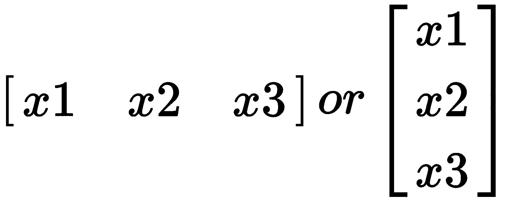

* **矩阵**：二阶张量，例如：

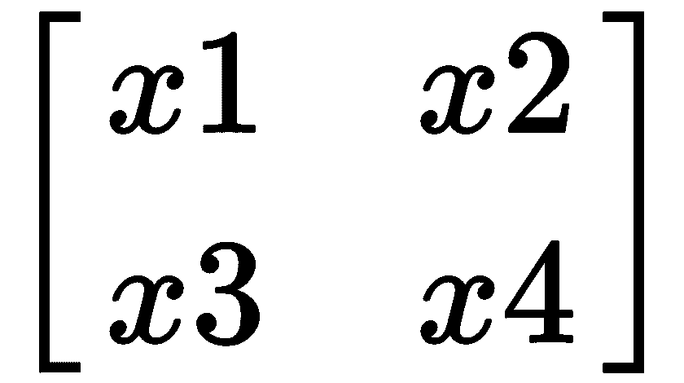

* **张量**：高阶张量，例如：

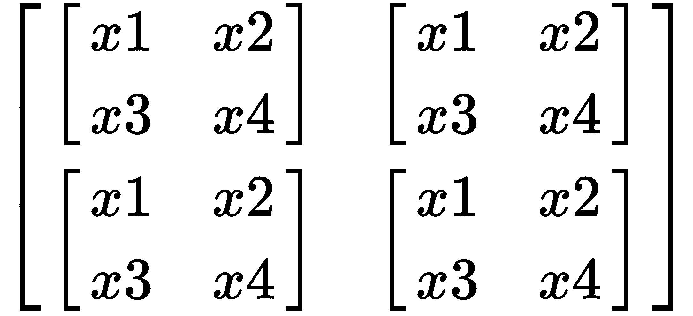

下面介绍创建张量的常用方法。

## 操作步骤

PyTorch 提供多种张量创建方式，以下逐一演示：

* 创建全 1 张量：

1. 先导入所需库：

```
import torch
```

2. 调用 `ones()`：

```
torch.ones((2,3))
```

返回默认 `float` 类型的全 1 张量，如：

```
tensor([[1., 1., 1.],
 [1., 1., 1.]])
```

* 创建整数张量：

1. 同上导入，并在调用时指定数据类型：

```
torch.ones((2,3), dtype=torch.int8)
```

2. 结果为仅含整数的张量：

```
tensor([[1, 1, 1],
 [1, 1, 1]], dtype=torch.int8)
```

* 创建全 0 整数张量：

1. 使用 `zeros()` 方法：

```
torch.zeros((2,3), dtype=torch.int8)
```

2. 得到全零整数张量：

```
tensor([[0, 0, 0],
 [0, 0, 0]], dtype=torch.int8)
```

* 填充指定值：

1. 使用 `full()` 并传入填充值与形状：

```
torch.full((2, 3), 3.141592)
```

2. 返回指定值的张量：

```
tensor([[3.1416, 3.1416, 3.1416],
 [3.1416, 3.1416, 3.1416]])
```

注意数值会做四舍五入。

* 创建空张量：

1. 使用 `empty()`：

```
torch.empty((2,3))
```

2. 返回未初始化数据的张量，结果随机器而变：

```
tensor([[2.5620e-01, 4.5773e-41, 2.5620e-01],
 [4.5773e-41, 4.4842e-44, 0.0000e+00]])
```

* 按均匀分布采样：

1. 使用 `rand()`：

```
torch.rand((2,3))
```

# 创建张量

2. 在区间 `[0, 1]` 上均匀采样得到随机值张量：

```
tensor([[0.6714, 0.0930, 0.4395],
 [0.5943, 0.6582, 0.6573]])
```

* 生成均值 0 方差 1 的张量：

1. 使用 `randn()`：

```
torch.randn((2,3))
```

2. 从标准正态分布采样得到随机值张量：

```
tensor([[ 0.3470, -0.4741, 1.2870],
 [ 0.8544, 0.9717, -0.2017]])
```

* 指定数值范围采样：

1. 使用 `rand_int()` 传入下限、上限与形状：

```
torch.randint(10, 100, (2,3))
```

2. 返回介于 10 与 100 之间的张量，示例类似：

```
tensor([[63, 93, 68],
 [93, 58, 29]])
```

* 基于现有数据创建张量：

1. 使用 `tensor` 类构造：

```
torch.tensor([[1, 2 ,3], [4, 5, 6]])
```

该操作会复制数据。若需避免复制，可使用 `torch.as_tensor([[1, 2 ,3], [4, 5, 6]])`

2. 该调用会产出与源数据保持一致数据类型的张量，本例中即为整数张量：
```
tensor([[1, 2, 3],
 [4, 5, 6]])
```

需要留意的是，一旦数据里混入浮点数，整个张量都会被提升为浮点类型；若出现字符串则会报错。

* 下面演示如何依据已有张量的属性来生成新张量：
1. 先准备一个参考张量：
```
a = torch.tensor([[1, 2 ,3], [4, 5, 6]])
```

2. 查看张量 a 的数据类型：
```
a.dtype
torch.int64
```

3. 再看一下它的形状：
```
a.shape
torch.Size([2, 3])
```

4. 类型和形状都符合预期，现在用 `torch.*_like` 形式创建与 a 特征匹配的张量 b：
```
b = torch.ones_like(a)
b
```

得到的结果如下：
```
tensor([[1, 1, 1],
 [1, 1, 1]])
```

5. 检查张量 b 的数据类型：
```
b.dtype
torch.int64
```

6. 再确认一下张量 b 的形状：
```
b.shape
torch.Size([2, 3])
```

* 接下来演示如何创建类型相同但大小不同的张量：
1. 仍使用上一步的张量 a，采用 `torch.new_*` 语法：
```
a.new_full((2,2), 3.)
```

2. 返回的输出为：
```
tensor([[3, 3],
 [3, 3]])
```

以上涵盖了 PyTorch 中常用的几种张量创建方式。

## 工作原理
本篇梳理了从不同数据源生成张量的常用做法。在进入深度学习原理前，先掌握操作数据基本单元张量的核心方法很有必要。`torch.tensor()` 可以按指定值和形状构建张量，还能从均匀分布或标准正态分布采样，这对神经网络的初始化、训练效果和速度很关键，默认类型为 `torch.FloatTensor`，可通过 `dtype` 参数修改。

`.ones()` 会生成全 1 的张量，`.zeros()` 用 0 填充，`full()` 将指定形状的张量填满给定值。`.empty()` 创建未初始化的张量，`.rand()` 在 [0,1] 区间均匀采样，`.randn()` 从均值 0 方差 1 的标准正态分布采样。

`rand_int()` 在指定范围抽取随机整数并按形状生成。借助 `ones_like()` 能复制其他张量的形状和数据类型，也能借助 `torch.new_*` 创建与某张量类型相同但尺寸不同的新张量。

此外还可把已有数据源转为张量，并使用更省内存的高级创建技巧复用已有张量的形状或数据类型。

## 更多
张量的形状可用 `shape` 属性或 `size()` 方法查询，数据类型通过 `dtype` 属性获取。`torch.numel()` 可统计张量元素总数。

## 另见
想了解更多创建选项，可阅读 PyTorch 官方文档的张量页面：[这个页面](https://pytorch.org/docs/stable/tensors.html#torch.Tensor)。

# NumPy 与 PyTorch 互通实战
NumPy 是 Python 科学计算的基石，提供多维数组对象及衍生工具，也是高效容纳通用多维数据的容器，可与各类数据库快速集成。

NumPy 是处理数值数据的标准库，`pandas`、`scikit-learn` 等主流机器学习/数据科学库内部都依赖 NumPy。例如读取表格数据时常用 pandas 加载后取出 numpy 数组，读取图像时多数库会返回 numpy 数组，再经 scikit-learn 处理。因此 NumPy 数组与 PyTorch 张量之间的桥梁十分关键。

## 操作步骤
先导入 NumPy：
1. 从创建 NumPy 数组开始，先导入 NumPy：
```
import numpy as np
```

2. 创建一个全由 1 组成的 NumPy 数组：
```
a = np.ones((2, 3))
a
```

结果输出：
```
array([[1., 1., 1.],
 [1., 1., 1.]])
```

3. 将其转为 PyTorch 张量：
```
b = torch.from_numpy(a)
b
```

结果输出：
```
tensor([[1., 1., 1.],
 [1., 1., 1.]], dtype=torch.float64)
```

4. 再把张量转回 NumPy 数组：
```
b.numpy()
```

结果输出：
```
array([[1., 1., 1.],
 [1., 1., 1.]]) 
```

到此即可在 NumPy 和 Torch 张量之间双向迁移。

## 工作原理
先导入 NumPy 创建数组，然后用 `np.ones()` 生成全 1 数组，再通过 `from_numpy()` 转为 PyTorch 张量，最后用 `.numpy()` 方法转回 NumPy。

在 PyTorch 与 NumPy 之间切换非常简单，只有两种核心方法。这样既能把预测张量转为 NumPy 再转成图像，也能反向操作。

## 更多
NumPy 数组与 PyTorch 张量共享底层内存，任一方修改另一方也会变化。

示例：
```
>>a
array([[1., 1., 1.],
 [1., 1., 1.]]) 
>>b = torch.from_numpy(a)
>>b
tensor([[1., 1., 1.],
 [1., 1., 1.]], dtype=torch.float64) 
>>a*=2
>>a
array([[2., 2., 2.],
       [2., 2., 2.]]) 
>>b
tensor([[2., 2., 2.],
 [2., 2., 2.]], dtype=torch.float64)
```

可以看到 NumPy 的改动同步反映在张量上。

## 另见
更多细节可查阅官方教程：[请单击 NyPy 桥的 PyTorch 官方文档链接](https://pytorch.org/tutorials/beginner/blitz/tensor_tutorial.html#numpy-bridge)。

# PyTorch 自动求导速览
先简要说明梯度。需要先理解梯度下降。在机器学习任务中，给定输入输出对，要求模型学习两者关系。模型预测与期望输出差距即为 **损失**。梯度下降是通过沿梯度负方向不断移动来最小化函数值的优化算法，常用于训练模型以减小损失，找到使成本函数最小的参数。

梯度衡量输入小幅变化时函数输出的变化程度，与微积分导数同义。它计算各权重关于误差的变化，实质是函数斜率，斜率越大学习越快。梯度指向最陡方向。PyTorch 的 `Autograd` 模块负责所有梯度计算，是自动微分的核心，采用基于磁带的机制：前向阶段记录操作，反向阶段回放。

## 操作步骤
从创建可求导张量开始：
1. 不同于之前，我们给张量加上求导标记：
```
x = torch.full((2,3), 4, requires_grad=True)
x
```

结果输出：
```
tensor([[4., 4., 4.],
 [4., 4., 4.]], requires_grad=True)
```

2. 创建派生自 a 的张量 y，可观察梯度函数的影响：
```
y = 2*x+3
y
```

结果输出：
```
tensor([[11., 11., 11.],
 [11., 11., 11.]], grad_fn=<AddBackward0>) 
```

3. 继续沿用原始 x 探索梯度：
```
x
```

结果输出：
```
tensor([[4., 4., 4.],
 [4., 4., 4.]], requires_grad=True)
```

4. 定义更复杂的 y：
```
y = (2 * x * 2 + 3)
y
```

结果输出：
```
tensor([[35., 35., 35.],
 [35., 35., 35.]], grad_fn=<AddBackward0>)
```

5. 针对 y 对 x 求梯度，保持 x 与 y 形状对应：
```
y.backward(torch.ones_like(x))
```

6. 查看 x 的 `grad` 属性：
```
x.grad
```

结果输出：
```
tensor([[16., 16., 16.],
 [16., 16., 16.]])
```

7. 若需在局部关闭求导，先用 `requires_grad_()` 修改 x：
```
>> x.requires_grad

True

>> x.requires_grad_(False) # turning of gradient
>> x.requires_grad

False
```

8. 用 `.no_grad()` 临时关闭梯度追踪：
```
>> x = torch.full((2,3), 4,requires_grad=True)
>> x

tensor([[4., 4., 4.],
 [4., 4., 4.]], requires_grad=True)

>> x.requires_grad

True

>> with torch.no_grad():
..         print((x**5+3).requires_grad)

False
```

至此已体验 `Autograd` 的部分功能。

## 工作原理
Autograd 会记录操作。由 `x` 产生 `y=2*x+3` 时，`y` 会附带 `grad_fn`。

先创建 `require_grad` 为 True 的张量，再令 `y = 2x² + 3`，会发现 `y` 带有不同的梯度函数。随后演示了 `requires_grad_()` 和 `no_grad()` 用法。

`autograd` 包负责张量操作的追踪与自动微分，属于动态图框架，反向传播随代码执行而定义。借助 `torch.Tensor` 的 `require_grad` 属性控制是否计算梯度，调用 `.backward()` 后梯度写入 `.grad`。

可禁用区间内的梯度计算，也可在评估时临时停止追踪以提升速度。

## 更多
可用 `torch.set_grad_enabled()` 开关梯度计算，用 `detach()` 切断历史追踪。`grad_fn` 属性可查看附着的梯度函数。

## 另见
官方资料：[这里](https://pytorch.org/tutorials/beginner/blitz/autograd_tutorial.html) 和 [这里](https://pytorch.org/docs/stable/autograd.html)。

# 张量视图与重塑技巧
处理神经网络时常需遍历和重排张量数据，使尺寸适配模型结构。下面介绍 PyTorch 常见的重排与重塑方法，目标是让张量呈现期望的样子。

## 操作步骤
改变形状的几种做法：
1. 先创建张量 a：
```
>>a = torch.Tensor([1, 2, 3, 4])
```

2. 使用 `reshape()`：
```
>>torch.reshape(a, (2, 2))
```

结果输出：
```
tensor([[1., 2.],
 [3., 4.]])
```

3. 研究 `resize_()`：
```
>>a = torch.Tensor([1, 2, 3, 4, 5, 6])
>>a.shape
torch.Size([6])
>>a.resize_((2, 2))
```

结果输出：
```
tensor([[1., 2.],
 [3., 4.]])
```

4. 最常用的是 `view()`：
```
>>a = torch.Tensor([1, 2, 3, 4, 5, 6])
>>a.view((2, 3))
```

结果输出：
```
tensor([[1., 2., 3.],
 [4., 5., 6.]])
```

5. 用 `view()` 时可省略一个维度，PyTorch 会自动推算：
```
>>a.view((2, -1))
```

结果输出：
```
tensor([[1., 2., 3.],
 [4., 5., 6.]])
```

这些就是常用的重塑方式。

## 工作原理
根据网络结构调整张量形状，主要有三种手段，各有适用场景：

* `.reshape()`：`reshape(a,b)` 返回新张量，数据与原张量相同，内部可能复制内存，可在连续与非连续张量上使用，可能返回副本或视图。
* `.resize_()`：`resize_(a,b)` 原地修改，不新建副本。若新形状元素更少，多余元素会被丢弃但仍占内存；若元素更多，新元素未初始化也不会报错。
* `.view()`：`view(a,b)` 返回共享存储的新张量，仅能在连续张量上使用，数据不复制。

## 更多
可借用另一张量的尺寸创建相似形状而不改变实际尺寸。

示例：
```
>>a = torch.Tensor([[1, 2, 3],
                     [4, 5, 6]])
>>a

tensor([[1., 2., 3.],
 [4., 5., 6.]])

>>b = torch.Tensor([4,5,6,7,8,9])
>>b
tensor([4., 5., 6., 7., 8., 9.])
>>b.view_as(a)

tensor([[4., 5., 6.],
 [7., 8., 9.]])
```

可见张量 b 取得与张量 a 相同的形状。

## 另见
文档参考：[这里](https://pytorch.org/docs/stable/tensors.html#torch.Tensor.view) 和 [这里](https://pytorch.org/docs/stable/torch.html#torch.reshape)。

## 二、与神经网络协作

> 原文：[`gitee.com/apachecn/apachecn-dl-zh/blob/master/docs/pt-ai-fund/2.md`](https://gitee.com/apachecn/apachecn-dl-zh/blob/master/docs/pt-ai-fund/2.md)

# PyTorch 图像分类：从全连接网络开始

深度学习可以看作机器学习里一个受脑科学启发的分支，它试图用简化模型复现生物神经元的计算方式。单个神经元会汇聚来自邻近单元的多个信号，求和后对比阈值决定是否激活。神经元之间通过突触连接，化学递质的种类与量决定了信号传递的强度。人工神经网络用权重、偏差以及激活函数来模拟这一过程，其中偏差相当于权重为1的恒定输入。

神经单元示意如下：

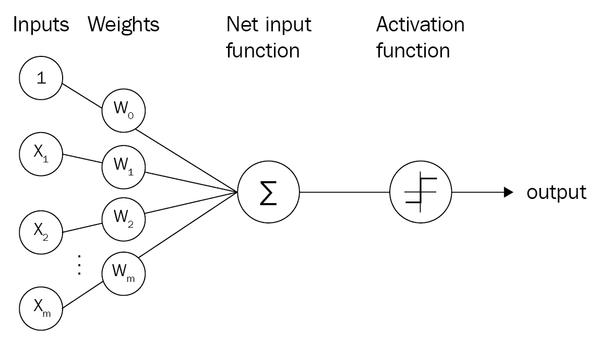

对神经网络而言，输入只是数字的集合，目标是通过学习捕捉数据内部的规律。训练过程让模型逐步学会从输入中辨认模式。不同任务下，合适的结构差异很大。最基础的网络通常包含输入层、输出层以及至少一个隐藏层；当隐藏层数量超过一层时，就被归为深度神经网络。

深度神经网络示意如下：

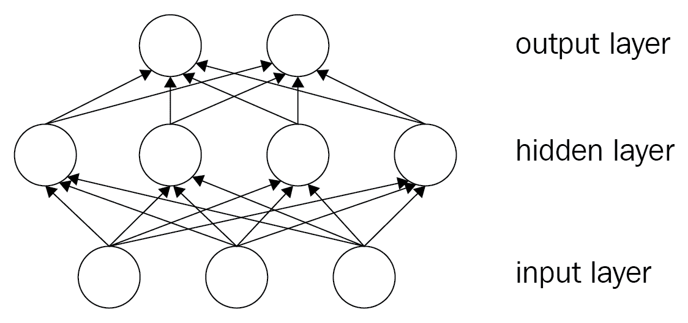

图中圆点代表神经元，即深度学习里的计算节点，边线代表连接并保存两节点间的权重，也就是突触强度。

本章要做的事情有：

*   定义神经网络类
*   创建一个全连接网络
*   定义损失函数
*   实现优化器
*   实现丢弃
*   实现函数式 API

## 技术准备

本章会接触图像数据并探究全连接网络的工作机制。PyTorch 配套的`torchvision`库提供了图像处理所需的基础能力，开始前先安装。

可用的 pip 安装命令如下：

```
pip install torchvision
```

其他安装途径可参考[这个页面](https://pypi.org/project/torchvision/)。上一章关于 PyTorch 张量的依赖保持不变。

## 定义神经网络类

本节先熟悉`torchvision`中处理图像的关键函数，再通过定义一个类来搭建网络骨架，并了解可用的模块与方法。本节聚焦于全连接网络，其任务是对多种服装类别进行分类。

选用 Fashion-MNIST 数据集，它来自 Zalando 的商品图片，训练集约 6 万张、测试集 1 万张。每张图是`28 x 28`的灰度图，会被展平成长度 784 的向量。

数据示例：

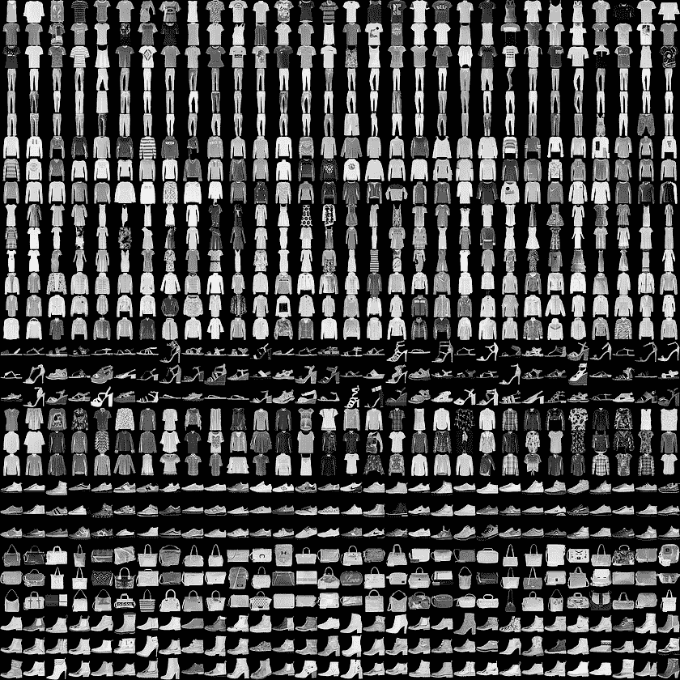

下面是构建网络的具体流程。

### 操作步骤

按顺序完成网络定义：

1. 先导入`torch`与`torchvision`：

```
>>import torch
>>from torch import nn
>>from torchvision import datasets, transforms
```

2. 定义图像预处理的转换流程：

```
>>transform = transforms.Compose([transforms.ToTensor(),
                  transforms.Normalize((0.5,), (0.5,)),
               ])
```

3. 设定`batch_size`，把数据集切分为若干小批：

```
>>batch_size = 64
```

4. 从`torchvision`加载数据集并应用转换后组批，先建训练集：

```
>>trainset = datasets.FashionMNIST('~/.pytorch/F_MNIST_data/', download=True, train=True, transform=transform)
>>trainloader = torch.utils.data.DataLoader(trainset, batch_size=batch_size, shuffle=True)
```

5. 再建测试集：

```
>>testset = datasets.FashionMNIST('~/.pytorch/F_MNIST_data/', download=True, train=False, transform=transform)
>>testloader = torch.utils.data.DataLoader(testset, batch_size=batch_size, shuffle=True)
```

6. 定义神经网络类，继承自`nn.Module`：

```
>>class FashionNetwork(nn.Module):
```

7. 在类中编写`__init__`方法：

```
>>def __init__(self):
      super().__init__()
```

8. 在`__init__`中创建第一层隐藏层：

```
>>self.hidden1 = nn.Linear(784, 256)
```

9. 创建第二层隐藏层：

```
>>self.hidden2 = nn.Linear(256, 128)
```

10. 创建输出层：

```
>>self.output = nn.Linear(128, 10)
```

11. 为最后一层加入 softmax 激活：

```
>>self.softmax = nn.Softmax(dim=1)
```

12. 为中间层设定激活函数：

```
>>self.activation = nn.ReLU()
```

至此网络骨架搭建完成。

### 工作原理

`torchvision`为视觉任务提供了工具集。`transforms`模块负责图像预处理。对于`28 x 28`单通道图像，先用`transforms.ToTensor()`转成张量，再用`transforms.Normalize((0.5,),(0.5,))`把均值和标准差都调到 0.5，使训练更稳定。多个转换通过`transforms.Compose()`串联。

批量大小决定一次前向的样本量，数值越大收敛步数越少但内存压力越高。`torchvision.datasets`自带热门数据集，未下载时会在线获取，并按转换要求整理格式。`torch.utils.data.DataLoader`负责批量加载、打乱以及设备映射。

模型类名可自定义，但必须继承`nn.Module`并调用`super().__init__()`，这样才能获得参数管理、前向调用等能力。全连接层用`nn.Linear()`指定输入输出维度。输出层用 softmax 处理 10 类问题，前面隐藏层用 ReLU 引入非线性。`hidden1`接收 784 维输入输出 256 维，`hidden2`输出 128 维，最终层输出 10 维，对应 10 个类别。softmax 在维度 1 上归一化，使结果可解释为概率。

### 更多

也可以用`nn.Sequential()`直接按顺序传入层，省去显式类定义。图像转换还有多种可选方案，后续章节会展开。

### 另见

转换细节见[这个页面](https://pytorch.org/docs/stable/torchvision/transforms.html)，模型类定义参考[这个页面](https://pytorch.org/tutorials/beginner/blitz/neural_networks_tutorial.html#sphx-glr-beginner-blitz-neural_networks-tutorial-py)。

## 创建一个全连接网络

本节在上节定义的类基础上，把各组件串联成可运行的网络。整体结构为 784 → 256 → 128 → 10。

先复用构造器中定义的层，再完成`forward`定义并实例化。

### 操作步骤

在已有类上继续扩展：

1. 在类中编写`forward()`方法并接收输入：

```
>>def forward(self, x):
```

2. 将输入送入首个 256 节点的隐藏层：

```
>>x = self.hidden1(x)
```

3. 通过 ReLU 激活：

```
>>x = self.activation(x)
```

4. 送入 128 节点的第二层并再次 ReLU：

```
>>x = self.hidden2(x)
>>x = self.activation(x)
```

5. 送入包含 10 个输出的输出层：

```
>>x = self.output(x)
```

6. 应用`softmax`函数：

```
>>output = self.softmax(x)
```

7. 返回输出张量：

```
>>return output
```

8. 创建网络实例：

```
>>model = FashionNetwork()
```

9. 快速查看模型结构：

```
>>print(model)
>FashionNetwork(
       (hidden1): Linear(in_features=784, out_features=256, bias=True)
       (hidden2): Linear(in_features=256, out_features=128, bias=True)
       (output): Linear(in_features=128, out_features=10, bias=True)
       (softmax): Softmax()
       (activation): ReLU()
 )
```

Fashion-MNIST 的神经网络模型就绪。

### 工作原理

网络的正向流程把构造器里声明的组件按顺序执行。`nn.Module`的子类必须实现`forward()`，它接收张量并按定义的操作流经各层。调用模型时会自动触发`forward`。`nn.Module`会自动为线性层生成权重与偏差。线性单元本身实现`xW + B`，加入激活函数后获得非线性表达能力，这里选用常见的 ReLU。

输入 784 维，经 ReLU 后的 256 维，再经 ReLU 的 128 维，最后经 softmax 的 10 维。softmax 把最终输出压缩为概率分布，确保所有类别概率之和为 1，且最大概率对应预测类别。参数`dim=1`保证在输出列上操作。随后用模型类实例化并打印查看结构。

### 更多

不使用显式类时也可借助`nn.Sequential`搭建，只要`forward`里的执行顺序正确即可。激活函数也可换成`nn.Tanh`等。权重与偏差可通过`model.hidden.weight`和`model.hidden.bias`访问。

### 另见

`nn.Module`与`nn.Sequential`官方文档见[这个页面](https://pytorch.org/docs/stable/nn.html)。

## 定义损失函数

训练时模型预测与真实标签存在差距，这个差距称为误差。衡量误差的函数即损失函数或误差函数，它把模型整体表现压缩为单一数值，便于判定改进方向。

本节为服装分类任务选用 PyTorch 提供的损失函数。

### 操作步骤

定义损失函数：

1. 先把网络构造器中的输出由`softmax`改为对数形式：

```
>>self.log_softmax = nn.LogSoftmax()
```

2. 对`forward`方法做同样修改：

```
>>output = self.log_softmax(x)
```

3. 修改后的类如下：

```
>>class FashionNetwork(nn.Module):
      def __init__(self):
          super().__init__()
          self.hidden1 = nn.Linear(784, 256)
          self.hidden2 = nn.Linear(256, 128)
          self.output = nn.Linear(128, 10)
          self.log_softmax = nn.LogSoftmax()
          self.activation = nn.ReLU()
      def forward(self, x):
          x = self.hidden1(x)
          x = self.activation(x)
          x = self.hidden2(x)
          x = self.activation(x)
          x = self.output(x)
          output = self.log_softmax(x)
          return output
```

4. 实例化模型：

```
>>model = FashionNetwork()
>>model
>>FashionNetwork(
     (hidden1): Linear(in_features=784, out_features=256, bias=True)
     (hidden2): Linear(in_features=256, out_features=128, bias=True)
     (output): Linear(in_features=128, out_features=10, bias=True)
     (log_softmax): LogSoftmax()
     (activation): ReLU()
 )
```

5. 定义损失，采用负对数似然损失：

```
>criterion = nn.NLLLoss()
```

损失函数准备完成。

### 工作原理

# 对数 Softmax 损失与负对数似然

这里用对数 softmax 替代 softmax，便于后续直接操作对数概率，数值更稳定、梯度更友好，对错误预测的惩罚也更明显。

在使用对数 softmax 时，常用的搭配是负对数似然。因为 softmax 已在内部完成归一化，直接配合对数形式更合理。对数操作避免了处理接近 0 的极小概率，取负号后目标变为最小化损失。PyTorch 中损失函数常命名为`criterion`。该组合在多分类场景下应用广泛。

### 更多

可额外传入一维权重张量，为不同类别赋不同权重，以应对类别不平衡问题。

### 另见

若想查阅更多损失函数的使用说明，可前往 [这个页面](https://pytorch.org/docs/master/nn.html#loss-functions)。

# 优化器实战指南

本篇聚焦优化器的工作方式。上一篇“定义损失函数”里我们聊过误差与误差函数，也提到要得到一个靠谱的模型就必须把计算出来的误差压到最低。反向传播正是神经网络从误差里汲取教训的机制，误差会推动权重朝更优方向调整。负责调节权重的就是优化器，它会算出误差关于权重方向的偏导数。导数指向的是误差上升的方向，所以实际更新时需要把梯度反向。简单说，优化器把模型参数和损失函数绑在一起，反复迭代修改参数来压缩模型误差。可以把优化器理解为在权重之上依据预测与真实值的差距寻找最优解，而损失函数则像一个裁判，不断告诉优化器当前是好是坏。

学习率是优化器的核心超参，决定了每次权重更新的幅度。步子迈得太大，算法可能根本收敛不了，误差反而会变大；步子迈得太小，又会让寻优过程拖得极慢，难以触到误差函数的底部。

下面演示学习率对训练的影响：

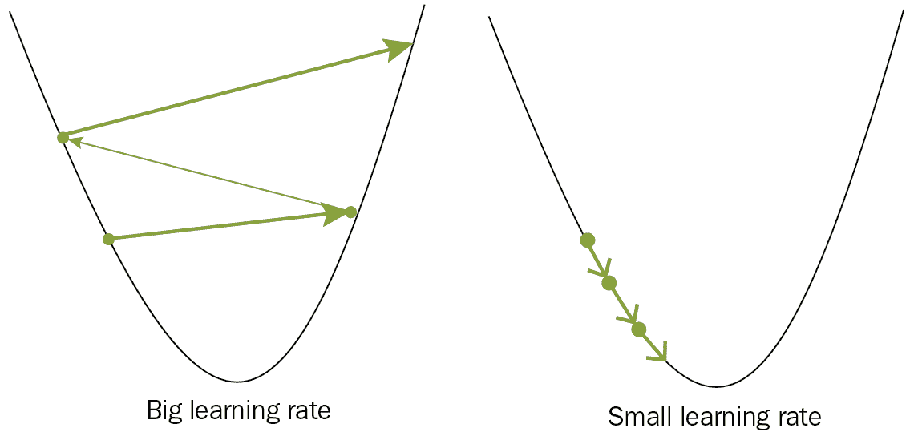

本篇会演示 PyTorch 里如何调用优化器、常见的优化器有哪些，以及如何合理控制学习率。

## 实操流程

下面从上一节定义条件的位置继续：

1. 先导入 optim 模块：

```
>>from torch import optim
```

2. 接着创建一个优化器实例，这里选用 Adam 并传入模型参数：

```
>>optimizer = optim.Adam(model.parameters())
```

3. 查看优化器的默认配置可执行：

```
>>optimizer.defaults
>>{'lr': 0.001,
 'betas': (0.9, 0.999),
 'eps': 1e-08,
 'weight_decay': 0,
 'amsgrad': False}
```

4. 也可以额外加上学习率参数：

```
>>optimizer = optim.Adam(model.parameters(), lr=3e-3)
```

5. 开始训练，先设定训练轮次：

```
>>epoch = 10
```

6. 进入训练循环：

```
>>for _ in range(epoch):
```

7. 将累计损失 running_loss 初始化为 0：

```
>>running_loss = 0
```

8. 在训练图像加载器中逐张遍历数据，该加载器在“定义神经网络类”一节中已创建：

```
>>for image, label in trainloader:
```

9. 随后把梯度清零：

```
>>optimizer.zero_grad()
```

10. 接着对图像做重塑：

```
>>image = image.view(image.shape[0],-1)
```

11. 然后让模型给出预测结果：

```
>>pred = model(image)
```

12. 计算本批的损失/误差：

```
>>loss = criterion(pred, label)
```

13. 对损失执行 `.backward()`：

```
>>loss.backward()
```

14. 在优化器上调用 `.step()` 完成一次更新：

```
>>optimizer.step()
```

15. 累加本次运行损失：

```
>>running_loss += loss.item()
```

16. 每轮结束后打印损失值：

```
>>else:
    >>print(f'Training loss: {running_loss/len(trainloader):.4f}')
```

示例输出如下：

```
Training loss: 0.4978
Training loss: 0.3851
Training loss: 0.3498
Training loss: 0.3278
Training loss: 0.3098
Training loss: 0.2980
Training loss: 0.2871
Training loss: 0.2798
Training loss: 0.2717
Training loss: 0.2596
```

至此训练完成。

## 原理拆解

本节先用 Adam 实例化优化器，给出学习率并查看默认参数。设置总轮次为 10，每一轮开始时把 running_loss 置零，并对数据集中每一张图片遍历一次，即模型看到一次完整数据集。我们先用 `.zero_grad()` 清空梯度。PyTorch 在每次反向传播时会累积梯度，这种设计在某些场景有用，但常规训练需要在更新前归零，否则权重会被重复累加。

随后把每批 64 张 28×28 的图像展平为 784 维，形状由 64×28×28 变为 64×784，以满足模型对输入维度的要求。将处理后的输入送入模型得到批量预测，再交给损失函数即 criterion 评估预测类别与真实类别的差异。

`loss.backward()` 会计算误差关于权重的梯度，`optimizer.step()` 则据此更新模型权重。`.item()` 能把单元素张量提取为标量，因此 `loss.item()` 取出批量的误差标量值累加起来，最后在轮末输出总损失。

## 进阶方向

`.step(closure)` 形式支持传入闭包函数来先计算损失再更新权重。你还可以尝试 PyTorch 提供的 Adadelta、Adagrad、SGD 等其他优化器。

## 参考资料

关于优化器的更多细节可查看 [这个页面](https://pytorch.org/docs/stable/optim.html#torch.optim.Optimizer)。

# Dropout 正则化实战

本篇研究 Dropout 的引入。训练神经网络时常会遇到过拟合，模型记住了训练集的细节和噪声，而非学习到通用的规律，导致在新数据上表现不佳。正则化就是用来遏制过拟合的手段。

Dropout 是神经网络里最常用的正则化技巧之一，训练时随机关闭部分神经元，即暂时把它们的输出从前向传播中剔除，反向传播也不影响这些权重的更新。这样避免了少数神经元独揽决策，迫使网络整体协作。从直观角度看，Dropout 相当于训练了一组集成模型，在同一架构下捕捉不同特征。

本篇演示如何在模型定义里加入 Dropout 以改善泛化。需要记住，Dropout 只在训练阶段生效，推理和测试时所有神经元都应参与计算。

## 实操流程

下面为初始模型类 FashionNetwork 增加 Dropout：

1. 从初始模型定义开始：

```
>>class FashionNetwork(nn.Module):
    def __init__(self):
        super().__init__()
        self.hidden1 = nn.Linear(784, 256)
        self.hidden2 = nn.Linear(256, 128)
        self.output = nn.Linear(128, 10)
        self.log_softmax = nn.LogSoftmax()
        self.activation = nn.ReLU()
    def forward(self, x):
        x = self.hidden1(x)
        x = self.activation(x)
        x = self.hidden2(x)
        x = self.activation(x)
        x = self.output(x)
        output = self.log_softmax(x)
        return output
```

2. 在模型 `__init__` 中加入 Dropout 层：

```
>>self.drop = nn.Dropout(p=0.25)
```

更新后的 `__init__()` 如下：

```
>>def __init__(self):
        super().__init__()
        self.hidden1 = nn.Linear(784, 256)
        self.hidden2 = nn.Linear(256, 128)
        self.output = nn.Linear(128, 10)
        self.log_softmax = nn.LogSoftmax()
        self.activation = nn.ReLU()
        self.drop = nn.Dropout(p=0.25)
```

3. 在 `forward()` 方法里使用 Dropout：

```
>>def forward(self, x):
        x = self.hidden1(x)
        x = self.activation(x)
        x = self.drop(x)
        x = self.hidden2(x)
        x = self.activation(x)
        x = self.drop(x)
        x = self.output(x)
        output = self.log_softmax(x)
        return output
```

至此网络已具备 Dropout。

## 原理拆解

本节在 `__init__()` 中以 0.25 的丢弃率加入 Dropout 层，表示该层约有 25% 的神经元会在训练时随机被关掉。随后在 `forward` 中，先对第一个包含 256 个单元的隐藏层应用 Dropout，再对第二个包含 128 个单元的层应用。激活函数在 Dropout 之后执行。应注意 Dropout 只作用于隐藏层，避免丢弃输入数据或输出。

## 进阶方向

调用 `model.eval()` 可关闭 Dropout，`model.train()` 则重新启用。

## 参考资料

Dropout 的理论背景可参考 [这个页面](https://arxiv.org/abs/1207.0580)。

# 函数式 API 简化网络搭建

本篇探索 PyTorch 的函数式 API，使用它能让网络结构和组件的写法更紧凑。我们会先回顾常规写法，再用函数式 API 重构模型的一部分。

## 实操流程

下面基于已有的神经网络类定义，用函数式 API 重新实现：

1. 先完成必要的导入：

```
>>import torch.nn.functional as F
```

2. 使用 `F.relu()` 与 `F.log_softmax()` 重新定义 `FashionNetwork` 类：

```
>>class FashionNetwork(nn.Module):
    def __init__(self):
        super().__init__()
        self.hidden1 = nn.Linear(784,256)
        self.hidden2 = nn.Linear(256,128)
        self.output = nn.Linear(128,10)

    def forward(self,x):
        x = F.relu(self.hidden1(x))
        x = F.relu(self.hidden2(x))
        x = F.log_softmax(self.output(x))
        return x
```

模型已用函数式 API 重写。

## 原理拆解

这里构建的网络与之前完全一致，只是把激活和对数 softmax 换成了 `F.relu` 与 `F.log_softmax`，代码因此更简洁清晰。

## 进阶方向

也可以用 `functional.linear()` 与 `functional.dropout()` 对线性层和丢弃进行函数式控制，但要注意传入模型状态以区分训练或评估/预测模式。

## 参考资料

函数式 API 的官方说明见 [这个页面](https://pytorch.org/docs/stable/nn.html#torch-nn-functional)。

## 三、计算机视觉中的卷积神经网络

> 原文：[`gitee.com/apachecn/apachecn-dl-zh/blob/master/docs/pt-ai-fund/3.md`](https://gitee.com/apachecn/apachecn-dl-zh/blob/master/docs/pt-ai-fund/3.md)

本章介绍卷积神经网络 CNN，这是一类与前文全连接网络不同的架构，在计算机视觉领域取得了巨大进展。

CNN 能直接接受图像张量作为输入。彩色图像由红绿蓝三个通道构成，即 RGB，我们把三个二维矩阵堆叠起来形成完整图像，每个通道数值的变化决定最终颜色。CNN 把图像视作三个独立的叠加色彩层。

图像的含义来自局部像素的组合，单个像素承载的信息有限。密集层里前一层的每个节点都连向后一层的每个节点，而 CNN 利用像素间的空间结构大幅减少了层间连接数量，从而加快训练并降低参数量。

下图展示全连接网络的结构：

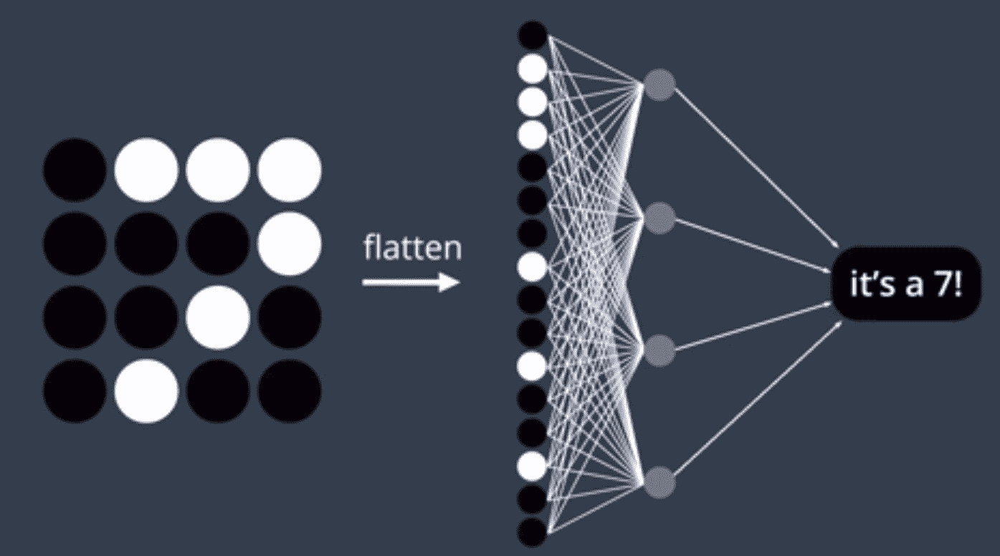

与之对比，下图是卷积网络结构：

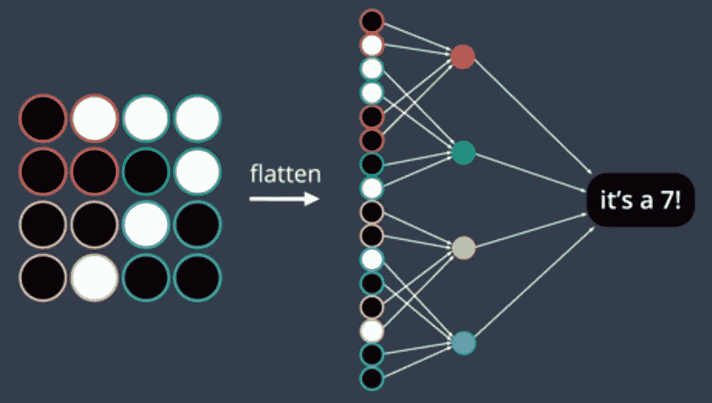

CNN 通过滤波器从输入图像中提取特征，滤波器数量足够时可捕捉多种视觉模式。随着网络层数加深，滤波器能检测的特征也变得越来越复杂。卷积网络把滤波器逐个滑动以生成特征图。

本章将涵盖以下主题：探索卷积、探索池化、探索变换、数据增强、加载图像数据、定义 CNN 架构、训练图像分类器。

## 环境与依赖

本章需要 TorchVision，其安装方法见上一章。建议在支持 GPU 的机器上运行代码。

## 卷积层深度解析

卷积是 CNN 的核心构成，通常作为独立层实现。在卷积层，滤波器矩阵在整个图像矩阵上从左到右、从上到下滑动，并与当前局部块做点积。点积会把滤波器尺寸作用到图像通道上，若两矩阵在相同位置数值都大，点积结果就高，反之则低。点积输出是一个标量，表示图像局部模式与滤波器模式的相关性。不同滤波器可检测不同复杂度的特征。

另外两个关键概念：

* **步幅**：在图像上把滤波器移到下一个局部块之前，水平与垂直方向移动的像素数。
* **填充**：卷积时对图像边缘的处理策略，决定输出是否保持原尺寸。若想保持尺寸不变，需要在边缘做零填充，使卷积后输出与输入尺寸一致，这称为相同填充。若不保留原尺寸，则在滤波器无法完全覆盖的位置直接截断，称为有效填充。

填充示意图如下：

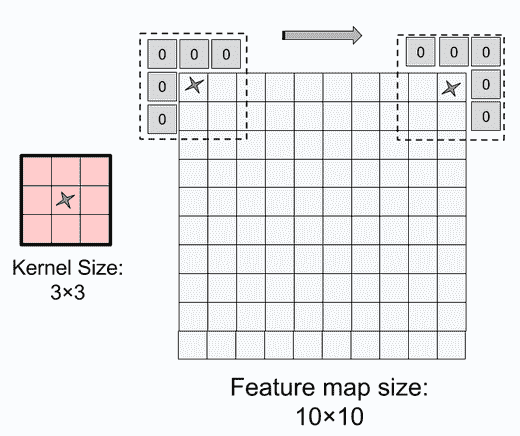

有效填充的示例：

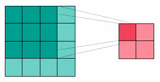

本节演示 PyTorch 中卷积的使用方法。

## 实操流程

探讨卷积的过程如下：

# 卷积层构建

1. 首先导入所需的 Torch 模块：

```
>>import torch
>>import torch.nn as nn
```

2. 随后对图像执行二维卷积：

```
>>nn.Conv2d(3, 16, 3)
```

这会创建如下的卷积层：

```
Conv2d(3, 16, kernel_size=(3, 3), stride=(1, 1))
```

3. 接着在图像边缘补足所需大小的填充：

```
>>nn.Conv2d(3, 16, 3, padding=1)
```

这会创建以下卷积层：

```
Conv2d(3, 16, kernel_size=(3, 3), stride=(1, 1), padding=(1, 1))
```
4. 接下来，可用下面这段代码构建一个非正方形的卷积核：
```
>>nn.Conv2d(3, 16, (3,4), padding=1)
```
这样就能得到如下的卷积层配置：
```
Conv2d(3, 16, kernel_size=(3, 4), stride=(1, 1), padding=(1, 1))
```
5. 随后，可通过以下代码为卷积加入步幅：
```
>>nn.Conv2d(3, 16, 3, stride=2)
```
由此产生的卷积层如下所示：
```
Conv2d(3, 16, kernel_size=(3, 3), stride=(2, 2))
```
6. 水平与垂直方向的步幅、填充值也可以分别设定：
```
>>nn.Conv2d(3, 16, (3,4), stride=(3,3), padding=(1,2))
```
对应的卷积层结构为：
```
Conv2d(3, 16, kernel_size=(3, 4), stride=(3, 3), padding=(1, 2))
```

借助这份笔记，我们已经掌握了在 PyTorch 中灵活使用卷积的方式。

## 工作原理

本篇介绍了构建二维卷积的几种常见做法。首个参数代表输入图像的通道数，彩色图通常为 `3`，灰度图则为 `1`。第二个参数决定输出通道数，也就是该层会产生的滤波器数量。第三个参数是卷积核尺寸，亦即滤波器作用的图像块大小。

随后实例化一个 `Conv2d` 对象，把输入送入二维卷积层即可得到输出。以 `nn.Conv2d(3, 16, 3)` 为例，该层接收 3 通道输入，输出 16 通道，采用 `3 x 3` 的正方形核，高度和宽度的默认步长均为 1。可通过 `padding` 增加边缘填充，该参数接受整数或元组。整数形式会在高宽两方向使用相同填充，元组形式则允许高宽分别指定，这一规则同样适用于核大小和步长。

## 更多

把 `padding` 设为 `0` 即为默认的无填充模式。更改 `padding_mode` 还能把零填充替换为循环填充。`bias` 为布尔开关，默认 `True`，可用来增减偏置项。

## 另见

更多关于 PyTorch 卷积的参数说明，可参考 [这个页面](https://pytorch.org/docs/stable/nn.html#torch.nn.Conv2d)。

# 池化层实战指南

现在进入 CNN 的下一个关键组件——池化层。前面我们一直保持特征图的空间尺寸不变（在等填充的设定下），主要做法是不断提升通道数。池化层的任务是压缩输入的空间尺寸，同时保留通道深度。随着网络深入，我们更关注语义层面的抽象而非逐像素细节，池化可以帮助保留关键信息并丢弃冗余。

这是最大池化的示意：
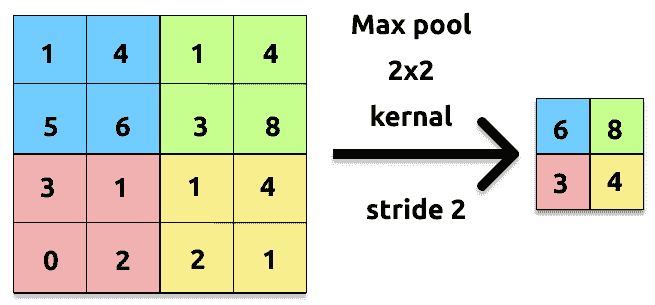

使用池化层的主要价值在于：

* **降低计算负担**：缩小空间尺寸意味着运算量下降，训练更快，资源消耗更少。
* **抑制过拟合**：空间变小后模型参数总量减少，复杂度下降，更易泛化。
* **具备位置不变性**：特征无论出现在图像中心、左上还是右下都能被捕获。例如检测芒果时，其位置并不影响识别，池化提供了这种鲁棒性。

池化种类多样，如最大池化、平均池化等，其中最大池化最为常见。操作方式与卷积类似，先定义一个窗口，再按设定的步长在水平和垂直方向滑动并应用池化函数。

## 操作步骤

本篇演示 PyTorch 中池化层的实现方式：

1. 首先完成必要的导入：
```
>>import torch
>>import torch.nn as nn
```
2. 然后使用 `nn` 模块中提供的池化类，例如：
```
>>max_pool = nn.MaxPool2d(3, stride=1)
```
3. 接下来定义一个张量用于池化操作：
```
>>a = torch.FloatTensor(3,5,5).random_(0, 10)
>>a
```

执行后得到以下结果：
```
tensor([[[2., 8., 6., 8., 3.],
 [6., 6., 7., 6., 6.],
 [2., 0., 8., 8., 8.],
 [2., 0., 3., 5., 7.],
 [9., 7., 8., 2., 1.]],

 [[1., 8., 6., 7., 3.],
 [0., 1., 2., 9., 4.],
 [1., 2., 5., 0., 1.],
 [8., 2., 8., 3., 1.],
 [5., 4., 0., 5., 2.]],

 [[1., 6., 2., 6., 1.],
 [4., 0., 0., 6., 6.],
 [4., 2., 2., 3., 2.],
 [1., 0., 1., 7., 1.],
 [8., 1., 0., 5., 4.]]])
```
4. 将池化作用于该张量：
```
>>max_pool(a)
```

输出如下：
```
 tensor([[[8., 8., 8.],
 [8., 8., 8.],
 [9., 8., 8.]],

 [[8., 9., 9.],
 [8., 9., 9.],
 [8., 8., 8.]],

 [[6., 6., 6.],
 [4., 7., 7.],
 [8., 7., 7.]]])
```
5. 采用同样思路进行平均池化：
```
>>avg_pool = nn.AvgPool2d(3, stride=1)
```
6. 同样方式应用平均池化：
```
>>avg_pool(a)
```

输出为：
```
 tensor([[[5.0000, 6.3333, 6.6667],
 [3.7778, 4.7778, 6.4444],
 [4.3333, 4.5556, 5.5556]],

 [[2.8889, 4.4444, 4.1111],
 [3.2222, 3.5556, 3.6667],
 [3.8889, 3.2222, 2.7778]],

 [[2.3333, 3.0000, 3.1111],
 [1.5556, 2.3333, 3.1111],
 [2.1111, 2.3333, 2.7778]]])
```

通过本篇我们熟悉了 PyTorch 中的池化操作。

## 工作原理

上述代码以一个示例张量说明池化过程。采用 `3 x 3` 的方形窗口，第一次操作覆盖 `[0,0,0]` 到 `[0,3,3]` 的块。步长为 1 时，下一个窗口为 `[0,0,1]` 至 `[0,3,4]`。抵达水平边界后则切换到下一行。`nn.MaxPool2d(3, stride=1)` 与 `nn.AvgPool2d(3, stride=1)` 分别创建了步长为 1 的 `3x3` 最大池化和平均池化核，并将其作用于随机张量 `a`。

## 更多

本篇以方形核为例，实际上也可以像卷积那样使用非方形核并设置步长。另一种常用做法是全局平均池化，可通过对输入维度做平均池化实现，例如 `avg_pool2d(a, a.size()[2:]0)`。

## 另见

关于池化及各类池化的更多信息，可查看 [这个页面](https://pytorch.org/docs/stable/nn.html#pooling-layers)。

# torchvision 转换全解析

PyTorch 本身无法直接处理图像像素，需要以张量形式输入。为此 `torchvision` 提供了视觉相关任务的库，其 `transform` 模块封装了像素到张量、归一化、缩放等常用接口。本篇将介绍该模块的常用方法，使用前请先安装 `torchvision`。

## 操作步骤

下面逐步探索 `torchvision` 中的常用转换：

1. 先导入 `torchvision`：
```
>>from torchvision import transforms
```
2. 根据图像生成张量：
```
>>transforms.ToTensor()
```
3. 随后对图像张量做归一化：
```
>>transforms.Normalize((0.5,),(0.5,))
```
4. 调整图像尺寸可使用以下方法：
```
>>transforms.Resize(10)
```

另一种写法是：
```
>>transforms.Resize((10,10))
```
5. 再用转换裁剪图像：
```
>>transforms.CenterCrop(10)
```

也可以使用：
```
>>transforms.CenterCrop((10, 10))
```
6. 用转换对图像张量进行填充：
```
>>transforms.Pad(1, 0)
```

另一种形式为：
```
>>transforms.Pad((1, 2), 1)
```

如有需要，还可以执行：
```
>>transforms.Pad((1, 2, 2, 3), padding_mode='reflect')
```
7. 最后串联多个转换：
```
>>transforms.Compose([
     transforms.CenterCrop(10),
     transforms.ToTensor(),
  ])
```

本篇介绍了 `torchvision` 中常用的若干转换。

## 工作原理

上述片段展示了 `torchvision` 提供的转换能力。它们把原始图像整理成模型可接受的尺寸与属性的张量。`toTensor()` 将输入图像转为张量，随后 `Normalize()` 对张量进行归一化，该方法接收两个元组，分别对应各通道的均值和标准差。

`Resize()` 可把图像缩放到目标尺寸，给定整数时按短边匹配，给定元组时按高度和宽度匹配。`CenterCrop()` 用于提取中心区域，可传入整数裁剪正方形，或传入高宽序列裁剪指定矩形。

填充任务由 `Pad()` 完成。填充大小可用整数实现四周等量填充，也可用二元组分别控制左右与上下，或用四元组分别指定左上右下。填充值可为整数，或为三元组分别指定 R、G、B 通道。`Pad()` 还提供 `padding_mode`，可选：
* `constant`：用指定值填充
* `edge`：用边缘像素值填充
* `reflect`：镜像反射填充，不含边缘像素
* `symmetric`：镜像反射填充，包含边缘像素

最后，`Compose()` 可把多个转换对象组合成处理流水线。

## 更多

`transforms.functional` 提供了函数式 API，便于精细控制转换流程构建复杂管线。另有如 `Grayscale()` 等实用转换，可指定输出通道数，后续章节会进一步介绍。

## 另见

函数式转换的详细信息见 [这个页面](https://pytorch.org/docs/stable/torchvision/transforms.html#functional-transforms)。

# 数据增强实操

本篇讲解如何使用 PyTorch 进行数据增强。数据增强是深度学习与计算机视觉中的核心技巧。模型可用的数据量直接影响表现，而增强技术能在不采集新数据的前提下提升训练样本多样性，避免模型死记硬背有限样本。

现实中光照、亮度、角度或颜色的变化通常不影响推理结果，但部署时输入可能出现这些变化。让模型对这类变化保持不变性有助于提升鲁棒性。本篇使用 PyTorch 的 `transform` 模块实现增强。

## 操作步骤

为更好理解，建议先阅读“探索转换”。下面介绍借助 `torchvision` 的 `transform` 模块进行常见增强：

1. 先导入 `torchvision`：
```
>>import torchvision
```
2. 随机裁剪图像的一部分：
```
>>transforms.RandomCrop(10)
```

另一种写法为：
```
>>transforms.RandomCrop((10,20))
```
3. 可用以下方法进行水平翻转：
```
>>transforms.RandomHorizontalFlip(p=0.3)
```
4. 同样也能垂直翻转：
```
>>transforms.RandomVerticalFlip(p=0.3)
```
5. 尝试添加亮度、对比度、饱和度与色调变化：
```
>>transforms.ColorJitter(0.25, 0.25, 0.25, 0.25)
```
6. 接下来加入旋转变化：
```
>>transforms.RandomRotation(10)
```
7. 最后组合所有转换：
```
>>transforms.Compose([
     transforms.RandomRotation(10),
     transforms.ToTensor(),
])
```

本篇演示了如何通过转换对现有数据进行扩充。

## 工作原理

本篇通过对输入做有意义的变换来增加数据多样性。选择增强策略时需谨慎，例如汽车分类器可使用颜色、亮度变化或水平翻转来扩充，但若不涉及上下颠倒的场景，垂直翻转就不合适。

这里先在随机位置裁剪图像，使模型即使只看到局部也能识别对象。裁剪尺寸可设为整数或指定高宽的元组。随后进行水平翻转，并为水平与垂直翻转传入随机概率。`ColorJitter()` 用于改变图像的颜色、对比度、饱和度和色调。

该方法通过参数控制变化幅度，颜色、对比度、饱和度在 `[max(0, 1-parameter), 1 + parameter]` 范围内变化，色调在 `[-hue, hue]` 范围内变化，其中 hue 取值 0~0.5。还可加入随机旋转，并指定最大旋转角度。确定策略后，可将其加入 `transforms.compose()`。

## 更多

还可使用 `transforms.Lambda()` 自定义转换，将函数或 lambda 表达式传入以实现特定需求。

## 另见

更多变换如仿射变换等可参考 [这个页面](https://pytorch.org/docs/stable/torchvision/transforms.html)。

# 快速加载图像数据

# 快速加载图像数据

本篇介绍如何把图像文件加载为张量。这里使用 `CIFAR-10` 数据集，包含 10 个类别各 60,000 张 `32 x 32` 像素彩色图像，共 60,000 张。类别包括飞机、汽车、鸟、猫、鹿、狗、青蛙、马、船和卡车。

## 准备

数据加载依赖 `torchvision`。`CIFAR-10` 已作为 `torchvision` 的内置数据集提供。请确认已安装 `torchvision`，否则可用以下代码安装：
```
pip install torchvision==0.x.x
```

配置就绪后即可开始。

## 操作步骤

下面在 PyTorch 中加载 `CIFAR-10` 数据集：

1. 先从 `torchvision` 导入 `datasets` 模块：

```
>>from torchvision import datasets
```

2. 首先把 `transforms` 工具包引入进来：

```
>>from torchvision import transforms
```

3. 接着组装一个图像预处理流水线：

```
>>transformations = transforms.Compose([
    transforms.RandomHorizontalFlip(),
    transforms.RandomRotation(20),
    transforms.ToTensor(),
    transforms.Normalize((0.5, 0.5, 0.5),(0.5, 0.5, 0.5))
])
```

4. 随后借助 datasets 模块生成训练集：

```
>>train_data = datasets.CIFAR10('CIFAR10', train=True, download=True, transform=transformations)
```

5. 同理也准备好测试集：

```
>>test_data = datasets.CIFAR10('CIFAR10', train=False, download=True, transform=transformations)
```

6. 这时可以确认训练集和测试集各自的样本数量：

```
>>len(train_data), len(test_data)
(50000, 10000)
```

7. 接下来从训练集切出一份验证集，为此需要先从 `torch` 导入相关工具：

```
>>from torch.utils.data.sampler import SubsetRandomSampler
```

8. 我们把训练数据的 20% 单独拿出来作为验证：

```
>>validation_size = 0.2
```

9. 紧接着引入 `numpy` 来辅助索引操作：

```
>>import numpy as np
```

0. 先获取训练集的总样本数：

```
>>training_size = len(train_data)
```

1. 随后生成一个覆盖全部索引的列表：

```
>>indices = list(range(training_size))
```

2. 然后对这个索引列表进行随机打乱：

```
>>np.random.shuffle(indices)
```

3. 接着算出划分验证集和训练集的分界点：

```
>>index_split = int(np.floor(training_size * validation_size))
```

4. 再分别取出对应的训练索引和验证索引：

```
>>validation_indices, training_indices = indices[:index_split], indices[index_split:]
```

5. 此时使用 `torch` 提供的子集随机采样器：

```
>>training_sample = SubsetRandomSampler(training_indices)
>>validation_sample = SubsetRandomSampler(validation_indices)
```

6. 接下来把数据切成小批量，这里把 batch size 设为 16：

```
>>batch_size = 16
```

7. 然后调用 PyTorch 的 `DataLoader` 来批量喂数据：

```
>>from torch.utils.data.dataloader import DataLoader
```

8. 最后分别创建训练、验证、测试三个批次加载器：

```
>>train_loader = DataLoader(train_data, batch_size=batch_size, sampler=training_sample)
>>valid_loader = DataLoader(train_data, batch_size=batch_size, sampler=validation_sample)
>>test_loader = DataLoader(train_data, batch_size=batch_size)
```

这样数据就已经载入并完成前处理，可以直接送入模型训练了。

## 原理拆解

本节演示了如何用 PyTorch 的 `datasets` 获取 CIFAR10。针对这十类动物图像，我们设计了有意义的增强：随机水平翻转以及 -20 到 20 度的随机旋转。没有采用垂直翻转，因为实际评估中不太会出现上下颠倒的动物图。随后用 `ToTensor()` 把图片转成张量，再用 `Normalize()` 为红绿蓝三通道分别归一化均值和方差。

调用 `CIFAR10()` 时，`download` 设为 `True`，若根目录下没有数据集会自动下载保存。训练集使用 `train=True` 并传入上述变换，测试集则把 `train` 设为 `False`。训练集 50,000 张，测试集 10,000 张。

验证集占训练集的 20%，随机抽取以避免类别倾斜。用 `range()` 生成全量索引，再用 `numpy` 的 `random.shuffle()` 打乱。按比例算出分割点 `split_index`，前 20% 交给验证，其余留在训练。通过 `torch.utils.data.SubsetRandomSampler` 从索引列表无放回采样，最后用 `DataLoader` 把数据集与采样器组合，实现可迭代的训练、验证、测试批次。

## 延伸阅读

`DataLoader` 内部还有不少可调参数，比如多进程加载。`num_workers` 控制子进程数量，本例保持默认 0，即在主进程加载，适合小数据、便于排查错误。

## 参考资料

数据加载工具的详细说明可参考 [官方文档](https://pytorch.org/docs/stable/data.html#module-torch.utils.data)。

# CNN 架构搭建实战

到目前为止我们已经会把数据喂进网络，现在要把前面学到的模块拼成一个完整的 CNN。思路和第 2 章的全连接网络类似，只是换成了卷积结构。本次在 CIFAR10 上做图像分类，数据集的加载方式与前面「加载图像数据」一致。

## 实操步骤

我们将在此秘籍中完成模型类的定义：

1. 先导入 `nn.Module` 与 `torch` 的函数式 API：

```
>>import torch.nn as nn
>>import torch.nn.functional as F
```

2. 随后定义一个继承自 `nn.Module` 的类：

```
>>class CNN(nn.Module):
```

3. 接着在类里编写 `__init__()`：

```
>>def __init__(self):
    super().__init__()
```

4. 在 `__init__()` 中声明卷积层：

```
    self.conv1 = nn.Conv2d(3, 16, 3, padding=1)
    self.conv2 = nn.Conv2d(16, 32, 3, padding=1)
    self.conv3 = nn.Conv2d(32, 64, 3, padding=1)
    self.pool = nn.MaxPool2d(2, 2)
    self.linear1 = nn.Linear(64 * 4 * 4, 512)
    self.linear2 = nn.Linear(512, 10)
    self.dropout = nn.Dropout(p=0.3)
```

5. 下一步实现 `forward()` 方法：

```
>>def forward(self, x):
    x = self.pool(F.relu(self.conv1(x)))
    x = self.pool(F.relu(self.conv2(x)))
    x = self.pool(F.relu(self.conv3(x)))
    x = x.view(-1, 64 * 4 * 4)
    x = self.dropout(x)
    x = F.relu(self.linear1(x))
    x = self.dropout(x)
    x = self.linear2(x)
    return x
```

6. 模型类完成后实例化并打印：

```
>>model = CNN()
>>model
CNN(
  (conv1): Conv2d(3, 16, kernel_size=(3, 3), stride=(1, 1), padding=(1, 1))
  (conv2): Conv2d(16, 32, kernel_size=(3, 3), stride=(1, 1), padding=(1, 1))
  (conv3): Conv2d(32, 64, kernel_size=(3, 3), stride=(1, 1), padding=(1, 1))
  (pool): MaxPool2d(kernel_size=2, stride=2, padding=0, dilation=1, ceil_mode=False)
  (linear1): Linear(in_features=1024, out_features=512, bias=True)
  (linear2): Linear(in_features=512, out_features=10, bias=True)
  (dropout): Dropout(p=0.3)
)
```

至此模型定义已完成。

## 原理拆解

整体流程与全连接网络类似，先用父类构造器初始化 `CNN` 类。第一层卷积输入通道 3，输出 16，核 3×3；第二层卷积 16→32，核 3×3；第三层卷积 32→64，核 3×3。最大池化核 2、步幅 2。用 `.view()` 把特征图展平，`-1` 让批量维度自动保持。

第一个全连接层输入 1,024，来自池化后的 64×4×4 展平，输出 512；最后一个全连接层 512→10 对应十类。全连接部分加入丢弃率 0.3 的 Dropout。

前向流程：批量 16 张 32×32×3 → 第一次卷积+ReLU+最大池化 → 16×16×16；第二次卷积+ReLU+最大池化 → 8×8×32；第三次卷积+ReLU+最大池化 → 4×4×64；展平为 1,024 维 → Dropout → 全连接 512 → ReLU → Dropout → 全连接 10。最后实例化模型并打印结构。

## 延伸阅读

可以尝试调整 Dropout、卷积与池化层的配置，甚至改变层数来探索效果。

## 参考资料

有关用 CNN 训练 CIFAR10 的示例可看 [PyTorch 教程](https://pytorch.org/tutorials/beginner/blitz/cifar10_tutorial.html#define-a-convolutional-neural-network)。

# 训练图像分类器全流程

模型已定义，下一步就是训练。与第 2 章的全连接网络训练一致，本秘籍完成训练闭环。建议先回顾第 2 章「实现优化器」的内容。

## 实操步骤

让我们通过以下秘籍完成模型的训练：

1. 首先导入 `torch` 与 `torch.optim`：

```
>>import torch
>>import torch.nn as nn
>>import torch.optim as optim
```

2. 然后检查可用运行设备：

```
>>device = torch.device("cuda" if torch.cuda.is_available() else "cpu")
>>device.type
'cuda'
```

3. 随后把模型搬到对应设备上：

```
>>model = model.to(device)
```

4. 接下来添加交叉熵损失函数：

```
>>criterion = nn.CrossEntropyLoss()
```

5. 然后添加优化器：

```
>>optimizer = optim.SGD(model.parameters(), lr=0.01)
```

6. 现在开始训练循环，设定轮次数：

```
>>n_epochs = 30
>>for epoch in range(1, n_epochs+1):
    train_loss = 0.0
    valid_loss = 0.0
```

7. 在循环内部把模型切到训练模式：

```
model.train()
```

8. 然后遍历每一批数据：

```
for batch_idx, (data, target) in enumerate(train_loader):
    data, target = data.to(device), target.to(device)
    optimizer.zero_grad()
```

9. 把数据送入模型做前向计算：

```
output = model(data)
```

10. 随后计算损失值：

```
loss = criterion(output, target)
```

11. 执行反向传播：

```
loss.backward()
```

12. 接着更新模型参数：

```
optimizer.step()
```

13. 再累加总损失用于统计：

```
train_loss += loss.item()*data.size(0)
```

14. 退出训练批量循环后把模型切换为评估模式：

```
model.eval()
```

15. 然后遍历验证集批量：

```
for batch_idx, (data, target) in enumerate(valid_loader):
    data, target = data.to(device), target.to(device)
```

16. 接下来获取模型输出与损失，和步骤 9、10、13 的方式相同：

# 训练过程监控

```
 output = model(data)
 loss = criterion(output, target)
 valid_loss += loss.item()*data.size(0)
```

### 计算每个 epoch 的平均损失：

```
train_loss = train_loss/len(train_loader.sampler)
valid_loss = valid_loss/len(valid_loader.sampler)
```

### 每个轮次结束后输出表现：

```
print(f'| Epoch: {epoch:02} | Train Loss: {train_loss:.3f} | Val. Loss: {valid_loss:.3f} |')
```

### 示例输出预览

```
| Epoch: 01 | Train Loss: 2.027 | Val. Loss: 1.784 |
| Epoch: 02 | Train Loss: 1.640 | Val. Loss: 1.507 |
| Epoch: 03 | Train Loss: 1.483 | Val. Loss: 1.383 |
| Epoch: 04 | Train Loss: 1.380 | Val. Loss: 1.284 |
| Epoch: 05 | Train Loss: 1.312 | Val. Loss: 1.235 |
| Epoch: 06 | Train Loss: 1.251 | Val. Loss: 1.170 |
| Epoch: 07 | Train Loss: 1.198 | Val. Loss: 1.144 |
| Epoch: 08 | Train Loss: 1.162 | Val. Loss: 1.090 |
| Epoch: 09 | Train Loss: 1.123 | Val. Loss: 1.047 |
| Epoch: 10 | Train Loss: 1.088 | Val. Loss: 1.075 |
| Epoch: 11 | Train Loss: 1.061 | Val. Loss: 1.010 |
| Epoch: 12 | Train Loss: 1.035 | Val. Loss: 0.966 |
| Epoch: 13 | Train Loss: 1.012 | Val. Loss: 0.950 |
| Epoch: 14 | Train Loss: 0.991 | Val. Loss: 0.912 |
| Epoch: 15 | Train Loss: 0.971 | Val. Loss: 0.912 |
| Epoch: 16 | Train Loss: 0.946 | Val. Loss: 0.883 |
| Epoch: 17 | Train Loss: 0.931 | Val. Loss: 0.906 |
| Epoch: 18 | Train Loss: 0.913 | Val. Loss: 0.869 |
| Epoch: 19 | Train Loss: 0.896 | Val. Loss: 0.840 |
| Epoch: 20 | Train Loss: 0.885 | Val. Loss: 0.847 |
| Epoch: 21 | Train Loss: 0.873 | Val. Loss: 0.809 |
| Epoch: 22 | Train Loss: 0.855 | Val. Loss: 0.835 |
| Epoch: 23 | Train Loss: 0.847 | Val. Loss: 0.811 |
| Epoch: 24 | Train Loss: 0.834 | Val. Loss: 0.826 |
| Epoch: 25 | Train Loss: 0.823 | Val. Loss: 0.795 |
| Epoch: 26 | Train Loss: 0.810 | Val. Loss: 0.776 |
| Epoch: 27 | Train Loss: 0.800 | Val. Loss: 0.759 |
| Epoch: 28 | Train Loss: 0.795 | Val. Loss: 0.767 |
| Epoch: 29 | Train Loss: 0.786 | Val. Loss: 0.789 |
| Epoch: 30 | Train Loss: 0.773 | Val. Loss: 0.754 |
```

借助本秘籍，图像分类器的训练流程已全部完成。

## 工作原理

本秘籍的核心在于定位并训练模型。先完成导入，再确定模型并将其分配到本机合适的计算设备上。迁移模型时使用 `model.to(device)`，这种方式比单独调用 `model.cuda()` 或 `model.cpu()` 更简洁优雅。

随后定义损失函数 `criterion`。由于任务属于分类，采用交叉熵损失。优化器选用 `SGD`，学习率设为 0.01，并把 `model.parameters()` 传入以便反向传播时更新权重。训练总共进行 30 个轮次，轮次数可根据需要灵活调整。

在每个轮次中，先把训练损失和验证损失清零，将模型切回训练模式并遍历训练集的每一个小批量。批量先移动到目标设备上，这样在 GPU 显存受限时不会一次性把所有数据载入。输入张量送入模型得到预测输出，再与真实标签一起送入损失函数计算差异。

接着执行 `loss.backward()` 完成反向传播，用 `optimizer.step()` 更新参数。批量损失累加到本轮总损失中。验证阶段调用 `model.eval()` 让模型进入评估模式，停止学习并关闭如 dropout 等随机行为。遍历验证批量获取输出并累积损失。最后格式化输出以观察每轮表现，可看到训练与验证损失随时间持续下降，说明模型在有效学习。

## 更多

训练完成后，还需在未见过的数据上检验模型，比如保留集或测试集，才能真实反映泛化能力。为此需要进入测试批量遍历，对每个批量执行 `_, prediction = torch.max(output, 1)` 把 softmax 概率转为具体类别预测，并用 `prediction.eq(target.data.view_as(prediction))` 将预测与真实标签对比，其中 `view_as` 确保两个张量维度一致。该操作会返回一个张量，匹配位置为 1，不匹配为 0。借助它可以计算单批量的准确率，再汇总到整个测试集。

## 另见

您可以在 [这个页面](https://pytorch.org/tutorials/beginner/blitz/cifar10_tutorial.html#test-the-network-on-the-test-data) 上看到测试模型的示例实现。

## 四、自然语言处理的循环神经网络

> 原文：[`gitee.com/apachecn/apachecn-dl-zh/blob/master/docs/pt-ai-fund/4.md`](https://gitee.com/apachecn/apachecn-dl-zh/blob/master/docs/pt-ai-fund/4.md)

本章聚焦 **循环神经网络**（**RNNs**），这类网络专为序列数据或时变数据设计。卷积神经网络擅长处理空间上相关的数据点，例如一组像素共同描述图像。而节奏这类信号则由一段时间内连续变化的声音构成，数据点存在时间上的关联。RNN 中神经元的连接在时间轴上形成有向图，呈现时间动态特性。传统前馈网络不保留历史输入，而 RNN 通过存储单元记忆先前输入，使当前输入的处理建立在已有输入序列的基础上。

本章将介绍以下秘籍：

* 分词
* 创建字段
* 开发数据集
* 开发迭代器
* 探索单词嵌入
* 建立 LSTM 网络
* 多层 LSTM
* 双向 LSTM

## RNN 介绍

这是 RNN 的示意图：

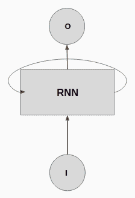

图 1：循环神经网络

图中可见 RNN 的输入、输出以及循环结构。循环的存在正是为了实现信息的持久保持。

这是“图 1”的展开形式：

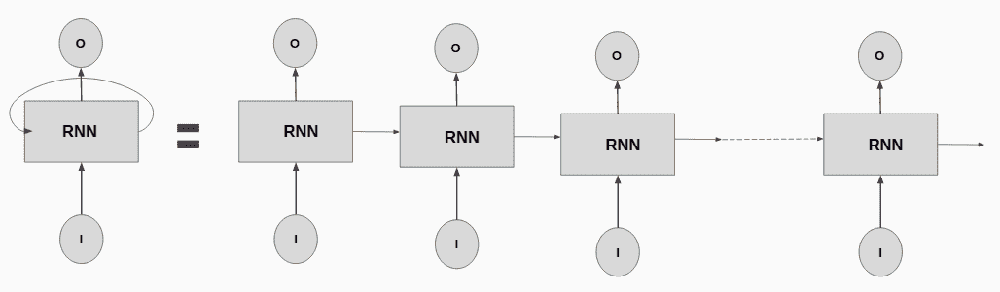

图 2：RNN 的展开图

展开后可看到信息在一步步之间传递，形成多个网络副本并被循环包裹。RNN 接收输入产生输出，输出不仅取决于当前实例的输入，还受之前整个输入历史的影响。

循环神经网络能够处理可变长度的输入序列并生成可变长度的输出序列，而全连接网络的计算次数是固定的。RNN 还能让信息在时序上保持并在不同输入间共享，任一时刻的输出都基于截至该时刻所见的全部历史。

这是 LSTM 的示意图：

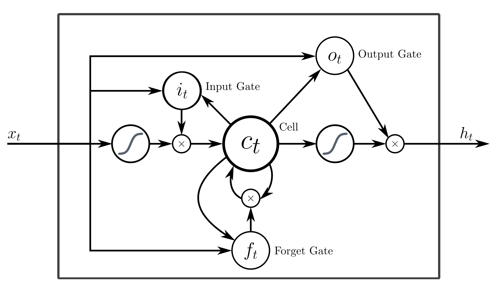

图 3：LSTM

**长短期记忆**（**LSTM**）网络是 RNN 的一种改进形式。

这是双向 LSTM：

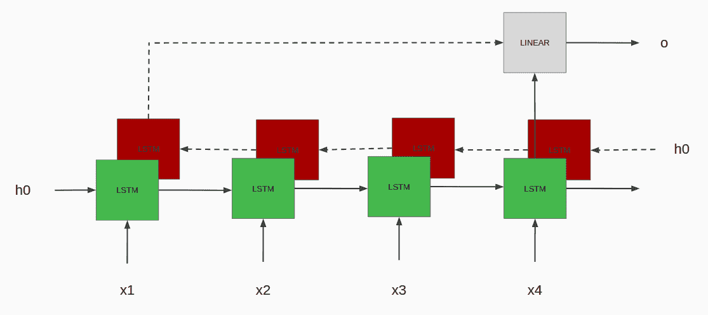

图 4：双向 LSTM

这是多层 LSTM：

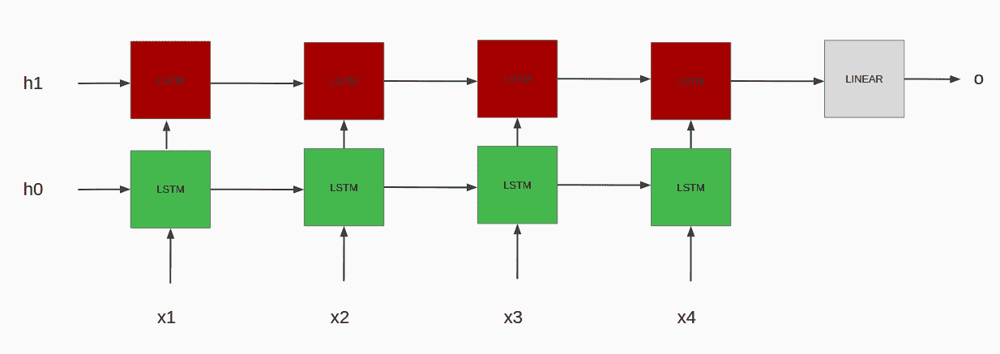

图 5：多层 LSTM

双向 LSTM 与多层 LSTM 都是对基础 LSTM 架构的有效扩展。

## 技术要求

本章需要配置 PyTorch，并使用 `torchtext`，该库专门用于与 PyTorch 协同的语言任务。

可通过如下 `pip` 命令安装 `torchtext`：

```
pip install torchtext
```

至此，本章所需的环境已就绪。

## 分词

处理自然语言任务时，通常先把文本语料切分为更小的单元。本秘籍把句子拆成单个单词，每个词承载含义，结合上下文表达句子意图。计算机只能识别数字，因此为每个词分配唯一整数。把句子切分为标记的过程即分词，这里实现的是词级别分词。

### 操作步骤

本秘籍编写一个将在“创建字段”部分用到的分词器：

1. 先写一个简易的 lambda 函数：

```
>>tokenizer = lambda words: words.split()
```

2. 再测试 `tokenizer()` 函数：

```
>>tokenizer("This is a test for tokenizer")
['This', 'is', 'a', 'test', 'for', 'tokenizer']
```

至此，词级分词已成功实现。

### 工作原理

本秘籍实现了一个适用于英语及类似语言的 lambda 分词器，利用单词间的空格进行切分。随后把句子传入 `tokenizer()` 进行验证。后续章节将使用该分词器生成字段。

### 更多

也可以借助 `nltk` 库对句子分词：

```
>>from nltk.tokenize import word_tokenize
>>word_tokenize("This is a test for tokenizer")
['This', 'is', 'a', 'test', 'for', 'tokenizer']
```

除此之外，还有字符串分词等形式，即把字符串拆分为子串。

### 另见

可在 [这个页面](https://www.nltk.org/api/nltk.tokenize.html) 上探索 `nltk` 提供的各类字符串分词方法。

## 创建字段

本秘籍介绍 `Field`，它与 `torchvision` 中的工具类似，能简化自然语言数据的处理。`Field` 可定义数据类型，并通过指定操作序列把文本转为张量。`Field` 类支持常见的文本预处理，并管理词汇表。

本秘籍研究如何用 `Field` 类定义文本处理任务。

### 操作步骤

本秘籍演示字段的常用用法：

1. 先进行导入：

```
>>from torchtext.data import Field
```

2. 针对情感分析，为评论定义 `Field` 对象：

```
>>Review = Field(sequential=True, tokenize=tokenizer, lower=True)
```

3. 再为标签定义字段：

```
>>Label = Field(sequential=False, use_vocab=False)
```

4. 可在输入字符串前后添加标记：

```
>>SequenceField = Field(tokenize=tokenizer, init_token='<sos>', eos_token='<eos>', lower=True)
```

5. 可将序列固定为统一长度：

```
>>SequenceField = Field(tokenize=tokenizer, init_token='<sos>', eos_token='<eos>', lower=True, fix_length=50)
```

6. 可设置未知词标记：

```
>>SequenceField = Field(tokenize=tokenizer, init_token='<sos>', eos_token='<eos>', unk_token='<unk>')
```

7. 可把批量维度置于第一维：

```
>>SequenceField = Field(tokenize=tokenizer, init_token='<sos>', eos_token='<eos>', unk_token='<unk>', batch_first=True)
```

通过本秘籍，展示了在 `torchtext` 中创建字段的多种方式。

### 工作原理

本秘籍依据具体任务使用 `Field` 类对输入文本执行预处理。对评论分类示例，`Review` 字段的 `sequential` 设为 `True`，因其为序列数据；标签字段则设为 `False`，非序列。将文本转为小写可避免大小写不同导致同一词被赋予不同 ID，设置 `lower=True` 即可。

数值型字段如评论标签，`use_vocab` 设为 `False`，假设负类为 0、正类为 1。分词函数从分词章节传入，作为 `tokenize` 参数；也可直接使用 `tokenize="spacy"`。对于需要标记序列起止的任务，可通过 `init_token` 和 `eos_token` 添加起始和结束标记，这对序列到序列模型尤其有用。若评估时遇到训练词汇表中未出现的词，可用 `unk_token` 统一替换。设置 `batch_first=True` 使输出张量的第一维为批量维；若 `fix_length` 指定为整数，则输入会被截断或填充至固定长度。

### 更多

可为 `spacy` 支持的语言设置特定分词语言。`pad_token` 参数允许自定义填充标记。`preprocessing` 与 `postprocessing` 参数可在分词后数字化前、数字化后转张量前分别应用处理流程。`stop_words` 可在预处理阶段剔除指定词。针对标签字段，还有专门的 `LabelField` 可替代普通字段使用。

### 另见

您可通过 [这个页面](https://torchtext.readthedocs.io/en/latest/data.html#field) 了解更多关于字段的信息。

## 开发数据集

本秘籍介绍如何读取文本数据并使用不同数据源。`torchtext` 可从文本文件、CSV/TSV、JSON 以及目录中读取数据并转为数据集。数据集是预处理后的数据块，可载入内存供后续结构使用。

### 准备

本秘籍使用新闻分类数据集，可从 [这里](https://github.com/jibinmathew69/PyTorch1.0-Tutorial/tree/master/NewsClassification) 下载。

`.csv` 文件包含以下列：

* `id`
* `content`
* `Business`
* `SciTech`
* `Sports`
* `World`

# 操作步骤

本秘籍将读取存储为 `.csv` 文件的有毒评论数据集：

1. 先进行导入：

```
>>from torchtext.data import TabularDataset
```

2. 选择训练列：

```
>>train_datafields = [("id", None),
                 ("content", Review), ("Business", Label),
                 ("SciTech", Label), ("Sports", Label),
                 ("World", Label)]
```

3. 划定测试侧需要的列：

```
>>test_datafields = [("id", None),
                  ("content", Review)]
```

4. 导入训练与验证 CSV：

```
>>train, valid = TabularDataset.splits(path='NewsClassification', 
                                    train='train.csv',
                                    valid='valid.csv',
                                    format='csv',
                                    skip_header=True,
                                    fields=train_datafields)
```

5. 导入测试 CSV：

```
>>test = TabularDataset(path="NewsClassification/test.csv",
                    format='csv',
                    skip_header=True,
                    fields=test_datafields)
```

6. 构建共享词表：

```
>>Review.build_vocab(train, min_freq=2)
```

本篇结束后，数据结构已确定好。

## 运作思路

torchtext 提供的 TabularDataset 能够解析 CSV，同时也兼容 TSV、JSON 以及以 Python 字典描述列的输入。我们先准备一个元组序列，每个元组包含列名和对应的 Field，Field 用来说明文本如何转换；若某列不需要进入最终内容，就把其 Field 置为 None，例如 ID 列。

示例采用新闻分类集合，文本列使用 Review 字段，其余标签列使用 Label 字段。测试部分仅保留新闻正文，因此 content 列继续使用 Review 字段，而 id 列直接丢弃。随后调用 TabularDataset 的 splits 方法，传入存放训练与验证文件的根目录，并通过 train、valid 参数指明具体文件名。

文件类型设为 csv，skip_header 设为 True 以跳过表头，fields 参数限定保留的列，测试集同理。最后在 Field 对象上调用 build_vocab，阈值设为词频≥2，未收录的词在验证与测试时会标记为未知。

## 延伸阅读

torchtext 的 Vocab 模块可单独生成词表。除 TabularDataset 外，还可根据任务选用其他集合类，比如机器翻译常使用 TranslationDataset。

## 参考链接

有关集合类的细节可查看 [这个页面](https://torchtext.readthedocs.io/en/latest/data.html#torchtext-data)。

# 迭代器开发指南

迭代器负责按批次从数据集合中取数，并简化数据搬运到目标设备的过程。遍历迭代器对象即可在每个轮次拿到可用小批次。本篇在完成数据集合构建后，利用其中的数据集合实例来创建迭代器。

## 实操流程

把数据集合转为迭代器，以便每个轮次准备合适的小批次：

1. 执行必要的导入：

```
>>from torchtext.data import BucketIterator
>>import torch
```

2. 设定批次规模：

```
>>BATCH_SIZE = 128
```

3. 探测可用计算设备：

```
>>device = torch.device('cuda' if torch.cuda.is_available() else 'cpu')
```

4. 用 BucketIterator 搭建数据桶：

```
>>train_iter, valid_iter, test_iter = BucketIterator.splits(
                                     (train, valid, test),
                                     batch_size=BATCH_SIZE,
                                     device=device,
                                     sort_key=lambda x: len(x.comment_text), 
                                     sort_within_batch=False)
```

完成后，训练、测试、验证三个集合各自拥有迭代器。

## 运作思路

迭代器用于组装训练、测试、验证的小批次并将数据搬到 CPU 或 GPU。BucketIterator 会把长度相近的序列归到同一桶，并自动打乱。我们先定义批次大小，再确认机器上的可用设备。

通过 BucketIterator 的 splits 方法分别生成三个迭代器。sort_within_batch 默认 False，若使用 pack_padded_sequence 则需设为 True，以防止 LSTM 看到填充部分。设为 True 时可配合 sort_key 参数，按降序对批次内序列排序。

## 延伸阅读

迭代器形式多样。基础迭代器直接按批从数据集合读取，BPTTIterator 专为语言建模设计，相邻序列相隔一个时间步。

## 参考链接

迭代器参数详情见 [这个页面](https://torchtext.readthedocs.io/en/latest/data.html?highlight=bucketiter#iterators)。

# 预训练词嵌入上手

词嵌入是对词的稠密学习表示，每个词映射为实值向量而非数字 ID。例如 book 可表示为 n 维向量 [0.22, 0.242, ..., 1.234]，而非 one-hot 的稀疏向量。

嵌入不仅编码词本身，也蕴含语义信息，模型通过上下文学习得到这种含义。语义相近的词在空间中更近，并支持向量运算，如下所示：

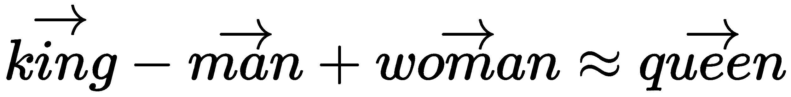

本篇演示如何在 torchtext 中使用预训练嵌入。

## 实操流程

1. 导入相关模块：

```
>>from torchtext import vocab
```

2. 加载嵌入向量：

```
>>vec = vocab.Vectors('glove.6B.100d.txt', cache='./vec/glove_embedding/', url='http://nlp.stanford.edu/data/glove.6B.zip')
```

3. 将预训练向量应用到字段以构建词表：

```
>>Review.build_vocab(train, min_freq=2, vectors=vec)
```

完成后，预训练词嵌入已就位。

## 运作思路

torchtext 提供 vocab 模块处理嵌入。指定嵌入名称即可下载，本例采用 GloVe，使用约 60 亿 token 训练，维度 50 的 glove.6B.50d。

向量从缓存读取，若不存在则自动下载。随后调用 Review 字段的 build_vocab 方法，以预训练向量为基础生成词表，并合并到训练数据的词表。

## 延伸阅读

也可使用基于训练数据生成的预训练向量，例如 gensim 产出的向量。另可通过 torch.nn 模块自行创建嵌入层，具体做法将在后续教程介绍。

## 参考链接

嵌入相关说明见 [这个页面](https://torchtext.readthedocs.io/en/latest/vocab.html?highlight=embedding#module-torchtext.vocab)。

# LSTM 分类器搭建

长短期记忆 LSTM 是一种带门控的循环神经网络，门控帮助网络决定保留或丢弃信息。普通 RNN 容易受梯度消失与爆炸影响，难以学习长期依赖，LSTM 在此方面更稳健。

## 实操流程

本篇定义 LSTM 分类器：

1. 执行导入：

```
>>import torch.nn as nn
```

2. 声明 LSTMClassifier 类：

```
>>class LSTMClassifier(nn.Module):
```

3. 加入嵌入层：

```
>>def __init__(self, embedding_dim, hidden_dim, output_dim, dropout):
            super().__init__()
            self.embedding = nn.Embedding(len(Review.vocab), embedding_dim)
```

4. 加入 LSTM 层：

```
self.rnn = nn.LSTM(embedding_dim, hidden_dim)
```

5. 加入全连接层：

```
self.fc = nn.Linear(hidden_dim, output_dim)
```

6. 加入丢弃层：

```
self.dropout = nn.Dropout(dropout)
```

7. 定义前向方法：

```
>>def forward(self, x):
```

8. 送入嵌入层：

```
x = self.embedding(x)
```

9. 将嵌入结果送入 LSTM：

```
output, (hidden, cell) = self.rnn(x)
```

10. 应用 dropout：

```
hidden = self.dropout(hidden)
```

11. 输出送入线性层：

```
return self.fc(hidden)
```

12. 定义超参数：

```
>>EMBEDDING_DIM = 100
>>HIDDEN_DIM = 256
>>OUTPUT_DIM = 1
>>DROPOUT = 0.5
```

13. 实例化模型对象：

```
>>model = LSTMClassifier(EMBEDDING_DIM, HIDDEN_DIM, OUTPUT_DIM, DROPOUT)
```

完成后得到可用 LSTM 模型。

## 运作思路

模型类继承自 torch.nn.Module 并初始化基类。嵌入层输入维等于词表大小，输出维为嵌入维；其输出进入 LSTM，输入维对应嵌入维，隐藏维自行设定。

随后定义全连接层与丢弃层。前向函数接收输入序列，先经嵌入层得到 embedding_dim 维向量，再送入 LSTM，输出包含输出状态、隐藏状态、细胞状态。隐藏状态汇总序列至今信息，取其做 dropout 后经全连接层得到最终向量，大小等于类别数。例如有毒评论数据有六类，二分类情感分析可只保留一个输出，用 1 表示正面、0 表示负面。

## 延伸阅读

多分类常用 CrossEntropyLoss，单输出情感任务常用 BCEWithLogitsLoss。其余训练流程与第 3 章卷积神经网络类似。

## 参考链接

LSTM 详情见 [这个页面](https://pytorch.org/docs/stable/nn.html#lstm)。梯度消失与爆炸可参考 [这个页面](https://www.jefkine.com/general/2018/05/21/2018-05-21-vanishing-and-exploding-gradient-problems/)。

# 多层 LSTM 扩展

在前一篇已介绍单层 LSTM，这里将其扩展为多层结构。阅读构建 LSTM 网络后再来看更顺畅。

## 实操流程

本篇在前一篇定义上做修改：

1. 更新类的 __init__：

```
>>def __init__(self, embedding_dim, hidden_dim, output_dim, dropout, num_layers):
```

2. 在 LSTM 定义中加入 num_layers 参数：

```
self.rnn = nn.LSTM(embedding_dim, hidden_dim, num_layers=num_layers)
```

类定义应如下所示：

```
class MultiLSTMClassifier(nn.Module):
    def __init__(self, embedding_dim, hidden_dim, output_dim, dropout, num_layers):
        self.embedding = nn.Embedding(len(Review.vocab), embedding_dim)
        self.rnn = nn.LSTM(embedding_dim, hidden_dim, num_layers=num_layers)
        self.fc = nn.Linear(hidden_dim, output_dim)
        self.dropout = nn.Dropout(dropout)

    def forward(self, x):
        x = self.embedding(x)
        output, (hidden, cell) = self.rnn(x)
        hidden = self.dropout(hidden)
        return self.fc(hidden[-1])
```

3. 在超参数中加入层数：

```
>>NUM_LAYERS = 2
```

4. 创建模型对象：

```
>>model = MultiLSTMClassifier(EMBEDDING_DIM, HIDDEN_DIM, OUTPUT_DIM, DROPOUT, NUM_LAYERS)
```

完成后网络支持多层 LSTM。

## 运作思路

在构造函数中引入 num_layers 参数控制 LSTM 层数，并以关键字参数形式传入 LSTM 定义中。

在 `forward()` 内部，隐藏状态的张量形状为 `[num_layers * num_directions, batch, hidden_dim]`，默认 `num_direction` 为 1，所以我们只取 `hidden[-1]` 来提取最顶层 LSTM 的隐藏向量。也就是说 `hidden[-1]` 代表最后一层的隐藏表示。这样设计让 `num_layers` 可以作为超参数自由调整，低层的输出会逐级作为上层的输入继续传递。

## 延伸思考
本文只演示了使用顶层 LSTM 隐藏状态的做法。工程上也可能构建用到全部隐藏层的复杂结构。多层 LSTM 之间还支持 `dropout` 参数，用于在相邻层之间引入丢弃正则。

## 参考资料
关于多层 LSTM 的更多细节，可参考 [这个页面](https://pytorch.org/docs/stable/nn.html#lstm)。

# 双向 LSTM 实战解析
本篇在多层 LSTM 的基础上展开。普通 LSTM 按时间正向从前往后扫描序列，双向 LSTM 则额外加了一个反向网络从后往前扫描。当当前时刻的预测需要依赖序列中未来的信息时，双向结构会更有效。举例来说，“我看过漫画” 与 “我昨天看过漫画” 中，“看过” 的语义会因后续词而不同。我们将演示如何实现。

## 前置条件
本秘籍依赖“多层 LSTM”秘籍的内容，建议先完成前篇后再尝试。

## 具体步骤
在此我们改造“多层 LSTM”秘籍中的类，使其变为双向结构：

1. 将 `bidirectional` 参数设为 `True`：

```
self.rnn = nn.LSTM(embedding_dim, hidden_dim, num_layers=num_layers, bidirectional=True)
```

2. 随后修改全连接层的输入维度：

```
self.fc = nn.Linear(2*hidden_dim, output_dim)
```

3. 再把输入更新到全连接层：

```
hidden = self.dropout(torch.cat((hidden[-2,:,:], hidden[-1,:,:]), dim=1))
return self.fc(hidden.squeeze(0))
```

此时类定义如下：

```
class BiLSTMClassifier(nn.Module):
    def __init__(self, embedding_dim, hidden_dim, output_dim, dropout, num_layers):
        self.embedding = nn.Embedding(len(Review.vocab), embedding_dim)
        self.rnn = nn.LSTM(embedding_dim, hidden_dim, num_layers=num_layers, bidirectional=True)
        self.fc = nn.Linear(2*hidden_dim, output_dim)
        self.dropout = nn.Dropout(dropout)

    def forward(self, x):
        x = self.embedding(x)
        output, (hidden, cell) = self.rnn(x)
        hidden = self.dropout(torch.cat((hidden[-2,:,:], hidden[-1,:,:]), dim=1))
        return self.fc(hidden.squeeze(0))
```

4. 最后实例化模型对象：

```
>>model = BiLSTMClassifier(EMBEDDING_DIM, HIDDEN_DIM, OUTPUT_DIM, DROPOUT, NUM_LAYERS)
```

通过以上改动，网络就变成了双向 LSTM。

## 原理说明
秘籍中在 LSTM 定义里把 `bidirectional` 标志打开。前向和后向的隐藏状态会被拼接后送入全连接层，因此全连接层的输入维度需要翻倍以容纳两路信息。

在 `forward()` 中，我们用 `torch.cat()` 将正向和反向的最后隐藏状态拼接起来。PyTorch 的隐藏状态堆叠顺序为 `[forward_layer_0, backward_layer_0, forward_layer_1, backward_layer_1, ..., forward_layer_n, backward_layer_n]`，因此需要取 `hidden[-2,:,:]` 和 `hidden[-1,:,:]`。拼接后去掉多余维度，再把向量送入全连接层。

## 进阶思路
这里我们挑选了最后的正向和反向隐藏状态拼接，这是一种常见选择。根据具体任务，也可以选用任意层或全部层的隐藏状态。

## 延伸阅读
多层 LSTM 的更多信息可查阅 [这个页面](https://pytorch.org/docs/stable/nn.html#lstm)。

## 五、迁移学习与 TensorBoard

> 原文：[`gitee.com/apachecn/apachecn-dl-zh/blob/master/docs/pt-ai-fund/5.md`](https://gitee.com/apachecn/apachecn-dl-zh/blob/master/docs/pt-ai-fund/5.md)

迁移学习是深度学习里常用的思路，让在大数据上训练的模型知识迁移到小数据任务。做法是复用已有模型在新任务上微调。对 CNN 视觉任务，通常冻结前端卷积层，只训练末端层。早期卷积提取通用低层特征如边缘、纹理，后期层则学到数据相关的特定特征。

本章以胸部 X 光区分正常与肺炎为例，使用预训练 `ResNet-50` 做迁移学习，并把分类头替换为两类输出。整体流程如下：

1. 加载在 `ImageNet` 上预训练的 `ResNet-50`。
2. 冻结底层卷积参数。
3. 用可训练的多层结构替换分类器。
4. 在目标训练集上训练分类层。
5. 微调超参并按需解冻更多层。

本章涉及的秘籍有：

* 预训练模型调整
* 训练实现
* 测试实现
* 数据集加载
* TensorBoard 写入器定义
* 训练与解冻层

## 环境要求
需要 `Torch` 1.2 及以上版本，强烈建议使用支持 CUDA 的设备。

## 预训练模型改造
这里我们取预训练 ResNet 并修改末层以适配需求。`ImageNet` 上训练的 ResNet-50 有上千类，我们只需两类。做法是替换平均池化和全连接分类器，并冻结除新增分类器外的其余权重，即冻结模型。

### 数据准备
本秘籍需要下载特定数据集，可从[这里](https://www.kaggle.com/paultimothymooney/chest-xray-pneumonia/download)获取。`PyTorch` 版本需 1.2+，推荐使用 CUDA 设备。

### 实施步骤
从在 `ImageNet` 上预训练的 `ResNet-50` 出发训练网络：

1. 先从导入开始编写代码：

```
>>import torch
>>import torch.nn as nn
>>import numpy as np
>>import torch.optim as optim
>>from torchvision import transforms, datasets, models, utils
>>import time
>>import numpy as np
>>from torchsummary import summary
>>from torch.utils.data import DataLoader
```

2. 定义 `AdaptiveConcatPool2d` 子模块：

```
>>class AdaptiveConcatPool2d(nn.Module):
    def __init__(self, sz=None):
        super().__init__()
        sz = sz or (1,1)
        self.ap = nn.AdaptiveAvgPool2d(sz)
        self.mp = nn.AdaptiveMaxPool2d(sz)
    def forward(self, x): 
        return torch.cat([self.mp(x), self.ap(x)], 1)
```

3. 定义获取模型的函数：

```
>>def get_model():
    model = models.resnet50(pretrained=True)
```

4. 冻结模型参数：

```
for param in model.parameters():
    param.requires_grad = False
```

5. 替换 ResNet 最后两层并返回模型：

```
model.avgpool = AdaptiveConcatPool2d()
model.fc = nn.Sequential(
    nn.Flatten(),
    nn.BatchNorm1d(4096),
    nn.Dropout(0.5),
    nn.Linear(4096, 512),
    nn.ReLU(),
    nn.BatchNorm1d(512),
    nn.Dropout(p=0.5),
    nn.Linear(512, 2),
    nn.LogSoftmax(dim=1)
)
return model
```

完成上述步骤后，即可获得可用的模型获取函数。

### 运行逻辑
我们先定义 `AdaptiveConcatPool2d`，它把平均池化和最大池化的结果级联，形成从卷积到全连接的平滑过渡。

`get_model()` 先下载本地没有的 `ResNet-50` 并冻结其权重，冻结后底层卷积不再更新。随后用 `AdaptiveConcatPool2d` 替换平均池化层，并添加两输出的全连接分类器。最终返回带有冻结 ResNet 主干的模型。

## 训练流程实现
本秘籍实现一个单轮训练函数，记录训练指标并绘制到 TensorBoard。输入模型、训练数据、优化器和损失函数，返回训练损失。

### 步骤拆解
实现训练函数：

1. 定义训练函数：

```
>>def train(model, device, train_loader, criterion, optimizer, epoch, writer):
    model.train()

    total_loss = 0   
```

2. 遍历训练数据并更新权重：

```
    for batch_id, (data, target) in enumerate(train_loader):
        data, target = data.to(device), target.to(device)

        optimizer.zero_grad()
        preds = model(data)
        loss = criterion(preds, target)
        loss.backward()
        optimizer.step()

        total_loss += loss.item()
```

3. 记录并返回训练损失：

```
    writer.add_scalar('Train Loss', total_loss/len(train_loader), epoch)
    writer.flush()

    return total_loss/len(train_loader)
```

至此训练函数完成。

### 机制说明
函数先用 `.train()` 设为训练模式，初始化训练损失为 0。遍历数据时将输入和标签移到目标设备，清空梯度后做前向预测并计算损失，反向传播后更新权重。因模型被冻结，仅分类器参数会被更新。

最后用 TensorBoard 的 `SummaryWriter` 的 `add_scalar()` 记录指标，标签、标量值和轮次数作为参数。

## 测试流程实现
本秘籍定义一个单轮验证函数，把测试指标写入 TensorBoard，并提供工具函数用于可视化错误分类样本。

### 代码步骤
1. 先定义张量转图像的函数：

```
>>inv_normalize = transforms.Normalize(
        mean=[-0.485/0.229, -0.456/0.224, -0.406/0.225],
        std=[1/0.229, 1/0.224, 1/0.255]
    )
```

2. 再定义记录错误分类图像的函数：

```
>>def misclassified_images(pred, writer, target, data, output, epoch, count=10):
    misclassified = (pred != target.data)
    for index, image_tensor in enumerate(data[misclassified][:count]):
        img_name = '{}->Predict-{}x{}-Actual'.format(
                epoch,
                LABEL[pred[misclassified].tolist()[index]],
                LABEL[target.data[misclassified].tolist()[index]], 
            )

        writer.add_image(img_name, inv_normalize(image_tensor), epoch)
```

3. 定义记录指标的函数：

```
>>def test(model, device, test_loader, criterion, epoch, writer):
    model.eval()

    total_loss, correct = 0, 0

    with torch.no_grad():
        for data, target in test_loader:
            data, target = data.to(device), target.to(device)
            output = model(data)
            total_loss += criterion(output, target).item()
            pred = output.data.max(1)[1]
            correct += pred.eq(target.data).cpu().sum()

            misclassified_images(pred, writer, target, data, output, epoch)

    total_loss /= len(test_loader)
    accuracy = 100\. * correct / len(test_loader.dataset)
```

4. 在 TensorBoard 上记录测试指标：

```python
    writer.add_scalar('Test Loss', total_loss, epoch)
    writer.add_scalar('Accuracy', accuracy, epoch)
    writer.flush()

    return total_loss, accuracy
```

测试函数至此完成。

# 测试函数解析
## 工作原理

本教程率先实现了一个逆归一化函数，用于把图像在转成 ImageNet 统计归一化张量时所做的处理给还原回来。还写了 misclassified_images() 来专门收集预测出错的样本，随后通过 SummaryWriter 里的 add_image() 把这些错分图连同名称、图本身和计数器一起推送到 TensorBoard。

紧接着定义了 test() 方法，它会在模型的验证集上执行验证，并与训练过程保持一致地调用 add_scalar() 记录测试损失和准确率。最后该方法会返回验证集上的测试损失以及模型准确率。

# 数据准备与肺炎数据集导入
本篇将演示如何加载肺炎数据集并把它转成张量。模型只能接收张量输入，因此图像需要先做预处理。我们会做数据增强来扩充样本量，并在送入模型前按照 ImageNet 数据集的标准进行归一化。

## 实操步骤
本篇会按如下流程加载数据：

1. 先定义转换：
```
>>image_transforms = {
```
训练集转换代码如下：
```
    'train':
    transforms.Compose([
        transforms.RandomResizedCrop(size=300, scale=(0.8, 1.1)),
        transforms.RandomRotation(degrees=10),
        transforms.ColorJitter(0.4, 0.4, 0.4),
        transforms.RandomHorizontalFlip(),
        transforms.CenterCrop(size=256), # Image net standards
        transforms.ToTensor(),
        transforms.Normalize([0.485, 0.456, 0.406],
                             [0.229, 0.224, 0.225]) # Imagenet standards
    ]),
```
验证集转换代码如下：
```
    'val':
    transforms.Compose([
        transforms.Resize(size=300),
        transforms.CenterCrop(size=256),
        transforms.ToTensor(),
        transforms.Normalize([0.485, 0.456, 0.406], [0.229, 0.224, 0.225])
    ]),
```
测试集转换代码如下：
```
    'test':
    transforms.Compose([
        transforms.Resize(size=300),
        transforms.CenterCrop(size=256),
        transforms.ToTensor(),
        transforms.Normalize([0.485, 0.456, 0.406], [0.229, 0.224, 0.225])
    ]),
}
```

2. 再设定图像路径、批量大小、日志路径和模型保存路径：
```
>>datadir = '../input/chest-xray-pneumonia/chest_xray/chest_xray/'
>>traindir = datadir + 'train/'
>>validdir = datadir + 'test/'
>>testdir = datadir + 'val/'
>>model_path = "model.pth"
>>batch_size = 128
>>PATH_to_log_dir = 'logdir/'
```

3. 随后从文件夹中读取图像：
```
>>data = {
    'train':
    datasets.ImageFolder(root=traindir, transform=image_transforms['train']),
    'val':
    datasets.ImageFolder(root=validdir, transform=image_transforms['val']),
    'test':
    datasets.ImageFolder(root=testdir, transform=image_transforms['test'])
}
```

4. 创建数据迭代器：
```
>>dataloaders = {
    'train': DataLoader(data['train'], batch_size=batch_size, shuffle=True),
    'val': DataLoader(data['val'], batch_size=batch_size, shuffle=True),
    'test': DataLoader(data['test'], batch_size=batch_size, shuffle=True)
}
```

5. 最后构建类别标签：
```
>>LABEL = dict((v,k) for k,v in data['train'].class_to_idx.items())
```
完成以上步骤，数据集即可就绪。

## 原理说明
本篇为训练、验证、测试三套数据分别定义了对应的图像变换，归一化参数取自 ImageNet 统计信息。随后指定了数据集路径、模型名、批量大小和日志目录，并借助 datasets.ImageFolder() 按照文件夹名称加载数据，为每套数据生成迭代器。

值得注意的是验证目录和测试目录被做了交换。因为原始验证集规模很小，所以拿测试集来充当验证集使用。

同时使用 DataLoader 为训练、测试、验证三套数据创建迭代器，并定义了一个 LABEL 常量字典，用来把分类器输出的索引映射到类别名称。

# 搭建 TensorBoard 记录器
本篇演示如何创建用于写入 TensorBoard 的对象。我们使用 SummaryWriter 来记录指标，可以写入标量、图表和图像等内容，并定义一个函数返回 SummaryWriter 实例以记录模型指标。

## 环境准备
本篇需要先安装 TensorBoard 库。

需要安装的是 TensorBoard 夜间版：
```
pip install tb-nightly
```
准备工作到此完成。

## 操作流程
创建写入器以把数据写入 TensorBoard：

1. 在命令行启动 TensorBoard：
```
tensorboard --logdir=log_dir/ --port 6006
```
浏览器打开 http://localhost:6006/ 即可访问。

2. 导入 TensorBoard：
```
>>from torch.utils.TensorBoard import SummaryWriter
```

3. 定义获取写入器的函数：
```
>>def tb_writer():
      timestr = time.strftime("%Y%m%d_%H%M%S")
      writer = SummaryWriter(PATH_to_log_dir + timestr)
      return writer
```

4. 生成图像网格来可视化数据集样本：
```
>>writer = tb_writer()
>>dataiter = iter(dataloaders['train'])
>>images, labels = dataiter.next()
>>grid = utils.make_grid([inv_normalize(image) for image in images[:32]])
>>writer.add_image('X-Ray grid', grid, 0)
>>writer.flush()
```
TensorBoard 的准备工作就绪。

## 机制解析
首先从命令行启动 TensorBoard，从 logdir/ 目录读取日志。即使目录还不存在，TensorBoard 也不会报错，而是等待目录出现，因此目录路径要写对。

随后在代码中导入 TensorBoard，并定义 tb_writer() 函数返回一个新的 SummaryWriter 对象。写入器会接收日志保存的目录名，并借助时间戳 timestr 确保每个写入器都有独立的目录。

之后使用 utils.make_grid() 生成图像网格以查看训练集中样本，使用 add_image() 将其送入 TensorBoard。做法是从 iter(dataloaders['train']) 中取图，挑选 32 张进行逆归一化后拼成网格，并调用写入器的 flush() 方法把缓冲区数据写入存储。

# 训练模型并解冻微调
本篇在预设轮次内完成模型训练，训练过程中保存最优模型。完成指定轮次后，用最优权重加载模型，再解冻原本冻结的 ResNet 层，以更小的学习率对权重进行微调。

## 执行步骤
本篇完成模型训练的流程如下：

1. 把模型移到可用设备：
```
>>device = torch.device('cuda' if torch.cuda.is_available() else 'cpu')
>>model = get_model().to(device)
```

2. 定义损失函数和优化器：
```
>>criterion = nn.NLLLoss()
>>optimizer = optim.Adam(model.parameters())
```

3. 定义跨轮次训练的函数：
```
>>def train_epochs(model, device, dataloaders, criterion, optimizer,epochs, writer):
    print('{0:>20} | {1:>20} | {2:>20} | {3:>20} |'.format('Epoch','Training Loss','Test Loss', 'Accuracy'))

    best_score = np.Inf

    for epoch in epochs:

        train_loss = train(model, device, dataloaders['train'], criterion, optimizer, epoch, writer)

       test_loss, accuracy = test(model, device, dataloaders['val'], criterion, epoch, writer)

        if test_loss < best_score:
            best_score = test_loss
            torch.save(model.state_dict(), model_path)

        print('{0:>20} | {1:>20} | {2:>20} | {3:>20.2f}% |'.format(epoch,train_loss,test_loss, accuracy))

        writer.flush()
```

4. 训练冻结模型：
```
>>train_epochs(model, device, dataloaders, criterion, optimizer, range(0,10), writer)
>>writer.close()
```
示例输出：
```
Epoch | Training Loss | Test Loss    | Accuracy |
 0    |  0.3617607994 | 0.4970110774 |  79.17%  |
 1    |   0.233799973 | 0.3870731115 |  84.78%  |
 2    |  0.2014380195 |   0.37044851 |  85.26%  |
 3    |   0.190022166 |  0.362625807 |  86.86%  |
 4    |   0.176903085 |   0.40945090 |  85.90%  |
 5    |   0.163670904 | 0.3690894782 |  86.86%  |
 6    |  0.1607481929 |  0.418265098 |  84.46%  |
 7    |  0.1615160162 | 0.4016072392 |  85.58%  |
 8    |  0.1519727988 |  0.481940734 |  84.13%  |
 9    |  0.1441831755 |  0.433110350 |  84.46%  |
```

5. 定义解冻模型的函数：
```
>>def unfreeze(model):
    for param in model.parameters():
        param.requires_grad = True
```

6. 加载最优模型并执行解冻：
```
>>model.load_state_dict(torch.load(model_path))
>>unfreeze(model)
```

7. 更新优化器，降低学习率：
```
>>optimizer = optim.Adam(model.parameters(), lr=1e-6)
```

8. 训练解冻后的模型：
```
>>writer = tb_writer()
>>train_epochs(model, device, dataloaders, criterion, optimizer, range(9,14), writer)
```
示例输出：
```
Epoch |        Training Loss |            Test Loss |  Accuracy  |
    9 |  0.15972968554351388 |  0.41342413425445557 |   85.10%   |
   10 |   0.1224460500042613 |   0.3801746487617493 |   86.54%   |
   11 |   0.1217333177422605 |  0.37790409922599794 |   87.18%   |
   12 |  0.11098722713749583 |   0.3712982594966888 |   87.98%   |
   13 |  0.09877484373566581 |  0.41088773012161256 |   86.70%   |
   14 |  0.09256085244620718 |   0.3181425631046295 |   89.42%   |
```

9. 最终关闭 TensorBoard 写入器：
```
>>writer.close()
```
训练后在 TensorBoard 中可以看到生成的图表：
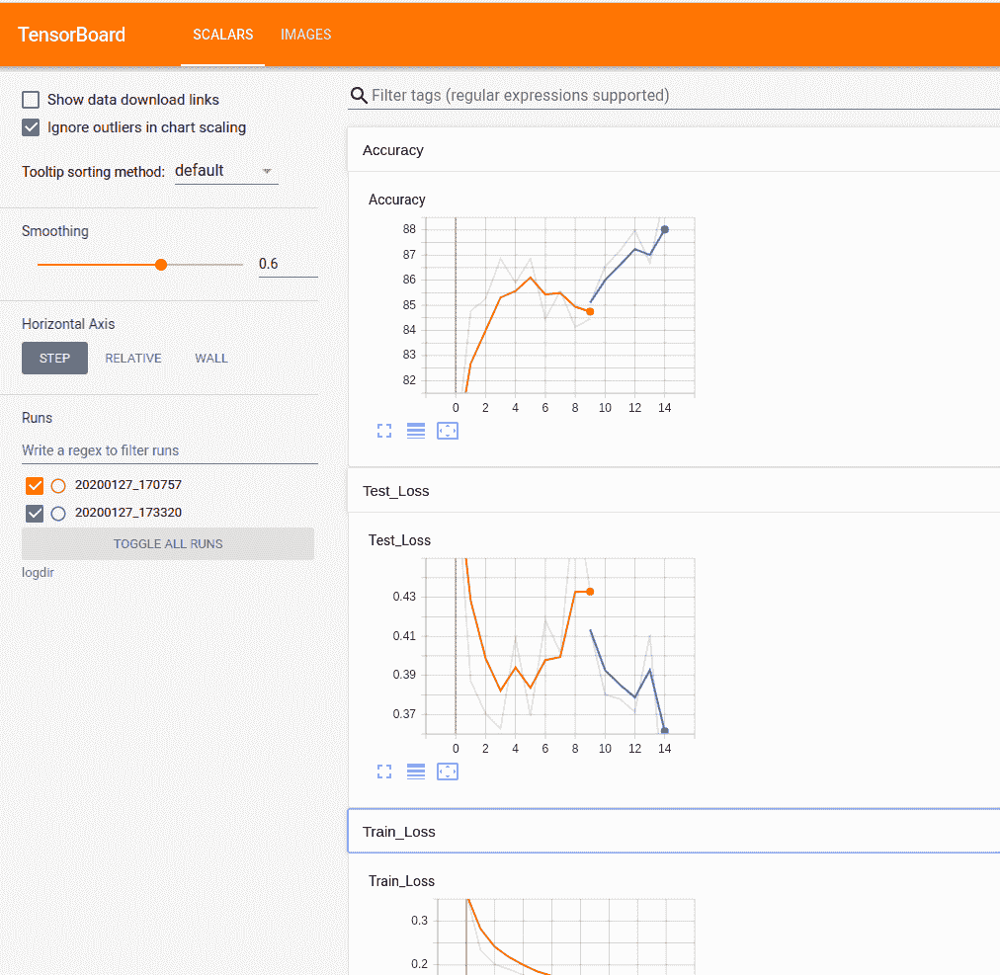
图 1：TensorBoard 主仪表板

构建的图像网格如下：
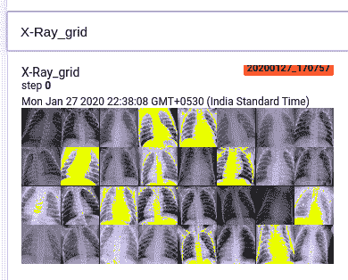
图 2：图像网格

以下是一个误分类示例，模型预测为肺炎，实际为正常：
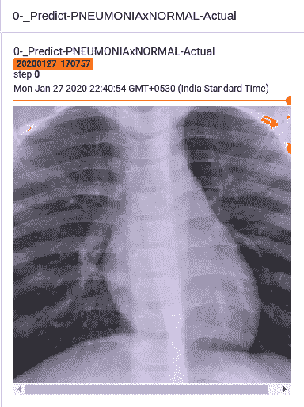
图 3：预计的肺炎，实际上是正常的

以下是一个误分类示例，模型预测为正常，实际为肺炎：
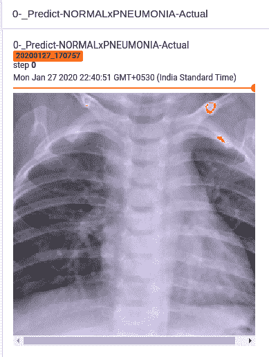
图 4：预测的正常，实际上是肺炎

训练损失随时间下降的曲线：
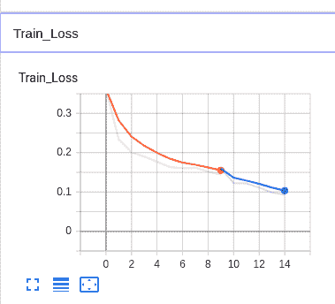
图 5：训练损失

测试损失随时间下降的曲线：
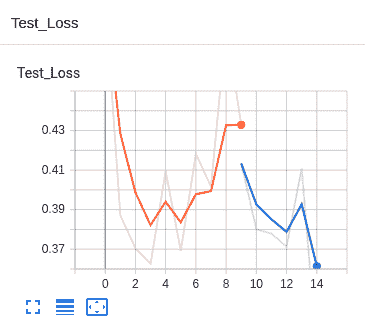
图 6：测试损失

准确率随时间提升的曲线：
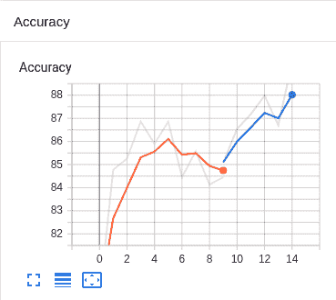
图 7：准确率得分

通过本篇，已完成模型训练并在 TensorBoard 中可视化结果。

## 背后逻辑
本篇创建模型并迁移到可用设备，使用负对数似然损失和 Adam 作为损失与优化器。train_epochs() 方法在设定轮次内训练模型，每轮结束时调用 writer.flush() 确保未决事件写入磁盘，最后用 writer.close() 刷新并关闭写入器。函数内部还会保存最优模型以便后续重新加载。

微调实战：解冻带来更强表现

我们先把目前训练效果最好的模型权重载入进来，先以冻结状态进行初步微调。解除冻结后，网络的全部参数都会重新参与梯度更新。此时把优化器的学习率调低，让未解冻的模型继续训练，并在过程中记录各项指标。结果很清晰，经历这轮微调后模型整体表现明显更好。

在 TensorBoard 的曲线中，冻结阶段的数据用橙色展示，解冻阶段的数据用蓝色展示，蓝色曲线全面压过橙色，说明解冻后的训练确实带来了提升。为进一步审视效果，我们还从训练集里抽取了图像网格样本，并按 epoch 挑选出分类错误的典型案例。

整体来看，随着训练轮次推进，训练损失和测试损失都在持续下降，分类准确率则稳定上升。

## 更多

本篇后续可以扩展一个用于计算测试集指标的函数，并借助 `add_histogram()` 把参数分布直方图写入 TensorBoard。也可以换用其它的预训练网络作为 backbone 开展迁移实验。

## 另见

如需深入了解，可参考以下资料：

*   你可以在[这个页面](https://pytorch.org/tutorials/beginner/finetuning_torchvision_models_tutorial.html)上了解有关微调的更多信息。
*   你可以在[这个页面](https://pytorch.org/tutorials/beginner/transfer_learning_tutorial.html)上了解另一个迁移学习示例。
*   您可以通过[这里](https://pytorch.org/docs/stable/tensorboard.html)探索 `TensorBoard` 函数。

## 六、探索生成对抗网络

> 原文：[`gitee.com/apachecn/apachecn-dl-zh/blob/master/docs/pt-ai-fund/6.md`](https://gitee.com/apachecn/apachecn-dl-zh/blob/master/docs/pt-ai-fund/6.md)

`生成对抗网络`（`GAN`）是一种同时训练两套模型的机器学习范式：一套负责合成伪造数据，另一套负责辨别数据是真实还是合成。*生成*指的是网络能够创造新样本，*对抗*则源于两者彼此博弈，从而推动生成样本质量不断提升。

`GAN` 由生成器和判别器组成。生成器负责产出数据，判别器接收输入并判断其为真实样本还是生成器造假。生成器的目标是做出与训练集真实数据难以区分的样本。

用类比来理解，生成器像造假者想仿制钞票，判别器像侦探负责抓捕。假钞越逼真，侦探就必须越敏锐，反过来造假者也会被迫提高仿真水平。

生成器依据判别器的反馈来学习。判别器要判断输入来自训练集还是生成器，每当它把伪造图像误判为真实，生成器就获得正向信号；每当判别器正确识破伪造，生成器则收到需要改进的信号。判别器本质上是一个分类器，通过真实标签学习预测误差。随着生成器逼真度提高，判别器也必须提升分辨能力，两者相互促进。

从概念上说，生成器要从训练样本中捕捉真实数据的特征，使其产出与真数据无法区分。生成器学习的是模式的创造而非识别。输入通常是随机噪声向量。

下面是 `GAN` 的典型结构图：

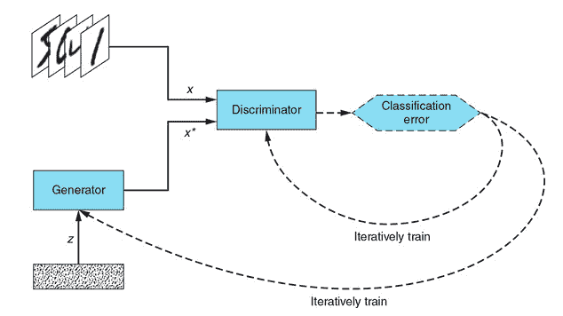

图中包含一个训练图像源 `x`，生成器要学习其属性并复现。生成器接收随机向量 `z` 作为种子，生成伪图像 `x*`。判别器同时接收真实与伪造图像，输出输入为真的概率，真实标记为 1，伪造标记为 0。随后计算分类误差，用以迭代训练判别器与生成器。判别器的目标是最小化误差，生成器的目标是最大化判别器的误差。

理想状态下两者达到平衡：生成器已完整捕捉真实特征，继续训练不再有收益；判别器只能以 50% 的概率猜中，因为两类样本在本质上不可区分。这就是收敛状态，但在实践中很难稳定达成。本章将介绍 `GAN` 的原理与 PyTorch 中的多种实现。

本章将涵盖以下内容：

*   创建一个 `DCGAN` 生成器
*   创建 `DCGAN` 判别器
*   训练 `DCGAN` 模型
*   可视化 `DCGAN` 结果
*   使用 `PyTorch Hub` 运行 `PGGAN`

## 技术要求

强烈建议在配备 NVIDIA GPU 且启用 `CUDA` 与 `CUDNN` 的机器上运行本章代码，因为相关实验的计算开销较大。

## 创建一个 DCGAN 生成器

本节及后续将实现 `DCGAN`。`DCGAN` 即“深度卷积 `GAN`”，相比原始 `GAN` 有显著改进。原始 `GAN` 使用全连接网络，而 `DCGAN` 采用卷积神经网络，正如第 3 章的 CNN 相比第 2 章的全连接分类器是进步一样。`DCGAN` 还引入批量归一化，将层输出归一化后再传入下一层，使各层能相对独立学习，减少协变量偏移。

批量归一化通过缩放使均值趋近 0、方差趋近 1。本秘籍生成类似 `MNIST` 的手写数字，从噪声向量出发，先扩展为二维矩阵，再转为 `28 x 28` 的灰度图。为提升高度与宽度，需使用反卷积，即卷积的逆操作，过程中通道数会逐步减少。

以下是 `DCGAN` 生成器的结构示意：

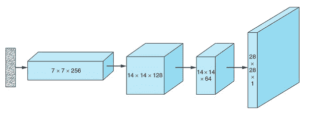

建议回顾第 3 章关于卷积神经网络的内容。

### 操作步骤

本秘籍实现 `GAN` 网络的生成器部分：

1. 我们将从导入开始：
```
>import torch
>>import torch.nn as nn
>>import torchvision.transforms as transforms
```
2. 然后，我们将定义转换：
```
>>transform = transforms.Compose([
    transforms.ToTensor(),
    transforms.Normalize((0.5, ), (0.5, )),
])
```
3. 然后，我们将提供该设备：
```
>>device = torch.device("cuda" if torch.cuda.is_available() else "cpu")
```
3. 现在，我们将定义生成器类：
```
>>class Generator_model(nn.Module):
    def __init__(self, z_dim):
         super().__init__()
```
4. 然后，我们将定义生成器的单元：
```
 self.fc = nn.Linear(z_dim, 256 * 7 * 7)
 self.gen = nn.Sequential(
            nn.ConvTranspose2d(256, 128, 4, 2, 1),
            nn.BatchNorm2d(128),
            nn.LeakyReLU(0.01),
            nn.ConvTranspose2d(128, 64, 3, 1, 1),
            nn.BatchNorm2d(64),
            nn.LeakyReLU(0.01),
            nn.ConvTranspose2d(64, 1, 4, 2, 1),
            nn.Tanh()
        )
```
5. 现在我们将定义 `forward` 方法：
```
def forward(self, input):
    x = self.fc(input)
    x = x.view(-1, 256, 7, 7)
    return self.gen(x)
```
6. 最后，我们将为生成器模型创建对象：
```
>>generator = Generator_model(z_dim).to(device)
```

完成后，`DCGAN` 生成器即已就绪。

### 工作原理

本秘籍先对图像做张量转换与归一化，与第 3 章做法一致。随后确定运行设备为 CPU 或 GPU。定义继承自 `nn.Module` 的 `Generator_model` 类，构造器接收 `z_dim` 表示噪声向量维度。

全连接层 `self.fc` 将噪声映射为 `256 * 7 * 7` 的特征。`self.gen` 是一个 `nn.Sequential`，由反卷积 `nn.ConvTranspose2d`、批量归一化 `nn.BatchNorm2d` 和激活 `nn.LeakyReLU` 堆叠而成。`ConvTranspose2d` 接受输入通道、输出通道、核大小、步幅、填充等参数；`BatchNorm2d` 接收特征通道数；`LeakyReLU` 允许负值以小梯度通过，使判别器的梯度能回流到生成器。

输出层使用 `tanh`，论文指出有界激活有助于快速饱和并覆盖训练分布的颜色空间，其对称性对浅色与深色的处理也有利。

`forward` 流程：`z_dim` 维噪声经全连接得到 12544 维向量，reshape 为 `256 x 7 x 7`。随后经反卷积得到 `128 x 14 x 14`，配合批量归一化和 LeakyReLU；再经第二次反卷积得到 `64 x 14 x 14`，第三次得到 `1 x 28 x 28`。最后实例化生成器并迁移到目标设备。

## 创建 DCGAN 判别器

本秘籍构建 `GAN` 网络的判别分支。判别器本质是二分类器，判断图像来自真实数据集还是生成器。生成器正是依据判别器的反馈不断改进。`DCGAN` 中判别器使用卷积神经网络构建。

判别器结构如下：

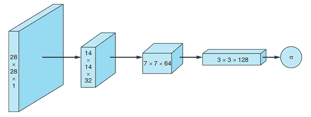

### 准备

本节大量依赖第 3 章的卷积神经网络秘籍，建议先回顾。

### 操作步骤

构建 `GAN` 的判别器端：

1. 我们将从导入开始：
```
>>import torch.nn.functional as F
```
2. 然后，我们将定义判别器类：
```
>>class Discriminator_model(nn.Module):
    def __init__(self):
        super().__init__()
```
3. 接下来，我们定义鉴别单元：
```
self.disc = nn.Sequential(
            nn.Conv2d(1, 32, 3, 2, 1),
            nn.LeakyReLU(0.01),
            nn.Conv2d(32, 64, 3, 2, 1),
            nn.BatchNorm2d(64),
            nn.LeakyReLU(0.01),
            nn.Conv2d(64, 128, 3, 2, 1),
            nn.BatchNorm2d(128),
            nn.LeakyReLU(0.01)
        )
```
4. 然后定义最后一个全连接层：
```
self.fc = nn.Linear(2048, 1)
```
5. 然后定义 `forward()` 方法：
```
def forward(self, input):
        x = self.disc(input)
        return F.sigmoid(self.fc(x.view(-1, 2048)))
```
6. 然后我们创建鉴别对象：
```
>>discriminator = Discriminator_model().to(device)
```

判别器至此完成。

### 工作原理

本秘籍定义了一个分类器，使用 `nn.Sequential()` 串联卷积、激活、批量归一化，并加上最后的全连接层输出经 `Sigmoid` 的单一概率。由于只有两类，`Sigmoid` 适合作为末层。输入为 `1 x 28 x 28`，第一层卷积输出 `32 x 14 x 14`，第二层变为 `64 x 7 x 7`，之后是 `128 x 4 x 4`，最后展平后通过全连接。

## 训练 DCGAN 模型

前两节已定义生成器“创建 DCGan 生成器”和判别器“创建 `DCGAN` 判别器”。本节完成模型训练。生成器的目标是产出与数据集高度相似的图像，判别器的目标是区分真伪。理想情况下生成器已学尽数据特征，判别器只能随机猜测。本节将整合已有生成器与判别器，完成 `DCGAN` 训练。

### 准备

我们将使用 `torchsummary` 查看各层输出形状与参数量，安装命令如下：
```
pip install torchsummary
```

安装完成后进入下一步。

### 操作步骤

完成 `GAN` 训练：

1. 首先导入：
```
>>from torchsummary import summary
>>import torch.optim as optim
>>import torchvision.utils as vutils
```
2. 然后我们初始化生成器和判别器的权重：
```
>>def weights_init(m):
    classname = m.__class__.__name__
    if classname.find('Conv') != -1:
        nn.init.normal_(m.weight.data, 0.0, 0.02)
    elif classname.find('BatchNorm') != -1:
        nn.init.normal_(m.weight.data, 1.0, 0.02)
        nn.init.constant_(m.bias.data, 0)
>>generator.apply(weights_init)
>>discriminator.apply(weights_init)
```
3. 然后我们打印生成器的摘要：
```
>>summary(generator, (100, ))
```

这给我们以下输出：

# DCGAN 模型摘要与训练

## 生成器模型摘要

```
----------------------------------------------------------------
        Layer (type)               Output Shape         Param #
================================================================
            Linear-1                [-1, 12544]       1,266,944
   ConvTranspose2d-2          [-1, 128, 14, 14]         524,416
       BatchNorm2d-3          [-1, 128, 14, 14]             256
         LeakyReLU-4          [-1, 128, 14, 14]               0
   ConvTranspose2d-5           [-1, 64, 14, 14]          73,792
       BatchNorm2d-6           [-1, 64, 14, 14]             128
         LeakyReLU-7           [-1, 64, 14, 14]               0
   ConvTranspose2d-8            [-1, 1, 28, 28]           1,025
              Tanh-9            [-1, 1, 28, 28]               0
================================================================
Total params: 1,866,561
Trainable params: 1,866,561
Non-trainable params: 0
----------------------------------------------------------------
Input size (MB): 0.00
Forward/backward pass size (MB): 0.97
Params size (MB): 7.12
Estimated Total Size (MB): 8.09
----------------------------------------------------------------
```

## 判别器概览与训练流程

**4. 随即展示判别器的摘要信息：**

```
>>summary(discriminator, (1, 28, 28))
```

得到如下结果：

```
----------------------------------------------------------------
        Layer (type)               Output Shape         Param #
================================================================
            Conv2d-1           [-1, 32, 14, 14]             320
         LeakyReLU-2           [-1, 32, 14, 14]               0
            Conv2d-3             [-1, 64, 7, 7]          18,496
       BatchNorm2d-4             [-1, 64, 7, 7]             128
         LeakyReLU-5             [-1, 64, 7, 7]               0
            Conv2d-6            [-1, 128, 4, 4]          73,856
       BatchNorm2d-7            [-1, 128, 4, 4]             256
         LeakyReLU-8            [-1, 128, 4, 4]               0
            Linear-9                    [-1, 1]           2,049
================================================================
Total params: 95,105
Trainable params: 95,105
Non-trainable params: 0
----------------------------------------------------------------
Input size (MB): 0.00
Forward/backward pass size (MB): 0.21
Params size (MB): 0.36
Estimated Total Size (MB): 0.58
----------------------------------------------------------------
```

**5. 紧接着声明损失计算方式：**

```
>>criterion = nn.BCELoss()
```

**6. 同时准备一组固定的随机噪声：**

```
>>fixed_noise = torch.randn(64, z_dim, device=device)
```

**7. 随后配置优化器：**

```
>>doptimizer = optim.Adam(discriminator.parameters())
>>goptimizer = optim.Adam(generator.parameters())
```

**8. 接着为判别器指定真实标签：**

```
>>real_label, fake_label = 1, 0
```

**9. 此外预留空间记录训练指标：**

```
>>image_list = []
>>g_losses = []
>>d_losses = []
>>iterations = 0
>>num_epochs = 50
```

**0. 进入整体训练循环：**

```
>>for epoch in range(num_epochs):
```

**1. 依序读取训练数据：**

```
print(f'Epoch : | {epoch+1:03} / {num_epochs:03} |')
for i, data in enumerate(train_loader):
```

**2. 清空梯度后开启判别器的训练阶段：**

```
discriminator.zero_grad()
```

**3. 抓取一批真实图像：**

```
real_images = data[0].to(device)
size = real_images.size(0)
```

**4. 为该批图像生成对应标签：**

```
label = torch.full((size,), real_label, device=device)
```

**5. 随后获取判别器的预测结果：**

```
d_output = discriminator(real_images).view(-1)
```

**6. 计算判别器的损失值：**

```
derror_real = criterion(d_output, label)
```

**7. 反向传播求得梯度：**

```
derror_real.backward()
```

**8. 生成一个随机噪声向量：**

```
noise = torch.randn(size, z_dim, device=device)
```

**9. 把噪声送入生成器进行合成：**

```
fake_images = generator(noise)
```

**0. 为合成图创建虚假标签：**

```
label.fill_(0)
```

**1. 将合成图输入判别器进行判断：**

```
d_output = discriminator(fake_images.detach()).view(-1)
```

**2. 获取损失并完成梯度计算：**

```
derror_fake = criterion(d_output, label)
derror_fake.backward()
derror_total = derror_real + derror_fake
```

**3. 更新判别器的模型参数：**

```
doptimizer.step()
```

**4. 清零梯度后开始训练生成器：**

```
generator.zero_grad()
```

**5. 把标签由假改为真：**

```
label.fill_(1)
```

**6. 再次获得判别器对生成图的输出：**

```
d_output = discriminator(fake_images).view(-1)
```

**7. 计算生成器损失、反向求梯并更新权重：**

```
gerror = criterion(d_output, label)
gerror.backward()
goptimizer.step()
```

**8. 将本次损失写入记录：**

```
if i % 50 == 0:
    print(f'| {i:03} / {len(train_loader):03} | G Loss: {gerror.item():.3f} | D Loss: {derror_total.item():.3f} |')
    g_losses.append(gerror.item())
    d_losses.append(derror_total.item())
```

**9. 利用固定噪声保存可视化图像：**

```
if (iterations % 500 == 0) or ((epoch == num_epochs-1) and (i == len(train_loader)-1)):
    with torch.no_grad():
        fake_images = generator(fixed_noise).detach().cpu()
        image_list.append(vutils.make_grid(fake_images, padding=2, normalize=True))

iterations += 1
```

示例输出如下：

```
Epoch : | 001 / 050 |
| 000 / 469 | G Loss: 1.939 | D Loss: 1.432 |
| 050 / 469 | G Loss: 3.920 | D Loss: 0.266 |
| 100 / 469 | G Loss: 3.900 | D Loss: 0.406 |
| 150 / 469 | G Loss: 3.260 | D Loss: 0.230 |
| 200 / 469 | G Loss: 3.856 | D Loss: 0.556 |
| 250 / 469 | G Loss: 4.097 | D Loss: 0.123 |
| 300 / 469 | G Loss: 2.377 | D Loss: 0.416 |
| 350 / 469 | G Loss: 2.984 | D Loss: 0.416 |
| 400 / 469 | G Loss: 3.262 | D Loss: 0.140 |
| 450 / 469 | G Loss: 3.469 | D Loss: 0.849 |
Epoch : | 002 / 050 |
| 000 / 469 | G Loss: 2.057 | D Loss: 0.484 |
| 050 / 469 | G Loss: 2.108 | D Loss: 0.435 |
| 100 / 469 | G Loss: 1.714 | D Loss: 0.862 |
| 150 / 469 | G Loss: 3.902 | D Loss: 0.199 |
| 200 / 469 | G Loss: 3.869 | D Loss: 0.086 |
| 250 / 469 | G Loss: 2.390 | D Loss: 0.208 |
| 300 / 469 | G Loss: 3.008 | D Loss: 0.586 |
| 350 / 469 | G Loss: 4.662 | D Loss: 0.074 |
| 400 / 469 | G Loss: 3.353 | D Loss: 0.368 |
| 450 / 469 | G Loss: 5.080 | D Loss: 0.110 |
Epoch : | 003 / 050 |
| 000 / 469 | G Loss: 7.159 | D Loss: 0.008 |
| 050 / 469 | G Loss: 5.087 | D Loss: 0.056 |
| 100 / 469 | G Loss: 4.232 | D Loss: 0.184 |
| 150 / 469 | G Loss: 5.037 | D Loss: 0.141 |
| 200 / 469 | G Loss: 5.636 | D Loss: 0.570 |
| 250 / 469 | G Loss: 3.624 | D Loss: 0.304 |
| 300 / 469 | G Loss: 4.291 | D Loss: 0.214 |
| 350 / 469 | G Loss: 2.901 | D Loss: 0.247 |
| 400 / 469 | G Loss: 3.703 | D Loss: 0.643 |
| 450 / 469 | G Loss: 1.149 | D Loss: 1.035 |
Epoch : | 004 / 050 |
| 000 / 469 | G Loss: 3.317 | D Loss: 0.202 |
| 050 / 469 | G Loss: 2.990 | D Loss: 0.350 |
| 100 / 469 | G Loss: 2.680 | D Loss: 0.162 |
| 150 / 469 | G Loss: 2.934 | D Loss: 0.391 |
| 200 / 469 | G Loss: 3.736 | D Loss: 0.215 |
| 250 / 469 | G Loss: 3.601 | D Loss: 0.199 |
| 300 / 469 | G Loss: 4.288 | D Loss: 0.164 |
| 350 / 469 | G Loss: 2.978 | D Loss: 0.086 |
| 400 / 469 | G Loss: 3.827 | D Loss: 0.189 |
| 450 / 469 | G Loss: 4.283 | D Loss: 0.216 |
Epoch : | 005 / 050 |
| 000 / 469 | G Loss: 4.456 | D Loss: 0.250 |
| 050 / 469 | G Loss: 4.886 | D Loss: 0.160 |
| 100 / 469 | G Loss: 1.844 | D Loss: 0.447 |
| 150 / 469 | G Loss: 3.680 | D Loss: 0.505 |
| 200 / 469 | G Loss: 4.428 | D Loss: 0.200 |
| 250 / 469 | G Loss: 4.270 | D Loss: 0.222 |
| 300 / 469 | G Loss: 4.617 | D Loss: 0.102 |
| 350 / 469 | G Loss: 3.920 | D Loss: 0.092 |
| 400 / 469 | G Loss: 4.010 | D Loss: 0.392 |
| 450 / 469 | G Loss: 1.705 | D Loss: 0.651 |
```

到这里，`DCGAN` 的训练就宣告完成。

## 运作原理

先从 `weights_init` 说起，该函数会以均值为 0、标准差为 0.02 的高斯分布来随机初始化权重。模型初始化完成后，函数接收模型对象并重新初始化所有卷积层、转置卷积层以及批归一化层。

之后借助 `torchsummary` 工具打印模型概要，把模型与输入维度一起传入。这样一眼就能确认各层输出尺寸是否正确，并统计每一层的参数量与规模。随后设定损失函数，采用二元交叉熵，因为判别器只有两种判断：图像为真记作 1，为假记作 0。

另外还准备了一组固定噪声，用来在训练迭代中直观展示 GAN 的进步。我们分别用 `Adam` 优化器为生成器和判别器创建 `goptimizer`、`doptimizer` 来更新权重。接着安排好指标的存储，以便观察训练过程中的变化，随后正式启动训练循环。

在判别器的训练循环里，我们会按小批量逐批推进。图像全部取自 MNIST，读取后立刻送到设备：`real_images = data[0].to(device)`。因为来源确定是真图，所以构造一个与当前批次等长的标签向量并全部填 1。真图送入判别器得到预测，再依据损失函数算出 `derror_real` 并累积梯度。

随后我们采样同等数量的噪声向量交给生成器合成假图，再把这些假图也喂给判别器得到预测，从损失里得到 `derror_fake` 并继续累积梯度。真实和虚假两部分的误差相加形成判别器的总损失，据此更新判别器的参数。

生成器的训练目标是学会欺骗判别器。只要判别器仍把生成图判为假，生成器的损失 `gerror` 就会被放大。基于该损失计算梯度并回传，更新生成器的权重。

训练过程中会按周期打印指标，并用一组固定的噪声让生成器产图，用来直观看到不同轮次的表现变化。

# 生成器训练要点

## 进阶技巧
超参数还能进一步挖掘作用空间，例如给判别器优化器和生成器优化器分别设置不同的学习率，或者在判别器更新一次后让生成器连续更新两到三次。

## 相关阅读
另一个 DCGAN 的训练与架构示例可见 [这个页面](https://pytorch.org/tutorials/beginner/dcgan_faces_tutorial.html) 和 [这个页面](https://iq.opengenus.org/deep-convolutional-gans-pytorch/)。

# DCGAN 结果可视化

GAN 的本质是生成器和判别器相互博弈，随着对抗，图像质量会逐步提升。理论上当生成器已复现真实图像的所有统计特征时，双方会达到 50/50 的猜测概率，模型被认为收敛。此时任何一方的进步都会导致另一方退步，形成零和状态或纳什平衡。实际训练中两者始终在变化，靠图形和图表跟踪表现是最可靠的方式。下面快速演示可视化的流程。

## 准备工作
本小节需要 `matplotlib` 与 `numpy`，可用 pip 安装：

```
pip install matplotlib
pip install numpy
```

安装完成后即可继续。

## 操作流程
下面快速绘制 GAN 的曲线和图像：

1. 先导入所需模块：

```
>>import matplotlib.pyplot as plt
>>import numpy as np
```

2. 再设定画布大小与标题：

```
>>plt.figure(figsize=(10,5))
>>plt.title("Generator and Discriminator Loss During Training")
```

3. 加入生成器和判别器的损失曲线：

```
>>plt.plot(g_losses,label="Generator")
>>plt.plot(d_losses,label="Discriminator")
```

4. 补充 x、y 轴标签：

```
>>plt.xlabel("iterations")
>>plt.ylabel("Loss")
```

5. 为曲线添加图例：

```
>>plt.legend()
```

6. 最后展示图像：

```
>>plt.show()
```

呈现效果如下：

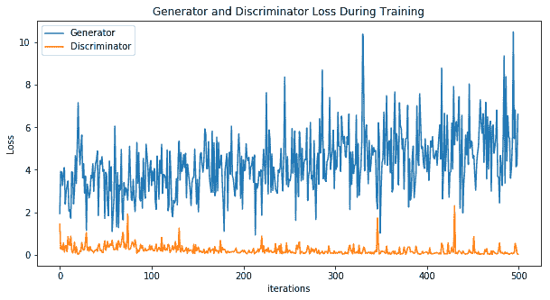

7. 随后遍历 `image_list` 中的图像并逐张显示：

```
>>for image in image_list:
    plt.imshow(np.transpose(image,(1,2,0)))
    plt.show()
```

输出结果为：

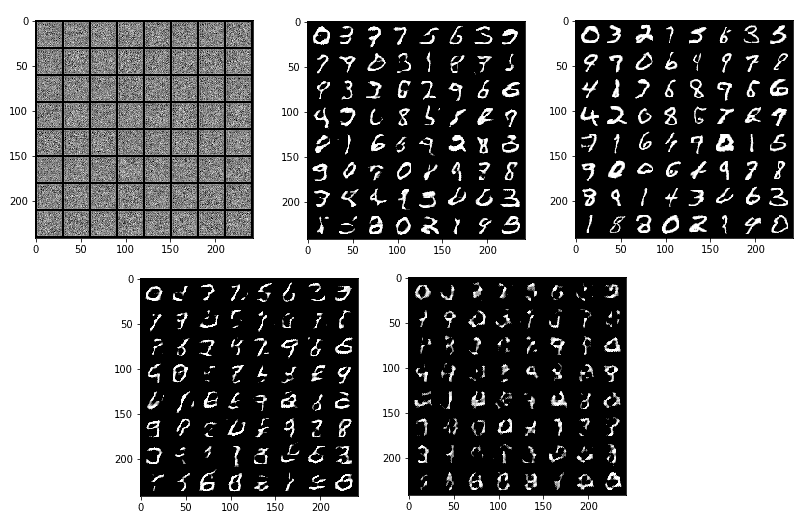

可以看到 DCGAN 生成的手写数字图像。

## 原理说明
`matplotlib` 用于绘图与展示。`figure()` 与 `title()` 控制画布尺寸和标题，`plot()` 绘制生成器和判别器的损失。`xlabel`、`ylabel` 添加坐标轴说明，`legend()` 添加图例，`show()` 输出图像。

训练期保存的 `image_list` 会被遍历，用 NumPy 的 `transpose()` 调整尺寸顺序。列表中的图像是 `torchvision.util.make_grid()` 生成的网格，网格由噪声向量驱动的生成图像拼合而成。

## 进阶技巧
`plotly`、`seaborn` 等库也可以用来美化绘制图表。

## 相关阅读
`DCGAN` 的可视化效果和动画可参考 [这个页面](https://pytorch.org/tutorials/beginner/dcgan_faces_tutorial.html#results)。

# 用 PyTorch Hub 跑 PGGAN

本节介绍渐进式 GAN，简称 PGGAN，是比 DCGAN 更高级的模型，能生成逼真的高分辨率图像。PGGAN 分阶段训练，先用潜在向量 `z` 通过两层反卷积生成 4×4 图像，判别器以两层卷积对 4×4 图像进行判别。网络稳定后，判别器逐步加入两层卷积实现上采样到 8×8，再下采样。重复 9 个这样的阶段后，生成器可输出 1024×1024 图像。渐进式策略先在低分辨率上完成大部分学习，稳定后再提升分辨率，因而训练更快更稳。

PGGAN 的抽象示意图：

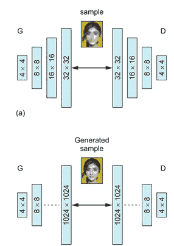

核心创新概括如下：

* **高分辨率渐进增长与平滑淡入**：不是瞬间跳分辨率，而是用参数 `α` 在 0 到 1 之间平滑过渡新加入的高分辨率层，控制旧输出与放大输出的混合比例。
* **小批量标准差**：判别器会统计一批图像像素的标准差。若标准差偏低则更可能为假，因为真实数据的方差通常更大，生成器据此被迫提升样本多样性。
* **均衡学习率**：各层权重先归一化 `w' = w / c`，常数 `c` 依据权重矩阵形状而异，使不同层学习更稳定。
* **逐像素特征归一化**：对每个像素的特征向量做归一化，避免大批量归一化带来的显存压力。

Nvidia 原始实现需要一到两个月。为方便体验，我们使用 PyTorch Hub 上的预训练模型。

## 准备工作
需要 PyTorch 1.1.0 或更高版本。

## 操作流程
从 PyTorch Hub 运行 PGGAN 的步骤如下：

1. 设置导入：

```
>>import torch
>>import matplotlib.pyplot as plt
>>import torchvision
```

2. 检查 GPU 可用性：

```
>>use_gpu = True if torch.cuda.is_available() else False
```

3. 加载预训练 PGGAN 模型：

```
>>model = torch.hub.load('facebookresearch/pytorch_GAN_zoo:hub', 'PGAN', 
                       model_name='celebAHQ-512',
                       pretrained=True, 
                       useGPU=use_gpu)
```

4. 生成噪声：

```
>>num_images = 5
>>noise, _ = model.buildNoiseData(num_images)
```

5. 获取生成器输出：

```
>>with torch.no_grad():
    generated_images = model.test(noise)
```

6. 制作图像网格并显示：

```
>>grid = torchvision.utils.make_grid(generated_images.clamp(min=-1, max=1), scale_each=True, normalize=True)
>>plt.imshow(grid.permute(1, 2, 0).cpu().numpy())
```

可以看到 PGGAN 生成的人脸图像：

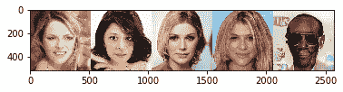

以上即为使用 PyTorch Hub 运行 PGGAN 的完整流程。

## 原理说明
我们加载在 CelebA-HQ 数据集上训练好的预训练模型，调用 `torch.hub` 的 `load()` 方法。图像数量决定噪声张量的形状 `num_images x 512`，模型以 512 维噪声训练，`buildNoiseData()` 方法在模型对象内部处理噪声构建。

`model.test()` 生成用于拼图的图像，`clamp` 将像素值限制在设定范围，`.cpu()` 把数据移回 CPU，`permute` 调整维度，最后 `plt.imshow()` 显示网格。

## 进阶技巧
完整实现可探索 [这里](https://github.com/github-pengge/PyTorch-progressive_growing_of_gans)。

## 相关阅读
更多关于 PyTorch Hub 的信息见 [这个页面](https://pytorch.org/docs/stable/hub.html)。原始代码与论文可参考 [这里](https://github.com/tkarras/progressive_growing_of_gans) 和 [这里](https://research.nvidia.com/publication/2017-10_Progressive-Growing-of)。

## 七、深度强化学习

> 原文：[`gitee.com/apachecn/apachecn-dl-zh/blob/master/docs/pt-ai-fund/7.md`](https://gitee.com/apachecn/apachecn-dl-zh/blob/master/docs/pt-ai-fund/7.md)

本章探讨神经网络在 PyTorch 下用于强化学习的实践。强化学习是人工智能的一个分支，与前文介绍的监督式方法不同，它通过最大化环境反馈的奖励来学习，适用于需要决策和行动的问题。

本章将覆盖以下主题：

* OpenAI Gym 简介– CartPole
* DQN 简介
* 实现 DQN 类
* 训练 DQN
* 深度 GA 简介
* 生成智能体
* 选择智能体
* 使智能体突变
* 训练深度 GA

## 深入了解 RL
智能体是强化学习问题的核心，它接收输入信息并执行动作，通过试错积累经验以最大化累计奖励。智能体所处的场景称为环境，可执行的动作集合称为动作空间，执行动作后获得的反馈称为奖励，决定下一步动作的规则称为策略。考虑长期回报并做折扣处理的值衡量未来期望收益，Q 值则在值的基础上加入当前动作信息。

深度强化学习将强化学习与深度学习结合，利用神经网络从原始状态中提取关键特征。深度模型参数有限，能够把庞大的状态空间压缩到更紧凑的表示，从而更高效地选择动作。相比查找表在复杂环境下迅速膨胀，神经网络可以自动学习程序员难以手工设计的抽象特征，这正是深度强化学习近年取得突破的关键。

## OpenAI Gym 简介 – CartPole
为验证不同强化学习算法，我们需要一个可复现的环境。OpenAI Gym 提供了大量标准环境，这里选用 `CartPole-v1`。

CartPole 是一个倒立摆问题，重心高于支点极不稳定。控制方式是通过移动小车左右施加力，使摆杆保持直立。示意图如下：

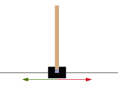

图 1：OpenAI Gym– CartPole

小车与摆杆通过非活动关节连接，小车在水平轨道上滑动，摆杆初始垂直。目标是通过施加 +1 或 -1 的力防止倒下。当摆杆偏离垂直超过 15 度，或小车超出中心 2.4 个单位时判定失败。每保持直立一个时间步奖励 +1。

### 准备工作
首先安装 `gym`：

```
pip install gym
```

### 操作流程
了解 CartPole 环境的常用操作：

1. 导入 gym 模块：

```
>>import gym
```

2. 创建环境实例：

```
>>env = gym.make('CartPole-v0')
```

3. 重置环境到初始状态：

```
>>env.reset()
```

4. 渲染当前画面：

```
>>for _ in range(1000):
    env.render()
    action = env.action_space.sample()
    observation, reward, done, info = env.step(action)
    if done:
        env.reset()
>>env.close()
```

输出如下：

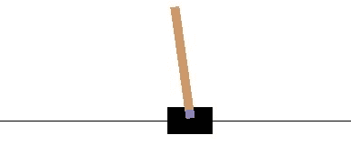

图 2：CartPole 环境输出

5. 查询可执行动作数：

```
>>env.action_space.n
2
```

6. 查询观测状态维度：

```
>>env.observation_space.shape[0]
4
```

此时会弹出窗口显示不稳定摆杆随机移动。

## 原理说明
通过 `CartPole-v0` 创建环境，该环境最高得分 200 分即终止。`env.reset()` 将环境置于摆杆直立的起始状态。随后进行 1000 步循环，`render()` 展示当前画面，`env.action_space.sample()` 选择随机动作并通过 `env.step` 执行。`step` 返回观测、奖励、是否结束、调试信息四项：

* **观测**：环境的新状态，格式取决于所选环境。
* **奖励**：本次动作获得的奖励，直立时每步 1.0，倒下为 0。
* **完成**：布尔值，指示任务是否结束。
* **信息**：调试用诊断信息。

当摆杆倒下时，环境会被重置以继续采样。

到这里，环境就先关闭了。借助 `env.action_space.n` 可以数出环境允许的动作总数，而 `env.observation_space.shape[0]` 則告訴你一次觀測包含多少個特徵。掌握了這兩點，對环境的认识就算完整，接下来就可以动手搭建各类深度强化学习算法了。

### 试试别的环境
环境名称是可以随意替换的。建议先从 `CartPole-v1` 入手，这个经典任务上手快、反馈直观，很适合练手。

### 官方文档
想更系统地了解 OpenAI Gym 的用法，可以去 [这个页面](http://gym.openai.com/docs/) 看官方说明。

## 先认识 DQN
进入下一份教程前，先快速浏览一下 DQN 是什么。

# DQN 核心概念
DQN 属于强化学习的一种，其目标是在看到某个状态时挑出最优动作。每个状态-动作组合都对应一个 Q 值，用来衡量这步走法的优劣。传统做法会用一张 Q 表来存放这些数值，本质上是一本查表字典。Agent 反复试玩，每次根据得到的奖励对表里对应的值进行修正，Q 学习算法就是在不断填满并优化这张表。决策时只需查表，挑选 Q 值最大的动作即可，长期来看就能最大化收益。

Q 值的刷新方式如下：

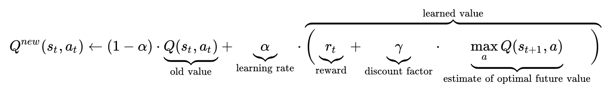

更新后的 Q 值由两部分加权而成。第一部分是 `(1 - 学习率) * 旧 Q 值`，决定保留多少历史经验。学习率设为 0 就等于完全不更新，设为 1 则彻底丢弃旧信息。

第二部分是 `学习率 * (本次即时奖励 + 折扣后的最优未来价值估计)`，即把眼前的奖励和对未来的乐观预期结合起来，折扣因子控制未来收益在总价值中的权重。

深度 Q 学习把查表换成了神经网络。用一个深度网络直接对输入状态输出每个动作的 Q 值预估，决策时挑出预估最高的那一个。这样就不需要维护庞大的 Q 表，也能处理复杂的状态空间。

# 构建 CartPole 网络
## 动手步骤
这一节为 CartPole 问题搭建网络模型，请按下面顺序进行：

1. 先导入 PyTorch：

```
>>import torch
>>import torch.nn as nn
```

2. 再写一个工厂函数返回模型结构：

```
def cartpole_model(observation_space, action_space):
    return nn.Sequential(
        nn.Linear(observation_space, 24),
        nn.ReLU(),
        nn.Linear(24, 24),
        nn.ReLU(),
        nn.Linear(24, action_space)
    )
```

该函数最终会返回可用的网络。

## 思路解析
这里的核心是 `cartpole_model` 函数，它接收观察空间和动作空间两个参数并返回一个神经网络。我们借助 `torch.nn.Sequential` 串联 `nn.Linear` 和 `nn.ReLU` 搭建结构。输入一个观测向量后，网络会输出对应各个动作的 Q 值估计，用于训练和推理。

## 其他玩法
如果状态以图像形式呈现，也可以换成卷积网络来学习。此时可以用 `nn.Conv2d()` 构建 CNN，直接从像素预测 Q 值。

## 延伸阅读
想看不同网络结构的例子，可参考 [这个页面](https://pytorch.org/tutorials/intermediate/reinforcement_q_learning.html#q-network) 上的替代设计。

# 实现完整的 DQN 类
## 先决条件
开始前请确保已完成本章的《OpenAI Gym 入门 - CartPole》教程，完成 gym 环境的安装与配置。

## 搭建步骤
本节用神经网络把 DQN 完整实现出来。核心要做的工作有：建立目标网络和策略网络、定义损失与优化器、保存经验、行为预测、经验回放以及探索率的动态调整。下面按顺序拆解：

1. 先导入所需模块：

```
>>import random
>>from collections import deque
>>import numpy as np
>>import torch.optim as optim
```

2. 定义 DQN 类的骨架：

```
>>class DQN:
```

3. 编写 `__init__` 构造方法：

```
>>def __init__(self, observation_space, action_space):
        self.exploration_rate = MAX_EXPLORE
        self.action_space = action_space
        self.observation_space = observation_space
        self.memory = deque(maxlen=MEMORY_LEN)
```

4. 实例化策略网络和目标网络：

```
self.target_net = cartpole_model(self.observation_space, self.action_space)
self.policy_net = cartpole_model(self.observation_space, self.action_space)
```

5. 将策略网络的权重同步到目标网络：

```
self.target_net.load_state_dict(self.policy_net.state_dict())
self.target_net.eval()
```

6. 设置损失函数、优化器等训练参数：

```
self.criterion = nn.MSELoss()
self.optimizer = optim.Adam(self.policy_net.parameters())

self.explore_limit = False
```

7. 实现经验存储方法 `load_memory`：

```
>>def load_memory(self, state, action, reward, next_state, terminal):
        self.memory.append((state, action, reward, next_state, terminal))
```

8. 编写动作选择方法 `predict_action`：

```
>>def predict_action(self, state):
        random_number = np.random.rand()

        if random_number < self.exploration_rate:
            return random.randrange(self.action_space)

        q_values = self.target_net(state).detach().numpy()
        return np.argmax(q_values[0])
```

9. 接着实现经验回放 `experience_replay`：

```
>>def experience_replay(self):
        if len(self.memory) < BATCH_SIZE:
            return

        batch = random.sample(self.memory, BATCH_SIZE)
```

10. 用小批量数据更新目标 Q 值：

```
for state, action, reward, next_state, terminal in batch:
    q_update = reward
    if not terminal:
        q_update = reward + GAMMA * self.target_net(next_state).max(axis=1)[0] 

    q_values = self.target_net(state)
    q_values[0][action] = q_update
```

11. 计算损失并反向传播更新策略网络：

```
loss = self.criterion(self.policy_net(state), q_values)
self.optimizer.zero_grad()
loss.backward()
self.optimizer.step()
```

12. 最后按策略衰减探索率：

```
if not self.explore_limit:
    self.exploration_rate *= EXPLORE_DECAY
    if self.exploration_rate < MIN_EXPLORE:
        self.exploration_rate = MIN_EXPLORE
        self.explore_limit = True
```

到这一步，DQN 类的核心功能就全部搭齐了。

## 机制详解
本节完成了 DQN 类并补全了训练所需的所有方法。构造器里初始化了探索的起点、观察空间与动作空间，并开辟了一个经验缓冲区来存放交互数据。我们创建了两份 CartPole 网络实例，分别命名为 `policy_net` 与 `target_net`。之所以需要两套网络，是因为策略网络的参数每步都在变化，若直接用它作为目标，会形成目标漂移的反馈回路导致不稳定。因此目标网络保持 eval 模式，用 `MSELoss()` 作损失、`Adam` 作优化器来逐步修正策略网络。

`load_memory()` 负责把当前状态、动作、奖励、下一状态和是否终止记录下来供后续训练使用。`predict_action` 先用 `np.random.rand()` 生成一个 0 到 1 之间的随机数，若小于当前的探索率就随机选动作以保证探索；否则让目标网络给出各动作的 Q 值并挑选最大值。

`experience_replay` 等待缓冲区累积到 `BATCH_SIZE` 后，从中随机抽取一批样本，避免学习高度相关的连续数据。对每条样本按 Q 值的更新公式计算目标值，再用策略网络的预测误差进行训练。训练过程中探索率会乘以衰减系数逐渐下降，早期多探索、后期多利用，从而实现收敛。

## 进阶扩展
可以额外加一个方法，定期用策略网络的参数刷新目标网络，保持两者同步。

## 参考代码
Keras 的实现示例可以在 [这个页面](https://github.com/gsurma/cartpole/blob/master/cartpole.py) 上查看。

# 训练与演示
## 执行流程
这一节完成 DQN 的训练流程，并在训练结束后可视化小车的表现。我们借助 DQN 类预测动作并作用于环境获取奖励，目标是把累计奖励最大化。经验回放帮助稳定 Q 值的学习。

1. 导入 gym：

```
>>import gym
```

2. 定义超参数并创建环境：

```
>>ENV_NAME = "CartPole-v1"
>>BATCH_SIZE = 20
>>GAMMA = 0.95
>>LEARNING_RATE = 0.001
>>MAX_EXPLORE = 1.0
>>MIN_EXPLORE = 0.01
>>EXPLORE_DECAY = 0.995
>>MEMORY_LEN = 1_000_000
>>UPDATE_FREQ = 10
```

3. 实例化环境和 DQN 代理：

```
>>env = gym.make(ENV_NAME)
>>observation_space = env.observation_space.shape[0]
>>action_space = env.action_space.n
>>dqn = DQN(observation_space, action_space)
```

4. 进入主训练循环：

```
>>for i in range(100):
    state = env.reset()
    state = np.reshape(state, [1, observation_space])
    state = torch.from_numpy(state).float()
```

5. 逐步与环境交互：

```
score = 0
while True:
    score += 1
    action = dqn.predict_action(state)
    next_state, reward, terminal, info = env.step(action)
```

6. 获取下一步的观测：

```
next_state = torch.from_numpy(np.reshape(next_state, [1, observation_space])).float()
dqn.load_memory(state, action, reward, next_state, terminal)
state = next_state
```

7. 用以下代码控制循环终止条件：

```
if terminal:
    print(f'| {i+1:02} | {dqn.exploration_rate:.4f} | {score:03} |')
    break    
```

8. 触发一次经验回放：

```
dqn.experience_replay()
```

9. 根据回放结果更新网络权重：

```
if steps%UPDATE_FREQ == 0:
    dqn.target_net.load_state_dict(dqn.policy_net.state_dict())
```

下面是运行时的示例输出：

```
| Run | Exploration Rate | Score |
| 001 |       0.9416     | 032   |
| 002 |       0.8956     | 011   |
| 003 |       0.8061     | 022   |
| 004 |       0.7477     | 016   |
| 005 |       0.6936     | 016   |
| 006 |       0.6498     | 014   |
| 007 |       0.5371     | 039   |
.
.
| 072 |       0.0100     | 256   |
| 073 |       0.0100     | 227   |
| 074 |       0.0100     | 225   |
| 075 |       0.0100     | 238   |
| 076 |       0.0100     | 154   |
| 077 |       0.0100     | 285   |
.
.
.
```

10. 定义一个可视化函数来展示训练效果：

```
>>def play_agent(dqn, env):
    observation = env.reset()
    total_reward=0
```

用下面代码让智能体最多运行 500 步：

```
    for _ in range(500):
        env.render()
        observation = torch.tensor(observation).type('torch.FloatTensor').view(1,-1)
        q_values = dqn.target_net(observation).detach().numpy()
        action = np.argmax(q_values[0])
        new_observation, reward, done, _ = env.step(action)
        total_reward += reward
        observation = new_observation

        if(done):
            break
```

最后记得关闭环境：

```
    env.close()
    print("Rewards: ",total_reward)
```

启动可视化演示

```
>>play_agent(dqn, env)
Rewards: 160.0
```

执行完上述调用，DQN 的训练与可视化就全部收尾了。

## 运行机理
本教程先通过超参数导入并初始化环境，随后实例化 DQN 类进入训练循环。环境会被重置，状态数组会做整形，以便以浮点张量形式输入模型。循环持续运行，直到 env.step() 返回的 terminal 标记变为 True。predict_action 会依据当前状态给出动作建议，再用环境的 step 方法执行该动作。step 返回的下一状态会从 numpy 转为 torch.FloatTensor，同时保存环境信息，随后再次送入模型。策略网络的权重会按固定频率复制到目标网络中。

最后提供了一个简易的 play_agent 函数用于可视化平衡杆。环境重置后进入循环，目标网络为每个可行动作计算 Q 值，选取 Q 值最高的动作并通过 step 送入环境，奖励持续累加。该函数最终返回杆子保持直立的步数以及平衡过程的视频。

## 进阶提示
可以额外编写一个绘制表现曲线的函数，当模型得分稳定在 450 至 500 之间时自动结束训练。

## 参考实现
Keras 版本的实现可查看 这里，PyTorch 的另一种实现见 这个页面。

# 深度遗传算法概览
本篇将介绍深层遗传算法 Deep GA，并展示它在强化学习中可以作为梯度方法的有效替代。我们不再用梯度下降调整权重，而是随机生成一批网络组成一代，在给定环境中评估表现。同一代中不同网络的表现存在差异，我们保留表现最好的网络作为下一代的种子，通过复制并对权重做随机扰动来繁衍新一代。因为始终挑选高分个体，整体能力会逐步提升。

本节还会定义用于根据状态预测动作的模型结构维度。

## 具体步骤
1. 先进行导入：

```
>>import torch.nn as nn
>>import torch
```

2. 定义一个返回神经网络的函数：

```
>>def cartpole_model(observation_space, action_space):
    return nn.Sequential(
        nn.Linear(observation_space, 128),
        nn.ReLU(),
        nn.Linear(128, action_space),
        nn.Softmax(dim=1)
    )
```

至此模型的定义已完成。

## 内部逻辑
网络推理时先经两个线性层和一个 ReLU 隐藏层，隐藏层有 128 个单元。最后一层的输出经 softmax 转化为概率分布，选择概率最大的动作执行。

## 扩展思路
对于复杂任务，还可以堆叠更多层并调整各层单元数。

## 相关示例
若想使用卷积层构建更复杂的网络，可参考 这个页面 提供的示例。

# 智能体批量生成
本节聚焦于创建一组智能体以启动进化过程，并初始化它们的权重。随后可利用这些智能体评估表现并生成下一代。

## 操作流程
1. 先定义初始化权重的函数：

```
>>def init_weight(module):
    if((type(module) == nn.Linear)):
            nn.init.xavier_uniform_(module.weight.data)
            module.bias.data.fill_(0.00)
```

2. 再定义创建智能体的函数：

```
>>def create_agents(num_agents, observation_space, action_space):
      agents = []
```

3. 随后创建 num_agents 个智能体：

```
for _ in range(num_agents):
    agent = cartpole_model(observation_space, action_space)
    agent.apply(init_weight)
```

4. 关闭智能体各层的梯度：

```
for param in agent.parameters():
    param.requires_grad = False

agent.eval()
agents.append(agent)
```

5. 最后返回智能体集合：

```
   return agents
```

现在智能体已准备好接受评估。

## 实现原理
本节写了两个函数。第一个负责初始化模型层权重，使用 torch.nn.init 中的 xavier_uniform 初始化权重，偏置用 0 填充。第二个函数通过 cartpole_model 创建 num_agents 个智能体，并用 init_weight 完成初始化。之后为模型参数禁用梯度计算，将智能体设为 eval 模式并返回全部智能体。

## 延伸阅读
更多初始化方法可查阅 这个页面。

# 精英智能体筛选
本节基于适应度函数挑选智能体，在 CartPole 平衡任务中得分越高越有利。我们会保留得分最高的个体，淘汰其余。为了避免偶然性，每个智能体会被多次评估，最后以平均分决定最优者。

## 步骤说明
1. 先从导入开始：

```
>>import numpy as np
```

2. 定义评估智能体表现的函数：

```
>>def eval_agent(agent, env):
    observation = env.reset()
```

3. 在最大可能步长内运行循环：

```
total_reward = 0
for _ in range(MAX_STEP):
    observation = torch.tensor(observation).type('torch.FloatTensor').view(1,-1)
    action_probablity = agent(observation).detach().numpy()[0]
    action = np.random.choice(range(env.action_space.n), 1, p=action_probablity).item()
    next_observation, reward, terminal, _ = env.step(action)
    total_reward += reward
    observation = next_observation

    if terminal:
        break
return total_reward
```

4. 定义智能体的平均得分：

```
>>def agent_score(agent, env, runs):
    score = 0
    for _ in range(runs):
        score += eval_agent(agent, env)

    return score/runs 
```

5. 最后评估所有智能体的分数：

```
>>def all_agent_score(agents, env, runs):
    agents_score = []
    for agent in agents:
        agents_score.append(agent_score(agent, env, runs))

    return agents_score
```

现在评估函数已准备就绪。

## 运作原理
本节实现了三个关键函数。eval_agent 与 DQN 训练秘籍中的评估方式类似，智能体预测动作并执行，直至 MAX_STEP，例如 cartpole-v1 为 500 步，或 terminal 为 True，然后返回得分。

agent_score 会在指定次数 runs 上取平均分，以避免随机波动。all_agent_score 则遍历整一代智能体，得到该代所有智能体的平均分数。

# 智能体突变机制
在从上一代挑选出最优模型后，为创建下一代，我们会对这些精英的权重施加轻微随机扰动，使其探索更广的区域以获得更好回报，这与生物进化原理一致。

## 执行步骤
1. 首先导入 copy 和 numpy 模块：

```
>>import copy
>>import numpy
```

2. 接下来定义 mutation 函数：

```
>>def mutation(agent):
    child_agent = copy.deepcopy(agent)
```

3. 遍历智能体的参数：

```
for param in agent.parameters():
    mutation_noise = torch.randn_like(param) * MUTATION_POWER
```

4. 向参数中加入变异噪声：

```
    param += mutation_noise
return child_agent
```

5. 现在定义 elite 函数：

```
>>def elite(agents, top_parents_id, env, elite_id=None, top=10):
    selected_elites = top_parents_id[:top]
    if elite_id:
        selected_elites.append(elite_id)

    top_score = np.NINF
    top_id = None
```

6. 找到 elite 智能体：

```
for agent_id in selected_elites:
    score = agent_score(agents[agent_id], env, runs=5)
    if score > top_score:
       top_score = score
       top_id = agent_id

return copy.deepcopy(agents[top_id])
```

7. 获取子智能体：

```
>>def child_agents(agents, top_parents_id, env, elite_id=None):
    children = []

    agent_count = len(agents)-1    
    selected_agents_id = np.random.choice(top_parents_id, agent_count)
    selected_agents = [agents[id] for id in selected_agents_id]
    child_agents = [mutate(agent) for agent in selected_agents]

    child_agents.append(elite(agents, top_parents_id, env))
    elite_id = len(child_agents)-1

    return child_agents, elite_id
```

8. 获取顶级父代：

```
>>def top_parents(scores, num_top_parents):
    return np.argsort(rewards)[::-1][:num_top_parents]
```

至此识别精英与为智能体添加噪声的函数已定义完毕。

## 原理说明
本节涉及四个函数。mutation 为一个智能体创建副本，并在每个参数上叠加受 MUTATION_POWER 限制的小幅随机值。rand_like 会生成与原参数同形状、取值在 [0,1) 区间的均匀随机张量，最后返回突变后的子智能体。

elite 函数返回表现最佳智能体的副本，并在内部重新评估以确保选出真正最高分的个体，并将其传给下一代。child_agent 生成的子代数量与父代相同，其中一个是 elite 函数产生的精英，其余通过 np.random.choice 随机挑选。selected_agents 保留了高分入选体的列表，[mutate(agent) for agent in selected_agents] 会对它们进行突变。随后精英会被追加到新一代中。top_parent 函数返回一代中得分最高的智能体索引。

# 深度遗传算法训练全流程
本节将前面学到的函数串联起来，完成深度遗传算法的演化并可视化平衡动作。针对指定代数循环执行：创建智能体、获取分数、挑选最优、突变出下一代，随着世代推进分数会逐步上升。

## 训练步骤
1. 首先导入 gym：

```
>>import gym
```

2. 接下来声明超参数：

```
>>ENV_NAME = "CartPole-v1"
>>MAX_STEP = 500
>>MUTATION_POWER = 0.02
>>num_agents = 500
>>num_top_parents = 20
>>generations = 25
>>elite_agent = None
```

3. 之后创建环境并禁用梯度计算：

```
>>torch.set_grad_enabled(False)
>>env = gym.make(ENV_NAME)
```

4. 现在创建智能体：

```
>>agents = create_agents(num_agents, env.observation_space.shape[0], env.action_space.n)
```

5. 接下来遍历若干世代：

```
>>print(f'| Generation | Score |')
>>for gen in range(generations):
```

评估智能体：

```
      rewards = all_agent_score(agents, env, 3)
```

由此得到最佳智能体：

```
      top_parents_id = top_parents(rewards, num_top_parents)
```

进而创建下一代：

```
      agents, elite_agent = child_agents(agents, top_parents_id, env, elite_agent)
      print(f'| {gen+1:03} | {np.mean([rewards[i] for i in top_parents_id[:5]]):.4f} |')
```

示例输出如下：

| 世代 |     分数       |
|    001     |    47.0667      |
|    002     |    47.3333      |
|    003     |    55.7333      |
|    004     |    58.2667      |
|    005     |    65.3333      |
|    006     |    88.0000      |
|    007     |    105.5333     |
|    008     |    117.4000     |
|    009     |    109.4000     |
|    010     |    137.6667     |

|    011     |    150.3333     |

|    012     |    168.6000     |

|    013     |    176.2667     |

|    014     |    248.0667     |

|    015     |    281.6667     |

|    016     |    327.9333     |

|    017     |    363.5333     |

|    018     |    375.4000     |

|    019     |    387.0000     |

|    020     |    432.2000     |

|    021     |    454.6000     |

|    022     |    445.9333     |

|    023     |    463.7333     |

|    024     |    482.1333     |

|    025     |    496.2000     |

6. 最后，我们将形象化地表现出：

```
>>def play_agent(agent, env):

    observation = env.reset()
    total_reward=0

    for _ in range(MAX_STEP):
        env.render()
        observation = torch.tensor(observation).type('torch.FloatTensor').view(1,-1)
        output_probabilities = agent(observation).detach().numpy()[0]
        action = np.random.choice(range(2), 1, p=output_probabilities).item()
        new_observation, reward, done, _ = env.step(action)
        total_reward += reward
        observation = new_observation

        if(done):
            break

    env.close()
    print("Rewards: ",total_reward)

>>play_agent(agents[num_agents-1],env)
Rewards: 350.0
```

到此为止，DGA 的训练阶段与可视化演示都已收尾。

# 运行机理

本篇秘籍对深度遗传算法做了优化。参照论文《深度神经进化：遗传算法是训练深度神经网络进行强化学习的强劲备选》，`MUTATION_POWER` 超参被设定为 `0.02`。由于优化路径不依赖梯度下降，因此整个过程无需调用 `PyTorch` 完成梯度计算，也就不需要环境构建的梯度支持。

随后我们初始化了一批智能体，并让它们按预设的 `generations` 代数循环演化，每一代都会记录全部个体的累积奖励。筛选环节挑出得分靠前的父代个体，把它们的索引传入 `child_agent` 函数来繁衍下一代群体。演化结束后会输出前五名个体的均值分数。

收尾展示沿用了“训练 DQN”秘籍中的 `play_agent` 函数，仅对模型输出的取值范围做了小幅适配。这里选用种群末尾的精英模型来呈现 CartPole 的实时表现，并逐代更新展示，调用的就是 `play_agent`。

## 拓展思路

深度遗传算法的多个超参都可以手工调节，用来观察表现差异，并把各代分数绘制成曲线做对比。

## 参考资料

DGA 的完整论述可查阅 [这里](https://arxiv.org/pdf/1712.06567.pdf) 以及 [这里](https://github.com/uber-research/deep-neuroevolution)。

## 八、在 PyTorch 中生产 AI 模型

> 原文：[`gitee.com/apachecn/apachecn-dl-zh/blob/master/docs/pt-ai-fund/8.md`](https://gitee.com/apachecn/apachecn-dl-zh/blob/master/docs/pt-ai-fund/8.md) 

本章聚焦如何把 `PyTorch` 的预测能力落地到真实场景。`PyTorch` 早已从研究原型走向工程可用，本章会介绍让模型走向生产的几项关键手段。所谓部署，就是把模型交付给终端用户或下游系统使用。为此通常要满足可通过 Web 访问、推理延迟可控、以及与其他深度学习框架互通等需求，方便开发团队在项目演进中选用合适的工具，加速从实验室到线上的迁移。

本章会覆盖以下实践：

*   通过 Flask 部署模型
*   生成 TorchScript
*   导出为 ONNX

## 技术要求

本章全部示例均在 Python 3.6 环境下，使用 `PyTorch` 1.3 版本完成。

## 使用 Flask 部署模型

本例演示如何用 Flask 微框架上线一个图像分类服务。挑选 Flask 的原因是它轻量、易上手，适合搭建 RESTful 微服务，且文档完善。我们选用基于 Densenet-161 预训练权重构建的图像分类器来完成本节任务。

### 准备工作

本秘籍需要先安装 Flask，可通过 `pip` 管理器执行安装：

```
pip install flask
```

准备就绪后即可继续。

### 实施步骤

本案例拆分为多个文件，按如下顺序操作：

1. 新建文件 `image_classifier.py`。

2. 完成必要的导入：

```
>>import io
>>import torch
>>from torchvision import models
>>from PIL import Image
>>import torchvision.transforms as transforms
>>import json
```

3. 读取存放类别名称的 `.json` 文件：

```
>>with open('idx_class.json') as f:
    idx_class = json.load(f)
```

4. 定义 `create_model` 函数：

```
>>def create_model():

    model_path = "densenet161.pth"
    model = models.densenet161(pretrained=True)
    model.load_state_dict(torch.load(model_path, map_location='cpu'), strict=False)
    model.eval()
    return model
```

5. 定义 `image_transformer` 函数：

```
>>def image_transformer(image_data):
    transform = transforms.Compose([
        transforms.Resize(256),
        transforms.CenterCrop(224),
        transforms.ToTensor(),
        transforms.Normalize(mean=[0.485, 0.456, 0.406],
                             std=[0.229, 0.224, 0.225])
    ])

    image = Image.open(io.BytesIO(image_data))
    return transform(image).unsqueeze(0)
```

6. 随后定义 `predict_image` 函数：

```
>>def predict_image(model, image_data):

    image_tensor = image_transformer(image_data)
    output = model(image_tensor)
    _, prediction = output.max(1)
    object_index = prediction.item()

    return idx_class[object_index]
```

7. 接着创建 `imageapp.py`。

8. 先导入依赖并引入 Flask：

```
>>from flask import Flask, request, jsonify
>>from image_classifier import create_model, predict_image
```

9. 实例化 Flask 应用并加载分类器模型：

```
>>app = Flask(__name__)
>>model = create_model()
```

0. 配置路由：

```
>>@app.route('/predict', methods=['POST'])
```

1. 编写路由对应的处理函数：

```
>>@app.route('/predict', methods=['POST'])
>>def predicted():
      if 'image' not in request.files:
          return jsonify({'error': 'Image not found'}), 400

      image = request.files['image'].read()
      object_name = predict_image(model, image)

      return jsonify({'object_name' : object_name})
```

2. 最后在运行 `imageapp.py` 时启动 Flask 服务：

```
>>if __name__ == '__main__':
    app.run(debug=True)
```

3. 使用如下命令启动服务：

```
python imageapp.py
```

执行后 Flask 服务器会开始监听，可通过 `http://127.0.0.1:5000/` 访问并发送 `POST` 请求。

4. 用 Postman 等工具测试接口，示例请求体如下：


查看接口返回：

```
{
 "object_name": "scorpion"
 }
```

返回结果为：

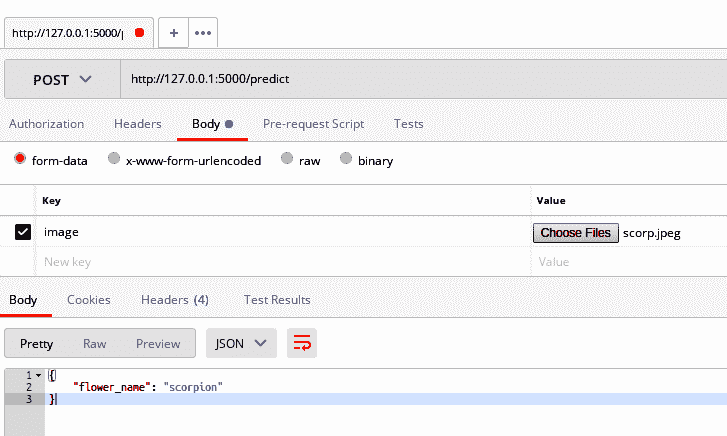

本秘籍展示了基于 Flask 的简易模型上线方式。

### 运行机理

本例借助 Flask Python 框架以 RESTful API 的形式提供推理服务。先在 `image_classifier.py` 中加载 `idx_class.json` 内的类别名。

该文件第一个函数负责载入在 ImageNet 上以 1,000 类训练好的 `densenet161` 预训练模型，并切到评估模式后返回模型。第二个函数把输入图片转成张量并做预处理，使用 `PIL` 的 `Image` 模块读取原始像素。第三个函数把图片转张量送入模型，输出图像中物体的名称。

切换到 `imageapp.py` 后，用 Flask 搭建 Web 服务。通过 `app = Flask(__name__)` 创建应用实例，并用 `create_model` 生成模型。随后注册 `/predict` 路由接收 `POST` 请求，并定义 `predicted` 函数作为回调。`request.files` 承载上传文件，校验 `image` 参数是否存在。图像数据随后传入前面定义的 `predict_image` 进行推理。`jsonify` 保证响应格式为 JSON，`app.run(debug=True)` 启动服务并处理请求。

### 拓展思路

本秘籍开启了 `debug=True` 调试模式，该模式不适合生产环境。原生的 Flask 服务器抗压能力有限，实际上线建议配合 `gunicorn` 与 `nginx` 部署。

### 参考资料

[Flask 官方文档](http://flask.palletsprojects.com/en/1.1.x/)

[gunicorn + Nginx 部署指南](https://www.digitalocean.com/community/tutorials/how-to-serve-flask-applications-with-gunicorn-and-nginx-on-ubuntu-18-04)

[PyTorch 官方 Flask REST API 替代实现](https://pytorch.org/tutorials/intermediate/flask_rest_api_tutorial.html)

## 创建一个 TorchScript

`TorchScript` 是对原生 `PyTorch` 模型的中间表示，可让模型在高性能运行时如 C++ 中执行。它把模型序列化并做优化，生成的代码可在不依赖 Python 的进程中加载。`TorchScript` 提供了捕获模型结构的工具，而 `PyTorch` 的动态特性依旧足以描述完整定义。创建方式有两种：跟踪与脚本编译，本秘籍将同时演示这两种方法。

### 实施步骤

按以下步骤生成 `TorchScript`：

1. 先写一个简单的网络结构：

```
>>import torch
>>import torch.nn as nn
>>class MyCell(torch.nn.Module):
      def __init__(self):
          super(MyCell, self).__init__()
          self.linear = torch.nn.Linear(4, 4)

      def forward(self, x, h):
          new_h = torch.tanh(self.linear(x) + h)
          return new_h
```

2. 基于该类实例化模型：

```
>>my_cell = MyCell()
```

3. 生成两组随机张量作为输入：

```
>>x, h = torch.rand(4, 4), torch.rand(4, 4)
```

4. 随后执行 `jit.trace`：

```
>>traced_cell = torch.jit.trace(my_cell, (x, h))
>>traced_cell

TracedModuleMyCell: TracedModuleLinear
)
```

5. 将张量喂入 `traced_cell`：

```
>>traced_cell(x, h)

tensor([[ 0.4238, -0.0524, 0.5719, 0.4747],
        [-0.0059, -0.3625, 0.2658, 0.7130],
        [ 0.4532, 0.6390, 0.6385, 0.6584]],
       grad_fn=<DifferentiableGraphBackward>)
```

6. 可通过如下代码查看计算图：

```


# TorchScript 跟踪与脚本编译

## 图与可读代码

```

>>traced_cell.graph

graph(%self : ClassType<MyCell>,

      %input : Float(3, 4),

      %h : Float(3, 4)):

  %1 : ClassType<Linear> = prim::GetAttrname="linear"

  %weight : Tensor = prim::GetAttrname="weight"

  %bias : Tensor = prim::GetAttrname="bias"

  %6 : Float(4, 4) = aten::t(%weight), scope: MyCell/Linear[linear] # /home/<user>/.local/lib/python3.6/site-packages/torch/nn/functional.py:1370:0

# Trace 只记一次路径，Script 保留分支

刚接触 TorchScript 的人常会有个误区：只要跑一次追踪，整张网络就能被完整保存。实际上追踪更像是一次执行的快照，只会把本次输入真正经过的计算序列写死。模型里一旦出现条件判断、循环等动态逻辑，那些没有被触发的分支就会丢失，换一批数据再跑结果也不一样。

先看一个没有分支的线性单元。它的中间表示里只有加法、矩阵乘和激活：

  %7 : int = prim::Constant[value=1](), scope: MyCell/Linear[linear] # /home/<user>/.local/lib/python3.6/site-packages/torch/nn/functional.py:1370:0

  %8 : int = prim::Constant[value=1](), scope: MyCell/Linear[linear] # /home/<user>/.local/lib/python3.6/site-packages/torch/nn/functional.py:1370:0

  %9 : Float(3, 4) = aten::addmm(%bias, %input, %6, %7, %8), scope: MyCell/Linear[linear] # /home/<user>/.local/lib/python3.6/site-packages/torch/nn/functional.py:1370:0

  %10 : int = prim::Constant[value=1](), scope: MyCell # <ipython-input-2-c6e2cd8665ee>:7:0

  %11 : Float(3, 4) = aten::add(%9, %h, %10), scope: MyCell # <ipython-input-2-c6e2cd8665ee>:7:0

  %12 : Float(3, 4) = aten::tanh(%11), scope: MyCell # <ipython-input-2-c6e2cd8665ee>:7:0

  return (%12)

```

对于可读的版本，我们可以使用以下命令：

```
>>traced_cell.code

import __torch__

import __torch__.torch.nn.modules.linear

def forward(self,

            input: Tensor,

            h: Tensor) -> Tensor:

    _0 = self.linear

    weight = _0.weight

    bias = _0.bias

    _1 = torch.addmm(bias, input, torch.t(weight), beta=1, alpha=1)

    return torch.tanh(torch.add(_1, h, alpha=1))

这份输出很干净，没有任何分支。接下来引入一个会根据张量求和符号决定取正或取负的门控，这就是典型的控制流。

```

## 脚本编译器探索

现在，让我们探索脚本编译器。 按着这些次序：

1. 首先，我们将定义一个具有控制流程的子模块：

```
>>class MyDecisionGate(torch.nn.Module):

    def forward(self, x):

        if x.sum() > 0:

            return x

        else:

            return -x

把这个门嵌进一个线性变换的单元里，形成完整的结构。

```

2. 然后，我们将在模型定义中使用此子模块：

```
>>class MyCell(torch.nn.Module):

    def __init__(self, dg):

        super(MyCell, self).__init__()

        self.dg = dg

        self.linear = torch.nn.Linear(4, 4)

    def forward(self, x, h):

        new_h = torch.tanh(self.dg(self.linear(x)) + h)

        return new_h

先用普通 Python 对象实例化。

```

3. 根据定义创建模型：

```
>>my_cell = MyCell(MyDecisionGate())

用一组具体张量做一次追踪。

```

4. 现在，我们将执行跟踪：

```
>>traced_cell = torch.jit.trace(my_cell, (x, h))

>>traced_cell.code

import __torch__.___torch_mangle_0

import __torch__

import __torch__.torch.nn.modules.linear.___torch_mangle_1

def forward(self,

    input: Tensor,

    h: Tensor) -> Tensor:

  _0 = self.linear

  weight = _0.weight

  bias = _0.bias

  x = torch.addmm(bias, input, torch.t(weight), beta=1, alpha=1)

  _1 = torch.tanh(torch.add(torch.neg(x), h, alpha=1))

  return _1

可以看到分支被抹平了。这次输入让求和不为正，记录里只剩下取反的路径。换一组让求和为正的数据再追踪，得到的结果会不同。这正是追踪的局限：路径被固化在那一次运行上。

要让分支真正可执行，需要改用脚本化。

```

接下来，我们将使用 `jit.script` 将其转换为 `TorchScript`：

```
>>scripted_gate = torch.jit.script(MyDecisionGate())

>>my_cell = MyCell(scripted_gate)

>>traced_cell = torch.jit.script(my_cell)

>>print(traced_cell.code)

import __torch__.___torch_mangle_3

import __torch__.___torch_mangle_2

import __torch__.torch.nn.modules.linear.___torch_mangle_4

def forward(self,

    x: Tensor,

    h: Tensor) -> Tensor:

  _0 = self.linear

  _1 = _0.weight

  _2 = _0.bias

  if torch.eq(torch.dim(x), 2):

    _3 = torch.__isnot__(_2, None)

  else:

    _3 = False

  if _3:

    bias = ops.prim.unchecked_unwrap_optional(_2)

    ret = torch.addmm(bias, x, torch.t(_1), beta=1, alpha=1)

  else:

    output = torch.matmul(x, torch.t(_1))

    if torch.__isnot__(_2, None):

      bias0 = ops.prim.unchecked_unwrap_optional(_2)

      output0 = torch.add_(output, bias0, alpha=1)

    else:

      output0 = output

    ret = output0

  _4 = torch.gt(torch.sum(ret, dtype=None), 0)

  if bool(_4):

    _5 = ret

  else:

    _5 = torch.neg(ret)

  return torch.tanh(torch.add(_5, h, alpha=1))

脚本化后，基于求和正负的判断被保留，运行时两种情况都能正确分支。

为了对照，再次给出门控与单元的原始定义。

```

这样，我们研究了创建 `TorchScript` 的两种不同方法。

## 工作原理

在本秘籍中，我们使用了跟踪方法来创建 `TorchScript`。 我们定义了一个简单的模块 `MyCell` 转换为 `TorchScript`，并创建了两个采样张量 `x` 和 `h` 传递给网络模块的正向方法。 然后，我们使用 `jit.trace` 跟踪 `Python` 代码并创建 `TorchScript`。

我们使用跟踪将 `PyTorch` 模型转换为 `TorchScript`，并传递了我们的模型实例。 `jit.trace` 通过在模块的前向方法内跟踪模型评估中的操作来创建 `torch.jit.ScriptModule` 对象。 `jit.trace` 运行网络模块，记录运行该模块时发生的操作，并创建 `torch.jit.ScriptModule` 对象的实例。 `TorchScript` 以中间表示形式（在深度学习中称为图）记录其定义。 然后，我们检查了具有 `.graph` 属性的图，并使用 `.code` 生成了更具可读性的版本，这是代码的 `Python` 语法解释。

然后，我们探索了使用脚本编译器创建 `TorchScript` 的下一种方法。 为此，我们使用以下代码定义了具有控制流的子模块：

```
>>class MyDecisionGate(torch.nn.Module):

    def forward(self, x):

        if x.sum() > 0:

            return x

        else:

            return -x

用未脚本化的门再做一次追踪。

```

我们在 `MyCell` 模块中使用了以下子模块：

```
my_cell = MyCell(MyDecisionGate())

```

使用跟踪方法，我们失去了控制流，因为通过跟踪，我们运行了代码，记录了操作，并构造了一个 `ScriptModule` 对象，该对象擦除了诸如控制流之类的东西。 可以在以下代码中看到：

```
>>traced_cell = torch.jit.trace(my_cell, (x, h))

>>traced_cell.code

```

因此，我们使用 `jit.script` 保留了控制流。 首先，我们在子模块对象上运行 `jit.script`，如下所示：

```
>>scripted_gate = torch.jit.script(MyDecisionGate())

```

然后，我们创建 `MyCell` 对象并使用 `jit.script` 运行它：

```
>>my_cell = MyCell(scripted_gate)

>>traced_cell = torch.jit.script(my_cell)

```

当使用 `print(traced_cell.code)` 打印 `TorchScript` 代码时，我们看到仍然保留了控制流。

## 更多

我们可以将跟踪和脚本编写方法混合在一起。

## 另见

[您可以在以下网址找到有关混合跟踪和脚本的更多信息](https://pytorch.org/tutorials/beginner/Intro_to_TorchScript_tutorial.html#mixing-scripting-and-tracing)。

# 导出至 ONNX

在本秘籍中，我们将介绍如何将 `PyTorch` 模型导出到开放神经网络交换（`ONNX`），该模型为深度学习和传统机器学习模型提供了一种开源格式。 它定义了一个可扩展的计算图模型，以及内置的运算符和标准数据类型。

`ONNX` 得到了广泛的支持，可以在许多框架，工具和硬件中找到，因为它可以实现不同框架之间的互操作性，并可以实现从研究到生产的过渡。

## 准备

对于此秘籍，我们需要安装 `ONNX`，可以使用以下命令进行安装：

```
pip install onnx

模型脚本化后，导出到 ONNX 的流程就很顺畅。下面用一个常见卷积网络演示全过程。

```

这样，我们就可以进行秘籍了。

对于此秘籍，我们还将需要在第 3 章，“用于计算机视觉的卷积神经网络”中在 `CIFAR-10` 上训练的模型的训练权重。

## 操作步骤

在本秘籍中，我们将 `CIFAR-10` 模型导出为 `ONNX` 格式，并使用 `onnxruntime` 运行它。 请按照以下步骤操作：

1. 我们将从导入开始：

```
>>import onnx

>>import onnxruntime

>>import torch.nn as nn

>>import torch

>>import torch.nn.functional as F

>>import numpy as np

```

2. 接下来，我们将定义模型类：

```
>>class CNN(nn.Module):

    def __init__(self):

        super().__init__()

        self.conv1 = nn.Conv2d(3, 16, 3, padding=1)

        self.conv2 = nn.Conv2d(16, 32, 3, padding=1)

        self.conv3 = nn.Conv2d(32, 64, 3, padding=1)

        self.pool = nn.MaxPool2d(2, 2)

        self.linear1 = nn.Linear(64 * 4 * 4, 512)

        self.linear2 = nn.Linear(512, 10) 

        self.dropout = nn.Dropout(p=0.3)

    def forward(self, x):

        x = self.pool(F.relu(self.conv1(x)))

        x = self.pool(F.relu(self.conv2(x)))

        x = self.pool(F.relu(self.conv3(x)))

        x = x.view(-1, 64 * 4 * 4)

        x = self.dropout(x)

        x = F.relu(self.linear1(x))

        x = self.dropout(x)

        x = self.linear2(x)

        return x

加载权重并切换到评测模式。

```

3. 然后，我们将创建模型对象并从我们的训练中加载权重：

```
>>model = CNN()

>>model.load_state_dict(torch.load("cifar10.pth"))

<All keys matched successfully>

```

4. 接下来，我们将模型设置为评估模式：

```
>>model.eval()

CNN(

  (conv1): Conv2d(3, 16, kernel_size=(3, 3), stride=(1, 1), padding=(1, 1))

  (conv2): Conv2d(16, 32, kernel_size=(3, 3), stride=(1, 1), padding=(1, 1))

  (conv3): Conv2d(32, 64, kernel_size=(3, 3), stride=(1, 1), padding=(1, 1))

  (pool): MaxPool2d(kernel_size=2, stride=2, padding=0, dilation=1, ceil_mode=False)

  (linear1): Linear(in_features=1024, out_features=512, bias=True)

  (linear2): Linear(in_features=512, out_features=10, bias=True)

  (dropout): Dropout(p=0.3, inplace=False)

)

准备随机输入。

```

5. 现在，我们将创建一个随机变量：

```
>>x = torch.randn(1, 3, 32, 32, requires_grad=True)

```

6. 接下来，我们将获得随机变量 `x` 的输出：

```
>>model_out = model(x)

导出为 ONNX 并开启动态轴以支持不同 batch。

```

7. 之后，我们将模型及其权重导出到 `onnx` 模型中：

```
>torch.onnx.export(model,

                 x,

                 "cifar.onnx",

                 export_params=True,

                 opset_version=10, 

                 do_constant_folding=True, 

                 input_names = ['input'], 

                 output_names = ['output'],

                 dynamic_axes={'input' : {0 : 'batch_size'},

                               'output' : {0 : 'batch_size'}})

校验导出模型是否合法。

```

8. 接下来，我们将加载并检查 `onnx` 模型：

```
>>onnx_model = onnx.load("cifar.onnx")

>>onnx.checker.check_model(onnx_model)

创建推理会话。

```

9. 我们将 `onnx` 加载到 `ONNX` 运行时中：

```
>>ort_session = onnxruntime.InferenceSession("cifar.onnx")

把 PyTorch 张量转为 NumPy。

```

10. 现在，定义 `to_numpy()` 函数：

```
>>def to_numpy(tensor):

    return tensor.detach().cpu().numpy() if tensor.requires_grad else tensor.cpu().numpy()

执行一次推理。

```


1. 在这里，我们将把输入变量 `x` 传递到 ONNX 运行时：

```
>>ort_inputs = {ort_session.get_inputs()[0].name: to_numpy(x)}

>>ort_outs = ort_session.run(None, ort_inputs)

在把 PyTorch 模型导出为 ONNX 并用 ONNX Runtime 重新推理后，最关键的自检就是确认两条路径的输出是否在可接受的误差范围内。下面这行断言就是常用的等价性校验写法：

```

2. 最后，我们将检查模型和 `onnx` 模型的输出是否相等：

```

>>np.testing.assert_allclose(to_numpy(model_out), ort_outs[0], rtol=1e-03, atol=1e-05)

```

通过此秘籍，我们已导出为 `onnx` 格式，并使用 ONNX 运行时以 `onnx` 格式运行了模型。

# 工作原理

在此秘籍中，我们将正常的 PyTorch 模型导出为 ONNX 格式，并使用 ONNX 运行时运行 `onnx` 模型。为此，我们采用了权重模型。在这里，我们使用了第 3 章“卷积神经网络”的 CIFAR-10 模型，用于计算机视觉。我们从训练中使用了模型的权重，并将模型设置为评估模式，以进行快速，轻便的计算。

然后，我们使用了一个随机变量，其形状与输入张量的形状相同，在本例中为三通道 `32 x 32` 像素图像。我们将此随机输入传递到模型中并获得输出。然后，我们使用输出将其与模型的 ONNX 版本中的模型进行比较。

在 PyTorch 中使用跟踪或脚本导出模型。在本秘籍中，我们在 `torch.onnx.export()` 的帮助下使用了跟踪。跟踪跟踪用于获取输出的操作。这就是为什么我们提供 `x` 的原因-因此可以进行跟踪。`x` 必须具有正确的类型和大小。输入尺寸在导出的 ONNX 图中固定为所有输入尺寸，我们必须指定所有动态轴。在此秘籍中，我们使用第一维的输入导出模型，将批量大小设置为 1，并在 `torch.onnx.export()` 的 `dynamic_axes` 参数中将第一维指定为动态。

第一个参数是 PyTorch 模型，第二个参数是随机变量。然后，我们有了 `onnx` 格式的路径；`export_params` 用于将训练后的参数权重存储在模型文件中；`opset_version` 是 `onnx` 导出版本；`do_constant_folding` 用于执行常量折叠以进行优化；`input_names` 是模型的输入名称，`output_names` 是模型的输出名称。然后，我们加载了导出的 `onnx` 模型，并检查了模型结构并使用 `onnx.checker.check_model(onnx_model)` 验证了架构。通过检查模型版本，图的结构，节点及其输入和输出来验证 ONNX 图。

然后，我们将模型加载到 `onnx` 运行时中，并为模型创建一个推理会话。创建会话后，我们使用 `run()` API 评估了模型，其中第一个参数是输出名称的列表，第二个参数是输入字典。此调用的输出是计算 ONNX 运行时之后模型输出的列表。最后，我们使用 `numpy.testing.assert_allclose()` 比较了 PyTorch 模型和 `onnx` 模型的输出值，如果两个对象不等于期望的公差，则会提高 `AssertionError`。

# 更多

我们可以导出 `onnx` 模型，加载其他受支持的框架，并使用 `torch.onnx.export()` 中的其他参数配置导出。

# 另见

[您可以在以下位置阅读有关 ONNX 的更多信息](https://pytorch.org/tutorials/advanced/super_resolution_with_onnxruntime.html)。

[您可以在以下位置阅读有关 Python ONNX 运行时的更多信息](https://microsoft.github.io/onnxruntime/python/index.html)。


```

它把原模型的结果通过 to_numpy 转成 NumPy 数组，再与推理引擎返回的第一路输出 ort_outs[0] 做近似比较，设定相对容差 1e-03、绝对容差 1e-05，只要差距落在范围内，就说明导出和推理没有明显失真。