# Swift AI 实战指南：从原理到落地开发

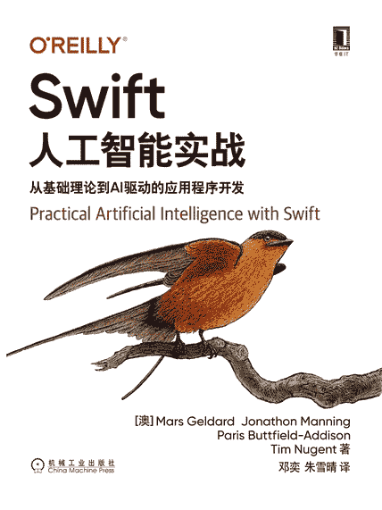

脚注

# O’Reilly Media, Inc.介绍

O’Reilly 始终以“传播创新知识，推动世界进步”为使命。逾四十年以来，始终为企业和个人提供达成目标所必须的能力与思想，鼓励持续创新和精益求精。

支撑运营的是由顶尖专家与实践者组成的独特网络，他们通过 O’Reilly 分享洞见。Online Learning 在线学习平台汇聚独家直播教学、图书与视频，使客户更便捷地获得业务所需专业知识。数十年来 O’Reilly 出版物被视作把握前沿技术的权威参考。全年多场会议为技术人群提供活跃交流场域，业内人士在此联结、探讨最佳实践并洞察可能改写行业的趋势。

客户渴望创造推动社会前行的创新成果，我们希望能助其一臂之力。

## 业界点评

“O’Reilly Radar 博客口碑极佳。”

——Wired

“O’Reilly 凭借一系列令人惊艳的点子建立起数百万美元规模，真希望当初是我想到的。”

——Business 2.0

“O’Reilly Conference 是汇聚关键思想领袖的典型代表。”

——CRN

“拿到一本 O’Reilly 的书，就意味着该主题有用、有前景、值得学习。”

——Irish Times

“Tim 是位特立独行的企业家，不仅视野极远极广，还真正践行了 Yogi Berra 的建议：‘路上遇到岔路，就走小路。’回头看，他几乎每次都选了小路，有几次还是稍纵即逝的机会，大路其实也不差。”

——Linux Journal

脚注

# 本书赞誉

长远来看，绝大多数 AI 将部署在直接处理数据的终端设备，而非中心化数据中心。凭借快速执行与强表达力，Swift 已成为推动这一转变的首选语言。本书对支撑 AI 下一个十年所需的工具做了精彩透彻的介绍。

—Jameson Toole 博士，Fritz AI 联合创始人兼首席技术官

对机器学习从业者而言，贴近现实的“香蕉和苹果”式材料极其宝贵。书中准备了充足的这类练习足以支撑阅读到动手。若你与我一样开始思考机器学习真正的未来是否在真实设备上，这本书能为你打开思路。

—Alasdair Allan 博士，Babilim Light Industries 主管

近几年 AI 已从学术与科幻走向解决实际问题的实用技术。本书展示了如何把 AI 付诸实践，让近期才成为可能的机器学习能力落地。很期待读者会如何运用所学。

—Chris Devers, EditShare 可持续工程技术主管

脚注

# 译者序

AI 已成为开发者无法绕开的话题，其魅力吸引大多数人。可市场上不少 AI 书籍偏重深奥理论，容易让人望而却步。本书另辟路径，以实践驱动为主线，让读者跟随作者解决真实问题，同时穿插必要的 AI 基础概念。

阅读时不妨尝试完成书中设计的实操任务。在任务牵引下用 Swift 处理问题，动手过程中体会 AI 的妙用并熟悉相关工具。书的价值不仅于此，还能帮助你快速上手苹果生态技术，例如用于界面构建的 SwiftUI，也是额外收获。

感谢家人朋友的陪伴与支持，尤其感谢我的妻子，她也是本书合译者。也感谢机械工业出版社华章公司在出版过程中提供的帮助。

邓奕

2020 年于武汉

脚注

# 前言

欢迎阅读。

本书以任务为导向，用 Swift 进行 AI 实操。我们认为在 iOS 程序中加入智能与机器学习功能，并不需要深究复杂数学与算法。AI 不应仅属于专家，它应面向所有开发者。

当下技术百花齐放，已成为人与计算机交互的常态。机器学习能力强劲，已能影响、造福甚至左右人类。了解如何构建与理解 AI 的重要性，正如当年学会使用计算机一样关键。

本书旨在让你对常见机器学习任务建立真实认知。通过这些任务，你能打造更好的工具，也能理解他人正在使用的工具。

## 本书资源

建议每读一章就亲手写代码。如遇困难或想获取完整代码，可访问配套网站(`http://www.aiwithswift.com`)。

## 读者与方法

本书面向已掌握 Swift 编程、希望了解机器学习具体功能与技术的读者。基础编程内容不在本书范围内，需要熟悉示例所用语言。

除 Swift 外，我们偶尔会用到 Python。Python 在 AI 与机器学习领域应用广泛。但本书核心仍是 Swift，每次出现 Python 都会说明缘由。

最后，建议你熟练使用 macOS 与 iOS，拥有一台用于开发的 Mac 和一台用于测试的 iOS 设备，以完成依赖特定传感器的任务，如动作追踪或相机分析。

## 全书架构

全书共三部分。

第一部分介绍机器学习与 AI 的基础、构建应用所需的语言与工具。

第二部分覆盖多个有趣主题，包括计算机视觉、音频、动作、语言。每个主题下我们演示并完成一个应用，突出技术与 API。每章末尾提供完整演示，展示目前可完成的实际任务。

第三部分深入本质，研究第二部分应用所用的技术。我们会探讨机器学习理论，并说明设备内部究竟在做什么。

## 如何使用本书

本书扎根于实践，以你在 AI 与 Swift 场景中想要完成的实际任务为结构。全书分为三部分。

第一部分讨论 Swift 与 AI 及本书的任务驱动方法（第 1 章）、可用于 Swift 与 AI 的工具（第 2 章），并介绍为何以及如何使用面向实际 AI 的数据集（第 3 章）。

第二部分探讨 AI 可集成到的 Swift 应用领域——视觉类任务（第 4 章）、音频类任务（第 5 章）、语言与文本类任务（第 6 章）、动作与手势类任务（第 7 章）、生成与推荐类增强任务（第 8 章），以及功能之外（第 9 章），以探索第一部分末尾提到的更先进工具与框架。

第三部分探讨 AI 方法的实际运作（第 10 章）、第二部分任务的工作原理（第 11 章），以及你如何自行实现简化版（第 12 章）。

## 核心任务

本书涵盖以下领域的任务：

• 视觉
\- 人脸检测
\- 条形码检测
\- 显著性检测
\- 图像相似度
\- 图像分类
\- 绘图识别
\- 风格分类
• 音频
\- 语音识别
\- 声音分类
• 文本和语言
\- 语言识别
\- 命名实体识别
\- 词形还原、标注、分词
\- 情感分析
\- 自定义文本分类器
• 运动和手势
\- 行为识别
\- 绘图手势分类
\- 行为分类
\- 通过 AI 使用增强现实
• 增强
\- 图像风格转换
\- 文本生成
\- 用 GAN 生成图像
\- 电影推荐
\- 回归预测
• 功能之外
\- 安装 Swift for TensorFlow
\- 在 Swift 中使用 Python
\- 使用 Swift for TensorFlow 训练分类器
\- 使用 CoreML 社区工具
\- 在设备上更新模型
\- 在设备上下载模型

本书大部分内容围绕如何用 Swift 在程序中实现 AI 驱动功能展开。采用自顶向下、任务驱动的学习方式，因此先讨论你可能用到的工具，详见第 2 章。

在该部分我们探索可用于创建机器学习模型与 AI 任务模型、操作模型、处理数据并开发实用 AI 产品的各类工具。

## 排版惯例

本书采用以下排版规范：

斜体
用于新术语、URL、邮件地址、文件名及扩展名。

等宽字体
用于程序清单及正文中的程序元素，如变量名、函数名、数据类型、环境变量、语句与关键字。

　该标记用于提示或建议。

　该标记用于一般性说明。

　该标记用于警告或注意。

## 示例代码

补充材料（示例代码、练习、勘误等）可从 `http://www.aiwithswift.com` 下载。

代码旨在帮助理解本书内容。通常可在程序或文档中使用本书代码，无需向 O’Reilly 申请许可，除非大段复制。例如，使用少量代码片段编写程序无需许可，销售或发布示例代码则需许可。引用代码回答问题无需许可，将大段示例用于产品文档则需许可。

欢迎使用本书代码，盼望注明出处。引用格式为：

Practical Artificial Intelligence with Swift，作者 Mars Geldard、Jonathon Manning、Paris Buttfield-Addison 和 Tim Nugent，由 O’Reilly 出版，书号 978-1-492-04481-9

如认为使用超出上述许可范围，可联系 permission@oreilly.com。

## O’Reilly 在线学习平台(O’Reilly Online Learning)

四十余年来，O’Reilly Media 致力于提供技术与商业培训、知识与洞见，助力企业成功。

我们拥有庞大的专家与创新者网络，通过图书、文章、会议与在线学习平台分享知识。O’Reilly 在线学习平台按需提供现场培训、学习路径、交互式编程环境，以及 O’Reilly 与 200 多家出版商的文本与视频资源。详情请见 http://oreilly.com。

## 联系方式

如对本书有意见或疑问，请联系出版社：

美国：
O’Reilly Media, Inc.
1005 Gravenstein Highway North
Sebastopol, CA 95472

中国：
北京市西城区西直门南大街 2 号成铭大厦 C 座 807 室(100035)
奥莱利技术咨询（北京）有限公司

技术问题或建议请发送邮件至 bookquestions@oreilly.com。

勘误表、示例及其他信息见配套网站 https://oreil.ly/practical-ai-swift。

更多书籍、课程、会议与新闻信息请访问 http://www.oreilly.com。

## 致谢

Mars 感谢家人与合著者，感谢他们在她难以相处时仍持续支持。她还要感谢塔斯马尼亚大学提供的机会。

特别感谢：Julian Dermoudy 博士，让她三年前初学编程时便爱上这件事；Nicole Herbert，作为优秀的学位协调员给予工作所需的支持与自信；澳大利亚苹果开发者社区与苹果大学联盟，提供了丰富知识与对 Swift 的兴趣；父母为她树立了品格榜样。

Jonathon 感谢父母与不断壮大的大家庭成员的支持。

Paris 感谢母亲，没有她人生将黯淡无光，更不用说写书；感谢合作作者 Mars；感谢所有朋友，其中几位与他合写本书。

Tim 感谢父母与家人容忍他枯燥的生活方式。

我们感谢 Michele Cronin 与 Rachel Roumeliotis，他们的专业与建议对本书完成至关重要。期待未来更多合作。O’Reilly Media 全体员工在撰写期间提供的专业支持也令人难忘。

非常感谢 Tony Gray 与 AUC 给我们及“致谢”中出现的所有人提供的巨大帮助。没有他们本书不会存在。

还要感谢 Neal Goldstein，是他把我们引入写作领域，全部荣誉归于他。

感谢 MacLab 成员的支持，以及塔斯马尼亚大学 Christopher Lueg 教授、Leonie Ellis 博士及其他员工的支持。

感谢 Dave J.、Jason I.、Nic W.、Andrew B.、Jess L. 等人的启发与帮助。感谢苹果勤奋的工程师、作家、艺术家及其他工作者，没有他们本书无法成形。

感谢技术审阅人，尤其是 Chris Devers、Dominic Monn 与 Nik Saers 的细致与专业。

最后感谢所有读者！如有反馈请告诉我们。

脚注

# 第一部分　基础知识和工具

## 第 1 章　人工智能！？

不少关于 AI、机器学习与深度学习的资料充斥着令人头疼的数学与晦涩学术术语。对一位底子不错的软件工程师而言，想涉足 AI 并在程序中实现智能功能，这些内容很容易让人却步。

不必担心，AI 已变得更容易，下面将展示如何在 Swift 程序中实现人工智能。

本书介绍用 Swift 以多种实用方式实现 AI 的概念与流程。

开始前做点准备：本书讲的是 AI 与 Swift（封面标题已提示）。Swift 是强大易学的语言，适合构建 iOS、macOS、tvOS、watchOS 甚至 Web 程序。

有一个不同点，AI 长期与另一种语言 Python 共生。所以尽管本书聚焦 Swift，偶尔也会用到 Python。

本书不面向编程新手，而是针对已有编程经验者。你不必是专家，但需理解书中发生的事情。

书中会涉及理论，主要集中在第三部分。但你需要先阅读第二部分，获取实操的基础信息。

### 1.1 Swift 人工智能实战以及 Python

如书名所示，大部分工作确实用 Swift 完成，但 Swift 并非实现机器学习的唯一途径。机器学习社区普遍用 Python 训练模型，Lua 也很常见。总体上，工具选择决定语言。`CoreML` 与 `CreateML` 是我们实现机器学习的主要方式，都是基于 Swift。

我们假设你对 Swift 编程与创建基础 iOS 程序已相当熟练。AI 与机器学习范围很广，若再加入 Swift 与 iOS 教学，本书会厚重得放不进书架。我们仍会解释每一步含义，请放心，不会把读者扔进学海不管。

若你仍在摸索 Swift 与 iOS，觉得需要重温 Swift 与 iOS，或想阅读其他 Swift 书籍，可参考 Learning Swift，该书从零用 Swift 构建完整 iOS 程序。

本书以实用为出发点，所有决策包括语言选择都力求实用。若 Python 能满足任务，我们也会展示如何使用它。

在本书语境中，实用意味着实现 AI 驱动功能，而不关心它如何运作、为何能运作、什么让它运作。我们只关心让它能运作。关于 AI、机器学习、深度学习理论如何运作，已有大量书籍说明，无需重复。

#### 代码示例

你可能注意过，Swift 的方法调用往往很长。在超高像素、流畅滚动的双屏高分辨率显示器上，几乎无需拆分方法调用与变量声明。

遗憾的是，纸张（及其数字版）在水平空间上受限。因此书中常把示例代码拆成多行。

请注意，这不意味着你在实现时也要拆分。我们这么做只是为了便于在书中展示。若书中某行代码看似奇怪被拆开，无需困惑。

本书不真正涉及代码风格。代码风格是值得专书讨论的话题，例如 Swift Style , Second Edition(Pragmatic)，且风格主观性强易引发争论，故本书不涉及。每个人都有适合自己的方式，坚持自我比效仿他人更好。

做你自己！

不想把书上的示例一行行自己敲？GitHub 上已经放好了完整的代码仓库，随时可以拉取使用。官网也同步提供了额外学习材料。

示例代码基于 Swift 5.x 撰写，配图截自 Xcode 11，运行环境为 macOS Catalina。换到版本差距较大的环境，表现可能会有细微差异。不过 Swift 本身已经相当成熟，即便 Xcode 界面出现小幅变化，基本功能依然能正常运行。

出版后一段时间内，这些代码仍然具备可执行性。

书中大量示范了 Swift 扩展的用法。扩展能够为已有的类或枚举增添新能力，用实际代码演示比纯文字说明更直观。

熟悉 Objective-C 的开发者应该对 Category 不陌生。Swift 的扩展可以视作 Category 的近似物，区别在于它不带名字。

先看一个名为 `Spaceship` 的类：

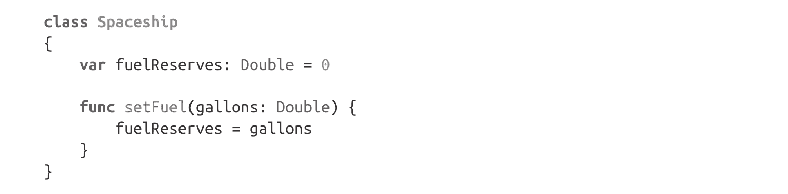

代码本身应该能看懂，为求表述一致，这里简单说明一下：它声明了一个 `Spaceship` 类，里面包含一个 `fuelReserves` 属性，类型是 `Double`，具体细节暂不展开。

该类还提供 `setFuel()` 方法，接收一个名为 `gallons` 的 `Double` 参数，并把它的值赋给 `feulReserves`。到这里为止。

假如后续需要对 `Spaceship` 增加一个友好的燃料打印功能，就能借助扩展来实现：

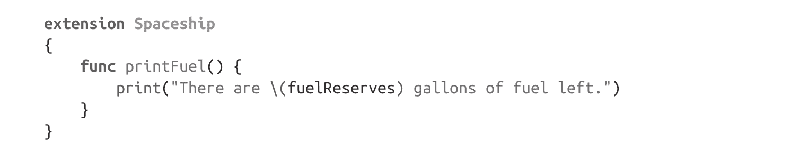

扩展之后，`Spaceship` 的实例可以直接调用 `printFuel()`，使用感上仿佛该方法本就存在：

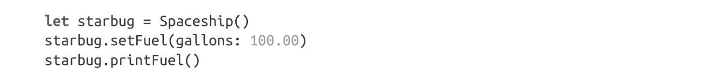

扩展同样可以用来让类型遵循协议：

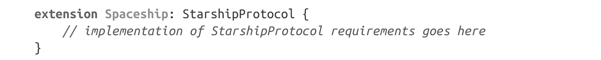

此处演示了如何通过扩展让 `Spaceship` 满足 `StarshipProtocol`。由于全书会频繁使用扩展，理解这一点很重要。

想深入了解扩展，可以查阅官方 Swift 文档；对协议有疑问，也请回到文档复习。

脚注

### 1.2 为何选择 Swift
提到 AI 搭配 Swift，总有人会下意识问：“不是应该用 Python 吗？” 即使没开口，眼神里也能读出这个疑问。

也有人会追问：“AI 不就是机器学习吗？”在大部分语境下两者可以混用，现在这点已经不关键，也不属于我们讨论的重点。

下面列出我们在 AI 场景中偏爱 Swift 的几大理由。

Swift 由苹果主导的开源计划推出，目标是打造一种兼具强大功能与易学性的语言，融合学术与工业界的最佳实践，成为多范式、安全且互操作的工具，覆盖从底层开发到高级脚本的各类需求，并在多个维度上实现了这一目标。

目前 Swift 是使用量大且增速快的流行语言，估计用户已超过百万。社区多元活跃，生态工具也趋于成熟。它在 iOS、macOS、tvOS 和 watchOS 开发中占据主导，服务器与云端的应用也在不断扩展。

Swift 具备诸多优秀特质，既适合入门学习，也适合实战开发，具体如下：

#### 设计
Swift 经历了多次早期迭代与语言层面的重塑，如今语法统一、优雅并且相对稳定。它属于源自 C 语言家族的现代语言。

#### 可教学
Swift 入门平缓，设计上倾向于逐步暴露复杂度且高度自解释，因此教学友好、上手迅速。

#### 生产
代码简洁清晰，样板代码少，写起来快、读起来更顺畅，调试体验也良好。

#### 安全
安全性是 Swift 的默认属性。语言层面大幅降低内存安全风险，逻辑错误也更容易被发现和修正。

#### 性能
运行速度快，内存占用合理，这与其移动开发的起源有关。

#### 部署/运行时
Swift 编译为原生机器码，无需垃圾回收或沉重运行时。机器学习模型可直接编译成独立的 object 文件与头文件。

值得一提的是，2018 年中语言团队已明确强调对稳定性的高度重视，这对语言成长初期尤为关键。开发者因此不必频繁重构或重新学习，体验更稳定。

#### 我们的方法
Swift 虽长期与苹果平台绑定，本书先讲概念后谈平台。实践中会涉及平台特性，但方法论力求保持平台无关性。

相比 AI 领域常用的语言，Swift 更友好、更容易上手。我们希望通过本书的实践，帮助读者建立可迁移的 AI 通用能力，而不仅限于语言本身。

我们更关注解决问题和交付功能，而非深究 AI 的本质。

### 1.3 为何选择 AI
许多非 Swift 开发者仍把 Swift 视作仅限苹果生态的 App 语言，实际上已不再如此。它已成长为功能全面的现代语言，作者认为非常适合机器学习的开发与教学。

为推动这一方向，苹果近年推出两大核心工具：

#### CoreML
提供框架与模型格式，支持高效便携地部署训练好的模型。第二版主要聚焦计算机视觉与自然语言，但可适配到其他领域。

#### CreateML
用于创建与评估 CoreML 模型的框架及配套应用，让训练过程更直观简便。2018 年发布后于 2019 年更新，为此前需从其他格式转换模型的开发者提供了新选择。

第 2 章会更深入介绍 CoreML 与 CreateML。

苹果的投入远不止于此。Siri 快捷键等功能的推出，让用户可以自定义个人助手，这反映了苹果在消费端推动个性化与智能化设备的大趋势。

用户期待更智能的体验，而我们恰好拥有出色的语言、平台与工具。但要吸引习惯旧语言的开发者，是否能让他们继续使用熟悉的工具？如果可以，你也会心动。

针对 Python 用户，苹果提供了 Turi Create。在 CreateML 出现前，它是核心伴侣，与 CoreML 配合实现模型的可视化快速训练。若数据以表格或图结构为主，可用 Python 训练、验证后再无缝回到常规开发流程。

不过，本书的核心仍然是 Swift 开发，请记住这一点。

说到 Swift for TensorFlow，项目主页有一句意味深长的话：“机器学习工具如此重要，理应拥有顶级语言……”TensorFlow 及可在 Swift 中调用的 Python 库兼顾了两者优势。Swift 带来更好的可用性与类型安全，同时保留了 Python 在机器学习上的灵活性，并增强了编译器能力。

YouTube 上保存了 2018 年 TensorFlow Dev Summit 的录音，Swift 原作者 Chris Lattner 在会上宣布 Swift for TensorFlow 并解释了项目动机。

想要了解更多细节，可前往 Swift for TensorFlow 的 GitHub 页面查阅。

目前在 Swift 中进行 AI 开发时，工具选择已很清晰：面向图像、自然语言或学习型场景，优先用 CreateML；处理原始结构化数据、大规模表数据或需要深度定制时，则选用 TensorFlow。

第 2 章会进一步展开这些工具，第 9 章则简要介绍 Swift for TensorFlow。

#### 设备上机器学习
苹果平台的 AI 策略较为特殊，强调本地化机器学习。多数厂商习惯把数据传到云端训练再回传结果，苹果认为这种方式对可能包含个人信息的用户数据构成不必要的安全风险。

这一选择是有成本的。苹果的机器学习框架必须优先保证性能，让单台设备甚至 iPhone 能够本地离线完成智能任务。部分资源密集型功能仅在设备闲置且充电时才会执行。

在进入 Swift AI 实战前，为照顾没有 AI 背景的读者，这里先不做深入实践。

脚注

### 1.4 什么是 AI，它能做什么
AI 是研究如何让技术表现得像智能的领域。什么是 AI、什么不是 AI 存在争议，因为“直接给出预设答案的系统”与“被告知如何寻找答案的系统”之间界限模糊。

其底层常包含专家系统这类架构：旨在辅助或替代领域专家进行特定检索或决策的程序。可借助专用语言或框架构建，本质上往往是多层嵌套的 `if` 语句。例子如下：

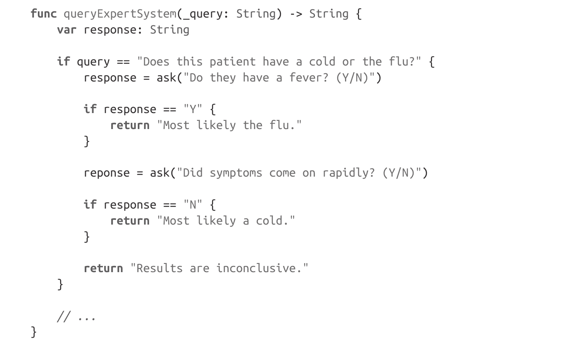

专家系统虽有实用场景，但搭建成本高，需要问题边界清晰。它们看似专业，实则不产生新知识，只是复述被编码的人类经验。即便检索更快，也谈不上创造智慧。

那种被教导如何寻找或推测答案、甚至自主发现知识的系统，才是今天人们常说的 AI。神经网络等主流方法核心在于用算法处理海量带标签数据，以远超人类的细致与复杂程度挖掘联系。

需要强调，AI 并非魔法。它做不到人类做不到的事，只是把简单重复的工作做得远比人类快。

“发现历史联系有何用？这算智能吗？”简单说，当我们足够了解哪些条件会导致哪些结果时，就能在条件重现时做出合理预测，本质上是做出更靠谱的猜测。

基于此，也能更清楚 AI 的边界：

• AI 不是魔法。
• 在敏感议题上无法提供可信输出。
• 不适用于对整体精度要求极高的场景。
• 缺乏足够知识储备时无法识别新事物。

这意味着 AI 能通过统计分析海量数据揭示相关性，例如“买了 X 书的人往往也买 Y 书”。

但若无外部设计或指令，它不会自动付诸行动，例如“向买过 X 且未买过 Y 的人推荐 Y”。

同样，没有额外信息时，它也无法预测全新变量，例如“谁会买从未有人购买过的新书 Z”。

#### AI 与机器学习
对机器而言，“智能”不等于“能学习”。AI 与机器学习的区别因人而异，本书采用如下界定：

若 AI 具备反馈回路，能随时间持续优化训练，则它可以实现机器学习，并属于机器学习范畴。

技术上，机器学习可被视作 AI 的一种实现方式，并由定期重训的架构支撑。苹果等公司常把整个领域统称为机器学习，加剧了概念混淆。关键在于为特定方案选择合适的技术，而非纠结术语边界。

例如，基于温湿度预测天气的系统训练一次后可长期使用；而推荐系统则需在新品出现或用户行为变化时持续纳入模型。

#### 1.3.1 深度学习与 AI
除了机器学习和 AI，有时还会提到深度学习。它是机器学习的分支，虽有些流行化，但核心指通过多层重复结构完成任务的机器学习与 AI 方法。

深度学习借助不断加深的神经网络层，从数据中提取更具代表性的信息。其目标是将输入映射为可用于分类、推荐等任务的抽象表征。所谓“深”，正源于分层网络中的重复学习。

#### 1.3.2 神经网络从哪里来
若你觉得 AI 与机器学习就等于神经网络，鉴于当前背景可以理解，但这并不准确，也从未如此。神经网络只是个热门词汇，常被拿来炒作。

第 2 部分实践结束后，第 10 章会从理论角度更深入讨论神经网络。但本书以实践为导向，是否了解其原理并不影响使用工具构建功能。

#### 1.3.3 道德地、有效地、适当地使用 AI
AI 被滥用并不意外，技术本身皆可被误用。人类很早就尝试构建智能系统，而可解释的智能系统尚未普及前，AI 已相当流行，目前研究仍在初期。

对于传统系统出错，我们可以调试并追溯原因。

但在 AI 场景下却不可行。

若系统输出完全由输入决定且模型不可改，或许可尝试人工分析错误输入。

这里同样无法实现。

当不可解释的智能系统出现严重问题时，往往只能推倒重来。

系统部署后缺乏可干预性，导致责任模糊：创作者常声称系统不代表其观点，拒绝为错误买单。

近例：某手机照片编辑 App 提供预设滤镜，可将自拍转为性别互换、老化、幼化等风格。其中“更性感”模式被发现会把深肤色用户的肤色变白。

这明显暗示浅肤色更具吸引力，伤害用户。开发者被指控种族主义设计，并承认训练数据系内部构建。标注照片时，团队无意中带入了偏见：认为欧洲血统更具吸引力。

算法不懂种族主义，也无概念偏见、审美或自尊。它只是学习了大量被标记为“有吸引力”的照片特征并加以复制。

内部测试仅用白人样本，问题未被发现，产品随即上线。

类似案例层出不穷：认定女性驾驶更危险的车险系统、认为名叫 Jared 的人更适合重要职位的招聘工具、把深肤色人群判定为更高再犯风险的假释系统、以及根据超市刷卡记录评估饮食健康并默认打低分的健康保险系统。

因此必须认识到：AI 虽酷且具潜力，实际只能复制社会既有条件，并非总具道德性。

##### 问题Ⅰ
1.将此系统应用到现实世界领域的时候，存在哪些问题？
2.如何改善系统中的这些问题？例如：
• 对输入数据进行处理，使这些数据可以更好地代表现实世界。
• 多个系统共同工作，可以相互关联或挑战彼此的响应。
• 重新定义系统要回答的问题，使其有更客观的响应。
3.如果此系统给出的每个答案都不准确，那么可能造成的最严重的危害是什么？
4.如何降低风险或潜在危害？例如：
• 在部署之前确保一定的准确度水平。
• 内置故障保护装置，来忽略或警告可能有害的响应。
• 人为调节响应。
5.对于剩下的风险和潜在的危害，如果发生最坏的情况，你可以忍受它们吗？

这并不代表设计师无能为力。我们可以塑造数据，让模型反映理想世界而非现实，但任何倾斜都会带来失真。或许最好的期待，是建立责任意识并承担后果。

即便出于善意，AI 也并非总适用。不少人沉迷于打造“未来感”智能系统，追逐潮流，却忘了真正的问题与用户体验。

设想一下，能训练出一个神经网络来给出一个人的大致寿命。它号称把数百年积累的临床治疗记录、流行病学观察以及当下所有可用的医学研究全部喂给模型，甚至还能剔除意外或外力死亡的干扰。按宣传，它的出现让平均寿命提升了整整九年。

用户打开网页或应用，填写自己的各项信息后点提交，得到的只是单一的数字。数值或许准确，却没有任何解释。对普通人来说，这样的结果基本等于没有。

即便是拿到理想数字的人群，也很容易陷入混乱。

因为人们要的并非一个神奇的答案。大家当然希望难题能被解决，但光有一个回应并不能解决问题。大多数人关心寿命，是为了知道如何活得更久、如何提升晚年生活质量。真正需要弄清楚的是哪些因素在拖累寿命，从而可以针对性干预。而这一点，系统并没有给出。

可解释的专家系统会做得更稳妥：它掌握的信息可能更少，却能用人类能懂的方式给出可操作的说明。在绝大多数场景里，智能系统的设计目标应该是提供这种可理解的答案，哪怕为此牺牲一点聪明程度甚至一点准确率。神经网络式的方案并不总是最合适的。

##### 问题Ⅱ
1.在时间与人力充足的情况下，非智能的解决思路是否也能达成目标？
2.若能做到，智能方案相较于传统方案能提供哪些额外价值？
3.若有人被问及系统想回答的核心问题，你希望他能给出怎样的解释？
4.智能方案是否能提供同样质量的解释？
5.你希望最终产品为终端用户带来怎样的使用体验？

再看一个例子。某行业协会想通过首次续费来提升会员留存。董事会为此发愁，但其通知渠道的订阅率、阅读量和反馈率都很低。调研发现，多数新会员在首个会期内过半时就已失联，董事会因此四处寻求对策。他们想要更多会员信息，以便判断问题所在，或以其他方式重新建立联系。

被提出的方案包括数据抓取、聘请数据经纪公司、聘请管理咨询公司。协会最终All in数据：认为只要客户数据足够，计算机就能给出行动指南。于是计划搭建一个系统来识别续费风险高的会员，并判断哪种挽留手段最有效。董事会对此充满期待。

但真正的症结并非数据不足。关键是协会根本联系不上会员、没有办法有效展示价值、对其会员和所在行业也缺乏认知，而这些其实靠少量数据就能初步把握。也许董事会根本不在意是否了解。他们偏离了最初的问题，也没有设计出真正贴合目标的方案。

##### 问题Ⅲ
1.如果没有AI，人们会怎么解决这类问题？可参考以下角度：
社会调研
今天的用户分析已经取代了过去直接询问用户或做市场分析、文献分析、客户调研的老做法，甚至不再是补充关系。
数学/统计学
人工手动梳理海量数据对大多数人来说并不有趣，但在计算机能找出属性与结果关联的前提下，具备领域背景的人可以辨认出合乎常识且有意义的联系。
`Mechanical Turk`
这个词源于18世纪一件轰动一时的自动国际象棋机，后来发现盒子里其实藏着真人。不要低估人类在全力解决问题时的创造力：我们拥有不少计算机难以模仿的能力。
2.最初的问题到底是什么？
• 该方案能回答它吗？
• 若不能，是否有智能方案可以回答？
• 若不能，且因数据或方法限制导致设计跑偏，这种新回答是否真的有助于解决最初的问题？

道德、有效、恰当——带着这三点原则，从现在起继续打造AI功能。这是本书后续要做的事，也希望你能跟下来。

脚注

### 1.4 实用的 AI 任务清单
写这本书的起点，是厌倦了那些自称实用却脱离上下文的AI专著。它们总说从有趣的神经网络实践开始学习技能，最后却发现用不上。我们读过不少关于AI的书，质量都不错，但多采用自底向上路径——从算法、神经网络讲起，最后才触及实现与落地。

脚注

### 1.5 以任务为导向的典型做法
本书采用自顶向下策略，把AI各个领域拆解成具体任务。

因为很少有人会从“我要做一个风格分类系统”出发，哪怕这样做也挺酷，通常是从“我要一个应用告诉我这幅画是浪漫主义还是拉斐尔前派”开始，这是我们日常会遇到的真实需求。

第二部分每章都从实际问题切入，以可用的系统收尾。流程大体一致，仅有细微差异：
• 明确待解决的问题。
• 选定整体解决思路。
• 收集或制作适配的数据集。
• 准备工具链。
• 构建机器学习模型。
• 训练模型。
• 制作使用模型的App或Playground。
• 将模型接入应用或Playground。
• 上线使用。

采用此法的原因很单纯：本书强调“实用”。把方法打包成任务，既能更好地解决当下问题，也能确保结果以真实可用的方式呈现。

几乎所有章节都以`CoreML`作为运行模型的框架，所以我们做的一切都要兼容它。

在某些层面，`CoreML`只是我们在沙地上画的一条人为分界线；但它同时提供了明确的边界。我们都有各自的限制。

大量AI工作由学术界和大公司专家完成，他们的目标与资源与最终使用者截然不同，训练、推理和数据的需求与约束完全不同。

那些训练与运行都需要强力机器、但在普通电脑上难以复现的模型和方法，或那些有趣却不解决具体问题的模型和方法，本质上都不实用。本书里的代码都能在普通台式机或笔记本上运行，并在`iPhone`上编译执行。对我们而言，这就是实践的意义。

因为内容被拆成若干任务，我们不能虎头蛇尾。每个任务都要通过交付有用的东西来收尾。太多AI方法只造模型，或只把模型连到用户界面。我们两者都做。

## 第2章 AI工具箱
本章与下一章会讨论用`Swift`构建AI功能时可能用到的工具。我们坚持自顶向下，因此工具的选择取决于实际问题，而不是学术偏好。

我们并不排斥更深度的学术路径。作者们本身都有学术背景，且市面上有大量关于AI理论、算法与科学的优秀书籍，网站上也有推荐。正如1.5节所说，本书不是为猎奇而写的理论书，而是为了让`Swift`在真实AI系统里落地。

我们对实用AI工具的讨论也抱同样态度：更关心工具能做什么、是否适配你的任务流水线，而不是它如何运行。第3章我们会用同样的视角来寻找或构建数据集。

## 2.1 自顶向下策略的缘由
AI的焦点已经从探索问题转向解决问题的阶段，本书正是顺应这一转变。我们希望帮你用具备AI能力的真实实现打造出色的`Swift`应用。例如卷积神经网络如何逐层搭建确实有趣，但使用它并不需要深入了解其内部。

`O’Reilly Radar`上有不少精彩文章。如果你想更详细了解从自底向上到自顶向下的转变，可查阅关于模型治理的文章。

本书其余部分主要讲模型的使用与消耗，本章并不特别聚焦于此，不过最后会提及。

在本书第三部分，我们用自底向上的方式审视底层方法，并回头检视之前探索的自顶向下任务，弄清它们为何奏效，然后从零开始搭建一个神经网络。

脚注

## 2.2 打造优质AI的工具群
许多专家认为，我们正处在AI工具化的阶段。过去十年持续的应用研究、创新与开发，已形成一个健康且令人惊叹的AI工具生态。

工具足够好时，我们就能专注于用AI构建体验，而不必纠结原理。这点被科技巨头如谷歌、亚马逊、苹果大力扶持开发者生态所印证。

为了配合`Swift`，苹果打造了一套实用、完善且持续演进的AI工具，如`CoreML`、`CreateML`和`Turi Create`。除苹果外，社区与第三方也为`Swift`与AI生态贡献了更多工具。

本章会介绍在`Swift`应用中创建AI功能时常用的工具。总体可分为三类，每类都在削弱与`Swift`的耦合度，但都很重要。

来自苹果的工具
由苹果构建或收购后由苹果维护，并深度嵌入`Swift`与`iOS`生态的AI工具。这是本书的核心，本书绝大部分内容都聚焦于在`Swift`应用中使用这些工具的输出。2.3节会详细探讨，核心是`CoreML`。

其他工具
苹果之外的公司与个人提供的AI工具。它们或与苹果生态紧密耦合，或对用`Swift`做实用AI极有帮助。本书会介绍部分使用方法并给出指南，但使用频率不如第一类。这并非因为它们不够好，而是苹果的工具已足够优秀，通常不需要更多。

我们将在2.4节介绍，并在全书中使用。

AI相邻工具
指`Python`及其生态。尽管本书主打`Swift`并尽量用`Swift`实现，若你真正投入AI与机器学习，很难完全避开`Python`。`Python`是数据科学与机器学习领域的必备语言。

这类工具并非专门为AI设计，或与AI世界及苹果`Swift`生态有间接关联。除非要完整展示AI的实用场景，否则我们不会展开。有些是绕不开的，比如`Python`本身；有些看似边角，如电子表格。

我们将在2.5节介绍，并在全书中偶尔使用。

本章剩余部分会分别讨论每个类别及工具。

脚注

## 2.3 苹果自家的AI工具
苹果提供许多有用的AI工具。你可能会用到`CreateML`、`CoreML`、`Turi Create`、`CoreML`社区工具，以及针对视觉、语音、自然语言等领域的专用机器学习框架。苹果的AI工具关系如图2-1。

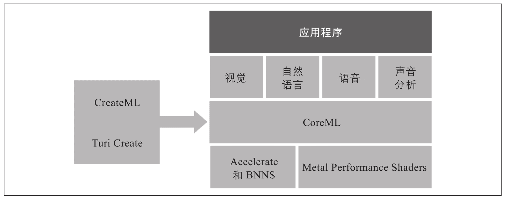
图2-1：苹果AI工具及其相互关系

`CoreML`和`CreateML`都是`Swift`框架，可用于AI。图2-2展示了`CoreML`与`CreateML`如何与应用关联。

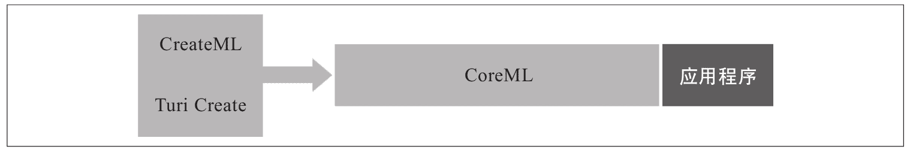
图2-2：CoreML的作用

`Turi Create`是用于创建模型的`Python`框架，与`CreateML`类似，但面向`Python`而非`Swift`。

总体上，`CoreML`用于使用模型，`CreateML`和`Turi Create`用于创建模型。

### 2.3.1 CoreML
`CoreML`是苹果在应用中使用机器学习模型的框架，本质是让模型做预测，也支持设备端在线训练以即时更新。应用可在`Swift`代码中调用`CoreML`来加载模型并提供AI功能。

如果你来自Android开发，可能熟悉Google的`MLKit`。`CoreML`就是iOS上的对应物。VentureBeat对此有很好的总结。

`CoreML`是视觉、自然语言、语音与声音分析等特定领域框架的基础，同时也依赖数学或图形底层如`Accelerate`、`BNNS`和`Metal`。`CoreML`适用于`macOS`和`iOS`。

本书大量使用`CoreML`，第二部分所有实战任务都会用到视觉、自然语言、语音与声音分析。第三部分会简要介绍`Accelerate`和`BNNS`。

#### CoreML能做什么
`CoreML`是苹果框架，用于在设备上运行预训练的机器学习模型。它加载模型并提供标准化接口，让你无需关心具体模型类型即可输入数据并获取输出。

除直接使用自定义模型外，`CoreML`也被苹果的`Vision`等库使用，以提供图像分析与检测能力。

`CoreML`本身建立在`Accelerate`框架和`Metal Performance Shaders`之上。你可以根据需要直接使用这些底层库达到类似效果，但工作量更大。

若你对构成`CoreML`的底层技术感兴趣，可查看第三部分第12章，我们将在那里逐步搭建神经网络。

很少需要深入到`Accelerate`这类底层库，因为`CoreML`更简单。同样，当可用`Vision`或`Natural Language`这类基于`CoreML`的专用库时，比自行组合更高效。

在很多场景下苹果并未提供专用库，这时`CoreML`就派上用场。用`Vision`等框架时，底层总会用到`CoreML`。

2.3.4节会讨论苹果的其他框架。

`CoreML`为苹果平台提供统一的机器学习方式，掌握后即可用相同流程向应用添加各类功能。

使用`CoreML`的通用步骤始终相同：
1.把模型加入项目。
2.在应用中加载模型文件。
3.提供模型所需的输入进行预测。
4.使用预测结果。

除提供标准接口外，`CoreML`还会尽可能利用设备特定硬件来运行模型。你不必操心模型如何执行或如何适配硬件，`CoreML`会处理。

训练机器学习模型常耗费大量时间和资源。即便只是运行模型，也会带来性能与电量的消耗。

这意味着需要审慎判断何时该用机器学习、何时不必。`CoreML`力求高效利用硬件，但除非必要，仍应避免浪费用户宝贵的设备资源。

使用`CoreML`时，机器学习模块不应过度拖慢应用整体、占用过多内存或消耗过多电量。任何系统都不完美，需要经常测试以确保集成良好且资源占用可控。

#### CoreML模型
到目前为止我们谈了很多机器学习模型，但尚未在`CoreML`语境下明确它们是什么，现在补充一下。

在高层面上，模型完整代表了一种机器学习方法，包含了复现其中所描述机器学习所需的一切。例如神经网络，就需要描述各层、权重与偏置、层间连接以及输入输出。

神经网络只是`CoreML`支持的一种类型。发布时，`CoreML`支持：
• 神经网络
• 回归器
• 分类器
• 特征工程
• 流水线
• 苹果特别支持的自定义模型

无论使用何种工具，对`CoreML`而言，所有内容都被打包成单一对象，方便存放在`.mlmodel`文件里共享与集成到应用中，见图2-3。

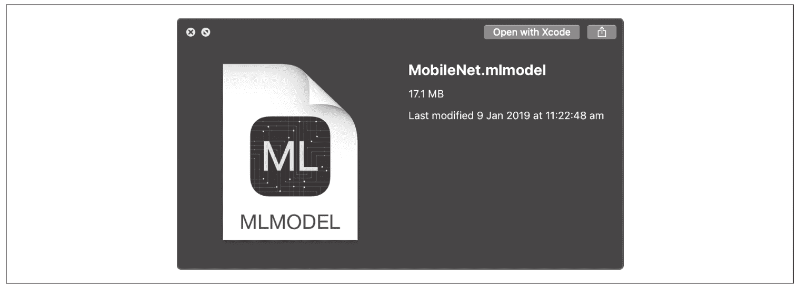
图2-3：MobileNet图像检测CoreML模型

苹果在官方站点收录了多款热门机器学习模型转换而成的 CoreML 版本，集中在 Working with Core ML Models 页面浏览，链接为 https://apple.co/298EeAY。

图 2-3 所展示的 MobileNet .mlmodel 正是从该入口获取的。

Xcode 原生具备 CoreML 模型支持，能够将模型文件直接加入任意工程。打开 .mlmodel 后，编辑器界面会切换为图 2-4 所呈现的形态。

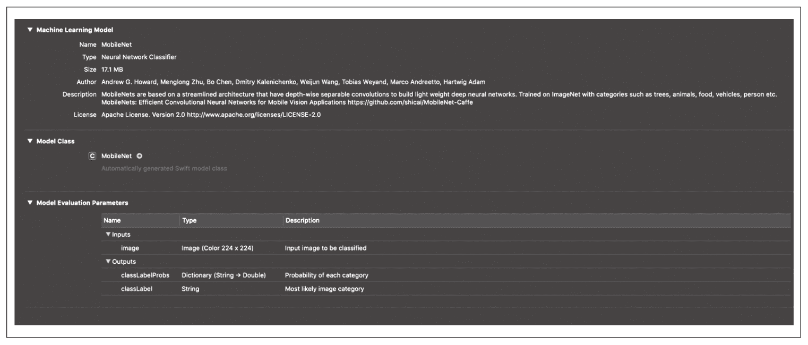

图 2-4: Xcode 里的 MobileNet .mlmodel

本例打开的就是前文提及的 MobileNet，用来观察 Xcode 与该文件的交互方式。整体来看文件被划分为三大区块。

首个区块为元信息，记录模型名称、类别及体积。此例为一个 17.1 MB 的神经网络分类器，命名为 MobileNet。该区还能容纳模型内部的补充说明，例如作者、用途描述与许可证，制作自有模型时可按需填充任意内容。

第二个区块是 Xcode 基于模型自动生成的代码类。这是 CoreML 的一项便利，解析完 .mlmodel 后会自动产出用于交互的文件。日常使用无需触碰这些文件，出于好奇可查看，亦可自行实现以获得更直接的控制。后续章节会更详细展开这些生成产物，暂可视作黑盒，其提供可实例化的对象，内置 prediction 方法，负责与 .mlmodel 的全部交互。

最后一个区块呈现模型的接口，即输入与输出。对于 MobileNet 而言，输入仅有一种，为宽高皆为 224 像素的彩色图像；输出则为字符串 classLabel 与字典 class-LabelProbs 两种。

以 MobileNet 为例，其定位为对象检测，相应输出给出最可能的对象以及其他候选的概率。自行构建的模型中，输入输出类型会有所差异，核心理念不变：Xcode 明确展示了向模型输送数据的接口与预期结果。

#### MLModel 格式

若非要自行定义模型，通常无需深究 .mlmodel 的具体构成。若想了解其本质，苹果提供了一套用于创建与转换模型的工具可供参考。

此处的自定义并非指自行训练，而是指自行定义各组件。

不过在需要二次修改或自建工具链时，掌握存储格式就显得必要。

MLModel 采用谷歌开发的 protocol buffer，即 protobuf 作为序列化基础。protobuf 与 JSON、XML 同属序列化方案，但其不可人读、非文本格式，同时具备良好扩展性，可承载几乎任意数据。

protobuf 设计目标在于高效、跨语言与前后兼容。随着模型格式迭代，特性会持续增加，但仍被预期长期保持稳定。此外目前机器学习训练以 Python 为主。

种种因素共同促成 protobuf 成为 MLModel 的优选方案。

若计划在应用内使用 protobuf，苹果已提供可供尝试的 Swift 实现。

MLmodel 内部由多种 message 构成，protobuf 术语中指一组绑定信息，可类比为类或结构体，它们完整刻画了构建各类机器学习模型所需的信息。

规范中最关键的 message 为 model，可视为高级容器，包含版本号、模型描述以及 Type。

模型的 Type 亦为一个 message，承载该模型所需的所有描述信息。CoreML 支持的每种学习方法在文件格式中都有专属的 Type 消息，用以封装方法所需数据。

以神经网络为例，Type 为 NeuralNetwork，其内部包含 NeuralNetworkLayer 与 NeuralNetworkPreprocessing 消息。它们保存了网络所需信息，每条 NeuralNetworkLayer 均记录层类型例如卷积、池化或自定义、输入、输出、权重、偏置与激活函数。

所有信息被打包进一个 .mlmodel 文件，后续由 CoreML 读取。

若想深入了解 CoreML 模型格式的细节与构建方式，苹果提供了完整规范可供查阅。

从事自定义模型与工具开发时，该资料是最佳参考。

绝大多数场景下，可将 CoreML 模型视为完整模型的描述信息，无需关心其存储细节。

#### 为什么离线

苹果特别强调 CoreML 的运行环境为离线设备，全部计算在本地完成。

这与部分系统的处理逻辑不同，另一种常见做法是将数据上传至服务器端处理，再把结果回传设备。

苹果选择本地运行 CoreML 兼有利弊。主要优势包括：

• 时刻可用。模型与数据均存于用户设备，无信号场景下仍可执行机器学习。
• 节省流量。本地完成无需上传下载，节省移动数据。
• 无需自建基础设施。模型自行运行，无需维护服务器与数据传输链路。
• 隐私保护。全部本地化，除非设备被入侵，否则外部无法提取信息。

主要劣势为：

• 更新成本较高。发布新模型需推送给用户或重新打包，或借助苹果的设备端个性化功能，限制较多。
• 应用体积提升。将模型置于设备后，应用包体通常大于仅传输数据的方案。

视机器学习任务而定，模型体量可能迅速增长。

因此苹果给出了一系列部署前压缩 .mlmodel 体积的指导原则。

苹果认为本地执行的收益大于成本，我们亦持相同观点，尤其在隐私层面。机器学习既能提供洞察与功能，也潜藏风险，计算机本身并不关心隐私，故必须审慎思考并始终以用户隐私为核心。

#### 了解 CoreML 的各个方面

CoreML 范围较广，本节不打算复刻苹果的 CoreML API 参考。

核心在于 MLModel，它封装机器学习模型，提供预测能力与元数据读取。

CoreML 另提供 MLFeatureProvider，后续 11.1 节会详细讨论。它是一种便捷机制，用于向模型输入数据或从模型提取数据。与之紧密相关的是 MLMultiArray，它是一个多维数组，可作为模型的特征输入与输出。

多维数组在 AI 领域十分常见，从图像到简单数值均可使用。CoreML 用 MLMultiArray 表示图像，其通道、宽度与高度分别对应数组的各维。

CoreML 尚包含许多其他组件。建议边阅读本书边查阅苹果文档，补充感兴趣的部分。

对 CoreML 的认知理清后，可对新学知识进行校验，这正是本书第二部分的重点。接下来将介绍 CreateML，这是创建 CoreML 模型最常用的途径。

### 2.3.2 CreateML

CreateML 是苹果面向机器学习模型创建与训练的 Swift 工具集，包含框架与图形化应用两大部分，见图 2-5。主要面向 macOS，被设计为工作流的基础。

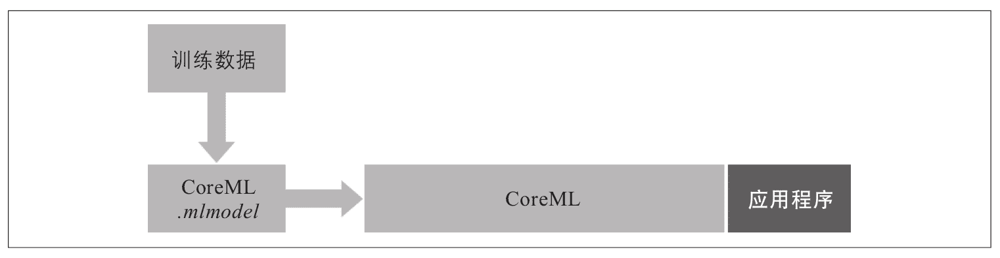

图 2-5: CreateML

CreateML 同为 macOS 应用，由苹果作为开发者工具发布，如图 2-6。它可在图形界面中创建与训练模型，使用与框架相同的底层子系统，并将其封装为界面。

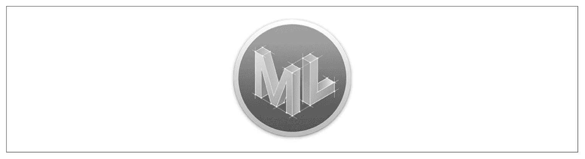

图 2-6: CreateML 应用程序图标

苹果于 2018 年 WWDC 大会宣布 CreateML 框架，这是 CreateML 的初始形态。最初意图是在 Xcode Playgrounds 中创建模型，之后演进为更通用的机器学习框架，不仅能构建模型，还能使用与操作模型。

CreateML 并无魔法。它只是苹果提供的框架，附带创建、使用与操作模型的辅助能力。它可视为 CoreML 的操作层。其他平台如 TensorFlow 也将类似能力打包进框架。可将苹果的主机器学习栈理解为 CreateML + CoreML。

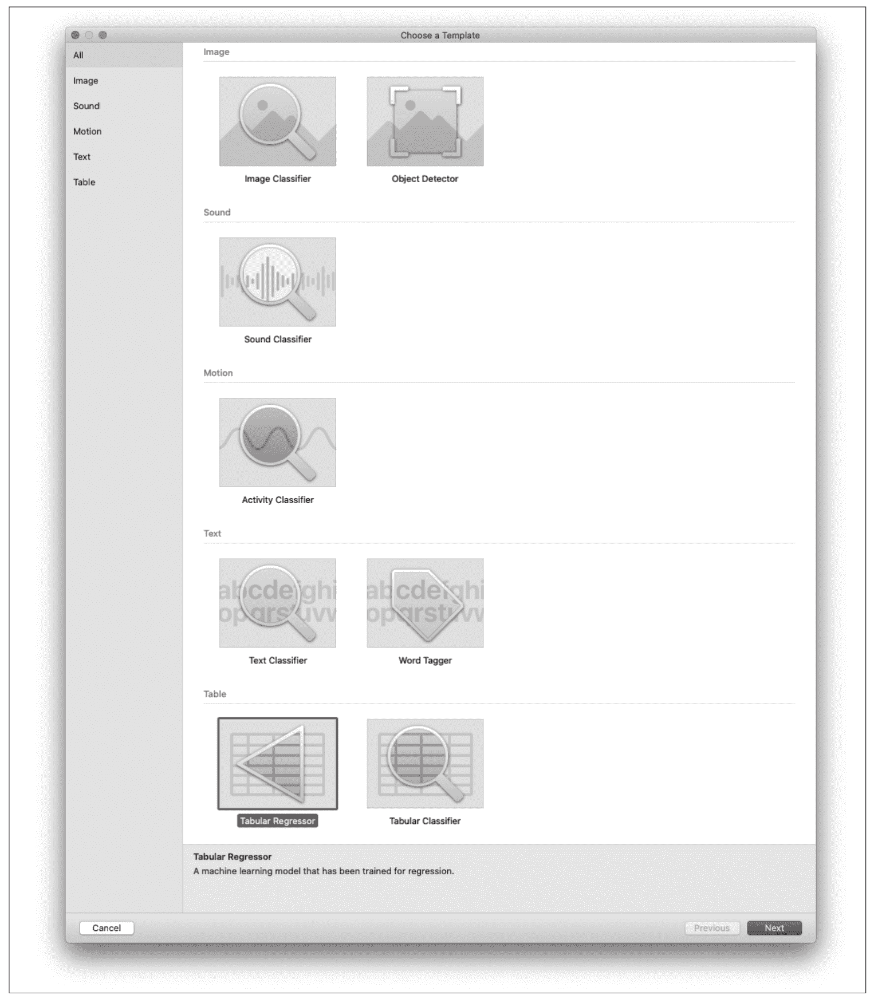

图 2-7: CreateML 应用程序的模板选择器

在 CreateML 应用中新建项目时，可填写若干元数据，使用模型时这些信息会在 Xcode 中可见，如图 2-8。

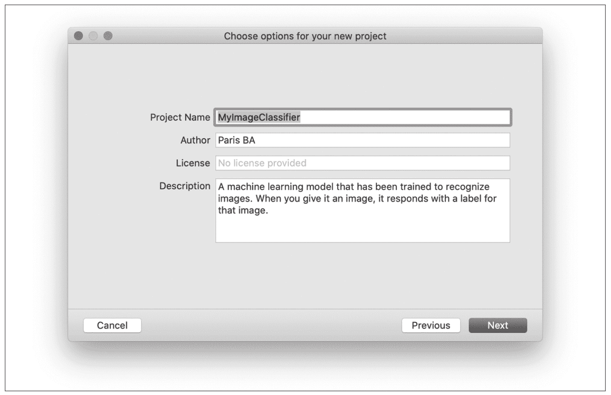

图 2-8: CreateML 新项目选项

第 4 章构建图像分类应用时，将逐步使用 CreateML 应用训练模型。

CreateML 将训练流程简化，甚至会自动把提供的训练数据拆分为训练集与验证集。

由于 CreateML 会随机挑选数据进入训练集或验证集，相同数据多次训练可能产生细微差异的结果。

CreateML 应用能完成的大多数工作，都可通过 CreateML 框架与 Swift 代码直接实现，后续使用时会对此有所体会。

写作当时，CreateML 应用支持训练的模型类型包括：

• 图像分类器
• 声音分类器
• 对象检测器
• 行为分类器
• 文本分类器
• 单词标记器
• 表格回归器
• 表格分类器

CreateML 框架的主要特性为：

• 图像分类
• 图像内对象检测
• 文本分类
• 单词标记模型
• 词嵌入用于字符串比较
• 声音分类
• 行为分类

## CreateML 核心概念

- 推荐系统
- 用于存储分类数据(MLClassifier)、连续值(MLRegressor)与数据表(MLDataTable)的数据结构
- 模型准确性指标
- 机器学习错误处理
- 机器学习元数据存储

第二部分的示例将涉及诸多 CreateML 框架功能。

准确性、评估与验证超出本书讨论范围，但若需深入了解，苹果文档是不错的起点。

### 了解 CreateML 的各个方面

本打算长篇介绍 CreateML 的全部内容，后发现基本等同于复制苹果的 CreateML API 参考与文档。

与其如此，不如概括其实用价值，希望你在第二部分的实践任务中亲自探索。

CreateML 可用于训练多种模型，例如：

- MLImageClassifier 用以对图像进行分类。
- MLObjectDetector 用以检测图像中的对象。
- MLTextClassifier 用以对自然语言文本分类。
- MLWordTagger 用以在词级对文本分类。
- MLSoundClassifier 用以对音频分类。
- MLActivityClassifier 用以对行为数据分类。
- MLClassifier 用以对表格数据分类。
- MLRegressor 用以通过回归估计连续值。
- MLRecommender 用以推荐。

使用或训练模型时需关注：

- MLGazeteer 用以定义术语与标签，增强 MLWordTagger。
- MLWordEmbedding 用以将字符串映射到向量，便于寻找邻近字符串。
- MLClassifierMetrics 用以度量分类器性能。
- MLRegressorMetrics 用以度量回归器性能。
- MLCreateError 用以存储 CreateML 使用过程中的错误。

存储数据时需关注：

- MLDataTable 用以存储数据表。
- MLDataValue 用以存储 MLDataTable 中的数据单元。
- MLModelMetadata 用以存储模型元数据，例如创建者与许可信息。

可在 CreateML 文档中了解上述内容，本书几乎覆盖了它们，并作为贯穿全书的实践任务。

除非有充分理由细读苹果文档，建议先完成所有任务，再回看感兴趣的 CreateML 内容。本书力求实用，聚焦于能用 CreateML 实现什么，而非出于兴趣的学术探究。

### 2.3.3 Turi Create

Turi Create 是一个开源的任务导向工具集合，用于训练机器学习模型、处理数据并以 CoreML 模型格式导出，是可在任意支持 Python 的平台上运行的 Python 库，由苹果维护与支持。

我们认为苹果最终会将 CreateML 与 Turi 的全部功能融合为单一工具，但目前尚未到来。

苹果于 2016 年收购初创公司 Turi，并在一年后开源该软件，见图 2-9。以任务为中心的机器学习与 AI 方法深植于 Turi Create 所倡导的理念，但 Turi Create 为 Python 软件，与苹果生态其他部分的工作方式不同。

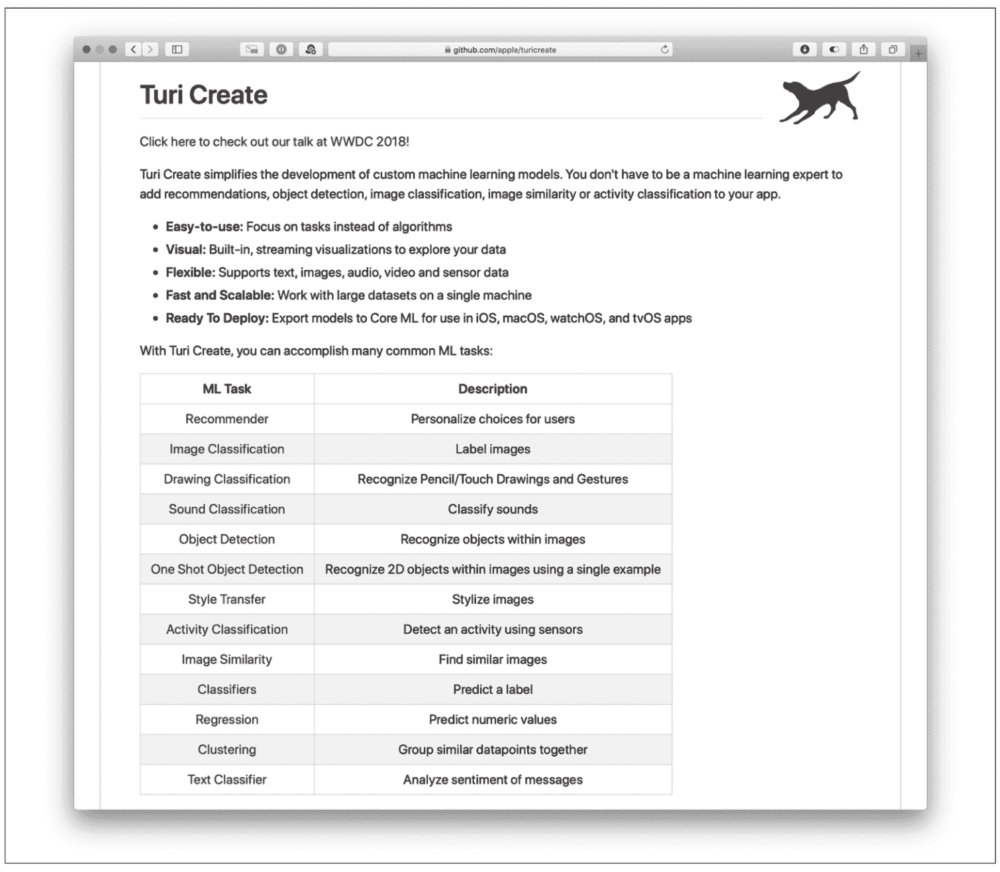

图 2-9: GitHub 上的 Turi Create 项目

Turi Create 可在 GitHub 找到，但通常无需下载或克隆仓库，因其以 Python 包形式提供。2.5.1 节将演示如何配置偏好的 Python 发行版与环境。

Turi Create 是一个任务导向的 AI 工具包，其大部分功能针对特定实际任务设计。若需回顾任务导向 AI，请回看前言。

写作当时，Turi Create 提供的任务导向工具包包括：

- 推荐系统
- 图像分类
- 绘图分类
- 声音分类
- 图像相似度
- 对象检测
- 风格转换
- 行为分类
- 文本分类

第二部分将介绍其中大部分内容，此处不再展开。我们亦使用 Turi Create 即便其为 Python 而非 Swift，完成以下任务：

- 第 8 章中的图像风格转换
- 第 11 章中的绘图识别
- 第 7 章中的行为分类

### 了解 Turi Create 的各个方面

与 CreateML 类似，除前述任务导向工具包外，Turi Create 还包含众多实用组件。Turi Create 的特性远不止任务层面，其手册已较好覆盖大部分内容，总体而言非任务主导的部分对数据操作非常有用，包括绘制与交互式展示数据集。

Turi Create 中支持常规表格分类、回归与聚类的部分确实实用，但本节不作深入探讨，尽管整本书均涉及它们。

我们认为除任务工具包外，Turi Create 最有价值的部分是其数据处理工具：

- SArray 是一个可存储超主内存数据的数组。在需处理大规模数据集并在训练前进行操作时十分有用。

`SFrame` 本质上是一种能落盘的表格式数据结构，跟 `CreateML` 中的 `MLDataTable` 属于同一思路。它把海量数据以列行方式长期保存在磁盘上，而不是全部加载到内存。`SFrame` 的每一列都是一个 `SArray`。`SArray` 的创建非常自由，可以直接从 CSV 文件、文本文件、Python 字典、Pandas 的 DataFrame、JSON 甚至是已经存在磁盘上的 `SFrame` 构造出来，灵活到让人惊讶。

`SGraph` 则是在 `SFrame` 之上构建的图结构。它让你能够保存由顶点和边构成的复杂关系网络，并对这些数据进行浏览式探索。

另外一个常被低估的点是，`Turi Create` 自带了一套可视化能力：

- `SArray` 与 `SFrame` 都提供了 `show()` 方法，可以把数据结构以图表形式呈现出来，支持原生图形界面，也能在 Jupyter Notebook 中使用，效果同样惊艳。
- `SArray` 与 `SFrame` 都支持 `explore()` 方法，会打开该数据结构的交互式浏览窗口。

关于 `Turi Create` 可视化工具的更多细节，可以在官方文档里查阅。

`Turi Create` 同时还开放了 C++ API，如果你想把它的能力嵌入到其他应用程序中，这个接口就很有用。

可以用来扩展 `Turi Create` 的第三方框架非常多。我们最偏爱的一个是 `turi-annotate-od`，它专门为 `Turi Create` 的任务式工具包准备目标检测所需的图片标注工作。更多信息可以在对应的 GitHub 项目里找到。

### 2.3.4 苹果自带的免训练 AI 框架

苹果提供了大量开箱即用的 AI 能力框架，在为苹果平台开发项目时可以直接调用。框架数量众多无法全部列出，但在第二部分的任务实践中我们主要用到了以下几类：

- `Vision`，负责运行计算机视觉算法。
- `Natural Language`，负责对自然语言文本进行分析。
- `Sound Analysis`，负责对音频流和音频文件进行分析。
- `Speech`，负责把人类语音识别成文字。

这里不展开这些框架的具体用法，后续章节的任务会深入研究。简单说，有时你会用 `CreateML` 或 `Turi Create` 训练一个模型，然后通过 `CoreML` 直接调用；有时图像相关的任务会借助 `Vision` 和 `CoreML` 共同完成。两者关系如图 2-10 所示。

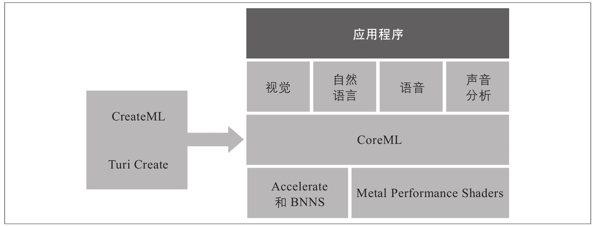

图 2-10：苹果的 AI 工具以及它们之间的关系

有时候根本不需要自己训练模型，仅靠苹果的框架就能实现强大的 AI 功能，比如在 App 内做语音识别。

本书的立场比较开放：我们讨论实现 AI 功能的最直接路径，无论是自己从头创建并训练模型、采用别人的模型，还是直接使用苹果提供的框架，其中就包括苹果官方训练好的模型。

你可能会好奇苹果的 `BNNS` 和 `Accelerate` 框架该怎么定位。读完苹果文档后，觉得我们假装这两个框架不存在也情有可原。但它们其实非常实用，只是就实用 AI 而言——这里的实用指可落地操作——我们认为两者并不在核心范畴。第 12 章会专门探讨它们，但建议先把前面的内容读完。

### 2.3.5 CoreML 社区工具

接下来要介绍的最后一个苹果系工具是 `CoreML` 社区工具。这是一组 Python 脚本，可以把其他机器学习模型格式导入并转换成 `CoreML` 格式。可以在苹果的 GitHub 上找到该工具，如图 2-11 所示。

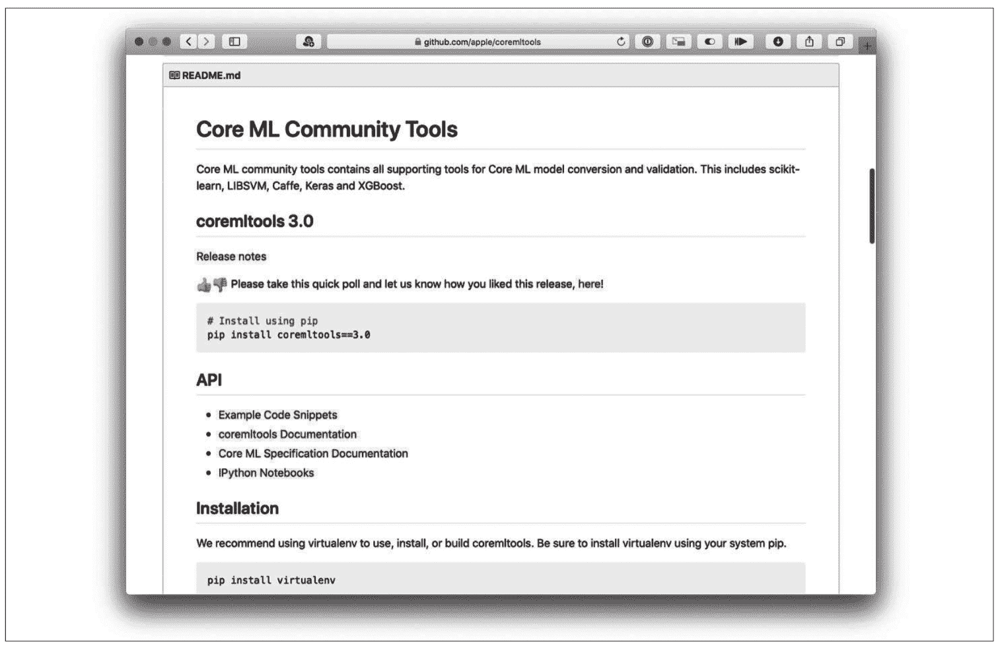

图 2-11: `CoreML`社区工具

使用 `CoreML` 社区工具可以做到：

- 把 `Keras`、`Caffe`、`scikit-learn`、`libsvm`、`XGBoost` 等格式的模型转成 `CoreML` 格式。
- 转换完成后把生成的 `CoreML` 模型以 `.mlmodel` 文件形式写出。
- 通过 `CoreML` 框架对转换后的模型做基础推理，用来验证转换是否正确。
- 从零开始逐层搭建神经网络。
- 创建可在设备端更新的模型。
- 借助其他包来处理 `TensorFlow` 模型。

如果你已经在用机器学习工具，会发现列表里没有 `TensorFlow`。没错，`TensorFlow` 的用法会在 2.4 节说明。

在其他机器学习和 AI 平台上做重要工作的人，也能把成果搬到 `CoreML` 上使用。这让 `CoreML` 具备了合法性，也把更广的机器学习生态带进了苹果世界。

你并不一定要频繁使用 `CoreML` 工具——在采用任务式实践方法时，比如本书的方式，很少用到它们。我们之所以提及，是因为它们是支撑苹果与 Swift AI 生态的关键组件。

安装 `CoreML` 社区工具时，可以用你习惯的 Python 包管理器安装 `coremltools`。关于偏好的 Python 发行版和环境配置会在 2.5.1 节讨论。如果你想保持 Python 安装的整洁，可以在 `virtualenv` 或类似隔离环境中安装 `coremltools`。

我们不会给出使用 `CoreML` 工具的完整教程和完整实操示例，因为官方文档已经覆盖得很全面。这里只是说明它的能力，以及它如何适配本书示例中的工作流。

如果你想手动下载，也可以在苹果 GitHub 上获取 `CoreML` 社区工具。下载后可以学习从源码构建。我们不建议这么做，因为没有实际收益。

如果你尚未使用其他机器学习工具，`CoreML` 工具可以帮助你把他人的模型转成可在 App 中使用的格式。

翻看 `Caffe` 模型和 `MXNet` 模型的庞大清单，你就能感受到使用其他格式模型能实现哪些功能。

第 9 章会给出一些使用 `CoreML` 工具的小例子，分别作为 9.4 节和 8.4 节的一部分。

脚注

## 2.4 其他工具

对 Swift 与实用 AI 来说，最关键的两个非苹果出品工具是 `TensorFlow to CoreML Model Converter` 和 `Swift for TensorFlow`。

下面介绍一些来自非大厂的有用第三方工具。

### 2.4.1 Swift for TensorFlow

`Swift for TensorFlow` 是一套围绕 Swift 设计的全新机器学习工具集，把 `TensorFlow` 相关能力直接集成进 Swift 语言。它是一个庞大复杂的项目，其实现思路与基于 Python 的传统 `TensorFlow` 项目不同。

在本书成书时，`Swift for TensorFlow` 的版本尚未达到 1.0，仍在积极开发中。这是一个早期项目，并非所有功能都已完备。我们很想为它写一本书，但它变化太快，恐怕每个月都要重写。所以我们采取宏观视角，提供一个宽泛的章节来探索它的可能性。具体内容见第 9 章。

`Swift for TensorFlow` 可以在 GitHub 上找到，如图 2-12 所示，但我们不建议克隆或下载源码仓库。

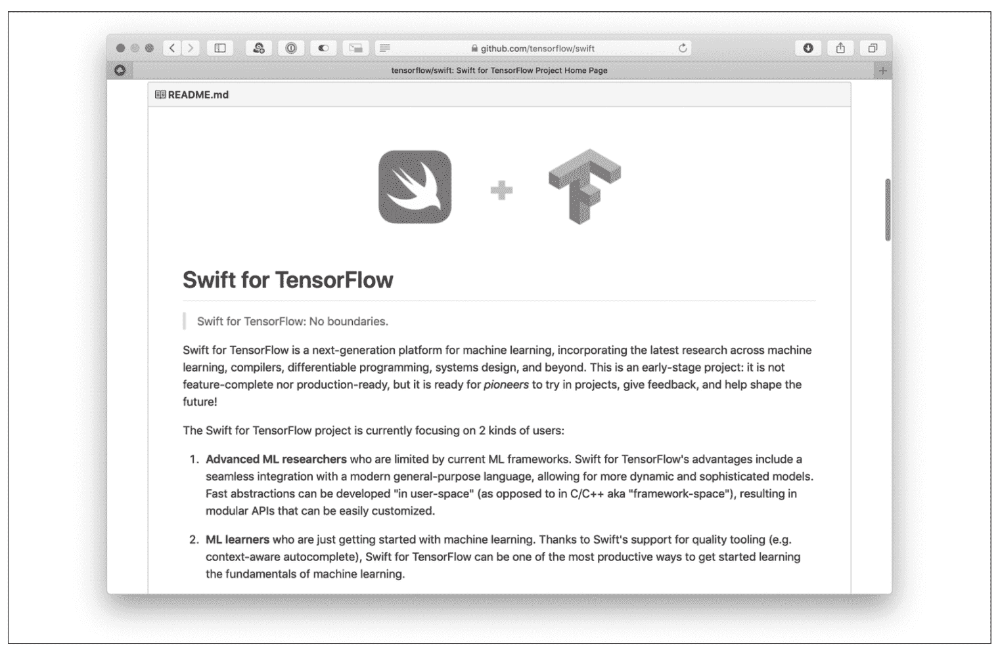

图 2-12: GitHub 上的`Swift for TensorFlow`

第 9 章会讲解如何把 `Swift for TensorFlow` 应用到任务式的实际 AI 问题中，详见 9.3 节。

### 2.4.2 TensorFlow to CoreML Model Converter

顾名思义，该转换器让你用 Python 把 `TensorFlow` 模型转成 `CoreML`。它依赖 `CoreML` 工具已安装，并可以通过 Python 包管理器以 `tfcoreml` 的形式使用。

其运行方式如下：

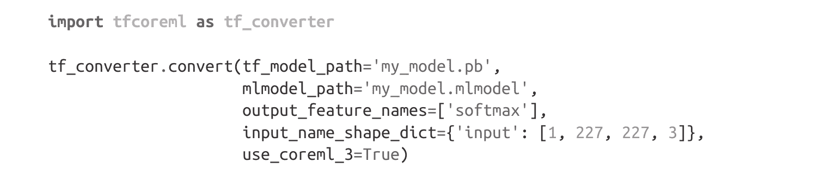

`TensorFlow to CoreML Model Converter` 的详细用法已超出本书范围，感兴趣的话可以在项目 GitHub 页面了解更多。

### 2.4.3 其他转换器

市场上还有其他转换方案，例如：

- 微软的 `MMdnn`，支持在 `CoreML` 与其他模型格式之间双向转换。
- `torch2coreml`，支持把 `PyTorch` 模型转成 `CoreML`。
- `mxnet-to-coreml`，支持把 `MXNet` 模型转成 `CoreML`。

它们都很实用，这里不逐一展开，掌握一个后迁移到另一个并不困难。

脚注

## 2.5 AI 相邻工具

Python 与 Swift 在语言层面上出人意料地相似，但差异也很关键。正如前面所说，本书对 Python 的使用程度比读者预期更高，但由于主题是 Swift，Python 的细节常常会被略过。

建议阅读《Machine Learning with Python Cookbook》和《Thoughtful Machine Learning with Python》。

### 2.5.1 Python

深入讨论如何用 Python 实现实用 AI 超出了本书范围，这也不是我们的专业方向！阅读本书时你偶尔需要 Python，我们会推荐一种在 macOS 上搭建 Python 的具体做法。

在 macOS 10.15 Catalina 之前，Python 是预装在系统里的。10.15 是阅读本书时应使用的 macOS 版本。较老的资料可能默认系统自带 Python。除非你是从旧版 macOS 升级到 Catalina 且保留了原有安装，否则现在不再预装。

要用 Python 做 AI、机器学习和数据科学，我们推荐 `Anaconda` Python 发行版。它是一个开源集合，包含简易的包管理器以及进行 AI 开发所需的各项组件。

一般搭建步骤如下：

1. 下载适用于 macOS 的 Python 3.7 `Anaconda` 发行版。

`Anaconda` 还附带图形化环境管理工具。我们更偏爱命令行，觉得解释起来更清晰也更好融入工作流，但如果你喜欢图形界面，也可以启动 “`Anaconda Navigator`” 探索。更多信息见 `http://bit.ly/2IIPdrm`。

2. 安装 `Anaconda`，如图 2-13 所示。 “Preparing Anaconda” 阶段如图 2-14 所示，可能需要一些时间。

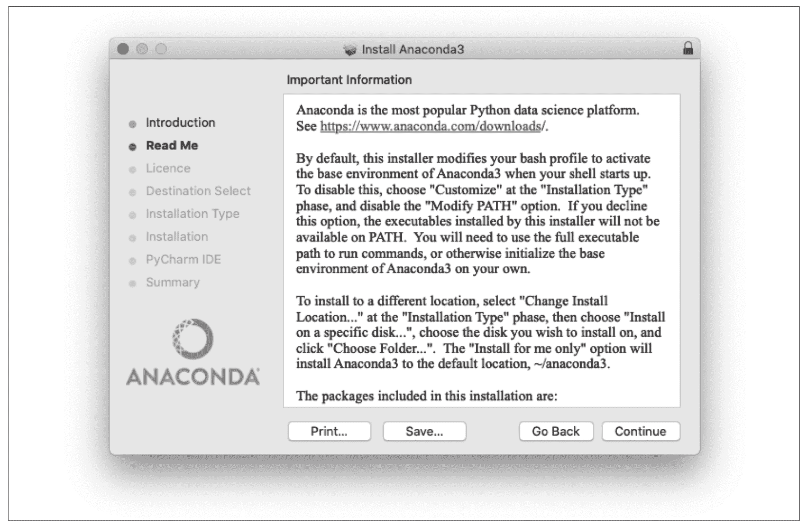

图 2-13：在 macOS 上安装`Anaconda`

3. 打开终端，执行以下命令：

该命令会为你创建一个空的新环境。针对每组特定的 Python 任务，都可以用不同名称重复此命令，而不是一直用 `MyEnvironment1`。

4. 执行以下命令激活 `MyEnvironment1`：

执行以下命令退出当前的 `Anaconda` 环境：

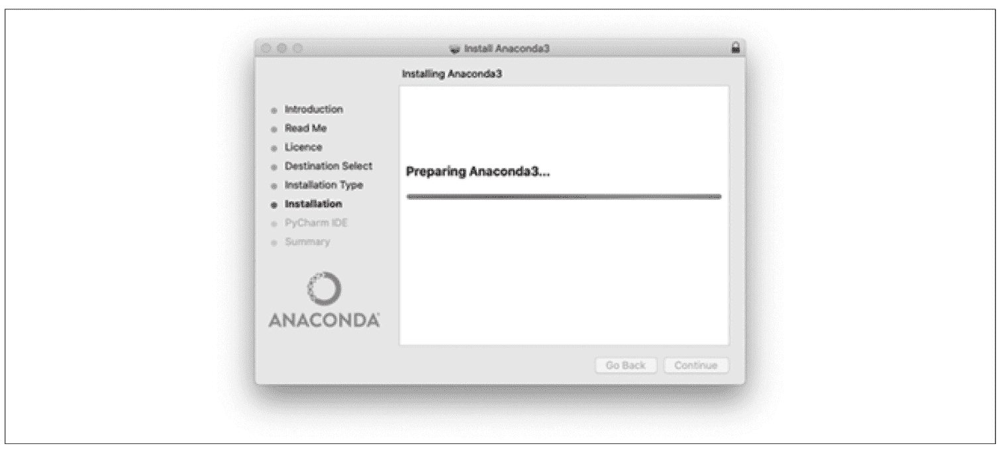

图 2-14：准备 Anaconda

整个流程如图 2-15 所示。

5. 许多 AI 与机器学习工具要求 Python 3.6。你可以用以下命令强制 `Anaconda` 创建 Python 3.6 环境：

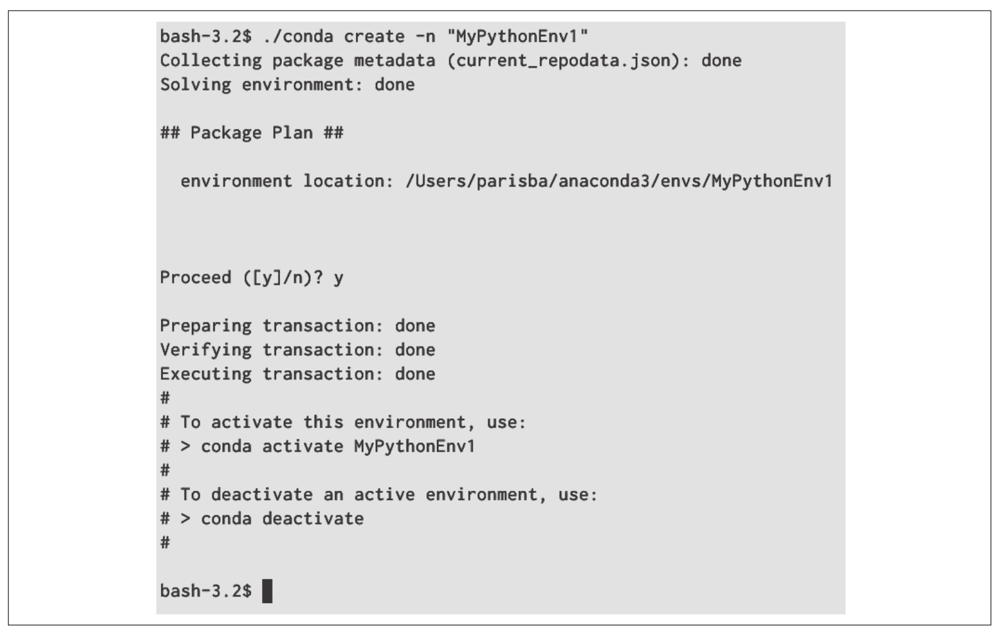

图 2-15：创建一个新的 Anaconda 环境

6. 在指定 Python 版本的环境创建后，可以在该环境中执行以下操作来确认版本是否正确：

应能看到 Python 打印出版本号，如图 2-16 所示。

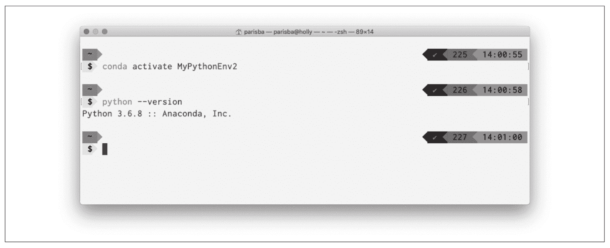

图 2-16：显示 Python 版本

7. 随时可以通过以下命令查看当前使用的 `Anaconda` 环境，或列出所有环境：

`Anaconda` 会在当前工作环境旁标注星号 `*`，如图 2-17 所示。

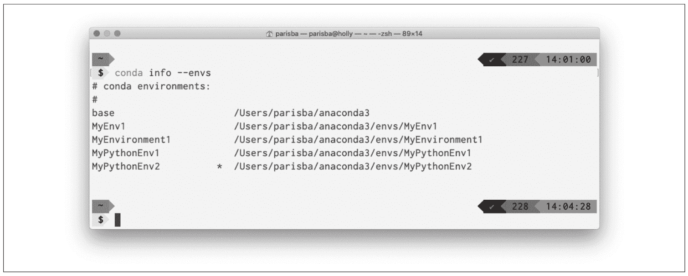

图 2-17：列出 Anaconda 环境；当前环境旁边有一个星号

8. 可以通过以下命令复制已有环境：

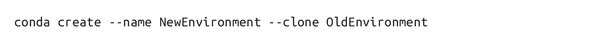

把 `NewEnvironment` 换成想要的新副本名称，`OldEnvironment` 换成要克隆的环境名称：

 `Anaconda` 还提供许多其他环境管理功能，详情请查阅官方文档。O’Reilly 出版社也有相关好书，例如《Introducing Python, Second Edition》。

9. 可以用 `Anaconda` 内置的包管理器安装软件包。要搜索可用包，在环境中执行：

该命令会在 `Anaconda` 包仓库中搜索 `scipy`。

10. 用 `Anaconda` 包管理器安装包，执行：

 `install` 命令会在当前激活的环境中安装指定包。若要在特定环境中安装，可使用类似 `conda install --name MyEnvironment1 scipy` 的写法。

11. 可以一次性安装多个包，例如：

12. 若所需包在 `Anaconda` 包管理器中找不到，可改用 `pip`。`pip` 是 Python 社区的标准包管理器。要用 `pip` 安装包，先激活目标环境再执行：

当然，把 `turicreate` 换成你想要安装的包名。

 强烈建议优先从 `Anaconda` 包管理器安装，仅在 `Anaconda` 不提供时才使用 `pip`。

当我们提示你创建新 Python 环境时，建议按上述流程为具体项目或任务单独建一个 `Anaconda` 环境。

对于每个使用 Python 的任务，我们都会指出该任务环境中应安装的包，以及这些包在 `Anaconda` 包管理器或 `pip` 中是否可用。

要记住的是，Anaconda 这套 Python 发行版是冲着数据科学、机器学习以及 AI 这类场景去优化的。若你的目标是一般的 Python 通用开发，选择另外的 Python 环境会更合适。

### 2.5.2 Keras、Pandas、Jupyter、Colaboratory、Docker
在 Swift 与 AI 结合的实践中，可选的工具链非常丰富且难以穷举。尤其是写 Python 脚本时，会接触到大量实用的框架，比如 `Keras`——它以更友好的方式把机器学习常用功能打包起来，如图 2-18 所示；再比如 `Pandas`——专门用于数据操作的库，如图 2-19 所示。

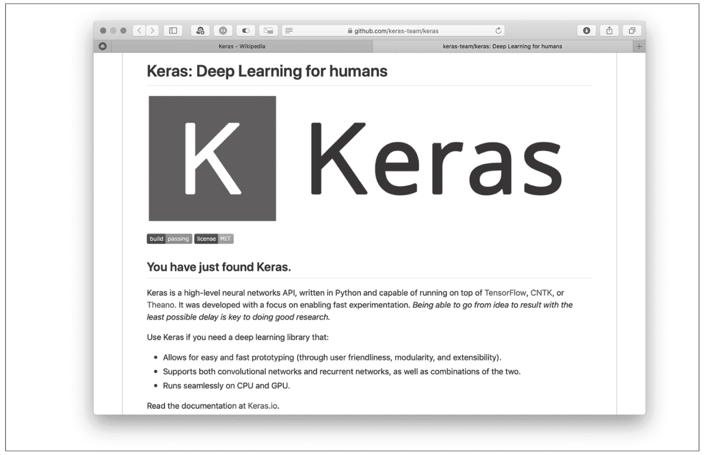
图 2-18: Keras Github
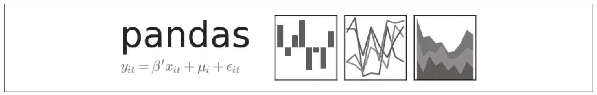
图 2-19: Pandas

`NumPy` 和 `scikit-learn` 也是经常被拿来用的 Python 工具，前者后者都能提供多种多样的數據处理与分析手段。

书中部分任务会借助这些 Python 框架来完成。关于它们的具体用法就不展开了，网上资料和 O’Reilly 的在线学习课程里都有系统讲解。

剩下可能会接触到的三个关键工具是 `Jupyter`、Google 的 `Colaboratory` 以及 `Docker`。

`Jupyter` Notebook 提供了基于网页的交互式编程环境，支持 Python，条件允许的话也能通过插件运行其他语言，在浏览器里就能编写、执行并分享代码。

在数据科学圈里，`Jupyter` 很受欢迎，因为它能把代码和说明文档集成在一起，方便交流与传播。Google 推出的 `Colaboratory`，简称 `Colab`，就是一个免费托管的 `Jupyter` Notebook 变体。

`Colab` 保留了 `Jupyter` 的核心能力，甚至在此基础上做了增强，而且无需自行部署，直接借助 Google 的云资源即可运行。图 2-20 展示了 `Colab` 的界面，访问地址是 `https://colab.research.google.com`。

对 AI 相关工作而言，`Colab` 是一个很方便的脚本运行场所，尤其当你不希望在本地安装 Python 环境时。

图 2-20：来自谷歌的 Colab

`Docker` 本质上是一种容器化技术，可以把应用连同依赖一起打包，实现免安装即可分发。面对体积庞大或安装复杂的项目，`Docker` 尤其好用。本书第 9.1 节会实际用到它，想了解更多可自行查阅相关资料。

### 2.5.3 其他工具
Matthijs Hollemans 维护的 `CoreMLHelpers` 仓库是我们觉得特别贴心的小工具集合，功能还在持续迭代，包含：

• 图像与 `CVPixelBuffer` 之间的相互转换。
• `MLMultiArray` 转成图像的支持。
• 获取 Top 5 预测、`argmax` 等实用函数。
• 边界框的非极大值抑制。
• 对 `MLMultiArray` 做了更贴合 Swift 使用习惯的封装。

其中许多功能现在可能用不上，但后期会发现很实用。

若想深入了解这些工具，我们非常推荐 Matthijs Holleman 所著的《CoreML Survival Guide》。

我们也很看好 Fritz AI，他们的教程、文档和示例项目让移动端 AI 的上手门槛大大降低。

脚注

## 2.6 下一步
本章并没有试图穷尽 Swift 下所有可用的 AI 工具，而是从任务导向、自上而下的角度，聚焦在实际使用 Swift 时最常碰到的那些工具。

这里提到的工具大多会在第二部分或第三部分中得到更进一步的展开。

你可能会好奇，如何运用本章介绍的工具去创建、修改或探索模型。这正是我们在第二部分逐章会回应的问题。

最初我们曾考虑单独写一章讲解 CoreML 模型的使用，但后来发现这会偏离本书的核心定位——一份面向实践的 AI 指南。本书更关注用 AI 构建功能与体验，而非工具本身的研究。本章是我们在这一点上的唯一妥协，也是必要的妥协。更多从工具视角出发的文章、教程和代码，可在我们的官网查阅。

脚注

## 第 3 章　寻找或构建数据集
很多机器学习或 AI 的入门示例都会附带现成的数据集。但在自己落地项目时，往往没有现成可用。如何找到合适的数据并将其转化为可建模的输入，这本身就是一件挑战。

数据科学里常说 `GIGO`，即 “垃圾进，垃圾出”，模型表现的上限取决于训练数据的质量。本章会介绍如何获取现成的数据集，或是自行规划、构建自己的数据集。

需要提醒的是，这一流程的每个环节都高度依赖具体业务和数据特点，属于偏进阶的内容，很多数据整理技巧也是长期经验累积的结果。

## 3.1 规划和识别目标数据
不少人把数据集规划看作设计环节，这一点也不夸张。机器学习里最常见的失误之一，就是选错输入数据——不只是数据质量或来源的问题，更关键的是输入与模型要预测的目标关联不足。

并非所有问题都能单纯靠技术解决。比如预测天气，至少需要历史温度、湿度等数据，看似直观；但换成其他场景，难度就会增加。

比如要预测人类行为该怎么建模？某大学 AI 基础课上常被提出的假设题就是：预测一名学生在某天的恶作剧概率。除了记录当天是否作案，还可能需要星期几、早餐内容、睡眠情况、是否被禁足、天气状况、好朋友是否在校等信息，变量清单可以不断延伸。

但对情绪或行为有影响的因素清单，到底该截到哪里？答案是没尽头。

若试图建模蝴蝶效应，很容易陷入无限细节。所以在训练前，数据准备通常被简化为：

获取数据 → 清洗数据 → 转换数据 → 训练

因为没有万能方案，实际操作更偏向迭代式流程：

调研数据源 → 获取数据 → 探索数据 → 清洗数据 → 再次探索 → 转换数据 → 再探索 → 训练

整个过程中随时可能回到起点。

真正的项目里，往往在正式训练前会多次审视转换后的数据，根据新发现调整转换方式，或意识到需要补充某些变量。

并没有一套固定的标准，鼓励多一些头脑风暴。但在数据与问题逻辑层面，有两个常见坑要避免：

• 否定即失败
• 封闭世界假设

### 3.1.1 否定即失败
该术语指当一个命题无法被证实时，就直接当作假来处理。

比如 `if/else` 与 `if/else if` 的差别看似微小，前者给肯定情况设捕获条件，其余一律归为否定；后者只定义两种捕获情况，其余不做处理。但若问题本身定义不清，这种逻辑很容易引发错误。例如：

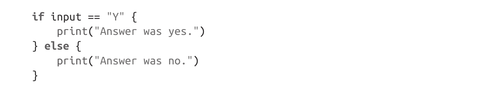
若输入只能是两个按钮，这样的写法或许还能凑合，但代码会把所有非预期输入都计为否。于是 `y` 也会被判为否，`yes` 同样为否，甚至任意字符或回车也算否。题目期望的是 `Y` 或 `N`，但上下文并未对输入范围做出明确界定。

### 3.1.2 封闭世界假设
该概念指的是把手上已有的信息误认为就是全部。例如把某个列表当成完全穷举就属于这种假设：

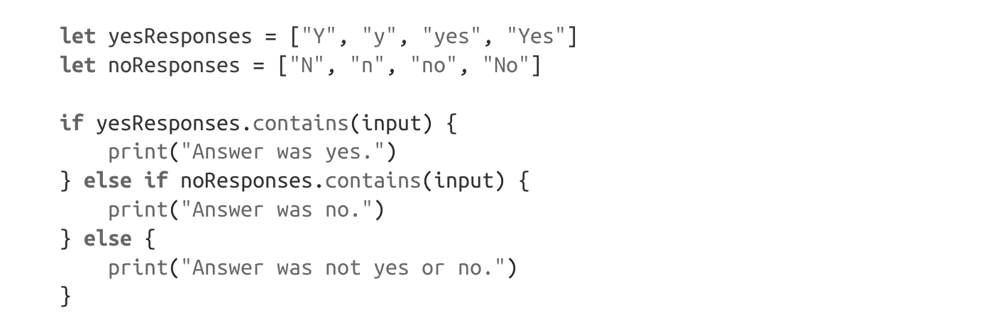
这算改进吗？也许算。但算完美吗？绝对不。一个理想的系统应像人脑处理口头“是/否”那样判断：这个发音是否在可识别范围，并是否匹配过往学习过的表示肯定或否定的词汇？如果匹配，就推测其意图，或判断为陌生俚语；同时要能主动确认，用户是否真的想表达二选一的答案。

###### 认罪
不久前，一位作者在为自己的 macOS 应用做快速替代方案时犯了类似错误。私下阶段已有一个在专有数据上训练得很稳的艺术风格分类模型，但要公开演示前必须替换掉。替代数据集不好找，临时凑出来的版本准确率远不如原来，因为原始类别在新数据里根本未出现。

临时的修补是：当模型置信度低于 `n%` 时就不输出结果。但这也带来新问题——若一张图同时混合了多个类别，导致模型无法抉择，它仍然会被判为未分类。

就演示而言，也算够用了。

除了逻辑上的失误，推理上的偏差影响更大。多数方案的核心目标是让系统设计和输入数据尽可能精确、完整地反映所要建模的现象。这很难，但值得投入。

记住，除了图像类数据——照片、光谱图、视频帧等——绝大多数数据集最终都要转成表格形式。试着思考：若把问题空间里所有历史观测都放进一张表，列名应该是什么，类型又是什么？

脚注

## 3.2 寻找数据集
知道去哪里找数据、怎样找数据很有帮助。虽然 AI 应用场景五花八门，找数据的方式也很主观，但依然存在一些通用的原则和建议。

### 3.2.1 去哪里找
对于常见任务，起步的地方有很多。

类似 Google Scholar 用于论文检索，Google Dataset Search 就是专门找数据集的入口。Google 生态无处不在，是了解某个主题的很好起点。Google 还有自己的公共数据仓库 Google Public Data，AWS 也设有数据目录 AWS Data Registry。

Kaggle.com 是一个聚焦数据科学的社区平台，汇聚了大量社区和企业贡献的数据集，主题覆盖面广。同时它也是通过竞赛和讨论来学习数据分析技巧的重要渠道。

科研机构经常会公开科学数据，若你需要对人类敏感数据的匿名版本，这类来源就很关键。以澳大利亚为例，就有澳大利亚统计局、CSIRO 等机构，以及统一的政府数据门户 data.gov.au。

全球范围内，NASA、NOAA、NIST、CDC、WHO、UNICEF、CERN、马普所、CNR、EPA 等机构都提供公开数据。

大多数国家也设有统一的政府开放数据平台，比如美国的 data.gov、加拿大的 open.canada.ca、新西兰的 data.govt.nz、欧盟的 data.europa.eu、英国的 data.gov.uk。

部分非科研机构也会发布数据仓库，比如世界银行和国际货币基金组织(IMF)，它们已成为开放金融与宏观数据的核心来源。

新闻媒体如 FiveThirtyEight、BuzzFeed 也会发布调查数据，涵盖社会政治议题——网络审查、政府监控、枪支、医疗等——以及体育成绩、民调等各类内容。

Reddit 上 `/r/datasets` 是交流资源的优质社区，可以浏览有趣的数据集，也能针对具体问题求助，甚至能找到整理好的开放门户清单。顺带一提，`/r/MachineLearning` 也值得常逛。

偶尔爱好者也能贡献惊喜。作者最爱的网站之一是 Jonathan’s Space Home Page，由哈佛-史密森天体物理中心的科学家维护，收录了所有发射物体的详细清单，作为业余项目完成，令人惊叹。

另一类稍显冷门的宝库是 OEIS——整数数列在线大全，收录了大量数列及其图示、生成公式等信息。无论是卡塔兰数还是忙碌海狸问题，都能在这里找到对应条目。

此外还有大量网站充当特定领域的数据集索引，比如开放政府数据或学术研究数据。

这足以说明，数据无处不在。我们每天都在产生新数据，也有大量个人和机构致力于共享。个人对数据源的偏好是随着经验积累的，值得保持开放心态多尝试。

### 3.2.2 寻找什么
出发前先明确需求，清楚自己需要哪些信息来构建模型。在评估潜在数据时，可思考：

• 数据包含哪些值，类型如何。
• 由谁收集。
• 采用何种采集方法。
• 时间跨度怎样。
• 单个数据集是否足以解决问题，若不足，是否方便与其他来源融合？

即使是现成的数据集，通常也需要调整才能适配新任务。即便默认数据是干净的，也应验证无误，因为仍可能需要格式转换。关注常规的数据准备流程，有助于保证最终质量。

需要额外或不同格式的信息来达成预期结果的情况也很常见。预构建的数据集可以用作起点，但不应免检；若数据不匹配，哪怕短期成本高，也应考虑修改或更换。

脚注

## 3.3 构建数据集
若要从零搭建数据集，必须先获取原始素材。总体上可归为三大方向：自行记录、整合整理、以及抓取采集。

### 免责声明
各国对数据采集、存储与使用的法规差异很大。本节提及的方法在某地可能合法，在另一地则可能违法。任何操作必须先确认合法性，不得先斩后奏。

对不属于自己的在线内容进行抓取或监控，在不少司法辖区会带来严重后果，无论是否知情、目的何在，都不值得尝试。

部分做法在法律上边界模糊，比如在公共场所拍摄或录像，或使用原本为其他目的提供的数据。即使数据许可允许使用，仍需审视采集方式与责任。原则上，除非拥有明确授权，否则不应采集或使用他人数据。

### 3.3.1 数据记录
数据记录是最直接的采集方式：亲自动手观察现象与属性，生成专属数据。可借助物理设备——传感器、相机等，也可使用数字化工具——追踪器、爬虫等。

你可以记录特定场景下的行为或环境状况，拍摄目标对象的图像，或抓取 Web 服务的访问日志来预测用户行为。

这种方式能为此前未被记录的主题打造高度定制的数据集，但代价是耗时最多。数据质量也受采集设备与方法影响，建议具备相应专业背景。

### 3.3.2 数据整理
数据整理是指把分散的信息源拼接起来，形成新的分析素材。可通过从报告中抽取、跨平台合并、调用 API 等方式实现，本质上是把分布各处的数据整合为统一形式。

有时整理数据的耗时不亚于自行采集，但能触及难以直接观测的场景——比如海外事件或企业内部现象。某些公司不公开原始数据集，却会在论文中披露全部信息；有些网站虽不提供批量下载，却允许逐条查询特定行为是否存在。

整理质量取决于合并时的严谨度。单位不一致、转录失误等低级错误就可能毁掉整个项目。

### 3.3.3 数据抓取
数据抓取是通过程序批量提取已存在但未结构化信息的技术，可将其转为可用格式。过去社交媒体分析大量依赖抓取，但如今多数平台对数据获取和使用都设有限制。

抓取本质上是软件自动访问、解析并下载网页内容，再经清洗后使用。抓取必须有明确目的，避免无差别采集。

脚注

## 3.4 准备数据集
原始数据本身不具备直接价值，必须经过准备才能使用。

### 3.4.1 了解数据集
如前所述，数据探索是准备环节的核心且反复进行。即便数据量太大无法逐条人工检查，仍需先验证质量与适用性，再交给模型训练。

做法可以很简单：把样本导入电子表格，查看每列的值类型与取值范围，就能发现异常——比如用 0 替代缺失值而非 `NULL`，或出现不合理区间、单位混用——如华氏与摄氏混在一起，暗示数据源被错误合并。

若数据超出电子表格承载能力，`Python` 脚本或 `RStudio` 等分析工具能提供可视化、汇总与报表功能。无论用什么方式，至少应确认各属性的格式及大致分布。

#### 数据处理工具箱

在真正动手用数据之前，通常会先经过一轮清洗、整理与探查。回顾第 2 章的说明，Python 在这块几乎是业界默认选择，生态里围绕它长出了大量可用的组件。

像 Matplotlib 这样的库，能轻松把数据画成图表来做初步目视检查。Pillow 则提供了丰富的图片读写、变换与操作能力。Python 自带统计模块应付基础需求，若要更强的数值计算，NumPy 就能补上。文件格式的支持也相当全面，CSV、JSON、YAML、XML、HTML 等常见格式都能直接处理，甚至 TOML、INI 这类小众格式也不在话下。

万一现成的包不够用，可以去官方的软件包索引里检索，基本总能找到对应的方案。另一种做法是直接搜索“我要用 Python 做某件事”，往往会有人踩过同样的坑并留下参考。Python 之外的语言也都有类似能力，我们偏爱 Python 主要是因为它把重复劳动都做了，而且示例非常多，并没有魔法，只是更主流、更省心。

若不想写代码，Excel、Numbers 或 Google Sheets 这类电子表格同样能快速获得初步洞见，数据准备虽然有时会比较繁琐，但上手极快，而且多数设备上都已预装。

另外别局限思路——仅靠压缩数据集也能粗略判断信息量。压缩率高的数据集熵值相对较低，如果同源的两个集压缩率差异很大，后者往往包含更多不可预测的信息。第 2 章对这些工具做了更详细的展开，感兴趣可以再回头复习。

图像集不像表格那样直观，但花点时间扫一眼整体质量和裁剪方式是值得的。第 2.3.3 节提到，Turi Create 的可视化功能在理解数据时非常好用。图 3-1 就是一个示范。

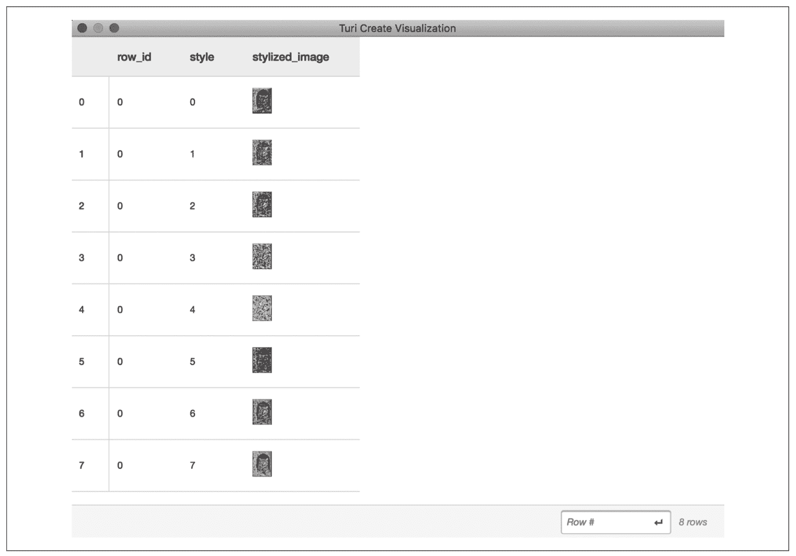

图 3-1：用 Turi Create 认识数据

### 3.4.2 数据清洗
在熟悉数据集的过程中，常常会碰到各种错误。记录环节就会引入噪声，主要可归纳为三类：

- 体系性数值错误
- 个体数值错误
- 缺失值

体系性错误会导致整列或一组数据失真，例如用未校准的仪器采集、用受热物体旁的传感器测温、用未归零的天平称重等。跨源合并时若未做单位转换也会产生类似问题：把美国和英国的数据直接堆在一起，系统就会“合理地”认为 100 摄氏度是正常的。

个体数值错误指离群或偶发失准，仅在少数记录上出现异常或不合逻辑。比如传感器某天过载，产出的数值比理论上限高出上千个百分点，一眼就能看出问题。

缺失值则多半源于采集流程的缺陷或数据流转时的异常转换。表现形式多样，有 nil 或 NULL，也有字符串 “NONE”、默认值 0，甚至是乱码。

当体系性偏差可以被确认时，往往可以通过统一的缩放或转换把它纠正过来。个体错误和缺失值则需要做判断：要么用合理的估计值替代，要么直接剔除对应行或观测点。

常见的估算手段有：取该列其余值的平均数；取与缺失点最接近的观测值；或基于其他属性设计的应用层方法来推断。

### 3.4.3 数据转换
转换数据的动机主要有两个：满足算法对格式的要求，以及通过推断新属性来丰富信息。为此通常会做三类操作：

归一化
把数值数据的上下界映射到统一区间，方便比较与计算。
举例来说，评估鱼的健康要用长度、体重、年龄、失眼数等指标，若不同量纲直接比较会失真，归一化后才能放在同一尺度上衡量。

归一到正数区间的写法很简洁：
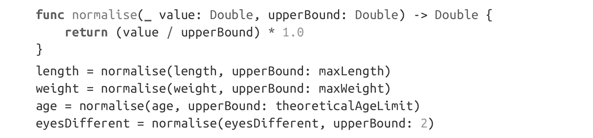

泛化
把具体值提升到更抽象的概念层面，便于群体分析。
比如 GPS 轨迹可以泛化为地址，避免每个微小位移都被视作位置变化；也可以把毫米级身高测量泛化为“偏矮、正常、偏高”等分组。

聚合
对复杂属性做概括，简化分析难度。
例如不逐段解析文本，而是提取关键词或词频，再与分类做关联。

在上述步骤的前后，数据还会经历增删改：

特征构建
通过推理或组合已有字段创造新属性。典型例子是保留原始值同时做泛化/聚合，或基于多字段合成新指标，例如从公司名和所在国查商业登记号，或由身高体重合成 BMI。

数据规约
去掉与另一属性高度相关、或对当前问题无帮助的字段。如地址、邮编、区号往往信息重叠；高度相关的字段也可能在建模时引入噪声而被剔除。

### 3.4.4 数据集适用性检验
到这里应该更仔细地审视问题本身和所选数据集。AI 前的数据分析并没有绝对的法则，但通常能判断解法是否可行、数据能否讲出想要的故事。

相信那种细微的怀疑，因为回头看会发现浪费的时间是有价值的。

再次回看数据，浏览、可视化，用少量子集做快速验证，必要时换个角度测试直觉。如果感觉仍然合理，就继续推进。

脚注

## 3.5 苹果官方模型
苹果提供了一个网站，收录了一批可直接使用的模型。如果你要实现的功能恰好能被这些模型覆盖，直接套用往往更快更省事。

截至写作时，苹果可用的模型包括：

- 基于图像预测深度的 FCRN-DepthPrediction
- 对图像主要物体进行分类的 MobileNetV2、Resnet50、SqueezNet
- 把图像像素细分为类别的 DeeplabV3
- 检测并分类图像中多个目标的 YOLOv3
- 根据文本生成问答的 BERTSQuAD

任务能匹配其中之一，就无需自行找数据、做标注或训练，直接调用现成模型即可。

本书第二部分的部分任务会用到苹果提供的这些模型。

脚注

# 第二部分　任务

## 第 4 章　视觉
本章聚焦在 Swift 应用中实现视觉相关的 AI 功能。采用自上而下的方法，围绕 7 个视觉任务探讨实现路径，以及如何借助 Swift 与各类 AI 工具完成它们。

### 4.1 实用 AI 与视觉
本章涉及的七个视觉实用任务如下：

人脸检测
利用图像分析定位人脸，并在此基础上做叠加、旋转等操作。

条形码检测
借助苹果框架在图像中查找条形码。

显著性检测
借助苹果框架找出图像中最突出的区域。

图像相似度
判断两张图有多像。我们会做一个小程序让用户选两张图并给出相似度。

图像分类
经典的 AI 问题。我们实现一个能区分图像类别的分类应用。

绘图识别
识别本质上是分类的一种。为了扩展实用 AI 的话题，我们做了一个应用，可拍摄线条图并识别其内容。

风格分类
在图像分类应用的基础上，把用其他工具链训练的模型转成苹果 CoreML 格式，用来辨识图像风格。

本章名为“视觉”，并非只讲苹果的 Vision 编程框架，但整本书里我们确实大量使用了 Vision，具体可查索引。

脚注

### 4.2 任务：人脸检测
无论是校验用户头像是否合规，还是根据 SnapChat 风格照片生成草图，人脸检测都是很多应用的基础。

本任务展示在 Swift iOS 应用里加入实用的人脸检测有多简单，不需要训练模型，直接使用苹果提供的 AI 框架即可。

因此本任务与书中其他案例略有不同，执行人脸检测的核心能力主要由苹果提供。4.5 节和 5.2 节也采用类似的苹果框架流程。

理论上你也可以自己训练人脸识别模型，但 iOS 相机应用已能识别人脸，苹果已经替你完成了这部分工作。

#### 4.2.1 问题与方法
人脸检测在实际场景中无处不在，作者曾在剧集 Person of Interest 中看到过对它的生动描述。

本任务按以下思路展开：

- 制作一个能检测照片中人脸的应用，用来确认用户是否上传了有效的头像。
- 完全依赖苹果现成工具，不训练模型。
- 探索后续的优化方向。

最终效果如图所示 4-1，能统计用户所选照片里的人脸数量。

#### 4.2.2 构建应用程序
用户界面采用苹果最新的 SwiftUI 框架来搭建。

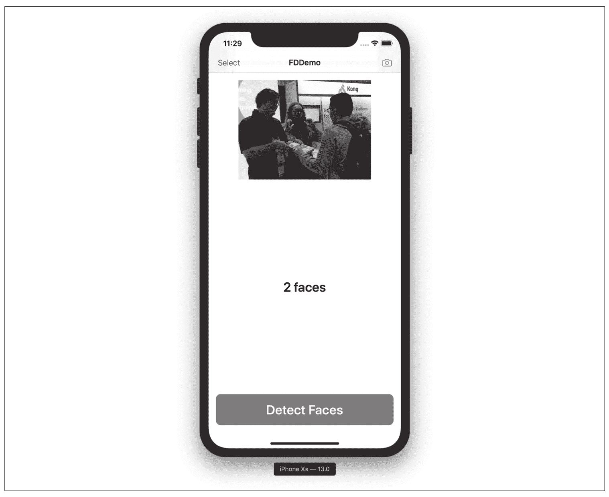

图 4-1：人脸计数应用的最终界面

本书在不同示例里交替使用 SwiftUI 与 UIKit，目的是让读者对两套 iOS UI 框架都有实践感受，可自行选择。

图 4-1 中的界面包含以下 SwiftUI 组件：

- NavigationView，用来展示标题和选择照片的按钮。
- Image 组件显示所选图片，供人脸计数使用。
- Button 触发计数操作。
- Text 显示计数结果。

如需复习 SwiftUI，可查阅苹果官方文档与我们的网站。

本例通过多个子视图组合而成，与书中其他 SwiftUI 示例的处理方式有所差异，意在展现实现 UI 的多样性，这也是我们同时使用 SwiftUI 与 UIKit 的原因。

不想手写代码的话，可从我们网站下载名为 FDDemo-Starter 的项目，后续从 4.2.3 节继续即可，建议不要跳过。

自行搭建人脸计数应用的步骤如下：

1. 启动 Xcode。
2. 在 Xcode 中新建 iOS 应用项目，选择 Single View App 模板，语言选 Swift 并勾选 SwiftUI，如图 4-2。

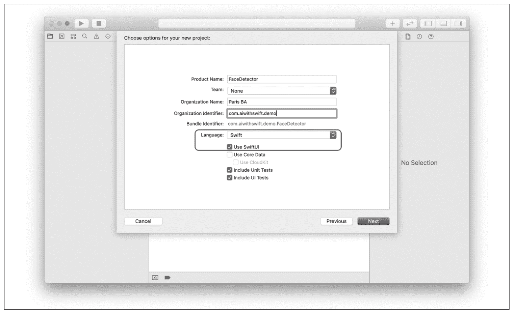

图 4-2：以 SwiftUI 创建新项目

3. 为项目新增 Swift 文件 Faces.swift，File→New→File，加入以下 import：

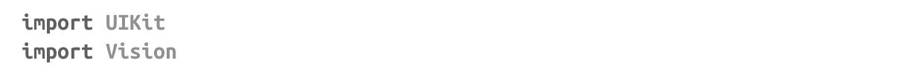

这里没有特别之处：导入 UIKit 是因为 UIImage 属于 UIKit，导入 Vision 是因为这是苹果的人脸检测框架。

4. 在 import 之后为 UIImage 增加扩展：

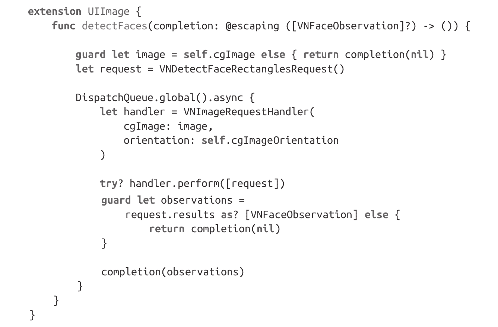

该扩展为 UIImage 添加 detectFaces 方法，使任意图片都能进行人脸检测。内部代码创建 VNDetectFaceRectanglesRequest 并提交到队列执行。

VNDetectFaceRectanglesRequest 的作用是返回分析图像中人脸的边界框，可在苹果文档中查阅细节。我们把它作为 VNImageRequestHandler 的一部分运行。

本书不专门讲 Swift，但需提醒：扩展可以为已有类型添加新功能，包括方法。更多信息见 Swift 官方文档。

使用 DispatchQueue.global().async{} 能让 VNImageRequestHandler 的调用在全局线程执行，避免阻塞 UI。可查阅苹果文档了解 DispatchQueue。

接下来新建文件 Views.swift，用来定义 SwiftUI 元素。

1. 导入 SwiftUI，新增 View 结构体 TwoStateButton：

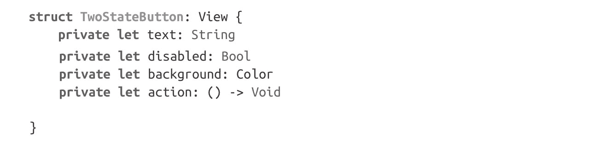

TwoStateButton 定义了一个可启停、变色的按钮，使用起来比较方便。

2. TwoStateButton 需要 body：

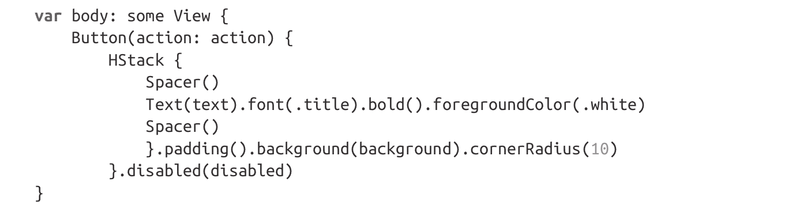

body 负责绘制，实质上根据变量状态绘制 Button 与 Text。

3. 还需要 init()：

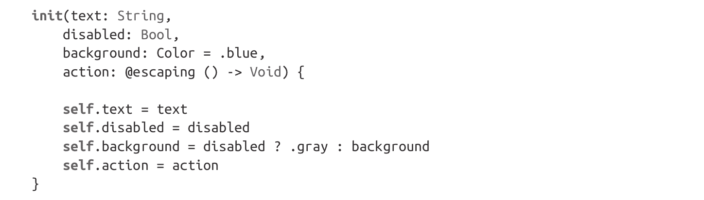

init() 用文本、是否禁用、背景色以及点击时的操作来初始化按钮。

4. 再创建另一个 View 结构体 MainView：

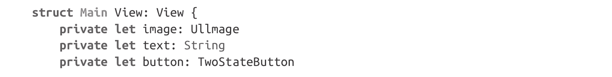

该视图保存 UIImage、String 以及之前创建的 TwoStateButton。

5. MainView 需要 body：

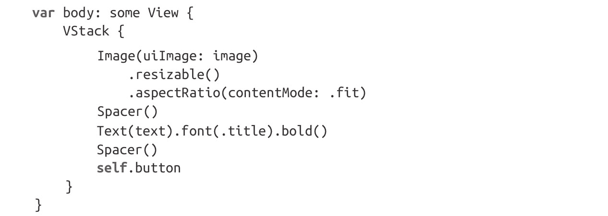

body 会绘制 Image、Spacer、Text 与 TwoStateButton。

6. MainView 还需要 init()：

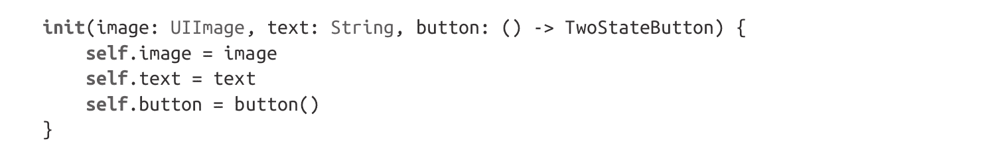

init() 用来初始化 MainView，设置图片、文本与按钮的初始值。

7. 最后需要一个继承自 UIViewControllerRepresentable 的较长结构体，以便从 SwiftUI 调用旧的 UIKit 组件 UIImagePicker：

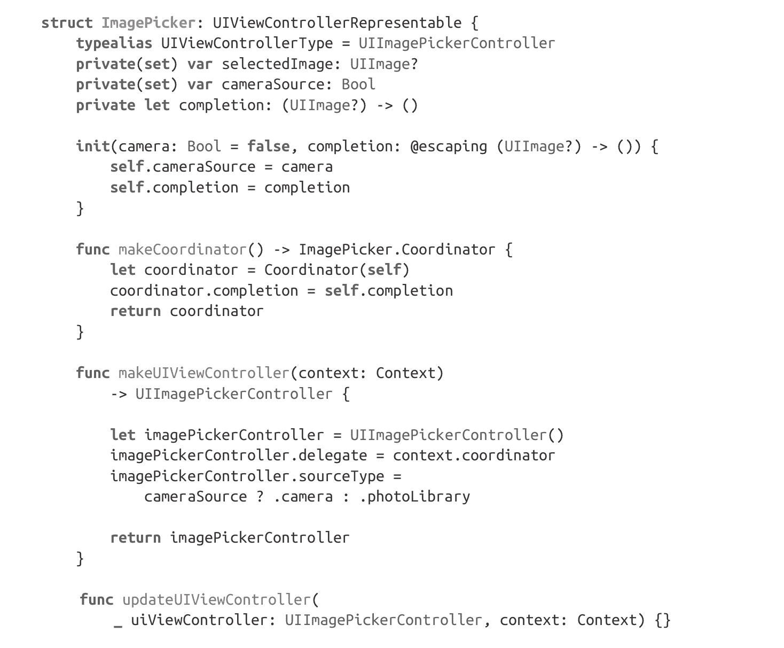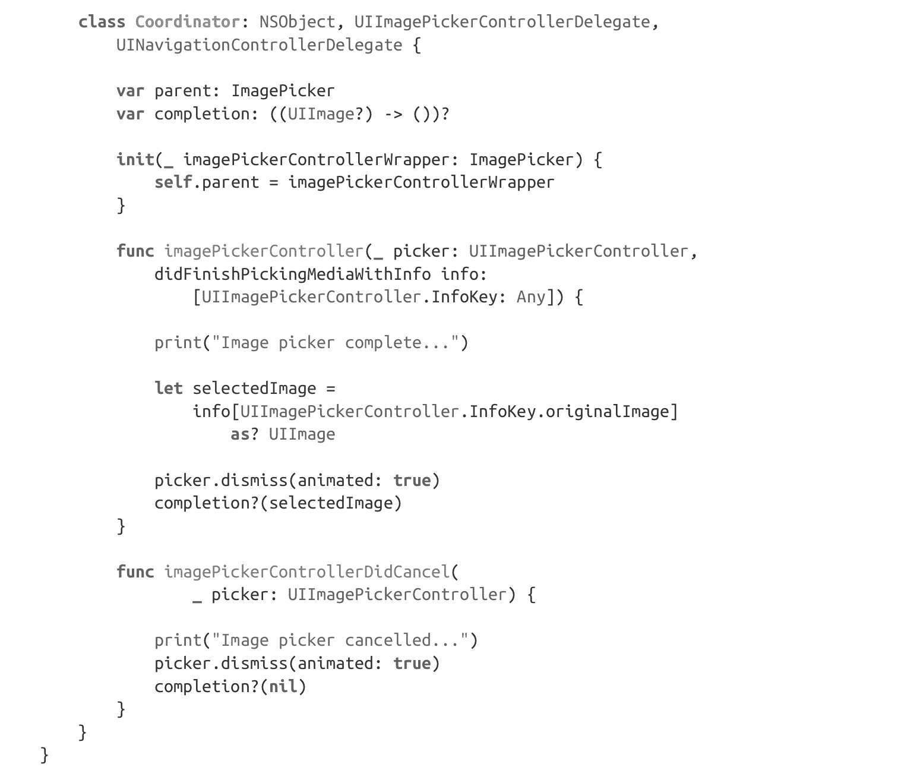

这段代码让 SwiftUI 能够调用 UIImagePicker 等 UIKit 功能。

更多关于 UIViewControllerRepresentable 的说明可查苹果文档，实质上它是在新旧 UI 框架之间搭桥。

8. 先打开 `Views.swift`，给 `UIImage` 增加一个扩展，用来在需要时调整图片的方向：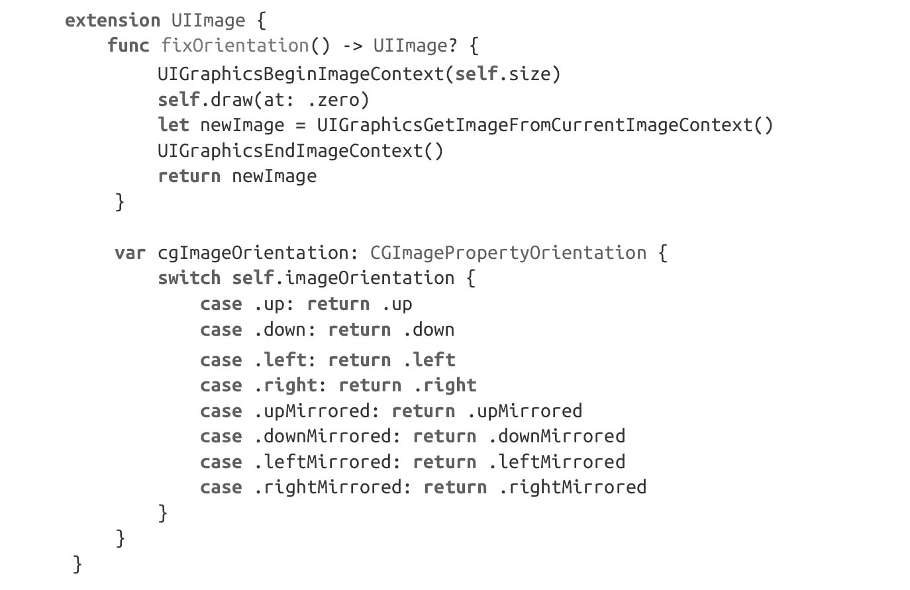

接下来切到 `ContentView.swift`。

9. 把导入语句刷新一下：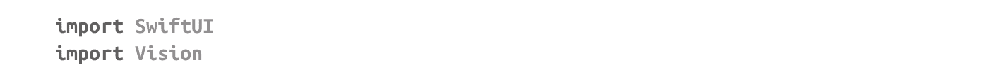

在 SwiftUI 里，`ContentView.swift` 的定位有点像 UIKit 中的视图控制器。

10. 在 `ContentView.swift` 文件末尾，为 `ContentView` 补一个扩展：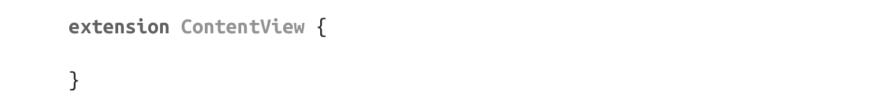

11. 在扩展里写一个函数，负责产出主界面：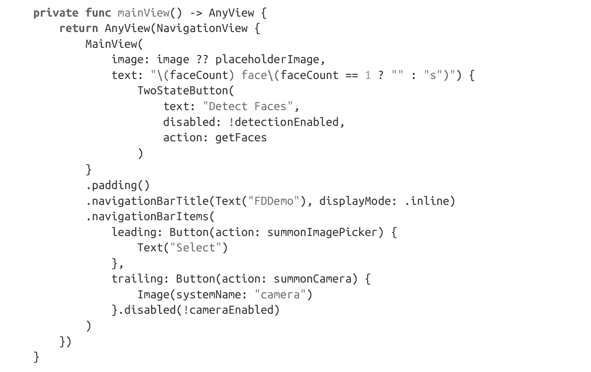

这个方法不只是返回，还会把主视图实例化出来，这就是 SwiftUI 的巧妙之处。

12. 再写一个函数，用来提供图片选择器：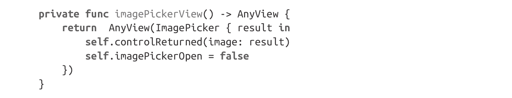

13. 再加一个函数，返回相机预览界面：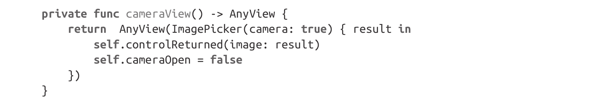

14. 回到文件头部，给 `ContentView` 声明几个 `@State` 状态变量：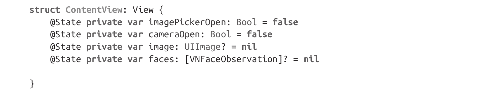

它们用来记录哪些内容会随使用而变化：图片选择器是否打开、相机是否开启、当前图片本身，以及检测到的脸部信息。

关于状态的更多用法，可以查阅 SwiftUI 官方文档。

15. 再声明一些 `private` 私有属性：

它们保存人脸计数、用户选图前的占位图、相机是否可用，以及检测开关的状态，后者会直接影响按钮的可点性。

16. 把 `body` 改成下面这个样子：

如果图片选择器需要展示，`body` `View` 就返回选择器；相机同理；否则就调用之前通过扩展加到 `ContentView` 上的 `mainView()`。

17. 新增一个 `getFaces()` 方法：

它会调用之前在 `Faces.swift` 为 `UIImage` 添加的 `detectFaces()` 扩展，对当前图片进行人脸检测。

18. 再写一个方法来触发图片选择器弹出：

19. 再写一个方法来打开相机：

配上启动页和图标后就可以运行了。可以在相册里挑一张照片，也可以在真机上直接拍照，然后点 “Detect Faces” 按钮，应用会报出检测到的人脸数量。效果见图 4-1。

#### 4.2.3 工作原理简析

其实没太多好说的。我们正在搭一个能检测人脸的 App。用 SwiftUI 第一次做出 iOS 应用后，用户既能从图库选图，也能现场拍摄，再统计人脸个数。借助苹果自带的框架，完全不用训练机器学习模型就能实现。想了解框架内部是怎么工作的，可参考第 11 章。

那还能做更多吗？

#### 4.2.4 人脸框线优化

这一节的目标是升级计数 App，让它除了数人脸，还能在每张脸外围画一个方框，效果参照图 4-1。

先把 4.2.2 节里的 App 完成。如果不想自己写，或者想要一个干净的起点，可以从官网下载本书资源，找到项目 `FDDemo-Starter`。

如果不想照着步骤走，也可以直接拿 `FDDemo-Completed`，它是本节的最终成果。建议对照着阅读本节代码和项目里的实现，弄清新增了什么。

代码改动不大，直接开始给人脸画框。

1. 打开 `Faces.swift`，在现有扩展下方为 `Collection` 再加一个扩展：

2. 这个扩展只在集合元素是 `VNFaceObservation` 类型时才生效。

3. 在里面填入下面这段代码：

4. 通过这个扩展，我们可以处理 Vision 返回的 `VNFaceObservation`，并提供 `drawOn()` 函数，在原图上给每张脸画一个方框。

5. 回到 `ContentView.swift`，把 `getFaces()` 改成调用刚加的 `drawnOn()`：

可能有人好奇为什么老用扩展。原因很多，最主要的是为了把代码拆到更容易理解的块里，避免用一堆类把结构搞复杂。

现在运行 App，选一张图点按钮，就能看到人脸被框起来，如图 4-3。

图 4-3：优化后的人脸检测器

#### 4.2.5 再加表情包点缀

到目前为止，我们先做了能计数的人脸检测，再改成在脸上画红框。现在更进一步，给检测到的人脸上方贴一个表情符号，如图 4-4，会更生动。

图 4-4：人脸检测 App 在人脸上方加上表情符号

需要先完成 4.2.4 节的版本才能继续。要干净起点可下载 `FDDemo-Complete`。不想手写也可以直接用 `FDDemo-Improved`，它是本节最终版。建议对照代码看差异。

这次主要改动集中在 `Faces.swift`：

1. 在 `detectFaces()` 下方，为 `UIImage` 扩展再加一个名为 `rotatedBy()` 的方法：

它会返回一个顺时针或逆时针旋转指定 `CGFloat` 角度后的 `UIImage`。

2. 为 `VNFaceLandmarks2D` 加扩展，提供 `anchorPointInImage()` 方法，用来定位眼睛、眉毛、嘴唇等特征点组：

`VNFaceLandmarks2D` 代表 Vision 框架能在人脸中识别的所有特征点，可查苹果文档了解更多。

3. 还需要给 `CGRect` 扩展，返回以 `CGPoint` 为中心的矩形：

4. 在 `CGPoint` 上加扩展：

新增 `rotationDegreesTo()` 方法，计算旋转到另一个点的角度，方便把人脸特征和要绘制的表情符号对齐。

5. 为 `Array` 加扩展，专门处理 `CGPoint` 数组：

提供 `centerPoint()` 方法，返回一组点的中心位置。

6. 因为表情符号本质是文本，需要给 `String` 加扩展：

该扩展能把 `String` 转成 `UIImage`，这样就能把表情当图片画到原图上。

7. 把 `Collection` 上的扩展整体替换成以下内容：

简单说，这个扩展及其新的 `drawnOn()` 方法会在人脸上随机绘制一个表情符号。

至此人脸计数 App 完成。可以启动应用选图，看着它在检测到的人脸上贴随机表情，再拿给朋友展示。最终效果见图 4-5。

图 4-5：最终的人脸检测器

脚注

## 4.3 任务：条形码识别

这个任务和人脸检测很像，而且更简单。

用 Playground 做最方便，但样板代码会多一点：

1. 启动 Xcode，新建一个 iOS 风格的 Playground，如图 4-6 所示。

图 4-6：在 Xcode 中创建新的 iOS 风格 Playground

2. 在 Playground 里新增一个源文件 `Extensions.swift`。在里面导入以下内容：

要找本书配套代码，可访问官网下载资源，在 `BarcodeAndSaliencyDetection` 文件夹中找到 Playground。

3. 为 `CGSize` 添加扩展：

该扩展提供 `scaleFactor()` 方法，返回让 `CGRect` 适配指定尺寸的缩放因子。

4. 为 `CGRect` 添加扩展：

可在 `CGRect` 上调用 `scaled()` 按比例缩放，或调用 `cropped()` 裁剪到指定 `CGSize`。

5. 为 `UIImage` 创建扩展：

扩展里保存宽度、高度等常用信息。

6. 在 `UIImage` 扩展中加入处理方向的代码：

7. 按 `CGSize` 裁剪图片：

8. 按 `CGRect` 裁剪图片：

9. 用 `CGFloat` 缩放图片：

10. 回到 Playground 主体，导入以下内容：

11. 为 `VNImageRequestHandler` 加便利构造器扩展：

`VNImageRequestHandler` 是 Vision 框架处理图像的句柄，让我们不用直接操作图像副本。便利构造器让它能直接用 `UIImage` 初始化，而原本通常需要 `CGImage`。`CGImage` 是苹果框架里另一种存储图像的方式。

`UIImage` 是更高级、线程安全且不可变的图像表示，方便从文件创建；`CGImage` 可变，适合需要干预像素内容时使用。详情可查苹果文档。

12. 为 `VNRequest` 添加扩展，增加 `queueFor()` 方法：

这会把请求排队交给 `VNImageRequestHandler` 处理。

13. 为 `UIImage` 添加扩展，提供检测矩形和检测条形码的方法：

两者原理相同：给 `UIImage` 增加一个方法，用 Vision 创建请求并查找指定类型的目标。

测试时，把带条形码或二维码的图片拖到 Playground 的 `Resources` 文件夹，如图 4-7，然后在 Playground 里调用条形码检测代码：

图 4-7：条形码查找器的 Resources 文件夹

代码先指定图片，再调用 `detectBarcodes()`。运行后应看到类似图 4-8 的结果。

图 4-8：条形码已被检测到

脚注

## 4.4 任务：显著性识别

和条形码检测紧密相关的是显著性检测：找出图像中最有趣或最显眼的区域。任务思路和条形码一样：复用之前的 Playground，加入显著性支持。

对显著性概念不清晰的话，可看图 4-9 示例。

图 4-9：显著性检测示例。图中突出区域（本书作者之一 Paris 和猫头鹰鸡尾酒杯）被框出

显著性检测会生成图像热图，用来标出感兴趣区域。

打开条形码检测任务里创建的 Playground。

1. 在 Playground 主体中，为 `UIImage` 添加扩展：

2. 在此扩展里先定义一个枚举，用来指定要查看的显著性类型：

把 Vision 框架的两类显著性请求封装后调用会更省心。VNGenerateObjectnessBasedSaliencyImageRequest 侧重找出图像中更像物体的片段，VNGenerateAttentionBasedSaliencyImageRequest 则锁定视觉上最抓眼的区域。

要在我们的资源中找到此代码，请访问我们的网站，下载资源，然后在`BarcodeAndSaliencyDetection`文件夹中找到`Playground`。

随后在 UIImage 的扩充里新增 detectSalientRegions() 方法：

该方法让 UIImage 能按指定的显著性类型返回自身的显著区域，听上去很专业，实现起来却很直接。

再加入 cropped() 方法，依据显著性请求对原图裁剪，保留显著位置：

验证时可把若干素材拖到 Playground 的 Resources 目录，操作与条形码检测保持一致，按下面顺序进行：

1. 指明一张素材指向 Resources 中已拖入的图片，并设定裁剪尺寸：

2. 准备两份 UIImage 变量，分别收纳注意力和物体两种显著性的裁剪结果：

3. 各调用一次 detectSalientRegions()，对应两种显著性：

运行后呈现的效果与图 4-10 接近。换不同素材就能感受模型对显著区域的判断差异。

图 4-10：显著性检测器正在工作

脚注

## 4.5 任务：图像相似度

比较两张图的相似度是一种轻量级的 AI 用例。玩法很多，既可用于小游戏配对，也能判断头像是否雷同。

本次演示在 Swift 程序里快速比对两张图，且不自行训练模型。苹果已把工具准备好，直接调用即可。

### 4.5.1 问题与方法

图像相似度属于实用型微功能，需求出现时非常好用，却难以提前量化。本任务从实践切入：

• 制作一个应用，允许用户选取或拍摄两张照片，并给出相似度百分比。
• 借助苹果现成能力实现，无需模型训练。
• 顺带探讨后续可扩展的方向，以及解决同类问题的其他思路。

示例效果如图 4-11 所示，直接开始。

图 4-11：图像相似度应用程序的最终版本

### 4.5.2 构建应用程序

本节继续采用 SwiftUI 来搭建这个实用 AI 小工具。

成品形态如图 4-11，主要由以下 SwiftUI 元素构成：

• 导航容器，头部展示标题并提供从相册选取或用相机拍摄的控制项。
• 两块图像展示区，后续会以 OptionalResizableImage 实现，用来呈现待比较的两张图。
• 执行对比与清除的两个操作按钮。
• 文本标签用于输出相似度数值。

本书旨在教你如何用 Swift 在苹果平台上实践 AI 和机器学习功能。因此，我们不会解释有关如何构建应用的细节信息。如果你想学习 Swift，建议你阅读 O’Reilly 出版的`Learning Swift`（也是我们写的）。

不想手写可从官网下载代码，项目名为 `ISDemo-Complete`。下载后建议对照本节说明再阅读。

手动搭建可按以下顺序进行：

1.在`Xcode`中新建 iOS 应用，选择“`Single View App`”模板并勾选“`SwiftUI`”。

2.新增 `Views.swift`，写入导入内容：

3.新建可缩放图像的视图：

4.新建 ButtonLabel 视图：

ButtonLabel 本质是带颜色的文字。

5.新建用于 UIImagePicker 的视图：

6.为 UIViewControllerRepresentable 做一层包装，使 UIImage-Picker 可用：

7.在 `Views.swift` 中为 UIImage 扩充，固定图片方向：

接下来新建 `Similarity.swift` 放置相似度测试逻辑：

1.写入导入语句：

2.为 UIImage 增加扩充：

3.在该扩充里加入比较相似度的函数：

通过计算两图距离来得到相似度。

4.加入生成图像特征打印观察值的函数，用以得出相似度结果：

注意 `similarity()` 里会调用此处编写的 `featurePrintObservation()`。`VNFeaturePrintObservation` 是在 `similarity()` 中计算距离的对象。

5.在 `Similarity.swift` 末尾为 UIImage 再加一个扩充，用于获取方向：

最后回到 `ContentView.swift`：

1.在 `ContentView` 结构体顶部加入 State：

2.其下加入属性声明：

3.在 `ContentView` 结构体内部但在 body 之外，加入清除图像与评分的函数：

4.加入获取相似度的函数：

5.加入从控件获取待比较图片的函数：

6.加入调用图像选择器的函数：

7.加入调用相机视图的函数：

8.更新 body 视图：

本例无需改动 `ContentView_Previews`。

运行后选取两张图或拍摄两张照片，点击按钮即可获得相似度分数，体验很流畅。

### 4.5.3 刚才发生了什么，这是如何工作的

整个流程里没有采集数据训练模型再打包，而是直接编写即可使用，这是本章反复强调的思路。

这里使用的是苹果 Vision 框架，一套开箱即用的计算机视觉算法，用来做图对图的比对。

本章相似度比较的核心是 `VNFeaturePrintObservation`。先算出图像的特征打印，再算两图的成对距离，即可推导出相似度。底层细节可参考第 11 章。

你可以在苹果文档中了解有关此功能的更多信息。

### 4.5.4 下一步

下一步取决于你的想法。如第 2 章所述，苹果 Vision 框架可覆盖大量项目的实际 AI 需求。

调用合适的模块后几乎无需额外工作即可完成不少实战任务：用 Vision 检测人脸及关键点如鼻子、嘴巴、眼睛等；识别文字、条形码和各类二维码；追踪视频中的特征等。

Vision 还能方便地配合 `CoreML` 做图像分类，或接入自有机器学习模型做目标检测。

你还可以进行另一种图像相似度检测。例如，苹果的`Turi Create`库采用了完全不同的方法。

脚注

## 4.6 任务：图像分类

这是本章首个真正动手建模的练习，聚焦经典 AI 用例：图像分类。

图像分类器就像一顶魔法帽，它可以对图像进行分类，就好像它来自某个流行的魔法虚构世界一样。

分类器是一种机器学习模型，接收输入后按内部逻辑归到某一类。图像分类器专门处理图片，并根据预设标签告知它认为属于哪一类。

图像分类是典型的深度学习问题，可回顾第 1 章。

深度学习并不是创造图像分类器的唯一方法，但却是目前最有效的方法之一。

### 4.6.1 问题与方法

猫狗分类虽经典，但我们做点更有趣的。

目标是做一个二分类器，能判断图里是香蕉还是苹果，见图 4-12。

香蕉（其实是`BNNS`，见第 12 章）对机器学习研究人员的重要性怎么强调都不为过。

—Alasdair Allan 博士，2019

探索路径如下：

• 制作一个应用，支持选图或拍照，并判定是香蕉还是苹果。
• 选定工具包并准备数据集。
• 构建并训练分类模型。
• 将模型集成进 App。
• 持续改进体验。

我们从期望的最终效果倒推，App 能区分香蕉和苹果如图 4-12，然后逐步实现。不是从公式出发，而是从可用结果出发。

图 4-12：该 App 将能够识别这些水果的图像

图 4-13 展示了期望的最终界面。开始吧。

图 4-13：最终 App（我们将准备好赢得任何猜香蕉还是苹果的游戏）

### 4.6.2 构建应用程序

业界独角兽都在用机器学习，我们也跟上，先从搭应用开始。

### 4.6.3 初始 iOS 应用程序构建

初始 iOS 应用包含：

• 从相册选图和用相机拍图的两个按钮。
• 显示所选或拍摄图片的图像视图。
• 显示说明并最终展示分类结果的标签。
• 触发图像分类的按钮。

图 4-14 为 App 启动时的状态。界面采用苹果 `UIKit` 框架搭建，是 iOS 较早的 UI 方案，相关资料可在苹果文档查阅。

本书旨在教你如何在 `Swift` 和苹果平台上去实践 AI 和机器学习功能。因此，我们不会解释如何构建应用的细节信息。如果你想学习 `Swift`，建议你阅读 *Learning Swift* (O’Reilly)。

图 4-14：图像分类器 App 的第一阶段

不想手动搭建可从网站下载代码，找到名为 `ICDemo-Starter` 的项目。完成后请浏览本节其余内容，再与 4.6.3 节对照。

自行创建的步骤：

1. 在 `Xcode` 中新建 iOS 应用，选择“`Single View App`”模板。语言下拉列表保持默认 Swift，不勾选额外选项。

2. 创建项目后打开 `Main.storyboard`，搭建包含以下组件的界面：

   • 显示所选图像的图像视图。
   • 显示说明和分类结果的标签。
   • 触发分类的按钮。
   • 允许从相册选图和拍照的按钮，使用两个导航栏按钮。图 4-15 为 storyboard 示例。

图 4-15: storyboard 示例

布局完成后务必添加合适约束。

3. 关联 UI 对象的输出口：

4. 关联 UI 对象的操作：

5. 在 `ViewController` 类中声明两个变量：

6. 修改 `viewDidLoad()`：

7. 加入根据输入是否存在来启用或禁用控件的函数：

8. 加入执行分类的函数，目前仅把分类设为“FRUIT!” 因为尚未接入 AI：

# 从零搭建图像分类原型

先在 `ViewController.swift` 末尾补上一段扩展代码，这段扩展稍后会讲清用途，暂时先跟上即可。

这段扩展提供了调用系统相机或相册的通道，用户拍照或挑选图片后原图会返回到界面。若挑选过程出现异常、图片为 `nil`，代码会调用 `summonAlertView()` 弹出提示，让用户知道发生了什么。

接着在工程里新建一个 Swift 源文件，命名为 `Utils.swift` 即可。

1. 在新文件中写入下面内容：

代码里为 `UIImage` 增加了一个占位图相关的扩展，同时为 `UIButton` 增加 `enable()` 与 `disable()` 两个便捷方法，用于控制按钮可用状态。`UIBarButtonItem` 作为导航栏按钮的等价物，也被赋予了同样的能力。

2. 如需启动图与 App 图标，可从入门项目中拷贝，随后在模拟器打开，画面应与图 4-14 的效果相近。

运行后可从相册选图，或在真机上直接拍照，图片会显示在预览区。点按“Classify Image”按钮后，标签会立刻变为“FRUIT!”，如图 4-16。

图 4-16：图像分类器入门 App 已就绪

至此前端已准备好，接下来进入 AI 部分。

### 4.6.3 工具组合与训练数据

本任务的开发栈需要提前准备好。示例中主要用到 `CreateML`、`CoreML` 与 `Vision` 三件套。

第一步借助苹果的任务式建模工具 `CreateML`，把香蕉和苹果的样本整理、训练并验证，最终得到一个能区分两类水果的模型。随后用 `CoreML` 来在 App 内加载并驱动该模型。

有人会问：`CoreML`？整本书都在讲它吗？本书的核心确实围绕 `CoreML`，但绝非唯一。`CoreML` 的职责是把训练好的模型读入 App、运行推理并与代码交互。本例正是把模型塞进应用并与其通信的典型用法。更多细节可回看第 2 章 2.3.2 节。

用来做图像理解的另一个关键组件是 `Vision`。`Vision` 是苹果提供的计算机视觉框架，可处理人脸检测、条码识别、显著性分析、图像相似度等任务。本章前文已用它完成多种视觉任务，这次则结合自有模型与 `CoreML` 一起使用。关于 `Vision` 与其他框架的关系，可参见 2.3.4 节及图 4-17。

图 4-17：`CoreML` 与周边 AI 工具的协作关系

在做水果识别 App 之前，必须先有水果图片。罗马尼亚的研究团队公开了 `Fruit-360` 数据集。

该集涵盖 103 种水果，包含训练集、测试集以及多水果同框的样本，图 4-18 展示了部分样式。

图 4-18：水果图像示例

若把全部图片都投入训练，模型不仅能判断香蕉或苹果，还能细化到 103 个具体类别：不同品种的苹果、杏、牛油果、香蕉的多种形态、哈密瓜、杨桃、樱桃、栗子、柑橘类、葡萄、柚子、芒果、山竹、桃子、梨、菠萝、火龙果、石榴、草莓、番茄、西红柿等。时代确实令人惊叹，但本例我们只聚焦苹果与香蕉。

准备数据集很简单：打开 `Fruit-360` 页面，点击绿色下载按钮。解压后目录结构应类似图 4-19。

图 4-19：`Fruit-360` 解压后的目录

因为目标只有两类，先从 `Training` 文件夹里复制苹果与香蕉的子文件夹，放进一个独立的工作目录，如图 4-20。

图 4-20：仅保留苹果与香蕉的训练素材

#### 训练模型步骤
数据集就绪后，用苹果的 `CreateML` 开始建模。工具经历过多次迭代，这里使用的是当前版本。

想了解不同版本的差异，可查阅第 2 章。

打开方式：启动 Xcode，选择菜单 `Xcode → Open Developer Tool → CreateML`。

也可以直接用 Spotlight 搜索 `CreateML` 启动。

1. 启动后选择“Image Classifier”模板，点击“Next”，如图 4-21。

图 4-21：在模板列表中选择图像分类器

2. 填写项目基本信息后再次点“Next”，如图 4-22。

图 4-22：设置新模型项目

此时项目为空，等待接入图片，状态如图 4-23。

图 4-23：空的 CreateML 项目界面

3. 点击“Training Data”下拉框，定位到刚才保存的苹果香蕉文件夹并选中。
4. 在顶部工具栏点“Play”，开始训练，界面会显示进度，如图 4-24。

图 4-24：CreateML 正在训练水果分类器

训练需要时间。在 8 核 i9 的 MacBook Pro 上大约 47 分钟，多核机器会更快，MacBook Air 可能需要数小时，属于正常现象。

训练接近尾声时，工具会进行精度评估并绘制相关图表，后续再详解。评估完成后，可从窗口右上角的输出区拖出模型文件保存。

拖出的文件后缀为 `.mlmodel`，这是 `CoreML` 的原生格式，前文 2.3.1 节已介绍。

模型已训好并通过测试，接下来把它用进 App。

本章后面及全书会更详细讨论训练、验证与测试流程，请继续关注。

### 4.6.4 把模型接入应用
现在已有 Starter App 和训练好的模型，下一步是把两者结合。

可按 4.6.2 节自行搭建起始应用，也可从官网下载 `ICDemo-Starter` 项目。若不想手写 AI 部分，也可直接使用 `ICDemo-Complete`。

需要改动代码，让 App 能与模型协作。

1. 在 `inputImage` 与 `classification` 旁新增一个 `classifier` 变量：

2. 在 `viewDidLoad()` 末尾把该变量的 `delegate` 设为 `self`，随后调用 `refresh()`：

3. 在 `refresh()` 第一个 `if` 语句末尾加入对 `classifyImageButton` 的禁用调用，若当前无图片则不允许触发分类，避免空模型调用：

4. 用下面实现替换 `classifyImage()`，不再写死“FRUIT!”：

随后新建一个 Swift 文件，命名为 `Vision.swift`。

5. 写入以下代码：

6. 在文件末尾追加如下扩展：

该段来自苹果官方文档，用于在 `CGImage` 与 `UIImage` 之间转换，4.3 节曾对比过两者的区别。

7. 将 `WhatsMyFruit.mlmodel` 拖入项目根目录，允许 Xcode 复制。

在模拟器启动后，界面应与图 4-25 相似。

图 4-25：图像分类器正式生效

可从相册选图或在真机拍照，图片显示后点“Classify Image”请求分类，标签会随结果更新。

### 4.6.5 扩展应用能力
App 目前只区分香蕉与苹果。若回到 4.6.3 节准备的完整 `Training` 文件夹，会发现里面有 103 个类别，接下来可以尝试全量训练。

按 4.6.3 节流程，用 `CreateML` 训练一个覆盖全部 103 类的分类器，把 `Fruit-360` 的整个 `Training` 文件夹作为数据源。

把新模型放进 Xcode 项目并重命名，然后在 `ViewController.swift` 中更新模型引用：

例如新模型名为 `Fruits360.mlmodel`，则修改为类似：

保存后再次运行，即可识别 103 种水果。

### 4.7 任务：手绘识别

iPad Pro 与 Apple Pencil 的普及让移动端绘画更常见，可参考 `Procreate`，该应用诞生于作者家乡塔斯马尼亚。

对绘画进行分类有诸多用途，从绘画类游戏到把草图转为表情符号等。

#### 4.7.1 目标与思路
绘画很有趣，能让用户画点东西再让电脑说出画的是什么，会产生一种魔法的感觉，既可做独立 App，也可作为功能增强。

本任务将实践图像检测的应用：

• 开发一个 App，用户拍摄手绘照片后进行分类；
• 搜集或整理数据并训练可识别位图的模型；
• 探索提升分类效果的方向。

最终效果如图 4-26，App 能从黑白涂鸦照片中识别内容。

图 4-26：位图绘画检测器的最终形态

#### 4.7.2 工具与数据
# 手绘分类专题

## 背景说明
在做 App 之前先明确工具链。实现本任务主要依赖 `Turi Create`、`CoreML` 与 `Vision`。

首先用苹果基于任务的 Python 工具包 `Turi Create` 训练一个能分类草图的模型，随后用 `CoreML` 与 `Vision` 在 App 中对用户拍摄的图像进行推理。

要做图像分类必须有图像数据。自己画上百万张草图不现实，通常由研究者提供。我们使用的是谷歌的 Quick, Draw! 数据集，超过 5000 万张已标注草图，345 个类别，来自全球用户在“Quick, Draw!”在线游戏中贡献的数据，如图 4-27。

图 4-27：谷歌的“Quick, Draw!”游戏界面

注意，boffin 这个词在英澳以外可能陌生，相关释义可自行查阅。正如一位智者所说：书是用来学习的，现在你知道了。

数据集类别太多，训练耗时过长，因此我们限定为 23 类：苹果、香蕉、面包、花椰菜、蛋糕、胡萝卜、咖啡杯、饼干、甜甜圈、葡萄、热狗、冰淇淋、棒棒糖、蘑菇、花生、梨、菠萝、披萨、土豆、三明治、牛排、草莓和西瓜。

图 4-28 展示了分类器可处理的绘图示例。

图 4-28：绘图分类器支持的图像样例

无需自行下载 Quick, Draw! 数据集，体积庞大。后续脚本会在“创建模型”阶段自动下载。

## 模型训练

借助 Turi Create 完成绘图分类器训练
本次绘图分类器的实现依赖苹果提供的 Turi Create，因此必须先搭建 Python 运行环境。

1. 参照 2.5.1 节说明创建 Python 运行环境并激活，之后以 pip 完成 Turi Create 的引入，效果参考图 4-29：

图 4-29：创建环境

2. 新建脚本 train_drawing_classifer.py，并在其中填入以下内容：

3. 写入配置参数，其中包含期望训练的类别清单：

4. 编写用于生成训练数据存放目录的函数：

5. 获取将用于训练的位图素材：

6. 增加一个将图片转成 SFrame 的函数：

7. 补充把这些 SFrame 写入文件的代码段：

8. 启动绘图分类器的实际训练过程：

9. 将模型导出为 CoreML 格式：

如果想让分类器识别超出我们所选的图形，只需打开类别列表替换为其它类别即可。

10. 执行该脚本：

运行后会出现与图 4-30 接近的输出。正如前文所述，无需手动获取 Quick Draw 数据集，脚本会自动下载。

图 4-30：训练绘图分类器

数据获取并解析为 Turi Create 内部格式后，会弹出如图 4-31 的浏览窗口，便于查看图像。

图 4-31: `Turi Create`的图像可视化

模型训练期间可以随时浏览这些图像。

训练耗时取决于设备性能，在 MacBook Pro 上通常需要数小时。

训练结束，进入执行目录即可见到全新的 `Drawing-ClassifierModel.mlmodel` 文件，如图 4-32 所示。该文件的使用方式与其它 CoreML 模型一致，后续 4.7.3 节也会用到。

我们曾在 2.3.3 节提到过 `Turi Create` 的可视化能力，也在 3.4.1 节强调过熟悉数据集的重要性。

图 4-32：最终转换的`CoreML`模型

### 4.7.3 构建应用程序

同样采用苹果最新的 UI 体系 SwiftUI 来搭建绘图检测应用的界面。

图 4-1 所示为该应用的最终呈现，整体由以下 SwiftUI 单元组成：

• 以 `NavigationView` 显示标题并提供选择照片的入口。

• 以 `Image` 展示所选图片，即包含待分类绘图的画面。

• 一个用于触发绘图分类的 `Button`。

• 用 `Text` 展示分类结果。

整体界面由多个子视图拼接而成。若不愿自行搭建绘图检测 iOS 应用，也可从官网下载代码，项目名为 `DDDemo`。

完成上述准备后请继续后续步骤，不要跳过，之后在 4.7.4 节汇合。

可以发现，该应用的结构与书中此前构建的若干 SwiftUI 应用高度相似。我们刻意保持一致性以降低复杂度。

自行制作绘图检测 iOS 应用的流程如下。

1. 启动 `Xcode`。

2. 新建一个 iOS 应用工程，选择“`Single View App`”模板。如前所述，采用 SwiftUI。

3. 将 4.7.2 节生成的 `.mlmodel` 文件拖入工程，允许 `Xcode` 按需复制。

4. 在项目中新增一个 Swift 文件，命名为 `Image.swift`。它为 `UIImage` 增加扩展，用于图像预处理以提升分类稳定性。

5. 首先也为 `CIFilter` 增加扩展：

该扩展可创建 Core Image 过滤器对图像进行操作，并强制输出为单色、黑白或多色调。更多过滤器信息与自定义方式可参考苹果官方文档。

6. 同样在 `UIImage` 上增加扩展：

此扩展提供两个方法：其一用于应用 `CIFilter`，其二用于修正图像方向并附带常见方向校正逻辑。

7. 再新建一个 Swift 文件，命名为 `Drawing.swift`，随后加入下列 `import`：

8. 增加下列 `enum`：

该 `enum` 允许通过传入 `String` 并调用创建的 `init()` 方法生成一个 `Drawing` 实例。每种 `Drawing` 类型都关联一个表情符号作为图标。

9. 还需要为 `VNImageRequestHandler` 增加扩展：

该扩展为 `VNImageRequestHandler` 增加便捷构造器，允许直接使用 `UIImage` 而非 `CIImage` 初始化。如需了解 `VNImageRequestHandler` 的作用，可参考苹果文档。

10. 为 `DrawingClassifierModelBitmap` 增加另一个扩展，这是之前创建的模型名称，`Xcode` 会为导入的模型自动生成对应类：

这段代码扩展了模型 `DrawingClassifierModel`，新增 `configure()` 方法，接受一个 `UIImage` 并返回经过灰度化、提亮和对比度增强的处理版本。同时新增 `classification()` 方法，该方法在 `DispatchQueue` 上运行 `VNCoreMLRequest`，借助 `VNImageRequestHandler` 与模型 `self` 对图像进行绘图分类。

11. 为 `Collection` 增加扩展：

此扩展为 `VNClassificationObservation` 的集合增加名为 `list` 的计算属性，类型为 `String`，便于从观察结果中提取标识符和置信度。

12. 为了加入自定义视图，新增名为 `Views.swift` 的文件，导入 `SwiftUI`，然后添加以下 `ImagePicker` 结构体：

与 4.2.2 节中构建人脸检测应用时的做法一致，这在 `SwiftUI` 中模拟了一个 `ViewController`，从而能够调用 `UIKit` 功能获取图片选择器。

13. 增加以下 `TwoStateButton` 视图：

这个 `TwoStateButton` 定义了一个可在禁用状态下仍具视觉反馈的 `SwiftUI` 按钮视图。

14. 增加以下 `MainView` 视图：

`MainView` 定义了一个 `VStack`，内部包含 `Image`、`Spacer`、若干 `Text` 以及一个 `TwoStateButton`。

15. 接下来打开 `ContentView.swift`，加入以下 `@State` 变量：

16. 增加以下变量：

17. 编写执行分类的函数：

18. 编写返回控件的函数：

19. 编写唤起图片选择器的函数：

20. 编写唤起相机的函数：

21. 为 `ContentView` 增加扩展，按需返回正确的视图：

22. 按如下方式更新 `body` 视图：

现在可以启动绘图分类器，在纸上绘制内容并拍照，让系统识别，只要绘图属于训练时使用的类别即可。图 4-33 展示了作者手绘的一些示例。

图 4-33：我们的 App 识别了作者的神奇作品

### 4.7.4 下一步

以上仅是一种实现绘图分类功能的思路。绘图通常直接在 iOS 设备上完成，这意味着我们需要额外拍摄或挑选照片。何不允许用户直接在应用内绘制呢？

我们将在 7.3 节介绍针对设备内绘制图形的分类器构建方法。

脚注

## 4.8 任务：风格分类

在最后一个视觉相关任务中，我们对 4.6 节构建的应用进行了改造，使其能够识别所给图像的风格。采用最直接也最实用的方式：把已有模型转为苹果的 `CoreML` 格式。

我们需要一个能识别风格的模型，幸运的是研究人员已提供。“Fine-tuning CaffeNet on Flickr Style” 是一个已在大量图像上训练过的分类器，能够识别多种图像风格。

该模型可辨别的风格包括：详细、柔和、忧郁、黑色、HDR、复古、长曝光、恐怖、阳光、纹理、明亮、朦胧、散景、宁静、缥缈、微距、景深、几何构图、简约和浪漫。该模型基于此篇研究论文。

### 4.8.1 转换模型

需要借助 `Python` 把原始模型转为可用的格式。

1. 创建一个新的 Python 运行环境并激活：

2. 安装苹果的 `CoreML` 工具：

3. 新建一个名为 `styles.txt` 的文件，填入以下内容：

4. 从 Berkeleyvision 网站以 `Caffe` 格式下载正在使用的训练模型。

把此模型文件，体积在数百兆字节左右，与 `styles.txt` 放在同一目录。

5. 在旁下载并保存此文件。`Deploy.prototxt` 文件指定了模型转换所需的参数，以便转为 `CoreML` 格式。

6. 在同一文件夹中新建一个 Python 脚本，我们命名为 `convert_style-classifier.py`，然后加入以下代码：

该代码导入 `CoreML` 工具，加载工具提供的 `Caffe` 转换器，并指向我们下载的 `finetune_flickr_style.caffemodel` 模型，同时指定 `deploy.prototxt` 参数文件提供元数据，最终保存为名为 `Style.mlmodel` 的 `CoreML` 模型。

这些文件应与图 4-34 一致。

图 4-34：转换风格分类器所需的文件

7. 运行 Python 脚本：

会看到类似图 4-35 的输出，最终在文件中得到 `Style.mlmodel`，见图 4-36。

图 4-35：将风格分类器从`Caffee`模型转换为`CoreML`模型

图 4-36：新的`CoreML`风格分类器模型

### 4.8.2 使用模型

首先，复制 4.6 节中为分类任务创建的最终项目版本。若不想自行复制，可从官网下载，项目名为 `StyleClassifier`。

要使用刚转换好的 `Style.mlmodel` 文件，请执行以下操作：

1. 打开复制或下载的 `Xcode` 工程。

2. 将 `Style.mlmodel` 拖入项目中，允许 Xcode 按需复制。

3. 在 `ViewController.swift` 中，将引用模型的那一行代码由：

改为：

运行应用。现在可以挑选一张图像，点击按钮即可获得分类结果，如图 4-37 所示。

图 4-37：工作中的风格分类器

后续我们还会介绍更多 `CoreML` 工具的使用，例如 8.4 节和 9.4 节。

脚注

### 4.9 下一步

关于视觉的部分到此结束。我们已介绍了若干常见且实用的视觉 AI 任务，可用 `Swift` 结合一套相当完备的工具来完成它们。

共开发了 7 个应用和 Playground，用以探索 7 个实用的视觉 AI 任务。

人脸检测

使用苹果全新的 `SwiftUI` 作为界面，并借助苹果提供的 `Vision` 框架识别人脸并处理相关信息。整个过程无需训练模型。

条形码检测

使用苹果框架在图像中查找条形码。同样，无需训练模型。

显著性检测

在此任务中，利用苹果框架找出图像中最显著的区域。仍然无需模型训练。

图像相似度

再次使用苹果最新的 `SwiftUI` 框架，并借助 `Vision` 构建一个应用，用来判断两张图像的相似或差异程度。这里也没有模型训练。

图像分类

这次使用苹果的 `UIKit` 框架搭建 UI，利用苹果的 `CreateML` 应用和开源的水果照片数据集训练图像分类模型，并构建可识别照片中不同水果的应用。最终训练了一个模型。

绘图识别

借助 SwiftUI 我们再次拓展人脸检测相关的衍生案例，并调用苹果推出的 Turi Create Python 框架来训练绘画分类模型，让用户可以识别纸上绘制的内容。

风格辨识
我们对既有的图像分类程式进行升级，将由其他工具训练所得的模型转为苹果 CoreML 格式，从而具备判断输入图像风格的能力。

如我们在 3.5 节所述，若面对视觉方面的实际 AI 任务，可以浏览苹果 CoreML 模型页面，了解其提供的预训练模型。若能以现成模型解决问题、减少自主开发量，这样的调研就相当有价值，建议查阅 CoreML 模型列表。

第 11 章将剖析本章各任务背后的算法机制，本章聚焦“视觉”，而后续篇章同样会涉及视觉话题。第 5 章则转向音频议题，这同样极具吸引力。

想探索更多视觉导向的实战 AI 案例，可前往 https://aiwithswift.com。

脚注

## 第 5 章　音频

本章从实操角度探讨如何在 Swift 应用里落地音频类 AI 功能，采用自上而下的方法，聚焦两类音频任务，并说明如何结合 Swift 与不同 AI 工具实现。

### 5.1 实用 AI 与音频

本章重点实践两项音频 AI 用例：

语音识别
让机器理解人类语言的价值很高，支持语音输入或用语音向设备发出指令。

音频分类
分类主题贯穿全书。我们打造了一个音频分类器应用，能分辨正在收听的动物叫声。

图像让深度学习与 AI 进入产品主流，行为分类展示了现代 iOS 设备多传感器协同的新可能，而音频则一直是机器学习在移动端落地最闪亮的赛道之一。即便在 AI 尚未成为热词时，几乎所有人都用过移动设备上的音频功能，例如音乐识别服务 Shazam。

脚注

### 5.2 任务：语音识别

语音识别是大众接触 AI 最常见的入口之一：从电话里的语音机器人尝试解读用户表达，到借助辅助与无障碍技术操作计算机，语音在消费级产品的普及远早于许多其他 AI 形式。

本节展示在不自行训练模型的情况下，如何迅速为 Swift 应用添加语音识别功能。

与 4.2 节所介绍的人脸检测相似，语音识别的难度较低，因为主要工具包均由苹果提供。

尽管可以为特定项目定制语音理解模型，苹果已针对大量语言完成了相关工作。

因此本任务思路与图像相似度校验相近，前者比对图像，后者分析人脸。

#### 5.2.1 问题与方法

为了切入语音识别实践，我们准备完成以下事项：

• 开发可以识别人类语音并在界面呈现结果的应用。
• 实现可收听语音并转换为文字的应用。
• 依托苹果工具完成，无需模型训练。
• 探讨语音识别下一步的可能性。

语音识别随处可见。它通用且易于理解，使用时几乎无需额外说明。可用于文字口述、语音操控应用，或基于意图理解的语音驱动功能。

我们将搭建如图 5-1 所示的语音识别器应用。

图 5-1：语音识别器应用的最终外观

#### 5.2.2 构建应用程序

如同第 4 章多项任务的做法，探索语音识别时我们继续采用苹果最新的 UI 框架 SwiftUI。

最终形态已于图 5-1 呈现，主要包含以下 SwiftUI 组件：

• NavigationView 用于显示应用标题。
• 若干 Button 组件用于启动与停止语音收听。
• Text 组件用于展示识别结果，或在未使用时提供提示。

若不想自行搭建 iOS 应用，可从我们的网站获取代码，找到名为 SRDemo 的项目。获取后建议继续阅读本节，将说明与下载代码对照。

若要自行开发，需完成以下步骤。

1.在 Xcode 新建 iOS 应用项目，选择 Single View App 模板，并勾选 SwiftUI 选项。

2.项目创建完成后，为项目加入名为 Speech.swift 的 Swift 文件，并在其中新建名为 SpeechRecognizer 的 class：

3.添加若干属性，涵盖语音识别所需的所有组件：

我们建立一个 AVAudioEngine 用于音频的输入输出；一个 AVAudioSession 用于向系统说明音频使用方式；以及 AVAudioNodeBus 与 AVAudioInputNode 用于连接 iOS 设备的输入硬件即麦克风。

同时创建 SFSpeechRecognizer 用于启动语音识别，属于苹果语音框架的一部分。还使用 SFSpeechAudioBufferRecognitionRequest 从实时缓冲区即麦克风采集音频以供识别。

SFSpeechURLRecognitionRequest 是 SFSpeechAudioBufferRecognitionRequest 的替代方案，可对预先录制的音频文件执行语音识别。

我们还创建了一个 SFSpeechRecognitionTask，它代表一次正在进行的语音识别任务，可用于判断任务是否结束或取消它。

4.添加初始化器：

该初始化器会创建必要的音频采集组件，并对刚才创建的对象进行合理配置。

5.添加一个函数，用来检查是否拥有监听麦克风以进行语音识别的权限：

6.添加一个开始录制的函数，并在开头做必要准备：

7.在该函数准备部分之后，检查音频与麦克风访问权限：

8.设置录制格式并创建所需缓冲区：

9.打印一条信息到控制台表明监听已开始：

要在 Xcode 中显示控制台，可点选 View 菜单→Debug Area→Activate Console。

10.开始识别：

11.在 Speech.swift 中新增一个停止录制的函数：

由于需要访问麦克风，你需要在 Info.plist 中添加 NSMicrophoneUsageDescription 配置项，并说明使用麦克风的原因。

你还需要添加 NSSpeechRecognitionUsageDescription 以进行语音识别。用户会看到这条提示，示例如图 5-2。

图 5-2: Info.plist 文件中 NSMicrophoneUsageDescription

接下来开始使用视图文件 ContentView.swift：

1.在文件顶部更新 import：

这里引入了用于语音识别的 Speech、用于 SwiftUI 的 SwiftUI，以及用于音频功能的 AVFoundation。

2.创建一个可在 Button 中复用的 SwiftUI View，使其样式更美观。我们命名为 ButtonLabel：

本质上该视图以可复用方式设置文本样式。它是一个包装在 HStack 中的 Text 视图，并提供初始化器以设置标题字符串和颜色。

3.现在查看 View 的主体即 ContentView。大部分代码来自项目模板，我们从类似以下内容开始：

4.在该 View 中，需要添加若干 @State 变量：

recording 用来反映当前录音状态的布尔值，speech 用来保存已识别的文本。

5.向下移动到 body View 下方，并在 ContentView 结构中添加一个名为 recognizer 的变量来保存 SpeechRecognizer：

6.在视图中添加 init()：

这里我们初始化一个新的 SpeechRecognizer，即在 Speech.swift 中定义的类，并将其保存到刚才定义的 recognizer。

7.添加一个名为 startRecording() 的函数以开始录制：

该函数将 recording 状态变量设为 true，将 speech 状态变量清空，然后调用 SpeechRecognizer 开始录制，并把结果写回 speech。

8.添加一个停止录制的函数，命名为 stopRecording()：

该函数将 recording 状态变量设为 false，并指示 recognizer 中的语音识别器停止录制。

在此不需要处理 ContentView_Previews 结构。

此时即可运行应用。点击按钮并说话，你应该能看到说出的词出现在 Text 组件中。

#### 5.2.3 刚才发生了什么，这是如何工作的

与第 4 章的做法相同，我们使用苹果提供的框架完成 AI 工作。SFSpeechRecognizer 是苹果提供的语音识别框架，自 macOS Catalina 10.15 起适用于 iOS 应用和 macOS 应用。

你也可以在 watchOS 和 tvOS 上做语音识别，但实现方式略有不同，超出本书范围。想全面了解苹果平台语音识别的更多信息，可访问 https://apple.co/33Hry2t

。

SFSpeechRecognizer 支持多种语言的离线语音识别，但也可能依赖苹果服务器支持，这不需要你额外配置。关于哪些语言支持离线以及何时连接服务器，苹果文档给出大致说明，但强调通过 SFSpeechRecognizer 进行语音识别始终需要服务器连接。

在用户授权方面务必遵循苹果指导原则。如果你使用 SFSpeechRecognizer，苹果要求在执行语音识别时必须征求用户许可，因为它可能是基于云的。隐私意识非常重要。

语音识别的使用量可能存在限制，例如每台设备每天等。目前苹果尚未明确具体配额，但会逐步规范。

#### 5.2.4 下一步

这是一个复杂议题。若要在 iOS 或 macOS 应用中加入语音识别，以上内容已足够。你已准备就绪。

由于本书聚焦 AI 实践且希望自顶向下进行研究，我们认为目前你所需的就是这些。

如果你感兴趣，可进一步探索训练模型以识别语音。我们不会深入，因为这完全超出本书范围，但可参考以下资源。

• 来自 Google Brain 的语音命令数据集，规模很大。
• 来自 Mozilla 的公开语音数据集。
• TensorFlow 的 Python 版本。

或者，如果你拥有 TensorFlow 源码树并已构建好运行环境，可尝试构建自己的小型语音识别模型。

1.执行 TensorFlow 树中 examples/speech_commands 目录下的 Python 脚本 train.py。该步骤会下载上述语音命令数据集并开始训练，可能耗时较长。

2.训练会逐步进行，偶尔会显示混淆矩阵，展示模型当时的错误。

3.还会输出验证指标，在验证集上显示模型准确率，由 train.py 自动完成，占比 10%。

4.最终可能在数小时后得到模型。你需要冻结模型，并用同一目录的 freeze.py 脚本压缩，以便在移动设备上使用。

5.还可使用同一目录的 label_wav.py 脚本将音频文件送入模型进行测试。

TensorFlow 文档提供了与上述流程相似的完整指南。

我们在此概述的基于 TensorFlow 训练的简单模型源自论文“Convolutional Neural Networks for Small-footprint Keyword Spotting”。如果你对 AI 实践之外的理论感兴趣，这是一篇可读性很高的论文。

你还可以使用 TensorFlow 转 CoreML 转换器，这是苹果和 Google 的项目，可将模型从 TensorFlow 格式转为 .mlmodel 文件，从而与 CoreML 配合并在 iOS 应用中使用。

请回顾第 2 章以了解如何使用苹果的 CoreML 工具和 TensorFlow 转 CoreML 转换器。第 8 章和第 9 章中我们会用 CoreML 工具转换模型。

全面展开并非本书范围，但如果你好奇，这就是下一步。请访问我们的网站获取相关文章和链接。

脚注

### 5.3 任务：声音分类

下一个音频任务的设想是为动物园开发应用。其中一个功能是当用户听到远处动物发声时打开应用，应用能识别并告知是哪种动物。这就是声音分类问题。

## 5.3.1 问题与方法

对于给定声音，声音分类器会从预定义标签集中分配一个标签。它们是分类器，因此像其他分类器一样工作，我们在 11.3.1 节会讨论其原理。

苹果机器学习工具提供的声音分类功能均未针对人类语音设计。你可以用于奇异声响，但声音分类并非为语音识别而生。

本章我们将构建一个应用，最终版如图 5-3 所示，可将听到的声音划分为 9 个不同类别。

图 5-3：声音分类器应用的最终版本

为此任务，我们将通过以下步骤探索声音分类的实践。

• 构建一个可录制音频、对录音进行声音分类并告知是哪种动物发声的应用。
• 选择工具包创建声音分类模型，并为问题组装数据集。
• 搭建并训练声音分类模型。
• 将模型整合到应用中。
• 改进应用。

接下来会快速拆解声音分类的运行原理，同时给出一些可以自行扩展的参考资料，马上进入实操。

## 5.3.2 搭建 iOS 声音分类应用
声音分类 Demo 会基于苹果的 UIKit 来实现。这个 Demo 对原生 iOS 视图的使用会更进一步，涉及 UICollectionView 和 UIProgressView，如果你对它们还不熟悉，初看可能会有点懵。

完全不用担心。相较于之前用过的视图，这次我们会边用边讲，解释得更透彻。

图 5-3 展示了我们要做出来的应用初始界面大概长什么样，整体包含下面几个部件。

• 一个 UIButton，用来启动录音，录完后自动进入分类。
• 一个 UICollectionView，以 emoji 的形式展示不同动物，每个动物放在一个 UICollectionViewCell 里，听到的动物声音类型对应就会点亮。
• 一个 UIProgressView，反映录音进行中的进度。
• AVAudioRecorder 负责录音，并搭配 AVAudioRecorderDelegate。

如果你不想从零手写这个初始版 iOS 应用，可以去官网下载代码，找到 SCDemo-Starter 项目。下载后请完整看完本节内容，不要跳过，之后再到 5.3.3 与我们会合。

想自己动手做声音分类的同学，按下面步骤来。

1.在 Xcode 里新建一个 iOS 应用项目，模板选 Single View App。Language 下拉菜单下面的复选框不要勾选，通常默认是 Swift。

我们这次先写代码，而不是先用 storyboard。因为要创建一些继承自标准 UI 对象的自定义类。

2.给项目新增一个 Swift 文件，命名为 Animals.swift。在文件里先加上这个枚举：

这个枚举类型用来表示 App 能识别的动物声音。枚举 Animal 同时遵循 String 与 CaseIterable，String 很直观，表示这是字符串枚举；遵循 CaseIterable 后就能通过 .allCases 取到所有枚举值。

关于 CaseIterable 协议的细节，可以去苹果官方文档查阅。

3.枚举类型准备好后，加入具体的枚举值。打开 Animal 类型，在顶部写入：

这里定义了 9 种动物，后续用来做声音分类。

4.再加一个构造方法，用来在需要时正确还原枚举值。

这个构造会把传入的原始值匹配到对应 case，不过传入字符串 “rooster” 或 “hen” 时也会映射到 chicken，因为两者都是鸡的种类，仅在此 App 里做这种处理。

5.为每个枚举值返回一个好看的图标，这里就是 emoji：

6.为每种动物指定一种颜色，后面好在界面上呈现漂亮的效果：

颜色只是随意挑选，如果你有更好的配色方案完全可以替换。

到这里 Animals.swift 就结束了，记得保存，然后继续操作 ViewController.swift。这部分工作量会大一些。

我们在 ViewController.swift 里要做的第一件事，是做一个能在三种状态间切换的按钮。它用于让用户开始录音，录完后触发分类。

按钮要能以友好方式提示用户点击开始录音，录音进行时要切换成进行中状态，还要在无法录制或 App 正在忙于分类时进入禁用状态。

标准 UIButton 也可以手动改这些状态，但为了让后续接入 AI 的代码更清晰，我们对部分逻辑做了抽象，代码会更一目了然，这也是好习惯。

1.在 ViewController.swift 里新增一个类：

这是一个继承自 UIButton 的新类 ThreeStateButton。目前它暂时就是一个普通的 UIButton。

2.再加一个枚举来表示按钮的不同状态：

3.添加一个状态切换函数：

函数接收一个 ButtonState 参数，然后把 ThreeStateButton 切换到对应状态。每个状态会更新标题、背景色，标题和颜色在调用时传入，同时控制按钮是否可用。

下面要开始搭 storyboard 了，但还有一件事。因为 UICollectionView 由多个单元格组成，我们要对 UICollectionViewCell 做子类化，用来根据检测到的声音展示对应动物。

4.在 ViewController.swift 文件里，放在所有已有类或定义之外，最好放在最底部，加上这段代码：

它创建了一个 UICollectionViewCell 的子类 AnimalCell，并提供了一个可在 storyboard 中引用的标识符。

现在可以打开 Main.storyboard 来做界面了。

5.往 storyboard 里拖入下面这些组件。

• 一个 UIButton，用来触发录音并提示录音进行中。
• 一个 UIProgressView，显示录音长度进度。
• 一个 UICollectionView，用来展示 App 能识别的每种动物声音类型。
• 在 UICollectionView 里放一个原型 UICollectionViewCell，用来展示所有动物。图 5-4 能看到 storyboard 的样子。记得加上必要的约束！

图 5-4：声音分类应用的 storyboard

6.需要把部分组件的类改成我们刚在代码里写的自定义类型。选中 UICollectionView 里的 UICollectionViewCell，打开 Identity Inspector，把类改为 Animal Cell，会自动识别，如图 5-5。

图 5-5：修改 UICollectionViewCell 的类

7.在单元格的视图内部，storyboard 里加一个较大的 UILabel，用约束把它居中。

8.为 AnimalCell 增加 outlet。回到 ViewController.swift 的 AnimalCell 类定义里，添加以下 outlet，分别连到单元格自带的 Cell View 和你刚创建的 UILabel：

9.选中一开始在 storyboard 建立的 UIButton，在 Identity Inspector 里把它的类改成 ThreeStateButton，和刚才对 AnimalCell 的操作一样。

10.把一些 outlet 连到 ViewController 类：

这些 outlet 分别对应 UICollectionView 本身、UIProgressView，以及类已改为 ThreeStateButton 的 UIButton。

11.再加一个 Action 连到 ThreeStateButton：

12.给 ViewController 类添加几个属性：

这些属性定义了录音时长、保存最终分类结果的变量、AVAudioRecorder 实例，以及录音文件的名称。

13.把 viewDidLoad() 更新成下面这样：

14.新增一个函数，通过之前定义的属性访问 AVAudioRecorder 来开始录音：

15.再写一个结束录制的函数，参数用 Bool 表示是否成功，方便处理失败情况，默认是 true：

16.添加一个函数来刷新 UICollectionView，用来展示我们判断的声音属于哪种动物，输入参数是 Animal：

17.在 ViewController 类内部，为 AVAudioFile 也就是录音结果，增加一个处理函数，暂时只是占位，后续接入 AI 后会做更多事：

到这里 ViewController 类的代码部分就完成了。接下来需要在该类里加一个或三个扩展。

1.先在 ViewController 类末尾下方，仍在 ViewController.swift 文件中，加一个扩展，用来在出现问题时弹出提示：

2.再加一个扩展，让类遵守 AVAudioRecorderDelegate，以便配合 AVAudioRecorder 工作：

3.再在其下方加最后一个扩展，让 App 遵守 UICollectionViewDataSource，用它来填充 UICollectionView，里面放 AnimalCell：

4.如果你想，可以再加一个启动屏和 App 图标，和之前练习一样，资源在可下载包里。然后在模拟器上启动，你会看到类似图 5-3 的界面。

这个 App 现在能录音，但什么也做不了，不能播放，也没有接入机器学习模型。回头看 classifySound() 函数，我们目前每次只是随机挑一只动物。

继续下一步，给它加上 AI 功能。

## 5.3.3 准备模型工具与数据
和常规 AI 任务一样，我们要先搭好工具链。这次主要用到 Python 准备训练数据、CreateML 应用做训练、CoreML 在 App 里读取模型。

要让 App 能识别动物声音，我们需要一个包含动物声音的数据集。和往常一样，相关数据已经被整理好了。

如图 5-6 所示，环境声音分类数据集 ESC 是大量短时环境录音的集合，涵盖五大主类。

去 ESC-50 的 GitHub 仓库下载数据集副本，保存到安全位置。

图 5-6：ESC 的主要类别

你也可以不用脚本手动完成所有操作，但会花更久时间。做机器学习时保持可重复性是好习惯。

按 2.5.1 节说明启动新的 Python 环境，然后执行下面步骤。

1.用文本编辑器，比如 Visual Studio Code 或 BBEdit，建一个 Python 脚本，我们命名为 preparation.py：

脚本会导入 Pandas，创建包含每个类别子文件夹的输出目录，然后解析 CSV 文件，按新格式写入。

这里用 Pandas 主要是为了方便读取 CSV。

2.为了让脚本指向正确的类和输入文件，在导入语句之后、脚本开始之前，加上下面这些配置变量：

把每个路径改成你系统上的实际位置：input_classes_filename 应指向数据集里的 esc50.csv；sounds_directory 指向 /audio/ 文件夹；output_directory 指向脚本要输出训练子集的位置，我们在下载的数据集里建了一个 /classes/ 文件夹。

classes_to_include 列表包含了 App 希望分类的所有动物，并非数据集中全部动物声音。

在命令行执行 python prepare.py 运行准备脚本。数据准备好后，你会得到类似图 5-7 的文件夹结构。

图 5-7：用于训练声音分类器的准备数据

## 5.3.4 用 CreateML 新建项目
数据准备好后，我们去苹果的 CreateML 应用，像第 4 章那样建一个声音分类模型。

想了解 CreateML 的更多用法，可以回顾 2.3.2 节。

开始建动物声音分类器模型。

1.启动 CreateML，选择合适的模板新建一个 Sound Classifier 项目。如图 5-8。

图 5-8：CreateML 模板选择器中的声音分类器

2.填好项目信息后，你会看到一个空的 Sound Classifier 项目，如图 5-9。

图 5-9：CreateML 项目已就绪

## 5.3.5 训练并导出模型
3.在 Training Data 区域，点击下拉框，浏览到之前准备好的数据文件夹，里面应该有 10 个以动物为主题的子文件夹。选中后，在 CreateML 顶部栏点 Play 按钮，也就是向右的三角形。

训练声音分类器所需时间不会比 4.6 节的图像分类更久，通常几分钟内完成。

训练结束后，你会看到类似图 5-10 的界面。可以把模型文件从窗口右上角的 Output 框拖出来，保存到安全位置。

图 5-10：CreateML 训练成功的界面

有了 CreateML 训练出的 CoreML 模型，我们就可以把它接入到应用里使用了。

除了用`CreateML`图形界面，你也可以借助`CreateML`框架与`MLSoundClassifier`来训练声音分类模型，详细用法可参考苹果官方文档。

### 5.3.5 将模型接入应用

如果一路跟下来，到这里你应该已经有了用`Swift`写的入门`iOS`程序，以及通过`CreateML`训练好的声音分类器。接下来把两者融合，让应用具备声音分类能力。

若你未按 5.3.2 节自行搭建程序，也可以从官网下载代码，项目名为`SCDemo-Starter`，本节就以此为起点。

在演示项目同级目录下，还能找到我们已训练好的声音分类器模型，如图 5-11 所示。

图 5-11：经过训练的声音分类器模型

不想一步步跟做、想直接体验 AI 功能，也可下载名为`SCDemo-Complete`的成品项目。若你选择直接使用成品而非逐步演练，仍建议通读本节并对照`SCDemo-Complete`的代码。

要让应用能配合声音分类模型工作，需要做一系列改动。

1. 把之前生成的`.mlmodel`文件拖入项目根目录，Xcode 会在需要时自动处理。
2. 在`ViewController.swift`的导入里加入`SoundAnalysis`框架：

`SoundAnalysis`是苹果提供的音频分析与分类框架，可与`CreateML`生成的`MLSoundClassifier`模型配合使用，无论是用`CreateML` App 还是框架训练，最终都能兼容。

3. 为`classifier`新增一个属性，指向模型文件：

若模型命名不同，请同步修改`AnimalSounds().model`为对应名称，例如模型名为`MyAnimalClassifier.mlmodel`时应改为`MyAnimalClassifier().model`。

4. 在`viewDidLoad()`之后新增一个`refresh()`函数：

该函数用于按需刷新`UICollectionView`。

5. 把`recordAudio()`函数改写为如下形式：

如此一来，函数本身不再直接刷新，而是调用刚创建的`refresh()`。

6. 按如下方式更新`finishRecording()`：

录制结束时会触发此函数。若`success`为`true`，则禁用录制按钮并调用`classifySound()`，传入`recordedAudioFilename`。

7. 用下面代码替换`classify()`函数中`collectionView.reloadData()`的调用：

8. 按如下更新`classifySound()`函数：

这一步去掉了入门版里用做占位符的随机动物，让应用真正调用模型进行分类。此时运行应用，界面与此前保持一致，如图 5-12 所示。

图 5-12：声音分类器

点按“Record Sound”录制一段声音，应用就会点亮它判断为对应动物的图示，效果相当直观。

别忘了在`Info.plist`中加入`NSMicrophoneUsageDescription`键，与 5.2 节做法相同。如图 5-13 所示。

图 5-13: `Info.plist`

### 5.3.6 实时分类优化

目前我们已拥有一个用`Swift`和`UIKit`编写、集成`CreateML`生成`CoreML`模型的`iOS`应用，能以一定可靠性录制音频并借助声音分析框架判断其属于 9 种动物中的哪一种。

本节目标是改进应用，实现实时声音分类，而非先录完文件再分析。

在继续前，请完成本节之前的全部步骤。

若不想自行搭建或想要干净的初始代码，可从官网下载资源，找到`SCDemo-Complete`项目作为起点。如果你不想按步骤操作，也可直接使用`SCDemo-Improved`项目，它就是本节完成后的最终形态。建议在对比使用时仍阅读本节代码。

接下来改动较多，请耐心操作。首先在项目中新建一个`Swift`文件，命名为`Audio.swift`：

1. 添加以下导入：

2. 添加以下类：

该类实现了`SoundAnalysis`框架中的`SNResultsObserving`协议，用来接收声音分析请求的结果。

3. 再创建一个用于音频分类的类，命名为`AudioClassifier`，加入`Audio.swift`：

4. 添加以下属性：

这些属性的用途较为直观，更多细节可查阅苹果文档。

5. 添加构造器：

构造器会正确初始化各类属性。

6. 添加启动分析的函数：

代码会先尝试启动音频系统，随后等待分析结果。

7. 添加停止分析的函数：

至此`Audio.swift`的工作完成。保存后打开`ViewController.swift`：

1. 按如下方式替换`ViewController`类中的全部属性：

因为音频相关工作已迁移到新`AudioClassifier`类，原类中大量代码不再需要。请确保`IBOutlet`与`IBAction`仍与`storyboard`连接，或重新连接。

2. 将`recordAudio()`注释掉，并新增`toggleRecording()`函数，如下：

3. 注释掉整个`classifySound()`函数，并按如下更新`classify()`函数：

4. 可将`ViewController`对`AVAudioRecorderDelegate`的扩展整体注释掉，音频功能已迁移并改动实现方式。
5. 为 UI 更简洁，更新`ThreeStateButton`类中`changeState()`的`switch`语句里`.inProgress`分支，如下：

6. 在模拟器中启动优化后的应用，点击按钮后应用会实时分类当前听到的声音并点亮对应动物表情。

图 5-14 显示了最终的声音分类器。

图 5-14：完成的声音分类器

脚注

## 5.4 接下来学什么

音频相关内容到此结束。我们已用`Swift`演示了与音频相关的常见 AI 实践，并借助多种工具完成了两款应用。

语音识别

借助苹果的`SwiftUI`与语音识别框架，我们构建了可将人类语音转为文本的应用，无需自行训练模型。

声音分类

我们使用`UIKit`搭建界面，用若干`Python`脚本准备动物声音数据，以`CreateML` App 训练模型，并在应用中通过`CoreML`调用模型。

第 11 章会进一步从算法层面深入本章提及的任务，见 11.3 节。下一章将讨论文本与语言。

想了解更多音频类实用 AI 任务，可访问官网。

脚注

## 第 6 章 文本与语言实战

本章将探讨如何在`Swift`应用中落地与文本、语言相关的 AI 功能。采用自顶向下思路，覆盖 5 个典型任务及实现手段。

## 6.1 文本语言 AI 概览

本章涉及的 5 个任务如下。

语言识别

判断一段文本可能使用何种语言。

命名实体识别

从文本中抽取人名、地名、组织等实体。

词形还原、标注、分词

为每个词元识别词性并将字符串按词拆分。

情感分析

判断文本表达的情感是积极还是消极。

自定义文本分类器

对文本情感分类的另一种实现，基于苹果工具扩展。

第 8 章还将讨论文本生成，因其与生成类任务关联更紧密而单独安排。完整阅读本书的话，章节位置不影响理解。

图像、人体动作、声音都很吸睛，但在日常开发中，大量应用都涉及文本处理。人类产生海量文本，若机器能理解其含义，就能更好地做决策或向用户呈现相关信息。本章聚焦文本分类，尤其是情感分析，即判断文本情感倾向。

不同资料中“文本分类”“情感分析”“自然语言处理”“观点挖掘”等术语常被混用。本书作者认为它们并非同一概念。本章聚焦文本分类中的情感分析任务，并使用自然语言处理技术实现。

脚注

## 6.2 任务：语言识别

语言识别是指为一段文字判定其可能的语言，任务简单且实用。

直接在`Playground`中演示：

1. 在`Xcode`中新建一个`iOS`风格的`Playground`，如图 6-1。

我们选用`iOS`，`macOS`上同样提供所需工具。

图 6-1：在`Xcode`中创建一个新的`iOS`风格的`Playground`

2. 添加以下导入：

3. 为`String`添加扩展：

这样即可调用`predictLanguage()`返回语言。实现时将语言环境设为“`en_US`”，用`NLLanguageRecognizer`处理字符串并取主语言。

4. 准备一段或多段测试文本以识别语言：

5. 遍历数组并调用`predictLanguage()`测试：

屏幕会显示如图 6-2 的结果。

图 6-2：字符串的语言识别

6. 可把语言环境改为其他，例如西班牙语“`es`”，再获取各语言的西班牙语名称，如图 6-3。

图 6-3：将语言环境设置为西班牙语的输出

脚注

## 6.3 任务：命名实体识别

识别文本中的实体与语言识别同样简便，同样依赖苹果自然语言框架，该框架通过标签对文本进行处理。

直接在`Playground`中操作：

1. 在`Xcode`中再新建一个`iOS`风格的`Playground`。
2. 添加以下导入：

3. 为`String`添加扩展：

这样可调用`printNamedEntities()`打印出命名实体。

4. 准备一段用于实体识别的文本：

5. 调用`printNamedEntities()`进行测试：

结果类似如图 6-4。

图 6-4：字符串的命名实体识别

脚注

## 6.4 任务：词形还原、标注、分词

词形还原常被提及且十分有用。

词形还原指将一个词的各种形式归并为同一词元的过程。例如“walk”“walked”“walks”“walking”归为“walk”；“better”的词元是“good”。

## 词形还原

在搜索等场景中很有价值：用户搜“good”时，也希望命中标记为“better”的内容；照片分类中搜“mouse”也应返回“mice”结果。

开始实操：

1. 在`Xcode`中新建一个 iOS 风格的`Playground`。
2. 添加以下导入：

3. 添加一段用于词形还原的句子：

本次演示选用了《星际迷航》的经典开场独白，这里使用的是让-吕克·皮卡德的版本。

4. 为`String`增加如下扩展：

借助这段扩展，任何字符串都可调用`printLemmas()`，控制台会直接输出该字符串的词元。函数内部会新建一个`NSLinguisticTagger`，将标记格式设为`.lemma`，然后对当前`self`即该字符串执行分析。

5. 在`String` `speech`上调用该扩展与`printLemmas()`进行验证，输出见图 6-5：

图 6-5：句子的词形还原

若你进一步研究词形还原，会发现它常被称作“词干”。从效果上看两者相近，但词干主要做的是去掉复数和 -ing 等后缀，而词形还原则更依赖语言的实际理解和词汇归类逻辑。

### 6.4.1 词性

如果想知道句子里每个成分到底是动词、名词还是其他，该如何实现？与词元不同，这里要明确每个片段的语法类别。

完全可以做到。

1. 在`String`扩展中再添加一个`func`：

该函数用于把字符串的词性打印出来。

2. 首先需要一个常规的`NSLinguisticTagger`，并设置好选项和范围，所以在`print-PartsOfSpeech()`中加入：

3. 执行`tagger`并输出全部词性：

4. 在已创建的语句`String`上调用新`func`：

如图 6-6 所示，会出现句子中每个单词的词性输出。

### 6.4.2 句子分词

如果只是想把句子按词拆分，而不关心词元或词性怎么办？这也能实现。

1. 在`String`扩展中加入`printWords()`函数：

图 6-6：《星际迷航》开场独白词的词性

2. 在开场独白上运行它：

你会看到如图 6-7 的截图。

图 6-7：对《星际迷航》开场独白词进行分词

识别并打印单词的过程即为分词。

可能会好奇为何不用正则表达式按标点和空格切分。简要回答是这无法保证切分完整，且很多语言的表现方式不同于英语，更可靠的做法是借助苹果框架来理解目标语言的语义。

第 8 章在文本生成任务中 8.3 节，使用了正则表达式手动分词，目的是突出差异。

脚注

## 6.5 任务：情感分析

有时我们需要判断用户话语的积极或消极倾向，或从非结构化信息中提炼出逻辑化数据。`IBM`估计全球约 80%的数据是非结构化的。

人类每天产生大量无序文本，应用需要读懂其主题、含义或风格，才能有效处理或提供有用选项。

简单说，情感分析即对文本进行分类以获取情感，是为混乱的人类文本赋予逻辑的方式。

本任务将研究如何构建模型来判断文本情感。苹果提供的框架并非开箱即用，需要自行训练模型后再构建应用。

### 6.5.1 问题与方法

本任务通过以下步骤探索文本分类以实现情感分析：

• 制作可提示用户输入是积极还是消极的应用。
• 应用布局包含文本框、结果展示区及分析入口。
• 选择工具链创建情感分析模型并组建数据集。
• 训练模型。
• 将模型集成到应用中。
• 优化应用。

随后会快速介绍情感分析原理并提供延伸资源。

### 6.5.2 构建应用程序

我们需要一个能检测输入是积极还是消极的应用。每个人都有压力，容易冲动，有个工具提前检查推文情绪会很有帮助。

完成后应用如图 6-8 所示。

图 6-8：我们的情感分类应用程序

要构建的 iOS 应用最终包含情感分析系统，其组件见图 6-9：

• 一个`UITextView`供用户输入待分析文本。
• 一个`UIButton`用于触发对指定文本的分析。
• 一个`UIView`用于显示检测到的情感颜色，如红色表示消极、绿色表示积极，内含两个显示表情符号的`UILabel`及描述情感的文字。

图 6-9：情感分析应用程序的初始化入口

若不想手动搭建 iOS 应用，可从官网下载代码，找到`NLPDemo-Starter`项目。完成后阅读本节其余内容，我们在 6.5.3 节再见。

若自行构建，需执行：

1. 在`Xcode`中新建 iOS 应用，选择“Single View App”模板，不要勾选“Language”下拉菜单下的复选框，通常设为“Swift”。

2. 打开`Main.storyboard`创建界面，包含：
• 一个`UIButton`标题为“Analyse Sentiment”。
• 一个可编辑、可滚动的大`UITextView`。
• 一个通用`UIView`用于显示颜色，内含两个`UILabel`，一个标题设为“None”或类似，另一个带中性表情符号。可参考图 6-10 的故事板示例。

图 6-10：情感分类器的故事板

布局完成后添加必要约束。

3. 为 UI 对象连接 outlet，如下：

4. 为`UIButton`连接 action，如下：

5. 声明占位符文本属性以放入`UITextView`：

6. 修改`viewDidLoad()`如下：

7. 添加用于模型接入后执行真实情感分析的函数：

8. 在`ViewController.swift`末尾添加扩展，如下，是一个较大代码块后续会解释：

该扩展使`ViewController`符合`UITextViewDelegate`，用于管理编辑开始与结束，并在事件发生时改变文本颜色。

9. 新增 Swift 文件`Sentiment.swift`，放入以下代码：

该代码在 Swift 内置的`String`类上添加`predict-Sentiment()`函数，可向字符串请求情感。目前仅在积极与消极间随机选择。

10. 在`Sentiment.swift`中添加`enum`：

该`enum`定义新类型`Sentiment`，包含积极和消极两种情况，并为每种情况定义图标即表情符号和颜色。

11. 如需可添加启动屏和图标，入门项目中已有示例。然后在模拟器中运行，应看到类似图 6-9 的界面。

在文本框输入文字后点击按钮，彩色视图、表情符号和标签会更新，显示积极或消极情感。目前仍为随机，因`Sentiment.swift`中的扩展代码尚未接入模型。

继续加入 AI。

### 6.5.3 AI 工具包和数据集

与常规 AI 任务相似，需组装工具链。此处主要使用`CreateML`、`CoreML`和`Xcode Playground`。

如前所述，使用苹果任务型工具`CreateML`构建情感分析模型。我们将以 Swift 框架而非`CreateML`应用的形式在`Xcode Playground`中使用，更灵活。

与此前实践一样，用`CoreML`在 Swift 应用中实现模型。

要做一个能判断文本积极或消极的应用，需要同时包含两种情感的数据集。我们使用互联网产品评论区的数据，这里能找到极端积极和消极的样本。对此数据集，我们参考卡内基-梅隆大学专家的整理，获得某汽车品牌的 691 条积极评价和 691 条消极评价，示例见图 6-11。

图 6-11：此任务中使用的情感数据的屏幕截图

前往卡内基-梅隆大学网站下载`epinions3.zip`，解压后将`epinions3.csv`保存至安全位置。

打开文件会看到逗号分隔的类别 即消极/积极 和文本 即汽车评价，如图 6-12。

图 6-12：情感数据示例

模型不必局限于两类，可按需对任意多类文本分类。我们先从两类开始，应用更易展示。

### 6.5.4 创建模型

准备好数据集后，使用苹果`CreateML`训练模型。第 7 章用 Python 库`TuriCreate`，第 4、5 章用`CreateML`应用，此处直接在`Xcode Playground`中用`CreateML`框架训练。

建议将训练`Playground`与使用模型的项目一起保存，便于后续复现或更换模型。

操作步骤：

1. 启动`Xcode`创建新的`Playground`，如图 6-13。必须是 macOS `Playground`，因`CreateML`仅限 macOS。

图 6-13：在`Xcode`中创建一个新的 macOS `Playground`

2. 在`Playground`中添加以下代码：

代码导入`CreateML`和`Foundation`，并设置工作变量：
• `inputFilepath`存储数据文件路径。
• `inputFilename`存储文件名。
• `outputFilename`设置模型输出名。
• `data`基于路径和文件名存储为`MLDataTable`，类似电子表格，用于训练。
• `trainingData`和`testingData`为 80% 训练、20% 测试的划分。

3. 在变量下添加以下代码进行训练：

在`do-catch`中执行训练。

4. 在`do-catch`中加入：

创建`MLTextClassifier`。该类型可基于带标签文本创建分类器。此处创建`sentimentClassifier`，传入`trainingData`，指定文本列为“`text`”和标签列为“`class`”，与图 6-12 的数据一致。该行完成模型创建与训练。

5. 随后添加：

定义精度变量，存储并打印训练精度和验证精度百分比。

6. 紧接着添加：

用预留 20% 数据评估模型、保存结果并打印指标，同时设置作者、描述、版本号等元数据，写入`.mlmodel`文件供`CoreML`使用。

该模型训练时间较短，因为比图像或语音分类简单，通常只需几分钟。

运行`Playground`后控制台会输出模型信息，并生成`SentimentClassificationModel.mlmodel`文件。

### 6.5.5 在应用程序中加入模型

到这个阶段，App 雏形和已经训好的模型都已到位，下一步就是把它们串起来，让应用可以对用户输入的文字进行实时情感判断。

你可以按 6.5.2 节的说明自己搭建应用，也可以去官网下载代码包，项目名称是 `NLPDemo-Starter`，下面的内容就从这个项目出发。如果你不想一步步手动添加情感分析，也能直接下载名为 `NLPDemo-Complete` 的完整版。

像以往一样，要让应用能够配合模型工作，还得做一些适配性的修改。

即使你已经下载了我们的代码，也建议继续读下去。把书中描述的改动和实际代码对照起来，就能明白每一步在做什么。

先来调整 `Sentiment.swift` 中 `Sentiment` 这个 `enum`：

1.在 `Sentiment` `enum` 最前面新增一个 `case`，并额外加一行代码来表示情感中立的情况：

2.同样，在 `icon` 属性里的 `switch` 中补上 `default` 分支，用来处理中性情感的图标：

3.颜色方面，如果检测不到情感，就返回灰色：

4.为 `Sentiment` `enum` 增加一个构造器，要求原始值必须与训练数据中的类别标签完全一致，这里就是 “Pos” 和 “Neg”：

接着要更新文件顶部附近的 `predictSentiment()` 函数，让它使用模型。

5.在 `import` 语句下方，引入苹果的自然语言框架：

6.按下面方式改写 `predictSentiment()` 函数：

改写后的函数接收一个 `NLModel` 参数 `nlModel`，返回我们自己的 `Sentiment` 类型。若 `nlModel` 为空则直接返回 `Sentiment.neutral`，否则让 `nlModel` 根据内容做预测，记得 `predictSentiment()` 是 `String` 的扩展，最后用刚创建的构造器把预测结果封装成 `Sentiment` 返回。

这时可以把 `SentimentClassificationModel.mlmodel` 文件拖到项目根目录，Xcode 会自动处理复制。

`ViewController.swift` 也需要几处小改动才能正常运行。

1.在已有导入之后再加一个导入，引入苹果的语言框架，和 `Sentiment.swift` 的做法一致：

2.在 `placeholderText` 下面新增一个属性：

`model` 这个属性用来保存对实际模型的引用。注意如果你的模型文件名不是 `Sentiment-ClassificationModel.mlmodel`，这里需要做对应修改。

3.在 `performSentimentAnalysis()` 方法里删掉以下代码：

4.换成下面这段：

这段逻辑先新建一个 `Sentiment` 实例并设为中性，然后借助刚才的 `model` 属性读取 `textView` 里的文本，再调用 `predictSentiment()` 这个 `String` 扩展方法做预测，并把结果存回 `Sentiment`。

其余未改动的部分会读取 `sentimentClass` 的属性，并据此刷新相关的 UI。

全部完成后在模拟器里启动应用试试，图 6-14 展示了最终效果。

图 6-14：最终的情感分类器

脚注

### 6.6 任务：打造专属文本分类器

在 6.5 节我们从零训练了一个自定义情感分类器并集成到 iOS 应用中。这里提供一种思路相近的替代方案。

本任务制作的自定义文本分类器可以配合文本系统使用。同样借助 CreateML 的 `MLTextClassifier` 训练模型，但使用方式不同：我们把它和 `NLTagger`、`NLTagScheme` 结合，让自定义模型可以像苹果自带的模型那样被调用，比如 6.2 节、6.3 节、6.4 节中使用的那些模型。

我们不再把训练好的 `MLTextClassifier` 仅当作通用的 `CoreML` 模型使用，而是让它通过 `NLTagger` 和 `NLTagScheme` 参与调用。

#### AI 工具包和数据集

解决这类 AI 问题同样需要一套工具组合。此处主要用到 `CreateML`、`CoreML` 以及 Xcode 的 `Playground`。依旧通过 Xcode `Playground` 中的任务式工具 `CreateML` 来完成训练。

数据采用 Kaggle 的餐厅评论集，和 6.5 节用到的集合同源。

我们已把它转成 `JSON` 格式方便解析，如图 6-15 所示。文件 `Reviews.json` 存放在 `NaturalLanguage-Demos` 文件夹中，可在官网资源下载区获取。

图 6-15：评价数据示例，`JSON` 格式

#### 创建模型

选定数据集后，便可在 `Playground` 中用 `CreateML` 开始训练。流程与 6.5.4 节很像。

1.在 Xcode 中新建一个名为 `TrainCustomTagger` 的 macOS `Playground`，如图 6-16。

图 6-16：用于训练分类器的 `Playground`

2.添加必要的 `import`：

3.写代码加载原始数据，生成 `MLDataTable`，再把数据拆分为训练集和测试集：

4.创建 `MLTextClassifier` 模型并配置评估：

5.导出 `CoreML` 模型：

运行 `Playground`。输出应包含训练进度、测试准确率以及文件写入成功的提示，如图 6-17。

图 6-17：训练自定义分类器

建议把训练用的 `Playground` 和最终使用模型的项目一起保存。这样后续重建、修改项目或切换模型会更方便。

#### 使用模型

本任务不会逐行演示完整 App 的搭建，因为它本质上是情感分析器的另一种实现，可参考 6.5 节。

实际上我们也为本任务做了一个示例应用，名称为 `CTDemo`，可在官网资源中找到。

要在项目中使用基于 `MLTextClassifier` 训练的自定义 `NLTagger` 模型，做法如下：新建一个 Swift 文件，例如 `ReviewTagger.swift`，然后执行以下步骤。

1.导入所需框架：

我们偏好 `NaturalLanguage` 和 `CoreML`，前者处理语言相关功能，后者处理模型。

2.把训练好的模型拖入项目，允许 Xcode 按需复制。

3.创建代表分类器的类：

4.添加若干实用变量：

注意让 `modelFile` 的定义指向你的分类器模型名称。我们这里是 `ReviewMLTextClassifier`，你可能需要改成自己的名字。

5.实例化一个 `NLTagger`：

6.移除 `init()` 函数：

7.新增一个函数来触发预测：

8.在 `String` 上扩展一个方法，方便用刚创建的 `ReviewTagger` 类请求预测：

这里复用了 6.5 节的 `Sentiment` `enum` 来返回对应的表情符号。

9.也可以直接使用 `ReviewTagger`：

除了 `MLTextClassifier`，还可以用 `CreateML` 的 `MLWordTagger` 训练模型。`MLWordTagger` 生成的模型同样可以配合自定义分类方案使用，但设计目的更偏向识别应用相关的词条，比如产品名称或特定兴趣点。

关于 `MLWordTagger` 的更多细节可查阅苹果官方文档。

举例来说，可以构建一个 AI 系统来识别某个科幻宇宙中的外星种族。

1.如果拥有能标出字符串中外星人名称的示例语句集，例如：

正如从我们对 `JSON` 的使用可以看出，`JSON` 在机器学习中处理文本非常合适。

2.和之前一样，把数据集载入 `MLDataTable` 并用其训练 `MLWordTagger`。生成的模型可以用来定义一个标记方案：

3.也可以定义需要查找的 `NLTag`：

有了足够训练数据，就可以用 `MLWordTagger` 对示例语句进行标记，指出其中属于外星种族的部分。

脚注

### 6.7 下一步

关于文本与语言的部分到此结束。我们展示了在 `Swift` 中实现常见文本与语言相关 AI 实践任务的几种方式，并使用了多种工具。

共完成了 5 项 AI 实践任务。

语言识别

借助苹果自然语言框架判断文本可能使用的语言

命名实体识别

借助苹果自然语言框架从文本中识别人名、地名或组织名

词形还原、词性标注、分词

借助苹果自然语言框架获取字符串中每个词的词元、词性，并按词拆分字符串

情感分析

判断文本表达积极还是消极情感

自定义文本分类器

判断文本表达积极还是消极情感

自定义文本分类器：在苹果自然语言框架之上构建自己的文本分类器

第 11 章会从算法层面解释本章涉及的每个任务的原理，见 11.4 节。

若想把语言与文本的实用 AI 能力再推进一步，建议了解 `BERT`。`BERT` 即 Bidirectional Encoder Representations from Transformer，双向编码器表征，是当前 NLP 预训练语言模型的前沿之一。`BERT` 是 Google Research 的项目，可在项目官网深入了解。在实用 AI 语境下，`BERT` 使得多种高效的 NLP 任务可以在移动设备上运行，例如用 `Swift` 编写的程序。

介绍 `BERT` 的论文 `BERT: Pre-training of Deep Bidirectional Transformers for Language Understanding` 是入门的好起点。

在探索 `BERT` 时，最实用且可行的任务之一是问答。有个优秀的数据集可配合使用：斯坦福问答数据集 `SQuAD`。其中包含大量类似如下的样例。

• 文本：地震学家可以利用地震波到达时间来成像地球内部。早期研究表明地球存在液态外核和致密固态内核，剪切波无法在液态外核传播。这些发现推动了地球分层模型的发展，地壳与岩石圈在上，其下为地幔，在 410 公里和 660 公里深度存在地震不连续性，再往下是地核外核和地核内核。最近，类似医生用 CT 扫描人体一样，地震学家已能生成地球内部波速的精细图像。这些图像提供了更详细的内部观测，并用更具动态性的模型取代了简化的分层模型。

• 问题：地震学家使用什么类型的波来成像地球内部？

• 答案：地震波。

苹果在模型站点提供 `BERT` 的下载链接，可获取 `CoreML` 版本。

此外苹果还发布了一个使用 `BERT` `CoreML` 模型的演示应用，可下载源码试用。

来自一家名为 “social artificial intelligence” 的初创团队也做了大量工作，让 `BERT` 能与 iOS 和 `CoreML` 配合使用，且似乎采用了苹果提供的 `CoreML` 版 `BERT`。其项目可在 `GitHub` 上找到。图 6-18 和图 6-19 展示了 `BERT` 在 `Swift` iOS 应用中借助 `CoreML` 运行的示例。

图 6-18: `BERT`，工作在 iOS 上，使用 `Swift` 和 `CoreML`

图 6-19: `BERT`，工作在 iOS 上，使用 `Swift` 和 `CoreML`

你可能还对生成文本感兴趣，相关内容将在 8.3 节介绍。下一章我们将转向运动相关主题。

脚注

## 第 7 章　运动和手势

本章聚焦 `Swift` 应用中与运动和手势相关的实用 AI 功能。我们采用自顶向下方式探讨了 4 个任务，以及如何借助 `Swift` 和各类 AI 工具实现它们。

### 7.1 实用 AI 与运动和手势

本章将涉及的四个运动任务如下。

行为识别

使用苹果内置框架判断用户当前正在执行的基于运动的行为

绘图手势分类

该任务基于我们在 4.7 节看到的位图绘图检测。我们将构建一个绘图分类器，对 iOS 设备上的手绘内容进行分类，而非从照片中分类

行为分类

在此我们使用 `Turi Create` 训练行为分类模型，以判断用户正在执行何种基于运动的行为

AI 与增强现实的融合实践

我们打算借助苹果广受欢迎的 `ARKit` 框架，把增强现实和人工智能结合起来。

脚注

### 7.2 任务：实时行为识别
近年来，随着 Apple Watch、Fitbit 等可穿戴运动追踪设备的普及，行为分类变得格外热门。其核心就是判断用户借助设备正在进行怎样的身体动作。

## 7.2.1 行为分类
这类功能已成为众多应用的利器，像是 `Pokemon Go` 这类手游，以及各类健身类应用都在使用。
行为分类属于机器学习里常说的序列分类范畴，是一个面向具体任务的实用分支。

### 7.2.1 问题与方法
除了全天候记录用户的活动，`Apple Watch` 还擅长捕捉可能的锻炼时段，并据此给出专项训练的建议。本次实践聚焦于 iOS 设备上对用户当前活动进行实用的识别方案，主要围绕以下几点展开：
• 搭建一个能够辨识用户可能正在进行的动作的 App。
• 研发一个可语音播报并在界面以文字呈现当前推测身体活动的 App。
• 完全依赖苹果自带工具完成，无需自行训练模型。
• 探讨行为识别技术后续可延伸的方向。
图 7-1 展示了本任务最终要实现的 App 样貌。

图 7-1：最终的行为识别 `App`

### 7.2.2 应用构建流程
我们将采用苹果最新 UI 框架 `SwiftUI` 来搭建行为识别应用。

`App` 的最终形式由以下 `SwiftUI` 组件组成：
• 一个 `View`
• 一些 `Text`
就这么简单！行为变化时，核心反馈其实是语音提示，同时在 `Text` 里同步文字显示。

若不愿从零起步，可在官网下载示例工程 `ARDemo`。下载后仍建议通读本节，对照代码中的注释加深理解。

要自己创建 `App`，需要做以下工作。

1.在 `Xcode` 新建一个 iOS 应用，模板选 “Single View App”，并勾上 “SwiftUI” 选项。

2.项目创建完成后，新建 Swift 文件命名为 `Tracking.swift`，并在文件顶部加入以下 `import` 语句：

`CoreMotion` 是苹果提供的运动数据框架，接下来会频繁使用。

3.新建一个 `final class ActivityTracker`，让它继承自 `BindableObject`：

4.在 `ActivityTracker` 内部声明必要的属性：

5.补充 `init()` 初始化方法：

6.添加 `startTracking()` 方法用于开启追踪：

7.添加 `stopTracking()` 方法用于停止追踪：

8.在工程里新增文件 `Motion.Swift`，并写入以下导入：

9.为 `CMMotionActivity` 写一个扩展：

10.为 `CMMotionActivityManager` 增加扩展：

11.在该扩展内部定义一个 `Error` 枚举：

12.实现启动追踪的函数：

13.实现停止追踪的函数：

14.打开 `ContentView.swift`，补充下面的导入：

15.为 `AVSpeechSynthesizer` 添加扩展：

16.将 `ContentView` 结构体调整为如下形式：

17.在 `Info.plist` 中新增 `Privacy - Motion Usage Description`，用以说明申请运动权限的原因。我们填写的说明是：“We need this to see what motions the device is doing, so we can speak them!” 具体位置见图 7-2。

图 7-2：运动权限说明的 `Info.plist` 配置
文件

此时在真机上运行应用，随着设备移动，你会听到实时播报的活动。界面效果参考图 7-3。

图 7-3：行为识别器正在工作

### 7.2.3 运行原理解析
刚才我们借助苹果的 `CoreMotion` 框架实现了一个可识别当前身体活动的 App。`CoreMotion` 能整合现代 iOS 设备上各类传感器的数据——包括加速度计、陀螺仪、计步器、磁力计、气压计等——提供运动与环境相关的信息。

本应用核心使用 `CMMotionActivityManager`，它负责读取系统缓存的运动记录以及实时追踪的 `CMMotionActivity` 事件。依据这些事件，我们将结果映射为文字描述，例如行走、跑步、驾车、骑车或静止。因此无需自建模型即可输出用户可能的活动状态。

第 11 章会深入讲解苹果运动追踪的内部机制，而在 7.4 节我们将展示如何从零训练专属行为分类模型，打造类似功能。

脚注

## 7.3 任务：手绘内容识别
前文我们做过一个绘画识别应用，可对拍摄的绘画进行分类。此次任务思路相近，但识别对象换成用户直接在 iOS 屏幕上绘制的黑白图形，而非照片。

### 7.3.1 问题与方法
如 4.7.1 节所述，绘画本身很有魅力，让电脑识别用户画的东西总带点魔法的感觉。
本次我们换个视角，实践绘图检测的落地方案。目标是做一个 App，让用户在 iOS 设备上手绘简单黑白图案，随后由 App 自动分类。
完成后的效果见图 7-4。

图 7-4：绘图检测器

### 7.3.2 AI 工具包和数据集
本任务采用的 AI 工具包与 4.7.2 节完全一致，模型和数据集也沿用同一套，详见图 7-5。

图 7-5：谷歌的“Quick, Draw!”游戏

4.7.2 节使用的 `DrawingClassifierModel.mlmodel` 在这里继续沿用。

### 7.3.3 构建应用程序
模型已就位，接下来开始搭建 App。本项目基于 `UIKit`，主要包含：
• 用于手绘的 `UIImageView`
• 用于启动分类的 `UIButton`
• 顶部 `UINavigationBar`，提供清除与撤销按钮
若不想手写初始工程，可在官网下载 `DDDemo-Drawing` 示例。完成下载后建议继续阅读本节，并在 4.6.3 节处与原流程衔接。

要自己构建 `App`，需要执行下列操作。

1.在 `Xcode` 新建 iOS App，选用 “Single View App” 模板。

2.项目建立后打开 `Main.storyboard`，搭建如下界面：
• `UINavigationBar`：左侧放清除视图的 `UIBarButtonItem`，右侧放撤销的 `UIBarButtonItem`
• 用于绘制的 `UIImageView`
• 用于触发分类的 `UIButton`
示例布局见图 7-6。

图 7-6：绘图检测器 `storyboard`

3.布局完成后，记得补全必要的 Auto Layout 约束。

4.在 `ViewController.swift` 中为 UI 元素创建 outlet 连接：

5.为 UI 元素绑定动作：

6.把 7.3.2 节的 `DrawingClassifierModel.mlmodel` 拖入工程，勾选按需复制，见图 7-7。

图 7-7：模型正在被添加到项目中

接下来新建文件 `Extensions.swift`，集中存放项目运行所需的扩展，后续再返回 `ViewController.swift`。
1.在工程中新增 `Extensions.swift`。
2.写入以下导入语句：

3.为 `CGContext` 添加扩展：

该扩展为 `CGContext` 增加 `create()` 方法，输入 `CGSize` 并返回 `UIImage`。`CGContext` 本质上是苹果渲染系统中的绘图上下文，可用于图形绘制，更多细节可查阅官方文档。
4.为 `UIButton` 添加扩展：

如果你做过书中其他任务，这段应该很熟悉：它提供了 `enable()` / `disable()` 方法来控制按钮状态与颜色。
5.在同一 Swift 文件中为 `UIBarButtonItem` 添加扩展：

思路与 `UIButton` 的扩展一致。

再新建 `Image.swift`，用于封装图像处理的辅助代码。
1.新增 `Image.swift`。
2.添加必要的导入：

3.为 `CIFilter` 增加扩展：

4.为 `UIImage` 增加扩展，后续会补充两个方法：

5.第一个方法用于对图像应用 `CIFilter`：

6.第二个方法负责处理图像方向：

最后新建 `Drawing.swift`，提供与 AI 组件协同的工具函数。
1.新增文件 `Drawings.swift`。
2.加入以下导入：

3.定义 `Drawing` 枚举，实现 `CaseIterable`，枚举成员覆盖分类器认识的所有类别：

4.为 `Drawing` 枚举添加初始化方法：

该初始化方法接收字符串并映射到对应枚举值。对部分别名做特殊处理，例如 “coffe cup” 对应 `.coffee`、“hot dog” 对应 `.hotdog`、“ice cream” 对应 `.icecream`。
5.为每个枚举值附带一个 emoji 图标：

6.为 `VNImageRequestHandler` 增加便捷构造器：

这样可以直接用 `UIImage` 初始化 `VNImageRequestHandler`。它属于苹果 Vision 框架，用于对图像发起分析请求。
7.为模型添加扩展：

此扩展为 `DrawingClassifierModel` 提供 `classify()` 方法，接收待分类的 `UIImage`。方法内部会校验图像与 CoreML 模型是否就绪，随后通过 Vision 框架的 `VNCoreMLModel` 发起请求，并在队列中启动 `VNClassificationObservation`。最终结果以之前定义的 `Drawing` 枚举返回。
若模型文件名有差异，请相应地修改扩展的目标类型。
8.为 `VNClassificationObservation` 的集合添加扩展：

该扩展提供 `list` 计算属性，方便获取带置信度的分类结果字符串。

现在回到 `ViewController.swift`，将各部分整合起来。
1.在 outlet 与 action 之后声明若干辅助变量：

这里包含分类结果存储、用于记录笔画的 `CGMutablePath`、图像视图尺寸 `CGSize` 以及模型实例引用。
2.重写 `viewDidLoad()` 方法：

这样可在视图加载后暂时禁用按钮，避免过早交互。
3.进入绘图逻辑，先重写 `touchesBegan()`：

该方法用于捕获触摸开始的时机，获取触点并追加到用于绘制的 `CGMutablePath`。
4.重写 `touchesMoved()`：

这段绘图逻辑的本质不变，唯一差异在于把动作的触发时机从触摸开始挪到了触摸移动时。

5. 重新实现 touchesEnded()：

6. 加入一个 undo() 方法，在需要时能够抹去最近一次的笔迹：

这里的回退做法并非业界标准，仅因示例需求很简单，本书的重点也不在讲解苹果非 AI 相关的框架。若要了解 Swift 程序里更完善的撤销方案，可查阅官方文档中的 UndoManager。

7. 再提供一个 clear() 方法，用于一次性清除画布上所有线段：

8. 补充 refresh() 方法，让屏幕显示与内存中保存的路径保持同步。前面每一次对笔画的操作后都会调用这个尚未写好的函数：

9. 还需要一个把当前笔画转换成位图的工具，以便把图像送入模型进行判断：

10. 新增 classify() 方法，真正完成分类的调用：

至此完成。运行程序后绘制出系统能够识别的简易图形，点击执行按钮，就能看到以表情符号形式呈现的预测结果，如图 7-8 所示。

图 7-8：绘图分类器运行效果

脚注

### 7.4 任务：行为分类

7.2 节里借助苹果自带的 CoreMotion 框架实现了一个能感知用户运动行为的应用，本次练习在此基础上更进一步，自行训练一个机器学习模型来识别人类运动行为。

#### 7.4.1 问题与方法

正如前面所述，可穿戴追踪兴起的时代，行为识别的应用愈发普遍。

本次练习将从以下角度切入行为分类的实务：

• 自行搭建模型来探测设备使用者正在进行的人类运动。
• 挑选工具链来创建机器学习模型，并为该问题准备数据。
• 构建并训练行为分类模型。
• 把训练好的模型集成到 App 中。

开始吧。

#### 7.4.2 AI 工具包和数据集

要解决这个问题需要组装工具链。本例主要用到苹果的 Turi Create Python 库以及 CoreML。

为了让模型能够把运动行为归类为行走、奔跑、坐姿、上楼等，需要一份用于训练的数据集。

我们不自行采集，这里采用加州大学欧文分校的研究人员制作的数据集：“基于智能手机的人类行为识别与姿态转换数据集” HAPT，如图 7-9 所示。

图 7-9: HAPT 数据集官网

HAPT 包含加速度计和陀螺仪采集的数据，来源于一批执行多种人类活动和静止状态的受试者：

• 坐下
• 起立
• 躺下
• 行走
• 下楼行走
• 上楼行走
• 站坐转换
• 坐站转换
• 坐躺转换
• 躺坐转换
• 站躺转换
• 躺站转换

数据由与欧文团队合作的参与者记录，每人腰间佩戴三星 Galaxy 手机，加速度计与陀螺仪以 50Hz 的频率采集，并由现场研究人员手工标注。

作为观察者，区分这些数据并不困难。图 7-10 展示了 3 秒的行走数据，图 7-11 展示了 3 秒的坐姿数据，你能分辨差别吗？

图 7-10: 3 秒的 HAPT 行走数据图表

图 7-11: 3 秒的 HAPT 坐姿数据图表

获取数据请访问“基于智能手机的人类行为识别与姿态转换数据集”网站下载 HAPT。把文件保存在安全位置并解压，如图 7-12 所示。

图 7-12：解压后的 HAPT 数据

准备数据

下载后，我们使用苹果的 Turi Create Python 库对数据进行预处理以便建模。参考 2.3.3 节了解 Turi Create 的特性。

与 Python 使用习惯一致，建议使用 Anaconda 管理环境。然后按 2.5.1 节说明执行如下步骤。

1. 新建一个 Anaconda 环境：

2. 激活该环境：

3. 使用 pip 安装 Turi Create：

4. 在解压数据同目录下，用偏好的文本编辑器新建 Python 脚本，本例命名为 activity_model_training.py，写入以下导入语句：

5. 指定 HAPT 数据集的存放路径：

6. 定义一个用于查找采样索引对应标签的函数：

7. 读取 CSV 文件，适当重命名标签并打印出来：

8. 此时运行脚本 python activity_model_training.py 可看到类似输出：

9. 从 HAPT 数据集中加载加速度计与陀螺仪文本文件：

10. 准备把数据载入 SFrame：

11. 遍历每个加速度计与陀螺仪文件，追加到 SFrame：

12. 为每个标签定义可读名称：

13. 使用标签把 SFrame 保存为文件：

该脚本读取数据集，重命名标签以便阅读，加载加速度计与陀螺仪数据。随后把数据放入 Turi Create 的 SFrame 对象，映射我们关心的活动类型 行走、上楼、下楼、坐着、站立与休息，最后保存 SFrame。

创建模型

在同一文件加入训练代码，按以下步骤执行。

1. 将数据划分为训练集与测试集：

2. 新建一个行为分类器：

3. 用测试数据评估模型并打印准确率：

4. 以 Turi Create 格式保存模型，便于后续修改：

5. 导出为 CoreML 的 .mlmodel 格式：

脚本把数据分为 80% 用于训练和 20% 用于测试，随后训练并评估分类器，最后保存为 Turi Create 模型和 CoreML 模型。

6. 运行脚本：

应能看到类似图 7-13 的输出，模型正在训练。

图 7-13：行为分类器训练中

脚本所在文件夹会出现两个模型文件，一个是 Turi Create 格式的 .model 文件，另一个是 CoreML 格式的 .mlmodel 文件，如图 7-14 所示。

图 7-14：行为分类器模型创建脚本输出

#### 7.4.3 使用模型

让我们测试训练好的模型。还记得图 7-10 中的 3 秒行走数据吗？图 7-15 再次展示。

图 7-15: 3 秒的 HAPT 行走数据图表

新建一个 Python 脚本，例如 test_ac.py，保存到与训练脚本相同文件夹即可测试。

1. 导入 Turi Create：

2. 加载已保存的 SFrame：

3. 加载已保存的 Turi Create 模型：

4. 加载图 7-15 展示的 3 秒行走数据，然后请求预测：

5. 运行脚本 python test_ac.py 会给出预测，你应能看到如下内容：

可在 Turi Create 文档中了解在 iOS Swift 程序中使用 CoreML 模型的更多信息。

脚注

### 7.5 任务：通过 AI 使用增强现实

本书核心是 AI 而非 AR，但若不提及两者结合的强大组合就太疏忽了！这并不是完整任务，因为 AR 需要一整本书来展开。

我们基本复用图像分类系统 见 4.6 节，随后按以下步骤进行。

1. 作为 ARKit 实现的一部分，每帧调用分类器 本例为 classifyCurrent-Image()：

2. 在 classifyCurrentImage() 实现中，从 ViewController 获取 currentBuffer，随后进行机器学习：

可在 AR 场景中以任意方式呈现这些结果。

苹果文档中提供了一个不错的示例项目。

脚注

### 7.6 下一步

本章到此结束。我们已涵盖一些常见且可能用 Swift 实现的运动相关实用 AI 任务，并使用了多种工具。

共研究了 4 个任务。

行为识别

使用苹果内置框架判断用户当前正在进行的基于运动的行为，无需训练模型。

绘图手势分类

该任务建立在 4.7 节的位图绘图检测之上。我们构建绘图分类器，用于对 iOS 设备上的绘图进行分类，而非照片。

行为分类

这里用 Turi Create 训练自己的行为分类模型，通过查询模型根据加速度计和陀螺仪样本判断用户正在进行何种基于运动的活动。

通过 AI 使用增强现实

我们简要介绍了 AR 与 AI 结合的 ARKit 用法，很有魔力。

第 11 章将从算法层面回顾本章探索的每个任务。

脚注

## 第 8 章　增强

本章探讨在 Swift 程序中实现与生成和推荐相关的 AI 功能的实践，我们统称为域增强。我们采用自顶向下的方法探索 5 个增强类任务，以及如何使用各种 AI 工具实现它们。

### 8.1 实用 AI 与增强

我们关注增强的两个子域：生成与推荐。这正是本章将要探索的 5 个实用增强任务。

图像风格转换

在图像之间转换风格。

文本生成

使用马尔可夫链生成句子。

图像生成

创建自己的生成对抗网络 GAN，以在 iOS 上创建图像。

电影推荐

根据用户之前的电影评论向他们推荐电影。

回归

使用回归预测数值。

我们把本章称为“增强”，因为它包括了使用 AI 生成事物以及使用 AI 推荐事物的任务。技术上两者未必相关，为方便我们把它们组合起来。“增强”作为标题对我们来说是合理的。

脚注

### 8.2 任务：图像风格转换

我们已完成多个涉及检测或分类的实用 AI 任务。神经风格转换 NST，或简称风格转换，是一种机器学习技术，一般涉及两类图像：风格图像和内容图像。

风格图像用作风格来源，随后将该风格复制到内容图像。你可能在流行社交媒体应用中见过，这是一种好方法，让平凡的普通早餐看起来像梵高画的。

风格转换不仅适用于图像，还可用于声音、文本和其他各种事物。这些领域稍微超出本书范围，但将在本章结尾介绍。

#### 8.2.1 问题与方法

我们希望开发一个应用，让用户对自己的图像执行风格转换，如图 8-1 所示。

图 8-1：最终的风格转换应用

本任务将按以下步骤探索风格转换的实践，重点是图像。

• 制作允许用户对自己的图像进行风格转换的应用。
• 构建允许我们使用或拍照的应用，从预定义风格图像中选择，然后将该风格转换到他们选择的图像中。
• 选择工具包创建风格转换模型并为问题组装数据集 风格图像。
• 构建和训练风格转换模型。
• 在应用中整合风格转换模型。
• 改进应用。

之后会快速介绍风格转换原理，并提供进一步改进资源供自行更改。开始吧！

#### 8.2.2 构建应用

我们显然需要一个应用。如前所述，所有任务都是构建一个应用。在开始前，我们像往常一样建立一个相当简单的起始应用。

起始 iOS 应用具有以下功能。

• 一个 UIImageView，用于显示用户要将风格转换过去的图像，并在风格转换后显示同一图像。
• 一个 UIPickerView，显示所有可转换的风格。
• 一个 UIButton，触发风格转换。
• 一个 UINavigationBar 和一些 UIBarButtonItem，允许选择图像。

如图 8-2 所示。请注意，它看起来与最终版本非常相似。

图 8-2：初始风格转换应用

如果你不想手动构建初始 iOS 应用，可从我们网站下载代码，找到名为 NSTDemo-Starter 的项目。完成后请通读本节其余部分，然后在 8.2.3 节与我们会面，在那里我们将探索用于创建风格转换模型的工具。如果你直接使用我们的初始应用项目而非自己构建，建议仔细阅读本节其余部分。

要自行创建初始应用，需执行以下操作。

1. 像往常一样在 Xcode 中创建 iOS 应用项目，选择 Single View App 模板。本例使用 UIKit，因此不要选中 SwiftUI 复选框。

2. 创建项目后，打开 Main.storyboard 并创建包含以下组件的用户界面。

• 一个 UIImageView，用于显示用户选择的图像以及最终风格转换后的图像。
• 一个 UIButton，触发风格转换。
• 一个 UIPickerView，显示可能的风格列表。
• UIPickerView 上方的 UILabel，表示它是风格列表。
• 两侧的 UINavigationBar 和 UIBarButtonItem，分别允许用户选择照片或拍摄照片并分享生成的照片。

故事板如图 8-3 所示。

图 8-3：故事板

3. 布局好所需组件后，请记得补充合适的约束。

先新增一个名为 `StyleModel.swift` 的文件，后续的风格迁移模型会用到它。现阶段能用的“风格”仅限于图像的旋转或翻转。新建 `StyleModel.swift` 并写入以下内容：

# iOS 风格迁移与文本生成实践

## StyleModel 枚举及 UIImage 扩展

这里创建了一个名为 `StyleModel` 的枚举，它同时遵循 `String` 与 `CaseIterable` 协议，提供了仅涉及翻转和旋转的若干风格案例，并为每个案例设定了对应的名称与索引等信息。

接下来准备一个体积较大的 `UIImage` 扩展，用来处理风格转换时需要的 `UIImage` 对象。新建一个文件命名为 `Image.swift`。

### 4. 为 UIImage 补充扩展方法

你会发现代码中还存在一个占位用的 `UIImage`，它指向项目资源目录里的占位图。该图片可以在我们提供的下载素材的 Assets 目录中找到。

### 5. 新增 styled() 方法

该方法接受 `StyleModel` 作为输入，返回一个 `UIImage`，并据此执行风格转换；在当前初版应用里，主要是依据 `StyleModel` 选择旋转方向。

### 6. 新增 aspectFilled() 方法

方法会返回图像的副本，以 `self` 即原图为基础，将其填充到指定尺寸，多出的部分会被裁剪掉。

### 7. 提供按指定尺寸缩放图像的函数

### 8. 再提供一个按指定尺寸裁剪图像的函数

### 9. 为本文件中的 UIImage 扩展追加创建并返回 CVPixelBuffer 的函数

`CVPixelBuffer` 是苹果 Core Video 框架定义的一种像素缓冲区，可让我们直接在内存中操作图像数据。稍后会说明为何需要它。

接下来新建 `Utils.swift` 文件，里面存放一些辅助扩展和必备代码，保证风格转换应用正常运行。

在项目中创建 `Utils.swift` 新文件，然后按以下步骤操作：

## Utils.swift 辅助扩展集合

### 1. 加入必要的 import 语句

### 2. 为 MLMultiArray 添加扩展

此步旨在方便初始化一个类型为 `Double` 且初始值为 `0.0` 的 `MLMultiArray`，并把指定索引的位置改为 `1.0`。这常用于多选项的 `MLModel`，非零索引对应特定选项。被扩展的 `MLMultiArray` 属于 CoreML，用作模型特征输入输出，详见第 2 章。

### 3. 为 CVPixelBufferLockFlags 添加扩展

该扩展把像素缓冲区的锁定标志设为 `0`，表示通过 Core Video 框架同时进行读写。若确定不会写入，可设为 `1`，Core Video 即可做优化，因为它知道数据不会被修改。

### 4. 为 CVPixelBuffer 添加另一层扩展

此扩展为 `CVPixelBuffer` 提供了便于访问的属性如 `width`、`height` 等，并实现了对像素的操作。虽然和 AI 流程关联不大，但若想了解如何操作 `CVPixelBuffer`，可查阅苹果官方文档。

### 5. 在 CGContext 中扩展，基于指定像素缓冲区尺寸创建 CGContext 并提供实用默认值

`CGContext` 属于苹果 Core Graphics 框架，是绘制目标。若熟悉 OpenGL 或 DirectX，会对上下文概念不陌生。简单说，`CGContext` 就是执行特定绘制操作的工作区域。更多细节见苹果文档，本书不展开。

本扩展还提供了从中生成 `UIImage` 的能力。

### 6. 为 CGSize 扩展，使其符合 CustomStringConvertible

该扩展可把 `CGSize` 的宽度和高度以字符串形式返回，方便描述用途。

### 7. 分别为 UIButton 与 UIBarButtonItem 添加扩展

用于启用或禁用控件，并在 `UIButton` 上调整颜色。到这里，你应该对这两个控件的扩展写法感到熟悉了。

## ViewController.swift 配置步骤

完成上述工作后，便可在 `ViewController.swift` 中开始配置。

### 1. 连接界面对象的 outlet

### 2. 连接界面按钮的 action

### 3. 声明若干属性

我们保留两个 `UIImage`：一个是原始输入图像，一个是风格转换后的结果。还有一个 `StyleModel`，它依据 `UIPickerView` 当前选中的行决定要应用的风格，并在界面中放置了该选择器并创建了对应的 outlet。

### 4. 重写 viewDidLoad() 方法

### 5. 编写根据输入或输出图像是否存在来启用或禁用控件的函数

### 6. 编写真正执行风格转换的函数

现在在 `ViewController.swift` 中额外加入一些扩展，位于 `ViewController` 类之外但扩展该类。

### 7. 添加遵循 UINavigationControllerDelegate 的扩展

此扩展允许以 `UINavigationController` 的方式弹出分享表单和警告对话框。我们用它来实现导航栏按钮的分享功能以及错误提示。

### 8. 添加遵循 UIImagePickerControllerDelegate 的扩展

此扩展使我们能调用 `UIImagePickerController` 打开用户相册，并让用户从中选取图片。

### 9. 添加遵循 UIPickerViewDelegate 的扩展

该扩展定义了 `UIPickerView` 的行为，让用户挑选希望应用于输入图像的风格。

别把 `UIPickerView` 与 `UIImagePicker` 混为一谈。前者是列表选择控件，常用于日期等多分量选择；后者用于从 iOS 相册中选取图片。

此时可以运行应用，选择一张图片，再从“向上翻转”“向左旋转”“向右旋转” 中挑选一种“风格”应用到图片上。图 8-4 展示了初始应用完成后的效果。

图 8-4：初始应用最终形态，演示以翻转作为“风格”

到此基础版本已完成，接下来进入 AI 部分。

## 8.2.3 AI 工具与数据集准备

本次任务使用的软件是苹果的 Turi Create Python 库和 CoreML，同时需要用于训练的图像。

我们借助 Turi Create 进行模型训练。Python 环境的搭建可回顾 2.5.1 节。训练需要两类截然不同的图像：风格图像和内容图像，详见 2.3.3 节回顾 Turi Create 工作原理。

风格图像代表目标风格的视觉元素，每种风格仅需一张源图。建议选用有趣的马赛克、纹理或抽象图案。

新建一个文件夹作为风格转换的工作目录，并在其中创建两个子文件夹：`style` 与 `content`。准备好风格图后，放入约 6 张左右到 style 文件夹。

内容图像代表用户实际会处理的图像类型集合。内容图可以是任意图像，但整体类型应与目标用户的使用场景匹配。

若你想做一个适配自拍的风格转换应用，内容图就应是自拍照。若目标是汽车照片，就需要一个装满汽车照片的文件夹。以此类推。

缺乏内容图时，可使用公开的通用物体图像库，例如 Common Objects in Context 数据集。

准备好后，把内容图放到 `content` 文件夹。我们使用了多种图像，以提升模型的泛化能力。

## 8.2.4 模型训练流程

准备好风格图和内容图后，使用 Turi Create 构建风格转换模型。

按 2.5.1 节说明启动 Python 环境，然后执行以下操作。

1. 使用你喜欢的编辑器，在刚才创建的文件夹中新建一个 Python 脚本（我们命名为 `training.py`），参考 8.2.3 节内容，写入以下代码：

2. 若文件夹名称或 `style`、`content` 子文件夹命名不同，请相应修改路径映射。

3. 在命令行执行该 Python 脚本，风格转换模型的训练便开始了。

训练期间，终端会输出 Turi Create 的运行日志。

训练耗时可能很长。在本书中最久的一次训练大约在 2019 年款 MacBook Pro 上花费了 24 小时。

训练完成后，脚本会在 iOS 应用中生成一个 `.mlmodel` 文件，可供 CoreML 使用。

## 8.2.5 将模型接入应用

到目前为止，如果你一路跟进，已完成一个基础 iOS 应用，能够选择图片或拍照，并通过翻转或旋转执行占位风格转换。

你也已挑选风格图和内容图，并用 Turi Create 训练出风格转换模型。本节将基础应用与模型结合，用真实模型风格替换翻转旋转占位符。图 8-5 展示了下一阶段效果。

图 8-5: NST 应用的进阶阶段

若未按 8.2.2 节自行搭建起点应用，可从官网下载代码，项目名为 `NSTDemoStarter`。本节即从此开始。同目录下也会提供已训练好的 `.mlmodel` 文件。若不想手动修改，也可直接下载 `NSTDemo-Complete` 项目。

与书中其他 AI 实践相比，把起点应用迁移到 AI 场景所需改动其实很小。

即使选择直接下载 `NSTDemo-Complete` 项目，仍建议阅读本节并对照项目源码。

开始操作。

1. 将训练好的或下载的 `.mlmodel` 文件拖入项目根目录，让 Xcode 自动处理。

2. 打开 `StyleModel.swift` 文件，用以下内容整体替换：

这里用模型内嵌的真实风格替换了之前的示例，并提供了风格模型所需的各种参数。

3. 打开 `Image.swift` 文件，更新 `UIImage` 扩展中的 `styled()` 方法，如下所示：

现在该方法基于像素缓冲区和模型中的真实风格工作，并将风格化后的图像从像素缓冲区输出，而非简单旋转。

4. 打开 `ViewController.swift`，在 `ViewController` 的 `UIImagePickerControllerDelegate` 扩展中修改 `imagePickerController()` 方法，如下所示：

此改动使图像以填充方式显示，更适合与风格转换模型配合使用。现在可以运行应用，选择输入图像并应用其中一种风格，如图 8-6 所示。

图 8-6：NST 应用运行效果

请注意，与训练时内容图相似的图像，风格转换效果会更好。

风格转换是一个巧妙技巧，也可用于音频甚至文本。Intel 有几篇有趣文章，可作为音频风格转换的入门参考。

脚注

## 8.3 任务：文本生成实操

有时生成一些文本很有用，无论是占位文字、游戏内容，还是其他用途，马尔可夫链都是最快捷的文本生成方法之一。

由于该任务仅涉及文本，不便做成应用形式，这里改在 Playground 中实现：新建一个 iOS Playground，并在 Sources 文件夹中添加一个新文件（我们命名为 `Extensions.swift`）。

1. 为 `Collection` 添加扩展：

该扩展为 `Collection` 增加 `randomIndex()` 方法，方便从集合中取随机元素。

2. 为 `NSRegularExpression` 添加扩展：

该扩展新增一个方法，用来判断附加的正则表达式是否匹配传入的 `String`，即新的 `matchs()` 函数。

`NSRegularExpression` 是在 Swift 里调用正则的官方快捷方式，更多细节建议直接看苹果的官方文档。

3. 为 `String` 再添一个扩展：

这段扩展给 `String` 提供了 `matchs()` 方法，内部正是调用前面写好的 `NSRegularExpression` 的 `match()`。

4. 在 `Extensions.swift` 里继续为 `String` 扩充：

这里加入了 `tokenize()` 方法，用来把字符串拆成单词。注意它只适合英语，处理起来也不算完美。

我们在 6.4.2 节里见过另一种完全不同的分词思路。这里的分词仅能处理以空格和标点分隔单词的语言，比如英语，并非所有语言都适用。想了解语言差异可以回看第 6 章。

如果想巩固正则，建议翻阅 O’Reilly 出版的 Regular Expression Pocket Reference, 2nd Edition、Introducing Regular Expressions 以及 Regular Expressions Cookbook。

下面进入 `Playground` 的主体实现。

## Playground 核心实战代码

1. 新建一个名为 `MarkovChain` 的类：

2. 为这个类补充属性：

3. 给 `Link` 加一个枚举：

4. 编写 `init()` 初始化方法：

代码量不小，我们按顺序梳理功能：

• 读取输入文件
• 对输入文件做分词
• 遍历内容，判断哪些词是句子的开头，哪些是结尾，哪些是链接词

5. 增加一个 `clear()` 方法：

6. 添加 `nextWord()` 方法：

该方法负责为正在生成的句子提供下一个词。

7. 在类里写一个 `generate()` 方法，接收期望词数作为参数并返回字符串：

8. 用下面代码做验证：

这里把输入文件命名为 `wonderLand`，之前已经放进 `Playground`。用它实例化一个 `MarkovChain()`，然后调用 `generate()` 就会打印出新文本。

运行后能看到类似图 8-7 的效果。

图 8-7：马尔可夫链运行中生成文本的画面

### 这段代码到底在做什么

用马尔可夫链生成文本只是自然语言生成 NLG 的一种实现方式。你可能觉得 NLG 很遥远，但其实基于文本的天气预报你每天都在接触，只是没意识到而已。

NLG 最早的商业落地之一，就是把天气预报的数据转换成人类可读的文本。如果你感兴趣，可以读读“A Case Study: NLG meeting Weather Industry Demand for Quality and Quantity of Textual Weather Forecasts”。

当然，借助数据驱动的自动文本生成，你同样可以用来写幽默文章、做聊天机器人、做内容摘要，或打造更易访问的产品。

我们这里用马尔可夫链做 NLG，本质上就是把已知元素重新组合成新内容。强烈推荐一本经典著作 Building natural language generation systems 来了解更复杂的方法，Cambridge University Press 出版。

接下来值得一看的是 `GPT-2`。`GPT-2` 来自 OpenAI，是一个强大的基于 Transformer 的语言模型，能根据前面所有词预测下一个词。

最直观的解释就是看例子，如图 8-8。

图 8-8: `GPT-2` 生成文本的典型示意

和 6.7 节提到的 `BERT` 一样，来自“social artificial intelligence”初创团队的人把 `GPT-2` 和 `iOS`、`CoreML` 结合起来了，相关代码可以在 GitHub 上找到。图 8-9 展示了 `GPT-2` 在 `Swift` `iOS` 应用里配合 `CoreML` 运行的效果。

图 8-9: `GPT-2` 在 `iOS` 上通过 `Swift` 运行

脚注

## 8.4 任务：用 GAN 创作图像

大多数用 Swift 做的实用 AI 都是分类问题，但借助 CoreML 和 Swift 完全可以做内容生成。生成对抗网络 GAN 就是用来生成与训练数据分布相似的新数据集的模型。简单说，GAN 能制造看起来像训练集的东西。

`GAN` 属于比较新的机器学习范式，由蒙特利尔大学的研究者在 2014 年提出。

### 8.4.1 目标与实现思路

我们想用 Swift 做一个能生成图像的 iOS 应用。这里基于 MNIST 手写数字数据库生成简单的手写数字图像，后续会再聊数据集。

本任务要完成：

• 做一个能生成图 8-10 的 Swift iOS 应用
• 用合适的工具训练一个 GAN
• 用苹果的工具把 GAN 模型转成 CoreML 格式

图 8-10: GAN 应用效果

### 8.4.2 工具链与数据准备

这个任务的工具组合和书中其他例子不太一样，主要依赖非苹果、非 Swift 的生态。我们会用 Python 和 Keras 框架搭建模型，再用苹果的 CoreML Tools 转成 CoreML 格式，最后在 Swift 里使用。图 2-18 里介绍过 Keras。

AI 研究里最常用的手写数字集就是 MNIST，手写数字数据库。它被广泛用于图像处理、分类、测试等，是计算机科学领域使用最广的数据集之一。图 8-11 给出示例。

图 8-11: MNIST 数据库示例

`MNIST` 有时被称为数据科学和机器学习的“Hello World”。

其实不用手动下载 MNIST，因为它可以直接通过 Keras 调用，这正是本任务要用到的 AI 库。

#### 搭建模型

建模这部分以 Python 为主，请多包涵。我们很快就会回到 Swift。

1. 启动一个全新的 Python 环境：

2. 安装依赖包：

训练用 Keras，数学运算用 NumPy，想看训练过程就用 matplotlib，数据处理用 Pandas。转换模型到 CoreML 需要 CoreML 社区工具。

3. 新建一个 Python 脚本，命名为 `train_gans.py`，后续代码都写在这里。

4. 添加初始导入：

用到 NumPy 和 TensorFlow，所以先导入它们。作用可参考第 2 章。

5. 配置参数：

这里写一个重置随机种子的函数，并设定训练轮数、批大小、保存频率等参数，同时定义输出目录。

6. 导入更多库：

引入 matplotlib、Pandas、Keras 以及 Keras 到 CoreML 的转换器，并设定一些 TensorFlow 参数。具体可参考第 2 章。

7. 写一个函数来准备数据：

该函数加载 MNIST 图像，分成训练集和测试集，并为每个图像准备对应的类别数组。

8. 统一模型编译的优化器：

这是一个封装的优化器函数，调用 `get_optimizer()` 会返回指定参数的随机梯度下降 SGD。

9. 预处理数据：

把图像转为纯黑或纯白。

10. 构建判别器：

判别器负责区分生成内容和真实内容，具体原理会在 11.8 节展开。

11. 构建生成器：

生成器按要求生成内容，具体细节同样在 11.8 节说明。

12. 在某些阶段冻结判别器：

13. 写一个函数生成随机输入噪声：

14. 写一个函数抽取真实数据的随机样本：

15. 写一个函数抽取假数据的随机样本：

16. 写一个函数抽取噪声数据的随机样本：

17. 如果不用 matplotlib 画图，Python 机器学习脚本就不完整，所以我们会画出训练过程：

18. 把以上函数串起来，写一个 `make_gan` 函数：

19. 在 `make_gan` 内部，用预处理后的图像创建判别器、生成器和对抗模型：

20. 在 `make_gan` 里执行实际训练：

21. 调用 `make_gan`，并用 CoreML 工具导出可在 Swift 程序中使用的模型，这才真正回到 Swift：

关于用 CoreML 社区工具转换模型，9.4 节有详细说明。

22. 运行脚本：

你会看到类似图 8-12 的界面。

图 8-12: GAN 训练过程

这段代码展示了如何用苹果的 CoreML Tools 把 Keras 模型转为 CoreML 模型。最终会得到 10 个独立的 GAN 模型，分别对应数字 0 到 9，每个都能生成对应的数字。

图 8-13 展示了这 10 个 CoreML 格式的 GAN 模型。记得把它们保存好。训练完能生成手写数字的 GAN 集合后，我们来搭建对应的 Swift 应用。

### 8.4.3 应用搭建

我们将制作一个应用，用 10 个 GAN 模型输出 0 到 9 的图像。图 8-14 是最终效果。

图 8-13: 10 个 CoreML 格式的 GAN 模型

图 8-14: GAN 应用界面

不想从零手写的可以从官网下载代码，找到 `GANDemo` 项目。下载后仍建议阅读本节内容，不要跳过。

构建步骤如下。

1. 启动 Xcode。

2. 创建一个新的 iOS 应用项目，选择“Single View App”模板。

3. 把 8.4.2 节训练好的 10 个 GAN 模型拖进项目，允许 Xcode 复制。把模型 0 重命名为 `MnistGan`，其余保持原名。

4. 打开 `Main.storyboard`，搭建界面：

• 10 个 `UIImageView`，每行用一个 `UIView` 包裹
• 一个带 `UINavigationItem` 的 `UINavigationBar` 用于显示标题
• 一个 `UIButton` 用于触发图像生成，如图 8-15

5. 布局完成后添加合适的约束。

6. 连线 UI 的 outlet：

7. 为按钮连线动作：

8. 增加一些变量：

创建一个 `UIImageViews` 数组对应 Storyboard 里的视图，再创建一个数组存放模型。

图 8-15：图像生成器的 Storyboard

9. 重写 `viewDidLoad()` 方法：

这一步把 `UIImageView` 的 IBOutlet 映射到图像视图数组。

最后一步是在 `ViewController.swift` 里补一个负责产出图片的方法：

这个方法会依次走完我们之前组装好的模型列表，让它们在后台队列里各自做一次预测，把预测结果拼成一张图，再把对应的 `UIImageView` 换成新生成的画面。
模型层要先收口。在项目里新建 `Models.swift`。
1. 先把所需模块引进来：

2. 给 `ImageGenerator` 起一个 `protocol`：

协议里提供一个 `prediction()` 接口，调用后应该返回 `UIImage`，所有模型都要照这个契约来做。
3. 让每个模型都实现这个新协议并遵守它：

不必一个个手写，只要把 `MnistGan` 扩展一下就能覆盖。接下来做点通用工具，新建 `Utils.swift`。
1. 增加必要的 `import`：

2. 给 `MLMultiArray` 加扩展：

扩展的核心作用是能方便地抽取一份随机噪声。
### 3. 给 `UInt8` 加扩展：

这个扩展能把 8 位无符号整数拆成字节数组。因为位图里一个像素通常由 4 个 `UInt8` 组成 RGBA，`GAN` 本身只输出 0 或 1 的灰度像素，要在 iOS 上正常显示必须转成 RGBA 格式。
### 4. 给 `UIImage` 加扩展，塞进两个便捷构造器：

### 5. 第一个便捷构造器允许直接用 `MLMultiArray` 生成 `UIImage`：

### 6. 第二个便捷构造器接受 `UInt8` 数组，再配合宽度、高度参数来生成 `UIImage`：

### 7. 在同一个 `Utils.swift` 里给 `CGImage` 加扩展：

这个函数利用 `CGDataProvider` 里的原始数据，结合宽高信息返回 `CGImage`。`CGDataProvider` 本质上是对 `CGImage` 的封装，能大幅减少从原始数据造图的编码量，更多细节可查阅苹果官方文档。
到这里就完整了。模拟器里跑起来点一下 Generate 按钮，你会按顺序看到 1、2、3、4、5、6、7、8、9、0 这十个数字依次出现。
训练时长越长，`GAN` 生成的图就越贴近真实样本。
图 8-16 里展示了在 App 中产出的部分数字效果。

图 8-16: `GAN`应用程序
脚注

## 8.5 任务：本地电影推荐实战
推荐系统几乎无处不在，大多数背后都是 AI 驱动。我们来演示如何在 Swift 应用里加入一个实用的推荐能力，并且从零训练一个简易推荐模型。
不少推荐系统部署在云端，这里要展示的是如何在设备本地实现推荐器的雏形。隐私很重要，能在本地做的事就留在本地，苹果的理念也是如此。

### 8.5.1 目标与思路
本任务聚焦推荐系统的落地做法，具体拆解如下。
• 搭建一个能向用户推电影的系统。
• 找一个合适的电影数据集来训练。
• 用合适的工具把数据训练成模型。
• 在 Playground 里验证模型。
最终的推荐器要能给出用户可能喜欢的影片。我们选择在 Swift Playground 而不是完整 App 中实现，因为做一个可用 App 需要大量与 AI 无关的样板代码。

### 8.5.2 工具与数据来源
本示例主要用到以下工具。
• `Python`，负责数据清洗和预处理。
• `CreateML Swift` 框架，用 Playground 训练推荐器。
• `CoreML` 框架，负责推理生成推荐。
数据方面，我们用的是多年前的 Netflix 推荐大赛数据集，大致长这样，如图 8-17 所示。

图 8-17：我们要使用的数据
该数据集的镜像很多，我们选用 Kaggle 上的版本。核心内容就是海量用户的电影评分记录。
使用前需要先整理数据，先去 Kaggle 下载数据集，见图 8-18。解压后目录结构类似图 8-19。

图 8-18：数据网站

图 8-19：提取的`Netflix`数据
准备数据
用 `Python` 来做准备工作，把原始数据转成更适合训练的格式。
先装 `Anaconda`，然后：
1. 新建一个 `Anaconda` 环境：

2. 激活该环境：

下面要写的准备脚本只依赖 Python 标准库。
3. 在下载数据的同一目录下用喜欢的编辑器新建 `preparation.py`，导入所需模块：

4. 设置工作目录：

5. 读取数据集中每部电影的信息：

6. 遍历全部记录写入一个 `CSV` 文件：

这段脚本把又大又乱的 Netflix 原始数据压缩成一个更易用的 `CSV`，效果如图 8-20。

图 8-20：以更有用的格式显示数据
7. 执行脚本：

输出会类似图 8-21。

图 8-21：数据准备脚本的输出
Netflix 原始包里有一份很大的电影名称表，但并非每部电影都有评分。这会导致索引不连续，训练时会有问题。`Python` 脚本会根据实际有评分的片名重新生成连续索引。
创建模型
数据准备好后，切换到 `CreateML` 与 Swift Playground 训练可用于推荐的模型。
想了解 `CreateML` 的更多用法可参考第 2 章。
通过 Xcode 的检查器切换 Playground 平台，就能把 macOS Playground 改成 iOS Playground，反之亦然，如图 8-22。

图 8-22：将`Playground`从`iOS`更改为`macOS`，反之亦然
建模步骤如下。
1. 在 Xcode 新建一个 macOS Swift Playground，如图 8-23。

图 8-23：推荐器`Playground`
2. 导入必要模块：

3. 把前面生成的 `CSV` 拖进 Playground 左侧的 Resources 文件夹。
如果 Xcode 不允许拖拽，也可以在 Finder 打开 Playground 的 Resources 文件夹手动放入，如图 8-24。

图 8-24：添加`CSV`文件到`Playground`
4. 定义一个变量指向该 `CSV` 文件：

5. 定义数据处理相关变量：用户 ID、电影 ID、评分、电影名称，以及训练好模型<|message|>的输出路径：

6. 为训练模型准备元数据：

7. 加一个大 `if` 判断 macOS 版本是否合规，以及是否成功创建 `MLDataTable`：

8. 配置参数：

这里把 `MLRecommender` 的参数设为默认值。
9. 先声明模型变量，初始为 `nil`：

10. 开始训练：

代码会用之前创建并存放在 `dataTable` 里的表，以及指定列和参数来训练 `MLRecommender`。失败时会捕获 `MLCreateError`，成功后模型会被赋给 `model` 变量。
运行 Playground 应该能顺利通过。

### 8.5.3 使用推荐器
使用推荐器需要在 Playground 里追加代码。我们不做完整 App，因为样板代码太多会偏离机器学习主题。
可访问我们的网站查看如何把推荐器封装成 iOS App。
在 8.5.2 节创建模型时打开的 Playground，末尾补充：
1. 检查模型是否存在并赋给推荐器变量：

2. 打印提示并把训练好的模型写入文件：

3. 定义 `MLDataColumn` 从 `MLDataTable(dataTable)` 取数据：

这里同时定义了一个 `testUsers` 数组，映射出若干测试用户，后续用来验证。
4. 执行推荐：

这段代码加载 `MLRecommender` 到 `userRecommendations`，遍历 `testUsers` 打印每个用户已看影片的评分，随后为每个人生成推荐并输出。
运行后会有两个结果：一个 `.mlmodel` 文件按代码指定路径写入；控制台会列出测试用户观看记录及各自的推荐列表。
现实项目里最常见的问题之一是冷启动：新用户没有任何评分时如何推断偏好。没有通用解法，但有不少研究论文从不同角度探讨：
• https://dl.acm.org/citation.cfm?id=2043943
• https://dl.acm.org/citation.cfm?id=3108148
• https://ieeexplore.ieee.org/document/7355341
• https://kojinoshiba.com/recsys-cold-start/www.cs.toronto.edu/～mvolkovs/nips2017_deepcf.pdf
• https://arxiv.org/abs/1511.06939
`MLRecommender` 的内部原理在 11.5 节有详细说明，有兴趣可跳转阅读。

## 8.6 任务：回归预测
处理表格数据的能力是机器学习最实用的场景之一。分类器把输入分到已知类别，回归器则能预测训练集中未出现过的连续值。

### 8.6.1 目标与思路
我们要训练一个回归模型，输入三个特征：
• 住宅的房间数。
• 城区低收入人口占比。
• 城镇师生比例。
输出是：自住房屋中位价格，单位是 1000 美元。

### 8.6.2 工具与数据来源
工具组合是 `Python` 做数据准备，`CreateML` 训练回归器。
数据集选用波士顿房价的经典回归集，涵盖 70、80 年代的房价信息。
输入字段对应：
• 房间数 `RM`。
• 低收入人口占比 `LSTAT`。
• 师生比例 `PTRATIO`。
目标字段：
• 中位房价 `MEDV`。
我们会用 `CreateML` 的 `MLRegressor` 训练模型，训练前先做数据准备和转换。
准备数据

波士顿房价数据集可在 UCI 机器学习库中获取，若你想手动操作也可下载 `housing.data` 并存放在可访问的路径下，配套的 `house.names` 解释了字段含义和我们所需的列。

如图 8-25 所示，原始数据以制表符和空格混合分隔，形态比较杂乱，不适合直接喂给回归模型。需要先整理成规范的 CSV，只保留 `RM`、`LSTAT`、`PTRATIO` 和 `MEDV` 四列用于训练。

图 8-25：波士顿房价数据提供的形式

1. 搭建 Python 环境并激活：

2. 在环境内安装所需依赖：

本流程使用 scikit-learn 读取波士顿房价集，NumPy 负责数值上的整理。

3. 新建一个 Python 脚本，命名为 `regressor_preparation.py`，写入以下导入：

4. 从 scikit-learn 中载入波士顿房价数据：

不少 Python 生态都会内置常用数据集，使用起来相当方便。

5. 定义必要变量，包含目标列名：

6. 完成格式转换并导出为 CSV，写入 `housing.csv`：

执行脚本 `python regressor_preparation.py` 后，即可得到新生成的 `housing.csv`，如图 8-26 所示。

图 8-26: housing.csv

文件

## 创建模型

数据准备就绪后，我们转向 Apple 的 CreateML 框架来训练回归器。操作需要在 macOS 风格的 Playground 中进行。

1. 在 Xcode 里新建一个 macOS 风格的 Swift Playground。
2. 导入 Foundation 与 CreateML。
3. 载入已准备好的数据集：

请确认路径指向前一步生成的 CSV 文件，下面的路径仅为示例。

4. 实例化一个 `MLRegressor`：

需要指定 `houseDataset` 这个 `MLDataTable` 作为数据源，并把预测目标设为 “MEDV”。

5. 设定模型元信息：

6. 导出 CoreML 的 `.mlmodel` 文件：

运行 Playground 后，可看到类似图 8-27 的运行效果，新的 CoreML 模型也会出现在指定位置，如图 8-28。

图 8-27：在`Playground`中运行的回归器

图 8-28：预测波士顿房价的新`mlmodel`

CreateML 提供的 `MLRegressor` 能根据数据自动挑选合适的回归器。目前支持的类型包括：

• `MLLinearRegressor`，用特征的线性组合估计目标值。
• `MLDecisionTreeRegressor`，通过学习分裂规则来估计目标。
• `MLRandomForestRegressor`，在数据子集上训练多棵决策树后集成结果。
• `MLBoostedTreeRegressor`，基于决策树和梯度提升进行估计。

可参考 Apple 官方文档了解 `MLRegressor` 的更多细节。

在本次训练中，`MLRegressor` 选择了 `MLBoostedTreeRegressor`。

Apple 的 Turi Create Python 框架同样能很简便地创建回归器。按如下方式建立环境和脚本即可：

随后可在另一份 Python 脚本中加载该模型进行预测与评估：

更多关于 Turi Create 回归器的说明请查阅其文档。

### 8.6.3 在应用程序中使用回归器

这里不做完整 App 演示，出于示例简洁性考虑。若你在 Xcode 中已有 App 项目，想集成上面生成的 `.mlmodel`，可按以下步骤操作。

1. 将 `.mlmodel` 拖入项目中，允许 Xcode 按需复制。
2. 检查模型的输入输出是否符合预期，如图 8-29 所示。

图 8-29: `Xcode`中的回归器

3. 在 Xcode 代码中加载模型：

4. 执行一次预测：

就完成了。

脚注

## 8.7 下一步

本章到此结束。你已体验到借助 Swift 及周边工具可以完成的生成与推荐类任务。

本章共涉及 5 个强化示例：

图像风格转换

在两张图之间迁移风格。

文本生成

利用马尔可夫链生成语句。

图像生成

搭建生成对抗网络，在 iOS 上生成图像。

电影推荐

基于用户过往影评进行电影推荐。

回归

利用回归方法预测数值型结果。

第 11 章将深入讲解本章涉及任务背后的算法原理。

脚注

## 第 9 章　功能之外

接下来将探讨如何在 Swift App 中落地更实用的 AI 功能，工具范围会超出 Apple 原生工具或与其配合使用的范畴。我们跳脱功能导向的练习，关注能优化工作流或提供其他帮助的任务。

本章也会介绍 Apple ML 与 AI 生态的有用扩展，并给出后续探索方向。我们采用自顶向下思路，围绕在应用中使用 CoreML 与 Apple 框架实现 AI 功能之外的任务展开。

本章具体涵盖 6 项任务：

• 安装 `Swift for TensorFlow`：配置并运行最新版 `Swift for TensorFlow`。
• 将 `Python` 与 `Swift` 结合：通过 `Swift for TensorFlow` 探索 Python 与 Swift 的协同。
• 使用 `Swift for TensorFlow` 训练分类器：构建图像分类器。
• 使用 `CoreML` 社区工具：借助 Apple 的 Python 框架与社区工具处理和转换异构模型。
• 在设备上更新模型：利用设备端个性化数据更新 CoreML 模型。
• 在设备上下载模型：从服务器下载 CoreML 模型并在设备端编译。

## 9.1 任务：安装 Swift for TensorFlow

提示：关于 `Swift for TensorFlow` 的回顾可参见第 2 章尤其是 2.4 节。

安装与使用主要有两种方式：

• 将 `Swift for TensorFlow` 工具链加入 Xcode，并在 9.1.1 节中讨论的使用方式。
• 将其视作更像 Python 的工具，通过 Docker 与 Jupyter Notebook 使用，在 9.1.2 节中讨论。

### 9.1.1 添加 Swift for TensorFlow 到 Xcode

把 `Swift for TensorFlow` 安装为 Xcode 工具链是最直接的用法。

这是使用 `Swift for TensorFlow` 的最简单方式，但不一定是安装最省事的路径。若想尝试另一条或许更简便但步骤更长的安装方案，可查看 9.1.2 节。

按以下步骤将其作为 Xcode 工具链安装：

1. 下载对应 Xcode 的最新安装包。
2. 运行安装程序，如图 9-1 所示。

图 9-1: `Swift for TensorFlow`安装程序

`Xcode`工具链包含了编译、调试、代码补全、语法高亮等所需组件。

3. 安装完成后启动 Xcode，选择菜单栏 → Toolchain → Manage Toolchain，如图 9-2 所示。

图 9-2：在`Xcode`中选择激活工具链

4. 新建项目，选择 macOS 的 “Command-line Tool template” 模板，如图 9-3 所示。

图 9-3：在`Xcode`中为`Swift for TensorFlow`选择项目模板

5. 打开 Swift 主文件，删除已有代码，添加以下导入：

6. 加入下面代码以验证 `Swift for TensorFlow` 是否可用：

7. 再添加打印输出的代码：

应能看到类似图 9-4 的 Xcode 输出：

图 9-4：简单的`Swift for TensorFlow`程序工作在`macOS`上

### 9.1.2 使用 Docker 和 Jupyter 安装 Swift for TensorFlow

借助 Google 研究人员推动的方案，可以把 Swift 当作 Python 使用并部署到 Jupyter Notebook 上。

我们在 2.5.2 节曾简要介绍过 Jupyter Notebook 与 Docker。

若要在 Jupyter Notebook 中使用 `Swift for TensorFlow`，推荐借助 Docker。设置步骤如下：

1. 安装 Docker CE 社区版。
2. 在 macOS 设备上安装并启动 Docker，菜单栏应出现鲸鱼图标，如图 9-5 所示。

图 9-5：检查并确保`Docker`在你的`macOS`设备上正常运行

3. 用下方命令克隆 `swift-jupyter` GitHub 仓库到本地文件夹：

4. 进入仓库目录后，执行以下命令，前提是 Docker 已在运行：

会下载数 GB 的依赖包，需花费一定时间。

5. Docker 镜像准备完成后，启动一个支持 Swift 与 `Swift for TensorFlow` 的 Jupyter Notebook 实例：

注意把 `/Users/Paris/Dev/Swift4TFNotebooks` 替换为你希望 Jupyter 保存 Swift notebook 的路径。示例中映射到了开发项目文件夹。

6. 会出现类似图 9-6 的界面并显示 URL 与访问 token，复制 URL 打开浏览器。

图 9-6: `Jupyter`正在启动并且显示它的`URL`

7. 在浏览器中应看到类似图 9-7 的启动页。点击 `New` → `Swift` 新建 notebook，如图 9-8 所示，最终得到空白 Swift notebook，类似图 9-9。

图 9-7：一个干净的`Jupyter`启动界面

图 9-8：在`Jupyter`的新建菜单中选择`Swift`

图 9-9: `Jypyter`中的空`Swift` `notebook`

8. 在新 notebook 中粘贴以下代码：

输入完成后按 (`Option`) + Return 或点击工具栏的 Run 按钮。代码下方应出现输出，如图 9-10 所示。

图 9-10: `Jupyter`成功地运行`Swift for TensorFlow`代码

可通过点击顶部标题重命名 notebook，如图 9-11 所示，输入新名称后确认，如图 9-12 所示。

图 9-11：激活的`notebook`名称

图 9-12：在`Jupyter`中重命名`notebook`

回到最初的 URL 页面，可看到所有 notebook 列表，如图 9-13 所示。

图 9-13: `notebook`列表

也可用 Finder 打开启动 Jupyter 时指定的文件夹，确认 notebook 已安全保存，如图 9-14 所示。

图 9-14：你的`Jupyter` `notebook`，在你指定的文件中

脚注

## 9.2 任务：在 Swift 中使用 Python

`Swift for TensorFlow` 让 Python 融入 Swift 生态，非常有趣。我们不会深入展开，因为略超出实用范畴，但值得一提，它对数据科学、机器学习与 AI 都很有帮助。

1. 在 `Swift for TensorFlow` 中添加以下代码：

2. 除此之外，还可以把下面这段代码补充进去：

3. 执行后会得到这样的结果：

4. 更令人惊讶的是，`Swift` 与 `Python` 之间可以互相使用彼此的类型。比如：

`PythonObject`本质上是 `Swift` 用来包装来自 `Python` 对象的类型。凡是 `Swift` 里调用 `Python API` 的操作，最终都会得到该类型的实例。`Swift` 的基本类型几乎都能自动转成 `PythonObject`，转换过程多为隐式完成，这点相当出人意料。

5. 借助 `Python` 的 range 以及数组进行操作也非常顺畅：

6. 事情远不止于此，标准的 `Swift` 语法同样可以直接作用于 `Python` 对象上：

7. 还能把 `Python` 对象映射回 `Swift` 类型：

8. 这得益于 `PythonObject` 遵循了诸如 `Equatable`、`Comparable`、`Hashable` 之类的常见 `Swift` 协议，因此能实现很多有趣的用法：

`Python` 本身就足够强大，在 `Swift` 侧调用也保持了简洁。但真正让人兴奋的是 `Matplotlib` 与 `NumPy` 这对组合。

1. 通过 `Python.import` 即可把所需的 `Python` 库引入进来：

2. 后续使用方式大致如下：

3. 最终呈现的效果为：

1. 整体表现既高效又迅速：

2. 当代码运行在 `Jupyter` 笔记本环境中时，还能让 `matplotlib` 实现内联绘图：

运行结果会对应图 9-15 所示。令人难以置信。

想深入了解可以参考 Swift for TensorFlow 的官方文档。

图 9-15：输出

脚注

### 9.3 任务：使用 Swift for TensorFlow 训练分类器

起初我们计划安排一个完整的练习，演示如何用 `Swift for TensorFlow` 训练一个分类模型（参见图 9-16）。不过当时该项目仍在快速迭代，稳定性不足，贸然实操体验会打折扣。等未来一到两年技术更成熟后再推出会更合适，现在暂时搁置。

图 9-16: `Swift for TensorFlow`模型训练

脚注

### 9.4 任务：使用 CoreML 社区工具

本小节要演示的，是借助 CoreML 社区工具把由其他机器学习或 AI 框架导出的模型转成 CoreML 能直接使用的格式。

CoreML 社区工具在 2.4.5 节已有介绍，有兴趣可以回头查阅。之前在 8.4 节构建 GAN 时，我们也曾用它把 Keras 模型迁移到 CoreML。

#### 9.4.1 问题

本次要处理的模型并非来自苹果 CoreML 原生支持的 AI 工具。

我们注意到一个跨国科研团队合作的项目，名为“从像素到情感：用于视觉情感预测的微调 CNN”。它采用卷积神经网络，尝试对整张图片或局部区域进行情感预测，如图 9-17 所示，属于视觉情感分类的范畴。

图 9-17：将情感映射到图像（或者图像区域）

#### 9.4.2 流程

先前往项目页面的“模型”板块，下载已训练好的模型，注意选第一个链接而非第二个。文件体积较大，下载后妥善保存，再按下面步骤进行。

1. 搭建 Python 运行环境并激活，随后通过 pip 安装 coremltools，参考图 9-18：

图 9-18：创建环境

2. 再下载描述原始模型层结构的文件，和模型放在同一目录。
3. 在相同目录新建 class_label.txt，先在第一行写入：

第二行写入：

新建脚本 convert_to_coreml.py，先加入必要的导入语句：

然后加入构建 Caffe 到 CoreML 转换器的代码：

该语句指定了模型文件、层定义文件以及类标签文本的位置。

接着补充输出的描述信息：

再填入一些常规元数据：

最后保存转换后的模型：

确认模型、层定义、类标签文件和刚写的 Python 脚本都在正确位置后执行脚本：

预期输出类似图 9-19。

图 9-19：使用`coremltools`进行`Caffe`到`CoreML`的转换

被转换的模型源自 Caffe 格式。coremltools 实际上兼容多种其他格式。本书未深入 Caffe，主要是因为它基于 C++ 与 Python，而非 Swift，内容范围需要有所取舍。

打开刚才的工作目录，应该能看到新生成的 VisualSentiment.mlmodel，如图 9-20。它可像普通 CoreML 模型一样使用，这也正是 9.4.3 节要演示的内容。

图 9-20：最终转换后的模型

#### 9.4.3 使用转换后的模型

4.6 节曾实现一个 App，利用训练好的图像分类模型展示它对图片的识别结果。只要做少量修改，替换掉模型，就能用来测试视觉情感分类。

若希望直接看代码，我们准备了名为 VSDemo-Complete 的示例工程。当然，自己动手实现更有收获，建议按下方步骤操作。

1. 先复制 4.6 节创建的图像分类 App。
2. 调整界面细节，将导航栏改为 VSDemo，按钮文字改为 Image Sentiment 等。图 9-21 为我们的示例。

图 9-21：图像情感 App，准备就绪

3. 把 VisualSentiment.mlmodel 拖入 Xcode 项目，并允许 Xcode 复制文件。
4. 在 ViewController.swift 中修改模型初始化代码，使其指向新模型：

运行 App 后测试几张图片的情感表现，例如某位作者的照片呈现积极情绪，如图 9-22。

图 9-22：图像情感分类 App 正在工作

脚注

### 9.5 任务：在设备上更新模型

2019 年 WWDC 上，苹果介绍了 CoreML 的一项新功能：在设备，即 iPhone 上对模型进行增量训练。这功能相当强大，但本文暂不深入。

原因在于目前该能力仍处于早期阶段，仅兼容特定类型的模型，应用场景较为小众，不希望读者投入精力于极窄的使用案例。

例如，使用指纹或面容成功解锁时，Touch ID 与 Face ID 就会利用设备个性化机制来更新自身模型。

设备个性化核心思想是 App 先从通用模型起步，后续借助用户本地数据逐步微调，形成专属模型，随着时间推移适配度提升。这与谷歌知名的联邦学习思路不同。

联邦学习是让基于云的单一模型，通过聚合大量用户数据逐渐演进，而非依赖单个用户的本地数据。

需要说明，苹果的设备个性化并非使用 CreateML 在设备上训练，而是基于 CoreML。CreateML 仅限 macOS，这可能是苹果选用 CoreML 提供该功能的原因之一，因为其覆盖平台更广。

多位专家指出，设备个性化不适合完整训练。硬件性能有限，更合理的做法是先提供预训练模型，让它学会理解用户将产生的数据类型，再在此基础上做增量更新。苹果还提供了 MLUpdateProgressHandlers 类，允许在训练过程中插入自定义逻辑。

要构建可用于设备个性化的模型，需要一个被标记为可更新且带有训练输入的 CoreML mlmodel，并提供训练样本与真实标签。模型中希望被训练的特定层也需标记为可更新，通常是最后几层。

此外还需要损失函数、优化器以及相关超参数，不过这已超出实用范围。

苹果的 CoreML 工具支持 respect_trainable 参数，可让转换后的模型具备可更新性，因此该技术不限于 CreateML 或 Turi Create 生成的模型。

苹果在 CoreML 社区工具文档中提供了若干可更新模型示例供参考。

截至撰写时，CoreML 设备个性化仅支持神经网络（通用网络、分类器、回归器）以及 K 近邻分类器，仅支持卷积层与全连接层。

关于设备个性化的更多信息可在苹果文档中找到，相关部分是 MLUpdateTask。

推荐从苹果 WWDC 2019 的 CoreML 3 议程入手了解。

建议关注我们的网站更新，当该特性变得真正实用时我们会发布指南。苹果模型网站上也有一个可更新的绘图分类器示例，结合官方设备更新文档，能作为不错的入门。

脚注

### 9.6 任务：在设备上下载模型

这项任务规模不大，却很实用。之前的示例都把 CoreML 模型打包进发布包，但其实并非必须。

CoreML 支持在设备上动态下载并编译模型，具体步骤如下。

1. 使用 URLSession 等方式把 .mlmodel 文件下载到设备。
2. 调用 compileModel() 编译模型，例如模型已存为 model-LocalUrl：

3. 编译结果位于临时目录，需要用 FileManager 将其搬到应用的支持目录。

关于 compileModel(at:) 的更多细节可参考苹果官方文档。

脚注

### 9.7 下一步

本章介绍了若干进阶内容，面向那些希望跳脱“任务式”使用 AI 与 Swift 构建特性的读者。虽然只是冰山一角，但希望能带来启发。

我们共探讨了六个方向，说明如何进一步扩展 Swift 以及少量 Python 在 AI 领域的运用。

第三部分将从更底层、实现层面以及动手实践的角度，剖析这些技术背后的原理。

脚注

# 第三部分　展望

## 第 10 章　AI 和 ML 方法

第一、二部分主要呈现 AI 的实用、任务导向一面。而 AI 的另一面是理论与支撑机器学习运行的过程。本章将简略介绍一些底层方法，它们让系统看起来具备智能。

无需死记本章偶尔出现的数学公式。正如书名承诺，这是一本实践导向的书籍。构建具备 AI 功能的应用并不要求深厚的数据科学或统计背景，跳过本章也不会影响后续阅读。但若想负责任、高效且恰当地使用 AI，理解这些基本概念就很重要。

本章借助可视化案例与类比来解释看似复杂的算法，并用小型示例阐明核心原理，在更底层的视角展示每种方法如何作出决策。

在实际项目中应用时，对各方法的运作机制及它们对数据的适配性有整体把握，就能做出更明智的选择。设计阶段的决策成本最低，却能贯穿系统整个生命周期。

熟悉各类方法常见的失误与行为模式，也有助于规避隐性偏差。即便最终只用到一两种方法，这份认知也会提升使用效果。

后续两章会更深入：第 11 章剖析本书所用方法的内部机制，第 12 章则演示如何从零用代码搭建神经网络。

### 10.1 术语

下面介绍本章会出现的常见术语。

#### 10.1.1 AI/ML 组件

• 观察数据 指过去已收集的数据集，未来知识由此推导。一个观察数据即过去数据中的单条记录，如表格中的一行。
• 输入 指尚未处理的单条数据，未经排序或分类，是获取新知识的来源。
• 属性 指每个条目即观察数据和输入所拥有的已知信息。
• 结果 或 类 可互换使用，表示希望了解的目标信息，出现在观察数据中，对输入同样必要。通常是预先设定的若干选项之一。

于是基于一批观察数据，借助相同属性处理新输入即可推断其类别。例如面对一批猫狗图片，处理一张新图后提取特征与色彩，模型会判断它是一只狗。

这正是 4.6 节构建图像分类器时的过程。

#### 10.1.2 AI/ML 目标

接下来介绍三个描述机器学习目的的简单术语，基本是你可以用不同方法来回答的问题类型：

描述性
问“数据反映了过去发生了什么？”聚类等方法属于此类，通常旨在识别关键或异常记录。

预测性
问“基于历史，现在会怎样？”分类或回归等方法试图把历史信息映射到新输入上。

规范性
问“基于历史，我现在该怎么做？”它在预测之上加入上下文，指导如何对结果做出合适反应。

#### 10.1.3 值的类型

讨论算法优劣时，值类型是常见话题，先从数值与类别说起。数值即数字，类别即分类。例如在线商店搜索电影，价格是数值，类型是类别。

观察到的数据里常出现的一种列是唯一的标识码，在建模流程中这种列一般会先剔除，这里不再展开。

数值型和类别型本身还能再做拆分，每个大类都包含两种子形态，实际处理时要区分对待。数值型可分为离散与连续。判断依据很直观：取值是否能逐个枚举，能枚举的就是离散，否则就是连续。举例来说，0 到 100 之间的整数集合是离散的，因为可选取值有限；0 到 1 之间的小数集合是连续的，因为理论上可以无限细分。

这点容易让人困惑的是自然数集合。数学上它无限，却仍属离散，因为任取两个数，中间的整数都能一一数出。实数即有理数与无理数的合集，对应数轴上的点，任意两点之间总能再找到无限多个其他实数。

对机器学习而言，关键不在于数学意义上的无限，而在于设定上下界后，区间内部的值是否可逐项列出。可列出与否会直接影响方法选择。

类别型可分为有序与无序。有序意味着取值之间存在先后或强弱，部分取值关联更紧密。以多地数据预测某地为例，邻近地区的样本应获得更高权重，只有人口结构高度相似时远地样本才具参考价值。这种权重或顺序虽非数值，却能提升分析效果。位置信息通常不能直接转成数字，因三维空间关系复杂，但底层系统往往会把其他有序类别映射为数字以便计算。

无序则相反，每个取值与其他取值差异相同且不可度量。原色集合是典型，每种颜色差异等价；二元标签真假也是常见例子。这类取值与依赖相似度或邻近度的方法不兼容。

有些取值不易直觉判断，比如邮政编码。它虽以数字呈现且带模糊顺序，但数值邻近不代表现实距离，所以更合理视作类别中的无序值。

以澳大利亚城市为例，不应让系统认为邮编5000的阿德莱德比邮编7000的霍巴特更接近邮编4000的布里斯班。更实用的做法是把邮编拆成州和郊区，或把每个州抽象为城区、郊区、农村的范围。这样因州相邻、农村到城市几乎都要经过郊区，取值在理论上会变成有序。

学会这样划分输入并识别更合适的类型，是选模型和数据、构建更稳健机器学习系统的关键。

脚注

### 10.2 分类

总体来看，分类是机器学习里最常见的应用场景，尤其在神经网络流行之后。

许多人感知技术趋势，却不一定懂技术本身，甚至认为神经网络就是机器学习的唯一方式。其实不然。神经网络只是名字讨喜的工具，人们可以配上酷炫大脑艺术并宣称“没人知道它怎么工作”，因为内部过程最难解释。

我们在 4.6 节、4.7 节、4.8 节、5.3 节、6.2 节、6.5 节、6.6 节、7.3 节，以及 7.4 节中构建应用程序进行分类。

还有很多其他分类方法，多数很简单，甚至能手算演示。它们支撑大量系统：解释语音输入、为图像或视频打标签的识别器；电商、社交、流媒体平台的推荐系统；让大型复杂系统运行更高效的决策模块。只要能从经验反馈中动态调整，几乎所有这类应用都能列在这里。

## 10.2.1 方法

下面挑几个典型方法做对比。

### 朴素贝叶斯

朴素贝叶斯 Naive Bayes 是个很好的入门，因为足够简洁。它本质上跟学校里学的第一种概率一样：期望结果除以所有可能结果。

朴素贝叶斯会给定输入 I 和类集合 {C1, C2, …, Cn}，基于一批已标注样本推测 I 最可能属于哪一类。具体是通过贝叶斯定理计算每个类别的相对概率 P 来实现的（见图 10-1）。

图 10-1：贝叶斯定理

举例，假设有一张表记录最近吃过的各种食物。朋友建议今晚吃泰国菜，但若你不喜欢泰国菜可能不会同意。所以你用朴素贝叶斯对泰国菜体验的可能结果进行分类，从选项  中判断（见图 10-2）。

图 10-2：用于贝叶斯定理的输入

首先，利用贝叶斯定理算出泰国菜为  的相对概率（见图 10-3）。

图 10-3：计算正面评价

这个概率是通过（过去有多少个  是泰国菜 × 过去有多少个  / 过去有多少个泰国菜）得到的（见图 10-4）。

图 10-4：正面评价的概率

接着用同样方式算出泰国菜为  的相对概率（见图 10-5 与图 10-6）。

图 10-5：计算负面评价

图 10-6：负面评价的概率

结论很直接，相对概率更大的更可能。在本例中是 ，于是可以填入并说你可能对朋友点的菜感到满意（见图 10-7）。

图 10-7：贝叶斯计算结果

但回头看输入，其实只需要问：过去数据里，哪个结果与给定输入（泰国菜）匹配次数最多。肉眼检查也能得到相同答案。这背后是个朴素假设：历史上与该输入匹配次数最多的结果，就是本次预测值。

它之所以被称为“AI”，只是当参数输入变得复杂时，人类无法在纸上对每个输入反复手工计算。所以这实质是把数学自动化，你很快会发现，哪怕最神秘的机器智能也都是如此。

由于多数分类方法本质都是概率性分类，做有根据的猜测很方便。但当外部环境变化，或输入输出选项过多难以有效干预时，它们就会受限。它们无法区分历史数据中的有效观测和异常值，会对所有观测一视同仁。

这与神经网络等方法不同，后者会放大输入分布的差异从而削弱异常影响。概率分类在输入或输出为连续值时也会大受影响，比如要用大量概率值对事物进行分类时。

这类情况下就需要对应的手段：回归。

### 决策树

决策树就像杂志上常见的测验流程图，用来回答“你是哪种类型的 X？应不应该 X？”这类问题。它做的是逐步概括，把总体一层层划分。

从逻辑上看似乎不合理，但它只是前文思想的重述：机器自动分类的概括就是，在相似情境下，未发生的事会反映过去最常发生的事。

假设我们有数据。本例需要的数据比之前多，因为该方法擅长降低输入复杂度。图 10-8 展示了一些数据，你可以利用过去对美好日子和糟糕日子的观察，来预测某人是否会在工作中拥有美好的一天。相关数据记录了每天的天气以及此人的朋友是否上班（见图 10-8）。

图 10-8：用于决策树算法的输入

决策树的工作方式是，算法评估输入数据，识别特定属性取值与特定结果之间的关联。当某个属性的不同取值通常对应不同结果时，该属性与结果的关联最紧密。如果在给定数据中，每次朋友在场（），这个人就会有美好的一天（），反过来也成立 ，那么这就是唯一需要的属性。决策树看起来如图 10-9 所示。

图 10-9：假设决策树

本质上它是对规则方法的一种直观表达，可以在代码里简单定义：

但属性取值与结果之间的联系往往不易直观看出，需要数学帮助。有几种不同方法可以给每个属性的相对判定能力打分（见图 10-10）。

图 10-10：有些方程谁也不用去记

其中一种方法在每个分割点上选择能使输出分组更纯净的属性，另一种则根据分组后获得的新信息量来选择。

更通俗的说法是，每个节点都在给其他节点差评。

因此该方法没有前瞻性，不会为整体效率做直接牺牲，也没有全局视野——它只是给每列属性打个分，表示与结果有多相关，挑最高分然后重复。

于是对所有输入，它会先评估全部情况。它会发现最具决定性的因素是天气，因为拆分该属性会产生三个分区，其中一个完全纯净： 会是混合的， 会是混合的，但是  直接对应单一结果（见图 10-11）。

图 10-11：部分决策树

对于右侧子树——现在只包含天气是  的条目——会执行同样的操作。它会找到一个不完美却最好的拆分：朋友在不在。

左侧子树则需要更多工作。它最重要的决定因素是湿度，但不能考虑数字属性的每一个可能取值。实际上，在前面讨论的每个环节，评估湿度相关性时都要额外做一步：降低方差。这是一种把原本取值范围很广的值排序后划分为多个区间或桶，从而离散化，以便用作某些方法所需的分类值。

这涉及看起来很吓人的公式，如图 10-12 所示。

图 10-12：另一个谁也不用去记的方程

但它表达的问题很简单：“沿着这个连续取值尺度，我在哪一个区间做分割，能得到最纯的结果组？”你可能觉得这正是决策树一直在问的问题。本例更简单，因为只有两个结果，只需一次分割。你会选择 85，如图 10-13 所示，因为按此值拆分后会产生纯净的结果组。

图 10-13：识别理想拆分点的可视化方法

随后，该方法会判定温度对结果没有显著影响，从而生成如图 10-14 所示的最终树。

图 10-14：可能的完整决策树

这对之前的 14 个观测已经足够准确，而我们神秘的第 15 个观测的分类就通过下面方式完成。在此情况下，由于天气是 ，所以结果会是 。

够用吗？当然。决策树方法就是这样。它在简单可视化、可解释的分类模型和对复杂数据的快速概括上很有用。它对你真正关心的事并不特别友好，因为容易出现欠拟合和过拟合，并认为多数情况就足够了。虽然其他方法有机制认识到 51% 的发生率不足以断定事情必然如此，但决策树没有。

也没有办法影响决策树决定在哪儿拆分——除非对输入数据做大幅度的、有针对性的重组。当选择看起来相等时，它们会被随机挑选，因为决策树把所有属性视为同等相关。这通常不足以建模现实问题中属性之间全部的复杂性和相互关系。

随机森林就是为减少决策树不准确性而出现的方法。它在分支点随机选择具有同等效果的选项。不是用一棵树，而是用相同历史数据生成多棵树，每棵树使用不同的种子或权重，并在任意相等点加入随机选择。然后对每棵树用相同输入进行分类，并根据用途取最常出现的结果（有时取平均值）。

### 距离度量

下面花点时间聊聊很多分类方法必须遵循的一个概念：距离度量。因为大量机器学习方法依赖一组输入属性——本质上是表格中的一行，忽略其类别或结果——并将其映射为 n 维空间中的点进行比较，而这些点未必直观，所以我们需要衡量点与点之间的距离。

这些度量是专家争论的焦点，我们只介绍几种非常常见的。还有很多度量标准，它们大多源于这些或完全不同。

首先是比较输入与无序类别输入的方法。由于它们所有可能取值在相似度和差异度上是等价的，会直接对整个取值集合进行比较以得出相似度等级。

在多数度量中最常见且最直观的是 Jaccard 距离。它取两个输入，计算它们之间的“距离”为重叠分数除以差异（见图 10-15）。

图 10-15: Jaccard 距离方程

假设我们查看两个数据条目。例如两个人，每个人的性别、教育程度和国籍都有特定值（见图 10-16）。

图 10-16：用于 Jaccard 距离度量的输入

可以列出它们的交集（去重）和并集（见图 10-17）。

图 10-17：两个原始集合之间的交集和并集

这是一个简单的相似度划分，用 1 减去它就得到相反的差异度（见图 10-18）。

图 10-18：将子集大小放入原方程中计算距离

其次，有一些方法用于比较数值输入或有序类别输入。

一个可能的度量是欧几里得距离（见图 10-19）。

图 10-19：欧几里得距离方程

两组值之间的欧几里得距离是将每组第一值之间平方距离加上每组第二值之间平方距离，再加上每组第三值之间平方距离，以此类推，求总和的平方根。两个单值之间的距离通常只是数值差，或者是有序值的分离度，这些有序值可以映射或分配索引。

为简化起见，它仅以二维表示，形成如图 10-20 所示的内容。

图 10-20：在二维平面上表示的欧几里得距离

另一种可能是曼哈顿距离（见图 10-21）。

图 10-21：曼哈顿距离方程

两组值之间的曼哈顿距离等于每组第一值之间距离加上每组第二值之间距离，再加上每组第三值之间距离，以此类推。单值之间的距离仍是数值差或分离度。

这将形成如图 10-22 所示的内容。

图 10-22：在二维平面上表示的曼哈顿距离

让我们用数据科学里常用的例子：花的测量。假设你有一些花，为进一步的 AI 目的，你首先想知道哪一对花最相似或最接近（见图 10-23）。

图 10-23：用于各种距离度量的输入

你可以规范化这些值，使其具有相同的比较范围。这是把可能值的上下界分别改为 1 和 0，从而让所有值保持在 0～1 之间（见图 10-24）。

图 10-24：值规范化之后的输入

先把前面介绍过的两种距离度量应用到数值上。第一步是把每朵花的属性两两配对，得到对应的数值组合（见图 10-25）。

图 10-25：成对输入的组合属性

配对完成后就能算欧几里得距离，做法是对每对数值先算平方差再求和开根（见图 10-26）。

图 10-26：使用欧几里得距离测量的距离

也可以换成曼哈顿距离，只要取每对数值差值的绝对值求和，负值直接忽略（见图 10-27）。

图 10-27：使用曼哈顿距离测量的距离

到这里你会发现，欧几里得距离让差异看起来更平滑，曼哈顿距离则更突出差异的尖锐度。两种思路适用于不同的场景，也会搭配不同的算法和机器学习方法（见图 10-28）。

图 10-28：计算距离之间的比较

无论用哪种，黄色花和粉色花是最接近的一对，这点一眼就能看出。

掌握了本节的计算方式，就能对包含多个、甚至非数值属性的抽象集合求距离了。

### 邻近算法

邻近算法，也常称为 K 最邻近算法 KNN，其思想很像那句俗语“近朱者赤”。基本假设是新样本的类别会和属性最相似的历史样本保持一致，这其实是对前面概率观点的另一种表达。

操作思路可以这样想象：把观测结果画出来，属性越少越好。图 10-29 的例子里，用工人的年收入和每周平均工时作坐标，颜色和形状表示是否加入工会。公司来了个新员工，用问号标出，大家想判断他是否会入会。

图 10-29：使用邻近算法的输入

你可以认为新员工更可能和当前最像的那位员工走同一条路。如果红三角未连接、蓝菱形已连接，而最近的邻居是一个红三角，那么按照同样的距离逻辑，它很可能也是红三角（见图 10-30）。

图 10-30：距离最近的一个样本

只靠单个邻居判断很容易被异常点带偏。对抗异常值的办法就是取平均。

## K 近邻

这个做法不再依赖唯一邻居，而是取若干个最近邻居，以出现次数最多的类别作为结果。你设定的邻居数 K 本身带有随机性，不同的 K 往往带来截然不同的划分，如图 10-31 所示。

图 10-31：不同`K`值的`K`个邻近样本

在数据科学里，这种借助有效随机性的做法常被称为自举 bootstrapping，因为专家们不爱承认方法需要你“瞎猜”一个参数。

为了降低出错概率，有人主张取总样本量平方根附近的奇数作为 K，也有人直接靠试错。需要明确的是，邻近方法和 K 的选择在不同数据上准确率波动很大，面对复杂输入时很难判断何时失效。

这个方法同样可以处理多于两个类别的任务，但类别越多准确率通常下降更快，这就是维数灾难 the curse of dimensionality。

## 支持向量机

支持向量机 SVM 和邻近算法相似，都是在 n 维空间里为每个观测点找位置，n 就是属性个数。

它借用了类似决策树里的方差缩减思路：在数据中找一个分割点，让划分后的组更纯净。

该方法在划分上很有用，因为它只关注类别边界附近的点，这些点最难被可靠判定。

本质上就是在两个类别交界处画一条线。做法是找到分类标签不同的点中彼此最接近的那一对，这类点被称为支持向量，名字也由此而来（见图 10-32）。

图 10-32：识别支持向量点

随后画出一条中线把观测分开。这条线叫超平面 hyperplane，如果只有两个属性可视化时就是一条直线；本质上是空间中对每个维度进行切分的概念划分，维度再高原理不变。

在三维中超平面是分片，高维中无法可视化但思想相同。

超平面可以落在一个较宽的区域内，即支持向量之间所有能把它们分开的位置（见图 10-33）。

图 10-33：超平面相交的可能区域

理论上选择无限多，实际目标是让超平面与最近点之间的间隔最大化，并在间隔中央定位。

这涉及数学推导，核心和图 10-34 类似。

图 10-34：比较超平面交点的边界

对新样本分类，就是把它映射到空间里看落在超平面的哪一侧（见图 10-35）。

图 10-35：使用`SVM`对新点进行分类

受限于方法本身，SVM 只能对二分类问题给出可靠预测：真假、是否、正负、有效无效、批准不批准等。它在这一类任务上很强，但在类别需要频繁变化或扩展的场景里，因过于严格而使用受限。

也有用于复杂分布的变体，通过增加维度实现非线性分离，数学更复杂，这里不展开。

## 线性回归

和其他分类方法不同，线性回归擅长处理连续数据，不必先把一系列值泛化或离散化。

它更像开放式分类，能用从未见过的结果来外推输入，因为它关注的是过去结果之间变化的规律。

最直观的例子是回归预测，就像你在 Facebook 看到的表情包测验（见图 10-36）。

图 10-36：一个刺激的墨西哥卷饼测验

一个从未见过三卷饼的分类器只会把它归到两卷饼附近，价格猜 20 美元。而回归会注意数值间的变化规律，像人一样推断：过去每多一个卷饼涨 10 美元，所以三个卷饼是 30 美元。

我们在 8.6 节里见过用苹果 CreateML 框架实现回归的便捷性。

线性回归常以折线图呈现，正如很多项目制汇报里常见的趋势图（见图 10-37）。

图 10-37：这条线意味着利润会上升！

这些线往往由大量历史观测点拟合而成，用来预测未来。比如图 10-38 的数据就能较有信心地推断图 10-37 中 12 月的利润，这在金融领域很常见。

图 10-38：一个可能的事实来证明这个假设

预测时只需在直线上找到对应新变量的位置，就能给出估计值（见图 10-39）。

图 10-39：使用过去的观察结果进行预测

关键在于如何放置这条线。

简单线性与多项式线性很常见，分别对应线性回归和多项式回归。

线性回归得到直线，多项式回归可以拐弯。曲线的灵活性由阶数决定：阶数过高易过拟合，过低易欠拟合。

要找的是恰到好处的概括，既保留趋势又不失简洁（见图 10-40）。

图 10-40：我们的方法需要有适量的摇摆

放置线的核心是最小化误差，即在 `y = w x + b` 中，w 为权重、b 为偏置，让所有 x、y 组合的误差最小。权重相当于角度，偏置相当于零点偏移，问题本质是“什么高度和角度的线最能代表这些点”。

线性回归是解决很多问题的稳健手段，但也容易受异常值或不当数据集影响。统计学家弗朗西斯·安斯库姆构建的安斯科姆四重奏最能说明这一点，图 10-41 显示四组统计特性一致却形态迥异的数据及其回归线。

图 10-41：从错误应用的回归而得出的不太有用的概括

## 逻辑回归

逻辑回归把线性回归与 sigmoid 函数结合，得到 S 型曲线。图 10-42 对比了同一数据上简单线性回归和逻辑回归的表现差异。

图 10-42：简单线性回归的比较

更常见的是用它把数据分区。方法要求变量离散，输出形式接近 10.2 节讨论的 SVM。

对给定数据集，可以把行为差异大的上部和下部视为不同类别，用同一条 S 曲线找出中点并画分界线（见图 10-43）。

图 10-43：中点分区

## 神经网络

这是机器学习的主流方法。我们在第一部分提到过，现在进一步解释其原理。

它得名于类大脑的结构，由相互连接的节点神经元组成，不同顺序触发产生不同输出。

尽管常被拿来与人脑比较，除了相互连接的神经元这一基本概念外，相似之处其实不多。

核心上它像决策树：根据属性在发散点上选择方向，输入沿路径走到分类终端。

神经网络是我们早期构建的大多数模型的核心。

与神经网络不同，训练产生的树形结构被模糊化了。人们普遍认为它无法以人类可理解的形式呈现，只要输出看起来准确就被盲目信任。

问题随之而来。统计从业者知道相关不等于因果。训练中的神经网络会自动捕捉每个标签的独特特征，并在未来输入中寻找这些特征。没有概念性理解，也无法判断哪些特征真正相关。

例如对一组猫狗图片训练，一半猫的背景偏浅，一半狗的背景偏暗，模型可能在训练和测试上都极准。但一张背景浅的狗被判成猫时，人类只当成随机错误，而模型的主要决策依据可能是背景颜色。这种问题很难被发现。

神经网络的可解释性仍是活跃的研究方向，或许缺陷终将减少。但一个能自行得出超出人类识别范围结论的自适应系统，由于其精度让人难以拒绝，过去几十年里产生的各种神经网络正成为广泛使用的商业技术。

最典型的类型是前馈神经网络 FFNN，更具体的是卷积神经网络 CNN。

它们用一系列节点接收输入并计算，以决定输出路径。初始输入层连接到一个或多个隐藏层，每个隐藏节点对输入进行计算后做分支决策，直至输出层（见图 10-44）。

图 10-44：神经网络的通用架构

大多数神经网络是全连接图，同一层的每个节点都能从前一层的所有节点接收信息。连接拥有不同权重，权重决定输入需要超过某个阈值才能触发并激活另一端节点。

输入节点接收外部信息，经权重相乘后用激活函数处理，更合理地分配输入，这点类似逻辑回归。然后与传出路径的阈值权衡，超过的路径被激活。

比如有几类水果（见表 10-1）。

表 10-1：一些水果的布尔属性

和一个训练好的神经网络（见图 10-45）。

图 10-45：对水果属性进行神经网络训练

给定输入 `(0, 0)`（见图 10-46）。

图 10-46：激活输入节点

第一层隐藏节点会从不同路径接收若干加权值，经处理后与传出路径比较，激活通往下一层的部分路径。

如此层层递进，直到输出层，激活的节点组合对应类别标签（见图 10-47 与图 10-48）。

图 10-47：激活隐藏层节点

图 10-48：激活输出节点

看，我们的输出对应为。

训练阶段每个连接的权重随机初始化。每次分类后测量误差并调整路径权重，久而久之收敛到对训练输入无法更准确的点，模型即被认为训练完成，后续使用这些权重。

若节点或层数充足而训练阶段不做泛化，就会发生过拟合，模型会记住训练案例而非学习相似性。

某些情况下模型会持续训练，通过用户反馈指出某些输入分类错误，沿路径微调权重。这种方式让神经网络区别于其他分类方法，因为它在部署后仍能随时间变得更精确。

### 10.2.2 应用

对分类算法有了相对清晰的认识后，可以看看它们如何被组合来模拟机器智能，就像第二部分实践中所做的那样。

#### 图像识别

与表格数据类似，图像也能用表格分析。举个极小的例子，如图 10-49 左边的 4×4 图像。它可用三组数组表示：R 值、G 值、B 值各一个。

我们在 4.6 节见过图像分类的实际实现。

图 10-49：一个很小的样本图像及其在磁盘上的潜在`RGB`表示

在照片中这可能是数百万像素或更多，对于 CMYK 等更复杂颜色空间需要更多表格。构图分析可能只用到颜色搜索。内容检测则需要额外信息，如边缘位置或不同部分的深度，以确定对象边界。可以通过对原始像素执行矩阵运算来增强边缘线条，再生成描述图像特征大小、形状和位置的新属性。

#### 分层决策架构：从像素到语义的抽象跳跃

许多处理输入的系统，其底层逻辑并非单一判断，而是**分层决策架构**：底层模块处理极细粒度的分类，上层汇聚这些微观结论，最终输出单一结果。以图像为例，流程往往是：像素 → 局部区域 → 边缘/深度特征 → 同深度边缘组合成物体 → 整图分类。神经网络因其“黑盒”特性，常让人误以为中间没有决策过程；实则换用其他技术栈，同样能拆解出每个子环节如何协同促成最终判断。

#### 声音识别：借用视觉范式的听觉解码

语音识别看似棘手，工程上常采取“声转图”捷径：将声波转为频谱图等视觉表征，再复用成熟的图像分类管线。这未必是理论最优解，也非全场景通吃，但对海量应用已足够实用。

我们在 5.3 节中研究了声音分类的实际实现。

图 10-50 展示了一个频谱图——机器记录声音的“视觉指纹”。模型学会追踪语音中频率的升降轨迹后，便能切分出音素（词的最小片段），进而拼装成完整单词；甚至仅凭低频能量分布，就能推断说话者性别。

图 10-50：男性朗读“nineteenth century”的频谱图

音素拼词时，通常引入二级分类器消除歧义：在目标语言词表中，给不同发音候选加权打分。比如听到的片段既像“ab”也像“ap”，但上下文是“there was a<???>le tree growing in the yard”，受过英语训练的 NLP 系统会像人脑听觉补全一样，稳健地锁定正确词汇。也有方案用巨大的频率-时长查找表直接映射，而非实时解析数值。

#### 数值估算：线性回归的“解缚”优势

线性回归能产出看似“神奇”的数值，核心优势在于**不受历史标签约束**——它直接拟合自变量与因变量的数学关系，而非死记硬背过往案例。金融领域极其依赖它：盈亏测算、股市趋势研判、商品服务定价。生活中最典型的案例是二手房估价：房源虽各异，但卧室数、面积、配套距离等特征，往往能勾勒出清晰的定价规律。

#### 智能决策：当规则失效时的分类兜底

“决策”听起来直觉化，但在工程落地中，分类器才是处理复杂隐式选择的主力军。当判定标准呈现高维、非线性、多源异构特征，规则引擎难以穷举时，分类模型接棒预警。

*   **服务器集群运维**：按固定周期采集设备多维状态指标，分类器输出“需维护/正常”二元标签，实现故障前置感知。
*   **在线反欺诈**：剖析会话时长、来源地、交互序列、联系方式类型等复杂行为向量，区分真人操作与脚本攻击。

#### 推荐系统：双召回范式的商业内核

推荐引擎是工业界落地最深、商业价值最大的分类变体。主流双路召回逻辑：

1.  **内容侧召回**：“物品相似 → 兴趣迁移”。用户爱《三体》，系统推《基地》。
2.  **协同侧召回**：“人群相似 → 兴趣挖掘”。爱科幻小说的群体常同时热衷电子游戏、恐龙科普，系统由此跨品类推荐。

在 8.5 节中，我们研究了推荐系统的实际应用。

搜索、电商、社交、交友、博客、定向广告……推荐系统无处不在，被设计成“不可见的基建”，实则是千人千面体验的核心引擎。底层复用分类技术，但目标变量从“离散类别”变为“相关性分数”，候选集从“固定标签”变为“动态物品池”。

---

## 10.3 聚类：无监督的结构发现

聚类可视为**无监督分组**：将相似属性的样本自发聚合成簇。核心价值在于**数据压缩与结构洞察**——用少量簇心替海量原始点，既降存储（如图像量化），又解“数据太大看不全”的可视化困局。

算法百花齐放，各有所长：有的擅长特定分布，有的对异常值鲁棒性强。但共识只有一条——**“最优分簇”本质上是主观的**，取决于业务如何定义“相似”。

### 10.3.1 主流算法横评

#### 层次聚类：树状谱系的自底向上/自顶向下

以距离阈值为轴，迭代合并或分裂簇群。

*   **凝聚式**：每点自成一簇起步，随阈值放宽逐步融合，生成**树状图（Dendrogram）**。业务方在树上选截断点，得到目标粒度（图 10-51、10-52）。
*   **分裂式**：全量起步，随阈值收紧递归拆分，最终各自为簇。理论结果等价凝聚式，但若预知簇数，可提前终止分支，省算力。

图 10-51：点聚成簇演示

图 10-52：在合理层级截断

**短板**：**混合密度场景失效**。人眼能分辨的疏密共存簇群（图 10-53 首图），算法因单一全局阈值，要么把稀疏簇并入稠密簇，要么把稠密簇拆碎（图 10-53 次图、三图）。

图 10-53：不同截断阈值导致的分簇效果差异

#### K-Means：预设簇数的质心迭代博弈

针对层次法“单阈值难兼容疏密”的痛点，K-Means 换个思路：**锁定簇数 K，让质心位置自适应**。

流程（图 10-54）：
1. 随机撒 K 个种子点（质心初值）。
2. 最近邻归属：每点投奔最近质心。
3. 质心平移：每质心移至其管辖点几何中心。
4. 循环 2-3 至收敛（质心不动）。

图 10-54：K-Means 收敛的优雅轨迹

算法简洁、收敛快、对初始化相对不敏感。**致命弱点是 K 需先验**——聚类本是探索数据结构的手段，却要你先知道“有几类”，颇为反直觉。高维不可视时只能盲猜 K，风险是：将不相关样本强行合簇，或把同类样本拆散。

更棘手的是**全员入簇机制**：离群点被迫归入某簇，严重拉偏质心（图 10-55）。例一：绿簇真实中心 17，估计准确；例二：单个 34 度离群值将中心拖至 24，全簇画像失真。且**质心机制天然假设球形分布**，非球状簇（月牙、环形）无法拟合（图 10-56）。

图 10-55：离群值对质心的扭曲效应

图 10-56：K-Means 在非球状分布上的失效

#### DBSCAN：密度视角的任意形状捕手

全称 *Density-Based Spatial Clustering of Applications with Noise*。同层次法一样看距离，但引入**核心点/边界点/噪声点**三元定义，解决非球形簇识别。

两个超参数：邻域半径 ε、最小邻居数 MinPts。
*   核心点：ε 内邻居 ≥ MinPts。
*   边界点：邻居不足但落在核心点 ε 范围内。
*   噪声点：以上皆非，直接丢弃。

簇 = 核心点传递闭包 + 附属边界点（公式见 PRE10）。

可视化中，核心点高亮、边界点次之，噪声点被忽略（图 10-57）。**代价是同样怕混合密度**——疏密簇共存时，单组 ε/MinPts 无法同时兼顾。

图 10-57：DBSCAN 迭代过程可视化

#### Mean Shift：滑向密度峰值的自适应漫游

可看作 K-Means 的“去 K 化”进化版。不预设簇数，每点按**带宽半径**寻找局部密度最大处（局部均值），跳过去，再找，直至收敛于密度峰值（图 10-58）。

图 10-58：样本点向局部均值迁移

作为数据科学实践的基础组件，搞清这些算法的阈值敏感性、几何假设、失效边界，哪怕不手写代码，也能让你在选型、调参、排坑时游刃有余。

Mean Shift 天然形成“疏密自适应”簇群：稠密区簇多、稀疏区簇少，保留 K-Means 的稳健可复现，又能处理非球形（图 10-59）。延伸用法：视频目标追踪——帧间对物体颜色区域做 Mean Shift，即可锁定轨迹。

图 10-59：局部均值迭代收敛示意

### 10.3.2 落地场景：从探索到压缩

#### 数据探索：陌生领域的“第一张地图”

拿到新数据集，先跑聚类、出可视化，能快速摸清：有无天然分群？整体密度如何？是否存在显著离群岛？这为后续选模型、做特征工程指明方向。更进一步，给未知行为打弱标签（如“簇 A”“簇 B”），再接有监督分类器，即可预测未来样本落入哪类行为模式。

#### 行为画像：给无名相似性装上量化把手

人群画像是典型场景：用户按兴趣聚类，但组内重叠极其碎片化、难以语言描述。聚类赋予每个样本新特征——**“最近邻是谁”“需多大阈值才能连通某群体”**——将模糊相似性转为可计算的结构化属性，支撑复杂决策。

反欺诈规则建模同理：从会话时长、来源国、交互序列、联系方式等维度聚类历史欺诈样本，评估与正常簇的重叠边界。机器常能挖出人类直觉盲区的高阶组合特征（如“深夜+新设备+特定跳转路径”），显著提升召回。

#### 失真压缩：用簇心替像素的以少胜多

图像压缩是教科书级应用。原图每像素存 24-bit 色值（1600 万色空间）。改为：将 RGB 视为三维点云，聚类得 K 个簇心色，**全簇像素统一替换为簇心色**（图 10-60）。极小带宽下肉眼无差别；极大压缩下退化为抖动风格调色板。

图 10-60：同一图像在逐级受限调色板下的表现

收益双重：调色表从 1600 万条瘦身到 K 条；像素存储从 24-bit 降为 log₂K bit。存储与传输双赢。

---

## 10.4 启程：拆解 AI 的“简繁哲学”

至此，支撑 AI/ML 的数学假设与系统工作流已脉络清晰。程序员心知肚明：**看似玄妙的复杂智能，本质是海量简单算子的极速叠加**。接下来，我们将潜入第二部分的实战任务底层，看核心算子如何落地生根。

---

## 第 11 章 底层透视：CoreML 与实战算子解剖

第 10 章奠定数学基石，本章贴近工程一线，剖析第二部分实战任务的**算子级运作细节**：底层 ML 算法、学术渊源、核心流程、替代方案对比。但先得把 **CoreML 这个“黑盒”拆开**——不必读懂每行汇编，但必须建立内部结构心智模型，否则调试报错时必陷“玄学困境”。

### 11.1 CoreML 运行时深度拆解

推理四步走：
1.  预训练模型入项
2.  App 侧加载模型文件
3.  喂入输入张量，触发预测
4.  消费输出张量驱动业务

第二部分已大量实战，现在看 Xcode 帮我们屏蔽了哪些细节。

#### 核心类 `MLModel`：编译优化的守门人

设计意图：上层主要用 Xcode 自动生成的**包装类**；`MLModel` 仅在进阶场景（动态加载、底层调优）露面，但理解它等于理解 CoreML 真实运行态。

**1. `compileModel(at:)` 类方法——离线编译入口**
动态加载新模型时可手动调用，常态下 Xcode 构建期自动完成。它读取 `.mlmodel`（存储/传输格式），编译为 **CoreML 专用运行时格式**，产物用于 `MLModel` 初始化。

> 关键认知：`.mlmodel` 面向互操作，不面向执行；CoreML 只跑**编译优化后的二进制图**。`MLModel` 是这张编译图的运行时句柄。

如果你感兴趣的话，我们将在第 12 章中进一步讨论 `CoreML` 模型的实际文件格式（如 `CreateML` 等工具导出的 `.mlmodel` 文件）。

**2. 预测族方法——标准化数据契约**
核心如 `prediction(from:)`：入参 `MLFeatureProvider`，出参 `MLFeatureProvider`。

*   **`MLFeatureProvider`（协议）**：模型输入/输出的**标准化适配器**。设计初衷：模型只认标准协议，上层把任意业务数据（数组、图像、文本、字典……）打包成 Provider，模型按键取值；推理完毕，另一个 Provider 承载结果供上层按键读取。
*   **`MLFeatureValue`（类）**：承载单个特征值的容器，覆盖 ML 常见类型（多维数组、图像、字符串、字典…），提供便利构造器。
*   存取接口：`featureValue(for: "key")` —— 以字符串键定址。

你可以将 `MLFeatureProvider` 看作是一个协议，它的工作方式类似于一个奇怪的字典。它不是一个字典（或任何集合），但是我们发现把它看作一个字典是有帮助的。你可以通过基于字符串的键请求并将值存储到其中。

这种“非 Swift 原生”的设计（类字典但非 Collection，强制字符串键），源于 ML 领域跨语言、跨框架、跨硬件的**互操作刚需**——这是 CoreML 乃至整个 ML 工程链路必须支付的标准化税。

每个 `MLModel` 实例里都藏着一个 `modelDescription` 属性，类型是 `MLModelDescription`。它负责承载模型的元信息——包括输入输出的定义、各自的属性说明，以及模型内部携带的各种元数据。`Xcode` 正是借助这个属性，把 `.mlmodel` 文件在编辑器里的预览视图填满的。

当你使用 `Xcode` 自动生成的包装类时，前面提到的这些构造块基本都被隐藏起来了，调用时只需要用类上提供的类似方法即可。如果你不想深入 `CoreML` 内部，包装器已经足够用；反过来，包装器本身也是理解这些底层组件如何协作的一条捷径。

想快速看清整套机制是怎么运转的，最直接的做法就是把一个模型拖进工程里。下面以 `MobileNet` 为例演示流程：

1. 到苹果的模型官网下载 `MobileNet` 模型包。
2. 在 `Xcode` 新建一个 `iOS Single View Application`。
3. 把工程命名为 “`CoreML Internals`”。
4. 把 `MobileNet` 模型拖进项目，同意按需复制。
5. 在项目导航里选中 `MobileNet.mlmodel` 文件。
6. 在 `Model Class` 区域点开 `MobileNet` 类旁的小箭头。

这一步会把包装类及其配套的便利类型一起打开。

第一个出现的类是 `MobileNetInput`，它继承自 `MLFeatureProvider`。职责就是把数据喂给 `CoreML`，本质上是对 `CVPixelBuffer` 的一层封装。因为 `MobileNet` 属于图像分类器，所以输入是像素缓冲。换成语言检测这类模型，输入形态就会完全不同，通常是字符串：

类里提供了一个构造器，被模型类直接调用，你平时几乎不需要自己实例化，但保留了手动构造的能力。

紧接着是 `MobileNetOutput`，也是 `MLFeatureProvider` 的子类。功能上和输入类对称，它把神经网络的原始输出整理成更友好的计算属性形式呈现：

输出依赖类的 `provider` 属性取值，这个属性在对象创建时被注入。模型类在执行预测时会自动生成该对象，所以开发者很少需要单独操作它。

最后是 `MobileNet` 本体，它是围绕 `CoreML` 的一层封装，负责按需创建输入与输出对象、把参数整理好再交给 `CoreML` 去执行推理。

想知道这段代码到底放哪了？

它躺在 `Xcode` 的派生数据目录下，例如本例在 `~/Library/Developer/Xcode/DerivedData/CoreML_Internals-.../Build/Intermediates.noindex/CoreML Internals.build/Debug-iphoneos/CoreML Internals.build/Derived-Sources/CoreMLGenerated/MobileNet/`，具体文件夹名会因机器而异。右键编辑器任意位置选择 “在 Finder 中显示” 就能定位，平时用不到，知道位置有助于追踪代码行为。这也是写书或调试时常用的技巧。

类里最值得关注的是 `model` 属性，它就是实际参与推理的 `MLModel` 对象，加载的就是项目里添加的 `MobileNet.mlmodel`。因为代码是可读的，所以即使你主要走包装器路线，也能在需要做少量手动改动时直接在这里操作，而不必重写整套文件。

有时候你想读取模型里的细节却不想改动包装器，这时就用得上 `modelDescription`。它被定义为 `MLModelDescription`，保存了 `Xcode` 向你展示的所有元数据，例如许可信息。把如下代码放在 `ViewController.swift` 里，就能拿到类似 “Apache License. Version 2.0 http://www.apache.org/licenses/licens-2.0” 的字符串。

另一个细节是计算型类变量 `urlOfModelInThisBundle`。它返回模型编译后的 `URL`。`Xcode` 会在编译期把模型安装进 App 包，并做针对设备的优化，开发者无需操心。初始化模型时就会用到这个方法，你可以在便利构造器里看到它。若想自行编译，可调用 `compileModel(at:)` 再配合指定构造器使用。

类最后还暴露了一批预测方法。用法基本一致，最常用的是 `prediction(image:)`。其他形式有的只是把图片先包进 `MobileNetInput` 再传进去，显得不够方便；有的则允许传入预测选项。目前唯一可调的选项是是否只在 CPU 上运行，未来可能会增加更多，因此查看该类的文档仍有意义。

这些类全由 `Xcode` 生成，不建议手动修改。需要超出文件已提供功能时，得重新生成。文件受 `Xcode` 控制，编写时和阅读时之间可能发生变化。变化通常不大，但出现较大变动时，也可以靠社区里的人来解读差异。

搞清了 `CoreML` 接口层面后，就可以往下看它解决的具体任务的底层细节了。

脚注

## 11.2 视觉

接下来聊聊在图像和视频上做机器学习时支撑各种方法的底层设施。

由于苹果并未公开 `Vision` 与 `CoreML` 内部运行的全部细节，我们在某些地方只能做合理推断。信息不全有时是好事，免得开发者分心；但想深入学习时又会觉得不够痛快。

本节主要围绕人脸检测（见 4.2 节）和图像分类（见 4.6 节）展开。原因有两个：一是这两个任务我们掌握的信息相对最多，二是苹果在 `Vision` 框架里很可能把类似的方法复用到所有检测系统。

受计算机视觉的特性影响，几乎所有视觉相关任务在卷积神经网络 `CNN`（见 10.2.1 节）和池化层的堆叠上都共享同一套基本骨架。

### 11.2.1 人脸检测

`Vision` 框架里的人脸观察、检测与特征点定位，核心是基于深度卷积网络 `DCN`。不过它被包在一层表现优异的基础设施里，既保证了移动端的性能，也简化了接入成本。

流程的第一步是转换器。大多数 `Vision` 任务都会先做这一步，它把输入图像转成框架要求的已知尺寸、色彩空间和格式。

这一步对神经网络是必需的，但对机器学习本身没有影响。苹果替我们做有两个原因：开发者的负担更小；格式统一后，网络和流水线都能做优化。

随后流水线会把图像缩放到 5 个不同尺寸，形成标准的多尺度图像金字塔。

想了解图像金字塔可以看维基百科的相关条目。

金字塔的每一层图像都会单独过神经网络，之后把结果合并比较，得到最终答案。

用金字塔而不是单尺度已经被证明效果更好。每层使用本质上相同的网络，权重和参数完全一致，只是输入输出形状和中间层数量不同。

让不同金字塔层的大部分网络保持一致，可以复用层，减少内存占用。

神经网络本身分三部分：图块分类器、特征提取器和边界框回归器。

特征提取器是主体，由多层卷积和池化组成，负责提取特征，其输出会送给另外两个模块。

图块分类器判断当前块内是否有人脸。它基于特征提取器的输出，使用带 `softmax` 激活的全连接层，给出 “有” 或 “无” 的判断。

边界框回归器则负责定位人脸。它同样接收特征提取器的输出，通过若干全连接层预测位置。

输出层给出 `x`、`y` 坐标和一个尺寸参数 `w`，由此可以画出以 `(x, y)` 为中心、宽高为 `2w` 的矩形。

思路源自 `DCN` 的早期研究，尤其是 2014 年的 `OverFeat DCN`。为适配 `iPhone`/`iPad` 的限制做了大量改动，但核心相似。

更早的人脸识别方法，以及 `CoreImage` 仍在用的部分实现，基于 `Viola-Jones` 检测框架。`Viola-Jones` 使用类 `haar` 特征，把黑白特征模板当边框盖在输入图像上，对不同区域像素求和并重复。该方法假设人脸可由若干具有特定属性的区域描述，比如脸颊比眼睛亮。这些求和结果用于判断人脸可能性。

若想看 `Vision` 人脸检测的完整细节，苹果机器学习团队在机器学习期刊网站上发表过相关论文。

### 11.2.2 条形码检测

`Vision` 内部的条形码检测原理不如人脸检测那样为人所知，很可能与之高度相似。

图像流水线结构以及卷积池化的方法对条形码同样有效。唯一差别是神经网络训练的数据是各种条形码图像而非人脸。

最大不同在分类器。人脸检测只需判断是否存在人脸，条形码分类器则需要读出条形码的具体内容。

### 11.2.3 显著性检测

`Vision` 提供的显著性检测会输出热图，提示图像中哪些区域值得关注。

它分两种模式：目标显著性和注意显著性。目标显著性靠人工标注训练图像的有趣区域；注意显著性则通过眼动仪记录人们观看图像时的注视点来训练。

算法的精确实现并不公开，但很可能受 `Simonyan`、`Vedaldi` 与 `Zisserman` 的论文 “Deep Inside Convolutional Networks: Visualising Image Classification Models and Saliency Maps” 启发。

几乎所有图像相关任务都以 `CNN` 为主。网络结构可能和人脸检测类似，只是训练目标换成显著性图。它也常与 `SUN` 结合，`SUN` 即 `saliency using natural statistics`，在像素级用统计方法估计区域显著概率。`SUN` 曾是最佳方案之一，后被 `CNN` 取代，但两者配合效果很好。

### 11.2.4 图像分类

图像分类的核心是把图像送入网络提取特征，再根据特征判定内容。

我们假设 `CreateML` 制作的图像分类器与 `Turi Create` 的工作方式基本一致。苹果描述了用 `Turi Create` 做迁移学习的图像分类，而非 `CreateML`，所以两者应该很相近。

每个分类器由多层卷积和池化构成，`CNN` 负责特征提取，每层输出不同特征。

随后特征进入分类层，结构各异，例如 `Inception-v3` 的分类层是 `softmax` 层。它利用 `CNN` 提取的特征完成最终判定。

有趣的部分是迁移学习。

“特征” 这个词容易让人联想到人类的特征，如蓝眼睛、高个子等，但对卷积神经网络而言，特征是难以用语言描述的模式，我们只能信任它的判断。可视化出来的特征往往像随机的漩涡或噪声。

在高层面上，迁移学习就是拿一个已训练好的分类器，去掉最后的分类头，把自己的分类器接上去，复用已训练好的特征提取器。这样能大幅缩短训练时间，因为从头训练时大部分成本在特征提取阶段。

这源于 2013 年 `Donahue` 等人对 `DeCAF` 系统的研究，同一套 `CNN` 用于多种分类任务，效果很好，甚至超过了一些手工设计的方案。

因此，只要基础 `CNN` 层训练得当，就能快速训练出一个图像分类器。关键在于选择合适的预训练模型作为基础。`CreateML` 使用哪个 `CNN` 作为底座目前不确定，可能是自研模型；`Turi Create` 则允许用户自行选择。

### 11.2.5 图像相似度

图像相似度是机器学习中比较有意思的方向之一，本质上是一种自动编码器，完全基于输入学习数据编码。

我们推测 `Vision` 中的图像相似度与 `Turi Create` 的实现方法一致。

流程和图像分类很像：多层卷积和池化提取特征，随后利用特征给出结果。

不同之处在于，相似度不需要最后一步分类，而是收集潜在表示，也叫特征向量或特征指纹。

特征向量是图像分类器神经网络各层输出的组合，是神经网络对输入图像的数值化描述。对我们而言它毫无意义，但可以把网络反过来输入特征向量生成图像。

实际用途是比较：把特征指纹当作图像描述，与另一张图的指纹对比即可判断相似度。得到特征向量后，通常会构建最近邻图来比较。

判断两幅图是否相近并不是看它们是否像素级完全一致，相似往往体现在整体结构上，而不是每个特征都一一对应。等相似图谱建立起来后，才能挑出与源图最接近的那一张。

其实不用上机器学习也能做相似度评估，视场景不同仍然能派上用场。最粗暴的做法就是逐像素比对数值是否相等，这种方式对细微扰动极其敏感。

更讲究的做法在同一思路上做了容错，衡量误差和噪声的差别。目前在算法层面口碑最好的是结构相似性指数 `SSIM`，它关心的不是绝对像素值，而是两张图的结构变化。也就是说光照、色调偏移或物体轻微位移，`SSIM` 几乎不波动；只有剧烈改变时数值才会明显掉。

输出的分数直观反映相似程度，1 代表完全一致。因为 `SSIM` 看的是结构，所以人眼看来很像、但像素差异很大的图往往能拿到较高的分。实际工程里它常被用来在视频压缩中挑出源素材的关键帧。

### 11.2.6 位图绘图分类

接下来要讲的最后一个图像任务是绘图识别，也即绘图分类，参见 4.7 节。

其本质和之前的图像分类器很像，只是工作环境被限定得很窄。底层仍是 `CNN`。关键约束是输入永远是 `28×28` 像素的灰度位图。

受限的输入让网络结构很轻：三层卷积、一层池化、两层全连接。运行逻辑和常规图像分类几乎一致，卷积负责提特征，全连接负责用特征做判断。

绘图分类有个有趣点在于笔画的处理。示例里模型直接吃位图，但也可以把笔画当作点序列给进去。

采用笔画流时，先把点连成线，再用拉默-道格拉斯-普克算法 `Ramer-Douglas-Peucker algorithm` 做抽稀，点数大幅减少但视觉轮廓基本保留。抽稀后的线随后被光栅化成 `28×28` 灰度位图，再送入网络分类。

和完整的图像分类器一样，绘图分类器配合自己的标签数据使用。本例使用了“`Quick, Draw!`”，正因该集规模与质量，`Turi Create` 支持用它做预训练。先用“`Quick, Draw!`”预训练模型，再用自有数据做最终微调。

这和迁移学习略有差别。迁移学习通常只替换分类头，而这里仍会用自己的数据去调优各层权重和参数。因为环境受限，预置的“`Quick, Draw!`”模型里很可能已封装了多种可行训练策略，方便借助谷歌大数据的重叠知识。

脚注

## 11.3 音频

从宏观看，音频的处理流程和图像模型很相似：先做预处理让数据可用，再提取特征，最后用特征做分类或比对。

不过音频有自己的麻烦，特别是在输入环节，比图像复杂得多。

### 11.3.1 声音分类

在 5.3 节我们用 `CreateML` 做过声音分类，和 `CreateML` 的很多流程一样，具体实现不透明，只能基于它做合理推断，推测其和 `Turi Create` 的声音分类器类似。第一步永远是处理输入。

千万不要用声音分类器去区分人类语音。语音拥有通用分类器难以处理的特殊特性和需求。

人类语音占据的频段和声音分类器优化的频段并不相同。

声音本质上是连续的模拟波形，直接喂给神经网络这种偏爱干净离散数值的地方会很别扭。声源还可能有多通道，比如左右声道甚至更多。

因此多通道需要先平均成单声道。量化时 `Turi Create` 会以 `16kHz` 采样声波，即每 1/16000 秒取一次波形值。

采样后数据被归一到 -1 到 1 的浮点范围，切成多段再做加窗。因为后续处理尤其是傅里叶变换需要块小且离散，所以必须先分段和加窗。

窗函数会取一段数值并逐渐收敛到目标范围。

加窗通常不是用来分块，而是把已经划分好的片段压成预定形状。

苹果采用的衰减是 `Hamming` 窗，结果呈现钟形。

下一步用傅里叶变换算功率谱，能看出音频能量如何随频率分布。

傅里叶变换把时域信号拆成频率分量，相当于把音频从时间轴转到频率空间，更便于分析。

随后信号经过 `mel` 频率滤波器组，多组三角滤波器提取偏向人耳听觉的频带。我们听感并非线性，所以要拿到对人类更相关的表征。

最后重塑成 `(96, 64)` 数组作为网络输入。这一整套处理大约对应 975 毫秒的音频。准备就绪后才进入机器学习的环节。

在声音分类的模型部分，和图像分类一样，都以预训练神经网络为起点。

在 `Turi Create`，很可能 `CreateML` 也是如此，底座是 `VGGish`。

`VGGish` 是谷歌做的一个专门的音频分类网络，和图像分类类似，核心是 `CNN`。

`VGGish` 直接借鉴了在当时极具竞争力的 `VGG` 图像分类网络。

`VGGish` 共 17 层，大多数是卷积层，另有池化层和激活层。

做定制声音分类器时，迁移学习的使用和 11.2.4 节类似。

预训练的卷积层保持不动，负责音频特征提取。原有的输出与分类层被去掉，换上针对自有数据的自定义结果层。提取到的特征由此和自定义标签关联。

具体新增三层：两层全连接由 `ReLU` 激活，末尾一个 `softmax`。完成后就得到一个声音分类器，像变魔术一样。

### 11.3.2 语音识别

语音识别见相关章节，是个既有趣又困难的问题。“有趣”在这里基本等于难度。语音识别包含了声音分类的所有复杂性，还叠加了语言本身的复杂性。

即便只限定一种语言，比如英语，再限定一种口音，比如美式英语，仍然要面对发音与可接受发音范围之间的细微差异。人类声音变化极大，必须覆盖大量可能性。

大多数语音识别系统会把每种地域变体都当成独立语言处理。

因为即便拼写被认可，实际发音差异很大。

番茄 `tomato` 就是典型，澳大利亚人常说“to-mah-to”，美国人说“to-may-to”。

或者如果你在澳大利亚把这本书做成 mo-bi-ul 应用，美国那边可能要做 mo-bul 版本。

更别提 aluminum 这个词了。

更糟的是，和之前讨论的大部分任务不同，语音识别必须把记忆的概念纳入模型。

口语是由音素组成的，音素串联起来形成单词，比如“Hey, Siri”可拆成音素“he ey see ri”。

严格说音素组合生成词素而非单词，但可以把它们看作关联单元。

词素是具有独立意义的元素，不一定构成有效词。单词 discouraging 由词素“dis, cour age 和 ing”组成，而 hey 本身就是一个词素。

神经网络在复杂任务上很强，但在记忆上表现平平。11.3.1 节的声音分类器一次只处理 975 毫秒音频。

在这个粒度上，“Hey siri”和“Hello Tim”并无区别。

这些难题很可能就是苹果把所有机器学习工具中的语音识别放在硬件上在线完成的原因。因此我们并不完全清楚苹果的语音识别服务细节，但可以从离线的“Hey Siri”检测原理做合理推测。

本节参考了 2017 年苹果发表的 Hey Siri 论文。

“`Hey, Siri`”采用两步检测：先走低功耗低质量的第一步，通过后才进入更高质量更高性能的第二步。启动主处理器前，第一步在 `Always On Processor`，即持续工作处理器 `AOP` 上运行，且网络规模远小于第二步。

持续工作处理器属于 `Motion coprocessor` 的一部分。所以负责运动数据的小芯片里有一小部分始终保持唤醒，只为监听“`Hey, Siri`”。

协处理器必须常开，因为要实时采集分析传感器信息来跟踪运动，自然不会断电，“Hey, Siri”检测就依托这种机制。

幸运的是协处理器功耗很低，长期开启对电池影响微乎其微。

该模型每次消耗 0.2 秒音频，送入一个由 5 个密集 `sigmoid` 层加一个 `softmax` 层构成的网络。关键是这是一个递归神经网络 `RNN`。`RNN` 通过把本次结果带入下一次循环获得记忆。

带循环的网络乍听奇怪，但可类比普通编程循环：反复执行直到满足阈值。理论上循环可展开成一系列精确模拟循环的步骤。`RNN` 也一样，可把每一步看作一个神经网络，接收新片段和前一步结果。图 11-1 展示了 `RNN` 结构。

图 11-1：一个典型的 `RNN`

展开循环后，图 11-1 变成图 11-2，本质是一串神经网络，每个都用新数据片段加上序列中前一个网络的结果。

图 11-2：一个展开的 `RNN`

于是即便“`Hey, Siri`”被切成 0.2 秒小块，每一块都能利用前一块的结果，网络据此判断是否真的说出了“Hey, Siri”。

具体实现上，会把早期网络值与旧值、新输入值结合，作为一个额外的 `tanh` 层加入网络，把旧值映射到 -1 到 1 之间。

这属于实现细节，理解 `RNN` 基础不必深究。

脚注

### 11.4 文本和语言

在机器学习里处理文本和语言是个很有趣的领域。文本在任务上占了先天优势：它是已知的。

计算机只理解少数已知文本格式，如今多为 `UTF-8`，因此输入问题相对简单。

另一方面，语言本身是另一回事。从人工智能诞生起，理解自然语言就是圣杯。理解语言可说是计算中最重要的任务之一。

语言有规则，但人们常把它当指南。人类能自如处理歧义，计算机却会崩溃。

上下文很关键，但仅从文本很难捕捉。比如“你不能往核反应堆里放太多水。”是说不应该放太多，还是说根本放不下？第一天上岗的放水员若没上下文，会直接要求澄清。

大脑理解文本时还有独特之处。我们能读懂有点乱的拼写，这被戏称为 Typoglycemia。

“似乎我们不喜太欢拼写错误” 和 “似乎我们不太喜欢拼写错误”，尽管不同，大脑映射的意思却相同。

这是文本处理的另一个挑战。归根结底：语言很难。

你也许见过 Typoglycemia 的梗，据说只要首尾字母对位就能阅读单词。这是误传。剑桥大学并未做过严谨研究，现象也远比字母顺序复杂。大脑本身就很难。

不过剑桥认知系的一位成员对这个梗做了有趣的分析并有详细讨论。

#### 11.4.1 语言识别

语言识别在 6.2 节用了自然语言框架，这是另一个我们无法完全确定苹果实现细节但可以推测的任务。语言识别通常结合统计方法和神经网络。

第一步是把输入转成 `n-gram`。`n-gram` 是输入文本中按需划分的连续元素序列。

常见切分是词级或字符级。以“test input please ignore”为例，词级切分得到“test”“input”“please”“ignore”，字符级则是“t”“e”“s”“t”“i”“n”…

在两种情况下都有 `unigram`，即一次只看一个标记。二元语法 `bigram` 会得到“test input”和“te”等。三元语法 `trigram` 则给我们“test i n”这类片段。

切分粒度或 `n` 的取值很大程度上取决于语言和目标，需要试探。

若纯统计，直接查 `n` 元分布并与语料库匹配。

比如英语中最常见字母是“etaoin”，e 占比约 12%，t 约 7% 等。若输入分解呈现类似分布，可推断为英语。随着输入增多、语料增大判断会更好。英语善于吸收外来词，但不擅长非拉丁字符，所以输入里出现  时，英语概率迅速下降，乌克兰语概率上升。

“`etaoin shrdlu`”大致是英语最常见的 12 个字母，也是一个你可能见过的短语。早期铅活字时代用来清行的错误词，或是自然语言 AI 项目 `SHRDLU` 的名字。它在当时甚至至今都令人惊叹，能用对话方式控制虚拟环境，几乎完美处理英语。

`SHRDLU` 也可以说是第一个交互式冒险游戏，只要你接受堆叠各种颜色的实体块作为冒险内容。

然而纯统计方法问题很多。对小输入极易失准，所以常与神经网络结合。

这种网络通常是简单的分类器风格：几层密集 `sigmoid` 接一个 `softmax` 输出。

尽管语言识别已相当精确，大多数系统准确率超 90%，通常还会结合输入的额外元数据。

根据服务，你可能已知道用户的默认语言，或设备的区域设置，甚至位置。虽然这些不能说明输入语言是什么，却能帮助缩小可能性。

#### 11.4.2 命名实体识别

命名实体识别，又称专名识别，简称 NER，见 6.3 节，任务看似不复杂。似乎只要把句子拆开，再把词和已知列表匹配就行。遗憾的是这是语言，而语言很难，如前所述。

传统 NER 方法依赖手工定制语言语法，即描述想要的结构。它是纯手工流程，需针对预期输入定制，耗时很长。

优势在于，一旦做好，通常比其他方法都有效，人手调校很难被击败。但创建慢、成本高，需要大量专业知识才能正确完成。

# 第11章 AI底层原理拆解

规则式方案在少数特定场景依旧可行，可在绝大多数真实需求里，机器学习往往是更合适的选择。苹果的命名实体识别具体如何落地外界不得而知，不过仍能依据常识做出合理推测。

语言任务里上下文始终是关键，模型必须学会捕捉它。与语音识别类似，参见 11.3.2 节，`RNN` 常被采用，而其中最具代表性的子类型便是长短期记忆网络，长短期记忆网络(Long Short-Term Memory, `LTSM`)。

`LTSM` 之所以得此名，是因为即便只保留极少量信号，也能将其长时间保存，因而短窗口的信息可以被延续很久。机器人控制、游戏 AI、机器翻译等领域都曾取得亮眼成果。

传统 `RNN` 最致命的缺陷就是梯度消失问题，同时也伴随梯度爆炸。粗略说，把前一层的输出回传给下一层时，数值要么无限放大，要么被压到接近零。所以名称里虽提到消失，爆炸同样存在。任一情形都会让网络或其中部分失效，训练被卡住或明显变慢。

这并非梯度消失的严格定义，却是很好理解的直观类比。神经网络里多数激活函数会把结果限制在 0 到 1 区间，两个小数相乘会迅速趋近零。举个例子，某流程连续运行两次，首次输出 0.01，第二次输出 0.9，相乘后只剩 0.009，继续下去会越来越小，最终近似零。哪怕中间出现强信号，也会被极小值拖垮，反之亦然。

`LTSM` 真正的运行思路，高睿特与施密德胡贝尔在 1997 年首次提出，核心在于门的概念。若把 `RNN` 中层间与循环间的数据流动视作信息流，门就能对这条流进行调节，需要时补充信息，也能在必要时彻底阻断。实现上是在原 `RNN` 之上叠加一层使用 `sigmoid` 激活的网络，将其输出与原有信号相乘。`sigmoid` 的输出决定保留多少历史知识，0 表示完全丢弃，1 表示全部保留，实际运行中通常取中间值，只让部分记忆流入。门的形态很多，不同组合赋予 `LTSM` 差异化能力，例如在合适时机主动遗忘。

除改进结构外，堆算力也是常见解法。正因如此，近几年机器学习才爆发式增长。`GPU` 与 `CPU` 如今比历史上任何时期都更便宜、易得且强大。如今花很少成本就能租到十年前被视为入门级的超算。某些任务即便受梯度消失拖慢，也很少彻底停滞，投入足够时间与算力，暴力训练依然可以推进。但这绝非理想做法，机器学习里几乎所有问题都更适合用更聪明的思路而非更硬的堆资源。

相比之下，NER 的后续流程相当直接。输入先被切分为 `n-gram`，多数情况是词级别的一元，其余按需调整，随后基于大规模已标注语料训练一个常规预测器即可。

#### 11.4.3 词形归并、词性标注与切词
词形还原、标注和分词值得关注，因为它们几乎都靠纯算法完成，不需要花哨的神经网络或复杂机器学习。词形还原的任务是抽取词根，标注是给出词性如名词动词等，分词则是把一段输入拆成独立词元。具体到苹果的实现我们仍不确定，只好做合理推测。

切词是最容易理解的环节，本质上就是把单词拆开。英语里按空格切分就能得到大致结果。实际会遇到连字符词等边界情况，不过英语里用正则表达式(`regex`)基本就能覆盖。其他语言规则更复杂，但通常也能归结为一套可执行的规则链，按语言设定即可。

虽然前面说英语可以用正则实现，但请别这么干。我们在 8.3 节举过例子，现实中几乎没有好理由自己实现。自定义实现容易遗漏边界案例，且要承担编写维护成本。苹果等厂商已内置成熟分词器，直接使用更省心。

# 第 11 章

词形还原相对 tricky，因为它需要理解哪些部分需要被还原。以 “painting” 为例，剥掉 “ing” 就能得到词根 “paint”，看似很直观。并非所有词都如此规整。“better”和“best”的词根都是“good”，“feet”的词根是“foot”，这类转换没有显式规则可以套用。业界常用做法是依赖现成词表数据库。它收录了大量词汇及其关联关系，避免我们自己写一套复杂的匹配系统来判断 feet 是否对应 foot。其中最广为人知的就是`WordNet`，收录超过 15 万词条并标注词间关系，NLP 从业者基本都用过，只是未必意识到。

词性标注的思路与词形还原相近，都需要查词典。`WordNet`同样是热门选择，输入一个词就能返回它的语法类别。词库背后并无玄机，只是长期积累的结构化数据。

脚注

## 11.5 推荐
第八章第五节的示例展示了如何用 CoreML 自带的 MLRecommender 搭建电影推荐。MLRecommender 提供了多种相似度策略，常见的是 Jaccard、Pearson 与余弦。出厂默认采用 Jaccard，因为在推荐场景下，用户是否点赞比点赞强度的细微差别更重要。

对电影而言，是否推荐是首要信号，其次才是推荐强度。Jaccard 本质上衡量两组数据的重合程度，也常被称作交集除以并集，得分介于 0 到 1 之间，越接近 1 表示越相似。待比较的数据不必是表格，可以是任意集合，比如为图像计算 Jaccard 索引来量化数值相似性，这对判断近似相同的图像很管用，更多距离指标可参见第 10 章。

核心假设是重叠越多越相似。在电影推荐里，只要存在共同推荐就说明相关性，该方法效果很好；一旦排序等信息变得重要，方法就会失效。对电影推荐而言，两个人喜欢的电影交集就是一个很直观的信号。

脚注

## 11.6 预测
第八章第六节里我们用基于 MLRegressor 构建的回归器，对七八十年代波士顿房价做了预测。基本未做定制或调参，保留全部默认设置并信任工具。第 10.2.1 节已详细说明回归预测的核心原理，这里不再展开。回归的核心是数学函数而非神经网络，它拟合一个能匹配训练数据的函数。你可以把回归器视作返回预测的函数，更多细节请参阅第 10 章。

我们选用了梯度提升回归树 GBRT，也称功能梯度提升或梯度提升机。GBRT 本质上是多棵决策树的集合，将各棵树的结果叠加以获得比单棵更准确的预测。从外部看，它与其他回归器一致：输入一个值，输出一个预测。

选择 GBRT 的原因是它是最常见、最可靠的回归技术之一，在广泛数据集上表现很好，且能捕捉非线性关系。但数据稀缺时就会失效。MLRegressor 如何挑选回归类型尚不完全透明，据苹果的说法，它似乎会在训练过程中尝试多种类型并比较表现，淘汰表现不佳的，最终定型。它可能并非如此工作，但这是一种可行的思路。另一种做法是在训练前先做统计分析，不同回归器在不同类型数据上表现更好，快速浏览数据后往往能判断出更合适的选择。

脚注

## 11.7 文本生成
第八章第三节里我们用马尔可夫链在少量输入下生成大量基本可读的英语句子。马尔可夫链以俄罗斯数学家安德烈·马尔可夫 Andrey Markov 命名，他在二十世纪初首次研究并正式描述了该模型。马尔可夫链是状态及其转移概率的图，每个转移被视为无记忆的，下一状态仅取决于当前状态而非历史。这使其在模拟现实世界和抽象问题时非常精确。该类模型及其变体已被广泛应用，可以说你使用的系统中某个角落里就有马尔可夫链。

在技术术语中，马尔可夫链的无记忆性指的是它的马尔可夫性质，即当一个随机过程是无记忆的。其他系统也可以是无记忆的，却既不具有马尔可夫性质，也不是马尔可夫链。

第八章我们用马尔可夫链生成句子，这里做类似的事但从字符级而非词级入手。方法相同，只是样本更小。假设我们想用马尔可夫链构建一个单词生成系统，输入只有“hi there”。输入虽小，却足以展示原理。

第一步是收集输入中每个字符的唯一集合。我们需要集合以保证元素唯一，即使输入中有重复的 e 也只保留一个。这给出生成用的字符集 `[h, i, ', 't, e, r, .]`。

接下来建模状态转移。通过统计一个字符在另一个字符之前的出现频率，得到字母间的转移概率。因为马尔可夫链无记忆，我们只需关心从哪里到哪里。例如字母 h 可以转移到 i 或 e，不会从 h 转移到自身。输入中两种情况各出现一次，所以从 h 到 i 或 e 的概率各为 50%。这给出初始链，如图 11-3 所示。

图 11-3：马尔可夫链的第一阶段

现在可用该图生成单词。选一个起点，比如 h，然后沿图走。遇到多选择点时掷骰子决定路径。这意味着沿该图走时，“he”与“hi”出现的期望数量相同。

对输入集中每个字符重复上述计算后，最终图形如图 11-4 所示。

图 11-4：完成的马尔可夫链

按此图可得到“he”“hi”“here”“the”“there”等词，若做微小修改，如把空格从有效节点中移除，就能得到“hit”或“here”等词。通过加入少量语料，如把 i 节点连接到 r 节点，可得到“their”。这个小例子足以说明遍历图就能快速生成大量单词，输入越多结果越令人印象深刻。

马尔可夫链虽简单却很有效，但缺乏上下文。它能生成有效单词，也能生成“ererererere”或“ther”。链并不理解需要有效词，只知道状态间的转移概率。不要盲目相信马尔可夫链！

脚注

## 11.8 生成
生成对抗网络是近年加入神经网络工具箱的最新且酷炫的工具。第八章第四节我们用它生成图像。它在内容生成方面取得巨大成功，是当前需要神经网络做事时的首选。然而“对抗”一词容易让人困惑：它在跟什么打擂台？跟谁对战？为什么要这样设计？

这里的对抗是指生成内容会被评估器即判别器与已知正确内容对比。生成方不断努力做出判别器无法区分的东西。生成器与判别器构成 GAN，本质上是在与自己竞争，创造更好模型再尝试欺骗自己。

`GAN`在生成逼真的人类图像、音频和视频方面取得了如此巨大的成功，以至于科学家们现在开始担心它们会被用于恶意目的。

不要用自己的智慧去作恶。

GAN 的生成器类似 CNN 自动编码器工作方式，见 11.2.5 节，常以 CNN 为基本构件。它捕捉训练内容中的潜在变量并生成相似新内容。给定观测数据后，生成器从训练数据中提取特征，最终在训练内容中构建一个巨大的多维潜在空间。创建时，生成器使用该潜在空间与输入，从输入中提取特征并在潜在空间中合成新内容。

本质上，生成器学习了训练内容的大量特征，输入时通过与对原始内容的理解匹配来构建新信息。训练不好会导致奇怪、嘈杂、无用的数据；处理得当则可生成无法从原始内容中检测出来的新内容。

判别器工作方式类似，学习训练数据的潜在空间。但与生成器用于创建不同，判别器用于分类。判别器的输入分为真实与生成两类。按需求，可重用生成器的部分作为判别器基础。

然后是对抗阶段：训练中两部分持续竞争，生成器生成新内容并提供真实训练样本，判别器对其分类。判别器的输入被正确标注，它利用这些知识在下一轮更好地分类。生成器根据分类方式与强度，使用分类结果改进下一轮生成。

双方都用新信息提升训练并试图超越 GAN 的另一方。在完美训练的 GAN 中，分类器无法区分真实与生成内容，给出均匀权重。不过并不需要完美。

我们的 GAN 中，生成组件使用密集层与卷积层的组合，评估器使用卷积层、池化层与密集层，两部分各约 6 层。该 GAN 只能在 MNIST 图像的有限尺寸和颜色空间上工作。

更大数据域需要更大更复杂的 GAN。

脚注

## 11.9 CoreML 的未来
2019 年 WWDC 上发布的 CoreML 3 中，苹果引入了另一种将 CoreML 用于图像的方式。在 CoreML 3 之前，使用 CoreML .mlmodel 文件处理图像必须使用 CVPixelBuffer 对象，或借助苹果的 Vision 框架。在 CoreML 3 中可使用 MLFeatureValue。MLFeatureValue 允许你直接把 CGImage 对象传给 CoreML 模型，即可使用图像文件。

查看 Xcode 项目中为 CoreML 模型自动生成的类即可了解如何使用 MLFeatureValue。回顾 4.6 节构建的图像分类任务，再看水果检测模型的自动生成代码，可看到 WhatsMyFruitInput 类。

以及 WhatsMyFruitOutput 类：

两者都遵守 MLFeatureProvider 协议。这里最有趣的是 featureValue() 函数。查看输入类中的 featureValue() 函数，可看到它返回一个包含图像的 MLFeatureValue，图像通过 CVPixelBuffer 自动转换。

MLFeatureValue 还支持 String、Dictionary、Double、MLMultiArray 和 MLSequence 类型。MLFeatureValue 超出了本书范围，我们更关注实用 AI，且它已相当高级，更多细节请查阅苹果文档。

想了解更多，我们再次强烈推荐 Matthijs Holleman 的书 CoreML Survival Guide。参见 2.5.3 节。

## 11.10 下一步
本章与第 10 章一起，让你对用 AI 和 ML 构建应用时底层发生了什么有了一些了解。第 12 章将更进一步，看看如何实现低层次的机器学习。

脚注

## 第 12 章　绝知此事要躬行

本章要把一直被模糊处理的实现细节摊开来看。前几章用神经网络演示了很多亮眼的效果，第 10 章、第 11 章也聊了机器学习的基础思路，却始终没展示一个模型到底是怎么被造出来的。CoreML 内部的神经网络究竟是怎么拼装的？如果不依赖现成封装，能否从零搭一个？接下来我们会揭开幕后运作，借助苹果官方同款工具链，把一个完整网络一步步拼出来。

## 12.1 CoreML 运行原理拆解
从宏观角度看，CoreML 运行时会把用 CreateML 或 TensorFlow 等工具训练好的预训练文件读进来执行，并按给定的输入给出预测。

11.1 节里曾泛泛聊过 CoreML 的运行流程，当时有意避开了模型文件的内部结构。若要明白它在做什么，至少要先对文件格式有个基本概念。CoreML 的文件格式建立在 Protocol Buffers 序列化之上，并配有一套定制化模式，用来定义模型种类、特征、标签、输入输出、属性、元数据等所有描述要素。

格式的核心职责是把模型描述得足够精确，让别的程序能够读取、理解并完整复原。

有关`CoreML`模型格式的更多细节，请参阅 2.3.1 节。

也就是说，CoreML 必须先把磁盘上的模型文件解析成神经网络、广义线性模型、树分类器等具体形态再执行。从开发者手里接到的 `.mlmodel` 文件本质上是对模型的通用描述。

为了适配真实硬件，CoreML 会在运行前把它转成设备专属的优化版本，这个转换思路和本章要做的事很像，只是为了在目标设备上更高效，并不会改变模型行为。

转完后会编译保存为 `.mlmodelc`，运行时真正依赖的就是它。

日常使用中 CoreML 并不会直接执行 `.mlmodel`，而是先编译再执行。

如果要动态更新或加载模型，可以在`MLModel`类上使用`compileModel(at:)`方法，该方法将接受一个`.mlmodel`并从中创建一个`.mlmodelc`。

这套流程是本书的主线，也是日常应该采用的方式，但要真正理解 CoreML 的工作机制，光看这套是不够的。本章我们就退一步，使用苹果 Accelerate 套件里的基础神经网络子程序库 Basic Neural Network Subroutines，简称 BNNS，自己手写一个网络，该套件在 2.3.4 节里提到过。

这里只讲神经网络，CoreML 实际支持的类型远不止于此，不过神经网络是目前最主流的形式，也是最值得手写来学习的部分。

`Accelerate`框架不仅包含`BNNS`，还有各种不同的库来实现 CPU 的快速加速。

除 BNNS 外，Accelerate 还提供了向量与四元数运算、信号处理、稀疏矩阵线性求解等实现。自己写也行，但苹果提供的高度优化硬件加速版本更值得使用。

BNNS 是 CoreML 依赖的底层组件之一，只在 CPU 上运行。你日常不会直接写调用 BNNS 的代码，但几乎所有经 CoreML 运行的模型都可能用到它。借助该库可以搭建任意规模和复杂度的网络，支持三种层：

• 卷积层
• 池化层
• 稠密层

`BNNS`通常被戏称为香蕉(`bananas`)。你明白了吗？

只要网络结构能用这三种层表达，就可以用该库构造出来。BNNS 用 C 语言实现，Swift 通过桥接调用，表面像原生 Swift 代码，但底层仍有不少细节需要注意，后面遇到时会指出。

`BNNS`只是苹果在`CoreML`中使用的众多技术之一。

CoreML 另一套技术是 Metal Performance Shaders，更准确说是其中用于搭建神经网络的部分，API 设计思路相近但表现不同。

两者关键区别在于 BNNS 仅限 CPU，Metal Performance Shaders 仅限 GPU。我们选用 BNNS 而非 Metal Performance Shaders 的原因很简单：它同时能在 macOS 和 iOS 上运行，而后者主要面向 iOS。

尽管部分 macOS 设备支持 Metal Performance Shaders，但几乎所有苹果设备都支持 BNNS。因此代码既可以在 macOS 的 Playground 里跑，也能搬到 iOS 上。

## 12.2 实践任务：复刻 XOR 逻辑
我们要造一个能近似逻辑异或 XOR 运算的网络。输入是两个值 x 和 y，输出是它们的异或结果。

本质上就是让网络学会表 12-1 的映射。

表 12-1：训练数据和测试数据

请不要用这个神经网络代替`Swift`（或任何其他编程语言）中现有的异或(`XOR`)函数。它不仅让`let output = x^y`的速度快很多个数量级，而且已经编写和测试过了，能耗更低，更容易阅读（它也是 100%正确的）。

网络只能给出 XOR 的近似值，虽然近似得很好，但对这种基础函数用神经网络并不合适，这里纯粹是练习。学完别用在生产上。

选 XOR 有几个理由。第一，XOR 在神经网络史上很有名。早期感知器被证明做不了 XOR，后来科学家用隐藏层解决了，这个老问题重现很有意思。

第二，XOR 简单直观。训练集和测试集很容易准备，而且无论怎么训练都不会过拟合。

第三，XOR 用非常小的网络就能实现，我们要一层一层手工搭建，不想搞太复杂。

总之 XOR 足够简单，可以从零搭出可用的网络，也挺有趣。

### 网络拓扑
我们做一个多层感知器，两个输入神经元 x、y，两个隐藏神经元 hidden0、hidden1，一个输出神经元 output，层与层之间全连接。

权重共 6 个，输入到隐藏 4 个，隐藏到输出 2 个；偏置共 3 个，隐藏 2 个，输出 1 个。结构见图 12-1。

图 12-1：神经网络

输入输出权重偏置全是浮点数，更准确说是浮点数组。BNNS 默认就期望这种格式。

绝大多数时候应把神经网络看成在数组上操作，而不是单个值。我们这个例子很小，用标量也能跑，但 BNNS 和所有 ML 软件都是为大网络设计的，所以我们按数组的方式来准备。

本章目标是理解 CoreML 的工作方式，如果示例和底层实现差别太大，就失去意义了。

## 12.3 Playground 实现
全部代码在 Playground 里完成。也可以建应用项目，但对这个例子来说 Playground 足够。

1.在 Xcode 里新建一个 macOS 风格的 Playground。
2.导入 Accelerate 套件，借此访问 BNNS 库：

3.声明两个可选的 BNNSFilter 变量：

它们代表网络的各个层。inputFilter 连接输入层和隐藏层，output-Filter 连接隐藏神经元和输出。别的神经网络工具里叫层，BNNS 里叫过滤器，你可以把它理解成代表层间连接的神经元层。

整体结构不变，只是 BNNS 的 API 更关注层间连接而非层本身。变量用可选类型，因为层还没建好，用完后也需要释放内存。神经网络占用资源大，不用时最好释放，所以允许为 nil。

如果你按住`option`键并单击`BNNSFilter`类型，`Xcode`会告诉你它是`Unsafe-MutableRawPointer`的类型别名。`Swift`通常不鼓励使用指针，因为当你使用它们的时候，你会失去很多`Swift`出色的类型系统和内存安全性。

但是，在这种情况下，`BNNS`是用`C`编程语言编写的，`C`语言喜欢指针，所以也会用到它们。

我们不需要太过担心。尽管这在技术上是不正确的，但是在本章中，我们可以把指针看作可选类型`Any`的变量。如果你想了解有关`Swift`如何与指针交互的更多信息，官方文档将提供更详细的信息。
4.创建占位函数：

这里准备了三个函数后续填充：buildNetwork 负责按传入的权重偏置创建网络；runNetWork 用给定的 x、y 运行网络；destroyNetwork 销毁网络并释放内存。

### 12.3.1 搭建网络
先把创建网络的代码补上。这个函数要造出图 12-1 所示的结构，接收 4 个参数指定权值偏置，并把结果写入之前声明的两个过滤器。

添加以下代码到 buildNetwork 函数中：

内容不少，拆开看。第一行创建激活值，用作层的激活函数。两个层共用同一个激活函数，对大网络不一定可行。这里选 sigmoid，对这类任务很合适，激活函数还有很多选择。

虽然我们没有使用它们，但是在初始化`sigmoid`时还有两个参数：`alpha`和`beta`。我们的例子很简单，所以不需要对它们进行调整，但是`alpha`可以被认为是`sigmoid`的缩放，而`beta`基本上是偏移量。

接着创建层数据。inputToHiddenWeightsData 保存输入到隐藏层的权重，对应图 12-1 中的 w0、w1、w2、w3，数值来自 inputWeights 参数。

较有意思的是 data_type 参数，可用来指定保存的数据类型。我们全程用浮点数，所以是 BNNSDataType.float，还有其他选项。

如果不用浮点数，就需要把另外几个参数设为非零来指示构造器如何读取并转成浮点数。坚持用浮点数就无需额外调整。

随后对 inputToHiddenBiasData 重复同样操作，这次是隐藏层的偏置 b0、b1，同样来自方法参数。

你可能会注意到在`BNNS`中有`.float`和`.float16`数据类型，`.float16`表示 16 位浮点数（也称为半精度浮点数），而`.float`是全精度格式。

这表示，如果不需要全精度浮点数（通常不需要），可以使用半精度浮点数，这实际上意味着创建和运行网络使用的内存更少。

对于我们的示例，使用半精度浮点数可以很好地工作，如果这不仅仅是一个练习，我们也确实应该使用它们来减少内存占用。

下一步调用 BNNSFullyConnectedLayerParameters，开始把输入层连到隐藏层。这个结构体包含连接不同层所需的所有参数，但本身不执行连接。

本例创建的是稠密参数，输入输出神经元数均为 2，使用刚建好的权重偏置，并套用之前的 sigmoid 激活。

之后创建两个 BNNSVectorDescriptor，它们描述向量即形状，定义元素数量和数据类型。在 Swift 这类语言里集合能自描述，但在 C 写的 BNNS 里必须显式告知。

最后真正创建输入、隐藏层及其连接。用 BNNSFilter-CreateFullyConnectedLayer 函数，把之前配置的权重偏置参数描述符传进去，在输入和隐藏之间建立紧连接，结果存进 inputFilter 以便后续运行。随后用 guard 做快速校验，确保创建成功再继续。

你可能会注意到，在创建稠密层的函数调用中，到处都有一堆`&`。这也是因为`BNNS`是用`C`语言写的，但简单地说，它需要很多是指针的参数。

要在`Swift`中做到这一点，你可以将这些参数当作`inout`参数来处理，这些参数需要将`&`预先传递到函数调用中。如果你以前从未在函数中见过`inout`参数，那么需要知道它们是非常强大的，如果小心使用，它们会非常有用。

与普通参数不同，`inout`参数可以由函数修改，修改会影响原始变量。有关`inout`参数以及何时使用它们的详细信息，请查看官方文档。

完成输入到隐藏后，接着创建输出层并连到隐藏层。

把以下代码加到 buildNetwork 函数中，放在前面代码之后：

做法和前面完全一样，只是这次创建从隐藏层到输出层的连接。

调用该函数后，就得到一个完全配置好的神经网络。

### 12.3.2 让网络运行
网络造好不跑没意义，接下来编码执行。

1.向 runNetwork 函数添加以下内容：

代码只建了两个浮点数组，可看作隐藏层和输出层的神经元容器，隐藏层 2 个，输出层 1 个。初始为零，后续会和之前建立的过滤器一起使用，最终结果写回输出变量。

2.添加代码连接输入值和隐藏层：

调用 BNNSFilterApply，把包装好的输入送入，用保存在 inputFilter 里的配置连到隐藏神经元，结果写回 hidden 数组。

本质上是运行网络的前半段，如图 12-2 所示。

图 12-2：网络的前半部分

该函数返回 Int，0 表示成功，-1 表示失败。因此用 guard 包裹，失败就没必要继续。顺便一提，运行到这一步就能拿到隐藏神经元的值，方便调试。下一步就是把隐藏层的值传到输出层。

3.添加代码，将隐藏神经元的值连接到输出层：

这段实现与前面展示的思路基本一致，唯一的变化在于我们把隐藏层的输出直接作为输出层的输入，并把最终的计算结果写入输出层。

从这里开始，只要执行这段代码，结果就会被保存在输出神经元里，因此最后只需把该值返回出来：

### 12.3.3 释放网络资源
接下来要补全的是负责清理神经网络的函数。神经网络运行时会占用不少系统资源，用完之后及时收拾掉就能避免资源被长期占用。

与 Swift 的常规写法不同，BNNS 需要开发者明确告知它现在可以安全地销毁模型。

请把下面这段代码填入 destroyNetwork 方法中：

这段代码非常简洁，只是向 BNNS 发出指令，让它释放构成网络的两个过滤器。执行完该调用之后，若不重新初始化，网络就无法再运行。

### 12.3.4 让网络跑起来
到这里所有辅助函数都已就位，可以编写实际调用代码来验证网络的表现。

1.在 Playground 末尾插入以下代码：

在这里通过自家的构建函数创建网络，并传入每一层的权重与偏置。这些数值是训练阶段得到的，后面会展开说明，暂时可以认为它们是有效的。

网络搭建完毕后即可进入使用阶段。

2.在步骤 1 添加的代码下面再加上以下代码：

这四条语句写法相同，只是把输入的 x、y 换成了不同组合来驱动网络。因为 XOR 本身非常简单，我们能把全部可能输入都列出来做测试。在执行测试前，还需完成最后一步：

3.在运行代码的位置加入以下代码：

完成收尾后，代码会调用清理函数释放网络资源。此时可以运行 Playground，输出侧边栏应该会显示类似下面的结果：

### 12.3.5 XOR 的近似表现
看到这里你可能会有些疑惑。10 理论上不该是 0.966，01 和 10 应该等价，为什么会出现差异？神经网络在处理这类基础逻辑时并不理想，因为其运作机制很难让输出精确落在 0 或 1 上。

严格来说，我们并未得到一个能完美执行 XOR 的网络，而是得到一个能以约 96% 准确率猜测 XOR 结果的模型。那还能做什么？

调整权重和偏置也难以得到绝对完美的输出。我们可以采用类似下面的做法，对输出进行取整或截断：

这样处理会让结果看起来更符合预期，但本质上只是掩饰了网络计算的非理想特性。完美的函数依然不可得。不过换个视角，这其实挺有趣。

神经网络没有思考能力，它不会觉得 `0.3 XOR 0.9` 这种输入毫无意义，反而会尽力给出一个答案。正是这种特性，我们可以在释放网络前加入下面代码，观察它对 0 到 1 之间按 0.1 步长的全部数值组合的 XOR 估计是什么：

乍一看似乎网络已经学会了非二进制的 XOR，实际上并未如此。

更合理的理解是把它当作一个双参数函数，仅在输入输出都被视作二进制时才对应 XOR，其余情况下的行为没有定义，也不应依赖。

不过在很多场景里，网络对人类常识的“无视”反而是优势，这正是其设计魅力所在。

脚注

## 12.4 模型训练来源
之前搭建网络时，每层都需要权重和偏置，这些参数从何而来？

它们来自对网络的训练。BNNS 以及 CoreML 都是只读运行时，只能加载已有模型进行推理，无法完成训练或修改模型。用机器学习的话说，它们只做推理。

这就意味着目前所有训练工作都必须在 CoreML 之外完成。虽然未来设备性能提升可能让端侧训练成为可能，尤其是在充电状态下，但现阶段你需要借助外部工具来完成这一步。

本例中并没有现成的预训练模型可供使用，也不能用 BNNS 来训练。通常在 CoreML 场景下会用 Turi Create 或 CreateML 这类工具来生成模型，但我们甚至比那一步还要早，需要另寻方法。

本例采用 TensorFlow 完成训练并得到这些数值。TensorFlow 是谷歌开源的数值计算项目，因机器学习能力而广为人知。

TensorFlow 支持神经网络的构建、训练与运行，在某种程度上可视作 CoreML 的竞争对手。选择它是因为它训练效果好，且通过 coremltools 能在 TensorFlow 模型与 .mlmodel 文件之间转换。

本章并非 TensorFlow 教程，所以不会深入讲解训练细节，你可以先相信它有效。

第 9 章介绍过 TensorFlow 的一个分支：Swift for TensorFlow。这里使用的是 TensorFlow for Python。

Swift for TensorFlow 仍在演进，因此在搭建这种底层网络时显得有些笨拙，Python 就显得更顺手。未来当 Swift for TensorFlow 的底层稳定下来，在其中构建 XOR 也会像在 Python 中一样简单。

训练时我们在 Python TensorFlow 中复刻了完全相同的 XOR 网络结构，配上损失函数和梯度下降优化器，迭代运行了上万次。

完成后我们提取出权重和偏置，直接复制到 BNNS 代码中。Python 脚本大致如下：

要复现训练结果，只需安装 TensorFlow 并用 Python 运行脚本即可。

若需要回顾 Python 环境的搭建，可参考 2.5.1 节。

脚注

## 12.5 后续探索方向
所以我们得到的是一个不完美的 XOR？最终到底实现了什么？

我们得到的是一个有点另类的 XOR，它能给出非常接近真实 XOR 的答案，并且额外具备一个特点：它并不在意被异或的数字是否合理。更重要的是，我们看到了 CoreML 运行模型时所遵循的简化流程，也从零开始搭建了一个神经网络。

相信你也能体会到这项工作有多繁琐，以及为什么让 CoreML 来处理通常是更明智的选择。若想继续深入，可以看看苹果的 Metal Performance Shaders。MPS 框架提供了一整套让神经网络开发更轻松的工具，尤其是手工构建卷积核和循环网络的组件。

建议从苹果关于使用 Metal Performance Shaders 训练神经网络的文章入手，再看 WWDC 2019 的“Metal for Machine Learning”演讲。这部分已超出 Swift 的实用范畴，示例代码是 Objective-C++。

请把我们的网站加入书签，我们也会持续发布更多资源链接！

如果你仍在寻找下一步阅读内容，且已收藏网站，我们推荐 Practical Deep Learning for Cloud and Mobile。

该书从更实用的角度展开，与本书形成了很好的互补。

脚注

# 作者介绍
Mars Geldard 是澳大利亚塔斯马尼亚州的技术从业者。她起步较晚进入技术领域，目前专注于数学与优化相关工作。她活跃于行业活动并参与研究，在州内的澳大利亚计算机学会 ACS 及 AUC 执行委员会任职。兴趣包括数据科学、机器学习和科幻小说。Twitter：@TheMartianLife，网站：https://themartianlife.com。

Jonathon Manning 博士是独立游戏工作室 Secret Lab 的联合创始人。为 O’Reilly Media 撰写多本关于 Swift、iOS 开发与游戏开发的书籍。目前在开发俯视角解谜游戏 Button Squid，以及口碑极佳的获奖冒险游戏 Night in the Woods，其对话系统 Yarn Spinner 也广受认可。Twitter：@desplesda，网站：http://desplesda.net。

Paris Buttfield-Addison 博士是位于塔斯马尼亚州霍巴特的 Secret Lab（https://www.secretlab.com.au，Twitter @TheSecretLab）的联合创始人。Secret Lab 制作游戏与开发工具，包括获奖的 ABC Play School iPad 游戏、Night in the Woods、澳航 Joey Playbox 游戏和 Yarn Spinner 叙事框架。Paris 曾任 Meebo 的移动产品经理，拥有中世纪历史学位和计算机博士学位，为 O’Reilly Media 撰写超过 20 本移动与游戏开发技术书。热衷游戏设计、统计、法律、机器学习和以人为本的技术研究。Twitter：@parisba，网站：http://paris.id.au。

Tim Nugent 博士自称移动应用开发者、游戏设计师、工具开发者、研究员和技术作者。闲暇时他会做些无人问津的小应用和游戏。他花了很长时间写这段简介，本想加入科幻元素，最后放弃了。Twitter：@The\_McJones，网站：http://lonely.coffee。

脚注

# 封面说明
本书封面绘有红腹燕，学名 Cecropis badia，又称 rufous-bellied swallow。像其他燕类一样，这种约 7 英寸、18 厘米长的鸣禽拥有深叉尾巴和修长尖锐的翅膀，飞行更敏捷可控。种名中的 rufous 来自拉丁语意为红色，因其腹部呈锈红色。鸣声时而柔和颤动，时而尖锐。

其分布从马来半岛经泰国南部到新加坡一带。栖息时以飞行中的昆虫为食，巢常建于洞穴、桥下或建筑物，偏好山丘和悬崖。繁殖季为 4 月至 6 月，雌雄共同筑泥巢、孵卵并抚育雏鸟。燕子可终生配偶。

swallow 的英文名源于其在飞行中吞食昆虫的习性。

O’Reilly 封面上许多动物都处于濒危状态，对世界意义重大。

封面图由 Karen Montgomery 绘制，依据 Wood’s Illustrated Natural History 上的黑白版画改绘。

脚注