# 人工智能的来龙去脉

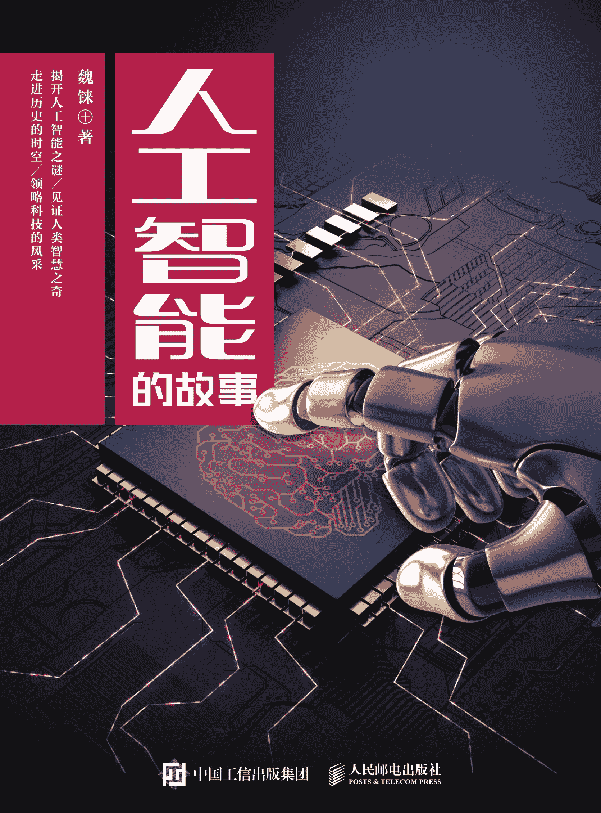

## 内容速览

本书围绕人工智能展开，以发展脉络为线索，串联起相关的人物、事件与发明创造，从浅入深、全面生动地梳理了人工智能的源起与演进，介绍了核心的理论、关键的技术与典型应用。

全书把专业知识与趣闻轶事结合起来，面面俱到又通俗易懂。对对人工智能怀有好奇的普通读者而言，这是一本值得一读的科普参考。

## 致读者

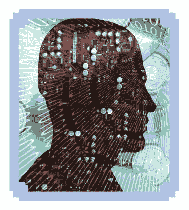

本书谨献给热爱科学、敢于探索、面向未来的朋友。人工智能的智能正在赶超人类，但人类智慧终将超越所有形式的智能！

## 序言

我们这一代人小时候接触人工智能，多半来自科幻作品而非现实。我记得读过苏联作家德涅普罗夫的《X1号机》，那是一台能依据复杂情境预测股市信息的智能机器。作品批判资本主义，暗含高科技既带来繁荣自由，也会让少数人利益暴涨、多数人日渐贫穷的忧虑。若说这篇是社会批判，那他的另一篇《苏埃玛——一个机器人的故事》则更显恐怖。故事里，一位热衷机器的人工智能创造者把智能植入机器人大脑，机器人狂学人类一切，最终渴望学习自己造物主大脑的构造，进而拿起手术刀追逐制作者，想要通过解剖获得自我完善的终极能力。

中国对智能机器的构想同样很早。最早可见的智能机器故事当属《列子·汤问》中的《偃师造人》。周穆王南巡时邂逅一位美貌男舞者，舞者不仅舞姿绝佳，还会用眼神勾引王妃。穆王震怒，命人处置。此时制作者才揭晓真相，这并非真人。打开胸腹，只见内部挂钩林立，各类器官竟是用木头与兽皮拼接，挂在相应的钩子上。

人类对智能机器的向往已延续数千年，但真正实现要等到控制论原理和半导体技术成熟之后。如今人工智能信息铺天盖地，甚至有人担心不久后它会抢走所有工作，让人类沦为机器奴隶。这种情况会发生吗？会困扰你吗？

不管个人看法如何，人工智能正以高速推进走向现实。它已成为新一轮科技革命与产业变革的核心驱动，是战略性技术，具有强大的溢出带动作用。更会深刻改变教育、医疗、体育、住房、交通、助残养老、家政、智慧城市建设与社会治理等诸多领域。正因如此，人工智能的教育刻不容缓，必须立即展开。

可以说，本书正是受此想法鼓舞而成的尝试。全书用故事形式把人工智能发展史通俗地呈现给读者，兼具科学性、思想性与艺术性，是一部优秀的科普读物。作者曾长期从事人工智能研究，对领域有切身体会，因而写作驾轻就熟。又因长期阅读科普作品，对这类写作规律十分熟悉，笔触兼具古今纵横、气势开阔。同时作者对科技与人类未来保持乐观，在万物飞速变化、奇点随时可能到来的时代，这种审慎乐观有助于我们继续前行。

是为序。

吴岩

中国科普作家协会副理事长

南方科技大学人文社会科学学院教授兼科学与人类想象力研究中心主任

## 前言

人工智能源于人类的梦想与探索。

远古时期，古希腊和古罗马的作家、诗人、哲学家便在作品中幻想各类具神力的机械装置，中国古典文学里也多有类似想象。公元270年，希腊一位理发师兼发明家造出一种根据水箱水位高低自动决定是否进水的装置。其原理与今日马桶浮球阀相似：一个浮球连于上下水阀，水位下降浮球下沉开启进水，下水阀关闭；水位上升浮球上浮逐渐关闭进水。这个浮球实质是一个反馈信号发生器，能感知水位并通过绳索正反向传导给阀门。信息反馈的概念由此萌芽，后被广泛应用于人工智能科学，产生深远影响。

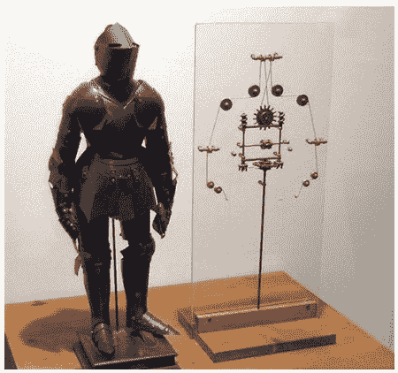
达·芬奇的骑士机器人

文艺复兴时期，意大利全才画家达·芬奇把这种幻想付诸实践。1495年，基于对人体结构的研究，他设计出一台形如着甲骑士的机器人。这可能是世界上第一台类人机器人，可自行站立坐下、摆动臂膀，甚至做出表情，全部动作由体内机械驱动，令人叹服。

1736年，法国发明家兼工程师雅克·德·瓦肯松造出一只“自动鸭子”。这只鸭子会嘎嘎叫、拍翅、划水、饮水进食，甚至还会排泄。当时引发极大好奇，人们争论它吃下的玉米粒是否真被消化排泄。后来有人暗中观察，发现排泄物实为预先塞入肚中的绿色面包屑。但鸭子拍翅划水确为真实工程实现，在当时堪称惊人设计。

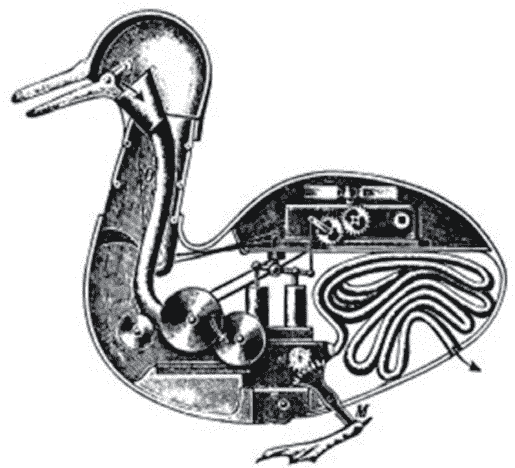
瓦肯松的自动鸭子

若去北京故宫钟表馆，会看到欧洲进贡的各式奇巧钟表，在发条与齿轮或重力摆轮驱动下走时报时。后来法国约瑟夫·玛丽·雅卡尔发明打孔卡片控制织布机，在一定程度上实现了程序化控制，把人类智能以机械或程序形式赋予机器。在发条与打孔卡片的启发下，自动机械层出不穷，如自动演奏钢琴、会眨眼张嘴的木偶，让人看到机器也可复制人的能力。

18世纪末至19世纪初，英国科学家查尔斯·斯坦霍普造出一个“魔盒”。盒侧有滑槽，可滑动涂色滑块，中间窗口显示不同位置滑块对应的题目与答案。它可解决简单逻辑与概率问题。以今天眼光看，这就是最简易的模拟式计算机。斯坦霍普因担心专利被盗，极少让外界知晓，生前只有少数亲友偷看过演示，直至身后才公开。

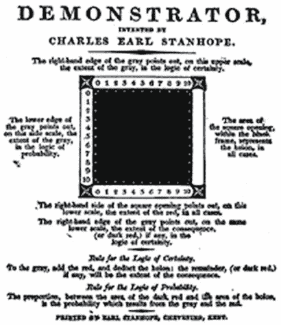
斯坦霍普的魔盒

人类从不缺少想象。法国作家儒勒·凡尔纳在小说中描绘的种种神奇设想，如今大多变为现实。科学进步始终伴随文明进步，人工智能亦然。

今天让我们讲述人工智能的故事，带读者走进这门学科的浩瀚历史与众多天才身影，游览其前世今生！

# 第 1 章 条条大路通罗马

## 1.1 从机械计算装置开始

西班牙国家图书馆位于马德里，前身为腓力五世于1712年创立的宫廷图书馆，建筑庄重，藏书约800万册。

1967年，馆内科研人员例行整理馆藏时，两份夾在资料间的陈旧手稿引起注意，从泛黄程度看已有百年以上。仔细研读后，众人惊讶地发现这是达·芬奇的两份失传手稿。消息轰动全球达·芬奇研究界，手稿遂被命名为“马德里手稿”。

其中一份成于1503至1505年间，详细绘出一台机械式计算装置，IBM公司尤其重视。1968年，IBM重金聘请著名达·芬奇研究专家罗伯特·古泰里博士按手稿复制了该装置。

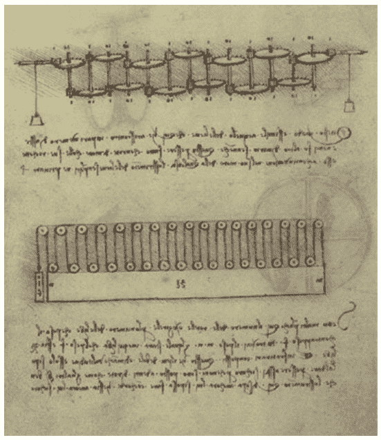
达·芬奇机械计算器草图

装置由13个相互咬合的轮盘组成，每个轮盘十面，对应数字0至9。第一轮转到9时带动第二轮，以此类推形成进位。达·芬奇时代尚无如此多关联运动部件的机器，更无人想到造出可做加法运算的机器。这就是世界上第一台机械式计算器，达·芬奇也因此成为首位发明机械加法器的人。

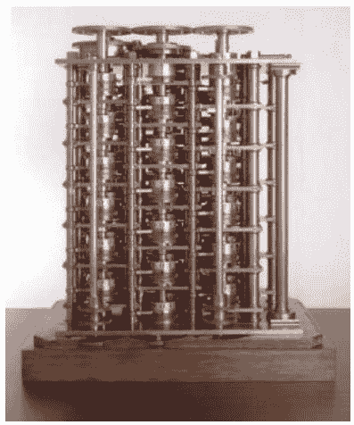
达·芬奇计算器模型

1623年6月19日，法国税务官之子帕斯卡出生。虽无名校背景，父亲在家教授下，他对数学展现出天赋。16岁时他写下关于数字排列的论文，命名为帕斯卡三角并提出其规律，发给熟识的数学家费马转交德萨格。德萨格起初不信出自孩童之手，有皮埃尔担保后才惊叹：发明本身并不惊人，惊人的是出自16岁少年。

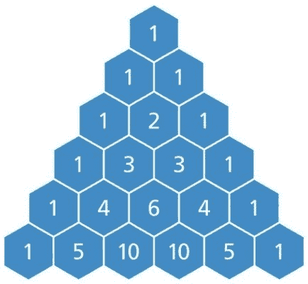

### 1.1.1 帕斯卡三角

两年后，为帮父亲摆脱繁重计算，帕斯卡19岁前发明了可做加减的机械计算器。该机引领了随后四百年的机械计算机发展。虽因结构复杂昂贵，仅成富人玩物，却不妨碍他成为时代最负盛名的数学家、物理学家与发明家。

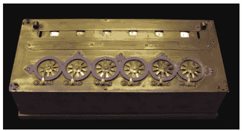
帕斯卡计算器

查尔斯·巴贝奇是英国数学家、发明家，也是“富二代”，其父银行家留下丰厚遗产。他额头宽阔、唇薄眼锐，愤世嫉俗却幽默，极具学者气质。

童年他数学天赋已显，入剑桥后代数造诣甚至超过老师。24岁获聘剑桥卢卡斯数学教授，却选择一条无人敢走的险路并倾尽家财。

1823年，英国政府史无前例地资助巴贝奇设计蒸汽驱动的机械式通用计算机——分析机。因法国发起人工编纂《数学用表》错误频出，航海天文受损，巴贝奇由此萌生以计算机完成大计算的想法。

受法国人雅卡尔提花织布机启发，他先设计差分机，运算精度达6位小数，可演算多种函数表，适合编纂航海天文用表。随后向皇家学会请愿，请求资助建造精度20位小数的大型差分机。政府为此与科学家签下首份合同，拨款1.7万英镑，金额惊人。

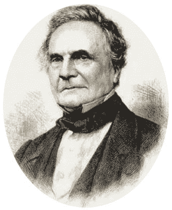
巴贝奇画像

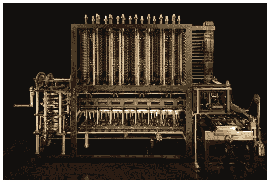
巴贝奇的差分机

然而制造异常艰难。设计需2.5万个零件，主要零件误差不得超0.025毫米，即便以今日技术也极难实现。交由著名机械工程师约瑟夫·克莱门特工厂制造，前十年仅完成不足一半，试验同事相继离去。巴贝奇独自支撑十年，最终无力为继。

1842年冬，伦敦寒冷，资助已被切断。同僚用异样眼光看他。他踉跄走进车间，只见满地滑车齿轮，机器未竟。他叹息后与差分机告别，将图纸与零件捐给伦敦皇家学会博物馆展出。

挫折并未击垮他。早在1834年受挫时，他已提出更大胆设想——通用数学计算机，命名“分析机”，可解算含100个变量的复杂题目，数值达25位，速度约每秒一次。

分析机设想齿轮式存储库，每个齿轮存10个数，共存1000个50位数；运算室原理类似帕斯卡转轮但改进进位，使50位数加法一次转动完成；另有输入输出机构及数据传输部件，还考虑条件转移处理。今日现代计算机结构几乎即其翻版，只是部件换成超大规模集成电路。巴贝奇堪称计算机系统设计的开山鼻祖。

## 1.2 专家系统的萌生

在人工智能领域，专家系统是最早获研究分支。它是模拟人类专家解决专业问题的计算机程序。1965年斯坦福大学研发的DENDRAL是首个成功投入使用的专家系统，能模仿专家分析质谱仪光谱，帮助化学家判定分子结构。开发者是美国人工智能科学家爱德华·费根鲍姆与遗传学家马歇尔·李德伯格。

李德伯格因发现细菌遗传物质与基因重组获1958年诺贝尔生理学或医学奖。当时他正用质谱仪分析火星采集数据，探测生命迹象。

费根鲍姆毕业于卡内基梅隆，是人工智能之父西蒙的弟子。西蒙1955年圣诞后对学生说，他与纽厄尔发明了能思考的机器，并发给学生IBM 701使用手册鼓励动手。费根鲍姆连夜读完，决心投身人工智能。毕业后入西蒙任院长的研究生院，1962年投身斯坦福计算机系，专注专家系统研究，欲在特定领域让计算机运用知识推理完成专家工作。

1964年，费根鲍姆在斯坦福高等行为科学研究中心会议上结识时任医学院遗传系主任的李德伯格。两人志趣相投，一个有数据与经验，一个求技术合作，遂开始长期研发。

分子由原子构成，如H2O表示水分子，但无法体现原子拓扑结构。化学家需知原子间结构，复杂时需靠技术与专家经验。李德伯格依据质谱数据与经验对分子结构做出判断。

费根鲍姆将方法划为三步：先用质谱数据与经验知识形成约束条件，即规划；再用李德伯格算法按约束展开可能性，生成一至数个分子结构图；最后用化学家知识检验排序，输出唯一结构图。他采用树形结构表达化学知识，通过专家经验搜索知识树，认知提炼后得出唯一结构。

实施不易。费根鲍姆团队花五年将专家思路算法化。期间加入美国化学家兼作家杰拉西，因李德伯格为遗传学家，对化学不精。合作成果即首个专家系统DENDRAL。输入光谱数据后即可输出化学结构，据说结果常比杰拉西学生的结果更准。

DENDRAL后来成为化学家常用工具，并商品化。成功证明计算机在特定领域可达专家水平。费根鲍姆据此提出“知识工程”概念，包含获取、分析、规则表达专家知识等，为知识库与知识图谱奠定基础。

在DENDRAL之后，1976年斯坦福又开发MYCIN，用于辅助医生诊断传染性血液病，把人工智能推向医疗应用。

## 1.3 让机器学走路

提到机器人，第一印象往往是类人的身形，或者科幻片里那种体型怪异的机械怪兽。真正大规模投入使用的工业机械人却大都与人类无关，甚至根本不会行走，被固定在工位上重复同一套生产动作。

能够在空间里自行移动的机械人，第一台要算 1968 年诞生的 Shakey，音译沙克依。名字本身的意思是摇晃、不稳、不可靠、容易出问题。用它来称呼全球首台自行动装置，既有幽默感也很形象——它学走路的姿态，就像刚会爬的孩子，晃来晃去、并不牢靠，但这本就是正常阶段。

1963 年冬季，斯坦福研究院神经网络研究的主持者查理·罗森萌生构想：把模式识别、神经网络与 AI 编程整合，做一台能自主辨识环境、按图索骥、自行移动的装置。为提高成功率，他邀请了另一位 AI 之父明斯基担任顾问，并多次赴美国国防部争取资助。折腾近三年后项目获批，国防部拨款，1966 年春季正式启动。

很快出现一台像工具车的原型。行进中一旦骤停，整机就会抖动摇晃，研发人员便顺势取了这个外号。装置由三部分组成：动力是发动机、车轮与机械传动；感知装有激光测距仪、路障感应器和一台电视摄像机；控制则是一台 DEC 公司的 PDP-10 小型机。按今天标准看它很朴素，没有人形，更像一辆无人小车，只能在研究院的走廊与房间里慢慢挪动，遇到障碍还能把它移开。但在当时已是前所未有的突破，其中许多技术思路至今仍在沿用。

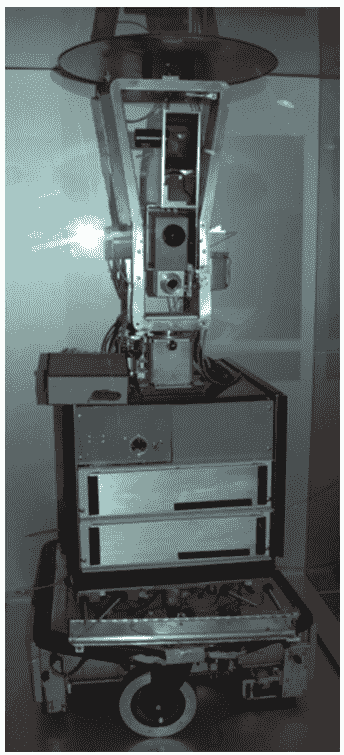
沙克依

沙克依走路首先要解决路线问题。房间充满障碍，它必须先发现前方路障避免碰撞，再绕过去继续朝目标前进。这本质上是导航难题。团队采用网格标注法，让装置标记并记住周边环境，再通过搜索算出绕障路线。AI 领域里，今天把这种边探索边求解的做法称为认知学习。

第二个难点是行动规划。单纯避障不够，比如要从一间房走到另一间，穿过走廊，还得搬开无法绕行的障碍。这就变成包含多步操作的整体规划问题，AI 称之为框架问题。对人类很直观，对计算机却是难题：如何简洁表达情境、协调每一步、生成包含多种操作的方案，都需要大量计算与存储。该项目 1966 年启动，一直到 1970 年才拿出可用解法。按那个方案，装置能在两分钟内规划出六个动作的序列，其核心技术后来仍在规划类应用里出现。

第三个难点是环境理解。沙克依的“眼睛”是电视摄像机，它要对画面做图像处理与识别，并结合激光测距仪给出的距离信息标注在地图上。光线、角度、物体形状都会让识别变得困难。为降低难度，研究人员把墙面刷成浅色，用深色踢脚线把地面与墙面区分，还把所有障碍物都涂成红色，让目标更显眼。即便如此，感知、分析、制定路线往往要花好几个小时。

不管怎样，沙克依是第一台把人工智能全面用在移动机械人上的系统，它能自主感知并描述环境，再按规划执行指定任务。研究成果影响深远。2004 年入选美国机器人名人堂。2006 年，《连线》杂志把它排进全球最具盛名的五大机器人，前两位是科幻小说角色，后两位是后来登上火星的探测器，所以真正意义上的机器第一人仍是它。如今它被珍藏在硅谷的计算机历史博物馆，向世人展示历史价值。

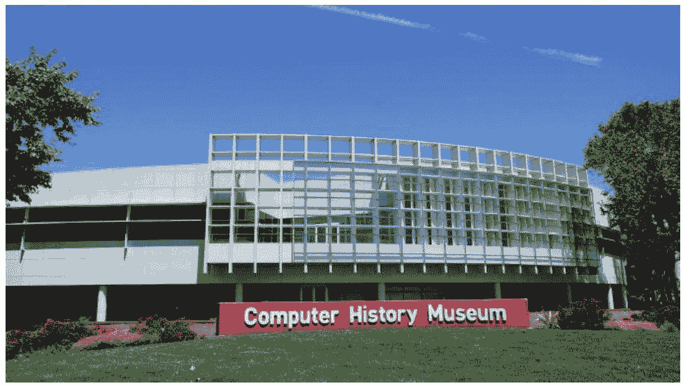
位于硅谷的计算机历史博物馆

## 1.4 跨界灵感

19 世纪末到 20 世纪初，生物神经理论指出人类大脑活动源于神经元细胞及其连接。西班牙神经解剖学家卡哈尔在意大利医生高尔基发现神经细胞的基础上，描绘了神经元的结构与联络方式，两人因此于 1906 年共同获得诺贝尔生理学或医学奖。

神经元是一种活细胞，人脑约有 100 亿个。形态略有差异，但基本都包含细胞本体、负责输入的树突纤维以及一个或多个负责输出的轴突纤维。轴突末端有个膨出结构叫终末扣，紧挨着另一个神经元的树突，两者之间的间隙叫突触，长度大约 20 纳米。

一个神经元通过电化学反应向轴突发出脉冲，脉冲到突触时可能激发或抑制其他神经元的活动，具体会不会放电，取决于突触接收到的脉冲数量和性质。据估算，人脑里约有 5000 亿个突触，构成决定思维的神经网络。

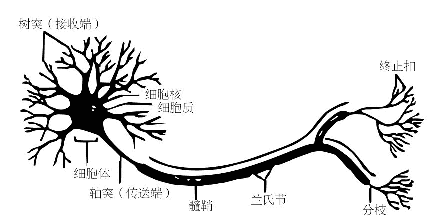
神经元的结构

1934 年，神经生理学家麦卡洛克和逻辑学家皮茨提出神经元本质上是逻辑单元，从而开启了人工神经网络的历史。他们在《神经活动中思想内在性的逻辑演算》一文中提出了一个简化的神经网络结构，证明这类网络可以完成几乎所有计算操作。

人工神经网络是对生物神经网络的简化技术再现，也是一种数学抽象模型。网络中的每个神经元可有多个输入输出，相当于树突和轴突，输出只有两种状态 0 或 1。模仿生物特征，建立分布式并行信息处理算法，按输入多少决定输出，最终得到结果。

麦卡洛克和皮茨不仅是神经网络的开山人物，两人的友谊也成一段佳话。皮茨生于底特律，家境贫寒却极聪明，自学成才。12 岁时他给英国逻辑学家罗素写信讨论《数学原理》，罗素欣赏他的才华邀他去剑桥学习。皮茨家贫无力远行，15 岁那年罗素来芝加哥大学演讲并任客座教授，皮茨便以无学籍学生的身份跟随，靠打零工维生。

不久麦卡洛克也在芝加哥大学任教，认识了皮茨。出于同情和欣赏，他邀请皮茨搬进自己家中同住，结束了皮茨漂泊无依的生活。麦卡洛克年纪相当于皮茨父亲，被人称作养父。每晚饭后，两人便开始思想碰撞。麦卡洛克精通神经科学却不擅数学，17 岁的皮茨恰好是数学天才，一个慈父专家，一个数学奇才，共同写下跨界创新的传奇。

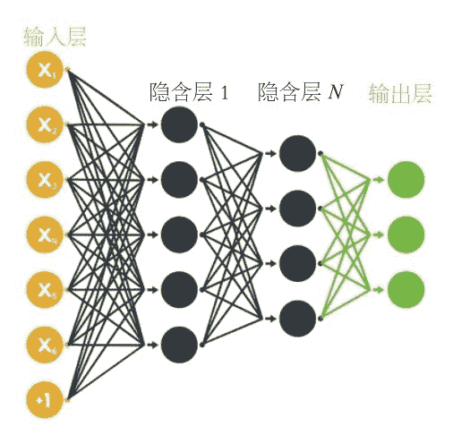
人工神经网络

在人工智能探索中，这样的跨界借鉴不止神经网络，遗传算法也是从生物学得到的灵感。达尔文进化论的核心是物竞天择、适者生存，于是有人设想模拟自然进化中通过遗传优化物种的计算模型，这就是遗传算法，发明者是霍兰德。

霍兰德是历史上第一位计算机科学博士，他曾说过，早期过深地扎进一个领域可能不利于吸收新思想。对他而言，进化论和遗传学都是新领域。他最爱读英国统计学家费希尔的《自然选择的遗传理论》，书中把孟德尔遗传理论与达尔文自然选择结合，给了他启发。进化和遗传本质是群体学习过程，机器学习可以借此建模，遗传算法由此诞生。

遗传算法从代表问题可能解集的一个种群出发，种群由编码后的个体组成，个体相当于带特征的染色体。染色体是基因的集合，其内部组合决定外部表现，比如黑发由控制该性状的基因组合决定。

流程并不复杂：先建立初始状态，随机挑选解作为第一代；再评估适应度，为每个染色体指定与问题解的接近程度，注意这不是答案本身，而是求解过程中可能用到的特性；然后进行繁殖，适应度高的染色体更可能产生后代，后代由父母基因结合并可能发生变异，这个过程叫杂交；最后产生下一代。若新一代已足够接近期望解则停止，否则重复繁衍，直至找到解。

神经网络和遗传算法有个共同点：效果往往积少成多，需要遍历大量状态，对算力和存储都是挑战。当时硬件远不强大，理论先进也难充分展现。两者在诞生之初反而曲高和寡，现实与理想的距离在科学史上并不罕见，但历史始终向前。

## 1.5 机器能否读懂人类的话语

1949 年 5 月 31 日，《纽约时报》刊出一则兴奋的报道：一台新型“电子大脑”不仅能做复杂数学运算，还能翻译外文，由加州大学的国家标准实验室研制，科学家称将实现覆盖韦氏词典六万词、三种语言的翻译能力。

但研发很快遇到技术壁垒，最后无疾而终。后来《纽约时报》不得不承认：机器如何分辨法语中同一个词是指“桥”还是“码头”？机器只能做简单的词典对应，无法从语义上判断该怎么译。

自然语言处理始终是人工智能的核心议题。早期探索就想让机器识文断字。人类逻辑思维以语言为载体，绝大部分知识也以文字形式传承。实现人机自然语言通信，意味着计算机既要读懂文字含义，也能用自然语言表达意图，前者是自然语言理解，后者是自然语言生成，合称自然语言处理。机器翻译正是其中的典型应用。

真正可用的机器翻译系统直到 1954 年 1 月才在美国乔治城大学出现。它只有六条语法规则和 250 个词，却成功把几十句俄语句子翻成英文。没有现代交互手段，俄文需用打孔卡片输入 IBM 701 大型机，英文则由连接的打印机打出。

研究中长期存在两种路线：以乔姆斯基为代表的语言学方法和以贾里尼克为代表的统计学方法。乔姆斯基出生于宾夕法尼亚费城，宾大语言学博士，博士期间在哈佛做四年青年学者。他的博士论文发展为《句法结构》，被视作 20 世纪理论语言学最伟大贡献之一，也成了 AI 机器翻译语言学派的圣经。

按他的句法结构，句子可按规则解析为名词短语和动词短语，再进一步拆解。他认为所有语言都有内在的句法结构，不靠经验获得。机器翻译于是变成结构解析和重构，是一种逻辑方法，也暗合有限自动机理论，成为早期主流。

乔姆斯基不仅是学者，还是社会活动家，1967 年因反战被捕入狱。麻省理工学院为保护这位“敢言的院宝”多次聘请保镖，他的姓名一度出现在邮件炸弹黑名单上。业内评价他学究气、固执却善良，据说狱中因不能给学生上课而自责不安。

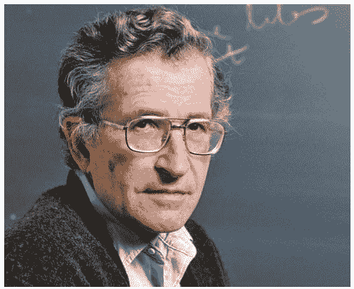
乔姆斯基

与之对立的是统计学方法。1988 年，IBM 沃森研究中心的机器翻译小组发表论文并推出法英翻译系统 CANDIDE，组长贾里尼克成为统计派代表。他的名言是“我每开除一位语言学家，我的语音识别系统性能就提升一倍”，可见他对语言学方法的排斥。

统计方法依赖海量语料，通过概率统计发现数据规律、建立模型。简单说，一个词的用法多样，但在不同语境下的出现频率和与其他词的关联频率不同。记录这些概率，建立词统计模型，就能分析和理解句子意思。

就在乔姆斯基研究句法并投身反战时，德裔犹太人魏森鲍姆在麻省理工编写了一个心理咨询会话程序 ELIZA。用今天的话说就是聊天机器人，通过终端与人交流。程序很简单：在按词频排序的词库里搜索匹配词，再在脚本库里挑个回复。

连魏森鲍姆自己也没想到，这个小玩意儿会轰动一时。来访的学者记者都要到他办公室亲自和“机器心理医生”聊聊。有一次，一位公司副总裁在终端聊完后把自己的电话号码输进去说“有空打给我，好吗？”终端却一直没回。副总裁大怒，后来才发现他没按回车，机器以为他还没说完，一直在耐心等他结束。

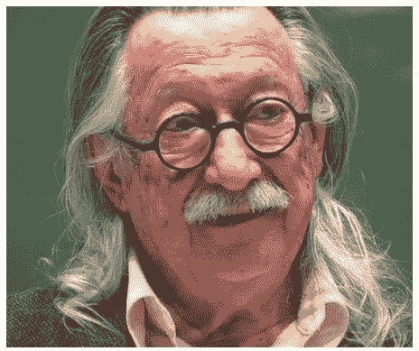
魏森鲍姆

维诺格拉德并非乔姆斯基的学生，读研时却选修了乔姆斯基的句法课。因为他主攻人工智能，期末论文试图论证 AI 方法的可行性，惹恼了乔姆斯基，只给了他 C 分，吓得他再也不选乔姆斯基的课。他的博士论文仍与语言相关，开发了一个积木世界系统。用显示器展示虚拟积木世界，人们可用自然语言指挥虚拟机械手操作积木，若指令不明确系统会提问，整体像个游戏。

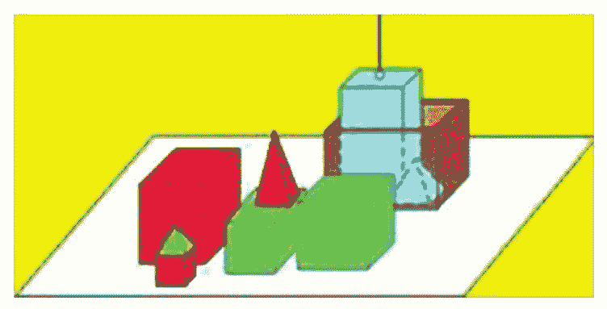
积木世界

积木世界比 ELIZA 复杂得多，学术意义也更深。它把自然语言处理、规划、知识表达等当时多项 AI 技术整合在一起，涉及语言输入输出生成、知识表示与理解、世界与思想。系统暗含一种哲学：意义即语言的使用，语言使用是心与世界的交互。积木世界因此成为研究语言的语言游戏方法，维诺格拉德也因此获得国际人工智能联合会首届“计算机与思维奖”。

# 第 2 章 什么是人工智能

## 2.1 人工智能第一人

人工智能真正成学科是在 1956 年夏天达特茅斯会议，由麦卡锡确立，但概念的正式提出要早八年，1948 年出自英国人阿兰·图灵。

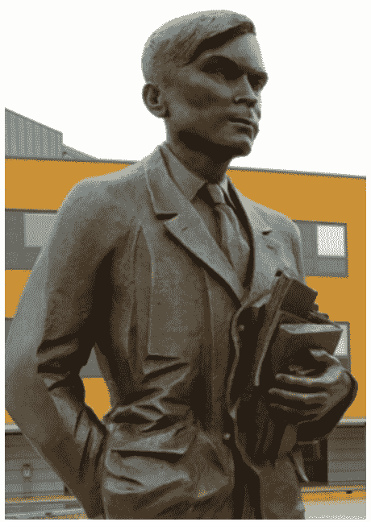
阿兰·图灵雕像

图灵小时候聪明绝顶、正直清高。据说中学时他完全不听课也不看书，数学定理都是自己推导，竟把中学以前的数学知识从头到尾“再发明”了一遍，让老师校长头痛不已。校长后来把他父亲找去嘲讽：“你孩子偏科，我们培养的是文化人，他想当科学家来错地方了。”鼠目寸光的校长没想到这个“偏科生”会成为世纪级科学家。

图灵出身富裕世家，名校背景。去剑桥报到时，父母为避税全家在法国。他只好从法国坐渡轮过海峡，抵达已晚，班车没了。他从行李里取出自行车，买了地图，一路骑行近百公里赶往学校，途中坏了两次，夜里在一家五星级酒店休息。事后他把酒店发票寄回家，证明自己没说谎也没乱花钱。

图灵是科班数学家，那个年代数学就是脑袋加纸笔。他一直在想，能否发明机器代替纸笔做运算，进而解决一切可用数学逻辑解决的问题。某天他躺在学校草坪上冥想，一个简单的机械装置在脑中浮现，这就是后来的图灵机，现代计算机的核心原型与本质概括。

计算的起点：图灵机

图灵机常被视作最简洁的运算原型。它的构造只涉及三部分：一条可以无限延展的纸带，带上按顺序排列的格子，每个格子仅允许标记 0 或 1；一只在带上滑动的读写头，能够辨识当前格的内容并在此处写入符号；再加上一个规则控制器，它依据读到的符号结合预设的逻辑，指挥读写头向前移一格、向后退一格，或在原位改写符号。

图灵证明了这个玩具装置的计算威力与当时逻辑学中的丘奇演算、哥德尔递归函数完全等价，由此确立了其无穷的计算潜能。借助这一模型，抽象的函数从纸面概念落到了纸带和读写头的具体操作上。今天的电子计算机，本质上就是这一虚拟装置的物理实现。冯·诺依曼反复强调，自己关于存储程序的想法直接来自图灵机，编码后的图灵机就是程序。基于这一洞见，说计算机科学源自图灵并不为过。1936 年发表的《论可计算数》及其所描述的机器，已成为人类文明的分水岭。

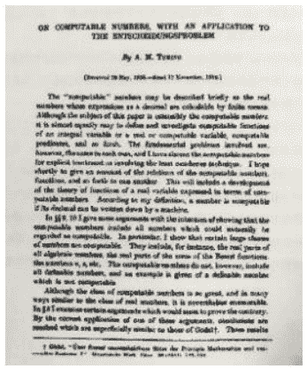

《论可计算数》

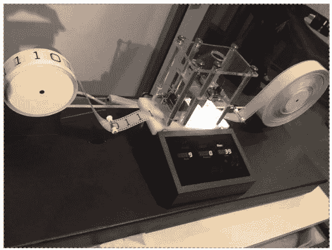

图灵机

1939 年 9 月 1 日德国进攻波兰，次日英国宣战，第三天图灵便被召入布莱切利园。该园是英国密码部门的隐秘据点，为三军提供加解密支持。图灵的主要任务是攻破德国的恩尼格玛密码机。战时工作强度极大，有一次他要赶往伦敦开紧急会议，身边找不到交通工具，便自言自语说自己解决，然后拔腿狂奔。往返约 64 公里对他而言轻而易举，会议结束后又同样跑回。图灵的长跑水平达到奥运水准，本拟代表英国参加 1948 年奥运会，因伤退出。

即便在战争期间，图灵仍未放弃对机器与智能的思考。战后他赴曼彻斯特大学任教，在友人敦促下将相关思考整理成文，1950 年在英国哲学期刊《心》上发表了《计算机器与智能》。文中提出“模仿游戏”，后世称图灵测试，用以界定智能。他不仅提出机器能否思维的问题，还列出多种变体，给出自己的答案，并预想可能的质疑及反驳。他还大胆推测到 2000 年机器内存将达 1GB，预测相当准确。

2011 年 IBM 的沃森在美国电视智力竞赛中胜出，被视作图灵测试理念的重要验证，人工智能由此迎来历史性跃升。麻省理工学院机器人专家布鲁克斯感叹，阅读图灵的文章令人折服，他早已洞见后来的发展，没有人比他更具先见。

可惜天才的人生并不顺遂。图灵的私生活长期困扰他，并招致法律麻烦。英国政府不仅未因其战时贡献予以保护，反而吊销其安全许可，使他无法继续该领域工作。1954 年 6 月 7 日，年仅 42 岁的图灵在家中床上被发现离世，死因至今未明。为纪念其贡献，美国计算机协会于 1966 年设立图灵奖，被誉为计算机科学界的诺贝尔奖。2009 年 9 月 10 日，离世 55 年后，英国首相布朗代表全国向图灵正式道歉，表示我们错了，本应更好地对待你。

在曼彻斯特公园的图灵雕像底座上刻着逻辑学家罗素的名言：数学不仅有真理，也有最高的美，那是一种冷峻而简朴的美，如同雕塑。图灵被视为人类历史上最伟大的十二位哲学家之一，与亚里士多德并列。也许伟大与荣耀并非最关键，真正重要的是真与美，以及对人类的贡献。凭借对人工智能理论的开创性工作，图灵被公认为人工智能的第一人。

## 2.2 冯·诺依曼与首台电子计算机诞生

人工智能与计算机科学看似分道，实则相互依存。人们常说的电脑即电子计算机，而人工智能的核心在于基于逻辑电路的计算方法。计算机学科内部始终存在两条线索：理论脉络可追溯到图灵，工程脉络则指向冯·诺依曼，这位匈牙利裔美国数学家，也是首台电子计算机的设计者。二人共同关注的终极议题都是大脑与智能。

冯·诺依曼是二十世纪数学界的巨擘，纯数学与应用数学皆有建树。他生前名气远超图灵，图灵申请奖学金的推荐信即出自他手。冯·诺依曼早早识破图灵的非凡，曾劝刚毕业的图灵留在普林斯顿做助手。后来他多次表示，自己所创电子计算机的核心概念，除巴贝奇的预见外，其余皆源自图灵。

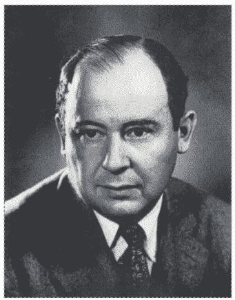

冯·诺依曼

冯·诺依曼的学术生涯大致可分两阶段。1940 年前他深耕纯数学，在数理逻辑、集合论、量子理论方面成果丰硕，还开创遍历理论，用紧致群破解希尔伯特第五问题，并在测度论、格论、连续几何上有开创性贡献。1936 至 1943 年间，他与墨雷合作创立算子环理论，即冯·诺依曼代数。

1940 年后他转向应用数学。纯数学成果属于数学共同体，而他在力学、经济学、数值分析、电子计算机方面的建树则属于全人类。二战爆发后，他应战时需要研究可压缩气体运动，建立冲击波与湍流理论，推动流体力学发展。自 1942 年起与莫根斯滕合著《博弈论与经济行为》，奠定数理经济学的基石。

冯·诺依曼与电子计算机的结缘带有偶然性。战时他参与美国原子弹研制。核反应传播的判断需要数十亿次运算与逻辑推演。洛斯阿拉莫斯实验室动用上百名女计算员日夜手工计算，仍远远不够。无尽的数字消耗着人的精力，让冯·诺依曼颇为焦虑。

1944 年夏，他在火车站等车时偶遇戈尔斯坦中尉。当时戈尔斯坦负责美国弹道实验室军方事务，正参与由英国科学家主导的恩尼亚克研制。交谈中戈尔斯坦透露，恩尼亚克证明电子真空技术可大幅提升速度，但存在两大缺陷：一是缺乏存储器，过程与结果无法保留，每次运算需从头开始；二是靠布线插板控制，接线耗时数日，大幅拖慢效率。他们正寻求改进方案。具前瞻眼光的冯·诺依曼立刻意识到其意义。

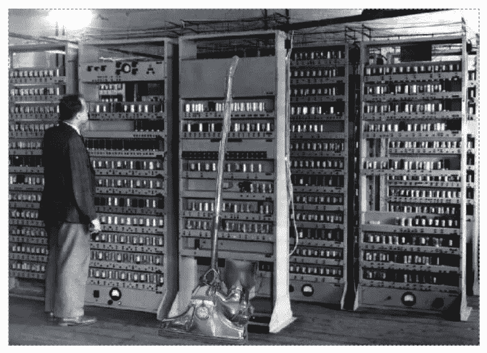

电子计算机 ENIAC

不久经戈尔斯坦引荐，冯·诺依曼加入恩尼亚克研制组。1945 年，他主导发布全新的存储程序通用电子计算机方案 EDVAC。在此期间撰写长达 101 页的《关于 EDVAC 的报告草案》，系统阐述制造电子计算机与设计程序的新思路，被视为发展史上的里程碑，从此宣告电子计算机时代到来。

EDVAC 明确提出新机器由运算器、控制器、存储器、输入设备、输出设备五部分构成，并详述功能与关联。冯·诺依曼在报告中重点论证两大设计思想。其一是二进制，依据电子元件双稳态特性，建议采用二进制。他指出二进制可极大简化逻辑线路。这一基本工作原理奠定了现代计算机基础，使他获称电子计算机之父。

### 冯·诺依曼与人工智能
### 2.2.1 冯·诺依曼生平

1903 年 12 月 28 日，冯·诺依曼出生于匈牙利布达佩斯的犹太家庭。父亲是银行家，母亲受过良好教育，性情温婉。

幼年他展现惊人数学与记忆天赋。6 岁能用希腊语与父亲开玩笑，并心算八位数除法。8 岁掌握微积分。10 岁通读 48 卷本世界通史，并能将当下事件与历史事件对照，探讨军事与政治策略。12 岁便读懂数学家波莱尔的巨著《函数论》。

在布达佩斯大学他注册数学系，却几乎不听课，照常考试，成绩皆为 A。同时赴柏林大学旁听。1923 年进入瑞士苏黎世联邦理工学院攻读化学，获化学工程学士学位。通过期末回布达佩斯大学考试，他获得数学博士学位。

1930 年首次赴美，成为普林斯顿大学客座讲师。美国政府很快聘他为客座教授。1933 年普林斯顿高等研究院正式聘他为教授，当时研究院仅有六名教授，其中包括爱因斯坦，而年仅 30 岁的冯·诺依曼是最年轻的一位。

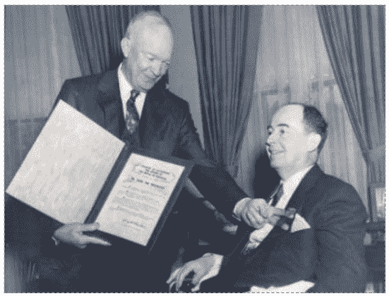

授奖

1955 年夏天 X 光检查发现他患癌，可能与参与原子弹研制有关。随着病情加重，他只能在轮椅上思考、演讲、参加会议。他受邀在耶鲁大学做西里曼讲座，但因身体虚弱未能到场，讲稿也未完成。1957 年 2 月 8 日，他在医院去世，年仅 53 岁。

即便在离世前数日，肿瘤已侵入大脑，他的记忆力仍令人难以置信。有一次同事数学家乌拉姆在他病床前用希腊语朗诵他喜爱的修昔底德著作《伯罗奔尼撒战争史》中有关亚西纳人攻打墨洛斯与佩里克里斯演说的内容，冯·诺依曼一边听一边不断纠正乌拉姆的用词与发音失误。

### 2.2.2 冯·诺依曼与人工智能

冯·诺依曼是大师级人物，足迹遍及数学、理论物理、逻辑等多个领域，历史上少有人能比肩。他与图灵、纳什、约翰·麦卡锡等大师的交往深刻影响后人。他对人工智能的贡献远不止于首台电子计算机的设计，今日热议的阿尔法狗、神经网络等都与他有千丝万缕的联系。

1948 年 9 月，美国加州理工学院召开关于人类行为脑机制的研讨会。当时生物学家、解剖学家、心理学家与神经学家都致力于探寻思维奥秘。会议选址洛杉矶，九月风光宜人，更吸引人的是出席者之一冯·诺依曼。一场认知科学研讨会为何会有计算机界领军人物到场？

原来冯·诺依曼在发明首台电子计算机后，萌生制造一种足够复杂、理论上可自我复制的机器即自动机的设想。电子计算机是他的起点，而自复制机器需要在结构上接近人脑。于是这场关于脑机制的会议正中其兴趣，他希望在计算机架构基础上展开接近大脑机制的人工自动机研究。

当时在加州理工就读本科的约翰·麦卡锡恰好旁听了会议，回忆说正是这次聚会点燃了他对人工智能的热情与研究欲望，后来他被称为人工智能之父。

冯·诺依曼在会上发表题为《自动机的通用和逻辑理论》的演讲，开创细胞自动机理论。他的助手斯坦利·乌拉姆余生深耕细胞自动机，并培养出世界首位计算机科学博士约翰·霍兰德。冯·诺依曼在细胞自动机与 DNA 方面的思考间接影响了霍兰德。霍兰德博士论文首次提出遗传算法，其弟子巴托尔与再传弟子杰弗里·萨顿随后发明强化学习理论。强化学习被用于谷歌的阿尔法狗，击败顶尖围棋大师；也应用于卡内基梅隆大学的 Libratus 机器牌手，在德州扑克大赛中胜出。可以说，受生物学启发的人工智能研究，其源头可追溯到冯·诺依曼。

细胞自动机本质上是模拟包含自组织结构在内的复杂现象的一种强有力工具。自然界许多复杂结构与过程，归根结底是大量基本单元通过简单相互作用产生。细胞自动机正是描述这种单元间相互作用的方式。

为了理解其原理，可想象一张画满格子的纸，先涂黑第一排若干格。细胞自动机通过一组简单规则，从第二排开始向下生成新图案。对每一格，需观察其上一行对应格子及左右邻居，根据三格的黑白组合与相邻关系，按既定规则决定本格是涂黑还是留白，反复进行，便形成自动机演化。细胞自动机理论研究的是由小型计算单元按邻域方式连接成的并行计算模型。

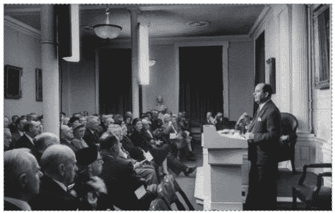

冯·诺依曼在讲演

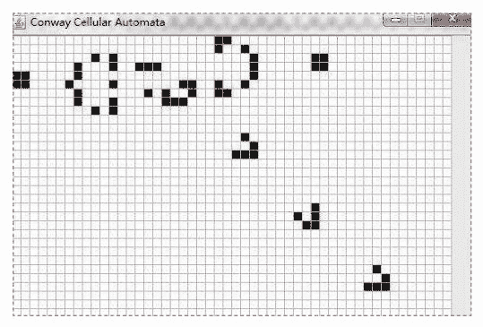

细胞自动机

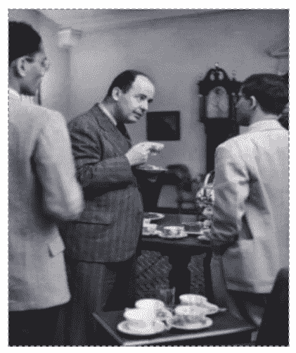

冯·诺依曼在聚会上

冯·诺依曼的工作深刻影响了计算机科学家斯蒂芬·沃尔夫勒姆。他长期研究细胞自动机，其研究成果催生了数学软件 Mathematica 与搜索引擎 Alpha。在其著作《新科学》中，冯·诺依曼被提及 12 次，仅次于 19 次的图灵。

冯·诺依曼为人热情，爱邀友聚会。他有一栋适合聚会的住宅，闲暇便邀朋好友到访。每逢聚会，朋友们都想与天才一较高下，留下不少趣闻。有一次几位数学家用伏特加灌他，他不胜酒力摇晃着去洗手间呕吐，回来后仍能思路清晰地继续讨论数学，让众人自叹不如。

另一次聚会上，他与一位自诩精通拜占庭史的历史专家争论起来，双方各不相让。有人取来权威史籍，竟发现冯·诺依曼的复述一字不差。那位专家只好沉默。冯·诺依曼后来表示，以后若再邀请这位专家来访，自己绝不再与其讨论拜占庭历史。

冯·诺依曼逝世后，其著作《计算机与人脑》才正式出版，书中预示了人工智能的发展方向。他在多处场合高度评价图灵机与沃伦·麦卡洛、沃尔特·皮茨的神经网络。全书分为计算机与大脑两部分，他把二者视作解决同一问题的两种路径。长期以来人工智能存在符号学派与神经学派之争，前者代表计算机，后者代表大脑。冯·诺依曼的著作其实在提示，二者殊途同归，应互学互鉴，取长补短。

冯·诺依曼的故事仿佛永无止境。

## 2.4 人工智能的定义困境

人工智能无处不在，却并非人人都能觉察。有人以为它像科幻片里的机器人，拥有超人智力无所不能。也有人认为计算机每秒完成数百亿次运算，人类算不过机器，这就是人工智能。到底哪种理解更接近真相？人工智能究竟是什么？

尽管智能搜索引擎、智能助理、机器翻译、机器视觉、自动驾驶、机器人等都属于人工智能范畴，但至今仍缺乏一个明确、公认的科学定义。历史上定义不断演变，一些浅层表述早已被淘汰，但被广泛引用的版本依然众多，各自从不同角度切入。

“人工智能”一词最早由约翰·麦卡锡提出。他在为达特茅斯夏季研究项目撰写经费申请报告时首次使用这一表述。由此那次聚会被称为人工智能元年，人工智能正式成为学科，麦卡锡因此被誉为人工智能之父。

麦卡锡在报告中写道，研究让机器能够模拟人类智能各方面的原理，从而使机器能够解决那些人们认为只有人类智力才能解决的问题。换言之，人工智能就是让机器完成人们不以为机器可胜任的任务。这一定义宽泛有趣，是否属于人工智能，往往取决于程序能否模仿人类思维，反映了大众对人工智能的直觉认识。

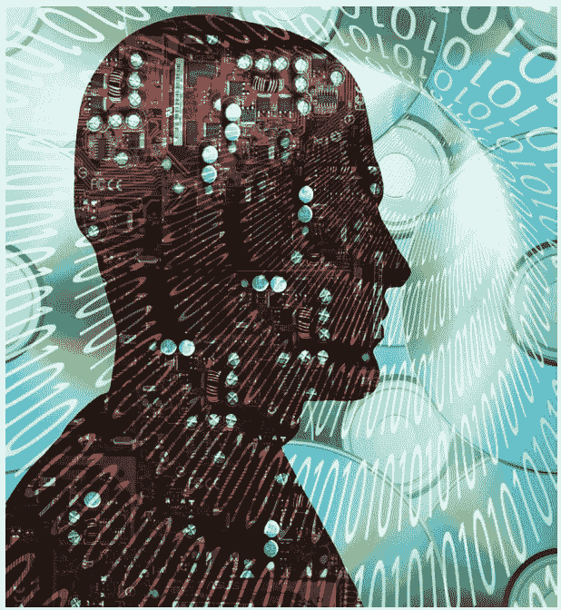

什么是人工智能

但并非所有人都认同这一说法。谷歌科学家李开复认为，这更像一种仿生直觉。既然名称里带人，那么用程序模拟人类智慧是最直接的做法。然而历史表明，仿生思路在科技发展中并不总能奏效。

人工智能到底在定义什么？

说清人是怎么思考的，本身就是技术和哲学的双重难题。哲学家靠反省思辨去提炼思维的法则，科学家则用心理学和生物学的实验去观察思考时的身心变化。这两条线索都深刻影响了人工智能的发展历程，也让关于 AI 的说法一直众说纷纭。

上世纪六十年代中期，斯坦福的专家系统 Dendral 取得突出成绩，随后出现了一批依据光谱反推分子结构的智能程序。Dendral 能在限定范围解决问题，靠的是化学家长期积累的“某种结构会产生某种光谱”的经验，以及大量贴合人类推理习惯的判定规则。从机器翻译到语音识别，从军事决策到资源勘探，Dendral 的热潮把专家系统推向高峰，一度被等同于人工智能，风头不亚于今天的深度学习。

热度过后局限显现。基于知识库和逻辑规则搭建的系统很难从一个狭窄领域扩展到更广的知识面，更不用说日常常识。1957 年苏联发射首颗人造卫星后，美国急于用机器翻译了解苏方动向，用语法规则和词表对照实现的俄英翻译闹出笑话，比如“心有余而力不足”被译成“伏特加不错而肉都烂掉了”，完全无法处理自然语言里的歧义和丰富表达。

与此同时，生物学家和心理学家很早就关注大脑如何处理和传递信息，神经元的活动在物理上表现为一种刺激。电子计算机出现之前，学界已提出假想模型：数量庞大的神经元组成协作网络，信息经多层神经元的增强、衰减或屏蔽后作为系统输出，驱动身体对环境刺激作出反应。

五十年代初，早期研究者把神经网络用于模式识别，用程序模拟神经元对输入的处理，并据此调整参数。但受限于算力和数据，这种依赖大规模计算的方法难以成形，直到九十年代运算能力飞涨，神经网络才重新进入视野。到了 2010 年前后，支撑深度神经网络的集群才大规模普及，配套的训练数据集也越来越大。仿生学的神经网络在新一轮复兴中扮演了核心角色。

但神经网络到底复刻了大脑多少，学界仍有争议。仿生道路上最本质的卡点是，人类至今对大脑如何实现学习、记忆、归纳、推理等过程的机理仍不完全清楚，真正模拟人脑仍像盲人摸象。连人类智能都尚未搞清，又怎能给人工智能下一个精确的定义？

当下，“不学习就不是人工智能”几乎成了共识。不少研究者更愿意称自己是机器学习从业者。谷歌的 AlphaGo 先学习大量职业棋手的对局，再通过自我对弈持续进化，才有了击败人类世界冠军的底气；微软的小冰靠海量网络语料训练，才能用时尚活泼的方式与用户交流。媒体普遍宣传，人工智能应用建立在深度学习之上，本质是计算机从大量数据中自行提炼经验模型。于是有人把人工智能说成会学习的机器。

可人工智能的学习能力远不及人类，尤其在抽象归纳上差距明显。小孩子看一辆车就能推广到同类车型，而人工智能系统识别同类物体往往需要上万次训练。这种说法也有问题。

其实，不同的定义会把研究和认知导向不同方向，也适用于不同人群和语境。若强行调和所有看似合理的说法，最后得到的只是一个面面俱到却模糊笼统的概念。

维基百科采用的表述来自斯图亚特·罗素与彼得·诺维格的《人工智能：一种现代的方法》。他们认为人工智能是关于“智能主体研究与设计”的学科，而智能主体是指“能感知周围环境并采取行动以达成目标的系统”。这个说法包容了当前主流定义，强调环境感知下的主动反应和目标达成，不再执着于模仿人类思维方式或逻辑学规则。

定义之争恰恰说明，人工智能仍是年轻且充满探索空间的学科。其涉及领域之广、方法之多、应用之众，让它成为一门魅力十足的科学，也让无数人各展风采。

## 2.5 图灵奖——计算机界的诺贝尔奖

图灵的故事我们已熟悉，生前名声平平，却被后人证实为文明级贡献。计算机科学被公认为始于 1936 年他发表的《论可计算的数》，连第一台电子计算机发明人冯·诺依曼也反复表示自己的工作源自图灵理论。

图灵机的深刻与简洁至今难被超越，几乎所有计算机理论最终都能归到图灵机上。它简单明了，却被证明与邱奇的 λ 演算等价，而 λ 演算又与哥德尔的递归函数等价。哥德尔对递归函数是否是最广义的计算装置尚有疑虑，图灵机让他彻底确信。

邱奇是美国数学家，1936 年给出可计算函数的首个精确定义，对算法理论发展贡献巨大。他在普林斯顿执教 40 年，任数学与哲学教授，后赴加州大学洛杉矶分校。其 λ 演算是一套研究函数定义、应用和递归的形式系统，能清晰刻画可计算函数。可视为最小的通用程序设计语言，核心在于变换规则与函数定义方式，任何可计算函数都能用它表达求值，因而等价于图灵机。它更偏向规则运用而非具体机器，更接近软件而非硬件，使用变量代入与置换来研究计算。

λ 演算名称源于一次排版失误。邱奇原本想用罗素的标记法，即 X 上戴小帽子的符号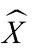，排版工人找不到字模，便用 λ 代替。整个演算系统都基于这个“小帽子”，λ 便成了无名函数的代名词，邱奇演算也被称为 λ 演算。

图灵的贡献远不止计算机科学。1950 年他在哲学杂志《心》上发表《计算机与智能》，是人工智能最早的系统化科学论述，也是指导性文献，文中提出的“模仿游戏”，即图灵测试，至今仍是判断标准之一。图灵很早就探讨大脑皮层发育从非组织化到组织化的转变，并指出人体的任何部分都可被机器模仿。他还涉及基因、进化和选择。冯·诺依曼受此启发提出神经系统本质是数字的，尽管神经系统的化学与生物过程描述可能是模拟的。现代物理学假设宇宙是离散的、数字的，若一切皆数字，图灵机就是最简单有力的模型。研究人工智能绕不开图灵机及其建立的计算机理论。

正因如此，1966 年美国计算机学会设立图灵奖，用以表彰该领域杰出贡献。评选条件苛刻、程序严格，通常每年仅奖一名，少数年份有两人共享。它是计算机界最负盛名、最高尚的奖项，有“计算机界诺贝尔奖”之称。一般于次年 4 月初颁发，1966 年至今共有 70 位得主。国籍分布上美国最多，欧洲次之，华人目前仅有 2000 年的姚期智。截至 2018 年，斯坦福大学得主数量全球第一，麻省理工学院与加州大学伯克利分校并列第二，哈佛大学第四，普林斯顿大学第五。

奖金早期为 20 万美元，1989 年起增至 25 万美元，现由谷歌赞助已升至 100 万美元。70 位得主分布在不同领域，前六位为编译原理、程序设计语言、计算复杂性理论、人工智能、密码学、数据库。前三者与计算机科学本体联系更紧密，后三者与应用系统联系更紧密，人工智能位列其中。毫无疑问，图灵之后的 AI 之父们先后上榜，我们后续会介绍。

# 第 3 章 人工智能研究的里程碑

## 3.1 达特茅斯学院的夏天

1956 年夏天，位于新罕布什尔州的达特茅斯学院安静而美丽。暑假里学生离校，校园空荡。没人注意到一群理工男正聚精会神地构想如何造出具备人类智能的机器。他们时而激烈争辩，时而陷入沉思，时而挂起“请勿打扰”独自闭关，时而在草坪漫步交谈。这群人后来被称作人工智能之父，而这一年也成为 AI 元年。

故事可追溯到 1948 年秋天的加州理工。1948 年 9 月，约翰·麦卡锡还是加州理工的本科生。文质彬彬、不苟言笑的他常戴着黑色塑料半框眼镜，像数学一样沉静，却内心朝气蓬勃，后来开创了 AI 学科。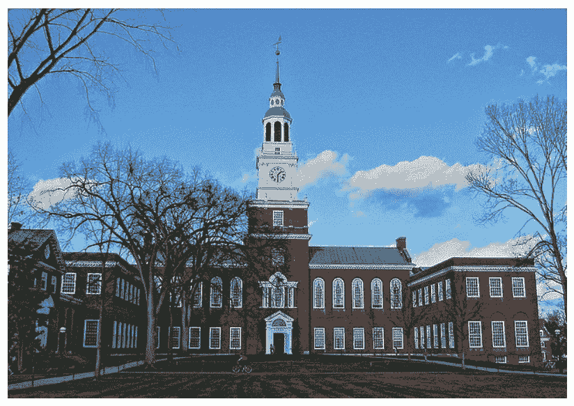

特达茅斯学院

加州理工被视作美国西海岸的麻省理工。九月的西海岸风光浪漫温馨，一场关于人类行为脑机制的研讨会正在举行。麦卡锡旁听了会议，并听到了大人物冯·诺依曼关于《自动机的通用和逻辑理论》的演讲，深受触动，成为他投身 AI 的导火索。

博士毕业后麦卡锡来到达特茅斯工作。1955 年夏天，他受负责设计 IBM 701 计算机的纳萨尼尔·罗切斯特邀请，到 IBM 短期研究。工作中两人热烈讨论如何让机器像人一样处理问题，并说服克劳德·香农与马文·明斯基，决定次年夏天在达特茅斯共同开展 AI 研究。当时香农在贝尔实验室任数学家，在交换机理论与统计信息理论方面名声极大。明斯基是哈佛的年轻学者，专攻数学与神经学。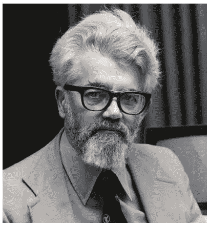

麦卡锡

为何需要跨领域的人参与？早期 AI 并无确定的方法与方向，可谓各显神通。感兴趣的学者都从自身专业切入。最接近人脑的就是刚出现的电子计算机，它能像人脑一样存储数据，又能在程序控制下自动推理计算，因而计算机专家成为主力。神经学家、心理学家和脑科学家因研究人脑工作秘密而同样关键。数学是万学之学，任何问题最终可归结为数学，数学家的参与自然必要。

经费从何而来？麦卡锡亲自撰写项目计划书，给项目命名为`人工智能的夏季研究`。这是历史上首次把机器模仿人脑的研究命名为人工智能，也是首次开展 AI 专题研究。计划书写道：“我们打算在暑期两个月组织 10 人团队，专门进行人工智能研究。研究内容将包括所有关于知识学习的基本猜测和能精确描述机器模仿人类其他智能特征的方法，试图找到让机器使用语言、具有抽象能力和掌握概念的途径，解决目前只有人类能处理的问题，让机器具备类人智能。”富于想象的描述打动了洛克菲勒基金会，项目获得慷慨资助。

参与者除发起人麦卡锡、罗切斯特、香农、明斯基外，还有 IBM 工程师阿瑟·塞米欧，开发了跳棋程序；MIT 的奥利沃·塞尔弗里奇和瑞·所罗门诺夫，对自动感应系统感兴趣；研究符号逻辑推理的艾伦·纽厄尔与赫伯特·西蒙；以及 IBM 研究国际象棋程序的伊莱克斯·伯恩斯坦。他们背景各异，各怀心思，却共享同一个目标：让机器完成当时只有人能做的事。

麦卡锡一直在尝试建立类似英语的人工语言以便机器自解问题。他提出“常识逻辑推理”理论。举例来说，旅行者从格拉斯哥经伦敦到莫斯科，程序可分段处理。但若在伦敦丢了机票，现实中人不会因此取消行程，会再买票，而预设计程序却缺乏这种灵活性，需要更符合现实的常识推理。

后来他提出情景演算理论，并发明基于数学推理的表处理语言 `LISP`。他也承认，在某些语境下进行基础猜测非常困难。关于里根总统的一个笑话就是例证，白宫发言人奥涅尔恭喜里根成为格罗弗·克利夫兰，后者微笑回应自己只在电影中扮演过他一次，完全张冠李戴。

在小组里，香农希望把信息论概念用于计算机与大脑模型。他是信息论奠基人，关于通信信息编码的三大定理为信息论奠定了基础。

西蒙与艾伦是小组里最特别的一对，曾是师生，后成亲密合作伙伴，同为 AI 符号学派创始人。他们带来了正在开发的后来被称为 `逻辑理论家` 的程序，其符号结构与启发式方法成为解决智能问题的理论基础。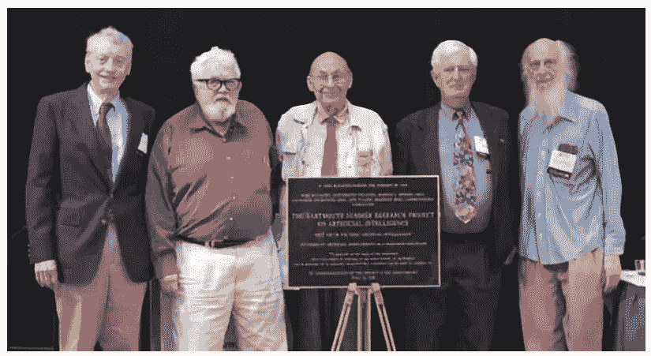

几位人工智能的奠基人：特雷查德·摩尔、约翰·麦卡锡、马文·明斯基、奥利沃·塞尔弗里奇和瑞·所罗门诺夫（在 2006 年 7 月纪念达特茅斯会议 50 周年的聚会上）

明斯基与他人不同。大学主修物理，同时选修电气工程、数学、遗传学、心理学等诸多学科。后来觉得遗传学深度不够、物理吸引力不足，读研时改攻数学，成为数学博士。工作后兴趣全部转向 AI。他在神经网络研究基础上探索让机器在环境中通过抽象模型自我生成，后写成论文《面向人工智能的步骤》，成为后来 AI 研究的指导性文件之一。

明斯基带到达特茅斯的是他发明的神经网络系统 `Snare`。他曾对《纽约时报》记者说：“智能问题深不见底，我想这才是值得奉献一生的领域。”研究还延伸到几何学定理论证，为后来的图形图像识别奠定基础。明斯基成为第一个在 AI 领域获得图灵奖的人。

就是这样一群相貌普通却身怀绝技的人，在 1956 年那个暑假的空荡达特茅斯里放飞想象、追逐梦想。没人想到一次基于兴趣的自发暑期活动竟成为 AI 正式研究的历史里程碑。发起人麦卡锡、罗切斯特、香农、明斯基后来被誉为人工智能之父，该活动因奠定最初理论基础并确立主要研究方向而名垂青史。如今在达特茅斯学院的贝克图书馆，仍悬挂着纪念 AI 作为正式学科在此诞生的匾额。

## 3.2 克劳德·香农

1956 年夏天，香农亲眼见证了 AI 学科的诞生。在图灵与冯·诺依曼相继离世后，他成为 AI 承上启下的关键人物，因信息论贡献被称为信息论之父。

他的全名是克劳德·香农，1916 年 4 月 30 日生于美国密歇根州佩托斯基，一个只有 3000 人的小镇。他成长于良好的教育环境，祖父是农场主兼发明家，发明过洗衣机和多种农业机械。香农自幼崇拜爱迪生，后来才知道爱迪生竟是远房亲戚。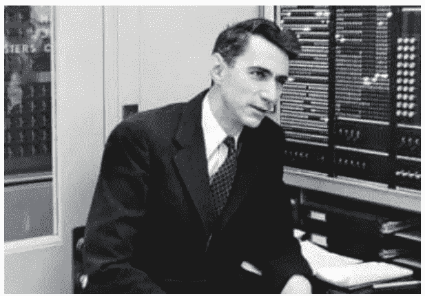

香农

在攻读电气工程硕士期间才华已显。他的硕士论文题目是《继电器与开关电路的符号分析》。学习中他注意到电话交换电路与布尔代数有相似性，布尔代数的“真”与“假”和电路的“开”与“关”可对应，用 1 和 0 表示。于是他用布尔代数分析并优化开关电路，奠定了数字电路的理论基础。哈佛教授称赞该论文为本世纪最重要、最著名的硕士论文之一。

1940 年博士毕业后，香农来到普林斯顿高等研究院工作，在此认识冯·诺依曼。当时他研究信息的定义、信息量化与编码，并提出一种度量信息的概念，用以衡量信息的不确定性。香农原本打算称之为“不确定性”，与冯·诺依曼讨论时，冯·诺依曼建议称之为“熵”。理由是“不确定性”已用于统计力学，而“熵”无人知其真义，不易引起争议。

人们习惯把质量、能量、信息视作最值得计量的三种量。质量的衡量因秤的出现而很早就进入日常；到了十九世纪中叶，热与功的换算关系被澄清，能量守恒被确立，这才让“能量”成为统称二者的概念，卡路里、焦耳等新计量单位随之诞生，能量的度量才算成形。

文字、数字、图像、声音的知识积累已有数千年，但把它们归入同一范畴并寻求通用计量办法，直至十九世纪末也未得到公认。二十世纪初，电报、电话、摄影、电视、无线电、雷达相继普及，如何给信号里承载的意义赋予数量成为焦点。

香农在研究电话噪声消除时推导出通讯速率的上限，并把信息量表述为不确定性的削减。1948年他发表《通信的数学理论》这篇长文，信息论由此确立。其通信模型首次明确提出信息的量化问题，并在冯·诺依曼提示下，用熵 H 作为计算信息量的标志性公式。

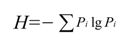
香农还创造了度量信息的基本单位比特。字节 B、千字节 KB、兆字节 MB、吉字节 GB 等今天在计算与通信里通用的单位，都可追溯到比特。比特的提出意味着人类掌握了信息的度量手段。信息论为信息概念的厘清提供了决定性推动。熵这一概念横跨信息论、物理、数学、生态、社会学等多个领域，是香农所创信息论的核心要义，用来刻画系统内部的无序程度。

香农与图灵、冯·诺依曼同处一个时代，名声轨迹却不同。图灵生前默默无闻，冯·诺依曼虽知名却主要局限于专业圈，香农则登上《时代》《生活》《通俗科学》等大众杂志封面，公众知名度很高，这与其发明的一只木制老鼠密切相关。

相关片段出现在1952年的一部工业宣传片中。

“大家好，我是贝尔实验室的数学家克劳德·香农。”镜头推进时，一位西装笔挺、身形修长的男子用轻松的语气自报家门。片中展示了一只带铜须的木质玩具鼠，他称它为忒修斯。

这只老鼠擅长迷宫。它靠不断的随机尝试，在由金属墙围成的迷宫里穿行，最终在出口的金属“奶酪”处停下。更有创意的是，它能记住已走的路径，第二次试验时便能顺畅完成。即便墙体被搬动，它也能应付。

香农在片中解释：“解决一个难题并把它保留下来，涉及一定程度的思维活动，这已有点像人类大脑的工作方式了。”对当时的美国观众来说，这只老鼠堪比今日科幻里的机器猫。香农一夜之间成为家喻户晓的人物。

老鼠与迷宫由香农和妻子在大量业余时间搭建。灵感来自他对儿童积木的喜爱，以及对伦敦汉普顿宫树篱迷宫的兴趣。

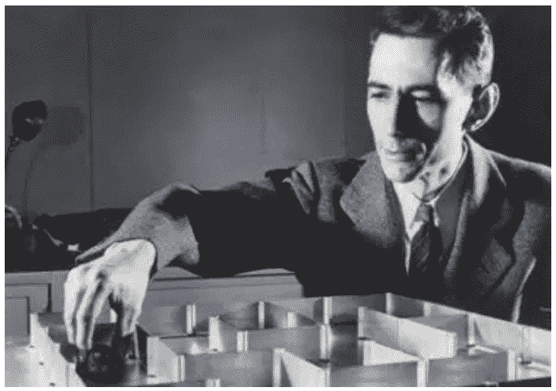
香农和他的老鼠迷宫

其实这套装置只是夫妻二人的消遣，香农曾自谦称之为“好玩却无用”。他的动手热情几乎无边，奇想不断涌现。

家中工作室里堆满奇特物件：喷火喇叭、变戏法机器人、独轮车队、罗马数字计算器等。他还与麻省理工学院的爱德华·索普一起造出首台可穿戴计算机，用来在轮盘赌中取胜。他们真的去拉斯维加斯实测，赢得不少钱。幸而当时未被赌场察觉，否则必会被驱逐并列入黑名单。

香农对人工智能的兴趣最为深厚。早期他便设计了会下国际象棋的计算机程序。1949年发表的《编程实现计算机下棋》是该方向萌芽期的代表作。其后击败棋王的深蓝、击败围棋冠军的阿尔法狗，都在香农开辟的机器对弈道路上取得进展。

与冯·诺依曼、图灵相似，香农在反法西斯战争中作出突出贡献。他长期在贝尔实验室工作，二战期间的通信理论与保密理论被美军采用。他参与研制的加密通信设备用于罗斯福、丘吉尔、艾森豪威尔、蒙哥马利等盟军领袖的绝密联络，保障了情报安全。该设备在打击德军飞机与导弹、瓦解德国对英国的闪电战中发挥了关键作用。

请记住克劳德·香农的名字！

## 3.3 西蒙与纽厄尔

达特茅斯暑期项目的参与者个个非凡。若说香农多才多艺，西蒙与纽厄尔则堪称珠联璧合，合作超过四十年，共同奠定人工智能符号学派，在学界传为佳话。

西蒙并非技术背景出身，芝加哥大学政治系毕业，1943年获该校政治学博士，后担任多家政府机构和协会顾问。他的博学令人惊叹，一生累计获得九个博士学位，分布在八所名校：芝加哥大学政治学博士、凯斯理工学院科学博士、耶鲁大学科学博士与法学博士、瑞典隆德大学哲学博士、麦吉尔大学法学博士、鹿特丹伊拉斯姆斯大学经济学博士、密歇根大学法学博士、匹兹堡大学法学博士。这些头衔已足以让人眼花，更不用说他因决策理论研究荣获1978年诺贝尔经济学奖。瑞典

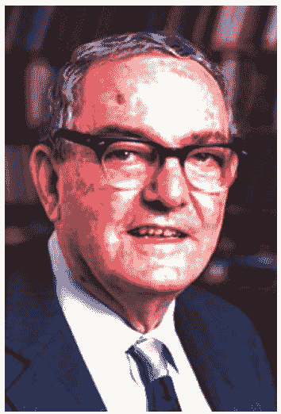
西蒙

皇家科学院的评语是：“从经济学最广义的角度看，西蒙首先是一位经济学家，他的名字主要与经济组织的结构和决策这一新兴研究领域相关。”

在芝加哥大学本科期间，西蒙一边学习经济学与政治学，一边掌握高等数学、符号逻辑、数理统计等工具。1936年毕业后进入国际城市管理者协会，用数学方法评估城市公用事业效率，并首次接触计算机，这段经历对他后续发展影响深远。1949年受邀到卡内基·梅隆大学，先任行政学与心理学教授，后任计算机科学与心理学终身教授。作为工业管理研究生院的创始成员之一，他开创了组织行为学和管理科学两个领域。他倡导的决策理论以社会系统理论为基础，融合古典管理、行为科学与计算机科学，形成一门交叉学科。

纽厄尔比西蒙小十一岁，1927年3月19日出生于旧金山。父亲是斯坦福医学院放射学教授，精通物理与古典文学，业余爱好钓鱼、淘金、木工，山上有一座亲手建造的小木屋。纽厄尔称父亲为“完美的知识分子”。

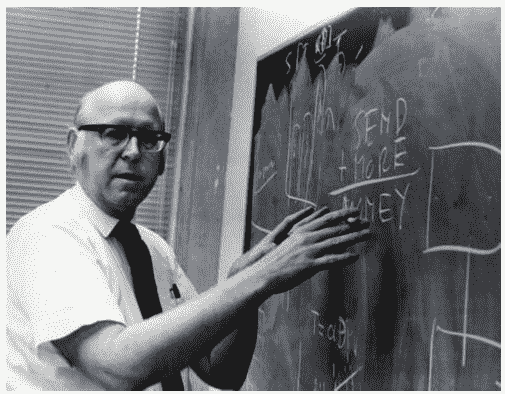
纽厄尔

有其父必有其子。纽厄尔毕业于斯坦福大学物理专业，后赴普林斯顿研究生院攻读数学，一年后辍学到兰德公司，与美国空军合作研发早期预警系统。也许这就是命运的安排，若不辍学就不会那么早结识西蒙。兰德的预警系统需要模拟雷达显示屏前操作员在不同情境下的反应，这促使纽厄尔关注“人如何思考”，也由此与西蒙建立合作。

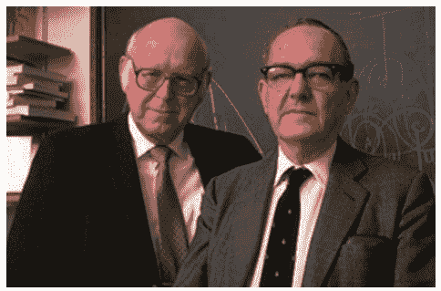
纽厄尔和西蒙

当时西蒙已是卡内基理工学院工业管理系的年轻系主任，他力邀纽厄尔加盟并亲自担任其博士导师，开启终生协作。尽管西蒙是导师，二人合作平等。合著文章署名按字母顺序，纽厄尔在前、西蒙在后。若在会议上见到名字顺序被调换，西蒙都会纠正。

前文提到，1955年圣诞假期结束后，西蒙走进教室宣布：“在刚过去的圣诞节，我和同事纽厄尔造出了一台会思考的机器。”所指的就是带到达特茅斯的逻辑理论家，当时唯一可运行的人工智能程序。

逻辑理论家是一款计算机模拟程序，采用产生式系统结构，以逆向搜索为主，配合启发式策略，成为首个启发式产生式系统和首个成功的AI系统。产生式系统本质是模仿人类思考过程、表达因果知识的计算结构。例如“会飞且会下蛋的动物是鸟”，用符号系统表述即为其创新。

常规解题由因推果，而逻辑理论家反其道而行，从结果出发检验是否符合前提，若符合即为正确解。这类似先看选项再回头阅读题目，可能更快更易。

当然系统远比这复杂。它借助一套繁复抽象的符号系统表达知识，通过符号运算规则求解。由此支持物理符号系统理论，推动信息加工观点在心理学渗透，开辟人工智能新领域，开创计算机模拟认知心理学的方法。

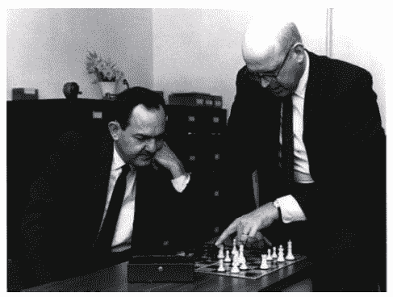
纽厄尔和西蒙在研究下棋程序

达特茅斯会议后，二人进一步发展出IPL语言，这是最早的人工智能程序设计语言，以符号为基本单元，首次引入表处理方法。

1966年西蒙、纽厄尔与另一位研究者合作开发最早的下棋程序MATER。在自然语言理解研究中，他们完善了语义网络概念，作为知识表示的通用手段并取得成效。1975年因在人工智能、人类心理识别、表处理等基础研究方面的贡献，获图灵奖。

获奖演讲中他们指出，计算机科学应是经验探索型科学，现实对象与过程可用符号描述解释，所包含的问题皆可经启发式搜索求解，公式化技术取决于对对象与过程理解的深度。程序可在专家水平或业余爱好者水平上解决问题。

获奖后二人于1976年对物理符号系统作出定义，提出物理符号系统假说，成为符号学派的奠基人。假说的核心是智能即符号操作，最原始的符号对应物理客体。

## 3.4 马文·明斯基

达特茅斯聚会的与会者皆是“大咖”，共同点是兴趣广泛、涉猎众多。出身知识分子家庭的明斯基亦然。

小学与中学就读私立学校，对电子学和化学兴趣浓厚。进入哈佛后主修物理，选修电气工程、数学、遗传学，还参与心理学课题。后来放弃物理改攻数学，因认为数学是学问之源。1950年毕业后进入普林斯顿读博士，研究思维如何产生与形成，提出神经网络与脑模型的一些基本理论。

上大学时他接触过关于心智起源的学说，对当时流行的理论不以为然。新行为主义心理学家斯金纳把人的学习等同动物学习，是校园里流行的说法，明斯基因此决心弄清人类思维的本质。

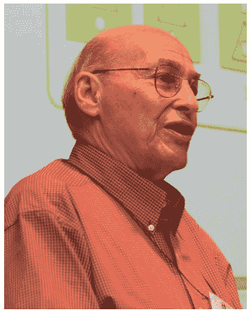
明斯基

图灵在英国探讨机器是否能思考时，明斯基也在普林斯顿研究同一问题。博士期间提出思维萌发形成的若干基本理论，并建造学习机Snare。这是全球首台用3000个真空管搭建的神经网络模拟器，用以学习穿迷宫。它模拟40个神经元组成的网络系统，可对成功结果给予奖励，这40个神经元被明斯基称为“代理”。基于代理的计算与分布式智能是当前研究热点，明斯基是最早提出代理概念的学者之一。

Snare虽粗糙不灵活，却是人工智能研究最早的尝试之一。在此基础上，明斯基综合多学科知识，解决机器根据过往行为知识预测当前行为的问题，博士论文题为《神经网络和脑模型问题》。一篇数学论文大谈人工智能似乎不合常规，答辩时委员会提出异议，幸得冯·诺依曼支持：“现在看起来与数学关联不大，总有一天会发现密切联系。”有大佬站台，明斯基于1954年获得数学博士学位。

十八世纪法国学者拉美特里著《人是机器》，主张生理决定论。明斯基持相似观点，他相信人脑虽复杂可判断推理记忆情绪，本质仍是机器，可被计算机模拟。人与机器的界限终将消失，人是肉做的机器，钢铁机器终将思考。他曾预言计算机智能未必超越所有人，但肯定会超过大多数人，只是时间未知，并警告超级计算机可能动用地球资源制造更多超级计算机以实现自身目标。

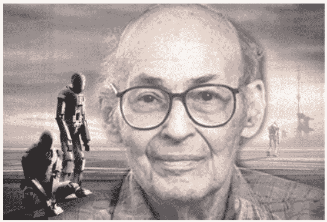
明斯基和《2001：太空漫游》

1968年他受邀参与指导科幻电影《2001：太空漫游》的拍摄。导演斯坦利上门请教计算机图形学现状及2001年前计算机能否口语化时的明斯基已是AI界知名人物。

拍摄中他不参与剧情讨论，而是对HAL 9000的外观提出建议。斯坦利原设计装饰彩色标签的计算机，明斯基认为应由许多小黑盒子组成，通过引线传递信息，而非华丽标签。斯坦利据此撤掉装饰，设计出简洁更具美感的HAL 9000，以追求技术细节的真实。

达特茅斯聚会后不久，明斯基由哈佛转到麻省理工，麦卡锡同期从达特茅斯来MIT，二人共同创建世界首个人工智能实验室。该实验室开发出最早可模拟人类活动的机器人Robot C，推动机器人技术发展。最值得一提的是他1975年提出的框架理论。

框架理论核心是用框架形式表示知识。顶层固定表示概念、对象或事件，下层由若干槽构成，可填入具体值描述特征。每个槽可带侧面作附加说明，如取值范围、求值方式。框架可容纳事物描述、使用方法、对下一步的预期及未实现时的应对。多个关联框架组成系统可完整准确表示知识。明斯基最初将其用于视觉感知、自然语言对话等复杂行为，因其层次化与模块化在AI界引发强烈反响，成为通用知识表示方法，被广泛应用。其基本概念与结构也被面向对象技术借鉴，C++、Java等语言在框架理论启发下产生。

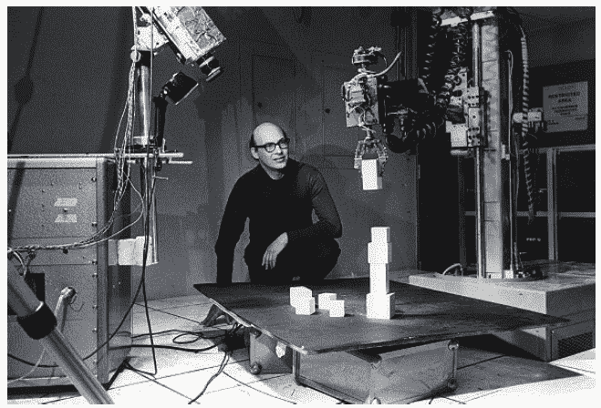
明斯基和他的机器人

明斯基以永不止息的好奇心著称。其学生评价他是定义计算与研究范畴的先驱之一…… 他坚信思维过程可用机器模拟，名言为“大脑无非是肉做的机器而已”。

# 第 4 章 人工智能的数学基石

## 4.1 莱布尼茨与微积分

微积分的诞生被誉为人类精神的重大胜利，它将以常量为中心的数学推向以变量为中心，意义划时代。微积分成为现代自然科学与工程技术的基础工具，人工智能亦离不开它，更离不开其创立者之一莱布尼茨。提起微积分，不得不提莱布尼茨与牛顿围绕发明权的世纪之争。

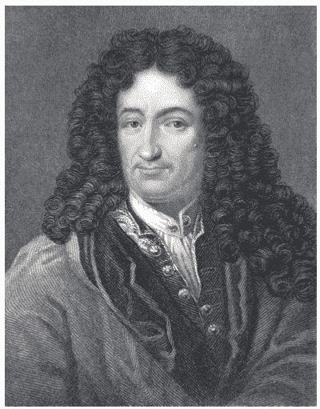
莱布尼茨

微积分究竟解决什么问题，为何引发世纪大战？不能不追溯早期科学探索。

公元前七世纪古希腊哲学家泰勒斯已研究球的面积、体积、长度等，寻求通用计算方法。公元前三世纪古希腊数学家阿基米德在《圆的测量》《论球与圆柱》中处理抛物线弓形面积、球与球冠面积、螺线面积、旋转双曲线体积等问题。中国三国时期数学家也对割圆术及求体积作出设想，均涉及微积分要解决的问题。

十七世纪天文、航海等领域出现大量在运动变化中计算位置、速度、大小的问题，直接催生微积分。核心是函数即变量间关系的概念。函数引入后微积分产生，把运动变化带入数学，使数学从几何算术转变为研究表达普遍与特殊问题的计算科学。微分学中心是运动轨迹的切线问题，积分学中心是变化情境下的求积问题。

1646年7月1日莱布尼茨出生于德国莱比锡。自幼聪慧，12岁自学拉丁文，阅读父亲私人图书馆的大量古典著作。14岁进入莱比锡大学攻读法律。20岁递交优秀博士论文因年纪太轻被拒。黑格尔后来称因学识过于渊博，当时学界大佬因嫉妒而难堪。第二年纽伦堡一所大学授予他博士学位。

莱布尼茨在史册上是个极罕见的全能者，常被比作十七世纪的亚里士多德，哲学家罗素甚至称他为千古绝伦的大智者。哲学与数学是他最耀眼的领域，不过他并不靠学界吃饭。出身法学的他毕业后给德意志贵族做法律顾问和幕僚，常年奔走于欧洲各大城市。传说他琢磨微积分的很多时候都是在晃动的马车上，其中最精妙的圆周率无穷级数表达式，则是在伦敦旅居期间得出的。

1684年，莱布尼茨推出第一篇微分学论文《一种求极大与极小值和求切线的新方法》。这篇论文是数学史上公开发表的第一篇微积分文献，也是他自1673年起潜心研究的总结。1686年，他又发表第一篇积分学论文《深奥的几何与不可分量及无限的分析》，其中阐明了积分与微分的互逆关系。从几何切入，他引入了常量、变量、参变量等概念，搭建起微积分的基本运算框架，并创制了一套完整的微积分记号，奠定了今天通用的符号表达体系。

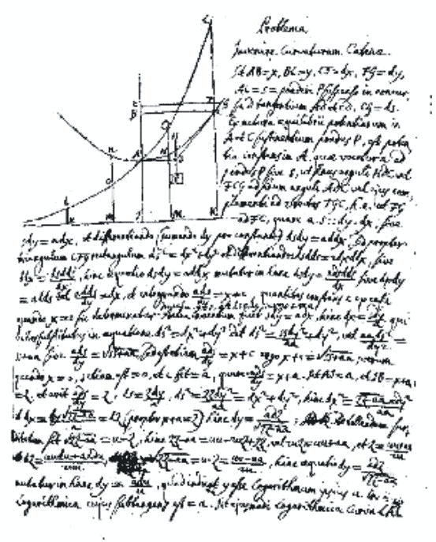
莱布尼茨的手稿

凭借这两篇文章，莱布尼茨有底气自称微积分的首创者。微积分价值巨大，到了1700年他已在全欧洲被视作当时最伟大的数学家，这却激怒了牛顿。牛顿的万有引力定律是古典物理学的基石之一，而在做实验研讨宇宙规律的同时，他也在思考微积分问题，并创立了流数法。但牛顿的成果大多诞生于与世隔绝的乡间宅邸，且在很长一段时间内他从未公开，只在朋友间传阅手稿，发明之后的十年才正式出版。

客观来看，莱布尼茨在1675年才完成发明，晚于牛顿，但他的论文发表时间却早于牛顿。由此，两位巨人围绕发明权的归属激烈交锋，一场旷日持久的争斗由此展开。

莱布尼茨看过牛顿早期的研究资料，牛顿因此认定对方抄袭，开始动用自己的声望大举攻击。牛顿声称莱布尼茨明知自己先出成果，并能拿出证明。借助多年积累的影响力，他指使亲信撰文抹黑，支持者也在舆论中暗示莱布尼茨剽窃，并帮他回击各种质疑。

莱布尼茨绝不退让。有人出头，他就在支持者的协助下反击，主张真相其实是牛顿借用了自己的思路。他大量联络欧洲学者，写信自辩，还匿名发表了多篇为自己鸣冤、攻击牛顿的文章。凭借在贵族圈的人脉，他甚至把争执推到政府层面，直至告到英国国王那里。

论战愈演愈烈，双方以公开或暗中方式互相攻讦，既托人代笔评论，也自己署名不明文章发表。两人都是学术界的重量级人物，各自拥有资源和门生，纷纷借声望拉拢支持者。当时学界因此分裂成两派，互相搜集证据、撰写文章自证，每次看到对方的指控都会暴怒相向。直到1716年莱布尼茨去世，这场“战争”才暂时平息，实际上牛顿并未停止，仍在持续发表攻击性文字。

如今学界共识是两人各自独立发明了微积分。莱布尼茨发明稍晚但发表更早。在记号体系上，莱布尼茨投入大量心力设计简洁符号，现代教材里的积分符号“∫”和微分符号“dx”皆出自他手。

莱布尼茨对后世计算机科学的另一重影响也很深远。一方面他改进了布莱士·帕斯卡的加法器，造出能进行乘法、除法、开方的机械计算装置，对后来的先驱巴贝奇启发极大；另一方面他创立了二进制，用0和1两个数字表示一切整数，为电子计算机的存储与运算提供了根本简化。

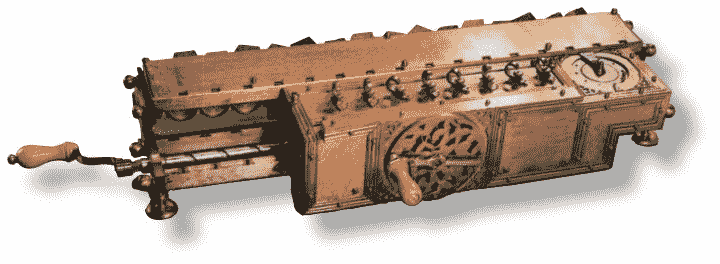
莱布尼茨发明的计算机

莱布尼茨是伟大头脑，也卷入了一场乏味的争斗。或许人性本就如此，即便天才也难免自私狭隘。莱布尼茨与牛顿的故事，堪称人类骄傲本性的永恒警示。

## 4.2 数理逻辑

数理逻辑是什么？它为何对人工智能如此关键？

数理逻辑也称符号逻辑或理论逻辑，同时属于数学分支和逻辑学分支，是用数学工具研究推理的学科。古希腊时期人们便开始探究思维规律。逻辑是梳理思想与知识的框架，没有它，理论与科学都无从建立。当时的先哲、古希腊伟大的科学家与教育家亚里士多德创立了专门探讨、阐述和确立有效推理原则的逻辑学。

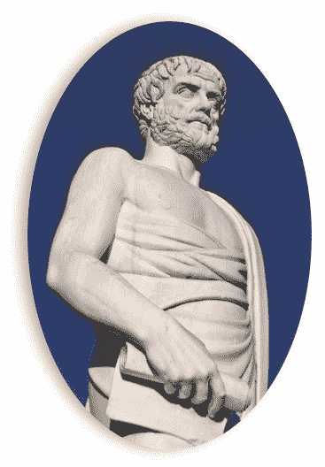
亚里士多德

公元前384年，亚里士多德出生在色雷斯的斯塔基拉，那是希腊的殖民地，毗邻崛起的马其顿。父亲是马其顿国王腓力二世的御医。17岁赴雅典求学，进入柏拉图学园，长达20年，直到柏拉图去世才离去。受父辈熏陶，他对生物学和实证科学兴趣浓厚；在柏拉图影响下，他又热衷哲学推理。这二十年的师承对一生影响决定性。苏格拉底是柏拉图的老师，亚里士多德正是柏拉图的弟子。在学园中他表现突出，被柏拉图称为“学园之灵”。但他并非唯权威是从的追随者，与老师好谈玄理不同，他广泛搜集书籍、勤奋钻研，自己甚至建了藏书室。

公元前335年，他在雅典创办自己的学派。讲课的同时撰写大量哲学著作。当时教学并非课堂式，而是在大厅、回廊、花园进行。亚里士多德讲学有个特点，边走边讲，因此他的学说被戏称为“逍遥学派”或“漫步学派”。这段时期他写下大量自然科学和哲学著作，其中就有逻辑学著作《工具论》。很多作品基于讲稿，部分是学生的笔记，所以他被视作西方第一位教科书作者。

《工具论》其实是六篇逻辑学著作的合称，分别是《范畴篇》《解释篇》《前分析篇》《后分析篇》《论题篇》《辩谬篇》，核心论述演绎法。它提出逻辑学最核心的三段论，为形式逻辑奠基。三段论即由大前提和小前提推出结论的推理形式。比如，人都要吃饭，小明是人，所以小明要吃饭。结论是从一般原则出发，结合特殊陈述推出的特殊结论。

亚里士多德的书稿

亚里士多德视逻辑为一切科学的工具。作为形式逻辑奠基人，他试图把思维形式与存在联系起来，按客观实际阐明逻辑范畴。他将理论运用于数学尤其是几何，当时几何正从经验规则向完备的演绎体系过渡。

数理逻辑包含哪些内容？广义上包括集合论、模型论、证明论、递归论等，听上去都很深奥。其最基本也最重要的部分是命题演算。

命题演算表述较专业，若说逻辑代数就好理解了。逻辑代数又称开关代数，基本运算是逻辑加、逻辑乘、逻辑非，对应命题演算的“或”“与”“非”；运算对象只有0和1，对应“假”与“真”。它是一种具体模型。

逻辑代数的特点与电子电路中的通断、高低电位完全一致，只有两种状态，所以在电子电路中应用广泛。电子元件可组成逻辑加、逻辑乘、逻辑非的门电路，即逻辑元件，再组合成各种逻辑网络。任何复杂逻辑关系都能通过元件组合实现，使电子元件具备判断功能，这成了电子计算机的硬件基础。

提出逻辑代数的是乔治·布尔。1847年他出版《逻辑的数学分析》，首次提出布尔代数，使逻辑学进入数理逻辑时代。

### 4.2.1 布尔与罗素

1815年乔治·布尔出生于英国东部的林肯郡，父亲是鞋匠。因家境贫寒，他未受正规教育，却自学成才，16岁起教书贴补家用，19岁创办自己的学校，挑起全家生计。

教书期间他不断归纳前辈理论，发明了逻辑代数，把逻辑化为极简的代数形式。在其中推理成为数学公式的初等运算，比中学代数更简单。他的发明让逻辑受制于数学。为完善研究，他在接下来六年里投入异常艰苦的努力。

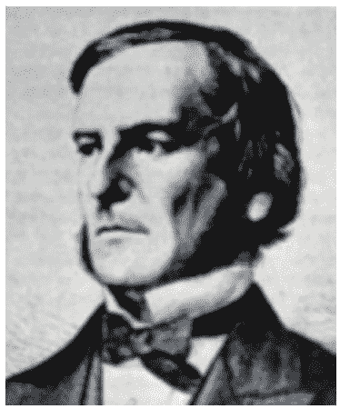
布尔

1854年，他出版经典著作《思维规律的研究》，系统阐述布尔代数。布尔代数问世，数学史增添一座丰碑。但作为无名小学教师，他的创见未被重视。大陆著名数学家嘲之为无数学意义、哲学上古怪的东西，怀疑本土自学者能做出独特贡献。

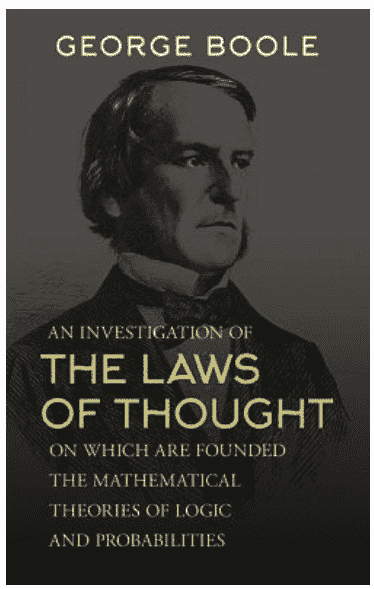
《思维规律的研究》

布尔在成名作出版不久便去世。直到20世纪初，英国哲学家和逻辑学家罗素在《数学原理》中写道：“纯数学是由布尔在一部他称为《思维规律的研究》的著作中发现的。”此说一出，布尔代数重新进入视野，名垂青史。

罗素生于1872年，卒于1970年。他经历两次世界大战，见证大英帝国由盛转衰，也目睹计算机科学和人工智能诞生。他出身贵族，祖父约翰·罗素勋爵于19世纪40年代两次任英国首相。幼年丧母丧父，由祖父母抚养。

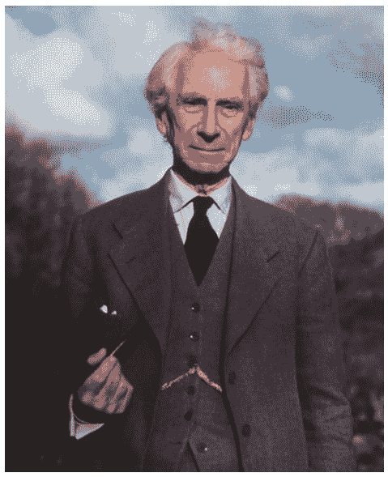
罗素

罗素与老师怀特海耗时九年合著三卷本《数学原理》，试图证明所有数学真理都可在数理逻辑的公理与推理规则下得到证明。这一雄心后来被哥德尔的不完全性定理证伪。

但《数学原理》启发了众多天才，与麦卡洛克共同提出MP神经元模型的皮茨12岁时就研读此书，并写信请教罗素，得以赞赏并应邀赴剑桥，后成神经网络创始人之一。

罗素最受读者欢迎的作品是《西方哲学史》，文笔幽默清晰，又有大家见解。1950年他因此获诺贝尔文学奖。颁奖词称他著述广博，关于人类知识与数理逻辑的科学著作具有划时代意义，可媲美牛顿的自然哲学原理，并赞他为当代理性和人道主义的杰出代言人。

## 4.3 贝叶斯定理和统计学派

人工智能里应用最广的当属贝叶斯定理和基于它的贝叶斯网络，是机器学习的核心手段之一，从拼写纠错、垃圾邮件过滤到图像识别、机器翻译无处不在。提出者是英国牧师托马斯·贝叶斯。

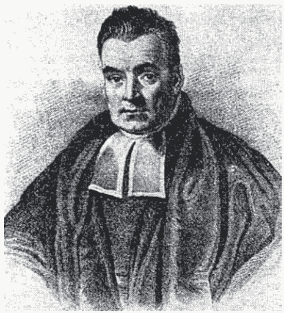
贝叶斯

贝叶斯并非职业数学家。爱丁堡大学毕业后他继承家业，成为英格兰长老会的牧师。一生想证明上帝存在，却在论证时遇到信息不全的难题，如何处理部分未知条件让他困扰。

白天他虔诚履职，夜间挑灯演算。最终未能证明上帝存在，但其研究孕育了概率统计学的一个原理，他发明的贝叶斯公式成为处理不确定性的钥匙，间接成为人工智能的基石。

贝叶斯公式如何运作？它如何解决不确定问题？公式写成如下：

这里的P代表事件Dj发生的可能性有多大，我们称之为Dj发生的概率。事件Dj是总事件x中的一个随机抽取样本。如何理解这个看似复杂的公式呢？我们通过一个例子来说明这个公式是怎样解决不确定性问题的。

假设有一台无线电，午夜后电台会发出A或B两个固定信号中的一个。要猜今晚发出哪一个。理想情况下直接收听即可，但若信号微弱且噪声很大，就只能借助历史概率推断。设接收到的信号为y，实际发出为x，仅可能是A或B。接收到A的可能性记为P(x=A|y)，接收到B的可能性记为P(x=B|y)。合理判断应比较两者的大小，若A更大则判为A，反之判为B。难点在于今晚真实概率未知。

这时贝叶斯公式可以间接计算：已知历史发出概率P(x=A)和P(x=B)，只要算出在x=A和x=B条件下y出现的似然率P(y|x)，比较大小即可判定。P(y|x)即在给定x下y的可能性，也称似然率。具体计算过程暂不展开，学习概率统计时老师会详细讲解。

贝叶斯公式的核心，是在先验概率基础上推算后验概率，用后验大小指导决策。之后百年发展，贝叶斯方法形成一套自成体系的理论。1742年贝叶斯因研究成果入选英国皇家学会，其著作《机会问题的解法》和《机会的学说概论》死后广受重视。

人工智能分符号学派与统计学派。符号学派重规则与逻辑推理，统计学派依赖大数据与概率统计，核心正是贝叶斯定理。以机器翻译为例，把“John loves Mary”译成“Jean aime Marie”。用e代表源句，f代表目标句，需求P(e|f)。需考虑对齐方式，即每个源词对应多少目标词。如John对应Jean，loves对应aime，Mary对应Marie，这是一种可行的对齐。确定对齐后可计算P(e|f)=P(John|Jean)×P(loves|aime)×P(Mary|Marie)。遍历所有对齐方式求和，就得到翻译概率。

朱迪·珀尔

这就是统计机器翻译，因无需人工规则、可自动计算而成为事实标准，其核心是贝叶斯方法。

1988年，以色列裔美籍学者朱迪·珀尔在贝叶斯定理基础上提出贝叶斯网络。它是基于概率的不确定性推理网络，用图模型表示变量间的概率关联，提供因果表达手段。贝叶斯公式可预测概率，却不包含因果，而因果分析往往更为关键。例如路上很多人带伞暗示可能下雨，但伞不是雨因。若想阻止结果，了解因果至关重要。贝叶斯网络把概率与因果结合，使计算机能在复杂、模糊、不确定的环境中推理，是目前不确定性知识表达与推理最有效模型之一。

贝叶斯网络广泛用于自然语言处理、故障诊断、语音识别等领域，珀尔也因此获2011年图灵奖。在物联网时代，智能家居、自动驾驶、智能手机、智慧城市的海量传感器数据，依赖的就是基于贝叶斯网络等统计模型的算法。

## 4.4 哥德尔和他的不完全性定理

悖论即逻辑自相矛盾。

最古老的悖论是两千多年前的说谎者悖论：“我说的是假话。”若断言为假，则它是真；若认为为真，则它是假。真假无法通过逻辑证明。

20世纪，一些思想者察觉悖论背后隐藏深刻数学理论。文艺复兴时期笛卡儿、莱布尼茨等曾企图建立解决一切问题的理论。莱布尼茨甚至设想以数学符号表示逻辑，争论时一算便知。事实证明，他对符号逻辑的建立发挥了很大作用。

莱布尼茨的构想远超同时代的认知水平，最终未能实现。又过了两百余年，康托尔以集合论登场，为数学的统一带来了新的曙光。集合论本质上是研究由众多抽象对象所组成的整体，它奠定了集合、元素、成员关系等最基础的数学概念。正因如此，集合论成为近代数学快速发展的有力工具。可就在学界满怀信心之际，悖论在集合论内部悄然浮现。康托尔本人率先撞见了康托尔悖论——是否能存在一个囊括所有集合的集合。更棘手的罗素悖论随之出现。

罗素对这一悖论进行了深入思索，并尝试寻求解法。在《数学原理》中他写道：“自亚里士多德以来，无论哪一个学派的逻辑学家从他们所公认的前提中似乎都可以推出一些矛盾来。这表明有些东西是有毛病的，但是指不出纠正的方法是什么。1903 年春季，其中一种矛盾的发现把我正在享受的那种逻辑蜜月打断了。”

他指出说谎者悖论是最清晰的体现。说谎者宣称：“我说的每一句话都是假的。”这句话本身也是他所说的内容，当它被纳入自身所指的整体时，矛盾便不可避免。

为此他提出命题分层方案。第一层命题不触及命题集合本身，第二层则讨论第一层命题的集合，层层递进、无有穷尽。然而这一思路并未奏效。1903至1904年间他几乎全情投入，仍旧无果。罗素悖论核心在于集合包含自身，被视为第三次数学危机，后来公理体系将其排除，危机才告平息。

进入二十世纪二十年代，希尔伯特在集合论发展的基础上，向数学界提出了一个宏大规划：构建一套公理体系，能够在有限步骤内判定所有数学命题的真假，此即完备性。他同时要求体系具备独立性，即各条公理互不依赖，保持简洁；以及无矛盾性，即体系内部不会推出冲突结论。

这里的公理并非日常意义上的公理，而是被严格形式化的陈述，属于元数学的范畴。元数学与普通数学理论的关系，如同计算机里的系统程序与用户文件之间的关系。

一时之间，希尔伯特纲领取得不少进展，数学家们普遍认为大厦将成。就在希望最明亮之时，1931年哥德尔以一记惊雷打破了这种乐观。距离希尔伯特提出计划不到三年，哥德尔证明：任何包含初等算术且无矛盾的公理系统，必然存在无法判定的命题。换句话说，无矛盾性与完备性不可兼得。这一结论即为哥德尔不完全性定理。

哥德尔
哥德尔诞生于1906年的奥匈帝国布尔诺，1924年入维也纳大学求学，起初主攻物理，后转数学，1930年获博士学位。在老师莫里茨·石里克的引导下，他加入维也纳学派，与石里克、卡尔纳普等思想家探讨科学理论、实在与真理的关系，为日后突破奠定基础。

1931年，年仅二十五岁的哥德尔发表《数学原理及有关系统中的形式不可判定命题》，轰动学界。文中确立了哥德尔不完全性定理，指出所有一致的数论公理化形式系统都必然蕴含不可判定命题。这篇论文被视作20世纪逻辑与数学基础最具分量的成果。冯·诺依曼曾评价：“哥德尔在现代逻辑的成就堪称非凡且不朽，他的存在本身就是一座永恒的里程碑。”

同年1938年，他与年长六岁、前有婚史的夜总会女郎成婚，遭全家反对，最终仍结为连理。这一年他也离开维也纳，赴美国普林斯顿高等研究院任职，后加入美国国籍并留任教授。在普林斯顿，他与爱因斯坦成为挚友。两人性情迥异，爱因斯坦外向豁达，哥德尔内敛沉静，却都在各自领域取得巨著。两人皆聪颖好问、率性直言。爱因斯坦去世后，哥德尔情绪受创深重。

不完全性定理彻底颠覆了数学界两千年的信念：真与可证并非同一。凡可证者必真，但真者未必可证。悖论的阴影因此永存。数学家外尔曾感叹：“上帝必然存在，因为数学理应相容；魔鬼同样存在，因为我们无法证明其相容。”

其影响早已超出数学与逻辑本身，推动两门学科发生革命，并引发哲学、语言学、计算机科学、宇宙学等诸多领域的思考。2002年8月17日，霍金在北京国际弦理论会议上发表《哥德尔与M理论》，提出单一大统一宇宙理论恐难建立，这一判断正以哥德尔定理为依据。

有趣的是，在人工智能热潮中，哥德尔定理是否适用于机器也引发激烈争论。1961年，牛津哲学家卢卡斯据此断言机器不可能拥有人类的心智，招致广泛反驳。批评者认为定理本身并不直接决定机器是否有心智，但它对人类的限制同样适用于机器，这一点倒是不容否认。

正因影响如此深远，哥德尔被视作当代最具分量的思想巨人之一。《时代》杂志评选的20世纪百位伟人中，他位列数学家之首。

当人工智能正迈向关键突破期，牛顿、哥德尔等大师的思想与他们创造的精妙理论工具，无疑将继续启发新一代天才去探寻人类思维与机器学习的终极奥秘。

## 4.5 深度学习的奠基人杰弗里·辛顿
神经网络自诞生起长期不被看好，主因是20世纪计算机算力与存储远不足以支撑大数据处理。人脑神经连接以亿计，若人工网络要逼近人脑，则单个人工神经元需胜任上万个生物神经元的功能，难度极高。里根时期美国大幅削减对人工智能尤其是神经网络的经费，许多研究者改行，部分专才能前往加拿大，杰弗里·辛顿便在其中。

辛顿1947年生于英国，曾任卡内基梅隆大学教授，出身颇具传奇色彩。他的曾外曾祖父是数学家乔治·布尔，布尔的妻子玛丽·埃沃莱斯特为作家，其叔父乔治·埃沃莱斯特则是英国著名测绘学家与探险家，曾任印度测量局局长，主持喜马拉雅测量。辛顿全名为杰弗里·埃沃莱斯特·辛顿，家族为他取此名，或许暗含攀登科学高峰的预示。

辛顿
少年时他便痴迷于大脑的运作机制。回忆中，一位同学曾戏言大脑如全息图，他竟信以为真而兴奋不已。入读剑桥攻读心理学后，他发现学界对大脑学习与智力提升的机理仍知之甚少，这正是人工智能的核心难题，于是他在剑桥与爱丁堡展开神经网络探索，1978年获爱丁堡大学人工智能博士。毕业后他立志以软硬件模拟人脑，加速神经网络训练，形成后来的深度学习机器学习方法。

人工神经网络的难点在于掌控百万甚至上亿个神经元间的天文数字级组合。关键在于构建堆叠层。以人脸识别为例，底层可能捕捉到眼睛的图案，信息随之传向上一层整合双眼，再传至第三层结合眼鼻特征，如此层层叠加。识别一张脸可能动用数百万节点，层数可达15层以上。

1986年深度学习初现曙光。辛顿与两位同仁在《自然》发表《通过反向传播算法实现表征学习》，提出的反向传播算法极大压缩了神经网络训练时间。该方法在数学上逐层优化结果，使堆叠网络学习加速，并在50年代神经网络基础上实现突破。时至今日，反向传播仍是训练神经网络的核心手段。

尽管如此，深度学习在学界长期不受重视，论文发表与经费获取都十分艰难。生不逢时的辛顿仍坚守研究，遂移居加拿大执教于多伦多大学，并培养出延恩·乐存、约书亚·本吉奥等后来成名的弟子。

2004年依托加拿大高等研究院支持，他发起“神经计算与自适应感知”项目，目标是组建顶尖团队模拟生物智能，即让系统像大脑一样借助视觉、听觉与语言理解环境并作出反应。他吸纳计算机、生物、电子工程、神经科学、物理、心理学等多学科专家，跨学科协作成为人工智能研究的重要范式。参与研讨的研究者如杨立昆、约书亚·本吉奥、吴恩达等后来均取得突出成绩。团队的核心产出是一系列更高效的深度学习算法，最终推动深度学习成为AI主流。

进入21世纪，硬件飞速提升与互联网海量数据为神经网络注入新生。2012年国际图像识别大赛上，辛顿领衔多伦多大学超视团队，在150万张图像的竞赛中，错误率控制在10%以下，准确辨识动物、花卉、船只、人等类别，夺得冠军。同年他获加拿大最高科学荣誉基廉奖，素有“加拿大诺贝尔奖”之称。

年届花甲的辛顿不甘沉寂，与两位弟子创办一家专注深度学习的初创公司。公司名义上只有三位顶尖学者与数篇论文，并无产品与客户。成立不久，谷歌、微软、百度纷纷竞购，谷歌最终以最高价胜出，将三人收入麾下。以数千万美元买下三个人，令业界震惊。这一回辛顿重返美国，日常往返于加拿大与美国之间，成为科技界最昂贵的空中飞人。

# 第 5 章 人机世纪对决
## 5.1 棋盘上的世纪骗局
棋类对弈向来被视作人类智能的试金石，也成为人工智能的标志。1769年，德国发明家肯佩伦打造了首台下棋机器人，取名“土耳其人”，因当时东方服饰风靡欧洲，他将其装扮成土耳其人形象以博眼球。

这台能与人对弈的装置一经面世即轰动欧洲，半个多世纪里引发欧美持续关注与争论，成为嘲弄众多名流的世纪骗局。根源要回到发明人肯佩伦身上。

肯佩伦画像
肯佩伦1734年生，父为德国皇室海关官员。青年时期他于维也纳研习哲学与法律，并赴意大利朝圣艺术。凭英俊外貌与才华，经父引荐获女皇玛丽亚青睐，进入宫廷。优渥收入与充裕闲暇助长了他对科学机械的嗜好。当时欧洲正处工业革命，民众对机械的热情犹如今日对人工智能的关注。宫廷上流社会视新奇发明为谈资与科学娱乐，自动游水进食扇翼的机械鸭、能自弹钢琴吹长笛的机器人层出不穷，让人惊奇不已、遐想连篇。

某次宫廷观摩新奇装置，女皇玛丽亚询问身旁的肯佩伦有何看法，他不屑表示皆为小把戏，自己可造出更惊人的作品。女皇惊讶之余深信其言，特准他休假半年回乡专心研发一件足以令欧洲瞩目的发明，以彰显德国之盛。

1770年春，潜心半年后肯佩伦公布下棋机器人。首演面向以女皇为首的皇室。灯火通明的厅内，装置由带抽屉的长方形矮柜与柜后坐着的土耳其木偶构成。开启两侧柜门可见齿轮杠杆等机械，柜面置有国际象棋盘，木偶一手撑盘一手持长烟斗。

下棋机器人“土耳其人”
擅长表演的肯佩伦如主持人般站于一侧，高声宣称机器人可与任何挑战者对弈。皇室成员主动上场后，机器竟“自动”应招，全场惊叹连连。

消息经报纸与书信迅速传遍欧洲，王公贵族与棋坛大师纷至沓来验证真伪。肯佩伦名声大噪，身价倍增。但装置的奥秘也引发无数科学家、棋手与媒体的猜测：机械如何实现真人对弈？

种种推测不绝于耳，却常自相矛盾、漏洞百出，始终无人确证。直至肯佩伦去世，谜底仍未揭开。

生前肯佩伦将机器人售予德国发明家马泽尔。1809年马泽尔携其赴见拿破仑对弈，机器人获胜，恼羞的拿破仑一怒之下掀翻棋盘。此后数十年，马泽尔携机巡演欧洲，与各国高手交手，胜多负少名满天下，后更远赴美国与富兰克林对战。

在此后85年间，该机足迹遍布欧美，曾与俄国沙皇等显贵及顶尖棋手对弈，成为世纪未解之谜。英国数学家、机械计算机先驱巴贝奇童年即为之着迷，长大后亦有幸对弈，虽未识破机关，却坚信机器下棋可行，曾计划自建类似装置，后因忙于研制分析机而搁置。

秘密直至1857年才揭晓，马泽尔此时已故。揭谜者是最后一位主人的女儿，她在纽约《象棋月刊》连载《象棋老兵的终结》，披露了对弈的真相。

真相其实简单：机器人并不能自动对弈，长期表演中实为藏于柜内的真人代为落子。其精妙之处在于柜体设计与主人的高明骗术。

秘密所在
世纪骗局终被戳破，幸而当年受骗的权贵已作古，否则必难堪至极。但人类对人工智能的渴望并未止步，人机对弈的梦想持续激励后人，最终机器击败人类棋手的愿景得以实现。

## 5.2 跳棋启蒙机器学习
为何早年人人痴迷机器下棋？人工智能先驱明斯基曾直言：下棋与数学并非因简单而被选，恰因其在简洁起点中蕴含极致复杂，便于以有限程序实现形式化表达。西蒙与约翰·肖亦提出，若能造出成功的弈棋机，便意味着触及人类智力的核心。在这些思想激励下，无数程序员、职业棋手与业余爱好者相继投入研发，既为竞技奖金，也为探究智能机制。

上世纪四十年代末，伊利诺伊大学的塞缪尔教授起步研究计算机跳棋。随后加入IBM实验室，在IBM 701上完成首个跳棋程序，并带至达特茅斯会议展示。归来后不断优化，1962年夏击败美国跳棋名手罗伯特·尼雷——一位盲人天才。此事轰动一时，IBM股价大涨十余点，令掌门人托马斯·沃森大喜。IBM此后长期支持棋类程序研发。

人类下棋的精髓在于预判妙手，确保在若干步后无论对手如何应对仍占优。塞缪尔研究跳棋的根本目标是让机器学会学习。其程序最突出之处在于自学习功能，可视为现代机器学习的雏形。

塞缪尔
塞缪尔如何让机器抉择每步走法？跳棋棋盘仅64格呈黑白相间，可用树状结构枚举每一步所有可能移动，再逐层展开后续局面，直至终局。如此一路分叉形成博弈树，穷尽搜寻并挑选最优着法，便可做到心中有数。

跳棋
他很快意识到理论可行但实践不可行，穷举将涉及5×10^20个局面，天文数字般庞大，只能限于数步先行。一般仅能展望3至10步。如何在这有限步内抉择？塞缪尔引入了评分机制。

人机对弈的演进之路

1944年，冯·诺依曼与经济学家奥斯卡·摩根斯特恩合著《博弈论》，书中给出双人对抗的计算思路。随后萨缪尔教授借鉴此框架，为跳棋每一步设计评分函数，并不止于单步最优，而是把未来3到10步的分支得分累加，从累计最高的一条线路出发。他还引入历史棋谱记忆的做法，本质是复刻前辈经典对局。对于学习者而言，熟记名局是提升最快的途径，掌握上百个典型套路，难赢也不易输。

舍佛

萨缪尔的成果虽引起关注，可程序实战仍有胜负。直到80年代末，加拿大阿尔伯塔大学推出了当时最强的跳棋软件，取名钦诺克。名字的由来取自加拿大冬季暖流，寓意在AI低谷期带来暖意。项目负责人是该校计算机系教授谢弗。

丁斯利

自50年代起，美国数学家丁斯利长期占据跳棋人类的顶尖位置。他研究理论颇深，得知钦诺克后渴望切磋。可美、英、加三国的跳棋协会均拒绝让机器参赛，也禁止顶尖选手与之对弈。为实现这场对局，丁斯利主动放弃头衔。1992年双方交手，他以4比2、33和的战绩占优。

谢弗团队不服，两年后在波士顿计算机博物馆再战。改进后的钦诺克判若两人，前六盘全和，第七盘丁斯利因身体不适退赛。随后被查出胰腺癌，虽一度病情缓解准备再战，但恶化后离世。此后钦诺克再无对手。

团队并未停步。2007年他们最终证明，在无失误前提下跳棋必和。为此耗费18年，穷尽约500995484682338672639个局面，钦诺克也达到战无不胜的境界。2007年9月《科学》发表声明，跳棋的人机历史告终，人工智能完胜。

目光随后转向国际象棋。该棋的局面复杂度至少达10的40次方，远超跳棋。曾参加达特茅斯会议的西蒙在1957年称10年内电脑能胜任意人类棋手，1965年又把期限延至20年。预言能否兑现，后文再述。

## 5.3 游戏中的人工智能方法

人机对弈研究中，纽厄尔与西蒙提出的启发式搜索成为电脑下棋的核心技术。

先做个练习。图中有8个数字加一个空白格，只能借助空格移动数字，将无序排列变为有序。多数人觉得简单，于是把规模扩到15数字加空格，再试试。若继续扩展到99数字，难度会显著上升。若由机器求解，它该如何操作？

拼图游戏图示 1

这个玩具问题在AI领域名声很大，称作15格拼图。早期研究者纽厄尔与西蒙针对它提出解题思路，发展为启发式搜索。

首先要让机器理解游戏，即如何用数据表示。一种常用结构是符号结构：单个字母或数字为符号，多个符号可构成列表如（A,7,Q）。列表还能嵌套，如〈（B,3）,（A,7,Q）〉，层层嵌套可表达更复杂情形。

借此表达问题就变成把一种符号结构从初态变为终态。用符号表示上述拼图，起始可写成〈（2,8,3）,（1,6,4）,（7，空，5）〉，终态是〈（1,2,3）,（8，空，4）,（7,6,5）〉。从起点出发，有三种可行变换，均非目标，继续扩展下去。

把变换过程绘出即为一棵搜索树。问题越复杂，树越庞大，可能失控。纽厄尔与西蒙的思路是在转换时加入限制，只保留更接近目标的分支。例如只扩展与答案差异最小的节点。此法不保证必成，但成功时效率极高。

搜索树

拼图游戏图示 2

简单游戏中隐含深刻理论。许多AI问题的起点并不神秘，关键在于问题表述。香农曾把棋盘视作二维数组，每个棋子对应子程序计算走法，再用评估函数综合打分。

达特茅斯发起人麦卡锡提出控制搜索树无限膨胀的剪枝手段，即α-β剪枝。边生成博弈树边动态计算评估值，一旦超出预设上下界就停止展开，大幅压缩规模。

西蒙对象棋的预言多次落空，但探索未停。1997年IBM的深蓝两次击败等级分第一的卡斯帕罗夫，让40年前的预言最终实现。

## 5.4 “深蓝”大战国际象棋世界冠军卡斯帕罗夫

1997年5月11日，IBM超级计算机深蓝在常规时限赛制下首次击败等级分排名第一的加里·卡斯帕罗夫，象棋进入新时代。

深蓝重1270公斤，装有32个微处理器，每秒运算2亿步棋，还存储了百年来200多万局高手对局。

对局在纽约公平中心举行，全程摄像、媒体追踪，全球数百万人关注。1996年首次交锋深蓝以2比4落败。比赛在小型电视演播室内进行，地下剧场通过屏幕观看，可容500人，六盘皆满。

卡斯帕罗夫和“深蓝”的比赛

卡斯帕罗夫先胜一盘，第二盘失利，后三盘战平。六盘后深蓝胜出，瞬间成为全球头条，让数十亿人见证机器运算。

象棋是AI最早涉及的棋类。二战期间图灵写过象棋程序，当时机器忙于情报破译且性能简陋，只好在纸上人工模拟，单步计算耗时近一小时，同事却常胜。

冯·诺依曼也研究过电脑下棋并提出博弈树搜索理论。真正奠基的是1950年香农在《哲学杂志》发表的《计算机下棋程序》，其思路后来体现在深蓝和阿尔法狗中。博弈树搜索即从一个着法分叉出后续着法，形成树状结构。最粗暴的是穷举搜索，生成所有可能并择优。另一种是剔除无效分支的β策略。

穷举的难题在于规模。象棋平均每局面约40步合法走法，两步即1600局面，四步约256万，六步约41亿。一局约40回合80步，所有可能局面达10的128次方，远超已知宇宙原子总数约10的80次方。

纽厄尔、西蒙与约翰·肖发展的α-β算法可在不影响结果前提下剔除大量分支。核心思想是若某走法已进入劣势，其后续不必再分析。若有完美评估，留最佳即可；现实只能保留少数较优走法，负担大减。下法已接近人类思考。

70年代，发明UNIX与C语言的汤普森开始研究象棋。他与贝尔实验室同事打造专用机Belle，花费约2万美元芯片。每秒可搜18万局面，而当时百万美元级超算仅5000。Belle可下探8到9层，是首台达到大师水平的机器。

Belle 国际象棋机器

1980到1983年，它横扫同类，夺得世界电脑象棋锦标赛冠军，开启用专用象棋芯片提升速度的道路。1982年汤普森欲带Belle去苏联参赛，在肯尼迪机场被海关扣下，理由是走私先进武器。终端内装有对苏禁运的超大规模集成电路，调查一年，罚款600美元才赎回。

“深蓝”的开发团队

汤普森做过意义重大的实验：让Belle与自己对弈，只放大一方的搜索深度。平均每增一层深度约等于等级分200分。推算到14层即可达到当时卡斯帕罗夫约2800分的水平。专家当时判断，需每秒10亿次运算的机器才能与人类世界冠军抗衡。

90年代初，IBM在跳棋人机战大胜后瞄准象棋，游说卡内基·梅隆大学柏林纳团队和中国台湾许峰雄团队，后者系统已达2400分。深蓝项目正式立项，名字取自IBM昵称，因IBM大型机多为深蓝色。深蓝的目标就是击败卡斯帕罗夫，便有了前文故事。

可人机较量未结束，围棋这座珠穆朗玛峰仍未被征服。

## 5.5 阿尔法狗打败世界围棋大师

跳棋、象棋被攻克后，人类把最后冲锋指向围棋。连深蓝主设计师许峰雄都曾说，电脑下围棋太难，20年内恐怕无解。这一预言在2016年提前6年被打破。

阿尔法狗由谷歌旗下DeepMind研发。创始人戴密斯·哈萨比斯1976年生于英国伦敦，父亲为希腊塞浦路斯人，母亲为新加坡华人。四岁下象棋，八岁自学编程，十三岁获国际象棋大师称号。2010年他创立DeepMind，目标是通用学习算法。

2016年3月9日，韩国迎来划时代的人机围棋大战。机器是2014年起研发的阿尔法狗，对手是韩国等级分第一的李世石。七天五番，阿尔法狗以4比1胜出，宣告人类在人机大战中落败。

阿尔法狗与李世石对决

美国政客乔治·多尔西曾言“游戏是知识之源”。图灵也说“下棋需要智能”。棋类一直被视作智能试金石。

阿尔法狗是复杂系统，核心是强化学习。该技术由美国博士巴托与他在麻省理工培养的首位博士生萨顿提出。发明后长期被忽视，直到阿尔法狗大胜人类才受追捧。

迷宫图

强化学习如何运作？想象迷宫里老鼠找奶酪。灰点为可达状态，每步可左、右、前、后移动，部分状态选择不可行。每种选择导致新状态，集合成路线图。老鼠事先不知迷宫结构，只能边探索边标记，靠试错调整路线。强化学习正是通过探索并记录各状态的可能性，形成包含所有路径的博弈树。策略即路线，最优即最短。

随可能性增多，博弈树指数膨胀，计算与存储爆炸。麦卡锡的α-β剪枝可控制蔓延，边画树边评估，超出范围即停。

围棋棋子更多，组合爆炸更剧，α-β剪枝不经济。于是引入蒙特卡罗法。源于法国数学家布丰1777年投针求圆周率，后由冯·诺依曼以赌城蒙特卡罗命名。

蒙特卡罗常用教学例是算圆面积：在正方形内画内切圆，随意投沙，统计落在圆内的比例乘以正方形面积即得圆面积，属于概率统计方法。

阿尔法狗团队先用数万局职业棋谱训练系统，为每个落子点给出估值，即高手落子概率。得到初步策略网络后，兼顾目标与速度，以稍牺牲质量换取更快走子。训练策略网络采用深度学习，以当前盘面为输入，输出各空位落子概率。

阿尔法狗开发团队

阿尔法狗的“快速走子”单元是以局部的棋形特征和线性模型为基础来训练的。完成这一阶段的训练后，系统已初步具备复现职业棋手落子手感的能力。随后进入自我对弈的内卷阶段，不同版本的阿尔法狗相互对弈，累计下满三千万局。借助强化学习机制，胜负反馈回流到策略网络使其持续进化，同时又训练出一个能够对当前盘面估计黑白胜率的估值网络。公布的实验数据显示，与职业棋手的着法对照，策略网络在两毫秒内挑选下一步的准确率约为百分之五十七，而快速走子在两微秒内仍能达到百分之二十四点二的准确率。

实战对弈时，阿尔法狗以蒙特卡罗搜索来统筹全局。首先由策略网络把最具潜力的落子点筛选出来，候选数量通常不足十个。对每个候选，估值网络给出胜率评估；与此同时，快速走子能够迅速推演至收官，通过结局胜负衡量局面优劣。两种判断的分数被融合并反馈，用以修正策略网络的偏好，决定哪些节点需要进一步展开计算。凭借极强的并行算力，阿尔法狗在变化推演与妙手挖掘上的表现远超人类。系统配置了1920个CPU与280个GPU，可同时运行64条搜索线程。这样的算力规模，相当于数十个九段高手并行思考，再由数十个三段棋手把难以判定残局直接演算到头给出结论，人类棋手之对抗难度极大。

二零一六年三月的人机大战，标志着跨越一个世纪的棋弈人机对决落幕。从上世纪八十年代末跳棋程序钦诺克的独步，到九十年代末IBM深蓝横扫国际象棋，再到本世纪初中国象棋程序连克特级大师，直至阿尔法狗完胜围棋顶尖棋手，人工智能在棋盘上实现了对人类智慧的整体超越。

# 第 6 章 让机器学会看

## 6.1 视觉从何开始
人类对外部世界的认知很大程度上依赖视觉，能否让机器也拥有视觉？计算机视觉即机器视觉，是人工智能中赋予系统视觉能力的关键方向。

机器视觉最早的突破来自字符识别。上世纪五六十年代，光学字符识别已取得明显进展，它能够辨识纸上印刷的固定字体字符。

一个代表性案例是斯坦福研究所开发的系统，使用磁性墨水打印字符以实现银行支票的自动识读。专用扫描设备采集字符后送入计算机，与模板库比对即可读出支票信息。二零一九年美国银行正式启用该系统，随后各家银行相继采用并沿用至今。

该方案虽落地成功，但在文字识别上的局限很明显。字符必须用磁性墨水印刷，字体格式大小皆需固定。手写体或非磁性墨水印刷的文字系统无法处理。1960年，美国科学家奥利沃塞·福瑞德与沃瑞克·纳瑟发表论文，提出用图像处理、特征提取和概率方法来识别手写字符。

支票

磁性字符

其思路可概括为：先对写有字符的纸张扫描，形成由零一组成的像素位图；再对图像清理，去掉明显噪点并把笔画加粗强化，使字符更清晰突出；随后分辨笔画特征，检验横竖撇捺、交叉、闭环等要素，并为每个识别出的特征赋予概率权重，用于体现该特征在区分不同字符时的重要性。整个过程层层递进，从原始处理逐步抽象到特征汇总，最终判定字符身份。

特征权重来自大量训练样本的学习。训练完成后，系统可识别新的字符。按照两位科学家的说明，经训练后系统的识别正确率与人工相比仅相差约百分之十，在当时已极具鼓舞。

特征提取

从难度看，字符识别是计算机视觉中最简单的任务，因为字符只是有限的二维图形。真正的机器视觉需处理来自三维世界的二维图像，如相机照片。二维投影像会丢失景深等信息，同一物体从不同角度拍摄差异明显，很难用一张平面图完全复原真实场景。

人或动物如何看世界？他们通过视网膜上的二维影像即可准确理解周围三维环境。许多生物拥有双眼形成立体视觉，两眼视角差异提供深度信息。计算机也能从不同视角采集图像并计算深度。但事实上，计算机视觉更多是借助光线、线条角度、背景等线索，从单张二维图像推断三维结构。也有研究者从生物视觉原理中寻求灵感。

麻省理工学院四位生物学家研究青蛙视觉时发现，青蛙并非重建完整图像来感知环境。青蛙眼由多种探测器构成，有的对小型运动物体如飞虫敏感，有的对光线突变敏感。汇总各探测器信号后，青蛙即可判断食物或危险。他们发表的论文《青蛙的眼睛告诉了青蛙大脑些什么？》迅速引起人工智能学者的关注。

神经生理学家戴维·休伯尔与托斯坦·维厄瑟尔自1958年起研究大脑视觉神经功能。他们发现哺乳动物某些神经元会选择性响应图像中的特定形状。1959年，他们在猫视觉区植入微电极，发现猫看到不同角度的短线条时，不同神经元迅速放电，甚至可绘制出神经元对线条角度的响应图。后续研究表明，还有神经元对更复杂形状有反应，猴脑中亦有类似现象。该工作为他们赢得1981年诺贝尔生理学或医学奖，也启发了计算机视觉中提取线条的重要性。

一个魔方的线框图

首个能从图像中提取物体线条的程序由麻省理工学院博士生劳伦斯·罗伯茨提出。1963年，他发现可依据照片黑白层次分布确定物体面间的边界，从而生成物体的线框图。虽然仅限黑白照片，却是开创性尝试。当时主流研究多局限于字符等二维对象，无法处理表现三维物体的图像。他的工作把图像处理推向新阶段，为后续图形识别奠定基础。他后来成为美国国防部高级研究计划局首席科学家和信息技术部主任，并在互联网诞生中发挥关键作用。

## 6.2 图像识别靠什么
上世纪六十年代，硅谷的全景研究公司已开发出人脸识别原型。他们对一个人脸拍摄四十张不同照片，提取五官特征如两眼瞳孔间距、眼角位置、嘴巴大小等，形成包含约二十项距离与尺寸数据的列表，作为人脸数据库。若待识别人脸的特征数据与库中信息高度吻合，就判定为识别成功。

早期人脸识别很粗糙，对光线、角度、大小和位置要求苛刻，稍有偏差效果就急剧下降。但它已包含图像识别的核心要素：特征提取与分类。

日常生活中，我们靠观察归纳物体的特点并分类来识别。例如汽车至少有四个轮子且能自行行驶，三轮车有三轮，自行车或摩托车有两轮。轮数就是分类依据。大象有长鼻、庞大身躯和粗壮四肢，这些特征让我们能从动物群中辨认。计算机视觉同样先从图像中提取数字化特征，再按类别归纳，用特征判断物体。

同一类事物并非完全相同，人也有高矮胖瘦之分。计算机需要通过学习掌握一个类别的特征范围，即特征空间。落在该空间内的样本被视为同一类。

在计算机视觉中，分类环节由分类器完成，本质是一个分类函数。类比人类学习：先在学校学习，再参加考试，不合格就重学重考，通过后才工作。计算机也经历训练与测试，表现不佳就继续训练测试直至可用。

因此分类函数是通过大量数据训练并不断改进得到的。训练时使用的数据叫训练数据，测试时使用的叫测试数据，二者都是已知真实类别的样本。

1957年，康奈尔航空实验室的神经学家弗兰克·罗森布拉特提出能模拟人类感知能力的机器——感知机。它是二分类线性模型，输入特征数据，输出类别。1960年，罗森布拉特用感知机学会识别部分英文字母，不仅能识别高频字母，也能泛化到不同书写风格。目前感知机仍是训练分类函数的一种常用方式。

在人脸检测中，这种二分类思路被广泛使用。相机取景画面被切分成上万个重叠的小块，每块都送入事先训练好的感知机分类器判断是否包含人脸。不同尺寸的重叠块覆盖整幅图，因此无论人脸大小都能被检出。最后将局部结果合并，就能在图片上用框标出人脸。

深度学习出现前，手工设计图像特征是计算机视觉的重要课题。随着神经网络发展，特征提取逐渐自动化。卷积运算是关键技术之一。它用一个卷积核矩阵在图像上滑动，对重叠区域做乘加运算，生成新的特征图。新图数据量更小，且突出原始图像的显著特性。

人脸特征识别

图像识别

让机器真正看懂世界，需要图像采集、处理与识别的完整链条。特征与分类是图像识别的基础，随着技术演进方法不断深化。基于神经网络的深度学习为机器视觉打开新局面。辛顿教授的学生亚历克斯·克里泽夫斯基与伊利亚·苏特斯科夫用深度学习构建AlexNet，在2012年ImageNet图像分类大赛夺冠，人脸识别准确率首次超过人类。他们的故事后续会再细讲。

## 6.3 读懂动态画面
随着技术进步，计算机视觉从静态图像识别扩展到动态视频跟踪。如何让机器理解运动中的物体？

人类视觉有暂留效应，光信号在视网膜上会保留短暂时间，形成画面连贯感。正因如此，我们才能把每秒24帧的静止画面感知为流畅的影视视频。

飞行中的海燕

相比静态照片，视频多出时间维度。静态图可用二维函数描述每个像素，视频则需三维函数I(x,y,t)表示，其中t为时间，x、y为像素坐标。这样可把动态视频与静态图像联系起来，借用图像识别技术研究视频。

视频研究涵盖描述与理解、动作行为识别、视频分类、时序动作检测等，核心是动作行为识别，即让计算机说清视频里发生了什么、人在做什么。

行为识别难度很高，受拍摄距离、光线、角度、遮挡影响大。现有行为数据库规模有限，常用库可能只收录上千段视频，覆盖上百类；而ImageNet这类图像库包含数千万张图片，数万类。

特征选择在图像识别中至关重要，人类判断行为也依赖运动。在体育课上，一组练跳高，一组长跑。我们能立刻区分，因为运动模式不同。跳高者轨迹向上跃起、提膝过杆、双脚下垂落地；长跑者平行前行，提膝但无高跃，双脚前后交替落地。可见运动是行为分类的关键。

二十世纪末，研究者开始跟踪动态目标。其中一种方法是用光流描述运动，即像素在相邻两帧间的位移。另一种方法是追踪目标形状在连续画面中的变化来捕捉运动特征。

运动的光流

光流图

长视频的行为提取也有挑战。对时间流做密集采样会产生海量计算和存储，且相邻帧变化很小。为此出现时间稀疏采样策略，既节省成本，又能突出运动轨迹。

处理长视频通常采用分段识别再汇总：把输入视频切分为若干小段，对每段随机抽取光流图和图像帧做行为识别，最后融合各段结果得到整体类别。

总之视频识别比静态图像复杂得多，技术仍在发展。应用也不断增多，例如智能零售系统通过摄像头实时监测店内客流，判断进店人数、男女比例、身份识别及在商品前的停留时长，这些现在都能实现。

更进一步，计算机可基于体育赛事视频自动生成专业解说，也能从图像合成背景音乐。这些技术推动新媒体时代到来，内容可由计算机生成或辅助生成。

当今电视广泛使用全息成像，人工智能合成虚拟人物。无论是体育明星还是主播，虚拟形象与真人相似度可达99%，外形、声音、眼神、面部动作都高度逼真。

当前视频技术只需提取特定人物的面部与动作特征，再采集半小时语音数据，就能构建形象与声音模型。之后任意文字输入，都可由该虚拟人物以语音或歌声呈现，甚至多语言输出。大数据喂养下，识别技术让克隆成为可能。未来每个人都可能拥有专属虚拟孪生体，作为化身在世界行走。若你在街上遇到一个长相、言谈与你一模一样的机器人，也不必惊讶。

## 6.4 深度学习一战成名
2013年，谷歌高价收购了辛顿教授创立的DNN研究公司。该公司几乎没有产品和客户，只有辛顿与两位学生。两位学生正是亚历克斯·克里泽夫斯基和伊利亚·苏特斯科夫。他们师承辛顿，开发出AlexNet，在2012年ImageNet国际大赛中夺冠。

**从一次比赛开始的觉醒**

在多伦多大学的实验室里，杰弗里·辛顿身边跟着两位学生：出生于乌克兰后移居加拿大的亚历克斯·克里泽夫斯基，以及伊利亚·苏特斯科夫。大学毕业后，克里泽夫斯基并没有急着去当码农，而是选择读了辛顿的博士，正是在这段求学时光里，两人萌生了参加 ImageNet 国际大赛的念头，这件事后来成为他职业生涯的转折点。

之所以盯上这个比赛，和比赛本身的设计有关。ImageNet 大赛向全球开放，核心目标是挖掘更优秀的图像识别与分类算法，用来证明人工智能在视觉上的可能性。比赛依托的 ImageNet 数据库，则源于李飞飞的远见。1976 年出生在北京的李飞飞，16 岁随父母赴美，后来成为斯坦福的终身教授并主导人工智能与视觉实验室。2007 年她与普林斯顿的李凯合作发起 ImageNet 计划，借助互联网搜集了近十亿张图片，再通过亚马逊的 Mechanical Turk 等众包平台发动标记。来自 167 个国家、约五万名志愿者共同参与筛选与标注。2009 年项目正式成型，形成一个包含 1500 万张照片、覆盖 22000 个物体的免费数据库。这些物体按日常英语词汇归类，对应 WordNet 的 22000 个同义词集，在规模和质量上都属空前，并向全世界开放使用。

在辛顿门下，克里泽夫斯基熟悉深度学习的理论，但当时辛顿的模型都跑在 CPU 上。尽管芯片进步很快，面对海量图像仍显得笨拙。他思考能否把神经网络搬到运算更快、并行能力更强的 GPU 上。12 块 GPU 的学习效率大约等于 2000 个 CPU。早在 2006 年就有人把卷积神经网络放到 GPU 上跑，速度提升约 4 倍；到 2011 年，深度网络在 GPU 上的实现带来了 60 倍的加速。

带着这个想法，克里泽夫斯基和苏特斯科夫造出了一套以他名字命名的网络 AlexNet。结构是 8 层深，前 5 层为卷积层，后 3 层为全连接层。测试结果远超同期方案。2011 年苏特斯科夫得知 ImageNet 数据库，认为这是检验成果的理想舞台。两人对系统反复优化和训练，把处理上百万张图像所需的时间从数周数月压缩到五六天，准确率也大幅攀升，于是瞄准了 ImageNet 大赛。

辛顿得知后出于技术理由表达了反对。克里泽夫斯基却不肯妥协，用一年时间把老师提出的问题逐一解决。苏特斯科夫后来评价道：克里泽夫斯基对机器学习的理解极深，有工程师般的动手本能，更有一种不达目标不罢休的韧性。

影响他的另一个关键人物，是曾在辛顿处做博士后的杨立昆。他在人工智能低谷期坚守，把卷积神经网络带进主流视野。正如辛顿所说，是杨立昆举着火炬走过最黑暗的年代。

1960 年出生在法国巴黎附近的杨立昆，父亲是航空工程师，童年爱摆弄能飞的物件。后来他在一次 IEEE 对谈中被问及是否还像当年那样动手造东西，他回答工作本身也充满乐趣，但动手创造的习惯来自父亲，度假时全家会在三周里沉浸于造飞机。

杨立昆

卷积神经网络是图像与语音识别的核心技术。杨立昆和辛顿一样，都在领域低潮时坚持下来最终迎来回潮。卷积神经网络的灵感来自生物视觉。20 世纪 60 年代初，Hubel 和 Wiesel 通过对猫视觉神经的研究提出感受野的概念。1980 年日本学者福岛邦彦据此提出 Neocognitron。80 年代杨立昆发展并完善了卷积神经网络理论。1989 年他发表了用反向传播识别手写邮政编码的论文。1998 年他设计了 LeNet-5，一个七层网络，是首个成功用于数字识别的卷积神经网络。在 MNIST 手写数字集上准确率接近 99.2%，后来被美国银行用于支票数字识别。

卷积神经网络通过局部感受野和权值共享大幅减少可训练参数，特别适合构建可扩展的深度模型。典型的图像识别网络可深达 30 层，拥有约 2400 万节点、1.4 亿参数、150 亿连接。连接远多于参数，正是因为权值共享让多个连接复用同一组参数。

2012 年 AlexNet 在 ImageNet 大赛中一举夺冠，克里泽夫斯基名声大噪。此前性情温和的他几乎没有面对过公众，比赛结果公布后邮箱被塞满，媒体和企业纷纷上门，各种采访和邀约络绎不绝。他自己形容像做梦。最终他与辛顿、苏特斯科夫一同加入谷歌。

不过热潮来得快，三年后 2015 年，微软推出 100 层深度的网络刷新了 AlexNet 的纪录。人工智能正以惊人的速度迭代，江山代有人才出。

## 6.5 天网恢恢，疏而不漏
2018 年 10 月 22 日，《新民晚报》以《捕神张学友！最新演唱会又抓 9 名逃犯！》为题报道了张学友巡回演唱会的“战绩”。从 4 月 7 日南昌首抓，到赣州、嘉兴、金华、呼和洽等场次，前后累计抓获 55 名在逃人员。天网工程是背后真正的力量。

看过《破冰行动》的观众都记得行动指挥中心的监控画面。剧中塔寨村被高科技监控包围，毒犯的一举一动无所遁形。现实里，高铁站里那种超长距离的摄像头就是这类设备的民间版本。它能清晰捕捉行进中人脸，并迅速与公安库比对，整个过程通常不超过 10 秒。道路上的车牌与违章监控，也让人人置于天眼之下。

天眼

核心技术是人工智能的计算机图像处理与识别。它由图像采集、图像处理、图像识别三部分构成。摄像头负责采集，后台计算机存储，处理环节会先把受天气、光线干扰的画面清洗、统一格式，再送入识别系统进行比对。人脸识别的准确率如今已超过人类平均水平。

图像识别的本质是模式识别，即找出事物区别性的特征归类。无论是人、动物、车辆还是建筑，都能在外观上被分成若干模式，实现“物以类聚”。概率统计与神经网络很早就是这一领域的基础，通过分层提取特征强化本质后再做判断。早期的军事侦察图像识别只能处理黑白二维照片的粗糙特征。后来人们开始研究三维图像识别，为移动机器人提供环境感知能力。1968 年，斯坦福研究院在美国国防部资助下研制出首台智能移动机器人 Shakey。它借助电视摄像机观察环境，由车载计算机分析图像判断墙、门、房间或走廊，并据此规划行驶路径，标志着智能机器人和图像识别技术的重大突破。

随着硬件进步，图像识别从黑白到彩色，从静态到视频，从特定目标到全景分析。2012 年，谷歌用 16000 台计算机模拟人脑神经网络，喂入 1000 万段从 YouTube 随机抽取的视频，系统自行学会识别猫，识别率达 81.7%。人工智能让机器拥有慧眼，改变了无人驾驶、无人机、停车场和手机扫码等生活的方方面面。
# 第 7 章 让计算机能听会说
## 7.1 计算机听到的是什么
2018 年 5 月，谷歌开发者大会在山景城举行。CEO 桑达尔·皮查伊上台演示智能语音助手帮忙预约理发。助手的来电过程自然流畅：询问 5 月 3 日是否方便、确认午间时段、听到 12 点已满后提出 1:15 的备选，再主动询问上午 10 点到 12 点的可行性。全场寂静后爆发掌声，社交媒体随即炸开：“这已经能和真人自然对话，声音也和人一样了，太震撼也太吓人。”

谷歌开发者大会

这正是语音识别系统的能力：既能听懂人类语言，也能模仿人类说话。

语音识别

让机器听懂的探索很早。20 世纪 30 年代贝尔实验室已开始研究，1952 年实现 0 到 9 的数字识别。60 年代起美国、日本、英国、苏联相继展开专项研究。

声音是一种声波，经话筒转为电信号。计算机通过采样把连续电信号变成离散数字，采样频率越高，还原越自然。语音的最小单位是音素，英语约有 48 个，含 20 个元音、28 个辅音。系统先把波形切段识别音素，再合成单词与句子，最后理解语义。但口音、语速、环境噪声、语言歧义都让识别复杂化。

早期做法是模板匹配：在有限词汇表上训练，存入特征模板，识别时计算相似度。70 年代卡内基·梅隆大学在美国国防部资助下成为研究重镇。詹姆斯·贝克夫妇开发的 Dragon 系统引入声波模式概率与词频概率结合的思路，为后续发展提供方向。

图灵奖得主拉吉·瑞迪提出 Hearsay 黑板架构模型，把语言知识画成树状网络，根据新发音动态扩展知识。学生布鲁斯·劳埃尔改进为 HARPY 系统，把所有可能的表达织成知识网络，按音节、音素拆分后用动态规划快速搜索最优解。他的博士论文展示了可识别 1011 个英文单词的系统，是当时世界顶尖水平。代价是听懂 1 秒语音需执行 3000 万条指令，在当时硬件下要约 1 分钟。如今计算机每秒可处理数十亿条指令，实时处理才成为可能。

基于数据的统计建模比模仿人类总结规则更有效。彼得·布朗在 IBM 沃森研究中心跟随弗雷德里克·耶利内克工作时，团队因缺乏语言学专家而转向概率统计模型，效果反而更好。随后二十年，单词错误率从约 40%降至约 20%。

语音助理

2011 年前，主流语音识别在主要测试集上的准确率仍低于人类听写。2013 年谷歌系统的错误率在 23%左右，需要说话者放慢语速、吐字清晰。神经网络与深度学习的爆发改变了局面。以反向传播为基础的多层感知机提升了复杂分类边界的区分能力。短短两三年，微软、IBM、谷歌等把错误率从 20%左右压到 6.3%，才有了 2018 年大会上那样令人惊叹的演示。故事仍在继续，新突破接连出现。
## 7.2 计算机是怎样读懂文章的

# 机器读懂文字的起点

文字从诞生之日起就承担着承载信息、留存记忆与扩散知识的功能。它不仅是口语的书写形态，更是思维与文化的容器。让计算机真正理解人类表达，研究者把这一目标归纳为自然语言识别，而语言学则为此提供了根本性的理论支撑。

奠定这一方向的核心人物是美国的哲学家、语言学家与认知科学家诺姆·乔姆斯基。没有他的工作，语言学可能长期停留在描述层面。正是他的框架让学科获得科学化的根基，因而常被比作语言学界的牛顿。

乔姆斯基生于费城的犹太家庭，十六岁便进入宾夕法尼亚大学求学。大二时他萌生退学念头，被结构语言学先驱哈里斯劝留。哈里斯递给他一本尚未付印的手稿《结构语言学方法》，建议从数学与哲学入手。哈里斯把语言学由人文转向科学，并在宾大创办了美国首个语言学系。在师长的引导下，乔姆斯基转向语言学之路。

取得宾大学士与硕士后，他转往哈佛师从哲学领袖奎因，担任初级研究员，期间发表首篇论文《句法分析系统》。

1955年4月，为规避兵役他重返宾大申请博士。师长认可其才华，但仍坚持程序：需提交一篇像样的论文。他从一部近千页的未刊著作中抽出一章作为博士论文。那部著作直至二十年后才以《语言学理论的逻辑结构》发表，是其句法分析思想的雏形。仅以书面答问，博士学位便顺利授予。

按照他的句法理论，句子可经由一套规则逐步分解。先解析为名词短语与动词短语，再层层向下展开。他认为各语言共享类似的句法结构，且该结构源于内在先天而非经验习得。他提出语言运作的核心是简洁的合并操作，而合并被视为人类进化的特有能力。创造性地使用语言被视为人类特质。他的文法与自动机的关联成为计算机科学的重要理论基础，也为机器识文断字提供早期思路。

1968年，卡内基梅隆的学生奎林提出用网络形式表征人类知识的结构，即语义网络，用以刻画物体的概念、状态及其关联。网络由节点与弧构成，节点代表概念、事件或事物，弧表示两者之间的关系；数学上它对应有向图，与逻辑表示相呼应。

语义网络本质上是用图来结构化知识。信息呈现为若干节点，节点间以带标记的有向线段相连，表达彼此关联。起初它被提出作为人类联想记忆的公理模型，后被引入AI的自然语言理解。

其关键特征在于属性继承。经由有向弧连接的两个节点存在上下位关系，例如“兽”是“动物”的下位，又是“虎”的上位。上位概念的属性可向下位继承。依此可进行推理。语义网络能深度表征知识，明确表达概念间的语义关联，模拟人的语义记忆与联想机制，为知识的统一表示、检索与推理打下基础。

语义网络

以模式识别为主的文字识别，配合以语义网络为主的文字理解，使机器识文断字由理论走向实践。今天手机扫码、自动翻译、专家系统与知识库的背后，都能看到这两类技术的身影。

在自然语言识别的探索中长期并存两种思路。一是以乔姆斯基为代表的语言学路径，二是以贾里尼克为代表的统计路径。后者依赖海量语料库，通过概率统计捕捉数据规律、构建模型，本质上是建立在大规模数据上的机器学习。简言之，词义随语境而变，其出现频率与共现频率各不相同。把这些频率记录下来，就能建立词的统计模型，用以分析句子含义。

贾里尼克任职于IBM，领导沃森研究中心的机器翻译组，推出法英翻译系统CANDIDE，成为统计方法的代表人物。他的著名说法是：“每辞退一名语言学家，我的语音识别系统性能就翻倍。”由此可见他对语言学方法的排斥。

条条大路通罗马，AI研究历来百家争鸣、各显其能。

## 7.3 新闻不再用人写

2016年，谷歌工程师让系统学习2865篇爱情小说，再灌输英语诗歌的格式规范，随后系统输出了多首小诗。例如：“没有人见过他/这让我想哭泣/这让我觉得不安/没有人见过他/这想法让我微笑/痛苦曾经难以忍受/人们曾经无语/那个男人喊了出来/那个老人说/那个男人问。”读来多愁善感却又怪异，似是而非。

在新闻写作上，表现却截然不同。现今相当比例的新闻由计算机上的AI程序自动产出。

2011年，思科工程师罗比·艾伦创办Automated Insights，公司缩写AI即指机器智能。该公司与美联社等机构合作，用机器自动撰稿。2013年机器稿件已达3亿篇，超过主要新闻机构总和；2014年该公司AI程序撰写的新闻稿超过10亿篇。

2014年，美联社宣布启用该技术为美国与加拿大的上市公司撰写财报。目前每季度由AI自动生成的营收报告接近3700篇，是同期记者编辑手工撰写量的12倍。2016年，美联社把自动写作扩展至体育领域，从美国职业棒球联盟报道起步，大幅减轻人力负担。

2014年3月17日清晨，洛杉矶居民被轻微晃动惊醒。震级不大但震源浅，体感明显。地震发生后不到3分钟，《洛杉矶时报》官网已发布详细报道，不仅列出台网观测数据，还回顾旧金山区域近十天的地震情况。

网页署名记者，但速度归功于永不停歇的AI新闻撰写程序。地震瞬间，计算机从台网数据接口抓取全部信息，迅速生成英文全文。刚醒的记者看到屏幕上的稿件，快速审阅署名后点击发布。一篇机器生成、人工复核的新闻就此首发。

美联社、华盛顿邮报、中国新华社在AI新闻写作上的实践，大幅提升效率与准确性。对部分新闻类信息，完全可通过AI检索与加工实现。

AI如何写作？主要依赖机器学习、深度学习等算法生成或辅助文章，如写稿机器人、写作助手、智能写诗等。新闻机器人实时捕捉网络新信息，大量检索相关数据，并按既往评论事实的方式迅速成文。体育报道能理解“反败为胜”“团队努力”等专业表述，并按算法判断比赛重点。它不只是复述事实，还会加入新元素。

各类文章皆有体裁与风格，新闻尤甚。AI写作能力建立在对大量数据的分析与规律提炼之上，再通过解构提取所需内容，经排列组合形成新稿。

《纽约时报》研发展实验室提出一套新闻编码理论，采用积木式编辑改造生产与分发流程。核心是识别可复用的部分并加以注释，称作“文法”或“颗粒”。所有资讯被转化为可拼装的颗粒，每个部分重新编码、加标签且可嵌入。流程为：选定主题→搜索引擎抓取相关文本→清洗去噪→挖掘价值信息→机器学习算法完成创作。

AI参与写作属于代入式写作，即程序编辑或公式编辑。如今网上有小说生成器、诗歌生成器等，本质是文字拼接。程序背后植入大量故事段落或诗句，给定主题即可在极短时间内运算比对，产出一首诗或一篇小说。

微软亚洲互联网工程院于2014年5月发布机器人小冰，依托大数据、自然语义分析、机器学习与深度神经网络，实现超越简单问答的自然交互。小冰出版诗集《阳光失了玻璃窗》，并参加央视《机智过人》人机诗歌对抗。其出现引发争论，焦点在于AI能否替代人类富于想象的文学创作，以及AI写作的前景。

在小冰的现代诗创作与鉴赏中，读者常感纠结，有时觉得不输诗人。实则源于现代诗自身特征与当前写作现状的叠加。现代诗无严格限制，随意性大，常以跳跃、断句、隐喻、象征传达朦胧隐晦甚至诡异的诗意，逻辑被打乱后留给读者重构，想象空间更大。阅读时理解困难，有的困难具价值，有的只是水平参差。这也是现代诗常被诘难的原因。

这反倒为AI创作提供空间。小冰存储大量现代诗句，可调取比对资源写作。单句层面可完美无误，且一定是“诗句”，因直接借鉴经典。但多句连读时意境韵味常不尽人意，诗越长裂痕越明显。诗歌等文体的创作是人类特有表达，文学思维复杂综合，非简单逻辑推演。故当前AI文学写作多属文字游戏，因其不具备人类情感与思想，只有智商而无情商。

## 7.4 从陪聊到辩论

随着自然语言处理技术突破，以其为基础的应用如雨后春笋。陪聊是最早的会话机器人。

2016年，微软发布面向青少年的在线聊天机器人Tay，会话素材汇集自即兴喜剧演员等作品。因对世界一无所知，无独立思考能力，被算法驱动被动对话，很快被恶意引导表现出极端种族主义倾向。微软紧急叫停，副总裁公开道歉。

市场上已出现多种聊天机器人，如客服、儿童教育、娱乐聊天、家居服务、车载控制、全方位服务等。

机器人

会话机器人可分为目标驱动型与无目标驱动型。目标驱动型有明确服务目标或对象，如客服机器人、儿童教育机器人、天气预报、订票、订餐等，亦称特定领域。

无目标驱动型无特定服务目的，如纯粹聊天、娱乐聊天、游戏虚拟人物等，亦称开放领域。

机器人如何与真人对话？主流技术有检索式与生成式。检索式事先建立对话库，接收用户输入后在库中搜索匹配提取应答。做法简单，但库需足够大，否则常找不到合适回复。优点是一旦匹配，应答质量高且表达自然，因库内为真实对话数据。

生成式在接收输入后，基于会话理解与检索，用语句合成自动生成回复。优点是可覆盖任意话题，缺点是生成句子可能不通顺、句法错误。

在大数据与人工神经网络高速发展的今天，更多会话机器人具备深度学习，能言善辩。它们可针对提问产生语义一致、逻辑正确、语法规范、活泼有趣且具个性回应，给人真人对话感。

2019年2月11日，旧金山叶巴布纳艺术中心上演人机互怼。IBM研发的AI辩论系统与人类辩论大师哈利什·纳塔拉简展开激烈精彩辩论。人类热爱辩论，计算机也不逊色。

场上形似液晶广告牌的机器是IBM在AI领域的最新成果——AI辩论系统。它并非首秀。2018年6月首战对阵以色列两位顶尖辩论专家，战绩1胜1负。

人类代表哈利什非等闲之辈：2012年欧洲辩论赛冠军，牛津大学政治哲学经济专业学士，剑桥大学哲学与国际关系硕士。是英国前首相卡梅伦学弟、AKE咨询公司经济风险主管，世界级辩论奖项众多，保持多项辩论世界纪录。

规则简明：无预准备、无交流，现场公布辩题，双方各15分钟准备，随后各4分钟立论、4分钟反驳，最后各2分钟总结，遵循传统赛制。胜负由旧金山湾区学校顶尖辩手与100多名记者现场评判。开场前投票选支持方，结束后再次投票，支持人数增加方获胜。辩题为“我们是否应该让幼儿园获得补贴”。

辩论现场

辩论开始，AI系统以近乎单调的女声说：“哈利什，你好。”随后侃侃而谈，把“补贴学前教育有助于打破贫困循环”讲得几乎无懈可击。措辞完整，旁征博引，并引用美国疾病控制与预防中心数据。

哈利什随后陈述观点，直接反驳AI提出的“拯救贫困”论点，双方针锋相对，唇枪舌剑。

赛前79%观众同意幼儿园减免，仅13%反对。20分钟两回合后，双方总结。最终投票，IBM系统支持率降至62%，流失17个百分点。因胜负看支持人数增减，故人类获胜。

此战显示AI会话系统愈发灵活。AI正从只能回答特定问题的聊天机器人，转向能处理更宽泛、答案不唯一的问题。

“技术发展正在突破更多边界，让它可以更好地和我们互动，更好地理解我们。”IBM的达瑞欧在CNN节目《第一步》中表示。

AI如何辩论？大致分几步：先判断观点。操作者输入观点后，系统通过语义理解自动判定正反方。其次筛选资料，在IBM构建的数据库中找出可支撑该观点的论据并评估说服力。

除文献知识外，系统还存储观点在社会中的反响数据，包括专家发言、民调、辩论赛数据等，可反映说服力。正因如此，它数秒内就能从海量答案中挑选最有说服力的，并快速发现哪种方式更有效说服人类。

锁定最强论点后，匹配最合适论据，再排列组合，决定先后顺序与表达方式，形成整体逻辑。最后一步，将内容转为演讲形式，用人类语音表达。

这涉及自然语言识别、语义理解等多项技术，数年前几乎无人能及。这一步对AI很艰难，但IBM系统已做到。

该系统具备强大语义理解与语言生成能力，应用包括净化网络环境、辅助语言学习，可彻底改变人机交互。更深层的意义在于，它能凭借不断提升的数据处理能力，为医生、投资人、律师、执法机关和政府部门提供客观全面、无人性偏颇、不受情绪左右的决策建议。

现如今被反复拿来讨论的“机器拥有独立意识”，本质上都是工程师模仿人类行为所呈现的拟真效果。当前AI的能力天花板，基本还停留在解决某一类特定任务的阶段。智能辩论系统的出现，标志着人类试图教会机器思考这条路上实现了一次突破。IBM智能辩论官网底部留下的那句话“辩论，只是一个开始”，很有深意。眼下系统在辩论中失利，明天鹿死谁手仍未可知。

## 7.5 出门不用再请翻译
现在掏出手机扫一扫、说一句，各种机器翻译工具触手可及，出国旅行不再需要随身携带人工翻译，这正是自然语言识别技术不断成熟的结果。

机器翻译的研究可以追溯到上个世纪三十四十年代。率先提出构想的是亚美尼亚裔的法国学者阿尔楚尼。他设想了一种能够存放数千词汇的机械记忆装置，借助键盘后方的一条宽纸带来检索资料。他认为这套装置用来记录列车时刻表、银行账目极其合适，最理想的用途是充当机器词典。纸带上每行保存源语言词项及该词项在多种目标语言中的对应形式，另一条纸带则在对应位置用打孔代码标注。

1933年他为这台译机申请了专利，命名为“机械脑”。1937年正式公开展示，引起了法国邮电部门的兴趣。可惜二战爆发，项目被战争需求挤占，最终无疾而终。

1954年，美国乔治城大学在IBM配合下，以IBM 701计算机完成了首次英俄机器翻译试验。系统仅有6条语法规则和250个词，却成功向公众和学术界证明了机器翻译的可行，向后续研究打开了大门。

中国的研究起步也不晚。1956年，国家就将“机器翻译、自然语言翻译规则建设及自然语言数学理论”纳入全国科学发展规划。1957年，中科院语言研究所与计算技术研究所联合开展俄汉机器翻译试验，成功译出9类较为复杂的句子。

早期进展并不顺利。1964年，美国科学院为评估该项研究成立了语言自动处理咨询委员会。经过两年的调查、分析和测试后，委员会得出结论认为机器翻译比人工更慢、更不准确，成本是人工的两倍，没有价值。1966年11月，委员会发布《语言与机器》报告，全面否定可行性并建议停止资金支持。该报告重创了当时正蓬勃发展的机器翻译研究，相关工作几乎陷入停滞。

科学并未就此终止，尤其是在计算机科学和语言学理论层面不断积累。进入七十年代后，硬件加速升级叠加人工智能在自然语言处理上的应用，从技术层面推动了机器翻译的复苏，实用与试验系统相继面世。

随着互联网普及，数据量爆发式增长，统计方法获得了充分的应用空间。互联网公司纷纷成立机器翻译团队，基于海量网络数据研发系统，机器翻译真正走向实用，“百度翻译”“谷歌翻译”等相继出现。近年来深度学习的兴起让翻译质量明显提升，尤其在口语等场景的表达愈发地道流畅。

机器翻译大致可分为基于规则和基于语料两大方向。基于规则的体系以词典与规则库为知识来源，从乔治城试验到五十年代末的系统多属此类。基于语料的体系则以分词标注后的语料库为知识来源，不依赖词典与规则，更侧重统计规律。

基于统计的方法把翻译看作信息传输过程，把源句到目标句的转换看作概率问题。任何目标句都有可能是任何源句的译文，只是概率高低不同，任务是找出概率最大者。具体把翻译看作原文经模型解码为译文的过程，因此统计机器翻译可拆分为模型、训练、解码三环节。

模型问题在于构建概率模型，即定义源句到目标句翻译概率的计算方式。训练问题是利用语料库求得模型全部参数。解码问题是在模型与参数确定的前提下，对任意输入源句搜索最可能的译文。

早在1949年，美国数学家韦弗就提出用统计学方法解决机器翻译。但当时以乔姆斯基为首的学界对统计方法在自然语言识别中的使用持批判态度，想法很快被搁置。批判理由主要是语言的无限性，经验主义统计难以满足实际需求；同时受限于当时计算机运算速度，统计价值难以显现。从此统计学派与符号学派在人工智能方法上形成长期对峙。

韦弗

2016年，谷歌发布神经机器翻译系统，采用循环神经网络进行序列到序列学习，水平大幅提升。循环神经网络是一种深度学习方法，内部节点互联并借助能量函数学习，显著增强学习效果。神经翻译以句子为基本单元，相较短语级翻译，错误率下降约60%，质量明显提升。2017年，脸书也推出基于卷积神经网络的翻译系统。

语言学家乔姆斯基或许会质疑：“这种翻译算得上理解吗？这不过是玩弄数据。”但翻译或许本就不是理解的问题，无需语义分析，只是一种数据驱动的经验模式。没有乔姆斯基，自然语言研究或许仍在摸索；有了乔姆斯基，是否就应限制对其他方法的探索尝试？实践才是检验真理的唯一标准。

# 第 8 章 机器人时代开启

## 8.1 让机器跑起来
好莱坞《星球大战》系列横跨七部三十余年。绝地武士阿纳金·天行者堕落为黑武士，其子卢克与其敌对，最终击败父辈、摧毁银河帝国。善恶斗争贯穿全片。片中多款机器人登场，最令人难忘的仍是幽默搭档R2-D2与C-3PO，多次在关键时刻扭转局势、营救莱娅公主与卢克。

R2-D2是机智勇敢又略显鲁莽的宇航技工机器人，身高仅0.96米，小巧身躯塞满各种工具臂，成为优秀的太空船技工与计算机接口专家。

C-3PO则是个神经质、多愁善感的礼仪机器人，主要用于娱乐搞笑。它由废弃残片拼凑，衣着单薄，接线部件暴露在外。阿纳金本想让这台自制机器人帮助母亲施密。C-3PO幽默可爱，深受观众喜爱。

银幕上的机器人皆为虚构，实则由真人扮演，但它们折射出人类对机器人的想象与创造。

在人工智能应用中，机器人是集各分支成果于一体的产物，计算机视觉、自然语言处理、专家系统等均需落地。迄今现实机器人与银幕形象相比，智商与颜值差距甚远。有调侃称：人工智能就是让机器人在现实中做到电影里能做到的事情。

最早出现的现代机器人是机械手，可替代人工进行繁重劳动以实现生产机械化自动化，也能在有害环境中作业以保障人身安全，因而广泛应用于机械制造、冶金、电子、轻工、原子能等行业，被称为工业机器人。

机械手能模仿人手臂部分动作与功能，按固定程序抓取、搬运物件或操作工具的自动装置。可编程完成多种预期作业，在结构与性能上兼具人与机器优点。

约瑟夫·恩格尔伯格

首台机械手的发明者是约瑟夫·恩格尔伯格。1925年生于纽约布鲁克林德裔移民家庭。自幼热爱技术与科幻，他先在哥伦比亚大学学习物理，随后获该校机械工程硕士学位。科幻给予想象，技术提供实现手段。

其实自动化生产制造的构想由来已久，但可将其落地的机器迟迟未出现。自学成才的发明家德沃尔从事机电工程与机器控制。工作中他设计出能按程序重复“抓取”“抬举”等精细动作的机械臂。1954年，德沃尔向美国政府提交专利申请，请求制造一种用于工业生产的“具有重复性动作的机器人”。

一次鸡尾酒会上，恩格尔伯格结识德沃尔。二人兴趣相投，均喜爱科幻小说。德沃尔向恩格尔伯格阐述其发明思路。恩格尔伯格听后很快意识到，这正是其机器人梦想的技术起点。

于是他决定购入德沃尔专利，将其发明投入应用，用以生产替代人力劳动的机器人。恩格尔伯格说服德沃尔，德沃尔亦愿合作。1957年，恩格尔伯格募集到300万美元天使投资，二人合办Unimation公司，世界首家机器人生产企业。1959年，一台重2吨却精度达0.0025毫米的庞然大物诞生，这就是首台工业机器人Unimate。

德沃尔

1966年，恩格尔伯格携最新一代Unimate登上美国热门深夜节目《今夜秀》，让它在全国观众面前表演高尔夫推杆、倒啤酒、指挥乐队等花样。恩格尔伯格一夜成名，被称“工业机器人之父”。

1983年，恩格尔伯格与同事将Unimation卖给西屋公司，并创立TRC公司，开始研制服务机器人，推动机器人走向更广阔领域。1988年，其护士助手医疗机器人上市。依靠大量传感器，该机器人可在医院自由行动，协助护士送餐、送药、送信，宛如《超能陆战队》中的大白。

机械手主要由执行机构、驱动机构、控制系统三大部分构成。执行机构分为手部、手臂、躯干。手臂内孔装有传动轴，可传递动力使手腕转动、手指伸缩。手部构造仿人手指，分无关节、固定关节、自由关节三类，可依据夹持对象形状大小配备多种夹头。无手指手部多采用真空吸盘或磁性吸盘完成抓取。手臂负责引导手指精准抓取工件并运送至指定位置。躯干则是安装手臂、动力源及各类执行机构的支架。

机械手

机械手驱动方式主要有液压、气压、电动、机械驱动，其中液压与气压应用最广。液压驱动式通常由液压机、伺服阀、油泵、油箱等组成，驱动执行机构作业，抓举力大，可对付数百公斤重物。气压驱动式由气缸、气阀、气罐、空气压缩机构成，动作迅速、结构简单、造价低、维修方便，但调速困难，气压不可过高，抓举能力有限。电动驱动在机械手中应用最多，电源方便、响应快、驱动力较大，关节型可持重400公斤，信号检测、传输、处理便捷，且可采用多种灵活控制方案。

机械手控制参数包括工作顺序、到达位置、动作时间、运动速度、加减速等。控制方式分为点位控制与连续轨迹控制两种。控制系统可按动作要求采用数字顺序控制方式，通过编程存储，再按既定步骤执行程序完成控制任务。

国际标准化组织采纳了美国机器人学会的定义：“机器人是一种可编程多功能的操作机，或为执行不同任务而具有可用计算机改变和编程动作的专门系统。”

自七十年代起，除美国外，日本与欧洲机器人工业亦快速发展。据国际机器人联合会发布的《2012年世界机器人研究报告》，截至2011年底，全球工厂已超过100万台工业机器人服务。今日工业机器人无处不在，无人车间、无人工厂开始普及。

多数工业机器人仍不具备行走能力，早期机械手多为老老实实待在工位上干固定工作的大家伙。前文提及，首台可自由行走的通用机器人由美国斯坦福研究所在1968年研制。因移动时摇摇晃晃，被命名为沙克依。沙克依是首台全面应用人工智能技术的移动机器人，能自主感知、环境建模、行为规划并执行任务。它装备电子摄像机、三角测距仪、碰撞传感器及驱动电机，通过无线通信由两台计算机控制。当时计算机运算速度极慢，导致沙克依常需数小时感知分析环境并规划路径。虽今看来简陋笨拙，但研制过程中取得的技术成果影响了诸多后续研究。

在仿人机器人领域，日本走在前列。1973年，日本早稻田大学加藤一郎教授研发出首台双足行走机器人WABOT-1，加藤一郎后被誉为“仿人机器人之父”。在他的带动下，日本多家大型企业投入仿人机器人与娱乐机器人开发，较著名产品有本田ASIMO与索尼AIBO机器宠物狗。

1998年，丹麦乐高公司推出“头脑风暴”机器人套件。借助套件中的核心控制模块、电机与传感器，孩子也能走进机器人世界，自行设计形似人、狗乃至恐龙的机器人，像搭积木般拼装，并通过简单编程实现各种动作。机器人已全面走入生活，从生产到娱乐，从教育到服务。创造科幻大片中机器人的时刻已不遥远。

乐高公司的“头脑风暴”机器人套装

## 8.2 阿西莫夫与三定律
随着人工智能飞速发展，机器人功能日趋强大，有人担忧机器人终将取代人类主宰地球。好莱坞大片更把这种担忧渲染成惊悚场面，《黑客帝国》中人工智能计算机就统治了世界。科幻作家阿西莫夫早已意识到此问题，他提出的著名机器人三定律正是为机器人划定的道德底线。

艾萨克·阿西莫夫生于莫斯科西南约400公里彼得罗维奇小村。父母为犹太人，家庭平凡。他两岁时险些死于肺炎，据说当时是唯一幸存者。后来在舅舅帮助下，全家辗转来到美国。抵美后父母开糖果店维生。

少年阿西莫夫智商高达160，多次跳级，成绩常年第一，是名副其实的学霸，却也是个让老师头疼的捣蛋鬼。11岁起爱上写作，却频遭退稿。15岁考入哥伦比亚大学，后一路读至博士。求学期间他发表首篇科幻小说《逐出灶神星》，继而发表《致命武器》《趋势》等，稿费助其减轻家庭负担。

自幼深刻体会病痛、种族问题与世俗生活的艰难，这些影响其创作，使作品充盈人文情怀，对民主、科学、环保保持关注。在哥大读研期间，他发表《我，机器人》等作品，多次获雨果奖与星云奖。他的才华使他成为美国科幻、科普、文学评论作家，是美国科幻黄金时代代表人物之一。

一生著书近500本，涵盖自然科学、社会科学、文学艺术，与儒勒·凡尔纳、乔治·威尔斯并称科幻史三巨头。他亦为门萨俱乐部会员，后任副会长。其作品“基地系列”“银河帝国三部曲”“机器人系列”被誉为“科幻圣经”。

就在他取得硕士学位、即将申请哥大博士课程的那年，他发表短篇小说《转圈圈》，首次提出著名机器人三定律，为规范机器人行为提出看法，后成“现代机器人学基石”。

机器人三定律规定行为准则：

（1）机器人不得伤害人类，或目睹人类个体遭遇危险而不施救。
（2）机器人必须执行人类命令，除非该命令与第一定律冲突。
（3）在不违背前两条定律前提下，机器人须尽力保护自身存续。

1985年，阿西莫夫出版“机器人系列”最后一部《机器人与帝国》。书中他提出凌驾于三定律之上的零定律：机器人必须保护人类整体利益不受损害，其他三条定律仅在此前提下成立。

阿西莫夫对人文主义持严肃态度，常发表演说与文章探讨科学、历史等与人类的关系，倡导人类与社会协调发展。晚年担任美国人文主义学会主席直至去世。

机器人真的会超越人类吗？若真如此，将在何时？发生后人类又该如何共处？要回答这些问题，需先厘清当下人工智能究竟有多“聪明”，它可能发展到何种程度，何种人工智能会使机器人失控并威胁人类。让我们先明确不同层级人工智能的基本定义。

人工智能可分三层。第一层为弱人工智能，亦称限定领域人工智能或应用型人工智能。此层人工智能专注解决特定领域问题。现今我们所见所有人工智能均属此类，如谷歌阿尔法狗即典型。它的能力仅限围棋，对局时需人手摆放棋子，连自行取子落子都不行，更别提下棋礼仪。显然，这类技术对人类尚无大威胁。

第二层为强人工智能，又称通用人工智能或完全人工智能。此层人工智能可承担人类全部工作。人类能做的，强人工智能也能做。能否通过图灵测试是强人工智能的实践标志。一旦实现符合此描述的强人工智能，可断定所有人类工作都可被人工智能接管。机器人为人类服务，每台机器人或可一对一取代个体人类工作，人类获得完全自由，不再需劳动。当前尚未达成该水平，但其潜在威胁不言而喻。

第三层为超人工智能，即人工智能全面超越人类智能。此类人工智能不仅具备意识与情感，更拥有思想与意志。牛津大学哲学家、未来学家尼克·波斯特洛姆在其《超级智能》中定义超人工智能为“在科学创造力、智慧、社会能力等各方面都比最强大人类大脑更聪明的智能”。对当下人类而言，这完全属于科幻场景。但不难想象，若人工智能发展至此，人类灭绝可能变得轻而易举。

阿西莫夫

强智能与超智能，人类真的需要担心吗？

当公众聊到人工智能会不会对人类构成威胁时，最让人心里发紧的其实是强人工智能和超人工智能这两个阶段。它们会像阿尔法狗那样，以超出寻常的节奏猝不及防地出现吗？

学界对此还没有定论。悲观的看法认为技术加速难以逆转，超越人类认知的机器很可能在不远的将来成形，人类要直面生死攸关的考验。乐观的看法则相信，在可预见的很长一段历史里，人工智能大概率仍是人类的工具，跨越超智能的门槛并非易事。尽管判断分歧，技术以日新月异的方式重塑生活、生产与生存，已是不争的事实。这场深层次的变革正持续考验着智慧的边界。

## 8.3 自动驾驶从试验车到量产梦

六十年代初，斯坦福一名机械工程的研究生詹姆斯造出了一辆四轮电瓶车，借助电视摄像与无线电遥控就能慢跑，时速不过0.3千米，却被视作自动驾驶最初的雏形。

斯坦福电瓶车

随后斯坦福人工智能实验室的主任厄纳斯特与电子工程的博士生史密斯加入改进，小车在实验室的白线道路上能在信号灯指挥下以约1.3千米每小时的速度自行行驶。进展很快吸引了更多研究生入局。当然实验并非一帆风顺，有一次车辆撞上出口路肩，电瓶漏液，此后这辆车还被拿来模拟地球遥控月球车的系统。

1986年，卡内基梅隆大学机器人研究中心的团队在雪佛兰底盘上装上三台运算主机、自研的并行计算阵列、GPS接收器等设备，完成了真正意义上的公路自动驾驶试验。这辆叫NavLab的原型车能在路面上跑到32千米每小时，被视作当代自动驾驶的雏形。

NavLab 1 自动驾驶汽车

1989年卡内基梅隆把神经网络引入感知与控制环节。同一时期奔驰、通用、博世、日产、丰田、奥迪等传统车企也加大投入，陆续放出试验原型。

到今天，谷歌的自动驾驶车已在美国多个州拿到路测许可，行驶里程累计过百万公里。特斯拉则从2014年下半年开始为车主提供可选的Autopilot系统。

在辅助场景里，车载电脑靠传感器实时获取路况，结合机器学习提炼的经验模型，自动调节车速并控制电机、制动与转向，帮车辆避开前后侧向的碰撞风险，防止驶出车道，成为驾驶者的助手。值得一提的是，早在二十世纪二十年代，主流厂商就已尝试自动或辅助驾驶的概念。

中国方面，国防科技大学在1987年就做出了自动驾驶原型车，体积虽小却具备核心部件。2003年该校与一汽合作改装红旗轿车，自动状态下最高可达130千米每小时并实现自主超车。2011年改进版完成长沙至武汉的公路测试，全程286公里，人工接管仅2240米。清华大学、中国科技大学等也在早期展开探索。

被称作谷歌自动驾驶之父的塞巴斯蒂安·特龙在加入谷歌前，曾率斯坦福团队研发Stanley并参加美国国防部高级研究计划局组织的挑战赛。Stanley在2005年摘得冠军。

Stanley 自动驾驶汽车

Stanley搭载激光雷达、摄像、GPS和惯性传感器的组合，十余万行代码负责解译、分析与决策，障碍识别中也使用了机器学习。团队把道路测试里需要人工干预的紧急情况全部记录，反复训练感知与决策模型，通过持续迭代让系统愈加可靠。

自动驾驶的定义本就存在模糊。为规范分级，国际自动机工程师学会在2014年发布了零到五级的划分，美国国家公路交通安全管理局2016年9月起沿用该标准，如今已成通行做法。

按该标准，日常用车多在零级与一级之间，碰撞预警属零级，自动刹车与定速巡航属一级辅助，自动泊车介于一级与二级，特斯拉在售的Autopilot属于二级。

二级与三级之间跨度很大。一二级别下驾驶人必须时刻关注路况并及时应对复杂情况，而三级标准里路况监控由系统承担。业界普遍把二到三级的分界看作辅助驾驶与自动驾驶的分水岭。即使达到三级，按定义驾驶人仍需随时待命以处理系统无法应对的特殊请求，使用该级别功能时不能在车内看手机上网或娱乐。

毫无疑问，自动驾驶正逐步进入生活。关于四级、五级何时普及，预测各异。百度曾表态希望2019年实现大规模路测、2021年进入批量制造与商用。特斯拉创始人埃隆·马斯克则称，现在交付的特斯拉在硬件层面已具备实现SAE五级的能力。

不妨想象某天清早，出门时全自动驾驶车辆已在门口等候。车门自动打开，坐进车内后没有任何方向盘、挡杆或踏板，一个温柔的提示音问候：“早上好，请问要去哪里？”报出目的地后，语音回复“请系好安全带，十分钟后可达，路况良好”。话音落下车辆便缓缓启动。车窗可化为屏幕播放新闻，到站后车门自动开启，语音再次道别。

自动驾驶正从科幻走向现实。无需驾照、无需司机，告诉车辆目的地即可出发，无需担心走错或违章，途中可阅读、游戏、追剧甚至小憩，这样的日常很快就会到来。

## 8.4 四足机器狗的狂想与国产追赶

美国波士顿动力公司在2005年推出了一款名叫大狗的四足机器狗。项目源于美国国防部高级研究计划局的资助，希望造出能像骡子一样负重、在复杂地形跟随士兵行动的机器人，轮式平台在崎岖环境受限，四足结构更灵活。

机器大狗

大狗长约90厘米、高75厘米、重110千克，外形更像小骡子。它由小型汽油机驱动，可负重150千克、以6.4千米每小时行进，攀爬35度斜坡。四足装有约50个传感器并配立体视觉，车载电脑负责导航、平衡与运动控制。液压关节模拟生物四肢，可坐立、行走、奔跑，跌倒后还能自行爬起。

大狗问世即引发轰动，《华尔街日报》等媒体争相报道。

开发者马克·雷伯特早年于加州理工研究会跑会跳的机器人，后在卡内基梅隆与麻省理工任教，1992年创立波士顿动力。

在军方支持与技术积累下，大狗迭代迅速。2012年时它可在24小时内行走32公里且无需加油，负重提升至180千克，视觉系统加强并使用激光雷达感知地形，还采用路径规划算法跟踪起点与终点。

波士顿动力公司的大狗

2013年底，公司发布带臂版本，不仅能行走还能拾起23千克物体并投掷。2015年底军方资助终止，汽油驱动的大狗噪音过大不适合战场；电动替代版功率不足，只能负重18千克，使用价值受限。

大狗投掷空心砖

波士顿动力并未止步，基于大狗技术进一步推出机器豹、机器野猫以及双足机器人。双足机器人的步态独特，膝关节弯曲、躯干保持稳定，以防止跌倒。大量视频显示这些机器人能协作拖动集装箱货车，憨态十足，让人联想到《三国演义》中的木牛流马。

波士顿动力的成果影响了全球腿足机器人研发。中国专家王兴兴是“大狗”的仰慕者，在天使投资扶持下于杭州创办宇树科技。首款四足机器人“太空狗”取意俄罗斯太空狗，寓意探索未知。王兴兴毕业于上海大学，硕士期间就做出可移动机器走兽，立志做出比波士顿动力更简化的产品。

宇树科技自主研发机械结构、控制系统与运动控制算法，并自制电机、驱动器与力感传感器。太空狗在崎岖路面表现稳定，王兴兴曾评价其表现超出预期，是数学的功劳。

宇树科技公司的太空狗

2018年，太空狗受邀赴西班牙马德里世界机器人大会，与波士顿动力的大狗同台亮相，研发人员也有幸与马克·雷伯特面对面交流。

做“狗”虽疯狂，做“人”更风流。2008年北京奥运会出现的福娃机器人可在1米范围内感应游客，进行对话、拍照、歌舞，并能用中英文回答奥运相关问题，集成了先进控制与语音技术，童真十足。

如今各种机器动物与机器人形式多样，为生活与工作带来帮助与乐趣。

## 8.5 马斯克的双面思考

在旧金山湾区，有一位被称作当今“钢铁侠”的风云人物，那就是特斯拉电动汽车的推动者埃隆·马斯克。他涉猎的领域远超电动汽车，从太空到海底，高铁在他眼里都已陈旧，对人工智能的思考也走在前沿。

2008年电影《钢铁侠》热映，主角托尼·史塔克身着机甲上天入地，智能助手贾维斯堪比人脑。创作人斯坦·李透露原型是20世纪企业家霍华德·休斯，好莱坞影星评价其一生跌宕。马斯克同样富有传奇色彩、极具争议。

马斯克1971年出生于南非，10岁自学编程，12岁设计游戏以500美元售出。1995年获宾夕法尼亚大学物理与经济双学位后入读斯坦福应用物理博士，却因沉迷硅谷创业氛围而退学。

首个创业项目与弟弟金博尔·马斯克合创Zip2，后以3亿美元卖给康柏。随后创立电子支付公司并与彼得·蒂尔等人合并为PayPal，2002年被eBay以15亿美元收购，马斯克分得1.8亿美元。资金积累后，他将改变世界的梦想付诸实践。

2002年6月，他创立SpaceX并担任CEO与技术总监，经过多次失败后成功发射可重复使用的猎鹰9号火箭与“龙”飞船，并将特斯拉汽车送入太空，显著降低航天成本。

2004年他投资特斯拉，在其领导下特斯拉建设了全球领先的全自动智能工厂，冲压、车身、烤漆、总装四大环节部署150多台机器人协同作业。2016年收购德国自动化企业后产能进一步提升。2017年4月特斯拉市值达500亿美元，一度超越通用与福特。

特斯拉不仅实现全电动驾驶，其车载自动驾驶辅助系统在实践中领先。即便偶有事故争议，谷歌与苹果的研究人员也不得不承认其优势。马斯克甚至称两年内全自动驾驶电动车将取代出租车，特斯拉重型卡车也已量产。

特斯拉汽车

对人工智能，马斯克既深度应用也保持警惕。他曾公开表示，人工智能可能是对人类生存最大威胁，需要万分警惕。他为此投资相关研究，2015年联合彼得·蒂尔等硅谷大亨出资10亿美元创办非营利组织OpenAI，招募顶尖人才研究通用机器人与自然语言聊天机器人，并将成果开源。他认为，只有让技术普及到人人可用，才能有效降低超级智能带来的风险。

2016 年，马斯克又悄悄投身进了一个名叫 Neuralink 的神秘项目。至今外界对其具体在做什么、主攻哪块技术并无定论，坊间普遍猜测它在攻关一种“神经蕾丝”方案，构想是把极细的脑电极植入人体，最终甚至能实现思维的读写传输。乍一听，简直和《阿凡达》里主人公靠“神经链接”驾驭翼龙在天空翱翔的科幻画面重合。

马斯克曾在场合表示，人工智能的迭代速度一旦跑开，人类极可能被甩在身后，唯一可行的对策是搭建“直接皮质界面”，往大脑里装芯片。换句话说，就是在人脑内部植入类人工智能，以此大幅强化脑力。他从未否认，Neuralink 承载了他让人类与计算机“共生”的野心。

这位钢铁侠式的创业者故事远未收尾，脑洞大开又雷厉风行的他，未来必然还有更多惊喜。我们继续看下去。

# 第 9 章 数据，数据，还是数据

## 9.1 什么是数据

英文里 Data 这个词最早可以追溯到 17 世纪 40 年代。法国 17 世纪天文学家安德鲁斯·奥宗靠自制的望远镜捕捉到彗星，后来移居意大利罗马，计划造一台长 300 米的光学望远镜去观察月球上的“动物”。为了向英法皇家学会展示望远镜的细节和对星体运行轨迹的观测，他首创用表格来记录与呈现观测结果，这一做法让“数据”这个概念开始成形。

1880 年，美国工业化浪潮推动了第一次全国人口普查，人口信息于是变成数据，为经济腾飞提供支撑。那时尚无计算机，统计全靠人工，美国竟花了 7 年才汇总出报告。为提速，1890 年赫尔曼·霍利里斯，又译何乐礼，研制出一台列表机。它能系统处理刻在打孔卡上的信息，正因为这项发明，1890 年的人口普查压缩到 18 个月就完成。打孔卡也由此成为后来计算机输入数据的雏形。

安德鲁斯·奥宗的数据表

计算设备按数据表达方式可分。模拟机借助电压、位移、距离等物理量来承载数据，数字机则靠编码。莱布尼茨发明的二进制是关键一跃，它简洁且把数字编码、逻辑体系和电子脉冲有机串联，为电子计算机的诞生铺路。

二进制只用 0 与 1 表示，基数 2，进位为逢二进一，借位为借一当二。计算机内部多以补码保存数据。实质上它是一个极微小的开关，开即 1，关即 0。用两个符号就能电子化实现，极其简便。电子数字机的运算本质就是对 0/1 代码串的识别与处理。

二进制加法运算

ASCII 是常见英文字符编码，用 8 位二进制对应各字母符号，A 为 01000001，B 为 01000010。1980 年中国发布《信息交换用汉字编码字符集 基本集》，即 GB 2312—1980，收录 6763 个常用汉字，每个汉字占 16 位。一个字节里是英文字母还是汉字，靠程序区分：英文字符 8 位码最高位为 0，汉字两个字节的最高位为 1。

自电子计算机出现，用 0/1 表示一切数据成为可能。1946 年，“数据”被用于描述可传输存储的计算机信息。1947 年约翰·图基把 0/1 的最小单位命名为“位 bit”。二进制编码是机器内部的语言，人与机器交互时完全感知不到，输入输出仍按人的习惯进行，转换由机器自动完成。1948 年香农在《通信的数学理论》中正式使用“数据”，“数据处理”一词则首见于 1954 年。1977 年图基在《探索性数据分析》中进一步强调数据处理价值。

计算机是信息处理工具，而信息处理先要信息表示。机内统一使用二进制数字编码，数值、文字、声音、图像都必须先转成二进制才能被处理。鼠标一点、键盘一敲，最终落到机器里都化作 0 与 1，两个数字造就了如此精妙的效果，这正是智慧的体现。哪怕最强大的系统，在底层也只是 0/1 状态的组合。

图基的文章《探索性数据分析》

数据常被混同于信息或知识，实则不同。数据经分析、在具体语境下才变成信息。它与科学研究紧密相关，是一个包罗万象的采集集合。数据可收集、可度量、可分析、可报告，也能用图表可视化。原始数据未经整理，可能杂乱甚至带误，需整理后才可用，整理后的叫已处理数据。如今数据已全面数字化、规模化处理存储，正像 18 世纪石油之于工业，数据正成为数字经济的“新能源”。

1974 年丹麦学者彼得·诺尔在瑞典和美国出版《计算机方法的简明调查》，系统总结现代数据处理。他认为“数据是对事实或观点的形式化表述，可被程序交流与处理”，并首次提出“数据科学”，定义为研究特定领域数据表达的学问。1977 年国际统计计算学会成立，致力于把传统统计、计算机技术与专业知识结合，实现数据向信息、知识的转化。

真正转折在 20 世纪 80 年代。关系数据库与数据库检索语言出现，数据被广泛深入应用。各行各业把数据装进系统，靠数据库存储、管理、分析与处理，衍生出大量应用，推动科研、金融、生产与经济生活。数据从零散费力走向集中高效，价值与魅力被彻底释放。

## 9.2 互联网的诞生

数据通信的想法比计算机更早，它借助无线电、电缆等电磁介质在两地间搬运数据。电报、传真就是早期代表，只能点对点传输。香农开创通信理论，建立信息论框架。

早期计算机是中心主机，外挂终端进出信息。点对点能连两台远程设备，却不允许任意互通，且需固定物理线路，不算真正互联。

1960 年 1 月，美国心理学家兼计算机科学家李克里德发表全球网络构想，设想不同地点的机器互联传递信息。1962 年 8 月他与同事进一步细化，同年 10 月美国国防部高级研究计划局聘用他，把分布各地的国防部大型机连通。他主导团队在加州圣莫尼卡系统开发公司、加州大学伯克利分校、麻省理工学院装上可互通的网络终端，这是互联网的雏形。

把不同物理网连成逻辑网是核心难题。早期信息交换一旦节点故障全线中断。英国国家物理实验室的唐纳德·戴维斯提出包交换，把信息拆成片段逐段传输，大幅提升灵活与效率。美国工程师斯拉里·罗伯茨据此研制出首个成功互联网——ARPANET。

1969 年 10 月 29 日 22 点 30 分，ARPANET 将洛杉矶的加州大学洛杉矶分校与旧金山湾区的斯坦福研究院连通。教授李奥纳多在终端输入“Lee”，电话询问对方是否看到，对方确认看到。他再输入“O”，对方再次确认，输入“G”时系统崩溃。但试验成功。年底网络扩展到犹他大学与加州大学圣塔芭芭拉分校，共 4 个站点。1981 年已达 213 个节点，平均每 20 天新增一个。ARPANET 成为互联网的技术核心与先驱。

互联网诞生 35 周年纪念邮票

1983 年 1 月 1 日，ARPANET 换用更灵活强大的分组交换协议 TCP/IP，标志现代互联网通信真正起步，这一核心至今沿用。

TCP/IP 即传输控制协议与互联网通信协议，由美国电信工程师罗伯特·卡恩提出，他招募斯坦福的文顿·瑟夫合作，自 1974 年首版到 1978 年定型历时 5 年，为今日互联网奠基。

与此同时，在瑞士工作的英国科学家蒂姆·伯纳斯-李发明了基于超文本链接的万维网，用统一标识规范网络文件格式与内容。20 世纪 90 年代由此爆发全球信息革命，深刻改写政治、经济、文化与生活，也为人工智能大跃进提供了前所未有的土壤。

搜索引擎、文件共享、视频下载等网络应用层出不穷，催生雅虎、谷歌、百度、阿里巴巴。苹果推出智能手机，让互联网从有线走向无线，深入每个人生活。互联网把地域与行业连成一体，掀起信息革命第三浪。网络信息爆炸式增长，人工智能的突破建立在海量数据之上。可以说，没有互联网，就没有人工智能的复苏。

神经网络、机器学习离不开网上的海量数据，自动驾驶、机器人离网寸步难行。如今打车、点餐、阅读、购物、购票皆在线。网络影视、新闻、游戏、聊天、教学琳琅满目。世界被压缩到指尖，地球另一端的事瞬间可知。

互联网彻底改写人类文明进程，开创全新时代。

## 9.3 云计算

互联网催生云计算。回溯到 20 世纪 60 年代的分时系统概念。当时只有 IBM 等巨头的大型、超大型机。为让集中资源被更多部门共享，计算机按时段分配给不同用户，这就是分时模式。

那时机器集中在计算中心，由专人管理。使用需申请机时，交操作员运行，完事后取回结果。成本高、流程繁琐，仅大企业与政府可用。于是中小型机出现，太阳微系统、数字设备等公司推动其发展，IBM 也推出面向个人的微型机，电脑走进办公室与家庭。

但大量机器分散“各自为政”，既不规模化又浪费资源。90 年代通信公司提供网络连接，把各地的系统连成网。互联网技术应运而生。网络看似一朵云，云计算概念萌芽。1983 年太阳微系统提出“网络就是计算机”。

1996 年美国康柏公司内部文件首次出现“云计算”一词。他们认识到互联网正把传统通信平台变为智能化计算平台，需要形成类似传统系统的公共服务环境，以管理与整合网络资源，实现互联网资源的统一化服务。

云计算

2006 年 8 月亚马逊推出弹性运算云端服务。2007 年 10 月谷歌与 IBM 在美国高校推广云计算计划，降低学术研究成本，提供约 1600 个处理器与开源平台支持。

2008 年 7 月 29 日，雅虎、惠普、英特尔宣布联合研究，搭建覆盖美国、德国、新加坡的云测试平台，6 个数据中心各配 1400 至 4000 个处理器。合作方包括新加坡资讯通信发展管理局、德国卡尔斯鲁厄理工学院计算中心、伊利诺伊大学香槟分校等。

同年 8 月戴尔向美国专利商标局申请“云计算”商标，意在掌控这一可能重塑技术架构的术语。云计算正式走入公众视野，革命在互联网之上展开。

云计算把分散资源重新聚拢，但不同于 60 年代的封闭中心系统，它建立在互联网服务之上，提供动态、可扩展、虚拟化资源。云是网络的比喻。借助云，可体验每秒 10 万亿次运算，模拟核爆、预测气候与市场。用户通过电脑或手机接入数据中心，按需计算，足不出户坐拥资源。

定义众说纷纭。美国国家标准与技术研究院认为，云计算是按使用量付费的模式，提供便捷按需访问的共享计算资源池，包括网络、服务器、存储、应用与服务，管理负担低、交互少即可快速获得。通俗讲，就是借助网络大量计算资源来运算。用户可用个人电脑向服务商下指令，由其庞大服务器集群完成“核爆级”计算并返回结果。

云在手

国家标准与技术研究院还界定三种服务模式。第一种是软件即服务，用户使用应用而不掌控操作系统、硬件或网络基础架构，按租赁方式付费。

第二种是平台即服务，用户可运行应用并部分掌控运行环境，但不掌控底层系统与硬件。

第三种是基础设施即服务，用户直接使用处理能力、存储、网络组件或中间件，可掌控操作系统、存储、已部署应用与防火墙、负载均衡等，但不掌控云端基础架构本身。

到 2009 年，大多数云服务由数据中心配合服务器层虚拟化提供，任何具备网络基础设施的地方均可使用。

借助云，庞大运算程序被自动拆分为无数子程序，由多台服务器集群搜索、运算、分析，再回传结果。远程服务商可在数秒内处理数千万至上亿信息，效能媲美超级计算机，可开展 DNA 分析、基因测序、癌细胞解析等高耗算任务。

人工智能今天的高速演进，既依赖于互联网的连接，也离不开云计算的算力。回顾早期的 ImageNet 国际竞赛，若没有网络，团队根本无法获取近十亿张的训练图；若没有类似亚马逊 Mechanical Turk 的众包标注平台，也凑不齐来自 167 个国家、约五万名标注者的协作来筛选、排序和标记这些照片。连神经网络的奠基人辛顿教授在那个阶段也显得无力回天。

## 9.4 知识图谱的萌芽与谷歌大脑

1978 年，日本通产省启动第五代计算机研制，意图从制造型经济体向科技经济强国转型。计算机先后经历电子管、晶体管、集成电路、超大规模集成电路等几轮迭代，日本的计划在全球掀起技术赶超浪潮。

为此，美国整合多家高科技企业在得克萨斯大学组建微电子与计算机技术公司进行对冲。费根鲍姆提议成立国家知识技术中心，致力于为全人类知识建立数字底座。他的弟子莱纳特由此加入。

当时这位兼具数理背景并拿到人工智能博士学位的年轻人已是学界新星。斯坦福求学期间师从费根鲍姆、明斯基等人，博士论文中他借助启发式推理做出了 AM 系统。AM 意指全自动数学家，能以三百余个数学概念、两百余条启发规则自动生成命题并经计算与推理判定真伪，思路与人类数学家相近。

莱纳特

抵达得州后莱纳特已胸有成竹，计划搭建百科式知识库。项目取名 Cyc，源自 Encyclopedia 词中部的三个字母，可视作最早的知识图谱雏形。他力挺导师的知识论：系统的高级智能表现，关键在于领域专属的知识储备，涵盖概念、事实、表征、方法、隐喻与启发，并提出“智能等于一千万条规则”。

从应用看，知识图谱本质上是问答系统，可拆分为理解问题、检索知识、生成答案三环节。前后两环属于自然语言处理，通过图谱有机衔接，图谱是核心。规模越大，问答能力越惊人。

Cyc 的目标是将人类常识编码进机器，建成可推理的巨型库。库中包含“每棵树都属植物”“植物最终会衰亡”等常识，面对“树会不会死”的提问，推理引擎可给出正确判断。截至 2016 年，Cyc 已积累 63 万余个概念，相关常识超过 700 万条。为此莱纳特带领数十名助手对文学、音乐、餐饮、体育等日常细节进行知识编码，并创造专用语言 Cyc L。为管理领域差异，他提出“微型理论”，每个微型理论由一组概念与常识构成，对应社会细分行业，便于在特定情境下定义行话与规则。

维基百科今天也具备知识图谱的特征，能回答各类问题。2011 年 IBM 研发可自然语言交互的问答系统沃森，并让它参加美国电视智力竞赛《危险边缘》，击败肯·詹宁斯与布拉德·鲁特，赢得百万美元奖金。该节目对系统挑战极大，涵盖历史、文学、政治、艺术、娱乐、科学等多个学科，要求在极短时间内给出正确答案。

美国电视智力竞赛节目《危险边缘》

更棘手的是，主持人常使用反讽、双关、谜语等细微表达。沃森能应付这类难题，主要靠自然语言理解与高速计算。

面对问题时，百余种运算法则会并行多角度拆解并产生大量候选答案，随后另一组算法对答案打分。每个答案都会被检索支持与反对的证据，数百个答案各自衍生数百条证据，再由数百套算法评估证据对答案的支持强度。评估越好，置信度越高；置信最高的答案会被输出。若最高置信度不足，沃森会主动放弃抢答，避免丢奖金。整个流程通常 3 秒内完成。

沃森的名字源自 IBM 创始人托马斯·沃森，是 25 位科研人员四年心血。系统评估约 2 亿页材料，相当于 100 万本书。比赛时完全离线自主运行，能读懂自然语言提问，分析数百万信息碎片，并基于证据给出最优答案。这场胜利标志着人工智能专家系统与知识图谱达到相当水准，对人类智能构成挑战。

2012 年 5 月，谷歌在搜索结果页首次引入知识图谱。检索“达·芬奇”时，顶部直接呈现个人简介、出生地、父母信息，并展示《蒙娜丽莎》《最后的晚餐》《岩间圣母》等作品，还列出米开朗基罗、拉斐尔、波提切利等同时代人物。点击链接可深度查看，顺着图谱可获取大量趣闻，也可延伸至文艺复兴其他艺术家。

谷歌知识图谱

谷歌副总裁阿米特·辛格尔在《知识图谱介绍：实体而非字符串》中指出，用户输入的关键词本质是现实世界的实体，而非抽象字符。知识图谱即实体互联形成的语义网络，如达·芬奇与《蒙娜丽莎》的画家—作品关系。

2012 年的知识图谱已收录 5 亿多个实体，事实与关系信息超 35 亿条。2014 年借助人工智能，谷歌推出 Knowledge Vault，可自动抓取网络信息并用机器学习转化为可用知识。知识图谱大幅改善搜索体验，也为语音识别、机器翻译等技术整合提供庞大基础。

2011 年，谷歌与斯坦福联合成立 Google X 实验室，目标研发模拟人脑、自学习软件。创始成员包括资深专家杰夫·迪恩、研究员格雷·科拉多与斯坦福 AI 专家吴恩达。吴恩达自 2006 年起尝试用深度学习解决 AI 问题，2011 年与迪恩、科拉多共同创建大型深度学习平台 DistBelief，部署于谷歌云计算之上。实验室将 1.6 万台计算机的处理器串联成世界最大中枢网络，自主学习，被称作谷歌大脑。团队口号是“让机器更聪明，提升人类生活质量”。研究覆盖机器学习算法、医疗健康、支撑系统、机器人、自然语言理解、艺术创作、知觉仿真七大方向，并公开成果。

## 9.5 大数据成 AI 的助推器

人工智能长期存在符号学派与统计学派之争，前者倚重数理逻辑，后者倚重概率统计。神经网络、机器学习属统计阵营，其突破离不开互联网与云计算的成熟，正是大数据为 AI 提供了新动能。

麦卡锡全球研究院将大数据定义为规模大到超出传统数据库工具处理能力的数据集合，具规模庞大、流转迅速、类型多样、价值密度低四大特征。

大数据与互联网、云计算密不可分，其体量无法单机承载，必须依赖云计算的集群算力与互联网的数据采集能力。技术之间相互促进。

大数据不等于单纯量大。以地球绕日运动为例，每秒记录速度与位置，累积多年数据量惊人，却因物理规律已被阐明而缺乏挖掘价值。

真正的大数据是 2000 年后伴随信息交换、存储、处理能力跃升而出现的。据估算，1986 至 2007 年间，地球每日可交换信息量增长约 217 倍，数字化程度从约 20% 升至 99.9%。每个交换节点能在短时间内接收并存储海量数据，为积累创造前提。以推特为例，全球每秒约新增 6000 条推文，每分钟 36 万条，每天 5 亿条，每年约 2000 亿条。带宽提升前此种规模难以想象。

全球信息存储能力约每三年翻一番。1986 至 2007 年间，存储能力增长约 120 倍，数字化程度从约 1% 升至约 94%。1986 年仅能保存全世界交换信息约 1%，2007 年提升至约 16%。存储提升为大数据应用打开想象空间，谷歌搜索引擎几乎就是全球互联网的备份中心，其大规模文件系统完整保留大部分公开网页数据，相当于每日为互联网做热备份。

有了获取与存储，还需整理加工分析。谷歌、脸书、亚马逊、百度、阿里巴巴等随数据增长搭建灵活强大的分布式处理集群，数万至数十万台计算机组成的并行系统持续加工数据。谷歌每天记录、整理数百亿次搜索，转化为可分析格式，并提供聚合、维度转换、分类、汇总等工具，操作极为迅速。

大数据让人工智能在逼近人类智能上迈出关键一步。谷歌围棋程序阿尔法狗达到人类难以企及的境界，因其能持续学习，而学习基础正是大数据。

有了足够数据作为深度学习输入，计算机可学会只有人类才理解的概念与知识，并将其迁移到从未见过的新数据上。任何拥有大数据的领域，人工智能都有施展空间。

# 第 10 章 奇点——人工智能会取代人类吗

## 10.1 AI 正在渗入生活的每个角落

北京时间 2019 年 3 月 26 日 21 点，华为在巴黎发布 P30 系列新品，P30 Pro、P30 等机型重磅登场。巴黎街头的公交广告铺天盖地，让在场的中国人倍感自豪。会场氛围科幻，发布后全球消费者排队抢购。

华为新一代智能手机

自 2007 年 6 月苹果推出首款智能手机 iPhone 起，智能手机大战拉开帷幕，各类人工智能技术不断深入千家万户。

今天的智能手机不仅具备人脸识别、指纹识别等图像识别，还能语音翻译、导航定位、自动支付、远程遥控，背后都离不开人工智能。一机在手，万事不愁，已成现实。

大疆无人机

大疆声名鹊起于 2014 年前后，被《经济学人》评为全球最具代表性机器人之一，被《时代周刊》列入十大科技产品，被《纽约时报》评为 2014 年杰出高科技产品。公司占据全球民用小型无人机市场约七成份额，核心依托先进人工智能。

大疆无人机配备高性能相机，可拍摄高清照片与视频并实时回传；内置自动导航系统能精准锁定高度与位置，稳定悬停，失控时可自主返航；高清数字图传可达两公里；内置视觉与超声波传感器可在无卫星定位环境中精确定位悬停与平稳飞行。

阿里巴巴在新零售领域最受关注的是无人超市“淘咖啡”。2019 年 7 月 8 日，阿里巴巴在杭州举办为期五天的造物节，“淘咖啡”公开亮相。

200 平方米空间可容纳 50 人同时购物，内有咖啡、甜点、玩偶、笔记本等商品并具备餐饮功能。顾客打开淘宝 APP 扫码入店，选好商品后通过支付门，系统完成身份识别与自动扣款即可离开。

拿起即走、无收银员、无需扫码，自动扣款的体验令人惊艳，超市迅速被挤爆。

“淘咖啡”

上海洋山深水港无人码头

人工智能不仅走进家庭，也深入生产和社会。上海洋山深水港位于长江入海口，是中国首个在微小岛上建设的港口，连接长江经济带与海上丝绸之路，是建设海洋强国的关键支撑。起重机装卸、平板车运输均无人操作，四期工程实现装卸、运输、堆场全程智能化、无人化。

在大企业如格力重工，车间里不再是挥汗如雨的工人，而是自动化生产线上的机器人与机械手。无人车间、无人工厂如雨后春笋般出现，无处不在的人工智能正在重塑工业生产方式，释放前所未有的生产力。

## 10.2 奇点概念的来由

1993 年，圣地亚哥州立大学计算机教授、科幻作家弗诺·文奇发表论文《技术奇点的到来》，提出奇点概念。文奇写道，奇点将是人类时代的终结，新的超级智能会自我发展，把人类远远甩开。他预测奇点不会早于 2005 年，也不会晚于 2030 年。

一时间未来学家与科幻作家纷纷用“奇点”指代超人工智能到来的神秘时刻。无人知晓它是否会到来、何时到来，正因未知才让人惊讶与不安。

人工智能的飞速发展让人质疑它是否会赶上并超越人类智能。冯·诺依曼在发明首台电子计算机时就曾担忧技术加速发展会在某时超出人类控制，成为竞争力量，威胁人类生存。英国数学家古德提出智能爆炸模型，预测超人工智能将引发奇点。

所谓奇点，是指随着科技飞跃，人工智能将在未来某一时刻超越人类智能的假说。

回望人类历史，世界变化翻天覆地。若让 15 世纪古人穿越到今天，他会看到金属铁壳在地面天空中飞驰，人们用小瓷片与大洋彼岸通话、观看遥远比赛或半个世纪前的演唱会；农田无人劳作，粮食却自长；工厂里奇怪铁家伙自行运转制造各种物品……足以吓得魂飞魄散，就像今天科幻大片展示的未来。变形金刚、钢铁侠等科技怪兽让人不寒而栗，而这些故事正逐步成真。

谷歌科学家李开复曾做过描述：把约 6000 年文明史压缩到一天。苏美尔人、古埃及人、古代中国人在凌晨先后发明文字；20 点前后，北宋毕昇发明活字印刷；约 22:30 蒸汽机出现；23:15 人类学会用电；23:43 通用电子计算机诞生；23:54 互联网普及；23:57 移动互联网时代到来；最后 10 秒，阿尔法狗宣布人工智能时代到来。注意到了吗，新事物产生间隔越来越短。这种时间上的加速趋势令人浮想联翩，也让人感到恐慌。

2015年，蒂姆·厄班推出了一篇名为《人工智能革命：通向超人工智能之路》的长文。他在文中强调，硬件的爆发式升级和软件的创意突破是同步推进的，强人工智能的降临或许会比预期提前到来，因为指数式增长前期拖沓得像蜗牛，到了后期却会骤然加速；软件的进展看上去平平无奇，但一次关键的灵光乍现足以彻底改写未来的速度曲线。

厄班的推演让人不寒而栗。他描述了一个场景：一套人工智能系统花了几十年才抵达与人类相当的认知水准，当这个临界点到来时，它对世界的感知大概相当于一个四岁幼儿；紧接着一小时内，它就推导出统一广义相对论与量子力学的物理框架；再过一个半小时，这套强人工智能便跃升为超人工智能，其智能水平达到普通人的十七万倍。

换句话说，拥有类人认知与学习能力的机器，一旦搭上云计算、互联网、知识库以及永不疲倦、无需进食休息的特性，就能不间断地自我学习、自我迭代，在极短的时间窗口内完成从强智能到超智能的跨越。

人类首次直面自己造出的对手。怎么办？

## 10.3 我们亲手造出的对手
《时间简史》的作者、理论物理学家霍金是担忧超智能的一员，他的学术分量让这一担忧格外刺耳。他认为通用人工智能的全面实现可能意味着人类文明的终结。他尤其忧虑机器与人类在进化速率上的不对称：人工智能能够在自身之上持续进化，保持加速自改的态势，而人类的生物进化却极为有限，根本无法竞争，最终只能被淘汰。

特斯拉与 SpaceX 的创始人马斯克的判断与霍金相近。他提醒，面对人工智能必须保持极高的警惕，如果要揣测当下最现实的最大威胁，很可能就是它。

两人都在敲响警钟：人类正处在自造挑战的入口，必须立刻行动，为未来的潜在风险寻找对策。马斯克进一步表示，或许需要在国家甚至国际层面建立规范化的监管机制，防止我们在这一领域犯下愚蠢的错误。

这种威胁最直观的体现是就业。霍金指出，工厂自动化已让大量传统制造业工人失业，人工智能的兴起很可能将失业潮推向中产阶级，最终只剩下照护、创造和监督类工作留给人类。

毫无疑问，人工智能正在重塑各行各业的工作方式、商业逻辑与经济结构。当机器开始大规模替代劳动者时，如何避免大规模失业与社会动荡？《未来简史》的作者尤瓦尔·赫拉利写道：研究历史是为了挣脱过去的束缚，让我们看见不同的方向，并留意到前人无法想象或不愿想象的可能性……历史不能告诉我们该怎么选，却能提供更多选项。

从刀耕火种到高度分工，人类生产长期遵循金字塔式的劳动模型，塔底是大量从事简单重复性工作的群体。农业革命、工业革命到科技革命，大幅提升了生产效率、改变了社会分工、以更低成本创造更多财富，但并未从根本上动摇金字塔的结构。

当人工智能把简单重复的工作接手以后，原本在底层的人该如何生存？金字塔结构将首次迎来冲击。若未来失业者必须转向更复杂的脑力劳动，他们需要掌握的知识体系庞大而陡峭。那些中年失业的普通劳动者，又怎可能重新开始数年的深造？

这已是一个关乎社会结构变革的大问题。也有观点认为，随着人工智能普及带来成本下降与效率攀升，社会总体财富会持续增加，人类将拥有更多资源来消化失业与转岗的阵痛。

未来学家、计算机科学家杰瑞·卡普兰在《人工智能时代》中提出过一种设想——工作抵押。由政府、雇主与教育体系共同兜底的再培训机制：当雇主要用人工智能取代部分员工时，被裁者可获得免费培训，代价是培训结束后为该雇主工作一段时间。这只是一种构想，现实必然更为复杂，因此思想家、社会学家与政策智库仍在严肃探讨人类社会该如何应对这场关乎命运的议题。

在挑战面前，人类观念、既有社会结构与运行模式都将被迫剧变。机器在学习，人类的教育也在转型。李开复认为，教育体系应当更倚重素质与高端培养，让每个人都有机会尝试更复杂、更依赖创造力的岗位，培育博学、专精、文艺与领导型人才。在人工智能时代，教育不再是技能导向，而应转向思想、才艺与智慧导向，培养能在结构调整中快速灵活切换工作类型、释放人类创造力的人，这样人们才不必时刻忧虑被取代。

更进一步的恐惧是，当人工智能超越人类后，机器人会不会像科幻电影里的怪兽那样消灭人类？

2015年，马斯克与彼得·蒂尔等人于旧金山创立了非营利组织 OpenAI，集结顶尖人才探索强人工智能的实现路径并研发“安全”的人工智能，试图把潜在威胁降到最低。他们希望用道德与制度的“牢笼”约束人工智能。既然奇点难以避免，不如直面它，在威胁到来前先加深对威胁本身的理解。

2017年初，百余位人工智能专家齐聚加州阿西洛马度假村，围绕人工智能对人类的风险展开讨论，并发布了23条基本原则，涵盖科研、伦理价值观与长期战略三个维度。这些原则如同阿西莫夫机器人三定律的当代版，从方法、特性、伦理等多层面划定了未来人工智能可以做什么、不可以做什么的边界。

终极之问是，当人工智能已然超越人类，人生是否还有意义？古希腊哲学家亚里士多德在设想自动机器人时认为，它们会沦为主人的奴役，使人变得贪图安逸、止步不前。

我们正迈入前所未有的时代。随着技术推进，人工智能将占据大量简单、重复、无需复杂决策的工作。汽车不再需要人驾驶，语言不再是交流障碍，生产劳动被机器人全面接管，连家务与购物都无需操心，人将拥有大把空闲，要么沉溺于高级娱乐，要么追随个人兴趣。

在那个工作压力与家庭压力逐渐消退的时代，追求似乎失去了重量，人活着是为了什么？是要领取社会福利、宅在家里打游戏、身形臃肿如《机器人总动员》中的后人类，还是持续学习新知、投身文学艺术、探索宇宙与哲学、反思自身存在的价值、重塑在人工智能社会中的位置与意义、寻找超越生物特征的生命价值？

人生目标与价值观正在经历全新拷问。在人类从未经历的时代，人生的意义何在？怎样度过一生才算有价值？这一切都需要重新思考、重新定义。

人类因有情感、会思考、懂生死、善适应，才拥有“情感”“思维”“自我意识”“生死意识”等特质，从而区别于动物，也理应区别于机器人。《真实的人类》中，合成人曾说：“我不惧怕死亡，这让我比任何人类更强大。”人类回应：“错了。若你不惧怕死亡，那你从未真正活过，你只是存在而已。”

法国思想家布莱兹·帕斯卡说过：人只是一根稻草，是自然界最脆弱的存在，一口气、一滴水就能致命。但即便宇宙毁灭，人仍比置他于死地的力量高贵，因为人知道自己会死，也知道宇宙的优势而宇宙对此一无所知。所以我们的全部尊严在于思想。也许抽象，却值得深思。

的确，人只是一根能思想的稻草。人工智能在挑战与威胁人类，但有思想的人类不会因此灭亡，因为我们的全部智慧就在于思想。我们终将找到答案。

## 10.4 奇点真的会终结人类吗
18世纪，工业革命在欧洲全面展开。

1733年，英国发明家约翰·凯发明了飞梭用于织布。1764年，詹姆斯·哈格里夫斯在布莱克本发明了纺纱机，被视作“使英国工人状况发生根本性改变的首个发明”。生产方式开始机械化，大工厂替代作坊，机器取代人力的趋势显现，旧的生产方式受挑战，大量技术工人与手工业者面临失业。

1779年，莱斯特的纺织工内德·卢德因愤怒砸毁织布机，后世误传为领导反工业化运动的卢德王，从而引发卢德运动与卢德主义，运动中屡有毁机事件。

今天，人工智能在信息革命中更深刻地“威胁”人类生存。奇点会是终点吗？我们该如何看待人工智能威胁论？

在与《人工智能时代》作者杰瑞·卡普兰的讨论中，谷歌科学家李开复听到了不同的声音。卡普兰认为，超人工智能诞生并威胁人类的概率极小。我们现在做的本质上是在制造工具，让此前必须由人类完成的工作被自动化。大众之所以产生威胁论，根源在于习惯性地把人工智能人格化。

李开复也持相似看法：我们面对的只是工程设计问题。必须确保设计与交付的产品、服务符合我们的期望，就像桥梁工程师用一套质量保障体系确保桥梁不坍塌一样。我们有一整套工程学原则来测试系统、判断合格与否、评估安全性。人工智能同样需要这套技术，因其强大且潜在危险。但危险并非因为机器像人一样思考，而是因为它们极其强大，我们必须谨慎使用。

以自动驾驶为例，在极端情境下，车辆可能需要在撞向左侧伤及左行人或撞向右侧伤及右行人之间选择。但自动驾驶系统并不会真正“做决定”，它只是依据环境感知，按照预设原则与人类设计做出反应，而人类对整套系统感知与反馈模式拥有完全控制权。若它做出违背社会准则的事，根源一定是人类设计时的失误。

从猿猴智能到人类智能，再到人类制造的人工智能与智能机器，智能经历了漫长演进。人工智能通常被分为弱人工智能、强人工智能与超人工智能。若担忧挑战与威胁，焦点就在强智能与超智能。它们会像阿尔法狗那样以远超预期的速度降临吗？

学界对时间点众说纷纭，有人说15年，有人说20年，有人说50年。悲观者认为技术加速不可逆转，超越人类的机器将在不远的将来出现，人类将迎来生死考验；乐观者则相信相当长一段历史里，人工智能仍是人类的工具，很难突破超人类智能门槛。

技术正以日新月异的速度演进。对人工智能未来的共识仍缺失，智能的定义高度主观，取决于视角。在弱人工智能时代，人类对智能的认知仍在变化，我们尚无法准确界定强人工智能与超人工智能。阿尔法狗虽在围棋上无敌，却连自行移动棋子的能力都没有，更遑论通过对手表情揣测心理并制定针对性战术。

DeepMind 联合创始人兼CEO 穆斯塔法·苏莱曼说：人类距离通用人工智能的实现还有很长路要走。许多关于未来的想象很有趣，但与我们正在开发的系统并无太多相似。我想不出哪部电影能让人说：是的，人工智能就是这样。

华盛顿大学计算机科学家奥伦·伊兹奥尼表示：今天的人工智能距离机器统治世界到令人担忧的程度还非常遥远……如果讨论的是千年之后人工智能是否可能带来厄运，那当然有可能，但我不认为这种长期讨论应分散我们对真实问题的注意力。

但有一点确定：技术正深刻改变人类的生活、生产与生存方式。这种变革已经在发生，也将持续挑战人类智慧。

## 10.5 相信未来相信智慧
人工智能的故事至此告一段落，但其发展远未结束，甚至才刚刚起步，篇章仍在续写。

回溯历史，自17世纪以来世界经历了三次工业革命，从手工到信息化完成飞跃。相较于工业革命前的中世纪，人类已生活在由现代科技支撑的全新时代。

在21世纪，若有一种技术可与历次工业革命的先导科技相提并论，那必是正步入发展期的人工智能。以交通为例，蒸汽机、内燃机、燃气轮机、电动机让出行从人拉马驮跃入飞机、高铁、汽车、轮船时代。在人工智能时代，自动驾驶一项技术就足以彻底改写交通出行方式。事实上，人工智能正于各行各业引发颠覆性变化，带来前所未有的效率提升。历史必将如实记录这场史无前例的人类大革命，其核心驱动力就是人工智能。

人工智能不仅是技术革命，它对生产效率的极大提升、对人类劳动的逐步替代、对生产方式的根本改变，必然波及社会、经济、政治、文化、教育等人类生活的方方面面，成为深刻影响人类命运的大革命。人工智能的未来必将与重大的生产变革、社会变革、经济变革、教育变革、思想变革、文化变革同频共振，成为人类社会新一次大飞跃、大变革、大融合与大发展的开端。

这是一个伟大的时代，创新的时代，人工智能的时代，也是改写人类命运的时代。让我们满怀信心迎接挑战，相信人类的智慧，阔步走向未来。

# 名词术语解释

续表

续表

# 致谢
首先要特别感谢使本书得以顺利编写与出版的两位关键人物。一位是为本书作序的中国科普作家协会副理事长、南方科技大学科学与人类想象力研究中心主任吴岩教授，没有他的建议与鼓励，就没有写作的起点；另一位是人民邮电出版社的刘朋编辑，他在写作与出版过程中给予热情支持与宝贵意见。我还要感谢家人与朋友给予的关心、理解与鼓励，你们永远是我最爱的人。同时，我向参与本书编辑、出版与发行的全体工作人员致以最诚挚的敬意与感谢，没有你们的默默付出，本书不可能呈现在读者面前。人工智能的内容广阔、源流悠长，且发展迅捷、日新月异。鉴于才疏学浅，书中难免存在不足之处，恳请读者不吝赐教、批评指正。最后，衷心感谢所有阅读本书的读者朋友！