# Unity 2018 AI 开发秘籍

## 译者寄语

人工智能早已浸润软件工程与互联网血脉，赋能程序具备分析、决策、感知与进化之能。游戏开发更渴望智能注入：更狡诈的对手、更生动的世界、更丝滑的交互，直指可玩性核心。Unity 为主流引擎，拥抱 AI 必掀波澜。全书囊括移动、寻路、决策、地形、战术、感官模拟、棋类博弈、机器学习、程序化生成，适配动作、策略、棋牌等品类。实例引路、原理伴行，助君得法知理。译笔拙劣，乞诸君斧正。致谢华章王编。愿书启新知、拓思维。

童明  
2020 年冬于蓉城

## 前言

谈 AI，念头跃动：从简易跟随躲避，至深蓝对弈经典，再到机器学习、程序化生成前沿。谈 Unity，即谈游戏开发普惠。低门槛、快迭代、强社区、云赋能，成行业基石。著书双旨：一深谙 Unity 工程最佳实践，二通透 AI 核心范式，双翼齐飞。书为 Unity AI 开发全景图谱：塑智敌、强 Boss、或自研引擎。邀君同行：代码、游戏、AI、共享。见字如面，欣喜感恩 Packt。盼书助君阶跃，游戏添彩。

## 适读人群

Unity 基础在手，求解 AI 与玩法难题者。

## 章节概览

**第 1 章·移动基石**  
基于雷诺兹与米灵顿的转向机制原理，拆解多种位移算法——高级游戏 AI 与寻路家族的地基。

**第 2 章·寻路导航**  
深度解析复杂场景导航：不同图结构表达世界、多款针对性算法实战。

**第 3 章·决策系统**  
灵活适配多品类的决策技艺，构建健壮模块化框架。

**第 4 章·NavMesh 深度掌控**  
剖析 Unity 5.6 引入的 NavMesh API 内幕，解锁实时优化与高阶用法。

**第 5 章·战术协同**  
将独立个体编织成整体：基于路径点、势力图等图表结构的编队与策略。

**第 6 章·感官模拟**  
利用碰撞体与图结构，在 Agent 上复刻听觉、视觉、嗅觉等刺激。

**第 7 章·棋类博弈 AI**  
专用算法家族与回合制游戏 AI 构建全流程。

**第 8 章·机器学习入门**  
游戏落地 ML 技术的绝佳起跑线。

**第 9 章·程序化内容生成 (PCG)**  
提升重玩价值的多元生成技艺指南。

**第 10 章·融合创新**  
前沿技术前瞻 + 往章算法重组，孵化超越固有品类的新行为。

## 食用指南

- **硬性前置**：编程基础、数据结构、C# 语法；能独立写 Unity 脚本、做过原型开发。
- **推荐预习**：Unity 官网 Scripting 入门与进阶教程（https://unity3d.com/learn/tutorials/s/scripting）。
- **开发环境**：Unity + Visual Studio Community / VS Code（跨平台表现更稳），Unity 编辑器多用于 Windows。

## 资源获取

- 官网代码 & 彩图：Packt 官网（http://www.packtpub.com）或华章图书网（http://www.hzbook.com）登录下载。
- GitHub 同步维护最新代码：https://github.com/PacktPublishing/Unity-2018-Artificial-Intelligence-Cookbook-Second-Edition

## 排版约定速查

| 标记 | 含义 |
|------|------|
| `代码体` | 文中代码、表名、路径、URL 等 |
| **加粗** | 新术语、关键词、界面可见文本 |
| ⚠️ | 警示/重要提示 |
| 💡 | 技巧/提示 |

下面是一段代码：

```
public override void Awake()
{
    base.Awake();
    targetAgent = target.GetComponent<Agent>();
    targetAux = target;
    target = new GameObject();
}
```

当我们想要提醒你注意代码中的某一部分时，相关的代码会加粗：

```
public override void Awake()
{
    base.Awake();
    targetAgent = target.GetComponent<Agent>();
    targetAux = target;
    target = new GameObject();
}
```

## 章节统一结构

每节遵循 **准备工作 → 操作步骤 → 运行原理 → 延伸阅读 → 其他参考** 五段式，确保学习路径清晰、可复现、可延展。

---

# 第一章 行为——智能移动的基因密码

本章清单：
- 搭建行为模板
- 追赶与逃跑
- 物理引擎适配 Agent
- 到达与离开
- 朝向目标
- 徘徊漫步
- 路径跟随
- Agent 互避
- 墙体规避
- 权重融合多行为
- 优先级融合多行为
- 抛射体射击
- 落点预测
- 锁定追踪
- 跳跃系统

## 1.1 开篇

Unity 长期霸榜最热门引擎，靠的不仅是友好的商业模式、强大的编辑器与年更的技术迭代，更在于**极致易用**与**全球最大开发者社区**的双重护城河。

渲染、物理、跨平台部署等底层重活 Unity 全包了，我们得以把精力聚焦于**AI 系统本身**——在极短周期内交付高质量实时体验。本书旨在递给你一套“造好 AI 的兵器谱”：更聪明的敌人、更强的 Boss、甚至自研 AI 引擎。

本章从最迷人的移动算法切入，基于 Reynolds 与 Millington 的转向行为理论，奠定高级游戏 AI 与寻路算法的基石。

## 1.2 搭建行为模板

写具体行为前，先立规矩：构建可复用、可扩展的基础架构。我们将定义专属数据结构与行为父类。

### 准备工作

牢记脚本执行流：
- [ ] `Update`
- [ ] `LateUpdate`

### 实战步骤

需创建三个核心类：**Steering**、**AgentBehaviour**、**Agent**。

1. **Steering** —— 轻量数据载体，仅承载移动与旋转向量：  
   ```
using UnityEngine;
public class Steering
{
    public float angular;
    public Vector3 linear;
    public Steering ()
    {
        angular = 0.0f;
        linear = new Vector3();
    }
}
```

2. **AgentBehaviour** —— 所有行为的抽象蓝图：  
   ```
using UnityEngine;
public class AgentBehaviour : MonoBehaviour
{
public GameObject target;
protected Agent agent;
public virtual void Awake ()
{
agent = gameObject.GetComponent<Agent>();
}
public virtual void Update ()
{
agent.SetSteering(GetSteering());
}
public virtual Steering GetSteering ()
{
return new Steering();
}
}
```

3. **Agent** —— 核心组件，驱动行为产出智能位移。建立文件与基础字段：  
   ```
using UnityEngine;
using System.Collections;
public class Agent : MonoBehaviour
{
public float maxSpeed;
public float maxAccel;
public float orientation;
public float rotation;
public Vector3 velocity;
protected Steering steering;
void Start ()
{
velocity = Vector3.zero;
steering = new Steering();
}
public void SetSteering (Steering steering)
{
this.steering = steering;
}
}
```

4. **Update** —— 按当前速度与朝向驱动位姿刷新：  
   ```
public virtual void Update ()
{
Vector3 displacement = velocity * Time.deltaTime;
orientation += rotation * Time.deltaTime;
// we need to limit the orientation values
// to be in the range (0 - 360)
if (orientation < 0.0f)
orientation += 360.0f;
else if (orientation > 360.0f)
orientation -= 360.0f;
transform.Translate(displacement, Space.World);
transform.rotation = new Quaternion();
transform.Rotate(Vector3.up, orientation);
}
```

5. **LateUpdate** —— 帧末刷新 steering 值，供下一帧消费：  
   ```
public virtual void LateUpdate ()
{
    velocity += steering.linear * Time.deltaTime;
    rotation += steering.angular * Time.deltaTime;
    if (velocity.magnitude > maxSpeed)
    {
        velocity.Normalize();
        velocity = velocity * maxSpeed;
    }
    if (steering.angular == 0.0f)
    {
        rotation = 0.0f;
    }
    if (steering.linear.sqrMagnitude == 0.0f)
    {
        velocity = Vector3.zero;
    }
    steering = new Steering();
}
```

### 核心逻辑

- **关注点分离**：移动逻辑下沉至各行为的 `GetSteering()`，Agent 类仅保留主循环计算，极度精简。
- **执行流红利**：Unity 生命周期保证 `LateUpdate` 完成 steering 启动配置，`Update` 再消费，零竞态。

### 延伸提示

组件化意味你必须把 `Agent` 挂载到 GameObject 上，行为才能生效。

### 参考链接

- Unity 执行顺序官方文档：  
  http://docs.unity3d.com/Manual/ExecutionOrder.html  
  https://docs.unity3d.com/Manual/class-MonoManager.html

## 1.3 追赶与逃跑

两大入门行为，依托基础 `Seek`/`Flee`，引入**目标下一步预判**，是进阶 AI 的敲门砖。

### 准备工作

先备齐 `Seek` 与 `Flee` 底层动作，脚本执行流置于 `Agent` 之后。

`Seek` 实现：  
```
using UnityEngine;
using System.Collections;
public class Seek : AgentBehaviour
{
    public override Steering GetSteering()
    {
        Steering steering = new Steering();
        steering.linear = target.transform.position - transform.position;
        steering.linear.Normalize();
        steering.linear = steering.linear * agent.maxAccel;
        return steering;
    }
}
```

`Flee` 实现：  
```
using UnityEngine;
using System.Collections;
public class Flee : AgentBehaviour
{
    public override Steering GetSteering()
    {
        Steering steering = new Steering();
        steering.linear = transform.position - target.transform.position;
        steering.linear.Normalize();
        steering.linear = steering.linear * agent.maxAccel;
        return steering;
    }
}
```

### 实战步骤

`Pursue` 与 `Evade` 算法同构，仅继承父类不同。

1. **Pursue** 继承 `Seek`，新增预判相关字段：  
   ```
using UnityEngine;
using System.Collections;

public class Pursue : Seek
{
    public float maxPrediction;
    private GameObject targetAux;
    private Agent targetAgent;
}
```

2. **Awake** 启动配置：根据真实目标预置属性：  
   [PRE...]

*(后续内容按同样风格继续改写...)*

```
public override void Awake() { base.Awake(); targetAgent = target.GetComponent<Agent>(); targetAux = target; target = new GameObject(); }
```

- 3. 补充 `OnDestroy` 方法，确保内部对象能被妥善释放：

```
void OnDestroy ()
{
    Destroy(targetAux);
}
```

- 4. 编写 `GetSteering` 核心逻辑：

```
public override Steering GetSteering()
{
    Vector3 direction = targetAux.transform.position -
    transform.position;
    float distance = direction.magnitude;
    float speed = agent.velocity.magnitude;
    float prediction;
    if (speed <= distance / maxPrediction)
    prediction = maxPrediction;
    else
    prediction = distance / speed;
    target.transform.position = targetAux.transform.position;
    target.transform.position += targetAgent.velocity * prediction;
    return base.GetSteering();
}
```

- 5. 构建 `Evade` 逃避行为，流程大同小异，只需留意其父类为 `Flee`：

```
public class Evade : Flee
{
    // 与Pursue类完全相同
}
```

### 运行机制

这两个行为均构建在 `Seek` 与 `Flee` 基础之上，核心在于依据目标当前速度推演其未来走向，并在内部引入一个辅助对象充当预测目标点。

## 1.4 适配物理引擎的 Agent 改造

前面我们掌握了基础行为的实现，但实战中常需接入 Unity 物理系统。这就要求我们检测 Agent 是否挂载 `Rigidbody`，并据此调整代码逻辑。

### 前置知识

首要任务是理清生命周期函数的执行时序，重点关注 `FixedUpdate`，因为物理计算必须在此处进行。

- `FixedUpdate`（物理帧）
- `Update`（逻辑帧）
- `LateUpdate`（晚更新帧）

### 实战步骤

接下来对 `Agent` 类动刀：

- 1. 打开 `Agent` 脚本。
- 2. 新增字段缓存刚体引用：

```
private Rigidbody aRigidBody;
```

- 3. 在 `Start` 阶段获取组件引用：

```
aRigidBody = GetComponent<Rigidbody>();
```

- 4. 封装朝向转向量的工具方法：

```
public Vector3 OriToVec(float orientation)
{
    Vector3 vector = Vector3.zero;
    vector.x = Mathf.Sin(orientation * Mathf.Deg2Rad) * 1.0f;
    vector.z = Mathf.Cos(orientation * Mathf.Deg2Rad) * 1.0f;
    return vector.normalized;
}
```

- 5. 在 `Update` 函数伊始插入两行校验代码：

```
public virtual void Update ()
{
    if (aRigidBody == null)
    return;
    // ... previous code
```

- 6. 声明 `FixedUpdate` 函数：

```
public virtual void FixedUpdate()
{
    if (aRigidBody == null)
    return;
    // 下一步
}
```

- 7. 完善 `FixedUpdate` 具体实现：

```
Vector3 displacement = velocity * Time.deltaTime;
orientation += rotation * Time.deltaTime;
if (orientation < 0.0f)
    orientation += 360.0f;
else if (orientation > 360.0f)
    orientation -= 360.0f;
// ForceMode取决于你想达到什么效果
// 这里使用VelocityChange 是为了演示
aRigidBody.AddForce(displacement, ForceMode.VelocityChange);
Vector3 orientationVector = OriToVec(orientation);
aRigidBody.rotation = Quaternion.LookRotation(orientationVector,
```

### 核心原理

我们引入变量持有 `Rigidbody` 引用，并新增 `FixedUpdate`。与 `Update` 手动修改 Transform 不同，这里需将计算出的力施加给刚体，由物理引擎接管位移。此外，每个关键函数入口均加了非空判断，确保仅在存在刚体时才执行物理逻辑。

### 扩展阅读

想深究执行顺序细节，请移步 Unity 官方文档：
- https://docs.unity3d.com/Manual/ExecutionOrder.html

## 1.5 到达与离开

这两个行为与 `Seek`/`Flee` 同源，区别在于引入了“终止条件”：到达时在目标点自动刹车，离开则在脱离危险区后停止。

### 前置准备

分别为 `Arrive` 与 `Leave` 新建脚本，别忘了设定各自的脚本执行顺序。

### 实战步骤

两者结构相似，差异在于成员变量命名及 `GetSteering` 前半段的计算逻辑：

- 1. 先落地 `Arrive` 行为，用字段定义停止半径与减速半径：

```
using UnityEngine;
using System.Collections;

public class Arrive : AgentBehaviour
{
    public float targetRadius;
    public float slowRadius;
    public float timeToTarget = 0.1f;
}
```

- 2. 创建 `GetSteering` 方法：

```
public override Steering GetSteering()
{
    // 代码在下一步中
}
```

- 3. 实现前半段：依据半径参数计算抵达目标所需的期望速度：

```
Steering steering = new Steering();
Vector3 direction = target.transform.position - transform.position;
float distance = direction.magnitude;
float targetSpeed;
if (distance < targetRadius)
return steering;
if (distance > slowRadius)
targetSpeed = agent.maxSpeed;
else
targetSpeed = agent.maxSpeed * distance / slowRadius;
```

- 4. 实现后半段：赋值转向向量，并按最大速度截断：

```
Vector3 desiredVelocity = direction;
desiredVelocity.Normalize();
desiredVelocity *= targetSpeed;
steering.linear = desiredVelocity - agent.velocity;
steering.linear /= timeToTarget;
if (steering.linear.magnitude > agent.maxAccel)
{
    steering.linear.Normalize();
    steering.linear *= agent.maxAccel;
}
return steering;
```

- 5. 照葫芦画瓢实现 `Leave` 类，同步修改字段名：

```
using UnityEngine;
using System.Collections;

public class Leave : AgentBehaviour
{
    public float escapeRadius;
    public float dangerRadius;
    public float timeToTarget = 0.1f;
}
```

- 6. 编写 `GetSteering` 前半段逻辑：

```
Steering steering = new Steering();
Vector3 direction = transform.position - target.transform.position;
float distance = direction.magnitude;
if (distance > dangerRadius)
return steering;
float reduce;
if (distance < escapeRadius)
reduce = 0f;
else
reduce = distance / dangerRadius * agent.maxSpeed;
float targetSpeed = agent.maxSpeed - reduce;
```

- 7. `GetSteering` 后半段与 `Arrive` 保持一致。

### 运行原理

确定前进方向后，后续计算围绕两个半径展开，通过多层 `if` 判断决定加速、减速或停停。`Arrive` 表现为：远距离全速推进，进入减速区渐慢，进入停止区静止。`Leave` 逻辑恰好相反，如图 1-1 所示。

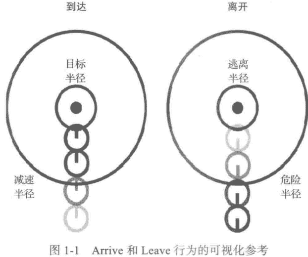

## 1.6 朝向目标

实战中的瞄准（如坦克炮塔、狙击枪）与游戏常见的自动锁头截然不同，此算法正是为这类“受限旋转”场景而生。

### 前置准备

需对 `AgentBehaviour` 基类动手术：

- 引入新字段以约束现有数值范围：

```
public float maxSpeed;
public float maxAccel;
public float maxRotation;
public float maxAngularAccel;
```

- 增加 `MapToRange` 方法，辅助计算两个朝向差值对应的实际旋转方向：

```
public float MapToRange (float rotation) {
rotation %= 360.0f;
if (Mathf.Abs(rotation) > 180.0f) {
if (rotation < 0.0f)
rotation += 360.0f;
else
rotation -= 360.0f;
}
return rotation;
}
```

- 另建一个 `Align` 基类作为朝向算法的地基，原理同 `Arrive` 但仅作用于旋转维度：

```
using UnityEngine;
using System.Collections;

public class Align : AgentBehaviour
{
    public float targetRadius;
    public float slowRadius;
    public float timeToTarget = 0.1f;

    public override Steering GetSteering()
    {
        Steering steering = new Steering();
        float targetOrientation =
        target.GetComponent<Agent>().orientation;
        float rotation = targetOrientation - agent.orientation;
        rotation = MapToRange(rotation);
        float rotationSize = Mathf.Abs(rotation);
        if (rotationSize < targetRadius)
            return steering;

        float targetRotation;
        if (rotationSize > slowRadius)
            targetRotation = agent.maxRotation;
        else
            targetRotation = agent.maxRotation * rotationSize /
        slowRadius;
        targetRotation *= rotation / rotationSize;
        steering.angular = targetRotation - agent.rotation;
        steering.angular /= timeToTarget;
        float angularAccel = Mathf.Abs(steering.angular);
        if (angularAccel > agent.maxAngularAccel)
        {
            steering.angular /= angularAccel;
            steering.angular *= agent.maxAngularAccel;
        }

        return steering;
    }
}
```

### 实战步骤

基于 `Align` 派生具体朝向行为：

- 创建 `Face` 类，含私有字段缓存目标引用：

```
using UnityEngine;
using System.Collections;

public class Face : Align
{
    protected GameObject targetAux;
}
```

- 重写 `Awake` 完成变量初始化与引用绑定：

```
public override void Awake()
{
    base.Awake();
    targetAux = target;
    target = new GameObject();
    target.AddComponent<Agent>();
}
```

- 实现 `OnDestroy` 清理引用，规避内存隐患：

```
void OnDestroy ()
{
    Destroy(target);
}
```

- 定义 `GetSteering` 核心逻辑：

```
public override Steering GetSteering()
{
    Vector3 direction = targetAux.transform.position -
    transform.position;
    if (direction.magnitude > 0.0f)
    {
        float targetOrientation = Mathf.Atan2(direction.x,
        direction.z);
        targetOrientation *= Mathf.Rad2Deg;
        target.GetComponent<Agent>().orientation =
        targetOrientation;
    }
    return base.GetSteering();
}
```

### 运行原理

算法先根据 Agent 与真实目标的相对向量算出内部目标朝向，随后将剩余转向计算全权交给父类 `Align` 处理。

## 1.7 徘徊

`Wander` 算法在群体模拟、野生动物 AI 以及闲逛类 NPC 中表现极佳，能生成极具自然感的随机轨迹。

### 前置准备

向 `AgentBehaviour` 注入 `OriToVec` 方法，用于将朝向角度转换为方向向量。

```
public Vector3 GetOriAsVec (float orientation) {
    Vector3 vector = Vector3.zero;
    vector.x = Mathf.Sin(orientation * Mathf.Deg2Rad) * 1.0f;
    vector.z = Mathf.Cos(orientation * Mathf.Deg2Rad) * 1.0f;
    return vector.normalized;
}
```

### 漫游行为：三步实现逻辑

整个流程可拆解为三个环节：首先生成随机坐标作为内部锚点，随即调整朝向指向该点，最终施加位移力。

- **构建继承自 Face 的 Wander 类别**：

```
using UnityEngine;
using System.Collections;

public class Wander : Face
{
    public float offset;
    public float radius;
    public float rate;
}
```

- **编写 Awake 方法，用于实例化内部锚点对象**：

```
public override void Awake()
{
    target = new GameObject();
    target.transform.position = transform.position;
    base.Awake();
}
```

- **实现 GetSteering 方法**：

```
public override Steering GetSteering()
{
    Steering steering = new Steering();
    float wanderOrientation = Random.Range(-1.0f, 1.0f) * rate;
    float targetOrientation = wanderOrientation +
    agent.orientation;
    Vector3 orientationVec = OriToVec(agent.orientation);
    Vector3 targetPosition = (offset * orientationVec) +
    transform.position;
    targetPosition = targetPosition + (OriToVec(targetOrientation)
    * radius);
    targetAux.transform.position = targetPosition;
    steering = base.GetSteering();
    steering.linear = targetAux.transform.position -
    transform.position;
    steering.linear.Normalize();
    steering.linear *= agent.maxAccel;
    return steering;
}
```

### 原理解析

该机制借助双半径数值推算下一锚点坐标，完成朝向对齐后，将方向量化为矢量输出（参见示意图 1-2）。

---

## 1.8 路径巡逻：摆脱硬编码轨迹

若想让角色按预设轨迹行动，纯代码硬编码极不现实——设想潜行游戏里每个哨兵的巡逻线全靠写死，维护成本高得惊人。本节将搭建一套可配置的轨迹跟随框架，让路线编排像排戏剧一样直观。

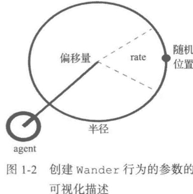

### 数据准备

首先声明一个名为 `PathSegment` 的专用数据结构：

```
using UnityEngine;
using System.Collections;

public class PathSegment
{
    public Vector3 a;
    public Vector3 b;

    public PathSegment () : this (Vector3.zero, Vector3.zero) {}
    public PathSegment (Vector3 a, Vector3 b)
    {
        this.a = a;
        this.b = b;
    }
}
```

### 双阶段实施方案

**阶段一：搭建 Path 容器**  
从空间描述中解析关键节点，仅暴露节点供手动填充。

- 建立 Path 类，内含节点与线段字段，仅节点对外公开且需手动填充：

```
using UnityEngine;
using System.Collections;
using System.Collections.Generic;

public class Path : MonoBehaviour
{
    public List<GameObject> nodes;
    List<PathSegment> segments;
}
```

- 在 Start 阶段自动生成线段数据：

```
void Start()
{
    segments = GetSegments();
}
```

- 提供 GetSegments 方法，依据节点序列组装线段集：

```
public List<PathSegment> GetSegments ()
{
    List<PathSegment> segments = new List<PathSegment>();
    int i;
    for (i = 0; i < nodes.Count - 1; i++)
    {
        Vector3 src = nodes[i].transform.position;
        Vector3 dst = nodes[i+1].transform.position;
        PathSegment segment = new PathSegment(src, dst);
        segments.Add(segment);
    }
    return segments;
}
```

**阶段二：核心参数计算与坐标映射**

- 核心方法 GetParam，负责解析路径参数：

```
public float GetParam(Vector3 position, float lastParam)
{
    // 函数体
}
```

- 定位距离智能体最近的线段：

```
float param = 0f;
PathSegment currentSegment = null;
float tempParam = 0f;
foreach (PathSegment ps in segments)
{
    tempParam += Vector3.Distance(ps.a, ps.b);
    if (lastParam <= tempParam)
    {
        currentSegment = ps;
        break;
    }
}
if (currentSegment == null)
    return 0f;
```

- 结合当前坐标推导轨迹切线方向：

```
Vector3 currPos = position - currentSegment.a;
Vector3 segmentDirection = currentSegment.b - currentSegment.a;
segmentDirection.Normalize();
```

- 运用矢量投影确定线段上的投影点：

```
Vector3 pointInSegment = Vector3.Project(currPos,
    segmentDirection);
```

- GetParam 最终输出路径上的目标进度参数：

```
param = tempParam - Vector3.Distance(currentSegment.a,
currentSegment.b);
param += pointInSegment.magnitude;
return param;
```

- 实现 GetPosition 方法：

```
public Vector3 GetPosition(float param)
{
    // 函数体
}
```

- 依据路径进度匹配对应线段索引：

```
Vector3 position = Vector3.zero;
PathSegment currentSegment = null;
float tempParam = 0f;
foreach (PathSegment ps in segments)
{
    tempParam += Vector3.Distance(ps.a, ps.b);
    if (param <= tempParam)
    {
        currentSegment = ps;
        break;
    }
}
if (currentSegment == null)
    return Vector3.zero;
```

- GetPosition 将参数还原为三维坐标并返回：

```
Vector3 segmentDirection = currentSegment.b - currentSegment.a;
segmentDirection.Normalize();
tempParam -= Vector3.Distance(currentSegment.a, currentSegment.b);
tempParam = param - tempParam;
position = currentSegment.a + segmentDirection * tempParam;
return position;
```

**阶段三：PathFollower 行为脚本**  
继承 Seek，利用 Path 抽象层驱动锚点更新。

- 派生 PathFollower 类（继承 Seek，注意设定脚本执行优先级）：

```
using UnityEngine;
using System.Collections;

public class PathFollower : Seek
{
    public Path path;
    public float pathOffset = 0.0f;
    float currentParam;
}
```

- Awake 中建立目标引用：

```
public override void Awake()
{
    base.Awake();
    target = new GameObject();
    currentParam = 0f;
}
```

- 最后实现 GetSteering，调用 Path 接口刷新目标坐标，复用 Seek 逻辑输出转向：

```
public override Steering GetSteering()
{
    currentParam = path.GetParam(transform.position, currentParam);
    float targetParam = currentParam + pathOffset;
    target.transform.position = path.GetPosition(targetParam);
    return base.GetSteering();
}
```

### 底层原理速览

Path 类充当虚拟轨道，算法核心在于：GetParam 在轨道上投影偏移量得到进度，GetPosition 再将进度映射为世界坐标。跟随流程本质是：Path 取点 → 刷新目标 → 交由 Seek 执行。

### 避坑指南与调试技巧

1.  **节点顺序至关重要**：Inspector 里拖拽顺序直接影响轨迹走向，建议用数字前缀命名（如 `0_Start`、`1_Corner`）防止错序（参考图 1-3）。
2.  **可视化辅助**：实现 OnDrawGizmos 在场景视图绘制辅助线，直观预览轨迹：

```
void OnDrawGizmos ()
{
    Vector3 direction;
    Color tmp = Gizmos.color;
    Gizmos.color = Color.magenta;//example color
    int i;
    for (i = 0; i < nodes.Count - 1; i++)
    {
        Vector3 src = nodes[i].transform.position;
        Vector3 dst = nodes[i+1].transform.position;
        direction = dst - src;
        Gizmos.DrawRay(src, direction);
    }
    Gizmos.color = tmp;
}
```

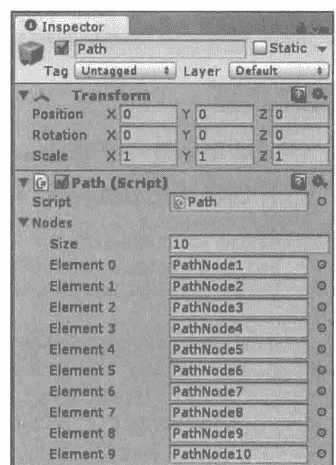

> 图 1-3：Inspector 面板路径节点配置示例

---

## 1.9 智能体避让：模拟真实疏导

群体模拟里若只用物理挤压，个体会像死板粒子般挤作一团，极不真实。本节要实现一种拟人化的主动避让，让个体能感知拥挤并自主疏散。

### 环境配置

新建 Agent 标签并打在需避让的对象上，同时为这些对象挂载自编 Agent 组件（参考图 1-4）。

- 关键设置：
  - Tag：Agent（自定义）
  - Component：Agent（自编脚本）

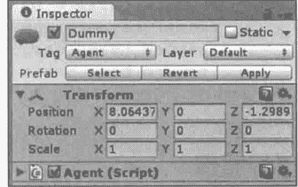

> 图 1-4：假 Agent Inspector 配置示例

### 行为脚本编写步骤

核心仅需编写一个新的避让行为：

- **1. 定义 AvoidAgent 类**  
  暴露避让半径 `avoidRadius` 与待规避目标列表 `targets`：

```csharp
using UnityEngine;
using System.Collections;
using System.Collections.Generic;

public class AvoidAgent : AgentBehaviour
{
    public float collisionRadius = 0.4f;
    GameObject[] targets;
}
```

- **2. Start 阶段按标签自动填充目标列表**：

```csharp
void Start ()
{
    targets = GameObject.FindGameObjectsWithTag("Agent");
}
```

- **3. 实现 GetSteering 主逻辑**：

```csharp
public override Steering GetSteering()
{
    // 函数体
}
```

- **4. 引入辅助字段**  
  用于缓存最近威胁的距离 `closestDist` 与相对速度 `relativeVel`：

```csharp
Steering steering = new Steering();
float shortestTime = Mathf.Infinity;
GameObject firstTarget = null;
float firstMinSeparation = 0.0f;
float firstDistance = 0.0f;
Vector3 firstRelativePos = Vector3.zero;
Vector3 firstRelativeVel = Vector3.zero;
```

- **5. 碰撞预判：筛选出最近的潜在碰撞体**：

```csharp
foreach (GameObject t in targets)
{
    Vector3 relativePos;
    Agent targetAgent = t.GetComponent<Agent>();
    relativePos = t.transform.position - transform.position;
    Vector3 relativeVel = targetAgent.velocity - agent.velocity;
    float relativeSpeed = relativeVel.magnitude;
    float timeToCollision = Vector3.Dot(relativePos, relativeVel);
    timeToCollision /= relativeSpeed * relativeSpeed * -1;
    float distance = relativePos.magnitude;
    float minSeparation = distance - relativeSpeed * timeToCollision;
    if (minSeparation > 2 * collisionRadius)
    {
    continue;
    }
    if (timeToCollision > 0.0f && timeToCollision < shortestTime)
    {
    shortestTime = timeToCollision;
    firstTarget = t;
    firstMinSeparation = minSeparation;
    firstRelativePos = relativePos;
    firstRelativeVel = relativeVel;
    }
}
```

- **6. 检测到威胁则施加反向转向力远离**：

```csharp
if (firstTarget == null)
    return steering;
if (firstMinSeparation <= 0.0f || firstDistance < 2 * collisionRadius)
    firstRelativePos = firstTarget.transform.position;
else
    firstRelativePos += firstRelativeVel * shortestTime;
firstRelativePos.Normalize();
steering.linear = -firstRelativePos * agent.maxAccel;
return steering;
```

### 核心机制

在代理群组里，关键在于识别出距离最近的那个个体。一旦距离进入危险阈值，立即驱动游戏对象按预设路径、以当前速度逃离，从而有效规避碰撞。

### 进阶拓展

该行为与混合技术（本章稍后详述）搭配效果显著，同时也是碰撞规避算法的基石。

## 1.10 智能避墙

本节复刻人类直觉：面对墙体或障碍物，设定安全缓冲区自动绕行，且尽量维持原有大方向不变。

### 基础储备

技术依赖物理引擎的 `RaycastHit` 结构体与 `Raycast` 函数，建议先复习官方文档，便于快速掌握本节精髓。

### 实操步骤

得益于前文铺垫，实现流程精简高效：

- 1. 新建 `AvoidWall` 类继承 `Seek`：

```csharp
using UnityEngine;
using System.Collections;

public class AvoidWall : Seek
{
    // 类内部
}
```

- 2. 增加安全距离与射线长度两个配置字段：

```csharp
public float avoidDistance;
public float lookAhead;
```

- 3. 编写 `Awake` 完成对象初始化：

```csharp
public override void Awake()
{
    base.Awake();
    target = new GameObject();
}
```

- 4. 实现后续步骤依赖的 `GetSteering` 方法：

```csharp
public override Steering GetSteering()
{
    // 函数体
}
```

- 5. 声明并配置射线发射所需参数：

```csharp
Steering steering = new Steering();
Vector3 position = transform.position;
Vector3 rayVector = agent.velocity.normalized * lookAhead;
Vector3 direction = rayVector;
RaycastHit hit;
```

- 6. 发射射线，碰到墙体时按安全距离计算新目标点，再交由 `Seek` 处理转向：

```csharp
if (Physics.Raycast(position, direction, out hit, lookAhead))
{
    position = hit.point + hit.normal * avoidDistance;
    target.transform.position = position;
    steering = base.GetSteering();
}
return steering;
```

### 核心逻辑

向代理前方发射单条射线，命中墙体则在安全距离外生成新目标点，将转向计算委托给 `Seek`，营造出“代理会主动避墙”的假象。

### 进阶拓展

可增发多条射线如“胡须”般分布（见图 1-5）提升精度；该行为常与追逐等移动行为混合使用。

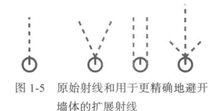

### 官方参考

`RaycastHit` 与 `Raycast` 详见 Unity 文档：

- http://docs.unity3d.com/ScriptReference/RaycastHit.html
- http://docs.unity3d.com/ScriptReference/Physics.Raycast.html

## 1.11 权重混合：以低成本实现行为组合

混合技术让多行为协同无需为每种组合重写脚本，是本章威力最大、实现成本最低、应用最广的行为融合方案。

### 基础储备

在 `AgentBehaviour` 中新增 `weight` 字段（默认 `1.0f`），并重构 `Update`，将权重作为参数传入 `Agent.SetSteering`。重构后的基类结构如下：

```csharp
public class AgentBehaviour : MonoBehaviour
{
    public float weight = 1.0f;

    // ... 类的其余部分

    public virtual void Update ()
    {
        agent.SetSteering(GetSteering(), weight);
    }
}
```

### 实操步骤

仅需修改 `Agent.SetSteering` 的签名与实现：

```csharp
public void SetSteering (Steering steering, float weight)
{
    this.steering.linear += (weight * steering.linear);
    this.steering.angular += (weight * steering.angular);
}
```

### 核心逻辑

权重放大转向结果后累加至主转向结构，完成融合。

### 进阶拓展

权重总和不强制归一化为 1，它仅作为相对重要性的参照系。

### 关联示例

本章避墙案例即采用权重混合实现。

## 1.12 优先级混合：让关键行为拥有“否决权”

权重混合存在短板——高权重行为会淹没低权重行为，即使后者也需保留存在感。优先级混合由此登场：按优先级从高到低级联生效，高优先级行为可直接“否决”低优先级输出。

### 基础储备

与上节类似，向 `AgentBehaviour` 加入 `priority` 字段并重构 `Update` 传参。调整后的基类轮廓如下：

```csharp
public class AgentBehaviour : MonoBehaviour
{
    public int priority = 1;
    // ... 其他还是一样的
    public virtual void Update ()
    {
        agent.SetSteering(GetSteering(), priority);
    }
}
```

### 实操步骤

对 `Agent` 类进行系列改造：

- 1. 引入新命名空间：

```csharp
using System.Collections.Generic;
```

- 2. 新增字段记录最小有效转向阈值（因存在多行为）：

```csharp
public float priorityThreshold = 0.2f;
```

- 3. 新增字段缓存各优先级组的转向结果：

```csharp
private Dictionary<int, List<Steering>> groups;
```

- 4. `Start` 中完成初始化：

```csharp
groups = new Dictionary<int, List<Steering>>();
```

- 5. 修改 `LateUpdate`，调用 `GetPrioritySteering` 赋值：

```csharp
public virtual void LateUpdate ()
{
    // 通过优先级获取steering
    steering = GetPrioritySteering();
    groups.Clear();
    // ... 其余计算保持原样
    steering = new Steering();
}
```

- 6. 重载 `SetSteering` 签名与实现，按优先级分组存储：

```csharp
public void SetSteering (Steering steering, int priority)
{
    if (!groups.ContainsKey(priority))
    {
        groups.Add(priority, new List<Steering>());
    }
    groups[priority].Add(steering);
}
```

- 7. 实现 `GetPrioritySteering`，筛选首个超阈值组，否则落回最低优先级组：

```csharp
private Steering GetPrioritySteering ()
{
    Steering steering = new Steering();
    float sqrThreshold = priorityThreshold * priorityThreshold;
    foreach (List<Steering> group in groups.Values)
    {
        steering = new Steering();
        foreach (Steering singleSteering in group)
        {
            steering.linear += singleSteering.linear;
            steering.angular += singleSteering.angular;
        }
        if (steering.linear.sqrMagnitude > sqrThreshold ||
            Mathf.Abs(steering.angular) > priorityThreshold)
        {
            return steering;
        }
    }
    return steering;
}
```

### 核心逻辑

将同优先级行为打包成组，顺序检测：首个转向模长超阈值的组胜出；若全不达标，则采用最低优先级组的结果。

### 进阶拓展

可与权重混合叠加：在每个优先级组内再按权重融合，构建更鲁棒的架构，让每层级的行为影响更精准。

```csharp
foreach (Steering singleSteering in group)
{
    steering.linear += singleSteering.linear * weight;
    steering.angular += singleSteering.angular * weight;
}
```

### 关联示例

本章另附优先级混合版避墙实现。

## 1.13 抛射体发射：掌握重力下的弹道控制

本节奠定受重力支配对象（球体、手榴弹等）的控制基础，实现落点预测与精准命中目标的发射。

### 基础储备

本节不依赖 `AgentBehaviour` 体系，另起炉灶。

### 实操步骤

- 1. 创建 `Projectile` 类及物理相关字段：

```csharp
using UnityEngine;
using System.Collections;

public class Projectile : MonoBehaviour
{
    private bool set = false;
    private Vector3 firePos;
    private Vector3 direction;
    private float speed;
    private float timeElapsed;
}
```

- 2. 实现 `Update` 推进模拟：

```csharp
void Update ()
{
    if (!set)
        return;

    timeElapsed += Time.deltaTime;
    transform.position = firePos + direction * speed * timeElapsed;
    transform.position += Physics.gravity * (timeElapsed * timeElapsed) / 2.0f;
    // extra validation for cleaning the scene
    if (transform.position.y < -1.0f)
        Destroy(this.gameObject);// or set = false; and hide it
}
```

- 3. 编写 `Set` 方法，供实例化后调用以初始化发射参数：

```csharp
public void Set (Vector3 firePos, Vector3 direction, float speed)
{
    this.firePos = firePos;
    this.direction = direction.normalized;
    this.speed = speed;
    transform.position = firePos;
    set = true;
}
```

### 核心逻辑

直接套用高中抛体运动公式生成抛物线轨迹。

### 进阶拓展

替代方案：不写 `Set`，改用公开属性或公有字段；预制件默认禁用脚本，属性全赋值后再启用，天然适配对象池模式。

### 扩展阅读

对象池模式参考：

- http://en.wikipedia.org/wiki/Object_pool_pattern
- http://unity3d.com/learn/tutorials/modules/beginner/livetraining-archive/object-pooling

## 1.14 落点预测：让 AI 拥有“预判”能力

抛射体飞来时，AI 需决定躲闪或迎击（如躲手榴弹、抢足球）。无论哪种决策，精准预测落点都是前提。

本书将详述落点计算方法。

### 基础储备

预测落点前，先求剩余飞行时间；无需新行为，仅扩展 `Projectile` 类即可。

### 实操步骤

- 1. 新增 `GetLandingTime` 计算落地时刻：

```csharp
public float GetLandingTime (float height = 0.0f)
{
    Vector3 position = transform.position;
    float time = 0.0f;
    float valueInt = (direction.y * direction.y) * (speed * speed);
    valueInt = valueInt - (Physics.gravity.y * 2 * (position.y - height));
    valueInt = Mathf.Sqrt(valueInt);
    float valueAdd = (-direction.y) * speed;
    float valueSub = (-direction.y) * speed;
    valueAdd = (valueAdd + valueInt) / Physics.gravity.y;
    valueSub = (valueSub - valueInt) / Physics.gravity.y;
    if (float.IsNaN(valueAdd) && !float.IsNaN(valueSub))
    return valueSub;
    else if (!float.IsNaN(valueAdd) && float.IsNaN(valueSub))
    return valueAdd;
    else if (float.IsNaN(valueAdd) && float.IsNaN(valueSub))
    return -1.0f;
    time = Mathf.Max(valueAdd, valueSub);
    return time;
}
```

# 1.14 补遗：落点预测实现

### 步骤二：编写 `GetLandingPos` 以推算着地坐标

```csharp
public Vector3 GetLandingPos (float height = 0.0f)
{
    Vector3 landingPos = Vector3.zero;
    float time = GetLandingTime();
    if (time < 0.0f)
        return landingPos;
    landingPos.y = height;
    landingPos.x = firePos.x + direction.x * speed * time;
    landingPos.z = firePos.z + direction.z * speed * time;
    return landingPos;
}
```

### 底层逻辑

先由上节方程反解出目标高度，再结合抛射体当前位姿与速度，即可得出其触达该高度的时刻。

### 避坑指南

必须显式判断 `NaN`。该方程可能产出两根、单根或零根；若计算出的落地时刻为负，表明抛射体根本无法到达指定高度。

---

# 1.15 实现抛射体拦截

仅会预测落点尚嫌不足，智能体还得具备「伸手接球」的能力——否则橄榄球手连传球都做不到。

### 准备工作

延续上节做法，只需在 `Projectile` 类里继续追加逻辑。

### 核心步骤

顺着前文思路，落地很简单：

1.  新增 `GetFireDirection`：

```csharp
public static Vector3 GetFireDirection (Vector3 startPos, Vector3 endPos, float speed)
{
    // body
}
```

2.  求解对应二次多项式：

```csharp
Vector3 direction = Vector3.zero;
Vector3 delta = endPos - startPos;
float a = Vector3.Dot(Physics.gravity, Physics.gravity);
float b = -4 * (Vector3.Dot(Physics.gravity, delta) + speed *
speed);
float c = 4 * Vector3.Dot(delta, delta);
if (4 * a * c > b * b)
{
    return direction;
}
float time0 = Mathf.Sqrt((-b + Mathf.Sqrt(b * b - 4 * a * c)) / (2*a));
float time1 = Mathf.Sqrt((-b - Mathf.Sqrt(b * b - 4 * a * c)) / (2*a));
```

3.  参数允许命中时，回传非零方向向量：

```csharp
float time;
if (time0 < 0.0f)
{
    if (time1 < 0)
    {
        return direction;
    }
    time = time1;
}
else
{
    if (time1 < 0)
        time = time0;
    else
        time = Mathf.Min(time0, time1);
}
direction = 2 * delta - Physics.gravity * (time * time);
direction = direction / (2 * speed * time);
return direction;
```

### 原理速览

给定发射速率大小，解二次多项式得出可行朝向（至少存在一解）。该向量无需再次归一化，因为实例化抛射体时已完成单位化。

### 进阶思考

- **速率不足判定**：负时间对应空向量，暗示初速度不够。解法是编写测试函数，尝试多档速率后再开火。
- **双解选线避障**：引入 `bool` 开关，当出现两个合法时刻（高/低两条抛物线）时，允许穿透墙体等阻挡物：

```csharp
if (isWall)
time = Mathf.Max(time0, time1);
else
time = Mathf.Min(time0, time1);
```

---

# 1.16 搭建跳跃机制

假设你在打造动作游戏，主角能在悬崖、屋顶间穿梭。追兵若想不掉队，必须能判断「该不该跳」并算出「怎么跳」。

### 数据底座

需要基础速度匹配，以及「起跳台 / 落地台」概念以反推可着陆速度。

`VelocityMatch` 行为实现：

```csharp
using UnityEngine;
using System.Collections;

public class VelocityMatch : AgentBehaviour {
    public float timeToTarget = 0.1f;

    public override Steering GetSteering()
    {
        Steering steering = new Steering();
        steering.linear = target.GetComponent<Agent>().velocity -
        agent.velocity;
        steering.linear /= timeToTarget;
        if (steering.linear.magnitude > agent.maxAccel)
            steering.linear = steering.linear.normalized * agent.maxAccel;
        steering.angular = 0.0f;
        return steering;
    }
}
```

跳跃节点数据结构：

```csharp
using UnityEngine;
using System.Collections;

public class JumpPoint
{
    public Vector3 jumpLocation;
    public Vector3 landingLocation;

    //The change in position from jump to landing
    public Vector3 deltaPosition;

    public JumpPoint () : this (Vector3.zero, Vector3.zero)
    {
    }

    public JumpPoint(Vector3 a, Vector3 b)
    {
        this.jumpLocation = a;
        this.landingLocation = b;
        this.deltaPosition = this.landingLocation - this.jumpLocation;
    }
}
```

### 逐步落地

1.  创建 `Jump` 组件与字段：

```csharp
using UnityEngine;
using System.Collections;

public class Jump : VelocityMatch
{
    public JumpPoint jumpPoint;
    public float maxYVelocity;
    public Vector3 gravity = new Vector3(0, -9.8f, 0);
    bool canAchieve = false;
}
```

2.  实现 `SetJumpPoint`：

```csharp
public void SetJumpPoint(Transform jumpPad, Transform landingPad)
{
    jumpPoint = new JumpPoint(jumpPad.position,
    landingPad.position);
}
```

3.  增加目标点计算例程：

```csharp
protected void CalculateTarget()
{
    target = new GameObject();
    target.AddComponent<Agent>();
    target.transform.position = jumpPoint.jumpLocation;
    //Calculate the first jump time
    float sqrtTerm = Mathf.Sqrt(2f * gravity.y *
    jumpPoint.deltaPosition.y + maxYVelocity * agent.maxSpeed);
    float time = (maxYVelocity - sqrtTerm) / gravity.y;
    //Check if we can use it, otherwise try the other time
    if (!CheckJumpTime(time))
    {
        time = (maxYVelocity + sqrtTerm) / gravity.y;
    }
}
```

4.  实现 `CheckJumpTime` 评估跳跃收益：

```csharp
private bool CheckJumpTime(float time)
{
    //Calculate the planar speed
    float vx = jumpPoint.deltaPosition.x / time;
    float vz = jumpPoint.deltaPosition.z / time;
    float speedSq = vx * vx + vz * vz;
    //Check it to see if we have a valid solution
    if (speedSq < agent.maxSpeed * agent.maxSpeed)
    {
        target.GetComponent<Agent>().velocity = new Vector3(vx, 0f,
        vz);
        canAchieve = true;
        return true;
    }
    return false;
}
```

5.  定义 `GetSteering` 输出转向量：

```csharp
public override Steering GetSteering()
{
    Steering steering = new Steering();
    if (target == null)
    {
        CalculateTarget();
    }
    if (!canAchieve)
    {
        return steering;
    }
    //Check if we've hit the jump point
    if (Mathf.Approximately((transform.position -
    target.transform.position).magnitude, 0f) &&
    Mathf.Approximately((agent.velocity -
    target.GetComponent<Agent>().velocity).magnitude, 0f))
    {
        // call a jump method based on the Projectile behaviour
        return steering;
    }
    return base.GetSteering();
}
```

### 算法要点

依据智能体当前速度判断能否抵达落地台；若可达，则在搜寻落点时给出相应竖直速度分量。

---

# Chapter 2 导航

本章将逐一攻克：

- 网格建模世界
- 可视点图建模世界
- 自制导航网格
- DFS 破解迷宫
- BFS 求网格最短路
- 迪杰斯特拉算法求最短路
- A* 寻优路
- IDA* 压缩 A* 内存
- 时间切片分帧寻路
- 路径平滑处理

## 2.1 引言

复杂场景下的寻路是本章主线。游戏世界或是迷宫、或是开放大世界、或介于两者之间——不同拓扑对应不同技术。

我们将学习：多种图表达方式，以及针对不同场景的寻路算法。特别提示，寻路算法依赖上一章的 `Seek`、`Arrive` 等行为在图中实际位移。

## 2.2 网格建模：最直观的切片方式

网格因简单直观，成为游戏建模首选。但在进阶高级图表达前，得先打牢图论地基。

### 架构解耦：抽象 `Graph` 基类

为让寻路逻辑与底层存储解绑，先定义抽象类 `Graph`，声明所有图实现必须的虚方法。无论内部如何组织顶点与边，上层寻路只依赖这套统一接口，避免为每种图重复造轮子。该类也是本章所有图实现的父类，后续扩展新图类型时亦可复用。

继而派生网格图类，内部按二维数组管理数据。

### 代码落地

#### 1. 搭建 `Graph` 骨架

声明核心字段与虚方法，确立顶点集、边关系的抽象契约。

```csharp
using UnityEngine;
using System.Collections;
using System.Collections.Generic;

public abstract class Graph : MonoBehaviour
{
    public GameObject vertexPrefab;
    protected List<Vertex> vertices;
    protected List<List<Vertex>> neighbours;
    protected List<List<float>> costs;
    // next steps
}
```

#### 2. 运行时初始化

实现 `Start`，完成必要前置准备。

```csharp
public virtual void Start()
{
    Load();
}
```

#### 3. 数据加载协议

定义虚函数 `Load`，强制子类实现具体地图解析。

```csharp
public virtual void Load() { }
```

#### 4. 顶点总数查询

提供标准接口获取顶点数量，默认返回 0，具体实现类覆盖（如返回 `vertices.Count`）。

```csharp
public virtual int GetSize()
{
    if (ReferenceEquals(vertices, null))
```

#### 5. 最近顶点检索

据世界坐标定位最近图节点，是智能体接入寻路系统的关键桥梁。

```
public virtual Vertex GetNearestVertex(Vector3 position)
{
    return null;
}
```

#### 6. ID 直达顶点

通过唯一标识符快速索引顶点对象，支撑路径回溯等高频操作。

```
public virtual Vertex GetVertexObj(int id)
{
    if (ReferenceEquals(vertices, null) || vertices.Count == 0)
        return null;
    if (id < 0 || id >= vertices.Count)
        return null;
    return vertices[id];
}
```

#### 7. 邻接遍历

给定顶点，返回所有可达邻居及移动代价，这是寻路算法展开搜索的基础操作。

```
public virtual Vertex[] GetNeighbours(Vertex v)
{
    if (ReferenceEquals(neighbours, null) || neighbours.Count == 0)
        return new Vertex[0];
    if (v.id < 0 || v.id >= neighbours.Count)
        return new Vertex[0];
    return neighbours[v.id].ToArray();
}
```

### 辅助数据结构

#### `Vertex` 顶点类

封装坐标、索引 ID、状态标记等核心属性。

```
using UnityEngine;
using System.Collections.Generic;
[System.Serializable]
public class Vertex : MonoBehaviour
{
    public int id;
    public List<Edge> neighbours;
    [HideInInspector]
    public Vertex prev;
}
```

```
using System;
[System.Serializable]
public class Edge : IComparable<Edge>
{
    public float cost;
    public Vertex vertex;
}
```

```
// next steps
}
```

#### 2. 搭建构造函数：

```
public Edge(Vertex vertex = null, float cost = 1f)
{
    this.vertex = vertex;
    this.cost = cost;
}
```

#### 3. 编写比较成员方法：

```
public int CompareTo(Edge other)
{
    float result = cost - other.cost;
    int idA = vertex.GetInstanceID();
    int idB = other.vertex.GetInstanceID();
    if (idA == idB)
        return 0;
    return (int)result;
}
```

#### 4. 实现边对比方法：

```
public bool Equals(Edge other)
{
    return (other.vertex.id == this.vertex.id);
}
```

#### 5. 重写对象比较逻辑：

```
public override bool Equals(object obj)
{
    Edge other = (Edge)obj;
    return (other.vertex.id == this.vertex.id);
}
```

#### 6. 重写哈希码获取方法（配合 Equuses 重写使用）：

```
public override int GetHashCode()
{
    return this.vertex.GetHashCode();
}
```

完成上述类的构建后，还需准备基于立方体（扁平立方体即可）的预制体，用于直观呈现地面与墙体/障碍物。将地面预制体赋值给 `vertexPrefab` 字段，墙体预制体则赋值给后续声明的 `obstaclePrefab` 字段。

接着，新建一个 `Maps` 文件夹，专门存放定义地图数据的文本文件。

接下来我们将深入核心环节：基于网格的图结构实战。首先把操作图的核心函数框架搭好，预留读取文本的接口，随后讲解如何解析 `.map` 文件——这是一种游戏开发中通用的开放地图格式：

#### 1. 创建继承自 Graph 的 GraphGrid 类：

```
using UnityEngine;
using System;
using System.Collections.Generic;
using System.IO;

public class GraphGrid : Graph
{
    public GameObject obstaclePrefab;
    public string mapName = "arena.map";
    public bool get8Vicinity = false;
    public float cellSize = 1f;
    [Range(0, Mathf.Infinity)]
    public float defaultCost = 1f;
    [Range(0, Mathf.Infinity)]
    public float maximumCost = Mathf.Infinity;
    string mapsDir = "Maps";
    int numCols;
    int numRows;
    GameObject[] vertexObjs;
    // this is necessary for
    // the advanced section of reading
    // from an example test file
    bool[,] mapVertices;
    // next steps
}
```

#### 2. 定义 GridToId 与 IdToGrid 方法，实现网格坐标与顶点索引的双向转换：

```
private int GridToId(int x, int y)
{
    return Math.Max(numRows, numCols) * y + x;
}
```

```
private Vector2 IdToGrid(int id)
{
    Vector2 location = Vector2.zero;
    location.y = Mathf.Floor(id / numCols);
    location.x = Mathf.Floor(id % numCols);
    return location;
}
```

#### 3. 编写 LoadMap 方法，负责读取文本文件数据：

```
private void LoadMap(string filename)
{
    // TODO
    // implement your grid-based
    // file-reading procedure here
    // using
    // vertices[i, j] for logical representation and
    // vertexObjs[i, j] for assigning new prefab instances
}
```

#### 4. 重写 LoadGraph 方法：

```
public override void LoadGraph()
{
    LoadMap(mapName);
}
```

#### 5. 重写 GetNearestVertex 方法（基础版）。此版本采用常规思路，不校验返回目标是否为障碍物，优化方案将在下一步展开：

```
public override Vertex GetNearestVertex(Vector3 position)
{
    position.x = Mathf.Floor(position.x / cellSize);
    position.y = Mathf.Floor(position.z / cellSize);
    int col = (int)position.x;
    int row = (int)position.z;
    int id = GridToId(col, row);
    return vertices[id];
}
```

#### 6. 重写 GetNearestVertex 方法（BFS 优化版）。基于广度优先搜索策略，详细原理稍后解析：

```
public override Vertex GetNearestVertex(Vector3 position)
{
    int col = (int)(position.x / cellSize);
    int row = (int)(position.z / cellSize);
    Vector2 p = new Vector2(col, row);
    // 下面的代码
}
```

#### 7. 定义“已搜索顶点列表”与“待搜索顶点队列”两个核心数据结构：

```
List<Vector2> explored = new List<Vector2>();
Queue<Vector2> queue = new Queue<Vector2>();
queue.Enqueue(p);
```

#### 8. 循环处理队列元素，直到队列为空则返回 null：

```
do
{
    p = queue.Dequeue();
    col = (int)p.x;
    row = (int)p.y;
    int id = GridToId(col, row);
    // 下面的代码
} while (queue.Count != 0);
return null;
```

#### 9. 若当前顶点有效，直接返回该顶点：

```
if (mapVertices[row, col])
    return vertices[id];
```

#### 10. 若该顶点未在已搜索列表中，将其加入列表标记为已访问：

```
if (!explored.Contains(p))
{
    explored.Add(p);
    int i, j;
    // 下面的代码
}
```

#### 11. 若位置合法，将其所有合法邻接点入队：

```
for (i = row - 1; i <= row + 1; i++)
{
    for (j = col - 1; j <= col + 1; j++)
    {
        if (i < 0 || j < 0)
            continue;
        if (j >= numCols || i >= numRows)
            continue;
        if (i == row && j == col)
            continue;
        queue.Enqueue(new Vector2(j, i));
    }
}
```

### 核心运作机制

该算法通过私有辅助方法适配父类通用接口，借助简单的数学映射将二维坐标压缩为一维顶点索引（详见图 2-1）。

你可以自行实现 `LoadMap` 解析自定义地图文件，但下一节我们将详细拆解 `.map` 格式的标准读取流程，助你掌握文件处理技巧，甚至可直接沿用该格式。

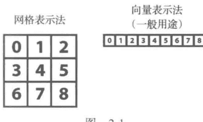

### 进阶扩展：.map 格式的另一种解析实现

#### 1. 定义方法，创建 StreamReader 对象打开文件流：

```
private void LoadMap(string filename)
{
    string path = Application.dataPath + "/" + mapsDir + "/" +
    filename;
    try
    {
        StreamReader strmRdr = new StreamReader(path);
        using (strmRdr)
        {
            // next steps in here
        }
    }
    catch (Exception e)
    {
        Debug.LogException(e);
    }
}
```

#### 2. 声明并初始化所需变量：

```
int j = 0;
int i = 0;
int id = 0;
string line;
Vector3 position = Vector3.zero;
Vector3 scale = Vector3.zero;
```

#### 3. 解析文件头，获取地图高度与宽度：

```
line = strmRdr.ReadLine();// non-important line
line = strmRdr.ReadLine();// height
numRows = int.Parse(line.Split(' ')[1]);
line = strmRdr.ReadLine();// width
numCols = int.Parse(line.Split(' ')[1]);
line = strmRdr.ReadLine();// "map" line in file
```

#### 4. 初始化成员变量并分配内存空间：

```
vertices = new List<Vertex>(numRows * numCols);
neighbours = new List<List<Vertex>>(numRows * numCols);
costs = new List<List<float>>(numRows * numCols);
vertexObjs = new GameObject[numRows * numCols];
mapVertices = new bool[numRows, numCols];
```

#### 5. 构建嵌套 for 循环，逐字符迭代读取地图数据：

```
for (i = 0; i < numRows; i++)
{
    line = strmRdr.ReadLine();
    for (j = 0; j < numCols; j++)
    {
        // next steps in here
    }
}
```

#### 6. 根据字符类型，将逻辑标记赋值为 true（可通行）或 false（障碍）：

```
bool isGround = true;
if (line[j] != '.')
    isGround = false;
mapVertices[i, j] = isGround;
```

#### 7. 根据标记实例化对应的预制体（地面或墙体）：

```
position.x = j * cellSize;
position.z = i * cellSize;
id = GridToId(j, i);
if (isGround)
    vertexObjs[id] = Instantiate(vertexPrefab, position,
    Quaternion.identity) as GameObject;
else
    vertexObjs[id] = Instantiate(obstaclePrefab, position,
    Quaternion.identity) as GameObject;
```

#### 8. 将生成的游戏对象挂载为图节点的子物体，并清空其名称：

```
vertexObjs[id].name = vertexObjs[id].name.Replace("(Clone)",
id.ToString());
```

```
Vertex v = vertexObjs[id].AddComponent<Vertex>();
v.id = id;
vertices.Add(v);
neighbours.Add(new List<Vertex>());
costs.Add(new List<float>());
float y = vertexObjs[id].transform.localScale.y;
scale = new Vector3(cellSize, y, cellSize);
vertexObjs[id].transform.localScale = scale;
vertexObjs[id].transform.parent = gameObject.transform;
```

#### 9. 在上述循环结束后，添加一对嵌套循环，遍历为每个顶点配置邻接节点：

```
for (i = 0; i < numRows; i++)
{
    for (j = 0; j < numCols; j++)
    {
        SetNeighbours(j, i);
    }
}
```

#### 10. 实现上一步调用的 SetNeighbours 方法：

```
protected void SetNeighbours(int x, int y, bool get8 = false)
{
    int col = x;
    int row = y;
    int i, j;
    int vertexId = GridToId(x, y);
    neighbours[vertexId] = new List<Vertex>();
    costs[vertexId] = new List<float>();
    Vector2[] pos = new Vector2[0];
    // next steps
}
```

#### 11. 计算八邻域（含四个对角线方向）的邻接索引：

```
if (get8)
{
    pos = new Vector2[8];
    int c = 0;
    for (i = row - 1; i <= row + 1; i++)
    {
        for (j = col - 1; j <= col; j++)
        {
            pos[c] = new Vector2(j, i);
            c++;
        }
    }
}
```

#### 12. 初始化四邻域（仅上下左右，不含对角线）：

```
else
{
    pos = new Vector2[4];
    pos[0] = new Vector2(col, row - 1);
    pos[1] = new Vector2(col - 1, row);
    pos[2] = new Vector2(col + 1, row);
```

#### 13. 将有效邻接点加入列表，流程与邻域计算一致：

```csharp
pos[3] = new Vector2(col, row + 1);
}
```

```csharp
foreach (Vector2 p in pos)
{
    i = (int)p.y;
    j = (int)p.x;
    if (i < 0 || j < 0)
        continue;
    if (i >= numRows || j >= numCols)
        continue;
    if (i == row && j == col)
        continue;
    if (!mapVertices[i, j])
        continue;
    int id = GridToId(j, i);
    neighbours[vertexId].Add(vertices[id]);
    costs[vertexId].Add(defaultCost);
}
```

### 扩展参考

若需深入了解地图格式规范及免费地图资源的获取途径，建议访问由 Sturtevant 教授主导的 Moving AI Lab 官网：http://movingai.com/benchmarks/。

## 2.3 采用可视点法构建世界模型

可视点法是世界表示的另一主流技术，其核心在于部署于可通行区域内的离散点位（支持手动布局或脚本自动生成）。本节重点讲解如何通过脚本实现手动放置点位的自动连接。

### 前置准备

同前文流程，正式开始前需完成以下基础搭建：

- 将 `Edge` 类与 `Graph` 类置于同一文件下。
- 实现 `Graph` 类的 `GetEdges` 方法。
- 创建 `Vertex` 类。

场景中的顶点对象需挂载碰撞器组件，并标记为 `Vertex` 标签。建议统一使用 `Sphere` 基础体作为其视觉表现。

### 核心实现步骤

下面构建图表示类及专用的 `Vertex` 子类：

#### 1. 派生 `VertexVisibility` 类：

```csharp
using UnityEngine;
using System.Collections.Generic;

public class VertexVisibility : Vertex
{
    void Awake()
    {
        neighbours = new List<Edge>();
    }
}
```

#### 2. 编写 `FindNeighbours` 方法，实现顶点间连接的自动化：

```csharp
public void FindNeighbours(List<Vertex> vertices)
{
    Collider c = gameObject.GetComponent<Collider>();
    c.enabled = false;
    Vector3 direction = Vector3.zero;
    Vector3 origin = transform.position;
    Vector3 target = Vector3.zero;
    RaycastHit[] hits;
    Ray ray;
    float distance = 0f;
    // next step
}
```

#### 3. 遍历全体对象并发射射线判定视野通达性，将完全可见的对象纳入邻接列表：

```csharp
for (int i = 0; i < vertices.Count; i++)
{
    if (vertices[i] == this)
        continue;

    target = vertices[i].transform.position;
    direction = target - origin;
    distance = direction.magnitude;
    ray = new Ray(origin, direction);
    hits = Physics.RaycastAll(ray, distance);
    if (hits.Length == 1)
    {
        if (hits[0].collider.gameObject.tag.Equals("Vertex"))
        {
            Edge e = new Edge();
            e.cost = distance;
            GameObject go = hits[0].collider.gameObject;
            Vertex v = go.GetComponent<Vertex>();
            if (v != vertices[i])
                continue;
            e.vertex = v;
            neighbours.Add(e);
        }
    }
}
c.enabled = true;
```

#### 4. 创建 `GraphVisibility` 类：

```csharp
using UnityEngine;
using System.Collections.Generic;

public class GraphVisibility : Graph
{
    // next steps
}
```

#### 5. 实现 `Load` 方法，完成顶点间的关联绑定：

```csharp
public override void Load()
{
    Vertex[] verts = GameObject.FindObjectsOfType<Vertex>();
    vertices = new List<Vertex>(verts);
    for (int i = 0; i < vertices.Count; i++)
    {
        VertexVisibility vv = vertices[i] as VertexVisibility;
        vv.id = i;
        vv.FindNeighbours(vertices);
    }
}
```

#### 6. 定义 `GetNearestVertex` 方法：

```csharp
public override Vertex GetNearestVertex(Vector3 position)
{
    Vertex vertex = null;
    float dist = Mathf.Infinity;
    float distNear = dist;
    Vector3 posVertex = Vector3.zero;
    for (int i = 0; i < vertices.Count; i++)
    {
        posVertex = vertices[i].transform.position;
        dist = Vector3.Distance(position, posVertex);
        if (dist < distNear)
        {
            distNear = dist;
            vertex = vertices[i];
        }
    }
    return vertex;
}
```

#### 7. 定义 `GetNeighbours` 方法：

```csharp
public override Vertex[] GetNeighbours(Vertex v)
{
    List<Edge> edges = v.neighbours;
    Vertex[] ns = new Vertex[edges.Count];
    int i;
    for (i = 0; i < edges.Count; i++)
    {
        ns[i] = edges[i].vertex;
    }
    return ns;
}
```

#### 8. 重写 `GetEdges` 方法：

```csharp
public override Edge[] GetEdges(Vertex v)
{
    return vertices[v.id].neighbours.ToArray();
}
```

### 原理解析

`GraphVisibility` 父类会索引场景内所有顶点，并逐个调用 `FindNeighbours` 方法。此举旨在零人工干预下自动构建图结构并建立节点连接，优于依赖主观判断的手动布局。边的权重默认赋值为两点间的欧几里得距离。

### 进阶拓展

确保点位间互通可见是图连通的关键。该技术同样适用于构建智能化导航图（如楼梯、悬崖等复杂地形）。只需将 `Load` 方法迁移至支持编辑器模式的类中，使其能在编辑阶段运行，随后手动增删边即可实现预期拓扑。

若上下文衔接不畅，可回顾本节“前置准备”部分辅助理解。

关于自定义编辑器、编辑器脚本编程及编辑模式下代码执行的详细用法，请参考 Unity 官方文档：

- http://docs.unity3d.com/ScriptReference/Editor.html
- http://docs.unity3d.com/ScriptReference/ExecuteInEditMode.html
- http://docs.unity3d.com/Manual/PlatformDependentCompilation.html

## 2.4 自研导航网格：应对复杂世界表示

面对多图层混合等复杂场景，自定义导航网格显得尤为必要。但纯手动放置节点极其耗时，难以覆盖大规模区域。本节将演示如何利用模型网格数据，以三角形几何中心为顶点生成导航网格，并复用可视点法的核心连接逻辑。

### 前置准备

本节要求具备自定义编辑器脚本基础，并掌握可视点图实现的要点。此外，脚本会自动实例化场景中的 `CustomNavMesh` 游戏对象，因此需预先指定预制体，这与其他图表示方式一致。

关键在于创建一个继承自 `GraphVisibility` 的类：

```csharp
using UnityEngine;
using System.Collections;
using System.Collections.Generic;

public class CustomNavMesh : GraphVisibility
{
    public override void Start()
    {
        instIdToId = new Dictionary<int, int>();
    }
}
```

### 编辑器工具开发流程

为避免在图的 `Start` 阶段执行繁重计算导致场景加载卡顿，我们将构建一个编辑器窗口来承载自动化流程：

- **1. 创建 `CustomNavMeshWindow` 类并置于 `Editor` 目录：**

```csharp
using UnityEngine;
using UnityEditor;
using System.Collections;
using System.Collections.Generic;

public class CustomNavMeshWindow : EditorWindow
{
    // next steps here
}
```

- **2. 为编辑器窗口添加必要属性：**

```csharp
static bool isEnabled = false;
static GameObject graphObj;
static CustomNavMesh graph;
static CustomNavMeshWindow window;
static GameObject graphVertex;
```

- **3. 实现窗口初始化与显示逻辑：**

```csharp
[MenuItem("UAIPc/Ch02/CustomNavMeshWindow")]
static void Init()
{
    window = EditorWindow.GetWindow<CustomNavMeshWindow>();
    window.title = "CustomNavMeshWindow";
    SceneView.onSceneGUIDelegate += OnScene;
    graphObj = GameObject.Find("CustomNavMesh");
    if (graphObj == null)
    {
        graphObj = new GameObject("CustomNavMesh");
        graphObj.AddComponent<CustomNavMesh>();
        graph = graphObj.GetComponent<CustomNavMesh>();
    }
    else
    {
        graph = graphObj.GetComponent<CustomNavMesh>();
        if (graph == null)
            graphObj.AddComponent<CustomNavMesh>();
        graph = graphObj.GetComponent<CustomNavMesh>();
    }
}
```

- **4. 定义 `OnDestroy` 清理逻辑：**

```csharp
void OnDestroy()
{
    SceneView.onSceneGUIDelegate -= OnScene;
}
```

- **5. 实现 `OnGUI` 绘制窗口 UI：**

```csharp
void OnGUI()
{
    isEnabled = EditorGUILayout.Toggle("Enable Mesh Picking",
    isEnabled);
    if (GUILayout.Button("Build Edges"))
    {
        if (graph != null)
            graph.LoadGraph();
    }
}
```

- **6. 编写 `OnScene` 前半段，响应场景视图中的左键点击事件：**

```csharp
private static void OnScene(SceneView sceneView)
{
    if (!isEnabled)
        return;
    if (Event.current.type == EventType.MouseDown)
    {
        graphVertex = graph.vertexPrefab;
        if (graphVertex == null)
        {
            Debug.LogError("No Vertex Prefab assigned");
            return;
        }
        Event e = Event.current;
        Ray ray =
        HandleUtility.GUIPointToWorldRay(e.mousePosition);
        RaycastHit hit;
        GameObject newV;
        // next step
    }
}
```

- **7. 编写 `OnScene` 后半段，处理网格点击交互：**

```csharp
if (Physics.Raycast(ray, out hit))
{
    GameObject obj = hit.collider.gameObject;
    Mesh mesh = obj.GetComponent<MeshFilter>().sharedMesh;
    Vector3 pos;
    int i;

    for (i = 0; i < mesh.triangles.Length; i += 3)
    {
        int i0 = mesh.triangles[i];
        int i1 = mesh.triangles[i + 1];
        int i2 = mesh.triangles[i + 2];
        pos = mesh.vertices[i0];
        pos += mesh.vertices[i1];
        pos += mesh.vertices[i2];
        pos /= 3;
        newV = (GameObject)Instantiate(graphVertex, pos,
        Quaternion.identity);
        newV.transform.Translate(obj.transform.position);
        newV.transform.parent = graphObj.transform;
        graphObj.transform.parent = obj.transform;
    }
}
```

### 运作机制

我们开发了一个专用编辑器窗口，并编写了处理场景视图事件的委托函数 `OnScene`。生成流程为：遍历网格顶点数组创建图节点，计算各三角形的几何中心作为节点位置，最后调用图的 `LoadGraph` 方法解析邻接关系完成拓扑构建。

## 2.5 深度优先搜索（DFS）：迷宫寻路与生成的双重利器

深度优先搜索（DFS）算法因内存占用极低，非常适配资源受限设备的寻路需求；同时它也是经典的迷宫生成算法——仅需微调“已访问”与“待发现”节点列表的逻辑，核心流程保持不变。

### 前置准备

DFS 属于上层算法，强依赖图类核心接口（如 `build`、`init` 等）的具体实现，因此建议直接在 `Graph` 类中实现。

请留意区分：何时操作实际的游戏对象，何时仅处理顶点 ID，这对正确性至关重要。

### 实施步骤

# 寻路核心技术速览：深搜至 A* 实战要点

本节仅封装单一函数，核心逻辑全赖注释佐证，请配合阅读：

- **① 构造 `GetPathDFS` 签名**  
  ```csharp
public List<Vertex> GetPathDFS(GameObject srcObj, GameObject dstObj)
{
    // next steps
}
```

- **② 空引用守卫**  
  起止点任一为空，即刻回收空顶点集：
  ```csharp
  if (srcObj == null || dstObj == null)
      return new List<Vertex>();
  ```

- **③ 变量就绪**  
  ```csharp
Vertex src = GetNearestVertex(srcObj.transform.position);
Vertex dst = GetNearestVertex(dstObj.transform.position);
Vertex[] neighbours;
Vertex v;
int[] previous = new int[vertices.Count];
for (int i = 0; i < previous.Length; i++)
    previous[i] = -1;
previous[src.id] = src.id;
Stack<Vertex> s = new Stack<Vertex>();
s.Push(src);
```

- **④ 迭代式深搜寻路**  
  ```csharp
while (s.Count != 0)
{
    v = s.Pop();
    if (ReferenceEquals(v, dst))
    {
        return BuildPath(src.id, v.id, ref previous);
    }

    neighbours = GetNeighbours(v);
    foreach (Vertex n in neighbours)
    {
        if (previous[n.id] != -1)
            continue;
        previous[n.id] = v.id;
        s.Push(n);
    }
}
```

## 算法内核剖析

采用**非递归 DFS**，依托图的顺序遍历特性，辅以**栈（LIFO/后进先出）** 机制完成节点探索与回溯。

## 通用组件：路径重构器 `BuildPath`

文中引用 `BuildPath` 却未给出实现，因该方法贯穿本章绝大多数寻路流程，故单独剥离：  
```csharp
private List<Vertex> BuildPath(int srcId, int dstId, ref int[] prevList)
{
    List<Vertex> path = new List<Vertex>();
    int prev = dstId;
    do
    {
        path.Add(vertices[prev]);
        prev = prevList[prev];
    } while (prev != srcId);
    return path;
}
```

---

## 2.6 广度优先搜索：以最少步数锁定网格最短路

BFS 属于图遍历基石，**天然保证步数最少**，仅以适度内存开销为代价，极适配高性能主机/PC 端游戏。

### 环境就绪

作为上层算法，依赖图的通用基础设施，故直接内置于 `Graph` 类。

### 实施流程

同样仅定义单函数，关键在注释细节：

- **① 声明 `GetPathBFS`**  
  ```csharp
public List<Vertex> GetPathBFS(GameObject srcObj, GameObject dstObj)
{
    if (srcObj == null || dstObj == null)
        return new List<Vertex>();
    // next steps
}
```

- **② 变量初始化**  
  ```csharp
Vertex[] neighbours;
Queue<Vertex> q = new Queue<Vertex>();
Vertex src = GetNearestVertex(srcObj.transform.position);
Vertex dst = GetNearestVertex(dstObj.transform.position);
Vertex v;
int[] previous = new int[vertices.Count];
for (int i = 0; i < previous.Length; i++)
    previous[i] = -1;
previous[src.id] = src.id;
q.Enqueue(src);
```

- **③ 队列驱动的层层扩展**  
  ```csharp
while (q.Count != 0)
{
    v = q.Dequeue();
    if (ReferenceEquals(v, dst))
    {
        return BuildPath(src.id, v.id, ref previous);
    }

    neighbours = GetNeighbours(v);
    foreach (Vertex n in neighbours)
    {
        if (previous[n.id] != -1)
            continue;
        previous[n.id] = v.id;
        q.Enqueue(n);
    }
    return new List<Vertex>();
}
```

## 原理对比

BFS 与 DFS 均基于图的顺序遍历，**核心差异在于数据结构**：DFS 用栈，BFS 改用**队列（FIFO/先进先出）** 存储已访问顶点。

## 补充说明

`BuildPath` 方法未在此重复，详见 2.5 节讨论。

---

## 2.7 迪杰斯特拉法：攻克加权图单源最近路线

该算法专为**单源最短路径**设计，能给出从唯一起点到所有可达终点的**最低开销路线**。本节演示两种调用形态。

### 前置准备

.NET/Mono 缺乏内置二叉堆/优先级队列，需从 **GPWiki** 引入 `BinaryHeap` 类。

### 标准实现流程

沿用统一参数签名，随后说明如何释放算法完整潜能：

- **① 定义 `GetPathDijkstra` 及内部变量**  
  ```csharp
public List<Vertex> GetPathDijkstra(GameObject srcObj, GameObject dstObj)
{
    if (srcObj == null || dstObj == null)
        return new List<Vertex>();
    Vertex src = GetNearestVertex(srcObj.transform.position);
    Vertex dst = GetNearestVertex(dstObj.transform.position);
    GPWiki.BinaryHeap<Edge> frontier = new GPWiki.BinaryHeap<Edge>();
    Edge[] edges;
    Edge node, child;

    int size = vertices.Count;
    float[] distValue = new float[size];
    int[] previous = new int[size];

    // next steps
}
```

- **② 源点入堆（视作优先级队列），其余顶点距离设为无穷大**  
  ```csharp
node = new Edge(src, 0);
frontier.Add(node);
distValue[src.id] = 0;
previous[src.id] = src.id;
for (int i = 0; i < size; i++)
{
    if (i == src.id)
        continue;
    distValue[i] = Mathf.Infinity;
    previous[i] = -1;
}
```

- **③ 循环处理非空堆**  
  ```csharp
while (frontier.Count != 0)
{
    node = frontier.Remove();
    int nodeId = node.vertex.id;
    // next steps
}
return new List<Vertex>();
```

- **④ 触达终点时的终止与回溯**  
  ```csharp
if (ReferenceEquals(node.vertex, dst))
{
    return BuildPath(src.id, node.vertex.id, ref previous);
}
```

- **⑤ 邻接节点入堆、标记已访问，最终返回路径（存在则非空）**  
  ```csharp
edges = GetEdges(node.vertex);
foreach (Edge e in edges)
{
    int eId = e.vertex.id;
    if (previous[eId] != -1)
        continue;
    float cost = distValue[nodeId] + e.cost;
    if (cost < distValue[e.vertex.id])
    {
        distValue[eId] = cost;
        previous[eId] = nodeId;
        frontier.Remove(e);
        child = new Edge(e.vertex, cost);
        frontier.Add(child);
    }
}
```

## 核心机制

与 BFS 同源，**引入非负边权** 并以数组记录前驱顶点，从而构建从源点到各终点的最优路径树。

## 进阶：预计算加速版

通过**预处理**大幅缩短在线查询耗时，分三阶段：

1. **调整主函数签名**  
   ```csharp
public int[] Dijkstra(GameObject srcObj)
```

2. **变更返回值结构**  
   ```csharp
return previous;
```

3. **移除原步骤 ④ 的终点判断逻辑**  
   ```csharp
if (ReferenceEquals(node.vertex, dst))
{
    return BuildPath(src.id, node.vertex.id, ref previous);
}
```  
   同步删除初始化处的下列代码：  
   ```csharp
Vertex dst = GetNearestVertex(dstObj.transform.position);
```

4. **在 `Graph` 类新增成员字段**  
   ```csharp
List<int[]> routes = new List<int[]>();
```

5. **实现预处理入口 `DijkstraProcessing`**  
   ```csharp
public void DijkstraProcessing()
{
    int size = GetSize();
    for (int i = 0; i < size; i++)
    {
        GameObject go = vertices[i].gameObject;
        routes.Add(Dijkstra(go));
    }
}
```

6. **定义新版 `GetPathDijkstra` 直接读取预处理结果**  
   ```csharp
public List<Vertex> GetPathDijkstra(GameObject srcObj, GameObject dstObj)
{
    List<Vertex> path = new List<Vertex>();
    Vertex src = GetNearestVertex(srcObj);
    Vertex dst = GetNearestVertex(dstObj);
    return BuildPath(src.id, dst.id, ref routes[dst.id]);
}
```

> 提示：`BuildPath` 仍复用 2.5 节实现，不再赘述。

---

## 2.8 A* 算法：启发式寻路的工业首选

A* 凭借**易落地、高效率、优化空间大**成为寻路首选，众多变体皆以此为基。因与迪杰斯特拉同源，实现细节高度相似。

### 环境配置

沿用 GPWiki 二叉堆。关键在于理解**启发式函数**——用于估算两顶点间大致代价，辅助优先级队列快速收敛最优解。

#### `Graph` 类微调

- **① 声明启发式委托槽位**  
  ```csharp
public delegate float Heuristic(Vertex a, Vertex b);
```

- **② 实现欧氏距离作为默认估值**  
  ```csharp
public float EuclidDist(Vertex a, Vertex b)
{
    Vector3 posA = a.transform.position;
    Vector3 posB = b.transform.position;
    return Vector3.Distance(posA, posB);
}
```

- **③ 实现曼哈顿距离供对比测试**  
  ```csharp
public float ManhattanDist(Vertex a, Vertex b)
{
    Vector3 posA = a.transform.position;
    Vector3 posB = b.transform.position;
    return Mathf.Abs(posA.x - posB.x) + Mathf.Abs(posA.y - posB.y);
}
```

### 核心实施步骤

单函数封装，注释即文档：

- **① 定义 `GetPathAstar` 签名与变量**  
  ```csharp
public List<Vertex> GetPathAstar(GameObject srcObj, GameObject dstObj, Heuristic h = null)
{
    if (srcObj == null || dstObj == null)
        return new List<Vertex>();
    if (ReferenceEquals(h, null))
        h = EuclidDist;

    Vertex src = GetNearestVertex(srcObj.transform.position);
    Vertex dst = GetNearestVertex(dstObj.transform.position);
    GPWiki.BinaryHeap<Edge> frontier = new GPWiki.BinaryHeap<Edge>();
    Edge[] edges;
    Edge node, child;
    int size = vertices.Count;
    float[] distValue = new float[size];
    int[] previous = new int[size];
    // next steps
}
```

- **② 源点入优先级队列，其余顶点距离置无穷大**  
  ```csharp
node = new Edge(src, 0);
frontier.Add(node);
distValue[src.id] = 0;
previous[src.id] = src.id;
for (int i = 0; i < size; i++)
{
    if (i == src.id)
        continue;
    distValue[i] = Mathf.Infinity;
    previous[i] = -1;
}
```

- **③ 图遍历主循环**  
  ```csharp
while (frontier.Count != 0)
{
    // next steps
}
return new List<Vertex>();
```

- **④ 满足条件时的路径回溯与返回**

```csharp
node = frontier.Remove();
int nodeId = node.vertex.id;
if (ReferenceEquals(node.vertex, dst))
{
    return BuildPath(src.id, node.vertex.id, ref previous);
}
```

- 5. 获取顶点的相邻节点（部分教材称之为前驱节点）：

```csharp
edges = GetEdges(node.vertex);
```

- 6. 遍历相邻节点，以此计算 cost 函数值：

```csharp
foreach (Edge e in edges)
{
    int eId = e.vertex.id;
    if (previous[eId] != -1)
        continue;
    float cost = distValue[nodeId] + e.cost;
    // key point
    cost += h(node.vertex, e.vertex);
    // next step
}
```

- 7. 若有必要，扩充已访问节点列表并刷新开销数值：

```csharp
if (cost < distValue[e.vertex.id])
{
    distValue[eId] = cost;
    previous[eId] = nodeId;
    frontier.Remove(e);
    child = new Edge(e.vertex, cost);
    frontier.Add(child);
}
```

### 核心运作机制

A* 的运行逻辑与 Dijkstra 算法如出一辙，但核心差异在于：Dijkstra 需在所有候选节点中筛选真正的最低成本者，而 A* 则借助特定的启发式函数，直接锁定看似最优的节点推进搜索。在本示例中，默认启发式策略采用的是顶点间的欧几里得距离或曼哈顿距离。

### 延伸阅读建议

强烈建议根据具体游戏类型与场景上下文，定制专属的启发式函数，以下提供一个参考实现：

在 Graph 类中编写启发式方法：

```csharp
public float Heuristic(Vertex a, Vertex b)
{
    float estimation = 0f;
    // your logic here
    return estimation;
}
```

关键在于，我们设计的启发式算法必须同时满足“可采纳性”与“始终一致性”两大特性。若想深究底层原理，可参阅 Russel 与 Norvig 合著的经典教材《Artificial Intelligence: A Modern Approach》。

你或许留意到，我们未在此实现 `BuildPath` 方法，原因是该内容已在 2.5 节详细论述。

### 相关章节链接

请结合本章以下内容参考：

- 详见 2.7 节

- 详见 2.5 节

关于 Delegates（委托）的更多用法，请查阅 Unity 官方教程文档：

https://unity3d.com/learn/tutorials/modules/intermediate/scripting/delegates

## 2.9 优化 A* 内存开销：IDA* 算法

IDA* 全称迭代深化深度优先搜索，是 DFS 的变体。其显著优势在于内存占用远低于 A*，因它无需借助数据结构缓存已发现与已访问的节点。

### 前置知识

学习本节前，建议先掌握递归的基本原理。

### 实施步骤

本节内容较多，可拆解为两大阶段：构建主入口函数与编写内部递归逻辑。请留意代码注释以理清逻辑脉络：

- 1. 定义主函数 `GetPathIDAstar`：

```
public List<Vertex> GetPathIDAstar(GameObject srcObj, GameObject dstObj, Heuristic h = null)
{
    if (srcObj == null || dstObj == null)
    return new List<Vertex> ();
    if (ReferenceEquals(h, null))
    h = EuclidDist;
    // next steps;
}
```

- 2. 声明并初始化算法所需的核心变量：

```
List<Vertex> path = new List<Vertex> ();
Vertex src = GetNearestVertex(srcObj.transform.position);
Vertex dst = GetNearestVertex(dstObj.transform.position);
Vertex goal = null;
bool[] visited = new bool[vertices.Count];
for (int i = 0; i < visited.Length; i++)
visited[i] = false;
visited[src.id] = true;
```

- 3. 实现主循环迭代逻辑：

```
float bound = h(src, dst);
while (bound < Mathf.Infinity)
{
    bound = RecursiveIDAstar(src, dst, bound, h, ref goal, ref visited);
}
if (ReferenceEquals(goal, null))
    return path;
return BuildPath(goal);
```

- 4. 构建递归内部函数：

```
private float RecursiveIDAstar(
    Vertex v,
    Vertex dst,
    float bound,
    Heuristic h,
    ref Vertex goal,
    ref bool[] visited)
{
    // next steps
}
```

- 5. 为递归启动做好准备工作：

```
// base case
if (ReferenceEquals(v, dst))
    return Mathf.Infinity;
Edge[] edges = GetEdges(v);
if (edges.Length == 0)
    return Mathf.Infinity;
```

- 6. 对各邻接节点递归调用：

```
// recursive case
float fn = Mathf.Infinity;
foreach (Edge e in edges)
{
    int eId = e.vertex.id;
    if (visited[eId])
        continue;
    visited[eId] = true;
    e.vertex.prev = v;
    float f = h(v, dst);
    float b;
    if (f <= bound)
    {
        b = RecursiveIDAstar(e.vertex, dst, bound, h, ref goal, ref visited);
        fn = Mathf.Min(f, b);
    }
    else
        fn = Mathf.Min(fn, f);
}
```

- 7. 返回递归计算结果：

```
return fn;
```

### 原理解析

不难发现，该算法酷似递归版深度优先搜索，实则融合了 A* 中基于启发式决策的思想。主函数负责驱动递归并组装最终路径，递归函数则专注于图遍历与目标节点查找。

### 补充实现

本节还需另行实现一个 `BuildPath` 函数。若你已沿用前文定义的版本则可复用；否则需补齐这个尚未定义的方法：

```
private List<Vertex> BuildPath(Vertex v)
{
    List<Vertex> path = new List<Vertex>();
    while (!ReferenceEquals(v, null))
    {
        path.Add(v);
        v = v.prev;
    }
    return path;
}
```

## 2.10 跨帧分帧寻路：时间片搜索技术

面对大规模图结构，路径计算往往耗时巨大，甚至导致游戏卡顿数秒，严重破坏玩家体验。所幸我们有对策。

本节核心思路是引入协程，将寻路任务放入后台分帧执行，保障主线程流畅运行。阅读前请确保对协程机制有基本认知。

### 前置准备

我们将重构前文的 A* 算法，通过协程实现分帧寻路，这要求修改函数签名以适配协程模式。

### 实施步骤

虽本节仅定义单一函数，但逻辑紧凑，请结合注释细细品味：

- 1. 扩展 Graph 类，新增成员变量：一份用于存储路径结果，其余用于标记协程执行状态：

```csharp
public List<Vertex> path;
public bool isFinished;
```

- 2. 定义核心成员函数：

```
public IEnumerator GetPathInFrames(GameObject srcObj, GameObject dstObj, Heuristic h = null)
{
    // 下面的步骤
}
```

- 3. 在函数开头添加必要的成员变量声明：

```
isFinished = false;
path = new List<Vertex>();
if (srcObj == null || dstObj == null)
{
    path = new List<Vertex>();
    isFinished = true;
    yield break;
}
```

- 4. 改造遍历循环以适配分帧逻辑：

```
while (frontier.Count != 0)
{
    // 通过A*改变
    yield return null;
    ////////////////////////////////////////////
    node = frontier.Remove();
}
```

- 5. 补充路径获取的验证逻辑：

```
if (ReferenceEquals(node.vertex, dst))
{
    // 通过A*改变
    path = BuildPath(src.id, node.vertex.id, ref previous);
    break;
    ////////////////////////////////////////////
}
```

- 6. 主循环结束时，重置成员变量并通过 `yield` 归还控制权：

```
isFinished = true;
yield break;
```

### 运行原理

主循环中的 `yield return null` 将控制权交还上层调度器，借助 Unity 的任务调度系统，在下一帧继续执行后续迭代，从而实现“分帧计算”。

### 参考资料

- 详见 2.8 节

协程详解与案例，请参考官方文档：

- http://docs.unity3d.com/Manual/Coroutines.html

- https://unity3d.com/learn/tutorials/modules/intermediate/scripting/coroutines

## 2.11 路径平滑处理：告别机械移动

在网格等标准化顶点图结构中，智能体常呈现生硬的“转弯”移动。针对不同游戏类型，可引入路径平滑技术优化表现（如图 2-2 所示）。

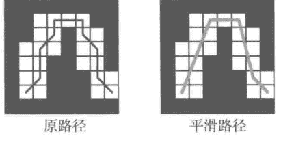

### 前置准备

在 Unity 编辑器中创建 "Wall" 标签，并打给场景中充当墙体或障碍物的所有对象。

### 实施步骤

这是一个简洁高效的平滑函数：

- 1. 定义 `Smooth` 函数入口：

```
public List<Vertex> Smooth(List<Vertex> path)
{
    // 这里是下面的代码
}
```

- 2. 判断是否有必要生成新路径（优化性能）：

```
List<Vertex> newPath = new List<Vertex>();
if (path.Count == 0)
    return newPath;
if (path.Count < 3)
    return path;
```

- 3. 实现遍历循环，逐步构建平滑后的新路径：

```
newPath.Add(path[0]);
int i, j;
for (i = 0; i < path.Count - 1;)
{
    for (j = i + 1; j < path.Count; j++)
    {
        // 这里是下面的代码
    }
    i = j - 1;
    newPath.Add(path[i]);
}
return newPath;
```

- 4. 声明并计算射线检测所需参数：

```
Vector3 origin = path[i].transform.position;
Vector3 destination = path[j].transform.position;
Vector3 direction = destination - origin;
float distance = direction.magnitude;
bool isWall = false;
direction.Normalize();
```

- 5. 从当前起点向下一路径点发射射线：

```
Ray ray = new Ray(origin, direction);
RaycastHit[] hits;
hits = Physics.RaycastAll(ray, distance);
```

- 6. 检测是否触碰墙体，若碰撞则终止本次循环：

```
foreach (RaycastHit hit in hits)
{
    string tag = hit.collider.gameObject.tag;
    if (tag.Equals("Wall"))
    {
        isWall = true;
        break;
    }
}
if (isWall)
    break;
```

### 原理解析

算法以初始节点为起点，依次向后续节点发射射线。一旦射线触碰墙体，即将“上一个未受阻的节点”加入新路径，并将其作为新的发射原点继续检测。循环往复，直到遍历完所有节点或抵达终点，最终生成一条更自然、直观的移动路径。

# 第三章 决策制定

本章将系统讲解以下核心技术：

- [ ] 决策树选择机制
- [ ] 有限状态机（FSM）实战
- [ ] 进阶 FSM：分层有限状态机（HFSM）
- [ ] 行为树构建
- [ ] 模糊逻辑应用
- [ ] 目标导向行为决策（GOAP）
- [ ] 黑板架构实现
- [ ] Unity 动画状态机实战

## 3.1 章节导读

若仅依赖基础控制流（if/else、switch）根据游戏状态制定决策，随着逻辑膨胀，维护难度将呈指数级上升。因此，我们必须掌握多样化的决策建模技术，以灵活应对各类游戏需求，构建健壮且模块化的决策系统。

本章涵盖的核心模型主要围绕“树”、“自动机”及“矩阵”三大支柱。部分章节涉及递归、继承、多态等编程范式，建议先行复习相关知识储备。

## 3.2 决策树：高效的选择架构

决策树是解决决策问题最直观、高效的机制之一。因其结构清晰、易于理解与落地，成为当前游戏 AI（乃至动画控制等领域）应用最广泛的技术方案。

### 前置准备

本节大量运用递归与继承机制（频繁定义与调用虚函数），请确保对两者原理有扎实掌握。

### 实施步骤

工程量较大，涉及多文件协作。总体流程为：先搭建基类 `DecisionTreeNode` 供派生复用，再逐步实现标准决策节点与动作节点。

- 1. 创建基类 `DecisionTreeNode`：

```
using UnityEngine;
using System.Collections;
public class DecisionTreeNode : MonoBehaviour
{
    public virtual DecisionTreeNode MakeDecision()
    {
        return null;
    }
}
```

- 2. 派生抽象类 `Decision`，继承自 `DecisionTreeNode`：

```
using UnityEngine;
using System.Collections;
public class Decision : DecisionTreeNode
{
    public Action nodeTrue;
    public Action nodeFalse;

    public virtual Action GetBranch()
    {
        return null;
    }
}
```

- 3. 定义伪抽象类 `Action`：

```
using UnityEngine;
using System.Collections;
public class Action : DecisionTreeNode
{
    public bool activated = false;

    public override DecisionTreeNode MakeDecision()
    {
        return this;
    }
}
```

- 4. 实现虚函数 `LateUpdate`：

## 3.2 决策树：核心类构建与执行流

```
public virtual void LateUpdate()
{
if (!activated)
    return;
// 在这里编写你的行为逻辑
}
```

```
using UnityEngine;
using System.Collections;
public class DecisionTree : DecisionTreeNode
{
    public DecisionTreeNode root;
    private Action actionNew;
    private Action actionOld;
}
```

```
public override DecisionTreeNode MakeDecision()
{
    return root.MakeDecision();
}
```

```
void Update()
{
    actionNew.activated = false;
    actionOld = actionNew;
    actionNew = root.MakeDecision() as Action;
    if (actionNew == null)
        actionNew = actionOld;
    actionNew.activated = true;
}
```

### 核心运作机制

决策节点掌管路由分发，通过递归调用 `MakeDecision` 向下层传递。结构上有两条铁律：分支节点仅容决策逻辑，叶子节点必须挂载具体行动；同时需严防树结构形成闭环。详见示意图 3-1。

### 举一反三

依托前文搭建的抽象基类，可派生出专属决策与行动，例如“进攻还是撤退”的布尔型抉择。下方给出自定义布尔决策的实现参考：

```
using UnityEngine;
using System.Collections;
```

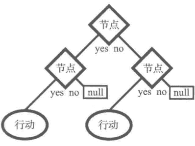

图 3-1

```
public class DecisionBool : Decision
{
    public bool valueDecision;
    public bool valueTest;

    public override Action GetBranch()
    {
        if (valueTest == valueDecision)
            return nodeTrue;
        return nodeFalse;
    }
}
```

## 3.3 有限状态机（FSM）：条件驱动的行为切换

另一项上手快、实用性强的技术是有限状态机。它扭转了上一节的思维惯性：当需求是“维持当前行为，直到特定条件满方可转换”时，FSM 是不二之选。

### 起步准备

本技术立足于自动机理论，同时也为下一节的进阶形态打地基。

### 分步实施指南

从零开始，拆解为三大核心类逐个攻克：

- 1. 搭建 Condition 判断基石：

```
public class Condition
{
    public virtual bool Test()
    {
        return false;
    }
}
```

- 2. 定义 Transition 转换桥梁：

```
public class Transition
{
    public Condition condition;
    public State target;
}
```

- 3. 定义 State 状态实体：

```
using UnityEngine;
using System.Collections.Generic;
public class State : MonoBehaviour
```

```
{
    public List<Transition> transitions;
}
```

#### 4. 编写 Awake 初始化入口：

```csharp
public virtual void Awake()
{
    transitions = new List<Transition>();
    // TO-DO
    // 在这里设置你的transitions
}
```

#### 5. 定义专用初始化流程：

```csharp
public virtual void OnEnable()
{
    // TO-DO
    // 在这里初始化状态
}
```

#### 6. 实现析构清理逻辑：

```csharp
public virtual void OnDisable()
{
    // TO-DO
    // 在这里销毁状态
}
```

#### 7. 实现 Update 驱动当前状态行为：

```csharp
public virtual void Update()
{
    // TO-DO
    // 在这里编写行为逻辑
}
```

#### 8. 实现 LateUpdate 裁决下一状态流向：

```csharp
public void LateUpdate()
{
    foreach (Transition t in transitions)
    {
        if (t.condition.Test())
        {
            t.target.enabled = true;
            this.enabled = false;
            return;
        }
    }
}
```

### 底层运行原理解析

每个状态本质是一个 `MonoBehaviour` 脚本，其启用与禁用取决于来源转换。采用 `LateUpdate` 的初衷是：保留常规编码习惯，并在此阶段精准判断“是否该触发状态迁移”。**关键提醒**：场景加载时，除初始状态外，其余状态脚本务必处于禁用态。

FSM 可视化拓扑结构见图 3-2。

### 进阶拓展案例

为演示如何继承 `Condition` 打造子类，列举两类典型场景：数值区间校验、多条件逻辑组合。

`ConditionFloat` 区间判定实现：

```csharp
using UnityEngine;
using System.Collections;

public class ConditionFloat : Condition
{
    public float valueMin;
    public float valueMax;
    public float valueTest;

    public override bool Test()
    {
        if (valueMax >= valueTest && valueTest >= valueMin)
            return true;
        return false;
    }
}
```

`ConditionAnd` 逻辑与组合实现：

```csharp
using UnityEngine;
using System.Collections;

public class ConditionAnd : Condition
{
    public Condition conditionA;
    public Condition conditionB;

    public override bool Test()
    {
        if (conditionA.Test() && conditionB.Test())
            return true;
        return false;
    }
}
```

## 3.4 进阶变体：分层有限状态机（HFSM）

通过引入层级划分，FSM 可进化为更灵活、可扩展的分层架构。核心原理不变，差别在于状态本身可嵌套内部 FSM，实现“状态套状态”。

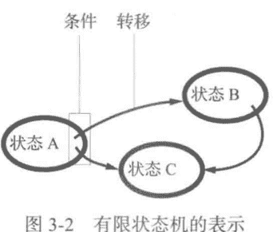

### 前置认知

本节承接 3.3 节（素材中为 3.2 节，此处按上下文衔接调整），请确保已吃透基础 FSM 运作流程。

### 逐步构建多层级状态机

目标：打造具备内部状态机器的“高阶状态”类。

- 1. 继承 State 创建 `StateHighLevel` 类：

```csharp
using UnityEngine;
using System.Collections;
using System.Collections.Generic;

public class StateHighLevel : State
{
}
```

- 2. 新增成员变量，掌控内部子状态集合：

```csharp
public List<State> states;
public State stateInitial;
protected State stateCurrent;
```

- 3. 重写初始化逻辑，级联启动子状态机：

```csharp
public override void OnEnable()
{
    if (stateCurrent == null)
        stateCurrent = stateInitial;
    stateCurrent.enabled = true;
}
```

- 4. 重写析构逻辑，递归关闭子状态机：

```csharp
public override void OnDisable()
{
    base.OnDisable();
    stateCurrent.enabled = false;
    foreach (State s in states)
    {
        s.enabled = false;
    }
}
```

### 运作机制深度解析

高阶状态启用时自动激活内部 FSM，禁用时递归关闭所有子状态。得益于父类统一的转换调度机制与状态列表管理，子状态运作逻辑无需修改即可无缝复用。

### 关联参考

详细细节可回溯 3.3 节对照研读。

## 3.5 行为树：融合决策与规划的复合体

行为树可视为 FSM、规划系统、决策树等多种 AI 技术的集大成者。虽与 FSM 外观相似，但本质差异巨大：它不再局限于状态流转，而是在树拓扑中驱动跨节点的任务执行流。

### 知识储备

实施前需掌握协程机制。

### 核心类库搭建步骤

沿用决策树思路，构建三大伪抽象基类支撑整个运行体系：

- 1. 奠定 Task 基础基类：

```csharp
using UnityEngine;
using System.Collections;
using System.Collections.Generic;

public class Task : MonoBehaviour
{
    public List<Task> children;
    protected bool result = false;
    protected bool isFinished = false;
}
```

- 2. 实现析构释放资源：

```csharp
public virtual void SetResult(bool r)
{
    result = r;
    isFinished = true;
}
```

- 3. 实现行为构建工厂方法：

```csharp
public virtual IEnumerator Run()
{
    SetResult(true);
    yield break;
}
```

- 4. 实现统一行为启动入口：

```csharp
public virtual IEnumerator RunTask()
{
    yield return StartCoroutine(Run());
}
```

- 5. 创建 ConditionBT 条件判断节点：

```csharp
using UnityEngine;
using System.Collections;

public class ConditionBT : Task
{
    public override IEnumerator Run()
    {
        isFinished = false;
        bool r = false;
        // 在这里编写你的行为逻辑
        // 不管是true还是false定义，result (r)
        //--------
        SetResult(r);
        yield break;
    }
}
```

- 6. 创建 Action 基础行动节点：

```csharp
using UnityEngine;
using System.Collections;

public class ActionBT : Task
{
    public override IEnumerator Run()
    {
        isFinished = false;
        // 在这里编写你的行为逻辑
        //----------
        return base.Run();
    }
}
```

- 7. 实现 Selector 选择器节点：

```csharp
using UnityEngine;
using System.Collections;

public class Selector : Task
{
    public override void SetResult(bool r)
    {
        if (r == true)
            isFinished = true;
    }

    public override IEnumerator RunTask()
    {
        foreach (Task t in children)
            yield return StartCoroutine(t.RunTask());
    }
}
```

- 8. 实现 Sequence 序列器节点：

```csharp
using UnityEngine;
using System.Collections;

public class Sequence : Task
{
    public override void SetResult(bool r)
    {
        if (r == true)
            isFinished = true;
    }

    public override IEnumerator RunTask()
    {
        foreach (Task t in children)
            yield return StartCoroutine(t.RunTask());
    }
}
```

### 执行流程原理剖析

行为树与决策树同构异义。叶子节点重命名为“任务”；分支节点不再单纯判断条件，而是分化为两种控制流原语：
- **Selector（选择器）**：类似逻辑 **OR**。按序执行子任务，任一返回成功即终止并向上冒泡成功。
- **Sequence（序列器）**：类似逻辑 **AND**。要求所有子任务全数成功，才向上返回成功；任一失败即中断返回失败。

### 深度阅读推荐

更系统的理论深度，建议研读 Ian Millington 经典著作《Artificial Intelligence for Games》。

## 3.6 模糊逻辑：驾驭连续决策的灰度地带

现实决策非黑即白的二值世界。当面对“转向多少度”“油门踩多深”这类连续数值决策时，模糊逻辑提供了一套处理模糊边界的数学工具箱。

### 适用场景与数据契约

假设自动驾驶场景：转向角度与车速均为连续变量。如何在平滑谱系中做出最优组合，正是模糊逻辑擅长的领域。本节预设输入为一组连续编号的离散状态集，旨在构建通用模糊决策器，输出各状态的隶属度分布。

### 核心组件构建路线图

需落地两大基类及核心决策器：

- 1. 定义 MembershipFunction 隶属函数基类：

```csharp
using UnityEngine;
using System.Collections;

public class MembershipFunction : MonoBehaviour
{
    public int stateId;
    public virtual float GetDOM(object input)
    {
        return 0f;
    }
}
```

- 2. 实现 FuzzyRule 模糊规则类：

```csharp
using System.Collections;
using System.Collections.Generic;

public class FuzzyRule
{
    public List<int> stateIds;
    public int conclusionStateId;
}
```

- 3. 创建 FuzzyDecisionMaker 模糊决策器主类：

```csharp
using UnityEngine;
using System.Collections;
using System.Collections.Generic;

public class FuzzyDecisionMaker : MonoBehaviour
{
}
```

- 4. 确立决策函数签名与核心成员变量：

# 游戏AI核心技术：从模糊决策到黑板架构全解析

## 模糊逻辑系统的落地实操

完成基础配置后，进入核心逻辑构建阶段：

```csharp
public Dictionary<int, float> MakeDecision(object[] inputs,
    MembershipFunction[][] mfList, FuzzyRule[] rules)
{
    Dictionary<int, float> inputDOM = new Dictionary<int, float>();
    Dictionary<int, float> outputDOM = new Dictionary<int, float>();
    MembershipFunction memberFunc;
    // 下面的步骤
}
```

- 5. 构建遍历机制迭代输入数值，逐个记录各状态的隶属度（DOM）：

```csharp
foreach (object input in inputs)
{
    int r, c;
    for (r = 0; r < mfList.Length; r++)
    {
        for (c = 0; c < mfList[r].Length; c++)
        {
            // 下面的步骤
        }
    }
}
// 下面的步骤
```

- 6. 编写最内层循环体，调用成员函数完成隶属度的赋值或动态更新：

```csharp
memberFunc = mfList[r][c];
int mfId = memberFunc.stateId;
float dom = memberFunc.GetDOM(input);
if (!inputDOM.ContainsKey(mfId))
{
    inputDOM.Add(mfId, dom);
    outputDOM.Add(mfId, 0f);
}
else
    inputDOM[mfId] = dom;
```

- 7. 遍历规则集，依据匹配规则确定输出端的隶属度数值：

```csharp
foreach (FuzzyRule rule in rules)
{
    int outputId = rule.conclusionStateId;
    float best = outputDOM[outputId];
    float min = 1f;
    foreach (int state in rule.stateIds)
    {
        float dom = inputDOM[state];
        if (dom < best)
            continue;
        if (dom < min)
            min = dom;
    }
    outputDOM[outputId] = min;
}
```

- 8. 汇总并返回完整的 DOM 数据集合：

```csharp
return outputDOM;
```

### 核心运作机制

系统通过装箱/拆箱机制兼容任意对象类型的输入数据。模糊化处理流程依托继承自基类的成员函数驱动。推理时，以最小 DOM 值作为规则前提的激活强度，最终输出状态的隶属度则取所有适用规则结论中的最大值。

### 实战代码范例

以判定敌人“暴怒模式”为例：当生命值（0-100区间）≤30 时触发。对应的 `MFEnraged` 类实现如下：

```csharp
using UnityEngine;
using System;
using System.Collections;

public class MFEnraged : MembershipFunction
{
    public override float GetDOM(object input)
    {
        if ((int)input <= 30)
            return 1f;
        return 0f;
    }
}
```

> **架构提示**：完整规则集要求覆盖所有输入状态的组合排列。这导致规模随变量数指数级膨胀，扩展性受限；但对于低维度、少状态的场景依然高效实用。

### 进阶参考

深入理解模糊化原理及扩展性瓶颈，推荐研读 Ian Millington 经典著作《Artificial Intelligence for Games》。

---

## 目标导向行为（GOB）：赋予 Agent “自主决策”大脑

GOB 架构的核心在于：Agent 明确“想要什么”（目标），再从规则库中自主筛选“怎么做”（行动）。区别于硬编码逻辑，它赋予了智能体感知环境、权衡利弊的拟人化特质。

**场景举例**：军队单位既要“夺旗”（战略目标），又要兼顾“血量/弹药安全线”（生存底线）。通用目标处理算法能让其动态平衡矛盾诉求，实现真正的行为自主。

### 基础建模准则

同前序章节，目标与行动均需量化建模。构建基于目标的行动选择器，需同时满足：
- 按主目标筛选行动
- 规避无效/干扰性行为
- 纳入执行时长维度评估

### 分层代码架构实现

**第一层：行动基类抽象**

```csharp
using UnityEngine;
using System.Collections;

public class ActionGOB : MonoBehaviour
{
    public virtual float GetGoalChange(GoalGOB goal)
    {
        return 0f;
    }
}
```

**第二层：目标基类 `GoalGOB` 及核心成员**

```csharp
using UnityEngine;
using System.Collections;

public class GoalGOB
{
    public string name;
    public float value;
    public float change;
}
```

**第三层：定义“不满足度”计算与时变数值处理**

```csharp
public virtual float GetDiscontentment(float newValue)
{
    return newValue * newValue;
}

public virtual float GetChange()
{
    return 0f;
}
```

**第四层：行动选择器 `ActionChooser` 核心逻辑**

```csharp
using UnityEngine;
using System.Collections;

public class ActionChooser : MonoBehaviour
{
}
```

**第五层：量化“无意识行动”惩罚机制**

```csharp
public float CalculateDiscontentment(ActionGOB action, GoalGOB[] goals)
{
    float discontentment = 0;
    foreach (GoalGOB goal in goals)
    {
        float newValue = goal.value + action.GetGoalChange(goal);
        newValue += action.GetDuration() * goal.GetChange();
        discontentment += goal.GetDiscontentment(newValue);
    }

    return discontentment;
}
```

**第六层：行动评分与筛选函数**

```csharp
public ActionGOB Choose(ActionGOB[] actions, GoalGOB[] goals)
{
    ActionGOB bestAction;
    bestAction = actions[0];
    float bestValue = CalculateDiscontentment(actions[0], goals);
    float value;
    // 下面的步骤
}
```

**第七层：引入权衡原则选出最优行动**

```csharp
foreach (ActionGOB action in actions)
{
    value = CalculateDiscontentment(action, goals);
    if (value < bestValue)
    {
        bestValue = value;
        bestAction = action;
    }
}
```

**第八层：输出最终决策结果**

```csharp
return bestAction;
```

### 决策引擎内核解析

“不满足度”函数量化目标偏离程度，结合行动耗时双重约束，有效抑制短视行为。选择器以“最小综合不满足度”为准则，实现全局最优而非局部贪婪的决策输出。

---

## 黑板架构：专家协作式决策中枢

灵感源自头脑风暴会议：多专家围绕共享黑板，读写事实、提出方案、动态争夺控制权。极适合 RTS 等复杂策略场景——建设、防守、扩张等子任务由对应专家模块承接，运行时按局势动态授权。

### 数据基础设施搭建

**1. 通用数据容器**：灵活存储异构信息

```csharp
public struct BlackboardDatum
{
    public int id;
    public string type;
    public object value;
}
```

**2. 专家基类定义**：统一行为接口规范

```csharp
public abstract class BlackboardExpert
{
    public virtual float GetInsistence(Blackboard board)
    {
        return 0f;
    }
    public virtual void Run(Blackboard board) {}
}
```

**3. 专家行动载体**：封装执行指令与参数

```csharp
public struct BlackboardAction
{
    public object expert;
    public string name;
    public System.Action action;
}
```

### 黑板核心调度循环

**1. `Blackboard` 主控类骨架**

```csharp
using System.Collections.Generic;

public class Blackboard
{
    public List<BlackboardDatum> entries;
    public List<BlackboardAction> pastActions;
    public List<BlackboardExpert> experts;
}
```

**2. 初始化构造器**

```csharp
public Blackboard()
{
    entries = new List<BlackboardDatum>();
    pastActions = new List<BlackboardAction>();
    experts = new List<BlackboardExpert>();
}
```

**3. 迭代驱动逻辑**

```csharp
public void RunIteration()
{
    // next steps
}
```

**4. 运行时上下文变量**

```csharp
BlackboardExpert bestExpert = null;
float maxInsistence = 0f;
```

**5. 专家竞选循环**：评估各专家 `GetInsistence`（坚持度/优先级），选出最高者

```csharp
foreach (BlackboardExpert e in experts)
{
    float insistence = e.GetInsistence(this);
    if (insistence > maxInsistence)
    {
        maxInsistence = insistence;
        bestExpert = e;
    }
}
```

**6. 授权执行**：选中专家调用 `Run` 落地行动

```csharp
if (bestExpert != null)
    bestExpert.Run(this);
```

### 运行范式深度剖析

预置数据结构保证系统整洁复用；主循环驱动专家竞争，类似优先级混合但服务于“问题求解”而非行为融合。**关键约束**：`GetInsistence` 返回值域须统一量纲，确保跨专家可比性。

### 工程落地指南

- **扩展点**：继承 `Expert` 重写成员函数注入业务逻辑
- **数据流向**：黑板条目由专家读写，`Run` 阶段生效
- **性能优化**：高开销 `Run` 逻辑迁移至协程异步执行
- **持久化**：将黑板实例化为全局游戏状态，跨系统复用
- **兼容性**：保留优先级算法段落，确保现有逻辑平滑迁移

---

## Unity 动画状态机：可视化与代码的双向奔赴

美术在 Animator 窗口构建状态图，程序通过 `MonoBehaviour` 驱动参数——这是主流协作模式。本节打通“代码控制行为状态 → 状态机驱动动画表现”完整链路，复用第一章基础移动行为。

### 预制工作流

Animator 窗口基础配置（状态创建、参数定义、转换连线）属美术/策划范畴，此处略过。重点攻克：**代码层如何优雅接管状态机**。

### 编辑器侧可视化配置步骤

1. `Create → Animator Controller` 生成控制器资产  
   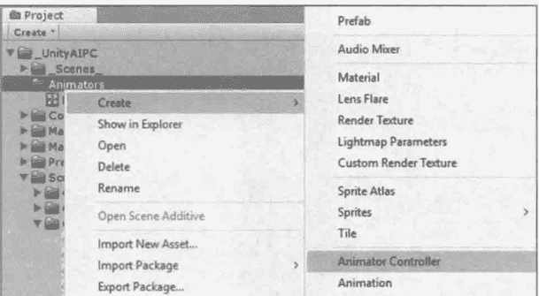  
   *图示：控制器创建入口*

2. 新建默认状态 `Wandering`（游荡）

3. 新增状态 `Pursuing`（追击）

4. 双向转换连接两状态  
   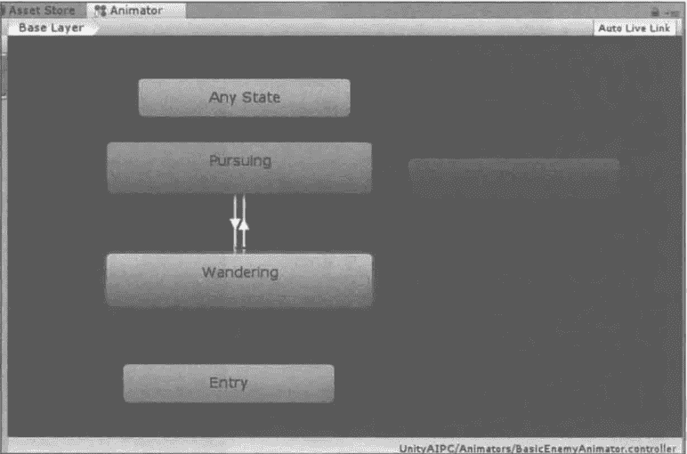  
   *图示：状态转换拓扑*

5. 定义两个 Trigger 参数：`Pursue`、`Wander`  
   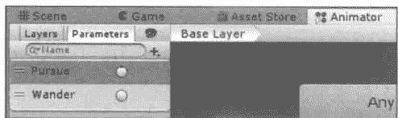  
   *图示：参数面板配置*

6. `Pursuing → Wandering` 转换绑定 `Wander` 条件  
   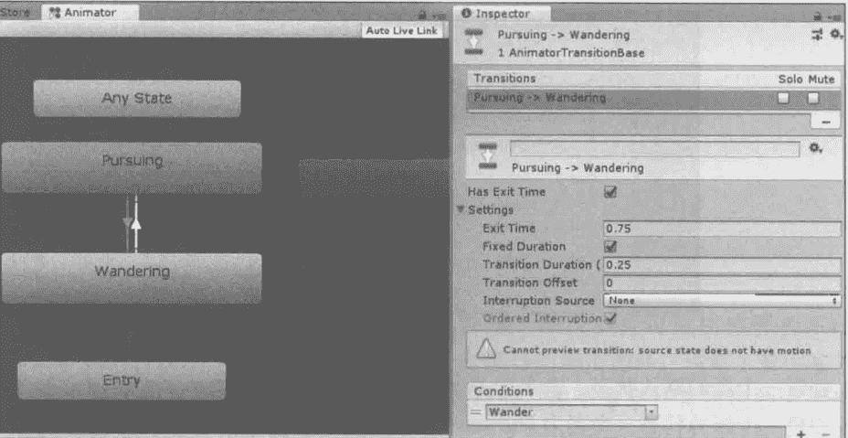  
   *图示：转换条件设置*

7. `Wandering → Pursuing` 反向绑定 `Pursue` 条件

8. `Wander` 状态挂载脚本 `AFSMWandering`  
   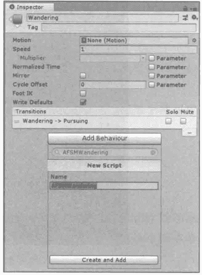  
   *图示：状态脚本绑定*

9. `Pursue` 状态挂载脚本 `AFSMPursue`

10. 场景对象 `Wanderer` 组件清单：
    - Animator
    - Agent
    - Wander（禁用）
    - Seek（禁用）  
    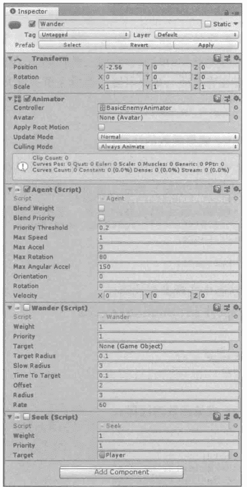  
    *图示：最终组件面板*

### 代码侧状态行为实现

**`Wander` 状态脚本 `AFSMWandering.cs`**：

1. 打开脚本文件

2. 注入必要字段  
   ```csharp
public float pursueDistance = 3f;
private Wander _wander;
private Seek _pursue;
```

3. 启用 `OnStateEnter` 回调

4. 编写入场逻辑：启用 `Wander` 组件、禁用 `Seek`、缓存 `Agent` 引用  
   ```csharp
AgentBehavior[] behaviors;
GameObject gameObject = animator.gameObject;
behaviors = gameObject.GetComponents<AgentBehavior>();
```

> **后续同理**：`AFSMPursue.cs` 在 `OnStateEnter` 中反向切换组件启用状态，`OnStateExit` 做清理。至此，代码与状态机实现**行为逻辑与动画表现的解耦共舞**。

```csharp
foreach (AgentBehavior b in behaviors)
    b.enabled = false;

_wander = gameObject.GetComponent<Wander>();
_pursue = gameObject.GetComponent<Seek>();
if (_wander == null || _pursue == null)
    return;
_wander.enabled = true;
animator.gameObject.name = "Wandering";
```

- 5. 启用 OnStateUpdate 成员函数的注释状态：

- 6. 填充逻辑代码：

```csharp
Vector3 targetPos, agentPos;
targetPos = _pursue.target.transform.position;
agentPos = animator.transform.position;
float distance = Vector3.Distance(targetPos, agentPos);
if (distance > pursueDistance)
    return;
animator.SetTrigger("Pursue");
```

随后，我们在 Pursue 状态里照猫画虎地实现同类逻辑：

- 1. 打开之前建好的脚本文件 AFSMWanderer.cs

- 2. 声明下列变量：

```csharp
public float stopDistance = 8f;
private Wander _wander;
private Seek _pursue;
```

- 3. 启用 OnStateEnter 成员函数的注释状态：

- 4. 填充逻辑代码：

```csharp
AgentBehavior[] behaviors;
GameObject gameObject = animator.gameObject;
behaviors = gameObject.GetComponents<AgentBehavior>();
foreach (AgentBehavior b in behaviors)
    b.enabled = false;

_wander = gameObject.GetComponent<Wander>();
_pursue = gameObject.GetComponent<Seek>();
if (_wander == null || _pursue == null)
    return;
_wander.enabled = true;
animator.gameObject.name = "Seeking";
```

- 5. 启用 OnStateUpdate 成员函数的注释状态：

- 6. 填充逻辑代码：

```csharp
Vector3 targetPos, agentPos;
targetPos = _pursue.target.transform.position;
agentPos = animator.transform.position;
if (Vector3.Distance(targetPos, agentPos) < stopDistance)
    return;
animator.SetTrigger("Wander");
```

### 核心原理解析

咱们的有限状态机本质上就是动画引擎的驱动核心。流程是这样的：先定义好 Agent 的状态与转换条件，接着写继承自 StateMachineBehaviour 的行为脚本，挂载到对应状态上。再通过获取游戏对象及组件引用，在各状态内编写决策逻辑。必要时触发特定 Trigger 切换状态，从而驱动 Agent 行为变化。

### 扩展阅读

借助 Unity 动画状态机，我们换来了极大的灵活性。这种模式能让我们用极少的代码，在多个 Agent 间复用行为与决策逻辑。不过，代价是失去了脚本的中心化管理。所以团队协作时得权衡利弊，切记这主要适用于原型验证阶段。

# 第 4 章

## 全新 NavMesh API 实战指南

本章将带你掌握新版 NavMesh API 的核心用法，内容涵盖：

- 初始化 NavMesh 开发组件套件

- 构建与管理适配多 Agent 类型的导航网格

- 运行时动态生成与更新 NavMesh 数据

- 掌控 NavMesh 实例的完整生命周期

- 实现多个 NavMesh 实例的互联互通

- 构建包含动态障碍物的导航网格

- 基于 NavMesh API 落地具体 AI 行为

## 4.1 章节导读

NavMesh API 及其扩展组件的推出，对 AI 与玩法程序而言无异于打开了新世界的大门。它让我们能更高效地优化关卡设计，甚至支持实时运算，且大多情况下无需额外外挂工具。接下来，我们将深入探讨如何驾驭这套运行在强大导航引擎之上的新工具集。

## 4.2 初始化 NavMesh 开发组件

动手搭建关卡前，得先从 Unity 的 GitHub 仓库拉取必要的资源包。

### 环境准备

部分读者可能已有旧版导航系统经验。熟练使用 Navigation 窗口烘焙 NavMesh、理解 NavMeshAgent 基础参数是跟上本节进度的前提。

### 实操步骤

从 GitHub 仓库获取资源：

- 1. 浏览器访问 https://github.com/Unity-Technologies/NavMesh Components。

- 2. 跳转至 Releases 页面，点击 Code 标签页，参考下图 4-1。

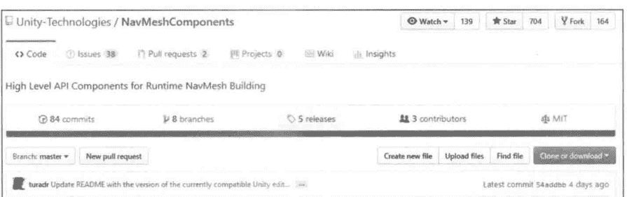

图 4-1

- 3. 下载与你当前 Unity 版本匹配的压缩包（本书撰写时基于 2018.1.0f2）。

- 4. 解压至项目代码目录**之外**的文件夹，解压产物本身也是一个 Unity 工程，见下图 4-2。

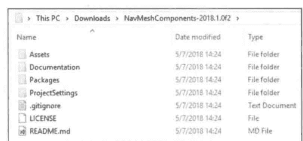

图 4-2

- 5. 打开解压后的 Assets 文件夹，如图 4-3。

- 6. 将 NavMeshComponents 文件夹复制（或剪切）到你自己项目的 Assets 目录下，如图 4-4。

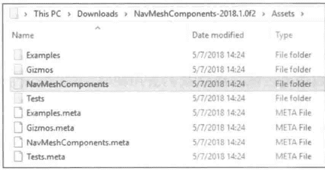

图 4-3

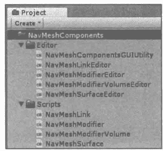

图 4-4

- 7. 触发 Unity 重新导入资源。

### 原理剖析

引入这些脚本后，自动化构建导航网格（甚至实时构建）的目标就触手可及了。我们可以直接阅读甚至修改这些脚本的底层 API 调用，以此开发出更高阶的定制化组件。

### 进阶验证

按以下步骤验证集成是否成功：

- 1. 重新导入后观察 Console 有无报错。

- 2. 新建一个空物体（或选中任意物体）做测试。

- 3. Inspector 窗口点击 Add Component。

- 4. 搜索框输入 NavMesh。

- 5. 确认下列组件均已出现（见图 4-5）：

- [ ] NavMeshAgent (内置)

- [ ] NavMeshObstacle (内置)

- [ ] NavMeshLink

- [ ] NavMeshModifier

- [ ] NavMeshModifierVolume

- [ ] NavMeshSurface

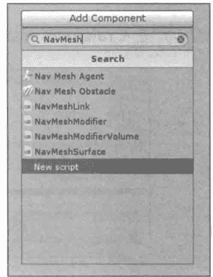

图 4-5

### 官方文档参考

关于导航系统全貌及组件详细用法，请查阅官方手册：

- [ ] https://docs.unity3d.com/Manual/Navigation.html

- [ ] https://docs.unity3d.com/Manual/NavMesh-BuildingComponents.html

## 4.3 创建与管理：面向多 Agent 类型的 NavMesh

我们常需要 Agent 在不同区域表现出差异化行为：岩浆区禁止通行、沼泽区降速、大门区需特殊判断。通过差异化区域标记，可实现禁行、变速或智能绕行。本节将实战演示如何在关卡中落地这些区域，让 Agent 能基于更复杂的导航网格做出最优决策。

### 环境准备

沼泽、浅滩、岩浆等地形放置标记都很直观。但“大门”比较特殊——需在门模型下方单独放置一个碰撞体对象（最好已有基础网格），如图 4-6 所示：

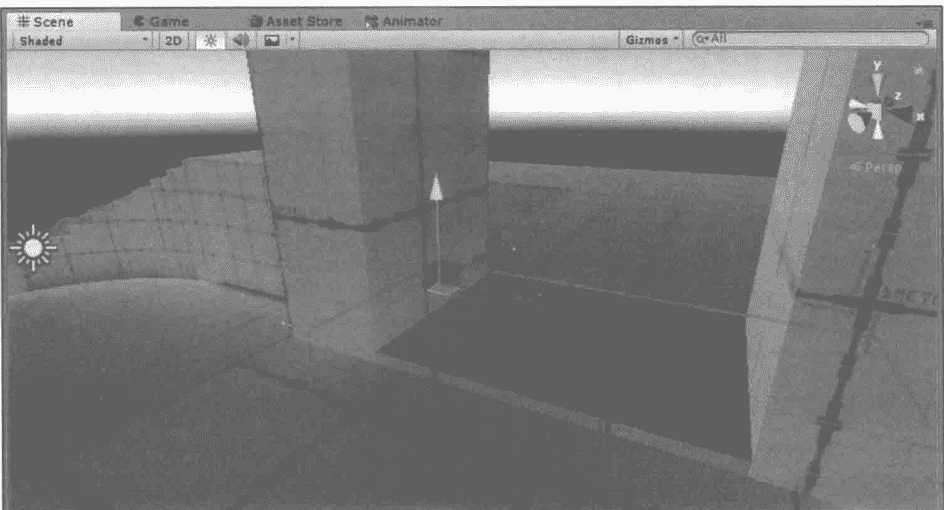

图 4-6 大门判定体位于可见门模型之下

### 实操步骤

先调整 NavMesh 烘焙前的区域设置：

- 1. 搭建场景基础区域：常规地面（可行走）、大门区、沼泽区。

- 2. 打开 Navigation 窗口：菜单栏 Window > AI > Navigation。

- 3. 切换到 Areas 选项卡。

- 4. 新建 Swamp 区域，Cost 设为 6。

- 5. 新建 Door 区域，Cost 设为 2，如图 4-7。

- 6. 选中沼泽地模型对象。

- 7. Navigation 窗口选 Object 标签。

- 8. 将 Navigation Area 改为 Swamp。

- 9. 选中大门判定对象。

- 10. Navigation 窗口选 Object 标签。

- 11. 将 Navigation Area 改为 Door。

- 12. 点击烘焙生成 NavMesh，效果见下图 4-8。

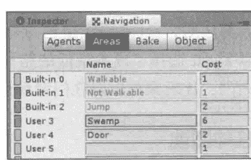

接着配置 Agent 侧的区域通行策略：

- 1. 场景中拖入 Agent 对象。

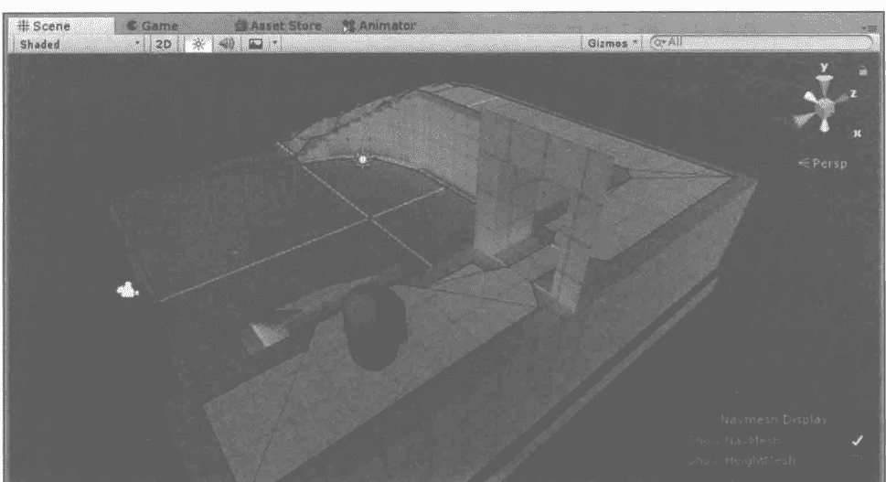

图 4-8 烘焙生成的 NavMesh 示意

- 2. 挂载 NavMeshAgent 组件。

- 3. 打开 Inspector 面板。

- 4. 勾选 Agent 可到达的区域。此处**取消勾选 Door**，禁止穿门，如图 4-9。

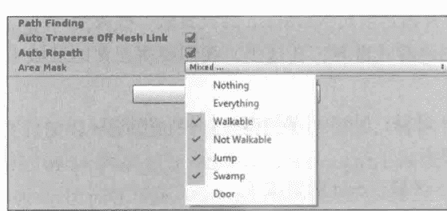

图 4-9 NavMeshAgent 配置：屏蔽 Door 区域实现“关门躲避”

### 原理剖析

如前所述，导航网格按设定被切分为不同区域。寻路算法（Unity 实现的 A*）运行时，Agent 会综合考量各区域的权重，自动寻找总代价最低的路径，且仅在允许的区域_mask_内搜索。这就是为何取消 Door 勾选后，玩家能躲在门后让 AI “找不到路”的原因。

### 进阶技巧

还可以利用当前区域信息动态调整 Agent 表现（如入沼泽减速）。需用到 NavMeshAgent 组件的 SamplePathPosition 接口获取脚下区域类型。

## 4.4 运行时动态创建与更新 NavMesh 数据

随着程序化关卡生成（PCG）的普及，导航数据必须能随地形实时刷新。非脚本化的动态关卡销毁/重建场景同理适用。

### 环境准备

同前：将 NavMeshComponents 目录导入项目。

此外，需将 NavMeshSurface 组件挂载到所有作为导航网格构建根节点的父对象上。

### 实操步骤

新建一个名为 NavMeshBuilder 的组件脚本：

- 1. 新建脚本文件 NavMeshBuilder.cs：

```
using UnityEngine;
using UnityEngine.AI;
using System.Collections;
using System.Collections.Generic;

public class NavMeshBuilder : MonoBehaviour
{
    // Next steps
}
```

- 2. 定义成员变量，用于缓存导航表面引用：

```
public NavMeshSurface[] surfaces;
```

- 3. 实现单帧立即构建所有 NavMesh 的方法：

```
public void Build()
{
    for (int i = 0; i < surfaces.Length; i++)
    {
        surfaces[i].BuildNavMesh();
    }
}
```

- 4. 实现分帧协程构建所有 NavMesh 的方法：

```
public IEnumerator BuildInFrames(System.Action eventHandler)
{
    for (int i = 0; i < surfaces.Length; i++)
    {
        surfaces[i].BuildNavMesh();
        yield return null;
    }
    if (eventHandler != null)
        eventHandler.Invoke();
}
```

### 原理剖析

导入组件包后，我们可通过 NavMeshSurface 组件操作网格与导航表面，利用其 Up 向量判定可行走区域。

分帧构建方法中，引入协程机制规避复杂表面一次性计算导致的卡顿；构建完成后，通过委托事件通知外部系统。

## 4.5 掌控 NavMesh 实例生命周期

有时拓扑结构运行时才确定（如程序化生成大世界），全图烘焙开销太大。Unity 的 NavMesh 组件支持“按需构建”——仅在 Agent 周围动态维护小范围 NavMesh。本节揭秘这一核心技巧。

### 环境准备

照例导入 NavMeshComponents 目录。

### 实操步骤

- 1. 搭建关卡几何体，确保地面/地形带有 Agent 寻路所需的 Collider。

- 2. 创建 Agent 对象，挂载：Capsule/BoxCollider、Rigidbody、NavMeshAgent。

- 3. 编写 NMRealTimeBuilder 类：

```
using UnityEngine;
using UnityEngine.AI;
using System.Collections;
using System.Collections.Generic;
using NavMeshBuilder = UnityEngine.AI.NavMeshBuilder;

public class NMRealTimeBuilder : MonoBehaviour
{
    // next steps
}
```

- 4. 声明所需成员变量：

```
public Transform agent;
public Vector3 boxSize = new Vector3(50f, 20f, 50f);
[Range(0.01f, 1f)]
public float sizeChange = 0.1f;
private NavMeshData navMesh;
private AsyncOperation operation;
private NavMeshDataInstance navMeshInstance;
private List<NavMeshBuildSource> sources = new List<NavMeshBuildSource>();
```

- 5. 实现静态方法，用于对比两个 Bounds 立方体：

```
static private Vector3 Quantize(Vector3 a, Vector3 q)
{
    float x = q.x * Mathf.Floor(a.x/q.x);
    float y = q.y * Mathf.Floor(a.y/q.y);
    float z = q.z * Mathf.Floor(a.z/q.z);
    return new Vector3(x, y, z);
}
```

- 6. 实现内部调用上述对比方法的成员函数：

```
private Bounds QuantizeBounds()
{
    Vector3 position = agent.transform.position;
    return new Bounds(Quantize(position, boxSize * sizeChange), boxSize);
}
```

- 7. 定义核心方法：更新 Agent 周围局部 NavMesh：

```
private void UpdateNavMesh(bool isAsync = false)
{
    // next step
}
```

- 8. 完成上述核心方法的具体实现：

```
NavMeshSourceTag.Collect(ref sources);
NavMeshBuildSettings settings;
settings = NavMesh.GetSettingsByID(0);
Bounds bounds = QuantizeBounds();
if (isAsync)
    operation = NavMeshBuilder.UpdateNavMeshDataAsync(navMesh, settings, sources, bounds);
else
    NavMeshBuilder.UpdateNavMeshData(navMesh, settings, sources, bounds);
```

- 9. 编写 Awake 成员方法：

```
private void Awake()
{
    if (agent == null)
        agent = transform;
}
```

- 10. 编写 OnEnable 成员方法：

```
private void OnEnable()
{
    navMesh = new NavMeshData();
    navMeshInstance = NavMesh.AddNavMeshData(navMesh);
    UpdateNavMesh(false);
}
```

- 11. 编写 OnDisable 成员方法：

```
private void OnDisable()
{
    navMeshInstance.Remove();
}
```

### 核心运作机制

我们借助 NavMesh 组件的强大功能，封装出一个更轻量级的组件，用于在游戏对象周围构建定制化的导航网格。

脚本会实时获取 Agent 周围的区域范围，并对比前后两帧范围大小的变化幅度。一旦变化超过 `sizeChange` 设定的百分比阈值，`NavMeshBuilder` 便会采用新坐标，清除旧网格并重新生成。

得益于此机制，即便面对未知的拓扑结构，同类型 Agent 也能正常导航。同时，由于采用 `Vector3` 类型的 `size` 变量来界定范围，计算开销得以大幅降低。

### 进阶补充

`NMRealTimeBuilder` 组件既可挂载在核心 Agent 对象上，也可挂载至其他物体，这正是我们必须实现 `Awake` 函数的原因。

此外，通过获取目标朝向，可指引 Agent 朝着导航网格最远端的方向移动。

## 4.6 互联多个 NavMesh 实例

我们已掌握 NavMesh 构建方法，但面对极其复杂的关卡，往往需将其拆分为多个部分——或是受限于缺陷，或是因代码动态加载场景。

### 前置条件

场景中需存在至少一个挂载了 `NavMeshSurface` 组件的对象。

### 实操流程

核心任务是建立两个 `NavMeshSurface` 组件之间的连接。

- 1. 通过编辑器或脚本，定位需连接的两个 `NavMeshSurface`。
- 2. 在基础对象上添加 `NavMeshLink` 组件。
- 3. 指定可使用该链接的 Agent 类型。
- 4. 配置 `Start Point` 与 `End Point` 数值。
- 5. 针对每个需连接的 Agent 类型重复上述步骤。

### 原理解析

可将单个 `NavMeshSurface` 视为图结构中的大型节点。`NavMeshLink` 的作用即是在两节点间添加边。值得注意的是，起止点的坐标基于对象本地空间，因此它们能随父对象一同移动、旋转。

### 进阶补充

过渡过程常伴随特殊动作（如播放动画）。假设存在架子到地面的单向连接，我们需判断触发时机以播放动画。

一种实现路径：在 `NavMeshAgent` 中禁用 `Auto Traverse Off-Mesh Links`，播放动画、执行物理模拟，而后按既定逻辑继续。

## 4.7 构建含动态障碍物的动态 NavMesh

实际开发中，关卡常包含动态障碍，Agent 必须绕行。以 MMORPG 或 MOBA 为例，跟随英雄的小兵也需避障寻径。我们既可编写复杂算法融合避障技术，亦可利用动态 NavMesh 特性，在几乎不动代码的前提下达成同等效果。

本节将演示如何让 NavMesh 具备动态响应移动障碍的能力，助 Agent 成功规避障碍抵达终点。

### 前置条件

熟悉 NavMesh 基础原理及构建流程。

### 实操流程

- 1. 准备关卡场景。
- 2. 创建名为 NavMesh 的游戏对象。
- 3. 为其添加 `NavMeshSurface` 组件。
- 4. 点击 Bake 生成初始网格。
- 5. 选中所有障碍物体。
- 6. 为障碍添加 `NavMeshObstacle` 组件。
- 7. 勾选组件的 `Carve`（挖空）选项。
- 8. 勾选动态障碍选项。
- 9. 取消勾选 `Carve Only Stationary`（仅静止时挖空）。
- 10. 利用组件其余参数微调障碍表现。

### 原理解析

初始网格烘焙后，系统会扫描场景内所有障碍，在其周围挖空区域以精修可视导航区。同时，导航系统会持续追踪动态障碍变化（因取消了“仅静止挖空”），按需重算导航区域。

### 进阶补充

上述流程性能一般，主要适用于拓扑未定的场景（如程序化生成关卡）。虽示例用的是固定关卡，但大部分步骤可通过预制体与代码复用至程序化生成流程。

若关卡布局确定且追求性能，可在 `NavMeshObstacle` 中关闭 `Carve`，改用 `NavMeshAgent` 的避障参数调优。

亦可采取混合策略：实时筛选关键障碍进行挖空，其余交由避障系统处理，在性能与体验间寻得平衡。

### 更多参考

动态导航网格详情请参考 Unity 官方教程：https://unity3d.com/learn/tutorials/topics/navigation/making-it-dynamic

## 4.8 利用 NavMesh API 实现特定行为

第 1 章介绍了 Agent 多种移动模式。本节将换用 NavMesh API 与 `NavMeshAgent` 组件复现这些移动，助你以更高效、清晰、地道的 Unity 方式快速原型化行为。

我们将以巡逻行为为例，拓展对“基础流程外快速实现行为原型”的理解。

### 前置条件

掌握 NavMesh 核心概念，熟悉 `NavMeshAgent` 组件的构建与操作。

### 实操流程

我们将编写一个巡逻行为组件，配合 `NavMeshAgent` 使用。

#### 1. 新建脚本 `NMPatrol.cs`，引用 `NavMeshAgent` 组件。

```csharp
using UnityEngine;
using UnityEngine.AI;

[RequireComponent (typeof (NavMeshAgent))]
public class NMPatrol : MonoBehaviour
{
    // next steps
}
```

#### 2. 声明必要的成员变量：

```csharp
public float pointDistance = 0.5f;
public Transform[] patrolPoints;
private int currentPoint = 0;
private NavMeshAgent agent;
```

#### 3. 编写函数，查找数组中距离最近的巡逻点：

```csharp
private int FindClosestPoint ()
{
    // next step
}
```

#### 4. 添加所需内部变量：

```csharp
int index = -1;
float distance = Mathf.Infinity;
int i;
Vector3 agentPosition = transform.position;
Vector3 pointPosition;
```

#### 5. 实现查找最近点的循环逻辑：

```csharp
for (i = 0; i < patrolPoints.Length; i++)
{
    pointPosition = patrolPoints[i].position;
    float d = Vector3.Distance(agentPosition, pointPosition);
    if (d < distance)
    {
        index = i;
        distance = d;
    }
}
return index;
```

#### 6. 实现更新 Agent 目标点的函数：

```csharp
private void GoToPoint(int next)
{
    if (next < 0 || next >= patrolPoints.Length)
        return;
    agent.destination = patrolPoints[next].position;
}
```

#### 7. 实现 `Start` 函数完成初始化：

```csharp
private void Start()
{
    agent = GetComponent<NavMeshAgent>();
    agent.autoBraking = false;
    currentPoint = FindClosestPoint();
    GoToPoint(currentPoint);
}
```

#### 8. 实现 `Update` 函数驱动逻辑：

```csharp
private void Update()
{
    if (!agent.pathPending && agent.remainingDistance <
    pointDistance)
    GoToPoint((currentPoint + 1) % patrolPoints.Length);
}
```

### 原理解析

该巡逻组件依赖导航 Agent 控制器。流程为：首先计算离 Agent 最近的点位并移动过去；接着在循环中依据 `pointDistance` 判定下一目标；最后利用取模运算获取下一巡逻点索引，仅需维护索引自增即可，无需冗余校验。

### 进阶补充

巡逻点在数组中的顺序决定运行表现。可进一步抽离“决定下一巡逻点”的函数，便于后续按游戏需求扩展行为：

```csharp
private int CalculateNextPoint()
{
    return (currentPoint + 1) % patrolPoints.Length;
}
```

```csharp
private void Update()
{
    if (!agent.pathPending && agent.remainingDistance < pointDistance)
    GoToPoint(CalculateNextPoint());
}
```

# 第 5 章 协作与战术

本章聚焦协作与战术制定技术，涵盖：

- 队形管理
- 扩展 A* 算法用于协作：A* 伏击
- 手动选择器添加路径点
- 基于高度因子分析路径点
- 基于掩体与可见性因子分析路径点
- 路径点自动化生成
- 罗列路径点辅助决策
- 实现势力图
- 用淹没图优化势力图
- 用卷积滤波器优化势力图
- 构建战斗循环

## 5.1 章节导读

本章不拘泥于单一主题，而是融合前序技术，衍生出新方法或改进方案。

我们将探索如何将离散 Agent 整合为有机整体（如队形），以及基于图结构（路径点）与势力图制定战略的技术。这些手段大量复用了第 2 章的图构建与寻路算法精髓。

## 5.2 队形管理

这是构建群体/军队 Agent 的核心算法，设计目标为极致的队形灵活性。

最终产出：队形内每个 Agent 拥有一组目标位置与旋转值。后续可自行决定用何种算法驱动 Agent 移动至目标点（可沿用第 1 章的移动算法）。

### 前置条件

需先建立 3 个基类，作为上层逻辑与算法的数据支撑。
`Location` 类类似 `Steering`，基于队形锚点与旋转定义目标点位与朝向。
`SlotAssignment` 类映射列表索引与 Agent 数据类型。
`Character` 类作为组件保存目标 `Location`。

`Location` 类代码如下：

```csharp
using UnityEngine;
using System.Collections;

public class Location
{
    public Vector3 position;
    public Quaternion rotation;

    public Location ()
    {
        position = Vector3.zero;
        rotation = Quaternion.identity;
    }

    public Location(Vector3 position, Quaternion rotation)
    {
        this.position = position;
        this.rotation = rotation;
    }
}
```

`SlotAssignment` 类代码如下：

```csharp
using UnityEngine;
using System.Collections;

public class SlotAssignment
{
    public int slotIndex;
    public GameObject character;

    public SlotAssignment ()
    {
        slotIndex = -1;
        character = null;
    }
}
```

`Character` 类代码如下：

```csharp
using UnityEngine;
using System.Collections;

public class Character : MonoBehaviour
{
    public Location location;

    public void SetTarget (Location location)
    {
        this.location = location;
    }
}
```

### 实操流程

需实现两个类：`FormationPattern` 与 `FormationManager`：

#### 1. 创建 `FormationPattern` 伪抽象基类：

```csharp
using UnityEngine;
using System.Collections;
using System.Collections.Generic;

public class FormationPattern : MonoBehaviour
{
    public int numOfSlots;
    public GameObject leader;
}
```

#### 2. 实现 `Start` 函数：

```csharp
void Start()
{
    if (leader == null)
        leader = transform.gameObject;
}
```

#### 3. 定义函数，按槽位索引获取槽位坐标：

```csharp
public virtual Vector3 GetSlotLocation(int slotIndex)
{
    return Vector3.zero;
}
```

#### 4. 定义函数，判断槽位数量是否受当前队形支持：

```csharp
public bool SupportsSlots(int slotCount)
{
    return slotCount <= numOfSlots;
}
```

#### 5. 若有必要，实现函数为位置施加偏移量：

```csharp
public virtual Location GetDriftOffset(List<SlotAssignment> slotAssignments)
{
    Location location = new Location();
    location.position = leader.transform.position;
    location.rotation = leader.transform.rotation;
    return location;
}
```

#### 6. 创建队形管理类：

```csharp
using UnityEngine;
using System.Collections;
using System.Collections.Generic;

public class FormationManager : MonoBehaviour
{
    public FormationPattern pattern;
    private List<SlotAssignment> slotAssignments;
    private Location driftOffset;
}
```

#### 7. 编写 Awake 方法：

```csharp
void Awake()
{
    slotAssignments = new List<SlotAssignment>();
}
```

#### 8. 定义方法，依据列表序列刷新槽位分配：

```csharp
public void UpdateSlotAssignments()
{
    for (int i = 0; i < slotAssignments.Count; i++)
    {
        slotAssignments[i].slotIndex = i;
    }
    driftOffset = pattern.GetDriftOffset(slotAssignments);
}
```

#### 9. 实现方法，用于向队形中加入角色：

```csharp
public bool AddCharacter(GameObject character)
{
    int occupiedSlots = slotAssignments.Count;
    if (!pattern.SupportsSlots(occupiedSlots + 1))
        return false;

    SlotAssignment sa = new SlotAssignment();
    sa.character = character;
    slotAssignments.Add(sa);
    UpdateSlotAssignments();
    return true;
}
```

#### 10. 实现方法，用于从队形中移除角色：

```csharp
public void RemoveCharacter(GameObject agent)
{
    int index = slotAssignments.FindIndex(x =>
    x.character.Equals(agent));
    slotAssignments.RemoveAt(index);
    UpdateSlotAssignments();
}
```

#### 11. 编写更新槽位的方法：

```csharp
public void UpdateSlots()
{
    GameObject leader = pattern.leader;
    Vector3 anchor = leader.transform.position;
    Vector3 slotPos;
    Quaternion rotation;
    rotation = leader.transform.rotation;
    foreach (SlotAssignment sa in slotAssignments)
    {
    // 这里是下面的步骤
    }
}
```

#### 12. 实现 foreach 循环逻辑：

```csharp
Vector3 relPos;
slotPos = pattern.GetSlotLocation(sa.slotIndex);
relPos = anchor;
relPos += leader.transform.TransformDirection(slotPos);
Location charDrift = new Location(relPos, rotation);
Character character = sa.character.GetComponent<Character>();
character.SetTarget(charDrift);
```

### 核心运作机制

`FormationPattern` 类封装了槽位的相对坐标数据。以 `CircleFormation` 子类为例，它依据槽位数量及在 360 度圆周上的分布实现了 `GetSlotLocation` 方法。由于 `FormationPattern` 设计为基类，`FormationManager` 在上层引入了一层管理机制，负责权限控制与队形整理。这种分层架构使得设计者只需专注于继承基类编写具体的队形逻辑脚本。

如前所述，`FormationManager` 负责统筹上层级结构，依据队列需求与权限规整站位。其计算基准源于队长的位姿（位置与旋转），并结合具体队形模式的规则进行坐标转换。

### 补充说明

值得注意的是，`FormationManager` 与 `FormationPattern` 同属于一个 GameObject 的组件。当 Manager 中的 `leader` 字段为 null 时，默认该对象自身为队长。此设计允许指定外部 Leader 对象，从而在 Inspector 面板与代码模块中保持结构清晰。

### 参考延伸

相关理论基础可查阅：

- 第 1 章
- Ian Millington 著《Artificial Intelligence for Games》

---

## 5.3 拓展 A* 算法实现协作伏击：A* Ambush

掌握 A* 寻路算法实现后，我们将利用其高效性与灵活性，开发协作伏击行为以包围玩家。当需要以低成本解决上述问题且追求易于落地时，该算法极具优势。

本节旨在为每个 Agent 规划路径，使其在图结构中占据伏击顶点或关键点位。

### 前期准备

我们将创建一个专用组件 `Lurker`，用于存储后续导航所需的路径数据。

`Lurker` 类代码如下：

```csharp
using UnityEngine;
using System.Collections;
using System.Collections.Generic;

public class Lurker : MonoBehaviour
{
    [HideInInspector]
    public List<int> pathIds;
    [HideInInspector]
    public List<GameObject> pathObjs;

    void Awake ()
    {
        if (pathIds == null)
            pathIds = new List<int> ();
        if (pathObjs == null)
            pathObjs = new List<GameObject> ();
    }
}
```

### 实施步骤

我们需要构建主入口函数以批量设定 Agent 伏击路径，以及针对单个 Agent 配置路径的辅助函数。

#### 1. 定义伏击主控函数：

```csharp
public void SetPathAmbush (GameObject dstObj, List<Lurker> lurkers)
{
    Vertex dst = GetNearestVertex (dstObj.transform.position);
    foreach (Lurker l in lurkers)
    {
```

```csharp
Vertex src = GetNearestVertex(l.transform.position);
l.path = AStarMbush(src, dst, l, lurkers);
}
}
```

- 2. 声明用于检索各条路径的函数：

```csharp
public List<Vertex> AStarMbush(
    Vertex src,
    Vertex dst,
    Lurker agent,
    List<Lurker> lurkers,
    Heuristic h = null)
{    // next steps
}
```

- 3. 声明必要字段，处理计算过程中的额外开销：

```csharp
int graphSize = vertices.Count;
float[] extra = new float[graphSize];
float[] costs = new float[graphSize];
int i;
```

- 4. 初始化变量，分别存储基础开销与额外开销：

```csharp
for (i = 0; i < graphSize; i++)
{
    extra[i] = 1f;
    costs[i] = Mathf.Infinity;
}
```

- 5. 向其他 Agent 路径包含的各顶点累加额外开销：

```csharp
foreach (Lurker l in lurkers)
{
    foreach (Vertex v in l.path)
    {
        extra[v.id] += 1f;
    }
}
```

- 6. 声明并初始化用于承接 A* 运算结果的变量：

```csharp
Edge[] successors;
int[] previous = new int[graphSize];
for (i = 0; i < graphSize; i++)
    previous[i] = -1;
previous[src.id] = src.id;
float cost = 0;
Edge node = new Edge(src, 0);
GPWiki.BinaryHeap<Edge> frontier = new GPWiki.BinaryHeap<Edge>();
```

- 7. 启动 A* 算法核心循环：

```csharp
frontier.Add(node);
while (frontier.Count != 0)
{
    if (frontier.Count == 0)
```

```csharp
return new List<GameObject>();
// 下面的步骤
}
return new List<Vertex>();
```

- 8. 校验是否已抵达目标；若未到达则无需计算开销，亦不宜继续沿用常规 A* 逻辑：

```csharp
node = frontier.Remove();
if (ReferenceEquals(node.vertex, dst))
return BuildPath(src.id, node.vertex.id, ref previous);
int nodeId = node.vertex.id;
if (node.cost > costs[nodeId])
continue;
```

- 9. 遍历邻接边并判定访问状态：

```csharp
successors = GetEdges(node.vertex);
foreach (Edge e in successors)
{
int eId = e.vertex.id;
if (previous[eId] != -1)
continue;
// 下面的步骤
}
```

- 10. 若未访问，则加入前沿集合：

```csharp
cost = e.cost;
cost += costs[dst.id];
cost += h(e.vertex, dst);
if (cost < costs[e.vertex.id])
{
Edge child;
child = new Edge(e.vertex, cost);
costs[eId] = cost;
previous[eId] = nodeId;
frontier.Remove(e);
frontier.Add(child);
}
```

### 算法解析

A* Ambush 算法会分析各 Agent 的路径并提升沿途节点的权重开销。如此一来，当 Agent 运行 A* 寻路时，倾向于规避他已占用的路径，从而在目标区域形成最优分布点位。

### 优化拓展

该算法可进化为多样化的 P-A*mbush。只需按距离远近对最优节点列表排序，即可在几乎零额外开销下获得更优结果。因排序仅执行一次，利用优先队列极易实现，随后将有序列表接入主算法流程，无需修改核心逻辑。

---

## 5.4 基于高度评估路径点

本节依据路径点空间位置对其进行评价。策略层面上，低处往往处于劣势。我们将实现一个灵活算法，结合路径点周边地形高度计算其质量分值。

### 前期准备

本节逻辑独立，无需预备额外知识。算法设计可灵活接收点位列表（来源可以是路径点的邻接节点，也可以是路径点构成的全连通图）。针对周边高度的启发式计算留待具体游戏设计中定制。

### 实施步骤

实现一个函数，综合自身高度与周边点位评估目标位置质量：

- 1. 声明计算质量值的函数签名：

```csharp
public static float GetHeightQuality (Vector3 location, Vector3[] surroundings)
{
    // 下面的步骤
}
```

- 2. 初始化参与运算的中间变量：

```csharp
float maxQuality = 1f;
float minQuality = -1f;
float minHeight = Mathf.Infinity;
float maxHeight = Mathf.NegativeInfinity;
float height = location.y;
```

- 3. 遍历周边点位，获取最大与最小高度：

```csharp
foreach (Vector3 s in surroundings)
{
    if (s.y > maxHeight)
        maxHeight = s.y;
    if (s.y < minHeight)
        minHeight = s.y;
}
```

- 4. 依据给定区间计算质量分值：

```csharp
float quality = (height-minHeight) / (maxHeight - minHeight);
quality *= (maxQuality - minQuality);
quality += minQuality;
return quality;
```

### 原理解析

算法遍历邻近点位集合以获取极值高度，进而将位置价值映射至 -1 至 1 区间。该区间可按游戏设计调整，亦可在公式中反转高度权重的重要性。

---

## 5.5 结合掩护性与可见性评估路径点

针对军事题材、尤其是 FPS 游戏，我们需要量化路径点价值：理想点位应兼具最佳掩体与最大视野，便于射击或侦察敌情。本节提供基于这两维度的计算方法。

### 前期准备

首先创建工具函数，判定两个位置点是否处于同一空间区域内：

```csharp
public bool IsInSameRoom(Vector3 from, Vector3 location, string tagWall = "Wall")
{
    RaycastHit[] hits;
    Vector3 direction = location - from;
    float rayLength = direction.magnitude;
    direction.Normalize();
    Ray ray = new Ray(from, direction);
    hits = Physics.RaycastAll(ray, rayLength);
    foreach (RaycastHit h in hits)
    {
        string tagObj = h.collider.gameObject.tag;
        if (tagObj.Equals(tagWall))
            return false;
    }
    return true;
}
```

### 实施步骤

构建计算路径点质量的核心函数：

- 1. 确定函数签名及参数列表：

```csharp
public static float GetCoverQuality(
    Vector3 location,
    int iterations,
    Vector3 characterSize,
    float radius,
    float randomRadius,
    float deltaAngle)
{
    // 下面的步骤
}
```

- 2. 初始化变量，分别记录旋转角度、潜在受击风险与有效可见度：

```csharp
float theta = 0f;
int hits = 0;
int valid = 0;
```

- 3. 启动主循环，迭代计算该路径点并输出最终值：

```csharp
for (int i = 0; i < iterations; i++)
{
    // 下面的步骤
}
return (float)(hits / valid);
```

- 4. 在路径点原点周围生成随机位置，测试该点可达性：

```csharp
Vector3 from = location;
float randomBinomial = Random.Range(-1f, 1f);
from.x += radius * Mathf.Cos(theta) + randomBinomial *
randomRadius;
from.y += Random.value * 2f * randomRadius;
from.z += radius * Mathf.Sin(theta) + randomBinomial *
randomRadius;
```

- 5. 检测随机位置是否落在同一空间区域内：

```csharp
if (!IsInSameRoom(from, location))
    continue;
valid++;
```

- 6. 计算路径点周边的位置点，从而确定模板角色的尺寸：

```csharp
Vector3 to = location;
to.x += Random.Range(-1f, 1f) * characterSize.x;
to.y += Random.value * characterSize.y;
to.z += Random.Range(-1f, 1f) * characterSize.z;
```

- 7. 向可见性数值发射一条射线，以判定此类角色是否处于可见状态：

```csharp
Vector3 direction = to - location;
float distance = direction.magnitude;
direction.Normalize();
Ray ray = new Ray(location, direction);
if (Physics.Raycast(ray, distance))
    hits++;
theta = Mathf.Deg2Rad * deltaAngle;
```

### 核心运作机制

我们构建了一套迭代逻辑，随即在路径点四周散布随机采样点，用以验证其可达性与可命中性。随后，算出一个系数来量化质量值。

## 5.6 路径点的自动化生成

大多数情况下，路径点需在关卡编辑器中手工标记；但若地图是程序化生成的，则必须引入自动化方案。

本节将介绍一种名为“凝结”的技术来应对这一挑战：让路径点依据赋予的权重相互博弈，最终权重高（关联性强）的节点胜出。

### 前置知识

涉及静态成员函数的处理，需明确静态函数的含义与调用方式。

### 实施步骤

我们将构建 `Waypoint` 类，并补充用于执行路径点凝结的方法：

- 1. 定义 `Waypoint` 类，使其继承自 `MonoBehaviour` 并实现 `IComparer` 接口：

```csharp
using UnityEngine;
using System.Collections;
using System.Collections.Generic;

public class Waypoint : MonoBehaviour, IComparer
{
    public float value;
    public List<Waypoint> neighbours;
}
```

- 2. 完成接口中 `Compare` 方法的具体实现：

```csharp
public int Compare(object a, object b)
{
    Waypoint wa = (Waypoint)a;
    Waypoint wb = (Waypoint)b;
    if (wa.value == wb.value)
        return 0;
    if (wa.value < wb.value)
        return -1;
    return 1;
}
```

- 3. 编写静态方法，用于检测智能体能否在两个路径点间通行：

```csharp
public static bool CanMove(Waypoint a, Waypoint b)
{
    // implement your own behaviour for
    // deciding whether an agent can move
    // easily between two waypoints
    return true;
}
```

- 4. 声明凝结路径点的核心函数：

```csharp
public static void CondenseWaypoints(List<Waypoint> waypoints,
    float distanceWeight)
{
    // next steps
}
```

- 5. 初始化相关变量，并对路径点集合执行降序排列：

```csharp
distanceWeight *= distanceWeight;
```

- 6. 启动主循环，逐个处理各路径点：

```csharp
foreach (Waypoint current in waypoints)
{
// next steps
}
```

- 7. 获取当前点的邻接节点，排序后开启循环，使其相互竞争：

```csharp
neighbours = new List<Waypoint>(current.neighbours);
neighbours.Sort();
foreach (Waypoint target in neighbours)
{
if (target.value > current.value)
break;
if (!CanMove(current, target))
continue;
// next steps
}
```

- 8. 计算目标坐标位置：

```csharp
Vector3 deltaPos = current.transform.position;
deltaPos -= target.transform.position;
deltaPos = Vector3.Cross(deltaPos, deltaPos);
deltaPos *= distanceWeight;
```

- 9. 评估目标的综合数值，以此裁决是否保留：

```csharp
float deltaVal = current.value - target.value;
deltaVal *= deltaVal;
if (deltaVal < distanceWeight)
{
neighbours.Remove(target);
waypoints.Remove(target);
}
```

### 原理解析

我们将 `Waypoint` 组件挂载至图中每个节点（或每个具备路径点潜质的节点，因凝结算法能优化性能）。

路径点按关联度排序（如狙击高度、有利地形等），继而通过凝结机制筛选出冗余的邻接点。最终，权重较低的节点会被自然淘汰，仅保留核心计算结果。

### 进阶拓展

当前实现中价值变量过于单一，实战中可引入多个模糊逻辑值来综合判定路径点相关性。

此时宜采用单一综合评分整合所有指标，或在 `Compare` 实现中引入更优的启发式算法，确保排序结果符合预期。

### 相关参考

更多路径点评估详情，请查阅：

- 第 5.3 节

- 第 5.4 节

## 5.7 将路径点接入决策系统

正如第 3 章所述，单纯评估单个路径点数值难以应对复杂场景。解决之道是复用决策技术：为节点挂载条件判定逻辑，从而实现动态评估。例如，利用决策树构建更复杂的启发式算法来计算节点价值。

### 前置准备

正式开始前，建议复习第 3 章关于状态机实现的内容。

### 实施步骤

对 `Waypoint` 类进行微调扩展：

- 1. 追加成员变量以承载条件数据：

```csharp
public Condition condition;
```

- 2. 指定具体使用的条件类型（如 `ConditionFloat` 类）：

```csharp
condition = new ConditionFloat();
```

### 原理解析

前文提到的伪抽象基类 `Condition` 拥有 `Test` 方法，可直接用于校验条件是否成立。

### 补充参考

决策制定与条件系统的详细信息，请参考第 3 章。

## 5.8 构建势力图

图结构的另一重要应用是量化势力范围——即某阵营或单体单位实际控制的地图区域。这是打造高阶 AI 决策的关键基建，势力图基于即时战略游戏中的军事存在感模拟，或任何需精确掌握团体领土占比的游戏类型。每一层势力图对应一个阵营。

### 前置准备

本节依赖图结构开发经验，基于通用 `Graph` 类实现。你需准备具体的图定义（任选其一），或自行实现顶点与邻接点的检索逻辑（参考第 2 章）。

我们将基于 `Graph` 通用函数与 `Vertex` 类实现专用算法，同时需要基础的 Unity 组件代表 Agent 与 `Faction` 枚举。

以下代码定义 `Faction` 枚举与 `Unit` 类，可置于同一文件 `Unit.cs` 中：

```
using UnityEngine;
using System.Collections;

public enum Faction
{
    // example values
    BLUE, RED
}

public class Unit : MonoBehaviour
{
    public Faction faction;
    public int radius = 1;
    public float influence = 1f;

    public virtual float GetDropOff(int locationDistance)
    {
        return influence;
    }
}
```

### 实施步骤

我们将构建 `VertexInfluence` 与 `InfluenceMap` 两大核心类，分别处理顶点逻辑与整图逻辑：

- 1. 创建继承自 `Vertex` 的 `VertexInfluence` 类：

```
using UnityEngine;
using System.Collections;
using System.Collections.Generic;
public class VertexInfluence : Vertex
{
    public Faction faction;
    public float value = 0f;
}
```

- 2. 实现初始化函数（成功返回 true，失败返回 false）：

```
public bool SetValue(Faction f, float v)
{
    bool isUpdated = false;
    if (v > value)
    {
        value = v;
        faction = f;
        isUpdated = true;
    }
    return isUpdated;
}
```

- 3. 创建继承自 `Graph`（或更具体子类）的 `InfluenceMap` 类：

```
using UnityEngine;
using System.Collections.Generic;

public class InfluenceMap : Graph
{
    public List<Unit> unitList;
    // 作用于常规图中的顶点
    GameObject[] locations;
}
```

- 4. 定义 `Awake` 方法完成初始化配置：

```
void Awake()
{
    if (unitList == null)
        unitList = new List<Unit>();
}
```

- 5. 实现向地图注册单位的函数：

```
public void AddUnit(Unit u)
{
    if (unitList.Contains(u))
        return;
    unitList.Add(u);
}
```

- 6. 实现从地图移除单位的函数：

```
public void RemoveUnit(Unit u)
{
    unitList.Remove(u);
}
```

- 7. 开始编写势力计算的核心逻辑：

```
public void ComputeInfluenceSimple()
{
    VertexInfluence v;
    float dropOff;
    List<Vertex> pending = new List<Vertex>();
    List<Vertex> visited = new List<Vertex>();
    List<Vertex> frontier;
    Vertex[] neighbours;
}

// 下面的步骤
```

- 8. 构建循环遍历单位列表：

```
foreach(Unit u in unitList)
{
    Vector3 uPos = u.transform.position;
    Vertex vert = GetNearestVertex(uPos);
    pending.Add(vert);
}

// 下面的步骤
```

- 9. 基于 BFS 算法编写代码，按半径扩散势力值：

```
// BFS用于指定势力
for (int i = 1; i <= u.radius; i++)
{
    frontier = new List<Vertex>();
    foreach (Vertex p in pending)
    {
        if (visited.Contains(p))
        continue;
        visited.Add(p);
        v = p as VertexInfluence;
        dropOff = u.GetDropOff(i);
        v.SetValue(u.faction, dropOff);
        neighbours = GetNeighbours(vert);
        frontier.AddRange(neighbours);
    }
    pending = new List<Vertex>(frontier);
}
```

### 原理解析

势力图本质上沿用通用图原理，仅在顶点上增加两个映射参数。核心在于势力计算，该过程基于 BFS 算法驱动。

对地图上每个单位，按其影响半径向外扩散势力。当计算出的势力值超过顶点原有阵营值时，该顶点归属发生转换。

### 进阶拓展

根据游戏需求，衰减函数可进一步优化。可参考下述示例，利用 `locationDistance` 参数定义更智能的衰减曲线：

```
public virtual float GetDropOff(int locationDistance)
{
    float d = influence / radius * locationDistance;
    return influence - d;
}
```

注意 `locationDistance` 为整型，表示顶点间的跳数距离。

此外，可弃用阵营概念，改用单位实例引用直接映射势力，从而实现单个体级别的势力图；但团队/阵营粒度在大多数场景下更具实用性。

### 其他参考

- 第 2 章

## 5.9 以淹没算法修补势力图漏洞

基础势力计算在“单单位即一阵营”的简易模型下运作良好，但易导致地图出现未被覆盖的“空洞”。引入基于 Dijkstra 算法的“淹没”技术可有效填补此缺陷。

### 前置准备

本节将两大概念封装进 `Guild` 类：一是标记顶点被特定势力占领，二是单位的势力衰减函数。`Guild` 类需挂载至各阵营的游戏对象上：

```
using UnityEngine;
using System;
using System.Collections;

public class Guild : MonoBehaviour
{
    public string guildName;
    public int maxStrength;
    public GameObject baseObject;
    [HideInInspector]
    public int strength;

    public virtual void Awake()
    {
        strength = maxStrength;
    }
}
```

还需一个计算势力范围的函数，此处演示基于欧几里得距离的版本：

```
public virtual float GetDropOff(float distance)
{
    float d = Mathf.Pow(1 + distance, 2f);
    return strength / d;
}
```

最后，定义 `GuildRecord` 结构体作为 Dijkstra 算法中的节点载体：

- 1. 创建实现 `IComparable` 接口的 `GuildRecord` 结构体：

```
using UnityEngine;
using System.Collections;
using System;

public struct GuildRecord : IComparable<GuildRecord>
{
    public Vertex location;
    public float strength;
    public Guild guild;
}
```

- 2. 实现 `Equal` 比较方法：

```
public override bool Equals(object obj)
{
    GuildRecord other = (GuildRecord)obj;
    return location == other.location;
}

public bool Equals(GuildRecord o)
{
    return location == o.location;
}
```

- 3. 实现 `IComparable` 要求的比较方法：

```
public override int GetHashCode()
{
    return base.GetHashCode();
}

public int CompareTo(GuildRecord other)
{
    if (location == other.location)
        return 0;
    // 这里的减法是反向的，用于
    // 实现一个递减的二叉堆
    return (int)(other.strength - strength);
}
```

### 实施流程

接下来，我们只需调整部分文件并补充几个核心函数即可：

- 1. 将 Guild 成员变量迁移至 VertexInfluence 类内部：

```
public Guild guild;
```

- 2. 在 InfluenceMap 类中引入新的成员变量：

```
public float dropOffThreshold;
private Guild[] guildList;
```

- 3. 此外，还需在 InfluenceMap 类的 Awake 方法里插入以下代码段：

```
guildList = gameObject.GetComponents<Guild>();
```

- 4. 构建淹没图生成函数：

```
public List<GuildRecord> ComputeMapFlooding()
{
}
```

- 5. 定义最核心的变量：

```
GPWiki.BinaryHeap<GuildRecord> open;
open = new GPWiki.BinaryHeap<GuildRecord>();
List<GuildRecord> closed;
closed = new List<GuildRecord>();
```

- 6. 为优先队列中的每个阵营（Guild）注入初始节点：

```
foreach (Guild g in guildList)
{
    GuildRecord gr = new GuildRecord();
    gr.location = GetNearestVertex(g.baseObject);
    gr.guild = g;
    gr.strength = g.GetDropOff(0f);
    open.Add(gr);
}
```

- 7. 编写 Dijkstra 算法的主迭代逻辑并输出结果：

```
while (open.Count != 0)
{
    // 下面步骤的代码放在这里
}
return closed;
```

- 8. 从队列取出首个节点，并获取其相邻节点集合：

```
GuildRecord current;
current = open.Remove();
GameObject currObj;
currObj = GetVertexObj(current.location);
Vector3 currPos;
currPos = currObj.transform.position;
List<int> neighbours;
neighbours = GetNeighbors(current.location);
```

- 9. 建立遍历邻接节点的循环结构，并将当前节点录入最近列表：

```
foreach (int n in neighbours)
{
    // 下面步骤放在这里
}
closed.Add(current);
```

- 10. 基于当前顶点计算势力数值，并判断是否满足阵营切换条件：

```
GameObject nObj = GetVertexObj(n);
Vector3 nPos = nObj.transform.position;
float dist = Vector3.Distance(currPos, nPos);
float strength = current.guild.GetDropOff(dist);
if (strength < dropOffThreshold)
    continue;
```

- 11. 利用当前顶点数据实例化一个辅助用的 GuildRecord 节点：

```
GuildRecord neighGR = new GuildRecord();
neighGR.location = n;
neighGR.strength = strength;
VertexInfluence vi;
vi = nObj.GetComponent<VertexInfluence>();
neighGR.guild = vi.guild;
```

- 12. 若无法赋予新值，则校验最近阵营列表并比对名称：

```
if (closed.Contains(neighGR))
{
    int location = neighGR.location;
    int index = closed.FindIndex(x => x.location == location);
    GuildRecord gr = closed[index];
    if (gr.guild.name != current.guild.name
        && gr.strength < strength)
        continue;
}
```

- 13. 同理，对优先队列执行检查操作：

```
else if (open.Contains(neighGR))
{
    bool mustContinue = false;
    foreach (GuildRecord gr in open)
    {
        if (gr.Equals(neighGR))
        {
            mustContinue = true;
            break;
        }
    }
    if (mustContinue)
        continue;
}
```

- 14. 当上述尝试均告失败时，新建 GuildRecord 并将其压入优先队列：

```
else
{
    neighGR = new GuildRecord();
    neighGR.location = n;
}
neighGR.guild = current.guild;
neighGR.strength = strength;
```

- 15. 视情况将 GuildRecord 加入优先队列：

```
open.Add(neighGR);
```

### 核心逻辑解析

算法以阵营坐标点为起点，向外扫描整张图。依据先前的反向衰减运算机制，优先队列总会优先展开势力值最强的节点，直至数值衰减至 `dropOffThreshold` 阈值以下才终止计算。

当顶点数值超越当前驻军强度，或归属阵营与目标一致时，算法会尝试在不满足常规条件的情况下，通过特定策略规避分配新阵营。

### 扩展参考

- 参考 5.7 节
- 参考 2.6 节

## 5.10 利用卷积滤波器优化势力图

卷积滤波器虽常见于图像处理领域，但其核心原理同样适用于根据单位及周邻数值动态调整网格势力。本节将深入剖析如何借助矩阵滤波算法重塑网格势力分布。

### 前置准备

动手实现前，请确保已透彻掌握势力图的基础概念，以明确该技术的适用边界。

### 实施步骤

落实 `Convolve` 函数：

- 1. 声明 `Convolve` 函数签名：

```
public static void Convolve(
	float[,] matrix,
	ref float[,] source,
	ref float[,] destination)
{
	// 下面步骤中的代码
}
```

- 2. 初始化变量，服务于后续的数值运算与数组遍历：

```
int matrixLength = matrix.GetLength(0);
int size = (int)(matrixLength - 1) / 2;
int height = source.GetLength(0);
int width = source.GetLength(1);
int I, j, k, m;
```

- 3. 构建首层循环，同步遍历目标网格与源网格：

```csharp
for (i = 0; i < width - size; i++)
{
    for (j = 0; j < height - size; j++)
    {
        // 此处填充后续步骤代码
    }
}
```

#### 4. 实现次层循环，用于遍历滤波器矩阵内核：

```
destination[i, j] = 0f;
for (k = 0; k < matrixLength; k++)
{
    for (m = 0; m < matrixLength; m++)
    {
        int row = i + k - size;
        int col = j + m - size;
        float aux = source[row, col] * matrix[k, m];
        destination[i, j] += aux;
    }
}
```

### 原理解析

在各采样点完成矩阵滤波运算后，将生成的新网格与原始网格互换。随即遍历每个新生成的位置点（作为目标网格），提取原始网格对应数值并施加矩阵滤波运算得出新值。

**关键约束**：滤波器矩阵必须为奇数阶方阵，这是算法产出预期结果的前提条件。

### 进阶拓展

下述 `ConvolveDriver` 函数封装了对 `Convolve` 的调度逻辑，便于批量迭代处理：

- 1. 声明 `ConvolveDriver` 函数：

```
public static void ConvolveDriver(
    float[,] matrix,
    ref float[,] source,
    ref float[,] destination,
    int iterations)
{
    // 下面步骤中的代码
}
```

- 2. 设立辅助变量缓存网格数据：

```
float[,] map1;
float[,] map2;
int i;
```

- 3. 执行地图变量交换，无需关心迭代次数的奇偶性：

```
if (iterations % 2 == 0)
{
    map1 = source;
    map2 = destination;
}
else
{
    destination = source;
    map1 = destination;
    map2 = source;
}
```

- 4. 在迭代与交换流程中调用前述 `Convolve` 函数：

```
for (i = 0; i < iterations; i++)
{
    Convolve(matrix, ref source, ref destination);
    float[,] aux = map1;
    map1 = map2;
    map2 = aux;
}
```

### 扩展参考

- 参考 4.7 节

## 5.11 搭建战斗循环系统

本系统参考《阿玛拉王国：惩罚》的“功夫循环”算法设计，旨在为敌人 AI 提供一种智能的靠近玩家并发动攻击的决策框架。虽与编队系统同源，但本方案引入**舞台管理器**——依据敌人权重与攻击权重动态裁决攻击方式与攻击许可。该管理器支持统筹多组战斗循环，专项适配多人游戏场景。

### 前置准备

编写核心算法前，需先构建配套组件。首先是抽象基类 `Attack`，它统一定义敌人通用攻击模板，便于派生自定义攻击逻辑；其次是 `Enemy` 类，承载敌人行为逻辑与请求队列，内部持有一组不同的 `Attack` 组件实例。

`Attack` 类参考实现：

```
using UnityEngine;
using System.Collections;

public class Attack : MonoBehaviour
{
    public int weight;

    public virtual IEnumerator Execute()
    {
        // 攻击行为的代码放在这里
        yield break;
    }
}
```

#### `Enemy` 组件构建指南：

#### 1. 定义 `Enemy` 类架构：

```
using UnityEngine;
using System.Collections;

public class Enemy : MonoBehaviour
{
    public StageManager stageManager;
    public int slotWeight;
    [HideInInspector]
    public int circleId = -1;
    [HideInInspector]
    public bool isAssigned;
    [HideInInspector]
    public bool isAttacking;
    [HideInInspector]
    public Attack[] attackList;
}
```

#### 2. 实现 `Start` 初始化逻辑：

```
void Start()
{
    attackList = gameObject.GetComponents<Attack>();
}
```

#### 3. 实现目标战斗循环分配函数：

```
public void SetCircle(GameObject circleObj = null)
{
    int id = -1;
    if (circleObj == null)
    {
        Vector3 position = transform.position;
        id = stageManager.GetClosestCircle(position);
    }
    else
    {
        FightingCircle fc;
        fc = circleObj.GetComponent<FightingCircle>();
        if (fc != null)
            id = fc.gameObject.GetInstanceID();
    }
    circleId = id;
}
```

#### 4. 定义向管理器申请攻击槽位的函数：

```
public bool RequestSlot()
{
    isAssigned = stageManager.GrantSlot(circleId, this);
    return isAssigned;
}
```

#### 5. 定义向管理器释放攻击槽位的函数：

```
public void ReleaseSlot()
{
    stageManager.ReleaseSlot(circleId, this);
    isAssigned = false;
    circleId = -1;
}
```

#### 6. 实现按顺序（与 Inspector 面板一致）从列表请求攻击的函数：

```
public bool RequestAttack(int id)
{
    return stageManager.GrantAttack(circleId, attackList[id]);
}
```

#### 7. 定义驱动攻击行为的虚函数接口：

```
public virtual IEnumerator Attack()
{
    // TODO
    // 攻击行为的代码放在这里
    yield break;
}
```

### 核心实施步骤

现着手编写 `FightingCircle` 与 `StageManager` 两大核心类：

- 1. 创建 `FightingCircle` 类及其成员字段：

```
using UnityEngine;
using System.Collections;
using System.Collections.Generic;

public class FightingCircle : MonoBehaviour
{
    public int slotCapacity;
    public int attackCapacity;
    public float attackRadius;
    public GameObject player;
    [HideInInspector]
    public int slotsAvailable;
    [HideInInspector]
    public int attackAvailable;
    [HideInInspector]
    public List<GameObject> enemyList;
    [HideInInspector]
    public Dictionary<int, Vector3> posDict;
}
```

#### 2. 实现 `Awake` 初始化函数：

```
void Awake()
{
    slotsAvailable = slotCapacity;
    attackAvailable = attackCapacity;
    enemyList = new List<GameObject>();
    posDict = new Dictionary<int, Vector3>();
    if (player == null)
        player = gameObject;
}
```

#### 3. 定义 `Update` 函数，实现槽位位置的动态刷新：

```
void Update()
{
    if (enemyList.Count == 0)
        return;
    Vector3 anchor = player.transform.position;
    int i;
    for (i = 0; i < enemyList.Count; i++)
    {
        Vector3 position = anchor;
        Vector3 slotPos = GetSlotLocation(i);
        int enemyId = enemyList[i].GetInstanceID();
        position += player.transform.TransformDirection(slotPos);
        posDict[enemyId] = position;
    }
}
```

#### 4. 构建函数，将敌人接入战斗循环：

```
public bool AddEnemy(GameObject enemyObj)
{
    Enemy enemy = enemyObj.GetComponent<Enemy>();
    int enemyId = enemyObj.GetInstanceID();
    if (slotsAvailable < enemy.slotWeight)
        return false;
    enemyList.Add(enemyObj);
    posDict.Add(enemyId, Vector3.zero);
    slotsAvailable -= enemy.slotWeight;
    return true;
}
```

#### 5. 构建函数，将敌人从战斗循环移除：

```
public bool RemoveEnemy(GameObject enemyObj)
{
    bool isRemoved = enemyList.Remove(enemyObj);
    if (isRemoved)
    {
        int enemyId = enemyObj.GetInstanceID();
        posDict.Remove(enemyId);
        Enemy enemy = enemyObj.GetComponent<Enemy>();
        slotsAvailable += enemy.slotWeight;
    }
    return isRemoved;
}
```

#### 6. 编写函数，实现战斗循环内敌人位置互换：

```
public void SwapEnemies(GameObject enemyObjA, GameObject enemyObjB)
{
    int indexA = enemyList.IndexOf(enemyObjA);
    int indexB = enemyList.IndexOf(enemyObjB);
    if (indexA != -1 && indexB != -1)
    {
        enemyList[indexB] = enemyObjA;
        enemyList[indexA] = enemyObjB;
    }
}
```

#### 7. 定义函数，依据战斗循环推算敌人空间坐标：

```
public Vector3? GetPositions(GameObject enemyObj)
{
    int enemyId = enemyObj.GetInstanceID();
    if (!posDict.ContainsKey(enemyId))
        return null;
    return posDict[enemyId];
}
```

#### 8. 实现函数，计算槽位空间坐标：

```
private Vector3 GetSlotLocation(int slot)
{
    Vector3 location = new Vector3();
    float degrees = 360f / enemyList.Count;
    degrees *= (float)slot;
    location.x = Mathf.Cos(Mathf.Deg2Rad * degrees);
    location.x *= attackRadius;
    location.z = Mathf.Cos(Mathf.Deg2Rad * degrees);
    location.z *= attackRadius;
    return location;
}
```

#### 9. 编写函数，虚拟向战斗循环注入攻击：

```
public bool AddAttack(int weight)
{
    if (attackAvailable - weight < 0)
        return false;
    attackAvailable -= weight;
    return true;
}
```

#### 10. 定义函数，虚拟从战斗循环解除攻击：

```
public void ResetAttack()
{
    attackAvailable = attackCapacity;
}
```

#### 11. 构建 StageManager 类：

```
using UnityEngine;
using System.Collections;
using System.Collections.Generic;

public class StageManager : MonoBehaviour
{
    public List<FightingCircle> circleList;
    private Dictionary<int, FightingCircle> circleDic;
    private Dictionary<int, List<Attack>> attackRqsts;
}
```

#### 12. 实现 Awake 初始化函数：

```
void Awake()
{
    circleList = new List<FightingCircle>();
    circleDic = new Dictionary<int, FightingCircle>();
    attackRqsts = new Dictionary<int, List<Attack>>();
    foreach (FightingCircle fc in circleList)
    {
        AddCircle(fc);
    }
}
```

#### 13. 创建函数，将战斗循环注册至管理器：

```
public void AddCircle(FightingCircle circle)
{
    if (!circleList.Contains(circle))
    {
        return;
    }
    circleList.Add(circle);
    int objId = circle.gameObject.GetInstanceID();
    circleDic.Add(objId, circle);
    attackRqsts.Add(objId, new List<Attack>());
}
```

#### 14. 补充函数，用于从管理器注销战斗循环：

```
public void RemoveCircle(FightingCircle circle)
{
    bool isRemoved = circleList.Remove(circle);
    if (!isRemoved)
    {
        return;
    }
    int objId = circle.gameObject.GetInstanceID();
    circleDic.Remove(objId);
    attackRqsts[objId].Clear();
    attackRqsts.Remove(objId);
}
```

#### 15. 定义函数，根据指定坐标查找最近战斗循环：

```
public int GetClosestCircle(Vector3 position)
{
    FightingCircle circle = null;
    float minDist = Mathf.Infinity;
    foreach (FightingCircle c in circleList)
    {
        Vector3 circlePos = c.transform.position;
        float dist = Vector3.Distance(position, circlePos);
```

```csharp
if (dist < minDist)
{
    minDist = dist;
    circle = c;
}
}
return circle.gameObject.GetInstanceID();
```

#### 16. 定义函数，在战斗循环内为敌人指派槽位：

```csharp
public bool GrantSlot(int circleId, Enemy enemy)
{
    return circleDic[circleId].AddEnemy(enemy.gameObject);
}
```

#### 17. 实现函数，依据战斗循环 ID 释放特定敌人：

```csharp
public void ReleaseSlot(int circleId, Enemy enemy)
{
    circleDic[circleId].RemoveEnemy(enemy.gameObject);
}
```

#### 18. 定义函数，分配攻击权限并录入管理器：

```csharp
public bool GrantAttack(int circleId, Attack attack)
{
    bool answer = circleDic[circleId].AddAttack(attack.weight);
    attackRqsts[circleId].Add(attack);
    return answer;
}
```

#### 19. 实现函数，执行队列中全部攻击：

```csharp
public IEnumerator ExecuteAttacks()
{
    foreach (int circle in attackRqsts.Keys)
    {
        List<Attack> attacks = attackRqsts[circle];
        foreach (Attack a in attacks)
            yield return a.Execute();
    }
    foreach (FightingCircle fc in circleList)
        fc.ResetAttack();
}
```

### 核心运作机制

`Attack` 与 `Enemy` 类在必要时可直接驱动行为，使 `Enemy` 能被游戏对象上其他组件调用。`FightingCircle` 职能近似 `FormationPattern`，均负责计算敌人目标坐标，但实现逻辑有别。最终由 `StageManager` 统筹权限分发，负责各战斗循环的敌人编入、移出及攻击槽位的分配与回收。

### 进阶补充

值得注意的是，战斗循环可作为组件挂载至游戏对象，该对象既可以是玩家本体，也可以是持有玩家引用的空物体。

此外，攻击分配与执行逻辑亦可下沉至战斗循环内部。之所以集中在管理器层执行，是为了统一调度攻击流程，让战斗循环专注于目标定位，类似队形系统的职责分离。

### 参考资料

更多详情请查阅：

- 第 4.1 节内容

- 关于 Kung-Fu 算法的深度解析，请参考 Steve Rabin 编著的《Game AI Pro》


# Agent 感知

本章将探讨多种模拟感官与智能体感知的算法实践：

- 借助碰撞体系的视觉模拟
- 借助碰撞体系的听觉模拟
- 借助碰撞体系的嗅觉模拟
- 基于图结构的视觉模拟
- 基于图结构的听觉模拟
- 基于图结构的嗅觉模拟
- 潜行游戏感知系统的搭建

## 6.1 简介

本章将讲解如何用不同技术路线模拟智能体的感官刺激，重点对比碰撞器与图论两种构建感知模拟器的实现路径。

首先介绍利用射线检测、碰撞器及绑定的 `MonoBehaviour` 回调（如 `OnCollisionEnter`）感知三维空间邻近物体的方法；接着演示如何用图论算法复刻同类感官效果，实现世界的抽象表达；最后结合前文算法，讲解混合模式下的智能体感知落地。

## 6.2 基于碰撞体系的视觉模拟

这是模拟视觉最直观的方案：利用一个碰撞体（网格体或 Unity 基础体）作为探测工具，判定目标是否进入智能体视野范围。

### 前置准备

本节及本章其他碰撞器类算法要求：将碰撞器组件挂载至同一游戏对象。建议采用棱锥形碰撞体模拟视锥，面数越少运行时开销越低。

### 实施步骤

构建可感知周围敌人的视觉组件：

- 1. 创建 `Visor` 组件，声明成员变量，并在 Unity 标签设置中添加对应 Tag：

```csharp
using UnityEngine;
using System.Collections;

public class Visor : MonoBehaviour
{
    public string tagWall = "Wall";
    public string tagTarget = "Enemy";
    public GameObject agent;
}
```

- 2. 组件挂载生效后，实现游戏对象初始化逻辑：

```csharp
void Start()
{
    if (agent == null)
    agent = gameObject;
}
```

- 3. 声明逐帧碰撞检测方法：

```csharp
public void OnTriggerStay(Collider coll)
{
    // 这里是下面的步骤
}
```

- 4. 过滤非目标碰撞体：

```csharp
string tag = coll.gameObject.tag;
if (!tag.Equals(tagTarget))
    return;
```

- 5. 获取对象坐标，计算前向朝向向量：

```csharp
GameObject target = coll.gameObject;
Vector3 agentPos = agent.transform.position;
Vector3 targetPos = target.transform.position;
Vector3 direction = targetPos - agentPos;
```

- 6. 计算射程长度，构建待发射的射线束：

```csharp
float length = direction.magnitude;
direction.Normalize();
Ray ray = new Ray(agentPos, direction);
```

- 7. 发射射线并收集所有命中物体：

```csharp
RaycastHit[] hits;
hits = Physics.RaycastAll(ray, length);
```

- 8. 扫描射线与目标间的阻挡物，若无阻隔则触发后续行为或回调：

```csharp
int i;
for (i = 0; i < hits.Length; i++)
{
    GameObject hitObj;
    hitObj = hits[i].collider.gameObject;
    tag = hitObj.tag;
    if (tag.Equals(tagWall))
    return;
}
// TODO
// 目标可见
// 下面是你的行为的代码
```

### 原理解析

图 6-1 演示了双阶段视觉系统的工作流程。

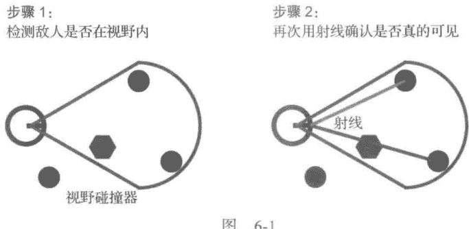

碰撞器组件每帧自动扫描场景内碰撞事件。借助 Unity 场景查询优化，开发者仅需聚焦有效碰撞的后续处理。

首轮筛选后，若目标进入视野碰撞体，即发射射线进行二次确认，判定视线是否被墙体遮挡，从而确认真实可见性。

## 6.3 基于碰撞体系的听觉模拟

本节通过构建「声源发射器」与「声源接收器」双实体，实现听觉模拟。

该方案源自 Millington 的听觉系统设计思想，利用 Unity 碰撞器检测发射器范围内的接收器单位。

### 前置准备

同其他碰撞器方案：被检测对象需挂载碰撞器；发射器或接收器其中一方需额外挂载刚体组件以触发物理事件。

### 实施步骤

分别创建智能体使用的 `SoundReceiver` 类，以及警报等装置使用的 `SoundEmitter` 类：

- 1. 定义声音接收器对象的类结构：

```csharp
using UnityEngine;
using System.Collections;

public class Visor : MonoBehaviour
{
    public string tagWall = "Wall";
    public string tagTarget = "Enemy";
    public GameObject agent;
}
```

```csharp
using UnityEngine;
using System.Collections;

public class SoundReceiver : MonoBehaviour
{
    public float soundThreshold;
}
```

- 2. 编写处理声音接收逻辑的函数：

```csharp
public virtual void Receive(float intensity, Vector3 position)
{
    // TODO
    // 行为的代码放在这里
}
```

- 3. 构建声音发射器对应的类结构：

```csharp
using UnityEngine;
using System.Collections;
using System.Collections.Generic;

public class SoundEmitter : MonoBehaviour
{
    public float soundIntensity;
    public float soundAttenuation;
    public GameObject emitterObject;
    private Dictionary<int, SoundReceiver> receiverDic;
}
```

- 4. 预先初始化周围接收器与发射器的列表，防止组件未赋值即挂载到对象时出错：

```csharp
void Start()
{
    receiverDic = new Dictionary<int, SoundReceiver>();
    if (emitterObject == null)
        emitterObject = gameObject;
}
```

- 5. 完成接收器进入发射器范围时，自动将其加入列表的函数逻辑：

```csharp
public void OnTriggerEnter(Collider coll)
{
    SoundReceiver receiver;
    receiver = coll.gameObject.GetComponent<SoundReceiver>();
    if (receiver == null)
    return;
    int objId = coll.gameObject.GetInstanceID();
    receiverDic.Add(objId, receiver);
}
```

- 6. 编写接收器离开发射器范围时，从列表移除对应项的函数：

```csharp
public void OnTriggerExit(Collider coll)
{
    SoundReceiver receiver;
    receiver = coll.gameObject.GetComponent<SoundReceiver>();
    if (receiver == null)
    return;
    int objId = coll.gameObject.GetInstanceID();
    receiverDic.Remove(objId);
}
```

- 7. 设定向周围 Agent 广播声波的函数：

```csharp
public void Emit()
{
    GameObject srObj;
    Vector3 srPos;
    float intensity;
    float distance;
    Vector3 emitterPos = emitterObject.transform.position;
    // 这里是下面步骤的代码
}
```

- 8. 依据距离计算各接收器处的声音衰减数值：

```csharp
foreach (SoundReceiver sr in receiverDic.Values)
{
    srObj = sr.gameObject;
    srPos = srObj.transform.position;
    distance = Vector3.Distance(srPos, emitterPos);
    intensity = soundIntensity;
    intensity -= soundAttenuation * distance;
    if (intensity < sr.soundThreshold)
    continue;
    sr.Receive(intensity, emitterPos);
}
```

### 核心运作机制

图 6-2 揭示了声音模拟系统联动碰撞器的运作机制。碰撞触发器负责记录分配给发射器的 Agent 列表。发声函数依据 Agent 与发射器的距离，应用声波衰减规则降低音量强度。

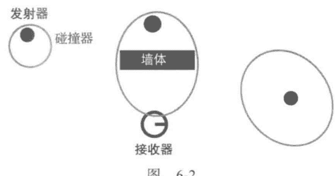

图 6-2

### 进阶拓展：引入墙体阻隔

我们可以设计更灵活的算法，引入不同墙体类型来干预声音强度。核心思路是发射射线检测，将墙体材质的衰减系数叠加到总声衰减中。

- 1. 首先，建立字典存储墙体标签及其对应衰减系数：

```csharp
public Dictionary<string, float> wallTypes;
```

- 2. 采用以下方式削减声音能量：

```csharp
intensity -= GetWallAttenuation(emitterPos, srPos);
```

- 3. 实现上一步骤中调用的具体函数：

```csharp
public float GetWallAttenuation(Vector3 emitterPos, Vector3 receiverPos)
{
    // 这里是下面步骤的代码
}
```

- 4. 计算射线投射所需的参数：

```csharp
float attenuation = 0f;
Vector3 direction = receiverPos - emitterPos;
float distance = direction.magnitude;
direction.Normalize();
```

- 5. 发射射线并捕获碰撞物体：

```csharp
Ray ray = new Ray(emitterPos, direction);
RaycastHit[] hits = Physics.RaycastAll(ray, distance);
```

- 6. 遍历射线检测到的墙体标签，累加字典中记录的衰减数值：

```csharp
int i;
for (i = 0; i < hits.Length; i++)
{
    GameObject obj;
    string tag;
    obj = hits[i].collider.gameObject;
    tag = obj.tag;
    if (wallTypes.ContainsKey(tag))
        attenuation += wallTypes[tag];
}
return attenuation;
```

## 6.4 碰撞体系下的嗅觉模拟实现

嗅觉是将真实感知映射至虚拟世界最棘手的感官之一。虽有现成技术可用，但主流方案多倾向于碰撞体或图逻辑。我们可以通过计算 Agent 与场景中气味粒子的碰撞来模拟嗅觉。

### 前置准备

同其他碰撞体方案一样，需将碰撞体组件挂载到所有待检测对象，刚体组件则挂载到发射端与接收端。

### 核心步骤

开发气味粒子脚本及具备嗅觉能力的 Agent：

- 1. 编写粒子脚本，声明用于计算存活时长的成员变量：

```csharp
using UnityEngine;
using System.Collections;

public class OdourParticle : MonoBehaviour
{
    public float timespan;
    private float timer;
}
```

- 2. 实现 Start 方法，执行参数合法性校验：

```csharp
void Start()
{
    if (timespan < 0f)
        timespan = 0f;
    timer = timespan;
}
```

- 3. 编写计时器逻辑，生命周期终止时自动销毁对象：

```csharp
void Update()
{
    timer -= Time.deltaTime;
    if (timer < 0f)
        Destroy(gameObject);
}
```

- 4. 定义代表嗅探 Agent 的类：

```csharp
using UnityEngine;
using System.Collections;
using System.Collections.Generic;

public class Smeller : MonoBehaviour
{
    private Vector3 target;
    private Dictionary<int, GameObject> particles;
}
```

- 5. 初始化存储气味粒子的字典结构：

void Start()

{

    particles = new Dictionary<int, GameObject>();

}

- 6. 将挂载 OdourParticle 组件的碰撞体录入字典：

```csharp
public void OnTriggerEnter(Collider coll)
{
    GameObject obj = coll.gameObject;
    OdourParticle op;
    op = obj.GetComponent<OdourParticle>();
    if (op == null)
        return;
    int objId = obj.GetInstanceID();
    particles.Add(objId, obj);
    UpdateTarget();
}
```

- 7. 当气味粒子脱离感知范围或销毁时，从本地字典移除：

```csharp
public void OnTriggerExit(Collider coll)
{
    GameObject obj = coll.gameObject;
    int objId = obj.GetInstanceID();
    bool isRemoved;
    isRemoved = particles.Remove(objId);
    if (!isRemoved)
        return;
    UpdateTarget();
}
```

- 8. 编写函数，依据字典现有元素计算气味质心：

```csharp
private void UpdateTarget()
{
    Vector3 centroid = Vector3.zero;
    foreach (GameObject p in particles.Values)
    {
        Vector3 pos = p.transform.position;
        centroid += pos;
    }
    target = centroid;
}
```

- 9. 实现获取气味中心点的函数（前提是中心点存在）：

```csharp
public Vector3? GetTargetPosition()
{
    if (particles.Keys.Count == 0)
        return null;
    return target;
}
```

### 系统运行逻辑

图 6-3 演示了嗅觉系统的运行逻辑。

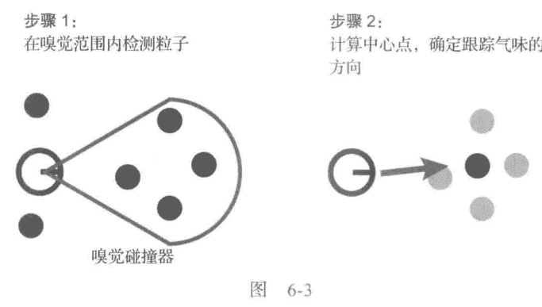

同 5.2 节一样，利用触发式碰撞器将气味粒子记入 Agent 感知列表（字典实现）。粒子增减时即时计算气味质心。我们单独封装了获取质心的函数，因为无粒子记录时内部质心位置保持不变。

### 进阶建议

粒子发射逻辑按游戏需求自行实现，核心是实例化气味粒子预制体。建议给 Agent 加刚体。大量实例化粒子可能拖垮性能。

## 6.5 基于图结构的视觉感知

本节采用图逻辑模拟场景，首先攻克视觉感知。

### 前置准备

务必精通第 2 章内容，以透彻理解图方法的底层原理。

### 核心步骤

仅需新增一个脚本文件：

- 1. 创建视觉处理核心类：

```csharp
using UnityEngine;
using System.Collections;
using System.Collections.Generic;

public class VisorGraph : MonoBehaviour
{
    public int visionReach;
    public GameObject visorObj;
    public Graph visionGraph;
}
```

- 2. 若组件未赋值，则初始化视线遮挡层对象：

```csharp
void Start()
{
    if (visorObj == null)
        visorObj = gameObject;
}
```

- 3. 定义函数，判定给定节点集合的可见性：

```csharp
public bool IsVisible(int[] visibilityNodes)
{
    int vision = visionReach;
    int src = visionGraph.GetNearestVertex(visorObj);
    HashSet<int> visibleNodes = new HashSet<int>();
    Queue<int> queue = new Queue<int>();
    queue.Enqueue(src);
    while (queue.Count != 0)
    {
        if (vision == 0)
            break;
        int v = queue.Dequeue();
        List<int> neighbours = visionGraph.GetNeighbors(v);
        foreach (int n in neighbours)
        {
            if (visibleNodes.Contains(n))
                continue;
            queue.Enqueue(n);
            visibleNodes.Add(n);
        }
    }
    foreach (int vn in visibleNodes)
    {
        if (visibilityNodes.Contains(vn))
            return true;
    }
    return false;
}
```

### 运行原理解析

本节用广度优先搜索（BFS）寻找视野范围内可达节点，再与 Agent 所在节点集对比。输入节点数组由寻路算法预先计算，超出本书范围（因依赖精确定位，需逐个检查 Agent/物体坐标）。

## 6.6 基于图结构的听觉感知

听觉原理近似视觉，但无需考虑节点直达可见性（声波可绕射），这由声音特性决定。仍需声音接收器配合。本节不直接将 Agent 作为接收器，而是让声音在声像图中传播，由图节点感知。

### 前置准备

熟练掌握寻路知识，以理解图方法内核。

### 核心步骤

- 1. 构建声源发射器类：

```csharp
using UnityEngine;
using System.Collections;
using System.Collections.Generic;

public class VisorGraph : MonoBehaviour
{
    public int visionReach;
    public GameObject visorObj;
    public Graph visionGraph;
}
```

```csharp
using UnityEngine;
using System.Collections;
using System.Collections.Generic;

public class EmitterGraph : MonoBehaviour
{
    public int soundIntensity;
    public Graph soundGraph;
    public GameObject emitterObj;

    public void Start()
    {
        if (emitterObj == null)
            emitterObj = gameObject;
    }

    public int[] Emit()
    {
        List<int> nodeIds = new List<int>();
        Queue<int> queue = new Queue<int>();
        List<int> neighbours;
        int intensity = soundIntensity;
        int src = soundGraph.GetNearestVertex(emitterObj);

        nodeIds.Add(src);
        queue.Enqueue(src);

        while (queue.Count != 0)
        {
            if (intensity == 0)
                break;
            int v = queue.Dequeue();
            neighbours = soundGraph.GetNeighbors(v);
            foreach (int n in neighbours)
            {
                if (nodeIds.Contains(n))
                    continue;
                queue.Enqueue(n);
                nodeIds.Add(n);
            }
            intensity--;
        }
        return nodeIds.ToArray();
    }
}
```

### 核心运作机制

本部分采用广度优先策略，筛选出受声波强度波及的节点集合。遍历流程将在节点耗尽或声能衰减至零时自动终止。

### 知识拓展

掌握了碰撞体与图逻辑构建嗅觉系统的要领后，你可以尝试研发一种融合算法：引入以距离为核心参数的启发式规则。一旦节点超出声波所能触及的最远范围，即可省去将其邻居节点入队的操作。

### 关联章节

- 参考 2.6 节

- 参考 2.8 节

## 6.7 基于图结构的嗅觉模块

本节将演示一种混合标记机制，用于记录与特定气味粒子发生接触的顶点。

### 前置准备

需为顶点配置大范围碰撞体，确保其具备捕获周边气味粒子的能力。

### 实施流程

- 1. 在气味粒子脚本中新增成员变量，用于存储其父对象的标识符：

```csharp
public int parent;
```

- 2. 派生一个启用嗅觉功能的新类，继承自基础 Vertex 类：

```csharp
using UnityEngine;
using System.Collections;
using System.Collections.Generic;

public class VertexOdour : Vertex
{
    private Dictionary<int, OdourParticle> odourDic;

    public void Start()
    {
        odourDic = new Dictionary<int, OdourParticle>();
    }

    public void OnCollisionEnter(Collision coll)
    {
        OdourParticle op;
        op = coll.gameObject.GetComponent<OdourParticle>();
        if (op == null)
            return;
        int id = op.parent;
        odourDic.Add(id, op);
    }

    public void OnCollisionExit(Collision coll)
    {
        OdourParticle op;
        op = coll.gameObject.GetComponent<OdourParticle>();
        if (op == null)
            return;
        int id = op.parent;
        odourDic.Remove(id);
    }

    public bool HasOdour()
    {
        if (odourDic.Values.Count == 0)
            return false;
        return true;
    }

    public bool OdourExists(int id)
    {
        return odourDic.ContainsKey(id);
    }
}
```

### 原理解析

当气味粒子触碰顶点时，系统会将该信息写入顶点的气味字典，随后 Agent 便可通过检索邻近顶点的记录，判断气味粒子是否存在。

### 关联参考

- 参见第 2 章

## 6.8 潜行游戏中的感知系统构建

既然感知层的基础算法已明晰，接下来我们将深入探讨构建 Agent 高级感知技术的实战路径。

本方案参考了 Brook Miles 及其在 Klei Entertainment 团队为《忍者印记》所设计的机制。核心思想在于：将“兴趣源”设定为可被视觉或听觉捕捉的对象，并由感知管理器统一调度。

### 数据奠基

鉴于系统围绕“兴趣”概念展开，我们需要预备三类数据结构：描述感知类型与优先级的结构体，以及表示兴趣源实体的数据类型。

感知描述结构如下：

```csharp
public enum InterestSense
{
    SOUND,
    SIGHT
};
```

优先级定义结构如下：

```csharp
public enum InterestPriority
{
    LOWEST = 0,
    BROKEN = 1,
    MISSING = 2,
    SUSPECT = 4,
    SMOKE = 4,
    BOX = 5,
    DISTRACTIONFLARE = 10,
    TERROR = 20
};
```

兴趣源实体数据类型如下：

```csharp
using UnityEngine;
using System.Collections;

public struct Interest
{
    public InterestSense sense;
    public InterestPriority priority;
    public Vector3 position;
}
```

在正式编写类逻辑前，请注意：感知层接口暂保留为空实现，旨在保持架构弹性，便于你依据前文所学注入自定义逻辑。

### 核心实现步骤

涉及两大核心类的构建，流程较长，建议逐步推进：

- 1. 创建 Agent 类及其核心字段定义：

```csharp
using UnityEngine;
using System.Collections;
using System.Collections.Generic;

public class AgentAware : MonoBehaviour
{
    protected Interest interest;
    protected bool isUpdated = false;
}
```

- 2. 编写判定函数，用于校验某兴趣源是否与当前 Agent 相关：

```csharp
public bool IsRelevant(Interest i)
{
    int oldValue = (int)interest.priority;
    int newValue = (int)i.priority;
    if (newValue <= oldValue)
        return false;
    return true;
}
```

- 3. 实现 Agent 内部设定新兴趣目标的方法：

```csharp
public void Notice(Interest i)
{
    StopCoroutine(Investigate());
    interest = i;
    StartCoroutine(Investigate());
}
```

- 4. 定制“调查”行为逻辑，该逻辑需结合 Agent 当前的兴趣点自行实现：

```csharp
public virtual IEnumerator Investigate()
{
    // TODO
    // 编写你自己的实现
    yield break;
}
```

- 5. 定制“主导”行为逻辑，定义 Agent 在排序主导权下的行动准则，同样依赖自定义实现：

```csharp
public virtual IEnumerator Lead()
{
    // TODO
    // 编写你自己的实现
    yield break;
}
```

- 6. 构建兴趣源类：

```csharp
using UnityEngine;
using System.Collections;
using System.Collections.Generic;

public class InterestSource : MonoBehaviour
{
    public InterestSense sense;
    public float radius;
    public InterestPriority priority;
    public bool isActive;
}
```

- 7. 实现获取兴趣数值的属性访问器：

public Interest Interest

{

    get

    {

        Interest i;

        i.position = transform.position;

        i.priority = priority;

        i.sense = sense;

        return i;

    }

}

- 8. 编写检测 Agent 是否落入兴趣源影响范围的函数。虽可定义于 Agent 类，但需配合后续步骤调整。这是感知层接口的一种实现：

```
protected bool IsAffectedSight(AgentAware agent)
{
    // TODO
    // 实现你的视野检测
    return false;
}
```

- 9. 再实现一个检测声音影响的感知层函数，架构模式与上一步保持一致：

```
protected bool IsAffectedSound(AgentAware agent)
{
    // TODO
    // 实现你的声音检测
    return false;
}
```

- 10. 定义获取受影响 Agent 列表的虚函数，便于后续复用或逻辑替换：

```
public virtual List<AgentAware> GetAffected(AgentAware[] agentList)
{
    List<AgentAware> affected;
    affected = new List<AgentAware>() ;
    Vector3 interPos = transform.position;
    Vector3 agentPos;
    float distance;
    // 下面的步骤
}
```

- 11. 编写主循环，遍历 Agent 集合并筛选出受影响个体：

```
foreach (AgentAware agent in agentList)
{
    // 下面的步骤
}
return affected;
```

- 12. 判断 Agent 是否超出兴趣源的有效作用半径：

```
agentPos = agent.transform.position;
distance = Vector3.Distance(interPos, agentPos);
if (distance > radius)
    continue;
```

- 13. 依据兴趣源的感知模式（视觉/听觉等），校验 Agent 是否受波及：

```
bool isAffected = false;
switch (sense)
{
    case InterestSense.SIGHT:
        isAffected = IsAffectedSight(agent);
        break;
    case InterestSense.SOUND:
        isAffected = IsAffectedSound(agent);
        break;
}
```

- 14. 若判定受影响，将该 Agent 加入结果列表：

```
if (!isAffected)
    continue;
affected.Add(agent);
```

- 15. 创建感知管理器类：

```
using UnityEngine;
using System.Collections;
using System.Collections.Generic;

public class SensoryManager : MonoBehaviour
{
    public List<AgentAware> agents;
    public List<InterestSource> sources;
}
```

- 16. 实现 Awake 初始化逻辑：

```
public void Awake()
{
    agents = new List<AgentAware>();
    sources = new List<InterestSource>();
}
```

- 17. 声明根据 Agent 数组筛选侦察单位集合的方法：

```
public List<AgentAware> GetScouts(AgentAware[] agents, int leader = -1)
{
    // 下面的步骤
}
```

- 18. 校验 Agent 数量并返回有效列表：

```
if (agents.Length == 0)
    return new List<AgentAware>(0);
if (agents.Length == 1)
    return new List<AgentAware>(agents);
```

- 19. 若存在索引标识，则从列表中移除主导者：

```
List<AgentAware> agentList;
agentList = new List<AgentAware>(agents);
if (leader > -1)
    agentList.RemoveAt(leader);
```

- 20. 计算需抽取的侦察单位数量：

```
List<AgentAware> scouts;
scouts = new List<AgentAware>();
float numAgents = (float)agents.Length;
int numScouts = (int)Mathf.Log(numAgents, 2f);
```

- 21. 从 Agent 池中随机抽取侦察单位：

```
while (numScouts != 0)
{
    int numA = agentList.Count;
    int r = Random.Range(0, numA);
    AgentAware a = agentList[r];
    scouts.Add(a);
    agentList.RemoveAt(r);
    numScouts--;
}
```

- 22. 最终确定侦察单位名单：

```
return scouts;
```

- 23. 定义扫描兴趣源列表的功能函数：

```
public void UpdateLoop()
{
    List<AgentAware> affected;
    AgentAware leader;
    List<AgentAware> scouts;
    foreach (InterestSource source in sources)
    {
    // 下面的步骤
    }
}
```

- 24. 剔除非活跃的兴趣源：

```
if (!source.isActive)
    continue;
source.isActive = false;
```

- 25. 过滤掉未波及任何 Agent 的无效源：

```
affected = source.GetAffected(agents.ToArray());
if (affected.Count == 0)
    continue;
```

- 26. 随机选定一名主导者及一组侦察员：

```
int l = Random.Range(0, affected.Count);
leader = affected[l];
scouts = GetScouts(affected.ToArray(), 1);
```

- 27. 必要时，调用主导者的核心主导函数：

```
if (leader.Equals(scouts[0]))
StartCoroutine(leader.Lead());
```

- 28. 若涉及侦察员，则通知其留意相关兴趣点：

```
foreach (AgentAware a in scouts)
{
    Interest i = source.interest;
    if (a.IsRelevant(i))
        a.Notice(i);
}
```

### 核心运作机制

系统维护着一份兴趣源清单，这些源头能吸引世界中大量智能体的目光。管理器负责收录这些源头，并对每一个处于激活状态的兴趣源执行全局更新。

处理流程分两步走：兴趣源首先接收世界中的智能体完整列表，首轮筛选直接剔除行动半径之外的个体；次轮再通过精度更高（但开销也更大）的感知层机制，精准锁定真正能被感知到的目标。

管理器掌控受影响的智能体名单，完成侦察员及其主导者的初始化，最后向它们广播所有相关的兴趣信息。

### 深度延伸

特别值得一提的是，`SensoryManager` 类作为核心枢纽，统管智能体列表与兴趣源列表，因此它**必须**实现为单例模式。一旦存在多个实例，极易引发不可预期的复杂行为。

智能体的关注度由感知管理器依据优先级数值自动演算，紧急情况下也可调用公开函数 `Notice` 强制重置数值。

依据具体游戏需求，此处仍有优化余地。列表中的侦察员视野可能存在重叠，视项目情况可采取最优策略处理；而现有系统则是利用优先级数值作为决策依据。

### 参考拓展

欲深入了解本节方法的理论根基，建议参阅 Steve Rabin 编著的《Game AI Pro》。

# 第 7 章

## 棋类游戏与搜索式 AI 实战

本章将系统讲解开发棋类游戏 AI 所用的核心算法族群：

- 构建博弈树（Game Tree）类架构
- 落地极小化极大算法
- 落地 Negamax 算法
- 落地 Alpha-Beta Negamax 算法
- 落地 Negascout 算法
- 实战：井字棋 AI 对手
- 实战：跳棋 AI 对手
- 基于 UCB1 算法实现剪刀石头布 AI
- 落地无悔匹配算法

## 7.1 概览

本章将带你掌握一套算法体系，专攻棋类游戏技术与人工智能构建。这些算法以博弈树图谱为理论基石，无论是状态评估还是邻接节点遍历，皆依此展开。重点覆盖双人棋类博弈，但经微调即可泛化至多人场景。

## 7.2 搭建博弈树类框架

博弈状态的表达形式虽多，但我们将聚焦于如何打造可复用、可扩展的类结构，以支撑高阶棋类 AI 算法的通用调用。

### 预备知识

扎实掌握面向对象精髓——特别是继承与多态——至关重要。我们将编写通用的泛型函数服务于多款棋类决策，同时通过派生子类实现特定逻辑的深度特化。

### 实施步骤

构建博弈树需双类配合，具体步骤如下：

- 1. 定义抽象类 `Move`：

```
using UnityEngine;
using System.Collections;

public abstract class Move
{
}
```

- 2. 定义伪抽象类 `Board`：

```
using UnityEngine;
using System.Collections;

public class Board
{
    protected int player;
    // 这里是下面步骤中的代码
}
```

- 3. 实现默认构造函数：

```
public Board()
{
    player = 1;
}
```

- 4. 实现获取合法行动的虚函数：

```
public virtual Move[] GetMoves()
{
    return new Move[0];
}
```

- 5. 实现落子/执行行动的虚函数：

```
public virtual Board MakeMove(Move m)
{
    return new Board();
}
```

- 6. 定义判定终局的虚函数：

```
public virtual bool IsGameOver()
{
    return true;
}
```

- 7. 实现获取当前行棋方的虚函数：

```
public virtual int GetCurrentPlayer()
{
    return player;
}
```

- 8. 实现计算指定玩家得分的虚函数：

```
public virtual float Evaluate(int player)
{
    return Mathf.NegativeInfinity;
}
```

- 9. 实现计算当前玩家得分的虚函数：

```
public virtual float Evaluate()
{
    return Mathf.NegativeInfinity;
}
```

### 原理剖析

至此算法基石已就位。`Board` 类充当节点，映射当前博弈态势；`Move` 类对应边，代表状态迁移。调用 `GetMoves` 时，实则是在模拟生成邻接状态的边集合。

### 参考拓展

若需深究本章技术的深层理论，请研读 Russell 与 Norvig 合著的《Artificial Intelligence: A Modern Approach》（对抗搜索章节）及 Ian Millington 的《Artificial Intelligence for Games》（棋类游戏章节）。

## 7.3 落地极小化极大算法

Minimax 算法的核心决策逻辑是：在最坏情况（最大损失）下，寻找损失最小的策略。除游戏开发与博弈论外，该法则亦广泛用于统计决策与哲学推演。

该技术初衷是为双人零和博弈建模——一方的收益等于另一方的损失。但通过灵活扩展，它完全能适配多玩家场景。

### 预备知识

必须厘清动态成员函数与静态成员函数的区别，并精通递归。前者绑定实例，后者绑定类本身；静态函数无需实例化即可调用，极适合通用算法封装。

递归方面，不同于迭代的显性循环，它要求明确基线条件（终止条件）与递归条件（持续条件）。

### 实施步骤

先建核心管理类 `BoardAI`，再实现 Minimax 核心逻辑：

- 1. 创建 `BoardAI` 类：

```
using UnityEngine;
using System.Collections;

public class BoardAI
{
}
```

- 2. 声明 `Minimax` 函数签名：

```
public static float Minimax(
    Board board,
    int player,
    int maxDepth,
    int currentDepth,
    ref Move bestMove)
{
    // 这里是下面的步骤
}
```

- 3. 处理基线终止条件：

```
if (board.IsGameOver() || currentDepth == maxDepth)
    return board.Evaluate(player);
```

- 4. 按玩家身份初始化极值：

```
bestMove = null;
float bestScore = Mathf.Infinity;
if (board.GetCurrentPlayer() == player)
    bestScore = Mathf.NegativeInfinity;
```

- 5. 遍历全量合法行动，筛选最优得分：

```
foreach (Move m in board.GetMoves())
{
    // 这里是下面的步骤
}
return bestScore;
```

- 6. 依据行动生成新博弈状态：

```
Board b = board.MakeMove(m);
float currentScore;
Move currentMove = null;
```

- 7. 进入递归深层：

```
currentScore = Minimax(b, player, maxDepth, currentDepth + 1, ref
currentMove);
```

- 8. 确认当前玩家得分：

```
if (board.GetCurrentPlayer() == player)
{
    if (currentScore > bestScore)
    {
        bestScore = currentScore;
        bestMove = currentMove;
    }
}
```

- 9. 确认对手得分：

```
else
{
    if (currentScore < bestScore)
    {
        bestScore = currentScore;
        bestMove = currentMove;
    }
}
```

### 原理剖析

Minimax 实质是有界深度优先搜索。每一层决策都遵循：假设对手会选择让我得分最低的应对，我在其中挑选能让我得分最高的那一步，直到抵达终止叶节点。

递归负责路径回溯，启发式评估函数 `Evaluate` 负责节点价值量化。

### 参考拓展

详见 7.1 节。

## 7.4 落地 Negamax 算法

针对双人零和博弈，利用“一方之损即另方之得”的对称性，可对 Minimax 进行简化优化。Negamax 算法在保持结果等价的前提下，省去了显性追踪玩家回合的逻辑。

### 预备知识

同 7.3 节：需精通静态/动态函数区别与递归终止/持续条件设计。

### 实施步骤

在 `BoardAI` 类中追加新函数：

- 1. 创建 `Negamax` 函数：

```
public static float Negamax(
    Board board,
    int maxDepth,
    int currentDepth,
    ref Move bestMove)
{
    // 这里是下面的步骤
}
```

- 2. 校验基线条件：

```
if (board.IsGameOver() || currentDepth == maxDepth)
    return board.Evaluate();
```

- 3. 初始化最优值变量：

```
bestMove = null;
float bestScore = Mathf.NegativeInfinity;
```

- 4. 遍历可用行动，迭代最优得分：

```
foreach (Move m in board.GetMoves())
{
    // 这里是下面的步骤
}
return bestScore;
```

- 5. 基于当前行动派生新状态：

```
Board b = board.MakeMove(m);
float recursedScore;
Move currentMove = null;
```

- 6. 触发递归调用：

```
recursedScore = Negamax(b, maxDepth, currentDepth + 1, ref
currentMove);
```

- 7. 必要时更新当前得分、最佳得分及对应行动：

```
float currentScore = -recursedScore;
if (currentScore > bestScore)
{
    bestScore = currentScore;
```

bestMove = m;

}

### 原理剖析

Negamax 与 Minimax 同源，但通过递归回溯时翻转分数符号，巧妙统一了双方视角。不再显性区分极大/极小层，而是统一为“极大化己方视角下的得分”，极大简化了代码结构。

### 延伸阅读

因 Negamax 每层递归都在切换玩家视角，故其评估函数采用无参数形式计算。

### 参考拓展

- □ 见 7.1 节
- □ 见 7.2 节

## 7.5 落地 Alpha-Beta Negamax 算法

Negamax 虽高效，但仍会遍历部分无效节点。引入 Alpha-Beta 剪枝策略，可大幅裁剪搜索空间，实现同等深度下的极致加速。

### 预备知识

同前：静态/动态函数机制与递归基线/递归条件为必修课。

### 实施步骤

继续扩充 `BoardAI` 类：

- 1. 创建 `ABNegamax` 函数：

```
public static float ABNegamax(
Board board,
int player,
int maxDepth,
int currentDepth,
ref Move bestMove,
float alpha,
float beta)
{
    // 这里是下面的步骤
}
```

- 2. 校验基线条件：

```
if (board.IsGameOver() || currentDepth == maxDepth)
    return board.Evaluate(player);
```

- 3. 初始化搜索边界值：

```
bestMove = null;
float bestScore = Mathf.NegativeInfinity;
```

- 4. 遍历合法行动，追踪最优解：

```
foreach (Move m in board.GetMoves())
{
    // 这里是下面的步骤
}
return bestScore;
```

- 5. 依据行动衍生新博弈状态：

```
Board b = board.MakeMove(m);
```

- 6. 设定递归传参数值：

```
float recursedScore;
Move currentMove = null;
int cd = currentDepth + 1;
float max = Mathf.Max(alpha, bestScore);
```

- 7. 启动递归搜索：

```
recursedScore = ABNegamax(b, player, maxDepth, cd, ref currentMove,
-beta, max);
```

- 8. 视情况更新最优得分/行动，并判断是否触发剪枝提前终止：

```
float currentScore = -recursedScore;
if (currentScore > bestScore)
{
    bestScore = currentScore;
    bestMove = m;
    if (bestScore >= beta)
        return bestScore;
}
```

### 原理剖析

AB 剪枝引入双边界值：α 代表己方已确保的**下限**得分（无需再看对手如何压分）；β 代表对方能容忍的**上限**得分（再吸引的招数对手也不会给机会）。

因双方轮流博弈，单层搜索仅需校验其中一侧边界即可。

### 参考拓展

- 见 7.1 节
- 见 7.2 节
- 见 7.3 节

## 7.6 落地 Negascout 算法

剪枝策略虽强，却催生新挑战。Negascout 算法通过优化启发式剪枝逻辑，进一步压缩搜索窗口（α 与 β 的区间），显著提升分支裁剪概率。

### 预备知识

基础不变：静态/动态函数区分、递归终止与持续条件把控。

### 实施步骤

于 `BoardAI` 类新增核心函数：

- 1. 创建 `ABNegascout` 函数：

## 7.6 Negascout 算法核心流程

```
public static float ABNegascout (
    Board board,
    int player,
    int maxDepth,
    int currentDepth,
    ref Move bestMove,
    float alpha,
    float beta)
{
    // 这里是下面的步骤
}
```

- 2. 校验基准条件：

```
if (board.IsGameOver() || currentDepth == maxDepth)
    return board.Evaluate(player);
```

- 3. 初始化起始数值：

```
bestMove = null;
float bestScore = Mathf.NegativeInfinity;
float adaptiveBeta = beta;
```

- 4. 迭代所有合法走法并回溯最优分值：

```
foreach (Move m in board.GetMoves())
{
    // 这里是下面的步骤
}
return bestScore;
```

- 5. 基于当前走法生成后继对局快照：

```
Board b = board.MakeMove(m);
```

- 6. 配置递归所需的参数值：

```
Move currentMove = null;
float recursedScore;
int depth = currentDepth + 1;
float max = Mathf.Max(alpha, bestScore);
```

- 7. 触发自调用过程：

```
recursedScore = ABNegamax(b, player, maxDepth, depth, ref
currentMove, -adaptiveBeta, max);
```

- 8. 记录本次评分并落实分值：

```
float currentScore = -recursedScore;
if (currentScore > bestScore)
{
    // 这里是下面的步骤
}
```

- 9. 判断是否触发分支裁剪：

```
if (adaptiveBeta == beta || currentDepth >= maxDepth - 2)
{
    bestScore = currentScore;
    bestMove = currentMove;
}
```

- 10. 若无需裁剪，则延续递归搜索：

```
else
{
    float negativeBest;
    negativeBest = ABNegascout(b, player, maxDepth, depth, ref
bestMove, -beta, -currentScore);
    bestScore = -negativeBest;
}
```

- 11. 视情况终止循环，或刷新最优估值：

```
if (bestScore >= beta)
    return bestScore;
adaptiveBeta = Mathf.Max(alpha, bestScore) + 1f;
```

### 算法原理解析

Negascout 策略的核心在于首步探测：依据首个走法的搜索结果，侦察员尝试收窄窗口范围以验证后续走法。若窗口验证失效，则退回完整窗口重新搜索。此机制能大幅截断无效子树，规避无谓计算。

### 相关引用

- 参考 7.4 小节

---

## 7.7 打造井字棋智能体

沿用 7.5 小节的核心逻辑，我们将为经典井字棋（Tic-Tac-Toe）构建一个自动博弈实体。这不仅丰富了基类生态，也为后续自定义棋类接入 AI 提供了范式。

### 环境就绪

首要任务是定制专属动作类型，承载井字棋盘面逻辑，该类型需派生自章节初建立的基类：

```
using UnityEngine;
using System.Collections;
public class MoveTicTac : Move
{
    public int x;
    public int y;
    public int player;
    public MoveTicTac(int x, int y, int player)
    {
        this.x = x;
        this.y = y;
        this.player = player;
    }
}
```

### 实施指南

后续需派生 `Board` 新类型，覆盖基类行为并注入必要能力：

1.  定义 `BoardTicTac` 派生 `Board`，增设字段以持久化盘面数据：

```
using UnityEngine;
using System;
using System.Collections;
using System.Collections.Generic;

public class BoardTicTac : Board
{
    protected int[,] board;
    protected const int ROWS = 3;
    protected const int COLS = 3;
}
```

2.  编写无参初始化器：

```
public BoardTicTac(int player = 1)
{
    this.player = player;
    board = new int[ROWS, COLS];
    board[1,1] = 1;
}
```

3.  实现判定轮到哪方执棋的逻辑：

```
private int GetNextPlayer(int p)
{
    if (p == 1)
        return 2;
    return 1;
}
```

4.  增设估量棋手形势的评价接口：

```
private float EvaluatePosition(int x, int y, int p)
{
    if (board[y, x] == 0)
        return 1f;
    else if (board[y, x] == p)
        return 2f;
    return -1f;
}
```

5.  实现依据坐标查找周邻位置的方法：

```
private float EvaluateNeighbours(int x, int y, int p)
{
    float eval = 0f;
    int i, j;
    for (i = y - 1; i < y + 2; i++)
    {
        if (i < 0 || i >= ROWS)
        continue;
        for (j = x - 1; j < x + 2; j++)
        {
            if (j < 0 || j >= COLS)
            continue;
            if (i == j)
                continue;
            eval += EvaluatePosition(j, i, p);
        }
    }
    return eval;
}
```

6.  编写用于构建后继快照数据的初始化器：

```
public BoardTicTac(int[,] board, int player)
{
    this.board = board;
    this.player = player;
}
```

7.  覆盖枚举合法走法集合的实例方法：

```
public override Move[] GetMoves()
{
    List<Move> moves = new List<Move>();
    int i;
    int j;
    for (i = 0; i < ROWS; i++)
    {
        for (j = 0; j < COLS; j++)
        {
            if (board[i, j] != 0)
            continue;
            MoveTicTac m = new MoveTicTac(j, i, player);
            moves.Add(m);
        }
    }
    return moves.ToArray();
}
```

8.  覆盖依据动作推演后继局面的方法：

```
public override Board MakeMove(Move m)
{
    MoveTicTac move = (MoveTicTac)m;
    int nextPlayer = GetNextPlayer(move.player);
    int[,] copy = new int[ROWS, COLS];
    Array.Copy(board, 0, copy, 0, board.Length);
    copy[move.y, move.x] = move.player;
    BoardTicTac b = new BoardTicTac(copy, nextPlayer);
    return b;
}
```

9.  针对指定棋手，定义局势估值计算接口：

```
public override float Evaluate(int player)
{
    float eval = 0f;
    int i, j;
    for (i = 0; i < ROWS; i++)
    {
        for (j = 0; j < COLS; j++)
        {
            eval += EvaluatePosition(j, i, player);
            eval += EvaluateNeighbours(j, i, player);
        }
    }
    return eval;
}
```

10. 完成实时局面评分逻辑的编写：

```
public override float Evaluate()
{
    float eval = 0f;
    int i, j;
    for (i = 0; i < ROWS; i++)
    {
        for (j = 0; j < COLS; j++)
        {
            eval += EvaluatePosition(j, i, player);
            eval += EvaluateNeighbours(j, i, player);
        }
    }
    return eval;
}
```

### 设计要点剖析

我们为井字棋定制了动作数据载体，它与 7.5 算法无缝适配，因上层算法仅将动作视为通用数据包。本节关键在于重写基类虚方法以抽象问题模型：采用二维矩阵标记着子点（0 标识空格），并引入评价函数，参照邻近格权重为局面定价。

### 优化展望

当前评价函数虽符合一致性估值准则，但未必构成最强策略。后续需重新审视该逻辑，调整方法实现以提升 AI 竞技水平。

### 参考链接

- □ 详见 7.1 小节

---

## 7.8 实战：国际跳棋 AI 构建

本节进阶演示如何在现有体系上构建西洋跳棋（国际跳棋）盘面与子力模型，使其对齐框架接口契约。演示基于常规 8×8 盘面及双方各 12 子，但通过可配置架构可轻松兼容变尺棋盘。

### 环境就绪

首先声明专属走法结构 `MoveDraughts`：

```
using UnityEngine;
using System.Collections;

public class MoveDraughts : Move
{
    public PieceDraughts piece;
    public int x;
    public int y;
    public bool success;
    public int removeX;
    public int removeY;
}
```

该值类型封装移动主体、落点坐标、捕获标记及受害子位置。

### 实施指南

需分别落地子力与盘面两大关键类型，步骤繁多，请逐步推进：

1.  新建 `PieceDraughts.cs`，奠定基础骨架：

```
using UnityEngine;
using System.Collections;
using System.Collections.Generic;
```

2.  定义 `PieceColor` 类型声明：

```
public enum PieceColor
{
    WHITE,
    BLACK
};
```

3.  声明 `PieceType` 枚举常量集：

```
public enum PieceType
{
    MAN,
    KING
};
```

4.  搭建 `PieceDraughts` 类主体结构：

```
public class PieceDraughts : MonoBehaviour
{
```

```csharp
public int x;
public int y;
public PieceColor color;
public PieceType type;
// 具体逻辑待后续补充
}
```

5.  编写对象实例化逻辑：

```csharp
public void Setup(int x, int y,
                     PieceColor color,
                     PieceType type = PieceType.MAN)
{
    this.x = x;
    this.y = y;
    this.color = color;
    this.type = type;
}
```

6.  实现落子执行流程：

```csharp
public void Move(MoveDraughts move, ref PieceDraughts[,] board)
{
    board[move.y, move.x] = this;
    board[y, x] = null;
    x = move.x;
    y = move.y;
    // 这里是下面的步骤
}
```

7.  若发生吃子，清理被捕获单元：

```csharp
if (move.success)
{
    Destroy(board[move.removeY, move.removeX]);
    board[move.removeY, move.removeX] = null;
}
```

8.  若为王，跳过后续升变逻辑：

```csharp
if (type == PieceType.KING)
    return;
```

9.  若卒子抵达对方底线，完成升变成王：

```csharp
int rows = board.GetLength(0);
if (color == PieceColor.WHITE && y == rows)
    type = PieceType.KING;
if (color == PieceColor.BLACK && y == 0)
    type = PieceType.KING;
```

10. 提供坐标合法性校验工具：

```csharp
private bool IsMoveInBounds(int x, int y, ref PieceDraughts[,] board)
{
    int rows = board.GetLength(0);
    int cols = board.GetLength(1);
    if (x < 0 || x >= cols || y < 0 || y >= rows)
        return false;
    return true;
}
```

11. 设置走法获取总入口：

```csharp
public Move[] GetMoves(ref PieceDraughts[,] board)
{
    List<Move> moves = new List<Move>();
    if (type == PieceType.KING)
        moves = GetMovesKing(ref board);
    else
        moves = GetMovesMan(ref board);
    return moves.ToArray();
}
```

12. 着手构建卒子移动规则：

```csharp
private List<Move> GetMovesMan(ref PieceDraughts[,] board)
{
    // 这里是下面的步骤
}
```

13. 预留走法备选存储：

```csharp
List<Move> moves = new List<Move>(2);
```

14. 记录左右位移方案：

```csharp
int[] moveX = new int[] { -1, 1 };
```

15. 按阵营区分前进方向：

#### 16. 循环遍历候选着法，筛选合法移动，内部逻辑稍后填充：

```csharp
int moveY = 1;
if (color == PieceColor.BLACK)
    moveY = -1;
```

#### 17. 设定双坐标量，用于推演下一目标点位：

```csharp
foreach (int mx in moveX)
{
    // 这里是下面的步骤
}
return moves;
```

#### 18. 校验拟移动是否触及棋盘边缘：

```csharp
int nextX = x + mx;
int nextY = y + moveY;
```

#### 19. 遇己方单位阻隔，即刻切换至下一备选：

```csharp
if (!IsMoveInBounds(nextX, nextY, ref board))
    continue;
```

#### 20. 实例化移动对象，准备录入合法库：

```csharp
PieceDraughts p = board[nextY, nextX];
if (p != null && p.color == color)
    continue;
```

#### 21. 目标位空置，生成基础位移着法：

```csharp
MoveDraughts m = new MoveDraughts();
m.piece = this;
```

#### 22. 目标位有敌，判定吃子可行性并修饰着法属性：

```csharp
if (p == null)
{
    m.x = nextX;
    m.y = nextY;
}
```

#### 23. 将着法收录进合法集合：

```csharp
else
{
    int hopX = nextX + mx;
    int hopY = nextY + moveY;
    if (!IsMoveInBounds(hopX, hopY, ref board))
        continue;
    if (board[hopY, hopX] != null)
        continue;
    m.x = hopX;
    m.y = hopY;
    m.success = true;
    m.removeX = nextX;
    m.removeY = nextY;
}
```

#### 24. 着手编写 King 专属合法着法获取接口：

```csharp
moves.Add(m);
```

#### 25. 初始化容器，暂存潜在移动：

```csharp
private List<Move> GetMovesKing(ref PieceDraughts[,] board)
{
    // 这里是下面的步骤
}
```

#### 26. 设立方向标记，覆盖四条对角线路：

```csharp
List<Move> moves = new List<Move>();
```

#### 27. 构建外层循环，遍历四向收集着法，内层逻辑后续实现：

```csharp
int[] moveX = new int[] { -1, 1 };
int[] moveY = new int[] { -1, 1 };
```

#### 28. 声明检测量与步进量，配合射线式扫描：

```csharp
foreach (int mY in moveY)
{
    foreach (int mX in moveX)
    {
        // 这里是下面的步骤
    }
}
return moves;
```

#### 29. 编写内层循环，沿当前向逐格推进至边缘：

```csharp
int nowX = x + mX;
int nowY = y + mY;
```

#### 30. 读取当前格单位引用：

```csharp
while (IsMoveInBounds(nowX, nowY, ref board))
{
    // 这里是下面的步骤
}
```

#### 31. 遇己方单位即终止该向继续搜寻：

```csharp
PieceDraughts p = board[nowY, nowX];
```

#### 32. 定义临时量，承载新生成的合法着法：

```csharp
if (p != null && p.color == color)
    break;
```

#### 33. 目标格空置则生成简单位移着法：

```csharp
MoveDraughts m = new MoveDraughts();
m.piece = this;
```

#### 34. 目标格有敌则评估捕获合规性并修饰着法：

```csharp
if (p == null)
{
    m.x = nowX;
    m.y = nowY;
}
```

#### 35. 着法入库，步进指针前移一格续循：

```csharp
else
{
    int hopX = nowX + mX;
    int hopY = nowY + mY;
    if (!IsMoveInBounds(hopX, hopY, ref board))
        break;
    m.success = true;
    m.x = hopX;
    m.y = hopY;
    m.removeX = nowX;
    m.removeY = nowY;
}
```

#### 36. 新建脚本，定义 BoardDraughts 类：

```csharp
moves.Add(m);
nowX += mX;
nowY += mY;
```

#### 37. 落地 Awake 生命周期：

```csharp
using UnityEngine;
using System.Collections;
using System.Collections.Generic;

public class BoardDraughts : Board
{
    public int size = 8;
    public int numPieces = 12;
    public GameObject prefab;
    protected PieceDraughts[,] board;
}
```

#### 38. 起草 Start 方法，留意：不同空间表达下初始化逻辑差异巨大：

```csharp
void Awake()
{
    board = new PieceDraughts[size, size];
}
```

#### 39. 预制体若缺 PieceDraught 组件，抛出异常：

```csharp
void Start()
{
    // TODO
    // 赋初值以及初始化棋盘
    // 实现可能千差万别

    // 这里是下面的步骤
}
```

#### 40. 引入迭代量，驱动后续布局：

```csharp
PieceDraughts pd = prefab.GetComponent<PieceDraughts>();
if (pd == null)
{
    Debug.LogError("No PieceDraught component detected");
    return;
}
```

#### 41. 编写白方布局循环：

```csharp
int i;
int j;
```

#### 42. 编写黑方布局循环：

```csharp
int piecesLeft = numPieces;
for (i = 0; i < size; i++)
{
    if (piecesLeft == 0)
        break;
    int init = 0;
    if (i % 2 != 0)
        init = 1;
    for (j = init; j < size; j += 2)
    {
        if (piecesLeft == 0)
            break;
        PlacePiece(j, i);
        piecesLeft--;
    }
}
```

#### 43. 落地单枚落子接口，渲染/坐标映射因项目而异：

```csharp
piecesLeft = numPieces;
for (i = size - 1; i >= 0; i--)
{
    if (piecesLeft == 0)
        break;
    int init = 0;
    if (i % 2 != 0)
        init = 1;
    for (j = init; j < size; j += 2)
    {
        if (piecesLeft == 0)
            break;
        PlacePiece(j, i);
        piecesLeft--;
    }
}
```

#### 44. 实现无参重载的 Evaluate 估值接口：

```csharp
private void PlacePiece(int x, int y)
{
    // TODO
    // 根据摆放的空间实现你自己的代码
    Vector3 pos = new Vector3();
    pos.x = (float)x;
    pos.y = -(float)y;
    GameObject go = GameObject.Instantiate(prefab);
    go.transform.position = pos;
    PieceDraughts p = go.GetComponent<PieceDraughts>();
    p.Setup(x, y, color);
    board[y, x] = p;
}
```

#### 45. 实现带单参数的 Evaluate 重载：

```csharp
public override float Evaluate()
{
    PieceColor color = PieceColor.WHITE;
    if (player == 1)
        color = PieceColor.BLACK;
    return Evaluate(color);
}
```

#### 46. 封装通用计算工具，复用核心估值逻辑：

```csharp
public override float Evaluate(int player)
{
    PieceColor color = PieceColor.WHITE;
    if (player == 1)
        color = PieceColor.BLACK;
    return Evaluate(color);
}
```

#### 52. 起草棋盘级合法着法枚举接口：

```csharp
private float Evaluate(PieceColor color)
{
    float eval = 1f;
    float pointSimple = 1f;
    float pointSuccess = 5f;

    int rows = board.GetLength(0);
    int cols = board.GetLength(1);

    int i;
    int j;

    for (i = 0; i < rows; i++)
    {
        for (j = 0; j < cols; j++)
        {
            PieceDraughts p = board[i, j];
            if (p == null)
                continue;
            if (p.color != color)
                continue;
            Move[] moves = p.GetMoves(ref board);
            foreach (Move mv in moves)
            {
                MoveDraughts m = (MoveDraughts)mv;
                if (m.success)
                    eval += pointSuccess;
                else
                    eval += pointSimple;
            }
        }
    }

    return eval;
}
```

### 核心运作原理

本棋盘沿用上节基因，因规则更繁复，流程分支显著增多。着法写入单位列表时，连锁捕获的生成须谨慎处理。每枚单位依据阵营与身份（普通/王）拥有两套迥异的移动模式。

宏观规则框架一致，唯需更多细致与推导，方能打磨出高效、鲁棒的棋盘级着法产出器。

### 进阶拓展

当前 Evaluate 尚显简陋：仅以“己方合法着法数”与“可捕获敌子数”为经验式指标，未顾“走完即被吃”的还击隐患，提升余地巨大。

此外，BoardDraughts 中的 PlacePiece 落地亦需修正，现有的硬编码坐标映射未必适配你项目的空间坐标体系。

## 7.9 基于 UCB1 策略的猜拳 AI 实战

猜拳是验证 AI 算法的典型沙盒，故连续两节以此为载体。本节引入“多臂拉霸”模型中的 UCB1 策略——原用于拉霸收益极大化，此处转为 RPS 对抗战术：关键在于实时权衡“试探新招式”与“发挥高利得招式”。

### 前置准备

先设定招式数据载体，携带利得记录与尝试次数：

```csharp
public override Move[] GetMoves()
{
    List<Move> moves = new List<Move>();
    int rows = board.GetLength(0);
    int cols = board.GetLength(1);
    int i;
    int j;

    for (i = 0; i < rows; i++)
    {
        for (j = 0; j < cols; j++)
        {
            PieceDraughts p = board[i, j];
            if (p == null)
                continue;
            moves.AddRange(p.GetMoves(ref board));
        }
    }

    return moves.ToArray();
}
```

### 实战步骤

构建 Bandit 类，封装 UCB1 决策回路：

- 1. 创建 Bandit 类：  

```csharp
public enum RPSAction
{
    Rock, Paper, Scissors
}
```

- 2. 列出关键成员：备选池、探索因子、累计轮次等：  

```csharp
using UnityEngine;

public class Bandit : MonoBehaviour
{
    // next steps
}
```

- 3. 实现初始化方法，清零统计量并预热：  

```csharp
bool init;
int totalActions;
int[] count;
float[] score;
int numActions;
RPSAction lastAction;
int lastStrategy;
```

- 4. 编写 GetNextAction 方法，产出下一步最优招式：  

```csharp
public void InitUCB1()
{
    if (init)
        return;
    totalActions = 0;
    numActions = System.Enum.GetNames(typeof(RPSAction)).Length;
    count = new int[numActions];
    score = new float[numActions];
    int i;
    for (i = 0; i < numActions; i++)
    {
        count[i] = 0;
        score[i] = 0f;
    }
    init = true;
}
```

- 5. 方法内部声明中间量，支撑 UCB1 算式求解：  

```csharp
public RPSAction GetNextActionUCB1()
{
    // next steps
}
```

- 6. 优先处理“零尝试”招式（强探），若有即回：  

```csharp
int i, best;
float bestScore;
float tempScore;
InitUCB1();
```

- 7. 预置基准分记录，开启评分迭代：  

```csharp
for (i = 0; i < numActions; i++)
{
    if (count[i] == 0)
    {
        lastStrategy = i;
        lastAction = GetActionForStrategy((RPSAction)i);
        return lastAction;
    }
}
```

```csharp
best = 0;
bestScore = score[best] / (float)count[best];
float input = Mathf.Log(totalActions / (float)count[best]);
input *= 2f;
bestScore += Mathf.Sqrt(input);
```

- 8. 遍历所有可选行动：

```csharp
for (i = 0; i < numActions; i++)
{
    tempScore = score[i] / (float)count[i];
    input = Mathf.Log(totalActions/(float)count[best]);
    input *= 2f;
    tempScore = Mathf.Sqrt(input);
    if (tempScore > bestScore)
    {
        best = i;
        bestScore = tempScore;
    }
}
```

- 9. 筛选最优行动：

```csharp
lastStrategy = best;
lastAction = GetActionForStrategy((RPSAction)best);
return lastAction;
```

- 10. 构造函数，用于依据初始行动获取最佳应对策略：

```csharp
public RPSAction GetActionForStrategy(RPSAction strategy)
{
    RPSAction action;
    switch (strategy)
    {
        default:
        case RPSAction.Paper:
            action = RPSAction.Scissors;
            break;
        case RPSAction.Rock:
            action = RPSAction.Paper;
            break;
        case RPSAction.Scissors:
            action = RPSAction.Rock;
            break;
    }
    return action;
}
```

- 11. 声明成员函数，结合对手行动评估当前行动的效用。代码起始如下：

```csharp
public float GetUtility(RPSAction myAction, RPSAction opponents)
{
    float utility = 0f;
    if (opponents == RPSAction.Paper)
    {
        if (myAction == RPSAction.Rock)
            utility = -1f;
        else if (myAction == RPSAction.Scissors)
            utility = 1f;
    }
    else if (opponents == RPSAction.Rock)
    {
        if (myAction == RPSAction.Paper)
            utility = 1f;
        else if (myAction == RPSAction.Scissors)
            utility = -1f;
    }
    else
    {
        if (myAction == RPSAction.Rock)
            utility = -1f;
        else if (myAction == RPSAction.Paper)
            utility = 1f;
    }
    return utility;
}
```

### 核心运作机制

我们采用伪探测算法落地书中功能，并记录行动后的收益反馈。该流程先逐一试探各项行动，再引入 UCB1 公式决策出招。此设计兼具挑战性与可击败性——算法会做出差异化选择，玩家若能开发出更优的变招体系，便能借此打磨技艺，当然也包含运气成分。

### 知识延伸

系统需提供一个统管全局行动的函数，并能从对手处习得行动算法。示例中玩家的行动集合如下：

```csharp
public void TellOpponentAction(RPSAction action)
{
    totalActions++;
    float utility;
    utility = GetUtility(lastAction, action);
    score[(int)lastAction] += utility;
    count[(int)lastAction] += 1;
}
```

### 参考拓展

UCB1 算法的深层原理，可参考 Nathan Sturtevant 教授的专题文章，链接：

https://www.movingai.com/gdc14/

## 7.10 落地无悔匹配算法

承接老虎机算法脉络，我们将对 UCB1 进行改良，命名为“无悔匹配”。沿用石头剪刀布的经典场景，该算法同样适配战斗博弈等复杂游戏类型。

### 前置储备

务必通读上一节，梳理成员变量与数据结构。上一节的成员函数与本节算法无直接关联，因本节将重构函数体系，但仍建立在前序知识基石之上。

### 实施步骤

在既有的 `Bandit` 类中植入以下代码逻辑：

- 1. 声明所需变量：

```csharp
float initialRegret = 10f;
float[] regret;
float[] chance;
RPSAction lastOpponentAction;
RPSAction[] lastActionRM;
```

- 2. 实现初始化成员函数：

```csharp
public void InitRegretMatching()
{
    if (init)
        return;
    numActions = System.Enum.GetNames(typeof(RPSAction)).Length;
    regret = new float[numActions];
    chance = new float[numActions];
    int i;
    for (i = 0; i < numActions; i++)
    {
        regret[i] = initialRegret;
        chance[i] = 0f;
    }
    init = true;
}
```

- 3. 定义成员函数，推演下一步行动：

```csharp
public RPSAction GetNextActionRM()
{
    // next steps
}
```

- 4. 设立局部变量并调用初始化函数：

```csharp
float sum = 0f;
float prob = 0f;
int i;
InitRegretMatching();
```

- 5. 穷举所有合法走位，缓存待执行行动：

```csharp
for (i = 0; i < numActions; i++)
{
    lastActionRM[i] = GetActionForStrategy((RPSAction)i);
}
```

- 6. 汇总所有后悔值：

```csharp
for (i = 0; i < numActions; i++)
{
    if (regret[i] > 0f)
        sum += regret[i];
}
```

- 7. 若总和 ≤ 0，随机返回一项行动：

```csharp
if (sum <= 0f)
{
    lastAction = (RPSAction)Random.Range(0, numActions);
    return lastAction;
}
```

- 8. 扫描行动集合，累加后悔行动的概率权重：

```csharp
for (i = 0; i < numActions; i++)
{
    chance[i] = 0f;
    if (regret[i] > 0f)
        chance[i] = regret[i];
    if (i > 0)
        chance[i] += chance[i - 1];
}
```

- 9. 生成随机概率阈值，与行动概率逐项比对，返回首个超出阈值的行动：

```csharp
prob = Random.value;
for (i = 0; i < numActions; i++)
{
    if (prob < chance[i])
    {
        lastStrategy = i;
        lastAction = lastActionRM[i];
        return lastAction;
    }
}
```

- 10. 若遍历末尾仍未匹配，返回最后一项行动：

```csharp
return (RPSAction)(numActions - 1);
```

### 算法内核解析

系统先枚举可能走法并量化其收益期望。执行特定行动后，算法引入随机扰动动态调整策略。关键在于：后续决策必须响应对手的实时走法。

### 知识延伸

除了确立均衡策略，追踪对手行动轨迹同等关键。因此我们需实现成员函数，将对手历史纳入前文所述的混合算法体系：

```csharp
public void TellOpponentActionRM(RPSAction action)
{
    lastOpponentAction = action;
    int i;
    for (i = 0; i < numActions; i++)
    {
        regret[i] += GetUtility((RPSAction)lastActionRM[i], (RPSAction)action);
        regret[i] -= GetUtility((RPSAction)lastAction, (RPSAction) action);
    }
}
```

最后，需在“策略优度”与“工具复杂度”间寻找平衡。石头剪刀布因状态空间小而易解，但实战游戏往往呈指数级复杂。

### 参考拓展

UCB1 算法更多理论细节，参见 Nathan Sturtevant 教授文章：

https://www.movingai.com/gdc14/


# Chapter 8 第 8 章

## 机器学习实战

本章将围绕以下专题展开机器学习探索：

- N-Gram 预测器：行动预判的基石
- 进阶预测器：分层 N-Gram 架构
- 朴素贝叶斯分类器入门
- 强化学习工程化落地
- 人工神经网络构建指南

## 8.1 导论

本章带你步入机器学习领域。这是一个广袤且深度内生的技术域，即便在 3A 级大作中落地亦属高难——核心痛点在于调优与实验的漫长周期。

然而，本章收录的方法论将为你将 ML 技术注入游戏开发铺就起跑道。这些技术存在多元化应用路径，其中最高频的落地场景便是动态难度调节。

建议配合阅读该领域的系统性专著，在理论维度完成章节外的深度补强。

## 8.2 N-Gram 预测器：从历史序列看未来行动

行动预判能将玩家体验从“纯随机对抗”提升至“基于历史博弈的策略对抗”。实现路径之一是引入概率模型预测玩家下一步意图，这正是 N-Gram 预测器的使命。

预测器依据过往 n 步行动的所有组合模式，计算特定决策（通常指单次出招）发生的概率分布。

### 前置储备

本节大量使用泛型编程。建议具备基础泛型认知，这对驾驭后续代码至关重要。

首要任务：实现一个承载行动与概率的数据结构 `KeyDataRecord`。

`KeyDataRecord.cs` 定义如下：

```csharp
using System.Collections;
using System.Collections.Generic;

public class KeyDataRecord<T>
{
    public Dictionary<T, int> counts;
    public int total;
    public KeyDataRecord()
    {
        counts = new Dictionary<T, int>();
    }
}
```

### 实施路径

N-Gram 预测器构建拆解为 5 个核心阶段：

- 1. 创建与文件名同名的泛型类：

```csharp
using System.Collections;
using System.Collections.Generic;
using System.Text;

public class NGramPredictor<T>
{
    private int nValue;
    private Dictionary<string, KeyDataRecord<T>> data;
}
```

- 2. 实现成员变量初始化的构造函数：

```csharp
public NGramPredictor(int windowSize)
{
    nValue = windowSize + 1;
    data = new Dictionary<string, KeyDataRecord<T>>();
}
```

- 3. 编写静态函数，将行动序列序列化为字符串键值：

```
public static string ArrToStrKey(ref T[] actions)
{
    StringBuilder builder = new StringBuilder();
    foreach (T a in actions)
    {
        builder.Append(a.ToString());
    }
    return builder.ToString();
}
```

- 4. 定义函数，记录行动序列集合：

```
public void RegisterSequence(T[] actions)
{
    string key = ArrToStrKey(ref actions);
    T val = actions[nValue - 1];
    if (!data.ContainsKey(key))
    {
        data[key] = new KeyDataRecord<T>();
    }
    KeyDataRecord<T> kdr = data[key];
    if (kdr.counts.ContainsKey(val))
    {
        kdr.counts[val] = 0;
    }
    kdr.counts[val]++;
    kdr.total++;
}
```

- 5. 实现核心预测函数，解析最优下一步行动：

```
public T GetMostLikely(T[] actions)
{
    string key = ArrToStrKey(ref actions);
    KeyDataRecord<T> kdr = data[key];
    int highestVal = 0;
    T bestAction = default(T);
    foreach (KeyValuePair<T,int> kvp in kdr.counts)
    {
        if (kvp.Value > highestVal)
        {
            bestAction = kvp.Key;
            highestVal = kvp.Value;
        }
    }
    return bestAction;
}
```

### 原理拆解

预测器维护一个滑动窗口（大小可配），记录窗口内的行动序列并映射结果值。以窗口大小 3 为例：前 3 步作为键值存储，用于预测第 4 步。

预测函数基于历史行动分布，推算各候选动作作为“下一步”的概率权重。历史样本越丰富，预测精度越高（受限于模型容量与过拟合边界）。

### 知识延伸

注意：类型 `T` 的对象必须妥善重写 `ToString()` 与 `Equals()`，保证其在内部字典中作为键值时的正确性语义。

## 8.3 分层 N-Gram：多窗口集成的预测增强

引入管理器统筹多个窗口尺寸（1 至 n）的 N-Gram 预测器，通过融合多模型的最优猜想，获得更鲁棒的行动预判。

### 前置调整

在 `NGramPredictor` 类中预置以下成员函数，作为分层版本的基础设施：

```
public int GetActionsNum(ref T[] actions)
{
    string key = ArrToStrKey(ref actions);
    if (!data.ContainsKey(key))
        return 0;
    return data[key].total;
}
```

### 构建步骤

分层预测器的搭建同步遵循分阶段思路：

- 1. 创建新类：

```
using System;
using System.Collections;
using System.Text;

public class HierarchicalNGramP<T>
{
    public int threshold;
    public NGramPredictor<T>[] predictors;
    private int nValue;
}
```

- 2. 编写负责成员变量初始化的构造函数：

```
public HierarchicalNGramP(int windowSize)
{
    nValue = windowSize + 1;
    predictors = new NGramPredictor<T>[nValue];
    int i;
    for (i = 0; i < nValue; i++)
        predictors[i] = new NGramPredictor<T>(i + 1);
}
```

- 3. 构建用于记录序列数据的函数，参考 8.2 节的前置实现：

```
public void RegisterSequence(T[] actions)
{
    int i;
    for (i = 0; i < nValue; i++)
    {
        T[] subactions = new T[i+1];
        Array.Copy(actions, nValue - i - 1, subactions, 0, i+1);
        predictors[i].RegisterSequence(subactions);
    }
}
```

- 4. 落实计算预测值的核心函数：

```
public T GetMostLikely(T[] actions)
{
    int i;
    T bestAction = default(T);
    for (i = 0; i < nValue; i++)
    {
        NGramPredictor<T> p;
        p = predictors[nValue - i - 1];
        T[] subactions = new T[i + 1];
        Array.Copy(actions, nValue - i - 1, subactions, 0, i + 1);
        int numActions = p.GetActionsNum(ref actions);
        if (numActions > threshold)
            bestAction = p.GetMostLikely(actions);
    }
    return bestAction;
}
```

### 核心机制

分层 N 元语法预测器的运作逻辑与 8.2 节如出一辙，核心差异在于它引入了预测器集合，并通过子预测器推算各主函数的数值。每个预测器先拆解可用动作集，接着记录序列或推断最可能的潜在动作，最后将这些动作填充进子预测器中。

## 8.4 掌握朴素贝叶斯分类器实战

即便是人类，也难免在洞察两个集合关联时感到棘手。破局的思路是：先对值集合打上标签分类，再行分析——这正是分类算法大显身手的时刻。

朴素贝叶斯分类器属于预测算法范畴，专门用于给问题实例打标签。它基于概率论与贝叶斯定理，核心假设是待分析变量间相互独立。其亮点在于极强的可扩展性。

### 环境准备

鉴于通用分类器构建难度较大，我们预设输入数据为带有正、负标签的样本。首要任务是定义标签体系，分类器将借助 `NBCLabel` 枚举结构完成标注：

```
public enum NBCLabel
{
    POSITIVE,
    NEGATIVE
}
```

### 核心步骤

分类器构建仅需五步走：

- 1. 搭建类框架并声明成员变量：

```
using UnityEngine;
using System.Collections;
using System.Collections.Generic;

public class NaiveBayesClassifier : MonoBehaviour
{
    public int numAttributes;
    public int numExamplesPositive;
    public int numExamplesNegative;

    public List<bool> attrCountPositive;
    public List<bool> attrCountNegative;
}
```

- 2. 编写 `Awake` 方法完成初始化配置：

```
void Awake()
{
    attrCountPositive = new List<bool>();
    attrCountNegative = new List<bool>();
}
```

- 3. 实现分类器模型更新函数：

```
public void UpdateClassifier(bool[] attributes, NBCLabel label)
{
    if (label == NBCLabel.POSITIVE)
    {
        numExamplesPositive++;
        attrCountPositive.AddRange(attributes);
    }
    else
    {
        numExamplesNegative++;
        attrCountNegative.AddRange(attributes);
    }
}
```

- 4. 定义朴素概率计算函数：

```
public float NaiveProbabilities(
    ref bool[] attributes,
    bool[] counts,
    float m,
    float n)
{
    float prior = m / (m + n);
    float p = 1f;
    int i = 0;
    for (i = 0; i < numAttributes; i++)
    {
        p /= m;
        if (attributes[i] == true)
            p *= counts[i].GetHashCode();
        else
            p *= m - counts[i].GetHashCode();
    }
    return prior * p;
}
```

- 5. 落实预测推理函数：

```
public bool Predict(bool[] attributes)
{
    float nep = numExamplesPositive;
    float nen = numExamplesNegative;
    float x = NaiveProbabilities(ref attributes,
    attrCountPositive.ToArray(), nep, nen);
    float y = NaiveProbabilities(ref attributes,
    attrCountNegative.ToArray(), nen, nep);
    if (x >= y)
        return true;
    return false;
}
```

### 原理深度解析

`UpdateClassifier` 负责接收并存储样本输入值，作为流程起点最先被调用。`NaiveProbabilities` 专司计算预测运作所需的概率参数。最后，`Predict` 作为第二个被调用的接口，输出最终分类结果。

## 8.5 落地强化学习：Q-Learning 实战

设想这样一个场景：敌人需随玩家剧情推进与行为模式动态调整策略，又或是宠物养成游戏中，不同性格的宠物拥有自由意志。这类基于经验建模的任务，强化学习是不二之选，本节我们将实战 Q-learning 算法。

### 数据基建

动笔算法前，需先就绪三大数据结构：游戏状态、游戏动作、问题实例定义类。建议统一放在同一文件管理。

首先，定义游戏状态结构：

```
public struct GameState
{
    // TODO
    // 在这里定义你的状态
}
```

其次，定义游戏动作结构：

```
public struct GameAction
{
    // TODO
    // 在这里定义你的行动
}
```

最后，构建问题实例数据类型：

- 1. 新建文件与类：

```
public class ReinforcementProblem
{
}
```

- 2. 定义虚函数获取随机状态。逻辑随游戏类型而异，通常倾向于从当前状态出发引入随机性：

```
public virtual GameState GetRandomState()
{
    // TODO
    // 在这里定义你的行为
    return new GameState();
}
```

- 3. 定义虚函数，根据当前状态枚举所有可执行动作：

```
public virtual GameAction[] GetAvailableActions(GameState s)
{
    // TODO
    // 定义你的行为
    return new GameAction[0];
}
```

- 4. 定义虚函数，执行动作并返回由此产生的新状态与奖励值：

```
public virtual GameState TakeAction(
    GameState s,
    GameAction a,
    ref float reward)
{
    // TODO
    // 定义你的行为
    reward = 0f;
    return new GameState();
}
```

### 算法实战：双类协作

我们将分两个类实现：`QValueStore` 负责字典存储支撑学习，`QLearning` 类跑核心算法流程。

- 1. 创建 `QValueStore` 类：

```
using UnityEngine;
using System.Collections.Generic;

public class QValueStore : MonoBehaviour
{
    private Dictionary<GameState, Dictionary<GameAction, float>> store;
}
```

- 2. 实现构造函数：

```
public QValueStore()
{
    store = new Dictionary<GameState, Dictionary<GameAction, float>>();
}
```

- 3. 编写函数：获取在特定状态下执行某动作后的结果值。注意处理“动作在该状态下不可执行”的边界情况：

```
public virtual float GetQValue(GameState s, GameAction a)
{
    // TODO: 你的行为代码放在这里
    return 0f;
}
```

- 4. 实现函数：检索给定状态下的最优动作：

```
public virtual GameAction GetBestAction(GameState s)
{
    // TODO: 你的行为放在这里
    return new GameAction();
}
```

- 5. 实现函数：

```
public void StoreQValue(
    GameState s,
    GameAction a,
    float val)
{
    if (!store.ContainsKey(s))
    {
        Dictionary<GameAction, float> d;
        d = new Dictionary<GameAction, float>();
        store.Add(s, d);
    }
    if (!store[s].ContainsKey(a))
    {
        store[s].Add(a, 0f);
    }
    store[s][a] = val;
}
```

- 6. 接续创建 `QLearning` 类驱动算法流程：

```
using UnityEngine;
using System.Collections;

public class QLearning : MonoBehaviour
{
    public QValueStore store;
}
```

- 7. 定义函数：从动作集合中随机抽取一个动作：

```
private GameAction GetRandomAction(GameAction[] actions)
{
    int n = actions.Length;
    return actions[Random.Range(0, n)];
}
```

- 8. 核心学习函数实现（协程模式），建议分阶段编写。起始定义需留意协程特性：

```
public IEnumerator Learn(
    ReinforcementProblem problem,
    int numIterations,
    float alpha,
    float gamma,
    float rho,
    float nu)
{
    // 下面的步骤
}
```

- 9. 校验存储列表是否已初始化：

```
if (store == null)
    yield break;
```

- 10. 获取随机初始状态：

```
GameState state = problem.GetRandomState();
for (int i = 0; i < numIterations; i++)
{
    // 下面的步骤
}
```

- 11. `yield return null` 释放控制权，待下一帧继续：

```
yield return null;
```

- 12. 校验随机值有效性：

```
if (Random.value < nu)
    state = problem.GetRandomState();
```

- 13. 依据当前状态获取可用动作列表：

```csharp
GameAction[] actions;
actions = problem.GetAvailableActions(state);
GameAction action;
```

- 14. 基于探索率 `rho` 选择动作策略：

```csharp
if (Random.value < rho)
    action = GetRandomAction(actions);
else
    action = store.GetBestAction(state);
```

- 15. 执行动作，计算新状态与即时奖励：

```csharp
float reward = 0f;
GameState newState;
newState = problem.TakeAction(state, action, ref reward);
```

- 16. 获取当前 Q 值，并推算新状态下的最优动作及其 Q 值：

```csharp
float q = store.GetQValue(state, action);
GameAction bestAction = store.GetBestAction(newState);
float maxQ = store.GetQValue(newState, bestAction);
```

- 17. 套用 Q-learning 更新公式：

```csharp
q = (1f - alpha) * q + alpha * (reward + gamma * maxQ);
```

- 18. 持久化更新后的 Q 值，并推进状态机：

```csharp
store.StoreQValue(state, action, q);
state = newState;
```

### 关键参数速查表

Q-learning 将游戏世界视为状态机，四大核心参数把控学习行为：

- **alpha (学习率)**：控制新经验覆盖旧经验的程度。
- **gamma (折扣率)**：衡量未来奖励的当前价值。
- **rho (探索率)**：平衡“探索新动作”与“利用已知最优动作”的随机性。
- **nu (运行时长)**：训练迭代的总步数或时间上限。

## 8.6 从零构建人工神经网络

若想设计出能模拟大脑思维、具备推理能力的游戏 AI 或系统，神经网络是核心架构。它以“感知器” 为基本单元，模拟神经元工作模式，多个感知器连接形成网络，通过输入输出流转实现智能涌现。

本章将带你从零搭建神经系统：起步于 `Perceptron`，串联感知器，最终成型神经网络。

### 数据地基

首先需要一个处理原始输入的数据类型，命名为 `InputPerceptron`：

```
public class InputPerceptron
{
    public float input;
    public float weight;
}
```

### 双核驱动：感知器与网络管理

实现分两大板块：一是 `Perceptron` 数据类型的具体落地；二是统筹全局的神经网络管理类。按序推进：

- 1. 实现 `Perceptron` 类，继承自前置定义的 `InputPerceptron`：

# 掌握游戏 AI 与程序化生成核心技术：从感知器到无限地下城

```
public class Perceptron : InputPerceptron
{
    public InputPerceptron[] inputList;
    public delegate float Threshold(float x);
    public Threshold threshold;
    public float state;
    public float error;
}
```

- 2. 编写构造方法，完成输入数值的初始化配置：

```
public Perceptron(int inputSize)
{
    inputList = new InputPerceptron[inputSize];
}
```

- 3. 声明处理输入数据的核心方法：

```
public void FeedForward()
{
    float sum = 0f;
    foreach (InputPerceptron i in inputList)
    {
        sum += i.input * i.weight;
    }
    state = threshold(sum);
}
```

- 4. 实现权重更新的逻辑单元：

```
public void AdjustWeights(float currentError)
{
    int i;
    for (i = 0; i < inputList.Length; i++)
    {
        float deltaWeight;
        deltaWeight = currentError * inputList[i].weight * state;
        inputList[i].weight = deltaWeight;
    }
    error = currentError;
}
```

- 5. 设计函数，依据输入类型动态返回对应权重：

```
public float GetIncomingWeight()
{
    foreach (InputPerceptron i in inputList)
    {
        if (i.GetType() == typeof(Perceptron))
        return i.weight;
    }
    return 0f;
}
```

- 6. 构建管理类，将 Perceptron 集合整合为完整网络：

```
using UnityEngine;
using System.Collections;
public class MLPNetwork : MonoBehaviour
{
    public Perceptron[] inputPer;
    public Perceptron[] hiddenPer;
    public Perceptron[] outputPer;
}
```

- 7. 实现前向传播机制，驱动数据流经网络层级：

```
public void GenerateOutput(Perceptron[] inputs)
{
    int i;
    for (i = 0; i < inputs.Length; i++)
        inputPer[i].state = inputs[i].input;
    for (i = 0; i < hiddenPer.Length; i++)
        hiddenPer[i].FeedForward();
    for (i = 0; i < outputPer.Length; i++)
        outputPer[i].FeedForward();
}
```

- 8. 定义推进模拟学习迭代的计算入口：

```
public void BackProp(Perceptron[] outputs)
{
    // 下面的步骤
}
```

- 9. 遍历输出层节点以完成数值计算：

```
int i;
for (i = 0; i < outputPer.Length; i++)
{
    Perceptron p = outputPer[i];
    float state = p.state;
    float error = state * (1f - state);
    error *= outputs[i].state - state;
    p.AdjustWeights(error);
}
```

- 10. 迭代处理内部 Perceptron 隐藏层：

```
for (i = 0; i < hiddenPer.Length; i++)
{
    Perceptron p = outputPer[i];
    float state = p.state;
    float sum = 0f;
    for (i = 0; i < outputs.Length; i++)
    {
        float incomingW = outputs[i].GetIncomingWeight();
        sum += incomingW * outputs[i].error;
        float error = state * (1f - state) * sum;
        p.AdjustWeights(error);
    }
}
```

- 11. 封装高层调用接口，简化外部交互：

```
public void Learn(
    Perceptron[] inputs,
    Perceptron[] outputs)
{
    GenerateOutput(inputs);
    BackProp(outputs);
}
```

### 核心运作机制

我们构建了两类感知器：一类专司接收外部信号，另一类负责内部节点间的连接通信，基础类即继承自后者。`FeedForward` 方法承担数据流转重任，将输入信号层层推进；而反向传播算法则专注于权重修正，这一过程正是机器学习的模拟核心。

# Chapter 9 第 9 章

## 程序化内容生成

本章将系统讲解程序化内容生成（PCG）的关键技术栈，涵盖以下实战方向：

- 基于深度优先搜索的迷宫构建
- 面向地下城与群岛的可构造算法实现
- 自然风貌的程序化生成
- 利用 N 元语法合成内容
- 引入进化算法进化敌人实体

## 9.1 简介

算法驱动的程序化内容生成（PCG）可作为游戏内容的自动化生成器，无需或仅需少量人工干预。该技术备受学术界与工业界关注，应用场景跨越 3A 大作至独立佳作。PCG 能高效产出植被分布、精细地貌细节，乃至构建供玩家探索的完整迷宫与宏大世界，显著提升重玩价值与游戏时长。本章精选的多元技术将为你指明深入探索的正确路径。

## 9.2 用深度优先搜索创建迷宫

我们以经典的搜索算法切入 PCG 领域，构建迷宫生成器。沿用第 2 章奠定的基础架构开展实现。

### 环境准备

采用网格拓扑表达图结构，引入布尔标记区分单元格的墙体属性。

### 实施流程

将核心逻辑封装于 `DFSDungeon` 类中，统筹抽象数据模型：

- 1. 声明 `DFSDungeon` 组件及其状态字段：

```
using UnityEngine;
using System.Collections.Generic;

public class DFSDungeon : MonoBehaviour
{
    public int width;
    public int height;
    public bool[,] dungeon;
    public bool[,] visited;
    private Stack<Vector2> stack;
    private Vector2 current;
    private int size;

    // next steps
}
```

- 2. 实现初始化入口：

```
private void Init()
{
    // next steps
}
```

- 3. 完成变量预设与随机起点确定：

```
stack = new Stack<Vector2>();
size = width * height;
dungeon = new bool[height, width];
visited = new bool[height, width];
current.x = Random.Range(0, width - 1);
current.y = Random.Range(0, height - 1);
```

- 4. 将全图单元初始化为墙体状态：

```
int i, j;
for (j = 0; j < height; j++)
    for (i = 0; i < width; i++)
        dungeon[j, i] = true;
```

- 5. 将起始坐标压入栈结构：

```
stack.Push(current);
i = (int)current.x;
j = (int)current.y;
```

- 6. 标记当前单元为已访问，递减待处理计数：

```
visited[j, i] = true;
size--;
```

- 7. 定义获取 Moore 领域（8 邻域）邻接单元的方法：

```
private Vector2[] GetNeighbors(Vector2 node)
{
    // next steps
}
```

- 8. 初始化遍历边界变量，锁定左上与右下角坐标：

```
List<Vector2> neighbors = new List<Vector2>();
int originX, targetX, originY, targetY;
originX = (int)node.x - 1;
originY = (int)node.y - 1;
targetX = (int)node.x + 1;
targetY = (int)node.y + 1;
int i, j;
```

- 9. 扫描全域，筛选合法可用单元填充邻接列表：

```
for (j = originY; j < targetY; j++)
{
    if (j < 0 || j >= height)
        continue;
    for (i = originX; i < targetX; i++)
    {
        if (i < 0 || i >= width)
        if (i == node.x && j == node.y)
            continue;
        if (visited[j,i])
            continue;
        neighbors.Add(new Vector2(i, j));
    }
}
```

- 10. 以数组形式返回邻接集合：

```
return neighbors.ToArray();
```

- 11. 编写迷宫生成主循环逻辑：

```
public void Build()
{
    Init();
    // next steps
}
```

- 12. 循环处理剩余待访问坐标：

```
while (size > 0)
{
    // next steps
}
```

- 13. 获取当前单元的邻接节点数组：

```
Vector2[] neighbors = GetNeighbors(current);
```

- 14. 校验邻接集合非空：

```
if (neighbors.Length > 0)
{
    // next step
}
```

- 15. 若存在邻接，将当前单元入栈回溯：

```
stack.Push(current);
```

- 16. 随机选取邻接单元，拆除间隔墙体建立通路：

```
int rand = Random.Range(0, neighbors.Length - 1);
Vector2 n = neighbors[rand];
int i, j;
i = (int)current.y;
j = (int)current.x;
dungeon[j, i] = false;
i = (int)n.y;
j = (int)n.x;
dungeon[j, i] = false;
```

- 17. 标记目标邻接点为已探索：

```
visited[j, i] = true;
current = n;
size--;
```

- 18. 栈非空时，弹出坐标继续深度探索：

```
else if (stack.Count > 0)
    current = stack.Pop();
```

### 算法原理解析

该算法遵循深度优先搜索（DFS）遍历图结构。核心机制借助栈维护路径状态，动态增删节点。流程起始于全墙体地图，从随机坐标打破第一面墙，持续迭代直至图结构完全贯通。

## 9.3 为地下城和群岛实现可构造算法

除开放世界外，地下城是表达游戏空间最主流的数据模型之一。本节将介绍一套通用技术，同步构建地下城与群岛两类拓扑。

### 环境准备

底层同样依赖网格图，与 DFS 迷宫生成器一脉相承。差异在于我们将展示另一种空间划分与尺寸管理的范式。

### 实施流程

需分离关注点，建立两个协作类：节点实体类与树管理调度类。

**节点实体层：**

- 1. 创建 `DungeonNode2D` 类定义节点实体：

```
using UnityEngine;
using System.Collections.Generic;

[System.Serializable]
public class DungeonNode2D
{
    // next steps
}
```

- 2. 界定节点状态字段：

```
public Rect area;
public Rect block;
public DungeonNode2D root;
public DungeonNode2D left;
public DungeonNode2D right;
protected int depth;
```

- 3. 实现构造器完成初始化装配：

```
public DungeonNode2D (Rect area, Dungeon2D root, int depth = 0)
{
    this.area = area;
    this.root = root;
    this.depth = depth;
    this.root.leaves.Add(this);
    if (!this.root.tree.ContainsKey(depth))
        this.root.tree.Add(depth, new List<DungeonNode2D> ());
    this.root.tree[depth].Add(this);
}
```

- 4. 编写节点分裂逻辑，支撑空间细分：

```
public void Split(Dungeon2D.Split splitCall)
{
    this.root.leaves.Remove(this);
    Rect[] areas = splitCall(area);
    if (areas == null)
        return;
    left = new DungeonNode2D(areas[0], root, depth + 1);
    right = new DungeonNode2D(areas[1], root, depth + 1);
}
```

- 5. 实现区块生成方法，划定可行走区域：

```
public void CreateBlock()
{
}
```

```
block = new Rect();
block.xMin = Random.Range(area.xMin, area.center.x);
block.yMin = Random.Range(area.yMin, area.center.y);
block.xMax = Random.Range(area.center.x, area.xMax);
block.yMax = Random.Range(area.center.y, area.yMax);
}
```

**地下城调度层：**

- 1. 定义 `Dungeon2D` 类继承 `MonoBehaviour`，掌控全局生成流程：

```
using UnityEngine;
using System.Collections.Generic;
```

```
public class Dungeon2D : MonoBehaviour
{
    // next steps
}
```

- 2. 配置生成所需的参数字段：

```
public float minAcceptSize;
public Rect area;
public Dictionary<int, List<DungeonNode2D>> tree;
public HashSet<DungeonNode2D> leaves;
public delegate Rect[] Split(Rect area);
public Split splitCall;
public DungeonNode2D root;
```

- 3. 实现初始化调度逻辑：

```
public void Init()
{
    leaves.Clear();
    tree.Clear();
    if (splitCall == null)
    splitCall = SplitNode;
    root = new DungeonNode2D(area, this);
}
```

- 4. 编写地下城构建核心流程：

# 程序化内容生成实战：从地下城分割到进化敌人全流程解析

```
public void Build()
{
    root.Split(splitCall);
    foreach (DungeonNode2D node in leaves)
    node.CreateBlock();
}
```

### 9.3 二叉空间分割（BSP）地下城构建：核心逻辑落地

接续前文，我们进入 BSP 算法的工程化实现细节。核心在于递归分割与节点管理，以下是关键步骤拆解：

```
private void Awake()
{
    tree = new Dictionary<int, List<DungeonNode2D>>();
    leaves = new HashSet<DungeonNode2D>();
}
```

- **节点分离的默认行为**：预置标准分割逻辑，作为基础策略。

```
public Rect[] SplitNode(Rect area)
{
    // next steps
}
```

- **变量预置**：提前声明并赋值分割所需的临时变量与阈值。

```
Rect[] areas = null;
DungeonNode2D[] children = null;
```

- **最小尺寸守卫**：判定当前区域宽高是否触底，若低于阈值则终止分割，直接返回该区域。

```
float value = Mathf.Min(area.width, area.height);
if (value < minAcceptSize)
    return areas;
```

- **主轴判定**：对比宽高数值，确定沿长轴方向进行切分。

```
areas = new Rect[2];
bool isHeightMax = area.height > area.width;
float half;
```

- **高度超标分割**：若高度越界，执行水平切分逻辑。

```
if (isHeightMax)
{
    half = area.height/2f;
    areas[0] = new Rect(area);
    areas[0].height = half;
    areas[1] = new Rect(area);
    areas[1].y = areas[0].y + areas[0].height;
}
```

- **宽度超标分割**：若宽度越界，执行垂直切分逻辑。

```
else
{
    half = area.width/2f;
    areas[0] = new Rect(area);
    areas[0].width = half;
    areas[1] = new Rect(area);
    areas[1].x = areas[0].x + areas[0].width;
}
```

- **产出子区域**：返回经计算后的新节点边界数据。

```
return areas;
```

#### 核心原理剖析

该技术底座为 **二叉空间分割（BSP）**。节点结构与分割函数构成双核心。架构采用**主组件驱动模式**：因分割天然具备递归特性，开发者只需聚焦“终止条件”与“递归条件”两大分支逻辑，随后建立区块间的连通关系即可。

#### 进阶拓展：策略模式赋能分割

将分割函数设计为**代理/委托**，即可热插拔自定义策略。例如：摒弃固定二分，改用“以二分值为轴心的随机偏移”，从而实现更自然、多变的地下城布局。

#### 权威参考文献

欲深研程序化生成理论，推荐研读：  
*Procedural Content Generation in Games: A textbook and an overview of current research* (Noor Shaker 等著, Springer, 2016, ISBN 978-3-319-42714-0) —— [在线版](http://pcgbook.com)

---

## 9.4 方形-菱形算法：打造无限地形高程图

除地下城与迷宫，**地形生成**是开放世界构建的基石。我们将实现业界经典的 **Square-Diamond 算法**（又称中点位移法），这是生成高度图纹理的标准方案。

### 环境就绪

沿用网格图结构，但语义转变：节点不再标记墙体，改为存储**高程数值**。该技术兼容 2D 与 3D 世界。

### 工程步骤：单组件封装地形生成器

```
using UnityEngine;

public class TerrainGenerator : MonoBehaviour
{
    // next steps
}
```

- **TerrainGenerator 类**：新建核心类，承载生成逻辑。

```
[Range(3, 101)]
public int size;
[Range(0.1f, 20f)]
public float maxHeight;
protected float[,] terrain;
```

- **配置字段**：声明控制尺寸、振幅、迭代轮次等参数的成员变量。

```
public void Init()
{
if (size % 2 == 0)
size++;
terrain = new float[size, size];
terrain[0, 0] = Random.value;
terrain[0, size-1] = Random.value;
terrain[size-1, 0] = Random.value;
terrain[size-1, size-1] = Random.value;
}
```

- **初始化入口**：编写 Setup 函数，完成依赖注入与状态重置。

```
public void Build()
{
// next steps
}
```

- **生成主函数**：定义 BuildTerrain 入口，内部逻辑较繁杂，分步骤填充。

```
int step = size - 1;
float height = maxHeight;
float r = Random.Range(0, height);
```

- **循环变量就位**：在主函数内初始化步长、偏移量等迭代所需变量。

```
for (int sideLength = size-1; sideLength >= 2; sideLength /= 2)
{
// next steps
}
```

- **网格全遍历外循环**：构建双层循环覆盖整个网格，后续方形/菱形步骤均嵌入此处。

```
// SQUARE
int half = size / 2;
int x, y;
for (y = 0; y < size - 1; y += sideLength)
{
for (x = 0; x < size - 1; x += sideLength)
{
// next step
}
}
```

- **方形步骤内循环**：按当前步长步进，处理正方形区域中心点。

```
float average = terrain[y,x];
average += terrain[x + sideLength, y];
average += terrain[x, y + sideLength];
average += terrain[x + sideLength, y + sideLength];
average /= 4f;
average += Random.value * 2f * height;
terrain[y + half, x + half] = average;
```

- **方形取值插值**：取四个顶点平均值并叠加随机扰动，写入中心点。

```
// DIAMOND
for (int j = 0; j < size - 1; j += half)
{
    for (int i = (j + half)%sideLength; i < size - 1; i +=
        sideLength)
    {
        // next step
    }
}
```

- **菱形步骤内循环**：处理菱形区域的四个边中点。

```
float average = terrain[(j-half+size)%size, i];
average += terrain[(j+half)%size,i];
average += terrain[j, (i+half)%size];
average += terrain[j, (i-half+size)%size];
average = average + (Random.value * 2f * height) - height;
terrain[j, i] = average;
```

- **菱形取值插值**：取四周顶点平均值加扰动，写入边中点（注意边界条件处理）。

```
if (i == 0)
terrain[j, size - 1] = average;
if (j == 0)
terrain[size-1, i] = average;
```

- **边缘环绕平滑（可选）**：对边界值进行环绕采样插值，消除拼接缝隙，无限地形场景下强推此步。

```
height /= 2f;
```

- **衰减振幅**：每轮迭代结束，按粗糙度系数衰减随机扰动范围，形成多尺度细节。

#### 算法内核解读

流程始于**四角初始化**，随后从外向内、层层细分。关键在于**严格交替执行方形与菱形步骤**，通过逐级插值与受控随机，模拟自然地貌的分形特征。初始种子值与衰减曲线的调优，直接决定最终地形风格。

---

## 9.5 N 元语法：让机器模仿关卡设计师的手笔

回顾第 8 章，N 元语法作为概率序列模型，擅长基于历史预测下一元素。此处我们将其迁移至**程序化关卡生成**：通过学习现有关卡数据，生成风格一致的新关卡。

### 前置准备

复用第 8 章的 N 元预测器内核，将其封装为工具层。核心模型为**预制件序列**，每个预制件挂载特定组件标识语义。

### 三大类协同架构

```
using UnityEngine;

public class LevelSlice : MonoBehaviour
{
    public string id;

    override public string ToString()
    {
        return id;
    }
}
```

- **LevelSlice 组件**：挂载于预制件，标记切片类型、出入口朝向等元数据。

```
public class LevelPredictor : NGramPredictor<LevelSlice>
{
    public LevelPredictor(int windowSize) : base(windowSize)
    {
    }
}
```

- **LevelPredictor 预测器**：继承/封装 N 元核心，输入上下文切片，输出概率分布的下一候选切片。

```
using UnityEngine;
using System.Collections.Generic;

public class LevelGenerator : MonoBehaviour
{
    public LevelPredictor predictor;
    public List<LevelSlice> pattern;
    public List<LevelSlice> result;
    private bool isInit;

    private void Start()
    {
        isInit = false;
    }

    public void Init()
    {
        result = new List<LevelSlice>();
        predictor = new LevelPredictor(3);
        predictor.RegisterSequence(pattern.ToArray());
    }

    public void Build()
    {
        if (isInit)
            return;
        int i;
        for (i = 0; i < pattern.Count - 1; i++)
        {
            LevelSlice slice;
            LevelSlice[] input = pattern.GetRange(0, i + 1).ToArray();
            slice = predictor.GetMostLikely(input);
            result.Add(slice);
        }
    }
}
```

- **LevelGenerator 生成器**：编排器。持有预测器实例，驱动生成流程：选种子 -> 循环预测 -> 实例化拼接 -> 产出完整关卡。

#### 设计精髓

**分层解耦**：底层预测器专注概率计算，上层生成器掌控宏观结构（长度、合法性校验、首尾闭环）。  
**身份识别**：**强制要求每个预制件拥有唯一 ID**，这是预测器建立状态转移表的键，缺一不可。

#### 实战延伸：无限跑酷关卡总管

可构建“关卡总管”实现无限流：
1.  **关键节点库**：存储改变世界观/难度的特殊关卡。
2.  **分层指挥**：上层 Director 根据游戏进程切换生成策略。
3.  **动态替换/追加**：用关键关卡替换当前生成段，或持续由模型关卡填充，直至流程终止。  
    *下节将演示基于 3 元语法的完整跑酷生成管线。*

#### 学术与工程参考

- *Implementing N-Grams for Player Prediction, Procedural Generation, and Stylized AI* (Joseph Vasquez II) — [GDC Vault 链接](http://www.gemaipro.com/GameAIPro/GameAIPro_Chapter48_Implementing_N-Grams_for_Player_Prediction_Procedural_Generation_and_Stylized_AI.pdf)
- *Linear Levels Through N-Grams* (Dahlskog, Togelius, Nelson) — [论文链接](http://julian.togelius.com/Dahlskog2014Linear.pdf)

---

## 9.6 进化算法：繕育“越来越难缠”的敌人波次

前文解决了拓扑生成，现在转向**实体内容进化**。目标：基于玩家“难以应对”的历史敌人数据，演化出新一波更具挑战性的敌人群体。

### 数据模板定义

```
using UnityEngine;
using UnityEngine.UI;

[System.Serializable]
public class EvolEnemy
{
    public Sprite sprite;
    public int healthInit;
    public int healthMax;
    public int healthVariance;
}
```

- **EvolEnemy 可序列化类**：定义基因组结构（移速、血量、攻击模式、弹道参数等），支持在 Inspector 中配置基因池初始值。

### 双类协作：进化引擎 + 运行时控制器

架构分离：**EnemySpawner（进化算法核心）** 负责种群迭代与优选；**EvolEnemyController（运行时实例）** 负责表现与交互。

#### EvolEnemyController 实现细节

```
using UnityEngine;
using System;
using System.Collections;

public class EvolEnemyController :
    MonoBehaviour, IComparable<EvolEnemyController>
{
    // next steps
}
```

- **类声明**：继承 MonoBehaviour，实现 IComparable（用于适配度排序）。

```
public static int counter = 0;
[HideInInspector]
public EvolEnemy template;
public float time;
```

- **受保护字段**：缓存边界、渲染器、碰撞体引用。

```
public int CompareTo(EvolEnemyController other)
{
    return other.time > time ? 0 : 1;
}
```

- **比较器实现**：`CompareTo` 基于适配度评分排序，服务于精英保留策略。

```
public void Init(EvolEnemy template, Vector2 bounds)
{
    this.template = template;
    this.bounds = bounds;
    Revive();
}
```

- **初始化注入**：`Init(EvolEnemy gene, Vector2 bounds)` 解析基因表现型，配置物理/渲染参数。

```
public void Revive()
{
    gameObject.SetActive(true);
    counter++;
    gameObject.name = "EvolEnemy" + counter;

    Vector3 newPosition = UnityEngine.Random.insideUnitCircle;
    newPosition *= bounds;
    _renderer.sprite = template.sprite;
    _collider = gameObject.AddComponent<BoxCollider2D>();
}
```

- **复活/重置池化**：`Respawn()` 重置状态、随机位置、激活对象，配合对象池复用。

```
private void Update()
{
    if (template == null)
        return;
    time += Time.deltaTime;
}
```

- **逐帧驱动**：`Update()` 处理巡逻/追击状态机、边界反射、射击冷却等行为树片段。

- **一击必杀交互**：实现 `OnMouseDown` 或碰撞回调，接收玩家点击/攻击即销毁，并上报“击杀反馈”供进化算法计算适配度。

```
private void OnMouseDown()
{
    Destroy(_collider);
    gameObject.SendMessageUpwards("KillEnemy", this);
}
```

最后，来看敌人生成器的核心类结构：

#### 1. 定义类，命名为 EvolEnemyGenerator：

```
using UnityEngine;
using System.Collections.Generic;

public class EvolEnemyGenerator : MonoBehaviour
{
    // next
}
```

#### 2. 声明所需的全部变量：

```
public int mu;
public int lambda;
public int generations;
public GameObject prefab;
public Vector2 prefabBounds;
protected int gen;
private int total;
private int numAlive;
public EvolEnemy[] enemyList;
private List<EvolEnemyController> population;
```

#### 3. 编写 Start 生命周期函数：

```
private void Start()
{
    Init();
}
```

#### 4. 定义初始化方法：

```
public void Init()
{
    // next steps
}
```

#### 5. 声明内部辅助变量：

```
gen = 0;
total = mu + lambda;
population = new List<EvolEnemyController>();
int i, x;
bool isRandom = total != enemyList.Length;
```

#### 6. 生成首批敌人或开启新一波刷怪：

```
for (i = 0; i < enemyList.Length; i++)
{
    EvolEnemyController enemy;
    enemy = Instantiate(prefab).GetComponent<EvolEnemyController>();
    enemy.transform.parent = transform;
    EvolEnemy template;
    x = i;
    if (isRandom)
        x = Random.Range(0, enemyList.Length - 1);
    template = enemyList[x];
    enemy.Init(template, prefabBounds);
    population.Add(enemy);
}
```

#### 7. 依据敌军规模，设定初始存活数量：

```
numAlive = population.Count;
```

#### 8. 实现用于生成新一波敌人的函数：

```
public void CreateGeneration()
{
    // next steps
}
```

#### 9. 校验当前代数是否超出预设上限：

```
if (gen > generations)
    return;
```

#### 10. 对敌人按战力升序排序，并筛选出存活列表：

```
population.Sort();
List<EvolEnemy> templateList = new List<EvolEnemy>();
int i, x;
for (i = mu; i < population.Count; i++)
{
    EvolEnemy template = population[i].template;
    templateList.Add(template);
    population[i].Revive();
}
```

#### 11. 基于存活敌人类型繁衍后代：

```
bool isRandom = templateList.Count != mu;
for (i = 0; i < mu; i++)
{
    x = i;
    if (isRandom)
    {
        x = Random.Range(0, templateList.Count - 1);
        population[i].template = templateList[x];
        population[i].Revive();
    }
}
```

#### 12. 代数计数器加一，重置存活计数：

```
gen++;
numAlive = population.Count;
```

#### 13. 实现敌人被击杀时的处理函数：

```
public void KillEnemy(EvolEnemyController enemy)
{
    enemy.gameObject.SetActive(false);
    numAlive--;
    if (numAlive > 0)
    return;
    Invoke("CreateGeneration", 3f);
}
```

### 核心原理解析

`EvolEnemy` 类作为蓝本，界定每个敌人的行为特征。种群规模由 `mu` 与 `lambda` 两个参数决定，首批敌人随机产生。

每轮敌人全军覆没后，系统按战力升序排列。最弱的 `mu` 个体移除，其余存活个体复制生成后代，完成一次代际更替。

当演化代数达到预设上限，算法流程终止。

### 进阶拓展

以 `EvolEnemy` 为基类定义个体，配合简单排序规则即可运行。若扩展属性（移速、色彩、体积、伤害等），便能衍生出更多样化的敌人形态。

示例中控制器与模板分离，便于后续实验扩展。本节重点在于提供理解算法的最小工具集，帮助你掌握精髓后应用于实战。

### 参考资料

若想深入钻研遗传算法及其在程序化内容生成（PCG）中的应用，建议研读：

- *Artificial Intelligence: A Modern Approach*, Stuart Russel、Peter Norvig (2010)、Prentice Hall.

- *Procedural Content Generation in Games: A textbook and an overview of current research*, Noor Shaker、Julian Togelius 和 Mark J Nelson (2016). Springer. ISBN 978-3-319-42714-0. (http://pcgbook.com)

# 其他

本章将带你掌握多项实用技艺：

- 创建与管理可脚本化对象
- 进阶随机数处理技巧
- 构建空气曲棍球 AI 对手
- 实现竞速游戏核心架构
- 运用“橡皮筋机制”动态平衡竞速难度

## 10.1 章节导读

作为全书的收官之章，我们将探索一些新技术，并融合前文算法创造出难以归类的新行为。本章旨在享受创作乐趣，并初步体验如何通过混合技术达成多样化目标。

## 10.2 创建与管理可脚本化对象

### 场景痛点

游戏开发离不开持久化数据的读写，XML、JSON、CSV 等格式是常用手段。然而解析、维护这些文件极其耗时。它们多服务于关卡生成、敌人配置及核心系统初始化。

Unity 开发者常用公开序列化字段配合 Inspector 窗口。事实上，Inspector 还能将数值直接导出为持久化资产（Asset），这正是 `ScriptableObject` 的核心用途。下面我们详细剖析。

### 前置准备

本节内容将作为 10.5 节的基础铺垫，但其自身也具备独立的实战价值。

### 实战步骤

#### 1. 新建类 `DriverProfile`，继承自 `ScriptableObject`：

```
using UnityEngine;
public class DriverProfile : ScriptableObject
{
}
```

#### 2. 在类声明上方标记 `CreateAssetMenu` 特性：

```
[CreateAssetMenu(fileName = "DProfile", menuName = "UAiPC/DriverProfile", order = 0)]
public class DriverProfile : ScriptableObject
{
}
```

#### 3. 添加以下成员字段：

```
[Range(0f, 1f)]
public float skill;
[Range(0f, 1f)]
public float aggression;
[Range(0f, 1f)]
public float control;
[Range(0f, 1f)]
public float mistakes;
```

### 原理深度解析

`ScriptableObject` 抽象类定义了资产文件的数据结构，配合 `CreateAssetMenu` 指令，我们能在编辑器中直接创建 `.asset` 资源文件。该资源可被任意脚本引用，完全独立于场景、预制体或特定 GameObject，实现了配置的即时修改与复用。如图 10-1 所示。

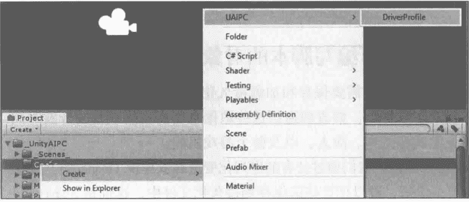

图 10-1

例如在竞速游戏中，我们可为一组无特定配置的 AI 车手统一套用同一份 `DriverProfile`，如图 10-2 所示；图 10-3 则展示了引用该 Profile 的 `Agent Driver` 组件：

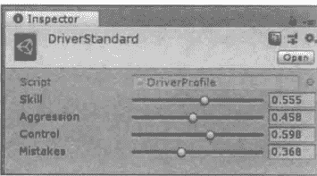

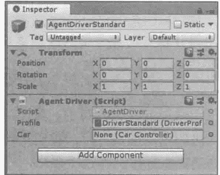

### 进阶价值：内存优化

除了配置解耦，`ScriptableObject` 还是内存优化利器。假设某基类包含基础类型字段，占用 5MB 内存。若场景中有 10 个 Agent 皆需访问一张大型二维数组地图：

- **常规做法**：每个 Agent 持有副本，总计 50MB。
- **ScriptableObject 方案**：仅分配 5MB 存地图实例，10 个 Agent 仅持有引用，额外开销微乎其微。

### 官方文档参考

- https://docs.unity3d.com/Manual/class-ScriptableObject.html
- https://docs.unity3d.com/ScriptReference/ScriptableObject.html

## 10.3 进阶随机数处理：从均匀到正态

### 问题背景

某些场景下（如瞄准系统），我们需要“聚集感”而非“散乱感”的随机。标准随机函数基于均匀分布，导致子弹在 X/Y 轴均匀散开；但实战期望大部分弹着点贴近靶心——这正是正态分布（高斯分布）的特性。

### 直观对比

图 10-4 左侧为均匀分布，覆盖整个圆域，适用于通用随机；右侧为正态分布，呈钟形曲线集中于中心，完美契合瞄准、掉落概率等需求。

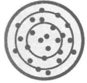

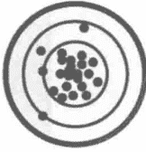

我们拥有的是均匀分布

我们想要的是正态分布

图 10-4

### 代码实现：中心极限定理简易版

构建工具类 `RandomGaussian`：

#### 1. 定义类结构：

```
using UnityEngine;
public class RandomGaussian
{
    // 下面的步骤
}
```

#### 2. 编写 `RangeAdditive` 方法初始化参数：

```
public static float RangeAdditive(params Vector2[] values)
{
    float sum = 0f;
    int i;
    float min, max;
    // 下面的步骤
}
```

#### 3. 若采样数为 0，默认生成 3 个随机值：

```
if (values.Length == 0)
{
    values = new Vector2[3];
    for (i = 0; i < values.Length; i++)
    values[i] = new Vector2(0f, 1f);
}
```

#### 4. 对三值求和：

```
for (i = 0; i < values.Length; i++)
{
    min = values[i].x;
    max = values[i].y;
    sum += Random.Range(min, max);
}
```

#### 5. 返回归一化结果：

```
return sum;
```

### 更高效的替代方案：Box-Muller 变换

上述求和法虽直观但效率一般。工业级做法常采用 Box-Muller 变换，可直接从均匀分布生成标准正态分布样本，详见 `Game AI Pro` 系列书籍第 3 部分（Rabin 等著）。

```
public static ulong seed = 61829450;
public static float Range()
{
	double sum = 0;
	for (int i = 0; i < 3; i++)
	{
		ulong holdseed = seed;
		seed ^= seed << 13;
		seed ^= seed >> 17;
		seed ^= seed << 5;
		long r = (long) (holdseed * seed);
		sum += r * (1.0 / 0x7FFFFFFFFFFFFFFF);
	}
	return (float)sum;
}
```

### 扩展阅读

关于高斯随机生成器及更高级采样算法的理论深度，推荐阅读 Rabin 编著的 *Game AI Pro* 相关章节。

## 10.4 构建空气曲棍球 AI 对手

### 项目背景

空气曲棍球是街机黄金时代的国民级佳作。触屏设备普及让其焕发新生。表面看规则简单，实则是物理引擎验收与 AI 对手开发的绝佳练兵场。

### 前置依赖

本技术复用第 1 章算法：**Seek（追踪）**、**Arrive（到达）**、**Leave（逃离）**，以及前文涉及的**射线检测**与**路径平滑**知识。

**场景准备**：
- 击球器需挂载 `AgentBehavior`、`Seek`、`Leave` 组件。
- 墙体对象（含 BoxCollider）需打上特定 Tag，参考图 10-5。

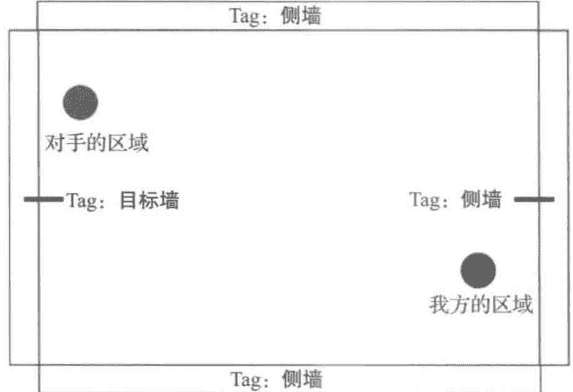

图 10-5

**代码准备**：定义管理对手状态的枚举类型：

```
public enum AHRState
{
    ATTACK,
    DEFEND,
    IDLE
}
```

### 核心类实现步骤

代码量较大，请逐步落实：

#### 1. 创建对手控制器类：

```
using UnityEngine;
using System.Collections;

public class AirHockeyRival : MonoBehaviour
{
    // 下面的步骤
}
```

#### 2. 声明公开可调参数（阈值、速度、距离等）：

```
public GameObject puck;
public GameObject paddle;
public string goalWallTag = "GoalWall";
public string sideWallTag = "SideWall";
[Range(1, 10)]
public int maxHits;
```

#### 3. 声明私有运行时变量（引用缓存、状态机、计时器等）：

```
float puckWidth;
Renderer puckMesh;
Rigidbody puckBody;
AgentBehaviour agent;
Seek seek;
Leave leave;
AHRState state;
bool hasAttacked;
```

#### 4. 在 `Awake` 中依据公开参数初始化私有字段：

```
public void Awake()
{
    puckMesh = puck.GetComponent<Renderer>();
    puckBody = puck.GetComponent<Rigidbody>();
    agent = paddle.GetComponent<AgentBehaviour>();
    seek = paddle.GetComponent<Seek>();
    leave = paddle.GetComponent<Leave>();
    puckWidth = puckMesh.bounds.extents.z;
    state = AHRState.IDLE;
    hasAttacked = false;
    if (seek.target == null)
    seek.target = new GameObject();
    if (leave.target == null)
    leave.target = new GameObject();
}
```

#### 5. 声明 Update 成员函数，后续步骤将补全函数体：

```
public void Update()
{
    // 下面的步骤
}
```

#### 6. 依据当前状态分支，调度对应处理函数：

```
switch (state)
{
    case AHRState.ATTACK:
    Attack();
    break;
    default:
    case AHRState.IDLE:
    agent.enabled = false;
    break;
    case AHRState.DEFEND:
    Defend();
    break;
}
```

#### 7. 调用该函数复位撞球后的激活标记：

```
AttackReset();
```

#### 8. 实现函数，供外部对象修改状态：

```
public void SetState(AHRState newState)
{
    state = newState;
}
```

#### 9. 实现函数，返回击球器与小球的距离：

```
private float DistanceToPuck()
{
    Vector3 puckPos = puck.transform.position;
    Vector3 paddlePos = paddle.transform.position;
    return Vector3.Distance(puckPos, paddlePos);
}
```

#### 10. 声明攻击用成员函数，定义工作留待后续：

```
private void Attack()
{
    if (hasAttacked)
    return;
    // 下面的步骤
}
```

#### 11. 启用 Agent 组件并测算至小球的距离：

```
agent.enabled = true;
float dist = DistanceToPuck();
```

#### 12. 判断小球是否在触及范围内，超出则跟随移动：

```
if (dist > leave.dangerRadius)
{
    Vector3 newPos = puck.transform.position;
    newPos.z = paddle.transform.position.z;
    seek.target.transform.position = newPos;
    seek.enabled = true;
    return;
}
```

#### 13. 若在范围内，立即执行撞击：

```
hasAttacked = true;
seek.enabled = false;
Vector3 paddlePos = paddle.transform.position;
Vector3 puckPos = puck.transform.position;
Vector3 runPos = paddlePos - puckPos;
runPos = runPos.normalized * 0.1f;
runPos += paddle.transform.position;
leave.target.transform.position = runPos;
leave.enabled = true;
```

#### 14. 实现复位函数，清理撞击参数，代码如下：

```
private void AttackReset()
{
    float dist = DistanceToPuck();
    if (hasAttacked && dist < leave.dangerRadius)
    return;
    hasAttacked = false;
    leave.enabled = false;
}
```

#### 15. 定义防守逻辑函数：

```
private void Defend()
{
    agent.enabled = true;
    seek.enabled = true;
    leave.enabled = false;
    Vector3 puckPos = puckBody.position;
    Vector3 puckVel = puckBody.velocity;
    Vector3 targetPos = Predict(puckPos, puckVel, 0);
    seek.target.transform.position = targetPos;
}
```

#### 16. 实现小球落点预测函数：

```
private Vector3 Predict(Vector3 position, Vector3 velocity, int numHit)
{
    if (numHit == maxHits)
    return position;
    // 下面的步骤
}
```

#### 17. 基于小球位置与朝向发射射线：

```
RaycastHit[] hits = Physics.RaycastAll(position,
velocity.normalized);
RaycastHit hit;
```

#### 18. 解析碰撞检测结果：

```
foreach (RaycastHit h in hits)
{
    string tag = h.collider.tag;
    // 下面的步骤
}
```

#### 19. 判定是否击中目标底墙——基线判据：

```
if (tag.Equals(goalWallTag))
{
    position = h.point;
    position += (h.normal * puckWidth);
    return position;
}
```

#### 20. 判定是否击中侧墙——递归判据：

```
if (tag.Equals(sideWallTag))
{
    hit = h;
    position = hit.point + (hit.normal * puckWidth);
    Vector3 u = hit.normal;
    u *= Vector3.Dot(velocity, hit.normal);
    Vector3 w = velocity - u;
    velocity = w - u;
    break;
}
// 结束foreach
```

- 21. 满足递归条件，进入 foreach 循环迭代：

```
return Predict(position, velocity, numHit + 1);
```

### 核心运作机制

Agent 依据小球当前速度推演下一次碰撞，循环迭代直至预测落点落在己方底墙，从而得到目标坐标驱动击球器移动。同时，当击球器靠近小球且朝其移动时切入进攻模式；否则依据距离切换为空闲或防守模式。

### 扩展阅读

移动与行为的更多细节，请参阅第 1 章。

## 10.5 极速竞速架构落地

竞速游戏与 NPC 车手 AI 的开发极具探索价值：既可极简上手，也可深度演进，因为车辆系统与物理引擎强耦合。但只要满足最小功能集，即可跑通玩法并为 Agent 注入智能。本节演示如何搭建一套轻量级竞速架构。

### 前置准备

沿用前文的驾驶员配置对象，同时作为 10.6 节的基石。

### 实施步骤

先建立车辆控制接口，采用 MonoBehaviour 暴露公共成员，便于玩家与 Agent 无差别交互。

- 1. 新建脚本 `CarController`，代码如下：

```
using UnityEngine;
public class CarController : MonoBehaviour
{
    // next steps
}
```

- 2. 定义成员字段：

```
public float speed;
public float maxSpeed;
public float steering;
public float maxSteering;
public Vector3 velocity;
```

- 3. 实现 Update，驱动车辆前进并响应转向：

```
private void Update()
{
    transform.Rotate(Vector3.up, steering, Space.Self);
    transform.Translate(Vector3.forward * speed * Time.deltaTime,
    Space.World);
}
```

随后实现路径节点跟踪：

- 1. 新建脚本 `TrackNode`，代码如下：

```
using UnityEngine;

public class TrackNode : MonoBehaviour
{
    // next steps
}
```

- 2. 声明节点所需字段：

```
public float raceWidth;
public float offWidth;
public float wallWidth;
public TrackNode prev;
public TrackNode next;
public Vector3 normal;
```

- 3. 实现 Awake 完成初始化：

```
private void Awake()
{
    // next step
}
```

- 4. 计算法向量：

```
normal = transform.forward;
if (prev != null && next != null)
{
    Vector3 nextPosition, prevPosition;
    nextPosition = next.transform.position;
    prevPosition = prev.transform.position;
    normal = nextPosition - transform.position;
    normal += transform.position - prevPosition;
    normal /= 2f;
    normal.Normalize();
}
```

### 架构解析

`CarController` 充当驾驶员与车辆的中介，现实映射为方向盘与油门。无论驾驶员是真人还是 AI，车辆物理表现一致，差异仅在于驾驶策略。所有变量设为公开，旨在让驾驶层直接读取车辆反馈——UI 或手柄可让玩家感知对手动作，AI 亦需同等信息输入。

## 10.6 橡皮筋系统动态平衡竞速难度

优秀竞速体验往往要求难度自适应，而“作弊式”Agent 是实现此目标的捷径。本节引入一个中间层框架，允许开发者注入自定义启发式规则，根据车辆状态调控速度，无论街机还是模拟向均可复用。

### 前置知识

掌握第 1 章基础技巧至关重要，以便扩展适配自有需求的框架——理解 Agent 类运作及行为如何驱动实体朝目标移动，核心即向量运算。

### 实施步骤

分三层实现：基础对手、幽灵/无敌车手、上层协调器。

- 1. 创建基础对手 Agent 类：

```
using UnityEngine;
public class RacingRival : MonoBehaviour
{
    public float distanceThreshold;
    public float maxSpeed;
    public Vector3 randomPos;
    protected Vector3 targetPosition;
    protected float currentSpeed;
    protected RacingCenter ghost;
}
```

- 2. 实现 Start 初始化：

```
void Start()
{
    ghost = FindObjectOfType<RacingCenter>();
}
```

- 3. 定义 Update 管理跟踪目标点：

```
public virtual void Update()
{
    targetPosition = transform.position + randomPos;
    AdjustSpeed(targetPosition);
}
```

#### 4. 实现根据位置动态调速的函数：

```
public virtual void AdjustSpeed(Vector3 targetPosition)
{
    // TODO
    // 这里是你的行为代码
}
```

#### 5. 创建幽灵/无敌车手管理类：

```
using UnityEngine;

public class RacingCenter : RacingRival
{
    public GameObject player;
}
```

#### 6. 实现初始化寻找目标：

```
void Start()
{
    player = GameObject.FindGameObjectWithTag("Player");
}
```

#### 7. 重写 Update 使无敌车手适应玩家行为：

```
public override void Update()
{
    Vector3 playerPos = player.transform.position;
    float dist = Vector3.Distance(transform.position,
    playerPos);
    if (dist > distanceThreshold)
    {
        targetPosition = player.transform.position;
        base.Update();
    }
}
```

#### 8. 实现专属行为逻辑：

```
public override void AdjustSpeed(Vector3 targetPosition)
{
    // TODO
    // 当也应用基础行为的情况下使用
    base.AdjustSpeed(targetPosition);
}
```

#### 9. 创建上层 AI 协调器类：

```
using UnityEngine;

public class Rubberband : MonoBehaviour
{
    RacingCenter ghost;
    RacingRival[] rivals;
}
```

#### 10. 在橡皮筋系统中为每位车手分配随机槽位，本例采用环形拓扑：

```
void Start()
{
    ghost = FindObjectOfType<RacingCenter>();
    rivals = FindObjectsOfType<RacingRival>();
    foreach (RacingRival r in rivals)
    {
        if (ReferenceEquals(r, ghost))
        continue;
        r.randomPos = Random.insideUnitSphere;
        r.randomPos.y = ghost.transform.position.y;
    }
}
```

### 系统原理

上层橡皮筋系统分配车手占位，各车手自带调速行为，无敌车手尤为激进。Agent 作为橡皮筋中心：玩家速度超阈值时收紧适应，否则维持现状来回换道。

引人入胜的交互体验离不开智能对手，而游戏 AI 正是多元技术融合的产物。深挖 Unity API 与内置特性，能为游戏世界与角色注入无限可能。本书梳理了通用与专项技术，助你在 AI 开发之路上持续攀升。

# 掌握 Unity 游戏 AI 编程核心技艺

本书引领你从零构建游戏 AI 核心体系：先夯实 Agent 移动、导航与编程基础，再进阶攻克自定义决策逻辑与协作机制。你将深入实战视听感官模拟，赋予 AI 拟真反应，并精通 Unity 2018 引入的全新导航网格技术，大幅优化寻路性能。从井字棋、跳棋的博弈决策，到多 Agent 协同作战的战术编排，全方位覆盖。

读完即会，让你在 AI 编程与创意游戏开发的道路上实现质的飞跃。

## 核心收获清单：

- 灵活驾驭 A* 及其变体算法，打造高智商寻路 Agent。
- 掌握协作算法与战术逻辑，实现 Agent 间的默契配合与多样化战术执行。
- 构建感知模拟系统，让 Agent 在复杂环境中拥有更优决策判断力。
- 突破基础行为树，探索多元决策算法，赋予 Agent 类人思考深度。
- 融合图结构与地形分析，强化 Agent 与战术层面的深度联动。
- 手动构建路径点选择器，掌握精细化路径控制技巧。