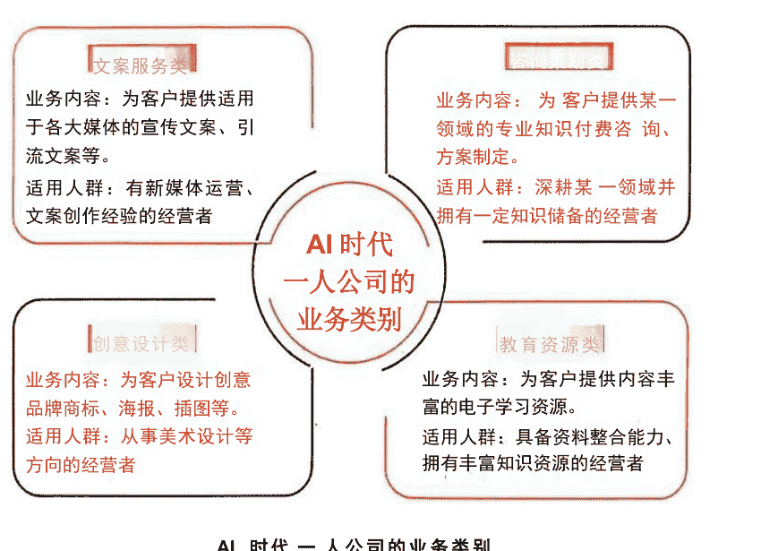
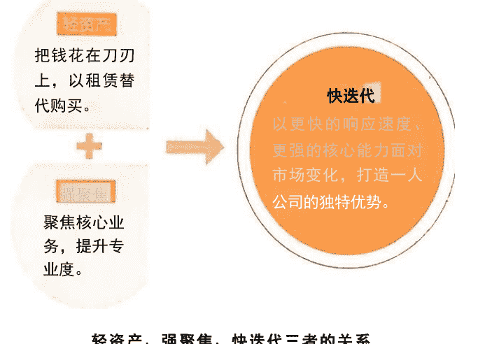
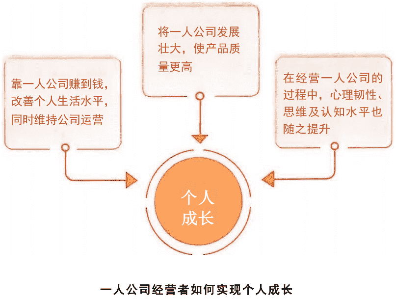
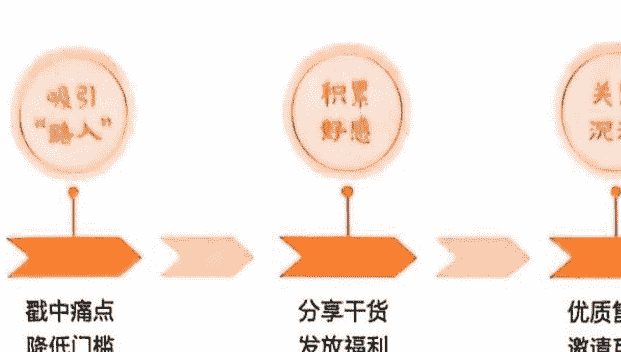

# 一人公司：AI 时代赚钱新方向

究慈◎主编

让 AI 工具帮你解决流量、效率、变现三大难题

### 0团队 | 0房租 0经验
### 你自己就能打造一家公司！
### 教你从0到1搭建一人公司体系

别人还在了解AI工具，你已经会用AI工具开公司了

民主与建设出版社

一本贴合当下趋势的赚钱行动指南

# 一人公司
## AI 时代赚钱新方向

究慈◎主编

民主与建设出版社

· 北京 ·

©民主与建设出版社，2026

图书在版编目（CIP）数据

一人公司：AI时代赚钱新方向/究慈主编.
北京：民主与建设出版社，2026.1（2026.2重印）.-- ISBN 978-7-5139-5194-4
I.F272
中国国家版本馆CIP数据核字第2025HT6835号

## 一人公司：AI时代赚钱新方向
YI REN GONGSI:AI SHIDAI ZHUANQIAN XIN FANGXIANG

主编 究慈
责任编辑 廖晓莹
封面设计 天下书装
出版发行 民主与建设出版社有限责任公司
电话 (010) 59417749 59419778
社址 北京市朝阳区宏泰东街远洋万和南区伍号公馆4层
邮编 100102
印刷 三河市嵩川印刷有限公司
版次 2026年1月第1版
印次 2026年2月第2次印刷
开本 880毫米×1230毫米 1/32
印张 7
字数 104千字
书号 ISBN 978-7-5139-5194-4
定价 68.00元

注：如有印、装质量问题，请与出版社联系。

### 前言
#### Preface

打开这本书的你，或许正在创业的路口徘徊，或许在拥有稳定工作的同时，渴望有一份额外的收入，又或许已经尝试过自由职业，却面临风险不可控、收入不稳定等难题。你可能听过“一人公司”这个词，却不确定它是否适合自己，更不知道从何着手将它从概念变成能稳定盈利的实体。本书可以帮你厘清一人公司的运营逻辑，让轻资产创业变得触手可及。

这些年，有人把自由职业当成一人公司，却因忽视合规性导致风险缠身；有人照搬多人公司的管理模式，让轻资产创业变成了负担；有人沉迷于技能提升却不懂变现，让自我成长成为空耗时间的无用功；还有人获得了流量却留不住客户，始终停留在赚快钱的层面。这些问题的根源，并不是个人能力不足，而是缺乏对一人公司的系统认知——它既不是自由职业的简单升级，也不是传统公司的精简版本，而是一种依托技术赋能、聚焦个人优势、兼顾灵活性与规范性的全新商业形态。

基于这些观察，笔者将一人公司的发展路径拆解为七个阶段。从认知建立期开始，首先厘清一人公司与自由职业、多人公司的本质差异，明确它“轻资产、强聚焦、快迭代”的关键特质，建立“赚钱与自我成长并重”的创业认知；进入探索期，重点解决“做什么”的问题，学会用AI工具提升效率，把个人技能转化为标准化产品，从细分需求中找到商机，用三天时间测试商业模式的可行性；在试运营期，实现稳定开局，覆盖风险防控、流量设计、现金流管理、时间分配等基础运营要点，帮你避开财产混同、心态崩溃等常见陷阱；在引流期和发展期，则聚焦“拓客户、做增长”两个方面，提供从信任建立到转化成交、从低成本营销到多平台裂变的实战方法，让客户主动上门且持续复购；在稳固期，聚焦“留住客户”的目标，通过个人IP打造、情感连接、客户升级体系等策略，培养终身客户群体；最后在升值期，构建自动赚钱系统，实现从“手动赚钱”到“自动盈利”的跨越，甚至把公司打造成可交易的资产。

本书有三个核心特点：一是全程贯穿“轻资产”的理念，所有阶段都不需要大额投入，更适合普通人起步；二是深度融合AI工具的应用，从知识积累、产品开发到流量获取、时间管理，都提供了具体的技术赋能方案，让“一个人就是一家公司”成为现实；三是注重实操性，每个阶段都有明确的目标和可落地的方法，比如三天测试商业模式、零成本故事营销、差评处理模板等。本书没有复杂的商业概念，而是用直白的语言拆解运营逻辑，确保不同基础的读者都能看懂、会用。

需要明确的是，一人公司不是“躺赚”的捷径，它需要你投入时间打磨能力、优化流程、维护客户，但它的优势在于让你的每一份投入都精准转化为收益和成长。创业路上没有放之四海而皆准的公式，但有可复制的逻辑和可借鉴的方法。希望你能跟着本书的节奏，一步步搭建起自己的一人公司运营体系，既实现稳定的收入增长，也在这个过程中完成认知、能力、心态的全面升级。

现在，就让我们从建立认知开始，开启这场属于你的轻资产创业之旅。

### 目录
#### Contents

#### 第 1 章
认知建立期：全面了解一人公司
——普通人的轻资产创业启蒙

- 2. AI 时代的一人公司：是创业新思路，也是副业新选择
- 8. 一人公司与自由职业、多人公司的核心差异
- 14. 小而美：一人公司低成本、高灵活度的赚钱逻辑
- 20. 一人公司的三个关键特质——轻资产、强聚焦、快迭代
- 26. 把创业过程变成人生修行，赚钱与自我成长“两手抓”

#### 第 2 章
探索期：找准方向，打造你的一人公司

- 34. 把技能变成产品的黄金三角法则
- 40. 从冷门搜索词中发现百亿商机
- 46. 看透用户心理的深度画像
- 52. 三天测试出能赚钱的商业模式

#### 第 3 章
试运营期：从 0 到1筑牢运营根基，实现稳步开局

- 58. 流量不断：公私域双保险设计
- 64. 搭建阶梯产品线，稳定现金流
- 70. 学会时间管理，科学运用AI工具
- 76. 避免个人和公司财产混同的雷区
- 81. 创业低谷期的心理自救指南

#### 第 4 章
引流期：搞定流量密码，让客户主动上门

- 88. 三秒吸引客户注意力的方法
- 94. 零成本的真实故事营销术
- 100. 把“路人”变熟客的私域运营路径
- 106. 小众博主带货的高效合作模式
- 111. 让客户觉得“超划算”的定价策略

#### 第 5 章
发展期：花小钱办大事，一人公司的低成本营销打法

- 118. 一次创作在多平台裂变的诀窍
- 124. 让搜索引擎优先推荐你的技巧
- 130. 用AI 工具建立每周3小时的知识复利引擎
- 136. 蹭热点的正确方式：48小时快攻
- 142. 每天盯着这4个数据做决策
- 147. 在红海市场中杀出蓝海之路

#### 第 6 章
稳固期：从流量到“留量”，培养终身客户

- 154. 做真实不“装”的个人IP
- 160. 用情感连接代替硬推销
- 166. 从入门到高端的客户升级体系
- 173. 让粉丝主动帮你获客的妙招
- 179. 差评变口碑的危机处理模板

#### 第 7 章
升值期：打造赚钱系统，从手动赚钱到自动盈利

- 186. 不做大忙人：打造自动赚钱系统
- 192. “一个主业务+N 个赚钱点”的布局
- 198. 每天两小时管好公司的秘诀
- 204. 业务下滑前的转型信号识别
- 210. 把公司做成能卖钱的资产

## 第1章

### 认知建立期：
全面了解一人公司
——普通人的轻资产创业启蒙

本章阐释了AI 时代下一人公司的概念及创业思路，旨在帮助读者建立正确的认知。先点明一人公司既是创业新思路，也是副业新选择；再对比其与自由职业、多人公司的核心差异，拆解“小而美”的低成本、高灵活度的赚钱逻辑，提炼轻资产、强聚焦、快迭代三大关键特质；最终引导读者将创业与人生结合，实现赚钱与自我成长双赢。

### AI 时代的一人公司：
是创业新思路，也是副业新选择

在AI 技术普及的当下，一人公司不再是简单的个人经营，而是融合智能工具的高效创业范式，并已成为普通人轻资产创业与副业的优选。它借助AI 进行重复性工作，让单个创业者聚焦核心战略，打破传统创业对团队的依赖。无论是想摆脱职场束缚的创业者，还是寻求额外收入的职场人，理解AI 与一人公司的融合逻辑，都是把握时代机遇的关键。

### AI 赋能：
一人公司的效能革命与模式升级

AI 时代的一人公司，其核心是技术带来的效能倍增与成本优化。AI 助手可进行编程、设计、内容创作、客户服务等重复性任务，大幅提升单人的产出效率。这种效能提升不是线性叠加，而是通过智能工具集成实现的“超线性输出”，让创业者能独立完成从产品开发到市场推广的全流程，无须依赖团队协作。同时，AI 工具的低成本特性降低了运营成本，云计算、自动化工作流等技术进一步压缩了场地、设备等固定投入，形成典型的轻资产运营模式。

作为创业新思路，AI 时代的一人公司实现了“技术平权”。创业者无须精通编程就能通过AI 生成代码，无须具备专业设计能力就能完成视觉创作，“一个人就是一支队伍”成为现实。作为副业新选择，它的灵活性优势更突出，使创业者实现收入增长。

这种模式的兴起，离不开技术成熟与市场需求的双重支撑。AI 工具的易用性提升，让非技术背景的普通人也能快速上手；云计算、全球协作平台的发展，为一人公司提供了便捷的运营基础。但我们要知道，AI 只是工具，而不是万能解决方案，创业者仍需具备核心判断能力、客户沟通能力等，才能让一人公司实现可持续运营。

### 创业答疑

#### 问题一 成立一人公司，需要具备AI 相关的专业技能吗？

在AI 时代成立一人公司，不需要具备深度的AI 专业技能，但需要掌握AI 工具的使用方法和基础应用思维。当前主流的AI 工具无须编程或算法知识就能操作，比如内容创作类AI 可直接通过自然语言指令生成文本，设计类AI 能通过简单设置完成视觉作品，客服类AI 可通过模板配置实现自动回复。创业者可根据业务需求选择合适的工具，并掌握高效使用方法。但重要的是，创业者要建立AI应用思维，明确哪些工作可交给AI 完成、哪些需要个人主导。

#### AI 时代的一人公司，适合选择哪些业务方向？核心判断标准是什么？

AI 时代的一人公司适合的业务方向，多集中在能发挥AI 效能、依赖个人核心能力且低成本运营的领域，比如内容创作、数字服务、咨询策划、精细化运营等。核心判断标准有三个：一是AI 工具可覆盖大部分基础工作，比如在内容创作中，AI 生成初稿后再由个人进行修改润色；二是契合个人专业背景或优势技能，能通过AI 放大个人能力，比如具备行业知识的人可借助AI 快速整理数据、生成报告、开展咨询服务等；三是目标市场存在明确的细分需求，且竞争程度适中，要避免进入巨头主导或过度饱和的领域。

#### AI 可能替代部分工作， 一人公司如何避免被AI 或其他竞争者取代？

我们要明确AI的替代边界。AI 擅长重复性、标准化的工作，但缺乏创造力、共情能力、战略判断力等，创业者需在这些AI 难以替代的领域构建优势，比如深度理解客户需求的定制化服务、结合行业经验的战略策划、需要情感沟通的客户维护等。同时，我们要及时跟进新的AI 工具和技术应用，并提升个人专业深度，形成“技术工具+专业能力”的双重壁垒，形成差异化竞争优势，避免与同类从业者同质化。

### AI 时代 一人公司的业务类别

### 创业预警

#### 预警一 过度依赖AI 工具，丧失个人核心竞争力

部分创业者将AI 视为万能工具，所有工作都依赖AI 完成，长期下来会丧失核心判断与创新能力，面临被替代的风险。比如内容创作时完全照搬AI生成的文本，不进行深度修改和价值提升，作品会缺乏个人风格与思想深度，难以吸引优质客户；咨询服务中依赖AI生成的报告，不结合自身行业经验分析，会导致建议缺乏针对性。AI 是提升效率的工具，而不是替代个人价值的主体。创业者可将基础工作交给AI，把主要精力投入到创意设计、战略决策等核心环节，通过持续学习提升专业能力，让AI成为个人能力的延伸。

#### 预警二 忽视数据安全与隐私保护，引发法律风险

部分创业者为提升AI工具的效能，随意收集客户隐私数据，或在使用AI工具时泄露商业信息；还有人直接使用包含侵权风险的内容，比如涉及版权的图片、文字等。这些行为可能违反相关法律法规，让经营者面临罚款、赔偿等处罚。创业者需建立数据管理规范，收集客户数据前明确告知用途并获得同意，存储时采取加密措施；使用AI工具时，选择正规平台，避免上传敏感信息；对AI生成的内容进行版权核查，确保合法合规，必要时咨询专业法律人士。

#### 盲目跟风选择 AI 热门领域，缺乏市场调研

看到某一领域热度高，部分创业者未做充分市场调研就盲目进入，但该领域竞争激烈导致难以盈利。热门领域往往会吸引大量参与者，若缺乏差异化优势，很容易陷入低价竞争；同时，部分热门领域存在技术不成熟、市场需求不明确的问题，盲目进入易面临业务停滞的风险。创业者在选择方向前，需做系统市场调研，分析目标领域的市场规模、目标客户需求、现有竞争者的优势与不足，然后结合自身能力判断是否能提供差异化价值。

#### 忽视 AI 工具成本与效能平衡，造成资源浪费

部分创业者追求“AI 全覆盖”，于是购买大量不同类型的AI 工具会员，或投入资金定制专用AI 系统，但很多工具使用频率低，未充分发挥效能，造成成本浪费。 一人公司的核心优势是轻资产运营，过度投入AI 工具成本会增加运营压力；同时，部分复杂的AI 工具学习成本高，若业务需求简单，使用基础工具即可满足，无须追求高端版本。创业者需根据业务实际需求筛选AI 工具，优先选择免费版或按次付费的工具试用，验证效能后再付费；对于高频使用且能显著提升效率的工具，可以考虑长期投入。

### 一人公司与自由职业、
多人公司的核心差异

应用AI 技术的一人公司，已成为独立于自由职业、多人公司的全新商业形态，厘清三者的核心差异，是理解现代轻资产创业的关键。三者虽均以提供产品或服务实现价值交换，但在法律架构、运营逻辑、效能边界等层面存在本质区别。一人公司并不是自由职业的升级版，也不是多人公司的精简版，而是凭借 AI 工具重构的商业组织的最小单元。明确三者在风险承担、决策机制、资源整合等维度的边界，能帮助创业者精准匹配自身需求与商业形态。

### 核心差异解析：
技术赋能下的三种商业形态本质边界

自由职业、一人公司、多人公司的核心差异，根源在于组织属性与技术应用深度，进而延伸到风险控制、运营效率、发展空间等关键层面。

自由职业的核心是个人作为经营主体，无独立法人资格，以个人技能直接对接市场。其运营依赖个人时间与精力，无复杂的管理流程，但风险承担无边界，需以个人的全部财产对业务责任负责，且效能上限受限于个人产能，难以突破单一技能的服务半径。

一人公司是以独立法人为核心身份，叠加 AI 技术形成的独特运营模式。它使用智能工具进行重复性工作，使个人效能倍增，无须依赖团队协作，即可完成一个公司所需的全流程业务。其风险承担以股东出资额为限，具备法律层面的资产隔离，决策时无须协商，能快速响应市场变化。

多人公司以多元股东与团队协作为核心，依赖集体智慧与资源整合开展运营。其优势在于能承载大规模业务，通过分工协作覆盖更广泛的服务领域，但决策流程复杂，运营成本高，灵活性不足，且市场响应速度易受影响。

### 创业答疑

#### 问题一 自由职业、一人公司、多人公司在法律属性与风险承担上的核心差异是什么？

三者的核心差异体现在法律主体资格与责任边界两方面。自由职业无独立法人身份，经营者需以个人或家庭的全部财产，对业务中可能产生的债务、合同纠纷等承担责任。一人公司具备独立法人的资格，公司财产与股东个人财产严格区分，股东仅以认缴的出资额为限承担责任，不会直接影响个人资产。多人公司同样属于法人主体，股东按出资比例或公司章程承担有限责任，但因股东较多，有时还需应对内部股东利益分歧、责任划分纠纷等额外风险。从风险控制的角度看，一人公司的有限责任与资产隔离优势显著，自由职业的风险较大，多人公司则需兼顾内外双重风险。

#### 问题二 在运营效率与决策机制上，三者的差异如何影响业务推进速度？

运营效率与决策机制的差异，直接决定了三者的市场响应能力。自由职业的决策完全由个人主导，无须任何流程，能快速对接需求并启动服务，但效率上限受限于个人产能，面对多任务或复杂业务时易陷入瓶颈。一人公司的决策同样高度集中，股东可直接根据市场变化调整策略，同时使用AI技术自动处理重复性工作，实现“一人顶一队”的效能。多人公司的决策需经过股东会议或管理层协商，易出现意见分歧导致决策滞后，且团队协作中的沟通成本、分工协调成本会进一步降低运营效率，市场响应速度远不及前两者。

#### 从发展空间与资源整合能力来看，三者的核心差异是什么？

三者的发展空间与资源整合能力，取决于组织形态与技术工具的赋能效果。自由职业的资源整合能力仅限于个人技能与人脉，发展空间受限于个人产能与服务半径，规模扩大后易因精力不足陷入停滞。一人公司借助 AI 技术打破了个人产能限制，通过云计算、全球协作平台整合外部资源，其发展空间取决于核心技能与技术应用的结合深度，具备“小而强”的成长特质。多人公司的资源整合能力强，可通过吸纳股东资金、招聘专业人才、整合供应链等方式扩大规模，承载更大体量的业务，但资源整合的同时伴随着管理成本上升与灵活性下降。从资源整合的性价比来看，一人公司以低管理成本实现了高效资源整合，性价比更高。

### 创业预警

#### 照搬多人公司管理模式，增加一人公司运营成本

一人公司的核心优势是轻资产与高效率，但部分创业者盲目借鉴多人公司的管理体系，如建立复杂的规章制度、设置冗余的管理流程、组建兼职团队，违背了其核心运营逻辑。多人公司的管理模式是为适配团队协作需求，而一人公司的核心是AI 赋能下的个人高效运营，过度复杂的管理会大幅增加运营成本。创业者需坚守一人公司的轻资产本质，以 AI 工具替代人工，聚焦核心业务流程优化，避免引入不必要的管理环节，将运营成本集中在技术工具与核心资源上。

#### 预警二 忽视自由职业的风险，盲目扩大业务规模

自由职业者如果盲目扩大业务规模，会导致风险累积。随着业务体量的增加，涉及的合同金额、客户数量同步上升，纠纷与债务风险也会随之增加，而自由职业者无任何资产隔离机制， 一旦出现问题，个人全部资产都可能被用于承担责任。这种风险敞口在业务规模较小时影响有限，但规模扩大后会成为致命隐患。选择自由职业形态的创业者，需明确自身的风险承受能力，控制业务规模与服务范围，避免承接超出风险边界的项目；若计划扩大规模，应及时转型为一人公司，通过法人身份建立风险隔离机制。

#### 预警三 误判多人公司的协作成本，盲目追求规模化

部分创业者羡慕多人公司的规模化优势，盲目组建团队，但忽视了随之而来的管理成本、沟通成本和协调成本。多人公司的协作优势建立在高效的组织管理和清晰的权责划分之上，若缺乏相应的管理能力，团队协作反而会降低效率，增加内耗。创业者在考虑扩大规模时，应首先评估自身的管理能力和业务需求，确保团队规模与业务复杂度相匹配，避免因盲目扩张而陷入管理困境。

#### 预警四 忽视技术赋能的核心价值，弱化一人公司的效能优势

一人公司的核心竞争力源于 AI 技术赋能，部分创业者仅关注法人身份，忽视技术工具的应用，导致效能优势无法发挥，沦为无技术支撑的一人公司。这类创业者仍以传统个人运营模式开展业务，未借助 AI 工具处理工作，效能与自由职业无本质区别，未能体现一人公司的技术适配性。因此创业者需深度理解一人的技术内核，主动学习并应用适配的智能工具，将基础工作自动化，聚焦核心战略与创新环节，通过技术赋能实现效能倍增，真正发挥一人公司“轻资产、高效率”的核心优势，避免陷入“有其名无其实”的运营困境。

## 小而美：一人公司低成本、高灵活度的赚钱逻辑

“小而美”并非规模导致的局限，而是一人公司依托低成本与高灵活度构建的核心赚钱逻辑，也是普通人轻资产创业的核心优势所在。它打破了传统公司“规模决定收益”的认知，以精简的运营架构、精准的市场切入实现价值变现。很多人对一人公司的认知停留在“单人经营”的层面，却忽视了其背后成本控制与灵活应变的底层逻辑。厘清这一逻辑，能帮助创业者避开“重投入、低效率”的陷阱。

### 拆解“小而美”：低成本与高灵活的协同逻辑

一人公司“小而美”的核心，是低成本与高灵活度的深度协同，两者共同构成其赚钱逻辑的基石。低成本并不是单纯压缩开支，而是通过运营架构精简实现的结构性成本优势。一人公司无须承担团队薪酬等固定成本，核心开支集中在工具、资质办理与基础运营上，资金周转效率高，盈亏平衡点低，即便业务规模不大，也能实现稳定盈利。

高灵活度则体现在决策与运营两个层面，是低成本优势的重要保障。在决策层面，一人公司创始人可直接根据市场反馈调整业务方向、优化服务内容，对市场变化的响应速度远超多人公司。在运营层面，一人公司可依托自身技能或核心资源，聚焦单一细分领域深耕，快速形成差异化竞争力。这种灵活性能让其精准捕捉小众市场的需求，避开与大规模企业的正面竞争，在细分领域建立优势。

低成本与高灵活度的协同，形成了一人公司独特的盈利闭环。低成本降低了创业风险与盈利门槛，带来了足够的试错空间；高灵活度则让其能精准匹配市场需求，提升转化率与客户留存率。两者结合，使得一人公司仅通过“精准定位+高效运营”便实现稳定收益，这正是“小而美”赚钱逻辑的核心——以最小的投入，撬动最精准的市场价值，实现效率与收益的最优平衡。

### 创业答疑

**问题一** 一人公司的低成本是绝对的吗？哪些成本是不可省略的，需要重点投入？

一人公司的低成本是相对于传统公司而言的结构性优势，并不是绝对的零成本。其不可省略的成本主要包括三类：一是合规性成本，如工商注册费、年度公示费、税务代账费等，这些成本是获得法人资格、实现风险隔离的基础；二是核心工具成本，如业务所需的专业软件、AI 工具订阅费、云服务费用等，这类工具是实现“一人顶一队”效能的关键，盲目舍弃会导致服务质量下降；三是信任构建成本，如基础品牌形象设计、客户服务保障成本等，一人公司需通过这些投入提升市场信任度，获得稳定客户。创业者需明确低成本的核心是砍掉冗余成本，确保运营的合法性与高效性。

**问题二** 一人公司的高灵活度会不会导致业务方向混乱？如何避免？

一人公司具备灵活度高的特征，确实存在因决策随意性导致业务方向混乱的风险，但可通过“核心定位+流程约束”有效规避。业务方向混乱的根源并不是灵活度本身，而是缺乏清晰的核心定位。创业者需做好两点：一是确立核心业务锚点，创业初期就明确公司的核心领域，如某类专业服务、特定产品开发等，所有业务都围绕核心领域展开，不轻易跨界进入陌生领域；二是建立简易决策流程，需制定基础决策依据，如调整业务前需完成市场需求调研、收益测算与风险评估，并形成书面记录，避免仅凭主观判断决策。通过核心定位锚定方向，以流程约束规范决策，就能在保留灵活度的同时，避免业务混乱。

**问题三** “小而美”的一人公司，如何在不扩大规模的前提下提升收益？核心路径是什么？

“小而美”的一人公司提升收益的核心路径，是价值深化，而不是规模扩张。具体有三条核心路径：一是提升单客生命周期价值，通过精细化客户服务、需求挖掘实现二次转化，如为现有客户提供增值服务、定制化解决方案，降低获客成本的同时提升客单价；二是优化运营效率，借助AI工具自动化流程，压缩基础工作时间，将精力集中在高价值环节，如创意设计、战略沟通等，在单位时间内完成更多的高价值工作；三是深耕细分市场，进一步聚焦核心领域的小众需求，形成差异化竞争力，通过专业度提升建立行业口碑，吸引精准客户。这些路径均能通过挖掘现有业务的深度价值、提升效率实现收益增长，契合“小而美”的核心逻辑。

### 创业预警

**预警一** 过度追求低成本、压缩核心合规成本导致增加法律风险

部分创业者将低成本极端化，刻意压缩工商注册、税务申报、财务记账等核心合规成本，增加法律风险。常见行为包括：不办理工商注册就开展业务，以个人名义替代公司经营；不按规定记账报税，甚至长期零申报、漏申报。这些行为会直接导致一人公司丧失法人资格的核心优势，若出现合同纠纷、债务问题或税务核查，创业者需以个人资产承担无限责任，还可能面临罚款、滞纳金等处罚，严重影响个人征信。

**预警二** 误将高灵活度当无规划，频繁调整业务方向

将高灵活度等同于无规划，频繁跨界调整业务方向，是一人公司运营的常见问题，会导致资源分散、客户流失，难以形成核心竞争力。这类创业者往往看到某类业务短期盈利就盲目转型，如从内容创作突然转向产品销售，再转向咨询服务，每一次调整都需重新积累客户与经验，始终处于起步阶段。长期下来，不仅无法建立行业口碑，还会浪费前期投入的时间与资金。创业者需明确核心业务领域，将灵活度聚焦于核心业务内的服务优化、客户需求响应等层面，避免频繁跨界。

**预警三** 仅追求“小”，导致服务质量下滑

部分创业者误解“小而美”的内涵，将重点放在“小”即精简成本上，却忽视“美”即高质量与差异化，导致服务质量下滑，丧失市场竞争力。常见表现为：压缩服务流程，减少对客户需求的深度沟通；降低产品或服务的打磨成本，以“低成本”为借口提供低质服务；忽视客户售后反馈，节省服务保障投入。“小而美”的核心是“小体量+高品质”。“小”是为了集中资源提升“美”的竞争力，若仅追求“小”而放弃质量，就会陷入低价竞争的恶性循环，难以留存客户。

**预警四** 缺乏成本管控意识，使隐性成本侵蚀利润

一人公司虽整体成本低，但隐性成本易被忽视，长期积累会严重侵蚀利润，这是很多创业者的共性问题。常见的隐性成本包括：时间成本，如工具选择不当导致的低效工作、客户筛选不严导致的无效沟通；返工成本，如服务质量不达标导致的修改、退换货成本；资源浪费成本，如盲目订阅不常用的工具、囤积不必要的物料。这些花销的单笔金额虽小，但长期累积会大幅降低利润空间。

## 第一章 认知建立期：全面了解一人公司

### 一人公司的三个关键特质——轻资产、强聚焦、快迭代

轻资产、强聚焦、快迭代，这三个关键特质共同构成了一人公司的核心竞争力，也是其区别于传统企业与自由职业的核心标志。这三者并不是孤立存在的，而是相互支撑、形成闭环的有机整体，支撑着普通人轻资产创业的可行性与可持续性。厘清这三个特质的内涵及关系，能帮助创业者搭建起一人公司的运营框架，找准发力点。

#### 特质协同：一人公司的核心竞争力来源

轻资产是一人公司的运营基础，决定了其创业门槛与风险可控性。轻资产并不是指资产总量少，而是指资产结构中固定的成本占比低，主要依赖知识、技能、技术工具等无形资产开展业务。经营者无须承担大规模场地租赁、设备采购、团队薪酬等固定开支，核心成本集中在必要的工具订阅、资质办理等支出上。这种资产结构会让一人公司的盈亏平衡点更低，即便业务规模有限也能实现盈利，为后续运营提供了保障。

强聚焦是轻资产模式的必然要求，也是一人公司形成差异化优势的关键。一人公司无法像多人企业那样覆盖多个业务领域，必须聚焦单一细分市场或特定服务品类。这种聚焦能让创业者将有限的精力与资源集中投入，深入打磨核心产品或服务，形成超越同类竞争者的专业度。

快迭代是强聚焦与轻资产共同支撑的核心能力，决定了一人公司的市场适应性。轻资产减少了决策与调整的沉没成本，无须经过复杂的流程审批；强聚焦能让创业者快速捕捉目标市场的需求变化。两者结合，使一人公司能快速响应市场反馈，拥有较快的迭代速度。这种迭代能力能帮助一人公司及时规避风险、抓住机遇，始终与市场需求保持同步，形成持续的竞争力。

### 创业答疑

**问题一** 一人公司的轻资产如何落地？需要规避哪些资产配置误区？

一人公司轻资产的落地核心是降低固定成本，聚焦核心能力，具体可从资产配置与运营模式两方面着手。资产配置上，优先选择租赁、订阅等轻资产方式替代购买，如通过云服务替代服务器采购，以工具订阅替代软件买断，采用共享办公或居家办公的方式替代场地租赁。在运营模式上，将非核心业务外包，如把财务记账、基础设计等工作交给专业外包团队，自身聚焦核心服务或产品打磨。

**问题二** 一人公司如何做到强聚焦？聚焦过窄会不会导致市场空间不足？

一人公司实现强聚焦，需通过“能力匹配+需求筛选”精准定位，同时可通过垂直深化避免市场空间过窄的问题。首先要基于自身技能、资源或行业经验锁定核心领域，找准业务方向；然后在核心领域内进一步筛选目标客户群体，明确服务的具体场景与需求痛点。例如，聚焦文案服务的一人公司，可进一步将业务深化为某行业产品文案，通过提升垂直领域的专业度，挖掘同一客户的多元需求。这种垂直深化能提升客户黏性与单客价值，同时形成行业壁垒，避免与同类从业者产生同质化竞争。

**问题三** 快迭代需要建立哪些基础？如何避免陷入盲目迭代的陷阱？

一人公司实现快迭代的基础是“精准反馈收集+高效决策机制”。一是要搭建便捷的客户反馈渠道，如服务后调研、日常沟通记录等，确保经营者能快速获取客户需求；二是要建立简易数据跟踪机制，记录业务关键指标如客户转化率、服务满意度等，为迭代提供客观依据。避免盲目迭代的核心是做好两点：一是确立迭代目标，每次调整都需明确针对的问题或目标，不做无目的的策略变动；二是控制迭代幅度，对某一环节进行微调后，根据数据与反馈验证效果逐步推广。

轻资产、强聚焦、快迭代三者的关系

### 创业预警

**预警一** 目标模糊，陷入“什么都想做”的精力分散陷阱

部分创业者看到市场上的热门业务就想涉足，如主营文案服务的同时，兼做设计、咨询、运营等业务，试图“多线增收”。这种模式会导致经营者的精力被严重稀释，每个业务都无法做到专业深耕，最终所有业务都难以持续。一人公司的核心竞争力源于专业度，而专业度依赖集中精力打磨。因此创业者需建立业务筛选清单，明确核心业务的准入标准，如是否匹配自身核心技能、是否有稳定需求、是否能形成差异化优势，对不符合标准的业务坚决拒绝。

**预警二** 迭代无章法，以频繁变动替代快迭代

部分创业者将快迭代误解为频繁调整，随意变动业务方向、服务模式或定价策略，导致运营混乱。例如，仅凭单一客户的建议就修改服务流程，或因短期业绩波动就更换核心业务领域，这种盲目迭代会消耗大量精力，破坏客户对品牌的认知，甚至导致老客户流失。经营者需建立“反馈收集—数据验证—小步调整”的迭代流程：首先，通过多渠道收集客户与市场反馈，形成问题清单；其次，分析关键数据，验证问题的普遍性与调整的可行性；最后，针对具体问题进行小范围调整，验证效果后再逐步推广。

**预警三** 轻资产运营中，过度依赖外部资源导致主动权丧失

轻资产模式依赖外部资源整合，但过度依赖会导致业务主动权丧失，陷入被动。常见表现为：核心业务过度外包，如将产品核心设计、客户核心沟通等环节交给外部团队，自身仅做简单衔接；过度依赖单一外部合作方，如仅通过一个平台获取客户，或仅依赖一家外包公司完成关键工作。在这种模式下，若外部合作方出现服务质量下降、提价、终止合作等问题，会直接导致业务停滞。创业者需亲自把控客户对接、核心创意、战略决策等关键环节；同时发展多个客户获取渠道、合作2~3家备选外包机构，避免单一依赖。

**预警四** 忽视特质协同，孤立看待轻资产、强聚焦与快迭代

三个特质的协同是一人公司的核心竞争力，若孤立看待某一特质，会导致运营逻辑断裂。常见误区包括：只追求轻资产，忽视聚焦与迭代，如仅通过外包压缩成本，但业务方向模糊、不做优化，导致盈利困难；只强聚焦，缺乏轻资产与迭代支撑，如聚焦某业务但采用重资产运营，成本过高，或不做迭代导致服务落后于市场；只重视快迭代，缺乏强聚焦与轻资产基础，如频繁调整但无核心业务锚点，或迭代成本过高导致亏损。创业者需建立协同思维，在运营中同步考量三个特质，确保三者形成闭环。

### 把创业过程变成人生修行，赚钱与自我成长“两手抓”

一人公司的创业之路，不仅是赚钱这一个维度，更是一场自我修行。单人运营的特性，让创业者既要直面市场竞争实现盈利，又要独自应对决策、风险、压力等多重挑战，而这些挑战恰恰是自我成长的核心契机。理解一人公司赚钱与成长共生的本质，能让创业者以更从容的心态应对挑战，实现物质与精神的双重收获。

#### 共生逻辑：赚钱与个人成长如何相互成就

在一人公司中，赚钱与自我成长并不是先后关系，而是相互驱动的共生关系。赚钱是自我成长的具象结果，也是持续成长的物质支撑。单人运营要求创业者具备全流程能力，从市场调研、产品开发到客户服务、风险管控，每个环节的推进都需要对应的能力支撑，而盈利的实现恰恰证明了创业者的能力与市场需求匹配。同时，盈利带来的收入增长，能为创业者提供学习资源、工具升级、试错空间等成长保障，让自我提升有更坚实的基础。

自我成长是赚钱的核心动力，决定了盈利的天花板。比如独自经营设计公司的小林，最初只靠基础平面设计接单、每月盈利稳定在8000元。但随着市场对品牌视觉整合需求增加，他发现客户开始更关注“设计能否带动产品销量”，而自己缺乏营销策略知识，接不到高预算订单。意识到问题后，小林用之前赚的钱报了品牌营销课程，系统学习用户画像分析、视觉转化逻辑，还购入了专业数据监测工具。3个月后，他能为客户提供“设计+营销建议”的组合服务，单张订单价格从3000元涨到1.5万元，月盈利突破3万元，正是一人公司促成的自我成长，打破了他原本的盈利天花板。

一人公司的独特性，放大了这种共生效应。单人运营没有团队可以依赖，创业者必须亲自弥补能力短板，每一次问题解决都是一次成长；没有复杂的层级沟通，创业者能直接接收市场反馈，快速将认知升级转化为运营调整，进而转化为盈利增长。这种“问题出现—能力提升—盈利优化”的闭环，让赚钱与个人成长形成正向循环，最终构成一人公司的长期竞争力。

### 创业答疑

**问题一** 一人公司创业初期盈利困难，如何在保障生存的同时兼顾自我成长？

创业初期盈利困难时，成长目标应以生存为基础。为避免陷入“只忙生存忽视成长”的恶性循环，可从三方面着手：首先，保障基础收入，选择门槛低的业务快速变现，如基础服务外包、简单产品销售等，为成长提供时间与物质缓冲；其次，在生存业务中锁定核心能力，如承接客户服务业务时，重点打磨沟通与需求挖掘能力，让生存业务成为成长的实践场景；最后，利用碎片化时间进行精准学习，围绕核心能力缺口高效学习，避免盲目投入大量时间。关键是将生存业务与成长目标绑定，让每一笔收入的获取都伴随能力提升，为后续盈利积累势能。

**问题二** 一人公司创业者容易陷入孤军奋战的心态困境，如何将其转化为成长动力？

孤军奋战的心态困境，本质是因为缺乏外部反馈与情感支撑。想要将其转化为成长动力，需要主动构建反馈体系，重构心态认知。具体路径有三条：一是建立外部反馈网络，主动对接同行社群、行业交流平台，定期分享运营经验并获取建议，既解决实际问题又提升沟通与认知能力；二是将独自决策的过程视作培养独立能力的过程，我们要认识到，单人决策虽有压力，但能迫使创业者深入研究市场、独立承担后果，快速提升创业者的综合能力；三是换个角度思考，例如将孤军奋战的状态视为一种优势，因为决策时无须协调团队，效率更高。

**问题三** 如何平衡赚钱的短期目标与自我成长的长期目标，避免顾此失彼？

平衡赚钱与成长的核心，是建立“短期目标服务长期目标，长期成长反哺短期盈利”的联动机制。具体操作可分为三步：首先，明确长期成长目标，确定3~5年须具备的核心能力，以此为锚点规划短期目标；其次，将长期成长目标拆解为短期可落地的成长任务，并与赚钱目标绑定，如长期目标是提升品牌运营能力，短期目标可设定为“承接3个品牌基础服务订单，同步学习品牌定位知识”；最后，每月梳理短期盈利情况与成长任务完成度，分析两者的匹配度，根据实际情况选择更高效的学习路径。关键是避免将两者对立，通过目标拆解与复盘调整，让短期盈利为个人成长提供支撑，让长期成长为盈利打开空间。

一人公司经营者如何实现个人成长

### 创业预警

**预警一** 过度追求短期盈利，牺牲长期成长的核心能力培养

部分创业者被短期盈利压力裹挟，专注于“低门槛、高周转”的业务，放弃核心能力的培养，导致长期成长缺失。常见表现为：长期承接重复性强、技术含量低的基础业务，如简单排版等，虽能快速赚钱，但无法提升核心竞争力；拒绝投入时间学习新技能、研究行业趋势，当市场需求变化或竞争加剧时，原有业务无法持续，陷入盈利危机。短期盈利是生存基础，但长期成长则依赖核心能力支撑。创业者需设定“盈利结构比例”，确保高成长价值的业务占比不低于30%，同时每月预留固定时间进行学习，避免被短期利益绑架，确保能力成长与市场同步。

**预警二** 沉迷自我成长，忽视盈利落地，导致创业失败

与过度追求盈利相反，部分创业者深陷成长焦虑，花费大量时间学习、考证、参加培训，却忽视盈利情况，导致创业因资金链断裂失败。这类创业者常以提升能力为借口，迟迟不开展实际业务，或只承接不赚钱的项目。要知道，自我成长的价值在于转化为盈利能力，脱离盈利的成长只是空耗资源。这类创业者需建立“成长—落地”转化机制：每次学习后必须输出实践成果，如学习营销知识后，立即为现有业务设计一套推广方案并执行；设定时间，每月用于学习、培训的时间不超过总工作时间的20%；以盈利验证作为成长的核心标准，若某项能力学习后无法提升业务效率或盈利，便要及时调整学习方向，确保成长与盈利紧密挂钩。

**预警三** 将挫折等同于失败，心态崩溃，放弃成长与盈利

一人公司创业者独自面对所有风险，遇到挫折，如客户流失、项目失败、收入波动等，容易产生自我怀疑，甚至将挫折等同于个人能力的彻底失败，进而放弃创业。这种心态崩溃的根源在于对挫折的认知偏差，以及缺乏应对压力的心理韧性。创业者需建立正确的挫折认知：挫折是创业过程中的常态，而非终点；每一次挫折都暴露了运营中的具体问题，是优化业务、提升能力的契机。具体可采取以下措施：一是建立“问题拆解”思维，将挫折分解为具体可解决的问题，如客户流失是因为服务响应慢还是需求匹配度低，针对性地制定改进方案；二是寻求外部支持，与同行交流经验，或寻找创业导师获取建议，避免独自陷入负面情绪；三是设定“恢复期”，允许自己短暂调整，但明确恢复期限，避免长期沉溺于挫折感中。通过理性应对挫折，将其转化为成长的阶梯，才能在一人公司的道路上持续前行。

#### 忽视心态成长，仅关注技能提升

部分创业者将自我成长局限于技能提升，如学习设计、编程等具体能力，却忽视心态、认知等底层素养的成长，导致心理韧性不足。在一人公司的运营过程中，我们必然要面对决策压力、孤独感、风险应对等场景，若心态不成熟，即便技能过硬，也难以实现持续盈利。首先应培养决策理性，每次决策前收集数据、分析风险，同时接受决策失误的可能性，建立“试错容错”心态；其次要提升抗压能力，学会通过规律作息、适度运动等方式调节状态；最后应深化认知格局，关注行业趋势、商业逻辑等底层知识，以认知提升带动业务升级，实现长期发展。

## 第2章 探索期：找准方向，打造你的一人公司

在探索期找准方向，是一人公司稳步发展的关键；自我提升与市场匹配，正是发展方向的两大锚点。本章不仅详细阐述了将技能转化为产品的法则，也介绍了从冷门需求里找商机、精准洞察用户，以及快速测试商业模式的方法。吃透这些内容，你就能找准发力点，顺利度过探索期。

### 把技能变成产品的黄金三角法则

对一人公司而言，将个人技能转化为标准化产品，是实现业务规模化与可持续发展的关键。黄金三角法则正是这一转化过程的核心框架，它通过三个相互支撑的维度，让抽象的技能具备可交付、可复制的产品属性。这三个维度分别指向技能的核心价值提炼、用户需求的精准匹配以及产品形态的合理设计，三者协同作用，能有效降低技能转化的试错成本，提升产品的市场接受度。

#### 黄金三角法则：技能转化为产品的核心逻辑

黄金三角法则为一人公司将技能转化为产品提供了系统性框架，其核心在于让技能的核心价值、用户需求与产品形态形成相互支撑的闭环。这三个维度并不是孤立存在的，而是动态联动的整体，共同决定了技能产品化的成功率。

技能的核心价值是这个黄金三角的根基。只有精准提炼出技能中最不可替代的部分，才能为产品赋予独特的市场定位。若核心价值模糊，后续的需求匹配和形态设计都会失去方向，最终导致产品沦为泛泛之作。而用户需求是黄金三角的导向，它决定了技能价值的释放场景。脱离用户真实需求的技能转化，即使形态设计再精巧，也难以获得市场认可。产品形态则是连接前两者的载体，合理的形态能让技能价值高效触达用户，同时适配一人公司的运营能力，避免因交付复杂而消耗过多的资源。

三者的协同作用体现在：以核心价值锚定产品内核，以用户需求校准产品方向，以产品形态优化交付效率。这种协同能让技能从个体化服务升级为标准化产品，突破时间和精力的限制，实现规模化收益。三者虽然是独立的，但彼此之间联系紧密、相互影响：核心价值要与用户需求相关，同时也决定了产品形态；用户需求为核心价值提供了方向，也在一定程度上影响着产品形态；而产品形态亦与核心价值、用户需求有着密不可分的联系。对一人公司而言，掌握这种协同逻辑，不仅能提升技能转化的成功率，更能构建可持续的业务增长模式，让个人能力持续产生复利效应。

### 创业答疑

**问题一** 在黄金三角法则中，如何精准提炼技能的核心价值以支撑产品化？

提炼技能的核心价值需从两个层面入手：一是明确技能解决的具体问题，剥离无关的附加能力，聚焦最能产生实际效用的部分；二是挖掘该技能与同类能力的差异点，即为何这种技能能比其他方式更高效地解决问题。这一过程需要经营者对自身技能进行拆解，分析每一项操作背后的价值逻辑，再通过用户反馈验证哪些部分是不可替代的。

**问题二** 在黄金三角法则中，用户需求与技能转化的匹配度如何把握？

把握匹配度需要建立“技能输出”与“用户需求”的对应关系。首先，我们需认真梳理目标用户的真实需求，区分表层诉求与深层痛点；其次，评估自身技能对这些需求的覆盖范围，明确哪些需求能被满足、哪些需要通过外部资源补充；最后，根据需求的迫切程度和发生频率，调整技能转化的优先级，优先将能解决高频、刚需问题的技能转化为产品。这种匹配不是静态的，而是需随着用户需求变化持续优化。

**问题三** 黄金三角法则中，产品形态的设计需考虑哪些关键因素？

产品形态设计需兼顾技能特性、用户使用习惯和一人公司的运营能力。从技能特性来看，复杂技能可能需要被拆解为系列化产品，简单技能则可被设计为标准化工具；从用户使用习惯来看，产品需符合目标群体的使用场景，降低获取和使用门槛；从运营能力来看，产品形态应在个人可管理的范围内，避免因过于复杂导致交付困难。此外，还需考虑产品的可扩展性，即随着技能提升和用户需求增加，能否通过迭代增加新功能或服务层级。合理的产品形态能平衡价值输出与运营效率，是技能成功转化为商业资产的重要保障。

### 创业预警

#### 预警一 过度放大技能广度，忽视核心价值

部分经营者在提炼技能价值时，试图涵盖过多领域，追求全能型产品，结果导致核心优势被稀释。技能的广度固然重要，但产品化的关键在于深度——找到最具竞争力的细分领域，将其打磨成不可替代的核心价值。如果贪多求全，会让产品失去清晰的定位，用户难以感知其独特价值，最终使我们的公司在市场竞争中被边缘化。

#### 预警二 仅凭主观判断定义用户需求

一些经营者在匹配用户需求时，仅依据自身经验或片面反馈就确定需求的方向，忽视了系统调研和持续验证。用户需求往往存在表层与深层的差异，仅凭主观判断容易误读真实痛点，导致技能转化与市场需求脱节。正确的做法是通过多渠道收集反馈，建立需求验证机制，区分伪需求和真需求，并跟踪需求的动态变化。

#### 预警三 产品形态设计超出运营能力

在设计产品形态时，部分经营者追求复杂功能或高端体验，忽视了一人公司的运营局限性，导致交付过程中出现效率低下、质量不稳定等问题。产品形态的核心是“适配”——既要满足用户需求，又要在个人可管理的范围内。超出运营能力的形态设计，不仅会增加自身负担，还会影响用户体验，削弱产品的竞争力。

#### 预警四 将技能细节全盘转化为产品内容

部分经营者在将技能转化为产品时，会把自己掌握的所有技能细节不加筛选地纳入产品，导致产品内容冗长、重点模糊。要知道，用户需要的是能解决问题的核心方案，而不是完整的教学过程。若过度堆砌细节，不仅会增加用户的学习成本，还会掩盖产品的核心价值。因此，我们应提炼技能中与用户需求直接相关的核心模块，形成简洁高效的产品内容。

### 从冷门搜索词中发现百亿商机

在信息爆炸的时代，热门搜索词往往竞争激烈，而冷门搜索词背后隐藏着未被满足的市场需求，这正是一人公司可以挖掘的潜力所在。这些搜索词虽单次出现的频率低，但聚合起来可能会形成规模可观的需求市场，且竞争压力小，容易建立先发优势。一人公司体量小、转型灵活，能精准对接这类细分需求，将冷门搜索词背后的潜在需求转化为实际业务。

#### 冷门搜索词：一人公司的商机挖掘密码

对一人公司而言，冷门搜索词的商业价值，本质上源于市场需求与供给之间的信息差。这些未被主流关注的搜索行为，往往代表着被忽略的用户痛点，而这种信息差恰恰为小规模经营者提供了差异化竞争的可能。

小周就曾靠这种信息差打开局面，她开了一家主营手机配件的一人公司，在监测后台时发现“老年机大字键贴膜”一词的搜索量稳定，但相关商品极少。深入了解后，她发现老年用户因视力问题，需要按键标识更清晰的贴膜，而主流商家都聚焦智能手机配件。小周迅速定制一批带放大数字和拼音的专用贴膜，定价仅比普通款高1元，凭借精准匹配需求，上线3个月就积累了千余位复购客户，用极低的成本占据了细分市场。

我们还需注意，将冷门搜索词转化为可持续商机，需要动态追踪与迭代。市场需求会随时间变化，今天的冷门可能成为明天的热门，也可能逐渐消失。一人公司需建立常态化的监测机制，既关注新出现的搜索词，也跟踪已有词汇的变化趋势，及时调整业务方向。同时，在服务过程中收集用户反馈，不断优化产品或服务，让解决方案始终贴合需求，从而在细分市场中形成稳定的竞争优势。

### 创业答疑

**问题一** 如何系统地识别和筛选有价值的冷门搜索词？

为识别有价值的冷门搜索词，需建立多维度筛选标准。首先，关注搜索词的持续稳定性，排除偶然出现的临时需求词汇，优先选择在一定周期内稳定出现的搜索词；其次，分析搜索词背后的需求强度，通过相关搜索、用户提问等信息判断用户是否有明确的解决意愿和付费潜力；最后，结合自身业务能力，筛选出与自身技能或资源相匹配的搜索词，确保自己有能力提供对应的产品或服务。

**问题二** 如何将冷门搜索词背后的需求转化为具体的商业方案？

将冷门搜索词需求转化为商业方案，需经历需求拆解、价值匹配和模式设计三个步骤。首先，拆解搜索词对应的具体需求场景，明确用户在什么情况下产生该需求，以及希望解决什么问题；其次，结合自身优势，确定能提供的产品或服务形式，确保与需求高度契合；最后，设计简单可行的盈利模式，如直接提供付费解决方案、相关产品销售等。

**问题三** 一人公司如何利用冷门搜索词形成长期竞争优势？

利用冷门搜索词形成长期优势，需在挖掘、深耕和扩展三个层面持续发力。挖掘阶段，建立常态化的搜索词监测机制，及时发现新出现的冷门需求；深耕阶段，针对已转化的搜索词需求，打磨产品或服务的细节，形成差异化优势，让用户产生依赖；扩展阶段，基于已服务的用户群体，分析其潜在关联需求，通过相关冷门搜索词拓展业务范围，形成需求闭环。

### 创业预警

#### 预警一 盲目追逐短期冷门，忽视长期价值

部分经营者会被突然出现的冷门搜索词吸引，急于投入资源开发，却忽视其是否具有长期稳定性。有些搜索词可能因突发事件或临时热点出现，需求周期极短，盲目跟进会导致投入后迅速失去市场，造成资源浪费。判断冷门搜索词的价值，需观察其在较长周期内的变化趋势，优先选择那些需求稳定、有持续增长潜力的词汇，避免被短期流量迷惑。

#### 预警二 忽视需求关联性，导致业务碎片化

在挖掘多个冷门搜索词时，如果我们不注重需求之间的关联性，会使业务变得碎片化。每个搜索词对应独立的产品或服务，缺乏协同效应，既增加了运营复杂度，又难以形成用户沉淀。一人公司的资源有限，应围绕核心用户群体的关联需求筛选搜索词，使不同业务之间能相互引流、互补增值，形成集中且有序的业务体系，而不是零散的项目集合。

#### 预警三 过度依赖工具数据，忽视用户洞察

一些经营者过度依赖搜索分析工具的数据，仅根据搜索量、增长率等指标判断商机，却忽视了对用户真实需求的深度洞察。工具数据能反映用户行为这一表象，但难以揭示用户需求背后的动机和场景。如果仅凭数据决定业务方向，可能导致产品或服务与用户的实际需求错位。正确的做法是将工具数据作为参考，结合用户访谈、场景分析等方式，深入理解需求本质，确保从冷门搜索词中挖掘的商机能真正解决用户问题。

#### 预警四 混淆“冷门”与“无效”，错失潜在需求

部分经营者将搜索量极低的词汇等同于无效需求，直接忽略其商业价值。实际上，某些冷门搜索词虽受众狭窄，但用户需求明确且未被满足，具备较高的转化潜力。如果简单以搜索量来判断，会错失踏入细分领域的机会。判断时需结合需求的独特性与支付意愿，要知道那些指向明确、解决方案稀缺的冷门词，即使搜索量小，其中也可能隐藏着精准商机，应通过小成本测试验证其价值，而不是一概而论地否定。

### 看透用户心理的深度画像

对一人公司而言，精准把握用户心理是业务持续发展的核心前提。深度画像并不是简单收集用户的基本信息，而是通过系统的分析，挖掘用户行为背后的动机、偏好和潜在需求，形成立体的用户认知。这种方法能帮助经营者跳出“自我视角”，从用户的真实心理需求出发，精准地设计产品或服务，减少决策偏差。一人公司体量小，更需通过深度画像实现资源的精准投放，提高用户满意度和复购率。

#### 深度画像：一人公司解码用户心理的核心逻辑

深度画像的本质，是一人公司通过系统化的信息梳理，构建对用户心理的结构化认知，从而实现与用户需求的精准对接。知识付费创业者老陈对此深有体会。他初期推出的某职场课程销量平平，后来他逐一看完百条差评，发现“学完用不上”是核心反馈——这并不是因为内容无用，而是因为用户多为职场新人，相比宏观理论，更需要一份实操指南。老陈据此拆分课程模块，增加案例拆解和作业点评，精准击中客户“渴望即学即用”的心理，课程复购率立刻提升40%。

对一人公司而言，深度画像的关键在于“穿透行为见心理”。用户的购买选择、反馈评价等行为，都是心理活动的外在表现，但若仅停留在行为记录层面，就无法理解其背后的动机。比如用户对价格敏感，可能源于对性价比的追求，也可能是对产品价值的不确定，这两种心理对应的应对策略截然不同。深度画像可以通过对行为细节的解码，如“选择时最纠结的点是什么”“使用后觉得哪里不符合预期”等，挖掘出行为背后的心理动因，让经营者能对症下药。

深度画像的实践逻辑，体现在“小而精”的信息收集与分析环节上。一人公司无须追求覆盖所有用户群体，而是聚焦目标用户的核心互动场景，收集关键信息。这些信息不必追求数量，而需注重质量，如用户表达需求时的用词偏好、面对选择时的犹豫点等细节，都是解码心理的重要线索。通过持续积累这些信息，经营者能逐渐总结出用户心理的共性规律和个性化差异，形成兼具整体性和针对性的认知，为产品优化、服务调整提供明确方向。

### 创业答疑

**问题一** 深度画像与传统用户画像的核心区别是什么？

深度画像与传统用户画像的核心区别在于对心理层面的挖掘深度。传统用户画像多聚焦于用户的基本属性（如年龄、职业）和行为数据（如购买记录），这些数据虽然能反映一些表面特征，但难以解释用户的行为动机。深度画像则是在此基础上，进一步分析用户的动机（如选择产品时的核心诉求）、情感倾向（如对服务体验的情绪反馈）和决策逻辑（如影响购买的关键因素）。它不仅关注用户是谁、做了什么，更关注用户在想什么、为什么这么做，从而为产品设计和服务优化提供更本质的依据。

**问题二** 一人公司如何通过有限的资源构建用户的深度画像？

一人公司可通过“精准收集+高效分析”的轻量模式构建深度画像。首先，聚焦核心互动场景收集信息，如在服务过程中记录用户的反馈话术、情绪反应，在沟通时主动询问用户需求背后的原因，避免无差别收集冗余数据；其次，采用分类归纳法分析信息，将用户的行为和反馈按“需求类型”“顾虑点”“偏好特征”等维度分类，提炼共性心理特征；最后，建立动态更新机制，每服务一定数量的用户后，就重新梳理画像内容，用新信息修正既有认知。这种方法无须复杂工具，却能在资源有限的情况下，持续深化我们对用户心理的理解。

**问题三** 基于深度画像，一人公司如何优化产品或服务以提升用户黏性？

基于深度画像优化产品或服务，需从“满足显性需求”向“回应隐性心理”延伸。首先，针对画像中提炼的用户核心动机，强化产品或服务的对应价值，如用户重视便捷性，则简化操作流程并突出这一优势；其次，化解从深度画像中发现的潜在顾虑，如用户担心效果不可控，则提供透明的过程反馈机制；最后，贴合用户的情感偏好设计互动方式，如用户倾向为专业且亲切的沟通，则调整服务话术风格。通过这种方式，产品或服务能与用户建立心理层面的连接，而不是单纯的交易关系，从而提高用户的认同感和复购意愿，形成稳定的用户黏性。

### 创业预警

#### 预警一 过度依赖数据，忽略质性洞察

部分经营者在构建深度画像时，过度依赖量化数据（如点击量、购买频率），忽视对用户语言、情绪等质性信息的分析。但数据只能反映行为结果，无法揭示用户“为什么选择”的心理过程。若仅靠数据推断用户心理，可能得出片面的结论，导致画像偏离真实情况。经营者需平衡数据与质性信息，通过直接沟通、场景观察等方式，捕捉数据背后的心理细节，确保画像的完整性。

#### 预警二 画像固化，缺乏动态更新

有些一人公司经营者在完成初始画像后便不再更新，忽视了用户心理会随时间、场景变化而改变。要知道，市场环境、用户经历的变化都可能导致其需求动机和偏好发生转移，固化的画像会使我们后续的决策基于过时的认知，逐渐与用户的真实心理脱节。因此，经营者需建立定期更新机制，将每次用户互动产生的新信息纳入画像调整中，让画像始终保持时效性，避免因认知滞后导致业务偏差。

#### 预警三 将深度画像等同于标签化归类

如果将深度画像简化为给用户贴标签（如“价格敏感型”“追求品质型”等标签），会陷入刻板印象的误区。用户心理是复杂且多维的，单一的标签无法概括其全部特征，过度标签化会忽视个体差异和场景化需求。正确的做法是将画像视为动态变化的心理图谱，既包含共性特征，也记录个性化细节，在服务中兼顾群体规律与个体差异，避免因标签化导致服务僵化。

#### 预警四 忽视隐性需求，导致画像片面

部分经营者在构建用户画像时，仅聚焦于用户明确表达的显性需求，而忽略那些隐性心理诉求。隐性需求往往是用户深层动机的体现，如用户购买某类产品可能不仅是为了功能，更是为了获得认同感或安全感。若画像仅包含显性需求，会导致我们对用户心理的理解停留在表面，推出的产品或服务难以真正触动用户。我们需通过场景分析、行为追溯等方式挖掘用户的隐性需求，让画像揭示用户真正想要什么。

### 三天测试出能赚钱的商业模式

对一人公司而言，快速验证商业模式的可行性至关重要，它能避免在无效方向上浪费资源。三天测试模式的核心，是通过高度聚焦的小范围实践，快速收集市场反馈，判断商业模式的关键环节是否成立。这种测试不追求完美的数据，而是抓住核心问题——用户是否愿意为产品或服务付费、付费意愿能否支撑基本盈利。

#### 三天测试：一人公司商业模式的高效验证范式

三天测试商业模式的本质，是通过极致压缩验证周期，让一人公司在资源约束下快速完成“商业逻辑—市场反馈”的首次碰撞。这种模式的核心不是追求数据的完整性，而是抓住商业模式成立的最关键前提，用最低的成本验证“用户是否愿意买单”这一核心命题。

对一人公司而言，三天测试的适配性体现在其“轻量

### 创业答疑

问题一 三天测试模式的核心环节有哪些?如何确保测试效率?

三天测试模式需聚焦三个核心环节：明确测试目标、设计极简验证方案、聚焦关键数据收集。明确目标即锁定商业模式中最需要验证的部分，如用户付费意愿、核心功能接受度等，避免面面俱到导致精力分散。极简方案指的是剥离非核心元素，用最低成本呈现产品或服务的核心价值、如用图文描述替代完整产品，快速触达目标用户。关注与盈利相关的数据指标，如咨询转化率、付费比例等，忽略次要数据。

#### 问题二 如何选择测试对象和渠道，确保反馈的有效性？

选择测试对象，需瞄准商业模式定位的核心用户群体。可通过前期用户画像锁定目标人群特征，如年龄、需求场景等，再通过精准渠道触达，如相关社群、垂直平台等。渠道选择需兼顾效率与精准度，优先使用能快速触达目标用户且互动成本低的渠道。同时，测试时需明确告知用户我们的测试目的，引导其提供真实反馈，避免因信息模糊导致用户反馈偏离实际需求。

#### 问题三 三天测试后如何分析结果，判断商业模式是否值得深人？

分析测试结果需围绕两个核心标准：核心假设是否被验证、盈利逻辑是否成立。先对照测试前的假设，如假设用户会为某项功能付费，查看实际反馈是否支持这一假设，关注付费意愿的强度和普遍性。再评估盈利逻辑，即根据测试中的付费数据，推算单位用户的获取成本、客单价等，判断能否形成正向现金流。如果核心假设得到验证且盈利逻辑清晰，说明该模式有深入的价值；如果存在明显偏差，需分析原因并调整模式后再次测试。

### 创业预警

#### 预警一 过度追求测试数据的完美性

部分经营者在三天测试中，因追求数据的全面性和完美性，不断增加测试指标和流程，导致核心目标被稀释。三天测试的本质是验证方向而不是优化细节，过度关注数据完美会消耗有限的时间和精力，错过关键假设的验证。正确的做法是坚守核心测试目标，只要能明确判断关键假设的成立与否，即使数据不够全面，也足以支撑下一步决策。

#### 预警二 忽视测试场景的真实性

为了快速获取数据，有些经营者会设计脱离实际的测试场景，如用过度优惠诱导用户付费，或简化关键服务环节以降低测试成本。测试场景虽需简化，但必须保留商业模式的核心要素和用户决策的关键环节，确保用户反馈能映射实际市场情况，否则测试结果将失去参考价值，甚至误导我们的后续决策。

#### 预警三 单次测试失败后彻底否定模式

若因一次测试未达预期就彻底否定模式，可能会错失潜在机会。正确的做法是分析失败原因，判断是核心假设错误还是测试环节存在瑕疵。若是后者，调整测试方案后可再次验证；若是前者，再考虑放弃或转型，避免因急躁否定而浪费前期投入。

#### 测试焦点分散，偏离核心假设

三天测试的时间有限，如果同时验证多个不相关的假设，会导致精力分散，每个假设都无法得到充分的验证。部分经营者会试图在一次测试中覆盖产品、定价、渠道等多个维度，结果因数据混杂，难以判断关键变量的影响。测试前需明确最核心的1~2个假设（如“用户是否愿意为该价值付费”），要记住，所有测试动作都是为了验证这些假设，确保我们在有限的时间内获得明确的核心结论，避免因贪多求全导致测试失效。

## 第3章
试运营期：
从 0 到 1 筑牢运营根基，
实现稳步开局

一人公司虽然灵活，但也需要经营者筑牢运营根基，以应对风险。本章聚焦试运营期的运营体系搭建，内容涉及公私域流量的双轨保障、阶梯产品线的现金流规划、时间与AI 工具的整合运用、公私财产混同的规避，以及低谷期的心理调节。做好这些，便能让你在创业之路上走得更稳。

### 流量不断：
公私域双保险设计

对一人公司而言，流量是业务运转的核心动力，而依赖单一渠道带来的流量，存在流量链断裂的风险。公私域双保险设计，正是通过同时布局公域流量和私域流量，构建稳定的流量来源体系。公域流量能带来新用户，私域流量则可以实现用户的长期沉淀与复购，两者相互补充，既能避免单一渠道波动带来的影响，又能通过协同运营提升流量效率。这种设计不追求流量规模的最大化，而注重流量供给的持续性与可控性，为一人公司的稳定发展提供基础保障。

### 公私域双保险：
一人公司流量可持续的底层逻辑

公私域双保险设计的核心价值在于为一人公司构建流量的“稳定器”与“增值器”，既抵御外部渠道波动的风险，又挖掘流量的长期价值。这种设计不是公域与私域的简单并列，而是通过系统性协同，让流量从单次转化走向持续增值。

公域流量的价值在于其增量属性，但受平台规则、竞争环境等外部因素影响较大，只依赖一方容易导致流量供给不稳定。私域流量则具有存量属性，用户归属权明确，运营节奏可控、能通过反复触达实现复购和口碑传播，但缺乏自然增长的动力。双保险设计能通过公域持续注入新用户，解决私域的增长瓶颈；同时用私域沉淀用户，降低公域获客成本，形成流量供给的动态平衡。

对一人公司而言，这种设计的适配性体现在资源的高效利用上。美妆代购创业者晓雯就是典型例子，她在某社交平台发“冷门国货美妆测评”公域内容，用真实的试色照片吸引年轻女性关注，再引导她们添加自己的微信，进入私域。在私域里，她每日仅发1条新品实拍，定期搞“老客带新”小活动，既不用在公域投流竞价，又无须花大量时间维护客户。这种模式让她每月稳定新增50+客户，私域复购率超60%，实现了低耗高效的流量循环。

公私域流量循环系统

### 创业答疑

问题一 公私域流量在双保险设计中分别承担什么角色?如何实现功能互补?

公域流量的核心角色是“用户入口”，负责为一人公司持续引入新用户，其特点是覆盖范围广但用户归属权弱。私域流量的核心角色是“用户沉淀池”，承担用户留存、复购和口碑传播的功能，用户归属权强但初始规模有限。两者的互补体现在：公域流量解决用户从哪里来的问题，通过精准投放触达潜在用户；私域流量解决用户如何留下的问题，通过精细化运营，将公域引入的用户转化为长期客户。同时，私域用户的口碑可反哺公域，降低公域获客成本，形成“公域引流—私域沉淀—反哺公域”的正向循环。

问题二 一人公司如何在资源有限的情况下，高效搭建公私域双流量体系?

资源有限时，搭建双流量体系需遵循聚焦核心、分步推进的原则。公域端，选择1~2个与目标用户匹配度最高的渠道深耕，如垂直社群、内容平台等，集中精力优化内容或投放策略、提升获客效率，避免多渠道分散资源。私域端、从基础工具入手，如建立用户联系列表、搭建简单的互动机制、先实现用户的集中管理，再逐步增加运营动作。关键是建立从公域到私域的转化路径，如通过专属福利引导公域用户添加私域联系方式，用最低成本完成用户资产的沉淀。在初期可简化运营流程，优先保证双域的基础运转，再根据资源情况逐步优化。

#### 问题三 公私域双保险设计中，如何通过协同运营提升整体流量价值？

协同运营的核心是让公私域流量形成相互赋能的关系。在公域端，可将私域中沉淀的用户需求和反馈作为内容创作或投放的依据，提高公域获客的精准度；同时，在公域展示私域用户的正面反馈，增强新用户的信任。私域端，基于公域用户的来源渠道和初始需求进行分层运营，如针对从内容平台引来的用户推送相关干货，提升转化效率。此外，设计跨域活动，如公域引流的用户进入私域后可参与专属活动，私域用户分享公域内容可获得奖励，促进流量在双域间良性流动，实现整体价值提升而非简单叠加。

### 创业预警

#### 预警一 公私域运营失衡导致资源浪费

部分经营者在双保险设计中，容易出现失衡情况。过度侧重公域，会因用户未沉淀而导致获客成本持续高企①；过度偏重私域，又会因新用户补充不足而陷入增长停滞。平衡的关键是根据业务阶段动态调整资源分配：初期可侧重公域引流，快速积累第一批用户；用户达到一定规模后，逐步增加私域的运营投入，同时保持公域的基础获客节奏，让双域始终处于相互支撑的状态。

#### 预警二 忽视私域用户体验，引发信任流失

私域运营中，若过度推送营销信息、缺乏有价值的内容互动，会导致用户反感，反而损害品牌信誉。私域的核心是“用户关系”而非“推销渠道”，需把握运营频率和内容质量，如定期提供用户需要的干货、解决方案，而不是单纯的产品促销。一人公司在资源有限时，可简化运营，但必须保证每次触达都能为用户创造价值，应避免因急功近利的营销行为消耗用户信任。

①高企：价格、数值等长期处于高位。

#### 公域到私域的转化路径模糊

若进行公域引流时，未设计清晰的转化理由或路径，会导致大量潜在用户流失，双域无法形成有效连接。例如，公域内容仅展示产品信息，却未说明添加私域能获得的专属价值；或转化步骤过于复杂，让用户失去耐心。转化路径需满足“简单直接+价值明确”的原则，用清晰的利益点（如专属服务、定制方案）引导用户，同时简化操作流程，确保公域流量能高效转化为私域资产，避免双域成为“两张皮”。

#### 公域渠道单一，增加断流风险

部分经营者虽布局公域，却长期依赖单一渠道获取流量，一旦该渠道规则调整、竞争加剧或用户流失，会直接导致流量供给断裂。公私域双保险的核心是多源互补，若公域渠道过于单一，相当于在流量入口处埋下隐患。我们应根据目标用户分布，拓展2~3个关联性较弱的公域渠道（如内容平台与社群渠道结合），即使某一渠道波动，其他渠道仍能提供基础流量，降低整体断流风险。

### 搭建阶梯产品线，
稳定现金流

对一人公司而言，稳定的现金流是持续运营的关键。阶梯产品线通过设计不同价格、价值和服务层级的产品，满足用户在不同阶段的需求，既能扩大用户覆盖范围，又能引导用户逐步升级消费，从而使现金流平稳且可持续。这种设计避免了单一产品带来的收入波动，通过多维度的产品组合，让不同支付意愿的用户都能找到匹配的选择，同时为用户的长期价值挖掘提供路径，为一人公司构建更稳健的收入结构。

### 阶梯产品线：
一人公司现金流稳定的结构性保障

阶梯产品线对一人公司的核心价值在于通过产品结构的设计，将用户需求与收入模式进行系统性匹配，从而构建抗波动的现金流体系。这种结构不是简单的产品数量叠加，而是基于用户需求的递进关系和支付意愿的差异形成的有机整体。

单一产品的收入模式高度依赖该产品的市场表现，一旦需求变化或竞争加剧，极易导致现金流断裂。阶梯产品线则通过多层级覆盖，分散这种风险：基础层保证用户基数和基础收入；进阶层维持稳定现金流；高端层提升盈利空间。各层级之间的用户转化，能让收入增长具备内在动力，而非依赖外部市场的不确定性。例如，基础层用户的自然升级，会带来收入的内生增长，减少对新用户获取的过度依赖。

对一人公司而言，阶梯产品线的设计需贴合自身资源禀赋，不必追求层级的完整性，但要注重各层级的协同性。核心是找到用户需求的递进路径，让产品层级与需求升级同步，既保证每个层级都有明确的用户群体和价值定位，又能实现层级间的自然过渡。

一人公司阶梯产品线

### 创业答疑

#### 问题一 阶梯产品线的核心构成要素是什么?各层级之间如何形成联动?

阶梯产品线的核心构成要素包括基础层、进阶层和高端层。基础层产品价格低、门槛低，主要用于吸引新用户，验证市场需求；进阶层产品在基础功能上增加更多价值，满足用户深入使用的需求，是现金流的主要来源；高端层产品提供定制化或深度服务，针对高支付意愿用户，提升整体盈利水平。各层级联动体现在需求的递进性上：基础层用户在使用中产生新需求时，可自然过渡到进阶层；进阶层用户对服务有更高要求时，再引导至高端层。同时，各层级产品共享核心能力，降低开发和运营成本，形成相互支撑的产品体系。

#### 问题二 一人公司在资源有限的情况下，如何高效搭建阶梯产品线?

资源有限时，搭建阶梯产品线需遵循“核心延伸”原则，以最小投入覆盖各层级。首先，聚焦自身最核心的能力打造基础层产品，确保其能解决用户的基础问题，这是整个产品线的根基。其次，基于基础层产品的用户反馈，提炼高频出现的进阶需求，通过增加功能模块或服务内容形成进阶层，避免从零开发新产品。高端层可先以“基础层+定制服务”的形式存在，利用已有资源提供个性化方案，待需求稳定后再固化为标准化产品。

#### 问题三 阶梯产品线如何具体实现现金流的稳定，避免收入波动？

阶梯产品线通过“用户分层覆盖+需求生命周期匹配”实现现金流稳定。不同层级产品对应不同支付能力的用户，避免因单一用户群体的消费波动影响整体收入。同时，用户在不同阶段的需求变化会带动消费升级，如从基础层到进阶层的转化，形成持续的收入来源。基础层的低门槛能保证新用户持续流入，提供稳定的基础收入；进阶层的高频消费贡献主要现金流；高端层则提升整体收入的抗波动能力。此外，各层级产品的收入周期不同，基础层可能是一次性消费，进阶层和高端层可设计为周期性付费，进一步平衡现金流的时间分布，减少短期波动。

### 创业预警

#### 各层级产品价值区分模糊导致用户困惑

如果阶梯产品线中不同层级的功能或服务差异不清晰，用户会难以判断哪种产品适合自己。因此我们需明确各层级的核心价值差异，如基础层侧重解决单一问题，进阶层强调提升效率，高端层突出专属定制，通过清晰的价值定位帮助用户进行决策，确保每个层级的价值都能被用户明确感知。

#### 过度追求层级完整，忽视资源匹配度

部分经营者会模仿大型企业的多产品线布局，强行搭建完整的阶梯体系，导致资源分散，各层级产品都难以做好。一人公司的资源有限，我们应根据自身能力决定层级数量，可先从“基础层+进阶层”起步，待资源允许后再拓展至高端层，避免影响产品质量。每个层级的拓展都需以用户需求的真实性和自身资源的适配性为前提，否则会陷入产品线全但无优势的困境。

#### 忽视层级间转化路径的设计

若各层级产品之间缺乏明确的转化引导，用户可能停留在某一层级而无法升级，难以实现收入的内生增长。需在产品设计中嵌入转化触点，如在基础层用户使用中提示进阶功能的价值；在进阶层用户享受服务时展示高端层的专属权益，同时提供便捷的升级路径和适当的优惠激励。转化设计应自然且基于用户需求，避免过度推销引起反感，核心是让用户感受到升级能更好地满足其当前需求，从而实现现金流的持续增长。

#### 预警四 各层级产品成本失衡，侵蚀整体利润

部分经营者在设计阶梯产品线时，仅关注价格与功能的差异，忽视了各层级的成本结构平衡。例如，为突出高端层价值，投入过多资源导致其成本远超定价，或为压低基础层价格压缩必要成本，影响质量。这种失衡会使现金流表面稳定，实际利润却被成本吞噬。需在定价前核算各层级的边际成本，确保高端层有足够利润空间，基础层能覆盖成本并略有盈余，通过成本与价格的匹配维系整体营利性，避免因成本失控抵消阶梯设计的现金流优势。

### 学会时间管理，
科学运用 AI 工具

一人公司的经营者常面临独自承担所有工作的压力，易因精力过度消耗陷入疲惫，影响业务持续推进。我们可以通过科学分配时间与AI工具的辅助，减少无效精力支出，保持高效且可持续的工作状态。该系统不仅能提升我们的效率，还能帮助我们在效率与精力之间找到平衡，让经营者既能完成必要工作，又能避免过度的消耗，为长期运营储备能量。

### 时间管理与AI 工具协同：
一人公司能量可持续的底层架构

整合时间管理与AI工具本质是为一人公司构建“精力预算”机制，通过科学规划与技术辅助，让精力支出可控、可续，避免因无节制消耗导致运营中断。这种系统的价值不仅在于提升效率，更在于延长一人公司的“有效运营生命周期”。

一人公司的特殊性在于经营者的精力是唯一不可替代的核心资源、一旦耗竭，整个业务就会陷入停滞。传统的时间管理仅关注任务完成程度，易导致“用时间换效率”的透支模式；单纯依赖AI工具，则可能因工具使用不当增加额外负担。而通过时间管理设定精力分配的“红线”，如明确每日高强度工作的上限时长，并用AI工具在红线内最大化完成任务量，就能形成“有限精力+高效产出”的平衡。

其实，时间管理的核心逻辑是精准匹配：让任务难度与我们的精力状态匹配，让任务类型与AI工具匹配。这种匹配能减少精力的无效损耗，让每一份精力都产生对应的价值，同时通过节奏调节确保精力得到及时恢复，为长期运营提供可持续的能量支撑。

### 创业答疑

#### 问题一 时间管理与AI 工具如何协同？

时间管理的核心是通过规划工作节奏、区分任务优先级，避免因无序忙碌导致精力浪费，确保自己的精力集中在关键事项上。而AI 工具的核心角色是事务处理助手，能够替我们分担一些重复性、机械性的工作，如信息整理、日程提醒等，减少精力消耗。两者协同体现在：时间管理确定“做什么、何时做”，为AI 工具的应用提供方向；AI 工具则落地执行时间管理中的规划，将经营者从低价值事务中解放，让时间管理的策略能高效落地。

#### 问题二 一人公司经营者如何根据自身业务特点，合理分配时间？

合理分配时间，需从业务流程拆解和个人精力规律两方面入手。首先，梳理业务中的核心环节与非核心环节，将非核心的重复性工作（如数据统计、客户初步沟通）交由AI 工具处理，核心环节（如决策、创意工作）仍旧依靠人工完成，确保经营者把精力用在合适的地方。其次，记录经营者的个人精力波动规律，如上午专注度高、下午易疲劳，据此用时间管理方法规划工作——高精力时段处理复杂任务，低精力时段借助AI 做些简单事务。同时可以设置强制休息节点，通过AI 工具提醒执行，形成适合自身的“工作—休息—工具辅助”节奏。

#### 问题三 如何避免精力透支，使人保持稳定的工作状态？

AI工具可以替代人工完成琐碎事务，降低操作疲劳；将任务分类、按优先级排序，能让经营者更有效率地完成明确目标。长期来看，合理的时间规划能让经营者的工作强度与精力分配相匹配，避免单次透支累积成慢性疲劳，使经营者保持稳定的工作状态，支撑业务的持续推进。

### 创业预警

#### 预警一 过度依赖AI 工具，忽视人为节奏把控

部分经营者可能将所有事务交给AI工具处理，忽视对自身工作节奏的主动管理，导致被AI 工具推送的任务牵着走，反而消耗了多余的精力。AI 工具虽然能高效处理事务，但无法替代人们的主观感知。因此我们要保留对任务优先级的最终决策权，根据自身精力波动，调整任务安排，避免使AI工具成为新的负担。

#### 时间管理方案过于严苛缺乏弹性

如果时间管理规划过于精细，每分钟都被安排任务，我们会因为无法应对突发情况而感到焦虑。一人公司的运营过程中常有各种突发情况，因此我们需要预留弹性空间，如设置“缓冲时段”应对临时任务，允许计划根据实际状态微调。过于严苛的方案看似高效，实则会增加我们的压力，违背减压的初衷。

#### 混淆忙碌感与有效产出

如果将完成任务的数量、工具操作的熟练度等同于有效产出，可能陷入“为忙碌而忙碌”的误区，忽视精力消耗与价值创造的平衡。因此我们需定期评估系统运行效果，时间规划的核心指标应是“关键任务完成质量”“精力恢复效率”，而不是表面的忙碌程度。

#### 时间管理与精力周期脱节

如果我们仅按任务紧急程度规划时间，忽视个人精力的自然周期（如昼夜节律①、周度波动②），会导致高难度任务与低精力时段错位，增加完成难度和能量消耗。例如，在午后精力低谷期安排需要高度专注的创意工作，会因效率低下而延长工作时间，加剧疲劳。

第3章 试运营期：从0到1筑牢运营根基，实现稳步开局

①昼夜节律：指生命活动以大约24小时为周期的变动规律。
②周度波动：以一周为周期的时间框架内发生的变化或变化过程。

### 避免个人和公司财产混同的雷区

一人公司因经营者与公司关系紧密，易出现个人财产与公司财产界限模糊的问题，这不仅会导致财务混乱，还可能引发法律风险，威胁公司的存续。明确区分个人与公司财产，是一人公司合规运营的基础。

#### 财产独立：一人公司风险防控的核心防线

个人与公司财产的严格区分，是一人公司维持法人资格、抵御风险的基础前提。对一人公司而言，这种区分并非简单的财务习惯，而是法律层面的硬性要求，直接关系到经营者的责任边界与公司的生存。

理论上，经营者仅以出资额为限承担责任，但当财产边界模糊时，法律会突破这种有限责任的保护，要求经营者用个人财产承担公司债务。这种穿透性风险对一人公司来说尤为突出——由于缺乏其他股东的监督制衡，一人公司财产混同的可能性更高，一旦发生纠纷，经营者几乎没有抗辩的空间，个人资产将直接暴露在公司经营风险之下。

财产隔离的核心在于“行为的规范性”。开设独立账户、建立财务制度只是基础，经营者在日常运营中要保持持续的边界意识：每一笔资金往来都明确性质，每一次资产使用都符合用途，每一项财务记录都真实完整。

对一人公司而言，财产独立还是可持续经营的隐性保障。清晰的财务边界能提供真实的经营数据，帮助经营者准确判断公司状况，避免因账目混乱导致决策失误。

### 创业答疑

#### 问题一 个人与公司财产混同具体表现为哪些行为?为何会成为风险雷区?

财产混同主要表现为：用个人账户收取公司款项、公司资金用于个人消费、个人财产与公司财产无明确账目区分、以个人名义承担公司债务等。这些行为的风险在于，法律上一人公司虽具有独立法人的资格，但财产混同会导致“法人人格否认”，即当公司出现债务纠纷时，法院可能认定经营者个人需承担连带责任，用个人财产偿还公司债务。此外，混同还会导致财务账目混乱，无法准确反映公司的经营状况、影响纳税申报的合规性，可能面临税务部门的处罚。

#### 问题二 一人公司如何从制度层面建立财产隔离机制避免混同？

从制度层面建立隔离机制需从账户管理和财务记录两方面入手。首先，开设独立的公司银行账户，所有公司经营相关的收支（如营业收入、成本支出）必须通过该账户进行，严禁用个人账户处理公司财务。其次，建立严格的财务记录制度，区分个人与公司的每一笔资金往来，如将公司资金转入个人账户时需注明用途（如工资、分红）并留存凭证，个人为公司垫付费用后，需及时报销并记录。

#### 问题三 日常运营中，一人公司经营者需注意哪些细节以避免财产混同？

日常运营中需关注三个关键细节：一是资金往来的明确标注，每一笔涉及公司与个人的资金流动，都要在转账备注或凭证中注明性质（如“公司货款”“个人借款”），避免模糊不清；二是避免用公司资产为个人事务提供担保，如将公司名下的设备、资金为个人贷款抵押，这种行为易导致财产边界模糊；三是定期进行财务核对，每月或每季度对公司账户与个人账户进行对账，确保所有收支都有对应记录，及时纠正可能导致混同的操作。

### 创业预警

#### 预警一 以“公司是自己的”为由随意调配资金

部分经营者认为公司由自己说了算，财产可以随意支配，从而频繁将公司资金转入个人账户，或用个人资金填补公司缺口，却不做记录。这种行为忽视了公司的法人独立性，即使是一人公司，公司的财产也应与个人财产区分开。

#### 预警二 财务记录不完整或随意涂改

财务记录是证明财产独立的重要依据，如果记录不完整（如缺少凭证、收支无明细）或随意涂改，会导致经营者无法清晰区分个人与公司财产，在发生纠纷时难以举证。一人公司经营者需养成及时、准确记录财务行为的习惯，所有收支都要保留原始凭证（如发票、转账记录），账簿记录不得随意修改，确需调整的需注明原因并签字确认。

#### 预警三 个人资产供公司使用却不做成本核算

把个人的车、办公设备耗材给公司用，既不签使用协议，也不核算费用，更没有在公司账上体现相关支出。这会让公司成本核算失真——本可计入的资产使用成本没入账，账面利润看似偏高，却得按虚高的利润缴税。而且个人资产的损耗没法通过合理的方式分摊，相当于个人承担了公司经营的部分成本，长期下来会模糊个人与公司的收支边界，影响经营者对公司真实盈利状况的判断。

#### 预警四 个人信用卡用于公司经营却不单独记账

不少经营者为图便捷，用个人信用卡支付公司采购、差旅等费用，事后既不单独记录这些支出，也不及时从公司账户中报销。这会让个人消费与公司经营支出在信用卡账单中纠缠，难以拆分。一方面，公司本可抵扣的经营成本因未单独核算而无法正常抵扣，可能多缴税款；另一方面，长期积累会让个人难以厘清哪些是公司应承担的支出，自己垫资的部分无法及时收回，变相增加了个人的资金压力。

### 创业低谷期的心理自救指南

创业低谷期是一人公司经营者绕不开的阶段，没有团队分担压力，所有决策的压力、经营的挫败都由一人承担，心理上的煎熬往往比业务陷入困境更磨人，此时经营者的心理状态直接决定了公司的未来。经营者需厘清低谷期的心理规律，用切实的行动稳住心态，习得与低谷期共处的能力，增强心理韧性。

#### 建立心理缓冲机制，实现创业低谷期的心理自救

创业低谷期的心理崩溃，往往不是单一事件导致的，而是“业务挫败+情绪失控+认知偏差”造成的连锁反应。所谓“心理自救”，其实是在这三者之间建立缓冲，避免连锁反应的发生。

经营者在低谷期容易把事情没做好和“自己不行”的认知联系起来，这是一种灾难化思维。缓冲的方法是不要急着给事件贴标签——遇事不说“我失败了”，而是说“这次尝试没达到预期”；不说“公司要垮了”，而是说“目前遇到了困难”。用具体、客观的描述替代绝对化的否定，减少负面情绪对思维的干扰。

很多人在低谷期会因压力太大而停滞：总觉得问题太多，不知道从哪下手，而停滞又会加剧压力。度过这一时期的关键是分解行动——不以解决问题为目标，而是找到当下可以做的小事。哪怕只是整理一份客户名单、优化一句产品介绍，只要行动起来，就会打破“压力—停滞”的循环，重新掌控局面。

一人公司在创业低谷期，经营者因孤独会无限放大内心的挫败感，产生“只有我遇到这种情况”“没人能理解我”等想法。在这种时候，其实我们不必找同行倾诉，哪怕只是看行业报告、读同类创业者的复盘文章，也能意识到“低谷是普遍现象”。当我们知道自己不是独自一人时，挫败感会明显减轻。

这种缓冲机制，不仅能让经营者变得坚强，还能帮其在低谷期保持基本的行动能力和清醒的判断能力。

### 创业答疑

#### 问题一 低谷期总陷入自我怀疑，是合理反思还是过度内耗？

区分两者的关键，要看我们的思路是否指向具体行动。合理反思往往有明确的具体事实和改进方向，能推动下一步调整。过度内耗则是由自我否定带来的，比如脑中一直重复“我根本不适合创业”“我做什么都做不好”的想法，却没有对应的解决路径。如果发现自己陷入自我否定，可以问问自己：“这个想法能帮我解决哪个具体问题？”如果答不上来，就要及时抽离，用实际行动打破内耗。

#### 问题二 每天被负面情绪笼罩，该强迫自己积极面对吗？

低谷期的焦虑、沮丧是正常的心理，强行压制反而会让情绪积压得更重。比起强行压制，更恰当的做法是合理宣泄情绪。比如每天花15分钟正视自己，不逃避也不放大；其余时间则给自己立一条“行动底线”——哪怕状态再差，也完成3件对业务有实际价值的小事，哪怕只是回复客户消息、整理数据、优化一个小流程。当你在行动中看见自己的改变时，焦虑就会减少。

#### 问题三 没人倾诉时，如何避免负面情绪越积越多？

避免负面情绪堆积的最好方法，是建立“情绪外化”的渠道，不必依赖于他人的倾听。我们可以每天花10分钟写下当天的情绪触发点，比如一件你处理不好的事情，再写下当下能做的一个简单应对方式。这样做可以把模糊的烦躁转化为具体的事件，把无力感转化为行动。此外，我们也可以用“语音复盘”的方式，对着手机讲出当天的困境，在讲的过程中会自然梳理思路，甚至可能找到突破口。

### 创业预警

#### 预警一 过度在意失去

低谷期的你，如果总盯着那些没做成的事、损失的客户、浪费的成本，就会陷入“损失厌恶”的心理陷阱——越想越觉得自己的处境糟糕，甚至放大实际的困境。比如明明还有稳定的老客户，却因几个新客户的流失就认定“业务彻底不行了”。此时你需要强制调整注意力：每天睡前列3个已有优势，比如“有5个长期复购的客户”“熟悉某个细分领域的需求”“掌握基础的数据分析能力”，用对“存量”的关注对冲对“损失”的焦虑。

#### 预警二 用极端对比打击自己

拿自己的低谷期和别人的顺境比，是经营者在低谷期常做的事。比如看到同行的成功案例，就忽略对方的积累过程，只觉得别人都在上升，只有自己在下滑；看到上班族有稳定收入，就忘了自己选择创业的初衷。这种对比没有实际意义，只会加重我们的自我否定。需主动切断“无效对比渠道”：暂时屏蔽同行的分享，少看与自身阶段不符的成功故事。如果忍不住对比，就补充一个对比维度——想想对方是否经历过类似低谷期，自己是否有对方不具备的优势，让自己的认知回归客观的角度。

#### 预警三 躺平逃避压力

因连续受挫而选择暂时“躺平”，看似放过了自己，实则会让低谷期延长。比如因为推广没效果就停止所有获客动作，因为怕被拒绝就不再联系客户。这样做短期内能减少心理压力，但长期如此，会让业务彻底失去起色，进而引发更严重的自我怀疑。所以，你可以允许自己放慢节奏，但不能停止行动。哪怕每天只做一件与业务相关的事，也比完全“躺平”好——行动能维持对局面的掌控感，而这种掌控感是低谷期心态的重要支撑。

#### 预警四 拒绝微小的正向反馈

经营者在低谷期容易陷入完美主义陷阱：觉得只有大的突破才算有进展，对小的正向反馈视而不见。比如客户的一句肯定、一次小订单的成交，本该成为信心的支点，却被我们当成偶然事件而忽略。我们要主动捕捉并记录点滴进步，哪怕只是今天回复客户比昨天及时、优化的文案多了一个咨询，都要记下来——这些碎片里藏着许多正向信号，能慢慢重建我们的信心。

## 第4章

### 引流期：搞定流量密码，让客户主动上门

客户是一人公司的根基，信任与转化则是筑牢根基的关键。本章将探讨引流期可用的几种吸引及维护客户的方法，如借真实故事开展零成本营销的路径、私域中促成路人到熟客的转化逻辑、与小众博主的合作要点，以及让客户感知价值的定价策略等。

#### 三秒吸引客户注意力的方法

当你运营一人公司，面对海量竞争对手时，能否在三秒钟内抓住客户注意力，往往是业务的关键。这短暂的三秒，是客户从初次接触到产生兴趣的关键跨越，是打开交易大门的第一道锁。

##### 三秒注意力法则：抓住客户的底层逻辑与执行关键

三秒吸引客户注意力，即在信息过载的环境中，让客户快速完成“信息筛选—价值匹配—兴趣触发”的连贯过程。对一人公司而言，这三秒是流量转化的第一道关卡，既需要符合人们的认知规律，又要具备可落地的操作逻辑，两者需形成合力。

从认知规律来看，客户接收信息时存在明确的注意力阈值：三秒内若未捕捉到与自身相关的价值信号，大脑就会自动将信息归为“无关信息”并转移注意力。这意味着吸引策略必须同时满足相关性与差异性——前者让客户快速识别“这与我有关”，后者让客户在同类信息中形成记忆点。缺少任何一点，都难以让客户停留。

实操中精准锚定痛点的重要性，短视频一人公司的运营者阿楠深有体会。他初期推广职场Excel课程时，开头先讲“课程包含100+函数技巧”，播放量低迷。后来发现目标客户多是需要加班改表的职场新人，痛点是“效率低、总出错”。他立刻调整开头：“改表两小时?用这个技巧30秒就搞定!”画面同步展示操作前后对比，三秒内就点出痛点与解决方案，改善后的视频完播率直接提升3倍。

同时要优化信息的“初始刺激”，视觉或听觉的第一印象直接影响捕捉效率。文字需精简到一眼能读完，避免长句和专业术语；视觉元素要聚焦核心信息，减少无关装饰；语音则在开头用清晰语调强调关键价值。但刺激需适度，过度夸张会引发客户的反感。

还要注意策略的动态调整，客户的注意力偏好会随市场变化而变，某类表述或形式可能逐渐失效。需定期通过点击数据、停留时长等反馈判断有效性，如果吸引力下降，及时从痛点表述、刺激形式等方面微调。

第4章 引流期：搞定流量密码，让客户主动上门

如何实现三秒吸引客户

### 创业答疑

**问题一** 怎样提炼核心信息，并在三秒内将其精准传达给客户？

提炼核心信息，关键要回归产品或服务的本质价值。先梳理出产品或服务能解决客户的哪类问题，比如是节省时间、降低成本，还是提升品质，并将复杂的功能或优势简化成一句清晰、直白的话。若你的产品能帮企业简化繁琐的审批流程，核心信息就可表述为“一键简化企业审批流程，提升办公效率”。避免使用行业黑话、专业术语，同时从客户需求出发，思考客户听到这句话时的感受和反应。要尽量精简，突出最具吸引力的部分，让客户在三秒内就能快速获取关键价值，产生进一步了解的意愿。

**问题二** 利用哪些渠道，能让三秒吸引策略高效触达客户？

在线上渠道方面，社交媒体平台不可忽视。不同平台用户的特点不同，像抖音以短视频为主，适合用吸睛的画面、简短有力的文案在开头三秒抓住用户；微信朋友圈可通过有趣的动态、有冲击力的海报来吸引好友关注。搜索引擎营销也很重要，我们可以优化关键词，让搜索结果的标题和描述在展现的瞬间就吸引客户。线下的店铺招牌、宣传海报要设计醒目，在人来人往的瞬间抓住路人的目光；参加展会时，展位布置、开场介绍都需在三秒内夺人眼球。根据不同渠道的特点，有针对性地调整吸引策略，才能让三秒吸引策略发挥最大效能。

**问题三** 如何持续创新三秒吸引策略，避免客户审美疲劳？

持续关注行业趋势和客户需求变化是创新的基础。定期研究竞争对手的吸引方式，可以从中寻找差异化突破点。例如，当同行都在强调产品功能时，你可尝试从情感共鸣的角度出发、在三秒内触动客户的内心。不断尝试新的表达方式、如从文字转向动态图片，或从常规文案切换成互动式引导。还可结合热点事件，将热门元素融入三秒吸引策略中、借势提升吸引力。此外，我们还要定期收集客户反馈，了解他们对现有策略的感受，根据反馈及时调整，保持策略的新鲜感，使客户始终能在三秒内被你的独特之处吸引。

### 创业预警

#### 预警一 忽视客户需求，自嗨式传达信息

部分经营者在吸引客户时，只聚焦自身产品或服务的特色，却不考虑客户的实际需求，自顾自地罗列产品功能、技术优势，却没有站在客户角度思考这些对他们有何用处。比如介绍一款办公软件，若只是强调代码有哪些优化、系统架构如何科学，而不提及能为用户节省时间、提升工作效率等具体优势，客户很难在三秒内产生兴趣。

#### 预警二 信息杂乱无重点，导致客户迷茫

在三秒内试图传达过多的信息，让客户抓不住重点，也是常见错误。比如宣传海报上的文字密密麻麻，图片中的元素繁杂，让客户一眼看过去，不知道该关注什么。三秒时间有限，要突出一个核心亮点，围绕它精简信息。确保客户能在极短时间内，快速理解并记住关键内容，防止因信息杂乱而流失客户。

#### 预警三 盲目跟风热点，与品牌定位不符

看到热点话题、流行元素，就盲目融入三秒吸引策略，却未考虑是否契合品牌定位。比如一个主打高端商务服务的公司，为蹭娱乐热点，在宣传中使用过于娱乐化的文案，虽能在短期内吸引眼球，但会让目标客户群体对品牌产生负面印象，认为品牌不专业、定位模糊。在借助热点时，要谨慎筛选，确保热点与品牌形象、目标客户喜好一致，通过巧妙融合提升品牌的吸引力，而不是破坏品牌调性。

#### 预警四 吸引策略一成不变，缺乏灵活性

市场环境、客户喜好不断变化，若始终沿用同一套三秒吸引策略，迟早会失去效果。要定期评估吸引策略的效果，根据客户反馈、市场动态及时优化。例如，当客户对价格敏感度降低时，可尝试从产品品质、服务体验等新角度设计三秒吸引话术，保持策略的灵活性和有效性。

#### 零成本的真实故事营销术

零成本的真实故事营销术，为创业者提供了一种用智慧撬动市场的可能。我们无须将大量资金投入广告、促销中，可以挖掘自身的经历、产品背后的故事，凭借真实、真诚的分享来打动客户。这些故事就像星星之火，能以小博大，点燃客户的兴趣与信任。

##### 真实故事营销的底层逻辑与落地关键

零成本的真实故事营销，核心是用真实经历替代广告话术，在资源有限时建立与客户的信任连接。对一人公司而言，这不是简单的讲故事，而是将创业过程、产品价值转化为可感知的情感载体，让客户在共情中认可品牌。

真实是故事营销的根基。“烘焙奶爸”老许的经历很有说服力，他最初在网店推出私房手工吐司，只说“无添加、口感好”，订单寥寥。后来他在社交平台分享吐司制作日常：“不断调试配方，第8版吐司刚出炉就被2岁的女儿抢着吃”、同时配上女儿啃吐司的照片。这种真实的细节戳中了宝妈群体的痛点，有人看完老许的故事，当即留言“想给孩子吃这种用心做的”，吐司订单直接从日均3单涨到20单。可见，真诚是最好的引流方式。

故事营销方案在落地时，需把握三个关键。首先是故事的价值锚定，要围绕产品或服务的核心功能展开。比如创业故事要重点讲“为何研发产品”，产品故事要突出“能解决什么问题”，避免脱离业务的空泛叙事。其次是信息的轻量化呈现，一人公司没有复杂的营销团队，需要用简洁的表达方式传递故事：文字段落不要太长，视频聚焦1~2个关键场景，让客户快速捕捉核心信息。

最后，要注意的是，零成本不代表无方向，我们需锁定目标客户聚集的渠道——若客户集中在社群，就用图文故事引发讨论；若客户活跃在短视频平台，就用片段化内容吸引客户点击。同时，要让故事保持生长性——随着业务推进补充新内容，比如客户使用反馈、产品迭代背后的思考，让单次传播的效果持续延伸。

第4章 引流期：搞定流量密码，让客户主动上门

### 创业答疑

#### 问题一 如何挖掘自身或产品能引发共鸣的真实故事？

挖掘故事要从自身经历、产品诞生过程入手。我们要先梳理创业路上遇到的困难、解决问题的曲折过程，像遭遇资金紧张时如何在夹缝中求生，技术难题是怎样一点点攻克的。在这个过程中，你展现出的坚持、创新精神就是故事内核。在产品方面，可以分享某类产品的研发初衷，是为解决自己的痛点，还是发现了市场空白。例如是因为自己饱受某类产品的使用困扰，决心研发出更好的替代品，这个从困扰到行动的转变，就是很好的故事素材。同时，思考产品给早期用户带来的改变，将用户的反馈融入故事，也能很好地引发客户的共鸣。

#### 问题二 怎样将故事以零成本的方式广泛传播？

社交媒体是零成本传播的主阵地。我们可以利用微博、微信公众号、抖音等平台，并根据平台特性来决定故事的呈现形式。例如在微博用精简文字搭配吸睛话题发布故事梗概，吸引用户关注；在公众号发布详细的故事文章，并用图文并茂的形式增强可读性；针对抖音用户，则可以将故事制作成短视频，突出情节冲突与亮点。我们还要积极参与相关话题讨论，让故事在热门话题下获得曝光。此外，还可与同领域博主合作，互相转发推荐故事，借助对方的粉丝扩大传播范围。在线下参加行业聚会、交流会时，主动分享故事，建立人脉的同时让故事口口相传。

#### 问题三 如何确保故事营销能转化为实际的客户与收益？

要想让故事带来收益，在故事中自然植入产品或服务信息是关键。不能生硬推销，可以把产品作为解决故事中问题的答案呈现。比如讲述创业的艰难时，可以说某产品如何助力我们提升效率、降低成本。在故事结尾，可以加些引导话术，像“如果您也面临类似问题，不妨试试我们的产品”，并附上购买链接或咨询方式。此外，还要定期分析传播数据，了解哪些故事元素更加吸引用户，哪些表达方式会促使他们行动，据此优化后续的营销。

## 第4章 引流期：搞定流量密码，让客户主动上门

### 创业预警

#### 预警一 故事虚假夸大，透支信任

为吸引眼球编造虚假故事，或过度夸大创业成果、产品功效，虽能在短期内吸引关注，但一旦被识破，会严重损害品牌信誉。客户对虚假信息极为敏感，信任一旦崩塌，很难重建。应坚持故事的真实性，用真实细节打动人，以真诚的态度面对客户，哪怕初期的创业成果不显著，也要如实呈现，靠真实积累长期信任。

#### 预警二 故事与产品脱节，无法转化

故事讲得精彩，但与产品或服务关联微弱，客户听完故事虽有感触，却不明白故事与产品的关系，难以转化为购买行为。比如有的经营者讲述创业艰辛历程，却未提及产品如何助力解决问题或提升体验。在讲述故事时，要确保产品是故事的核心元素，是解决矛盾的关键，让客户听完故事后清晰认识到产品价值，顺畅实现从兴趣到购买的过渡。

#### 预警三 忽视传播渠道特性，效果不佳

在不同平台传播故事时，不考虑平台用户特点与传播规律、用同一种方式呈现。比如在微博发布冗长复杂的故事、在抖音上传画面平淡、节奏拖沓的视频。应根据各平台调性调整故事形式：微博注重话题性与短平快的内容；抖音强调视觉冲击与趣味性。适配平台特性才能让故事更好地触达目标客户，提高传播效果。

#### 预警四 盲目跟风故事模板，缺乏个性

看到热门故事类型或模板，就盲目套用，忽略自身品牌与产品的独特性。这会导致故事缺乏辨识度，淹没在海量类似内容中。例如大家都在讲“逆袭”故事，若只是模仿情节，没有融入自身特色，难以脱颖而出。要深入挖掘自身亮点，结合品牌定位讲述独特故事，突出差异化，让客户能快速记住并区分。

#### 把“路人”变熟客的私域运营路径

私域是将偶然接触的“路人”转化为长期支持的熟客的关键场域。来自“路人”的关注本就是零散的、随机的，若没合适的运营路径，这些潜在机会会快速流失。而私域运营能通过持续、有温度的连接，让“路人”逐步了解品牌、产生信任，最终成为重复消费的熟客。

##### 私域运营路径的关键步骤：从“流量触点”到“关系沉淀”

要想把“路人”变熟客，需要通过有规划的互动，将单次流量触点转化为长期关系沉淀，抓住用户的心理变化节奏。当我们的产品上架后，每天可能都会有无数“路人”浏览产品信息，而他们就是我们的私域潜在用户。当我们了解他们的心理特征，抓住他们的痛点，并循序渐进地满足他们的需求后，就能将“路人”转化为私域用户。

“路人”对私域常有天然防备，可能会担心被骚扰，所以经营者在初期可通过明确价值承诺设定预期，比如每周进行1次干货分享，用简洁的互动保持距离，避免密集触达引发用户的反感，让用户在确认“进入私域无负担”后，愿意留下观察。

当用户放下防备后，经营者需在用户心中建立存在感。要提前梳理用户的核心痛点，如产品使用难题、行业信息缺口，将互动内容聚焦于解决这些痛点，比如分享实用使用指南、同步行业动态，而不是单纯地推送广告。互动频率要稳定但不频繁，让用户形成“私域有价值”的印象，逐渐开始主动关注推送信息。

好感积累后，需通过可靠的兑现与个性化回应建立信任。比如按时发放承诺的福利、及时回复用户咨询、根据用户的消费习惯推荐合适产品。信任的关键是一致性，运营中传递的信息、提供的服务要与用户预期相符，不夸大、不敷衍。当用户感受到“被认真对待”时，才愿意尝试消费，成为初步客户。

“路人”成为用户后，运营重点要从吸引购买转向留住复购。可通过售后跟进、专属权益、情感连接让用户感受到被重视，同时鼓励用户参与简单互动，如产品建议征集，使其从消费者变成参与者，强化品牌认同感。

### 创业答疑

#### 问题一 如何让“路人”愿意主动进入私域？

要想让“路人”进入私域，我们要先为其提供即时且明确的价值。需在初次接触时（如公域互动、线下活动时），清晰告知对方，进入私域能获得的专属权益——不是泛泛的福利，而是具体的、与“路人”需求相关的东西，比如专属的优惠政策、仅限私域的实用内容、优先的服务通道等。同时，降低进入的操作门槛，避免复杂的流程，比如扫码即可添加、无须填写过多信息。更重要的是，要传递“无压力”的信号，明确告知不会频繁打扰，减少“路人”的顾虑。

#### 问题二 “路人”进入私域后，如何避免其变成沉默用户？

设计“渐进式的互动节奏”，避免一接触就过度营销。初期应以“轻触达”为主，比如发送欢迎消息时，不急于推产品，而是做简单的身份确认和需求询问，让用户感受到被重视而不是在推销。随后根据用户的回应或行为（如查看了某类内容），推送关联度高的信息，比如用户关注产品功能，就分享相关的使用技巧，而不是直接推荐购买链接。同时，设置低门槛互动，比如发起简单的调研、邀请参与小型话题讨论，让用户乐于参与。

#### 问题三 怎样推动私域用户从关注转向复购，成为熟客？

需要建立“信任—价值—激励”的转化链条。在信任层面，通过持续的真实内容输出和可靠的服务兑现，让用户认可品牌的专业性和诚信度。在价值层面，针对私域用户提供差异化权益，比如专属的产品版本、定制化的服务建议，让用户觉得更划算。在激励层面，设计合理的复购机制，比如累计消费的等级福利、老客专属的限时活动，但重点是让用户因“需要且信任”而购买，而不是因为“便宜”。同时要及时回应售后需求，让客户的每次消费体验都能强化用户的选择信心，形成“复购—满意—再复购”的循环。

### 创业预警

#### 预警一 过度追求加粉量忽视连接质量

有些一人公司为了快速扩大私域规模，用高诱惑（如大额红包）吸引“路人”进入，却不关注用户是否与经营业务相关。这样会导致私域里的大量用户对产品毫无需求，不仅无法转化，还会因无效互动降低运营效率。要知道，私域的核心是精准关系而不是数量，哪怕初期规模小，只要用户匹配度高，后续转化效率才会更高。

#### 预警二 互动内容全是营销，缺乏价值支撑

私域运营中只推送产品广告、促销信息，从不提供与用户需求相关的内容。用户打开私域消息时，看到的全是买产品的信息，久而久之会失去关注兴趣，甚至退出。这种“只取不予”的运营方式，违背了私域关系沉淀的核心。需平衡营销内容与价值内容的比例，至少保证一半以上的内容是用户想看的信息，先让用户觉得私域有留存的必要，再适度穿插营销信息。

#### 预警三 忽视用户分层，互动“一刀切”

对私域里的所有用户用同一套互动方式：新进入的“路人”收到和老客一样的促销信息，对产品不了解的用户收到专业的技术内容。这种“一刀切”的运营无法满足不同用户的需求，需根据用户的进入时间、互动频率、消费情况做简单分层，针对不同层级用户推送适配的内容——新用户侧重基础介绍，老客侧重专属福利，让互动更精准。

#### 预警四 私域运营“三天打鱼两天晒网”

运营节奏不稳定：有时每天发多条消息，有时半个月无动静；承诺的每周干货分享，执行两次就中断；设置了互动活动，参与用户却得不到及时反馈。这种不稳定性会让用户觉得品牌不专业，难以建立持续的关注习惯，更无法积累信任。一人公司资源虽然有限，但必须保证节奏稳定——比如固定每周三发一次内容，每月1日做一次福利活动，哪怕内容简单，持续的兑现也能留住用户。

#### 小众博主带货的高效合作模式

对一人公司而言，小众博主带货的合作模式，是避开大众市场红海竞争的有效路径。这类博主粉丝规模不大，但群体精准、信任度高，带货转化率丝毫不逊于头部博主，且合作成本更低、沟通更灵活。

##### 小众博主带货：高效合作的核心要素拆解

小众博主带货的高效的核心，源于“精准流量+信任背书”的双重优势，以及低合作成本的杠杆效应。这类模式的关键，是让小众成为优势而不是短板，通过深度绑定实现收益放大。

小众博主的核心优势体现在精准转化上。比如母婴领域的某位宝妈博主，专注0~3岁宝宝辅食制作分享，粉丝仅3万人，多是注重科学喂养的新手妈妈。她推荐某款胚芽米时，会结合自家宝宝的进食视频讲口感，对比普通大米分析营养优势，还附上简易辅食食谱，这款米上线一周就卖出800多包。她的粉丝因育儿需求聚集，对博主的实用分享高度信赖，这种信任直接转化为购买行为，正是“信任溢价”的体现。

合作成本低是高效的另一前提。小众博主的合作费用（或佣金基数）通常低于头部博主，且更容易接受灵活的合作模式（如纯佣金），这样一来，一人公司无须承担高额前期投入，边际成本更低。但“低投入”需搭配“高配合度”：博主更愿为契合自身调性的产品投入精力，如果能让产品成为其内容的自然延伸，而不是生硬广告，推广效果会成倍提升。

要注意，若为追求短期销量选择与产品调性不符的博主，即使短期有收益，也可能因用户反馈差而损害品牌形象；若仅按粉丝量筛选，忽略博主的带货能力，则可能陷入“高投入低产出”的境地。真正的高效模式，是找到“产品—博主—粉丝”的三角匹配，以低成本实现高转化。

### 创业答疑

#### 问题一 如何判断小众博主是否适合自身产品的合作？

首先，看该博主的粉丝匹配度与内容契合度。先梳理自家产品的核心用户特征，包括需求、消费习惯等，再对比目标博主的粉丝画像——通过博主的内容评论、互动话题判断其粉丝是否为产品的潜在用户。其次，观察博主的内容调性，若我们的产品较为专业严谨，需避开风格随意的博主；若我们的产品侧重情感共鸣，则需选择擅长情感表达的博主。此外，我们还需关注博主的带货口碑，查看其过往合作案例的用户反馈，确认可信度。

#### 问题二 与小众博主合作时，哪种合作模式更高效？

其实，风险共担型合作比固定付费型更易达成高收益。固定付费需提前支出成本，如果转化不佳易带来亏损；而风险共担（如纯佣金、销售额分成）能降低我们的前期投入，仅在产生收益后分配利润，更适合一人公司。我们还可以在此基础上优化：设置“基础佣金+阶梯奖励”，销量越高佣金比例越高，激励博主投入更多精力。在合作中需明确销量统计方式、结算周期，避免后期纠纷，让双方利益绑定更紧密。

#### 问题三 如何避免合作中“博主只带货不负责”，保障转化效果？

合作协议中除规定销量目标，还要约定博主的相应义务，比如要求其结合产品特点创作原创内容、在评论区回应用户的疑问、跟进售后咨询等。同时让博主看到带货数据、并及时调整推广策略——如果某类内容转化好，可增加相关曝光；如果用户对某点存疑，博主可在内容中补充说明。更重要的是，不要一次性投入，先通过短期的小单合作验证博主的配合度与转化能力，再扩大合作规模，避免亏损。

### 创业预警

#### 预警一 只看粉丝量忽略粉丝质量

盲目选择粉丝量稍高的小众博主，却不核查粉丝质量——若粉丝多为互关、刷量而来，互动率低、消费意愿弱，即使合作成本低，也很难有实际转化。我们需关注互动率（评论、点赞占比）、内容关联度（粉丝评论是否围绕领域展开）、过往带货数据（实际销量而非曝光量），明白粉丝质量比数量更重要。

#### 预警二 合作条款模糊导致利益纠纷

合作时仅有口头约定，或协议条款模糊（如未明确销量统计方式、佣金结算时间、售后责任划分），易在产生收益后出现纠纷。比如博主认为销量应按点击量算，品牌方却认为要按实际成交量算。为避免这一情况，我们需在合作前签订明确协议，细化每一项规则，避免因条款不清消耗精力。

#### 预警三 过度干预博主内容创作

为控制推广效果，强制要求博主按固定脚本创作，或频繁修改内容，忽视博主对粉丝的了解。博主最清楚粉丝的偏好，经营者的过度干预会让内容失真，甚至让粉丝反感，反而降低了转化率。我们应给予博主一定创作空间，仅明确产品的核心卖点和禁忌信息，让内容符合其一贯风格，同时通过前期沟通达成共识，避免后期修改。

#### 预警四 合作后忽视用户反馈沉淀

带货结束后仅关注销量，不收集用户反馈（如粉丝对产品的评价、购买后的使用体验），错失了优化的机会。小众博主的粉丝是精准用户样本，他们的反馈能直接反映产品的优缺点——如果多数人觉得某功能不便，或对价格敏感，都是产品迭代的关键方向。我们需在合作后通过博主或用户收集反馈，将其转化为产品优化或后续合作的依据，让单次合作产生长期价值。

#### 让客户觉得“超划算”的定价策略

定价不仅是成本与利润的计算，更是让客户感知价值的关键。客户觉得超划算，未必是因为价格足够低，而是感到得到的价值与付出的成本形成强烈的对比。这种感知能让客户主动选择，甚至忽略小范围的价格差异。

##### “超划算”定价的核心——价值感知大于价格数字

让客户觉得划算的定价，是这样得来的：通过策略设计，让客户对价值的感知超过对价格数字的关注。这一策略不依赖低价，而是通过精准的价值传递与心理引导，让定价与客户的价值预期形成匹配，甚至超出预期。

要实现这一点，需先明确客户的价值坐标系。客户判断商品是否划算的依据，不是孤立的价格，而是与自身需求、同类产品、过往体验的对比。因此我们在定价前需搞清楚如下问题：客户在同类产品上的常规支出是多少？他们最在意的价值点是什么？将产品的定价与这些参照系绑定，比如定价略低于客户的常规支出，同时强化产品在核心价值点上的优势，客户自然觉得划算。

客户对价格的敏感程度，与价格呈现方式相关。如果直接标注高价，即使价值匹配，也容易引发客户的抵触；如果将价格与长期收益相关联，比如告诉客户“每天仅需几元即可享受服务”，或拆分到单次使用成本，能降低价格为客户带来的心理冲击。同时要避免频繁调价，稳定的定价能让客户建立价格可信的认知，减少疑虑。

还要注意定价与品牌价值的一致性。如果产品主打专业、高端，过度强调价格会削弱品牌的价值定位；如果定位平价实用，定价却偏高，会让客户觉得商品不值。因此我们要让定价成为品牌价值的延伸——高端定位通过价值细节(如专属服务、定制化)支撑高价，平价定位要注意价格合理，避免定价与品牌调性脱节。

### 创业答疑

#### 问题一 如何在不降价的情况下，让客户觉得定价超划算?

关键是强化价值可视化，让客户清晰感知产品的实际价值。可以明确列出产品能解决的问题数量、节省的时间成本、带来的附加服务等，用具体的价值描述替代所谓的性价比高的笼统表述。同时，对比同类产品的标准配置，突出自身产品的额外功能；或说明产品的研发成本、服务投入，让客户理解定价的合理性。还可通过增值服务提升性价比，比如基础定价不变，附赠定期的使用指导、售后保障等，这些不增加太多成本的服务，能让客户觉得产品很值。

#### 问题二 定价时如何平衡“客户觉得划算”与“公司盈利”？

先通过市场调研明确客户对划算的心理预期，即在客户能接受的价格区间内，最大的价值需求。再将产品核心价值与这一需求绑定，确保定价在客户的预期内，且核心价值能支撑该价格。成本端需精准核算，区分必要成本与可优化成本，在不影响核心价值的前提下压缩冗余成本，比如简化非核心包装、优化供应链流程，以此留出定价空间。还可设计“基础款+增值款”的分层定价：基础款满足核心需求且定价低，让客户觉得划算；增值款通过附加价值提升利润，兼顾客户感知与公司收益。

#### 问题三 如何通过定价策略促进客户快速决策，减少再考虑的情况？

核心是消除客户的价值疑虑并增加决策紧迫感。可设置透明的价格构成，明确告知客户定价包含的产品与服务，比如定价包含“主产品+3次售后调试+1年质保”，让客户清楚钱花在哪里，减少犹豫。同时，设计限时性的划算感知，比如新客户首单享专属赠品、限时内下单立减小额金额，但需注意频率，避免客户因等待优惠而延迟决策。还可提供无风险保障，比如“7天无理由退换”服务，用售后承诺降低客户的决策风险。

### 创业预警

#### 预警一 单纯靠低价营造划算，压缩利润空间

有些一人公司为让客户觉得划算，直接大幅降价，甚至低于合理成本。这样做在短期内可能会提升销量，但长期会让利润持续亏损，且客户易形成低价预期，后续涨价困难。更可能因成本压缩导致产品或服务质量下降，反而让客户觉得便宜没好货，损害品牌口碑。我们要知道划算不等于低价，用产品的价值打动客户，哪怕定价中等，只要客户认可，依然会觉得划算。

#### 预警二 定价模糊，隐藏附加成本

定价时不明确告知客户完整的价格构成，比如主产品定价低，但后续使用需支付高额服务费、配件费，或标注“低价”却附加强制消费。这种先低后高的模糊定价，会让客户在消费过程中发现实际支出更高，觉得自己被欺骗了，不仅会投诉，还会让我们失去客户的信任。因此我们需保持定价透明，提前告知所有相关支出，让客户基于完整的信息判断商品是否划算，避免因隐瞒导致信任危机。

#### 预警三 忽视客户的价格敏感点，定价与需求脱节

未调研客户的价格接受范围，仅凭成本或主观判断定价，导致定价超出客户的心理预期，或让客户产生“便宜没好货”的错觉。我们需通过前期小范围测试、客户访谈了解价格敏感点，让定价与客户的需求层级相契合，避免主观定价导致价值感知出现偏差。

#### 预警四 频繁调整定价，破坏客户信任

因销量波动或成本变化频繁调价，且没有明确说明，比如上周定价100元，本周突然涨至150元，或频繁推出折扣活动，会让客户觉得价格不稳定，甚至怀疑产品价值。稳定的定价策略有助于建立客户信任，调价时应有充分的理由和透明的沟通，避免因频繁变动损害品牌信誉。

## 第5章 发展期：花小钱办大事，一人公司的低成本营销打法

一人公司营销，不用大投入也能出效果。本章将详细阐述一人公司发展期的营销思路：如何让一次创作在多平台裂变、怎样获得搜索引擎的优先推荐、蹭热点该把握的48小时节奏、日常该紧盯哪些数据做决策，以及如何在红海市场里找到新空间。使用这些思路，营销便能做到位。

### 一次创作在多平台裂变的诀窍

内容创作的精力分配直接决定了一人公司的流量获取效率，如果经营者为每个平台单独构思内容，不仅耗时耗力，还容易因精力不足影响内容质量。而“一次创作在多平台裂变”的思路能打破这种困局——让同一核心内容通过适配调整，在不同平台发挥价值，既减少了重复劳动，又能扩大曝光范围。

#### 多平台裂变的关键——内容适配与价值复用的平衡

一次创作多平台裂变的核心，是在内容复用与平台适配之间找到平衡。既不能为了省事直接搬运导致内容失效，也不能为了适配平台过度修改导致核心价值流失。

要做到这点，需先完成内容标准化拆解。将原始内容按价值层级划分：最核心的是观点层，是必须传递的核心结论；中间是支撑层，包括论据、方法、数据等；外层是表现层，即语言风格、呈现形式等。裂变时，观点层要保持不变，这是内容价值的根基；支撑层要根据平台需求做取舍，比如深度平台保留完整支撑信息，浅阅读平台保留核心支撑点；表现层则要完全按平台的特性重构，确保内容形式符合用户预期。

其次要把握适配的度。职场咨询一人公司的经营者“阿凯”曾以“3招提升会议效率”为核心创作内容，在知识平台发布长文，详细拆解每个方法的适用场景、操作误区及工具推荐；而在短视频平台，他用“问题场景+15秒方法演示”的形式，只讲核心步骤。两者核心观点一致，但表现形式完全适配所在的平台，长文收获专业讨论，短视频带动近万粉丝关注。这种适配既保留了内容价值，又契合了不同平台用户的阅读习惯。

此外，还要注重数据反馈的跨平台应用。各平台的内容表现数据（如阅读量、互动率、停留时长）能反映不同模块的吸引力：若某一观点在所有平台都表现突出，说明是用户的核心需求点，后续创作可强化；若某类呈现形式仅在特定平台效果好，就需要总结该平台的适配规律。将这些反馈用于优化内容拆解和适配策略，能让裂变效率逐步提升，形成“创作—裂变—反馈—优化”的循环。

#### 基于价值层级的内容拆解方式

### 创业答疑

**问题一 如何让一次创作的核心内容适合多平台投放？**

先锁定业务相关的核心主题，主题需满足两个条件：一是能解决目标用户的实际问题，具备跨平台的价值基础；二是包含多个可延伸的维度，确定主题后，提炼不可更改的核心信息，即内容要传递的关键观点或解决方案，这是各平台内容的根基。注意不要使用某一平台专属的术语或格式，确保核心内容即使脱离特定平台，仍清晰易懂，为后续适配各平台打下基础。

**问题二 同一核心内容，如何适配不同平台的特性以避免“水土不服”？**

需先梳理各平台的内容规则，包括用户偏好、内容形式、传播特点。比如有的平台侧重短平快的干货，有的平台侧重深度分析，有的平台依赖视觉呈现等。我们可以基于这些特点，把核心内容拆成“观点模块”“案例模块”“数据模块”等独立部分，再根据平台特性重组。比如短内容平台用“观点模块+精简结论”，深度内容平台用“观点模块+案例模块+延伸分析”。同时，调整语言风格，符合各平台用户的沟通习惯，让你的内容在每个平台都有“原生感”。

**问题三 如何让多平台裂变的内容形成联动，提升整体效果？**

我们要在各平台的内容中嵌入统一的识别元素，比如固定的话题标签、内容系列名称，让用户在不同的平台看到内容时都能快速关联，形成品牌认知。比如在短内容平台发布“钩子”，引导用户到深度平台看完整内容，深度平台的内容可引导用户到社交平台参与讨论，实现各大平台相互引流。更重要的是内容的发布节奏，比如同一核心内容的不同版本要在24小时内完成多平台发布，借助内容的关联性形成短期集中效应。还可通过用户反馈联动优化，将某一平台用户的高频疑问融入其他平台的内容中，使内容群形成互动。

### 创业预警

- **直接复制内容，忽视平台差异**
只为了图省事，将同一内容原封不动地发到多个平台，却不考虑各平台的用户习惯和内容规则。比如把长文直接发到短视频平台，或把口语化的内容搬到专业内容平台，导致内容在多数平台无人问津，甚至因不符合平台规则而被限流。这种“伪裂变”不仅浪费内容价值，还可能让品牌形象显得不专业。

- **过度拆解内容，破坏核心价值**
为适配多平台强行拆解内容，却忽略了核心信息的完整性。比如把一个有逻辑关联的方法拆成零散片段，各平台内容单独看都不完整，用户无法获取有效信息。或拆解时遗漏关键前提，导致内容传递错误信息。拆解的前提是保留核心价值，需先明确内容的不可拆分部分，确保每个平台的内容都能独立传递完整的子价值，避免为了适配而牺牲内容的准确性和实用性。

- **忽视平台规则，引发合规风险**
不了解各平台的内容规范，裂变时触碰了违规红线。比如有的平台禁止导流，却在内容中直接留联系方式；有的平台对特定话题有严格限制，却仍旧触碰这类话题；有的平台要求版权明确，却使用无授权的素材。这些行为可能导致内容被下架、账号被处罚，甚至影响品牌信誉。在裂变前，需逐一确认各平台的规则，确保内容合规，不触碰违规边界。

- **缺乏内容规划，裂变杂乱无章**
没有固定的内容主题和发布节奏，想到什么就裂变什么，使各平台内容分散无关联。比如今天在A平台发产品介绍，明天在B平台发行业资讯，用户无法形成稳定的认知，难以形成长期关注。一人公司的内容资源有限，因此我们更需集中主题做裂变：围绕1~2个核心业务方向规划内容系列，各平台的内容都属于该系列，用统一的标签和风格强化识别度，让用户能清晰感知内容的关联性和品牌的专业性。

### 让搜索引擎优先推荐你的技巧

在信息繁杂的网络环境中，让搜索引擎优先推荐内容，是一人公司低成本获取精准流量的重要途径。这并不是依赖付费推广，而是通过贴合搜索规则的内容优化，让目标用户在检索相关需求时，能优先看到你的信息。做好这件事，能减少对平台流量分配的依赖，让内容长期获得自然曝光，甚至成为稳定的获客渠道。

#### 搜索引擎优先推荐的核心要素

要想让搜索引擎优先推荐你的内容，我们需要让内容同时满足搜索引擎的识别规则与用户的检索需求，两者缺一不可。搜索引擎的底层目标是向用户推送最相关、最有价值的内容，因此技巧的核心需围绕这一目标展开。

首先是内容与搜索需求的匹配精度。用户通过搜索词表达需求，搜索引擎则通过分析搜索词与内容的关联度判断是否值得推荐。这要求我们的内容不仅要包含搜索词，更要精准覆盖搜索词背后的需求——比如用户搜索“高效方法”，内容不能仅提“方法”，还要围绕“高效”展开，让用户浏览后能直接解决问题。匹配精度越高，搜索引擎越可能将内容判定为优质结果。

其次是内容的权威性与独特性。搜索引擎更喜欢推荐被多次认可的内容，我们可以通过积累垂直领域的持续输出建立权威性——专注某一主题创作系列内容，比分散创作更易被判定为可信信息源。独特性则要求内容在同类信息中具备不可替代性，这种差异化是被优先推荐的重要加分项。

最后是用户行为的正向反馈。搜索引擎会参考用户对内容的实际反应，比如点击量、停留时长、是否完整阅读等——若用户点击内容后快速退出，可能被搜索引擎判定为“内容与需求不符”；若用户停留时间长且有互动，则会强化“内容优质”这一判断。因此除了优化内容本身，还要通过清晰的标题、有吸引力的开头引导用户点击，同时用流畅的逻辑、有价值的信息提升用户阅读体验，形成“推荐—用户认可—更优先推荐”的循环。

### 创业答疑

**问题一 如何调整内容，才能让搜索引擎更易识别你的价值？**

首先，明确目标用户可能使用的搜索词，将这些词自然融入内容的标题、开头及关键段落——不是堆砌，而是让搜索词与内容主题紧密关联，让搜索引擎快速判断内容与用户需求的相关性。其次，结构化呈现内容，比如用清晰的层级划分（如大标题下分小标题）、关键信息用简洁语句表述，避免大段无逻辑的文字。最后还要确保内容完整，围绕主题提供足够的信息，不遗漏用户可能关注的核心要点，让搜索引擎认为我们的内容能充分满足检索需求，从而提升推荐优先级。

**问题二 除了内容本身，哪些基础设置能提升被优先推荐的概率？**

基础设置的核心是帮搜索引擎高效抓取并理解内容。首先要优化标题与描述，标题需包含核心搜索词且简洁明确，描述时则用简短文字概括内容核心价值，两者都要让用户和搜索引擎快速获取内容主题。其次要规范内容格式，使用统一的标签（如标题标签、段落标签），为图片添加文字说明，让搜索引擎识别非文字内容。另外，还要保证内容加载速度，避免因页面卡顿导致搜索引擎抓取失败——可简化不必要的装饰元素，压缩图片大小。

**问题三 如何让已发布的内容持续获得搜索引擎的优先推荐？**

关键是保持内容的新鲜度与关联性。定期回顾已发布的内容，根据用户搜索趋势调整信息，比如补充新的行业数据、更新过时的观点，或针对新出现的相关搜索词优化内容表述，让搜索引擎认定内容仍具时效性。同时，建立内容间的内部关联，在不同内容中合理添加相互跳转的链接，既方便用户阅读，也能让搜索引擎更全面地抓取你的内容体系，提升对账号整体的信任度。另外，我们还要关注用户对内容的反馈，若某类内容的点击量、用户停留时长较高，可围绕该主题创作延伸内容，形成系列化内容群，增强在相关搜索领域的权重，从而让我们的内容持续获得优先推荐。

### 创业预警

- **预警一 过度堆砌搜索词，破坏内容可读性**
为让搜索引擎识别，在内容中大量重复核心搜索词，甚至强行插入无关的搜索词，导致语句不通顺、逻辑混乱。这种“关键词堆砌”不仅会让用户阅读体验极差，还会被搜索引擎判定为“恶意优化”，反而降低被推荐的概率。通常核心搜索词在标题中出现1次、在正文中合理出现2~3次即可，不能为了堆砌关键词而牺牲内容本身的价值。

- **预警二 忽视用户体验，只做“讨好”搜索引擎的表面优化**
将精力全放在迎合搜索引擎规则上，比如机械地调整标题格式、反复修改描述，却不关注内容是否能解决用户问题——比如内容空洞、信息错误，或排版混乱让用户难以阅读。搜索引擎的最终判断会参考用户的反馈，如果用户对内容不满意，即使初期得到推荐，后续也会被降低排名。需平衡优化与体验，始终以“解决用户需求”为核心，优化只是辅助手段，不能本末倒置。

- **依赖“黑帽技巧”进行违规优化**
为快速获得推荐，使用违规手段，比如购买虚假点击量、隐藏与内容无关的搜索词、抄袭他人内容后稍作修改等“黑帽技巧”。这些行为虽可能短期提升排名，但一旦被搜索引擎检测到，会面临内容下架、账号降权甚至永久封禁的处罚，对一人公司的长期发展损害极大。我们要坚守底线，依靠真实的内容价值与合理的设置，在市场中公平竞争，避免因短期利益承担高风险。

- **忽略搜索趋势变化，长期沿用固定策略**
不关注用户搜索词的变化，始终用旧的搜索词优化内容，或坚持已过时的优化方法，比如某类搜索词的热度已下降，我们却仍在内容中重点布局；或搜索引擎已调整识别规则，我们却还在沿用旧的格式设置。搜索趋势与规则并不是一成不变的，需要我们定期观察搜索词的热度变化、关注搜索引擎的规则是否更新，及时调整优化策略，避免因策略僵化而失去机会。

### 用AI工具建立每周3小时的知识复利引擎

在一人公司的运营过程中，知识积累的效率直接影响我们的长期竞争力。借助AI工具，经营者可以构建一套每周仅需3小时投入的知识复利引擎，让零散信息转化为系统能力，并随着时间的推移持续增值。这种复利引擎的核心在于通过AI的筛选、分类和关联功能，降低知识管理的时间成本，使经营者能在有限时间内高效吸收、沉淀有价值的内容。经营者长期坚持，不仅能形成独特的知识储备，还能让经营者的决策更具有前瞻性，为公司的发展提供持续的动力。

#### AI驱动的知识复利：一人公司的高效成长路径

用AI建立每周3小时的知识复利引擎，核心是通过技术工具重构知识积累的效率逻辑，让经营者在有限时间内实现知识的系统性增值。这种模式突破了传统知识管理中“时间投入与效果”的线性关系，借助AI的自动化处理能力，将低价值信息的筛选、整理工作剥离出来，使经营者能将精力聚焦于知识的关联与应用。

AI的介入首先解决了知识获取的精准性问题。通过预设规则，AI可以从海量信息中锁定与业务相关的内容，避免信息过载导致的效率损耗。结构化处理功能让零散知识形成可复用的体系，每一条新信息的加入都能与既有知识网络产生连接，这种连接正是复利效应的关键——知识不再是孤立的点，而是相互作用的系统，其价值会随连接密度的增加呈指数级提升。

每周3小时的时间分配设计，对一人公司运营节奏具有很好的适配性：既避免了知识管理占用过多的业务时间，又能通过固定频率的投入形成积累惯性。在这个过程中，AI扮演的不仅是工具的角色，更是一部持续运转的“知识加工中枢”，可以将阶段性输入转化为长期可调用的资产，最终反哺我们的业务决策，形成“知识积累—业务优化—认知升级”的正向循环，为一人公司的长期竞争力提供底层支撑。

### 创业答疑

**问题一 AI在知识复利引擎中承担哪些核心功能，以实现每周3小时的高效运转？**

AI在知识复利引擎中主要承担信息筛选、结构化处理和关联推荐三大功能。信息筛选环节，AI可根据投喂的业务关键词，从海量信息源中精准提取与公司相关的内容，减少无效信息的干扰；结构化处理则能将零散的文章、数据等转化为统一格式的笔记或数据库，便于后续查阅和调用；关联推荐功能会基于已积累的知识，自动推送相关联的新内容，帮助经营者发现各类知识之间的潜在联系。这三大功能协同作用，大幅降低了信息处理所需的时间，使我们每周3小时的专注投入产生更好的知识积累效果。

**问题二 如何设定AI工具的运行规则，确保知识积累与一人公司的业务需求紧密匹配？**

设定AI工具的运行规则，需以我们的业务目标为核心，分步骤明确筛选和处理标准。首先，需向AI输入公司的核心业务领域、服务对象特征及长期发展方向，让其明确知识筛选的边界；其次，设定信息优先级规则，例如将客户需求反馈、行业政策变化、竞争对手动态等列为优先级，确保关键信息优先被处理；最后，建立知识分类框架，按“业务技能”“市场动态”“工具方法”等维度对信息进行划分，便于后续有针对性地调用。定期（如每月）根据业务调整优化这些运行规则，可保证知识积累始终与实际需求同步，避免无用信息堆积。

**问题三 每周3小时的知识输入如何通过AI转化为具有复利效应的知识资产？**

每周3小时的知识输入需配合AI的加工流程形成闭环，实现复利积累。首先，利用1小时让AI完成信息筛选和初步分类，经营者仅需快速浏览并确认核心内容；其次，用1小时借助AI的关联功能，将新信息与已有知识库建立连接，标注出信息可能对业务产生的影响，如某类客户的需求变化对服务调整的提示；最后，用1小时让AI生成阶段性知识总结，提炼出可直接应用的结论，如优化业务流程的具体建议。通过这种“输入—关联—应用”的循环，每次积累的知识都会成为下次加工的基础，使知识储备呈指数级增长，且能直接反哺业务决策，形成“知识积累—业务优化—更多知识需求”的正向循环。

### 创业预警

- **预警一 过度依赖AI导致知识理解表层化**
部分经营者可能将AI的筛选、整理功能等同于知识积累的全部，满足于AI生成的总结性内容，不再深入研读原始信息。这种做法会导致我们对知识的理解停留在表层，难以把握核心逻辑和适用边界。AI虽然能提升我们的处理效率，但无法替代人进行深度思考。如果我们长期依赖AI输出而放弃主动分析，将因缺乏对知识的深度理解，而难以让其产生实际价值，最终影响我们的决策质量。

- **预警二 规则设定固化，忽视动态调整**
一人公司的运行规则如果长期不更新，会逐渐与业务发展脱节。随着一人公司业务拓展，核心需求、关注重点也会发生变化，如果初始设定的关键词、优先级和分类框架未能及时优化，AI筛选的信息将偏离实际需求，知识积累也将沦为无效堆积。经营者需建立定期(如每季度)审视规则的机制，根据业务调整同步更新规则，确保知识引擎始终与公司发展同频。

- **割裂知识应用环节，中断复利循环**
知识复利的完整链条包括输入、处理、应用三个环节，如果仅注重前两者而忽视知识在业务中的落地，会使我们积累的知识无法产生实际价值，导致循环中断。AI生成的结论和建议需要通过业务实践验证、修正，才能转化为真正的能力。部分经营者可能满足于知识库的规模增长，却不会将知识应用于流程优化、客户服务等场景，这种“为积累而积累”的做法，会让知识复利失去最终的价值锚点。

- **将3小时机械分配，忽视知识关联性**
部分使用者会把每周3小时拆分为孤立的碎片时间，让AI分别处理互不关联的知识模块，导致知识积累缺乏系统性。比如周一用AI学营销技巧，周三学财务知识，周五学技术工具，却不建立三者之间的关联逻辑。这种碎片化操作会使知识变成零散的信息点，无法形成相互支撑的体系，难以产生复利效应。应在3小时内围绕核心目标串联知识模块，让AI辅助梳理知识间的内在联系，确保积累的知识能形成有机整体。

### 蹭热点的正确方式：48小时快攻

当下，网络热点通常自带较高的关注度，对资源有限的一人公司而言，48小时快攻式蹭热点是低成本获取流量的有效方式。这种快攻不是盲目追热度，而是在热点爆发后的黄金时间内，快速完成“热点判断—内容绑定—精准输出”的闭环，让品牌借势曝光。

#### 热点快攻的48小时：平衡速度与价值的方法

48小时快攻式蹭热点的核心是在速度与质量、热点与品牌之间找平衡。这种快攻不是拼手速的盲目跟风，而是基于精准判断的高效借势，既要抓住热点的时间窗口，又要保证内容的关联性与价值感。

速度的关键是提前准备机制。48小时看似紧张，但如果你平时善于积累并分析热点，能很快找到不同类型热点适合的绑定角度、内容模板，就能大幅缩短决策时间。

## 第5章 发展期：花小钱办大事——一人公司的低成本营销打法

如我们可以提前梳理品牌可关联的热点方向，如行业政策、社会趋势，遇到对应热点时可直接套用框架，减少时间成本。但速度需以不偏离品牌为前提，如果为了赶时间而强行绑定，即使内容发布快，也难以产生有效价值，反而可能模糊品牌形象。

关联性的核心是用户需求衔接。热点之所以有流量，是因为契合用户当下的关注需求，品牌要做的是将这种关注需求转化为对品牌的认知需求。比如热点让用户关注效率问题，而品牌主打高效工具，内容就可从热点中的效率痛点切入，自然过渡到品牌如何解决这类痛点。这种衔接要流畅自然，避免产生“热点是热点，品牌是品牌”的割裂感，让用户在关注热点时，能顺理成章地理解品牌价值。

价值感的保障是内容有独立观点。若内容仅重复热点信息，无品牌独特的解读或解决方案，即使借势也难以让用户记住。因此，我们需要在内容中融入品牌的专属价值——比如我们对热点的独特看法、针对热点相关问题的实用建议，这些内容能让用户获得额外收获，进而对品牌产生深刻印象。要知道，对一人公司而言，价值感比曝光量更重要，长此以往，能让单次蹭热点沉淀为长期的品牌认知。

### 创业答疑

#### 如何快速判断某一热点是否值得蹭？

判断热点是否值得蹭，要看热点与品牌的关联度和热点的生命周期。先明确热点的核心主题，判断其是否与品牌的业务、价值观有自然连接——如果热点与品牌的关联较弱，强行蹭热点会让内容显得突兀，反而可能引发用户反感。再通过热点的传播数据（如讨论量增速、权威媒体参与度）判断其生命周期：如果热点已经进入衰退期（讨论量下降、负面争议增多），即使关联度高也需放弃；如果处于上升期（讨论量快速增长、用户参与热情高），且关联度达标，就可以纳入快攻范围。同时，我们还需要避开敏感类热点（如负面事件、争议性话题），这类热点易引发舆论风险，对一人公司而言弊大于利。

#### 确定蹭热点后，48小时内如何分配时间完成内容创作？

需按“前12小时拆解，中间24小时创作，后12小时优化发布”的节奏分配时间。前12小时深度剖析热点：明确热点的核心话题、用户讨论的焦点方向、已有内容的空白点，同时结合品牌特性，找到品牌与热点的绑定角度——比如从热点事件中提炼与品牌相关的观点，或用品牌业务解读热点。中间24小时集中创作内容：优先保证内容的核心观点清晰，再用简洁的结构呈现（如开头点出热点、中间讲关联、结尾表价值），避免过度追求文采而拖延时间。后12小时做优化与发布：检查内容是否恰当，调整标题使其包含热点关键词与品牌信息，再根据各平台的特性调整发布形式，确保在热点热度未降前完成推送。

#### 问题三 如何自然地蹭热点，既巧妙借势又突出品牌价值？

关键是以热点为入口，以品牌价值为核心。避免直接复制热点内容再生硬插入品牌信息，而是从热点中找用户的潜在需求，用品牌的产品或服务回应用户需求——比如热点引发了用户对某类问题的关注，推送内容就围绕解决问题的角度展开，自然带出品牌在这方面的优势。同时控制热点与品牌的篇幅占比，仅用20%的内容引入热点，80%的内容聚焦品牌能提供的价值，让用户觉得我们借热点是为了更好地解决需求，而不是单纯的蹭热度。

### 创业预警

#### 预警一 盲目追热点，忽视与品牌的关联

看到热点就跟风，却不考虑品牌与热点的契合度，比如科技类品牌蹭娱乐八卦的热点，内容中仅提及品牌名称，但与热点主题毫无关联。这类内容既无法让用户理解其中的关联逻辑，又会让品牌显得定位模糊。因此我们需守住底线，如果找不到自然的绑定角度，宁可放弃蹭热点，避免因短期的曝光损害长期的品牌形象。

#### 预警二 为抢速度牺牲内容质量，出现信息错误

为在48小时内发布内容，忽略对热点信息的核实，或内容表述模糊、逻辑混乱，比如引用热点数据时出错，或对热点事件的解读有偏差。这类内容不仅无法获得用户的认可，还可能引发质疑，甚至面临舆论风险。快攻需以准确为前提，如果时间紧张，可简化内容结构，但我们必须保证核心信息正确，必要时可以在内容中注明“基于现有信息分析”的提示，避免使用绝对化表述。

#### 预警三 过度蹭负面热点，引发品牌形象危机

为博眼球而蹭负面热点（如事故、争议事件），或在热点中发表不当观点，试图通过反向解读吸引关注。这类操作极易引发用户的反感，让用户将品牌与负面事件关联起来。对一人公司而言，一旦用户产生负面联想，很难通过后续操作改变这一局面。我们需优先选择积极的、中性的热点（如行业利好、社会正能量事件），虽然这类热点热度稍低，但可以保障品牌形象的安全。

#### 预警四 只关注发布速度，忽略发布后的互动

内容发布后就不再跟进，不回应用户评论、不参与热点相关讨论，错失二次曝光机会。实际上，热点的热度在发布后仍会持续，用户在评论区的疑问或讨论，都是延伸内容价值的机会——比如我们可以趁机针对用户疑问补充品牌信息，或结合用户观点调整后续的互动方向。此外还需关注热点发布后的反馈，及时回应能提升用户的好感度，也能让我们的内容在热点的寿命周期内保持活跃度。

### 每天盯着这4个数据做决策

对缺乏资源的一人公司来说，做决策不能凭感觉，得靠数据说话。每天盯着关键的数据做决策，能让你告别盲目试错，把精力投到真正有效的方向上。因为关键的数据能告诉你客户是否认可品牌、运营流程是否高效、公司收益是否合理。

#### 数据决策的核心是关联解读而不是孤立看数

经营者要用获客成本、转化率、复购率、单位时间产出这4个数据做决策，关键不在于看数据，而在于数据的关联解读——单独一个数据涨了或跌了意义不大，把它们串联起来分析，才能找到问题的根源。

先看成本与转化的关联。如果获客成本低，转化率也低，可能说明我们在引流时精准度不够——吸引来的客户不是目标群体，这时要调整引流方向，而不是单纯降低成本。如果成本高，转化率也随之升高，说明客户精准但获客方式成本过高，可以试试优化引流渠道，而不是直接放弃。

此外，还要注意数据的波动阈值。每天的数据有小幅度波动很正常，不需要一看到变化就调整。比如转化率平时稳定在20%，某天到18%，可能是偶然因素；若连续两天低于15%，才是真的有问题。我们可以提前给自己定个“波动容忍度”（比如±10%），超过这个范围时再动手调整，避免被短期的波动带偏节奏。

#### 一人公司的关键数据

### 创业答疑

#### 问题一 这4个关键数据为何是决策核心？

这4个数据——“获客成本”“转化率”“复购率”“单位时间产出”是核心，是因为它们能覆盖业务的“输入—转化—留存—效率”全链条。“获客成本”反映了获客效率，能帮你判断引流方式是否划算；“转化率”体现的是客户对产品的接受度，直接关联业务的基础盈利能力；“复购率”衡量客户的留存质量，是长期收益的保障；“单位时间产出”则与个人效率相关，毕竟一人公司的核心资源是经营者的时间。这4个数据相互关联，体现业务的真实面貌，让我们的决策有全面的依据。

#### 问题二 每天如何快速收集并整理这4个数据？

关键是建立固定的数据记录模板和简化统计维度。提前在表格里设定好4个数据的统计项，比如想知道获客成本，只需记“总引流支出÷新增客户数”，想知道转化率，就用“成交客户÷接触客户数”的公式算，不用算复杂的衍生指标。收集渠道要固定：获客成本从支付账单和引流平台后台取数，转化率从订单记录和咨询记录里算，复购率可以查老客户订单时间，单位时间产出按“核心任务耗时÷成果量”的公式估算。每天在同一时间（比如早上开工前）花5~10分钟填数据，避免过度在意数据细节而耽误实际业务。

#### 问题三 看到数据异常后，该如何结合数据调整当天的决策？

要先找到数据异常的来源，再做小规模调整。如果获客成本突然升高，要先查引流渠道的近期变化——是某平台的收费涨了，还是低效渠道占比变高了？查清原因后，有针对性地终止明显亏损的引流方式。如果转化率下降，要优先分析客户反馈集中的环节，比如反思是不是介绍产品时漏了关键卖点，并及时调整话术，不做大的产品改动。如果复购率走低，可以先排查售后响应是否及时，当天补做老客户回访。

### 创业预警

#### 预警一 只看数据高低，不挖背后原因

看到数据波动就直接调整，比如看到转化率下降就立刻改价格，发现复购率低了就发优惠券，却从不深究原因。其实转化率降低可能是因为最近咨询的客户需求较弱，复购率低可能是因为物流出了问题，盲目调整反而会打乱原有的节奏。

#### 预警二 为了让数据好看，刻意美化统计方式

算获客成本时故意漏掉部分隐性支出，算转化率时只算容易成交的客户，让数据看起来更乐观。这样做是在骗自己，长此以往会让我们的决策彻底偏离实际——明明获客成本超标了却还在加投，明明转化率低却还在使用旧方法。

#### 预警三 每天花过多时间在数据上，耽误业务执行

把大量时间花在细化数据指标上，比如对转化率进行过度细分，给单位时间产出加一堆附加条件，甚至为了数据精准度反复核对，导致当天该做的客户沟通、产品优化被搁置。要明确一人公司的核心是“执行出成果”，数据是我们的辅助工具，而不是目的。

#### 预警四 忽视数据的滞后性，要求即时见效

刚根据数据调整策略，就盯着数据等变化，比如早上改了引流文案，下午没看到效果就立刻换方案。其实数据也需要一定的更新时间：获客成本调整的前提是等新客户进来，复购率变化取决于老客户何时下单，如果我们急着要结果，只会陷入“频繁调整—数据更乱”的循环。

### 在红海市场中杀出蓝海之路

红海市场竞争激烈，产品同质化严重，对一人公司而言，在这样的环境中生存已属不易。但红海并不是绝境，通过对需求的精准挖掘和自身优势的聚焦，找到未被充分满足的市场缝隙，就能杀出一条蓝海之路。这样做，不需要大量投入资金，其特点是不做所有人的生意，只做特定人群的生意；不追求全面领先，只在关键环节形成不可替代的优势。

#### 红海到蓝海的核心是找对价值坐标系

从红海突围到蓝海，关键不是颠覆式创新，而是重新建立以需求和自身能力为轴的价值坐标系。很多人困在红海中，是因为总是习惯参照对手的动作调整自己，陷入了比价格、比功能的消耗战；而蓝海的逻辑是转个方向，把坐标原点放在用户未被满足的需求和自己能做的事上，形成差异化。

找对坐标系，首先是把“需求筛选”和“能力盘点”放在一起做。红海市场从来不缺需求，缺的是“自己能接住的真实需求”。不用急着看哪些需求没人做，要先列清楚自身的核心能力——比如你擅长快速响应、对某类用户足够了解，再用这些已有能力去筛选需求：在众多需求中，只选择那些需求真实、频率稳定，且自己更加擅长的部分。

接着要学会收缩价值半径。主营饮品配方业务的一人公司经营者林姐曾在网红奶茶的红海中挣扎，后来她结合自身擅长养生食材搭配的能力，锁定“产后妈妈”这一群体，只做养生奶茶和产后滋补甜汤，还附赠养生小贴士。靠着“产后滋补饮品”的标签，她让目标用户有需求时第一时间想到她。她的做法足以证明，开发蓝海不一定要求大求全，只要在细分领域扎得够深即可。

我们还要明白，蓝海是动态的，并不是一成不变的。需求会变，对手会跟，所以我们得定期校准坐标：用户的需求有没有偏移？自己有没有新的能力？如果客户需求中增加了新的细节，我们就随之优化服务；如果自己练出了新本事，可以小幅拓宽缝隙，但不能出圈。不用怕对手来“分蛋糕”，只要我们始终盯着“需求—能力”这个坐标，持续把核心价值做透，对手即使能抄走我们的形式，也抄不走我们在这个坐标系里攒下的根基。

#### 如何找准你的蓝海坐标系

### 创业答疑

#### 问题一 如何在红海市场中找到属于自己的蓝海缝隙？

要学会从细分需求中寻找机会，而不是盲目进行创新。我们可以先梳理所在行业的主流需求，再分析这些需求中被忽视的细节或那些未被覆盖的潜在用户。比如同行业的主流产品都在满足大众的基础需求，我们就可以关注那些因需求特殊而被忽略的小群体，他们的需求可能不够大，但从市场的角度看，这一需求领域的竞争也更少。此外，我们也可以从场景细分的角度入手，明白同一产品在不同场景下的需求可能不同，可以挖掘在特定场景下，用户的那些未被满足的点。同时，避免将“需求缝隙”和“小众”画等号，重点要看需求是否真实且持续，只要有稳定的需求支撑，哪怕规模不大，也能成为蓝海的起点。

#### 问题二 找到蓝海缝隙后，如何建立差异化优势，让对手难以复制？

需将需求缝隙与自身的独特能力绑定。先明确自身的核心能力，比如对某类用户的理解更深入、掌握某项特定技术、能提供更灵活的服务等，再围绕需求缝隙，将这些能力落地成具体的产品或服务特性。比如针对特定人群的需求，可以在产品功能上做针对性的简化或强化，而不是盲目增加功能；在服务上提供更贴合他们习惯的响应方式。同时，通过持续优化细节形成壁垒，比如更精准的交付周期、更细致的售后跟进，这些看似微小的优势，长期积累下来会让对手难以快速复制。

#### 问题三 进入蓝海后如何避免再次陷入红海竞争，保持长期优势？

其核心是守住需求边界并动态优化价值。我们要明确蓝海的目标用户和核心需求，不盲目扩张用户群体，不要为了扩大规模而模糊产品定位，导致产品重新陷入同质化。同时，我们还需要持续收集目标用户的反馈，根据他们需求的变化来调整产品或服务，比如用户的核心需求不变，但对体验的要求提升，我们就要及时优化相关环节。还要关注行业动态，如果发现有对手试图进入同一蓝海，不用急于降价竞争，可以强化我们所具备的不可替代的优势，比如更深度的用户理解、更稳定的服务质量等。保持对需求的专注和价值的迭代，才能让蓝海优势持续下去。

### 创业预警

#### 预警一 误把小众噱头当蓝海缝隙

将一些新奇但无实际需求的概念当作蓝海机会，比如为了差异化而设计功能怪异的产品，看似独特，却没有稳定的用户愿意为之付费。这类“伪蓝海”可能会在短期内吸引用户的关注，但无法形成持续的收益，最终还是会陷入困境。要知道，如果用户只是觉得新鲜却不愿买单，或买单后不再复购，就说明这不是值得我们投入的蓝海。

#### 预警二 过度追求差异化，忽视基础体验

为了突出差异化，在非核心环节做过多创新，却忽略了产品的基础功能和体验。比如某产品在外观设计上追求独特，却在核心性能上逊色于同类产品，用户使用后仍会因基础需求未被满足而不再复购。差异化应建立在“基础体验合格”的前提下，先保证核心功能稳定可靠，再在关键环节做差异化优化，避免本末倒置。

#### 预警三 进入蓝海后急于扩张，模糊定位

在蓝海获得初步成功后，急于扩大用户群体，不断增加产品功能以吸引更多类型的用户，导致原有的差异化优势被稀释。比如原本聚焦某类用户的核心需求，后来为了覆盖更多人群，添加了各种附加功能，结果让目标用户觉得产品不再贴合自己，新用户也因定位模糊而不愿尝试。

#### 预警四 忽视对手跟进，缺乏防御准备

找到蓝海后就放松警惕，不做任何防御准备，当对手开始模仿时，我们却无法快速应对。比如对手推出类似产品时，我们没有强化自身的独特价值，也没有优化服务细节，导致用户被轻易抢走。要知道，经营者进入蓝海后需持续强化，比如加深对用户的理解、优化供应链、建立稳定的用户关系，让对手即使模仿我们的产品，也难以复制完整的价值体验。

## 第6章 稳固期：从流量到“留量”，培养终身客户

一人公司的稳固发展，离不开品牌的深耕，更需一群铁杆客户的支撑。本章围绕稳固期的留客方式展开讨论，包括怎样做真实的个人IP、如何用情感连接替代生硬推销、如何建立从入门到高端的客户升级体系，以及让粉丝主动分享、将差评转化为口碑的办法。做好这些，便能让客户与你的关系更近、更久。

### 做真实不“装”的个人IP

对一人公司而言，个人IP是降低信任成本的核心抓手。做真实的个人IP，不是要求我们塑造绝对完美的形象，而是通过真实的表达与行动，让客户看到我们清晰的人格特征与可靠的业务能力。这种真实感能快速拉近我们与客户的距离，比刻意包装的人设更易获得长期信任。

#### 不“装”的个人IP的核心价值在哪里

做真实不“装”的个人IP，本质是通过降低认知成本提升信任效率。在信息繁杂的市场中，客户判断一个品牌是否可信，往往从能否快速看懂、能否放心选择开始，真实的个人IP恰好能满足这两点。

真实的个人IP能让客户快速认知锚定。刻意包装的人设往往模糊且雷同，客户难以记住；而真实的特质有具体的行为支撑——比如说话的语气、处理问题的方式，这些细节能让客户在短时间内形成清晰的印象，知道这是一个怎样的人。这种清晰的认知能减少客户的判断精力，当需要相关业务时，会优先想起“那个能让我看懂的人”。

同时，真实的个人IP能缩短你与客户之间建立信任所需的时间。客户信任的基础是可预测性——知道我们会以怎样的态度做事、以怎样的标准提供服务。真实的个人IP不隐藏自身特点，客户能通过日常观察预判服务体验，比如知道某人直来直去，就不用担心与之沟通时有隐瞒；知道某人做事较真，就相信其服务态度不会敷衍。客户不需要通过用反复试探的方式认识我们，就能更快放下防备。

对一人公司来说，个人IP的“真实”，还是一种成本优势——我们不用花精力维持人设，不用为了符合标签而压抑自我，能省出更多时间和精力做业务。更重要的是，真实的个人IP难以被复制，因为我们的特质是独特的，言行一致的坚持是长期的，这比任何精心设计出来的标签都更有力，能在同类业务中形成稳定的识别度。

### 创业答疑

#### 问题一 如何找到真实的自身特质，避免陷入刻意“人设感”？

先梳理自己的日常状态：平时说话比较直接还是委婉温和？思考问题更侧重细节还是方向？处理事务时是果断还是谨慎？这些自然的行为模式就是个人特质的一部分。再结合业务场景进行评估，判断哪些特质能与业务价值关联，比如做事严谨的特质可对应“注重服务细节”，性格开朗的特质可对应“擅长沟通解决问题”。不用追求全面，选2~3个最突出且与业务适配的特质即可。

#### 问题二 真实表达时如何平衡个人风格与专业形象？

专业形象的核心是“对业务的专业度”，比如对产品功能的清晰解释、对客户问题的有效回应，这些环节需准确、可靠，不能因追求真实而过于随意。但在表达形式上可融入个人风格：如果平时说话风格简洁，就不用堆砌专业术语；如果习惯用生活化语言，可在解释专业内容时适当转化，只要不影响信息的准确性即可。我们也可以主动暴露非原则性短板，比如大方承认某类问题需查资料后再回复，这种坦诚反而会让你的专业形象更可信。

#### 问题三 真实的个人IP如何持续传递价值，避免其仅停留在展示自己的层面？

需将真实特质转化为业务服务的独特优势，让个人IP与业务深度绑定。比如你的特质是耐心，就可在服务中强化细致解答疑问的环节；如果你的特质是务实，就多传递“不夸大效果、只讲实际能解决的问题”的业务主张。定期围绕“特质+业务”输出内容，不用刻意宣传，而是通过具体的业务相关内容让客户感知价值。同时，保持言行一致——在个人IP中强调的特质要体现在实际服务中，比如我们主张“透明”，就要如实告知用户业务流程与可能的风险，让真实这一特质成为业务体验的一部分。

### 创业预警

#### 预警一 把真实等同于无筛选表达

认为真实就是“想到什么说什么”，不分场合暴露与业务无关的负面情绪，或随意发表争议性观点，比如在业务

#### 预警二 用真实当借口，拒绝必要的优化

以“要真实”为由，拒绝调整明显影响体验的表达或行为，比如说话含混不清，却不愿练习清晰表述，做事拖沓却为自己辩解“我本来就这样”，将真实变成不进步的理由。展现真实的一面与合理优化并不冲突——优化表达是为了让客户更易理解，优化流程是为了提供更好的服务，这些调整是在保留特质基础上的提升，而不是改变真实的自己。要知道，特质可以保留，而影响业务的短板则需要我们主动改进。

#### 预警三 过度聚焦个人特质，忽略个人IP与业务的关联

把IP做成个人账号，内容多是日常琐事，很少体现业务价值，比如整天分享生活感悟，却不聊业务相关的内容，导致客户知道你是谁，却不知道你能提供什么价值。个人IP对一人公司的价值，最终要落到业务上。即使是生活化的内容，也需与特质或业务进行关联，比如我们可以从分享做事较真的日常习惯，延伸到服务中如何核对细节，让客户自然地将你的特质与业务能力挂钩。

#### 预警四 因怕不完美而不敢真实表达

担心暴露不完美会影响形象，比如不敢承认自己缺乏专业性，硬着头皮给用户提供错误答案；明明性格内向，却硬要塑造外向的人设，结果适得其反。其实客户对完美的容忍度很低，反而能接受合理的不完美。要知道，承认不会但愿意查证，比不懂装懂更可信；内向但表达清晰，比强行活泼更自然。真实的核心是不假装完美，我们适度暴露无伤大雅的小短板，反而会让个人IP更有亲和力。

### 用情感连接代替硬推销

硬推销往往会让客户产生防备甚至抵触心理，对缺乏大规模营销资源的一人公司而言，更是难以形成持续的效果。我们可以用情感连接代替硬推销，通过理解客户需求、传递真诚态度，让客户从被动接受推销转为主动认可品牌。这种联结不依赖华丽的话术或优惠刺激，而是基于对客户情绪与需求的尊重——让客户感受到被理解、被重视，进而对品牌产生情感层面的认同。

#### 情感连接的核心是价值共鸣

客户对硬推销的抵触，源于觉得自己被强行灌输某种观点，而情感连接能让客户感受到被理解，客户的这种感受会转化为对品牌的好感，进而提升对产品或服务的接受度。

情感连接的基础是信息对称下的真诚。建立情感连接，需如实传递品牌的能力与局限，比如坦诚告知客户“我们的产品在某方面可能不如大公司，但在售后响应速度上能做到更及时”。这种真诚不是暴露缺点，而是基于真实情况的沟通，能让客户产生被尊重的感受，比完美的表达更容易建立信任。

情感连接的关键是将情感转化为实际体验。单纯的关怀话术无法形成持久联结，因此我们需把情感诉求落地到服务细节中—比如客户需要被重视，我们就把行动落实到“记住客户的偏好”“优先处理老客户的需求”等具体动作上；客户在意安全感，就把行动落实到“明确的服务承诺”“透明的流程说明”上。

对一人公司而言，情感连接还是差异化优势的来源。大公司很难做到个性化互动，而一人公司可通过直接沟通，捕捉客户的细微需求，用灵活的服务调整回应情感诉求。这种小而精的情感互动，能让客户在对比中感受到独特，即使我们的产品与同类差异不大，也能使客户因情感认同而选择长期合作。

#### 如何建立情感连接

### 创业答疑

#### 问题一 如何判断客户的情感需求点，避免情感连接流于表面？

要从客户的表达与行为中捕捉真实诉求，而不是仅凭主观猜测。先学会倾听式沟通，在与客户互动时，不要急着回应或推销，重点关注其语言中的情绪（如焦虑、困惑、期待）和未直接说出的潜在需求（如除了产品功能，是否在意服务的稳定性、沟通的便捷性）。再通过“需求确认”进行验证判断，比如用“您是不是更担心使用过程中遇到问题没人解答？”这类表述，直接向客户确认需求。用户的情感需求点往往与“安全感”“被重视感”“认同感”相关，因此我们需聚焦这些核心方向，抓住1~2个客户最在意的点进行深入回应，才能让联结落地。

#### 问题二 情感连接需长期投入，一人公司如何以有限的精力实现高效推进？

聚焦核心场景并做精准联结，避免无差别投入。我们要先梳理与客户互动的关键节点（如首次咨询、售后跟进、复购沟通），并在这些高频率或高影响的场景中植入情感连接动作——比如首次咨询时，除解答问题外，主动告知客户“后续有任何问题可随时找我，我会很快回复”，传递一种“你很可靠”的感受；售后跟进时，不只是问“是否满意”，而是问“使用中有没有觉得不方便的地方，我们可以一起看看怎么调整”，传递我们“重视反馈”的态度。同时还可以把常用的关怀话术、需求确认方式整理成固定模板，减少重复思考的精力消耗。高效的核心是在关键节点做必要动作，而不是时时互动，优先保证每个联结动作的真诚度。

#### 问题三 如何把握情感连接的尺度，避免让客户感到刻意或冒犯？

要尊重客户边界，并适度主动。尊重边界意味着不打探客户的私人信息（如非必要不询问年龄、收入等），不频繁用情感类话术打扰（如不要每天发送关怀消息），让客户有不被打扰的安全感。适度主动则是在客户有明确需求或情绪信号时及时回应，比如客户提到“最近比较忙”，我们可以主动说“那我把注意事项整理成文字发给您，您方便时看”，情感连接应基于提供价值而不是索取回应。把握这个尺度的关键是让客户觉得舒适，即根据客户的反馈，及时调整沟通策略。

### 创业预警

#### 用情感话术代替实际价值，缺乏落地支撑

只在沟通中说“我们很重视您”“会用心服务”，却不在实际服务中兑现——比如承诺“及时回应”却让客户等两天，说“在意反馈”却对客户的建议无动于衷。这种话术式情感连接会让客户觉得自己被欺骗了，反而比硬推销更伤信任。情感连接需言行一致，话术要基于我们能做到的服务，比如做不到24小时回应，就告诉对方“工作时间内4小时回复”，用实际行动支撑情感表达。

#### 过度关注情感表达，忽略业务能力基础

把精力全放在情感互动上，却忽视产品或服务的基础质量—比如沟通时态度热情，产品却频繁出问题；很会安抚客户情绪，却没有能力解决客户的实际需求。客户最终选择我们的品牌，本质是为了解决问题，如果我们的业务能力不达标，情感连接再深也难以留住客户。

#### 对所有客户用同一套情感策略，缺乏针对性

不管客户的性格、需求如何，都用统一的情感话术和互动方式——比如对喜欢简洁沟通的客户反复发送关怀消息，对注重效率的客户过多聊情感话题。这种无差别情感连接会让部分客户觉得不契合，甚至产生抵触。需根据客户的互动反馈调整策略，比如通过客户的回复速度、语气判断其偏好，对冷淡型客户多做行动上的关怀（如主动解决问题），对热情型客户多做语言上的回应，保持策略的针对性。

#### 急于求成，要求情感连接即时转化

进行几次情感互动后，还不等客户下单就失去耐心，甚至直接问客户“我们都这么聊了，您考虑得怎么样”，把情感连接当成快速成交的工具。要知道，情感转化本就需要时间，客户从有好感到愿意购买，需经历对品牌的持续认可。即使客户短期内未下单，也应保持稳定的互动节奏，让客户在有需求时自然想到品牌，避免因急于转化破坏已建立的好感。

### 从入门到高端的客户升级体系

客户并不是一成不变的群体，让首次尝试的入门客户进阶为持续复购的高端客户，我们需要建立一套清晰的升级体系来引导他们。对一人公司而言，这套体系能让有限的客户资源产生更大价值—不用不断开拓新客户，而是通过满足客户成长的需求，让单客贡献持续提升。

#### 让客户自然升级：价值供给的节奏把握

从入门到高端的客户升级，本质是一场需求与价值的同步成长：客户的需求会随使用体验、自身场景的变化而深化，而品牌提供的价值需随之进阶，如果两者脱节，升级就会停滞。

入门阶段的核心是降低尝试门槛与传递基础价值。以某线上教育一人公司为例，经营者为入门客户推出高质量、内容简单易懂的短期体验课，即使不要求客户升级，部分客户也会在完成体验课后选择续费。可见，这一阶段的重点是让客户坚定自己的选择，为升级埋下伏笔。

在中级阶段，需捕捉客户的需求缺口并给出升级理由。例如当客户想系统提升孩子的写作逻辑时，经营者可以回答：“很多家长都反馈这个问题，我们的中级写作班刚好能解决，还会搭配一对一作文批改。”其初级班打基础，中级班针对性补短板，这种清晰的价值差异能让客户觉得，升级是解决孩子问题的必然选择，而不是一种营销手段。

高端阶段则要构建专属价值闭环。高端客户的需求已从解决问题转向追求更好的体验，需为他们提供“定制化+专属服务”的组合：比如提供“一对一”课程，或安排固定的对接人负责全流程服务。同时要让高端客户感受到自己的特殊性，比如定期分享为其定制的分析报告、邀请其参与课程优化讨论，这种参与感会强化客户对“高端身份”的认同。对一人公司而言，高端客户的价值不仅是消费，更是品牌的“信任标杆”，稳定的合作状态能反哺中级客户的升级意愿。

#### 不同级别客户的需求

### 创业答疑

#### 如何划分客户层级，避免层级划分不合理导致升级受阻？

划分客户层级需以需求复杂度和合作深度为核心依据，而不是单纯按消费金额。先梳理客户的基础信息——首次消费的产品类型、咨询时关注的重点、消费后的反馈频率，这些能反映其需求的基础状态。再设定分层标准：入门级客户大多关注基础功能，合作以单次小额消费为主；中级客户会提出个性化需求，还会主动反馈使用体验，合作频率提升；高端客户则需要定制化价值，对价格的敏感度低，更在意服务质量。避免用单一标准划分，比如仅看消费额度就把高消费客户归为高端用户，强行为其推送高端服务，反而会引发抵触。分层后需定期复核，根据客户需求变化调整层级，保持灵活性。

#### 问题二 入门级客户向中级客户升级的关键是什么?如何推动这一过程?

若想推动这一过程，要在获得客户信任的基础上提供略高于当前需求的价值，让客户感受到升级的必要性。入门级客户刚建立对品牌的初步认可，需先通过稳定的基础服务巩固信任，比如按承诺交付产品、及时响应售后问题，此时不能急于推销更高一级的服务。待客户有明确的需求延伸信号(如询问更复杂的功能、提及使用中的新困扰)，再推出与之匹配的中级服务，并说明“这个版本能解决您提到的××问题”，将升级与客户的实际困扰绑定。同时，设置低门槛的升级体验，比如入门级客户可低价体验一次中级服务的核心功能，让其直观感受服务的价值。

#### 问题三 如何维护高端客户，避免其因“价值感知不足”降级?

维护高端客户的核心是保持价值的独特性与专属感。高端客户已对品牌产生深度信任，更在意那些专属服务：定期做专属需求调研，比如每季度单独沟通一次，了解其最新的业务或使用场景变化，根据反馈调整服务细节；提供高端客户专属的权益，比如优先体验新品、专属的服务通道、定制化的交付方式，这些权益需与入门级或中级客户形成明显差异。同时，避免“重升级轻维护”，中级客户升级为高端客户后，仍需保持互动频率，但互动内容要聚焦深度价值，比如分享行业相关的前沿信息、提供专属的使用优化建议，而不是单纯的促销提醒。让高端客户持续感受到自己的需求被优先满足，升级的价值才不会褪色。

### 创业预警

#### 预警一 过度区别对待，忽视入门级客户的体验

不少个人公司把资源过度倾斜给高端客户，面对入门级客户却态度敷衍，比如入门级客户咨询时回复迟缓，售后问题拖延处理，觉得他们贡献低，不用太在意。但入门级客户是升级体系的基础，如果基础体验差，不仅影响客户的升级意愿，还可能使其传播负面评价，影响整体客户池。要知道，入门级客户和高端客户的区别仅在附加价值上，高端客户有专属服务，入门级客户也应有标准化服务。

#### 升级路径模糊，客户不知道如何升级

搭建了客户层级，却不明确告知客户升级条件，客户不清楚做什么能升级，也不知道升级后有什么好处，只能被动等待。这种不透明的升级机制会让客户失去升级的动力，甚至直接放弃升级。我们需用简单的方式告知客户各层级的升级标准（如“累计消费3次且反馈2次体验即可升级为中级”），以及对应层级的专属权益，让客户清楚升级的目标和回报，主动向更高层级靠近。

#### 强行推送高端服务，忽视客户的实际需求节奏

不管客户是否有升级意愿，频繁向入门级或中级客户推送高端服务信息，甚至用“优惠过期”“限量名额”等话术施压——比如每周给入门级客户发3次高端服务广告，导致客户不堪其扰。客户升级有自己的节奏，强行推送只会适得其反。我们需根据客户的需求信号调整推送频率：无升级意愿时不打扰，有意愿时适度介绍，让客户按自己的节奏决定是否升级，避免用压力营销破坏信任。

#### 高端服务与价格不匹配，价值支撑不足

给高端服务定高价，却未提供对应的价值——比如宣称高端服务定制化，实际只是在基础服务上做微小调整；承诺提供专属服务，却让高端客户和中级客户共用同一服务通道。这种“高价低质”的服务会让高端客户产生不满，不仅可能降级、还会质疑品牌是否可靠。我们在定价前，需核算高端服务的成本与价值：定制化需投入多少额外精力?专属服务是否真的不可替代?确保价格与提供的附加价值成正比，才能让高端客户觉得贵得合理。

### 让粉丝主动帮你获客的妙招

在一人公司的运营过程中，粉丝的力量不容小觑。他们不仅是产品或服务的潜在消费者，更有可能成为主动获客的关键助力。让粉丝主动帮你获客其实并不难，只要掌握一定的技巧，就能让你的一人公司借助粉丝之力实现新的突破。

#### 从被动消费到主动传播：粉丝获客的心理逻辑

在一人公司的运营过程中，让粉丝主动获客是实现业务增长的强大动力。而达成这一目标的核心在于建立深厚的情感共鸣。粉丝不仅仅是购买产品或服务的消费者，更是与品牌价值观相契合的群体。当你的品牌能够精准洞察粉丝内心的需求、情感和渴望，并通过产品、服务以及互动传递出理解与关怀时，情感共鸣便会悄然产生。

**这种情感共鸣赋予粉丝强烈的认同感和归属感。他们**不再将品牌视为单纯的交易对象，而是将其看作生活中的一部分，甚至是自我形象的延伸。在这种心理的驱动下，粉丝会自然而然地想要将自己认可的品牌分享给身边的人，因为他们希望他人也能体验到这份美好，同时也通过分享来强化自己与品牌的连接，展示自己的品位和价值观。

为了建立情感共鸣，一人公司需要从多个维度发力。在产品设计上，融入独特的情感元素，使其能够触动粉丝的内心。在服务过程中，提供个性化、贴心的体验，让粉丝感受到你的重视。在与粉丝的沟通互动中，要保持真诚、热情的态度，积极倾听他们的声音，回应他们的关切。通过这些努力，品牌与粉丝之间的情感纽带将不断加固，粉丝主动获客的意愿也将越发强烈，从而为一人公司带来源源不断的新客户和新业务。

### 创业答疑

#### 如何激发粉丝主动获客的意愿？

要激发粉丝主动获客的意愿，关键在于为他们创造价值。首先，你提供的产品或服务必须真正能满足粉丝的需求、质量过硬，让粉丝真心认可。当粉丝对我们的产品或服务感到满意，觉得对自己有帮助时，他们才会有分享的意愿。其次，构建情感连接很重要。通过与粉丝的互动，如在社交媒体及时回复评论、举办专属粉丝的线上活动等，能让粉丝感受到被关注和重视，产生强烈的归属感。这种情感纽带会促使他们更愿意为你宣传。最后，设置合理的激励机制，如精神层面的荣誉称号、专属勋章等奖励，往往能起到很好的辅助作用。

#### 怎样打造利于粉丝获客的口碑？

打造利于粉丝获客的口碑的核心在于提供卓越的体验。在产品或服务的交付过程中，要注重每一个细节，确保从购买前的咨询，到购买后的售后服务，都能让粉丝感到顺畅和满意。例如，快速响应客户咨询，精准解决客户问题，提供便捷的退换货服务等。同时，不断优化产品或服务本身，根据粉丝反馈持续改进，以保持领先性和独特性。另外，积极收集粉丝好评，并将其展示在显著位置，像产品页面、社交媒体账号等。当新客户看到众多真实好评时，会增强对产品的信任，而老粉丝看到自己的评价被展示，也会更有动力继续为你宣传。当粉丝赞不绝口时，口碑也将自然形成，他们会自发地向身边人推荐你的一人公司。

#### 问题三 如何利用社交媒体促进粉丝获客？

社交媒体是粉丝获客的有力平台。首先，我们要明确产品的目标受众，根据目标受众的特点，选择合适的社交媒体平台，如产品面向年轻群体，可选择抖音、小红书，商务人士可能更集中于领英等社交平台。在选定的平台持续输出有价值、有趣且与品牌形象相符的内容，能够吸引粉丝关注和互动。内容形式可以多样化，如短视频、图文、直播等。在内容中巧妙植入分享引导，例如在视频结尾呼吁粉丝分享给有相同兴趣的朋友。同时也可利用社交媒体的互动功能，如发起话题讨论、举办线上竞赛等，提高粉丝参与度，增强粉丝黏性。

### 创业预警

#### 预警一 忽视粉丝需求，盲目自嗨

一人公司在运营时，不能只专注于自身想法，完全忽视粉丝需求。若仅从自身喜好出发设计产品、提供服务，而不考虑粉丝的实际需要，产品可能无法解决粉丝的痛点，服务也难以让粉丝满意。这样一来，粉丝不仅不会主动获客，甚至可能流失。比如，在未了解粉丝对功能的需求偏好时，就盲目添加新功能，结果新功能不实用，老功能却因更新被削弱，导致粉丝失望。所以，要时刻关注粉丝反馈，让产品和服务满足粉丝的期望，才可能让粉丝成为获客助力。

#### 过度依赖物质激励

物质激励虽能在短期内促使粉丝获客，但过度依赖物质激励，会带来诸多问题。一方面会增加运营成本，长期发放高额奖励可能会让一人公司难以承受。另一方面，过度的物质刺激会让粉丝的关注点集中在奖励上，而不是产品或服务本身，一旦奖励减少或取消，粉丝的获客积极性就会大幅下降。更严重的是，这可能给外界造成不良印象，让客户认为粉丝的推荐“目的不纯”，从而降低品牌在潜在客户心中的可信度。因此，物质激励可作为辅助手段，但要控制频率和力度，同时注重从情感连接、产品价值等方面提升粉丝主动获客的意愿，打造可持续的获客模式。

#### 口碑管理缺失

良好口碑是粉丝主动获客的基础，口碑管理缺失会带来严重的后果。如果我们对产品质量把控不严，服务出现失误，负面评价就会在粉丝群体及潜在客户中传播，损害品牌形象。比如产品频繁出现质量问题，在售后环节又推诿责任、消息传开后，粉丝会对品牌失去信任，不仅不能帮我们获客，还可能劝阻他人购买。一人公司要建立完善的口碑管理机制，及时处理负面评价，对产品和服务问题迅速整改，通过优质产品、贴心服务塑造良好口碑，让粉丝因认可品牌口碑而自愿获客。

#### 预警四 社交媒体运营不当

社交媒体是粉丝获客的重要阵地，运营不当则无法发挥其作用。如果我们在社交媒体上发布的内容无规律可循，时而长时间不更新，时而大量发布无价值信息，会导致粉丝关注度降低。在互动方面，若我们对粉丝的评论、私信不理睬，或者举办活动时规则复杂、参与体验差，会让粉丝感到自己被冷落了，从而降低参与热情。此外，在社交媒体上发布与品牌形象不符的内容，还可能误导粉丝和潜在客户。所以，一人公司要制订科学的社交媒体运营计划，如此才能提升互动质量，维护良好的品牌形象，成功借助社交媒体推动粉丝获客。

### 差评变口碑的危机处理模板

差评是在公司经营过程中绕不开的挑战，却也可能成为扭转口碑的契机。在多数时候，差评并不是业务的终点，而是改进的信号——如果处理得当，负面评价能转化为展示你责任心与诚意的窗口，让潜在客户看到公司的担当，也让老客户感受到来自你的重视。

#### 以“解决问题”为锚点，串联信任链条

差评转化的关键在于让处理差评的过程成为积累信任的过程。很多一人公司怕遇到差评，将其看作客户对公司的否定，却忽略了差评的本质是客户发出的需求信号——客户愿意花时间写差评，说明还抱有解决问题的期待，这正是建立信任的突破口。

在处理差评时，我们需抓住“解决问题”这个核心。做手作香薰的一人店主阿夏，曾收到“香薰挥发太快”的差评。她立刻道歉，当天就寄出了大容量装作为补偿。客户不仅主动删除了差评，后来还成了阿夏的常客。阿夏更是借此机会优化产品：在详情页标注有效期，给老客户补寄防潮防尘盖。一次差评，让她解决了一类问题。

更重要的是，我们可以将单次差评处理转化为系统性改进。在每次处理完差评后，我们要梳理同类问题的出现频率——若3个差评都提到客服回复慢，说明我们需要调整客服响应机制；如果差评涉及产品细节，就更新产品说明。当客户发现自己上次提到的问题现在没有了后，会产生“这家公司在认真听取意见”的良好印象，这种印象其实比无差评的“完美状态”更有说服力。

### 创业答疑

#### 问题一 收到差评后，第一步该做什么？

收到差评后，第一步要“快速响应+稳定情绪”。在12小时内对差评做出回应——无论是公开平台的评价还是私下反馈，及时回应都能让对方感受到被重视，减少负面情绪的积累。回应时不急于解释或反驳，先明确让对方明白你已看到评价并重视问题，比如直接说明“已注意到你提到的问题，会认真核实处理”。同时快速梳理差评中的关键信息：是产品质量、服务效率还是沟通出了问题?将核心问题整理清楚，才能为后续的处理打好基础，不让“差评无人管”的印象持续扩散，也为后续的针对性处理争取主动地位。

#### 问题二 如何回应才能避免差评引发更多负面评价?

回应差评的关键是“聚焦问题+态度坦诚”。回应内容要围绕差评本身展开，不转移话题、不找借口—比如对方说交付延迟，就针对延迟原因及弥补方式回应，而不是为自己找各种理由。同时，我们要明确表达歉意，即使觉得评价有偏差，也要先承认“让你有不好的体验，确实是我们的问题”，这种坦诚能降低对方的对抗心理。另外，我们要避免在公开平台与评价者发生争执，如果问题复杂，可以在回应中提出私下沟通的方式，比如“方便留下联系方式吗?会有专人跟进处理”。回应的语言要简洁直接，不用客套空话，让对方感受到解决问题的诚意，而不是敷衍的公关话术，这样能减少围观者的负面联想，避免差评引发连锁的负面评价。

#### 问题三 处理完差评后，如何将其转化为口碑提升的契机？

处理完差评后，我们需做好“闭环跟进+主动公示”。先向评价者同步处理结果，比如“已按承诺补发产品，物流信息已私信你”，并询问对方是否满意我们的处理方案，如果对方仍有不满，要继续调整直至问题解决。更重要的是，我们要将处理过程中沉淀的经验转化为具体的改进动作——比如因包装破损收到差评，未来就优化包装流程，并将这一改进告诉客户，无论是在后续沟通中提及“已升级包装方式”，还是在产品页面标注“针对包装问题做了改进”。此外，可在合适的场景（如客户群、社交媒体）适度分享差评处理案例（隐去具体信息），说明“遇到××问题时我们是如何解决的”，让更多人看到公司遇问题能改进的态度，进而促进口碑的提升。

### 创业预警

#### 预警一 拖延回应，让差评“发酵”

拖延回应是处理差评的大忌。部分一人公司觉得小差评不用急，或想等对方气消了再处理，但差评的负面影响会随时间扩散——公开平台上，未回应的差评会被更多潜在客户看到、且会被解读为“公司不重视客户”；私下反馈的差评，拖延会让客户觉得被敷衍了，进而可能将不满扩散到社交圈。尤其是对一人公司而言，口碑的传播速度直接影响客源，一次拖延回应的差评，可能让原本能解决的小问题变成“公司不靠谱”的标签。因此，我们需建立差评响应时效规则，无论差评大小，都做到“当日看、当日应”，避免因拖延让危机升级。

#### 预警二 过度辩解，激化对立情绪

面对差评时过度辩解，会瞬间激起客户的负面情绪。有些一人公司急于证明自己没错，在回应中反复强调“是客户误解”“客观条件限制”等话语，甚至逐条反驳差评内容，这种做法会让评价者十分反感，进而引发更激烈的负面表达——原本只是“吐槽”，可能变成“公开投诉”。围观的潜在客户也会觉得公司格局小，即便公司有理，也会因态度强硬而给他人留下不好的印象。因此我们在处理差评时要明确一件事：回应的目的是解决问题，而不是占上风，先接纳对方的情绪，再谈问题本身，避免让差评的负面影响扩大。

#### 预警三 只改表面，不解决根本问题

只做表面处理而不解决根本问题，会让差评反复出现。比如因产品漏发收到差评，只给该客户补发，却不优化发货流程，后续会不断出现同类差评；因客服不专业而收到差评，只批评客服却不做培训，客户的体验就不会真正得到改善。这种“头痛医头”的处理方式，不仅浪费精力，还会让客户觉得“公司只会应付，不会改进”——即便被安抚，客户也难以信任我们，更不会主动推荐。

#### 预警四 处理后忽视闭环反馈

处理完问题却不做闭环反馈，会浪费口碑转化的机会。有些公司解决了差评对应的问题，却忘了告知评价者问题已处理，或没确认对方是否满意—比如给客户补发了产品，却没同步物流信息，客户可能以为没处理，依然对公司有负面印象。更关键的是，缺少闭环会让客户觉得公司只做了该做的，没在意自己的感受，难以从不满转向认可。正确的做法是：在问题解决后的1~2天内，主动向评价者反馈处理结果，确认处理方式是否达到了预期，若对方有新需求，要继续跟进，让客户感受到我们的诚意，才能将差评转化为好感。

## 第7章 升值期：打造赚钱系统，从手动赚钱到自动盈利

一人公司的终极追求，不是一时的盈利，而是长久的稳健发展和整体价值的提升。本章聚焦升值期运营的关键，讲解如何跳出重复劳作，搭建自动盈利的系统；怎样以主业务为核心，铺排多元赚钱点；如何用少量时间高效管理公司，将公司打造成可增值资产。

### 不做大忙人：打造自动赚钱系统

整日忙碌虽然充实且符合职场人的生活现状，但它不该是一人公司的常态。想要破局，关键在于打造自动赚钱系统。这种系统并非遥不可及的概念，其本质是通过合理的流程设计、资源整合与工具运用，减少业务运转对个人持续投入的依赖，最终实现“人休息、钱照赚”的基础状态。

#### 不用整日忙碌也能赚钱：搭建个性化自动系统

打造自动赚钱系统，是一人公司跳出忙碌循环的有效路径。不少一人公司之所以困在高强度的事务里，是因为业务的每个环节都离不了人：获客阶段要手动发内容，面对咨询得及时回消息，交付订单需逐个处理……个人成了业务的唯一支撑，一旦停止，业务就跟着停滞。而自动赚钱系统要做的就是把“人支撑”换成“系统支撑”。

系统支撑的关键在于预设规则和工具替代。专做职场PPT模板的一人公司经营者小周，每天要花大量的时间应对咨询、传送文件。后来她搭建了自动系统：用话术库预设“模板修改方法”“价格套餐”等高频问题答案，在客户咨询时自动推送；制作自动下载链接，付款后即时触发；用财务工具自动统计订单。她只负责每周更新1次模板、每月优化1次系统规则，其余工作全由系统完成，空闲时间比之前多了，月收益还提升了30%。

当系统能承担常规运营工作，经营者就能把精力集中在更有用的环节：优化产品、调整系统规则、维护核心客户关系。这时业务运转不再依赖人一直做，而是靠系统持续运转，收益也会因系统的稳定运转变变得更可控——这正是一人公司可持续运转的理想状态。

#### 自动赚钱系统如何运转

### 创业答疑

#### 问题一 自动赚钱系统的核心构成是什么？

自动赚钱系统的核心构成是产品或服务、流量渠道、转化流程、交付环节4个基础模块，且各模块之间需形成联动。产品或服务要具备标准化的特点，力求减少个性化调整带来的额外工作量；流量渠道要实现半自动化或自动化引流，比如通过设置关键词的内容引流、稳定合作的渠道推荐等，减少手动获客的精力投入；转化流程需有明确的规则与引导，比如自动回复的咨询话术、清晰的购买指引，让客户自主完成决策；交付环节则要借助工具或预设流程完成，比如线上课程的自动解锁、标准化产品的自动发货。如果让4个模块实现独立高效运转，又能相互衔接，系统的自动化基础就形成了。

#### 问题二 没太多技术基础，如何起步搭建自动赚钱系统？

没太多技术基础，也能从基础环节起步，关键是要借助现有工具和简化流程。先从最易落地的环节入手，比如在交付环节，如果一人公司提供的是知识类产品，我们可以在现有的知识付费平台设置自动交付，待客户付款后，系统自动发送内容；在流量环节不用追求复杂的玩法，选择1~2个熟悉的平台，批量制作并定时发布内容，用平台的定时发布功能减少手动操作；在转化环节可整理常见客户疑问，设置自动回复模板，用微信公众号或客服工具的自动回复功能应对一些基础的咨询。

#### 问题三 搭建自动赚钱系统时，如何平衡自动化与客户体验？

平衡的关键是在核心需求上实现自动化，在关键体验点保留人工服务。自动化不能以牺牲客户的核心体验为代价，需明确哪些环节可全自动化，哪些环节需保留人工介入空间。比如基础咨询、常规售后可通过预设话术自动响应，但如果咨询内容涉及复杂问题，或客户的情绪较为激动时，需要人工及时介入；标准产品的发货、交付可全自动化，但针对高价值客户或定制化需求，需保留人工沟通确认的环节。另外，要通过数据反馈调整自动化程度，比如统计客户对自动回复的投诉率，若某类问题的自动回复引发了较多不满，就优化话术或改为人工回复；定期收集客户对交付流程的反馈，若自动化交付流程让客户觉得没人管，就增加交付后的自动问候或定期人工回访，既能维持自动化效率，又不会失去客户体验。

### 创业预警

#### 预警一 过度追求全自动化，忽视基础打磨

过度追求全自动化，容易陷入形式大于效果的误区。有些一人公司刚起步就想搭建从头到尾全自动化的系统，花大量时间研究复杂的工具，却忽略了产品或服务的基础打磨——比如产品本身还存在明显的缺陷，就急着做自动交付，结果客户投诉不断，我们反而要花更多精力处理。自动化的前提是业务基础过硬，如果我们的核心产品或服务不过关，自动化系统只会让问题更快暴露。在创业初期，我们应先确保产品品质稳定、销售流程清晰，再逐步叠加自动化环节，否则系统搭建得再“炫”，也难以持续产生收益。

#### 预警二 依赖单一自动化工具，忽略风险备份

依赖单一自动化工具会埋下系统瘫痪的隐患。有些一人公司将关键环节完全寄托在某一个工具上，比如将所有客户信息存在一个平台、所有任务依赖一个软件完成，如果该工具出现故障、政策调整或停止服务等意外，整个业务就会陷入停滞，业务流程会瞬间中断。在搭建系统时需做风险备份，比如客户信息定期导出备份、核心环节准备替代工具，即使主要工具出问题，也能快速切换到备用方案。

#### 预警三 只重视流程自动化，轻视数据反馈

有些一人公司经营者在搭建好基础流程后就不再关注系统，觉得系统能转起来就行，却不统计各环节的运转数据——比如不知道流量渠道的实际引流效果、转化环节的客户流失点在哪、交付环节的客户满意度如何。没有数据支撑，就无法判断系统哪里需要调整，可能某环节早已效率低下，却仍在按原流程运转，导致收益上不去，还白白消耗资源。

#### 预警四 自动化流程固化，不随业务调整

自动化流程如果固化不调整，会让系统逐渐失效。要知道，市场需求、客户偏好会变化，业务本身也会发展，如果我们搭建的自动化流程一直不更新，比如引流内容还是老话题、转化话术没有针对新客户进行调整，系统的运转效率会越来越低，甚至变成无效的自动化。比如原本针对新手的产品，后期客户群体转向进阶用户，如果交付内容和咨询话术仍按新手的偏好设置，客户流失率会上升。因此需定期审视业务变化，让系统始终与业务状态适配。

### “一个主业务+N个赚钱点”的布局

在一人公司的众多业务布局中，“一个主业务+N个赚钱点”是兼顾稳定与增长的合理选择。“一个主业务”是根基，能提供持续的基础收益和客户来源；“N个赚钱点”则是在主业务之上的延伸，既能放大主业务的价值，又能开拓新的收益渠道。

#### 主副联动：一人公司的业务布局之道

“一个主业务+N个赚钱点”的布局，核心在于主副业务的协同，而非简单的业务叠加。主业务的作用是构建基础盘，它需要我们具备清晰的定位和稳定的盈利能力，能让一人公司在市场中立足。没有主业务的支撑，N个赚钱点只会变成零散的业务碎片，缺乏资源和客户的依托，难以持续运转。

N个赚钱点的价值在于放大主业务价值和分散风险。做儿童绘本借阅业务的一人店主苏苏，延伸出“线上精读课”“亲子手工材料包”两个赚钱点。有一部分家长会为孩子报名精读课；材料包直接搭配热门绘本售卖，一些客户会顺手购买。在流感高发期，绘本借阅业务有短暂下滑，精读课和手工包的收益补上了缺口，这种做法既挖掘了客户价值，又增强了整体的抗风险能力。

布局时需注意主副业务的关联性和资源兼容性。赚钱点需与主业务在客户群体、能力要求或资源使用上有重合，这样才能高效联动。若主副业务完全无关，会导致资源无法复用，反而增加运营成本。此外，要避免主副业务的内部竞争，比如赚钱点不能与主业务争夺同一客户的预算，或消耗主业务的核心资源，要确保主副业务形成正向的相互促进关系。

### 创业答疑

#### 问题一 如何确定适合的一个主业务？

确定主业务，需围绕“自身能力、市场需求、可持续性”三个核心维度。先梳理自身具备的核心能力，比如专业技能、资源积累等，主业务需与能力高度匹配，这样能降低启动和运营成本。确定好自身能力后，再调研市场需求，选择有稳定需求且竞争压力相对可控的领域，避免进入需求过窄或已饱和的市场。同时要考虑可持续性，主业务需要有长期存在的价值，能随着运营不断沉淀资源，比如客户群体、品牌认知等。此外，主业务不宜过于宽泛，要聚焦在某一具体的产品或服务上，确保形成差异化的优势，为后续N个赚钱点的延伸打下基础。

#### 问题二 N个赚钱点从哪些方向挖掘更合理？

N个赚钱点的挖掘要围绕主业务展开，常见方向有“服务延伸、客户需求延伸、资源复用”。服务延伸是在主业务基础上提供相关的附加服务，比如主业务是产品销售，可延伸出安装、维护等服务。客户需求延伸是基于主业务的客户群体，挖掘他们的其他相关需求，比如主业务面向职场人群的课程，可延伸出职场工具、咨询等赚钱点。资源复用则是将主业务中积累的资源二次利用，比如主业务积累的内容资源，可整理成不同形式的资料进行销售；积累的客户资源，可通过会员体系、社群等方式挖掘新收益。赚钱点需与主业务有较强的关联性，不要脱离主业务另起炉灶，这样才能降低拓展成本。

#### 问题三 如何平衡主业务与N个赚钱点的精力分配？

平衡的关键是“主次分明，资源联动”。需明确主业务始终是核心，要保证70%以上的精力投入，确保其稳定运营和持续优化，避免因过度关注赚钱点而导致主业务根基不稳。N个赚钱点的运营可借助主业务的资源，比如用主业务的客户流量推广赚钱点，用主业务的品牌背书降低赚钱点的信任成本，减少额外的精力消耗。同时要控制赚钱点的数量，初期N不宜过多，2~3个即可，待运转成熟后再逐步增加，避免因赚钱点过多分散精力。另外，还可建立优先级机制，优先运营与主业务联动性强、收益潜力大的赚钱点，确保精力投入能产生最大效益。

### 创业预警

#### 预警一 主业务未稳就拓展赚钱点

主业务尚未稳定时，就急于拓展赚钱点，容易导致根基不牢。有些一人公司主业务刚启动，还没有形成稳定的客户群体和盈利模式，就匆忙推出N个赚钱点，结果精力分散，既没能把主业务做扎实，赚钱点也因缺乏基础支撑而难以推进。要知道，主业务是赚钱点的“土壤”，需要先通过一段时间的运营，让主业务的流程成熟、盈利能力明确后，再考虑拓展赚钱点，否则只会陷入“多业务皆弱”的困境。

#### 预警二 赚钱点与主业务脱节

赚钱点与主业务脱节，会造成资源浪费和客户困惑。若赚钱点的目标客户、业务逻辑与主业务完全无关，推广赚钱点时需要重新获取客户、建立信任，无法复用主业务的资源，增加了运营成本。同时，客户会对公司的业务定位产生困惑，不清楚公司的核心能力是什么，影响对主业务的认知。拓展赚钱点时，需确保赚钱点能与主业务形成互补或延伸，让客户觉得这些业务在一起是合理的，才能实现资源的高效利用。

#### 预警三 赚钱点数量过多，精力分散

赚钱点数量过多，会导致精力被严重分散，每个业务都难以做深。有些一人公司为追求收益最大化，不断增加赚钱点的数量，甚至同时运营五六种以上业务，结果每个业务都只能浅尝辄止，既没有形成竞争力，也无法产生稳定收益。一人公司的精力有限，需对赚钱点做取舍，保留2~3个联动性强、潜力大的业务重点运营，待运转成熟后再逐步拓展，确保每个业务都能得到足够的精力投入。

#### 预警四 忽视主副业务的资源冲突

忽视主副业务的资源冲突，会影响整体业务的运转效率。主业务和赚钱点可能会争夺同一类资源，比如客户注意力、运营时间、资金等，若不做合理协调，可能出现“顾此失彼”的情况。比如将大量客户流量导向赚钱点，导致主业务的客户获取不足；或把资金过多投入赚钱点，影响主业务的产品升级。布局时需提前梳理资源分配方案，确保主业务的资源需求得到优先满足，同时通过合理的流程设计减少资源冲突。

### 每天两小时管好公司的秘诀

每天花两小时管好一人公司，不是天方夜谭，而是依托科学的时间分配与事务管理实现的高效运营模式。关键不在于压缩工作时长，而在于精准抓住核心事务，剔除无效动作，让每一分钟的投入都有明确产出。用有限的时间稳住业务运转，既能保证公司有序运营，又能让经营者留出精力关注长远发展。

#### 两小时管好公司：少盯琐事多抓核心

每天仅用两小时管好一人公司，核心是“抓大放小”的管理逻辑，本质是通过减少对非必要事务的干预，把精力投入在关键环节。一人公司规模小、环节少，只要核心流程顺畅，无须全程盯控——很多人全天都在忙碌，是因为把大量的时间花在了可替代的琐事上，反而忽略了真正影响业务的关键节点。

#### 一人公司的业务分层图

先给事务按“不可替代性”分层：第一层是必须本人决策的核心事务，比如重要客户沟通，业务方向调整；第二层是需本人参与但可简化的事务，比如常规客户跟进；第三层是可完全自动化的事务，比如数据统计，基础通知。两小时只需聚焦第一层，第二层用标准化流程压缩时间，第三层交给工具或预设规则。

更关键的是建立反馈机制，确保两小时外的业务运转有自我纠错能力。比如设置客户满意度自动收集，定期查看流程卡点数据，不用实时盯控也能及时发现问题。当系统能托底大部分常规事务，经营者只需用两小时做决策性，调整性工作，这样，既能保证公司有序运营，又能让经营者跳出“忙碌陷阱”——这不是偷懒，而是一人公司高效运营的必然选择。

### 创业答疑

#### 问题一 在两小时内，应优先处理哪些核心事务？

每天仅抽出两小时进行管理，需关注不可替代且影响全局的核心事务，可按“收益关联度、紧急必要性”等依据排序。首要是维护核心收益环节，比如跟进重点客户需求、处理订单关键节点，这类事务直接关系到当天或一段时间的收益，需优先考虑。其次是系统与流程的衔接检查，查看自动运转的环节是否有卡点，比如交付流程是否顺畅、客户咨询是否有未及时响应的情况，避免小问题堆积影响整体运转。最后是短期规划调整，用10~15分钟梳理次日的工作重点，确保方向清晰。需剔除可自动化或非必要的事务，比如重复的信息整理可交给工具，非紧急的次要咨询可设置统一回复时段，确保核心事务得到充分处理。

#### 问题二 如何在两小时内高效完成多项事务，避免手忙脚乱？

高效完成事务的关键是“流程固化+时间块划分”。先将日常事务拆解成标准化步骤，比如在客户沟通前预设话术模板，订单处理按“确认—执行—反馈”固定流程推进，减少每步的决策时间。再将两小时划分为3~4个时间块，每个时间块聚焦一类事务，比如前30分钟处理订单，接下来40分钟跟进客户，最后20分钟检查与规划，避免事务切换导致的注意力分散。同时要提前排除干扰，比如关闭非必要通知，设定专注时段，在这一时段做任何事情都要保证不被临时琐事打断。若遇突发事务，先判断其是否属于核心范畴，如果不是核心事务，可延后处理。

#### 问题三 长期保持每天两小时管理，需做好哪些基础准备？

自动化支撑是将能标准化的环节交给工具，比如用软件自动统计订单数据、设置客户咨询的基础自动回复，减少手动操作占比；给核心流程设置触发规则，比如在客户付款后自动进入交付流程，无须人工介入。此外要定期复盘，每周花30分钟总结两小时内的事务完成情况，优化流程中的卡点，调整事务优先级，让管理模式持续适配业务变化，确保长期高效。

### 创业预警

#### 预警一 将两小时当硬性指标，忽视事务的实际需求

强行把管理时间卡在两小时内，易导致“为了限时而敷衍”。有些人为了凑时长，核心事务还没处理完就仓促结束，或对需深入沟通的客户需求简单回应，反而容易引发后续问题。两小时是高效管理的目标，而不是不可突破的限制。如果某天的核心事务确实复杂，可适当延长处理时间，但要复盘为何超时，是否能通过流程优化避免。

#### 预警二 缺少自动化支撑，全靠手动完成事务

过度依赖人工，会让黄金两小时变成“赶工时刻”。有些公司所有事务都靠手动处理，从订单记录到客户回复全部依靠人工操作，两小时内只能匆忙完成部分环节，遗漏和错误率极高。自动化是两小时管理的基础，我们要先花时间梳理可自动化的环节，哪怕从最简单的工具开始，比如用表格自动计算数据、设置固定回复模板，逐步减少人工的工作量。没有系统托底，仅靠压缩时间硬撑，不仅让公司的运营难以持续，还会让经营者因过度疲劳导致失误。

#### 预警三 忽视事务优先级，凭感觉分配时间

不按优先级分配时间，忙了两小时却没做关键事。有些人处理事务时完全随心情或按照既定顺序来，先做简单的信息整理，最后才想起跟进重点客户，结果客户的需求没有及时响应，影响了收益。每天工作前，需要用5分钟列一条事务清单并标明优先级，明确“必须做、应该做、可延后做”三类，优先完成“必须做”的核心事务，再处理其他事务。如果忽视优先级，两小时可能全花在低价值的事务上，反而会在核心环节掉链子。

#### 预警四 缺乏流程标准，每次处理事务都重新开始

没有流程标准，会让时间大量消耗在重复决策上。比如每次面对客户咨询都要临时组织话术，每次处理订单都要梳理步骤，仅决策就占去近半时间，两小时内难有实质性进展。我们要提前给高频事务制定标准流程，写清每步的操作和应对方案，哪怕只是随手记在文档里，处理时直接参照执行，也能避免重复思考。

### 业务下滑前的转型信号识别

业务下滑往往不是突然发生的，在明显下滑前，总会有各类转型信号浮现。对一人公司而言，能否及时识别这些信号，直接关系到能否在危机到来前调整方向，避免陷入被动的局面。这些信号可能藏在客户反馈里，也可能体现在数据变化中，甚至隐藏在市场动态里。

#### 提前识信号：一人公司转型的预警机制

识别业务下滑前的转型信号，本质是为一人公司建立预警机制——通过对业务各环节的动态监测，在风险出现前捕捉到可调整的时机。一人公司的抗风险能力较弱，等业务出现明显下滑时再行动，往往会因资源不足、时间紧张而陷入被动的局面。

信号的识别需建立多维度联动的观察视角。客户、数据、市场等单一维度的信号可能存在偶然性，需用不同维度的信号做交叉验证。比如客户层面出现需求询问变化，同时数据层面对应品类订单下降，且市场层面竞品同类业务收缩，多维度信号叠加时，信号的可信度会大幅提升，此时做出的判断更接近真实需求变化。

但需注意，信号识别不是捕捉所有变化，而是聚焦关键变化。一人公司资源有限，需明确核心监测维度，比如以客户和核心数据为主要监测对象，避免在次要信号上消耗过多精力。同时，信号识别后需快速响应，即使不立刻转型，也需制定应对预案，比如做小范围的产品测试、储备新的渠道资源，确保在需要转型时能快速推进。

### 创业答疑

#### 问题一 业务下滑前，在客户层面有哪些常见信号？

客户层面的信号主要集中在需求、行为和反馈三个方面。在需求上，如果客户对现有产品或服务的咨询频率下降，或反复询问“是否有其他类型的产品”，可能意味着我们当前的业务已难以满足客户的新需求。在行为上，老客户复购周期延长、新客户转化率降低，或客户流失后转向我们的同类型竞品，都是值得我们警惕的信号。在反馈上，我们需留意客户评价的变化，如果“性价比低”“不够实用”等负面评价占比上升，或客户提出的改进建议集中在某类未覆盖的需求上，即便当前的收益依然平稳，也可能是业务适配性下降的预兆。我们需定期梳理客户的相关数据，及时对这类信号做汇总分析，及早规避风险。

#### 问题二 从业务数据中能识别出哪些转型信号？

业务数据中的信号可通过关键指标的趋势变化来识别。核心指标上，如果在连续2~3个周期内，核心收益来源的占比持续下降，或单一渠道的流量、订单量同比下滑超过一定比例，需警惕业务稳定性问题。在运营数据上，获客成本逐渐上升但转化效率未同步提升，或服务成本增加导致利润率压缩，就说明当前业务模式的效率在降低。此外，需关注边缘数据，比如非核心业务的咨询量突然增加、客户对附加服务的需求频次上升，这些数据可能预示着市场需求的转移。数据信号需结合周期变化判断，避免误读短期波动，可通过对比历史同期数据、设定预警阈值来提高识别准确性。

#### 问题三 识别转型信号后，如何判断是否需要立刻转型？

判断是否立刻转型，需结合信号的持续性、影响范围、可逆转性等特点进行综合分析。如果风险信号持续出现，且呈加剧趋势，比如客户流失率连续三个月上升、核心数据指标连续下滑，说明问题并不是短期波动，需考虑转型。如果信号已影响到业务的核心层，比如主要客户群体需求转向、核心渠道的流量大幅收缩，此时不及时调整可能导致收益链断裂，应尽快启动转型。如果信号对应的问题可通过局部优化来解决，比如因服务流程疏漏导致客户反馈变差，通过优化流程即可改善，则无须全面转型。此外，需结合自身资源判断转型可行性，若信号指向的方向与现有能力有一定关联，可优先启动小范围测试，再决定是否全面转型。

### 创业预警

#### 预警一 忽视弱信号，只关注核心数据

只盯着核心数据，容易错过早期的转型信号。有些一人公司仅关注收益、订单量等核心指标，对客户零星的需求询问、非核心数据的微小变化视而不见，而这些弱信号往往是业务变化的早期预兆。等核心数据出现明显下滑时，问题已积累到一定程度，转型难度也将大幅增加。我们需建立全维度的信号监测清单，将客户反馈、边缘数据等要素纳入监测范围，定期做全面梳理。

#### 预警二 将短期波动误判为转型信号

把短期波动当作转型信号会导致过度调整。市场环境、季节因素等都可能引发业务数据的短期变化，比如节日后订单量暂时下降、某类客户短期内需求减少，如果将这类波动看作业务下滑的信号，贸然启动转型，可能会打破现有业务的稳定状态。我们要设定合理的观察周期，对信号持续的时长、变化幅度做明确界定，比如将连续两个周期的指标变化作为判断标准，避免因单一周期的波动做出误判。

#### 预警三 识别信号后拖延行动，错失转型时机

识别信号后拖延不行动，会让可调整期变成危机期。有些公司明知危险信号已出现，但因为担心转型有风险、舍不得现有业务投入等，选择再等等看，导致问题持续恶化——原本只需局部调整的业务，最终演变成需全面转型的困境。信号识别后需设定响应时限，在规定时间内对关键信号完成分析、制定方案，即使不立刻全面转型，也可启动小步测试、资源储备等动作，避免拖延导致时机流失。

#### 预警四 凭主观判断识别信号，忽视数据支撑

主观判断信号易导致识别偏差。有些公司仅根据个人感受或个别客户的反馈就认定需要转型，比如因为听到几句负面评价就否定现有的业务，或凭直觉认为某类需求有潜力，可能会因误判投入不必要的转型成本。识别信号需以数据和事实为依据，客户反馈需要结合整体评价来看，判断需求则应该参考咨询量、搜索频次等客观数据，通过“主观感受+客观数据”的结合提高识别的准确性。

### 把公司做成能卖钱的资产

一人公司的终极价值，不止于每日的收益，更在于能成为可交易的资产。让公司具备“可卖性”，这意味着它不再依赖个人而存在，而是形成了独立的价值体系——有稳定的收益模式、可复制的运营流程、明确的客户群体，这些要素叠加起来，我们的一人公司才能在交易时具备吸引力。在遇到特殊情况时，我们有必要思考如何避免公司离了人就停摆的困境，让一人公司从个人赚钱工具变成可增值、可交易的资产。

#### 从做业务到做资产：一人公司的价值升级

把公司做成能卖钱的资产，本质是完成从做业务到做系统的转变。多数一人公司在初期只想把业务做起来，较为关注订单、收益等短期目标，这是正确的，但仅停留在这一步，公司将永远是创始人的工具——创始人停下，业务就停，自然不可能“卖钱”。而做资产需要经营者跳出来，把公司当成一个独立的系统来设计，关注“这个系统如何自己赚钱”，而不是“我如何通过公司赚钱”。

该系统的核心是可复制性和可预见性。主营线上烘焙教学业务的一人公司经营者晓雯，早期是个烘焙博主，她亲自直播授课，一停播收益就断档。后来她开设一人公司，并搭建了资产化系统：将课程拆解为标准化视频，配上详细教案和原料清单；用表格梳理出学员报名、答疑、复购的全流程规则；每月更新数据表单，清晰呈现招生高峰和复购周期。这套系统无需她亲力亲为，兼职助教按流程操作就能运转。最终，她的一人公司被一家美食平台高价收购，实现了从“做业务”到“做资产”的升级。

此外，资产化需提前规划，而不是在准备卖出时才开始。从公司启动时就要植入资产思维：比如一开始就用系统管理客户而不是靠脑子记，一开始就记录运营流程，而不是凭感觉做，这些动作会随着时间产生复利，到交易时自然会形成价值。对一人公司而言，这不仅是为了提升公司的价值，更能让公司本身更抗风险、更有韧性。

### 创业答疑

#### 问题一 能卖钱的一人公司需具备哪些核心特征？

能卖钱的一人公司需具备三个核心特征：独立运转能力、稳定收益性、可迁移价值。独立运转能力指公司的核心流程不依赖创始人个人，比如有标准化的服务流程、自动化的交付系统，即使创始人退出，其业务仍能维持基本运转。稳定收益性要求有持续的现金流来源，比如固定的客户复购、稳定的渠道订单，且收益波动在合理范围内，能让买家看到明确的盈利预期。可迁移价值则是指公司积累的资源能被接手者复用，比如已建立的品牌认知、沉淀的客户数据库、成熟的供应链关系，这些资源无须从零开始重建，是构成交易价值的关键。三个特征相互支撑，缺少任何一个，都会降低一人公司的“可卖性”。

#### 问题二 如何让一人公司摆脱依赖个人的状态，具备独立价值？

摆脱依赖，需从流程标准化、资源显性化、能力沉淀化三个方向入手。流程标准化是将创始人的个人操作转化为固定流程，比如把客户沟通的经验整理成话术模板，把运营步骤拆解成可执行的清单，让接手者能按流程操作。资源显性化是将分散的资源集中管理，比如客户信息统一录入系统、合作渠道整理成档案、核心技术或方法形成文档，避免资源只存在于创始人的记忆里。能力沉淀化则是将个人技能转化为公司的能力，比如把服务经验转化为培训材料，让新的接手者能快速掌握核心的服务能力；把选品逻辑总结成标准，可以减少对个人判断的依赖。完成这三步，公司的价值就能从依附个人转变为依附系统和资源，自然具备了独立交易的基础。

#### 问题三 在打造可卖资产的过程中，如何平衡短期收益与长期价值？

平衡的关键是“日常运营保收益，定向动作攒价值”。短期收益是公司生存的基础，因此我们需保证核心业务的正常运转，比如维护好现有客户、确保订单交付，避免为了做资产而牺牲当前盈利——没有稳定的收益，公司的资产价值会失去支撑。长期价值则需通过定向动作来积累，我们可以每天或每周留出固定时间做价值沉淀，比如完善流程文档、优化客户管理系统、梳理品牌资产，这些动作在短期内可能不会直接产生收益，但能持续提升公司的独立运转能力。同时我们要明确价值优先的动作标准：优先做那些能让公司独立运作的事，比如用工具替代人工操作、把个人关系转化为公司合作，而不是只做那些能快速赚钱但依赖个人的事。对个人公司来说，短期收益是“基础分”，长期价值是“加分项”，两者需同步推进。

### 创业预警

#### 预警一 所有资源都在经营者手里，未转化为公司资产

把资源都攥在个人手里，会让公司失去独立价值。有些创始人习惯把客户联系方式存在私人微信中、把合作渠道记在笔记本里，导致公司的核心资源完全依附于个人——在这种情况下，卖公司本质上是卖个人资源，但我们要清楚，买家想买的是公司，如果创始人一离开，资源就随之流失，买家自然不愿出高价。因此我们需尽早把个人资源转移给公司：客户加公司账号好友、合作时以公司的名义签合同、将核心方法整理成公司文档，让资源属于公司而不是经营者。

#### 预警二 只做一次性生意，不沉淀可持续的收益模式

只靠一次性生意维持的公司，很难有资产价值。有些一人公司的收益依赖单次订单或临时合作，比如每次都做新客户、没有复购客户、也没有稳定的业务渠道，收益忽高忽低且不可预判——买家接手后需重新找客户、拓渠道，相当于从零开始，自然不会认可其资产价值。因此我们需优先打造可持续收益模式，比如发展复购客户、建立固定的合作渠道、形成标准化的产品或服务，让收益有规律可循。可持续的收益模式是资产的基本面，没有这个，其他价值沉淀都是空谈。

#### 预警三 忽视隐性价值的梳理，只算显性收益

只看显性收益，会让我们低估公司的资产价值。有些创始人在判断公司价值时，只算自己赚了多少钱，却忽略品牌认知、客户口碑、流程经验等隐性价值——比如公司在某个细分领域有一定知名度，客户有相关需求时会优先想到它；或者有一套高效的服务流程，能比同行节省一半时间，这些都是能降低接手者成本的价值。我们需定期梳理这些可能存在的非金钱价值，把品牌曝光记录、客户好评汇总、流程效率数据等整理出来，因为这些隐性价值能让买家看到，你的公司除了当下已有的钱，未来还能赚更多的钱，从而提升交易溢价。

#### 预警四 流程混乱无文档，全靠个人经验支撑运营

有些公司的运营全靠创始人的经验，比如怎么服务客户、怎么处理订单、怎么解决问题，全凭个人习惯，没有任何书面流程，买家接手后需花大量时间去猜或学，成本极高，甚至可能因学不会而放弃交易。因此我们在运营初期，就有要意识地记录各项事务的操作步骤，每周整理一次遇到的问题及解决方法，每月优化一次流程文档。文档是流程的证明，也是新经营者接手的指南，没有文档，公司的运营能力无法被看见，价值自然也会打折扣。

# 一人公司

## AI 时代赚钱新方向

本书中不仅有可直接套用的获客策略、盈利方案，更收录了来自设计师、实物商品经营者、知识博主等不同领域的创业案例，全面解答个体创业者最关心的“怎么起步”“怎么获客”“怎么放大收益”等核心问题。无论你是上班族，还是自由职业者，这本书都能为你提供贴合当下趋势的赚钱行动指南，让你以最小的成本，撬动最大的商业价值。

民主与建设出版社
微信公众号

上架建议：经管 · 励志

ISBN 978-7-5139-5194-4

9787513951944

定价：68.00元