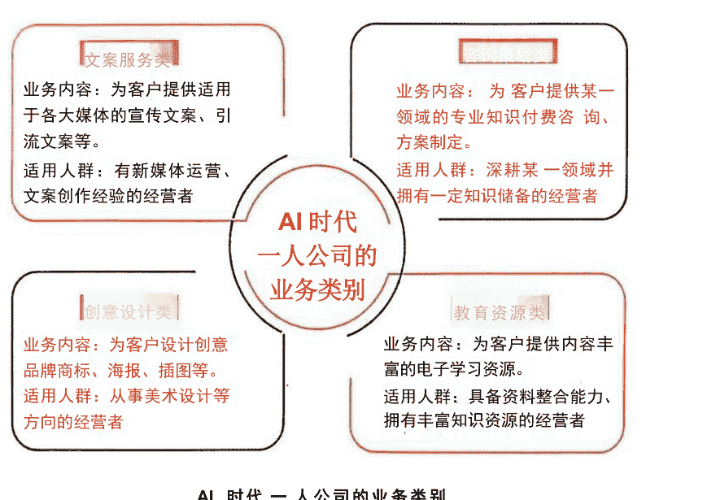
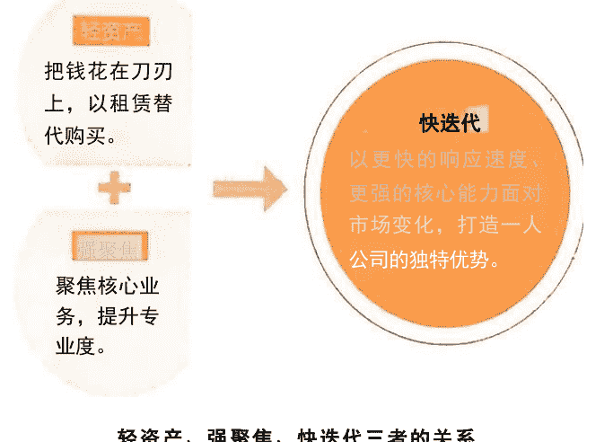
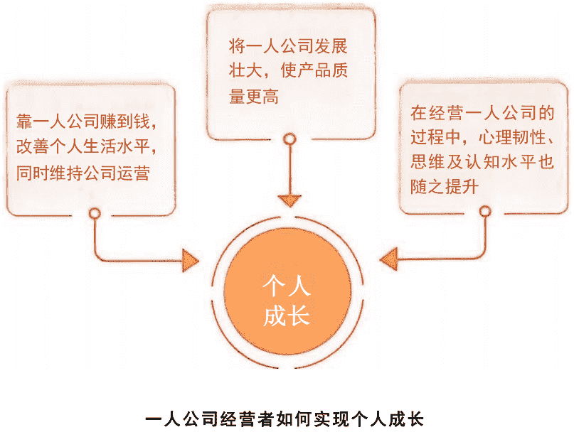
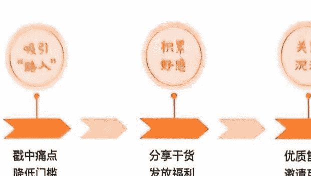

# AI 时代单人创业实战手册

### 前言
#### Preface
看到这篇文章的你，大概率正卡在几种状态里：手里有一份稳定工作却想开辟第二增长曲线，已经在做自由接单却被不可控的风险和波动收入困住，或者听过单人企业这个概念却不知道怎么把想法变成可复制的现金流。本书要做的，是把这套轻资产运营的底层机理讲透，让创业门槛变得可操作。

过去几年，常见失误不少见。有人把自由接单等同于单人企业，合规缺位最后被风险拖住；有人照搬团队企业的管理表格，把轻创业做成了负担；有人拼命堆技能却不会把能力换成钱，成长变成无效内耗；也有人会引流却留不住客户，始终停在赚快钱的阶段。症结不是个人能力不够，而是对单人企业的认知还停留在表面。它既不是自由职业的线性升级，也不是传统公司的精简版，而是一种借助技术放大个人优势、在灵活与规范之间取得平衡的新商业形态。

基于观察，成长路径被拆成七个阶段。认知期先厘清单人企业与自由职业、团队企业的本质差别，抓住轻投入、强聚焦、快迭代的特质，建立收益与成长双重驱动的思维；探索期解决做什么是对的问题，用AI工具提效，把个人能力产品化，在细分需求里找机会，并用三天做一次模式可行性验证；试运营期把基础打牢，覆盖风控、获客、现金流与时间管理，避开资产混同、心态失衡等常见坑；引流与发展期聚焦获客和增长，提供从信任建立到成交、从低成本传播到多平台裂变的实操；稳固期围绕留存展开，通过个人IP、情感联结和客户升级体系培养长期客户；升值期则搭建半自动的盈利系统，从手动变现走向自动造血，甚至把企业做成可交易资产。

本书有三方面特点。全程贯穿轻投入理念，七个阶段都不需要重金启动，更适合普通人起步；AI工具深度融合，从知识沉淀、产品打磨到获客与时间管理，都给出可落地的技术赋能方案，让一个人就能运转一家企业的现实化；重实操，每个阶段都有明确目标和方法，比如三天模式测试、零成本故事营销、差评处理模板等。语言直白，逻辑清晰，不同基础的读者都能看懂会用。

需要明确的是，单人企业不是躺赚的捷径，需要持续打磨能力、优化流程、维护客户，但它的优势在于投入能精准转化为收益和成长。创业没有万能公式，但有可复制的机理。希望你能跟着节奏逐步搭建自己的运营体系，实现收入增长的同时完成认知、能力、心态的整体升级。

现在就从建立认知开始，开启属于你的轻资产创业之旅。

## 第1章

### 认知建立期：全面认识一人公司
——普适的轻创业入门指南

本章把AI时代下单人企业的概念和创业思路讲清，帮助建立正确认知。先说明单人企业既是新创业打法也是副业新选项；再对比它与自由职业、团队企业在核心逻辑上的差异，拆解其低成本高灵活的盈利机理，提炼轻资本、强聚焦、快迭代三大特质；最终引导把创业与人生结合，实现赚钱与自我成长双赢。

### AI 浪潮下单人企业的定位：新创业形态，也是副业优选
在智能技术普及的当下，单人企业不再是单打独斗，而是一种融合智能系统的高效创业方式，已成为普通人轻资本创业与做副业的首选。它用智能承担重复性事务，让实践者聚焦核心决策，摆脱传统创业对团队的依赖。无论是想摆脱职场束缚的人，还是寻求额外收入的在职者，理解智能与单人企业的融合逻辑，都是把握时代机会的关键。

### 技术赋能：效率跃迁与形态升级
智能时代的单人企业，核心是技术带来的效率倍增与开支优化。智能助手可处理编程、设计、文案、客服等重复任务，大幅提升单人产出。这种提升不是线性累加，而是通过方案集成实现的超线性输出，让实践者独立完成从产品开发到市场推广的全链路，无需团队协作。智能方案的低开支特性也压缩了运营开销，云计算与自动化流程进一步降低场地、设备等固定投入，形成典型轻资本模式。

作为一种新思路，智能时代的单人企业实现技术平权。实践者不必懂编程也能通过智能生成代码，不必专业设计也能完成视觉创作，单枪匹马支撑起完整业务成为现实。作为副业新选项，其适应性更突出，能帮助实践者稳步提升收入。

这种形态兴起，源于技术成熟与市场需求的共同推动。智能方案易用性提升，让非技术背景者也能快速上手；云计算与全球协作平台为个人企业提供便捷运营基础。但要认识到，智能只是手段而非万能解法，实践者仍需具备核心判断、客户沟通等能力，才能实现可持续运营。

### 互动问答
#### 问题一 启动单人企业，需要具备智能相关的专业技能吗？
智能时代启动单人企业，并不要求深度的智能专业技能，但需掌握方案使用方法与基础应用思维。主流智能方案无需编程或算法知识即可上手，内容类方案用自然语言指令就能生成文本，设计类方案通过简单设置就能出图，客服类方案用模板配置即可自动回复。实践者应根据业务需求选方案、学高效用法。更重要的是建立智能应用思维，判断哪些环节可交由智能、哪些必须由人主导。

#### 智能时代的单人企业，适合选择哪些业务方向？核心判断标准是什么？
适合的方向多集中在可被智能赋能、依赖个人核心能力且轻开支运营的领域，如内容创作、数字服务、咨询策划、精细化运营等。核心判断有三点：智能能覆盖大部分基础工作，如内容创作中智能出初稿，人工精修；契合个人专业背景或优势技能，可借助智能放大个人能力，如行业专家用智能整理数据、出报告、做咨询；目标市场存在明确细分需求且竞争不过度，避免进入巨头主导或过度饱和的赛道。

#### 智能可能替代部分工作，单人企业如何避免被智能或其他竞争者取代？
要看清智能的替代边界。智能擅长重复标准化工作，却缺乏创造力、共情力、战略判断力。实践者需在这些智能难及的领域构建优势，比如深度理解客户需求的定制服务、结合行业经验的战略策划、需要情感沟通的客户维护等。同时要持续跟进新方案与技术，提升专业深度，形成技术方案加专业能力的双壁垒，打造差异化，避免同质化竞争。

### 智能时代单人企业的业务形态
### 风险提示
#### 提示一 过度依赖智能方案，丧失个人核心竞争力
部分实践者把智能当成万能解法，把所有工作都丢给智能，长期下来会丧失核心判断与创新能力，有被替代的风险。比如内容创作直接照搬智能输出而不深度加工，作品缺少个人风格与思想深度，难以吸引优质客户；咨询服务完全依赖智能生成的报告，不结合自身经验分析，建议就缺乏针对性。智能是提效手段，不是价值主体。实践者应把基础工作交给智能，把精力放在创意设计、战略决策等核心环节，通过持续学习提升专业度，让智能成为个人能力的延伸。

#### 提示二 忽视数据安全与隐私保护，引发法律隐患
为提升智能效能，部分实践者随意收集客户隐私数据，或在使用智能时泄露商业信息；还有人直接使用有侵权风险的内容，如盗版图片、文字。这些行为可能触犯法规，导致罚款、赔偿等处罚。实践者需建立数据管理规范，收集客户数据前明确用途并获同意，存储时加密；使用智能方案选正规平台，避免上传敏感信息；对智能生成内容进行版权核查，确保合规，必要时咨询专业法律人士。

#### 提示三 盲目跟风热门领域，缺乏市场调研
看到某个领域热度高就盲目进入，却未做足够调研，结果竞争激烈难以盈利。热门赛道往往吸引大量参与者，缺乏差异化就容易陷入价格战；部分热门领域技术不成熟或需求不明，盲目进入易导致业务停滞。选方向前应系统调研市场规模、目标客户需求、现有竞争者的优劣，再结合自身能力判断能否提供差异化价值。

#### 提示四 忽视智能方案开支与效能平衡，造成资源浪费
部分实践者追求智能全覆盖，购买大量方案会员或定制专用系统，但使用频率低，效能未发挥，造成开支浪费。个人企业核心优势是轻资本，过度投入方案开支会增加运营压力；复杂方案学习成本高，业务简单时基础方案即可。实践者需按实际需求筛选方案，优先用免费版或按次付费试用，验证效能后再付费；对高频使用且显著提效的方案可长期投入。

### 单人企业与接单、团队企业的本质差别
应用智能技术的单人企业，已成为独立于接单、团队企业的新形态，明晰三者的核心差别是理解现代轻资本创业的关键。三者虽都通过产品或服务实现价值交换，但在法律架构、运营机理、效能边界上存在本质区别。单人企业不是接单的升级版，也不是团队企业的精简版，而是凭智能重构的商业组织的最小单元。厘清风险承担、决策机制、资源整合等维度的边界，能帮助实践者精准匹配需求与形态。

### 核心差别解析：技术赋能下的三种商业形态边界
接单、单人企业、团队企业的差别根源于组织属性与技术应用深度，进而体现在风险控制、运营效率、发展空间等层面。

接单的核心是个体作为经营主体，无独立法人资格，以个人技能直接对接市场。运营依赖个人时间精力，无复杂管理流程，但风险承担无边界，需以个人全部财产为业务责任背书，且效能上限受制于个人产能，难以突破单一技能的服务半径。

单人企业以独立法人为身份基底，叠加智能技术形成的独特运营模式。它用智能系统处理重复事务，使个人效能倍增，无需团队即可完成企业所需的全流程业务。风险承担以股东出资额为限，具备法律层面的资产隔离，决策高度集中，能快速响应市场变化。

团队企业以多元股东与团队合作为核心，依赖集体智慧与资源整合。其优势是能承载大规模业务，通过分工覆盖更广服务领域，但决策流程复杂，运营开支高，适应性不足，市场响应易受拖累。

### 互动问答
#### 问题一 接单、单人企业、团队企业在法律属性与风险承担上的核心差别是什么？
主要体现在法律主体资格与责任边界。接单无独立法人身份，经营者需以个人或家庭全部财产对债务、合同纠纷等负责。单人企业具备独立法人资格，企业财产与股东个人财产分离，股东仅以认缴出资额为限承担责任，不直接影响个人资产。团队企业同样为法人主体，股东按出资比例或章程承担有限责任，但股东较多时还需应对内部利益分歧、责任划分等额外风险。风险控制上，单人企业的有限责任与资产隔离优势明显，接单风险更高，团队企业需兼顾内外风险。

#### 问题二 在运营效率与决策机制上，三者的差别如何影响业务推进速度？
运营效率与决策机制直接决定市场响应能力。接单决策完全由个人主导，无需流程，能快速对接需求并启动服务，但效率上限受个人产能限制，多任务或复杂业务易瓶颈。单人企业决策同样高度集中，股东可直接根据市场变化调整策略，同时智能自动处理重复工作，实现一人顶一队的效果。团队企业决策需经股东会议或管理层协商，易出现分歧导致滞后，且团队协作的沟通、分工协调开支会进一步降低效率，市场响应远不及前两者。

#### 从发展空间与资源整合能力来看，三者的核心差别是什么？
发展空间与资源整合能力取决于组织形态与技术赋能。接单的资源整合仅限个人技能与人脉，发展受个人产能与服务半径限制，规模扩大后易因精力不足停滞。单人企业借助智能打破个人产能限制，通过云计算与全球协作平台整合外部资源，发展空间取决于核心技能与技术结合深度，具备小而强的成长特质。团队企业资源整合能力强，可通过股东资金、专业人才、供应链等方式扩大规模，承载更大业务体量，但伴随管理开支上升与适应性下降。从性价比看，单人企业以低管理开支实现高效资源整合。

### 风险提示
#### 提示一 照搬团队企业管理模式，增加单人企业运营开支
单人企业核心优势是轻资本与高效率，但部分实践者盲目套用团队企业管理体系，如建立复杂规章、冗余流程、组建兼职团队，违背其运营逻辑。团队企业管理模式为适配团队协作，而单人企业核心是智能赋能下的个人高效运营，过度复杂的管理会显著增加开支。实践者应坚守轻资本本质，以智能替代人工，聚焦核心业务流程优化，避免引入不必要环节，把开支集中在技术方案与核心资源上。

#### 提示二 忽视接单的风险，盲目扩大业务规模
接单者盲目扩张会导致风险累积。随着业务体量增加，合同金额、客户数量上升，纠纷与债务风险同步提高，而接单无资产隔离，一旦出问题个人全部资产都可能被追偿。此风险在小规模时影响有限，规模扩大后会成致命隐患。选择接单形态者需明确风险承受能力，控制业务规模与服务范围，避免承接超出风险边界的项目；若计划扩大规模，应及时转为单人企业，通过法人身份建立风险隔离。

#### 提示三 误判团队企业的协作开支，盲目追求规模化
部分实践者羡慕团队企业的规模优势，盲目组建团队，却忽视随之而来的管理开支、沟通开支与协调开支。团队企业协作优势建立在高效组织管理与清晰权责划分上，若缺乏管理能力，团队协作反而降低效率、增加内耗。考虑扩张前，应评估自身管理能力与业务需求，确保团队规模与业务复杂度匹配，避免盲目扩张陷入管理困境。

#### 提示四 忽视技术赋能的核心价值，弱化单人企业的效能优势
单人企业核心竞争力源于智能赋能，部分实践者只关注法人身份而忽视方案应用，导致效能优势无法发挥，沦为无技术支撑的个人户。此类实践者仍沿用传统个人运营模式，未借助智能处理工作，效能与接单无本质区别，未体现单人企业的技术适配性。实践者需深刻理解单人企业的技术内核，主动学习并应用适配智能系统，将基础工作自动化，聚焦核心战略与创新，通过技术赋能实现效能倍增，真正发挥轻资本、高效率的核心优势，避免有其名无其实的困境。

## 精巧运营：单人企业轻投入、高适应性的盈利机理
精巧并非规模局限，而是一家企业依托轻投入与高适应性构建的核心盈利机理，也是普通人轻资本创业的核心优势。它打破传统企业规模决定收益的认知，以精简运营架构、精准市场切入实现价值变现。很多人只把单人企业理解为单人经营，却忽视其背后开支控制与灵活应变的底层逻辑。厘清这一机理，能帮你避开重投入、低效率的陷阱。

### 拆解精巧运营：轻投入与高适应性的协同机制
单人企业精巧的核心是轻投入与高适应性的深度协同，两者共同构成盈利基石。轻投入不是简单压缩开销，而是通过精简架构实现的结构性开支优势。单人企业无需承担团队薪酬等固定开支，核心开销集中在方案、资质办理与基础运营上，资金周转快，盈亏平衡点低，即便体量不大也能稳定盈利。

高适应体现于决策与运营两层，是轻投入优势的重要保障。决策层面，创始人可直接根据市场反馈调整方向、优化服务，对市场变化的响应远快于团队企业。运营层面，可依托自身技能或核心资源聚焦单一细分领域深耕，快速形成差异化竞争力。这种适应性让其能精准捕捉小众需求，避开与大企业的正面竞争，在细分赛道建立优势。

轻投入与高适应性的协同，形成独特盈利闭环。轻投入降低创业风险与盈利门槛，提供试错空间；高适应让其精准匹配需求，提升转化率与客户留存。两者结合，使得单人企业仅凭精准定位加高效运营即可实现稳定收益，这正是精巧赚钱机理的核心，以最小投入撬动最精准市场价值，实现效率与收益的最优平衡。

### 互动问答
**问题一** 单人企业的轻投入是绝对的吗？哪些开支是不可省略的，需要重点投入？
单人企业的轻投入是相对传统企业的结构性优势，并非零开支。不可省略的开支主要有三类：合规开支，如工商注册费、年度公示费、税务代账费等，是获得法人资格、实现风险隔离的基础；核心方案开支，如业务所需的专业软件、智能方案订阅费、云服务费用等，是实现一人顶一队效能的关键，盲目舍弃会导致服务质量下滑；信任构建开支，如基础品牌形象设计、客户服务保障开支等，单人企业需通过这些投入提升市场信任度，获取稳定客户。轻投入的核心是砍掉冗余，确保运营合法与高效。

**问题二** 单人企业的高适应性会不会导致业务方向混乱？如何避免？
高适应确实存在因决策随意导致方向混乱的风险，但可通过核心定位加流程约束来规避。混乱根源不在适应性本身，而在缺乏清晰定位。实践者需做到两点：确立核心业务锚点，起步就明确企业核心领域，如某类专业服务或特定产品开发，所有业务围绕核心展开，不轻易跨界；建立简易决策流程，调整业务前完成市场需求调研、收益测算与风险评估并形成书面记录，避免仅凭主观判断。通过定位锚定方向、流程规范决策，就能在保留适应的同时避免混乱。

**问题三** “精巧”的单人企业，如何在不扩大规模的前提下提升收益？核心路径是什么？

小而美赚钱的关键，做深价值别做大体量

单人业务要增收，思路不是铺开摊子，而是把既有价值挖深。把服务做专做透，钱会自然到来。主要有三条抓手：
其一延长客户全周期价值。用更细的陪伴和持续的挖掘来促成复购与加购，例如给老客户追加增值包或定制方案，既摊薄获客成本，也抬高客单价。
其二把效率做上来。用AI把重复流程自动化，把低价值的琐碎时间压到最低，把精力放到创意产出、战略沟通等高价值环节，同样时长产出更高价值。
其三扎根细分赛道。把赛道收缩到核心领域的小众痛点，用专业壁垒建立差异化，以口碑带进精准客群。三条路线殊途同归，都是从存量里深挖价值、把运转效率提上来，这正是小而美的底层逻辑。

### 创业预警
**预警一** 过度追求低成本压缩核心合规成本导致法律风险加大
部分创业者把省钱极端化，把工商登记、税务申报、财会记账等合规支出当成可砍项。常见做法是先干活后补手续、用个人身份承接业务；账目混乱，长期零申报或漏报。一旦出现合同纠纷、债务问题或税务稽查，法人保护失效，个人财产需承担无限连带，还会面临罚款、滞纳金等，个人征信也会受损。

**预警二** 把高灵活度误作无规划频繁换赛道
把灵活性等同于随意切换，是单人运营的常见坑。看到某类业务短期赚钱就换方向，从内容创作跳到商品销售再跳到咨询，每次重启都要重建客户与经验，始终卡在起步。资源被稀释、客户流失、专业形象起不来。灵活性应聚焦在核心业务内的服务打磨与需求响应，而非频繁跨界。

**预警三** 只求小导致服务质量下滑
有些人误读小而美，只抓体量小、成本低，却丢掉了“美”的含义。表现为流程过度简化、深度沟通被省略；以低成本为由降低交付标准；售后与反馈投入被省掉。真正的小而美是小体量配高品质。小是为了集中资源把品质做到极致，单求小而牺牲质量，就会被拖进低价竞争，留不住客户。

**预警四** 缺乏成本管控意识让隐性开销吃掉利润
单人公司显性开销低，但隐性损耗很容易被忽略，长期累积会侵蚀利润。典型包括时间损耗，工具选错导致效率低下、客户筛选不严导致无效沟通；返工损耗，因质量不达标带来的修改、退换；资源浪费，盲目订阅不常用的工具、囤积无用物料。单笔虽小，聚合后利润空间会被大幅压缩。

## 第一章 认知建立期：全面了解一人公司

### 一人公司的三个关键特质——轻资产、强聚焦、快迭代
低固定成本、精准聚焦、快速迭代构成了 Solo 创业的核心竞争力，也是其区别于传统公司与自由职业者的标志。三者并非割裂，而是彼此支撑的闭环，让普通人能低门槛启动并持续运转。厘清内涵与关系，就能搭起清晰的运营框架。

#### 特质协同：一人公司的核心竞争力来源
低固定成本是运营的底座。并非资产总量少，而是固定开销占比低，业务主要靠知识、技能、技术工具等无形资产运转。无需承担大额场地、设备、团队薪酬，核心支出集中在工具订阅、资质办理上。盈亏平衡点低，即便体量小也能盈利，为后续发展提供安全垫。

精准聚焦是低固定成本的必然要求，也是差异化的来源。单人无法像团队企业那样多线并行，必须锁定单一细分或特定服务品类。聚焦让有限精力集中深耕，形成超越同行的专业壁垒。

快速迭代是前两者带来的能力。低固定成本降低了调整的沉没成本，精准聚焦让需求变化更快捕捉。决策无需层层审批，反馈能直接转化为调整，迭代速度加快，从而及时避险、抓住机会，保持与市场的同步。

### 创业答疑
**问题一** Solo创业的低固定成本如何落地？需要规避哪些资产配置误区？
落地核心是降固造成本、守住核心能力。配置上优先租赁、订阅替代买断，例如用云服务替代自建服务器，用软件订阅替代一次性买断，办公选居家或共享办公。运营上把非核心环节外包，财务记账、基础设计等交给专业外包，自己聚焦核心服务与产品打磨。

**问题二** 单人团队如何做到精准聚焦？聚焦过窄会不会导致市场空间不足？
精准聚焦靠能力匹配加需求筛选，先基于自身技能、资源和行业经验锚定核心领域，再在该领域内锁定具体客户群和场景痛点。例如文案业务可深耕到某类行业的产品文案。垂直深化既能提升客户粘性和单客价值，又能形成行业壁垒，避免同质化，市场空间反而更稳。

**问题三** 快速迭代需要建立哪些基础？如何避免陷入盲目迭代的陷阱？
基础是精准反馈采集加高效决策。建立便捷的反馈渠道，如服务后调研、日常沟通记录；搭建简易数据追踪，如转化率、满意度，为迭代提供依据。防盲目要明确迭代目标，每次调整针对具体问题，避免无目的改动；迭代幅度要小，先局部验证效果再逐步推广。

轻资产、强聚焦、快迭代三者的关系

### 创业预警
**预警一** 目标模糊陷入“什么都想做”的精力分散陷阱
看到市场热闹就想全吃，主营文案的同时兼做设计、咨询、运营，试图多线增收。结果精力被稀释，每个业务都无法深耕，专业度出不来。Solo的核心竞争力来自专业，而专业来自集中。需要建立业务准入清单，只有匹配核心技能、有稳定需求、能形成差异化才保留，其余坚决拒绝。

**预警二** 迭代无章法以频繁变动替代快迭代
把快速迭代理解成频繁改方向、改模式、改定价，运营会陷入混乱。单凭一个客户建议就改流程，因短期业绩波动就换赛道，会消耗大量精力，破坏品牌认知，导致老客户流失。应建立收集反馈—数据验证—小步调整的流程，先汇总问题，再用数据判断普遍性和可行性，最后小范围试改验证。

**预警三** 轻资产运营中过度依赖外部资源导致主动权丧失
轻资产依赖整合，但过度外包会丧失控制。核心设计、关键客户沟通被完全外包，自己只做衔接；客户只靠一个平台获取，外包只靠一家公司，一旦对方提价、降质或终止合作，业务会直接停摆。应亲自把控客户对接、核心创意、战略决策，同时多渠道获客、外包机构保留2~3家备选。

**预警四** 忽视特质协同孤立看待轻资产、强聚焦与快迭代
孤立看待会导致逻辑断裂。只求轻资产、不聚焦不迭代，外包压缩成本但方向模糊；只聚焦、不轻资产不迭代，成本过高或服务滞后；只求快迭代、没有聚焦锚点和轻资产基础，调整成本高易亏损。运营时要同步考量三者，形成闭环。

### 把创业过程变成人生修行，赚钱与自我成长两手抓
Solo创业不只是赚钱，更是自我淬炼。单人面对市场、决策、风险和压力，每个挑战都是成长的入口。理解赚钱与成长共生的本质，才能更从容地实现物质与精神双收获。

#### 共生逻辑：赚钱与个人成长如何相互成就
在 Solo 模式里，赚钱和成长是相互驱动的。赚钱是成长的具象结果，也为成长提供资源。单人需要覆盖全流程能力，市场调研、产品开发、客户服务、风险管控全靠自己，盈利证明能力已与市场匹配。盈利带来的现金流还能支持学习、工具升级和试错。

反过来，成长决定盈利上限。例如一位独立设计师最初靠基础平面设计月入八千，随着品牌对视觉整合的需求上升，他发现缺乏营销策略知识限制了接单上限。用利润报了品牌营销课，学习用户画像和视觉转化逻辑，补充数据监测工具后，提供设计加营销建议的组合服务，单单价从三千涨到一万五，月入突破三万。Solo 的特性放大了这种闭环：没有团队兜底，必须补短板；没有层级沟通，反馈直接转化为调整，问题—提升—盈利快速循环。

### 创业答疑
**问题一** 单人创业初期盈利困难，如何在保障生存的同时兼顾自我成长？
以生存为前提做成长。先选门槛低、变现快的业务保基本收入，如基础服务外包、简单产品销售；在生存业务中刻意训练核心能力，比如通过客服业务打磨沟通与需求挖掘；在碎片时间做精准学习，只补与核心能力相关的短板，让每一笔收入都伴随能力积累。

**问题二** 单人创业者容易陷入孤军奋战的心态困境，如何将其转化为成长动力？
孤独本质是反馈不足。主动搭建外部反馈网络，加入同行社群、行业交流平台，定期输出经验获取建议；把单人决策看成独立能力的训练场，逼迫自己深入研究市场并承担结果，能力提升更快；换个视角，单人决策无协同成本，效率本身就是优势。

**问题三** 如何平衡赚钱的短期目标与自我成长的长期目标，避免顾此失彼？
建立短期服务长期、长期反哺短期的联动机制。先明确三到五年要具备的核心能力，再把短期目标绑定其上，例如长期目标是品牌运营能力，短期可设定为承接三个基础品牌服务单并同步学习定位知识。每月复盘盈利和成长任务的匹配度，动态调整学习路径。

一人公司经营者如何实现个人成长

### 创业预警
**预警一** 过度追求短期盈利牺牲长期成长的核心能力培养
被现金流压力裹挟，长期做低门槛高周转的重复性业务，如简单排版，虽能短期赚钱但无法积累壁垒。拒绝学习新技能，需求变化时业务迅速失速。需要设置盈利结构，确保高成长价值业务占比不低于30%，每月固定时间投入学习，保持能力与市场同步。

**预警二** 沉迷自我成长忽视盈利落地导致创业失败
另一极端是成长焦虑，时间都花在学习、考证、培训，却不做实际业务。自我成长必须转化为盈利能力，否则只是资源空耗。应建立成长落地机制：每次学习后必须产出实践成果，如学完营销就为现有业务设计推广方案并执行；学习时间控制在总工时的20%以内，以盈利验证成长方向。

**预警三** 将挫折等同于失败心态崩溃放弃成长与盈利
单独面对风险，容易把客户流失、项目失败归为个人无能。需要把挫折正常化，视为暴露问题的信号。采用问题拆解法，把挫折拆成可解决的子问题；寻求同行交流或导师支持，避免负面情绪内耗；设立恢复期，允许短暂调整但设定明确期限，保持节奏。

#### 忽视心态成长仅关注技能提升
不少人把成长等同于技能，埋头学设计、编程，却忽略心态与认知。Solo 运营必经决策压力、孤独、风险应对，心理韧性不足则难以持续。应培养理性决策习惯，收集数据评估风险并容忍试错；通过作息、运动调节抗压状态；提升认知格局，关注行业趋势和商业逻辑，让底层认知带动业务升级。

## 第2章 探索期：找准方向打造你的一人公司
在探索期找到正确方向，是 Solo 公司稳步发展的关键。技能转化和市场匹配是两大锚点。吃透技能变产品、冷门需求挖掘、用户洞察与商业模式快速验证，就能锁定发力点，顺利度过探索期。

### 把技能变成产品的黄金三角法则
对 Solo 公司而言，把个人技能标准化成可交付产品，是规模化和可持续的基础。黄金三角法则通过核心价值提炼、用户需求匹配、产品形态设计三个维度，让抽象技能具备可复制属性，降低试错成本，提升市场接受度。

#### 黄金三角法则：技能转化为产品的核心逻辑
技能的核心价值是根基。要提炼出最不可替代的部分，否则后续匹配和设计会失焦。用户需求是方向，脱离真实需求的技能转化难以被市场认可。产品形态是载体，合理的形态能高效传递价值并适配 Solo 的交付能力。

三者协同：以核心价值锚定内核，以用户需求校准方向，以产品形态优化交付。协同后技能从个体服务升级为标准化产品，打破时间精力限制，实现规模化收益。核心价值决定形态边界，用户需求为价值提供场景，形态反过来影响价值传递效率。掌握这种联动，才能让个人能力产生复利。

### 创业答疑
**问题一** 在黄金三角法则中，如何精准提炼技能的核心价值以支撑产品化？
从解决问题和差异化两个层面拆解。先明确技能到底解决了用户的什么具体问题，剥离附加动作，锁定最具效用的部分；再对比同类能力，找出更高效、更独特的处理方式。通过用户反馈验证哪些环节真正不可替代。

**问题二** 在黄金三角法则中，用户需求与技能转化的匹配度如何把握？

能力变现要先建立映射，把自己的可交付能力与市场的真实缺口对上号。

先把目标客户的真实诉求梳理清楚，区分开口说的表层想要和真正卡住的深层痛点；再盘点自身本领能覆盖的范围，哪些可以独立交付、哪些需要借助外部资源补齐；最后按诉求的紧迫程度和出现频率排优先级，把能解决高频刚需的本领优先做成可交付的供给。匹配不是一次性校准，随着客户诉求迁移要持续优化。

**问题三** 黄金三角法则里，供给样式的设计要兼顾哪些要点？

供给样式要同时照顾本领特性、客户使用习惯以及单人经营的承载边界。看本领特性，复杂的本领更适合拆成系列化方案，简单的本领更适合做成标准化工具；看使用习惯，样式要贴合目标群体的使用场景，降低获取和上手的门槛；看运营负荷，样式必须在个人可控范围内，避免设计过度导致交付失控。还要预留延展空间，本领提升或诉求变化时能否通过迭代叠加功能或服务层级。样式调准了，价值输出与运营效率才能平衡，这也是本领走向商业资产的关键。

### 创业预警

#### 预警一 过度放大本领广度，忽视核心亮点
不少人在提炼价值时想打包太多赛道，追求全能形象，结果把真正锋利的点磨平了。广度固然重要，商业化的关键在深度，找到最具壁垒的细分赛道并打磨成难以复制的核心卖点。贪多求全会让定位模糊，客户感受不到差异，最后被挤到边缘。

#### 预警二 只靠主观感受界定客户诉求
有人做诉求匹配时只凭自身经验或零星反馈就拍板，缺少系统调研和持续验证。真实诉求常有表层和深层之别，主观臆断容易读错痛点，导致供给和市场脱节。正确做法是多渠道收集声音，建立验证闭环，把伪需求和真需求区分开，并持续追踪诉求演变。

#### 预警三 供给样式设计超出运营能力
设计供给时追求复杂功能或高逼格体验，却忽略了单人经营的承载极限，结果交付效率低、品质不稳。样式的核心是适配，既要满足客户期待，又要留在自己能稳定交付的范围内。超出能力边界会增加负担，也会伤害体验，削弱竞争力。

#### 预警四 把本领细节全盘塞进供给内容
把自己会的方方面面不加筛选塞进供给，会让内容冗长、重点不清。客户要的是能直接解决问题的方法，而不是完整的教学过程。堆砌细节会抬高学习成本，还会掩盖核心亮点。应提炼和诉求直接相关的核心模块，做成简洁高效的内容单元。

### 从低频检索词里捕捉百亿级机会

当下热门词竞争白热化，而低频词里藏着被忽略的需求缺口，这正是轻量团队可以切入的空间。单次检索量虽小，聚沙成塔后往往形成体量可观且竞争温和的市场，容易抢占先发优势。单人团队体量轻、转向快，特别适合精准卡位这类细分诉求。

#### 低频检索词：单人团队的商机发掘密码

低频词的商业价值本质是信息不对称。主流视野之外的检索行为，往往代表被忽视的痛点，而这种差价为小规模经营者提供了差异化空间。

做手机配件的单人团队小周就靠这点打开局面。她在后台看到“老年机大字键贴膜”检索稳定但供给稀少。深入了解后发现，老年客户因视力问题需要更清晰的按键标识，而市场多聚焦智能机配件。她定制了带放大数字和拼音的专用贴膜，定价只比普通款高一元，精准匹配后上线三个月就积累上千位复购客户，用很低成本拿下细分市场。

要把低频词变成可持续生意，必须动态追踪、持续迭代。诉求会随时间迁移，今天的冷门可能变热，也可能消失。要建立常态化监测，既盯新出现的词，也跟踪已有词的趋势变化，同时在服务中收集反馈不断优化方案，让供给始终贴合诉求，在细分市场形成稳定优势。

### 创业答疑

**问题一** 如何系统识别和筛选有价值的低频检索词？
建立多维度筛选标准。先看持续性，剔除偶发、事件驱动的临时词，优先选择在一定周期内稳定出现的词。再看诉求强度，通过关联检索、客户提问判断客户是否有明确解决意愿和付费可能。最后结合自身能力，筛选和本事或资源匹配的词，确保能交付。

**问题二** 如何把低频词背后的诉求转化为具体商业方案？
走诉求拆解-价值匹配-模式设计三步。首先拆解检索词对应的具体场景，明确客户何时产生诉求、想解决什么。其次基于自身优势确定交付形式，确保高度契合。最后设计简洁可行的盈利方式，比如直接售卖解决方案或相关供给。

**问题三** 单人团队如何利用低频词形成长期竞争优势？
在挖掘、深耕、扩展三个层面持续发力。挖掘期建立常态化监测，及时发现新低频诉求。深耕期对已转化的诉求打磨细节，形成差异化优势，培养客户依赖。扩展期基于已服务客户分析关联诉求，通过相关低频词拓展业务，形成诉求闭环。

### 创业预警

#### 预警一 盲目追逐短期低频，忽视长期价值
部分人会被突发出现的低频词吸引，急于投入，却忽略其是否具备持续性。有些词因热点或事件短暂抬头，生命周期很短，跟进去容易打水漂。判断价值要看较长时间内的波动趋势，优先选择诉求稳定、有增长潜力的词，别被短期流量迷惑。

#### 预警二 忽视诉求关联性，导致业务碎片化
挖掘多个低频词时若不看关联性，业务会变得零散。每个词对应独立交付，缺乏协同，既增加运营复杂度，也难沉淀客户。资源有限的团队应围绕核心客户群的关联诉求筛选词，让不同业务能相互导流、互补增值，形成有逻辑的业务体系。

#### 预警三 过度依赖工具数据，忽视客户洞察
只盯检索量、增速等指标，容易把行为表象当成诉求本质。工具看不到动机和场景，仅凭数据决策容易错位。要把数据作为参考，结合访谈、场景分析等，深入理解诉求本质，确保挖掘的商机真能解决问题。

#### 预警四 把“低频”等同于“无效”，错失潜在需求
检索量极低不等于没价值。部分低频词受众窄但诉求明确、供给稀缺，转化率反而很高。判断时应结合诉求的独特性与支付意愿，那些指向清晰、解决方案稀少的低频词，即使量小也值得用小成本测试验证，而非一概否定。

### 看透客户心理的深度画像

对单人团队来说，把握客户心理是长期发展的根基。心理画像不是收集标签信息，而是通过系统分析挖掘行为背后的动机、偏好和潜在诉求，形成立体的认知。它帮助经营者跳出自我视角，从客户真实心理出发设计供给，减少决策偏差。小体量更需要精准投放，这正是心理画像的价值所在。

#### 心理画像：单人团队解码客户心理的核心逻辑

心理画像的本质是通过结构化信息梳理，构建对客户心理的清晰认知，实现精准对接。知识付费创业者老陈的经历很典型。他最初的职场课程销量平平，细读上百条差评后发现核心反馈是“学完用不上”。并不是内容没用，而是客户多为职场新人，更想要实操指南。他拆分模块、加入案例拆解和作业点评，精准命中“渴望即学即用”的心理，复购率提升四成。

关键在于穿透行为看心理。购买选择、评价反馈都是心理的外显，若只记录行为就无法理解动机。例如价格敏感可能源于性价比追求，也可能是价值不确定，两者对策完全不同。心理画像要通过细节解码，比如客户选择时最纠结什么、使用后觉得哪里不对预期，从而挖出行为背后的真实动因。

实践上要做“小而精”的信息收集与分析。单人团队不必覆盖全部人群，而是聚焦核心互动场景，收集高质量信息，如客户表达诉求时的用词习惯、决策时的犹豫点等。持续积累，就能总结出共性规律和个体差异，为优化供给提供方向。

### 创业答疑

**问题一** 心理画像和传统客户画像的核心区别是什么？
传统画像侧重基本属性和行为数据，能反映表面特征，但难以解释为何如此。心理画像在此基础上进一步剖析动机、情绪倾向和决策逻辑，不仅关注客户是谁、做了什么，更关注客户在想什么、为什么这样做，为设计提供更本质依据。

**问题二** 单人团队如何用有限资源构建客户心理画像？
采用精准收集加高效分析的轻量模式。聚焦核心互动场景记录反馈话术、情绪反应，主动探问诉求背后的原因，避免无差别采集。按诉求类型、顾虑点、偏好特征等维度分类归纳，提炼共性心理。建立动态更新机制，每服务一批客户后就重梳理画像，用新信息修正认知，无需复杂工具也能持续深化理解。

**问题三** 基于心理画像，单人团队如何优化交付或服务以提升客户黏性？
从满足显性诉求转向回应隐性心理。针对画像中提炼的核心动机强化对应价值，如客户重便捷则简化流程并突出此点。化解潜在顾虑，如担心效果不可控就提供过程透明反馈。贴合情感偏好设计互动方式，如客户偏好专业且亲和的沟通则调整话术风格。这样供给和客户建立心理连接，而非单纯交易，提升认同感和复购。

### 创业预警

#### 预警一 过度依赖数据，忽略质性洞察
只盯点击量、购买频次等量化指标，忽视语言、情绪等质性信息。数据能反映结果，解释不了“为什么”。仅凭数据推断容易片面。要平衡数据和质性，通过直接沟通、场景观察捕捉数据背后的心理细节，保持画像完整。

#### 预警二 画像固化，缺乏动态更新
做完初始画像就不再迭代，忽视心理随时间、场景变化。市场环境和个人经历都会改变诉求动机，固化画像会让决策基于过时认知。要建立定期更新机制，把每次互动的新信息纳入调整，让画像保持时效。

#### 预警三 把心理画像等同于标签化归类
把客户简化为“价格敏感型”“品质追求型”等标签，会陷入刻板印象。心理是复杂多维的，单一标签无法概括全貌。应把画像视作动态心理图谱，既有共性也有个性细节，在服务中兼顾群体规律和个体差异。

#### 预警四 忽视隐性诉求，导致画像片面
只关注客户明确表达的显性诉求，忽略深层的隐性心理诉求。很多购买行为背后是认同感、安全感等心理诉求。若画像只停留在表面，供给难以触动客户。要通过场景分析和行为追溯挖掘隐性诉求，让画像揭示客户真正想要什么。

### 三天测试出能赚钱的商业模式

单人团队必须快速验证方向，避免在无效赛道浪费资源。三日快测的核心是用高度聚焦的小样本实践快速收集市场反馈，判断商业模式的关键环节是否成立。测试不求数据完美，只抓住核心命题：客户是否愿意付费，以及付费意愿能否支撑基本盈利。

#### 三日快测：单人团队商业模式的高效验证范式

三日快测的本质是极致压缩验证周期，在资源受限下实现“商业逻辑—市场反馈”的首次碰撞。重点不是数据完整，而是用最低成本验证“是否愿意买单”这一前提。

### 创业答疑
**问题一** 三日快测模式的核心环节有哪些？如何确保测试效率？
聚焦三件事：明确测试目标、设计极简验证方案、收集关键数据。目标要锁定最需验证的假设，如付费意愿或核心功能接受度，避免面面俱到。极简方案剥离非核心要素，用最低成本呈现核心价值，如图文说明替代完整供给。数据只盯盈利相关指标，如咨询转化率、付费比例，忽略次要数据。

**问题二** 如何选择测试对象和渠道，确保反馈的有效性？
选对象要瞄准商业模式定位的核心人群，可依画像锁定特征，再通过精准渠道触达，如相关社群、垂直平台。渠道兼顾效率和精准，优先可快速触达且互动成本低的。测试时要说明目的，引导真实反馈，避免信息模糊导致偏差。

**问题三** 三日快测后如何分析结果，判断商业模式是否值得深入？
围绕两条标准：核心假设是否被验证、盈利逻辑是否成立。对照测试前假设，看实际反馈是否支持，关注付费意愿强度。再根据测试数据推算获客成本、客单价等，判断能否形成正向现金流。若假设成立且盈利逻辑清晰，可继续深入；若偏差明显，要分析是假设错误还是执行瑕疵，调整后再测。

### 创业预警

#### 预警一 过度追求测试数据的完美性
为了数据全面不断增加指标和流程，反而稀释核心目标。三日快测是验证方向不是精细优化，过度追求完美会消耗时间精力。应坚守核心目标，只要能判断关键假设能否成立即可。

#### 预警二 忽视测试场景的真实性
为快取数设计脱离实际的场景，如过度优惠诱导付费或删减关键服务环节。场景可以简化，但必须保留商业模式的核心要素和客户决策关键点，否则反馈无法映射真实市场，会误导决策。

#### 预警三 单次测试失败后彻底否定模式
一次未达预期就放弃，可能错失机会。应先分析失败原因，是核心假设错误还是测试环节有瑕疵。若是后者，调整方案再测；若是前者，再考虑转型，避免急躁否定浪费投入。

#### 预警四 测试焦点分散，偏离核心假设
时间有限却同时验证多个无关假设，导致每个都验证不充分。有人一次想测供给、定价、渠道，结果数据混杂无法归因。测试前应明确一到两个核心假设，所有动作围绕验证，确保有限时间内得到清晰结论。

## 第3章

试运营期：从零到一夯实运营根基，实现稳步开局

一人公司虽灵活，仍需夯实运营基础以抵御风险。本章聚焦试运营期的体系搭建，涉及公域私域流量的双轨保障、阶梯供给线的现金流规划、时间与智能工具的整合运用、公私财产混同的规避，以及低谷期的心理调节。把这些打牢，创业之路会更稳。

### 流量续航：公域私域双轮驱动

流量是业务运转的动力，单一渠道依赖容易断链。公域私域双轮是通过同时布局公域和私域，构建稳定的流量供给体系。公域负责获客，私域负责沉淀和复购，二者互补，既能对冲单一渠道波动，又能协同提升转化效率。设计不求规模最大，而求供给持续可控，为稳定发展奠定基础。

### 公域私域双保险：单人团队流量长效的底层逻辑

双保险的核心价值是为单人团队提供“稳定器”和“增值器”，既抵御外部波动，又挖掘流量长期价值。这不是简单并列，而是系统协同，让流量从单次转化走向持续增值。

公域流量具增量属性，但受平台规则和竞争影响大，单靠它不稳。私域流量具存量属性，客户归属清晰、运营节奏可控，可通过反复触达实现复购和口碑，但缺乏自然增长。双轨设计用公域持续输入新客户，解决私域增长瓶颈；用私域沉淀客户，降低公域获客成本，形成动态平衡。

单人创业的痛点，往往是精力与资金都被掏空。把新客获取和老客沉淀拆开来打，就能用更小的投入跑出自循环。美妆代购晓雯的路径很具代表性：在某内容平台持续输出冷门国货美妆的试色笔记，用真实成片吸引年轻女性关注，再引导她们加个人微信进入私域。进入私域后，她每天只发一条新品实拍，周期性地做老客带新激励，既省去公域投放的竞价成本，也不用花大量时间做客服维护。结果是每月稳定新增五六十位客户，私域复购长期维持在六成以上，形成了低耗高转的流量闭环。

公私域双域循环模型

### 创业答疑
问题一 双域并行时，公域与私域分别承担什么功能？如何互相补位？
公域扮演获客前端，覆盖面广、触达快，但用户归属弱、留不住。私域是关系后端，主权清晰，便于留存、复购与口碑裂变，但冷启动规模小。互补逻辑是：公域解决从哪里来，用精准内容把潜在人群带进来；私域解决怎么留住，用精细运营把来的人变成长期资产。私域积累的真实反馈还能反哺公域内容，提升新客获取效率，形成引流—沉淀—回流的闭环。

问题二 预算和精力有限时，如何分步搭建双域系统？
先聚焦再扩散。公域端挑一到两个匹配度最高的阵地深耕，比如垂类内容平台或社群，把资源集中在内容打磨或投放优化上，避免多线分散。私域端先搭基础工具，先建立联系人清单和简单互动规则，实现用户集中管理，再逐步叠加运营动作。关键是要把公域到私域的跳转路径打通，用专属福利或限时权益促成加微信，用最低成本完成资产沉淀。初期保证基本运转，后续再按资源情况迭代升级。

问题三 联动运营时，如何放大整体流量价值？
核心在于两端相互赋能。公域创作要以私域用户需求和反馈为依据，提升获客精准度，并在公开内容里展示私域用户的正面评价，增强新客信任。私域运营要按公域来源和初始诉求做分层，例如针对内容平台来的用户推送相关干货，提高转化效率。同时设计跨域联动，例如公域进来的用户加入私域后可参与专属任务，私域用户转发公域内容可获权益，让流量在两端良性流动，价值大于简单叠加。

### 创业预警
#### 预警一 双域失衡导致资源浪费
双域设计容易走偏。过度倾斜公域，用户沉淀不足，获客成本会持续高企①；过度倾斜私域，新客补充跟不上就会停滞。需要按阶段动态调配：起步期侧重公域获客快速聚拢首批用户；规模起来后逐步加大私域投入，同时保持公域的基础获客节奏，让两端互相支撑。

#### 预警二 忽视私域体验引发信任流失
私域不是广告位而是关系场。频繁硬广、缺乏有价值互动会让用户反感、伤害品牌。运营节奏和内容质量要把控好，定期提供用户真正需要的干货与解决方案，而非只卖货。资源有限时可简化动作，但每次触达都需要价值交付，避免急功近利消耗信任。

公域到私域的转化路径模糊
引流若没有明确理由和清晰步骤，流量就会白白流失。常见问题是公域只展示产品却不说明进私域能获得什么，或添加流程繁琐。转化要做路径简短、利益清晰，用专属服务、定制方案等明确诱因降低决策门槛，否则公私域会变成两张皮。

公域渠道单一，增加断流风险
长期依赖单一平台，一旦规则变动、竞争加剧或用户迁移，供给会立刻断裂。双保险的意义在于多源互补，建议布局两到三个关联度较低的公域渠道，如内容平台搭配社群渠道，分散入口风险。

搭建阶梯产品线，稳定现金流

对单人创业而言，现金流的稳定性决定续航。阶梯产品线通过不同价位、价值和服务层级的组合，覆盖用户各阶段需求，既扩大覆盖面，又引导升级消费，让收入更平稳。它避免了单品波动带来的断层，用多维组合匹配不同支付意愿，同时为长期价值挖掘留出路径。

阶梯产品线：单人创业现金流稳定的结构性保障

阶梯线的价值在于把用户需求递进与收入模式系统化匹配，形成抗波动的现金流骨架。这不是堆产品，而是基于需求进阶和支付意愿差异搭建的有机关联体系。

单一产品收入受市场表现牵制，一旦需求变化就易断流。阶梯线通过分层分散风险：基础层稳住用户基数与基础收入，进阶层贡献稳定现金流，高端层拉高利润空间。层级间的自然转化让收入具备内生增长动力，减少对持续拉新的依赖。

单人创业不必追求层级齐全，关键是各层协同。找到需求递进路径，让产品层级与用户升级同步，每个层级有清晰人群和价值定位，又能顺滑过渡。

单人创业阶梯产品线

### 创业答疑
#### 问题一 阶梯产品线的核心构成是什么？各层如何联动？
通常由基础层、进阶层和高端层构成。基础层价低门槛低，用来获客与验证需求；进阶层在基础之上叠加功能与服务，是现金流主力；高端层提供定制化深度服务，服务高支付意愿人群，提升盈利。联动靠需求递进：基础用户产生新需求时自然升级到进阶，进阶用户追求更高服务时导向高端。各层共享核心能力，降低重复投入。

#### 问题二 资源有限时，如何高效搭建阶梯产品线？
遵循核心延伸原则。以自身最强能力先做出能解决基础问题的产品作为根基，收集用户反馈提炼高频的进阶需求，通过功能模块或服务附加形成进阶层，避免重复造轮子。高端层先以基础产品加定制服务的方式出现，等需求稳定后再固化成标准产品。

#### 问题三 阶梯线如何让现金流更稳、减少波动？
靠分层覆盖与需求生命周期匹配。不同层级对应不同支付能力，削弱单一客群波动影响。用户随阶段升级带来持续收入，基础层低门槛保证新客不断流，提供基础现金流；进阶层高频消费是现金流主体；高端层增强抗波动能力。各层收入周期不同，基础层可能一次性，进阶与高端可设计为周期付费，平滑时间分布。

### 创业预警
各层级产品价值区分模糊导致用户困惑
层级间功能或服务差异不明，用户无法判断适合哪一款。应明确价值锚点：基础层解决单点问题，进阶层提升效率，高端层突出专属定制，用清晰定位帮助决策。

过度追求层级完整，忽视资源匹配度
盲目照搬大公司的多品线导致资源分散。个人创业者可先从基础加进阶起步，资源允许后再上高端。每个层级的拓展都要以真实需求和自身承载力为前提，避免产品多但无优势。

忽视层级间转化路径的设计
缺少引导用户就会卡在某一层，收入无法内生增长。需在产品使用中植入转化触点，如基础层提示进阶功能价值，进阶层展示高端权益，并提供便捷升级与适度激励。转化应基于需求而非硬推。

#### 预警四 各层级产品成本失衡，侵蚀整体利润
只看价格与功能差异，忽略成本结构平衡，会导致高端层投入过高或基础层压缩过度影响质量。定价前要核算各层边际成本，确保高端有利润空间、基础能覆盖成本且略有盈余，维持整体盈利性。

学会时间管理，科学运用 AI 工具

单人创业往往一人扛下所有环节，易因过度消耗陷入疲惫。合理分配时间并借助AI分担重复事务，能在有限精力下保持高效与可持续，让经营者既能完成关键工作，又为长期运营留存能量。

时间管理与AI 工具协同：单人创业能量可持续的底层架构

把时间管理与AI结合，本质是构建精力预算机制，让精力支出可控、可续，避免无节制透支。价值不止在提效，更在延长有效运营周期。

单人创业的核心资源是经营者本人精力，一旦耗竭业务即停滞。传统时间管理易陷入用时间换效率；单纯用AI会因使用不当增加负担。先用时间管理划定精力红线，如每日高强度工作上限，再在红线内用AI最大化产出，形成有限精力配高效输出的平衡。

时间管理的逻辑是精准匹配：任务难度与精力状态匹配，任务类型与AI能力匹配，减少无效损耗，通过节奏调节实现精力恢复。

### 创业答疑
#### 问题一 时间管理与AI 工具如何协同？
时间管理负责定做什么、何时做、优先级排序，避免无效忙碌。AI负责执行重复性、机械性事务，如信息汇总、日程提醒。两者协同是规划给方向、AI落地执行，让经营者从低价值事务中解放，提升策略落地效率。

#### 问题二 经营者如何根据业务特点合理分配时间？
先拆业务流程，区分核心与非核心环节。把数据统计、初步沟通等重复工作交给AI，保留决策、创意等核心环节人工主导。再结合个人精力波动规律安排：高专注时段处理复杂任务，低潮时段借助AI处理简单事务，并设置强制休息节点形成工作—休息—工具辅助的节奏。

#### 问题三 如何避免精力透支，保持稳定状态？
用AI替代琐碎事务降低操作疲劳，配合任务分类与优先级排序提升目标达成感。长期看，合理的时间规划让工作强度与精力匹配，避免透支累积成慢性疲劳，支撑业务持续推进。

### 创业预警
#### 预警一 过度依赖AI 工具，忽视人为节奏把控
把所有事务丢给AI，会被工具推送牵着走，反而增加认知负担。AI只能处理事务，无法替代主观判断。要保留任务优先级的最终决策权，按自身精力波动调整安排，避免工具变成新负担。

时间管理方案过于严苛缺乏弹性
每分钟都被填满，突发状况就会引发焦虑。需预留缓冲时段应对临时任务，允许计划微调。严苛的计划看似高效，实则提升压力，与减压初衷相悖。

混淆忙碌感与有效产出
把任务数量或工具熟练度等同于成果，容易陷入为忙碌而忙碌。应定期评估系统效果，核心指标是关键任务完成质量与精力恢复效率，而非表面忙碌。

时间管理与精力周期脱节
只按紧急程度排期，忽略昼夜节律①与周度波动②，会导致高难度任务落在低精力时段，效率低下且加剧疲劳。应将创意、决策等高耗能工作放在精力高峰期安排。

第3章 试运营期：从0到1筑牢运营根基，实现稳步开局

①昼夜节律：指生命活动以大约24小时为周期的变动规律。
②周度波动：以一周为周期的时间框架内发生的变化或变化过程。

### 避免个人和公司财产混同的雷区

单人创业经营者与公司边界近，个人与公司资产易混淆，造成财务混乱与法律风险。厘清财产边界是合规运营的底线。

#### 财产独立：单人创业风险防控的核心防线

严格区分个人与公司财产，是维持法人资格与抵御风险的前提。对单人创业而言，这不仅是财务习惯，更是法律要求，直接关联责任边界与生存。

理论上经营者仅以出资额担责，但财产混同会触发人格否认，法院可能要求个人承担公司债务。且单人创业缺乏制衡，混同风险更高，一旦纠纷个人资产即暴露。财产隔离不仅靠开独立账户与建制度，更需日常保持边界意识：每笔资金明确性质，每次资产使用符合用途，每项记录真实完整。清晰的财务边界还能反映真实经营状况，避免决策失误。

### 创业答疑
#### 问题一 个人与公司财产混同常见表现是什么？为何高风险？
常见表现包括用个人账户收公司款项、公司资金支付个人消费、账目不分、个人名义承担公司债务等。风险在于可能被认定法人人格否认，个人需连带偿还公司债务；同时账目混乱影响纳税合规，易受税务处罚。

#### 问题二 如何从制度上建立财产隔离机制？
一是账户独立，所有经营收支必须走公司账户，禁止个人账户代收代付。二是财务记录规范，区分个人与公司往来，公司资金转个人需注明用途如工资、分红并留凭证，个人垫付费用及时报销并记录，形成可追溯闭环。

#### 问题三 日常运营中有哪些细节需要留意？
资金往来要明确标注转账备注与凭证性质；避免用公司资产为个人担保或抵押；定期对账，每月或每季度核对公司与个人账户，确保每笔收支可查，及时纠正混同苗头。

### 创业预警
#### 预警一 以“公司是自己的”为由随意调配资金
认为公司由自己说了算就随意转账，忽视法人独立性。频繁将公司资金转入个人账户或反向填补缺口且不记录，会埋下法律与税务隐患。

#### 预警二 财务记录不完整或随意涂改
财务记录是证明独立性的关键证据。凭证缺失、收支无明细或随意改账，会在纠纷时无法举证。应养成及时准确记录、保留原始凭证的习惯，调整需注明原因并签字确认。

#### 预警三 个人资产供公司使用却不做成本核算
私用车辆、办公设备给公司却不签协议、不入账，会导致成本失真、利润虚高而多缴税，个人承担隐性成本，模糊收支边界。

#### 预警四 个人信用卡用于公司经营却不单独记账

①高企：价格、数值等长期处于高位。

很多经营者图方便，用个人信用卡先垫付公司的采购、差旅等费用，事后既不单独做账也不及时申请公司回款。时间一长，私人的花销与公司的经营支出混在同一张对账单里，拆分困难。原本可以计入成本税前扣除的开支，因为缺乏清晰的归集而报不了，企业实际要多缴税；个人方面垫付的资金长期收不回，现金被占用，资金压力会越来越大。

### 低谷期心理自救指南
一人公司在经营低谷时几乎无法回避，全部决策和失败都要自己承担，心理消耗往往比业绩下滑更难扛。创始人的当下心态很大程度上决定公司能否挺过去。先要看清低谷期的心理规律，再用可执行的动作稳住状态，培养在逆境中保持行动的韧性。

#### 搭建缓冲带，阻断负向连锁
低谷崩溃很少是一件事造成的，多数是业务受挫、情绪失控、认知偏差互相推着走。自我拯救的本质就是在这三者之间加一道缓冲，让连锁反应中断。

低谷时容易把“做得不好”等同于“我不行”，这是典型的灾难化解读。缓冲的做法是不急着给事情贴标签。不说“我失败了”，换成“这次尝试没达预期”；不说“公司要完了”，换成“现在遇到了棘手困难”。用具体客观的表述替代绝对否定的判断，就能降低情绪对思考的干扰。

压力上来时很多人会卡住，问题一堆却不知从哪下手，而停滞又会放大焦虑。关键是把动作切碎，不以立刻解决问题为目标，而是先找到今天就能完成的小事。比如整理一次客户名单、把产品介绍的一句话改得更易懂。行动一旦启动，就能打破“压力—停滞”的恶性循环，重新获得掌控感。

独自扛事时，孤独会让挫败感被无限放大，脑中容易出现“只有我这样”“没人能理解我”的想法。实际上不必刻意去找同行倾诉，看看行业报告、读几篇同类创始人的复盘，就能明白低谷是普遍阶段。意识到并非自己独自面对，挫败感会明显降温。

有了这层缓冲，低谷期既能维持基本行动力，也能保持判断的清晰。

### 创业答疑
#### 问题一 低潮期总怀疑自己，是该复盘还是在内耗？
看想法能否导向行动。健康的复盘会锁定明确事实和改进方向，能推动下一步调整。过度内耗则是反复自我否定，比如脑子里一直循环“我不适合创业”“我做什么都不行”，却没有对应的解决办法。卡在否定里时可以自问：这个念头能帮我解决哪个具体问题？答不上来就及时抽离，用实操打破循环。

#### 问题二 整天被负面情绪占据，需要逼自己乐观吗？
焦虑和沮丧在低谷是正常反应，强行压抑只会让情绪积压。更合理的做法是先接纳情绪，再有策略地释放。每天固定15分钟坦诚面对自己的感受，不回避也不放大；其余时间给自己设一条行动底线，状态再差也要完成三件对业务有实质价值的小事，比如回一条客户消息、整理一份数据、优化一个小流程。在行动中看见自己的变化，焦虑自然会下降。

#### 问题三 没人能诉说时，如何防止情绪越堆越多？
核心是建立情绪外化的出口，不依赖他人倾听。每天花十分钟写下当天的情绪触发点，比如一次处理失误，再写下当下可用的一个简单应对办法。这样能把模糊的烦躁变成具体的事件，把无力感变成行动计划。也可以用语音复盘，对着手机把一天的困境说出来，讲的过程中思路会自然梳理，有时还能找到突破口。

### 创业预警
#### 预警一 过度聚焦损失
低谷期如果总盯着没成单、流失客户、浪费成本，就容易掉进损失厌恶陷阱，明明还有稳定的老客户，却因几个新客户流失就认定业务不行。需要强制转移注意力：每天睡前列出三项现有优势，比如“有五个长期复购客户”“熟悉某个细分人群需求”“具备基础数据分析能力”，用存量优势对冲对损失的焦虑。

#### 预警二 用极端对比打压自己
把自己的低谷和别人的高光期比，是常见自我攻击。看到同行的成功案例就忽略积累过程，觉得别人都在上升只有自己在下滑；看到职场人收入稳定就忘了创业初衷。这种对比没有建设性，只会加重否定。建议暂时屏蔽无效对比渠道，减少接触不匹配阶段的成功故事。若忍不住比较，就补充一个维度：对方是否也经历过低谷？我是否拥有对方没有的优势，让认知回到客观。

#### 预警三 躺平逃避压力
连续受挫后选择暂时躺平，看似松口气，实则会拉长低谷。比如推广没效果就停止获客，怕被拒就不敢联系客户。短期减压长期会让业务失去动能，反而引发更深的自我怀疑。可以允许节奏放缓，但不能停止行动，哪怕每天只完成一件与业务相关的小事，也比完全停摆好，行动本身是维持掌控感的核心支撑。

#### 预警四 忽视微小的正向反馈
低谷期容易陷入完美主义，只认大突破不认小进展，比如客户一句认可、小订单成交，本该成为信心支点，却被当成偶然忽略。要主动捕捉并记录细微进步，哪怕今天回复客户比昨天快一点、文案多带来一个咨询，都要写下来。这些碎片信号会逐步重建信心。

## 第4章
### 引流阶段：解码流量密码，让客户主动找上门
客户是一人团队的根基，信任与转化是巩固根基的关键。本章聚焦引流期可用的获客与留客手段，包括用真实经历做零成本营销、私域里实现路人到熟客的转化路径、与小众创作者合作要点，以及基于价值感知的定价思路等。

#### 三秒内抓住客户注意力的办法
单人团队面对海量竞争，能否在首次接触的3秒里留下客户，往往决定业务起点。这3秒是用户从看见到产生兴趣的临界点，是打开交易的入口。

##### 3秒注意力法则：认知规律与落地要点
3秒吸引本质上是让用户在信息过载时快速完成“筛选信息-匹配价值-触发兴趣”的连贯判断。对单人团队而言，这要求认知合规和操作可行两方面协同。

从认知看，用户注意力有明确阈值。若3秒内未捕捉到与自身相关的价值信号，大脑会自动归类为无关信息并跳过。因此策略必须兼顾相关性和差异性，前者让人识别“这与我有关”，后者让人记住“这和别人不一样”。缺其一都难以驻留。

实操中精准锚定痛点很关键。做职场Excel课的运营者阿楠曾以“课程含100+函数技巧”开头，播放表现平平。后来他发现目标多是需要加班改表的职场新人，核心痛点是“效率低、易出错”。他改成开头“改表两小时？用这个技巧30秒搞定”，并用操作前后对比画面，迅速点出痛点与解法，完播率提升约三倍。

同时要优化首层刺激。文字要一眼可读，避免长句和术语；视觉聚焦核心信息，减少装饰；开场语音用清晰语调点出核心价值。刺激要适度，过度夸张会引发反感。

注意动态调整。用户注意力偏好会随市场变化，某类表达会失效。需定期依据点击率、停留时长等数据判断效果，必要时从痛点表述和呈现形式上微调。

第4章 引流阶段：解码流量密码，让客户主动找上门
如何做到3秒吸引

### 创业答疑
**问题一** 怎样提炼核心信息并在3秒内传达？
回到产品或服务的本质价值。先梳理它能解决客户的哪类问题，是省时、降本还是提质，然后把复杂功能浓缩成一句清晰直白的话。如能帮企业简化审批流程，核心信息可表述为“一键简化企业审批，提升办公效率”。避免行业黑话，从用户接收时的感受出发，尽量精简，突出最具吸引力的点，让用户瞬间get价值。

**问题二** 哪些渠道能让3秒吸引策略高效触达？
线上侧，社交平台是主阵地。抖音靠吸睛画面和短句开场抓人，微信朋友圈可用有冲击感的海报和动态吸引关注。搜索引擎标题和描述也需在展示瞬间引发点击。线下侧，店铺招牌、宣传海报要醒目，展会展位布置和开场介绍都要在3秒内夺眼。不同渠道调性不同，需针对性调整。

**问题三** 如何持续创新避免审美疲劳？
以趋势和需求变化为基础，定期研究竞品做法寻找差异化。比如同行都在讲功能，你可以从情感共鸣切入。不断尝试新表达形式，从文字到动态图、从常规文案到互动引导。结合热点事件做借势传播，并持续收集用户反馈，根据反馈优化，保持新鲜感。

### 创业预警
#### 预警一 自嗨式传达忽视需求
只强调自身产品的特色和技术优势，却不考虑客户实际需要。举例介绍办公软件时，如果只罗列代码优化、架构科学，而不说明能为用户节省时间、提升效率，客户3秒内很难产生兴趣。

#### 预警二 信息堆砌导致迷茫
3秒内塞进太多信息，让用户抓不住重点。海报文字密密麻麻、画面元素繁杂，用户一眼看不懂要关注什么。时间有限，应突出一个核心亮点并精简表达，确保用户能快速理解并记住。

#### 预警三 盲目蹭热点破坏定位
看到热点就硬加，忽略品牌定位。比如高端商务服务公司用娱乐化文案蹭娱乐热点，短期可能吸眼，长期会让目标客群质疑专业度。借势需筛选，确保热点与品牌形象和目标客户偏好一致，避免调性冲突。

#### 预警四 策略固化缺乏灵活性
市场和偏好在变，长期沿用同一套话术会失效。要定期评估效果，结合用户反馈和市场动态优化。例如当用户对价格敏感度下降时，可从品质、服务体验等新角度设计开场话术。

#### 零成本真实故事营销术
在预算有限时，用真实经历替代广告投放，是撬动市场的有效方式。不必花大钱做推广，可以挖掘创业过程、产品背后的故事，用真诚分享建立信任，像星火一样点燃兴趣。

##### 真实故事营销的底层逻辑与落地要点
核心是用真实经历建立信任连接。对单人团队而言，讲故事不是抒情，而是把创业历程、产品价值转化为可感知的情感载体，让客户在共情中认可品牌。

真实是根基。烘焙奶爸老许初期只说“无添加、口感好”，订单寥寥。后来他在社交平台分享制作日常：“配方调试到第8版，孩子刚出炉就抢着吃”，配上女儿啃吐司的照片，精准触动宝妈群体，当天订单从日均3单涨到20单。

落地把握三点。首先价值锚定，故事要围绕产品核心功能展开，讲为何研发、能解决什么问题，避免空泛。其次信息轻量，一人团队表达需简洁，文字不冗长，视频聚焦1-2个关键场景，让用户快速捕捉要点。最后渠道匹配，社群适合图文引发讨论，短视频平台适合片段化内容。故事要保持生长性，随着业务推进补充客户反馈、产品迭代思考，让传播效果持续。

第4章 引流阶段：解码流量密码，让客户主动找上门

### 创业答疑
#### 问题一 如何挖掘能引发共鸣的真实故事？
从自身经历和产品诞生过程找素材。梳理创业路上遇到的困难和解决路径，坚持、创新的过程就是故事内核。产品层面可分享研发初衷，是为解决个人痛点还是发现市场空白。从困扰到行动的转变很有张力。把早期用户的改变和反馈融入故事，共鸣会更强。

#### 问题二 如何零成本广泛传播故事？
社交媒体是主要阵地。微博用精简文字加话题发布梗概，公众号用图文长文深度展开，抖音用短视频突出冲突与亮点。积极参与相关话题讨论提升曝光，与同领域创作者互相转发借势。线下行业活动时主动分享，也能实现口碑扩散。

#### 问题三 如何让故事转化为客户和收益？
在故事中自然植入产品信息，把产品呈现为解决问题的答案，而不是硬广。比如讲述创业艰难时，点明某产品如何提升效率、降低成本。结尾用柔性引导，如“如果你也有类似困扰，可以试试我们的方案”，附上联系方式。定期分析传播数据，看哪些元素更能促动行动，据此优化后续内容。

## 第4章 引流阶段：解码流量密码，让客户主动找上门
### 创业预警
#### 预警一 虚假夸大透支信任
为博眼球编造或夸大成果，短期可能吸睛，一旦被识破会严重损害信誉。应坚持真实细节，用真诚积累长期信任，哪怕初期成果不显眼也要如实呈现。

#### 预警二 故事与产品脱节难转化
故事精彩但与产品关联弱，客户有感触却不明白怎么买。讲述时要确保产品是核心要素，是解决矛盾的关键，让客户听完后清晰感知价值，顺畅从兴趣到购买。

#### 预警三 忽视渠道特性效果差
在不同平台用同一套形式传播会失效。微博重话题和短平快，抖音重视觉冲击和节奏感。需按平台调性调整形式，才能精准触达目标客户。

#### 预警四 盲目套模板缺乏个性
看到热门故事类型就照搬，忽略品牌独特性，导致辨识度低。要深挖自身亮点，结合定位讲述独特故事，突出差异化，让客户记住你。

#### 把路人变成熟客的私域运营路径
私域是把偶然接触的路人转化为长期熟客的关键场域。若没有运营路径，潜在机会会迅速流失。通过持续有温度的连接，让路人逐步了解品牌、建立信任，最终成为复购用户。

##### 私域运营关键步骤：从流量触点到关系沉淀
把单次接触转化为长期关系，需遵循用户心理变化节奏。

上架产品后，每天都有大量路人浏览信息。他们对私域常有防备，担心被骚扰。初期可通过明确价值承诺设定预期，比如每周一次干货分享，用简洁互动保持适度距离，等用户确认“无负担”后再留下观察。

防备放下后，要在用户心中建立存在感。提前梳理核心痛点，如使用难题、信息缺口，将内容聚焦于解决问题，比如分享使用指南、行业动态，而不是单纯推销。频率稳定但不频繁，让用户形成“私域有价值”的印象。

好感积累后，通过可靠兑现和个性化回应建立信任。如按时发放承诺福利、及时回复咨询、按消费习惯推荐。信任的关键是一致性，信息和服务要与预期相符，不夸大不敷衍。

路人变为用户后，重点转向留存复购。通过售后跟进、专属权益、情感连接让用户感受到被重视，并鼓励参与轻互动如建议征集，让其从消费者变为参与者，强化品牌认同。

### 创业答疑

#### 问题一 路人为何愿意主动入私域

想让外界人群自愿进来，首先要给到即时的、能感知的实惠。首次接触的场景里，无论是公域互动还是线下活动，都要把加入私域后能拿到的专属权益说清楚，而且必须是和对方需求挂钩的具体权益，而不是笼统的福利，比如专属折扣、只在私域发放的实用资料、优先客服通道等。操作上要极简，扫码即加、信息越少越好。再配合“无打扰”承诺，明确告知不会高频推送，才能降低顾虑。

#### 问题二 新进用户如何避免迅速沉默

关键是设计渐进式的触达节奏，杜绝一上来就硬广。先用轻互动破冰，欢迎语里不推销，先确认身份、探询需求，让人感觉被看见。之后根据浏览、点击等行为做关联推送，比如关注功能的使用，就发对应的使用技巧而非购买链接。同时安排低门槛参与，比如小调研、话题讨论，让用户愿意轻易回应，保持活跃。

#### 问题三 如何把关注者转化为复购熟客

需要串联信任、价值和激励三个环节。信任靠持续输出真实内容和服务兑现，让人认可专业与诚信；价值靠差异化权益体现，比如私域专属版本、定制化建议，让人觉得更划算；激励靠合理的复购机制，比如累计等级福利、老客限时权益，但核心是因需要和信任而买，而非单纯便宜。售后要及时闭环，让每一次消费都强化选择信心，形成复购—满意—再复购的循环。

### 创业预警

#### 预警一 盲目堆人头，忽略关系匹配度

部分一人公司为冲规模，用大额红包等高诱惑把不相关的人吸进来，导致私域里聚集大量无需求用户，既转化不了，还拖慢运营。私域的本质是精准关系，不是人数，起步时匹配度高的小圈子，转化效率远高于泛流量。

#### 预警二 只发广告，不给价值

运营内容全是产品广告和促销，缺少用户真正需要的干货。时间久了用户会反感并退出。私域沉淀靠“先给予后索取”，营销与价值的内容比例至少做到一半以上先给用户看得见的好处，再适度植入推广。

#### 预警三 用同一套打法服务所有人

新进路人、老客都用同样的促销、同样的专业资料，一刀切难以共鸣。要按进入时间、互动频率、消费情况做简单分层，新手侧重基础科普，老客侧重专属权益，互动才更精准。

#### 预警四 运营节奏忽冷忽热

时而一天多条消息，时而半个月沉默；承诺的周更干货做两期就断，更别说活动反馈。节奏不稳会让品牌显得不专业。一人公司也要建立可兑现的固定节奏，比如每周固定发一次、每月固定福利日，持续的小动作比偶发的猛打更能留人。

#### 小众博主带货的高效合作模式

##### 小众博主合作：高效的底层逻辑拆解

对一人公司来说，和小众博主合作是避开大众红海的性价比路线。粉丝量不大但人群精准、信任浓度高，转化并不输头部，且费用低、沟通灵活。

高效的根源是精准流量加信任背书，再叠加低成本杠杆。核心是让“小众”变成优势，通过深度绑定放大收益。

精准转化是最大优势。以母婴博主为例，3万粉丝专注0-3岁辅食分享，多为注重科学喂养的新手妈妈。她推荐一款胚芽米时，用自家宝宝的进食视频讲口感，对比营养优势并附食谱，上线一周卖出800多包。粉丝因共同需求聚集，对博主的实用分享高度信任，信任直接变现。

成本低是另一前提。合作费用或佣金基数远低于头部，更易接受纯佣金模式，前期投入压力小。但低投入需要高配合，博主更愿意为契合调性的产品投入心力，把产品自然融入内容而非硬广，效果会倍增。

选择时要注意调性匹配和带货能力。调性不符可能短期有销量却损害口碑；只看粉丝量会陷入高投入低产出。真正的效率来自产品—博主—粉丝的三方匹配，用低成本换高转化。

### 创业答疑

#### 问题一 怎么判断小众博主是否适合合作

先看粉丝匹配度与内容契合度。梳理自家产品的核心用户画像，再对照博主的粉丝特征，通过评论区和互动话题判断是否潜在客群。再看内容调性，专业类产品要避开随意风格，情感类产品要找擅长共情的博主。最后查过往带货口碑，真实用户反馈比数据好看更有参考价值。

#### 问题二 哪种合作模式更高效

风险共担型优于固定付费。固定付费先垫成本，转化差就亏损；纯佣金或销售额分成把前期投入降到最低，收益后再分配，更适合资源有限的一人公司。可在此基础上加阶梯奖励，销量越高佣金比例越高，激励博主深耕。合作前要明确统计口径、结算周期和责任划分，避免后期纠纷。

#### 问题三 如何防止博主只卖货不负责

协议里除了销量目标，还要约定内容创作义务，比如结合产品特点产出原创内容、回复评论区疑问、跟进基础售后咨询。同时定期共享数据，转化好的内容类型可加大曝光，用户有疑虑点可请博主补充说明。切忌一次性重注，先用小单测试配合度与转化能力，验证后再扩大规模。

### 创业预警

#### 预警一 只看数量，不看质量

粉丝量稍高的小众博主，若粉丝多为互关刷量，互动率低、购买意愿弱，合作也会白费。要看互动率、评论是否围绕领域、过往真实带货数据，质量比数量重要。

#### 预警二 条款不清引纠纷

口头约定或协议模糊，比如销量按点击算还是成交算、佣金何时结算、售后归谁管，容易产生分歧。合作前务必签订细化协议，把规则写清楚，减少扯皮成本。

#### 预警三 过度干预创作

强制博主按固定脚本拍、反复修改，会让内容失真甚至引起粉丝反感。博主最懂粉丝偏好，应给予创作空间，只明确核心卖点和禁区，前期充分沟通达成共识。

#### 预警四 售后反馈不沉淀

带货后只盯销量，不收集粉丝评价和使用体验，错失优化机会。小众粉丝是精准样本，他们的反馈能直接指向产品迭代方向。合作后要通过博主收集反馈，形成后续优化和复盘依据。

#### 让客户觉得“超划算”的定价策略

##### 超划算定价的本质是价值感知领先价格

定价不仅是成本加利润，更是价值感知的塑造。客户觉得划算，并非价格绝对最低，而是感知到的价值与付出形成强烈反差。

实现方式是让客户更关注价值而非数字本身。先厘清客户的价值坐标：同类产品的常规支出是多少、最看重哪一点。把价格锚定在客户常规支出附近，同时强化核心价值点的优势，感知自然成立。

呈现方式也很关键。直接标高价易产生抵触，把价格拆成长期使用成本或单次成本，如“每天只需几元”，心理压力会下降。保持价格稳定，频繁调价会削弱信任。

定价也要与品牌调性一致。专业高端定位靠细节服务支撑高价，平价实用定位则要确保价格合理，避免调性错位。

### 创业答疑

#### 问题一 不降价如何让客户觉得划算

强化价值可视化。用具体的数据说话：解决了多少问题、节省多少时间、附带哪些服务。对比竞品配置突出额外功能，或说明研发投入和服务成本，让定价合理性被理解。基础价格不变的情况下，赠送使用指导、售后保障等低成本增值服务，性价比感知会明显提升。

#### 问题二 如何平衡客户划算感与企业利润

先通过调研找到客户可接受的价格区间和核心需求点，把产品核心价值与之绑定。成本端做精细核算，区分必要成本和可优化成本，在不伤核心价值前提下压缩冗余。可采用基础款+增值款的分层定价，基础款覆盖核心需求、定价友好，增值款靠附加价值提升利润。

#### 问题三 如何用定价促成快速决策

消除疑虑并制造合理紧迫感。把价格构成透明化，明确包含主产品、售后次数、质保年限等，减少犹豫。可设置限时专属赠品或首单优惠，但要控制频率，避免用户养成等待习惯。配合无风险承诺如7天无理由退换，降低决策风险。

### 创业预警

#### 预警一 靠低价换销量，伤利润也伤品牌

大幅降价甚至低于成本，短期可能冲量，长期利润被吞噬，且培养低价预期，后续提价困难。压缩成本还会导致品质下降，让客户觉得“便宜没好货”。

#### 预警二 价格不透明，暗藏附加费用

主产品标低价，后续使用费、配件费、服务费却很高，让客户产生被欺骗感。定价要全盘透明，提前告知全部支出，让客户基于完整信息判断。

#### 预警三 定价脱离客户敏感点

未了解客户的价格接受度就主观定价，容易定高了无人买，或定低了引发“不值”质疑。前期要通过小范围测试和访谈校准价格与需求的匹配度。

#### 预警四 频繁改价侵蚀信任

因销量波动就随意涨跌，或频繁做折扣，客户会觉得价格不稳定，对品牌价值产生怀疑。调价要有充分理由并透明沟通，保持稳定预期。

## 第5章 发展期：花小钱办大事，一人公司的低成本营销打法

一人公司也能低成本出效果。本章聚焦发展期的营销方法：一次内容如何多平台裂变、怎样获得搜索优先权、蹭热点的时间窗口、日常决策看什么数据，以及在红海里找新空间。

### 一次创作在多平台裂变的诀窍

内容产出效率决定流量获取效率。为每个平台单独写稿既费时又影响质量。一次创作多平台裂变能解决这个问题，用同一核心思想适配不同平台，既省力又扩大曝光。

#### 多平台裂变的关键在于适配与复用的平衡

不能直接搬运，也不能过度修改丢了核心。核心是找到复用与适配的平衡点。

做法是先做内容标准化拆解。把内容分成三层：观点层是必须保留的核心结论；支撑层是论据、方法、数据；表现层是语言、形式。裂变时观点层不变，支撑层按平台取舍，表现层完全重构。

适配度要把握好。例如一位职场咨询者用“3招提升会议效率”做核心，在知识平台发长文拆解场景、误区和工具；在短视频平台则用场景问题+15秒演示，只讲步骤。观点一致，呈现完全不同，各自获得专业讨论和粉丝增长。

数据也要跨平台复用。各平台的阅读量、互动率、停留时长能反映哪些模块最吸睛。观点全平台都火，说明是刚需；某种形式只在特定平台好，说明适配规律可总结。形成创作—裂变—反馈—优化的闭环。

#### 基于价值层级的内容拆解方式

### 创业答疑

**问题一 如何让一次创作的核心内容适合多平台投放**
先确定业务相关的核心主题，要求能解决用户实际问题且可延展。提炼出不可更改的关键观点或解决方案，确保脱离特定平台依然清晰易懂，为后续适配打基础。

**问题二 同一内容如何避免水土不服**
先梳理各平台的用户偏好、形式规则和传播特点。将核心内容拆成观点模块、案例模块、数据模块等，再按平台重组。短内容平台用观点+精简结论，深度平台用观点+案例+延伸。语言风格也要贴合平台习惯，让内容有原生感。

**问题三 如何让多平台内容联动增效**
在各平台使用统一识别元素，如固定话题标签、系列名称，增强品牌记忆。短平台做钩子引流到深度平台，深度平台再引导到社交平台讨论，形成互推。发布节奏上，同一主题的不同版本最好24小时内集中上线，形成声量叠加。把某平台的高频疑问融入其他平台内容，实现内容群互动。

### 创业预警

- **直接复制忽视平台差异**
把长文原封不动发到短视频，或把口语化内容搬到专业平台，会导致无人问津甚至限流。伪裂变浪费价值，还损害专业形象。

- **过度拆解破坏核心价值**
为适配强行拆成零碎片段，单看不完整，或遗漏关键前提导致信息错误。拆解前要先锁定不可拆分的核心，确保每个版本都能独立传递完整子价值。

- **忽视平台规则带来合规风险**
未了解导流限制、话题禁区、版权要求等，直接留联系方式或使用无授权素材，易被下架或处罚。裂变前逐一确认规则，确保合规。

- **缺乏规划导致裂变混乱**
没有整体内容规划，各平台发布无序，主题分散，无法形成累计效应。需要提前规划主题节奏和版本对应关系，让裂变可预期、可复盘。

没有固定选题和更新节奏，想起什么发什么，会让各平台的内容风马牛不相及。比如A平台今天推产品介绍，B平台明天放行业快讯，用户很难建立稳定认知，更别说长期关注了。个人作战的资源本来就紧张，反而更应该把内容收拢起来做裂变：挑1~2条核心业务线做内容系列，所有平台的产出都归到这个系列里，用统一的标签和视觉语言强化辨识度，让受众一眼看出内容的连贯性，也感受到品牌的专业度。

### 如何让搜索引擎主动把你推到前面

在信息爆炸的环境里，靠搜索拿精准流量是个人公司最划算的获客方式。这不是砸钱投放，而是顺着搜索逻辑做内容优化，让有需求的用户在检索时优先撞见你。做成之后，就能降低对平台流量的依赖，让内容长期被自然检索到，甚至变成稳定的获客入口。

#### 搜索引擎更看重这三个信号

想被优先推荐，内容既要符合机器的识别规则，也要满足人的检索意图，两者缺一不可。搜索引擎的底层目标是把最相关、最有价值的结果送给用户，所以优化思路要围绕这个目标展开。

其一是匹配的精准度。搜索词是用户需求的表达，搜索引擎会比对词与内容的关联度来判断价值。仅出现关键词不够，必须覆盖关键词背后的真实诉求。比如用户搜“高效方法”，文章不能只罗列方法，而要紧扣“高效”展开，给出可直接落地的解法。匹配越准，被判定为优质答案的概率越高。

其二是权威性和独特性。搜索引擎倾向于推荐被反复验证的内容。持续深耕垂直主题做系列输出，比东一榔头西一棒槌更容易被视为可信信源。独特性则体现在同类信息里能提供别人没有的洞察，这种不可替代性是加分的关键。

其三是用户的正向行为反馈。点击率、停留时长、是否读完等行为都会被参考。点进去马上关掉会被视为“不匹配”，停留久且有互动则会强化“内容优质”的判断。因此标题要清晰有吸引力，开头发散兴趣，用流畅的逻辑和干货提升阅读体验，形成“推荐-用户认可-更高权重”的循环。

### 创业答疑

**问题一 怎么调整内容才能更容易被搜索引擎识别价值？**
先想清楚目标用户会怎么搜，把这些词自然地埋进标题、开头和关键段落，不是堆砌而是让词与主题高度贴合。结构上要清晰，用层级标题把信息分块，核心观点用短句表达，避免大段堆砌。内容要完整，围绕主题把用户可能关心的要点都覆盖到，让搜索引擎觉得这篇足够解决检索需求。

**问题二 除了内容本身，还有哪些基础设置能提高被优先推荐的几率？**
核心是让搜索引擎快速抓取并读懂页面。标题要包含核心搜索词且简洁明了，描述用一句话点清内容价值。格式要规范，标题标签、段落标签统一使用，配图加上文字说明。加载速度也很重要，删掉多余装饰、压缩图片，避免因卡顿导致抓取失败。

**问题三 已发的文章怎样保持长期被优先展示？**
要保持时效性和关联性。定期回看旧文，按搜索趋势补充新数据、更新过时观点，或针对新出现的关联搜索词做微调，让搜索引擎认定内容仍有价值。同时在不同文章间建立内链，形成内容网络，既方便用户阅读，也让搜索引擎更全面地理解账号体系，提升整体信任度。若发现某类内容点击和停留表现突出，就围绕它做延伸，形成主题集群，进一步抬高在相关领域的权重。

### 创业预警

- **预警一 关键词堆砌毁掉可读性**
为迎合检索而反复刷核心词，甚至硬塞无关词，导致语句不通、逻辑混乱。堆砌不仅让用户体验极差，还会被判定为恶意优化。标题里出现一次，正文中合理出现2~3次就够了，切忌牺牲表达来换词频。
- **预警二 只讨好机器不顾用户**
把精力都放在调格式、改描述，却不问内容能否解决问题。空洞、错误或排版混乱的内容，即便初期被推，后续也会因用户反馈差而降权。要平衡技术优化与体验，解决需求始终是第一位。
- **依赖“黑帽技巧”进行违规优化**
买假点击、隐藏关键词、抄袭改写等短期手段，一旦被发现就会遭遇下架、降权甚至封号，对个人公司是致命打击。坚守规则，用真实价值竞争。
- **忽略搜索趋势变化，长期沿用固定策略**
用户搜索词和搜索引擎规则都在变。热点词衰退了还在布局，规则更新了还在用老格式，都会错失机会。需要定期观察词热度变化并及时调整策略。

### 用AI搭建每周3小时的知识复利系统

个人经营者的长期竞争力取决于知识积累效率。用AI可以搭起一个每周只要投入3小时的知识复利引擎，把碎片信息沉淀为可复用的系统能力，并随时间持续增值。它的核心是通过AI的筛选、归类和关联能力降低管理成本，让经营者把时间用在吸收和运用上。坚持下来就能形成独特知识储备，让决策更前瞻。

#### AI驱动的成长路径：一人公司的效率模型

这套引擎的本质是用技术重塑知识积累的效率逻辑，突破“时间投入与产出线性”的限制。AI把筛选、整理等低价值环节自动化，经营者只需聚焦关联和应用。

AI首先提升获取的精准度。预设业务关键词后，AI能从海量信息里锁定相关内容，避免信息过载。结构化处理则把零散资料变成笔记或数据库，每条新信息都能与已有知识网络连接。这种连接就是复利的关键：知识从孤立点变成相互作用的系统，价值随连接密度指数级提升。

每周3小时的节奏很适合个人公司：不占用太多业务时间，又能靠固定频率形成积累惯性。AI像一台持续运转的知识加工中枢，把阶段性输入转化为可调用的长期资产，最终回流到业务决策，形成“积累-优化-认知升级”的正向循环。

### 创业答疑

**问题一 AI在3小时复利系统里能承担哪些核心功能？**
信息筛选、结构化处理、关联推荐。筛选环节按业务关键词从各渠道抽取相关内容；结构化处理把文章、数据整理成统一格式的笔记或库；关联推荐基于已有知识主动推送相关新内容，帮助发现潜在联系。三者配合把处理时间大幅压缩。

**问题二 怎么设定AI运行规则，让积累紧贴业务需求？**
以业务目标为锚点分步设定。首先输入核心业务领域、服务对象特征和长期方向，划定筛选边界。其次设定优先级规则，比如客户反馈、政策变化、竞品动态优先处理。最后建立分类框架，如“业务技能”“市场动态”“工具方法”，方便调用。建议每月复盘并优化规则，确保不脱节。

**问题三 每周3小时的输入如何变成复利型资产？**
形成输入-关联-应用的闭环。第一小时让AI完成筛选和初筛，自己快速确认要点；第二小时借助AI关联功能把新信息与知识库挂钩，并标注对业务的潜在影响；第三小时让AI生成阶段性总结，提炼可直接用的结论。每次积累都成为下一次加工的基础，储备呈指数增长并直接反哺决策。

### 创业预警

- **预警一 过度依赖AI导致理解流于表面**
把AI的总结当成全部积累，不再读原始材料，会错过核心逻辑和适用边界。AI提升效率但不能替代深度思考，长期依赖会降低决策质量。
- **预警二 规则长期固化，脱离业务变化**
业务拓展后若不更新关键词、优先级和分类，AI会越筛越偏，积累变成无效堆积。建议每季度审视规则，让引擎与发展同频。
- **割裂知识应用环节，中断复利循环**
只做输入和处理，不落地应用，知识无法产生价值。AI输出的结论需要通过业务实践验证修正才能成为能力。只堆规模不使用，是“为积累而积累”。
- **将3小时机械拆分，忽视关联性**
把时间切成互不相关的碎片，比如今天学营销明天学财务，却不建立联系，会让知识变成散点，难以形成体系。要围绕核心目标串联模块，让AI梳理内在联系，形成有机整体。

### 蹭热点的正确姿势：48小时快攻

热点自带流量，对于资源有限的个人公司，48小时快攻是低成本借势的好办法。这不是盲目跟风，而是在热点爆发后的黄金窗口，完成“判断-绑定-输出”的闭环，让品牌借势被看见。

#### 48小时怎么平衡速度与价值

快攻的核心是速度、质量与品牌之间的平衡。要抓住时间窗口，同时保证关联性和价值感。

速度靠预案。平时多积累热点案例和内容模板，知道哪类热点适合哪种绑定角度，能大幅缩短决策时间。可以提前梳理品牌可关联的方向，如行业政策、社会趋势，遇到匹配的热点直接套用框架。但速度不能偏离品牌，强行绑定只会模糊定位。

关联靠需求衔接。热点之所以有流量，是因为击中了当下的用户关注。品牌要把这种关注转化为对品牌的认知。例如热点在谈效率，品牌主打效率工具，就从热点中的效率痛点切入，顺势引出解决方案。衔接要自然，避免割裂感。

价值靠独立观点。单纯复述热点信息记不住。需要在内容里加入品牌的独特解读或实用建议，让用户获得额外收获。个人公司讲究价值感大于曝光量，单次借势才能沉淀为长期认知。

### 创业答疑

#### 如何快速判断一个热点值不值得蹭？
看关联度与生命周期。先确认热点主题是否与业务或价值观有自然连接，关联弱就别硬上。再看传播数据：讨论量增速、权威媒体介入度。已进入衰退期、负面争议增多的热点即便相关也应放弃；处于上升期且关联达标才纳入快攻。同时规避敏感负面话题，风险大于收益。

#### 热点确定后，48小时内怎么排期？
前12小时做拆解：明确核心话题、用户关注点、内容空白，并结合品牌找绑定角度。中间24小时集中创作：保证观点清晰，用“点热点-谈关联-显价值”的简洁结构呈现，不为文采拖延。最后12小时优化发布：核对信息准确性，标题兼顾热点词与品牌名，按各平台特性调整呈现形式，在热度未散前推送。

#### 问题三 怎么自然借势又突出品牌价值？
以热点为入口，以品牌价值为核心。不要直接复制热点再硬塞品牌，而是从热点里提炼用户潜在需求，用产品或服务去回应。篇幅上控制在20%引入热点、80%聚焦品牌能提供的价值。用户会觉得我们是借势来解决问题，而非单纯蹭流量。

### 创业预警

#### 预警一 盲目追热点，忽视品牌契合
看到热就跟，不考虑是否匹配。如科技品牌蹭娱乐八卦，只提及品牌名却无逻辑关联，会让定位模糊。找不到自然绑定角度宁可不做。

#### 预警二 为抢时间牺牲质量，导致信息错误
赶在48小时内发布而忽略核实，数据出错或解读偏差，会引发质疑甚至舆论风险。快的前提是准，时间紧时可简化结构，但核心信息必须正确，必要时标注“基于现有信息分析”。

#### 预警三 过度蹭负面热点，引发形象危机
为博眼球蹭事故、争议事件或发表不当观点，易让品牌与负面关联。个人公司很难翻身。优先选择积极或中性的热点，保障安全。

#### 预警四 只发不养，错失二次曝光
发布后不跟进评论、不参与讨论，会浪费热度延续。评论区的提问是延伸内容的机会，及时回应能增加好感度并保持内容活跃。

### 每天盯着这4个数据做决策

个人公司没资源试错，决策要看数据。每天盯住关键指标，能帮你避开盲目试错，把精力投向真正有效的方向。这些数据能反映客户是否认可品牌、流程是否高效、收益是否健康。

#### 数据决策的关键是关联解读而非单点看数
用获客成本、转化率、复购率、单位时间产出四个指标做决策，关键在于关联分析。单一指标波动意义不大，串联起来才能找到根因。

先看成本与转化的关系。获客成本低但转化率也低，可能引流不精准，吸引来的是非目标人群，这时要调引流方向而非继续压成本。成本高但转化率高，说明人群准但渠道贵，可优化引流方式。

再注意波动容忍度。日度数据小幅波动正常。比如转化率平时20%，某天18%可能是偶然，连续两天低于15%才需要干预。可预设±10%的容忍区间，超出再动手，避免被短期噪声带偏。

#### 一人公司的关键数据

### 创业答疑

#### 问题一 这4个关键数据为何是决策核心？

四项指标读懂生意全盘
经营可以收敛成四组关键数字：拉新花费、成交比例、回头率、单位时长产出。正好对应投入-转化-留存-效率这条主线。

拉新花费决定引流是否划算；成交比例反映方案被接受的程度，是基本盈亏的依据；回头率体现客户是否被留住，关乎长期现金流；单位时长产出关联个人时间利用效率，而时间是对单人创业者而言最稀缺的资源。四项相互牵动，才能呈现真实的经营状况，为决策提供全景参照。

#### 问题二 每天怎么快速把这四项记下来
核心在于固定模板和简化口径。提前在表里写好算式，例如拉新花费记作“总投放支出除以新增客户数”，成交比例用“成交数除以接触数”，不必展开复杂衍生指标。

数据源也要固定：拉新花费看支付凭证和投放后台；成交比例从订单和咨询记录推导；回头率看老客下单间隔；单位时长产出按“核心任务耗时对应的成果数量”粗估。每天固定时段，例如开工前，投入5到10分钟填表，避免在细节上纠结耽误执行。

#### 问题三 数据异常时当天怎么调整
先找根因再做小范围试探。拉新花费骤涨，先检查渠道近况，是平台单价上调还是低效来源占比升高，确认后及时停掉明显亏损的投放。成交比例下滑，优先复盘客户集中提出的环节，比如话术是否漏掉关键卖点，先优化表达不急着改产品。回头率走低，先核查售后响应速度，当天安排老客回访补位即可。

### 创业预警
#### 预警一 只看数值高低不找原因
指标波动就立刻动刀，成交降就降价，回头不高就发券，却不追问为什么。实质上成交下降可能是当期咨询人群需求偏弱，回头率低可能是履约环节出问题。盲目调整只会打乱节奏。

#### 预警二 美化统计让数字好看
算拉新花费时漏掉隐性成本，算成交比例时只挑容易成的样本。自我欺骗会让判断偏离现实，明明获客已超支仍继续加码，明明转化弱却固守旧做法。

#### 预警三 数据占用太多时间
把精力耗在过度拆分指标，例如把成交比例细分到极致，给时长产出加一堆条件，反复校对追求精确，导致本该做客户沟通和产品改进的事被搁置。单人创业的核心是执行出结果，数据只是辅助。

#### 预警四 忽略滞后性要立刻见效
刚改策略就盯着数字等即时反馈，例如早上改了引流文案，下午没动静就换方案。数据有延迟，拉新花费要等新客户进场才显现，回头率变化取决于老客下单周期。急于求成只会陷入频繁切换、数据更乱的循环。

### 在红海里找到自己的蓝海
红海同质化严重，单人创业求存已不易。红海不是死路，通过精准挖掘需求和聚焦自身长处，找到尚未被充分满足的市场缝隙就能开辟蓝海。不需要重金投入，关键是只服务特定人群而非所有人，不求全面领先，而在关键环节建立难以复制的优势。

#### 红海到蓝海关键在价值坐标
突围不是颠覆式创新，而是重建以用户需求和自身能力为原点的坐标。习惯参照对手容易陷入比价比功能的价格战。蓝海的思路是把原点移向用户未被满足的需求和自己真正能做好的事，从而形成差异。

找准坐标要同步做需求筛选和能力盘点。红海不缺需求，缺的是自己能接住的真实需求。先梳理自身核心能力，例如快速响应、对某类用户有深度认知，再用这些能力筛选需求，只选需求真实、频率稳定且匹配自己的部分。

同时要学会收缩价值半径。经营饮品配方的林姐曾在网红奶茶红海里挣扎，后来依托擅长养生食材搭配的能力，锁定产后妈妈群体，只做养生奶茶和产后滋补甜汤，并附赠养生小贴士，以产后滋补饮品的标签成为目标用户的首选。这说明蓝海不必大而全，扎深即可。

蓝海是动态的，需求会变，对手会跟，需定期校准。观察用户需求是否偏移，自己是否产生新能力，可以在缝隙内小幅延伸，但不要出圈。只要始终围绕需求与能力的坐标深耕核心价值，对手抄得走形式，抄不走根基。

#### 怎么找准你的蓝海坐标

### 创业答疑
#### 问题一 怎么在红海里找到属于自己的缝隙
要从细分需求找机会，而非盲目创新。可以先梳理行业主流需求，再留意被忽略的细节或未被覆盖的小众用户。主流产品满足大众基础需求时，被特殊需求忽略的小群体竞争更少。也可以从场景细分入手，同一产品在不同场景痛点不同。不要把缝隙等同于小众，关键看需求是否真实且持续，有稳定需求支撑，即使规模不大也能成为蓝海起点。

#### 问题二 找到缝隙后如何建立对手难复制的差异化
需把需求缝隙与自身独特能力绑定。先明确核心能力，例如对某类用户理解更深、掌握特定技术、服务更灵活，再围绕缝隙把能力转化为具体的产品或服务特征。针对特定人群可做功能上的针对性简化或强化，而不是堆砌功能。服务上提供更贴合用户习惯的响应方式，通过持续优化细节形成壁垒，如更精准的交付周期、更细致的售后跟进，长期积累对手难以快速模仿。

#### 问题三 进入蓝海后如何避免再陷红海
核心是守住需求边界并动态优化价值。明确目标用户和核心需求，不为扩大规模而模糊定位，以免重新同质化。持续收集目标用户的反馈，跟随需求变化调整产品或服务。当用户对体验要求提升时及时优化相关环节。面对对手进入，不必马上打价格战，而是强化自身不可替代的优势，如更深的用户理解、更稳定的服务质量，保持专注和持续迭代，蓝海优势才能延续。

### 创业预警
#### 预警一 把小众噱头当成蓝海
把新奇但缺乏真实需求的概念当成机会，例如为差异化设计怪异功能。看似独特却没有稳定付费意愿，这类伪蓝海可能短期吸睛，却无法形成持续收益，最终仍会困顿。用户若只因新鲜尝试一次而不复购，就说明不值得投入。

#### 预警二 过度差异化忽视基础体验
为突出差异在非核心环节过度创新，却忽略产品基础功能和体验。例如外观很独特但核心性能逊于同类，用户因基础需求未被满足而流失。差异化必须建立在基础体验合格的基础上，先保证核心功能稳定可靠，再在关键点做优化。

#### 预警三 初见成效就急于扩张模糊定位
蓝海初见成效后急于扩大用户群，不断加功能以吸引更多类型客户，导致原有差异化被稀释。原本聚焦某一类核心需求，后来为覆盖更广人群添加附加功能，反而让目标用户觉得不贴合，新用户也因定位模糊而不愿尝试。

#### 预警四 忽视对手跟进缺乏防御
找到缝隙后放松警惕，不做防御，当对手开始模仿时难以快速反应。进入蓝海后需持续加深对用户的理解、优化供应链、稳固用户关系，让对手即使复制产品形式，也难以复制完整的价值体验。

## 第6章 稳固期：从流量到“留量”，培养终身客户
单人创业的稳固发展离不开品牌深耕，更需要一批铁杆客户支撑。本章聚焦稳固期的留客方法，包括如何打造真实的个人品牌、用情感化沟通替代生硬推销、搭建从入门到高端的客户升级体系，以及引导粉丝分享、把差评转化为口碑。做到这些，客户关系会更近、更持久。

### 做真实不“装”的个人IP
对个人创业者而言，个人品牌是降低信任成本的重要抓手。真实的个人品牌不是塑造完美形象，而是用真实的表达和行动，让客户看到清晰的人格特质和可靠的业务能力。这种真实感比刻意包装更易赢得长期信任。

#### 不“装”的个人IP的核心价值在哪里
真实的个人品牌本质是降低认知成本、提升信任效率。在信息过载的市场中，客户看重能否快速看懂、能否放心选择，真实的人设正好满足这两点。

真实的个人品牌帮助客户快速锚定认知。刻意包装的人设模糊且雷同，难以记住；而真实特质有行为支撑，比如说话语气、处理问题的方式，能让客户在短时间内形成清晰印象，知道面对的是怎样的人，减少判断成本。

同时，真实的个人品牌能加速信任建立。客户信任源于可预测性，真实的人设不隐藏特点，客户能通过日常观察预判服务体验，不必反复试探就能放下防备。

对个人创业来说，真实还是一种成本优势，无需花费精力维持人设，不必压抑自我去迎合标签，能把更多时间投入业务。真实特质难以复制，言行一致的长期坚持比任何设计标签都更有区分度。

### 创业答疑
#### 问题一 怎么找到真实的自身特质，避免刻意人设感
先梳理日常行为模式：平时说话偏直接还是委婉温和，思考问题重细节还是重方向，处理事务偏果断还是谨慎。这些自然模式即是特质的一部分。再结合业务场景评估哪些特质能产生价值，比如做事严谨对应注重服务细节，性格开朗对应擅长沟通。不必面面俱到，挑选2到3个最突出且适配业务的特质即可。

#### 问题二 真实表达时如何平衡个人风格与专业形象
专业形象的核心是对业务的专业度，产品解释清晰、问题回应有效，这部分必须准确可靠，不能因追求真实而随意。表达形式上可以融入个人风格，比如习惯简洁表达就不用堆砌术语，习惯生活化语言可在解释专业内容时做转化，只要不影响信息准确性即可。也可以主动暴露非原则性短板，比如坦诚某些问题需要查证后再回复，这种坦诚反而增加可信度。

#### 问题三 真实的个人IP如何持续传递价值，避免仅停留在展示自己
要把真实特质转化为业务服务的独特优势，并与业务深度绑定。比如特质是耐心，就在服务中强化细致解答；特质是务实，就传递不夸大效果只讲实际解决的问题的业务主张。定期围绕特质加业务输出内容，通过具体业务相关的内容让客户感知价值。保持言行一致，特质在IP中强调的，也要在实际服务中体现，比如主张透明就要如实告知流程与风险，让真实成为体验的一部分。

### 创业预警
#### 预警一 把真实等同于无筛选表达
认为真实就是想到什么说什么，不分场合暴露与业务无关的负面情绪或发表争议性观点，会破坏专业边界。

#### 预警二 用真实当借口拒绝必要优化
以要真实为由拒绝改进影响体验的表达或行为，比如说话含混不清不愿练习清晰表达，做事拖沓却自我辩解。真实不等于不进步，优化表达和流程是在保留特质基础上提升体验。

#### 预警三 过度聚焦个人特质，忽略IP与业务的关联
把IP做成纯个人账号，内容多为生活琐事，很少体现业务价值。客户知道你是谁，却不知道你能提供什么。即使是生活化内容，也需与特质或业务关联，让客户自然联想到业务能力。

#### 预警四 因怕不完美而不敢真实表达
担心暴露不完美影响形象，不敢承认能力边界，硬着头皮给出错误答案；内向者硬装外向适得其反。客户对完美容忍度低，更能接受合理的不完美。承认不会但愿意查证，比不懂装懂更可信。

### 用情感连接代替硬推销
硬推销容易引发客户防备，对资源有限的个人创业效果难以持续。用心沟通替代推销，通过理解需求传递真诚态度，让客户从被动接受转向主动认可。联结不靠华丽话术或优惠刺激，而是基于对客户情绪和需求的尊重，让客户感到被理解和被重视。

#### 情感连接的核心是价值共鸣
客户抵触硬推销是因为感觉被强行灌输，而情感化沟通让客户感到被理解，从而提升好感和接受度。

情感化沟通的基础是信息对称下的真诚。如实传递品牌能力与局限，比如坦诚“在某些方面不如大公司，但在售后响应速度上更及时”。这种真实沟通让客户感到被尊重，比完美表述更容易建立信任。

情感化沟通的关键是把情绪落地为实际体验。单纯的关怀话术无法持久，需要落实到服务细节，比如客户需要被重视就记住偏好、优先处理老客户需求；客户在意安全感就提供明确服务承诺和透明流程。

对个人创业者而言，情感化沟通也是差异化来源。大公司难以做到个性化互动，个人创业可通过直接沟通捕捉细微需求，用灵活服务回应情感诉求，形成独特体验。

#### 如何建立情感连接

### 创业答疑
#### 问题一 怎么判断客户的情感需求点，避免流于表面
从客户表达和行为中捕捉真实诉求，避免主观臆测。用倾听式沟通，先关注言语中的情绪如焦虑、困惑、期待，以及未明说但潜在的需求如稳定性、沟通便捷性。再通过需求确认验证，比如“您是不是更担心使用中遇到问题无人解答”。情感需求多围绕安全感、被重视感、认同感，抓住1到2个客户最在意的点深入回应。

#### 问题二 情感连接需长期投入，单人创业如何高效推进
聚焦关键场景做精准联结，避免无差别投入。梳理与客户互动的高频或高影响节点，如首次咨询、售后跟进、复购沟通，在这些节点植入情感动作。首次咨询时除解答问题外可主动告知后续可随时联系；售后跟进时不只问是否满意，而是问使用中是否不便可否一起调整。将常用关怀话术和需求确认方式整理成模板减少重复思考。高效的核心是在关键节点做必要动作并保证真诚度。

#### 问题三 如何把握情感连接的尺度，避免让客户感到刻意或冒犯
尊重边界并适度主动。尊重边界意味着不打探无关隐私，不频繁用情感话术打扰，让客户有安全感。适度主动是在客户有明确需求或情绪信号时及时回应，比如客户说最近很忙，可主动整理注意事项发文字版供方便时查阅。情感连接应基于提供价值而非索取回应，根据客户反馈及时调整沟通策略，让客户感到舒适。

### 创业预警
#### 用情感话术代替实际价值，缺乏落地支撑
只说“我们很重视您”“会用心服务”，却在实际服务中不兑现，比如承诺及时回应却让客户等待数日，说重视反馈却对建议无动于衷。这种话术式连接比硬推销更伤信任。情感表达需有服务支撑，做不到24小时回复就告知工作时间内4小时回复，用行动支撑话术。

#### 过度关注情感表达，忽略业务能力基础
把精力全放在情感互动上，却忽视产品或服务基础质量，沟通热情但产品频繁出问题，擅长安抚情绪却无力解决实际需求。客户选择品牌的本质是解决问题，业务能力不足时情感连接也难以留客。

#### 对所有客户用同一套情感策略，缺乏针对性

一刀切的情感话术，在不同客户身上几乎都会失灵。把喜欢高效沟通的客户用长篇关怀刷屏，对习惯简洁的人反复煲鸡汤，对重效率的人大谈感受，这种千篇一律的情感连接很容易让人感到不对味甚至排斥。更稳妥的做法是观察互动反馈来动态调整，比如看回复速度和语气判断偏好，对低回应频率的冷淡型客户侧重行动型支持，比如主动帮他把问题解决了；对热络型的客户则多用语言回应和情绪确认，让每一次互动都对得上对方的接收习惯。

#### 别把共情当成立刻成交的工具
几次聊嗨之后就急着收单，甚至直接问“聊到这里了，您考虑得怎么样”，本质是把情感投入当成促单的杠杆。情感到信任再到购买，本来就是一个需要时间沉淀的过程。客户从好感产生到愿意掏钱，要经历对品牌持续的认可。即使短期内没有下单，也要保持稳定的互动节奏，让品牌在需要的时候自然浮现在客户脑中。过早施压只会把之前累积的好感消耗掉。

### 从新手到高客的成长体系
客户不是固定不动的标签，一个首单用户完全可以成长为复购稳定的高价值用户。对一人公司来说，建立一整套可预期的升级路径，比不断去找新客更可持续，能让有限的客户池产生持续增值的回报。

#### 升级的关键在于价值递进是否同步
从入门到高端，本质上是客户需求深化与品牌价值递进是否保持一致。体验越深、场景越复杂，需求就会升级，品牌如果跟不上，就会出现增长停滞。

入门期要把尝试门槛压到最低，同时给到扎实的基础价值。以一家线上教育的个人创业者为例，他为新用户上线了一门内容清晰、时长可控的高质量体验课。并不是所有人都立刻升级，但完成体验后相当一部分人会选择续费，这个阶段的核心是让用户确认选择是对的，为后续升级埋下伏笔。

进入中级期，需要捕捉需求的缺口并给出明确的升级理由。譬如用户提出想系统提升孩子写作逻辑时，经营者会回应：“这个问题很多家长都遇到过，我们的中级写作班正好针对这一块，还配有1对1作文点评。”初级打基础、中级补短板，价值边界清晰，客户会把升级理解为解决问题的自然路径，而非被推销。

到了高端期，核心是打造专属价值闭环。此时客户要的不只是问题解决，更是更高级的使用体验，要通过定制化方案加专属服务来满足，比如1对1授课、固定对接人全流程跟进。同时用差异化细节强化身份感，如定期推送为其定制的分析报告、邀请参与课程迭代讨论。对一人公司而言，高端客户的意义不仅是收入，更是品牌信任的标杆，他们的稳定合作会反向带动中级用户的升级意愿。

#### 各层级客户的核心诉求

### 创业答疑
#### 客户分层该怎么定，才能避免不合理的划分阻碍升级？
分层应以需求复杂度与合作深度为主线，而非只盯着消费金额。先整理基础画像：首次购买的产品类型、咨询时重点关注点、消费后的反馈活跃度，这些能反映需求的基础状态。再据此设标准：入门级多关心基础功能，合作以小额单次为主；中级用户开始提出个性化需求，会主动反馈使用感受，合作频次提升；高端用户需要定制化解决方案，对价格不敏感，更看重服务质量。不能单用金额判断，把大额消费客户直接划为高端强推高配服务，反而会产生抵触。分层后要定期复盘，随着需求变化及时调整，保持弹性。

#### 问题二 如何让入门客户顺利迈入中级？
要先稳住信任，再提供略高于现阶段的价值。入门用户刚建立初步认可，需要持续稳定的基础交付，比如按时履约、售后及时响应，这段时间不要急于推高层级产品。等出现需求外延的信号，比如询问更复杂功能、反馈使用中的新痛点时，再推出对应的中级服务，并点明“这个方案能直接解决你刚才提到的××”。最好搭配低门槛体验，比如让入门用户以优惠价格试用中级核心环节，用直观感受建立升级信心。

#### 问题三 如何维护高端客户，避免因感知不足而降级？
保持独特性与专属感是核心。定期做专属需求调研，比如每季度一次深度沟通，了解其业务或使用场景的新变化，据此微调服务细节。配置真正有差异的权益：优先体验新品、独立服务通道、定制交付方式等，与低层级形成明显区隔。同时避免重拉新轻维护，客户升级到高端后，仍需维持互动频率，但内容要聚焦深度价值，比如分享行业前沿洞察、提供专属使用优化建议，而非单纯的促销提醒。当客户持续感受到被优先满足时，升级价值才不会衰减。

### 创业预警
#### 预警一 资源过度倾斜，入门客户体验被忽视
很多个人公司把精力全放在高端客户上，对入门用户回复慢、售后拖，觉得贡献低不值得投入。入门用户是整个升级体系的基座，底层的体验差会直接打击升级动力，还可能产生负面传播。入门用户和高端用户区别在附加价值上，高端有专属服务，入门也应该有标准化的稳定服务。

#### 升级路径模糊，客户不知道怎么升
搭建了层级却不告诉客户怎么升、升了有什么好处，用户只能被动等待。这种不透明会削弱升级动机甚至直接放弃升级。最好用通俗语言明确标准，比如“累计消费3次且提供2次使用反馈即可升级为中级”，并同步列出对应权益，让目标清晰可见，激发主动靠近。

#### 强行推送高端服务，忽视节奏
不管用户有没有意愿，反复向入门或中级用户推送高端信息，用“优惠快结束”“名额有限”施压，比如每周发3次高端广告，只会让人反感。升级是自发的过程，应根据需求信号调节推送频率：无意向时保持克制，有意向时适度介绍，让用户按自己的节奏决定，避免压力营销破坏信任。

#### 高端服务价格与价值脱节
标价很高却交付很轻，比如宣称定制化实际只是基础服务的小改动，或高端客户与中级客户共用同一服务通道。这种高价低配会让高端客户不满，进而质疑品牌可靠性。定价前要核算额外投入：定制需要多少精力？专属服务是否真正不可复制？确保价格与附加价值对等，用户才觉得物有所值。

### 激活粉丝自传播，让用户帮你拉新
在个人品牌的增长里，粉丝不仅是买家，更是扩散节点。当情感联结建立起来，获客会从主动出击变成被动到来。

#### 从被动消费到主动传播：粉丝转介绍的心理机制
让粉丝自发传播，核心是建立深层情感共鸣。粉丝不仅买产品，更是在认同一种价值观。当品牌能准确洞察粉丝的内心需求与渴望，通过产品、服务和互动传递理解与关怀，共鸣就会产生。这种共鸣带来认同感和归属感，品牌从交易对象变成生活的一部分，甚至成为自我形象的延伸。出于这种心理，粉丝会主动分享给身边人，既让他人获得美好，也强化自己的连接与品味。产品设计里融入情感元素、服务中体现个性化关怀、沟通里保持真诚倾听，都是加固这条情感纽带的手段，传播意愿会随之增强。

### 创业答疑
#### 如何激发粉丝主动帮你获客的意愿？
先确保产品本身过硬，真能解决痛点，粉丝才有底气去推荐。其次强化情感连接，比如社交媒体及时回复、在粉丝群里做专属活动，让人感受到被重视。最后可配合轻度激励，如荣誉称号、专属勋章等精神奖励，起到辅助作用，而不是靠物质驱动。

#### 怎样打造利于粉丝口碑传播的体验？
把交付做细。从咨询响应速度、问题解决精准度到售后便利性，每个环节都顺畅。持续根据反馈优化产品，保持独特性。积极收集并展示真实好评，让新客更有信任，老客看到自己的声音被看见，也更愿意继续发声。

#### 问题三 如何利用社交媒体促进粉丝获客？
先明确目标人群，选择匹配的平台，如年轻群体在抖音、小红书，商务人群在领英。持续输出有价值、有趣且符合品牌调性的内容，形式可以是短视频、图文或直播。在内容中自然植入分享引导，如结尾呼吁转发给有相同需求的朋友。利用话题讨论、线上竞赛等互动功能提升参与感，增强粘性。

### 创业预警
#### 预警一 盲目自嗨，忽视粉丝真实需求
只按自己的想法做产品和服务，不考虑粉丝实际痛点，产品用不上、服务不满意，粉丝不仅不传播，还会流失。比如在用户没表达功能需求前就盲目新增，导致老功能被削弱。时刻关注反馈，让供给贴合期望，才可能成为获客助力。

#### 过度依赖物质激励
短期能起效，但长期成本高昂，且会让粉丝关注点落在奖励而非产品上，一旦奖励减少，传播积极性断崖式下跌，还可能让外界觉得推荐“不纯粹”。物质激励应作为辅助，核心仍是情感联结和产品价值。

#### 口碑管理缺失
质量不稳、服务推诿，负面评价会迅速扩散。个人公司要建立口碑闭环，及时处理负面反馈，快速整改问题，用优质交付塑造良好声誉，粉丝才愿意自豪地推荐。

#### 预警四 社交媒体运营失当
更新不规律、内容无价值、评论私信不回、活动规则复杂，会让粉丝感到被冷落。也要避免发布与品牌调性不符的内容误导用户。制定科学的运营节奏，提升互动质量和品牌形象，才能真正借助社媒放大获客效果。

### 差评逆转术：把投诉变成信任资产
差评不可避免，但处理得当可以成为展示担当的窗口，让潜在客户看到负责的态度，让老客户感受到被重视。

#### 以解决为核心重塑信任链
差评本质是用户发出的需求信号，愿意写评价说明还有解决的期待。抓住“解决问题”这一核心，把处理过程变成积累信任的过程。一位做手工香薰的个人店主收到“挥发太快”的差评后，立刻道歉并当天补寄大容量装。客户不仅删评，还成为回头客。店主顺势在详情页标注有效期并给老客户补发防潮盖，一次差评推动了产品优化。把单次处理上升为系统改进也很重要，梳理同类差评出现频率，调整响应机制或更新说明。当客户看到自己提出的问题被真正解决，会产生“这家公司在听”的印象，这种印象比完美无瑕更有说服力。

### 创业答疑
#### 问题一 收到差评后第一步做什么？
快速响应并稳住情绪。12小时内公开回应，表明已看到并重视。先不争辩，明确“已注意到你提到的问题，会认真核实”。同时梳理评价要点：是质量、效率还是沟通问题，为后续针对性处理打基础，避免“无人管”的负面印象。

#### 问题二 如何回应才能避免发酵？
聚焦问题、态度坦诚。围绕差评内容回应，不转话题、不找借口。即使有偏差，也先承认“给你带来不好的体验是我们的责任”。避免在公开区争执，如需复杂处理可提出私下沟通。语言简洁、直接表达解决诚意，减少围观者的负面联想。

#### 问题三 处理完后如何转化为口碑契机？
闭环跟进并主动公示。向评价者同步处理结果，如“已补发并通知物流，请确认是否满意”，必要时继续调整。把处理经验转化为改进动作，并在后续沟通或页面中体现，如“已升级包装流程”。在合适场景适度分享处理案例，展示公司解决问题的能力，促进口碑提升。

### 创业预警
#### 预警一 回应拖延让差评发酵
觉得小问题可以缓一缓是最危险的。未回应的差评会被潜在客户解读为不重视，私下反馈拖延会让人觉得被敷衍。建立即时响应规则，当日查看当日应答，避免小问题演变成“公司不靠谱”的标签。

#### 预警二 过度辩解激化对立
反复强调“是客户误解”“有客观限制”并逐条反驳，会让评价者更激动，也让围观者觉得格局小。回应目的应是解决问题而非争输赢，先接纳情绪再谈问题本身。

#### 预警三 只做表面不根治
只给被投诉客户补发，却不优化发货流程；只批评客服，却不做培训。同类问题会反复出现，客户会觉得公司只会应付。必须把个案处理沉淀为流程优化。

#### 预警四 处理后缺乏闭环反馈
问题解决了却不告诉客户，或没确认满意度，会浪费转化机会。客户可能以为没处理，或感觉被敷衍。问题解决后1-2天内主动反馈结果并确认感受，才能把不满转化为好感。

### 第7章 升值阶段：从人肉干活到系统自动变现
一人公司的终极目标不是短期获利，而是长期稳健与价值增值。本章聚焦如何跳出重复操作，搭建可自动盈利的系统，以主业务为核心延展多元收益，用最少的时间高效管理公司，让公司本身成为可增值的资产。

### 告别打工式经营，建立自动盈利系统

长时间在线、事事亲力亲为会让人有掌控感，但对单人创业者来说，这不该是常态。真正想跳出被事务绑架的循环，关键是搭建一套可以自我运转的收益机制。它并不是遥不可及的概念，核心是用清晰的流程设计、资源整合和工具组合，降低业务对创始人持续投入的依赖，最终达到人可以休息、收入仍在流动的状态。

#### 离开电脑也能有收入：为自己定制自运转系统
单人团队摆脱忙碌循环的有效方法，是让机制取代个人扛业务。很多个体生意困在高强度里，是因为从获客到交付的每个环节都离不开创始人：内容要自己发、咨询要即时回、订单要一件件处理，人成了唯一的承接点，一停就停。真正的转变，是把人支撑换成系统支撑。

系统是否有效，取决于规则是否预设、是否用工具替代重复劳动。做职场PPT模板的独立经营者小周，原本每天被咨询和传文件占据大量时间。后来她做了系统化改造：把“模板修改方法”“价格套餐”等高频问题做成话术库，咨询时自动推送；制作付款后即时触发的下载链接；用财务工具自动汇总订单。她每周只更新一次模板、每月优化一次规则，其余工作全部由系统执行，空闲明显增加，月收益提升约三成。

当常规运营被系统接手，创始人才能把精力放在打磨产品、优化规则、维护核心客户上。业务不再靠人持续在线驱动，而是靠机制稳定运转，收益也因此更可控，这才是单人团队可持续的模样。

#### 像机器一样运转的收益系统长什么样
### 创业答疑
#### 问题一 自运转盈利体系的基本骨架有哪些？
自运转的盈利体系由产品或服务、引流渠道、转化路径、交付环节四部分构成，且必须联动。产品或服务要尽量标准化，减少个性化调整带来的额外工作量；引流渠道要做到半自动或全自动，比如关键词内容的持续吸粉、与稳定渠道合作推荐，降低手工获客成本；转化路径要有明确规则和引导，如自动回复话术、清晰的购买指引，让客户能自主完成决策；交付环节要借助工具或预设流程完成，如课程自动解锁、标准化商品自动发货。四块既独立高效又能衔接，自动化基础才算建立。

#### 问题二 技术基础薄弱如何起步搭建？
零技术门槛也能从易落地的环节开始，关键是借用现成工具并简化流程。可以先从交付入手，知识类产品可直接用知识付费平台的自动交付，付款成功后系统自动发放资料。引流不必搞复杂玩法，选一两个熟悉的平台，批量生产内容并用定时发布功能减少手工操作。转化上，把常见客户疑问整理成自动回复模板，用公众号或客服工具的基础自动回复功能处理初级咨询即可。

#### 问题三 自运转与客户感受如何兼顾？
平衡点是核心需求自动化，关键触点保留人工。自动化不能以牺牲客户核心感受为代价，要分清哪些环节可全自动、哪些需要人工介入。基础咨询、常规售后可以用预设话术自动响应；一旦问题复杂或客户情绪波动，就需要人工及时接手。标准商品的发货交付可全自动，但高客单价或定制需求要保留人工确认环节。还要通过数据校准自动化程度，比如统计自动回复的投诉率，若某类自动回复引发不满就优化或改为人工；定期收集交付流程反馈，若客户感觉无人管，就增加交付后的自动关怀或定期人工回访，效率与体验兼得。

### 创业风险提示
#### 预警一 盲目追求全自动，忽视产品打磨
一味追求全程自动化，容易陷入重形式轻效果的误区。有些团队刚起步就想做从头到尾自动化的系统，花大精力研究工具，却没把产品本身打磨好。产品本身就有明显缺陷就上自动交付，只会加速客户投诉，反而增加处理成本。自动化建立在业务基础扎实之上，只有产品品质稳定、流程清晰，再逐步叠加自动化，才可能持续产出收益。

#### 预警二 单一工具依赖，风险备份缺失
把关键环节押在单一工具上，会埋下瘫痪隐患。客户信息全存一个平台、任务全靠一个软件，一旦工具故障、政策变动或停止服务，业务会瞬间中断。搭建时要做风险备份，定期导出客户信息，核心环节准备替代工具，确保主工具出问题时能快速切换。

#### 预警三 过度关注流程，忽视数据反馈
流程跑起来后就放任不管，只觉得能转就行，却不看各环节数据，比如渠道实际引流效果、转化流失点、交付满意度。不靠数据就无法判断哪里需要优化，可能某个环节早已低效，但仍按原样运转，收益上不去资源白耗。

#### 预警四 流程僵化不更新，跟不上业务变化
自动化流程一旦固化不改，系统会逐渐失效。市场需求和客户偏好会变，业务也会发展，若引流内容还是老话题、转化话术没针对新客群调整，运转效率会递减。比如客户从新手转向进阶，交付内容和咨询话术仍按新手设置，流失率就会上升。必须定期审视业务变化，让系统始终适配现状。

### “一主多辅”的收益布局
在个体创业的多种布局里，“一个核心生意加多个收益点”是兼顾稳定与增长的常见选择。核心生意是根基，提供持续的基础收入和客户来源；收益点则是延伸，既能放大核心生意价值，又能开拓新收入。

#### 主辅配合：个体团队的布局思路
“一主多辅”的精髓在于主辅协同，而非简单堆叠。核心生意需要清晰定位和稳定盈利能力，是团队在市场中站稳的支点。没有核心生意支撑，收益点只会变成零散碎片，缺乏客户和资源依托。

收益点的价值在于放大价值和分散风险。做儿童绘本借阅的个体店主苏苏，延伸出线上精读课和亲子手工材料包。部分家长会为孩子报名课程，材料包搭配热门绘本顺带售出。流感高发期借阅业务短暂下滑，课程和材料包的收入补上了缺口，既挖掘了客户价值，也增强了抗风险能力。

布局时要注意关联性和资源兼容性。收益点最好与核心生意在客户群、能力或资源上重叠，才能高效联动。若主辅完全无关，会导致资源无法复用、成本上升。也要避免内部竞争，比如收益点不能抢占核心生意的客户预算或核心资源，要形成正向促进关系。

### 创业问答
#### 问题一 如何选定合适的核心生意？
选核心生意要看自身能力、市场需求、可持续性三个维度。先盘点自己的核心能力，专业技能、资源积累等，生意要与之匹配，降低启动成本。再调研市场，找需求稳定、竞争可控的领域，避免需求过窄或已饱和。同时考虑长期价值，能持续沉淀客户、品牌认知等资源。核心生意不宜过大，要聚焦具体产品或服务，形成差异化优势，为后续延伸打基础。

#### 问题二 收益点从哪些方向挖掘更合理？
收益点挖掘应围绕核心生意展开，常见路径有服务延伸、客户需求延伸、资源复用。服务延伸是在核心生意基础上提供相关附加服务，如产品销售延伸安装维护。客户需求延伸是基于现有客群挖掘关联需求，如面向职场人群的课程可延伸工具或咨询。资源复用是把核心生意积累的内容、客户资源二次利用，如内容打包成资料售卖、通过会员社群挖掘新收益。关联性越强，拓展成本越低。

#### 问题三 核心生意与收益点的精力如何分配？
核心是主次分明、资源联动。核心生意始终是重点，需保证七成以上精力确保稳定运营，避免因追逐收益点动摇根基。收益点的运营可借助核心生意的流量和品牌背书，降低获客和信任成本。初期收益点不宜过多，2到3个即可，成熟后再逐步增加。同时建立优先级，优先做联动性强、潜力大的点，确保投入产出最大化。

### 创业风险提示
#### 预警一 核心生意未稳即拓展
核心生意还没形成稳定客户和盈利模式就急于拓展收益点，会导致精力分散，两头不靠。核心生意是收益点的土壤，应先让流程成熟、盈利明确后再考虑延伸，否则会陷入多业务皆弱的困境。

#### 预警二 收益点与核心生意脱节
若收益点的客群、逻辑与核心生意完全无关，推广时需重新获客和建立信任，无法复用资源，成本升高。客户也会困惑团队的业务定位，影响对核心生意的认知。延伸时要确保互补或延伸，客户感觉合理才能高效利用资源。

#### 预警三 收益点过多导致精力稀释
为追求收益最大化不断增加收益点，同时运营五六种以上业务，每个都只能浅尝辄止，难有竞争力。个体精力有限，应做取舍，保留2到3个联动强、潜力大的重点运营，成熟后再扩展。

#### 预警四 主辅资源冲突被忽视
核心生意和收益点可能争夺客户注意力、运营时间、资金等资源，若协调不当会出现顾此失彼。如把大量流量导向收益点导致核心生意获客不足，或把资金过多投入收益点影响核心生意升级。布局时需提前规划资源分配，优先保障核心生意需求。

### 用两个钟头管好团队的方法
每天花两个钟头管理个体团队并非空想，而是靠科学的时间分配与事务管理实现的高效模式。关键不在于压缩时长，而在于抓住核心，剔除无效动作，让每一分钟都有明确产出。用有限时间稳住运转，既保证有序，也给经营者留出思考长远发展的空间。

#### 双小时管理：抓核心放琐事
每天两个钟头管团队，本质是抓大放小的管理逻辑，通过减少对非必要事务的干预，把精力投入关键节点。个体团队环节少，只要核心流程顺畅，无需全程盯控。很多人整天忙碌，是因为把时间花在可替代的琐事上，反而忽略了真正影响业务的关键点。

#### 个体团队的事务分层图
可按不可替代性分层：第一层是必须本人决策的核心事务，如重要客户沟通、方向调整；第二层是需本人参与但可简化的事务，如常规客户跟进；第三层是可完全自动化的事务，如数据统计、基础通知。两个钟头聚焦第一层，第二层用标准化流程压缩时间，第三层交给工具或规则。

更关键的是建立反馈机制，确保两个钟头之外的业务有自我纠错能力。比如设置客户满意度自动收集，定期查看流程卡点数据，不用实时盯控也能及时发现问题。系统托底常规事务，经营者只需用两个钟头做决策与调整，这不是偷懒，而是个体团队高效运营的必然选择。

### 创业问答
#### 问题一 两个钟头内应优先处理哪些核心事务？
要关注不可替代且影响全局的事项，按收益关联度和紧急必要性排序。首要维护核心收益环节，如跟进重点客户、处理订单关键节点，这直接关系收入。其次检查自动运转环节是否有卡点，如交付是否顺畅、咨询是否积压，避免小问题累积。最后用十分钟左右梳理次日重点，确保方向清晰。可自动化的整理、非紧急咨询等应剔除，保证核心事务得到处理。

#### 问题二 如何在两个钟头内高效完成多项事务？
核心是流程固化加时间块划分。先把日常事务拆成标准步骤，如客户沟通前用话术模板，订单处理按确认执行反馈固定流程，减少决策时间。再把两个钟头分成三到四个时间块，每块聚焦一类事务，如前30分钟处理订单，接下来40分钟跟进客户，最后20分钟复盘规划，避免频繁切换分散注意力。同时提前排除干扰，关闭非必要通知，在专注时段内只做核心事。突发事务先判断是否属于核心范畴，否则延后处理。

#### 问题三 长期保持每日两个钟头管理需哪些基础准备？
自动化支撑是前提，把可标准化的环节交给工具，如软件自动统计订单、设置基础自动回复，减少手工占比。核心流程设置触发规则，如付款后自动进入交付，无需人工干预。此外要定期复盘，每周花半小时总结两个钟头内的完成情况，优化卡点，调整优先级，让管理模式持续适配业务变化。

### 创业风险提示
#### 预警一 把两个钟头当硬性指标，忽视实际需求
强行卡时间容易为限时而敷衍。核心事务未处理完就结束，或对需深入沟通的客户简单回应，反而引发后续问题。两个钟头是高效目标而非不可突破的限制，若某天核心事务确实复杂可适当延长，但需复盘原因并优化流程避免重复超时。

#### 预警二 缺少自动化全靠手工
过度依赖人工会让黄金两个钟头变成赶工期。所有事务都手工处理，订单记录到客户回复全靠人手，两个钟头内只能匆忙完成部分，遗漏和错误率高。自动化是两个钟头管理的基础，应先梳理可自动化的环节，哪怕从简单工具开始，逐步减少人工。没有系统托底，仅靠压缩时间硬撑，运营难以持续，经营者也易因疲劳出错。

#### 预警三 忽视事务优先级，按感觉办事
不按优先级分配时间，容易忙两个钟头却没做关键事。有人先做简单的信息整理，最后才想起跟进重点客户，导致需求响应滞后。每天工作前用五分钟列清单并标注优先级，区分必须做、应该做、可延后做，优先完成必须做的核心事务，否则时间可能全耗在低价值事项上。

#### 预警四 缺乏流程标准，每次都重来
没有标准流程，时间大量消耗在重复决策上。每次咨询都要临时组织话术，每次订单都要重新梳理步骤，决策就占去近半时间。应提前为高频事务制定标准流程，写清每步操作和应对方案，处理时直接参照执行，避免重复思考。

### 业务下滑前的转型信号捕捉
业务下滑很少是突然发生的，下滑前通常会有各种转型信号。对个体团队而言，能否及时识别这些信号，直接关系到能否在危机到来前调整方向，避免被动应对。这些信号可能藏在客户反馈里，也可能体现在数据变化或市场动态中。

#### 提前预警：个体团队转型的监测机制
识别下滑前信号，本质是为个体团队建立预警机制，通过动态监测业务各环节，在风险显现前捕捉可调整的时机。个体团队抗风险能力弱，等明显下滑再行动，往往资源不足、时间紧迫。

信号识别需要多维度交叉验证。客户、数据、市场单一维度的信号可能偶然，需多维度叠加判断。比如客户需求询问变化，同时对应品类订单下降，且竞品同类业务收缩，多信号叠加时可信度更高。但要聚焦关键变化，个体团队资源有限，应明确核心监测维度，如客户和核心数据，避免在次要信号上耗费精力。识别后需快速响应，即使不立刻转型，也要制定预案，如小范围产品测试、储备新渠道资源，确保需要时能迅速推进。

### 创业问答
#### 问题一 客户层面有哪些常见下滑前信号？
主要集中在需求、行为和反馈。需求上，客户对现有产品咨询频率下降，或反复询问是否有其他类型产品，可能现行业务已难满足新需求。行为上，老客户复购周期拉长、新客转化率降低、客户流失后转向同类型竞品，都是警示信号。反馈上，负面评价占比上升，如“性价比低”“不够实用”，或改进建议集中在未覆盖的需求上，即便当前收益平稳，也可能是适配性下降的预兆。需定期梳理相关数据，及时汇总分析。

#### 问题二 从业务数据中能识别出哪些转型信号？

读懂经营里的早期线索

经营中的风声往往藏在关键数字的长期走势里。先看大盘层面，若支撑收入的主要来源在相邻两到三个统计区间里占比持续被稀释，或某条主力来源的访问量与成交量同比跌幅已超过预设红线，就要对基本盘的稳定性保持警觉。再看效率层面，若获客花费逐步走高而转化效率并未跟上，或交付成本上涨直接挤压利润空间，就说明现行打法在掉速。边缘动向也值得倾听，比如非主营板块的咨询量忽然攀升、顾客对增值服务的需求提及更频繁，这些细微变化通常在提示市场偏好在迁移。研判这些迹象必须拉长时间轴，避免把短期震荡误作趋势，对照往年同期并提前划定警戒线，能明显提升判断的准度。

#### 问题三 发现苗头后是否需要立刻转型
是否马上调整要综合看苗头的连贯性、波及范围和可修复程度。危险迹象反复出现且在恶化，比如用户流失比例连三月上行、主营营收序列持续走低，就已超出正常波动，需要认真评估赛道切换。若影响已触及经营要害，例如核心客群偏好迁移或主力渠道流量大幅收窄，不及时干预收益链可能断裂，应尽早启动转型准备。若问题可通过局部修补解决，例如因服务流程疏漏导致口碑变差，优化流程后即可恢复，就不必推倒重来。还要结合自身资源评估可行性，若新方向与既有能力存在关联，可先小范围试探，再决定是否全面铺开。

### 创业预警
#### 预警一 只盯硬指标，漏掉弱苗头
只关注营收、订单等硬指标，很容易漏掉转型的早期线索。不少单人创业者只看收益数字，对客户零星的询问、非核心指标的细微波动熟视无睹，而这些弱苗头往往是经营变化的先声。等到关键数字明显下行时，问题已经累积，转型成本也会大幅抬升。需要建立全维度监测清单，把客户反馈、边缘指标等纳入定期复盘。

#### 预警二 把短期抖动当成趋势
把短期抖动当成趋势会引发过度调整。季节性、节假日前后等市场因素都会造成数据短暂起伏，比如节后订单暂时回落、某类客户短期需求减少，若因此贸然改向，就可能破坏现有经营的稳定。应划定合理的观察窗口，对苗头的持续时长与变化幅度做出明确界定，比如以连续两期的变化作为依据，避免被单期波动带偏。

#### 预警三 认出苗头后拖延不行动
发现苗头后不作为，可调窗口会变成危机窗口。一些团队明知风险已显，却因担心转型风险或不舍既有投入而观望，导致问题持续恶化，原本只需局部修正的经营最终被迫全面重构。确认迹象后应设定响应时限，在规定时间内完成分析与方案制定。即便不立即全面转型，也可先行小步测试、储备资源，防止时机流失。

#### 预警四 凭感觉下结论，缺乏数据支撑
仅凭直觉或个别客户的声音做判断，偏差很大。比如因几句负面评价就否定现有经营，或凭感觉判断某类需求有潜力，都可能造成不必要的投入。研判应以事实为基础，客户反馈要放在整体评价里看，需求判断要参考咨询量、搜索频次等客观数据，主观感受与客观数据结合才能提升准确性。

### 把公司做成可交易的资产
个体创业的终极价值，不只是日复一日的现金流，更在于能否成为可交易的资产。具备可卖性，意味着组织不再依附个人而存，而是形成独立的价值体系——稳定的盈利模式、可复制的运营流程、清晰的客户群体，这些要素叠加起来，项目在交易时才具备吸引力。要避免公司离开创始人就停摆，让它从个人赚钱工具升级为可增值、可交易的资产。

#### 从做生意到做系统：价值跃迁路径
把公司打造成可卖资产，本质是从做生意转向做系统。大多数单人创业起步只关注订单和收益，这是必要的，但长期停留在此，组织就等同于创始人的工具，人停则事停，自然无法变现。做资产需要经营者抽身，把公司当成独立系统来设计，思考系统如何自主赚钱，而非个人如何通过公司赚钱。

系统的核心在于可复制性和可预见性。做线上烘焙教学的单人经营者晓雯，早期是烘焙博主，亲自直播授课，一停播收入就中断。后来她搭建资产化系统：课程拆解为标准化视频并配教案、原料清单；用表格明确学员报名、答疑、复购的全流程规则；每月更新数据表单，清晰呈现招生高峰与复购周期。这套体系无需她亲手操盘，兼职助教按流程就能运转，最终公司被一家美食平台高价收购，完成从生意到资产的跃迁。

资产化要提前布局，而不是临近交易才开始。从启动期就植入资产思维，用系统管理客户而非靠记忆，用文档记录流程而非靠感觉，这些复利会随时间累积。做到这一步，公司抗风险能力也会随之增强。

### 创业答疑
#### 问题一 可交易的单人项目需要哪些核心特质
可卖的个人项目通常具备独立运转能力、稳定收益性、可迁移价值。独立运转指核心流程不依赖创始人，有标准化服务与自动化交付，创始人退出后经营仍能维持。稳定收益指有持续现金流来源，比如稳定复购、固定渠道订单，且波动可控，让买家看到清晰盈利预期。可迁移价值指积累的资源可被接手方复用，如品牌认知、客户数据库、成熟供应链，重建成本低。三个特质相互支撑，缺一不可。

#### 问题二 如何摆脱对个人的依赖，形成独立价值
要从流程标准化、资源显性化、能力沉淀化入手。流程标准化是将个人经验固化为话术模板、可执行清单，让接手者可按图索骥。资源显性化是将客户信息、合作渠道、技术方法等集中入库，避免只存在于创始人记忆。能力沉淀化是将个人技能转化为培训材料、选品标准等公司资产，减少对个人判断的依赖。三步走完，价值便从依附个人转向依附系统。

#### 问题三 打造可卖资产时如何兼顾短期收入与长期价值
关键是日常经营保收益、定向动作攒价值。短期收入是生存基础，要维护好现有客户、保障交付，避免为做资产而牺牲当期盈利。长期价值则需刻意积累，可每天或每周预留时间完善流程文档、优化客户系统、梳理品牌资产，这些短期看不见收益，却持续提升独立运转能力。行动上优先做能让公司自主运行的事，比如用工具替代人工、把个人关系转化为公司合作。短期收入是基础分，长期价值是加分项，两者同步推进。

### 创业预警
#### 预警一 所有资源都攥在经营者手里，未沉淀为公司资产
把资源攥在个人手中，公司就失去独立价值。把客户微信存在私人账号、渠道关系记在笔记本里，卖公司就等于卖个人资源。买家要买的是公司，创始人一走资源即失，出价自然不高。应尽早转移归属：客户加公司账号、合作以公司名义签约、核心方法形成公司文档，让资源属于公司。

#### 预警二 只做一次性交易，不沉淀可持续的收益模式
只靠单次订单或临时合作的公司，资产属性很弱。没有复购、没有稳定渠道、收益忽高忽低，接手方需从零找客户、拓渠道，几乎等于重启。应优先构建可持续模式：培养复购客户、建立固定合作、形成标准化产品或服务，让收益有规律可循。可持续现金流是资产的基本面。

#### 预警三 忽视隐性价值的梳理，只算显性收益
只看赚了多少钱，会低估公司价值。品牌认知、客户口碑、高效流程等隐性资产，能降低接手成本、带来未来增收，比如在细分领域有一定知名度、流程效率显著高于同行。应定期梳理并记录品牌曝光、好评汇总、流程效率数据，让买家看到除当下收益外的未来增值空间，提升溢价。

#### 预警四 流程混乱无文档，全靠个人经验支撑运营
运营全靠创始人习惯，服务、订单、问题处理没有书面化，接手方学习成本极高，甚至可能放弃交易。运营初期就应有意识记录操作步骤，每周归纳问题与解决方法，每月优化流程文档。文档是能力的凭证，也是交接的指南，没有文档，价值无法被看见。

# 一人公司

## AI 时代赚钱新方向
本书不仅汇聚了可直接复制的获客打法与盈利方案，还收录了设计师、实物商品经营者、知识博主等多个赛道的真实创业案例，系统解答个体创业者关心的起步、获客、增收等核心关切。不论是职场人还是自由职业者，都能从中获得贴合当下趋势的实操指南，用更小的成本撬动更大的商业价值。

民主与建设出版社
微信公众号
上架建议：经管 · 励志
ISBN 978-7-5139-5194-4
9787513951944
定价：68.00元