# 把自己当公司经营，打造会复利的个人系统

## 内容简介
未来的主流可能是以个人为单位的商业形态，每个人都得学会像经营企业一样经营自身。
一人公司既是一种应对不确定性的轻量生存策略，也是一种赚钱模式和生活态度。
无论是内部员工还是外部创业者，都可以通过把自己打造成可直接对接市场的价值个体，搭建出能持续产生复利的个人商业闭环，为自己兜底，为自己发薪。
本书从认知升级开篇，覆盖个人定位、获客渠道、个人IP、成交变现、瓶颈突破等环节，拆解普通人如何从零搭建适配自己的个体商业模型。是一本兼顾搭建、落地、运营和自我保护的一人公司实操指南。

## 序言

### 人生的CEO位置非我莫属
读这本书之前，你可能正处在这些场景里：

- 刚结束加班，和朋友抱怨这份工作一天都不想继续，想立刻辞职；
- 刚经历裁员降薪，站在人生的岔路口无所适从；
- 被996磨掉健康，身体发出警报却不敢松手；
- 日复一日做着枯燥的事，未来一眼望穿，陷入迷茫；
- 简历投递无数石沉大海，找工作毫无进展；
- 长期全职带娃，被现实脱节，焦虑到想自救；
……

上班很痛苦，不上班更让人不安。真正让人难受的，其实不是在不在岗，而是无法自主决定自己是否工作。
大多数人对待工作是被动挑选或被挑选：听从亲友建议去一个不喜欢但稳妥的岗位，被生存压力逼着放弃自由选面包，兢兢业业却被时代抛弃被迫失业，在招聘市场被反复筛选。

有人说这是普通人的无奈，没得选。
普通人真的就不能选择自己想要的生活和工作方式吗？

先讲我的经历。
我是云南深山少数民族里长大的农村女孩，祖辈都是务农。12岁第一次进县城读书，因山里孩子身份被校园霸凌，自卑压抑到想放弃。高考只够上一个普通一本，读的是新闻。没有家庭助力，没有名校光环，也没有硬技能，学的还是大众不看好的文科。
按世俗眼光，我的出路大概是回老家考教师，去融媒体做临时工，或进小厂当普通螺丝钉。
20年前如果我说我的梦想是不坐班、靠写作生活、开家书店养只狗，别人表面祝福心里只会觉得异想天开。
现在我要说，梦是可以自己圆的。

从当年被嘲笑的想法，到裸辞后独立工作八年，32岁的我走出了青春期的阴影，实现了出书开店、不坐班的愿望，把爱好变成了事业，经营着能养活自己的小公司，正慢慢靠近少年时的理想状态。
分享这段，是想告诉大家：哪怕生活不尽如人意，我们仍有权决定要什么不要什么。只要不把人生主动权交出去，跳出给老板打工的思维，养成为自己工作的独立意识，用经营企业的逻辑经营自己，把自身打造为拥有无限商业价值的个人独营体，就能按自己的节奏靠近想要的生活。

### 把自己活成一家无边界公司
形成独立工作的思维，把自我当成公司来运营，是对抗时代不确定性、摆脱被筛选命运、开启多元人生的更优解法。这是自己历经裸辞焦虑、实体创业试错，并接触上百位顶尖商业个体后沉淀的体悟，也是写这本书的初衷。
当下是一个全都未知且不可预测的时代，各个行业都在被重塑，“铁饭碗”在消失。稳定岗位和稳定赛道都不复存在，唯一可控的只有自己。经营好自己，获得应对变革和抵御风险的能力，是每个人的必修课题。
学会把自己当公司运营，以自己为雇主的姿态面对工作与生活，无论是在职场、创业、一边上班一边做副业，还是全职自由，都能主动探寻个人变现的更多可能。工作心态也会从混日子应付上级，转变为为未来做储蓄、为自己的能力打工。

怎么落地？本书从思维调整起步，从零到一讲普通人如何打造一人公司，实现工作自由而不坐班。全书共六章：

第一章 思维调整。聚焦当下很多人厌倦上班却又不敢不上班的困境，探讨如何转变工作思维、调整行动路径，为一人公司做好心理和能力准备。
第二章 定位产品。解决个人商业模式如何搭建、变现方向和变现载体如何确定。
第三章 获客渠道。解决客户从何而来，如何低成本引流、获客、拓客，扩大资源池。
第四章 个人品牌。探讨如何通过打造个人IP扩大影响力，提升商业价值。
第五章 成交转化。解决如何把产品服务卖出去，实现真正盈利。
第六章 突围破局。聚焦变现过程中的资金卡点、收入瓶颈、能力限制、成本失衡、缺乏团队等现实问题，给出突破方法。
六章构成一套完整的个人商业落地方案，方法均经作者本人和其他超级个体实操验证。各章既相互关联又相对独立，可通读也可按需阅读。

## 第一章

### 思维先行：为独立工作做准备

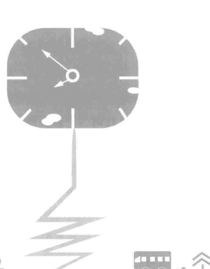
无论是向往自由生活，还是为了预防失业风险，做好不坐班、独立工作的准备已成共识。
一提独立工作、不坐班，很多人会想到创业当老板、做自媒体、当自由职业者。这些确实是常见路径。但现实是创业风险极高，普通人做自媒体变现困难，自由职业的背后也未必是田园牧歌，更可能是持续忙碌和迷茫。普通人不上班的出路在哪？
本章以“如果不坐班，你打算怎么活”作为入口，从真实生活出发，讨论更适合大众的替代路径。前四节重点讲如何摆脱打工思维，跳出“在岗不开心、不在岗不安”的循环，实现认知和行动转变。后三节结合自身经历，描绘独立工作者的成长阶段和注意事项，降低试错成本，早日建立属于自己的一人公司。

### 一、不坐班时你准备怎么活
2017年4月我离职开启独立工作。过去2000多个不用朝九晚五的日子里，朋友总羡慕我时间自由，也有人来问我“要不要裸辞”“怎么成为自由职业者”“如何不坐班”。
面对恨不得立刻离职的朋友，我常反问：“如果不坐班，你打算怎么活？”
屏幕那头往往从输出模式切成沉默。片刻后会说——
“不知道，先不想上班了。”
“去云南大理看风花雪月。”
“先躺平睡个够。”
“做什么都行，只要不用上班。”
……
“创业”“做媒体”“开咖啡店”也是高频答案。2023年底，一个准备裸辞做自媒体的朋友问我，我回问她内容方向和变现方式想好了吗？她摇头：还没想好，先走一步看一步。
不想上班想辞职，却没想好不坐班怎么活，是当下很多职场人的难题。翻开本书的人，或许也在寻找答案。在出发前，我想先卸掉一些关于不坐班生活的滤镜，看看更真实的旷野。

#### ● 第一，风花雪月也很烧钱
我说的贵，不只是旅居食宿贵，更贵的是藏在风花雪月背后的自由成本。
社交媒体上常看到“宅家月入过万”“不坐班月入过万”，让人向往数字游民生活。但大多数独立工作者的真实状态并不是岁月静好。
你只看到我睡到自然醒，你没看到我凌晨两点还在写方案；你只看到我养花养狗惬意，你没看到我蓬头垢面焦虑失眠脱发；你只看到我无拘无束说走就走，你没看到我在网吧高铁站马路边改稿的狼狈。
世上没有无代价的自由。不坐班带来更多可支配时间空间，但自由往往靠“自己卷自己”“过度工作”换来。没有努力的自由只在梦里。
长期承受收入不稳、未来不明、舆论不认可、内心不安这四大不确定性的消耗，也是自由的隐形成本。余额不足且容易焦虑的人，不坐班也难以放松。

#### ● 第二，把自媒体当退路，很可能变成死路
时间自由、来钱快、无天花板，是没做过自媒体的人的几大幻觉。于是很多人把自媒体当成不坐班的唯一退路。

结果往往是：怀揣热情入局，找选题写脚本拍视频剪辑，一条内容折腾一天，发布后几十个浏览，热情瞬间被浇灭。前面提到的朋友就是这样。
开局失利后她更努力学习拍摄剪辑，拆解爆款打磨脚本，坚持两个月数据小有起色，却因定位不准始终无法变现，焦虑加剧。最后因数据与收入双惨淡，回到了职场。
自媒体产能过剩的今天，不坐班当博主风险很高。若把自媒体当成退路，现实很快会让你知道什么是无路可退。
在这个超级个体时代，自媒体是杠杆，但不只有当博主一条路。基于自身情况用“自媒体+”思维赋能，探索更多可能性才是正解。第二章我会梳理自媒体变现的五大落地路径。

#### ● 第三，旷野未必比轨道轻松
社交媒体鼓吹“人生不是轨道是旷野”“裸辞重启人生”，让人以为离开格子间就能摆脱内卷开启爽文人生。旷野象征自由与无限可能，但其实旷野可能是比轨道更难走的模式。
轨道有参考线、有规则、有护栏，旷野没有路标没有指示牌，只能自己探路。荆棘与密林需要付出更多力气穿越。即便走到旷野，也常因看不清前路而迷茫。
轨道与旷野只是不同选择，没有绝对优劣。弄清自己真正想要什么，比急着选择更重要。
总之，不坐班的旷野不一定比轨道更自由。旷野有更广阔天地，也意味着更多不确定与风险。若银行卡没余额、心头没方向，盲目踏入只会更焦虑迷茫。
当时代失去方向，唯一可靠的路标是自己。寻找不坐班活法的第一步，是卸掉对自媒体等退路的不切实际幻想，对滤镜里的旷野祛魅，从真实生活出发找到属于自己的多元活法。

## 二、带给你安全感的，从来不是上班
你听说过“杀鸟盘”吗？
“杀鸟盘”源于笼中之鸟，是针对全职妈妈、学生等长期在家、与外界接触少、想通过互联网赚钱的群体设计骗局。完整链路通常是诱鸟、喂鸟、醉鸟、杀鸟。

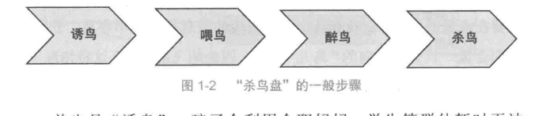
先是诱鸟，骗子以“足不出户日进斗金”“每天三小时动动手指就赚钱”为诱饵，发布刷单、手工、充值返利等虚假兼职，拉人进群。
接着喂鸟，通过晒转账截图、虚假聊天记录，以领红包、刷单返利、充多少返多少等方式给小额回报，获取信任。
再醉鸟后引导拍大单或充值更多，以返款延迟、系统故障为由套取资金。
每个盘背后都有急于突围的“鸟”。骗子利用经济不独立、收入不稳定者的焦虑织网围猎。
想冲破困境却因缺乏有效破局方法，被诱惑牵着走，最终掉入更深陷阱。每次看到相关新闻，我都觉得世界是个大捕鸟网，你我都可能是网中之鸟。考研失败、找不到工作、被裁员降薪、中年失业……困境常有。当遭遇困境，你是冷静找解法，还是自怨自艾或盲目跟风乱飞？
现实中多数人无法沉下心找解法，常上网刷视频找答案，在海量信息中难觅干货，像失去方向的鸟一样乱飞，受伤掉陷阱在所难免。比如很多想做副业增加收入的人，因缺乏认知与规划，人云亦云，今天报副业课明天考证书，花钱买了一堆课却始终没收入，副业变负业。

### 置身困境，如何不因不安掉入陷阱

- ● 第一，不依附任何一棵大树。
靠山山倒，靠人人跑。依赖公司、平台、老板，不如依赖自己。时代已无稳定工作，只有有稳定工作能力的人。西方有句谚语：“站在树上的鸟不怕枝断，因为它靠的不是树枝而是翅膀”。若此刻的枝条断裂，你有振翅飞行的能力吗？

- ● 第二，积累能单飞的能力。
真正的安全感从来不是上班，也不是一份高薪稳定工作，而是向内生长，随时能靠自己单飞的能力。
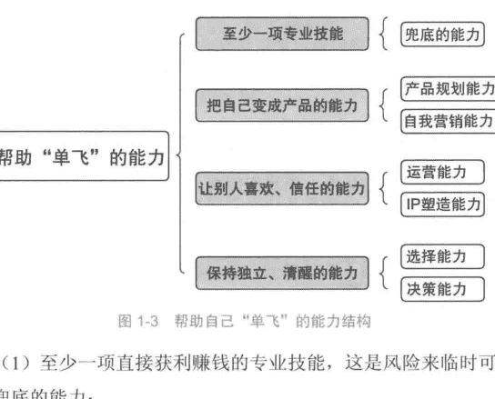
（1）至少掌握一项直接获利的专业技能，风险来时能兜底；
（2）具备把自己变成“产品”并成功售出的能力，即产品规划与营销能力；
（3）让别人喜欢并信任你的能力，即自我运营与IP塑造能力；
（4）在困境迷雾中保持清醒独立的能力，即决策与选择能力。
若此刻不具备也无妨，这些能力皆可刻意习得，后续章节会给出落地方案。

- ● 第三，单飞前先试飞。
鸟类在能高飞前会反复试飞，笨拙扇动翅膀直至能在空中翱翔。否则刚出巢就坠落。
对人也一样，单飞有未知风险，可先通过副业试飞检验单飞能力。确认能靠副业稳定获利后再单飞，底气更足。

- ● 第四，安全感是自己给的。

人们常常下意识地觉得，只要等到手里握住某个期盼已久却暂时缺失的东西，内心就会安定下来。比如前文提到的那些因为暂时无法上班、收入不稳而掉进“杀鸟盘”的人，他们坚信只要能拿到一份工作、领到一份工资，安稳感就会回来。

真相是，把安稳感完全交给别人或者外在条件，根本抚不平内心的动摇。把安全感押注在财富、职位上，哪怕短暂尝到一点平静，更大的不安很快就会卷土重来。真正能获得持久安稳的路径只有一个：**向内积累能力，而不是向外索取保障**。从现在起储备自己的能力，平静接受当下所有的不尽如人意，然后一次次试飞，直到真正能飞起来。

## 三、上班的真正主线是偷师练技

2024年，国内知名人力服务机构前程无忧公布了《上班族离职心态调研》。报告指出，除了福利低、收入低、加班多、天花板低这些常见原因外，接近三成的受访者坦言“工作氛围压抑、企业文化古怪”是想离职的直接诱因。

这说明，除了工作内容本身和薪酬，办公氛围、职场人际也是左右状态的关键变量。糟糕的氛围、不和谐的人际关系，会悄无声息地消耗心力与精力，让身心长期处于疲惫状态。

面对这种情况，有人选择抱怨吐槽，有人选择直接离职换环境。可抱怨只能换来短暂的情绪发泄，换工作也不代表下一份就不存在同样的困扰。所谓心病需心药，针对“人”带来的难题，可以从心理学角度找解法。

### （一）课题分离，断掉情绪内耗

想做一个能量充足的打工人，最直接的做法就是学会课题分离。

课题分离的概念源自个体心理学创始人阿尔弗雷德·阿德勒。在他看来，人际间绝大多数问题，根源都是你越界干预了别人的课题，或别人越界干预了你的课题。只要能清晰分离各自的课题，不把你我混为一谈，就能守住内心的秩序，不被他人牵着走。

怎么区分你我的课题？

很简单，**谁为行为的结果买单，谁的课题就是谁的**。

例如，有位同事习惯麻烦别人，总以“来不及了”为由求你加班做本该他自己完成的工作。工作能否按时完成、完成质量如何，是他的课题；你的课题是决定是否接受这个请求，你只需遵从内心给出回应即可。他因你的回应而生气或沮丧，那也是他的课题。

课题分离能解决生活与工作中绝大多数纠结，省下大量不必要的情绪损耗。但实际操作中也会遇到分不清边界的情况，比如员工没完成领导定的KPI。在这个事件里，双方都要为结果承担后果，员工可能被批评或扣奖金，领导则要承担管理失误、业绩不达标的后果。

都为同一件事负责，课题就分不开了吗？

并不是。这时可以**把事件拆成具体的行动步骤**，再实现分离。

拿KPI来说，制定合理的KPI是领导的课题，而你需要评估自身能力与KPI的合理性。若你觉得能力可能不足或指标不合理，可以选择与领导沟通，争取人力物力的支持，或重新协商一个更合适的KPI。

反馈沟通这个环节完成后，是否调整KPI就回到领导的课题。若领导采纳建议，工作顺利推进；若没有采纳，你只需尽力做好力所能及的部分。即使最终未达标，也无需自责愧疚，因为那已超出你的边界。

一句话概括课题分离的精髓：**事情先于情绪，更多关注自己，少盯着他人**。

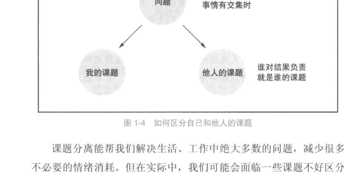

### （二）把职场当成练技场

学会课题分离、把注意力收回到自己身上后，会慢慢明白，上班的核心不是抱怨或摸鱼，而是**偷师练技**。

没有人会为了找罪受而去上班，大家去上班本质上都是为了获得报酬、让自己更值钱。既然上班的核心是边赚钱边提升价值，那么主线任务就是：把公司当成训练场，想方设法让自己升级，为自己的长期价值打工。把心态从“我在给老板打工”转成“我在给自己的专业、阅历、能力打工”，把职场看作一边拿钱一边学本事的地方。

一念之间，天地不同。心态转变后，很多人和事的观感都会不一样。

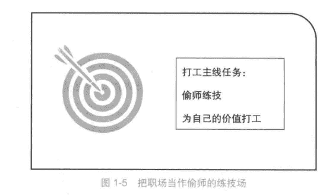

“石油大王”洛克菲勒年轻时在“休伊特-塔特尔”公司做记账员。记账枯燥繁琐，同事们纷纷抱怨工作无意义、老板压榨。但洛克菲勒不这么看，他在给儿子的信里回忆，这家公司是锻炼他的好地方，让他初试身手。正是这段经历打开了他的商业世界，让他学会尊重数字与事实，也培养了商人应有的能力。

把上班当成劫难，你收获的是痛苦；把上班当成修炼，你收获的是专业和赚钱能力。当你把注意力放在学习公司如何运转、领导如何谈客户、同事如何解决问题、客户如何盈利这些能提升自己的事情上，就没有余力去纠结那些烦心的人事了。

## 四、从打工思维转向独立工作思维

未来不会有稳定的工作岗位，只会有具备稳定工作能力的人。身处黑天鹅频发的时代，无论是为成长还是为避险，每个人都应为不上班、独立工作的可能做准备。而丢掉打工思维，培养独立工作思维，是迈向独立工作的第一步。

### （一）打工思维 vs 独立工作思维

何谓打工思维？从字面就能读出：我只是个打工的，我为老板做事。在这种被动心态下，常见表现是——

- 当一天和尚撞一天钟，得过且过；
- 拿多少钱做多少事，绝不多出一分力；
- 多做多错，不做不错，能推就推。

从单纯“活下来”的角度，打工思维能让工作更轻松。但风险在于，长期被动会把人生主动权交出去，关闭成长之门。多年混日子，年龄增长，能力停滞。

人有权利划水，可当风险来临时，你拿什么应对？生活不会配合你的剧本。若不想在风暴中毫无招架之力，就要跳出打工思维，切换到为自己工作、为自己负责的独立工作思维模式。

与被动逃避的打工思维不同，独立工作思维强调主动、增值、最大化自我成长收益。

对拥有独立工作思维的人来说，判断一份工作值不值得做，不是只看钱，也不是凭心情，而是看它能否深化认知、能否为能力增值、为未来赋能。

无论是普通员工还是负责人，他们都会尽力认真对待工作，在能力范围内创造更多成果。很多我们熟悉的企业家和创业者，在打工阶段就已展现出强烈的独立工作意识，即便在不起眼的岗位，也会做到最好，并抓住一切提升自己的机会。

总结而言，独立工作思维是一种自己对自己负责、自己掌握工作主动权的成长型思维。

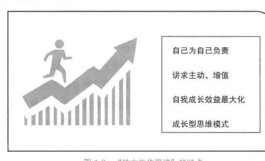

这个时代，每个人都有必要刻意培养独立工作思维。即便没有创业单干的计划，也需要它，因为它能增强抗风险能力，也能让你不再被“上不上班”的表象困住。

### （二）上班与不上班只是表象

正在上班的人想辞职，失业的人想赶紧上班。上班累，不上班更累。但痛苦的根源可能并不是上班与否，而是：上班到底为了什么？我们真正不想的是上班，还是不想工作？

上班是为了赚钱，但工作除了赚钱，还承载着成就感、满足感、幸福感。按照马斯洛需求层次理论，工作既满足生理与安全需求，也满足爱与归属、尊重以及自我实现的需求。

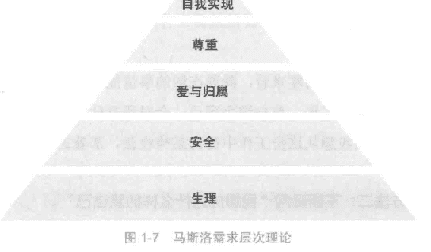
图 1-7 马斯洛需求层次理论

也就是说，上班与工作是两回事：上班是为了生存，工作是为了自我实现与意义感。正如许倬云先生所说，“工作不仅维持生活，也是你连入社会的一条线，是雕塑你自己的过程”。

多数人讨厌的不是工作本身，而是工作过程中无法获得意义感。因此，真正该关注的不是上不上班的表象，而是**我们如何对待工作**。

用独立工作思维面对工作，无论身处一平方米的格子间还是开阔的原野，都能从工作中获得超越生存的意义。反之，若始终被打工思维捆绑，即便置身原野，内耗也不会消失。

### （三）训练独立工作思维的具体方法

改变从细节开始，日常可通过以下三点训练独立工作思维。

- 方法一：以未来为导向思考。面对一份工作或项目，先问自己：（1）长远看，这件事能给我带来什么？（2）它会对我的能力与方向有什么帮助？（3）若想从中获得回报，我需要付出什么代价？
- 方法二：持续追问自我定位。定期反思“我是谁”“我想做什么”“我能做什么”“要成为我想成为的人，还缺什么”，在反思中不断精进。
- 方法三：角色扮演与换位思考。在工作中主动代入老板视角，思考“如果我是老板，我会如何处理”“我期待员工怎么做”“这个项目能达到什么效果”。生活中遇到感兴趣的商业问题时，也可模拟老板的决策方式。

## 五、独立工作者的成长轨迹

以上内容都是为独立工作做准备。要真正成为独立工作者，通常会经历怎样的成长关卡？下面结合多年不上班、独立工作的经历，拆解这个路径。

### 1. 预备阶段：用副业做测试

社交媒体上充斥着“裸辞当自由职业者”“辞职做自媒体”的帖子，但我并不建议冲动裸辞。

成为独立工作者的前提是拥有独立赚钱的能力，副业就是检验这个能力的工具。我在2017年离职前，已做过数轮副业测试，确认即便不上班也能养活自己。那时副业收入主要来自爱好与技能，具体过程在本书第二章有案例呈现。

### 2. 独立工作初期：靠技能变现

刚开始独立工作，我主要靠技能获利。

缺乏系统规划的那段日子，我曾陷入“瞎忙”模式。摆脱格子间的新鲜感过后，我来者不拒接各种约稿，通过老客户和网络渠道承接方案、商业文案需求，收入一度比上班时高两三倍。

当自由工作的新鲜感褪去，焦虑和迷茫袭来。某天凌晨加班改稿，我看着电脑里堆满的方案、影评、娱评、观点文、软文、新闻稿、种草文、小小说，突然问自己：我到底在写什么？我的核心竞争力在哪？为什么写了这么多，我仍是被客户挑剔的小写手？

想不明白、看不到方向，我开始失眠掉发。但当时我不敢停下来，因为账户数字不动，焦虑会加倍。就这样焦虑又忙碌地过了近一年。

直到2018年，前同事、现任先生兼合伙人也离职，我们决定一起创业，我才停下来做规划。

### 3. 自主创业：一人公司模式的初探

2018年10月，我们成立了一家品牌设计公司，主营品牌全案、咨询与设计。说大不大，老板加员工只有我们两人。我负责策略咨询，他负责客户开发与设计，人手不足时拉外部团队。该公司其实就是一人公司模型，只是当时还没有这个概念。

创业初期业务不稳定，为缓解不安，我与一家老合作咨询公司签了长期协议，远程负责项目并拿固定补贴。同时受朋友介绍，我在一家K12在线教育机构做线上讲师，白天写方案做PPT，晚间周末上课，时间被塞得满满当当。

熬过艰难期后，作品积累口碑，客户趋于稳定，可支配时间增多，我们萌生了在主业外拓展副业的想法。

### 4. 实体创业：交学费试错

2021年春节，我们回滇西小城过年。闲逛中萌生念头：咨询设计能否放到新消费场景里，让客户直接感受？最终决定做一个设计师文创品牌，以文创产品为载体，搭载茶咖与创意甜品，实现B端展示与C端消费的结合。

复工前三天临时决定留下来开店，很快找到经营合伙人。我们负责IP与产品设计营销，合伙人负责茶咖甜品研发与门店运营。第一批产品顺利进入生产，铺面租金也交了，方案确定。

临门一脚时，合伙人因自营品牌出问题中途退出。被迫调整，我们临时自研茶咖并承担门店运营，之后再找合伙人或店长。

### 5. 重新回到一人公司模式

2021年秋天，第一家门店正式开业。生意不错，逐渐成为当地网红店，也链接到更多优质客户与同频创业者。

但随之而来的是门店运营、员工管理、服务评价等琐事，我们被迫进入365天全年无休。设计业务外包，长期客户只能加班完成。两个向往自由的人，被困在了梦想里。我常开玩笑：“我开了一家梦想的小店，却被困在自己的梦想里。”给想开咖啡甜品店的朋友提个醒：若只是为了不想上班、想要自由而开店，失去的第一样东西就是自由。

2023年春节前夕歇业复盘后，我们决定砍掉必须靠员工运转的茶咖甜品业务，以“文创商店+文创设计工作室”的形式继续运营。

2023年8月完成业务切割与搬迁后，重心回归擅长的领域，再次以一人公司模式运营文创品牌，一切开始向好。

从我的路径可见：初期因**缺乏明确定位与系统规划**走弯路，后期因**拓展不擅长的业务**身心俱疲。希望大家能在预备阶段就明确产品定位与发展方向，提前规划个人商业模式，少走弯路。一人公司之前，通常会经历副业练技、自由职业或数字游民探索的预备阶段，若提前布局，就能更快抵达终点。

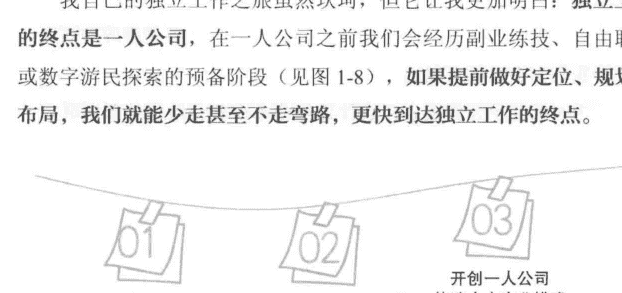

## 六、一人公司是独立工作的终点

独立工作的终点是开创一人公司。那么一人公司是什么？它与自由职业者、数字游民有何不同？本节将对这几种常见独立工作模式的概念与特点进行梳理，以便更清晰地认识差异。

### （一）浅谈自由职业者、数字游民

一人公司与自由工作，这三者的分界线

自由职业者、数字游民和一人公司，本质上都脱离了传统编制，不再被固定办公场所束缚，是靠自己对自己负责的独立劳动者。

不过大多数一人公司都会先走过自由职业或数字游民的摸索期，但一人公司既不能等同于自由职业，也不是数字游民的另一种说法。

**自由职业者**的核心是时间与技能的直接兑换。写作、撰稿、独立设计、插画、摄影、自媒体运营等群体，通常不受朝九晚五限制，可以自行决定地点与作息，用自己的专业能力换取报酬，不工作就没有收入。

**数字游民**同样摆脱了空间限制，借助网络完成任务，一边旅行一边远程办公。和自由职业相比，数字游民的主力更多集中在网页设计、软件开发、营销咨询、在线教育等领域，这类工作常需协作，于是数字游民往往以远程形式短期加入某个团队或项目。

概念上有差异，但自由职业者和数字游民的获利逻辑高度相近，都是把个人时间、专业技能卖出去，个人的精力、能力与投入直接决定了收入上限。

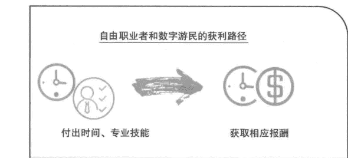

图 1-9 自由职业者和数字游民获利的路径

### （二）一人公司的真正含义

一人公司里的“一人”更多是象征意义，它可以是1个人，也可以是3到5人甚至更小的精干团队；这里的“公司”并非传统意义上的法人组织，而是一种以小规模稳定增长为目标的商业形态，以及一种用经营公司的思路来管理人生的工作方式。

IT顾问保罗·贾维斯在《一人企业：一个人也能赚钱的商业模式》里指出，一人公司能让人更自立，让职业路径更宽广。

说它是一种商业模式，是因为目标不是靠卖时间换钱，而是构建可产品化、可复用、可长期产生现金流的业务体系。

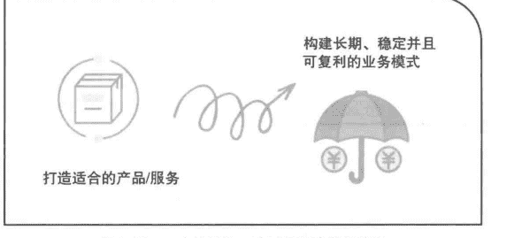

图 1-10 一人公司是一种可复利的商业模式

保罗·贾维斯本人通过写作、软件、博客和在线课程获得稳定增长的收入，作品在不工作时依然持续变现。我在实践中也发现，一人公司和其它独立工作形态相比，有以下特点：

#### 1. 高度自主的决策权
一人公司通常以一到两位核心创作为核心。自己既是老板也是执行者，比如我和先生创立的品牌设计公司和文创工作室。我们对业务方向和工作内容拥有很强的选择空间，不易被市场和客户过度牵制，也少了职场的内耗和内卷。

#### 2. 灵活自由的操作空间
创业者可依据兴趣、资源和专长挑选赛道，并自由组合业务形态，做出更贴合自己的产品与服务。同时可以随市场与客户需求快速调整方向，灵活度很高。

#### 3. 低成本、低风险的启动方式
规模小，单人即可启动，也能通过远程协作和灵活雇佣组建临时团队，人力成本大幅下降。办公地点也可以非常轻，甚至在家就能运作，属于轻资产创业。

#### 4. 小而美的竞争优势
不盲目追求规模，而是以精致小巧实现稳定增长。这让创业者能深耕细分领域，把产品打磨得更精、更有竞争力。

#### 5. 更强的抗风险能力
裁员与失业时，最能帮人突围的是接受变化、快速适应的能力。一人公司在运作中天然需要创业者一人多能、自行解决问题，久而久之会形成一专多长、快速应变的能力。

因此，一人公司是个人发展的趋势之一，构建这种模式能在变革时代提供更多选择与安全感。

需要强调的是，搭建一人公司不等同于必须辞职去注册公司，它更像一种行动指南，帮助你经营好自己的人生。无论在职、自由职业或创业，都可以经营一家拥有稳定变现模式的个人公司。

> 案例故事：活成一家公司的插画师小美
小美离职后靠接插画商单维生，很快发现纯靠手绘的收入受制于体力和时间，完成一份高质量订单往往需要一周到半个月，单量有限。随后AI绘画冲击和同行价格内卷导致断单频发。
她开始在自媒体做“真人变插画”的内容分享，因画面有故事感逐渐积累粉丝。粉丝增长后，品牌主动找她做联名，账号也能接到广告，商单报价水涨船高。她还把高赞作品做成帆布包、手账本、手机壳等周边挂橱窗售卖，即便几天不更新，仍有持续订单。
从中可见，早期小美靠技能单次售卖同一幅画，后来通过内容和周边实现一次创作多次售卖，随着受众扩大，收入进入复利阶段，个人商业模式初步成型。

## 七、一人公司发展的四个阶段

企业有生命周期，一人公司的发展也分阶段。根据实际经验，通常经历四个阶段（见图 1-11）。

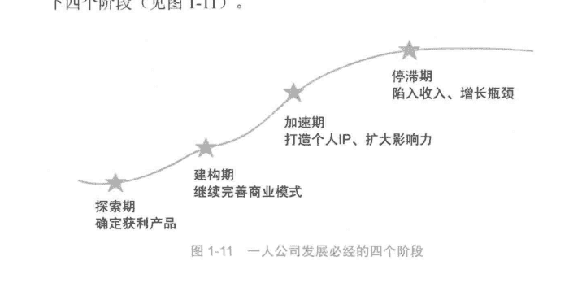

### 1. 探索期：锁定可变现的产品
起步阶段要先想清楚能靠什么赚钱，把专业和经验产品化。可以先用个人商业画布梳理资源、业务、目标客户，形成初步的模式草图。再用MVP思路做出最小可行产品投放市场验证。明确变现产品是第一步。

### 2. 建构期：完善商业模式
确定产品后进入反复验证和迭代期，同时积累客户资源。本阶段重点是打磨产品与业务模式，并明确客户来源与触达路径。产品做出后需要卖出去，所以还要学习销售转化。关于渠道与转化会在后续章节展开。

### 3. 加速期：打造个人IP扩大影响
模式跑通后能自养。此时可开发新产品、拓展新业务，部分人会考虑扩团队。更关键的是通过打造个人品牌积累信用与影响力，成为细分领域的“小IP”，以更低成本获得商业机会。

### 4. 停滞期：突破瓶颈
快速增长后业务会趋于稳定，随后可能进入停滞或低迷，收入增长放缓甚至停滞，伴随迷茫与怀疑。如何打破瓶颈实现突围，会在后续章节探讨。了解阶段后，下一步就是进入探索期，确定获利产品。

## 第二章 产品定位：找到自己的获利方式

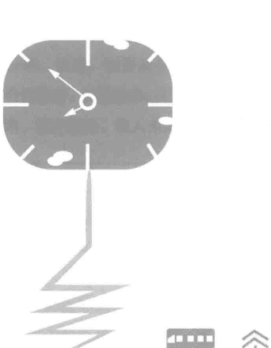

任何公司都需要产品或服务支撑，否则就是空壳。一人公司要持续运转也离不开有竞争力的产品。确定获利产品是开启独立工作的关键。

本章将学习个人商业画布与MVP原则这两个工具，并通过方法论加案例的方式了解九种常见个人商业产品模型。

## 一、画出人生第一张“个人商业画布”

和建筑师先画蓝图一样，把自己当公司经营也需要先规划模式。商业画布是一个常用的可视化工具，用来分析与重建商业模式。

### （一）商业画布的基本构成

商业画布由亚历山大·奥斯特瓦德和伊夫·皮尼厄在《商业模式新生代》中提出，已被广泛使用。它由关键合作伙伴、关键业务、关键资源、成本结构、价值主张、客户关系、渠道通路、客户细分、收入来源九大要素构成（见图2-1）。

| 关键合作伙伴 | 关键业务 | 价值主张 | 客户关系 | 客户细分 |
| --- | --- | --- | --- | --- |
| | 关键资源 | | 渠道通路 | |
| 成本结构 | | | 收入来源 | |

图 2-1 商业画布的九大构成要素

这九个要素覆盖价值创造、价值传递、价值获取三大部分。左侧决定内部运转与资源配置，右上方描述如何把价值送达客户，右下方呈现获利来源。中心价值主张是连接创造、传递、获取的枢纽，它要说明能为客户提供什么差异化价值，以及为什么客户会选择你。

### （二）画出自己的“个人商业画布”

接下来可以拿纸笔试着绘制自己的画布。

#### 1. 列出关键资源
你自己就是第一资源。先回答两个问题：我是谁？我有什么？
我是谁：性格、价值观、兴趣爱好。
我有什么：有形资产如存款、设备，无形资产如技能、经验、人脉、背书。无形资产往往藏着商机，越细越好。

#### 2. 确定价值主张
核心在于站在客户角度思考需求与痛点。价值主张要解决具体问题，而不是自说自话。比如“我是个人成长顾问，有问题找我”就太空泛。先问自己：我能给客户带来什么？产品是否真正解决了某个痛点？

#### 3. 锁定细分客群
客户是能从你这里获得价值并带来收益的人。确定方法有两种：
内部驱动：基于现有资源与产品寻找匹配客户。例如擅长新媒体写作，目标可能是需要内容的企业、想学习的学生或全职妈妈、阅读者等。
需求驱动：通过观察发现特定人群的未满足需求后针对性设计产品，例如健康轻食切中想减脂又不想吃枯燥沙拉的人群。

#### 4. 确定渠道通路
解决如何让客户认识你并购买，以及你如何交付。需结合目标客户的信息获取习惯与消费行为来规划，例如线上投放还是线下接触，客户活跃的平台在哪里。

#### 5. 构建客户关系
要因人而异，例如：是长期合作还是一次性交易，提供实物还是虚拟产品，高频还是低频消费，线上还是线下沟通，如何提升满意度与忠诚度。

#### 6. 寻找关键合作伙伴
能提供资金、资源、牵线、建议、分担压力的个人或组织都算，包括商业伙伴与亲友、师长。写下可支持的人，并思考如何链接到更多资源。

#### 7. 规划关键业务
对一人公司而言，关键业务包括产品定位、获客、个人IP打造、销售转化等所有维持运转的核心活动，也包括财务、运营等内部工作。

#### 8. 设计收入来源
明确赚钱方式与评估价值。先制定定价策略，考虑成本、竞争、客户支付意愿；再确定收费模式，如按时收费、按量计费、订阅、会员；最后预估收入潜力，包括复购、推荐等附加收益。

#### 9. 分析成本结构
成本分有形与无形。有形成本如房租、培训、工资、水电；无形成本如时间精力投入、心理压力、健康风险。有时无形成本的压力更大，评估时要一并纳入。

看到这里可能会觉得很多板块无从下笔，先别急。初期画的是预演草图，后续章节会提供更细的方法帮助填充与优化。先收好这张空白画布，带着问题继续阅读，在阅读中逐步完善。

个人商业画布：一人公司的九宫格作战图

| 个人商业画布 | | | | |
| :--- | :--- | :--- | :--- | :--- |
| 关键合作伙伴 谁能助力我 | 关键业务 我需要做些什么  核心资源 我是谁 我有什么 | 核心价值主张 我能给什么 | 客户关系 如何互动  渠道 如何触达 如何交付 | 客户细分 能服务谁 |
| 成本结构 需要付出什么 | | 收入模式 能获得什么 | | |

图 2-2 “个人商业画布”示意图

## 二、MVP原则：五步打造首款盈利产品

画完画布后，一人公司最缺的不是想法，而是能赚钱的第一款产品。就像工欲善其事必先利其器，产品设计可以借鉴互联网公司常用的MVP思路。

### （一）什么是MVP原则

MVP是最小可行产品的简称。核心逻辑是用最低成本快速搭一个能用的原型，推向市场验证是否符合用户预期，收集反馈后不断修正，直到贴合市场。

通俗说，就是先用低投入、快速度做出个60分版本，用试错换方向。

大众点评的起点就是典型。创始人张涛因为在上海找不到好吃的馆子，想做一个可互动点评的网站。不会编程的他自学网页设计三天做出第一个版本，没签一家餐厅，只把收集到的1000多家店录入，跑到BBS发帖拉种子用户试用。简陋的页面成了商业模式的起点。

MVP的意义不止省钱，更在于避免闭门造车。很多创业者想憋大招，埋头做完才上线，结果用户不买单。用户认可的需求才是好产品。MVP能在很短时间做想法验证，从真实反馈里判断可行性，快速给出优化方向，降低被嫌弃的风险。

### （二）五步设计出获利产品

基于实践经验，把MVP应用到一人公司，可以提炼成五步获利产品设计法。

#### 1. 锁定一个可解决的问题

能解决用户痛点的产品才有价值。第一步是先找到问题。

可以从画布里的核心资源出发，盘点自己能解决什么。如果找不到，也可以从自身想解决的问题入手，像张涛那样。也可以用曾帮助过自己的方法去帮助别人，例如健身、营养从业者多是从自身健康问题起步。

#### 2. 验证用户需求是否真实

以为是痛点，实际可能只是伪需求。之前在一线火热的上门美容，在节奏慢的小城几乎没人需要，跟风者很快退出。

验证手段可灵活选择：
- 向身边亲友求证；
- 做线上问卷；
- 线下访谈调研；
- 看竞品评论区的真实吐槽；
- 查阅艾瑞、CBNData等权威报告。

#### 3. 审视竞争格局

用关键词检索市场上是否已有类似方案。有竞品时，重点看用户评价，拆解其长处与短板，为自己的差异化做准备。没竞品时不要盲目乐观，先反思是政策限制还是根本没需求，确认是真需求且无不可逾越障碍再推进。

#### 4. 搭建产品原型

践行一个原则：先完成再完美，拒绝过度准备。

虚拟产品如课程、咨询、设计，成熟前可先展示案例、公布服务内容招募种子用户，先卖后产。实物产品可在开店前用朋友圈广告、个人小店或摆摊小范围测试。

#### 5. 迭代优化产品

原型上线后要迅速收集真实评价，按反馈调整再上线，形成“测试-反馈-优化-再测试”的循环，直到做出80分以上、更多用户买单的版本。

## 三、常见九大个人商业产品模型

明确MVP思路后，如何落地？下面是九种高频的一人公司变现模型，后续会逐一拆解落地方式。

### 1. 个人技能变现
人有一技之长就不愁饿肚子。把写作、设计、编程、绘画、财务等专业能力，或化妆、做菜、烘焙等生活里胜过他人的能力直接商品化。技能变现投入小、受外部环境扰动小，且能随经验持续增值。

### 2. 兴趣爱好变现
为爱好工作的人，往往比为钱工作的人更持久。做自己喜欢的事，容易进入“快乐工作→获得报酬与满足→更有动力→持续精进→获得更高报酬”的良性循环。

### 3. 知识变现
知识变现不等于只有卖课割韭菜。泛知识博主、求职指导、简历修改等都属于以知识经验获利。后续会梳理五种主要形式。

### 4. 信息差变现
生意很多建立在信息差上。时代越数据化，群体间的信息差越被放大。没强产品开发能力时，可用中间商思维分销他人产品、倒卖信息。把握算法制造的时间差、渠道差，依然有空间。

### 5. 自媒体变现
自媒体是工具，不是提款机，不能把它当唯一退路。常见的盈利路径有：
- 自媒体+泛内容：赚品牌甲方的钱；
- 自媒体+流量：赚平台的钱；
- 自媒体+个人IP：多渠道收入；
- 自媒体+产品案例：赚精准客户的钱；
- 自媒体+商品：赚陌生人的钱。

### 6. 个人电商
以个人为载体在互联网售卖商品。除了淘宝、京东小店、微店，还能在抖音、小红书通过直播、短视频、图文做一人带货。门槛低、一人即可启动。

除了以上六种，还包括：
第七，从身边小问题延伸服务，成为解决方案提供商；
第八，从用户抱怨与不满中发现创业机会；
第九，从热搜热评洞察需求，从热点中捕捉财富信号。

每个人的获利路径都独一无二，下文以方法论加案例形式展开，供思维启发，不做指向性指导。

### （一）技能变现：把个人能力转化为可交付产品

很多人有手艺却不会变现，其实只要三步走。

#### 1. 清点优势能力
梳理时可从三方面切入：
- 曾带来工作或收入的能力，如专业技能，也包括演讲获奖的表达力、连续拿奖学金的学力等；
- 在工作中被反复夸赞的能力，无意识呈现的能力往往更有差异性；
- 日常生活中得心应手、被亲友称赞的能力，如做饭、记生日、出行规划等。

综合擅长度、热爱度、市场需求排序，选出可商业化的能力。

#### 2. 把技能产品化
技能本身对用户无直接价值，必须变成课程、咨询、服务等可交付形式。用反问法倒推：谁需要？能提供什么？什么场景有价值？如何持续交付？

以化妆为例，可服务求婚、面试、演出前的临时妆造，或教授日常妆容和彩妆选购，从而形成可售卖的产品。

#### 3. 思考批量复制
让技能在单位时间内创造更多价值。
- 与同行合作，承接团队项目；
- 开发课程和培训，形成复用；
- 建付费社群做一对多服务；
- 借助自媒体杠杆售卖课程、咨询、社群。

方法仅作参考，具体要按服务内容和产品特性延展。

案例：农村出生，我靠写作实现了不上班自由

我并非写作天赋异禀，而是懂得把微弱优势放大重组。

#### 1. 写作+爱好，赚到第一笔稿费
小时候爱看书追剧听八卦，大四寒假用这种不学无术的爱好加尚可的文笔，成为一档脱口秀节目的兼职文字编导，每周三更，每期800到1000元。对学生来说是笔可观收入，也让我毕业后敢尝试不同工作。

用兴趣和能力组合，能把平庸优势放大成差异化壁垒，正如我把娱乐化的表达变成制造爆款内容的能力。

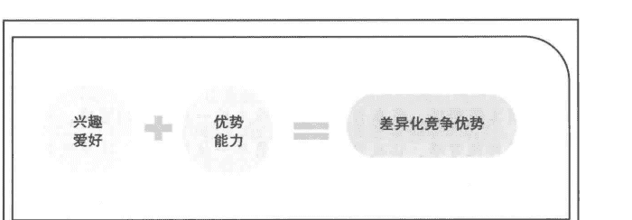

图 2-9 兴趣爱好和优势能力组合，发现差异化优势

#### 2. 写作+交叉领域，收入增长
2014年毕业后进入新闻网站做实习编辑，2015年离开媒体进入广告公司做月薪4000的文案。看到同城文案月薪3000到6000，全案策划5000到15000，外请顾问单次收费五到六位数，我立志一年内成为品牌全案策划并向咨询顾问迈进，于是边工作边自学营销和管理。

半年多前我离开广告公司，加入一家品牌营销咨询机构，正式做起了品牌全案策划，薪水也比之前提升了一截。

这段经历给我最大的启发是：写作是一项跨界万能技能。它可以嵌入到任何行业，与专业知识、方法论融合后，会产生大于 1+1 的增值。换句话说，**你手上任何一项核心优势，只要与别的领域打通，就能放大竞争壁垒，带来收入的跃升。**

#### 3. 用三种路径让核心技能产生多重收入
之前在自由职业阶段我也绕过弯路，后来明白靠单一技能卖钱很快会撞上收入与体力的天花板。想突破这个局限，可以从三条线入手。

第一，**深耕优势技能，做到细分领域的专家，提升单位时间的价值**。创业后很长一段时间，我把重心放在打磨商业咨询能力上。

第二，**把技能复制出来**，借助课程、出书、做自媒体，让一次内容输出可以重复变现。

第三，**把优势经验迁移到新赛道**。举例来说，我现在把做品牌、企业咨询的经验平移到个人品牌和个人商业咨询上，推出了个人品牌打造和个人商业咨询服务，开辟了新的盈利口径。

### （二）把爱好变成生产力
找到自己真正热爱的事并从中获利，会进入良性成长循环。可惜很多人要么忙得找不到自己想要的东西，要么已经付出很多却把爱好和钱隔离开了。下面就聊聊怎么找到真正想做的事，以及如何把爱好打磨成可变现的产品。

#### 1. 辨别真正的心之所爱
想用爱好赚钱，先要分清这是功利性的喜欢，还是发自内心的热爱。

**功利性爱好**是觉得这东西有用才喜欢；**内心热爱**是先有兴趣，才去喜欢。

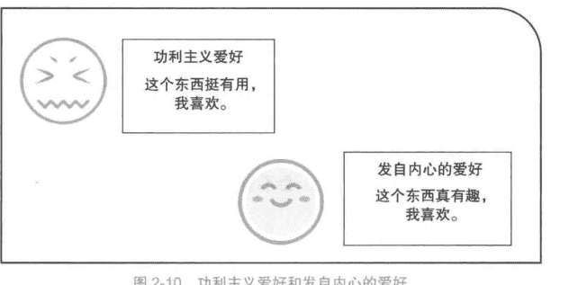
发自内心的热爱往往藏着生产力与财富，而功利性爱好很难完成商业闭环。因为功利性爱好的出发点是“这对我有用，能得到回报”，在这种假设下会产生“好像很喜欢”的错觉，喜欢停留在表面，难以支撑起持续的商业转化。

比如很多新博主自我介绍写着“喜欢穿搭，和微胖女生分享日常穿搭”“喜欢读书，做一个又长脑子又长钱包的读书博主”“喜欢健身，记录减脂日常”。简介写得热闹，主页内容却对不上。发了几条数据平平，就开始抱怨“自媒体就是骗局，普通人吃不了这碗饭”。过段时间再看，主页早已停更或改名换赛道。

做自己真心喜欢的事，几乎不需要意志力就能坚持下去。而伪爱好显然不具备这种特质。那怎么判断是真爱还是伪爱呢？一句大白话是：**时间与金钱流向哪里，热爱就在哪里。**可以通过以下自我问答来定位。

1. 从小到大，你最长时间坚持下去的是什么？
2. 做哪件事时你会不自觉忘记时间，而且一点也不累？
3. 有没有一件事，即便短期看不到回报你也愿意持续投入？
4. 做什么时你会莫名嘴角上扬，从中得到持续的快乐？
5. 有没有一件事，哪怕要交学费你也想去学？
6. 打开消费记录，看看你为哪个爱好持续花钱？

#### 2. 三个把爱好变现的小方法
认清真正的爱好后，关键是怎么把它变成可获利的生产力。下面是我实践中总结的三个做法。

##### 1）喜欢的事 + 擅长的事
先找到自己喜欢的和擅长的，再把两者组合，往往会形成 1+1≥2 的新竞争力。一些本身不突出的能力，在交叉领域会变成核心优势。

我认识一位朋友很爱画画，自学插画多年，但水平离专业插画师还有距离，单靠画画很难变现。她的优势是逻辑清晰、会归纳总结。于是她把两者结合，成为“视觉笔记”设计师，为读书会、创业团队提供服务，还开了“视觉笔记设计课”，深受手账爱好者和学生欢迎。

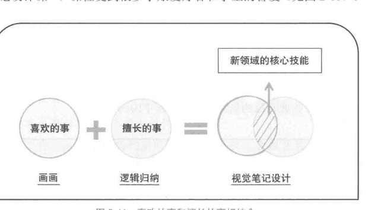

##### 2）刻意练习：把爱好练成特长
如果找不到与爱好匹配的擅长项，那就用刻意练习把它变成熟手特长。起步虽慢，但成长是长期主义的事情。

钢琴家不会一夜成名，所有“××家”都是靠无数次幕后练习换来的。关于刻意练习的系统方法，会在第六章详细展开。

##### 3）为“同好者”提供产品服务
懒人最懂懒人需要什么，爱美的人更懂爱美人群的心理。心理学上的“自己人效应”告诉我们，一旦对方把你归为同类，信任感会迅速建立。

做一人公司时，可以先找和自己兴趣相同的人，思考自己需要什么，他们需要什么，然后设计对应的产品或服务。比如 GoPro 之父尼克·伍德曼在冲浪时发现缺乏记录极限瞬间的工具，于是研发出可戴在手腕上的便携运动相机。

爱好即生产力，也是战斗力与财富。找到热爱并在其中发光，才是长期护城河。

> 案例：“烧钱”玩户外，原来是条好生意
>
> 坊间常说“爱好玩到极致都很烧钱”，反过来也成立：玩到极致就能赚钱。
> 2022年“精致露营”席卷社交媒体。朋友圈天天晒露营图，帐篷、夜灯、烤架、天幕、摩卡壶等装备冲上电商热销榜。
> 一批玩家不惜花重金买一张桌子、升级一顶帐篷，单人投入十几万的比比皆是。看似零门槛的户外运动，变成了装备升级竞赛。
>
> **有人烧钱，就有人赚钱。**
>
> 老张经营酒吧，是个户外老玩家，2020年前每月徒步或骑行。2020年后宅家许久，节假日便约亲友近郊露营。2022年春节他在社交平台晒了全家露营照，评论区瞬间炸了：“帐篷哪里买？”“烧烤架什么牌子？”“能租吗？”
>
> 他敏锐地嗅到商机，和一位同样爱户外的朋友每人出2.5万元，快速购入一批露营装备做租赁。开业第一天就租出30多套，一个月收回成本。借着露营热潮赚了第一笔钱后，他意识到玩家愿意为爱好豪掷千金，于是决定关掉一直亏损的酒吧，转战户外。
>
> 朋友建议他开发露营营地。但老张觉得露营热只是风口，风头过后一部分人会回归徒步、骑行等轻户外。他没有建营地，而是组建户外运动社群，联系骑行徒步装备供应商，规划城市周边的新手路线。
>
> 正如人更懂同好所需。2023年露营热度回落，年轻人与厌倦加班的打工人转向徒步、户外骑行，老张再次抓住机会。

### （三）知识变现：你知道的都值钱
日常积累的经验与知识，都可能是商业起点。下面分享五种把知识打包成产品的思路，产品形式从初级到可复利不等，可根据自身情况选择起点并不断迭代。

图 2-12 把知识、经验打包成获利产品的思路

#### 1. 售卖攻略
最简单的知识变现是**卖经验、卖攻略**。现在大家遇到问题，第一反应是上网找攻略，从“狗狗不吃狗粮怎么办”到“如何找到人生方向”，需求无处不在。把自己处理问题的方法、生活常识整理成文字或视频，放到小红书、闲鱼等平台就能形成初级知识产品。

例如小红书上很多考研博主把背书方法、专业课名词解释资料打包售卖，求职季时简历模板、大厂自我介绍模板也常被抢购。

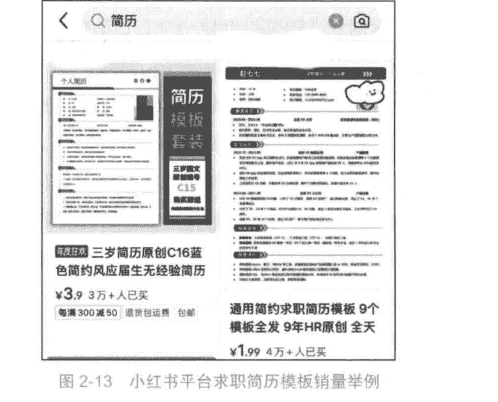

#### 2. 一对一咨询服务
锁定特定方向提供一对一咨询，也是一种低门槛的知识变现方式。虽然咨询单次交付重、难以复制，但费用跨度很大，从几千到上百万不等。创业初期花时间做一对一咨询，有助于摸清用户需求与痛点，进而提炼出可标准化的产品。

#### 3. 创建社群
一人公司都可以尝试做付费社群，帮助探索知识变现与商业模式。社群要先明确目标人群与解决的问题，比如“不上班俱乐部”“21天吃出好身材”等。

创建前大致规划：
1. 社群能解决哪些问题，提供什么服务？
2. 我作为主理人的核心工作是什么，用户如何参与互动？
3. 如何引流招募成员？
前期可设置较低价格，先跑通模式再调价。

#### 4. 付费课程、训练营
课程与训练营是大家最熟悉的知识产品形态。这意味着你在专业领域已有长期积累。需要提醒的是，**知识产品卖的是结果、陪伴与服务，而不是内容本身**。设计课程前要先问清：为谁设计？解决什么问题？带来什么改变？如何确保学员达成结果？

#### 5. 泛知识 + 自媒体
另一种路径是先用“泛知识 + 自媒体”抓流量，再借助个人IP影响力转化。目前各大平台都在扶持泛知识内容。可趁红利期探索商业可能。

**泛知识**指对个人成长有帮助、贴近生活、能拓宽认知的实用内容，比如“怎么写简历”“怎么提高睡眠质量”“如何无痛早起”。靠“如何如何”系列泛知识一个月涨粉百万的短视频博主“打工仔小张”，就是典型代表。

> 案例：靠教坐高铁圈粉百万的另类知识博主
>
> 2023年春运期间，“打工仔小张”一条“第一次去高铁站如何坐高铁”的视频爆火。视频里他边走边说：“评论区很多人没坐过高铁，虽然可能没人看，但万一有人需要呢？”随后详细讲解安检、取票、候车、找座位等细节。最后说：“有不懂的评论区问，好心人会解答的。”
>
> 视频点赞超60万，有人说拯救了社恐与第一次出远门的自己，有人转给老家母亲靠它成功坐上高铁。随后他连发“第一次自己去医院看病”“第一次坐地铁换乘”“第一次坐飞机”“第一次去麦当劳点单”等系列。凭借该系列，一个月涨粉百万，总播放量达2.6亿。

## 第二章 定位自己，选准变现路径
“如何如何”系列走红后，小张继续分享生活常识科普与生存感悟，积累近500万粉丝，被网友称为“社会生存学顶流”。

信息时代我们活在算法打造的“信息茧房”里，容易产生“眼前即世界”的错觉。但每人都有独特的经历与生存常识，我们以为的常识正是别人的盲区。

知识没有有用无用之分，只有需要与不需要之分。做知识产品时，不妨从自己习以为常的常识出发，以利他心态分享，往往有意外收获。

### （四）信息差：人人可复制的模式
关于信息差有两派说法：一派认为商业根基就是信息差；另一派认为信息时代信息差已被抹平。实则信息差并未消失，只是形式变了，普通人照样能利用它获利。

#### 1. 巧用算法制造的信息差
“打工仔小张”的故事说明，互联网看似打破壁垒，算法却在为每个人定制窄化的“同温层”信息。精准推送让认知收窄，但只要主动跳出被动接收的围猎，从被动变主动，横亘在算法里的信息差就能成为商业机会。

比如有创业者瞄准代际差异，在短视频直播间用AI为父母辈定制姓名、生肖头像，单场观看近万人，单场收益过万。更早已有很多人悄悄布局“银发经济”。父母辈看到的世界与我们截然不同，任何不同时代、区域、成长背景的人，掌握的信息都是不对称的。主动走出舒适圈接触圈外人群，就能发现更多机会。

#### 2. 利用渠道差、时间差
除了内容差异，还可以从信息传播的渠道差与流动的时间差中找商机。

# 别急着骂割韭菜，先看清信息差

前一阵在抖音刷到一场直播，标题是教人“小红书开店实操”。点进去在线人数破千，199 元一节的课，当场就卖出了上百份。课里讲的内容很基础：怎么注册、类目怎么选、商品怎么上架。

第一眼我是嫌弃的，觉得这种水货也敢拿出来卖。

关掉直播后才回过神来，是自己的惯性思维在作祟。我用自己的使用经验去评判别人的产品，完全忽略了市场侧的需求。抖音月活早就超过9亿，小红书约3.5亿，简单一算就有5.5亿抖音用户根本没碰过小红书，更不了解小红书上怎么开店。对这群人来说，这门看似“入门”的课，恰恰是刚需。

这件事给我一个提醒：不同平台、不同圈层之间，信息流动的速度和路径并不一样。同一条信息，有人早已人尽皆知，有人今天才第一次听说。把在A渠道积累的信息和能力，快速迁移到信息还未渗透的B渠道，时间差本身就能产生红利。最早一批做个人IP咨询的老师，很大一部分就是从企业咨询、品牌咨询里转过来的。

#### 3. 把信息差转化为收益的本质

把上面的经验拆开，能看到三条规律：

- 从被动接收、被信息推送，转向主动搜集、主动掌握。别把自己困在单一信息源里，多渠道交叉验证。
- 信息差本质是时间差、认知差和执行差。只有能被快速复制迁移的信息差，才有变现价值。
- 信息是流动的，差价会过期。没有持续的敏感度和洞察力，靠一次信息差赚到的钱就是一次性买卖。

所以信息差永远存在，但想靠它稳定获利，对普通人并不容易。

反过来看，破解信息差最省力的办法是向已经掌握差价的人学习。去信息更湍急、竞争更卷的市场里，向行业高手取经，再把学到的东西平移到自己的赛道，或者直接把差价卖出去。下面这个“中间商”案例很典型。

> 案例：做一个会赚钱的连接者
> 
> 和一位普洱茶圈的前辈聊天，他说现在半退休了，一年只接一两个看得顺眼的项目，偶尔充当中间人，帮老客户出手老茶。这位前辈在普洱茶策划领域深耕三十多年，对全产业链门儿清，是圈内公认的茶企外脑，同时也是资深茶客和茶文化研究者。
> 
> 正因为站的位置中间，既有甲方找他做咨询，也有茶庄老板、资深玩家找他寻茶。他于是成了衔接茶企、茶庄、玩家的枢纽，既帮上游卖货，也帮下游找货，自己从中获得合理回报。
> 
> 大家常说“厂家直销，没有中间商赚差价”，听起来很美好。但现实是上下游之间往往隔着技术壁垒和信息壁垒，没有中间人，下游很难高效触达到上游，上游的产品也难流通。
> 
> 在传统行业里，经验丰富的经营者和玩家，宁愿付费让懂上下游信息的中间人牵线，以求降本增效。
> 
> 当然，不一定要像这位前辈有三十年积累才能做中间商。中间商的本质是桥梁，把生产端的信息解读后传递给不知道的消费端，就能赚取连接费。
> 
> 很多做知识产品的人，其实自己并不生产内容，而是以中间人的身份，把头部大V的课程卖给用户，拿销售分成。这样既解决了用户的信任问题，也省去自研和交付的成本，自己还能近距离观察大佬的运营方法，为以后做自己的产品积累经验。
> 
> 当内容生产能力还不够时，先做代理和分销当中间商，一边摸清用户需求，一边向高手学习，同时还能靠信息差先赚第一笔钱。

### （五）自媒体赚钱的五种常见打法

自媒体是这个时代给普通人留下的少数公平红利之一，背景、学历、长相都不重要，找准打法持续深耕就有机会。这和“全职做自媒体很危险”并不矛盾，因为自媒体本质是放大器，不是饭碗。用它获取客户、人脉和机会是对的，把全部生存押在上面就是赌博。市面上动辄三千、六千、九千的“逆风翻盘”课，十有八九最后只换来一堆付费课。

想用自媒体这根杠杆，先要搞清楚它有哪些变现路径，再选一条能长期坚持的。

#### 1. 自媒体 + 广泛内容：拿甲方的钱
持续输出内容积攒粉丝后，接广告、做直播带货，也就是做博主。路径清晰但门槛不低：要能稳定产出、前期要接受不赚钱、粉丝量达标才能开商业功能、就算有粉丝也不一定被品牌挑中，有时一个月零广告。

#### 2. 自媒体 + 流量：拿平台的钱
影视解说、明星八卦、二次剪辑这类账号，往往不接广告也不带货。靠的是平台任务和创作分成，用播放量换收益。听起来门槛低，实则需要大量时间投入和一定的剪辑能力。朋友运营三個影视解说号，每天写脚本找素材剪辑，电脑前坐十多个小时是常态。

#### 3. 自媒体 + 个人IP：多元收入
在已有目标客户或已有产品服务的前提下，垂直输出专业相关内容，吸引精准人群，再把能解决痛点的产品卖出去。这类账号不追求爆款数据，也不靠平台补贴。以我自己的小红书号为例，内容围绕一人公司、副业、不内卷打工，虽然定位不是接商单，广告邀约依然每个月都有。

#### 4. 自媒体 + 产品案例：拿精准客户的钱
如果你是实体店主、设计工作室负责人，可以先用图文分享作品和案例积累信任，再逐步过渡到个人IP。记住MVP原则，先开始再完善。

#### 5. 自媒体 + 商品：拿陌生人的钱
越来越多的人习惯在抖音、小红书上刷到就下单买零食、家居用品。电商的核心是卖货，即便没有强影响力和大粉丝量，只要选品和运营到位，也能把商品卖给需要的人。这就是个人电商的思路。

### （六）个人电商：一个人就能做的低成本生意

个人电商就是以个人身份在互联网上做商品交易。早期在淘宝、京东，现在主战场已经搬到抖音、小红书，形态也从店铺经营变成短视频带货、图文带货、笔记带货、直播带货。

#### 1. 如何起步

##### 1）抖音平台
目前有橱窗、短视频、图文、直播四种起步方式。规则是：0粉即可开橱窗；粉丝≥500可挂视频带货链接；粉丝≥1000可开直播和图文带货。操作路径是搜索“商品橱窗带货指南”进入电商入驻指引，完成后在【电商带货-成长-学习中心】学习选品和上架。粉丝到500后发布的带货视频即可挂商品，成交后拿佣金。

##### 2）小红书平台
有开店和买手合作两种。开店无需粉丝，0粉可入驻专业号后开店；买手合作需要粉丝≥1000。

开通小红书店铺：我→三条杠→创作中心→创作服务→更多服务→商业能力→开通专业号，返回创作中心【更多服务】找到【开通店铺】按流程完成。

开通买手合作：粉丝≥1000后，我→三条杠→合作中心→买手合作。

开店后可直接上架商品并在笔记里插商品卡片成交。买手合作达标后可通过直播带货和小清单带货，同样产生佣金。

总结来看，两个平台都支持0粉起步，抖音要到一定粉丝才能在视频里挂链接，小红书开店后就能直接发带卡片的笔记。

#### 2. 选品要点

选品决定成败。三个实用方向：

从自身需求出发。选自己真心认可、会重复买的实用好物，讲起来更有说服力。比如宝妈可以围绕母婴用品展开。

低客单、高颜值起步。零食、饰品、平价彩妆、手机壳这类产品停留成本低，容易出单，适合试水找到爆品感觉。

借大数据选品。抖音【电商带货】后台的选品广场每天更新爆款、低价好卖、好评榜单；小红书【电商中心】可看热点种草和潜力产品。第三方如飞瓜、灰豚也能辅助判断。

#### 3. 避坑清单

- 别信造富神话，成功很难复制。
- 爆单不是常态，要扎扎实实练文案和拍摄。
- 平台规则和用户需求都在变，没有永久爆品。
- 看似门槛低，持续运营并不轻松。
- 模仿拆解爆款比报课更有效。
- 平台后台有大量免费课程和案例可学。
- 选品先试用，确认商家资质，避免三无违规商品。
- 合规经营，不虚假宣传，不售假。

### （七）解决方案提供商：从解决一个小麻烦开始

很多大企业都把自己定位成解决方案提供商。每个创作者、创业者都可以把自己定位成“解决某类问题的服务商”，先找到一个真实存在的问题，再设计方案卖给需要的人。

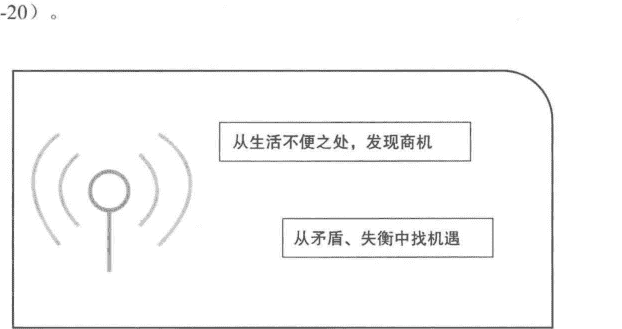
#### 1. 从生活不便之处，发现商机

不少人总想抓住时代大势，做出颠覆性产品。其实很多好产品是从解决一个细微的生活不便开始的。点评网创始人张涛最初想解决的就是“好吃的餐厅难找”；宠物托养师的兴起，则解决了宠物主人出差、旅游、探亲时宠物安置难题。

现在猫狗已成为家庭成员，但外出时带走不方便，寄养店又怕环境陌生。宠物上门托养师正好填补这个空缺：约定时间上门，以视频记录喂养情况，让主人实时看到“毛孩子”的状态。新华社报道，2024年春节期间上门喂养服务供不应求，不少“带薪撸猫”“带薪遛狗”的从业者单日接20单左右，日入千元。

从解决一个小不便切入，往往比一上来就想颠覆行业更靠谱。

类似的案例还有在各大医院频繁往返的陪诊从业者，这份职业正是为了解决老年人就医不便而诞生。2024 年通过综合考核后，上海开放大学联合上海市养老服务行业协会共同为首批人员颁发“上海养老服务陪诊师”证书，行业由此进入持证上岗阶段。

**留心身边的摩擦点，商机往往藏在不便里。** 当你或身边人遇到某个环节别扭、不顺手时，不妨停下来想办法把它理顺。思考本身就是在锻炼商业敏感度，即便暂时没冒出可落地的点子，这个过程也在提升创业思维。

#### 2. 从矛盾、失衡中找机遇
不顺畅的地方暗藏机会，市场上矛盾突出、供求失衡的场景里，也常埋着盈利可能。

我常住的小城处于云南小粒咖啡的主产带，区位优势让不少年轻人把咖啡当作创业赛道，玩法大致分两类：线上带货与线下开店。线上要面对包装、设备、库存、投流等一系列成本，开店于是成了多数人的首选。结果在常住人口不足九十万、游客也不多的城里，咖啡馆扎堆出现，光我工作室周边一公里内，大小店面已近二十家。

目前看，当地咖啡馆明显供大于求，街头时常能见到经营一两年后贴出歇业、转让的告示。产地优势与本地消费饱和形成冲突，供需失衡加剧，身处其中该如何破局？现实中真正突围的人是怎么做的：

- 创业者 A：判断本地 C 端已高度内卷，于是把方向从 C 端转向 B 端。依托产区资源和多年门店经验，把其中一家店改造成烘焙工厂店，为全国小微咖啡馆提供豆子定制烘焙，同时配套开发选品、研发、开店咨询、创业扶持等课程，为准备入行的人提供一站式方案。
- 创业者 B：试过开店与做电商后，把重心放在生豆加工与人才培养上，开设咖啡学院，课程包括品鉴、烘焙、冲煮、SCA 精品咖啡协会认证、CQI Q-Grader 咖啡品质鉴定师认证等，为爱好者和从业者提供多元学习路径。

这两个案例的共同点是：从市场矛盾与供需不平衡中寻找突破。矛盾与失衡有时并非坏事，如优衣库创始人柳井正所说，“经营的本质是遇到矛盾，然后化解矛盾”。面对失衡，不要回避，直面并解决，往往能打开新商机。

### （八）用户痛点创业：每个抱怨背后都是商机
从个人能量角度看，少抱怨、远离抱怨是对的。但从商业视角看，完全屏蔽抱怨会错过潜在机会。

因为每一条抱怨背后，都意味着一个尚未被满足的需求或未被解决的痛点。关注目标客户的吐槽，用来拉开服务差异；顺着痛点去创业，往往能发现全新机会。

#### 1. 那些因抱怨而生的知名品牌
阿里巴巴创始人马云说，“机会就藏在有人抱怨的地方，当有人抱怨时，机遇也在”。很多知名品牌都源于对生活工作的不满。

比如只在河南开店却口碑全国的胖东来，每家店的活鱼区都设有敲鱼台，方便顾客自行处理。这个配置最初并非标配。一次，一名在医院工作、对卫生要求很高的顾客买鱼时，觉得传统摔鱼方式可能让细菌进入伤口，提出卫生风险的抱怨。店员即时上报主管，内部讨论后，当天下午就在活鱼区放了一张桌子作为敲鱼台，并配上敲鱼锤。此后敲鱼台成为全部门店标配，相关处理也写入操作规范。

全球影响力极大的社交平台 Facebook，前身只是一个哈佛校园内部交流网站。因为同学抱怨找人联系方式困难，马克·扎克伯格把宿舍楼花名册搬上网，做出可查看资料照片并互相交流的 The facebook。

美国流媒体巨头奈飞的诞生，也源于创始人里德·哈斯廷斯对传统租赁滞纳金制度的不满。他设想做一家免滞纳金的在线 DVD 租赁服务，随着用户增长与策略调整，奈飞逐步发展成内容制作与流媒体平台。国内的滴滴打车、美团、饿了么等，也都是对传统出行、点餐方式不满催生的产物。

#### 2. 如何利用客户的抱怨、痛点
有人会问，这些是巨头案例，普通人怎么用？

对个体创业者而言，用抱怨创造全新创新的概率不高，但学会倾听、从抱怨中提炼痛点并思考解法，本身就是收获。即便不能立刻带来颠覆性机会，回应抱怨也能让产品更受欢迎、竞争力更强。

以我自身为例，准备在实体店推出文创雪糕做引流，最初打算找工厂代工或使用预制奶浆罐装。但社交媒体上大量网友吐槽景区文创雪糕贵、好看却难吃，全是流水线添加剂味。我意识到小城外地游客不多，核心客群是本地居民，要做长期生意而非一锤子买卖。于是放弃代工，改用不加水、不勾兑、纯牛奶手工制作。首批内测后各年龄段朋友一致好评，最终这款雪糕成为店内食品类复购率与好评率最高的单品之一。

再看社区美容院、社区养生馆为何遍地开花、门庭若市，背后正是职场人和全职妈妈对传统美容院难预约、距离远、不方便的抱怨。收集抱怨时要区分是多数人的共性问题还是个例，只有共性痛点才具备商业价值。

### （九）需求洞察：藏在热搜、热评里的财富信号
前文提到我从网友吐槽中改进产品并获得反馈。我们刷热搜、看热评，除了吃瓜，也能捕捉需求与财富信号。热搜热评代表用户的关注点与共鸣点，流量与机会往往随关注点走。能从热点里读出需求与共鸣，就有机会把热点变为收益。

#### 1. 从热点到“热销品”的秘密
内容创业者看热点是基本功，其他领域同样能借助热点提升商业嗅觉。洞察热点需求的速度越快，就越能把热点直接转化为热销商品。

人工智能时代，AIGC 产品讨论度很高时，有人迅速推出面向不同人群的 AIGC 培训课程；不擅长研发的人则靠出售 AI 工具使用教程赚取差价；还有人给大咖做课程推广，一边学习一边获利。

说到把需求快速变为产品，不能不提“义乌速度”。巴黎奥运会开赛，距离巴黎九千多公里的义乌，周边产品已爆单。中国选手黄雨婷、盛李豪夺得 10 米气步枪混合团体首金后，义乌当晚就做出黄雨婷同款发夹。国民 3A 游戏《黑神话：悟空》上线后，义乌第一时间产出各类周边，上线不到一周，第 23 届中国框业与装饰画展览会上就出现精美“悟空”苏绣装饰画。

普通创业者追热点速度赶不上义乌，但保持商业敏锐、随时准备出手，就能在机会出现时第一时间抓住。

小红书上有一位做个人电商的博主，坚持热点选品法。她会从可能爆火的影视剧、综艺中提前挖掘简易的文化衫、配饰、IP 周边，剧集火之前就找到货源并上架，剧集出圈后产品自然走量。

#### 2. 因为一句热评，一年开出 50 家门店
追热点做内容、乘势推产品，能带来收益；更深地挖掘热点背后的需求，则可能带来意外创业机会。

我朋友董师傅，2023 年从摄影师和自媒体创业者转行摆摊卖米线，不到一年半在全国开了 50 多家门店。促使他转行的，是反复出现在直播间和评论区的热评。

2022 年，抖音本地生活业务转型，董师傅的探店、团购业务受冲击，团队转做电商直播。虽然每天十几个小时高强度直播，场观寥寥，但总有老粉丝加油，也有在外上学上班的粉丝刷屏：“好想念老家特产美食、米线、饵丝”“希望把更多家乡美食带出去”。他过往美食视频下也高频出现“喜欢云南米线”“怀念云南米线”的留言。

从这些互动里，他判断以品牌化方式做一碗有云南风味的米线可行。随后他与一位深耕餐饮十几年的老炮组建团队，以滇西风味烧肉米线为核心产品开启摆摊测试。几个月打磨口味后，2023 年 6 月在老旧小区门口开出第一家正式门店。单店模式跑通后，经品牌形象升级，从滇西逐步向周边扩店，一年多开出 50 多家。

每个热评背后都有需求与关注点，上网别只看热闹，学会看门道，你的商业机会可能就藏在评论里。

# 第三章 客户渠道：精准捕获潜在客户
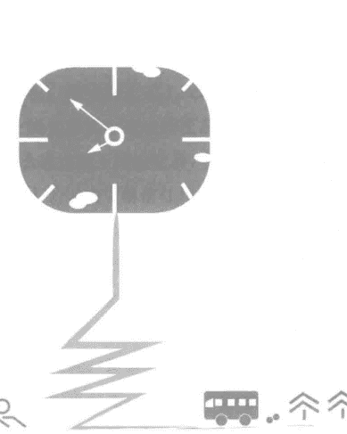
确定产品模型后，下一步要解决个人商业模式中的渠道问题，即“客从何处来”。商业活动离不开人、货、场，上一章谈的是“货”，这一章聚焦“人”和“场”。

找客户是每个创业者绕不开的挑战，对经验不多的个人创业者而言，获客往往比做产品更难。本章重点解决一人公司如何获取第一批客户、如何借助自媒体获客拓客、如何运营私域扩大渠道、如何促成老客户转介绍等问题。

## 一、第一批种子客户的开发
第一个客户既是老师也是强心剂，得到首单认可并获利，才能验证商业模式可行，有继续前行的信心。

以支付宝为例，如今全球用户超 12 亿，但若没有“头号客户”的信任，发展不会如此顺利。2003 年 10 月 18 日，正在日本横滨留学的崔卫平，通过淘宝新推出的担保交易功能，将二手相机卖给西安工业大学的焦振中，完成淘宝历史上第一笔担保交易。两人也因此成为支付宝发展的头号客户，只是这笔交易一波三折。

当时淘宝刚上线，因信任和距离问题实际成交很少。2003 年 10 月 15 日淘宝上线担保交易，买家款项先放在淘宝第三方账户，收货确认后再划给卖家。为了解决信任问题，崔卫平和焦振中在先发货后付款还是先付款后发货上僵持不下。后来崔卫平看到担保交易，把支付链接发给焦振中。焦振中付款后又怕卖家不发货想退款，最后是支付宝元老团队的一名财务以自己一个月工资担保，才促成这笔交易。

案例显示，头号客户的获取和首单达成，核心是信任。没有第三方平台作连接时，一人公司创业者如何找到第一批客户？总结出三点心得帮助快速拿到头号客户。

### （一）弱关系成交：藏在朋友圈中的“头号客户”
消除创业者与目标客户间的信任隔阂是获客获利的前提。除第三方平台外，建立信任的方式还有做自媒体、持续输出内容、打造个人 IP。但内容和 IP 需要长期积累，对急需验证模式的新人并不友好。

对创业新人来说，最直接的方法是：

#### 1. 在朋友圈大方展示
很多刚做副业创业的人不愿让身边人知道，想闷声发大财然后惊艳所有人。实际上，对没有亮眼履历和资源的人而言，创业初期最可靠的支持往往来自身边亲友。即便在硅谷，九成以上项目的第一轮融资也是从亲友轮开始的。

有了产品或想法后，可以大方在朋友圈展示，持续分享与创业相关的内容。他们未必直接下单，但会成为免费的宣传助手。

#### 2. 用朋友圈链接更多“弱关系”
在朋友圈展示的目的，不仅是直接成交，更是链接能促成成交的弱关系。弱关系指什么？

人类学家罗宾·邓巴的“150 定律”认为，每个人能维持的社交关系约 150 人，其中强关系约 30 人，弱关系约 120 人。强关系是经常联系的亲人、好友、同事；弱关系是虽不熟悉但有共同联系点的校友、偶遇客户、老同学老同事、同一社群的伙伴。

大量研究显示，带来事业助力的往往是弱关系。我刚做自由职业接稿时，很多商业约稿都是老同事老客户介绍的，其中最让我印象深刻的是位素未谋面的校友，看到我辞职的朋友圈后，一口气推荐了好几个供稿渠道。

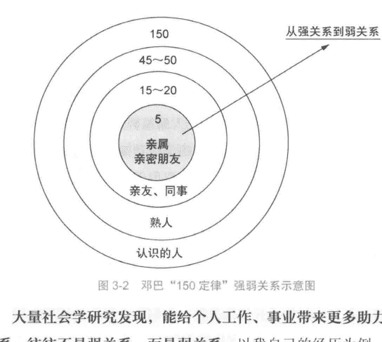
#### 3. 拓宽“弱关系”社交网
弱关系比强关系更易带来机会，“三分熟”比“全熟”更容易成交。

创业初期，可以通过自己的朋友圈和好友的朋友圈拓展关系网，但熟人圈终有限，后续要主动链接、强化弱关系网络。

##### 1）主动为别人提供有价值的帮助
在社群或朋友圈看到不熟的朋友求助时，给出关心、鼓励或实际帮助。人际交往本质是价值交换，今天的玫瑰，可能换来明日的桃李。

##### 2）适当麻烦别人，让别人给自己帮个小忙
心理学发现，曾帮助过你的人更可能再次帮助你。美国政治家富兰克林想争取另一位国会议员支持，没去卑躬屈膝，而是借一本珍藏书、还书后致谢的方式拉近距离。后来两人因价值观相近成为终生朋友，这就是著名的“富兰克林效应”。你来我往中，适当的小麻烦恰是了解和认同的过程。

##### 3）主动破圈

愿意为优质社群付费的人不少，真正能获得回报的关键在于进入后是否敢于真实表达、主动暴露在视线里，让别人认识到你的价值。如今加入付费圈的习惯很普遍，可一入群就长期潜水不发言的人比比皆是，白白错过了经营弱关系的人脉机会。

### （二）量体裁衣：先锁定客户再设计方案
> “我毕生信奉的买卖原则，就是要先找好买家，其他一切自然水到渠成。”

这句话出自人文纪录片《富豪谷底求翻身》的主人公格伦。影片里，亿万富翁格伦接受一个极端挑战：改头换面到一座完全陌生的城市，凭借100美元在90天内打造一家估值达百万美元的公司，期间不得暴露真实身份，也不能调用任何过往资源。

任务设置难免有戏剧化成分，但剥离这些之后，格伦从零起步的思维和行动，对资源、关系都匮乏的创业者仍有借鉴价值，特别是他坚持的“先确定买家”原则，对拿下首单、获取首批用户很有启发。

抵达陌生城市后，格伦第一时间在网上发布招聘信息，同时搜集当地居民的消费痛点。他了解到有人愿意高价收购军用规格轮胎，于是白天应聘，空闲时便沿工业区铁路寻找被丢弃的二手轮胎。翻遍半个城市后，他凑齐了几条可用轮胎，直接对接买家，拿到了在陌生城市的第一笔可观收入。

与格伦做法一致，先确认需求方再投入研发的思路，能帮创业者大幅降低前期投入风险，避免好不容易花费时间成本和资金打造的产品无人问津。如何做到先找客户再做产品？我总结了三条可落地的路径。

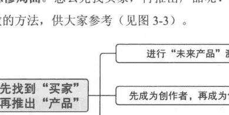

图3-3 先找到“买家”，再推出“产品”的三个方法

#### ● 方法一：做“未来产品”预验证
为防止产品上线后无人问津，可以在正式推出前先测试购买意愿。以我自己的文创工作室为例，每次开发周边时，设计稿完成后都会先做一轮小规模的购买意向验证，通过验证的才进入打样生产环节。

用效果图在产品落地前探测市场反应，我称之为“未来产品”预验证。除了效果图，还有很多做法。比如打算做知识付费，可以先假设产品已完成，用一个较低的预售价对外开放，配一张宣传海报或一段文案做预售测试；也可以采用直播预售的形式，先收款再生产再交付。

这种先找买家的打法也存在隐患。以女装预售为例，漫长的交付周期往往伴随高退货率和大量售后投诉，会损害品牌信誉；知识付费领域同样如此，先招学员再开课，若课程与预期落差大，很容易被指责割韭菜。为降风险，需要提前评估自身交付能力，依据能稳定兑现的效果进行宣传，既不夸大也不过度承诺。

#### ● 方法二：先打造作品集，再尝试变现
“未来产品”预验证能在上线前校验市场预期，避免闭门造车。但对于微信好友稀少、从未经营过自媒体的人来说，这套打法并不友好。

当经验和资源都有限时，用创作是最省成本的起步方式。如果你希望通过写作、绘画、设计、编程、网站搭建等技能赚钱，在签约正式客户前，先持续输出积累作品集，并通过自媒体或朋友圈分享作品和创作心得，吸引潜在客户关注。

先做创作者再做创业者，这条个人变现路径适用于各行各业。即便暂无明确技能和方向，也可以先通过自媒体输出内容。运转一段时间后积累一定粉丝和影响力，再结合粉丝的年龄、消费偏好和需求，推出符合他们兴趣的产品。

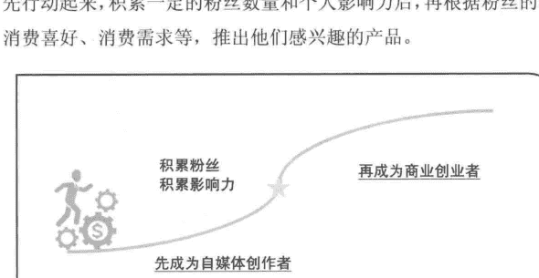

图 3-4 先成为创作者，再成为创业者示意图

#### ● 方法三：一边经营IP，一边匹配供给
创作先行是低成本低风险的启动方式。但很多人卡在有流量有粉丝却无法转化的境地。为避免这种情况，创作前就要明确目标人群、账号定位和变现方式。把个人影响力与信任度提前建立，以打造个人IP为目标创作内容，一边经营IP，一边依据目标人群需求精准匹配产品。个人IP打造的细节将在本书第四章展开。

以IP为导向创作，能在内容阶段就减少试错，缩短从内容到成交的距离。例如我的一位学员给自己设定IP形象为“会种草的文案人”，围绕此定位持续输出，吸引的正是需要种草文案的企业品牌和学习者。粉丝未满百时，就已接到一家电商品牌的合作邀请。

### （三）临溪而渔：在有鱼的地方下钩
“股神”沃伦·巴菲特的黄金搭档查理·芒格曾说：“钓鱼有个秘诀。钓鱼的第一条原则是，在有鱼的地方钓鱼。钓鱼的第二条原则是，记住第一条原则。”客户开发亦是如此：只有去客户聚集的地方寻找客户，才有成交可能。

#### 1. 客户在哪里，我们就出现在哪里
商业纪录片《这货哪来的》里有个印象深刻的镜头：世界各地的发丝，在河南许昌这个被称为“全球假发之都”的小城，经过层层加工后漂洋过海，戴到非洲女孩头上成为时尚单品。

受气候和生理因素影响，假发对非洲女性来说是刚需，如同口红之于亚洲女性。据统计，每位黑人女性平均拥有3到5顶假发，即便工薪阶层每月也会花费约4美元在发辫上，经济条件好的人每月可达500美元。

假发是黑人群体的刚需，而这些假发大多来自河南许昌。公开数据显示，2023年许昌发制品累计进出口196.9亿元，发制品是许昌外贸支柱，在非洲市场的份额超过70%。

数据揭示了一个底层逻辑：必须走到客户所在的地方开发客户。唯有明确客户位置，才能将品牌信息送达，否则再怎么努力也只是无用功。

比如做代驾服务的，每天在微信微博抖音投放广告，却从未在烧烤店酒吧张贴单页留名片，生意很难火起来。

有客户的地方才有成交，能触达目标客户的信息才是有价值的信息。向外获客的第一步，是先找到目标客户活动的场域，对目标客户做精准画像，了解他们常在哪些地方或平台活跃、习惯如何获取信息、在什么场景下会产生需求，确定位置后，宣传与成交才有依据。

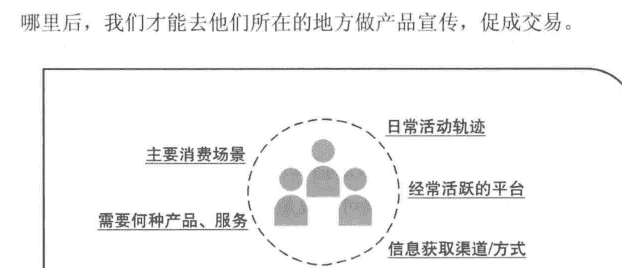

图 3-5 目标客户画像参考示意图

#### 2. 警惕获客误区，避开流量陷阱
在这个过程中，要警惕“人多就去”的误区。人多的地方不一定目标客户多，流量大的平台也不一定适合你的产品。

前两年一位做软装设计的友人想做自媒体拓客，我建议他尝试小红书。一年后相见，他说并未操作小红书，因为朋友告诉他小红书流量不如抖音。于是他看了几位同行的账号，点赞收藏不高，便放弃小红书转做抖音。起初他很努力剪辑，但流量不错的作品依然难转化，偶尔的咨询大多想白嫖创意。半年后他放弃了自媒体拓客的想法。

不争论谁的流量更大，单看软装行业属性，如果你需要找灵感参考，你会去哪里？很多人会选择小红书。因为小红书以种草著称，多数人在消费决策前会习惯性搜索攻略和心得。有软装需求的人，也会主动搜索“软装攻略”等关键词。创作者只要在发布时埋入关键词，即使数据一般，也可能被精准客户检索到。

100个泛流量客户，不如1个精准客户。渠道选择的关键不是看人多流量大，而是看目标客户最常出现在哪里。后续章节将详细讨论如何借助自媒体扩大渠道，以及如何挑选合适的平台。

## 二、借助自媒体扩大客户渠道
当下自媒体已成为各行各业获客的主渠道。许多创业者意识到要借自媒体获客，却不清楚该选哪个平台，也不确定是单平台深耕还是多平台铺开。

上一节提到的核心原则仍是：在有鱼的地方下钩。目标客户在哪里，我们就去哪里，而不是哪里人多就去哪里。因此选平台前，先对产品服务定位和目标客户画像有清晰认知，才能匹配长期深耕的平台。选平台前可借助“自媒体平台选择前测表”梳理认知。

表 3-1 自媒体平台选择前测表

| 问 题 | 我的答案 |
| :--- | :--- |
| 1. 我能提供的产品/服务是什么？ |  |
| 2. 我的产品/服务单价大概是多少？ |  |
| 3. 我的目标客户是谁？ |  |
| 4. 目标客户经常在哪些平台活动、消费？ |  |

### （一）热门自媒体平台对比
国内自媒体平台百余个，日常使用不少于10个。为控制篇幅，这里仅对抖音、小红书、视频号、公众号、快手、B站这六大热门平台的用户特征做分析。

#### 1. 抖音
公开数据显示，截至2023年底抖音用户数接近10亿，日活超7亿。

凭借庞大基数和众多千万级、亿万级商业案例，抖音成为品牌和创作者争夺的流量主战场。

用户基数大、算法精准、商业上限高是其优势。但平台趋于成熟商业化加深后，普通创业者生存空间被压缩。内容内卷严重、流量成本上升、投放价格持续走高、竞争压力加大，这些都是必须面对的问题，对没有团队没有资金支持的小企业和个人并不友好。

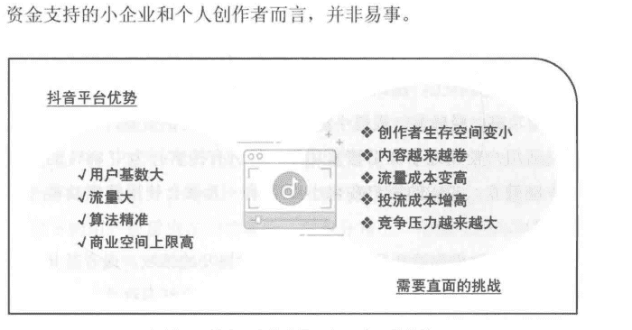
即便如此，对以下两类创业者，抖音仍值得主攻：第一，产品服务需要即时转化或线下体验，如农特产品、本地生活、同城餐饮；第二，核心目标客户集中在三四线及以下城市和地区的产品服务。

#### 2. 小红书
前面提到，小红书是为种草而生的平台。目前月活用户超3亿，核心用户以年轻女性为主，男女比例约7:3，近80%用户年龄在18到34岁，地域上，一线和新一线城市用户占近70%，三四线用户在增长。虽然基数不及抖音，但强种草属性和高消费力画像使其商业价值突出。

小红书是生活分享与消费决策深度绑定的平台，美妆、家居、时尚、母婴、职场知识、女性成长、健身养生、精致生活等领域，用户习惯来此搜索种草攻略和经验帖。据官方聚光平台数据，70%的月活用户使用过搜索功能，且88%的搜索行为是主动搜索，42%的用户在入驻首日就会使用搜索。

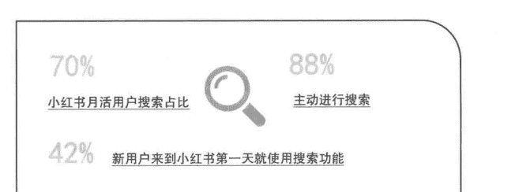
图 3-7 小红书月活用户搜索行为情况
（数据来源：小红书聚光平台）

从内容分发看，小红书流量主要来自关注页、发现页、搜索页，三者占比约10%、70%、20%。即使是素人，内容也能通过标签匹配给潜在用户；发布时嵌入关键词，更容易被精准用户搜索到，具有长尾效应。对新人创作者很友好。

#### 3. 视频号
依托微信庞大用户基数，视频号在规模上具天然优势，当前日活达4.5亿，人均单日使用时长约50分钟。

用户画像上，视频号年龄层偏高，36岁以上占六成，核心用户为中青年和“银发e族”。近两年受“蝴蝶计划”等激励政策影响，30岁以下用户在持续增长。内容以生活、教育、中老年养生保健、心理等泛生活泛知识为主，娱乐化程度低于抖音快手。

如果你的核心客户恰是中青年或银发群体，产品服务面向日用或泛知识泛教育，那么视频号商业空间值得探索。另外，视频号同属微信生态，跳转私域链路更短，能在一定程度上减少用户流失，创业者可借助短视频和直播把公域流量沉淀为私域。

#### 4. 公众号
这两年不乏“公众号已死”的声音。但对有知识付费产品、专业咨询服务或想打造个人IP的内容创业者而言，公众号仍有不可替代的价值。因为无论时代如何变化，文字对心灵的穿透力是其他媒介难以替代的，相较短平快的短视频，文字能带来更深层次的思考和更长远的影响。

公众号的“粉丝订阅+搜一搜关键词搜索+看一看兴趣分发”机制，让看到内容的人多为订阅粉丝、对内容感兴趣者或与粉丝有关联者，在私域导流和销售转化上优势明显。站在创作者角度，如今入局可能已无流量红利，但它是一个利于沉下心创作、与潜在客户深度链接的地方。

#### 5. 快手
公开数据显示，2024年快手平均日活接近4亿，核心用户集中在三四线及以下城市，用户年龄分布相对均衡，整体偏下沉市场。内容生态以“老铁文化”为特色，用户粘性高、社区氛围浓，适合建立强信任关系、客单价相对较低的产品服务推广。

用户主要集中在东北、三四线城市及农村的下沉市场，对快手忠诚度高，形成了独特的社交文化、三农文化和老铁文化。随着“快手新知创作人”计划推出，疾病科普、学业教育、绘画教学、摆摊创业、小本致富等泛知识内容也很受欢迎，相关产品可尝试在此探索机会。

#### 6. 哔哩哔哩
B站与小红书一样聚集了大量年轻用户，但年龄整体更低，目前平均年龄约22岁，18到24岁用户占60%以上，男性用户比例高于女性。

年轻用户聚集、粘性强、热衷弹幕互动，动漫、科技、游戏、生活等领域有很好流量红利。但从商业变现看，B站付费用户比例并不高。若目标客户是30岁以下的年轻人，可把B站作为扩大影响力的窗口，但实现商业转化有一定难度。

以上是六大平台的用户画像扫描，可根据产品定位和目标客户画像匹配主力运营平台，同时将内容分发到其他平台获取更多机会。

### （二）先涨粉还是先转化？
通过自媒体获客，到底是先涨粉还是先转化，是困扰很多创业者的难题。因为没有明确目标指引，运营者容易陷入涨粉获客误区，忘了最初做自媒体的目的。本节将从常见误区和正确运营思路两个角度展开讨论。

#### 1. 四大自媒体涨粉、获客误区
本书第二章提到过“自媒体获利的几大方式”，获利方式不同，运营目标和思路也不同。但在实际辅导案例中，很多朋友忽略这一点，盲目试错，掉进各类涨粉获客误区。以下是我总结的常见四大误区。

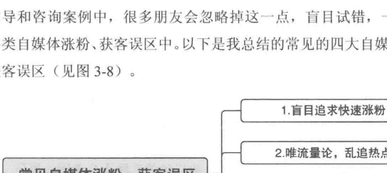
##### ● 误区 1：盲目追求快速涨粉

“1000个铁杆粉丝就能养活自己”的说法在创作者圈子里流传很广，凯文·凯利是这个观点的提出者。如今抖音、小红书等平台申请商业合作的基本门槛也是粉丝数达到1000，所以“怎么快速冲到1000粉”成了不少新人的执念。

冲粉心切时，有人进了互粉互赞互助群，关注数反超粉丝数；有人用低质、低俗甚至擦边的噱头吸眼球；有人花大力气追热点、拍剧情，粉丝倒是涨了，却和理想中的目标人群对不上……

定位和变现路径没想清楚就开干，东一榔头西一棒子地发内容，向快涨粉发起冲击，无论是1000粉、1万粉还是几十万粉，后续的商业转化往往都不顺畅。

这里说的铁杆粉丝，并不是粉丝列表里的僵尸号，而是真正愿意为你买单、为你的产品和服务付费的忠实用户。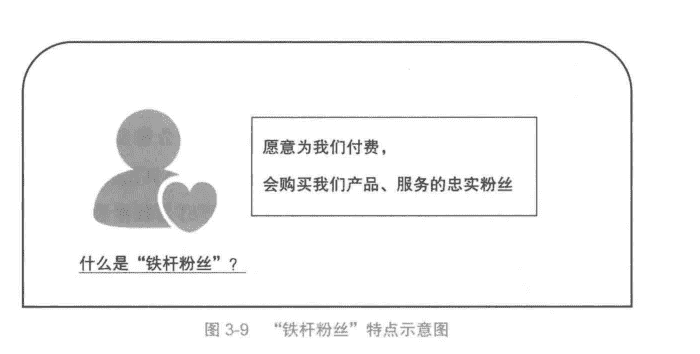

##### ● 误区 2：唯流量论，乱追热点

热点自带声量，容易带来一波曝光，这让追热点成了不少账号的必修课。追得准确实能拉新、提升商业价值，但一味以流量为唯一标准，盲目跟风硬蹭，和账号调性关联度很低甚至完全无关的内容，长期下来会削弱老粉对你的价值认知，也会稀释账号的垂直度和辨识度。

更科学的做法是做选择性借势。自己把握不全、与定位关联薄弱的热点不硬上。时代的“过夜爆火”故事越来越少，错过一波热度不会致命，因硬蹭翻车带来的伤害却很常见。若要借势，尽量把热点和自己的专业领域、账号定位结合起来，展现出差异化的专业视角。

##### ● 误区 3：唯数据论，被数据绑架

发完内容一分钟看几次后台，看不到数字上涨就焦虑自疑，反复删稿、隐藏、修改，心情跟着数据起伏。数据焦虑几乎是全行业的通病。

适度的复盘能帮助你了解用户偏好，指导迭代。但把一切交给数据，就会丧失创作主动性。特别是起步阶段，新手的数据普遍不理想，即便百万、千万级的大号也做不到条条爆款。成长期更该把精力放在内容本身：脚本是否打磨到位、呈现是否用心、如何与粉丝产生互动，而不是靠互赞互粉去美化数字。

##### ● 误区 4：为“获客”不断挑战平台底线

还有一类人喜欢和平台规则对着干，什么不让发就发什么，喜欢在红线边缘试探，最终被封号、禁言。尤其是有产品却不想做IP、只想把自媒体当纯引流渠道的人更容易掉进去。

比如私信评论里直接留联系方式，几乎所有平台都明文禁止，仍有人执意尝试，结果引流不成反被关进小黑屋。一人公司要长期经营，自媒体是获客、转化和扩大影响的工具，因短期利益破坏规则、以强盗式方式撬客，对长期利益是得不偿失的。

#### 2. 涨粉是过程，不是目的

看完这些常见坑，可能会更迷茫：盲目涨粉不行，粗暴转化也不行，那自媒体到底该怎么用？

我用两段自己的经历来说明：

经历1：我运营的一个小红书店铺号，粉丝只有12个，就带来了六位数的收益；
经历2：另一个小红书个人号，持续更新三个月，收益为0，还投入了四位数的设备道具。

差异的根源，前面其实提过：定位不同、运营目标不同、变现方式不同，思路自然不同。

第一个号是我线下文创品牌的门店号，客户必须到店消费才算成交。运营目标就是为门店导流。内容策略围绕“展示门店和产品的吸引力，给出必须到店的理由”展开。第一条发布创业过程的Vlog后，第二天门店尚未正式营业就卖了2000多元，之后自发打卡的人增多，日均营业额稳定在4000元以上，当时粉丝只有12个，其中还有朋友家人。

第二个号是我本人出镜的个人号，目的在打造个人IP、扩大影响力，而不是靠接单吃饭。前期重点放在垂直度和专业度建设上，多次有品牌抛来广告合作都被拒绝了。

明白了这点就清楚了，先涨粉还是先转化并不是核心，核心是你先想清楚账号的商业定位、运营目标和变现路径，再按目标有规划地运营，吸引你真正想要的人。

想做全职博主靠广告、直播带货吃饭，前期重心放在涨粉是合理的；如果目标是为自己的产品服务引流，那么重点应放在发布什么内容能吸引精准人群，并在不触碰平台规则的前提下实现安全转化。涨粉只是过程，获客和转化才是目的。

## 三、自建养鱼塘，扩大基础流量

前文提到，客户开发像钓鱼，只有在有鱼的地方才钓得到鱼。当前创作者增多，公域平台内容竞争激烈，引流成本和难度攀升，算法也在不断变化，公域获客的不确定性很高。

为了让一人公司拥有更稳定的客源，需要多条腿走路：在公域保持曝光持续“钓鱼”，同时自建“养鱼塘”，把公域的流量沉淀到自己的私域里，通过反复触达和运营转化为可复用的私域资产。本节围绕朋友圈运营、社群运营和口碑裂变，聊聊如何扩大流量池并实现裂变。

### （一）朋友圈运营：打造高吸引力朋友圈

“头号客户”常常就在朋友圈里。在你还没练熟公域钓鱼技巧时，朋友圈是原点；熟练后，朋友圈又是最低成本的养鱼池。无论是为了销售转化还是IP打造，朋友圈运营都至关重要。

一个诀窍：把人当成人，让人成为人。
一个公式：麦肯锡信任公式，信任 = （可信度 + 可靠度 + 亲密度）/ 自利度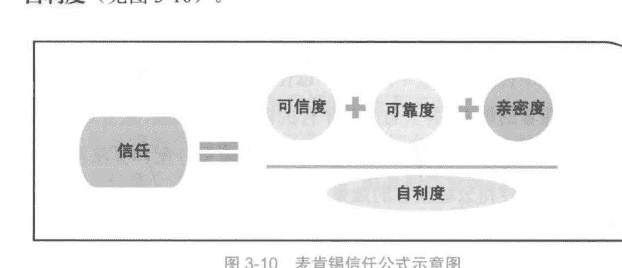

图 3-10 麦肯锡信任公式示意图

#### 1. 把人当成人，让人成为人

朋友圈是给人看的，看的人也是人。在社交场景里大家能正常对话，一旦做朋友圈营销，有些人自动切换成“人机模式”：一天发十几条，要么是复制的鸡汤，要么是看不清的宣传图加功效文案，要么是炫富美照或转账记录，看起来人神分离、不顾他人感受。

这种方式通常只有两种结果：内容被折叠屏蔽，或直接被删拉黑。朋友圈既是社交工具也是商业工具。社交意味着说人话、办人事，不打扰不冒犯；商业意味着带着获客、成交、提升影响力的意图。而信任是获客和维持关系的基础，所以高价值朋友圈的核心是提升信任值，可以用信任公式来指导。

#### 2. 麦肯锡信任公式

按公式，降低分母自利度，提升分子可信度、可靠度、亲密度，就能提升信任。实践中可以这样做：

##### 1）提升可信度

可信度源于专业、能力与经验。

a. 持续输出干货
以利他心态，用每日干货、行业动态的形式输出碎片化专业知识，慢慢建立专业形象。
b. 分享经历、感悟
分享与专业相关的经历，或从工作中提炼的思考。
c. 晒出高光时刻
大方展示能证明能力的时刻，如受邀活动、外出分享、获奖、资质证书等。

人们用碎片时间刷朋友圈，长篇说教易适得其反，故事化表达比硬说教更有效。

##### 2）提升可靠度

专业的人很多，可靠的人更稀缺。

① 客户反馈
不如别人一句真好。分享客户好评、案例数据效果、产品前后对比，用真实市场反馈证明可靠性。注意保护隐私，不造假不搬运网图。
② 坚持的力量
长期坚持会让人安心。固定频率分享你在坚持的小事，如早起、跑步、每日输出干货、每日阅读等。坚持月余，别人会潜移默化感受到你的可靠性。

##### 3）提升亲密度

a. 互动起来
用本章提到的“帮一个小忙、求一个小忙”方法，平时多点赞评论，保持存在感。
b. 鲜活的生活碎片
偶尔分享看书、旅行、小聚、亲子等生活片段，但不只是晒图，更在细节里真诚表达内心，让人感受到鲜活而非广告机器人。
c. 适当暴露自己
一个有优点也有小缺点会情绪化的人，比永远完美无懈的人更具亲近感。适度暴露不足能拉近距离。

##### 4）降低自利度

本质仍是把自己当人、把别人当人。发圈前多考虑他人感受，别制造打扰。下面是我访谈总结的六大反感行为：

- 疯狂刷屏，一天发十几条；
- 频繁炫富炫美，自夸自擂；
- 晒转账记录、聊天记录；
- 朋友圈怼天怼地、宣泄负面情绪、说人坏话；
- 无脑转发公众号推文、低质低俗内容；
- 频繁求赞、求投票、求砍一刀。

总结一句：打造朋友圈就是成为一个立体鲜活、可信可靠、可亲的人。更新频率和内容配比因人而异，我在实战中给客户的参考是：每周发圈4次以上，每天3~7条。可信度、可靠度、亲密度的内容占比可以是5:3:2、6:3:1或4:4:2等，通过测试找到适合自己的节奏。

### （二）社群运营：持续让用户看到价值

能持续获利的社群已成为构建私域流量的共识。在信息嘈杂的时代，社群的优势很明显：自己掌控的增值广告位持续展示价值；用户粘性与忠诚度高，成交率优于泛流量；还能通过裂变链接更多精准人群。

我接触过上百个商业社群后总结出“三字口诀”：有钱花。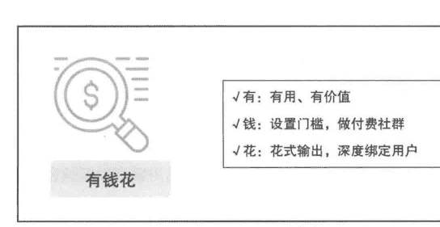

图 3-11 打造高价值社群三字口诀示意图

#### 1. 有：有用、有价值

人多为利己，除了至亲之外，很少有人愿意留在一个只占用内存、消耗流量的社群里。加入社群的动机是获取有用信息、实用价值或直接的解决方案。

比如自由职业群，大家想学攻略经验，而非看博主旅游打卡；小区遛娃群表面是家长里短，实则提供了情绪宣泄的出口。

社群要有用、有价值。创建前先明确目标人群和核心价值观，弄清你希望谁进来、谁不适合进来，以及社群能为目标客户提供什么。每一次筛选都在为后续运营省掉麻烦。

#### 2. 钱：设置门槛，做付费社群

免费的东西很难被珍视。若目标是创造价值，最好设置门槛不要做纯免费群。

免费群虽能快速聚人，但鱼龙混杂，容易混入白嫖、刷广告、引战者，把氛围搞坏；后期想收费，用户会强烈抗拒。

创建之初就为社群定价。担心初期招募难可先用较低门槛起步，随着价值提升逐步调价，让老用户直观感受到社群在增值。可先用知识星球承载，因为星球有三天不满意可退款机制，写明此条款能增强信任、促进转化。

#### 3. 花：花式输出，深度绑定用户

付费进来后，如何深度绑定？不是把人拉进微信群，每天发“每日一答”或文字语音分享、偶尔发红包那么简单。

社群不等同于微信群，微信群只是传递信息的一个窗口。若只运营几个微信群，极度社恐、不爱凑热闹或工作繁忙的用户会被消息海压垮而流失。

因此要多阵地、多触点花式输出：

- 有价值干货以图文形式在知识星球或鹅圈子发布，高频问题统一沉淀，方便按需查看；
- 建立日常交流微信群，分享信息、答疑；
- 按定价和目标，每两周或每月做一次直播/语音干货分享，单独建链接避免信息被覆盖，并同步到星球或圈子。

### （三）口碑裂变：让老客户主动推荐、分享

购物时大家都有体会：好评率高、口碑好的商品更容易让人下单；反馈差的商品，即便有兴趣也会因口碑犹豫。

老用户的评价会直接影响新用户对产品价值的判断和决策，口碑的力量在陌生人之间有效，在熟人之间更强。提升客户满意度，让老客户自愿推荐分享，实现口碑裂变，是获客获利的重要方式之一。

#### 1. 口碑的驱动力

口碑在生活中无处不在。比如一家餐厅，老板自己说“闭眼点单，家家都是招牌”，顾客心里很难买账；可如果多年好友拍着肩膀说“这家我带朋友吃了几次，每道菜都稳，没有雷”，你哪怕还没去过，也会先把这家店归为值得尝试的名单。

原因很简单，我们愿意把对人的信任迁移到他指向的东西上。实践里也印证了这一点：**人更青睐并愿意为自己信得过的人所推介的产品和服务买单**，我自己就吃过这样的红利。公司里的不少品牌咨询、全案业务，本质上都来自老客户的引荐或转介绍。有趣的是，有些客户在被引荐前就已经通过别的渠道联系过我们，只是当时没谈拢。

就拿今年做的一个品牌形象升级来说，客户方在一年半前曾两次主动找上门，沟通都很顺畅，最后却因为报价高于预期而搁置。我们一度以为这事就此翻篇。结果半年多后的一天，对方负责人忽然发来一条信息：“明天方便签约吗？”起初还以为是发错了，回过去才知道，她在一次朋友聚会上偶然听到有人评价我们做事专业、负责、不走模板化套路。打听下来才发现，评价者正是我们服务的老客户，在了解了几组落地案例后，她才决定回来签约。

尼尔森的调研也印证了这一点：83%的消费者会相信来自亲友的口碑推荐，92%的人更倾向于相信口碑而非其他广告形式。

对没有规模效应和强社会影响力的一人公司而言，让彼此陌生的客户迅速产生好感和信任，成本高、周期长。可一旦走通老客户转介绍这条路，信任是现成的，成交概率也远高于冷启动开发。维系好既有客户、持续提升交付满意度，让老客户乐意主动为你发声，就是一人公司最稳的获客抓手。

#### 2. 如何让客户主动帮你传播

想让老客户更愿意分享，我们可以先自问：在什么情境下我会主动给亲友安利一个人或一个品牌？

以餐厅为例，我会安利的通常是：菜品惊艳、环境舒服适合聚会拍照、吃到过创意或惊喜体验的店。简言之，是超出预期的美味和体验。反之，难吃、体验差的地方绝不会推给朋友。

类比到服务，如果希望客户自发推荐，我们交付的产品和服务就必须达到甚至高于预期。把精力放在打磨本身，用心服务好每一个人、提供让人惊喜的解决方案，是积累口碑的第一步。

但满意不等于一定会分享。德克萨斯理工大学的一项研究显示，经历一次积极消费体验后，83%的消费者表示愿意转介绍，真正行动的只有29%。只靠产品力是不够的，还需要一些正向刺激来推动分享。常见的刺激方式如下：

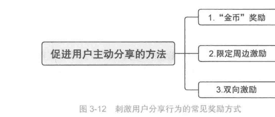

图3-12 刺激用户分享行为的常见奖励方式

1）“金币”奖励

做法直接，效果却很实在，适用面也广。比如知识付费常见的裂变拉新，就是靠分享金撬动老用户扩散。我自己处理转介绍也会在合作确认后给推荐人包个红包表达谢意，若对方不收，也会换成礼物致谢。

2）限定周边激励

金钱激励不是万能的，对茶饮、咖啡、护肤等高频低客单品类，限定周边、小样往往更有吸引力。这些周边还能带动复购。比如某些茶饮品牌的杯子、帆布包只能用积分兑换，消费者为了凑积分会提高复购频率，还会拉朋友一起下单凑分。兑换成功后，又容易在社交平台晒单，形成二次传播。

3）双向激励

前两种激励多是单向利好推荐人，有时反而会产生疑虑：我真心推荐，朋友没优惠我却拿了钱，会不会被误会借朋友赚钱？因此设计分享机制时，最好让买卖双方同时受益。例如老客户介绍业务时，除了给推荐人回馈，也给新客户提供折扣或增值服务，让推荐更有说服力、也更温暖。

一个老客户的口碑，价值远超花钱投放广告带来的十个冷流量。把客户经营成粉丝、把粉丝经营成合作伙伴，是每一个一人公司经营者该持续投入的方向。

# 第四章 个人IP：让一人公司起飞

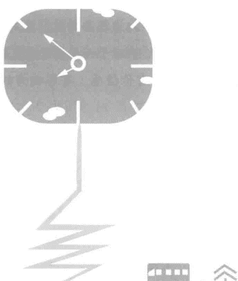

一人公司的成长路径，先是把自己产品化，再走向品牌化。

前面章节已经讲过如何把技能、兴趣、经验打包成产品，形成可复制的盈利模式。产品化解决了“能卖什么”的问题。但产品本质是满足需求、解决痛点，而需求是会变的，没有任何产品能永久不被淘汰。要实现长期绑定和持续增长，在产品化的基础上就必须完成品牌化。

通过塑造个人IP，把自己品牌化，就等于把个人行动沉淀为可累积、可跨越周期的影响力资产和信誉资产。就像“雷军”这个IP，无论卖手机还是卖车，累计的影响力不会被稀释。个人IP还能持续放大商业价值，提升竞争力，获得议价空间。

总之，打造个人IP就是为一人公司装上加速器和保险箱。本章就聚焦如何打造有价值感、有影响力的个人IP展开。

## 一、个人品牌为何人人都需要

关于个人品牌，市面上说法很多：有人以为是变成网红或大V，有人以为只要开个账号发文章、发视频蹭热点、攒点粉丝就够了，有人认为这是个伪命题，普通人没必要；也有人觉得自己平平无奇，做个人品牌太遥远。大家理解各异，到底什么是个人品牌？我们是否真的需要？

### （一）什么是个人品牌

上网查“个人品牌”，很难找到唯一标准答案。不妨用大家熟知的IP来感受。其实我们对一个人的整体印象早已形成。

- 提起李白、杜甫，你脑中会浮现什么？
- 提起孙悟空，你会联想到什么？
- 提起小米创始人雷军，你会想到什么？

提到前两位，很多人会想到唐诗、诗仙诗圣；提到孙悟空，想起金箍棒、齐天大圣、大闹天宫；提到雷军，想起小米、创业、干练、爱笑。

发现规律了吗？我们对一个IP的认知，是由外在形象、内在品质、专业能力、代表事件、精神气质等多方面构成的整体印象。而且人们习惯用关键词或标签来概括对一个人的第一印象。

因此，**个人品牌就是一个人通过展示形象、品质、专业能力、经验、价值观等，给他人留下的整体印象**（见图 4-1）。他人也会用“贴标签”的方式去评价和认知我们。

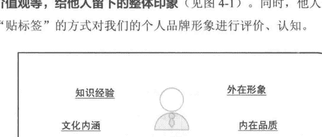

也就是说，无论我们是否主动经营，个人品牌早已存在他人的心里。区别在于，被动贴标签容易以偏概全，甚至贴上负面标签；主动管理认知，则能让品牌形象朝向我们想要的方向发展，被更多人理解和看见。

所以，人人都需要学会主动塑造自己的个人品牌。

对一人公司创业者而言，个人品牌的成败直接关乎商业结果。

### （二）一人公司财富加速器

本章开头提到，**打造个人品牌就是打造一人公司的财富加速器**。为什么？看一个购买决策的拆解（见表4-1）就明白了。

表 4-1 购买具有“蓬松”功效的洗发水的不同场景示例表

| 场景 | 描述 |

| :--- | :--- |

| 场景 1 | 我想买一瓶具有“蓬松”效果的洗发水，于是直接到超市货架或电商平台，购买了之前使用过的，觉得体验感不错的牌子 |

| 场景 2 | 听朋友说某某牌子的洗发水蓬松效果很好，于是决定买来试试 |

| 场景 3 | 经常在社交平台看到很多人分享某某牌子，刚好洗发水快用完了，又翻看了消费者的使用反馈、购买评价后，决定下单尝试一下 |

| 场景 4 | 本来没有买“蓬松洗发水”的打算，但在线下店或某某直播间听到导购、主播强推一款能轻松拥有高颅顶的“蓬松洗发水”，感觉很心动，于是决定买回来试试 |

从中可以看到，无论动机如何，**一次购买行为的完成通常需要三个条件**（见图4-2）：

- （1）消费者有自身需求，或需求被外部刺激唤起。比如本身想买蓬松洗发水，或被导购话术触动；
- （2）产品或品牌能够被识别、被看见，通常靠广告、货架、短视频植入、朋友介绍等渠道；
- （3）在多次触达后，消费者与品牌建立了信任。

简言之，需求存在、品牌可被看见、双方有信任，才能成交（见图 4-3）。

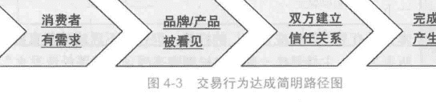

把角色换成创业者，如果想卖出更多产品服务，就必须先拥有持续展示自己的平台，让产品随时可被看见；不断输出优势与卖点，激活需求并强化购买动机，同时在潜移默化中建立信任。

过去要完成这个闭环需要大量的人力、物力、金钱成本，如今借助个人品牌就能实现。因此，打造个人IP对一人公司意义在于：

- 第一，能**在单位时间内创造更多收益**，通过直播、录播课等形式同时触达大量潜在客户；
- 第二，**打破时空与人力限制**，自媒体平台让人可跨地域持续曝光；
- 第三，**低成本高效宣传**，无需高额广告投放，精准定位+持续优质内容就能被算法推送；
- 第四，**有效解决信任问题**，多维度展示专业与人格魅力，提升转化。

总体看，个人品牌能无限放大影响力，提升可见度与知名度；同时提升个人信誉值，为财富与机会创造条件。

## 二、三步定位法：找到自己的高价值定位

方向错了，投入再多也是浪费。定位在个人品牌中至关重要，关键在于如何找准方向、判断价值。本节从高价值定位的含义和确定方法展开。

### （一）什么是高价值定位

先讲一个定位的案例。2023年，我们团队为一家深耕牛肉40年的云南餐饮品牌做全国化品牌升级咨询。项目推进很顺，但在定位语上出现分歧。品牌方希望把我们建议的“云南牛肉火锅领军品牌”改成“云南火锅领军品牌”，想抬高站位、为未来扩品类留空间。

但实际市场并非如此。云南火锅品类繁多：羊汤锅、牛汤锅、菌汤火锅、石锅鱼、腊排骨等，普通消费者很难在“云南火锅”这个大概念下做出选择。若问“哪家铜锅牛肉好吃”，大家却能立刻给出答案。经过线上线下多次用户调研，品牌方最终接受了我们的方案。

这个故事说明，无论是消费品牌还是个人品牌，**定位的好坏不在于口号多响亮，而在于能否让用户在竞争中快速记住你、信任你并产生交易，从而在相同投入下获得更高回报。**

从营销角度看，高价值定位通常有两点：

- （1）与细分领域强绑定，迅速占据用户心智头部。比如“凉茶”与王老吉绑定，“怕上火喝王老吉”深入人心；
- （2）直接呈现差异化竞争优势，形成独特记忆点。比如“为发烧而生”的小米手机靠高性价比杀出重围。

这些逻辑同样适用于个人品牌。逻辑思维、秋叶大叔PPT、樊登读书会等，都通过细分绑定和差异化放大，快速占据心智。

### （二）三步找到高价值定位

基于对标杆品牌的拆解，我总结出个人品牌定位的口诀：**内外扫描找空白**（见图 4-4）。

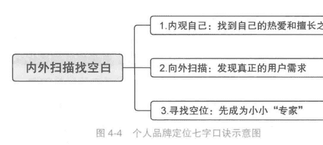

#### 1. 内观自己：找到自己的热爱和擅长之事

个人IP是长期主义，需要持续输出。热爱是抵御倦怠的核心驱动力。

设想一个场景：好友小A雄心勃勃要做IP，前期每天拍视频发朋友圈，热情很快熄火，最后悄无声息收场。这种开局猛、收尾无的例子很常见。原因无外乎：不擅长、没兴趣、成本太高、看不到反馈。

为了避免半途而废，定位阶段就要规避这些风险。优先从兴趣点和能力专长出发，而不是盲目追逐热点赛道，花大成本投入后因坚持不住而放弃。

现在可以先列出自己热爱、擅长的事情，若一时想不清晰，可先看完下一节的优势发掘内容再回来补充。

#### 2. 向外扫描：发现真正的用户需求

商业本质是利他，必须有真实需求才有价值。确定初步方向后，要把视角转向外部，从目标人群规模、需求强度、市场趋势、行业前景等维度验证。

分析不能只看报告与网络数据，更要通过问卷、访谈、实地观察等方式去接触真实用户。行业趋势不等于个体需求。

例如宠物殡葬，从全国数据看需求在增长，但在一个四面环山的小城镇，付费告别需求可能极少，高价值定位在这里就不成立。

#### 3. 寻找空位：先成为小小“专家”

**先找空位，再放大优势**

想做个人IP最稳的路径，就是把赛道不断切割，找到尚未被充分占据的细分位置，锚定某个小领域的发声入口，或成为能解决目标人群单一痛点的专业提供者。

以母婴内容为例，泛泛谈育儿很难形成记忆点。可以用思维导图从宝宝年龄、性别、地域、场景等维度层层拆解，持续细化直到找到可落地的切口。若一时找不到空位，也可以先锁定一类人群，挑一个他们反复遇到的问题持续输出深度内容，先做一个单点上的微型专家，再逐步扩张差异，最终由单点成长为赛道前列。我身边合作过的一位母婴创作者，就是靠《6到12个月宝宝游戏》这一系列干货完成冷启动的。

个人品牌不是一次性搭建，而是需要长期迭代的系统工程。没有内外部盘点、需求洞察和长期规划，很容易中途放弃或陷入无效忙碌。

## 三、潜能挖掘：唤醒你隐藏的变现天赋

每个人体内都埋藏着独特的变现潜能，只是多数人尚未觉察。

因此不必因为二三十岁状态平平而焦虑，也不用纠结至今没有拿得出手的成绩。看起来没专长、没技能、做什么都不突出，往往不是不够聪明或不够努力，而是还没有定位到自己的相对优势区。

会有人觉得这很空，要真有天赋早就不至于一直稳定吃亏。我也曾坚信勤能补拙，后来复盘自己的成长轨迹，却发现每一次突破都离不开语言表达、自我觉察、人际互动这些相对优势的支撑。这里讲的天赋，并非遥不可及的超能力，而是指与生俱来的相对偏好。

### （一）如何定位相对优势

> 爱因斯坦说过：用爬树能力评判一条鱼，它会一辈子以为自己愚蠢。

人都有强项也有短板。投入同等精力，顺着天生偏好行事更容易出成果，反之在不擅长的方向硬啃，往往投入巨大回报甚微。这对普通人成立，对所谓的天才同样成立。让数学一般的钱钟书去做数学，让语文不擅长的陈景润去写小说，结果可想而知。相对优势对IP发展影响深远，可用自我盘点和他者反馈两种方式来找准。

#### 1. 能力特质自查

美国心理学家加德纳提出的能力多元模型，把人的能力划分为言语表达、数理逻辑、视觉空间、音乐律动、身体运动、人际沟通、自我内省、自然观察八个维度。每个人在八个维度的组合各不相同，可以借助表 4-2 对照定位。

自查时不必横向比较，只和自己比。在表 4-2 第三栏为每项能力0到10分打分，或写下该板块的具体行为表现，就能更清晰地呈现自己的特质分布。

**表 4-2 个人优势能力自查表**

| 多元智能分类 | 能力特质表现 | 优势能力自查 |
| :--- | :--- | :--- |
| 言语表达 | 写作、阅读、理解、口语表达方面的能力 | |
| 数理逻辑 | 数学运算、数字推理、逻辑思考、归纳演绎、因果推论、抽象符号方面的能力 | |
| 视觉空间 | 图像、色彩、绘图、画画、三维空间、位置关系方面的能力 | |
| 音乐律动 | 感受、辨别、记忆、鉴赏、表达音乐的能力，以及对韵律、曲调、节奏的敏感度 | |
| 身体运动 | 运动、舞蹈、肢体表现、灵活度、平衡度、反应力等方面的能力 | |
| 人际沟通 | 对他人言语、表情、手势动作的觉察能力、共情能力，以及了解他人、沟通的能力 | |
| 自我内省 | 认识、洞察、反省自身、察觉自我情感和感受的能力 | |
| 自然观察 | 观察、探索、识别、发现自然系统规律或人造系统规律的能力 | |

以我自身为例，盘点后发现言语表达、自我内省、人际沟通相对更突出。纵向对比也只是及格水平，但当我持续深耕放大这些相对优势后，农村出身、双非背景的我仍凭借写作、自媒体和咨询获得了认可。

若仍提炼不清，可以先自问两题：成长过程中，别人最常夸我哪一点？我做哪些事情格外顺手、容易完成？把答案写下，再对照自查表定位相对优势。

#### 2. 他者觉察：借他人视角看见自己

当局者迷，旁观者清。只靠内省不够，可以请亲友、客户、合作伙伴帮助觉察。

提问要具体，避免"你觉得我是什么样的人"这类宽泛问题，容易得到"很好""不错"之类的空话。更有效的问题是：

1. 我做哪件事时你会觉得特别安心？
2. 我做过哪件事让你印象最深或最感动？
3. 想到我，你脑中立刻会冒出哪三个关键词？

收集答案后，再对照加德纳多元模型，查看他人眼中优势与自查的重合区，那个交集往往就是核心竞争力。

到这里，可能已经能看到显性天赋，但隐性天赋还可能被埋没。

### （二）显性天赋与隐性天赋的区别

**显性天赋是你能感知到并已在表现上的擅长能力；隐性天赋是你与生俱来的反应模式和行为习惯，是难以被替代的优势。**

寻找隐性天赋，可以从那些让你发自内心愉悦，哪怕没有报酬、需要投入大量时间也愿意去做的事情入手。

可以用 SIGN 四象限逐步发掘。

**S 自我效能。** 你对完成某类事有多大信心？信心饱满的领域往往藏着天赋。想不清时可以回想：身边人常向你请教什么？日常聊天你最爱聊什么？聊什么时最轻松不费劲？

**I 本能冲动。** 哪些事会让你迫不及待、跃跃欲试？哪些事你会毫不拖延、废寝忘食地投入？本能即潜能。比如玩游戏能忘却时间，说明你有挑战欲和专注力；出游前提前做攻略打包，说明你有探索欲和规划力。

**G 成长速度。** 学得快、投入同样时间能收获更多成长的事，就是成长型天赋。我从媒体转做品牌咨询，就是因为看行业报告、品牌案例时总能快速迸发创意灵感，才敢裸辞转行。

**N 满足感。** 做哪些事即使辛苦也觉得满足？完成后有哪些事让你有强烈的成就感？

四个象限的重合处，就是最容易出成绩且能长期坚持的潜能。我的重合点落在写作、策划、咨询等创意工作上。我也曾利用爱吃的本能做甜品饮品，口碑不错，但自我效能感、满足感和成长空间不足，最终因长期内耗放弃。

### （三）案例分享：一位“平庸”设计师的转型

咨询中常有人说“我什么都不会，没有天赋”。但每个人都有独特天赋，只是未被发掘。

一位学画出身的设计师，毕业后做平面设计多年，作品总被挑剔，陷入自我否定。我了解她在言语表达、人际沟通上的天赋远强于艺术造诣，建议她从创意部转向客户沟通和协调。

调整后她先做客户执行AE，不到一年升为客户经理。两年后离职开工作室，凭借积累的人脉和资源迅速获得稳定收入。

方向错了努力打水漂，天赋觉醒后才能如鱼得水。除上述方法外，霍兰德职业兴趣测试、盖洛普优势识别、MBTI 十六人格测试等专业工具也能辅助定位。

## 四、差异化塑造

先做个小测试：快速看一眼下面这串字符，闭眼说出记得哪些。

多数人第一时间记住的是唯一的数字。因为在同一组信息中，明显不同的事物更容易被记住。这就是莱斯托夫效应。在个人品牌里，共识是：打造品牌就是打造差异化。

很多人觉得自己太普通，没有差异化。其实，与众不同不只靠天赋，换个视角加一点营销技巧，普通也能变亮点，短板也能变卖点。下面分享三个可复制的思路。

### （一）短板转化法

人无完人。短板不是需要隐藏的污点，而是尚未被开发的潜在优势。优点是显性优势，短板是隐性优势。

- 天生敏感脆弱 → 自带情绪雷达，觉察力、共情力强
- 生来胆小怕事 → 做事谨慎周全，危机管理能力强
- 爱拖延、习惯踩点 → 抗压能力强，泰山崩于前而色不变
- 遇事不决、缺乏主见 → 善于分析总结，擅长听取他人意见
- 做事三分钟热度 → 充满好奇心，学习和创新能力强
- 总是冲动莽撞 → 执行力、行动力强

**表 4-3 把现有不足转化为潜在优势对照表**

| 现有不足 | 潜在优势 |
|---|---|
| 敏感脆弱 | 觉察能力、共情能力 |
| 胆小怕事 | 危机管理能力 |
| 喜欢拖延 | 抗压能力 |
| 没有主见 | 分析总结能力、听取别人意见的能力 |
| 三分钟热度 | 学习能力、创新能力 |
| 冲动莽撞 | 执行力、行动力 |

问题的另一面是机会。换个角度，缺点即优点，弱点即赛点。我本身是三分钟热度，曾为此懊恼。进入营销行业后，这份热血沸腾让我在不同项目里保持探索欲和热情，反而成了差异化亮点。

### （二）跨界迁移法

即便行业看似饱和，跨界选手仍能突围。核心是把自己的技能、经验嫁接到新领域。

#### 1. 技能知识迁移

想切入的赛道很挤时，可以用移花接木思维把原领域的经验迁移过去。美术背景的毕业生，有人抱怨没工作，有人把绘画功底和审美迁移到美甲、化妆，另辟蹊径。

#### 2. 改变用途与场景

改变使用场景、目标人群、话术，也能避开正面厮杀。“今年过年不收礼，收礼只收脑白金”就是典型案例。当其他保健品拼功效时，脑白金把产品从保健品变成礼品，目标人群从舍不得花钱的老人变成有送礼需求的年轻人，场景锁定在过年走亲访友，一度成为标配。

### （三）加减优化法

做颠覆性技术创新不容易，但做用户视角的优化就能形成差异化。

#### 1. 加法：人无我有，人有我优

在功能、情感价值、服务细节上做一点增益，就能形成优势。玫瑰在批发市场9.9元十枝，花店包装后上百元，ROSEONLY则提出“一生只为一人订购”的规则，把玫瑰从普通礼物变成专属爱情信物，12枝卖到1314元。

#### 2. 减法：人有我简，人有我便

减去繁琐环节，帮用户省时省心。比如体重记录App，功能齐全的对极简人群反而是干扰，页面简洁、功能单一的版本更受欢迎。

大道至简，把不必要的成本砍掉，比用户多想一步，让用户少走一步，便多一个被偏爱的机会。

## 五、人设构建：追求完美，不如建立信任

互联网上太多人设破裂的案例，深究原因都是“装”得不够好。形象管理催生了装完美、装自律、装文艺、精装朋友圈的现象。甚至有人教学员靠假名牌、摆拍豪车豪宅来包装自己。

人设像房子，根基不实、内里无料，只靠粉饰外在，早晚塌房。

如果不想伪装，平凡人如何立人设？我的观点是：做完美人设，不如做信任背书。

大多数人立人设的目的是：扩大影响力→增加信任→提升商业价值→促进成交。当你停止刻意造完美，转而用真实的能力和持续交付建立信任，品牌才更稳。

回到原点，真正该琢磨的不是打造一个怎样的人设，而是如何让用户更快建立信任、如何搭建自己的可信支撑。成交的前提始终是信任，**与其费力扮演一个不存在的自己，不如基于真实筛选出能代表你的可信点，这样个人IP才能长期站稳。**

### 1. 学术与高光经历
学历已不是评判能力的唯一尺度，但光环效应依然存在。做同类成长类账号，有名校背景、竞赛大奖、冠军经历的创作者，往往比背景普通的账号更容易获取关注。
若自身确实拥有不错的学历或高光时刻，完全可以作为加分项展示出来。唯一前提是真实，任何学历造假导致的塌房，都可能对个人信誉造成毁灭性伤害。

### 2. 代表作品展示
实践远比说理更有说服力。做过项目的人都清楚，拿得出手的案例比高大上的理论更能打动客户。
过往成绩不等于现在，但它们是专业能力和交付能力的直接体现。无论哪个行业，只要积累几份可以公开的成果，就能有效化解用户疑虑。案例库可以这样积累：
- 全职或兼职加入团队参与实战，累积经验；
- 以自己或亲友为对象做案例；
- 在自媒体平台招募公益服务对象；
- 应聘试稿、发布投放稿练手。
呈现时用数据量化、用前后对比、用故事化表达，效果更好。比如刚入行的体重管理师，可以用自己或亲友做样本，讲清用多久减了多少，并配上前后影像。

### 3. 专业履历与资质证明
人们更倾向信赖专业素养好的人，因为专业往往是大量案例和长期经验堆出来的。你的从业年限、服务客户数、参与项目、资格认证、专利发明、专业证书，都可以成为可信支撑。
可结合行业特性挑选最能体现专业的标签。
作为一人公司创作者，需要在多处表现出专业度，呈现时要因场景而异。比如与B端企业沟通时，我会突出“十年品牌营销从业经历”，而在个人账号简介里则会淡化这部分。

### 4. 优质称号与标签
光环效应让作家、高校讲师、行业专家、创始人、公益人士等称号自带好感，拥有这些标签的人第一眼就更讨喜。
已获得的代表专业与权威的头衔，大方展示即可，能显著提升初印象。若暂时还没有，也不要虚构。可以巧妙增加，比如自己创一个小社群，就有了“某社群主理人”的身份；也可以付费以“合伙人”形式加入有影响力的社群，借势提升信任。

### 5. 名企合作经历
社交平台上常见的自我介绍有：前世界500强董事长助理、某大厂运营、某大号主编……把自己与名企、名人关联，很容易让人产生“这个人很厉害”的联想。
**没有任何工作是白做的。** 如果你曾为知名企业或名人提供过服务，就大胆写进简介，让它成为你的支撑。即便只是为一个大品牌设计过一张海报，也算“曾为某某大品牌服务”的经历，因为服务是真实发生的。如果还没有这样的经历，后续工作中可以主动争取。

### 6. 从个人成长中提炼信任点
看完前面几种方法，可能会有人觉得一个都用不上。还有一种人人可用的方式：从成长经历里提炼可信点。
故事可以是逆袭、可以是成就，也可以是失败，只要能体现品质或能力，都可以作为信任点。比如博主“丑穷女孩陈浪浪”，简介里写着“三本文科混进大厂”，自嘲中藏着“学历不等于能力”的逆袭信号。
失败故事怎么用？公式很简单：失败经历+积极应对。罗永浩锤子破产负债6亿后，通过接代言、上综艺、直播带货偿还债务，塑造了有担当、有责任的企业家形象。
需要强调的是，可信支撑必须建立在真实之上，不能虚构也不要硬吹。支撑的建立是渐进的，很少有人天生就牢不可破，可以从小成就、小案例开始积累，再逐步强化。

## 六、品牌叙事：高价值故事的构建方法
人类在学会写字之前就已经会讲故事。
印第安谚语说：“Those who tell the stories rule the world.” 以色列作家尤瓦尔·赫拉利在《人类简史：从动物到上帝》里也提出，人类能统治世界正因会讲故事。故事让我们能聚合陌生人，建立国家、法律、公司和金钱。故事把有共同信仰的人聚到一起。
人工智能时代，AI能批量生产故事，人类的讲故事能力还重要吗？

### （一）AI 时代，叙事能力更关键
Runway国际AI电影节银奖导演刘君宜认为：人人都能用AI做作品，但不等于人人都能成艺术家或导演。AI是工具，能解放创作，但前提是我们知道怎么讲故事。
也正因如此，**人工智能时代更需要讲故事的能力。** 故事在关系中不可替代，一万句大道理不如一个小故事。讲故事的能力直接决定影响力和说服力。乔布斯、雷军等商业领袖都是高手，身边容易得到帮助的人，往往也会讲故事。
只要现实交往存在，讲故事就会影响竞争力。那么如何讲好高价值的商业故事？优质叙事有哪些要素？

### （二）优质叙事的核心构成
讲故事是本能，小时候我们就学会了交代人物、地点、时间、起因经过结果。既然人人都会讲，为何效果差这么多？来看一个商业案例。
母婴电商“蜜芽”创始人刘楠在《创造你想要的世界》里提到，创业犹豫是否要卖掉公司时，她给投资人徐小平发了条只有三句话的短信：
> 第一句：徐老师您好，我是一名北京大学的毕业生，我现在在开淘宝店。
> 第二句：我的销售额已经突破了3000万元，但我非常不快乐。
> 第三句：听说您是青年的心灵导师，我是一位陷入心灵困惑的青年，您有时间开导我吗？
发完两分钟后徐小平回电约面谈，三小时后决定投资。拆解这条信息：
第一句交代身份，“北大毕业”与“开淘宝店”形成第一个冲突；
第二句“销售额破3000万”与“非常不快乐”形成第二个冲突；
第三句表面求开导，实则表达渴求帮助，降低了对方的防备。
短短几行既展示了过往和现状，也点出困惑与需求，有冲突有反转，契合罗伯特·麦基的“冲突颠覆生活”。
如果把冲突反转去掉，短信就变成：“徐老师您好，我是北大毕业生，在淘宝做母婴电商，销售额3000万，正在寻求融资，能见您吗？”效果大打折扣。
由此可得一个简洁的优质叙事公式：
**优质叙事 = 主角 + 矛盾 + 转折**
矛盾可以是内心挣扎或外部阻碍，转折可以是人生轨迹的改变，也可以是心态与目标的转变。

### （三）可复制的叙事框架
#### ● 框架1：愿景叙事
刘楠的短信就是典型的愿景叙事，适用于商务洽谈、面试、路演。
先列清四点再整合：
- 我希望 / 我想要________。
- 我为此付出的 / 收获的________。
- 我所面临的________。
- 我仍旧在做的________。
写作时可用矛盾前置、愿景后移等手法提升悬念，刘楠就用了愿景后移。

#### ● 框架2：英雄旅程
神话学大师约瑟夫·坎贝尔总结的模型，包含一次旅程、两个世界、三幕剧、十二个环节，经典影视都在用。
创作时可简化，核心信息如下：
- 曾经我________。
- 有一天，________。
- 但是，我发现________。
- 这让我觉得________。
- 但是，在________的帮助/启发下，我开始________。
- 后来，我获得了________。
- 最后，我________。
- 从此我________。
以蜜芽为例续讲：投资后蜜芽多轮融资，巅峰估值百亿，成为国内估值最高的跨境母婴电商，生活看似平衡。随着消费习惯变化，母婴电商遇冷，多家倒闭。蜜芽尝试社交电商、短视频突围，效果不佳并陷入舆论危机。2022年9月宣布关停App。创始人刘楠重启，转向抖音直播，最终首场直播销售额达4000万元，完成逆袭。

#### ● 框架3：我和你一样
这个框架常用于知识付费、大健康、疗愈领域，能快速拉近距离。
要点：
- 和________一样。
- 从前，我是一个________。
- 但是，后来我________。
- 我知道很多人和从前的我一样，________。
- 所以，我________。
- 目前我已经帮________。
任何公式都无法穷尽好故事，**真正的力量在于打动人心，而非套路。** 从框架出发，多加练习，才能写出不依赖套路却扣人心弦的故事。

## 七、爆款输出：内容爆款的四大底层逻辑
爆款都是有规律的，无论短视频还是图文，高赞内容背后往往共享同一套逻辑，随便打开热点榜，基本都踩中“有情、有趣、有用、有共鸣”中的至少一个。
微博热搜里，“颜色穿对了人间冷白皮”“三伏天还是少喝点绿豆汤吧”满足好奇并给出穿搭养生建议，属于有趣又有用；“没想到那么胖的鸟都能飞”主打好奇，有趣；“延时看山丹丹花开红艳艳”透出对美好的向往，有情；“长大后发现父母的爱有两面性”易引发情感共鸣，有情且有共鸣。
特别是“有情”在AI时代是突围点。

### （一）有情
爆款通常自带情绪，背后是对未被满足情感需求的回应。创作者要能即时激活情绪并提供情绪价值。
- 公式一：七情六欲 + 解决方案 = 情绪价值 + 实用价值
人有喜怒哀惧爱憎欲，内容可围绕受众在特定情境下的情绪，提供解决方案。典型例子是“懒人7天减脂外卖”“N天吃出马甲线”，抓住想瘦却管不住嘴迈不开腿的懒惰心理，提供看似偷懒的方案。
- 公式二：顺人性 + 反套路 = 情感共鸣
自律、情绪稳定、时间管理等内容对抗人性弱点，像强心剂，很快会让人免疫。用顺人性反套路也能出效果。小红书上一个博主以“怨气冲天学习工作”为主题，不走励志路线，反而用幽默吐槽早起痛苦、学习无奈、工作糟心，引发学生和打工人强烈共情，50多篇笔记收获近90万赞藏，单篇爆款48.4万赞藏。

### （二）有趣
“有趣的灵魂万里挑一”，让一个人变有趣很难，让内容变有趣有方法。
#### 1. 感官有趣
人靠感官反应世界，视觉、听觉的刺激能激发好奇与参与。图文可加入风趣段子、脑洞漫画，视频可加入综艺特效，打破沉闷感。
#### 2. 形式有趣
同样的话题，不同形式呈现效果天差地别。以“不想上班”为例，下面这三种不同的呈现形式，大家想象一下画面有何不同：

换个包装，内容就活了

- 方案A：仪容仪表整齐端坐，对着镜头正经口播；
- 方案B：边狂奔赶地铁边举着手机，路上随口吐槽；
- 方案C：抓拍起床洗漱通勤的混乱实况，一天打工人的兵荒马乱Vlog。

这三种画面一出现在脑海里就很有画面感。举这个例子并不是要评判哪种更吸睛，趣味偏好因人而异。我的本意是提醒做内容时多换呈现方式，让表达更立体。

#### 3. 内容有趣
感官好玩、形式切换只是表层。真正让人觉得好笑、有劲，需要在内容内核上多下功夫，让读者刷到时心里舒坦、会心一笑。这不是一蹴而就的功力，要靠日常的刻意积累和练习，把自己调教成一个自带趣味的人设。

### （三）有用
经常会听到抱怨：某某账号或某条内容莫名其妙火了，一点实用价值也没有。互联网信息太多，废物内容泛滥，但能成爆款的内容绝不会完全无用。像那些段子视频，表面看不出硬核干货，却在用户划走前带走了情绪价值，只是这种获得感比较短暂。

想延长用户停留、建立信任，就要持续提供有价值的信息。所谓有用，不止技能、干货、避坑、知识、经验分享，还包括信息差，以及音乐、文学、绘画等满足审美的需求。

总结来说，**能带来情绪价值、实用价值、信息价值、审美价值的内容，都算有用。** 每次发布前可以自检一下，至少占到其中一种。

### （四）有共鸣
只要内容做到有情、有趣、有用里的任意一条，就很容易产生共鸣。但在咨询里发现很多人会掉进自我中心模式，只想着自己想表达什么，却忽略用户想看什么、需要什么。

做个人品牌的内容创作不是纯艺术创作，只顾自己发声很容易自嗨，数据拉胯还拉远距离。创作前先问自己四个问题：

1. 这篇内容究竟给谁看？
2. 他们在意什么、想了解什么？
3. 能否提供价值或解决具体问题？
4. 如果我是他们，最不想看到什么？

**用用户视角说话，才能被真正共鸣。** 这不是无底线的迎合，而是在听懂需求后，用自己的知识经验真诚地输出更有温度、更有趣、更有用的内容。

# 第五章 销售转化：用户持续付费的理由

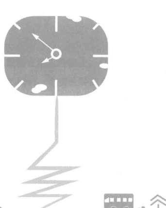

## 一人公司生存手册

# 打造长期复利的超级个体

把产品和服务卖出去，把个人品牌推销出去，一人公司才算真正盈利。看创业者案例、读商业书籍会发现，优秀的创业者往往都是会卖货的人。销售转化能力是一人公司创始人必须练就的基本功，尤其是在没有销售团队加持的情况下。

怎么提升销售转化？**销售既是方法，也是心理博弈。** 本章从销售原理、消费动机、消费心理切入，聊聊激发购买欲、促进成交的技巧与模型。也重点讨论知识产品、虚拟服务的售卖，以及如何把白嫖用户转化为付费用户。

## 一、万能成交公式：AITDA 模型
我接触过不少产品能力、专业水平都很高的人，一到变现环节就卡壳。很多人以为必须口才好、有一套话术才能卖东西，其实买卖逻辑并不复杂，搞清楚自己是怎么买进来的，就知道怎么卖出去了。

### （一）怎么把东西买进来，就怎么卖出去
看我最近两次消费的拆解。

- 消费经历 1
午休前我在懒人沙发上刷社交平台，无意间刷到一个卖秋装的直播间。主播长相讨喜，身上穿的卫衣也挺好看，我就在直播间外多待了一会儿。等主播把同款上链接并报价，我觉得价位合适，就点进去看了详情页和评价。看完想着快入秋了，直接下单后退出了直播间。

- 消费经历 2
我跟学姐吐槽文科生学心理统计真的太难，听课时总怀疑智商。学姐推荐我关注B站的一个UP主，说他讲统计基础很有趣。我去搜索关注后试听了两节，被他的风趣打动，于是投币订阅了课程。

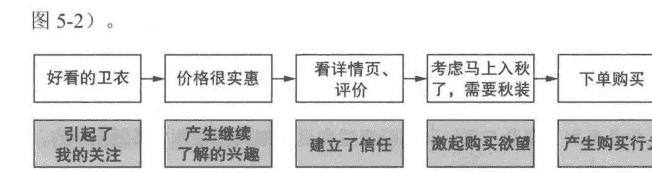

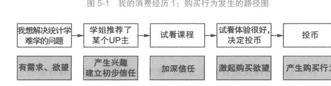
一次是无意种草，一次是有意寻找。无论哪种，产生购买行为前通常具备这几个前提：

1. 产品或卖家先抓住了注意并引发兴趣；
2. 有购买需求，或被激发需求进而产生欲望；
3. 对产品或卖家产生了一定信任。

把买的路径反向操作就是卖的路径。只需做到：

1. 让用户注意到我或我的产品服务；
2. 激起对我或具体产品的兴趣；
3. 强化或创造购买需求，刺激欲望；
4. 让用户信任我与我的产品服务。

距离成交就不远了。

### （二）万能成交公式：AITDA 模型
方法论是通用的。前文的销售步骤可以用用了上百年的爱达公式AIDA的变体AITDA来概括。

爱达公式由国际推销专家海英兹·姆·戈得曼总结，四个字母指：

- A：Attention，用最短时间抓住注意力；
- I：Interest，激发兴趣，让人想继续了解；
- D：Desire，刺激购买欲望，把需求转为想买；
- A：Action，推动付费行动。

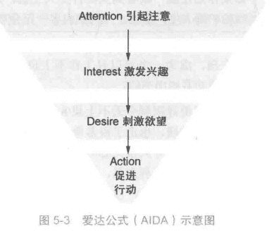
随着场景演变，加入Trust信任因素的AITDA已成为各行业的成交参考。记住Attention、Interest、Trust、Desire、Action五个环节来规划传播，就能让用户心甘情愿付款。

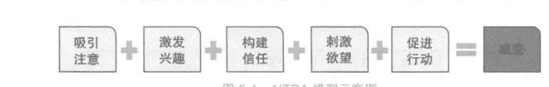
落地怎么用？以一条售卖本书的短视频脚本为例：

表 5-1 AITDA 模型实际应用示例

| AITDA 模型应用示例：销售本书的短视频文案脚本 |
| :--- |
| A：吸引注意 | 很想让所有想逃离上班的人都看到这条！我已经8年没去过公司，却写了一本关于“只工作不上班”的书 |
| I：激发兴趣 | 如果你正被失业焦虑、岗位难找、工作内卷、同事难搞、客户难缠困扰，每天上班像上坟，随时想辞职；如果你想跳出重复的打工人生活，过上不打卡也能赚钱的自在生活，这条内容值得看 |
| T：构建信任 | 我从双非普通本科的农村女孩，到能只工作不上班的独立创业者，再到签约出版，走过完整的逆袭路径 |
| D：激发欲望 | 从辞职出发到如今8年自由，这些年既有成绩也有坑，我都写进书里了。书里还涵盖如何找准赚钱天赋、打造变现产品、获取客户、让客户主动买单、以及收入多元化等关键问题 |
| **A：促进行动** | 考虑到部分人看书吃力，我建了共读群亲自陪读答疑。接下来一周每晚20:00我在某平台直播，工作生活上的困惑欢迎进来聊 |

从示例可见，注意和兴趣相对容易，难的是建立信任、刺激欲望和推动行动。

关于建立信任，可参考麦肯锡信任公式及个人背书。文案和沟通中，这两句话术能快速拉近距离：

1. 我曾经__________（困境/迷茫/失败/困惑），但是__________（与产品服务相关的内容），我可以__________（改变/逆袭/成功），你也可以；
2. 我知道__________（目标客户的问题/困惑），我的产品服务里有答案。

如何激发欲望、如何促进行动，会在第二节第三节展开。

## 二、促进用户付费的动机因素
销售中常有困惑：**客户反复咨询，就是不下单。**

主动咨询说明对产品感兴趣、有需求，不下单的原因可能是：

- 第一，还没建立信任；
- 第二，需求没被转化为强烈的欲望；
- 第三，产品服务某些点不符合预期；
- 第四，价格超出心理价位。

信任和产品迭代前面已讲，价格策略因客群而异暂不展开。本节聚焦如何洞察消费动机，把需求转化为购买欲望。

### （一）需求不是购买理由，欲望才是
前面反复强调要以用户需求做产品和内容，但在转化环节要注意：**需求不是成交理由，欲望才是。**

区别举例：

> 今天下班，我好想吃碗米线。——这是需求。
> 小丽说公司楼下那家烧肉米线很好吃，下班后我要去吃一碗。——这是欲望。

需求是大致方向，欲望是有明确目标和路径的需求。外部诱因能唤醒内在需求，与内因结合把需求变成欲望，最终变成购买行为；有些诱因直接激发欲望，直接促成成交。比如“小丽说烧肉米线好吃”就直接让我产生了要吃那碗米线的欲望。

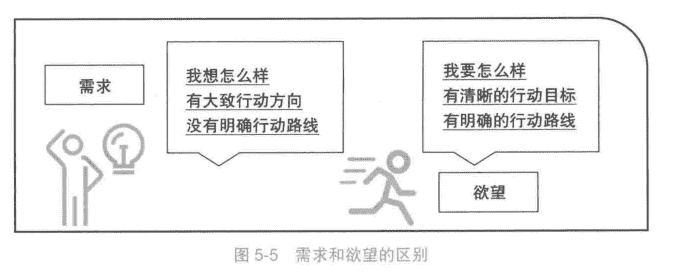

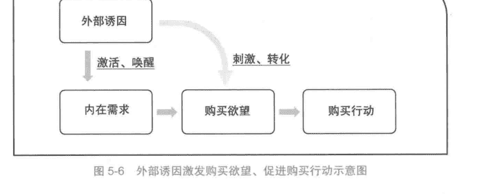
因此在销售中加入能刺激欲望的外部诱因，会大幅提升成交概率。具体诱因可结合消费心理学中的购买动机来设计。

### （二）激励用户付费的七大动机
消费心理学把购买动机分为求实、求安、求新、求美、求廉、求名、求便、偏爱等。

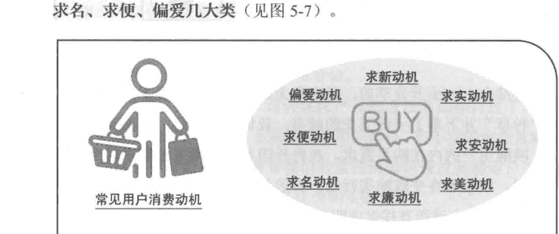
图 5-7 常见用户消费动机示意图

偏爱动机受个人喜好影响较难干预，其余几类可转化为刺激欲望的诱因。

#### 1. 求实动机
用户看重使用价值和实用价值。实用、高效、耐用等关键词容易触发购买。若产品在这方面有优势，可用结果呈现、数据量化、对比举例等方式突出实用价值。比如AI写作课可直接展示为学员带来的收益和节省的时间。

#### 2. 求安动机
求安即渴望安全、安定、安心。在安全感稀缺的时代更明显。若产品能带来身安或心安，可在宣传中强调。比如疗愈课程提供心安，职场规划提供成长安全感。

销售中可适度放大客户的不安，营造紧张氛围后再给解决方案。常见写法是“未来某时代，什么样的人会第一批被淘汰”。注意把握度，别变成恐吓或挖苦。

#### 3. 求新动机
追求商品服务的新颖、奇特、时尚。年轻用户对新事物接受度高。若提供实物，可在视觉上做时尚新颖设计，宣发加入脑洞趣味活动。若是虚拟产品，可展示新知识、新观念、新生活案例刺激欲望，如写作训练营分享学员靠写作实现新生活的故事。

#### 4. 求美动机
重视艺术审美价值或期待美好体验。爱美是天性，把产品、物料、个人形象打扮精致，能提升价值判断。比如选美容院，更容易被做工大气、朋友圈赏心悦目的商家吸引。

也可以用描述美好未来的方式激起当下欲望，比如“这本书能帮你解锁不上班的生活”。

#### 5. 求廉动机
在意价格是否实惠，希望少花钱多得价值。求廉不等于必须低价，折扣、优惠价、限时价、买赠等省钱机制同样有效。这也是网购常把红色优惠价与灰色原价并列的原因。

当客户因价格犹豫时，可给限时优惠或有价值的附赠，让客户感觉在省钱。

#### 6. 求名动机
追求能彰显身份地位的名牌和高档服务。一人公司初期知名度低，可用两种方式：

- 1）给对方一个高配身份
沟通时不说教，而是表达：我知道你是一个有远见/有规划/有野心……的创业者/企业家，你对目前企业、品牌的发展是不满足的，只是……专业的事交给专业的人做，我们一起……
- 2）制造稀缺
通过限时、限量、条件门槛等方式营造只有少数人能拥有的稀缺感。

#### 7. 求便动机
希望商品服务带来便利，追求省时省力。对于效率导向用户，节约时间、提升效率、简单上手等关键词是导火索。

销售时可突出高效、便利、简单易上手，同时精简沟通环节，提前准备高频问题，用选择题代替问答题，比如“针对你的情况我有方案A、B、C，你选哪个”，帮用户省时省力做出决定。

## 三、给客户一个立马下单的理由
AITDA成交模型最后一步是：促进购买行动。

注意，是**促进购买行动**，而不是直接完成付费行为！

别硬推，才能让客户主动买单

高单价商品或看不见摸不着的服务类项目，即便潜在用户内心已产生强烈意愿，也极少会即刻完成支付。同样，销售能力再强的业务人员，也很难指望一次沟通就覆盖全部成交。所以在跟进节奏上，底线是别过度施压。

很多人都有类似体会：前期交流很顺畅，客户对方案、专业度都表达认可，一到缴费环节就戛然而止。多数情况下根源在逼得太紧。举个例子，逛实体店时一眼看中一件单品，看到价格后本已做好拥有它的准备，若此时有导购在耳边持续打招呼，好感反而会被冲淡。询价后犹豫、观望属于正常反应，越是催促越容易产生逆反，最终把机会推走。如何在松弛中推动行动？我根据实操沉淀，结合不同人群与场景，归纳出三类可用做法（见图 5-8）。

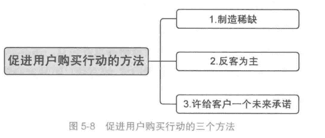

### 1. 制造稀缺，给下单创造紧迫理由
实操里经常出现客户说“先想想，过阵子再联系”“明天再付”，随后就没消息。对购买意愿已经比较明确的对象，可以借助定价与促动手段，递出一个立即行动的理由。前面提到过，通过时限、数量、门槛等方式营造稀缺感，能激活购买冲动，在成交推动环节同样有效。举例来说，有客户对私教陪跑项目感兴趣却被费用卡住，可这样表达：

> 为了保证交付质量，让每位学员真正有所收获，下半年我只保留五席陪跑名额，可先付定金锁定席位。若后续确认不参与，定金可全额退回，也能折抵其他服务或商品。

### 2. 反客为主，先让客户说出真实诉求
古语讲“无事献殷勤，非奸即盗”。除了过度推销，过度热情、过度服务也会触发戒备。实际沟通中，当客户表现出付费意向时，先别急着罗列产品内容与报价表。尤其是从自媒体或社群导流来的潜在用户，我们对他的具体需求并不清晰，他的信任基础也薄。这时一股脑介绍只会适得其反。

可用“反客为主”技巧，引导客户讲清楚他对哪类内容感兴趣、希望从我们这里获得什么。把主动权留在自己手里，让客户先说出“我希望你帮我做到什么”，而不是我们单方面输出“我能提供什么”。

若仅提供单一产品或服务，在正式介绍前可先说明适用人群与不适用人群。销售姿态随之转变，客户的注意力也会从“他在卖给我东西”转向“这件事适不适合我”。

### 3. 描绘未来，给出风险兜底
除价格外，客户犹豫的另一大原因是对结果缺乏可见性，担心无效浪费。针对此，可帮客户算清现实账与未来账。

- 1）现实账
当用户觉得总价偏高时，用拆分或均摊的方式保持总额不变却降低感知成本。例如年费2988元，均摊到每日不足一杯饮品的费用。

- 2）未来账
把使用后可能带来的价值、收益与改变讲清楚，驱动行动。同时在自身可承范围做出风险承诺，如体验不满意可按比例或全额退款，以此消除顾虑。但承诺必须可兑现，不做空头。

## 四、让技能知识类产品更易成交
一人公司里，许多创作者靠专业技能、咨询、训练营或知识付费课程变现。不同于可批量标准化的实物商品，技能、知识类供给多为依据用户需求定制的个性化服务与非标形态。交付前客户难以直观判断价值，加之行业竞争加剧、消费者防御心提升，转化难度明显加大。针对这些痛点，我总结了两条更易成交的做法。

### （一）卖解决方案，而非单一产品
近段时期一位老友请我为他打磨半年的“新媒体写作课”提供建议。我问他卖点是什么，他答“知识点密集、内容很硬、很用心”。课程上线后销量惨淡。

相似困惑很多。不少做知识产品的创业者都觉得内容硬核、专业度够，为何用户不买单？本质在于多数人付费知识不是为学知识，而是为获取改变现状的方法与可落地的成果。以“新媒体写作课”为例，用户付费通常围绕六类目的（见图 5-9）。

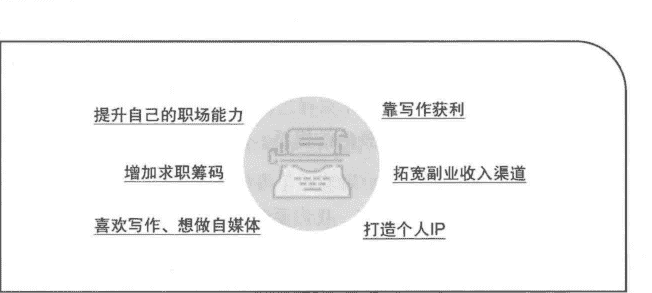

对应这些目的，愿意为此付费的人群大致包括：

- 为通过写作获利做副业、拓展收入的上班族与全职家长；
- 希望在自媒体平台打造个人影响力的人；
- 希望提升职场竞争力、增加就业筹码的人。

换言之，大多数人学习写作是为了赚钱或提升竞争力。卖课的重点不应是能学到哪些技巧，而是能打开哪些副业入口、获得哪些实质帮助。

在AI能迅速检索与整理行业素材的今天，信息本身并不稀缺，稀缺的是把知识转化为结果的能力。因此知识类产品的设计与销售都应指向可落地的方案与可量化的后端成果。即便是“求职简历修改”这类初级形态，也应指向帮助用户拿到更好的offer，而非让简历更充实。

方案比产品更容易打动人。销售时要学会描绘方案愿景：能解决哪些问题、带来哪些结果，而不是反复强调知识点多、服务多专业。

给出愿景的前提是先摸清用户的真实困境与当下痛点。所以先引导客户说出问题，再据此给出方案。如何让用户相信方案可行？答案是用讲故事代替卖产品。

### （二）讲客户转变故事，比自述更有效
《你的顾客需要一个好故事》的作者唐纳德·米勒说，故事能过滤噪音，把含混信息变成音乐，介绍产品不如讲故事，卖产品不如卖故事。

本书前面多次强调故事对一人公司的价值，也分享过“愿景故事”“英雄之旅”“我和你一样”等模型。但在知识产品销售中，仅讲自己的经历不够。讲述个人辉煌与逆袭能增加信任，但付费时用户更关心：这份供给能否解决我的问题，有没有与我相似的人因此改变。

基于此，销售时应把客户置于主角，讲述他们因“我”而改变的历程。可参考米勒提出的SB7模型：

- （1）主人公是我们客户；
- （2）他遇到了自身无法解决的问题；
- （3）遇到了向导，即“我”；
- （4）我为他提供一套解决方案；
- （5）我呼吁他采取行动；
- （6）产品帮助他避免失败或走出困境；
- （7）最终他取得成功。

简要应用示例：
> 我社群里不少成员和你一样，想利用业余时间开拓副业，却把网上各种网红副业轮着尝试，学费白花，还有人差点被杀猪盘骗走。和我交流后才意识到每个人都有独特的赚钱天赋，找到天赋才能匹配合适的第二职业。比如这位伙伴，原本想跟风学插画，经评估发现表达力强、脑洞大是优势，现在在知乎写短篇，每月收入达到在职薪水的两倍。

除自述外，条件允许时可邀请老客户按SB7模型讲述他们的转变故事，感染力更强。

## 五、把薅羊毛用户培育为付费用户
第三章提到，免费用户向付费用户转化并不容易。但在扩大客源的需求下，一人公司难免使用免费资料、低价品引流，这会带来一批付费意识较弱的“羊毛”用户。如何激发他们的付费意愿？

首先要明确，转化需要周期。不要一上来就流露出强烈的成交意图，追问需求、硬推产品、密集发优惠，只会让本就缺乏信任的客户产生反感。

我实操验证有效的方法是三段式价值养成法（见图 5-10）。

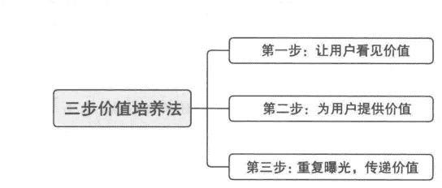
● 第一阶段，让用户看见价值。
从其他渠道导流到微信的用户，加好友后常会先浏览朋友圈。保持朋友圈权限开放、不设三天可见，并持续经营内容很有必要。用户不会完整翻阅，但一旦打开，就要在极短时间内产生好感与信任。朋友圈内容较多、耐心有限，可用置顶功能展示以下类型内容：
- （1）产品、服务介绍相关内容；
- （2）个人品牌故事；
- （3）体现专业能力的内容；
- （4）客户反馈评价；
- （5）高光时刻、荣誉瞬间。

● 第二阶段，为用户提供价值。
引流客户表明来意时，可先给予1~2份干货资料，或免费解答若干问题。目的是让客户有获得感，同时感受到解决问题的能力。关键在于把握分寸：给得太满会让所有问题被解决而无需我们；给得太少则收获感为零，难以建立信任。

除了干货价值，还可给予情绪价值。被引流的客户本身有求助动机，面对问题时往往焦虑。若能给予认同与情绪抚慰，让对方感受到被理解、被照顾，而非只想获利，关系会更稳固。例如我们团队的一个项目，从见面到达成合作意向仅用了不到半小时，客户的重要原因就是认为我们理解他的困境与压力。

● 第三阶段，重复触达，持续传递价值。
提供价值后，若客户主动询问产品服务，可在此引入介绍。此时信任基础仍薄弱，除了说明能解决什么、带来什么改变，还可分享客户案例故事强化信任。若客户体验福利后未主动咨询，不必纠结，更不要信息轰炸。只要他们仍在朋友圈或社群中，就可以通过持续分享、重复触达来影响。

客户与我们的关系往往不是一见钟情，而是日久生情。营销行业有“七次接触规律”，客户需要在连续七次看到品牌或产品信息后，才会产生足够信任并考虑购买。重复曝光与持续传递自我价值，是激活引流用户付费意愿的关键。

## 六、助力成交的六大心理学效应
销售本质上是一场心理博弈，掌握若干心理效应能明显提升成交率与客单价。下面是六种常用效应（见图 5-11）。

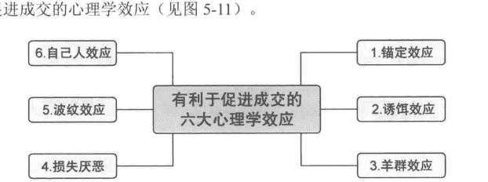
### 1. 锚定效应
直播间里，主播先举起原价牌，讲解卖点后亮出直播优惠价，观众立刻觉得划算。随后主播再抛出赠品福利，原本无需求的人也会觉得不买可惜，先囤着。

锚定效应指人们在进行定量评估时，会不自觉地把先前接收到的特定数值当作起点，这个起点像船锚一样限制判断，从而影响消费决策。原价就是锚，优惠价在对比下更具冲击力（见图 5-12）。

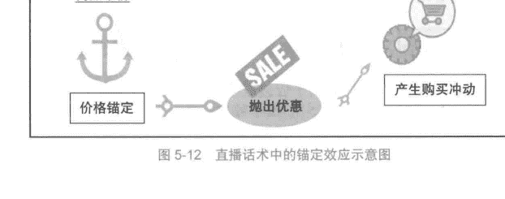
图 5-12 直播话术中的锚定效应示意图

### 2. 诱饵效应
又称不对称优势效应。在两项相近选项中加入第三项诱饵，会让其中某项旧选项显得更具吸引力。

电影院买爆米花，只有小桶20、大桶30难以抉择。若加入中桶26作为诱饵，大多数人会觉得大桶性价比更高，直接选择大桶。

想引导客户购买特定产品时，可放一个价格相近但性价比低的选项作诱饵。若要提升客单价，可引入高价诱饵，比如知识付费讲师标注一对一咨询一小时19800元，其实是为了抬高价值感，让其他课程显得物超所值。

### 3. 羊群效应
即从众效应，个体行为会受群体行为影响。景区里排队摊位生意更好，很多人连卖什么都没弄清就跟着排队。

在产品销售中可这样运用：
- 1）量化数据。比如畅销书封面写“全球累计销售××万册”，奶茶广告说“一年卖出3亿杯，可绕地球一圈”。做宣传时可量化销售数据、用户规模，用高人气影响决策。
- 2）会议发售、群发售。把目标客户聚在同一场景，邀请种子用户分享反馈、展示成功案例，用群体行为影响个体。

### 4. 损失规避心理
假设你要在两位讲师间选一门朋友圈短文案写作课：
A讲师：399元，不支持退费，请谨慎购买；
B讲师：699元，可免费试听三天，不满意返后续学费；打卡超20天可获200元奖学金和神秘礼物。

多数人会选B。因为相较于获得收益，人们更惧怕损失。损失规避指出，同等收益与损失下，损失带来的负效用是收益正效用的约2.5倍。被扣100块的难受程度，是捡到100块高兴程度的2.5倍。

营销中为客户规避或分担风险，就能大幅减少下单顾虑。如前面提到的学费返还承诺、电商七天无理由退货，都是这一效应的应用。

### 5. 波纹效应
一石激起千层浪。个体行为、态度会向外扩散，影响集体。营销中，一个中心人物对产品的态度会重塑周围人的看法。品牌请明星代言、大V推荐，就是想借影响力掀起更大波澜。

基于此，可寻找大V、KOL背书扩大传播，也可邀请亲友、目标客户分享传播，激起一圈圈小波纹。

### 6. 自己人效应

之前提到的那个心理规律再次被验证：人更容易接受和自己有共同背景、相似经历的人。1860年林肯参选时，就懂得用个人故事拉近距离。他在演讲里讲自己出身平凡、家庭普通，把“我几乎没什么可依靠的，唯一能依靠的只有大家”这番话说进选民心里，正是这种坦诚的共鸣，让他在那次大选中赢得了信任和支持。

把这套逻辑搬到销售场景，很管用。当客户觉得你和他是同一类人，心防会自然松动，成交也就容易了。要快速做到这一点，我从实操里总结出一个思路：先找共同点，再制造情绪共鸣，两者叠加，就能让自己进入客户的信任圈，成为他眼里的自己人（见图5-14）。

找共同点，可以从地域、年龄、星座、求学、工作、兴趣爱好等细节入手。比如在陌生城市遇到老乡开的店，很容易产生亲近感而愿意捧场。制造共鸣，则是在沟通时少说推销，多做倾听。捕捉客户当下的情绪，用他的视角给予回应和反馈，而不是一味输出自己的观点。

# 第六章 突破瓶颈：让一人公司稳定增长

公司的发展从来不是直线上升，一人公司更是如此。不同阶段会遇到不同的卡壳：找不到合适的盈利产品；产品服务很难转化为实际订单；缺少渠道、流量和客户；个人影响力不足；销售转化率上不去……前几章已经讲过应对这些问题的办法。

除了这些，运营中还会碰到收入增速放缓甚至停滞、财富积累困难；个人能力跟不上环境变化，应对起来力不从心；没有团队和伙伴加持，时间被琐事耗尽；投入产出失衡等更深层的困境。这些问题会让一人公司陷入增长停滞，也会让创业者身心俱疲。怎么走出来？

本章会从清除财富卡点、提升个人能力、搭建协作关系、低成本运营四个角度，拆解一人公司突破增长瓶颈的具体做法，让低投入也能实现持续盈利。

## 一、疏通收入卡点，打开增长空间

做个人商业时很多人会有这样的困惑：专业能力不差，产品服务也在线，有客户有渠道，收入却始终追不上别人。

影响收入的不仅是客户资源、产品本身和个人能力，更有我们对金钱的态度和关注焦点。很多刚起步的创业者，特别是做内容和技术的，会出现以下几种金钱上的卡住点：

- 1. 提到钱就尴尬，尤其是和熟人谈钱更难开口；
- 2. 不敢为自己的产品服务定价，或者定得过低；
- 3. 过度在意外界评价，包袱太重，不敢直面自己的真实需求和欲望。

不主动拆掉这些卡点，把注意力从别人的看法拉回自身需求，收入很难有实质性突破。下面会分两部分谈怎么消除不敢谈钱、不敢定价的心结，以及如何卸掉阻碍赚钱的偶像包袱。此外，针对收入瓶颈，我还提出了用“一鱼多吃”让时间更值钱，以及持续精进成为有溢价权的专家两个方向，后面会详细展开。

### （一）拆除金钱心结：坦荡谈钱不伤情

受“重情轻利”“金钱是俗物”等传统观念影响，很多人在谈钱时显得别扭，觉得谈钱伤感情。真实商业里恰恰相反，爽快谈钱不会破坏关系，不谈钱才既伤感情又伤钱包。谈钱是成年人的清醒和体面，具体怎么破？

#### 1. 坦荡谈价，并不伤感情

身边常听到熟人合伙创业最后因钱散伙的故事，每次有人感慨“朋友间不能谈钱”。其实让关系破裂的不是谈钱，而是开始时没把钱说清楚。情感深的合伙人往往前期避谈财务，中间因分钱产生嫌隙，又怕伤感情选择沉默，最后矛盾累积成决裂。

《史记·货殖列传》里说，“天下熙熙，皆为利来；天下攘攘，皆为利往”。钱像一道分界线，关系的好坏往往看金钱边界是否清晰。

前段时间一个做室内设计的朋友来求助，同学亲戚想让他出装修效果图，量房沟通了好几次，对方只聊梦想，从不提设计费。他纠结要不要主动说，怕让同学为难，也怕被认为势利。

如果你是他，会怎么选？

- A. 先不提费用，继续配合，看最后对方态度
- B. 让同学转达费用问题，借助中间人沟通
- C. 按正常流程直接报价，坦诚推进
- D. 其他你觉得更好的办法

我猜很多人会选B。但把谈钱的事推给同学，只会让同学左右为难，反而是一种伤害。而且以后类似情况会不断出现，今天是同学亲戚，明天就是亲戚朋友，若总是抹不开面子，就会持续消耗自己的时间精力。

我建议他按标准流程报价，并在可接受范围内以同学身份给点优惠或额外服务，报价前先把优惠信息同步给同学。

结果是，对方因预算有限没签单。他给推荐了一个费用匹配、能力不错的同行，并分享了一些避坑经验。装修结束后对方很满意，专门请他参加乔迁宴，后来还介绍了几个客户。

在商言商，规则要清晰，价格要明示。开始就划好边界，合适就继续，不合适就体面分开，既不浪费彼此时间，也能筛掉想占便宜的人。大方谈钱，真的不会伤感情。

#### 2. 敢于给自己定价

拆掉羞于谈钱的障碍后，下一步是学会定价。

- ● 其一，一个人的价值往往由他自己给自己的价格来体现。

大学毕业那年我去广告公司面试，谈薪时我支支吾吾，最后说“不求太高，略高于行业平均就行”。老板回我：“我可以给平均线以上20%、40%甚至更高，但要匹配相应的专业水准。”那一刻我懵了，后来才明白，很多时候价值感是自己先定价再去实现的。

- ● 其二，敢定高价会倒逼能力提升。

很多人担心公开高价会吓跑客户。其实每个价格段都有对应的客群，就像再好的销售也不会把高糖蛋糕卖给糖尿病患者。综合评估自身价值，敢于定价，既是对自己的肯定，也是反向提升的动力。

“现代营销学之父”菲利普·科特勒说过：“先有价格，后有产品，产品是让价格合理化的工具。”一篇文案定价500元的写手，和定价5000元的撰稿人，面对的客户和所需投入完全不同。

增长受限时，可以先给自己重新定价，再倒推需要哪种定位、哪些能力提升来匹配目标价。

- ● 其三，定价是对时间价值的保护。

价格也是筛选客户的窗口。不敢定价，时间很容易被白嫖占用。明确的价格能过滤掉不匹配的人，留下认同价值、愿意付费的客户，他们更值得投入精力。敢定价，就是用高价逼自己变得更有价值。

### （二）卸掉偶像包袱，停止内耗

我曾聊过一个被大厂裁员后转行美甲，一年开出5家店的朋友。我问她秘诀，她说大概是因为没包袱，不在意别人眼光。

她决定做美甲时，几乎所有人都在反对，觉得名校高材生不该去做门槛低的行业。但对她来说，为客户定制美甲是快乐又有成就感的事，看到客人发自内心的笑，她会感到久违的幸福。

想起自己之前开店的疲惫，很多耗能其实源于包袱太重。为了维持“为爱发电”“文艺青年”的人设，不敢对员工提出明确要求，结果运营一团乱，自己却被压垮。

#### 1. 自查身上是否有偶像包袱

很多人像当年的我一样，背着沉重的偶像包袱，严重影响获利能力。典型表现有四点：

- (1) 过分在意他人看法，为了维护形象时刻端着，害怕暴露不足和负面情绪。
- (2) 追求完美，总想准备万全再出手，一击制胜。
- (3) 放不下过去成绩和光环，抹不开面子做新尝试，用“不在乎”“佛系”掩盖真实欲望。
- (4) 视野狭窄，不认可别人的成功，弯不下腰学习求助。

每个人的包袱程度不同，但如果不卸下，就会越走越累。

#### 2. 学会卸下沉重的包袱

小米造车的经历很有启发。2021年宣布造车后，核心团队花了20多天总结大公司做新事物的三大坑：认知错位、惯性思维、偶像包袱。雷军在《小米创业思考》里强调，汽车业务里小米是新人，目标先是做出好车再谈颠覆，要用创业团队的心态保持警醒、谦逊和敬畏。

从中可以提炼三个卸包袱的方法（见图6-1）。

- 1）别因他人看法放弃行动。很多人想做自媒体却怕被熟人看到而迟迟不动。其实别人没那么多时间关注你，即便看到了也是额外曝光。怕评价而不迈步，只会原地踏步。小米官宣造车时外界质疑很多，但它没有因此停下。

- 2）先完成，再完美。转型或尝试新领域时，等待万事俱备是不可能的。克服完美主义最直接的方式是立刻行动，开始就会有转机，不行动就永远停滞。

- 3）放下身段，保持敬畏。刘慈欣说“弱小和无知不是障碍，傲慢才是”。在新领域，过去的光环反而会成为束缚。只有以谦逊态度学习，才能抓住变化。

当你卡在瓶颈，不妨停下来清理身上的包袱，再轻装出发。

### （三）一鱼多吃：让时间更有价值

收入瓶颈怎么破？时间每天都是24小时不变。要增加收入，可以：

- 第一，提升单价或在同一时间内多次售卖同一产品；
- 第二，用钱换时间，让别人帮你赚钱；
- 第三，通过投资理财或可复利的业务模式，创造被动收入（见图6-2）。

除去调价和理财，其他方式都能通过“一鱼多吃”实现。

## 一人公司生存手册

打造长期复利的超级个体

“一鱼多吃”常用于IP开发，一个作品衍生出多种形态，持续变现。比如小说改成影视、广播剧、漫画、游戏，人物和场景再延伸成周边、主题公园，形成产业链。一人公司也能借鉴这种思维，让同样的时间产出更多收入。我总结了三个实用做法（见图6-3）。

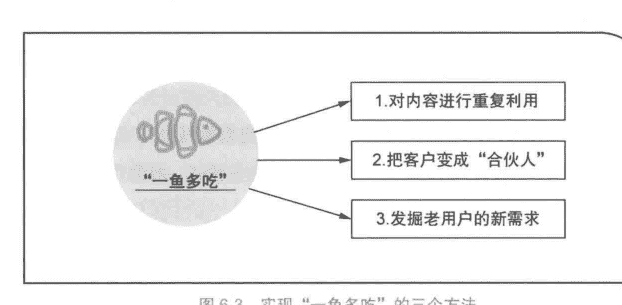
图6-3 实现“一鱼多吃”的三个方法

#### 1. 对内容进行重复利用

这是最简单的用法。今天写一万字干货，后续可以改成两节公开课课件、几篇公众号文章、十条短视频脚本。还可以把同样内容分发到小红书、抖音、微博等渠道做曝光，引流精准客户。

不只是完整文章，所有经过深度加工的内容都能复用。比如帮客户解决一个棘手问题后，把流程和方法记录下来，下次遇到类似需求就能快速交付。

#### 2. 把客户变成合作人

第三章提到客户开发像钓鱼养鱼。运营中可以用“一鱼多吃”思维挖掘客户身上的优势，把客户发展成合作伙伴。比如付费社群通过转介绍奖励、分享返佣，让用户变成销售伙伴，双方共赢。

也可以邀请在某方面有突出资源或互补优势的客户，成为产品或业务合伙人，合作开发服务。

#### 3. 发掘老客户的新需求

老客户是了解市场变化的窗口。和他们沟通时，常能发现被忽略的需求。基于这些新需求设计产品，老客户信任基础好，转化率通常更高。

比如我在做品牌咨询时发现很多创始人想做个人IP却不知从何入手，于是增加了创始人IP咨询服务，很快获得了正反馈。

总结来说，“一鱼多吃”是一种重复利用的思维，让单位时间创造更多价值。

### （四）持续精进：成为专家才有溢价权

一人公司前期都在想怎么快速赚钱，有人做电商带货，有人赶风口，有人靠信息差获利。但风口会变，红利会退。能持续赚钱的，往往是长期深耕某个领域的主义者。

如果想经营一家有持续盈利能力的一人公司，就要尽快找到能产生复利的长期业务，选定后持续深耕，成为细分领域的专家。

#### 1. 为何要成为细分领域的专家

成为细分领域专家、行业高手，才能拥有更多选择权和溢价权。

以平面设计举例，现在大家都在讨论小米斥资 200 万元请国际知名设计师原研哉操刀新 Logo 到底划不划算。与此同时，淘宝上的一位美工设计师，收了 500 元设计费却被客户无休止地挑刺儿。

从一人公司自营的角度看，我们必须做一个既懂用户、懂市场、懂营销又会成交的“通才”，这样才有机会在竞争中找到客户、维系关系。但单从被市场选中、被客户认可的角度讲，仅做个“样样会一点却都不够深”的通才是不够的。客户找我们，本质上是想解决具体问题，只有产品和服务上具备足够专业的底气，才能建立信任促成交易。

所以一人公司创业者要做到的是一专多长，既能像杂家一样对各方面有所了解，又要努力在自己所在的细分赛道成为“专家”。这里的专家并非指行业顶尖，而是能在某一方面形成明显优势，成为所在领域的小而精的高手。

#### 2. 从新手到高手的进阶之路
前文说过，只有沉淀成细分领域的专家、做到行业高手，才会拥有更多选择权和议价权。只是“为山九仞非一日之功”，从新人到高手需要漫长的打磨与经验累积。这条路充满坎坷，但找对练习方式、跟对引路人，就能更快跨出新手区进入高手区，下面是可操作的通关思路。

##### 1）找到一个持续深耕的领域
一人公司起步时可以广泛尝试、摸索，找到适合自己的商业模式。但在经历一段探索和盈利验证后，就要尽快锁定一个能长期稳定创造价值的业务方向，持续经营并有意识拉长自己的优势长板，以此保持竞争力。

若始终东一榔头西一棒子，就会被困在“认识新赛道→进入新赛道→开发新产品→测试新产品→寻找新客户”的循环里旋转不止（见图6-4）。

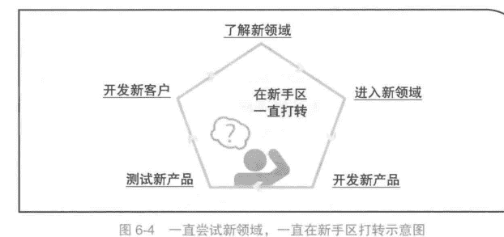
举个例子，我在自由职业早期接过各种类型的稿件，这确实带来了持续收入，但当时我对自己作品几乎没有定价权和话语权，合作中多是被要求、被挑剔的一方。更让人沮丧的是，产出再多内容，我依然只是个默默无闻的小写手。后来我把创作聚焦到“个人成长”“个人商业思维培养”这个垂直赛道，才逐步积累关注并最终出版了书籍。

##### 2）带着目的刻意练习
“一万小时定律”被很多人熟知，马尔科姆·格拉德威尔在《异类》中提到，天才的卓越来自持续不懈的努力，一万小时的锤炼是平凡到超凡的必要条件。随后这条定律常被简化为：在某个领域练习一万小时就能成为专家。

这种简化并不准确。格拉德威尔的说法源自心理学家埃里克森对柏林艺术大学音乐学院小提琴专业学生的对照研究。研究发现练习时长越长，演奏水平越高，且一万小时是达到卓越演奏者水平的临界点。

很多人只记住了10000这个数字，却忽略了研究背景：柏林艺术大学是世界顶尖艺术院校，小提琴专业学生的训练是在教师指导和监督下进行的带有明确目的的练习。

因此一万小时定律的核心并非堆砌时长，而是聚焦一个领域，进行有目标、有反馈的刻意练习，并且通常在导师的指导下完成。

##### 3）寻找一个导师或榜样
音乐学院的学生要成为职业演奏家，需要大量刻意练习外加一位优秀导师的监督和指点。同样，在自我精进的路上，找一个能提供方向和帮助的引路人，才能让练习更有效，避免走弯路。

这里的导师不一定是具体的人，也可以是想学习的标杆人物、被验证过的方法论，或经典书籍、资料、纪录片等。想提升商业思维的人，可以请教商业顾问或优秀创业者，也可以把知名企业家的传记、访谈作为学习样本，模仿其思考方式；同时阅读商业书籍、观看财商纪录片也能塑造思维。

万物皆师，关键是先迈步出发，心中的导师才会逐渐清晰。

总的来说，先锁定一个长期深耕的领域，再找到导师或榜样，最后在导师指导下带着目的进行一万小时的刻意练习，是成为领域内专业小能手、高手的必经路径（见图6-5）。

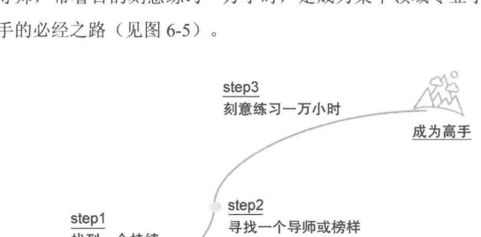
图6-5 从新手到高手的进阶之路示意图

## 二、独立工作者需要的四大进阶能力
传统公司要持续盈利，需要研发、技术、品牌、销售、运营、行政等部门协同运转。而极简创业的一人公司，一个人就是整家公司，必须身兼多职。这就要求我们不断补强能力结构。

一个常用做法是把自己拆成支撑公司运转的各个“部门”，再对照每个部门所需能力去优化自身。一般公司主要包括研发部，负责新品研究与设计；技术部，主导产品落地与实施；品牌部，负责形象管理、信用建设和整体营销策略；销售部，负责客户开发与获利；运营部，负责全流程的计划、执行与控制；行政部，负责人力、财务与后勤保障等（见图6-6）。

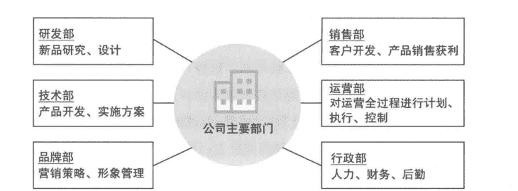
对照常规公司架构，独立工作者既要具备统筹发展的战略眼光，也要掌握洞察市场、发现机会、推进产品设计、开发渠道、完成转化、做品牌营销以及日常运营管理的复合业务能力。

前几章已对市场洞察、机会发现、产品开发、渠道开发、个人IP打造、销售转化等核心能力做了展开。市场变化极快，独立工作者的能力也需迭代升级。为维持持续获利，本节在已有能力之上补充四项进阶能力（见图6-7），下面展开说明。

图 6-7 独立工作者需要的四大进阶能力

### （一）营销力：个人商业获利的基础能力
> “他呀！专业能力一般，就是会营销。”
> “他家味道普普通通，都是营销出来的。”

“营销”这个本是中性的词，在不少场景里被赋予了贬损的意味。仿佛只要把“营销”二字加在成绩后面，就能抹掉其他闪光点，简单归结为“也就那样”。长期浸润在这类语境里，很多人会本能排斥营销，更不愿主动学习提升自我营销能力。

说来有些讽刺，作为营销从业者的我，早年也曾傲慢地认为自我营销充满功利色彩，坚信“花香蝶自来”“酒香不怕巷子深”“金子总会发光”，只顾埋头苦干，忘了自己身处信息过载、注意力稀缺的时代，不主动推广就很难被看见。

营销人不会自我营销，学而不用的结果就是：
工作多年，出走仍是新人；创业初期，处处碰壁、无人问津……

当我把自己推向市场并经历创业生死考验后才明白，营销力直接关系到独立工作者的存亡。提升营销力等于提升一人公司的成长力，下面从三个层面具体展开。

#### 1. 重视营销
提升营销力的第一步，是清除对营销的偏见。营销不等同于夸大其词、虚假宣传或没真本事。在商业社会里，营销是洞察并挖掘用户需求，创造并交付符合期待的产品服务，从而获得利润的过程。前文讨论的产品开发、获客、个人品牌、成交，本质上都是营销的一部分。

不必回避“营销”二字，若不认识到其重要性，一人公司的商业运转会难以为继。重视营销不等于造假包装、抬高价值或颠倒黑白，一切营销活动都应以事实为基础。

#### 2. 主动创造
网络流行语说：“出来混，什么最重要？”“出来。”
同理，提升营销力的关键是开始行动、开始创造。
管理学家彼得·德鲁克说过：“企业唯一的宗旨就是创造客户。”以用户需求为导向，先做出能满足需求或创造价值的最小可行产品，随后主动告知身边的人、主动发朋友圈、主动经营自媒体，想尽办法把首个产品卖给第一个客户，再依据反馈迭代产品和营销方式。机会不会自动降临，与其守株待兔，不如主动创造，主动是开启商业机会的钥匙。

#### 3. 行动大于一切
有一种说法：营销力 = 产品力 + 渠道力 + 传播力。这个公式对应了本书的第二、三、四章。但基于多年营销咨询经验，我认为还应加上销售力和执行力，尤其是执行力，决定营销成败（见图6-8）。

管理学家托马斯·彼得斯曾言：“合格的战略若无有效执行，会导致失败；有效执行不仅能让好战略成功，还能挽救不合适的战略或减少损失。”
大白话就是执行力贯穿始终，是营销的第一生产力。再好的点子执行不到位等于零，执行到位则三流想法也能产生一流结果。
很多人说要做自媒体，规划出一堆方案，却从不创作发布，几个月过去朋友圈只剩一句“我要开始做自媒体了”，毫无实际动作。

### （二）运营力：一人公司持续运转的保障
互联网曾有句话：“产品不够，运营来补。”
运营的概念很宽泛，企业运营、品牌运营、内容运营、渠道运营、直播运营、产品运营、新媒体运营……可以指岗位，也可以指推动产品服务达成目标的一系列活动。运营像个大筐，和企业、品牌、产品运转相关的内容都能装进去。作为一人公司创业者，我们既是总运营官，也是具体运营执行者，需要培养运营思维。下面是四个关键思维（见图6-9）。

#### 1. 目标思维
方向不对，努力白费。目标是所有行动的总原则，没有目标工作和生活会陷入混乱。
比如公司若无愿景目标，容易被外部环境带偏，推出缺乏竞争力的产品；工作无目标，要么摆烂要么瞎忙；沟通无目标，容易跑题浪费时间；职业发展无目标，则在求职市场里盲目摇摆。
作为一人公司掌舵者，要把目标思维贯穿始终，在行动前明确：
- (1) 愿景目标：经营一人公司希望过上怎样的生活；
- (2) 客户目标：希望谁成为我的客户；
- (3) 产品目标：核心产品服务是什么；
- (4) 具体工作目标：这项工作要先达成什么。

#### 2. 流程思维
流程思维即“以终为始，分步推进”。面对问题时先明确最终结果，再按逻辑把复杂任务拆解为关键节点，分步突破，避免无头苍蝇。
思考步骤为：明确目标结果→拆分步骤流程→明确每步具体事项与注意事项。
以开发知识付费课程为例，可拆分为“选题定位→市场调研→课程设计→内容制作”。对于“课程设计”这类复杂环节，可继续拆解为“大纲→结构→章节内容→核心案例”，像解数学题一样逐步攻破。

#### 3. 数据思维
数据思维是用客观数据支撑主观判断。涉及产品设计、销量预测等严谨问题时，通过收集整理分析数据来评估市场前景，而非仅凭“我觉得”“我认为”。做内容选题或电商选品时，可借助飞瓜、灰豚、蝉妈妈等数据平台了解平台热点和趋势，把握出圈机会。
数据并非绝对客观，现实变量很多，数据应作为辅助决策工具而非唯一准则。

## 一人公司生存手册
**打造长期复利的超级个体**
培养数据思维并非唯数据论，而是形成主客观结合、有的放矢的思考习惯。

#### 4. 复盘思维
复盘在朋友圈常见，多人把它当成总结或画思维导图的仪式。但复盘本是围棋术语，指对局结束后复演过程，分析攻守优劣与关键得失，为下次对弈提供突破口。
一次完整复盘包括反观棋局、反思得失、反省总结、推演练习四个环节（见图6-11）。

图 6-11 复盘的四个关键环节
复盘不是简单重复或做一张漂亮图。核心是通过反思总结出值得肯定的做法和需要改进或停止的做法，从做得好的地方提炼可复用的规律，从做得不好的地方提炼教训并推演出改进方法，避免重蹈覆辙。
在一人公司里，复盘思维能把过往经历转化为能力，减少重复踩坑。运营力是一项综合能力，需要在实践中不断摸索总结。

### （三）表达力：个人财富指数增长的秘密
常言道，会表达的人一开口就赢了。在资源和机会向表达力倾斜的时代，表达力强的个体更容易获得影响力、财富和机会。
十年前善于文字的人靠公众号掘金；短视频时代敢于表达的人在各平台收获增长；工作生活中，表达好的人更容易得到支持，而不会表达的人再努力也像“透明人”。
同做技能培训，表达力强的老师通过朋友圈、自媒体、出书、讲课多渠道发声，学员成千上万；表达弱的老师即便课程设计科学，学员也难以突破个位数。

#### 1. 表达最重要的是“表达”
想提升表达力，先要表达出来。很多人因担心表达不好而回避表达，殊不知表达力可通过刻意练习提升。对镜演讲、对着镜头拍视频都是有效方法。表达形式不限于口头，还包括文字、肢体语言。关键是把想传递的信息尽可能输出，让他人接收。
比如我曾指导一位做茶叶的客户，她想做电商直播却因普通话不标准、乡音重、口才不佳迟迟不敢尝试。我认为这些“短板”恰是区隔性优势：乡音可体现产区特色，朴实形象更显真诚。在鼓励下她开始试播，数据逐步好转。

#### 2. “秒赞”表达力模型
表达力靠日常练习，但掌握沟通技巧能在关键商业对话中让人条理清晰、有理有据，在日常交流中更出彩。下面分享两个模型。

##### 1）FFC 赞美法则：快速拉近好感
心理学家威廉·詹姆斯说：“人类最深的渴望是被赞美和尊重。”

在和客户、合作伙伴打交道时，一句真诚的肯定往往能快速拉近心理距离。问题是盲目夸奖很容易失效，说不到要害就是客套，甚至让对方觉得虚假，被吐槽为马屁拍到了蹄子上。

比如你想夸客户的观点有深度，简单说一句“您刚才说得太棒了”，对方大概率只会当成礼貌应付。要想夸到点上，可以套用 FFC 赞美法，从感受、事实、对比三个角度给赞美加上细节。

- F：Feelings 感受——用细腻的语言描述对方带来的感受。
- F：Facts 事实——用具体细节和事例佐证感受，让对方信服。
- C：Compare 比较——适度做对比，凸显对方的独特之处。

拿“夸客户的话有深度”来改写就会不一样：

F（感受）：你刚才那番话让我很有启发。
F（事实）：你提到企业要把客户当成恋人，以长期经营为目标，持续关注需求和情绪，这对产品和服务的迭代优化帮助很大。
C（比较）：市场上不少公司把客户当上帝，或干脆当冤大头，关系很难长久。

2）SCQA 表达力模型：让表达更有逻辑

SCQA 是麦肯锡顾问芭芭拉·明托在《金字塔原理》中提出的结构化表达工具，四个字母对应：

- S：Situation 情景——交代大家都熟悉的现状，制造代入感。
- C：Complication 冲突——指出背景下出现的不利或矛盾，引起关注。
- Q：Question 疑问——从冲突中提炼出问题或困惑。
- A：Answer 回答——给出可执行的方案或结论。

这个模型在销售、演讲、方案讨论里都好用，能让思路清晰、节奏有牵引，更容易获得情感共鸣。

雷军在2021年小米年会上就用了 SCQA。

- S（情景）：过去一年小米稳健增长，整体向好。
- C（冲突）：年初却突发变故。1月15日清晨，美国国防部把小米列入 DoD 清单①，开盘后股价暴跌超30%，市值蒸发3000亿港币。
- Q（疑问）：当时只有两条路，要么认了，要么起诉美国政府。起诉胜算不大，怎么办？
- A（回答）：最后选择正面对簿公堂，用堂堂正正的方式捍卫权益，最终赢了。

实际使用不必严格按顺序，可灵活变式：

- a. 开门见山 ASCQ：回答－背景－冲突－问题。先给结论再解释背景，最后抛问，适合汇报和计划沟通。
- b. 突出信心 QSCA：问题－背景－冲突－方案。先抛问题再展开背景和挑战，最后给出方案，适合产品介绍和案例分享，如马斯克谈火星移民开场就问“人类最大威胁是什么？”。

> ① DoD 清单，指美国国防部认定的“中国军方拥有或控制的中国企业清单”。

### （四）学习力：应对不确定性的底层能力

行业说没就没，岗位被AI取代不再是科幻。面对未知，最实在的自救只有学习。学习抗风险的能力，学习新技能，学习保持竞争力，学习不被时代淘汰。尤其对独立工作者来说，学习力既是竞争力，也是变现力。

在时间被挤压的当下，怎么学得更快更有效？分享两个方法。

#### 1. 功利性学习，并不可耻

学生时代被教育学习要纯粹，进入社会后，有明确目的的学习反而是低成本的成长捷径。

功利性学习，就是从真实工作需求出发，学完立刻用的学习。所有以解决问题、落地方案为导向的学习都算。

现实中学习和应用常常脱节，学完不会用，用时才发现没真学会，于是挫败感累积，最后放弃主动学习。带着问题学就不同，会更投入，直到把方案落地。

比如很多人读这本书的出发点就是“如何开启不上班生活”，有了这个目标才愿意啃枯燥的部分。

做法很简单：学习前先锁定一个具体问题，带着问题选素材深入学，学完立刻实践，用结果检验、查漏补缺，直到问题解决。

#### 2. 成为蜜蜂型学习者

功利性学习解决了“学了用不上”的问题，但只解决单点问题容易无法迁移。需要知识框架。

蜜蜂先用蜂蜡搭好巢的框架，再采蜜酿蜜填充，不断扩容。学习同理：进入新领域不要急着出成果，先确定目标搭框架，再逐步填充、内化、输出、优化，形成可迁移的知识体系。

### （一）守住创建一人公司的初心

要不要招人、要不要扩张，没有标准答案，要结合初心、现状、盈利模式和增长点综合判断。

多数人创业一人公司有两个初心：

- A. 用极简模式实现不上班、工作自由的自主生活。
- B. 把一人公司当跳板，过渡到有影响力的大企业，成为企业家。

选 B 的，按节奏推进，注意成本平衡，别透支、别操之过急。

选 A 的，就要守住初心，不被传统经营观念和外界评价带偏，坚持小而美。

很多创业者误以为必须扩规模才算增长。现实是，盲目招兵买马、租写字楼很容易把原本盈利的项目拖进亏损。品牌设计行业里，太多独立工作室搬进办公室后负债累累，工资房租都发不起。

保罗·贾维斯在《一人企业》中说得好：一人企业要回答的是“如何让企业更好”，而不是“如何让企业壮大”。

有人招人只是为了做点声势，向别人证明自己“做得不错”，这很舍本逐末。若初心是追求自主灵活，就不必用他人的认可绑架自己的选择。

总结来说，若目标是极简创业、自由生活，目标就该是持续盈利、保持小而美，用更低成本提供更高质量的产品服务。

### （二）综合评估是否需要扩团队

要不要扩团队，要看运营现状、获利模式、业务类型和增长点。

表 6-1 一人公司 A 运营情况表
| 一人公司 A 运营现状 | |
|---|---|
| 获利产品 | 付费社群、训练营、录播课程等知识付费产品 |
| 主要客户渠道 | 自媒体短视频、直播 |
| 增长点 | 出售更多知识付费产品，卖出更多高客单价产品 |
| 支撑公司运转的工作 | 开发设计课程、写课件、创作短视频脚本、拍摄剪辑、直播、社群运营、学员答疑、咨询等 |
| 当前规模 | 1 人 |

表 6-2 一人公司 B 运营情况表
| 一人公司 B 运营现状 | |
|---|---|
| 获利产品 | 商业咨询、品牌全案设计 |
| 主要客户渠道 | 口碑传播、客户介绍 |
| 增长点 | 提升服务价格，服务优质客户，开发新业务 |
| 支撑公司运转的工作 | 根据项目需求，推进具体工作 |
| 当前规模 | 2 人 |

#### 1. 一人公司 A 现状分析
A明显超负荷，剪辑、答疑、点评等琐事占掉大量时间，还要持续直播拍摄交付，精力被稀释，长期容易损害口碑。

这种情况下需要扩充团队，招运营、助教分担重复性事务。团队不必线下，线上远程协作即可省去办公室成本。

#### 2. 一人公司 B 现状分析
B靠提价、服务优质客户和新业务增长，项目饱和时可通过外包、临时项目组补充人力。

现阶段不必增固定员工，但要提前搭建人才资源库和远程合作网络，确保人力不足或需求不匹配时能快速找到合适伙伴。

总体判断：当个人时间被琐事占据，无法专注交付和提升质量时，才考虑组建团队；其他情况可保持单干或1-2人小团队，同时储备远程人才库。

## 四、低成本运营一家持续获利的公司

创业常让人联想到注册、租场地、装修、招人，这些都意味着先花钱，风险陡增。用一人公司思维，前期几乎零成本起步，后续扩展也只需低投入。

### 1. 第一件事不是注册、找办公场地
一人公司形态灵活，咖啡馆、书店、家里书房都能办公。第一步是找到获利产品，明确商业模式。

后续需要正规化再注册，家庭住址在很多情况下可作为注册地址，没必要为了工商登记租办公室。见客户可选咖啡馆、茶馆等场景。

办公室不重要，客户更在乎你能否解决问题、创造价值。

### 2. 学会雇佣软件和专业团队
公司注册后涉及财税等专业事务，不必专门招人。可直接找专业财税公司代办，或用专业财务软件自助处理。

小公司要控制固定人力成本。把财税法务交给外部机构，资料整理归档交给AI工具和软件，用工具替代人力，既省钱又少管理麻烦。

### 3. 进行业务外包、转介绍
一人公司前中期业务量不稳定，没必要养全职。超负荷时把业务外包或转介绍给自由职业者、数字游民、其他一人公司主理人，配合度高、交付快。

外包时别压价克扣，合作伙伴既是临时队友，也可能是长期合伙人和介绍客户的渠道。

### 4. 优先组建线上团队
远程办公已成常态。需要固定团队时，优先线上，有以下好处：

- 用人灵活，可按需招全职、兼职或项目分成临时协作
- 选择面广，可面向全球寻找合适伙伴

现实里，具备能力又富有想法的人，通常不愿意把自己长期拴在一家规模很小的机构。于是线下小公司或工作室，想招到稳定可靠的协作者，难度相当高。反过来借助网络协作，不受繁琐规章与层级束缚，反而更容易遇到三观一致的优质人才。归根结底，远程联手可以在控制预算的前提下，找到更匹配的合作者。

### 5. 构建随时可用的资源网络

单人创业不必养一支固定的团队，甚至可以完全不设编制，但必须要有自己可随时调动的人脉和资源储备。绝大多数事务单枪匹马难以高效完成，所以从启动初期就要养成主动囤积合作人选和外部资源的习惯。

首批可用的资源往往来自过往的工作圈：曾经的同事、服务过的客户，甚至之前的主管或老板。在日常互动中，一旦发现对方在某方面特别突出，便可主动搭上线，保持联系。

以上是一些投入小、花销低运营单人模式的实用思路。当然经营没有放之四海而皆准的范本，最好的方式是依据业务诉求和实际进展灵活调整，只要把开支控制在合理区间即可。切记，你是自己人生的首席决策者，他人的评价只是参考。

《一人公司生存手册》是一本参考价值很高的“轻创业”指南。如果你想升级个人品牌，如果你想提高获利效率，如果你想活得更富足，我推荐你好好读一读这本书。

——个人品牌顾问、《一年顶十年》作者 **剽悍一只猫**

只要你想——在这个营销和传播无所不在的信息环境中，在这个产品丰富且可轻易获取的时代，个人即是公司。

——“洞见”公众号创始人 **洞见君**

这个时代，再普通的个体都可以通过把个人能力、经验产品化，打造出持续、可复利的商业模式。如果你厌倦了朝九晚五，想探索更多格子间外的活法，这本书值得一读。

——百万畅销书作家 **剑圣喵大师**

作为10年内容创业者，我见证了无数个体的成长、蜕变。墨墨子的这本书堪称这个时代的新个体商业指南，她凭借多年实战经验，将“一人公司”从无到有的全过程拆解得清清楚楚，从思维转变到突围破局，每一步都有实操干货。无论你是初入职场的小白，还是想要转型的职场老手，都可以把自己产品化、品牌化，希望这本书能成为你个人商业的起点。

——富兰克林读书俱乐部创始人 **富叔**

超速发展时代，一人公司成为趋势。墨墨子老师这本书从实战、咨询经验出发，帮你从产品规划、获客渠道、IP打造、销售转化、团队组建等多个维度，一步步拆解如何打造可复利的个体商业模式。

——畅销书作家 **无戒**

上架建议：管理·创业

