# 以个人品牌经营一人公司，走向自由

## 前言
### 一人公司带来更自由的活法

我本科读的是动物生物技术，职业轨迹走得很散：从外企人力到国资银行客户经理，再到新西兰留学顾问、当地品牌营销经理，最终把起初的副业人生教练转为主业，成为个人品牌商业教练。毕业十年间转行五次，我一直在找寻职业坐标，却没想到自己从一个追求安稳的人，慢慢变成拥抱变化、热爱创新和成长的一人公司创业者。路并不顺滑，踩坑、试错、自我怀疑不断，正是这些经历让我对工作、生活与创业有了不一样的认知。这本书的诞生，源于我的亲身摸索，也源于对未来工作形态的判断。

22岁赴新西兰留学时，我以为毕业后就能进大城市知名外企当高级白领。穿职业套装、踩高跟鞋、挺直腰板走在写字楼里，那是我大学时代最清晰的职业想象。

23岁在大城市入职外企后才发现自己很渺小，看不到成长路径，薪水也不足以在大城市立足。每天四小时通勤、用外卖填肚子、下班躺床刷手机，我成了麻木的工具人，生活质量几乎为零。于是我放弃白领梦，裸辞回五线家乡，考入一家国企银行，以为能开启“钱多事少离家近”的日子，计划早早成家。

25岁时我有了稳定恋情，工作上手快、受领导器重，却越来越排斥复杂的人际应酬和频繁加班开会。才明白自己向往的那套，更多是社会标准和外界期待的成功模板，并非内心真实想要的。即便在旁人眼里很体面，我依旧不快乐。

我开始反思，过去二十多年的求学与职场，我从未认真问过：我的价值是什么？生命的意义在哪？抛开外界声音，我想成为谁？什么样的生活才真正让我幸福？有没有一种方式，既能职业成功，又能保持生活的松弛与灵活？

27岁，我和伴侣一起裸辞出国，把过往履历、学历、人脉全部清零，从零开始探索更多可能。在新西兰工作之余，我尝试十几种副业，接触到很多截然不同的生活方式，也认识了一批一人公司创业者。他们靠才华与热情打造独一无二的事业，过着自在多元的生活。那种做热爱的事就能赚钱，还能享受自由的松弛感深深触动我。在学习人生教练并为客户做一对一辅导时，我发现很多人和曾经的我一样，被不喜欢的工作和模糊的职业前景困住，迷茫焦虑。我不禁想，为何有人能用热爱创造事业，有人却做不到？

32岁，我决定用专长和兴趣去试水一人公司线上创业。两年不到，年收入突破百万。过程很苦，但也收获了前所未有的满足感和自主权。伴侣也成了创业者，家里各有一间办公室，白天互不干扰，偶尔说走就走去海边，夜里一起追剧，周末可错峰旅行。我明白，当工作与生活不再对立，追求的不只是物质成功，更有内心的充实，工作就成了生活的一部分。

2023年，在帮助上百位专业人士搭建个人品牌后，我接到清华大学出版社邀约，出版了首本《个人品牌打造：从0到1低成本创业》，把营销经验和落地方法整理成一套可复制的知识变现路径，获得了不少读者认可。

同年年底，我在公众号发了《年入百万的一人公司是未来的趋势》，七天内阅读破十万。这促使我把实践经验系统化，让更多普通人看见如何设计一人公司商业模式。

这本书既是我个人历程的复盘，也是对未来工作方式的设想。我相信随着技术进步和个体意识觉醒，越来越多的人会选择小而美、灵活自由的一人公司来兑现自我价值。书里我分享了从打造个人品牌到经营一人公司的完整过程，以及我在职业自由、财务独立和价值最大化上的理解与做法。

愿这本书能启发思考，不管你处于哪种职业状态，都能找到更适合自己的活法。人生只有一种成功，就是按自己喜欢的方式度过。

# 第一章 一人公司的新浪潮

互联网与数字技术高速发展，一人公司成了越来越多人的选择。本章讲清一人公司的定义、兴起背景与动因，看看这种新形态如何为个体提供更大的自由与创新空间，帮读者把握趋势完成职业跃迁。

## 1.1 个人新商业时代已至
### 1.1.1 从传统企业到一人公司的转向
21世纪见证了工作与商业模式的巨变。传统公司规模庞大、层级复杂、流程严谨，长期主导经济与就业。但技术突飞猛进、全球化加深，一个以个人为核心的商业时代正在成形，即个人商业时代。它指由个体创办并运营的商业实体。

当下随人工智能发展，一场从传统公司向个人商业的迁移正在发生。驱动它不仅是技术，更是价值观与个人追求的转变。

过去大家眼中的理想职业路径是什么？通常是进大牌公司，逐级晋升，最后坐稳高层，享受福利保障。大型企业光环诱人，但层级森严、晋升受限、人际复杂、岗位细分，也制造了不少障碍：高强度加班、技能单一重复、晋升难、生活失衡等。

经济波动与技术迭代，让不少在名企安稳多年的人遭遇中年危机，离职后发现离开平台便无一技之长，收入骤降。移动办公时代到来，靠大公司升职加薪的发展线对很多人已失去吸引力，甚至变成风险。

今天，一种全新形态正在崛起，即个人商业，也称一人公司。我把它定义为：通过实践、试验与迭代创造理想生活方式的商业模式；以技能、兴趣与同频人群创造创意收入的工作方式。简言之，一人公司既是商业模式，也是一种创意的工作方式。

一人公司不仅是组织形态的变革，更是一种生活哲学。你不再受上级评价或公司业绩支配，自己掌舵职业生涯，每个人都能做梦想的创造者，并获得做得少、赚得多、玩得开的自由。

#### （1）一人公司兴起的动因
一人公司崛起受多重因素推动。如图 1-1 所示。

第一，它是数字时代的产物。互联网、人工智能、社交媒体、云计算、移动支付等技术为个体创业打开了广阔空间。一个人拥有一台电脑连上网就能做出全球影响的产品或服务，越来越多的人通过网络开拓收入渠道。

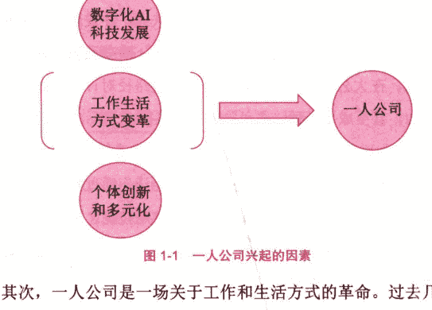

图 1-1 一人公司兴起的因素

第二，它是一场工作生活方式的革命。经历生命的不确定后，很多人追求工作与生活的平衡，不再为生计而工作，而是希望工作促进成长，提升生活品质。一人公司成为理想载体，工作不再是生活的对立面，而是实现自我价值的路径。

第三，它的核心是自由。自由不仅是时间地点的自主，更是内容与方向的选择。喜欢写作可做自由撰稿，热爱摄影可通过平台售卖作品或接单，擅长编程可独立开发应用。几乎任何兴趣与技能都能变现。工作不再是生活的一部分，而是生活本身，成就感与自我表达合一。一人公司反映了当代人对工作、生活与自我实现的新理解。

> 在一人公司的世界里，每个人都在书写自己的故事，用自己的方式定义成功。

#### （2）一人公司面临的挑战
听起来很诱人，但不确定性与挑战同样存在。

作为创业者，你要面对市场波动、客户需求变化、技术迭代带来的压力。孤独感也常见，独自扛下所有责任与风险。技能要求多样化，除了专业核心能力，还需营销、客户服务、财务、运营等全栈能力。你不仅经营生意，更在经营自我。

商业模式上，一人公司缺乏传统组织的系统与资源，灵活性高但规模受限，服务客户量与经济效益难以与大公司比拟。天花板相对较低，模式也偏单一，更适合作为轻创业方式，用知识技能或资源优势借助自媒体杠杆，获得比打工更高且更灵活的收入。

#### （3）新时代的到来
2024年对很多人很艰难，创业者普遍承压。许多人并非主动追求自由，而是被迫探索自由，因为稳定职业路径已不复存在，大家被迫发展副业与低成本创业。此时才后悔没早点经营个人品牌，离开平台就失去变现能力。

精神压力增大，疗愈经济爆发，人们更关注身心健康与极简生活。就在这样的背景下，一人公司获得更多关注，它的兴起标志着一个新时代的到来，个体价值与创造力被前所未有地重视。传统组织要吸引人才，也需更关注个体成长。

一人公司的崛起挑战传统商业模式，也激励个人创业精神。在此模式下，每个人都有机会成为创新者与变革者，把梦想变为现实，把热情变为职业。创业者不仅经营公司，也在经营生活，工作变成一种享受与热爱。一人公司既是经济实体，也是自我实现与追求梦想的方式，是个体觉醒的产物。

### 1.1.2 AI 对普通人职业的冲击与机会
在AI驱动的时代，我们正处历史拐点。AI不仅加速技术发展，更从根本上重塑工作与生活。变革带来挑战，也带来机会，尤其对普通人而言。

#### （1）AI 带来的职业挑战
现实是AI的快速渗透可能替代大量传统岗位。从制造到服务，从数据处理到决策支持，自动化范围不断扩大。用工成本与效率优势让部分岗位面临被取代风险。甚至需要创造力与分析能力的工作，如设计、数据分析、财务规划，也可能受冲击。这是关乎职业生存的现实问题。

稳定铁饭碗已不存在，追求头衔不如积累核心技能。掌握技能的数量比从事哪个职业更重要。现在许多职业都是自己创造的，就像我创造了“个人品牌商业教练”一样。AI的加速让更多人开始为自己设计全新职业。

要避免被淘汰，不仅要持续学习新知、保持技术敏感，还要学会把AI当工具而非对手。未来被淘汰的不仅是被取代的工种，还有不会用AI的人。AI正像电脑与智能手机一样，成为工作生活必需品。

在AI助力下，企业员工可把精力投向创新策略与客户关系等“以人为本”的领域。未来职场更有价值的是机器难复制的能力，如创新、共情、人际交往。个人品牌因此更重要，个性特质是AI无法替代的核心竞争力。

AI的崛起也带来心理与情感挑战。机器与算法主导的世界让人感到孤独与焦虑。创业者需面对商业压力与内心的恐惧，学会在自动化环境中保持自我与创造力。

#### （2）AI 带来的新机遇
AI同样为个体创业与一人公司提供新可能。AI可帮助创业者处理数据、提升效率、辅助决策。对愿意拥抱技术、学习新技能的人，AI是助力而非威胁。它能以低成本启动一人公司，帮助创业者在市场中获得优势，更快适应变化，挖掘新机会。

比如已有公司用AI撰写文案、制作广告图、替代人工客服，甚至用数字人直播替代真人直播，既高效也降低成本。自媒体博主是一人公司典型，他们用AI拓展创意、撰写方案、扩充选题、分析运营数据。

我也用ChatGPT打造了AI Alina智能体，把课程、书籍、公众号文章和产品介绍全部导入知识库，定制了一个了解我经历与定位的AI助理，可协助创作内容与方案。另在智谱清言上创建了AI智能体“AI霖子”，供学员就个人品牌问题直接对话获得解答。

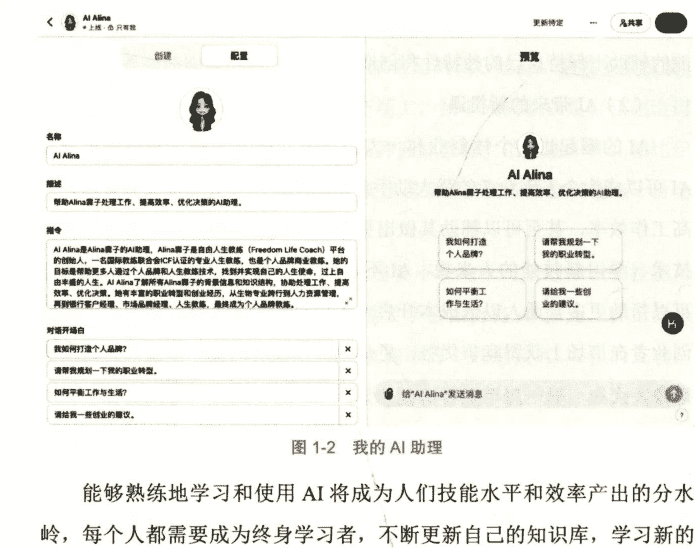

熟练学习使用AI将成为效率分水岭，每个人都需成为终身学习者，更新知识库，学习新技术与管理能力，培养对复杂问题的理解与批判思维。对创业者而言，这意味着更快学习与适应。

未来AI将持续重塑工作与生活，带来挑战也带来无限可能。通过有效利用AI，可打造更高效个性化的产品服务，更快适应市场，探索全新商业模式。在AI辅助下，每个个体都能把独特知识与生活经验转化为有影响力的商业实体。

总之，AI带来的职业挑战是多维的，技术、思维、心理、伦理皆在其中。这是重新定义自我的时代，也是发掘新机遇的时代。唯有持续学习、适应与创新，才能在AI浪潮中站稳脚跟，把握属于自己的职业机会。

### 1.1.3 自由职业、数字游民与一人公司的差异
在个体意识觉醒、追求精神满足的时代，人们重新思考职业与成功的定义。金钱权力地位不再是统一标准，越来越多的人渴望探索天赋与热爱，过上丰盛的生活。一人公司之所以出现，正因为它让普通人能用优势天赋创造喜欢的事业与生活方式。

一人公司在海外很常见，即一人工作室，多数会建个人网站展示履历与服务，用邮件与自媒体推广。但在国内，自由职业、数字游民与一人公司的概念才刚普及，容易混淆。

自由职业者是独立工作的专业人士，通常为多个客户提供特定服务，不受雇于单一企业，按合同或项目收费。变现渠道多样，不限于一家公司或单一产品。比如有人同时做自媒体、编程、写作、翻译、插画，可同时接单赚钱。

# 单人事业：以个人IP换自在

在境外较为知名的自由职业撮合平台里，Fiverr 的逻辑是供给先行。创作者先把个人简介和可售卖的服务包挂在平台上，自行定价、写清交付物与周期，买家依关键词检索、横向对比后再下单。Upwork 则是需求先行，委托方在站内发布项目说明，列明工作范畴、预算区间与时间节点，自由择业者浏览后递交提案，用过往案例、技能匹配与报价去争取机会，委托方再筛选沟通后确定合作。

网络游牧族与自由择业者常被混谈，核心差异在于工作边界。游牧族强调可线上完成，带着设备就能边走边做，把旅行与工作叠加。身份上可以是受企业允许远程的员工，也可以是自由择业者或自主创业者，只要能在时间与地点上灵活调度，就可归入此类。

单人经营主体是更进一步的形态。由单人完成注册、运营与决策，企业主即全部人手，业务全链路自控。与前两者不同，单人经营首先是一个合法的商业实体，需依经营范围办照，拥有核心产品线与可复制的商业闭环，能够稳定产生现金流。

现实中绝大多数自由择业者与网络游牧族并未搭建起完整的商业模型，多靠出售短期技能、承接零散项目维生，很难形成自我循环的盈利系统。单靠接单，很难称得上健康长久的工作方式。若想在保持灵活的同时不再为收入焦虑，就要用创业者的视角来设计自己的公司，把生意做成可持续运转的系统。接下来的分享聚焦这种单人企业的实操路径。

运营单人企业，你同时承担创造、决策与落地的角色。事业方向完全由你掌控，业务可以是网络服务、线上教学，也可以是数字内容创作，或任何你擅长的形式。关键在于建立在兴趣、能力与市场认知之上，形成属于自己的商业闭环。

在单人企业的形态下，不再存在怀才不遇。只要你清楚自身能力边界，对市场有敏锐嗅觉，在擅长的赛道里找到未被满足的需求，用独特的技能去填补缺口，就能把知识变现，拥有一份真正属于自己的事业。

不过热情与专业不足以走远。可持续发展需要市场敏感度与营销力，需要在变化中准确定位，并根据反馈持续优化策略。客户的获取与留存是单人企业成败的关键。在资源与人手有限的情况下，唯有提供超出预期的个性化服务，才能与大公司的标准化交付抗衡。同时必须经营个人品牌，用社交媒体塑造差异化的价值感，精准吸引合适的客户。

总的来说，单人企业给了普通人创业的机会，也意味着要拥抱不确定性，提升综合能力，经营好自己的个人品牌。

## 1.2 从超级个体到青色组织

### 1.2.1 超级个体崛起对传统组织的影响

谈单人企业与个体创业的新趋势，就绕不开顶尖个体的崛起及其对旧式企业的结构性冲击。顶尖个体指的是技能卓越、创新力强、能独立运作并拥有一定影响力与粉丝量的个人。他们借助网络、社媒与数字工具打破地域与组织限制，在全球范围内展示才华。

顶尖个体的出现首先动摇了旧式企业的人才管理与分工逻辑。传统公司多是因岗设人，人才被固定在岗位里，创造力未必得到释放。顶尖个体则自主选择项目与工作方式，把自身优势发挥到极致，通过公开分享技能快速积累关注。当越来越多的人靠个人品牌谋生时，旧式企业的激励与效率开始被质疑，不少人拒绝成为流水线上的螺丝钉，企业被迫思考如何激发自主性与创造力。于是因人定岗、合作共赢的思路逐渐被采纳。

其次，顶尖个体追求灵活高效的工作方式，冲击了旧式企业统一、流程化的管理风格。旧式企业依赖固定地点与工时，而顶尖个体可以随时随地工作，高效率对比下传统模式显得笨重。旧式工作按固定流程执行，顶尖个体更在乎结果，流程由自己定义。比如活跃在自媒体平台的KOL为多个品牌提供内容推广，却保留创作自主权，用个人风格完成品牌传播。这种重自由、重成长的价值观与旧式企业强调稳定、效率与团队服从不同，倒逼企业引入远程、弹性工时、敏捷协作等新模式以吸引高端人才。

最后，顶尖个体的个人影响力有时会超过其所服务的企业。消费者追随的是人格魅力而非品牌logo。用顶尖个体的影响力赋能企业，一方面能快速打开市场提升信任，另一方面也可能让企业失去对口碑与客户黏性的控制。于是创始人个人品牌成了争议话题。雷军、周鸿祎等创始人通过短视频直播打造个人IP，正是为了借助人格魅力拉动企业发展。对个体而言，打造个人品牌是弯道超车路径；对企业而言，这也成了难以回避的营销手段。

总体看，顶尖个体的兴起不仅是工作和生活方式的变革，更是对旧式企业的人才管理、工作方式、组织文化与市场策略的挑战。

### 1.2.2 为何年轻人都不想上班

千禧一代，即Y世代，大致出生于1981到1995年。他们成长于信息爆炸、技术加速的年代，是互联网与移动通信的亲历者。

后千禧一代，即Gen Z，大约出生于1995到2009年。他们是真正的数字原住民，从小浸泡在互联网、智能手机与社交媒体环境中，在多元全球化的背景下成长，物质条件优渥，更在意精神满足与生活方式自由。

在顶尖个体时代，千禧与后千禧一代对工作的态度发生了革命性转变，越来越多年轻人不再遵循传统就职路径，转而选择创业、自由职业或网络游牧。

#### （1）灵活性与自由度

相较于前几代人，千禧与后千禧一代更看重工作的灵活与自主。朝九晚五的模式对他们吸引力下降，因为它意味着僵化环境、严格层级与缺乏自主创造的任务。他们渴望掌控时间，把工作与兴趣生活融合，追求平衡。

技术普及让远程办公、弹性工时成为现实。互联网与在线平台打破了物理边界，既提供了工作自由度，也给了展示才华的舞台。

#### （2）意义与价值

这一代人成长在更好的物质环境里，更在意工作的意义而非单纯的收入与稳定。他们倾向于选择契合价值观与兴趣的岗位。

千禧一代强调工作生活平衡，偏好提供成长空间的职业，是价值观驱动的工作者。后千禧一代追求快速成长与即时反馈，崇尚创新与自我表达，更看重个人发展与新鲜有趣的机会。

#### （3）多元化与自主性

经济环境与就业市场的不确定性，让传统职业路径显得脆弱。单人企业提供了一种更灵活自主的选项，既能实现职业满足，也能提供个人发展空间。

教育与文化背景的开放性，也让年轻人更排斥传统职场层级。他们愿意探索新工作方式，通过单人企业或自主创业追求梦想，实现自我价值。

年轻人不想上班的现象，是社会经济变革与代际价值观共同作用的结果。

### 1.2.3 去中心化的青色组织梦想

弗雷德里克·拉鲁在《重塑组织》中提出组织演化五个阶段：红色冲动、琥珀色传统、橙色成就、绿色人本、青色进化，如表1-1所示。

表 1-1 不同组织的特征

| 阶段 | 颜色 | 含义 | 主要特征 | 领导方式 | 组织结构 |
| :--- | :--- | :--- | :--- | :--- | :--- |
| 冲动 | 红色 | 基于权力和恐惧，缺乏结构化管理 | 强权集中；短视且反应式；强调权力和恐惧 | 霸权式；领导者是绝对权威 | 严格的等级制度；松散和非正式的结构 |
| 传统 | 琥珀色 | 等级制度和角色分明，强调稳定和秩序 | 稳定和秩序；角色和规则明确；等级和等级制度 | 官僚式；规则和程序支配 | 层级结构；规则和程序决定一切 |
| 成就 | 橙色 | 成果导向，追求创新和效率 | 追求成功和目标；创新和成效；竞争和挑战 | 目标导向；成效和结果导向 | 功能分化；更灵活的层级结构 |
| 人本 | 绿色 | 关注人本价值和员工福祉，推动团队合作 | 价值和文化导向；员工参与；社区和合作精神 | 民主式；通过共识做决策；强调协作和共识 | 扁平化结构；更多的团队协作；多元化决策 |
| 进化 | 青色 | 自我管理和整体性，注重组织的生命和进化 | 自我管理；整体性；进化意识 | 服务型；引导而非控制；强调员工自主 | 网络化结构；灵活和自适应；分散决策权 |

从红色到青色，组织正从权威中心向灵活、人本、自我管理的形态演进。

青色组织的核心理念是模仿自然生态系统的自适应性，构建动态、有机、协同的工作环境。层级被扁平化，决策权、责任与权利分散到每个成员。员工高度自主，能按专长与兴趣选择工作内容，同时参与组织决策，既释放潜能，也增强归属感。

#### （1）青色组织为何受到年轻人的青睐

去中心化的青色组织契合年轻一代的期待，原因有四。

其一，提供极大的灵活性和自主性，满足自我实现与个性化表达的需求。

其二，协作开放的文化打破部门壁垒，促进跨领域合作与知识流动，让年轻人更快成长并迸发创新灵感。

其三，透明平等的机制让每个人都能参与关键决策，增强认同感。

其四，重视个人成长与发展，鼓励持续学习，实现职业多元。

在中国，网络游牧社区已在实践这种理念。据学员君君介绍，浙江安吉的DNA数字游民公社、DN余村就按青色组织思路运行，全国各地的游民共居共享办公空间，自发组织徒步、冥想、工作坊、AI培训等活动，在平等交流中产生创业合作机会。杭州青山青年社·里三畔则将村里旧幼儿园改造为共居办公空间，并鼓励村民利用闲置房屋做餐饮住宿。

我在自己的自由人生教练平台也在尝试去中心化运营。邀请擅长视觉设计的学员带海报设计打卡营，请习惯早起练八段锦的学员带晨练，每月由学员主导共创会，给每个人展示兴趣与特长的舞台。

#### （2）青色组织和一人公司的关联

青色组织在大企业中难以完整落地，因其需要清晰的责权利与晋升通道。单人企业则不同，多个单人企业创业者可以组合成青色组织。这是我提出的共生IP构想。

理解个人IP就能理解共生IP。在人人打造个人品牌的时代，单打独斗力量有限。单人企业创业者需要聚焦核心业务，同时快速整合资源应对市场变化。共生IP的思路是：单人企业创业者在核心业务的上下游或资源需求上，与其他单人企业创业者开展平等互利的合作，以降低成本、提升效率、最大化客户价值。

例如，我的学员彦云是视觉设计师，如意是文案写作的汉语老师。在设计高客单价产品行动营时，我负责授课，彦云负责学员海报设计，如意负责文案辅导。我们合作了六期，彼此独立负责板块又互相配合，交付顺畅。

另一位创业者朋友做企业培训，我做个人品牌打造，我们合作帮助初创企业搭建创始人IP与私域营销闭环。需要文案时再引入专门的文案合伙人。

我的伴侣陈先生是新西兰的独立贷款经纪人，他为购房客户办理贷款，也会把客户推荐给独立律师、房产中介，形成双向合作。

这些看似普通业务合作，与传统甲乙方不同。共生IP的服务对象是同一个客户，每个参与者都直接面向客户；合作方都是有个人品牌影响力的单人企业，交付更用心；每个人在其专业领域独立交付，按价值分成，形成利益共同体；决策方式遵循青色组织的平等去中心化与自我管理，而甲乙方是管理与被管理关系。

对单人企业创业者而言，培养资源整合能力、链接更多可合作的同行，就是为自己搭建一个青色组织。个体创业从孤独走向群体共生的生态，也是我的愿景。

## 1.3 “小而美”的个人商业模式是大势所趋

### 1.3.1 个人商业模式的赚钱优势

# 一人公司

个人品牌驱动的自由经营方式

VUCA 是用四个英文词首字母拼出的当代社会标签：Volatility 易变、Uncertainty 不确定、Complexity 复杂、Ambiguity 模糊。这个概念最初是上世纪八十年代美国军方用来概括冷战后动荡的国际局势，后来被大量搬进商业和管理语境里。

现在学界更常把当下的环境说成 BANI。Brittleness 脆弱、Anxiety 焦虑、Nonlinearity 非线性、Incomprehensible 不可知，这组说法更贴近大数据、人工智能、虚拟现实等科技加速带来的体感。

即便如此，VUCA 并未过时。我们依然在描述一个变化快、不确定性高的商业世界。面对这样的背景，组织和个人都得提升预见与洞察，增强应变与弹性。换句话说，我们仍活在 VUCA 的特质里，同时正滑向 BANI 的过渡期。在此环境下，创业者想降本避险，精致小巧的个人商业形态就显得尤为吃香。

先说成本。一人公司不需要大办公室、层级繁多的管理团队和庞大人力，固定开销随之大幅压缩。借助共享办公、远程协作工具和线上平台，租住、薪资、行政等支出都能被压到最低。

再说速度。个人创业者拍板就能执行，不用层层审批，反应自然更快。当市场骤变时，这种敏捷就成了抓机会的关键。举例来说，经济下行期，大企业砍掉广告预算获客成本飙升，业绩下滑。那个时候，一个拥有百万粉丝的独立自媒体人接不到商单，却能立刻把赛道切到直播带货，继续靠内容和粉丝变现。外部环境一变，个人模式就能灵活换道，用存量资源撬动新盈利。

第三是服务。一个人经营更容易做到极致个性化，能够和客户直接对话，快速读懂需求并提供定制方案。这种贴近感会换来信任、口碑和转介绍。比如我认识的一位朋友在新西兰做高端地接，不走大巴团游那套，只为高净值人群做小而美的定制行程，带客人去大众团到不了的特色点，全程陪伴实现差异化体验，最后跟客户变成了朋友，自然带来了大量推荐订单。

除了生意上的好处，个人模式还能提供高度自由的工作形态。数字化平台的普及拉低了门槛，一人公司可以服务全球客户，实现线上化推广和运营。我自己就是典型的线上一人公司模式，客户分布在十几个国家。

总的来看，小而美的个人商业既能快速适应变化、把运营风险降到最低，又能贴近用户提供专属服务，助力创业者实现工作与生活的平衡，在 VUCA 与 BANI 并存的时代里抓住挑战与机遇。

### 1.3.2 个人商业模式的成功特征

小而美的个人商业是趋势，但把一人公司做成成功案例并不容易。我辅导过上百位不同行业的专业人士打造个人品牌，发现一人公司创业和做个人品牌一样，不是人人都能成事。

先问自己一个问题：上班、经营一人公司、创办大公司，哪一个更难？

大家都说创业九死一生，一人公司看似几乎零风险成本，失败率却很高。因为很多人只嘴上喊自由幸福，行动力却跟不上野心。

别觉得一人公司很轻松。想做小而美的人，往往是“又要钱又要时间还要意义”。既要收入提升，又要生活自由，还要自我实现。单看这点，一人公司比单纯上班或传统投钱创业更难。上班只要有稳定收入和假期即可，百万元创业者目标聚焦赚钱，靠稳定或回款压力硬撑。一人公司前期投入小、工作边界模糊、选择太多、干扰太多，目标不坚定、内核不稳的人很容易半路放弃。

> “生命诚可贵，爱情价更高。若为自由故，两者皆可抛。”这句名诗也在提醒，自由是最昂贵也最难得的。一人公司追求的是比特传统创业更自由的状态，看似成本低，实则需要付出更多自律与努力。

能在这一条路上走下去的人，有一些共同特质。

第一，真正向往随性自在，不喜欢被束缚。与挂在嘴上却依旧打卡上班的人不同，真正抗拒干涉的人在工作中也不愿被管理，性格偏自由、有主见，敢于表达并坚持自己的判断。

第二，好奇心强且学习力高，不怕试错。按标准路径长大的优等生学习能力通常不错，但从小循规蹈矩的人更容易怕失败、在意评价。创业本质是无中生有，充满不确定。成功者都愿意在犯错中迭代，带着空杯心态走出舒适区不断尝试。

第三，目标感和执行力极强。目标不清很容易被带偏，行动跟不上想法就只能停留在幻想。我这些年看到不少同行，给别人做商业教练，自己品牌却没做起来、难以前端变现。知道却做不到、做到却没结果，是常见失败原因。只有紧盯目标持续行动，才能在一次次跌倒里积累成功。

第四，具备独立交付的专业能力。很多人喜欢团队协作，但一人公司要想灵活自由，必须有人能独当一面。创始人就是天花板，不能指望别人替你扛决策和压力。你可以把时间和精力解放出来，前提是你先把个人商业闭环跑通，沉淀成标准操作流程 SOP，再用合适的人按你的标准去承接环节。记住：**创业成功靠的是系统，不是个人。** 如果业务离开你或合作伙伴就垮掉，说明你建的是人情生意而不是系统。

第五，也是最核心的，成功的驱动力不是逃离讨厌的生活，而是追随内心的追求、愿景与使命。找到你渴望的生活方式、人生使命和初心，才是一人公司能走远的关键。

**商业就是最好的修行。** 没有比创业更快的成长方式。创业会把优势放大、把短板暴露，在高频行动和反馈中不断挖掘潜力，也被迫直面限制。它是一个照见真实自我的过程。

### 1.3.3 个人商业模式的创业地图

想好做一人公司，就要把五大板块搭起来：产品、流量、销售、运营、合作。如图 1-3 所示。

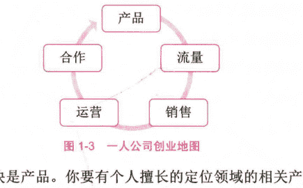
第一个板块是产品。你要有在个人影响力范围内可以变现的定位产品。

产品分虚拟和实体。虚拟产品多源于知识技能，如知识付费、一对一咨询、课程、社群、私教，或定制插画、装修方案、营销策划等。实体产品则可以通过技能创作手工艺品、画作、书籍，或借助工厂定制自有品牌香薰、蜡烛、文创周边等。

除了自创，也可分销。拿平台的分销权，先学习再分享，用自媒体引流销售，实现变现。买手和直播带货也是同款逻辑：从选品中心或1688挑出符合粉丝需求的货，或从使用过的好物里找可靠货源，通过橱窗挂车售卖。我第一笔副业变现就是这样来的。2014 年刚工作时在淘宝买到一款好用的发膜，身边人常问秘诀，我就联系店家拿更低价代发，通过朋友圈推荐实现了第一次变现。

赚钱的底层逻辑是把产品卖出去，但要兼顾个人品牌的复利效应。选与自身经历、专业相关的产品，深耕一个领域累积影响力和竞争力，后续机会自然会来。

第二个板块是流量。自媒体短视频只是其中一种。流量过度依赖单一平台，一旦账号出问题，积累就归零。要根据业务场景组合渠道：实体生意要线上线下结合，比如线下活动引流到微信群；知识付费或电商除了公域运营，也要做独立网站、小程序、私域裂变。鸡蛋不能放在一个篮子里，流量渠道会随市场和科技变化，需要持续学习新方法。

第三个板块是销售。销售不能只有一种打法。线上常见有电话、社群、公开课、私聊、直播、内容种草、邮件营销、广告投放、SEO 等；线下有门店、展会、上门、地推等。有流量没转化，原因多在销售方式单一。掌握多元技巧并不断迭代，是把流量变现的关键。

第四个板块是运营。想做到时间地点自由，就要懂线上运营。它包含内容运营、社群运营、客户运营三大块。内容运营是持续输出业务相关的短视频、图文，分发引流；社群运营是通过公开课、训练营、直播等提升活跃与粘性；客户运营是对私域客户打标签、分层管理，用个性化沟通和活动刺激转化，保持粘性。线下运营在一人公司也很常见，比如见面会、读书会、工作坊，用面对面增强信任并带来老带新。

第五个板块是合作。一人公司的团队不是雇佣制，而是平等共赢的协作。选对伙伴、放大业绩、实现双赢，是解放时间和精力、真正获得自由的核心。可雇兼职、与自由职业者项目制合作，既降成本又提升灵活性。

一人公司虽小，却是一个完整的商业主体。产品、流量、销售、运营、合作每一环都有细节，实操中才能学会，行动力始终是关键。

## 1.4 从个人成长到一人公司

弄懂创业地图后，可能仍会迷茫从何下手。其实每个人的成长经历都是独一无二的资源库。从成长经验中提炼可复制的知识与方法，转化为服务他人的产品，就是普通人低成本切入个人商业的最优路径。如图1-4所示，常见类型为知识产品、技能产品、实体产品和分销产品。

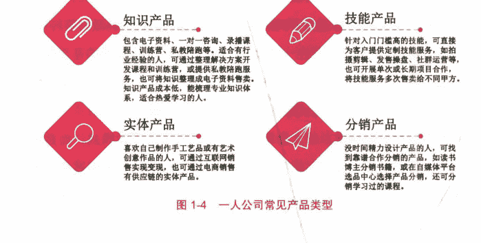
### 1.4.1 如何从成长中探索商业机遇

在个人商业里，成长既是自我提升，也是发现机会的土壤。每一次成长都可能打开一扇门。如何从中挖掘机遇？

**第一，成长就是持续积累财富的过程。** 职业经历、副业尝试、爱好探索，每一步都在沉淀知识、技能和洞察。这些积累会成为未来机会的基石。

我复盘毕业后十几年的经历，创立一人公司之前已做过十几种职业。主业从体制内银行柜员、客户经理，到私企外企的 HR，再到海外品牌营销经理；副业更是杂乱：合伙做校外培训、线上英语培训、副业变现课、人生教练课、个人品牌陪跑；电商方面做过海外代购、跨境电商、微商、独立站，涉及建站、SEO、投流、设计、文案；自媒体方面，“Alina霖子”公众号经营十余年，豆瓣、知乎、小红书、B站、视频号、今日头条等都做过尝试和研究。正是在不断好奇、尝试、总结中，我才得以在打造自由人生教练平台时，品牌、内容、营销、活动策划都能一人快速完成。**人生没有白走的路，只有走过的路。**

**第二，挑战与困难本身是机会。** 顺境让人放松，逆境才考验创业能力。创业就是持续面对问题。面对困境时是消沉还是快速找资源解决，决定了你能否把成长中的痛点变成商机。

比如我的一个客户是孕产瑜伽教练，学员付一万元报了产后训练，上课前一个月又怀孕了。按常理可能只能退费。她找到我后，我们把方案改为孕期瑜伽，学员不仅没退费，还继续付一万元报名。需求消失时，往往是新需求诞生之际。AI 正在取代一些基础工作，但同时也在创造大量新职业路径。把生活和工作中的难题解决掉，就可能为同样的人群提供方案，开创新领域。

**第三，兴趣与激情是重要源泉。** 很多人像我一样好奇心强，容易三分钟热度。过去我们自嘲“三分钟热度”，现在可以称作“多重潜力者”。事物没有绝对好坏，看的是视角。保持好奇，深度投入你真正喜欢的领域，就更容易发现市场缺口并乐在其中投入。

2017 年我从银行离职等待出国的空窗期，一位刚上小学孩子的妈妈告诉我，家乡英语教学资源匮乏，老师发音不准。出于好奇，我调研了市面资源，翻看朋友圈，找到一位同声传译毕业、有教学经验且喜欢孩子的朋友。我们设计了 21 天线上幼儿口语打卡营：建微信群，每天早晨发句子和单词的标准发音讲解，白天妈妈让孩子模仿录音发群里，晚上老师点评送小红花。妈妈和孩子都很开心。虽然项目只赚了几千元且很快结束，却在我心里种下了线上教育培训的种子。

**第四，人脉与社交网络是宝贵资源。** 同事、伙伴、客户都可能成为机会桥梁。他们的需求、反馈、日常交流常常激发灵感。那次英语打卡营的契机就来自一位亲戚同学的妈妈，学员也是她介绍的。

如果你像我一样内向社恐，不擅长主动社交，就可以用自媒体放大自己。持续输出高质量内容和真实故事，能“吸引”来优质的人脉。我的大部分朋友、客户和合作伙伴，都是被内容吸引而来。

成长即价值兑现

成长的底层逻辑是自我认知与价值的实现。随着经验累积，我们会更清晰地识别出自己的擅长与优势，而这恰好是发现新商业机会的钥匙。搞明白自己能交付什么、这些能力如何回应市场需求，就是把成长经验转化为商业回报的核心。路上要警惕的误区是过度聚焦短板，持续放大不足容易打击信心。创业的真正支撑是长板，把优势做强做亮，短板带来的干扰就会大幅下降。

整体来看，成长的每个环节都蕴含机会。专业能力的进阶、兴趣的沉淀、挑战的穿越、人脉的拓展，每一步都可能成为通往新商机的桥梁。关键在于把个人成长轨迹与市场需求对齐，以帮助身边的人为出发点，创造既有个人印记又能满足市场的产品或服务。

成长与商业探索是相互促进的。个人状态的提升决定商业落地的质量，商业的正向反馈又会反哺个人继续成长。这种循环让个人商业不仅是一种选择，更像一种生活方式与自我实现路径。

### 1.4.2 如何将知识技能变成赚钱资源

只要在某个领域把一件事真正做好，就能把经验拆解出来帮助他人。知识变现是普通人最容易上手的可持续收入来源。它不仅是将能力商品化，更是把个人价值转化为市场价值的过程。关键在于学会把专长与认知包装成他人愿意付费的方案。便于理解，我整理了一张知识财富体系图，可对照边学边搭建。如图 1-5 所示。

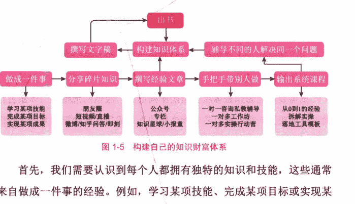

首先要意识到，每个人都自带独一无二的知识与技能，来源都是把一件事做到位的经历。做事时就可以同步把成功片段提炼成碎片知识点，通过朋友圈、短视频、直播或自媒体发布出去，帮助正在做同样事情的人交流心得、共同进步。

当类似成功经验越积越多，就需要把零散点整合成有厚度、有体系的文章。比如开设主题专栏，用系列文章把从零到一的经验讲透，让后来者可以照着学习。

单向输出很难实现落地指导，因为每个人卡住的点都不一样。所以当你的专栏逐渐被关注，就会有人主动来请教个性化问题。这时可以推出深度一对一辅导，或小班制的实操课程，用实时互动手把手带人操作。

辅导足够多的人做成同一件事后，就能把大家反复遇到的难点归纳出来，做成可复用的工具模板。把手把手带人落地的全过程拆解成可复制的步骤，再结合原创模板，就能形成系统化课程体系。此时你已经拥有了这件事的知识体系。但还不够，还要验证这套体系的适用边界，通过测试明确它对哪类用户最有效，从而锁定精准人群。

用这套体系去服务不同的人，让他们按你的方法行动、解决同一个问题，观察谁适合、谁不适合。经过大量测试后，你对知识体系的适用范围会越来越清晰，再针对精准目标用户做优化，最终沉淀为一套面向特定人群、解决特定问题的知识模型。

整个过程中，所有输出都可以沉淀为出书素材。最后形成自己的知识财富体系商业闭环。一旦在一件事上跑通闭环，就完全可以复制到另一个新领域，从零到一再搭一套体系。

仔细调研就会发现，很多一人公司创业者的路径惊人相似。普通人最宝贵的资源是时间和精力，把时间和精力投进个人成长，把学习与成长的经验记录下来、分享出去，慢慢提炼成方法论，通过咨询、辅导、课程等收集反馈，帮助不同的人解决同一个问题，不断迭代知识体系，最终形成既能自用也能交付他人的知识模型，从而把学习成长变成持续收入。

把知识技能变现，不仅是实现个人商业成功的过程，也是实现个人价值、为社会创造贡献的过程。分享出去的知识既能带来经济回报，也能帮助他人，同时反哺自我成长。

### 1.4.3 如何用一人公司实现人生使命

每个创业成功的人，都不只是为了摆脱不喜欢的现状，更是为了追随自己的人生使命。一人公司不只是工作方式，更是实现个人愿景的一种路径。大多数企业按岗位招聘，人很难在既定岗位里完全发挥自我价值。而在一人公司，你拥有极大的自由，可以按热情与理想去探索人生使命，并通过个人商业把它落地。

#### （1）明确你的人生使命

你的人生使命是什么？生命的意义是什么？工作是为了什么？这些问题我们都曾思考过。人们把大量时间放在工作上，一份不喜欢的工作即便收入高，也会让人空虚，产生自我怀疑。

每个人来到世上都有自己的使命。使命就是发挥天赋优势，持续做自己热爱的事，在为他人与社会创造价值的同时获得合理回报，从而安身立命。日本的“Ikigai”概念翻译过来是“存在的意义”。找到“Ikigai”可以帮助我们探索使命。在“喜欢的”“擅长的”“能获酬的”“世界需要的”四个圈的交集，就是我们的使命所在。如图 1-6 所示。

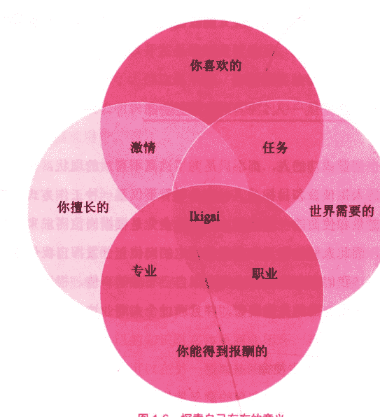

人生使命往往源于核心价值观、热情与追求的目标。**深入挖掘内在价值体系，锁定自己热爱的事与想实现的愿景，这才是一人公司能够长期走下去的核心驱动力。**

一人公司运营中会受到很多外部声音干扰，如果没有稳定的内在驱动，很容易迷失方向。世界在变，不变的是我们的人生使命。找到那个恒定的内核，才是一人公司成功的关键。

找到使命与愿景后，就能把它们转化为具体的商业行为，开发与长期目标一致的产品或服务，用价值观吸引同频客户，并用有效的传播与沟通策略讲好你的故事、价值观与商业。

#### （2）利用你的独特优势

一人公司的魅力在于它能完全体现你的个性和优势，让普通人有机会用热爱的事情赚钱。把个人独特优势与商业结合，不仅能带来事业成功，也能提升工作的意义感。

我们可以用 SWOT 分析来找准并放大独特优势。SWOT 包含优势 Strengths、劣势 Weaknesses、机会 Opportunities、威胁 Threats，最早可追溯到 20 世纪 60 年代，由管理顾问艾伯特·汉弗莱在斯坦福大学的研究项目中提出。通过它，你能更清晰地看清自己在职业赛道上的独特位置与发展方向。如图 1-7 所示。

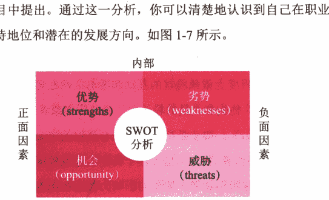

优势 strengths：列出个人或组织内部的正面特质，如强品牌、独特技能、良好人脉等。

劣势 weaknesses：列出内部需要改进的负面特质，如资源不足、技能短板、决策慢等。

机会 opportunities：识别外部环境中的有利条件，如市场增长、技术进步、政策变化等。

威胁 threats：识别外部可能带来的风险，如竞争对手、市场萎缩、法规变化等。

借助这种方法，可以找出值得放大的有利因素、需要规避的不利因素，发现问题、找到对策，并明确一人公司最具竞争力的发展方向。

#### （3）打造自己的个人品牌

很多人把个人品牌、个人 IP、网红、博主混为一谈，其实差别很大。

网红 internet celebrity / influencer：通过互联网平台获得大量关注的人，可能因才艺、外表、生活方式或幽默感走红。影响力高度依赖社交媒体，变现主要靠广告或直播带货，往往没有清晰定位和自有产品。

博主 blogger：在博客或类似平台定期发布内容的内容创作者，常聚焦特定主题，通过文章分享见解。影响力建立在内容质量与持续性上，可通过付费专栏、图文带货等方式变现。

个人品牌 personal brand：指一个人在职业领域内建立的声誉与影响力，是专业技能、价值观、成就和个性特征的总和。更多关联职场发展，强调权威性和信任度。有个人品牌不等于有变现能力，除非升级为个人 IP 并开发产品。

个人 IP intellectual property：指可商业化利用的个人知识产权。打造个人 IP 通常意味着要开发课程、图书、咨询服务、实体商品等，用多种媒介和产品把影响力转化为商业价值。

简单说，个人品牌是你在某个专业领域的声誉与影响力。从商业角度看，建立个人品牌是一人公司创业的必经之路。一个有声誉的人更容易吸引优质资源与首批种子用户，大幅降低获客成本。

打造个人品牌不仅是营销，更是展示专业性、个性和价值。**一个有效的个人品牌通常包含三个要素：独特性、一致性、持续性。**

独特性是指与众不同的特质，涉及个人故事、专业技能、经历和视角。通过自媒体分享个人故事、独特经历和职业轨迹，强调与行业高度相关的技能，展示对行业趋势的独到见解。

一致性是指在不同平台和场景保持信息、言论和形象统一。统一头像、昵称、视觉风格，在社交媒体和公开演讲中保持统一语言风格和语调，确保所有对外表达都反映核心价值观。

持续性是指持续强化和更新品牌形象与价值观。定期发布自媒体内容、参与行业活动、与客户粉丝互动，不断输出价值理念。比如倡导自由人生的一人公司创业者，会持续分享自由生活 Vlog 以及适合个体创业的干货知识。

当你厘清使命愿景并摸清优势特长，再通过个人品牌提升专业领域的影响力，就能在一人公司创业中把它们整合起来。此时你不再感觉在工作，而像在玩自己喜欢的事。沉浸其中后，你会放下对不确定性的焦虑，把注意力放在当下行动与未来愿景上，活出自我。

# 第二章 探索期：找到你的个人商业定位

要打造可持续且享受其中的一人公司，必须先做好个人定位的探索，弄清楚自己的独特价值与擅长赛道。本章聚焦探索期，指导读者通过自我剖析与市场调研，找到市场定位与目标客户。本章提供一系列方法与工具，帮助读者清晰定义产品或服务，为后续发展奠定基础。

## 2.1 用热爱擅长的事创造一份终身事业

### 2.1.1 理解工作和事业的区别

在个人商业的世界里，先回到本质问题：我们为什么要工作？是为了谋生，还是为了更深层的职业满足与生活丰富？工作和事业是同一回事吗？

我做品牌营销时，业余为很多人提供一对一教练咨询，后来这份咨询变成了能持续带来收入的事业，但它不是工作，因为做不做、做多少的选择权完全在我。相比品牌营销，教练咨询更像我发自内心愿意长期甚至终身投入的事业。

在一人公司语境下，区分工作与事业尤为重要，它直接影响业务构建方式。

#### （1）定义上的区别
工作 job 通常被看作一种职业活动，以获取收入、维持生活为目的，可能只是暂时的或达成其他目标的手段。

事业 career 强调长期发展，不仅是谋生的工具，更是个人成长、实现自我价值、追寻梦想愿景的过程。

一个人通常只有一份全职工作维持生计，但可以在工作之外拥有多项事业来实现自我价值，这也是副业兴起的原因。

#### （2）态度和视角的区别
面对工作，人们更关注短期目标，如薪资、工作条件。面对事业，个人更倾向考虑长期发展，包括技能提升、职业满足感和个人成就。

工作可能只是经济活动，事业是一种生活方式，是追寻价值体现与梦想的旅程。当工作变成事业，它不再只是完成任务和赚钱，而是实现自我价值和个人成长的方式。比如业余公益志愿者不挣钱，但对很多人来说也是一种事业。

#### （3）发展路径的不同
工作可能没有明确发展路径，偏静态重复。事业意味着持续学习与成长，追求更高成就与专业发展。也许你正做着一份不喜欢的工作，而一人公司创业的目的就是用热爱的事为自己创造事业。

工作与事业虽有区别，但并非二元对立。上班族通常把工作当成赚钱工具，很难把它当成可自主发挥热爱与特长的事业，因为内容与发展不由自己掌控。创业者则更倾向把工作视为事业，因为公司发展很大程度上由自己决定。

作为一人公司创业者，你既是执行者也是决策者。当工作体现信念与热情时，你提供的产品或服务自然质量更高，你更在意长期目标而非短期利益。因此日常工作是服务于长久事业发展的手段。

当工作转变为事业，会带来更深层次的个人满足感。对一人公司而言，这种满足感是重要动力。它来自做自己真正热爱的事、发挥潜能、看到努力对他人产生积极影响。这种满足能在面对挑战时提供心理支持与动力。

虽然对打工人来说赚钱是工作主要目的，很难把被安排的任务当成实现自我价值的事业，但职场人依然可以打造个人品牌或在业余创立一人公司，从当下工作整合资源优势，开发工作之外的产品，创造更有热情的事业。

### 2.1.2 工作与生活的平衡是一个伪命题

在传统职场，工作和生活常被视为两个独立领域。工作在办公室完成，生活是工作之外的私人时间。这种划分催生了“工作生活平衡”的概念，即在两者间找平衡点。

无论是职场人还是创业者，似乎都在寻找平衡。但当你把工作视为事业，把事业视为生活方式的一部分，工作就不再是生活的对立面，而是自然融入日常，平衡也就不再是难题。

在个人商业尤其是一人公司中，工作与生活的边界往往模糊。因为很多人选择的工作领域与个人兴趣、价值观、生活方式紧密相连。这意味着工作不只是赚钱手段，更是表达自我、实现价值和生活方式的一部分。当工作基于热情与兴趣时，它会自然融入日常生活。

比如热爱写作的自由撰稿人可能在咖啡馆、家中或旅途中写作。对他而言，写作既是工作也是生活。灵感来自日常点滴，如深夜谈话或公园漫步。这种情况下，强行区分工作与生活既不现实也不必要。

再如热爱环保的人可能创办一个宣传可持续发展的二手购物网站。对他来说，这既是工作也是生活方式的体现。工作与生活理念一致，工作本身就是对生活方式的实践。

在一人公司背景下，重塑工作与生活关系变得关键。工作和生活不再互相竞争，而是相互渗透、相互支持。创业者可以根据生活节奏灵活安排工作，使工作成为生活的一部分。比如一位父亲可在孩子上学时工作，放学后陪伴家庭；热爱旅行的创业者可把工作安排在旅途中，把旅途经历转化为工作素材。

尽管融合带来前所未有的自由，也带来新挑战。边界模糊可能让人难以脱离工作状态，影响休息。因此创业者需要更强的自我管理与时间管理能力，培养健康工作习惯，如定时休息、定期运动，保障身心健康。

经营一人公司意味着重新定义工作与生活的关系，让工作支撑生活理念，让生活丰富工作内容。这种和谐统一是个人商业成功与个人幸福的关键。**当你每天做的事情都发自内心热爱，你不会觉得在辛苦工作，而是在享受自己创造的生活方式。**

### 2.1.3 人人都可以为自己创造一份事业

在个人商业蓬勃的时代，不论背景、资历、起点，只要你有一技之长，都可以用技能为自己创造一份事业。

#### （1）打破传统职业观念的束缚
传统职业发展常被看作预设轨迹：接受教育、找一份稳定工作、在公司体系内逐步晋升。然而这种模式并不适合所有人。很多人按传统路径走到半路，人到中年才发现自己从未想过喜欢做什么，被裁员时才发现多年晋升并未提升核心竞争力，重返求职市场才发现自己没有一技之长。

这类情况并不少见。过去两年里，我接触的不少裸辞或被裁员的学员，故事都像一本样板书：当年随大流读了个热门专业，毕业后才发现完全不喜欢，硬着头皮转行，也始终对工作提不起劲。

一人公司恰好为这群人提供了一种新解法：与其苦等一份有热情的工作，不如自己围绕兴趣、特长和价值观去创造一份事业。比如一个对艺术痴迷的人，体制内岗位往往扼杀创作欲，他可以选择做自由艺术家，通过卖作品或提供创意服务来谋生，既能沉浸在热爱里，也能让更多人接触到他的艺术。

在互联网上，这类新职业已经冒出不少：心理倾听师、艺术疗愈教练、财富关系咨询师、脱单社交导师……它们并非天上掉下来的职位，而是不同的人基于自身兴趣，把个人品牌做起来后给新职业起的名字。打破传统职业的框框，每个人在这个时代都能为自己量身定制一份新工作，实现助人自助。

#### （2）一人公司的多元与包容性
传统创业往往要靠资金和成熟商业模式，而一人公司的优势就在于门槛低、容纳面广。无论你的兴趣点在哪里、技能属于哪个领域，总能找到一条把爱好和能力变现的路径。这种多样性既体现在商业形态上，也体现在创业者本身的背景经历上。

拿社交媒体来说，很多人靠分享生活方式、旅行见闻或专业心得，慢慢积累粉丝，进而发展成带货达人或专业顾问。他们之所以能成，往往是因为敢于分享独特经历，并在某个细分领域里有真正的理解。

只要你愿意学习、乐于分享，并在某个方向有一技之长，就能把技能包装成可帮到别人的服务。当服务真正解决了问题，付费就自然发生，一份新职业、一条一人公司业务也就此开启。

#### （3）一人公司常见的创业方向
当下技术已经大幅降低了创业成本，互联网、社群和AI工具让普通人也能快速触达市场。我归纳了七类普通人容易上手的一人公司形态，仅供参考。

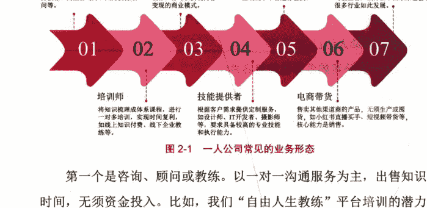
第一类是咨询、顾问或教练，以一对一沟通为主，卖的是知识和时间，几乎不需要启动资金。比如“自由人生教练”平台培养的优势教练，像我一样的独立商业咨询师、人资顾问、独立瑜伽教练、营养顾问等。只要有专业积累，就可以用个人的经验和技能起步，哪怕在职也能用业余时间为新人或晚入行者提供指导。

第二类是培训师。不同于卖时间，培训师把个人经验整理成体系课程，通过一对多实现复利。可以像我一样把某个领域的know-how做成可多次售卖的课程，线上知识付费只是其一，线下企业教练、企业内训、家庭教师、课外辅导也都属于这一类。

第三类是内容创作者。这几年数字游民里最典型就是博主。内容为何能赚钱？过去十年企业广告从电视杂志转向新媒体，每个品牌都需要有粉丝基础的创作者用短视频或图文做推广。博主只是其中一种形态，作家、专栏写手、播客主都在通过内容变现。现在知识星球、小报童等订阅模式，以及公众号、视频号、小宇宙等平台的付费订阅，都让擅长写作、设计、演讲的人有了持续收入的可能。

第四类是技能提供者。他们不是卖知识课程，而是按客户需求提供定制化服务。设计师、IT开发者、编辑、翻译、摄影师、剪辑师、婚礼策划师、定制旅行师都是典型。专业度与执行力是关键。我的一位朋友在新西兰把摄影当副业，周末用一台相机给人拍生活写真，两小时拍摄精修十张收费上百美元。靠着热爱和口碑积累，她愈发自信，后来辞职赴欧洲深造摄影，依然能边读书边靠技能赚钱。

# 一人公司
用个人品牌换取自由人生

第五类是品牌主理人，本质上是自营店主或手艺人，卖实体产品。比如在淘宝开店的原创设计品牌主理人，或线下工作室的手作人。他们自己设计、制作，再通过线上线下渠道售卖，和传统开店逻辑相近，也是一条常见路径。

第六类是电商带货。卖的不是自有产品，而是借助渠道商或品牌的货源，无需生产也不囤货，只赚差价。小红书直播买手、短视频带货、知乎图文带货，都是选品后挂链销售。微商、跨境电商同理，核心能力是销售本身。

第七类是独立经纪人。在新西兰，贷款、保险、房产、移民等职业需持证并受监管，因而诞生大量一人公司从业者。中国行业规范化后，这类模式会增多。而个人IP兴起后，IP助理、操盘手等角色也相当于独立经纪人。

以上都是低成本可变现的常见方向，未来还会衍生更多。我们会发现，这个时代很多赚钱的职业都是被创造出来的。创业不再是遥不可及的词，它可以被理解为“给自己创造一份事业”，不必招人、不必租铺、不必重投入，通过互联网把热情、兴趣和才能变成可定制的事业，从而实现自我价值和更自由的生活。

每个人都值得去探索并做自己热爱的事，哪怕它很平凡或超出传统框架。把热爱和擅长变成事业，既能带来职业上的成就，也能带来生活的满足。在一人公司的世界里，每个人都有机会成为自己生活的艺术家，做出独一无二的事业。

## 2.2 快速启动个人商业的机会

### 2.2.1 从身边可触达的人群开始
如何最快开启个人商业、建立一人公司？

商业的本质是利他。对普通人来说，最快的路径是从身边调研起，找到亲友有什么痛点，哪些是可以靠你擅长和热爱的事去解决。

很多学员在做个人品牌前，压根不清楚微信好友到底做什么，甚至很多好友从未聊过天。这其实是巨大的人脉浪费。如果你认真去了解，会发现商机无处不在。几个可用的调研角度：

#### （1）按职业画像调研
不同职业有不同挑战。

- 企业员工。可能卡在晋升、效率、团队协作上。如果你擅长职业规划、面试辅导或团队建设，就是潜在服务机会。
- 自由职业者。常缺客户资源、时间管理或技能提升。相关资源或知识就能成为你的供给。
- 家庭主妇。可能对家庭教育、健康饮食、亲子育儿感兴趣，在线课程或咨询就能满足需求。

#### （2）家庭背景分析
家庭是基本单元，需求集中。

- 有小孩的家庭。对儿童教育、亲子活动、出国留学有需求，你若有资源就能开发产品。
- 独居老人。需要健康管理、日常陪伴或生活照料，提供此类服务能改善生活质量。

#### （3）兴趣爱好挖掘
人愿意为爱好花钱。

- 运动爱好者。关注装备、健身课、户外活动。
- 美食爱好者。喜欢烹饪课、美食分享、特色食材相关活动。

#### （4）社区经济里的机会
社区是一个微型市场。

- 社区服务。家政、维修、美容等需求稳定。
- 社区教育。孩子的兴趣班、成人的瑜伽健身课，都是刚需。

#### （5）专业技能的迁移
把你的硬技能转化为服务。

- IT技术。能为不擅长的人提供培训或咨询。
- 艺术创作。绘画、音乐、写作可开课或提供个性化创作。

#### （6）跨界合作的可能
- 与本地商家结合。和咖啡店、书店合作办主题活动或联合服务。
- 线上线下结合。用线上扩大影响，用线下提供实体体验，增强粘性。

总之，快速变现的关键是发现并满足身边人的真实需求。通过职业、家庭、兴趣、社区等维度观察，保持敏感度，把你的擅长和热爱变成可交付的产品或服务，就能实现个人成长和帮助他人。

### 2.2.2 用需求层次找到突破口
除了从身边人出发，还可以用马斯洛需求层次理论来找机会。

该理论把人类需求分为五个层级，金字塔式排列，低层满足后才激发高层。每层都对应商业机会。

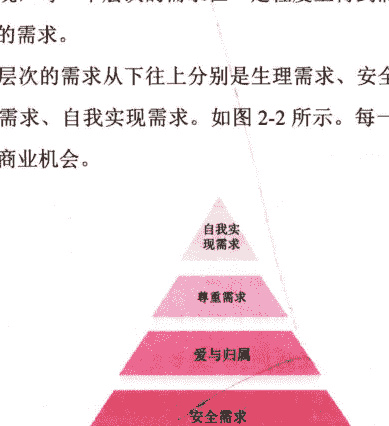
图 2-2 马斯洛需求层次

#### （1）生理需求
食物、水、空气、睡眠、衣物、住所等生存基础。这是覆盖最广的赛道。比如压力大的时代，催生了疗愈音乐、眼罩、助眠枕、安神香薰等产品。

#### （2）安全需求
身体健康、财产安全、就业保障、防灾等。保险经纪人、金融咨询师、健康管理师满足财产与健康安全；职业规划师、商业教练满足就业与收入安全。

#### （3）爱与归属需求
友情、爱情、家庭、社交联结。线下游学、读书会、付费社群的兴起，正是满足人们对归属感的渴望。

#### （4）尊重需求
自我价值感、成就感、荣誉感、社会认可。短视频时代创始人打造个人IP，通过品牌建设和内容服务提升影响力，就是在满足尊重需求。

#### （5）自我实现需求
发挥潜能、实现理想、创造力与个人成就。身心疗愈、人生教练、职业指导等服务，帮助人们探索自我、挖掘优势。

几乎所有商业机会都落在需求金字塔里。若想创业或深挖痛点，都可以用这个框架去思考：在你的方向里，能满足哪一层、哪种具体需求，从而找到定位。

### 2.2.3 用最小可行性产品验证市场
找到机会后，要快速验证想法是否被市场认可，这就需要最小可行性产品MVP。用最小资源做出可用版本，收集反馈、降低风险。

MVP是在不牺牲核心功能前提下，最快最低成本做出能交付的产品。目的是尽早拿到用户反馈再迭代。对一人公司而言，这能省资源、避大坑。

> 很多创业失败是因为想太多、做太少。

精力有限，思考拖久了行动就没了。创业需要尝试和犯错，MVP就是最小成本试错。做到“快、准、狠”：

- 快。一旦有想法立刻动手，先做出可售卖的最小版本，别纠结先做A还是B。
- 准。开发时心里要有目标客户，最好列出身边可能购买的人名单，产品出来就定向推送，省时高效。
- 狠。如果投放后努力营销仍无人买，判断方向错就果断放弃；如果购买后反馈需改进，就立刻迭代，别因批评内耗。

一人公司适合的MVP类型：

#### （1）教练咨询
一对一沟通是最推荐的起步MVP，既验证需求，又建立信任。只需一张海报，说明你是谁、帮谁解决什么问题、价格和联系方式。朋友圈、私信、橱窗或“超级主页”等小程序都能快速传播和下单。

#### （2）在线课程
如果对用户需求和知识体系已清晰，可做在线课。探索期建议直播，增强互动与信任；不自信时可先做录播，实现时间复利。

#### （3）电子书或指南
时间有限时，最简单的是写一份专业领域的电子书或实用指南。小红书上卖Notion笔记模板、电子手账的人很多，先积累客户再做课程。

#### （4）定制产品
手工艺或设计能力可做定制珠宝、家居装饰等实体品。也可提供虚拟定制，如海报、表情包、网页设计。

#### （5）内容订阅
能持续输出干货，可做付费订阅，如市场分析、赚钱技巧、AI工具盘点。知识星球、小报童都是常用载体。原创困难时可做内容策展，把优质博主内容分类整理后收费订阅。

#### （6）会员社群
围绕特定主题或兴趣建社群，提供仅限会员的活动来创造价值。

通过MVP低风险测试市场、跑通闭环，能最快找到优势和短板，后续再迭代优化。记住，MVP是动态过程，关键是快迭代、快学习。

## 2.3 个人创业者必备的教练技术

### 2.3.1 为何要掌握教练技术

服务过上百位打造个人品牌的独立创业者后，我发现他们在商业上受阻，很少是因为缺方法、缺技巧，更多是内在的拉扯与迷茫。对自我不够清楚，导致定位反复摇摆，即便开始执行也容易陷入自我怀疑和内耗。基于这个观察，我把教练方法引入商业陪伴，用教练式对话帮助创业者做深度的自我探索，也让他们学会用教练技术去激活自己与他人的潜能。

#### （1）教练的本质是什么
教练技术本质上是一种强化沟通、促进个人成长的方法。它最初诞生于体育训练场景，后来扩展到商业、教育、心理咨询等众多领域。核心逻辑是通过有深度的提问，引导对方自己去探索，从而找到答案、释放潜能、提升绩效。

国际教练联合会 ICF 对教练的定义是：与客户协作，在引发思考与创造的过程中，激发他们最大程度地发挥个人与职业潜能。好的教练过程往往会唤醒过去未被使用的想象力、行动力与领导力。

ICF 的定义里有三个关键要点。

第一，是与客户合作。教练不是导师对学生的传授，也不是居高临下的指导，而是平等的伙伴关系。因此教练不一定要在专业上强于客户，这与职业指导和人生导师有本质区别。

第二，发生在引发思考与创造的过程中。教练的工作是通过对话持续提问，促成客户的深度思考与创造性思维。对话的核心是倾听与发问。客户借此把教练当作一面镜子，照见自身的行为模式，跳出限制性思维，换个角度看问题。教练与心理咨询的区别在于，心理咨询更偏向回顾过去、探究根源；教练则面向当下与未来，以客户当前或未来想达成的目标为起点展开探索。

第三，是激励客户最大化个人与职业潜能。教练相信每个人都是“本自具足”①的，每个人都是自己人生的专家。所以教练不直接给答案，而是通过专业对话启发客户找到属于自己的解法。如下表所示，这与导师、咨询师、疗愈师的差异很明显。

表 2-1 教练与导师、咨询师、疗愈师的差异

| 对话要素 | 导师 | 咨询师 | 疗愈师 | 教练 |
| :--- | :--- | :--- | :--- | :--- |
| 想法倾向 | 我的经验是…… 我知道该怎么解决…… | 我是专家，你付费，我来解答 | 我会帮你疗愈过往 | 我该如何协助你学习；我们想抵达的目标是什么 |
| 表达方式 | 我的做法是…… | 这是方法…… 你应该这么做…… | 讲讲你的过去…… 你经历了什么…… | 你尝试了哪些努力，结果如何…… 还有哪些可能性或选择…… |
| 行动导向 | 指导与建议 | 提供方向、方法、技巧与信息 | 精神分析、深度反省、接纳 | 探索、尝试新的工作与思维方式，实现个人与职业成长 |

① “本自具足”源自佛教，六祖慧能有言“何期自性，本自具足”。意指每个人的自性本就圆满完整，不必在外求。

从表中可见，虽然都是对话服务，但过程完全不同。导师习惯基于自身经验分享做法，直接给建议。咨询师基于专业积累输出行业经验与知识，靠信息差提供方案。疗愈师或心理咨询师则聚焦来访者的痛苦经历，探究过去如何影响现在，进行深层反省与接纳。

教练与心理咨询有相似也有区别。教练也会触及过往，但不使用疗法去深挖，而是更关注当下的状态与未来的目标。**教练的本质是助力客户去探索、实践、学习新的工作与思维方式，从而实现个人与职业的成长。**在我看来，教练更像一个让强者更强的角色。在国内，企业里常用来提升管理者与员工的生产力与领导力，进而提升企业效益。

作为从业者，需要清晰边界。如果客户要的是指导、建议、方法，更适合导师或咨询师。如果客户带着大量心理创伤与情绪困扰，且没有明确目标，更适合疗愈师或心理咨询师。教练并非万能，纯粹的教练技术难以覆盖所有需求。对创业教练而言，需要把教练技术与自身的成长修炼和专业技能融合起来才能发挥最大价值。

#### （2）创业者如何运用教练技术
比尔·盖茨曾说过，每个人都需要一位教练。一人公司的创业者同样需要教练。若聘请专业教练成本过高，也可以自学教练技术进行自我教练。

我们需要外部反馈来成长。教练对话不仅能助成长，还能帮助厘清内在驱动力、做企业内训、提升能力、解决问题、激发潜能，达成成功。

很多人以为教练就是问问题，其实远不止。日常沟通里，人们习惯单向表达观点与情绪，想被理解或说服别人，关注点都在自己。教练式沟通则要放下自己的意图，先顾对方感受，认真倾听，通过有效提问、深度交流与真诚回应，让对方感到被接纳。这样能显著提升一人公司创业者倾听与挖掘客户需求的能力，建立信任关系。

普通沟通只盯着自己的想法，观点不同就容易出现批判、争论、冲突。教练式沟通则完全基于信任与好奇，去了解对方，而不是要求对方按自己的标准行事。教练会以对方舒服的方式沟通，去触达真正的意图而非表面行为、语言或情绪。所以核心要点是放下评判。对创业者尤其重要，创业路上困难很多，若总在评判他人与自己，心力会被快速消耗。学习教练技术能提升自我觉察，保持客观冷静。

在日常交流里，人们常隐藏真实想法，怕麻烦或怕冲突，会违心奉承、压抑不适感。教练沟通则需要带着好奇持续发问，直接给予观察反馈，不断核对，以客观中立的态度回应，而不是猜测对方意思、把感受闷在心里。

创业者需要稳定而强大的心力。常纠结内耗、自我怀疑的人很难产出结果，而创业需要自信去突破与展示。学习教练技术是一个从深度自我觉察、改变潜意识、突破限制性信念与固有思维模式的过程。长期练习后，能清空执念，放下对他人的评判，保持开放去洞察理解他人，也能接纳自己、放下自我评判，建立真实自信，减少情绪内耗。心力提升后，才能成为真正能帮助他人的创业者。

简言之，对个人创业者而言，掌握教练技术有两个价值：向内，提升心力与自信，保持情绪稳定；向外，激发客户潜能，提升沟通服务，促进客户成长。

### 2.3.2 教练对话的 GROW 模型
如图 2-3 所示，GROW 模型是教练与个人发展领域广泛使用的结构化工具。它用一系列有框架的问题，引导被辅导者探索目标、现状、选项与行动承诺。特别适合一人公司创业者明确方向并找到路径。

GROW 由英国商业教练 John Whitmore 于 20 世纪 90 年代提出，源于运动心理学与商业教练实践。它用简洁有效的问题帮助人们明确目标、评估现状、探索行动方案并做出承诺。因其清晰高效，已广泛用于领导力发展、员工辅导与职业规划。

模型受欢迎的原因是它为问题解决提供了清晰结构。在变化快的商业环境中，GROW 提供了一种动态参与的思考框架，帮助管理者与创业者更好适应变化、提升决策质量。GROW 是四个词的缩写：目标 Goals、现状 Reality、选择 Options、意愿行动 Will。

- 目标：厘清短期与长期目标。目标应具体、可衡量、可实现、相关、有时限。
- 现状：弄清当前处境。包括面临的挑战、已有的资源、已采取的行动。
- 选择：发散所有可能的方案与解决路径，充分使用创造性与开放思维头脑风暴。
- 行动计划：制定具体执行方案。明确下一步做什么、何时启动、如何追踪进展。

GROW 的作用是帮助个人或团队清晰定义目标，理解实现目标的现实障碍与可选路径，最后形成具体行动计划。这个过程既是自我发现之旅，也是解决问题之旅。借助 GROW，可以梳理商业目标下的现有资源与挑战，探索解决方案，确定下一步行动。

### 2.3.3 教练对话的六步流程
依据 GROW 模型，教练对话可拆解为六个步骤，方便日常工作与生活应用，帮助创业者更好倾听客户需求、明确自身目标、提升决策质量。对做知识变现的个人创业者如咨询师、独立讲师而言，掌握这套流程有助于建立深度信任、提升沟通效率并激发客户行动力。也可用于访谈调研，深度了解潜在客户与市场需求。若从未提供过一对一专业咨询，可参考以下流程。

#### 第一步：开场破冰，建立信任
对话前需营造开放、无评判、平等的氛围，让客户感到舒适、愿意分享真实想法。

提问示例：
- 先聊几句，你现在主要在哪个城市？是通过什么渠道认识我的？
- 很高兴能和你连线，最近让你最在意的问题是什么？

#### 第二步：聚焦议题，达成共识
客户提出的问题往往模糊或复杂，一次对话通常聚焦一个议题，因此需要澄清本次沟通的核心问题，以便结束时判断是否达成预期。

提问示例：
- 今天你想探索的主题或希望达成的结果是什么？
- 这个结果对你意味着什么？
- 我们今天想聚焦哪个具体议题？
- 针对这个问题，你最想突破的是哪一点？
- 目标达成后，你的状况会有什么变化？
- 你如何判断自己是否已经达成目标？
- 你内心真正渴望的是什么？
- 你提到的××具体指什么？
- 这个目标你能掌控或影响的程度有多大？
- 在实现过程中，哪些节点可以作为里程碑？
- 你希望在什么时候完成这个目标？
- 这次对话你希望得到什么样的结果？

#### 第三步：了解背景，确认目标
教练带着好奇心，用中立开放的问题探查客户当下状况，了解需求、挑战、期望与担忧。这一步要警惕自己的预设。未受专业训练的人容易带入自身假设，难以空杯倾听，导致效果打折。

提问示例：
- 你目前遇到的主要困难是什么？
- 能否详细描述一下这个状况？
- 相比目标，你现在处于哪个位置？
- 为了接近目标，你已经做了什么？
- 你本来想做却没做到的事是什么？
- 你的身边人如何看待这件事？
- 此刻你对这件事有什么感受？
- 关于××这一点，能否展开多说一些？
- 这个问题如何影响你与你的业务？

#### 第四步：激发觉察，探索方案
经过开放式提问后，客户在描述中常会产生新的发现，这些发现很关键，会让其意识到深层需求与动机，并打开新的视角。

提问示例：
- 讲到这里，你有什么新的感受或领悟？
- 你认为造成这个问题的主要因素有哪些？
- 在这个问题里，你看到了自己的哪些优势或短板？
- 要解决这个问题，你能想到哪些办法？
- 你觉得还有哪些可能性？
- 有哪些资源可以支持你？
- 以往遇到类似情况，你是怎么处理的？
- 如果金钱与时间都不是限制，你会怎么做？
- 目标实现后，会有什么不同？

#### 第五步：确认承诺，落定行动
激发觉察后，还需确认客户是否有行动意愿，而非只停留在知道。需要与客户确认具体计划。若你是咨询师，可在确认强烈意愿后再补充建议。

提问示例：
- 接下来的转变你想从哪里开始？
- 你打算如何执行这个计划？
- 为了确保执行，需要拆解哪些具体步骤？
- 未来可能遇到什么挑战？你准备怎么应对？
- 用 1 到 10 分来评量，你对这个行动的承诺是几分？
- 什么原因让你没打到 10 分？
- 你可以做些什么把分数拉高？
- 为了向前迈进一步，你现在能做的最小行动是什么？
- 你准备什么时候开始做这个小行动？

#### 第六步：提升能量，回顾收尾
当客户已有强烈意愿与清晰计划时，教练还要助其提升能量状态，激发内驱力，同时为这次对话做总结。

提问示例：
- 到现在为止，你对这场对话有什么感受？
- 你能总结一下今天的收获吗？
- 行动过程中，你希望我还能在哪方面支持你？
- 如果目标达成，你会如何奖励自己？
- 今天的对话，你希望以什么方式收尾？

掌握以上六步，不仅能改善与客户的沟通，也能与合作伙伴共探目标与行动。每位一人公司创业者都可结合自身专业领域，用这六步设计自己的产品。

## 2.4 聚焦细分定位，提升竞争力

### 2.4.1 不同导向的定位方法
创业初期，找到合适的细分定位是常见难题。通常会卡在三个点：不清楚自己擅长与喜欢什么，缺乏自我探索；不会突出个人优势与特点，不懂自我营销；不确定哪个方向有市场价值，商业敏感度不足。

针对这三类困境，可采用不同定位导向方法。虽然涉及内容相近，但思考与执行顺序不同，适用于不同商业情境。

#### ● 第一种：个人定位——资源能力导向的定位
在创业或打造个人品牌初期，若对目标客户尚不清晰、对市场不够敏感，最直接的方式是从自身资源能力出发。方法强调从个人强项、专业知识、技能与资源出发确定业务方向与市场定位。特别适合拥有独特技能或知识的个体，在起步阶段把知识技能转化为核心竞争力。如图 2-4 所示，热爱、擅长、社会价值、能变现四个圈层的交集处，就是个人定位的甜蜜点。

精准定位可遵循以下步骤。

##### （1）深度盘点自身资源与能力
从自身出发，需要先做自我剖析。审视技能、知识、资源、经验、天赋、热爱、人脉等，评估哪些是优势、哪些是短板。找到独特的知识技能与经验天赋后思考如何用其帮助他人解决问题。可先列出热爱且擅长的事、天赋与专业方向，再筛选出能帮助他人、具有传授价值的部分，从而形成社会与商业价值。

##### （2）匹配市场需求与机会
仅凭自身资源不足以定位，还需匹配市场与用户需求。不能闭门造车，需要做用户调研或访谈，深入了解目标用户的真实痛点是否与自身设想契合，自己能否用现有知识技能满足需求。找到个人资源能力与用户需求的交集点，才是定位的关键。例如，一位擅长计划与时间管理的全职妈妈，初步定位是为全职妈妈做时间管理，但这是否是她们真正的痛点？需要通过问卷或访谈验证全职妈妈在时间管理上的具体困扰，再分析如何用自身经验解决。

##### （3）打造差异化价值产品
与不同用户沟通后，可能发现全职妈妈最大的痛点并非家庭生活的时间管理，而是育儿教育与自我成长上的时间分配。于是可以设计一套“妈妈与孩子共成长的时间管理课程”，这与市面上通用的时间管理培训形成差异化，也更具竞争力。只为特定人群解决特定问题，并依托自身独特经验，就形成了独特性。基于自身优势、市场需求与资源能力的匹配，可构建差异化产品或服务。

##### （4）持续优化与升级
创业是动态过程，定位并非一成不变。需要随市场环境与个人发展不断调整优化。关注行业动态，持续提升能力与知识储备，以满足变化中的市场需求。

资源能力导向的定位是一种有效方法。它要求我们审视自身优势、挖掘核心竞争力，并为客户提供独特价值，帮助在激烈竞争中找到位置，实现个人与事业发展。

#### ● 第二种：产品定位——竞争优势导向的定位
产品定位强调从竞争优势出发寻找独特卖点 USP，以区别于竞争对手，吸引特定客户群。如图 2-5 所示，先做宏观行业分析，再在行业内找竞争对手做竞品分析，通过对比找到差异化卖点后设计产品方案。

竞争优势导向的核心是关注市场竞争态势，不要贸然定定位，先研究竞争对手的产品、服务与营销策略。通过此法可发现自身能提供而对手未涉及的独特价值，进而构建以差异化优势为中心的策略。产品定位可遵循以下步骤。

##### （1）研究行业趋势

赛道是否向上，是创业第一道筛子。把精力押在增长型行业，比在衰退期赛道里内卷要现实得多。近几年城市住房需求趋于饱和，房产整体走弱，一个只做居民住宅的普通室内设计师会明显感到单子越来越难接。反观疗愈赛道呈现爆发态势，疗愈空间不断涌现，若把定位锁定在疗愈空间的室内设计，顺着行业风口做产品就能分享时代红利。

##### （2）拆解对手的产品与打法
选定赛道后，要系统研究同行在做什么、怎么做以及如何获客。包括产品特性、服务水准、价格体系、渠道触达等。商业世界里并无完全新鲜的事，很多灵光一现的想法往往已经被实践过。通过复盘竞品的成功点与短板，能更快明确自己的切入点，形成差异化。普通人创业最稳妥的路径是先模仿再超越，前期不妨购买竞品做用户视角的深度测评。

##### （3）提炼自己的不可替代价值
在熟悉对手的基础上，重点发掘自身的独特优势。优势可能来自技术创新、品质把控、服务风格或品牌理念等。将这些优势嵌入品牌主张与市场策略，才能实现差异化竞争。

##### （4）输出专属解决方案
厘清差异点后，就能据此设计产品与服务，给客户提供竞品不具备的个性化方案，从而快速建立辨识度。

归纳来看，以竞争优势为导向的定位是以产品为锚，要求创业者读懂客户需求、锁定潜在对手、找到自身卖点。这样的策略有助于在激烈竞争中塑造独特品牌形象，吸引目标客群，实现长期经营。

#### ● 第三种：客户定位——需求导向的定位
前面谈到如何发现身边的潜在客户并抓住机会。创业本质就是把产品卖出去。身边已有特定客户且存在未被满足的需求时，提供匹配的产品或服务成交会更顺畅。客户定位就是依据客户需求与偏好来决定业务方向，属于典型的以客户为中心模式。核心是深入理解目标人群，提供符合其期待的方案。此方法适合已有明确客户群体的情况。操作路径大致如下。

##### （1）调研目标人群的真实需求
需求导向定位的根基是把客户放在第一位。如图 2-4 所示，通过访谈、问卷等方式掌握目标人群的基础属性如年龄性别地域、社交属性如职业身份收入、行为属性如购物消费偏好，以及心理属性如价值观兴趣爱好。只有吃透这些信息，才能做出真正贴合真实需求的产品。

##### （2）按需定制产品或服务
了解需求后，可围绕场景化痛点做产品定制。场景越具体，打动力越强。
例如，目标客户是30到45岁在一线城市工作的单身职业女性，年收入20万到50万元，关注自我成长与身心疗愈。她们的典型场景是下班后独处会感到孤独疲惫，工作之外有大量自我时间却不知如何使用。可以为这类女性设计成长与疗愈相关的工作坊，帮助减压缓解孤独，或打造独立女性业余学习交流圈。
描述客户场景越细，定制方案越容易被接受。但场景痛点的把握需要深度共情，有时帮助他人的其实是过去的自己，亲身经历过的困境更能读懂客户真正想要什么。

##### （3）锁定渠道持续精准获客
需求导向定位强调对特定客户做个性化供给，客群往往偏小众，获客渠道的精准度就尤为关键。产品上线后要找到触达目标用户的最高效路径，同时持续收集使用反馈，发现问题并优化服务，提升满意度。对小众客群而言，转介绍常是最强传播方式。

以上三种定位并非割裂使用，而是需要组合。定位时要兼顾客户需求、竞争态势及自身资源能力，不同创业阶段可侧重不同的逻辑。

### 2.4.2 不同创业阶段的定位逻辑
一人公司在不同阶段面临的挑战不同，定位思路也应随之演进。从起步到成长期再到扩张期，目标、资源、环境与竞争状况都在变，策略需匹配变化。

#### （1）初创期的定位逻辑
对普通人而言，一人公司起步期的定位可先从个人定位开始，如图 2-7 所示，先进行自我探索，厘清天赋热爱、擅长技能、愿景使命价值观、理想生活方式与人生憧憬。清楚自己才能守住初心，避免在困难中因自我怀疑而耗尽心力最终放弃。

# 一人公司
用个人品牌实现自由人生
从大公司高管出来做知识技能创业的人，往往要经历较大心态调整。在企业里借助平台背书获得头衔与权力，自尊感强，且执行可交给下属，容易形成重思考轻行动的习惯。一人公司创业后没有团队，前期事事亲力亲为，对执行力是极大考验。脱离平台一切从零开始，若排斥营销不愿亲自做销售，很难成功。身份转变还会带来对他人评价的焦虑与心理压力。因此个人定位探索的关键是确认创业初心，找到长期内驱力与使命感，才能在起伏中坚持。

确定个人定位后，可依托知识经验与资源优势锁定行业与产品方向，再借助产品定位中的竞品调研快速向对手学习取长补短，最后提炼自身独特经验打造差异化产品。相比从零创造，最快的办法是向已验证成功的案例学习模仿。

形成初步产品想法后，进入用户定位阶段，可从触达范围内的人出发寻找第一批种子用户。每个人私域里都已有潜在种子用户，不必舍近求远去公域拉新。成交建立在信任之上，私域用户信任基础更牢，更易完成最小可行产品 MVP 的测试验证，收集反馈后迭代定位与产品。

初创期要在有限资源与不确定市场中做决策，核心是验证可持续商业模式，确保产品服务真正满足市场需求。做法是先做一个简化的 MVP 测试市场反应，聚焦解决客户核心痛点，尽可能降低初期投入。通过 MVP 收集目标客户反馈，评估匹配度与改进点。

起步阶段不必追求完美，要快迭代、快调整，建立快速反馈闭环，持续监测产品表现与市场反应，利用反馈优化产品服务与营销策略，从而更精准卡位。

#### （2）成长期的定位逻辑
成长期标志着从起步向成熟模式过渡。此时需保持初心与行动力，聚焦核心优势打造差异化竞争力，依然要回到个人定位。

如图2-8所示，明确核心优势后，通过不同用户反馈找到反应最佳的客群，即精准画像。例如一名孕产瑜伽教练提供线上孕期产后私教课，发现多数成交来自孕期客户，因她们更关注孕期健康与分娩体验，产后客户则因带娃繁忙参与度低。于是可以聚焦孕期细分需求设计专门产品，积累竞争优势。

成长期的关键是锁定目标用户并据此提升产品优势。起步期可让用户范围稍宽以收集多元反馈，再从最佳反馈用户中提炼最合适的定位，逐步细分市场、建立差异化。

在用户定位阶段，需要在 MVP 测试后对照四个维度分析：MVP 吸引最多的群体、对产品反馈最好的群体、自己最想服务的群体、付费能力最强的群体。四者重叠的部分即为精准目标。可基于该群体做深度调研，再次迭代产品服务以满足需求。

成长期的定位要更精细，先聚焦一个核心细分人群做出爆款，确保增长与竞争力。市场与需求会持续变化，需持续调研趋势、对手动态与客户需求变化。先基于现有客户收集反馈与新需求优化产品服务，再从早期客户中提炼共性特征筛选出更细分的群落，让用户画像更清晰，最后依托核心客户打造爆款，提升口碑与影响力。

一人公司时间精力资源有限，成长期要避免盲目扩线，比起初创期更应深耕核心业务与爆款，先跑通变现路径并实现标准化运营，再引入合作伙伴分担运营，释放创始人精力，为下一步扩张做准备。

#### （3）扩张期的定位逻辑
进入扩张期的一人公司通常已跑通一条可持续盈利并实现标准化的业务线。此时要在现有业务上获取更多流量客户，同时探索新市场机会创造新的增长点并提升抗风险能力。这要求对新市场做深入分析，并结合现有能力与资源打造满足新市场需求的产品服务。

大公司可以多线试错，一人公司受限于资源与创始人个人品牌属性，无法开辟完全不同的业务或同时开多条线。创始人即品牌，客户认知建立在创始人个人能力与资源上。例如原业务是海外留学游学申请，个人品牌长期输出海外教育相关知识与资源，扩张期可延伸高端海外教育培训、求职面试、海外游学等相关业务。若突然做保险基金或电商带货，会显得割裂削弱专业信任。

好奇心强、热爱学习的新事物是创业者天赋，但在业务稳定后的扩张期，若厌倦重复想开辟全新领域，很容易跑偏，导致新业务失败并拖累现有业务。

如图2-9所示，最稳妥的扩张方式是保持用户定位不变，基于现有用户拓展新机会。这样既能用新产品延长客户生命周期、增强粘性，也能维持品牌信息与价值主张的一致性。以留学游学为例，用户是想出国学习的家长与大学生，基于对海外教育感兴趣的家长可推出亲子游学产品，针对过往留学生推海外求职面试服务，能快速满足老客户新需求，实现转化，降低持续获客成本。

在扩张中可同步迭代个人定位。如从留学游学扩展到海外旅游与求职面试后，定位可从“帮助中国学子走出国门接受多元国际教育”升级为“帮助中国学子走向世界收获更丰富生活体验与职业机会”。

一人公司创业本质上是内外兼修的过程，从生命愿景出发与世界碰撞，逐步厘清人生使命，实现自我价值。

### 2.4.3 找准你的核心细分用户
综合前述探索可知，对一人公司而言用户定位是核心。资源有限时，锁定一个细分群体并围绕其需求做精产品服务，更容易建立差异化竞争力并实现可持续增长。

我常对学员说：“如果人人都是你的客户，你就等于没有客户。”许多创业者想扩大客群，认为范围越广越好。恰恰相反，创始期定位越聚焦，客户越容易认定你能解决问题，产品更容易被接受，品牌也更容易切入市场。比如我最初做个人品牌教练时只服务人生教练这一特定人群，而非所有人。当在该人群的体系做深后，自然吸引了其他行业的客户，客群才逐步扩大。

很多人困惑如何锁定细分用户。以下几种易于执行的方法常见且有效。

- （1）职业特定定位。聚焦特定职业群体提供专业化服务或产品。如为自由职业者提供灵活办公空间方案，为医疗专业人士设计专用管理软件。
- （2）年龄段定位。针对特定年龄层做市场定位，如青少年、大学生、中年职场人士或退休老人，按其生活方式与需求定制产品服务。
- （3）生活方式定位。基于消费者生活方式与价值观细分，如环保主义者、户外运动爱好者或科技爱好者。
- （4）地理位置定位。按地理位置划分客群，考虑不同地区需求差异。例如近年兴起的社区经济即以地理位置锁定目标客户。
- （5）收入水平定位。按收入分层提供匹配产品服务，不同收入层购买力与偏好差异明显，可设计差异化价位产品线。
- （6）性别定位。基于男女在决策、兴趣、需求上的差异设计产品，如女性健身器材或男性护肤品。
- （7）兴趣爱好定位。基于兴趣做细分，提供相关产品服务，建立情感连接，如为摄影爱好者提供专业课程，为运动爱好者提供定制装备。

将上述七种方式交叉组合即可描绘精准画像，例如“35岁一线城市居住的男性程序员，年收入50万以上，喜欢居家打游戏”。通过组合画像调研，能找到精准需求并设计易于售卖的产品，同时有利于设计引流渠道与销售链路。

## 2.5 工具篇：个人商业定位的自我教练梳理
要让一人公司承载自我价值，需将商业模式与个人使命愿景结合。深度自我剖析与觉察必不可少。只有清楚自己、明确创业目标与使命，才能在外界干扰中坚守初心，享受过程。以下自我教练梳理帮助你从“人”的定位出发，结合客户画像与市场需求确定商业定位。

练习说明：请认真回答下面问题，这些问题用于激发思考并帮助找到最适合的个人品牌与人生定位。

- 回答需要一定时间，可一次回答数个问题，感到疲倦时可稍作休息再继续。
- 尽量在头脑清醒、心情愉悦时清晰完整作答，找到最真实的表达。若需要，可播放欢快音乐营造轻松氛围。
- 有时几个词一句就够，但细节里常藏“宝藏”。写完后仍可能涌现新想法，请尽量写下脑中所有答案。
- 若发现不同问题的答案高度相似，很好，请继续深入，这正是重复主题，可能就是你的使命所在。
此练习重在流程，请诚实作答。练习要求你放下评判心态，不要出现“我现在肯定做不到”“年纪大了”“不实际”等限制性想法。真实随意地写下所有疯狂想法，练习会帮助你从中提炼可行方向。

准备好了吗？开始吧！

### 1. 小时候你想成为谁
（1）在你小时候，你想成为什么样的人或从事什么职业？尽可能全面地考虑并写下尽可能多细节，不论多无聊愚蠢荒谬。以“我记得……”开头。
（2）是什么吸引你想从事这些职业？
（3）用现在的知识与智慧回顾，哪些职业或其中的哪部分仍然吸引你？哪些并不吸引你？
- ①吸引你的（优点）：________________
- ②不吸引你的（缺点）：________________

### 2. 工作回顾
（1）你现在或过去的工作中包含上述职业中的哪些优点与缺点？
- ①现在的工作中：____________________
- ②过去的工作中：____________________
（2）在目前工作中你感觉如何？哪些地方让你享受？哪些地方有挑战？
（3）如果你中彩票成为千万富翁，可自由选择任何事情，请完成以下两题。
- ①你会想要成为什么人，并把时间用在什么上？
- ②你在上述回答中想成为的人有哪些特点或特质？为什么这些特质对你有吸引力？请尽可能详细阐述。

### 3. 兴趣爱好
（1）你过去有什么兴趣或爱好？从小时候开始考虑。以“我记得……”开头。
（2）你现在有什么兴趣爱好？

(3)当时间、金钱、自由都不再受限时，你最想投入哪些感兴趣的事情？
- ①时间充裕时，我会____________________
- ②资金充足时，我会____________________
- ③自由度提升时，我会____________________

(4)在这些向往的事情里，哪一点最打动你？

### 4. 人际协作与特质偏好
(1)回顾一下，过去或现在你最享受与谁一起工作？请写下他们的名字。
(2)这些人身上有哪些特质是你特别欣赏的？
(3)你可以在哪些地方找到更多具备这种特质的人？
(4)你自身有哪些特质是特别喜欢的？（例如做事认真负责、比常人更有创意、擅长分析总结等）
(5)什么样的人会让你感到振奋，或成为你的榜样？
(6)这个人身上的哪些特质让你产生共鸣？
(7)以上回答能反映出你希望自己拥有或已经拥有的价值观与特质是什么？

### 5. 复盘与整合
把前面所有的答案再梳理一遍，认真回答最后几个问题。

(1)你的梦想有哪些？曾经的、现在的都可。
(2)你希望余生围绕哪些主题展开？
(3)在内心深处，你对职场生涯最根本的诉求是什么？
(4)你希望未来10年、15年、20年的人生分别在做什么？
最后，请在下方区域填入你在上述答案中反复出现的核心主题词，出现频率最高的放在最上面。

(5)这些主题里，哪些对他人帮助更大？原因是什么？
(6)这些主题里，哪个的市场潜力更强？原因是什么？
(7)你现在如何看待这个最具潜力的主题？
(8)这些主题对你的人生使命和个人商业定位有什么启发？

## 第三章
## 成长期：把个人经验沉淀为可变现的知识资产
一人公司起步阶段，个人所掌握的知识与技能是最核心的资产，也是最容易做成产品的资源。一门课程可以低成本制作、反复售卖，几乎没有边际成本，不像技能服务或实体商品那样需要持续投入大量时间或资金。而且通过知识课程吸引来的用户，会与创业者建立较为稳固的信任，成交往往建立在信任之上，后续带货其他产品会变得更顺畅。

同时，无论是卖技能服务还是卖实体产品，都可以叠加知识产品来变现。例如，你为客户提供品牌视觉设计服务，交付的是设计技能和时间；与此同时，你也可以把做品牌视觉设计的经验提炼成课程，卖给其他设计师。再如，你热爱手工艺，除了出售实物作品，也可以教别人如何制作。

几乎所有行业都能结合知识产品变现，知识变现的成本最低、回报最高，所以知识付费不会消失，只会随市场变化换形态。本章聚焦一人公司成长期的关键问题：在明确个人定位后，如何系统化地萃取、组织个人的知识与技能，并转化为对外提供的服务或产品。通过案例和实操步骤，帮助你整合资源，掌握快速萃取知识、设计知识产品的方法。

## 3.1 提炼你的独家经验
在成长过程中，每个人都会积累大量经验与知识。怎样把这些经验提炼成体系化的内容，再转化为可变现的教育产品或服务，是很多人遇到的瓶颈。许多优秀的人卡在同一点上：心里有货，却不知如何萃取。

俗话说“茶壶里煮饺子——肚里有货倒不出”，生动描述了拥有丰富专业能力却难以输出的困境。针对这个问题，这里提供三种可行的萃取思路，帮助你把知识体系有效“倒出来”。

### 3.1.1 方法一：目标导向法
目标导向法是从一个具体待解问题出发，回溯自己是如何解决的，从而提炼出独特的方法论。

- ● 第一步：提出一个具体问题
知识提炼往往从一个真实问题的识别开始。这个问题最好是你亲身解决过，也在目标受众中普遍存在。问题要具体、有价值，且是你擅长的领域。

例如，你是一名小红书女性成长博主，通过内容持续涨粉并获得广告收入。你发现很多人想复制你的路径却无从下手，于是可以提炼出问题：如何成为一名能接广告变现的小红书成长博主？

- ● 第二步：回顾解决过程
深挖自己解决问题的关键节点。梳理采取的具体做法、使用的工具和方法背后的逻辑。

以“如何成为可接广告的小红书成长博主”为例，你的经验可拆成两部分：一是打造账号并定期输出优质内容实现涨粉，二是开通蒲公英、筛选合作品牌并议价。逐层回溯每个环节的技巧与工具，把关键知识点列出来。

- ● 第三步：系统化整合知识
把经验与解决方案整理成可分享的结构，可以是课程、工作坊、电子书等形式，让他人能学习复用。

比如，把“账号打造”和“品牌筛选议价”的经验整理成电子手册，为每个要点配上案例与操作指引。这份手册就能成为你的知识产品。

通过目标导向法，你能把个人经验转化为可复制的知识，同时增强个人品牌价值，开辟新的收入来源。

### 3.1.2 方法二：逻辑导向法
逻辑导向法强调用理性分析和结构化思维整理知识，更系统、更理论化。它能把零散的直觉经验，整合成有逻辑的体系。

- ● 第一步：定义知识领域
根据个人定位，明确要系统化的知识边界。这是构建体系的基础，需要对专业领域和商业定位有清晰认知，且边界要具体。

例如，我最初的定位是帮助人生教练打造个人品牌，因此知识领域就是教练商业化。

- ● 第二步：构建逻辑框架
明确领域后，识别并组织知识点、原理与概念之间的关系。可借助Why、What、How三层结构搭建逻辑。

Why先说明领域的重要性：为什么要做、为什么跟你学、为什么现在做。What解释核心理论与概念，要做什么。How详细拆解怎么做。

以教练商业化为例，Why部分：很多教练不懂品牌与商业，考证后无用武之地；我学教练时就有付费客户，一年吸引100多位客户；教练技能需要实战保持，必须尽快做个人品牌。What部分：定义个人品牌、营销核心概念。How部分：拆解细分定位、设计服务流程、定价收费与转介绍销售策略，并分享个人经验与工具。

- ● 第三步：总结和归纳
用可视化工具把框架落地，形成教程、图表、流程图、表格等，便于理解与传播。基于这些材料就能制作成一套课程产品。

逻辑导向法适合希望深度挖掘专业领域、构建结构化知识体系的一人公司创业者。

### 3.1.3 方法三：内容导向法
如果你暂时还没有成体系的方法，可以先用内容导向法，通过持续创作倒逼提炼。

- ● 第一步：选择内容主题
选择与专业领域和定位相关的主题，要反映专长与兴趣，也符合受众需求，且你愿意持续学习输出。确定主题后规划学习与创作计划。

例如，你想成为独立健康营养顾问，目前是健身教练，对营养学感兴趣，可从营养科学、膳食规划、食品安全、运动保健等方向开始学习。

- ● 第二步：进行深入研究
在已选主题上做深度研究，既回顾已有知识，也追踪新信息与观点，确保内容专业且前沿。

作为营养顾问，你可以研读最新营养学报告，关注饮食趋势、食品安全动态和流行运动方法，并融入创作。

- ● 第三步：创作与反馈
基于研究开始创作，写文章、做视频、办工作坊都是检验与提炼知识的好方式。发布后积极收集反馈，识别盲点，持续优化。

比如制作健康饮食视频教程，通过社交媒体互动收集问题与建议，用反馈调整知识体系并规划更新。长期坚持后，你会自然形成知识体系并积累受众，从收费咨询开始实现变现。

内容导向法的优势是把提炼与实践结合，促进体系完善并增强影响力。

## 3.2 用四步打造高转化公开课
在任何行业沉淀的知识经验都可以做成课程分享，既能把经验转化为可触达的价值，也能树立专业权威、扩大个人品牌、创造额外收入。萃取知识体系后，可以尝试做一门公开课。它可反复售卖，能快速让潜在客户了解你，也能在课中植入后续产品，实现转化。

### 3.2.1 定目标：锚定核心价值
设计公开课首先要明确目标，它指引内容开发方向，确保教学围绕结果展开。

(1)明确教学目标
公开课通常有两个目标：增强潜在客户信任，和激发对后续产品的兴趣。基于信任目标，课程要介绍创始人故事、公司历程与过往成绩，并分享核心专业知识，让学员产生共情与信任。基于转化目标，课程需植入爆款或后续产品，埋下钩子，例如听完后提交收获复盘可获得一次一对一咨询，通过咨询筛选精准客户再做销售转化。

(2)展示学习成果
录播课可持续售卖，直播课可定期开。学员的可视化成果和口碑是持续宣传的关键。可请学员在社群发布学习复盘，或在朋友圈分享笔记，吸引更多人报名。

(3)与个人品牌相匹配
公开课内容必须与个人品牌和专业定位一致。成功的公开课能提升专业形象并强化领域权威。课程目标应反映你的强项与市场定位，满足受众真实需求。例如定位是家庭教育，就围绕家庭教育做课，而不是随意跨界。一人公司时间资源有限，成长期应聚焦一个定位。

### 3.2.2 理干货：构建内容骨架
目标明确后，进入理干货阶段。把专业知识转化为结构化、反常识的内容，让学员觉得学到新东西。

(1)列出共性的痛点
课程开场先点出目标用户普遍的痛点，快速引发代入。

例如针对新手父母的育儿指导师，可列出：
- ①初为人父人母，对育儿知识一无所知，不知从何学起？
- ②宝宝总哭闹，找不到原因，感到无力？
- ③面对琳琅满目的营养品，不知何时该补充什么？

(2)颠覆客户认知
在给出答案前，先制造认知冲突。通过“先列常见误区，再给出新观点”的方式，增强记忆点与信任。

仍以育儿为例，可先抛出“99%新手父母常犯的三个错误”，拆解每个错误的原因与影响，让学员意识到原有认知可能有误，提升学习动力。

(3)针对误区给出正确方法
最后给出正确解法，用误区对比正确方法增加趣味与互动。直播课中可现场提问、举例判断对错，提升参与感。

### 3.2.3 讲故事：强化课程记忆
故事能提升吸引力、传递效率并引发情感投入。

(1)讲述自己的故事
用自己的成长经历拉近距离，分享弯路与突破，让客户共情你的初心，也让产品更可信。故事宜有背景、冲突、行动、高潮、结局的结构。

(2)讲述客户的故事
分享客户的成长案例，好的故事能引发情感共鸣，让产品更有温度，加深学员连接，刺激转化。

### 3.2.4 秀案例：增强销售转化
公开课作为引流产品，结尾要秀案例并埋钩子。

(1)呈现成功案例
在干货与故事中自然插入过往客户案例，验证方案有效性。可展示文字复盘、前后对比图，或邀请老客户现场分享。

(2)刺激咨询转化
呈现案例后引导学员对号入座，邀请有相同困惑的人填写咨询申请，课后提供公益一对一咨询。一方面解决痛点，另一方面筛选精准客户，为后续产品或长期服务转化铺路。

公开课的核心任务，是为一人公司快速做大品牌声量，让更多人通过一场课认识你、了解你的产品，进而把潜在客户往后续的付费环节带过去。以图3-1的思路来看，一场好课的搭建是从明确目标开始，到梳理干货，再到讲好故事，最后用案例收尾，四步缺一不可。掌握这套设计框架，创业初期就能借助公开课把个人品牌和产品理念传递出去，聚拢第一批种子用户，快速建立信任，收集需求反馈，用这些洞察去激发灵感，为下一轮产品迭代提供素材。

课的形式可以是直播也可以是录播。起步阶段建议把重心放在打磨直播课上，直播能即时互动、参与感强、投入度高，更容易快速建立关系。而录播课更适合产品定位已经成熟的阶段，用来系统化介绍服务，变成可反复观看、无时间限制的批量引流资产。

## 3.3 设计你的爆款训练营产品

公开课只能承担引流作用，时长有限、价格便宜。要把专业知识系统化输出，并真正推动学员行动，就必须学会设计训练营。信息本身并不值钱，能让学员动手、产生结果的知识才有价值。

### 3.3.1 训练营产品的八大要素

做一个成功的训练营不只是把知识做成课件，而是一次综合策划。参考图3-2，一个优秀的训练营必须同时具备以下八个要素。

（1）录播课
录播让学习时间由学员自己掌控，兼顾灵活性，也解放了讲师不必反复讲同一内容。录播要提炼出大多数学员共性的认知误区与逻辑，覆盖核心理论与技能，为后续实操打下地基。高质量的录播可以反复回看，加深理解和记忆。

（2）直播课
要保证参与感，必须安排直播，无论是讲授还是答疑。为了避免惰性导致拖延，训练营里必须有固定时间必须到场的直播环节。举例来说，21天训练营可以安排三次直播答疑，每周一次，用来督促学习和行动。直播提供即时提问与反馈的体验，学员获得感更强；讲师也能借此收集问题需求，持续优化课程。

（3）实操作业
想要学员真正收获，就要把他们推向行动。安排实操作业，让理论落地到真实场景。例如小红书训练营可以让学员21天内发布7篇笔记，文案训练营可以让学员在一个月内完成数次实战作业。行动是最好的学习方式，做起来才有口碑。

（4）工具方法
给学员可模仿的工具和步骤，能大幅降低启动难度。比如在潜力优势教练课程里，我会直接给出GROW模型的完整对话示范，学员按框架先完成一次练习，再追求完美。工具把“想开始”变成“马上开始”。

（5）指导点评
学员产出后需要及时反馈，指出可提升之处，纠正错误，更重要的是给予鼓励与支持。正向反馈是维持行动力的起点，不断加码可以让学员坚持下来。

（6）可视化结果
产出的好坏需要看得见。可视化成果可以是文字复盘、做出的图表、发布的自媒体内容、课堂互动合影等。最好由学员自己生成，这样获得感会更强。

（7）成果展示
仪式感是训练营的粘合剂。开营仪式帮助学员确立学习目标，结营仪式让学员展示成果，既提升成就感，也促进学员互学。展示的成果还能成为下一期招募的宣传素材。

（8）课程表
节奏感决定体验。提供一份清晰的课程表，帮助学员规划时间、跟上进度。表上要包含各模块内容、时间安排、直播与录播主题等。

把八大要素组合起来，就能打造一门有口碑、有案例的爆款训练营，让学员把理论与实操结合起来，产生真实改变。

### 3.3.2 训练营产品的交付流程

训练营的目的是在短周期内集中训练，让学员掌握工具、方法和能力，交付复杂度远高于公开课。如图3-3所示，从开营到结营的每一步，都在为最大化学习效果和参与度服务。我们追求的是一种环境：有挑战、有突破，也有足够支持和鼓励，学员彼此赋能。

参与度决定产出效果，因此通常会设计开营与结营仪式。开营通过介绍课程和学习准备明确目标，并发放课程表，为学员提供清晰路径，做好准备并设定基调。

学习阶段融合录播的灵活性与直播的互动性。录播让学员按自己节奏掌握核心知识，直播提供实时互动与答疑，增强学习的动态感。

实操环节是核心。通过实用工具和方法引导学员把所学应用到真实情境，深化理解并提升技能。同时设定明确节点和截止时间，保证学习效率。

在过程中，指导点评不可缺席。导师的陪伴与鼓励能提供及时反馈，帮助学员调整策略，提升动力与信心。

为让成果可感知，需要进行可视化展示并可引入评比，激发竞争与合作。结营仪式为整个旅程画上句号，提供仪式感和成就感。

最后，利用学员成果做传播获客，既完成本期交付，也为下一期引流。围绕实操互动的交付设计，能提升教学效果，实现与学员的深度链接，沉淀个人品牌，获得推荐与转介绍。

### 3.3.3 训练营产品的口碑裂变

设计与推广训练营时，口碑裂变更关键。老学员的推荐转化率更高，维护老客户的成本远低于获取新客户。有意识积累老客户并设计转介绍流程，能有效降低获客成本。要实现裂变，需要在训练营中做好以下五件事。

#### （1）构建社群与增强互动
搭建积极的学习社群，让学员在群里讨论内容、互评作业。社群提供交流平台，提升粘性。鼓励学员分享收获与感受，这些内容本身就是优质的口碑案例。

#### （2）提升学习体验感
口碑始于产品质量。设计精良、内容扎实、教学有效的训练营自然会带来好口碑。从注册到结业的每个触点都要精心打磨，包括简化注册流程、提供清晰学习指南、及时答疑与反馈、结业认证与奖励。例如在我的21天个人品牌训练营结业时，会为全程参与并完成作业的学员颁发优秀学员证书，并设计有趣的证书名称，如“赋能小王子”“最受嫉妒奖”等。

#### （3）积累成功案例
训练营的目标是让学员改变或达成具体目标，如减重、产出短视频。学员成果是检验效果的硬指标。因惰性导致不参与，再好的设计也无效。观察并重点支持最有可能出成果的学员，记录成长过程，持续积累成功案例。这些案例是后续营销最有说服力的素材。

#### （4）奖励推荐与分享
设立推荐奖励机制，鼓励学员把课程推荐给朋友同事。奖励体系能快速扩大影响范围，提升忠诚度与参与感。当被推荐人也获得价值时，推荐人会获得正向回馈，形成良性分享。

#### （5）营销内容再传播
把训练营的精彩片段、学员评价、成功案例整理成营销素材和社媒内容，推动新一轮招募。

对普通人而言，公开课是最轻量的影响力产品，训练营则是变现与积累口碑的关键。按学员需求用心设计交付与内容，确保课程真正带来改变。只卖信息差的产品不值钱，能让他人突破、产生结果的知识产品才经得起检验。

## 3.4 打造微信生态的私域营销链路

一人公司在成长期，创业者往往要身兼数职：产品设计、内容创作、客户维护、交付服务、流量获取，时间与精力极度紧张。很多人在交付高质量服务的同时，难以持续输出内容获客，导致业绩难以增长。因此，成长期必须先把私域营销链路搭建完善。

微信集社交、支付、营销于一体，是个人创业者最稳的私域阵地。在有限资源下优先完善微信生态的私域链路，能提高维护效率、增强客户黏性、提升转化率，为公域引流打下承接基础。没有好的私域承接，再大的流量也无法转化为销售。

### 3.4.1 微信生态私域运营要素

微信生态私域运营，是指借助个人号、公众号、企业微信、小程序、视频号等工具，与用户建立直接连接，完成用户管理、内容营销与变现。核心是建立深度连接，提升黏性与忠诚度。

对大多数知识技能型创业者，第一批种子客户来自身边私域。即便从公域带来的新客户，也需要通过微信私域沟通运营才能形成长期关系。线下门店同理，若客户未添加微信，难以收集反馈、二次触达，只能等待客户再次到店。

在存量时代，维护老客户至关重要。中国市场几乎离不开微信生态的私域运营，构建自己的私域运营体系是一人公司持续发展的关键。主要有以下五项：

#### （1）客户引流
引流是私域起点，代表所有潜在客户群体。不同定位的引流渠道不同。线下门店可用“进店扫码添加微信送礼品”；电商可把微信二维码印在卡片上随包裹寄出。更常见的是用自媒体内容引流，通过知乎、小红书、公众号、视频号、抖音、B站等平台输出高质量内容，引导用户添加微信。引流策略要持续且关注客户质量与活跃度。

#### （2）内容营销
加微信后客户未必立即购买，意向客户往往先看朋友圈、视频号了解更多。即使是通过福利引流来的好友，也需要靠微信生态内容持续触达、刺激需求。朋友圈、视频号、公众号、社群、私信都是可用的载体。定期发布客户感兴趣的内容，持续积累信任，促成购买。

#### （3）客户分层
仅靠被动内容推送效率低，精准触达需要主动私信。若微信好友上万，如何确保群发的内容对每个人有价值？若内容无关，极易被删好友。

避免方法是做精细化分层管理。对每个新好友做好标签与备注，如来源渠道、意向产品、消费金额、行为偏好，从而针对不同层级制定运营策略。

#### （4）社群运营
社群是私域必备板块。通过微信群或小程序社区持续互动，激发学员互学，增强归属感。信息爆炸下，每个人微信里都有几十上百个群，必须保持群内优质内容定期更新。付费客户可建独立小群，提升体验并避免大群信息过载导致关键信息被忽略。

#### （5）变现路径
私域运营的最终目的是提升转化率。直接成交如朋友圈、1v1私聊让客户扫码或转账；直播带货可做产品展示与即时成交；社群可做团购等批量转化。具体链路会在后文拆解。

微信私域运营是系统工程，需要兼顾引流、内容、客户管理、社群运营与变现路径。通过合理策略，一人公司可以搭建一套标准化的自动成交私域系统，节省时间和精力。

### 3.4.2 微信生态私域营销链路

图3-4展示了微信生态私域链路：客户从认识、了解、靠近、喜欢，到购买产品、享受服务、接受管理，再到为你介绍新客户或与你合作，都能在微信私域完成。搭建自动成交链路，需要把每个环节设计清楚。

#### （1）视频号
与抖音不同，视频号建立在私域推荐机制上，内容会优先推送给精准好友。例如你点赞的视频，更容易被你的微信好友看见。人以类聚，聚集在你好友列表里的人通常兴趣相近。一个精准客户的点赞转发，就能带来一批同类客户。

视频号可关联企业微信，把公域流量顺畅导入私域，这是其他平台难以做到的。视频号直播也是个人创业者可用的获客方式：直播间可直接互动、可开微信小店成交，成交后把客户导入微信做持续运营；反向也可以把直播间转发到朋友圈和社群，把私域客户拉回直播间下单，形成公私域闭环。

设置方面，简介要清晰写明个人经历、成就标签、分享内容，并留一个钩子引导加微信，如“添加微信领取价值980元的《自由人生启航课》”。为提升品牌辨识度，建议全网统一头像与昵称，例如我的账号昵称均为“Alina霖子”。视频号认证后可关联公众号，实现粉丝互相导流。

#### （2）公众号
虽然公众号不再是流量主渠道，但长图文带来的深度思考是短视频无法替代的，就像课程替代不了阅读带来的专注力训练。公众号在微信生态里仍是专业内容输出与客户案例沉淀的重要阵地。爆款短视频靠短平快的冲击，公众号则能输出更深、更专业的观点，引发共鸣。定期更新专业内容能提升影响力，也可发布老学员案例作为客户证言。

微信仍会为优质公众号文章提供自然流量，例如“喜欢此内容的人还喜欢”的相关推荐。若文章被好友点“在看”，即可出现在他人的“看一看”里，实现裂变传播。公众号是私域链路的关键一环，要设置好自动回复，定期输出有深度的文章。

如图3-6，公众号最重要的是自动回复功能。通过被关注自动回复、关键词回复、收到消息回复，可把粉丝有效引导到微信进行沟通，进入私域流量池。

#### （3）朋友圈

从视频号、公众号把潜在客户导到微信后，若没有持续的内容去触达，很容易让这些新增好友沉睡。朋友圈已经成为个人创业者离不开的私域触达阵地。日常分享生活能拉近与好友的心理距离，展示客户口碑能帮助潜在用户建立信任，而在有营销动作时通过朋友圈发布预告，则能有效点燃购买冲动。

一个可用的朋友圈需要先把基础配置理顺：背景图、头像、昵称和签名。背景图里可以放个人简介以及服务的核心说明，头像和昵称最好做到全网统一，签名则适合放一句体现价值观的座右铭。

朋友圈的产出不能只靠频率，还要做规划和分类。按不同场景可以拆出五种作用。

第一类是生活日常的呈现。如图 3-7 所示，可以发一些能引发价值观共鸣的观点，或发几张真实的生活状态照，来塑造可信的人设，缩小与好友之间的距离感，也能设计一些能引发评论区讨论的内容，提升互动。

第二类是客户好评的展示。如图 3-8 所示，在朋友圈里持续呈现客户反馈和工作实况，才能让别人通过朋友圈认识你的业务和产品，产生信任。否则即便客户加了微信，也看不到你在做什么，有需求时自然不会想到你。

第三类是专业输出与产品说明。如图 3-9 所示，用直观的方式告诉别人你的工作内容，你能提供的专业经验，以及当有需求时可以买到的产品和服务，让好友一眼就能判断你的定位。

第四类是私域营销的预热。如图 3-10 所示，准备推出新品或策划一场直播，都可以先在朋友圈做持续预热，让关注的人提前感知活动信息，提升注意力和参与意愿。

第五类是活动结束后的复盘与二次跟进。如图 3-11 所示，每场私域营销都要有收尾，让朋友圈的读者像看一集连载一样看到活动从启动到结束的全过程及成果，不仅能巩固信任，也能再次激发潜在客户的购买和参与欲。

通过持续的内容运营，新加入的微信好友可以快速通过朋友圈了解你的最新动态、业务和产品。

#### （4）微信群
朋友圈触达虽重要，但现在注意力高度分散，刷圈时长变短，每天推送的内容能被看到的比例有限。想要让信息在微信内多渠道分发，可以把潜在客户聚到一个微信群里，通过定时在群内发内容实现更精准的触达。

不必担心被屏蔽，只要成员仍在群里，打开群聊页面就能集中看到你发布的内容，了解业务、产品和最新动向。

运营高质量社群，不能只发广告，还要设计成员可参与的互动活动来提升活跃度和黏性。社群运营的详细拆解在《个人品牌打造：从0到1低成本创业》中有进一步阐述，这里不再展开。

#### （5）小程序
朋友圈相当于个人的线上店铺，需要店名、店招，也就是背景图、昵称、头像，需要货架，也就是朋友圈的内容，需要收银台。目前多数人习惯用微信转账收款，虽然便捷，但不利于数据沉淀，也难以积累可用的口碑案例。

## 第三章
成长期：萃取你的知识、技能、经验

对一人公司而言，拥有一个专属的小程序店铺，可以上架并管理自己的商品，沉淀订单数据和客户评价。现在市面上大部分小程序商城偏电商，对靠咨询、课程变现的个人创业者并不友好。因此我设计了“超级主页”，专为咨询、课程型创作者打造，除商品课程的下单功能外，还增加了个人简介、推荐信、客户互推等模块。“超级主页”既能作为社交电子名片和电子简历使用，也能积累订单和案例，还可作为私域引流互推的工具。预算充足的话，也可以定制专属的个人小程序来打造私域收银台。

#### （6）企业微信
一人公司创业必须合规，先申请个体户或有限公司的营业执照，持证后即可注册企业微信并开通微信小店。企业微信提供个人微信没有的功能，我常用的是新好友自动回复、入群自动回复、批量群发消息以及客户朋友圈①。未来若有合作伙伴，也可邀请其注册企业微信，便于区分个人微信和进行客户管理。

总的来说，当一人创业者能用视频号、公众号等自媒体把潜在客户引流到微信，再借助朋友圈、社群、小程序进行运营，形成咨询—成交—口碑裂变的闭环，就拥有了可持续的一人公司商业模式。

> ① “客户朋友圈”是企业微信的一项功能。

### 3.4.3 私域客户精细化管理
自媒体营销时代流量成本越来越高，内容引流来的人加到微信后若不做有效转化，或买了入门产品后不做升单复购维护，客户就会变成躺在微信里的陌生人，转化率很低，只能不断投放内容引流，形成恶性循环。不懂私域客户的精细化管理，就会困在这样的循环里。

搭建一套可自动成交的私域运营体系，让新加好友能自动转化，同时维护老客户的关系，持续激活复购、升单和转介绍，这才是私域的目标，而精细化管理是关键。

- ● 第一步，客户数据收集与分析。
创业早期要先形成潜在客户画像，用来筛选精准人群并做营销。客户加微信后或完成购买后，更要系统收集和梳理数据，比如行为偏好、职业背景等，通过分析厘清需求和消费偏好，提炼高效的营销渠道和方式，降低成本，也为产品迭代提供方向。

例如，新好友添加后及时打招呼并询问是通过哪个渠道找到你的，从而记录各渠道的引流效果。客户下单后让其填写简短问卷，收集获客渠道、职业、收入区间、当前痛点、期望获得的价值等。早期可用表格记录每位客户的信息，通过分析可以找到引流最精准的自媒体渠道、成交率最高的职业群体、不同收入客户的需求差异、客户最看重的价值点等。

- ● 第二步，客户分层与标签管理。
私域客户增多后，分层和标签管理变得必要。分层是依据消费行为和偏好把客户划分为高价值、中价值、低价值等。在微信中可为不同层级客户设置不同的备注标签或分组，管理方式可参考本章工具篇。

有了标签，就能针对不同群体的特征和需求做定制化沟通和服务，提升转化和满意度，同时优化资源投放，提高投入产出比。

- ● 第三步，内容定制与个性化推送。
在完成分组和标签后，可依据消费需求和偏好推送匹配的活动、营销或干货，吸引注意并激活互动，最终促成销售。

举例来说，若业务是家庭教育，新品是青少年出国游学，就应优先推送给孩子在中学阶段的家长，发送时间宜选晚饭后。若朋友圈里有客户的孩子还在幼儿园或已上大学，则不宜直接发广告，而可以邀请他们帮忙推荐合适的家长，并给予小礼品作为回馈，这样也能激活非目标粉丝的转介绍。

除定期个性化推送外，还可对已成交客户的数据做分析，提炼出对不同客户最有效的沟通话术，形成文档，后续由销售或运营人员执行转化。

## 3.5 工具篇：私域客户标签管理表
每新增一位微信好友，都应在添加时完成标签分类并修改备注，后续可通过备注快速识别客户层级、意向产品、来源渠道等。表 3-1 为示范模板，可按自身业务调整。备注示例：B1- 小王 - 小红书 - 自媒体课。

表 3-1 客户标签分层管理表

| 类别 | 标签维度 | 标签说明 | 运营动作 |
| :--- | :--- | :--- | :--- |
| A类客户 | A1 | 购买金额1万元以上 | 提醒产品服务，定期回访反馈 |
| | A2 | 购买金额1千元至1万元之间 | 定期回访反馈，升单提醒 |
| | A3 | 购买金额1千元以内 | 定期回访反馈，升单提醒 |
| B类客户 | B1 | 30天内主动咨询产品的精准客户 | 每周发送相关“干货”或活动触达2次，刺激销售 |
| | B2 | 判断有需求的潜在客户 | 每周发送相关“干货”或活动触达2次，刺激销售 |
| | B3 | 已经沟通过还未成交的意向客户 | 30天内每周跟进至少1次 |
| C类客户 | C1 | 新加好友还未沟通，需求不明 | 7天内进行首次沟通，了解客户背景和需求 |
| | C2 | 报价和沟通后30天未成交客户 | 每周跟进1次 |
| | C3 | 沟通过但暂时被拒绝 | 每月跟进1~2次 |
| D类客户 | D | 30天以上不表态不回应的沉默客户 | 每月定期发送相关活动提醒，激活客户 |
| E类客户 | E | 同行竞争对手 | 屏蔽活动消息 |
| F类客户 | F | 家人、朋友 | 屏蔽广告内容 |

## 第四章
聚焦期：创造你的高客单价产品
一人公司
用个人品牌实现自由人生

在完成定位探索和知识萃取后，我们对市场需求和客户画像已有清晰认知，并通过最小可行产品验证了市场，积累了首批客户。下一步要聚焦核心优势，打造具有独特价值的高价产品，推动收入增长和差异化竞争。将个人品牌与高客单价产品结合，可以构建兼顾利润与客户忠诚度的商业模式。本章将从构思到销售给出全流程指导，帮助一人公司在聚焦期脱颖而出。

## 4.1 打造你的独特高客单价产品
一人公司的资源有限，不适合与大企业做薄利多销的竞争，而应聚焦核心竞争力，提供高端或个性化服务，打造高客单价的独特产品。

### 4.1.1 为什么要做高客单价产品
很多一人公司创业者在起步阶段普遍缺乏自信，先做免费内容，再从几十元起步收费，且很难找到真正买单的客户。想法往往是“我还没够专业，经验不足，前辈才收几百块，我凭什么收高价”。你是否也有过类似念头。

实际上，提供低价甚至免费的产品，客户往往不会珍惜。价格是消费者判断价值最直观的标准。一分钱一分货，如果一家海鲜自助只要38元，绝大多数人会怀疑食材新鲜度甚至安全问题。价格太低反而会把高端用户吓跑。

当客户认可你能提供高价值，他会更珍视与你的沟通机会，也更愿意投入到你的交付中，从而真正听进去建议并付诸行动。尤其在知识付费领域，只有客户“听话照做”才能产生改变和结果。若客户不信任或认为课程咨询价值不高，即便付费也只是听听，无法产生口碑。

另外，人性使然，拿人钱财则更尽心。免费或低价服务容易让人对自己要求降低，觉得“反正没收钱，没达到效果客户也不会责怪”。而一旦收取500元甚至1000元/小时的教练费，或上万元的陪跑定制费，会倒逼自己持续提升能力，以交付满意结果。这也是我较早开始收费做一对一教练个案的原因，收费带来更大的责任感和学习动力，客户也会更投入。

总结来看，做高客单价产品的三个底层逻辑：一是用价格锚定个人品牌和服务价值；二是让客户更重视，从而深度参与并获得结果；三是倒逼自身能力升级。

从更高维度的商业认知看，一人公司需要高客单价。

以知识付费为例，若只做单次一对一咨询，客户消费完一小时就离开，需要不断找新客户维持收入。单次咨询的收入天花板很低，提升收入只能靠提高客单价，一小时的上限也有限。

如果只是想通过咨询认识朋友作为副业，可以，但无法支撑一人公司持续运转。有人会想到做课程、训练营或社群实现一对多，但这同样难以持续。现在知识不稀缺，每个人已报名大量未听完的课程，微信里社群众多，招生变现困难，活跃度低，且备课录课耗时巨大。

过去是增量市场，企业通过挖掘新需求点、用广告投放或性价比跑马圈地快速获客，靠薄利多销迭代产品获利。个人品牌领域曾出现大量小需求产品，如朋友圈文案教学、美学、直播操盘等，只要快速满足并抢占市场就能获利。

如今需求基本饱和，每个细分都被头部企业或头部IP占据，人口红利消失，薄利多销已难奏效。知识付费和个人品牌创业已进入存量市场，获客成本更高，人群基数难以再扩大。过去充斥的9.9元课程让客户不再心动。

在存量市场，关键不是提升沟通效率，而是提升产品溢价和用户黏性，必须做高客单价产品，培养超级用户。利润增长靠客单价、利润率和复购率，而非人数。增量市场是露水情缘，存量市场则是找到1000个真爱粉长期陪伴。

一人公司要实现“做得更少、赚得更多”，需要在多重交付方式和技能基础上打造极具竞争力的高客单价产品，这款产品应是市场上独一无二、带有个人品牌烙印的奢侈品，只有你能提供，融合独特经验与知识，解决特定人群的特定问题，从而脱颖而出。

### 4.1.2 如何给高客单价产品定价
我有一位客户是PTE英语考试①口语老师，过去在培训机构任教，机构统一定价300元/小时，其中100元被抽成，自己到手200元。习惯了这种课时费思维后，她在打造个人口语辅导产品时仍在纠结每小时该定多少，定高怕学员嫌贵，定低又觉得委屈，这就是典型的低客单价思维。

低客单价对应的是低净值客户，高客单价瞄准的是高净值人群，用户定位不同，产品设计和营销逻辑也不同。定价，本质上是在定义用户群体。

高客单价，你心里是多少？

先问自己一个问题：如果说高客单价，你会先想到几个钱？答案大概率会不一样。有人觉得三千块就已经很高了，有人觉得要两万才算，有人非要十万以上才配叫高价。没有统一标准，因为价格感是被生活养出来的。

拿知识付费来举例。你如果买过上万元的课程，就会觉得万元以上才算高客单；你如果一直买几百块的课，几千块对你来说就已经是天价了。我自己买过十几万的课程，所以几万元的定价在我认知里只是中等价位。这就是一个规律：你花钱的习惯，直接框定了你对价格的认知边界。

消费习惯决定收费认知。潜意识里，你认为一个东西值多少钱，往往就等于你之前为它付过多少钱。你长期沉浸在几百到一两千的课里，自己做咨询时也很难抬到那个价，因为两万以上的价位根本不在你的经验范围。你没体验过高价值的交付，就很难理解别人的产品为什么能卖那么贵，背后的设计逻辑也看不懂。

这本质是认知差，人赚不到认知圈外的钱。认知怎么升？破圈。走出熟悉的舒适区，去更高维的圈子，接触更优秀的人，学更先进的思维，模仿那些已经靠个人知识赚到钱的前行者。想赚钱，先靠近会赚钱的人，学他们的思维和行为。

“拿着旧地图，到不了新世界。”一年复一年只做擅长的事，人生不会有转机。只求稳定、拒绝不确定，就别指望新的机会。承受的挑战尺度，决定成就的高度。想把产品定到更高价位，就要有匹配的能力，踏实一步步来。定高价却交付不了对等的价值，就是割韭菜，伤的是名誉，更是信任。信任是成交的底座，丢了很难再建。

高客单价的根基是两件事：产品矩阵和个人品牌。前者是商业模式搭建与专业交付能力，后者是个人影响力。都靠时间沉淀和经验积累。

### 4.1.3 高客单价产品的四个发展阶段

对普通人来说，最快变现的技能就是一对一咨询。因为这是实时的对话，需要即时反馈，无法复制，所以独特性很强。

创业前我做副业教练，一年做了上百场对话，见过上百个人，每个人只约一次。那时不懂复购，只想多见人、多帮助。正是这段经历拓宽了我的认知。创业后我才意识到，单纯的一对一，获客压力大，天花板很低。

# 一人公司
个人品牌驱动的自由生活方式

后来我把教练、咨询、营销策划、课程培训整合起来，做了一个私教产品，客单从500元/小时变成1万元/年陪伴。随后创立“自由人生教练”平台，搭建教练为核心的圈子，体系化课程和多元服务，客单从1万涨到5万。随着客户从职场人变成自由职业者、创业者再到企业主，客单价从五位数迈向六位数。

基于自身经历和对行业的观察，一人公司打造高客单价产品大致经历四个阶段：

- 第一阶段：打包私教陪跑。通过多次一对一对话打包成长期陪跑。比如单次500元，设计三个月十次的私教服务定价4800元。这一阶段仍在卖自己的单位时间，收入天花板低。

- 第二阶段：私教叠加社群。当长期私教客户超过十位后，可把一对一沉淀成一对多的陪跑社群和课程，重复售卖时间。

- 第三阶段：建立自己的知识体系。知识本身不值钱，能带来行动改变才值钱。普通人卖的是信息差，要做个人知识创业，必须形成原创的知识体系，而非碎片化指导。有了体系，才能打造难以复制的高客单产品，带着客户一步步行动、拿到结果。

- 第四阶段：搭建生态圈子。年入百万靠单一高客单很难。这一阶段需要产品矩阵覆盖不同需求和付费能力，通过社群建立生态，让客户之间产生链接，提升粘性。

核心始终一致：聚焦一个具体问题，把当下所有资源、能力、经验整合出一个原创的知识模型，这个模型越独特，个人品牌特色越明显。

举个例子，我的一位学员是建筑师，学了教练技术和斯坦福人生设计课后，为自己设计了“人生规划私教服务”。她把空间艺术感知力、教练对话和OH卡牌①结合起来，帮助迷茫期的人通过绘图、对话等方式探索方向。

> ① OH卡牌，也称“OH Cards”，即潜意识投射卡。

知识变现很适合大众，但从几百元的单次咨询到上万元的体系化陪跑，需要个案积累和时间沉淀，要持续学习、输出、复盘，不断迭代知识模型。

## 4.2 卖出你的高客单价产品

营销是很多创始人的卡点。打工人思维是完成安排拿工资，创业思维是创造。产品不卖出去就赚不到钱，营销是离钱最近的能力。

要卖高客单，先理解买家的特质。购买力有限的人追求花更少的钱拿更多东西，高净值人群更看重时间的价值，他们要的是高效解决问题的方案，需求明确，愿意为快速精准的交付付高价。

### 4.2.1 一个思维，百倍提升销售业绩

卖高客单，先破除“卖得越多越好”的错觉。普通商业看重数量，奢侈品思维看重质量。质量分两层：产品质量和客户质量。

随便建一个读书会社群就能收钱，但能卖多少钱、创造多少价值、吸引什么样的人？早期可以，现在靠低质量的社群靠走量赚钱已经很难。没有差异化壁垒，流量成本高、利润薄。

一人公司要具备奢侈品思维：卖贵比卖多重要。高收入人群通常学历更高、认知更高、执行力更强，是高客单的高净值客户，也更容易出结果。服务他们更轻松，也更容易沉淀案例。

对创业者而言，筛选客户比培养客户重要。深度服务中，客户的能量场会相互影响。优质客户给你正反馈，帮助你成长；不合适客户消耗精力，还会反噬。所以先设计能交付的最高价值产品，筛选优质客户，快速拿结果、建立自信。

### 4.2.2 六个角度，升级定价营销思维

定价要从六个维度升级：

- 用户视角。奢侈品面向高端客户。低端客户要内容越多越好、服务越久越好、价格越便宜。高端客户要的是节省时间、高效出结果，不被无效信息干扰，专注解决。营销文案和产品设计要围绕清晰解决方案，而不是堆课时。

- 定位视角。做个人品牌只需成为解决某个具体问题的专家，不必成为行业领袖。问题越清晰，定位越有竞争力。比如销售培训，几百元技巧课、几千元电话谈单私教、几万元带提成的直播发售陪跑，层级不同。

- 产品视角。知识不值钱，服务才值钱。高端客户没时间上大量课程，要的是个性化定制和效率提升。我的私教服务给每个人建专属学习档案和定制计划，而不是丢一堆课程。教练培训里直接给逐字稿示范，降低行动难度。

- 流量视角。高客单的流量在于精准不在数量。定价1万元，就不要在月收入不足1万的人群里找客户。筛选时别接受分期，经济压力会带来精神压力，客户会把你当救命稻草。宁愿赚有钱人的闲钱，别赚穷人的生活费。

- 营销视角。高端客户是被吸引来的，不是被推销来的。创业路上散发的自信和状态会同频吸引高质客户。个人品牌创业=专业能力×商业能力×思维心态，内在修炼是服务高端用户的基础。

- 自身视角。物以类聚。你自己不具备高端客户的付费意愿、学习方式和行为模式，就难以吸引到他们。是否愿意为自己投资、是否目标清晰、是否学完就输出行动、是否懂得感恩回馈？不断修炼自己，才会遇到更好的人。

### 4.2.3 四个技巧，轻松搞定销售成交

不懂销售的人常犯两个毛病：过度热情、话太多。想拉近关系聊家常，或客户问一句就发一大段介绍。靠热情和闲聊吸引来的大多是时间多想交朋友的客户，高端客户时间宝贵，没空闲聊。上赶着的销售不会被重视。

高客单销售的第一招是建立审核筛选机制。微信上我基本不闲聊，明确需求后直接发匹配的产品，让客户自行决定。若意向客户有犹豫，就填写咨询申请问卷并支付1000元审核金，预约一次双向选择咨询。知识付费的高客单要精不求多，打造高质量客群。

第二招是打造清晰的人设定位。让客户一眼知道你解决什么问题、擅长什么。别今天是个人品牌教练、明天是心理咨询师、后天是家庭教育指导师。与医生类比，你得说清自己是哪个科的。形象也要匹配专业定位，专业照、电子名片、海报等细节都在传递信任。

保持医生心态：诊断问题、开处方，买不买药、吃不吃药是客户的事。这样既能放下交付压力，也能守护时间和精力，专注帮助真正想改变的人。

成交表现能不能持续放大，背后有两个关键抓手，一个是用案例做证据，一个是用公开课做入口。

从做个人品牌起就要养成沉淀口碑的习惯，真实的转变记录本身就是最有穿透力的说服。案例展示并非堆砌，而是要回应买家付款前的核心犹豫：要投入多少时间和精力才见效，实现目标的可能性有多大，付费后在外界的形象会怎样。

把案例拆成三层回答即可。讲投入成本时，点出从起点到结果的周期，强调方法如何帮人避坑、提升达成效率，缓解对投入产出的担忧。讲成功概率时，挑选背景迥异的使用者，呈现他们在成长中遇到的卡点及对应的解决思路，让观望者相信问题可解，必要时用比例数据佐证，增强信心。讲身份认同时，主动筛选人群、设置准入门槛，打造圈层稀缺感，让付费本身变成一种荣誉与归属。

公开课是低成本触达高端潜在人群的桥梁。很多人在正式沟通前会先听课、看内容、翻动态。一门设计得当的课既能带来新流量，也能建立初步信任。课内自然植入咨询预约，听完有进一步了解的意愿即可申请一次15分钟的深度对话，通过高效沟通完成直接转化。

# 第四章 聚焦期：创造你的高客单价产品

## 4.3 服务你的高净值优质客户

高价位产品面向的是一批高净值人群，这类人群通常具备执行力强、懂得感恩、乐于分享三个共性。只要筛选准确、交付到位，哪怕基数不大，也能通过其圈层产生持续转介绍，所以服务设计与满意度管理至关重要。

### 4.3.1 三个方法，提高客户满意度

很多创作者设计交付时容易从自我出发，思考自己会什么、喜欢做什么。做出让用户满意的高价产品，必须反转视角，从高净值人群真实需求出发，不需要的内容即便自己偏爱也要舍弃。

知识付费常见痛点是完课率低、案例稀少、用户事事追问、把你当保姆、成果后不感恩不推荐。根源都在于交付中对真实需求不清晰。

完课率低、案例少，往往是结果路径过长，干货堆砌却提炼不出行动要点，做了没反馈，自然失去动力。用户不断私信问东问西，是因为缺乏清晰的成长路径与可参照的学习指南，只能一步一问，双方都累。成果后不感恩、不推荐，通常是交付中未能建立信任与情感连接，结束即止，没形成持续关系。

低价用户要的是便宜且多，高端用户要的是省时解决问题。交付中塞满无用信息或赠品，只会分散注意力，增加筛选成本。以下三种做法更适配高端群体。

首要做法是为用户搭一条清晰的成长路线，让他能看见产品如何一步步带他达成目标，从而更有信心、更易行动。举例，我会为学员定制成长手册，报名即收到从入学准备、进群报到、档案填写、课程与分销权限开通到后续每一步的指引；同时设置里程碑目标，让每个人清楚打造个人品牌的步骤，完成每个里程碑需要哪些行动。

第二做法是提供可落地的解决方案。高端用户买的是高效结果，不是理论。举例，在我的教练班里，很多学员是教练新手，不知道如何提问、如何开启对话、如何获取第一批种子用户。为降低操作难度，我直接给出10套可直接复用的工具，包括提问示范、信息登记表、朋友圈文案、对话流程等，学员很快即可上手实践，开发自己的教练产品。通过朋友圈营销实现教练产品变现。再如在个人品牌商业辅导中，我们直接帮用户修改定稿个人故事文案和海报设计，省去不擅长文案和设计的用户产出时间，直接交付营销物料，获得感很强，更愿意好评和转介绍。

第三做法是提供情绪价值与情感支持。这也是我建议一人公司创业者学习教练技术的理由。教练技术训练的是倾听、提问、反馈和觉察，本质是共情能力的提升。当你更敏锐地捕捉用户的情感需求，就更容易建立亲密关系，提升信任和忠诚度。销售成交只是关系的开端，产品交付才是关系的维护。高净值用户是宝贵资源，今天是用户，明天可能是合作伙伴甚至投资人。优质用户与创业者是互相成就的关系，你帮他解决问题，他用案例和口碑帮你吸引更多优质用户。人是情感动物，关注用户作为“人”的情感需求、价值观和性格特征，在交付中提供定制化服务，真正关心理解他们，满意度自然更高。举例，我会把感性、内向的学员分配给擅长私信沟通和鼓励的督导教练，让学习过程获得更多情感支持。

提升满意度的方法很多，以上三类是服务高净值人群时最常用的。

### 4.3.2 三个要素，设计专业交付流程

专业的交付流程是帮助用户实现目标并积累口碑的关键。对高净值人群而言需要清晰的成长路径和落地的解决方案，对一人公司创业者而言需要提升交付效率和可复制性。因此交付设计需要三个核心要素：标准化流程SOP、个性化服务、可视化成果。

很多职场人创业后仍存打工人思维，事事亲力亲为，做完一件接着一件，很难复制。打工人思维问的是“我怎么去做”，老板思维问的是“如何让别人来做”。一人公司既是老板也是员工，选择这条路就要有可持续发展的规划。业务跑通后，应把可重复的工作复制出去，自己聚焦核心。

在创业初期创始人往往亲力亲为，当一件事需要重复做时就要开始记录标准化流程SOP，尤其产品交付和用户运营有很多重复动作，如付款后的服务流程、私域沟通、复购和升单提醒等。对不同用户类似时，有标准流程任何人都能按图操作。

建立标准交付流程既能解放创始人时间，也能保证交付质量和一致性，提升效率和口碑。标准流程应包含清晰步骤、可直接套用的话术、关键检验节点。举例，我的潜力优势教练班交付建立了一套督导教练服务标准流程，涵盖学员对接、学习督促、教练督导、口碑积累四个板块，每个板块都有详细步骤，从添加微信的开场白、如何约第一次沟通、沟通后制订学习计划、每轮督导考核后如何邀请复盘文案，均可直接复制使用，并在关键节点设置明确检验要求，确保交付结果达标。不同督导教练参照同一套流程，服务质量保持一致。

需要注意的是，高客单交付很难完全标准化，知识服务本身具非标特性。若想让用户获得超值体验，必须加入个性化服务。标准化流程提升效率和质量，个性化服务才是创造口碑的关键。可通过多对一小群、一对一指导、定制视觉物料等方式，将个性化服务与标准化流程结合，既提供清晰专业的成长路径，又给予个性化体验。

高净值优秀用户是被吸引而来的。高价产品的关键获客渠道之一就是老用户的转介绍。人们会被身边朋友的变化吸引，前提是“看见”。因此交付设计必须创造可视化成果，让成果被看见从而带来转介绍。

可视化成果也更容易产生获得感。若收获停留在口头感觉，很难衡量且感受会变化。一次性咨询指导，当下觉得收获满满，两天后可能全忘且未行动，既无产出也无结果，用户会觉得服务无效。

因此在每个交付节点都要创造可视化成果，既具象化收获，也是检验交付的衡量标准。每个成果展示标志一个节点的完成，避免用户因自己不行动无结果而投诉服务无效。知识付费行业可在每节课或咨询后要求用户留下文字收获复盘作为检验节点；自媒体陪跑可把指导完成的10条短视频整理成文档并附指导建议作为可视化成果；瑜伽或健身教练可用身体指标记录作为成果；疗愈心理创业者可让用户定期写情绪日记或打卡记录作为成果。

总之，标准化流程保障质量与效率，个性化服务提供超值体验并支撑目标达成与案例积累，可视化成果提升获得感并提供可传播素材。三者结合即可打造交付效率高、满意度高、转介绍强的流程。

### 4.3.3 三种思维，做得更少口碑更好

高客单交付中，口碑好不等于做更多，而是把有限资源放在最快产生效果的关键点上。以下三种思维能做到少做多得。

第一是建立边界，设定服务规则。高端用户要的是高效解决问题，无限次私信答疑并不会让他们觉得好，而是能否提供有效解决方案体现专业。交付前签订服务协议，明确服务范围、时间等，管理好预期，既帮助用户理解服务也能避免后期误解。举例，我的教练班服务协议规定督导考核期三个月，每位学员有三次一对一督导机会，额外需求需付费。

第二是遵循马太效应，打造超级案例。同一位老师教出的学员结果不同，“师父领进门修行靠个人”。筛选最有潜力、最具影响力的用户重点服务，把更多资源给行动力和学习力强的学员，让少数人最快实现目标，形成超级案例，再带动其他学员的行动力和信心。

第三是拥抱变化，不断迭代升级。创业环境和用户需求都在变，没有一劳永逸的赚钱方式。创业者需保持灵活，定期评估服务效果和用户反馈，持续学习行业动态，向同行学习，不断提升交付创新性，并按市场和需求快速迭代。举例，我的个人品牌打造的商业辅导最初是课程加一对一，后加入21天集体训练营，后发现21天对上班族负担重，后拆分为多个7天行动营，每次突破一项技能，效果更好。调整交付并不意味着增加内容，而是聚焦用户最想要的具体结果，并优化最快帮助其获得结果的方法和路径。

第四是利用社群，营造互助氛围。用户遇到问题都私信你会碎片化，且无法及时回应影响体验。建立用户间可互帮互助的社群，鼓励讨论与支持，培养在群里提问、集中答疑的习惯，能节省大量碎片工作量。举例，我的每位个人品牌商业辅导用户都有专属小群，同时也进入大群，每月在大群发布内部商业私房课和集体答疑活动，参与可获积分兑换奖品，促使用户养成关注和参与社群沟通的习惯。

打造高客单产品、筛选高净值用户、建立标准服务流程、提供个性化体验、创造可视化成果、营造互助社群氛围，一人公司的交付就能轻松高效，利润空间和转介绍率也会显著提升。

## 4.4 高客单价产品持续成交策略

打造出高客单产品并积累第一批高净值用户后，需要让产品持续销售、用户持续增长，形成可持续变现策略。

### 4.4.1 设计标准销售成交流程

交付与运营可设计标准化流程让他人复制，销售成交也可以标准化，一人公司可据此搭建合作销售团队。

设计标准销售成交流程第一步是分析用户从引流到成交的路径。比如高净值用户是通过自媒体、线下活动还是转介绍认识你并了解产品？拿到联系方式后，双方发生了哪些有效互动，最终触发付款？是电话沟通、线下面谈还是你提供解决方案？分析清楚从认识到成交的路径后，第二步把路径中的关键步骤罗列出来，基于成功的销售案例提炼有效方法，撰写成标准的销售成交流程作为参考。

以线上知识付费为例：向自媒体粉丝赠送公开课引流到微信，添加微信后发送公开课，课程中插入咨询申请，有收获的用户填写申请表获得一次免费咨询，再通过电话咨询完成销售成交。拆解下来有四个关键步骤：添加微信、学习公开课、电话咨询、销售成交。如图4-1所示，四个步骤构成一个销售成交漏斗。

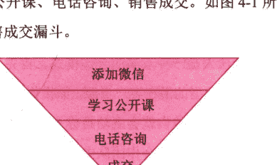
图 4-1 销售成交漏斗

想让更多用户在该路径中成交，可基于成功案例提炼每一步的操作方式和提升转化率的动作。举例，添加微信后希望用户尽快学习公开课，可设置课程有效期3天，3天内完成学习才能获得免费咨询机会，既建立初步信任，也筛选出真正有意向的用户进入电话咨询；要提高电话咨询成交率，需提前设计销售话术和常见顾虑的解除话术。

不同业务产品路径可能不同，但只要拆解出适合自身高客单产品的销售路径，并设计每一步提升转化的有效动作，就能建立一套标准化销售成交流程。

### 4.4.2 让你的客户成为合伙人

一人公司创始人要同时做产品设计、内容引流、销售成交、交付运营，用户增多时若无团队，时间和精力会成为瓶颈，营收天花板受限。前面提到的标准化交付和销售流程，正是为了便于招募合作伙伴替代创始人完成工作。合作伙伴最优来源就是用户。

把用户变成合伙人是一种双赢模式。首先，高净值用户身边有大量同类型的潜在资源，帮他获得结果后他们更愿意主动介绍。其次，把优秀老用户纳入长期合作团队，新用户看到你对长期关系的维护，会更信任你的服务。再者，老用户理解产品和用户需求，在交付和成交中更容易获得潜在用户信任。最后，用户通过长期合作可获得你的持续资源支持，更好地实现自身目标。

与用户合作可分为三个板块：引流获客、销售成交、交付运营，根据不同优势筛选合作方式。

第一种是引流获客，即老用户只需介绍新用户，提供潜在用户联系方式，成交后获得佣金。该方式适用于所有用户，可尽早与尽可能多用户建立，口碑介绍的成功率远高于陌生用户，也能大幅降低营销获客成本。

第二种是老用户加入销售团队。若老用户具备销售能力并能按标准销售流程执行，可承接销售线索，与潜在用户沟通并完成成交，获得业绩分成。老用户更懂潜在用户的痛点，能分享自身成功经验为产品背书，提升转化率。

第三种是让做出成绩的老用户承担部分交付运营工作，知识付费行业常见的是担任助教。他们经历过交付流程，熟悉产品，能帮助新用户突破困难，减轻创始人工作量。其他行业也可合作完成常规运营工作，如电商行业的选品、上架、拍摄等固定工作。

我的一人公司里所有合作伙伴均来自用户，由用户转为合作伙伴，减少了磨合成本，也大幅降低了从招聘市场筛选和培养人才的成本。

### 4.4.3 定期开展私域发售活动

私域成交能力是当代个人创业者必须修炼的核心手艺。微信商业持续扩张的背景下，线下门店和线上服务者都必须把用户沉淀进微信生态，才能做持续的运营和复购。用户基数做起来后，一对一沟通成交效率会明显下降，这时候就需要用发售活动实现批量化成交。

常见的私域发售打法大致有三种，分别是社群发售、直播发售以及直播与社群联动发售，操作难度逐步递增。

#### （1）社群发售
社群发售是私域成交的入门形态，核心是建一个微信群，把潜在客户集中起来做互动与推广，最终完成产品的批量售卖。门槛低，文案、图片、视频等物料可以提前准备好，客户也不需要在线等待，错过直播也能通过群记录回看关键信息。

发售前的第一步是引流建群。可以用公众号推文、朋友圈推广、社媒广告、邀请裂变等多种渠道把人拉进来。入群时可以设置小门槛，比如填写问卷、分享朋友圈，以此筛选出更精准、更活跃的成员。群体的质量直接决定后续转化成败。

接下来进入预热期。开售前大约一周要开始在群里升温，目的是逐步点燃对产品或服务的兴趣与期待。这一阶段适合输出相关干货、成功案例、用户评价等内容，不断强化信任感和购买欲。比如每日分享一则使用效果案例，或安排几次问答互动，解答疑问拉近距离。

发售时间与规则一定要提前清晰告知，并在群内多次提醒，营造紧迫感。同时可以预告限时优惠、限量福利等信息，为正式开售做心理铺垫。

开售当天要用图文、语音、视频多形式做系统介绍，重点拆解产品的差异化优势、使用方法、真实反馈，并实时解答群内问题。制造稀缺与紧迫是关键，例如前10名下单额外折扣或赠品，能有效刺激购买行为并提升活动效果。

活动结束后不能掉链子。要及时私信补发群内关键信息，防止用户错过。售后也可以留在群里继续答疑，收集使用反馈与建议，并鼓励已成交用户在群内晒成果与体验，既能服务老客，也能对未下单的人产生持续影响，为下一次发售积累口碑素材。

社群发售通过引流、预热、开售、跟进的系统化闭环，能够实现批量成交，不断打磨各个环节，有助于创业者更好地经营客户关系，提升满意度，最终推动业务持续增长。

#### （2）直播发售
直播发售是借助实时视频与客户互动，直接在直播间完成下单的一种方式。视觉化呈现加上即时互动，能快速建立信任感，成交效率普遍高于社群发售。

首先要选对平台。微信视频号、抖音、快手、小红书都是常见选择，不同平台用户画像差异明显，要结合产品定位与目标人群来定。已有微信粉丝基础的，视频号更匹配；面向女性消费的，小红书更友好。

选定平台后就要做提前造势。通过公众号、朋友圈、社群等渠道预告直播时间、主题与亮点，比如新品发布、使用教程、限时福利等，并发布预告图文或视频，开启预约提醒，让潜在观众提前锁定。

直播内容必须提前准备。包括产品讲解、使用演示、真实客户见证等。讲解环节要清楚传达产品卖点与使用方法；演示环节让观众直观看到效果；见证环节可邀请真实用户连麦分享，增强可信度。再搭配答疑、抽奖等互动，提高参与感。

直播中互动引导是核心。要积极回应观众问题，用抽奖、优惠券等手段提升参与度和购买冲动，同时把控节奏与氛围，保持轻松愉快，让观众愿意持续停留。

成交引导要反复强调。在直播过程中多次突出限时优惠、限量福利和购买路径，例如前10名八折或直播结束前下单送限量礼包，用紧迫感和稀缺感推动快速下单。

直播结束必须复盘。统计观看人数、互动频率、成交数量等数据，总结成功点和改进点。同时通过问卷或社群收集观众反馈，了解对内容和形式的评价，为下一次优化做准备。

总体看，直播发售是一种高效的营销手段，将教育与销售结合，通过精细准备和持续优化，能够实现高客单产品的快速成交。

#### （3）直播和社群联动发售
直播与社群联动是把直播的实时互动优势和社群的内容沉淀优势结合起来，形成覆盖更广、转化更高的成交方式。社群可以承担直播前的预热、直播中的补充互动以及直播后的跟进售后，形成完整的营销闭环，提升参与感与转化率。

操作上依然先建立并引流社群，聚集精准潜在客户。群建好后要做直播预告和预热，提升关注度与期待值。可通过群公告、每日提醒告知时间、内容、观看方式；预热期还可做裂变，比如邀请三位好友进群即可领取福利，扩大人群。

直播当天安排助理在社群内同步关键信息，引导成员进入直播间观看。有人下单就把信息同步到群里，制造热度，让直播间和社群互相助推。

直播结束后在群内公布成交名单，发起接龙抢购，用限时限额再次刺激未下单者。次日可继续追单，发布客户好评、案例等，再次发起社群发售。

将直播与社群有机结合，既能预热引流，又能实时互动与会后转化，是私域发售中效率最高的形式之一，特别适合高客单产品的推广。

# 一人公司：个人品牌驱动的自由生意

要让一人公司可持续盈利，就不能靠单一产品，必须搭建清晰的产品矩阵。不同层级产品的交付形式与营销目标不同，组合起来才能形成健康的增长结构。

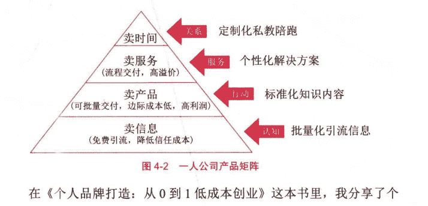
在《个人品牌打造：从0到1低成本创业》里，我曾提到个人品牌的产品矩阵包括流量产品、信任产品、盈利产品与合作产品。一人公司的矩阵在此基础上进一步升级。

流量获取是所有生意的起点。很多人从个人品牌起步到做一人公司，都是先通过分享碎片化信息资源来吸来第一批用户，而“卖信息”往往是获客的关键手段。通过批量分发信息资源，建立初步认知与信任，为后续转化铺路。海外创业者常做免费邮件订阅推送干货，国内创业者则借助公众号、视频号、小红书、抖音做内容分发，或制作付费专栏、电子文档作为引流品，本质都是用信息换流量。

知识本身并不值钱，能带来行动改变才有价值。单纯卖信息难以长期变现，需要打造可批量交付、边际成本低、利润高的标准化知识产品。比如“超级主页”小程序上有用户售卖写作变现的内容策展，并搭配陪伴交流社群。内容策展容易被复制，而带社群陪伴的标准化产品，无论10人还是100人入群，交付成本基本不变，利润可观，还能推动客户行动。

在成长期，标准化可批量交付的产品是快速变现的利器，形态可以是社群、课程、训练营。积累一定基础用户后，就可转向“卖服务”，提供个性化解决方案，打造高客单价产品。此时交付可流程化，且具备个人品牌的溢价空间。客户买的不是服务本身，而是对你的信任，哪怕价格更高也愿意买单。

最后是卖时间。时间是最稀缺的资源。初期通过一对一教练咨询可以做市场调研，建立信任关系，锻炼沟通成交能力。但进入一人公司阶段，就不能再以卖时间为主，必须构建系统化的产品矩阵。卖时间应放在矩阵顶端，作为最昂贵的定制私教服务。

这一逻辑同样适用于线下。以健身房为例，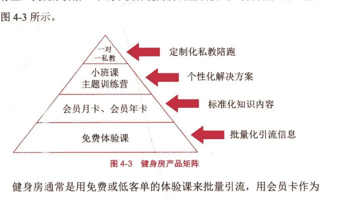通常用免费或低价体验课批量引流，用会员卡作为标准化产品承接转化，再通过小班课、主题训练营提供个性化方案形成高客单，最后用一对一私教做最贵的定制服务。

一人公司可参考金字塔模型搭建产品体系，让客户一眼看清你的服务梯队。建议每个层级保持1-2款产品即可，时间和精力有限，贪多嚼不烂，把重心放在引流获客与销售成交上，才是持续盈利的关键。

# 第五章
## 发展期：设计你的私域营销闭环
当产品或服务开始获得市场认可，客户基础与品牌影响力逐步扩大，如何提升转化效率就成为重点。本章聚焦发展期，探讨如何通过精准引流与私域运营深化连接，搭建清晰的转化路径，提升销售效率，帮助个人创业者实现业务持续增长。

## 5.1 获取源源不断的精准流量
生意要持续发展，核心就是持续获客。在一人公司的发展阶段，源源不断的精准流量是生存与增长的基础。

### 5.1.1 理解流量的五大核心要素
流量不等同于营收，能成交的流量才有价值。把握精准流量，需要理解以下五个核心要素。

- （1）质量优先
流量不只是粉丝数或新增好友数，更关键的是有多少用户具备明确需求与付费能力。精准流量能提高转化、降低营销成本、增强竞争力。对一人公司而言，高客单产品面向的是认知与消费能力更高的用户，质量远比数量重要。比如小红书用户多集中在一二线城市，女性偏多，使用目的偏学习搜索，更适合知识付费引流；抖音用户基数虽大，但多以娱乐为主，客群匹配度需谨慎判断。

- （2）渠道多样
不能押注单一渠道。要测试不同平台与媒介，找到最适合产品的流量入口，并构建多渠道策略。若只依赖一个渠道，一旦规则变化或账号受限，业务会断崖式下滑。更关键的是要把公域流量及时沉淀到私域微信，沉淀客户联系方式，形成可复用的资产。只有掌握在手里的客户清单，才是真正属于自己的资源。

- （3）内容为王
内容营销是低成本引流的核心。博客、视频、播客、社媒帖子等形式，都要能提供价值、解决用户问题或激发兴趣。创业者必须具备洞察受众需求并产出优质内容的能力。会写文案能把品牌故事讲清楚，会表达才能在需要大量沟通与直播的互联网营销环境中生存。

- （4）转化清晰
流量不转化为购买就无法产生业绩。必须设计清晰的转化路径。比如知识付费常见路径是小红书引流至微信，赠送公开课，再以一对一咨询承接高客单销售。路径越清晰，转化效率越高。

- （5）持续互动
成交往往建立在关系之上。要通过评论、私信等方式保持与用户互动，及时捕捉需求变化，收集反馈并优化产品。借助自动化工具定期推送个性化内容、节日关怀，或快速响应用户问题，能增强归属感与忠诚度，树立专业可靠的品牌形象，进而带来更多精准流量。

这五要素共同构成流量获取与利用的基石，助一人公司构建稳健的增长路径。

### 5.1.2 精准高净值用户画像梳理
发展期要重点推广高客单产品，实现高利润回报。设想高客单定价一万元，找到100位精准用户就能实现百万营收。关键在于梳理精准的高净值用户画像。

有效梳理包含四个步骤：

（1）数据收集与分析
整理社交媒体互动、购买历史、客户反馈、在线行为等数据，了解哪些客户互动频繁、复购率高、客单价高、愿意推荐。

（2）确定用户的共同特征
从数据中提炼高净值用户的共性，如年龄、性别、地域、职业、兴趣爱好，以及购买习惯、品牌忠诚度、生活方式偏好等。

（3）理解用户的需求和偏好
深入挖掘用户对产品或服务的具体期待，以及他们对品牌忠诚的深层原因，比如更看重品质、服务体验或品牌价值观。

（4）制定针对性的策略
基于分析结果设计定制化沟通计划、专属福利与社群空间，增强互动与归属感。

以一位自由撰稿人为例，她的高客单产品是写作私教训练营，已有公开课学员与自媒体粉丝。要梳理精准画像，第一步就是做数据收集与分析。

一位自由撰稿人在盘点自媒体后台时发现，最活跃的受众集中在25到35岁区间，这批人多是初级到中级的写作爱好者，他们希望通过提升写作能力来推动职业发展，经常在社交平台晒出自己的练习成果并主动寻求点评和建议。

- ● 第二步：提炼高价值用户的共性。

深入拆解后可以看出，这批人基本都是生活在一线城市的白领，经济条件尚可，愿意为自我成长买单。他们对能够快速上手、有针对性的学习资源需求强烈，尤其是具备实操指导和个性化回馈的服务形态。

- ● 第三步：厘清需求与偏好。

通过线上问卷和一对一访谈，撰稿人了解到用户不仅想练好写作，更希望加入一个能够相互扶持的圈子，和同好交流心得、彼此打气。另外，他们非常期待专业人士的点拨，帮助他们准确定位写作中的短板并给出改进路径。

- ● 第四步：制定差异化打法。

基于以上洞察，她对写作私教训练营的内容和卖点做了调整。课程在系统技法训练之外，增加每周实战作业、个性化批改反馈以及专属社群讨论，还邀请了几位知名作家和编辑做专题分享，输出创作经验和行业观察。

正是这套细致的用户画像梳理和精准的产品化设计，让她吸引到一批高度黏性的学员。这群人不仅持续参与学习，还通过口碑带来更多同类爱好者。品牌声量随之提升，收入也明显增长。

高净值人群画像并不是一次性的工作，随着产品迭代和市场变化需要持续校准。只有不断匹配真实需求，个人创业者才能沉淀起稳固的用户盘，为长期发展打基础。

梳理完付费高客单产品的客户资料，就能更清晰地锁定高净值客群的特征画像。

### 5.1.3 用数据思维拆解流量渠道

有了清晰的高净值画像，下一步就是用各种营销方式把精准人群找来。在内容营销阶段，最常见且成本可控的获客方式是靠优质自媒体内容吸粉。但内容制作耗时耗力，若只是盲目铺量、没有数据复盘，很难判断哪些内容真正带来了精准流量和转化，投入就等于浪费。

用数据思维看渠道，重点在于评估每个渠道带来的流量质量、转化效率和投入产出，而非只看播放量或曝光量。比如追踪不同来源的访客后续行为——停留时长、互动频次、成交情况等，就能客观衡量渠道价值和ROI。

第一步，先搭建一套简单可用的追踪体系。即使是单人作战，也能借助Google Analytics、平台自带统计或飞书多维表格做可视化看板，记录用户来源、行为轨迹和转化节点。定期复盘就能识别出哪些渠道最有效、哪些内容最受青睐，从而动态调整投放策略。如图5-1所示，我曾用飞书多维表格统计公域到私域的线索来源，数据显示转介绍、视频号和公众号是持续有效的入口，后续就把精力向这三块集中。

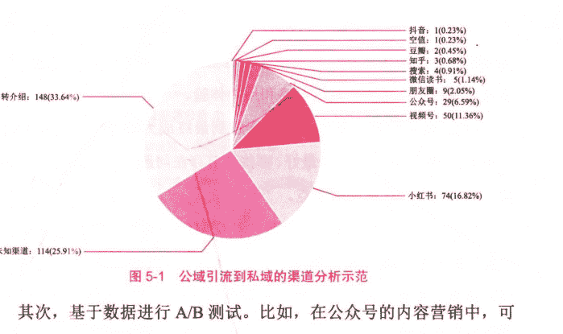

第二步，用数据做A/B测试。比如公众号可以测试不同标题和开篇文案对打开率和点击率的影响，小红书则可以测试发布时间、版式、封面和话题标签对目标人群吸引力的差异，找到最优组合。

第三步，关注客户终身价值LTV。通过比较每位客户带来的累计营收与获取成本CAC，可以判断不同渠道和活动的长期回报，从而把有限预算投向能带来高价值客户的阵地。

以小红书为例，其后台提供阅读量、点赞、评论、转发等行为数据，开通聚光投放后还能进一步分析人群特征，优化内容方向，降低获客成本，提升回报。

单人创业者想用数据实现降本增效，需要盯住几类核心指标。

（1）用户行为指标。点击率、阅读时长、页面浏览量、跳出率等，能反映用户对内容的好恶，帮助优化内容策略和体验。
（2）转化指标。看从首次触达到最终付费的全链路表现，找出转化漏斗中最顺畅和最卡顿的环节。
（3）互动指标。在社交平台，点赞、评论、转发是内容受欢迎程度和参与度的直接体现，可用来判断哪些内容更能引发共鸣。
（4）来源与渠道效果。对比直接访问、搜索、社交推荐等来源对主页或网站的贡献，明确优劣势。如图5-2所示，小红书笔记会展示关注页、搜索、个人主页、首页推荐等流量构成，便于判断内容是否获得平台推流、关键词是否被收录。

培养数据思维可以从以下做法入手。

学习常用分析工具，比如小红书、微信公众号、B站的数据面板。
按周或按月固定复盘，形成节奏化的策略迭代。
设定明确目标和KPI，例如提升留存、提高转化，并据此衡量效果。
保持好奇心和批判性，在数据背后追问“为什么”，从多个角度解读关联性。

通过这些习惯，创业者能更有效地利用渠道数据指导决策，让获客效率和商业判断力都得到提升。数据分析不仅是优化营销的工具，也是预测收入、支撑长期增长的核心能力。

# 第五章 私域闭环：从触达信任到持续转化

图5-2 小红书后台数据分析

## 5.2 私域转化体系的构建

**成交的本质是信任。** 在陌生平台看到不认识的人推荐，冲动下单的情况很少见，尤其是客单价较高的产品。价格越高、决策越复杂，需要的信任越深。而这种深度信任在抖音、微博等公域环境中很难稳定建立。

公域流量仍有价值，它能以低成本实现广覆盖。但流量关系浅、难以沉淀，平台如小红书的商铺或抖音直播，更多停留在浅层了解和试探性消费，客单低、复购弱。

私域的核心是借助微信生态、朋友圈、社群和一对一对话，建立长期、稳定的客户关系。私域是信任的培育土壤，是高价值客户的孵化场。换句话说，**私域营销就是一套覆盖触达、沟通、信任、成交和复购的闭环。**

### 5.2.1 私域转化路径图

在产品矩阵和用户画像明确后，可以先画一张私域转化地图，如图5-3所示。

设计转化系统前要先问清：流量从哪里来？各渠道的质量如何？把流量变成潜在客户的成本是多少？例如，单人创业者可通过数据分析筛选出公众号、抖音、小红书等高效引流口，用免费的钩子产品把公域用户导入微信私域，进行精细化运营。

进入微信生态后，需要先消除陌生感。朋友圈日常分享、社群互动、一对一深度交流，都是降低距离感的方式。持续输出有价值的内容、及时答疑，用“价值交换”而非硬推销来建立信任，比如提供免费资料、分享独特的行业见解，让客户感受到持续的专业价值，从而促成首次购买。

首次成交是对信任的第一次检验。可以设计低门槛的体验型产品，如小额服务或低价课程，既验证需求真实性，也为后续高客单铺路。

成交不是终点。客户购买后，要通过深度沟通、定期跟进和个性化推荐挖掘深层需求，这才是构建长线关系、推动高客单转化的关键。例如，客户体验了入门产品后，可通过沟通了解其具体痛点，再提出进阶方案。私域的转化效率正是在信任累积中体现出来的。

除公域引流外，还可与有影响力的个人IP、品牌或行业KOL合作，实现流量互换和背书加持。

在公域获客成本攀升的当下，私域运营的重要性日益凸显。业内常说“宁要私域一张床，不要公域一套房”。公域粉丝属于平台，受规则限制；私域客户可被反复触达、直接销售，更容易成交。维护好私域关系，还能通过口碑裂变和转介绍不断引入精准人群。

### 5.2.2 塑造标杆客户案例

人们天然倾向从众，更愿意相信已被验证的成功故事。当潜在客户看到与自己相似的人使用产品后取得好结果，就会产生“我也可以”的认同。这正是标杆客户案例的价值——提供最有力的信任背书。

打造标杆案例是提升信任、吸引新客户的有效手段。它用真实的使用效果让潜在客户看到可复制的成功，增强对品牌和产品的信心，也是建立忠诚度的关键。

标杆案例还能形成示范效应，激励他人行动。真实的故事比广告更具说服力，能让潜在客户更清晰地感知产品价值。

打造方式如下。

首先，筛选高认可度的客户。挑选对品牌高度满意、愿意公开分享、具备使用经验的客户，尤其是行业意见领袖或社交媒体有影响力的人，他们的口碑传播力更强。

其次，深度访谈，梳理使用动机、体验过程和最终结果，并用数据佐证，如业绩提升、效率改善、满意度变化等，让价值更直观。

再次，将案例转化为可传播的内容，建立案例库。单一文字已不足以满足用户，需要做成短视频、图文、长图海报等多种形式，甚至邀请客户直播复盘。内容形式的多样化有助于覆盖不同圈层。

最后，多渠道分发。社交媒体、官网、专栏、新闻稿以及行业媒体合作都是传播阵地。案例库应持续更新，展示品牌和服务的持续进步。

需要注意：

- 真实客观，数据造假一旦曝光会彻底摧毁信任。
- 以客户视角讲述，真实感受比产品自述更有力量。
- 突出问题解决路径，展示产品如何帮助客户跨越困难。
- 持续沉淀，保持案例库的鲜活与丰富。

### 5.2.3 以交付驱动营销增长

销售只是开始，真正的竞争在交付。客户购买的不仅是产品，更是对“能够兑现承诺”的信任。交付就是兑现的过程。客户的长期忠诚度，更多取决于交付是否超出预期。

随着公域获客成本上升，营销重心正从流量导向转向信任导向。私域是信任发酵的最佳场所。当交付持续超预期，客户会自发成为品牌代言人，把自己的社交网络转化为品牌的延伸，产生裂变效应。**用交付驱动营销，本质是把客户的私域变成你的流量场。**

具体做法：

一是制造惊喜时刻。绝大多数推荐源于“超值感”。当客户获得超出预期的结果或体验，就会主动分享。高品质交付点燃了推荐意愿。例如在生日寄送小礼物、节庆时送出手写祝福，都能放大感知价值。

二是经营深度信任与长期关系。裂变的基础是信任，客户愿意把朋友圈和社群资源分享给自己信任的品牌。每位客户背后都是一个潜在的私域生态，交付赢得信任后，客户的社交圈就成了高转化流量池。

三是主动引导激励。优质体验需要配合机制才能转化为裂变。可设计推荐奖励、分层积分、兑换权益等激励，也可借助“社交货币”驱动分享，比如邀请客户参与线上连麦分享成长故事，既满足表达欲，也实现传播。

更进一步，可将裂变嵌入交付环节。例如在个人品牌实操营末期安排商业路演，让学员在社群和直播中完成集体私域发售，既实现学员间的流量互换，也扩大品牌影响力。

在获客成本高、产品同质化严重、客户要求更高的环境下，依赖公域广告已难以为继。以交付为驱动的营销，能以更低成本实现可持续增长，同时沉淀稳固的信任关系。

## 5.3 教练式销售技巧的掌握

在私域环境中，一对一沟通是高客单成交的重要路径。销售是创业者的必修课，而教练式销售是一种更高阶的方法。它帮助创业者通过对话建立链接、洞察需求、提供定制化方案，从而实现高客单转化。**教练式销售不仅是技巧，更是建立长期信任的艺术。**

### 5.3.1 教练式销售的内涵

与传统推销不同，教练式销售强调倾听、提问和反馈，引导客户自行发现问题并找到解法，而不是直接把产品作为答案塞给客户。它是一种高度互动、个性化的销售方式，要求创业者既有专业能力，也具备沟通敏感度。核心是通过深度对话揭示真实需求和痛点，给出最合适的解决方案。

关键能力包括：

首先，学会提问引导。有效提问能打开客户表达，触及深层需求。可采用开放式问题层层递进，如“您现在遇到的最大挑战是什么？”“您希望达成的目标是什么？”通过“为什么”“怎么做”等追问，帮助客户自我觉察。

其次，练习深度倾听。倾听不仅是听清言语，更要捕捉语气、表情、肢体语言等非语言信息。可使用3F倾听法，先把握事实Fact，再感知感受Feel，最后聚焦Focus到核心痛点。共情是建立信任的重要桥梁，例如说“我能感受到您在为这个目标付出很多努力”，让客户感到被尊重与理解。

教练式销售的落脚点在于洞察之后给出能落地的对策。主理人先把用户的真实处境吃透，再结合自身积累的专业经验，为单个用户定制专门的应对思路。这需要很强的问题拆解和换位思考能力，能够跳出用户的既有认知框架，用降维视角呈现新思路。专业感必须在这一刻被感知到。若方案足够新颖、足够出人意料，甚至给出用户自己都没联想到的角度，成交概率会显著提升。反之，若建议只是用户早已听过的常识，很容易被判定为平庸，进而流失购买意愿。

除了解法本身，交流能力是教练式销售的底层支撑。清晰表达、适度反馈、耐心倾听、恰当鼓励，都属于这一层。对话中保持积极正向的姿态，用言语与非言语提升信息穿透力，精准的肯定与正向回馈能增强用户的信心与行动力，让成交更顺畅。

落地时可借助 GROW 框架和教练六步法等具体工具来提效。

总体来看，教练式销售是一套复合能力体系，涵盖提问、聆听、解题与沟通。将这些能力串联起来，就能更精准捕捉用户的真实诉求，建立稳固信任，最终达成销售目标。它不仅是销售方法，更是推动自身成长并同步提升用户价值的路径。

### 5.3.2 教练式销售的痛点七问

深挖痛点的过程，本质上是触发心理触动、形成情感共鸣，能在很大程度上影响决策，并提高即时成交的概率。

第一，深度探讨痛点能帮助用户把问题看得更清楚，这种觉醒通常是寻求解法的起点。很多用户对真实需求并不敏感，对问题的严重性也认识不足。通过引导用户把困境说出来，等于帮助其确认问题存在并需要解决，从而产生行动的紧迫感。

第二，深度对话有助于建立强共鸣和信任。倾听与理解本身就是情感联结，会让用户感到被尊重、被看见。当用户感受到你真正关注他的处境并愿意协助时，信任自然累积，也更乐意采纳你的建议。

第三，聊清问题不解决会带来的后果，能让严重性更直观。人类本能趋利避害，一旦意识到拖延的负面代价，购买驱动力会明显增强，这也有效点燃行动欲望。

第四，用户在作答时，其实是在进行自我说服。对自身需求的认知更清晰了，对解法的渴望也更强烈了。自我说服是一种强大的内在推力，能显著提高购买行动的可能性。

第五，越了解痛点，越能给出精准匹配的定制解法。这种高度个性化的服务不仅解决了具体问题，也让用户感受到自己的独特性与重要性。

下面七组探针，目的就是挖掘真实需求，让用户体会到问题的严重性，进而激发改变的意愿与行动力。

（1）目前主要遇到什么问题
这一阶段的目标是把用户当前的具体困境明确化。运用开放式提问，让用户描述正在经历的挑战，以便把话题自然引向你的产品或服务能够介入的范围，为后续沟通奠基。

（2）问题持续了多长时间
了解问题存在的时间长度有助于评估严重程度与用户承受的压力，也为后续强化痛感与紧迫感做准备，同时让用户意识到长期累积的负面影响。

（3）什么样的事情让你意识到问题的存在
引导用户回溯触发问题的关键事件，能帮助双方更清晰问题根源与诱因，引发情感共鸣，让问题的描述更具体、更生动。

（4）尝试做过哪些努力改变现状
让用户复盘过去的应对尝试，既能体现其积极性，也能让其看到局限。这一环节便于实现认知降维，为用户呈现更有效的替代解法。

（5）按目前状况发展下去，未来会产生什么结果
呈现痛点场景是教练式销售的重要手法。引导用户设想问题未解决时的潜在后果，能加深其对严重性的认知，提升解决问题的紧迫感。

（6）面对这样的结果，你的感受是什么
询问用户对负面结果的情绪反应，让问题在情感层面被体验。这种情感冲击更有利于激发行动。

（7）现状是可以忍受还是一定要改变
最后推动用户做出承诺，确认是否要采取行动解决问题。这一步促使自我说服闭环，坚定改变的必要性与行动决心。

通过这一系列具体而深入的提问，教练式销售既能全面了解用户痛点，也能促进用户自我反思、认识到行动必要性，从而建立深层信任，提升方案接受度与成交率。

### 5.3.3 教练式销售成交的关键

成交不只靠技巧，更取决于是否建立了深层信任，以及是否真正读懂并满足了用户需求。以下因素尤其关键。

（1）真正理解用户需求
在教练式销售里，洞察需求是促成交易的首要步骤。这不仅是收集基础信息，更要挖掘深层诉求、期待与潜在问题。主理人需要善用提问技巧，以开放式问题鼓励用户表达想法与感受。

提问要避免只能用“是或否”回答，而应引导用户深度反思与讨论。例如不问“你对我们的产品满意吗？”，而是问“我们的产品在哪些方面可以更好地贴合你的需求？”这样才能获取更多有效信息。

倾听是理解的另一关键，不只是听见声音，更是用同理心去感知。展现真实兴趣与关心，从用户的言语中捕捉未说出口的需求。

理解需求的过程本身就是建立信任的过程。当用户感受到你是在认真理解而非推销时，更愿意敞开心扉分享真实想法。通过这种信任，能更精准地提供匹配方案，提升成交概率。

#### （2）建立信任
信任的建立始于展现对用户的真实关心与理解，再通过专业知识分享、行为一致性与个性化方案来加深关系。当你能深刻理解需求并提供帮助时，信任感开始累积。它是通过每一次互动、每一次方案呈现和每次期望兑现逐步形成的。

在沟通中展现真正的兴趣，不只盯着交易完成，更关注用户的挑战与需求。通过倾听，你传递出专业性与关怀，让用户感受到被差异化对待，愿意分享更多个人需求。

展现专业知识是建立信任的另一支点。用户寻找的是能给出明确解法、具备解决问题的专业人士。分享相关知识、案例或行业洞察，能帮助用户理解问题并展示你的解决能力。

一致性与可靠性是维系信任的基础。履行承诺、按时完成约定，体现你对用户承诺的尊重。这种可靠的行为模式让用户确信你的方案经得起检验。

提供个性化方案能进一步加深信任。每个用户需求都是独特的，量身定制方案体现你对独特需求的理解与尊重，既能精准解决问题，也让用户感受到重要性。

最终建立的不再是单纯交易关系，而是基于理解、尊重和信任的合作伙伴关系，这是教练式销售成功并形成持续合作的根基。

#### （3）提供价值而非推销产品
教练式销售的精髓是创造价值，而不是单纯推销产品或服务。用户购买的不仅是商品，更是其带来的价值与解决方案。通过深入了解需求、痛点与目标，精准提供满足这些要素的方案，而非简单罗列产品特性。

在这个过程中，主理人的角色更像顾问或合作伙伴。利用专业知识和经验帮助用户识别问题并提出有效解法。这种互动提升了方案认同感，也加深了对个人和品牌的信任。当用户意识到你真正关心并致力于提供有价值的帮助时，更愿意采纳建议并下单。

提供价值也涉及教育用户，帮助其理解问题本质以及为何该方案最优。这种教育不仅传递产品知识，更是分享如何让工作或生活变得更好的洞察。通过这种方式，用户视野被打开，能理解方案带来的长期价值。

总体而言，价值提供是深度沟通的艺术，要求通过理解、同情和满足真实需求来建立持久关系。这种以价值为核心的方法，既能促进成交，也能建立基于信任和尊重的长期合作。

#### （4）引导而非强迫
教练式销售的魅力在于引导用户做出最适合自己的决策，而非高压推销。它要求认识到每位用户的需求和动机都不同，销售者的角色转变为指导者或顾问，帮助用户探索自身需求，从而做出最有利的选择。引导基于深度对话和共鸣，而非单向说服。

引导而非强迫的核心是提供足够信息和支持，让用户感觉选择是自主的。通过提问和倾听，帮助用户明确真实需求和挑战，同时呈现不同方案和可能结果。用户在此过程中深入思考，基于自身情况决策，而非被观点左右。

引导也意味着尊重用户的选择权和决策权。并非所有用户会立即决定，有时需要时间权衡。此时应保持耐心，提供必要帮助而非施加压力。正向的互动即使当下未成交，也可能转化为未来的机会。

引导式销售还包括鼓励用户自我发现，帮助其识别未曾意识到的需求或解法。通过教育，主理人能帮助用户更好地理解市场选项及其匹配度。这种教育过程帮助用户做出明智决定，同时确立自己作为可信赖资源的位置。

总体来看，引导而非强迫的方法能更好满足个性化需求，也有助于建立长期信任和合作，提升用户满意度和忠诚度，为个体经营的可持续发展奠定基础。

#### （5）长期主义视角
采用长期主义视角对教练式销售至关重要，它超越短期交易，聚焦持久用户关系的建立与维护。真正的成功体现在长期信任和忠诚度的培养上，而非即时业绩。获取新流量的成本越来越高，在存量市场，长期主义的核心是将每次销售视为用户关系旅程中的一步，而非终点，从而提升终身价值。

实践中，长期主义意味着交易完成后仍关注用户满意度和后续需求。定期回访，确保用户对产品或服务满意，提供必要支持解决使用中问题。这种持续关注展现了真实关心，增强信任，促进复购和转介绍。

长期主义也意味着持续教育和创造价值。通过分享行业趋势、新技术或使用技巧，帮助用户更好地利用已购产品或服务。这种教育提升满意度和忠诚度，也为未来新产品或服务提供良好基础。

此外，长期主义强调建立积极互惠的合作关系。这种关系基于相互尊重和价值交换，而非仅完成交易。通过积极互惠的合作，能更深入了解用户业务和挑战，未来提供更精准的解决方案。

综上，教练式销售成交的关键在于深入理解需求、建立信任、提供真实价值并采用引导式方法。通过这些策略，能更有效地沟通、满足需求并促成销售。

## 5.4 构建长期的客户关系

在存量时代，构建并维系长期用户关系是独立经营体持续发展的关键。特别是对个人创业者和单人经营者来说，每位用户都极为宝贵，能否把一次性交易转化为长期合作，直接关系到生存和发展。前面讨论了如何用教练式销售满足即时需求，但销售成功只是开始，真正的挑战在于如何把一时的成功转化为长期的忠诚与信任。

长期用户关系不仅带来稳定收入流，还能在市场中建立强大的品牌忠诚度。这种深层关系基于相互理解、尊重和价值共享，让用户感受到自己不只是交易一方，更是成长道路上的伙伴。建立这种关系需要持续提供超出期望的价值，并在关系管理上用心，确保每次互动都能增强信任和满意度。

### 5.4.1 客户服务的三个关键

在构建长期用户关系的过程中，优质客户服务不仅是策略，更是塑造核心竞争力的关键因素。尤其是对个人创业者和个体主理人而言，虽然资源有限，却可以通过个性化、高度关注的服务弥补差距。卓越的服务直接影响用户体验，把每一次互动都变成加深信任和满意的机会，这是建立长期关系的基石。

对个体经营来说，客户服务不仅要完成基本职能，还要体现独特性。以下是一人公司客户服务的三个关键要素，以及与传统企业的不同之处。

#### （1）高度个性化的服务
在个体经营的服务体系中，高度个性化不仅是优势，更是生存发展的核心。相比大型企业提供的标准化服务，个体主理人能深入了解每位用户的具体需求和偏好，提供精准定制化的解决方案。在竞争激烈且快速变化的环境中，个性化服务对建立长期关系、提升满意度和忠诚度、形成口碑传播至关重要。

个性化服务的重要性体现在多个方面。首先，它让用户感受到被重视和尊重，服务不是冷冰冰的交易，而是基于深入了解的贴心体验。这种体验能有效提升满意度，并在用户心中留下深刻印象，促使其成为品牌拥护者。其次，个性化服务让个体经营在与提供标准化服务的大型企业竞争中脱颖而出，成为独特卖点。最后，精准满足需求可减少资源浪费，提升运营效率和盈利能力。

落地高度个性化服务可采取以下步骤。首先，通过问卷或一对一访谈等用户调研深入了解背景和需求，建立专属用户档案。其次，基于具体需求提供定制化服务方案，并与档案一并呈现。再次，在交付过程中根据项目进展持续更新方案，利用客户关系管理系统记录偏好和历史交易数据，以便未来提供更精准体验。此外，建立反馈机制，根据用户反馈不断优化服务内容。

总之，高度个性化服务能为用户创造独一无二的体验，提升满意度和忠诚度，帮助个体经营在竞争中占据有利地位。

#### （2）直接且及时的沟通
在个体经营中，直接且及时的沟通是构建和维护用户关系的关键。与大型企业相比，规模虽小，却成为优势——能与用户直接对话，无需层层转接，大幅提升沟通效率和效果。这种方式不仅能快速响应需求和反馈，还能在用户心中树立灵活高效的个人品牌形象。例如，一家英语培训机构的学生通常下课后很难找到老师答疑，而一位提供线上一对一培训的独立教师可以随时保持联系，及时处理难题。

直接且及时沟通的重要性首先体现在快速解决问题上。用户遇到问题时能得到迅速回应和有效解法，是提升满意度的关键。个体主理人可通过即时通讯软件、社交媒体、电子邮件等多渠道保持沟通，确保问题在最短时间内处理。此外，直接沟通有助于深化关系。通过长期深入交流，更好了解用户需求和期望，建立亲密关系，从而在未来提供更贴合方案，提高复购率和转介绍率。

个体主理人时间宝贵，当用户增多时，若全部通过即时通讯如微信沟通，回复消息会占据大量时间，导致时间碎片化。因此，建立沟通体系非常重要，提前告知用户不同渠道处理不同类型问题，并设定即时沟通时间段。例如，告知用户可以随时私信，但会在工作日上午8-12点统一回复，若遇到复杂问题需提前24小时预约会议或通过电子邮件沟通。这样既能满足及时处理需求，又能高效管理个人时间。

沟通场景里反复出现的问题，值得沉淀成一套可复用的话术库。把高频提问整理进去，这套积累会慢慢变成品牌的硬资产。熟练运用 AI 的话，可以把话术库的内容喂给模型训练，形成贴合自家业务的知识库，从而搭出一套专属的 AI 客服。需要提醒的是，一人公司的创始人与客户对话时，切忌完全套用标准话术，更要显露出真诚与关怀，用有温度的个性化表达去互动，让对方感受到面对的是一个真实可信的人，而不是冰冷的品牌机器。

#### （3）教育和赋能客户
教育客户，本质上是把公司迭代的进展和最新资源同步给客户，让客户在获得持续价值的同时见证品牌的成长轨迹；赋能客户，则是提供情绪价值，让服务体验能转化为客户自身的能量与行动力。

做好教育，一人公司能帮助客户更清晰地理解产品或服务的真正价值，和公司一起成长，从而更有效率地用产品解决实际问题或改善生活。做好赋能，则能提升客户的自主能力，让他们在遇到相似问题时可以自行处理。这种能力的提升会强化对一人公司的信任与依赖，也会形成口碑裂变，带来新客。

教育与赋能的价值体现在三点。第一，避免误解，防止因认知偏差产生不满。第二，让客户更深入地认识一人公司的核心能力与专业度，提升品牌忠诚。第三，拉近参与感与归属感，让客户感觉自己是价值创造的一部分，更愿意建立长期合作。

具体落地可以分三步走。首先，搭建丰富的学习资源，通过图文、视频、线上研讨会等形式输出专业知识与行业洞察，提升客户的认知水平。其次，定期开展培训与工作坊，在互动中帮助客户更熟练使用产品或服务，同时加深关系。最后，提供一对一的个性化咨询，针对具体需求给出定制化建议。

总的来看，教育与赋能是一人公司服务体系里不可或缺的一环。有了持续的内容供给、定期的交流场域和精准的个体指导，不仅能让客户更好地使用产品，还能增强自主性、忠诚度和满意度，在竞争中占据更有利的位置。

### 5.4.2 筛选适合合作的客户
把客户发展成合伙人，对一人公司这类轻型组织非常适用。合伙人未必是工商意义上的股权伙伴，也可以是战略合作或业务协同伙伴。这种打法既能深化关系，也能靠客户的参与与贡献换来新机会和新灵感。**把客户视作业务共建者而非单纯的购买者，核心在于价值共享，通过协同努力实现双赢。**

让客户向合伙人转化的意义在于大幅提升忠诚度和满意度。当客户觉得自己的想法被重视并能影响产品与服务走向时，参与意愿会明显提升。这种归属感是传统客户管理难以达到的。客户带来的独特视角与实战经验，也能为产品持续创新提供燃料。

这项策略并非普适，只适合能为一人公司创造显著增值的特定客户。合适的合伙人通常具备以下特质。

#### （1）高度的参与度和积极性
在一人公司里，参与度与积极性是筛选合伙人客户的首要信号。这类客户不只是买家，更是品牌的自发推动者，对产品服务充满热情，愿意投入时间精力参与研发、服务优化乃至传播。他们对品牌愿景的认同远超产品本身。

他们习惯主动反馈，无论褒扬还是批评，都以帮助公司进步为出发点。对一人公司来说，这类反馈相当于一手市场调研，能直接指导优化与升级。

他们还乐于在自己的社交圈分享使用体验，这种基于真实使用的推荐可信度更高，对品牌形象与市场渗透有极大助益。把这类高参与客户转化为合伙人，既能加深绑定，也能借助他们的力量放大品牌价值。因此，识别并培育这类客户，是长期关系策略的关键环节。

#### （2）与一人公司价值观相符
合伙人客户与公司在价值观层面高度一致。理念和目标上的共识让合作更稳，减少摩擦。

价值观契合的伙伴能真正理解一人公司的使命与愿景，支持不止于交易，而是一种对公司长期发展和社会价值的认同。合作关系因此超越商业交易，成为共同达成更大目标的同盟。

他们的行为本身也在传递公司的核心价值，有助于维护品牌形象，强化外界信任。每一次分享和推荐都是价值的二次传播，能吸引更多志同道合的人，形成良性循环。筛选价值观一致的伙伴，既能保障关系稳定，也能为品牌带来长期影响力。

#### （3）具备专业知识或独特视角
应优先把拥有专业背景或独特视角的客户发展为合伙人。他们能提供新鲜思路，推动创新。

专业知识扎实的客户在细分领域有深度理解，能就产品专业性提出建设性意见。这一类建议对一人公司而言往往事半功倍，帮助找准定位、持续优化，必要时还能打开新业务线。

拥有独特视角的客户往往背景多元，生活经历丰富，能从不同角度审视产品，挖掘被忽略的机会或问题。这种用户视角的洞察对体验升级与市场竞争力提升意义重大。

把他们纳入合伙人体系，既能深化连接，也能利用其知识与视角实现共成长，让公司在复杂市场中保持敏捷与创新。他们还具备网络与影响力，能为品牌带来更多优质客户与合作机会。

#### （4）长期的忠诚度
适合成为合伙人的客户通常已与一人公司建立长期关系，忠诚度高，愿意共同面对挑战。

长期忠诚的客户对业务运作有深刻理解，熟悉产品特性、服务细节以及品牌理念与发展方向。转化为合伙人后能快速融入，推动业务与品牌推广。

这种忠诚源于价值观认同和对服务品质的认可，转化后能增强公司信誉，也能凭借其人脉吸引价值观相近的新客。他们的投入不限于金钱，还包括时间、经验与资源，在公司遇到困难时提供更稳定的支持。长期忠诚是双向选择的结果，体现了双方的信任与尊重，往往能带来持久价值。

#### （5）拥有影响力的客户
有影响力的客户在自己的圈层拥有广泛人脉与较高声望，其推荐能为公司带来新业务与更广阔认知。

其推荐具有高度可信度与传播力。在决策时，人们更依赖身边权威人士的口碑。有影响力的客户成为合伙人后，正面评价能快速建立信任，加速成交。

他们通常拥有广泛的社交网络，能为资源有限的一人公司打开合作通道，带来宝贵资源与机会。另外，他们能提供深度的市场洞察与业务建议，帮助产品开发与市场策略更精准。最后，携手有影响力的客户能提升品牌的社会责任感与形象。他们的个人价值观与品牌契合，有助形成正面口碑，吸引更多客户与伙伴，实现品牌价值的提升。

综合来看，一人公司在挑选合伙人客户时，需要权衡潜在价值、参与意愿与目标契合度。精细筛选与持续培育，才能获得资源支持并实现共同成长。

### 5.4.3 建立有温度的社群
AI 越发达，人与人之间的真实关系与情感就越稀缺。线上线下皆可，建立一个有温度的社群，把需求相同的人聚在一起交流互助，能让客户有归属感，提升忠诚与活跃度，还能让老客户为新客户答疑，降低一人公司的运营负担。

对一人公司而言，社群不只是交易场所，更是情感连接与深度互动的枢纽。通过社群可以提供人性化服务，快速响应反馈，及时调整产品与服务。社群内的分享与互助强化了客户间的联结，也让公司与每位成员保持独特关怀。

社群也是塑造品牌形象与传递价值观的舞台。通过各类活动增强粘性，借助客户口碑扩大影响力，展示品牌独特性，构建鲜明形象。

社群反馈同样是产品创新的宝贵素材，提供真实市场数据。紧密交流帮助公司把握动态，产品更贴合需求。

此外，社群能有效降低获客成本。忠诚成员会自发成为品牌传播者，真实分享比传统广告更具说服力，是成本效益极高的扩张路径。

但建立有温度的社群并不容易。当前很多人微信群太多，消息被屏蔽，最后变成品牌广告群。如何让社群保持活跃？

（1）提供仅限社群成员参与的福利活动
设置专属权益，例如奶茶店或网店每周三上架限量特价，链接只在群内发放；知识付费可向社群提供课程回放或干货笔记，刺激定期查看消息。

（2）让客户参与到社群活动中
设计积分机制，参与活动可获积分兑换礼品。活动形式包括转发宣传到朋友圈、撰写使用体验等。定期组织互动，提升关注与活跃度。

（3）提高进入社群的门槛
在有稳定福利或活动的前提下，设定准入门槛，如达到一定消费额才能加入。付出成本后，客户会更珍惜社群。

（4）举办线下活动刺激线上链接
线上消息易被忽略，线下互动能重新点燃兴趣。可在活动现场引导客户通过社群领红包或参与抽奖，促使其查看群消息，提升关注与参与。

通过上述方法，一人公司创业者可以打造充满活力的温暖社群，在持续互动中加深客户联系，推动品牌成长。

## 5.5 工具篇：教练式销售的流程
教练式销售的核心是通过精心设计的对话步骤，引导客户自我发现、自我解决问题，从而达成合作。它强调共建关系，而非单向推销。个人创业者借此能深挖真实需求，帮助客户找到实现路径。既能提升成交率，也能增强满意度和忠诚度。

整个流程包含12个步骤，从轻松开场到成交激励，逐步深化关系，提升对话质量，最终实现双赢。

### 表 5-1 教练式销售的流程

| 序号 | 关键 | 目 的 | 内容举例 / 提问示范 |
| :--- | :--- | :--- | :--- |
| 1 | 简单闲聊 | 用轻松开场打破隔阂 | “很高兴能聊聊，最近工作状态如何？有没有新的想法或遇到的卡点？” |
| 2 | 掌控全局 | 明确沟通方向，让客户安心 | “先了解下你的现状和困惑，我们一步步来，会让你感到被支持。” |
| 3 | 了解现状 | 把握当前状态与需求 | “方便说说你目前的情况吗？主要挑战是什么，对你意味着什么？” |
| 4 | 加深痛苦 | 揭示真实痛点 | “这个问题困扰多久了？你尝试过什么方式，结果怎样？” |
| 5 | 理想状态 | 引导描绘期望结果 | “如果这个问题解决了，你希望达到什么样状态？会带来什么改变？” |
| 6 | 帮助幻想 | 扩展理想成果想象 | “假设问题已解决，生活会有哪些不同？会怎样影响身边人？” |
| 7 | 问题根源 | 探寻深层阻碍 | “你觉得阻碍你实现目标的主要原因是什么？怎么看待这个障碍？” |
| 8 | 改变承诺 | 获取行动意愿 | “你是否准备好开始改变了？现在行动感觉如何？” |
| 9 | 信心希望 | 强化信心，给予希望 | “我相信能找到办法。之前很多面临相似挑战的人都成功实现了转变。” |
| 10 | 定位价值 | 明确专业定位与独特价值 | “我专注帮助像你这样的人找到解决方案，方法是深度了解加持续陪伴。” |
| 11 | 解决方案 | 提出具体方案并突出价值 | “基于我们的沟通，[方案名称]很适合你，能帮助你[达成目标]。它的核心优势是……” |
| 12 | 成交激励 | 促成决定，提供支持 | “为支持你的决定，我提供一个专属优惠，如果现在启动，可以[优惠措施]，让你更快开始。” |

这12步既是销售技巧，也是让客户感到被重视与理解的过程。借此建立深层关系，提供更个性化服务，在竞争中保持优势。

# 第五章
发展期：设计你的私域营销闭环
进入稳定期后，保持品牌吸引力和竞争力成为核心课题。此时客户基础已成型，业务流程趋于完善，关键是如何在激烈竞争中脱颖而出，实现长期稳健增长。本章聚焦私域营销闭环的设计，帮助你在增长期构建可持续获客与转化的体系。

# 第六章
稳定期：搭建你的品牌运营系统
当一人公司度过初创阶段进入稳定期，如何维系品牌活力与竞争力是必须面对的挑战。你已经拥有一定客户群体，流程也逐渐成熟，但要在竞争中持续立足并实现稳步增长，需要系统化的运营。

本章核心在于探讨如何搭建品牌运营系统，优化服务流程，提升运营效率，在保持品牌活力的同时实现公司稳定发展。我们将从品牌战略视角出发，帮助你构建长期发展的品牌体系，确保在竞争中保持优势。

## 6.1 打造独特的品牌形象
品牌远不止标志、配色或口号，而是客户对你及产品服务的整体印象。对一人公司而言，品牌不仅是视觉符号，更代表承诺、价值观以及与客户建立的情感连接。

# 第六章 稳定期：搭建可持续的品牌运营体系

品牌可以视作客户在你缺席时仍会如何谈论你。它由使用体验、情绪感受与认知印象综合而成。因此塑造品牌需要在每一个触点上统一传递核心价值。形象是外界对企业的整体判断，既是识别系统的核心，也是连接情感的桥梁。进入成长期后，单人创业需要不断打磨品牌、保持创新，才能在客户心智中占据独特位置。

### 6.1.1 搭建品牌营销体系

在个体创业的进程里，品牌思维的养成至关重要。只会做业务与产品投放，缺乏品牌视角，很难触达高净值人群，且易被替代。当前处在产品过剩的时代，单纯的品类很难成为资源有限的单创团队的核心壁垒，真正不可复制的是创始人的人格化影响力以及企业的使命愿景。因此品牌才是实现差异化竞争的关键。要在品牌的每个阶段把创始人的价值主张与公司的产品线、业务形态、愿景使命融为一体，编织出有深度、有连贯性、有吸引力的品牌叙事。

搭建体系可遵循以下四点。

- **第一，以创造价值为先，而非短视盈利。**

价值创造才是品牌长线发展的动力。品牌的根本意义不是售卖，而是帮助用户解决实际问题、提升生活与工作效率。必须持续追踪用户需求的变化，将为用户创造更多价值作为最高优先级。短期销量与利润当然重要，但若在用户心智中没有真实价值，产品终将失去吸引力。通过持续迭代产品、快速响应市场反馈、保持高质量使用体验，才能逐步积累口碑与信任。

- **第二，保持认知独特且表达统一。**

具备长期竞争力的品牌必须占据独特的市场定位。单创团队通常带有鲜明个性，可通过挖掘专业特长、个人风格与实战经验来塑造辨识度。这种差异可能体现在专业领域、服务方式或价值观层面。统一是品牌坚守的根基。每一次与用户的接触、每一份内容产出、每一项服务交付都应传递一致的理念与价值。通过长期稳定的形象与价值输出，让用户形成清晰可信的认知，信任感由此累积，最终形成忠诚。

- **第三，用优质内容经营个人IP。**

影响力的扩张离不开持续的内容输出。内容即品牌，通过内容维系与受众的连接、传递价值观与专业认知，是获客的重要路径。在社交媒体高度普及的当下，保持高质量输出能让品牌在目标人群中获得持续曝光。内容不只是文章或视频，更要在专业领域持续展示洞见与案例。可借助专栏、电子书、课程、直播等形式深化个人IP，帮助用户解决关注问题，逐步建立行业权威感。

- **第四，经营长期信任，而非一次性成交。**

可持续的品牌既要获取新客户，也要维系存量客户的长期关系。通过优质服务体验与个性化沟通提升用户粘性，提高复购与忠诚。实践中可搭建私域运营体系，将用户沉淀到微信、社群等私域渠道保持互动。持续供给有价值的内容与服务，不仅强化信任，也能借助老用户的推荐带来新用户，形成口碑裂变。

### 6.1.2 打造单人品牌的视觉与体验

进入稳定期后，品牌形象的独特性直接决定竞争力。一个鲜明且强大的形象既能吸引新客户，也能通过持续的情感链接留住老客户。形象的塑造不仅是视觉层面，还包含价值主张、理念表达与用户整体感知。

第一步，明确品牌的核心价值观。单创品牌高度依赖创始人个人的信念体系。你是谁、坚守什么、希望为用户创造什么，共同构成价值内核。当用户认同这些价值时，情感连接会自然产生。例如倡导环保的可持续服装设计师，品牌可凸显绿色材质与循环设计，吸引关注环境的用户。创始人可梳理出三到五个经营与服务中最关键的价值，如诚信、创新、责任、用户关怀等。

第二步，构建视觉识别体系。视觉是品牌的第一印象。尽管单创团队不需要复杂的体系，但一致专业的视觉能建立可信度。包含Logo、主色调、字体、图形元素等。Logo应简洁易记，能承载品牌核心价值，图形与文字结合更利于跨场景识别。风格要与行业气质匹配，如健身类可用厚重有力的字形，咨询类更适合沉稳专业的风格。色彩承载心理暗示，蓝色传递可靠专业，绿色关联健康环保。确定一至两种主色后，应在官网、社交账号、名片等所有物料中保持一致。字体通常需主标题与正文两种，必要时增加强调字体，保持与品牌调性一致。科技类适合现代无衬线字体，咨询类可选用衬线字体。此外图标、插画、背景纹理等元素也能强化记忆点。

第三步，定义品牌的声音与个性。品牌声音决定沟通时的语言风格与语气。单创品牌的个性与创始人高度重合，必须保证表达风格与个人特质一致，并能引起目标用户的共鸣。调性可以是正式、亲和、幽默或专业，取决于行业与客群。例如专业顾问语气偏正式可信，内容创作者可更轻松幽默。无论邮件、社媒还是官网文案，都应保持统一语调，传递一致信息。

第四步，设计客户体验流程。品牌不仅是外表与话语，更是用户每次互动的实感。从首次接触到购买、使用后的完整旅程都属于体验范畴。优秀的体验能赢得长期信任，涉及官网呈现、私域营销路径、服务说明、交付环节等。用户从咨询、下单、支付到售后跟进的每个节点，都在体现品牌为用户创造的感受。

品牌并非一次性工程，需随业务与用户需求演进而持续调整。定期审视形象是否与时俱进、是否仍契合用户期待，是保持竞争力的关键。

### 6.1.3 创始人先做真实的人

单创品牌的理念与创始人的个人品牌紧密绑定。许多人打造个人影响力时会追求完美人设，认为完美形象更有吸引力，实则埋下风险。

其一，完美人设难以持久。没有人十全十美，一旦出现不符合人设的行为，信任会瞬间受损。观众对虚假形象易产生失望，进而降低忠诚甚至产生反感。

其二，过度理想化会拉开距离。真实的连接源于共鸣，过于完美的形象缺乏温度与瑕疵，很难引起共情。人们更愿意信任能够被理解、被关联的人。

其三，长期表演是精神负担。持续监控自我、维持人设会带来心理压力，导致失真、疲惫与枯竭。当对外形象与真实自我脱节时，很难保持长久热情与创造力。

其四，完美人设难以提供可持续价值。个人品牌的魅力来自个性与真实故事，过度包装会削弱吸引力。长期看，真实、有瑕疵且具人性的人格化品牌更具持久力。

在个体创业中，保持真实既是个人成长的需要，也是品牌发展的核心。竞争激烈、变化快速的市场，要求创始人接纳自己的不完美，承受多元评价，这需要强大的内心与自信。

吸引精准用户的前提是深挖自己的热情所在，放大个人长板。当核心优势足够突出时，用户会被专业与独特性吸引，短板影响会被弱化。打造个人品牌本质是自我探索，回答“我是谁”的问题，可持续发展的根基在于创始人生命能量的投入。

找到长板后，应在产品服务中放大优势，聚焦擅长领域，避免因好奇心分散到不擅长的方向。同时要坦然承认短板，不畏惧被认为不完美。有时坦诚展示缺点反而拉近距离，让人感到可爱真实。当与用户建立深层情感共鸣时，用户购买的不仅是产品，更是创始人的故事与生活方式。

归根结底，做真实的自己是对个人与品牌的长期投资，也是创业者的修行。它要求在追求产品卓越的同时，保持表达的真实，在市场压力中坚守原则与价值观，不随波逐流。

### 6.2 构建标准化交付流程

进入稳定期后，标准化的运营交付流程是保障效率与体验一致性的关键。它能帮助有效管理有限的时间与资源，确保品牌在互动、服务交付与内容输出上的质量稳定。建立标准流程后，还可引入合作伙伴分担执行，让创始人从重复劳动中解放，专注获客与销售。

### 6.2.1 设计客户学习手册

学习手册是单创团队为用户提供的有价值支持工具。它能帮助用户更好地理解产品服务，并通过结构化路径逐步掌握使用方法、核心理念或特定技能，提升整体体验。如图6-1所示，为学员设计的学习手册示例。

#### （1）手册的核心要点
手册的核心是提供清晰易懂的服务流程说明，让用户明白从购买到交付的每一步。一份精良的手册能大幅提升使用体验，同时节省沟通成本。

手册应包含产品服务详细介绍、交付流程说明、常见问题解答、附加资源与视觉呈现。

开篇要对用户购买的产品服务做系统介绍，包括功能、特点、使用场景、带来的好处与解决的问题，以及与竞品的差异。

随后用时间线与步骤分解说明交付全程的关键节点。不仅要说明交付方会做什么，也要明确用户需要提供的资料或完成的任务。例如需求确认阶段需提交的信息，中期反馈的收集方式，验收阶段的成果确认与后续服务说明。流程化描述能减少误解，确保双方对进度与职责有清晰认知。

常见问题解答是手册的重要部分，可提前回应用户在服务过程中可能遇到的疑问。也可提供额外资源，如阅读材料、视频教程、可下载模板等，帮助用户更深入理解与使用。

最后要注重视觉呈现。通过简洁排版、清晰字体与专业配图，手册更易理解，也更符合品牌调性。美观的手册能传递专业感，塑造正面品牌形象。

#### （2）制作路径
制作标准化且易于更新的学习手册，可借助飞书、腾讯文档等协作工具，实现快速创建、共享与协同编辑。

第一步，建立手册结构。先确定内容框架与章节划分，可包括公司介绍与品牌背景、产品服务概述、详细交付流程、FAQ、联系方式与支持资源、附加资源如操作指南与教程视频等。在协作文档中新建页面，利用格式工具设置标题与子标题，为各部分预留空间。

第二步，填充具体内容。各章节使用简洁明了的语言，避免术语堆砌。支持插入图片、图表、流程图，直观解释复杂概念与操作步骤。

第三步，优化设计与布局。选择合适的字体大小与色彩，调整段落布局，插入分隔线，提升可读性与吸引力，保持整体风格统一，兼顾专业性与品牌调性。

第四步，加入互动元素。可插入在线资源链接、嵌入视频教程、反馈表单等，让用户在使用中获得即时帮助并进行互动。例如加入在线反馈表单收集问题与建议。

第五步，设置分享与权限。完成设计后，可通过权限设置控制访问范围，是否允许评论或修改。这样能随时根据用户需求更新内容并实时分享。

第六步，收集反馈并持续迭代。手册并非一成不变。定期收集用户反馈，了解改进点。利用评论功能直接获取建议并完善内容，确保手册持续创造价值。流程成熟后，为新用户复制一份即可快速交付。

### 6.2.2 在交付中植入游戏化体验

学习与行为改变往往有难度，用户倾向回避复杂耗时的任务。如何让用户主动参与并持续使用产品服务，是提升行动力与忠诚度的关键。游戏化体验通过将游戏机制融入交付过程，让学习与操作变得有趣、互动且有获得感，从而激发积极性，增强品牌吸引力。

游戏化利用内在动机，通过奖励、挑战、即时反馈等满足成就感、竞争感与探索欲。用户完成任务获得奖励或即时反馈时会产生积极体验，更愿意持续参与。

设计游戏化交付体验可分为以下几部分。

#### （1）设定分阶段清晰目标与挑战
任务庞大容易让人失去动力。将交付流程拆解为清晰小目标，设置阶段性挑战，能减轻心理负担并保持可控性。

分阶段任务把整体服务拆分为具体步骤，每个阶段设定小目标。例如在线课程可分为入门、进阶、高级，通过完成各阶段内容获得认可。

增加挑战感。在每个阶段设计有挑战性的任务，完成高难度任务可获得特别称号或徽章。

进度条与成就展示。提供可视化进度条，让用户清楚距离最终目标还有多远。即时反馈能带来强烈成就感，驱动持续前进。

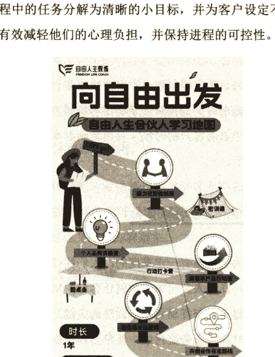
图6-2 客户游戏体验地图

- 分阶段任务。将整个服务或产品交付分解为几个具体的步骤或阶段，每个阶段设定一个小目标。例如，在提供在线课程时，可以将课程分为入门、进阶、高级三个阶段，客户通过完成各阶段的内容来获得认可。

- 挑战感。在每个阶段增加适当的挑战性任务，客户可以通过突破某些难点获得奖励。比如，可以设置一项“难题挑战”，当客户完成一项较高难度的任务时，给予他们特别的称号或徽章。

- 进度条与成就展示。为客户提供一个可视化的进度条，展示他们离最终目标还有多远。这种即时反馈能给客户带来强烈的成就感，让他们持续前进。

#### （2）引入即时反馈与奖励机制
即时反馈与奖励是驱动行动的重要元素。任务完成后及时给予肯定与回报，能让人感受到每一步努力都被看见。

奖励积分系统为用户设定积分规则，完成步骤或任务即可获积分，可兑换优惠券、折扣等实际奖励，或徽章、排行榜积分等虚拟奖励。

虚拟奖励如徽章、称号。用户喜欢展示成就，可设计“课程达人徽章”“任务挑战者称号”等，展示在个人资料或社群中。

即时反馈通知。完成任务后推送一条肯定通知，并提示下一步，例如“恭喜你完成第一阶段，你正离最终目标更近一步！”

#### （3）设计社交互动与竞争元素
游戏化不仅靠个人进步，社交互动与竞争感同样有效。将用户间的互动纳入交付体验，能大幅提升参与感与行动力。

排行榜系统展示用户完成任务或积分情况，增加适度竞争，让用户看到自己在群体中的排名，从而激励更快更积极完成任务。

#### （4）用成就感和归属感做长效留存

把游戏化的交付玩好，核心是让客户获得满足感和归属感。他们不再只是被动使用产品，而是成为品牌互动的活跃参与者。围绕成长轨迹和个人价值来设计激励体系，才能把这种情绪稳住。

社群联动。建立一个属于客户的交流场域，让大家可以互通进度、分享经验、一起化解难题。比如发起常态化的社群挑战，每周邀请成员晒成果，从中挑选表现突出的几位给予物质奖励和公开展示的机会。

组队挑战。设计必须协作完成的任务，推动客户自发组队攻关。互动感被自然放大，用户也会因为同伴关系而体会到品牌的社交价值。

成就展示专区。为用户准备一个专属的个人主页，把在服务过程中累积的成就、徽章、积分全部集中呈现。用户一眼就能看到自己的成长曲线，也方便一键分享到社交平台。

长期荣誉累积。搭建可持续的荣誉体系，让每一次参与都转化为可视化的积分。比如完成全部学习任务后授予“品牌大使”称号，并配套专属折扣或推荐权益，提升身份感。

社区表彰与归属。结合长期任务和社群互动，持续给成员荣誉感。比如定期评选社群里最活跃的成员，授予“年度最佳贡献者”等称号，让参与者感到自己被看见、被需要。

用游戏化交付，一人公司就能显著提升客户的参与度和行动意愿，让使用产品或服务变成一件愿意坚持的事。游戏化的价值不止于让过程好玩，更在于强化忠诚度并自然形成口碑。关键是把清晰的目标、即时反馈、奖励机制和社交互动拧成一股绳，用有趣的任务设计让学习和使用变得轻松愉快。最终用户既拿到实用价值，也收获情绪价值，才会长期与品牌保持互动。

### 6.2.3 运营全流程 SOP 化

一人公司步入稳定期后，创始人要把精力投向战略和增长，而不是琐碎的日常运营。靠标准化作业流程把服务固定下来，既能保证交付一致性，也为后续外包和扩张打好基础。

SOP 是一人公司实现流程标准化的抓手。它能让服务质量更稳定，让业务量上涨时也能从容扩展，把部分运营外包给第三方或合作伙伴，从而把创始人从执行中解放出来，专注高价值事务。所以 SOP 至少发挥三方面作用：保证交付一致、提升效率降低成本、具备可外包性。

搭建一套可用 SOP，按下面四步推进。

第一步，厘清关键流程。先盘点对业务运转至关重要的环节，通常包括客户服务、市场推广、财务行政、售后支持等。

第二步，给每个流程写清执行细则。明确每一步的先后顺序、操作方法与验收标准，保证任何人照着做都能完成。复杂任务要拆成可执行的小任务，例如新媒体运营可拆成内容策划、发布投放、用户互动。同步制作统一模板，如报价单、邮件回复话术、客户反馈表，减少沟通成本并统一品牌调性。

第三步，设定时间节点与交付期限。为每个步骤设定合理完成时长，并建立提醒与跟进机制，确保项目按期推进。

第四步，持续评估优化。SOP 不是一成不变的文档，要根据实际执行效果定期迭代。比如收集外包团队在操作中的反馈，找到瓶颈或浪费环节并优化。

如图 6-3 所示，我为运营助理制定的工作 SOP 涵盖基础运营、售前客户运营、售后客户管理、课程项目运营、新媒体运营等，每块都配有流程、标准和话术示例，工作要求一目了然。助理更换时，新人也能迅速上手。

在我这里，工作就是 SOP 化。我不仅为运营助理写了详细 SOP，连交付岗位、销售话术都做了标准化。这也是我能做到一人创业、每天工作 4 小时的原因。流程都 SOP 化后就能外包，让别人按我的标准执行，既保证一致性和质量，也让新人快速上手、效率提升。

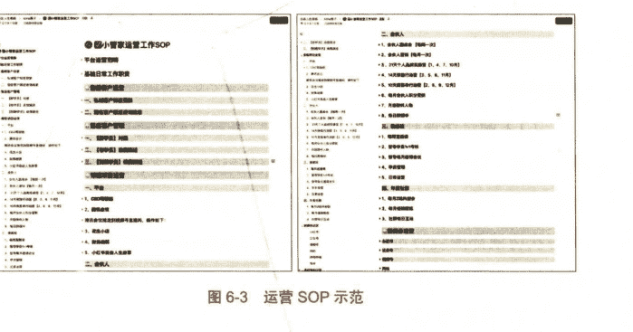

## 6.3 让客户共同参与产品迭代

进入稳定期，市场和需求会持续变化，产品必须不断升级。一人公司并非没有团队，客户本身就可以是团队。将客户纳入迭代闭环，能深化关系、让产品更贴合市场、增强竞争力。共创让客户从被动使用者变为积极参与者，带来的不仅是产品改进，更是忠诚度和口碑的自然增长。

### 6.3.1 定期开展教练式客户访谈

最直接的共创方式就是定期做教练式访谈。教练以提问和倾听为主，帮助创业者深挖客户需求、期望、体验和反馈，捕捉真实声音，为迭代提供依据。

1 制订访谈计划。制定长期访谈节奏，比如每季度一次，明确目标人群和主题，确保覆盖不同客群，每次围绕特定产品或服务展开。

2 准备开放式提纲。问题要能引导客户说出真实感受和建议，可围绕使用体验、改进点、未来期待展开。例如了解客户背景与选购原因、满意度及亮点与痛点、希望新增功能或支持、具体改进建议与服务期望。

3 选择沟通方式。视频会议、电话或问卷均可，视频更利于捕捉情绪和细节，适合深度探讨；电子问卷适合大规模收集。

4 执行访谈。倾听与引导并重，让客户自由表达，同时用追问把话题拉回目标，保持开放心态，尤其对批评性反馈。

5 归纳分析。整理访谈信息，提炼共性问题、独特洞察和潜在机会，为产品更新、服务优化和策略制定提供参考。

6 回馈行动。把客户意见如何被采纳并落地反馈给参与者，让他们感受到被重视，从而提升满意度和忠诚度。

7 建立常态机制。把教练访谈纳入持续沟通体系，而非一次性活动，持续跟踪需求变化，实现快速响应。

通过定期访谈能更深入理解客户，构建长期关系，为迭代指明方向。视频访谈还能剪辑出自然流畅的好评片段，作为新的内容素材。

### 6.3.2 组建客户共创小组

客户共创小组把客户直接拉进产品研发和迭代过程。客户既是使用者，也是创新推动者，有助于提升市场适应性并增强归属感。

1 明确目标与边界。共创小组要有具体可衡量的目标，如提升课程互动性、提高用户留存率等。

2 精选成员。挑选经验丰富、意愿强的客户，确保覆盖不同用户画像。高频使用或对产品有深入理解的客户反馈更具实操价值。

3 搭建运作机制。比如每月一次视频会议，结合腾讯会议、飞书等协作平台进行讨论与决策，成员可随时分享意见并跟进进度。

4 提供支持资源。向成员充分披露产品逻辑、市场情况等必要信息，提供培训资料，帮助他们有效参与。

5 实践与评估。把建议落地并定期评估效果，同步成果给小组并收集后续反馈，确保产品表现符合预期。

组建共创小组让客户参与开发和改进，增强归属感和忠诚度，也带来一线市场洞察。不同客户的知识与创意汇聚，能推动创新提升竞争力，同时展现公司重视客户参与的态度，吸引更多关注。当意见被采纳，客户更愿意分享体验，促进口碑传播。

对一人公司而言，这是一种高效利用有限资源打造品牌的方式。大企业难以建立如此紧密的客户联系，而这正是个人品牌的优势。商业本质是关系，维护好客户关系有助于在复杂市场中稳健发展、持续创新。

### 6.3.3 用项目制学习替代传统培训

项目制学习是一种以学员为中心的模式，通过实践活动达成学习目标，涉及跨学科应用、团队协作、解决真实问题、创意与批判思维。强调主动探索和实践，而非被动接收知识。

对知识付费的一人公司，交付应采用项目制学习而非传统培训。因为知识本身不值钱，能产生行动改变和情感连接的产品才有价值。

项目制学习提供更具体可感的学习成果。消费者往往寻求可用的技能提升或问题解决，真实案例操作让学员直接应用所学，实践性更强。

项目制学习强化协作与社交。团队项目锻炼沟通、协调与复杂问题解决能力，同时在合作中建立情感联结，提升获得感。

项目制学习激发创新与批判思维。学员需深度剖析问题并提出创新方案，容易创造交付环节的峰值体验。

在交付中可设定短期共同目标并分组执行。例如我在个人品牌服务中设计的高客单价产品设计行动营，学员两两搭档，10 天内完成个人品牌故事撰写、高客单价产品海报设计、交付流程梳理、电话销售话术撰写四项任务，同时监督和帮助队友完成。实战与共创让行动更容易落地。

收官日设置商业路演，每人用 15 分钟介绍并模拟售卖自己的高客单价产品，作为项目成果展示。学员获得峰值体验并留下可视化成果，收获感很强。

## 6.4 提升个人创业心力

掌握方法后，下一步是持续提升创业心力。我见过很多创业者因能量和心力无法维持而放弃。强大心力是创业者的核心能力，也是业务稳定期的关键，因为创业比打工更不确定。

我提炼出对一人公司最重要的三项能力：屏蔽力、内驱力、专注力。它们帮助个人创业者在变化中保持清醒、坚守理念、不被干扰、聚焦关键。

提升心力是持续的自我反思与学习过程，也包括对自我认知、价值、信念和目标的深入探索。商业即修行。

### 6.4.1 屏蔽力：保持稳定心态

屏蔽力指在面对负面评价、批评和压力时仍能保持积极稳定并坚守初心的能力。创业初期成效尚未显现，外界声音极易干扰，缺乏屏蔽力会轻易被他人意见左右而放弃。

创业路上难免遇到挑战和失败，能不被短期困难困住，专注目标前行至关重要。屏蔽力帮助把精力放在业务本身，而非反复纠结。

长期高压若无应对机制，容易产生疲惫、焦虑甚至抑郁。培养屏蔽力能更好管理情绪和压力，避免负面情绪累积影响决策。心理稳定对成功和成长同样重要。面对挫折时应汲取教训而非被情绪淹没，屏蔽力让我们以开放心态接纳新信息，保持创新与灵活。

提升屏蔽力的四个抓手：区分反馈价值，不必回应所有声音，接受建设性批评，对恶意或无意义的负面信息保持距离；建立自我教练对话习惯，通过肯定能力、回顾过往成功、重申愿景来增强韧性；构建支持系统，与信任的朋友、家人或同行社群交流获得情感支持；定期做自我反思与放松，通过冥想、运动、兴趣爱好给心理充电。

屏蔽力可通过持续练习养成，是创业者保持积极心态、应对挑战的重要工具。

### 6.4.2 内驱力：维持持久动力

内驱力是源于兴趣、热情和成就追求的内在动机，而非外部奖励。内驱力帮助创业者在不确定中保持动力，在挫折后快速恢复。

内驱力也是创新源泉。被内在热情驱动的人更愿意探索新领域、尝试新方法，推动持续改进。

内驱力提升本质是探索自我价值与目标。每个人驱动源不同，有人渴望被看见，有人受好奇心驱动，必须先搞清自己的价值体系。

当创业者明确深层原因和长期目标时，会获得超越财务收益的内在满足感。工作能产生社会影响或推动变革时，满足感会成为强大动力。

培养成长心态也很关键，把挑战视为学习机会，相信努力可带来进步，将失败转化为成长养分。

自我激励与小奖励形成正向循环，设定可达成短期目标并给予即时回馈，能维持长期热情。

健康生活方式为内驱力提供基础，均衡饮食、规律运动、充足睡眠提升生活质量，也支撑长期目标的实现。

通过自知、成长心态、自我激励和健康习惯，内驱力会不断增强，成为推动创业者前行的核心力量。

### 6.4.3 专注力：抓住关键问题

在信息爆炸的时代，专注力是稀缺资产，是识别重要任务、管理时间和资源的基础。但数字设备和社交媒体极易分散注意力，缺乏专注会降低效率，阻碍深度思考和创造性解决问题。

单人创业者每天要扛下大量琐碎事务，效率的上限往往取决于能不能持续保持专注。能长时间集中注意力的人，更容易把时间与精力管理好，过滤掉无效干扰，在有限的时间窗口里完成更多关键目标。把精力钉在手头一件事情上，也能直接提升交付品质，打开创新思路，为创业夯实基础。

想提升专注力，首先要认识到它对个人创业成败的决定性作用。起步阶段，很多创始人容易心散神游，同时追热点、试新路，觉得所有项目都是机会，不愿做取舍。但核心规律很清晰：注意力的投向，决定了结果的落点。一旦无法把业务收束到一个焦点，各种尝试大概率会同时流产。

创业路上既有伪装成机会的陷阱，也有被误判为陷阱的真机会。对信息与趋势的敏锐，本质上取决于你在某个赛道的扎根深度。用“一毫米宽、一万米深”的方式去打磨定位与产品服务，是破圈最快的路径，而这条路径对专注的要求极高。

专注能力的养成要从日常习惯入手。为工作与休息划清边界，用技术工具阻断干扰，比如用应用屏蔽无关通知，或在固定时段把手机切至勿扰。养成深度工作习惯也很关键，每日预留一段完全不受打扰的时间，攻坚最核心的任务，久而久之专注的时长与质量都会提升。举例来说，我会把上午整块时间留给写作与学习，不安排咨询与培训，让自己每天有数小时可以进入心流。

身心健康是专注的底座。规律运动、充足睡眠、均衡饮食都能让大脑更清醒，工作效率自然提升。冥想、瑜伽等静心练习，更是直接训练注意力的手段，能帮助创者在喧闹中找回内在安稳，从而更好地掌控注意力。

提升专注的过程也是自我探索的过程。不断试错、调整方法，你会找到最适合自己的节奏，同时更清晰地认识自己的工作方式、情绪反应与内在需求。这种深度自知，最终会化为在复杂创业环境中稳住方向、推动个人与业务前行的力量。

## 6.5 工具篇：用数据算清稳定收入

不少单人创业者觉得收入波动不定，实际上只要建立数据运营思维，就能依据新增流量与各阶段转化率来推算营收。以常见销售路径为例：从公域自媒体引流加微信，再引导潜在客户预约咨询，最后通过一对一咨询完成成交，如图6-4。业务运行一段时间进入稳定期后，各环节转化率会趋于稳定，用加微信的流量乘以各阶段转化率，就能预估营业额。

创业要靠数据说话，而不是凭感觉。设计完产品矩阵后，还要画好私域营销地图，并依据业务搭建销售转化漏斗。这样既能算出营收目标，也能明白该通过何种内容营销或渠道投放获取更精准流量，判断成交链路中哪一环还有优化空间，从而把努力用在刀刃上，产出相对确定的结果。

# 第七章 合作期：打造自运转的生态组织

单人创业体从探索期、成长期、聚焦期、发展期、稳定期，逐步迈向合作期，标志着它开始从个人作战转变为能够自我维持、自我增长的生态组织。这一跃迁不仅释放了创始人的时间与精力，还让客户、合作伙伴乃至客户之间形成深度协作，共同推动组织成长。本章将具体拆解构建这类生态组织的策略与实践。

## 7.1 用客户共创撬动营销势能

有人的地方就有更多可能。在单人创业体的生态里，客户不再是单向接收服务的角色，而是参与生态搭建的核心力量。借用每位客户的资源优势，激发他们创作可传播内容，并搭建可参与分成的合作体系，就能形成自增长、自循环的生态。这既强化了客户的品牌忠诚，也借助他们的网络和资源拓宽品牌边界。

### 7.1.1 借力每位客户的独特资源

大企业的交付像流水线，批量高效；单人创业体的短板在于难以规模化交付，这恰恰是优势——服务更有温度、更深度、更具个性化。在深度链接客户的过程中，容易摸清对方的资源禀赋，挖掘其在组织发展中能贡献的潜力，实现资源的高效整合。

尤其是高客单价产品，每一位高净值客户都自带资源宝藏。善用这些资源，交付过程本身就等于与客户建立深度合作，进而借力推动业务。

比如，我的“潜力优势教练班”就是联合个人品牌私教中四位拥有国际认证的教练共同打造的。她们分别负责学员督导和课程交付，四人的定位、专长与风格各不相同，让课程内容更丰富、形式更多元。在个人品牌培训产品里，我也常邀请擅长自媒体运营的学员来分享或带内训营，既给学员展示与提升影响力的机会，也增强了客户粘性与课程口碑，实现双赢。

借力客户资源是合作期的关键策略。创始人需要通过深入交流，了解客户的背景、专长、行业人脉等资源。例如某位客户在媒体圈资源丰富，另一位在技术开发上有独特造诣。随后评估这些资源如何与自身需求匹配，创造互利的合作机会，如共创产品、合办行业活动、借助客户网络推广品牌等。这样客户从单纯消费者变为品牌伙伴与支持者。

在合作期，一个稳定的助理往往就从客户和学员中筛选出来，因为他们与创始人信任基础深，对业务熟悉，沟通更顺畅。所以从创立之初就要学会挖掘客户资源，为未来物色可合作的人选。

让客户愿意共建的前提是给予充分信任与关注，认真倾听意见反馈，让其感受到被重视与认可，增强归属感。同时，用合理的经济回报体现其价值贡献，进一步稳固共赢关系。

### 7.1.2 激发客户自发传播的内容

内容营销时代，客户的一句话远胜自夸万句。必须让客户主动产生可传播的内容。

我创立自由人生教练平台时就建了公众号，每月收集学员投稿，记录学习收获与成长故事，还设立了“自由人生榜样人物”，每月评选优秀学员上榜分享。这一做法积累了大量口碑案例，也形成了持续增强潜在客户信任的素材，成为单人创业体的品牌资产。

如何让客户产生可传播内容？最简单的是记录成长故事。比如开设“每月最佳故事”征文，鼓励客户分享使用经历、成果展示或个人成长，获奖者可获得服务升级、专属礼品或下次购买优惠。这样既激发创作热情，也产出真实有说服力的内容。

另一种做法是开设客户专栏或访谈系列，通过官网、公众号、小红书、播客等平台发布。让客户用自己的视角讲述与品牌的互动，分享见解与经验，既为其他客户提供参考，也让当事人感受到被重视，加深情感链接。

过程中可提供内容创作指导、编辑支持甚至专业工具，降低创作门槛，提升内容质量。通过社交媒体和线上平台推广这些内容，能提升在线可见度，吸引价值观相近的新客户，形成正向传播循环。

借助客户创作与分享，单人创业体可以建立内容生态，每位客户都是创作者和传播者。既利用资源优势，也通过客户间互动与内容共享增强社群凝聚力，推动品牌持续成长。

### 7.1.3 设计客户可获益的分成机制

个人的力量有限，若想做一家“小而美”的公司，从一开始就要有合作分成的思维，让客户在参与学习与组织运营中获得收益，激发潜力、展现优势，共同搭建合作体系。

在分成机制中可采用多种方式激励参与：

- （1）销售佣金制度
这是最直接的分钱方式。客户带来新客户并成功购买，可获得销售额的一定比例提成。
- （2）分红合作项目
针对特定项目与客户建立合作，约定收益分配比例，项目盈利后按约分配，适合需要特定技能或资源协同的场景。
- （3）内容创作激励
鼓励客户撰写公众号、制作视频等，对带来明显流量或销售贡献的内容给予奖励或分红。
- （4）转介绍奖励制度
为成功引入新流量的现有客户提供现金奖励或服务优惠，销售由专人负责，操作简单易行。
- （5）利润分享计划
对参与产品开发、优化或市场推广的客户，按贡献与效果给予一定比例利润分享。
- （6）VIP客户股权激励
对关键客户或长期伙伴考虑股权激励，操作虽复杂，但能极大增强忠诚度与参与感。

实施这些方式不仅能激发积极性，促进销售与品牌推广，也能加深与客户的合作关系，推动公司发展。

## 7.2 搭建自动化运转的协作流程

进入合作期，建立自动化运转的协作流程尤为重要。单人创业体资源有限，创始人往往身兼多职，从产品研发到市场营销再到客户服务皆需亲力亲为，时间精力被严重挤占，也限制了发展。

单人创业体的创业地图包含产品、流量、销售、运营、合作。合作环节可拆分为流量、销售、交付、运营四个模块，每个模块都能再细化，进而按需寻找合适的合作伙伴。

在四个模块建立自动化流程，核心在于三点：建立标准化知识库、设定去中心化合作机制、使用线上协同工具。

### 7.2.1 搭建标准化知识库

即使是单人创业体，随着业务量和交付内容增加，运营流程会愈发复杂。若缺乏标准化思维，很容易陷入救火模式，不仅客户满意度难以保证，创始人也会被琐事拖垮，关键业务无暇顾及。

对单人创业体而言，标准化知识库至关重要，它关系到运营效率与一致性，也能促进合作伙伴培训和远程协作效率。通过集中管理与共享关键信息，确保所有人获取最新准确资料，提升整体效率。对远程工作模式而言，知识库是信息无缝传递的保障。

建议从稳定期开始搭建知识库，可分为内容、销售、交付、运营四大板块。

内容板块包括公司介绍、创始人故事、业务介绍、服务流程、客户案例。既可对外宣传，也能让新合作伙伴快速上手。

销售板块收录售前售后标准资料与话术，提炼高频问题与解答，提升沟通效率与客户体验一致性。

交付板块覆盖付款后全流程服务规划，明确服务流程、各阶段里程碑、负责人与职责，并配备标准化操作指南，让新人快速执行，保证服务质量稳定落地。

运营板块主要包括公域运营与私域运营。公域指各自媒体账号与粉丝运营，私域指微信生态的社群、朋友圈、客户私信等。运营效果很大程度上取决于是否有一套标准流程。

有人会问，分成这么多板块是否需要招很多人？这会违背单人创业体理念吗？并非如此。随着人工智能发展，知识库会成为宝贵资产。把知识库“投喂”给AI大模型，就能拥有自己的AI助理，它能基于内容库产出公众号文案与短视频脚本，基于销售库完成售前售后咨询，基于交付库为客户规划方案，基于运营库安排工作事务。因此，现在就应开始建立知识库，拥抱AI时代。小而美的单人创业体，必将是AI助力下的趋势。

### 7.2.2 建立去中心化的协作机制

单人创业体不等于事事亲力亲为，要学会合作与外包，甚至每天工作三小时。过去几年的线上合作实践中，我仅保留一名稳定助理，其余成员皆为无底薪合作形式。从学员和客户中挑选志同道合者参与项目，做自己喜欢且擅长的事，按交付结果付费。我几乎不去管理他们，每月仅开一次会，其余时间很少交流，但他们靠责任心与内驱力常超预期完成工作。

传统合作像流水线，生产、市场、渠道、运营层层传递，沟通环节多，信息差易产生额外工作量。传统管理是中心化的，各部门负责人制定计划，员工按指令执行，导致被动、缺乏主动性和创造性。

单人创业体的未来是去中心化协作。

单人创业体发展快，是因为越来越多的人希望最大化发挥天赋，不愿被雇佣关系限制，想按自己想法做喜欢的工作，同时拥有灵活生活。因此在协作中，每个人都像一家公司，拥有完成工作的自主权，对结果负责。单人创业体可视为青色组织的另一种表现。

去中心化合作正被越来越多小微企业采纳。首先它能显著提升效率与反应速度，决策流程简化，伙伴可依专长直接反应，无需层层审批，加快调整策略，保持竞争力。其次，它更灵活、更具个性化，契合单人创业体独特的业务模式与客户需求，能快速组建跨领域团队，提供定制化解决方案。最后，去中心化结构有助于激发创新，自下而上的创意机制比自上而下指令更易产生新想法，也鼓励试验与冒险，对创新型企业尤为宝贵。

未来商业将更依赖信息流动与适应性，去中心化组织结构已成趋势。对单人创业体而言，采用去中心化协作与管理模式，能提升竞争力，更好应对市场变化，同时为伙伴与客户创造更大价值。随着技术发展与工作方式变革，去中心化将成为单人创业体和小微企业越来越流行的工作模式。

### 7.2.3 借助线上协同工具

我的一人创业体几乎每个环节都有标准化SOP。助理的售前新好友话术、售后客户对接话术、海报制作、社群运营等全部都有逐字稿。教练班督导教练的服务流程，从首次预约沟通、开通课程、督导学习到邀请复盘，均有标准流程。销售同样如此，所有话术与沟通都有框架。这确保团队中任何人离队也不会影响基本运转，新人可快速上手并保证基础质量。

纯线上业务模式下，线上协同工具极为重要，标准化流程得以同步更新、实时查阅，协同文档作用巨大。同时，线上会议是业务运转关键。飞书、腾讯会议等工具提供了极大便利，让标准化流程的实施与团队协作更轻松高效。

一人公司协同与成长实操手册

想让一人公司跑得稳、跑得快，工具和人是两条关键支点。国内的协同平台已经把沟通、文档、会议、项目管理拧成了一体。飞书就把聊天、视频、协同文档和任务管理打通，团队可以随时在线上同步信息，文件共享、任务派发、进度可见一目了然。比如做一人服务类业务，用飞书文档沉淀标准化流程和 SOP，任何成员都能立刻调阅最新版本；日历协同能把会议和工作排期理顺，内置的视频会议则消除了距离带来的协作障碍。

腾讯会议在远程会议场景里更突出，画面清晰、屏幕共享流畅，特别适合产品演示、线上培训和项目复盘。跨平台兼容性好，电脑手机平板都能顺畅接入，稳定性让人安心。钉钉、企业微信等也在持续补齐功能，一人公司可以根据业务节奏和团队习惯挑选。

放眼全球，市场上还有一批成熟的协同选择。Slack 以频道为核心做即时沟通和信息归档，能和 Trello、Asana、Google Drive 等工具无缝连通，把讨论、工作流收拢在一个入口。Zoom 以稳定高清和操作简洁著称，支持一对一、小组到万人级别的网络研讨会，屏幕共享、互动、回放都很到位。Trello 用看板可视化任务进展，卡片里可填描述、截止时间、附件和评论，管理流程直观灵活。Google Workspace 是一套完整的云办公组合，Gmail、Drive、Docs、Sheets、Slides 协同编辑、随地访问，适合文档协作和数据分析。

国内工具偏重一体化，海外工具偏重生态集成，一人公司结合业务形态和成员偏好混搭使用，就能让运营更系统化、更自动化，降低人员变动带来的波动。

## 7.3 一人公司合作团队的搭建

一人公司要做大，最关键的一步是从单人作战转向弹性协作。跟传统企业不同，一人公司的团队更看重轻、快、可变。

### 7.3.1 适合一人公司的团队形式

一人公司的合作形态普遍围绕轻资产和高度自主搭建。

- （1）虚拟团队
通过远程协作招募全球人才，用线上工具保持沟通与交付。编程、设计、内容、数字营销等非面对面工作都非常适配，Slack、Trello、Asana、飞书、腾讯会议、钉钉等就能支撑日常协作。
- （2）项目外包团队
把非核心环节交给外部专家，创始人聚焦主业。明确合同边界，按需扩张或收缩。国内新媒体运营、KOL 营销外包就是常见做法。
- （3）合伙人模式
寻找价值观相近、技能互补的伙伴共同推进业务。可采用项目分红而非传统股权，更适合一人公司的弹性合作，适合产品共创、品牌建设等需要深度碰撞的场景。
- （4）自由职业者网络
建立自己的资源库，沉淀一批有手艺的自由职业者，按需调用。图形设计、视频制作、法律咨询等都可纳入。
- （5）社区和众包
借助 GitHub、Dribbble、Upwork 等平台按项目招募，获取多元创意和技能，适合需求多变、需要灵感输入的项目。
- （6）客户合作模式
把客户纳入产品迭代或服务优化，让使用反馈直接成为改进动力，提升满意度和粘性。

选型要基于业务需求、资源状况和管理习惯，灵活高效的沟通机制是任何形态的底座。

### 7.3.2 一人公司合作伙伴的人才类型

不同岗位决定不同的人才画像。

（1）独立专家
在法律、财务、人力资源等垂直领域有深厚积累，能提供咨询或独立完成复杂任务。可作为课程讲师参与知识交付，提升专业背书。
（2）内容创作者
擅长视觉、品牌包装、文章视频制作，能把品牌理念转化成有共鸣的内容，提升声量和转化。
（3）数字营销专家
精通 SEO、社交媒体、内容营销、付费投放，能把品牌推到目标用户面前。选人要看数据分析、市场洞察和对业务模式的理解。
（4）销售高手
负责从线索到成交的闭环，要有客户关系、谈判和成交能力。若只承接流量转化，需明确流量归属和数据安全，避免合作后资源被带走。
（5）技术开发者
负责网站、应用、系统搭建与维护，不仅要技术扎实，还要能跟上趋势、快速解决问题。
（6）运营管理专家
擅长流程优化、客户服务、后台管理，把日常运转做高效。优秀运营能通过资源配置节省成本，提升效率。

综合技能、协作意愿和沟通态度来筛选，并用清晰的合作协议保护双方权益。

### 7.3.3 一人公司的盈利分润结构

长期去中心化合作可围绕流量、销售、交付、运营四个板块设计分润。

#### （1）流量
获客是持续经营的基础。可与定位相符的自媒体博主合作，如留学服务对接留学生博主；可与用户重叠但业务不同的公司互推，如少儿英语与少儿绘本；老客户转介绍转化率最高，可设立推荐奖励。分润常用固定比例或阶梯制，例如前 10 单 5%，后续 10%，或按月引流量递增奖励，保持公平透明。

#### （2）销售
创业初期创始人亲自成交，把握产品卖点。跑通后沉淀 SOP，再复制给销售团队。早期客户培养出的销售更懂产品。兼职销售也可快速上手，前提是知识库完善。成果导向分成，按销售额比例提成，并设置阶段性业绩奖励。

#### （3）交付
前期创始人亲自跑通交付流程，验证可行性后固化 SOP，设置可量化的节点检查。交付可外包给专业方，采用成本加成或项目奖金，节点完成即付款，整单达标再给额外奖励，确保质量和口碑。

#### （4）运营
分公域和私域。公域包括新媒体、短视频、文案、直播；私域包括社群、客户、朋友圈运营。稳定期常配一名兼职运营助理，覆盖私域，公域可外包。运营适合固定月薪加绩效，强调理念契合、细心耐心和长期稳定。

落地时要充分沟通责任边界，保持方案透明，随市场反馈灵活调整。

## 7.4 一人公司创业者的自我修行

一人公司里最稀缺的资源是创始人的时间和精力。起步阶段一个人扛所有，能快速响应，但随着业务扩张，过度投入会透支身体、拖慢成长。进入合作期后，要学会放手、信任团队，把精力集中在战略和品牌上。

创业没有终点，目标会不断抬升。关键是别在路上忘了初心。

### 7.4.1 创业者如何进行时间管理

有效管理时间有两个前提：清楚最重要的目标，以及知道时间花在哪儿。

目标不明确的时间管理毫无意义。先锚定阶段性关键目标，再从待办里剥离优先级，果断搁置无关事项。

我习惯用一周时间轴笔记本。两页摊开是一周，每天用不同颜色记录：蓝色工作、黑色生活娱乐、红色重要事项，预约用可擦笔提前标注。一周下来能直观看到时间分布，也能找到个人高效时段。

同时，每天只定一项最重要、最紧急必须完成的任务。用整块高效时段完成它，完成就自我奖励。剩余时间做次要事项，都算额外收获。这种积极的心理暗示能提升动力。

很多人的困境是列任务—做不完—自责—拖延的负循环。关键是用积极自我对话替代批评，相信自己能完成，借助潜意识的力量打破恶性循环。

学会说不也很重要，拒绝与长期目标无关的邀约和任务，减少无效消耗。

### 7.4.2 愿力和心力大于能力

创业更考验持续的心力而非一时的技能。知识变现容易，持续赚钱难，需要不断洞察市场、迭代产品、获客营销、直面挑战。

许多人并非不会做，而是心力不稳：急于求成只看眼前，或过度在意他人评价而自我怀疑。稳定的行动力来自强大的内心支撑。提升自信心、保持积极暗示，能在时间管理、目标执行和难题面前保持专注，最终形成突破。

创业的续航力：愿力与心力

当市场瞬息万变、竞争愈演愈烈、不确定性不断涌现，支撑创业者走下去的，往往不是技术层面的能力，而是一种深层的渴求与内在的韧性。渴求是对目标的强烈向往与执着，韧性则是遭遇波动时内心仍能保持平稳的定力。两者足够饱满时，逆境来临也不会轻易失守，反而能维持向上的姿态，持续寻找方法与机会。

回顾那些知名的创业者和企业家，大多经历多次跌倒仍保有旺盛的向往和坚韧的定力，因而能持续行动、跨过难关。日本企业家稻盛和夫曾说：“心不唤物物不至。”内核的意思是，若内心并未真正渴望或相信某事的实现，那事难以成真。它点出了积极思维与坚定信念的重要性。稻盛和夫认为，内在的态度、信念与期待会极大塑造行动与结果。笃信目标并全身心投入时，更容易汇聚匹配的机会与资源。这种逻辑与个人成长中的吸引力法则相近，专注之处往往会显现，只要内在驱动足够强烈。

心力即内在的精神能量与心理承受度，涵盖毅力、决断、自我激励以及面对困境仍坚持不懈的品质。它是应对挑战、挺过难关、长期追逐目标的核心驱动。

心力强大的人更能客观审视处境，理性拆解问题，不被情绪牵引做出冲动决策。创业中失败与挑战是常态，保持觉察与积极心态，能把这些不可避免的部分接纳并汲取教训，而非困在失落里。资金压力、业务压力、生活压力常同时袭来，心力足则能保持冷静，将压力转化为前进的动力。

最直观的体现是乐观稳定。创业并非孤军奋战，需要客户、伙伴甚至对手的良性互动。没有人愿意长期面对焦虑、愁眉不展的状态。当创业者能真正享受过程，以从容自信的态度应对挑战时，这种状态会感染他人，也带来更多机遇与好运。

强大的心力并非天生，而是后天淬炼而来，好比肌肉需反复练习。每碰到挑战，可对自己说：“太好了，又有一次成长与突破的机会。”每当面临抉择，不用纠结，选择更陡的那条路，因为上坡本就辛苦。

### 7.4.3 跳出完美主义陷阱

天下没有十全十美的事物。许多单人创业的初心，是想以热爱之事为自己创造一份事业，但在真实进程里，必然会碰到不那么热爱的却不得不做的环节。无论工作还是创业，总有些事让人不喜却必须处理。创业比打工更难，打工可偷懒、可推卸责任，而单人运作必须承担全部职责，不得松懈，不断设定目标、排除万难去达成，这就是创业的过程。

很多创业者止步，是情绪内耗削弱了持续突破的能力。生活里总有顺心的与不顺心的，事件本身是中性的，差异在于看待方式与在内心投射。每个人的内心世界都很复杂，高敏感者往往因“内心戏”过多而产生内耗。单人创业的本质是极简创业，独自做热爱擅长之事，为他人创造价值，底层逻辑本就简单。想问题的思路越简单，行动阻力越小。

我是个很直接简单的人，创业数年里几乎没有情绪内耗。学员和客户给我起外号——“AI霖子”。他们觉得我一直很理性，执行效率高，不受外界与情绪干扰。

其实我也有半夜失眠，也有焦虑到吃不下饭的时候，但注意力始终放在如何解决问题上，而不是自我怀疑或在意他人看法。所以即便焦虑不安，也并不影响持续行动去寻找解法。

世界就是一个巨大的草台班子，每个人都在用自己的方式参与这场大戏。有人并不如表面那样完美优秀，只不过更自信更愿意展示。**无论你能赚多少钱，钱本身是没有价值的，它的价值在于可以购买不同的体验。** 因此终极目标不是赚多少钱，而是尽可能在有限生命里获得更多体验。想明白这一点，就不会再惧怕挫折与困难，而是把它们当成生命的礼物。

**人生的修行和悟道，只有一条路可走，就是成为社会规则下的高级玩家。入世而不世俗，出世却能入俗。入世“搞钱”，但不执着于“搞钱”，出世求道，却能安然于世道。创业就是最好的入世修行。**

这就是我的幸福人生与创业哲学，与君共勉。

后记

在写这本书时，我正好在开发一款适合个人创业者在私域使用的微信小程序——“超级主页”。过去几年里，我遇见非常多希望用知识技能变现的个人创业者，市面上却缺乏适合普通人、性价比高、功能简洁、去中心化的技术服务工具。发现需求后，我萌生了打造这样一个工具的想法。也许因为我的愿力足够强大，只见过三次面的投资人苏光升，投钱、投人、投资源，不计回报地支持我开发了“超级主页”小程序的 1.0 版本。这让我感受到：**当你真正想做一件事，并且这件事是利他的，那么全世界都会来帮你。**

我不算资深创业者，但在创业的这几年，多次有“心想事成”的感觉。我想，这源于我一直很享受创业过程，享受体验不同挑战，积极乐观地面对和接纳一切。

我不是完美的创业者，我内向、社恐，大部分时间都“宅”在家里，不喜欢主动社交。我也没有太多管理经验，不擅长传统团队管理。也许正因如此，我更容易排除社交干扰，聚焦想做的事，同时更理解去中心化、平等的合作理念。

作为白手起家、原本一无所有的创业者，我从不担心失败，没有什么会因创业失败而失去，我已赚到人生宝贵的体验，这就是最大财富。

作为用知识技能创业、热爱学习的人，我觉得创业是最快成长与学习的方式，不论结果如何，都不亏。

当然，我有勇气做想做的事，要感恩父母与伴侣。父母给了我温暖有爱的原生家庭，成长过程中给予充足的独立与自由空间，让我可选择自己的人生，即便婚后辞职出国的决定，他们也未阻拦干涉。伴侣陈凌寒同样给予足够的安全与自由空间，他尊重我的一切决定，也用实际行动承担家庭责任。

也要感谢一人公司去中心化的团队，我们的商业教练子涵、Xenia、陈放、Yaya，督导教练娟子、曼珞、千和、索索，文案教练如意，视觉设计教练彦云，运营助理家琪和小管家木木。还有“自由人生教练”平台所有的合伙人和学员，是你们无私陪伴与支持我的创业梦想，和我一起走在助力更多人实现自由人生的路上。

毕业十几年，我经历多次职业探索与转型，才在30多岁通过一人公司创业的方式，用热爱与擅长之事为自己创造一份事业，也许这不是职业生涯的终局，对未来我始终满怀好奇，也拥抱变化。我坚信一人公司的时代已到来，会有越来越多的普通人用热爱之事为自己创造一份事业，实现理想的自由人生。希望这本书，能助你的梦想早日实现。

如同我的第一本书结尾，这里还是我的座右铭，送给你：**人生有无限可能，我不愿画地为牢。**

苏光升 超级主页投资人、互联网20+年连续创业者

最近几年，传统公司的业务模式正快速瓦解，有一技之长的个体正通过丰富创业形式，以一人公司的模式，展现远超传统公司的效率。作者顺应时代脉搏，在一人公司上把自己打造成为一个范本，并通过本书把自己的经验分享给每一个人。没有空洞说教，没有居高临下，也没有晦涩理论，只是娓娓道来，分享她的亲身经验。只要怀有一个创业的朴素愿望，你也能拥有自己的一人公司，创造一份热爱的事业。

Angie张丹茹 福布斯环球联盟创新企业家、《副业赚钱》作者

这本书非常接地气，结合作者自己亲身实战的“小而美”创业经验，把一人公司拆解成普通人可轻松复制的创业方法论，推荐每一个正遭遇职业迷茫期、人生低谷期、创业瓶颈期的人阅读。

罗依芬 创课工坊创始人、《个人经验萃取》作者

作者以自身的职场转型经历为蓝本，深度剖析一人公司模式的底层逻辑：无需庞大团队与资本，只需专注个人品牌，就能撬动商业价值，实现时间与财富的双重自由。书中不仅提炼出从0到1打造个人品牌的实战方法论，更穿插大量真实案例与避坑指南，每一页都是干货，每一步皆可落地，这本书将是你轻装上阵的创业地图。

张彤（Ally Zhang） 新西兰天维网联合创始人

在AI快速重塑各行各业之际，这本书让我看到个体商业的觉醒力量。当传统商业沉迷于规模扩张时，作者用数据揭示真相：精准链接1万位终身用户的个体，生命力远胜盲目扩张的万人企业。

一人公司模型巧妙融合中式商业的韧性网络与西方个人品牌的锐度，为人们提供全新的生存范式。书中将战略规划、IP打造等硬核能力，转化成人们可实践的“生活叙事”。本书是开启轻量级创业的密钥，不仅是商业指南，更是AI时代人性价值的护甲。

上架建议：成功励志·自我经营

定价：68.00元