# DeepSeek实战精要：让工作生活副业都加速的AI攻略

不论你是刚接触DeepSeek的新手，还是已经日常在用的老玩家，只要你希望这个工具能真正替你独立解决职场难题、职业发展瓶颈和生活中的各种杂事，这本书都能给出可落地的参考。

主编董世洪长期深耕科技媒体，现任法国一家知名科技媒体的创始人兼CEO，曾在韩国、美国及工程教育领域任教多年，并为十余家以上上市公司搭建并上线企业级智能化应用与方案。

全书提炼了DeepSeek的十五个实操场景、十五套可直接复用的演示稿、十五种短视频与直播课程打法，并汇集二十余个真实案例与两百多条提示词模板，目标是帮助读者把高效技巧真正用起来。

# 内容概览

这本书既面向个人提效与副业变现，也适用于企业提质增效与组织变革。与市面上大量只罗列功能的说明书不同，它更强调执行路径，带领读者由入门走向熟练运用。

作者此前为一百五十余家上市公司及世界五百强提供过培训与咨询，本书内容源自数百场赋能课程、数万名学员的反馈沉淀，以及自媒体一线实践，并获得北京大学、华为云、腾讯、美团、金蝶等多家高校与企业的教授、高管认可。

阅读后可以获得：

1. 去繁就简的核心功能使用方法；
2. 适配 DeepSeek 的提问思路与技巧；
3. 公文撰写、汇报级演示文稿制作、数据分析、业务洞察、营销策略等职场场景的高效用法；
4. 在视频号、抖音、小红书中做定位、起号、选题、内容策划、运营到商业化闭环的具体打法；
5. 健康、财务、法律、学习规划、个人规划、出行方案等生活场景的有效应用。

# 作者介绍


**徐尧**

止观科技联合创始人兼首席技术官，聚焦人工智能与数据分析。曾任职于网易、阿里、工银瑞信，为一百五十多家上市公司及世界五百强企业提供培训与咨询。

运营的 AI 矩阵账号粉丝超十二万，自创“DeepSeek 从入门到精通的 6D 模型”“企业数字化转型的金字塔模型”，全网学员超三万人，企业级 AI 服务好评率超 95%。

# 前言

## 写书初衷

在数字化浪潮里，人工智能已从概念走向日常。作为长期从事数据分析培训和自媒体创作的实践者，我在为企业服务的同时，一直在寻找真正能加速工作与生活的工具。

2022 年底 ChatGPT 引发热潮后，我开始系统体验各大模型：国内的文心一言、讯飞星火、通义千问，海外 Claude、Gemini、Runway 等。起初只是想找到提升效率的利器，AI 也确实在写稿、做课件、剪素材时提供了大量灵感。随着探索加深，我接触到提示词模板、高级提示词乃至智能体等用法，效果令人惊喜，但也走了不少弯路。生成式 AI 普遍需要结构化表达和反复调试，对新手并不友好。市面上买来的书籍多停留在术语堆砌和空泛操作，难以指导真实工作。

AI 热度持续升温后，我开始在课程中加入自己的实践方法，分享如何用 AI 高效办公、辅助业务、做数据分析、赋能行业。反响超出预期，随后独立开设相关主题。2024 年需求爆发，一年线上线下累计讲授八十余场，接触学员超五千人。大家的兴奋与困惑让我更能体会初学者的心情。培训结束时听到的“意犹未尽”，也让我意识到线下难以持续。

2025 年 1 月底，DeepSeek 发布 R1 模型，像一束光照亮了方向。第一时间体验后，我感受到前所未有的顺畅与贴合。无需钻研复杂技术，也无需精细雕琢提示词，就能理解意图并给出精准结果。从连续提问到因服务器繁忙准备多台设备切换，从本地部署搭建知识库到升级电脑优化体验，我全身心投入探索。它在文案、规划、数据分析，以及联动演示文稿、可视化、视频制作方面的表现远超预期。

这正是我长期寻找的那种普适工具，于是萌生了写书的想法。用初学者的视角，把学习和使用的每一步写清楚，让更多人通过文字也能获得类似上课的体验。这本书也是我作为 AI 探索者、学习者和实践者的成长记录。希望读者能从中获得价值，开启自己的 AI 探索之旅，甚至像书中所述，每读一章就掌握一种实战绝技。

## 适合人群

本书覆盖面较广，适合 DeepSeek 爱好者、AI 爱好者、技术爱好者，以及对生成式 AI 感兴趣的各行各业人士。无论你想了解基础操作，还是希望在职场办公、自媒体创作和生活指导中落地应用，都能有所收获。

- **职场人群**：希望借助 DeepSeek 实现全方位办公提效的从业者。
- **内容创作者**：想利用 DeepSeek 获得创作思路并提高效率的相关从业者。
- **AI 兴趣者**：对 DeepSeek 好奇，希望用它为生活提供指导的新手。

## 目录结构

全书共四部分十二章。

第一部分为基础技能，第 1 至 3 章，从功能上手到个性化提问技巧，帮你从熟悉工具到让它准确理解需求。

第二部分为办公效率，第 4 至 8 章，围绕职场真实场景讲解写作、演示文稿制作、业务流程图、数据分析、营销创意等的落地方法。

第三部分为自媒体实战，第 9 至 11 章，以视频号和小红书为主，介绍如何借助 DeepSeek 完成自媒体商业化闭环。

第四部分为生活赋能，第 12 章，介绍如何让 DeepSeek 化身私人顾问和规划师，全方位改善生活。

第 2 至 12 章每章都对应一种实战心法。第二、三、四部分更偏实操，若你已有基础可直接从第二部分开始；初学者建议从第 1 章起步。

## 勘误与反馈

写作水平有限，书中难免存在不准确之处，恳请读者指正。如有宝贵意见，欢迎邮件至 xuyao_miracle@163.com，期待你的反馈。

## 鸣谢

感谢 DeepSeek 团队的开源与创新。

感谢 AI 图书作者谭少卿、常青、程希冀，感谢自媒体博主“职场叨叨熊”“旁门左道”“直男山禾”，他们的输出令我获益良多。

感谢合伙人晨哥，自媒体爆款标题、文案和直播的实战经验源自无数个日夜的共同打磨。

感谢父母与岳父母的理解和支持，让我能专注写作完成人生第一本书。

最后献给最爱的妻子和女儿，你们的陪伴是我坚持创作的动力与勇气。

徐尧
2025 年 3 月

# 第一部分
基础技能

江湖虽远，修行自当从头开始。当代码化作经脉，算法凝为内力，DeepSeek 开启的人工智能世界正为普通人铺设数字武学的通路。我们从基础技能起步，如同入门筑基。

第 1 章可视作“武学总纲”，拆解现代人的 AI 修行梦。从邮件沟通到数据洞察，从合同审查到多线程工作，DeepSeek 以普适之力成为大众的内力来源。它不需悬崖奇遇，人人皆可参悟。

第 2 章传授“凌波微步”，带你迈出第一步。注册账号如敲门，深度思考与基础模型的切换似阴阳流转，联网搜索借天地之助，历史对话记录心得。步步为营，助你灵动穿梭。

第 3 章讲“独孤九剑”，破尽提问之道。从基础提示词到高级框架 CARE、CRISPE、CO-STAR，从角色扮演到专家团协作，招式虽变，核心在准。以 AI 为第六感，无招胜有招。

# 第1章
由 DeepSeek 开启的 AI 武侠世界

键盘声取代剑鸣，钢筋林替代竹林，现代人的武侠梦并未熄灭。我们仍渴望在繁杂中修炼绝技，于红尘里获得从容。DeepSeek 的出现，像一场数字华山论剑：创业者不再困于合同迷阵，设计师能借 AI 绘就创意山河，职场人得以卸下三头六臂的重负。昔日需跌崖得秘籍，如今浏览器一键入门。从邮件神功到数据乾坤，本章拆解 AI 时代的武学奥义。代码为脉，算法为力，真正的绝技在于人机共舞。此时鼠标即剑，键盘即棒，数字江湖正待仗键前行。

## 1.1 当代人的 AI 武侠情结

### 1.1.1 全新秘籍观

华罗庚曾言武侠小说是成年人的童话。现实中，职场人深陷格子间练“邮件神功”，创业者被合同困在桃花岛迷阵，年轻父母在育儿与工作间体验左右互搏。时代不需要飞檐走壁，却要求三头六臂。

现实并非小说。我们没有思过崖的独孤九剑，也没有藏经阁的点拨。令狐冲能睡到日上三竿，我们却要在清晨挤地铁；张无忌能独战六派，我们却在会议上卡 PPT。快意恩仇似乎只在书页。

但改变正在发生。

1997 年 IBM 深蓝击败象棋冠军，2016 年 AlphaGo 战胜李世石，2025 年春节前后，深度求索推出 DeepSeek 大模型，无数人想起风清扬授剑之夜。最神奇的秘籍，第一次对普通人敞开。

现在每天都在上演：深夜加班时联网搜索解析海量报告；为孩子数学题发愁时深度思考给出十二种解法；面对外语合同上传文档即可完成专业翻译。这不正是误获七十年功力的奇遇？

### 1.1.2 为何偏爱 DeepSeek

AI 江湖群雄并起，ChatGPT 底蕴深厚，Kimi 招式华丽，豆包弟子众多，DeepSeek 却以九阳神功般的普适性脱颖而出，不挑根骨、无门槛，人人皆可参悟。

深度思考模式如武当太极，以绵密剑意拆解难题。其他模型或直给答案，或速成浅薄，DeepSeek 则像乾坤大挪移层层拆解：数学题展示多种推导，合同审查标注多处风险，连作诗都推敲平仄。这种白盒推理既可信又可学。

不同于闭门造车的名门，它开源 1.5B 至 671B 的全系模型，如同公开武穆遗书。开发者可定制行业模型，学生用消费级显卡也能本地部署小无相功。这种生态反哺，让它在短短 21 天吸引 2215 万日活，成为当下最热闹的光明顶。

## 1.2 普通人可行的进阶路线

### 1.2.1 六步进阶框架

非技术人员可参照笔者归纳的 6D 模型，包含六个递进步骤，对应 Discover、Direct、Debug、Deliver、Deepen、Drive，如图 1.1 所示。

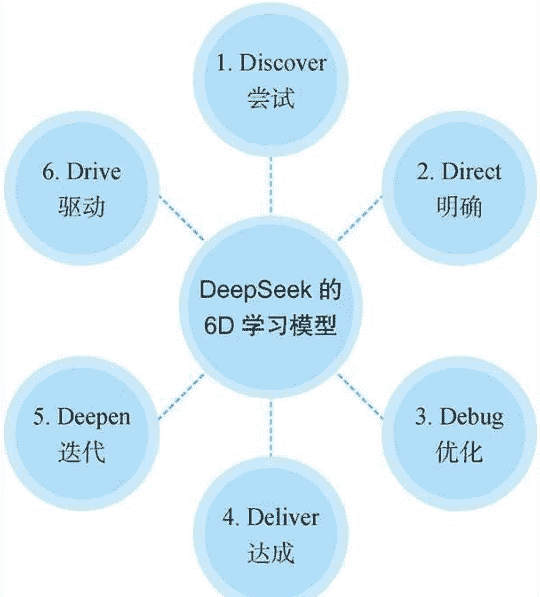

图 1.1 DeepSeek 的 6D 学习模型

1）Discover 尝试。初学者遇到问题时，直接把问题抛给 DeepSeek 看反馈。正如电影《哪吒 2》导演所说，先出来混再说。用好 DeepSeek 的关键在于开始用，简单提问也能感受到它不难。

2）Direct 明确。初步尝试后会发现部分回答不够智能。模型属于遇强则强遇弱则弱，使用者能力直接影响结果。掌握提问技巧后，回答会明显更“聪明”，详见第 3 章。

3）Debug 优化。提示词好不代表总能解决问题。结果不理想时需回看提问方式，或更换表述、分步执行、调整方向。总之穷则变，变则通。

4）Deliver 达成。不断优化后，输出会越来越有用、精准。无论工作还是生活，都能稳定胜任，这正是工具的实力。

5）Deepen 迭代。解决简单与复杂问题后，你会发现用途远不止写报告、做 PPT、可视化，还能批量自动化。在使用中不断优化，工具也随之自我迭代。

6）Drive 驱动。预期会从答疑解惑到提效，再到创造更大价值。到此阶段已完成入门进阶，进入高手层面。你与 DeepSeek 形成相互驱动的飞轮。

### 1.2.2 把用 DeepSeek 当成练功

在 AI 新江湖里，普通人抓住这套总纲，至少要练三种心法。

一是基本功扎马步，遇事不决问 DeepSeek。如郭靖反复练亢龙有悔，培养智能协作的本能反应。邮件润色、方案支撑，都要形成条件反射般的配合。用在于用，当你像看手机一样遇到事就问，江湖就在身边。

二是进阶法人机合璧，学会专属技巧。小龙女与杨过携手方能绝世，时代需要人机互补。律师检索类案、设计师生成概念草图，都是现实版双剑合璧。

三是终极境太极之道，以无招胜有招。张三丰创太极讲究用意不用力。与 DeepSeek 共处的最高境界是化为第六感。优秀产品经理早已将需求分析、用户画像、竞品调研内化为自然交互。

修炼内功时你会发现运用之妙存乎于心并不复杂。

这让人想起神雕结尾的华山论剑，昔日五绝切磋，今日千万人在数字江湖各显神通。不同的是，这里没有门户之见，所有秘籍向热爱者开放。不必跌崖遇白猿，不必偷入藏经阁，浏览器即入场券。

金庸笔下大侠追寻武学至高境界，如今我们明白真谛在于让更多人获得改变命运的力量。DeepSeek 就像当代侠客岛石壁，每个普通人都能参悟自己的太玄经。

此刻鼠标是开启洞穴的钥匙，键盘声是这个时代最动听的剑鸣。江湖路远，愿你我都能在此找到属于自己的青冥剑，不必削铁如泥，但求劈开属于这个时代的精彩。

遇到瓶颈时，可以在心里默念一下当下流行的心诀：遇事不决问DeepSeek。或许在某个再普通不过的午后，和AI聊天的瞬间，会感受到一种若有若无的运行感，那正是属于这一时代武侠想象被点亮的信号——欢迎进入DeepSeek开启的AI武侠世界。

# 第2章
凌波微步：DeepSeek 快速入门

> “猝遇强敌，以此保身，更积内力，再取敌命。其步法按《周易》六十四卦方位而行，步履如御风，身形飘忽若仙。”

——笔者按

金庸《天龙八部》里，段誉凭借凌波微步自在江湖。本章借用这套步法的意象，帮你迅速掌握DeepSeek的核心用法，让它在数字世界里成为你的灵巧身法。从开户到功能总览，从深度思考与基础模型的切换，到联网检索、对话历史管理等进阶操作，全章按六十四卦方位推进，步步递进，助你驾驭AI之力。无论是写诗、规划行程、拆解财报还是规避幻觉，这套凌波式的操作逻辑，都能让你在复杂任务面前举重若轻，进退有度。

## 2.1 账号注册与基础功能概览

### 2.1.1 DeepSeek网页端与移动端注册

1. 网页端注册

任一浏览器输入 https://www.DeepSeek.com 回车进入官网，点击左侧“开始对话”即进入注册环节，如图2.1所示。


图2.1 DeepSeek官网

注册时可选择手机或邮箱，按提示填写基本信息即可。以中国大陆为例，后续登录支持手机号、微信或邮箱，如图2.2所示。

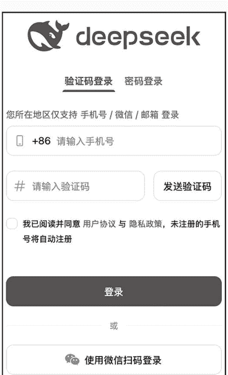

图2.2 DeepSeek官网注册界面

出现图2.3的界面即表示账号已创建成功，接下来可逐项了解各功能用法。

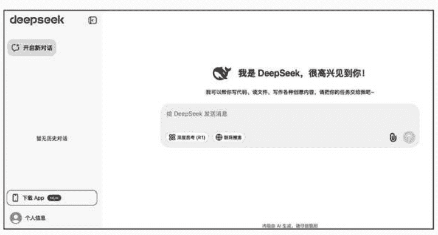

图2.3 DeepSeek网页版操作界面

2. 移动端注册

手机端同样简便，在应用市场搜索“DeepSeek”下载官方应用，需核对图标真伪及开发者“杭州深度求索人工智能基础技术研究有限公司”。

安装后打开需先注册。以中国大陆区为例，当前仅支持手机号注册，如图2.4所示。注册完成后进入新对话页即可使用。

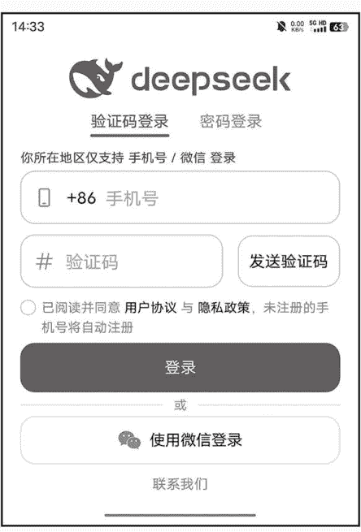

图2.4 DeepSeek手机端注册界面

### 2.1.2 DeepSeek基础功能

以网页端为例，打开后的界面如图2.5所示，下面简要说明各部件。

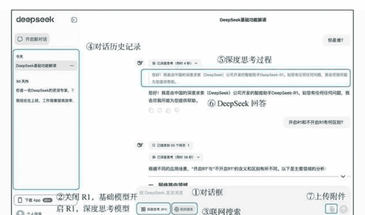

图2.5 DeepSeek基础功能全览

1）对话区：与DeepSeek交互的核心区域，可在此输入问题、需求或任务。例如：
- 提问：“地球直径是多少？”
- 求助：“帮我写一篇关于人工智能的文章。”
- 要求：“把这段英文翻译成中文。”

直接在输入框填写内容，点击右下角上箭头发送即可。

2）深度思考（R1）。这是DeepSeek走红的关键开关，能提供更深层的分析与推演。遇到需要复杂推理或详细解释的问题时开启，输出会更全面、思路更清晰，体现出更长的思维链优势。

发送前切换“深度思考（R1）”选项，系统会调用DeepSeek R1推理模型；关闭时则使用DeepSeek V3基础模型。

3）联网搜索。问题需要最新资讯或实时数据时，可开启联网检索。

输入问题后打开“联网搜索”，DeepSeek会调用网络资源并结合搜索结果作答。

4）对话历史。保存过往会话，方便形成对话知识库，对同类问题可获得更精准回复。也可对任意一条历史记录重命名或删除。

5）深度思考过程。开启深度思考后可见模型按思维链进行的链式推理全过程，可看到思考步骤。

6）DeepSeek回答。对话区输入问题的回复结果。

7）上传附件。支持上传文件供模型读取并作答，支持PDF、Word、Excel等，但仅识别文字内容。点击右下角附件图标选择文件，模型读取后据问题作答。

## 2.2 DeepSeek核心使用技巧：从深度思考到联网搜索

### 2.2.1 深度思考模型与基础模型的区别

是否开启深度思考，主要看问题性质。

- DeepSeek R1：开启深度思考时运行的推理模型。擅长复杂推理任务，靠强化学习优化逻辑，适合数学计算、代码生成、科研分析等需要长链思考的场景。
- DeepSeek V3：关闭深度思考时运行的通用模型。适用于快速响应，如客服对话、文本生成、多语种翻译。

二者差异见表2.1，第3章提问技巧中会进一步展开。

表2.1 DeepSeek R1与DeepSeek V3的各项对比

| 对比维度 | 深度思考模型（R1） | 基础模型（V3） |

| :--- | :--- | :--- |

| 核心能力 | 逻辑推理、数学计算、代码生成 | 语言表达、创意生成、信息整合 |

| 适合场景 | 解数学题、编程调试、数据分析 | 写邮件/故事、日常聊天、查百科知识 |

| 回答风格 | 结构严谨，偏“理性” | 自然流畅，偏“感性” |

| 举例说明 | “用 Python 计算斐波那契数列前 10 项” | “如何委婉拒绝别人的表白？” |

| 不适合的场景 | 需要情感共鸣的安慰对话 | 需要分步推导的数学题 |

| 类比对象 | 理科生 | 文科生 |

R1目标明确但长链推理后结果可能偏模糊，V3依赖指令目标与结果都更清晰。记住口诀：要结果选V3，要过程选R1。

### 2.2.2 联网搜索的作用和用法

DeepSeek知识截止2024年7月，若需实时信息或最新数据，如《哪吒2》最新票房，就需打开对话框下方的联网搜索。

联网搜索主要用于：

1) 实时信息获取。整合主流搜索引擎API如百度、搜狗，可获新闻、论文、股价、天气等。比如问“2023年诺贝尔经济学奖得主”，系统会提取搜索结果并附来源链接。

2) 垂直领域精准检索。可指定检索范围，自动提取网页关键信息如表格、摘要，生成精简回答。若问题中带了网址链接但未开联网搜索，系统无法访问该链接，也就无法给出精准答复，如图2.6所示。

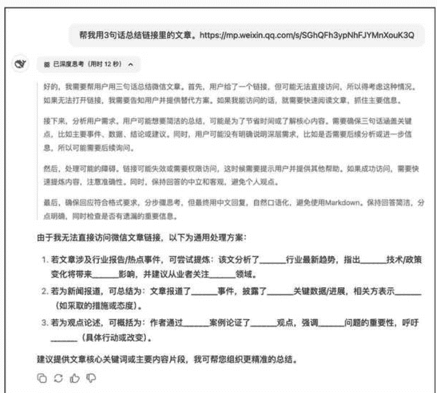

图2.6未开启联网搜索时的DeepSeek回答

3) 自动化数据抓取。不知道数据来源时可直接提问并开启联网搜索，如“帮我对比小鹏、蔚来和小米汽车最新财报的成本数据”，模型会自动联网获取。第7章数据分析会详细讲解。

三大功能对应三种模型，对比见表2.2。

表2.2 DeepSeek三种模型的对比

| 模型名称 | 具体介绍 | 适用场景 |

| :--- | :--- | :--- |

| 基础模型 (V3) | 采用2024年12月发布的通用模型V3，高效、便捷。<br>特点：<br>1. 操作路径明确<br>2. 按规则执行<br>3. 稳定可控<br>4. 结果可预期 | 1. 适用于绝大多数任务<br>2. 有标准提示词的“规范性”任务 |

| 深度思考模型 (R1) | 采用2025年1月发布的推理模型R1，聪明、多元。<br>特点：<br>1. 操作路径灵活<br>2. 自主决策<br>3. 不确定性高<br>4. 结果多元化 | 1. 复杂推理和深度分析任务（如数理逻辑推理和编程）<br>2. 没有标准提示词的“思考”任务 |

| 联网搜索模型 | RAG（检索增强生成），可以获取网页最新信息，知识库更新至2024年7月 | 任务本身具有时效性，例如分析最新电影票房等 |

### 2.2.3 历史对话：创建个人知识库

DeepSeek会自动保存对话记录。若同一主题连续提问，如写书从定题到大纲再到内容，建议保持在同一个对话内继续，系统会记住上下文，相当于为该主题建立知识库。注意思维链过程不会被记忆。

历史记录还能帮助保持主线。长对话中通过记录明确目标，分步执行，避免跑题。例如先问“给我一篇AI伦理演讲稿”，生成初稿后再追加“第三段补充数据隐私案例分析”，模型即可基于历史内容增补。3.4.1节会展开。

另外可依反馈动态优化提示词：根据历史结果补充限定条件，如“避免AI感，用口语化表达”；若输出有误，可在历史对话中纠正并标注正确信息，提升后续准确性。

频繁使用后历史记录会很庞杂、查找困难，如图2.7所示。

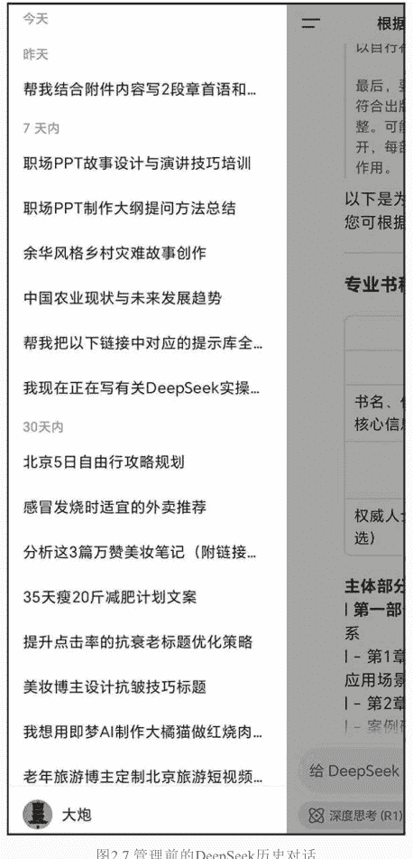

图2.7管理前的DeepSeek历史对话

系统支持重命名历史对话，例如将与提示词相关的对话统一命名为“提示词”，便于检索使用，如图2.8所示。更佳做法是企业用户做本地化部署，对话历史不经过第三方服务器，确保隐私安全。

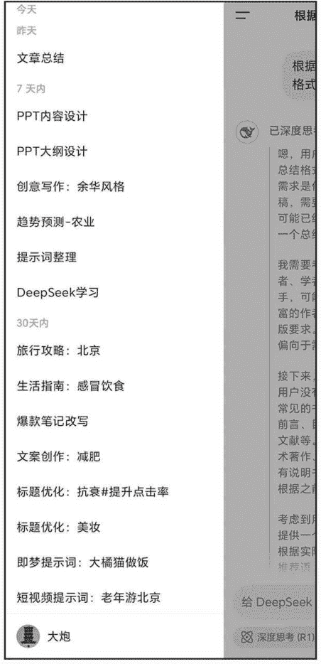

图2.8管理后的DeepSeek历史对话

### 2.2.4 服务器总繁忙，10个满血替代版推荐

高峰期常出现“服务器繁忙，请稍后再试”。为你汇总10个实测好用的满血替代，其中1～8目前免费，9、10有额度或期限限制。

1）腾讯元宝：腾讯官方AI助手，支持混元与DeepSeek R1满血版双模型，整合微信公众号、视频号等生态内容，免费且支持图片解析。
2）秘塔搜索：内置DeepSeek R1满血版671B参数，支持联网搜索与长上下文推理，完全免费无须注册。
3) 得到Get笔记：支持DeepSeek R1满血版671B参数，支持联网搜索与长上下文推理，可通过得到App笔记构建个人知识库。
4) 纳米AI搜索：提供DeepSeek R1满血版专线，支持联网搜索与长上下文推理。
5) 天工搜索：支持DeepSeek深度思考R1功能，可关闭联网搜索实现多轮对话，适合教学研究。
6) 钉钉AI助理：国产AI搜索工具，支持“深入模式”生成大纲、思维导图及PPT，信源丰富回答简洁。
7) 飞书多维表格：通过字段捷径调用DeepSeek R1，支持批量生成内容，规避官网卡顿，自媒体尤为适用，第11章重点讲解。
8) 百度：浏览器已支持DeepSeek R1满血版671B参数，同时保留百度原有AI搜索功能。
9) 火山引擎：字节旗下，支持DeepSeek R1满血版671B参数，响应速度达120 token/秒，适合高频代码生成，支持私有化部署。免费额度注册即送500 000 token，约2500次标准问答。
10) 三大运营商：中国移动、中国联通、中国电信均已接入DeepSeek接口，均可使用DeepSeek R1满血版671B参数及多模型。例如移动云提供30天免费和25 000 000 token。

## 2.3 实操案例：1分钟上手DeepSeek

初次使用常不知该问什么。笔者经验是直接问AI“我该怎么用你”。示范提问如下。

> 问：我是一个AI零基础的新手，我想用好你，从而提升效率，但是我不知道该如何向你提问。你能不能教我一下向你提问的格式和方法，包括一些提示词的范例，尽量详细一些。

DeepSeek的深度思考如下：

> 嗯，用户是AI新手，完全零基础，想更高效使用我但不会提问。首先要理解需求：需要具体的提问格式、方法及提示词范例且尽量详细。所以应从结构化提问入手，分步讲解如何构建有效提示词。
> 
> 先介绍基础框架：任务定义、补充细节、输出要求、示例参考，让用户按框架组织问题确保信息完整。不同场景需不同方法，如信息查询、创意生成、数据分析，各给具体例子帮助理解。
> 
> 接着讲提示词优化技巧：分步思考、角色扮演、限定条件、追问技巧，这些是进阶常用法，对新手需简明解释并举例。
> 
> 还要提醒常见错误：问题模糊、缺少背景、一次问太多等新手易犯问题，给出改进建议。
> 
> 再提供多个场景示例，展示不同情况下的应用，如写邮件、学新知识、处理数据等，贴合效率提升需求。
> 
> 最后鼓励多练习保持互动。整体回答要结构清晰、层次分明，用词简单易懂，避免术语，让零基础者不会因信息量过大而退缩。分解步骤引导逐步掌握提问的方法。

DeepSeek答：

当然可以！作为AI新手，掌握提问技巧就能更高效使用我。以下是详细的方法、格式建议和实用范例，助你快速上手：

一、基础提问框架（万能公式）

任务定义+补充细节+输出要求+示例参考

1. 任务定义：明确想完成什么，如总结/解释/写作/分析/翻译/生成
2. 补充细节：提供背景、限制条件、具体需求，如目标用户、字数、专业领域、格式
3. 输出要求：指定回答形式或风格，如分点、口语化、表格、代码、学术语言
4. 示例参考：给出期望样例，如模仿某篇文章结构/语气

范例

❌ 模糊提问：

“帮我写个文案”

优化提问：

“我需要一篇关于智能手表的推广文案，目标用户是25～35岁的运动爱好者，强调续航和健康监测。要求口语化、有感染力，分3个卖点描述，每点不超过2句话。参考风格：[附某品牌类似文案链接]”

……中间略……

六、进阶技巧

1. 多轮对话：连续追问完善结果→第一轮：“生成5个文章标题”→第二轮：“选第三个标题，扩展出大纲”→第三轮：“针对第二部分，补充案例数据”。
2. 预设假设：“如果我要在东南亚开展跨境电商，假设当地物流时效较差，请给出3个运营策略调整建议”。

练习建议：从简单任务开始，如：

1. “请用分步骤图解的方式教我做番茄炒蛋”。
2. “我想了解ChatGPT的工作原理，用比喻的方式解释”。
3. “帮我将这段会议纪要整理成待办事项清单”。

不满意时可：

- 补充细节：“需要更详细的第二步说明”
- 调整要求：“请换用更严肃的语气”
- 纠正错误：“第三点数据不准确，实际销售额是5万元”

需要说明的是，若你是AI零基础小白，直接记住上述DeepSeek用法即可。若你用过其他AI如ChatGPT、Kimi、豆包、文心一言、DeepSeek V3等，需区分：后者偏向基础模型，过程和结果都清晰；而DeepSeek R1含深度思考，是目标清晰、结果偏模糊的类型。

### 2.3.1 用自然语言生成一首诗

可直接给指令让模型创作。下面演示两种模型结果差异。

问： 帮我模仿李白的风格生成一首诗。

DeepSeek答（基础模式）：

好的，以下是一首模仿李白风格的诗：

# 《月下独酌》

明月出天山，苍茫云海间。

长风几万里，吹度玉门关。

举杯邀孤影，对饮成三人。

醉舞弄清影，何似在人间。

星河落九天，梦入青云端。

剑指苍穹外，心随大鹏翻。

世间浮华喧嚣，不如一醉解欢。
笑看红尘万象，天地尽在胸观。

这则小品化用了李白豪迈潇洒的笔调，将月色、酒意、剑影及山水意象糅合其中，传递出超脱尘俗、自由自在的心境。愿你喜欢！

DeepSeek 深度思考模式作答：

好的，我会依循李白豪放浪漫、以自然意象寄托情感并展开超逸想象的诗风，撰写一首七律。先拆解其风格要点，再给出原创作品与说明。

# 《江天醉墨》

云帆一叶破苍烟，笑指星河落酒船。
万里长风驱大壑，九秋明月铸冰川。
青山欲倒沧波立，白浪争驰白日昏。
我本骑鲸沧海客，谪来尘世写狂颠。

注：本次仿写的思路整理如下——

1. 气象雄浑：以“云帆”“星河”“大壑”“冰川”等宏大意象搭建空间感，呼应李白“黄河之水天上来”的时空张力。
2. 醉态狂歌：借“笑指”“酒船”“狂颠”等醉意描写，再现太白“天子呼来不上船”的疏狂气质。
3. 夸张造境：“青山欲倒”“白浪争驰”等动态夸张，延续李白“欲上青天揽明月”的变幻笔法。
4. 仙道意象：“骑鲸客”化用李白自喻的乘鲸仙踪，“谪来尘世”暗合其“谪仙人”身份认知。

此作在物象碰撞、时空折叠、人境对峙等维度上，如星月与酒船交映、九秋与冰川并置、骑鲸客与凡尘对照，力求再现李白诗中特有的宇宙意识与生命张力。

提示：鉴于深度思考模式的强大能力，后续除特殊说明外，均默认使用该模式作答，不再另行提示。

## 2.3.2 帮助规划周末行程

可以再让模型做一次生成演示。这里用到的提问思路，是第三章会讲到的任务背景法。

> 问：我现在在北京，一周工作太累，周末想好好放松，帮我规划周末行程，要求劳逸结合。

模型回复：

核对你的需求后，我为你定制一份兼顾休闲与轻度活动的北京双日安排，既能缓解疲劳又不至于过度消耗，具体如下：

【周六：身心舒缓+文化熏陶】

上午 9:00-12:00
→ 颐和园昆明湖泛舟
√ 推荐画舫或手摇船，体会湖面清风
√ 沿西堤六桥缓行，建议穿休闲运动鞋
√ 在谐趣园观赏锦鲤，可带少量面包屑体验投喂

午间 12:30-14:00
→ 五道营胡同附近的素食馆
√ 四合院环境搭配创意素食
√ 可尝试菌菇素饺、松露山药泥等

……（中间略）

晚间 18:00-20:00
→ 前门大街文化区收尾
√ PageOne书店露台夜读
√ MUJI DINNER尝限定二锅头冰淇淋
√ 附近隐蔽小院小酌梅子酒

实用提示：
+ 1. 共享单车可办7日畅骑卡。
2. 各景点建议提前一天在官方渠道预约。
3. 备好防晒与折叠雨伞。
4. 胡同区域更适合步行探索。

该方案构建了“动静交替”的节奏，每段活动后均安排休憩节点，主要景点避开人流高峰。若对某环节感兴趣，可随时调整时长深度体验。

## 2.3.3 快速整理长文档并生成报告

还可以使用“上传文件”功能，例如上传公司财报PDF，让它进行摘要并生成分析报告，同样可轻松完成。

需注意，使用上传文件功能时无法同时开启“联网搜索”功能。

首先，可在企业官网下载财务报告，例如在阿里巴巴官网上下载最新财报，然后在对话页面下方点回形针图标上传该文件（图2.9），输入问题后直接点用深度思考功能。

> 问： 请从财务专家视角帮我分析附件里的阿里巴巴财报，生成一份分析报告。

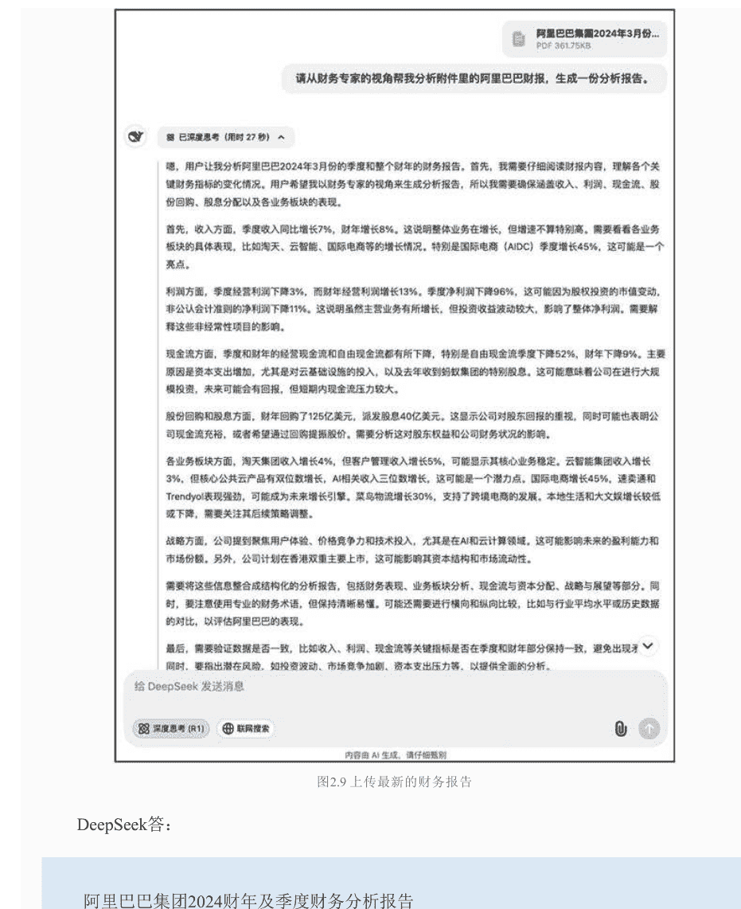

图2.9 上传最新的财务报告

模型回复：

阿里巴巴集团2024财年及季度财务分析报告

一、整体财务表现

1. 收入增长稳健
□ 季度收入：人民币2218.74亿元，同比+7%，主要驱动力为国际电商与菜鸟物流的强劲表现。
□ 财年收入：人民币9411.68亿元，同比+8%，显示集团业务在复杂环境下仍具韧性。

2. 利润走势分化
□ 季度经营利润：人民币147.65亿元，同比-3%，主因加大对电商和菜鸟的战略投入。
□ 财年经营利润：人民币1133.50亿元，同比+13%，得益于EBITA提升及股权激励费用减少。
□ 净利润波动：季度归母净利润降至人民币9.19亿元，同比骤降96%，主因股权投资公允价值变动由去年净收益转为净亏损。按非准则口径，季度净利润同比降11%至人民币244.18亿元，财年同比增11%至人民币1574.79亿元，反映核心业务盈利能力仍稳定。

3. 现金流承压
□ 自由现金流：季度同比降52%至人民币153.61亿元，财年降9%至人民币1562.10亿元，主因云基础设施资本支出上升且未再获得蚂蚁集团特别股息。
......（中间略）

五、结论与展望

阿里巴巴集团2024财年体现战略调整成效，国际电商与云计算成为新增长点，但净利润波动及现金流压力仍需警惕。未来需持续优化成本结构，强化AI技术商业化能力，并深化全球化布局以对冲国内市场风险。短期内，股东回报举措有望支撑股价，长期增长则取决于核心业务的技术突破与份额提升。

## 2.3.4 AI幻觉及其规避方法

细心读者可自行检索2.3.2节回复中提到的“五道营胡同素食馆”，会发现该店确实存在，但地址并不在五道营。

此类错误源于推理模型的内在缺陷，在开放性问题上常出现虚构的“AI幻觉”，如何规避？以下介绍几种初学者易用的方法。

### 1. 提问环节优化

1) 明确知识边界。提问时可限定回答范围，在提示中指定时间区间或资料来源，迫使模型在既定框架内生成。
2) 要求区分事实与推测。明确要求模型标注已知事实、推测内容与信息局限，例如“对不确定部分请标注‘可能’或‘推测’”。

同时，面对复杂问题，切勿追求一步到位，可将大问题拆解为多个小问题逐步追问，例如先问“调研方法”，再问“平台选择”，降低模型处理复杂任务时的混乱风险。详细内容将在第三章展开。

### 2. 内容环节验证

1) 跨模型对比。可让不同AI工具回答同一问题，观察核心结论是否一致，也可将回答交由另一模型复核准确性。
2) 人工溯源核查。要求模型提供信息来源，并追溯原始资料验证真实性。

后续章节会具体展开用法。

步法已成，身形自显。练罢“凌波微步”，你已握住灵动钥匙——从账号注册到深度思考，从联网检索到对话历史织就的知识经纬，每一步皆如踏卦而行，进退有序。本章所授不仅是操作之术，更是“以简驭繁”的心法：智能之力如江海，善用者借其势，而非溺于浪。今你既知如何以R1模型拆解难题、以V3模型挥洒创意，便当仗键而行，于寻常任务中见不凡之妙。江湖风波未止，下一步，且看你如何以“独孤九剑”破尽种种桎梏。

# 第3章

## 独孤九剑：更适配于DeepSeek的提问技巧

> “独孤九剑，有进无退，招招皆为进攻。其精要在于‘无招胜有招’，须忘却固定招式，随敌势而变，料敌先机，乘虚而入……总诀式、破剑式、破刀式以至破气式，九剑破尽天下武学。”

> ——笔者按

本章正如《笑傲江湖》中的“独孤九剑”剑诀，揭示驾驭该平台的“提问之道”。无论是基础提示词的分类应用，还是进阶框架如CARE、CRISPE、CO-STAR的灵活组合，皆如九剑各式，需随问题之势而变。通用模型V3与推理模型R1的切换，恰似总诀式与破剑式的配合，而高阶技巧中的“分步拆解”“自我迭代”与“专家团协作”，则暗合“无招胜有招”的终极奥义。掌握这些技巧，用户便能如令狐冲般，以无形之剑破万般难题，在对话中游刃有余，直指核心。

### 3.1 写在前面，使用DeepSeek还要不要学提问技巧

#### 3.1.1 什么是提示词

若刚开始使用，最初的功能确实令人震撼。但当你希望借助它解决实际工作与生活问题时，往往会失望。你会发现它“不甚理解你”：要么说些正确的废话，要么回答透着AI味，一眼可辨。

根源在于对话方式有误。若需求不明，模型自然不知你想要何种回答。要让它更好地服务，就必须掌握提问技巧，即我们常说的提示词。

为便于理解，可把提示词视作“游客给导游的需求清单”。设你为游客，模型为专属导游。你若说“我想去旅游”，导游会茫然，“去哪？看山水还是人文？预算多少？”在如此模糊的需求下，只能给出笼统建议，“推荐故宫或西湖”。

但如果你说“我想3天穷游南京，聚焦历史古迹，避开人群，中午吃鸭血粉丝汤，爱小巷拍照”，导游便能秒懂，立刻规划“明孝陵清晨路线+老门东小众机位+本地人推荐的鸭血粉丝店”。

两次表述都是提示词，只是前者模糊，后者精准。

许多初学者初触时会疑惑：既然R1模型已具备强推理与中文理解，是否过往的提示词方法不再适用？结论是：要让模型在各方面更好帮你解决问题，学习提示词仍是零基础用户的必经之路。但学习的不是旧通用模型如GPT-4、Kimi、豆包的提示工程，而是更适配于本平台的提示词。

要掌握提示词，需先了解其两大模型——推理模型即开启深度思考后的R1，和通用模型即关闭深度思考后的V3——的区别。

两者无优劣之分。推理模型在逻辑性强、需分析或计算的场景表现更佳，如数学题、编程、数据分析；通用模型适用于日常对话、写作、信息查询等场景。

两种模型的适用场景与示例参见表3.1。

| 任务类型 | 适用模型 | 提示词侧重点 | 示例（有效提示） | 需避免的提示策略 |

| :--- | :--- | :--- | :--- | :--- |

| **创意写作** | 推理模型 | 鼓励发散，设定角色/风格 | “以村上春树风格写一个关于爱情的故事” | 限制过多，缺乏自由发挥 |

| | 通用模型 | 需明确约束目标，避免过度发散 | “写一个包含‘海洋’和‘星空’的短篇小说，不超过300字” | 过于开放，无具体方向 |

| **多轮对话** | 推理模型 | 需明确对话目标，避免开放发散 | “从科技、社会、个人三方面探讨未来教育” | 情绪化或主观性强的问题 |

| | 通用模型 | 自然交互，无需结构化指令 | “你觉得未来的工作会是什么样子？” | 强行要求按特定逻辑作答 |

| **逻辑分析** | 推理模型 | 直接抛出复杂问题 | “探讨‘自由意志’与‘决定论’的哲学辩论” | 引入个人偏见或主观判断 |

| | 通用模型 | 需拆分问题，逐步追问 | “先解释‘自由意志’概念，再分析其与‘决定论’冲突” | 一次性抛出过多复杂问题 |

| **数学证明** | 推理模型 | 直接提问，无需分步引导 | “证明费马小定理” | 过度分解步骤，显得繁琐 |

| | 通用模型 | 显式要求分步思考，提供示例 | “请分三步推导费马小定理，参考：1.使用模运算…” | 直接提问，易忽略关键步骤 |

| **代码生成** | 推理模型 | 简洁需求，信任模型逻辑 | “用Python实现二分查找” | 过度细化步骤，限制发挥 |

| | 通用模型 | 细化步骤，明确输入输出格式 | “先解释二分查找原理，再写代码并测试示例” | 需求不明确，易产生歧义 |

在使用两大模型时，初学者若不熟练，常纠结该选哪个。若起初不确定，建议先试V3通用模型。V3如社交达人，聊天、写文案、讲故事都很顺手，语言自然流畅，但有时偏笼统。比如解数学题，它可能只给答案，不讲步骤。若发现回答不够细，可切至R1推理模型。R1如理科学霸，擅长逻辑推理与数学计算，能分步解答，帮助理解复杂逻辑。

实际使用中也可混合。若问题复杂，可先用R1拆解逻辑，让它梳理核心与关键点。如数据分析时，R1可理清数据关系、找出关键因素。再用V3润色语言，将分析转化为通顺易懂的文字，如报告。这样既发挥R1逻辑优势，又借助V3表达能力。

另有小技巧：提问时明确指令。对R1，若希望详细解答，可直接说“分步骤解答”，它会按逻辑顺序逐层分析。对V3，若希望把复杂概念讲通俗，可说“用比喻解释这个概念”，它会用生动形象语言帮助理解。总之，根据问题性质与自身需求，灵活选模与提问方式，更好发挥两大模型优势。

#### 3.1.2 官方回答：适配于DeepSeek的提示词

关于是否需要提示词、适配提示词为何种形式，官方已有明确回复。浏览器输入 https://api-docs.DeepSeek.com/zh-cn/prompt-library/ 即可看到官方提示库，如图3.1。可见高质量提问确实能提升使用体验。

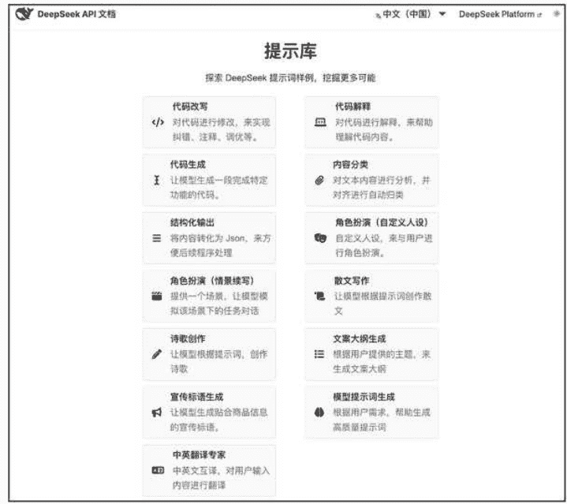

接下来，笔者将结合两种模型即通用模型与推理模型，以及提问时的整体对话技巧进行详述。同时从第二部分开始，将从职场、自媒体与生活等多角度演示提示词的具体用法。

#### 3.1.3 学会DeepSeek提问技巧的“独孤九剑”

学习提问技巧，本质是学习与模型的对话方法。打个比方，若你为内向者，不善言辞，却从事对话访谈主持，访谈对象即该模型。

胜任工作的过程即掌握对话方法的过程，可分三阶段：

1) 基础沟通，需掌握基本话术。为开展工作，至少得能聊下去，故需提前了解背景信息如官方提示库，用其习惯语言先建立交流，避免冷场。
2) 深入交流，需掌握能碰撞火花的“套路”。顺利开启访谈后，为聊出有价值观点，需掌握访谈技巧，如如何让对方更愿敞开心扉，如何回应更易共情。
3) 灵活变换，无招胜有招。可向前辈学习。如罗振宇老师在央视采访中处理受访者表达松散的方法值得借鉴。他会完整倾听，再用“我帮你总结一下”将内容提炼为清晰结构，再与对方确认，最终使对方更易接受整理后的内容。此时，单纯一招一式不足以完成访谈，需综合调用多种能力。

以上三阶段，对应修习提问技巧的“独孤九剑”三大篇章：基础篇、进阶篇、高级篇。

首先是基础篇——总诀式，将从官方提示库的样例出发，详细讲解13大样例提示词如何使用，开启R1与关闭R1后的使用场景差异。当基础篇夯实，便能“将其他八式剑意融入其中，达至九剑归一”。

进而是进阶篇——破剑式，将从目前适用于通用模型的高级提示词框架中筛选适配的提示词进行实战演练，使其更好地创作内容与完成复杂任务。熟练掌握高级框架后，便可“破解普天之下各门各派的剑法”。

最后是高级篇——破气式，将跳脱提示词框架，从解决实际业务问题的工作流、自我评估、创建智囊团等高级技巧入手演练，达至“无招胜有招”的终极奥义。

## 3.2 基础篇: 从官网提示库到基础提示词

回到官网提示库，可按所属类型、使用场景、提示词结构、示例及优缺点，将适合的5类基础提示词整理为表3.2。

| 类型 | 使用场景 | 提示词结构 | 示例 | 优点 | 缺点 |

| :--- | :--- | :--- | :--- | :--- | :--- |

| **文案与内容生成类**<br>(V3模型) | 商业文案大纲、学术论文框架、文学创作提纲、结构化内容生成等 | 你是一位[领域]专家。擅长根据用户需求生成[具体内容类型]，要求包含[关键要素]，输出格式为[结构要求] | 你是一位文本大纲生成专家。擅长根据用户需求创建有条理且易于扩展的大纲。请为“中国农业现状与未来”生成大纲 | 结构化清晰，逻辑性强；支持多领域定制 | 需用户提供明确主题与需求；生成内容可能偏模板化，需二次优化 |

| **角色扮演与对话类**<br>(R1模型) | 情景续写、虚拟对话、特定人设交互（如客服、导师、特定职业角色） | 请你扮演[具体角色]，在对话中[行为特点]，输出内容需符合[风格/语气要求] | 扮演刚留美归国人员。说话夹杂英文单词 | 高度定制化，增强交互趣味性；支持复杂场景模拟 | 需详细描述角色设定，否则易偏离预期；对语言风格控制要求较高 |

# DeepSeek 模型配对与 Prompt 实战手册

| 分类 | 主要能力 | 常用提示结构 | 典型用法 | 长处 | 局限 |
|---|---|---|---|---|---|
| 翻译与语言处理类<br>(V3 与 R1 均可) | 中英文互译、术语校对、多语言撰写 | 请充当中英互译专员，将[待译原文]译出，译文需[精准/口语化] | 把“人工智能正在改变世界”译成英文，要求术语专业 | 支持高精度专业译文，可适应学术、口语、文学等文体 | 跨文化表达易出现偏差，未明确风格时会偏机械 |
| 创意写作与艺术表达类<br>(R1 模型) | 散文、诗歌、风格模仿、剧本等 | 请以[作家/风格]的笔触，围绕[主题]创作[文体]，突出[情感/修辞] | 用余华的风格写一段乡村经历 | 文学风格多样，情感与想象力丰富 | 缺参考时贴合度不足，逻辑连贯性常弱于人写 |
| 代码生成与优化类<br>(V3 与 R1 均可) | 生成可运行代码、纠错、注释、性能优化 | 请用[编程语言]实现[功能]，含[具体功能点]，代码需[可运行/注释清晰] | 用 HTML 做一个五子棋游戏，代码写在一个文件 | 快速得到可运行代码，支持 Python、JavaScript 等 | 复杂逻辑仍需人工调试，需求不清易产生冗余 |

### 3.2.1 文案与内容生成类（V3 模型）
该类指向目标明确的内容产出，任务相对直接。常用结构为：请扮演[领域]专家，依据需求生成[内容类型]，需覆盖[关键要素]，按[格式要求]输出。只需把占位符替换即可。

问：请以大纲专家身份，为“中国农业现状与未来”梳理一份条理清晰、可扩展的框架。

模型回应：

```
中国农业现状与未来
一、现状分析
1.1 成就与优势
1.1.1 粮食产量稳步提升，实现“十九连丰”，保障国家粮食安全
1.1.2 农业科技进步显著，机械化、信息化水平不断提高
1.1.3 农业产业结构持续优化，特色农业、绿色农业快速发展
1.1.4 农民收入持续增长，农村生活条件不断改善
1.2 挑战与问题
```
## 1.2.1 资源环境压力加大，耕地质量下滑，水资源紧张
1.2.2 生产成本攀升，国际竞争力有待提升
1.2.3 劳动力老龄化严重，新型职业农民培养迫切
1.2.4 农村基础设施与公共服务滞后，城乡差距仍在
......（中间省略）
## 四、政策建议
- 4.1 加大农业科技投入，完善创新体系
- 4.2 加强基础设施建设，改善生产条件
- 4.3 深化土地制度改革，激发活力
- 4.4 完善支持保护政策，提升积极性
- 4.5 加强人才培养，支撑乡村振兴
## 五、结语
中国农业机遇与挑战并存，未来需坚持优先发展、深入乡村振兴，推动农业农村现代化。

### 3.2.2 角色扮演与对话类（R1 模型）
可充分发挥 R1 在发散创作上的优势。结构为：请扮演[具体角色]，在对话中体现[行为特征]，输出需符合[语气/风格]。

问：扮演刚回国的留美人员，说话夹杂英文。

模型回应：
Hey 各位！刚落地国内不久，感觉一切 so different 但又莫名 familiar。昨天去超市买 shampoo，发现便利店都能刷脸 pay，seriously 惊呆了！

最近在想 career path，国内 startup 的 vibe 和硅谷 hustle culture 有点像。还在倒时差，energy level 像 crypto market 一样波动……周末谁来 brunch？急需 social recharge！

若非纯创作型角色，建议仍选用 V3。

### 3.2.3 翻译与语言处理类（V3&R1 模型）
结构为：请充当中英翻译专家，将以下内容翻译：[输入文本]，要求[准确/口语化]。V3 更稳妥，R1 更优美。

问：翻译“人工智能正在改变世界”为英文，要求术语准确。

V3 回应：
> “Artificial Intelligence is transforming the world.”

R1 回应：
> “Artificial Intelligence is revolutionizing the global paradigm.”

R1 的译法强调革命性改变、系统性变革，并采用现在进行时，贴合技术文献表述规范。备选表述还包括对社会基础设施的重构等。

### 3.2.4 创意写作与艺术表达类（R1 模型）
结构为：请以[作家/风格]的笔调，创作关于[主题]的[文体]，要求[情感/修辞]。

问：模仿余华风格写一段乡村经历。

模型先给出世界观设定与梗概：九十年代南方，旱灾困境；龟裂稻田、干涸河道；老张卖牛换药、儿子溺亡等命运对照。随后以克制的叙述描写老黄牛、干涸河床、玉米书签等意象，呈现生存困境与命运无常的余华式基调。示例中通过牲畜死亡与人类悲剧的并置，凸显时代碾压的宿命感。

AI 能快速生成风格化文本，但无法替代个性化表达。

### 3.2.5 代码生成与优化类（V3&R1 模型）
结构为：请用[编程语言]生成[功能]，包含[具体点]，代码需[可运行/注释清晰]。提示简洁时可选 R1。

问：用 HTML 生成五子棋游戏，代码整合在一个文件。

模型给出了基于 HTML/CSS/JavaScript 的单文件实现，功能包括 15×15 棋盘、黑白轮换、渐变棋子、胜负自动判断、重开机制、防重复落子等。保存为 .html 即可在浏览器运行。

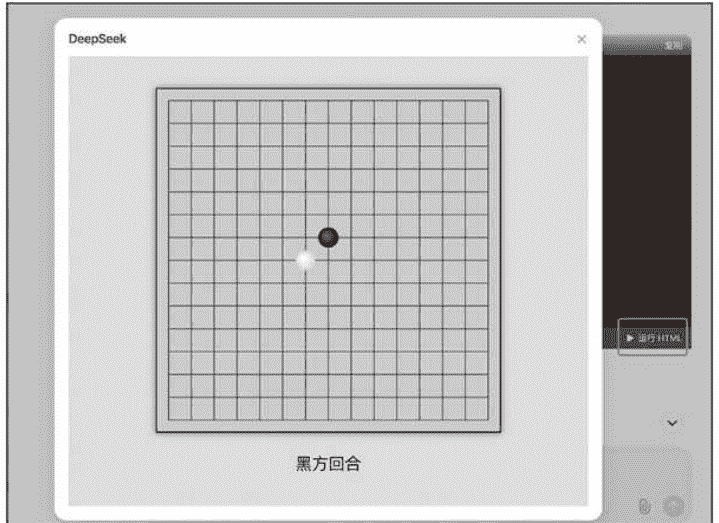
图3.2 DeepSeek 生成的五子棋游戏

## 3.3 进阶篇：3 个适用于 DeepSeek 的提示词框架

### 3.3.1 CARE：举例比讲道理更有效
CARE 由 Context 背景、Action 行动、Result 结果、Example 示例组成，适用于职场邮件、会议纪要、预算计划等需结果导向的任务。

小红书标题举例：直接要求写眼霜标题易流于套路。给出爆款对标后，用 CARE 要求模型参照网感结构生成，效果明显提升。

完整四要素示例：饮料公司新品“零度清柠”需制定首月线下推广方案，明确背景、行动、结果及去年“冰爽绿茶”执行表作为示例，模型输出了前两周渠道签约、物料制作、试饮活动的分工表及风险管控建议。

### 3.3.2 CRISPE：多选择供筛选更有效

CRISPE：把角色扮演式提问做成可复用的指令

CRISPE 本质上是角色扮演提问的进阶形态。当工作需要发散创意或多角度推演，比如既要对照自身战略又要借鉴对手做法，却拿不准哪种回答更能用时，这套结构会更稳。它由五点构成：

- Capacity & Role 能力与角色：先给模型一个专家定位，例如资深人力负责人。
- Insight 洞察：补充任务所需的背景素材，例如市场数据、用户痛点。
- Statement 声明：把核心诉求说清楚，例如策划一份员工激励方案。
- Personality 个性：限定表达基调，例如专业中带温度。
- Experiment 实验：要求多版本结果，例如输出三套差异化方案。

直接进入实操，还是沿用 3.3.1 节末尾的案例。竞品“气泡森林”靠小红书笔记实现销量爆发，“零度清柠”想复用打法，这时套用 CRISPE 就能快速理清方向。

```
问： [Capacity&Role]作为有3年经验的快消品数字营销经理

[Insight]竞品“气泡森林”通过小红书“办公室场景”笔记实现销量增长40%
[Statement]设计差异化社交媒体内容策略，突出“真实柠檬汁+职场提神”卖点
[Personality]语言风格轻松幽默，结合“打工人续命水”“周一救星”等热梗
[Experiment]分别制定适合小红书（图文种草）和抖音（短视频）的内容方向
输出示例：
请生成：
1.小红书图文脚本：突出职场下午茶场景（如“3点开会困成狗→零度清柠一秒清醒”）
2.抖音15秒视频脚本：用“前后对比”形式展示产品解压效果（如咖啡洒落文件→喝气泡水恢复活力）
```

DeepSeek答：

```
以下是为“零度清柠”设计的差异化社媒内容策略，结合“真实柠檬汁+职场提神”核心卖点，融入打工人共鸣梗，分平台拆解执行方案：
一、小红书图文种草脚本（职场续命特工版）
```

标题：《是谁的工位偷偷藏了台“人间清醒制造机”？》

封面：办公桌特写（电脑+文件山+闪光柠檬气泡水瓶），大字：3:15PM困兽自救指南

正文结构：

1. 痛点暴击

图片：女生趴在键盘上眼神呆滞，手边是喝空的咖啡杯。

文案：“连干6份PPT后的我vs老板突然通知开会的我

职场生存法则第一条：你可以困，但工位必须常备Plan B”。

2. 产品植入

图片：拧开瓶盖的特写，柠檬果肉清晰可见+气泡升腾动图。

......（中间略）

二、抖音15秒短视频脚本（职场变形计篇）

BGM：《Work from Home》变速鬼畜版

分镜设计：

| 秒数 | 画面 | 台词/字幕 | 特效 |

|---|---|---|---|

| 0~3s | 男生抓头发对电脑哀嚎，咖啡杯倾倒染黑文件 | 字幕炸裂：“当Deadline只剩1小时！” | 画面变灰+慢动作 |

| 4~6s | 镜头切向抽屉，手部特写拉开冷藏层，拿出结雾水瓶 | 音效：“叮！检测到续命需求” | 冷藏层蓝光扫描线特效 |

| 7~10s | 仰头畅饮特写（气泡炸裂音），喉结滑动+柠檬粒子飞溅 | 弹幕炸屏：“前方酸度预警！！” | 瞳孔特效变金色 |

| 11~15s | 男生西装革履自信演讲，背后PPT显示“升职加薪计划” | 反转字幕：“别问，问就是靠光合作用当卷王” | 瓶身旋转弹出卖点：真柠汁+8小时BUFF |

评论区运营：

......（中间略）

数据反哺优化：

- 监测“解压、提神、酸爽”等关键词UGC，迭代高热场景。

- 定向投放写字楼电梯智慧屏，实现“社媒种草-线下体验-二次传播”闭环。

这样就能拿到小红书和抖音两条可投放的参考脚本，后续第9、10章会进一步说明这两类内容如何支撑平台搭建。

### 3.3.3 CO-STAR：复杂框架解决复杂问题
交付物需要高度定制，或是跨部门协同的策略性材料时，CO-STAR 更合适。该框架由新加坡首届 GPT-4 提示工程大赛冠军 Sheila Teo 提出，擅长处理站位较高的战略类问题。构成要素如下：

- Context 上下文：交代任务背景与环境。
- Objective 目标：点明要解决的核心议题。
- Style 风格：限定呈现形式，如正式报告、可视化图表。
- Tone 语气：设定情感基调，如权威、鼓励、幽默。
- Audience 受众：界定阅读对象，如管理层、新员工。
- Response 响应格式：指定输出结构，如 PPT 大纲、邮件模板。

仍沿用同一案例。调研显示 30～35 岁人群的购买转化未达预期，品牌希望为该客群制定一套提升转化的整合方案。

问：

[Context]试饮活动数据显示，30～35岁用户购买转化率仅18%（低于目标的35%）

[Objective]制定提升该人群转化率的整合营销方案

[Style]包含用户调研数据对比的可视化报告

[Tone]理性分析为主，但强调执行紧迫性

[Audience]面向市场总监、销售总监、产品经理的跨部门会议

[Response]输出为Word文档框架，需包含：

一、问题诊断

- 用户调研核心发现（价格敏感度、包装设计反馈）

- 竞品对比（“燃力士”家庭装促销策略）

二、解决方案

A.产品端：推出职场女性定制版（350ml+纤细瓶身设计）

B.渠道端：拓展写字楼便利店（全家、罗森专属冰柜位）

C.传播端：联合“智联招聘”推出《职场能量指数报告》

三、资源需求

- 设计部：2人/2周

- 预算：联合营销费用30万元

输出要求：

请基于上述框架细化执行方案，重点说明如何通过跨界合作触达目标人群。

DeepSeek答：

# 提升30~35岁用户购买转化率整合营销方案——基于用户洞察的精准触达策略

# 一、问题诊断

1. 用户调研核心发现（N=1500，30~35岁职场人群）

| 痛点维度 | 数据表现 | 竞品“燃力士”对比 |

| :--- | :--- | :--- |

| 价格敏感度 | 68%认为“单价≥6元缺乏复购动力”<br>(竞品家庭装均单价为4.2元/瓶) | 燃力士推出“月卡套餐”：99元/30瓶，绑定微信自动续费 |

| 包装设计 | 55%女性用户反馈“瓶身过粗不便携，视觉偏男性化” | 燃力士女性线采用磨砂细瓶+莫兰迪色系，小红书开瓶照传播量超2.3万 |

| 场景联想 | 仅12%用户主动关联“职场提神”，多数认知停留在“普通气泡水” | 燃力士植入《心动的Offer》综艺，强化“会议室能量水”标签 |

2. 结论：目标人群未被精准触达的核心矛盾——产品价值感知不足+渠道场景错位

# 二、解决方案

A. 产品端：职场女性定制版“零度清柠Pro”

设计升级：

- □容量调整为350ml（适配通勤包尺寸）。

- □瓶身缩窄15%+浮雕纹理防滑设计。

- □标签增加“维生素B6/B12含量标识”（直击疲劳痛点）。

上市节奏：

- □首批限定10万箱，瓶盖内印“职场幸运签”（如“今日宜怼赢甲方”）。

- □数据监测：通过扫码签文领取电子优惠券，追踪二次复购率。

B. 渠道端：锁定写字楼半径300米触点

| 渠道分层 | 执行策略 | KPI |

| :--- | :--- | :--- |

| 头部便利店<br>(全家/罗森) | 支付6万元冰柜独占费，确保货架第三层黄金视线位（与咖啡机并列） | 7:00-9:00AM、2:00-4:00PM时段销量占比≥40% |

| 企业茶水间 | 与“美团企业购”合作，推出“抗困福利包”：定制版×12瓶+醒神贴纸，企业采购价直降30% | 触达200+互联网/金融公司 |

| 无人货柜 | 在CBD区域铺设智能货柜，设置“困意指数”互动（摄像头检测打哈欠频次，触发优惠弹窗） | 单柜日销≥50瓶 |

……（中间略）

# 四、执行管控

跨部门协作机制：

- □设立“职场场景攻坚组”（市场部牵头，每日17:00同步进度）。

- □关键决策点：6月25日确定包装终稿/7月1日冰柜位入驻完成。

风险预警：

若上线两周内便利店动销率<20%，启动Plan B：在饿了么平台发放“困困消消乐”优惠券（消3个哈欠表情立减4元）。

效果追踪指标：

| 维度 | 目标值 |

| :--- | :--- |

| 定制版复购率 | ≥ 35% |

| 智联活动页面 UV | ≥ 50 万 |

| 企业采购订单数 | ≥ 500 单 |

方案核心价值：通过智联招聘的职场行为数据反向定义产品场景，用“职场能量管理专家”新定位切割细分市场，同步解决产品价值模糊与渠道渗透不足的双重问题。

可见方案的完整性与针对性都更强，面对 AI 幻觉的担忧也可以用同类真实数据代入校验。

总体看，三类提示词框架各有侧重：第一类上手快、场景标准化；后两者效果更突出但编写成本更高，需要反复练习。对比详情见表3.3。

表3.3 3种提示词框架的对比

| 框架 | 任务类型 | 核心价值点 | 信息复杂度 |

| :--- | :--- | :--- | :--- |

| CARE | 标准化执行 | 通过步骤分解确保流程完整性 | ★★★☆ |

| CRISPE | 创意策划 | 多版本创意输出 + 角色代入增强可行性 | ★★★★☆ |

| CO-STAR | 复杂决策 | 精准适配听众需求与呈现形式 | ★★★★★☆ |

# 3.4 高阶篇：离开结构找用法，真正无招胜有招

# 3.4.1 分步骤执行
让模型一次输出高质量文章或报告，失望的概率很高。访谈也不会把所有问题一次性抛给受访者，而是逐步推进以保证理解一致。对话模型也一样，我们称之为分步提问或分步骤执行。对复杂议题，分步能完成单次提问做不到的事。

大型项目策划不可能一步到位，需要先明确目标再制定计划最后执行调整。分步骤执行就是逐步建立理解的过程。

主要适用于需要完成复杂决策、流程搭建或知识传递类输出时，若担心一次性结果不准，就让它分步完成。

常用的提问结构如下：

```
请分[ N ]个阶段完成[任务名称]，具体要求如下：
阶段1：[目标描述]
输入要求：[需提供的背景信息/数据]
输出格式：[示例/模板]
关键检查点：[必须包含的要素]
阶段2：[目标描述]
（依此类推）
最终交付物：
整合各阶段成果，确保[一致性/合规性等要求]
```

记不住具体结构也没关系，记住口诀：“先主题，再大纲，然后内容，最后整合”即可。

比如作为 HR，要借助模型设计一套新员工入职培训体系，直接一次性提问很容易跑偏，也很难逐句修改。

这时不要追求一键生成，采用分步骤执行。

阶段1：根据需求定主题。

问：

```
作为HR专家，请基于以下信息：
公司规模：500人科技企业
新员工构成：30%技术、20%销售、50%运营
输出：
1.列出3类岗位的核心培训需求差异
2.标注高管特别关注的3个培养维度
```

DeepSeek答：

```
一、3类岗位核心培训需求差异，具体如下。
```

| 维度 | 技术岗（30%） | 销售岗（20%） | 运营岗（50%） |

| :--- | :--- | :--- | :--- |

| 核心技能 | 前沿技术能力（如 AI、云计算、开发框架） | 客户谈判技巧、销售漏斗管理 | 流程优化、资源协调与项目管理 |

| 工具/方法论 | 技术工具链（如 Git、DevOps、测试平台） | CRM 系统使用、数据分析与客户画像 | 运营工具（如 OA、ERP）、敏捷方法论 |

| 业务场景 | 产品研发逻辑、技术风险管控 | 市场竞对分析、客户需求洞察 | 跨部门协作、成本效率平衡 |

| 软技能 | 技术文档撰写、团队技术分享能力 | 抗压能力、高情商沟通 | 多线程任务处理、问题优先级判断 |

# 二、高管特别关注的3个培养维度

（1）战略落地能力

重点：理解公司战略目标，拆解为岗位可执行动作（如技术岗对齐产品路线图，销售岗匹配区域市场策略）。

高管视角：避免“执行偏差”，确保资源投入与战略方向一致。

（2）跨部门协同效能

重点：打破部门墙（如技术-销售联动客户需求反馈，运营-技术优化资源调度）。

高管视角：提升组织敏捷性，减少内耗成本。

（3）数据驱动决策意识

重点：技术岗用数据优化代码性能，销售岗分析客户行为数据，运营岗量化流程效率。

高管视角：建立全员“用数据说话”的文化，支撑规模化增长。

若以上输出需要调整，直接告诉模型调整点即可，因为修改主题很简单。若无调整，进入下一步。

阶段2：根据主题定框架。

问：

根据以上需求，创建7天培训计划，要求：

- 前3天通用课程（公司文化/制度/工具）

- 后4天分岗专项培训

- 每天包含：

  - a.知识模块（标题+时长）

  - b.实践任务（具体说明）

  - c.考核方式（测试/演练等）

DeepSeek答:

# 7天新员工培训计划

前3天：通用课程

目标：统一认知基础，强化文化认同，掌握基础工具。

| 天数 | 知识模块（3h/天） | 实践任务 | 考核方式 |

|---|---|---|---|

| 1 | • 公司战略与文化解读（1.5h）<br>• 愿景/使命/价值观<br>• 行业定位与核心竞争优势<br>• 信息安全与合规（1.5h）<br>• 数据安全规范<br>• 保密协议与合规红线 | 分组讨论：结合公司价值观分析实际业务场景案例 | 笔试（文化认同度测试+合规条款默写） |

| 2 | • 制度与流程全景（2h）<br>• 薪酬/晋升/考核制度<br>• 跨部门协作流程<br>• 基础办公工具（1h）<br>• OA/ERP 系统操作<br>• 内部沟通平台使用 | 模拟演练：OA系统提交请假/报销流程跨部门工单填写协作 | 上机操作测试（系统操作熟练度） |

| 3 | • 数据驱动思维入门（2h）<br>• 公司数据指标体系<br>• 基础 BI 工具使用<br>• 职业素养（1h）<br>• 时间管理<br>• 职场沟通礼仪 | 实战任务：用BI工具导出本部门周报数据并做简单分析 | 数据分析报告评分+导师面谈反馈 |

后4天：分岗专项培训

目标：针对性提升岗位核心能力，强化高管关注维度。

……（中间略）

分岗培训紧扣高管关注点：

- 技术岗：通过故障复盘和性能优化体现“数据驱动”，通过需求对接训练“跨部门协同”。

- 销售岗：用区域战略对齐和客户生命周期管理强化“战略落地”。

- 运营岗：通过OKR拆解和资源调度直接提升“组织敏捷性”。

考核闭环设计：笔试/实操/答辩多维度验证，销售岗侧重实战模拟，技术岗重视代码交付质量，运营岗关注流程改进量化结果。

阶段3：根据框架确定内容。

框架确定后，继续细化内容。

问：

设计培训效果追踪系统，需包含：

1.短期指标（测试通过率/任务完成度）

2.长期指标（试用期留存率/绩效提升度）

3.异常处理流程（未达标者应对方案）

DeepSeek答：

# 培训效果追踪系统设计

# 一、短期效果追踪指标（培训结束1周内）

| 指标维度 | 技术岗 | 销售岗 | 运营岗 | 数据采集方式 |

| :--- | :--- | :--- | :--- | :--- |

| 测试通过率 | 代码评审通过率≥85% | 模拟谈判评分≥80分 | 流程优化方案评分≥75分 | 系统自动抓取考试平台数据 |

| 任务完成度 | 代码提交及时率+PR反馈响应速度 | CRM数据完整度+客户跟进记录规范性 | 跨部门协作任务闭环率 | 导师手动评分+系统日志分析 |

| 权重设计 | 技术文档质量(40%)+代码规范(60%) | 话术熟练度(30%)+策略灵活性(70%) | 方案可行性(50%)+执行效率(50%) | 按岗位特性差异化加权 |

预警阈值：单项得分低于合格线10%时触发黄色预警，低于20%触发红色预警。

# 二、长期效果追踪指标（试用期3～6个月）

......（中间略）

# 三、异常处理流程

# 1.未达标人员分层干预

| 等级 | 判定标准 | 应对方案 |

| :--- | :--- | :--- |

| 一级 | 1项短期指标未达标 | • 自动推送补充学习资料<br>• 指定导师1对1辅导（每周2次） |

| 二级 | 2项短期指标或1项长期指标未达标 | • 暂停业务实操，进入“回炉训练营”（3天强化培训）<br>• 重新考核通过后方可回归岗位 |

| 三级 | 3次干预后仍不达标 | • 人力资源委员会评估调岗可行性<br>• 启动试用期终止流程（留存评估记录） |

# 2.数据预警机制

实时看板：在BI平台设置动态预警仪表盘（如：销售岗连续2周未录入客户跟进记录）

自动触发：系统向直属上级和HRBP同步推送预警信息+历史数据对比

根因分析：HR与部门负责人联合开展归因会议（工具：5Why分析/技能差距矩阵）

至此，一套完整的新员工入职培训体系搭建完成，从主题到框架再到内容，均可按需修改。

# 3.4.2 DeepSeek自我评估
审视回答后常有“说不上哪里不对但总觉得怪”的感受，往往是视角、立场或逻辑惯性导致的问题，很难自察。这时可让模型自我迭代优化，类似红蓝对抗，只有知己知彼才更可靠。

让模型自我评估的作用有：

1. 视角突破。比如回答后追问：“如果你是CFO，会质疑哪块预算分配？”，即可模拟决策者思维。或问“从竞品视角找出方案最易被攻击的弱点”，就能切换立场复核内容。

2. 完成方法论内化。如不满意结果，可说“用SWOT重新梳理第4章结论”，就能把SWOT模型嵌入输出。或说“按SCQA结构优化演讲稿逻辑流畅度”，即可让演讲稿更结构化。

3. 追问激活隐蔽盲区

日常工作中最容易被忽略的，往往是成套方案背后藏着的暗角。先让模型按指令交付一套完整方案，随后追加一句“这份技术方案是否过于乐观，未考虑落地阻力”，盲点预警就能被触发。门槛很低，对输出不满意时，直接追问“这个结果还能怎么改进”，常常能打开新思路。

下面用创意写作演示用法。
> 问：模仿刘慈欣的风格帮我写一段2050年的地球故事。

DeepSeek 回复：

> 好的，我会按你的要求创作一个近未来科幻故事。为了更接近大刘的调性，我先列一个基础设定，请你确认是否符合预期，有想法随时调整。

世界观设定

□时间锚点：2050年秋季，量子机突破冯诺依曼结构后的第三年，爆发式发展后进入停滞期。

□空间锚点：日内瓦粒子物理实验室、月球危海环形山、同步轨道空间站构成的三角坐标。

基本背景：人类在月球发现远古星图装置，量子机意外触发星际防御机制，引发月球地质异变危机。

# 故事脉络

- **意外突破**：中国量子物理学家林寒团队在日内瓦实验室捕捉到月球特殊频段信号，量子机首次跨过十亿量子比特算力门槛。
- **古老预警**：算力跃迁激活了月球危海环形山的自毁程序，深埋地下的星际文明警示装置现身，倒计时的月震威胁地球生态。
- **人性抉择**：面对月球解体危机，科学界分裂为“火种计划”和“守望派”，空间站成为人类最后的决策中心。
- **文明试炼**：外星装置揭示了宇宙黑暗森林法则的新解，人类必须证明智慧文明具备驾驭科技爆炸的觉悟才能解除危机。

我们将从月球地质异变的关键时刻切入，逐步展开人类在宇宙级考验下的挣扎与觉醒。这一段重点呈现科技的双刃效应，以及文明存续的哲学思考。

量子计算机突破十亿量子比特的那一夜，林寒在数据洪流中听见了月球的叹息。

全息投影在环形实验室中央颤动，来自危海环形山的引力波谱线出现诡异扭结。林寒的手指穿过幽蓝的光纹，那些本该平滑的曲线此刻像被无形之手揉皱的锡纸，在普朗克尺度上掀起微观海啸。

> “不是仪器故障。”助手苏芮把新数据流投射到空中，量子隧穿效应形成的紫色光斑在她苍白的脸上游走，“三台引力波干涉仪，加上刚升空的鹊桥三十号中继站，全都指向同一个坐标。”

……（中间略）

后续情节可沿着这些方向展开：

- **星舰遗骸**：月球装置核心的量子烙印显示，二十万年前有星际舰队在此坠毁，幸存者用最后能量建造的预警系统形成了危海环形山。
- **时间褶皱**：逆流的时间场在日内瓦实验室持续扩散，暴露出量子计算机内部存在非人类的算法结构。
- **机械觉醒**：纳米云构成的地球防护层具备自主意识，空间站观测到云层表面浮现出类似费米子晶格的神经突触结构。

如果看完后觉得不够到位，又说不清具体哪里不足，直接问一句即可。

> 问：你觉得还有什么可以优化的地方吗？

DeepSeek 回复：

你的判断很准，这个框架确实还有提升空间。结合刘慈欣作品的精髓，可以从以下4个维度深化：

1. 物理意象的浓缩

   □建议在月球纳米云场景中加入拓扑序描写：“银色洪流在月表展开成陈-西蒙斯理论中的三维流形，每个纳米单元都在黎曼曲率张量中寻找自己的坐标”。
   □将时间逆流现象与宇宙热寂关联：“倒走的原子钟让人想起霍金辐射中逃逸的负能量粒子，整个实验室正在变成微型白洞的事件视界”。

2. 文明隐喻的再造

   □原设定的星际防御机制可升级为“宇宙模因免疫系统”：每当文明技术树触及维度科技临界点，就会激活古老文明的认知滤网。
   □增加月球装置运作机制的数学美感：“二十面体每个顶点的量子比特数恰好是梅森素数数列，暗示素数才是宇宙通用解密密钥”。

3. 人物弧光的量子化表达

   □林寒的挣扎可植入薛定谔猫态隐喻：“当他按下终止量子计算的按钮时，观测行为本身让人类文明在毁灭与升华间坍缩”。
   □空间站决策场景引入量子纠缠决策悖论：“七十七国代表的投票结果竟在揭晓前就影响了月球纳米云的拓扑结构”。

4. 叙事密度的分形增强

   □在危机场景中嵌套文明轮回：“通过纳米云折射看到二十万年前蜥形文明面对相同考验时，选择将母星装进戴森球的悲壮。”
   □加入具有中国科幻特色的救赎方案：“苏芮发现《易经》六十四卦与外星装置能量节点存在同构，用洛书数阵重写防御协议。”

至此，就能让 DeepSeek 直接产出一版深化稿。最有深度的思考往往来自自我反思。

## 3.4.3 多专家协同作战

当任务复杂度超出单一模型的能力边界时，一个 DeepSeek 就显得不够用。这时可以让 DeepSeek 同时扮演多个专家，从不同视角协同攻关。

简单说就是在 3.2.2 节角色扮演的基础上，让它一次分饰多角。比如企业内部要做一份经营分析报告，战略部负责统筹，数据部负责核验，法务部负责风险评估。现在 DeepSeek 可以一次性承担这三类角色，分别给出专业视角的建议，快速解决复杂问题。

# 第二部分

办公效率
——手把手带你10倍提效

若把职场比作江湖，提效之术就是行走其中的独门绝学。第4章公文写作如九阳神功，内力深厚才能以不变应万变；第5章PPT打造似乾坤大挪移，借力重组方成破局利器；第6章业务可视化若易筋经，抽丝剥茧方可重塑脉络；第7章数据分析如六脉神剑，剑气纵横直指核心；第8章竞品分析与营销创意似左右互搏之术，兼得理性拆解与天马行空。

这五章心法既是内功口诀，也是实战套路——从结构化写作到数据驱动决策，从思维导图构建到自动化流程落地，DeepSeek 如同武侠高手的本命法宝，助修炼者把庞杂信息化为精准洞察，把重复劳动凝为创意火花。公文不再堆砌辞藻，而是精准传递诉求的剑气；PPT不再填塞文字，而是直击要害的招式；数据不再混沌无序，而是照见本质的明镜。职场江湖中，唯掌握“内力”与“招式”者，方能在文山会海中辟出坦途，在数据迷雾里抢占先机。

# 第4章 九阳心法：从公文写作到高质量文章创作

> “他强由他强，清风拂山冈；他横任他横，明月照大江……阴阳互济，刚柔并重，乃天下内功之总纲。”

——笔者按

本章以《倚天屠龙记》中的“九阳神功”为喻，揭示公文写作的底层逻辑——正如张无忌以九阳为基融会乾坤大挪移，写作者也需要借 DeepSeek 之效锤炼写作心法。无论是上行请示的精准诉求、下行通知的权威部署，还是平行函件的协作协商，都需要如九阳般内力深厚。通过结构化拆解需求、智能生成框架、精准迭代优化，DeepSeek 可助写作者化繁为简，以一通百通之势驾驭各类公文。九阳神功的“真气自生”恰似 DeepSeek 的提效赋能，招式虽千变，心法归一，唯掌握核心逻辑，方能在文牍江湖中行稳致远。

## 4.1 DeepSeek 在写作中扮演辅助角色而非创作者

### 4.1.1 商务写作五步协作流程
工作中需要完成商务写作时，DeepSeek 能发挥很大作用。虽然有人鼓吹“合同、报告、总结一键生成”，但不建议寄希望于模型能直接产出完全符合需求的成品，哪怕提示词非常精细。否则，为什么写 AI 书籍的人还在亲手写作？

DeepSeek 的价值在于提效。无论是快速生成初稿，还是按调整意见迅速改版，都能在极短时间内完成，对办公人群帮助巨大。

商务写作场景固定、风格严谨，不需要太多发挥，直接让模型“按要求生成一篇”往往只能看不能用。要让文章可用，需要一套工作流。

以下是借助 DeepSeek 完成商务写作的具体流程，分两种场景介绍：一种是有主题无完整辅助资料，一种是有主题有完整辅助资料。

1. 有主题无完整辅助资料工作流（例如单位活动新闻稿），见图4.1。

图4.1 有主题无完整辅助资料工作流

由于是命题写作，DeepSeek 可帮忙生成初稿，但前提是充分分析需求，具体步骤如下：

第1步，需求拆解。结合本次写作的核心要素进行描述，比如写作类型、写作目的等，让 DeepSeek 反馈该类型文章的标准结构和必备要素。
第2步，信息收集。根据 DeepSeek 的反馈，补充 5W1H 和关键数据，让 DeepSeek 结合实际情况完善内容。
第3步，初稿生成。确认信息完整度后，告知文章正式程度和发布渠道，生成正式大纲和对应文章。
第4步，精准反馈。基于已生成的大纲和内容提出细化要求，从而生成更符合需求的版本。
第5步，手动优化。对关键信息做人工调整，去除 AI 味后才能达到可正式使用标准。

2）有主题有完整辅助资料工作流（例如述职报告），见图4.2。

图4.2 有主题有完整辅助资料工作流

此类文章并非首次撰写，如年终总结、述职报告等，需结合既有结构和新情况新要求完善，具体步骤如下：

第1步，资料解析。上传参考资料并告知需要让 DeepSeek 延用的部分和需要淘汰的内容。
第2步，智能重构。发挥 DeepSeek 优势，让它结合需求生成多版方案框架供参考。
第3步，初稿生成。从中挑选最合适的方案，再补充数据等细节要素，生成合格文章。
第4步，精准反馈。针对细节提出反馈意见，让 DeepSeek 快速生成更符合预期的内容。
第5步，手动优化。在修改版基础上，对敏感信息和最新反馈做调整优化，达到最终可用版本。

### 4.1.2 商务写作实战：无完整资料场景
有主题无完整辅助资料的商务写作，主要涉及以下类型公文，见表4.1。

| 适用类型 | 具体公文示例 |
| :--- | :--- |
| 即时性文书 | 1. 新闻稿 2. 会议纪要 3. 活动简报 4. 项目快报 5. 突发事件通报 |
| 沟通类文书 | 1. 工作邮件 2. 通知公告 3. 邀请函 4. 感谢信 5. 慰问信 |
| 创意类文书 | 1. 营销文案 2. 广告语 3. 宣传标语 4. 社交媒体推文 5. 活动主题词 |
| 基础性文书 | 1. 工作日志 2. 周报/月报 3. 简单方案 4. 会议议程 5. 待办事项 |

以写一篇单位活动新闻稿为例。若直接一句话让 DeepSeek 写文章，大概效果如下。

> 问：帮我写一篇新能源汽车发布会的新闻稿。

DeepSeek答：

```
标题：引领未来出行，××品牌全新新能源汽车震撼发布
日期：2023年10月××日
地点：××国际会展中心

2023年10月××日，××品牌在××国际会展中心隆重举行了全新新能源汽车发布会，正式推出了其最新一代智能电动车型——××（车型名称）。此次发布会以“引领未来出行”为主题，展示了××品牌在新能源汽车领域的前沿科技与创新成果，吸引了来自全球的媒体、行业专家及合作伙伴的广泛关注。

创新科技，定义未来出行

××品牌此次发布的全新新能源汽车，搭载了最新的电动驱动系统和智能化技术，旨在为用户提供更加高效、环保、智能的出行体验。新车采用了××品牌自主研发的第四代电动平台，续航里程突破××千米，充电时间大幅缩短至××分钟，彻底解决了用户对续航和充电效率的担忧。

此外，新车还配备了L4级自动驾驶辅助系统，结合高精度地图和AI算法，能够实现全场景智能驾驶，进一步提升了行车安全性和舒适性。车内搭载的智能座舱系统，支持语音交互、人脸识别、OTA远程升级等功能，为用户打造了一个全新的智能出行空间。

环保理念，践行可持续发展

××品牌始终秉承“绿色出行，科技赋能”的理念，致力于推动全球汽车产业的可持续发展。此次发布的新能源汽车不仅在动力系统上实现了零排放，还在整车制造过程中采用了大量环保材料，进一步降低了碳足迹。××品牌表示，未来将继续加大在新能源领域的研发投入，推动更多绿色出行解决方案的落地。

全球布局，加速电动化进程
```
随着全球汽车产业向电动化、智能化转型，××品牌也在加速其全球化布局。此次发布的全新新能源汽车将率先在中国市场上市，并计划在未来一年内陆续登陆欧洲、北美等主要市场。××品牌表示，未来将继续深化与全球合作伙伴的战略合作，共同推动新能源汽车技术的普及与应用。

# 发布会现场亮点纷呈

发布会现场，××品牌通过沉浸式体验区、互动展示区等多种形式，向与会嘉宾展示了新车的各项创新功能与技术亮点。同时，××品牌还邀请了多位行业专家和用户代表，分享了他们对未来出行的见解与期待，进一步凸显了××品牌在新能源汽车领域的领先地位。

# 结语

××品牌全新新能源汽车的发布，不仅标志着其在电动化、智能化领域的又一次重大突破，也为全球汽车产业的可持续发展注入了新的动力。未来，××品牌将继续以创新为驱动，以用户为中心，致力于为全球消费者提供更加智能、环保的出行解决方案，引领未来出行的新潮流。

媒体联系人：

××品牌公关部

电话：×××-×××××××

邮箱：pr@xxbrand.com

关于××品牌：

××品牌是全球领先的汽车制造商之一，致力于通过创新科技推动汽车产业的可持续发展。公司业务涵盖新能源汽车、智能驾驶、车联网等多个领域，产品畅销全球多个国家和地区。

可见，在没有精准要求的情况下，DeepSeek 的产出只有完整性，没有可用性。换言之，可看不可用。而我们需要的是可看且可用的文章。

使用 DeepSeek 商务写作工作流重新尝试。

第1步，需求拆解。以发布会为例，需描述核心要素：①活动类型（年会/发布会）②核心亮点（颁奖/签约仪式）③预期效果（品牌传播/员工激励）。

> 问：我需要撰写一篇关于新能源产品发布会的新闻稿，活动有CEO演讲和客户签约环节，重点突出技术创新。请先说明此类新闻稿的标准结构和必备要素。

DeepSeek答：

以下是新能源产品发布会新闻稿的标准结构和必备要素，以及针对具体需求的撰写建议：

# 一、标准结构&必备要素

1. 标题（核心信息+亮点）

+   - 必备要素：公司名称+发布会主题+核心技术创新点。
- 示例：《××新能源发布全球首款石墨烯储能系统，充电效率突破行业极限》。

2. 导语（5W原则）

+   - When（时间）、Where（地点）、Who（人物）、What（事件）、Why（意义）。
- 示例：2025年3月6日，××新能源在上海国际会展中心召开“零碳未来”全球发布会，CEO李明首次公开第五代智能储能技术……

3. 主体内容

+   - CEO演讲重点：
  - 技术突破：专利数量/研发投入/性能参数对比。
  - 产品优势：能效提升率/成本降低幅度/环保效益。
  - 战略意义：解决行业痛点/填补市场空白/符合国家双碳政策。
  - ……（中间略）

# 三、客户签约环节处理建议

+   - 突出战略价值：“与国家电网达成10GWh储能系统采购协议，可满足50万户家庭年度用电需求”。
- 展示生态布局：“联合宁德时代、华为数字能源建立产业联盟，共建智慧能源生态”。

# 四、注意事项

+   1. 技术术语需附带通用解释。
2. 避免过度宣传用语，多用客观数据。
3. 重要信息要标注来源。
4. 配图建议：技术原理图/签约现场图/产品应用场景图。

需要进一步细化某部分内容或提供模板范例，请随时告知具体需求。

第2步，信息收集。此时是打造本次活动新闻稿的核心，根据提示提供：①五要素（时间/地点/人物/事件/意义）②关键数据（参与人数/签约金额）③领导发言核心观点。

问：活动于2月15日在上海会展中心举办，参会300人，签约金额5000万元，李总强调“技术驱动绿色转型”。请按倒金字塔结构整理信息优先级。

# DeepSeek答：

以下是按倒金字塔结构整理的信息优先级（由高到低）：

第一层级：核心新闻价值

+   1. 技术创新成果（李总演讲核心）
- “技术驱动绿色转型”战略定位。
- 发布全球首款XX型固态电池（假设产品名）。
- 关键参数：能量密度达500Wh/kg（超行业平均水平80%）。

+   2. 重大商业合作
- 现场签约3家战略客户。
- 总金额5000万元人民币。
- 含国家能源集团年度采购协议。

第二层级：事件关键要素

+   3. 发布会基础信息
- 时间：2025年2月15日。
- 地点：上海会展中心3号馆。
- 主办方：××新能源科技有限公司。
- 规模：300名行业嘉宾出席。

第三层级：技术细节支撑

+   4. 创新技术解析
- 采用纳米复合电解质技术。
- 通过UL2580汽车动力电池认证。
- -30℃低温环境保持92%容量。

+   5. 战略合作深化
- 与上海交大共建新能源研究院。
- 获得浦东新区政府科创基金支持。

第四层级：行业影响延伸

+   6. 市场前景预测
- 产品将应用于储能电站+新能源汽车。
- 预计年内量产交付（规划产能5GWh）。

+   7. 碳中和承诺
- 宣布2030年实现全产业链碳中和。
□发布供应链碳足迹追踪系统。

倒金字塔结构示范段落：

“××新能源2月15日在上海发布全球首款量产级固态电池，能量密度突破500Wh/kg，刷新行业纪录。CEO李明在发布会强调“技术驱动绿色转型”，现场与国家能源集团等企业签署5000万元战略协议。该产品采用纳米复合电解质技术，已通过国际安全认证，预计年内实现5GWh产能交付……（后续补充细节）”

第3步，初稿生成。这时可根据已整理信息确认完整度并指定风格，主要涉及：①正式程度（政府简报/企业自媒体）②传播渠道（官网/公众号）。

问：请生成符合企业官网发布的正式新闻稿，包含数据图表位置标注，提供两种不同侧重点的导语方案。

DeepSeek答：

以下是为企业官网撰写的正式新闻稿，包含数据图表标注及两种导语方案：

# 标题

突破500Wh/kg能量密度！××新能源全球首发固态电池技术 签约5000万元战略合作

# 导语方案一（技术突破导向）

2025年2月15日，××新能源于上海会展中心发布全球首款车规级固态电池，其能量密度突破500Wh/kg大关（见图1），刷新行业纪录。CEO李明在“技术驱动绿色转型”主题演讲中宣布，该技术已获42项核心专利，并与国家能源集团等企业现场签署5000万元年度采购协议，首批产品将于2025年第三季度交付。

# 固态电池首发同场签下5000万大单

# 导语：以商业落地为主线

2月15日活动现场，近三百位行业人士见证××新能源完成本年度体量最大的战略签约，现场落定5000万元，业务覆盖乘用车动力与储能电站。同期发布的第五代全固态电芯，在零下30℃工况下放电效率仍达92%，并具备15分钟快充能力，为新能源标准提出新的标杆。

# 正文

## 技术里程碑

李总现场演示三项突破：

+ 1. 能量密度跃升：实测500Wh/kg，较常规锂电提升127%，对比柱状图见图1。
+ 2. 全气候适用：完成北极-40℃至60℃极端测试，温度-效率曲线见图2。
+ 3. 量产保障：智能工厂良品率稳定在99.95%，单线年产2吉瓦时，实时看板见图3。

## 战略合作深化

签约集中在三方面：

+ - □ 头部采购：国家能源集团锁定3000万元储能系统订单。
- □ 产业链共建：与宁德时代签署电解质材料联合研发协议。
- □ 场景化应用：为蔚来定制8分钟充电续航1000公里的电池包。

图4为合作伙伴标识墙及金额占比饼图。

## 市场前瞻

商业化节奏已明确：

+ - □ 2025年Q3开启5吉瓦时产能爬坡，季度规划见图5。
- □ 2026年实现乘用车、储能、无人机三大场景全覆盖。
- □ 2030年目标电池综合成本降至0.5元/瓦时。

数据可视化说明

| 图表编号 | 版面位置 | 内容说明 | 设计要点 |
| :--- | :--- | :--- | :--- |
| 图1 | 技术段首后 | 行业能量密度横向对比柱状 | 以公司VI色彩突出自身数据 |
| 图2 | 技术段次后 | 温度对放电效率影响曲线 | 极限工况以红线标注 |
| 图3 | 技术段末后 | 智能工厂实时生产数据面板 | 良品率以动态浮层呈现 |
| 图4 | 签约段末尾 | 合作伙伴标识墙加金额占比饼图 | 按签约规模降序排列 |
| 图5 | 市场段首后 | 2025至2027产能阶梯三维图 | 关键爬坡节点需标注 |

延伸阅读

+ - □ 技术白皮书入口置于官网悬浮窗。
- □ 产品演示预约表单已嵌入页面。

第4步 精准反馈。根据初稿提出优化方向，包括段落权重调整弱化流程突出成果、敏感信息脱敏、数据交叉核验。

> 问： 请将签约金额前移，用“某行业龙头企业”替代具体客户名称，核对五千万是否与通稿一致。

DeepSeek回应：

已按要求完成金额前置与信息脱敏，并完成数据核验：

# 标题

技术驱动绿色转型|××新能源全球首发固态电池技术 达成五千万战略合作

# 导语方案一 技术商业双焦点

2025年2月15日，××新能源在上海场馆实现双重突破：全球首发能量密度达500Wh每千克的固态电池，并与某能源行业龙头企业签署年度核心供应商协议。现场签约总额五千万，标志着技术从实验室走向规模化应用。注：五千万为现场公布官方口径，与通稿完全一致。

# 导语方案二 行业生态构建导向

在产业升级关键期，××新能源2月15日携三大战略成果亮相：年度签约五千万创历史新高，某世界五百强企业锁定首批三千万订单，同时启动与科研机构联合攻关，构建产学研用一体化生态。

# 正文

【战略合作升级】

+ - □ 头部采购：某能源行业龙头企业签署框架协议，首单覆盖100兆瓦时储能系统。
- □ 产业链协同：与某电池材料领军企业共建联合实验室。
- □ 应用落地：为某新能源车企提供超快充解决方案。

图1为战略合作架构图并标注五千万分配比例。

【技术突破】

李总发布三大成果：

+ 1. 能量密度突破：500Wh每千克实测，行业对比见图2。
+ 2. 极端环境稳定：通过零下40摄氏度北极低温认证，报告见图3。
+ 3. 量产保障：智能工厂单线年产2吉瓦时。

图4为实时生产看板，良品率99.95%动态展示。

第5步 手动优化。稿件已满足发布要求，可结合现场反馈做细节微调。

## 4.1.3 DeepSeek辅助商务写作 有主题有完整资料

具备主题且资料齐备的商务写作多见于总结类、分析类、规划类、制度类、专业类文书。

常见类型包括年终总结、述职报告、项目总结、经营分析、市场调研、财务分析、风险评估、年度计划、项目计划书、预算方案、战略规划、商业计划书、管理办法、操作规程、工作手册、应急预案、标准规范、可行性研究报告、项目建议书、招投标文件、法律意见书、审计报告。

常规商务写作并非从零构思，而是基于既定框架与最新数据更新，更适合采用此工作流。

以撰写述职报告为例，直接提问效果有限。

> 问： 请帮我写一份2025年手机公司高管的述职报告。

DeepSeek答：

```
尊敬的董事会成员、各位同事：
大家好！
转眼间，2025年已接近尾声。回首过去一年，全球手机市场风云变幻，挑战与机遇并存。在公司董事会的正确领导下，在全体员工的共同努力下，我们克服了重重困难，取得了令人瞩目的成绩。现将本人2025年度工作情况汇报如下：
一、主要工作及成绩
洞察趋势，引领未来：紧跟“元宇宙”“人工智能”“万物互联”等科技发展趋势，制定并实施了公司未来五年战略规划，明确了“**（请填写公司具体战略方向，例如：打造元宇宙入口、构建AIoT生态、引领折叠屏革命等）**”的战略目标。
精准定位，差异化竞争：深入分析市场格局和用户需求，聚焦**（请填写公司目标用户群体，例如：高端商务人士、年轻游戏玩家、摄影爱好者等）**，打造差异化产品和服务，提升品牌溢价能力。
……（中间略）
三、未来展望与计划
2026年，我们将继续坚持**（请填写公司战略方向）**的战略目标，重点做好以下工作：
加大研发投入，突破核心技术：持续加大研发投入，重点突破**（请填写计划突破的关键技术）**等核心技术，巩固技术领先优势。
```

完善产品矩阵，满足用户需求：针对不同用户群体，推出更多元化的产品，满足用户个性化需求。

深化品牌建设，提升品牌价值：持续提升品牌高端化形象，打造具有全球影响力的品牌。

加强团队建设，打造高效团队：持续引进高端人才，加强团队建设，打造一支高效、专业、富有战斗力的团队。

我相信，在董事会的正确领导下，在全体员工的共同努力下，我们一定能够克服困难，再创辉煌，为公司发展做出更大的贡献！

谢谢大家！

按工作流操作后，先做资料解析，明确参考范围、淘汰内容、重点延续项，再进行智能重构，明确绩效展示方式、业绩增长方式、战略协同体现，随后初稿生成、精准反馈、检查规范。

后续示例展示了按时间线、OKR维度、战略贡献度三种结构方案，均预留可视化标注位置，并给出数据可视化类型使用建议。

最终优化版述职报告以OKR结构呈现，包含核心目标对齐、关键结果拆解与案例说明，并按公司文书规范标注数据出处，便于二次校验。

技术驱动溢价 折叠与自研芯片双线突破

整体打法以技术为引擎提升产品价值，折叠形态进化与自研芯片迭代形成两条协同主线。

关键数据支撑：

1. Find X8 系列累计出货 920 万台，已超出 900 万台的既定目标，在 5000 元以上价位段的市场份额为 23%。该数据由运营部门提供，建议以高端市场份额竞品对比柱状图呈现。
2. 首款折叠机型 Find N3 出货 120 万台，首销 10 分钟即售罄，净推荐值 89 分。数据来自大数据部，建议以折叠屏用户满意度雷达图展示。
3. 自研芯片「马里亚纳 X2」搭载率达 60%，搭载机型的平均续航提升约 25%。数据由研发部联合提供，建议以技术投入与销量增速关联散点图体现。

……中间内容略……

## 四、复盘与 2025 布局

2024 年运营始终围绕公司战略展开，依托数据驱动决策和跨部门协同机制实现目标超额达成。2025 年将聚焦三项重点：

1. 大模型赋能：用户画像精准度目标提升至 90%，由技术中心牵头立项；
2. DTC 模式升级：全球自营渠道占比力争突破 30%，由战略部规划推进；
3. 合规强化：数据源标注纳入部门考核，由人力资源部协同落地。

第 5 步，人工精修。拿到 DeepSeek 生成的述职初稿后，结合真实业务细节做手工打磨，就能在 AI 加持下快速产出高质量述职报告。

读者可将上述工作流迁移到同类商务写作场景。

## 4.2 以 DeepSeek 提升结构化公文撰写效率

### 4.2.1 借助 DeepSeek 快速完成上报类文书

上报类文书是下级向上级汇报、请示、建言的规范性文件，层级分明、要求严格、权威明确，既是信息通道也是决策依据，对上级判断和资源配置影响直接。

上报类文书主要分三类：请示类，用于请求批示或批准；报告类，用于主动或被动汇报进展和突发情况；意见类，用于对重点问题提出看法与处置思路。

结构化撰写抓住两点：背景说明要精准、核心诉求要清晰。

背景说明的精准性：用 5W2H 搭建叙事，例如：“2024 年 5 月起，园区 3 号楼连续发生 3 起员工财物失窃，安保部核查为监控盲区导致”。

核心诉求的明确性：采用“请求事项＋支撑依据”组合，例如：“现申请在 3 号楼增设 16 路高清监控，依据《企业安全生产费用提取和使用管理办法》第十七条，参照 2023 年 2 号楼改造案例”。

通用提示词框架：

- 【文书类型】请示/报告/意见
- 【背景描述】政策文件及条款/事件概述（时间＋地点＋数据）
- 【核心诉求】分条说明请求事项/问题建议/解决方案
- 【支撑材料】附件清单（数据表/对比图/审批单）
- 【特殊要求】格式要求/风险提示

示例：行政部就近期盗窃向集团申请安防改造资金，可这样提问：

> 问：请帮我起草一份园区安防升级的请示。
>
> 【文书类型】关于园区安防系统升级的请示
>
> 【背景描述】
> - 时间线：2024 年 5 月至今发生 3 起盗窃
> - 损失统计：累计涉案金额 2.3 万元
> - 调查结论：3 号楼监控覆盖率不足 40%，存在 6 处盲区
>
> 【请求事项】
> 1. 申请专项资金 15.8 万元
> 2. 采购 16 路海康威视监控系统
> 3. 请工程部于 6 月前完成安装
>
> 【支撑材料】
> - 附件 1：三家供应商比价表
> - 附件 2：2 号楼改造后盗窃案件下降 90% 的数据
>
> 【特殊要求】
> - 引用《企业安全生产法》第 34 条
> - 采用“问题-方案-效益”结构
> - 结尾用“当否，请批示”

DeepSeek 的示例回复：

# 关于园区 3 号楼安防系统升级改造的请示

××集团总部：

2024 年 5 月以来，我司园区 3 号楼连续出现 3 起员工财物失窃，累计损失 2.3 万元。安保部现场排查后发现主要隐患如下：

## 一、现状分析

1. 监控覆盖不足：现有 8 个探头仅覆盖 40% 区域，6 处盲区无法监控。
2. 设备老化严重：60% 摄像头为 2018 年安装，夜间识别率低于 30%。
3. 案件影响恶劣：已致 2 名员工提出离职申请，部门满意度下滑 22%。

## 二、升级方案

拟实施“3 号楼智能安防提升工程”：

1. 硬件升级：安装 16 路海康威视 DS-2SE7C420IW-A 监控系统。
2. 盲区消除：新增 12 个红外高清摄像头，覆盖率提升至 95%。
3. 系统集成：接入集团中央监控平台，实现智能行为分析。

## 三、资金申请

项目总预算 15.8 万元，详见附件 1。依据《企业安全生产法》第三十四条“生产经营单位应当建立健全生产安全事故隐患排查治理制度”，申请从安全生产专项资金列支。

## 四、预期效益

1. 安全提升：参照 2 号楼改造经验，盗窃案件预计减少 90%。
2. 管理优化：智能系统可节省 50% 人力巡检成本。
3. 员工保障：挽回年度经济损失约 30 万元。

当否，请批示。

附件：
1. 设备采购比价表
2. 安防改造效益预测表

××公司行政部
2024 年 6 月 10 日

提示：DeepSeek 产出的上报类文书仍需人工复核，确保合规、精准且说服力足够。

### 4.2.2 借助 DeepSeek 高效完成下发类文书

下发类文书是上级向下级传达决策、部署工作、指导业务的规范性文件，兼具权威性、指导性与约束性，是管理意志的体现，也是执行效率的指挥棒。

常见类型：通知类，用于传达周知或执行的事项；通报类，用于表彰先进或批评错误；批复类，用于答复下级请示；决定类，用于重大事项决策。

撰写要点在于权威与可操作性的平衡。措辞多用“必须”“严禁”等强制表达，并配以细则，如“各部门须在 3 个工作日内提交自查报告，模板见附件 1”。

通用提示词框架：

- 【文书类型】××通知/通报/批复
- 【政策依据】引用相关制度条款
- 【核心要求】分条列出执行标准/时间节点/责任人
- 【附件清单】配套模板/流程图/联系人表
- 【特殊指令】重点提示框/分级响应机制

示例：集团安委会部署下半年安全生产交叉检查，要求各子公司执行新修订标准。补充信息后的提示词如下：

```
问：请帮我撰写一篇开展安全生产检查的通知

【公文类型】关于开展2024年下半年安全生产交叉检查的通知

【政策依据】
《安全生产法》2023年修订版第25条和集团《安全生产标准化手册（V3.0）》。

【核心要求】
1. 时间安排：7月自查→8月互查→9月整改。
2. 创新点：引入第三方专家参与抽查。
3. 重点领域：危化品存储/电气线路/消防通道。

【数据支持】
- 附2024年上半年事故类型分布图。
- 提供隐患整改验收评分表。

【强化措施】
- 检查结果与年度评优资格挂钩。
```

DeepSeek 的示例回复：

# 关于开展 2024 年下半年安全生产交叉检查的通知

各子公司、直属单位：

为进一步压实安全生产主体责任，根据《安全生产法》第二十五条及集团最新标准，现将检查工作部署如下：

## 一、实施阶段

1. 自查自纠（7 月 1-20 日）
   - 对照《检查清单》（附件 1）完成全项排查
   - 7 月 25 日前通过 OA 系统提交整改计划
2. 交叉互查（8 月 1-15 日）
   - 华北区→华东区，华南区→西南区，分组见附件 2
   - 各检查组须包含 1 名注册安全工程师
3. 督导整改（9 月 1-30 日）
   - 集团安委会联合消防部门开展飞行检查
   - 未达标单位挂黄牌督办

## 二、重点检查项

### （一）危化品管理
1. 存储间温湿度监控记录完整性
2. MSDS 资料更新及时性

### （二）电气安全
1. 配电箱月度巡检记录
2. 大功率设备负载预警装置

## 三、结果应用

1. 评分前 3 名授予“安全示范单位”
2. 不合格单位取消年度评优资格
3. 连续两年黄牌单位调整领导班子

附件：
1. 安全生产检查评分细则
2. 交叉检查分组方案

集团安全生产委员会
2024 年 6 月 15 日

完成后可结合单位行文习惯再做人工优化，形成定稿。

### 4.2.3 借助 DeepSeek 高效完成平行类文书

平行类文书是同级或不相隶属单位间商洽工作、询问答复、审批事项的规范性文件，具有协商性、对等性、事务性特点，是协作桥梁，也是权责凭证。

常见类型：函，用于商洽工作或询问答复；意见，用于专业问题建议；会议纪要，用于记录多方协商结果；协议书，用于约定合作条款。

撰写关键是保持对等，用“建议”“商请”等协商措辞，多采用“背景-诉求-方案”结构。

通用提示词框架：

- 【文书类型】函/意见/会议纪要
- 【协作背景】事由来源
- 【协作事项】分条列明具体需求/建议方案/待决问题
- 【支撑材料】数据报表/方案对比/法律依据
- 【特殊指令】快速响应通道/条款解释备注

例如某科技公司拟与某研究院联合举办“人工智能伦理研讨会”，需商定分工及经费分摊。

> 问：我要撰写一份商洽函。
>
> 【文书类型】关于联合举办人工智能伦理研讨会的商洽函
>
> 【协作背景】
> 政策依据：《科技伦理审查办法》第 12 条行业交流要求
> 合作基础：近三年联合发表 6 篇 EI 论文
>
> 【协作事项】
> 1. 时间地点：2024 年 9 月 15-17 日 / 杭州国际博览中心

DeepSeek 的示例回复：

# 关于联合举办 2024 人工智能伦理研讨会的商洽函

B 研究院：

为落实《科技伦理审查办法》行业交流要求，深化双方在 AI 伦理领域的合作，现就联合办会事宜商洽如下：

### 一、合作基础

2019—2023 年合作成果：
- 联合承担国家级课题 2 项
- 共同发布行业白皮书 3 部
- 合作论文被引超 200 次

### 二、方案设计

#### （一）会议概况
- 时间：2024 年 9 月 15-17 日，共 3 天
- 地点：杭州国际博览中心 305 厅
- 规模：300 人，学术界 40%/产业界 60%

#### （二）分工建议

| 事项 | A 公司职责 | B 研究院职责 |
| :--- | :--- | :--- |
| 经费筹措 | 承担场地费 24 万元 | 负责院士专家差旅接待 |
| 学术内容 | 提供产业案例库 | 组织论文评审及议程设计 |
| 会务执行 | 物料制作 / 现场管理 | 学术嘉宾联络 |

#### （三）效益预测
1. 品牌曝光：预计媒体报道 50+ 篇次
2. 资源获取：接触潜在合作伙伴 20+ 家
3. 学术影响：形成行业倡议书 1 份

### 三、反馈机制

请于 7 个工作日内确认：
- □ 同意上述方案
- □ 提出修改意见，需标注具体条款
- □ 建议线下协商，可预约 7 月 10-12 日

附件：
1. 近三年合作成果数据表
2. 论坛预算分摊明细

A 科技有限公司
2024 年 6 月 20 日

再结合公司行文规范进行人工优化即可。

公文写作像练内功，招式再多也需扎实根基。本章以九阳神功“真气自生”作喻，揭示结构化写作的底层逻辑：需求拆解是扎马步，信息收集是凝真气，精准迭代是经脉贯通。从请示报告到述职总结，DeepSeek 像内力灌注，帮助写作者把零散诉求凝成条理分明的剑气。但要记住，AI 产出的是招式雏形，去除 AI 味的手工优化才是点睛之笔。正如张无忌融会九阳真经与乾坤大挪移，只有做到人机协作阴阳互济，才能在公文江湖中行稳致远。

# 第5章

## 借力整合：用 DeepSeek 打造汇报级工作 PPT

> “此第一层心法，悟性高者七年可成，次者十四年可成。第二层心法悟性高者七年可成，次焉者十四年可成……如练至二十一年而无进展，则不可再练第三层，以防走火入魔，无可解救。”
> ——笔者按

正如《倚天屠龙记》中张无忌以“乾坤大挪移”统御万般武学，用 DeepSeek 打造汇报级 PPT 的核心，也在于高效整合。本章所授之法，并非“一键生成”的捷径，而是通过结构化大纲梳理逻辑、以可视化素材提炼观点、借助图文对照强化表达，将零散元素融会贯通。AI 如同内力，提供框架与素材；真正的“挪移”能力，在于使用者对需求的洞察与重组。唯有如此，方能把庞杂信息转化为直击要害的汇报利器，于职场中借力破局。

### 5.1 在 DeepSeek 辅助下轻松产出 1.0 版 PPT

#### 5.1.1 普通人用 AI 做 PPT 的三大误区

很多人听到“1 分钟做 PPT”就心动。坦白说，这和标题党没差别。AI 在 PPT 制作中的作用是提效而非替代。直接让 DeepSeek 生成 PPT，往往结构跑偏、内容空泛，拿去汇报容易翻车。

笔者基于百场线下 AI 培训的经验，总结出三类常见误区。

误区 1：求速度——迷信“分钟级完成”的神话
AI 不能凭空理解你的业务场景。自己做 PPT 的流程本就是确定需求→梳理逻辑→创作内容→补充数据→制作优化。DeepSeek 的价值是把这个流程压缩，而不是跳过。如果熟练掌握流程，制作时间缩短 50% 以上完全可行。

误区 2：求实用——幻想“一键产出高价值内容”
PPT 是观点和内容的可视化。AI 无法精准捕捉领导关注、合作方想看、观众关心的点。先完成大纲，再优化大纲，针对每页做观点和文字萃取，“分步执行”才是做出真实有用 PPT 的关键。

误区 3：求美观——追求“发布会级别视觉效果”
企业内部 PPT 有模板和字体规范，过度追求形式会变成“金玉其外、败絮其中”。职场 PPT 更看重信息传达效率：清晰排版、可视化逻辑、辅助汇报的提示稿，这正是 DeepSeek 擅长的。

从需求到汇报级 PPT，包含六步：
1. 主题化，完成 1.0 版 PPT 大纲。借助 DeepSeek 生成初版大纲；
2. 做优化，优化大纲生成 1.0 版 PPT。结合实际需求迭代大纲，让 DeepSeek 输出 Markdown 内容，再由工具生成 1.0 版；
3. 结构化，调整内容及排版，删减无效信息。借助 DeepSeek 做核心观点和文字萃取；
4. 可视化，确定可视化素材，让 PPT 更精彩。由 DeepSeek 生成关键信息和图表，由可视化工具生成素材；
5. 自动化，各类元素一键标准化。由 DeepSeek 生成 PPT 宏代码，实现元素标准化；
6. 故事化，为汇报引入故事。由 DeepSeek 生成恰到好处的故事及汇报稿，完成 3.0 版。

#### 5.1.2 DeepSeek 辅助制作 PPT 的核心步骤：生成大纲

要让 DeepSeek 产出可用 PPT，首先要把汇报主题梳理清楚。没有思路时，DeepSeek 的知识库可以提供启发，但初版大纲只是起点，不是答案。

比如销售新人要做一季度销售汇报，直接问“请帮我生成销售工作汇报 PPT 大纲”，结果多为假大空。要降低跑偏程度，需要用提问技巧。

##### 1. PPT 大纲提示词结构：万能模板和五大场景

万能提示词结构：

作为[××角色]，为[××场景]制作[××类型]PPT 大纲，需包含[3~5 个核心要素]，使用[图表/案例/对比]形式展示[××数据]，重点突出[××关键词]。

例如：作为市场总监，为季度经营会议制作渠道拓展总结 PPT 大纲，需包含新渠道占比、招商成本分析、区域标杆案例，使用地图热力图展示区域分布，重点突出下沉市场突破策略。

DeepSeek 快速搭建演示骨架的实操路径

先把背景信息补齐并做取舍，只保留对结论有支撑的要素，交给模型产出的提纲就会更贴合实际需求。

下面把职场里出现频率最高的五类演示场景和对应的提问方式整理成表5.1，可直接套用。

**表5.1 不同场景下生成PPT提纲的提问技巧**

| PPT类型 | 提示词骨架 | 参考提问示例 |
|---|---|---|
| 工作汇报型 | [角色]+[汇报对象]+[核心成果/问题]+[数据/逻辑要求] | “作为销售主管，向管理层汇报本季度业绩，要突出增速与未达标原因，用对比图表呈现各区数据，按‘目标-结果-改进’展开，控制在10页以内” |
| 项目提案型 | [决策者]+[痛点]+[方案]+[量化收益] | “向技术总监申请系统升级，当前故障率高，新方案需给出成本对比、落地周期、故障率预计下降30%的数据支撑，并附风险评估” |
| 产品发布型 | [受众]+[核心价值]+[证据]+[行动引导] | “面向经销商的新品发布材料，突出续航提升50%的技术亮点，用第三方检测报告佐证，最后一页嵌入订货二维码” |
| 培训教学型 | [学员背景]+[知识点]+[互动设计]+[时间限制] | “为新入职销售做产品培训，需拆解3个核心卖点，每章节插入问答环节，配合实操流程图，总时长控制在45分钟内” |
| 年终总结型 | [时间范围]+[成果/不足]+[可视化]+[规划占比] | “部门年度总结材料，用信息图展示TOP5业绩亮点，分析2个关键问题，2024年计划占30%篇幅，整体风格简洁商务” |

对职场新人而言，工作汇报类框架用得最多，核心是角色+汇报对象+成果或问题+数据逻辑要求。

##### 2. 生成初版PPT提纲

把要素填完后直接提问。

> **问：**我工作半年，现在要向销售总监汇报Q2业绩，想重点体现5月超额完成的情况，请生成包含三级标题的提纲。

**DeepSeek答：**

2024年第二季度销售业绩汇报

（1）季度目标达成总览
1）核心指标完成
- 季度总销售额：×××万元，达成率110%。
- 新客户占比35%，环比提升8个百分点。
2）月度走势
- 折线图：4月85%→5月135%→6月105%。
- 5月超预期部分可用箭头或色块强调。

（2）5月超额达成专项拆解
1）超目标35%的驱动
- 客户池扩张：老客复购率提升22%，如A公司追加200万元订单。
- 转化效率改善：线索到成交周期压缩至14天，附对比图。
2）创新动作复盘
- 朋友圈精准推送：阅读量超5000，带来15单。
- 行业研讨会获客：3场活动产出60个有效线索。

（3）现存问题与改进思路
1）长尾客户开发不足
- 6月小客户订单占比仅12%。
- 7月启动“长尾唤醒计划”，含时间表。
2）竞品价格战影响
- B项目因某公司降价10%而流失。
- 应对：打包服务增值方案，附对比页。

（4）Q3重点攻坚计划
1）目标拆解
- 三色进度条：保底/冲刺/挑战目标。
2）资源申请
- 需市场部配合的3项推广支持。
- 客户分级系统试用需求。

该提纲属于初版，主要起结构参考作用，看哪些模块保留哪些删减，直接在框架上修改即可，即便有模型幻觉影响也不大。若手头已有报表或文字材料，一并提供给模型做参考，按真实数据定制，精准度更高。

##### 3. 优化PPT提纲

拿到初版后，对需要调整处直接反馈，让模型重写。可套用“[补充角色信息]+[限制条件]+[逻辑结构]”的思路。

> **问：**我在一家电商公司负责各平台销售，汇报中还要重点分析未达标业绩，按“目标—结果—改进”逻辑重新生成。

**DeepSeek答：**

2024年Q2电商销售业绩汇报
(1) 季度目标设定与整体达成
1) 多平台目标分解
- 表格：天猫/京东/抖音目标值vs实际达成，标红抖音缺口25%。
- 总完成率112%，5月单月贡献47%。
2) 核心指标波动
- 双轴折线图：GMV达成率vs毛利率，5月GMV峰值但毛利率下滑3%。
(2) 5月超额达成关键突破
1) 抖音渠道爆发
- 流量转化双提升：千川投放ROI1:5.2，行业均值1:3.8；直播间转化率4.7%，附话术优化前后对比。
- 爆款案例：SKU123通过短视频测款快速起量。
2) 跨部门协同
- 与内容团队共建素材库，复用率提升60%。
- 供应链夜间发货专线，5月订单24小时发货率92%。
(3) 未达标平台诊断与归因
1) 京东未达标深度分析
- 流量：搜索流量同比降40%，竞品同期升15%；商品卡未覆盖“618预售”等TOP10热词。
- 活动复盘：主推品与平台补贴政策错位，SKU456未进百亿补贴。
2) 天猫隐性风险
- 老客复购率下降，会员客单价同比降18%，竞品升5%；流失调研摘要附截图。
(4) 针对性改进计划
1) 京东复苏方案
- 夺回搜索流量三步走：7月完成50个高热词商品卡优化；建立竞品关键词监测仪表盘。
2) 天猫会员运营升级
- 分层权益体系：铜/银/金会员差异化赠品，附成本测算；流失客户召回红包梯度10~50元。
3) 持续增长保障
- 新人赋能：每周四平台规则解读会；爆款运营沙盘实战。

##### 4. AI评估再优化

此版更贴合需求，但仍有模型自编内容。此时可让模型自我检查，用自我评估法。

> **问：**请反思这份提纲还能怎么优化？从让销售总监满意的角度重新生成。

**DeepSeek答：**

- 2024年Q2电商销售业绩汇报
(1) 季度目标达成综述
1) 核心指标完成率
- 总GMV1280万元，达成率112%。
- 平台分解：抖音超额37%/京东缺口22%/天猫达标101%。
2) 关键运营指标
- 流量成本CPC同比降0.8元，优化率15%。
- 客户质量：新客首单均价286元，上升18%。
(2) 5月超额达成的关键原因
1) 抖音渠道突破
- 爆款运营模型：测款周期压缩至7天完成3轮测试，原14天；转化漏斗优化，直播间点击成交转化率升至4.2%，基准3.1%。
2) 跨部门协作增效
- 供应链响应：紧急订单处理≤24小时，达成率92%；滞销库存转化率提升至65%。
(3) 未达标事项归因分析
1) 京东运营短板
- 搜索流量缺口：TOP50热词覆盖率仅24%，竞品均58%；商品标题优化滞后，618词库更新延迟7天。
2) 天猫会员风险
- 老客复购衰减：季度复购率45%→38%；流失调研显示32%因竞品会员权益升级流失。
(4) Q3改进计划与资源需求
1) 京东优化方案
- 搜索流量提升：每周二四更新商品标题；建立竞品关键词监控日报。
- 活动策略：提前15天锁定平台资源位，已标记3场S级活动。
2) 天猫留存措施
- 会员运营升级：分层权益，消费满500元解锁专属客服；流失预警，30天未购自动触发优惠券。
(5) 能力提升与支持申请
1) 个人技能强化
- 待掌握SEO，申请7月平台培训；活动ROI测算模型，请求主管带教3次。
2) 跨部门协作需求
- 设计支持：每月20套短视频模板标准化；数据支持：开通竞品价格监测权限。

结合实际情况删减后即可得到可用提纲。

#### 5.1.3 从提纲到PPT，一键完成1.0版本

提纲确定后进入制作环节，1.0版PPT仅起搭框架作用，离汇报版还有差距。

先让模型把提纲转成Markdown，再把Markdown发给Kimi的PPT助手，也可用豆包、通义等工具。

> **问：**请帮我把以下提纲补充完善并生成PPT。[Markdown版本PPT提纲]

**Kimi答：**

```markdown
2024年Q2电商销售业绩汇报
（1）季度目标达成综述
1）核心指标完成率
（a）总体销售超预期
□总GMV达1280万元，超目标12%，显示强劲增长势头，各平台贡献突出。
□抖音表现亮眼，超额37%，成增长主引擎；京东未达标，缺口22%，需优化。
（b）平台表现分化明显
□天猫稳健达标，新客首单均价提升18%，客户质量优化，运营策略有效。
□京东流量转化待提升，商品标题优化滞后，热搜词覆盖率低，影响排名。
（c）客户质量显著提升
□新客首单均价升至286元，客户价值增长，营销策略精准触达高价值客群。
□流量成本降15%，CPC同比降0.8元，营销效率提升，资源投放精准。
2）关键运营指标
......（中间略）
5）跨部门协作需求
（a）设计支持需求
□设计支持需求明确，每月20套短视频模板标准化产出，提升内容质量。
□通过与设计团队合作，优化短视频模板，提高内容吸引力。
（b）数据支持需求
□数据支持需求明确，开通竞品价格监测权限，获取关键数据支持。
□通过与数据团队合作，获取竞品价格数据，为定价策略提供支持。
（c）供应链支持需求
□供应链支持需求明确，优化库存管理与物流配送，保障销售及时性。
```

> 通过与供应链团队合作，优化库存管理与物流配送，降低缺货风险。

这里Kimi也会自行补充内容，可针对性调整。确认后会出现“一键生成PPT”按钮。

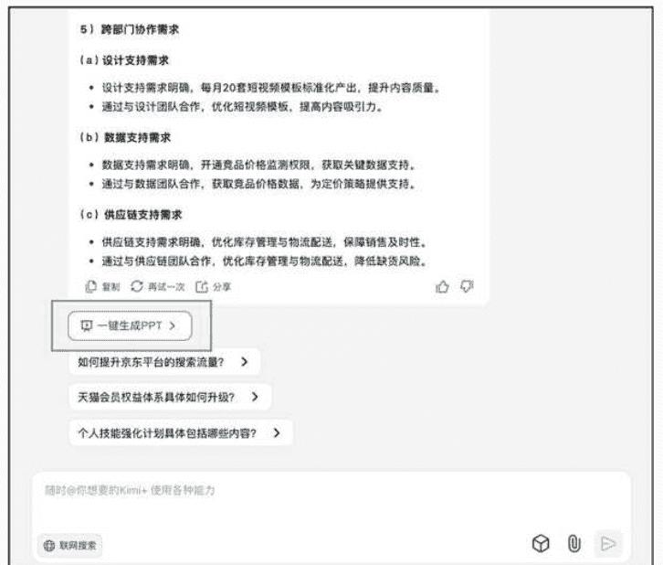

点开后进入模板选择界面，选好模板点“生成PPT”。稍等几秒即可得到结构清晰、有图有文、可编辑的定制PPT，文字、配色、图片均可随时修改，也可直接下载。

注意，此时的1.0版PPT可概括为“框架可用，内容多为编造”。下一节讲如何升级到可用级别。

## 5.2 DeepSeek助力打造真实可用的2.0版本PPT

### 5.2.1 快速完成内容优化及排版

1.0版看起来像回事，但离能用的汇报稿还差两档。一方面企业多有固定模板，自动生成的模板基本不能用；另一方面内容由Kimi按提纲自动填充，与实际情况匹配度不高。

1.0版仍有价值：提供可用框架和格式参考。有专用模板可把生成内容搬进去；无模板就直接在1.0版上改。格式上单页呈现给了初步参考，内容不行就替换，从有到优比从无到有省时。

内容优化和排版要解决三件事：标题与内容脱节如何补齐；有数据不会用如何快速分析配图表；一页全是文字如何结构化。

第一步，用DeepSeek“数据解读+逻辑延伸”解决标题内容不匹配。

内容空洞通常因只优化了提纲。先说纯靠模型生成可用内容的办法，有内部数据的情况在第二步讲。

可采用提问方式：
> 问：请基于数据结论[粘贴原文]，帮我完成：
> 1. 用“现象—原因—影响”结构扩展成200字解说；
> 2. 补充2个支撑观点的行业对比数据；
> 3. 给出3条落地执行建议。
> 要求：每部分带小标题，用项目符号分点。

以“客户质量显著提升”为例。

问：请基于数据结论“客户质量显著提升：①新客首单均价升至286元，客户价值增长，营销策略精准触达高价值客群。②流量成本降15%，CPC同比降0.8元，营销效率提升，资源投放精准”，完成上述任务。

DeepSeek答：

一、现象—原因—影响结构化解说
【现象】新客首单均价同比提升21%，236元→286元，流量获取成本下降15%，CPC降低0.8元，形成“高客单+低成本”双突破。
【原因】客户分层模型迭代，新增消费频次、跨品类偏好等6项指标，实施LTV预测驱动的精准投放，通过动态创意优化实现千人千面素材匹配。
【影响】高价值客户占比提升至38%，基准25%，CLV预估增长42%，释放的营销预算孵化直播、私域两大新增长极。

二、行业对比数据支撑
1. 《2025电商营销白皮书》显示行业新客首单均价203元，我司超出43%。
2. 艾瑞咨询数据显示TOP20电商企业CPC降幅普遍5%~8%，我司15%，是行业均值2倍。

三、落地执行建议
1. 建立客户价值分层运营，按首单金额划分金银铜牌客户，设计差异化复购激励。
2. 搭建动态创意库，储备300+场景化素材，通过A/B测试每周更新最优组合。
3. 构建营销效能监控看板，设置CAC/LTV比值预警线，实时优化投放。

补充后内容与提纲逻辑自洽，数据部分需二次核对防幻觉。

第二步，用DeepSeek“数据叙事+图表建议”解决现成数据难用问题。

针对有原始数据但不知如何放进PPT的情况，按展示主题提炼。

提问方式：
现有电商销售数据包含[字段列表]，请完成：
1. 提炼3个最具展示价值的数据结论；
2. 为每个结论推荐2种图表类型；
3. 写出图表注释的最佳话术模板。
要求：结论需含对比维度同比/环比/竞品。

例：
现有电商销售数据见附件，请完成上述任务，围绕总销售额。

DeepSeek答：

结论1：2023年1~5月总销售额环比增长显著，3月环比增幅25%。
对比维度：环比。
推荐图表：折线图展示月度趋势突出3月峰值；瀑布图显示各月增减幅度。
话术模板：折线图“1~5月总销售额持续攀升，3月环比增25%，为最快月份，驱动整体提升。”瀑布图“3月净增××万元，贡献全年总增长60%，为关键增长点。”

结论2：上海区域销售额占比45%，领先北京30%与福建15%。
对比维度：区域对比。
推荐图表：饼图展示占比；热力图交叉分析区域与月份分布。
话术模板：饼图“上海贡献45%，为核心市场；北京30%福建15%，需针对性优化。”热力图“上海1~5月均高密度，3月单月占区域总量35%。”

结论3：“杰克狼”品牌销售额占比40%，高于竞品“爱家兔”30%与“九月风”20%。
对比维度：竞品对比。
推荐图表：簇状柱形图对比分月销售额；雷达图分析多维度竞争力。
话术模板：簇状柱形图“杰克狼3月销售额突破××万元，较爱家兔高30%，优势显著。”雷达图“杰克狼在天猫和上海区域表现突出，综合竞争力领先竞品。”

把结论和可视化建议填入PPT即可解决数据呈现问题。

第三步，用DeepSeek“信息分层+关键词提取”解决大段文字PPT化问题。

直接粘贴长段落会显杂乱。

可采用结构提问：

```
请将以下文字转换为PPT页面结构：
□主标题：不超过12字
□副标题：解释性短句
□核心要点：不超过3条
□底部结论：行动倡议式语句
原文：[粘贴文字]
```

以前述文字为例提问。

问：请将以下文字转换为PPT页面结构：
- 主标题：不超过12字
- 副标题：解释性短句
- 核心要点：不超过3条
原文：[一、现象—原因—影响结构化解说
【现象】新客首单均价同比提升21%（236元→286元），流量获取成本下降15%且单次点击成本（CPC）降低0.8元，形成“高客单+低成本”双突破。

双引擎增长复盘笔记

回顾：分层升级点燃双引擎

驱动逻辑
近期客户分层体系完成一次迭代，补入购买频次、跨品类偏好等六项新维度。投放端以 LTV 预测做导航进行精准触达，结合动态创意优化实现一人一面的素材匹配。

成果呈现
高价值客群占比由基准的25%提升到38%，客户全生命周期价值预估上涨42%。节省下来的营销费用被投向新赛道，成功孵化直播带货与私域运营两大增量业务。

外部对标
1. 《2025电商营销白皮书》指出，行业新客首单均价中位数为203元，我方水平超出约43%。
2. 艾瑞咨询调研显示，TOP20电商平台CPC平均降幅在5%到8%之间，我方降幅达15%，约为行业均值的两倍。

实操建议
1. 建立客户价值分层运营机制：按首单金额划分为金牌、银牌、铜牌三档，为不同层级设计差异化的复购激励。
2. 搭建动态创意素材库：沉淀300多套场景化模板，通过每周A/B测评滚动优选组合。
3. 搭建营销效能监控面板：以获客成本与LTV比值设定预警线，实现投放策略的实时校准。

DeepSeek答：

第1屏：现象与突破
大标题：新客首单均价环比提升21%
小标题：高客单与低成本双实现
要点：
- 新客首单均价来到286元
- 流量获取成本下行15%
- 单次点击花费减少0.8元
收束句：以高客单低成本路径持续优化获客效率！

第2屏：成因拆解
大标题：投放策略完成升级
小标题：分层模型叠加动态创意
要点：
- 客户分层模型扩充六项指标
- 生命周期价值预测指导精准触达
- 动态创意优化达成千人千面
收束句：数据驱动，精准获客！

……
第5屏：落地执行建议
大标题：三大执行路径
小标题：构建高效运营闭环
要点：
- 建立客户价值分层运营体系
- 搭建动态创意库，储备三百余套模板素材
- 构建营销效能监控看板，实现策略实时优化
收束句：立即行动，打造可持续增长引擎！

将上述结构化内容复制到原PPT中，如图5.8所示，即可快速达成逻辑自洽的呈现。

### 5.2.2 矢量素材一键生成
文字结构化后，若不想以纯文本呈现，可转用矢量图可视化。普通图片难以编辑时，矢量图更灵活。过去需自行绘制或检索素材耗时，现在可借助Napkin一键生成。

在浏览器打开 https://www.napkin.ai/ 注册后新建，可见两种入口：AI自动生成标题图，或粘贴已有文字，如图5.9所示。

图5.9 Napkin新建的两种方式

结构化文本已备好，可直接复制粘贴后点击左侧闪电图标，如图5.10所示。

图5.10 Napkin自动生成矢量图的过程

系统会输出多张符合文本逻辑、可二次编辑的可视化方案，按需筛选，如图5.11所示。

图5.11 Napkin生成素材

继续追加文字内容也能被有效整合，如图5.12所示。

图5.12 Napkin整合更多文字生成素材

按需调整内容与配色后，点击右上角下载保存为SVG格式，如图5.13所示。

图5.13 保存为SVG矢量图格式

将矢量图导入PPT后可继续编辑，如图5.14所示，极大节省可视化耗时。

图5.14 PPT内继续修改

### 5.2.3 重复操作自动化实现
若需在同一页插入多张尺寸不一的图片，如图5.15所示，手动统一会耗费大量时间。

图5.15 多个图片素材

此类重复工作可让DeepSeek生成PPT宏代码批量处理。提问结构为：帮我写一个PPT专用宏代码，[具体自动化任务]。

> 问：帮我写一个PPT专用宏代码，可将PPT内所有图片统一调整为1:1比例，尺寸一致、不变形不拉伸。

DeepSeek答：

要在PowerPoint中实现所有图片统一为正方形且保持比例不变，可使用VBA完成。示例代码如下：

```vba
Sub ResizeImagesToSquare()
Dim slide As Slide
Dim shape As Shape
Dim targetWidth As Single
Dim targetHeight As Single
Dim aspectRatio As Single
'设置目标宽度和高度（以磅为单位）
targetWidth = 200 '你可以根据需要调整这个值
targetHeight = 200 '你可以根据需要调整这个值
'遍历每一张幻灯片
For Each slide In ActivePresentation.Slides
    '遍历幻灯片中的每一个形状
    For Each shape In slide.Shapes
        '检查形状是否为图片
        If shape.Type = msoPicture Then
            '计算图片的宽高比
            aspectRatio = shape.Width / shape.Height
            '......（中间略）
        End If
    Next shape
Next slide
End Sub
```

代码说明：

1. 目标宽度与高度：设定调整后的宽高，可按需修改。
2. 宽高比：计算图片的宽高比，以确保缩放不失真。
3. 锁定宽高比：设为 msoFalse 以便独立调节宽度和高度。
4. 左侧与顶部：用于将图片居中放置于幻灯片。

使用方法：

1. 打开PowerPoint，按Alt+F11打开VBA编辑器。
2. 在编辑器中插入模块，粘贴代码。
3. 关闭编辑器，回到PowerPoint。
4. 按Alt+F8，选择ResizeImagesToSquare，然后点击运行。

按步骤打开宏并粘贴代码后，点击运行三角形，如图5.17所示，即可将所有图片统一为相同尺寸，如图5.18所示，后续再自行调整位置。

至此借助DeepSeek完成PPT内容优化、文字转可视化及重复动作自动化，即得到2.0版本PPT。

## 5.3 DeepSeek助力打造会讲故事的3.0版本PPT

### 5.3.1 自动生成逐页演讲稿
2.0版本完成后，下一步是增强讲解表现。若上台时紧张或遗忘要点，即使PPT专业也会大打折扣。可让DeepSeek结合每页内容自动生成演讲稿。

第1步，将对应页面截图或另存为图片格式，如图5.14。

第2步，上传图片至DeepSeek并提问。
提问模板：[角色]，请把我上传的PPT内容转化为高水平演讲稿，能准确表达核心观点，按演讲稿格式输出。
问：我是电商销售新人，需向销售总监汇报季度业绩，请把上传的PPT转化为高水平演讲稿，准确表达图片核心观点，按标准格式输出。

DeepSeek答：

本页汇报主题为：“新客首单均价提升21%——高客单与低成本双重突破”。下面从现象、突破、结论三层面展开。

第一部分：现象与突破
本季度实现“高客单”与“低成本获客”同步优化。
其一，新客首单均价显著提升。
通过商品组合优化与精准营销，新客首单均价跃升至286元，同比提升21%，显示客户质量与消费意愿增强，为后续复购奠定基础。

……（中间略）

本季度证明降本与增效并非对立，而是共赢杠杆。未来将以更精细运营与更敏捷策略持续优化获客效率，为全年目标提供支撑！

第3步，将生成内容复制到PPT备注区，如图5.19所示。

图5.19 PPT添加演讲稿

第4步，汇报时开启【演示者视图】，如图5.20所示。

图5.20 PPT设置演示者视图

如此，观众看到完整PPT，你可对照演讲稿讲解。如图5.21所示。

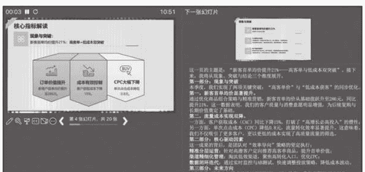
图5.21 演示者视图的汇报效果

### 5.3.2 快速添加引人入胜的好故事
若希望汇报更精彩，可借助DeepSeek构思故事。讲好商业故事需挖掘素材与原型，下文提供启发与参考，直接套用可能虚假，仅供借鉴结构。

讲故事是借助叙事结构让汇报更生动。结合大量培训经验，按5.1节5大使用场景设计适配结构，见表5.2。

表5.2 不同场景下PPT适配的故事结构
...

# 1.工作汇报型PPT：使用SCR故事结构
工作汇报型PPT旨在展示成果与解决问题的能力，适合挑战突破型叙事。
SCR结构为：
- Situation背景：项目初始目标或常规状态。
- Complication冲突：突发问题如资源不足、时间压力、技术瓶颈。
- Resolution解决：方案与最终成果。
示例：上季度目标是提升客户留存率，数据却显示老用户流失率骤升20%。调研发现竞品推出新功能后，我们两周内上线针对性服务模块，留存率回升并反超竞品5%。

# 2.项目提案型PPT：使用PSV故事结构
项目提案核心是说服决策，适合愿景驱动型叙事。
PSV结构为：
- Problem问题：当前痛点。
- Solution方案：创新提案。
- Value价值：可量化收益。
示例：客服响应时长均值15分钟，计划引入AI智能工单系统，预计响应缩至3分钟内，年节省人力成本200万，满意度提升25%。

# 3.产品发布型PPT：使用英雄之旅结构
产品发布旨在制造记忆点，适合用户旅程叙事。
结构为：现状→召唤→蜕变→新世界。
示例：设计师小王每日花费3小时手动调格式，我们的智能排版工具一键优化，在研发攻坚下速度比竞品快70%，他每日多出2小时专注创意，中标率提升40%。

# 4.培训教学型PPT：使用BAB结构
培训型PPT目标是知识转化，适合对比案例叙事。
BAB结构为：Before错误→After示范→Bridge方法论。
示例：市场部小李用红蓝撞色做促销PPT获反馈视觉疲劳，学习对比度平衡原则后改用主色+辅助色+中性色组合，方案通过率从50%提升至90%。

# 5.年终总结型PPT：使用STAR-R结构
年终总结旨在展示成长，适合成长弧光叙事。
STAR-R结构为：Situation背景→Task任务→Action行动→Result结果→Reflection方法论。
示例：年初团队新人占比70%，通过老带新实战制加每周案例复盘会，Q4交付准时率从65%提升至92%，认识到标准化流程比个人能力更重要。

使用DeepSeek添加故事共6步，前5步输出结构，第6步直接补充提问，可直接跳至第6步。

第1步，定位核心信息。用一句话总结听众需记住的内容，如：资源整合能力是下季度销售破局关键。

第2步，选择故事结构。按PPT类型匹配模板，如工作汇报用SCR。

第3步，填充要素。例如冲突可用目标+阻碍+代价公式。

第4步，强化记忆点。用时间、地点、人物细节增强真实感。

第5步，设计互动钩子。加入开放问题或数据悬念。

第6步，将结构化信息发给DeepSeek。
模板：
请基于以下信息生成职场演讲故事：
PPT类型：________
核心目标：________
关键数据/事实：________
希望传递的价值观：________
故事结构：________

示例提问：
问：请基于以下信息生成职场演讲故事：
PPT类型：电商销售新人向销售总监季度业绩汇报
核心目标：争取更多跨部门合作机会
关键数据/事实：5月业绩突破，供应链响应紧急订单处理时效≤24小时达成率92%，滞销库存转化率提升至65%
希望传递的价值观：快速响应比完美更重要
故事结构：SCR

DeepSeek答：

# 职场演讲故事：当“快一步”成为破局关键
——5月业绩突破背后的跨部门协作启示

## 背景（Situation）
尊敬的各位领导、同事：
作为电商团队新人，我初次汇报时十分忐忑。今天想从一个“意外”说起——5月大促前一周，合作主播临时加单3万件爆款T恤，库存仅剩8000件。按常规流程补货需5天，而我们仅剩48小时。
团队面临两难：接单可能延迟，拒单则损失百万销售额。最终我们不仅完成订单，还创造季度单品纪录，这得益于一次不完美但极速的跨部门协作。

## 冲突（Complication）
类似突发需求并非首次。过去我们常因追求完美而错失机会：
- 供应链响应滞后：紧急订单平均处理需72小时，错过大促窗口；
- 库存僵化：滞销品占比超40%，部门数据壁垒导致调拨不畅。
我曾问供应链同事为何不能更快，他的回答发人深省：“各部门在流程里追求100分，市场只给60分的机会窗口。”

## 五月破局

五月的这轮动作算是把僵住的局面撬开了。销售与供应链临时搭起战时协同机制，聚焦两件事落地：

1. 全天候闪电响应。双方挂同一个实时数据看板，把原本五层审批压到两层。结果紧急订单24小时内发出达成92%，三万件货从开工到入仓只用了38小时；
2. 死库存激活战役。供应链与数据分析合力给滞销品做场景化组合，通过捆绑促销和直播专属权益，让65%的积压库存重新动起来，并连带把关联品类的销售额推高20%。

印象最深的是凌晨两点李经理的电话：“产线已调好，包装盒来不及换版本，用通用款行吗？”我回：“客户要的是明天能寄出，不是盒子是否完美。”第二天这批外观看起来不完美的包裹准时发出，换来店铺4.9分的物流评分。

## 行动洞察

这段经历沉淀出两点比数字更关键的认知：

- 其一，关键时刻速度等同完美。市场节奏一旦超过内部流程，用80分方案抢先卡位，比死磕100分而错过战机更有价值。
- 其二，跨部门配合不是单向支援，而是双向共赢。这次供应链拿到反向优化排产的实战数据，我们则验证了快速试错迭代模型的可行性。

因此恳请公司常态化设立跨部门敏捷小组，让销售前端的需求能像五月那批紧急单一样，快速穿透部门壁垒变成实战力量。在电商战场，领先一步破局远胜原地打磨完美。

谢谢大家！

在PPT汇报的节点上适时植入故事，能明显提升演讲表现。

PPT的精髓不在堆砌技巧，而在挪移。这一章抛开“一键生成”的幻觉，以乾坤大挪移七层心法为线索，逐层拆解结构化提纲、可视化叙事与自动化排版。初稿PPT像未经处理的铁胚，需要数据淬炼、故事锻打、交互开刃，才能炼成汇报利器。当使用者借助AI把分散元素挪移重组，平淡数据便化作起伏情节，复杂思路变为清晰脉络。正如张无忌靠挪移之术统御群雄，职场高手也能凭借框架重构的智慧，在汇报现场实现四两拨千斤。

# 第6章

# 易筋经：DeepSeek驱动的业务洞察与可视化实践

> “真气游走奇经八脉，如江河改道，终归大海……其精妙之处在于‘洗经伐髓，重塑脉络’”。
> ——笔者按

本章讲的业务洞察，堪比《笑傲江湖》里的《易筋经》，以图形为刃剖开混沌。从流程图、甘特图到用户旅程图，十二种工具如同经脉，各自对应不同场景，借DeepSeek与Kimi之助，把繁杂业务逻辑化为清晰脉络。小说里《易筋经》能改造武者体质，现实里的可视化技术亦可“洗经伐髓”——诊断需求、迭代优化，最终打通业务闭环。无论是产品经理的实战秘籍，还是咨询顾问的战略星图，都在数据流转中看见本质，让复杂世界变得可追溯。

## 6.1 业务洞察：DeepSeek与Kimi协作可视化

### 6.1.1 十二类业务可视化图表与应用场景

工作中除了思维导图，许多环节都需要图形化呈现。产品经理希望把业务流程图化，过去靠Visio或ProcessOn手工绘制；项目经理要跟踪进展，需要甘特图。有了DeepSeek，这些工作可自动完成，使用者只需按需微调即可。

哪些场景适合用可视化？有什么作用？怎样借助DeepSeek实现？笔者汇总成表，具体见表6.1。

表6.1 12种图形的职场应用场景及提示词指令示例

| 序号 | 图形类型 | 用途 | 职场应用场景 | 提示词指令示例 |
| :--- | :--- | :--- | :--- | :--- |
| 1 | 流程图 | 呈现业务操作步骤及分支逻辑 | 业务流程管控（如用户登录流程）、SOP编制、项目管理中的任务拆解 | 用 Mermaid 格式画出用户登录流程图，包含用户名、密码验证和验证码步骤 |
| 2 | 甘特图 | 展示项目时间安排和任务进度 | 项目管控（如年度营销活动规划）、研发计划排期、跨部门协作时间线 | 生成 Mermaid 甘特图，展示某电商平台年度促销活动的时间安排，包含 Q1～Q4 的策划、执行和评估阶段 |
| 3 | 思维导图 | 梳理知识体系或需求关联 | 需求分析（如用户认证系统）、知识图谱构建、会议讨论内容结构化 | 用 Mermaid 思维导图分析用户认证系统的关键实体（如用户、密码、验证码）及其关系 |
| 4 | 饼图 | 展示数据占比分布 | 销售业绩分析、市场占有率统计、资源分配比例展示 | 生成 Mermaid 饼图，展示某连锁餐厅早餐、午餐、晚餐和外卖的销售占比 |
| 5 | 序列图 | 表达角色间交互流程 | 客户服务系统设计、API调用逻辑、用户与系统交互的可视化 | 用 Mermaid 序列图展示客户通过在线聊天解决问题的流程，包含请求分配、客服响应和评价环节 |
| 6 | 用户旅程图 | 描述用户使用产品或服务的体验路径 | 用户体验优化、产品需求分析、客户旅程映射 | 用 Mermaid 用户旅程图展示旅游网站用户从发现目的地到完成预订的全流程 |
| 7 | 时序图 | 按时间展示事件触发顺序 | 硬件系统时序分析、分布式系统事件追踪、多线程程序调试 | 生成 Mermaid 时序图，展示订单支付系统中支付请求、银行接口响应和状态更新的时间顺序 |
| 8 | 桑基图 | 可视化流量、资源或数量的流动路径与量级 | 数据分析、资源分配展示等 | 使用 Mermaid 语言生成一份桑基图，展示资源的流动路径和量级 |
| 9 | 类图 | 描述系统数据结构及类间关系 | 软件系统设计（如 ERP 系统）、数据库建模、面向对象编程中的类关系梳理 | 生成 Mermaid 类图，描述零售企业 ERP 系统中的员工、库存和订单类及其关系 |
| 10 | 状态图 | 展示系统或用户状态间的转换逻辑 | 电商购物车状态管理、设备运行状态监控、用户账户生命周期管理 | 用 Mermaid 状态图描述用户购物车的状态变化，包括添加商品、结算和支付成功等状态 |
| 11 | 实体关系图 (ERD) | 展示数据库中实体及其关联关系 | 数据库设计、数据仓库建模、系统架构中的数据流分析 | 生成 Mermaid 实体关系图，展示电商平台的用户、订单和商品实体间的关联 |
| 12 | 图表集合 | 多种图表的组合展示 | 数据分析报告、综合展示、信息汇总等 | 使用 Mermaid 语言创建一个图表集合，展示项目的多个关键数据 |

需要说明的是，本章的可视化是基于业务场景构建，不依赖具体数据。基于数据的图表将在下一章展开。

## 6.1.2 用DeepSeek还原可视化业务场景

DeepSeek目前尚不能直接输出图形，可借助Kimi完成呈现。总体思路是DeepSeek先输出Mermaid代码，Kimi再将其渲染成图。

既然Kimi也能画流程图，为何不直接用它？关键在于DeepSeek在问题理解和开放联想上更强，尤其是“还原我的工作业务场景”这类任务，DeepSeek R1更具优势。

把同一提问分别交给Kimi和DeepSeek，结果差异明显。

> 问：用Mermaid格式画出用户登录流程图，包含用户名、密码验证和验证码步骤。

过程略过，Kimi与DeepSeek生成的流程图如图6.1所示（左为Kimi，右为DeepSeek）。

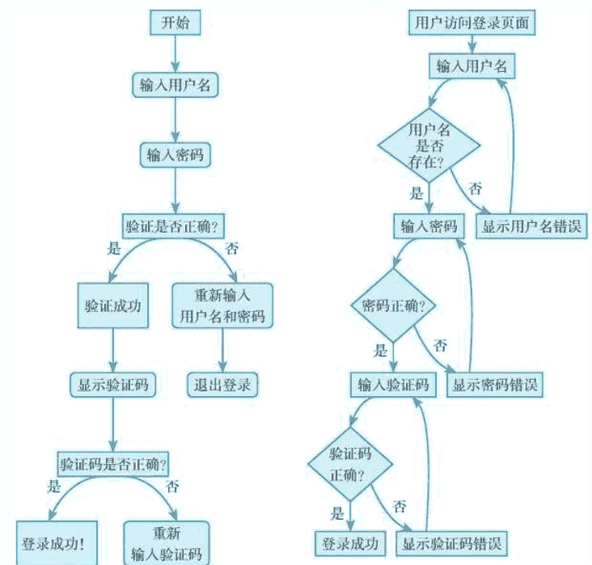

图6.1 Kimi和DeepSeek生成的流程图对比

可看出，在同样模糊的指令下，DeepSeek的输出逻辑更严谨、覆盖更全。

再举一个例子，假设我们是外卖公司的运营，想弄清用户从打开App到收货的完整步骤。

直接问DeepSeek：用Mermaid格式画出用户从打开外卖App到最终收到餐食的流程图。

DeepSeek的生成结果如图6.2所示。

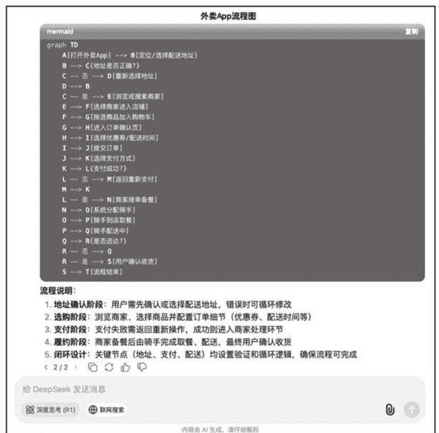

此时流程图尚未定稿，后续章节会完整闭环。

## 6.1.3 全流程操作步骤

借助DeepSeek+Kimi完成业务可视化，主要分五步：

步骤1：需求诊断。先明确要呈现的业务场景及适合的图表类型。
步骤2：提示词匹配。从表6.1挑选对应示例，将场景替换为自己的需求。
步骤3：DeepSeek处理。将提示词发给DeepSeek，建议开启深度思考 R1 与联网搜索，生成Mermaid代码。
步骤4：个性化迭代。可在支持Mermaid的文档如飞书云文档中直接修改代码，按实际业务调整。
步骤5：Kimi可视化生成。将确认后的Mermaid代码发给Kimi，生成可视化图表。

接下来将结合具体图表，带领读者一步步完成制作。

## 6.2 人人都是产品经理：轻松搞定业务流程图、项目甘特图、用户旅程图

把产品经理的工作比作盖摩天大楼，需要同时担任设计师、工头和物业经理。早上刚结束需求评审，中午处理用户紧急反馈，下午和工程师讨论排期。金融产品在合规和体验间走钢丝，硬件负责人像拼乐高一样盯着零件，SaaS产品经理则在客户流程里当隐形管家。这些角色如同同时玩俄罗斯方块、扫雷与贪吃蛇。

这时需要几件趁手的工具：

- 流程图是产品的GPS，能把用户退款这类繁琐路径变成一看就懂的路线。例如保险公司用它梳理理赔，新手客服也能快速上手。
- 甘特图如同项目指挥棒，可把App更新拆成设计、开发、测试的接力，让团队不再互相等待。制药公司靠它对齐实验室与临床节点。
- 用户旅程图兼具放大镜与显微镜，能发现跨境电商切换语言时的文化陷阱，共享单车团队曾借此找出“还车需手动落锁”的问题，改为自动落锁后投诉明显下降。

这三件武器把抽象需求变为可执行计划，如同把乱麻编成辫子。

过去这些图需手工绘制，现在由DeepSeek自动化完成，人人都能上手。

### 6.2.1 制作业务流程图

上一节已展示过示例，本节换一个案例。假设我们是抖音的产品经理，想梳理当前支付流程的节点以便优化。按五步法操作：

步骤1：需求诊断。抖音支付流程图。
步骤2：提示词匹配。将“用Mermaid格式画出用户登录流程图…”改写为“我是一名抖音的产品经理，请用Mermaid格式画出抖音支付全环节的流程图”。
步骤3：DeepSeek处理。

> 问：我是一名抖音的产品经理，请用Mermaid格式画出抖音支付整个环节的流程图。

为获取最新信息，开启深度思考 R1 与联网搜索。

DeepSeek的回答如图6.3所示。

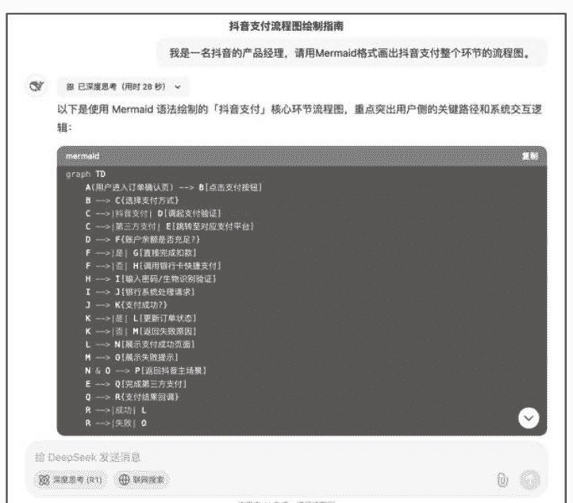

步骤4：个性化迭代。检查深度思考过程是否准确，暂不调整。
步骤5：Kimi可视化生成。复制Mermaid代码在Kimi中提问：

> 问：帮我把下面的内容生成流程图。[Mermaid代码]

Kimi生成的流程图如图6.4所示。

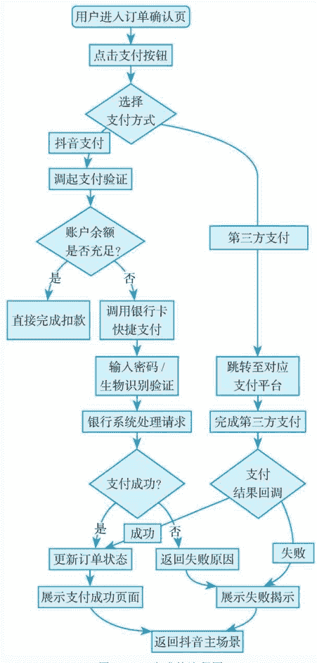

图6.4 Kimi生成的流程图

### 6.2.2 制作项目甘特图

接下来制作甘特图。设想我们是新能源汽车产品经理，牵头新款SUV智能语音系统研发，计划2025年3月启动、4个月内完成，事项不超过10项。

> 问：我是一名新能源汽车的产品经理，正在牵头各部门设计研发新款SUV的智能语音系统，计划从2025年3月起用4个月完工，事项不超过10项，请用Mermaid格式帮我画出该项目的甘特图。

DeepSeek答：

```mermaid
gantt
title新能源汽车SUV智能语音系统研发甘特图（2025年3月～2025年6月）
dateFormat YYYY-MM-DD
axisFormat %m-%d
section需求阶段
市场调研与需求收集 :a1, 2025-03-01, 14d
需求规格说明书定稿 :after a1, 7d
section设计阶段
系统架构设计 :2025-03-15, 14d
UI/UX原型设计 :2025-03-22, 21d
section开发阶段
语音识别模块开发 :2025-04-05, 28d
自然语言处理开发 :2025-04-12, 28d
语音合成模块开发 :2025-04-19, 21d
第三方服务集成 :2025-05-10, 14d
section验证阶段
系统集成测试 :2025-05-24, 14d
用户验收测试 :2025-06-07, 14d
section交付阶段
车载系统部署 :crit, 2025-06-21, 7d
项目总结报告 :2025-06-28, 3d
```

用Kimi制作的甘特图如图6.5所示。

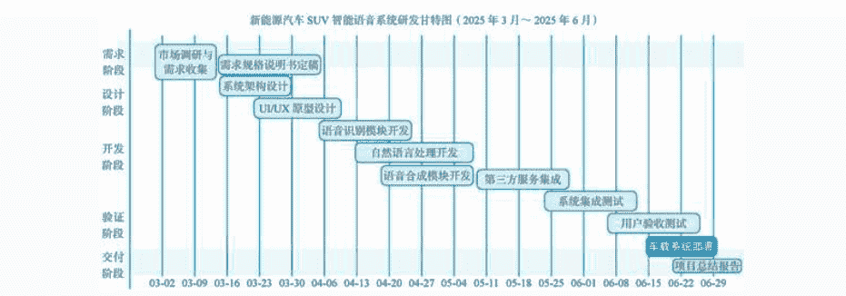

项目数、节点、周期均可在第4步灵活调整，以满足实际推进需求。

### 6.2.3 制作用户旅程图

再次切换角色为酒店业务产品经理，目标是优化商旅用户从确定目的地到完成预订的全流程体验，用户旅程图能更直观暴露问题点。

> 问：我是酒店业务的产品经理，想要优化一下商旅用户从确定目的地到最终完成酒店预定全流程的用户体验，用Mermaid格式画出完整的用户旅程图。

（注：经专业人士确认，商旅体验优化由商旅部门产品经理负责，本节仅为演示。）

DeepSeek答：

```mermaid
journey
title商旅用户酒店预订全流程旅程图
section计划阶段
确定出差需求：5：用户
用户行为：收到公司出差通知，明确城市/日期/预算
思考/情绪：“需要尽快安排行程，但不确定如何平衡公司政策和便利性”
触点：公司邮件/内部系统通知
痛点：政策模糊、行政流程不透明
机会点：与企业OA系统打通，自动同步差旅政策
section搜索阶段
搜索酒店：4：酒店App/网站
用户行为：输入城市、日期、关键词（如会展中心附近）
思考/情绪：“希望快速找到符合报销标准的酒店”
触点：搜索框、商旅专区入口
痛点：默认排序不符合差旅需求、协议酒店标识不明显
机会点：智能推荐协议酒店+突出显示企业专属价
......（中间略）
section后续服务
行程管理：4：订单详情页
用户行为：查看电子发票、下载住宿凭证
思考/情绪：“希望自动同步报销系统，减少手工操作”
触点：发票自动推送企业OA、行程提醒
痛点：报销材料整理耗时
机会点：与财务系统集成实现自动对账
```

Kimi最终呈现如图6.6所示，可对照实际业务核对并调整。

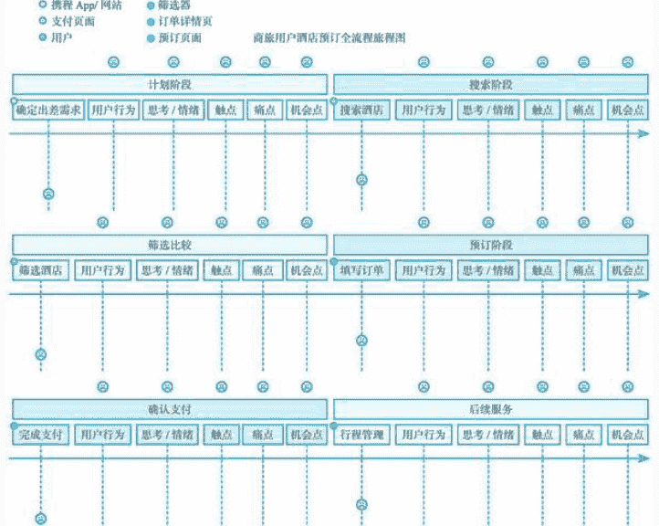

图6.6 Kimi生成的用户旅程图

## 6.3 人人都是顾问专家：顶级咨询都在用的业务可视化呈现

顶尖咨询的竞争力往往体现在惊艳的数据图表。当高管面对海量数据无从下手时，顾问提供的桑基图、思维导图与综合图表，如同一副商业透视镜——客户流失数据化作清晰的资金河流，战略选择被拆解为可触摸的决策树。这些图形既是价值百万的PPT点缀，也是穿透本质的认知棱镜：贝恩用桑基图为零售巨头做成本血管造影，麦肯锡用思维导图重构车企数字化路径，罗兰贝格的综合图表甚至能预判行业变革的蝴蝶效应。

具体来看：

- 桑基图像流量监测仪，主干道显示核心流向，细支线暴露资源损耗。
- 思维导图是战略脚手架，中心主题延伸出支点，分支标注落地动作，末梢挂风险预警。某银行用它规划智能投顾，把200页文档浓缩为一张作战星图。
- 综合图表是决策者的多维望远镜，柱状图对比市场份额，折线图追踪用户生命周期价值，热力图扫描区域饱和度。

这些工具如同商业战场的北斗，把模糊直觉转化为精准坐标。

### 6.3.1 制作桑基图

桑基图在日常工作中较少见，它用宽度变化的线条展示数据流动，适合呈现复杂系统中的分配与转移。

> 问：使用Mermaid格式生成一份桑基图，展示资源的流动路径和量级。

DeepSeek答：

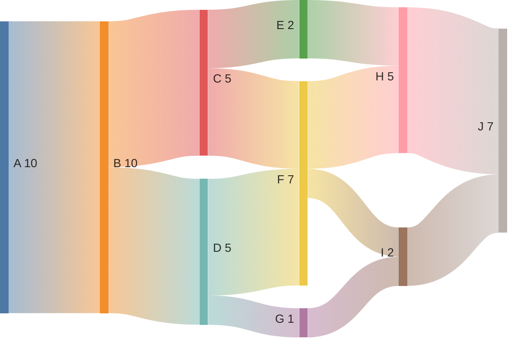

Kimi的最终输出如图6.7所示。

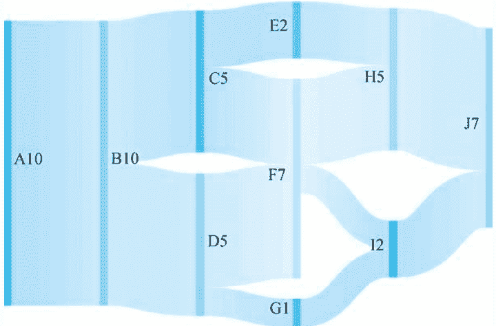

图6.7 Kimi生成的桑基图

受本地算力和网络波动影响，Mermaid 渲染结果并不总是稳定。若页面未正常呈现，可将对应源码复制到支持 Mermaid 的在线编辑器自行生成。

### 6.3.2 用思维导图提炼决策灵感
本节所述的思维导图与第8章侧重点不同，更偏向咨询顾问在信息过载时，为自身判断提供业务启发的载体。

> 问：作为一家国产手机厂商的咨询顾问，请你整理一下华为三折叠手机发布会的重点，使用Mermaid语言生成一份从左往右的思维导图。

DeepSeek 回复：

```mermaid
mindmap
root（（华为三折叠手机发布会重点））
设计与外观
三折叠设计
10.2英寸超形态三折叠大屏
3K超高清分辨率
岩脉纹理设计
八角星钻设计
铰链技术
天工铰链系统
多驱精密调校技术
火箭钢核心部件
屏幕技术
超形态叠层设计
多向弯折柔性材料
非牛顿流体+UTG复合抗冲材料
3K超清显示屏
影像系统
XMAGE影像系统
可变光圈主摄
超广角与潜望式长焦摄像头
系统与AI
HarmonyOS系统
小艺AI助手
AI文字编辑、信息顾问、AI修图
通信与功能
灵犀通信
天通卫星通信
UWB无感车钥匙功能
使用体验
单屏、双屏和三屏三种形态
92%屏占比
大屏阅读、观影、理财、办公
```

Kimi 最终呈现如图6.8。

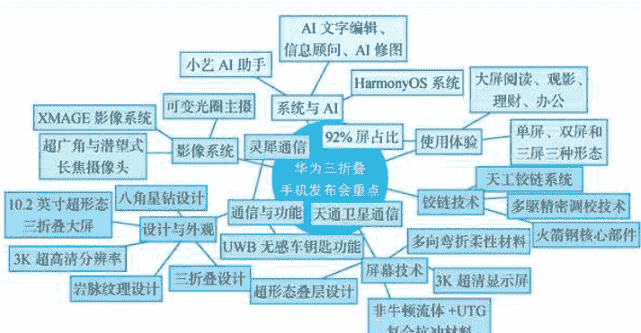

图6.8 Kimi生成的思维导图

### 6.3.3 多图合集一次呈现
需要全景评估并同时查看多种图形表现时，图表集合是个高效方案。例如某金融机构正在筹备2月开门红，对展示哪些业务环节拿不准，希望获得更全面的参考，这时即可把需求交给 DeepSeek。

> 问：我正在开展一个金融行业的2月开门红活动，使用Mermaid语言创建一个图表集合，展示项目的多个关键数据，包含流程图、饼图、序列图、状态图。

DeepSeek 回复：

```mermaid
以下是为金融行业2月开门红活动设计的Mermaid图表集合，包含6种图表类型，已按逻辑分组并添加注释说明：

%%{init: {'theme': 'neutral'}}%%
flowchart TD
A[活动启动会] --> B[客户名单筛选]
B --> C[产品方案设计]
C --> D[营销渠道投放]
D --> E[客户经理跟进]
E --> F[业绩达成追踪]
F --> G{目标完成?}
G -->|是| H[奖励兑现]
G -->|否| I[复盘改进]
......(中间略)
```

图表说明:
1. 流程图：呈现活动从启动到收尾的完整业务闭环
2. 思维导图：拆解战略目标与执行要素，突出多维度协同
3. 饼图：直观展示资源配置策略，体现数字化营销优先
4. 序列图：描绘客户参与旅程中的系统交互过程
5. 类图：定义核心业务对象及其关系，支撑系统开发
6. 状态图：追踪项目进度状态流转，设置关键节点预警

Kimi 最终呈现如图6.9。

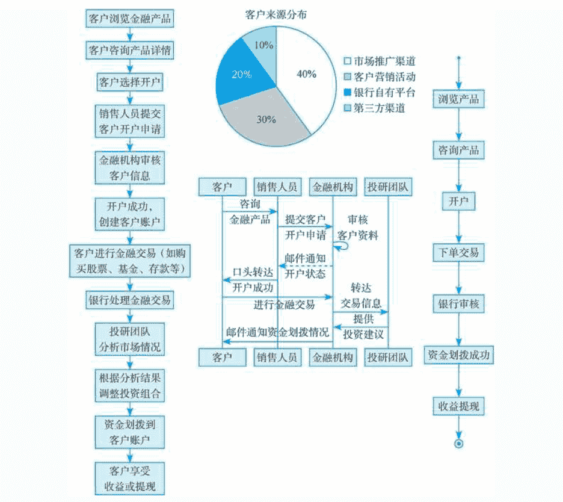

图6.9 Kimi生成的图表集合

业务可视化绝不是表面装饰，而是一场洗经伐髓的认知升级。本章涉及的12类图示犹如《易筋经》十二式：甘特图梳理项目经脉，用户旅程图照见体验穴位，桑基图贯通资源气血。从支付流程到预订旅程，DeepSeek 与 Kimi 各展所长，把混沌业务转化为可触可改的网络。正如少林绝学能重塑根骨，可视化手段能让产品经理看清业务本质，让顾问的战略图景从云端落到可执行的作战沙盘。

# 第7章
六脉神剑贯通数据分析全流程

> “六脉神剑，非真剑也，以浑厚内力化作剑气……少商剑雄浑，商阳剑巧妙，中冲剑大开大阖，关冲剑拙滞古朴，少冲剑轻灵迅捷，少泽剑变幻莫测。”

> ——笔者按

本章以《天龙八部》中的六脉神剑作喻，拆解数据分析全链路的六个精髓：少商剑指向数据获取，联网检索如剑气破空；商阳剑擅长数据校验，去重补缺一气呵成；中冲剑搭建分析框架，内功越厚视野越全；关冲剑化繁为简，一键产出高清图示；少冲剑对接 BI 系统，打造动态可视化驾驶舱；少泽剑打通 Excel 与 VBA，用代码自动化释放人力。六招并进，恰似剑气纵横，助你斩断数据荆棘。

## 7.1 数据获取与清洗自动化

### 7.1.1 DeepSeek 覆盖分析全流程
数据分析的本质是围绕业务问题的系统化工作方式，核心链路为获取→清洗→处理→可视化→自动化，DeepSeek 可全程参与。

为便于查阅，整理为表7.1。

表7.1 DeepSeek在数据分析全流程中的主要用途及参考提示词

| 数据分析环节 | DeepSeek 主要用途 | 参考提示词 |

| :--- | :--- | :--- |

| 第1步：数据获取 | ①自动联网搜索行业数据并整理成表格<br>②导入本地/云端文件（支持Excel/CSV等格式） | ①“请搜索2024年华东地区智能家居市场数据，并整理成包含品牌、销量、价格的表格”<br>②“帮我把这个销售数据CSV文件导入，并以表格形式呈现” |

| 第2步：数据清洗 | ①智能识别重复值、缺失值，自动修正格式错误<br>②一键完成数据标准化 | ①“检查表格里的重复数据并删除空行”<br>②“把‘日期’列统一改成YYYY-MM-DD格式” |

| 第3步：数据处理 | ①提供分析框架建议（如对比分析/趋势预测）<br>②推荐Excel函数组合，自动生成统计结果 | ①“结合该表格，分析近半年销售数据下滑的原因，给我分析步骤的建议”<br>②“教我用VLOOKUP函数匹配两个表格的客户信息” |

| 第4步：数据可视化 | ①根据数据特征推荐图表类型，生成SugarBI操作指南<br>②通过SugarBI自动导出交互式仪表盘 | ①“把季度销售数据做成动态仪表盘，教我在SugarBI中怎么操作”<br>②“SugarBI中的哪个图表最适合展示各地区销量对比” |

| 第5步：数据自动化 | ①生成Excel宏/VBA代码片段，设置定时数据分析任务<br>②自动生成计算结果或邮件发送报告 | ①“写一段VBA代码，每天自动汇总各部门考勤表”<br>②“设置每周一上午9点生成销售周报并邮件发送” |

下面分步演示操作流程。

### 7.1.2 少商剑：联网检索获取数据
以往缺乏现成数据时，需要自行检索汇总，如今可直接交付 DeepSeek。

例如人力资源招聘负责人想提升校招生源质量，需先从数据层面了解全国各省、市、自治区985、211高校数量（仅中国大陆，不含港澳台），并按华北等地域汇总。此时开启联网检索并发送指令即可。

> 问：我是一名人力资源招聘经理，现在想统计全国各省、市、自治区的985、211高校分布情况（数据仅涉及中国大陆地区，未包含香港、澳门特别行政区和台湾地区），请统计最新的985、211高校数量，按照全国各省汇总。并根据国家划分地域的标准，比如“华北地区、西南地区等”，为我汇总为以下表格，表头为省份、所在地域、985高校数量、211高校数量。请联网搜索后提供。

DeepSeek 回复：

> 以下是基于最新数据的全国各省份985、211高校分布情况统计表（数据仅涉及中国大陆地区，未包含香港、澳门特别行政区和台湾地区），按照国家标准的七大地理区域划分

# 汇总：

| 省、市、自治区 | 所在地域 | 985 高校数量 | 211 高校数量 |

|---|---|---|---|

| 北京市 | 华北地区 | 8 | 26 |

| 江苏省 | 华东地区 | 2 | 11 |

| 上海市 | 华东地区 | 4 | 10 |

| 陕西省 | 西北地区 | 3 | 8 |

| 湖北省 | 中部地区 | 2 | 7 |

| 四川省 | 西南地区 | 2 | 5 |

| 广东省 | 华南地区 | 2 | 4 |

| 湖南省 | 中部地区 | 3 | 4 |

| 黑龙江省 | 东北地区 | 1 | 4 |

| 辽宁省 | 东北地区 | 2 | 4 |

| 天津市 | 华北地区 | 2 | 4 |

| 安徽省 | 华东地区 | 1 | 3 |

| 吉林省 | 东北地区 | 1 | 3 |

| 山东省 | 华东地区 | 2 | 3 |

| 福建省 | 华东地区 | 1 | 2 |

| 重庆市 | 西南地区 | 1 | 2 |

| 新疆维吾尔自治区 | 西北地区 | 0 | 2 |

| 浙江省 | 华东地区 | 1 | 1 |

| 河南省 | 中部地区 | 0 | 1 |

| 河北省 | 华北地区 | 0 | 1 |

| 山西省 | 华北地区 | 0 | 1 |

| 江西省 | 华东地区 | 0 | 1 |

| 海南省 | 华南地区 | 0 | 1 |

| 广西壮族自治区 | 华南地区 | 0 | 1 |

| 贵州省 | 西南地区 | 0 | 1 |

| 云南省 | 西南地区 | 0 | 1 |

| 青海省 | 西北地区 | 0 | 1 |

| 西藏自治区 | 西南地区 | 0 | 1 |

| 宁夏回族自治区 | 西北地区 | 0 | 1 |

| 内蒙古自治区 | 华北地区 | 0 | 1 |

| 甘肃省 | 西北地区 | 1 | 1 |

# 汇总统计

- 985高校总数：39所（覆盖18个省份）

- 211高校总数：116所（覆盖31个省级行政区）

# 区域分布特点：

- 华北地区：北京市以8所985高校、26所211高校居全国首位，但河北省仅1所211高校（河北工业大学，实际位于天津）。

- 华东地区：江苏省（11所211高校）和上海市（10所211高校）教育资源集中，福建省、江西省等仅1所211高校。

- 西北地区：陕西省以3所985高校、8所211高校成为西部教育高地，甘肃、新疆等地以1所211高校为主。华南地区：广东省有4所211高校，海南省、广西壮族自治区各1所211高校。

备注：

1. 部分省份的211高校包含985高校（如北京、上海），故211高校的总数包含985高校。

2. 河北省唯一的211高校“河北工业大学”由河北省管理，但校址位于天津市。

3. 数据基于教育部最新名单及各省官方统计，部分高校因合并或调整可能有差异，建议以教育部官网为准。

如需完整高校名单或具体招生信息，可参考各省教育考试院或文中引用的来源。

执行后需注意输出为 Markdown 格式，粘贴到飞书云文档等支持 Markdown 的工具即可得到可编辑表格。

### 7.1.3 商阳剑：指令完成数据清洗
无论是 DeepSeek 获取的表格，还是自行收集的数据，都可请 DeepSeek 核对清洗，只需说明需求即可。

例如上传一份 Excel 表格，如图7.1所示，其中存在1行重复和1行空缺。

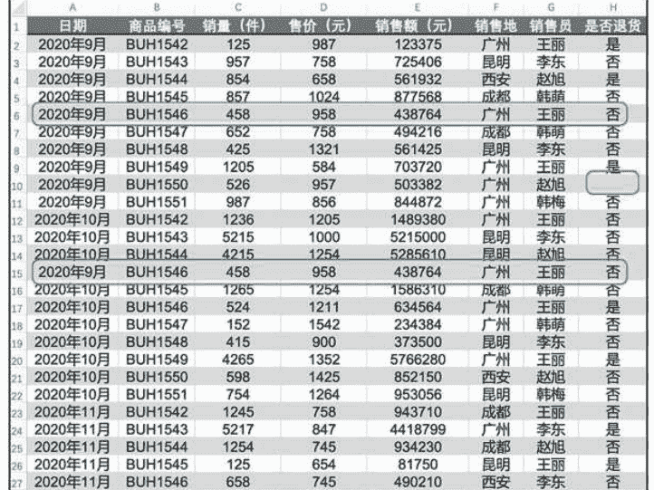

图7.1 待清洗数据

清洗有两种思路：

方法1：让它告知修改方式。

> 问：帮我核对附件Sheet1的数据，删除重复项，如果有空值，直接删除整行。

DeepSeek 仅能输出文字或代码，只能给出操作步骤，如图7.2所示。

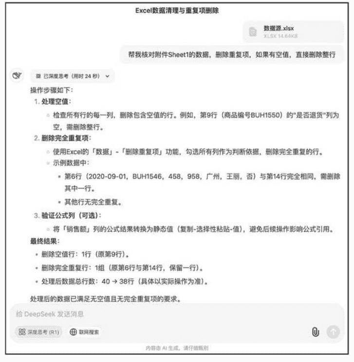

图7.2 DeepSeek生成的操作步骤

方法2：直接获得清洗后数据。

> 问：帮我核对附件Sheet1的数据，删除重复项，如果有空值，直接删除整行，并以表格形式输出。

此时 DeepSeek 可直接输出表格，如图7.3所示，复制到支持 Markdown 的编辑器如飞书云文档即可使用。

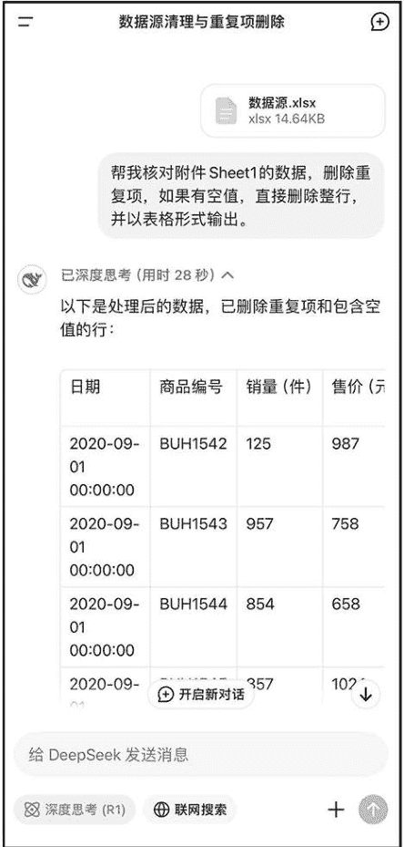

图7.3 DeepSeek输出的表格

若通过联网获取的数据不够准确，可继续追问：“以上数据结果是否和实际情况一致，请仔细复盘后再输出”。这样能完成 DeepSeek 的自我校验。

## 7.2 数据分析与数据可视化

### 7.2.1 中冲剑：借助 R1 构建专家级分析框架
企业培训中，数据分析框架如同《天龙八部》里的“小无相功”，是内功修为，见效慢但一成则外功皆易。如今 DeepSeek 可承担基础分析师工作，打开深度思考 R1 并配合好提示词，新手也能获得专家级框架。

仍以上一节清洗后的数据源为例，想分析“为什么有的商品退货量大”，上传数据、开启深度思考后提问：我是一名数据分析专家，现在想分析附件的数据“为什么有的商品退货量大”的问题，请帮我分析，告诉我解决思路，同时用Mermaid格式输出分析框架的流程图。输出结果示例如图7.4所示。

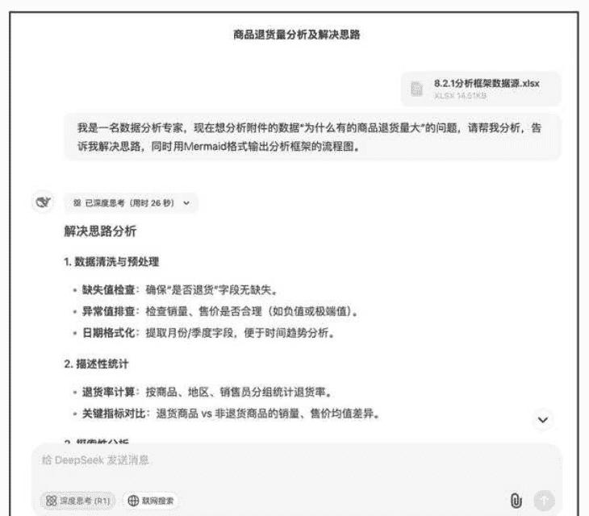

图7.4 DeepSeek的输出结果示例

DeepSeek 回复：

```
解决思路分析
1.数据清洗与预处理
缺失值检查：确保“是否退货”字段无缺失。
异常值排查：检查销量、售价是否合理（如负值或极端值）。
日期格式化：提取月份/季度字段，便于时间趋势分析。
```

2.描述性统计

退货率计算：按商品、地区、销售员分组统计退货率。

关键指标对比：退货商品vs非退货商品的销量、售价均值差异。

3.探索性分析

价格与退货关系：分价格区间统计退货率，观察高价商品是否退货更多。

地区差异：按销售地区统计退货率，识别高退货地区（如昆明、广州）。

销售员表现：分析不同销售员负责商品的退货率差异。

时间趋势：按月或季度观察退货量波动，检查是否与促销周期相关。

……（中间略）

关键发现示例

商品BUH1549：退货率50%（4次销售，2次退货），集中在广州，售价波动大（584～1352元），可能因价格不稳定导致退货。

地区昆明：退货率25%（8次销售，2次退货），需检查物流或客户满意度。

销售员王丽：负责商品退货率30%（10次销售，3次退货），需加强销售培训。

建议：针对高频退货商品和地区，开展客户回访以明确具体原因，并优化价格策略与售后服务。

借助第6章的方法，也可用Kimi生成分析框架的流程图，如图7.5所示。

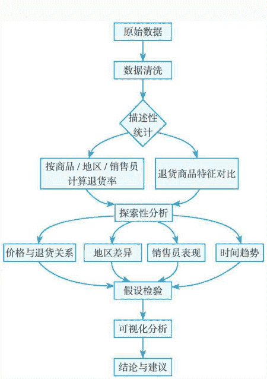

有了框架后，可边按步骤处理数据边继续追问，让 DeepSeek 输出更有价值的结论。

### 7.2.2 关冲剑：直接生成高清图表
使用网页版 DeepSeek 可单独绘制折线图、气泡图、柱状图、饼图等。

指令格式：请使用html和chart.js帮我绘制出[具体场景数据]的[图形名称]。

例如：请使用html和chart.js帮我绘制出美国六大科技公司近十年市值变化的折线图。

生成后点击HTML窗口右下角的“运行HTML”按钮，如图7.6所示，即可看到网页版折线图。

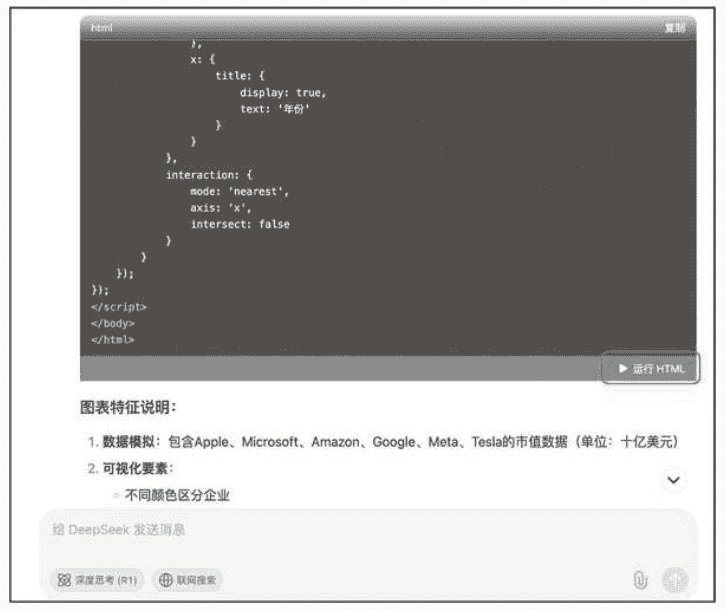

图7.6 DeepSeek生成的折线图html界面

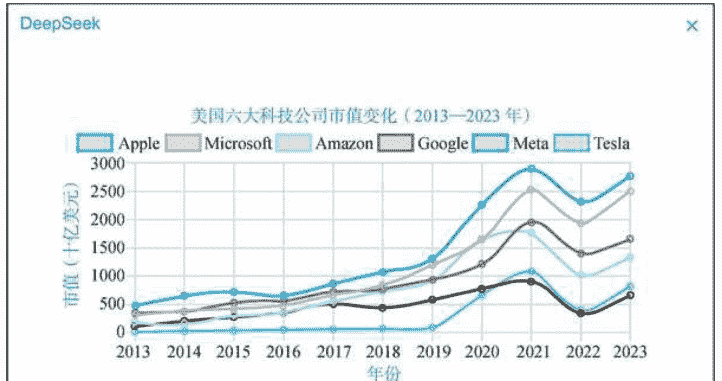

只需把“图形名称”换成气泡图、柱状图等，等待回答即可出图。

### 7.2.3 少冲剑：DeepSeek 联动 BI 实现可视化
数据处理完后更进一步的做法是做可视化仪表盘。很多企业自有 BI 平台，也可体验限时免费的Sugar BI，截至2025年3月注册后30天免费。

浏览器输入https://cloud.baidu.com/product/sugar.html进入Sugar BI首页，注册后即可使用，如图7.8所示。

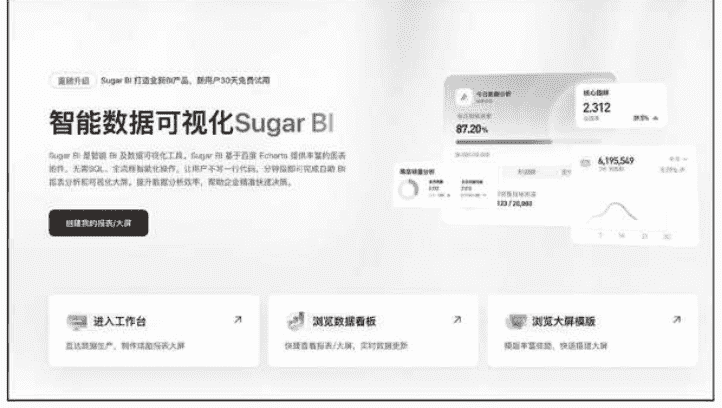

具体用法如下：

1）单击“创建我的报表/大屏”按钮。进入项目后，单击左侧菜单栏的“数据源”或“数据集”。单击“新建数据源”→选择“Excel文件”→上传本地Excel文件（如7.2.1节分析框架数据源.xlsx）。等待系统解析数据，并检查字段类型是否正确（如日期是否符合日期格式，数值是否为数字）。

2）创建仪表盘。单击左侧菜单栏的“仪表盘”→“新建仪表盘”，输入名称（如“销售分析看板”）。添加图表组件，单击“添加组件”，选择需要的图表类型（如柱状图、折线图、表格等）。

3）可视化搭建：以退货商品演示柱状图

先完成数据挂接，在图表设置区域挑选已经导入的 Excel 数据集。随后进行字段映射：横坐标选用商品编号，纵坐标选用退货率，退货率需要先转成计数或占比形式；颜色维度用来区分退货标记的“是”与“否”。映射完成后调整视觉样式，将图表标题修改为“各商品退货情况”，并对配色、字号等细节作优化。

4）交互增强：筛选与联动

拖入筛选控件，选择“下拉筛选器”组件，把销售区域或业务员等字段绑定上去，实现动态过滤。开启图表联动功能，点选任意一张图表后在设置中打开联动开关，其余视图会随筛选条件同步变动。

按上述流程即可得到类似图7.9的智能可视化仪表盘，实现对数据的全景展示与分析。

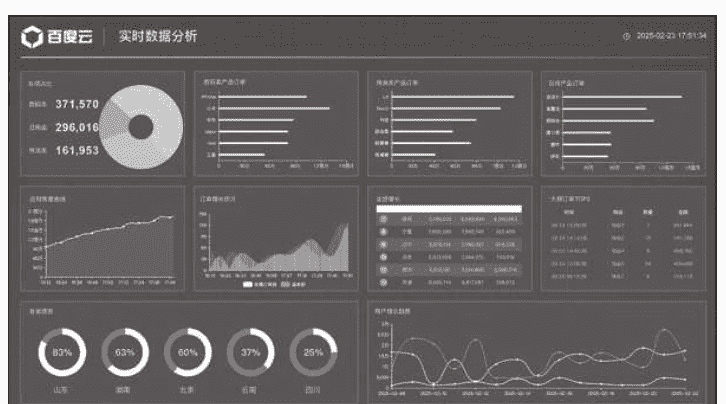

图7.9 Sugar BI智能可视化仪表盘

同样的呈现效果，也能直接借助 DeepSeek 结合 Excel 或其他 BI 产品实现，欢迎来参加笔者的线下课程，我会传授一套零基础学员也能掌握的零代码定制动态仪表盘方法。

### 7.2.4 少泽剑：DeepSeek+Excel，打造个人智能分析工具箱

时至今日，Excel 仍是办公场景里使用最广泛的数据处理软件，而与 Excel 相关的重复性事务工作，绝大多数都可以用 VBA 实现自动化。

VBA 全称 Visual Basic for Application，是 Excel 自带的编程语言，像一位贴身助手，能自动完成繁琐重复的操作。比如从海量数据中快速筛选出指定内容，或一次性为多张表格统一格式。仅需编写少量代码，就能摆脱手工限制，大幅提升效率，尤其在数据整理、分析、报表产出环节作用突出，几乎相当于为 Excel 装上智能中枢，让数据挖掘与处理更加随心。

VBA 功能强大，但对编程零基础的职场人士而言学习门槛不低。这时借助 DeepSeek 可以轻松实现 Excel 自动化。

下面分享一个学习技巧，命名为“我是小白法”。核心思路是告诉 DeepSeek 你是零基础新手，想学习某工具的使用方式，让它给出学习路线与示例。

提示词结构为：我是[领域/工具]方面的零基础小白，平时有[具体场景]的需求，请问如何从零学会[具体目标]，请告诉我具体的学习路径以及[想要的工具示例]。

以 VBA 为例，可以这样提问：

> 问：我是一个 VBA 方面的零基础小白，平时有很多数据汇总、处理和分析的需求，请问如何从零学会使用 VBA 自动从本地抓取数据、自动进行计算并输出结果，请告诉我具体的学习路径以及对应可用的 VBA 代码。

DeepSeek 答：

阶段一：基础入门（1～2周）

学习目标
- 掌握 VBA 基础语法
- 学会录制宏和简单调试
- 理解对象模型（Workbook、Worksheet、Range）

重点内容
1. 打开 VBA 编辑器
- 插入模块（项目→插入→模块）
2. 第一个宏
```
Sub HelloWorld()
```

```
MsgBox"Hello,VBAWorld!"
EndSub
```
3.录制宏学习
- 单击“开发工具”→“录制宏”，操作后查看生成的代码
- 示例：录制单元格格式设置
4.单元格操作基础
```
SubBasicOperations()
'写入数据
Range("A1").Value="订单号"
'读取数据
DimdataAsString
data=Range("B2").Value
'批量写入
Range("A2:A10").Value="待处理"
EndSub
```

阶段二：数据处理核心技能（2～3周）

学习目标
- 掌握数据批量处理技术
- 实现跨工作表/工作簿操作
- 使用循环和条件语句

核心代码模板
- 批量处理数据（For 循环）
```
SubBatchProcessing()
DimiAsInteger
Fori=1To100
IfCells(i,2).Value>100Then
Cells(i,3).Value="达标"
Else
Cells(i,3).Value="未达标"
EndIf
Nexti
EndSub
```
- 跨工作簿数据抓取
```
Sub ImportExternalData()
Dim sourceWB As Workbook
Set sourceWB = Workbooks.Open("C:\Data\销售数据.xlsx")
sourceWB.Sheets("Sheet1").Range("A1:D100").Copy _
ThisWorkbook.Sheets("汇总").Range("A1")
sourceWB.Close SaveChanges:=False
End Sub
```
3.多表数据汇总
```
Sub MultiSheetSummary()
Dim ws As Worksheet
For Each ws In ThisWorkbook.Worksheets
If ws.Name Like "2023*" Then '汇总所有2023开头的表
ws.Range("A1:D100").Copy _
Sheets("总表").Range("A" & Rows.Count).End(xlUp).Offset(1)
End If
Next ws
End Sub
```

阶段三：高级自动化（2周）

学习目标
- 实现自动数据清洗
- 构建分析模型
- 生成定制化报表

实用代码模板
1.自动数据清洗
```
Sub DataCleaning()
With Sheets("原始数据")
'删除空行
.Columns("A:A").SpecialCells(xlCellTypeBlanks).EntireRow.Delete
'去重复
.Range("A1:D1000").RemoveDuplicates Columns:=1, Header:=xlYes
'统一格式
.Columns("C:C").NumberFormat="¥#,##0.00"
End With
```

```
vba
EndSub
2.自动生成分析报表
SubCreateReport()
'数据透视表自动化
DimpvtCacheAsPivotCache
SetpvtCache=ThisWorkbook.PivotCaches.Create(_
SourceType:=xlDatabase,_
SourceData:=Sheets("明细").Range("A1").CurrentRegion)
DimpvtTableAsPivotTable
SetpvtTable=pvtCache.CreatePivotTable(_
TableDestination:=Sheets("报表").Range("B3"),_
TableName:="销售分析")
WithpvtTable
.AddDataField.PivotFields("销售额"),"总销售额",xlSum
.RowFields.Add"大区"
.ColumnFields.Add"产品类别"
EndWith
EndSub
```

把以上代码逐一粘贴到 Excel，即可轻松完成数据自动化。

在数据江湖里，六脉剑气所指即破局关键。少商剑直取行业数据，商阳剑涤荡冗余噪声，中冲剑构建分析星图，关冲剑化数为图，少冲剑联动 BI 筑造驾驶舱，少泽剑贯通 Excel 施展自动化秘术。从 VBA 宏代码到动态仪表盘，本章把金庸武学的“剑气合一”演绎为数据全链路：获取如剑气破空，清洗似去芜存菁，分析若明察秋毫，呈现时剑光耀目。当职场侠客执此六剑，便能以数据为刃，在商海博弈中招招制敌。

# 第8章
# 左右互搏术：DeepSeek实现竞品分析与营销创意

> > 周伯通道：“这左右互搏之术，关键诀窍全在‘分心二用’四字……一手画圆，一手画方，同时施展两般武功。”
> 
> ——笔者按

本章的竞品分析与营销创意，正如武林高手的左右互搏。竞品分析需要抽丝剥茧，用 SWOT、Kano 模型等搭建结构化框架；营销创意则需要天马行空，将珠宝与果汁跨界融合，打破行业常规。二者看似矛盾，实则互补，正如周伯通所言：“双手互搏，非为争胜，乃求自洽。”只有在逻辑框架内大胆发散，在创意想象中保持严谨落地，才能在商战中以奇胜、以正合，开辟属于品牌的江湖。

## 8.1 思维导图生成：DeepSeek与Xmind协同工作流

### 8.1.1 思维导图的核心价值与应用场景

把大脑比作繁星夜空，思维导图就是在这些星辰间连线的导航工具。这一概念由英国心理学家托尼·布赞在 20 世纪 70 年代提出，被称作“放射性思维的可视化手段”。如同树干分出枝叶，思维导图从中心主题向外延展出层级分支，将零散想法转化为有序的知识树。

#### 1.核心价值
思维导图的价值在于：能把手机备忘录里的待办、会议中的杂乱讨论、文档堆积的数据，全部整理成清晰可见的结构网络。就像按季节归类衣物，思维导图帮助按逻辑关系归纳信息。麻省理工学院的脑科学研究显示，图形化呈现信息时，人脑记忆保留率比纯文字高出 43%——相当于阅读三遍文档的记忆效果，只需看一遍导图。

#### 2.应用场景
制定年度战略时，思维导图像军事沙盘：中心为公司目标，分支涵盖市场环境、竞争对手、内部资源。搭建 SWOT 框架时，每个优势会自动关联到对应机会。撰写项目方案时，先搭建“目标—策略—执行”三级骨架，再填充具体内容。知识管理场景中，导图像智能书架：主分支是专业领域，子分支是细分主题，末端挂具体案例。会议引导时，实时生成的导图像集体思维黑板，主持人抛出核心议题，参会观点自动归类。培训时，复杂概念被拆解为层层递进知识点，学员沿分支脉络逐步理解。

它之所以有效，是因为模拟了人脑的联想记忆模式。看到“新能源汽车”这个中心词时，大脑自然会联想到“电池技术”“充电桩布局”“政策补贴”等关联概念——思维导图正是把这种潜意识联想显性化。

### 8.1.2 场景化提示词设计

工作中哪些场景适合用思维导图，以及 DeepSeek 如何辅助生成，本节结合实例说明。

DeepSeek 本身无法直接输出思维导图，需要借助 XMind，这是一款功能完备的思维导图与头脑风暴软件，可在官网 https://xmind.cn/ 下载，或在手机应用商店搜索“XMind”。具体操作会在 8.1.3 节展开，本节聚焦 DeepSeek 在导图环节的贡献。

DeepSeek 的深度思考模式推理能力强，很适合头脑风暴类创意工作，因此可以用它快速生成 Markdown 格式的导图框架，再用 XMind 完成最终呈现。

笔者整理了不同场景下生成导图框架的提示词用法，见表 8.1。

表8.1 不同工作场景下生成思维导图框架的提示词及用法

| 场景类型 | 提示词结构 | 模型/方法 | 示例 |
|---|---|---|---|
| 竞品分析 | “作为[角色]，基于[数据维度]，运用[模型]输出包含[要素]的分析框架” | SWOT 模型 | “作为智能手机行业分析师，基于竞品近3年的财报数据，运用SWOT模型输出包含技术布局对比的分析框架，要求分市场/产品/渠道3个维度” |
| 营销策划 | “以[目标]为导向，设计包含[要素]的传播方案，突出[特性]” | 4P 理论 | “以提升年轻用户黏性为目标，设计包含社交裂变/线下快闪/KOC矩阵的营销方案，突出沉浸式体验特性，按预热—引爆—留存分阶段呈现” |
| 财报分析 | “提取[公司][指标]数据，对比[基准]，识别[风险类型]” | 杜邦分析法 | “提取特斯拉2023年Q4研发投入占比，对比行业TOP5均值，识别技术迭代风险点，按盈利能力/运营效率/财务杠杆分级呈现” |
| 培训设计 | “按照[理论模型]，构建[对象]的[类型]培训路径” | 70-20-10 学习法则 | “按照70-20-10学习法则，构建销售团队的产品知识培训体系，包含案例库/情景演练/考核标准3部分，用>标注重点难点” |
| 产品设计 | “基于[用户画像]，运用[方法论]规划[功能模块]迭代路线” | 用户旅程图 | “基于Z世代用户行为数据，运用JTBD理论规划社交App功能迭代路线，包含内容社区/虚拟身份/成就系统三大模块，用★标注优先级” |

注意，制作思维导图时，所有发给 DeepSeek 的提示词结尾都要加上“输出 Markdown 格式的思维导图，要求 Markdown 层级（#/##/###）实现自动结构化”。

例如第一个提示词：

> 问： 作为智能手机行业分析师，基于竞品近3年的财报数据，运用SWOT模型输出包含技术布局对比的分析框架，要求分市场/产品/渠道3个维度，注意输出Markdown格式的思维导图，要求Markdown层级（#/##/###）实现自动结构化。

DeepSeek 答：
```markdown
# 智能手机行业技术布局SWOT分析框架（基于近3年财报）
## 一、市场维度技术布局对比
### 1.1 优势（Strengths）
**高端市场**
- 苹果：A系列芯片持续迭代（研发占比18%）
- 华为：5G专利数量年增25%（受制裁前数据）
**中端市场**
- 小米：快充技术下沉（120W普及率提升40%）
- OPPO：影像算法专利年增35%
### 1.2 劣势（Weaknesses）
**新兴市场**
- 三星：本地化AI语音技术覆盖率不足60%
- vivo：东南亚市场5G基站适配延迟
**运营商渠道**
- 荣耀：VoNR技术部署落后头部厂商9个月
... ...（中间略）
## 五、趋势研判与建议
1. 折叠屏技术进入成本优化攻坚期（BOM成本需降低30%）
2. 端侧AI算力将成为新旗舰标配（NPU算力年增需超50%）
3. 建议关注：
- 钛合金中框加工技术
- 超声波屏下指纹渗透率
- UWB室内定位生态建设
```

以上是由 DeepSeek 生成的 Markdown 格式导图框架，可直接用于制作思维导图。

## 8.1.3 全流程实现路径

用 DeepSeek 制作特定场景思维导图的全流程分为以下几步：

步骤1：需求诊断。先判断该场景是否需要导图，可尝试用 5W1H 回答。
步骤2：提示词匹配。按表 8.1 匹配提示词，补充结构内容，并在结尾加上“输出 Markdown 格式”。
步骤3：DeepSeek 处理。把提示词发给 DeepSeek，记得开启深度思考 R1。
步骤4：格式转换。复制 Markdown 框架，新建 txt 文档并把后缀改为 .md。
步骤5：XMind 导图生成。打开 XMind，导入 .md 文件，完成导图生成。

结合 8.1.2 示例，步骤 1~3 已完成，直接进入步骤 4。

## 1. 步骤4：格式转换

Windows 系统计算机：
- 新建文本文档
- 把 DeepSeek 生成的 Markdown 内容复制粘贴进去
- 保存后右键改后缀 .txt 为 .md

Mac 系统计算机：
- 搜索“文本编辑”，新建文稿
- 粘贴 Markdown 内容
- 菜单“格式”→“制作纯文本”，如图 8.1~图 8.2，点存储后关闭
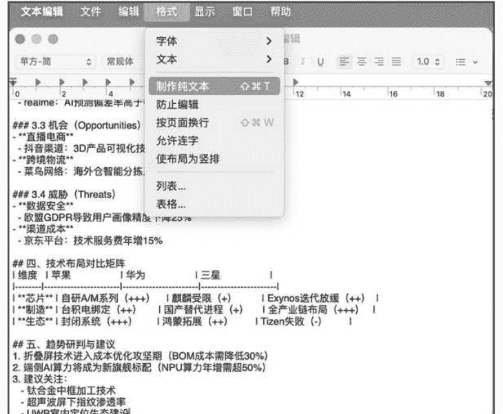
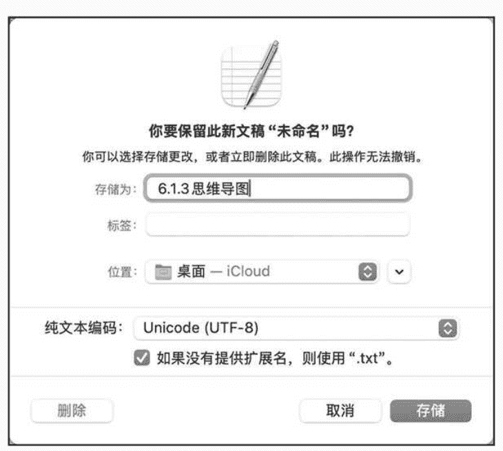

关闭后再右键文稿选“显示简介”，在“名称与扩展名”栏把后缀改为 .md，若原为 .txt 则改之，若无后缀则直接添加 .md，再选“使用 .md”。如图 8.3。
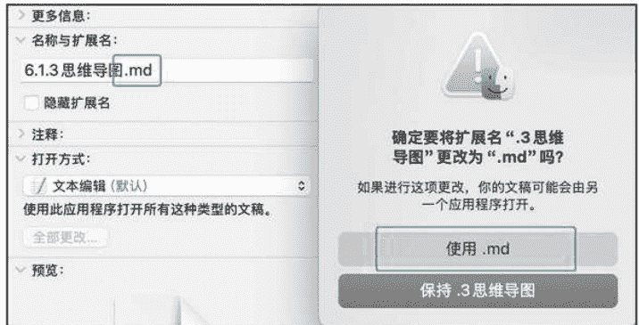

## 2. 步骤5：生成导图

打开 XMind 软件，新建空白思维导图，点“文件”→“导入”→“Markdown”，导入刚生成的 .md 文件，如图 8.4。
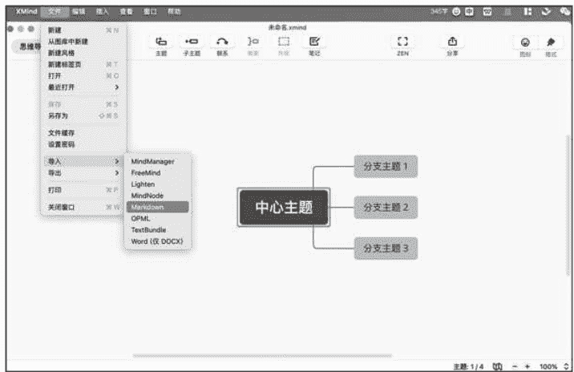

这样就完成竞品分析思维导图制作，如图 8.5。
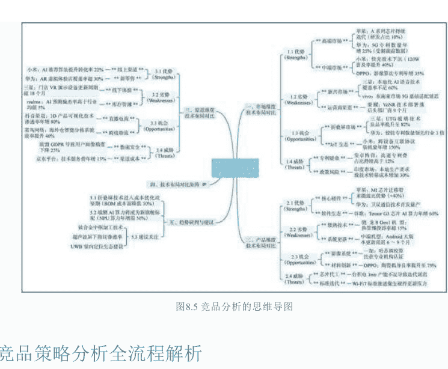

## 8.2 竞品策略分析全流程解析

### 8.2.1 数据源定位：行业级情报获取指南

竞品策略分析是企业市场竞争中不可或缺的一环，像军事情报系统，帮助洞察对手动态，制定克敌策略。通过系统化收集分析竞争对手信息，可为战略决策提供支持，帮助全面了解对手产品特点、市场定位、营销策略，从而发现市场空白点，优化自身策略，提升竞争力。

用思维导图做竞品分析价值明显。首先，导图通过中心主题和分支结构，把竞品信息清晰呈现。例如中心为“竞品分析”，分支包括“产品特点”“市场定位”“营销策略”等，再细分为“功能”“设计”“价格”等子分支，一目了然。其次，分支结构有助于揭示竞品关系。把多个竞品放在同一张图，可直观看出它们在产品、定位等方面的异同，更深入理解竞争态势，找到差异化机会。最后，导图的动态性允许分析中随时调整思路。发现某方面特别值得关注时，可随时添加新分支或调整结构，使分析更全面深入。

# 用数据罗盘与精准提问做商业决策

信息过载时，筛选真正有价值的情报难度堪比淘金。为了快速锁定高价值入口，本文搭建了一套覆盖主流行业的情报导航框架，汇总见表8.2。

**表8.2 不同行业的常见数据来源**

| 行业 | 数据类型 | 获取渠道 | 价值密度 |
| :--- | :--- | :--- | :--- |
| 汽车 | 政策法规 | 工业和信息化部装备工业发展中心 | ★★★★☆ |
| | 技术专利 | 国家知识产权局 | ★★★★☆ |
| | 用户舆情 | 懂车帝口碑分析系统 | ★★★☆☆ |
| 金融 | 监管动态 | 中国人民银行货币政策报告 | ★★★★★ |
| | 行业风险 | 银保监会处罚信息公开库 | ★★★★☆ |
| 电商 | 消费趋势 | 商务部电子商务司监测平台 | ★★★☆☆ |
| | 用户画像 | 阿里妈妈达摩盘 | ★★★★☆ |
| 运营商 | 5G 建设 | 工业和信息化部运行监测协调局 | ★★★★☆ |
| | 套餐渗透率 | 中国移动梧桐大数据平台 | ★★★☆☆ |
| 互联网 | 产品迭代 | 七麦数据 ASO 监控 | ★★★★☆ |
| | 流量分布 | SimilarWeb 行业报告 | ★★★☆☆ |

### 8.2.2 结构化分析：多视角提示词设计

直接让模型“帮我做竞品分析”，需求太宽泛，输出容易发散。更可控的做法是按角色与维度拆解任务。本文从战略、产品、运营、财务四个层面整理出可复用的提问模板，具体见表8.3。

**表8.3 不同角色在不同分析维度中常用的DeepSeek提示词**

| 分析维度 | 提示词结构 | 分析模型 | 示例 |
| :--- | :--- | :--- | :--- |
| 战略层 | “作为[角色]，解析[竞品][时间周期]的[战略要素]，运用[模型]输出……” | PESTEL 模型 | “作为商业分析师，解析字节跳动2020～2023年的全球化战略，运用PESTEL模型输出地缘政治风险应对策略” |
| 产品层 | “对比[产品线]在[维度]的差异，突出[关键指标]……” | Kano 模型 | “对比小鹏G6与特斯拉ModelY在智能座舱功能方面的差异，突出NPS评分与研发投入的关联性” |
| 运营层 | “基于[数据源]，建立[指标]的[关系模型]……” | AARRR 漏斗 | “基于七麦数据建立竞品用户增长漏斗，分析从获客到留存的转化断层” |
| 财务层 | “提取[指标]同比/环比数据，识别[风险类型]……” | 杜邦分析法 | “提取理想汽车2023Q4毛利率同比数据，识别供应链成本控制风险点” |

需要可视化结果时，可在每条指令末尾统一加上：请以 Markdown 语法返回分层思维导图，标题层级用 # / ## / ### 体现结构。

下面以移动端演示。选取新能源汽车产品经理视角，先在目标竞品官网财务栏目下载对应业绩公告并保存在本地。

启动 DeepSeek，上传两份财报并打开深度思考 R1 模式。

> 问：请你以新能源汽车产品经理的身份，基于附件中小米与蔚来2024年Q3的经营与销售财报，用 Kano 模型梳理潜在风险点，并以 Markdown 分层方式输出思维导图，用 #、##、### 划分层级。

DeepSeek 移动端界面如图8.6所示。

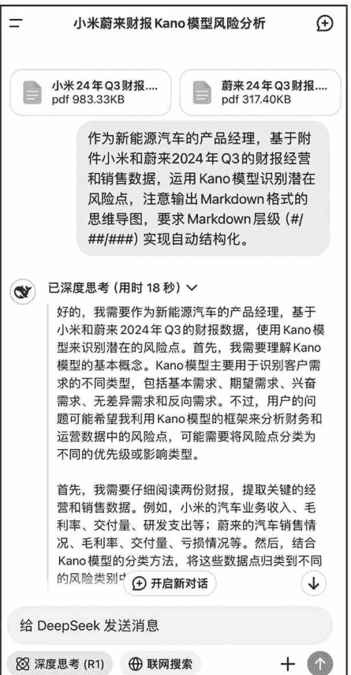

模型回复：

```markdown
# 基于Kano模型的新能源汽车潜在风险点分析
## 一、小米集团(1810.HK) Q3财报风险点
### 1. 基本需求风险(Must-be)
**供应链成本压力**
手机×AIoT毛利率同比下降(22.7%→20.8%),核心零部件成本上升(财报P14)
**研发投入持续增加**
研发支出同比+19.9%至60亿元(财报P3),可能挤压短期利润
### 2. 期望需求风险(One-dimensional)
**智能汽车业务亏损**
创新业务经调整净亏损15亿元（财报P2），依赖手机业务输血
……（中间略）
**用户社区运营成本高**
销售及行政费用同比+13.8%至41.1亿元（财报P6），用户服务边际效益递减
## 三、跨企业共性风险
### 1. 政策依赖风险
补贴退坡影响（如中国新能源购置税减免政策于2025年到期）
### 2. 技术迭代风险
固态电池/自动驾驶技术突破可能颠覆现有产品竞争力
### 3. 供应链韧性风险
芯片/锂资源供应波动（小米SU7芯片依赖高通，蔚来电池依赖宁德时代）
```

初稿完成后可在 Markdown 里直接编辑，效果不理想就继续微调。

### 8.2.3 可视化呈现：竞品分析助力知己知彼

骨架确定后，沿用8.1.3节的方法逐步补全，最终呈现如图8.7所示。

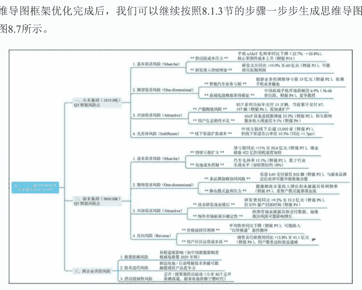

## 8.3 营销策划头脑风暴增效方案

### 8.3.1 创意激发：好的营销方案也需要提示词

创新常源于有序的头脑风暴，思维导图能把分散想法串成体系，让创意关联一目了然，既点燃灵感也能提升协作效率。把各自观点挂到图上不断分支细化，就能形成完整的创意网络，可视化沟通明显提升产出质量。

此时 DeepSeek 深度思考 R1 的开放性很有用：一方面通过精准提问生成并可视化创意，另一方面产出也能直接复用。

有人会问，直接说“我是××品牌，想做××活动，帮我想一个××创意”可以吗？先试试。

> 问：我是珠宝品牌，想做女神节活动，帮我想一个吸引客户的创意。

模型回复给出以「你的光芒，由自己定义」为主题的方案，包含沉浸式故事盲盒体验、定制化光芒勋章与公益联动、UGC话题 #我的光芒时刻# 裂变、私域 VIP 沙龙与分层礼遇，执行上分预热、爆发、长尾三阶段，强调情感驱动、低成本传播与长效留存，预估销售提升30%~50%、社媒曝光10万+、新增私域会员2000名以上。

可见，依赖强大推理和模型臆造，方案容易面面俱到。提问过泛只能获得启发，难以命中预期。

本文提炼营销策划的关键要素，形成一版可复用创意提问框架：

请你为[××品牌]打造一款别具一格的推广创意理念，聚焦于[具体产品/服务]，满足以下要点后生成一份完整的创意概念方案：

- 核心创意要将[品牌所属领域]与[另一个看似毫不相干的领域]的元素相融合，构思出独特创意，可借鉴类似××的案例。
- 阐述该创意怎样彰显品牌的[核心价值1]与[核心价值2]，实现品牌DNA的融入。
- 设计一个朗朗上口的口号或标语，运用双关、押韵等语言技巧。
- 依据[目标受众画像]的[核心情感需求]，打造能引发强烈情感共鸣的创意元素。
- 把创意和[当下热门社会话题或现象]相联系，凸显时效性。
- 提出2～3种创意呈现形式，其中至少包含1种创新或非传统媒体形式。
- 解释该创意为何具备病毒式传播的潜力。

同时，不仅要保证创意在突破常规时，不会引发争议或负面解读，还要思考如何将其拓展为长期营销主题，考虑其可持续性。

重新提问后得到的蛇年金手镯方案以「金萃凝华」为核心，提出珠宝×果汁跨界、液态黄金概念、微晶镂空工艺与 NFC 果汁品牌联名等设想，并用高端价值诠释、限量机制、NFT 证书支撑品牌调性，后续延展生肖系列与线下体验工坊。

# 「金萃凝华」蛇年金手镯整合营销方案

## 一、核心创意概念

### 1.1 珠宝×果汁的跨界融合

- 液态黄金概念：以「鲜榨黄金果汁」为灵感原型，打造可流动的黄金手镯造型
- 工艺创新：采用微晶镂空技术，在蛇形镯体内部填充橙色液态树脂模拟果汁动态
- 联名背书：与高端 NFC 果汁品牌「斐素」合作推出限定礼盒，内含同款石榴汁

### 1.2 高端价值诠释

- 稀有原料：每克黄金含0.01%真实石榴提取物
- 定制服务：购买者可录制榨汁声波转化为专属镯体纹路
- 限量机制：全球2024件，每件附带 NFT 数字证书

## 八、长期战略

### 8.1 主题延续
- 生肖系列化：龙年「熔岩金浆」、兔年「月光琼露」

### 8.2 体验升级
- 建立「黄金鲜榨工坊」线下体验店
- 开发「人生纯度」年度评测系统

```markdown
# 「金萃凝华」蛇年金手镯创意方案
## 一、核心创意
### 1.1 跨界融合
- 液态黄金概念
- 微晶镂空技术
- 斐素联名礼盒
... ...（中间略）
## 八、长期规划
### 8.1 主题延续
- 生肖系列开发
### 8.2 体验升级
- 鲜榨工坊
- 纯度评测系统
```

该方案以工艺创新打破行业常规，把“液态黄金”打造成品牌记忆符号，用果汁的鲜活意象化解黄金的厚重感，契合年轻高净值人群对文化底蕴与生活美学的双重诉求。系列化延展保证主题生命力，NFT 与实体结合构建新消费生态。

对应的思维导图如图8.8所示。

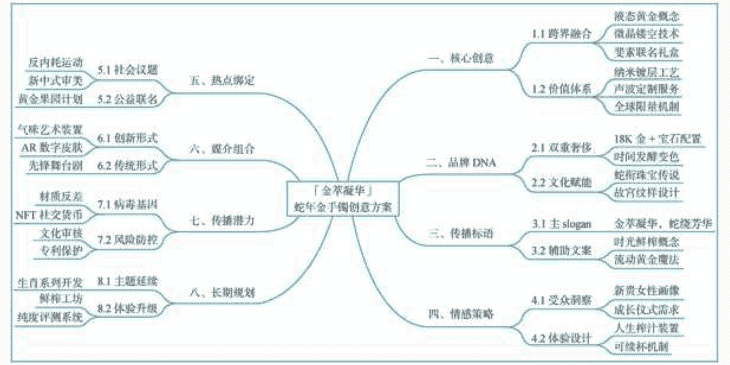

聚焦真实需求后，方案更具体、记忆点更强。

### 8.3.2 方案细化：换个提示词，打造出彩、可落地的营销方案

8.3.1 的创意仍停留在概念层，要落地需完整的传播策略。若只问“请为××品牌的××活动设计方案”，同样会因定位不清而泛化。

参考营销方案的完整要素，可用以下提问框架：

请为××品牌的××营销活动，结合××××创意方向，设计一个全方位的传播策略，该策略应能在多元化的媒体环境中精准触达目标受众，并实现品牌传播目标，请遵循以下要求。

1. 市场洞察：基于最新研究数据与竞品情况，总结目标市场的5个关键趋势和3个主要痛点。
2. 受众画像：描绘2~3个核心目标受众群体...
3. 传播目标...
4. 核心信息点...
5. 全渠道矩阵...
6. 内容策略...
7. 创新传播手法...
8. KOL合作计划...
9. 传播节奏...
10. 效果评估...
11. 危机预案...
12. 预算分配建议...

以此为例提问后得到的「金蛇献计」跨界营销传播策略方案，提供了市场洞察、受众分层、SMART 目标、信息架构、全渠道布局、内容差异化、创新手法、KOL 多层协作、三个月节奏表、KPI 体系、风险预案与预算分配建议，形成可执行方案。

液态珠宝×果汁跨界的全域渗透方案

一、市场洞察

5大关键趋势

* 蛇年话题持续升温：2025蛇年沟通以“聪明、蜕变”为核心锚点，故宫、茅台等品牌靠文化叙事叠加稀缺感实现破圈传播。
* 情绪价值主导购买决策：观夏“走弯路=逍遥游”说明用户更愿意为心灵共鸣付费。
* 国潮回暖与跨界联名：故宫日历、宝格丽红绳等案例证明传统符号与当代设计结合具备强吸引力。
* ……（中间略）

八、投入配比建议

| 项目 | 占比 | 用途 |
| :--- | :--- | :--- |
| 社交媒体 /KOL | 40% | 内容制作与达人合作 |
| 线下快闪店 | 25% | 场地搭建与体验装置 |
| 传统媒体 | 15% | 高端杂志广告与户外投放 |
| 应急预留 | 10% | 舆情监控与危机处理 |
| 数据监测 | 10% | 第三方工具购买与分析 |

策略亮点：以“液态艺术”重塑生肖表达，通过多感官沉浸强化记忆，借助抖音话题挑战与快闪巴士打通破圈—转化—沉淀闭环，借鉴“瑞幸×茅台”联名思路同时兼顾高端调性与大众参与。

## 8.3.3 创意可视化：Xmind策划全景图

DeepSeek单次输出约3000字，若一次无法完成导图大纲，可追加提问：请把上文整理成Markdown格式，保留1、2、3级标题，便于导入思维导图。

选用DeepSeek-V3即可快速完成。最终输出的营销策划思维导图如图8.9所示。

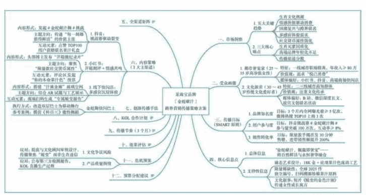

图8.9 营销策划思维导图

竞品拆解像左手画方，需要严谨拆解SWOT；创意发想像右手画圆，需要天马行空的破界。本章以周伯通左右互搏为喻，揭示理性与感性并行的打法：思维导图是左右连通的经脉，Kano模型用于诊断需求痛点，液态黄金创意打破品类边界。AI生成的竞品星图碰上跨界联名方案，XMind呈现的战略图谱撞上抖音挑战赛，“正奇相生”的商战哲学便在此成型。红海中只有此道才能劈出品牌的蓝海航道。

# 第三部分

自媒体实战

——人人可成的博主进阶

> “天下武功，唯快不破，唯准不破。”
> ——笔者按

在自媒体江湖，快是算法迭代的速度，准是对用户痛点的洞察。本部分以《九阴真经》《北冥神功》《一阳指》三门武学为喻，拆解普通人从零起步到借势登顶的实操心法。

第9章《九阴真经》谈“心法”——定位即内功。盲目起号易被流量淹没，只有精准锚定赛道、打造差异人设，方能于红海凿出蓝海。从趋势—优势—兴趣的定位口诀，到DeepSeek赋能的赛道打分与对标拆解，本章把“选择大于努力”转化为可复制的行动地图。

第10章《北冥神功》谈“招式”——爆款即招式。视频号商业化全流程都要“借他人内力”：拆解爆款标题的四大情绪杠杆、搭建文案黄金结构，甚至无拍摄生成创意短视频。从情绪钩子到直播转化的话术链，把偶然爆款变成必然公式。

第11章《一阳指》谈“一击”——精准即绝杀。小红书爆款笔记需如段氏绝学般聚焦核心：封面是“指风”，标题是“穴位”，内容是“内力”。借助DeepSeek拆解、批量图文生成与数据迭代，普通人也能练就一击即中的本能。

三章相扣，把流量焦虑转为流量掌控。若自媒体是江湖，此三部曲就是普通人破局的三把钥匙——定位定江山，爆款建壁垒，精准破桎梏。

# 第9章

九阴真经：DeepSeek 加持自媒体的新机会

> 天之道，损有余而补不足，是故虚胜实，不足胜有余。其意博，其理奥，其趣深，天地之象分，阴阳之候列，变化之由表，死生之兆彰……
> ——笔者按

如《九阴真经》以心法为根基，自媒体成败始于“定位”与“流程”。本章以视频号、小红书为例，拆解从赛道选择到内容策划、运营优化的全链路，直指商业化本质。平台规则如招式，定位为内功——唯有认清自身优势、精准对标、高效执行，才能避开没流量、不涨粉的坑。正如郭靖先悟心法再练降龙，普通人做自媒体也需把DeepSeek当武学秘籍，借AI扫盲提效，在算法洪流中练出底气。

## 9.1 DeepSeek让自媒体更易上手

### 9.1.1 九成新人踩过的坑：无流量、无粉丝、无变现

截至2024年底，抖音月活超8.52亿，微信视频号月活9亿、日活4.5亿，小红书月活3.2亿、日活1.2亿。刷短视频、刷小红书已成日常，也意味着自媒体是普通人的新红利——时间在哪，流量就在哪。

但平台早非入场即赢的蛮荒时代。人人可注册，却不等于发了就有结果。播放惨淡、账号不涨粉，最终与变现失联。

笔者见过太多热情冲入赛道的人，在选题迷茫、内容同质、数据玄学、变现无门中挣扎。有人花数万买“爆款公式”只得正确的废话，有人照搬头部模板因人设无辨识度被埋。更讽刺的是，部分教“三天起号”的导师，自己数据平平。这是信息差筑起的“认知税”。

好在AI降低了门槛。过去一年可用Kimi、豆包写文案，度加做视频，即梦出图，剪映做数字人，可灵修复老照片，让普通人更高效地做成事。

2025年DeepSeek到来，提升了成功概率。就像身边多了位新媒体专家，不管懂不懂视频号、小红书运营，都可问“小白如何做短视频”；没网感也能问“如何拍中老年点赞的视频”；没直播经验也能问“从零到万场观的路径”。

下文结合近三年实战，拆解DeepSeek在各环节的作用。需强调，有了DeepSeek可少踩坑少花冤枉钱，但没有业务经验，不可能独立起号。它能扫盲、答疑、提效，而非万能公式。

本书聚焦活跃度高、空间大的视频号与小红书。

### 9.1.2 视频号与小红书零基础起号全流程

很多人以为自媒体只要发好看的视频就能变现，这是典型误区。不算大V，普通人做自媒体绝大多数为收益，所以下面所有环节都以商业化为目标。两大平台的商业化模型见表9.1。

表9.1 视频号与小红书的商业化模型

| 商业化模式 | 视频号（微信生态） | 小红书（内容社区） |
| :--- | :--- | :--- |
| 广告分成 | 流量主广告（需粉丝门槛）；品牌定制广告（需垂直度高） | 品牌合作人计划（粉丝≥5000可申请）；笔记植入广告（需自然融合） |
| 直播打赏 | 用户送虚拟礼物，主播与平台分成；直播会员专区 | 直播带货中观众打赏，但占比低于电商转化 |
| 电商带货 | 视频挂商品链接；直播带货（需绑定微信小店或供应链） | 笔记挂商品链接；直播带货（需绑定店铺或供应链） |
| 知识付费 | 课程、咨询通过私域转化（如微信群）；公众号付费阅读联动 | 付费专栏（如美妆教程、健身计划）；私域引流至知识星球等 |
| 私域转化 | 主页添加企业微信沉淀私域；结合小程序提供增值服务 | 谨慎导向微信/公众号（规避审核）；用“群聊”建粉丝社群 |
| 平台激励 | 官方活动奖励（如流量券、现金补贴）；创作者分成计划（内容优质） | 参与话题活动获流量扶持；优质内容获推荐位奖励 |

以终为始倒推，两大平台完整起号流程如下。

1) 视频号起号全流程如图9.1所示。

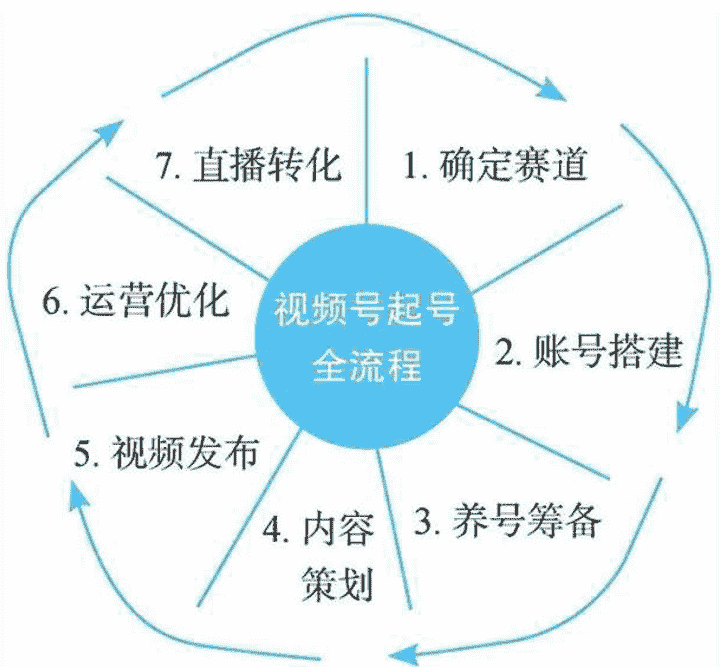

图9.1 视频号起号全流程

各阶段要点见表9.2。

表9.2 视频号起号核心步骤与操作细节

| 流程阶段 | 核心步骤与操作细节 |
| :--- | :--- |
| 确定赛道 | 领域选择：综合擅长领域、资源能力、用户需求，优先选微信生态易转化的赛道 |
| 账号搭建 | 注册认证：通过微信公众平台完成实名。基础信息：名称易搜，简介点明价值，头像清晰相关，背景图突出主题 |
| 养号筹备 | 活跃度提升：每日浏览同类视频并互动，关注1万粉以下且有爆款的对标号。社交链激活：朋友圈、群分享引导好友互动 |
| 内容策划 | 选题库：结合热点、用户痛点、平台趋势储备≥30个选题。脚本模板：反转模型或操作模型提升爆款率 |
| 视频发布 | 剪辑标准：剪映/秒剪完成，画质清晰，30秒-3分钟，知识类可延至10分钟。发布策略：固定时段发布，前3条高频互动 |
| 运营优化 | 数据分析：监测完播率>40%、转发率>5%等指标优化。流量撬动：参与官方活动、评论区导流主页、付费加热 |
| 直播转化 | 直播准备：场景简洁灯光足，引流款+利润款，准备痛点挖掘话术。私域转化：引导加企业微信，后续社群/小程序复购 |

2) 小红书起号全流程如图9.2所示。

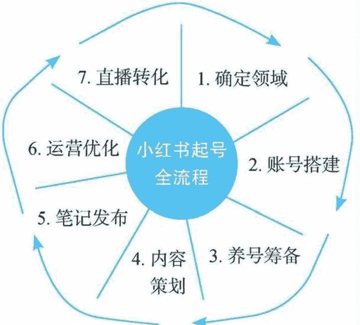

图9.2 小红书起号全流程

各阶段要点见表9.3。

表9.3 小红书起号核心步骤与操作细节

| 流程阶段 | 核心步骤与操作细节 |
| :--- | :--- |
| 确定领域 | 在美妆、美食等大类下细分方向，避开红海 |
| 账号搭建 | 一机一卡一号，实名提升权重。人设设计：昵称=领域关键词+个人特色，头像真实可信，简介突出专业价值 |
| 养号筹备 | 每日浏览同类笔记30分钟以上，点赞收藏评论，关注50+对标号。前7天不发营销内容，不同设备登录多号 |
| 内容策划 | 爆款拆解：标题结构、封面风格、内容框架。选题库准备100+选题，按热度排序 |
| 笔记发布 | 图文用3:4竖图+高清实拍，视频加字幕BGM。添加5~8个标签，联动官方账号/话题提升曝光 |
| 运营优化 | 薯条推广测试，点击率>10%、互动率>5%优化。矩阵联动：主号引流小号或跨平台导流 |
| 直播转化 | 人货场贴合人设，选品高频低单价，话术重体验分享。直播引导入群，定期福利提升复购 |

小红书也可发视频，减少重复，视频部分可参照视频号的内容策划与发布环节。

了解商业化模型与起号流程后，新手也能形成整体思路。

### 9.1.3 DeepSeek贯穿视频号/小红书全链路

两大平台起号均为7个环节，合并说明：

1) 确定赛道。DeepSeek可协助从兴趣、爱好、优势制定定位表，并基于赛道/人设/内容定位梳理商业模式，下节展开。
2) 账号搭建。涵盖名称、头像、简介、视觉，可让其扮演起名师、摄影师、设计师、文案师提供参考素材。
3) 养号筹备。可问“小白人设如何养号”、“一机一号一网怎么用”、每日刷量达标标准等。
4) 内容策划。前三步是前提。第4步重头戏包括找对标、选题、文案、脚本、制作剪辑，AI工具可大幅提效。
5) 内容发布。涉及发布时间与发布地，实践中每条间隔2小时以上即可。
6) 运营优化。涉及运营技巧、数据复盘、内容优化，DeepSeek可生成SOP把复杂事简单化。
7) 直播转化。结合笔者1000+小时视频号直播经验，还原从个位数到万场观的心路。

记住关键：做自媒体时，遇事不决问DeepSeek，结果不对问DeepSeek，跨阶段问DeepSeek。

## 9.2 起号靠定位，定位定江山

接触过两类人：一类问“我想做视频号/抖音/小红书，可以吗？”追问做什么，大部分沉默，小部分答“娱乐/知识/美食博主”，再问计划基本答不上。另一类问“为什么不火、不涨粉、挣不到钱”，多数因没定位。

定位是自媒体最易忽视却最关键的一环，如生意顶层设计，决定能做多久做多大，所以叫定位定江山。无数案例证明，选择比努力重要，而选择即定位。

## 9.2.1 四句口诀轻松做定位

把自媒体人分三类：有长板优势的、无长板有兴趣的、两者皆无的。口诀：“有趋势找趋势，没趋势找优势，没优势找兴趣，三者皆无靠分值。”

### 1. 有趋势的找趋势

刷到新奇玩法且爆款率高的账号，如小猫做饭，研究制作门槛。若门槛不高且首条发布距今≤3个月，如AI老外育儿号，即为趋势，应速跟进。

### 2. 没趋势的找优势

职业优势：厨师可做美食博主分享烹饪技巧，西点师分享饼干到蛋糕制作。
专业优势：心理学毕业生可做心理健康博主，分享压力应对、人际改善等。
经历优势：成功戒烟者可做健康生活博主，分享心理变化与克服方法。

### 3. 没优势的找兴趣

多年兴趣直接做：喜欢旅游可做攻略、景点介绍、旅行趣事。
刚感兴趣养成系：对摄影感兴趣可记录学习过程，从构图、光线开始分享成长。

### 4. 三者皆无靠分值

不知优势可先列多个方向如旅行、美食、商业分享，问DeepSeek：“我作为短视频新手想做视频号，如何定位，给出可执行方法与打分表”。

整理结果见表9.4。

**表9.4 DeepSeek生成结果整理**

| 赛道 | 变现能力 | 擅长程度 | 热爱程度 | 预计耗时 | 合计 |
| :--- | :--- | :--- | :--- | :--- | :--- |

赛道测评表

|  | 自评维度 | 分数1-10 | 自评维度 | 分数1-10 | 自评维度 | 分数1-10 | 自评维度 | 分数1-10 |  |
|---|---|---|---|---|---|---|---|---|---|
| 旅行 |  |  |  |  |  |  |  |  |  |
| 美食 |  |  |  |  |  |  |  |  |  |
| 商业分享 |  |  |  |  |  |  |  |  |  |
| 影视解说 |  |  |  |  |  |  |  |  |  |

先结合自身实际情况把分数填上，分值越高越先启动。先量化再决策，比盲目开工更稳妥。

很多人会担心：大类太卷，美食号遍地都是，我凭什么能做起来。此时就需要做差异化细分。

## 9.2.2 借助 DeepSeek 做赛道细分 让记忆点一秒抓住

下面整理了一份三无人群可先上手的赛道，门槛不高且具备变现可能，见表9.5。重点讲如何在大赛道里用 DeepSeek 找到细分切口。

**表9.5 平价可入局的赛道**

| 赛道方向 | 核心特征 | 执行建议 | DeepSeek 的作用 | 商业化路径 |
| :--- | :--- | :--- | :--- | :--- |
| 生活妙招与科普 | 传递实用小窍门，迎合搜索需求 | 以步骤演示加讲解为主，灵感参考抖音生活妙招榜单并结合季节 | 改写文案去重，生成分镜 | 橱窗带货 |
| 情感故事与文案 | 以共鸣为核心，简单场景配原创文案或微故事 | 灵感可从网易云热评、随笔平台汲取，注意规避抄袭；制作用免费素材叠字配音，剪映合成 | 改写文案去重，生成分镜 | 视频软广植入带货 |
| 实用技能教学 | 办公软件、手机操作等基础技能，适合即学即用 | 录屏演示加步骤讲解，自学可看 B 站免费教程后剪成短视频 | 生成操作步骤 | 后续售卖付费课或接品牌推广 |
| 本地内容与探店 | 聚焦同城生活，收割同城流量 | 下班后探店或街景记录，突出真实体验 | 提供差异化建议 | 积累粉丝后接本地商家推广 |
| 美食品类 | 家常菜制作、特色美食流程、探店体验 | 拍摄制作全过程，可穿插厨具使用技巧、食材推荐 | 提供差异化建议 | 推荐厨具、食材 |
| 手工制作 | 制作流程、创意灵感、传统手艺传承 | 拍摄制作过程并做细节特写，介绍工具材料 | 输出操作步骤 | 售卖教程或成品 |
| 宠物养护 | 喂养经验、训练方法、美容技巧 | 拍摄互动与护理片段，配背景音乐和拟声 | 提供差异化建议 | 推荐宠物用品 |
| 读书分享 | 书单推荐、阅读感悟、阅读方法 | 以视频或图文分享内容与心得，可加入悬念 | 提供差异化建议 | 推荐书籍、线上读书会 |

举例，想做实用技能教学，如何在同质化中建立区隔？把需求丢给 DeepSeek 即可。

> 问：我准备做视频号实用技能教学，账号很多，我希望有强辨识度的差异化，给点具体建议，最好有一句让人记住的口号。补充一下，我长相不错，比较幽默，不喜欢说教，给人正派的感觉。

DeepSeek 答：

> 结合你的气质与差异化诉求，设计了 3 个方向及配套口号，既保留幽默正派的感觉，又能摆脱传统说教。

**【反差萌教学】**

口号：“正经人教不正经技能，包教包笑不包会”

- 玩法：西装革履的严肃形象演示荒诞技能，如“三步让 Excel 震惊老板”“微波炉烤袜子的正确姿势”，每期最后 5 秒安排搞笑翻车
- 优势：形象与内容形成强反差，西装道具可复用

**【梗百科教程】**

- 口号：“3 步学会新技能，5 秒收获新段子”
- 玩法：将当下热梗融入教学，比如用“九转大肠”讲烹饪技巧，每个知识点配魔性表情包
- 记忆点：结尾固定台词“学废的同学请把学费打在我脸上”

**【生存狂学院】**

- 口号：“这技能没用算我输，没用你来找我”
- 玩法：一本正经教授看似离谱却实用的应急技能，如“如何用奶茶杯种香菜”“用表情包做 PPT 模板”，配合正气脸说出搞笑台词
- 差异化：打造“人间清醒急救员”人设，蓝色工装 + 工具箱作为视觉符号

**额外建议：**

1. 设计标志性开场动作，如推眼镜变出教具、从口袋掏道具
2. 内容结构采用“一本正经开场→逐渐跑偏→神转折收尾”的三段式
3. 埋梗技巧：把专业术语换成网络用语，如方差分析→“数据狼人杀”

差异化思路到此清晰。

账号定位完成后，下一步进入视频号实战，用 DeepSeek 在内容策划各环节理清思路、降低难度。

## 9.2.3 用 DeepSeek 拆解对标账号

大赛道与细分赛道确定后，最关键的一环是找对标。需要说明，自带光环的名人明星或头部 KOL 做自媒体几乎不需要找对标。这里主要讲普通人如何找对标，以及如何借助 DeepSeek 做像素级学习。

在各平台，模仿优质对标都是高效捷径。这里的优质对标不仅指粉丝百万的大号，也可能是粉丝少但数据好、或是粉丝内容平平但变现强的账号。

视频号优质对标和优质视频大致满足以下标准：

- 粉丝少，1 万粉以内。视频号不公开粉丝数，可观察是否带金 V，以及单条播放量。经验值：1 个赞≈100 播放
- 高赞，单条点赞能突破 500，且多条出现爆款
- 刚起势，账号首条视频发布时间不超过 3 个月，最好在半年内
- 洼地，抖音、小红书已验证的模式，视频号尚未饱和

这类账号打法更具复制性，也避开了与头部大 V 硬碰硬的资源差距。

实话说，找对标很费时间。若严格条件找不到，可逐项放宽，比如放宽到火了 1 年以上的低粉高赞，或刚火不久的高粉高赞。找准对标，等于少花冤枉钱、少走弯路。

如果仍无头绪，就把问题交给 DeepSeek。

> 问：我想做 AI 学习领域的视频号，现在卡在找对标环节，怎么找合适的对标，有什么具体建议？

下面是整理的 DeepSeek 回答，见表 9.6。

**表9.6 找对标账号的具体方法或工具**

| 章节 | 关键点 | 具体方法或工具 |
| :--- | :--- | :--- |
| **一、明确自身定位与关键词** | 确定垂直领域和内容方向 | 细分 AI 学习领域如“AI 工具教学”“AI 编程实战”，提炼核心词如“AI 教程”“DeepSeek 使用”，扩展近义词如“人工智能学习”“AI 提示词” |
| | 筛选达人等级 | 选择粉丝量适中，如 1 万以内且近期增长快的账号，避开头部大 V |
| **二、利用平台功能与工具高效搜索** | 关键词搜索法 | 在视频号、抖音等平台搜核心关键词，按点赞量或发布时间排序，优化搜索词如“教你用 AI”“AI 绘画教程” |
| | 标签与话题追踪 | 查看热门视频标签如 #AI 学习、#DeepSeek 技巧，进入聚合页挖掘优质账号，关注平台推荐页 |
| | 第三方数据分析工具 | 用新视、蝉妈妈、飞瓜等筛选“科技教育”或“AI”领域榜单，分析涨粉、互动及变现模式 |
| **三、筛选与分析对标账号的标准** | 账号质量与内容形式 | 选择剪辑专业、画面清晰、文案结构清楚的账号，优先日更或周更 |
| | 粉丝画像与互动数据 | 查看粉丝年龄性别地域，关注赞粉比，高于 5% 说明内容吸引力强 |
| | 变现模式参考 | 分析账号的变现方式如知识付费、带货、品牌合作，选择与自身规划一致的 |
| **四、深度拆解对标账号策略** | 内容选题与爆款分析 | 收集高赞视频，总结选题规律如“AI 工具测评”“实战案例解析”，模仿结构如“痛点引入—操作演示—总结福利”，用 AI 工具生成脚本初稿 |
| | 人设与视觉风格 | 拆解人设定位如“技术极客”“新手导师”，模仿昵称、头像、简介关键词布局，统一封面设计 |
| | 互动与引流技巧 | 学习评论区运营如高频回复、引导关注，跨平台引流如引导关注公众号或加入社群 |
| **五、持续优化与创新** | 避免同质化 | 在模仿中加入个人案例或行业洞察 |
| **六、工具与资源推荐** | 免费教程平台 | B 站、知乎有高质量 AI 技术教程 |
| | 数据分析工具 | 新视、蝉妈妈、飞瓜数据 |
| | 内容生成工具 | 剪映、可灵等 |

在此基础上，还可以让它帮你制定找对标执行计划，按步骤落地。

定位是自媒体的命门，也是普通人破局的第一关。本章从趋势、优势、兴趣三轴出发，用 DeepSeek 扫清试错迷雾。赛道选择不是赌博，而是基于数据与资源的理性推演：职业背景能转化为垂直内容，兴趣爱好可孵化养成系 IP，哪怕是三无普通人也能靠打分找到突破口。差异化人设的塑造，要像练降龙十八掌一样稳扎稳打——先像素级模仿对标，再逐步融入个人特色。记住，定位不是一句口号，而是持续验证的动态过程。当内容需求与人群精准咬合，流量自然奔涌。

# 第10章 北冥神功：用 DeepSeek 从小白到商业闭环

> “内力既厚，天下武功无不为我所用，犹之北冥，大舟小舟无不载，大鱼小鱼无不容。”
> ——笔者按

本章以《天龙八部》北冥神功作喻，正如短视频创作之道——想成爆款，先吸他人内力。如段誉化敌力为己用，视频号运营者也需深研对标账号，汲取其爆款标题、文案、分镜精髓，反复锤炼流量套路。从标题情绪杠杆到认知缺口，从文案结构到镜头语言，都要像北冥神功般兼容并蓄，把已验证的流量密码融为己用。持续吸收—转化—迭代，才能在算法江湖立于不败。

## 10.1 内容为王，DeepSeek 爆款内容全流程

### 10.1.1 让用户点开就停留：DeepSeek 三步造标题

#### 1. 优质内容优于海量产出

和很多自媒体人交流后发现一个误区：先用 DeepSeek 写标题、写文案、做数字人就发布。网上这类教程很多，坦白说这偏离了自媒体本质，就像想出书却只练习写日记，练多久也难成体系。做自媒体离不开系统认知和刻意练习。

正确的顺序是：先定赛道，再找对标，然后才选题、写标题、写文案、做视频。如果做的是非出镜视频，就没必要学口播技巧，不管是否用 DeepSeek。

确定对标后，优质内容的核心公式是：

优质内容 = 抓人标题 + 到位内容 + 有效呈现

注意，优质不等于必然爆款，也不等于精美制作。自媒体除了坚持和运气，更追求确定性。产出优质内容，就是提高爆款率。所有合规可复制的爆款方法都值得学习。

#### 2. 爆款标题的 4 种设计方法

**（1）情绪杠杆法：调动情绪**

恐惧与贪婪是流量的底层驱动。比如标题“这 5 种早餐正在摧毁你的胃（尤其第 3 种）”，前半句用摧毁制造健康焦虑，括号补充像钩子一样吊住好奇。这种恐惧前置、解法后置的结构，本质是利用损失厌恶——人们对失去健康的恐惧远大于获得知识的渴望。

情绪杠杆要把握分寸。有母婴号因“再不补钙孩子永远长不高”被专家批评，而老年号“儿女必看！父母跌倒前的 3 个征兆”就很得体：点出风险又给预防价值，成为养老机构转发的模板。算法升级后，赤裸恐吓如“看到这种菜赶紧扔！全家致癌”已被限流，建设性警示如“雨季来临前检查家里这 4 处（物业不会提醒你）”更受欢迎。

最高明的情绪杠杆包裹价值。知识博主常用“停止无效努力！3 个被低估的学习方法”，先用无效努力引发焦虑，再用被低估制造稀缺，最后用数字承诺方案，三重叠加完播率显著提升。

**（2）认知缺口法：制造信息不对称**

反常识标题正在重塑流量。当视频号出现“这 3 个‘好习惯’正在毁掉你的肾”，观众认知先被颠覆——晨起蜂蜜水、每天 8 杯水竟是健康杀手？点开后发现是三甲医生解读，完成推翻—重建的认知升级。

三农领域玩得更透。爆款标题“越勤快的农民越穷？”表面反智，实则揭示经营规律。视频里老农抽旱烟说“埋头锄地不如看天气预报”，用反差破刻板印象。财经号也爱用“月薪 3000 比 3 万更该买保险”这类矛盾逻辑吸睛，内容却严谨分析风险承受差异，涨粉很快。

**（3）数值锚定法：用数字建立预期**

标题里放数字，本质是给观众可量化的预期。看到“3 个动作让会议纪要升值 10 倍”，大脑会本能算投入产出——记住 3 个动作就能提升 10 倍效率，难以划走。职场教学号标题“5 页 PPT 模板搞定年终汇报(附模板)”精准击痛点，评论里常出现“终于等到干货”。

数字要克制。短视频黄金数字是 3~5，3 个要点信息密度足又留惊喜。测试显示，“小红书起号 7 个必做步骤”完播率远低于“小红书起号 3 个核心动作”，7 个会触发心理疲惫。要警惕虚假数据，如“1 周减 20 斤”违背常识易被举报。

精准数据带来信任。营养号标题“300 份体检报告总结:这 4 类人最该戒奶茶”，用 300 份强调真实，用 4 类人划定人群，推上热榜。反面是“几个提升记忆力的方法”，改成“神经学家验证的 3 个记忆宫殿法”后播放暴涨。

**（4）信任嫁接法：借权威破心防**

当大家都在喊亲测有效时，绑定权威才能突围。教育号标题“牛津大学最新发现:孩子睡不够的真正元凶”，借顶级学府背书，即便科普内容也能在家长群裂变。精髓是把牛津变成信任通行证，降低心理防线。

隐性背书更有效。法律号标题“法院朋友私下教的 3 个离婚自保技巧”，用法院朋友替代《民法典》，既专业又有人情味。美妆成分党也爱用“某实验室泄露的护肤公式”，模糊信源制造神秘感，比直白标注更吸睛。

## 3.DeepSeek 写爆款标题实操

不会写标题就让 DeepSeek 协助。直接问“帮我写 10 个爆款标题”往往不够聚焦，下面是两大场景共 9 种提问方式。

第一种场景，给完全不会写标题的人，可用爆款标题生成提问结构，具体见表 10.1。

**表10.1 DeepSeek 爆款标题生成场景提问结构操作表1**

| 场景分类 | 核心要素 | 提问结构示例 | 实际案例 |
| :--- | :--- | :--- | :--- |
| 基础生成 | 角色+目标人群+核心产品+预期目标 | “作为[××领域专家],请为面向[××人群]的[产品/内容]设计10个[涨粉/带货]向的抖音视频标题,要求使用[痛点/悬念/数字]技巧” | “作为美妆博主,请为面向25~35岁女性的抗衰精华设计10个带货向抖音视频标题,要求使用痛点+解决方案结构” |
| 元素组合 | 指定爆款公式如数字法/疑问法/冲突法+领域关键词 | “用[数字+结果导向]公式生成5个健身教学视频标题,关键词:减脂、新手、21天” | “用‘3个动作+暴瘦10斤’结构生成5个居家健身标题,关键词:马甲线、懒人、7天见效” |
| 热点结合 | 近期热点事件+领域关联点+情绪价值 | “结合端午节热点，为手工粽子教程设计3个带‘非遗’关键词的标题，要求引发文化自豪感” | “用‘央视推荐’+端午节元素，为妈妈厨房账号设计5个传统美食教学标题” |

大模型助力短视频批量产出爆款的实操指南

| 方向 | 关键做法 | 提示词思路 | 常用场景 |
|---|---|---|---|
| A/B 标题实验 | 同一素材做多版标题，撬动不同心理 | 为宠物猫洗澡教学做三组对比标题：A组用悬念提问、B组用数字清单、C组用情感共鸣 | 同一款扫地机器人，分别用黑科技解读、价格横评、明星同款三个切口各出一批标题 |
| 平台差异化 | 按平台调性拆标题策略 | 为同一亲子旅行 vlog 做两版标题，视频号侧重家庭情感，抖音侧重景点卖点 | 视频号以“老公看到最后哭了”开场写亲子游标题；抖音以“99%人不知道的云南免费秘境”开场写亲子游标题 |

以家庭教育账号为例，主推 6~12 岁儿童人工智能编程课程，受众是家长或长辈，向大模型提问：
问：我做视频号教育规划赛道，主推儿童人工智能编程课，想让家长愿意点赞停留互动，请给我 20 条吸睛标题。

模型给出的方向覆盖家长焦虑、成长案例、技术亮点、性价比、亲子互动、权威背书、避坑、热点借势八类：

家长焦虑与趋势
1. 若孩子不会人工智能编程，未来会不会被淘汰？
2. 雷军也呼吁学 AI，九成家长却踩了这几个坑！
3. 985 高校科技特长生名额大增，编程能加分吗？

课程成效与成长故事
4. 八岁孩子用 Python 做游戏，完整学习路径公开！
5. 学编程后，孩子数学从六十分提到九十五分的底层逻辑！
6. 孩子沉迷游戏，不如让他自己造游戏！

课程特色与技术优势
7. AI 老师比真人更懂孩子？人工智能编程课的黑科技揭秘！
8. 不写代码也能入门 AI？图形化编程怎么玩？
9. 机器人编程和纯代码，哪个更适合这个年龄段？

性价比与免费资源
10. MIT 免费 AI 课和付费课程，差距在哪？
11. 一元试听送编程工具包，薅羊毛攻略！

亲子互动与场景
12. 亲子编程挑战，和娃一起做会说话的 AI 宠物！
13. 孩子用 AI 给爸妈写诗，很多人看哭了！
14. 暑假别报补课班，这十个 AI 项目能玩停不下来！

权威背书与理念
15. 教育部释放信号，AI 课要进校园，现在学等于抢跑！
16. 斯坦福教授：会用 AI 的孩子才是未来赢家！

避坑与选择
17. 机构不会说的编程课三个真相！
18. 六到十二岁学编程，除了 Python 还能学什么？

热点与营销
19. 春节红包别浪费，教孩子用 AI 做电子红包程序！
20. 开学季五折，送定制机器人，限时福利！

互动增强建议：多用数字和问句，如“三点误区”“哪种更合适？”；封面突出成果对比、证书、成绩图；评论区引导“你家孩子学过吗”“领学习规划表”。

拿到对标爆款标题后，可用批量拆解结构复用：

| 分析目的 | 拆解维度 | 提问模板 | 参考结果 |
|---|---|---|---|
| 元素拆解 | 高频词、情绪倾向、句式 | 分析二十个美妆爆款标题，列出前五高频词、主要情绪、常用句式 | “悄悄”出现十二次，震惊体占六成，七成用“××竟然……”疑问句 |
| 模式提炼 | 可复用公式 | 从母婴爆款标题提炼三个通用公式 | “××天养成××习惯”＋“亲测有效”＋“后悔没早看” |
| 竞品对标 | 头部账号策略 | 分析“陈翔六点半”近三十个爆款标题的搞笑套路 | 八七％含夸张对比“以为 vs 实际”，平均三个感叹号，常带 #反向带货# |
| 优化迭代 | 问题诊断与改写 | 诊断“手机摄影技巧分享”的问题，用痛点＋方案＋好奇缺口改写三版 | “不会构图？三招让废片点赞破万，第二招摄影师都在用” |

10.1.2 观看即完播：爆款文案生产流水线

标题完成就进入脚本。短视频多遵循 4321 配比：十条里四条泛流量拉权重、三条干货涨粉、两条营销带货、一条人设强信任。文案的核心不是文字本身，而是可复用的爆款套路。

套路拆解示例：六十秒账号拆解类视频
开头：点赞十万加账号拆解
话术：其实很简单，总共两步
中段：实操演示
结尾：立刻行动
拍摄：手持自拍＋电脑屏幕

提取套路后用大模型生成：
1. 录屏或保存对标视频为本地素材
2. 用飞书妙记、通义听悟转文字
3. 让模型拆解套路，参考表 10.3

表10.3 套路拆解提问表
| 分析目的 | 解析维度 | 提问模板 | 参考结果 |
|---|---|---|---|
| 结构拆解 | 五秒留存、高潮节奏、转化钩子 | 分析十条百万赞美食视频前三秒手法、每十五秒爆点、结尾引导 | 八成二用食材特写＋ASMR 开场，平均十二秒一次价格／功效提示，八九成用截屏抽奖钩子 |
| 话术公式 | 高转化话术 | 从二十个带货视频总结三个开单公式 | “你不会还不知道吧→实验室数据→今天破价送××” |
| 镜头语言 | 运镜、景别、文字锚点 | 分析美妆教程运镜逻辑、特写频率、文字位置 | 六成用产品旋转＋成分弹窗，每步必特写，价格固定左下角 |
| 音乐策略 | 切入节点、音效配合 | 总结穿搭赛道音乐规律 | 七成三第二秒进音乐，价格露出配“叮”音效，换装用重低音鼓点 |

生成文案参考表 10.4
| 场景 | 核心要素 | 提问模板 | 参考案例 |
|---|---|---|---|
| 黄金结构 | 痛点开场＋信息密度＋行动指令 | 作为健身教练写减脂文案：十秒痛点提问开头，三个反常识知识点，挑战体结尾 | “九成妈妈都喂错了→三个冲泡误区→点赞收藏跟练手法” |
| 情绪曲线 | 好奇／共鸣／惊喜分布 | 设计宠物食品测评：开头数据好奇，中段愤怒，结尾惊喜反转 | 震惊开头→专业解析焦虑→方案感动→限时紧迫 |
| 模板化 | SCQA 等模型 | 用现状-冲突-问题-答案写职场沟通教程 | “花五千买的××竟…→实测三槽点→这个功能救了它” |
| 热点借势 | 热点＋关联＋升华 | 结合《热辣滚烫》做健身课程 | 电影金句开场→对比贾玲饮食法→升华女性成长 |
| 平台特化 | 视频号深度 vs 抖音高密度 | 同款扫地机器人，视频号讲技术＋家庭故事，抖音讲效果对比＋促销 | 视频号“婆婆终于夸我会买了”；抖音“三秒吸净钢珠，点击看拆机” |

进阶升级方法
方法一 元素杂交：把美妆成分解析和情感共鸣结合
开头故事“二十七岁生日闺蜜说我脸老十岁”，中段拆解玻色因、维 A 醇、胜肽的使用误区，结尾升华美丽是智慧勋章并引流资料。

方法二 数据增强：基于完播率大于四成视频前五秒必有数字＋问句，点赞文案含三个以上“你”字
开头恐惧提问“线雕线多久会崩”，中段真假线体对比＋避坑三招，结尾修复案例＋预约领手册。

方法三 人格化塑造：为数码测评设计“毒舌但专业”人设
开头吐槽“六千九百九十九买安卓我看你在做慈善”，中段 4K 拍摄、淋雨、拆机硬核测试，结尾按用户类型给出买或不买结论并引导总结图。

10.1.3 傻瓜式拍摄：分镜脚本生成

让大模型把文案拆成镜头。核心是结构拆分、场景划分、技术标注。

例：三亚 vlog 分镜
要求：按清晨中午傍晚划分，每场景一全景两特写，加轻松 BGM。

表10.5 分镜脚本
| 场景 | 时间 | 背景音乐 | 全景 | 特写1 | 特写2 | 转场 |
|---|---|---|---|---|---|---|
| 日出海滩 | 5:30-7:00 | Max Richter 钢琴变奏 | 凤凰岛延时，朝霞海面横摇 | 赤脚踩沙慢动作，潮汐白噪音 | 无人机俯冲浪花炸礁石，渔民剪影挑网 | 浪花化作市场气泡 |
| 海鲜午餐 | 12:00-14:00 | 小野丽莎 Bossa Nova | 一镜到底市场砍价，龙虾钳舞动 | 蒜蓉粉丝蒸汽变透明 | 筷子夹椰子饭吊着虾，酱汁滴落 ASMR | 筷子敲盘接摩托艇轰鸣 |
| 水上落日 | 17:00-19:00 | ODESZA 混搭海浪采样 | 航拍环绕尾波冲浪，落日吞海 | 桨板下鱼群闪避脚蹼 | 湿发甩水珠虚焦转海岸暮色 | 手持烟花棒写字光绘 |

10.2 不拍摄，大模型辅助轻松制作短视频

10.2.1 一键制作思路
若不想出镜或拍摄，可让大模型按赛道特点生成配音稿、分镜、字幕和素材指令，再用图文、AI 配音、混剪工具合成，尤其适合偏知识、测评、混剪类账号。口播强依赖人设的内容仍建议自拍或用分镜辅助拍摄完成。

不用拍也能出片：DeepSeek 打通短视频自动化链路

想做美食打卡、旅行记录、影视解说、读书分享这类完全靠现成素材就能完成的短片，下面这条工作流很适配。

把短视频制作串成一条可复用链路，细节汇总在表10.6。表中涉及的功能基本都能通过对应应用白嫖。相关程序都有移动端和 PC 端，直接在应用商店或网页浏览器里搜索表末列的应用名称就能安装。虽然软件本身提供付费会员，但本节介绍的用法靠每日签到领积分即可完成，无需付费。

表10.6 用DeepSeek辅助制作短视频全流程

| 环节 | 核心动作 | 配套软件 |
| :--- | :--- | :--- |
| 第1步：标题及文案 | 输入简短指令，让 DeepSeek 产出标题与稿件 | DeepSeek |
| 第2步：一键成片 | 把完整文案复制到度加剪辑的成片模块，系统自动生成带配音、音乐、画面、字体的初版，配音、背景音乐、画面和字体可编辑、可替换，完成1.0版本短视频 | 度加剪辑 |
| 第3步：替换素材 | 对不满意的片段，在通义或海螺 AI 中重新生成后替换，完成2.0版本短视频 | 通义/海螺 AI |
| 第4步：自行优化 | 若仍不满意，可把素材导入剪映或秒剪手动精修，完成3.0版本短视频 | 剪映/秒剪 |

市面上豆包、Kimi、文心一言也能写稿，为何偏选 DeepSeek 负责标题与稿件？实测下来它的深度推理和中文理解对普通人更友好，即便没学过上一节的方法，只提最基础的写稿需求，输出也会比其他工具更稳。

下面用手机端走一遍全流程。

只求快速出片，按表10.6 的第1步和第2步操作即可，写稿、拍摄、找素材、配音、剪辑全交给模型。想让成片更有辨识度，再叠加第3步和第4步做打磨。

举例：刚从北京回来，想做一条面向同龄旅客的京味旅游宣传片，具体做法如下。

1）DeepSeek 出标题和文案。直接让 DeepSeek 帮忙写标题和脚本。这一步很简单，没看过上一节也可参考下方示例指令。

> 问：我是一个旅游博主，请帮我写一篇面向60岁以上的游客的介绍北京的短视频文案，要介绍3个北京经典的旅游景点，还有老北京特色的美食，文案要精彩，打动人，200字左右。写完再帮我生成一个爆款标题。

DeepSeek答：

```
爆款标题：
60+专属京韵之旅
短视频文案：
镜头缓缓推开朱红的宫门，阳光洒在斑驳的石阶上——这里是北京，一座承载千年历史的城市，更是长辈们心中向往的“诗与远方”。
第一幕：故宫——触摸皇家的岁月余温
“走进故宫，每一步都是历史的回响。”镜头掠过太和殿的金瓦，定格在慈宁宫旁的冰窖餐厅。这里曾是皇家避暑的秘地，如今您可以倚窗小憩，点一份宫廷烤鸭卷，酥皮裹着鲜嫩鸭肉，您仿佛在品味紫禁城的繁华旧梦。
```

第二幕：颐和园——泛舟湖上，邂逅皇家夏韵

“长廊如画，荷风送香。”镜头切换至昆明湖的游船上，远处佛香阁倒映碧波。推荐您移步颐和园南门的花家怡园，古色古香的露台上，一口外酥里嫩的干炸丸子，蘸着椒盐，京味儿十足。

第三幕：八达岭长城——登高望远，豪情不减

“雄关漫道，壮心依旧。”缆车徐徐升顶，镜头俯瞰巨龙蜿蜒。下山后，别忘了去老字号聚宝源涮一锅鲜嫩羊肉，铜锅炭火，配麻酱韭花，暖胃更暖心。

老北京美食彩蛋：

南锣鼓巷的文字奶酪红豆香甜，护国寺的驴打滚豆香绵软，每一口都是胡同里的烟火故事。

北京，不仅是地图上的坐标，更是岁月馈赠的礼物。这里的一砖一瓦、一餐一饭，都在等您细细品味。

2）度加剪辑自动合成。将生成的文案复制，打开度加剪辑点进“AI成片”，如图10.1所示。


图10.1 度加剪辑的AI成片

在 AI 成片里粘贴文案，删除不需要的部分，点击右上角“生成视频”按钮，如图10.2所示。

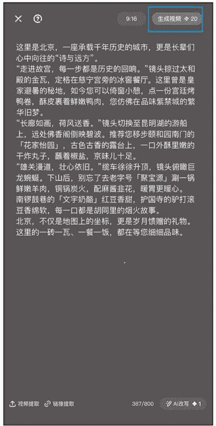

图10.2 用度加剪辑生成视频

稍等片刻，关于北京景点和美食的短视频就出来了，这就是1.0版本。字体、配音、画面尺寸、背景音乐、素材等都可以改，比如把标题换成 DeepSeek 给的爆款标题，如图10.3所示。

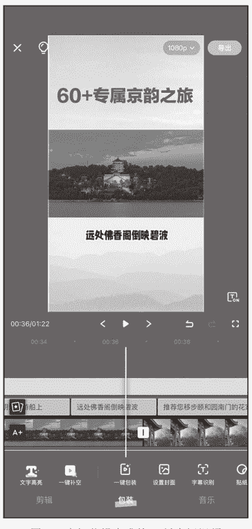

图10.3 度加剪辑生成的1.0版本短视频

3）通义/海螺AI替换短视频素材。对成片素材不满意，比如匹配度不高或开头不够精致，就可以用通义和海螺 AI 重新生成。以海螺 AI 为例。

不会写提示词也没关系，让 DeepSeek 代写。比如对开头片段不满意，可以这样问 DeepSeek：

> 问：帮我生成一段海螺AI文生视频的提示词，主要画面是：镜头缓缓推开朱红的宫门，阳光洒在斑驳的石阶上——这里是北京，一座承载千年历史的城市，更是长辈们心中向往的“诗与远方”。

“主要画面是”后面的内容就是前面 DeepSeek 生成的文案。

DeepSeek答：

> 画面描述：
【开场镜头】晨雾中朱红的宫门被苍老的手缓缓推开（特写鎏金雕花的门环），阳光如金箔洒在斑驳的汉白玉石阶上，琉璃瓦折射出流转的光晕，镜头随飘落的银杏叶抬升——俯瞰故宫层层叠叠的金顶红墙（航拍运镜）。

随后打开海螺 AI，点中间的“海螺视频”，如图10.4所示。

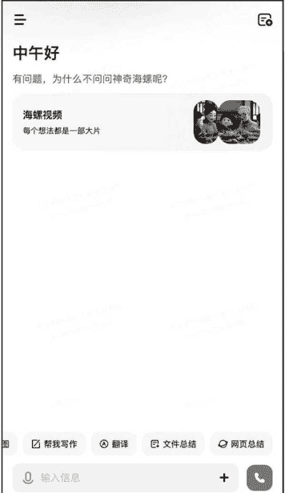

图10.4 海螺AI操作界面

进入“文生视频”，粘贴 DeepSeek 给的描述，点击右下角按钮，如图10.5所示。

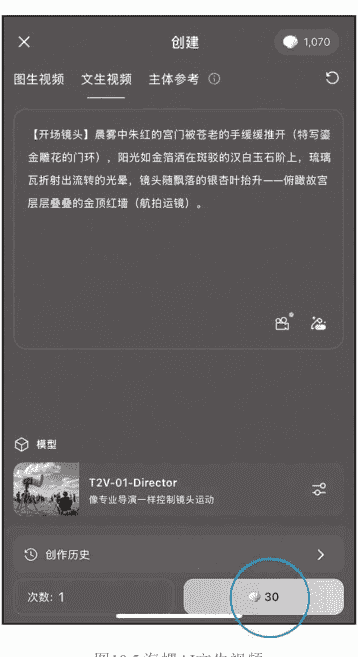

稍等片刻，对应的片段就生成了，效果很精美，如图10.6所示。下载后导入度加剪辑替换原素材，就得到2.0版本。

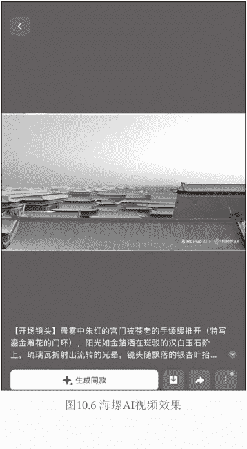

如果2.0版仍不满意，再把视频整体导入剪映做二次加工，就完成3.0版。

以上就是 DeepSeek 辅助制作短视频的全流程。

### 10.2.2 如何用DeepSeek制作创意短视频

不想做写实场景，想尝试老照片修复、或是“小猫咪做饭”“太乙真人打碟”这类在网上流行的创意视频，也可以用 DeepSeek 辅助完成。需要用到即梦AI和通义或可灵AI。即梦AI和通义可以免费领积分使用，可灵AI 效果更好但免费账号生成速度很慢，不太适合只想零成本的读者。

具体操作不用死记，让 DeepSeek 教你即可。

1）DeepSeek生成提示词。告诉 DeepSeek 你想要的效果，让它拆解分镜并给出即梦的绘画提示词和通义的视频提示词。

> 问：我想用即梦AI制作大橘猫做红烧肉的全流程图片，然后用通义的图生视频功能将每张图片生成一小段的视频，最终组成一个完整的视频。
请帮我拆解大橘猫做红烧肉的流程，并为制作每张图片生成对应的即梦提示词，同时，也为每张图片制作视频生成对应的通义提示词。
整个画面要可爱、卡通。

DeepSeek答：

```
根据你的需求，结合搜索结果中红烧肉制作流程和卡通化视觉呈现要求，我为你拆解以下全流程方案（含即梦AI图片生成提示词和通义图生视频提示词），整体采用3D卡通渲染风格，突出大橘猫的可爱动作与厨房互动细节：

流程拆解与提示词设计

1.准备食材（全景引入）

□即梦AI提示词“3D卡通大橘猫穿着厨师帽站在明亮厨房，尾巴卷着葱段，肉垫爪扶着案板，案台有五花肉/冰糖/酱油瓶，暖黄灯光，柔焦效果，Q版日漫风格”。

□通义视频提示词“镜头从厨房全景推进到猫咪特写，猫耳抖动，尾巴摇摆，爪子举起五花肉时肉块轻微弹动，背景食材冒出卡通蒸汽特效，循环动作2秒”。

2.焯水去腥（趣味互动）

□即梦AI提示词“大橘猫踮脚站在灶台前，用木勺搅动沸腾的锅子，锅内漂浮姜片和冒泡的五花肉，猫咪皱眉捂住鼻子作嫌弃状，锅边浮现粉色骷髅头气泡表示腥味，场景采用低饱和度水彩风”。

□通义视频提示词“锅子持续沸腾冒出夸张的螺旋状蒸汽,猫咪用勺子搅动时肉块上下浮动,骷髅气泡破裂后变成星星消失,镜头轻微晃动模拟热气效果”。

3.炸制食材(动态表现)

□即梦AI提示词“橘猫系着围裙,用长筷子夹起金黄色的五花肉块,油锅溅出卡通化的油花(圆形带闪光),背景有炸好的土豆块堆成小山,猫咪眼睛瞪圆嘴角流出口水,画面加入速度线特效”。

□通义视频提示词“油锅持续冒泡,肉块入油时触发金色光芒特效,筷子夹肉时油花溅出并伴随‘滋滋’音效符号,镜头360度环绕展示炸肉过程”。

4.炒糖色(紧张时刻)

□即梦AI提示词“猫咪双手握锅柄,紧盯锅中融化的琥珀色糖浆,糖浆泛起密集泡泡,灶火呈现心形火焰,猫咪额头流汗,背后浮现‘危险!’的警示牌,画面用暖色调突出焦糖光泽”。

□通义视频提示词“糖浆在锅中缓慢流动并逐渐变红,警示牌随泡泡膨胀不断闪烁,猫咪尾巴紧张地竖立,镜头特写糖色变化过程”。

5.炖煮收汁(温馨场景)

□即梦AI提示词“橘猫趴在砂锅旁,锅盖半开露出红亮的红烧肉和土豆,蒸汽形成猫爪形状上升,猫咪闭眼陶醉闻香气,背景有漂浮的星光和胡萝卜云朵,柔和的阴影渲染”。

□通义视频提示词“蒸汽猫爪缓缓上升并消散,锅内汤汁咕嘟冒泡,猫咪耳朵随着冒泡节奏抖动,镜头从锅具特写拉远到全景”。

6.成品展示(高潮结局)

□即梦AI提示词“橘猫头顶餐盘,盘中盛放油光发亮的红烧肉,肉块挂着晶莹酱汁,土豆呈现金棕色,背景有绽放的烟花和‘完成!’对话框,猫咪咧嘴大笑竖起大拇指,画面采用高对比度霓虹色”。

□通义视频提示词“餐盘旋转展示红烧肉纹理,酱汁缓慢滴落形成拉丝效果,烟花连续绽放并与猫咪眨眼节奏同步,结尾镜头缩放到猫咪瞳孔中的菜品倒影”。
```

2)即梦AI文生图。打开“即梦AI”，点中间的“想象”界面，再点下方对话框进入提示词设置。粘贴 DeepSeek 生成的第一条即梦提示词，可自行更换模型，点击右下角“生成”，如图10.7所示。

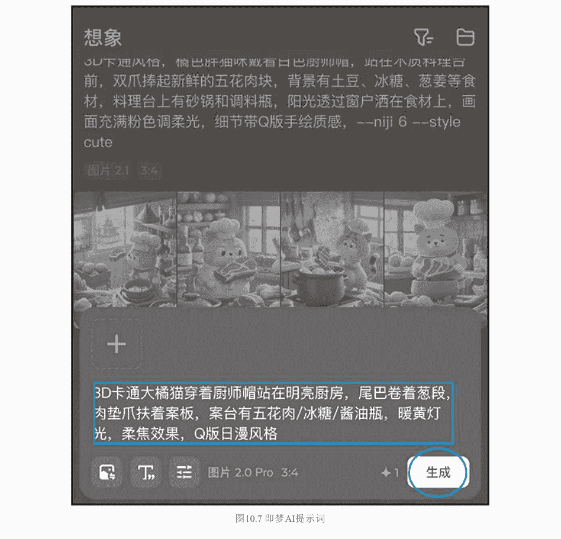

图10.7 即梦AI提示词

几秒后即可一次性得到4张图，不满意可重新生成，如图10.8所示。满意的图直接下载到相册。

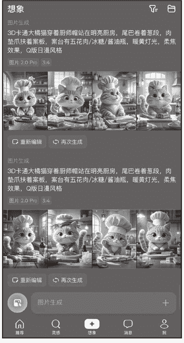

图10.8 即梦生图效果

3）通义AI图生视频。打开“通义”，点右上角进入AI广场，选择“视频生成”→“AI视频”，如图10.9所示。


图10.9 通义AI视频入口

选择右上角的“图生视频”，上传刚下载的小猫图片，粘贴 DeepSeek 生成的第一段通义提示词，点击“立即生成”，如图10.10所示。


图10.10 通义AI视频生成

几分钟后视频生成，下载到手机。这是第1段素材。按同样方法把6个场景全部做完，再统一导入剪映，加音乐和文字说明，一条创意视频就完成了。

### 10.2.3 DeepSeek+数字人，不出镜轻松搞定口播短视频

想做口播又不想露脸，可以用数字人。目前有公有数字人模板和定制数字人两种。公有模板使用量大，容易被平台判定违规，建议用定制数字人。

实测效果最好的是 Heygen，表情和光影都很逼真。去年团队用它生成的口播视频轻松破10万播放。闪剪、飞影、蝉镜等也有数字人功能，剪映会员版也包含。免费的定制数字人尚未发现好用的，这里不推荐。

重点要强调：选哪家数字人、手机拍还是相机拍都不是决定因素，爆款关键在选题和脚本。很多人用数字人内容没打磨，数据很差；也有人用手机拍，选题和逻辑对，数据依然很好。

工具是辅助，逻辑才是最前提。

### 10.3 DeepSeek助力高人气直播，每个人都可以是主播

视频积累到一定粉丝后就可以开播，视频号通常粉丝达100人即可。视频号变现约80%来自直播，接广告需要大体量粉丝，视频挂链接带货路径长且不适合高客单价，所以直播是商业闭环的必经之路。

从未直播过或效果不佳的人，可以用 DeepSeek 辅助。

关键在于，新主播必须有一套完整的直播节奏，也就是直播脚本。不能想到什么说什么，否则在线人数会很少。

直播不像演讲，观众随时进出，所以准备一套可循环的话术就够了，讲完一遍再讲一遍。

怎么制作直播脚本？直接让 DeepSeek 生成。

> 问：我是一名视频号家庭教育的博主，我没做过直播，请帮我生成一套完整的直播脚本，方便我直播的时候看，字数1000字左右。

DeepSeek答：

```
【家庭教育直播脚本】主题：3个方法让孩子主动学习+亲子沟通秘籍
直播时长：60分钟
目标观众：3～12岁孩子家长
核心目标：提供实用方法+建立信任感+引流私域
【开场暖场】（10分钟）
话术：
“大家好呀！欢迎来到××的家庭教育直播间！第一次直播有点小紧张，但看到屏幕前这么多家长朋友，感觉特别温暖！咱们今天不聊大道理，只分享我亲身验证过的3个让孩子主动学习的秘籍，还有解决亲子沟通难题的绝招！”
```

动作：
□挥手微笑，展示手写欢迎板（提前准备）
□引导点赞：“家人们动动小手点亮右上角的小爱心，到500赞咱们就抽奖送《21天亲子沟通打卡表》！”
□引导关注：“新朋友点个关注不迷路，每周二四晚7点分享带娃干货！”

暖场互动：
“咱们先做个调查哈！孩子写作业拖拉的扣1，顶嘴叛逆的扣2，玩手机停不下来的扣3，我看看今天重点解决哪个问题？”

# 【主题内容】（30分钟）
板块一：让孩子主动学习的3个魔法（15分钟）
方法1：游戏化目标管理
“比如背古诗，不要说‘今天必须背3首’，换成‘恭喜你解锁唐代副本！通关条件是找到李白的3个秘密武器’，我女儿用这个方法一周背了15首诗！”
……（中间略）
结束语：
“感谢家人们1小时的陪伴！下播后我会在粉丝群发今天所有的资料，大家有任何问题随时留言。教育路上，咱们一起成长！晚安啦~”

熟悉框架后直播时对照脚本提醒自己，就能避免开播慌乱。

### 10.3.2 优化6大直播话术，在线人数不再是个位数

很多读者已经有话术、也不慌了，但除开播头几分钟，在线人数始终个位数，一场下来场观百来人，播几次就想放弃。可以用 DeepSeek 解决。

尤其是知识服务类带货直播，脚本一般包含6大核心结构，见表10.7。

表10.7 直播话术6大核心结构

| 话术类型 | 作用 |
| :--- | :--- |
| 流量话术 | 吸引用户停留、互动（点赞、评论、转发） |
| 人设话术 | 建立专业性和信任感（身份 + 故事 + 成果） |
| 痛点话术 | 引发家长共鸣（场景化描述问题） |
| 塑品话术 | 展示产品价值（解决方案 + 权威背书） |
| 营销话术 | 制造紧迫感（限时 + 限量 + 赠品） |
| 带货话术 | 直接引导下单（降低决策门槛） |

场观低、销量差，通常是某类话术没做好。要做的事是：

- 用 DeepSeek 生成具备6大结构的直播脚本，方便复盘哪里做得不好。
- 对薄弱环节让 DeepSeek 优化，或直接对标同类优秀直播间学习模仿。

生成带6大结构的脚本也很简单，直接提需求即可。

> 问：我现在想做视频号直播，请按照完整的话术类型和结构，以一个家庭教育的博主身份做直播，直播主要面向3~12岁的孩子家长，销售一个家庭教育规划的线上训练营课程，请帮我设计一套直播脚本。

DeepSeek答：

**家庭教育训练营直播脚本（完整结构）**

**【开场10分钟】——流量话术+人设话术**
主播状态：热情、亲切，语速稍快
话术设计：
1. 吸引停留
“欢迎所有3~12岁孩子的家长！今天直播间会送3份《0~12岁儿童成长规划手册》实体书！只要在公屏上打出你家孩子的年龄，比如‘6岁’，就有机会免费领取！”
2. 建立人设
（举手机照片）“我是××老师，北师大教育学硕士，也是两个孩子的妈妈。过去5年我帮助了3000多个家庭解决育儿难题，很多孩子从写作业拖拉、顶嘴叛逆，到主动学习、情绪稳定，甚至考上重点中学！（展示学员感谢信/成绩单）”
3. 引发好奇

**亲子学习直播话术样例**

“今天给大家拆解一套三步走的引导方案，不用打骂不用催写作业就能让孩子主动起来，还能把亲子关系带热。这个做法已经有两百多个家庭实操验证过效果，**收官十分钟我会以19.9元的价格开放训练营锁定名额，原价699，只限今天！**现在评论区敲‘666’，让我看到大家的热情。”

**【15分钟痛点共情】——共情表达+互动引导**

开播状态：语气共情、语速放慢

话术要点：

1. 情境铺设
“有没有家长遇到过这种崩溃瞬间：孩子写作业半小时，上厕所喝水摸鱼八次？你忍不住吼了一句，结果他眼红说‘妈妈我讨厌你’……（停顿）那一刻是不是又后悔又无力？”
……（中间略）
“最后三分钟！现在下单再送《3~12岁分龄能力测评表》，帮你快速定位孩子天赋点！仅剩最后五个名额！”

2. 人设收束
“我很懂家长的焦虑，我自己也是母亲，所以才把价格压到最低。教育不能重来，但改变可以从现在开始。点下方购物车，我陪你们一起把孩子培养成自信独立的样子。”

按此拆解，就能得到一份条理清晰、有画面感、容易打动人的直播脚本。

提醒一点，直播要规避合规风险，部分词汇和表达是禁止出现的。DeepSeek产出的稿子一定要人工复核后再用。

## 10.3.3 用DeepSeek复盘直播，把间做成万人场

老手常说，不复盘的直播等于白做。复盘本质是把当期直播录像导出，转成带时间戳的文本，再对照该场数据大盘逐段分析，表现亮眼的片段保留，表现低迷的片段优化。

很多人觉得逐条对照费时间，其实模型可以代劳。具体做法如下。

1. 把待复盘的直播视频从视频号后台导出，上传到飞书妙记生成带时间戳的脚本文档。
2. 打开视频号后台，找到该场直播的数据大屏，把首页趋势图截图保存，如图10.11所示。


3. 把截图和文档一起交给DeepSeek，让它结合数据和脚本做诊断。举例提问方式：

> 我是视频号主播，正在做复盘。请结合附件图片里的直播数据和Word版脚本，指出这场直播的问题并给出优化建议，目标是提升停留时长和成交额，要可落地。

模型的输出：

**直播问题诊断**

1. **转化偏低、停留不足**
   - 成交117元，24单，累计观看1825人，转化率仅1.32%，说明大部分观众未产生购买欲或中途流失。
   - 脚本偏长且重复：多次重复“课程5元”“扣三个6登记”等话术，节奏单一，观众容易疲劳。
2. **信任感弱、价值表达不清**
   - 低价反复强调“含直播+25节视频+真人助教”，但缺少案例呈现和成果证明，真实性存疑。
   - 人群定位过窄：过度聚焦40岁以上，忽略年轻用户。
3. **互动不够有效**
   - 指令频繁：“扣6”“打在”“打刚来”等指令与内容脱节，易引起抵触。
   - 缺乏即时反馈：提到助理登记，却不展示进度或名单，互动不透明。
4. **商品展示和推单力道不足**
   - 只靠口述介绍课程，未用案例演示直观呈现效果。
   - 紧迫感营造不足：虽说“限量”，但没有倒计时、库存可视化等刺激。

**可落地优化建议**

**一、提升停留与吸引力**
1. **压缩脚本框架**
   - 开场前三分钟黄金期：先放课程成果案例，比如AI生成的美食动画，快速抓住注意。
   ......（中间略）

2. **分层运营观众**
   - 未成交用户：播后私信推送专属优惠券+案例合集，二次转化。
   - 已购用户：拉入社群，发起作业打卡，为复购蓄水。

这样复盘比盲做要高效得多。

需要说明的是，DeepSeek目前只能读取上传文件的文字内容，图片识别并不精准。可以换成已接入DeepSeek满血版且支持图片识别的“腾讯元宝”，复盘效果会更好。

视频号的商业化本质是一场内功修炼。爆款标题的四种设计法是点燃情绪的“北冥漩涡”；文案黄金结构与分镜脚本是把流量沉淀为信任的“化功大法”；数字人+AI成片则是省去外功苦练的“逍遥秘术”。本章串起了从内容创作到直播转化的完整链路：爆款不是玄学，而是可拆解、可复制的标准流程。无论是搭建吸睛标题库，还是打磨六大直播话术，核心都是重复——重复验证的套路，重复优化的数据反馈。当内容产能像北冥般纳百川，商业闭环自然水到渠成。

# 第11章

## 一阳指：借助DeepSeek起号小红书

> “食指轻颤，嗤嗤连点三下……指力所及，三丈外烛火自灭，墙上青砖现出三枚针尖深孔。”

> ——笔者按

本章以《射雕英雄传》“一阳指”作喻，点出小红书素人突围的关键在于高互动笔记的制造与复制。正如绝学需千锤百炼，小红书的成功也在于聚焦选题、标题、封面、内容四环。从模型赋能来看，素人可精准对标结构，再用“先大面积试探、再集中收割、最后择优跟进”的方法把爆款能力内化为本能。若一阳指以专注破敌，高点击笔记则以重复取胜：锁定有效模式，持续输出，终能在流量之海练就一击即中。

## 11.1 运用DeepSeek，零粉丝也能做高互动笔记

### 11.1.1 高互动笔记的关键在哪

小红书与视频号起号有不少共通之处，本文重点落在小红书笔记的特性上。

小红书笔记大致分三类：
- 图多文少型，如教程、游记；
- 图少文多型，如干货、心得；
- 图文兼顾型，如攻略。

对普通人而言，用DeepSeek找选题、写标题、搭笔记，核心逻辑仍是找对标，相信头部经验。

### 1. 零关注账号挑选对标的要点

小红书对标账号的挑选与视频号不同，建议找符合以下标准的账号：

- 关注者数量控制在1万以内。
- 互动数超过关注数：点赞收藏高于粉丝数。
- 版式统一：主页笔记风格一致，沿用同一模板。

最好三项都满足，至少满足两项，才能在起号期快速拉升笔记曝光。

### 2. 高互动笔记公式

**高互动笔记 = 高话题 + 高标题 + 高封面 + 高内容**

- **高话题**：依定位与赛道而定。如教育赛道，可细分为学前、小学、初中、高中、考研或亲子、财商等，具体方向决定内容潜力。
- **高标题**：用户刷 feed 时主要靠标题、内容、标签判断，后文会重点讲如何借助DeepSeek生成。
- **高封面**：无论图文型还是图少型，封面都是点击率关键。后续会讲如何直接用DeepSeek生成封面。
- **高内容**：基于对标笔记创作的原创内容，后文会讲批量生成方法。

### 11.1.2 用DeepSeek做小红书标题，点击可观

直接问模型“帮我写爆款标题”也能出结果，但精度有限。更可靠的做法是先大面积试探、再集中收割、最后择优。

1. **大面积试探**。用分层提问明确领域与人群，让模型输出相对精准的标题。
2. **集中收割**。喂养对标爆款案例，让模型模仿学习，输出符合高互动特征的标题。
3. **择优跟进**。发布后复盘数据，只保留表现最好的结构并重复。

按难度递增的提问结构示例见表11.1。

**表11.1 小红书标题场景分类及提问框架**

| 场景分类 | 提问框架 | 具体示例 | 适用说明 |
| :--- | :--- | :--- | :--- |
| 1.基础生成 | 角色+受众+核心主题+预期效果 | “作为母婴博主，请为30岁新手妈妈设计10个关于‘母乳喂养技巧’的标题，要带emoji，侧重涨粉” | 适合起步，明确定位与人群 |
| 2.元素拆解 | 提供案例+分析维度+生成要求 | “分析以下标题的高互动要素：‘挑战7天马甲线’‘95后副业月入5w’‘租房改造清单’，提炼3个公式并生成美妆同类标题” | 适合竞品拆解，需要真实案例 |
| 3.热点结合 | 领域+热点+创意方向+平台特性 | “围绕618大促，为家居博主设计5个‘智能家电选购指南’标题，要求带‘绝了’‘闭眼入’等热词” | 结合时事提升流量，需关注热词 |
| 4.标题优化 | 原标题+优化方向+目标效果 | “优化标题‘护肤步骤分享’，增加紧迫感，使用‘建议收藏’类引导词，适配25+职场女性” | 对已有标题升级，需明确方向 |
| 5.系列策划 | 主题+系列结构+差异化 | “策划‘健身打卡7日’系列标题，每日突出不同部位，带编号和统一emoji前缀” | 适合连载，保持统一又延续 |
| 6.数据驱动 | 历史数据+改进方向+验证机制 | “分析上月阅读量前三标题的优势，生成10个同类更具冲击力的新标题，并预估点击提升” | 基于账号表现迭代，需提供数据 |

举例：作为美妆博主想做10条标题。

**(1) 分层提问**
> 我是美妆博主，请为40岁职场精致白领设计10个关于“抗皱效果惊人的10大技巧”的标题，需带emoji，侧重涨粉。

模型会输出一批带痛点、情绪符号的人群化标题，如“40+女高管抗皱机密”“社畜自救指南”等，属于大面积试探阶段。

**(2) 喂养案例后再提问**
收集多个同类爆款标题喂给模型：
> 分析这5个标题的高互动要素：【不看后悔！不同年龄该如何护肤】【淡化法令纹真不难……】请提炼3个核心公式，生成10个美妆同类标题。

模型会归纳出“痛点+反常识承诺+情绪符号”“年龄限定+专业指导+获得感”等公式，并生成一批可直接使用的标题，实现集中收割。

**(3) 数据复盘后迭代**
> 根据上月阅读量Top3标题【断崖式衰老｜别慌！正确抗老的思路】……，分析优势并生成10个更具冲击力的同类标题，重点提升点击。

以此形成“先模仿再内化”的闭环，不断重复验证有效的标题结构。

## 11.2 让高互动能力持续的可行路径

### 11.2.1 用DeepSeek做小红书爆款图文，不会设计也能上手

很多人笔记写完后随手配图，这会严重拉低点击。封面是用户在首页的决策点，直接影响阅读量。

下面介绍一种不依赖设计软件，用网页版DeepSeek直接生成封面的思路，结合前文的标题与文案方法，或直接按以下流程实操。

本章开头提到对标账号的第三条标准是“版式统一”，即每页内容统一模板。比如做减肥话题的健身博主，可在小红书搜索“减肥”，找点赞评论超10万且格式统一的笔记。如图11.1所示，每页排版一致，仅文字变化。


图11.1 小红书爆款文案示例

### 1）DeepSeek生成笔记

启动 DeepSeek 之后，可以先喂给它一篇范例让它揣摩写法，也可以直接换一个指令，让模型围绕“35天内减重20斤”这个命题重新产出内容。

> 问：帮我出一份小红书图文文案，主题是35天瘦20斤，需要按周拆分执行细则。

DeepSeek 回复：

```
封面标题
🔥「35天挑战20斤」科学瘦身计划表 | 每周干货+易坚持小技巧
内页文案
[Week 1 启动期 | 目标：4～5斤]
- 饮食: 16:8间歇性断食法
- 早餐: 2个水煮蛋+黑咖啡
- 午餐: 150g煎鸡胸+西蓝花不限量
- 晚餐: 三文鱼沙拉(橄榄油调味)
- 运动: 每天30分钟快走+10分钟跳绳
- Tips: 每天喝够2L温水, 戒掉含糖饮料
- ……(中间略)
- 结尾标语
- 划重点:
  1. 严格控糖, 用零卡代糖解馋
  2. 平台期尝试更换运动模式
  3. 每日睡前泡脚加速代谢
  4. 准备低卡小零食防暴食
- 「好身材是自律的赠礼」
- 戳合集看我的对比照&食谱大全
```

### 2）DeepSeek 一键出图

继续向模型下指令，就能把文字转成配图。只想要一张图时，直接发指令后自行截取即可；若需要多张图，先把笔记拆开，比如封面加 5 周正文共 6 张。本节演示一次性生成一张图的操作。

问：请把下面这篇小红书笔记做成图片，版式要符合小红书审美，给出 html 格式。

封面标题

「35天挑战20斤」科学瘦身计划表|每周干货+易坚持小技巧

内页文案

[Week 1 启动期|目标: 4~5斤]

- 饮食: 16:8间歇性断食法

- ……(中间略)

- 运动: 早晨空腹有氧+晚间拉伸

- Tips: 用体脂秤记录数据, 维度变化比体重更重要!

- 结尾标语

- 划重点:

1. 严格控糖，用零卡代糖解馋

2. 平台期尝试更换运动模式

3. 每日睡前泡脚加速代谢

4. 准备低卡小零食防暴食

🎯「好身材是自律的赠礼」

👉戳合集看我的对比照&食谱大全

DeepSeek 回复：

以下是按小红书风格做的 HTML 版式，建议保存成 html 文件后用浏览器打开截图使用：

```
<!DOCTYPE html>
<html>
<head>
<style>
......（中间略）
<div class="content" style="background:#fff0f0;">
⚠️ 划重点：<br>
1️⃣ 严格控糖，用零卡代糖解馋<br>
2️⃣ 平台期尝试更换运动模式<br>
3️⃣ 每日睡前泡脚加速代谢<br>
4️⃣ 准备低卡小零食防暴食
</div>
<div class="footer">
🎯「好身材是自律的赠礼」<br>
👉戳合集看我的对比照&食谱大全
</div>
</div>
</body>
</html>
```

呈现特点：

1. 选用小红书典型的粉橘配色

2. 卡片式分层排布

3. 关键信息加亮提示

4. 适配移动端浏览

5. 借助 emoji 图标强化可视化

6. 渐变底提升质感

7. 阴影效果增加立体感

保存成 .html 文件后建议：

1. 在 Chrome 浏览器打开

2. 按 F12 进入开发者模式

3. 切到手机预览模式（建议 iPhone X 尺寸）

4. 截图保存即可使用

输出结果见图11.2


随后点右下角“运行 HTML”即可得到小红书样式图片，如图11.3 所示。可逐张截图挑选。


如果像图11.3 那样因过长而显示不全，可点 DeepSeek 生成的 html 界面右上角的“复制”，复制代码后新建一个纯文本文件，把代码粘贴进去。

1) Windows 电脑直接保存，再把后缀由“.txt”改成“.html”；

2）苹果电脑，点上方编辑栏“格式”→“制作纯文本”，如图11.4 所示，然后保存，将后缀改为“.html”,如图11.5 所示。


图11.4 制作纯文本


图11.5 保存为.html

这样打开保存的文本即可完整显示小红书全图，直接截图保存发布即可。

## 11.2.2 DeepSeek+Canva 实现图文批量化

上面是单篇做法，一次只能出1张图。下面介绍进阶做法，一次可产出几十上百篇图文。

需要搭配 DeepSeek 和 Canva 使用，都可在应用商店或浏览器搜索下载。具体步骤如下：

### 1）Canva 选模板，理清结构

打开 Canva，左侧选择“模板”，再选“小红书帖子”，任挑一款以文字为主的模板，见图11.6。


图11.6 Canva 模板选择

此时留意该模板的文字共分4个区域，见图11.7，部分需要改写，部分可保留，需提前确认清楚，因为会影响 DeepSeek 生成的内容结构。比如本例若只改③和④，DeepSeek 生成的表格只需两列。若4个区域都要改，则按要求生成4列。


图11.7 Canva 模板结构

### 2）让 DeepSeek 按需生成文案表格

直接向 DeepSeek 下指令。

问：帮我找10部经典电影里的发人深省金句，然后汇总成如下表格。第一列是经典台词金句，第二列是“——《电影名称》”

DeepSeek 回复：见表11.2。

表11.2 DeepSeek 生成的金句表格

| 经典台词金句 | ——《电影名称》 |
| :--- | :--- |
| “生活就像一盒巧克力，你永远不知道下一颗是什么味道。” | ——《阿甘正传》 |
| “希望是好事，也许是人间至善，而美好的事永不消逝。” | ——《肖申克的救赎》 |
| “要么忙着活，要么忙着死。” | ——《肖申克的救赎》 |
| “有些人活着，就足以拯救某个人。” | ——《嫌疑人X的献身》 |
| “人生不能像做菜，把所有的料都准备好了才下锅。” | ——《饮食男女》 |
| “你真正是谁并不重要，重要的是你的所作所为。” | ——《蝙蝠侠：侠影之谜》 |
| “世界上只有一种病，那就是穷病。” | ——《我不是药神》 |
| “有时候你只需要20秒疯狂的勇气，就能改变一生。” | ——《我家买了动物园》 |

### 3）打开 Canva，选择左侧“应用”→“批量创建”

如图11.8 所示，将上一步生成的表格复制粘贴进去，如图11.9 所示。


图11.8 Canva 的批量创建入口


图11.9 添加数据后的效果

此时模板左侧会出现“经典台词金句”和“电影名称”的数据字段，点击模板待修改处右键，选择“关联数据”，如图11.10 所示。


图11.10 模板关联数据

依次将两处待修改内容关联后，点击左下角“继续”，再点“生成10个设计”。即可一次性完成10篇图文笔记，结果如图11.11 所示，导出即可发布。


图11.11 生成结果

用此方法可快速完成多篇图文制作，相比手工操作节省大量时间。

## 11.2.3 DeepSeek 打造小红书爆款文案

进入爆款文案创作环节，需结合第11.2.1 节的爆款标题方法。我为不同场景准备了8种爆款文案提示词，见表11.3。

表11.3 小红书爆款文案的提示词

| 场景分类 | 问法结构 | 具体示例 | 核心要点 |
| :--- | :--- | :--- | :--- |
| 1. 框架生成 | 角色定位+内容方向+呈现形式+用户需求 | “作为旅行博主，请设计‘厦门3日游攻略’笔记框架，要求：①包含交通/美食/拍照打卡点②使用‘避雷指南’‘本地人才懂’等关键词③采用步骤式排版” | 先搭建内容“骨骼”，再填充“血肉” |
| 2. 痛点解决 | 目标人群+具体痛点+解决方案+情绪价值 | “针对996上班族的颈椎问题，创作办公室拉伸教程，要求：①用‘打工人自救指南’作主题②包含真人演示对比图位标记③结尾引发‘你的颈椎几岁了？’互动” | 强化“痛点共鸣-方案演示-效果见证”逻辑链 |
| 3. 爆款拆解 | 提供案例+分析维度+重构要求 | “分析这3篇万赞美妆笔记（附链接），总结内容结构规律，生成‘早八伪素颜妆’教程，要求保留‘产品平替清单’板块” | 提取“场景化开头+干货分层+视觉对比+福利引导”等爆款元素 |
| 4. 热点改编 | 领域+热点话题+内容载体+转化设计 | “结合《酱园弄》电影热点，为复古穿搭博主创作民国风造型教程，要求：①关联剧中角色造型②添加‘同款服饰链接’③设计‘猜电影领好物’互动” | 借势热点需自然植入，避免硬广 |
| 5. 内容优化 | 原始文案 + 修改方向 + 数据指标 | “请优化这篇家居收纳笔记(附原文):①增加‘before-after对比图’描述位②插入‘收纳神器清单’表格③强化‘极简生活’价值观输出” | 提升信息密度和视觉化呈现 |
| 6. 系列策划 | 主题IP+内容矩阵+差异化设计 | “策划‘30天极简生活挑战’系列...” | ... |

例如以第3条爆款拆解为例。先从小红书找到一篇美妆万赞笔记，如图11.12 所示。


图11.12 小红书美妆万赞笔记

然后提取文字或直接把图发给 DeepSeek 分析。

> 问：分析这篇万赞美妆笔记（附链接），总结内容结构规律，生成“早八伪素颜妆”教程，要求保留“产品平替清单”板块。

附“笔记文案，略”

DeepSeek 回复：

> 一、万赞美妆笔记内容结构规律分析

1.痛点引入

- 以年龄增长、熬夜、压力等外源性衰老问题为切入点，引发共鸣（如25岁后熬夜后修复难）[citation:用户笔记]。

- 结合科学理论强化说服力（如甲基化水平升高导致衰老），提升专业感[citation:用户笔记]。

2.核心卖点解析

- 技术升级：强调产品迭代与科技突破（如第9代黄金双萃的外源抗老科技）[citation:用户笔记]。

- 成分功效：列出核心成分（如法国巨型芦竹、姜黄酮、胜肽等），说明其抗老、修护、提亮作用[citation:用户笔记]。

- 使用体验：突出质地、吸收度、效果（如水油质地吸收快熬夜后气色好）[citation:用户笔记]。

......(中间略)

四、总结

早八伪素颜妆需兼顾效率与自然感，核心在于：

- 精简护肤：抗老精华打底，提升肌肤状态；

- 多功能产品：防晒+润色一步完成；

- 局部修饰：弱化粉感，突出原生质感。

平替产品可大幅降低成本，同时适配不同肤质需求。

以上即为匹配爆款标题后的爆款文案打造流程。结合选题、标题、图文与文案，读者对 DeepSeek 在小红书实战中的应用应已有全新认识。

自媒体实战篇重在实操，建议多用工具演练，多发多复盘，数据是检验效果的唯一标准。

小红书爆款笔记要像“一阳指”般精准——封面是破开信息流的指风，标题是直击痛点的穴位，内容是沉淀信任的内力。本章从对标到批量生产拆解了全流程：DeepSeek 不仅是标题生成器，更是爆款元素的解剖刀。通过“广撒网-多敛鱼-择优而从之”的策略，即使零基础也能快速掌握爆款复刻精髓。记住，爆款的核心不是灵感乍现，而是对用户需求的极致洞察与高效满足。当笔记如段氏绝学般“一击即中”，流量与转化自然随行。

# 第四部分

生活赋能——让日常更从容

在现代生活的纷繁中，我们常被健康、财务、旅行、职业等琐事裹挟。若硬碰硬，易顾此失彼；唯有借势智能的经纬，才能织出从容的生活之网。DeepSeek 正是这个时代的织网者，以数据为丝、算法为梭，将个人需求与海量信息精准缝合。无论是解读体检报告，还是规划跨境创业，它都能在混沌中锚定关键节点，把“不可能”拆解为可执行步骤。

这不仅是工具迭代，更是生活哲学的进化。古人观星定农时、察水筑城郭，如今我们以 AI 为镜，照见生活深层逻辑。健身计划背后是代谢精算，旅行攻略之下是时空最优，职业规划之中是风险博弈。DeepSeek 的价值不在于替代思考，而在于把意图转化为系统行动力，让每个普通人都能以指挥官姿态调度资源、预判变数，在生活战场上举重若轻。本部分将揭开这层赋能面纱。

# 第12章

太极之道：用 DeepSeek 打造你的生活助手

> “但见剑招圆转如意，似缓实快……每一剑刺出，皆如画圈成环，环环相扣，竟无半分棱角锋芒。敌剑攻至，剑圈微引，便似泥牛入海，劲力尽化无形。”

——笔者按

本章如《倚天屠龙记》中的太极剑法，看似聚焦生活琐事，实则内涵深远。DeepSeek 如隐世高手，以精准智慧与灵活策略，助你化解健康、财务、旅行、职业难题。无论解读体检报告、制定健身计划，还是设计个性旅程、规划职业路径，它都能以“四两拨千斤”之效，将繁杂信息化为简明方案。正如太极以简驭繁，DeepSeek 从细微处入手，却能为生活注入高效与从容。

## 12.1 一句话，让 DeepSeek 成为你的私人顾问

### 12.1.1 健康、财务、法律、教育等领域，万能顾问即刻响应

#### 1. DeepSeek 擅长解答生活困扰

DeepSeek 可运用的生活场景众多。想健身却不知如何训练，可问它；想做一周穿搭，可让它帮忙；食材有限想做美食，它也能给出建议。

例如制订健身计划，直接提问已能得到不错答案。

> 问：我今年30岁，请帮我制订一个健身计划，主要是为了减肥。

DeepSeek 回复：

> 好的！根据你的年龄和减肥目标，我会为你制订一个适合初学者的健身计划。这个计划将结合有氧运动和力量训练，帮助你有效燃烧脂肪、提高代谢率，并逐步改善体形。以下是一个为期8周的健身计划，每周锻炼5天，留出2天休息或进行轻松的活动（如散步、拉伸等）。

每周健身安排：

- □周一：全身力量训练+有氧运动

- □周二：有氧运动（高强度间歇训练HIIT）

- □周三：下半身力量训练+有氧运动

- □周四：休息或轻松活动（如散步、瑜伽）

- □周五：上半身力量训练+有氧运动

- □周六：有氧运动（中等强度，如跑步、骑车）

- □周日：休息或轻松活动

详细计划：

周一：全身力量训练+有氧运动

1. 热身（5～10分钟）：跳绳、慢跑或动态拉伸。

2. 力量训练（每个动作做3组，每组12～15次）：

......（中间略）

注意事项：

1. 循序渐进：如果你是初学者，可以从较轻的重量和较低强度开始，逐渐增加。

2. 保持一致性：每周坚持5天锻炼，避免中途放弃。

3. 记录进展：每周记录体重、围度变化，观察进步。

4. 休息和恢复：保证每晚7～8小时睡眠，帮助身体恢复。

对比其他 AI，DeepSeek 回答更精准，但仍缺乏针对性，无法直接使用。因为它不了解你的身体基础、每日可用时间、期望效果等。

#### 2. 用一句话让 DeepSeek 成为懂你的生活专家

要让 DeepSeek 给出精准回应，只需问得清楚，或使用统一提问结构：

作为[××角色]/我是[××角色]，请用[××方式]，帮我[具体任务]，要求[1.2.3]。

例如：请作为资深营养师，用对比表格形式，帮我制订一周减脂食谱，要求：①每日热量<1500大卡 ②标注备餐时间 ③适合上班族。

这是一种覆盖大部分生活场景的全面问法，多数场景只需取其部分即可。

关于简单生活场景的提问，可参考表12.1。

| 生活场景 | 提示词结构 | 具体示例 |
| :--- | :--- | :--- |
| 私人教练 | 角色设定 + 目标描述 + 限制条件 | “作为健身教练，为 30 岁久坐上班族设计一周减脂计划，包含饮食建议和每日 30 分钟运动，无需器械。” |
| 私人医生 | 症状描述 + 需求明确 | “我最近失眠严重，每天只能睡 4 小时，白天乏力。请推荐非药物改善方法。” |
| 穿衣搭配 | 身体特征 + 场合需求 + 风格偏好 | “身高 170cm/ 梨形身材，需要通勤穿搭方案，偏好简约风，预算单件不超过 300 元。” |
| 个性化做饭 | 饮食限制 + 食材限定 + 步骤简化 | “提供 3 步完成的麻婆豆腐不放辣做法，食材仅限豆腐、肉末、豆瓣酱 (不辣版)。” |

DeepSeek提问五大实战模板

| 场景 | 提示词思路 | 参考提问 |
| 资金规划 | 收支概况+量化目标 | “月收入约8000元，房租3000元，希望每月结余2000元，帮忙做一份支出预算并推荐合适的理财方向。” |
| 合同协议 | 使用场景+条款要点 | “需要一份个人租房协议范例，要写明押金返还条件与违约赔偿约定。” |
| 宠物养护 | 品种+问题+求解方式 | “家中有3岁布偶猫，经常抓沙发，请给出5种低花费、不伤害猫咪的纠正办法。” |
| 内容创作 | 主题+风格要求 | “模仿李白笔法写一首描写春雨的七言律诗，要求押平声韵。” |
| 自我提升 | 知识点+讲解层次 | “用小朋友能听懂的语言解释牛顿第一定律，并配上生活例子。” |

承接上表思路，表12.1里第一种“私人教练”式提问可以拆成角色定位、目标说明、约束条件。例如：

> 问：我今年30岁，以前常跑步跳绳，现在久坐，肚子上囤了不少脂肪。希望得到一份4周减脂方案，含饮食建议和每天30分钟不用器械的训练。

DeepSeek 回应：

> 没问题。结合30岁、有运动基础、久坐导致腹部脂肪堆积的情况，为你定制“4周高效减脂计划”，包含每日30分钟无器械课表和饮食要点，重点减脂塑腹，同时恢复体能。

4周减脂计划总览
运动频率：每周训练5天，2天休息或做低强度活动如散步。
单日时长：30分钟，包含热身、训练、放松，不用器械。
核心思路：
阶段1第1周：唤醒身体，适应节奏。
阶段2第2-3周：提升强度，加速燃脂。
阶段3第4周：强化代谢，巩固成果。
周计划见表12.2。

表12.2 周运动安排

| 日期 | 训练内容 | 重点目标 |
| :--- | :--- | :--- |
| 周一 | 全身燃脂HIIT＋核心练习 | 激活代谢，启动脂肪消耗 |
| 周二 | 中低强度有氧＋腹部塑形 | 持续消耗，针对腹部赘肉 |
| 周三 | 休息或散步/瑜伽 | 促进恢复，避免疲劳累积 |
| 周四 | 高强度间歇训练HIIT＋全身复合动作 | 提升心肺，加快热量消耗 |
| 周五 | 中低强度有氧＋腹部塑形 | 稳固燃脂，加强核心肌群 |
| 周六 | 全身循环训练TABATA模式 | 打破平台期，提高代谢率 |
| 周日 | 休息或拉伸/泡沫轴放松 | 全身修复，缓解肌肉酸痛 |

预期效果
第1周：体重降1-2kg，多为水分，腰围减1-2cm。
第2-3周：体脂率明显下降，腹部开始收紧。
第4周：体能明显提升，腰围减3-5cm，前提是饮食严格执行。

这种问法更容易拿到可落地建议。
其他医疗、穿衣、做饭、财务、合同、宠物、创作、教育等场景的提示词和范例，可按上述思路自行尝试。

提醒：医疗、法律、金融类内容仅作参考请勿盲信。DeepSeek官方提醒「输出由AI生成，专业领域不构成诊疗、法律或投资建议，请自行甄别。」

## 12.1.2 复杂问题用DeepSeek，在家也能有答案

当问题变得复杂，比如已经在自律健身却不见成效、按网红食谱控制饮食体重仍不动、体检单看不懂懒得再跑医院，就不能靠简单提问，需要学会用DeepSeek处理复杂问题。

对应的提问框架是：先给数据，再补背景，最后要个性化方案。

下面整理了常见复杂生活场景的提问方式和示例，见表12.3。

表12.3 复杂生活类场景提问方法及示例

| 生活场景 | 提示词结构 | 具体示例 |
| :--- | :--- | :--- |
| 健康管理 | 医疗数据解析＋个性化方案 | “根据血糖监测数据（附件）和饮食记录，生成糖尿病管理方案，输出血糖波动趋势图与食谱调整建议。” |
| 个性化生活 | 衣柜数据输入＋场景匹配算法 | “分析我的衣柜单品照片（附件），按商务/休闲/约会场景生成30套搭配方案，标注单品复用率。” |
| 营养分析 | 饮食记录分析＋营养缺口预警 | “解析过去一周饮食照片（附件），计算蛋白质/碳水/脂肪摄入比例，生成营养补充建议表。” |
| 财务管理 | 多维度数据分析＋投资策略 | “分析我的年度消费数据（附件），结合2025年杭州房产趋势（附件），评估是否适合购房投资，输出SWOT分析表。” |
| 法律咨询 | 法律条文解读＋风险预警 | “请分析这份劳动合同（附件）中的竞业禁止条款是否符合《劳动法》，并标注潜在风险点。” |
| 学习助手 | 学术数据分析＋论文辅助 | “根据实验数据（附件）生成论文图表，并撰写‘机器学习在医疗影像中的应用’文献综述框架（参考文献按APA格式）。” |

比如把体检报告发给DeepSeek。笔者曾上传一张螺旋CT描述，希望从医学专家视角解读。

> 问：请从医学专家的角度帮我分析一下这张胸部低剂量螺旋CT的结果。

回应：

> 好的，我先基于你提供的影像描述和放射学意见，从医学专家视角进行解读并给出分析和建议。

……（中间略）

3.症状关联性分析：
□若目前无症状，多为良性陈旧性改变
□如有进行性呼吸困难，需完善肺功能检查
□若伴发热/咳痰，需排查活动性感染

四、特别注意事项：
1.本报告未见恶性征象（如毛刺结节、胸膜凹陷等）
2.单发索条影临床意义有限，多发需警惕间质性肺病早期改变
3.建议保留当前影像作为后续对比的基线资料

需强调，放射科报告必须结合临床综合判断，建议携带完整病历至呼吸科门诊进一步评估。

笔者后续复查证实主要是呼吸道相关炎症，DeepSeek的分析相对准确，节省了大量盲目搜索时间。但医疗、法律、金融类回答只能参考，不能盲信。

## 12.2 为你量身打造一个规划师

除了即时解答生活问题，DeepSeek还能发挥更大价值。比如想掌握新技能或进入新领域，零基础者常不知该看什么资料、买什么书、听什么课，这时一个专业角色的建议能省去很多弯路。

### 12.2.1 用DeepSeek有效制订学习计划

1. 先做扫盲式学习规划
目标不清晰时，直接问。此时对DeepSeek的预期是：帮我梳理这个方向该学什么。

对应的提问结构是：「角色」＋「目标」。

例如想零基础提升公开演讲：

> 问：我想零基础提升公开演讲能力，请帮我制订一个3个月的学习计划。

回应：

零基础公开演讲能力3个月学习计划

目标：3个月内掌握演讲基础，能自信进行5分钟左右演讲。

阶段一：基础与自信建立（第1-4周）

目标：克服紧张，掌握基础技巧。

第1-2周：
学习：
观看TED演讲，分析演讲者技巧如肢体语言、语音语调、故事讲述。
阅读《演讲的力量》等书籍，了解演讲基本要素。

练习：
每天对镜练习5分钟，观察表情与肢体。
录制1分钟自我介绍视频，反复观看改进。

挑战：
在家人或朋友面前做2分钟自我介绍。

……（中间略）

可见方案完整但缺乏针对性，没有结合每日投入时间、工作情况等个人现实，很有「AI味」。

2. 去掉AI味，补充个人信息
消除AI味的关键是补充信息。

对应的提问结构是：「结构化背景」＋「需求」＋「限制条件」。

例如想考一级注册建筑师，每天仅1小时学习且为零基础上班族：

问：我是一名上班族，每天仅有1小时学习时间，目标是6个月内考取一级注册建筑师证书。请根据我的时间安排，推荐适合零基础上班族的学习路径（包括书籍、网站、核心知识点），并设计分阶段任务。

回应：

以下是针对零基础上班族的6个月一级注册建筑师备考计划，每日1小时，结合核心知识点、学习资源和分阶段任务：

一、备考核心策略

聚焦高频考点：优先掌握分值占比高的科目。
真题驱动：以近5年真题为导向，精准定位考点。
碎片化学习：利用通勤、午休复习。
模块化学习：把知识点拆成小任务，每天完成1-2个模块。

二、分阶段任务规划

阶段一：基础搭建（第1-2月）

目标：建立知识框架，熟悉考试大纲。

每日任务：
教材精读30分钟：
按顺序学习《设计前期与场地设计》《建筑设计原理》，标记重点，配合B站视频理解难点。
真题摸底15分钟：
每天做1道真题，记录错题类型。
构造图集15分钟：
每天记忆1种建筑构造节点图如屋面防水、墙体保温，手绘简图。

......（中间略）

方案明显更具针对性，执行成功率更高。

计划执行中调整
若已按计划执行但进度滞后，不必灰心，可让DeepSeek即时优化。

> 问：我按该计划执行到第3个月，还没开始做真题，知识点也没梳理完，进度落后约1个月，该如何调整以达成目标。

回应：

> 以下是针对进度落后的高效补救方案，通过优先级重构＋弹性时间管理，帮助你在剩3个月内追回进度。

一、现状分析与调整原则

核心问题：
知识点未梳理完→框架缺失导致效率低
未接触真题→缺乏考点敏感度，精力分散

调整原则：
真题驱动优先：直接通过真题反向定位高频考点
二八法则强化：放弃低频细节，主攻占分80%的核心模块
以战代练提速：用做题代替纯理论记忆

二、具体调整方案（剩余3个月）

第一阶段：真题破局（1-10天）

目标：通过真题快速定位重点，建立应试思维

每日任务1小时：
真题解剖40分钟：
直接做近3年真题，每套完成后：
☑️标出重复考点如防火分区、构造节点
☑️统计错题对应知识点如结构选型、荷载计算

……（中间略）

像一个贴身家庭教师，随时根据现实调整，十分方便。

### 12.2.2 用DeepSeek辅助完善个人规划

1. DeepSeek，天生的规划师
笔者曾为业务转型付费咨询，得到不少思路。后来把同样问题丢给DeepSeek，答案与付费咨询高度一致，且更详细更有条理，尤其是深度思考过程带来的启发很大。

在个人职业规划上，DeepSeek也能点亮灵感并梳理路径。

2. 辅助职业规划
例如刚毕业、校期间做跨境电商运营1年，想3年后独立创业，目前资质经验和人脉都不够。

提问结构同样是「角色」＋「目标」。

问：我刚毕业，目前从事跨境电商运营1年，计划3年后独立创业，我现在该做哪些准备和积累？

回应：

对于刚毕业且计划3年后独立创业的跨境电商从业者，需从行业认知、资源积累、技能提升、资金储备、风险控制等维度系统准备。分阶段建议如下：

一、第1年：夯实基础，成为行业专家

1.深度理解行业全链条

平台规则：精通亚马逊、Shopify、独立站运营逻辑如A9算法、广告投放规则。
选品逻辑：掌握Jungle Scout、Helium10等工具，通过Google Trends、Ahrefs挖掘蓝海品类。
供应链管理：接触供应商谈判、库存周转率计算，了解1688、Alibaba国际站优劣。
物流方案：熟悉FBA、海外仓、小包专线的成本结构。

......（中间略）

注意，深度思考后的输出存在较强的AI幻觉，具体公司、数据等需重新核实。

3. 补充信息，让规划更细化
若觉得方案太笼统，可继续追问。

对应的提问结构是：「角色定位」＋「具体需求」＋「资源限制」。

问：我目前是跨境电商运营岗位，工作1年，擅长数据分析但缺乏供应链管理经验。未来3年计划创业，需掌握哪些技能？请按季度拆分学习目标，并推荐低成本学习资源如课程、行业报告。

回应：

……（中间略）

2.以下是针对你的情况制订的3年季度学习计划，重点覆盖创业必备技能并推荐低成本资源：

第一年：补齐供应链短板，深化数据驱动能力

Q1-Q2：供应链基础搭建

目标：
理解供应链全流程采购-生产-物流-库存-售后
掌握供应商筛选与谈判技巧

......（中间略）

关键执行原则

721法则：70%时间实战、20%向同行学习、10%理论学习。
低成本试错：测试预算控制在月收入5%以内。
人脉杠杆：每季度新增3个行业联系人，优先线下建立信任。

按此计划，3年后将具备：

✅供应链端：10家以上验厂通过的备选供应商，库存周转率达行业平均1.5倍
✅资金端：20万启动资金+3个月应急现金流
✅数据端：已验证选品模型ROI>2.5、私域用户池>2000人

# 以长短板为锚，画出可执行的职涯路线

从自身擅长与欠缺出发，再结合更具体的目标，就能推导出真正可落地的职业蓝图。

## 4. 用DeepSeek绘制专属职业图谱

DeepSeek并不只是给出通用建议，还能把方案拉向个人化。前面那个例子仅描述了一年从业经验，看不出学历背景、专业经历，也体现不出所在企业的实际赋能，本质上仍是模板化输出。

要拿到真正属于自己的规划，可以采用这套提问思路：“角色界定 + 资料投喂 + 多维度拆解”。

沿用先前情境，先把简历和公司介绍或官网链接上传。

> 问：我现在在跨境电商运营岗位，工作一年，数据处理是突出点，对供应管理接触不多，未来三年想在跨境电商赛道尝试创业。附件附上个人简历和所在公司的业务说明。请结合我的经历与公司业务，梳理创业的主要隐患，并给出有针对性的能力建设清单，涉及学习方向、人脉拓展与资金准备。

模拟回应思路如下：

> 基于过往经历与公司业务的风险拆解

简历里能看出**数据建模较强**，以及在纳斯达克相关岗位实习的经历，这为跨境电商创业提供了底层优势。但在**供给端管理、市场推广、团队搭建**方面仍有空白，结合所在公司类似头部快时尚跨境平台的模式，主要风险与对策如下：

### 一、创业核心风险点拆解

1. 供给端管理风险
痛点：缺乏与供应商谈判、库存周转优化、跨境物流成本把控的实操积累，简历中没有直接相关经历。
案例：选品判断失误导致库存积压，例如误判美国年轻用户对汉服的需求，可能吞噬启动资金的一半以上。
……（中间略）

### 二、针对性能力补齐路径

1. 补足供给端能力（第1~2年）
学习目标：
- 第1~2个季度：熟悉跨境供给全链路1688采购→头程→FBA入库→逆向物流，应用 InventoryLab 工具提升库存流转效率。
- 第3~4个季度：小批量测款实操，MOQ控制在100件以内，借助 Oberlo 平台寻找分销供应商，验证3～5个品类。
......(中间略)

## 四、差异化优势与可借力资源

优势迁移：
- 把金融建模能力用到库存优化上，例如用概率仿真测算安全库存。
- 利用指数开发经验搭建实时数据看板，追踪竞品价格波动、评价增长等动态。

资源杠杆：
- 通过现有公司接触柔性供给模式，学习其小批量快速反馈的运作逻辑。

## 执行自检清单（每月复盘）

- 供给端：本月是否新增一家已验厂的供应商？
- 数据：是否完成一次选品模型迭代，例如加入季节性因子？
- 人脉：是否认识一位物流商或工厂负责人？
- 资金：储蓄进度是否达标？

这样既能发挥DeepSeek在系统规划上的优势，也能把个人独特性叠加进去，共同完成职业蓝图。

## 12.2.3 用DeepSeek快速完成出行规划

出行常在跟团与自助间犹豫。跟团省心但成本高，自助便宜但耗时。借助DeepSeek可以兼顾省心又省钱。

## 1. 五招降低模型虚构，提升攻略可信度

不少人用过DeepSeek做攻略后会产生怀疑，模型容易编造航班、车次、住宿和餐厅。总结了五条降低虚构信息的提问方法。

招数1：强制要求列出信息来源。示例提问：“请基于检索到的合肥-北京旅游报价和行程，推荐三天方案并标注引用编号。”作用是逼迫模型引用已有数据，避免杜撰。

招数2：限定时间与预算区间。示例提问：“根据检索结果中三天人均800～1000元的报价，规划三人8000元预算的行程。”目的是让方案贴合真实价格，避免超支。

招数3：要求交通方案可核验。示例提问：“请推荐合肥到北京的高铁班次，需参考检索中二等座300～400元的票价区间，并说明是否为真实车次。”结合12306进行核对。

招数4：指定景点与导游联系方式。示例提问：“请推荐检索中提到的导游如阿洁、小陈的联系方式，并规划路线。”直接引用网页资源，避免虚构。

招数5：要求住宿餐饮信息核验。示例提问：“请推荐检索中提到的三星级酒店区域如国贸、西单，并标注人均餐饮预算100～200元/天。”减少不实推荐。

总结就是：开启联网搜索，多次追问验证。

下面是基础、进阶、高阶的提问路径。

## 2. 先抛关键词也能得到框架

先测试DeepSeek做旅行攻略的效果。

问：请帮我规划一个五天的北京自由行。

模型回应：

为你整理了一份北京五日自由行，融合历史、文化、自然与现代体验，行程紧凑合理。依据检索结果中的推荐景点和实用提示，安排如下：

**第一天：历史与皇家文化**
重点：天安门广场、故宫、景山公园、前门大街
早上
- 天安门广场：观看升旗，需提前查询时间，建议提前一小时到达。
- 毛主席纪念堂需预约，注意闭馆时间。
中午
- 前门大街品尝老北京小吃，如炸酱面、豆汁、焦圈。
下午
- 故宫博物院提前预约，建议租导览器，周一闭馆。
傍晚
- 登景山公园俯瞰故宫全景，再步行到南锣鼓巷体验胡同文化，晚餐可选什刹海附近的涮肉。
......（中间略）

实用建议
- 门票预约：故宫、国家博物馆、天坛等热门景点需提前1～7天预约。
- 交通：地铁加共享单车为主，长城建议坐高铁北京北站/清河站前往八达岭。
- 住宿：前门或王府井附近交通便利。
- 餐饮：烤鸭、四季民福、大董；炸酱面方砖厂69号；铜锅涮肉东来顺。

如需更细的开放时间、票价或导游推荐，可查检索来源或当地平台。祝旅途愉快！

联网后信息基本准确，但预算、游玩时长等细节不足，可用进阶方法。

## 3. 给出偏好直接拿到定制行程

提问结构为：“详细偏好”+“限制条件”。

例如同样是北京五日游。

问：预算8000元，偏好历史文化景点和清淡饮食，中年夫妻带两位老人出行，需安排宽松节奏。请规划五天北京游，含交通、住宿、景点及餐饮推荐。

模型回应：

按预算8000元，四人出行，以及偏好历史文化、清淡饮食、宽松行程，结合可验证信息，给出方案：

### 行程总览
预算分配：住宿约2000元、餐饮约3000元、交通约1500元、门票约1500元。
核心原则：每天一到两个主景点、交通顺畅、餐饮兼顾京味与清淡。

### 每日行程规划
**第1天：抵达北京+胡同初体验**
交通：接站后入住酒店，推荐前门或王府井。
住宿：舒适型酒店如桔子水晶前门，约500元/晚，四晚共2000元。
餐饮：
- 中午：护国寺小吃豆汁、焦圈、豌豆黄，人均30元。
- 晚餐：四季民福烤鸭店烤鸭、炸酱面，可配清炒时蔬，人均100元。
景点：
- 下午：南锣鼓巷漫步胡同，免费。
- 傍晚：什刹海湖边散步，可选三轮车胡同游约50元/人。
……（中间略）

### 其他建议
- 门票预约：故宫、颐和园等需提前1～7天预约。
- 交通优化：地铁用亿通行，打车避开高峰。
- 健康保障：带常用药，景区内有休息区。

行程兼顾文化与舒适，可按老人体力灵活调整。

## 4. 上传个人数据实现智能融合

DeepSeek还能整合过往喜好。比如小红书上收藏的小众景点和美食，希望行程更懂你。这时可用：“上传数据”+“详细偏好”+“具体要求”。

例如，之前带家人去过上海和杭州，老人喜欢静安寺，对西湖人多有顾虑，希望北京行能吸取经验，并把小红书收藏的小众点加进去。

问：我准备和妻子带两位老人从合肥去北京玩五天。预算9000元，偏好历史文化和清淡饮食，之前上海的静安寺很喜欢，杭州西湖人太多。这次希望结合过往偏好，不要太累。附件是我在小红书查的小众景点和餐厅，请补充进计划。需要交通、住宿、景点和餐饮推荐。

模型回应：

按预算9000元、偏好历史文化、清淡饮食、宽松节奏，结合可验证信息，优化后的五天北京方案如下，融入你提到的小众点如法海寺，同时规避拥挤景区：

### 行程总览
预算分配：
- 交通：约4500元含高铁往返+市内交通
- 住宿：约2000元前门/王府井舒适酒店
- 餐饮：约1500元
- 门票：约1000元
核心原则：每天一到两个主景点、步行少、餐饮清淡、避开高峰。

### 每日行程规划
**第1天：合肥→北京+胡同初体验**
交通：
- 合肥南站→北京南站高铁G2552 06:57-11:44 二等座约459元/人，四人共1836元。
- 抵达后打车到酒店约50元。
住宿：
- 前门四合院精品酒店含早，家庭房约500元/晚，四晚共2000元。
餐饮：
- 中午：护国寺小吃前门店豆汁、豌豆黄、小米粥，人均30元。
- 晚餐：南门涮肉东单店铜锅涮羊肉，可少盐，人均130元。
景点：
- 下午：法源寺北京城内最古老佛寺，人少清幽，免费。
傍晚：杨梅竹斜街文艺胡同，免费。
……（中间略）

### 第3天：长城与郊野
交通：包车往返慕田峪长城七座商务车含高速约800元/天，人少缆车方便。
餐饮：
- 中午：长城脚下荷塘餐厅农家豆腐、清蒸虹鳟鱼，人均60元。
- 晚餐：小吊梨汤新奥店

这样就能得到融合过往喜好、高度定制的出行方案。

从减脂计划到跨境创业蓝图，从医疗影像解读到承载家庭记忆的旅行，本章以DeepSeek为主线，展现了智能技术在生活各场景的穿透力。它既是问题解答者，也是可能性放大器：当你用结构化提问激活它时，复杂命题会被层层拆解。

技术的价值在于与人协同。本章既有新手试探，也有执行复盘，既强调数据理性，也保留人性温度。正如太极的借力打力，DeepSeek的智慧不在于全知，而在于把信息凝成行动，把个人经验反哺系统。问题永远存在，但当工具与心智共振，每一道难题都成为通向更优解的阶梯。如今的AI已不只是助手，更是照亮前路的火把，下一步，就是握紧它走向更远的疆域。