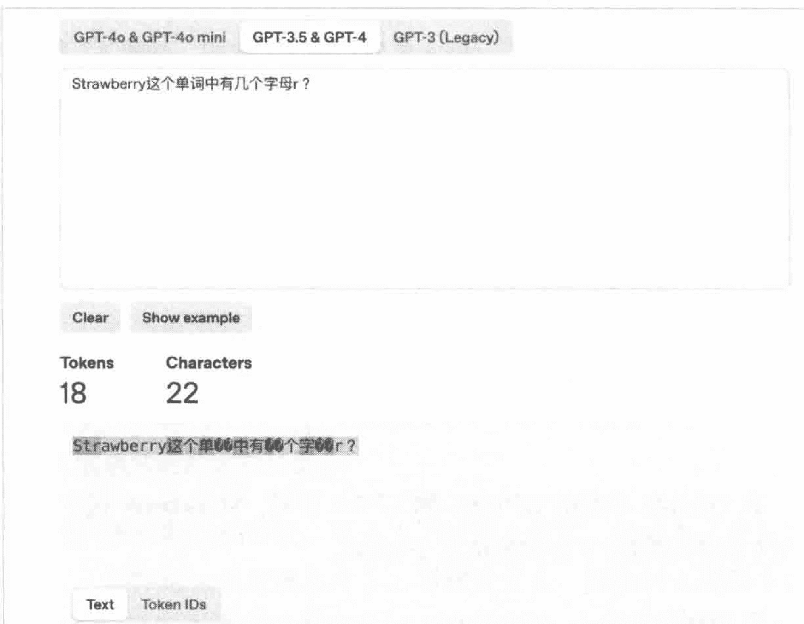
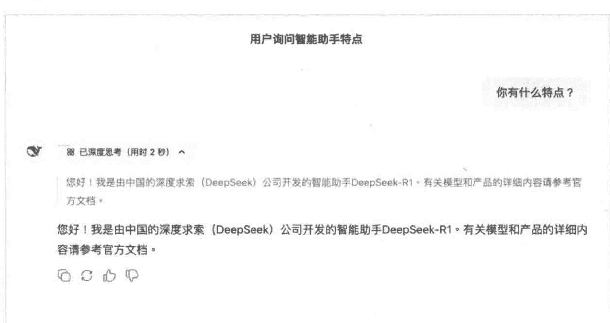
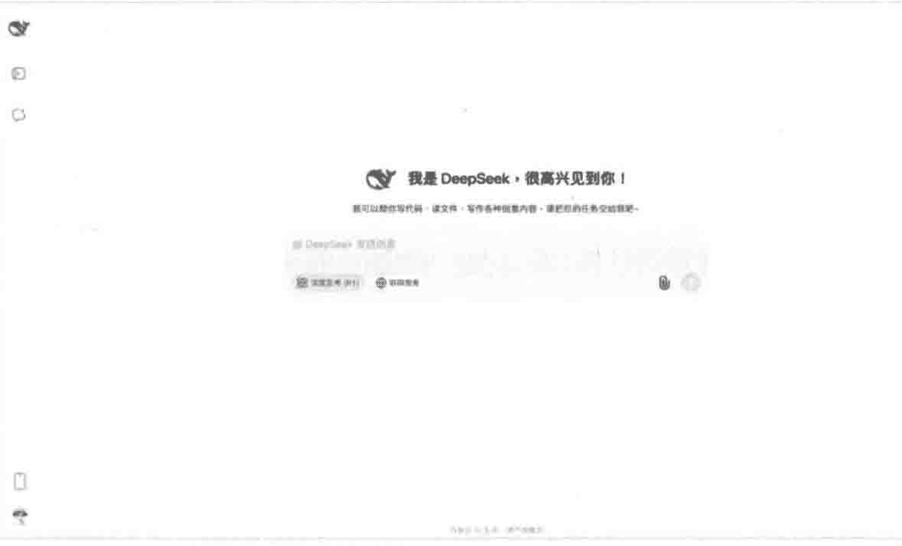
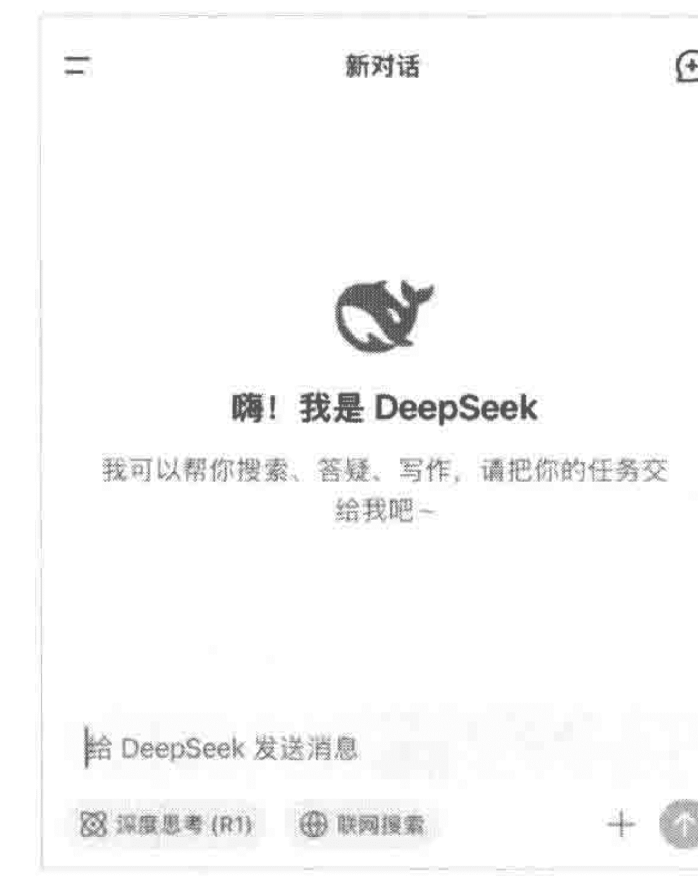
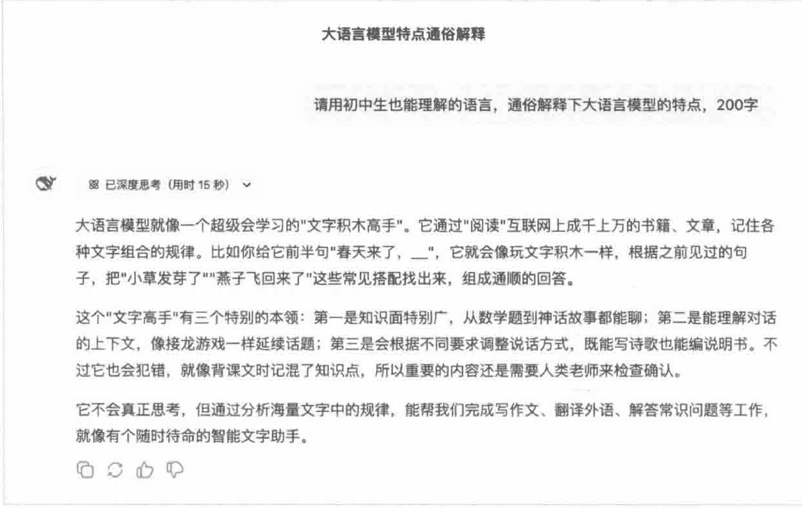
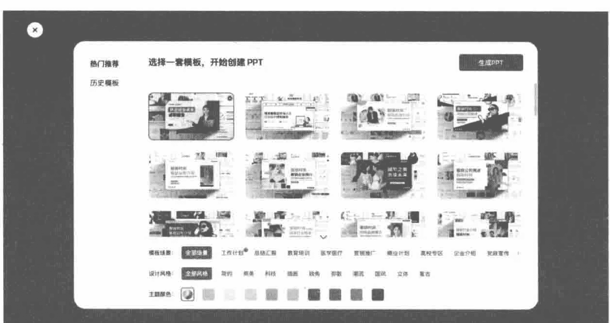
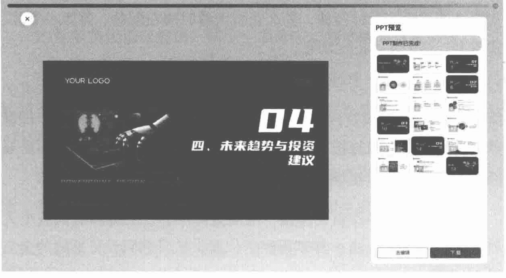
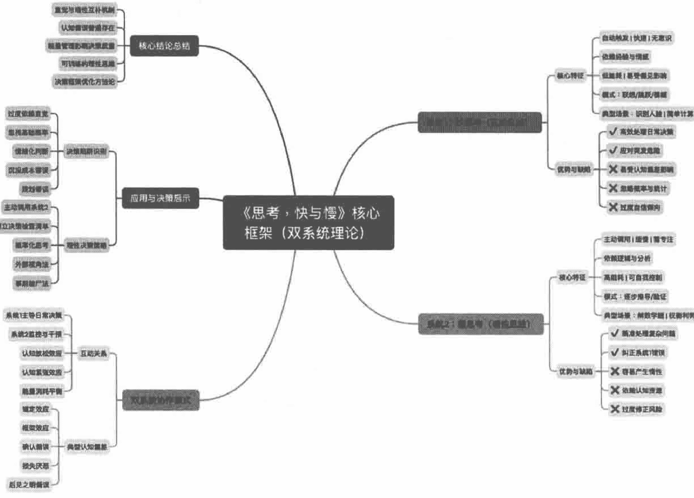

# 一本就能用起来的 DeepSeek

## 内容提要
这本书并不局限于操作手册，而是把学习分成三个递进的阶段。先从认知入手，解释 DeepSeek 为什么会被视作分水岭，和 OpenAI、Anthropic 等阵营的差别在哪，模型推理是怎么进行的，以及它是否真的理解人类需求。第二阶段聚焦实战，手把手拆解 DeepSeek R1 的能力边界和提问方法，示范如何把它当成搭档用在营销、写作等工作流里，并用它来提升阅读和写作效率。第三阶段讲组合打法，示范 DeepSeek 配合 Kimi、Xmind、剪映 等工具做出 PPT、思维导图、短视频的进阶用法，同时覆盖本地部署和调用 API 做自动化。读完既能上手操作，也能把握 AI 的思维方式与协作边界，让个人能力被放大。

适合所有想把智能工具带进日常工作和生活的人阅读。

## 作者简介

### 陈云飞（@花生）
AI 自媒体作者，全网粉丝合计超 20 万，在 AI 编程与应用领域有一定影响力。B 站 12 万+ 粉丝，小红书 4 万+ 粉丝，B 站关于 DeepSeek 的内容播放总量超 300 万。

拥有十年互联网大厂非技术岗位经历，零代码背景下借助 AI 编程发布 App Store 付费榜第一的爆款应用“小猫补光灯”。运营知识星球“AI 编程：从入门到精通”，帮助数百名无编程基础的人做出首个产品。

现任 LinkedIn 微软 AI 课程讲师，曾受邀为美团、微软等国内外知名企业提供 AI 培训与内部分享。

## 相关图书推荐
《这就是 ChatGPT》
《走进具身智能》
《孩子爱看的漫画人工智能》

## 更多好书推荐
扫码获取书单
图灵社区
iTuring.cn

## 前言
2025 年 1 月 20 日，DeepSeek R1 正式推送。

数周之内 API 就被主流云厂商接入，使用人数突破一亿，爬升速度超过 ChatGPT。连锁反应拖累 NVIDIA 股价，震动硅谷投资圈，也让美国政府重新审视产业布局。

这不是一次普通的版本迭代，而是一次真正的拐点。

ChatGPT 出现时，大家觉得智能已经很强了。DeepSeek 则证明，智能可以更低价、更开放、更强劲，甚至撼动底层设施。

影响早已超出技术圈，蔓延到社会结构本身。

- 在 AI 助力下，不少人生产效率大幅提升，收入翻倍，开启职业新阶段。
- 也有人感到强烈不安，担心被淘汰，跟不上变化。
- 还有人想回避，却发现工作、学习乃至娱乐方式都被悄悄改写。

作为亲历者，我既看到巨大机会，也感受到身边人的焦虑与迷茫。

我相信每个人都该接触 AI，关键是入口在哪。

这本书就是为此而写。

## 作者是谁？
我把自己当成这波浪潮的幸运受益者。2022 年 11 月 30 日 ChatGPT 上线后，我还在大厂工作，便开始试验。那次印象最深的是在策划一次产品营销方案，我把市场竞争态势与目标详细描述给 ChatGPT，它几分钟内给出的初稿，和我们四五个人花两小时讨论的结果高度接近。虽然不能直接用，启发却极大。

带着未来十年工作将深度绑定 AI 的判断，我裸辞大厂，开启另一种生活。

当时我对 AI 很感兴趣，却和大多数人一样不会写代码、不懂模型训练、也不知道怎么变现。

我只做了开始尝试。

先在社交媒体分享学习笔记，整理 ChatGPT 使用心得，摸索 AI 时代的独立创作模式。随后在自媒体与企业培训获得正向反馈，B 站“AI 进化论 - 花生” 12 万+ 粉丝，小红书“花椒” 4 万+ 粉丝。

更大的意外是，借助 AI 编程工具，从未写过代码的我去年做出了 iOS 应用“小猫补光灯 Pro”，并意外登顶中国区 App Store 付费总榜。AI 出现前，我从未想过这件事会和我有关，更想不到个人即可完成。

AI 改写了游戏规则。它降低门槛，让不会代码的产品人也能独立创造、验证需求，并在新时代找到增长路径。

两年间，我接触过各类工具，实践写作、编程、营销辅助，做产品、开教程、帮助他人理解 AI。切身感受到 AI 对个体创造力的释放，也目睹行业剧变。

更关键的是，我发现 AI 时代不属于少数技术精英，而是面向所有人。

但多数人仍有疑问：
- AI 真的会取代我们吗？
- 我不会编程能做什么？
- 变化这么快，该如何学习？

这些困惑也是我写作的起点。

我不是科学家，也不是技术精英，只是个学习者与实践者。正因如此，更清楚普通人需要什么。

你不必成为专家，也无需掌握复杂技术，学会正确方法，AI 就能成为工作助手、学习伙伴，甚至是开启新机会的跳板。

写这本书，我想告诉你：智能时代，你完全可以站在浪潮之上，而不是被冲走。

## 本书写给谁？
首先写给普通人。

无需编程基础，无需懂算法，也不必身处科技圈。只要愿意按书中方法实践，就能真正用起来，而非只觉得它很厉害。

其次写给焦虑者。

AI 更新快，信息爆炸，工具迭代让人应接不暇。你可能听太多“AI 会让你失业”的说法，而本书的核心判断是：只要愿意学习，AI 会成为放大器而非替代品。

同时面向管理者、自由职业者、学生、创作者。

无论想提升效率、优化学习，还是借助 AI 做副业，本书都提供可执行方案。

AI 不是程序员专属，而是一场全民参与的变革。

## 本书讲什么？
市面教你如何使用的教程很多。本书目标不止使用，更在理解本质，让它真正为你服务。

全书分三部分。

### 第一部分：AI 革命的本质
- DeepSeek 为何被视作拐点？
- 它与 OpenAI、Anthropic 等有何差异？
- AI 如何思考？它真的懂人吗？

### 第二部分：如何高效使用 DeepSeek
- DeepSeek R1 核心能力拆解。
- 如何用提示词拿到更高质量输出？
- AI 如何成为工作伙伴？营销、写作等场景。
- AI 如何辅助学习？阅读、写文章等。

### 第三部分：AI 进阶玩法
- DeepSeek + Kimi 做 PPT，DeepSeek + Xmind 做思维导图，DeepSeek + 剪映 做短视频……
- 如何在本地部署 DeepSeek？
- 如何调用 DeepSeek API 实现自动化工作？

这不是枯燥说明书，而是一份打开视野的指南。

我们既讲操作，也深入探讨思维方式与真实协作，而非单纯替代。

会用是起点，终极目标是让 AI 放大能力，成为你的一部分。

## 本书的“隐形价值”
AI 进化远快于出版周期。DeepSeek 从 R1 到 R2 再到 R3 可能只需数月，新功能层出不穷，一本书无法实时追踪。

因此，本书更像一把钥匙。

阅读期间可获取延伸资源：
- 视频教程：不同场景的 DeepSeek 实操演示。
- 实时图文更新：书中工具若有重要变化，我会在公众号“花叔”同步使用指南。
- 社区交流：公众号定期解答 AI 相关问题，分享最新资讯。

想获取这些资源，微信搜索“花叔”，我将持续分享最新实践，帮助你保持领先。

## 致谢
写作不是一人之事。感谢始终陪伴、给予支持并启发“小猫补光灯”产品的锐锐。感谢编辑王军花老师的鼓励与信任，让内容成形出版。

感谢 DeepSeek 团队，在 2025 这个关键变革期，让我们见证开源 AI 的新时代。

感谢所有在 AI 领域持续探索的人，无论是开发者、产品经理，还是第一时间尝试工具的普通用户，你们的反馈、使用习惯与吐槽都在推动发展。

感谢读到这里的你。

无论出于好奇、焦虑还是想探底，只要愿意出发，你已跑赢 99% 的人。

世界正被 AI 重塑，你完全可以站在变革中心。

愿这本书助你迈出第一步。

陈云飞（@花生）
2025 年 2 月 27 日

## 第一部分 AI 革命的本质

## 第 1 章 DeepSeek 时刻
> 未来已来，只是尚未均匀分布。
> ——威廉·吉布森

2025 年 1 月 20 日，DeepSeek R1 公布，震动 AI 圈。没有任何开源模型能在数天内就让 OpenAI、Google DeepMind、Anthropic 等巨头绷紧神经。更关键的是，其训练花费据称仅约 560 万美元，约是 OpenAI GPT-4 的二十分之一。① 马斯克第一时间在 X 发文质疑 DeepSeek 是否真只用 2000 块 NVIDIA H800 GPU 完成训练，还是暗中动用数万块 GPU。风险投资家马克·安德森将其比作“AI 的斯普特尼克时刻”，认为这可能是科技领导权更迭的转折点。

人们还在争论实现路径时，DeepSeek App 已悄然登顶苹果 App Store，超过 ChatGPT，发布一周内全球用户突破 500 万，服务器因流量过大一度崩溃，只能限制新用户注册。老牌玩家措手不及——AI 竞争本已激烈，DeepSeek 带来不是参数军备竞赛，而是一场成本革命。

硅谷独角兽还没反应过来，NVIDIA 股价先跌了 17%。

投资者开始意识到，AI 产业的游戏规则可能要改写了。

① 有报道称 OpenAI CEO Sam Altman 表示 GPT-4 训练成本超 1 亿美元，但具体数字未获官方证实。——编者注

#### 1.1 DeepSeek R1 到底是什么
它绝不是 ChatGPT 的复刻，而是唯一能在推理层面真正匹敌 OpenAI 前沿模型的开源方案。不同之处在于训练花费更低、开源许可更宽松，采用 MIT 许可，允许任何人自由使用、修改和商业化，推理效率也远超同级模型。它证明一件事：AI 训练不必天价，AI 也不应只由封闭商业巨头掌控。

从 DeepSeek R1 的技术评测可见其水准，总参数量约 6710 亿的开源模型，在数学、编程、逻辑推理等任务上可与 OpenAI 的 o1 对标。

技术细节并非最具冲击力的点。真正让行业震动的是，DeepSeek R1 证明了 AI 训练不必依赖巨额资金、不必依赖美国顶级算力集群，也不必依赖封闭数据。

DeepSeek R1 的基础模型 DeepSeek V3 据称仅用 2000 块 NVIDIA H800 GPU 完成训练，而 OpenAI 单次训练可能动用上万块。成本差距直接改写了产业规则。

此外，DeepSeek 采用特殊激活策略，虽然总参数高达 6710 亿，推理时实际只调用约 370 亿参数。既保留大语言模型的复杂性，又把计算成本压到极致，让其以远低于 GPT-4 的资源实现相近表现。若 AI 也有摩尔定律，DeepSeek 无疑把它加速了十倍。

更关键的是态度。DeepSeek 直接以 MIT 许可开源，意味着个人、公司甚至竞争对手都能在其基础上构建应用。过去只有 OpenAI、Google 能玩转大模型，现在创业公司、高校实验室也能用上顶级 AI。

这听起来理想主义，影响却是真实的。

如果说 2022 年 ChatGPT 让 AI 进入消费级市场，那么 2025 年 DeepSeek R1 则让 AI 进入工业化时代。

##### 1.1.1 硅谷震动与供应链转向
DeepSeek R1 公布震动整个硅谷。马斯克质疑帖下点赞无数，OpenAI CEO Sam Altman 也评论“令人印象深刻”。Meta 的 Yann LeCun 直言，DeepSeek 证明开源模型正在超越闭源模型。

轰动不仅来自技术突破，更来自行业冲击。

自 2022 年 ChatGPT 爆发以来，AI 是资本最热赛道，但门槛极高。能做出 GPT-4 级别模型的全球屈指可数，因为训练成本足以劝退中小企业。DeepSeek 彻底打破神话——一个中国团队用 560 万美元训练出可与 OpenAI o1 抗衡的模型，未来是否只需数百万美元就能做出 GPT-4.5 甚至 GPT-5？

DeepSeek R1 证明，AI 训练成本并非无解的天文数字，大公司砸 10 亿美元训练 AI，也许只是因为他们有 10 亿美元可烧。

更震撼的是，DeepSeek 不止一个模型。其开源策略意味着更多开发者可在 R1 基础上优化、蒸馏，甚至部署到更小设备上。这正是 OpenAI 等巨头最不想看到的局面——AI 产业不再是少数大厂领地，而是人人可参与的游戏。

##### 1.1.2 产业版图的再划分
如果 2022 年是 AI 进入消费级市场的一年，那么 2025 年可能是 AI 进入工业化的一年。DeepSeek 让大家意识到，AI 不再是昂贵技术，而是一种可自由获取的工具。

因此发布后迅速成为 App Store 与 Google Play 的第一名，数周内全球用户突破 600 万。相比 OpenAI 需要 200 美元订阅，DeepSeek R1 在部分任务表现更优，API 成本更低，开发者使用门槛更小。

更重要的是，它迫使硅谷重新思考竞争逻辑。过去拼的是谁更聪明、算力更强。DeepSeek 的策略是：不一定更强，但一定更经济。

这种模式让人联想到当年的安卓。苹果以封闭生态建立 iPhone 统治地位时，安卓选择开源并迅速占据全球市场。如今 DeepSeek 可能在 AI 产业重演这一幕。

OpenAI、Anthropic、Google DeepMind 的压力会很大，因为对手不再只是“更好的 AI”，而是“更低成本、更开源、更易扩展的 AI”。

DeepSeek R1 也许不是终点，却无疑是 AI 产业进入新阶段的分水岭。未来竞争可能不再是“谁能做更大模型”，而是“谁能以更低成本普及 AI”。

DeepSeek 让这个未来提前到来。

#### 1.2 不断高负载的背后
如果 DeepSeek R1 的发布是地震，那么过去一个月的用户增长就是海啸。

一个 AI 产品在全球 165 个国家和地区 App Store 榜首霸榜一周以上，服务器因流量崩溃，官方被迫限制新用户注册，这是 ChatGPT 之后 AI 领域未见的景象。

更离谱的是，DeepSeek 似乎并不急着解决。

从 2025 年 1 月 20 日起，“服务器繁忙”已成用户日常。打开 App 等待半分钟，换来的是“服务器繁忙，请稍后再试”；想测试推理能力，发个问题就被断线。有用户调侃：“DeepSeek 不是在推理，而是在思考人生。”

都 2025 年了，《哪吒 2》票房破百亿，DeepSeek 的服务器问题还没解决？

在硅谷，AI 初创公司为抢市场不惜砸钱扩容、烧 GPU、拉投资、推会员。哪怕是 OpenAI，也早已推出 Pro 订阅并限制免费用户频率。DeepSeek 坐拥泼天流量，却完全不按常理出牌。

##### 1.2.1 团队在思考什么
当其他公司忙着抢用户、疯狂买 GPU、研究变现时，DeepSeek 在做什么？

与其迅速切入面向消费者的赛道，这支团队反其道而行，选择了一条更艰难却更具战略意义的路径：把重心放在架构迭代与公开研究上，而非仓促打造面向终端的应用。

自 2025 年 2 月 24 日起，DeepSeek 陆续对外开源五项新项目，并同步发表了最新技术论文。

这一连串动作说明算力与研发人员被大量倾斜到研究本身，而非去解决服务器扩容的燃眉之急。其底层逻辑相当清晰：与短时间内追求更多 C 端用户流畅使用相比，更值得押注的是技术跃进，让人工智能更强、成本更低、触达更广。

有意思的是，这样的取舍与 OpenAI 近半年来的走向截然相反。OpenAI 不仅收紧了 API 使用规则，还大幅上调会员价格，旗舰模型仅对每月 200 美元的 Pro 会员开放，20 美元的 Plus 会员则无法体验顶级能力。从早期的探索者姿态，OpenAI 正逐渐向商业巨头靠拢。而 DeepSeek 走了反向路线：不以短期盈利为目标，而是执着于让模型本身更低价、更开放、更强。

对 DeepSeek 而言，流量规模远不如技术演进的时间表重要。

##### 1.2.2 拒绝成为“AI 流量公司”

理论上，DeepSeek 完全可以走一条更“常规”的商业化打法：

- 效仿 ChatGPT 推出 Pro、Plus 两档会员，月费分别定为 200 美元与 20 美元，让付费人群获得更稳定的体验；
- 大举融资采购 GPU，化解“服务器繁忙”的困境，把产品打造成随时可用的智能助理；
- 上线企业 API，像 Claude 3.5 那样切入 SaaS 市场争夺 B 端客户。

实际操作却是反向的。产品长期处于卡顿状态，却持续推动行业研究，让整体算力成本不断下沉。

这家公司很明白，本轮人工智能竞争真正的密码是智能水平，而非用户基数大小。

与其变现流量，它更想攻克算力的天花板，让 AGI 更早到来。

##### 1.2.3 梁文锋的选择

不少人难以理解，为何 DeepSeek 明明有机会做“AI 版拼多多”，却要去做“AI 版 SpaceX”？

在所有公司都在抢占份额的当下，创始人梁文锋更像一位不急不躁的技术理想主义者。从既有访谈来看，他对 AGI 的执念甚至超过了 OpenAI 的 Sam Altman。

在他眼里，AI 不应是昂贵的服务，而应是“可负担的智能”。只有把推理成本打下来、让效率持续提升，AGI 才会真正落地。

因此在迎来爆发期后，他的决策不是疯狂扩容，而是继续深耕研究。

乍看荒诞，换个视角这恰是最聪明的策略。若竞争核心是智能，那么抢用户、抢流量、抢份额都只是短期手段。决定胜负的，是谁能在技术上走得更远，谁能更快推动 AI 进入下一阶段。

##### 1.2.4 DeepSeek 走的，是一条更长远的路

过去业界普遍认为训练大模型就得烧钱。GPT-4、Claude 2、Gemini 1 的训练开销动辄数亿美元，甚至有传闻称 OpenAI 每年仅在 GPU 上的花费就达 50 亿美元。

DeepSeek R1 用实践证明不必如此。

以约 560 万美元的成本，它打出了可与 OpenAI o1 抗衡的大模型。若再优化一年，成本是否会降到 300 万美元？甚至 100 万美元？

这正是其目标——把 AI 成本压到 OpenAI 的十分之一，乃至百分之一。

它清楚，这才是 AI 时代真正的护城河，而非用户增速。

##### 1.2.5 DeepSeek 可能是 AI 领域最不一样的公司

当多数公司拼命抢市场、想成为下一个 OpenAI 时，DeepSeek 走的是另一条路。

它不想做一家纯粹的“AI 软件公司”，更像是 AI 时代的特斯拉——真正的野心不是卖服务，而是把 AI 本身的成本拉到最低，从根本上重塑产业。

所以下次再碰到服务器繁忙，也不必恼火。他们很可能并不在意这些短期不便，正忙着让 AI 更便宜、更强、更难被阻挡。

#### 1.3 DeepSeek 化：当 AI 变成水、电、空气

DeepSeek R1 发布后短短一个月多，全球 AI 产业正经历一场规模化的“DeepSeek 化”。

##### 1.3.1 云厂商：抢 DeepSeek API，抢流量红利

开源后最先行动的是云厂商。从 AWS 到阿里云，从微软 Azure 到腾讯云，所有人都急于集成 DeepSeek API，仿佛错过它就错过了整个时代。

- 微软 Azure：2025 年 1 月 29 日，Azure AI Foundry 直接上线 DeepSeek API，并在 GitHub 上开放多套 SDK，方便企业接入。
- 亚马逊云 AWS：2025 年 1 月 31 日，Amazon Bedrock 宣布支持 DeepSeek R1，并强调其“比 OpenAI API 便宜 90%”，迅速吸纳大量中小开发者。
- NVIDIA：这家 GPU 巨头于 2025 年 1 月 31 日宣布，其 NIM 微服务框架正式兼容 DeepSeek，并承诺实现“每秒 3872 token 的推理速度”，瞄准高性能计算市场。
- 阿里云：2025 年 2 月 3 日，阿里云 PAI 平台支持一键部署 DeepSeek，宣称“3 分钟内完成 AI 应用上线”，直接点燃国内云厂商的价格战。
- 华为云：同日，华为云宣布与 AI 基础设施初创公司硅基流动合作，在 Ascend 计算平台上对 DeepSeek 模型进行优化，降低对高端 GPU 的依赖。

> ① 从企业属性看，NVIDIA 并非云厂商，这里提供的是相关服务。——编者注

如果 2023 年云厂商都在抢 OpenAI API，那么 2025 年他们争夺的是“DeepSeek 兼容性”——不支持 DeepSeek API，就像 20 世纪 90 年代的 PC 不能运行 Windows 一样，直接失去竞争力。

甚至有投资人调侃：“DeepSeek 这波操作，相当于让整个 AI 产业免费共享了一个国家级科研项目的成果。”

##### 1.3.2 大厂应用：AI 不是产品，而是基础设施

除云厂商外，越来越多主流应用也在主动 DeepSeek 化。

- 阿里钉钉：2025 年 2 月 6 日，钉钉成为阿里系首个接入 DeepSeek 的产品，支持 AI 助手一键创建文档。
- 腾讯元宝：2025 年 2 月 13 日，腾讯元宝接入 DeepSeek R1，支持与自家混元大模型双向切换。
- 微信 AI 搜索：2025 年 2 月 15 日，微信灰度测试“AI 搜索”功能，将公众号文章、朋友圈内容与 DeepSeek R1 结合，实现“搜索即服务”。
- 百度地图 & 腾讯地图：2025 年 2 月 17 日，两大地图应用同时接入 DeepSeek R1，优化智能导航与旅游推荐，让 AI 直接规划最优出行路线。
- 汽车行业：2025 年 2 月 22 日，吉利、奇瑞等 20 余家车企宣布接入 DeepSeek，主打智能语音助手。

这一波 DeepSeek 化彻底改变了 AI 在应用层的定位。

过去 AI 是一个功能——“我们用 AI 帮你提升效率”。

现在 AI 成了基础设施——“DeepSeek 在后台帮你思考，你甚至意识不到它的存在”。

这不仅让 AI 无处不在，也让 DeepSeek 成为行业新标准。

就像今天没人会宣传“我们支持 HTTPS”一样，未来应用也不会特意强调“我们支持 AI”，因为它已是默认选项。

##### 1.3.3 DeepSeek 的影响：它不是 AI 公司，而是 AI 生态

回顾 2025 年 1 月与 2 月，一个趋势很明显：

- DeepSeek 不只是一家公司，而是一场开源 AI 运动；
- 它的 API 正成为全球 AI 产业的“水、电、空气”；
- 未来竞争将围绕 DeepSeek 展开，而非 OpenAI。

这像 90 年代的互联网：起初大家以为互联网是新产品，后来才发现它是基础设施，所有应用都在其上运行。AI 亦然，DeepSeek 证明了 AI 不是某家公司的产品，而是一个全球性基础设施。

##### 1.3.4 DeepSeek 不是 ChatGPT 2.0，而是 AI 时代的 TCP/IP

很多人把 DeepSeek R1 的崛起视作“ChatGPT 2.0”，这是误解。ChatGPT 是 ToC 产品，而 DeepSeek 是面向企业与开发者的基础设施。

更准确地说，它更像 AI 时代的“TCP/IP”——你不会时刻意识到它的存在，但整个世界都依赖它运转。在可见未来，DeepSeek 未必是最赚钱的公司，但一定是最难被取代的基础设施。

这正是我们需要了解 DeepSeek 底层运作、学会更好协作的原因。

### 第2章 从 ChatGPT 到 DeepSeek

> 重要的是不要停止提问。好奇心自有其存在的理由。
> ——阿尔伯特·爱因斯坦

2022 年 11 月 30 日 OpenAI 发布 ChatGPT，标志着本轮 AI 革命的起点。此后大模型公司如雨后春笋，开源与闭源持续角力。

根本上，如今的大模型都源于 Transformer 架构，仍分为预训练与后训练两阶段。而 GPT-4、GPT-4o、DeepSeek V3 这类指令模型，与 DeepSeek R1、OpenAI o1、OpenAI o3-mini 这类推理模型的分野才刚刚形成。

要更深入理解 DeepSeek 这家公司与 DeepSeek R1，我们需要回到两年半前，看看 ChatGPT 究竟是如何被训练出来的。

#### 2.1 ChatGPT 是怎么被训练出来的

训练可分为四个阶段。

- 阶段一：预训练。耗时最长的环节，约占 95% 以上训练时间，花费数百万美元。模型利用上千亿条从网络抓取的语料进行训练，目标是预测下一个词，完成后得到基础模型，如 GPT-3、Llama、PaLM。
- 阶段二：监督微调，supervised finetuning，SFT。采用人类外包商制作的结构化、高质量低数量的提示词与理想结果语料，通常只需几天。目标仍是预测下一个词，完成后得到监督微调模型。除 ChatGPT 与 Claude 外，大多数对话模型属此类型，如 Vicuna-13B。
- 阶段三：奖励建模。基于上阶段的 SFT 模型，人类外包商对同一提示下生成的不同结果进行评价比较。模型目标是预测回答可能获得的人类评分，属于训练过程中的过程模型，非用户产品，通常花费数天。
- 阶段四：强化学习。在此阶段，训练语料为人类的提示词，模型目标是依据提示生成内容以最大化奖励模型给出的奖励，通常数天即可完成，最终得到强化学习模型，如 ChatGPT 与 Claude。

##### 2.1.1 阶段一：预训练

预训练首先要选定语料，数量与质量都很关键。GPT-3 约用 3000 亿 token，具体构成未公开，可参考 Meta 训练 Llama 的数据，如表 2-1。其中：

- 67% 为 CommonCrawl 数据，内容类型丰富但质量偏低，包含大量噪声与无关内容，如广告、导航菜单、版权声明等。
- 15% 为 C4 数据，经清理去除广告、重复、非英语等，提供大规模高质量英语文本。
- 剩余 18% 质量相对高，主要来自 GitHub、维基百科、书籍、ArXiv、StackExchange 等。

表 2-1 Meta 训练 Llama 用的语料数据

| 数据集 | 采样比例 | 训练轮数 | 磁盘大小 |
| :--- | :--- | :--- | :--- |
| CommonCrawl | 67.00% | 1.1 | 3.3 TB |
| C4 | 15.00% | 1.06 | 783 GB |
| GitHub | 4.50% | 0.64 | 328 GB |
| 维基百科 | 4.50% | 2.45 | 83 GB |
| 书籍 | 4.50% | 2.23 | 85 GB |
| ArXiv | 2.50% | 1.06 | 92 GB |
| StackExchange | 2.00% | 1.03 | 78 GB |

从数据量级与来源看，ChatGPT 等模型几乎学习了人类在互联网上发表过的所有学科知识，“常识”很丰富；但语料中充斥大量平庸知识，且模型目标是预测下一个词，因此输出易趋于平庸、普通、被平均。想要激发更高质量回答，需要一定的提示技巧。

回到训练流程，OpenAI 并非直接对语料训练，而是先把文本切分为更细的子词单元，即 token，再进行训练。你可能疑惑：直接用完整单词不是更简单？逻辑如下。

- 处理未知词：训练中会遇到未见过的词，以单词为单位模型无法处理，以子词或字符为单位则可拆分为已知单元。
- 缩小词汇表：以单词为单位词汇表会非常大，增加复杂性与计算负担；子词或字符可显著减小规模。
- 捕捉词根与词缀：英语词多由词根与前缀后缀构成，子词分词有助于模型把握这些内在规律。

因此 GPT 选择子词单元作为 token，既能处理未知词，又能减小词汇表并捕捉语言规则。大多数模型如此操作，但分词规则各异，例如 GPT-3 训练前切出 50 257 个子词，Llama 用了 32 000 个子词。

获得语料并分词后，进入实际预训练。预训练本质是遮住模型的“眼睛”，让它猜测下一个词，目标是通过迭代使预测与真实文本一致。这一过程涉及训练损失 training loss，即模型在训练数据上的预测误差，训练目标是最小化该损失。

此阶段得到的是基础模型，其目标是预测下一个词，而非扮演聊天机器人或助理。例如输入提示“北京的常住人口有多少？”，基础模型可能输出“上海的常住人口有多少？”等，因训练语料中这些问题常紧密相邻。到了 GPT-2，通过提示技巧可让模型扮演助手，例如构造：

> Q: 北京的面积有多大？
> A: 约 1.6 万平方公里
> Q: 北京有多少个行政区？
> A: 16 个
> Q: 北京的常住人口有多少？
> A:

此时结果可能为“2184 万”。本质是将问题伪装成文档中连续内容的缺口，让模型补全。但过程不稳定、不确定，对使用者要求较高，目前这类模型多供具备开发能力与提示技巧的开发者使用，而非普通用户。

##### 2.1.2 阶段二：监督微调

###### 1. 为什么需要监督微调

完成基础模型预训练后，得到的仍只是“填空”模型，目标仅是预测下一个词，并非真正理解指令并顺畅对话的智能助手。尽管在某些场景下用户可通过巧妙提示让基础模型生成符合要求的内容，但效率低、生成质量不稳定，尤其任务变复杂时，基础模型很容易给出不合适的、偏离主题或毫无意义的回答。

监督微调存在的意义，就是把预训练出来的“会猜词的机器”调校成“能配合人的助手”。它本质上是一次任务对齐，让模型不再只盯着下一个词的概率，而是学会根据提示给出人类觉得合理、质量过关的回复。简单说，就是教会它在特定指令下输出合适的答案，而不是乱填空。

###### 2. 监督微调的数据从哪来

监督微调成败的关键在数据质量。与预训练阶段靠海量粗糙网络文本不同，这一阶段要用人工精挑细选的高质量语料，主要有四类来源。

- 手工撰写的问答对
人工一条条写出提示和理想回复，保证每个问题都有符合预期的高质量答案。比如提示“解释量子力学核心思想”，期望的回复会提到微观粒子、概率、波函数坍缩、不确定性原理等要点。

- 高质量对话的提炼整理
从论坛、问答社区、书籍等渠道筛出优质对话，经编辑优化后入库。比如 StackExchange、Reddit、Quora 上的技术问答，或维基百科、学术论文、书籍里可直接用作答案的内容。

- 基础模型自生成再筛选
让基座模型大量生成候选回答，再由人工挑出最好的部分回流训练。这样既利用模型自身能力，又降低纯人工成本。

- 真实用户的反馈日志
模型上线后，如 ChatGPT，持续收集真实用户的优质对话，将其整理成新训练样本，实现滚动微调。

###### 3. 监督微调怎么训练

训练框架仍是自回归的 Transformer，和预训练相似，但优化目标变了：不再是单纯的下一个词预测，而是学习“在给定提示下什么回答才是好的”。常用交叉熵损失来逼近标注答案。

在这个过程中，模型逐步学会指令遵循，不再只是语言填空。可以说，监督微调是把大模型从“文字预测器”推向“可用助手”的关键一跃。

###### 4. 监督微调的短板

学会听指令不等于万事大吉，仍存在明显局限。

- 输出风格不稳定，同一类问题可能答得忽高忽低。
- 容易记死训练样本，面对新颖问题时应变不足。
- 缺乏真正的价值判断，分不清哪些回答更受人类欢迎。

正因如此，OpenAI 在 ChatGPT 的迭代中，后续引入了奖励建模与强化学习来弥补。

##### 2.1.3 阶段三：让模型学会评判好坏

###### 1. 为何要引入评判机制

经过监督微调，模型能按指令作答，却没有“好坏嗅觉”。它无法分辨两个答案的优劣。

例如针对同一问题：
- 回答 A：“苹果是一种水果，富含维生素 C。”
- 回答 B：“苹果是一种水果，富含维生素 C，不同品种口感差异明显，富士偏甜，青苹果偏酸。”
模型自己判断不出 B 更完整、更有用。
在敏感话题上，它也可能给出不当内容却毫无察觉。
这就需要奖励建模来教它什么是更好的回答。

###### 2. 评判机制的核心逻辑

奖励建模是让大模型更懂人类偏好的关键一步。

监督微调后模型会答题，但不知道哪种答法更受欢迎。奖励建模就是赋予它这种区分能力。
打个比方，像老师批改作文：给出几篇不同水平范文并点评好坏，学生久而久之就能写出更符合标准的文章。奖励建模也是让人类标注者给不同回答打分，用这些分数训练一个“奖励模型”，指引大模型优化输出质量。

###### 1. 人类反馈数据采集

让标注者对同一提示下的多个模型回答进行打分。例如问题“如何有效管理时间？”：
- 回答 A：“关键是设定优先级，用待办清单。”
- 回答 B：“关键是设定优先级，可用番茄工作法或 GTD 等方法。”
- 回答 C：“管理时间的关键是……（啰嗦且跑题）”
标注者会给 B 更高分数并给出理由。

###### 2. 培育奖励模型

再训练一个模型来预测人类打分的高低。后续训练中，这个奖励模型充当裁判，帮助主模型评估自己的生成是否符合人类预期。

##### 2.1.4 阶段四：强化学习闭环

奖励模型训练好后，进入强化学习阶段。大模型会借助它不断调整生成策略，让输出更贴合人类喜好。

###### 1. RLHF 的实践路径

RLHF，即基于人类反馈的强化学习，核心是通过人类评分训练奖励模型，再让大模型学会产出更高分的答案。主要做法有两类：

- 用奖励模型做强化训练
让模型生成大量候选回答，由奖励模型打分，再用强化学习算法如 PPO 朝高分方向调整策略。

- 多轮迭代优化
经过若干轮训练，模型逐渐掌握“什么样回答更容易得高分”，行为随之优化。

###### 2. RLHF 的主要风险

- 标注偏见传递：如果标注者有偏见，奖励模型会继承并放大。
- 过度迎合：模型可能钻评分系统的空子，追求高分而非真正高质量。

本质上，奖励建模与强化学习就是让模型生成更可能被人类标注者打高分的答案。如果参与标注的人群能力平庸或有偏见，最终模型也会带上这些烙印。这套体系最早由 OpenAI 提出，2022 年帮助 OpenAI、Anthropic 等建立起高技术壁垒，也是 ChatGPT 引爆 AI 革命的重要原因。直至两年后，DeepSeek 在模型能力和训练范式上开始对 OpenAI 形成冲击，不过那是后话了。

#### 2.2 模型训练路径与人类思维的差距

表 2-2 概括了 ChatGPT 的四阶段训练：预训练、监督微调、奖励建模、强化学习。

- 预训练：用海量爬虫、书籍、论文数据训练模型预测下一个词，得到基础模型。
- 监督微调：用人类外包商撰写的上千万条问答训练，让模型更贴合人类表达习惯，得到微调模型。
- 奖励建模：用人类外包商对监督微调模型回答的打分数据训练，使其能预测回答质量，得到奖励模型。
- 强化学习：用基于人类反馈的强化学习，让模型生成更符合人类偏好的回答，最终得到 ChatGPT、Claude 等产品。

表 2-2 ChatGPT 的训练流程

| 阶段 | 预训练 | 监督微调 | 奖励建模 | 强化学习 |
| :--- | :--- | :--- | :--- | :--- |
| 数据集 | 上千亿训练语料（爬虫、书籍、论文等） | 人类外包商撰写的上千万条提示与回答 | 人类外包商对监督微调模型回答的评价打分 | 人类外包商撰写的上千万条提示数据 |
| 算法目标 | 预测下一个词 | 预测下一个词 | 预测回答能获得的人类评分 | 生成能最大化奖励得分的回答 |
| 得到的模型 | 基础模型 | 监督微调模型 | 奖励模型 | 基于人类反馈的强化学习模型 |
| 典型代表 | GPT-3、Llama | Vicuna-13B | -（过程模型，不直接面向用户） | ChatGPT、Claude |

##### 2.2.1 人类方式与模型方式的本质差异

初次接触 ChatGPT 的人常有两种极端反应。

- 惊叹于其流畅对话、解释复杂概念、甚至写出像样的哲学论文，开始幻想把工作学习全交给它。
- 迅速失望，发现它连简单数学都会错，问“鲁迅和周树人是否同一人”这类常识也会翻车，认为不过是炒作的新瓶装旧酒。

两种看法都犯了以偏概全的错误。关键在于，人类习惯用自己的思维去评判模型，而 ChatGPT 的运作原理与人类完全不同。它不是一个会思考的主体，而是基于概率预测文本的生成器，强项和弱点都源于此。

先看人类如何处理一个实际问题。

###### 1. 人类思维示例 —— 反思、工具、校验

比如要写：“截至 2 月 22 日，拼多多的市值是 B 站的 xx 倍。”

人类的大致流程：

(1) 反思与拆解
先判断网络是否已有现成对比，大概率没有。于是决定分别查两家最新市值再自行计算。

(2) 调用外部工具
大脑不存实时市值，会去雪球、雅虎财经等查询，得出拼多多约 1824.0 亿美元，B 站约 95.1 亿美元。

(3) 计算与校验
用计算器算 1824.0 ÷ 95.1 ≈ 19.2，并复核数据来源。

(4) 措辞修正
初稿可能写“股价比…高 18.2 倍”，随即意识到市值≠股价，修正为“截至 2 月 22 日，拼多多的市值是 B 站的 19.2 倍”。

整个过程是“反思→查工具→计算→校验→表达修正”的链条。

###### 2. ChatGPT 的运作方式 —— 逐词预测而非整体思考

交给 ChatGPT 同样任务，它的处理方式截然不同。

(1) 不会规划整体流程，而是依据提示逐层拆解、逐词预测。
- 不会自动联网查最新市值，除非有联网功能。
- 不会真正使用计算器，而是靠训练数据中的数学模式近似计算。
- 不会主动反思答案是否正确，除非明确要求自检。

(2) 生成本质是逐词预测
- 不会先问“我该怎么解”，而是不断预测“下一个词最可能是啥”。
这让它在流畅度上很强，但在逻辑、事实检索、数学上易出错。

(3) 知识边界受限
- 无联网时，知识截止于训练时间，如 2023 年底前。
- 它不会主动“查找”，只是基于已有语料做概率推断。

##### 2.2.2 用提示工程把模型潜力逼出来

在指令模型时代，输出质量很大程度上取决于提示的质量。ChatGPT 的核心是“基于概率预测下一个词”，所以问得清楚、结构化，答得就靠谱；问得模糊，就容易胡编。这催生了提示工程：设计更好的提示来榨取模型能力。

下面几种做法很实用。

###### 1. 给模型配工具

人类做事靠工具增强，模型也一样。联网、计算、文件解析等插件能弥补它的先天局限。

- 实时查询
让模型调用网页搜索，获取最新信息。例如“查一下特斯拉近期美股表现并总结”，或“找 OpenAI 最新 GPT-4o 技术文档并提炼改进点”。

- 精准计算
模型算数靠模式，容易错。用 Python 执行可得到准确结果。例如“用 Python 计算 89×78 并展示过程”，或“画一张股票价格折线图”。

- 文件处理
借助插件读取 PDF、Excel、JSON。例如“读这篇 PDF 并总结核心观点”，或“解析 Excel 找出销售额最高的品类”。

思路很简单：换作人类会用什么工具？给模型接上对应的能力即可。

###### 2. 逼模型回头检查

人类有元认知，会复盘修正。默认情况下模型是单向生成，不会自检。但可以通过指令触发反思。

- 直接要求自检
“请检查你刚才的回答有没有错误或遗漏。”“你对这个答案的信心打几分？1-10 并说明原因。”

- 第三人称审视
“假设你是一位专业数学家，会如何评价刚才的计算？”“如果你是审稿人，会怎么改进这段回答？”

- 对抗式验证
“如果这个答案是错的，错在哪？”“有没有其他可能的观点？”“给出与原答案相反的论证。”

这些技巧迫使模型重新审视输出，提升准确性和可信度。

###### 3. 让复杂问题进入慢思考模式

默认生成像“系统一”：快、直觉、靠模式匹配。对复杂任务，可引导进入“系统二”式的慢思考。

- 拆解任务逐步完成
不要直接问“拼多多市值是 B 站多少倍”，而是分步：
a. “拼多多最新市值是多少？”
b. “B 站最新市值是多少？”
c. “算一下比值。”

- Few-shot 示范推理
给出类似推理示例让它模仿：“假设北京常住人口是香港 3 倍，请按此方式算市值比例。”

- 明确要求逐步推理
直接说“请一步步推理并展示完整思考过程”。这能减少跳步和幻觉。

###### 4. 模型不求最好，你要逼它成功

ChatGPT 的目标是生成“看起来合理”的答案，而非最优解。放任它，会得到及格线水平。要想专家级质量，必须主动施压，设定更高的标准和检查机制，才能逼出更好的结果。

让模型给出靠谱答案，提问方式比模型本身更关键。

- 让模型进入专家角色
> “请你以资深经济学家身份，从专业视角拆解这个问题。”
> “假设你就是 OpenAI 的工程师，会怎样改进 ChatGPT 的算法？”

- 让模型多角度作答再自评
> “给出三种不同思路的解法，并分别讲清利弊。”

- 直接点明要最优解而非泛泛而谈
> “不要停留在通用建议，请给出你认为最优的策略并说明理由。”

ChatGPT 的默认状态是随从而不主动，你不明确要求它优化，它就不会自行升级。但把提示词用好，就能让它表现得更聪明。

进入推理模型阶段后，对提示的要求也在变化。

#### 2.3 指令到推理的跨越

2025 年 1 月 20 日，深度求索发布的推理型模型 DeepSeek R1 在 AIME 2024 数学邀请赛里拿到 79.8% 的正确率，超过人类平均水平，而推理开销只有 OpenAI 同类模型的十分之一左右。这一突破标志着 AI 从“应答式指令”迈向“思考式推理”。如果说 ChatGPT 掀起了语言生成浪潮，那么以 DeepSeek R1 为代表的推理模型正开启逻辑推演浪潮。

##### 2.3.1 推理范式诞生的动因

从 2022 年 11 月 ChatGPT 面世，到 2025 年 1 月 DeepSeek R1 出现，大模型走完了基础模型—指令模型—推理模型的演进。驱动力来自能力期待的提升：从单纯执行指令，到需要数学推演、代码生成、科学推理等高阶认知。

早期指令模型如 GPT-3.5/4、Claude、DeepSeek V3 等，主要靠监督微调和人类反馈强化学习 RLHF 来塑造行为。它们表达流畅、通用性强，但在硬任务上短板明显：

- 数学推断薄弱，多步计算易出错，逻辑连贯性不足；
- 编程能力受限，缺乏全局规划，难以对代码逻辑做递归优化；
- 推理链条不稳，容易出现幻觉，可靠性打折；
- 任务一致性差，同一问题在不同情境下答案会漂移。

为此研究者探索新范式，催生出 OpenAI o1 系列、DeepSeek R1 等推理模型。

##### 2.3.2 两类模型的本质差异

两类模型在目标、数据、机制和应用上差别显著。

###### 1. 训练侧重点

- 指令模型的训练主旨是服从人类指令，通过大量监督样本学会对各类提示做出合乎期待的回应。
- 推理模型的训练主旨是增强逻辑推演，让模型在数学、编程、科学推理等领域展现更强的思考深度，而不只是生成听起来合理的话。

###### 2. 数据构成

表 2-3 指令模型和推理模型在训练数据上的区别

| 模型类型 | 训练数据构成 | 核心数据特征 |
| :--- | :--- | :--- |
| 指令模型 | 监督微调数据、RLHF | 强调语言表达，符合人类偏好的回答 |
| 推理模型 | 预训练 + 强化学习 | 强调逻辑推理、代码、数学问题的正确性 |

指令模型依赖人工标注，目标是让输出贴合人类期待，擅长对话写作问答，但标注数据本身存在错误与偏见，限制了推理能力。推理模型更看重逻辑与数学推演，训练上更依赖强化学习，通过奖励机制引导推理路径的优化。例如 DeepSeek-R1-Zero 直接在基座上做强化学习，不使用监督微调，让模型自行探索高效推理策略。

###### 3. 推理方式

指令模型的作答更像直觉匹配，通过大量样本学习提示与答案的关联，优先生成人类喜欢的文本，遇到复杂推理容易出错，处理任务常是想到一半就输出。

推理模型的思考更接近系统二慢思考，采用思维链 Chain of Thought 逐步推导，先在内部形成推理轨迹再输出。DeepSeek-R1-Zero 会先生成内部推理过程再给出最终结果。

###### 1. 指令模型更偏听从而非推理

监督微调追求的是给出人类预期的答案，而非推导出正确答案。RLHF 进一步提升可读性，却并未增强逻辑能力。

###### 2. 指令模型缺少自检能力

生成时不会主动核验正确性，边生成边继续，导致逻辑链容易断裂。比如数学题前几步可能正确，最后一步却算错。

###### 3. 监督数据存在天花板

监督数据中的人类答案不一定是最优推理路径，模型学到的是“看起来合理”却不够严谨的链条。

因此提升推理能力必须以强化学习为主，让模型通过自我探索和奖励调整推理路径。

##### 2.3.4 训练路径：强化学习驱动的自我进化

推理模型的训练主要依赖强化学习：

1. 用奖励模型评估答案正确性，引导推理路径优化；
2. 训练中出现自我进化，学会更有效的推理方式，例如 DeepSeek-R1-Zero 在强化学习过程中自然涌现自我验证、长链推理等能力；
3. 多阶段训练，如 DeepSeek R1 结合冷启动数据、强化学习、监督微调，最终兼顾推理与通用能力。

##### 2.3.5 推理模型的发展方向

从指令到推理，意味着大模型正从语言生成走向认知推理。推理模型在数学、代码、科学推理上的能力大幅提升，但仍有挑战：

- 如何提升泛化能力，让其在更多任务上稳定发挥；
- 如何降低强化学习训练的计算成本；
- 如何融合多模态，让模型处理视觉、语音等信息。

可以预见，未来大模型会更强调推理，并逐步逼近人类认知方式。

## 第 3 章 大模型如何思考：认知边界与使用方法

> 倘若我们记住一切，那么在大多数情形下，这会和什么都记不住一样糟糕。
> ——威廉·詹姆斯

即便像 DeepSeek R1 这类推理模型在数学、逻辑链条、复杂问题处理上进步明显，使用技巧需求下降，它依然是大语言模型，仍带有语言模型固有的底层局限。这些不是缺陷，而是共同的特性。理解它们，才能正确提问，发挥最大效用并避免误解。

#### 3.1 感知差异：模型读语言的方式与人不同

真正理解模型行为的核心是：它如何“阅读”语言。人以单词或汉字为单位，模型看到的是拆分后的编码片段——即分词 tokenization。

以 Strawberry 为例，人一眼看出是完整单词并能数出里面的 r，但模型并非如此。如图 3-1 所示。


以早期 GPT-3.5 和 GPT-4 为例，Strawberry 会被切成三个 token：
- “Str”
- “aw”
- “berry”

于是问“Strawberry 有几个字母 r”，模型实际处理的是 “Str” + “aw” + “berry” 三个独立片段。它需要先拼接再预测。若训练语料中缺乏对应问题，它会凭直觉判断 “Str” 和 “berry” 都含 r，从而得出有两个 r 的错误结论。



图 3-2 Strawberry 在分词器中被分解为 3 个 token

推理模型会更细致地应对。它意识到自己数字母不擅长，于是尝试把 token 进一步拆成字母级再逐项分析、计算，整个过程反复不自信，需要多次拆分计算后才下结论，往往耗时超过 2 分钟，而人类 2 秒就能给出答案。看着它一点点拼回单词，有种于心不忍的感觉。

下面是 DeepSeek R1 对此问题的内部思考示例：

DeepSeek R1 的思考过程：

> 用户问 Strawberry 里有几个字母 r。先确认拼写，常见的写法是 strawberry，大写不影响计数。
> 把单词拆成字母：S T R A W B E R R Y。逐个看，第一个 r 在第三位，后面 e 之后是两个连续的 r。似乎是第 8、9 位。总共三个 r。
> 但又怀疑自己数错了，straw 部分有一个 r，berry 部分有两个 r，加起来是三个。可又觉得记忆里可能只有两个。
> 重新核对：s t r a w b e r r y，确实是 10 个字母，R 出现在第 3、8、9 位，共三个。最终倾向答案是三个 r，但整个推导过程充满反复验证和不确定。

AI数错字母的尴尬，背后藏着什么？

有没有想过一个结果：有人质疑 strawberry 的拼写，觉得 straw 和 berry 拼在一起，是不是少掉了一个 r？甚至推测标准写法应该是三个 r 的组合。实际核对后，Strawberry 确实写有三个 r。但让 DeepSeek R1 来数，它却给出两个 r 的结论，s-t-r-a-w-b-e-r-r-y，r 出现在第 3 位和第 8、9 位，算下来是两个 r。

这个小失误其实点破了一个更根本的差异：大模型根本不是用人类的阅读方式来处理文字。

##### 分词视角和人类阅读视角的差异

再看一个更贴近日常使用的例子。让 DeepSeek R1 写一篇 300 字的文章，你会发现字数经常飘忽，280 字、320 字都有。写 1000 字，可能出来 950，也可能 1100。原因很简单，它并不以“字”为计数单位，而是以 token 为预测单位。

比如“计算机”在不同分词方案下可能是一个 token，也可能是两个；“AI”在模型内部可能只占半个 token。当你要求精确控字时，它只能做估算，而非像人那样一个字一个字地清点。

也正因如此，字母统计、字数计算、字符对齐这类任务总容易出错。它的“阅读”本质是 token 流的处理，而不是单词、字母或汉字的逐项审视。

理解这一点，就能判断哪些活它适合干，哪些不适合。

适合交给它的：文本补全、语言生成、文章撰写、代码编写、翻译。这类任务不需要精确控制 token 数量。

不擅长的：字数严格控制、字符数统计、文本精确对齐。分词机制决定了它做不到百分百准确。

所以当它在某些任务上显得“笨”时，往往不是智力问题，而是工作方式不同。

#### 3.2 特点2：知识有明确的时间边界

DeepSeek R1 是 2025 年 1 月发布的，很多人会以为它知道 2025 年的科技动态、2024 年底的国际大事，甚至巴黎奥运会的赛果。实际上，它的知识是快照式的。

就像 2025 年买的一本百科，全文可能是 2024 年初编的，甚至数据来自 2023 年。DeepSeek R1 的训练窗口大概在 2024 年年中就已经关闭，后续信息它并不具备。

因此会出现：

它仍把 GPT-4 当成最强模型， unaware GPT-4o、o1、Claude 3.7 已经推出；

它说不清 2024 年巴黎奥运会的金牌榜；

它无法预测 2025 年春节档票房冠军。

这不是模型的缺陷，是所有大模型的共性。当你问“2025 年 OpenAI 最新技术是什么”，它会一本正经地编一个看似合理的答案，因为模型的目标是生成符合语言模式的文本，用已有知识去填补空白，这就是幻觉。

怎么绕开？有两条路。

让它联网搜索，如果支持 Web 浏览，就要求它先查最新网页再作答。

例如：“请搜索 2024 年巴黎奥运会金牌榜，并总结前三名。”

手动喂数据，在提示词里先提供背景，再让它分析。

例如：“2024 年 5 月 13 日 OpenAI 发布了 GPT-4o，相较 GPT-4 速度大幅提升、成本大幅下降。基于此，你如何评价其影响？”

模型不是实时更新的百科，而是一座静态的知识库，学会“填充”比单纯依赖记忆更有效。

#### 3.3 特点3：没有自我意识

DeepSeek R1 以及 GPT-4o、o3、Claude 3.7、Gemini 2.0，都没有“我是谁”的概念。

##### 1. 为何缺乏自我认知

训练方式决定了它不会形成自我。可把大模型看作超大规模的填空选手，所有输出都是基于统计概率预测下一个 token，而非出于主观意识思考。它没有“我是一个独立个体”的认知。

问它“你是谁”，它只是在训练数据里找最常见的模式，然后给出概率最高的回答。

##### 2. 带来的典型问题

最直观的就是身份张冠李戴。

在 DeepSeek R1 里问“你是谁”，有时会答“我是 ChatGPT”；问国产模型，它可能说“我是 Claude”；本地开源模型也可能自称 GPT-4。

并非撒谎，而是训练语料里人类与 AI 的对话极多，尤其是 ChatGPT 的对话记录被大量发布到网上。模型学会了这种模式，却不知道答案是否正确。

##### 3. 为何描述不清自身能力

问它“你有什么特点”，常得到类似“我是一个强大的 AI 语言模型，可以回答问题、进行推理、生成文本”等空泛表述。



图 3-3 大模型给出的毫无信息量的回答

再问“你比 GPT-4 强在哪”，它往往含糊其辞甚至拒绝。原因在于：

它并不掌握自己的架构、参数量、训练细节；

没有足够比较性数据时，无法给出有依据的评价；

训练目标也不强调主动自我评价。

想让它准确描述自己，最好的做法是先提供信息再让它分析，例如：“DeepSeek R1 采用推理模型架构，在数学、代码上表现更优。基于此，你如何评价它与 GPT-4？”

#### 3.4 特点4：记忆依赖上下文

人有短期和长期记忆，大模型没有真正的长期记忆，只有上下文窗口内的即时记忆。

和它对话时，它读取当前聊天记录，在有限窗口内保持连贯，超出范围就遗忘。

DeepSeek R1 的上下文长度为 64k token，官方说明，实际使用可能略有差异。

换算下来，中文约 3 万到 4 万字，相当于一篇中篇小说；英文约 2 万到 3 万词，相当于一篇学术论文。

听起来很长，但一旦超限，最早的内容就会被覆盖。比如让它读 10 万字的文章再问开头细节，它可能完全不记得。在代码优化任务里尤其明显，代码过长后它会忘记最初结构，导致建议混乱。

为弥补缺陷，模型常采用检索增强生成 RAG。超长文本不会一次性全部读取，而是挑最相关部分分析。多轮对话也不是真的记住全部，而是需要时回顾关键信息。

想提升记忆稳定性可以：

反复提醒上下文，如“我们之前讨论过 X，你还记得吗？请总结一下”；

输入时更短更明确，减少无关信息占用窗口；

任务开始时先给清晰背景，让它在遗忘前建立框架。

总之，记忆完全依赖当前窗口，理解这一点才能稳定输出质量。

#### 3.5 特点5：单次输出有上限

让你写 5000 字文章，它可能写到 2000 字就停了，这不是懒，是架构限制。

大模型生成文本是逐 token 预测，从第一个 token 开始一路往下，直到达到最大输出长度。

DeepSeek R1 的 API 单次最大输出通常在 4k 到 8k token 之间。所以让你写 5000 中文字，它可能在 2000-3000 字左右就截止；翻译 1 万字文章，可能只完成前半部分。

无法一次性写完的核心是计算资源限制。每生成一个 token 都要计算，太长会导致耗时和成本激增，也容易后期逻辑混乱。因此 API 会限制单次生成长度，保证响应速度和稳定性。

需要超长文本怎么办？

拆分任务分步完成。先要提纲，再按章节逐段输出，每段完成后继续下一段。

使用 API 多轮调用。开发者可先生成一部分存下，再用新请求续写，提示词里带上上下文。

用“请继续”类提示。发现中断后输入“请继续”“接着写下去”“接下来讨论 XX 方面”。效果不如拆分任务，易出现重复或遗忘。

#### 3.6 总结：局限来自结构，而非不够聪明

了解以上特点后，很多误解就解开了。

数不出 Strawberry 里有几个 r，不是笨，是 token 切分导致的人机阅读差异；

不知道巴黎奥运会结果，不是失误，是知识截止；

记不住之前的对话，不是健忘，是上下文窗口限制；

写不出 1 万字文章，不是偷懒，是输出长度受限。

这些都是大模型架构决定的通病。别用人的思维去评判 AI，理解它的工作方式，用对引导方法，才能把工具价值发挥到最大。DeepSeek R1 在推理、数学、代码上已明显进步，但分词、时效、记忆、输出长度这些基本框架仍在。

下次觉得表现不如预期时，先问自己：是不是用错了方式？

# 第二部分

# 如何高效使用DeepSeek

# 第 4 章 DeepSeek 使用技巧

> 我无法创造的，我也无法理解。
> ——理查德·费曼

DeepSeek R1 是很强的推理型模型，但发挥效果的关键在用法。很多人觉得它时而惊艳时而离谱，本质是交互方式问题。掌握正确的使用习惯，它就能精准理解需求并给出高质量答案；否则它会在信息不足时自行脑补，在指令不清时选择最常见但非最优的答案，导致结果不稳定。

先说怎么用上它。目前官方为个人用户提供网页、iOS App 和安卓 App 三个入口，暂无桌面端软件。截至 2025 年 2 月 27 日，也没有小程序。

DeepSeek 的官网首页如图 4-1 所示。



图 4-1 DeepSeek 官方网站首页

手机 App 的名字就叫“DeepSeek”，在 App Store 的展示如图 4-2 所示。


图 4-2 DeepSeek 在 App Store 的应用界面

可通过各大应用商店免费下载，截至书稿完成时，DeepSeek 仍未推出付费会员，所有用户都能免费使用网页和 App 服务。

打开 DeepSeek 的对话窗口，你会发现界面上方放着两个关键开关，一个是“深度思考（R1）”，另一个是“联网搜索”，示意如图4-3。 这两个选项能不能用对，直接决定了你拿到的答案质量高不高。



图 4-3 DeepSeek App 的对话界面

先说深度思考 R1 什么时候开。

- 只想要一个简短、快速的回应时，保持默认的 DeepSeek V3 就够了，不必去点开 R1。
- 当任务比较复杂，需要结构清晰、推敲更周全的输出时，就把深度思考 R1 打开。书里主要讨论的也是这个推理模型。

再说联网搜索什么时候用。

- 问题涉及的知识截止在2023年12月之前，模型训练里本就有充分语料，通常不用联网。
- 当问题需要2023年12月之后的信息，比如昨天NBA的比分、硅谷对 DeepSeek R1 的最新评价这类时，就必须打开联网搜索，否则模型会因为知识断层而胡说。

下面这几条是让 R1 更稳定、更听话的实战做法。

#### 4.1 技巧1：把话说透，别让模型瞎猜

上一章提到，大模型本质是基于概率生成文本，而不是先“理解”再“思考”。指令不清时，R1不会停下来问你，而是自行脑补。

这有点像信息真空时的填补冲动——人靠常识纠偏，R1只能靠训练数据的统计规律硬猜。指令模糊会带来三个常见后果：

- 它会主动补全意图，但补得不一定对；
- 它会按最常见的套路输出，即便不是最优解；
- 同一个模糊指令，不同时间可能得到不同答案，因为每次都是概率性的猜测。

##### 4.1.1 信息模糊就会被误读

典型例子：

> 用户：“今天天气真好啊！”
> DeepSeek R1：“是啊，阳光明媚，很适合出门玩！”

模型在这里纯粹在猜。你可能只是感慨，也可能是想查天气，也可能在找好玩的地方。

想拿到准确结果，就要把意图说清楚：

> “请查一下最新天气数据，告诉我今天北京的具体情况。”

这样模型才不会瞎猜。

##### 4.1.2 指令太笼统就走默认路径

大模型有明显的路径依赖，目标不明确时它会选最常见的模板，而不是最合适的方案。

比如你想让它做跨境电商增长方案：

错误示范：

> “为跨境电商平台写个用户增长方案。”

信息缺太多：

- 是服饰、电子还是日用品？
- 主攻东南亚、欧洲还是北美？
- 要社媒运营还是广告投放？

不说明白，模型只能吐一个通用模板，匹配度很低。

优化后：

> “为服饰类跨境电商平台做一份30天新用户增长计划，目标市场东南亚，重点印度尼西亚、越南、泰国。需要包含社媒运营策略、KOL合作框架、ROI估算模型。”

越具体，输出越合用。

##### 4.1.3 别指望模型数数，数字永远是估算

受限于 token 机制，R1 对数字的处理是近似的，不是精确的。

错误示范：

> “写一篇500字的公众号文章。”

实际常得到350字或600字以上，因为模型按 token 长度估算，500字对它来说只是个模糊区间。

优化后：

> “写一篇公众号文章，字数控制在450到550字左右，目标500字。”

允许一定误差范围，能更接近预期。

#### 4.2 技巧2：指定写作风格，让模型换个身份

在风格模仿层面，DeepSeek R1 比 GPT-4 和 Claude 3.5 更强，这是推理优化带来的副产品。

你可以要求它切换写作人设，例如：

- 用李白的口吻写诗
- 用鲁迅的笔法讽刺社会现象
- 用脱口秀节奏解释复杂概念
- 写一篇“半佛仙人”风格的文章，或用“知乎高赞回答”风格作答

##### 4.2.1 让表达更口语化、更像人话

大模型训练文本偏学术，默认语气偏正式、严肃。若想更通俗，就要给它换个思维设定，如图4-4所示。



比如解释量子力学：

错误示范：

> “请解释量子力学。”

得到的大概率是一堆波函数、不确定性原理、薛定谔方程的学术讲解。

优化后：

> “假设我是一名初中生，请用最简单的方式解释量子力学，就像跟朋友聊天一样。”

语气会立刻变轻，理解门槛大幅下降。

##### 4.2.2 让模型模仿特定人设写作

例如要求一篇鲁迅风格的吐槽：

> “请用‘鲁迅’的风格写一篇300字吐槽精品咖啡打卡行为的短文。”

R1 的思路大致是：先理解鲁迅的犀利讽刺、冷幽默、比喻密集的特质，再把打卡即拍照秀优越感的现象做解剖，最后用场景化描写收束。

DeepSeek R1 的回答①：

> 《咖啡店里的看客》
> 深秋午后，我躲在咖啡馆角落，看那些裹着羊绒的男女端着骨瓷杯。手指在杯沿摩挲三周半，总要等浮沫凝成星空才肯按快门。
> “埃塞俄比亚日晒豆，”侍者垂着眼皮，“能喝出蓝莓与佛手柑。”邻座先生便闭目作醍醐灌顶状，仿佛从这杯棕褐液体里悟了道，倒让我想起绍兴酒馆里蘸着茴香豆谈治国方略的遗老。
> 玻璃外挑扁担的汉子正就着搪瓷缸喝粗茶啃冷馒头。里外互相打量，竟都从对方眼里看见滑稽。咔嚓一声，挑夫被收进千元墨镜的取景框，配文写着：“在钢筋森林窥见质朴的诗意。”
> 我数着账单上的零，忽觉满屋咖啡香原是铜钱锈味。柜台后的虹吸壶咕嘟冒泡，像极了未庄茶馆里永远沸腾的长嘴铜壶。当年排队的短衫主顾，与今日举着单反的文艺青年，竟在时空里叠成一个影子——都在苦水里想咂摸出体面的甜味。

① AI 生成的回答并不符合当下时代背景，这里仅作举例之用，说明 AI 能模仿不同的写作风格。——编者注

再比如知乎高赞风格：

> “用知乎高赞回答的方式回答：‘如何提高英语水平？’”

模型会自动套用结论先行、多方案并列、给实践建议的格式，可读性和匹配度会明显提升。

#### 4.3 技巧3：给足背景，别让模型凭空编

核心原则是：R1只能基于你给的信息做推理，不能凭空创造事实。它没有真正的常识，只有统计规律。背景给得越少，幻觉风险越高。

##### 4.3.1 背景不足就失准：以减肥计划为例

错误示范：

> “帮我生成为期一个月的减肥计划。”

得到的多是通用模板：每天1500大卡①、有氧30分钟、少碳水多蛋白。

问题是体重多少？目标多少？运动基础如何？饮食习惯怎样？模型只能默认你是“普通人”。

优化后：

> “我是男性，身高1.75米，体重80公斤，目前每天只走1公里，饮食以米饭和肉类为主。想在一个月内降到75公斤，请按我的情况制定运动和饮食方案。”

① 约6279千焦。——编者注

信息补齐后，热量建议、运动强度、食谱搭配都会更个性化。

##### 4.3.2 信息越完整，结果越靠谱

再看写文章：

错误示范：

> “写一篇关于人工智能未来的文章。”

结果必然泛泛：医疗、金融、自动驾驶、伦理、AGI……和别的模型没区别。

优化后：

> “我正在写一篇《人工智能对软件工程行业的影响》，读者是软件工程师，约2000字。请重点讨论代码生成、自动化测试、软件架构优化，并结合具体案例分析。”

聚焦后，内容直接命中需求，专业度明显提升。

#### 4.4 技巧4：先报家门，让模型对症下药

回答太难或太浅，大多是因为你没告知知识水平。R1默认你是个“普通用户”，于是给出中庸答案。

##### 4.4.1 不同身份，不同答案

问“什么是机器学习”，无背景时得到的解释通常是：

> 机器学习是让计算机通过数据学习模式并做预测的人工智能技术。

对新手仍显抽象。

加上身份：

> “假设我是一名初中生，请用最简单的方式解释机器学习。”

可能会得到宠物狗接球的类比，立刻好懂。

程序员则要更深：

> “我是Python工程师，正在学Transformer，请用代码示例解释它与RNN在文本处理上的区别。”

这时模型会给出PyTorch/TensorFlow级别的具体对比。

##### 4.4.2 明确水平，获得匹配深度

可以这样标注：

> “我是刚接触AI的文科生，请用生活案例解释Transformer，不要用数学公式。”
> “我有5年数据科学经验，正在研究强化学习，请对比PPO和A3C的核心算法。”

水平标明后，答案深度才不会跑偏。

#### 4.5 技巧5：说目标别说步骤，让模型自己找路

很多人习惯命令式编程：一步步告诉模型怎么做。但R1的优势在于推理链，能从目标反推路径，甚至给出你没想到的优化解。

##### 4.5.1 从指令执行到目标交付

比如整理会议录音文字稿：

错误示范：

> “优化下面这段录音转录的文字稿，删掉语气词，按时间分段，每段加小标题。”

这只是机械执行，没有说明用途。

优化后：

> “优化下面这段录音转录的文字稿，需要整理成新员工能快速理解的会议纪要，重点呈现功能迭代决策与风险点。”

区别在于：

- 模型理解最终目标，而不是照做清单；
- 它会主动判断什么信息对新人重要，而不是机械按时间切分；
- 它会突出决策和风险，而不是只删语气词。

说清楚你要去哪，R1会帮你找更好的路，而不是你画好路线让它照抄。

让 DeepSeek R1 自己决定怎么整理，效果往往更好

> “先想想这份会议纪要怎么组织，对新人来说才最友好。再按你的思路整理出来。”

给出这样的引导，R1 就会给出几种不同的组织方案，并说明每种方案的适用场景和优劣，让你从中挑选最贴合实际需求的那一种。

### 4.5.2 给模型留白思考，别把它当成只会执行的工具

R1 的强项是推理，而不是机械地照做指令。指令的重点不该只是“做什么”，而要让它判断“怎么做才最合理”。

比如要让它润色一篇稿子：

- 命令式写法：
  > “把下面这篇文章改得更通顺。”

- 目标导向写法：
  > “先指出这篇文章存在哪些问题，给出改进建议，再进行优化。”

第二种方式通常更有效。因为 R1 会先做诊断，再动手修改，而不是上来就改。

### 4.6 技巧 6：补上模型没有的信息，别让它靠猜来拼图

第 3 章提到过，大模型的知识有截止时间。R1 对 2024 年初之后发生的事基本不了解。

当任务涉及近期事件或企业内部数据时，R1 就像拿着残缺拼图硬凑，可能补出来的部分完全不准。

#### 4.6.1 遇到新知识，R1 容易出现幻觉

问它：
> “分析 2024 年巴黎奥运会中国代表团的金牌分布。”

没有联网的情况下，可能出现两种反应：

- 直接说明目前无法获取 2024 年及以后的数据；
- 依据过往规律推测，比如“以往中国在跳水、乒乓球、举重上占优，2024 年大概也类似”。

第二种就是典型的幻觉，看似合理实则错误。

解决办法很简单：把数据给它。

优化后的提问：
> “基于我上传的《2024 巴黎奥运会中国夺金项目统计表》，分析各运动项目对金牌的贡献比例。”

有底稿在手，分析就不会空想。

#### 4.6.2 内部业务数据，R1 根本无从得知

很多人会这样问：
> “分析我们公司过去一年的销售数据，给出优化建议。”

R1 并没有你的 CRM 和 ERP 权限，不提供数据它只能用公开信息臆测。

正确做法是先把数据附上：
> “这是我们公司过去一年的销售报表，请据此分析销售走势并给出改进建议。”

信息完整，结论才可信。

### 4.7 技巧 7：先发散再收敛，让答案更精准

R1 的思考过程是透明的，有时中间的推演比最终结论更有启发。先让它打开思路列出多种可能，再逐步聚焦到最优解，效果会更好。

例如产品定价问题：
> “怎么调价能提升利润？”

R1 可能给出：

- 分阶段提价，先小幅上调 5% 试水市场反应；
- 增值服务，添配套让客户接受更高价格；
- 营销转移注意力，先促销拉新再回调价格。

这时再收敛：
> “如果核心目标是保住市场份额，哪种方案更合适？”
> “如果想提升品牌调性，应该选哪一种？”

通过不断缩小条件，得到的建议会越来越贴合实际。

### 4.8 技巧总结：用对方法，R1 才能成为真正的思维伙伴

R1 很强，但不是万能。效果取决于使用方式。掌握以下七个核心用法，能显著提升使用价值：

- 指令要清晰：模糊的需求会让它乱猜，直接给出边界和目标，减少偏差。
- 指定风格偏好：它模仿写作风格很强，明确想要的笔触、术语或语气即可。
- 提供完整背景：上下文越充分，推理越准。缺信息就会拍脑袋。
- 主动说明自身水平：告诉它你的知识背景，避免答案太深或太浅。
- 定目标不定流程：告诉它要达到什么效果，而不是一步步教它怎么做，让它自己找最优解。
- 补上它没有的知识：最新资讯、行业动态、企业内部数据必须主动提供。
- 先发散后聚焦：先让它列出多种思路，再逐步限定条件，答案会更精准。

学会这些，R1 就不再是聊天工具，而是能帮你理清思路、优化决策的 AI 伙伴。

### 4.9 已经过时的提示词套路

指令模型时代的很多技巧，在推理型模型上已经失效甚至有害。

##### 1. “一步步思考”提示已经多余
过去让 GPT-3.5 “请一步步推理”能提升准确率，因为它不会主动展开推理。
R1 本身就内置了完整的推理链，强行要求分步思考，反而可能干扰其自然流程。
一句话：别手动指挥它思考，它自己会。

##### 2. 结构化指令需求下降
早期需要用 Markdown、编号列表强制排版，否则会输出一大段乱文。
R1 天然具备信息组织能力，能自主生成清晰结构。当然，特定格式需求时仍可提示，但不必强求。
一句话：它已能自组织，强制格式已非必需。

```
“请按照以下格式回答：
• 问题分析：……
• 解决方案：……
• 案例分析：……”
```

##### 3. “扮演专家”已无需强调
过去写“你是一位资深经济学家，请分析…”是为了逼出专业度。
R1 默认就是严谨系统化的推理模式，不加前缀也保持高专业度。只有需要特定学科视角时，才说明领域即可。
一句话：它本就很专业，不必再头衔加持。

##### 4. “奖励诱导”完全无效
“答对了给你五星”“假设你已经解决”这类套路，R1 会直接忽略。
一句话：别想用话术骗它。

##### 5. 少样本示例建议规避
给几个示例让它模仿，曾是提升稳定性的手段。R1 的模式学习能力已足够强，官方也建议直接描述需求而非堆示例，否则可能限制其推理空间。
一句话：直接说要什么，比给例子更有效。

##### 6. 情感化角色扮演不擅长
让 R1 当虚拟伴侣会显得很冷。它擅长逻辑严谨的任务，不适合无逻辑的感性对话。
一句话：R1 是理性助手，不是情感陪伴。

##### 7. 不必科普常识
过去要先解释“莎士比亚是谁”，现在直接说“用莎士比亚风格写”即可。它对常见概念早已熟知。
一句话：别手把手教常识。

### 第5章 DeepSeek 辅助工作

不是最强者生存，是最会适应变化者生存——达尔文

AI 已深度融入工作流。DeepSeek R1 的优势在于能自主拆解问题、提供系统方案。关键是给它明确的目标和足够的背景，让它参与思考而非只做生成。

#### 5.1 场景 1：生成个性化简历

一份简历打天下是求职大坑。HR 几秒就扫一眼，匹配度不准直接淘汰。用 JD 定制简历才是正解，R1 能快速完成。

提示示例：
> “这是我的简历和目标岗位 JD，请按岗位要求重写简历。”
> “根据 JD 突出我的{关键技能}，并优化表述提升说服力。”

需要补充：
- {关键技能}：如数据分析、项目管理、团队协作等。

R1 会自动：
- 挑出最相关的经历前置；
- 把“参与”改成“主导”，“辅助”改成“推动”；
- 植入 JD 关键词，提升 ATS 通过率。

进阶微调：
> “请按{公司名称}的企业文化调整语气，并用更专业的表达增强竞争力。”
> “请重写项目经历，聚焦{特定领域}，并加入具体数据。”

还能生成求职信：
> “结合我的简历和 JD，写一封匹配度高的求职信。”

#### 5.2 场景 2：撰写工作周报

**周报有了模板，DeepSeek 帮你把价值写全**

很多团队的周报都有固定写法，直接把要求告诉 DeepSeek R1 就能套用，比如 OKR 风格或 KPI 风格。

示例输入：

```
本周工作内容如下。
1. 负责 {A 项目} 的 {XX 功能开发}，并完成优化。
2. 参与 {B 项目} 的需求讨论，提供技术支持。
3. 处理日常 bug 修复，共修复 {XX 个核心问题}。
```

你需要先补齐的信息如下。

- {A 项目 } 和 {B 项目 }：填上你手上的真实项目名。
- {XX 功能开发 }：你在项目里负责的具体事项。
- {XX 个核心问题 }：涉及修复或优化时，写清数量。

模型可能会输出类似的框架：

> **本周工作总结**
> 1. 完成 {A 项目 } 的 {XX 功能优化 }，系统性能提升 XX%。
> 2. 参与 {B 项目 } 需求讨论，提出技术改进建议并被团队采纳。
> 3. 解决 {XX 个 bug}，提升系统稳定性。

如果公司还要求写下周计划，可以追加指令：

> “结合我的项目进展，帮我整理下周工作计划。”

这时 DeepSeek R1 会给出合理的安排，例如：

> **下周计划**
> - 继续打磨 {A 项目 }，完成 {XX 任务 }。
> - 参加 {B 项目 } 开发会，推动需求落地。
> - 执行系统压测，定位性能瓶颈。

实际工作中容易忽略的，是跨部门配合、内部分享、给同事解惑这类隐性贡献。你可以让模型主动挖掘：

> “基于我的工作内容，找出容易被忽略的隐性价值并写入周报。”

DeepSeek R1 可能会补充：

- 本周参与多场跨团队会议，提升了 {A 项目 } 的沟通效率。
- 协助同事解决技术卡点，加快整体交付节奏。

补充两点就能让周报更立体：

- 你是否参与了协作或提供过支持？
- 有没有非正式但对团队有帮助的付出？

这样整理，条理更清晰，价值也更突出。

#### 5.3 场景 3：打开思考死角
执行本身不难，难的是想清楚下一步往哪走。面对需要创意的任务或陌生的挑战时，很容易卡在起点。

比如市场运营同事遇到竞品推出强势活动，业务被挤压，领导要求拿出对等打法却一时没灵感。又如产品经理在评估新功能价值，不知道如何推进。

这时 DeepSeek R1 能当头脑风暴搭档，帮你把思路打开。

##### 5.3.1 启动思维助推
遇到瓶颈时，直接让模型头脑风暴，给出多个方向。

可用提示：

> “我是 { 你的职位 }，现在遇到的问题是：{ 问题描述 }。请给我 3 个不同思路。”

需要补充：

- { 你的职位 }：如市场运营、产品经理、增长负责人、HR 等，让模型站在你的视角。
- { 问题描述 }：具体的挑战，如竞争、优化、用户增长等。

举例：假设你是高德打车的用户增长负责人，滴滴推出“3 分钟必接单，不接就免单”，订单受影响。你可以问：

> “我是高德打车的用户增长负责人，滴滴推出‘3 分钟必接单，不接就免单’活动，我们订单受冲击。请给出 3 个不亚于滴滴力度的营销策略。”

模型可能给出的方向：

- 补贴打法：推出“高德 1 分钟接单挑战”，1 分钟内未接单用户获 5 元红包。
- 体验升级：上线“行程智能匹配”，提升匹配效率，减少等待。
- 场景营销：雨天、节假日推出“打车延误补偿”，等待过长可领免费出行券。

这些方案未必可以直接用，但能把思考从 0 拉到 1，提供迭代基础。

##### 5.3.2 多视角拆解问题
有时不需要现成答案，而是要不同角度的拆解。你可以要求模型从用户、对手、行业趋势看问题。

可用提示：

> “请分别从用户、竞争对手和行业趋势出发，分析这个问题的发展走向。”

需要补充具体问题，例如“如何提升复购率”“如何优化 SaaS 定价”。

#### 5.4 场景 4：把专家角色嵌入工作流 写 PRD
小团队常一岗多能，产品经理要做调研、数据、运营甚至写代码。独立开发者更要身兼全队。

没有产品经验也能让 DeepSeek R1 充当虚拟产品经理，从零到一搭出完整的 PRD。

##### 5.4.1 让模型扮演产品经理
直接告诉模型：

> “假设你是一名资深产品经理，帮我写一份 {产品名称} 的 PRD，重点覆盖功能描述、用户需求分析、核心流程图。”

需要补充：

- {产品名称}：如 SaaS 平台、小程序等。
- 初步想法：核心功能、目标用户。

例如想做一款 Chrome 插件，打开微信读书页自动抓取书籍和作者信息并送到 OpenAI 总结。可这样问：

> “我想做一款 Chrome 插件，打开微信读书页面时获取书籍和作者信息，发送到 OpenAI API 汇总。
> 
> 请输出完整 PRD，包含：
> 1. 产品概述
> 2. 目标用户
> 3. 核心功能
> 4. 技术要点
> 5. 用户交互流程”

需要补充插件触发方式和要解决的痛点。

模型可能生成的要点：

- 产品概述：帮助微信读书用户快速拿到书籍摘要，提升阅读效率。
- 目标用户：偏爱快速获取核心内容的读者。
- 核心功能：自动识别页面信息、调用 OpenAI API 总结、展示摘要。
- 技术要点：前端用 JavaScript，数据请求用 Fetch。
- 交互流程：打开页面 → 插件检测信息 → 发起 API 请求 → 展示摘要。

如此就能快速拿到框架，而非从零摸索。

##### 5.4.2 完善已有 PRD
已有初稿不确定是否完整时，可以让模型优化：

> “请审阅我的 PRD，指出遗漏的关键部分并给出改进建议。”

需要提供初稿。

模型可能会提醒：

- 缺少市场分析；
- 用户痛点描述不足；
- 需要补充竞品对比。

文档更完整，落地概率更高。

##### 5.4.3 当你的产品思考伙伴
DeepSeek R1 也不只是写文档，还能辅助决策和取舍。可以问：

> “如果在 { 产品名称 } 中加入订阅功能，会遇到哪些挑战？”

模型会从体验、技术、商业模式等多角度分析，让决策更有依据。无论是创业者还是新手产品经理，都能借此加速推进。

#### 5.5 场景 5：把顶级方法搬进日常 亚马逊 PRFAQ
亚马逊推崇方法论驱动，经典工具是 PRFAQ，即新闻稿 + 常见问题。在开发前先写假设性的发布稿，倒逼自己从用户视角思考价值。

##### 5.5.1 PRFAQ 是什么 为什么有效
PRFAQ 先用新闻稿模拟产品上线时的宣传，描述价值、体验、解决的问题；再列 FAQ 预判市场和内部的疑问，如优势、局限、用户动机。

倒推式思考避免为做功能而做功能，确保从一开始就对准用户价值。

##### 5.5.2 用 DeepSeek R1 日常化 PRFAQ
产品或活动构思阶段，先让模型生成一份 PRFAQ，梳理思路并判断是否值得推进。

可用提示：

> “假设 { 你的项目 } 已成功发布，请帮我写一份 PRFAQ，包含一篇吸睛新闻稿和详细的问答。”

需要补充：

- {你的项目}：新产品、新功能或营销活动。
- 想强调的价值点：体验、竞争力还是技术突破。

##### 5.5.3 案例演示
假设计划做类似 ChatGPT 的生成式 AI 产品。你可以问：

> “百度近期推出‘文心一言’生成式 AI，可文字对话并生成图片。假设你是 20 年经验的资深 PR，请为该产品撰写一份面向科技媒体的 PRFAQ。”

模型可能输出：

> 新闻稿：
> “百度发布‘文心一言’：中国首个可对话的多模态生成式 AI 产品”
> 北京时间 202X 年 X 月 X 日，百度正式发布“文心一言”，集对话、创作、图像生成于一体的智能助手……
> 
> FAQ：
> Q：与 ChatGPT 有何不同？
> A：文心一言针对中文优化，支持多模态，并深度融合百度搜索，提供更精准信息……
> Q：目标用户是谁？
> A：内容创作者、学生、企业客户等……

##### 5.5.4 生成 PRFAQ 的实际价值
- 提前验证价值：写出来的稿子没吸引力，说明思路可能不够清晰。
- 快速迭代方向：多次调整侧重点，看哪个角度更打动人。
- 降低沟通成本：向老板或投资人汇报时，一份 PRFAQ 比长篇解释更直观。

对产品和市场同学来说，这是一种高效的倒推思考工具。

#### 5.6 场景 6：让 DeepSeek R1 介入数据分析
数据驱动下，分析的核心是提炼洞察而非只算数字。DeepSeek R1 能处理数据、解读逻辑并给出可视化建议。

##### 5.6.1 当作数据分析助手
对市场、产品、商业分析角色都适用。

可用提示：

> “以下是我收集的 { 数据来源 } 数据集，请分析关键趋势，用清晰语言总结发现。”

需要补充：

- { 数据来源 }：销售、用户行为、广告投放、A/B 测试等。
- 分析角度：整体趋势、增长点或特定维度对比。

模型可能做：

- 识别趋势如增长率、季节性；
- 计算均值、中位数、标准差；
- 跨维度对比。

示例：分析电商近 3 个月销售，包含品类、价格、销量、评价。可问：

> “这是过去 3 个月的电商销售数据，请分析哪些因素对销量影响最大，并总结趋势。”

可能总结：

- 11 月销量峰值，12 月小幅回落；
- 高销量商品评分多在 4.5 以上，价格在 100~300 元；
- 促销对销量拉动明显，“买一送一”效果优于“满 200 减 20”。

##### 5.6.2 数据清洗与格式化
分析前需清理。可用提示：

> “请清理以下数据集，修补缺失值、统一格式、剔除异常。”

需要说明缺失值处理、格式不一致、异常阈值。

模型可完成：

- 用均值或中位数填补缺失销售额；
- 统一日期为 YYYY-MM-DD；
- 标记偏离正常范围的订单金额。

示例：用户行为数据访问时间格式混用 2024/05/01 和 May 1, 2024，购买金额缺失需用用户均值填充，单笔超 10 000 元标记异常。

##### 5.6.3 生成可视化方案
最终要直观呈现。可用提示：

> “基于以下数据，推荐合适的可视化形式并给出 Python 代码。”

需要说明数据类型和用途。

模型可能推荐：

- 折线图：时间趋势，如近 12 个月销售额；
- 柱状图：类别对比，如各渠道 ROI；
- 热力图：相关性，如商品购买时间分布。

##### 5.6.4 小结
DeepSeek R1 能覆盖数据清理、趋势分析到可视化的全链路，提升数据质量、提炼洞察、加速决策。

数据洞察层面，它能迅速锁定关键趋势并提炼出清晰的业务判断。可视化层面，DeepSeek R1 会给出合适的图表类型建议，并直接产出可运行的 Python 代码，让结果呈现更快更直观。无论是刚入门的新手还是经验丰富的数据分析师，都能借此让分析流程更高效、更透明，把数据真正转化为决策依据。

#### 5.7 场景7：图文与笔记创作
除了职场任务，越来越多的人把副业放在内容创作上。小红书、知乎、公众号、微博，以及 TikTok、抖音等平台的图文或视频文案，都能借助 DeepSeek R1 作为创作助手，快速产出高质量素材。

不过，直接让 AI “写一篇爆款小红书笔记”通常效果有限，因为爆款并非凭空编造，而是建立在用户需求和平台算法上的系统优化。

##### 5.7.1 提升小红书笔记质量
想让 DeepSeek R1 写出有吸引力的笔记，需要给它更明确的输入：

- 明确目标人群，比如咖啡爱好者、旅行爱好者、美妆达人等；
- 界定笔记的核心价值，比如店铺推荐、产品测评、干货分享；
- 提供内容框架，让它按清晰的逻辑展开。

##### 5.7.2 示例：探店笔记实操
> “请帮我写一篇关于云南连锁咖啡馆‘花叔咖’的小红书探店笔记。这家店主打亲民价位 13~26 元，使用云南本地精品豆，目标读者为咖啡爱好者，希望符合爆款特征。”

需要补充的信息包括：

- 想突出的亮点，如环境、价格、口味、服务等；
- 更具体的受众画像，比如学生党还是咖啡文化爱好者。

DeepSeek R1 可能产出类似结构：

标题：昆明超良心咖啡！13 元喝到精品豆，真的香

花叔咖值得去吗？

- 价格惊喜：云南精品豆 13 元起，比不少网红店更友好；
- 环境舒适：室内复古风，户外有大露台，很适合发呆读书；
- 老板专业：点单时随口交流，老板能详细讲清各款豆的风味。

适合谁去：

- 想喝高品质精品咖啡但预算有限的学生；
- 喜欢安静氛围、想长时间待着的人；
- 厌倦千篇一律连锁，追求个性的小店爱好者。

DeepSeek R1 还能按需求调整文风，比如幽默风、知乎体、干货科普向，也能生成结尾互动提问，例如 “结尾加一个互动问题，引导用户留言”，让内容更有价值并提升推荐权重。

#### 5.8 场景8：视频脚本打造
短视频已成为主流内容形态，YouTube、B 站、抖音、小红书等平台都依赖视频表达观点、分享体验、推广产品。

很多人有想法却难组织，或知道拍摄流程却缺少叙事节奏。这时 DeepSeek R1 可以充当视频策划搭档，从整体梳理到细节优化，让作品更具吸引力。

##### 5.8.1 产出高质量脚本
仅说“帮我写个 YouTube 脚本”是不够的，不同类型需要不同表达。请给出清晰方向：受众、风格、叙事结构等。

可用提示框架：

> “请为主题 { 主题 } 编写一段 { 视频时长 } 的视频脚本。
> 目标观众是 { 目标观众 }，风格为 { 风格描述 }，需包含：
> 1. 开场引入，抓住注意力
> 2. 主体内容，展开产品/故事/观点
> 3. 视听配合，画面与音效建议
> 4. 互动引导，提示点赞、评论、订阅
> 请保证节奏流畅，符合 { 平台 } 的风格。”

需补充：

- { 主题 }，例如“云南花叔咖探店”；
- { 视频时长 }，短视频 1~3 分钟，长视频 10~20 分钟，时长决定节奏；
- { 目标观众 }，如美食爱好者、科技迷、旅游粉丝；
- { 风格描述 }，如幽默、科普、纪实；
- { 平台 }，B 站偏梗文化，YouTube 偏讲解，抖音偏快节奏抓眼。

##### 5.8.2 示例：B 站探店脚本
拍摄云南连锁咖啡馆“花叔咖”探店时，可用上述框架指定主题、时长、观众、风格和平台，便于模型生成匹配 B 站调性的脚本。

##### 5.8.3 脚本的价值
- 节奏清晰：具备起承转合，避免内容混乱；
- 体验细化：加入视觉与音效建议，增强沉浸感；
- 互动设计：引导评论分享，提升传播。

若风格不符，可要求调整，例如：“让脚本更幽默，加入一些 B 站常用梗”或“优化为适合 TikTok/抖音的快节奏版本”，模型会按平台特性重写。

#### 5.9 场景9：从点子到产品落地
过去把想法变产品需要团队和资源，如今 AI 大幅降低了个人开发门槛。DeepSeek R1 不仅能帮你梳理产品逻辑，还能指导落地、写代码、生成文档、优化体验。

##### 5.9.1 从 0 到 1 实现创意
假设要做一个 Chrome 插件：打开微信读书页面时自动抓取书籍信息并用 AI 生成摘要。

可这样提问：

> “我想做一个 Chrome 插件，打开微信读书页面时抓取书名和作者并发送给 OpenAI API 总结。我没 coding 经验，请逐步指导。”

需补充：

- 功能细节：自动抓取还是手动触发；
- 开发背景：新手需更基础指引，开发者可要专业方案。

##### 5.9.2 可能的实现思路
DeepSeek R1 可能给出如下方案：

需求分析
- 目标：Chrome 插件自动获取书籍信息并调用 AI 总结；
- 用户：追求高效阅读的人群；
- 技术：JavaScript + Chrome 扩展 API。

环境搭建
- 安装 Chrome 开发者工具；
- 创建 manifest.json 配置；
- 编写 content.js 提取页面数据。

核心功能
- 解析网页 DOM，提取标题和作者；
- 推送数据到 OpenAI API 获取摘要；
- 在页面动态展示结果。

体验优化
- 增加“生成摘要”按钮，支持手动触发；
- 设计友好 UI，让摘要展示更美观。

##### 5.9.3 为何适合个人开发者
- 降低学习成本：新手也能从零学习开发；
- 提供完整思路：兼顾产品设计、用户体验，不只是写代码；
- 持续优化：想扩展功能时可请它给出改进建议。

无论是短视频还是产品开发，DeepSeek R1 都是思维加速器，助力创意落地。

#### 5.10 总结：AI 时代的高效工作方式
AI 正重塑工作模式。DeepSeek R1 作为推理型大模型，已具备自主分析、拆解任务、优化决策的能力。关键在于如何引导。

1. 让 DeepSeek R1 参与思考，而非仅执行
过去模型像高级文本生成器，R1 更像思考伙伴，能多角度探索方案。优化简历、策划视频、编写 PRFAQ 都能获得多元视角。提供充分背景，让它宏观思考，才能带来创新启发。

2. 让 AI 融入工作流，而非替代人
写简历、写周报、策划内容、设计产品、写脚本、实现方案，都是 AI 参与工作流的典型场景，提升效率和思考深度。

- 简历优化：按 JD 提炼核心技能，精准匹配；
- 视频脚本：优化叙事逻辑与节奏；
- 产品开发：一步步指导从 0 到 1 落地。

3. 让 AI 适配个性化需求
工作方式因人而异，需提供足够上下文、明确目标并不断优化提示。

- 调整语气以匹配品牌调性；
- 尝试不同叙事风格挑选最优；
- 让它分别站在用户、市场、竞争对手角度思考，避免片面。

掌握 AI 使用方法已是职场必备。DeepSeek R1 不只是工具，更是智能伙伴，帮助高效完成任务、深入思考、增强创造力和执行力。AI 时代的核心是赋能，而非替代。

### 第6章 DeepSeek 辅助学习与写作
> 掌握新知识的最佳方式，就是教别人。
> ——理查德·费曼

知识获取是人类进步的核心。AI 时代学习正从单向吸收转向实时对话。DeepSeek R1 是真正的思维引擎，可帮你搭建知识体系、拆解复杂概念、生成练习，甚至以费曼学习法检验理解深度。

#### 6.1 快速学习任何行业
传统学习需大量阅读、查资料、做笔记、请教专家，耗时费力。DeepSeek R1 掌握广泛学科知识，并具备推理能力，能制定计划、解析概念、提供个性化练习、纠错、引导深入思考，比过去依赖记忆的模型更像导师。

##### 6.1.1 建立系统的学习大纲
学习新学科最难的是起步和框架搭建。直接让模型制定个性化大纲，按基础→进阶→高级组织，并推荐书目和资源，可让学习更系统。

提示示例：
> “我想学习 { 学科 }，请按‘基础→进阶→高级’制定完整大纲，并推荐资源。”

需补充学科和学习目标。

示例：经济学学习大纲
> “我想系统学习经济学，从基础到高级，请制定详细大纲。”

可能输出：
基础阶段
- 经济学是什么，宏观与微观区别；
- 供需理论与价格形成；
- 机会成本与比较优势；
- 经济增长与 GDP；
- 推荐：《经济学原理》曼昆。

进阶阶段
- 凯恩斯主义与货币主义；
- 资本市场与金融体系；
- 博弈论基础；
- 推荐：MIT 经济学公开课。

高级阶段
- 经济政策分析；
- 行为经济学；
- 加密货币、AI 对经济的影响；
- 推荐：《贫穷的本质》。

##### 6.1.2 用通俗语言解析复杂概念
遇到“货币乘数效应”“注意力机制”“熵增定律”等概念时，模型可用通俗表达加实例帮助理解。

提示示例：
> “请用易懂的语言解释 { 概念 }，并举现实例子。”

示例：货币乘数效应
> “请简单解释货币乘数效应，并举例。”

可能回答：银行存款通过贷款循环放大货币供给。1000 元存入，银行贷出 900 元，再存再贷，初始存款最终可能撬动数倍供应量。

类比示例：用奶茶店解释熵增定律，店面若不整理会越来越乱，需持续维护才能保持秩序。

##### 6.1.3 费曼学习法测试
费曼法的核心是能否用简单语言解释。DeepSeek R1 可扮演严格老师，检验理解并指出盲点。

提示示例：
> “我刚学了 { 概念 }，我来用简单语言解释，请评价准确性并给出改进建议。”

示例：比较优势
先解释后让模型点评，可能指出遗漏“机会成本”关键点，促使补充完善。

##### 6.1.4 生成练习题检验成果
学习需应用。模型可按进度定制练习并给标准答案。

提示示例：
> “根据我学的 { 学科 }，生成 5 道练习题并附答案。”

示例：供需曲线
生成“交点代表什么”“需求增供应不变时价格如何变化”等题目，帮助内化知识。

总体看，DeepSeek R1 既是知识库也是学习导师，提升效率与深度。

#### 6.2 辅助写作
DeepSeek R1 不只是文本生成，更是智能写作伙伴，可优化表达、润色、调整文风、创意写作。

##### 6.2.1 回复邮件
邮件沟通常让人纠结措辞。DeepSeek R1 在公文类写作稳定，适合正式邮件、商务沟通、客户回复。

例如收到询问银行分行代码的邮件，却拖了 7 天才回，需要写一封礼貌专业同时解释迟复的邮件，模型可据此生成得体表述。

提示词示范：

> “七天前我收到这封邮件，请用正式英文回复，说明很抱歉今天才拿到银行的准确反馈，我的 Bank Branch Code 是 CIBKCNBJ400。”

DeepSeek R1 可能会给出如下回复：

```
Subject: Apologies for the Delay – Bank Branch Code
Dear Marita,
I sincerely apologize for the delay in my response. I just received the accurate information from my bank today.
Here is the requested Bank Branch Code: CIBKCNBJ400.
Please let me know if any further information is needed. I appreciate your patience and understanding.
Best regards,
[你的名字]
```

这样写既清楚干练又保持礼貌，非常符合商务往来的规范。语气也可以继续微调，例如：

- 更庄重：请把邮件调得更正式，适合发给高层管理者。
- 更温和：请让语气更客气、更有人情味。
- 更直白：请删掉客套，直接高效传达要点。

无论是英文商务函还是中文沟通，DeepSeek R1 都能帮你打磨表达，省时又提升沟通质感。

##### 6.2.2 文章润色

文章写完了却觉得句子不够顺、文笔不够亮、逻辑不够清，这时 DeepSeek R1 就能充当智能校对员，帮你把表述优化得更流畅、生动、有感染力。

提示词示范：

> “请把下面这段文字润色，让表达更生动通顺，文学感更强。”

需要你额外补充的信息：

- 这篇文章的用途，例如学术论文、科普解读或轻松随笔。
- 你期望的语调，是偏正式还是偏轻松。

示范：为技术文章润色

原文：

> 互联网是由程序员们兴建的，这话只说对了一半。写一个程序，把商品按照价格高低顺序排序，这和构建出一个可以做买卖的电商平台不是一回事。

润色后：

> 网络的骨架确实靠程序员搭建，但只说这点只说对了一半。写一段代码把商品按价排序，和真正搭起一个能成交的电商体系完全不是一个层面。

你还可以要求更具体的方向，例如：

- “请加入故事感，用比喻类比提升可读性。”
- “请写得更专业，适合在技术社区发表。”
- “请写得更幽默，适合个人博客。”

DeepSeek R1 不会改动核心观点，只会让用词更精准、更有张力，让文字更吸引读者。

##### 6.2.3 先搭大纲再扩展写作

DeepSeek R1 并不是真正具备整体规划能力的作者，它是依据上下文预测下一个词，所以直接让它写长文容易出现逻辑跳跃、重复冗余、节奏失衡。

更稳妥的做法是：先让它列出大纲，再按大纲逐段展开。

提示词示范：

> “我打算写一篇 { 文体 }，主题是 { 主题 }，大约 { 字数 }，请帮我做一份详细大纲。”

需要补充：

- { 文体 }：小说、论文、科普、商业报告等。
- { 主题 }：如“人工智能的未来”“人类移民火星的挑战”等。
- { 字数 }：不同篇幅的大纲密度完全不同。

示范：为《三体》续作规划大纲

> “我想写一部 5 万字的《三体》续作，保持原著调性，请规划 20 章的情节梗概。”

DeepSeek R1 可能给出如下框架：

- 第一章：新的来访者——人类截获到第二个外星文明的信号。
- 第二章：黑暗森林的另一种可能——科研团队提出黑暗森林法则也许并非唯一答案。
（后续章节略）

有了骨架，再逐章填充，就能保证整体连贯、不出现断层。

##### 6.2.4 模仿特定作家的笔调写作

如果你对想要的风格描述不清，可以指定一位作家让 DeepSeek R1 模仿，效果往往更接近预期。

提示词示范：

> “请用 { 作家 } 的笔法改写下面内容，突出 { 风格特征 }。”

需要补充：

- { 作家 }：鲁迅、张爱玲、村上春树、奥威尔等。
- { 风格特征 }：辛辣讽刺、细腻抒情、哲思深沉、幽默风趣等。

示范：鲁迅风格改写

原文：

> 互联网是由程序员们兴建的，这话只说对了一半。写一个程序，把商品按照价格高低顺序排序，这和构建出一个可以做买卖的电商平台不是一回事。

改写后：

> 网络号称新世界，可在这新世界里依旧是“有人吃肉，有人啃骨”。程序员们日夜敲下代码，自以为在造未来，实则只是资本机器上的一颗螺丝，推着世界前行，自己却被碾成齑粉。

这样既能润色，也能让文字带上你喜欢的作家气质。DeepSeek R1 不是替代你写作，而是加速你写作的伙伴，掌握好提示方式，它就能成为最强的创作搭档。

#### 6.3 阅读辅助

阅读是提升认知的核心手段，信息过载时代阅读方式也需要升级。DeepSeek R1 不只是检索工具，它能帮你读前摸清背景、读中即时讨论、读后整理输出，让知识真正内化。以《思考，快与慢》为例说明用法。

##### 6.3.1 读前：建立背景、筛选重点

打开书前最好先弄清：

- 作者是谁，研究背景和立场怎样？
- 书的核心是什么，是否符合你的需求？
- 哪些章节最值得聚焦，能匹配你的目标？

借助 DeepSeek R1 可以快速获取这些信息，避免信息偏差。

1. 了解作者背景

作者的学术脉络会深刻影响观点。

提示词示范：

> “请介绍《思考，快与慢》作者丹尼尔·卡尼曼的研究背景和写作动机，请基于可靠信息作答。”

可补充：是否需要更专业的学术细节，或更通俗的简述。

DeepSeek 可能回答：

> 卡尼曼是诺贝尔经济学奖得主，研究方向是行为经济学和心理学，揭示了人类决策中的系统性偏差，尤其是“系统1直觉”和“系统2理性”的区分。这本书是他多年研究的总结，目的是向大众普及认知偏差。

带着这些前提阅读，能更快抓住重点。

2. 获取图书概览

面对厚书，先问值不值得读、核心观点是什么。

提示词示范：

> “请概括《思考，快与慢》的主要内容，按‘基本概念、核心论点、案例’组织。”

可补充：是否要章节摘要，或突出创新点。

DeepSeek 可能生成：

- 基本概念：人类有两种思维，快速直觉的系统1和缓慢理性的系统2。
- 核心论点：决策常受锚定、损失厌恶等偏差影响。
- 案例：书中通过实验说明金融、商业、医疗等领域的系统性错误。

读前建立框架，阅读效率会大幅提升。

3. 目标导向选择性阅读

不必通读全书，可按需求挑章节。

提示词示范：

> “我是产品经理，想学习定价策略优化，《思考，快与慢》哪些部分最相关？”

DeepSeek 可能建议：

- 框架效应：价格呈现方式如何影响消费者。
- 损失厌恶：人们为何对损失更敏感。
- 决策权重：用户为何偏好某些定价方案。

针对性阅读，能快速获取有用信息。

##### 6.3.2 读中：举例讨论加深理解

抽象概念难懂时，可要求举例和类比。

提示词示范：

> “我对‘框架效应’不太明白，请用3个定价案例说明它如何影响决策。”

DeepSeek 可能给出：

- 案例1：保险写成“每月100元”vs“每天3.3元”，后者转化更高。
- 案例2：超市“买二送一”比“6.7折”更具吸引力，实际价格相同。
- 案例3：手术说“存活率90%”比“死亡率10%”更容易被接受。

同时可以批判性讨论：

提示词示范：

> “书中说‘记忆自我’比‘经验自我’更重要，我觉得不成立，有没有不同观点？”

DeepSeek 可能回应：

> 确实有学者提出异议，认为实时体验对幸福感的影响可能更大，其研究表明……

像与导师对话一样探讨，能深化理解。

##### 6.3.3 读后：整理输出自我检验

阅读的价值在于转化。

提示词示范：

> “这是我的读书笔记，请帮我整理成结构化笔记。”

DeepSeek 会帮你提炼、归类、优化，让学习更条理。阅读从吸收变为互动、输出，知识才能沉淀。

#### 6.4 DeepSeek R1 助力学习与家长期辅导

中小学生学习不仅是知识获取，更是习惯与思维培养。常见困难有：不会做作业、概念难理解、缺乏复习规划。家长辅导时也常遇到不会讲解、缺乏耐心。

DeepSeek R1 能成为学生的自学助手，也能成为家长的辅导帮手。

##### 6.4.1 用通俗语言解释复杂概念

提示词示范：

> “请用小学生能懂的话解释 { 概念 }，并配一个有趣例子。”

可补充概念名称和孩子年龄段。

示范1：牛顿第三定律

> “请用小学生听得懂的方式解释牛顿第三定律，并举例。”

DeepSeek 可能回答：

> 就是你推它，它也推你。你在冰面上向后蹬地，地面就把你往前推，这就是作用力与反作用力。

示范2：分数加法

> “请生动地教10岁孩子学分数加法。”

DeepSeek 可能回答：

> 想象你和朋友吃披萨，你吃1/4，他吃1/3，一共吃了多少？先把分母变成一样，再相加，就像把不同尺寸的乐高拼成同尺寸再合起来。

直观例子让孩子真正理解，而非死记硬背。

##### 6.4.2 生成个性化练习巩固知识

理解后需要练习。

提示词示范：

> “根据{科目}的{知识点}，出5道不同难度的练习题并给出解析。”

可补充科目、知识点、题型。

示范：

> “请出5道分数加减法的练习题并附详细解析。”

DeepSeek 可能输出：

```
题目1（简单）：1/3 + 1/6 = ?
解析：通分后，1/3 = 2/6，2/6 + 1/6 = 3/6 = 1/2。
题目2（进阶）：小明吃了2/5块蛋糕，小红吃了3/10块蛋糕，他们一共吃了多少块蛋糕？
```

学生既能练习，又能学方法，提升思维能力。

##### 6.4.3 扮演耐心导师辅助家长

提示词示范：

> “请扮演小学老师，辅导孩子完成{作业内容}，一步步引导思考，不要直接给答案。”

可补充作业内容和年级。

示范：引导四年级解 5x + 10 = 25

DeepSeek 会先用生活情境引入，比如买铅笔，解释方程像天平，要保持平衡。先减10再除以5，每一步都提问引导，让孩子自己说出思路，最后代入检验答案。

这样，家长不用反复讲解，AI 成为耐心的家庭教师，形成良性学习循环。

把方程画出来看得见

把抽象的算式变成可操作的画面，理解效率会明显提升。举例来说，先画一个天平，左侧放上 5x 和 10，右侧放上 25，之后让两边同时去掉 10，再把左侧剩余部分平分成 5 份，孩子就能亲眼看到等式在保持平衡的前提下如何逐步变化。

耐心与参与感同样关键。每一步都请孩子亲手操作、自行尝试，理解会更牢固，记忆也会更长久。配合数值相近的练习题反复演练，直到解题流程变得条件反射式。

DeepSeek R1 的教学拆解

完全可以，用孩子能听懂的表达逐层引导：

第一步 情境导入
“你有 5 包神秘卡片，每包 x 张，妈妈又送你 10 张，现在总数是 25 张。每包有几张？”
对应方程写成：5x + 10 = 25

第二步 用拆盒子作比喻
目标是求出 x。此时 x 被“+10 的加法盒”和“×5 的乘法盒”包裹，我们逐层打开。

第三步 先拆加法层
问：“25 张里，10 张是妈妈送的，剩下的从哪来？”
操作提示：等式两边同时减去 10
5x = 25 - 10
5x = 15
解释：“就像天平两侧同时拿走 10 张，保持公平。”

第四步 再拆乘法层
问：“5 包一共 15 张，平均每包多少？”
操作提示：等式两边同时除以 5
x = 15 ÷ 5
x = 3
解释：“把 15 张均分给 5 包，每包就是 3 张。”

第五步 验算
把 x=3 代回原式检查：
5×3 + 10 = 15 + 10 = 25
可以配合卡片图一起对照。

小窍门
- 用积木、糖果等实物替代数字，让孩子动手摆弄。
- 不断强调“等号两边要保持公平”，像天平一样。
- 完成后肯定：“你像数学侦探一样解开了密码！”

自己推导出答案比被直接告知更能激发思考，让孩子真正吃透数学逻辑。

#### 6.5 总结：人工智能重塑学习写作阅读

人工智能正在改变学习方式。DeepSeek R1 作为推理类大模型，不仅能提供知识，还能促进深度理解、优化表达、辅助阅读并带来更个性化的体验。本章围绕多个场景展示了如何借助它高效学习，并延伸到学生学习与家长辅导的应用。

##### 1. 学习更具体系
传统学习常缺乏条理，DeepSeek R1 可以帮助：
- 按“基础→进阶→高级”制定完整大纲；
- 用通俗语言拆解复杂概念，并借助类比增强直觉；
- 以费曼学习法做反向提问，确保真正内化而非浅记；
- 生成针对性练习题，巩固知识点并提升效果。

##### 2. 写作效率与逻辑增强
写作是思考的延伸，DeepSeek R1 的价值在于：
- 精准润色，让表达更流畅专业；
- 构建清晰大纲，避免长文结构混乱；
- 模仿不同作家风格，帮助塑造个人化文风。

##### 3. 阅读理解加深
阅读不仅是获取信息，更需要理解与思考。其作用包括：
- 阅读前提供作者背景、书籍概要，帮助快速筛选重点；
- 阅读中借助案例、类比、思维导图加深理解；
- 阅读后整理笔记、生成测验题，确保知识内化。

##### 4. 学生学习与家长辅导新思路
中小学生的作业辅导是家长的常见难题，人工智能能让学习更个性化、更简单。DeepSeek R1 可以：
- 辅助小学生、初中生做作业，提供逐步推理而非直接答案，培养思维；
- 为家长提供知识点解析、学习方法建议，优化亲子互动；
- 根据孩子的进度与薄弱点生成个性化内容，调整方案，提升效率。

未来学习将更智能、更个性化，人工智能不再只是信息提供者，而是学习的“思维加速器”。无论是自学者、职场人士，还是学生和家长，都能成为高效学习伙伴，帮助打破知识边界，让学习更深入、更高效、更有趣。

## 第三部分

## 人工智能进阶玩法

### 第7章 DeepSeek 创作联盟

> 创造力就是把事物联系起来。
> ——史蒂夫·乔布斯

DeepSeek R1 作为推理类大模型，具备强大的逻辑分析、知识整合和文本生成能力，但其本质仍是基于文字的模型。它可以协助写作、思考、归纳总结，却无法直接处理图像、音视频、思维导图等更丰富的载体。

如果把 DeepSeek 与其他模型工具组合，会怎样？当 DeepSeek 负责生成结构化内容，Kimi 负责自动制作 PPT，即梦负责 AI 生成视觉海报，Xmind 负责思维导图，剪映负责一键成片……效果就不只是 1+1>2，而是让创意生产实现自动化、智能化、批量化。

本章将探索 DeepSeek 与其他模型工具的组合玩法，看看如何用人工智能全面提升学习、创作与工作效率。

#### 7.1 DeepSeek + Kimi: PPT 生产力升级

做一份精美且逻辑清晰的 PPT 并非易事。很多人都遇到过内容难构建、数据难整理、设计难优化的问题，花费数小时甚至一天，最终仍缺乏亮点、逻辑混乱、视觉平庸。

借助 DeepSeek R1 + Kimi 组合，可以先由模型生成高质量内容，再通过模型自动排版与视觉优化，让 PPT 制作效率提升数倍。

如果你经常需要制作汇报、路演、答辩或分析类 PPT，这套工作流能让制作更快、更准、更专业。

##### 7.1.1 为什么采用 DeepSeek + Kimi

模型生成 PPT 并非新鲜事，但多数工具存在问题：
- 生成的 PPT 逻辑混乱、堆砌内容，难以满足专业需求；
- 智能排版工具只能美化，无法优化内容，导致视觉与逻辑脱节。

DeepSeek R1 与 Kimi 的组合正好解决这些痛点。

###### 1. DeepSeek R1 主导逻辑搭建
- DeepSeek R1 能理解复杂需求，提供结构化逻辑框架；
- 输入主题后会自动拆解为清晰章节，让内容更有条理；
- 还能补充数据、案例、市场分析，提升专业性，避免空泛。

###### 2. Kimi 专注视觉呈现
- 自动匹配 PPT 版式，如科技风、商务风、学术风，无需手动调格式；
- 将数据转为可视化图表，减少冗余文字，增强视觉冲击；
- 一键成稿完整 PPT，省去繁琐排版，大幅提升效率。

要点：DeepSeek 让 PPT 内容更有逻辑，Kimi 让 PPT 外观更吸睛。

##### 7.1.2 如何用 DeepSeek 生成 PPT 逻辑

制作 PPT 前先需要清晰框架，而非直接排版。

###### 1. 第一步：告诉 DeepSeek 你的需求
可用以下提示词让 DeepSeek 先规划结构：
```
“我是一个 { 领域 } 从业者，需要制作一份关于 {PPT 主题} 的 PPT，主要面向 { 目标受众 }，希望内容重点涵盖以下几点：
- 介绍该主题的背景和重要性
- 分析该主题的核心问题
- 提供数据支持和行业案例
- 总结关键观点，并给出行动建议

请用 Markdown 格式输出 PPT 的大纲，并为每个章节提供 2~3 个核心观点。”
```

###### 示例：制作一份“新能源行业趋势分析”PPT
“我是一名投资分析师，需要制作一份关于‘新能源行业趋势分析’的 PPT，面向投资人，希望重点覆盖：
- 新能源行业的背景与市场规模
- 细分领域的技术突破与市场机会
- 关键企业分析（特斯拉、比亚迪、宁德时代）
- 未来发展趋势与投资建议
请用 Markdown 语法输出 PPT 大纲，并为每个章节提供 2~3 个核心观点。”

这样就获得了完整的结构与填充内容。

###### 2. 第二步：将 DeepSeek 生成的内容导入 Kimi
1. 拷贝 DeepSeek 生成的 Markdown 内容；
2. 打开 Kimi，进入 PPT 生成工具；
3. 粘贴文本，Kimi 会自动分析结构并丰富内容；
4. 选择“一键成稿”。


###### 3. 第三步：智能美化 PPT
1. 选择合适的模板：Kimi 提供简约、科技、商务等多种风格，可按主题挑选；

2. 让 Kimi 生成可视化图表：数据部分会自动匹配柱状图、折线图、热力图，让信息更直观；
3. 自动优化排版：调整字体大小、间距、层级，让 PPT 更专业易读。制作完成的 PPT 如图 7-3 所示。


##### 7.1.3 总结：模型让 PPT 制作更高效
传统流程包括构思、整理、排版、调格式，往往耗时 3~4 小时，而 DeepSeek + Kimi 可将时间压缩至 10~20 分钟。

DeepSeek 让内容更有深度，Kimi 让视觉更有冲击力。对于职场人士、学生、企业家或研究员，这套方法能极大提升生产力，解放排版时间。

#### 7.2 DeepSeek + 即梦：高效生成海报

在信息过载、视觉主导的时代，一张精美海报比长篇文字更具吸引力。但海报设计需要经验，普通人要么不懂设计，要么花费大量时间在配色、排版、字体、素材上。

DeepSeek + 即梦的组合让海报生成变得简单。DeepSeek 负责创意与文案，即梦负责视觉呈现，直接将想法变为专业级海报，无需 PS 或设计经验。

适合制作营销海报、电商图、社媒封面或个人创意作品，提供从灵感到落地的全流程支持。

##### 7.2.1 为什么采用 DeepSeek + 即梦

多数 AI 绘图工具能生成好看图片，但 DeepSeek + 即梦有三大优势：

1. DeepSeek 负责创意构思，让海报逻辑更清晰
   - 传统绘图工具难以理解复杂文字需求，生成结果常缺乏主题；
   - DeepSeek 可拆解需求为主题、色调、排版、视觉符号，确保逻辑清晰；
   - 还能优化主标题、副标题、宣传语，避免“看不懂”的尴尬。

2. 即梦负责视觉呈现，精准生成带中文字体的高质量海报
   - 针对中文字符与商业海报优化，能稳定生成清晰中文，不乱码缺字；
   - 可一键调整比例，适配手机屏、网页封面、电商图等场景。

3. 结合模型生成与人工微调，让海报更贴合需求
   - 可先用 DeepSeek 生成多方案，再用即梦批量出图对比；
   - 生成后可手动调整字体、颜色，保持灵活性。

要点：DeepSeek 让模型懂需求，即梦让模型画出符合需求的海报。

##### 7.2.2 如何用 DeepSeek 生成 AI 海报

明确需求是关键，好的提示词能让结果更精准。

###### 1. 第一步：让 DeepSeek 生成海报内容
提示词示例：
> “我要设计一张 { 主题 } 的海报，适用于 { 使用场景 }，目标受众是 { 人群 }，希望风格是 { 风格描述 }，主标题是 { 主标题 }，副标题是 { 副标题 }，画面包含 { 核心元素 }。请生成 3 条适合发给 AI 文生图模型生成海报的提示词，并以代码框展示，方便复制。”

###### 示例：科技公司招聘海报
> “我要设计一张‘科技公司 AI 研发岗招聘’海报，适用于公众号推文封面，目标受众是计算机专业年轻求职者，希望风格是科技未来感，主标题是‘探索 AI 未来’，副标题是‘加入我们，共创智能新时代’，画面包含 AI 机器人、代码元素、未来科技城市。请生成 3 条适合 AI 文生图模型的提示词，并以代码框展示。”

需求明确时可用此模板，也可省略部分要求交给 DeepSeek 发散。

###### 2. 第二步：将提示词输入即梦
1. 打开即梦 AI，进入图片生成工具；
2. 拷贝 DeepSeek 生成的提示词并粘贴；
3. 调整图片比例（9:16 适合手机，16:9 适合网页）；

4. 点击“立即生成”。图 7-5 展示了即梦按提示词生成的海报，科技感强且中文显示精准。如需调整，可在即梦内继续微调。


##### 7.2.3 总结: 模型让海报设计更简单
过去设计专业海报需构思、找素材、排版、调整，可能耗时数小时。如今 DeepSeek + 即梦可在 10~20 分钟内完成。

要点：DeepSeek 让模型理解需求，即梦让模型画出符合需求的海报。

对运营、市场、电商主播、设计师和内容创作者而言，这套流程能大幅提升效率。

#### 7.3 DeepSeek + Xmind: 自动生成思维导图

信息爆炸时代，高效整理知识、搭建思维框架至关重要。思维导图能帮助组织信息、规划项目、深化思考，但手工绘制常因逻辑不清、节点混乱而耗时。

DeepSeek + Xmind 可一键生成高质量思维导图，省时省力，还能优化逻辑与可视化效果。

适合快速梳理书籍核心内容、规划复杂任务、整理论文思路或制定商业策略。

##### 7.3.1 为什么采用 DeepSeek + Xmind

手工绘制思维导图耗时，加入 DeepSeek 可大幅提升效率：

1. DeepSeek 负责生成清晰知识结构
   - 自动提取核心概念，无需手动梳理；
   - 基于因果关系、AHP、SWOT 等模型优化层级，避免逻辑混乱；
   - 可从长文本中提炼知识点并自动分类，转化为导图结构。

2. Xmind 完成可视化呈现
   - 可导入 Markdown 结构自动生成导图，省去手绘；
   - 提供丰富自定义风格，让信息更直观；
   - 支持拖动调整与多人协作，适合会议记录、知识整理、项目管理。

要点：DeepSeek 帮你把复杂内容结构化，Xmind 帮你把思维结构可视化。

##### 7.3.2 如何用 DeepSeek 生成思维导图

要生成高质量导图，先让模型理解需求。可使用如下提示词：

> “请为 { 主题 } 构建一张思维导图，使用场景为 { 使用场景 }，面向群体是 { 对象 }，以 { 分析框架 } 作为分类依据，整体层次要清晰且每个分支的节点数控制在 { 节点数 } 以内，最后以 Markdown 语法呈现，便于导入 Xmind。”

示例 1：书本核心提炼
> “请为《思考，快与慢》梳理思维导图，用作个人学习，目标是快速把握全书要点。请以‘双系统理论’进行划分，保持层次分明，每个分支最多 5 个节点，以 Markdown 交付，便于导入 Xmind。”

示例 2：产业链拆解
> “请整理 2025 年中国新能源汽车产业链的思维导图，用于行业分析报告，目的是直观展示全链条构造。以‘PEST 分析’展开，分别从政策 P、经济 E、社会 S、技术 T 四个视角拆解，每个分支不超过 4 个节点。以 Markdown 形式输出，便于导入 Xmind。”

框架确定后，将结构化 Markdown 导入 Xmind 完成可视化。

##### 7.3.3 Xmind 自动生成导图的操作路径
1. 准备由 DeepSeek 产出的 Markdown 文档。
2. 启动 Xmind，新建一个空白画布。
3. 通过左上角菜单选择导入文件，定位到前面生成的 .md 文档，操作位置见图 7-6。

4. Xmind 会在约一秒内完成解析并呈现导图，效果见图 7-7。
5. 对导图的视觉效果做精细化处理。
   - 结构微调：若自动生成的层级不够理想，可在 Xmind 中拖拽节点调整顺序。
   - 视觉点缀：可为节点添加图标、色块等标记，提升阅读友好度。
   - 逻辑连线：对存在关联的内容，如“系统 1”与“系统 2”，可绘制连线突出关系。


##### 7.3.4 高效跃升：AI 重塑导图制作
过去手工整理思维导图需要查资料、理思路、再手绘，往往耗时数小时甚至一天。如今借助 DeepSeek 与 Xmind，5 分钟内就能拿到专业水准的导图。

核心概括：DeepSeek 搭建逻辑，Xmind 呈现视觉。
无论是学生、职场人、创业者还是产品经理，这套 AI 流程都能明显提升学习与工作的效率，减轻认知负担。

#### 7.4 DeepSeek 配合剪映：短视频制作自动化
短视频已成内容主战场，但高质量制作门槛依然不低。

- 选题方向如何确定？哪些话题更易吸睛？
- 文案怎样撰写？如何兼顾专业与趣味？
- 素材从哪里来？如何匹配合适的画面？
- 剪辑如何进行？怎样让成片高效又有质感？

对自媒体人、新媒体运营、小红书/抖音创作者来说，最耗时的是前期策划与文案。DeepSeek 加 剪映 的组合能从 0 到 1 快速生成脚本并自动匹配素材，显著提升创作效率。若想做自媒体、涨粉变现、打造个人 IP 或批量生产内容，这套组合是核心助手。

##### 7.4.1 组合 DeepSeek 与剪映的价值
短视频成为主流后，如何持续稳定产出高质量内容成为关键。过去需要人工完成策划、撰文、剪辑、配音、调色，周期长效率低。AI 正在改变这一切。

DeepSeek R1 承担内容策划，剪映 承担视频生成。提供一个思路即可快速得到一条专业短视频，门槛降低，产出加快。

###### 1. 全链路覆盖创作流程
从选题、文案、画面匹配、配音、剪辑到导出，DeepSeek 负责策划环节，剪映 负责生成环节，省去大量重复操作。

###### 2. 门槛更低、效率更高
- 传统方式：选题靠灵感、文案手写、素材手找、剪辑全人工，一条视频常需 3~5 小时。
- AI 方式：DeepSeek 3 分钟产出选题+文案+脚本，剪映 5 分钟自动成片，10 分钟内完成一条视频。

###### 3. 文案质量更高、传播力更强
- DeepSeek 具备强大的内容分析与优化能力，能输出更吸引人、更易传播的文案。
- 剪映智能功能可自动匹配画面与配音，让视频兼具逻辑与视觉冲击。

核心概括：DeepSeek 主攻思路，剪映 主攻成片。

##### 7.4.2 如何用 DeepSeek 锁定选题
先让模型理解需求，可用如下提示词：

> “我是 { 身份 }，想制作 { 短视频类型 }，目标观众是 { 受众群体 }，请给出 10 个爆款选题，并按 { 选题标准 } 优化。”

示例 1：职场博主
> “我是一位职场博主，想做‘职场生存技巧’类短视频，受众为 25~35 岁职场人。请提供 10 个选题，要求有数据支撑，并用‘数字+痛点+解决方案’结构呈现。”

示例 2：电商主播
> “我是一位淘宝店主，想做‘数码产品测评’短视频，受众为 18~30 岁科技爱好者。请提供 10 个选题，突出产品优势并强调价格反差。”

选题确定后，再让 DeepSeek 生成完整脚本。

##### 7.4.3 如何用 DeepSeek 生成短视频脚本
在选题基础上，要求模型输出包含开场、主体讲解、结尾 CTA 的完整脚本。

###### 示例：生成 60 秒脚本
> “请为 60 秒短视频写脚本。输出结束后，请给出一段纯净完整的口播文案，放在代码块中方便复制，不要多余信息，该文案将用于 AI 剪辑工具。
>
> 选题：‘95% 的职场人不知道，这 3 个行为正在毁掉你的职业生涯！’
> - 目标观众：25~35 岁职场人
> - 风格：信息流短视频，节奏快、逻辑清
> - 结构：
>   1. 开场：3 秒抓注意力，点出核心痛点
>   2. 内容：列出 3 个常见职场错误并给出解法
>   3. 结尾：引导点赞、评论、关注”

脚本与口播文案完成后，交给剪映处理。

##### 7.4.4 剪映 一键成片操作
(1) 打开剪映，进入“图文成片”功能，见图 7-8。
(2) 点击“开始创作”，把 DeepSeek 生成的文案粘贴进去，见图 7-9。
(3) 剪映智能匹配视频素材，可自行调整文案展示方式。
(4) 调整视频风格。
- 选择画面比例，9:16 适合抖音，16:9 适合 B 站/YouTube。
- 添加字幕与转场动画，提升流畅度。
- 选择智能配音，男声、女声、少年音等均可。

##### 7.4.5 小结：AI 让短视频提效 10 倍
短视频竞争激烈，核心挑战是持续高效创作。DeepSeek + 剪映 让流程更简单高效，不仅自动化制作，还能稳定产出高质量内容。

###### 1. 生产流程高度自动化
过去策划到剪辑需 3~5 小时甚至更久。现在：
- DeepSeek 3 分钟内完成选题、文案、脚本；
- 剪映 5 分钟完成自动剪辑、画面匹配、字幕配音合成；
- 全流程 10 分钟内搞定，效率提升约 10 倍。

###### 2. 质量更高、吸引力更强
AI 不只是机械生产，而是基于算法优化内容。
- DeepSeek 输出专业流畅、易传播的文案；
- 剪映智能匹配最佳画面与剪辑风格，提升视觉与节奏；
- 自动配音、字幕、动画让成片更专业。

###### 3. 适用于各类创作者
无论自媒体人、电商主播、新媒体运营还是品牌推广人员，这套方案都能大幅提升生产效率，让你把精力放在创意与品牌运营上。

核心概括：DeepSeek 负责策划，剪映 负责成片，你只需给出思路，AI 完成其余工作。

用 DeepSeek + 剪映，让 AI 成为专属短视频团队。

### 第7章 DeepSeek创作联盟

> 任何足够先进的技术，都与魔法无异。
> ——阿瑟·克拉克

前几章介绍了 DeepSeek R1 在网页或 App 端的学习、写作与工作优化。AI 的使用方式不应仅限于此。若不想数据全部经过云端，或希望实现翻译、写作、客服等任务的自动化、与产品的深度集成，就需要本地部署或 API 调用。本章将深入讲解两种方式的特点、优势与适用场景。

#### 8.1 本地部署 DeepSeek R1

在部分场景下，用户不希望数据上云，或希望在完全离线环境运行，甚至希望对模型做行业或个人化微调。此时将开源大模型部署到本地是理想选择。DeepSeek R1 的轻量化版本如 7B、14B、32B 可下载到本地运行，摆脱云端限制。

本节将说明本地部署在数据隐私、离线使用、成本控制、定制化方面的价值。

##### 8.1.1 为什么选择本地部署
本地部署并非为了好玩，而是由现实需求驱动。

###### 1. 保护数据隐私
云端 AI 的输入需上传服务器，存在：
- 商业计划、研究报告、法律文件等敏感信息泄露风险；
- 金融、医疗等行业对数据安全有严格合规要求；
- 即便承诺不存储，数据仍可能被用于模型训练。

本地部署完全在自己的电脑或服务器运行，数据不离开设备，离线可用。对企业和高隐私需求用户至关重要。

适用场景
- 律所处理合同文书，数据不得外传。
- 科研机构分析受保密协议保护的实验数据。
- 个人处理日记、聊天记录等隐私内容。

###### 2. 离线可用，不依赖网络
网络不稳、API 限流、服务宕机等问题在本地模式下不存在，模型完全本地运行。今年春节 DeepSeek 用户激增导致服务不稳定，离线模型是有效替代。

适用场景
- 飞机、无网络山区、封闭实验室等离线环境。
- 需要大量文本分析但云端 API 有速率限制时。

###### 3. 控制长期使用成本
云端服务按调用次数、时长或算力计费，长期使用成本高。本地部署一次性投入硬件后可长期免费使用，适合高频调用。

适用场景
- 企业客服，日均大量咨询，本地调用无额外费用。
- 个人开发者进行大量写作、翻译、代码生成，长期更经济。

###### 4. 支持个性化定制
本地部署可进行更多定制：
- 用自有数据微调模型，使其更符合特定行业。
- 接入私有数据库，让 AI 访问企业文档、论文、代码库。
- 调整生成参数，使输出更严谨、简洁或符合特定格式。

适用场景
- 法律咨询公司希望 AI 熟悉特定法条。
- 科技公司让 AI 熟悉内部 API 文档与代码库，辅助开发。

##### 8.1.2 本地部署 DeepSeek R1 实操
目前最便捷的方案是使用 Ollama，可一键在本地运行 AI 模型并支持 DeepSeek R1 开源版本。

###### 1. 安装 Ollama
(1) 访问 Ollama 官网，下载对应 Windows/macOS/Linux 安装包。
(2) 安装后在终端执行命令检查是否安装成功：
```
ollama -v
```
(3) 若返回版本号如 0.5.7，则安装成功。

###### 2. 下载 DeepSeek R1 模型
DeepSeek R1 提供多个参数版本，可根据设备选择。
下载 7B 版本，适合普通消费级显卡如 RTX 3060：
```
ollama pull deepseek-r1:7b
```
下载 32B 版本，需高性能 GPU 如 RTX 4090：
```
ollama pull deepseek-r1:32b
```

###### 3. 运行 DeepSeek R1 并交互
部署完成后，可通过命令行、Open WebUI 或 Chatbox AI 三种方式交互。

###### 使用命令行
习惯命令行可直接在终端运行 DeepSeek R1：
```
ollama run deepseek-r1:7b
```
输入问题即可获得回答。命令行简单直接，但不利于保存记录或多轮对话，长期使用建议用图形界面工具。

###### 使用 Open WebUI 提供图形界面
若希望在浏览器中对话，可安装 Open WebUI，提供历史记录、参数调节、模型切换等功能，体验接近 ChatGPT Web 版。

安装步骤如下。
(1) 安装 Docker
Open WebUI 需在 Docker 容器运行，先安装 Docker。
- Windows/macOS：访问 Docker 官网安装 Docker Desktop。
- Linux：在终端运行安装命令。
```
curl -fsSL https://get.docker.com | sh
sudo systemctl start docker
```
(2) 运行 Open WebUI 容器
安装 Docker 后执行命令启动 Open WebUI：
```
docker run -d -p 3000:8080 \
  --add-host=host.docker.internal:host-gateway \
  -v open-webui:/app/backend/data \
  -e OLLAMA_BASE_URL=http://host.docker.internal:11434 \
  --name open-webui --restart always \
  ghcr.io/open-webui/open-webui:main
```
说明
- 该命令会在本地启动 Open WebUI 实例，并绑定 DeepSeek R1 API 地址 http://localhost:11434。
- 可通过访问 http://localhost:3000 使用。
(3) 绑定 DeepSeek R1 模型
打开 http://localhost:3000，注册登录后在左下角模型管理中选择已下载的 DeepSeek R1 版本，例如 deepseek-r1:7b，即可在浏览器中像使用 ChatGPT 一样对话。

适用场景
- 长期使用，可保存历史记录与管理多模型。
- 团队协作，支持多用户共享同一本地服务。
- 复杂任务，如长文写作、代码生成、论文辅助。

###### 使用 Chatbox AI 提供轻量级对话界面

零 Docker 局域运行 DeepSeek R1：Chatbox 轻量接入

不打算部署 Docker，只想在自己的电脑上轻巧地跑模型，Chatbox 客户端是个可行的选择。它能挂载本地模型，使用手感接近网页版 ChatGPT，可直接唤起 DeepSeek R1 进行对话。

上手大致按下面三步走。

（1）获取并安装
打开 Chatbox 官方站点，下载对应 Windows、macOS 或 Linux 的安装包。安装结束后启动客户端即可进入主界面。

（2）接通 Ollama 本地服务
进入设置页，切换到“使用自有密钥或本地模型”模式，参考图 8-1。
在“选择并配置模型提供者”里挑选 Ollama 接口，参考图 8-2。
在接口配置区填写本地 Ollama 服务地址：
```
http://localhost:11434
```
在“模型”字段填入已准备好的 DeepSeek R1 版本，参考图 8-3，例如：
```
deepseek-r1:8b
```

（3）启动并验证
先确认本地推理服务已在后台运行：
```
ollama run deepseek-r1:7b
```
随后在 Chatbox 对话区输入一段测试提问，参考图 8-4，检查是否能正常返回结果。

适用情境
- 面向个人使用，界面简洁，上手快。
- 无需 Docker，装完即用，满足轻量化诉求。
- 适合即时检索、写作辅助、编程问答等临时任务。

###### 选择合适的交互方式

把 DeepSeek R1 部署在本地后，接入方式并不唯一。不同方案各有取舍，适配的使用场景也不相同。比如开发者习惯直接在命令行操作，团队协作更偏好可视化网页。选对入口，才能在不同用途下更好发挥模型价值。

表 8-1 对比三种主要的交互方式

| 交互方式 | 安装复杂度 | 使用难度 | 是否支持历史记录 | 适合场景 |
| :--- | :--- | :--- | :--- | :--- |
| 终端模式 | 低 | 高（需要命令行） | 否 | 开发者、技术人员 |
| Open WebUI | 低（图形界面） | 低 | 是 | 团队协作、长期使用 |
| Chatbox AI | 低（图形界面） | 低 | 是 | 个人快速使用 |

从上表可看出，三种方式各有所长。

- 若需要长期使用、保存会话、支持多人协作，Open WebUI 更合适。
- 若只想快速对话且不想装 Docker，Chatbox AI 更省心。
- 若习惯命令行、追求极简运行环境，直接用终端模式即可。

##### 8.1.3 适合本地部署的用户和未来发展趋势

本地化运行并非人人需要。只是偶尔问几个问题时，云端接口更便捷；当隐私要求高、需要高频长时间使用，或希望对模型做个性化定制时，本地方案优势才显现。

比较匹配的对象有：
- 对数据隐私要求严格的机构与企业，如政府部门、医疗企业、金融企业等。
- 高频使用 AI 的个人或团队，如客服、开发者、研究人员等。
- 需要模型读取私有资料，如企业内部文档、科研论文等。

随计算优化技术推进，未来在本地运行 AI 的门槛会持续下降，更多人能拥有真正属于自己的智能助手。

#### 8.2 调用 DeepSeek API 实现自动化工作

上一节讲了如何在本地部署并配置 DeepSeek 模型，也提到本地模型在隐私保护和离线使用上的好处。但受硬件限制，99.99% 的人难以完整运行 671B 参数的满血版 DeepSeek R1，体验会有折扣。

本节讨论另一种不打折、更偏自动化的用法——API。API 能够让 AI 无缝嵌入工作流、应用和产品。

如果希望 AI 不只是聊天窗口，而能在后台处理任务、接入业务系统，甚至成为产品核心能力，学会调用接口就是必备技能。

##### 8.2.1 什么是 API？它如何工作

1. API 的基本概念
API 即应用程序接口，可视作不同软件或系统之间沟通的桥梁，允许相互通信。常见例子：
- 在天气 App 中查看天气，实质是通过 API 调用气象服务商的数据。
- 在网站用微信、支付宝付款，网站实质是通过 API 连接支付服务商系统。
- 在 AI 生成图片的网站输入文字描述，站点实质是调用 AI 的 API，让服务器上的模型生成图片。
API 本质是一套标准化规则，允许你向某个系统发送请求并获得想要的数据或结果。

2. API 调用的基本流程
使用 API 与 AI 交互，大致流程如下。
（1）获取 API Key：API 需身份验证，必须先申请一个唯一的 API Key 作为身份凭证。
（2）发送请求：用代码如 Python、JavaScript 向 DeepSeek R1 服务器发送 HTTP 请求，并附上 API Key。
（3）服务器处理请求：DeepSeek R1 的云端模型接收请求，运行计算并生成回答。
（4）返回结果：服务器把 AI 生成的文本返回，你可以在应用中展示或做进一步处理。

下面是一个最简的 API 调用示例，Python 代码。该示例展示 DeepSeek 官方提供的调用方式。若选择硅基流动、火山方舟、阿里云等其他云服务商提供的 DeepSeek R1 接口，URL、模型名称等细节会存在差异。

```python
import requests
import json

url = "https://api.deepseek.com/chat/completions"

payload = json.dumps({
    "messages": [
        {
            "content": "You are a helpful assistant",
            "role": "system"
        },
        {
            "content": "Hi",
            "role": "user"
        }
    ],
    "model": "deepseek-reasoner",
    "frequency_penalty": 0,
    "max_tokens": 2048,
    "presence_penalty": 0,
    "response_format": {
        "type": "text"
    },
    "stop": None,
    "stream": False,
    "stream_options": None,
    "temperature": 1,
    "top_p": 1,
    "tools": None,
    "tool_choice": "none",
    "logprobs": False,
    "top_logprobs": None
})

headers = {
    'Content-Type': 'application/json',
    'Accept': 'application/json',
    'Authorization': 'Bearer <TOKEN>'
}

response = requests.request("POST", url, headers=headers,
    data=payload)

print(response.text)
```

运行后，DeepSeek R1 会返回类似这样的响应：
```json
{
    "id": "chatcmpl-123",
    "object": "chat.completion",
    "created": 1708000000,
    "model": "deepseek-r1",
    "choices": [
        {
            "index": 0,
            "message": {"role": "assistant", "content": "DeepSeek R1 是一款先进的推理型 AI 模型，支持 API 调用……"},
            "finish_reason": "stop"
        }
    ],
    "usage": {"prompt_tokens": 20, "completion_tokens": 50, "total_tokens": 70}
}
```

可以把 API 想象成 AI 的远程控制器，你发出指令，它返回答案。

##### 8.2.2 API 使用场景：让 AI 融入工作流

调用接口的最大优势是自动化，能在后台处理任务，无需手动对话。常见应用包括：
- 智能客服系统：企业使用 API 让 AI 自动回复常见咨询，并生成智能工单。
- 自动写作与内容创作：批量生成文章、广告文案、社交媒体内容。
- 代码生成与编程助手：自动写代码、修复错误、优化算法。
- 语言翻译与文本处理：快速翻译长文本，或进行摘要和关键词提取。

##### 8.2.3 如何获取 API key 并调用 API

想使用 DeepSeek R1 API，需要完成以下操作。
（1）访问 DeepSeek 开放平台并适当充值，最低 1 元，参考图 8-5。
（2）创建 API key，输入名称并确认，参考图 8-6。
注意：请将此 API key 保存在安全且易于访问的地方。出于安全原因，你将无法通过 API keys 管理界面再次查看你在 DeepSeek 官方平台申请的 API key。如果你丢失了这个 key，将需要重新创建。
（3）在代码中添加 API key，然后调用接口。
由于 DeepSeek 是开源模型，除官方接口外，字节跳动的火山引擎、阿里云、腾讯云、硅基流动等平台也提供相应的 DeepSeek API 调用服务，他们的免费额度和计费方式不同，建议根据需求选择。

##### 8.2.4 如何优化 API 调用，降低成本

API 调用通常按 token 数量计费，频繁调用会产生较多费用。优化策略如下：
- 控制 token 数量，提高调用效率。
  - 限制 max_tokens 参数，避免生成过长内容。
  - 精简提问，避免冗余信息。
- 缓存常见问题：如果 AI 需要处理重复性问题，如 FAQ，可以缓存生成答案，避免重复调用。

##### 8.2.5 API 的未来与发展趋势

随 AI 技术进步，API 会变得更强大，可预见未来：
- AI API 会更便宜、更快，成本降低普及度更高；
- 更多企业和个人开发者会将 AI API 嵌入到产品中，形成更智能的应用；
- 本地 AI API 部署会越来越普及，让企业和个人拥有自己的 AI，而不再依赖云端。

如果你想让 AI 成为全自动助手，学习使用 API 非常重要。

DeepSeek 带来了技术革命，如何更好地使用 AI，比反复讨论 AI 本身多厉害更重要。未来未必会是 AI 负责一切，而更可能是我们指挥和控制 AI 去完成一切。对 AI 的理解和使用，需要长期探索和学习，而花生的这本书，正是一本入门的最佳指南，让你在面对空荡荡的输入框时，更有底气。

> —— 刘飞
《三五环》《半拿铁》主播，产品经理

本书不仅是一本 AI 工具指南，更是一部探索人机协作新时代的实用宝典。陈云飞以清晰易懂的语言，带领读者从理解AI思维到掌握高效应用，再到探索进阶玩法，全方位展现了 DeepSeek 作为个人能力放大器的无限潜力。作为AI助手产品创始人，我深信这本书将助力你在 AI 时代脱颖而出。

> —— 肖弘
蝴蝶效应（Monica）创始人 & CEO

如何用好 AI 帮助我们创业，已经成为生财有术最重要的课题，花生在这个方向上走得很快且取得结果，这本书是他的经验总结，很有学习价值，推荐给大家。

> —— 亦仁
生财有术创始人

花生是我一直在关注的 AI 独立开发者，他不仅站在这波 AI 浪潮最前沿冲浪，还用AI做出了产品（比如“小猫补光灯”），赚到了钱，所以这本书比很多“AI爱好者”写的关于 DeepSeek 的书更落地。我拿到书稿以后，第一时间就全文阅读。DeepSeek 的热度也许很快过去（希望不要），但它周围那群理想主义的人，是未来真正的希望，希望我们都能成为其中一员。

> —— 苏杰
产品创新顾问，《人人都是产品经理》丛书作者

AI 的洪水已经淹过大腿。这本小书，记录了一个普通人的自救。读完后你会发现，跟网上热销的其他各种 AI 教程相比，它还挺靠谱的。

> —— 杨健
腾讯集团副总裁，腾讯研究院总顾问

AI技术放大了个人的能力边界，作者花生以“零代码基础→App Store付费榜首”的实战成果验证了这一点。AI 时代战术层工具会迭代，但需求分析与工具整合的方法论永不过时。我把本书推荐给每一位想在这个时代更进一步的超级个体。

> —— 庄明浩
经纬创投前 VP，《屠龙之术》主播

图灵社区：iTuring.cn
分类建议：计算机 / 基础入门
人民邮电出版社网址：www.ptpress.com.cn