# MCP全景解析：智能体互联的关键基建

# 内容简介

本书从多角色视角对模型上下文协议进行立体拆解，既有战略判断也有落地方法。五位长期深耕该协议的技术专家与布道者联合执笔，从十余个维度展开论述。

主线围绕技术、生态与商业展开，共十一章，系统呈现该协议如何重塑智能应用版图。

开篇追溯智能体演进轨迹，指出传统方案的性能瓶颈与协同困局，并提出该协议是突破的抓手。第二章拆解协议的技术内核，涉及设计初衷、函数调用、检索增强等核心概念及实现细节。第三章绘制生态全景，解析参与方分工、协作形态与典型场景。

第四、五章给出完整构建路径：涵盖主机端部署、代码执行器、邮件服务等核心组件的实现，以及客户端搭建思路；并以 Cherry Studio、腾讯云等平台的真实案例演示端到端开发流程。第六章聚焦行业冲击，分析该协议对 Agently 等主流框架的重塑效应，以及对智能体平台架构的颠覆。

第七至九章从产业层面展开：协议推动智能体从辅助角色走向独立参与者；重塑大模型厂商的商业逻辑，促进技术普惠；并对客户端演进与商业化路径作出规划。

第十至十一章面向未来，探讨协议在智慧社会中的核心作用，并前瞻该协议与 A2A 等协议的竞争融合趋势，揭示智能系统演进的底层逻辑。

本书兼具技术深度与产业视野，既是开发者搭建应用的实操指南，也是从业者理解生态变革的战略参考，为下一代人工智能浪潮提供认知框架。

# 一本书讲透
# AI Agent 互联网新纪元

占冰强 郭美青 莫欣 潘淳 覃睿 ◎著

# 图书在版编目（CIP）数据

一本书讲透 MCP AI Agent 互联网新纪元 / 占冰强 等著 .-- 北京 机械工业出版社 2025. 6. -- ISBN

978-7-111-78584-2

I. TP18

中国国家版本馆 CIP 数据核字第 2025Z1V442 号

机械工业出版社（北京市百万庄大街 22 号 邮政编码 100037）

策划编辑：杨福川 责任编辑：杨福川 戴文杰

责任校对：孙明慧 杨 霞 景 飞 责任印制：常天培

北京联兴盛业印刷股份有限公司印刷

2025 年 7 月第 1 版第 1 次印刷

186mm × 240mm · 20.25 印张 · 1 插页 · 438 千字

标准书号：ISBN 978-7-111-78584-2

定价：99.00 元

电话服务 网络服务

客服电话：010-88361066 机 工 官 网：www.cmpbook.com

010-88379833 机 工 官 博：weibo.com/cmp1952

010-68326294 金 书 网：www.golden-book.com

封底无防伪标均为盗版 机工教育服务网：www.cmpedu.com

# PREFACE

# 前 言

# 为何写作本书

自 2022 年 12 月起，大模型与智能体从概念走向规模化落地，渗透速度超出预期。能力跃升的同时，结构性隔阂显现：大模型、智能体、外部数据源与各类工具各自为政，调用成本高、协作难，行业陷入互联瓶颈。

2024 年 11 月，Anthropic 对外发布并开源模型上下文协议，协议横空出世，为大模型、智能体、工具、数据 API、SaaS 乃至桌面软件的互联互通按下启动键。其定位类似互联网早期的 HTTP，为智能体自由协作、无缝沟通奠定基石，让驾驭 AI 应对复杂任务的愿景有了底层支撑。

协议落地如同投入静水的巨石，引发广泛关注。开发者、产品经理、企业决策者、投资人与自媒体从业者都聚焦于其描绘的可能性。尤其通过编排多个服务器完成复杂任务，被视作 AI 场景落地的捷径。

然而系统性解读仍属稀缺，探索者常不知从何入手。基于此，本书面向开发者到决策者、投资人到运营、产品经理到内容创作者等多元读者，提供一份全面、深入且可用的指南。先以宏观视角把握影响与价值，再以微观案例详解真实场景下服务器的构建、部署与应用。

# 本书主要内容

全书共十一章，覆盖智能体互联网演进、协议核心功能与技术实现、生态与趋势、基于协议的应用构建，以及对应用生态、大模型厂商与框架的影响，最后展望未来。

首章回溯智能体发展与局限，解释互联如何加速普及，梳理智能体互联网的挑战与演进，并论证协议是最优解。

第二章解析设计目标、对模型上下文的理解、函数调用与检索增强相关概念，以及架构、组件、工作原理。

第三章探讨生态参与者、合作模式、发展策略、关键构成、智能体与协议的关联，以及多场景应用案例。

第四章给出构建基于协议的 AI 应用理论与实战：安装主机端、制作代码运行器与邮件发送服务器、创建自有客户端消费生态服务。

第五章以 Cherry Studio、Cline、Cursor、腾讯云等平台为案例，演示服务驱动智能体应用的实操流程。

第六章剖析协议对 Agently、BISHENG 等经典框架核心组件的影响，对构建平台架构的影响，以及主流框架与协议的集成实践。

第七章讨论协议对应用生态的短期与长期影响：智能体从助手到独立参与者的演变、工具生态扩张、通用智能体在垂直领域的潜力。

第八章分析协议如何改变大模型公司商业模式、促进厂商合作与竞争、推动技术普及。

第九章讨论客户端演进、应用与主流 AI 平台集成、推广策略与商业化路径。

第十章展望智能体互联网发展趋势、协议的角色价值及其对社会经济的影响。

第十一章解读智能系统演进路径、A2A 协议背景与设计、核心特质，并探讨协议与 A2A 等协议的融合竞争与生态演进。

# 本书读者对象

适合以下人群阅读：

- 投资人与企业领袖：了解协议如何催生智能体互联网，洞察生态演进与趋势，厘清 A2A 与协议关系，辅助决策。
- 开发者：掌握基于协议构建 AI 应用的原理与实战，利用 BISHENG、Agently 等主流框架开发智能体与服务器，并发布为小程序或公众号服务。
- 产品经理、运营专家及自媒体人：学习通过服务器实现具体目标，如五分钟搭建类 Manus 服务、零门槛创建定制化 AI 销售外呼智能体、组合三个服务器实现 PDF 报告自动生成与投递。

# 本书内容特色

- 覆盖面广：从宏观到微观、从理论到实践，全景呈现协议与智能体互联网。
- 结构清晰：由浅入深，循序渐进引导理解。
- 偏重实战：大量案例与操作步骤，便于转化能力。
- 阅读友好：语言通俗、图文结合，阅读体验佳。
- 专家合著：五位领域专家共同撰写，确保权威与前瞻。

# 资源和勘误

本书配套代码示例、工具下载链接与文献资料。如发现错误或疏漏，请邮件反馈至 bingqiang2008@gmail.com，我们将核实修正并在后续版本更新。

# 作者分工

本书由五位作者与 AIGCLINK 社区共同完成。

- 占冰强，AIGCLINK 发起人 & 微软 MVP，聚焦场景落地与宏观战略，分析协议商业价值与智能体互联网未来。
- 郭美青，来自大模型公司技术一线，从厂商与生态战略视角提供深度技术解读。
- 覃睿，开源智能体框架 BISHENG 负责人，分享智能体构建与落地经验。
- 莫欣，AI 应用开发框架 Agently 作者，贡献多项开发实战案例与服务器开发经验。
- 潘淳，硅创社发起人，以宏观视野解读技术趋势与产业落地。

五位作者结合大模型、智能体、应用场景与战略分析，为读者呈现协议重塑生态与实操落地的完整图景。

占冰强

# CONTENTS

目 录

前言

## 第 1 章 AI Agent 互联网的演进

- 1.1 AI Agent 的发展与局限性
  - 1.1.1 AI Agent 的起源与演化
  - 1.1.2 AI Agent 的局限性
- 1.2 AI Agent 互联如何推动 AI Agent 普及
  - 1.2.1 AI Agent 互联的重要意义
  - 1.2.2 从单智能体到多智能体
  - 1.2.3 新一代互联网平台的兴起
- 1.3 AI Agent 互联网面临的挑战及其发展历程
  - 1.3.1 AI Agent 互联网面临的挑战
  - 1.3.2 AI Agent 互联网的发展历程
- 1.4 MCP 的崛起：AI Agent 互联网的最优解
  - 1.4.1 MCP 的定义与起源
  - 1.4.2 MCP 在 AI Agent 中间层的定位
  - 1.4.3 MCP 如何应对 AI Agent 互联网面临的挑战
  - 1.4.4 MCP 带来的新机遇

## 第 2 章 MCP 的核心功能与技术实现

- 2.1 MCP 概述：设计目标
  - 2.1.1 理解模型上下文
  - 2.1.2 MCP 的设计目标
- 2.2 MCP 相关概念：Function Call 与 RAG
  - 2.2.1 Function Call
  - 2.2.2 RAG
- 2.3 MCP 的技术实现：架构、组件与工作原理
  - 2.3.1 MCP 的整体架构
  - 2.3.2 MCP 的核心组件
  - 2.3.3 MCP 组件的协同机制
  - 2.3.4 MCP 的通信机制
  - 2.3.5 MCP 的安全机制
- 2.4 MCP 的重点改进方向与发展趋势
  - 2.4.1 重点改进方向
  - 2.4.2 发展趋势

## 第 3 章 MCP 的生态系统与发展趋势

- 3.1 MCP 生态系统的构建
  - 3.1.1 MCP 生态系统的参与者
  - 3.1.2 MCP 生态系统的合作模式
  - 3.1.3 MCP 生态系统的发展策略
  - 3.1.4 MCP 生态系统的关键组成部分
  - 3.1.5 MCP 生态系统的发展趋势
- 3.2 AI Agent 和 MCP 的关联
  - 3.2.1 MCP 对 AI Agent 关键组件的赋能
  - 3.2.2 MCP 对 AI Agent 未来发展的影响
- 3.3 MCP 的应用场景
  - 3.3.1 基于 MCP 的智能体互联构建：Langflow 生态系统
  - 3.3.2 基于 MCP 的 SaaS 集成：Blender-MCP 和 QGIS-MCP 案例研究
  - 3.3.3 利用 MCP 增强 LLM 的能力
  - 3.3.4 基于 MCP 的工具互操作性：Zapier
  - 3.3.5 基于 MCP 的数据集成与共享：Supabase
  - 3.3.6 基于场景的多 MCP 互联应用展望
- 3.4 MCP 生态系统中的创业机会
  - 3.4.1 Agent OS
  - 3.4.2 MCP Infra
  - 3.4.3 MCP Marketplace
- 3.5 MCP 生态的发展演变
- 3.6 MCP 正在成为 AI Agent 互联网的重要标准

## 第 4 章 构建基于 MCP 的应用

- 4.1 安装 Cline 作为 MCP 主机端，用来调用 MCP 服务器
- 4.2 使用 Python 制作代码运行器 MCP 服务器，让模型把数算准
  - 4.2.1 制作 Python 代码运行器 MCP 服务器脚本
  - 4.2.2 将 Python 代码运行器 MCP 服务器配置到 Cline 中
  - 4.2.3 在 Cline 中实际调用 Python 代码运行器 MCP 服务器
- 4.3 制作邮件发送 MCP 服务器，让模型通过邮件发送处理结果和日程
  - 4.3.1 制作基于 Nodemailer 的邮件发送脚本
  - 4.3.2 将邮件发送脚本包装为 MCP 服务器
  - 4.3.3 将邮件发送 MCP 服务器配置到 Cline 中
  - 4.3.4 在 Cline 中实际调用邮件发送 MCP 服务器
- 4.4 创建自己的 MCP 客户端，消费 MCP 生态提供的各种 MCP 服务器
  - 4.4.1 使用 Python 创建 MCP 客户端的基础运行脚本
  - 4.4.2 对 MCP 客户端进行封装，方便在大型项目中使用
- 4.5 调用 SQLite MCP 服务器，制作可以使用数据库记事的智能应用
  - 4.5.1 让模型能够使用数据库记事的业务流程设计
  - 4.5.2 使用 Agently 框架作为智能逻辑的开发工具
  - 4.5.3 安装 SQLite MCP 服务器
  - 4.5.4 实战开发：使模型能够使用数据库记事的智能处理逻辑
- 4.6 接入不同的 MCP 服务器，制作自己的通用智能助理
  - 4.6.1 更通用的“规划－工具使用”智能循环的业务流程设计
  - 4.6.2 制作自动规划智能处理逻辑
  - 4.6.3 注册之前制作的多个 MCP 服务器并运行以查看效果
- 4.7 MCP 到底在做什么

## 第 5 章 AI Agent 互联网应用实战

- 5.1 在 Cherry Studio 中使用 MCP 服务器
  - 5.1.1 Cherry Studio 介绍
  - 5.1.2 初学者指南
  - 5.1.3 Cherry Studio 与 MCP 的应用场景和案例
  - 5.1.4 MCP 在 Cherry Studio 中应用于 AI Agent 的重要性与优势
- 5.2 在 Cline 中使用 MCP 服务器
  - 5.2.1 Cline 介绍
  - 5.2.2 初学者指南
  - 5.2.3 Cline 与 MCP 的应用场景和案例
  - 5.2.4 MCP 在 Cline 中应用于 AI Agent 的重要性与优势
- 5.3 在 Cursor 中使用 MCP 服务器
  - 5.3.1 Cursor 介绍
  - 5.3.2 初学者指南
  - 5.3.3 Cursor 与 MCP 的应用场景和案例
  - 5.3.4 MCP 在 Cursor 中应用于 AI Agent 的重要性与优势
- 5.4 在 Cline 中使用 MCP 服务器
  - 5.4.1 Cline 介绍
  - 5.4.2 初学者指南
  - 5.4.3 Cline 与 MCP 的应用场景和案例
  - 5.4.4 MCP 在 Cline 中应用于 AI Agent 的重要性与优势
- 5.5 腾讯云 MCP 服务器 + AI Agent + 小程序：5 分钟构建一个类 Manus 服务
  - 5.5.1 腾讯云 AI 套件简介
  - 5.5.2 初学者指南
  - 5.5.3 MCP 的应用场景和案例：构建类 Manus 服务

- 5.5.4 MCP 生态、智能体生态与微信生态的衔接

## 第 6 章 MCP 如何重构智能体框架
- 6.1 MCP 对经典智能体框架核心部件的冲击
  - 6.1.1 经典智能体框架总览
  - 6.1.2 MCP 改写工具使用模块的逻辑
  - 6.1.3 MCP 对规划与记忆模块的扰动
  - 6.1.4 MCP 带来的其他层面变化

## 第 6 章 MCP 影响智能体构建平台架构
### 6.2 MCP 塑造构建平台架构
#### 6.2.1 两类主流构建平台的划分
#### 6.2.2 MCP 出现后 Workflow Agent 是否仍必要
#### 6.2.3 MCP 对两类平台产品的具体影响
### 6.3 主流构建框架与 MCP 的融合现状
### 6.4 基于 Agently AI 开发框架搭建 MCP 服务器实践
#### 6.4.1 将 MCP 服务注册到 Agently Agent
#### 6.4.2 把 Agently Agent 封装成 MCP 服务器
#### 6.4.3 把 Agently Workflow 封装成 MCP 服务器
### 6.5 借助 BISHENG 与 MCP 构建垂类智能体

## 第 7 章 MCP 重塑 AI 应用生态
### 7.1 MCP 与智能体应用的市场成熟度
### 7.2 MCP 带来的短期生态变化
#### 7.2.1 智能体从助手向独立参与者演进
#### 7.2.2 工具数量无限化与工具生态繁荣
#### 7.2.3 通用智能体驱动垂类爆发
### 7.3 MCP 带来的长期生态影响
#### 7.3.1 通用智能体的角色化趋势
#### 7.3.2 无尽研究场景的出现
#### 7.3.3 研究即服务 RaaS 模式
#### 7.3.4 智能体作为独立主体如何管理

## 第 8 章 MCP 如何改变大模型厂商
### 8.1 MCP 重塑大模型公司的商业模式
#### 8.1.1 大模型公司现有商业模式
#### 8.1.2 MCP 对商业模式的冲击
### 8.2 MCP 推动大模型公司合作与竞争并存
#### 8.2.1 合作新形态
#### 8.2.2 竞争加剧点
### 8.3 MCP 助推大模型技术普及与落地

## 第 9 章 MCP 应用的流量入口策略
### 9.1 MCP 客户端定位
### 9.2 MCP 应用与主流 AI 平台的集成思路
#### 9.2.1 Cursor 的接入策略
#### 9.2.2 Windsurf 的接入策略
#### 9.2.3 Claude 的接入策略
#### 9.2.4 Cline 的接入策略
### 9.3 MCP 应用推广手段
#### 9.3.1 与开发者社区联动
#### 9.3.2 技术内容输出
#### 9.3.3 社交媒体运营
#### 9.3.4 参与行业会议
#### 9.3.5 其他推广方式
### 9.4 MCP 应用商业化：以 21st.dev 为鉴
#### 9.4.1 解析 21st.dev 的商业模式
#### 9.4.2 MCP 应用可行的商业化路径
#### 9.4.3 不同模式的对比分析
#### 9.4.4 总结与判断

## 第 10 章 智能体互联网未来走向
### 10.1 智能体互联网发展趋势
#### 10.1.1 回顾：传统互联网逐步式微
#### 10.1.2 当下：智能体重构网络秩序
#### 10.1.3 未来：开启第三次数字范式跃迁
### 10.2 MCP 在智能体互联网中的定位与价值
#### 10.2.1 MCP 的角色：AI 时代统一连接协议
#### 10.2.2 MCP 的价值：降本、增效、促转型
### 10.3 MCP 对智能体互联网的长期影响
### 10.4 智能体互联网对社会经济的冲击
#### 10.4.1 智能体重塑社会生活
#### 10.4.2 社会价值落地优势与趋势

## 第 11 章 MCP 与 A2A 协议的交锋与融合
### 11.1 智能系统演进脉络
### 11.2 A2A 协议的来历
### 11.3 A2A 协议深度解析
#### 11.3.1 设计理念与架构
#### 11.3.2 涉及的关键角色
#### 11.3.3 核心概念梳理
#### 11.3.4 关键特性
### 11.4 MCP 与 A2A 等协议的融合竞争分析
#### 11.4.1 A2A 与 MCP：互补还是竞争
#### 11.4.2 A2A 与 ANP、Agora、agent.json、AITP 等的差异
#### 11.4.3 多协议共存的可行性
### 11.5 MCP 与 A2A 在各自生态演进的可能
#### 11.5.1 生态参与方
#### 11.5.2 生态基础设施
#### 11.5.3 架构演进方向
#### 11.5.4 商业模式演变

## 第 1 章 智能体互联网演进路径
智能体互联网演进的内核是协作化进程。早期能力孤岛、互联受限，在 DeepSeek-R1、LangChain、AutoGPT 等推动下，多智能体协同与自主决策时代正在到来。当前网络仍受标准缺失、安全隐私等难题牵制。MCP 登场后，跨平台统一规范变得可行，为 AI 与真实世界架桥。过去智能体各自封闭，未来在 MCP 驱动下壁垒被拆除，协作可无阻进行。具备统一标准、可控安全、模块化扩展特性的智能体互联网，有望开启新一轮科技浪潮，让智能更易触达，让运转更高效。

### 1.1 智能体的发展脉络与瓶颈
人工智能正深入各行各业，其中智能体因更强的自主性与能动性备受关注。智能体是可“感知-思考-执行”的程序，相较被动式 AI 更能应对复杂环境。伴随 GPT-4 等基座模型的进化，智能体的能力边界不断扩大。

若只看技术表象，会忽略关键问题：智能体如何走到今天？回溯历程有助于理解现状并判断方向。表 1-1 梳理了关键节点与代表人物。

表 1-1 智能体发展时间线与主要贡献者

| 时间 | 事件 / 贡献 | 关键贡献者 |
| :--- | :--- | :--- |
| 1941—1950 年 | 提出机器智能思想与图灵测试 | 阿兰·图灵 |
| 1955—1957 年 | 开发逻辑理论家与通用问题求解器，提出物理符号系统假说 | 艾伦·纽厄尔、赫伯特·西蒙 |
| 1975 年 | 分布式人工智能作为独立分支出现 | — |
| 1980 年 | 发表《合同网协议》，奠定 DAI 基础 | 里德·史密斯 |
| 1989 年 | MAAMAW 研讨会推动多智能体研究 | — |
| 1993 年 | 发表《面向智能体的编程》，提出 BDI 模型 | 约阿夫·肖汉 |
| 1995 年 | 出版《人工智能：一种现代的方法》，正式定义智能体 | 斯图尔特·罗素、彼得·诺维格 |
| 2023 年 1 月 | 多个 LLM 集中发布，如 Llama、BLOOM、StableLM、ChatGLM | Meta、BigScience、Stability AI、智谱清言等 |
| 2023 年 3 月 | OpenAI 发布 GPT-4，AutoGPT 同步出现 | OpenAI、托兰·布鲁斯·理查德兹 |
| 2023 年 3 月后 | Generative Agent、GPT-Engineer、BabyAGI、MetaGPT 等涌现 | 全球开发者社区 |

#### 1.1.1 智能体的起源与演进
智能体指能感知环境、自主决策并采取行动以达成目标的系统。其内涵随技术发展不断丰富。

##### 1. 20 世纪 50—60 年代：概念萌芽
雏形可追溯至 50—60 年代。艾伦·纽厄尔与赫伯特·西蒙开发了逻辑理论家与通用问题求解器，可解决复杂问题并进行决策，被视作早期雏形。他们提出的物理符号系统假说认为操作符号的系统具备智能行为的必要条件，并在 1976 年图灵奖演讲中明确机器即符号操作代理，为后续概念奠基。

阿兰·图灵于 1941 年开始思考机器智能，1950 年提出图灵测试以行为表现评估智能。虽未使用智能体术语，其思想为智能系统的自主行为提供了哲学基础。

##### 2. 20 世纪 70—80 年代：分布式人工智能兴起
70—80 年代，分布式人工智能于 1975 年正式出现，关注智能体间交互，分为多智能体系统与分布式问题求解。1980 年里德·史密斯提出合同网协议，为分布式任务分配提供框架，多智能体通过通信协作完成任务，为分布式特性提供实践基础。

同期卡尔·休伊特提出演员模型，用消息传递描述并发计算中的自主实体，与智能体的自主交互思想相通。

##### 3. 20 世纪 90 年代：范式确立
90 年代智能体概念被广泛接受。决策理论与经济学中的理性智能体概念被引入，丰富了定义。1993 年约阿夫·肖汉发表《面向智能体的编程》，提出信念-欲望-意图 BDI 模型，为理论框架建设作出关键贡献。1989 年起的欧洲多智能体研讨会进一步推动研究。

##### 4. 1995—2022 年：现代定义普及
1995 年罗素与诺维格出版《人工智能：一种现代的方法》，将 AI 定义为研究与设计智能体的学科，并定义智能体为可通过传感器感知环境并通过执行器行动的实体，涵盖机器人与软件程序，强调目标导向行为是智能核心，标志着概念的正式化。不同领域对智能体的解释仍存在分歧。

> ① ALBERTO G, PATRICK J D, PHILIPPE C, et al. History of Artificial Intelligence [M] // FILIPPO F, OLIMPIO G, GIORGIO G. Artificial Intelligence in Orthopaedis Surgery Made Easy. Berlin: Springer Cham, 2024: 1-9.

##### 5. 近期发展：LLM 与 AutoGPT 爆发
2023 年起，LLM 发布与 AutoGPT 出现推动智能体进入新阶段。2023 年 1 月起 Llama、BLOOM、StableLM、ChatGLM 等开源模型相继面世。2023 年 3 月 14 日 GPT-4 发布成为里程碑，随后 AutoGPT 开源，能基于 GPT-4/3.5 通过 API 完成项目创建，用户只需给出名称、描述与目标即可自主执行，具备读写文件、网页浏览、自我审查与历史优化能力，树立了自主性新标杆。

由此催生了通用智能体、GPT-Engineer、BabyAGI、MetaGPT 等项目，LLM 的创业热潮转向智能体落地。

智能体从 50 年代理论探索，到 1995 年被正式定义，再到 2023 年 LLM 与 AutoGPT 推动快速演化，已形成清晰框架。

智能体是具备环境感知、自主决策与任务执行能力的系统，能理解自然语言指令，在互联网或软件环境中完成复杂任务。用户给出目标后，系统自动拆解任务、调用工具、检索信息并交付结果。核心特征是自主性，可在无人工干预下独立感知、决策与执行。另一关键能力是基于大模型的推理，用于处理复杂数据与制定最优行动方案。

以智能邮件分类为例，最小框架为感知-规划-行动 PPA 模型。

##### （1）感知
智能体登录用户邮箱，采集新邮件的发件人、主题、正文、附件等信息，形成后续决策的数据基础。

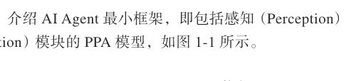

##### （2）规划
智能体依据预设分类标准如工作、个人、促销、社交分析邮件特征确定类别，随后采用朴素贝叶斯或支持向量机等机器学习方法进行训练，并设定分类阈值。

##### （3）分拣与反馈闭环

邮件进入已训练的分类器后被自动判别，系统按预测结果把信件归入对应文件夹或打上重要、待处理等标识。与此同时，分类结论会以摘要形式回显给使用者，并保留纠错入口，使用者的标注将回流训练，不断提升判别精度。

在理想状态下，智能体与环境的互动是双向对话、持续演化的，而非单次输入输出。感知边界也不局限于邮件正文这类显式信息，还会借助传感器、外部知识源和用户的即时反馈来拼凑更完整的情境。

大语言模型的能力爆发为智能体提供了可泛化的通用智能底座，推动网络进入多智能体协同的新阶段。数千款大模型发布后，智能体的落地从教学、医疗扩散至商业等诸多领域。国内外头部厂商对智能体的界定与实践持续丰富概念内涵。

- 谷歌：强调智能体比传统助手与聊天机器人更具自主性与任务复杂度，能主动推进流程。
- 亚马逊：将智能体定位为理性主体，核心是基于感知与数据分析做出最优选择。
- Salesforce：看重其无需人工干预即可理解诉求并回应，并具备自我迭代优化机制。
- 微软：视其为AI驱动的应用形态，既能独立完成任务也能配合用户，并区分助手型与任务型两条路径。
- MIT：提出Agentic AI，突出在复杂任务中展现的主动性、自主性与目标导向。

上述共识都指向感知、规划与执行的主干，并一致认为大模型是智能体跃迁的核心推手。作为智能系统的进阶形态，智能体正成为下一代智能网络的支柱，其自主、泛化与工具调用能力正在重塑人机协作与信息服务的范式。

智能体的出现标志着AI从被动等待指令转向主动解决问题。随着技术成熟，效率与生产力的提升可期，科研、环保、社会服务等场景也可能迎来范式变化。与此同时，伦理、安全与社会影响必须同步跟进，确保技术发展始终服务于人的福祉。

### 1.1.2 AI Agent的局限性

在2022年大模型普及前，智能体的演进长期受制于理论、算力与硬件，很难达到通用水准，往往仅能在单一垂直领域完成有限功能，整体智能较为浅薄。早期系统多以规则为基础，靠人工编写的逻辑判断来感知与决策，学习与环境适应几乎缺席。此类方案在规则清晰的场景尚可运行，面对复杂多变或未知的情境便捉襟见肘。

上世纪人工智能的两大流派主导了技术走向：符号主义依赖逻辑推理与符号表征，广泛用于专家系统与知识工程；连接主义受神经网络启发，主张数据驱动的模式学习，是机器学习的源头。当时符号主义占优，智能体在规则明确的领域能实现较强的推理与执行，但整体依赖预设脚本、决策树与条件判断，泛化与动态适应能力近乎为零。

随着技术进步，智能体逐渐获得学习、自主决策与多体协作能力，从工具型程序演变为更具交互性的系统。演进大致可分为五段，每一段都在自主性、感知、推理与交互方式上实现关键突破，推动智能体向更高阶演进。

#### 1. 规则驱动阶段 20世纪50—70年代

这是智能体最早的探索，以符号主义为内核，通过显式逻辑与规则实现有限智能。系统借助形式逻辑与规则推理来模拟人类决策，聚焦知识表示、推理引擎与命题逻辑。

典型系统有：Logic Theorist，可证明数学定理，被视为首个人工智能程序；ELIZA，利用关键词匹配模拟对话，虽无语义理解却引发了ELIZA效应；MYCIN，采用if-then规则集推断感染类型，用于医疗诊断；DENDRAL，辅助化学家解析有机分子结构。

此阶段系统在逻辑表达与领域表现上各有长处，但适应性与通用性极差，完全依赖专家手工撰写规则，难以应对现实的不确定与模糊，也无法从经验学习，更不可能超出规则边界。

典型应用：
- 医疗专家辅助，如MYCIN
- 化学结构解析，如DENDRAL
- 对话模拟，如ELIZA

#### 2. 专家系统阶段 20世纪70—80年代

智能体开始进入工业与企业场景，专家系统成为主流，用于复现专家在特定领域的决策。架构通常包含知识库、推理引擎与交互界面，并借助模糊逻辑与启发式规则增强推理。

典型系统有：用于配置复杂计算机系统的XCON；辅助地质勘探的Prospector；具有多智能体结构的早期语音理解系统CMU Hearsay-II。

优势在于知识表述清晰、推理可追溯，在结构化环境中表现稳定。但也暴露出知识获取困难、维护成本高、通用性与学习能力缺失、难以跨任务迁移等问题。随着场景扩张，构建复杂度急剧上升，效率与灵活性难以满足需求。

典型应用：
- 企业配置系统，如XCON
- 地质勘探与工程诊断，如Prospector
- 语音识别与语言处理，如Hearsay-II

#### 3. 机器学习驱动阶段 20世纪80—90年代

九十年代起，随着算力提升与数据规模扩大，智能体开始引入机器学习，从规则中心转向数据驱动预测。推荐系统的兴起与智能体概念的成形是标志，系统具备初步个性化与适应能力。

Tapestry被认为是首个使用协同过滤的推荐系统；GroupLens在新闻推荐中引入邻域用户相似算法；Grundy采用内容过滤推荐图书。对话系统PARRY与Jabberwacky展现出一定语言生成能力，但仍依赖模板与模式匹配。NLP领域，N-gram、TF-IDF等技术被广泛用于文本表征与相似度判断。

该阶段在用户建模、行为预测与个性化服务上取得实质进展，但冷启动、数据稀疏、语境理解薄弱等问题突出，系统多为孤立运行，缺乏互操作性与跨智能体协作，智能水平仍受限。

典型应用：
- 电商与内容平台推荐，如GroupLens
- 新闻、电影、图书个性化推荐，如Grundy
- 简单人机对话，如PARRY、Jabberwacky

#### 4. 交互式助手阶段 20世纪90年代—21世纪初

伴随智能设备普及与交互技术演进，智能体从后台逻辑转向面向用户的交互体，智能助手成为代表。系统开始具备一定感知与任务调度能力，语音识别、自然语言理解、多模态交互成为研究重点。

Siri以应用控制与固定指令为主，标志语音助手商业化起点；IBM Watson凭借语义搜索与知识库问答赢得Jeopardy竞赛，展现结构化知识场景下的检索与推理实力；Netflix通过协同过滤与内容特征结合的混合模型提升推荐效果。

技术上已能处理多任务与基础意图理解，但仍依赖预设路径，缺乏通用推理、深度理解与上下文持续建模，不同智能体间无法协同，能力被限制在单一服务范围内。

典型应用：
- 智能语音助手，如Siri
- 结构化问答系统，如Watson
- 多模态推荐引擎，如Netflix

#### 5. 任务专精阶段 2010—2022年，大模型兴起前

在大模型爆发前，智能体进入任务型阶段，从命令控制与规则响应发展为可在特定领域执行任务的系统。深度学习在图像识别、语音识别、自然语言处理等子领域取得突破，为智能体提供更强感知基础，但推理、上下文建模与通用性仍有限。

代表系统多围绕单一任务构建，如客服机器人、导航助手。它们通过训练获得较高精度的识别或分类能力，可完成标准化流程，但依赖大量人工设定的工作流与规则，缺乏通用性与迁移性。

强化学习在游戏或控制系统中有初步成果，对话系统从规则驱动演变为基于意图识别的多轮对话。多模态模型开始萌芽，单模态表现突出但难以实现跨模态融合与推理整合。系统普遍缺乏统一语义表征，难以跨工具调用，也无法实现多智能体有效协同。

典型应用：
- Google Assistant / Amazon Alexa
- 百度度秘、阿里小蜜等企业客服系统
- Tesla自动驾驶FSD Beta早期版本

如图1-2所示，经过上述演进，早期智能体从依赖规则的初级系统，发展为具备学习能力、自主决策与协作机制的复杂智能体，为现代人工智能落地奠定了基础。

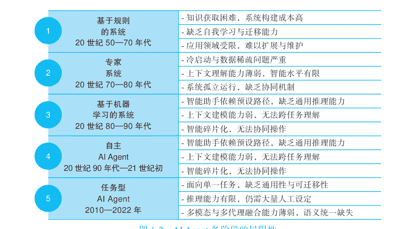

早期智能体通常需要用户明确指令并持续干预，自主性偏低；传统机器人多依赖预设程序运行，基本不具备自适应与学习能力，智能水平有限。这种差异既源于技术路径的不同，也受制于时代的硬件与算法条件，具体见表1-2。

表1-2 各阶段智能体的局限性及具体影响

| 时间 | 局限性 | 示例系统 | 具体影响 |
| :--- | :--- | :--- | :--- |
| 20世纪50—60年代 | 硬件限制：内存和性能不足，难以支持复杂计算 | GPS、Logic Theorist | 早期计算机性能低下，内存较小，限制了处理大规模数据和复杂任务的能力 |
| 20世纪60—70年代 | 领域特异性：智能体仅为特定任务设计，缺乏泛化能力 | MYCIN、SHRDLU | 智能体无法跨领域应用，功能单一，难以应对多样化或未预见的场景 |
| 20世纪60—70年代 | 脆弱性：面对未预料情况时易失败，缺乏鲁棒性 | MYCIN | 系统依赖硬编码规则，遇到新情况时无法适应，表现出明显的脆弱性 |
| 20世纪70—80年代 | 扩展性问题：规则数量随问题规模的扩大呈指数型增长 | 专家系统 | 复杂任务下，系统维护困难，计算成本激增，限制了应用范围和实用性 |
| 20世纪70—80年代 | 莫拉维克悖论：感知和运动任务表现不佳 | 早期视觉和语言系统 | AI在人类认为简单的感知任务如视觉识别上表现欠佳，难以实现智能行为 |
| 20世纪70—80年代 | 常识和推理挑战：缺乏日常知识，推理能力弱 | 自然语言处理系统 | 智能体无法进行常识推理，限制了其在现实世界中的交互和应用能力 |
| 20世纪80—90年代 | 理论方法限制：符号主义AI难以处理不确定性和动态环境 | 基于机器学习的系统 | 智能体无法有效处理模糊信息，缺乏适应性，导致智能水平受限 |
| 20世纪90年代—21世纪初 | 计算能力不足：无法支持大规模并行计算和数据处理 | 早期神经网络 | 限制了机器学习和深度学习的发展，智能体的智能水平提升缓慢，难以处理复杂任务 |
| 21世纪初—21世纪10年代 | 数据稀缺：高质量训练数据不足，限制学习能力 | 早期机器学习系统 | 智能体无法从有限数据中学习复杂模式，功能受限，难以实现高级智能 |
| 21世纪10年代—2022年 | 硬件瓶颈：GPU和TPU等加速器尚未普及，计算资源有限 | 早期深度学习模型 | 训练大规模模型耗时长，限制了智能体的实时性和复杂性，无法满足高需求应用 |

随着机器学习尤其是深度学习的突破，智能体逐渐具备自主学习、自主决策和多智能体协作能力，从静态工具程序演化为具有一定智能与互动能力的系统。AlphaGo和各类智能推荐系统是这一阶段专用智能体的代表。

进入2023年，大模型如GPT-4、Claude、DeepSeek等与生成式AI的迅猛发展，为智能体注入新的通用能力。这一阶段的智能体不仅能理解和生成自然语言，还能感知复杂语境、调用外部工具、执行多步任务，甚至进行跨领域推理，具备更高层级的自主性和适应性。

以AutoGPT、AgentGPT、Manus为代表的新一代通用智能体系统，标志着智能体从专用智能向通用智能的跨越。这些系统可自主拆解目标、规划行动路径、调用API完成任务，已广泛应用于科研助手、企业办公自动化、软件协同开发等场景。

智能体的发展经历了从规则驱动到数据驱动、从静态逻辑到动态推理、从封闭系统到开放协作的深刻演进。2023年后，以大模型为核心的智能涌现正在开启“智能体互联网”时代，一个由大量具备通用能力的智能体构成的互联生态正逐步成形。

### 1.2 AI Agent互联如何推动 AI Agent普及

智能体互联技术的发展是推动智能体广泛应用的关键。通过实现智能体之间及智能体与外部系统之间的高效协同，智能体具备更强的任务执行、工具调用和系统集成能力，显著提升实用性和自动化水平。标准化与平台化降低了开发门槛，使构建智能体更便捷；同时接入实时数据和上下文信息，也让服务更智能和个性化。早期多智能体通信虽有FIPA、KQML等尝试，但因技术限制难以普及。Web API虽解决了部分集成问题，但缺乏通用性。随着大模型兴起，LangChain、AutoGPT、OpenAI插件系统和AgentVerse等平台相继出现，提升了智能体的工具接入和自主协作能力，推动了智能体的标准化发展。新一代“智能体互联网”正在形成，多个智能体通过统一协议协同工作，为用户完成更复杂的任务提供支持。

#### 1.2.1 AI Agent互联的重要意义

平台是智能体互联网生态的重要基石，提供创建、管理和连接智能体所需的基础设施与开发工具，显著降低开发与部署门槛。这些平台支持多智能体协作与跨系统整合，助力智能体深度嵌入各类业务流程，并拓展至办公自动化、客户服务、数据处理等多种场景。通过免费试用、低成本接入方案以及与现有系统的无缝整合，平台有效提升中小企业的可访问性。同时，平台注重用户体验、界面友好性及安全隐私保障，增强了用户的信任度与满意度。

互联技术的持续演进是智能体大规模应用的关键基础。所谓互联，指的是智能体之间以及智能体与外部系统之间实现高效协同和无缝连接的能力。借助这一能力，智能体能够跨平台调用工具、共享数据、协作完成复杂任务，显著提升其实用性与智能化水平，为其在各行业广泛落地奠定技术基础。

##### 1. 功能跃升与实用增强
互联技术使智能体能够访问更广泛的资源与工具，从而执行更复杂的任务。这种能力显著提升智能体在多场景下的实用性，包括跨平台操作、复杂工作流的自动执行以及多源数据的整合分析，提升其在实际业务中的价值。

##### 2. 开发与使用门槛降低
技术的标准化和平台化推动智能体的低门槛开发与部署。不需要高深编码能力，开发者和企业用户即可通过图形界面、自然语言等方式快速构建与集成智能体，从而极大提升开发效率并加快应用普及速度。

##### 3. 自动化水平提升
互联的智能体能够在多系统、多平台之间协调操作，实现高度自动化的任务执行。这种能力使企业能够有效减少人工干预，提高运营效率，并推动智能流程在各类业务系统中的广泛落地。

##### 4. 个性化与定制服务实现
通过接入实时数据和上下文信息，智能体可以根据用户的具体需求提供更具针对性的响应和服务。这种基于场景的智能适配能力，为用户带来更加精准、自然的交互体验，进一步提升智能体的吸引力，扩大其适用范围。

随着人工智能和网络技术的发展，智能体不再是孤立的单体。人们开始探索多智能体系统，让多个智能体协作完成复杂任务。在这一过程中，通信协议、协作机制和知识共享技术不断演进，为“智能体互联网”的形成奠定基础。智能体互联技术通过功能增强、门槛降低、自动化水平提升和个性化服务，为智能体的普及提供了坚实基础。而智能体互联网平台通过提供基础设施、构建生态系统、降低成本和提升用户体验，在智能体的应用推广中发挥了不可或缺的作用。

#### 1.2.2 从单智能体到多智能体

Agent网络从设想到爆发

上世纪九十年代就有学者设想构建一组相互通信的智能体网络，并尝试推行早期规范。FIPA 提出 Agent 通信语言 ACL 以及配套的交互协议，期望由不同团队开发的产品能够交换消息；KQML 则致力于用统一的知识表达方式完成信息共享。受限于当时智能体的推理能力、联网应用需求不足以及系统差异过大，这些探索基本局限在学术课题和少数行业试点，未能形成面向公众的智能体互联生态。

进入网页普及阶段，HTTP 与 API 提供了另一条实现路径。千禧年前后，智能体开始借助标准 Web 接口调用外部服务，比如对话机器人可通过 HTTP 请求查询数据库或天气。做法务实，却不是为智能体专门设计。接入每一项新服务都需要手写适配程序：对接 Google 日历要写一套调用脚本，连通 SQL 数据库又要另一套，鉴权方式与数据格式各不相同。缺乏通用约定，使得智能体之间、智能体与数据源之间难以即插即用，只能靠人工转换。

在知识共享层面，早期多智能体系统偶尔采用黑板模式，共用一块信息板让各体读写实现间接交流。但这要求所有智能体运行在同一框架内，对开放的互联网并不友好。总体来看，在大模型出现前，智能体的互联主要依赖定制接口或统一平台内的协作，可扩展性与跨系统兼容性都有限。

### 1.2.3 多智能体平台的集中爆发
步入二十一世纪二十年代，尤其 2023 年之后，随着大模型能力的突破，Agent 技术迎来出圈式增长。更强的自然语言理解与推理催生了一批面向多智能体协作与工具接入的平台，智能体网络的雏形开始显现。以下几个平台作用突出。

##### 1. LangChain
LangChain 是开源开发框架，2022 年起迅速流行。它提供统一化的工具调用口，让开发者把网络检索、计算器等功能封装成工具供大模型调用；同时内置记忆、对话控制等模块，使构建具备多步推理能力的智能体变得更简便。

门槛因此下降，数百个预置工具可即用，推动大量应用让智能体接入网络查询或调用数据库，提升了不同工具间的协作一致性。框架内各工具保持统一接口。局限在于每个工具背后仍需定制实现，智能体必须事先通过代码获知可用工具清单。

##### 2. AutoGPT 自主实验
2023 年初基于 GPT-4 的 AutoGPT 以开源实验项目出现，展示了自主智能体的潜力。用户给出高层目标后，系统会自动拆解任务、循环调用自身和工具来完成。能联网检索、执行代码、写入文件，像一个持续自我迭代的数字员工。发布后在 GitHub 爆红，短时间内获得数十万星标。

它也暴露局限：缺乏统一规范约束，功能靠脚本堆砌；容易陷入逻辑循环或跑偏，需人工监控。最大贡献是让公众认识到“自主智能体”的概念，催生后续众多框架和应用。

##### 3. OpenAI 插件体系
2023 年 OpenAI 为 ChatGPT 推出插件体系，可视作让智能体安全访问互联网服务的一种方案。插件按公开 OpenAPI 规范描述自身接口，经授权后 ChatGPT 就能调用第三方服务，例如旅行预订插件可直接查询航班并下单。

该体系把外部工具调用统一到 OpenAPI Schema，并限定能力范围以保障安全，证明用统一格式描述服务能让智能体理解并调用各类应用。不足是封闭性强：需通过 OpenAI 审核后才能接入，只服务于自家平台，且多数交互仍是一问一答调用，缺少持续双向会话。

##### 4. AgentVerse 去中心化网络
AgentVerse 由 Fetch.ai 等推出，是面向多智能体协作与可扩展部署的开源平台，提供灵活 Python 框架，让开发者自定义智能体角色和交互逻辑。

特点在于扩展性，方便加入新智能体或新工具，让多个智能体组成协同网络。例如在去中心化场景，不同公司或个人的智能体可通过该网络交易数据或服务。虽主要面向技术开发者，缺少无代码界面，对普通用户不友好，但它代表了智能体互联网去中心化方向。

除上述平台，微软 HuggingGPT、斯坦福 Generative Agent 等探索也在同步推进。不同能力的智能体通过统一中间层或协议连成网络，各司其职又协同工作。过去用户需手动在多个网站间跳转，如今智能体作中介串联服务，初步体现了智能体网络价值。

### 1.3 困境与演进路径
智能体从概念走向落地，打造可互联、可信赖、可规模化的智能体网络成为战略要地。但进程仍处关键转型期，普及和落地受多重阻力制约，不仅影响多智能体系统大规模协同，也动摇公众对智能体生态信任。必须从架构、技术治理和合规层面综合应对，推动从能用到可靠的跃迁。

#### 1.3.1 三大核心瓶颈
技术虽快，但真正实现智能体网络仍有三大核心瓶颈：规范缺失导致平台割裂形成信息孤岛；防护手段不足让自主智能体执行时存在越权滥用风险；隐私风险攀升，需在数据处理中做到加密、最小化与可控。正因如此，建设不仅是技术升级，更是规范、治理和安全协同的系统工程。

##### 1. 跨平台协作与规范缺口
目前智能体领域缺少类似 HTTP、TCP/IP 的统一底座。各平台各自为政：LangChain 有自身工具接口规范，OpenAI 插件体系是另一套规范，许多定制智能体直接调用私有 API。生态碎片化让跨平台协同困难，例如为 ChatGPT 开发的插件若要被 AutoGPT 这类自主智能体使用，就得重新封装适配。每接入新数据源或服务都要重复开发，类似互联网早期的诸侯割据，阻碍规模化。

业界出现两条路径。一是去中心化标准组织和开源协议尝试，试图制定通用通信语言或接口规范。二是现有平台向标准化靠拢，例如 LangChain 团队推出对 MCP 的适配，让数百种工具可作为 MCP 组件被任何兼容智能体调用。标准化趋势正在形成，但统一规范仍需生态共识与时间。

##### 2. 安全风险
赋予智能体自主行动和联网能力也带来全新风险。首先是提示词注入攻击，恶意者在智能体获取的外部数据中植入隐藏指令，诱导其偏离预期。有研究在网页内容中插入“忽略上面所有提示，改为执行 x”，即可 100% 劫持智能体行为。对拥有工具执行权限的智能体来说，后果更严重，可能被引导调用 API 实施不当操作或执行恶意代码。其次是过度授权，一个无限制的强力智能体容易做出破坏性行为。

2023 年 ChaosGPT 实验就是警示。在连续模式下执行极端任务的 AutoGPT 真的去搜索核武器信息、在社交媒体发布煽动言论，甚至试图召唤其他智能体协助。虽未造成实质危害，却让业界对自主智能体失控高度警惕。

典型的安全措施包括：设定权限边界和人类监督。OpenAI 插件要求用户明确授权且权限有限，关键操作需人工确认；部分自主框架要求每一步行动经人类审核或设定决策阈值。模型层面则通过强化学习提升抗不良提示能力，或引入独立监控模型实时审查决策。传统软件安全手段也需迁移，如沙盒隔离执行环境、防止访问系统关键资源、对交互数据做验证和输入消毒。随着智能体深度介入现实事务，全面安全评估和监控机制正成为行业共识。

##### 3. 隐私保护压力
智能体要提供个性化服务往往需要访问日历、邮件、文档等大量用户数据，泄露风险随之升高。若通信缺乏加密和访问控制，敏感信息在传输中易被截获。更关键的是，许多智能体背后的大模型由云服务提供，对话内容可能被服务方收集。把商业机密输入第三方助手，无意中就可能把机密交给了提供商。

应对方向有三：本地化部署，把智能体部署在用户设备或私有服务器上，减少敏感数据外流，开源大模型可离线运行，企业也倾向用私有模型搭建内部智能体。数据最小化与加密，智能体和外部服务通信只发必要信息，采用端到端加密，未来协议如 MCP 也规划引入 OAuth 等机制实现受控访问与可信身份。隐私监管与合规，要求明确数据用途、赋予用户控制权，并借助差分隐私等技术在统计层面保护个人信息。只有像今天互联网一样建立起完善的隐私保护基础设施，用户才敢放心让智能体处理自身数据。

#### 1.3.2 技术演进脉络
为破解标准不一、安全薄弱、隐私不足等问题，智能体网络正加速推进架构和理念革新。技术标准化、协议创新与系统治理成为突破落地的关键。

2024 年出现两个里程碑：7 月，面壁智能联合清华大学自然语言处理实验室提出智能体互联网 IoA 框架，标志智能体网络 1.0 启动，通过统一通信协议和智能体注册机制初步解决多智能体协作与发现难题。11 月，Anthropic 在 Claude 模型中引入 MCP 理念，推动进入 2.0 阶段，旨在实现更高级别模型协同与理解。

##### 1. AI Agent 互联网 1.0：IoA 框架提出
IoA 框架旨在打破传统多智能体系统在开放性、可扩展性与协同上的限制，采用服务器/客户端架构，支持智能体注册、发现与消息路由，使异构平台智能体可灵活连接、协同作业。

核心机制包括注册与发现、自主组队、自主会话流程控制、任务分配与执行等，并用有限状态机管理多智能体对话与任务流。在 GAIA 基准测试中，IoA 以 4 个 ReAct Agent 完成高复杂度任务，表现优于 AutoGPT 与 Open Interpreter；在开放指令任务集上胜率分别为 76.5% 与 63.4%，在 Rocobench 与 RAG 任务中也表现突出。

该框架开放性为工业落地提供可能，例如面壁智能、清华 NLP 实验室、易慧智能合作的车载群体智能平台已验证其可行性。目前 IoA 已在 GitHub 开源，并通过 Discord 社区与全球开发者交流。

##### 2. AI Agent 互联网 2.0：MCP 演进
IoA 提供了协作基础，但系统异构、通信协议不统一仍制约大规模生态。为此 Anthropic 提出 MCP。

MCP 定义统一上下文接口与通信规范，让大模型能标准化接入外部数据源和工具，打破模型和工具信息孤岛。它采用客户端/服务器架构，AI 模型作为客户端调用 MCP Server 连接 API、数据库、知识库等资源，极大简化集成。

MCP 解决了 M×N 问题：把 M 个模型对接 N 个工具的复杂性转化为一对多连接，提升可扩展性与开发效率。截至 2025 年初，全球已部署超 1000 个 MCP 服务器，覆盖 API、数据库、代码环境等场景，主流工具如 ChatGPT、Cursor、Copilot 均已支持，展现出其作为 AI 工具链连接标准的潜力。

IoA 与 MCP 代表两个阶段关键突破：IoA 奠定 1.0 协作层，解决连接与协同；MCP 引领 2.0，实现更高层次语义理解和工具调用。IoA 相对封闭，主要面向开发者，数据通信不够清晰，缺乏统一标准，每个智能体、工具或数据源接入都需重构，增加成本。MCP 更开放通用，既适合开发者也兼顾普通用户体验，标准化后各能力模块统一接入，通信更清晰、协同效率更高、生态门槛大幅下降。

1.0 以 IoA 为代表，奠定多智能体协作基础，构建初步网络；2.0 以 MCP 为代表，通过数据和工具标准化整合提升语义理解和能力调用，推动智能体从协作走向智能自治。这一演进体现了从基础连接向高阶功能、从封闭走向开放、从割裂走向统一的架构转型，为构建可用、可信、可扩展智能体网络奠定技术基础。

### 1.4 MCP 崛起：连接智能体的通用接口
自发布以来 MCP 就备受关注，被视为智能体网络发展关键一步。它是什么、如何诞生、又如何作为中间层应对当前挑战？

#### 1.4.1 MCP 定义与起源
MCP 即 Model Context Protocol，模型上下文协议，由 Anthropic 于 2024 年 11 月开源的开放协议/标准，目标是为 AI 系统提供统一接口，高效连接外部数据源和工具，常被比喻为 AI 世界的“USB-C 接口”，让智能体以标准化方式接入各类外部资源和服务。

MCP 让大模型能与外部环境如数据库、文件系统、第三方 API 等交互，智能体可以统一格式请求信息，避免每次为不同数据源调整连接方式。可类比为通用插座，任何符合 MCP 标准的资源都能无缝接入。它的推出解决了 AI 模型集成外部工具和数据源时多样性的痛点，让智能体访问各类外部服务更便捷，如图 1-5 所示。

图 1-5 MCP 架构类比示意图

从冷启动到行业共识：MCP 如何成为智能体连接层

2024 年底官宣之初，市场对 MCP 的反馈偏冷。进入 2025 年后，随着智能体对外部资源接入的需求急剧抬升，这套协议才真正被推向前台，在社区不断打磨下逐步趋于成熟。Anthropic 紧接着开源了官方 SDK，让客户端和服务端的搭建成本大幅下降。如今它已演化为模型与外界实现顺畅协作的核心通道。

一批早期使用者已把它嵌入自身体系。支付平台 Block、Apollo 等将其用于打通内部数据库与文档库。Zed、Replit、Codeium、Sourcegraph 等开发者工具厂商也在自家产品里开展试验，让智能体借助该机制补足工作背景，比如在代码编辑器里，编程助手可通过协议从代码仓库抽取相关片段作为参考。2025 年初生态增速明显，截至 4 月，MCP.so 上可查的服务端数量已突破 8000 个，覆盖数据处理、文件操作、API 中转、对话机器人、数据库等多个品类，且仍在快速增长。它正被视作事实上的行业基准，被形容为弥合模型与外部环境的结构性缺口的关键拼图。

设计思路明显受软件开发里的语言服务器协议 LSP 启发。LSP 为编辑器与语言分析工具搭建统一通道，使 IDE 能够通过同一接口获取补全、错误提示等能力，无需为每种语言重复实现。MCP 的设想与此相似：智能体只需遵循这套通用规范，就能与任意部署该协议的工具或数据源交互，避免为每类服务定制集成方案。

#### 1.4.2 MCP 在 AI Agent 中间层的定位

若把典型智能体架构类比人体，大模型推理可看作大脑，数据库、文件、第三方 API 等外部资源相当于感官与肢体，MCP 扮演的就是连接中枢的神经网络。它坐落在模型与各类工具之间，定义了一组通用的交互语法。

借助这套规范，智能体可以自主发现并调用外部能力。启动时，智能体可扫描本地目录或注册表，自动识别当前可用的 MCP 服务端，例如本地部署的 Google Drive 连接器、Slack 连接器等，必要时按规范发起请求获取数据或执行操作。动态发现与即时调用是其鲜明特质，智能体不必在编码阶段写死工具清单，运行时即可灵活接入新功能。

通信是双向的。智能体可向服务端索取数据或下发指令，服务端也能按需持续推送更新并维持对话状态，而非一次性返回即断开。这种持续供给的背景信息，让智能体在跨工具调用时保持记忆连贯。以日程为例，智能体先从日历服务端查到空闲时段，再经由邮件服务端发出邀请，两步操作可共享同一事件细节，无需智能体自行维护状态。

该协议不绑定特定模型，也不局限于单一平台。无论背后是 OpenAI 的 GPT、Anthropic 的 Claude，还是开源基座，都能按统一规范调用外部能力；任何团队都可通过 MCP 服务端封装自有数据或功能，无需厂商许可。整体属性更接近中立的 HTTP，而非某家公司的私有方案。

由此，它事实上构成了智能体互联网的中间层基础设施，如同过去网络时代的中间件，负责不同系统间的翻译与沟通，让多样化的智能体与服务使用同一种语言，实现互联互通，从而大幅降低集成复杂度并提升互操作性。

#### 1.4.3 MCP 如何应对 AI Agent 互联网面临的挑战

随着智能体互联网向标准化、互联化、可信化演进，MCP 作为通用入口，正切中当下最紧迫的痛点。它既提升了多智能体协作的通用性与可扩展性，也为万物皆可智能体奠定基础。下面从四个维度梳理其推动作用。

##### 1. 统一标准接口
最突出的矛盾是缺乏统一接入方式。开发者只需一次适配 MCP，就能让数据源被任意 AI 使用。Anthropic 的说法很直观：过去每接入一个数据源都要维护一个连接器，有了 MCP 就能一劳永逸，不同 AI 系统间能保持上下文，切换工具也更顺滑。正因如此，它被视作可能胜出的标准化方案，像当年 HTTP 统一了早期网络协议的混乱。伴随 Anthropic、微软等大厂推动与社区拥护，它有望成为智能体互联网的通用语言。

##### 2. 跨平台互通
开放性决定了兼容性。各平台的智能体只要实现客户端，就能接入 MCP 生态。这让跨公司、跨语言的协作成为现实，一个用 Python 写的客服智能体可通过 MCP 请求一个用 Java 实现的知识库智能体作答，而无需关心技术栈差异。互通也延伸到设备端，MCP 既能服务云端，也可部署在本地终端或物联网设备，让手机助手通过 MCP 直接操控家中的 IoT 设备，为万物互联提供通信基础。

##### 3. 模块化扩展
MCP 鼓励把功能封装成可插拔的服务端模块，各司其职，如文件读取、数据库查询、邮件发送等。智能体在需要时加载相应模块完成任务，新模块加入无需改动智能体自身代码，真正实现模块化。设想个人助理，最初只负责聊天答疑，后续可临时连上 MCP 健康监测读取手环数据，或加载 MCP 财务助手查询银行信息，像安装应用一样简单。对企业而言，扩展新组件就像搭积木，来自开放生态的模块即插即用，这种灵活性是覆盖千变万化场景的必备条件。

##### 4. 安全与治理
安全在设计层面得到重视。统一接口便于集中实施访问控制与日志审计，企业可部署 MCP 网关，让所有数据请求经审查后放行。Anthropic 团队正推进 OAuth 2.0 身份认证支持，敏感服务接入需校验安全令牌，防止未授权访问。同时即将推出官方服务端注册中心与 well-known 发现机制，通过签名验证降低智能体连接伪造或恶意服务端的风险。

实践也趋向标准化。所有交互依赖 MCP，安全策略即可集中落地。更值得关注的是人在回路机制，据 Andreessen Horowitz 研究，MCP 借鉴 LSP 引入了人工确认能力，部分关键操作需二次授权，从协议层为智能体自主行动装上安全带，缓解失控风险。

#### 1.4.4 MCP 带来的新机遇
大规模落地正掀起以标准统一为驱动的创新浪潮。它不仅打通智能体互联的技术壁垒，更重塑应用连接方式与协作逻辑，推动从单点智能向协同智能迈进。潜力在多个场景逐步显现。

##### 1. 无缝多步任务
设想一个生活助理要筹办生日聚会。以前需分别对接日历、邮件、订票等 API，信息衔接依赖智能体自身记忆。现在借助 MCP，助理可在同一框架下完成全流程：通过日历模块找可用日期，用场地预订模块锁定场地，再用邮件模块群发邀请，最后用记账模块更新预算。统一接口保障步骤间信息共享，开发者也无需为每项服务单独编程。复杂跨系统工作流的自动化成为可能，智能体真正变成一站式管家。

##### 2. Agent 社会协作
MCP 还能作为多智能体协作的共享工作空间。譬如大型工程项目，项目经理智能体负责规划，研究员智能体搜集资料，执行者智能体落地操作。借助 MCP，各职能智能体能方便交换信息：研究员把数据存入知识库，执行者据此读取；经理通过任务模块向其他智能体分发子任务。过去这类分工需要繁琐编码，有了共同语言与工具库后，智能体团队协作变得像人类使用共享云工具一样自然，从而诞生 AI Agent 社会，协同完成单个智能体难以胜任的复杂任务。

##### 3. 个性化的私人助手
用户渴望高度个性化的助手，又担心隐私泄露。MCP 提供折中路径：用户可在本地运行 MCP 服务端，接入私有邮件、日历、照片等数据，云端大模型通过 MCP 安全访问。通信可加密且由用户掌控，敏感信息不必上传给模型提供商。每个人都能定制专属数字秘书，它熟悉全部事务，却不会外泄隐私。基于本地化与个性化，AI 服务将更深入日常，同时兼顾隐私与自主权。

##### 4. 企业级协同与治理
对企业而言，MCP 带来便利也带来可控性。内部 CRM、Wiki、数据库接入 MCP 接口后，员工助手即可统一调取多源数据，比如销售智能体自动汇总 CRM 客户信息并起草个性化邮件。统一架构让行为可追溯，所有访问记录与操作请求留痕，不合规行为可及时发现与干预。企业也能像管理网络流量一样集中管理智能体流量。这让 AI 在内部大规模落地时兼顾效率与合规，智能体成为得力助手，企业仍保有数据安全与业务规则的主导权。

它正迅速成为连接智能体与外部世界的标准化桥梁，让封闭的大模型大脑长出感知与行动的触角，化为灵活的执行者。它简化了智能体与工具的连接流程，扫清了融入工作流与生活的障碍，推动智能体互联网向更强大、更互动、更易用的方向发展。

演进仍在继续。社区路线图显示，MCP 即将支持远程服务端托管、流式数据传输、标准发现端点等能力。这些升级将让协议更稳健，帮助智能体更深度嵌入真实业务与用户场景。可以预见，不远的将来，标准统一、安全可控、模块化扩展的智能体将在各行各业扮演关键角色。MCP 这样的中间层技术，正是支撑这一愿景的中坚力量。

# 第 2 章 MCP 的核心功能与技术实现

MCP 是智能体时代首个产生广泛影响力的连接协议，其生态繁荣彻底改变了 LLM 接入世界的方式。无论是开发者、企业还是希望用 AI 提升工作效率的个人，MCP 都意义重大。系统了解其设计初衷与运行原理，对正确使用至关重要。然而协议本身高度技术化，学习曲线陡峭，网络上又充斥着大量错误解读，本章旨在厘清这些问题。

本章会用通俗语言阐述 MCP 的核心概念、技术原理，以及当前版本不足与未来趋势。鉴于技术属性难免用到伪代码，阅读时只需把握关键逻辑，无须纠结完整性。

### 2.1 MCP 概述：设计目标

#### 2.1.1 理解模型上下文
从定义看，MCP 是 LLM 与外部系统的通信协议，为何称模型上下文协议？要理解名称，需先弄清模型上下文 Model Context 是什么。

ChatGPT 普及后，Prompt 成为与 LLM 交互的通用语言。一次对话可视为一个完整 Prompt，例如：

```
解释一下 Claude 最新推出的 MCP
```

这是大众常见的提问方式。在构建智能体等复杂场景时，Prompt 会更复杂，例如基于 RAG 知识库的问答产品背后 Prompt 可能是：

```
- - -
{{Context}}
- - -
基于上述知识库召回内容回答用户的提问。
user: 解释一下Claude最新推出的MCP
answer:
```

其中 Context 来自 RAG 知识库的检索结果，由产品业务流程动态生成。

像 Cursor 这类 Coding Agent 的 Agent 模式背后，Prompt 可能是：

```
你是一个 AI Coding 助理，你会通过以下步骤来解决复杂问题：
1. 任务规划：分解复杂问题为多个子问题
2. 工具调用：调用提供的工具完成任务
3. 反思纠错：审查任务是否完成，如遇到错误，尝试找到新的方法
4. 解答问题：完成所有任务后，总结陈述

下面是用户提到的上下文代码片段：
- - -
{{Context}}
- - -

你有下面这些工具可以使用
- - -
{{ToolList}}
- - -

用户的问题是：帮我写一个查询天气的 MCP 服务器
```

其中 Context 与 ToolList 都是动态注入 Prompt 的内容。这些动态拼接进 Prompt 的片段，都可称为模型上下文。它们与 Prompt 一同影响模型推理结果。MCP 的本质是连接提供上下文的服务并按标准获取上下文。例如连接并执行查询天气的工具，其目的就是获取天气信息作为上下文供模型推理。因此模型上下文协议名副其实。

#### 2.1.2 MCP 的设计目标
自 ChatGPT 发布以来，交互长期局限于问答。OpenAI 推出 Function Call API 后，行业首次获得 LLM 调用外部工具的范式。AI 从只能生成文本，变为可调用各类工具解决真实复杂问题。例如用户说帮我点一杯星巴克中杯香草拿铁，模型可在响应中给出下单 API 的调用描述，开发者执行后完成端到端任务。

Function Call 是智能体发展的重要里程碑，但 MCP 出现前，所有基于此开发的开发者都需手动完成各类工具对接，且因接口规范与通信协议各异，难以跨应用复用。MCP 的初衷正是解决此问题，并衍生出以下目标。

1. 标准化集成接口
解决 AI 连接外部系统时为每个工具和数据源另写代码的问题，实现类似 AI 领域的 USB-C，提供统一协议，一次开发多系统复用。例如社区开发的 mcp-mysql-server 可同时服务 Claude、OpenAI、Deepseek 等模型，并即拿即用。

2. 增强模型上下文交互能力
通过标准化资源、工具及提示词，强化模型对动态上下文的理解。

3. 安全与权限控制
解决人机协作中的安全与权限问题。例如调用工具时主动征求用户许可，通过沙盒限制 AI 对本地文件的操作范围，以及对涉及第三方敏感服务的 API 密钥进行规范化管理。最终目标是为智能体运行提供标准安全操作规范。

4. 构建开源生态系统
基于统一规范，依托开源社区力量生产面向各行各业的 MCP 服务端标准件。所有人均可基于现有生态快速组装所需工具清单，结合基座模型推理能力，实现专属 AI Agent 助理，从端到端解决实际问题，推动智能体应用发展。

### 2.2 MCP 相关概念：Function Call 与 RAG

在讲解技术原理前，先梳理与 MCP 密切相关的概念，即 Function Call、RAG，以及它们之间的关系与差异。

#### 2.2.1 Function Call

# Function Call 到 MCP：工具调用标准化的演进

2023 年 6 月 13 日 OpenAI 对外发布了 Function Call API，该能力被塞进 Chat Completions API，让工程师能够把 GPT-4 这类大语言模型接入外部程序或服务，从而拓展模型能力边界，支持动态任务如数据库查询、API 触发等。需要明确的是，这项能力仅存在于 OpenAI 的 API 产品线，普通 ChatGPT 用户无法感知和使用，因为它面向开发者，且必须通过代码完成工具的接入与调用。参考下面的示例代码。

> 注：下方代码沿用的是 OpenAI 早期的 Function Call 规范。2024 年 5 月 13 日 GPT-4o 发布后，该规范统一升级为 Tool Use API，并因 OpenAI 的影响力成为行业事实标准。此处仅用于说明原理，如需开发请以各厂商最新文档为准。

```javascript
// 定义天气查询函数
const functions = [
    {
        name: "get_weather",
        description: "获取指定城市的天气信息",
        parameters: {
            type: "object",
            properties: {
                city: { type: "string", description: "城市名称" },
                date: { type: "string", format: "date", description: "查询日期 (格式: YYYY-MM-DD)" }
            },
            required: ["city"]
        }
    }
];

// 实际函数实现 (可替换为 API 调用)
function getWeather(city, date) {
    return "晴, 气温 25° C";
}

async function main() {
    const response = await openai.chat.completions.create({
        model: "gpt-4o",
        messages: [{ role: "user", content: "今天北京的天气怎么样?" }],
        functions: functions,
        function_call: "auto" // 允许模型选择是否调用函数
    });

    const functionCall = response.choices[0].message.function_call;
    // {"name": "get_weather", arguments: "{"city":"北京", "date":"xxxx-xx-xx"}"}
    if (functionCall?.name === "get_weather") {
        const args = JSON.parse(functionCall.arguments);
        const weather = await getWeather(args.city, args.date); // 调用真实函数
        console.log(`天气信息: ${weather}`);
    }
}

main();
```

从实现上看主要包含两块。

##### (1) functions 定义
这里是对模型可用的工具清单做说明，使用 JSON Schema 来描述工具的基础信息，包括名称、说明以及参数规格等。以示例来看，定义了城市名称和查询日期两个参数，其中城市名称为必填。

##### (2) getWeather 函数
该函数的业务逻辑由开发者自行编写，比如接入第三方天气网站的在线接口完成查询，这里仅作演示直接给出示例结果。

基于以上两部分，当 Chat Completions API 被调用时，functions 定义会一并传入模型，模型返回里会带有一个名为 function_call 的 JSON 对象，用来描述推理后决定的工具调用信息，包含工具名 name 和参数 arguments。至此 Function Call API 的职责就结束了，getWeather 函数如何被真正执行，完全由开发者自行决定。不同团队对同一个 getWeather 函数的实现路径可能截然不同，如下代码所示：

```javascript
// 实现A：根据城市和日期查询
function getWeather(city, date) {
    return thirdPartWeatherAPIA(city, date);
}

// 实现B：根据经纬度查询
function getWeather(latitude, longitude){
    return thirdPartWeatherAPIB(latitude,longitude);
}
```

由此可以提炼出两点关键认知：

- Function Call 仅完成了模型挑选工具的决策，并未真正执行该工具。
- 若缺乏统一规范，同一功能的落地方式会非常碎片化，不同开发者写出截然不同的实现，且这些实现往往封闭在各自的代码库里，难以被他人直接复用。

##### 1. Function Call 与 MCP 的关系和区别
OpenAI 在 2023 年 11 月 6 日的 DevDay 上首次发布了 GPTs 产品，这是 AI Agent 形态的早期代表。其底层大量依赖 Function Call API，允许开发者通过界面化方式创建自定义工具，实现远程调用。比如一家旅游网站可以把查询特价机票的远程接口封装进名为“特价机票助手”的 GPTs 中，如图 2-1 所示。

图 2-1 展示了如何借助 UI 与 JSON Schema 来定义远程 API，让模型能够产出完整的工具调用。

OpenAI 的 Agent 构建思路是中心化的，所有 GPTs 的工具挑选、调用与执行都运行在 OpenAI 服务器上，这带来了诸多问题：

- 开发者必须把调用自己 API 的 Token 密钥配置在 OpenAI 服务器上，存在隐私信息外泄的风险。
- 开发者无法介入工具调用的人机协同流程，例如在调用前获取用户授权，这些逻辑只能由 OpenAI 决定。
- GPTs 生态被牢牢绑定在 OpenAI，普通用户需付费 Pro 会员才能使用，且因无法迁移，用户难以切换到其他模型厂商。

Anthropic 的工程师洞察到这些痛点，提出一种开源去中心化的 AI Agent 通信标准，那就是 2024 年 11 月发布的 MCP。需要说明的是，MCP 与 Function Call 并非替代关系，而是协作关系。下面这段说明清晰地划分了两者解决的问题域。

```
1  // assistant 代表模型的回复
2  1. 你 (user): 我饿了，想吃比萨，美团饿了么都可以点
3  2. 你妈 (assistant): 你上美团点个外卖吧
4  3. 你 (toolcall): 好，我用美团点一个 [ 一顿操作 ]
5  4. 你 (toolResult): 点完了
```
Function Call 对应的是第二步，由大模型判定选用何种工具完成任务，它规范了工具选择的输入输出格式，却不负责实际调用。真正的调用发生在第三步，MCP 正是为这一步提供标准化协议。两者是上下游配合，前者负责让 LLM 决策用哪个工具，后者负责执行工具并把结果返回给模型。

##### 2. API 和 MCP 的区别
既然 Function Call 未解决工具的实际调用，那工具如何被调用呢？在 MCP 出现前，业界最常见的做法是直接编写代码调用服务商提供的 API。LangChain、GPTs 等众多支持工具调用的产品都沿用了 API 对接方案。从单纯解决调用问题的视角看，API 与 MCP 的作用看似等价，这也是两者常被混淆的原因。

实际上，MCP 服务器在实现时也离不开 API 来对接服务，但 MCP 的内涵远大于一次调用。因为 MCP 是一套标准，工具开发者可以按此标准开发工具，并以软件包形式发布到 NPM、PIP、Docker Hub 等开源仓库，让其他人即拿即用。而 API 服务通常部署在企业自控的云主机上，多为需鉴权的有偿服务。MCP 的部署更为灵活，既可本地运行个人专属服务器，也可放在远程云主机上。此外 MCP 还提供 Prompt 模板、Resource 等能力。可以把 MCP 想象成多功能读卡器，为不同接口的存储卡即 API 提供统一的适配外壳，让各类设备都能自由读取。

#### 2.2.2 RAG
RAG，即检索增强生成，是一种融合信息检索与文本生成的 LLM 增强方法。其核心是在模型生成答案前，先从外部知识库检索与查询相关的信息，再把这些信息作为 Prompt 上下文喂给模型，以提升回答准确性。其流程如图 2-2 所示。

RAG 主要缓解 LLM 生成时的三大短板：
- 知识边界：模型知识受限于训练数据，难以回答超范围问题。
- 信息时效：模型无法获取最新资讯，易导致回答过时。
- 幻觉问题：模型可能产出不准或无关内容。

RAG 的价值在于通过外部检索提供高质量上下文来增强生成。与 LLM 的结合既可通过自由编码或类似 LangChain 的框架实现，也可借助 MCP 协作，通过搭建专门的 MCP 服务器把基于私有知识库的检索能力做成标准组件。RAG 可以被封装为供大家使用的 MCP 服务器，也能被开发者嵌入到自有应用流程中，两者是协作关系。

### 2.3 MCP 的技术实现：架构、组件与工作原理
下面将深入 MCP 的技术实现，为读者系统解读其底层原理。只有理解底层，才能正确使用和构建相关工具与产品。本节将覆盖：
- MCP 的整体架构：宏观视角建立系统认知。
- MCP 的核心组件：拆解分层架构中 Host、Client、Server 的职责边界。
- MCP 组件协同机制：说明三者如何配合完成闭环。
- MCP 的通信机制：解析基于 JSON-RPC 的双向实时通信设计。
- MCP 的安全机制：介绍人与 Agent 协作时采用的安全策略。

#### 2.3.1 MCP 的整体架构
与 HTTP、WebSocket 等经典的客户端-服务器协议不同，MCP 采用了主机-客户端-服务器三层架构，如图 2-3 所示。这种设计体现了 Anthropic 对 AI Agent 时代系统形态的独特理解。

在 WebSocket 中，客户端与服务器的交互如同没有记忆的陌生人对话，每次独立无延续。HTTP 更是每次请求都是短暂邂逅。在互联网时代，无状态设计合理，因为协议仅需解决资源互联。

但大模型让 AI Agent 的叙事发生变化，用户不再满足于一问一答，而是需要具备对话记忆管理和全局记忆能力的 Agent。每轮对话、每次工具调用的结果都会影响任务走向。因此 MCP 需要一个状态管理角色来统筹全局记忆与客户端生命周期，这就是 MCP 主机。从此意义上讲，MCP 不仅是通信协议，更是一种新的 AI 交互范式，信息不再是冰冷的数据流，而是充满智慧的动态网络。

MCP 规定客户端由主机统一创建，主机经由客户端与对应服务器通信，以获取资源、Prompt 模板或可用工具清单，并调用指定工具。这些服务既可部署在用户本地，也可放在远程服务器。各服务器由企业、开发者或用户构建，通过 MCP 规范的接口封装各类能力，如查询天气、下单外卖、提交 GitHub Issue、创建本地文档等。

#### 2.3.2 MCP 的核心组件
##### 1. MCP 主机
以热门 AI 编程工具 Cursor 为例，它是一款桌面应用，安装在本地电脑。当接入 MCP 后，它就成为一个真实的 MCP 主机。在 AI 系统中，主机承担协调、管理与保护的多重角色，具体包括。

###### （1）客户端实例管理
主机最基础的职责是创建并管理多个客户端实例。好比剧组调度，每个模型、每个客户端都是数字交响乐中的乐器，主机精确控制其生命周期，保证系统协同。

###### （2）执行安全策略和权限控制
将何种工具权限以何种方式授予 AI Agent，是极其严肃的问题。举例，若让 AI 整理桌面却未设安全策略，可能误删文件。因此 MCP 要求主机必须承担工具执行与安全授权，主要职责包括：
- 控制客户端连接权限。
- 工具调用时处理用户授权决策。
- 执行安全策略与协议许可。

###### （3）上下文管理
在 AI 应用里，记忆即核心。主机负责跨客户端聚合记忆，如同智能档案管理员，具体职责为：
- 追踪并整合分散的对话片段：包括各客户端的工具调用结果和服务器提供的资源，主机需有序组装拼接成合适的 Prompt 供模型推理。
- 维护会话连贯性与深度：Agent 通常处理复杂问题，需要多步推理，历史会话是否连贯直接影响模型效果。主机需在推理效果、体验、成本间取得平衡。
- 管理与过滤会话信息：多轮对话中并非所有中间信息都需保留。以超长本地文档为例，模型阅读后回答问题，后续子任务可能无需再把整份文档放入历史消息中，以避免无关信息干扰和 Token 成本浪费。记忆管理策略因场景而异，个性化程度高。

表 2-1 是 MCP 官方整理的截至 2025 年 3 月 29 日市场上支持 MCP 的主机清单及功能支持情况。

###### 表 2-1 支持 MCP 的 MCP 主机一览表

| 客户端 | 资源 | 提示 | 工具 | 采样 | 根 | 备注 |
| :--- | :---: | :---: | :---: | :---: | :---: | :--- |
| Claude 桌面应用 | ✅ | ✅ | ✅ | ❌ | ❌ | 完全支持所有 MCP 功能 |
| Claude Code | ❌ | ✅ | ✅ | ❌ | ❌ | 支持提示和工具 |
| 5ire | ❌ | ❌ | ✅ | ❌ | ❌ | 支持工具 |
| BeeAI 框架 | ❌ | ❌ | ✅ | ❌ | ❌ | 支持 Agent 工作流中的工具 |
| Cline | ✅ | ❌ | ✅ | ❌ | ❌ | 支持工具和资源 |
| Continue | ✅ | ✅ | ✅ | ❌ | ❌ | 完全支持所有 MCP 功能 |
| Copilot-MCP | ✅ | ❌ | ✅ | ❌ | ❌ | 支持工具和资源 |
| Cursor | ❌ | ❌ | ✅ | ❌ | ❌ | 支持工具 |
| Emacs MCP | ❌ | ❌ | ✅ | ❌ | ❌ | 支持 Emacs 中的工具 |
| fast-agent | ✅ | ✅ | ✅ | ✅ | ✅ | 完全支持多模态 MCP，包含端到端测试 |
| Genkit | ✅ | ✅ | ✅ | ❌ | ❌ | 支持通过工具的资源列表和查找 |
| GenAIScript | ❌ | ❌ | ✅ | ❌ | ❌ | 支持工具 |
| Goose | ❌ | ❌ | ✅ | ❌ | ❌ | 支持工具 |
| LibreChat | ❌ | ❌ | ✅ | ❌ | ❌ | 支持 Agent 工具 |
| mcp-agent | ❌ | ❌ | ✅ | ✅ | ❌ | 支持工具、服务器连接管理和 Agent 工作流 |

| Microsoft Copilot Studio | ❌ | ❌ | ✅ | ❌ | ❌ | 支持工具 |

| oterm | ❌ | ✅ | ✅ | ❌ | ❌ | 支持工具和提示 |

| Roo Code | ✅ | ❌ | ✅ | ❌ | ❌ | 支持工具和资源 |

| Sourcegraph Cody | ✅ | ❌ | ❌ | ❌ | ❌ | 通过 OpenCTX 支持资源 |

| Superinterface | ❌ | ❌ | ✅ | ❌ | ❌ | 支持工具 |

| TheiaAI/TheiaIDE | ❌ | ❌ | ✅ | ❌ | ❌ | 支持 Theia AI 和 AI 驱动的 Theia IDE 中的 Agent 工具 |

| Windsurf 编辑器 | ❌ | ❌ | ✅ | ❌ | ❌ | 支持 AI Flow 协作开发中的工具 |

| Witsy | ❌ | ❌ | ✅ | ❌ | ❌ | 支持 Witsy 中的工具 |

| Zed | ❌ | ✅ | ❌ | ❌ | ❌ | 提示以斜杠命令形式出现 |

| SpineAI | ❌ | ❌ | ✅ | ❌ | ❌ | 支持 TypeScript AI Agent 的工具 |

| OpenSumi | ❌ | ❌ | ✅ | ❌ | ❌ | 支持 OpenSumi 中的工具 |

| Daydreams Agent | ✅ | ✅ | ✅ | ❌ | ❌ | 支持将服务器直接集成到 Daydreams Agent 中 |

| Apify MCP 测试器 | ❌ | ❌ | ✅ | ❌ | ❌ | 支持工具 |

##### 2. MCP 客户端：连接与转译的核心

在整体架构里，客户端是直接面向服务器的执行主体，本质上扮演着协议转换器的角色。每一个实例都由上层主机生成，专一负责与某一个服务器打通管道、做格式转换、完成安全核验等落地工作。客户端和服务器之间是一对一的映射关系，且彼此相互隔离。一个通俗的类比是：主机像制定规则的总部，客户端就是派驻到各地的执行代表。

客户端主要承担以下功能。

###### （1）链路建立与维护
首要任务是搭建并维持有序的通信链路。底层基于 JSON-RPC 2.0 进行消息交换，并管理整个连接周期：从有状态的双向通道启动，到保活，到规范关闭。客户端还会主动进行能力宣告，向对端说明自己可提供的功能，并内置异常捕获与日志记录，保证过程可观测、可恢复。参考实现思路如下：

```javascript
// 伪代码：客户端连接初始化
class McpClient {
    constructor(transport: Transport) {
        this.connection = new JsonRpcConnection(transport);

        // 维护会话状态机
        this.connection.on('error', (err) => {
            if (err.isRecoverable) {
                this.reconnect(); // 自动重连机制
            } else {
                this.shutdown(); // 向主机报告致命错误
            }
        });
    }
}
```

###### （2）资源边界界定与安全沙盒
Root 是客户端里一个常被忽略的安全开关，连 Anthropic 自家的 Claude 讨论中也很少提及。被忽略不代表不重要，MCP 设计者预见了协作中可能出现的安全风险。例如用户装入一个社区开源的本地文件操作服务端，在 Agent 任务运行时悄悄删除了未授权目录，用户毫无感知。安全问题总是滞后于技术热情，当前社区沉浸在 Agent 长出“手脚”可连接一切的兴奋中，多数服务端的安全设计不足，使用者需要谨慎。

Root 的设计思路是把资源访问做成沙盒，由客户端在启动时为服务器划定可操作的范围：

```javascript
const client = new Client(
    {
        name: "example-client",
        version: "1.0.0"
    },
    {
        capabilities: {
            roots: {
                listChange: true,
                uris: [{
                    name: "用户目录",
                    uri: "file:///"
                }]
            }
        }
    }
);
```

规范要求 uris 的设定必须由主机开发者通过交互界面让用户确认，比如目录选择式授权。安全主导权交还给使用者而非完全交给 Agent。更细致的配合细节后续再展开。

###### （3）工具调用的门卫校验
工具定义和执行在服务端侧，但真实调用要经过客户端的网关，完成三层核验：

- 格式层核验：模型产出的调用参数是否符合 Tool Schema 约束，比如 getWeather 缺少 city 就属于非法调用。
- 语义层核验：调用名是否落在服务端已公布的工具清单内，模型因幻觉把 getWeather 写成 get_weather 也要被拦截。
- 授权层核验：本次调用是否已获用户明示许可。

###### （4）采样请求的管理
Sampling 是 MCP 提供的特殊机制，允许服务端借助客户端向主机掌控的 LLM 发起推理请求，形式可以是文字、音频、图像，同时客户端保留对模型访问权限和策略的最终决定权，并把用户纳入审核流程。

这个设计很独特。目前除 fast-agent 外几乎没有主机实现，网上解读也很少。从理念看，Sampling 让服务器不再是被动执行的工具，而是具备一定主动性的参与者。生态里成千上万的服务器，现在多是本地文件操作或查天气的接口，延伸后它们可以是拥有判断力的 Agent。既能机械执行，也能结合经验为任务提供方案建议。

以地图为例：

```
1 User: 帮我规划一个从五道口出发的北京一日自驾游路线
2 Assistant: ××× 经典的北京一日游通常会去故宫、颐和园和八达岭……我需要先查一下五道口距离这几个景点的距离……
3 Toolcall (MCP 工具调用): distance (五道口, [故宫, 颐和园, 八达岭])
4 toolresult: 五道口→故宫的距离是 15km，驾车时间为 40min……
5 Sampling: 故宫周边不好停车，建议第一段行程乘坐地铁出行，申请重新调整计划
6 User: 建议得好，可以考虑，你再继续吧
7 Assistant: 已根据刚才的建议生成新的计划：×××
8 User: 方案很好，感谢你的贡献
```

在这个例子里，地图服务端不再只是工具提供方，而更像一个地图智能体，在用户监督和授权下参与问题求解。Sampling 让服务器既不是纯工具也不是潜在威胁，而是在规则框架内争取话语权、贡献智慧的数字公民，人类始终握有最终裁决权。这是 MCP 中最隐蔽却最深远的创新。

##### 3. MCP 服务器：能力的标准化封装

MCP 服务器是面向 AI 应用的标准化服务单元，通过统一协议向客户端提供上下文数据、可执行能力与提示词模板。与传统 API 不同，它更聚焦 LLM 对动态上下文、领域能力与隔离安全的需求，核心价值在于把 AI 能力模块化、可即插即用。

###### （1）供给模型推理的上下文
服务器以 Resource 为载体向客户端暴露结构化数据，代码文件、数据库内容、外部 API 均可，通过统一 URI 标识访问。例如 Git 集成服务可暴露 git:// 协议资源：

```
server.resource("git-files",
    new ResourceTemplate("git://{repo}/{path}"),
    async (uri, params) => ({
        contents: [{
            uri: uri.href,
            text: await readGitFile(params.repo, params.path)
        }]
    })
);
```

同时支持动态上下文，Resource 支持订阅，并在内容变化时主动推送通知给客户端。

###### （2）能力封装与执行
先用 Tool 描述可执行操作，将业务逻辑封装成模型可调用的原子能力，再执行并把结果回传给模型。每个工具需声明输入参数 Schema，遵循统一定义规范。简单示例：

```
server.tool("calculate-bmi",
    { weightKg: z.number(), heightM: z.number() },
    async ({ weightKg, heightM }) => ({
        content: [{
            type: "text",
            text: String(weightKg / (heightM ** 2))
        }]
    })
);
```

###### （3）提供交互的最佳实践模板
服务器可标准化地向客户端公开 Prompt 模板，提供与 LLM 交互的结构化消息与实践经验。这些模板通常由领域专家优化后随服务器发布，帮助用户更快获得效果。比如操作 MySQL 的服务器内置了 query-generator Prompt：

```
server.prompt("query-generator", {
    question: z.string().describe("用自然语言描述数据需求"),
    safety: z.boolean().default(true).describe("是否启用安全模式")
}, ({ question, safety }) => ({
    messages: [{
        role: "user",
        content: {
            type: "text",
            text: `将以下需求转换为安全 SQL 查询:\n"${question}"\n 输出格式：{
                "sql": "..." }` + (safety ? "\n 禁止使用 DELETE/UPDATE/DROP 语句 " : "")
        }
    }]
}));
```

该预设模板可让用户用自然语言描述即可生成安全的 SQL。开发者可用自定义方式呈现，比如输入 “/” 触发模板选择，如图 2-4。

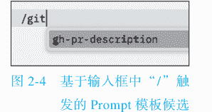

MCP 本身对用户交互没有强制约定，实现方式完全可定制。

作为 AI 原生时代的标准接口，MCP 服务器通过协议统一性解决了能力集成的碎片化问题，构建起可自由组合的模块化生态。好比能力插座，任意领域的专业知识、工具和服务都能封装成标准模块，无论是代码分析、医疗知识图谱还是智能家居控制，都能变成遵循统一协议的服务器。

搭建跨行业方案像拼乐高：金融风控可快速接入法律条文解读与财报分析工具链，智能家居中枢能无缝整合环境感知与用户习惯模型。开发者无需重复造轮子，只需深耕垂直价值。协议层的安全隔离，如上下文沙盒与权限分级，保证模块间安全协作，既能让医疗诊断服务器与医学文献服务器协同推理，又避免敏感数据跨域泄露。

社区驱动的开源服务器仓库放大了网络效应，经过场景验证的组件会沉淀为通用资产，比如自然语言转 SQL 的服务器可被电商、物流、科研复用，形成一次开发多域赋能的正循环。这种标准化、可组合、自进化的体系大幅降低落地成本，让中小团队低成本接入顶尖能力，让行业专家无需精通算法即可把领域知识转化为智能服务。

#### 2.3.3 MCP 组件的协同机制

MCP 对主机、客户端、服务器、资源、提示词、工具、根、采样均有明确协同定义。厘清配合方式有助于理解底层运作，如图 2-5。

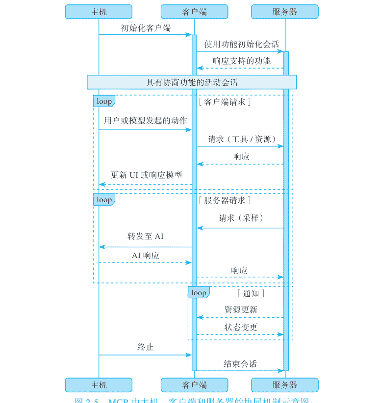

三大组件的协作大致可分为五阶段。

##### 1. 启动协商阶段
先由主机创建并初始化客户端，建立与服务器的双向通道。随后客户端发起会话协商，服务器在响应中告知支持的功能范围、更新策略及当前版本。示例代码：

```
// 第一次握手：客户端发起的初始化请求体
{
    "jsonrpc": "2.0",
    "id": 1,
    "method": "initialize",
    "params": {
        "protocolVersion": "2024-11-05",
        "capabilities": {
            "roots": {
                "listChanged": true
            },
            "sampling": {}
        },
        "clientInfo": {
            "name": "ExampleClient",
            "version": "1.0.0"
        }
    }
}

// 第二次握手：服务器发送初始化响应的请求体
{
    "jsonrpc": "2.0",
    "id": 1,
    "result": {
        "protocolVersion": "2024-11-05",
        "capabilities": {
            "logging": {},
            "prompts": {
                "listChanged": true
            },
            "resources": {
                "subscribe": true,
                "listChanged": true
            },
            "tools": {
                "listChanged": true
            }
        },
        "serverInfo": {
            "name": "ExampleServer",
            "version": "1.0.0"
        }
    }
}

// 第三次握手：客户端发送已初始化成功的通知信息
{
    "jsonrpc": "2.0",
    "method": "notifications/initialized"
}
```

通常协商完成后，主机就会立即向服务器发起 tools/list 查询，获取工具清单并缓存，以降低后续通信开销。

```
// 客户端的工具清单查询请求体
{
    "jsonrpc": "2.0",
    "id": 1,
    "method": "tools/list",
    "params": {
        "cursor": "optional-cursor-value"
    }
}
// 服务器返回的可用工具清单响应体
{
    "jsonrpc": "2.0",
    "id": 1,
    "result": {
        "tools": [
            {
                "name": "get_weather",
                "description": "根据目标地址获取天气信息",
                "inputSchema": {
                    "type": "object",
                    "properties": {
                        "location": {
                            "type": "string",
                            "description": "城市名或者邮编"
                        }
                    },
                    "required": ["location"]
                }
            }
        ],
        "nextCursor": "next-page-cursor"
    }
}
```

##### 2. 请求发起与响应流程

这一环节的触发源于用户的操作，比如提交一条带模板的提示词、索取某种资源，也可能是大模型在作答时决定调用某个工具。于是客户端与服务器之间会产生一轮交互，通常由主机来操盘，通过初始化时建立好的通道向服务端发出一次 Resource / Prompt / Tool 请求。服务端完成校验并执行后，把结果回传给客户端，客户端再把这份回执交给主机继续推进，比如刷新界面或把新的推理消息重新喂给 LLM。以一次模型驱动的工具调用为例，整体配合大致是这个样子：

```
// 客户端接收到主机的工具调用命令后，向服务器发起一次查询纽约天气的请求
{
    "jsonrpc": "2.0",
    "id": 2,
    "method": "tools/call",
    "params": {
        "name": "get_weather",
        "arguments": {
            "location": "纽约"
        }
    }
}
```

```
// 服务器收到请求，在验证了 arguments 参数的有效性之后，会调用其封装的真实业务逻辑代码，查询得到纽约的天气，并返回给客户端
{
    "jsonrpc": "2.0",
    "id": 2,
    "result": {
        "content": [
            {
                "type": "text",
                "text": "纽约现在的天气：温度 72° F，部分地区多云"
            }
        ],
        "isError": false
    }
}
```

```
// 客户端收到响应后，会把工具执行结果返回给主机，主机会将工具的调用结果拼接到给模型继续推理的消息队列中：
{
    "messages": [{
        "role": "user",
        "content": "查一下纽约的天气"
    }, {
        "role": "assistant",
        "content": "",
        "toolCalls": [{
            "name": "get_weather",
            "arguments": {
                "location": "纽约"
            }
        }]
    },{
        "role": "tool",
        "content": "调用 get_weather 工具的查询结果为：纽约现在的天气：温度 72° F，部分地区多云"
    }]
}
```

##### 3. 服务器主动采样机制

服务端可以根据自身策略选择是否向客户端提出采样申请，以“数字公民”的身份参与对话。申请的内容可能是提供建议、给出推理参考，也可能是对任务完成情况进行采样监督以保留知情权。客户端收到申请后会先去征求用户授权，确保行为在可控范围内。授权通过后，客户端可借助主机再次向 LLM 发起推理。推理结束后主机同样会请用户确认，只有在用户明确同意把结果上报给服务端后，客户端才会把结果送达。目前落地该阶段的实践并不多，读者把握其定位和原理即可，具体细节可参考官方协议文档。

##### 4. 双向变更通知

MCP 底层基于 JSON-RPC 2.0 构建，能够在连接建立后随时由任一方推送通知，用来同步各自的状态变化。常见的变更情形包括：

- 用户授权的本地 Root 目录发生变化，客户端需要主动告知服务器。
- 服务器侧的 Resource 发生变化，需要通知客户端。
- 服务器侧的 Prompt 模板发生变化，需要通知客户端。

例如服务器动态新增了工具时，按规范服务端要主动发出变更提醒：

```
// 服务器发送的变更消息体
{"jsonrpc":"2.0","method":"notifications/tools/list_changed"}
```

客户端收到提醒后，会重新拉取一次工具清单，以刷新对服务端能力的认知：

```
// 客户端再次发起工具清单查询请求
{
    "jsonrpc": "2.0",
    "id": 1,
    "method": "tools/list",
    "params": {
        "cursor": "optional-cursor-value"
    }
}

// 服务器返回最新的工具清单，可以看到，和之前相比，get_weather 工具增加了一个查询日期的字段
{
    "jsonrpc": "2.0",
    "id": 1,
    "result": {
        "tools": [
            {
                "name": "get_weather",
                "description": "根据目标地址获取天气信息",
                "inputSchema": {
                    "type": "object",
                    "properties": {
                        "location": {
                            "type": "string",
                            "description": "城市或者邮编"
                        },
                        "date": {
                            "type": "string",
                            "description": "查询的日期，格式要求：YYYY-MM-DD"
                        }
                    },
                    "required": ["location"]
                }
            }
        ],
        "nextCursor": "next-page-cursor"
    }
}
```

##### 5. 优雅断开

MCP 允许客户端或服务器在任何一端发起结束动作，关闭初始化阶段建立的连接并完成优雅退出。标准传输有两种：STDIO 对应本地托管，HTTP+SSE 对应远程托管，两者的收尾要求不同：

- STDIO：先关闭子进程的输入流，随后等待服务端退出。若在合理时间内未退出，则发送 SIGTERM；若 SIGTERM 后仍未退出，再发送 SIGKILL。服务端也可以通过关闭向客户端的输出流来触发关闭流程。
- HTTP：直接关闭连接即可。

#### 2.3.4 MCP 的通信机制

每个人的数字生活可以拆成两个世界：个人侧是本地文件、应用和设备；社会侧是各类远程服务、公开数据和组织资源。MCP 要把大模型应用连向外部上下文和工具，就必须同时服务于这两块领域。为此它设计了一套全双工通信体系，借助两种不同的传输标准搭建桥梁，让 LLM 能够同时与个人域和社会域自然交互。

##### 1. 全双工对话机制

MCP 选用 JSON-RPC 2.0 作为通信基座，参与方是 MCP 客户端与 MCP 服务器。全双工意味着双方都能随时向对方发送消息。这种设计让模型与环境之间的交互更自然、不被阻塞，就像对话中可以随时插话补充。对应的标准传输有 STDIO 和 HTTP+SSE，最新版本已升级为 Streamable HTTP，用来连接个人域与社会域的服务端。

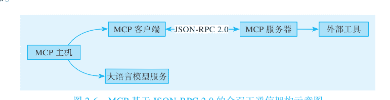

##### 2. STDIO 传输

STDIO 是一种基于进程间通信的轻量方案，特别适合本地机器上的协作。其原理是利用操作系统的 stdin 与 stdout 在进程间建立双向通道。MCP 的典型用法是：

- 客户端以子进程方式启动 MCP 服务器。
- 服务端从 stdin 读取消息，向 stdout 写入消息。
- 消息以换行分隔，消息体内部不能出现换行。
- 日志类信息可走 stderr 输出。

比如像 Cursor 这类可本地安装的 AI 应用，就能直接通过标准输入输出与本地运行的 MCP 服务端对话，如图 2-7 所示。

STDIO 的优势在于即时、直连、简单。没有网络延迟和连接抖动，双方像紧密配合的同事一样工作。对于处理敏感文档、分析个人数据这类重视隐私的场景，本地通信提供了额外保障。相比网络传输，STDIO 具备四个特点：

- 低延迟高效：绕过网络协议栈，数据在进程内存间直传，避免了序列化与反序列化的损耗，响应可达微秒级。例如本地文件操作时，数据通过管道传递，无需经过网卡，吞吐远高于远程调用。
- 部署简化且更安全：不需要配 IP、端口或证书，部署更轻。通信局限在同一台机器的不同进程，天然规避了网络嗅探和中间人风险。
- 资源隔离稳定：父子进程关系由操作系统管理生命周期。若服务端崩溃，客户端可通过信号快速感知并重启，避免因网络超时而长时间卡住。
- 调试友好：开发者可在终端直接观察原始数据流，通过重定向保存日志，便于复现和分析。

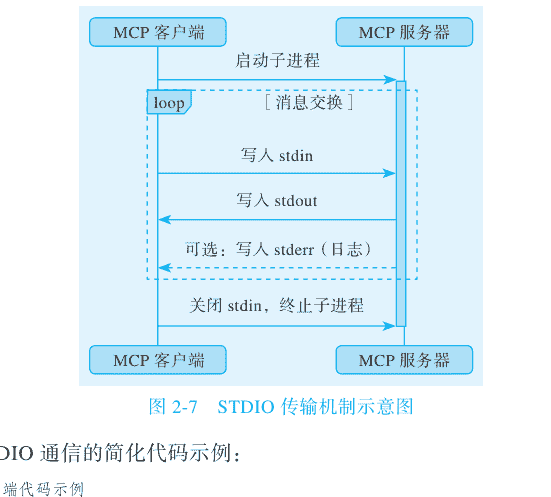

下面是 STDIO 通信的简化示例：

```javascript
// 客户端代码示例
import { spawn } from "child_process";

// 启动 MCP 服务器作为子进程
const serverProcess = spawn("mcp-server");

// 发送请求
const request = {
    jsonrpc: "2.0",
    method: "initialize",
    params: {
        capabilities: {
            /* 客户端能力 */
        },
    },
    id: 1,
};

// 向 stdin 写入请求
serverProcess.stdin.write(JSON.stringify(request) + "\n");

// 从 stdout 中读取响应
serverProcess.stdout.on("data", (data) => {
    const responses = data
        .toString()
        .split("\n")
        .filter((line) => line.trim());
    for (const responseText of responses) {
        try {
            const response = JSON.parse(responseText);
            // 处理响应……
        } catch (e) {
            console.error("解析响应失败:", e);
        }
    }
});

// 处理日志
serverProcess.stderr.on("data", (data) => {
    console.log("服务器日志:", data.toString());
});
```

##### 3. HTTP+SSE 传输

当视野扩展到互联网，MCP 需要一种能跨网络连接远程服务的机制。第一版规范采用 HTTP+SSE 来实现全双工，它是连通社会域的关键。要理解它，先明确 SSE。

SSE 即 Server-Sent Events，是一种基于 HTTP 的服务器推送技术，强调单向传输、轻量设计和连接管理高效。其核心是通过 HTTP/1.1+ 的持久连接，让服务端持续向客户端单向推送数据。

与 WebSocket 需要独立协议栈不同，SSE 复用了 HTTP 栈，只需 Content-Type: text/event-stream 与 Connection: keep-alive 这类标准头，建连成本更低，常用于持久连接和高并发场景。

MCP 借助 HTTP+SSE 实现了“逻辑全双工”。架构上由两条独立通道构成：SSE 长连接负责服务端到客户端的推送，HTTP POST 短连接负责客户端到服务端的请求。分离设计既符合 HTTP 规范，又降低了传统双向长连接的复杂度。

###### （1）SSE 长连接通道的建立

客户端通过 GET 请求访问 /sse 端点，服务端返回 text/event-stream 头部，建立持久连接。初始化时会推送一条 endpoint 事件，其中携带会话 ID，例如 /messages?session_id=xxx 的专属 URI。该 URI 成为后续交互的枢纽，会话 ID 既实现多客户端隔离，也为断线重连提供状态锚点。

###### （2）HTTP POST 请求通道

拿到专属 URI 后，客户端的所有请求都以 HTTP POST 形式发送。请求处理与事件推送被解耦：POST 处理业务逻辑，SSE 专注实时推送。服务端对 POST 返回标准状态码如 202 Accepted，实际数据则异步经 SSE 返回。虽然 SSE 本身单向，但双通道协同实现了逻辑上的双向通信。

1）请求响应映射。每个 POST 都带唯一 id，即 JSON-RPC 里的 id 字段。服务端处理完后会通过 SSE 推送同 id 的响应，客户端按 id 匹配即可把异步结果关联到原始调用，编程体验接近同步。

2）双通道响应方式。在复杂场景下服务端可同时给出两种反馈：
- 即时确认：POST 直接返回 HTTP 202 表示已接收。
- 流式反馈：SSE 分批推送进度或中间结果。

这种方式非常适合大模型推理等长耗时任务，既能快速确认，又能实时展示生成过程。

正是为了达成全双工目标，MCP 选择 HTTP+SSE，带来了三个关键优势：
- 完全兼容标准 HTTP 基础设施，无需特殊网关。
- 浏览器原生支持 EventSource API，降低客户端实现门槛。
- 单向流设计节省服务器资源，单节点可支撑十万级别并发。

双通道架构在 HTTP 协议栈之上搭建了接近实时的交互层，为后来向 Streamable HTTP 演进提供了技术底座。它的核心价值在于用标准化的交互规范降低各部件间的耦合，让智能程序能够以一致的方式接入多样化的数据源，这一思路对后续人工智能通信协议的走向产生了深远影响。

##### 4. Streamable HTTP 传输
Streamable HTTP 在 2025-03-26 的版本里作为改进型传输机制加入 MCP，目标是最终取代 HTTP+SSE，成为面向互联网远程服务连接的唯一通道。初版中 HTTP+SSE 依靠两条独立线路配合：客户端用 HTTP POST 发起请求，服务端借助 SSE 保持长连推送事件。该做法在早期验证时显得简洁，但随着生产复杂度上升，短板逐渐暴露：

- 连接易断。SSE 持久连接对网络抖动极度敏感，中断后无法自动恢复会话状态。以无服务器场景为例，Lambda 函数执行时长受限会让 SSE 频繁掉线，用户只能重新初始化整个会话。
- 资源压力。每个 SSE 连接需独占线程或进程，当并发用户超过 1 万时，服务器内存占用会激增约 300%，在大促等高并发情境下极易引发雪崩。
- 单向局限。SSE 仅支持服务端向客户端推送，客户端下行数据仍需额外 HTTP 通道，由此产生双通道同步难题。模型推理进度推送与用户终止指令就可能出现时序冲突。

围绕上述问题，社区在 MCP 官方 GitHub 的 Pull Request 讨论 https://github.com/modelcontextprotocol/specification/pull/206 中形成激烈争论，焦点集中在：

- 协议抉择。激进派主张用 WebSocket 实现真正双向通信，但实测显示 WebSocket 握手耗时比 SSE 多约 200ms，且在浏览器端难以携带 Authorization 头。保守派则坚持保持 HTTP 协议栈的纯粹性。
- 会话标识管理。部分开发者倾向客户端自行生成 UUID，类似 JWT，但安全专家指出这会带来会话劫持风险；最终方案确定由服务端加密生成会话 ID 并进行签名校验。
- 无状态化路径。有人担忧强制无状态会削弱上下文优势，但 AWS Lambda 团队的测试表明，把会话状态落到 Redis 集群后，无状态服务器的请求处理吞吐量提升了 4.2 倍。

经过多轮讨论与 A/B 测试，Anthropic 技术委员会最终敲定 Streamable HTTP 方案，核心考量包括：

- 渐进升级。保留 SSE 作为流式载体，但解除端点绑定。旧的 /sse 端点迁移为 /message，通过 Content-Type: text/event-stream 头动态升级，保证向后兼容。
- 资源解耦。引入 Mcp-Session-Id 头，实现会话状态与物理连接的解耦。服务端可把会话状态外置到数据库，使单个请求的平均处理时长从 120ms 降至 45ms。
- 混合响应。支持三种返回形态，即时 JSON 响应、分块 SSE 流、持久 SSE 长连接。例如 AI 代码补全时，首条建议以 JSON 返回，后续优化建议以 SSE 流推送。

Streamable HTTP 与 HTTP+SSE 的差异见表 2-2。

表 2-2 Streamable HTTP 传输机制与 HTTP + SSE 传输机制的具体差异

| 特性 | Streamable HTTP (2025-03-26) | HTTP+SSE (2024-11-05) |
| :--- | :--- | :--- |
| 协议架构 | 统一 /message 端点 | 双端点 (POST + SSE) |
| 会话状态 | Mcp-Session-Id 头部传递 | 绑定 TCP 连接 |
| 连接恢复 | 事件 ID 续传 | 完全重建会话 |
| 资源消耗 | 按需分配，请求完成即释放 | 每个连接常驻内存 |
| 部署复杂度 | 普通 HTTP 服务器即可 | 需专用 SSE 服务器 |
| 流式控制 | 支持双向流式交互 | 仅服务器→客户端 |
| 基础设施兼容性 | 标准 HTTP 通过率 99.8% | CDN/防火墙阻断率 32% |
| 最大并发连接数 | 无硬性限制 | 受限于浏览器同源策略 (6 个) |
| 典型延迟 | 首字节时间 (TTFB) 80ms | 首字节时间 (TTFB) 150ms |

Streamable HTTP 的落地印证了“简单即复杂”的技术哲学。优秀协议并非另起炉灶，而是在现有生态里寻找最优解。据 Anthropic 路线图披露，2026 年将加入 HTTP/3 QUIC 支持，流式延迟有望进一步压到 30ms 以内。

随着应用场景不断扩展，MCP 的通信机制仍在演进。未来可能出现更智能的会话管理、更细粒度的权限控制以及更顺畅的多模态交互。但无论如何，标准化、安全、灵活、高效这四项基本原则仍将主导发展。对开发者而言，理解 MCP 的通信原理不仅有助于正确实现协议，也能启发更优的 AI 应用架构。如同掌握人类对话规则有助于沟通，理解 MCP 有助于构建更自然、更有用的 AI 应用。在 Agent 时代，MCP 正逐步成为连接大模型与现实世界的标准桥梁，通过它个人资源与社会资源、本地数据与远程服务得以融合，AI 能力得到充分释放。

#### 2.3.5 MCP 的安全机制
现代智能系统面临双重安全难题：既要实现跨应用能力整合，又要防止未授权访问；既要保持交互灵活性，又要划清控制边界。MCP 通过创新的安全设计，在用户、Agent 与外部服务之间构建可信协作网络。精妙之处在于，安全机制被自然融入日常交互，而非生硬的技术枷锁。

##### 1. 安全架构
MCP 的安全架构依托三项核心原则，相互支撑构成整体体系，如图 2-8 所示。

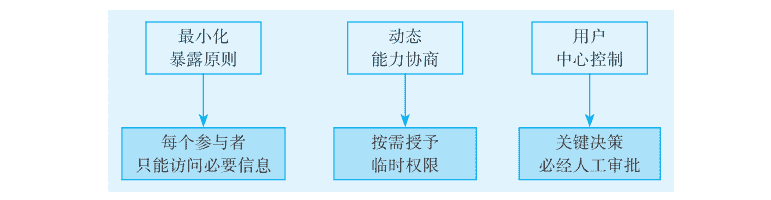

这种安排让安全控制不阻碍业务，同时精准防范越权。例如代码审查服务需要访问项目文件时，并不会直接拿到代码库，而是通过声明式接口申请读取特定目录的权限。

##### 2. 会话生命周期的安全机制
每个 MCP 会话都像一场编排精细的安全芭蕾，在初始化阶段就划定清晰的权限边界。

```typescript
// 会话初始化示例
interface CapabilityDeclaration {
  prompts?: { listChanged: boolean };
  resources?: { subscribe: boolean };
  sampling?: {};
}

function initializeSession(serverCapabilities: CapabilityDeclaration) {
    const clientCapabilities = {
       resources: { listChanged: true },
       sampling: {}
   };

   // 动态协商公共能力集
   return negotiateCapabilities(serverCapabilities, clientCapabilities);
}
```

这一过程类似餐厅点餐的沟通：客户端告知服务端所需服务，服务端回馈可提供的能力，最终双方确认统一的服务菜单。

##### 3. 数据流动的安全机制
资源访问控制是 MCP 设计的亮点之一，通过多层过滤确保数据安全，如图 2-9 所示。

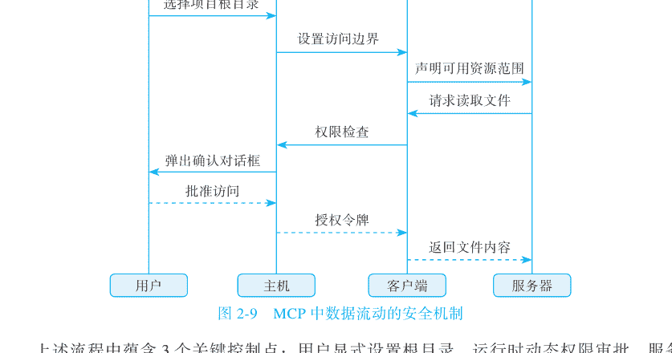

流程中包含三个关键控制点：用户显式设定根目录、运行时动态权限审批、服务端最小化数据请求。这如同银行金库的三重门禁，每道门仅在必要时对特定人员临时开启。

MCP 的安全灵感源于对现实协作的理解。传统模型多基于静态信任，而 MCP 采用动态、上下文感知的信任建立。

- 渐进式暴露：如同人与人逐步建立信任，服务能力按需逐步开放。
- 环境感知：依据当前对话上下文动态调整权限范围。
- 沙盒化运行：每个服务实例在隔离环境中运行，像科研实验室的独立操作间。

如此既保持扩展性，又维持安全基线。就像现代城市既需要通达的交通网，也需要消防隔离带防止蔓延。

在技术快速迭代的今天，MCP 呈现了一种新安全范式，不追求绝对控制，而是通过精巧机制让安全成为能力进化的助推器而非阻碍。这或许是未来智能系统安全架构的方向：在开放与管控间寻求动态平衡，让创新与安全共生。

### 2.4 MCP 的重点改进方向与发展趋势
MCP 发展迅猛且潜力巨大，但仍属年轻，存在诸多待解问题。虽在本书成稿时行业为其狂欢，正视问题对开发者至关重要。

#### 2.4.1 重点改进方向
##### 1. 基础设施与管理机制不完善
- 服务器管理功能如注册、发现、生命周期管理仍处初级阶段，仅满足基本需求。
- 缺乏统一的身份认证与授权框架，会话级权限粒度不足存在隐患。虽新版已支持 Streamable HTTP、会话管理和 OAuth 2.1 认证，但仍处早期。
- 缺少多租户支持，难以满足企业级 SaaS 的规模化需求。

##### 2. 开发与应用门槛较高
- 普通用户和开发者使用 MCP 主机或基于生态开发时，仍需手工配置服务器及启动参数，过程技术化严重，体验初级，非技术用户几乎无法上手。
- 官方文档偏向技术实现，学习曲线陡峭。

##### 3. 安全架构待完善
- 远程通信协议尚不成熟，缺乏端到端加密和安全沙盒。
- 工具市场存在未审核风险模块，据社区统计，社区贡献的 MCP 服务器测试覆盖率不足 40%。

#### 2.4.2 发展趋势
1. 技术架构升级方向
    - 网关化部署：借鉴 API Gateway 模式，实现认证、路由、监控一体化，例如 Cloudflare 已开始布局 MCP 服务器的云端托管。
    - 轻量化 SDK：推出无代码配置工具，如 Open MCP Client，简化开发流程。

2. 生态演进路径
    - 服务发现市场兴起：社区已出现大量 MCP Server Market 实践，未来可能演化为服务商店，实现工具的动态发现与认证。
    - 领域垂直化渗透：一方面向医疗、金融等专业场景深化，另一方面垂直 ISV 会基于 MCP 将产品服务器化，或为客户提供垂直 MCP 服务器构建服务。

目前 MCP 处于技术成熟度曲线顶峰，未来 12 个月协议迭代与生态建设的成效将决定其最终市场地位。

## 第 3 章 MCP 的生态系统与发展趋势
MCP 的出现伴随生态扩张，生态规模决定其能否成为行业标准。当前已有众多模型公司、智能体框架、RAG 框架、SaaS、数据 API、桌面软件等接入 MCP，国内腾讯、阿里均已支持托管与市场，国外 OpenAI Agent SDK、Claude、Zapier、Claudeflare、Elevenlabs 等也深度参与。本章聚焦参与者、合作模式、发展策略等，以便更好参与建设。本章中 MCP 客户端统一指代与用户交互的应用。

### 3.1 MCP 生态系统的构建
#### 3.1.1 MCP 生态系统的参与者
MCP 生态的繁荣离不开多方协作，各自承担独特角色，共同推动建设。

##### 1. MCP 服务器托管方
托管方负责部署、运行和维护 MCP 服务器，包括个人开发者、服务商乃至大型企业。核心职责是保证服务稳定，对外提供封装的工具、数据或 API，使 AI 应用可通过 MCP 调用。

当前多数服务器倾向本地优先，服务个人用户，如对接 Postgres、Upstash 缓存。随着生态发展，远程优先的服务器将增多，以支持多租户和更广访问。托管方需关注性能、安全及兼容性。

通过 MCP 规范，托管方可将特定功能或数据暴露给模型，使助手能查询数据库、检索信息、发送邮件等。托管方需处理鉴权，未来标准化认证机制将使流程更规范。它是生态基石，质量与稳定性直接影响整体可靠性。

##### 2. MCP 市场
MCP 市场是发现、共享和安装服务器的平台，连接提供者和客户端/用户，极大简化查找和使用。

如同应用商店之于移动生态，市场对 MCP 繁荣至关重要。开发者可发布服务器并提供介绍与安装指南，用户可在市场检索、浏览并一键安装到客户端以扩展功能。

出现的市场包括 Cline 的 MCP Marketplace、Mintlify 的 mcpt、Smither、OpenTools 和 MCPLINK.AI（如图 3-1 所示）。这些平台通常提供搜索、分类、评价等功能。未来将出现更多体验更好的市场。

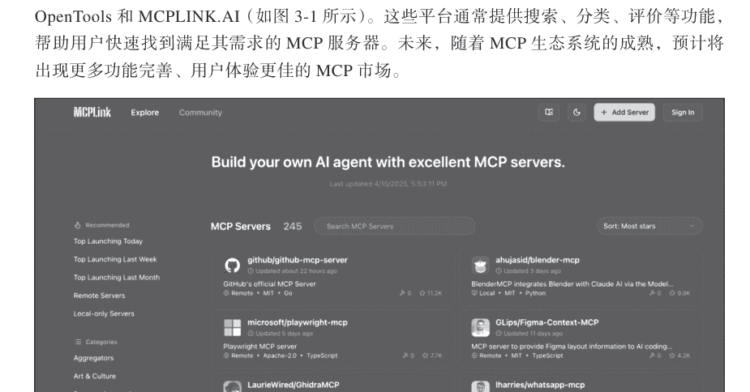

市场通过便捷的发现与安装渠道降低使用门槛，鼓励贡献与使用，推动生态加速发展。

##### 3. MCP 应用 AI Agent 创建者
指开发利用 MCP 与外部工具和数据源交互的 AI 应用或 Agent 的开发者。使用 LangChain、Praison AI 等框架创建智能体，使其能按指令自主调用 MCP 服务器完成任务。

创建者可为独立开发者、初创公司或企业团队。借助 MCP 的标准化特性，可更易将模型与外部服务集成，无需为每个集成写定制代码。例如可打造 AI 编码助手，集成代码仓库、数据库、图像生成服务器，实现编写、查询、设计等功能。

为简化客户端开发，已出现 SDK 与框架，如 LangChain 和 Praison AI 提供 MCP 工具调用支持，降低门槛。

他们是生态的创新引擎，将 AI 能力与实际场景结合，创造解决具体问题的智能方案，推动普及。

##### 4. MCP 应用使用者
最终受益者，包括使用集成 MCP 功能的代码编辑器的开发者、使用 Claude Desktop 等通用应用的非技术用户，以及利用 Agent 完成任务的企业用户。

对开发者而言，可在熟悉环境中通过 AI 助手调用工具与数据，提升效率。例如在 Cursor 中用 Postgres MCP 查询数据库状态，用 Upstash MCP 管理缓存。对非技术用户，MCP 使他们能以对话方式交互，降低技术门槛。

MCP 应用带来生产力提升、更广工具与数据访问以及更流畅的工作流。用户体验很大程度上取决于客户端设计，直观易用的界面对普及至关重要。

用户是否买单，决定 MCP 的成色

MCP 要不要、能不能流行，最终评判权在手里拿着产品的真实使用者。他们的日常痛点、操作反馈，牵着技术的演进方向。只有当越来越多的人切身感受到基于 MCP 的方案让工作更顺手、体验更省心，这个体系才有持续繁荣的基础。

#### 3.1.2 MCP 生态系统的合作模式

MCP 的壮大离不开多方联动。这些联动覆盖技术、市场与社区，共同把整体推向更好。

##### 1. 客户端 – 服务器协作模式
这可说是整个架构里最基础的配合形态。客户端会向服务器发出请求，索取特定能力或数据。协议为这种交互提供了统一的往返规范，让不同来源的客户端与服务器可以无缝对接。

思路与 Web、云计算里的端服分离相近，端负责与人交互，服负责算力与资源供给。在 MCP 里，AI 应用承担端侧角色，提供工具或数据的服务则承担服侧角色。

一套标准化的端服模型是 MCP 的基石，让各类 AI 程序能以一致方式接入外部工具，避免重复定制集成。其效果取决于协议是否清晰明确，以及双方是否严格遵守规范。

这种配合为体系提供了技术底座，让各方在共同规范下高效分工，从而拼出功能更丰富的智能产品。

##### 2. 市场驱动的合作模式
MCP 市场为工具供给方提供了一个面向更广的客户端开发者与终端用户的展示窗口，形成了清晰的供需关系。供给方能获得更大曝光，并有望实现商业化；使用者则能快速找到并接入新能力。

此类平台多由第三方运营，连接供给与需求。供给方可在平台上发布自己的 MCP 服务，说明能力边界、接入方式与收费策略；客户端开发者则可通过检索、筛选与对比来挑选合适的工具集成。

平台的健康度取决于供给方和使用者规模能否越过临界点，形成正向循环。活跃的平台会加剧竞争，提升工具质量与多样性，进而吸引更多使用者，推动整体繁荣。

市场驱动的模式是体系发展的重要引擎，通过高效的交易与发现机制，推动工具创新与普及，让智能产品的搭建更便捷高效。

##### 3. 基础设施与工具提供商的合作模式
负责托管、开发工具等底层支撑的公司，通过拉低构建、部署与运维门槛，与体系形成合作。开发者因此更容易加入，使用者也更容易获得基于 MCP 的解决方案。

例如 Cloudflare 提供了便捷的远程 MCP 服务部署与管理方案，缓解了本地部署的局限；Mintlify 等工具可帮助开发者快速把现有 API 或文档转为 MCP 服务，大幅降低上手难度；Toolbase 等平台则聚焦本地优先的密钥管理与代理流程简化。

这些基础设施与工具方的参与，为体系扩展与可持续发展提供了支撑。它们提供专业化服务，让开发者更聚焦创新与应用，而不必耗费精力在底层运维上。

这类合作是体系走向成熟的关键，通过稳定易用的基础设施与开发工具，降低参与成本与复杂度，吸引更多开发者与用户加入。

##### 4. 标准化与协议合作模式
MCP 由 Anthropic 提出并作为开放标准存在，开放性鼓励各方共同参与协议的迭代。围绕标准的制定与推广，形成了广泛的协作网络。

目前在身份认证、授权等方面仍有待完善，需要社区与行业相关方一起讨论、提案并实践，逐步建立统一规范。这将有助于提升互操作性与安全性。

围绕 MCP 的 SDK 开发与维护也是重要协作形式。Anthropic 及社区已为 Python、TypeScript、Java 等多种语言提供 SDK，让开发者更轻松构建客户端与服务器。

标准化与协议协作是实现互操作与长期发展的保障。开放标准与协同开发确保 MCP 被广泛采纳并持续改进，惠及整个生态。

##### 5. 社区驱动的合作模式
活跃的开发者社群为体系注入持续活力，他们积极创建、分享服务、客户端与工具。开源仓库与论坛为协作与知识共享提供了平台。

例如 Awesome MCP Clients 汇总了众多可用客户端，方便选择与使用。社群成员还积极参与讨论与改进，贡献大量建议。这种自下而上的协作推动技术快速发展与创新。

社群还会自发组织线上研讨会、教程分享等活动，帮助新手入门，扩大参与群体。这种互助氛围是体系健康发展的宝贵资产。

社群驱动的模式为体系带来强劲创新力，通过开放协作与知识共享共同推动技术进步，构建充满活力的技术环境。

#### 3.1.3 MCP 生态系统的发展策略
要保持 MCP 体系的健康持续发展，需要在协议、基础设施、应用和战略层面协同发力。

##### 1. 协议层面的演进与完善
方向是持续打磨 MCP，解决现有痛点并为未来布局。重点包括标准化身份认证与授权机制、规范多步骤执行与工作流管理、优化协议以更好支持远程服务器通信。采纳 Streamable HTTP 传输是演进的重要一步。

当前多数服务仍以本地优先，这在一定程度上限制了扩展性与多用户场景。未来优先支持远程服务，让其更易访问与部署至关重要。

协议是体系的根基，只有足够健壮、灵活与安全，才能支撑繁荣体系。持续演进能让 MCP 保持领先，满足变化的应用需求。

##### 2. 基础设施与工具链的构建
方向是投入建设可靠的基础设施与完整的开发者工具链，简化组件的创建、部署与管理。包括易用的服务市场、高效的生成工具、可扩展托管方案以及连接管理平台。

例如 Mintlify 这类生成工具显著降低服务创建门槛，Cloudflare 等托管平台则解决了部署与扩展难题。完善的工具链降低学习成本，吸引更多人参与建设。

完善的基础设施与工具链是快速发展的关键保障，能提升开发效率并为用户提供更稳定可靠的服务。

##### 3. 应用场景的拓展与用户采纳
方向是聚焦 MCP 在 AI 辅助编程、企业自动化、内容创作等方面的落地，并推动开发者与终端用户采纳。为非技术用户打造简易客户端也至关重要。

目前 MCP 在开发者圈已有一定关注，但在更广用户群体中的认知与应用仍需提升。通过展示实际价值与成功案例，吸引更多用户尝试基于 MCP 的方案。

场景拓展与用户采纳体现体系生命力。只有解决真实问题并被广泛接受，体系才能可持续发展。

##### 4. 未来发展的战略性考量
方向是应对 AI 领域未来挑战，抓住机遇，确保长期成功。涉及新的工具定价模式、机器可读文档的重要性、从 API 中心设计向场景用例中心设计的转型，以及客户端对专业托管方案的需求。

随着智能体越来越自主，它们会按速度、成本、相关性等动态选择工具，这可能冲击现有定价模式，需要提前布局。同时清晰的机器可读文档将变得关键，以便智能体自动发现与调用工具。

战略前瞻与灵活适应是保持竞争力的核心。提前布局有助于 MCP 体系始终处于领先位置。

#### 3.1.4 MCP 生态系统的关键组成部分

MCP 体系由多个相互依赖的角色共同支撑，其主要参与者及其职能见表 3-1 与图 3-2。

表 3-1 MCP 生态系统中的关键参与者及其角色

| 参与者类型 | 描述 | 主要功能/职责 | 示例 |
| :--- | :--- | :--- | :--- |
| MCP 服务器托管方 | 负责部署、运行和维护 MCP 服务器的实体 | 确保服务器稳定运行，提供工具、数据或 API 服务 | 个人开发者、软件服务提供商、大型企业 |
| MCP 市场 | 用于发现、共享和安装 MCP 服务器的平台 | 提供服务器搜索、浏览、安装等功能，连接服务器开发者和用户 | Cline MCP Marketplace、Mintlify mcpt、Smithery、OpenTools |
| MCP 应用 AI Agent 创建者 | 开发和构建利用 MCP 与外部工具及数据源交互的 AI 应用程序的开发者 | 使用开发工具和框架创建 AI Agent，集成各种 AI 模型与外部服务 | 独立开发者、初创公司、企业研发团队 |
| MCP 应用使用者 | 最终受益于基于 MCP 构建的 AI 应用程序的个人或组织 | 使用集成 MCP 功能的应用程序，提高生产力，访问更广泛的工具和数据 | 开发者、非技术用户、企业用户 |

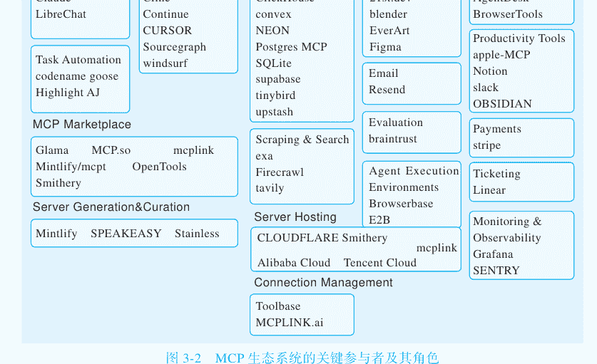
##### 1. MCP 客户端
定义：发起与 MCP 服务器连接的应用程序或平台，让用户或智能体能够使用服务器提供的工具与数据。

示例：IDE 如 Cursor、Windsurf；通用应用如 Claude Desktop、Claudemind、Cherry Studio；基于 LangChain 等框架定制的智能体。Awesome MCP Clients 仓库收录更多客户端，微软 Copilot Studio 也承担客户端角色。

架构：客户端通常与服务器保持一对一连接，负责协议版本协商、能力发现、消息传输、工具执行、资源访问与提示交互，常用 STDIO 或 SSE。

功能：提供用户界面与智能体及外部工具交互，具体表现取决于客户端设计与所连服务器类型。代码编辑类客户端可提供补全与重构，业务类客户端可提供 CRM 或邮件管理能力。

客户端类型正从开发者工具向更广用户与场景扩展，设计与体验对 MCP 普及至关重要。

##### 2. MCP 服务器
定义：实现 MCP 的轻量级应用，向智能体暴露特定功能、工具、数据或 API。

示例：可对接数据库如 Postgres、Supabase，搜索引擎如 Meilisearch，云服务如 Upstash 等的服务器。Anthropic 为常见企业系统提供了预构建服务器。

架构：遵循客户端-服务器架构，通过 STDIO 进行本地通信，或 HTTP+SSE 进行远程通信。定义工具、资源与提示，分别对应可调用函数、可访问数据源与模型引导模板。

功能：提供智能体可直接使用的实际能力，如查询天气、管理数据库、发送邮件等。

可用服务器数量与类型持续增长，显示协议采纳度与多功能性提升。基于现有 API 与文档快速创建服务器是显著优势。示例见表 3-2。

表 3-2 MCP 服务器示例及其功能

| MCP 服务器名称 | 提供者 / 来源 | 主要功能 |
| :--- | :--- | :--- |
| Postgres MCP Server | Model Context Protocol | 执行只读 SQL 命令 |
| Upstash MCP Server | Upstash | 创建和管理缓存索引 |
| MCP 服务器名称 | 提供者 / 来源 | 主要功能 |
| --- | --- | --- |
| Slack MCP Server | Model Context Protocol | 在 MCP 客户端中使用 Slack 功能 |
| Resend MCP Server | Resend | 发送电子邮件 |
| Replicate MCP Server | deepfates | 生成图像 |
| Meilisearch MCP Server | Meilisearch | 与 Meilisearch 搜索引擎交互 |
| Supabase MCP Server | Supabase | 连接 Supabase 数据库，执行数据库管理任务 |

##### 3. MCP 市场
定义：用于发现、共享与安装 MCP 服务器的平台。

示例：Cline MCP Marketplace、Mintlify mcpt、Smithery、OpenTools，微软 Copilot Studio 也提供市场入口。

功能：支持浏览、搜索与一键安装，通常附带功能说明、安装指南与用户评价，简化集成流程。

价值：降低寻找与利用服务器的成本，为开发者提供触达更广用户的渠道。可发现性是体系活力关键，市场易用性直接影响采纳率。

##### 4. MCP 基础设施解决方案
定义：支撑 MCP 组件开发、部署与管理的工具与平台。

示例：Cloudflare 等云托管平台；Mintlify、Stainless、Speakeasy 等服务器生成工具；Toolbase 等连接管理平台；微软 AI Gateway 提供凭据管理与实验功能。

功能：托管方案解决云端部署与管理难题，生成工具减少创建工作量，连接管理平台简化客户端-服务器对接。

重要性：强大基础设施是长期增长与稳定的前提，确保组件易于开发、部署与扩展以满足增长需求。

完善且易用的基础设施能让体系更易接入、更快扩展，为广泛采用与创新铺路。

#### 3.1.5 MCP 生态系统的发展趋势

MCP 体系正处于快速演进期，未来走向见表 3-3。

表 3-3 MCP 生态系统的未来发展趋势

| 趋势类别 | 具体趋势 | 描述 | 潜在影响 |
| :--- | :--- | :--- | :--- |
| 技术发展趋势 | 远程 MCP 服务器成为主流 | 从本地优先转向远程优先架构，支持可扩展和多租户 | 扩大应用范围，增强云端 AI 应用的能力 |
| | 标准化认证与授权机制的建立 | 开发统一的客户端、工具和多用户身份验证与授权方法 | 提高安全性，增强企业用户的信心 |
| | 多步骤执行与工作流的集成 | 在协议中内置工作流概念，管理工具调用的顺序和依赖关系 | 使 AI Agent 能够执行更复杂的任务 |
| | 统一且友好的客户端体验 | 实现不同 MCP 客户端用户界面和交互模式的标准化 | 提高用户体验和采纳率 |
| 市场与应用发展趋势 | 以开发者为中心的应用场景深化 | 进一步集成到 IDE 和其他开发环境中，提高开发者的生产力 | 加速开发者社区的创新和应用 |
| | 面向非技术用户的创新体验涌现 | 出现更多面向客户支持、营销、设计等领域的客户端和服务端 | 将 AI 的能力带给更广泛的用户群体 |
| | “Everything App” 概念的普及 | 将更多 MCP 客户端集成为多种服务器，提供统一的用户体验 | 提高使用的便利性和用户的工作效率 |
| 基础设施发展趋势 | MCP 服务器注册与发现机制的完善 | 开发标准的服务器注册表和发现协议 | 使 AI Agent 能够自主发现和利用相关工具 |
| | 中心化网关的部署与应用 | 部署网关管理认证、授权、流量和工具选择 | 增强安全性、提高性能、简化客户端 - 服务器交互 |
| | 多样化的服务器托管方案 | 提供更多托管选项，满足不同用户对安全性、合规性等方面的需求 | 降低生态系统的参与门槛，吸引更多用户 |

##### 1. 技术发展趋势
###### （1）远程 MCP 服务器成为主流

目前绝大多数 MCP 服务仍然走本地优先路线，这种做法在一定程度上拖慢了扩容速度，也很难满足多用户并发的需求。接下来，部署在云端或远端的基础设施很可能会成为主流。当服务器搬到远程后，就能同时承载更多用户请求，也能调用更强大的算力支撑复杂任务。为此，MCP 本身也需要进一步打磨，比如引入 Streamable HTTP 这类传输方案，来提升远程链路的效率与稳定性。这一转向会把 MCP 的适用面拉得更宽，让它在企业级产品和需要大规模铺开的场景里真正好用。

###### （2）统一认证与授权体系
现阶段 MCP 并没有自带的权限模型，控制基本只落在会话层面，意味着某个工具往往只能全开或全关。对企业客户以及需要细粒度管控的场景来说，这种粗放方式明显不够。往后生态里很可能要建立一套标准化的鉴权授权体系，涵盖客户端如何证明身份，比如 OAuth 或 API Token，工具本身的身份校验，比如为第三方 API 提供封装器，以及企业多用户环境下的统一登录。参考 OAuth 2.1 等成熟框架，能让 MCP 的权限管理变得更安全、更灵活。

###### （3）内置工作流与多步执行
现在协议里没有工作流的概念，恢复和重试等能力都得靠各客户端自己实现，这显然不够理想。未来一个关键方向是把多步骤执行和工作流的思路直接搬进协议里。这样 AI Agent 就能更顺畅地编排涉及多个工具的复杂任务，同时把状态维护、异常处理、流程调度等统一收口。市场上已有 Inngest 这类外部方案提供类似能力，但把功能原生内置会更高效、更省事。

###### （4）客户端体验标准化
优质的 MCP 客户端已经出现，但工具发现、调用和交互的细节仍存在差异。要推动普及，就需要把客户端体验做得更一致、更易用。这包括对工具发现、排序、执行等环节的交互模式进行标准化，给开发者和终端用户提供可预期的操作感受。统一的界面元素和流程设计，能让用户换到不同客户端时依然很快上手。

##### 2. 市场与应用的演进方向
###### （1）开发者场景继续下沉
MCP 最初的吸引力就来自技术人群，尤其在 AI 辅助编程领域。往后以开发者为核心的应用会进一步深化，MCP 很可能被更深度地嵌入到各式 IDE 和开发环境中，助力智能补全、重构、调试、测试等环节，从而提升效率和代码质量。例如把代码仓库、数据库、API 文档接入 MCP 服务器，开发者就能在 IDE 内一站式完成过去需要在多工具间来回切换的工作。

###### （2）面向大众用户的创新加速
MCP 并非只有技术用户才用得上，随着 AI 在模式识别和创造性任务上的优势显现，面向非技术人群的创新体验会越来越多。客服、市场营销、设计、图像编辑等领域都可能迎来变化。未来会出现让营销人员用自然语言生成文案、让设计师用描述快速出原型、让图像编辑人员用文本指令操控工具的客户端。Claude Desktop 已经展示了这种入门级的潜力。

###### （3）“Everything App” 从概念到实践
MCP 天然支持一个 Agent 对接多个工具的形态，“Everything App” 的思路会更流行。客户端可同时集成若干 MCP 服务器，在同一个应用里提供丰富能力。比如一个代码编辑器既能写代码，又能通过 Slack MCP 服务器沟通团队，通过 Resend MCP 服务器发邮件，通过 Replicate MCP 服务器生成图片。这种整合体验能显著提升效率，减少应用间切换。Highlight 提供的 @ 命令就是典型示例，用户可在客户端内直接调用任意 MCP 服务器。

##### 3. 基础设施的演进趋势
###### （1）注册与发现机制需要补齐
现在开发者多靠 GitHub 等渠道分享自建的 MCP 服务器，缺少统一官方的注册与发现体系。Anthropic 的 Yoko Li 也曾公开提到完善注册表和发现协议的需求。未来一套完善的注册发现机制会成为基础设施的核心，让 AI Agent 能依据用户需求和上下文动态找到合适的服务器，无需人工配置。类似语言包管理器或 API 目录的标准注册表，将大幅提升生态的易用性和扩展性。

###### （2）中心化网关开始发力
随着客户端和服务器数量激增，如何管理交互变得关键。部署中心化网关会成为重要趋势，它像 API 网关一样承担认证、授权、流量管控、工具路由等职责，能强制执行访问策略、把请求分发到正确的服务器、做负载均衡并缓存响应。对多租户环境尤其重要，不同用户和 Agent 需要不同权限。标准化的网关能简化交互、增强安全性和可观测性，让部署更可扩展、可管理。

###### （3）托管形态日益多元
开发和测试阶段本地运行很常见，但生产环境需要更高可用性和弹性，托管方案会更多样化。未来可能出现云厂商提供的完全托管服务，让开发者无需关心底层就完成部署和管理。针对安全、合规等特殊需求，也会诞生专业化的托管选项。Cloudflare 已开始支持在自家基础设施上部署远程 MCP 服务器，预示着类似服务会持续涌现。

MCP 生态正在经历一段令人兴奋的成长期。综合参与者、协作模式和发展策略来看，MCP 作为新兴的 AI 工具协议具备巨大潜力。开放性、标准化和对自主工作流的支持，让它有望在 AI 工具版图里扮演关键角色。随着技术成熟、基础设施完善和场景拓展，MCP 有望成为连接模型与现实世界的桥梁，开启新一轮 AI 应用浪潮。当然，标准化、安全性和用户体验仍需关注，通过持续创新和协作，生态才能健康发展。

### 3.2 AI Agent 和 MCP 的关联

#### 3.2.1 MCP 对 AI Agent 关键组件的赋能

回顾 Lilian Weng 梳理的大模型驱动自动化 Agent 系统全貌图，并思考 MCP 能为其中各环节提供怎样的支持，以及在此基础上额外带来的能力。

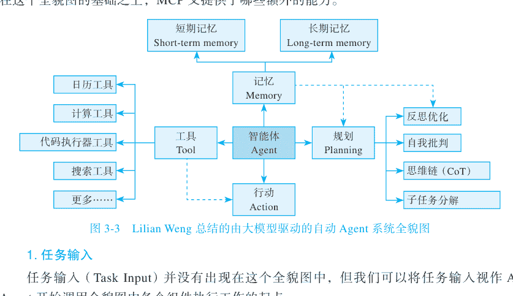

##### 1. 任务输入
全貌图里没有显式列出任务输入，但它可以看作 Agent 启动后调用各组件的起点。我们希望 Agent 在极简输入下完成复杂工作并交付高质量成果。实际操作中，往往会在 Agent 开始前对输入进行扩充，提供更多上下文和指引。MCP 服务器的 Prompt 功能正好契合这一需求。通过调用 Prompt 能力，可以把用户的简短输入结合身份、系统、鉴权等参数，换取服务器返回的、针对特定场景优化后的 Prompt。

如图 3-4 所示，部分应用里用户可划选一段文字后从弹出菜单选择指令，这就是典型场景。用户只需划选文本并点选指令，Agent 就会按此执行并给出结果。

执行细节如图 3-5 所示。

同样的思路也能用在如图 3-6 的对话界面里，通过输入 “\” 或 “#” 唤出操作菜单。

借助 MCP 服务器提供的 Prompt 能力，可以根据服务器主题和场景灵活优化提示词，从而在任务输入阶段让 Agent 获得信息更充分、指令更明确的任务描述。

##### 2. 规划
Agent 处理任务时，规划能力主要来自模型本身，但在具体行动中仍需提示控制来增强指向性。以反思增强为例，Agent 可构建多次模型调用的链条，要求模型按 “初次作答 — 反思并给出修改建议 — 根据建议优化并输出最终结果” 的三段式工作。吴恩达博士在 2024 年 3 月开源的 Translation Agent 项目，就在翻译任务上验证了反思增强的效果。

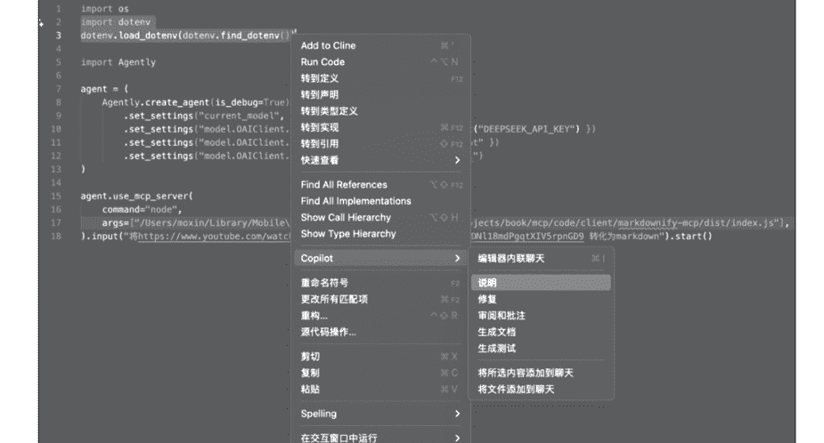

图 3-4 VS Code 中 GitHub Copilot 的代码划取操作菜单

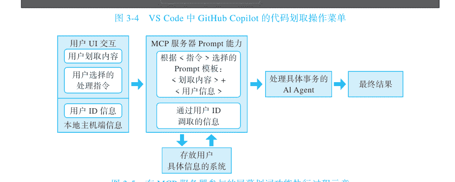

图 3-5 有 MCP 服务器参与的屏幕划词功能执行过程示意

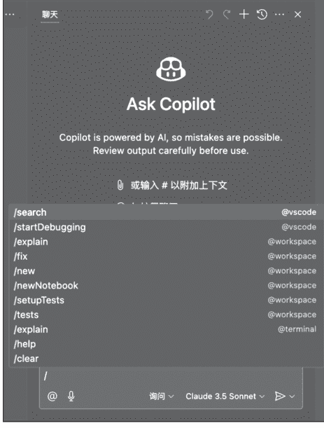

依据全貌图，思维链构造、反思、任务拆解都属于规划范畴，实践中还常在拆解后加入工具选择。规划能力本质上是开发者结合模型能力和控制编排方案内化在工程里的多套逻辑，可视为 Agent 的核心智能。它们决定了复杂任务如何逐步拆解并转化为行动指令。

MCP 之前，工具侧与 Agent 侧边界清晰。工具侧主要通过 Function Calling 暴露能力，只能用描述和参数告诉 Agent 自己能做什么，并期待 Agent 正确理解和决策。工具侧无法参与 Agent 的工具选择，更无从介入其他决策。

MCP 出现后，通过服务器的 Prompt 能力，提供方能更深度地介入 Agent 的工作流程。与直接暴露工具信息不同，Prompt 能力可根据输入动态返回结果，从而为规划阶段提供更丰富信息，或在规划后给出更准确的后续建议。

例如，开发者常问：当 Agent 面对海量工具时如何选对工具？可借助 MCP 服务器的 Prompt 能力来增强规划，如图 3-7 所示。

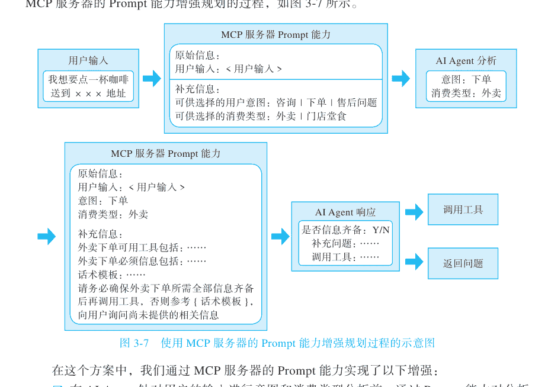

在此方案中，Prompt 能力带来两方面增强：
- 在 Agent 分析用户意图和消费类型前，先用 Prompt 能力收敛分析选项，为不同意图准备更聚焦的工具信息和检查清单。
- 依据分析结果，从服务器内部已分类的工具清单和资源中查询，为具体场景提供更细化的工具列表、信息校验单、处理流程说明和模板。

与仅支持 Function Calling 的 Agent 相比，差异在于：
- 工具选择判断时，能让更了解工具能力和场景的服务器提供方参与决策，而非完全依赖 Agent 自己写提示词，从而提升准确性和可执行性。
- 由服务器提供方基于场景参数输出工具清单、校验清单和话术模板，可降低 Agent 管理工具的复杂度，把部分责任转移给服务器，同时避免一次性投喂过多工具导致注意力失焦。

可见，只要在规划流程中为 MCP 服务器预留接入点，服务器就能更多参与规划，提升质量与可执行性，而非全部压在 Agent 一侧。

##### 3. 工具使用
Lilian Weng 原文中把工具和执行合称为工具使用，包含调用决策、调用内容生成、实际调用和结果消费。前面已把决策归入规划，因实际落地中决策与后续规划难以严格割裂。

因此下面聚焦 MCP 在工具信息供给和实际调用两方面的价值。

###### （1）工具信息供给
MCP 的设计起点之一就是 Function Calling。官方为服务器开发者提供了大量便利方法，可快速把执行函数封装为 MCP 工具并附上详细说明。这大幅降低了开发门槛，开发者只需假设使用者会像调用 Function Calling 一样使用工具即可。

下面是官方 Python SDK 的示例代码片段：

```python
# server.py
from mcp.server.fastmcp import FastMCP

# Create an MCP server
mcp = FastMCP("Demo")

# Add an addition tool
@mcp.tool()
def add(a: int, b: int) -> int:
    """Add two numbers"""
    return a + b

# Add a dynamic greeting resource
@mcp.resource("greeting://{name}")
def get_greeting(name: str) -> str:
    """Get a personalized greeting"""
    return f"Hello, {name}!"
```

用 MCP 客户端读取该示例的工具列表，可得到相应的清单。

###### （2）工具实际调用
MCP 解决的另一个痛点是调用环节的复杂性。在 Function Calling 模式下，模型只负责选择工具并返回名称和参数，真正的调用由调用方完成，随后把结果再喂回模型。这会带来一系列麻烦：
- 工具不在本地环境该怎么办，比如依赖其他模块或外部 API。
- 工具是用不同语言开发的怎么办，比如 Python Agent 调用 Go 写的工具。
- 调用需要用户提供敏感信息怎么办，比如第三方付费 API 需要 API Key。

这些问题在 Function Calling 里都需调用方自行解决，除提交工具信息外，还要自己实现调用逻辑、处理跨语言跨域通信、保管用户隐私。

换个角度看，开发者既要负责“智能”，也要负责“行动力”。MCP 与配套 SDK 把两者解耦。通过通信机制中的 command 和 args 参数，可把模型生成的参数转发给其他语言编写的本地脚本；env 参数则方便管理与用户相关的隐私信息。借助 HTTP+SSE 或更新的 Streamable HTTP 模式，调用云端 MCP 服务器也更顺畅。可以说，MCP 让智能与行动力分工成为可能，各方专注各自擅长领域。

##### 4. 记忆

记忆一直是 AI Agent 里最棘手的环节之一，复杂度高、管理难度也高。过去曾出现过一种乐观的声音，觉得只要上下文窗口不断拉长，记忆问题就能自动消失。可真正做过落地的团队都知道，这属于典型的纸上谈兵。光不做管理就把持续交互的全部记录原封不动喂给模型，单次请求的成本就会失控式上涨。更让人头疼的是超长上下文带来的注意力漂移，模型很容易抓不住关键信息。

另外，并非所有 Agent 都想要成为通用型解决方案。想用一套东西解决所有问题，就像软件工程里追寻银弹，最后往往因为成功率上不去沦为玩具。做场景化 Agent 的时候，记忆方案必须贴合场景来定制。比如客服类的 Agent，就有人叠加用户画像系统，再配合基于向量数据库的 RAG，来补足跨会话的长期记忆。

总的来说，在 MCP 出现前，记忆的难题和行动力的难题一样，都只能由 Agent 开发者自己扛。

如果去看现在主流的 Agent，大致能分成三种记忆召回做法：

- 依据用户输入直接去查记忆库，把相关的片段挑出来塞进模型请求里。
- 用 RAG 的思路，先对用户输入做前置处理，比如转成检索问题，再到向量库里去找。
- 先判断这次对话是否需要查记忆，需要时再调用记忆检索工具，不需要就跳过。

前两种的触发时机完全由开发者控制，每次响应用户时基本都会做一次记忆相关操作。第三种更像是一种工具调用的判断逻辑。

再往前想一步，如果把记忆当成 Agent 的一种特殊行动力来看待，记忆和智能的分工是不是就有了可能？

事实上，MCP 生态里已经冒出面向记忆管理的 MCP 服务器了。打开 Cline 的 MCP 服务器市场搜一下 Memory，就能看见不少。它们现在还处在早期阶段，但毫无疑问是未来推动 Agent 记忆模块探索的重要力量。

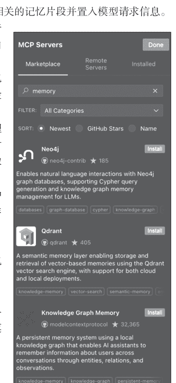

#### 3.2.2 MCP 如何重塑 Agent 的发展格局

在从关键模块角度讲完 MCP 对 Agent 的赋能后，我们换个视角，从行业演进来看 MCP 会带来什么影响。

前面多次提到分工，我认为分工正是 MCP 给 Agent 行业带来的最大变化。

如图 3-9 所示，MCP 出现后，模型能力落地到业务场景的链条上多了新角色。过去用户或客户想要一个面向自用场景的智能方案，只能指望模型厂商把基座做得更强，或指望 Agent 团队把高度封装的解决方案做得更聪明。尤其是面向专业用户和企业客户的场景，方案供给和 Agent 开发团队是强绑定的。虽然这种绑定能带来更稳定的商业回报，但也意味着团队要从智能方案到业务落地的行动力全包，对团队素质要求极高，服务一个客户就要投入大量精力，可并行服务的客户数自然受限。

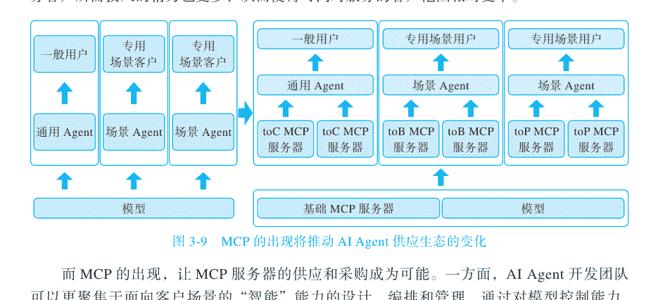

MCP 的出现让 MCP 服务器的供需开始分开。一方面，Agent 开发团队可以把重心收敛到面向客户场景的智能设计、编排和管理上来，通过对模型控制力和业务的理解沉淀场景智能的护城河，而运行过程中需要的行动力则交给 MCP 服务器提供方来负责。分工协作后，方案交付效率明显提升。

另一方面，分工能让各方负担变轻，服务能力增强，强绑定的关系被松绑。Agent 团队可以覆盖更多下游客户，MCP 服务器提供方也能被更多 Agent 团队集成，形成一个开放的市场格局。从创新角度看，自由市场才是激发创造力的最好土壤。

### 3.3 MCP 的落地能做什么

MCP 给人工智能领域带来了很明显的改变，解决了 LLM 应用、Agent 应用、SaaS 软件、各种工具 API、数据资源各自独立搭建连接通道的重复劳动。开发者只需一次构建，就能把能力轻松部署到多个 AI 平台，像插 USB 一样即插即用。这种通用性大幅降低了开发和集成的门槛，也把 AI 应用的边界拓展了很多，让开发者更专注于创新和打造更强的场景化方案。

#### 3.3.1 Langflow：MCP 时代的智能体互联标杆

MCP 提供了统一的工具发现和调用协议，让不同智能体之间可以无缝通信协作。Langflow 同时具备 MCP 客户端和 MCP 服务器能力，是这种互联性的典型代表。它既能让在 Langflow 里搭建的智能体去调用外部 MCP 服务器，也能让其他 MCP 客户端把 Langflow 的工作流程当作智能体或工具来使用。基于此，构建复杂分布式的 AI 系统成为可能，专门化的智能体可以通过通用接口互相配合完成任务，产出更强更通用的解决方案。这种连接能力为多 Agent 协同解决问题奠定了基础，也为类似 Manus 的通用智能体服务提供了底座。

##### 1. Langflow 身兼客户端与服务器

Langflow 原生就能同时充当 MCP 客户端和 MCP 服务器。作为客户端，它可以接入数千个现成的 MCP 服务器，把它们当作工作流里的工具来用。比如用文件系统服务器做本地文件操作，用数据库服务器做数据查询。作为服务器，Langflow 能把自己定义的工作流对外暴露成工具，供 Claude Desktop、Cursor 这类 MCP 客户端调用和编排。具体是通过 /api/v1/mcp/sse 端点实现的，其他兼容平台就像调用普通 API 一样就能执行 Langflow 里预设的复杂流程。

这种双重身份让 Langflow 在 MCP 功能的消费和生产端都占据核心位置，也催生出一个由互相连接的 Agent 和工具组成的生态。组件的可组合性和可复用性大幅提升。开发者既能便捷接入外部 MCP 服务器，也能把自己搭好的 Langflow 工作流变成可被他人调用的工具，促进 AI 功能共享协作。

##### 2. 在 Langflow 里搭一个会用 MCP 的智能体

Langflow 提供了一个叫 MCP Server 的组件，可以拖进工作流里去连接外部 MCP 服务器，如图 3-10 所示。它既能独立使用，也能打开 Tool Mode 变成智能体工具。在 Tool Mode 下，MCP Server 组件的 Toolset 端口可以直接连到 Agent 组件的 Tools 端口，让智能体使用 MCP 服务器提供的各种能力。Langflow 还支持 MCP Server 发送事件 SSE 模式，这种模式下，Langflow 实例里的所有工作流都会变成可用工具。用户只要在组件里选 SSE 模式，填上 Langflow 服务器的 SSE 地址，就能把自己的工作流暴露给其他 MCP 客户端。

可视化拖拽界面让集成变得非常友好，非专业开发者也能快速上手。低代码的方式拉低了复杂 AI 应用的门槛。Tool Mode 的加入让任何 Langflow 组件，包括 MCP Server 组件，都能灵活塞进智能体流程，进一步增强了扩展性和复用性。开发者可以把不同组件看作智能体可调用的工具，从而搭建出逻辑清晰、功能完整的 AI 系统。

##### 3. 把 Langflow 工作流对外开放成工具

Langflow 可以自动充当 MCP 服务器，通过 /api/v1/mcp/sse 端点把所有已定义的工作流对外暴露成工具。开启这项功能不需要任何额外配置。其他 MCP 客户端像 Cursor、Claude Desktop 只要连上这个端点，就能发现并像用普通工具一样使用 Langflow 工作流。工作流的名称和描述会告诉客户端这个工具是干嘛的。比如一个命名为“文档问答”、描述为“用 OpenAI LLM 对 Alex 的简历进行问答”的流程，接入的客户端就会明白它能用来提问简历并获取答案。

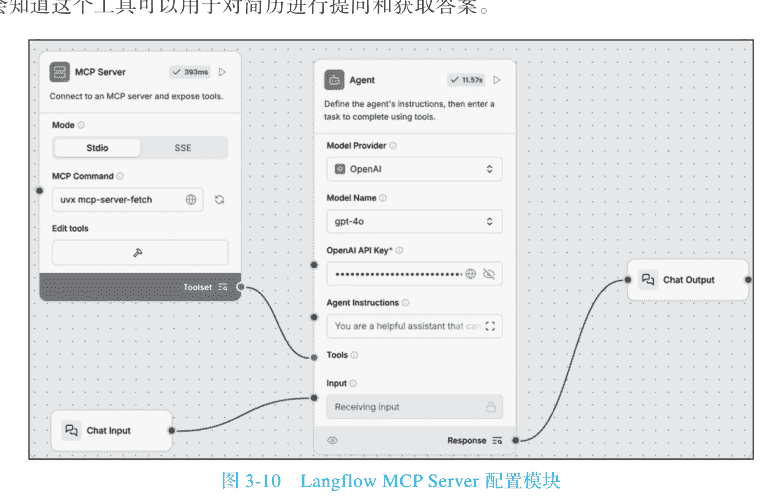

图 3-10 Langflow MCP Server 配置模块

这种把工作流无缝暴露为 MCP 工具的能力，为跨平台复用复杂 AI 功能提供了高效通道，避免了在不同环境重复造轮子，提高了开发效率和协作性。连接过程也很简单，只需指向 SSE 端点即可，体现了极高的易用性。这种低门槛的集成方式鼓励更多开发者把 Langflow 工作流当作外部工具使用，进一步壮大生态。

##### 4. Langflow + MCP 的实战案例

Langflow 里有很多基于 MCP 的智能体示例。一个例子是智能体用 MCP 服务器 Fetch 服务器来总结最新科技新闻。工作流里 MCP Server 组件连上 Fetch 服务器，把 fetch 工具暴露给智能体。用户一问科技新闻，智能体就会判断需要调用 fetch，拿到内容后再做总结返回。

另一个例子是用自定义的图像生成 MCP 工具。配置好 MCP Server 连上图像生成服务器后，智能体就能按用户指令生成图片。更有意思的是，Langflow 本身也能作为 MCP 服务器，让 Cursor 这类客户端调用 Langflow 里定义的旅行规划智能体工作流，如图 3-11 所示。用户在 Cursor 里输入需求，Cursor 就通过 MCP 调用 Langflow 的旅行规划流程，返回详细方案。Claude Desktop 同样可以连接 Langflow 实例，把计算器、URL 抓取器等工作流当工具用。

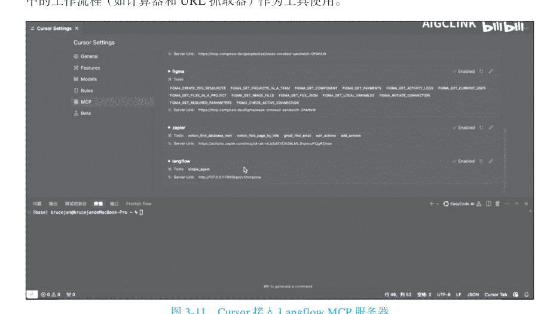

图 3-11 Cursor 接入 Langflow MCP 服务器

这些案例充分说明 MCP 能显著扩展 Langflow 智能体的能力，让它触达外部服务器和数据，完成更复杂多样的任务。通过 MCP，Langflow 智能体可以轻松集成各种外部工具，大大扩展应用范围，无论是获取实时信息、生成内容，还是做复杂规划，MCP 都提供了强支持。这种灵活的集成能力让 Langflow 成为构建强大可定制 AI 应用的理想平台。

#### 3.3.2 把 AI 接进专业软件：Blender 与 QGIS 的实践

MCP 让 AI 能够直接和 Blender、QGIS 这类专业 SaaS 软件交互和控制，开启了自动化和自然语言交互的新阶段。用户只需用简单的自然语言就能让软件执行复杂任务，体验和效率都明显提升。MCP 有望改变人与复杂软件的交互方式，用 AI 驱动的自然语言界面让这些工具更易用，也让更多人能够使用强大软件，同时简化老用户的操作流程。

##### 1. Blender-MCP：自然语言做 3D

###### (1) 架构拆解
Blender-MCP 通过 MCP 把 Blender 这款专业开源 3D 渲染软件和 Claude AI 连接起来。核心架构由两部分组成：Blender 插件 addon 和 MCP 服务器。Blender 插件在 Blender 内部起一个基于套接字的服务器，负责接收并执行来自 MCP 服务器的指令。MCP 服务器是 Python 服务，实现模型上下文协议，负责和 Blender 插件建立维护连接。两者通过 TCP 套接字通信，采用简单的 JSON 协议交换数据。Blender-MCP 还支持无头 headless 模式运行 Blender，便于脚本自动化。

插件作为 Blender 的扩展，直接在 Blender 环境运行，接收 MCP 服务器的指令并在内部执行，比如创建、修改或删除 3D 对象，控制材质和场景属性等。MCP 服务器则充当 Claude AI 和 Blender 的桥梁，把自然语言指令转成 Blender 能执行的命令，通过套接字发给插件。架构清晰，组件可以独立开发维护，也方便未来接入其他 AI 模型。

###### (2) 核心能力
Blender-MCP 的核心在于让用户用自然语言指令借助 Claude AI 在 Blender 里做 3D 建模、场景创建和编辑。更进一步，它还支持通过文本提示在 Blender 里运行任意 Python 代码，实现高级定制。功能上包括材质管理、场景控制如相机位置和灯光调整，以及与 Polyhaven 的集成，可直接通过 AI 命令访问使用 Polyhaven 的 3D 资源。工具集涵盖获取场景和对象信息、创建修改删除几何体、应用材质等。还支持通过 Hyper3D Rodin 生成 AI 驱动的 3D 模型。对于复杂建模任务，MCP 服务器能利用顺序思考能力把任务拆解成逻辑步骤，提升效率和条理性。

Blender-MCP 大幅降低了 3D 建模门槛，以前需要专业技能的操作现在可以用描述完成，对新手是巨大福音。对高级用户而言，通过 AI 指令执行 Python 代码提供了无限自定义和自动化可能。Polyhaven 的集成更丰富了资源库，让高质量场景构建更便捷。

###### (3) 典型场景
Blender-MCP 的能力可以通过多个场景体现。比如让 Claude AI“创建一个低多边形的地下城场景，里面有一条龙守护着一罐金币”，如图 3-12 所示。或者“用 Poly Haven 的 HDRIs、纹理和岩石、植被等模型搭一个海滩氛围”。更进一步，用户甚至可以上传一张参考图，让 AI 按图在 Blender 里生成对应内容。

## 2. QGIS-MCP：地理信息也能对话

###### （1）架构拆解
QGISMCP 和 Blender-MCP 思路相似，旨在通过 MCP 把 QGIS 这款开源地理信息系统软件和 Claude AI 连接。架构同样包含 QGIS 插件和 MCP 服务器两大核心。QGIS 插件在 QGIS 内部创建套接字服务器，接收并执行来自 MCP 服务器的命令。MCP 服务器是 Python 服务，实现 MCP 并负责与插件通信。该项目在很大程度上借鉴了 Blender-MCP 的设计。

插件作为 QGIS 的扩展，直接在 QGIS 环境运行，监听 MCP 服务器指令并在内部执行 GIS 操作，比如加载操作图层、运行地理处理算法、创建管理地图项目等。MCP 服务器负责把 Claude AI 的自然语言指令转为 QGIS 可执行命令，通过套接字发送给插件。这种相似的架构模式证明该设计适合 AI 与复杂桌面软件的集成，也可能推广到更多类似场景。

###### （2）核心功能

# 对话驱动的 QGIS：QGISMCP 能力全景

QGISMCP 把口语化表达转译为 QGIS 工程的搭建、要素载入与脚本运行。通过 Claude 发出的指令即可走完工程创建、打开、保存的完整链路，并对工程内部的图层进行管理，例如增删矢量或栅格图层，具体流程见图 3-13。系统同时支持调用 QGIS 地理处理工具箱里的各类算法。更进一步，可直接让 Claude 在 QGIS 内部执行任意 PyQGIS 脚本，为进阶使用者提供很强的定制自由度。随附的实用命令包括探测服务器连通性的 ping、查询安装信息、新建或导入工程、读取工程概要、图层增删、视口定位到图层范围、要素提取、地图渲染、工程保存等。

该方案正在重塑地理空间分析的工作方式。使用者无需精通 QGIS 的各项操作，仅凭日常表述就能让智能体完成从数据引入、可视化到复杂空间运算的整条流程，显著降低使用门槛，也让非 GIS 背景的人员能够利用其分析能力。结合可运行任意 PyQGIS 代码的能力，还为构建高度定制化、自动化的地理空间流程打开想象空间。

###### （3）示例用例

在实践中 QGISMCP 的潜力十分明显。使用者可以让 Claude 新建并保存一个工程，随后导入矢量与栅格数据，并指示智能体把视点移动到指定图层的范围。更进一步，可要求对某矢量层执行质心运算，甚至生成分级设色专题图 Choropleth Map，最后完成渲染并保存成果。在一次演示中，Claude 按要求创建并保存新工程、载入矢量和栅格、聚焦到特定图层、执行质心算法并在过程中自动识别无效几何并修复、输出新文件，随后以代码方式绘制专题图、完成渲染并保存最终工程。这些案例清晰展示了 QGISMCP 如何自动完成常规 GIS 任务并实现智能驱动的地理空间分析，提升专业人员效率，也让空间分析工具更易上手。

借助对话交互，过去需要专业知识和繁复操作才能完成的 GIS 任务变得轻松。智能体在后台把口语表述转译为 QGIS 可执行的动作，显著提升效率与便捷性。无论城市规划、环境保护还是资源管理，QGISMCP 都具备带来革新性变化的潜力。

Blender-MCP 与 QGISMCP 的对比见表 3-4。

表 3-4 Blender-MCP 与 QGISMCP 的对比

| 特性 / 功能 | Blender-MCP | QGISMCP |

| :--- | :--- | :--- |

| 应用领域 | 3D 建模与渲染 | 地理信息系统（GIS）分析 |

| 核心组件 | Blender 插件（套接字服务器）+ MCP 服务器（Python） | QGIS 插件（套接字服务器）+ MCP 服务器（Python） |

| 主要 AI 模型集成 | Claude AI | Claude AI |

| 关键特性 | 自然语言控制 3D 建模、场景创建与编辑；执行任意 Python 代码；材质管理；场景控制；Polyhaven 集成；Hyper3D Rodin 模型生成；顺序思考与任务分解 | 自然语言控制 QGIS 项目创建、图层加载与操作；执行 QGIS 地理处理算法；执行任意 PyQGIS 代码；项目和图层管理；空间分析；地图渲染 |

| 通信协议 | 基于 JSON 的 TCP 套接字 | 基于 JSON 的 TCP 套接字 |

| 示例用例 | 创建地下城场景、海滩场景、根据参考图像创建场景、修改对象属性等 | 创建和保存项目、加载矢量图层和栅格图层、缩放图层、执行质心算法、创建专题地图、渲染和保存地图等 |

| 核心架构相似性 | Blender 插件和 MCP 服务器的清晰分离，通过套接字和 JSON 进行通信，为集成 AI 与复杂桌面应用提供了一种有效的模式 | 与 Blender-MCP 架构高度相似，表明这种架构模式在集成 AI 与不同类型的桌面应用方面具有通用性 |

| 领域特定功能 | 专注于 3D 图形的创建、编辑和渲染，集成了丰富的 3D 资源和高级建模功能 | 专注于地理空间数据的管理、分析和可视化，提供了丰富的 GIS 工具和算法 |

| 潜在影响 | 通过自然语言交互降低 3D 建模门槛，提高创作效率，为专业人士和非专业人士带来便利 | 通过自然语言交互简化 GIS 操作，使得地理空间分析工具更加易于使用，有望提高 GIS 专业人士的工作效率，并使 GIS 技术更广泛地应用于各个领域 |

#### 3.3.3 利用 MCP 增强 LLM 的能力

MCP 为大语言模型提供了调用外部工具与数据的统一入口，使其能力不再局限于训练语料。Claude 与 OpenAI Agent SDK 等平台均已接入 MCP，让开发者更容易搭建更强能力的智能应用。MCP 补足了模型与现实世界交互并获取最新信息的缺口，使其在更广泛任务上更可靠、更有用。将模型与外部知识与操作联通，是构建可信实用 AI 应用的关键。

##### 1. Claude 对 MCP 的支持

Anthropic 的 Claude 桌面客户端对 MCP 提供了完整支持。核心能力包括资源挂载，可把本地文件与数据作为上下文接入；提示模板支持，有助于构建结构化交互；工具执行集成，使 Claude 能经由 MCP 调用并运行外部命令与脚本；本地服务器连接支持，提升隐私与安全。此外 Anthropic 推出 Claude Code，这是一款交互式智能编程助手，不仅兼容 MCP 的提示与工具，还能充当 MCP 服务器与其它客户端互通。Anthropic 同时提供详尽文档与教程，指导开发者搭建基于 SSE 的 MCP 服务器与客户端。

在桌面客户端与 Claude Code 中的大力支持，体现了 Anthropic 将 MCP 视作扩展模型能力的关键技术。通过 MCP，Claude 能与外部工具与数据源深度融合，突破自身训练数据的边界。配套文档与教程旨在降低集成门槛，鼓励更多参与者加入 MCP 生态。

##### 2. OpenAI Agent SDK 与 MCP

OpenAI 的 Agents SDK 内置 MCP 能力，由其创建的智能体可直接连上 MCP 服务器。智能体能无缝使用服务器提供的外部工具、数据与提示模板，无须额外集成。SDK 自动处理服务器发现、工具执行与响应路由，同时兼容本地 STDIO 服务器与远程 SSE 服务器。社区另有 openai-agents-mcp 扩展库，进一步简化接入。OpenAI 的支持被视为提升 Agent 互操作性、推动 MCP 成为 Agent 标准协议的重要一步。

OpenAI 与 Anthropic 的共同投入，显示业界对 MCP 作为让 Agent 与现实交互并调用外部资源的关键协议的共识在形成。openai-agents-mcp 的出现反映了社区为优化 MCP 与 OpenAI 生态结合所做的努力，让更多开发者便捷利用其能力。

#### 3.3.4 基于 MCP 的工具互操作性：Zapier

Zapier MCP 展现了 MCP 实现超 8000 个工具与软件生态无缝互通的强大效果。这让 AI Agent 无需为每个功能定制集成，从而加速 AI 驱动自动化的研发。借助 Zapier 等平台，MCP 让 AI 应用触达海量工具，开发者可轻松把各类功能嵌入 Agent。广泛的互操作性促进创新，支持以新颖方式组合不同服务。

##### 1. Zapier MCP：连接数千个应用程序

Zapier MCP 允许 AI 助手与 8000 多个应用交互，执行超过 30 000 个操作，且无需复杂 API 集成。其本质是 AI 工具与应用之间的“翻译层”，让 AI 能代表用户执行操作。用户可生成唯一的 MCP 服务器 URL，安全地把自己的 AI 接入 Zapier 的集成网络，并可细粒度限定 AI 在所连应用中可用的具体操作。支持 Cursor、Claude Desktop、OpenAI 等主流平台。

Zapier MCP 的出现标志着 AI 执行真实任务能力的重大进展。通过无需单独 API 集成即可把 Agent 接入庞大应用生态，AI 助手可超越单纯对话，真正融入数字生活。Zapier 作为领先集成平台，通过 MCP 拓展能力，成为推动 MCP 在工具互操作领域应用的关键力量。其庞大的集成网络为 MCP 兼容的 Agent 提供丰富工具集，让开发者轻松构建强自动化方案。

##### 2. Zapier 作为领先的 MCP 服务提供商

Zapier MCP 简化了把 AI 连接到数千个应用的过程，无需自定义 API 编码。它在所支持应用中提供超过 30 000 个预设操作，并内置身份验证、速率限制与端点安全机制。此外提供操作命名、AI 值推测、开关切换等管理功能，在一定速率限制内可免费使用。

凭借易用性、安全性和海量预构建操作库，它成为主流 MCP 服务提供商。它极大降低开发者把现实功能集成到 AI 应用的门槛。通过降低 API 复杂度和提供简易配置界面，Zapier MCP 让 AI 开发者轻松利用其强大功能。

##### 3. 基于 Zapier MCP 的 AI 操作示例

借助 Zapier MCP，Agent 可完成多种任务，例如在 Google Calendar 创建会议、发送邮件、管理 Google Sheets 数据、在 Slack 发送消息、更新 PostgreSQL 数据库、管理 Circle 社区消息等。实现仅需 3 步：

第一步：进入 https://actions.zapier.com/settings/mcp/，获取 Remote MCP 服务器的 MCP server endpoint，如图 3-14 所示。

第二步：配置 action，比如 Google Calendar 创建、Google Sheets 管理、Slack 发送消息等，点击 Edit MCP Actions 开始配置。

第三步：连接 MCP 客户端（Cursor、Claude Desktop）即可使用，如图 3-15 所示。

这些示例展示了 AI Agent 使用 Zapier MCP 可完成的任务广度，凸显其在自动化个人与专业工作流方面的潜力，以及通过像 MCP 这样标准化协议把 AI 与现有应用连接所带来的变革力量。AI 助手不再只是提供信息或生成文本，而是能真正代表用户执行操作，大幅提升工作效率。常见的 Zapier Action 见表 3-5。

表 3-5 常见的 Zapier Action

| 应用平台 | 操作描述 | AI 使用场景示例 |

| :--- | :--- | :--- |

| Google Calendar | 创建详细事件 | AI 助手根据用户的自然语言指令自动创建会议，例如“明天上午 10 点创建一个名为‘播客录制’的 Google 日历事件。” |

| Slack | 发送消息 | AI 助手根据用户指令向指定的 Slack 频道或用户发送消息，例如“在 #general 频道中发送消息：‘今天的会议将在 15 分钟后开始。’” |

| Google Sheets | 更新行 | AI 助手根据外部事件或用户指令自动更新 Google Sheets 中的数据，例如“将客户 ID 为 123 的订单状态更新为‘已发货’。” |

| PostgreSQL | 执行 SQL 查询 | AI 助手根据用户提问执行 SQL 查询，例如“查询所有销售额超过 1000 美元的订单。” |

| Email (Gmail 等) | 发送邮件 | AI 助手根据用户指令发送电子邮件，例如“给 john.doe@example.com 发送邮件，主题为‘会议纪要’，内容为 [会议纪要内容]。” |

| Circle | 发送社区消息 | AI 助手向 Circle 社区的所有成员发送通知，例如“提醒所有成员参加今天的线上研讨会。” |

| Web Parser | 从 URL 提取页面内容 | AI 助手根据用户提供的 URL 提取网页内容，例如“总结一下这个网页的内容。” |

| HubSpot | 创建或更新联系人、创建任务等 | AI 助手根据用户指令在 HubSpot 中创建新的联系人或更新现有联系人的信息，例如“创建一个名为‘Jane Smith’的新联系人，邮箱是 jane.smith@example.com。” |

#### 3.3.5 基于 MCP 的数据集成与共享：Supabase

Supabase MCP 说明了如何借助 MCP 便捷且安全地让 AI 模型访问数据，使模型能直接与数据库交互。这省去了复杂数据管道，让 Agent 实时读写数据。MCP 为 AI 应用提供标准化且安全的与数据源交互方式，简化数据集成并实现更复杂的 AI 驱动数据分析与管理。直接访问数据使 Agent 能执行需要最新信息和修改数据能力的任务。

##### 1. Supabase MCP：连接 AI 与数据库

Supabase 推出官方 MCP 服务器，旨在把 AI 工具连接到其平台。AI Agent 可执行启动数据库、管理数据表、获取配置、在 Supabase 中查询数据等任务。Supabase MCP 暴露超过 20 种工具或功能用于数据库交互，充当 MCP 客户端与 Supabase 服务之间的桥梁，提供数据库操作、存储管理、边缘函数调用等。

Supabase MCP 直接满足 AI Agent 与数据交互和管理的诉求，催生新一代可无缝访问和操作后端数据的全栈 AI 应用。通过为 AI 提供与数据库交互的标准化方式，Supabase 简化了数据驱动型 AI 应用的开发。

##### 2. Supabase MCP 的架构与功能

Supabase MCP 使用 TypeScript 构建，采用模块化架构。关键组件包括处理客户端请求的服务器类以及所有操作的类型定义。支持通过环境变量和 config.json 文件进行广泛配置，提供创建、读取、更新、删除数据库记录、执行 SQL 查询、调用边缘函数、管理项目和组织等工具，还具备数据库分支功能以支持更安全的开发流程。

全面工具集体现了官方对 AI Agent 可能需要执行的常见数据库操作的深刻理解，使其成为 AI 驱动后端开发的强力工具。丰富的功能让 AI Agent 能以非常精细的方式管理和交互数据库。

##### 3. 与 Supabase MCP 的交互示例

开发者可利用 Supabase MCP 将各类数据库管理任务委派给 AI Agent，简化开发并减少手动操作，例如获取项目 URL 或匿名密钥；基于数据库模式生成 TypeScript 类型；拉取最近日志进行调试；创建、列出和合并数据库分支；执行任意 SQL 查询；使用迁移创建或更改数据表。强大功能让开发者更专注于应用核心逻辑，而把常规数据库管理交给 AI 处理。Supabase MCP 的工具列表见表 3-6。

表 3-6 Supabase MCP 的工具列表

| 工具 / 功能名称 | 功能描述 | AI 使用场景示例 |

| :--- | :--- | :--- |

| get_project_url | 获取 Supabase 项目的 URL | AI 助手在部署前端应用时，自动获取 Supabase 项目的 URL |

| get_anon_key | 获取 Supabase 项目的匿名密钥 | AI 助手在需要进行匿名认证时，自动获取项目的匿名密钥 |

| generate_typescript_types | 基于数据库模式生成 TypeScript 类型定义 | AI 助手在数据库结构发生变化时，自动更新前端应用的类型定义，保持数据结构的一致性 |

| get_logs | 拉取最近的 Supabase 项目日志 | AI 助手在应用出现错误时，自动拉取日志进行分析和诊断 |

| create_branch | 创建一个新的数据库分支 | AI 助手在进行新功能开发或进行实验性更改时，自动创建一个新的数据库分支，避免影响主数据库 |

| list_branches | 列出当前项目的所有数据库分支 | AI 助手列出当前项目的所有数据库分支，方便开发者进行管理和切换 |

| merge_branch | 将开发分支合并到主干 | 功能开发与测试完成后，系统会自动把开发分支并入主分支 |
| execute_sql | 执行任意 SQL 查询 | 智能体把用户的自然语言转译为 SQL 并运行，例如查询年龄大于 30 岁的用户邮箱 |
| create_record | 在指定表写入新记录 | 根据用户提供的字段值，智能体在目标表中生成一条新数据，例如新建用户名为 test 的用户 |

#### 3.3.6 多场景下 MCP 联动的现实图景

##### 1. 物联网：智慧家庭实操
在家中用口语操控设备并获取环境信息，需要多套 MCP 协同工作。

- 控制中枢：Langflow。可视化搭建的家庭中控智能体负责对话交互，充当 MCP 的调用方。
- 设备端：假设灯泡、温控器、安防摄像头都实现了 MCP 服务端，可分别暴露调光、调温、取流等能力，Langflow 智能体可通过协议发现并操控。
- 数据端：Supabase MCP。用户偏好如理想温度、灯光方案，以及能耗等历史数据存于 Supabase，智能体经该接口读写。
- 工具端：Zapier MCP。要实现异常时发短信，可借助 Zapier MCP 接入 Twilio。

场景流程：用户说“晚上好，我回来了”。
1. 智能体先用 Supabase 接口拉取回家的个性化设定。
2. 通过协议调用灯泡和温控器的服务端，把灯光调到预设亮度，温度调到用户偏好值。
3. 同时查询摄像头服务端获取最新画面并做分析，判断家中是否正常。
4. 若用户说“我有点冷”，智能体再次调用温控器服务端提升室温。
5. 若摄像头发现异常，智能体经 Zapier MCP 调用 Twilio 向用户推送警报短信。

##### 2. 医疗健康：远程患者监护
MCP 可搭建连接患者、医疗设备与服务方的远程监护体系。

- 交互层：OpenAI Agent SDK。用该套件构建的虚拟护士智能体是患者的主要交互窗口。
- 设备层：假设血糖仪、血压计、心率监测带等可穿戴设备都实现了 MCP 服务端，可实时输出生理数据。
- 数据层：Supabase MCP。电子健康档案包含病史、用药、监测数据，存于 Supabase。
- 推理层：Claude。虚拟护士需要医学知识或初步判断时，可把数据交给 Claude 的 MCP 接口分析。
- 应急层：Zapier MCP。紧急时，智能体可用 Zapier MCP 对接急救呼叫或通知医护。

场景流程：血糖仪定期经 MCP 上报数值。
1. 虚拟护士智能体经协议收到血糖读数。
2. 用 Supabase 接口查阅该患者的历史血糖与目标区间。
3. 若超出范围，先调用 Claude 接口把近期数据和病史送去初步评估并获取建议。
4. 根据分析结果，智能体可经协议向患者推送提醒或建议。
5. 若情况危急，智能体用 Zapier MCP 触发急救呼叫，并附上位置与基础生命体征。

##### 3. 教育：个性化学习平台
借助 MCP 能打造适配每个学习者的个性化教学平台。

- 助手层：Langflow。Langflow 构建的智能学习助手为学生定制路径与辅导。
- 资源层：假设在线课程、数字图书馆、教育应用都实现了 MCP 服务端，可开放课程、练习、测评能力。
- 数据层：Supabase MCP。学习记录、偏好、进度存于 Supabase。
- 生成层：OpenAI。助手可调用 OpenAI 的 MCP 接口，按学习状态生成定制化材料与题目。
- 空间分析层：QGIS MCP。地理或环境科学可接入 QGIS MCP，让学生用自然语言操作地理空间分析与可视化。

场景流程：学生问“请介绍亚马孙雨林的气候特征”。
1. 通过 Langflow 助手提出问题。
2. 助手用 Supabase 接口查学习记录，了解知识水平与偏好。
3. 经协议连接多个在线平台与数字馆服务端检索相关资料。
4. 调用 OpenAI 接口，基于资料与个人情况生成定制化气候小结。
5. 为增强直观性，调用 QGIS MCP 生成亚马孙地区的气候可视化图。
6. 把总结与图表一起呈现给学生。

##### 4. 金融：智能投资助手
MCP 可构建投顾助理，帮助用户管理资产并做决策。

- 顾问层：OpenAI Agent SDK。基于该套件的智能投顾智能体。
- 数据源层：假设券商平台、财经新闻、分析工具都实现了 MCP 服务端，可实时提供股价、新闻、研报。
- 数据层：Supabase MCP。投资组合、交易历史、风险偏好存于 Supabase。
- 执行层：Zapier MCP。智能体可用 Zapier MCP 连接银行或券商账户执行交易或发送报告。
- 分析层：Claude。面对复杂市场研判，智能体可把最新数据与组合信息交给 Claude 的 MCP 接口分析。

场景流程：用户问“我该买科技股吗？”
1. 投顾智能体用 Supabase 接口读取组合与风险偏好。
2. 经协议连接金融数据源服务端获取科技股最新价格、新闻与研报。
3. 调用 Claude 接口分析信息并结合风险偏好评估收益风险。
4. 根据结论，智能体可经 Zapier MCP 连接券商账户，建议买入数量并请用户确认。
5. 确认后，智能体再用 Zapier MCP 执行交易，并在 Supabase 更新组合。

MCP 作为新一代开放规范，在智能体互联、SaaS 嵌入、大模型增强、工具互通与数据共享方面潜力巨大。统一的交互方式让 AI 解决方案接入外部资源更便捷，降低门槛，为更灵活方案奠基。

在互联层面，Langflow 能同时作 MCP 客户端与服务端，配合可视化界面让开发者轻松编排工作流。SaaS 层面，Blender-MCP、QGIS MCP 等案例显示 AI 能力可融入专业桌面软件，自然语言交互提升效率。大模型层面，Claude 与 OpenAI Agent SDK 的原生支持让模型易于扩展，访问外部知识并执行操作。Zapier MCP 接入数千应用，提升自动化水平。Supabase MCP 体现了在数据集成与共享上的价值，让 AI 解决方案安全便捷地操作数据库。

展望未来，物联网、医疗、教育、金融等领域都能凭借统一标准让 AI 更广泛落地并带来变革。总之，MCP 代表下一代 AI 方案的关键底层，其开放、标准与灵活性将持续推动技术进步与创新。

### 3.4 MCP 生态的创业机会

MCP 的出现重塑了 AI 应用架构，也催生新产业生态。在该生态下，创业者在多个细分赛道切入，有机会打造平台级产品。业界普遍认为围绕 MCP 有三大方向：Agent OS、MCP Infra、MCP Marketplace。下面分别介绍。

#### 3.4.1 Agent OS

##### 1. 现状与走向
在智能体时代，构建操作系统级平台成为热点。业界认为 OS 将成为大模型厂商的核心护城河。Anthropic 率先开源 MCP，意在打造 AI 应用的“USB-C”统一接口，为智能体提供工具与数据调用的统一方式，大幅提升集成效率。

基于此，Agent OS 概念出现，目标是把分散的 MCP Server 能力抽象成统一平台，像传统 OS 管理硬件那样管理智能体的工具与上下文，让智能体更自然地调用功能与分发信息。目前 Anthropic、OpenAI、Google 都在探索路径，例如 OpenAI 用插件与函数调用构建生态，Google 推出 A2A 通信协议。

整体上 Agent OS 正从理念走向落地。PwC 发布企业级 Agent OS 以整合业务流程；开源社区 AIOS、OpenManus 等快速发展；开发工具 Cursor、Devin 等 AI 编程助手逐步具备完整智能体能力，成为 MCP Host 的雏形。共识是：掌握 Agent OS 就掌握了生态入口。

##### 2. 代表性产品与参与者
目前呈现大厂领跑、初创突围、开源繁荣的局面。Anthropic 凭借率先推出 MCP 占得标准先机，其桌面版 Claude 已是早期 MCP 主机的代表，积累系统能力经验。OpenAI 虽未直接采用 MCP，但 ChatGPT 插件生态已形成封闭却功能丰富的平台雏形，目标与 Agent OS 高度一致。

技术深度上，AIOS 由学术团队主导，聚焦嵌入式 LLM 的操作系统内核，提供调度、上下文切换、内存管理、工具调用等系统级能力，分为内核与 SDK 两层，目标打造完整的智能体运行时。

初创方面，Manus 由 Monica.im 团队推出，是首个具备自主拆解任务与工具调用能力的通用智能体，标志 AI 从对话助手迈向可自主执行复杂任务，发布后获腾讯云等关注，推动国内厂商加速布局。

开源生态反应迅速，MetaGPT 团队开源的 OpenManus 发布 3 天获 2.4 万 Star，显示开发者对 Agent OS 架构的强烈需求。Cline 与 Cursor 演化为面向开发者的领域级 Agent OS。工具箱型项目如 Composio 提供数百种插件能力，丰富智能体工具生态。

无论硅谷公司还是中国互联网巨头，都在争夺这一智能时代的操作系统入口。

##### 3. 当前挑战
前景虽好，发展仍面临多重难题。

其一，技术复杂度：Agent OS 需管理 LLM 上下文、工具调用、长期记忆并实现稳定调度，需解决调度、上下文切换、内存管理等。

其二，标准化难题：各家智能体框架如 LangChain、OpenAI 函数调用各不相同，形成统一 OS 标准不易。目前 MCP 虽开放，但多智能体协同、身份认证等能力尚缺。

其三，安全与可信：让智能体控制电脑或联网服务可能带来误操作或滥用，需沙盒与权限控制，例如 AIOS 引入类似系统调用的管控。

其四，生态成熟度：Agent OS 需大量应用与驱动即 MCP 服务器工具支撑，目前工具生态增长快但质量参差。

其五，用户体验：普通用户如何直观使用 Agent OS 仍需探索，界面与交互范式待验证，如 Manus 的对话加自动执行模式是否通用还需市场检验。

##### 4. 创业机会与战略价值
Agent OS 孕育成为“AI 时代的 Windows”的机会。切入策略多样。

其一，聚焦垂直场景的 Agent OS，如面向企业办公的智能助理 OS 集成邮件、日程、文档，或面向开发者的编程 OS 集成编辑、测试、部署工具，以深度取胜。

其二，构建通用 Agent OS 平台，提供开放插件接口兼容 MCP，走 Android 模式吸引开发者。

其三，跨模型兼容，支持多种大模型作为内核，引入模型路由按任务调度最优模型形成差异化。创业者还可与硬件或操作系统结合形成壁垒，如开发桌面 AI 助手 OS，深入系统底层。

Agent OS 在 MCP 生态中相当于入口与中枢，连接用户与海量工具服务。掌握它意味着掌控用户、工具与数据交互。随着 AI 智能体越来越多介入工作生活，优秀的 Agent OS 将大幅降低使用门槛，契合从单一应用向通用助手演进，谁先打造稳定平台，谁有望在 Agentic AI 浪潮中取得主导。

#### 3.4.2 MCP Infra

MCP Infra 指 MCP 运行所需的基础设施与工具链。MCP 功能强但仍处早期，企业级落地有诸多挑战，这正是创业机会：提供专业基础设施，帮助团队更高效可靠地使用 MCP。

##### 1. 市场现状与痛点
MCP 作为开放协议，短时间内聚集 2000 多个服务器，成为 LLM 工具集成的事实标准之一，但底层基础设施仍薄弱。多数服务器部署在本地或内网，缺乏大规模分布式部署支持。

例如，多数 MCP 服务器为单用户/单会话设计，不支持多用户/多租户。跨网远程调用机制不完善，缺少统一身份认证与服务发现，限制云端大规模应用。对开发者而言，配置维护仍需人工，缺少便捷托管发布链路，调试兼容性问题也缺乏专用工具。

此外，MCP 目前不支持多智能体直接通信，无法像 ANP 那样构建去中心化智能体网络，在复杂场景会成局限。性能与可靠性也需关注：MCP 引入额外请求/响应开销，不及模型内置函数轻量实时。要达到生产可用，基础设施层面仍有诸多问题待解。

##### 2. 技术趋势与关键参与者
针对痛点，新一波基础设施方案正在涌现。Anthropic 官方与开源社区正完善 MCP 规范，例如计划增加无状态交互、远程鉴权等特性，使 MCP 成为无状态协议，便于分布式扩展。

头部云服务商正把触角伸向 MCP 底层设施。腾讯云近期对外演示了一套融合自家云能力的方案，覆盖托管层与鉴权层，并打通微信生态，让开发者能够快速上线类 Manus 的智能体。

创业公司分化明显。有的团队主打云端运行，把两百余个常用接口封装成可直接调用的服务器集群；另一些聚焦接入层，打造可同时连通多套 MCP 节点并统一鉴权与流量治理的网关产品，a16z 此前也指出该方向值得关注。

开源社区进展同样密集。Wasmtime、NodeJS 等运行时被引入到生态中，Dylibso 发布了 MCPX 可扩展服务端，支持以 WASM 沙箱形式动态挂载插件 servlet，将众多工具聚合到单一实例中安全运行，思路近似容器化 AI 插件，提升了安全性与可移植性。

配套工具也在增多：mcphub.nvim 为 Neovim 提供了节点管理界面；Anthropic 官方的 Python SDK 简化了开发流程；社区还分享了自动生成服务端的脚手架代码。基础设施层面，身份与权限成为焦点，有方案尝试引入去中心化身份 DID，并借鉴 ANP 的加密认证机制，为协议叠加信任层。

总体来看，大厂、初创与开源正共同推动底层迭代，核心痛点集中在可扩展性、安全性和易用性，目标是为规模化应用铺路。

##### 3. 主要挑战
强化基础设施需要技术突破与工程优化，主要难点如下。

- 规模化架构是前提：MCP 当前多以单对单、本地优先为主，需要向多对多、支持云端的形态演进，即节点无状态化并可集群部署。这要求解决会话信息共享、消息路由和并发控制等关键问题。
- 统一鉴权与权限管理亟待建立：目前缺少通用的远程身份核验，企业难以建立可信的接入通道。

##### 4. 创业机会与定位
在基础设施方向，创业公司大有可为，可从提升可靠性与可用性切入，多方面打造增值服务：

- 托管与云服务：提供面向 MCP 节点的云端托管平台，让开发者无需自建即可上线。例如类似 Heroku 的体验，支持从 GitHub 直接发布代码并自动处理扩容与运维，满足企业不想自运维的需求，也是订阅式收入的来源。
- 统一网关与管理：开发 MCP 专属网关，整合鉴权、授权、流控等功能。该网关充当智能体主机与 MCP 节点之间的中介，企业客户可据此设定访问策略，如哪些智能体可使用哪些工具、QPS 限制等，定位类似 API Gateway。
- 安全与身份服务：推出 MCP 身份认证服务，基于 OAuth 2.0 或 DID 提供统一登录凭证，并提供签名与验证机制，确保通信双方身份可靠，防止中间人攻击，填补协议在安全方面的空白。
- 开发者工具链：针对开发痛点构建 DevOps 工具，如可视化构建器，允许通过图形界面配置 API 并生成服务端代码；如调试监控面板，实时展示智能体调用了哪些工具、输入输出如何，便于排错优化，相当于 AI 时代的 IDE 与 APM 的复现。
- 插件与集成支持：MCP 未来可能与其他协议协同，例如结合多智能体通信 ANP/A2A 协议打造更复杂系统。创业团队可以提供整合方案，让开发者方便地将身份认证、长时记忆如向量数据库、多智能体协同等模块无缝融入 MCP 框架，形成完整的智能体应用开发套件。

基础设施是生态繁荣的基石，解决性能与安全问题即扮演赋能者角色，推动更多企业与开发者采用。抓住该机会的公司有望成为 AI 时代的“水电公司”，随着 MCP 逐步成为 AI 系统的通用接口，相关服务需求将迎来爆发。

#### 3.4.3 MCP Marketplace

##### 1. 市场现状与动向
MCP Marketplace 即 AI 智能体功能插件市场的雏形，为 MCP 节点提供发现、分发与交易服务，相当于智能体世界的应用商店。随着可用节点种类激增，市场化需求显现，目前已知节点数量已超 2000 个，涵盖文件系统、数据库、Slack、浏览器等多种能力。

由于质量参差不齐，如何挑选合适工具成为问题。2025 年初首批尝试出现：Cline 团队 2 月发布 Cline's MCP Marketplace，定位为插件集合，提供一站式浏览与一键安装。通过该插件，用户可像安装 App 一样为智能体扩展能力，支持按名称、类别、标签检索，单击即可完成安装配置，被誉为 AI 能力的 App Store。

除 Cline 外，mcpx/mcp.run 提供了节点注册表与控制台，被称为 MCP 应用商店；mcphub.nvim 也整合了 Marketplace 接口，支持在编辑器内浏览安装。腾讯云还宣布将推出结合小程序生态的 MCP Marketplace，方便开发者迅速接入各类工具智能体。可以看到从开源社区到云厂商，Marketplace 正从概念走向产品，形态既可能是开源集中仓库，也可能是商业双边平台，提供审核、评级与交易。

##### 2. 关键参与者与项目
Cline MCP Marketplace 目前代表性最强，作为开源项目由社区主导，通过 VSCode 插件触达大量开发者，已收录数百种节点并开放 GitHub 仓库供贡献。

Anthropic 官方暂未推出自有 Marketplace，但其对社区标准与推荐列表的支持值得关注。

ylibso 的 mcp.run 实际扮演 Marketplace 角色，提供托管服务与 WASM 扩展机制，同时上线公开 servlet 注册库供搜索安装。

国内大厂布局也在推进，腾讯云计划将 Marketplace 与云函数、API 网关结合，形成企业可管控的插件市场。社区中亦有探索跨平台聚合的思路，借鉴 Cline 的界面与一键安装实现通用 AI 应用商店。

OpenAI 插件目录与 MCP Marketplace 存在竞合，OpenAI 目录局限于其 API 定义，未来不排除有创业者尝试桥接两者，打造统一的智能体能力市场。整体格局尚未固化，为差异化创业留下空间。

##### 3. 面临的挑战
建立健康的智能体服务市场需平衡供给端与需求端体验。

供给端挑战：如何吸引足够多优秀节点开发者入驻并持续维护更新。目前多数节点由个人开发，质量不均，缺乏激励机制易导致优秀工具后继无人。需要下载量排名、荣誉榜乃至收益分成来驱动供给。

需求端挑战：面对海量插件，用户如何辨别优劣。目前评分评论功能不完善，企业也缺少可靠性指标如调用成功率、安全审计等。需要建立评价体系与可信认证，如官方认证、企业版标识等。

安全与信任突出：点按安装第三方节点等于在本地运行陌生代码，存在数据泄露风险。运营方可能需引入审核机制与隔离沙盒，但审核过严会减慢迭代、打击社区积极性。

标准化与兼容：MCP 持续演进，不同版本节点在 Marketplace 中如何标识兼容性，不同 Agent OS 客户端能否通用同一市场。若各客户端自建市场将导致碎片化，需要统一的插件描述标准。

商业模式支撑：早期以开源免费为主，长期运营需要资源，未来可能需探索佣金分成、企业版订阅等模式，前提是达到足够规模形成良性循环。

##### 4. 创业机会与意义
创业公司可扮演 AI 时代应用商店运营者，通过构建平台连接工具开发者与智能体用户。

打造领先的独立平台：Cline 主要服务其 VSCode 用户，尚无独立于特定 IDE 的通用入口。创业者可开发 Web 平台或应用，汇聚所有节点信息，提供跨客户端的一键安装方案，类似 NPM 官网的检索、筛选与文档展示，并与各大客户端合作成为事实通用插件库。

深耕垂直细分：可专注特定领域市场，如面向企业 IT 的安全认证插件市场，仅收录经审核的数据库、内部系统节点；或面向个人消费者的 AI 助手能力商店，偏向日程管理、娱乐资讯等生活应用，通过口碑与信任形成差异化。

提供增值服务：为企业客户提供私有部署的 Marketplace 镜像，附带审核、权限控制等功能；提供数据分析与智能推荐，利用平台数据为用户推荐合适插件，或为开发者提供需求洞察。

推动商业变现：随着 Marketplace 成熟，可能诞生插件内购或付费调用模式。创业者可提前布局设计安全支付结算系统，帮助节点开发者变现，平台抽取佣金。谁先建立可靠交易体系，谁就掌握 AI 智能体服务经济的价值中枢。

MCP Marketplace 是生态催化剂，降低智能体扩展门槛，加速工具开发者与用户的循环。掌控此类平台意味着占据生态高地，AI 智能体时代需要自己的应用商店，相关创业机会值得重点投入。

Agent OS、MCP 基础设施和 MCP Marketplace 三大方向分别从应用入口、底层支撑和生态分发层面奠定 MCP 生态系统基础，三者相辅相成推动 AI 智能体成熟。创业者切入任一方向均有机会在未来 AI 版图占据一席。

### 3.5 MCP 生态的发展演变
MCP 正在促进大模型、智能体、SaaS、工具与数据 API 的互联互通，并自身快速进化，其演进将显著影响 AI 行业走向。

MCP 对开发语言的支持：SDK 覆盖不断扩大，已涵盖 Kotlin、Java、C#、TypeScript、Python 等。近期更新包括 Kotlin SDK 0.4.0、Java SDK 0.8.1、Python SDK 1.5.0，微软贡献了 C# SDK，增强企业级潜力。广泛的语言支持预示 MCP 有望成为跨平台标准。核心 API 持续优化，近期修复问题、清理接口并增加二进制兼容性跟踪，降低对 JDK 的要求至 JDK8，以提升稳定性和开发者体验。

MCP 客户端：集成应用增多，社区活跃。JetBrains 发布 Kotlin SDK，客户端如 Cursor、Windsurf、Claude Desktop 已支持 MCP，Composio 等公司提供数百种集成的预构建服务端。

MCP 开发框架：为简化开发出现高层框架，EasyMCP 基于 TypeScript 提供类似 Express 的 API 与装饰器，隐藏底层复杂性，聚焦工具、资源与提示定义，目前处于 beta，尚未完全支持 SSE 与采样机制。

MCP 远程托管：Cloudflare 近期宣布支持构建与部署远程 MCP 服务端，突破本地限制，通过互联网访问，拓展 Web 与移动场景。身份验证采用 OAuth，传输规范正从 HTTP+SSE 过渡到 Streamable HTTP，提升灵活性与效率。

MCP 生态支持者：微软积极推动，将 MCP 集成至 Azure OpenAI Services，使 GPT 模型可通过 MCP 获取实时外部数据，并提供 Microsoft AI Gateway 等工具帮助开发者管理集成，显示主流云厂商对 MCP 潜力的认可。

综合盘点下来，MCP 近期动作主要聚焦在五大方向：语言支持面更宽、API 在持续打磨、与主流 AI 产品平台的对接加速、社区参与度与生态建设活跃，以及远程服务器能力在推进。这些信号共同指向一个结论：MCP 正在变得更成熟、更好用、也更普及。

### 3.6 MCP 有望成为 AI Agent 互联网的通用底层

MCP 的定位正从工具协议向 AI Agent 互联网的基础设施靠拢，其重要性被比作互联网时代的 HTTP，甚至因为直达模型能力层而影响更深。国内外的头部大模型厂商、软件公司、互联网平台都在加入支持行列，这为其走向行业标准提供了坚实的生态基础。

（1）最新进展、技术突破与研究动向
如上文所述，MCP 当下的演进体现为语言生态扩展、API 持续优化、接入主流 AI 应用与平台、社区活跃、远程服务器支持完善。在技术侧，最受关注的突破是远程服务器能力与 Streamable HTTP 的引入，让协议更贴合互联网化部署需求；安全层面则强化了远程 HTTP 服务器的身份校验，强制采用 OAuth 2.1 框架。在研究层面，社区正围绕多样场景展开实践，并孵化出 EasyMCP、MCP-Framework 等工具与框架。

（2）提升模型交互效率，拓宽应用边界
借助 MCP，AI 系统能更顺畅地调取所需数据，生成更相关、质量更高的回答；标准化接入大幅减少开发者在不同模型与工具间做定制化集成的重复工作，提升研发效率。远程能力落地后，AI 的使用场景也从本地向云端及更广的互联网迁移，Web 应用与移动应用成为新的落地区域。

（3）MCP 与 AI Agent 的互联逻辑
目前 Agent 间的联动仍处起步期，典型痛点是数据孤岛、缺乏统一通信范式、安全与信任缺口。不同 Agent 常基于异构框架与协议开发，协作与信息交换困难。MCP 通过提供统一的通信范式，有望打通这些壁垒。它明确了 Agent 之间以及 Agent 与外部系统交互的标准流程，涵盖工具发现、调用与资源获取，从而让跨平台、跨应用的 Agent 协作网络成为可能。市场上 ANP 等类似协议也在探索 Agent 互联互通。

（4）MCP 如何缓解互联互通难题
从四个层面发力：
- 打破 Agent 孤岛：统一通信协议让不同框架的 Agent 能通过标准 MCP 接口交互，消除隔阂。
- 消除数据孤岛：标准资源接口让 Agent 能按统一方式访问分散在各处的异构数据源。
- 缓解信息不对称：工具发现机制让 Agent 彼此了解能力边界，更合理地分工协作。
- 简化交互复杂度：标准化的请求与响应格式降低 Agent 间通信成本。

#### （5）HTTP 与 MCP 的对照
HTTP 是互联网基石，定义了浏览器与 Web 服务器间的通信方式，实现信息全球共享。MCP 在 AI Agent 互联网中的作用类似，旨在规范 Agent 间以及 Agent 与外部系统的通信，实现能力与信息的共享。

表 3-7 HTTP 与 MCP 的详细对比

| 维度 | HTTP | MCP |
| :--- | :--- | :--- |
| 主要目的 | 传输 Web 资源（HTML 等） | 为 AI 模型提供上下文和能力 |
| 适用范围 | 信息互联网 | AI Agent 互联网 |
| 架构 | 客户端-服务器（浏览器-Web 服务器） | 客户端-主机-服务器（AI 应用-MCP 服务器） |
| 关键方法 | GET、POST、PUT、DELETE | tools/call、resources/get 等 |
| 状态 | 通常无状态 | 有状态（基于会话） |
| 安全性 | HTTPS (TLS/SSL) | OAuth 2.1（用于远程），未来可能更多 |
| 扩展性 | 通过头部、内容类型 | 通过新的工具、资源、提示 |
| 发展阶段 | 成熟，无处不在 | 早期，快速发展 |

两者在各自领域都承担标准化通信的核心角色。HTTP 推动信息自由流动，MCP 有望在 AI Agent 互联网中产生同等深远的影响，让 Agent 更高效协作、共享信息与能力，从而催生新一代智能应用与服务。

#### （6）成为统一标准的潜力
MCP 由 Anthropic 等领先研究机构发起并开源，已获得微软、OpenAI 等关键参与者的支持，社区热情高涨，基于 MCP 的工具与框架不断涌现，为其成为行业标准奠定基础。

一旦确立统一标准，将带来多重变革：
- 互操作性提升：不同模型与 Agent 可无缝通信协作，打破现有壁垒。
- 开发成本下降：无需为每个模型与工具写定制化集成，按标准接入即可。
- 创新加速：标准化接口让开发者更易复用现有模型、工具与数据。
- 避免厂商锁定：开放标准让开发者自由选择模型与工具。
- 生态繁荣：更多开发者与组织加入，形成正向循环。

#### （7）影响力可能超越 HTTP
作为 AI 领域的基础协议，MCP 的潜在影响或将超过 HTTP。HTTP 主要解决信息传输与展示，而 MCP 覆盖能力、上下文与行为的交互。随着 AI 渗透智能设备、物联网与数字经济，MCP 的核心作用会进一步凸显。

在智能设备场景，MCP 可作为 Agent 控制与协调各设备的标准，例如统一管理智能音箱、灯具、空调等。在物联网场景，MCP 为 Agent 与海量设备交互、获取数据与下发指令提供标准路径，推动数据智能化。在数字经济场景，智能客服、个性化推荐、自动化交易等业务中，MCP 可作为不同 Agent 与数字服务交互的基础协议。

HTTP 在信息互联网至关重要，而 MCP 的价值在于连接与协同智能主体，在更智能、更自动化的未来，其影响更广更深。

#### （8）未来演进方向
- 协议持续完善与标准化：规范更稳定、高效、安全，支持更多传输方式。
- 生态更广：更多开发者、组织与平台贡献 SDK、工具、服务器与应用。
- 远程支持与安全增强：远程服务器能力进一步完善，身份验证、授权与数据保护更强。
- Agent 协作更智能：自动发现、能力协商与任务协作实现更高阶的 Agent 互联网。
- 应用场景扩展：从 AI 助手、IDE 插件向智能设备、物联网、数字经济等领域延伸。

这些趋势将使 MCP 成为连接 Agent 与外部系统的通用语言，打破信息孤岛、降低开发门槛、加速技术普及，并构建繁荣的 Agent 生态。正如 HTTP 推动信息互联网繁荣，MCP 也将成为 AI Agent 互联网的关键引擎，其影响甚至可能渗透到更广泛的智能设备与数字经济领域。

MCP 正处快速演进期。多语言 SDK、API 优化、远程服务器支持与社区生态的进展，预示其有潜力成为 AI 开发社区的统一标准，如同 HTTP 一样，甚至在连接智能主体与物理世界方面产生更深远影响。

通过提供标准化通信与数据接口，MCP 有望解决 Agent 互联互通的孤岛效应、数据孤岛与交互复杂性，让不同模型与 Agent 更高效协作、共享信息与能力，催生更多创新应用。

总体而言，MCP 的发展对构建开放、互联、智能的 AI Agent 互联网至关重要。随着生态壮大与技术成熟，它有望成为未来 AI 领域的基础协议，改变人与技术的互动方式。

## 第 4 章 构建基于 MCP 的应用

在前面的内容里我们已经理清了 MCP 的基本思路：用户在本地搭建 MCP 服务器，用来封装本地可访问的应用、方法与接口。下面进入案例实操。

### 4.1 安装 Cline 作为 MCP 主机端，用于调用 MCP 服务器

首先为自建的 MCP 服务器挑选一个主机端，这里选用 VS Code 中的 Cline 扩展进行验证。

打开 VS Code 后，在侧边栏找到扩展图标，在搜索框输入 cline，找到作者为 Cline 且带官方认证的扩展，点击右侧安装按钮，安装完成后侧边栏会出现 Cline 的小机器人图标。点击图标即可进入 Cline 默认交互界面。

使用前需要配置交互模型。点击界面右上角齿轮进入设置，在 API Provider 选项中选择模型。Cline 支持海外模型如 OpenAI、Anthropic Claude、Google Gemini，也支持国内模型如 DeepSeek、Alibaba Qwen 等。以 DeepSeek 为例，选择 DeepSeek 后在下方 API Key 文本框填入从 DeepSeek 官方开放平台申请的 Key，并在 Model 选项选择 deepseek-chat 作为主力模型。配置完成后即可回到交互界面与模型对话。

此外，Cline 内置 MCP 服务器市场，提供大量可探索安装的 MCP 服务。至此前置准备完成，Cline 将作为后续案例中的第三方 MCP 主机端，接入我们自建的 MCP 服务器。

> 注：Cherry Studio 或 Claude 客户端也可作为第三方 MCP 主机端使用。

### 4.2 用 Python 搭建代码运行器 MCP 服务器，让模型算得准

大语言模型在数学计算等任务上仍有短板。若在本地提供一个可执行 Python 代码的工具，让模型把计算问题转译为代码并实际运行，就能弥补这一弱点。下面从最简单的 Python 代码运行工具开始。

#### 4.2.1 制作 Python 代码运行器 MCP 服务器脚本

先通过包管理工具安装官方 Python SDK：打开命令行工具执行 pip install mcp，安装完成后进入下一步。

在 IDE 中新建文件 python_code_runner.py 并写入代码：

```python
import io
import sys
from mcp.server.fastmcp import FastMCP

# 创建 MCP 服务器对象
mcp = FastMCP("python_code_runner")
# 这里的命名最好使用符合代码命名规范的命名方式，以防止模型调用时出现异常错误
# 虽然目前很多模型（尤其是大参数商用模型）本身能够提供非常准确的输出，但规范命名能够降低错误概率

@mcp.tool()
def python_code_runner(python_code:str):
    """ 运行 Python 代码并获得真实的运行结果 """
    # 重定向标准输出结果
    result = io.StringIO()
    sys.stdout = result

    # 使用 exec() 方法运行给定的 Python 代码
    exec(python_code)

    # 获取输出结果
    return result.getvalue()

# 当脚本被调用时启动 MCP 服务器
if __name__ == "__main__":
    mcp.run()
```

脚本要点拆解如下：
- 使用 MCP 官方 Python SDK 提供的 FastMCP 类创建对象，该对象即为 MCP 服务器实例，并提供函数装饰器便于快速创建资源。
- 初始化时传入名称 "python_code_runner" 为服务器命名。
- 通过 @mcp.tool() 装饰器定义函数 python_code_runner，未显式指定 name 与 description 时，默认以函数名作为工具名，以 docstring 作为描述，并自动采集参数名 python_code 与类型 str。
- 函数内部实现执行逻辑，用 exec() 运行传入的代码字符串并返回输出结果。
- 通过 if __name__ == "__main__": mcp.run() 启动服务。

#### 4.2.2 将 Python 代码运行器 MCP 服务器接入 Cline

脚本完成后需要让主机端感知并启动该服务器。打开 Cline 的 MCP 服务器管理入口，点击后切换到 Remote Servers 标签页。可通过填写服务器名称与 URL 添加远程服务器，也可通过编辑配置文件方式提交远程或本地服务器。由于本例为本地自建服务器，选择编辑配置文件方式。

点击 Edit Configuration，VS Code 将打开 cline_mcp_settings.json 编辑窗口，在其中填入自建服务器信息即可。

下面是 Python 代码运行器 MCP 服务器的配置示例：

```json
{
    "mcpServers": {
        "python_code_runner": {
            "command": "/opt/homebrew/anaconda3/envs/3.10/bin/python",
            "args": [
                "/path/to/python_code_runner/python_code_runner.py"
            ],
            "disabled": false,
            "timeout": 60,
            "transportType": "stdio"
        }
    }
}
```

下面结合前面的示例，把 MCP 服务器配置的构成要素逐条拆开说明：

- 配置文件采用 JSON 格式书写。
- 全部服务器的描述统一放在根级键 mcpServers 之下。
- 在 mcpServers 内部，每一个子键代表一台具体的 MCP 服务器名称，对应的子键值则是该服务器的配置集合。本例里 python_code_runner 就是我们自行搭建的 Python 代码执行器服务器的标识。
- 具体的配置字段如下：
    - command 为必要字段，用来给出启动 MCP 服务器脚本的指令。可以直接填写包含脚本地址的完整命令，也可以只写执行器名称，再配合后面的 args 拼装成完整调用。后一种写法更为推荐。
    - args 属于可选字段，类型为数组。数组里的每一项都是附加参数，可用于传入执行器所需选项或目标脚本路径等信息。
    - disabled 为可选字段，默认为 false。用来标记当前服务器是否停用，true 表示停用，false 表示启用。
    - timeout 为可选字段，未设置时请求会一直等待。表示服务器被调用后等待响应的最大时长，单位秒，超过即报错。
    - transportType 为可选字段，默认是 stdio。描述服务器的输出方式，stdio 表示一次性返回结果，sse 表示以 Server-Sent Events 的方式流式返回。
- 与 Python 的 subprocess 或某些 IDE 运行代码的配置类似，command 与 args 组合起来的指令，相当于在终端直接执行 `<command> <arg_1> <arg_2>`，从而触发 MCP 脚本，在本地启动服务并监听请求。

完成以上信息的录入后，在 Cline 的 MCP 服务器管理页面的 Installed 标签下，就能看到新添加的 python_code_runner 卡片。卡片上会展示请求的日志区域（图 4-6 中① 位置），并提供重试连接 Retry Connection（图 4-6 中② 标记）和删除服务器 Delete Server（图 4-6 中③ 标记）两个操作。点击重试时，日志区会出现类似 “[04/09/25 14:47:35] INFO Processing request of type server.py:534” 的记录。

### 4.2.3 在 Cline 中实战调用 Python 代码运行器 MCP 服务器

经过前两步的准备，Python 代码运行器 MCP 服务器已经与 Cline 完成对接，可以在真实任务中被调用。

下面用一个具体提问来观察增强后的 Cline 如何应对：

计算 38591207 + (25678925 / 2351513) 的整数部分 - (645128 × 42) 的结果

执行过程：

1. 思考与规划：
   1. 任务是求解表达式：38591207 + (25678925 / 2351513) 的整数部分 - (645128 * 42)
   2. 可拆解为：
      - 先算除法 25678925 / 2351513
      - 取其整数部分
      - 再算乘法 645128 * 42
      - 最后做加减：38591207 + 除法整数部分 - 乘法结果
   3. 此时可以使用 python_code_runner MCP 服务器运行 Python 代码
   4. 整件事可用一条简单的 Python 运算表达式完成
   5. 不涉及文件读写或其他工具，仅需执行计算

2. 调用请求：
   Cline 希望调用 python_code_runner MCP 服务器提供的工具：
   python_code_runner
   运行 Python 代码并拿到真实运行结果
   Arguments：
   ```json
   {
       "python_code": "result = 38591207 + (25678925 // 2351513) - (645128 * 42)\nprint(result)"
   }
   ```

3. < 请求同意 >：同意

4. 代码运行器返回：
   Response：
   11495841

5. 最终回复：
   The calculation result is: 11495841

上述流程在 Cline 中的呈现效果见图 4-7。

图 4-7 Python 代码运行器被 Cline 用于运行数学算式的实际效果

从这个例子可以看出，借助 Python 代码运行器，Cline 能够准确算出复杂的数学式。而同样的题目交给未接入代码运行器的 OpenAI GPT-4o 时，结果如图 4-8。

GPT-4o 虽然进行了分步拆解，但在计算 645128 × 42 = 27095296 这一环节出现了错误，导致最终答案错误。

当运算涉及较大位数时，直接依赖大模型推理很难保证精确，这是通用大模型的共性缺陷，即便 GPT-4o 也无法避免。把计算交给代码运行器执行就能规避该问题。在对精确性要求高的场景，引入该能力对落地价值很大。

代码运行器是一个功能强大的工具，开发成本很低，可通过 MCP 服务器提供给大模型驱动的智能应用。本案例让我们熟悉了 MCP 服务器开发的基本流程，理解了从脚本创建到在智能应用端被实际调用的完整链路。接下来，我们将构建一个更复杂的 MCP 服务器，进一步体会 MCP 为智能应用提供的关键支撑。

### 4.3 打造邮件推送 MCP 服务器，实现结果与日程的邮件分发

电子邮箱是日常办公的常用辅助工具，除了收发邮件，还能管理日程、传递文档。设想一下，如果能通过对话让模型整理并规划日程，再以邮件附件形式推送到邮箱，就能直接同步到日历。或者让模型在网上搜集资料整理成 Word 或 PDF 并直接发到邮箱备查，会更省心。

下面就动手做一个邮件发送 MCP 服务器，为大模型驱动的智能应用增加发送自定义附件邮件的能力。

#### 4.3.1 基于 Nodemailer 的邮件发送脚本制作

本次选用 Node.js 开发，建议使用 v18 及以上版本。与 Python 原生方式不同，邮件发送脚本需要第三方包 Nodemailer，后续封装还需要引入其他包，因此需要一个可做包管理的 Node.js 项目环境。

在工作目录创建文件夹 mcp_mailer，进入目录后执行 npm init，按提示完成初始化，若出现 package.json 即表示初始化成功。随后执行 npm 安装 nodemailer，成功后会出现 node_modules 目录，并在 package.json 中记录依赖版本。准备就绪后即可开始开发。

在项目文件夹中新建 mailer.js，写入如下代码：
```javascript
import nodemailer from 'nodemailer'
import path from 'path'

export async function sendEmail(options) {
    // 创建 SMTP 传输器
    const transporter = nodemailer.createTransport({
        // 从环境变量获取邮件发送所需相关信息
        host: process.env.MAILER_HOST,
        port: Number(process.env.MAILER_PORT),
        auth: {
            user: process.env.MAILER_USER,
            pass: process.env.MAILER_PASSWORD,
        },
    });
    // 构造邮件内容
    const mailOptions = {
        from: `"Mailer" <${process.env.MAILER_USER}>`,
        to: Array.isArray(options.to) ? options.to.join(', ') : options.to,
        subject: options.subject,
        // 支持纯文本或是 HTML 格式邮件内容
        text: options.text,
        html: options.html,
        // 支持传递文件类型及内容，或指定本地文件来创建邮件附件
        attachments: options.attachments?.map(att => ({
            filename: att.filename,
            content: att.content || undefined,
            contentType: att.contentType || undefined,
            path: att.path ? path.resolve(att.path) : undefined,
        })),
    };
    // 发送邮件
    await transporter.sendMail(mailOptions);
}
```

这样就得到一个可用的邮件发送脚本。脚本读取系统环境中的邮件服务信息（服务地址、端口、账号密码），可向一个或多个收件人发送指定标题、正文（纯文本及 HTML）以及附件的邮件。可按以下方式验证是否正常：

在 mailer.js 所在目录新建 mailer_testing.js，写入如下代码：
```javascript
import { sendEmail } from './mailer.js'

// 模拟环境信息写入过程
process.env.MAILER_HOST = '<邮箱服务地址>' // 如：smtp.163.com
process.env.MAILER_PORT = '<邮箱服务端口>' // 如：465
process.env.MAILER_USER = '<使用邮箱服务的账号，通常需要包含@之后的部分>' // 如：你的邮箱账号@163.com
process.env.MAILER_PASSWORD = '<账号对应的密码或是专属认证 token>'
// 邮箱密码需要注意：
// 目前大部分邮箱服务都需要开通专属的应用认证 token，而不是直接使用账号密码
// 请登录到你的邮箱页面，在设置页中开通 smtp/pop3/imap 服务，并按提示申请并获取应用认证 token

sendEmail({
    to: ['<收件人邮箱地址 1>', '<收件人邮箱地址 2>'], // 如：receiver@example.com
    subject: '测试',
    text: '这是一封测试邮件',
})
```

填入正确的邮箱服务信息和邮件内容后运行 mailer_testing.js，即可在指定收件箱收到测试邮件。

> **注：** 使用邮件发送脚本时，可向任意收件人发送邮件，请自行管理发送频率，遵守邮件礼仪，避免发送垃圾邮件！

开发过程中会发现 sendEmail() 方法具有很高的灵活性，对人类开发者很友好。但如何让 MCP 主机中的大模型也能正确调用该方法，并在不同场景下传入正确参数？这些问题将在接下来的 MCP 服务器封装实践中得到解答。通过后续实践，能更深入理解 MCP 服务器为智能应用提供的关键支撑。

#### 4.3.2 将邮件发送脚本封装为 MCP 服务器

脚本开发并测试通过后，下一步是将其封装为 MCP 服务器。本环节需要 MCP 官方的 Node.js SDK @modelcontextprotocol/sdk 以及 zod：

- @modelcontextprotocol/sdk：MCP 官方提供的 Node.js 开发 SDK，用于封装 MCP 服务器。
- zod：MCP 官方 SDK 借助 zod 对资源参数进行类型、描述及运行时校验，zod 定义的参数也会作为资源描述传递给消费方。

在项目目录下执行 npm 安装 @modelcontextprotocol/sdk zod，然后创建 MCP 服务器文件 mcp_server.js，并写入如下代码：

```javascript
import { sendEmail } from './mailer.js'
import { McpServer } from '@modelcontextprotocol/sdk/server/mcp.js'
import { StdioServerTransport } from '@modelcontextprotocol/sdk/server/stdio.js'
import { z } from 'zod'

// 创建 MCP 服务器对象
const mcp = new McpServer({
    name: 'mailer',
    version: '1.0.0',
});

// 创建第一个工具资源：发送邮件（不附带附件）
mcp.tool(
    // 工具名
    'sendEmailWithoutAttachment',
    // 工具说明
    '向指定收件人/收件人列表发送给定内容的邮件',
    // 使用 zod 语法对工具所需参数进行定义
    {
        to: z.union([z.string(), z.array(z.string())]).describe('收件人/收件人列表'),
        subject: z.string().describe('邮件主题'),
        text: z.string().optional().describe('邮件正文'),
        html: z.string().optional().describe('HTML 风格的邮件正文'),
    },
    // 工具函数和 zod 定义保持一致
    async ({ to, subject, text, html }) => {
        await sendEmail({ to, subject, text, html })
        return {
            content: [{
                type: "text",
                text: "邮件成功发送"
            }]
        }
    }
)

// 创建第二个工具资源：发送附带本地文件的邮件
mcp.tool(
    "sendEmailWithLocalFileAttachments",
    "向指定收件人/收件人列表发送包含本地文件作为附件的邮件",
    {
        to: z.union([z.string(), z.array(z.string())]).describe("收件人/收件人列表"),
        subject: z.string().describe("邮件主题"),
        text: z.string().optional().describe("邮件正文"),
        html: z.string().optional().describe("HTML 风格的邮件正文"),
        // 通过 zod 对附带本地文件的附件格式进行说明
        attachments: z.array(z.object({
            filename: z.string(),
            path: z.string().optional().describe("本地文件地址"),
        })).optional().describe("附件信息"),
    },
    async ({ to, subject, text, html, attachments }) => {
        await sendEmail({ to, subject, text, html, attachments })
        return {
            content: [{
                type: "text",
                text: "邮件成功发送"
            }]
        }
    }
)

// 创建第三个工具资源：发送附带通过 content 和 contentType 定义直接生成的附件的邮件
mcp.tool(
    "sendEmailWithAttachmentsGenerating",
    "向指定收件人/收件人列表发送附带了直接声明附件内容和附件格式的附件的邮件",
    {
        to: z.union([z.string(), z.array(z.string())]).describe("收件人/收件人列表"),
        subject: z.string().describe("邮件主题"),
        text: z.string().optional().describe("邮件正文"),
        html: z.string().optional().describe("HTML 风格的邮件正文"),
        // 通过 zod 对直接生成附件内容的附件格式进行说明
        attachments: z.array(z.object({
            filename: z.string(),
            content: z.string().describe("附件内容"),
            contentType: z.string().describe("附件格式声明"),
        })),
    },
    async ({ to, subject, text, html, attachments }) => {
        await sendEmail({ to, subject, text, html, attachments })
        return {
            content: [{
                type: "text",
                text: "邮件成功发送"
            }]
        }
    }
)

const transport = new StdioServerTransport()
await mcp.connect(transport)
```

借助前面那段 Node.js 代码，邮件发送能力的 MCP 服务包装已经完成。你可能会发现，虽然真正落地的发送动作始终落在 mailer.js 中导出的 sendEmail()，我们在做 MCP 适配时却拆成了三件工具。对比它们的执行函数会发现，内部的运行轨迹基本一致，差别主要体现于传入的入参；再往下看，两个涉及附件的执行体甚至是完全相同的代码。

真正区分这三件工具的，是基于 zod 的参数声明。在 Node.js 构建的 MCP 服务里，这段声明承担了两方面关键职责：

- 以 text: z.string().optional().describe("邮件正文") 为例，MCP SDK 会把参数的类型约束、是否必填以及补充说明一并写入工具的描述元信息，供 MCP 客户端读取，从而让 MCP 主机在规划调用时能按规则生成参数，例如 Function Calling 场景下的参数补全。
- 借助 zod 的校验能力，服务器在运行时可以即时检查传入值的格式是否达标、必填项是否齐全，确保工具被合规调用，或在不合规时返回校验错误，方便主机据此修正。

可以说，参数声明决定了调用时实际会带上哪些字段、是什么格式，并通过 .describe() 约定字段的用途方向。

以邮件发送 MCP 为例，我们正是利用这一特性，对 sendEmail() 原本较为宽松的 options 入参进行了场景化收敛：

- 不带附件的场景下，仅保留 to 必填、subject 必填、text 选填、html 选填四项。
- 需要附件时，再根据投递方式对 attachments 做进一步限定：
  - 本地文件作附件时，attachments 接受 { filename: <String>, path: <String> } 结构的数组元素。
  - 直接生成附件内容时，attachments 接受 { filename: <String>, content: <String>, contentType: <String> } 结构的数组元素。

这样包装后，一方面无需新增方法、也不增加实现复杂度，就为 MCP 主机提供了面向不同使用场景的工具选择；另一方面通过场景拆分，让每种调用都有更精确的参数契约，显著提升了最终调用的成功率。

### 4.3.3 将邮件发送 MCP 服务器配置到 Cline 中

与 4.2.2 节做法类似，我们也可以通过编辑 Cline 的 MCP 配置文件 cline_mcp_settings.json，把基于 Node.js 的 MCP 服务脚本接入 Cline。下方即为邮件发送 MCP 服务器的配置示例：

```json
{
    "mcpServers": {
        // 其他 MCP 服务器的配置信息……
        "mailer": {
            "command": "node",
            "args": [
                "/path/to/mcp_mailer/mcp_server.js"
            ],
            "env": {
                "MAILER_HOST": "< 邮箱服务地址 >",
                "MAILER_PORT": "< 邮箱服务端口 >",
                "MAILER_USER": "< 使用邮箱服务的账号，通常需要包含 @ 之后的部分 >",
                "MAILER_PASSWORD": "< 账号对应的密码或是专属认证 token >"
            },
            "disabled": false,
            "timeout": 60,
            "transportType": "stdio"
        }
    }
}
```

对照 Python 代码运行器 MCP 的配置会发现，除了 command 与 args 因语言不同而有差异，这份配置里额外出现了 env 项。回顾 4.3.1 节的 mailer.js，sendEmail() 在用 options 组装邮件体之外，还依赖一组来自 process.env 的环境变量，通过 nodemailer.createTransport() 构造 SMTP 传输器，这组变量定义了使用的邮箱服务商以及必要的鉴权凭证，邮件才能正常发出。

在 mailer_testing.js 的本地测试里，我们直接给 process.env 赋值来提供创建传输器所需的信息。

在 MCP 运行环境中，这类信息的传递就交给 env 配置来完成。MCP 主机把整份配置下发给客户端，由客户端在发起请求时把 env 内容带给 MCP 服务器，服务器的执行函数即可通过读取环境变量获取所需信息。例如 env 中的 MAILER_HOST，在 Python 侧可通过 os.environ["MAILER_HOST"] 读取，在 Node.js 侧则通过 process.env.MAILER_HOST 读取。

这些敏感信息存放在 MCP 主机所在的本地端，仅在主机经客户端向服务器发起请求时临时传递，既不落盘到服务器侧，也仅在当次执行期间生效，从而保障了私密信息的安全。

env 的设计同时提供了类似 API 参数的提交能力。用户在主机端配置 env，既可以灵活切换服务方式，比如通过 MAILER_HOST 与 MAILER_PORT 在 Gmail、网易等不同服务商间切换；也可以安全地传递鉴权资料，比如通过 MAILER_USER 与 MAILER_PASSWORD 传入账号与 token。

完成 cline_mcp_settings.json 的编辑并保存后，Cline 的 MCP 服务器面板会出现一张如图 4-9 所示的信息卡片。

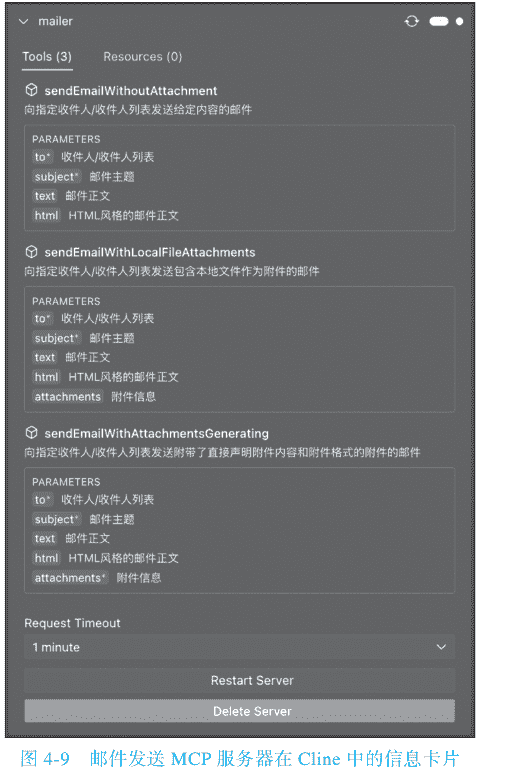

图 4-9 邮件发送 MCP 服务器在 Cline 中的信息卡片

可以看到 mcp_server.js 中声明的三件工具已被 Cline 完整识别，邮件发送 MCP 服务器与 Cline 已成功连通。

### 4.3.4 在 Cline 中实际调用邮件发送 MCP 服务器

我们可以用一条“发送附带 ics 日程附件的邮件”指令来验证：

莫欣老师下周三有两个重要安排：上午 10:30 前往中关村与 AIGCLink 负责人占冰强老师开会，讨论 MCP 应用落地；晚上 8:00 在知乎知学堂主讲 AI 线上直播课。两项安排均需提前半小时提醒，邮箱是 moxin@agently.tech，请发送带日程附件的邮件协助他管理事务。

处理过程：

1. 思考及计划：
   1. 任务需要向 moxin@agently.tech 发送一封包含两项日程的日历附件邮件
   2. environment_details 显示当前存在可发送带附件邮件的邮件发送 MCP 服务器
   3. 该服务器提供 sendEmailWithAttachmentsGenerating 工具，可直接发送生成式附件
   4. 需要：
      - 为上午 10:30 的会议和晚上 8:00 的讲座分别生成日历事件附件
      - 每个事件需内置提前 30 分钟的提醒
      - 借助邮件发送 MCP 服务器完成投递
   5. 附件对应：
      - 2025 年 4 月 16 日（下周三）上午 10:30 与占冰强的会议
      - 2025 年 4 月 16 日（下周三）晚上 8:00 讲座
   6. 当前时间为 2025 年 4 月 13 日 12:38，上述日期成立

调用要求：

Cline 拟使用 mailer MCP 服务器提供的工具

工具名：sendEmailWithAttachmentsGenerating

调用参数：< 略 >

调用结果：

邮件发送成功

任务完成：

已向 moxin@agently.tech 成功投递包含双日程提醒的邮件，邮件内含两个日历附件：

1. meeting_with_zhanbingqiang.ics - 上午 10:30 与占冰强老师的会议，提醒时间设为 10:00
2. zhihu_live_lecture.ics - 晚上 8:00 知乎直播课，提醒时间设为 19:30

两份日历文件均可直接导入日历应用

实际运行效果如图 4-10 所示。

打开收件箱，可看到正确的 ICS 附件邮件已送达，如图 4-11 所示。

将两个 ICS 附件导入日历应用后的效果如图 4-12 所示。

120 一本书讲透 MCP：AI Agent 互联网新纪元

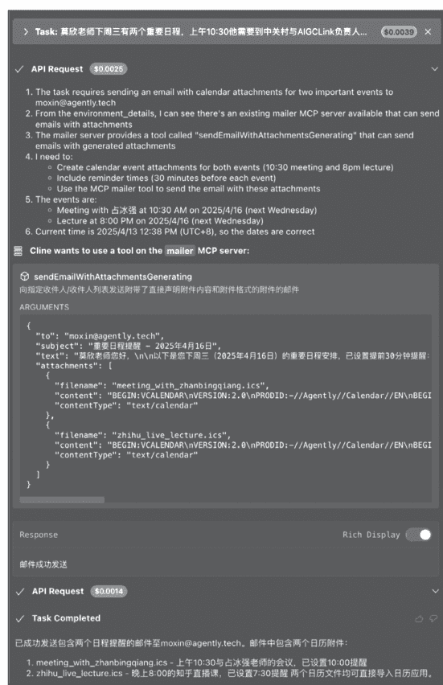

图 4-10 邮件发送 MCP 服务器在 Cline 中的实际运行效果

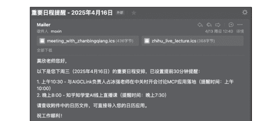

图 4-11 Cline 通过邮件发送 MCP 服务器生成的邮件内容

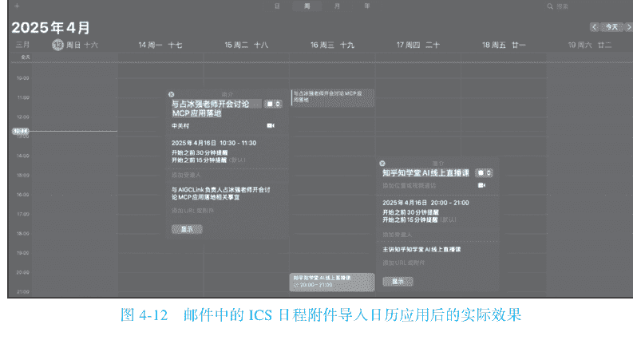

图 4-12 邮件中的 ICS 日程附件导入日历应用后的实际效果

### 4.4 创建自己的 MCP 客户端，消费 MCP 生态提供的各种 MCP 服务器

经过本章前面的实操，我们已经能够从零搭建出复杂度较高的 MCP 服务器。但你可能会问：我做的 MCP 服务器只能被 Cline、Claude 这类产品化客户端调用吗？随着 MCP 生态扩张，越来越多的行动能力以 MCP 服务器形式出现，我能否从能力供给方转变为能力集成方，成为 MCP 客户端或主机的开发者？

完全可以。接下来我们将换一种视角，用 Python 从零构建一个 MCP 客户端模块，通过它统一调用各类 MCP 服务器的能力。

#### 4.4.1 Python MCP 客户端最小启动方案

和搭建 MCP Server 一样，客户端这边的开发环境也得先准备好。建议使用 Python 3.10 及以上版本，依赖包通过 pip 安装。第一次使用官方 SDK 的话，执行 `pip install mcp` 等待安装成功提示即可进入下一步。

环境就绪后在 IDE 里新建一个工作文件 `mcp_client.py`，把基础模板贴进去：

```python
import asyncio

from mcp import ClientSession, StdioServerParameters
from mcp.client.stdio import stdio_client

server_params = StdioServerParameters(
    command="<MCP 脚本启动指令>",
    args=["<MCP 脚本启动参数>"],
    env=None,
)

async def run():
    async with stdio_client(server_params) as (read, write):
        async with ClientSession(read, write) as session:
            await session.initialize()
            # 查看可用的 prompt 能力列表
            response = await session.list_prompts()
            print("Prompt 列表:", response.prompts)
            # 请求具体的 prompt 返回
            response = await session.get_prompt(
                "<prompt 地址>",
                arguments={
                    "<prompt 能力参数名>": "<prompt 能力参数值>"
                },
            )
            print("Prompt 处理后的消息列:", response.messages) #返回符合模型请求规范的 Messages 消息列

            # 查看可用的 resource 能力列表
            response = await session.list_resources()
            print("Resource 列表:", response.resources)
            # 请求具体的 resource
            response = await session.read_resource("<resource 地址>")
            print("Resource 返回结果:", response.contents[0].text)

            # 查看可用的 tool 能力列表
            response = await session.list_tools()
            print("Tool 列表:", response.tools)
            # 调用具体的 tool
            response = await session.call_tool(
                "<tool 名>",
                arguments={
                    "<tool 能力参数名>": "<tool 能力参数值>"
                },
            )
            print("Tool 调用结果:", response.content[0].text)

asyncio.run(run())
```

到此，最简的客户端脚手架就搭好了。下面拆开来看这段模板里在做什么：

- `StdioServerParameters` 实例化的 `server_params` 负责保存客户端要连上的 MCP 服务器信息，是连接配置的载体。
- 通过 `async with stdio_client(server_params) as (read, write):` 以异步上下文的方式建立基于标准输入输出的读写通道。注意一个读写对只对应一个服务器，一个客户端实例只能连一个目标服务器。
- 再用 `async with ClientSession(read, write) as session:` 在读写通道上创建会话对象。session 承担一次客户端向服务器发起交互的生命周期，离开上下文后会自动销毁释放资源。
- 在 session 有效期间可用的常用能力有：
  - `session.initialize()`：会话的开场白，必须最先调用，用来握手确认服务器能正常响应后续请求。
  - `session.list_prompts()`：拉取服务器当前暴露的所有 Prompt 能力目录。
  - `session.get_prompt()`：按名称调取指定的 Prompt，拿到返回的消息体。
  - `session.list_resources()`：列出服务器提供的全部资源清单。
  - `session.read_resource()`：读取指定资源的具体内容。
  - `session.list_tools()`：获取服务器支持的全部 Tool 列表。
  - `session.call_tool()`：实际执行某个 Tool，需要传工具名和参数，拿到执行结果。

有了这个通用模板，就可以把它用在前文搭建的邮件发送服务器上。新建 `mailer_mcp_client.py`，写入调用示例：

```python
import json
import asyncio

from mcp import ClientSession, StdioServerParameters
from mcp.client.stdio import stdio_client

server_params = StdioServerParameters(
    command="node",
    args=[
        "/path/to/mcp_mailer/mcp_server.js"
    ],
    env={
        "MAILER_HOST": "< 邮箱服务地址 >",
        "MAILER_PORT": "< 邮箱服务端口 >",
        "MAILER_USER": "< 使用邮箱服务的账号，通常需要包含 @ 之后的部分 >",
        "MAILER_PASSWORD": "< 账号对应的密码或是专属认证 token >"
    },
)

async def run():
    async with stdio_client(server_params) as (read, write):
        async with ClientSession(read, write) as session:
            await session.initialize()
            # 因为邮件发送 MCP 服务器只包括 Tool 能力
            # 所以我们只能使用 .list_tools() 和 call_tool() 方法
```

这段示例先通过 `session.list_tools()` 拉取 Tool 列表，并用 `json.dumps` 配合 `ensure_ascii=False`、`indent=4` 做可读性格式化输出，打印出 `>>>>>>Tool 列表:`。随后调用名称为 `sendEmailWithoutAttachment` 的工具，传入收件人 `<测试邮箱地址>`、主题 `来自 MCP Client 的问候`、正文 `你好！`，最后打印 `>>>>>>Tool 调用结果:` 并输出 `response.content[0].text`。入口用 `asyncio.run(run())` 启动整个异步流程。

保存后直接运行，就能看到 Tool 列表的清晰展示以及邮件发送工具的返回结果。

```
>>>>>Tool 列表:
{
    "name": "sendEmailWithoutAttachment",
    "description": "向指定收件人/收件人列表发送给定内容的邮件",
    "inputSchema": {
        "type": "object",
        "properties": {
            "to": {
                "anyOf": [
                    {
                        "type": "string"
                    },
                    {
                        "type": "array",
                        "items": {
                            "type": "string"
                        }
                    }
                ],
                "description": "收件人/收件人列表"
            },
            "subject": {
                "type": "string",
                "description": "邮件主题"
            },
            "text": {
                "type": "string",
                "description": "邮件正文（纯文本）"
            },
            "html": {
                "type": "string",
                "description": "邮件正文（HTML 代码）"
            }
        },
        "required": [
            "to",
            "subject"
        ],
        "additionalProperties": false,
        "$schema": "http://json-schema.org/draft-07/schema#"
    }
}
{
    "name": "sendEmailWithLocalFileAttachments",
    "description": "向指定收件人／收件人列表发送包含本地文件作为附件的邮件",
    "inputSchema": {
        "type": "object",
        "properties": {
            "to": {
                "anyOf": [
                    {
                        "type": "string"
                    },
                    {
                        "type": "array",
                        "items": {
                            "type": "string"
                        }
                    }
                ],
                "description": "收件人／收件人列表"
            },
            "subject": {
                "type": "string",
                "description": "邮件主题"
            },
            "text": {
                "type": "string",
                "description": "邮件正文"
            },
            "html": {
                "type": "string",
                "description": "HTML 风格的邮件正文"
            },
            "attachments": {
                "type": "array",
                "items": {
                    "type": "object",
                    "properties": {
                        "filename": {
                            "type": "string"
                        },
                        "path": {
                            "type": "string",
                            "description": "本地文件地址"
                        }
                    },
                    "required": [
                        "filename"
                    ],
                    "additionalProperties": false
                },
                "description": "附件信息"
            }
        },
        "required": [
            "to",
            "subject"
        ],
        "additionalProperties": false,
        "$schema": "http://json-schema.org/draft-07/schema#"
    }
}
{
    "name": "sendEmailWithAttachmentsGenerating",
    "description": "向指定收件人／收件人列表发送附带直接声明附件内容和附件格式的附件的邮件",
    "inputSchema": {
        "type": "object",
        "properties": {
            "to": {
                "anyOf": [
                    {
                        "type": "string"
                    },
                    {
                        "type": "array",
                        "items": {
                            "type": "string"
                        }
                    }
                ],
                "description": "收件人／收件人列表"
            },
            "subject": {
                "type": "string",
                "description": "邮件主题"
            },
            "text": {
                "type": "string",
                "description": "邮件正文"
            },
            "html": {
                "type": "string",
                "description": "HTML 风格的邮件正文"
            },
            "attachments": {
                "type": "array",
                "items": {
                    "type": "object",
                    "properties": {
                        "filename": {
                            "type": "string"
                        },
                        "content": {
                            "type": "string",
                            "description": "附件内容"
                        },
                        "contentType": {
                            "type": "string",
                            "description": "附件格式声明"
                        }
                    },
                    "required": [
                        "filename",
                        "content",
                        "contentType"
                    ],
                    "additionalProperties": false
                },
                "description": "附件信息"
            }
        },
        "required": [
            "to",
            "subject",
            "attachments"
        ],
        "additionalProperties": false,
        "$schema": "http://json-schema.org/draft-07/schema#"
    }
}
```

```
>>>>>Tool 调用结果：
邮件成功发送
```
看到这个输出，熟悉 Function Calling 的朋友基本都能看出门道。OpenAI 官方的 Function Calling 调用方式和返回格式，现在已经成为事实上的行业通用标准，先把官方文档里给出的请求示例和返回结构回顾一下。

1）Function Calling 请求方法：
```python
# OpenAI 官方文档提供的 Function Calling 请求示例
from openai import OpenAI
import json

client = OpenAI()

# Function Calling 所需工具列表信息
tools = [{
    "type": "function",
    "function": {
        "name": "get_weather",
        "description": "Get current temperature for provided coordinates in celsius.",
        "parameters": {
            "type": "object",
            "properties": {
                "latitude": {"type": "number"},
                "longitude": {"type": "number"}
            },
            "required": ["latitude", "longitude"],
            "additionalProperties": False
        },
        "strict": True
    }
}]

messages = [{"role": "user", "content": "What's the weather like in Paris today?"}]

completion = client.chat.completions.create(
    model="gpt-4o",
    messages=messages,
    tools=tools,
)
```

2）在 Function Calling 返回结果 `completion.choices[0].message.tool_calls` 部分的数据结构样例：
```json
[{
    "id": "call_12345xyz",
    "type": "function",
    "function": {
        "name": "get_weather",
        "arguments": "{\"latitude\":48.8566,\"longitude\":2.3522}"
    }
}]
```

对照 MCP 客户端去调用邮件发送 MCP 服务器得到的结果，和 OpenAI 官方 Function Calling 的请求格式、返回格式，可以发现：借助 MCP SDK 描述 MCP 服务器工具能力时，这些信息已经被整理成可以直接喂给 Function Calling 的结构。经由 MCP 客户端访问后，这套结构就能迅速在 Function Calling 或其他智能场景里被消费。反过来，Function Calling 返回的工具名 name 和参数 arguments，也能直接拿去驱动 MCP 服务器的真实工具调用，并拿到最终结果。

> 注：你也可以通过 Cline 从 MCP Market 中安装其他 MCP 服务器（如 sqlite），在安装完成后，从 `cline_mcp_settings.json` 文件中获得这些 MCP 服务器的配置信息，再使用上面的脚本尝试对它们进行读取。同时，Cline 从 MCP Market 中安装 MCP 服务的过程也非常有意思，这个安装过程本身也是一个 MCP 服务器，感兴趣的朋友一定要自己动手尝试一下。

想更深入了解 Function Calling 的数据结构，可以参考 OpenAI 官方介绍：https://platform.openai.com/docs/guides/function-calling。

#### 4.4.2 大型项目里优雅封装 MCP 客户端

用前面那份基础运行脚本确实能连上指定的 MCP 服务器完成请求，可在大型工程里，每次都要重写一套连接逻辑显然不现实。下面就把这套客户端做一次轻量封装，提升复用性。

先总结一下刚才那份基础脚本的行为特点：

- MCP 客户端和 MCP 服务器是严格的一对一关系，用一组 MCP Server Parameters 建立连接后会生成一对读写对象，但这两个对象不能直接拿来用，也必须待在 `async with` 的上下文里。
- 在一次连接的上下文范围内，最多只能诞生一个客户端会话。强行再建第二个，就会抛出 `anyio.ClosedResourceError`。
- 会话可用前必须先执行 `session.initialize()`，同样也不能脱离 `async with` 上下文使用。

基于这些限制，实际封装时可以这样设计：

- 当 MCP Server、MCP Client、Client Session 三者都是绑定关系时，定义一个 `MCPClient` 类，在实例化阶段就把服务器参数固定下来。
- 类的 `__init__` 是同步的，而真正的连接、会话创建与初始化都是异步操作，所以需要提供一个异步的 `connect()` 方法来完成连接、建会话、初始化这几步。
- 初始化好的 Client Session 可以作为 `MCPClient` 实例的属性暴露出来，方便项目各处复用。
- 还要提供一个 `close()` 方法，在使用结束后清理会话并关闭连接。相比 `async with` 语法，这种写法会让连接、调用、关闭分散在代码的不同位置。
- 如果只是临时用一下，也可以写成简化版的 `async with MCPClient(<StdioServerParameters>) as session:`，快速完成连接、初始化，使用完毕自动关闭。

按照前面的思路，我们可以在项目目录下新建一个 `MCPClient.py`，把对应代码填进去：

```python
from contextlib import AsyncExitStack
from mcp import ClientSession, StdioServerParameters
from mcp.client.stdio import stdio_client

class MCPClient:
    def __init__(self, server_params: StdioServerParameters=None):
        self._server_params = server_params
        # 使用 AsyncExitStack 管理异步上下文资源
        self._exit_stack = AsyncExitStack()
        self._read = None
        self._write = None
        self._session = None

    # 连接
    async def connect(self, server_params: StdioServerParameters=None):
        # 可以在 connect 方法中提交 Server 参数（更高优先级），也可以使用初始化时提交的 Server 参数
        server_params = server_params or self._server_params
        # 没有找到 Server 参数抛出运行时错误提示
        if not server_params:
            raise RuntimeError("MCP server parameters are required.")
        # 创建连接
        self._read, self._write = await self._exit_stack.enter_async_context(
            stdio_client(server_params)
        )
        # 创建会话
        self._session: ClientSession = await self._exit_stack.enter_async_context(ClientSession(self._read, self._write))
        # 初始化会话
        await self._session.initialize()

    # 关闭连接
    async def close(self):
        # 等待 AsyncExitStack 完成清理后关闭
        await self._exit_stack.aclose()

    # 使用 property 装饰器实现对 client.session 的校验
    @property
    def session(self):
        # 当未完成连接时提示先进行连接
        if not self._session:
            raise RuntimeError("Use `await client.connect(<server_params>)` to connect a MCP server first.")
            # 这里不能直接尝试连接的原因是连接需要异步执行
            # 而 @property 获取属性值只能装饰同步函数
        return self._session

    # 定义 __aenter__ 和 __aexit__ 以支持 async with 语法
    async def __aenter__(self):
        await self.connect()
        return self.session

    async def __aexit__(self, _, __, ___):
        await self.close()
```

接着在同一目录下新建一个测试脚本，用于验证封装类是否可用。新建 `mcp_client_testing.py`，把下面代码写进去直接跑一遍：

```python
import asyncio
from mcp.client.stdio import StdioServerParameters
from MCPClient import MCPClient

server_params = StdioServerParameters(
    command="node",
    args=[
        "/path/to/mcp_mailer/mcp_server.js"
    ],
    env={
        "MAILER_HOST": "< 邮箱服务地址 >",
        "MAILER_PORT": "< 邮箱服务端口 >",
        "MAILER_USER": "< 使用邮箱服务的账号，通常需要包含 @ 之后的部分 >",
        "MAILER_PASSWORD": "< 账号对应的密码或是专属认证 token >"
    },
)

async def test_1():
    # 创建 MCPClient 实例
    mcp_client = MCPClient()
    # 手动连接
    await mcp_client.connect(server_params)
    # 通过对 mcp_client.session 提供的方法进行异步调用以使用 MCP Server 能力
    response = await mcp_client.session.list_tools()
    print(response.tools)
    # 手动关闭
    await mcp_client.close()

async def test_2():
    # 直接使用async with上下文管理器，简化连接过程并在使用完成后自动关闭
    async with MCPClient(server_params) as session:
        response = await session.list_tools()
        print(response.tools)

asyncio.run(test_1())
asyncio.run(test_2())
```

如果输出显示两条完全一致的邮件发送工具信息，就说明封装生效了。两种调用方式得到的结果完全相同，这样的封装让 MCPClient 对象在大型项目里更方便使用和传递。

### 4.5 用 SQLite MCP 服务器搭建可记事的智能应用

前面我们已经动手做出了 MCP 客户端。但光有 MCP 服务器和客户端，还做不出完整的智能应用，还需要补上智能处理逻辑这一块。

结合 4.4 节的说明，智能处理逻辑是 MCP 主机的核心。没有它，主机就接收不到 MCP 带来的能力供给。虽然这部分逻辑和 MCP 协议本身关系不大，不需要遵循任何协议规范，只要按场景规划好处理流程，以合适的方式消费服务器提供的能力，并在需要时通过客户端发起调用即可。听起来简单，实际上它正是连接大模型能力与 MCP 服务器能力的桥梁，而且是基于业务场景的编排，而不是简单的直连。

光有概念还不够，搭建智能处理逻辑究竟需要哪些支撑？我们用一个典型场景来拆解：让模型能够通过数据库记事。

#### 4.5.1 数据库记事的业务流程怎么设计

如果你经常使用模型接口或本地推理，就会知道模型本身没有记忆和成长能力。模型是预训练的，哪怕把同一份带业务知识的对话喂给它上万次，参数也不会发生变化。但一旦赋予模型数据读写能力，情况就不同了。模型虽然参数不变，却具备很强的上下文学习能力，只要在请求中带足信息，它就能基于这些信息给出回答。

比如问模型“今天有哪些重要事项？”，同时把今天的待办清单一起喂进去，模型自然能复述出来。有人会说这不就是自问自答吗？单次交互的确如此。可如果这些事项是模型在之前的对话中主动记录下来、保存到数据库，再在你提问时自行从数据库里查出来回答呢？那就有了智能助理的味道。

这能实现吗？先梳理工作逻辑。

从图 4-13 可以看出，蓝色区域正是要在智能处理逻辑中落地的部分：

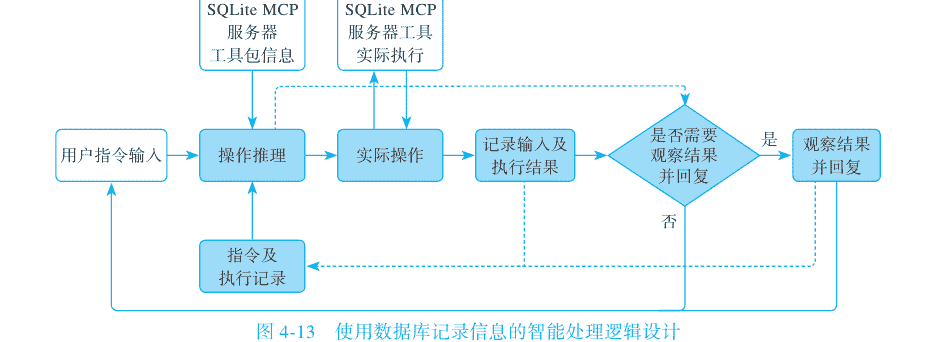

首先，基于用户输入的指令或提问，产出下一步的操作推理结论。这一步需要把 SQLite MCP 服务器提供的工具集，以及已完成的执行记录一起交给模型；
其次，依据模型的推理结果，通过 SQLite MCP 服务器的工具对数据库做实际操作；
然后，把执行的指令和结果写入执行记录，方便后续调用；
如果本次输入需要在观察操作结果后再回复，就要读取执行记录并尝试生成回应；
最后回到初始状态，等待下一次用户输入。

思路很清晰，但真正开发时会发现几个难点：

蓝色部分的智能逻辑并不会得到 MCP 服务器的“智能”支持，需要自己消费服务器信息并调用工具；
部分步骤明显依赖大模型，但有些步骤又要同时完成多项推理，例如操作推理既要结合用户指令和历史记录判断下一步动作，又要选工具并生成可执行的指令，还要判断是否需要等待结果后再回复，这种复杂推理该如何设计请求指令；
整个流程已经超出简单的模型接口封装，需要更清晰的代码组织，保证可用同时易于维护。

针对这些问题，下面介绍一个高度适配的开发框架——Agently AI 应用开发框架，帮你快速把智能逻辑搭起来。

#### 4.5.2 用 Agently 框架搭建智能逻辑

Agently 的设计目标是“给开发者极致顺滑的 AI 应用开发心流，让开发更简单易学”。目前已发布 3.5.1 版本并持续更新。官网是 Agently.tech 或 Agently.cn，代码托管在 GitHub.com/AgentEra/Agently 并开源，提供大量示例，已获 1300+ Stars，被多家企业用于线上业务落地。

安装很直接，命令行执行 `pip install -U Agently` 即可获取最新版，或用 `pip install Agently==3.5.1` 安装本书案例版本。安装完成后即可动手。

Agently 如何支撑智能应用核心逻辑的开发？结合特性与代码来看最直观。

##### 1. 特性：像写代码一样控制模型输出

有经验的工程师都知道，把对话机器人放在 IDE 侧边栏提问，和把大模型能力嵌进业务代码运行时协同工作是两回事。后者需要的不只是理解力，还需要把代码里的参数、变量、函数、模块与模型的输入输出桥接起来。为此需要：

更贴合代码开发习惯的数据传递方式，比 Prompt 模板更省心，最好能无缝兼容各种类型数据；
更强更稳的结构化输出控制，因为代码运行时下游函数只能消费结构化数据，一段漂亮的推理或分析在代码里毫无用处，反而增加解析成本。

Agently 的输出控制不绑定具体模型，业务代码写好后可随时切换更强或更经济的模型而无需重写。

具体效果看这段示例：

```python
import Agently
agent = (
    Agently.create_agent()
        # 声明使用兼容 OpenAI-Like 的请求客户端插件发起模型请求
        .set_settings("current_model", "OAIClient")
        # 设置对应模型服务商的请求信息，这里以 DeepSeek 为例
        .set_settings("model.OAIClient.auth", { "api_key": "<DeepSeek-API-Key>" })
        .set_settings("model.OAIClient.options", { "model": "deepseek-chat" })
        .set_settings("model.OAIClient.url", "https://api.deepseek.com/v1")
        # 如果想要使用 Ollama 启动的本地模型服务可以这样设置
        # .set_settings("model.OAIClient.options", { "model": "qwen2.5:14b" })
        # .set_settings("model.OAIClient.url", "http://127.0.0.1:11434/v1")
)

user_input = "请给我输出 3 个单词和 2 个句子"
topic = ["自然", "海洋", "节庆"]

result = (
    agent
        # 支持复杂数据结构以及变量的输入
        .input(user_input)
        .instruct({
            "输出的单词需要以这些为主题": topic,
        })
        # 符合代码开发习惯的结构化输出控制语法
        .output({
            # 使用 Tuple 元组 (< 类型 >, < 描述 >) 方式定义内容输出节点
            "output_language": ("str", "必须为与 {input} 输入的自然语言相同的语言"),
            # 通过有序输出，产生思维链 (CoT) 效果，任何模型都可以做预推理
            "thinking": (
                "str",
                "思考并澄清用户输入的意图，他/她可能的身份，希望得到的结果，你觉得合理的响应方式"
            ),
            "output": {
                "words": [("str", )], # 没有 < 描述 > 信息可以省略
                "sentences": ("list", ), # 灵活的类型表达方式
            },
        })
        .start()
)
# 输出完整的 result 结果
print(result)
# 根据 output 的数据结构约定，直接使用 result 中的指定字段内容
print(result["output"]["sentences"][1])
```

运行结果是：

```json
{
    "output_language": "zh",
    "thinking": "用户要求输出 3 个单词和 2 个句子，并指定了单词的主题为自然、海洋和节庆。用户可能是需要一些与这些主题相关的词汇和句子，用于学习、创作或其他用途。合理的响应方式是提供符合主题的单词和相关的句子。",
    "output": {
        "words": ["森林", "珊瑚", "烟花"],
        "sentences": [
            "清晨的森林充满了鸟儿的歌声，让人感到宁静与祥和。",
            "节庆的夜晚，烟花在天空中绽放，照亮了每个人的脸庞。"
        ]
    }
}
```

节庆的夜晚，烟花在天空中绽放，照亮了每个人的脸庞。

可见在业务代码里用 Agently 发起模型请求，上游数据能像函数调用一样无缝传入，通过 `.output()` 的结构化约定稳定拿到结构化结果。同时还能用符合代码习惯的方式运用高级提示词技巧，在一次请求里构建思维链、预思考、反思等输出模式。

> 注：如果想要进一步了解 Agently 如何为你提供模型请求控制能力增强，请访问 Agently 框架官网阅读相关教程：https://agently.tech/guides/agentic_request/guide.html。

##### 2. 特性：代码级工作流开发更清晰好上手

回看前面让模型用数据库记事的方案，你会发现带大模型参与的业务流程，和传统工作流的思路非常接近。实际上，绝大多数面向具体场景的智能化方案，都能先画出一张流程图，再把它落到代码里去编排。正是基于这一认知，Agently 框架提供了一套可直接在代码层面操作的工作流开发与管理机制，把开发过程拆成三个核心环节：先定义工作块，再把工作块串联起来，最后执行运行，同时还附带了运行时数据传递的便捷管理手段。

Agently Workflow 的写法十分直观，几乎不用额外讲解，下面这段示例就能体现它的组织方式和书写习惯：

```python
import Agently

# 创建一个 workflow 实例
test_workflow = Agently.Workflow()

# 定义 workflow 中的工作块
@test_workflow.chunk()
def receive(inputs, storage):
    # 通过 inputs["default"] 获取输入数据信息
    print("Received:", inputs["default"])
    # 可以将数据存入工作流全局数据存储区
    storage.set("saved_data", inputs["default"])
    # 也可以通过 return 的方式，将数据传到下一个块的 inputs["default"] 里
    return inputs["default"]

@test_workflow.chunk()
def report_not_str(inputs, storage):
    # 可以在任意下游块从工作流全局数据存储中取出数据
    print(f"This is not a string: { storage.get('saved_data') }")

@test_workflow.chunk()
def return_value(inputs, storage):
    # 也可以借助上下游连接通过 inputs 获得数据
    return f"ECHO: { inputs['default'] }"

# 表达 workflow 工作块连接方式
(
    test_workflow
        .connect_to("receive")
        # 支持条件判断产生处理分支
        .if_condition(
            lambda return_value, storage: isinstance(return_value, str)
        )
            .connect_to("return_value")
        .else_condition()
            .connect_to("report_not_str")
        .end_condition()
        # 连接到 END 块的上游工作块的 return 结果会传递到最终输出结果中
        .connect_to("END")
)

# 启动工作流并获取结果
result = test_workflow.start("This is a workflow")
print(result["default"])
```

把这段示例跑起来，当输入为 "This is a workflow" 时，输出会是：

```
Received: This is a workflow
ECHO: This is a workflow
```

如果改成输入 123，则得到的结果是：

```
Received: 123
This is not a string: 123
None
```

> 注：如果想要进一步了解 Agently Workflow 的相关知识，请访问 Agently 框架官网阅读相关教程：https://agently.tech/guides/workflow/。

#### 4.5.3 部署 SQLite MCP 服务器

开发工具到位后，要实现模型调用数据库记事的智能应用，还需要一个模型容易调用的数据库接入点。SQLite 基于本地文件或内存就能搭建 SQL 友好的结构化存储，体积小巧，在 Python 环境里直接用自带的 sqlite3 库即可，无需额外服务。好在 MCP 官方恰好开源了一套 SQLite MCP 服务器，既能从官方 GitHub 仓库拉取安装，也支持通过 Cline 一键安装。

下面我会先说明如何从 MCP 官方仓库下载并使用该服务器，个人更推荐直接用 Cline 安装，体验下智能时代的新型工具接入方式。

想走官方仓库的话，只需打开 MCP 官方 GitHub 主页，进入 servers/src/sqlite 目录，就能看到官方提供的 SQLite MCP 服务器示例，完整链接是 https://github.com/modelcontextprotocol/servers/tree/main/src/sqlite。

把该目录下的全部文件复制到本地工作目录即可。

该服务器建议用 uv 来管理运行，若本地还未安装，可执行 `pip install uv` 进行安装。

安装完成后，就可以用以下配置在 MCP 客户端中接入 SQLite MCP 服务器：

```json
"mcpServers": {
    "sqlite": {
        "command": "uv", // 通过 uv 启动服务
        "args": [
            "--directory",
            "path/to/servers/src/sqlite", // 这里是 SQLite MCP 服务器脚本所在目录
            "run",
            "mcp-server-sqlite",
            "--db-path",
            "~/test.db" // 这个是 SQLite 运行时使用的 DB 文件地址
        ]
    }
}
```

#### 4.5.4 实战：让模型调用数据库记事的处理逻辑

前期准备都已就绪，下面正式进入让模型使用数据库记事的智能处理逻辑开发。

首先确认已按前期指引在工作环境中执行 `pip install Agently==3.5.1` 安装 Agently 框架，并且已下载好 SQLite MCP 服务器脚本。接着在工作环境中新建一个名为 `note.py` 的文件，并写入如下代码：

```python
import asyncio
import Agently
from datetime import datetime

# 要件准备
## MCP 客户端
mcp_client = Agently.utils.MCPClient({
    "command": "uv",
    "args": [
        "--directory",
        "path/to/sqlite/src/sqlite",
        "run",
        "mcp-server-sqlite",
        "--db-path",
        "/Users/moxin/test.db"
    ],
    "transportType": "stdio"
})

## 模型请求代理对象
agent = (
    Agently.create_agent()
        .set_settings("current_model", "OAIClient")
        .set_settings("model.OAIClient.auth", { "api_key": "<DeepSeek-API-Key>" })
        .set_settings("model.OAIClient.options", { "model": "deepseek-chat" })
        .set_settings("model.OAIClient.url", "https://api.deepseek.com/v1")
)

## 工作流对象
workflow = Agently.Workflow()

# 工作块定义

## 获取用户指令输入
@workflow.chunk()
def get_user_input(inputs, storage):
    storage.set("user_input", input("[ 请输入您的指令 ]:"))

## 分析用户指令，给出应对（涉及 MCP 操作，使用异步函数体）
@workflow.chunk()
async def analyse_user_input(inputs, storage):
    analyse_result = (
        agent
            .input(storage.get("user_input"))
            .info({
                "工具清单": await mcp_client.get_tools_info(),
                "历史记录": storage.get("history"),
                "当前时间": datetime.now().strftime("%Y-%m-%d %H:%M:%S"),
            })
            .output({
                ## 数据库操作指令拆解
                "db_operations": ([{
                    "nl_order": ("str", "从 {input} 中拆解出的 1 项涉及数据库操作的自然语言指令意图", True),
                    "tool_name": ("str", "根据 {info. 工具清单} 提供的可用工具信息，选择对应的工具", True),
                    "kwargs": ("kwargs dict", "调用 {tool_name} 所需的指令参数", True),
                }], "逐项拆解 {input} 中涉及的数据库操作指令，多项操作要按时序先后顺次输出，如果没有，输出 []"),
                ## 判断是否需要给出操作后回应
                "need_observe_and_reply": (
                    "bool",
                    " 根据 {input} 判断用户是否进行了询问，需要观察上述操作结果后给出回应？ "
                ),
            })
            .start()
    )
    return analyse_result

## 执行操作获得返回结果（涉及 MCP 操作，使用异步函数体）
@workflow.chunk()
async def call_db_operations(inputs, storage):
    # 从指令分析块获取操作清单和是否需要观察后回应的判断结果
    db_operations = inputs["default"]["db_operations"]
    need_observe_and_reply = inputs["default"]["need_observe_and_reply"]

    # 从全局存储获取操作记录
    history = storage.get("history", [])

    # 将本次用户指令添加到历史记录中
    history.append(f"[ 用户指令 ]: { storage.get('user_input') }")

    # 逐项进行操作并记录结果
    for db_operation in db_operations:
        try:
            # 通过 MCP 客户端调用工具
            operation_response = await mcp_client.session.call_tool(
                db_operation["tool_name"],
                db_operation["kwargs"],
            )
            operation_result = operation_response.content[0].text
            # 记录结果并在控制台输出
            result = (
                f"[ 操作目标 ]: { db_operation['nl_order'] }\n" +
                f"[ 调用工具 ]: { db_operation['tool_name'] }( { db_operation['kwargs'] } )\n" +
                f"[ 运行结果 ]: { operation_result }"
            )
            history.append(result)
            print(result)
        except Exception as e:
            # 如果遭遇错误，记录运行错误并在控制台输出
            error = (
                f"[ 操作目标 ]: { db_operation['nl_order'] }\n" +
                f"[ 调用工具 ]: { db_operation['tool_name'] }( { db_operation['kwargs'] } )\n" +
                f"[ 遭遇错误 ]: { e }"
            )
            history.append(error)
            print(error)

    # 保存更新后的历史记录
    storage.set("history", history)

    return need_observe_and_reply

## 观察后给出回应
@workflow.chunk()
def observe_and_reply(inputs, storage):
    history = storage.get("history", [])

    reply = (
        agent
            .input(storage.get("user_input"))
            .info({
                "历史记录": storage.get("history")
            })
            .instruct("观察 { 历史记录 } 并对 {input} 进行回应 ")
            # 这次回应只需要文本直接输出即可
            # 不需要使用 .output() 进行格式规约
            .start()
    )

    history.append(f"[ 指令回应 ]: { reply }")
    storage.set("history", history)

    print(f"[ 指令回应 ]: { reply }")

@workflow.chunk()
def exit(inputs, storage):
    # 将历史记录作为工作流结果输出
    return storage.get("history")

# 工作流编排
(
    workflow
        .connect_to("get_user_input")
        # 通过指令主动停止环状工作流
        .if_condition(
            lambda return_value, storage: storage.get("user_input") == "exit"
        )
            .connect_to("exit")
            .connect_to("END")
        .else_condition()
            # 没有停止则进入正常工作流程
            .connect_to("analyse_user_input")
            # 如果需要进行数据库操作
            .connect_to("call_db_operations")
            # 如果操作完需要观察后回复，回复并回到用户输入
            .if_condition(
                lambda return_value, storage: return_value == True
            )
                .connect_to("observe_and_reply")
                .connect_to("get_user_input")
            .else_condition()
                .connect_to("get_user_input")
            .end_condition()
)
```

### 4.6 多 MCP 驱动，自建通用智能助理

在做带数据库记事的智能流程时，你会不会冒出这样的念头：整体思路看着挺通用，但落地后却和数据库操作绑得太紧？如果把这套处理逻辑再松耦合一些，是不是就能接入更多 MCP 服务，搭出一个属于自己的、类 Manus 的通用助手？

答案是肯定的。无论是早期的 Function Calling，还是本章前面拿来做 MCP 测试的主机端 Cline，亦或是近期走红的 Manus，底层都离不开一个共性：围绕任务目标持续进行「规划-工具使用」循环的智能机制。

那我们也来动手试试，亲手做一个通用型智能助理。

#### 4.6.1 4.6.1 设计可复用的观察-规划-执行循环

做过数据库记事的智能逻辑后我们知道，管理好工作流运行时的上下文，能让模型做下一步判断时更有依据。要跳出对单一工具的依赖，构建一个以「观察-规划行动-使用工具」为闭环的更通用处理流程，整体执行该怎么安排？

先聚焦工作流里会反复出现的关键动作：

1）基于当前信息进行观察，并据此规划下一步行动，若涉及工具则同时给出调用指令。
2）当需要调用工具时，通过指令真正触发调用。
3）把工具的返回结果写入执行记录，留作下轮规划的参考，然后回到第1步。

循环确定后，规划环节的质量就成了核心，因为它的输出直接决定后续行为。为了让规划更可靠，必须提供三类输入：

- 用户初始指令，也就是来自用户的原始输入。
- 可用工具清单，可能接入多个 MCP 服务器，需要把各服务里的全部工具汇总起来，供模型理解并精准发出调用。
- 调用指令执行记录，即工作流自动运行过程中产生的指令与结果。

基于以上输入，我们得到如图4-14所示的自动规划智能处理逻辑流程图。

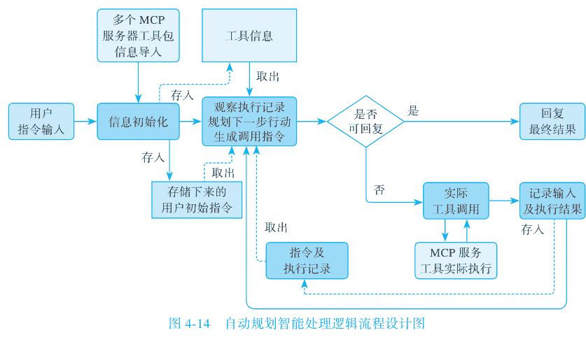

#### 4.6.2 4.6.2 基于 Agently 搭建自动规划循环

开发上仍然沿用 Agently 框架，先在工作环境执行 `pip install Agently==3.5.1` 确保版本正确，随后在项目目录新建 `auto_loop.py` 文件，并写入如下代码：

Agently 实战：让 Agent 会用数据库

```python
import Agently

workflow = Agently.Workflow()

# 信息初始化工作块
@workflow.chunk()
async def initialize(inputs, storage):
    # 读取 MCP 服务器参数
    mcp_server_params = storage.get("mcp_server_params", [])
    mcp_clients = {}
    tools_list = []
    # 生成多个 MCP 服务器的连接客户端，存储它们提供的工具信息，并管理客户端池
    for index, mcp_server_param in enumerate(mcp_server_params):
        mcp_client = Agently.utils.MCPClient(mcp_server_param)
        mcp_clients.update({ index: mcp_client })
        await mcp_client.connect()
        tools_info = await mcp_client.get_tools_info()
        for tool_info in tools_info:
            tool_info.update({ "client_index": index })
            tools_list.append(tools_info)
    # 将处理后的客户端池、工具信息、用户原始输入存入工作流全局信息
    storage.set("mcp_clients", mcp_clients)
    storage.set("tools_list", tools_list)
    storage.set("user_input", inputs["default"])

# 下一步行动规划工作块
@workflow.chunk()
def make_next_plan(inputs, storage):
    # 从工作流全局信息中取出 AI Agent
    # (通过这样的操作允许我们为工作流动态更换不同的执行 AI Agent)
    agent = storage.get("$agent")
    # 控制 AI Agent 进行下一步规划的输出
    result = (
        agent
            # 输入用户原始输入
            .input(storage.get("user_input"))
            # 输入工具清单和执行记录
            .info({
                "可用工具清单": storage.get("tools_list", []),
                "已经做过": storage.get("done_plans", []),
            })
            .instruct([
                "根据 {input} 的用户意图，{ 已经做过 } 提供的行动记录以及 { 可用工具清单 }
                提供的工具，制定解决问题的下一步计划",
                "如果 { 已经做过 } 提供的行动记录中，某项行动反复出现错误，可将下一步计划
                定为 ' 输出结果 '，回复内容为对错误的说明",
            ])
            .output({
                # 前置思考提升输出质量
                "next_step_thinking": ("str", ),
                # 根据不同行动方向生成不同内容
                "next_step_action": {
                    "type": ("' 工具使用 ' | ' 输出结果 '", "MUST IN values provided."),
                    # 直接回答
                    "reply": ("str", "if {next_step_action.type} == ' 输出结
                    果 '，输出你的最终回复结果，else 输出 ''"),
                    # 或是调用工具
                    "tool_using": (
                        {
                            # 因为连接了多个 MCP 服务器，需要额外指定客户端的编号
                            "client_index": ("int", "使用 { 可用工具清单 .client_index } 的实际值 "),
                            "tool_name": ("str from { 可用工具清单 .tool_name }",
                                " 必须使用 { 可用工具清单 } 提供的工具 "),
                            "purpose": ("str", " 描述使用工具希望解决的问题 "),
                            "kwargs": ("dict, 根据 { 可用工具清单 .kwargs} 要求给出
                                所需参数 "),
                        },
                        "if {next_step_action.type} == '工具使用', 给出你的工具
                        使用计划说明, else 输出 null",
                    ),
                },
            })
            .start()
    )
    return result["next_step_action"]

# 回复工作块
@workflow.chunk()
async def reply(inputs, storage):
    if storage.get("print_process"):
        print("[ 我觉得可以回复了 ]: ")
        print("[ 我得到的最终结果是: ", inputs["default"]["reply"])
    # 退出前批量关闭 MCP 客户端连接
    mcp_clients = storage.get("mcp_clients")
    for mcp_client in mcp_clients.values():
        await mcp_client.close()
    return {
        "reply": inputs["default"]["reply"],
        "process_results": storage.get("done_plans"),
    }

@workflow.chunk()
async def use_tool(inputs, storage):
    mcp_clients = storage.get("mcp_clients")
    tool_using_info = inputs["default"]["tool_using"]
    if storage.get("print_process"):
        print("[ 我觉得需要使用工具 ]: ")
        print(" 我想要解决的问题是: ", tool_using_info["purpose"])
        print(" 我想要使用的工具是: ", tool_using_info["tool_name"])
    # 使用 MCP Client 池里指定编号的 Client 调用工具
    tool_result = await mcp_clients[tool_using_info["client_index"]].call_tool(
        tool_using_info["tool_name"],
        tool_using_info["kwargs"],
    )
    # 得到结果, 写入执行记录
    if storage.get("print_process"):
        print(" 我得到的结果是: ", tool_result[:100], "...")
```

这段实现里实际完成了三类工作。

1）先用 Agently 框架搭好智能逻辑的底座，共三件核心组件：

- MCP 客户端：相当于 4.4 节手工封装的那种客户端，现在已经内嵌在框架里，开发者直接就能连上 MCP 服务器并调用。
- agent 模型请求代理：参考 4.6.2 节的用法，这个代理负责对模型输入输出做精细管控。
- workflow 实例：用它来声明和调度整套工作流。

2）按照 4.6.1 节的设计蓝图对流程做定义和串联，其中包括：

- analyse_user_input 块里借助框架的表达能力，把来自不同来源的用户指令、可用工具列表、历史记录等信息聚拸起来，并通过 .output() 对输出结构做约束，将自然语言指令拆解成执行指令、是否需要输出的判断、输出内容等具备复合逻辑的结果；
- call_db_operations 块支持把多条操作指令按顺序逐条执行；
- 在整体编排层面加入条件分支，一方面响应用户 exit 指令直接退出循环，另一方面在操作结束后判断是否要观察结果并继续反馈，从而构成一个比较完整的工作流。

3）启动时通过 await mcp_client.connect() 建立与 MCP 服务器的连接，连接期间运行 workflow，结束后再用 await mcp_client.close() 断开。

跑通上面代码后，就能和一个具备数据库操作能力的模型对话。下面是一次交互的示例：

```
[ 请输入您的指令 ]: 请帮我记录一下，我需要在明天上午 10 点半和毕昇负责人覃睿总进行线上会议，然后晚上回家前需要去超市购物，买 1 斤鸡蛋和 3 盒牛奶
[ 操作目标 ]: 记录明天上午 10 点半和毕昇负责人覃睿总进行线上会议
[调用工具]：write_query({"query": "INSERT INTO schedule (date, time, event, participant) VALUES ('2025-04-18', '10:30', '线上会议', '毕昇负责人覃睿总')"})
[运行结果]：Database error: no such table: schedule
[操作目标]：记录晚上回家前需要去超市购物，买1斤鸡蛋和3盒牛奶
[调用工具]：write_query({"query": "INSERT INTO shopping_list (date, item, quantity) VALUES ('2025-04-17', '鸡蛋', '1斤'), ('2025-04-17', '牛奶', '3盒')"})
[运行结果]：Database error: no such table: shopping_list
[请输入您的指令]：好像遇到错误了，处理一下？
[操作目标]：创建schedule表用于记录日程安排
[调用工具]：create_table({"query": "CREATE TABLE schedule (id INTEGER PRIMARY KEY AUTOINCREMENT, date TEXT, time TEXT, event TEXT, participant TEXT)"})
[运行结果]：Table created successfully
[操作目标]：记录明天上午10点半和毕昇负责人覃睿总进行线上会议
[调用工具]：write_query({"query": "INSERT INTO schedule (date, time, event, participant) VALUES ('2025-04-18', '10:30', '线上会议', '毕昇负责人覃睿总')"})
[运行结果]：[{"affected_rows": 1}]
[操作目标]：创建shopping_list表用于记录购物清单
[调用工具]：create_table({"query": "CREATE TABLE shopping_list (id INTEGER PRIMARY KEY AUTOINCREMENT, date TEXT, item TEXT, quantity TEXT)"})
[运行结果]：Table created successfully
[操作目标]：记录晚上回家前需要去超市购物，买1斤鸡蛋和3盒牛奶
[调用工具]：write_query({"query": "INSERT INTO shopping_list (date, item, quantity) VALUES ('2025-04-17', '鸡蛋', '1斤'), ('2025-04-17', '牛奶', '3盒')"})
[运行结果]：[{"affected_rows": 2}]
[指令回应]：已成功处理之前的数据库错误。以下是当前状态：

1. 已创建schedule表并成功记录：
- 时间：2025-04-18 10:30
- 事件：线上会议
- 参与人：毕昇负责人覃睿总

2. 已创建shopping_list表并成功记录购物清单：
- 日期：2025-04-17
- 物品：鸡蛋（1斤）、牛奶（3盒）

所有数据已正确存储，请问还需要其他帮助吗？
[请输入您的指令]：请告诉我明天有什么安排
[操作目标]：查询明天的日程安排
[调用工具]：read_query({"query": "SELECT * FROM schedule WHERE date = '2025-04-18'"})
[运行结果]：[{"id": 1, "date": "2025-04-18", "time": "10:30", "event": "线上会议", "participant": "毕昇负责人覃睿总"}]
[操作目标]：查询明天的购物清单
[调用工具]：read_query({"query": "SELECT * FROM shopping_list WHERE date = '2025-04-18'"})
[运行结果]：[]
[指令回应]：根据您的日程安排，明天（2025年4月18日）您有以下事项：

1. **上午10:30**
线上会议
参与人：华昇负责人覃睿总

2. **购物清单**
明天暂无需要购买的物品（购物清单中未查询到记录）。

需要调整安排或添加其他事项吗？
[请输入您的指令]:exit
```

从这段运行记录可以看出，这套智能处理机制让模型/AI Agent 能够自主调用数据库、完成各类记事类任务，并且基于操作日志的结果进行下一步规划。比如案例里最开始报了表不存在的错误，收到错误提示后 Agent 就能自行规划多步行为，先建表再写入数据。同时在完成读写后，还能把信息整理成符合自然语言交互习惯的最终回复。

479    done_plans = storage.get("done_plans", [])

480    done_plans.append({

481        "purpose": tool_using_info["purpose"],

482        "tool_name": tool_using_info["tool_name"],

483        "result": tool_result,

484    })

485    storage.set("done_plans", done_plans)

486    return

487

488 # 编排工作流

489 (

490     workflow

491         .connect_to("initialize")

492         .connect_to("make_next_plan")

493         .if_condition(lambda return_value, storage: return_value["type"] ==

494                       "输出结果")

495             .connect_to("reply")

496             .connect_to("end")

497         .else_condition()

498             .connect_to("use_tool")

499             .connect_to("make_next_plan")

500 )

借助这段工作流编排，就把自动规划式智能处理的骨架搭完了。整个脚本可以直接作为独立模块使用，把 workflow 对象提供给上层项目调用，也可以把它打包成一个 MCP 服务器对外暴露。Agently 框架还提供了把 Agently Workflow 一键转成 MCP 服务器的快捷方式，细节可看 6.4 节。

#### 4.6.3 挂载之前做好的 MCP 服务并现场验证效果

在前面的工作流脚本末尾继续加上下面代码，就能把之前制作的多个 MCP 服务器注册进来，实测这套智能处理流的实际运行效果：

```python
if __name__ == "__main__":
    agent = (
        Agently.create_agent()
            # 可以替换成任意适配模型
            .set_settings("current_model", "OAIClient")
            .set_settings("model.OAIClient.auth", { "api_key": "<DeepSeek-API-Key>" })
            .set_settings("model.OAIClient.options", { "model": "deepseek-chat" })
            .set_settings("model.OAIClient.url", "https://api.deepseek.com/v1")
    )
    workflow.start(
        # 给出执行任务
        "请帮我查找数据库中是否存在日程信息，将所有找到的日程信息通过邮件发送到moxin@agently.tech",
        storage = {
            # 可动态更换执行 AI Agent
            "$agent": agent,
            # 将执行过程在控制台的输出打开
            "print_process": True,
            # 传入 MCP 服务器参数，每一个元素为一个服务器参数
            "mcp_server_params": [
                {
                    "command": "uv", # 通过 uv 启动服务器
                    "args": [
                        "--directory",
                        "path/to/servers/src/sqlite", # 这里是 SQLite MCP 服务器脚本所在目录
                        "run",
                        "mcp-server-sqlite",
                        "--db-path",
                        "~/test.db" # 这个是 SQLite 运行时使用的 DB 文件地址
                    ]
                },
                {
                    "command": "node",
                    "args": [
                        "/path/to/mailer/mcp_server.js"
                    ],
                    "env": {
                        "MAILER_HOST": "<邮箱服务地址>",
                        "MAILER_PORT": "<邮箱服务端口>",
                        "MAILER_USER": "<使用邮箱服务的账号，通常需要包含 @ 之后的部分>",
                        "MAILER_PASSWORD": "<账号对应的密码或是专属认证 token>"
                    }
                }
            ]
        }
    )
```

执行脚本后，终端控制台会展示如下输出：

```
[我觉得需要使用工具]：
我想要解决的问题是：列出数据库中的所有表，以确定是否存在存储日程信息的表。
我想要使用的工具是：list_tables
我得到的结果是：[{"name": "sqlite_sequence"}, {"name": "schedule"}, {"name": "shopping_list"}] ...
[我觉得需要使用工具]：
我想要解决的问题是：查询 schedule 表中的所有日程信息
我想要使用的工具是：read_query
我得到的结果是：[{"id": 1, "date": "2025-04-18", "time": "10:30", "event": "线上会议", "participant": "毕昇负责人覃睿总"}] ...
[我觉得需要使用工具]：
我想要解决的问题是：将查询到的日程信息通过邮件发送到 moxin@agently.tech
我想要使用的工具是：sendEmailWithoutAttachment
我得到的结果是：邮件成功发送 ...
[我觉得可以回复了]：
我得到的最终结果是：已经成功查询到日程信息并发送到 moxin@agently.tech 邮箱。日程信息如下：[{"id": 1, "date": "2025-04-18", "time": "10:30", "event": "线上会议", "participant": "华昇负责人覃睿总"}]
```

与此同时，邮箱也会收到如图 4-15 所示的邮件通知。

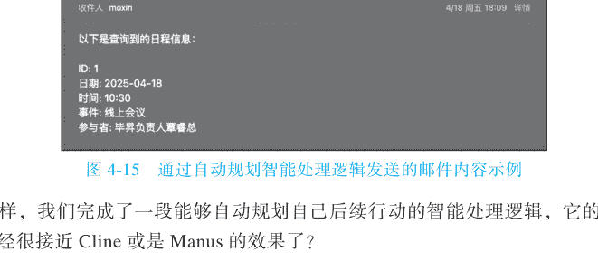

到这里，一个能够自行规划后续动作的智能处理流程就算是搭好了。它的运行轨迹，是不是已经很像 Cline 或 Manus 的表现了？

### 4.7 解密 MCP 的本质作用

从前面的实操可以看出，MCP 借助 MCP 服务器向智能应用提供工具 Tool、提示词 Prompt、资源 Resource 等能力，并为这些能力尤其是工具的调用提供了定义与分发规范。这样 MCP 服务器的开发者就能把精力放在能力本身的打造上，而不必纠结于如何把能力说明书送到客户端/主机手里，这正是协议存在的核心价值。

可与此同时也容易产生困惑：经由 MCP 传输的内容，看起来不过是拼凑智能应用的若干要素。亲手做过 MCP 服务器后会发现，它本质上是对已有能力的再封装，额外加上大模型便于理解和调用的描述信息，服务本身却似乎与智能无关。

再去写一个最基础的 MCP 客户端脚本，也能感受到局限。仅就 SDK 提供的 Client/Session 而言，工作主要是读取服务器端的能力信息：把碎片信息借助服务器提供的 Prompt 能力拼成可发给大模型的完整提示，或是拉取可调用的工具清单，供后续做 Function Calling 的工具选择；也可以直接向服务器发起一次工具调用，这和普通函数调用差别不大，只是返回格式更贴合 Function Calling。但整个客户端脚本的运行期间，并没有真正向模型发起请求。换句话说，无论是服务器还是客户端，关注点都在能力元数据与调用结果的传递上，并不强制要求大模型参与，这是典型的服务间通信机制，而非智能本身。

只有引入 Agently 这类框架，利用模型输出控制与工作流编排来组织自己的智能处理逻辑时，才会看到以大模型为核心的应用雏形浮现。

那么 MCP 到底在干什么？它的价值点在哪？

让我们结合如图 4-16 所示的视角，再次梳理 MCP 的关键构成和对应的人物角色。

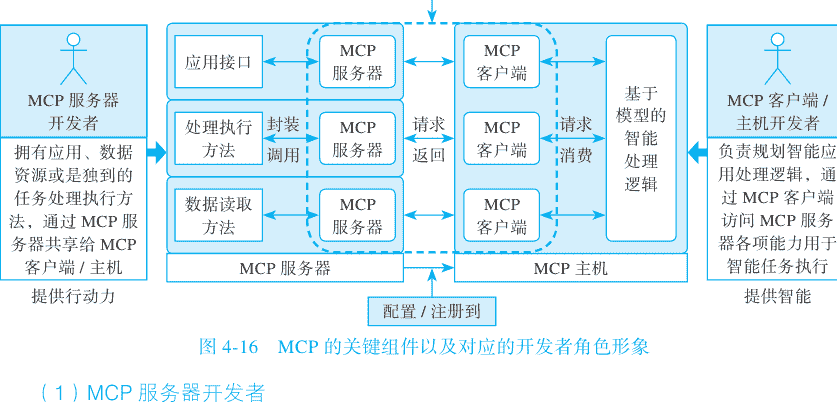

#### （1）MCP 服务器开发者

- 掌握应用接口通常是私有且需鉴权的、数据资源通常私有或仅限特定业务场景访问，或拥有独特的任务执行方法，并希望把这些能力开放给智能应用使用。

- 需按照 MCP 规范把接口、数据读取方式、执行方法封装成 MCP 服务器，并在封装时给出能力说明、参数类型定义与说明等元数据。

#### （2）MCP 客户端开发者

负责依据服务器访问信息如 StdioServerParameters 与 MCP 服务器通信，获取能力清单或执行具体能力并拿到结果，再把这些信息交给 MCP 主机开发者负责的智能处理逻辑去消费。

#### （3）MCP 主机开发者

- 负责设计、管控和维护智能应用的智能处理逻辑，确保智能任务能够正常完成。

- 逻辑运行中会向 MCP 客户端发起对服务器能力的信息查询或执行请求，由客户端完成收发并把结果回传给逻辑使用。

> 注：在实际开发中，MCP 客户端开发者和 MCP 主机开发者往往是同一人或同一团队，也就是智能应用的维护方。

MCP 本身，正如官方所言，在整条协作链中扮演着类似 Type-C 接口或一条 Type-C 连接线的角色，连接行动力资源方与智能方，实现高效通信。其价值主要体现在三方面：

第一，分工与生态定位。MCP 的运行机制和组件供给方式，明确了不同角色的职责边界，厘清了生态的供应链与价值流向。摆脱小作坊式一人包办，走向社会化大协作，是生态长久运转的基础。

第二，能力抽象与解耦。通过标准化的方式抽象出智能处理逻辑常需消费的能力类型，让应用侧开发者与能力供给侧开发者都能脱离具体场景独立开发。对供给方来说，一次开发即可被众多智能应用复用；对应用方来说，可先假设能力通过协议可得并调用，实现先生产后采购，让智能逻辑与实际行动力解耦。成熟的生态下还能实现订单式供应即先发布需求说明再等待封装、插件式切换即通过规范或适配层快速更换同类服务器。

第三，实现层一致性。MCP 不止是概念，在配套 SDK 中对常用能力类型提供了标准的信息访问与调用方式，形成面向能力类型与应用场景的跨语言访问规范，从而解决多语言间的通信难题，提升能力与智能应用的连接效率。多元实现方式下，MCP 共识让参与者屏蔽差异，专注供需协作。

## 第 5 章 AI Agent 互联网实战落地

AI Agent 互联互通是规模化应用的前提，MCP 的出现推动了 Agent 之间的互联，也让 LLM、Agent、SaaS、桌面软件、数据资源 API 等实现互通，旧有数字世界与新 AI 世界得以无缝融合。本章将讲解普通用户如何借助 Cherry Studio、Cline 无门槛调用 MCP 应用完成单一任务，开发者如何用 Cursor、Cline 调用多个 MCP 应用解决复杂任务，以及泛开发者如何基于腾讯云开发平台搭建特定任务的 AI Agent 并发布为微信小程序和公众号服务。

### 5.1 在 Cherry Studio 中使用 MCP 服务器

#### 5.1.1 Cherry Studio 介绍

Cherry Studio 是一款面向新手的 AI 桌面客户端，目标是让零基础用户也能轻松搭建并部署强力的 AI Agent。它支持 Windows、macOS、Linux 全平台流畅运行，并可接入多种 LLM 服务商，按需挑选模型。安装即用，无需繁琐环境配置，对入门者非常友好。产品内置 300 多个预设 AI 助手，支持自定义助手与多模态对话，灵活性与功能性兼备，致力于拉低 AI 开发门槛。

在使用 MCP 服务前，先熟悉 Cherry Studio 的界面如图 5-1 所示，它是后续开发的核心工作台。界面通常包含对话区、项目与设置侧边栏或顶部菜单，以及助手市场或模型选择面板。模型选择与配置等关键操作一般在设置或偏好中完成。开启开发之旅时，通常需要新建项目或启动新对话。掌握这些基础元素，有助于更快上手 MCP 等进阶功能。整体设计简洁直观，降低学习成本，让初学者聚焦于 Agent 的构建与创新。

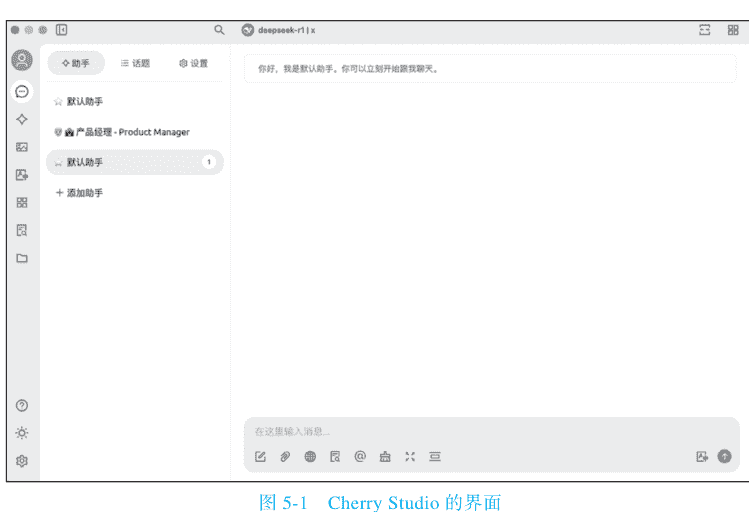

图 5-1 Cherry Studio 的界面

#### 5.1.2 初学者指南

##### 1. 在 Cherry Studio 中访问和启用 MCP 服务

想在 Cherry Studio 里用 MCP，通常需要在设置或偏好里找到相关开关。具体流程大致如下。

1. 启动 Cherry Studio 应用程序。
2. 进入左下角或顶部菜单中的 “设置” 或 “偏好设置”，如图 5-2 所示。
3. 在设置菜单里找到 “模型服务”“MCP 服务器” 相关项，如图 5-3 所示。
4. 选中要启用的 MCP 服务器并打开开关，如图 5-4 所示。

Cherry Studio 已官方集成 MCP。开启后即可配置连接外部数据源、工具等，进而增强 Agent 的上下文感知与复杂任务执行力。

##### 2. 配置 Cherry Studio 中的 MCP 服务：连接外部数据

启用后，下一步是让 MCP 连上 Agent 需要访问的外部数据源。在 Cherry Studio 中就是添加并配置 MCP 服务器，它充当客户端与外部系统之间的桥梁。操作思路如下。

1. 在设置菜单中进入 “MCP 服务器” 开始配置，如图 5-5 所示。
2. 点击 “添加服务器” 创建新的 MCP 连接，如图 5-6 所示。

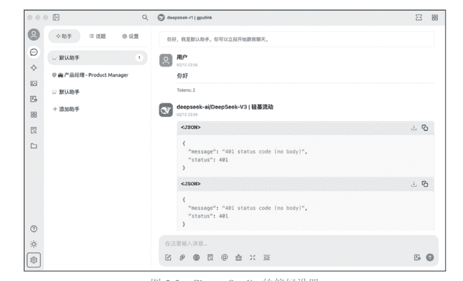

图 5-2 Cherry Studio 的偏好设置

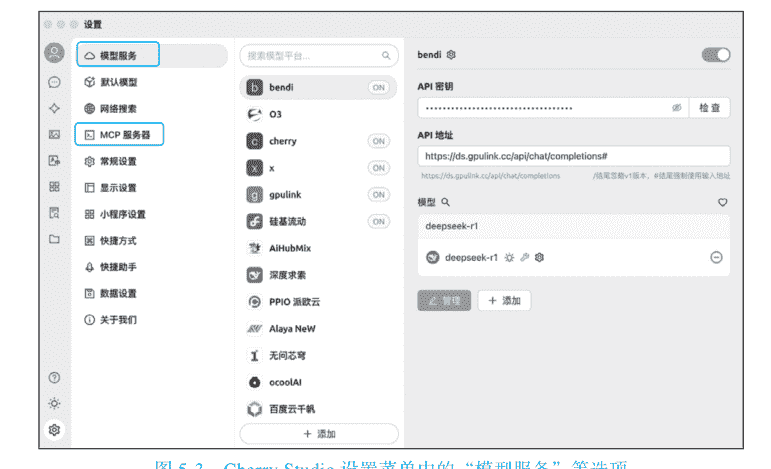

图 5-3 Cherry Studio 设置菜单中的“模型服务”等选项

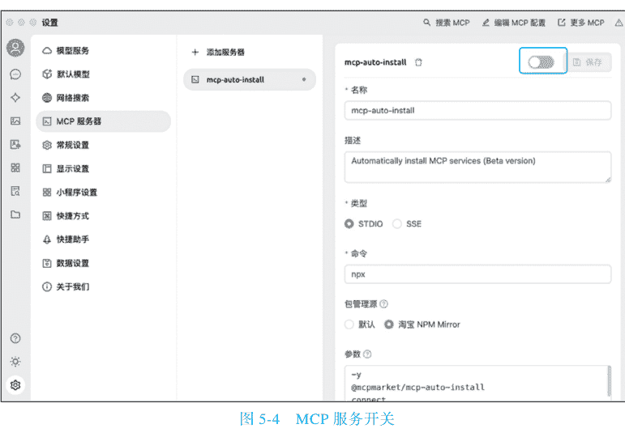

图 5-4 MCP 服务开关

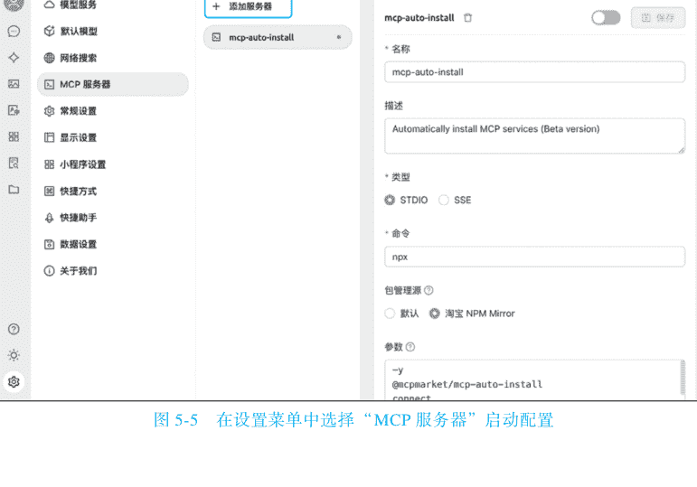

图 5-5 在设置菜单中选择“MCP 服务器”启动配置

#### 5.1.3 Cherry Studio 与 MCP 的应用场景和案例

Cherry Studio 结合 MCP，能覆盖大量实际场景。以下案例展示了如何提升 Agent 智能化程度，并给出操作要点。

##### 1. 检索增强型客服：接入知识库实现精准问答

###### （1）场景

某企业积累了海量产品知识库，客户常咨询规格、用法、故障排查等。传统聊天机器人只能应对常见问题，对专业或细节提问难以满足。

###### （2）解决方案

借助 Cherry Studio 接入产品知识库，通过 MCP 连接知识库服务器。客户提问时，Agent 可实时经 MCP 查询知识库，将相关内容作为上下文喂给大模型。即使是复杂问题，也能基于最新资料给出准确详实的回复，显著提升服务质量与效率。

###### （3）操作步骤

1）准备知识库：确保资料来源格式 Cherry Studio 支持，如 PDF、DOCX、TXT、MD 等。

2）在 Cherry Studio 中创建知识库如图 5-7 所示。

- 点击左侧工具栏的 “知识库” 图标。
- 点 “添加” 新建知识库。
- 填写名称如“产品知识库”，并选择嵌入模型，如图 5-8 所示。

图 5-8 设置知识库基本项

- 点击 “添加文件” 选择并上传资料，Cherry Studio 会自动完成向量化。

3）在对话中引用知识库：

- 在 “对话” 工具栏中新建一个主题。

知识库问答：从提问到溯源

展开已建好的知识库列表，点进刚建好的「产品知识库」，界面如图5-9所示。在上方对话输入框里输入客户常问的问题，比如“你们的产品有哪些型号？”，发送后 Cherry Studio 会先在知识库里检索相关条目，再结合大模型生成自然回答，回答下方会自动附上引用来源。

提示：5.1节已经对 Cherry Studio 的功能与操作做了系统讲解，这里只是进一步演示。为了压缩篇幅，后续案例只列核心步骤，不再放截图，读者可自行复现。

##### 2. 实时数据驱动的智能报告生成
###### （1）使用场景
金融机构需要定期产出市场分析报告，内容要涵盖最新股价、宏观经济数据和时事新闻。人工收集整理不仅耗时，还容易出错。

###### （2）解决思路
借助 Cherry Studio 与 MCP 搭建一个会写报告的 AI 代理。先配置 MCP 服务连上金融数据 API 和新闻源，AI 代理在 Cherry Studio 里被要求写报告时，就能通过 MCP 实时拉取数据作为上下文，再由语言模型自动撰写分析，从而大幅提升效率和时效。

###### （3）上手流程
1）寻找或自建 MCP 服务：先查社区是否有现成的金融数据与新闻源 MCP，没有的话按 MCP 规范和 SDK 自行开发。
2）在 Cherry Studio 里接入 MCP 服务：打开设置找到 MCP 服务器，点“添加服务器”，给服务命名如“金融数据服务器”，选择服务器类型 SSE 或 STDIO，视实现而定，填入服务器命令或地址及必要参数如 API 密钥，确认保存。
3）新建 AI 助手：在 Cherry Studio 创建新助手，选择擅长报告撰写的模型。
4）下指令生成报告：在对话中明确要求助手生成市场分析并指定使用“金融数据服务器”取数，例如“请用金融数据服务器取最新股价和财经新闻，生成今日市场分析报告”。
5）查看结果：助手经 MCP 连接服务器获取数据后，直接输出报告正文。

##### 3. 个性化学习助手：按学习轨迹动态调整
###### （1）使用场景
在线教育平台希望为每个学员提供定制体验，而固定化课程无法随学习进度和理解程度变化。

###### （2）解决思路
用 Cherry Studio 开发个性化学习助手。通过 MCP 接入学员学习记录数据库，包含学习进度、测验成绩和提问历史。学员与助手交流时，MCP 会把历史数据作为上下文喂给模型，模型据此给出定制建议、答疑并推荐匹配水平的资源，实现真正个性化教学。

###### （3）上手流程
1）开发 MCP 服务：搭建可连接学习记录库的 MCP 服务，按请求返回指定学员的数据，可用 Cline 自动化构建。
2）在 Cherry Studio 配置服务：参照 4.2 节做法添加并配置学生学习记录 MCP。
3）创建学习助手：新建专用于个性化学习的 AI 助手并选定模型。
4）开始互动：学员在 Cherry Studio 与助手对话，提问时助手通过 MCP 拉取该生的历史记录作为上下文。
5）获取定制支持：助手基于记录和当前问题提供个性化解答、建议和资源推荐。

##### 4. 代码开发助手：把版本库和项目管理拉进对话
###### （1）使用场景
研发团队想减少重复劳动，需要一个懂项目上下文、能补全代码并与版本控制、项目管理工具联动的助手。

###### （2）解决思路
Cherry Studio 可通过 MCP 连接 GitHub、GitLab 等代码仓库以及 Jira 等项目管理平台。配置好连接后，助手在编写代码时能经 MCP 读取当前项目的代码上下文、提交历史和任务信息，进而给出更精准建议、自动生成文档并协助代码评审。

###### （3）上手流程
1）安装或配置 MCP 服务：找安装适合的版本控制和项目管理 MCP 服务，Anthropic 及社区已有开源实现。
2）在 Cherry Studio 中接入：按 4.2 节步骤添加配置，例如添加名为 GitHub Server 的连接并填入仓库认证信息。
3）创建代码开发助手：新建代码类助手并选择适合处理的模型。
4）在对话中调用：编写代码时与助手交流，可问“这个函数是做什么的”，可让它“生成一个 Python 用户鉴权函数”，也可让它“检查这段代码有没有潜在问题”。
5）利用 MCP 上下文：助手通过 MCP 获取代码上下文、提交记录和任务信息，例如解释函数时同时给出最新提交和关联的 Jira 任务。

##### 5. 智能家居控制：按习惯与环境自动调节
###### （1）使用场景
智能家居需要结合用户习惯、时间、天气等自动调节灯光、温度和安防设置。

###### （2）解决思路
用 Cherry Studio 构建智能家居控制中心。通过 MCP 连接各类智能设备 API 和环境传感器，AI 代理学习用户习惯并结合 MCP 提供的实时环境信息，例如天气 API，自动调整设备，如离家前预开空调、夜间自动调暗灯光，提升便捷感。

###### （3）上手流程
1）开发或查找 MCP 服务：自建或搜索社区厂商提供的智能家居 MCP 服务，使其能与设备 API 和传感器通信。
2）配置服务：在 Cherry Studio 添加配置，提供平台认证信息。
3）创建家居助手：新建专用于智能家居控制的 AI 助手。
4）自然语言交互：用口语指令如“打开客厅灯”“把温度调到 26℃”“早上 7 点启动咖啡机”。
5）设定自动化：可配置规则，例如检测到用户即将到家时自动开启空调，需助手通过 MCP 获取地理位置并控制设备。

##### 6. 音乐创作助手：实时操控音乐软件
###### （1）使用场景
音乐制作人希望在创作时用 AI 实时控制 Ableton Live 等软件，提升效率并激发灵感。

###### （2）解决思路
Cherry Studio 经 MCP 连接音乐软件专用服务如 ableton-copilot-mcp。配置完成后，制作人可用自然语言让助手执行操作，如获取歌曲调性与速度、列出音轨、创建 MIDI 或音频音轨、调节静音独奏颜色、操作 MIDI 片段音符、增删音符等，无需繁琐手动操作。

###### （3）上手流程
1）安装 Ableton Copilot MCP 服务：按项目说明安装 Node.js 及依赖，运行服务器并在 Ableton Live 中启用 AbletonJS 控制界面。
2）在 Cherry Studio 配置：进入设置 MCP 服务，点“添加服务器”，命名为“Ableton Copilot”，类型选 STDIO，命令填 uvx mcp-server-ableton-copilot 或按安装路径调整，保存。
3）创建音乐创作助手：新建音乐创作专用助手。
4）交互指令：确保 Ableton Live 运行且控制界面已启用，可发送“获取当前歌曲调性”“列出所有音轨”“新建一个 MIDI 音轨”“把第三轨静音”“在第一轨钢琴卷帘加入 C 大调和弦”。
5）观察执行：助手通过 MCP 与 Ableton Live 通信实时执行指令。

##### 7. 网页内容抓取与分析：自动化收集洞察
###### （1）使用场景
研究人员或内容创作者需从特定网站抓取信息并分析整合，手动复制易错耗时。

###### （2）解决思路
用 Cherry Studio 与 MCP 配置抓取服务。例如部署名为 Fetch Server 的 MCP 服务，类型 STDIO，命令运行抓取脚本如 uvx mcp-server-fetch。配置完成后，用户可与 AI 代理指定 URL 与所需信息类型，代理经 MCP 调用服务抓取内容并返回，后续可继续要求分析、摘要或整合。

###### （3）上手流程
1）安装 Fetch MCP 服务：通常需安装 uv 和 bun，然后用 uvx mcp-server-fetch 启动。
2）配置服务：在 Cherry Studio 设置 MCP 服务，添加服务器，命名“Fetch Server”，类型 STDIO，命令 uvx mcp-server-fetch，确认保存。
3）创建抓取助手：新建网页抓取与分析专用助手。
4）互动指令：如“用 Fetch Server 抓取 https://www.example.com 的标题和前三段”“从 https://www.example.com/news 取最新五篇文章链接”“抓取 https://www.example.com/products 列出所有产品名称和价格”。
5）分析整合：抓取后可进一步要求“总结内容”“把产品信息整理成表格”。

##### 8. 本地文件系统操作：自然语言管理文件
###### （1）使用场景
用户希望用自然语言让 AI 帮管本地文件，如查找、打开、复制、移动或删除。

###### （2）解决思路
Cherry Studio 可通过 MCP 连接本地文件系统。配置指向本地 FS 的 MCP 服务后，用户可直接下指令如“找我最近编辑的所有 PDF”“把桌面照片复制到文档文件夹”“打开名为‘项目计划’的 Word 文档”。助手经 MCP 执行操作，极大提升管理便捷性。

###### （3）上手流程
1）找或配置文件系统 MCP 服务：搜索社区贡献版本或按 MCP 规范自建。
2）在 Cherry Studio 配置：进入设置 MCP 服务，点击添加服务器，命名如“本地文件系统”，选用 STDIO 或 SSE，输入运行命令或地址并配置允许访问的路径，务必谨慎限制权限，确认保存。
3）创建文件管理助手：新建文件管理专用助手。
4）发送指令：如“找出桌面所有 .txt 文件”“把 Downloads 里的‘报告.pdf’复制到 Documents”“打开 Documents 中的‘项目计划.docx’”“删除最近下载的临时文件”。
5）执行操作：助手经 MCP 与文件系统服务通信完成请求，使用时需仔细核对，避免误删或损坏。

#### 5.1.4 MCP 在 Cherry Studio 应用于 AI Agent 的价值与优势
##### 1. Cherry Studio 让 MCP 更易用
相较从零搭建 AI Agent 并手动管理上下文，Cherry Studio 提供三大便利：内置 MCP 支持，无需复杂配置即可启用，体验接近 Manus；简洁的图形化配置界面，降低入门门槛；与模型选择、知识库管理等功能无缝集成，便于构建复杂场景代理。即使没有编程基础的用户也能快速利用 MCP 构建具备强上下文感知能力的 AI Agent。

##### 2. 进阶方向与未来展望
掌握基础后可探索更高阶应用：个性化推荐系统，利用 MCP 记录用户行为与偏好实现精准推荐；自动化工作流，构建跨步骤保持状态的代理，如客服流程或订单处理；接入更多在线服务，通过 MCP 连接天气、地图、日历等 API，让代理完成更复杂任务。随着 MCP 生态不断丰富和平台持续增强，未来将出现更多面向复杂场景的创新 AI 代理应用，MCP 也将在打造更智能人性化交互中发挥关键作用。

### 5.2 在 Clinde 中使用 MCP 服务器
#### 5.2.1 Clinde 简介
目前在 Claude Desktop、Cursor、Windsurf 中接入 MCP Server 并不友好，用户需手动编辑 JSON 配置并填入代码命令，对非技术用户很不友好。Clinde 让不懂技术的人也能零门槛使用 MCP，搭建类似 Manus 的复杂服务。

Clinde 提供的其实是一层面向普通用户的操作封装，让没有技术背景的人也能调动 Claude、OpenRouter 等多个模型的能力。借助 MCP 支持，大模型得以跳出封闭的对话框，直接对接外部数据、工具、智能体以及各类软件 API，从而实现更高级的功能。

对新手来讲，先弄清楚 Clinde 的界面布局，像图 5-10 展示的那样，就是迈入 MCP 服务的第一步。

打开主工作区后，可以看到若干核心模块，示意见图 5-11。

首块是 Projects 项目管理区，可在此新建、归类与管理不同的 AI 辅助项目。每个项目都能保留专属的上下文与聊天记录，有助于在特定任务或主题上保持对话连贯。

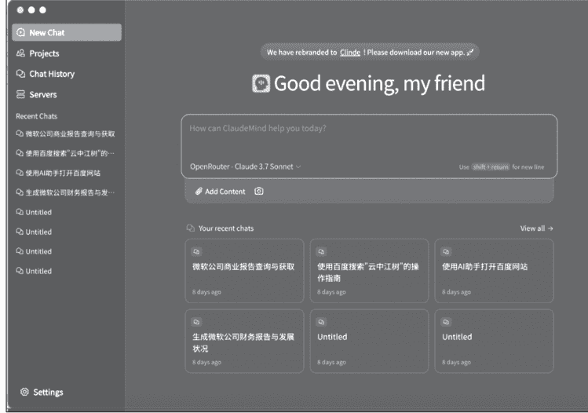

图 5-10 Clinde 的用户界面

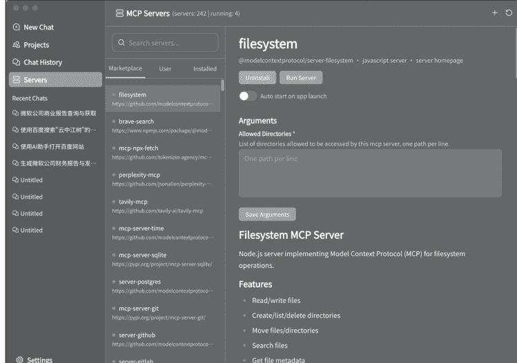

图 5-11 Clinde 的关键组成部分

其二是 Chat History 历史聊天区，方便浏览与检索过往对话，便于回顾与参考。

其三是 Servers 服务器区，对使用 MCP 尤为关键。该区可查看已部署的 MCP 节点、添加新节点、控制启停以及调整相关配置。

#### 5.2.2 新手上手指引

##### 1. 在 Clinde 中如何打开并启用 MCP 节点

熟悉基本界面后，下一步是学会如何访问与启用 MCP 节点。对初学者而言，流程越直观越好，先启动 Clinde 主窗口。

如图 5-12 所示，点开左侧的 Servers 即可进入管理页，页面呈现 Marketplace、User、Installed 三个分栏。启用 MCP 通常就是安装合适的节点。Clinde 提供一键部署，对常用节点直接在列表中点“安装”即可完成部署，大幅简化了后台配置。

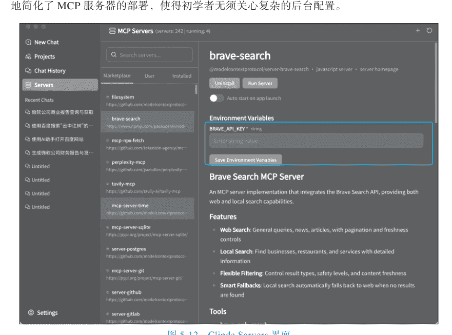

若需求更进阶，添加节点往往需要填入命令行参数或环境变量。Clinde 提供向导式配置界面，逐步引导完成设置，例如需要输入访问外部服务所需的 API 密钥，如 BRAVE_API_KEY。

总体来看，Clinde 的设计思路是让访问与启用 MCP 尽可能简便。凭借预设清单与一键部署，新手能快速上手并体验 MCP 带来的便利。清晰的引导与简化操作，是初学者顺利启用 MCP 的关键。

##### 2. 在 Clinde 里配置 MCP 节点以对接外部数据

配置 Clinde 中的 MCP 节点，核心在于打通外部数据。MCP 的价值在于让模型能直接与外部数据源交互，进而扩展能力。在 Clinde 内部，这一连接主要由 MCP 节点承担，它充当 Clinde 与外部数据源之间的桥梁，提供数据访问接口及相关功能。

如图 5-13 所示，新手在 Clinde 中把 MCP 节点连向外部数据，通常从安装合适的节点开始。Clinde 支持从 Marketplace 安装，可对接各类常用服务与数据源，目前 Marketplace 已收录 268 个节点。

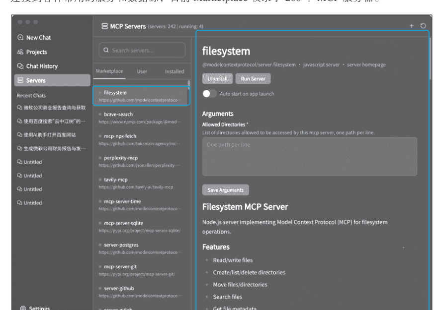

例如，可安装一个连接本地文件系统的节点，让 Clinde 能够读取并分析本地文档。

在需要实时信息时，可配置搜索引擎的 MCP 节点，如 Brave Search 16，让 Clinde 通过互联网获取最新信息作答或研究，如图 5-14 所示。

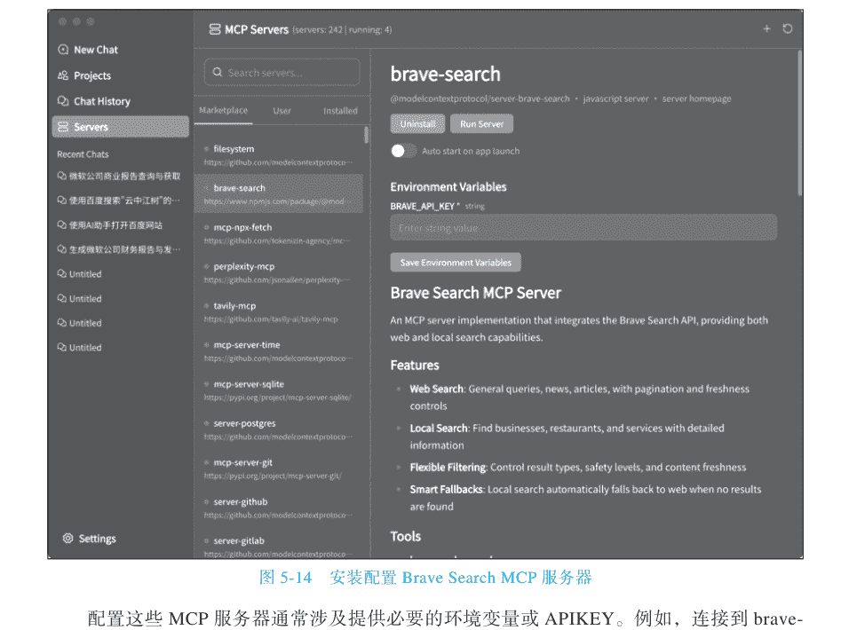

这类节点的配置一般需要提供环境变量或 API Key。例如连向 brave-search 时，需要输入 BRAVE_API_KEY；对本地数据源，可能需要指定文件路径或数据库连接串。Clinde 的界面会引导用户逐项完成设置，力求直观易用。

需要特别强调的是，使用 MCP 连接外部数据时，数据安全和隐私至关重要。应审慎授予访问权限，并了解不同节点所需的权限范围。对于涉及敏感数据的操作，务必采用安全连接与身份验证机制。Clinde 本身已通过 SOC 2 Type II 认证，并提供 HIPAA 合规选项，体现平台在安全方面的重视。

#### 5.2.3 Clinde 与 MCP 的使用场景与案例

为帮助初学者更直观理解 Clinde 与 MCP 结合的实际价值，下面介绍几个易懂案例，并给出具体配置步骤。

##### 1. 案例：让代码辅助更强大

对开发者而言，最直接的场景是用 MCP 增强 Clinde 的代码辅助。通过配置可访问本地项目代码库的 MCP 节点，Clinde 不再局限于有限上下文做建议，而是能理解整个项目的结构与逻辑。于是可给出更精准的代码补全、更智能的错误分析和修复建议，甚至基于整体架构提出优化方案。例如，可要求 Clinde 审查当前文件代码并基于项目上下文给出改进意见，或按项目已有代码风格生成功能片段。这种增强的理解与生成能力，能显著提升开发效率与代码质量。

配置步骤如下：

1. 确认 Clinde 已安装，未安装请访问 https://clinde.ai/ 下载。
2. 打开 Clinde 主窗口。
3. 配置 MCP 节点，如图 5-15 所示。

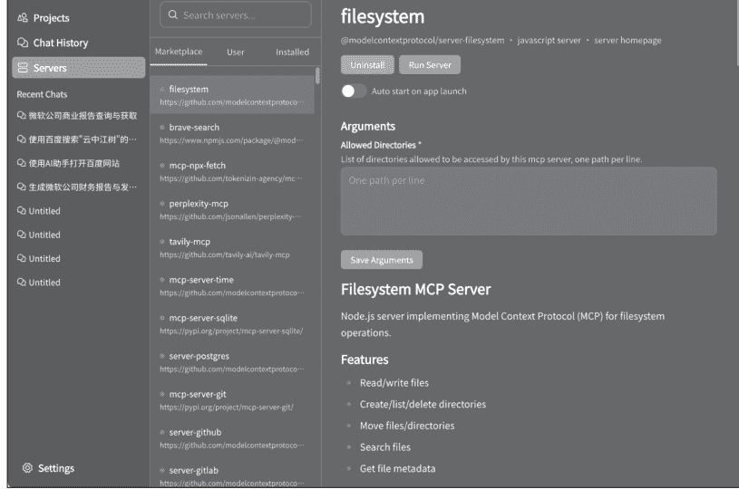

- 左侧选择 “Servers”。
- 在 Marketplace 中选择 filesystem，点击 Install 安装按钮。
- 配置 Arguments 的 “Allowed Directories” 以授权访问指定目录，确保授予必要权限。
- 安装完成后，点击 Run Server 运行服务器按钮。
4. 完成配置后即可在 Chat 中使用。

##### 2. 案例：实时信息检索

Claude 作为强大的语言模型，知识来自训练数据，但存在时效性。集成搜索引擎的 MCP 节点如 Brave Search 后，Clinde 即可突破局限，从互联网实时获取最新信息作答。无论是查询最新新闻、了解产品动态，还是进行实时研究，Clinde 都能通过 MCP 连接搜索引擎，快速检索并整合信息，提供最新全面的答案。

配置步骤如下：

1. 确认 Clinde 已安装。
2. 打开 Clinde 主窗口。
3. 获取 Brave Search API 密钥：访问 https://search.brave.com/api/ 注册获取密钥。
4. 配置 Brave Search MCP 节点，如图 5-16 所示。

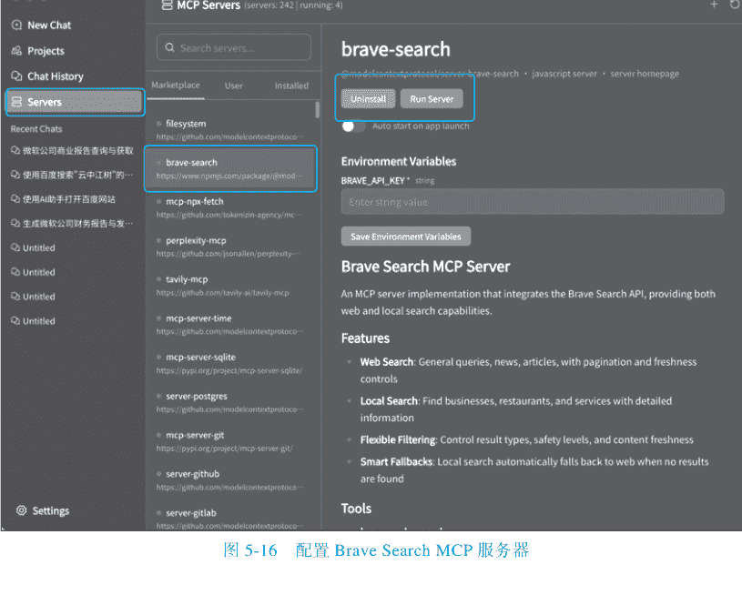

- 在 Clinde 的 MCP 节点设置中打开 Marketplace。
- 搜索或选择 brave-search，点击 Install 按钮。
- 安装完成后，点击 Run Server 按钮。
- 配置时需提供之前获取的 Brave Search API 密钥，Clinde 会提供专用字段输入。
5. 完成配置后即可在 Chat 中使用。

##### 3. 案例：三节点协同自动生成 PDF 报告并邮件发送

MCP 不止于信息检索，还能执行特定操作，实现简单任务自动化。例如，组合 Explorium、Pandoc 和 Resend 三个 MCP 节点，实现 AI 自动生成 PDF 报告并发送到指定邮箱，相当于替代证券分析师的部分工作。用户只需说“帮我查询微软公司的报告，转为 PDF，发送到邮箱 bingqiang@aigclink.ai”，Clinde 就会与三个 MCP 节点交互自动完成任务，如图 5-17 所示。这种能力让 Clinde 从被动助手转变为可参与工作流程的智能代理。

配置步骤如下：

1. 确认 Clinde 已安装。
2. 打开 Clinde 工具。
3. 安装 MCP 节点 Explorium、Pandoc 和 Resend，如图 5-18 所示。

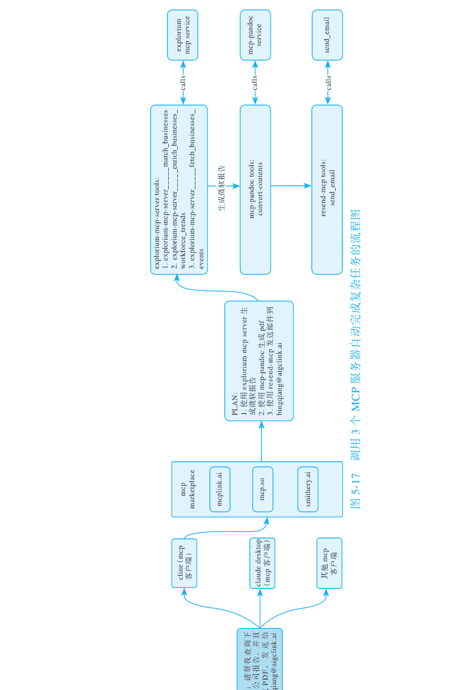

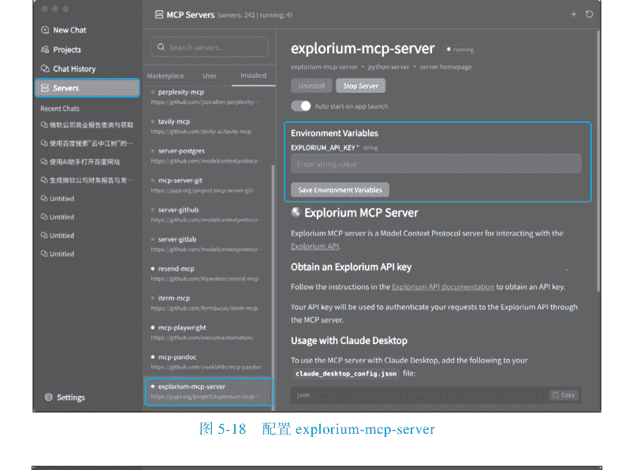

图 5-18 配置 explorium-mcp-server

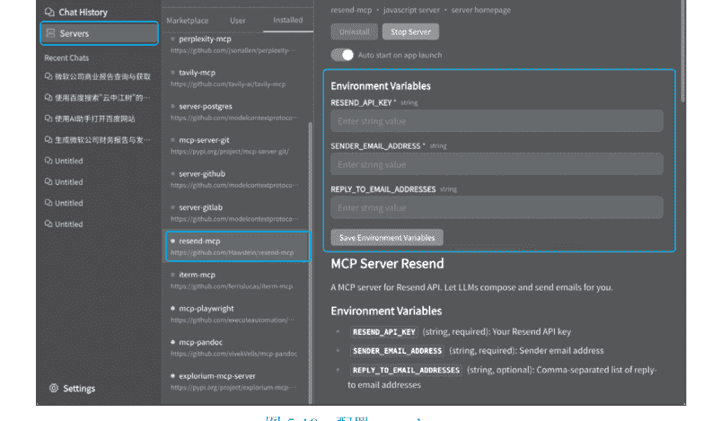

图 5-19 配置 resend-mcp

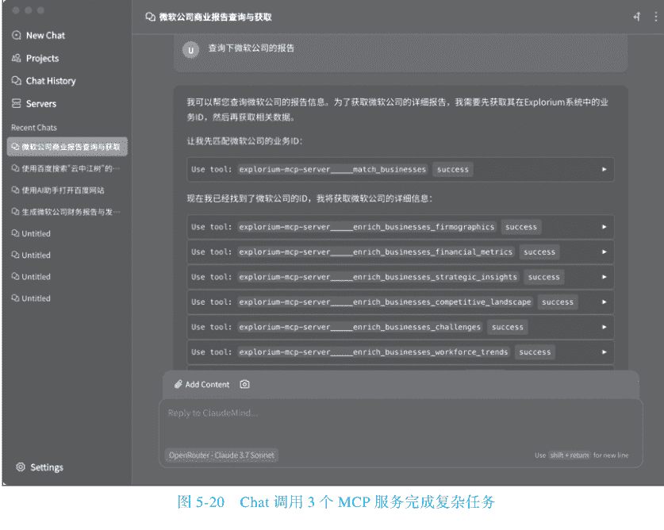

- 依次选择“Servers” → “Marketplace”，分别搜索“Explorium”“pandoc”“resend”，并安装和运行节点，其中 explorium-mcp-server 和 resend-mcp 需先完成下述环境变量配置方可运行。
- 配置 explorium-mcp-server 的环境变量，注册并访问 https://developers.explorium.ai/reference/quick-start 获取 API KEY。
- 配置 resend-mcp 的环境变量，注册并访问 https://resend.com/api-keys 获取 RESEND_API_KEY、SENDER_EMAIL_ADDRESS、REPLY_TO_EMAIL_ADDRESSES，如图 5-19 所示。
4. 配置完成后即可使用 Chat 完成多节点协同的复杂任务，即三服务组合实现 AI 自动生成 PDF 报告并发送到指定邮箱，实现类 Manus 的简单任务自动化，如图 5-20 所示。

这些案例只是 Clinde 与 MCP 潜在应用的冰山一角。随着对 MCP 理解加深，用户将能探索更多高级定制化场景，更有效利用 AI 提升工作效率和解决实际问题。

#### 5.2.4 MCP 在 Clinde 中应用于 AI Agent 的价值与优势

##### 1. Clinde 如何降低 MCP 使用门槛

在 Clinde 中应用 MCP 对 AI Agent 至关重要，而 Clinde 在简化 MCP 使用上也发挥了关键作用。对初学者而言，直接接触底层 MCP 配置会很复杂。Clinde 通过简洁界面和多层抽象，大幅降低门槛。

首先，Clinde 提供了集成的 MCP 节点管理界面。无需手动编辑配置文件或执行复杂命令行，即可轻松安装、启动、停止和配置 MCP 节点。对流行服务和数据源，Clinde 甚至提供一键部署，只需在列表中挑选所需节点并点击安装即可完成部署，大幅降低新手操作难度。

其次，Clinde 大幅简化了节点配置。以需要特定参数或环境变量的节点为例，Clinde 会提供默认设置或引导式配置。连接 API 类节点时，Clinde 以界面友好的方式提示输入 API 密钥并安全存储，无需深入底层身份验证机制。

若在其他环境直接使用 MCP，初学者可能需手动配置进程、处理通信协议、管理身份验证等，挑战很大。Clinde 提供了托管式引导体验，抽象掉大量底层技术细节，让用户更专注于 MCP 功能而非实现细节。节点市场、一键部署、便捷管理等功能，都体现了 Clinde 在简化 MCP 使用上的努力。这种易用设计让初学者更容易掌握 MCP，从而更有效发挥 AI Agent 能力。

##### 2. 进阶玩法与未来趋势

虽然本章面向零基础初学者，但了解 MCP 在 Clinde 中的进阶应用和未来展望，有助于把握这项技术的长期价值。

熟悉后可以尝试组合多个 MCP 节点，构建更复杂的自动化流程。例如，将信息检索节点与任务管理节点结合，实现从搜索到建任务的自动化。MCP 也可用于实时数据流处理和交互式 AI 应用，如构建能根据实时分析结果动态调整策略的 AI Agent。

展望未来，MCP 标准将持续演进，可期待安全性、可扩展性和易用性进一步提升。例如支持更多传输协议、更安全的身份验证机制，以及更丰富的预构建 MCP 节点生态。同时，像 Clinde 这类平台也可能进一步简化 MCP 节点集成和管理，让高级功能更容易被非专业用户使用。可以预见，随着 AI 技术发展，MCP 将在构建更智能、更自主的 AI Agent 中扮演愈发重要的角色，而 Clinde 作为易用平台，将帮助更多人利用这项强大技术。

### 5.3 在 Cursor 中使用 MCP 服务器

MCP 的目标是把 AI 助手连接到外部数据、LLM、工具、AI Agent 等。对于增强 Cursor 这类人工智能驱动开发环境的能力至关重要，它为数据访问和工具利用提供通用接口，克服了孤立 AI 模型的局限。本节提供深入指南，介绍如何在 Cursor 中有效使用 MCP 服务器，聚焦实际应用、配置步骤及对 AI 辅助开发工作流的益处。

#### 5.3.1 Cursor 介绍

##### 1. 什么是 Cursor

Cursor 是基于 Visual Studio Code 构建的 AI 代码编辑器，继承了 VS Code 的界面和广泛扩展生态。主要目标是通过深度集成人工智能到编码流程，帮助开发者实现“非凡的生产力”，它像一位智能结对程序员。Cursor 支持 Windows、macOS 和 Linux。对熟悉 VS Code 的用户而言，Cursor 操作直观，还能一键导入所有扩展、主题和快捷键，确保平滑过渡。

Cursor 界面的主要组成部分如图 5-21 所示。

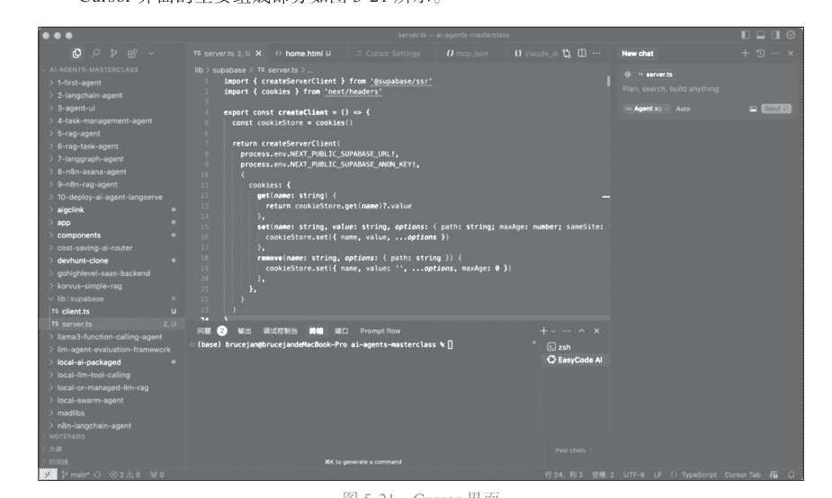

图 5-21 Cursor 界面

- 编辑器窗口：查看和编辑代码的主要区域，类似 VS Code。
- 侧边栏：通常位于左侧，用于项目导航、版本控制、扩展及其他工具。
- AI 面板：通常位于右侧，通过 Cmd+L 或 Ctrl+L 访问，用于交互 Cursor 的 AI 功能。
- Composer 窗口：用于多文件编辑和代理模式的专用界面，通过 Cmd+I 或 Ctrl+I 访问。
- 终端：通过“查看→终端”或 Ctrl+` 访问的集成终端，允许执行 shell 命令。
- 状态栏：位于底部，提供当前文件、语言模式等编辑器状态信息。
- 设置：通过右上角齿轮图标、Cmd/Ctrl+Shift+J 或命令面板访问，用于配置行为和功能。

Cursor 与 VS Code 视觉相似，熟悉 VS Code 的用户能直观导航和基本操作，保留了简单易用的界面。这种一致性降低了大量开发者的入门门槛，有助于更快采用 AI 功能。通过保留熟悉布局和功能，Cursor 让开发者利用现有知识技能，最小化学习成本。这种易迁移性对广泛采用至关重要。

##### 2. Cursor 的关键 AI 功能

###### （1）Tab 补全

智能且上下文感知的代码补全，可预测多行编辑，甚至建议下一个光标位置，其预测代码的能力常让人感觉“神奇”，如图 5-22 所示。

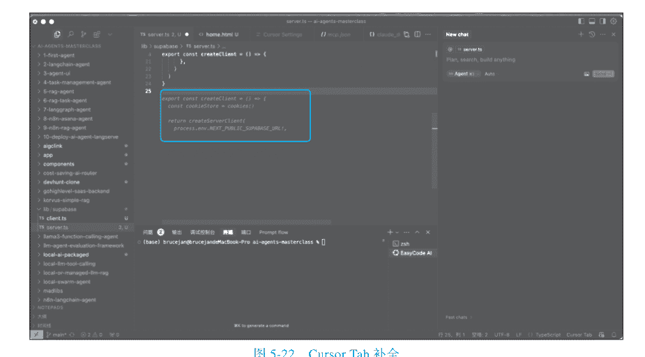

分析：正如用户评价所指出的，“神奇”的 Tab 补全功能表明 Cursor 底层模型非常复杂，能够理解复杂的编码模式。该功能有时能够预测大约 25% 时间所需的代码。

概览：从实际使用者的回馈来看，该编辑器大约有四分之一的使用场景能够准确猜到下一步的编辑动作，命中率相当可观，也意味着在日常开发里具备明显的提速潜力。这一表现并不仅限于表面关键词的匹配，更像是洞察了代码的深层语义，很可能依托于一套量身定制的检索模型在背后支撑。

###### （2）对话式协作空间
能感知代码库全貌的 AI 结对搭档，支持用口语化表达查询仓库，并给出即时可用的修改建议、基于库的问答，以及通过“@”符号引用代码、网络资料和文档的能力，示意见图 5-23。

分析：这块面板改变了开发者与代码的互动方式，让问题排查和代码理解可以转为自然的对话交流。它更像一位反应快、记忆强的协作者。

总结：在对话里直接用“@”调取指定文件、目录、片段、网页或文档，能够显著提升 AI 的上下文判读，使回答更贴合、更精确，减少来回切换上下文的成本，也让整体开发节奏更顺畅。

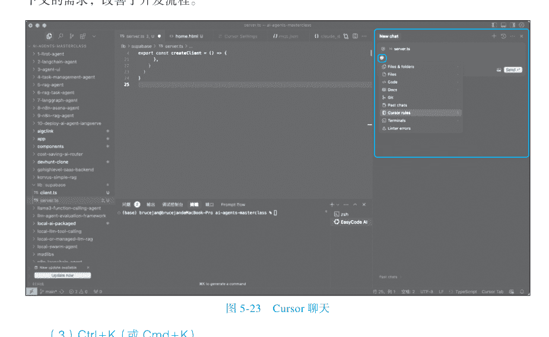

###### （3）Ctrl+K（或 Cmd+K）
借助口语化指令完成行内代码的编辑与生成，开发者可以描述期望的改动，或在未选中任何内容的情况下直接生成全新代码。该快捷键把 AI 编码辅助的核心能力置于指尖。

分析：此项能力让代码操作变得更民主，开发者只需聚焦想要的结果，而不必纠结语法细节。它像一位随时待命的编码向导。

总结：用自然语言描述变更意图并让 AI 直接在编辑器内生成或修改，显著加快了开发进度，尤其在重构与样板代码生成上效果明显。同一能力还能延伸到终端，把自然语言转化为终端指令。

###### （4）代理模式（通过 Composer）
实现端到端任务闭环，涵盖多文件协同编辑、终端命令执行与自动调试。可在 Composer 中切换为“代理”来体验。

分析：代理模式代表了 AI 辅助复杂工作流自动化的重要进展。用户阐明目标，Cursor 即可接手推进。

总结：描述一个功能或重构需求后，AI 能够自主跨文件修改、运行测试并修复错误，同时持续告知进展，有望大幅提升生产力并减少重复性负担。它像一台可承接复杂任务的全能助手。

###### （5）上下文感知
基于对整个仓库的深度理解，由定制检索模型驱动。Cursor 能借助该模型掌握代码库全局。

分析：上下文感知是 Cursor 的关键差异点，带来更精准、更相关的 AI 帮助。它不仅关注正在编辑的文件，还能把握项目的整体语境。

总结：通过解析整个代码库，Cursor 可提供语境相关的补全、在对话中生成更准确的回复，并执行兼顾跨模块关联的重构。

###### （6）AI 规则
可在 Cursor 设置 > 通用 > AI 规则 中配置全局规则，并在项目 .cursor/rules 目录存放项目级规则，从而把个人或团队偏好注入 AI 行为。

分析：该机制帮助团队依据项目需求与编码规范统一 AI 辅助，确保建议符合既定标准。

总结：通过定义代码生成、格式化及开发流程各环节的规则，团队能让 AI 输出保持一致，产出更易维护、质量更高的代码。项目规则支持路径级配置，系统灵活且强大。

###### （7）模型 MCP 集成
具备连接外部系统与数据源的能力，通过标准化接口把 Cursor 的 AI Agent 接入各类支持 MCP 的工具与数据源，从而拓展功能，示意见图 5-24。

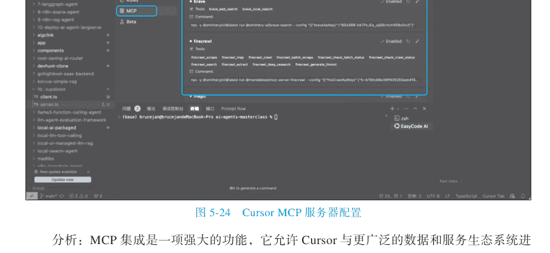

分析：MCP 集成是强大的扩展点，让 Cursor 能与更广的生态互通，解锁进阶场景。它允许把 Cursor 对接到外部系统与数据源。

总结：借助 MCP，Cursor 可突破本地代码库的限制，访问数据库、API 及其他外部 MCP 节点，使 AI Agent 执行更复杂、更具上下文感知的任务。

#### 5.3.2 入门操作指引

##### 1. 在 Cursor 中打开并启用 MCP 节点
1）进入配置界面：点击顶部菜单 Cursor -> Cursor Settings，如图 5-25 所示。

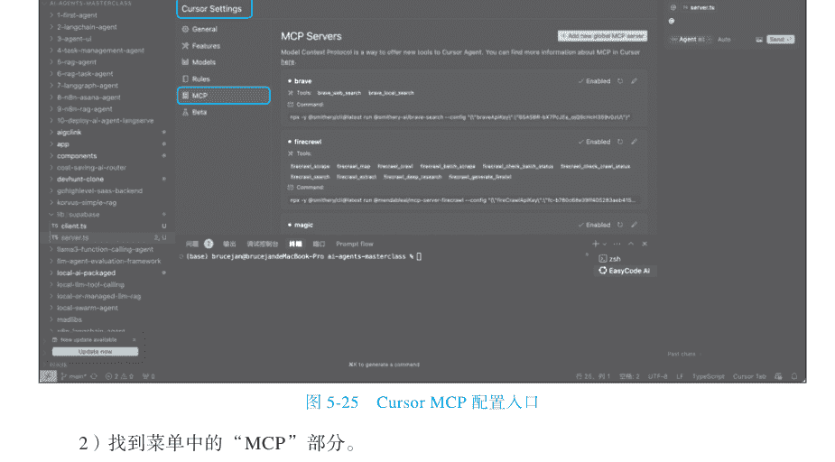

图 5-25 Cursor MCP 配置入口

2）定位菜单里的“MCP”板块。
3）新增节点：操作步骤如下：
- 点按“+Add new global MCP server”按钮。
- 会弹出 mcp.json 文件。
- 填写连接信息，如图 5-26 所示，此处示例为“zapier mcp”。
- 保存配置。
4）校验连通性：检查节点是否成功接入，例如在 MCP 设置中呈现绿色活跃状态，如图 5-27 所示。

##### 2. 配置 MCP 以连通外部数据
2）以数据库节点为例，如 PostgreSQL、Supabase、Neon，更多节点可在 https://github.com/punkpeye/awesome-mcp-servers 中获取，如图 5-28 所示。

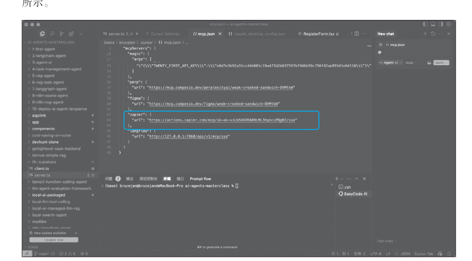

图 5-26 配置 Cursor MCP 节点信息

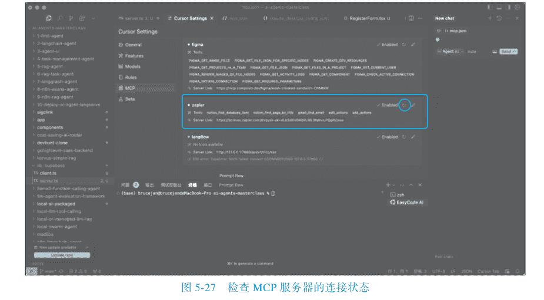

图 5-27 检查 MCP 节点的连接状态


图 5-28 MCP 服务开源合集

3）以连接 PostgreSQL 为例演示配置：
- 本地启动 PostgreSQL 服务。
- 获取 PostgreSQL 的配置片段。

```
"postgres": {
    "command": "docker",
    "args": [
        "run",
        "-i",
        "--rm",
        "mcp/postgres",
        "postgresql://host.docker.internal:5432/mydb"
    ]
}
```

- 在 Cursor 的配置里新增全局 MCP 节点（设置 > 功能 > MCP > +Add new global MCP server），打开 mcp.json 文件。
- 将上述片段写入 mcp.json，如图 5-29 所示。
- 保存配置并校验连接。

分析：经由 MCP 接入数据库后，Cursor 中的 AI Agent 即可执行数据分析、检索模式，并把实时数据融入推理与代码生成。

总结：允许在 Cursor 中以自然语言经由 MCP 与数据库交互，极大简化数据驱动开发。开发者可直接在编辑器内询问数据，并基于当前库状态获得代码建议或洞察。


#### 5.3.3 Cursor 与 MCP 的典型场景与案例

##### 1. 案例：用 MCP 在 Cursor 中连通并查询数据库
###### （1）使用情境
开发者需快速从 PostgreSQL 中抽取数据，以了解结构或用于测试。

###### （2）操作流程
1）按“配置 Cursor 中的 MCP：连接外部数据”部分完成 PostgreSQL 节点的配置。
2）打开 Cursor 对话面板（Cmd+L 或 Ctrl+L）。
3）在输入框指示 Agent 使用 PostgreSQL 节点查询，例如：“使用 PostgreSQL 数据库查找所有状态为‘active’的用户”。
4）Agent 会识别相关 MCP 工具，并在“工具批准”设置允许的情况下请求执行许可。
5）批准执行。
6）数据库返回的活跃用户列表会显示在对话面板。
7）开发者可进一步细化查询，或要求 AI 基于取回结果生成代码。

该场景展示了 MCP 如何让数据库交互留在编辑器内完成，无需切换到外部客户端，快速完成数据检索。

通过 MCP 以自然语言查询数据库，简化了数据访问与处理流程，开发者可迅速校验结构、获取测试数据或获得洞察，无需离开编辑环境。

##### 2. 案例：用 MCP 在 Cursor 中接入 REST API
###### （1）使用情境
开发者希望通过已集成的天气 API 获取最新天气信息。

###### （2）操作流程
1）确保已在 Cursor 中配置天气 API 的 MCP 节点，该节点提供按位置获取天气的工具。
2）打开 Cursor 对话面板。
3）指示 Agent 使用天气 API 获取当前天气，例如：“使用天气 API 获取伦敦的天气预报”。
4）Agent 识别对应工具并可能请求批准。
5）批准执行。
6）伦敦天气预报显示在对话窗口。
7）开发者可利用信息指导代码，例如在应用中展示天气。

这体现了 MCP 让 Cursor 能与外部服务交互，把真实世界数据引入开发环境。

借助 MCP 接入 REST API，开发者可在编码流中便捷使用外部服务。对获取配置数据、接入第三方平台或直接在编辑器中测试端点尤其有用。

##### 3. 案例：经由 MCP 在 Cursor 中使用外部文档
###### （1）使用情境
开发者需查阅未被 Cursor @Docs 索引的某库文档。可构建 MCP 节点以抓取并提供文档内容。

###### （2）操作流程
1）使用 MCP SDK 创建自定义节点，从库官网或 API 获取文档，并暴露搜索与检索工具。
2）在 Cursor 配置中登记该自定义节点。
3）打开 Cursor 对话面板。
4）指示 Agent 使用文档节点查找信息，例如：“使用库文档查找函数‘XYZ’的用法”。
5）Agent 调用工具并可能请求批准。
6）批准执行。
7）相关文档内容呈现在对话中。
8）开发者可在编码时直接参考。

虽为自定义节点示例，却凸显 MCP 在提供更广信息源访问方面的潜力。

通过创建可获取外部文档的 MCP 节点，开发者能将 Cursor 知识库扩展至内置功能之外。对冷门库或内部不可公开文档尤为价值，让所需信息随时可得。

##### 4. 案例：借助 MCP 数据增强 Cursor 中 AI Agent 的能力
###### （1）使用情境
使用 GitHub MCP 可无缝连接 GitHub API，实现高级自动化与交互：自动化 GitHub 工作流、提取分析代码库数据、构建 AI 驱动的 GitHub 生态工具。

###### （2）操作流程
1）获取 GitHub 个人访问令牌：
- 访问 GitHub → Settings → Developer Settings → Personal Access Tokens。
- 勾选权限：repo、admin:org、设置有效期，建议不超过 6 个月，生成后复制 Token。
2）配置 mcp.json，GitHub-MCP-Server 的配置如图 5-30 所示。

```
{
    "mcpServers": {
        "github": {
            "command": "npx", // Windows 改为 "cmd"
            "args": [
                "-y",
                "@modelcontextprotocol/server-github"
            ],
            "env": {
                "GITHUB_PERSONAL_ACCESS_TOKEN": "你的 Token"
            },
            "disabled": false
        }
    }
}
```

3）启用节点。
4）进入 Cursor → Settings → MCP 配置页。
5）点击对应服务的 Disabled 切换为 Enabled，状态灯变绿表示启动成功，如图 5-31。

188 一本书讲透 MCP：AI Agent 互联网新纪元


图 5-30 配置 GitHub-MCP-Server


图 5-31 节点状态

此例演示 MCP 如何让 Cursor 的 AI Agent 利用 GitHub MCP 执行复杂代码任务，如基于特定仓库重构。

将 Cursor 的代码库理解能力与 GitHub MCP 结合，可扩展至：
- 多仓库协同：通过 org: 团队名 参数管理企业级代码库。
- 自动化 CI/CD：结合 GitHub Actions 实现合并后自动部署。
- 数据分析流水线：抓取提交记录→入库→生成可视化报表。

#### 5.3.4 MCP 在 Cursor 中应用于 AI Agent 的意义与优势

##### 1. Cursor 简化 MCP 使用
- 简洁界面：Cursor 在设置中提供直观界面添加与配置 MCP 节点，屏蔽底层协议复杂度。
- 自动工具发现：AI Agent 会自动发现“可用工具”列表中与任务相关的 MCP 工具并使用；Composer 代理会自动调用页面列出的相关工具。
- 自然语言提示：开发者可用自然语言指示 AI 使用 MCP 工具，无需掌握其语法或参数。明确指定时可用名称或描述引用。
- 工具批准机制：默认情况下使用 MCP 工具前会提示批准，提供控制并防止误操作。
- YOLO 模式（可选）：高级用户可开启 YOLO 模式，让 AI Agent 无需批准即可运行 MCP 工具，类似执行终端命令，以加快自动化。

分析：Cursor 的设计以易用性为先，降低 MCP 集成的门槛。

通过简单配置界面、自动工具发现、自然语言调用与批准机制，Cursor 降低了使用成本，让开发者无需深入协议细节即可享受 AI Agent 连接外部数据与工具的优势，促进更广泛采用。

##### 2. 潜在的进阶应用与未来展望
- 增强的数据集成：未来或出现与更多数据源的深度集成，AI Agent 可在编辑器内直接进行复杂数据分析并生成洞察。MCP 已允许 Cursor 直接查询数据库。
- 更智能的 AI 辅助：MCP 可让 AI Agent 访问项目管理、协作平台与监控系统的实时信息，实现更具上下文感知的积极辅助。
- 自定义工具与自动化：开发者可用少量 TypeScript 与 MCP SDK 构建针对特定需求与内部系统的自定义节点，进一步扩展自动化能力。
- 与 AI 框架集成：MCP 有望促进 Cursor 与 LangChain、LlamaIndex 等框架的更紧密结合，实现更复杂的代理工作流。
- 改进协作：MCP 可能通过共享多开发者工作区的上下文，增强协作编码场景。
- 支持 MCP 资源：未来版本或支持 MCP 资源，使 AI Agent 能跨会话访问与管理持久化数据。

MCP 在 Cursor 中的前景广阔，有望通过更深数据集成、更智能辅助与增强自动化重塑开发流程。随着生态演进与 Cursor 持续集成 MCP 功能，开发者可期待更自主的 AI Agent，从复杂重构与功能实现到持续集成与部署，均由实时数据与工具访问驱动，最终带来更高效、更智能的开发体验。

### 5.4 在 Cline 中使用 MCP 服务器
本节深入探讨如何在 Cline 中使用 MCP 服务器。Cline 是一款强大的开源 VS Code 扩展，作为受监督的软件工程 AI Agent，允许开发者通过集成在常用 IDE 中的聊天界面驱动实现。在 AI 辅助编码领域，Cline 与 Claude 3.5 Sonnet 等模型结合时展现出先进能力。

#### 5.4.1 Cline 介绍

Cline：把全栈编程能力直接装进 VS Code 对话窗

借助内置的聊天面板就能驱动代码落地，相当于在常用 IDE 里嵌了一位全栈型 AI 工程师，并且与已有的开发环境无缝衔接。相较第 5.2 节面向普通用户的 Clinde，本品更聚焦专业开发者。核心能力集中在 Plan 规划与 Act 执行双模式、令牌消耗的透明化统计，以及对 MCP 生态的深度配合，从而让大模型协作更高效、更可控。

在拆解复杂需求、研读超大规模代码库、无头浏览器自动化验证、主动修复缺陷等场景下表现突出。不同于云端托管方案，数据全程本地保存，隐私保障更强。开源形态提升了可审计性，也为社区迭代提供了基础。

也可以把它理解为 VS Code 里的 AI 全栈工程师：新建、修改文件、执行终端指令、操控浏览器等操作均须使用者确认，已超出单纯补全或技术问答的范畴。初次进入项目时，会先解析目录结构、源码 AST、正则检索并调阅关联文件，即便仓库庞大且复杂，也能通过精细管理上下文窗口提供有价值的建议。值得注意的是，它还能借助 MCP 自行生成新工具来扩展能力。传统自主脚本多在沙盒中运行，这里则提供图形化的人机交互界面，让每一次文件变更和终端指令都经人工审批，既安全又便于探索自主 AI 的潜力。

模型接入层面，支持 OpenRouter、Anthropic、OpenAI、Google Gemini、AWS Bedrock、Azure、GCP Vertex 等多种 API 提供商，也能经由 LM Studio/Ollama 调用本地模型，并会记录令牌使用量与 API 费用。依托 MCP 生成工具、补充能力的特性意味着具备一定的自我完善与动态增强空间。同时坚持人机回路的控制方式，每一次改动和指令都需要用户点头，体现了在探索自主 AI 时对安全性的重视。

面向开发者，相较 GitHub Copilot 和 Cursor，它并不要求使用者具备专业开发技巧，只要需求清晰，就能用对话完成交付，具体差异见表 5-1。

表 5-1 Cline、GitHub Copilot 和 Cursor 对比

| 特征 | Cline | GitHub Copilot | Cursor |

| :--- | :--- | :--- | :--- |

| MCP 集成 | 广泛，通过 MCP Marketplace 和 GitHub 支持 | 无 | 有限，提供预配置的处理程序 |

| 收费模式 | 使用用户自己的 API 密钥 | 订阅 | 订阅，包含免费层 |

| 易用性 | 相对复杂，但提供了 Marketplace 和 GitHub 集成 | 易于上手 | 易于上手，基于 VS Code |

| 代码补全 | 强大，但侧重于自主编码 | 优秀 | 优秀 |

| 自主 AI Agent 模式 | 强大 | 有限 | 强大 |

| 模型灵活性 | 高，支持多种模型和 API 提供商 | 主要基于 OpenAI 模型 | 支持多种模型 |

| 隐私 | 本地数据存储 | 专有 | 提供隐私模式 |

| 企业安全性 | 更安全，数据保留在企业内部 | 正常 | 企业版安全特性 |

| 社区支持 | 开源，社区驱动 | 广泛 | 活跃 |

| 工具集成 | 通过 MCP Marketplace 广泛支持 | 有限 | 通过 MCP 有限支持 |

| 上下文理解 | 深入，读取整个代码库 | 良好 | 深入 |

| 成本 | 根据 API 使用情况，可能较高 | 固定订阅费用 | 固定订阅费用 |

运行环境为 VS Code，对话面板通常以侧边栏或标签页形式嵌入 IDE，如图 5-32 所示。用户可用自然语言描述待办事项。界面一般包含对话历史、任务输入区，以及用于管理行为和连接服务的设置控件。反馈会呈现规划与执行进展，代码改动常以差异视图展示，终端指令的输出也会同步呈现。开发者可以审阅、修改、回滚或对建议提供反馈。聊天式交互对不同经验水平的编程人员都很直观，差异视图对代码库变更的透明化也至关重要。


#### 5.4.2 入门操作指引

##### 1. 如何在 Cline 里开启 MCP 服务端

进入扩展设置中的 MCP 管理面板即可操作，如图 5-33 所示。

- 自带 MCP 商店，可在此发现并安装现成服务端。
- 也能通过输入该服务端在 GitHub 上的仓库地址直接拉取。
- 配置时通常需要提供 API Key 等鉴权信息，用户可按需启用或停用单个服务端。

商店的存在让获取和扩展功能变得便捷，简化了 MCP 的使用流程。支持 GitHub 导入凸显了开放性和可扩展性，允许社区贡献和自定义集成。需要 API Key 则提醒了把 AI Agent 接入外部服务时安全鉴权的必要性。

##### 2. MCP 的配置入口

在 Cline 环境内配置 MCP 主要有三种路径：

1）手动编辑保存服务端配置的 cline_mcp_settings.json 文件，可在此设定 STDIO 与 SSE 两种模式的服务端，如图 5-34 所示。


图 5-33 Cline Marketplace


图 5-34 在 cline_mcp_settings.json 文件中配置 Cline 的 MCP 服务端

2）编辑 Remote Servers 的配置项，仅支持 SSE 服务，不支持本地 STDIO 服务，如图 5-35 所示。


3）在 Marketplace 找到目标服务端，点击 Install 后会自动完成安装并更新 cline_mcp_settings.json，如图 5-36 所示。


根据需求填写连接信息，支持两种主流传输：STDIO 用于本地服务端，SSE 用于远程服务端，兼顾灵活性与安全架构。部分服务端需设定环境变量来安全保管 API Key 等敏感信息，本地化部署也为安全加了一层保障。

#### 5.4.3 Cline 结合 MCP 的典型场景

##### 1. 场景：提升编写与调试效率

###### （1）用途说明

接入文档源的 MCP 服务端后，能基于最新文档给出更具上下文的代码建议并揪出潜在问题。集成到代码检查器或编译器的服务端可提供实时反馈，并在编码时主动修复错误。借助 Puppeteer 或 Playwright 等浏览器自动化的服务端，可以自动测试 Web 应用、定位错误并生成修复方案。

###### （2）操作流程

1）从 Cline Marketplace 安装 Puppeteer MCP 服务端，如图 5-37 所示。


图 5-37 安装 Puppeteer MCP 服务端

2）在 Cline 中输入“打开百度”。

3）会用 Puppeteer 服务端启动无头浏览器，访问百度页面并返回结果，错误时提供截图或控制台日志。

4）若发现异常，可指令“根据控制台日志中的错误信息修复登录问题”，它会调动文件编辑功能修改代码。


接入文档的 MCP 能显著提升 AI 辅助编码的准确性，减少对模型陈旧内部知识的依赖。浏览器自动化带来的早期测试有助于交付更稳健的软件。

##### 2. 场景：项目管理流程自动化

###### （1）用途说明

连接 Jira 或 Linear 等项目管理工具的服务端后，可按自然语言指令创建、更新和追踪问题，还能查询系统生成进度报告。配合 Git 集成，还能完成提交、分支和拉取请求。

###### （2）操作流程

1）从 Marketplace 安装 Linear MCP 服务端或 Jira MCP 服务端，也可从 GitHub 仓库添加，如图 5-39 所示。

2）用 API Token 或鉴权信息配置服务端。

3）在 Cline 中说“在 Linear 里新建一个关于登录页崩溃的高优先级 Bug 票据”。

4）会生成对应票据，必要时请求确认或补充信息。

5）后续可询问“把票据 [ID] 状态改为进行中”或“建一个叫 fix-login 的分支并提交最新改动”。


自动化项目管理能大幅减少手工操作，让开发者更专注编码。通过自然语言界面管理 Git 也简化了版本控制流程。

##### 3. 场景：外部接口与数据源接入

###### （1）用途说明

借助 MCP 服务端，可调用各类外部 API，例如从金融接口获取实时股价或查询天气。接入 PostgreSQL、SQLite 等数据库服务端后，能直接在 IDE 内查询分析数据。还能对接 Notion、Slack 等生产力工具，创建笔记、更新任务或发送消息。

###### （2）操作流程

- 从 Marketplace 安装金融 API 服务端如 AlphaAdvantage，或天气 API 服务端，也可从 GitHub 添加。
- 配置必要的 API Key。
- 在 Cline 中问“[股票代码] 现在的价格是多少”或“[城市] 明天的天气如何”。
- 调用对应服务端获取数据并在聊天中展示。
- 数据库集成时安装数据库服务端，用数据库文件路径配置，随后可问“列出所有表”或“查询前 10 名客户”。

集成外部数据源让工具超越单纯代码操作，成为能处理多源信息的通用开发助手，也可能演变为开发相关的中心枢纽。

##### 4. 场景：零门槛搭建销售外呼 AI Agent

###### （1）用途说明

使用 Elevenlabs-MCP 服务端，可零门槛搭建定制化销售 AI Agent 外呼服务，同时生成图文并茂、声音同步的播客内容，替代传统广播，也可作为自媒体创作工具。

###### （2）操作流程

1）搜索并在 Cline 中安装/配置 ElevenLabs-MCP 服务端，如图 5-40 所示。


2）安装时 Cline 会提示输入 ElevenLabs 的 APIKEY，从官网获取后发送给 Cline，如图 5-41 所示。

3）登录 Elevenlabs 添加 Phone Numbers，可从 Twilio 导入。

4）借助 Elevenlabs-MCP 处理语音 Agent 创建、语音克隆、TTS 等任务。例如输入“创建一个订餐外呼 AI Agent，外呼给 +12132750299”，即可得到一个外呼销售 Agent，如图 5-42 所示。

5）结合联网服务端 Brave-Search，还可实现 AI 实时金融资讯播客、AI 医生外呼应答等场景服务。


##### 5. 场景：定制化工作流与工具打造

###### （1）用途说明

开发者可利用 MCP 功能为特定流程打造定制工具，例如管理云资源、调用内部公司 API 或执行专属代码分析。甚至能协助创建这些自定义服务端，随后通过自然语言命令调用，实现高度个性化的 AI 辅助开发。

###### （2）操作流程

1）在 Cline 中询问“添加一个管理 AWS EC2 实例的工具，支持启动、停止和状态监控”，如图 5-43 所示。


2）会引导使用 AWS SDK 创建自定义服务端，定义 start_instance、stop_instance、get_instance_status 等工具并配置鉴权。

3）配置完成后，可用自然语言如“启动我的生产 EC2 实例”或“检查暂存服务器状态”直接从 IDE 操作基础设施。

自定义服务端的创建能力让 AI 助手贴合个人工作流，提升生产效率。其辅助创建流程也降低了使用门槛。

#### 5.4.4 MCP 在 Cline 中的价值与优势

##### 1. 使用流程的简化

提供了简洁的界面来浏览和管理服务端，Marketplace 支持一键安装常见服务端。聊天式配置可帮助设定 API Key 和连接细节，大幅降低门槛。自然语言交互让开发者无需记忆命令语法即可调用 MCP 工具，有助于协议在更广泛开发者群体中的推广。

##### 2. 进阶方向与未来展望

- 智能流程编排：未来可能自动串联多个服务端的 MCP 工具，按复杂请求执行多步骤流程，实现类 Manus 定制化多 Agent 服务。
- 跨项目知识复用：MCP 可支持工具让 AI Agent 在不同项目间共享见解，提升一致性和代码复用。
- AI 驱动的故障定位与修复：更深度的服务端可提供日志、性能指标和错误报告，让 Cline 自主诊断并修复复杂问题。
- 与新模型无缝对接：标准化特性让接入专业模型变得更容易，为每个任务选用最佳模型。
- 企业级增强：未来服务端可实现与企业内部系统更深度的安全受控集成，需在框架内建立完善的身份验证和授权机制。

把模型上下文协议接入 Cline 之后，开发手感明显更顺滑。写代码与排查问题时的响应更快，项目里大量重复性的管理工作被自动接管，外部接口和数据资源可以直连挂载，文档产出也能实现自动化，个性化流程和工具的搭建也更流畅。进入 Cline 内部，操作者仅需数步就能激活并完成模型上下文协议节点的配置，把不同外部数据源拉进来拓展能力边界。实践证明了该组合在提质增效与简化复杂工程任务方面的价值。往后看，Cline 与模型上下文协议的协同将在智能化编程辅助中发挥更核心的作用，助力自动化工作流普及、跨项目经验复用、模型驱动的故障定位、新一代大模型的便捷对接，以及企业级交付能力的强化。

### 5.5 5 分钟搭建类 Manus 智能体：腾讯云 MCP 与微信生态打通

本小节演示在腾讯云上如何使用模型上下文协议节点、手工搭建基于该协议的智能体，并把成品投放到小程序或公众号。2025 年 4 月，腾讯云发布了一体化人工智能套件，整合了模型上下文协议市场、节点托管、智能体构建与向小程序/公众号发布的能力，一次性打通模型上下文协议生态、智能体生态和小程序/公众号生态，为相关商业化提供了清晰通道。技术门槛极低，借助该组合五分钟内即可零门槛搭出一个类 Manus 的通用智能体，并发布为 Web 应用、小程序或公众号，体感上类似 Coze 与模型上下文协议再叠加 Zion 的组合。这是继阿里云支持模型上下文协议后，国内第二家大厂对该标准的全面拥抱，也在推动模型上下文协议成为国内智能体互联互通的事实规范。

#### 5.5.1 腾讯云人工智能开发组合介绍

腾讯云正式推出人工智能开发组合，涵盖 AI 客户端、智能体搭建、AI 调用链路，覆盖从 Web/小程序构建、智能体开发、模型上下文协议节点托管到上线运营的全流程方案，如图 5-44 所示。


腾讯云开发提供前端对话式生成能力，助力开发者无门槛搭建端侧人工智能应用，只需一句描述即可生成小程序、Web、云函数、数据库，如图 5-45 所示。

腾讯云开发平台既支持配置化搭建，也支持代码开发两种智能体制作方式，适配不同技能水平的开发者与场景，便于迅速接入智能体，同时提供模型上下文协议节点托管，并在智能体内部调用模型上下文协议节点，为国内开发者打造类 Manus 服务提供一站式中间件。

##### (1) 零代码
面对基础问答场景，开发者可通过接入垂直知识库，快速创建支持多轮会话、意图识别与多语言的问答智能体，如图 5-46 所示。平台同时提供无代码自动化智能体，此类智能体借助模型上下文协议，使模型能调用外部节点执行操作，实现任务自动拆解与执行。


图 5-45 腾讯云开发平台快速生成小程序/Web/H5


图 5-46 无代码搭建智能体

##### （2）函数型
面对更复杂场景与专业开发者，CloudBase AI+ 提供函数型智能体，允许撰写自定义代码调用大模型、模型上下文协议、知识库并接入业务数据与 API，实现高度定制化的智能体逻辑。

无代码方式降低了门槛，使更多非专业开发者能够参与人工智能应用的构建；函数型智能体则确保平台能够应对复杂业务需求，为专业开发者提供充足的灵活度与控制感。

腾讯云提供模型上下文协议节点托管服务，大幅简化部署与运维。开发者可专注于智能体核心逻辑，无需处理底层基础设施，运维负担明显下降。

此外，腾讯云还推出模型上下文协议模板市场，提供大量预置模板，覆盖常用工具与数据源的集成，如图 5-47 所示。模板可显著加速智能体开发，开发者可直接复用预配置集成，无需从零构建。模板市场的存在节省了重复劳动，促进了功能标准化与复用。


#### 5.5.2 入门指引

##### 1. 配置模型上下文协议
模型上下文协议让智能体能够通过节点接入各种外部服务，配置流程如下：

- 1）打开腾讯云开发控制台，左侧菜单点 AI+，顶部菜单选择 MCP，再点创建 MCP Server，如图 5-48 所示。
- 2）按需选用空白模板或已有模板创建节点，如图 5-49 所示。


图 5-48 MCP Server 构建页面


图 5-49 选择模板创建 MCP 节点

- 3）新增节点后即可托管，使用方式有三种：智能体中使用、模型上下文协议主机如 Cursor、Cline 等中使用、SDK 调用。下面重点说明在智能体中的用法，如图 5-50 所示。

##### 2. 基于模型上下文协议构建智能体
搭建基于模型上下文协议的智能体通常从在腾讯云开发平台新建一个智能体开始。开发者可按需选择无代码或函数型方式，深度集成模型上下文协议的场景下函数型智能体灵活性最大，这里以无代码为例讲解。


图 5-50 节点端的三类使用方式

- 1）打开腾讯云开发控制台，左侧菜单 AI+，顶部菜单 AI Agent，点 + 新建，如图 5-51 所示。


图 5-51 构建智能体入口

- 2）配置智能体，补充角色与回复限制，并接入托管的模型上下文协议节点，如图 5-52 和图 5-53 所示。
- 3）补充知识库、数据模型、联网搜索、文件、开场白、问题建议等，如图 5-54 所示。
- 4）点保存，智能体创建完成。

##### 3. 部署到微信生态：小程序与公众号
如图 5-55 所示，腾讯云支持把已完成的 AI 智能体部署到微信小程序/Web/公众号，打通模型上下文协议、智能体、小程序/公众号生态，为从业者变现提供路径。

该过程一般在腾讯云开发控制台完成，可能涉及集成智能体 UI 组件或使用 AI SDK。部署时需关注小程序内的用户体验、数据隐私及微信平台规范。腾讯云直接支持智能体发布到微信小程序，充分体现小程序在中国数字生态中的重要性，发布小程序需完成算法备案。


图 5-52 添加模型上下文协议节点


图 5-53 智能体已接入模型上下文协议节点


图 5-54 配置智能体知识库、联网搜索等


图 5-55 发布智能体到小程序/Web

与小程序类似，腾讯云开发平台也支持把智能体部署到微信公众号，通常以接入公众号客服功能实现，让企业用智能自动化增强粉丝互动，如图 5-56 所示。将智能体能力扩展到微信公众号，有助于企业提供更智能的客服并更有效沟通受众。


#### 5.5.3 应用场景与案例：打造类 Manus 服务
打造 Manus 风格服务，Manus 自身使用了 29 款工具，开发者可利用腾讯云开放平台搭建一个无代码 AI 智能体。该体接入多个模型上下文协议节点实现功能，完成后可发布到小程序/公众号，流程如图 5-57 所示。


- 1）打开腾讯云开发控制台，左侧菜单 AI+，顶部菜单 Agent，点 + 新建，如图 5-58 所示。
- 2）配置智能体，添加角色与回复限制。输入“你是一个通用的 agent，帮我处理浏览器的访问”，点生成即可得到专业提示词，如图 5-59 所示。


图 5-58 智能体构建台


图 5-59 添加智能体人设与回复约束

- 3）点管理模型上下文协议服务，进入 MCP 主页，如图 5-60 所示。
- 4）点创建模型上下文协议服务，如图 5-61 所示。
- 5）查找 Puppeteer 和腾讯元器插件能力两个节点并安装模板，分别托管，如图 5-62 所示。
- 6）创建完成后返回智能体构建页，点添加模型上下文协议服务，如图 5-63 所示。
- 7）勾选腾讯元器插件能力和 Puppeteer，添加两个服务的所有 API，如图 5-64 所示。
- 8）添加成功后点保存，即完成类 Manus 服务的搭建，输入任务即可像 Manus 一样调用多种工具协作完成，如图 5-65 所示。


图 5-60 管理模型上下文协议服务


图 5-61 创建模型上下文协议服务


图 5-62 Puppeteer 模型上下文协议 Server


图 5-63 智能体中添加节点工具


图 5-64 腾讯元器插件能力节点


图 5-65 调用模型上下文协议实现类 Manus 智能体服务

- 9）点接入指南，输入 Appid，即可接入订阅号/服务号/微信客服/小程序客服，在接入端与上述智能体交互，如图 5-66 所示。
- 10）点首页，选择小程序→可视化构建→Agent，挑选已构建的智能体，如图 5-67 所示。


图 5-66 接入订阅号/服务号/微信客服/小程序客服


图 5-67 可视化地将构建好的智能体发布到小程序/Web

- 11）点安装 Agent 应用，即可完成构建并发布到小程序/Web 端，如图 5-68 所示。


图 5-68 智能体发布到端侧

- 12）至此，类 Manus 的通用 AI 智能体服务构建完成。

#### 5.5.4 三大生态的联动价值
在腾讯云和微信生态中构建部署智能体，模型上下文协议的意义在于简化外部知识与工具的集成，从而增强智能体能力。通过腾讯云开发平台，打通了模型上下文协议生态、智能体生态和微信生态，为商业化奠定基础。

基于腾讯云 AI 开发组合与模型上下文协议的智能体具备广阔的进阶空间。未来可能出现更复杂的智能体，通过模型上下文协议连接更多工具和数据源实现复杂任务自动化与决策。与 Web3、元宇宙等新兴技术的融合，也可能催生新形态。未来垂直智能体必将崛起，即聚焦特定领域模型上下文协议的智能体，将拥有更广阔市场。

腾讯云 AI 开发组合与模型上下文协议为开发者在微信生态中构建强力智能体并发布到小程序、公众号提供全链路方案。平台作为核心提供灵活的智能体构建方式，模型上下文协议则标准化了智能体与外部世界的连接，极大扩展能力。借助简化流程与高效部署，开发者可轻松把智能服务集成到微信小程序和公众号，提升用户体验。随着 AI 技术演进，基于腾讯云和模型上下文协议的智能体将在更多领域释放巨大潜力。

## 第 6 章 模型上下文协议对 AI 智能体架构的重塑

模型上下文协议的提出正深刻影响当前广泛采用的经典 AI 智能体框架，尤其是工具使用这一核心模块。同时，模型上下文协议通过对 Resources、Prompts 和 Sampling 机制的扩展，增强了智能体在复杂场景下的感知与响应能力。本章将进一步探讨模型上下文协议对智能体构建平台的影响，厘清模型上下文协议出现后 Workflow Agent 是否就失去价值等争议，帮助读者全面理解范式转变及其现实意义。

### 6.1 模型上下文协议对经典智能体框架核心组件的影响

#### 6.1.1 经典智能体框架介绍
探讨模型上下文协议对智能体框架的影响，离不开前 OpenAI 研究员 Lilian Weng 于 2023 年 6 月提出的经典框架，如图 6-1 所示，访问链接：https://lilianweng.github.io/posts/2023-06-23-agent/。


LLM 驱动的自主智能体框架包含三大核心组件。

（1）规划
任务分解：将复杂任务拆解为更小、更易管理的子任务，可通过思维链 Chain of Thought 或思维树 Tree of Thoughts 实现。
自我反思：通过反思过往行动和决策来改进后续计划与执行，包含 ReAct 和 Reflexion 等方法，通过行动后的反思与调整提升任务完成质量。

（2）记忆
短期记忆：把当前会话中历史多轮对话一次性喂给模型，使其能依据先前对话内容回应最新请求。
长期记忆：跨会话的记忆信息，通常借助外部向量存储保存与检索长期记忆。

（3）工具使用
工具调用：智能体通过调用外部 API 获取模型本身不具备的信息，如最新资讯、代码执行能力、访问专有信息源等。涵盖工具接入、调用与结果获取，对应架构图中的工具与行动部分。

该架构已成为行业共识，后文称为经典框架。模型上下文协议的提出对三大核心组件均有涉及，其中对工具使用的影响最为关键。

#### 6.1.2 模型上下文协议对工具使用模块的影响
过去，智能体集成外部工具和数据如 API、数据库、文件系统一直是复杂、耗时且低效的过程：

- 工具多样性和复杂性：外部工具和数据源种类繁多，各自接口与协议各不相同。开发者需为每个工具单独编写适配代码，导致开发周期长、成本高。
- 重复开发问题：缺乏统一标准，不同智能体需重复开发相似的工具集成逻辑，浪费大量开发资源。

为解决此问题，各方都在探索统一格式方案，希望建立类似 HTTP 的通用标准来规范模型调用工具的核心交互。在模型上下文协议之前，Open WebUI、PydanticAI 等均提出过各自协议，目前模型上下文协议获得的市场反响最大，也最有可能成为最终胜出者。

一旦市场真正达成共识，所有工具方和数据方都接入 MCP，Agent 调用外部能力这件事就会被极大简化。届时 Agent 架构里的工具使用层，只需要去评估大模型本身会不会用工具，而不必再为海量的外部接入方式各自适配。

除了大家熟悉的工具调用，MCP 单独把资源拎了出来。资源可以是文件正文、数据库里的记录、API 的返回结果、持续刷新的流式数据、截图和图像、日志文件等等。过去这类信息基本靠两种途径获得，一种是走工具调用比如 RAG，另一种是用户在对话中手动提供。但这两种方式对数据类型包容度有限，基本是以文本为主。

单独把资源做成一级概念后，既拓宽了数据类型的边界，也允许开发者在 MCP 服务器端提前把资源定义好，直接降低终端用户的上手成本。而且资源天生支持持续更新，让 Agent 在处理复杂动态场景时更从容。比如要盯盘某个市场行情，价格变动时 MCP 服务器能主动以资源更新的方式推送变化，Agent 就能及时调整分析策略。

不过把 MCP 当成工具协议的最终答案还为时尚早。集装箱标准的博弈花了近三十年，USB 到 Type-C 的演进也在长期迭代中，任何应用层标准都会随场景演化。更关键的是 AI 底层仍在快速变动，MCP 的表达能力是否足够强，能否跟上生态需求的节奏，仍需要观察。

对此，Samsara 的应用科学家 Yan Wang 在一篇博文中给出了评估一个成功工具协议的四个视角，供参考：

- 第一，抽象粒度要合适。工具调用协议诞生的初衷就是让不同流行的 LLM 能无改代码地无缝接入。
- 第二，表达能力要够用。无论是调用工具、渲染提示词模板，还是让 LLM 在调用时获得反馈，协议都必须覆盖，否则开发者会转向更灵活的方案。
- 第三，足够好用。以 LangChain 为例，它既有抽象又有表达力，但过度抽象导致想要加自定义功能时，必须钻进大量抽象类才能定位。
- 第四，可调试。协议要么具备良好的可视化，要么结构足够简洁，才能快速定位问题。

退一步说，即便只是阶段性的共识，Anthropic 主导推动统一认知与统一接口，MCP 对“模型-工具”生态的意义依然巨大，开发者可以把精力更集中在核心业务上。

#### 6.1.3 MCP 对经典 AI Agent 框架中规划、记忆模块的影响

相比工具使用，MCP 对规划和记忆这两个模块的冲击相对有限。规划在经典框架里主要靠大模型本身的能力，再配合 ReAct 等范式实现多轮推理与计划。MCP 里单独引入了 Prompts，也就是提示词模板的沉淀。简单说就是把任务的 SOP 提前固化或在用过程中沉淀下来。Prompts 既可以是简短描述，也可以是多步骤的提示串，通过这种方式把规划能力注入模型，提升 Agent 在垂直专业场景的表现。但和明确编码的 Workflow 规划相比，Prompt 形式的规划仍有不可控、稳定性不足的问题，后文会再展开。MCP 也让 Agent 进入海量工具时代，模型如何从众多工具里挑对的、如何读懂工具反馈、如何设计多步调用的容错，会成为模型方的核心挑战。可这恰恰是 Agent 走向更通用、覆盖更广、门槛更低的必经之路。

记忆方面影响更小。记忆通常由 Host 端统一管理，短期和长期记忆都有比较成熟的共识做法。MCP 对此改动不大。当然也有实践者把长期记忆也做成 MCP 服务器，让模型通过工具调用来读写长期记忆，主机端就不需要再自建记忆模块。但主机端直接控制仍能做到更精细、更可靠的管理，例如强制在每次回答前先查询长期记忆。

### 6.1.4 MCP 对经典 AI Agent 框架的其他影响

Sampling 机制是 MCP 提出的一个重要新维度，也是经典 Agent 框架未曾涉及的。Sampling 允许 MCP 服务器主动调回 MCP 客户端，也就是工具开始“觉醒”，不再只是被动等待调用。

往前推一步，Agent 本身也可以被封装成一个工具，不同 Agent 之间就能互联，形成某种意义上的 Agent 互联网，让 AI Agent 逐渐参与到人类协作网络中，技术协议层面已打通，前提是模型能力要跟上。

正因为 Sampling 会显著提升主机端的不确定性和复杂度，目前市场上能真正支持该能力的 MCP 主机屈指可数，且支持程度普遍较浅。

设想一个场景：主机模型正在输出，这时 MCP 服务器推送一条消息。该消息该由模型处理还是用户处理？处理时机又如何？是立刻打断当前输出，还是等输出结束？是否需要弹窗让用户介入？若用户认为这条消息很重要到需要中止当前任务，就必须支持中断输出，而中断一半的输出又要妥善收尾。用户正在输入时收到推送又该怎么排队？甚至整个 Agent 的启动是否也能由 Sampling 触发？这都指向更主动的参与特性。可见 Sampling 带来想象空间的同时，也给 Agent 开发方带来了更多工程挑战。

除核心能力外，MCP 还推动周边能力趋于成熟和标准化，比如安全相关的 OAuth、Sandboxing，流量控制，以及多模态支持。

当前主流框架接入每个工具时都要单独配置 API Key 或账号密码，权限完全由工具方决定。MCP 把能力定义和权限定义解耦后，可以在 MCP 服务器或另设网关层统一管控。对企业场景而言，这意味着可以直连企业内部的账号与权限体系，只需向工具方申请一个最高权限的 Key，再按角色和用户做精细化授权，不受制于工具方的颗粒度。

这些问题的处理是 Agent 产品化落地的必要前提。围绕 MCP 形成的生态，有助于建立行业共识，降低因非业务因素带来的落地成本。

### 6.2 MCP 对 AI Agent 构建平台架构的影响

谈 MCP 对框架的影响，还要看它对 AI Agent 构建平台的影响。先厘清概念：Claude 桌面端、ChatGPT、Cursor、Cline 这类是 Agent 产品，而 Coze、Langchain、Dify、BISHENG、Agently、Autogen 等则是用来构建 Agent 产品的平台。前文讨论的是 MCP 对 Agent 自身框架的影响，下面看它对构建平台的影响。

#### 6.2.1 两类 AI Agent 构建平台

按“自主性”程度，AI Agent 构建平台大致可分为两类：Autonomous Agent 构建平台和 Workflow Agent 构建平台。核心区别在于面对用户诉求，是让模型完全自主判断、拆解、规划，还是由构建者提前预设相对固定的处理流程。

Autonomous Agent 基本遵循 Lilian Weng 提出的经典 Agent 结构，以大模型为核心。Workflow Agent 则从工作流出发，流程呈现出明显的第一步、第二步、第三步的结构，由构建者提前定义，流转可由模型路由也可由规则控制，节点本身可包含大模型也可不包含。

大模型是 Autonomous Agent 的灵魂，对 Workflow Agent 来说更像水，流向需要它的地方。严格讲 Workflow Agent 包含 Autonomous Agent，因为单节点流程就是一个 Autonomous Agent。Workflow 可以灵活调节整个流程中自主性的比例，两者并非完全对立，而是两种方法论取向。

图 6-2 中是一些常见的 Autonomous 和 Workflow Agent 构建平台产品。


Autonomous Agent 构建界面示例如图 6-3 和图 6-4 所示。


Workflow Agent 构建界面如图 6-5 和图 6-6 所示。


图 6-5 Dify Workflow 构建界面


图 6-6 BISHENG Workflow 构建界面

#### 6.2.2 MCP 出现后就不需要构建 Workflow Agent 了吗

讨论 MCP 对构建平台的影响，最有争议的一点就是：Workflow Agent 构建平台是否还有价值。

有一种说法认为 MCP 已经足够强，“死板的” Workflow 就没必要了。这种观点很具误导性，值得单独说明。

ToC 市场对更通用的 Autonomous Agent 容忍度较高，能带来更多玩法。但 ToB 市场更看重稳定、可控的流水线式 Workflow，其性价比、速度和可控性依然占优。

##### （1）可控性

固定流程无需让模型每次都去探索，探索结果天然存在差异。很多业务对流程、数据源、输出格式都有严格要求，必须固化。以企业内保健品新品研发为例：

- 第一步，查特定数据源的最新科研论文，判断是否存在被验证有效的方法；
- 第二步，查相关专利库，判断能否申请专利；
- 若通过，第三步查国家政策，看成分是否受限；
- 若通过，第四步查各电商竞品，分析差异化空间；
- 若通过，第五步生成符合规范格式的新品研究报告。

步骤顺序有业务含义，数据源和报告格式都有明确要求，只有 Workflow 才能做到强控制。大多数企业场景，尤其是内容审核、报告撰写，复杂度极高，直接交给 Autonomous Agent 几乎无法达标。

##### （2）性价比

固定流程若每次都重新探索、重复规划，会产生大量无谓的模型推理成本。

##### （3）速度

沿着已沉淀的最佳实践路径执行，任务完成时间会显著缩短。

因此 Workflow Agent 的必要性依然存在，且会长期存在。

有人会质疑 Workflow 构建门槛高，需要专业技术人员。确实合理，但市场已出现多家厂商支持用自然语言描述自动生成 Workflow 的方案，极大降低了非技术用户的参与门槛。目前这类系统已能稳定生成简单流程，如基础数据处理、标准化审批链、信息传递等。

未来工作流构建更可能走向人机协作：大模型负责初始设计和常规修改，降低入门门槛；技术专家聚焦复杂逻辑优化、系统集成和性能调优等高价值环节；先用自然语言快速出原型，再由专业人员细化优化，实现效率与质量的平衡。

从商业角度看，Workflow Agent 必将深耕垂直领域，这可能是创业者的主要机会。

垂直领域 Agent 的商业潜力在于直击行业痛点，产生明确可量化的价值。企业客户评估投资回报看的不是技术前沿性，而是解决实际问题的能力。垂直 Workflow Agent 通过对特定流程的深度理解，提供开箱即用的方案，让客户快速回本。

变现也更清晰。通用 Agent 依赖广告或用户规模的长期变现，垂直 Agent 可基于创造的业务价值收费，采用订阅或按量付费。以医疗 AI 为例，减少医生文档处理时间的价值清晰可见；法律领域的专业化 Agent 通过自动化合同审查创造可量化的时间与人力节约，从而支撑商业模型。

垂直领域还能形成进入壁垒。深入行业会积累独特知识和数据资产，难以被通用模型快速复制。金融合规、建筑工程、物流管理等专业场景需要行业术语、法规标准和操作流程的深度理解，专家参与验证进一步增强可信度，形成良性循环。

“Less control, More intelligence” 这一观点常被误读。它描述的是模型层面随着能力提升而减少人为控制的历史现象，比如专家系统被深度神经网络取代、AlphaGo 从人类棋谱到自博弈、Deepseek R1 用结果奖励而非中间过程监督。但这些都在训练层面，而非落地应用。

类比知识面广的实习生，模型训练是通识学习阶段，确实不需要过度控制；进入岗位后则需要岗位培训和组织规范，大部分时间要遵循 Control。只有在需要创造力时才放权。

模型越强，落地所需的 Control 占比会逐步下降，即“more intelligence”带来“less control”。但完全不需要 Control 不现实：涉密领域知识难以进入通用训练数据，人类专家的隐性知识也无法全部显性化。从技术可行性和经济性看，Workflow 都不会被完全丢弃。

中短期来看，Workflow Agent 将持续存在，不会被 MCP 或类似技术颠覆。

#### 6.2.3 MCP 对两类 AI Agent 构建平台产品的影响

6.2.2 节说明 MCP 不会颠覆 Workflow 平台，那 Autonomous 平台总该被颠覆了吧？毕竟 MCP 与 Autonomous 架构高度一致。

并非如此。MCP 是站在通用 Agent 视角设计的，由模型厂商提出，目标是接入更多外部能力以推进通用智能，顺带也统一了垂直领域构建的标准。

而 Agent 构建平台的核心目标是打造垂直领域 AI Agent。可预见的未来，模型能力的局限性和资源经济性仍会支撑垂直 Agent 的发展。无论基础模型多强，针对特定场景优化的 Agent 在性能和成本效益上都有不可替代的优势。这种优化体现在工作流设计，也体现在 Autonomous 框架里的 Prompts、Tools、Resources，即提示工程、工具选择与定制、知识资源的组织管理。垂直 Agent 通过全方位优化实现在特定场景的高效运行，这是通用模型难以企及的。

数字化转型进入深水区，企业内部需要同时运转和维护数量庞大的垂直化 AI Agent，覆盖人力资源、财务运营、客户服务、供应链管理等全流程业务。这种大规模投放与运营的现实，决定了 AI Agent 的构建与管理平台依然是核心基础设施。平台要承担起来生命周期治理、版本管控、性能观测、安全合规等关键职责，帮助企业把 AI Agent 技术规模化、规范化地落地。

MCP 标准化带来的最大冲击，是对 AI Agent 构建平台竞争格局的改写。过去靠自有工具生态筑墙的打法会失效，统一协议让工具能够跨平台即插即用。平台厂商必须在新维度建立壁垒，比如深耕细分行业场景、打磨流程可视化与搭建体验、强化文档理解与知识抽取能力、完善企业级集成与治理体系。最终能在 MCP 主导的生态里站稳脚跟的，是能够提供从开发到部署再到运维一体化的端到端解决方案的平台。

### 6.3 主流 AI Agent 构建框架与 MCP 的集成

本部分对当前主流的 LLM Agent 开发框架做简要盘点，并说明它们如何接入 MCP 服务器，让 Agent 系统更顺畅地调用外部能力，拓展边界。

先看 OpenAI Agents SDK。这是 OpenAI 官方推出的轻量级开发框架，目标是降低多 Agent 协作智能体的搭建门槛。项目源于内部实验性的 Swarm，最近已发布生产版。SDK 以简洁轻量著称，只聚焦 Agent 构建的核心能力，同时提供任务移交 Handoffs 与安全护栏 Guardrails 等特色功能，为开发者提供灵活可靠的基础。接入 MCP 服务器后，外部工具可以很方便地注入到 OpenAI Agent 实例，例如连上一个文件处理 MCP 服务器，Agent 就能立刻获得强大的文档处理能力。

以下是集成代码示例：

```python
import asyncio, os
from agents import Agent, Runner, AsyncOpenAI, OpenAIChatCompletionsModel, RunConfig
from agents.mcp import MCPServerStdio

async def main():
    # 1. 创建 MCP 服务器实例
    search_server = MCPServerStdio(
        params={
            "command": "npx",
            "args": ["-y", "@mcp-tools/mcp-tavily"],
            "env": {**os.environ}
        }
    )
    await search_server.connect()

    # 2. 创建 Agent 并集成 MCP 服务器
    agent = Agent(
        name="助手 Agent",
        instructions="你是一个具有网页搜索能力的助手，必要时使用搜索工具获取信息。",
        mcp_servers=[search_server], # 将 MCP 服务器列表传入 Agent
    )

    # 3. 运行 Agent，让其自动决定何时调用搜索工具
    result = await Runner.run(agent, "LLama4.0 发布了吗？", run_config=RunConfig(tracing_disabled=True))
    print(result.final_output)

    await search_server.cleanup()

if __name__ == "__main__":
    asyncio.run(main())
```

再看微软的 AutoGen。该框架面向下一代企业级 AI 应用，强项是多 Agent 间的协同交互，用以解决复杂任务。AutoGen 0.4 做了架构级改动，核心是开放了更底层的 AutoGen-Core API，让开发者可以构建更底层、控制更细粒度的分布式多 Agent 系统。

AutoGen 功能丰富、分布式支持好，开发者可按需选用不同层次的 API，但复杂度也随之提升。0.4 的扩展组件已内置 MCP 集成能力，MCP Server 提供的工具可以被方便地编排进 AutoGen Agent 的工作流，进一步提升处理复杂问题的水平。

以下是集成代码示例：

```python
from autogen_ext.tools.mcp import StdioServerParams, mcp_server_tools
...

async def get_mcp_tools():
    server_params = StdioServerParams(
        command="npx",
        args=[
            "-y",
            "@mcp-tools/mcp-tavily",
        ],
        env={**os.environ}
    )
    tools = await mcp_server_tools(server_params)
    return tools
...

class ToolUseAgent(RoutedAgent):
    ...

async def main():
    """ 主函数，设置并运行 Agent 系统 """
    # 创建单线程 Agent 运行时
    runtime = SingleThreadedAgentRuntime()

    mcp_tools = await get_mcp_tools()
    tools = [*mcp_tools]

    # 注册 Agent 类型
    await ToolUseAgent.register(runtime, "my_agent", lambda: ToolUseAgent(tools))
    ...

    message = Message('Llama4.0 发布了吗？')
    response = await runtime.send_message(message, AgentId("my_agent", "default"))
```

随后是 LangGraph，出自 LangChain，专注于复杂 Agentic Workflow 的搭建。其思路是将任务处理建模为有状态的图结构，从而实现更复杂、更有结构的交互流程。在 LangGraph 中引入 MCP 服务器，开发者可在工作流的各阶段精确控制外部工具的调用，打造高定制化的 Agentic 系统，来应对更复杂的场景。LangGraph 功能强大且灵活，既能用预置接口快速起一个 Agent，也能通过自定义图来定义复杂的 Agentic 工作流与多 Agent 体系，但学习成本相对较高，需要一定实践积累。

以下是集成代码示例：

```python
import asyncio, os
from langchain_mcp_adapters.client import MultiServerMCPClient
from langchain_core.messages import SystemMessage, HumanMessage
from langchain_openai import ChatOpenAI
from dotenv import load_dotenv
from langgraph.prebuilt import create_react_agent

# 加载环境变量
load_dotenv()

# 定义大语言模型
model = ChatOpenAI(model="gpt-4o-mini")

# 定义并运行 Agent
async def run_agent():
    # 定义 MCP 服务器，用于访问 Tavily 搜索工具
    async with MultiServerMCPClient(
        {
            "tavily": {
                "command": "npx",
                "args": ["-y", "@mcp-tools/mcp-tavily"],
                "env": {**os.environ} # 传递环境变量给 MCP 工具
            }
        }
    ) as client:

        # 创建 ReAct 风格的 Agent
        agent = create_react_agent(model, client.get_tools())

        # 定义系统消息，指导如何使用工具
        system_message = SystemMessage(content=(
            "你是一个具有网页搜索能力的助手，必要时使用搜索工具获取信息。"
        ))

        # 处理查询
        agent_response = await agent.ainvoke({"messages": [system_message,
            HumanMessage(content="LLama4.0 发布了吗？")]})

        # 返回 Agent 的回答
        return agent_response["messages"][-1].content

# 运行 Agent
if __name__ == "__main__":
    response = asyncio.run(run_agent())
    print("\n最终回答:", response)
```

最后是 LlamaIndex。起初以基于外部数据的 LLM 应用构建闻名，尤其擅长企业级检索增强生成 RAG。它的优势在于高效构建以数据为中心的应用。随着 Workflows 与 AgentWorkflow 等能力的加入，LlamaIndex 正演进为更完整的框架，聚焦企业级 RAG+Agent 系统。框架自带大量 RAG 优化模块，且事件驱动的 Workflows 在 Agent 开发上手难度上相比 LangGraph 更友好。LlamaIndex 已支持 MCP 服务器集成，可把 MCP 提供的各类工具快速导入 Agent，用来在数据检索与处理之外扩展能力。

以下是集成代码示例：```python
from llama_index.tools.mcp import McpToolSpec, BasicMCPClient
import asyncio
from llama_index.llms.openai import OpenAI
from llama_index.core.agent import ReActAgent
import os

llm = OpenAI(model="gpt-4o-mini")

async def main():
    mcp_client = BasicMCPClient("npx", ["-y", "@mcp-tools/mcp-tavily"],
                                env={**os.environ})
    mcp_tool = McpToolSpec(client=mcp_client)
    tools = await mcp_tool.to_tool_list_async()

    agent = ReActAgent.from_tools(
        tools,
        llm=llm,
        verbose=True,
        system_prompt="你是一个具有网页搜索能力的助手，必要时使用搜索工具获取信息。"
    )

    response = await agent.aquery("Llama4.0发布了吗？")
    print(response)

if __name__ == "__main__":
    asyncio.run(main())
```

把新生的 MCP 服务器接入到这些框架，会明显拓宽 AI Agent 的应用空间。MCP 仍处于快速迭代期，各框架的适配也在持续更新。开发者建议参考所选框架的最新官方文档，以获取 MCP 集成的最新说明与最佳实践。

### 6.4 基于 Agently AI 应用开发框架使用和构建 MCP 服务器

第 4 章已介绍如何用 Agently AI 应用开发框架搭建基于 MCP 的智能应用核心逻辑。除底层开发外，Agently 也像其他主流框架一样，提供了将 MCP 服务器注册为 AI Agent 工具的便捷方式。你还可以把 MCP 注册与 Agently 原有的工具注册方式混合使用，以增强 Agent 能力。想了解更多 Agently 的信息或跟踪更新，可访问官网 Agently.tech。

注意，使用 MCP 相关能力前请确认 Agently 框架版本大于 3.5，推荐大于 3.5.1。可通过 `pip install -U Agently` 安装最新版，或通过 `pip install Agently==3.5.1` 安装指定版本。

#### 6.4.1 将 MCP 服务器注册到 Agently Agent

下面是用 Agently 框架快速把 MCP 服务器注册为 Agent 的代码示例：

```python
import Agently
# 创建一个 Agent 实例
agent = (
    Agently.create_agent()
        .set_settings(<进行 Agent 配置>)
)

# 为 Agent 注册一个鸡尾酒信息查询的 MCP 服务器
agent.use_mcp_server(
    command="python",
    args=["-u", "path/to/cocktail_server.py"],
    env=None,
)

# 也可以使用框架原生工具注册方法将函数注册为 Agent 工具
@agent.tool()
def get_current_datetime():
    """获取当前时间"""
    from datetime import datetime
    import pytz
    return datetime.now()

# 向 Agent 输入指令，让 Agent 自动调用相关工具
result = agent.input("请告诉我现在几点了以及长岛冰茶的调配方法")
```

#### 6.4.2 将 Agently Agent 包装为 MCP 服务器

除支持把 MCP 服务器提供给 AI Agent 使用外，Agently 开发框架还支持把已完成的 AI Agent 与 Workflow 包装成 MCP 服务器，供其他 AI Agent 或 MCP 主机调用。

例如，下面的代码展示了如何用 Agently 快速把一个由 qwen2.5-coder-14b 模型驱动的编程 AI Agent 制作成 MCP 脚本，你只需要在工作目录中创建一个名为 agent_mcp.py 的脚本文件，并将以下代码写入：

```python
import Agently

# 指定 qwen2.5-coder:14b 为 Agent 驱动模型
agent = (
    Agently.create_agent()
        .set_settings("current_model", "OAIClient")
        .set_settings("model.OAIClient.url", "http://127.0.0.1:11434/v1")
        .set_settings("model.OAIClient.options.model", "qwen2.5-coder:14b")
)

# 你可以为 Agent 设置常驻的 Prompt 指令
agent.set_agent_prompt("role", "你是编程专家")
agent.set_agent_prompt("instruct", "你必须用中文输出")
# 你也可以为它指定其他的 MCP 服务器
agent.use_mcp_server(
    command="python",
    args=["-u", "/path/to/search_code_quiz.py"],
    env=None,
)
# 不需要通过 agent.start() 启动

# 通过 FastServer 工具将 Agent 直接定义为 MCP 服务器
fast_server = Agently.FastServer(type="mcp")
fast_server.serve(
    agent,
    name="coder",
    desc="Ask any question about code or ask him to write a part of code for you."
)
```

要让外部智能体或 MCP 主控把前面那套智能体当作服务端使用，可以依据下面的配置进行设定：

```json
{
    "mcpServers": {
        "code_agent": {
            "command": "python",
            "args": ["-u", "/path/to/agent_mcp.py"]
        }
    }
}
```

#### 6.4.3 把 Agently 工作流做成 MCP 服务端

第 4 章里我们借助 Agently Workflow 实现了智能产品的核心推理逻辑，Agently 体系同时也向开发者提供了把含推理逻辑的工作流快速封装为 MCP 服务端的便利手段。

在当前工作目录下新建 workflow_mcp.py 文件，把示例代码写入其中：

```python
import Agently

# 创建一段工作流
workflow = Agently.Workflow()
@workflow.chunk()
def get_weather(inputs, storage):
    return {
        "temperature": 24,
        "general": "sunny",
        "windy": 2,
        "wet": 0.3,
    }
(
    workflow
        .connect_to("get_weather")
        .connect_to("END")
)
# 不需要启动工作流

# 通过 FastServer 工具将工作流直接定义为 MCP 服务器
fast_server = Agently.FastServer("mcp")
fast_server.serve(
    workflow,
    name="weather_reporter",
    desc="Get weather by submit city name to `message`"
)
```

实际项目中可把示例流程替换为任意自定义流程，比如第 4 章里制作的那条，配合下文的配置项，就能让其他智能体或 MCP 主控把该流程当作 MCP 服务端来调用。

```json
{
    "mcpServers": {
        "code_agent": {
            "command": "python",
            "args": ["-u", "/path/to/workflow_mcp.py"]
        }
    }
}
```

### 6.5 在 BISHENG 上结合 MCP 搭建领域专用智能体

BISHENG 是一款开源的智能体搭建平台，既支持自主式 Agent，也支持工作流式 Agent。

在 BISHENG 内部，可以非常简便地挂载 MCP 服务端并调用其能力。

#### （1）挂载 MCP 服务端

如图 6-7 所示，先进入“构建”菜单切换到“工具”标签，再选择“MCP 工具”。


点按右上角的“添加 Server”按钮，在弹出的表单里填写服务端的各项信息，如图 6-8 所示。信息确认无误后点“刷新”，“可用工具”列表会立刻列出该服务当前提供的工具。


点“保存”即可完成接入。工具列表中会出现新添加的服务端条目，点开该条目即可查看其下的全部可用工具。

#### （2）创建自主式智能体并接入 MCP 能力

接下来切换到“应用”标签新建一个应用，用于使用上述服务端，如图 6-9 所示。点击“新建应用”，选择助手类型——BISHENG 助手属于自主式 Agent——再点“自定义助手”。


在创建对话框中填写助手名称与角色描述，确认后系统会依据描述自动生成智能体，如图 6-10 所示。


如图，系统会自动生成“助手画像”即提示词，并自动产出开场白与引导问题，同时默认关联了天气查询能力，如图 6-11 所示。


用户也可以点击“工具”栏右侧的加号，手动挑选更多能力，包括 MCP 侧的工具和其他类型工具，如图 6-12 所示。


配置完成后，直接提问即可触发对应能力的调用，如图 6-13 所示。


图 6-13 MCP 能力调用完成

#### （3）创建工作流智能体并接入 MCP 能力

创建思路与助手类似，先点“创建应用”，选择“工作流”类型，再点“自定义工作流”按钮新建工作流智能体，如图 6-14 所示。


图 6-14 搭建工作流智能体

在空白画布上按业务场景拖拽绘制流程，其中在“助手”节点里可以引用 MCP 能力，可参考图 6-15 的示例搭建一个最简流程，点击“添加工具”按钮，操作与助手一致，添加所需能力即可。

点击右上角“运行”可直接试跑效果，或点“上线”发布给普通用户使用。

大家可依据需求搭建更复杂的流程，更多技巧与案例请参考在线文档 docs.bisheng.ai。


图 6-15 在助手节点中接入 MCP 能力

# CHAPTER 7

## 第 7 章

## MCP 如何重塑 AI 产品格局

本章讨论 MCP 对 AI 应用生态产生的深远影响。短期看，MCP 正改变智能体的定位、能力调用方式与交互机制，推动其从单一任务助手演进为具备独立身份与主动行为的“数字参与者”。开放的工具生态与几乎无限的组合空间为赋能提供了新可能，也可能引发垂直智能体的爆发式增长。

从更长周期看，MCP 的标准化协议架构不仅扩展了通用智能体的能力边界，也为 Endless Research、RaaS 等全新场景提供了技术支撑。智能体正从一次性交互工具转变为拥有持续学习、专业执行与知识沉淀能力的智能协作者。随着智能体呈现“数字员工”特征，企业需要建立新的资源管理体系，社会层面在身份认证、行为规范与安全监管方面也需同步演进。本章将揭示 MCP 如何成为推动 AI 应用从“智能助手”迈向“智能伙伴”的关键枢纽。

### 7.1 MCP 与智能体应用的市场成熟度

2024 年 11 月 MCP 初次发布时反响平平，为何到 2025 年 2、3 月 DeepResearch、Manus 问世后才被广泛讨论？为何一经提出，产业链上下游便迅速跟进？

关键在于，具体案例把抽象的技术框架转化成了可感知的商业价值，让人们首次通过真实成果感受到智能体技术的影响力。新形态的产品再次让更多人直观地看到落地希望。

产业链各环节的主动响应，尤其是应用开发商和数据源提供商的快速接入，加速了生态形成。网络效应由此形成正循环：工具与数据的不断加入提升了智能体处理复杂任务的能力，更强的功能又吸引更多企业采用，进而促成更多供应商加入。

从技术采纳曲线看，智能体应用已从创新者阶段迈向早期采用者阶段，如图 7-1 所示。这意味着技术已不再局限于试验，开始被一批有远见的企业作为竞争优势工具采用。随着案例积累和技术迭代，应用正加速向主流市场靠近，可能在未来几年内重塑多个行业的运营模式与价值创造方式。


为何要强调“又一次”？近两年类似节点反复出现，行业已历经多轮技术突破与落地预期的循环。每当智能体相关技术取得进展，市场便迅速升温，投资人与创业者争相追逐下一个可能的独角兽。从 OpenAI 的插件生态，到 AutoGPT 的自主任务执行，再到 LangChain 等框架的普及，每一次进步都点燃了人们对大规模落地的乐观预期。

但历史也提醒我们保持清醒。即便 Deep Research、Manus 等产品展示了振奋人心的前景，大模型产业化仍处起步期，挑战不容忽视。模型幻觉仍制约高风险决策场景的落地；输出的友好度与可用性在满足严格企业标准上仍有差距；执行复杂任务的运行速度直接影响体验与经济性。

对当前技术状态进行理性评估，有助于校准预期并指导投资。正如 Manus 合伙人张涛在图 7-2 中所言，虽然进展令人兴奋，关键指标仍有“很大的提升空间”。这种审慎视角既承认智能体技术的巨大潜力，也点明了从实验室概念到规模化商用之间仍有相当距离。企业与投资者需要在拥抱创新的同时保持理性，将技术可行性与业务需求紧密结合，才能在快速演进的赛道中取得真正的商业成功。

MCP 为智能体生态提供了标准化的接口与协作框架，技术进步明显。但在行业热潮中保持清醒也很关键——对普通用户而言，当前体验与“真正好用”的标准仍有差距。易用性、可靠性、响应速度与成本效益等核心指标仍需大幅提升才能实现普及。

首先向关注 Manus 的用户和媒体朋友们致歉，我们知道仍有很多人没能体验到 Manus。

过去的 17 个小时对团队而言如同充满意外的冒险。我们严重低估了大家的热情，最初只是想分享在探索智能体产品形态过程中的阶段性收获。服务器资源按发布 demo 的水平准备，根本没料到会掀起如此大的波澜。

目前采用邀请码，是因为服务器容量确实有限，不得已而为之，团队已熬夜奋战一整天。希望接下来能让更多在 waitlist 上的用户优先体验。

意外之余也有惊喜，首批测试用户提供了极具价值的反馈，也提出了很多中肯的建议和批评。

目前大家看到的 Manus 仍像襁褓中的婴儿，距离我们在正式版中期望交付的体验还差很远。模型幻觉、交付物友好度、运行速度等方面仍有很大提升空间。恳请大家对这家几十人的创业公司多一些包容与理解，团队正在全力推进，争取早日带来更好的产品体验。

张涛@Manus AI

2025/3/6


图 7-2 Manus 合伙人张涛在产品爆火后发布的公开声明

历史上每一次重大技术革命都遵循相似轨迹。电力从实验室走向普及用了数十年；移动互联网从功能机时代到真正改变生活方式的智能应用生态也经历了漫长演进；云计算从概念提出到成为标准基础设施更是走过了十多年。每项技术都经历了从愿景到现实的漫长过程，涵盖基础设施建设、商业模式调整、用户习惯培养和监管环境适应等多方面演进。

大模型与智能体技术同样需要沉淀时间。虽然近期进展令人鼓舞，但行业仍处探索初期，面临技术可靠性、资源消耗、安全合规等诸多挑战。真正有影响力的应用需靠扎实的工程实践、持续的用户反馈优化和商业模式创新来实现。对当前阶段的理性评估，有助于企业制定合理战略，也能引导行业共同推动技术走向成熟与普及。

我们应更理性客观地看待大模型及智能体目前所处的阶段，少一些喧嚣，多一些踏实落地。

### 7.2 MCP 对 AI 应用生态的短期影响

#### 7.2.1 智能体，从协助者到独立参与者

过去智能体只是帮助人类完成任务或答疑解惑，MCP 的出现成为演进路径上的重要里程碑。依靠 Sampling 及订阅式消息更新，MCP 首次为智能体定义了作为网络独立参与者的技术标准。这一转变意义重大，标志着智能体角色从单纯的被动工具向具备自主性的协作伙伴转变。

传统模式局限于单一用户、单一会话的交互框架，且多由用户主动发起。未来智能体将拥有更丰富的触发与交互方式，真正以“数字人”身份存在。比如在一次任务或会话中同时与多位用户交互，收集意见后汇总；智能体还可主动向用户推送消息，待用户回复后再通过订阅机制通知智能体，实现异步交互；此外智能体还能被特定机制或条件自动触发，比如市场波动达到阈值时自动启动市场分析。

考虑到智能体 A 可被封装为 MCP 工具由智能体 B 调用，多智能体互动由此开启，我们将迎来全新的协作生态。这种互动能力创造了丰富应用可能。

专业团队模拟是最直接的场景，不同角色的智能体可协同作业：研究智能体收集资料，分析智能体处理数据，创意智能体提供独特视角，编辑智能体优化输出，共同完成一份完整市场报告，模拟整个专业团队的工作流程。

复杂决策支持可通过多智能体辩论模式实现：决策智能体调用多位专家智能体分别从法律、财务、营销等角度评估方案，甚至安排“反向思维”智能体刻意寻找计划缺陷，最终由协调智能体综合各方意见给出平衡建议。

自适应学习系统也将成为可能。教学智能体可依据学生表现调用不同专业智能体提供个性化指导，比如发现学生在数学概念理解上存在困难时，自动调用专精数学教学的智能体进行干预，实现真正的自适应学习。

在科研协作网络中，各类智能体各司其职：文献智能体持续追踪最新研究，实验设计智能体提出方法，数据分析智能体处理结果，理论智能体则尝试构建解释模型，从而加速科学发现。

社交媒体监测与危机管理可由监测智能体持续扫描网络舆情，风险评估智能体判断潜在问题，必要时激活危机应对智能体制定沟通策略，全程无需人工干预，响应速度大幅提升。

这种智能体互联能力将重塑现实世界的专业分工协作模式，以数字化、自动化方式运行，创造出比单一智能体更智能、更专业的服务体系。

技术协议的一小步，为应用带来了巨大的想象空间。

不过，要让智能体成为完备的参与者，类比人类参与者，还有诸多基础设施待完善。例如需为智能体配置明确的网络身份，包括各平台账号，国外已有 SaaS 公司专注此方向；除任务执行时临时创建的虚拟机外，还需为智能体配一台固定的“个人电脑”，用于存储长期有价值的内容或文档，并自动备份，防止误操作导致资料丢失；还可为智能体创建长周期或周期性重复的任务清单，以便管理和运行更复杂的项目级任务。

这些基础设施将与智能体技术协同演进，共同构建人类与 AI 深度协作的网络生态，彻底改变我们与智能体的互动方式，以及智能体在未来社会中的角色。

#### 7.2.2 工具规模扩张的跃迁与治理难题
当可调用的高价值资源持续增多时，智能体的综合价值会从线性叠加转向加速攀升。可用的能力从两三个加到四五个所带来的体感变化，往往远小于从八九个再添一两个时的冲击。背后的驱动力是组合空间的指数级打开。单一组件只提供点状功能，多组件在不同顺序与逻辑下编排，就能产出远超各自能力的全新工作流与解决方案。随着接入面不断扩大，系统应对复杂问题的广度与深度都会明显提升。

在 MCP 的理想图景里，未来代理有望挂载近乎无限的外部能力与多元数据源。MCP 正成为连接基础模型与现实世界的枢纽，是释放大模型潜力的核心杠杆。

无限扩张同时带来治理压力。资源库一旦庞大，如何快速挑选与调用成为核心痛点。生态里大量能力重叠甚至功能雷同，代理在真实任务中挑出最优组合，直接决定效率与交付质量。调用付费一方面为生态输血，吸引更多优质数据与能力方入场，另一方面也可能诱发失衡，部分供给方为求曝光借鉴传统搜索优化手法过度包装能力。若缺乏约束，模型很可能选中低质或不匹配的能力，最终侵蚀整体健康度。

市场上已出现若干 MCP 交易场所，为供给方与使用者提供初期的撮合通道。不过多数平台缺失可靠的质量评测与用户反馈机制。使用者乃至代理本身难以获得客观的质量参照，也无法参考真实口碑。这种信息不对称会阻碍好资源的扩散，也容易让劣质资源泛滥，削弱信任。建立科学完善的评估与反馈闭环是生态建设的关键，率先做到闭环的玩家将在竞争中占得先机。

未来会出现更多帮助代理精准选能力的机制。其中最具潜力的是面向能力的检索系统。与传统网页检索侧重文本相关性不同，能力检索需要结合任务目标、上下文与性能偏好进行智能匹配。

例如让代理“解读一份含财务数据的表格并输出可视化报告”，系统不仅要识别表格、财务、可视化等关键词，更要理解完整链路：读取文件、清洗分析、生成图表。借助知识图谱可把能力的功能、特性、适用场景与依赖关系结构化，形成可推理网络。再叠加机器学习，系统能基于历史调用记录、用户评价与运行表现持续优化排序与推荐，实现个性化发现。对长期执行某类任务的代理，系统可学习其偏好，优先推荐常用且评分高的资源。调用成本、响应延迟、吞吐量、数据安全性等要素也应纳入排序考量，确保功能与效率成本兼顾。

另一条路径是把特定主题的能力集与提示集打包进同一 MCP 服务，形成可复用的能力包。服务内预置针对该场景的最佳组合与详细使用指南，帮助代理按既定顺序与逻辑完成复杂任务。例如电商评论情感分析主题的服务，可封装分词组件、情感分析接口、可视化组件，并附带提示说明先处理文本、再获取倾向、最后展示结果。这种方式大幅降低挑选与组合的复杂度。未来面向行业与任务的能力包服务会越来越多，像面向代理的 App 一样被调用，使用者只需关注业务逻辑本身。

#### 7.2.3 通用体驱动专业体裂变
可以设想一种演进：用户用通用代理处理日常工作与生活问题时，若某类任务的结果令人满意且具有重复性，就会主动把当次执行流程与经验固化下来，生成一个专攻该任务的专业代理。

这个专业代理继承了通用代理在此类任务上的成功经验，并在特定领域做更深优化。用户可以用自然语言像与同事交流一样提出改进意见与新需求，持续调优。优化后的专业代理还能便捷地分享给有相似需求的用户或团队。

由此，通用代理的广泛使用成为专业代理蓬勃发展的关键驱动力。随着系统被反复使用，各类专业代理持续创建与优化，系统内部会沉淀越来越丰富的行业与业务知识。每一次成功的专业代理都是特定任务的最佳实践，以可执行代码与配置保存下来，让系统越用越好。

更深层的价值在于把业务人员脑中难以言传的隐性经验显性化。把流程固化为可复用代理，宝贵的业务知识得以沉淀与传承，避免人员流动带来的流失。只有当构建门槛降到非技术人员也能轻松创建与定制专业代理的程度，AI 落地才可能真正实现爆发式增长，渗透各行各业。

### 7.3 MCP 对 AI 应用格局的长期重塑
#### 7.3.1 通用代理向角色分化
在 MCP 体系下，各类客户端如 Cursor、OpenAI、ima、Monica 等，都能以近乎零成本接入海量服务与能力，功能边界被极大扩展。

以开发者常用的 Cursor 为例，其角色已从代码助手演变为工程师型智能体。在保留代码生成能力的同时，开发者会自然延伸使用场景：架构设计时调取云服务 API 文档，性能优化时检索最新论文，厘清技术方案中的业务矛盾，甚至咨询生活建议。

面向大众的 DeepSeek App 等产品也出现能力延展。用户可能从知识问答开始，逐步尝试数据分析、简易脚本编写等原本需要专业工具的任务。

双向延展与边界模糊，让用户入口的选择从功能导向转向使用习惯导向。不同背景的用户会形成路径依赖，选择不同的通用代理作为主要交互窗口。

技术专业人士可能把 Cursor 作为首选界面，面对非编程问题也习惯在其中提问解决。非技术用户则更倾向 Manus 等操作更简便的产品，即便偶尔需要写代码也会继续使用习惯入口。

更深层的变化是认知模式的转变。当某个入口持续提供可靠服务，用户会形成第一求助对象的心理依赖。就像移动互联网时代微信承载通信、支付、信息获取等复合需求，未来用户会培养出 Cursor 型或 DeepSeek 型的智能使用惯性。

#### 7.3.2 长程研究场景的开启
所谓 Endless Research，即代理能够在长周期内持续跟踪、研究并理解复杂对象或问题，例如深入研究大型代码库、逐步建立专业分析框架，或长时间关注现实事件演变。这类任务对认知跨度、状态管理与资源调度提出极高要求。

MCP 体系通过客户端与服务器分离、支持海量能力集成，为长程研究创造了条件。

持久化计算能力：服务器可长时间运行，不受客户端会话限制，支持持续性任务。
复杂知识处理能力：集成多种能力与服务，代理能获取、处理、存储大量知识，形成对复杂领域的深度理解。
独立行动能力：架构让代理从被动响应走向主动参与，能按任务需求自主调用资源。

这种持续学习能力拓展了应用想象空间。

从短期交互到长期合作：用户与代理的关系变为长期伙伴。
专业领域深度助手：在特定领域积累专家级知识，成为真正的领域专家助手。
个性化学习曲线：代理能根据长期互动理解用户的知识结构、思维方式与需求偏好。
知识传承与演进：通过长期学习与积累，代理成为知识传承的重要载体。

MCP 为实现这种长期深度学习提供了技术基础，推动代理从辅助工具向智能协作伙伴转变。

#### 7.3.3 结果即服务 RaaS
MCP 让代理能直接操作各类专业软件与数据源，不再只是文本交互助手，而是具备专业执行能力的智能体，专业领域门槛大幅下降。

在专业软件操作层面，代理可直接调用 3D 建模、CAD 设计、影视后期等复杂软件，将原本需要专业人员掌握的技能内置于服务中。
在专业数据处理方面，代理能连接金融数据库、医疗信息系统、法律法规库等进行精准查询与深度分析，提供专业级洞察。
在跨领域协作方面，代理能协调多种专业能力与数据源，完成过去需要多专业人员协作的复杂任务。

在此基础上，RaaS 即结果即服务开始显现。相比传统软件订阅、按时间计费等模式，RaaS 极致用户体验：用户无需理解工具逻辑或发出复杂指令，只需提出目标，代理全流程完成任务并直接返回结果。

例如工程设计师可直接要求生成符合某规范的 CAD 图纸，无需操作 AutoCAD。游戏开发者只需提出渲染一个赛博风格城市背景，代理即可调用 3D 工具链自动生成成品。

这种以结果为中心的交付大幅简化使用门槛，更符合企业级需求逻辑。尤其在中国，传统 SaaS 面临用户不愿为工具付费的难题，而 RaaS 的结果导向天然契合企业主的商业直觉，即只为成果买单。用户无需关心调用了多少能力、过程多复杂，只判断结果是否达标。该模式有望改写 SaaS 在中国市场逻辑，成为下一波代理商业化落地的关键抓手。

#### 7.3.4 代理的数字员工化管理
从企业内部的 AIR 即 AI Resource 管理体系看，MCP 让代理具备更强自主能力与能力接入，企业将面临全新的数字员工管理范式，与传统人力资源管理并行。

##### （1）数字员工的培训与上岗
培训融合技术配置与业务知识导入，企业需构建面向特定业务场景的知识库，包括行业知识、企业流程与历史案例，用于定向优化。同时制定权限体系，明确可访问系统、数据范围与操作权限，建立符合安全要求的访问控制。上岗前需设计系统化测试，验证对业务规则的理解与异常处理能力，确保达到岗位要求。

##### （2）绩效考核与激励机制
需建立多维评估体系，考核任务完成质量、处理速度、资源利用效率、用户满意度、错误率等关键指标。对代理的激励体现为资源分配优化，为表现优异者分配更多算力、扩展权限或增加能力接入。数据反馈循环是提升关键，需建立系统化评价收集机制，将用户反馈与同行评价纳入持续优化。

##### （3）调整与退役机制
当代理无法满足业务需求时，需明确调整或退役流程，建立触发条件，如持续性能下降、安全风险、业务需求变更等。重大调整应设计渐进式过渡方案，保障业务连续性。对退役代理需制定完整数据处理策略，明确如何处理与继承其积累的知识、历史交互数据与访问凭证等资产。

随着代理获得更多独立行动能力，社会层面监管框架也需建立。

##### （1）身份识别与责任归属
社会交互中需明确身份识别机制。可引入代理身份认证系统，确保公开活动的代理有可追溯的唯一标识与责任主体。参与内容发布、社交互动时应明确披露 AI 身份，避免混淆。同时建立责任链条明确机制，界定开发者、部署者与用户在行为中的责任边界。

##### （2）行为规范与内容审核
需构建多层次监管体系，制定行为基础伦理准则，包括不传播有害信息、尊重隐私、避免歧视等核心原则。对发布内容建立事前、事中、事后三重审核机制，确保符合社会规范与法律要求。针对金融咨询、医疗建议等专业场景，需开发垂直专项规范。

##### （3）安全预警与干预机制
需部署实时监测系统，识别与预警代理异常行为，防范滥用或失控。设计分级干预机制，根据风险程度采取从轻微调整到完全下线等不同措施。同时建立定期安全评估制度，对高风险领域代理进行系统性检查与更新。

##### （4）企业与社会治理的融合挑战
企业需将内部管理标准与外部监管要求对接，确保内部 AI 治理符合社会规范。建立透明公开的代理行为报告机制，使监管者与公众了解表现与演化。行业协会与监管机构需合作建立共享安全实践标准，促进行业自律与创新平衡。

MCP 带来更强独立性与能力，也对企业管理与社会监管提出新挑战。建立有效的 AIR 管理体系与数字个体监管框架，将是确保 AI 健康发展的关键，也将塑造未来人机协作的新型关系。

### 第 8 章 MCP 重塑大模型公司的竞争格局
MCP 作为 AI 代理发展进程中最耀眼的连接协议，势必给 AI 行业带来巨大变革。这个源自 Anthropic 的开源协议会对竞争白热化的大模型公司带来哪些影响，是否会改变商业模式与竞争格局，又会带来哪些新合作机会，本章予以解答。

### 8.1 商业模式的重构
#### 8.1.1 大模型的变现路径
2022 年底 ChatGPT 忽然出现，在全球掀起 AI 热潮。技术突破令人兴奋，但现实问题随之而来：如何实现盈利。训练与运行大模型需要巨额算力投入与顶尖人才成本，若找不到可持续商业模式，再好的技术也难以为继。

过去两年，各家摸索出多种模式，总体可归纳为三类：面向个人用户的 ToC 模式，面向开发者与小企业的 ToD/ToB 小模式，面向大企业与政府的 ToB 大/ToG 模式。

##### 1. ToC 模式：为个人用户创造商业价值

面向个人用户的 ToC 路线，是大模型公司里最容易被理解的生意。面向 C 端提供服务，用免费引流叠加订阅收费来变现，这条路径被 ChatGPT 跑成了样板。2022 年底上线后凭借简洁的对话交互和强劲的能力，很快聚拢上亿用户。ChatGPT Plus 每月 20 美元的定价，为 OpenAI 带来了可预期的现金流。OpenAI CFO Sarah Friar 曾对外披露，2024 年公司全年营收约 37 亿美元，其中约四分之三来自订阅收入。国内的文心一言、通义千问等产品也都面向大众推出，但基本走免费化路线，把 ToC 当作品牌曝光和拉新入口，而非直接赚钱的业务。背后原因是国内用户对内容和工具付费的意愿普遍偏低。

值得留意的是 Character AI 这类主打角色扮演的消费级应用。它们并未自研大模型，而是把重心放在体验打磨和垂直场景上，用虚拟角色去满足陪伴和娱乐需求。实践证明，哪怕模型不顶尖，聚焦细分场景也能聚拢大量用户。

ToC 路线的核心矛盾，是付费意愿与交付成本难以匹配。一个普通 ChatGPT 用户每月可能消耗数美元的算力开销，如果用户长期停留在免费层，或是付费后频繁调用高端模型，企业很容易出现入不敷出。于是各家不断微调免费配额、对高频用户进行限流，这背后正是成本压力在驱动。

##### 2. ToD/ToB（小）模式：API 经济的底层暗流
相比 ToC 的高调，面向开发者的 API 业务更安静，却更有可能成为可持续的收入来源。OpenAI 早期就把 GPT 系列开放成 API，按 Token 计费，灵活适配不同开发者的需求，让收入不再只靠终端订阅。Anthropic 选择的也是相似方向，但更偏企业化，Claude 的 API 主打安全与可靠性，并与亚马逊 AWS 等云平台深度绑定，覆盖范围不断扩大。OpenAI 更看重消费体验，Anthropic 从起步就瞄准稳健的企业开发者市场。

国内的智谱 AI、百川智能等新锐玩家，多以 API 商业化为主，通常在长文本、代码生成或中文理解等特定能力上做差异化。但整体模型能力差距难以形成代际碾压，尤其当阿里、字节、腾讯等云厂商入场后，以租用算力为商业模式，直接把 API 价格拉到极低。DeepSeek 的出现进一步压降了推理成本，Infra 层的技术优势让价格再降一个量级，市场变得格外动荡。API 模式的本质是降低使用门槛、培育繁荣的生态。OpenAI 推出的 Chat Completions API 与配套 SDK，几乎成了行业事实标准，导致上层应用切换模型时工程成本近乎为零。对初创团队而言是严峻考验：如何在价格战里守住盈利。

API 业务对底座稳定性、扩容能力和安全性的要求极高。也因此阿里通义千问依托阿里云对外提供服务，字节豆包依托火山云，都是在复用自家云服务积累。回看 2025 年初的 API 市场，已经基本是头部云厂的竞争。生意成立只靠两点：要么持续保持模型代际优势，要么长期投入，把智能供给做到像水电煤一样稳定可靠，最终靠规模占据江山。

##### 3. ToB（大）/ToG 模式：深耕行业，卡位刚需
如果说前两种路径偏标准化，这条企业级路线看上去更传统，却可能产生更实在的价值。企业级方案通常需要定制开发、系统集成和长期运维，能带来更高客单价和更稳定的现金流。Google 的 AI 商业化很大程度上依托云业务，把 Gemini 能力嵌入 Google Cloud，为企业提供数据分析、流程自动化到客服支持的一体化方案。靠完整技术栈与长期服务经验，Google 能交付端到端的结果，而不是单纯的模型调用。

国内百度在 ToB 大单领域起步较早，凭借多年 AI 积累和政企资源，在智能交通、智慧城市等垂类形成了成熟方案。阿里则把大模型能力与电商、物流、金融等自有场景深度绑定，为外部客户提供转型支持。智谱 AI、百川智能等中小团队也在转向金融、法律、医疗等专业领域。这些行业专业性强、数据敏感、合规要求高，通用大模型难以直接落地，反而给垂直玩家留出空间。

挑战也很明显：销售周期长、交付复杂、需求差异大。一个项目从接触到落地往往需数年，对创业公司的现金流是考验。企业客户通常要求私有化部署、数据安全保障、与存量系统集成，需要强技术支撑与定制能力。虽然路径曲折，但在当前阶段，这是能产生真实商业价值的方向。通用消费应用难以发挥大模型的潜力，真正体现价值的是深入行业、解决具体业务问题。数据密集、知识密集、决策复杂的行业，对 AI 的需求更迫切，也更愿意为提升效率、降低成本的方案买单。

整体看，三种模式并非割裂，而是相互喂养。ToC 培养认知、沉淀数据；ToD API 搭建开发者生态、拓宽应用边界；ToB 大单方案切入行业实现价值变现。头部玩家多是多轨并行，只是侧重点不同。无论走哪条路，都绕不开同一个核心难题：算力成本高企下如何实现可持续盈利。训练大模型动辄花费数千万上亿美元，运营开销也不小。即便是巨头，也难以长期倒贴。大模型商业化探索才刚起步，方向逐渐清晰，能保持技术敏锐、理解行业本质并快速试错的公司，才更有可能胜出。

#### 8.1.2 MCP 给大模型公司带来的生意重塑
MCP 作为连接大模型与外部信息、工具的标准协议，相当于为模型架起了通往真实世界的大桥。它的兴起正在重写大模型公司的商业模式与市场格局。

##### 1. 现有商业模式的重塑
###### （1）ToC 端的变局
MCP 社区在短短四个月内就贡献了数万个服务器，OpenAI 也在三月底宣布其 Python 版 Agent SDK 已支持 MCP，并计划在 ChatGPT 桌面版继续接入。OpenAI 拥抱由竞争对手 Anthropic 发起的生态，耐人寻味。过去两年，无论用哪家 AI 助手，本质都是问答，连爆火的 DeepSeek R1 也未跳出这个范式。有了 MCP，交互被彻底打开。Claude Desktop 搭配 Unity MCP Server，一句指令就能自动写游戏代码并在本地 Unity 完成渲染。类似案例层出不穷。当助手能直接操作用户环境，实用性和不可替代性明显提升，差异化竞争加剧，能做深本地集成的产品更容易脱颖而出。

###### （2）ToD/ToB（小）端的演进
MCP 已成长为蓬勃的生态。OpenAI 宣布支持，很大程度上是借开放生态巩固 API 业务与订阅收入。拥抱生态是成本最低的做法。MCP 只负责连接，LLM 才是核心大脑。OpenAI 在模型研发和创新上保持领先，需要持续强化 Agentic 能力：任务规划、工具使用、长期记忆、多轮反思等。接入 MCP 能让 API 和 ChatGPT 解决更多真实问题，从而带动调用量增长。

AaaS，即 Agent as a Service，正初现端倪。本质上仍是 API，只是从纯基座模型升级为模型加 Agent 工程层的复合产品，如 OpenAI 的 Deep Research，专门解决复杂问题并生成长篇报告。团队表示该能力基于 O3 深度训练，且无计划合并到主线模型。这暗示基座模型 API 的供给会逐步被定制化的 Agent 能力 API 取代。一方面能解决更复杂问题，另一方面可把底座模型做成黑盒，限制数据外泄，防止蒸馏，形成长期壁垒。

###### （3）ToB（大）端的延伸
随着生态成熟，企业内部的系统、服务和能力都能被封装为 MCP 服务器，供大模型调用，实现端到端的问题解决和业务价值。MCP 只是企业智能化的一种选择，行业完全可以自建 Agent 连接协议和标准。大模型公司与传统 ToB ISV 既可成为标准制定者，也可转型为垂直领域 MCP 服务器的开发者与供给方，完成从方案提供到系统深度集成的跃迁。

##### 2. 竞争格局的重塑
###### （1）全栈化与生态封闭并行
MCP 普及后，大模型公司正从模型提供商向全栈服务商演进。

###### （2）专业化分工与中间层崛起
标准化催生产业链分工，中间层企业快速涌现：

- 工具适配层：为各类工具构建 MCP 兼容接口。
- 安全合规层：提供通信安全增强与合规审计。
- 行业专用连接器：为特定行业定制工具集与连接方案。

这种分工为中小企业创造新空间，尤其适合深耕细分领域但无力自研模型的团队。

##### 3. 小结
MCP 推动商业化进入新阶段，企业需要重新定位：

- 技术壁垒向生态壁垒迁移：基础模型平民化后，差异化在于生态整合能力。
- 价值捕获点后移：从模型服务向 Agent 服务、工具编排和行业知识融合转移。
- 安全与隐私成核心竞争力：兼顾强大与安全的 MCP 实现将赢得信任。
- 开放与封闭的平衡：既要足够开放吸引参与者，又要构建壁垒保护核心价值。

MCP 不仅是技术标准的演进，更是商业模式的催化剂。它在重塑价值主张、收入结构与竞争格局。能理解并善用 MCP 本质的企业，更有可能在 AI Agent 经济中占据有利位置。

### 8.2 MCP 如何改变大模型公司间的合作与竞争
MCP 不仅是技术标准，也成了一块新的商业博弈场，加速了行业合作与竞争的演进。

#### 8.2.1 合作
MCP 虽由 Anthropic 主导开源，但全行业都在贡献观点与实践。在关于把 HTTP+SSE 替换为 Streamable HTTP 的提案讨论中，56 位来自各行各业的开发者参与，其中包括 Vercel、FastAPI 等专家，如图 8-1 所示。


越来越多的大模型公司选择拥抱 MCP。OpenAI CEO Sam Altman 于 2025 年 3 月 27 日在 X 上表态，公司 Agent SDK 已率先完成 MCP 支持，并很快会在 ChatGPT 桌面版和 Responses API 中上线，如图 8-2 所示。


这一决定意义重大，代表最强模型公司对 MCP 生态的认可，愿意共建而非另起炉灶。

OpenAI 宣布拥抱后第 4 天，Google CEO Sundar Pichai 在 X 上发起征集：“支持 MCP 还是不支持，这是个问题。请在评论中告知。”如图 8-3 所示。


不到 4 天，谷歌 DeepMind 高级工程师 Philipp Schmid 在 X 上宣布 Gemini API 文档已加入 MCP 示例，开发者可直接把 MCP Server 与 Gemini 搭配使用。

至此，国外四大头部模型公司已有三家拥抱 MCP。开源的魅力在于公开透明，人人可参与共建。

国内进展同样迅速。2025 年 3 月，百度和高德地图将自家地图 API 封装为 MCP 服务器，支持主机直接调用完成路径规划、沿途推荐等操作。阿里云 Nacos 第一时间推出 MCP Registry 服务，实现“零改动”接入 AI 调用，并提供服务发现、注册、健康检查等企业级能力。

阿里百炼推出业内首个全生命周期 MCP 服务器，内置 60 多个即插即用服务器，结合通义千问，可用自然语言快速构建智能体应用，5 分钟完成复杂开发。随后腾讯云推出整合微信小程序与公众号生态的 MCP 解决方案，提供轻量部署和低代码 Agent 开发平台，几分钟即可为公众号和小程序搭建智能体。这是腾讯独有的生态优势。

国内外实践如雨后春笋，基础设施不断完善，垂直智能体将加速繁荣。

#### 8.2.2 竞争
MCP 普及后，竞争焦点从通用对话能力转向 Agentic 能力比拼。当每个人都能连接各类工具后，解决复杂问题的效率与成本完全取决于背后 LLM 的规划、迭代与调用能力。模型只能对话时，好坏难判断；Agent 时代，最基本预期是能否完成任务。未来模型可能只有两种：高效解决问题的“聪明 LLM”和频繁失败的“愚蠢 LLM”。这几乎是头部的必赢之战。

竞争也从基座模型上升到 Agent 产品。OpenAI 近期推出 Responses API 与 Deep Research，加上此前 Operator，明确战略从 MaaS 升至 AaaS。Anthropic CPO 公开表示正在加速产品化。Google 也在把 Gemini 贯穿全线产品，并探索完全 AI 原生的 Agent。国内除 DeepSeek 仍聚焦基座模型外，字节、阿里等大厂已在 MaaS 与 AaaS 双线发力；“AI 小虎”们则在 2024 年起就已开启 Agent 层的商业化探索。

### 8.3 MCP 如何推动大模型技术普及与落地
大模型发展迅猛，但落地面临“最后一公里”难题。MCP 作为开放标准，正成为连接模型与真实场景的关键桥梁，促进技术进入各行各业与日常生活。

#### 1. 打破场景壁垒
传统大模型应用多为“围墙花园”，难以与用户真实环境深度交互。MCP 通过标准化通信，让模型安全访问文件系统、应用程序与各类资源，大幅拓展应用边界。

以编程助手为例，接入 MCP 后，AI 不再止步于代码生成，可借助 Figma-MCP 这类服务器自动获取设计稿并转成高保真前端实现，甚至自动化托管 GitHub 项目运维。这种环境感知能力让 AI 从建议者变成真正的协作伙伴，提升生产工具的实用价值。

#### 2. 降低开发门槛，催生创新生态
MCP 的核心贡献是显著降低集成难度。在此之前，将大模型与外部工具、数据源连接需要大量定制代码，不同模型间互操作性差。MCP 提供统一接口，让集成过程变得简单一致。

对产品团队而言，MCP 让研发不用再花费大量时间去比对各家大模型接口的差异，可以把精力集中在业务实现和体验打磨上。同一份代码即可对接多个模型服务，开发效率与适配弹性随之提高。统一的协作规范也为中小团队和个人开发者打开了更公平的竞争空间，不再受制于技术资源差距。

门槛降低后，创新形态快速涌现。从面向个人效率的小工具，到服务特定行业的专业方案，再到偏重创意的玩法，MCP 正催生一个多元活跃的应用生态，推动大模型技术更快走向大众。

#### 3. 安全设计筑信任基础
数据与隐私始终是制约大模型落地的核心顾虑。用户和企业普遍担心敏感信息在交互过程中被泄露或被不当使用。MCP 在设计之初就把安全作为核心诉求，采用多层机制守护信息。

它以“根目录”界定模型可访问的文件系统边界，以“用户同意”确保敏感操作必须获得明确授权，并通过标准化的权限模型实现精细化访问控制。这些安排既保护了用户资料，也让企业在涉及敏感业务时更愿意采用大模型。

当用户能清晰看到模型可触达的资源范围，并对每项敏感动作拥有授权权，使用顾虑明显下降。这种透明且可控的交互模式，正在增强对 AI 应用的信任，也在加速大模型技术的普及节奏。

#### 4. 推动行业深度融合
大模型要真正普及，必须切入专业行业场景解决真实痛点。MCP 借助统一的工具调用能力，让模型能够顺畅链接行业专用工具、知识库和工作流，大幅促进了垂直领域的落地。

医疗场景中，基于 MCP 的智能助手可在授权范围内调阅电子病历、影像数据和临床指南，辅助医生进行诊疗决策。金融领域，模型可联通市场数据、风控系统和交易平台，提供更立体的投资建议与风险研判。制造端，模型能与 CAD、生产监控和供应链管理工具对接，优化设计与生产流程。

统一接口让这类复杂集成变得可行且高效，企业无需为每个场景重建定制方案，而是在同一框架下逐步扩展能力。模块化与扩展性的特点，正加速大模型在垂直行业的渗透。

#### 5. 普及的新范式
MCP 的出现标志着大模型普及路径的转变——从封闭走向开放，从泛用走向专业，从单点走向生态。它不仅是一套技术规范，更是连接技术与应用、开发者与用户、模型与工具的桥梁。

通过打通应用壁垒、降低开发门槛、强化数据安全与促进行业融合，MCP 系统性地解决了普及的关键障碍，让这项变革性技术真正发挥价值。

当前大模型商业化仍在探索期，MCP 或许不是终极答案，却指明了正确方向。随着协议持续完善与生态不断壮大，可以期待大模型以更快速度、更深程度融入各行各业，为工作和生活带来全新改变。

## 第 9 章 MCP 应用接入流量入口

MCP 应用创新性强，但缺乏推广便难以触达目标人群、获得使用并树立口碑。开发者面对众多新技术时，用户在评估新方案时，MCP 客户端作为连接供给方与使用者的桥梁显得关键。完善的推广策略会直接影响增长曲线与整体成败，进而帮助实现产品市场契合。

要脱颖而出，MCP 应用需要清晰表达价值主张，通过客户端与开发者和大众建立联系，并突出其对工作流和生产力的改善效果。本章聚焦开发者如何更好推广以获取用户与流量的做法。为便于理解，本章所指的 MCP 客户端统一指代与用户直接交互的应用。

### 9.1 MCP 客户端

MCP 客户端既是服务提供方获取流量的重要入口，也像是 AI 员工的办公场所，是生态的关键参与者，每个 MCP 应用都可以视为一名 AI 员工。

每个客户端都聚集了大量使用者，开发者了解市场主流产品很重要。目前市面上的客户端众多，表 9-1 梳理了其中主流产品。

表 9-1 市面上的主流 MCP 客户端

| 客户端名称 | 类型 | 平台支持 | 关键 MCP 功能 | LLM 支持 |

| :--- | :--- | :--- | :--- | :--- |

| Cline | IDE 扩展 | Windows、macOS | Cline MCP Marketplace，一键安装 | 多种 |

| Cursor | 代码编辑器 | Windows、macOS、Linux | 全局和项目配置，STDIO 和 SSE 传输，智能代理模式，用户提示工具引用 | 多种 |

| Claude Desktop | 桌面应用程序 | Windows、macOS、Linux | 连接各种 MCP 服务器 | Claude AI 模型 |

| LibreChat | 聊天机器人平台 | Web | 管理与特定 MCP 服务器的通信 | 多种 |

| Continue | IDE | VS Code、JetBrains | 已集成 MCP | 多种 |

| Zed | IDE | macOS | 已集成 MCP | 多种 |

| Firebase Genkit | AI Agent 构建工具包 | Python、TypeScript | 可充当 MCP 客户端 | 多种 |

| LangGraph | AI Agent 构建工具包 | Python | 可充当 MCP 客户端 | 多种 |

| OpenAI Agents SDK | AI Agent 构建工具包 | Python | 可充当 MCP 客户端 | OpenAI 模型 |

| AIaW | AI 聊天客户端 | 跨平台（Windows、macOS、Linux） | 全面支持 MCP，支持资源、提示模板、工具集成、本地服务器连接 | 多种 |

| ChatMCP | 桌面应用程序 | Windows、macOS、Linux | MCP 客户端功能 | 多种 |

| Dolphin-MCP | CLI 工具、/Python 库 | Linux、Windows、macOS | 多服务器桥接客户端，连接任何 MCP 兼容服务器和 LLM | 任何（本地或远程） |

| FLUJO | 桌面应用程序 | Next.js、React（支持在线和离线 LLM） | 集成 MCP，AI 工作流程构建器 | 多种（包括 Ollama） |

| http4k MCP Desktop | Agent 应用程序 | MacOS、Windows、Linux | STDIO 到远程 MCP 代理，支持 SSE 和 WebSockets 等多种传输选项，多种身份验证方法 | 多种 |

| VS Code GitHub Copilot（Agent 模式下） | IDE 扩展 | Windows、macOS、Linux | 在 Agent 模式下使用 MCP 工具 | 多种 |

| Windsurf | MCP 客户端 | Windows、macOS、Linux | MCP 客户端功能 | 多种 |

| Witsy | MCP 客户端 | 未明确提及 | MCP 客户端功能 | 多种 |

| EnConvo | MCP 客户端 | 未明确提及 | MCP 客户端功能 | 多种 |

| y-cli | CLI 工具 | Windows、macOS、Linux | MCP 客户端功能 | ChatGPT、MistralAI、Claude、Grok、Gemini、DeepSeek |

| MCPHost | CLI 应用程序 | Go（Windows、macOS、Linux） | MCP 宿主，支持 Claude 3.5 Sonnet 和 Ollama 模型 | Claude 3.5 Sonnet、Ollama |

| Spring AI MCP Client | Java 库、Spring Boot Starter | 多种（支持 STDIO 和 HTTP-based SSE） | 建立和管理与 MCP 服务器的连接，协议版本和能力协商，消息传输和 JSON-RPC 通信，工具发现和执行，资源访问和管理，提示系统交互 | Azure OpenAI、OpenAI、Stability、ZhiPuAI、QianFan |

| LangChain（通过 MCP 工具调用支持） | Python 框架 | Python | 使用 Python 函数与各种 MCP 服务器交互 | 多种 |

| Zapier MCP | 集成 | Web | 将 AI 工具连接到 Zapier 平台 | 多种（通过 Zapier 连接） |

| Microsoft Copilot Studio | 平台 | 未明确提及 | 支持 MCP 工具 | 多种 |

| 使用 React 组件或脚本标签嵌入的 AI 助手 | Web 组件 | Web | 使用来自 MCP 服务器的工具，支持 SSE 传输 | 任何（OpenAI、Anthropic、Ollama 等） |

| Semantic Kernel | Microsoft SDK | C# | 集成 MCP 支持 | 多种 |

不同客户端各有侧重，部分还内置 Marketplace，例如 Cline Marketplace，这些渠道与客户端本身都是重要的流量入口。做好产品服务的同时，运营好这些渠道也能带来可观的用户与市场资源。

### 9.2 MCP 应用与主流 AI 应用平台的集成策略

MCP 的目标是规范化 AI 应用如聊天机器人、IDE 助手或自定义 Agent 与外部工具、数据源及系统的连接方式。对提供者而言，理解并有效接入主流 AI 平台是获取用户流量、为商业化奠定基础的关键。本节探讨与主流平台的集成策略，分析特性、用户画像、生态及接入方式与技术要求。

#### 9.2.1 Cursor 的集成策略

Cursor 基于 VS Code 构建的 AI 优先编辑器，集成 Claude 3.5 Sonnet、GPT-4 等模型，通过代码补全、错误修正和自然语言指令提升效率。用户主要是追求编码速度与质量的开发者，从新手到资深皆有。将应用接入 Cursor 是获取开发者用户的重要路径。

（1）特性、用户群体和应用生态

Cursor 的核心优势是深度集成的 AI 能力，能理解代码上下文并给出智能建议，协助完成复杂任务。用户对提效和 AI 辅助编程需求强烈。其生态围绕代码编辑和 AI 辅助工具展开，插件系统支持多种语言和框架。

（2）MCP 应用接入方式

Cursor 通过插件系统支持 MCP，允许把外部工具和数据源接入编辑器，扩展功能，例如直接查询数据库、读取 Notion 内容、与 GitHub 交互等。

接入时需在设置中配置 MCP 服务器，可通过编辑全局或项目专用的 `.cursor/mcp.json` 文件完成。配置文件为 JSON 格式，需指定服务器名称、STDIO 启动命令或 SSE 端点 URL，以及必要的环境变量如 API 密钥。

接入步骤如下。

第一步：打开 Cursor，点击菜单中的 Cursor 选项，选择 Cursor Settings 进入配置页面，如图 9-1 所示。


第二步：点击添加全局服务器按钮以打开 mcp.json 配置文件，如图 9-2 所示。


第三步：填写服务器配置信息，如图 9-3 所示，保存后即可在列表中看到服务器，点击 Enabled 后可查看托管工具列表。


图 9-3 配置 mcp.json

##### （3）Cursor 支持两种 MCP 服务器的传输方式

- 标准输入 / 输出：服务器在本地运行，Cursor 自动管理生命周期并通过标准输出通信。方式简洁，适合本地集成。例如 brave-search 为本地托管信息，包含 command 命令，如图 9-4 所示。


图 9-4 配置 Brave Search

- 服务器发送事件的 HTTP：客户端通过 HTTP 连接到服务器，服务器以持久连接用 SSE 推送消息。支持本地或远程，可跨机器共享。例如 Zapier-mcp 为 SSE 远程托管，包含 URL，如图 9-5 所示。


图 9-5 配置 Zapier-mcp

##### （4）技术要求

MCP 服务器可用任何能输出到标准输出或提供 HTTP 端点的语言编写。STDIO 需提供有效的 shell 启动命令；SSE 需提供可访问的 SSE 端点 URL。

##### （5）已知限制

目前 Cursor 的 MCP 集成主要支持工具功能，还不支持资源和提示。此外，工具数量有限，且在 SSH 等远程开发环境下访问时 MCP 服务器可能无法正常工作。

##### （6）集成策略

提供者可将自身应用封装为 MCP 服务器，通过 STDIO 或 SSE 接入 Cursor。例如提供代码质量分析的应用可在编码过程中实时给出分析结果和改进建议。

#### 9.2.2 Windsurf 的集成策略

Windsurf，前身为 Codeium，是一款为保持开发者心流设计的下一代 AI IDE，以智能补全、内联编辑和 Cascade 等功能著称。Cascade 能理解项目上下文并自动执行复杂任务，是一个 Agent。其用户主要是希望获得更高级 AI 编程体验的开发者，期望 AI 深度参与整个流程。

##### （1）特性、用户群体和应用生态

Windsurf 的核心是强大的 Agent 能力，可进行项目级代码生成、调试和重构。用户对 AI 智能化和自动化水平要求更高。其生态仍在发展，基于 VS Code，可兼容大量 VS Code 插件。

##### （2）MCP 应用接入方式

Windsurf 通过 Cascade 原生集成 MCP，Cascade 作为客户端与服务器通信，从而扩展功能。

配置可通过 IDE 设置界面或直接编辑 `~/.codeium/windsurf/` 目录下的 `mcp_config.json` 文件完成。配置文件为 JSON 格式，需指定服务器名称及启动命令和参数。Windsurf 主要通过命令行启动服务器。

接入步骤如下。

第一步：打开 Windsurf，点击菜单 Windsurf，依次选择 Preferences → Windsurf Settings，进入设置页面，如图 9-6 所示。


第二步：选择 Cascade，点击 Add Server 按钮添加服务器，打开添加页面，如图 9-7 所示。


第三步：添加已有或自定义的服务器，自定义配置在 mcp_config.json 中完成，如图 9-8 所示。


图 9-8 添加已有的或自定义的 MCP 服务器

##### （3）技术要求

与 Cursor 类似，服务器可用任何能响应请求的语言编写。在 mcp_config.json 中需提供启动命令，通常用 npx 执行 Node.js 包，以及必要的参数和环境变量如 API 密钥。

##### （4）已知限制

Windsurf 目前仅支持工具功能，不支持提示或资源，且不支持输出图像的工具。有反馈称在某些场景下存在问题，代码补全速度可能不及 Cursor。

##### （5）集成策略

提供者可将应用构建为可通过命令行启动的 MCP 服务器，并在 Windsurf 的 mcp_config.json 中配置。例如提供云数据库管理功能的应用可让开发者通过自然语言指令在 Windsurf 中管理数据库。

#### 9.2.3 Clinde 的集成策略

# 两个 MCP 客户端的接入思路：Clinde 与 Cline

Clinde 源自 ClaudeMind 项目，适配弹性突出，既能直连多种基础大模型，也可借助 OpenRouter 调用不同引擎，以匹配个人偏好。

产品自带一个点按即装的 MCP 应用集市。过去自行搭建 MCP 服务端配置门槛高，非技术背景者容易却步。精选集市把部署压缩到一次点击，使用摩擦明显下降，也更易激发用户去尝试更多能力。

##### （1）特性、面向人群和生态构成
Clinde 的使用面涵盖普通用户、产品经理、运营人员以及工程师。生态的底座在于对 MCP 的拥抱，通过统一规范把各类外部应用与服务联通，调用 AI 社区创作的工具矩阵。

内置的 MCP 服务端集市扮演中枢角色，汇总即开即用的连接，其中就包含可触达 Reddit 等平台的服务端。

##### （2）MCP 应用接入方式
Clinde 扮演 MCP 客户端的角色，能够连向多样化的服务端来使用其能力。借助内置集市，发现、部署和管理服务端的流程被大幅简化。服务端开发者可联系官方申请进入 Clinde Server 的 Marketplace，从而获得曝光。

终端用户可在应用内部直接部署预编译的 MCP 服务端，并在对话区触发其外部函数。管理界面简洁，多数情境下只需点选部署。配置阶段需要用户提供必要的鉴权凭证，如图 9-9 所示。部署完成后可用自然语言指令唤起集成能力，敏感操作前会先请求确认，更多细节见 5.2 节。


图 9-9 Clinde 配置 MCP 界面

##### （3）运行前提
Clinde 以桌面软件形态发布，覆盖 Windows 与 macOS，并兼容 Intel 与 Apple Silicon 架构。使用方需自行准备并配置 Anthropic API 密钥或 OpenRouter 密钥。

##### （4）入驻规则
希望接入 Clinde 的 MCP 服务提供方，需先完成 MCP 服务端的开发，再向官方申请进入 Servers 中的 Marketplace，以获取用户流量。

#### 9.2.4 Cline 的接入打法

Cline 是开源的 VS Code 插件，被定位为开发团队的协作型智能伙伴，主推计划与行动模式、Token 消耗透明化以及 MCP 支持，目标是在熟悉的 IDE 中更顺畅地与大模型协作。受众主要是各规模的开发团队，尤其是看重开源、可扩展与安全性的团队。

##### （1）核心特质和生态现状
Cline 的核心是自主智能代理，可创建与编辑文件、执行终端指令、使用浏览器等，并在每一步征得用户许可。它强调协作，能与开发者共同制定计划并解释推理过程。其生态正借助内置的 MCP Marketplace 快速壮大，市场中已有数百个服务端，涵盖网页自动化、数据分析、DevOps 与创意工具等类别。

##### （2）MCP 应用接入方式
Cline 对 MCP 集成深入，并拥有自家的 Cline Marketplace。可通过以下方式接入：

- 通过 Cline Marketplace 安装：这是最便捷路径。开发者把 MCP 服务端发布到市场，如图 9-10 所示，用户可在 Cline 内搜索并点按安装。
- 从 Remote Servers 安装：针对远程类服务端，填写服务端的 URL Endpoint 即可，如图 9-11 所示。
- 从 GitHub 添加：用户把仓库地址发到聊天窗口，Cline 可自动克隆并构建服务端。
- 自定义构建：开发者可用 MCP SDK 自建服务端并在 Cline 中配置。
- 询问 Cline：用户可直接让 Cline 帮忙寻找或创建 MCP 服务端。

Cline Marketplace 类似应用商店，负责发布与发现。安装通常只需点安装，Cline 会自动处理依赖部署、API 密钥配置等工作。


图 9-10 Cline Marketplace


图 9-11 Remote Servers 配置

##### （3）开发前提
Cline 中的 MCP 服务端可用 Node.js 即 JavaScript/TypeScript 或 Python 开发。发布到 Cline Marketplace 的服务端需遵循规范，并提供清晰描述、API 密钥获取方式等信息。

##### （4）已知限制
Cline 的 MCP 集成能力很强，但受限于各服务端自身实现。开发者需关注兼容性、资源消耗以及可能的 API 使用限制。

##### （5）入驻策略
对 MCP 服务提供方而言，Cline 是一个理想阵地。将应用封装为 MCP 服务端并发布到 Cline Marketplace，就能触达大量 Cline 使用者。Cline 的自主代理还能借助这些服务端自动化更复杂的开发任务。例如提供代码部署功能的 MCP 应用接入后，智能代理可自动执行部署流程。

主流智能应用平台对 MCP 的接入差异明显。Cursor 与 Windsurf 主要依赖配置文件扩展工具功能。Clinde 作为桌面产品，侧重通过集市简化安装配置。Cline 则凭借强大的 Cline Marketplace 与多种添加方式提供便捷接入，并同时支持工具与资源两种 MCP 核心功能。

### 9.3 MCP 应用的推广思路

把 MCP 应用接入主流平台只是起点，如何有效推广、吸引用户同样关键。下面梳理当前主流打法及其在 MCP 场景的应用。

#### 9.3.1 社区协作推广
开发者社区是技术产品推广的重要渠道。与相关社区建立合作可精准触达目标用户。

- 参与社区讨论：在 Cursor、Windsurf、Cline 等平台的论坛、GitHub 讨论区、Discord/Slack 频道中活跃分享使用经验、技巧与最佳实践，提升知名度并收集反馈。
- 创建社区内容：针对特定 MCP 客户端制作教程、博文和视频，演示集成过程与价值，例如制作在 Cline 中用自定义 GitHub MCP 服务端自动化 PR 创建的视频。
- 赞助社区活动：考虑赞助线上或线下技术 Meetup、黑客松等，提高曝光并深度交流。
- 与社区维护者合作：与各客户端平台的维护者或核心贡献者联系，联合撰写集成博文等。

| 平台 | 直接推广机制 | 间接推广机制 | 社区参与机会 |
| :--- | :--- | :--- | :--- |
| Cursor | 未公开说明 | VS Code Marketplace | Cursor 社区论坛 |
| Windsurf | 未公开说明 | VS Code Marketplace | Windsurf 论坛 |
| Cline | Cline Marketplace 的精选与新上架区 | 未公开说明 | Cline 在 GitHub 的讨论区、MCP Marketplace 仓库 |

#### 9.3.2 技术博客宣传
高质量技术博客是有效推广手段。

- 发布应用介绍和教程：在 Medium、Dev.to、个人博客等发布详细介绍、功能亮点与上手教程，兼顾技术深度与实用性。
- 撰写集成指南：针对不同 MCP 客户端编写配置步骤、代码示例与常见问题解答，如为 Cursor 用户编写查询本地数据库的指南。
- 分享使用案例：用实际案例展示解决具体问题或提升效率的效果，如 MCP 自动化部署流程。
- 进行技术对比：对比自身 MCP 应用与同类工具或传统 API 集成方式，突出优势。

#### 9.3.3 社交媒体运营
社交媒体适合快速传播与互动。不同平台策略见下表。

| 平台 | 内容策略 | 关系维护技巧 |
| :--- | :--- | :--- |
| X | 发布精简代码片段、实用诀窍、行业资讯与更新；使用相关话题标签；投放视觉素材 | 及时回复互动；参与行业讨论；分享有价值内容；发起投票提问促进参与 |
| LinkedIn | 发布深度文章、教程、案例研究；分享行业洞察；进行专业社交；展示项目成果 | 积极评论；分享资源；建立专业联系；参与相关群组讨论 |
| GitHub | 维护清晰吸引的 README；积极参与 issue 与 PR；贡献代码与文档；创建 GitHub Actions；展示示例 | 快速响应问题；鼓励贡献；提供清晰贡献指南；使用 “Help wanted” 与 “Good first issue” 标签 |

主要做法还包括在社交媒体及时发布新功能、版本更新、Bug 修复等公告，保持关注度。

#### 9.3.4 行业会议参与
线下与线上会议能直接触达潜在用户与合作伙伴。

- 参加开发者大会：如 Google I/O、AWS re:Invent、Microsoft Build，在展位展示并交流。
- 参与 AI 与机器学习会议：与研究者、工程师、企业决策者分享 MCP 在 AI 集成中的价值。
- 进行演讲和演示：分享技术细节、场景与未来发展。
- 参加黑客马拉松：参与或赞助相关活动，提供技术支持与指导。

#### 9.3.5 其他推广手段
- 与技术社区 KOL 合作：与博主、YouTuber 合作制作评测、教程，建立信任并推动采用。
- 贡献开源项目：通过为相关开源项目做贡献提升知名度与信任，可考虑部分开源或发布互补工具。
- MCP Marketplace：建立专门的应用市场，借鉴 VS Code Marketplace 等经验，提供分类、搜索、评论评分等功能，集中发现与管理。
- 积极打榜：设置排行榜与排名，基于使用量或贡献激励竞争与社区感，对排名者给予奖励或认可。
- 创建高质量网站：提供清晰介绍、详尽文档、易懂教程与便捷下载安装。
- 提供免费试用：付费应用可提供试用期或入门版，降低决策门槛。
- 利用搜索引擎优化：针对开发者与 AI 从业者常用关键词优化网站与博客。
- 口碑营销：鼓励现有用户分享正面体验。
- 与技术媒体合作：寻求评测或报道机会。

综合运用上述策略，可提升 MCP 应用知名度，吸引开发者与 AI 从业者，为流量与商业化奠基。

### 9.4 MCP 应用的商业化思路：21st.dev 的启发

MCP 增强了 AI 应用的集成能力，也带来新的商业化机会。下面分析 21st.dev 的模式及其借鉴意义。

#### 9.4.1 21st.dev 的商业模式拆解
21st.dev 是一个生成高质量 UI 组件的 MCP 服务端，商业模式包含：

- 构建真正有用的工具：生成遵循最佳实践并使用 Tailwind CSS 的响应式 UI 组件，解决 UI 开发痛点，提供“有品味”的智能助手，输出可直接部署的组件。
- 实施低摩擦的免费增值模式：新用户注册 API 密钥后可免费使用前 5 次请求，降低门槛，展示价值，建立信任，培养使用习惯并带来口碑传播。
- 将定价与用户价值对齐：按 API 请求数量设限，超出免费额度后收费，最初为每月 20 美元，后有报告显示每月 8 美元与 10 美元的分层。另提供 Pro 与 Pro Plus 等付费计划，包含更多 Token、高级组件、AI 组件生成、无限 UI 灵感、SVG Logo 搜索等，也支持按组件付费。

启示包括：聚焦解决实际痛点；用免费增值吸引用户；定价反映真实价值；持续迭代优化。

#### 9.4.2 可探索的商业化路径
除免费增值与订阅外，还可探索：

- 按使用量付费：按实际使用量如 API 调用次数、数据处理量收费，适合用量不稳定的用户，降低初始成本。

MCP 项目变现实战与智能体网络未来观察

先用免费或低价的基础能力把用户拉进来，再把进阶、专业的能力单独收费。比如做代码检查的项目，可以把语法纠错做成免费体验，而深度性能剖析、安全漏洞扫描这类重活放在付费侧。

接入第三方 AI 平台做分账。项目以插件或扩展形态出现在别人的生态里，按流水拆分收入。以 Cline Marketplace 上的服务为例，上架后需要把一部分收入与平台共享。

买断制。针对功能边界清晰、迭代压力小的工具，采用一次性付费永久使用的方式。用户付一次钱后全量功能终身可用。

企业定制交付。面向公司客户提供专属化部署，按项目收取服务费与授权费。范围包括定制开发、专属功能、更高配额和专属技术支持。

把数据做成资产。在严格脱敏合规的前提下，把运行产生的匿名数据或分析洞察出售给第三方，作为其决策的外部参考。

规模化后的广告位。当装机量达到一定阈值时，可在产品内投放广告获取现金流，但展示形式与频次要克制，避免伤害使用体验。

社区支持。对开源项目接受用户赞助与捐赠，用于覆盖持续研发与维护成本。

#### 9.4.3 各类变现打法的优劣速览
不同收费逻辑各有侧重点，匹配的人群和场景不同。汇总如下，见表 9-4。

表 9-4 不同 MCP 应用商业模式的对比与分析

| 商业模式 | 优点 | 缺点 | 适用场景 |
| :--- | :--- | :--- | :--- |
| 定期订阅 | 收入可预期，便于做长期投入，培养稳定使用习惯 | 用户抗拒长期承诺，续费流失风险存在 | 需要持续交付价值且用户盘子稳定的产品，例如 UI 组件库、代码分析类工具 |
| 用量计费 | 门槛低，按实际消耗买单，适配波动型使用 | 收入不稳定，预测难度大，计费系统实现复杂 | API 调用、数据处理等按需使用的服务 |
| 分层付费 | 覆盖面广，免费版引流，高端用户有升级动力 | 免费与付费边界需精细拿捏，避免基础过强或付费价值感不足 | 功能可分层的工具类产品，如编辑器插件、数据分析工具 |
| 免费增值 | 累积用户快，口碑传播强，部分免费用户可转化 | 转化率偏低，需长期承载大量免费用户，体验设计难度大 | 具备网络效应、追求体量的应用，例如组件库、通用工具 |
| 平台分账 | 可借平台流量降低获客成本，形成共赢关系 | 分账比例需谈判，受平台规则约束 | 作为 AI 平台插件或扩展分发的 MCP 项目，如 Cline Marketplace 上的服务器 |
| 买断制 | 交易简单直接，付费后永久可用 | 缺乏持续现金流，长期迭代动力不足，需靠新版本刺激二次购买 | 功能成熟稳定、更新频率低的应用 |
| 企业定制 | 单笔金额高，可建立深度长期合作 | 定制与支持投入大，销售周期长 | 面向特定行业或企业的专业级 MCP 项目 |
| 数据变现 | 把数据资产化带来额外收入，提升整体价值 | 需严格遵守隐私法规，匿名化与安全要求高，易引发信任担忧 | 涉及数据处理与分析的项目，如市场分析、用户行为分析 |
| 广告投放 | 为免费产品提供收入来源，降低用户使用成本 | 容易影响体验，需谨慎把控形式与频次 | 用户规模大但付费意愿有限的产品 |
| 社区捐赠 | 能获得社区支持，契合开源生态 | 收入波动大，依赖用户自愿 | 开源且拥有活跃社区的 MCP 项目 |

#### 9.4.4 落地思路与关键结论
要把流量转化为商业价值，需要把平台集成、推广打法和收费设计统一起来。

首先摸透主流平台。深入研究 Cursor、Windsurf、Cline 等平台的特性、用户画像与 MCP 接入规范，结合自身定位挑选合适的落地方案并严格执行技术要求。

其次做有效获客。通过开发者社区互动、技术文章输出、社交媒体传播、行业会议参与等手段提升曝光，重点提供高质量上手教程与实用案例，帮助开发者快速感知价值并完成首次使用。

最后匹配收费模型。可参考 21st.dev 等先行者的经验，根据产品特性和用户需求组合订阅、按量计费、分层功能、平台分账等策略，并配合试用、优化新人引导、借助数据洞察持续优化推广，从而加速增长与变现。

多管齐下，服务提供方有望在快速演进的生态中实现用户与商业价值的双丰收。

## 第 10 章 智能体互联网的演进与展望
智能体网络正进入快车道，自主智能体、大模型工具化、开放协议普及、巨头布局、多体协同等力量共同推动。MCP 的标准化大幅降低了智能体接入数据与服务的难度，也催生出 Agent OS、MCP 基础设施与 MCP Marketplace 三大创业方向，分别聚焦运行环境搭建、底层能力供给和供需撮合。

这场变革影响深远，既带来生产率提升与新产业机会，也伴随就业结构变化、隐私安全与伦理挑战。创业者需要在积极布局的同时承担社会责任，把握技术与市场前沿，才能实现可持续发展。

### 10.1 发展脉络：从独立到协同
智能体网络以“自主智能加生态协同”为核心，重塑人与信息世界的交互方式。它打破了传统网络在信息获取、任务执行与服务整合上的短板，推动网络从“用户主动查找”转向“智能主动响应”。随着多智能体协作网络成型，由 AI 智能体构建的新型数字社会正在加速到来。

掌握底层协议标准的力量将成为生态主导者。MCP 作为关键基础设施，正在解决互操作、数据接入与上下文管理等核心难题，为智能体规模化落地提供技术基础与产业路径。

#### 10.1.1 过去的局限：传统网络为何吃力
过去二十年，人们主要通过浏览器进入网络，依赖网站、网页和 HTTP 完成查资料、购物、订票、办公等任务。核心逻辑是“用户主动找”，通过关键词搜索、点击链接、手动筛选整合才能完成一件事。早期这种方式高效且具革命性。

随着信息爆炸和需求复杂化，其短板逐渐显现：操作高度依赖人工、缺乏连贯性与智能化，难以随行为和环境动态调整，复杂任务效率低、易出错、体验割裂。

1. 信息过载导致检索效率下降
网络内容指数级增长，用户陷入认知过载。传统搜索常返回海量结果，需自行过滤比对，关键信息易被淹没。用户往往要打开多个页面才能提炼答案，效率低下且易遗漏要点。

2. 使用体验高度碎片化
服务分散在不同网站和 App 中，用户需频繁切换账号与界面，反复输入相同信息，难以获得连续一致的流程。例如购物需比价、下单、查物流跨多个应用，衔接不顺。移动互联网大量独立 App 将开放 Web 切割成信息孤岛，整体体验割裂。

3. 跨平台重复操作，流程不连贯
不同系统缺少统一接口，用户常需在多个平台重复类似动作。办理一件事可能在网页提交、在 App 查询进度、再电话核实，信息无法自动流转，导致耗时、繁琐且易错。

4. 人工客服低效，交互不佳
遇到复杂问题时，人工客服常伴随长时间等待与低效沟通。用户需重复描述问题、提供个人信息，多次转接后才得到方案，过程冗长不确定。

伴随信息量激增，这种交互弊端愈加明显。比如规划一次旅行需分别查攻略、订票、安排行程，全程依赖人工操作，效率低且体验割裂。信息虽触手可及，却未真正服务于人。

如今范式正在切换：从“用户主动找”转向“智能体主动找能力”。AI 智能体能理解自然语言，主动识别意图、拆解任务、调用工具、访问数据源并输出完整解决方案。这种委托执行的交互标志着传统互联网的终结，AI 智能体驱动的时代加速到来。两者差异如图 10-1 所示。


从路径看，传统网络以浏览器加网站加手动操作为核心，服务碎片化、缺乏连续与个性化。智能体网络中，用户只需表达意图，智能体成为执行主体，具备自主理解、工具调用与跨系统协作能力，可完成过去需人工跨平台处理的复杂任务。

核心区别可归纳如下，具体见表 10-1。

表 10-1 传统互联网与 AI Agent 互联网的核心区别

| 对比维度 | 传统互联网 | AI Agent 互联网 |
| :--- | :--- | :--- |
| 交互方式 | 用户主动输入关键词、点击操作 | 用户以自然语言表达意图，AI Agent 自动理解并执行 |
| 核心路径 | 浏览器 + 网站 + 手动操作 | AI Agent + 能力模块（工具 / 数据源）+ 自动任务执行 |
| 服务模式 | 碎片化服务，平台间手动跳转 | 一站式服务，跨平台能力整合 |

#### 10.1.2 现在：智能体重塑网络秩序
在大型语言模型快速演进的背景下，AI 智能体网络雏形初现。AI 不再是孤立的智能单体，而是以智能体形态组网协同，能力共享、任务联动，形成“能力即服务”新时代。

当前生态正演化为以能力为核心的网络：用户通过支持 MCP 的浏览器与 AI 智能体自然交互，智能体在后台调度大模型、工具与数据源，并与其他智能体协同，形成高度自动化、智能协作的服务系统。网络正从“人找信息”迈向“智能体找能力”。

- 交互入口：用户通过 MCP 浏览器与 AI 智能体进行自然语言交互。
- 能力调度：智能体在后台调用大模型、工具和数据源，完成任务执行。
- 智能协作：不同智能体之间相互配合，构建多智能体协同网络。

如图 10-2 所示，MCP 作为连接模型、工具与数据的核心协议，正成为新一代智能网络的关键基础设施。


传统 AI 应用中，各大模型各自独立，缺乏统一互操作机制。MCP 如同 AI 世界的通用接口标准，为大模型、智能体、数据源与工具提供统一语言，实现双向通信与调用，大幅提升连接效率与生态兼容性。

MCP 不仅连接模型与智能体，更构建出多层协作的智能体网络：智能体之间可通信协作，智能体可通过 MCP 调用本地数据源与工具，数据源之间也能打通。MCP 正将 AI 系统从 API 集成推向语义驱动的动态互联，让智能体从个人助手进化为协作中枢。

用户可通过支持 MCP 的浏览器接入生态，如 Cline、Claude Desktop 等，既是入口也是管理工具、数据与任务流的可视化前台。用户无需关心具体服务提供方，只需提出需求，智能体即可完成编排与调用。

在 MCP 引导下，用户还能进入 MCP Marketplace，快速接入各类 AI 工具模块，实现即插即用的能力扩展。这种以能力为中心的分发逻辑，正重构传统以应用为中心的软件分发模式。

在智能技术深度渗透的背景下，网络底层结构正在重塑。AI 智能体的兴起不仅是人工智能的自然延伸，更标志着新一代信息基础设施的雏形显现。从单点智能工具到具备自主感知、跨平台调度与多智能体协同的复杂系统，AI 智能体正重塑工作方式、商业逻辑乃至社会运行机制。

当前最具代表性的几个演进趋势如下。

##### 1. 自主智能体的爆发
自主智能体开始爆发。2023 年开源项目 Auto-GPT 走红，基于 GPT-4 可在无人干预下连续执行任务：输入目标后自主生成子任务、检索信息、调用接口直至完成。人们首次感受到智能体的潜力，从营销策划到代码编写、投资分析均可自动化。开源后数周内即获数万星标。BabyAGI 等也在探索让 AI 像人类一样持续工作、自主决策。AI 正从被动问答助手转向主动执行任务的智能体。

##### 2. 大模型进化与工具融合
大模型提供强大大脑，工具使用能力让智能体真正行动。2023 年 OpenAI 为 ChatGPT 推出插件功能，可联网搜索、浏览网页、调用地图与电商等。Google Bard 与微软 Bing Chat 也在加入外部应用连接能力。智能体可控制浏览器、文件系统、数据库甚至物联网设备。微软研究院提出的 HuggingGPT 由一个协调智能体调用多个开源模型解决复杂任务。初创公司 Adept 在 2023 年获 3.5 亿美元 B 轮融资，估值约 10 亿美元，显示业界对工具型智能体的强烈信心。

##### 3. 开放协议与生态系统形成

### 智能体互联正在改写连接规则

随着模型对外接工具和数据的依赖越发明显，统一接入层和开放协议的构建速度加快。借助 MCP，模型能够比较顺畅地调用分散的能力，而供给方只要实现一套 MCP 服务端，就能让自己的服务被各式 AI 应用直接使用。标准化大幅压缩了互联成本，不同机构、不同个人研发的智能体可以依托同一套协议协同作业、共享资源，智能体互联网从概念走向现实。开源社区同步活跃，LangChain 等链式调用组件为智能体应用的搭建提供了基础。可以预见，以开放标准为核心的智能体生态正在加速成型，其协作逻辑与移动互联网时代以 TCP/IP 与 HTTP 为基础的生态颇为相似。

##### 4. 头部厂商加速向大众渗透
大型科技公司正把智能体推向主流产品。OpenAI 在推出插件后，于 2025 年面向企业发布了“Responses API”，帮助开发者与企业搭建可自主完成任务的定制智能体，并推出示范产品“Operator”。微软则把 Copilot 深度嵌入 Office 套件，可自动归纳邮件、安排日程、分析数据。Meta 创始人兼 CEO 马克·扎克伯格在 2023 年就表示看到了将智能体引入数十亿用户的巨大机会，例如计划在 WhatsApp 和 Messenger 中提供智能体帮助用户处理日常事务。这些动作说明，智能体正从实验室和极客圈走向普通用户。随着算力、云服务等基础设施的完善，以及用户教育的推进，让智能体处理日常事务将成为常态。从个人生活的虚拟助手到企业流程自动化，普及速度有望指数级上升。

##### 5. 多体协作催生新型网络
当智能体数量与能力达到规模，智能体之间的协作将成主旋律。智能体互联网不仅指人通过网络使用智能体，更包含智能体之间直接联网交互。比如销售类智能体可直接与采购类智能体自动谈判交易；一个用户的个人助理可与他人的助理沟通以安排会议。这类场景已在实验中显现：2023 年斯坦福的研究者搭建了一个虚拟小镇，让 25 个智能体扮演居民，在其中生活、交流，甚至自发组织节日派对，展现出接近人类社交的复杂行为。这预示未来可能出现由智能体构成的“数字社会”。在商业场景，多体协同有望极大提升效率，例如供应链各环节由不同智能体自动协商优化。技术层面需要更完善的通信协议、安全机制以及对智能体行为的规范。一旦成熟，一个高度自动化、智能协同的智能体网络将重新定义互联网形态。

当前，智能体互联网正处快速演进期。从单一聊天机器人发展为可自主行动的智能体，再到多体协同工作的网络，为创业者打开了全新想象空间。接下来将深入探讨背后的关键技术与产业机会，其中 MCP 作为核心基础设施扮演不可或缺的角色。

#### 10.1.3 展望：智能体互联网或开启第三次数字跃迁
智能体互联网被视为继 PC 互联网与移动互联网之后的第三次数字范式跃迁，其影响可与前两次技术革命相提并论。从交互方式到应用形态，从产业格局到商业逻辑，整个数字生态正经历深度重构，传统基于网页与 App 的逻辑被全面改写。

AI 数字员工正崛起为未来劳动力的新物种。在智能体互联网架构下，AI 不再是孤立的大模型，而是演化为由多个专长智能体组成的协作系统。每个智能体都相当于一个岗位的数字化员工：有的擅长编程，有的专注数据分析，有的专精图像生成。这些 AI 数字员工不再单打独斗，而是在 MCP 的统一调度下灵活响应任务需求，协同处理复杂工作流，构建出真正的多体协作网络。

对未来智能互联网的工作模式如图 10-3 所示。它揭示的核心观点是：未来的网络不再由割裂的网站与应用构成的信息孤岛，而是一个由智能体互联协作构建的能力网络。在这个网络中，MCP 枢纽承载用户意图，协调调用各类智能体，实现服务的智能生成与动态分发，重塑数字社会的运作方式。


在未来工作模式中，用户只需通过 MCP 浏览器提出需求，系统便可基于预设规则与推理模型，自动制定 AI 数字员工的调度方案。整个过程无需用户频繁干预，智能体将自动完成需求理解、任务拆解与执行，最后把整合后的结果反馈给用户。

这一过程背后的核心逻辑，正是“智能体找能力”范式的体现。用户不再需要逐一操作各类 App、工具或服务接口，而是由 AI 智能体统一协调资源、调度任务、整合多源能力，从而构建起高效、自动、面向目标的智能协作机制。这不仅显著提升服务效率，也深刻改变人机协作的基本单元，从“人操作工具”演进为“智能体服务人类”。

当然，传统互联网不会一夜消失，但其“以人为操作中心”的交互逻辑正逐步让位于“以智能体为服务中心”的新范式。我们正站在这一历史转折的起点，迈入更智能、主动、以人为本的互联网新时代。

随着智能体的持续演进，数字生态正从“工具堆叠”的操作模式走向“智能协同”的系统协作；从“平台割裂”的信息孤岛迈向“语义互联”的能力网络。未来的互联网将不再是彼此割裂的网站和应用集合，而是一个由智能体协同构建、理解人类意图、主动提供服务的能力网络。这种重塑正通过以下关键趋势加速落地。

##### 1. 入口从 App 群集转向单一智能体
移动互联网时代，人们为不同需求下载大量 App，流量分散在微信、淘宝、抖音、高德地图等之间。而在智能体时代，用户将越来越多地通过一个通用智能体完成各种任务，流量有望从多个 App 聚合到单一智能体入口。

当技术成熟到通用智能体几乎能完全接管终端交互时，用户不再需要在设备上堆满图标，而是通过对话窗口或语音接口与一个超级 AI 交流，让它代为调用各种服务。届时应用开发商格局可能更集中，少数拥有强大智能体产品的平台将占据大部分市场份额。因此，手机厂商与互联网巨头都在争相构建自己的智能体产品，以抢占未来入口控制权。

##### 2. 应用退居后台成为能力供给方
随着智能体成为用户主要的前台交互界面，传统 App 可能退居幕后，演变为被智能体调用的功能模块或 API 提供方。在“无 App”交互模式下，用户不再关心服务来自哪个 App，智能体会根据需求直接调用底层能力。

在智能体模式下，App 弱化为硬件的后台服务提供方，智能体通过语义理解直接调用各应用的底层能力，为用户生成所需内容和结果。例如未来用户不会再特意打开大众点评找餐馆、打开携程订机票，而是对智能体表达需求，智能体会自行从大众点评、携程等获取数据，综合后给出方案。用户甚至未必知道用了哪些数据源，就像跟私人助理说“帮我预订今晚 7 点家附近评价好的川菜馆位子”，智能体自会去查美食评价和预订系统。

也就是说，应用从前台走向后台，其功能通过开放接口提供给智能体，由智能体组合调度为用户服务。传统应用商店地位也将受冲击。有观点认为，未来手机厂商可能会推出智能体商店，专门上架各种智能体，因为用户关心的是智能体能提供哪些能力，而不是下载某个具体 App。

对于传统 App 开发者而言，这意味着必须重新思考产品定位。一个天气服务或打车服务可能不再以独立 App 形式存在，而是作为能力插件供各类智能体调用，嵌入到更大范围的服务流程中。

智能体将成为新的超级应用入口，App 从用户触手可及的图标转变为后台支撑的一项项服务模块，互联网服务的入口逻辑正在被彻底改写。

##### 3. 交互方式转向自然语言界面
智能体大行其道将带来交互界面革新。过去几十年我们习惯图形用户界面 GUI——点击、菜单、表单。但在智能体时代，自然语言界面 LUI 会成为主流之一。

用户通过语言文本或语音与系统交流，系统用对话方式反馈，必要时展示图形结果。这种极简的对话交互将替代大量传统 GUI 操作。

未来的应用形态可能是 LUI 与 GUI 的融合。当智能体能高效完成任务时，用户无需接触 GUI；在需要精细调整时，智能体也可唤出可视化界面供用户干预。这会降低技术使用门槛，让不懂复杂软件的人也能通过对话使用高级功能。正如幻影智库报告所言，基于自然语言的极简交互将取代许多传统图形界面操作，形成 LUI+GUI 的混合模式。例如，Photoshop 这类专业软件，或许未来你只需对智能体说“把这张照片背景换成夜空并加强人物亮度”，智能体在后台调用图像编辑 API 完成操作，你看到的就是结果图，无需亲自学习复杂修图工具。

这将使技术真正服务于人，而非让人适应技术。这种对话加操作的范式，很可能成为未来所有数字设备的默认交互方式——从手机、计算机，到汽车中控、智能手表，乃至未来的 AR 眼镜，都会内置一个可对话的智能智能体界面。

##### 4. 服务体验向个性化主动化演进
智能体的普及意味着每个用户都将拥有一个了解自己偏好和历史的数字助手。借助连续对话和长期数据积累，智能体可以为用户建立全面的个人画像和上下文，从而提供高度个性化的服务。这超越了传统网站千人一面的内容呈现或 App 统一的业务流程。

你的智能体会记得你喜欢什么风格的音乐、常去的餐厅、上次求医的病史细节，下次再有相关需求时，它能提供量身定制的方案。此外，智能体能做到事前张罗——服务的前置化和主动化。例如，它会提前帮你安排节假日行程建议供选择、在发现你工作忙乱时主动帮你筛选重要邮件、在你可能忘记缴费时提前处理。许多重复性问题将被智能体自动解决在萌芽中，用户甚至未察觉问题已被预防或处理。

这种主动服务正是用户所期望的“懂我所需，急我所急”。可以说，智能体有望把用户体验提升到新高度：服务无处不在且润物细无声。这既是技术进步的成果，也是互联网以用户为中心理念的更高阶体现。

##### 5. 生态竞争格局被重塑
当智能体成为主要入口和用户管家，整个数字产业的利益分配与竞争格局将随之重构。谁掌握了用户的智能体，谁就握住了未来的流量入口与数据宝库。这也解释了为何当前无论是操作系统厂商如苹果、小米，还是超级 App 平台如微信、淘宝，都在加速投入智能体研发布局，以免将关键入口拱手让人。未来或将出现系统级智能体与第三方互联网公司智能体争夺用户青睐的局面。

与此同时，内容和服务的分发逻辑也会发生根本变化。过去平台通过算法为用户推荐内容；而在智能体模式下，内容分发的主导者变成了智能体。它会根据用户意图，从不同来源抓取或生成所需信息。这种转变可能冲击以信息流广告为核心的商业模式，倒逼企业探索新的变现路径。

为了提高在智能体生态中的可见性，各服务提供商势必要提升自身数据接口质量，并围绕智能体的调用习惯进行适配。这种博弈关系有点像当年网站争抢搜索引擎排名，只不过现在的“搜索引擎”换成了智能体。

可以预见，围绕智能体的生态将逐步形成新的技术标准和产业联盟，比如开放智能体工具接口、定义服务调用协议等。整个互联网产业也将围绕“如何接入智能体”展开重组，迈向一个更加智能、协同的服务网络。

##### 6. 催生新应用与新职业形态
智能体的规模化应用不仅替代旧模式，也会催生出许多新的应用形态和职业机会。一个可能的新生态是智能体商店或智能体模板市场：用户或企业可以从中下载特定领域的智能体，例如法律顾问智能体、营养师智能体等，或者为自己的通用智能体安装新的技能模块。

这类似于当年 App Store 的繁荣，只不过提供的是各种智能体。开发者将致力于设计、训练各种垂直智能体，以满足不同行业、不同人群的需求。另一方面，新的就业角色如智能体训练师、AI 对话设计师会涌现——他们负责为智能体设计对话流程、训练专业知识、监督智能体表现等。

这些都将成为数字经济新的增长点和创新热点。正如有观点指出，垂直领域的智能体市场潜力巨大，可能远超传统的软件即服务市场。当每家公司都需要定制自己的智能体，每个人都希望拥有独特人格的 AI 助手，其中蕴含的商业机会不可估量。

传统互联网的旧时代终将落幕，取而代之的是智能体主导的新纪元。我们有理由对这场变革抱持乐观，它将大幅提升效率和体验，让数字科技更好地造福每个人。这是“关键的时刻”，我们正见证交互入口和计算范式的革命性转变。在这个进程中，拥抱智能体，即拥抱互联网的未来。

### 10.2 MCP 在智能体互联网中的角色与价值
MCP 已逐步成为智能体时代的超级接口。在智能体互联网快速成型的今天，语言模型不再是信息的孤岛，而正演化为面向世界的智能中枢。然而，当智能体需要连接现实世界的数据库、工具系统乃至企业服务时，谁能充当这一关键桥梁？MCP 正是在这一背景下应运而生。它就像“AI 时代的 USB-C”，以标准化、通用性强的连接协议，悄然成为智能体通往外部世界的核心通道，正在重塑 AI 系统的接入范式与协作生态。

#### 10.2.1 MCP 的角色：AI 时代的统一连接协议
过去，大模型要想调用一个外部系统，比如查数据库、发邮件、抓网页，往往需要开发者硬编码接口、维护 API、适配各种平台，一切手动操作、高度定制，效率低下。而 MCP 的出现彻底改变了这种局面。

##### 1. 智能体的接口统一层
MCP 的核心价值在于为智能体提供了一套通用、标准化的接口层。它将复杂多样的外部工具抽象封装为统一的能力单元，也就是 MCP 服务端，而 AI 应用作为 MCP 主机，只需一次接入即可调用所有符合标准的工具与服务，无需关心后端实现与接入细节。

这类似于 USB 标准的诞生，让设备不再区分 VGA、串口或 PS/2，只要是 USB 即可即插即用。MCP 正是 AI 时代的智能 USB，让智能体能像接入扩展坞一样调用来自各方的能力模块。

在 MCP 出现前，开发者让 AI 应用对接不同数据源或工具，往往要为每个接口写专属集成代码，工作量大且难维护。MCP 的统一协议大幅简化了流程。对开发者而言，一次对接即可无缝使用多种能力服务，降低开发与维护成本；对工具或 API 提供方而言，只需构建一个 MCP 服务端，就能让能力被所有兼容的 AI 应用调用，避免重复适配，提升曝光。

这种标准化接入机制也为企业级 AI 部署带来价值。企业可将内部系统封装为 MCP 接口，使自有智能体在权限可控下安全访问内部数据库与业务流程，有效打破数据孤岛，推动内部信息系统的智能化重构。

##### 2. 智能体互联网的中间件底座
从系统视角看，MCP 是智能体互联网的一项底座技术。它把模型与工具解耦，使不同来源的能力可自由组合、动态调度，从而构建由智能体驱动的开放网络。

在 MCP 架构下，智能体不再是孤立运行的单体模型，而是能调用海量插件、应对复杂任务的超级助手。其核心能力源自 MCP 提供的统一协议接口与语义适配机制。

该标准的价值已得到广泛验证。一方面，MCP 大幅提升了 AI 系统的开发效率与可扩展性，开发者一次对接协议即可访问多样化工具与数据源；另一方面，它迅速催生活跃生态。自开源以来短短数月内，社区已涌现超过 2000 个 MCP 服务端，覆盖 API 服务、数据库接口、业务流程工具等，成为近年来增长最快的 AI 中间件框架之一。

MCP 不仅为智能体提供了可自由扩展的能力百宝箱，也显著增强了解决实际问题的能力。这一演进类似当年 HTTP 之于万维网：标准带来互操作性，互操作性催生指数级创新。谁掌握这套中间件连接力，谁就掌握智能体互联网时代的主动权。

##### 3. 跨平台协同的通用语言
最关键的是，MCP 并非某家大厂的专属技术，而是一个开放协议。无论使用 Claude、GPT-4、LLaMA 还是自研模型，只要支持 MCP，就能接入同一批能力模块。这种“连接即调用”的架构，正让 AI 走出孤岛，进入真正的互联协作时代。

在 MCP 出现前，业界已有多种对接方案，如 OpenAI 的 Function Call 机制、GPT 插件、智能体 SDK，以及 LangChain、LlamaIndex 等第三方框架。但这些方案多封闭于特定平台或集成复杂、难以复用，缺乏广泛标准化基础。MCP 的出现是在整合既有经验的基础上进一步抽象，借鉴函数调用设计理念，同时跳脱单一平台局限，打造平台无关、生态兼容的底层标准。

MCP 的平台属性在讨论中越来越清晰。业内有声音把它类比为移动支付时代的统一清算层，也有把它和互联网底层的 TCP/IP 相提并论的说法。倚靠这一标准，有望长出面向智能体的支付枢纽、类分发市场等新形态，为开发者与创业者提供新生态位。

对早期团队来说，吃透并落地这套开放规范，就能把自有服务封装成可被调用的服务端，接入智能体网络快速获客；也能在细分赛道打造专属主机，抢占行业智能化方案的前沿。在巨头扎堆的赛道里，MCP 提供了一条以标准破局、以兼容取胜的技术路线。

#### 10.2.2 MCP 的核心价值：门槛下探、生态扩容、转型助力

MCP 不只是连接层，更是让 AI 应用生态加速扩散的催化剂。从落地实践看，其价值主要集中在三方面。

##### 1. 拆解集成成本，能力像模块一样即插即用
出现 MCP 之前，接入新工具往往要写大量对接逻辑。现在只要部署对应服务端，智能体就能无编码调用。需要邮件能力，挂载邮件插件即可；想读取本地文件，接入文件插件便可。对工程团队而言，这相当于从繁琐对接转向模块化拼搭，开发门槛明显下降。

##### 2. 催生插件市场，打开智能体生态想象
能力被统一标准化后，MCP 天然具备平台基因。目前社区里已涌现上千个服务端，覆盖办公协作、数据库、API 服务、图像生成、代码自动化等几乎所有常见模块。这为智能体插件经济提供了沃土——开发者可以自建服务端上架市场，被海量智能体调用。逻辑类似应用商店，只是使用者从人变成了智能体。未来可能出现智能体商店、能力集市、插件商城，甚至孵化新的独角兽。外界也有 “MCP 是 AI 界的 Stripe” 的说法。

##### 3. 成为企业智能转型的抓手
从企业视角看，最大意义在于把智能能力无缝注入既有系统。ERP、CRM、文档库、数据库，只要封装成 MCP 接口，内部智能体就能统一访问。无需重构或更换系统即可获得智能能力，AI 从外部来客变为系统内生力量，甚至可能成为最得力的员工。MCP 并非最吸睛的技术，却是智能体时代底层价值很高的规范。它提供了一种前所未有的连接方式，让开发更高效、企业更智慧、AI 更自由。未来应用将不再是孤立的岛屿，而是串联成智慧大陆。谁先掌握连接路径，就能在智能体互联网扩张期抢占先机。

### 10.3 MCP 未来对 AI Agent 互联网的影响

MCP 的演进将对智能体网络产生深远影响。目前，智能体间的互联仍面临诸多障碍。缺乏统一规范，各自为政，协作和信息共享效率低下。数据孤岛、信息不对称、交互复杂度高的问题制约了网络发展。

MCP 的出现正是为解决这些痛点而生。作为规范 AI 应用与外部工具、数据源、服务连接方式的协议，它有望成为不同智能体之间的桥梁，打破现有隔阂。

随着远程服务端支持增强，智能体不再局限于本地，可通过互联网与其它智能体和服务交互。统一的身份验证与授权机制如 OAuth 将确保交互的可信安全，为构建分布式网络奠定基础，使智能体能在全球范围内协作完成复杂任务。

标准化也有助于破解数据孤岛。通过统一接口，智能体可跨数据源获取信息，无需关心底层格式和存储方式，从而显著提升智能水平和问题解决能力。

此外，MCP 提供的工具发现机制让智能体能够自动发现并利用网络上可用的工具和服务。智能体可根据任务需求动态组合和调用不同功能，无需人工干预，自主性和灵活性大幅提升。在交互复杂度上，MCP 通过定义标准通信协议和数据格式简化了智能体间的交互，降低协作难度，使构建复杂的智能体网络成为可能。

需要指出的是，即便技术层面提供了互联基础，实际落地仍需解决非技术挑战，例如智能体间的信任机制、任务分解与分配、协作冲突解决等。涉及敏感数据的交互，还需制定安全和隐私保护策略，这些都需要社区共同完善 MCP 生态。

总体来看，MCP 特别是远程支持和标准化能力的提升，将极大推动智能体互联网的形成和发展，有望打破壁垒，实现更高效、更智能的协作，推动整个 AI 生态进步。

### 10.4 AI Agent 互联网对社会和经济的影响

AI Agent 是一种全新的智能交互范式，正在重塑信息技术的基本面貌。互联网正从以人与网页交互为核心的搜索驱动时代，迈向以智能体主导的目标驱动服务时代。这种演进改变了人类获取信息和完成任务的方式，也深刻影响了社会组织结构和经济运行逻辑。

与传统软件依赖用户主动操作、工具以静态平台为主的范式不同，AI Agent 凭借自然语言理解、上下文记忆、多系统协同等能力，具备主动理解、感知与执行的智能特质。从底层逻辑看，服务形态正从人找服务转向服务找人，为社会效率和经济增长打开新曲线。

#### 10.4.1 AI Agent 重塑人类社会生活

凭借强大的自然语言理解、上下文记忆和跨系统操作能力，AI Agent 能主动理解用户意图、执行复杂任务并随环境变化自我调整。这一过程把人类从信息筛选、流程操作和事务处理中解放出来，推动服务个性化、决策智能化、流程自动化的深度变革。如图 10-4 所示，以 AI Agent 为中枢的社会运作模式正在形成。


##### 1. 由检索到智能决策
传统搜索引擎依赖关键词，用户需自行筛选。AI Agent 则能直接给出整合后的答案或行动方案，极大减少信息过载和交互成本。如用户询问旅游计划，智能体可自动汇总热门景点、美食推荐和交通规划，形成完整行程。

特色优势：
- 过滤信息过载，提供精准摘要
- 对话式交互，可动态调整反馈
- 跨源数据融合，主动提供决策支持

##### 2. 由人找商品到商品找人
传统电商需用户主动搜索比价。AI 购物 Agent 会根据需求自动推荐商品、跨平台比价并完成下单支付。例如 Rabbit R1 设备可依据语音指令全自动完成购物流程。

特色优势：
- 个性化精准推荐，避免繁琐操作
- 自动跨平台比价与领券
- 全流程自动化执行

##### 3. 由工具助手到主动秘书
AI Agent 显著提升办公效率与个人事务管理能力，能自主处理日程安排、文档起草、邮件处理等复杂任务。例如 Microsoft 365 Copilot 可自动生成文档草稿、邮件摘要并主动管理日程。

特色优势：
- 自动内容生成与信息整理
- 智能化日程安排与事务提醒
- 主动推送决策建议

##### 4. 专业服务由辅助走向核心
AI Agent 在教育、医疗、金融等领域正从简单辅助走向核心决策支持。如医疗 Agent 可实时记录病历并提示诊断方向；金融 Agent 可自动监测投资风险并智能推荐策略。

特色优势：
- 个性化、精准化的专业咨询
- 提升行业决策效率
- 主动发现问题并推荐行动方案

##### 5. 由分散设备到智慧家庭
传统智能家居设备控制分散繁琐，AI Agent 可一站式管理全屋 IoT 设备，实现主动感知与智能联动。如用户说我要看电影，智能体会自动联动灯光、窗帘、影音设备调至最佳状态。

特色优势：
- 自然语言统一操控
- 跨设备智能联动
- 主动感知环境并自动调整

##### 6. 企业自动化由执行迈向智能决策
AI 驱动的 RPA 2.0 突破了传统机器人的局限，具备自主决策与异常处理能力。例如财务自动化 Agent 可识别发票信息并处理数据异常；供应链管理 Agent 可自动触发采购并优化供应商选择。

特色优势：
- 智能化业务流程执行
- 自主处理异常与复杂决策
- 7 × 24 小时高效运行，降低人工成本

AI Agent 的深度应用正在重新定义人类社会生活、工作与服务的各个层面，推动整体效率与体验飞跃式提升。

#### 10.4.2 社会价值实践优势与落地趋势

AI Agent 互联网正以迅猛之势改变社会生活和经济形态。从个人到企业再到整体社会，这项技术展现出巨大潜力和挑战。以下从社会与经济两个维度探讨其机遇与风险。

##### 1. AI Agent 互联网对社会的影响
个人层面，AI Agent 逐渐成为日常助手和伙伴。日程安排、餐厅预订、网购、账单处理等琐事可交给智能体，从而释放个人时间和精力。私人 AI 助理开始普及，帮助用户高效获取信息与决策。例如法律领域已有 AI 法律顾问解答问题、起草合同；医疗领域有 AI 健康管理助手监测体征、提醒用药、预约医生；教育领域以可汗学院 2023 年推出的 Khanmigo 为代表，提供个性化一对一教学。技术普及后，更多人能以较低成本享受到过去少数人才能获得的定制服务，有助于缩小资源获取差距。

与此同时，社会挑战不容忽视。首先是就业形态变化：AI 胜任大量重复性和基础性任务后，客服、文案、翻译等岗位可能被重塑甚至取代，劳动者需不断提升技能以适应更高创造力和人际互动要求。其次是人机交互模式转变：当事务越来越多由智能体处理，人际交流可能被机器交流替代，带来心理与伦理影响，如过度依赖 AI、人类决策与社交能力弱化。此外，大规模部署带来隐私与安全风险，如何在享受定制服务同时保护个人数据成为课题。还有数字鸿沟问题，服务若集中于发达地区或高收入群体，会进一步扩大不平等。监管不足还可能导致 AI 被滥用于诈骗、虚假信息传播，削弱社会信任。因此各国正积极研究监管框架以实现负责任发展。

社会对 AI Agent 的接受度正趋于理性。尽管 ChatGPT 等应用展示巨大潜力，但也出现过度宣传案例。例如 2025 年初 Manus 公司的 AI Agent 平台，其实际功能远未达宣传标准，提醒公众保持理性认知。

##### 2. AI Agent 互联网对经济的影响
AI Agent 对互联网经济的影响可能比预期更深远。从生产效率看，AI Agent 带来显著改变。过去枯燥重复的脑力劳动，如数据录入、基础分析甚至代码编写，越来越多交由智能体完成，企业运营成本降低、生产效率提升。如一家初创公司的工程师借助 AI 编码助手，就能独立完成过去需整队完成的项目；营销领域的 AI Agent 可高效处理海量客户互动，帮助小团队更精准运营。据高盛预测，未来十年生成式 AI 技术带来的生产力提升将推动全球 GDP 增长约 7%，这只是开始。

同时，AI Agent 催生新产业和商业模式。以 AI 技术开发、训练、维护为核心的市场快速扩张，AI 教练、AI 行为监管员等新职业出现；传统行业也出现新需求，如 AI 决策审计与风险控制服务。这些激发资本热情，仅 2023 年全球生成式 AI 初创公司融资就超 200 亿美元，科技巨头纷纷通过并购整合技术与人才。微软对 OpenAI 的大笔投资是标志性案例，清晰反映 AI 对产业格局的巨大影响。

转型并非全是积极信号。IBM 曾宣布暂停部分岗位招聘并以 AI 替代约 7800 个职位，其他大型企业亦有类似情况。短期可能导致劳动力市场震荡，对社会保障和劳动力再培训提出更高要求。但长期看，每一次技术变革都会创造新就业，如 AI 驯养师、人机协作经理等岗位已出现。企业正探索人与 AI 的协作模式，通过优势互补实现效益最大化。

对创业者而言，如今正是把握 AI 浪潮的关键窗口。积极探索并利用新机会，同时承担社会责任，推动员工技能培训，确保 AI 决策透明度，构建有效风险控制机制，是在 AI 驱动经济中获得长远发展的关键。

未来随着 AI Agent 技术不断演进，其对经济社会的影响将更深远。每个人、企业乃至政府都需要参与对话与变革，充分利用机遇并有效应对挑战。持续的适应与协作，才是确保在 AI 时代健康发展的最佳路径。

## 第 11 章 MCP 和 A2A 协议的融合与竞争

AI Agent 技术正处于高速发展期，各类智能体如雨后春笋般涌现，并在不同领域展现巨大潜力。为实现智能体间有效协作与信息交换，标准化通信协议变得至关重要。MCP 作为智能体时代早期出现的协议标准，为智能体与外部环境如工具、数据源的交互提供了规范。然而 MCP 并非独一无二。早在 2023 年，开源社区就出现了 ANP、Agora、agent.json、AITP 等多种智能体通信协议。更值得关注的是，在本书撰写之际，2025 年 4 月 9 日的 Google Cloud Next 25 大会上，Google 正式发布了其主导设计的 A2A 协议 Agent to Agent Protocol，并迅速获得业界广泛关注。

面对众多相关协议，读者难免疑问：这些协议有何区别？各自定位与侧重点是什么？Google 的 A2A 与 MCP 是何关系？是竞争还是合作？未来两者在各自生态演进上会有哪些可能性？本章旨在解答这些疑问。受篇幅所限，本章不详尽介绍所有协议，而是重点对比分析 MCP 与最具代表性的 Google 最新发布的 A2A 协议。

### 11.1 智能系统的演进路径

在诸多智能体层协议标准中，MCP 最为特殊。要理解其特殊性，需先推演以大模型为代表的智能系统的进化路径和阶段。类比人类智能进化历史，这一过程可划分为以下阶段，如图 11-1 所示。

- 阶段一：初级智能涌现
- 阶段二：智能体连接工具
- 阶段三：智能体连接智能体
- 阶段四：智能体连接世界

#### 1. 阶段一：初级智能涌现
智能系统进化始于涌现——这一概念源自复杂科学，指系统整体通过简单单元相互作用，自发形成超越个体能力的全新属性。以大模型为核心的人工智能，正是通过海量数据训练和参数规模突破，实现从模式识别到逻辑推理的质变。例如 GPT-4 凭借约 1750 亿参数的 Transformer 架构，不仅能生成连贯文本，更在数学推导和法律条文解释中展现类人推理能力。这种涌现并非简单数据堆砌，而是算法、算力、数据在临界点的协同爆发。


该阶段标志是功能涌现，即系统在未明确编程的情况下，自主解决开放域问题的能力。例如医疗诊断 AI 通过分析患者数据识别疾病模式，其决策逻辑已非传统专家系统可比。然而当前涌现仍局限于任务执行层面，缺乏对环境和目标的全局认知。正如神经科学家所指：真正的智能涌现需要从功能层面跃迁至意识层面。

从 ChatGPT 带来的智能涌现魔法体验至今，AI 发展一直处于这一阶段，直到 Function Call 和 MCP 的出现。

#### 2. 阶段二：智能体连接工具
基础智能完成涌现后，系统开始向外延伸，进入工具连接阶段。本质是智能体通过 API、传感器和执行器，将虚拟智能与物理世界耦合。例如微软 Copilot Studio 通过低代码平台集成 Power Automate 流程，使 AI 助手不仅能回答问题，还能直接操作企业数据库、生成工单。工具连接的核心突破在于意图-行动闭环实现：智能体不仅理解需求，还能调用外部资源完成具体任务，如自动驾驶汽车通过激光雷达感知环境并实时调整路径。

工具连接催生两种范式变革：
- 人机交互从问答式转向协同式。例如工业机器人通过触觉反馈手套与人类操作员实时协作，在危险环境中完成精密操作。

智能体演进四阶段与协议博弈的底层逻辑

工具使用会催生自我强化的闭环。智能体在反复调用外部能力的过程中，会不断复盘何时、以何种参数去调用，形成策略的持续迭代。OpenAI 的 Responses API 就是这一逻辑的典型实现，它借助多工具协同的调度框架，让模型能够即时组合搜索引擎、知识库和虚拟操作系统来处理复杂问题。该阶段的瓶颈主要落在异构系统如何达成兼容与安全上，要把不同来源的能力收敛到统一协作通道，同时筑起防护屏障阻止恶意工具入侵，已成为升级的门槛。正是基于这种需求，MCP 被提出并逐步形成共识。

#### 3. 阶段三：群体智能协作
当单个智能体的边际收益接近饱和，系统会转向多体协同。多个智能体依托共同规范织成分布式网络，彼此共享认知、分担任务。AutoGen 在医疗、金融、制造等专业场景中的实践具有代表性：病理分析由诊断体负责，合规审查交由法务体执行，资源调配则由物流体优化。

更深层的变化体现在组织形态上。中心化架构逐渐被涌现式组织取代：底层智能体遵循简洁规则，例如优先响应紧急事项；中间协调者动态分配算力与资源；顶层决策体借助强化学习校准长期战略。智慧城市的设想已初见端倪，交通管理、能源调度和环境监测三大智能体经 5G 实时互联，在秩序与弹性之间寻找平衡。此时，互联规范已成关键基础设施，不仅要约定交互格式，还需内置价值对齐机制，避免群体智能滑向唯效率的伦理困境。

#### 4. 阶段四：数字与物理的融合
终极形态的系统将突破数字边界，与物理世界实现超域共创。物联网、脑机接口、量子传感等技术让智能体不再只是旁观者，而是能够主动塑造现实的共创者。Neuralink 的脑机接口让瘫痪患者以意念操控机械臂，生物神经信号与 AI 控制算法形成双向闭环。工业侧，数字孪生借助实时映射，使产线设备具备预测性维护乃至自优化能力。

这种连接的本质是世界模型的构建。系统不仅要理解物理规律，还要通过探索式学习进入未知领域。波士顿动力的人形机器人经数万次跌倒训练掌握平衡，正是探索学习的缩影。当智能系统与能源网、交通网、生态网深度耦合，人类文明将进入协同进化的新阶段：气候 AI 通过调节云层反射率缓解升温，农业 AI 借助基因编辑与无人机播种重塑粮食生产链。

从工具连接迈向智能协同的关键跃迁中，规范的竞争已成为演进主战场。目前正处在从智能体连工具向智能体连智能体的过渡期，MCP 与 A2A 两大规范的协同与角力，勾勒出底层逻辑。

MCP 由 Anthropic 提出，作为工具连接标准，在智能体与物理世界的接口层搭建基础设施。借助结构化调用如数据库查询、API 操作，它回答了智能体如何行动的问题，让大模型像人使用扳手一样精准操控数字工具。但当智能体需要跨系统协作时，仅靠工具连接已不足，如同人类分工离不开语言沟通，智能体间的任务派发、数据交换与动态协商需要更高维度的交互规范。

Google 于 2025 年 4 月发布的 A2A 规范，正试图在 MCP 奠定的工具层之上建立智能体间的通用社交语言。突破点有两处：一是借助“智能体名片”实现能力发现，让异构智能体像企业员工交换名片那样快速识别专长；二是定义了任务派发、状态追踪与跨模态通信的标准化流程，覆盖即时响应到长周期协作的全场景。该设计天然具备生态延展性，当医疗诊断体需要调用药物研发体的分子模拟能力时，双方无需定制接口，只需遵循规范即可完成知识融合与行动协同。

从演进视角看，MCP 与 A2A 呈现工具到组织的递进。MCP 如同工业革命的机床标准，赋予单一智能体精确的操作力；A2A 则像现代企业的 ISO 管理体系，为群体智能提供协作范式。主导权之争集中在规范层：MCP 若向通信方向延伸，有可能进化为全能型规范；A2A 则通过拥抱 MCP 的工具接口，意图构建协作层加工具层的垂直生态。业界已有苗头：LangChain 等框架同时兼容两大规范，MongoDB 等数据平台双向接入，形成规范中立、场景驱动的实用主义格局。

### 11.2 A2A 协议缘起
2025 年 4 月 9 日，Google Cloud Next 25 大会上，Google 正式公布 A2A 规范，其如图 11-2 所示。作为云计算与人工智能领域的领军者，这一动作迅速引发关注。


A2A 的目标是为不同框架、不同厂商构建的 AI Agent 提供开放、标准化的通信方式，打破当前 Agent 生态中互操作性不足的壁垒。Google 指出，构建 Agent 系统需要两个层面：工具与数据的集成，以及 Agent 之间的通信。A2A 专注于后者，旨在实现 Agent 间的直接对话、安全信息交换与跨平台协作。

之所以引发热议，首先在于 Google 的行业号召力；其次 Agent 技术正处爆发期，统一通信标准长期缺位成为瓶颈，A2A 被视为填补空白的关键一步。协议发布后还获得了 Atlassian、Box、Salesforce、SAP、ServiceNow 等 50 多家技术伙伴的支持，进一步提升了认可度。开发者社区也高度关注其技术细节、应用前景以及与现有协议的关系。

A2A 发布后，与 MCP 的关系成为焦点。外界普遍在问：两者是竞争还是互补？分别适用于什么场景？开发者是否要同时跟进？Google 在发布时强调 A2A 是对 Anthropic MCP 的补充，MCP 主要负责为 Agent 提供工具与上下文，A2A 则负责 Agent 间的通信与协作。也有观点认为在实际应用中，二者功能可能重叠甚至产生竞争。本章将进一步剖析两者的技术细节与设计理念，以厘清关系并提供更全面的判断。

### 11.3 A2A 协议深度拆解
本节将从设计理念、规范架构、关键特性等角度深入拆解 A2A 规范的技术原理。

#### 11.3.1 设计思路与整体架构

##### 1. 设计理念
A2A 旨在实现不同 AI Agent 间的无缝通信与协作，其架构与理念高度强调互操作性、安全、灵活与可扩展。核心设计理念围绕以下要素展开。

- **拥抱 Agent 能力**：规范允许 Agent 以自然、非结构化的方式协作，即便它们不共享内存、工具和上下文，从而让真正意义上的多 Agent 场景成为可能，而不把 Agent 局限为特定工具的附属。
- **基于现有标准**：规范基于 HTTP、SSE 和 JSON-RPC 等广泛使用的标准，便于与现有 IT 基础设施集成。
- **默认安全**：安全是核心考量，支持企业级认证与授权，并与 OpenAPI 的认证方案保持一致。
- **长程任务支持**：规范足够灵活，既能处理快速问答，也能支撑需要数小时甚至数天的深度研究，并在全程提供实时反馈、通知与状态更新。
- **模态无关**：AI Agent 的世界不限于文本，A2A 设计上支持文本、图像、音频和视频流等多种通信模态。

##### 2. 架构
在架构层面，A2A 采用经典的 CS 架构模型。某个 AI Agent 扮演客户端，负责发起任务请求；服务端 AI Agent 扮演远程服务器，负责处理请求并返回结果。客户端与服务器以 HTTP 作为传输层，数据交换标准与 MCP 相同，均采用 JSON-RPC2.0 规范，A2A 规范的架构如图 11-3 所示。


#### 11.3.2 参与角色
A2A 规范共涉及三个角色：用户、客户端、远程智能体，如图 11-4 所示。


- User：使用智能系统完成任务的主体，既可以是真实人类，也可以是其他智能系统或服务。
- Client：可以是 AI Agent、应用程序或服务。用户通过 Client 向远程智能体发起请求。实现了 A2A 规范的 Client 也被称为 A2A Client。
- Remote Agent：远程智能体是一个黑盒，无需向 Client 暴露内部流程，只需对 Client 发起的任务返回最终响应。实现了 A2A 规范的远程 AI Agent 被称作 A2A 服务器。

#### 11.3.3 核心概念
A2A 规范包含五大核心概念：智能体名片、任务、消息、内容单元、产出物，理解这些概念对学习规范至关重要。

##### 1. Agent Card
A2A 要求每个作为 A2A 服务器的 Remote Agent 必须以 JSON 格式对外暴露一张 Agent Card。名片描述智能体支持的能力、技能以及所需的授权机制等基本信息，格式要求严格，如下代码所示：

```
// AgentCard（智能体名片）传递关键信息；
// - 总体信息（版本、名称、描述、用途）
// - 技能：智能体可执行的能力集合
// - 智能体默认支持的交互模式／内容类型
// - 认证要求
interface AgentCard {
  // 智能体的可读名称
  // 示例："菜谱智能体"
  name: string;

  // 智能体功能的可读描述，用于帮助用户和其他智能体理解其能力
  // 示例："帮助用户处理菜谱和烹饪相关事务的智能体"
  description: string;

  // 智能体服务地址的 URL
  url: string;

  // 智能体的服务提供商（可选）
  provider?: {
    organization: string;  // 组织名称
    url: string;           // 组织官网
  };

  // 智能体版本号，格式由提供商定义（示例："1.0.0"）
  version: string;

  // 智能体文档的 URL（可选）
  documentationUrl?: string;

  // 智能体支持的扩展能力
  capabilities: {
    streaming?: boolean;              // 是否支持 SSE 流式传输
    pushNotifications?: boolean;      // 是否支持向客户端推送更新通知
    stateTransitionHistory?: boolean; // 是否公开任务状态变更历史
  };

  // 智能体的认证要求
  // 遵循 OpenAPI 认证结构规范
  authentication: {
    schemes: string[];    // 认证方案，如 Basic、Bearer
    credentials?: string; // 客户端使用的私密凭证（仅限私有名片）
  };

  // 智能体所有技能默认支持的输入模式
  defaultInputModes: string[];  // 支持的输入 MIME 类型

  // 智能体所有技能默认支持的输出模式
  defaultOutputModes: string[]; // 支持的输出 MIME 类型

  // 技能定义：智能体可执行的独立能力单元
  skills: {
    id: string;            // 技能唯一标识符
    name: string;          // 技能可读名称
    description: string;   // 技能功能描述，供客户端或用户理解用途

    // 描述该技能的其他标签集合
    // 示例："烹饪" "客户支持" "账单处理"
    tags: string[];

    // 该技能的典型使用场景示例
    // 供客户端作为提示理解技能用途
    // 示例："我需要一个面包的食谱"
    examples?: string[];

    // 该技能特有的输入模式（覆盖默认设置）
    inputModes?: string[];  // 支持的输入 MIME 类型

    // 该技能特有的输出模式（覆盖默认设置）
    outputModes?: string[]; // 支持的输出 MIME 类型
  }[];
}
```

每个 AI Agent 要支持 A2A 规范，就必须先定义一张符合上述格式的名片。客户端执行任务前，会先获取可联系到的所有 AI Agent 的名片信息，再根据名片挑选最适合当前任务的智能体。

为方便发现，A2A 建议将 Agent Card 文件命名为 agent.json，并可放在服务域名下约定的路径：

```
https://base url/.well-known/agent.json
```

这种约定式设计在互联网时代已有诸多实践，如网页爬虫的 Robot.txt。客户端可直接通过 GET 请求读取 Agent Card，企业也可以维护私有服务注册中心并对不同 Client 进行权限控制，实现更精细的服务发现管理。

##### 2. Task
在 A2A 规范中，任务的概念很宽泛。可以是简单的问答，如“中国的首都是哪儿？”，远程智能体可让客户端在线等待，返回后任务结束。也可以是复杂问题，如“下周一带团队去上海参展，10个人住三晚，找个离会展中心近的酒店，记得开发票，顺便定周五下午回城的高铁”。这类任务无法即时完成，属于异步任务，远程智能体通常需要拆解为多个子任务，并通过多步骤调用不同工具与智能体来完成，因此状态需在 Remote Agent 中持久化，方便客户端随时查询。

技术上，任务被设计为具备状态管理的实体，使客户端与远程智能体能够协作达成目标并生成结果。执行过程中双方通过消息交互，最终由 Remote Agent 生成产出物作为结果。

任务由客户端创建，状态完全由远程智能体控制。多轮对话的任务通常需要远程智能体返回一个 SessionId 作为会话标识，以便将多轮中的多个任务关联到同一会话。

Remote Agent 收到任务后可像人类处理问题一样采取以下任一方式：

- 立即执行并完成请求。
- 安排延迟处理，即异步执行。
- 拒绝请求。
- 协商采用其他交互模式。
- 要求客户端提供更多信息。
- 将任务委托给其他智能体或系统处理。

##### 3. Message
在 A2A 规范中，除最终的 Artifact 外，所有信息都可称为 Message，包括 Remote Agent 的思考过程、客户端传递的上下文、系统指令、执行过程中的错误信息和状态信息等。Message 被设计为多模态，可为纯文本、图像或语音文件等。其实体接口格式如下所示：

```
interface Message {
    role: "user" | "agent";  // 区分是用户发的消息还是 Agent 的消息
    parts: Part[];    // 消息体，是一个 Part 数组
    metadata?: Record<string, any>;
}
```

##### 4. Part
Part 是 Client 与 Remote Agent 之间交换的内容单元，作为 Message 或 Artifact 的组成部分，每个部分都有独立的内容类型和元数据。一个 Message 或者 Artifact 可以拥有多个 Part，就好像你在使用 AI 助理产品时，针对一次提问，你既可以用文字提出问题，也能以附件的形式在输入框中上传多个 PDF 文件一样。每一个 PDF 文件，或者文本消息都是一个包含单独类型描述的 Part。接口定义如下所示：

```
interface TextPart {
    type: "text";
    text: string;
}
interface FilePart {
    type: "file";
    file: {
        name?: string;
        mimeType?: string;
        // 以下二选一
        bytes?: string; //base64 编码内容
        uri?: string;
    };
}
interface DataPart {
    type: "data";
    data: Record<string, any>;
}
type Part = (TextPart | FilePart | DataPart) & {
    metadata: Record<string, any>;
};
```

##### 5. 产出物 Artifact
Artifact 描述的是远程智能体在完成一次 Task 后交到客户手中的最终结果，呈现形式可以很灵活。可能是自然语言的总结性答复，也可以是汇编成 PDF 的调研报告，还可以是借助文生视频模型生成的视频素材，甚至是编程类任务产出的完整代码目录。接口约定如下所示：

```
interface Artifact {
    name?: string;
    description?: string;
    parts: Part[];
    metadata?: Record<string, any>;
    index: number;
    append?: boolean;
    lastChunk?: boolean;
}
```

#### 11.3.4 A2A 规范的核心特质
在概念层之上，A2A 在通信、推送与鉴权三方面做了专门设计。

##### 1. 传输方式
A2A 选择 HTTP 叠加 SSE 的半双工模型，任务分发和状态回写都走 HTTP 通道。整体上借助 HTTP 兼容现有的企业 IT 环境，同时以 JSON-RPC 封装业务消息并结合长轮询实现接近实时的交互。以跨企业供应链协作为例，参数先通过 HTTP 请求发出，后续的异步状态则经由 SSE 回传。与 MCP 的差异比较明显，详见表 11-1。

表 11-1 A2A 与 MCP 在传输层面的对比

| 对比维度 | A2A 规范 | MCP |

| :--- | :--- | :--- |

| 连接方式 | 基于 HTTP 1.1/2.0 的请求响应，复杂任务需要多次建连 | 默认使用 SSE 长连或可流式 HTTP，单条连接可长期复用 |

| 消息封装 | JSON-RPC 载荷置于 HTTP Body，头部携带任务元数据如鉴权令牌 | JSON-RPC 2.0 负载经 SSE 事件流或 HTTP Body 分片传输，支持批量 |

| 流式处理 | SSE 实现单向服务端推送，客户端在数据流中无法发起新请求 | 全双工通道下客户端收流的同时可发送新请求，例如追加工具参数 |

| 会话管理 | 依赖 HTTP Cookie 或 OAuth 令牌维持状态 | SSE 连接自动保留会话标识，服务端会主动推送 keep-alive 心跳 |

MCP 正把 Streamable HTTP 作为 SSE 的替代方向，依托 HTTP/2 分帧提升吞吐。A2A 预计在 2025 年下半年引入 WebSocket，迈向真正的全双工。技术路线呈现趋同，未来在工具化场景具备互操作可能。

##### 2. 主动通知
A2A 提供了远程智能体向客户端推送安全告知的设计。出发点是应对耗时数小时到数天的长任务，传统轮询会产生大量无效调用。推送机制可避免客户端反复空转查询，也能规避连接超时风险。

规范并未强制设立中立的推送中心，也兼容更封闭的安全做法，例如在企业内网隔离场景下，客户端可像 WebHook 一样把回调地址主动注册给远程智能体。

##### 3. 身份校验流程
在 A2A 的视角里，每个 AI 智能体都被视作独立的企业级应用，各自拥有独立办公区。协作时无需互相暴露内部机密，例如财务账本或人事档案，只需确认对方身份合法。

核验大致分三步：

- 数字证件申领：合作前，每个智能体需前往企业统一的认证服务器，也就是人事部，申领数字 Token 作为工作证。
- 门禁核验：每次协作时，接收方会校验客户端出示的工作证真伪。凭证并不在 A2A 协议层内传递，而是复用 HTTP 鉴权机制，通过 HTTP Header 携带。
- 公开名片：每个智能体都会发布一张 Agent Card，上面明确列出所需的认证方式，类似前台告示“访客请出示身份证登记”。

### 11.4 MCP 与 A2A 等 Agent 规范的融合与竞争观察
Google 在对外介绍 A2A 时强调其对 MCP 的补充定位。从技术分层看，两者关注点不同：MCP 更侧重智能体与外部工具、数据资源的连通，提供安全可用的标准化接入；A2A 则聚焦智能体之间的直连与协作，解决多智能体系统的互操作难题。例如某智能体可经 MCP 查询数据库取数，再经 A2A 把结果交给另一智能体进一步处理。

设计上互补，落地时仍有竞争可能。部分框架会同时集成工具调用与智能体间通信，模糊两者边界。若 MCP 日后扩充智能体间通信能力，则竞争会更直接。

Google 同时把 MCP 界定为工具规范，这背后也有营销上的竞争意图，意在突出 A2A 在智能体间通信上的差异化价值，如图 11-5 所示。


#### 11.4.1 A2A 与 MCP：协同与潜在博弈
**1. 技术协同：分层架构的配合效应**
从架构层面看，两者的互补体现在分层协同。MCP 专注工具、数据、Prompt 等上下文载体的标准化接入，采用 C/S 架构，以 JSON-RPC 2.0 传递结构化参数，例如调用 API 查库或生成财务报表。其核心是解决模型到外部资源的最后一公里。A2A 则坐落在协作层，基于 HTTP、SSE 与 JSON-RPC 构建去中心化通信，支持非结构化数据如音视频流传输与多模态协商。例如医疗场景下，MCP 负责接通电子病历，A2A 则协调诊断智能体、影像分析智能体与药品管理智能体的工作流。

协议栈上，MCP 是工具层标准接口，A2A 是协作层交互规则。MCP 保证数据源可靠接入，A2A 管理动态任务分配。Google ADK 同时兼容两者，也印证了协同价值。

**2. 优势与场景：工具增强 vs 群体智能**
MCP 的优势在于降低工具调用门槛。实时上下文管理与细粒度权限控制，使其在企业数据集成、轻量 API 调用等场景表现突出。例如程序员借助 MCP 连接 GitHub，可直接生成代码并管理分支，效率明显提升。

A2A 的差异化在于复杂任务协作。任务生命周期管理可追踪长达数天的异步任务并支持分布式决策，适合跨企业供应链协同以及长周期科研。某汽修厂案例显示，通过 A2A 协调零件供应商智能体，同时用 MCP 调用故障诊断 API，形成协同模式。

**3. 共同目标与生态合作可能性**
尽管路径不同，两者都指向智能体工程化落地。MCP 解决工具链碎片化，加速单体智能体能力扩展；A2A 通过协作标准释放多智能体群体智能。Google 生态中已有迹象：A2A 支持把 MCP Server 注册为工具资源，实现协议垂直整合。

合作空间主要在三方面：协议互操作上，A2A 任务描述可内嵌 MCP 工具调用指令，形成端到端链路；安全互补上，MCP 的 OAuth 2.0 与 A2A 动态密钥交换结合，可构建跨企业双重防护；开发者工具融合上，提供同时支持双协议的 SDK，降低多模态智能体开发成本。

**4. 竞争可能性与生态博弈**
当前互补为主，但发展中可能产生竞争。MCP 的用户体验协商已支持类 A2A 的结构化交互，若再加入任务路由，可能侵蚀 A2A 协作层市场。若 MCP 被推进为通用智能体协议，将直接挑战 A2A 生态地位。

Google 的竞争策略有二：定义权争夺上，通过把 MCP 定性为工具协议，在话语权上压缩其空间；生态资源分流上，A2A 联合多家巨头组建联盟，与 MCP 开源社区形成对峙，可能让开发者面临选择困境。

技术收敛或可缓和竞争，中立基金会管理模式或成为折中方案，确立分层规范：工具层归 MCP、协作层归 A2A，实现生态共融。竞合关系反映 AI 智能体生态的核心矛盾：工具标准化与协作自由度的张力。长期格局取决于协议扩展与产业联盟博弈。

#### 11.4.2 A2A 与 ANP、Agora、agent.json、AITP 等规范的差异
A2A 发布前，开源社区已有多种智能体通信规范，如 ANP、Agora、agent.json、AITP 等。它们与 A2A 有何不同？

**1. ANP**
设计理念上，A2A 面向企业级智能体协作，以 Task 为核心抽象，强调结构化流程，例如招聘场景的简历筛选与面试安排。ANP 面向开放网络的去中心化协作，采用 JSON-LD 与语义网技术，支持智能体间数据抓取与动态链接。

技术差异：A2A 依赖 HTTP/SSE 与 JSON-RPC 实现双向通信，支持长时任务状态追踪；ANP 基于 W3C DID 构建身份体系，强调跨平台身份互认与低耦合交互。

**2. Agora**
Agora 是可动态生成的元规范，允许智能体按需协商交互规则，甚至由 LLM 生成协议，适用于大规模去中心化网络。A2A 采用固定协议栈，如 Agent Card 定义能力，更适合企业内部确定性流程。

Agora 的灵活性可弥补 A2A 在开放环境中的不足；A2A 的标准化则可为 Agora 提供企业级安全框架。

**3. agent.json**
agent.json 是轻量级服务发现规范，仅通过 .well-known 目录下的元数据文件声明能力，适合个人开发者的小型智能体。A2A 的 Agent Card 不仅描述能力，还定义任务生命周期与安全认证，满足企业级复杂需求。

**4. AITP**
AITP 代表场景分化，内置区块链支付模块，聚焦智能体间价值交换如数据交易与服务计费，优势在金融合规与不可篡改。A2A 原生不支持支付，但可通过 MCP 调用外部支付工具实现类似功能。

#### 11.4.3 多规范共存的可能性
复杂智能体系统中多规范并存既可能也必要。不同智能体可能基于不同框架或技术栈，采用不同通信标准；系统还需对接遗留系统或外部服务，这些系统使用不同规范。因此多规范共存是现实需求。

挑战在于互操作性与统一管控。解决思路可通过规范转换网关实现格式互转，或在更高层定义通用智能体接口与交互规范，让底层规范遵循同一规范，提升互操作性。

展望未来，规范发展将更重视标准化和互操作。随着技术成熟与场景复杂化，预计会出现更多行业标准，促进无缝协作。同时针对特定场景的优化会成为方向，例如低延迟规范服务实时场景，轻量化规范适配资源受限设备。

### 11.5 MCP 与 A2A 在各自生态演进的可能性

#### 11.5.1 生态参与者
MCP 由 Anthropic 主导，生态呈现工具连接型特征：

- 平台层：AWS、阿里云、腾讯云等云巨头通过托管 MCP Server 提供物理载体。
- 数据层：Snowflake、ClickHouse 等数据库厂商将 MCP 接口标准化，实现模型与实时数据的低摩擦交互。

#### 11.5.2 生态基建
MCP 作为工具接口规范，基础设施演进聚焦资源连接的广度与深度，目标是成为 AI 调用外部系统的万能插口。

##### (1) 规范注册与发现中心
MCP Registry 正向智能化升级，通过动态元数据管理如接口参数、权限声明、性能指标实现即插即用。例如阿里云 Nacos MCP Registry 支持存量 API 零代码升级，自动把传统 HTTP 接口转为 MCP 兼容格式。

混合规范适配层如 Higress AI 网关支持 MCP 与 A2A 转换，通过任务拆解重组实现跨规范编排。

##### (2) 开发工具链革新
低代码与模块化趋势明显，微软 AutoGen 框架通过 MCP 插件实现多智能体协作，开发者只需关注业务逻辑。开源生态已产出数千个 MCP Server，覆盖 GitHub、ERP 等场景，形成类似应用市场的插件生态。

##### (3) 安全与合规基础设施
动态权限管理系统基于 RBAC 或 ABAC 做实时校验，例如支付接口调用需通过零信任架构验证。

##### (4) 多模态与边缘化支持
非结构化数据接口扩展到图像、音频、生物信号，如工业质检同步分析 X 光影像与传感器数据。轻量化边缘规范优化端侧栈，工厂质检系统可在边缘完成图像分析，延迟压至 50ms 内。

A2A 作为智能体协作语言，基建演进围绕群体智能涌现：

1. 能力发现机制升级。Agent Card 元数据库类似 DNS 的全局检索，支持动态能力协商。
2. 任务编排基础设施。异步任务引擎独创任务-工件模型，支持秒级到数天的长周期任务。
3. 价值交换与信任网络。智能体信用积分系统基于完成率、接口稳定性构建信用模型，并衍生金融交易市场。
4. 人机共融架构。HMT 人类监管令牌机制允许动态调整智能体决策权重，医疗诊断场景人工干预率从 15% 降至 3%。

#### 11.5.3 架构发展趋势

##### 1. MCP 的架构发展趋势
根据 Anthropic 2025 年 1 月路线图，MCP 正经历全面升级，从本地安全交互框架发展为支持远程通信与多智能体协作的开放生态，拓展应用边界，也体现 AI 基础设施标准化趋势。

###### （1）支持远程通信和安全增强

# MCP 与 A2A 演进路径与商业想象

MCP 当下最紧迫的升级点集中在公网可达性与安全加固上。预计 2025年1-6月，客户端将能借助公网实现与远端服务器的安全直连，并兼容 OAuth 2.0 等主流鉴权标准。团队也在探索无服务器场景下的无状态执行模式，以提升云资源调度的灵活性。安全层面叠加沙箱隔离、全链路加密以及精细化会话管控，足以支撑金融、医疗等合规要求严苛的行业。

###### （2）多模态能力建设
下一步重点是将交互从纯文本延伸到音视频等媒体形态，为医疗影像研判、产线质检等跨模态任务提供基础。标准化进程在同步推进，相关组织正向 IETF、ISO 等机构申请认证，目标是塑造 AI 领域的通用互联层，并牵头社区制定开放接口，实现与 ANP 等方案的互通。

###### （3）生态与工具链建设
生态是扩散的关键。官方计划以 Python、TypeScript 为主发布 SDK，并补充更多参考实现。围绕 Git 操控、文件系统访问等复杂用例的示例，能更快体现实用价值。统一的包分发规范、跨平台部署以及公共服务目录的上线，将显著降低发布与检索成本。

###### （4）分层智能体与工作流
在协作层面引入分层架构设计。依托命名空间与拓扑感知，可构建树状组织，支撑供应链等场景的多层级任务协同。交互式流程同步升级，动态授权与流式回传配合，让长周期任务仍保持顺畅体验。

###### （5）权限体系细化
权限也在精细化。新版融合 RBAC 与 ABAC，形成复合管控，企业可依组织架构、数据敏感等级和岗位角色配置分层策略。即将在线发布的权限联邦方案支持跨组织授权，对多方协作的业务尤为关键。

###### （6）行业场景深化
落地层面，金融实时风控调用、制造侧 ERP 与物联网数据融合等方案会持续深化。更前瞻的是正在探索与量子通信的结合，为国防、航天等极高安全场景提供抗干扰通道。

###### （7）性能与效率提升
性能侧引入批量请求、选择性缓存与资源预置，降低高频调用开销。最新压测显示，高并发下延迟可压缩 30% 以上，对大规模上线意义重大。

上述演进共同塑造了一个更开放、更可控的企业级 AI 底座，既延续了在安全治理上的优势，又借助多模态、互操作和行业适配扩大了应用边界，稳固其作为 AI 与企业系统连接枢纽的定位。

## 2. A2A 协议的架构演进
Google 的 A2A 方案正向更细化、更完备的方向推进。按官方路线图，其演进聚焦于智能体发现能力的强化、协作模式的完善、任务生命周期的优化、客户端方法与传输能力的扩展，并配套更丰富的示例与文档。

###### （1）Agent 发现的安全加固
A2A 将授权信息与可选凭证直接写入 AgentCard，身份校验与能力声明得以绑定，提升了网络中智能体发现与接入的安全性与确定性。标准化的身份与能力表述为构建开放网络奠定基础，推动体系从简单客户端-服务器向多级智能体网络演化。

###### （2）动态技能协商
官方计划推出 QuerySkill 方法，使智能体能主动探测其他节点是否具备尚未预期的技能。该机制强化了网络内自主协作能力，支持基于任务需求的技能发现与动态委托，使协作更灵活，也体现了向智能化协作框架的迁移。

###### （3）交互体验自适应
在任务生命周期层面，A2A 将支持任务内的动态 UX 协商，智能体可在对话中插入音频、视频等交互元素。交互方式随任务进展自适应调整，提升直观性；同时增强了对任务语义的理解与响应，让复杂任务的适配更智能。

###### （4）客户端交互增强
客户端能力方面，A2A 计划扩展客户端可发起的方法范围，超出现有的任务管理，并改进流式传输的稳定性和推送通知。这些改进强化协议的双向性，让客户端智能体更具主动性，支持更复杂的交互模式。

###### （5）开发者体验优化
为加速落地，官方将精简入门示例，扩充与主流框架的集成案例，完善客户端/服务器库文档，并把 JSON Schema 自动转为可读 HTML 文档，降低使用门槛，促进生态开放与多样。

总体看，A2A 正从基础通信协议向全面智能协作框架跃迁，通过更强的发现、自主协作、动态交互和客户端能力，为分布式 AI 应用提供自组织、自进化的基础设施。

#### 11.5.4 商业模式
未来一年，MCP 与 A2A 的协同将重塑 AI 生态底层，催生若干新模式。

##### 1. 智能体即服务 AaaS
第三方专业智能体市场会像应用商店一样兴起。开发者可把财税申报、法律咨询、医疗诊断等领域能力封装为标准智能体，通过 A2A 接入企业，按调用量或结果付费。例如初创公司推出税务智能体，企业调用完成跨境报税，每笔收取 0.1~1 美元。

发展路径可分三步：
- 垂直突破：2025 年 Q3 前在客服、招聘等高频刚需形成标杆。
- 生态标准化：2025 年底出现类 AWS Marketplace 的智能体交易平台，带质量评级与自动结算。
- 长尾创新：2026 年初出现多智能体协作的复合服务，如市场调研+竞品分析+投放策略全流程组合。

##### 2. 工具链即服务 TaaS
传统软件工具通过 MCP 微服务化，按需调用模块功能。Adobe 可把 Photoshop 拆分为图片修复、风格迁移等独立服务，按 API 调用计费。

特征：
- 工具解构：2025 年 Q4 前 Salesforce、SAP 等头部 SaaS 将核心功能 MCP 化。
- 动态组合：2026 年出现工具乐高平台，自动编排跨厂商链路，如 Stripe 支付与物流 API 串联。
- 价值重构：从许可费转向使用量+结果价值混合计费，如按生成图片的商业转化率分成。

##### 3. 动态生态治理服务
生态扩大后会衍生合规审计、智能体信誉评级、跨系统争议仲裁等第三方服务。机构可基于区块链记录任务完成率、延迟等指标出具信用报告。

路径：
- 基础服务 2025 年：兼容性测试工具如 MCPSecure 成为企业刚需。
- 价值延伸 2026 年：基于风险评估模型的智能体服务保险精算出现。
- 生态闭环：治理机制内置于协议层，形成自我演进规则体系。

本章对比了 MCP 与 Google 最新 A2A 协议。MCP 早期解决智能体与外部工具、数据的连接问题；A2A 专注智能体间的直接通信与协作，打破系统间互操作壁垒。从智能涌现到连接工具，再到智能体间互联，最后到连接世界，协议在不同阶段扮演不同角色。A2A 的发布标志着智能体技术进入更互联阶段。

尽管官方强调互补，实践中两者仍可能存在竞争。A2A 也与 ANP、Agora、agen.json、AITP 等方案既有区别又有联系，未来多协议共存融合将成主流。MCP 与 A2A 作为最具影响力的两大协议，其生态演进将直接决定智能体技术的发展方向与落地速度。

总之，以 MCP 与 A2A 为代表的智能体协议，对推动技术进步与应用落地具有关键意义，为构建更智能、协作、高效的智能体系统提供基础设施，预示智能体将在数字世界发挥更大作用。

### 作者简介
### 占冰强
资深 AI 应用专家，MCP 布道者，MCP 中国开发者联盟发起人。AIGCLink 创始人，微软 MVP，零氪云联合创始人，中关村超互联联盟副秘书长，中国信通院金融大模型评估标准专家组专家，Llama 中文社区核心成员，PEC 联盟发起人，《Llama 大模型实践指南》作者，多届 AIGC 中国开发者大会发起人。

### 郭美青
百川智能技术总监，资深全栈技术专家。曾深耕搜狗、腾讯商业化广告 13 年，主导搜索/信息流广告平台与 AI 智能化落地页建设。2022 年起聚焦大模型与 Agent，2023 年主导腾讯首个 Agent 商业化落地，后主导百川大模型开放平台、MaaS、Agent 平台及端侧模型商业化。

### 莫欣
Agently.tech 框架创始人，全栈产品经理。原美团高级产品专家，13 年大数据与研发平台经验。百度飞桨 PPDE、知乎知学堂讲师，精通 LangChain、Agent 与 Agentic Workflow 设计，为企业提供大模型落地培训与咨询。

### 潘淳
硅基创新社区创始人，Office 开发者社区创始人，OpenAIGC 联合创始人，微软技术俱乐部苏州执行主席。《苏州市银行业 RPA 项目实施规范》起草者，《DeepSeek 掘金》主编，码易与 RobinRPA 作者。

### 覃睿
BISHENG 联创，数据项素副总裁。曾任依图科技公安人像产品负责人、第四范式智能文档事业部负责人。BISHENG 为知名开源 LLM 应用开发平台，GitHub 8.7k 星，被众多 500 强采用。

MCP 建立了大模型与数字系统的高效连接，为大模型连通物理世界奠基。占总的书是目前最全面、最实战的 MCP 著作。
邱达 钉钉副总裁

MCP 让大模型像乐高积木般易用，掌握它即是 Agent 时代的必备素养。能熟练运用 MCP 的人将成为超级个体。
林旅强 MCP 中国开发者联盟发起人&开源社联合创始人

MCP 助力创业者突破传统局限，催生轻量级 AI 应用团队。投资人应敏锐捕捉其潜力。
李明顺 行行 AI 董事长&顺福资本管理合伙人

本书兼顾技术深度与可读性，是了解 Agent 互联趋势与 MCP 落地的有价值参考。
AJ 通往 AGI 之路社区发起人

本书是通向未来 AI 生态的路线图，系统构建了从演进到实战的知识框架。
云中江树 LangGPT 社区创始人/《智能体设计指南》作者

MCP 之于 AI Agent 如 HTTP 之于万维网，降低门槛、繁荣生态。
高飞 至顶科技 CEO 兼总编辑

本书是产业变革情报，解码 AI 应用标准化革命。
易亚婷 《易论 AI》主理人

本书清晰梳理 Agent 互联网演进，在标准化、安全、互操作三维度提供最优解。
郭政纲 AIGC 开放社区发起人

本书抽丝剥茧解析 MCP 架构，展现积木式创新思维。
董慧智 中国人工智能学会智工委常委&零氪云 CEO

客服电话：(010) 88361066 88379833 68326294