# AIGC速览：读懂AI内容生产与商业化新浪潮

## 关于本书
这是一本面向大众的科技科普读物，聚焦当下AI应用里热度最高、潜力最大的AIGC内容生成技术。书中先梳理AIGC的核心概念、价值主张、演进脉络以及落地所需的基础条件，再重点拆解其技术底座：自然语言处理、深度学习、大模型、算力硬件、大数据以及训练方法等。在应用层面，重点剖析ChatGPT、Midjourney、voice.ai这三款具有代表性的产品，并展开AIGC在游戏、影视、广告、元宇宙等领域的赋能价值。末尾两章聚焦AIGC产业生态的上下游构成，以及对技术本身的理性反思。

适合对AI感兴趣的普通读者、技术开发者以及关注AIGC赛道的投资人阅读。

## 前言
2022年被业界视作AIGC元年。AIGC即AI Generated Content，通过机器学习、自然语言处理等手段理解并生成文本、图像、视频、音频等内容的新型生产方式。这一赛道发展极快，迭代呈现指数级加速，背后驱动力包括深度学习模型的持续完善、开源生态的推动以及大模型商业化的探索。超级对话机器人ChatGPT的上线，正式拉开智能创作时代的序幕。

随着技术成熟与应用普及，越来越多的普惠型AI生产力平台将以更低门槛服务有创造力的人群，帮助大家提升工作效率、丰富信息获取与娱乐方式、改善各行业服务质量。

本书从概念与核心技术切入，系统呈现AIGC的基本内涵、价值、发展轨迹与实现前提，重点解析大模型、算力、大数据及训练方法这几类关键要素。在应用部分，深度介绍现象级产品ChatGPT、能“解放设计师”的自动绘画工具Midjourney，以及可提供千种AI语音的voice.ai及其使用场景与未来想象。AIGC+产业部分则说明AIGC如何为游戏、影视、广告、元宇宙等注入能量，同时面临的挑战，以及大量案例呈现的融合想象力。最后两章对AIGC生态圈展开描绘，并以“冷思考”的方式探讨技术带来的社会影响。

全书共八章。第一章交代AIGC的概念、价值、发展脉络与实现条件；第二章拆解核心技术；第三章聚焦ChatGPT；第四章解析Midjourney；第五章介绍voice.ai；第六章覆盖AIGC对多产业的赋能；第七章呈现上下游生态；第八章思考AIGC将带来什么。

人工智能漫长演进中，“让机器学会创作”曾被视为天堑，创造力亦被视作人机分界。但从机器学习到智能创造，从PGC、UGC到AIGC，生产力变革正在到来，并将深刻影响工作与生活。同时我们也需正视风险，探索如何让技术健康、可持续地服务社会。

撰写分工：薛达撰写第一、二、三、四、五章，伏达撰写第六章，应泽峰撰写第七章，韦艳宜撰写第八章。黄甜、永石等参与内容完善。感谢机械工业出版社王斌等编辑的付出，及所有提供帮助的朋友。

薛达
2023.10

# 第一章 AIGC是什么
在人机交互层面，AIGC能够实现情感化沟通。例如在情感识别、情感表达、情感交流等场景里，AI生成的内容可带上情感色彩，与用户产生情感互动。

此外，AIGC可作为创意与创新助手，为用户生成灵感性内容并进行反馈互动。在设计、艺术等创意行业，AI输出可作为灵感来源与创作方向，与用户共同推进创意。

这些只是当前人机互动的示例，随着技术演进与场景拓展，互动形式将更加丰富多样。

# 第一章 AIGC是什么
AIGC凭借人工智能生成内容，能显著节约创作者与企业的投入，并以更高效率完成创作与分发。

首先，内容创作成本大幅下降。传统创作需耗费大量人力与时间，如撰写、绘图、录音、拍片等。AI生成可在短时间内产出海量素材，从而降低成本。以广告营销为例，AI生成的文案与图像可替代人工撰写设计，大幅压缩制作费用，并快速产出多版方案，提升效率。

其次，创作效率明显提升。AI可在短时间内批量生成内容，并按需快速修改调整，助力创作者在更短周期内完成更多工作。社交媒体运营中，AI可自动化生成帖子、推文、图文视频，大幅提升运营效率。

再者，在大量重复性内容场景，如商品描述、报告、文章摘要等，AI生成可减轻人工负担，节省时间精力，让创作者聚焦更高价值的创新工作。

总体来看，AIGC为内容生产提供了更高效、更经济的路径，随着技术发展有望持续推动行业创新。

## AIGC的演进脉络

### 1.3 AIGC的前身：PGC与UGC
#### 1. PGC
PGC即Professional Generated Content，专业生成内容。常用来描述内容个性化、视角多元化、传播民主化的趋势，也被称作Professionally-produced Content。由传统广电类机构以近似电视节目的方式制作，但在传播上需适配互联网特性。

PGC指由专业创作者或团队生产发布的内容，通常质量较高、专业性强，面向特定受众。形式涵盖文章、博客、新闻、视频、音频、图片及社交媒体内容等。

特点包括：专业性强，制作流程严谨；高质量，注重准确性、深度与完整性；目标受众明确，内容定制化；形态多元，覆盖图文音视频。

PGC主要发布于专业媒体、内容平台、企业官网及社交渠道，广泛应用于新闻、科技、商业、医疗、教育、文化娱乐等领域。

#### 2. UGC
UGC即User Generated Content，用户生成内容，也称用户原创内容。概念源于互联网时代，用户通过平台展示或分享原创作品。伴随Web2.0兴起，UGC从单纯下载转向上传下载并重。

UGC指普通用户或消费者创作的内容，典型形态为社交媒体、论坛、博客、评论区里的文本、图像、视频、音频。创作者是非专业群体，内容基于个人兴趣、经验、见解或创意，体现个性与多样性。

UGC通常具备原创性、真实性、情感化，易于与其他用户互动。对用户而言是表达观点、分享经验的渠道；对平台而言是提升留存与社交互动的重要来源。

## AIGC概念的提出
AIGC概念的形成与人工智能技术进步紧密相关。随着深度学习、生成对抗网络、自然语言处理、计算机视觉等技术成熟，AI在生成文本、图像、音频、视频等方面的能力快速提升，为AIGC奠定技术基础。

同时内容需求激增与生产压力增大，自动化生成工具受到关注。AIGC可批量生成内容，提升生产效率，为企业与个人提供新方式。

在创意层面，借助GAN等技术，AIGC能生成艺术作品、设计元素、音乐等，作为创作者的灵感来源，拓展创作可能。

## AIGC的兴起
AIGC兴起源于人工智能整体发展及多重因素推动。

## 实现AIGC所需的三大前提

### 1.4 实现AIGC所需的三大前提
#### 1.4.1 海量数据与模型：AI学习的基础
实现AIGC首先需要海量数据与有效模型。

海量数据是训练模型的基础，帮助模型理解语言、图像、音频等，从而产出更高质量、更有创意的成果。自然语言生成依赖大量文本学习语法、词汇、语义；图像生成依赖海量图像学习视觉特征与风格；音频生成依赖海量音频学习音色与韵律。

有效模型是核心，需具备强大算法与技术以处理复杂数据并产出高质量内容。不同任务对应不同架构，如循环神经网络RNN、生成对抗网络GAN、Transformer等，需通过大规模数据训练与优化以提升生成效果。

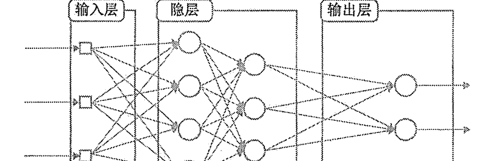
此外，实现AIGC还需模型训练优化体系，包括数据处理、架构设计、超参数调优、模型评估，以及对生成结果的监督与校准，以确保质量、风格与需求相符。

#### 1.4.2 强大的算力：AI学习的引擎
算力是训练与生成高质量AI内容的关键引擎。

模型训练通常涉及海量参数与复杂计算，需在大数据集上反复迭代。高性能硬件如GPU、TPU以及高效分布式系统能加速训练，缩短周期。算力不足会导致训练超时甚至无法完成，影响效果与效率。

生成环节同样算力密集，高分辨率图像、视频、音频的合成涉及大量图像处理、语言处理任务，需要高性能硬件支持，否则会出现模糊、噪声、质量下降等问题。

更强的算力还能拓宽模型的探索空间，促进内容多样性与创新。算力限制会让输出趋同、缺乏新意。

因此，充裕的计算资源对模型训练、内容生成与创新多样性都至关重要。

#### 1.4.3 成熟高效的算法：AI学习的逻辑
算法决定生成质量、效率与可控性，是AIGC的逻辑核心。

成熟算法能更好地从海量数据中提取有效信息，适配大规模训练，并在较短时间内完成训练与生成任务。

当前被广泛应用的先进算法如GAN、Transformer等，可生成更真实、更具创意与多样性的结果，并支持图像、音频、视频、文本等多模态输出。

算法成熟度还体现在可控性与可解释性。可控性指通过参数调整或先验知识控制风格、色彩、情感等属性；可解释性帮助用户理解生成过程，提升信任与接受度。

成熟高效的算法能提升数据处理能力、内容质量与生成效率，并增强可控性与可解释性，推动AIGC发展与应用。

# 第二章 AIGC的核心技术
第一章指出，AIGC指由人工智能系统依托学习与生成算法自动创作的内容，涵盖文章、图像、音乐、视频、设计等。基于海量数据与先进机器学习，AIGC能生成兼具创意与表现力的成果，为创作生产带来便利。

其创作能力源于何处？本章将深入解析AIGC的核心技术，涵盖基础要素与关键技术环节，以及在内容生成中的作用。我们将从技术视角剖析运作机制，探讨不同内容生成的原理与方法，并分析其优势与局限。通过理解核心技术，能更好把握AIGC在数字时代的重要性、潜在前景以及机遇与挑战。

## 2.1 NLP：AIGC的理论基础
自然语言处理是AIGC的重要理论支柱。NLP研究如何让计算机理解、处理并生成人类自然语言，涵盖文本处理、语言建模到语义理解、情感分析、机器翻译、问答系统等。

在AIGC中，NLP主要提供以下支撑：

文本处理：分词、词性标注、命名实体识别、句法分析等，为输入数据预处理与解析奠定基础。

语言模型：通过学习大量文本掌握语言规律与结构，从而生成合理文本。

语义理解：理解词义、句义、篇章结构，保证生成内容的语义准确与一致。

文本生成：从文本合成、摘要生成到文本创作、对话生成，为文章、新闻、评论、对话等提供能力。

情感分析：识别文本中的情感倾向，用于生成带情感色彩的广告、评论、社交内容等。

传统情感分析多依赖词典手工标注，扩展性差。随着深度学习发展，RNN等方法被用于形态、语法与逻辑语义分析。RNN可保存前一输出信息至隐藏层，影响对下一个词的翻译，使序列连贯，从而判断情感。其实现过程如图2-1所示。

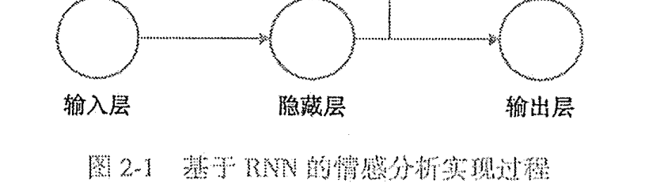

机器翻译：借助 NLP 的跨语言转换能力，可把一段文字从源语言搬到目标语言，为多语种内容生产奠定基础。神经网络驱动的机器翻译原理示意图见图 2-2。

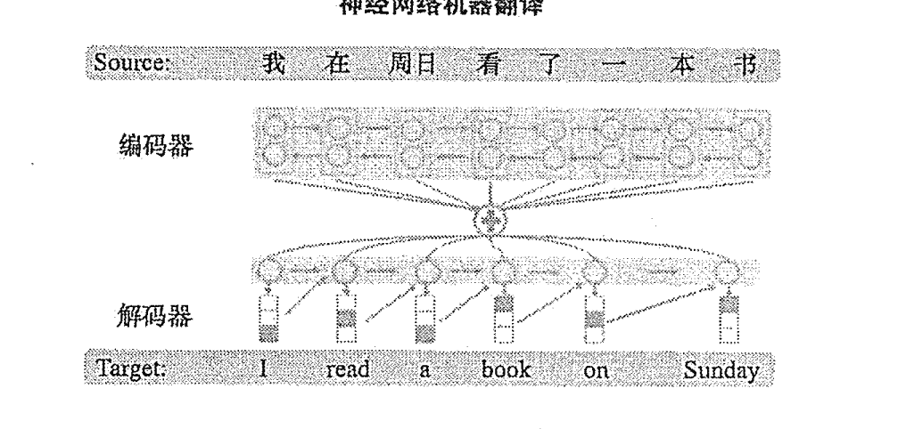

上述 NLP 方法为生成式内容系统提供了理论支撑。把深度学习、GAN、RNN 等前沿手段结合起来，基于语言技术的生成式应用在广告投放、社媒运营、新闻撰写、智能对话等场景展现出强劲潜力。随着语言技术的迭代完善，生成式内容创作的效率与创新度将持续攀升，为用户带来更丰富多元的体验。

## 2.2 多层网络：打造高质量产出

多层网络是一种 ML 分支，根基是 ANN 的原理。目标是让模型从海量样本中自行提炼表征并完成抽象推理。借助多层非线性映射与高阶抽象，多层网络能从庞大数据中自主抽取复杂规律，并在具体任务中做预测与推断。

典型架构由多层节点堆叠，每层内部大量单元并形成层间连接。连接权重借助大规模样本与反向传播不断自适应调整，使整体逐步优化并掌握更抽象的表征。图像识别、语音识别、语言理解、推荐系统等方向均已取得突破。

实践中 GAN、RNN、CNN、Transformer 等范式被广泛使用，它们在内容合成、图像处理、语音合成、跨语言转换、情感分析等任务上表现突出。多层网络的快速演进推动了生成式内容系统的兴起，为产出高质量、具创新性和多样性的成果提供了强力工具。

## 2.3 大规模模型：内容生成的核心引擎

大规模模型指参数量巨大的多层网络系统，通常包含上亿乃至数十亿参数，训练与部署对算力与存储提出较高要求。在内容生成任务中，此类系统是关键驱动力。经大规模训练后，模型能捕捉更丰富的模式与语义关联，从而输出更精确、更逼真的结果。例如在语言任务中，可习得更深层的语法与语义规范。

GAN 以对抗式优化为核心，生成端致力于产出足够逼真的样本以迷惑判别端，而判别端则专注区分生成样本与真实样本。随着双方迭代，生成端产出逐渐逼近真实分布，判别端区分难度不断提升。凭借该对抗机制，GAN 能产出高质量、多样且富有创造性的数据，覆盖图像、音乐、文本等形式。

此类技术已在图像合成、图像修复、风格迁移、文本合成、虚拟角色合成等场景落地，为生成式系统提供了强有力的建模方式，能够创造高创意与高多样性的内容，丰富人机互动体验。

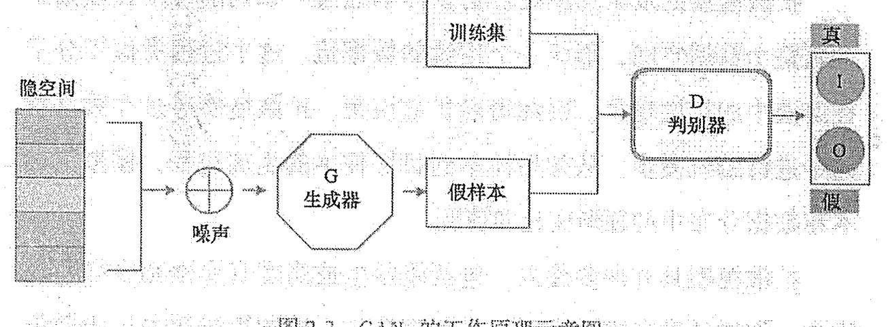

上图展示了 GAN 由判别器 Discriminator 与生成器 Generator 两个网络构成。

训练阶段首先优化判别器：将真实训练样本标记为真标签 1，与生成器产生的假样本标记为假标签 0 一并组成 batch 输入判别器进行训练。损失计算促使判别器对真实样本的判断趋近于 1，对假样本的判断趋近于 0。此轮仅更新判别器的参数，生成器参数保持不变。

随后训练生成器：把高斯噪声输入生成器，得到假图像后标记为真标签 1 送入判别器。损失计算促使判别器对生成器的输出判断趋近于真。此轮仅更新生成器的参数，判别器参数冻结。

#### 2.3.2 Diffusion Model：扩散模型

扩散模型是一种面向高质量样本生成的建模思路，灵感源自随机漫步，通过在数据上施加连续随机扰动来合成新样本。

基本思路是令初始样本经一系列随机步骤逐步扩散至整个数据空间，形成连续的数据流。该过程类似分子在溶液中的扩散现象，故得此名。扩散模型通过模拟数据空间中的随机漫步，刻画从初始到目标样本的生成路径，体现样本在分布中的渐进演化。

其优势在于生成样本真实度高、种类丰富、可处理高维与复杂分布，并支持逐步生成与过程控制，在图像、视频、语音生成等领域应用广泛，为生成式系统提供了可产出高度真实且富创意内容的强力建模方式。

#### 2.3.3 GPT-4：新一代大语言模型

GPT-4 是 OpenAI 推出的最新一代自然语言处理系统，在 GPT-3 基础上实现改进与优化，理解与生成能力显著增强。

系统采用多层学习技术，依托超大规模训练数据与先进神经网络结构，能够产出高质量自然语言文本，可用于文本合成、对话系统、翻译、问答等任务。GPT-4 能理解并回应复杂问题，给出准确且有意义的答案。

相比 GPT-3，主要提升体现在：
- 规模更大，参数量与网络深度提升，可处理更复杂的语言任务；
- 理解更强，对上下文与语义关系的把握更精准，文本更连贯准确；
- 生成质量更高，输出更流畅自然，更接近人类表达；
- 响应效率提升，计算效率改善后生成速度更快。

#### 2.3.4 CLIP: 跨模态预训练模型

CLIP 即 Contrastive Language-Image Pre-training，是 OpenAI 提出的跨模态预训练系统，旨在同步预训练图像与文本表征，使系统理解图像与文本间的语义关联。

CLIP 使用对比学习方法，通过比较图像-文本配对，让系统学习在嵌入空间中区分相对位置。该方式使 CLIP 能够在无监督标签下自动完成图像与文本的语义对齐。

预训练后的 CLIP 可应用于图像检索、图像生成、图像描述生成等场景。其跨模态表征能力为图像与文本之间建立深度联系，为构建更丰富多样的生成式内容提供了新思路。

## 2.4 硬件资源：生成式系统的算力基础

实现 AI 内容合成需要强劲的计算硬件支撑，通常包括高端 CPU、GPU 以及大容量内存。合成过程涉及大量计算，必须借助高速设备保证快速准确完成。此外，AI 生成过程对数据存储与传输需求很高，高速硬盘与网络连接也不可或缺。总的来说，足够强大的基础硬件是高效精准生成的关键前提。

#### 2.4.1 GPU

GPU 即图形处理单元，最初用于图形与图像处理，广泛应用于计算机图形学、游戏、视频处理、多层学习等领域。

早期 GPU 主要承担将计算机生成的 3D 模型转为 2D 图像并显示的工作。随着技术发展，其功能扩展到通用计算。现代 GPU 拥有强大的并行计算能力与高性能计算能力，可同时处理海量数据与运算。

在多层学习与 AI 领域，GPU 被大量用于加速模型的训练与推理。多层学习模型参数众多、计算复杂，对算力要求极高，GPU 的并行特性使其成为理想选择。将计算映射到 GPU 并行执行，可显著加快模型训练与推理速度，提升效率。

主流多层学习框架如 TensorFlow、PyTorch 等均支持 GPU 加速，借助并行计算可大幅提升生成式内容的生成与处理速度。因此 GPU 作为生成式系统的硬件基石之一，对实现更高效更快速的内容生成具有重要作用。

#### 2.4.2 内存

内存是计算机用于存放数据与指令的物理区域或设备，用于临时保存运行中的程序、数据与中间结果，供 CPU 快速访问与处理。

内存通常由半导体芯片构成，具有高速读写与易失性特点。根据存储方式与访问速度可分为 RAM、ROM、闪存等多种类型。

在生成式场景中，内存承担暂时存储与读取数据的职责，是实现生成式系统的硬件基础之一。生成过程中模型参数、输入数据与生成内容等大量数据需频繁读写内存以供模型计算。因此足够的容量与高速读写对于高效运行至关重要。

对于大规模图像生成、视频生成等复杂任务，数据量庞大，对内存容量与带宽要求更高。高容量高速内存可加速数据读写与处理，提升生成速度与效果。此外，内存还负责保存训练过程中的中间状态如优化器状态、梯度等，高效内存管理可降低占用与访问延迟，提升训练性能。

#### 2.4.3 存储空间

存储空间是计算机系统用于长期保存数据与文件的区域或设备，可为物理硬盘、闪存驱动器、云存储等形式，用于永久性保存用户创建或处理的数据、应用、操作系统等文件。

其主要作用是提供持久化保存场所，使数据可长期保存并随时访问。不同存储介质在访问速度、容量、可靠性等方面各有差异，用户可按需求选择。

在生成式系统中，训练数据、生成结果、模型参数、模型配置等内容都需要持久化保存。存储空间的容量与性能直接影响生成式系统的效果与效率。大规模生成如高分辨率图像或长篇文本需要较大存储；高速存储设备可减少读写延迟，提升生成效率。

同时，可靠性与安全性也是考量重点。生成内容可能包含重要信息，需在存储过程中保障完整性、可靠性和安全性，防止丢失、损坏或未授权访问。存储空间作为生成式系统硬件基础之一，对数据持久化、管理与共享起关键作用。

## 2.5 大数据：生成式系统的原材料

在数字化时代，数据被视为“新石油”，是驱动创新与发展的核心资源。在生成式系统领域，大数据被看作“原材料”。数据的积累与利用为生成式系统提供了丰富的信息与知识，推动了内容生成质量与多样性的快速提升。

#### 2.5.1 数据采集与处理

开展生成式应用的前提是采集海量数据用于训练与生成，主要包括以下步骤。

- 1) 数据获取：从各类数据源收集数据，涵盖结构化数据如数据库、CSV 文件、API，以及非结构化数据如文本、图像、音频、视频等。来源包括内部系统、外部数据库、社交媒体、传感器、网页等。
- 2) 数据筛选：对采集数据进行筛选，保留符合特定要求与目标的数据，剔除无效、重复或不符合需求的部分，可通过质量检查、清洗与过滤实现。
- 3) 数据清洗：处理采集数据，去除错误、缺失、不一致或不规范信息，使数据更干净、一致、可靠。涉及修复、标准化、转换等操作，确保准确性。
- 4) 数据转换：将数据转为可用于训练与生成的格式与结构，包括数据类型转换、编码、归一化等，便于后续处理。
- 5) 数据准备：对清洗转换后的数据进行整合与组织，形成可用数据集。包括划分为训练集、验证集、测试集，进行数据标注与标记，以及数据扩充与增强等，以优化模型训练。合理的数据采集与处理是保证生成内容质量、多样性与创新性的关键。

#### 2.5.2 数据存储技术

大数据时代，数据存储技术是支撑创新发展的关键。数据存储技术是指在计算机系统或其他介质上存储与保存数据的方法与工具。无论是采集的大数据还是生成的 AI 内容，都需要合适的存储方案进行管理、处理与保护。

对于采集的大数据，存储技术提供可扩展的存储方案并保障快速访问与处理，性能优化可提升处理效率；备份与恢复功能确保数据安全与持续可用。

对于生成的 AI 内容，存储技术提供高效存储与检索能力，同时保障结果安全与隐私，通过加密、访问控制、备份等手段防止非授权访问与滥用。

常见技术包括：
- 分布式文件系统：将数据分布存储于多个节点，提供高容量、高扩展性与高可靠性，如 Hadoop HDFS、Apache HBase。
- 列式数据库：按列而非按行存储，提供高压缩率与查询性能，如 Apache Cassandra、Google Bigtable。
- 对象存储：以对象形式存储数据，提供高可扩展性与持久性，如 Amazon S3、OpenStack Swift，广泛用于图像、音频、视频等非结构化数据。
- 分布式数据库：将数据分布多节点存储与处理，提供高并发、高扩展性与高容错性，如 Apache Cassandra、Apache HBase、MongoDB。
- 数据湖：可容纳多种类型与格式的大型数据仓库，如 Apache Hadoop、Amazon S3，用于为生成式系统提供大规模数据支持。

这些技术为大数据场景提供可扩展、高性能、高容错的存储方案，有效支撑生成式模型的训练与生成。

#### 2.5.3 数据处理技术

数据处理技术是指对数据进行加工、转换、整合与优化的方法与工具，旨在从数据中提取有用信息、知识与洞见。主要包括：

- 数据清洗与预处理：对原始数据进行去噪、缺失值填充、异常值处理等操作，确保质量与完整性。包括去重、格式转换、标准化、缺失值填充、异常检测与处理等，使数据进入模型前干净可用。
- 数据集成与融合：将来自不同数据源的数据合并、整合与融合，形成统一数据集。包括数据合并、关联、转换、映射等操作，便于模型使用。
- 数据挖掘与特征提取：从大数据中提取有价值信息与特征，支撑模型训练与生成。包括文本挖掘、图像处理、音频处理、情感分析、实体识别、时间序列分析等，从数据中挖掘潜在模式、趋势与特征。
- 数据分析与建模：对大数据进行统计分析、机器学习与建模，从中提取洞察与模式，为生成式训练与生成提供依据。包括统计分析、机器学习算法、多层学习模型、聚类、分类、回归等操作，用于发现模式、预测与生成内容。
- 数据可视化和呈现：将大数据

# 第二章 AIGC 的核心技术 // 35

步骤。

+   2) 模型构建：选择合适的模型架构，并初始化模型的参数。

损失测度设定：先给出一个衡量预测结果与真实标签之间差距的指标，常用做法有均方误差、交叉熵等。

参数学习：借助带标签的训练集进行模型训练，通过不断压低损失值来更新网络参数，让模型在训练样本上的预测更贴近目标。

效果检验：用从未参与训练的验证集或测试集对已训练模型进行检验，判断其在新数据上的泛化表现。

模型改进：依据检验结果对系统进行优化，比如调整超参数、更换优化策略或修改网络结构，以进一步提升性能。

监督学习是机器学习中应用最广的范式之一，覆盖图像分类、语音识别、自然语言处理等诸多任务。它利用带标注的数据让模型捕捉数据背后的规律与特征，从而对新样本实现预测或分类。问题在于高质量标注数据获取量大成本高，在不少场景下会受制约。因此在AIGC的落地中，无监督学习与半监督学习也常被并用。图2-4展示的基于自监督的深度学习流程是典型范例。

思路是先搭建一个多任务深度神经网络，包含特征抽取器E、图像分类器M以及数据增强变换预测器P；随后把源域样本与其类别标签组成分类训练集，对源域样本做数据增强得到自监督训练集，并分别构建自监督任务；训练时计算各任务的损失并加权求和，最终得到样本类别的预测。

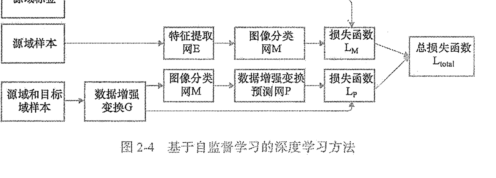

#### 2.6.2 半监督训练
半监督训练介于纯监督与纯无监督之间，模型同时使用少量带标签数据和大量无标签数据进行学习。

与只依赖标签数据的监督方式不同，半监督还能利用易得、低成本的无标签样本信息，通过在无标签数据上做自监督或无监督学习来增强模型的表征能力。其核心思想是用少量标注样本引导学习方向，再借助无标签样本的内在结构丰富模型表达。标注有限时，这种方式能明显改善性能。

典型场景包括图像分类、文本分类、语音识别等，这些领域无标签数据充裕而人工标注昂贵，半监督即可充分挖掘未标注价值。

半监督训练通常包含以下六个环节。

+   1）数据准备：收集带标签和不带标签的训练样本，并整理成模型可读的格式。
+   2）模型构建：选定合适的网络结构并完成参数初始化。
+   3）监督训练：用有标签数据进行监督学习，通过最小化监督损失更新参数。
+   4）无监督训练：用无标签数据做自监督或无监督学习，通过相应的目标函数更新参数。
+   5）模型评估：借助验证集或测试集检验模型在未知数据上的表现。
+   6）模型调优：根据评估反馈调整超参数、优化算法或网络结构，进一步提升效果。

实践中需要注意标签与无标签数据的比例选择，以及如何合理设计无标签数据的自学习机制等挑战。

半监督为AIGC生成模型提供了实用训练路径，能在海量数据上训练并利用未标注信息提升生成质量与效果。如图2-5所示。

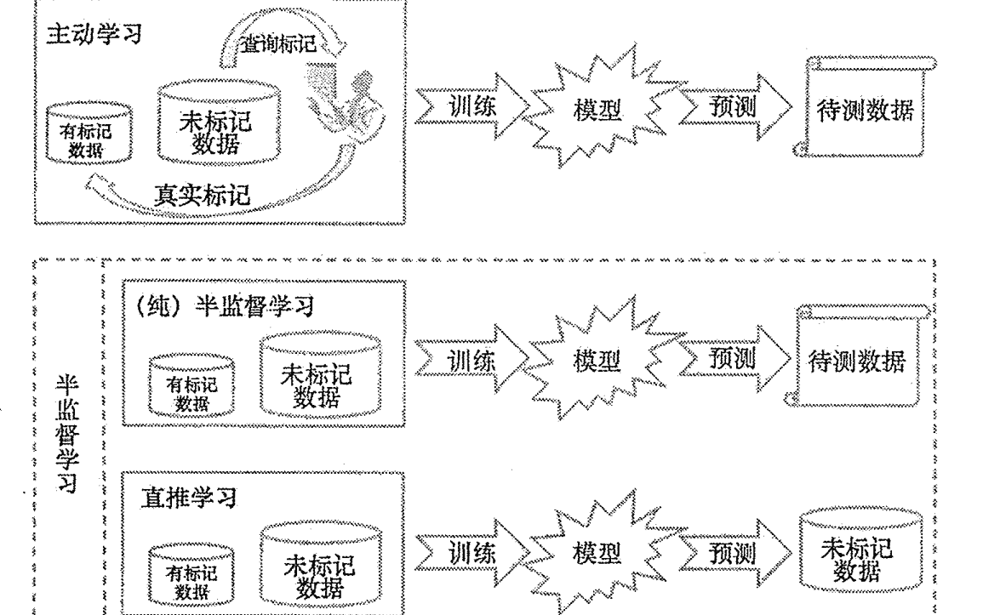

#### 2.6.3 无监督训练
无监督训练指模型在没有人工标签的指导下自主发现数据模式、结构与特征的学习方式。

它常用于难以获取大规模标注数据的情形，或希望在大数据上自主学习有效表征。目标是通过挖掘数据的内在结构，使模型能够对新样本进行预测、分类、聚类或生成。

一般流程包含以下阶段。

1）数据准备：采集或生成无人工标签的数据，并预处理为模型可用的形式。
+   2）特征提取/表征学习：从数据中抽取有用特征或学习有效表征，常用手段有自编码器、主题模型、聚类、降维等。
+   3）模型构建：选择合适架构并初始化参数。
+   4）无监督训练：使用无标签数据训练，通过最小化无监督目标函数或优化算法更新参数。
+   5）模型评估：采用评估指标或可视化手段衡量学习到的特征或表征质量，选择合适的模型。
+   6）模型应用：将训练好的模型用于预测、分类、聚类、生成等实际任务。

无监督存在一定挑战，例如缺少标签导致性能评估困难，学习过程中易出现过拟合或欠拟合，因此方法选择与评估策略尤为重要。

总体看，无监督对AIGC生成模型有明显优势，能在没有大量标注数据的情况下训练，避免人工标注的成本与时间，并可从未标注数据中挖掘潜在模式，生成更丰富新颖的内容。但由于缺乏标签与目标的指引，其生成性能与效果仍可能受限，需要持续研究改进。

# 第三章 ChatGPT：AIGC现象级代表

ChatGPT是基于大语言模型的典型AIGC应用。本章介绍其原理，并探讨其在各领域的应用案例与潜在影响。

## 3.1 ChatGPT：跨时代的对话机器人

ChatGPT通过与用户的对话生成高度拟人化的文本回复，可用于社交媒体、在線客服、内容编辑等多个场景。其强大的生成能力与广阔的应用潜力，使其在人机交互与自动内容生成方面取得突破，为用户体验与生产效率带来巨大价值。

#### 3.1.1 ChatGPT 的来历
ChatGPT由OpenAI开发的大型语言模型，基于GPT架构，采用深度学习实现。训练语料涵盖海量自然语言文本，可完成文本生成、语言理解、问答等任务。在自然语言生成上表现突出，能模拟人类对话、回答问题，被广泛用于聊天机器人、客服系统、智能对话等。

#### 3.1.2 ChatGPT的核心技术
核心是大语言模型，沿用GPT即Generative Pre-trained Transformer的路线。GPT基于Transformer架构，通过大规模无监督预训练学习丰富的语言知识与模式，能生成自然流畅文本。ChatGPT在此基础上做进一步微调与优化，更适配对话场景。

关键技术包括：

Transformer架构：采用Transformer神经网络，能处理长序列并捕捉上下文关系。Transformer由编码器Encoder与解码器Decoder构成，各自含6个Block。工作流程大致为：先得到输入句每个词的向量表示；输入编码器经6个Block后得到句子编码矩阵；再传入解码器，解码器依次依据已译词生成下一个词。

预训练：利用大量无监督数据预训练，让模型掌握丰富的语言规律。

微调：在预训练后，用特定对话数据微调，使其更适合对话生成、对话管理与用户交互。

多轮对话建模：可处理多轮对话并保持上下文一致，对话更连贯自然。

智能对话体验：结合强化学习等技术，使对话更智能友好，理解与生成更自然、多样、有趣。

这些技术的结合让ChatGPT能够生成流畅对话，并在多轮场景中展现强语言处理与生成能力。

#### 3.1.3 ChatGPT的发展轨迹
ChatGPT 的发展历程如下。

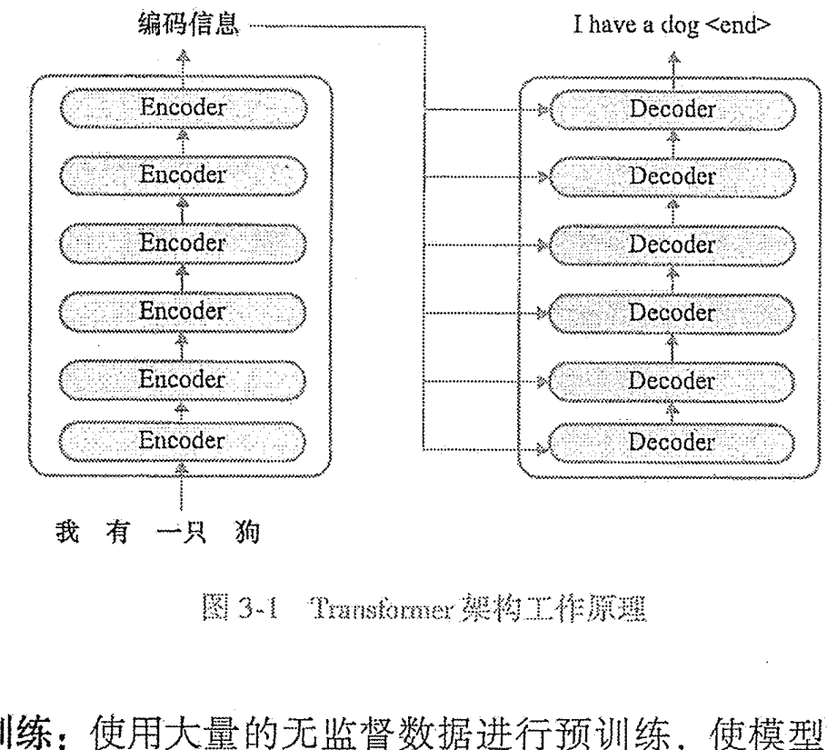

# 图3-1 Transformer架构工作原理

GPT-1 2018年6月：OpenAI首个Generative Pre-trained Transformer，是单向语言模型，通过大规模无监督预训练学习文本并生成自然语言。

GPT-2 2019年2月：参数规模与训练数据均扩大，生成效果大幅提升。因滥用与虚假信息风险，OpenAI最初未公开完整模型，仅发布小版本。

ChatGPT 2019年10月：作为GPT-2的对话扩展，基于GPT-2架构专门模拟对话场景，可生成连贯对话，经微调后更适合多轮交互。

GPT-3 2020年6月：参数达1750亿，是当时最大规模语言模型之一，生成与理解能力显著提升，在文本生成、问答、翻译、摘要等多任务表现卓越。

GPT-3.5-turbo 2021年7月：通过Fine-tuning改进，尤其在生成多样性与可控性方面优化。

GPT-4 2023年3月：OpenAI推出大型多模态模型，不仅处理文字，还能识别图像并生成文本结果。

从GPT-1到GPT-4，模型持续迭代，在语言生成与对话模拟领域能力不断增强。

#### 3.1.4 ChatGPT的主流用途
应用覆盖多个领域，包括但不限于：

对话生成：生成连贯自然的对话内容，用于对话情境、脚本、流程设计。在客户服务、虚拟助手、社交媒体中可模拟人类回复。

用户支持与客户服务：通过对话解答问题、提供帮助、处理诉求，适用于在线客服、智能客服、技术支持等实时交互场景。

营销与广告：生成吸引力强且个性化的营销文案、广告语，帮助品牌推广与产品宣传。

内容生成：生成文章、博客、新闻、社交媒体帖子等，辅助创作并提供灵感。

教育与培训：作为在线教育的辅助工具，生成教学材料、课程内容、答疑内容，助力教学与学习。

翻译与语言处理：支持实时翻译、语言转换与处理，在多语言环境中提供便利。

凭借灵活性与可扩展性，ChatGPT还能在更多文本生成与对话模拟场景发挥作用。

## 3.2 ChatGPT带来的变革
变革主要体现在人机互动方式的改变、对搜索引擎的冲击、对教育领域的冲击以及对生产力的提升等方面。

#### 3.2.1 对AI与人互动方式带来的改变
ChatGPT出现后，人机互动呈现多重变化。

自然语言对话：支持自然语言对话，人机交互更流畅自然，用户可用日常对话交流，无需繁琐指令。

智能问答与帮助：可实时回答问题并提供解决方案，在多场景下提供有用信息与指导。

个性化互动体验：通过学习用户偏好、兴趣与行为，实现个性化服务，交互更贴合需求。

创意与内容生成：生成文章、博客、社交媒体内容等，为创作提供灵感与效率提升。

教育与培训辅助：生成教学材料、课程内容、答疑内容，促进教育资源普及与优化。

语言处理与翻译：提供实时翻译与语言转换便利，推动跨文化交流与合作。

这些改变使交互更智能、个性、便捷，同时需关注数据隐私、信息真实性与伦理道德问题。

#### 3.2.2 对搜索引擎的冲击
ChatGPT对搜索引擎可能产生以下冲击。

搜索查询方式变化：用户更倾向于用自然语言对话进行查询，而非短关键词搜索，对长尾、复杂、语境相关查询的处理提出挑战。

搜索结果多样化：ChatGPT可生成实时答案、解释、评论、文章等，使结果更丰富，改变呈现方式与排名算法需求。

个性化搜索体验：可依据用户兴趣与偏好提供个性化结果与推荐，对推荐算法提出更高要求。

内容生成与呈现变化：用户可能通过ChatGPT生成内容获取答案，而非依赖传统搜索结果。

信息真实性与可信度挑战：生成内容可能包含虚假或未经验证信息，搜索引擎需更严格甄别以保证准确可靠。

总体冲击是渐进的，并受技术、法律、伦理限制。搜索引擎需持续创新以适应变化。

#### 3.2.3 对教育领域的冲击
ChatGPT可能带来以下影响。

个性化学习体验：可与学生进行自然语言对话，根据兴趣、学习风格与能力水平提供差异化支持。

自动化客户服务：可作为企业智能客服，通过智能对话解答常见问题、提供产品信息、处理投诉，提升服务水平与客户体验。

智能销售与市场营销：与潜在客户智能对话，了解需求并提供个性化方案，提高转化率与满意度。

智能数据分析与决策支持：与数据分析人员对话，生成报告、分析结果与预测模型，助力快速洞察与决策。

智能业务流程优化：与员工对话自动生成流程文档、操作指南，提升效率并降低错误率。

智能化人才管理与培养：作为内部培训工具，提供资料与知识问答，帮助员工提升技能与知识水平。

通过上述方式，ChatGPT可推动企业数字化经营，提升竞争力与市场份额，创造商业价值。

#### 3.3.2 创造新的商业版图
ChatGPT的广泛应用能够催生新商业版图，提升商业价值。以下是其可能创造的新商业形态。

# 虚拟助手商业新蓝海

随着生成式 AI 跑出新速度，虚拟助手正从辅助工具升级为跨场景的智能伙伴，在智能客服、线上销售等领域快速落地。围绕研发、定制化方案、部署上线、运维迭代等环节，一个完整的虚拟助手服务链条正在成型。

# 个性化营销与精准推荐
借助自然对话能力，模型能够捕捉用户需求、兴趣点与偏好偏向，据此输出量身定制的推荐策略与营销打法。企业借此能更清晰地读懂客户画像，提供专属化产品与服务，进而拉升满意度与成交。

# 数据洞察与决策赋能
模型可与分析团队展开对话式交互，自动生成报表、归纳分析结论并搭建预测模型，让数据洞察的获取更快、更直观。这一能力正催生新的数据分析与决策支持类服务，帮助企业深挖数据资产价值。

# 智能内训与学习升级
在组织内部，模型可扮演智能助教角色，通过对话提供学习资料、答疑解惑，助力员工提升技能与知识储备。延伸来看，覆盖内容制作、交付方式、效果评估的智能培训与教育服务体系正在形成。

# 创新灵感与创意共创
与员工、客户展开开放式头脑风暴时，模型能点燃灵感火花、协助拆解难题，推动企业创新活动提速。由此衍生的创新工具、咨询服务、创意管理等市场空间也在同步打开。

综合来看，以上路径共同重塑商业版图，创造增量价值，为市场打开更多机会。

# 3.4 如何使用 ChatGPT
本节聚焦 ChatGPT 的交互逻辑与操作界面，并结合典型场景展开说明。

# 第三章 ChatGPT——AIGC的现象级应用 // 51
# 3.4.1 ChatGPT 的界面及交互方式
ChatGPT 的交互以文本为主，整体构成如下：

输入区：用户在此键入问题、指令或对话内容。
提示语：系统通常给出引导性提示，如“请问有什么我可以帮您？”。
输出区：模型的回复会在此呈现，是人机沟通的呈现窗口。
历史记忆：模型可保留前期对话上下文，便于后续问答更连贯。保持背景一致能让交流更顺畅。

用户在输入区提出内容后，模型结合训练权重与上下文语义进行理解并生成回应，可作信息查询、建议提供或多轮对话。

ChatGPT 的界面如图 3-2 所示。

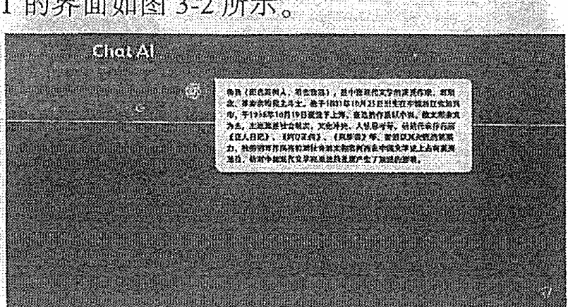

图 3-2 ChatGPT 的界面

#### 3.4.2 使用案例：基础问答
问答是模型的核心能力之一，涵盖日常咨询、技术求助、娱乐提问等。只需输入问题，系统即可基于智能分析与检索给出详尽答案。例如。

输入“梯形上底 4cm，下底 6cm，高 4cm，请问这个梯形的面积是多少”。则输出内容如图 3-3 所示。

图 3-3 ChatGPT 的输出结果 1

输入“鲁迅是谁”，则输出内容如图 3-4 所示。

图 3-4 ChatGPT 的输出结果 2

#### 3.4.3 使用案例：数据整理
在数据整理场景中主要体现为：

数据清洗与预处理：通过对话交互，自动识别并修复错误、缺失或格式不规范的数据，提升整体质量。
数据标注与分类：依据用户给出的规则，对未标注数据批量标记归类，降低人工成本。
数据筛选与排序：按用户条件对海量数据过滤排序，快速定位符合要求记录。
数据合并与整合：遵循用户设定的合并逻辑，将多源数据融合为统一数据集。
数据查询与检索：基于查询条件快速定位所需信息，提升检索效率。

举例来说，将原始数据导入后按需求整理，输出效果如图 3-5 所示内容。

# 54 // 一本书读懂 AIGC：探索 AI 商业化新时代

您好，您可以为短按双关键值指标和对应的数值数据，引制作成表格。根据给出的数据，我们可以呈现以下指标和数值数据：

| 指标                     | 数据数值   |

|--------------------------|------------|

| CPI同比涨幅              | 0.7%       |

| PPI同比涨幅              | -3.3%      |

| 食品价格同比涨幅          | 2.5%       |

| 畜类价格涨幅              | 10.7%      |

| 蔬菜价格涨幅             | 7.9%       |

| 网购商品价格涨幅          | 6.4%       |

| 白酒价格涨幅              | 4.7%       |

| 网课价格涨幅              | 3.5%       |

| 国内价格涨幅              | 3.21%      |

| 薯类价格降幅             | -2.7%      |

| 牛肉价格降幅              | -1.1%      |

| 糖果价格同比降幅          | -3.5%      |

| 汽油价格降幅              | -7.3%      |

| 家具价格降幅              | -0.0%      |

| 核心CPI同比涨幅           | 0.7%       |

| 服务价格涨幅              | 0.9%       |

| 居民出行需求              | 20.2%      |

| 交通工具租赁服务率         | 5.0%       |

| 宾馆住宿价格涨幅           | 8.6%       |

| 旅游价格涨幅              | 71%        |

| 改造服务价格涨幅           | 1.9%       |

| 医疗服务价格涨幅           | 1.0%       |

| 教育服务价格涨幅           | 1.2%       |

| 文化娱乐服务价格涨幅       | 0.9%       |

| 工业消费品价格与上年同期

工业消费品价格与上年同期持平 -            "bbox": [0.298

国家价格上涨幅度

燃油小汽车价格降幅

请注意，表中的涨跌幅度均为同比增长，表示与去年同期相比的涨跌情况。

# 图3-5 ChatGPT 的输出结果3

#### 3.4.4 使用案例：程序编写与修改
在编程辅助上表现突出，主要包括：

代码生成：按用户描述的需求与规范，自动产出框架或完整代码。
代码修复与调试：依据报错信息或异常描述定位问题并给出修复建议。
代码重构与优化：对现有片段进行结构调整，提升性能、可读性与可维护性。
代码审查与评估：按既定标准检查质量、安全与合规性，并输出改进报告。

例如：输入 “用 JAVA 语言写一份冒泡排序的代码”，ChatGPT 的输出结果如图 3-6 所示。

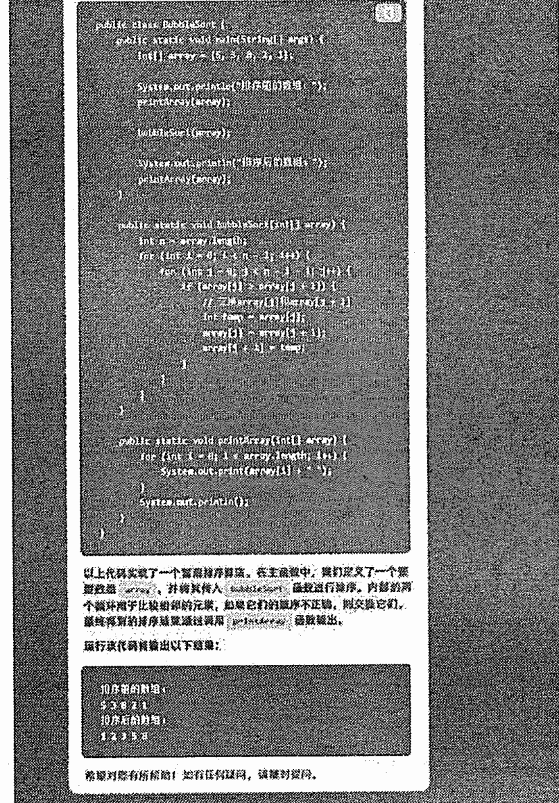

# 图 3-6 ChatGPT 的输出结果 4

通过对话驱动，模型可按需生成、修复或优化代码，提升开发效率。需要强调的是，模型建议仍需开发者审慎校验。

#### 3.4.5 使用案例：文章写作
写作场景的应用包括：

文章生成：基于主题或命题自动撰写段落、框架与初稿。
文章修改与润色：对已有文本进行语法、拼写、标点等校对与优化。
文章评估与评分：依据评价标准对内容、结构、语言等维度打分并反馈。
创意灵感支持：提供标题、结构与点子，帮助拓展思路。

例如：输入 “以春天为作文题目，写一篇不少于 200 字的作

# 3.4.5 使用案例：文章写作（续）

文”，ChatGPT 的输出结果如图 3-7 所示。

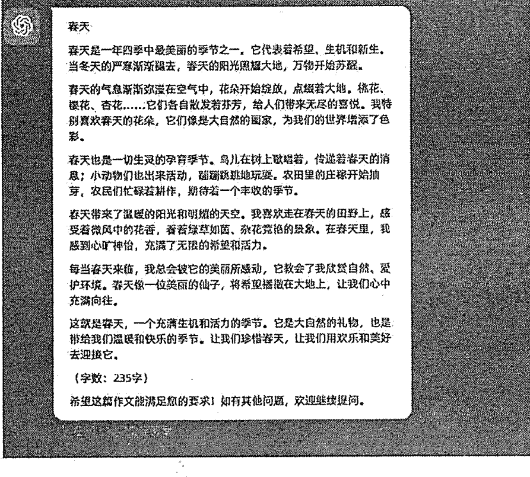

# 图 3-7 ChatGPT 的输出结果 5

借助对话驱动的内容生成与改进，写作效率明显提升。最终成稿仍需作者审核把关。

# 第四章
# Midjourney——解放设计师的 AI 自动绘画应用
在数字化浪潮中，艺术与技术的交叉不断产生新可能。人工智能正深度改写创作方式，Midjourney 作为前沿的 AI 绘画工具，以独特功能与表现力开启了艺术与技术融合的新篇章。

平台亦鼓励用户交流与分享，构建了艺术社区与作品展示空间，便于互相启发与协作互动。总体而言，Midjourney 代表了艺术与技术融合的新趋势，为创作者提供更广阔的空间与可能性。跟随 Midjourney 探索艺术边界，创造属于自己的艺术奇迹。Midjourney 官方网站首页如图 4-1 所示。

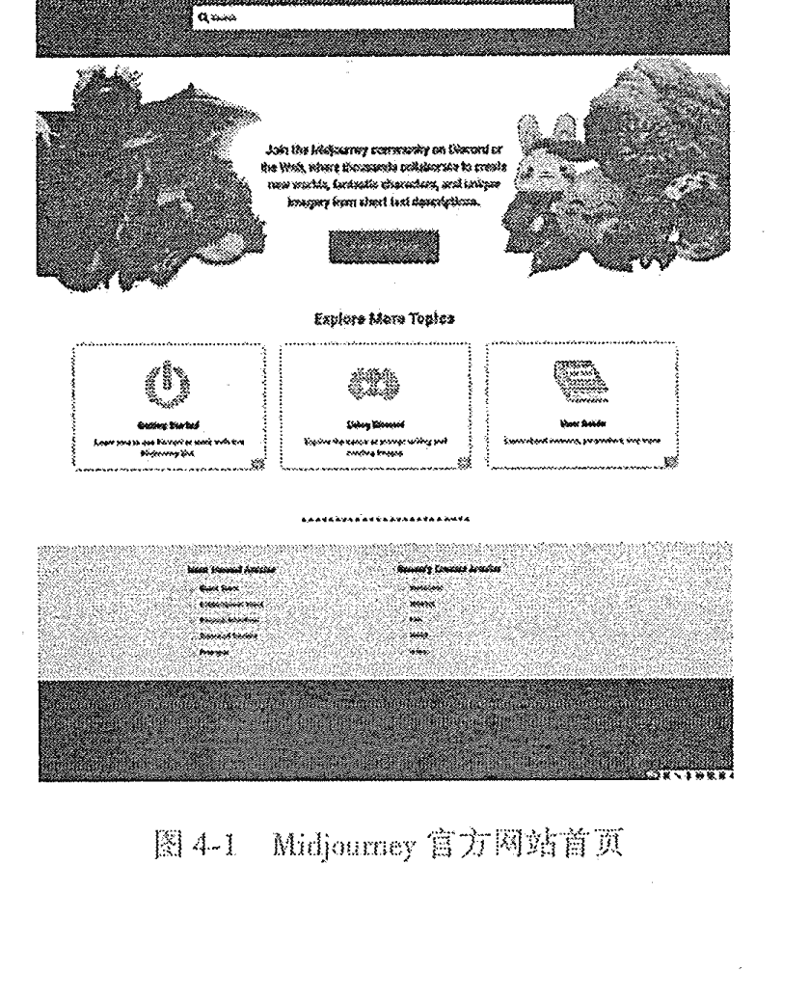

## 4.1 Midjourney: AIGC想象级应用
Midjourney 覆盖多元艺术风格，并带来个性化、创新性的绘画体验。得益于强大的学习能力与智能算法，它可模仿多种流派，满足不同创作需求，同时助力使用者提升绘画技巧。界面友好、工具丰富，用户可自由创作与编辑，产出独一无二的作品。

#### 4.1.1 Midjourney 的核心技术
技术基础是深度学习与计算机视觉，具体涵盖：

深度学习：以深度神经网络为核心，利用多层结构学习艺术作品与图像数据的抽象特征，把握风格、结构与纹理等视觉要素。
神经网络架构：采用卷积神经网络 CNN 与生成对抗网络 GAN 等先进架构。CNN 有效提取图像特征，GAN 通过生成器与判别器的对抗提升作品逼真度。
数据集与训练方式：依托大量艺术作品与图像数据训练，使模型学习不同艺术家的风格与技法。训练过程通过参数优化缩小生成作品与真实艺术作品的差距。
图像生成与优化：训练完成后，生成器可基于输入生成所需风格的图像，并通过参数调整持续优化质量与真实感。

整体上，Midjourney 通过训练神经网络学习艺术风格，再利用生成器产出作品，实现了人工智能绘画的创造力。

#### 4.1.2 Midjourney 的用途
作为 AI 绘画软件，应用场景广泛：

艺术创作与设计：为艺术家、插画师与设计师提供灵感，自动生成多风格作品，辅助概念草图与设计原型制作。
广告与营销：生成精美图像与插图，服务于广告宣传、品牌视觉与产品展示，提升品牌曝光与用户互动。
教育与研究：作为艺术教学工具帮助学生理解风格与技巧，支持创作练习；研究人员可借此探索艺术趋势与风格演变。
创意娱乐与社交媒体：用户可生成有趣艺术化图像用于娱乐，并在社交平台分享作品，获得关注与交流。

Midjourney 为艺术领域注入新创意与活力。

#### 4.1.3 Midjourney 的特点
在创作领域具有鲜明特色。

创作指导：上手便捷。界面简洁友好，操作直观，新手与专业画家均可快速掌握。用户界面划分为六大区域：服务器列表、频道列表、频道导航栏、内容显示区、指令输入栏、成员列表。其用户界面如图 4-3 所示。

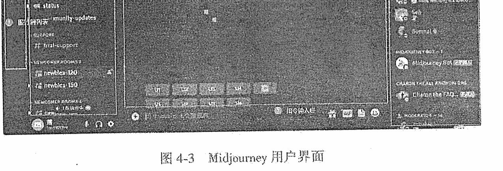

Midjourney 支持界面个性化自定义，用户可调整主题、色彩与布局，打造符合个人习惯的创作环境，如图 4-4 所示。

软件提供实时预览功能，绘画过程中可即时看到效果变化，便于及时调整。支持常用快捷键与手势操作，提升工作效率，如双指缩放、手势平移画布等。

关键操作时会出现上下文菜单与工具提示，帮助用户快速了解功能。提示与菜单按需弹出，提供选项说明，助力深入操作。

创意激发：借助智能算法生成创意素材，为用户提供灵感。它可根据需求生成元素与构图建议，打破常规思维，激发无限创意。

如图4-5 所示，《太空歌剧院》是游戏设计师杰森·艾伦（Jason Allen）的绘画作品，该幅画作是 Allen 使用 Midjourney 生成，再经 Photoshop 润色而来的。

[PAGE 78]

图4-5 使用Midjourney绘制成的《太空歌剧院》

社区互动：Midjourney 拥有活跃的社区，艺术家可在其中分享作品、技巧与经验，促进交流学习并激发更多创作灵感。

Midjourney 社群与实操全景

Discord 上托管的官方社群整体样貌可参考图4-6。

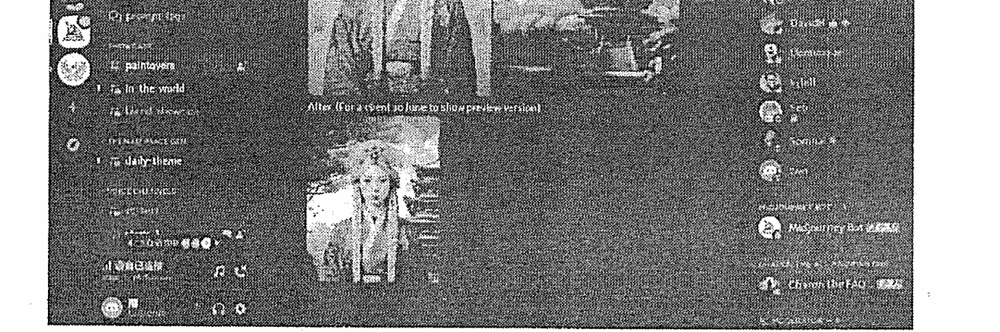

图4-6 Midjourney 的社区 Discord 的界面

[PAGE 79]

总的来看，这套系统把前沿功能与顺手的操作结合，替创作者打开了一条新路径，从入门者到职业画师都能借此把表现力提升一个档次，堪称创作旅程中的实用伙伴。

## 4.2 用户画像
平台覆盖面很广，不止设计圈，在对精度要求很高的工业岗位、NFT 相关生态，以及爱尝鲜的业余玩家中也都有明显存在感。

#### 4.2.1 创意设计圈
这个群体体量庞大，分布在各行各业：①小 B 端，涵盖产品类如玩具、壁纸，视觉类如网站、海报、PPT、Logo、插画，游戏类如场景、角色、道具，以及自媒体内容生产者；②企业端，可服务广告公司、影视公司、品牌创意部门等，对艺术效果图需求量大的客户。

从输出来看，Midjourney 能明显加快创意人群的产出速度。Discord 活跃用户里专业设计师占比大约三到四成，其中包括 Nike、Adidas、New Balance 等品牌的从业者。根据调研，核心用途集中在前期探索，用来点燃灵感、快速试探概念并反复打磨画面。品牌方一直在找提效工具，对付费意愿比较积极。

#### 4.2.2 工业与建筑方向
工具已渗透到对精度要求更高的工业设计领域，尤其是建筑设计。Instagram 上不少建筑师分享基于文生图的成果，#Midjourneyarchitecture 标签下的帖子已超过七万两千条。

实际工作里，建筑师习惯在项目初期用它搭建情绪板。目前生成的画面仅能作草图参考，用来启发思路，后续要手绘成图纸、建立模型并做结构验算，形成 3D 之后再把图像回传给系统迭代。最近推出的 ControlNet 有望让它更深地嵌入设计流程。

#### 4.2.3 NFT 创作人群
这里指在非同质化代币市场从事相关工作的群体。他们能借助软件的多样化风格与智能创意引擎来创作数字艺术品，把点子转成数字作品后在区块链市场交易。

创作时可以尝试不同绘画风格与技法，形成差异化作品来吸引收藏者。借助算法获取独特灵感，再用调节工具精修色彩与细节，提升成品质感。

社群平台也是作品展示与经验交流的场所，互动能促进合作与学习，增加创作多样性。作为使用者之一，NFT从业者可以依托这些功能产出更具辨识度的作品，为市场注入新创意，与同行共同推动领域发展。

#### 4.2.4 业余爱好者
这类用户能获得几类体验。

创作乐趣：界面直观、上手快。无论抒发情绪、描绘风景还是尝试不同艺术风格，都能满足表达需求，带来绘画的愉悦感。

创意激发：智能引擎可在创作中提供灵感。输入关键词或风格偏好后，系统会给出相关元素与构图建议，帮助突破思维定式。

学习进步：平台提供丰富学习资源与交流社区，可学习技巧、探索风格并与同好分享作品。交流有助于水平持续提升。

[PAGE 82]

作品展示：社区为业余用户提供展示舞台，见图4-6。他们可在社区内分享成果，获得反馈与鼓励，进一步点燃创作热情。

## 4.3 把创意落地
#### 4.3.1 基础上手流程
大致按以下步骤操作。

1）账号准备：先访问 Discord 官网下载客户端并完成注册。若在国内，可能需要借助加速工具完成下载与注册。页面如图4-7所示。

2）选择频道：登录后通过左侧菜单进入 Midjourney 频道，侧边栏会出现多个公开房间。可任选其一进入，实时看到他人操作，也可加入他人创建的房间扩大交流。名为 newbies-120 的房间页面如图4-8所示。

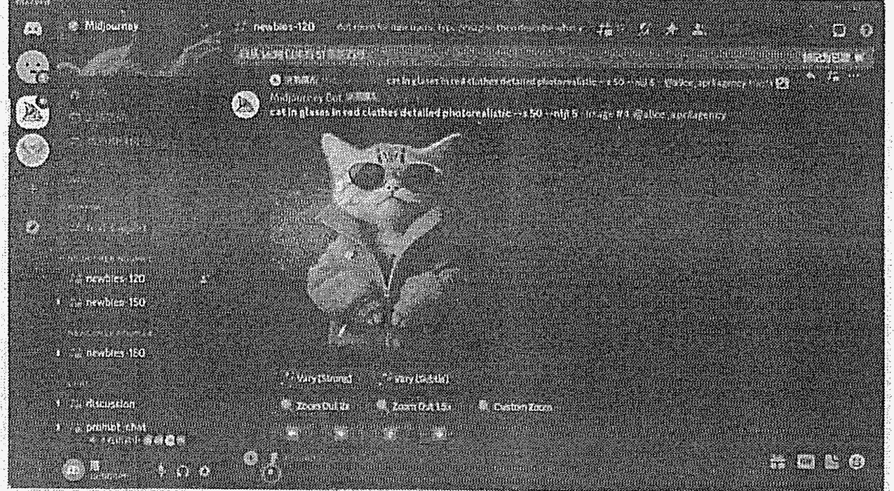

图 4-8 名为 newbies-120 的房间页面

3）创建个人空间：公开房间信息嘈杂，建议自建频道。点击左侧边栏“+”，选择“亲自创建”，再选“仅供我和我的朋友使用”，输入服务器名称完成创建，如图4-9所示。

返回 Midjourney 频道，点击右上角人物图标找到 Midjourney Bot 机器人，双击“添加服务器”，在列表中选择刚建的服务器，点“继续”并授权，即可接入，如图4-10所示。

[PAGE 84]

# 图4-9 创建个人服务器

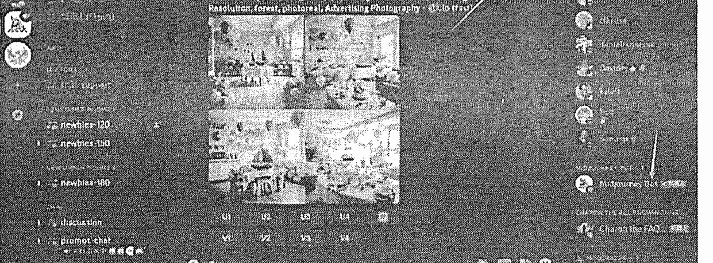

# 图4-10 创建个人频道

4）输入指令出图：空间建好后即可创作。在对话框输入“/”，调出 image 指令输入框，填入提示词，系统就会自动生成图像。如图4-11所示为科幻感图片。Prompt: The robot is typing in front of the computer. Outside the window is a bustling city night scene. The whole scene is very sci-fi and wants to remove plants

#### 4.3.2 自动生成绘画作品
作为一款前沿的 AI 绘画工具，Midjourney 正在推动绘画形态的改变。最大亮点是能自动产出逼真绘画，给用户带来惊喜。基于强力算法与机器学习模型，可模拟不同绘画风格的纹理、色彩与光影，产出栩栩如生作品。

开启生成后，技术能力充分展现。用户可输入关键词或指定风格，例如画猫，可用“民族风”“数位板”“水彩画”等生成不同样式的猫，如图4-12所示。软件会迅速解析信息并按要求计算推理，随后通过算法迭代将需求转化为绘画细节。

生成过程中，系统会模拟画师思维与笔触，注入艺术感知，以高度逼真方式呈现画面。每笔与色彩选择都经精算优化。如图4-13所示，模仿徐悲鸿画法的星空作品呈现出难以置信的真实感与细腻度，细节与色彩丰富度堪比真迹。

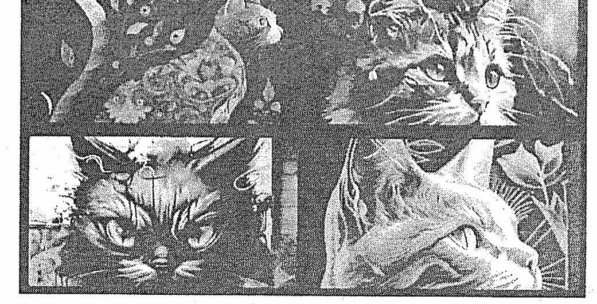

# 图4-13 模仿徐悲鸿画法的星空图片

该功能不仅提供便利与灵感，也为非专业画家与艺术爱好者提供展示创意的机会。作品可分享给朋友、发布到社交媒体，或用于印刷品、装饰品等。

总之，Midjourney 以强劲技术与逼真生成能力让人们重新审视绘画发展，为创作体验与艺术交流打开新机遇。

#### 4.3.3 模仿不同艺术家的风格和技巧
系统具备模仿不同艺术家风格与技巧的能力，为用户打开无限创作可能。通过智能算法与机器学习模型，能准确复刻名家风格，让用户体验大师的独特魅力。

如图4-14所示为模仿梵高（左）和毕加索（右）风格的向日葵图片。

图 4-14 模仿梵高（左）和毕加索（右）风格的向日葵展示

使用时可选择感兴趣的艺术家，如梵高、毕加索、莫奈，或指定印象派、表现主义、立体主义等风格。输入艺术家姓名或选择风格后，系统会快速分析其特征与技巧。

确定风格后，系统运用模型与算法将创作与所选艺术家风格结合。软件会研究该艺术家的作品，解析线条、色彩、笔触等关键元素，并根据用户输入做个性化调整。

由此可产出令人惊叹的作品，无论是梵高的明亮色彩与浓重笔触，还是毕加索的立体形态与几何结构，都能高度还原。该功能既满足欣赏需求，也提供学习实践机会，让用户体验创作过程、技巧与审美，并提升绘画技能与风格理解。

总的说来，系统为用户提供沉浸式艺术体验，既能创作带艺术家特色的作品，也为学习与探索艺术世界提供新视角。

#### 4.3.4 指令与使用技巧
内置多种实用工具，以下是主要指令与技巧。

垫图：纯文字提示随机性较大，若想生成特定构图或专属图像，如个人头像、街拍图、产品实拍图等，可采用垫图。做法是在对话框点击“+”上传 PNG 或 JPG，右键复制图片链接，输入“/”调出 image 指令，粘贴链接后按空格补充下一张，继续按空格输入想要应用的指令，即可保持风格一致。图4-15展示了垫图生成效果。

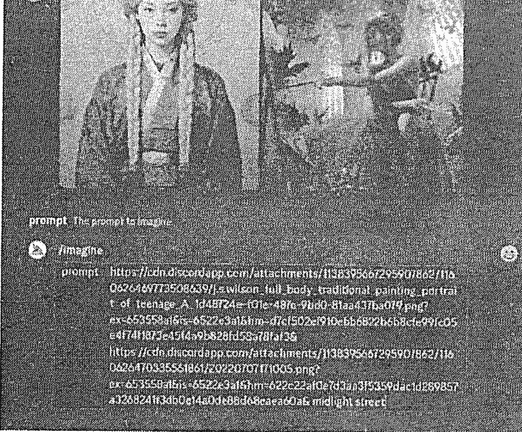

图 4-15 使用垫图生成图片

Blend：原理类似垫图，是将多张图片混合生成全新图像。支持2~5张，不支持额外文字指令。操作为“/”调出 blend 指令，上传所需图片即可，图4-16展示了 Blend 效果。

Remix 微调：无论是文字指令还是垫图生成的版本，变化都不在完全可控范围内。若想进一步修改如人物发色、光线等细节，可用 Remix 指令微调。操作方法是在对话框输入“/”调出 settings 指令

# 82 一本书读懂AIGC：探索AI商业化新时代

+   1 一幅描绘山湖瀑布的艺术插图，以复杂迷幻景观风格呈现，球形雕塑，深青色和朱红色，色彩丰富，引人注目，生动，浅青色和琥珀色

+   2 一幅描绘瀑布的艺术作品，位于群山之中，以迷幻图形设计风格呈现，球形雕塑，深朱红色和碧绿色，色彩丰富，细节丰富，生动的色彩区域，展示框

+   3 一幅描绘海洋和山崖的图像，山崖上有一座山，以迷幻插画风格呈现，球形雕塑，现实色彩调色板，细节丰富，深青色和朱红色，插画，景观艺术家

+   4 山中的风景有丰富多彩的山景，以特里斯坦·伊顿风格呈现，迷幻插画，球形雕塑，深青色和琥珀色，插画，水的明亮度，精细且详细

# 图4-19 Describe方式以图生文

## 4.4 未来展望
#### 4.4.1 人工智能绘画的前景
人工智能绘画作为创新艺术形式，前景广阔，将持续影响艺术面貌。

-   创造新颖独特艺术风格：具备学习与模仿能力，可分析理解各艺术家风格与技巧。借助深度学习与生成模型，能产出令人惊艳的全新风格，为创作带来新可能，推动艺术家探索独特语言。
-   艺术与科技融合：把艺术与计算机视觉、机器学习等先进技术相连，为艺术家提供更丰富多样工具与媒介，推动艺术界创新发展。
-   个性化与定制化作品：可按个人喜好与需求生成定制艺术品。系统依据用户选择与输入，生成符合期望的独特作品，让每个人都能参与艺术创作。
-   艺术教育与创作学习革新：可模拟名家风格与技巧，帮助学习者更好理解与掌握绘画技巧，激发创作灵感，为艺术教育带来新可能。

人工智能绘画不仅拓展创作边界，也为用户提供更多互动方式，通过创新风格、个性化作品与革新教育，为艺术领域带来变革与机遇。

#### 4.4.2 发展计划
Midjourney 致力于持续改进体验，拓展功能与应用。发展方向包括：

-   功能增强与创新：持续研发技术改进，提供更多有价值且富创意绘画工具，满足不同需求，增加创作可能性。
-   支持更多平台与设备：将应用扩展至更多操作系统与移动设备，实现跨设备无缝使用。
-   与其他软件与平台集成：与相关艺术创作工具与内容分享平台合作，实现无缝集成，提供便捷工作流与资源共享。
-   增强智能学习与推荐：提升智能学习与推荐算法，提供更个性化体验。系统可依据偏好与历史创作推荐工具、样式与技巧，帮助用户提升技能。

# 第四章 Midjourney——解放设计师的AI自动绘画应用 // 85

增强的智能学习和推荐：通过提升 Midjourney 的智能学习和推荐算法，将为用户提供更加个性化的绘画体验。系统可以根据用户的偏好和历史创作，自动为其推荐相关的工具、样式和技巧，帮助用户不断发展和提高自己的绘画技能。

用户反馈和参与：非常重视用户的反馈和意见，积极与用户互动，了解他们对 Midjourney 的使用体验和需求。通过持续的用户调查和用户测试，将深入了解用户需求，以便更好地满足他们的期望和提供更好的产品体验。

# 第五章 voice.ai 千声万象的声音库

在人工智能分支中，语音处理正持续演进。voice.ai 是一款面向语音生成的AI产品，声线数量突破三千，覆盖多种风格，为开发者和创作者打开了新的表达空间。该平台的声线总览页面如图 5-1 所示。

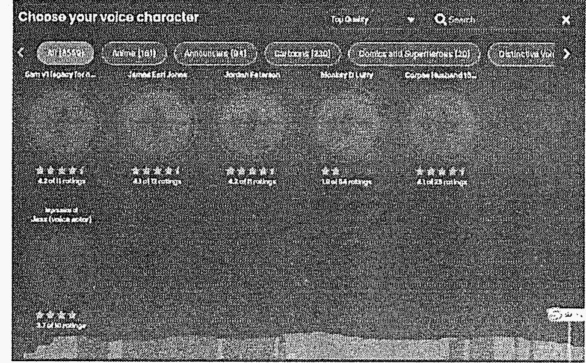

图 5-1 voice.ai 的声线库

# 第五章 voice.ai 千声万象的声音库 // 87

合成引擎基于深度神经网络与大规模语料训练，能够输出听感自然、节奏流畅的音频。用户输入文字后，可挑选音色、语速、语调等参数，得到不同性别、年龄、语种和情绪色彩的声音，显著丰富广播、智能助手、导航提示、广告配音等场景的选择面。

除自然度外，系统还强调可调性和灵活性。合成参数可按场景微调，针对特定受众优化表现；平台同时提供风格模板与音效资源，方便叠加处理，进一步提升呈现效果与使用体验。

在营销、虚拟助手、在线客服、网络教育、游戏等多个垂直领域，丰富的声线组合与高质量合成能力能够支撑更具个性化的交互，为语音沟通与语音应用的创新提供新的可能。

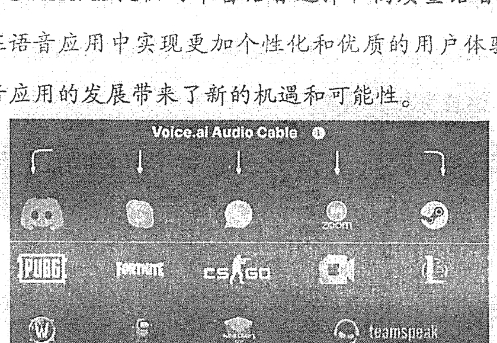

图5-2 voice.ai 应用领域

## 5.1 voice.ai 按需生成声音方案

voice.ai 是一家聚焦语音技术的人工智能厂商，业务范围涵盖语音识别、语音合成、自然语言理解与语音情感判断，为智能助手、客服系统、识别工具、语音分析等场景提供技术支撑。

公司致力于推动语音技术产业化，向企业与开发者输出可落地的识别与合成能力，帮助其将语音功能整合进产品，提升交互质量与数据洞察。

#### 5.1.1 voice.ai 核心用途

主要应用方向包括：

- 语音助手：借助识别能力搭建智能对话助手与导航服务，实现指令控制、语音检索、自然交互等。
- 智能客服：结合识别与情感判断构建客服系统，支持语音服务、自动应答、情绪感知，提升服务效率。
- 语音识别工具：提供 SDK 供集成，实现语音输入、指令触发、语音检索等功能。

# 第五章 voice.ai 千声万象的声音库 // 89

- 语音分析：对录音数据做挖掘，如情感剖析、情绪检测、语义抽取，可用于市场调研、声学研究、用户情绪画像。
- 语音合成：把文本转为流畅人声，用于播报、有声内容、广告配音等。

此外还可延伸至辅助设备、交互界面、数据挖掘等，实际落地随行业需求而变化。

# 5.1.2 voice.ai 技术要点

核心技术架构包括：

- 语音识别：通过声学建模、语言建模、特征提取、切分与降噪等手段，把声波转为文字。
- 情绪感知：解析声学特征中的情感线索，判断喜悦、悲伤、愤怒等状态，用于情感分析。
- 语音合成：采用 TTS 引擎与参数调节技术，把文字转换为自然人声，应用于播报、读物、广告。
- 语音分析：对录音做特征提取与语义挖掘，支持深度洞察与业务应用。
- 深度学习：利用 CNN、RNN、LSTM 等架构完成建模、特征学习、情绪判定与合成。

多项技术的协同使该平台在识别、情感判定、合成与分析环节具备领先水平。

# 5.1.3 voice.ai 关键优势

产品呈现以下特点：

- 高度自动化：依托识别与合成技术实现数据处理自动化，降低人工成本。
- 多语种覆盖：支持英语、中文、日语、法语、德语、西班牙语等，满足全球化需求。
- 情绪识别能力：可捕捉语音中的情感信号，适用于情感分析类场景。
- 优质合成效果：输出声音自然顺畅，适合广告、有声读物、导航等用途。
- 可定制模型：识别与合成模型可按需配置，适配不同行业与场景。
- 部署灵活：提供 API 与 SDK，兼容移动端、智能音箱、智能家居等平台，扩展性强。

这些特质使其在语音处理市场拥有技术深度与广阔潜力。

# 5.2 voice.ai 典型应用场景

#### 5.2.1 游戏领域

典型用法包括：

- 角色语音识别：识别玩家发出的指令或对话，实现角色互动与玩法控制，提升沉浸感。
- 内置语音交流：作为游戏内实时通话工具，便利团队协作与策略沟通。
- 语音引导：通过合成提供任务提示与操作说明，帮助玩家理解规则。
- 游戏助手：提供建议与帮助，提升可玩性与体验。
- 玩家反馈采集：识别玩家对作品的点评，为迭代优化提供依据。

整体上提高操作便捷性，同时增强角色表现与情感传递。

#### 5.2.2 影视领域

应用方向有：

- 识别字幕：自动将对白转为字幕，便于听障人士或非母语观众理解。
- 自动化配音：利用合成为角色生成多语配音，加速本地化与版本制作。
- 剧本整理：把创作者的口述记录转为文字，辅助创作与编辑。
- 后期制作：参与对白、音效、音乐的剪辑与混音，提升效率与质量。
- 剧集管理：对语音内容进行索引与归档，方便检索与分类。

能够改善无障碍观影体验，并提升声音设计的创意度与情感精准度。

#### 5.2.3 音乐领域

主要场景为：

- 歌词提取：自动将演唱录音转为歌词，助力创作流程。
- 乐谱转换：将演奏录音转为乐谱，方便作品归档。
- 跨语翻译：把歌词或演唱从一种语言转译为另一种，支持多语发行。
- 后期处理：编辑、混音、剪辑等环节提效。
- 教学评估：通过识别评估演奏表现，提供指导。
- 情感分析：解析音乐中的声学与情感特征，辅助创作与演绎。

为音乐制作带来更多创新可能。

#### 5.2.4 其他领域延伸

除上述外，还广泛用于：

智能家居：通过语音控制灯光、家电、安防等设备，实现开闭、亮度、温度调节等，提升便捷性。

智能客服：基于识别与合成提供语音助理与客服交互，实现自然对话。

智能交通：驾驶员可通过语音控制导航、音乐、信息发送，减少分心。

医疗场景：医生与护士可用语音录入病历、医嘱，提升记录准确性与效率。

总体而言，该技术正从娱乐内容走向生活服务与专业领域，提供智能化语音解决方案。

## 5.3 基于 voice.ai 搭建智能音频

#### 5.3.1 账号获取与客户端安装

获取账号与软件可按以下步骤：

1) 打开官网 https://www.voice.ai/
2) 找到并点击“Sign In”。
3) 按提示填写邮箱、密码等信息完成注册。
4) 注册成功后登录平台。

# 96 一本书读懂AIGC: 探索AI商业化新时代

5）在平台浏览语音识别与解决方案，按需挑选产品或服务。
6）按指引购买、订阅或试用，如图5-4所示。

图5-4 voice.ai 登录界面示意图2

7）完成付费后按下载与安装说明获取客户端并启动。操作界面如图5-5所示。

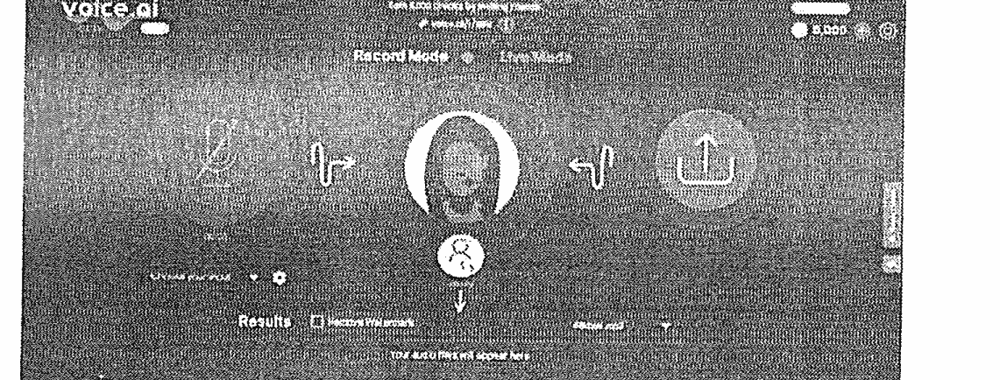

图5-5 voice.ai 的使用界面

需注意不同产品在订购与付费流程上可能因版本、区域与合同条款而异，建议仔细阅读平台说明或联系客服获取详情。

#### 5.3.2 voice.ai 语音克隆操作流程

平台支持音频克隆，通过模型生成个性化高质量人声，涵盖合成、情感判断、声纹生成等。常规流程如下：

先准备一段个人声样，建议在安静环境下用 PC 或手机录制。时长控制在 2 至 10 秒，每段只包含一句完整话语。语调保持平稳，避免语气词如“嗯”“啊”。准备十句以上内容逐句朗读。

录制完毕后，若为 mp3，可使用格式工具转为 Wav 并标注语言与分类保存。生成数据可做后期优化，如平滑处理、混响调节、合成增强等，以提升真实感。克隆界面如图5-6所示。

凭借克隆能力，可实现高度个性化的音频生产，拓展商业与个人创作空间。

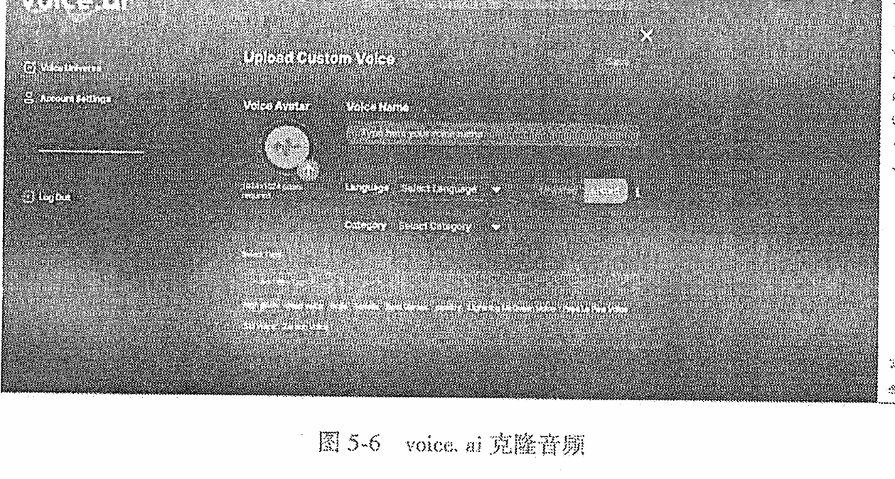

# 图5-6 voice.ai 克隆音频

# 第六章 AIGC+ 驱动创意产业升级

多数人对 AIGC 的印象来自文心一言、ChatGPT 等对话模型，或 Midjourney 等绘图工具。

2023 年上半年，短视频平台充斥着对 ChatGPT 的解读与颠覆论，公众热情高涨但参与面有限，多为段子与评论。

随后大家注意到 AIGC 还能完成模仿歌手演唱、自动生成 3D 短片等创意任务，部分游戏公司与影视工作室已宣布投入产业化探索。

在创意驱动行业，AI 具备可塑性强、效率高、不易枯竭、持续进化的优势。但要实现真正的生产变革，仍需上游完善基础设施：对模型与规则做深度改造、按细分行业构建标准化产品、培养熟练交互人才、打通创作到交付的闭环。

尽管目前仍处试验阶段，AIGC 全面赋能创意产业的趋势已成定局。本章将从细分行业视角拆解落地思路与商业机会。

## 6.1 AIGC 加持游戏产业

游戏是多技术融合的高密集行业。有观点认为尖端半导体由游戏需求牵引，最佳 GPU 与高速存储首先服务于玩家对画质与加载速度的要求；先进图形显示同样由游戏牵引，当代引擎在充足人力下已能模拟小型世界。

元宇宙、VR、AR、数字孪生、光追、区块链等概念多在游戏领域萌芽，AIGC 的到来也将与之深度交织。创意资产生产的降本增效是公认的结合价值。

#### 6.1.1 游戏行业演进回顾

从 PONG、俄罗斯方块、Donkey Kong 等早期产品，到《最终幻想16》《荒野大镖客》、DOTA2 等标杆，硬件从 TTL 逻辑电路+7400 系列芯片+CRT 显示器，演进为高性能 GPU+M2 固态存储+4K 显示。

剧情从“马里奥救公主”的一句话发展到可改编为 Netflix 网剧《龙之血》的 DOTA2 世界观。视觉从像素点跃升至近乎写实的 3D 虚拟世界。

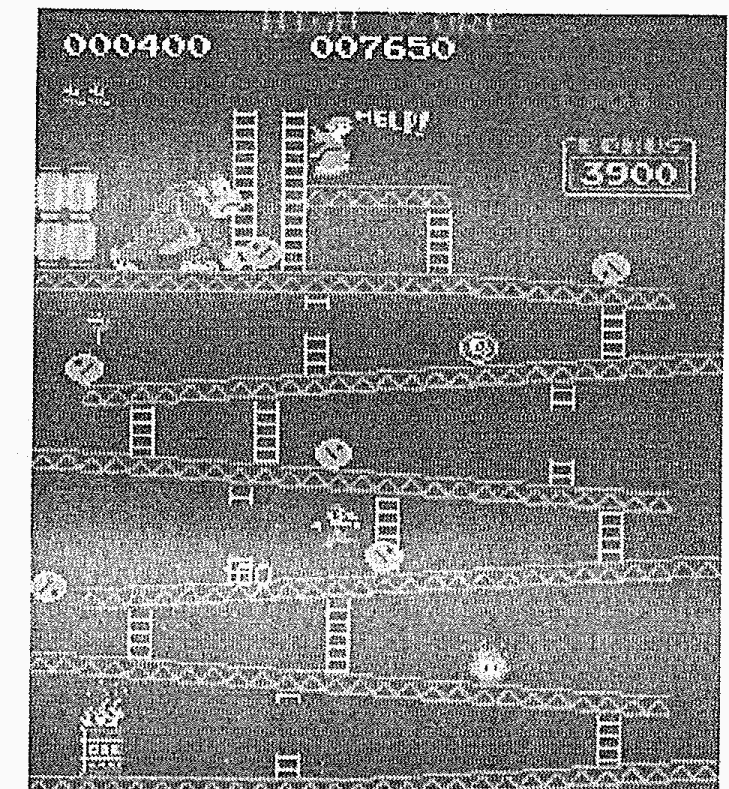

# 图6-2 Donkey Kong 游戏截图

# 图6-3 《荒野大镖客》画面示例

近年游戏对视觉表现的追逐已演变成轮番的内卷与高速迭代，这直接塑造了行业当下的生产形态与分工格局。为了迎合玩家审美需求的持续攀升，厂商往往要把项目预算的50%甚至更高比例投向视觉创意资产的制造。

先简要梳理下游环节的工作面貌与协作方式。

游戏企业的职能大致可划分为产品策划、视觉资产制作、程序开发、宣发推广以及业务运营五大板块。

宣发团队主要负责广告投放、媒体造势等工作，帮助企业把产品推向市场并获取用户；程序团队负责后台与客户端的研发，将内容落地为手机App、小程序、网页或PC客户端供玩家使用；业务运营侧则承担客服、运维等职责，确保游戏稳定部署在云端并提供玩家服务。

下面重点说明产品策划与视觉资源制作。

产品策划的核心工作包括游戏策划、剧情策划、交互策划与数值策划，负责把可玩性与盈利点落到实处，其中数值策划是数学模型的设计与实现，例如英雄的攻击力、防御力该如何设定、变化规律呈现怎样的特征。游戏、剧情、交互策划则决定玩家置身何种世界、以何种玩法游玩，是武侠还是现代战争，战争是第一人称射击还是攻城策略，玩家是相互对抗、推进主线还是养成结果。这类工作几乎完全依赖灵感。

视觉资源制作则要设计并产出各类美术元素，2D项目需要人物立绘、场景原画、UI界面、特效设计等来呈现角色形象、打斗效果与操作界面，3D项目额外需要3D建模来制作角色与场景模型。视觉制作不仅极度依赖灵感，更会消耗大量人力、物力与财力。市面上叫得响的游戏，基本都需数十人甚至上百人的美术团队协同完成。

在这些创意密集、资源消耗大的环节，AIGC带来的价值非常清晰。

#### 6.1.2 游戏业的痛点：艺术创作成本居高不下

几乎所有游戏都建立在创意之上，玩法、世界观、剧情走向与关卡变化都来自策划与美术的共同输出。大量脱离现实的创意元素是游戏的基石。

为生成这些基石，企业须投入大量人力、物力、时间与资金。以一改常规的休闲三消手游为例，开发费用至少在一两百万元；一款常见的MOBA游戏，预算就需准备到亿元量级，其中视觉表现相关的支出占据了开发成本的绝大部分。再看3A大作，《侠盗猎车V》《最终幻想16》《荒野大镖客2》等，开发费用动辄十几亿至几十亿元人民币，周期常以数年计。随着画面精细度与功能复杂度提升，周期与成本还在显著抬升。

业内经验判断，游戏开发成本主要由视觉表现与程序实现构成，其中视觉成本通常占比最高，剧情解密类甚至可接近90%。近年的知名3A，如《上古卷轴》系列、《刺客信条》系列、《最终幻想》系列、《赛博朋克2077》《艾尔登法环》等，开发投入均达上亿美元，且随延期与续作更新费用持续攀升。

图6-4 《艾尔登法环》实拍图

十年前，千万级开发费还令人震惊，如今十几亿的新闻已司空见惯。

以2022年国内上市游戏公司公开报表看，研发投入超10亿元的有8家，腾讯、网易超百亿元，B站、金山、完美世界、世纪华通等在11亿至48亿元区间。若看全行业，国内营业范围含“游戏”的公司约37万家，其中55.7%注册资本超100万元。真实游戏公司数量难以精确，但常态化开发的企业以万计，全球或超百万。

如此庞大的体量，每年在艺术创意上的投入总和是惊人的天文数字。行业整体都承受着制作成本过高的压力，这已成为共识。

除了资金，时间消耗同样惊人。立项、主线剧情、关卡数值设计、技术框架搭建完成，对多数游戏而言仅到了一半。以2022年的《艾尔登法环》为例，一个人物原型至少需5天手绘，关键角色细节可超15天。从山洞、草原、城堡、河流各景，到怪物、BOSS、各类道具，数量数不胜数，原画工作量超出内部承载，常需5至7年制作周期。上百人规模的美术外包团队参与开发已成常态。国内玩家期待已久的《黑悟空》多次延期跳票，也侧面印证了大作周期的漫长。

图6-5 《黑悟空》游戏画面

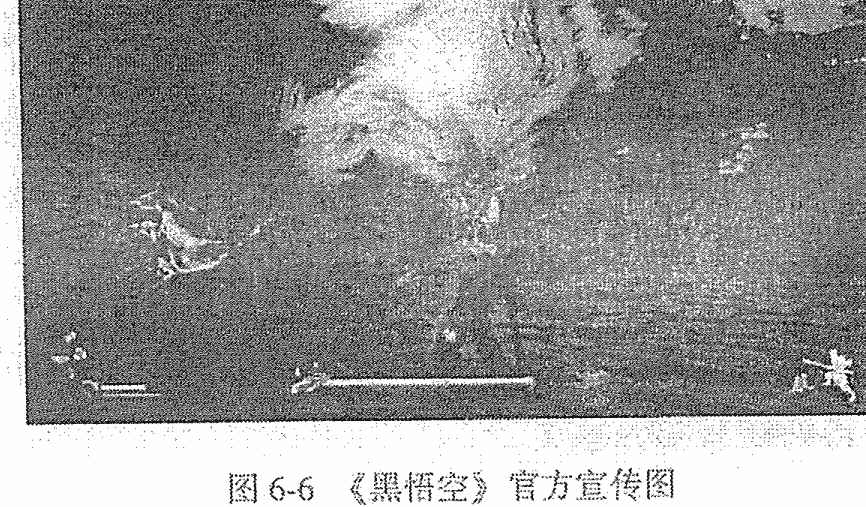

图6-6 《黑悟空》官方宣传海报

项目因资金断裂搁浅每年都在发生。即便资金到位，优质作品仍遥远，因为创意产业必须同时面对资金、周期与创意水准的挑战。

前顽皮狗技术美术总监Andrew Maximov曾指出：没有AI加持，未来世代游戏研发几乎无路可走。他以PS主机为例，从第一代到PS5成本飙升，推算到PS6时按旧方式成本可能提升百倍。

“一款PS游戏研发已从百万美金冲到一亿美金以上，但用户量并未同步增长100倍，收入被成本摊薄的比例越来越高。”“按行业常见分成，一款2亿美元制作、5000万美元营销、定价60美元的游戏，至少要卖830万套才能回本。”“即便能达到，收支平衡对团队意义何在？研发周期常需五六年，放银行收益都更划算。”

在这样的背景下，AIGC与游戏结合实现降本增效具有很强的现实意义。

#### 6.1.3 AIGC如何赋能游戏：降本增效的实践

AIGC在游戏里最广的两条探索是语义交互与AI美术资产制作。

前者类似ChatGPT，可用于智能NPC、AI客服、剧情脚本生成等；后者类似Midjourney、Stable Diffusion，通过提示词驱动AI生成平面图、3D模型、动效甚至视频，经简单修改即可进入研发。

判断一个AIGC产品是否适配游戏制作，关键看两点：能否输出通用标准格式，以及交互方式是否简易。目前许多产品仅能产出JPG、PNG，无法输出Photoshop、Figma、C4D等兼容的标注数据。AI生成的图片多为非分层，无法像标准格式那样对棋子大小、位置、颜色等元素独立快速修改，最终仍需人工评审与二次加工。

在游戏产业，Unity之外不得不提Epic Games。虚幻引擎是大型3D游戏的重要研发枢纽。2023年3月GDC上Epic发布虚幻引擎5，展示了令人瞩目的自动化3D人像建模功能，可通过面部扫描在数分钟内生成精细3D人像，包含表情细节与算法，可直接用于制作。

图6-7 虚幻引擎快速建模演示

2023年4月5日虚幻引擎5正式版开放下载，新增毛发质感与眼部着色器，让五官更逼真可定制；另一项提升终端体验的功能是完全动态的全局光照，太阳照射角度随时间变化，实时光影与玩家游戏内效果一致。AI加持下生成的人物与环境已达真假难辨。

除Unity与Epic，Midjourney、Stability AI等也在探索。DragGAN、Kaedim、PIFuHD+3D、OpenAI DALL·E、谷歌DreamFusion、Meta Make-A-Video、英伟达Magic3D、腾讯AI Lab等方向值得关注。

由此可想象新的美术方式：2D端通过插件或更新包接入Photoshop、Sketch、Figma等，用自然语言描述需求即可生成可二次创作的标准文件，或只需绘制最终姿势即可自动生成动作；3D端在Unity、Blender、C4D、3DMax、ZBrush等平台中口述生成高精度模型，涵盖质感、纹理、色彩、光影及物理特性，经技术美术审核交付。

降低美术资产成本只是起点，AIGC还可用于生成上架或发行的CG短片，实现可自定义对话的智能NPC，完成多语言本地化与音频设计助力。

若提示词培训、模型训练的产业链完善，AI资产交易法规与平台成熟，AIGC即可形成生态闭环，降本增效再上层楼。

以网易公开技术为例，实际结合方式清晰可见：语音驱动口型动画技术用于《梦幻西游三维版》《时空中的绘旅人》《神都夜行录》，大幅提升效率与降本；风格化头部模型生成通过五官拆分与组合在《猎手之王》《故土》合作中应用；轻量高精度人脸关键点追踪系统实现眨眼、视线、舌头等精准捕捉；视频动捕对重心、脚步、胯部等细节自动修正；自动插帧让美术只需首尾帧即可生成中间帧；资源超分提升旧纹理的清晰度与去噪；贴图变换可快速预览服饰效果；语言交互在《哈利波特：魔法觉醒》飞行课中验证咒语音频识别；平衡性测试可模拟车辆与赛道组合快速反馈数据。

目前国内头部企业纷纷布局。完美世界成立AI中心，研究AI剧情、AI绘图、AI天气系统等；昆仑万维提出All in AIGC战略，深耕昆仑天工与中文大模型；宝通科技用AIGC绘画并基于ChatGPT搭建翻译系统；恺英网络用Midjourney、Stable Diffusion生成原画与图标，并参与多素材研发；世纪华通表示人工智能在大游戏研发等多领域应用；巨人网络组建AI小组，美术人效提升5至10倍；腾讯AI Lab发布3D游戏场景自动生成方案；中手游接入微软Azure OpenAI服务推进虚拟玩家与动态NPC生成，《仙剑世界》研发中CG资料片周期从预期8个月压缩至6个月，成本降约10%，2023年度内外包成本降50%至60%、人员成本降10%至20%。

AIGC如何改变万亿体量的游戏行业，正逐步显现。

## 6.2 AIGC+ 影视

近年来影视行业人才流失问题突出，游戏高薪挖走特效师、原画师屡见不鲜。两行业在流程、人员、技术与生态上高度共生。特效团队常兼做影视与游戏外包，原画师身兼动漫与二次元游戏工作，写剧本的高手亦常写游戏剧情。虚幻引擎5.2发布，游戏与影视制作人共同欢呼，游戏CG本身即是电影短片，知名影视IP改编游戏，知名游戏改编电影。

AIGC风暴来临，文本、图像、视频、建模等AI工具将在影视动漫领域掀起同样浪潮。

#### 6.2.1 影视行业简述

从黏土立体动画的《阿凡提》再到全数字三维的《哪吒》，从剪纸二维美学的《葫芦娃》再到数字三维的《中国奇谭》，从《西游记》那种近乎野生的特效做法到《封神榜》恢弘绚丽的视效水准，影视视觉特效的演进速度惊人。这种演进让创意产品的制作体量与复杂度同步攀升，今后的影像生产会更全面地走向数字化。

热爱游戏影视动漫的人都熟悉 CG 这个词，CG 即 Computer Graphics 计算机图形学的简称，泛指一切由计算机生成的视觉成果。换个说法，游戏里的剧情动画可以视作一枚小巧的 CG，院线电影则更像一部完整的剧情巨型 CG。

看完一部电影，片尾那一长串字幕会罗列出庞大的制作班底。几乎所有院线作品都需要上百人协同，科幻、战争类型则更臃肿。影视行业不仅消耗创意，更是资源密集型产业。

影视生产的内核大致是剧情创作叠加视觉实现。若做简要拆分，主要有导演组、演员组、摄影组、录音组、剪辑组、媒介组、美术组。

导演组负责选角、把控剧本推进逻辑与呈现方式；演员组承担角色演出与替身工作；摄影组完成各机位的拍摄任务；录音组负责采样与后期处理，包括配音、混音与曲目；剪辑组依据叙事需求剪接素材并合成字幕特效；媒介组负责渠道拓展与影片宣发；美术组则提供剧情所需的道具与特效画面。到了大制作的特效大片，美术组的投入占比常会超过五成。

一部作品从开机到杀青动辄一年到两年，资金与时间的消耗都是常态。总体来看，影视行业呈现资金门槛高、创意要求高、人力时间成本高的“三高”特征，与游戏行业相比有过之而无不及。

#### 6.2.2 影视动漫行业面临的挑战：创意与美术的代价高

这里仅聚焦典型的动画制作。

在正式开工前会先进入策划案阶段，要先厘清角色设定、故事主线、剧本框架、声音气质等要素，随后再逐项细化。比如角色设定，就要把影片里出现的所有人物形象都界定清楚：人设、外观、肢体特点、服装、出现场景等。以《名侦探柯南》为例，仅角色数量就达数百个，各自的着装、动作、视角都需提前规划。

策划定稿后进入内容生产。依据细节绘制二维原画或搭建三维模型。二维流程一般是草稿、线稿、上色、补色，再合成、渲染、调整帧节奏；三维流程在原画基础上还要建模、UV贴图、设定毛发材质、打灯光、做人物与道具动画。完成这些环节后便得到一段无声动画。

最后是配音演员进棚录制台词，再把音频对齐到对应画面帧，一部完整的动画才算成形。

在整个链路里，原画是最耗工的环节。我们看到的动画本质是逐帧拼接的效果，一个动作或场景切换可能需要上百张原画支撑，90 分钟的作品大约需要 8 万张原画。如此体量意味着巨大的人力、财力与时间投入，画面精度要求越高，投入越会跃升。

若作品像《流浪地球》《阿凡达》《加勒比海盗》那样以特效驱动，成本会更惊人。2023 年暑期上映的《封神第一部：朝歌风云》，导演乌尔善公开表示三部曲总预算达 30 亿元人民币。公开资料显示，《头号玩家》制作费约 1.75 亿美元，其中特效就超过 1 亿美元；《加勒比海盗：惊涛怪浪》耗资 3.65 亿美元，至少 2 亿美元投进特效制作。

天价成本让大量好作品胎死腹中，这显然不利于行业健康繁荣。

正是在这种背景下，AIGC 的价值变得清晰。影视与 AIGC 结合实现降本增效的路径，和游戏行业有诸多相似之处，尤其是 AIGC 能缓解视觉内容生产成本高、周期长的痛点，会倒逼行业拥抱新生产方式。即便在好莱坞，SAG-AFTRA 的行动也印证了这一变革的紧迫性。

## 第六章 AIGC+: 全面赋能创意产业 // 125

## 6.3 AIGC+广告

广告行业诞生时间比动漫影视游戏都早，商业社会萌芽时就已出现。它是一个高度依赖创意的赛道：铺天盖地的同质内容很容易被遗忘，而有创意的表达却能让人印象深刻；消费者对无处不在的广告天然抵触，但新颖有趣的内容能把抵触转化为主动传播。广告的创意需求既来自甲方，也来自受众。

AIGC 能持续产出创意，与广告业结合后想象空间很大。

#### 6.3.1 广告行业简述

传统广告生态通常有三类角色：广告商、广告主、广告受众。广告商负责制作与投放，广告主是出资的品牌方，受众则是消费者。

品牌方先提出需求与预算，广告商据此比稿，创意点子与 Demo 质量往往决定胜负。比稿结束后双方签约，在既有创意上反复讨论、改稿、试稿，直至交付。

另外还有商家自主制作的情况，例如在抖音、快手发布短视频，在小红书做种草，在信息流平台投放素材，在知乎写软文引流等。还有赞助综艺、购买线下广告位、电影植入等形式。总之广告行业极度依赖创意，创意影响质量，也决定成本与周期。

#### 6.3.2 广告行业面临的挑战：广告创意难，实现成本高

要看清 AIGC 的切入点，先要明白行业里典型的痛点。

在品牌方与广告商联合制作的场景里，常遇到：需求与创意都显抽象，双方难以对齐；修改来回确认，周期长效率低；验证创意成本高，只能求稳或硬试；想法不错但预算超支被迫改稿；制作周期失控，比如要呈现四季变化，拍摄周期被拉得很长。

举例来说，某汽车厂商要为旗下首款越野车做宣传片，广告服务商提出请硬派模特出镜，分别在旷野狂飙、沙漠穿越、雪地行驶、溪流通过等场景展现性能。为了实现这一方案，需要把车辆运送到全国不同地貌，再请专业户外摄制团队，成本动辄数十万元，时间也要数月。若模特是知名明星，且要覆盖春夏秋冬，各项费用会更高。

再看中小商家。很多个体卖家或小型服务商没有常备的策划与制作团队，只能找低价外包工作室做简单素材。他们既想要好的创意拉动获客，又受限于有限预算。AIGC 出现前，这几乎是鱼与熊掌难兼得的困境。

#### 6.3.3 AIGC 赋能广告行业：提供无限创意与素材

当前 AI 正从概念走向落地，AIGC 如何重塑广告公司流程尚无定论，但一些应用场景已可预判。

项目沟通初期可用 AI 快速生成方案 Demo，避免概念模糊阶段浪费资源；后期修改时可让 AI 将意见实时转化为预览 Demo，减少沟通往返。AIGC 还能生成 Slogan 与广告脚本。

AI 也在助力内容制作：用 Midjourney 做淘宝卖家秀，用虚幻引擎生成 AI 数字人模特，用 Promethean AI、Kaedim、PIFuHD+3D 等模拟拍摄，用 Midjourney、Stable Diffusion 生成图文或短片素材。声音方面，学习特定声线后可自动完成广告配音。

更进一步，广告公司可以用自身案例训练专属模型，让 AI 输出更贴合行业调性的创意方案，拿到需求后可快速交付多组方案抢占先机。结合对话式 AI，还能实现千人千面的个性化投放，例如根据用户“天热想买衣服、偏好户外运动风”的描述，精准推送速干衣广告。

工具层面选择很多：Midjourney、Stable Diffusion、华为盘古行业大模型等已提供广告解决方案；Waymark、Colossyan Creator、OpenAI 的 Point·E、谷歌 Dream Fusion、Meta 的 Make-A-Video、英伟达 Magic3D、腾讯 AI Lab、Promethean AI、Kaedim、Luma AI、英伟达 Picasso、MetaAR 的 PIFuHD 等各有侧重，比如 PIFuHD 适合低精度远景元素，Luma AI 擅长第一人称 3D 场景变化，Kaedim 适合卡通 Q 萌风格。主流格局仍在演进中。

市场上已有不少成熟案例。可口可乐用 Stable Diffusion 推出创意短片《Masterpiece》，让 2D 静态艺术与 3D 现实世界互动融合，社交媒体播放量约 3000 万，由 Electric Theatre Collective 操刀制作。

图6-13 可口可乐广告中的女孩

该 3D 人物的灵感来自艺术家 Stefania Tejada 的《NATURAL ENCOUNTERS》，艺术家在采访中提到，广告里从自然“走出”的女孩即是其画过的模特。画面由平面角色转为三维，并带有螺旋视角变化，疑似由 Stable Diffusion 参与完成。

阿里旗下飞猪也推出过 AIGC 海报，利用目的地关键词做文本转图像，生成写实或卡通的符号化场景。

图6-15 飞猪发布的AIGC广告海报1

2023 春季飞书未来无限大会上，飞书发布由“W野狗 AI 同学舱”制作的 AI 广告片，该团队此前的人格化狗狗短片已获传播。此次与飞书合作的作品风格同样天马行空。

图6-18 “W野狗 AI 同学舱”为飞书创作的AIGC 广告2

数字艺术家“土豆人 Tudou_man”创作的“麦麦文物”虽非官方合作，却凭借青铜器汉堡、玉石薯条、金光炸鸡等脑洞十足的跨界“新品”获得大量曝光。

图6-19 AIGC 生成的“麦麦文物”创意

在 AIGC 加持下，广告行业仍将诞生更多优质案例，并逐步实现常态化赋能。

## 6.4 AIGC+元宇宙

元宇宙指现实与虚拟的融合体，涵盖 VR/AR，也涉及人工智能、区块链、物联网等技术。它提供一个可交互的数字空间。

#### 6.4.1 元宇宙行业简述

元宇宙概念源自《黑客帝国》《头号玩家》等科幻作品，如今已成热点。用户以虚拟形象即阿凡达或数字自我在其中社交、工作、娱乐，形成超越线上线下的数字生态。

应用范围很广：社交互动、工作协作、虚拟展厅与销售、游戏、教育、医疗、艺术等。挑战同样突出，技术标准、安全隐私、互操作性、可持续性，以及法律道德监管都亟待解决。

整体看，元宇宙体现了人类对虚拟世界的探索渴望，为跨越时空的互动提供新平台，发展前景广阔。

#### 6.4.2 元宇宙行业面临的伦理和道德挑战：虚拟行为和虚拟身份

元宇宙的无边界交互带来伦理难题，核心在虚拟行为与虚拟身份。

个人在虚拟形象下行动时，可能出现与现实道德冲突的行为，如虚拟暴力、盗窃等，其影响会溢出虚拟空间。同时，虚拟身份可被塑造与隐藏，容易引发虚假呈现与身份欺诈。

虚拟行为伦理：虚拟环境里的不端、盗窃、暴力等可能产生超出虚拟世界的后果。

虚拟身份伦理：完全虚构的身份会让用户被误导或受损。

虚拟社交关系伦理：基于虚拟形象建立的关系可能缺乏真实深度，涉及诚实与虚假的边界，以及如何保持负责任互动。

#### 6.4.3 AIGC 赋能元宇宙

在元宇宙里，AIGC 为内容与体验注入创造力。

内容创作与生成：借助神经网络与海量数据，AIGC 可生成场景、角色、物体的逼真多样元素，加速构建流程。

情感与个性化体验：通过分析行为、偏好与反馈，AIGC 能基于情感识别提供贴合用户的沉浸式内容。

智能助手与导航：作为虚拟助手提供实时信息、建议与指导，实现智能导航、任务自动化与交互引导。

自动化与效率提升：AIGC 可执行复杂计算与决策，如在虚拟交易中分析市场、预测趋势并自动交易，提升响应速度。

总体而言，AIGC 增强用户参与感与体验质量，推动元宇宙持续创新。

#### 6.4.4 AIGC 典型应用：制作虚拟人

真人级 3D 数字虚拟人是元宇宙的基础组成，可用于会议、文旅、教育、展厅、影视、游戏、品牌推广等。

除赋予“大脑”外，AIGC 还能大幅提升形象绘制、模型构建的效率，并改善表情、动作的灵活性与真实度，以及声音拟人化水平。

例如，Unity 表示借鉴 AI 作画思路，3D 引擎或可实现“一句话建模”。

优链3D云阵相机面向商业化场景推出，定位元宇宙真人数字分身的快速搭建工具。拍摄只要一秒，约五分钟就能合成出逼真的3D真人替身，单次花费维持在百元量级。

过往虚拟人制作里成本痛点集中在动作捕捉。搭建一套光学捕捉棚，投入动辄数百万元，对初创团队而言压力极大。

AI化的动作捕捉给出新路径：先用一段普通视频识别人体运动，把提取的骨骼信息用于驱动虚拟角色的3D模型。无需昂贵的光学棚，也不需要演员穿戴动捕设备，成本被拉低的同时效率明显提升。由此可见，AIGC对元宇宙中的“人”实现了全链路赋能。

## 6.5 AIGC+其他
OpenAI创始人Sam Altman在一次访谈里说：“AI是少有的先被过度炒作，后又被严重低估的领域。”

前面已经梳理了AIGC在若干创意行业的落地想象。实际上AIGC叠加数字艺术、AIGC叠加在线教育、

# 140 // 一本书读懂AIGC：探索AI商业化的新时代

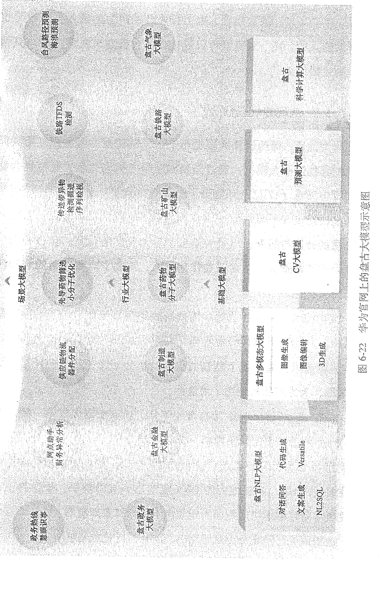

#### 6.5.2 AIGC+气象科学
世界银行测算，完善气象预报与预警体系每年可为全球创造约1620亿美元经济价值，同时挽救数万生命。上世纪后半段，34%的极端事件、22%的死亡约101万人、57%的经济损失约2.84万亿美元都与极端降水有关。

预警极端降水的核心是精细推演未来6小时天气。现有手段或模糊耗散，或受物理数值方法的限制难以捕捉对流启动等混沌行为；主流AI预报多基于2D神经网络，对地球坐标系下非均匀的3D气象场适配不足；又缺乏物理机理约束，迭代中误差会累积，精度逐渐衰减。

华为团队据此打造适配地球坐标系的三维神经网络，提出3DEST架构来处理复杂非均匀的3D气象数据；为遏制迭代误差，采用分层时域聚合策略减少迭代次数。

由此诞生的盘古气象大模型，成为首个精度超过传统数值预报的AI方案，预报速度也实现跃升。过去预测台风未来10天路径，需在3000台服务器的高性能集群上运行5小时。如今借助预训练的盘古模型，单机单卡推理10秒即可得到更精确的结果，提速约一万倍。

在应用层面，盘古可用于海浪、高温、台风、寒潮等气象的预测，速度更快、准确率更高。曾与气象局合作提前10天预报“玛娃”路径；也提前两天预报芬兰寒潮，其气温结果比欧洲中期天气预报中心更接近实况。见图6-24。

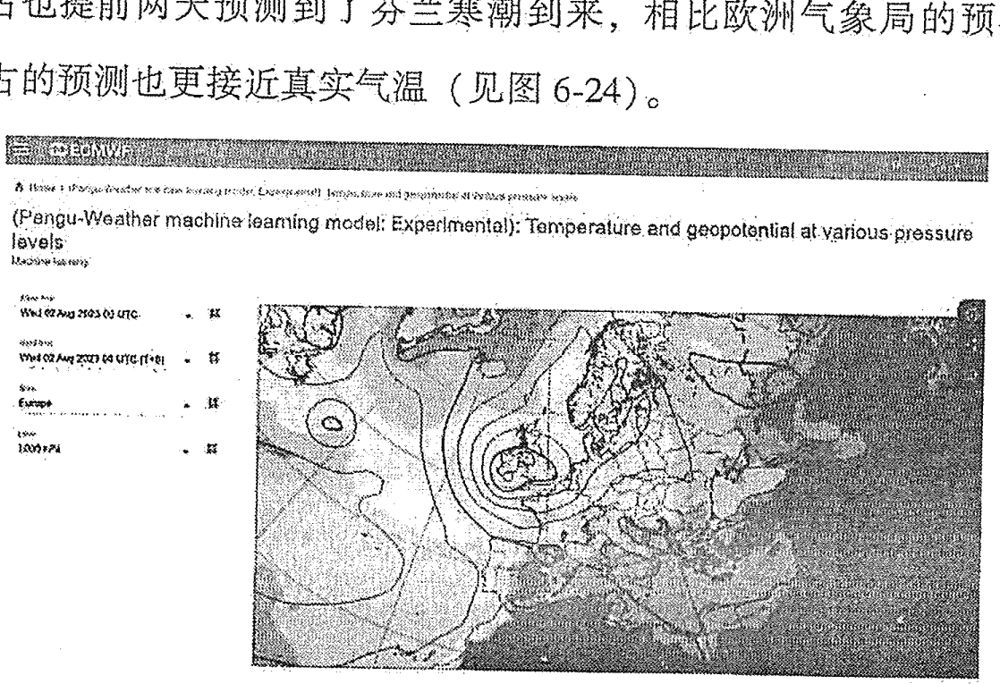

# 图6-24 ECMWF网站显示盘古气象大模型的天气预报

2023年下半年，华为云AI首席科学家田齐领衔的团队在《Nature》正刊发表《Accurate medium-range global weather forecasting with 3D neural networks》，在业界引发关注。

审稿人评价，华为盘古气象大模型让人重新审视气象预报的未来。AIGC与气象科学的结合已产生革命性效果。盘古大模型的训练与推理逻辑示意图如图6-25所示。

#### 6.5.3 AIGC+矿业开发
在公众印象里，矿产开发与AI关联度不高，但在煤炭行业，华为盘古矿山大模型已在全国8个大型矿井实现规模化应用，实质性提升生产效率。

盘古矿山大模型基于井下数据自主学习，为采煤、掘进、主运、辅运、提升、安监、防冲、洗选、焦化等9大专业、21个主场景、数千个细分场景生成优化方案，推动更多作业转到地面，大幅降低安全事故，同时压缩关键业务时长。

以洗选煤与配煤为例，工艺数据关联复杂，过去多靠人工经验定参。模型化后可自主预测分选密度与产品灰分，并优化全流程控制参数，根据灰分比实时自动调节悬浮液密度、入口压力等，精煤回收率提升超0.2%。

借助图网络技术训练配煤优化模型，帮助配煤师提升配比效率，人工耗时由1到2天缩短至1到2分钟，配合更科学的配煤建议，吨煤成本可降低不低于3元。

在防冲卸压施工孔深监管场景，专用摄像仪对施工过程动态监管，视频实时上传智能核验，孔深不足时即时声光告警。通过智能分析卸压钻孔施工质量，辅助防冲部门核验工程规范性，人工审核工作量降低82%，监管流程由3天压缩至10分钟，实现防冲工程100%验收。山东能源李楼、新巨龙等矿区的工作方式已发生根本改变。煤矿AI监督分析系统如图6-26所示。

图 6-26 煤矿 AI 监督分析系统

当AI通过建模与学习能够为特定场景自主生成数据与策略时，不仅绘画与人机对话被革新，传统制造、矿产开发等领域也正被深度重塑，AIGC的赋能革命将在更多行业显现。

# 第七章 AIGC 生态圈——机遇产生之地
生成式AI技术正快速演进，为创意产业打开新空间。它不仅渗透单一应用，更在产业内部形成独特生态圈，涵盖技术提供方、内容创作者、平台运营方到终端用户，形成相互关联、共生共赢的关系。

这个生态圈既是技术与产业的结合体，也是创新与合作的孵化地。

本章将从不同视角探讨生成式AI在创意产业中的应用与影响，梳理生态现状、各参与方的定位与互动，并展望未来走向，思考如何在其中抓住机遇实现可持续发展。

## 7.1 上游大厂：AIGC基础设施的建设
上游大厂通常指供应链中处于主导地位的大型制造商或供应商。在生成式AI生态中，它们是关键推动力量，为整体体系提供核心的基础设施与资源。无论技术研发、数据资源、平台工具，还是合规要求，上游大厂都发挥不可或缺的作用。

它们投入大量研发资源，致力于开发先进神经网络、算法与工具，推动技术不断演进。技术与算法的突破提升生成内容质量与效率，为下游开发者提供更强能力。

它们拥有庞大可靠的数据集与训练资源。标注数据与高效训练平台的积累，为下游提供坚实的数据与训练基础，促进技术发展。

它们搭建相关平台与工具，为下游提供开发、测试、部署的环境。这些平台提供丰富的接口、文档与示例，推动技术广泛应用与创新。

在行业标准与合规方面，上游大厂参与制定伦理准则、法律规范与安全标准，促进生态可持续健康运行。

#### 7.1.1 大模型提供商
大模型提供商通常指具备大规模深度学习模型训练与部署能力的公司或机构，往往拥有庞大算力与专业人才。

商汤科技与百度是全球知名的生成式AI大模型服务商，皆在人工智能领域积累深厚。

商汤科技是中国领先的人工智能技术公司，聚焦计算机视觉、语音识别、自然语言处理等方向。公司推出V4、V7等生成式大模型，用于图像识别、人脸识别、物体检测等，为众多企业提供强力技术支撑。其技术研发与数据资源推动了图像生成技术的发展，大规模训练与优化能力为下游提供高质量模型与算法，助力更逼真的图像生成应用。

百度是中国领先的互联网科技公司，在人工智能领域底蕴深厚。公司发布ERNIE、PaddlePaddle多款生成式大模型，应用于自然语言处理、机器翻译、语音识别等。ERNIE 3.0模型架构图如图7-1所示。

百度以技术创新与平台支持发挥重要作用。大模型与强大的自然语言处理能力为下游提供高质量文本生成模型与工具，推动自然语言生成技术发展；开放平台与工具让开发者更便捷地将生成式AI应用于文本相关场景。

作为代表性大模型提供商，商汤与百度不仅研发实力雄厚，也凭借丰富的应用场景与合作伙伴网络，为各行业提供多样化生成式AI解决方案，助力企业在AI领域获取创新与商业价值。

除此之外，多家IT巨头也根据自身特点推出大模型产品，如华为盘古大模型3.0、阿里云通义千问、360认知型通用大模型“360智脑4.0”、科大讯飞星火大模型等，目前国内大模型产品已超百种，呈现井喷态势。

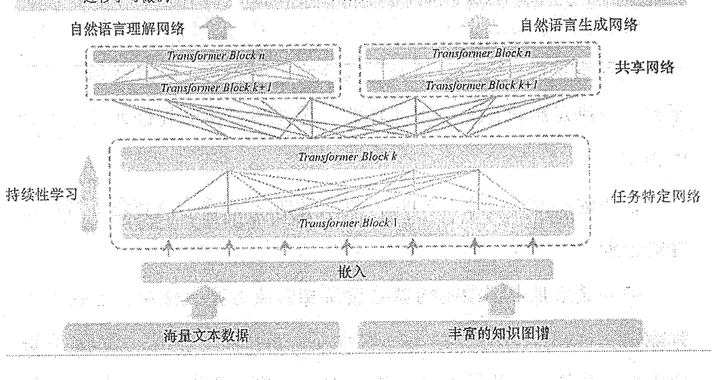

# ERNIE 3.0

# 图7-1 ERNIE 3.0模型架构图

#### 7.1.2 算力提供商
算力提供商为人工智能与通用计算提供计算资源，涵盖高性能计算设备、服务器与云计算平台，满足训练、推理与大规模数据处理需求。

中兴通讯与科大讯飞是该领域的代表企业。

中兴通讯是中国领先的通信设备与解决方案提供商，在AI领域技术积累深厚。公司提供涵盖AI芯片、服务器、边缘计算平台的一体化算力方案，用于图像处理、语音识别、数据分析等场景。其高性能硬件与先进技术为企业与开发者提供强劲算力支撑。

作为算力提供商，中兴通过强大的计算基础设施与数据处理能力，助力下游开发者加速模型训练与推理，其贡献推动了生态在算力层面的突破与创新。

科大讯飞是中国领先的语音与人工智能技术公司，聚焦语音识别、自然语言处理、机器翻译等。公司推出讯飞云AI算力平台——AIHub，用于图像处理、语音识别、智能交互等生成式AI应用。丰富的技术积累与先进的算力平台为企业与开发者提供可靠支撑。

# AIHub

# 讯飞云AI算力平台——AIHub

科大讯飞将深厚的语音识别与处理能力与算力资源结合，为语音生成任务提供高质量语音合成模型与工具，支持创新语音合成应用。

中兴与科大讯飞通过先进硬件、技术与平台，为各行业生成式AI应用提供可靠算力，帮助企业实现更多创新与业务价值。除此之外，华为、中科曙光、中科信息等IT厂商也是代表性算力提供商。

#### 7.1.3 数据供给方
华为、腾讯、阿里巴巴与百度是中国领先科技公司，在生成式AI领域拥有丰富数据资源，可作为重要的数据供给方。

华为作为全球领先的信息通信技术解决方案提供商，在移动通信、网络设备、云计算、人工智能等领域积累海量数据。通信数据、用户行为数据与网络数据均可用于训练与优化模型。通过开放数据接口与数据共享合作，华为为下游开发者提供高质量数据资源，推动技术发展与应用。

腾讯作为中国领先互联网公司，在社交、游戏、在线广告、云计算等领域数据丰富。微信、QQ、腾讯云等产品积累了海量用户行为与业务数据。腾讯拥有丰富用户行为数据与多样化数据类型，通过众多互联网服务与平台积累了大量文本、图像与多媒体数据，为生态提供数据资源与技术支持，助力文本生成、图像生成与多媒体生成任务取得突破。

阿里巴巴作为全球领先电商与云计算公司，在电商、支付、物流、云计算等领域数据庞大。淘宝、天猫、支付宝、阿里云等平台拥有丰富用户行为、交易与业务数据，可为模型训练与应用提供支撑。阿里巴巴为生态提供数据与云计算资源，提升模型训练效率。

百度作为中国领先搜索引擎与人工智能公司，在搜索、语音识别、图像识别、自然语言处理等领域数据丰富。百度搜索、百度地图、百度云等服务积累了大量用户行为与业务数据，为生成式AI应用提供训练与优化数据。凭借搜索引擎与在线服务，百度收集并处理了大量文本、图像与用户行为数据，为开发者提供重要数据基础。

这些公司为模型训练与优化提供大规模高质量数据支撑，同时不断拓展生成式AI业务，推动技术发展与落地。

#### 7.1.4 开源算法提供商
生成式AI开源算法提供商指在该领域开放源代码的算法提供者，为开发者与研究者提供可自由使用、修改与共享的算法。

OpenAI作为全球领先人工智能研究实验室，致力于推动生成式AI研究与应用。公司开发GPT-DALL·E、GPT-4等知名算法，在自然语言处理、计算机视觉、生成对抗网络等领域取得显著成果，并以开源方式发布。

OpenAI在生态中的核心贡献是提供开源算法与模型权重训练。公司开源了GPT系列模型，包括GPT-3、GPT-4等，鼓励研究者与开发者共享与改进AI技术，推动文本生成、语音合成等任务的创新应用。

百度在A

AMD作为与英特尔并列的全球领先半导体技术公司，在人工智能领域拥有多款硬件产品。AMD推出Radeon Instinct、EPYC等专门用于加速生成式AI计算的GPU与处理器，在深度学习与机器学习中具备优异性能与能效。

三星作为全球领先电子产品制造商，在AI领域亦有多款硬件产品。三星推出Exynos、三星AI Accelerator等处理器与芯片产品，在智能手机、物联网设备中广泛应用，并在生成式AI场景中发挥重要作用。

高通作为全球领先移动通信技术公司，在AI领域同样布局广泛。高通推出Snapdragon、高通AI Engine等处理器与芯片产品，在移动设备与物联网设备中应用广泛，并在生成式AI应用中展现优异性能与功耗优化。

## 7.2 中游‘独角兽’：垂直化/场景化的平台建设
在生成式AI领域，中游独角兽通常指聚焦垂直或场景化平台建设的公司，它们结合人工智能技术与专业领域知识，构建具备较强竞争力的平台。

滴滴出行是中国领先的出行服务平台，致力于构建垂直化出行服务平台。通过技术创新提供打车、拼车等便捷服务，改变人们出行方式，优化城市交通。

大众点评是中国综合性本地生活服务平台，提供订餐、外卖、旅游、电影、酒店预订等多种垂直服务。通过整合资源与服务，为用户提供一站式本地生活服务，改善生活方式。

唯品会是中国领先的特卖会电商平台，专注于垂直化特卖场景。通过与品牌与零售商合作，提供折扣商品与限时特卖，满足用户对品牌商品的需求。

考拉海购是一家深耕跨境电商细分赛道的中国平台，主打垂直化海外购物体验。从生活日用品到高端奢侈品，商品覆盖面很宽，靠精选好货和靠谱服务为用户打造安心便捷的境外消费通道。

水滴公司则聚焦医疗保障赛道，是一家以数字化、智能化为特色的中国医保服务平台。它整合保险产品、在途理赔和健康咨询，把保障能力做得更普及、更易用。

这两类企业在垂直化、场景化搭建中扮演关键角色。它们通过资源整合、技术加持和商业模式创新，精准满足特定领域用户的需求，提供更高效、更个性化的体验。这种建设方式有助于优化用户感知、推动行业迭代，也为经济增长提供了正向动能。

#### 7.2.1 大模型的行业场景化针对性训练
垂直场景的平台往往需要让大模型做有针对性的微调，来适配行业特性和应用边界。不少头部公司已经在做这件事，并以此孵化出新的业务形态。几个典型做法如下。

Salesforce 作为云计算与客户关系管理领域的头部玩家，把大模型用在自然语言理解和文本自动生成上，让CRM更懂客户。它通过模型对客户数据的深度分析和语义洞察，提升交互的智能化与个性化，孵化出AI增强型服务模式。

腾讯作为国内科技巨头，在行业场景化训练上也有布局。借助自然语言处理与深度学习，它打造了智能客服、智能助手等解决方案，帮助企业客户实现服务效率与体验的双提升，进而形成对应的商业闭环。

金蝶国际是中国知名的企业管理软件厂商，它把大模型引入商业智能与数据分析平台，用数据挖掘和预测分析帮助企业更清晰地读懂业务，输出决策支持服务。

总体来看，企业让大模型在特定行业完成针对性训练，再装进自己的产品体系，就能获得更强的文本理解、内容生成与数据分析能力，真正实现量身定制。

#### 7.2.2 底层算法的垂直化二创及封装
对通用底层算法做垂直化二次创作并封装，本质上是把普适工具改造成领域专用的解决方案。

二次创作是指基于通用算法，结合行业痛点对数据预处理、模型结构、训练策略等环节进行深度改造，让它更贴合特定场景的任务。封装则是把改造后的算法模块化，提供友好接口和开箱即用的形态，让非专业开发者也能快速调用，无需钻研底层细节。

这样做降低了落地门槛，也加速了人工智能在细分领域的渗透与创新。以下是两个代表案例。

Waymo 是一家自动驾驶公司，它对机器学习与计算机视觉算法进行深度优化，使其更适配道路环境。改造后的算法被用于自动驾驶车的研发与部署，为网约车、货运、物流等行业提供无人化方案。

Palantir Technologies 专注数据分析与AI软件，它对数据处理和分析算法进行定向改进，服务特定行业与企业需求。其算法被封装成数据整合平台与智能分析工具，助力企业实现数据驱动的决策与业务优化。

通过定向改造与封装，这两家公司把通用能力变成行业专属工具，建立起差异化竞争壁垒。

## 7.2.3 针对AIGC生产的海量数据的使用
在垂直化与场景化平台里，由AIGC产生的海量内容可被用在多个关键环节。

实现千人千面的服务。分析AIGC生成的行为与偏好数据，企业能更清晰地把握用户画像，从而推送更贴合的服务。例如社交平台可据此推荐内容或广告，提升体验与投放效率。

打磨产品体验。从海量生成数据中观察使用过程中的摩擦点，企业可以针对性优化产品与流程。电商平台通过浏览与购买数据改进推荐逻辑，让商品更贴近兴趣。

辅助决策与创新。AIGC数据蕴含市场动向、消费者洞察与竞争信号，为战略判断提供支撑。也能帮助探索新机会，发掘未来方向。

强化商业模型与产品。基于用户需求与行为洞察，企业可调整定价、增加增值服务或迭代功能，提升产品竞争力。

驱动营销与投放。解析兴趣、消费习惯与社交行为，企业能做更精准的营销与广告触达，提高投入产出。

总体而言，AIGC数据的价值在于赋能个性化、体验优化、决策创新与商业升级。

#### 7.2.4 典型代表：Photoshop 的 AI 插件 Alpaca
Alpaca 是 Envato Elements 出品的 Photoshop AI 插件，最新版本集成 6 项 AI 能力，显著提速设计工作。

Sketch 支持以线稿加提示词生成上色作品，类似 Controlnet 思路。用户上传草图并框选区域，输入描述后即可得到多张高质量渲染图，直接插入画布。

Transfer 可对选区进行风格迁移，输入提示词即可把局部转为水彩等风格。

Fill 提供生成式填充能力，支持提示词输入与自定义扩展区域。

Imagine 实现在PS内完成文本转图像，可调节生成数量、种子与线条强度等参数。

Depth 能上传图片并计算深度图，生成三维感模型。

Upscale 类似 Midjourney 的放大功能，提升图片分辨率。

Alpaca 的整体能力让设计师在创作效率与表达丰富度上都有明显提升。

## 7.3 下游内容服务商：内容建设与分发
下游内容服务商大致分为建设端与分发端。

建设端利用AIGC技术批量生成文章、图片、音频、视频等素材，应用于新闻、广告、社交、电商种草、品牌传播等场景，并做编辑、定制与优化以适配客户诉求。

分发端负责把生成内容推向合适的渠道，包括官网、社交平台、App 等，并通过SEO、社交推广、广告投放等手段扩大触达，完成从生产到消费的闭环。两者配合，让内容服务更丰富、更具竞争力。

## 7.3.1 由UGC转变为AIGC为应用层平台供给内容源
从用户自创内容转向AI生成内容，是下游服务商在应用层的重要变化。传统UGC依赖用户自发创作，而AIGC可自动化生产多样化内容，为平台输送源源不断的素材。这种切换带来多重利好。

内容规模与质量可控。AIGC能在短时间内产出大量高质量素材，摆脱对用户创作的依赖，满足多样化需求。

可定制化生产。内容主题、风格、语言等可按平台需求调整，更好匹配目标人群，提升吸引力与个性化。

更新维护更高效。AI生成的内容易于迭代，无需用户反复投入，降低运营负担。

释放创新潜力。AI带来的新颖表达为平台提供差异化与创意空间。

总体来看，AIGC为下游服务商提供了更灵活的内容供给能力，助力平台建立竞争优势。

#### 7.3.2 由 AIGC 创造全新的互联网、元宇宙应用层平台
基于AI与大数据，下游服务商可打造全新的互联网与元宇宙应用层平台，形成独特体验。

平台通常具备内容生态系统，聚合视频、音乐、游戏、社交、虚拟现实等多元资源。

依托AI与大数据实现个性化体验，按兴趣、偏好与行为推送内容与互动方式，提升黏性。

支持社交互动与协同，如社交网络、虚拟社群、多人游戏、共创工作坊等，增强社区感与UGC活力。

实现现实与虚拟融合，构建元宇宙概念，让数字生活与现实兴趣相互交织。

商业模式上可探索订阅、广告、虚拟商品、虚拟货币等多样化变现，为创作者与服务商提供可持续收益。

这类平台有望引领互联网与元宇宙的发展趋势，在AIGC生态中创造新价值。

#### 7.3.3 典型代表：视频类平台（Netflix）
Netflix 是下游内容服务商的典型代表。作为全球领先的流媒体公司，它通过订阅制向用户提供电影、剧集、纪录片、动画等内容，覆盖PC、手机、平板、智能电视、游戏机等多终端。

平台以自制与全球采购并重，原创剧集如《怪奇物语》《王冠》《纸牌屋》等成为用户拉力，同时借助个性化推荐系统提升满意度与留存。

其成功印证了垂直化、场景化内容平台的力量：丰富的内容供给、创新的商业模式与细腻的用户体验共同构筑了强竞争力。

# 第八章 AIGC的变局思考
2022年被视作AIGC元年，技术迭代呈现指数级加速。深度学习模型持续完善、开源生态推动创新、大模型商业化探索并进，共同推高了发展速度。ChatGPT的横空出世，正式拉开智能创作时代大幕。

随着技术落地，门槛不断降低，更多普惠的AI生产力平台正在成形。创意与想象力强的人群能够借助AIGC提升工作效率、拓展信息获取与娱乐方式、改善行业服务质量、提高商业效率。

在AI漫长演进中，机器能否创作曾被视为天堑，而创造力一度被认为是人类独有。现实正把创造力赋予机器，世界进入智能创作新阶段。从专业生产内容PGC到用户生成内容UGC，再到AI生成内容AIGC，生产力正在经历深刻变革，工作与生活将被全面重塑。

与此同时，相关技术的风险与挑战也不容忽视，需要探索更好利用方式，推动健康可持续发展。

## 8.1 AIGC 会给人们的生产生活带来怎样的变化
#### 8.1.1 社会生产新变化——为内容创作领域带来创新
+ 1. AIGC 有助于提升工作效率
在内容创作赛道，AIGC能显著提速。艺术、影视、广告、游戏、编程等创意从业者可借助AI完成大量辅助工作，有望产出更多惊艳作品。它为美术与游戏行业提供新灵感与新互动模式，降低前期成本。例如，制作人先搭建故事背景，再由AIGC生成系列设定图，由专业美术筛选、整合、精修，实现降本增效。

+ 2. AIGC 构建创意与实现的分离
在创意阶段，AIGC打开了新的完善路径。重复性、劳动密集型的工作交由AI处理，创作流程演变为“创意-AI-创意”的闭环。

构思完成后进入实现阶段，创作者通过提示词一键生成高质量成果，并对模型参数进行微调即可输出。创意与实现逐步分离，实现环节趋向可复制、可规模化，成本向零逼近。
##### 创意与实现的分离
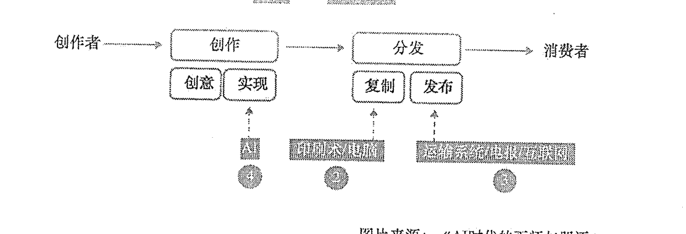
图片来源：《AI时代的巫师与咒语》
# 图8-1 创意与实现的分离

+ 3. AIGC将为创作者带来更多收益
创作者的创意本身比AIGC生成的绘画更有

#### 8.1.2 对人们生活带来的变化——内容消费变革和职业发展新方向
##### 1. 解放专业人士
Copilot类AIGC产品可把报告撰写、方案生成、表格填写等重复工作自动化，让律师、医生、艺术家、作家、记者等专业人群把精力转向更高阶的创造性任务，实现效率的指数级跃升。

##### 2. 内容消费的变革
AIGC借助深度学习与自然语言处理分析海量数据，生成更符合阅读习惯的文章，并实现更精准的商品、电影、音乐等推荐，提升消费体验。文化娱乐领域也可借此提高生产效率与品质，为用户带来更多想象空间。整体内容消费方式正在被重塑。

##### 3. 技术红利释放新的个人机会
每次技术革命都会催生新机会，也淘汰旧范式。AIGC的门槛相对较低，呈现低代码、无代码、对话式等普适特性，为更广泛人群提供平等工具。只要具备独特创意与敏锐视角，就能借助AIGC抓住时代红利，构建个人商业模式。

## 8.2 AIGC发展面临哪些问题
AIGC因其快速响应、知识输出与丰富场景在生产生活各环节发挥重要作用。但在数据、算法与商业模式不断突破的同时，核心技术、企业能力与法规体系仍不完善，公平、责任、安全等争议持续升温，留下诸多待解难题。

#### 8.2.1 AI技术存在的固有缺陷
AIGC建立在AI技术之上，ChatGPT等模型虽能生成连贯、富有表现力的文本，但底层仍存在明显短板。

首先，算法与模型在训练与推理时对数据规模要求极高。亿级以上数据下，效率难以满足实际需求。以自然语言处理为例，大规模预训练模型需处理数万亿语言单元，对算力与存储提出昂贵要求，让研究者与开发者面临巨大压力。大模型对优质数据依赖强，现实中高质量数据供给不足，获取成为瓶颈。数据存储、传输、海量训练与读取速度也制约应用。

其次，许多应用需要高效管理时空资源以实现快速推理。在自动驾驶等场景，车辆需实时处理传感器海量数据并即时决策，但模型复杂度导致算力与存储成本高昂，开发与维护成本随之攀升。

最后，技术成本包括前期训练、数据、人才以及后期的推理成本，目前与带来的增量收益或降本增效相比，投入产出比仍不足以驱动大量企业大规模投入。

AIGC 现在已经渗透到很多领域，应用面看上去很广，但每一个落地场景的诉求都不一样。它的智能决策带着不确定性和难以解释的特性，对人类主观意愿和价值取向的捕捉往往不够到位。拿医疗诊断来说，系统需要在海量影像和结构化数据中快速甄别病症，准确度要求极高。今天的技术还做不到无差别适配，所以不同行业的团队只能投入大量时间做定制化调试。

算法本身的先天短板也很明显。在透明度、可信度、偏见与歧视这些维度上，仍有没能突破的技术瓶颈。AIGC 整体仍处于起步阶段，容易被训练数据、模型结构、训练方法等外部因素干扰。大规模数据处理的速度、模型训练优化的效率、以及模型的可解释性，都在制约性能和可靠性。

另外，复杂问题求解时，AIGC 常被要求模仿人类思维与决策路径，而把人类思维完全搬到机器上需要持续学习和海量数据支撑，这本身就是极艰巨的工程。

落地层面限制更具体。模型训练消耗大数据和算力，还得针对特定任务重新设计调整。数据量不足、算力受限、任务跨多学科知识时，适配难度陡增。可解释性差也让决策过程充满不确定和失误，压缩了可用的场景。模型依赖大规模个人数据，涉及身份、财务、医疗等敏感信息，一旦泄露后果严重。数据安全与隐私必须被置于优先位置。从价值和伦理层面看，也有人提出要让技术更可控，避免失速发展。

即便关键技术尚未完全成熟，缺陷带来的问题也可以通过研发来缓解。比如构建训练更高效的算法模型，提升应用表现；引入强化学习等手段增强可解释性和决策质量；再与物联网、区块链等领域融合，也能在一定程度上弥补单一技术的不足。

AIGC 在音乐、绘画、小说等创作上已经能产出不少亮眼作品。自然语言和图像生成的进展肉眼可见，但在语义理解层面仍是硬伤。它只能依据既有数据和规则做学习推理，并不真正理解语言背后的含义与情感，因而在复杂任务里容易出错、跑偏。生成的文学作品常出现情节断裂、人物行为不合理等现象，限制了创造力的发挥。更关键的是，模型可能产出虚假或不合逻辑的信息，在医疗、法律、金融等对准确性要求极高的场景会形成风险。所以依托人工智能的内容编辑与创作，仍被短板拖着，技术门槛依然存在。

以文本生成为例，ChatGPT 能自动写新闻、故事、诗歌等多种形式，质量已接近人手水准。但自然语言理解的瓶颈仍在，简单套模板就会出现结构雷同、千篇一律，难以注入真实情感和拟人表达，偏离了用户对易读性和质感的期待。要想靠近需求，就得用很精确的描述反复对话、引导和校正。

语音合成方面，识别门槛高、流畅度不足、情感表达弱、机械感明显等问题突出。情感嵌入需要大量数据训练，对建模的要求也很高。

视觉合成则依赖大量组件库和模型资源。核心难题是如何实现精准控制，机器在精确度、仿真度上与预期仍有差距，企业往往需要自研微调才能达到预期。整体图像生成稳定性不够，商用受限，AIGC 在图像识别精度上有限，目前多停留在局部编辑层面，像常见的美图秀秀类操作。主要应用集中在视频剪辑、人脸替换、背景替换等，和文本、图像同源的问题也一脉相承。经典案例是输入描述“三文鱼逆流而上”，模型却画出一群鱼片在游动。

要商业化使用，知识产权也成为争议点。AIGC 生成的音乐版权归谁、收益如何分配，都尚未有定论。现在的 AIGC 仍在早期摸索，发展有限决定了应用场景有限。短期内企业能做的，主要是不断优化模型，提升与具体场景的匹配度。

#### 8.2.2 生成作品在语义理解上的不完善
生成物的语义理解缺口始终存在。模型缺乏真正的语义洞察，只能模仿表层模式，导致在复杂语言任务中产生偏差。作品可能在逻辑连贯性、人物动机等方面失真，也可能输出不真实的信息，这在强监管行业会带来隐患。

#### 8.2.3 实现AIGC应用的成本高昂
落地 AIGC 的成本结构偏高。数据和算力的需求直接推高了建设门槛，缺乏统一标准和成熟平台也让开发部署变得复杂。投入往往以巨额资金和人力计。

数据采集清洗成本高昂。训练强模型需要来自传感器、设备、用户行为等多源数据，收集、清洗、标注耗时耗力，还要遵守隐私法规。内容质量不稳定、缺乏统一标准，也会限制用户增长和变现能力。

硬件与基础设施投入大。需要大量服务器、GPU 等专用设备，还需专业运维。随着技术迭代，持续升级维护带来的负担也不小。

人才成本居高不下。搭建维护系统需要计算机科学、数据科学、统计学、机器学习、人工智能等复合型人才，供给少薪资高。

市场营销与推广费用不低。AIGC 虽潜力大，但前期投入高，必须快速扩大用户规模才能摊薄成本。对安全可靠性要求高的领域，还需严格测试，进一步增加人力与资源投入。多数公司现阶段更侧重技术完善与需求验证，部分成熟应用也常以免费试用吸引用户，变现能力有限。

总体来看，高成本是制约普及的关键。只有通过技术创新和降本，才能让更多主体参与进来，释放社会价值。

#### 8.2.4 法律及市场监管尚不完善
随着 AIGC 普及，法律与市场监管的滞后愈发明显。隐私与安全如何处理、应用的公正透明如何保障，都是待解难题。部分行业可能因替代效应出现就业与社会问题，技术复杂性和不可预测性也对法律道德提出挑战。

目前监管仍处初级阶段，法律法规不明确，行业标准待完善。人工智能发展速度已超过立法节奏。

在隐私安全层面，算法处理个人数据时必须保障安全、隐私和保密，需要明确的规范约束企业行为。在公正性层面，算法可解释性不足导致决策过程黑箱，难以排查歧视，需要法规来规范透明度与公平性。

知识产权保护也存在空白。AIGC 算法研发投入大，涉及法律问题，需加强保护。以智能写作为例，使用权和产权归属尚未明确，易滋生盗版抄袭。平台收集个人信息的使用与保护合规性也需更强监管。

市场层面，低质低水平作品增多，利用关键词堆砌、复制粘贴等方式博取曝光，对市场造成负面影响。医疗等强监管行业的应用，必须满足法规与安全标准才能合规使用。

总体需要加快立法与标准建设，保障安全、可靠、公正、透明，防止歧视等风险出现。

## 8.3 发展大势不可逆的 AIGC
#### 8.3.1 AIGC 的发展趋势
AIGC 的走向是更普及、更专业、更个性化。未来将有更多企业、组织和个人使用该技术实现业务目标。

普及化意味着技术不再局限于专业人士，普通人也能用它解决生活工作问题，比如集成 AIGC 的智能家居可更智能地控制设备。

专业化意味着进入更多细分行业。不同领域需求不同，需要定制化方案。医疗影像分析、智能辅助手术、病历管理效率在提升；金融风控、智能投顾等场景也在增长。能力需随市场需求动态调整更新。

发展也伴随道德与治理议题。训练数据需多元且具社会代表性，要制定伦理准则防止产生危害或不公平歧视。

政府在其中扮演关键角色，需出台政策法规保护公众利益安全，同时鼓励创新并投入研发。公众参与同样重要，需要理解基本概念、应用范围与潜在风险，学会适应与协作。

协作是管理变革的核心。政府、行业领袖、民间组织需共同制定负责任的使用规范，产学合作则能确保研究兼顾社会与道德考量。

使用 AIGC 不仅需要技术，更需要人才。重视技能培养，提升人才素质，才能为产业发展提供保障。

总之，AIGC 是一项变革性力量，有可能重塑生活与工作方式。只要以道德、以人为本的原则为指导，保持对风险的警惕并共同应对，就能让它成为造福社会的正向力量。

# 第八章 冷思考——AIGC 会带给我们什么 // 183
能力，并根据市场需求进行调整和更新。

AIGC 的发展提出了许多必须解决的道德和治理问题。必须确保用于训练人工智能系统的数据集是多样的，并具有社会代表性。此外，必须制定道德准则，防止开发危害社会或不公平歧视某些群体的人工智能系统。

政府在应对 AIGC 带来的变化方面起着重要的作用。政府需要制定相应的政策和法规来保护公众的利益和安全，同时鼓励和支持创新和发展。政府还需要投资于相关的研究和开发，以推动技术的进步和应用。

公众的参与也是应对 AIGC 带来的变化的重要因素。公众需要了解 AIGC 的基本概念、应用领域和潜在风险，以及如何适应和利用新技术协作。最后，协作是管理 AIGC 带来的变化的关键。政府、行业领袖和民间社会组织必须共同制定政策和法规，以确保负责任地开发和使用人工智能。此外，学术界和行业之间的伙伴关系有助于确保人工智能研究基于社会和道德考虑。

在使用 AIGC 的过程中，我们不仅需要技术支持，更需要人才支持。因此，我们应该重视 AIGC 技能的培养，提高人才的素质和技能水平，为实现 AIGC 技术应用和产业发展提供人才保障。

总之，AIGC 是一种变革性技术，有可能彻底改变我们的生活和和工作方式。然而，其开发和使用必须以道德和以人为中心的原则为指导，我们必须在识别和解决与其开发相关的潜在风险方面保持警惕。通过共同努力，我们可以确保 AIGC 是一支向善的力量，并为所有人创造一个繁荣和公平的未来。

## 参考文献

[1] 吴恩达．深度学习 [M]．北京：人民邮电出版社，2017.

[2] 肖宏，严明，王德峰．人工智能+金融：时代机遇与挑战 [J]．经济研究导刊，2017 (22)：51-54.

[3] 余志勇，黄永明，丁志荣．人工智能的应用及风险评估 [J]．软件，2018，39 (7)：1-6.

[4] OECD. The AI Principles. [ EB/OL ]. ( 2019-05-22 ) [ 2023-07-21 ]. https://one.oecd.org/document/DAF/COMP/WD (2019) 17/en/pdf.

[5] Future of Life Institute. Asilomar AI Principles. [ EB/OL ]. ( 2017-01-01 ) [ 2023-07-21 ]. https://futureoflife.org/ai-principles/.

[6] 刘阳，徐学飞．人工智能技术应用与监管政策 [J]．中国软科学，2017 (10)：63-72.

[7] 李飞飞．深度学习 [M]．北京；电子工业出版社，2018.

[8] 郑永鹤．人工智能大数据与未来教育 [J]．现代教育技术，2017 (5)：12-15.

[9] 肖永涛，肖宏，蔡玲娜．区块链+人工智能：技术与应用 [J]．中国信息安全，2018 (2)：27-31.

[10] 腾讯研究院．腾讯研究院 AIGC 发展趋势报告 2023：迎接人工智能的下一个时代 [EB/OL]. ( 2023-02-16 ) [ 2023-07-21 ]. https://docs.qq.com/pdf/DSkJweFIcDEFMQ2pT?u=c0ab7babbf1c42d6a03a343332181d12.