# AIGC 新范式：ChatGPT、AI 绘画与生产力跃迁

## 核心创作者

**贾雪丽**，上海技术交易所专家库成员，荷兰代尔夫特理工大学硕士。职业轨迹覆盖 ING 银行、中国平安、光大集团等头部金融科技公司，长期深耕人工智能、隐私计算、区块链等方向，已累计申请 AI 相关发明专利六十余项，在 INTERSPEECH 学术会议发表论文，并参与多份隐私计算行业报告与白皮书撰写。

**0xAres**，利物浦大学硕士，先后在投资机构与知名公链基金会任职。曾主导制作多套区块链系列课程，多次策划黑客松活动，长期从事 Web3 科普与教育，拥有全栈孵化经验。擅长以图文、视频等多元形式传播 Web3 共识。2021 年创立去中心化创作组织 a15a，开启新技术科普写作，主编《一本书读懂Web3.0：区块链、NFT、元宇宙和DAO》《一本书读懂NFT：区块链通证、元宇宙资产、Web3.0营销和数字化身份》。

**张炯**，星图比特创始人兼CEO，中国通信工业协会信息化科技创新专业委员会委员，上海技术交易所专家库专家。曾在 IBM 工作，长期服务中国人民银行、中国工商银行等金融机构，擅长技术融合与产业创新，对区块链、人工智能等数字经济核心技术有深入理解，持有 AI 与数字资产相关专利八项，参与撰写《一本书读懂Web3.0：区块链、NFT、元宇宙和DAO》《一本书读懂NFT：区块链通证、元宇宙资产、Web3.0营销和数字化身份》。

## 出版信息
《一本书读懂 AIGC：ChatGPT、AI 绘画、智能文明与生产力变革》
a15a 著
贾雪丽 0xAres 张炯 主编
电子工业出版社
Publishing House of Electronics Industry
北京·BEIJING

## 全书概览
本书以通俗方式呈现 AIGC 知识框架，并以大量案例帮助读者快速上手，提升工作与生活效率。

第 1 章从人工智能演进与资本动向切入，描绘 AIGC 产业全貌；第 2 章梳理 AIGC 关键技术；第 3 章讲述文本生成技术演进及在传媒、教育、办公等场景的落地；第 4 章介绍语音生成技术在音乐、仿真等领域的运用；第 5 章介绍图像生成技术在创作、处理、识别等方向的应用；第 6 章介绍视频生成技术在合成、数字人等方向的应用；第 7 章梳理 AIGC 上下游链条，涵盖算力芯片、VR 等硬件、元宇宙建模等；第 8 章探讨 AIGC 对人类文明的影响，并提出普通人应对生产力爆炸的方法论。

AIGC 驱动的生产力重塑与每个个体相关，适合内容创作者、科技金融从业者及对 AI 感兴趣的读者阅读。
未经许可，不得以任何方式复制或转载本书全部或部分内容。版权所有，侵权必究。

## 编委会
**主编：**贾雪丽、0xAres、张炯
**参编：**王沛弘、李钰、刘博卿、0x 深元、张国强、查尔斯、Cheney、李晨啸、永宁老师、Crystal、许子正、秦筱箫、侯佳颖、孙敬邦、RealDora、魏天琛、贾雪娜
**文字整理：**阿卡、Luis
**特别致谢：**肖京、王义文、张之勇、星图比特、深元科技

## 前言
筹备始于 2022 年 9 月，2023 年 3 月完成。成书期间正逢 ChatGPT 爆发式走红，AIGC 话题在全球持续升温。

一个真实的片段：
2023 年 2 月 14 日，我在北京财富中心搭乘电梯，车厢里三位中年人正争论 ChatGPT 能否取代人工写作业。十多分钟后在餐厅用餐，邻桌也在聊 ChatGPT。晚上 8 点健身时，教练问我是否了解 ChatGPT，能否示范如何用它生成健身文案。晚上 10 点，六旬长辈发来微信，说 ChatGPT 很火，或许能帮我写作。

不分年龄与职业，几乎所有人都在关注 ChatGPT 与 AIGC，并急于将其用在工作上。

但上述四拨人，实际上都没有真正使用过 ChatGPT，甚至连调用其 API 的外壳产品也没接触。对 AIGC 的认知更多来自碎片化传播，已转述多手。

科技进步带来的生产力红利是否人人可享？答案是否定的。不少人因信息渠道、教育背景或学习能力限制，难以快速触达新技术，更难转化为现实能力。

AIGC 看似触手可及，实则存在鸿沟。更关键的是，随着应用成熟，内容生产的社会必要劳动时间持续压缩，人力价值被稀释。新增岗位增速很快会落后于 AIGC 替代人工的速度，未掌握 AIGC 的劳动者可能失去收入来源，被边缘化。

技术本身并非公平的。新技术诞生依赖巨量资源集中，落地也不会同步展开。但文明需要公平。a15a 的使命是为更多普通人提供认识新科技的入口，打破知识壁垒，让科技普惠。第 2 章相对艰深，建议对人工智能了解较少的读者先读其他章节，再回头选择性阅读。

留给读者两个问题：技术正在塑造怎样的世界？技术一定会让世界更好吗？我无答案。
可以确定的是，世界正被 AIGC 改写，且改写速度在加快。多年后回望，我们或许正处在一次爆炸式生产力变革的中心。

0xAres
2023 年 3 月

## 第1章 为什么必须关注 AIGC

### 1.1 从人工智能到生成内容时代
AIGC 即 AI Generated Content，中文可理解为人工智能生成内容。它既可指生成物与相关技术，也可指生成行为本身，还可作为形容词修饰相关技术、应用与生态。AIGC 覆盖文本、图像、视频、音频等数字内容，广泛用于营销、娱乐、创作等场景。认识 AIGC，先回顾人工智能的演进。

20 世纪 50 年代人工智能概念初现。科幻文学早有预演，莱曼·弗兰克·鲍姆《绿野仙踪》里的铁皮樵夫无意识却能行动，可视为机器人雏形。50 年代一批计算机科学家、数学家与哲学家通过反复实验，推动人工智能从概念走向实践。

“计算机科学之父”艾伦·图灵虽未正式命名人工智能，却奠定了逻辑基础。他提出：人类能基于已知信息解决问题与决策，机器为何不能？这就是图灵测试。他还提出“模仿游戏”，认为人类应能辨别对话对象是人还是机器，这是人工智能最早的源头之一。

1956 年，约翰·麦卡锡与马文·明斯基主持达特茅斯会议，正式提出人工智能概念，该会议被视为首个以人工智能为主题的学术聚会。

概念提出后，AI 迎来第一次寒冬。当时计算机内存极小，短期记忆不足难以支撑大规模计算。60 年代初期研究陷入瓶颈。

70 年代研究重回大众视野，迎来“专家系统”高峰。专家系统是指在特定知识领域具备专家级问题解决能力的程序，属于人工智能的子集。典型结构包括存储事实规则的知识库、负责推理的引擎、与用户交互的界面。1972 年，Prolog 逻辑编程语言诞生，专为计算语言学与自然语言处理而设。1980 年，全球五百强企业中近半数投入专家系统研发与应用，IBM、HP、Xerox 等均在列。

1997 年，Deep Blue 在国际象棋比赛中击败世界冠军加里·卡斯帕罗夫，成为人工智能发展史上的标志性事件。虽算法仅适用于象棋，胜利仍印证了赫伯特·西蒙 1957 年“人工智能将在象棋上击败人类”的预言。

即便取得突破，1980 至 1990 年间发展再度放缓。研究者清楚功能与用法，却难以解释机器如何推理与计算。

2010 年后，随着大数据时代到来与算力跃升，人工智能进入黄金发展期，各类应用层出不穷。

2022 年 11 月，OpenAI 发布大型语言模型应用 ChatGPT，人工智能在公众面前呈现更成熟的面貌。AI 随 ChatGPT 进入日常，不再是遥远的高端概念，而成为提升信息承载与传播效率的工具。ChatGPT 的出现为业界带来启发，AIGC 概念由此应运而生。

AIGC 概念出现的前一年，即 2021 年，被视作“元宇宙元年”。大量元宇宙相关产品与概念在当年涌现。元宇宙将极大拓展人类存在空间，而迈向元宇宙需要海量数字资产支撑，单纯人工设计已无法满足，生成式应用正好解决此难题。

AIGC 将成为推动数字经济从 Web2.0 向 Web3.0 升级的关键生产力工具，其内容生态也在持续丰富。早期主要生成文字与图像，如今已能生成视频、语音等多种形态。这与深度学习模型不断完善、开源模式推进及数字内容需求增长密不可分。2023 年，非 AIGC 不成话题。

如图 1-1 所示，据推特账号工程世界统计，从产品上线到达成 1 亿日活用户，电话用了 75 年，手机 16 年，万维网 7 年，推特 5 年，Instagram 2.5 年，而 ChatGPT 仅用了两个月。
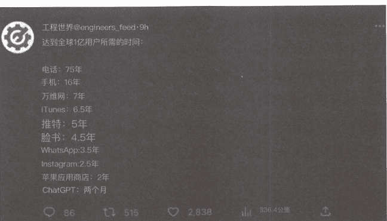

### 1.2 行业观察：头部企业如何布局
尽管 AIGC 仍处起步期，商业变现模式尚未定型，资本与机构仍在加速入场。国内一级市场与互联网大厂关注度快速提升，硅谷亦将其视为热门投资方向。以下梳理中外头部企业的布局，或能提供启示。

#### 1.2.1 海外巨头动向
**1. 微软在 AIGC 领域的布局**
微软可谓布局的先行者。自 2019 年起与 OpenAI 展开合作，初始投入 10 亿美元。2023 年 1 月 24 日，微软宣布追加数十亿美元扩大合作。ChatGPT 是微软对 OpenAI 投资的核心产品，奠定了其在 AIGC 领域的头部地位。
微软同步把 ChatGPT 与既有办公产品结合，推动产品线 AI 化升级：与团队协作工具 Microsoft Teams 结合推出智能概要功能，可自动生成会议纪要与要点；与销售体验平台 Viva Sales 结合推出邮件回复功能，帮助销售人员处理重复性文字工作；与搜索引擎 Bing 结合推出对话式问答，让搜索在更交互的环境中给出更完整的答案；与浏览器 Edge 结合推出对话与写作功能。微软 CEO 萨提亚·纳德拉表示，每个产品都将具备同等 AI 能力，实现彻底重塑。
除 ChatGPT 外，微软还布局 Copilot 内置式软件开发 AI 助手与 DALL·E 2 模型等。

**2. 谷歌在 AIGC 领域的布局**
谷歌布局节奏稍晚。2023 年初 ChatGPT 席卷全球后，谷歌迅速反应，时任 CEO 桑达尔·皮查伊连续主持会议商议对策，创始人拉里·佩奇与谢尔盖·布林也亲自到场，可见重视程度。当时市场盛传“ChatGPT 普及后，第一个被淘汰的旧产物很可能是搜索引擎”。
谷歌旗下 DeepMind 的聊天机器人 Sparrow 有望在 2023 年下半年进入测试。其负责人称希望 Sparrow 在强化学习层面与 ChatGPT 抗衡。据悉，Sparrow 采用基于人类反馈的强化学习框架，设计目标为与用户对话，并在回答问题时借助谷歌搜索获取证据支撑。在投融资层面，谷歌向 Anthropic 投资 3 亿美元。
整体来看，海外巨头更聚焦底层通用大模型的研究，尤其在文本训练与自然语言处理领域投入巨大，奉行科研先行策略。

#### 1.2.2 国内厂商布局
2023 年年初 ChatGPT 热度爆表，国内大厂纷纷发声，展示各自在 AIGC 领域的进展。

**1. 腾讯在 AIGC 领域的布局**
ChatGPT 大火之际，国人自然关注腾讯。因训练语料限制，ChatGPT 的中文问答表现远逊英文，市场期待腾讯推出更友好的中文对话产品。腾讯掌控中文社交半壁江山，微信搜一搜在中文搜索领域亦占优势，庞大的内容生态为 AIGC 提供了广阔舞台。
事实上腾讯布局已久，只是产品端推进相对审慎，重点放在模型研发与训练。“混元”是腾讯的超大规模 AI 模型，覆盖计算机视觉、自然语言处理、多模态内容理解、文案生成等方向。早在 2022 年 4 月，“混元”在 MSR-VTT、MSVD、LSMDC、DiDeMo、ActivityNet 五大跨模态视频检索数据集榜单上先后夺冠，此后多次登顶中文自然语言理解权威测评榜单 CLUE。研发实力已获验证，市场更关心何时推出面向 C 端的中文友好产品，而百度反应更快。

**2. 百度在 AIGC 领域的布局**
2023 年 2 月 7 日，百度推出类 ChatGPT 产品“文心一言”，计划于 3 月完成内测后开放公众使用。产品发布一周内，多家元宇宙营销公司宣布接入文心一言，与百度共同探索 AIGC 在多场景的模型训练与落地。此前，百度 CEO 李彦宏多次力挺 AIGC，对其前景充满信心。

**3. 阿里巴巴在 AIGC 领域的布局**
阿里巴巴自 2020 年初启动中文大模型研发，2020 年 6 月推出 3 亿参数基础模型，2021 年发布国内首个超百亿参数多模态大模型 M6，以及被称为“中文版 GPT-3”的语言大模型 PLUG。M6 已在阿里生态内部应用，且有消息称阿里正在研发对标 ChatGPT 的对话机器人。

**4. 商汤科技在 AIGC 领域的布局**
商汤是国内老牌 AI 企业。截至 2023 年 2 月，商汤尚未宣布推出类似 ChatGPT 的产品，但其布局可追溯至 2016 年。商汤致力于搭建通用型 AIGC 模型，覆盖文字、语音、图像、视频、代码、三维人物动作等多模态数据分析与内容生产。商汤拥有以上海临港人工智能计算中心 AIDC 为代表的超算力中心。

**5. 旷视科技在 AIGC 领域的布局**
旷视同样是国内 AI 代表企业，常见于网吧的“刷脸”硬件即出自旷视。不过在生成赛道，旷视目前尚未大规模对外展示成果。2023 年 2 月，旷视研究院基础科研负责人表示，研究院将坚定推进生成式大模型研发，与伙伴共建有价值的 AIGC 应用；同时强调旷视聚焦“AI in Physical”，未来会将底层技术更多用于自动驾驶、机器人等复杂决策场景。

### 1.3 资本狂潮

2022寒冬里最热的逆风赛道

2022年整体资本市场进入冰点，但生成式AI却成了风险投资的聚光灯。红杉在九月官网上线生成式AI深度分析，到十月Stability AI、Jasper.ai等公司接连拿到大额融资，AIGC的资本叙事就此启动。

自2020年初代GPT-3面世以来，资本对AIGC的注资逐年攀升，2022年单年规模达到129.4亿元①。2020至2022三年间，全球AIGC总融资额累计156.2亿元，合计50起交易，其中B轮及以后阶段的资金占比高达44.4%。目前全球活跃的AIGC初创约250家，覆盖部署平台、文本、图像、音频、对话等细分方向。仅2022年，行业吸金就超过26亿美元，并诞生6家独角兽，估值天花板仍是290亿美元的OpenAI。

我们梳理了融资额突破2000万美元的代表企业，见表1-1。

表1-1

| 创立时间 | 公司名 | 细分领域 | 总部 |
|---|---|---|---|
| 2022 | Inflection AI | 部署平台 | 美国加利福尼亚州旧金山市 |
| 2021 | Anthropic | 文本 | 美国加利福尼亚州旧金山市 |
| 2021 | Jasper | 文本 | 美国得克萨斯州奥斯汀市 |
| 2019 | Cohere | 部署平台 | 加拿大多伦多市 |
| 2019 | Glean | 语义搜索 | 美国加利福尼亚州旧金山市 |
| 2019 | OctoML | 部署平台 | 美国华盛顿州西雅图市 |
| 2019 | Anyscale | 部署平台 | 美国加利福尼亚州旧金山市 |
| 2017 | Weights&Biases | 部署平台 | 美国加利福尼亚州旧金山市 |
| 2017 | Observe | 对话 | 美国加利福尼亚州帕洛阿尔托市 |
| 2017 | Woebot Health | 对话 | 美国加利福尼亚州旧金山市 |
| 2017 | Cresta | 对话 | 美国加利福尼亚州旧金山市 |
| 2017 | AI21 Labs | 部署平台 | 以色列特拉维夫港口 |
| 2016 | Scale AI | 部署平台 | 美国加利福尼亚州旧金山市 |
| 2016 | Hugging Face | 部署平台 | 美国纽约州纽约市 |
| 2016 | Soulm Machines | 图片 | 美国加利福尼亚州旧金山市 |
| 2015 | OpenAI | 部署平台 | 美国加利福尼亚州旧金山市 |
| 2015 | Primer | 归纳 | 美国加利福尼亚州旧金山市 |
| 2014 | ASAPP | 对话 | 美国纽约州纽约市 |
| 2014 | InstaDeep | 部署平台 | 英国伦敦市 |
| 2014 | Insilico | 生物 | 中国香港特别行政区 |
| 2011 | Dialpad | 音频 | 美国加利福尼亚州旧金山市 |
| 2009 | Grammarly | 文本 | 美国加利福尼亚州旧金山市 |

从投向看，海外头部机构明显偏爱部署平台，也就是MLOps/Platform类基建，其次是对话类应用。

a16z在访谈数十位从业者后总结，当前基建供应商是最大的受益方，收入增速快、利润可观，但留存、差异化和利润率正触及瓶颈。模型供应商不可或缺，却大多尚未完成商业化。真正创造最大价值的是把生成模型训练出来并嵌入应用的公司，而这部分价值暂时还没有完全变现。

## 1.4 崛起的独角兽梯队

### 1.4.1 OpenAI
2022年11月ChatGPT上线，5天用户破百万，两个月后突破一亿，成为现象级产品，直接把AIGC推向大众视野。2023年1月24日微软宣布旗下产品全线接入ChatGPT，OpenAI彻底登上全球热搜。

回看这家公司的爆发，基本面上的必然性很强。首先是顶级创始人加持，Sam Altman曾任YC总裁、现任董事长，是硅谷标志性人物。其次是持续的资金弹药，在微软百亿注资前，OpenAI已完成多轮个人与机构融资，累计超过40亿美元，背后既有创始人的人脉效应，也有模型不断刷新的技术势能。人才储备同样惊人，加州总部375名常驻员工多为AI顶尖人才，年薪总额约20亿美元。

### 1.4.2 Stability AI
这是一家以AI驱动视觉艺术的年轻公司，2020年成立后在图像生成领域迅速突出。2022年8月正式发布Stable Diffusion，10月完成1.01亿美元种子轮，估值达到10亿美元，由Coatue、Lightspeed及O'Shaughnessy Ventures领投，从此跻身AI独角兽。

Stability AI的诞生与OpenAI关联紧密。OpenAI曾为研究者提供相对宽松的环境与算力，但2020年因财务危机导致大批人才流出，Emad Mostaque受此启发，决定打造类似OpenAI的开源研究阵地。彼时Emad已在多家公司任高管，并拥有超过20年投资基金经验，Stability AI早期资金主要来自其个人财富。截至2023年2月，公司仍恪守开源初心。

同样截至2023年2月，开源版Stable Diffusion的日活用户超过1000万。旗下DreamStudio平台已积累150万以上用户，来自50多个国家，累计生成超过1.8亿幅作品。用户在DreamStudio上只需用文字描述意图，平台即可据此作画并导出成图，如图1-2所示。

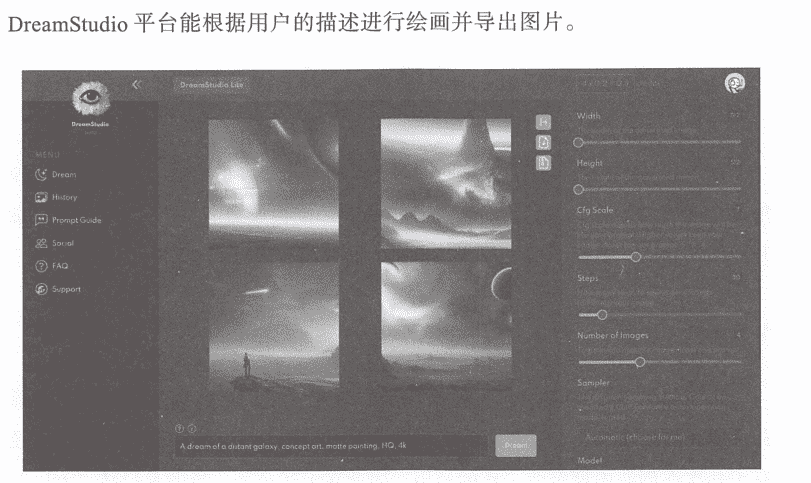

图1-2

### 1.4.3 Scale AI
Scale AI通过软件与人工协作，为构建机器学习算法的企业提供数据处理与标注服务，覆盖机器学习全生命周期的端到端数据解决方案。客户包括Waymo、Toyota、Lyft等。

2016年1月，创始人Alexandr Wang还在高频交易公司任职时就意识到：想做AI的公司很多，但缺乏巨头式内部资源。于是他看准了AI基础设施服务商的机会。8月公司拿到12万美元种子轮，2021年4月再获3.25亿美元E轮。尽管数据标注赛道竞争加剧，投资人仍看好其更高的标注效率与更低成本。

## 1.5 下一个乔布斯会是谁

随着独角兽涌现，市场目光转向创始人身上。履历拆解后，这些科技新贵有几处明显共性。

### 1. 出名要趁早
多数创始人拥有名校背景，且少年期已崭露头角。Alexandr Wang自述高中起就在创业期公司实习，对大厂岗位已不视为成长。Sam Altman8岁开始编程，20岁便担任CEO。

### 2. 学历不是必需，但名校烙印很深
辍学创业几乎成了独角兽创始人的经典剧本，且多为学业优异后主动离开。用比尔盖茨哈佛辍学来论证学历无用，往往忽略了他先进入哈佛的前提。AIGC独角兽的创始人同样呈现名校集群特征，哈佛、斯坦福、MIT、卡耐基梅隆、牛津等是常见来源，合作伙伴也多在校园或竞赛中结识。名校提供了科研资源与高质量人脉网络。

Alexandr Wang就是典型天才，十几岁就在编程竞赛崭露头角，17岁获Addepar与Quora的工作邀约，19岁以MIT GPA5.0辍学，随后与卡耐基梅隆辍学的Lucy Guo共同创立Scale AI。短短几年公司估值升至73亿美元，他被称作最年轻的白手起家亿万富翁、下一个埃隆·马斯克。父母均为物理学家的家庭背景也为他提供了深厚的教育环境。

Sam Altman的路径相似。斯坦福读了两年后与同学辍学，全职做位置社交App Loopt①创业，28岁执掌YC孵化器，一年后离任全身心投入OpenAI，开启改变历史的进程。

### 3. 硅谷助力
硅谷的生态是这些独角兽起飞的核心土壤，AIGC也不例外。

回到本章核心问题，为什么要关注AIGC？答案很直白：全球最聪明的人和最有钱的人都在All in。

① 一个实时分享位置的社交类软件，2012年被Sam Altman和他的联合创始人以4300万美元的价格出售。

## 第 1 章 为什么要盯住AIGC

## 第 2 章 AIGC技术演进脉络

随着机器学习、计算机视觉与自然语言处理持续突破，AIGC的生成质量和真实感大幅提升。算法能产出的内容类型也越来越广，从文章、诗歌、歌曲到3D模型和视觉艺术。语言能力更趋人性化，不仅能问答，还能带讽刺、幽默、夸张等情绪，语音合成已接近人类难以分辨。元宇宙兴起后，增强现实与虚拟现实的应用进一步催生了新场景。

文本生成主要依托自然语言处理。NLP让机器解读、处理和理解人类语言，多基于时序神经网络。1986年Michael I. Jordan提出Jordan Network，形成了时序网络的雏形，用于处理前后输入相关联的序列任务，如对话与机器翻译。1990年Jeffrey L. Elman对其简化，形成循环神经网络RNN，在序列建模上表现优异，但受限于历史信息利用不足，容易出现梯度消失。为此1997年Jurgen Schmidhuber等人提出长短期记忆网络LSTM，通过输入门、遗忘门、输出门筛选信息，显著缓解训练难题。

Transformer的出现改写了NLP版图。2017年Vaswani团队提出的Transformer抛弃了RNN/LSTM结构，引入注意力机制。注意力机制由Bengio团队于2014年提出，已广泛应用于视觉与语言。基于Transformer的LLM层出不穷，2016年Radford、Alec等人提出的BERT与OpenAI的GPT系列最具代表性。BERT擅长序列关系与语法理解，用于分类、关系判断、情感识别等理解任务。GPT系列天生适合生成，在摘要、对话、翻译等生成任务上优势明显。

图像生成同样关键。Stable Diffusion由CompVis与Runway团队于2021年提出，可通过文字描述生成高质量图像，并支持二次元、抽象、艺术、插画、摄影等风格约束。AI绘画大幅提升了设计与艺术创作效率，也让零基础用户进入创作。

整体来看，AIGC从早期规则系统发展到机器学习、深度学习，再到当前LLM架构，内容边界已从文本图像扩展到音频、视频与3D模型。ChatGPT与Stable Diffusion的爆发让LLM成为主流落地方向。本章将按技术演进梳理核心方法。

### 2.1 规则系统
基于规则的生成通过预设规则与模板创造新数据，诞生于20世纪60年代的NLP与专家系统。90年代后与机器学习结合，规则体系更灵活。文本上常用模板匹配，先定义语法规则与模板，再生成片段并匹配，直至输出目标文本。图像生成通过编写形状、颜色、纹理等元素的组合规则制作艺术图。音频生成则借助数字信号处理技术如正弦波与滤波器合成可听声音。

规则生成可控且可解释，但需要大量先验知识，模板限制导致多样性不足。深度学习虽已大幅提升生成能力，但在特殊场景下，规则系统仍作为重要的辅助手段。

### 2.2 变分自编码器

2013 年，Kingma 与 Welling 共同发布 VAE，即变分自编码器，这类生成式深度网络很快在图像风格转换、文本创作、音乐合成等方向落地。VAE 的设计根基是自编码器 AE，先吃透 AE 的工作方式，VAE 才更好理解。AE 可追溯至 1986 年由 Rumelhart、Hinton、Williams 提出，核心思路是从原始样本中提炼高度压缩的信息表征，再以尽可能小的误差把表征还原成输入。凭借此能力，AE 常用于数据压缩、去噪以及高维降维，以降低算力消耗。图 2-1 展示了 AE 的常见结构，由编码器、隐层表征、解码器三部分构成。编码器负责把输入映射为中间表达，本质是特征提取；隐层表征服从某种分布，用来刻画数据的内在结构或抽象语义；解码器则把中间表达映射回输出。AE 通常呈严格对称，在降维或压缩场景中以无监督方式训练，无需标签，只要让网络的预测结果尽量贴近原始观测即可。

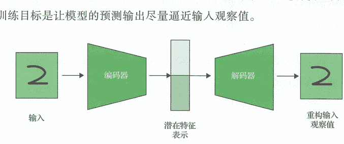
训练 AE 本质是学会抽取并压缩数据的核心特征，再用这些特征重建原始数据。过程中会引入重构误差 RE，用来衡量重建质量，常用度量包括均方误差 MSE 与二元交叉熵 BCE。因此优化目标是压低重构误差，用 Δ 表示重构误差，训练目标最小值可写为

$$\arg\min_{f,g}([\Delta(x_i, f(g(x_i)))])$$
式中，$x_i$ 为输入观察值；$f(g(x_i))$ 为重构的输入观察值。

工程实践里编码器与解码器多用神经网络实现，一方面 TensorFlow、PyTorch 等框架让搭建变快，另一方面神经网络在实际任务中表现稳定。

VAE 的骨架与 AE 近似，同样由编码器、隐层表征、解码器组成，差异在于 VAE 用概率式的编码与解码取代 AE 的确定性映射。AE 中每个隐表征对应一个固定的输入，经解码器可得到近似输入；通俗说 AE 把数据压缩成一个编码向量，再由解码器尝试复原。VAE 的关键在于对隐空间做概率建模，编码器的主要任务是刻画每个隐表征的概率分布。

假设真实样本 $X_k$ 服从正态分布 $p(Z|X_k)$，VAE 的目标是训练一个生成器 $X = g(Z)$，使得从 $p(Z|X_k)$ 中抽取的 $Z_k$ 能够还原 $X_k$。$Z_k$ 并非编码器直接计算得到，而是通过重采样获得，因此重建过程会受噪声影响。

$p(Z|X_k)$ 可由均值网络与方差网络拟合，$Z_k$ 从该分布采样后经生成器 $X = g(Z)$ 得到结果。为增强随机性并赋予生成能力，$p(Z|X_k)$ 被约束向标准正态靠拢，这一约束主要通过在重构误差上增加额外损失实现。

VAE 已在诸多生成任务中落地，如图像迁移与文本生成。图像迁移可把输入画面转成其他风格，例如把风景画转成艺术画、把人像转成二次元风格。文本生成通常在给出上一句文本与主题等约束后生成下一句。VAE 的优势在于能处理多种数据类型，包括序列、非序列、连续与离散数据，但受损失设计限制，生成样本的质量普遍偏低。

### 2.3 生成对抗网络
随着深度神经网络在图像生成、语音合成、NLP 等领域的突破，绝大多数方法仍依赖有监督训练，无监督学习相对冷门。受博弈论中零和博弈启发，生成对抗网络 Generative Adversarial Network 应运而生，成为无监督生成任务的重要框架。

#### 2.3.1 GAN 模型训练原理
GAN 由 Ian Goodfellow 等人于 2014 年 6 月提出，也称 Vanilla GAN。核心思想是同步训练生成器与鉴别器两大网络。生成器负责产出与训练数据同分布的样本，鉴别器则是二分类器，用于判断样本真伪。训练流程如图 2-2 所示，$z \sim p_z(z)$ 为服从 $p_z(z)$ 的随机噪声，$G$ 为生成器，$D$ 为鉴别器，$x \sim p_{\text{data}}(x)$ 和 $p_g(x)$ 分别为训练集与生成数据的分布。

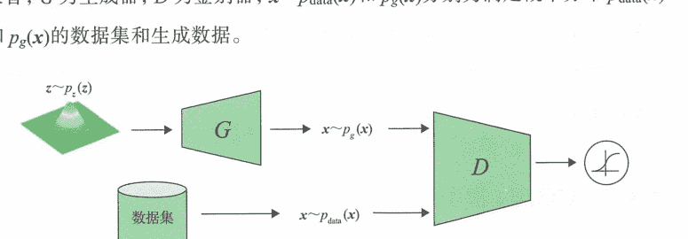
##### 1. 生成器的训练
生成器的输入是从预定义潜空间采样的隐向量 $z$，训练目标是用 $z$ 生成符合训练数据分布的样本供鉴别器判断，并让样本足够逼真以至于鉴别器无法分辨生成样本与真实样本。

##### 2. 鉴别器的训练
鉴别器同时接收来自数据集的真实样本和生成器产生的样本。作为二分类器，对真实样本期望输出接近 1，对生成样本期望输出接近 0，而生成器则希望鉴别器对生成样本的输出接近 1，形成零和博弈状态。

竞争式训练为生成式建模提供新思路，GAN 在计算机视觉、图像生成、风格迁移、图像修复等领域应用广泛。结构简洁且兼容多种网络，同时为无监督学习提供有力支撑。但训练自由度过大导致稳定性和收敛性波动，样本量过大时易过拟合。围绕这些瓶颈，也衍生出大量变体。

#### 2.3.2 CGAN 模型
期望从 GAN 学习到有意义的隐向量，使每个特定取值与特定生成样本一一对应。模式崩溃是常见问题，即生成器把多个不同取值映射到同一样本。因为 GAN 从先验分布 $p_z(z)$ 提取噪声 $z$ 输入生成器，模式崩溃时无法按特定类别控制生成。Conditional GAN 在此基础上引入条件信息，生成器接收附加信息 $c$ 和隐向量 $z$ 输出 $G(z|c)$，鉴别器同时接收附加信息和真实数据，从而实现有条件生成。

#### 2.3.3 基于模型架构的衍生
GAN 作为通用框架，通过修改生成器和鉴别器架构产生诸多变体。
（1）Deep Convolution GAN 模型：生成器和鉴别器均采用全卷积网络，由卷积-反卷积层构成。
（2）Self-Attention GAN 模型：在 DCGAN 基础上向生成器和鉴别器加入残差连接的标准自注意力模块。
（3）Variational AutoEncoder GAN 模型：生成器使用 VAE。
（4）Transformer GAN 模型：生成器和鉴别器均采用纯 Transformer 架构，无卷积-反卷积层。
（5）Flow-GAN 模型：生成器采用基于流的生成模型，可有效计算似然函数。

#### 2.3.4 基于损失函数的衍生
改变损失函数也产生诸多变体，包括 Hinge Loss GAN、Least Squares GAN 和 Wasserstein GAN 等。
WGAN 提出用 Wasserstein 距离导出的替代损失，鉴别器用于拟合 Wasserstein 距离，旨在缓解模式崩溃。WGAN 梯度惩罚 WGAN-GP 在鉴别器上引入梯度惩罚项以实现 1-Lipschitz 条件，进一步提升训练稳定性、样本质量和收敛速度。除 WGAN 外，Minibatch GAN、Unrolled GAN、Bourgain GAN、Mixture GAN 和 Dual Discriminator GAN 等也用于缓解模式崩溃。

#### 2.3.5 图像生成领域的衍生
- （1）InfoGAN 模型：基于 CGAN，使图像生成更可控，并通过互信息诱导提升可解释性。
- （2）Progressive GAN 模型：多尺度 GAN，可在高分辨率下稳定学习并减少训练时间，但仍未完全解决模式崩溃。
- （3）StyleGAN1 模型：提升对生成图像的合理控制能力，但存在因实例层标准化和渐进生长导致的特征伪影。
- （4）StyleGAN2 模型：使用样式潜向量转换卷积层权重，解决了 StyleGAN1 的特征伪影问题。
- （5）StyleGAN3 模型：在 StyleGAN2 基础上解决“纹理粘连”问题。

### 2.4 Transformer 模型架构
Transformer 由 Vaswani 等人于 2017 年在论文 *Attention Is All You Need* 中提出，是基于自我注意力机制的新型深度模型，由编码器和解码器组成，主要用于序列建模和序列间预测。注意力机制类似人脑处理信息的方式，聚焦重要信息忽略冗余。传统 RNN、LSTM 记忆能力有限且难以并行，注意力机制通过聚焦关键信息解决了长期依赖问题并实现并行计算。

Transformer 完全基于自我注意力实现，自我注意力可理解为输入语句的每个词都与同一语句中的所有内容进行注意力计算，用以从海量信息中筛选少量关键信息。编码器和解码器一般由多个自我注意力机制构成，即多头注意力机制。多头注意力是多个不同注意力机制的集成，输入分别计算得到多组结果后再拼接，经全连接层得到最终输出。例如由 6 个注意力机制组成的模型会把输入送入 6 个不同注意力模块得到 6 个特征矩阵，再拼接融合。

Transformer 在 AI 领域取得巨大成功，尤其在 NLP 任务上。编码器把所有隐藏状态传递给解码器，提供更丰富的信息，同时模型会对隐藏状态的重要性打分，聚焦与输出相关性高的信息。

### 2.5 基于 Transformer 模型架构的 LLM
依托 Transformer 的优势，陆续出现了 BERT、GPT、ChatGPT 等大规模语言模型，在 NLP 和内容生成上表现突出。按结构可分为基于编码器的 LLM、基于解码器的 LLM 以及编码器-解码器混合的 LLM。

#### 2.5.1 基于编码器的 LLM
基于编码器的 LLM 通常指由 Transformer 编码器堆叠形成的多层网络，常用于自然语言理解任务。BERT 是典型代表。

##### 1. BERT 模型
预训练语言模型 PLM 先在大规模数据上预训练，再迁移到下游任务。早期 PLM 多基于浅层网络，用词嵌入捕捉语义。随着深度学习的推进，研究者尝试用深度网络获取动态语义嵌入，但受限于有监督学习对标注数据的需求。BERT 引入掩码标记，从大规模无标注数据中学习知识，开辟了 PLM 的新纪元。

BERT 还引入了双向编码，训练时不仅考虑目标词左侧信息，也考虑右侧信息。与单向编码器相比，双向结构能看到完整序列上下文，学习能力更强。如图 2-3 所示，第一层注意力学习时编码器 Enc12 同时利用特征 1、2、3 的信息。

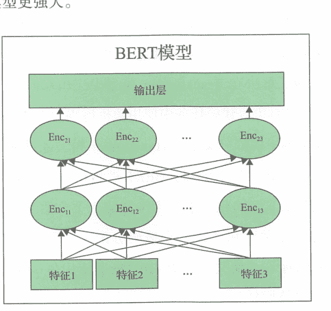

图 2-3
架构上 BERT 由多层编码器堆叠而成，每层包含多头自注意力模块和前馈全连接层。官方提供两个预训练版本：BERTBASE 有 12 层、768 隐藏单元、12 个头，参数约 1.1 亿；BERTLARGE 有 24 层、1024 隐藏单元、16 个头，参数约 3.4 亿。

训练通常分预训练和微调两个阶段。预训练包括掩码语言建模 Masked LM 和下一个句子预测 Next Sentence Prediction。掩码语言建模随机遮蔽部分输入标记进行预测，下一个句子预测判断两个输入句子是否相邻。除输出层外，预训练和微调使用相同架构，微调时根据下游任务调整模型，并用不同分隔符区分示例和句子片段。

直观上深度双向模型应强于单向模型，但标准语言模型只能单向训练。J. Devlin 提出在语言建模中使用随机掩码，给定一段文本随机删除部分文字，让 Transformer 预测被屏蔽词，同时可查看整个序列。BERT 使用大量非结构化文本预训练，并在掩码分配上使用技巧：80% 概率用掩码标签替换，10% 概率替换为随机词，10% 保持原样。

许多下游任务如问答和自然语言推理依赖两个句子间的关系，语言建模难以直接捕捉。为此 BERT 在预训练中引入 NSP，可从任意语料轻松生成，实验表明其对 QA 和 NLI 非常有益。

Transformer 的自我注意力使 BERT 能处理多个下游任务。对每个任务调整输出结构，给 BERT 任务特定的输入输出并微调整体参数。预训练阶段用各类数据对训练出良好的初始模型，下游任务只需用少量数据微调，将令牌表示送入特定输出层，即可以更小成本获得更准确预测。

2018 年 BERT 横空出世，给自然语言处理带来一次显著的进展，并在多项任务上取得优异表现，这很大程度上得益于 Transformer 的引入。相较于 RNN、LSTM 等依赖时序展开的模型，Transformer 能够捕捉更远距离的关联信息。正因 BERT 当时的表现突出，随后涌现出一批在其基础上发展的变体，诸如 ERNIE、XLNet、RoBERTa、ALBERT、ELECTRA 等。

##### 2. ERNIE 模型
ERNIE 即通过知识集成的增强表征，由百度于 2019 年提出。ERNIE 1.0 在 BERT 架构上做了改进，引入了实体级和短语级的掩码策略，提高了预训练难度。同时利用百度贴吧的对话数据构建对话语言模型任务，让模型学会对话中的隐式关联，提升语义表征能力。借助百度新闻、百度百科等海量文本，ERNIE 1.0 可使用比 BERT 更多元的训练语料。

在 ERNIE 1.0 的基础上，百度把持续学习引入预训练，推出 ERNIE 2.0。持续学习指在同一模型内按顺序训练多个不同任务，新任务加入时与旧任务组合，利用历史任务的参数初始化新任务，逐步累积知识。训练中还构造了词法、语法、语义三类任务，分别提取训练数据中的不同层次信息。

为进一步提升效果，提出 ERNIE 3.0。相比 ERNIE 2.0，ERNIE 3.0 扩大了参数规模和语料丰富度，应用范围更广。架构上，ERNIE 2.0 以 BERT 为主干，ERNIE 3.0 则采用 Transformer-XL 作为通用表征模块。Transformer-XL 是 Transformer 的一种变体，拉长了上下文窗口，允许处理远长于标准 Transformer 的序列，并借助递归机制处理长依赖。此外，ERNIE 3.0 增加特定任务的表征模块，更好地捕捉词与句之间的关系，使其在各类 NLP 应用中性能更强、通用性更高。

##### 3. XLNet 模型
XLNet 由 Zhilin Yang 等人于 2019 年 6 月提出，是一种基于排列的预训练方法。该方法可以建模输入序列中所有标记两两之间的依赖，而不依赖固定顺序，从而在多项 NLP 任务上取得提升；BERT 则只对被掩盖的词及其关联建模。XLNet 同样采用 Transformer-XL 结构，使用相对位置编码替代绝对位置编码，解决了 BERT 在输出长度上的限制，能够处理更长的序列。

##### 4. RoBERTa 模型
RoBERTa 即鲁棒优化的 BERT 预训练方法，由 Yinhan Liu 等人于 2019 年 7 月提出，沿用 BERT 的架构。改进主要在数据与训练策略：扩大预训练语料的数量与多样性，延长训练时长或增加训练步数，使模型学习更复杂的语言规律。掩码方式上，BERT 采用静态掩码，在预处理阶段就固定掩码位置，多次训练同一文本时掩码不变；RoBERTa 改为动态掩码，在训练过程中实时生成掩码，每次训练的掩码位置和方式都是随机的，提升了掩码多样性带来的效果。同时，RoBERTa 去掉了预训练中的 NSP 任务，仅保留 MLM 任务。

##### 5. ALBERT 模型
ALBERT 是谷歌 2019 年 9 月在论文 *ALBERT: A Lite BERT for Self-supervised Learning of Language Representations* 中提出的轻量版 BERT。深度预训练模型常通过加深层数和增大参数来提升效果，但受资源限制不可无限制扩张。ALBERT 通过两种手段压缩参数：一是参数因式分解。BERT 中词嵌入矩阵参数量巨大，例如 3000 × 768 = 2 304 000，因式分解可把词汇嵌入拆解，降低矩阵规模。二是跨层参数共享。同一组参数在各层复用，可实现全层共享、仅注意力模块共享或仅全连接层共享三种模式。

参数分解与跨层共享在保持性能的前提下大幅降低参数量，提升训练效率，同时也有助于泛化。为进一步优化，ALBERT 移除预训练中效果不佳的 NSP，改为句序预测，即判断两个相邻句子是否被调换顺序。该任务更聚焦句子间一致性，避免了 NSP 将话题预测与连贯性预测混在一起的问题，预训练更高效有效。整体上 ALBERT 比 BERT 更轻更快，在各项任务上仍保持或提升性能。

##### 6. ELECTRA 模型
ELECTRA 即 Efficiently Learning an Encoder that Classifies Token Replacements Accurately，由 Kevin Clark 等人于 2020 年 3 月提出。与 BERT 相比，ELECTRA 借鉴 GAN 式的生成器与判别器训练。生成器负责生成难以分辨的假令牌，判别器负责区分真实令牌与假令牌，通过无监督方式实现预训练。ELECTRA 在大规模文本语料上无监督预训练，适应性更强；生成器与判别器参数共享使模型更小。模型规模小于 BERT，速度更快、计算效率更高，且可在少量标注数据下微调，特别适合标注资源有限的场景。

#### 2.5.2 基于解码器的 LLM
基于解码器的 LLM 指以 Transformer 解码器为核心的大语言模型。解码器层仅包含带掩码的多头自注意力和前馈网络，去掉了编码器-解码器交叉注意模块。这类模型包括 GPT-1、GPT-2、GPT-3 以及 ChatGPT，主要面向自然语言生成任务。

##### 1. GPT 系列模型
GPT 全称 Generative Pre-Training，OpenAI 于 2018 年推出。与 BERT 类似，训练分为预训练与微调两阶段。预训练阶段在大量未标注语料上无监督学习；微调阶段在已预训练模型上针对具体任务进行有监督学习，属于半监督范式。GPT 是首个在大型语料上公开预训练的模型，验证了预训练加微调能显著提升性能，并可在数据不足时适应多个 NLP 任务。

结构上 GPT 由 12 层解码器堆叠而成，仅含掩码自注意力和前馈模块。预训练目标是利用已有词序列预测下一个词，通过掩码机制避免信息泄露。例如在“我是中国人”中，模型先用“我”预测“是”，再用“我是”预测“中”，预测时把后续内容掩盖，依次完成整句预测。

预训练后进入有监督微调，将下游任务结构改造为与 GPT 一致，用预训练参数初始化，再用任务数据调整参数。GPT 可处理的任务大致分为四类：分类任务可直接输入文本；文本蕴涵需用分隔符拼接前提与假设，加入线性层与分类层；文本相似度判断常以不同顺序拼接两段文本并用起止符区分，再送入分类层；多轮问答则将背景、问题、答案拼接后输入模型训练。

GPT 凭借强大的 Transformer 特征提取能力捕捉更长记忆，预训练一次后针对子任务微调，避免每个任务从零训练，降低标注需求并提高效率。随后 OpenAI 在解码器架构上继续迭代。2019 年发布 GPT-2，基于多任务学习，无需为每个子任务单独微调，模型能在训练时学习任务识别，提升泛化。GPT-2 采用 48 层结构，用 800 万网页约 40GB 语料训练，参数约 15 亿，证实规模与语料增大带来效果提升。

2020 年发布的 GPT-3 可视为 GPT-2 的放大版，结构相同但规模大幅提升：96 层、1750 亿参数、约 45TB 训练数据，其中有效数据约 570GB。在多数 NLP 任务上优于 GPT-2，尤其在少样本与零样本学习上优势明显。但训练成本极高，约需 355 个 GPU 年、花费超 460 万美元，且模型体量大难以短期在线部署。

##### 2. ChatGPT 模型
Chat Generative Pre-trained Transformer 由 OpenAI 于 2022 年提出，是对 InstructGPT 的微调版本。InstructGPT 的目标是缓解 GPT-3 输出有害、不真实或有偏见的问题。GPT-3 在海量网络数据上训练，难免包含歧视等不当内容。OpenAI 在此基础上用人类反馈对模型进行微调，采用来自人类反馈的强化学习策略，通过人类对输出的排序来引导模型行为。

ChatGPT 在 InstructGPT 基础上增加对话属性并开放公众测试，基于 GPT 系列的优化扩展，能够以对话形式与用户交互，具备较好的上下文理解与连续对话能力，提升人机交互体验。其训练数据加入了大量现成文本与对话集合，使对话效果更佳。

训练分为三阶段。第一阶段是有监督微调 SFT。数据来自 OpenAI 用户采集和 40 名标注人员的标注。标注流程为从提示-回答对样本中抽取，标注人员据此撰写新提示，用这些数据对模型进行有监督微调，使模型初步掌握指令。第二阶段训练奖励模型，利用第一阶段模型为同一个问题生成多个答案，由标注人员排序，偏见等不被喜爱的输出排在靠后，引导模型避开人类不喜欢的内容。第三阶段使用近端策略优化 PPO 进行强化学习微调。PPO 由 OpenAI 于 2017 年提出，流程为从训练数据抽样新问题，用第一阶段的监督模型初始化 PPO 模型输出结果，再由第二阶段的奖励模型打分，将奖励分数回传更新策略梯度，迭代优化模型参数。

ChatGPT 将人工标注、强化学习与预训练融合，使输出更符合人类习惯。相比 GPT-3，其泛化与生成能力更强，因训练语料包含大量代码，编程能力突出。该成果为预训练大模型与基于少量高质量数据的人类反馈强化学习的结合提供了新思路。

#### 2.5.3 基于编码器和解码器的 LLM
这类模型适用于序列到序列建模，如翻译与文本摘要。典型代表是 T5 与 BART。T5 即 Text-to-Text Transfer Transformer，把所有基于文本的问题统一为文本到文本形式。输入与输出始终为文本字符串，与 BERT 仅输出标签或跨度不同。统一框架允许在机器翻译、文档摘要、问答、分类等任务上使用同一模型、损失函数与超参数。T5 还能预测数字的字符串表示，支持回归任务，便于从高资源任务向低资源任务迁移知识而不改变架构。

BART 是 Bidirectional and Auto-Regressive Transformer，采用去噪自编码目标训练，即对输入序列进行破坏，再利用损坏版本重建原始序列。该目标让模型学会输入的潜在模式并生成有意义输出，在文本生成、机器翻译、摘要等任务上取得领先效果。

#### 2.5.4 BERT 模型与 GPT 模型对比

BERT 和 GPT 都建立在 Transformer 架构之上，属于大语言模型范式。预训练阶段，两者都靠海量无标注文本做无监督学习，下游任务则在预训练权重上做有监督微调。但实现路径截然不同。

结构上，BERT 基于 Transformer 编码器，用多头自注意力实现双向建模，能一次性预测序列里被掩码的 Token，从左右两边同时吸取上下文语义，所以理解力更强。GPT 基于 Transformer 解码器，采用掩码多头自注意力，只能自左向右逐词推断，是典型的单向语言建模。

训练目标也有差别。BERT 同时优化掩码语言模型和下一句预测任务，GPT 则直接做下一个词的常规语言模型预测。

在适配能力上，BERT 对不同任务很依赖数据量，需要大量样本更新参数才能贴合下游。GPT 依托大数据的先验，不必每次都微调即可实现零样本或少样本推理，只靠提示词就能完成任务。

应用侧重也不同。自然语言理解类任务需要精细的上下文与语法关系，BERT 的双向结构在分类、句间关系判断、情感识别等场景表现更优。自然语言生成类任务更贴合自回归特性，GPT 更适合摘要、续写、对话、机器翻译，只是在效果上对参数规模要求更高。

### 2.6 扩散模型

在机器学习里，扩散模型是一类隐变量生成模型。核心思想是学习数据在潜在表示空间中的扩散规律，从而把握数据的内在结构。做法是逐步向目标数据注入随机噪声，再通过逆过程从纯噪声重建样本。起初它主要用于去噪，后来发展到从噪声合成逼真图像。

“扩散”借自物理学，指分子运动导致物质逐渐分散，比如墨滴入水会慢慢晕开，最终不可逆。AI 里把加噪看作扩散，去噪看作逆扩散，训练即前向加噪与逆向去噪的配合。

#### 2.6.1 扩散模型原理

最早的雏形由 Jascha Sohl-Dickstein 和 Eric A. Weiss 等人在 2015 年提出。当时机器学习的关键难题是让概率分布对复杂数据集建模并保持可计算性。受非平衡统计物理启发，他们提出先破坏数据结构再恢复的思路，得到一个灵活易处理的目标生成模型，为后续研究奠基。

扩散模型包含扩散和生成两阶段。扩散即加噪，把清晰分布逐步变成杂乱噪声；生成即逆扩散，把噪声逐步还原为目标分布。

原理示意为：从初始数据 x0 按 q(x_t|x_{t-1}) 逐步加噪得到 x1 到 xT，再由 p(x_{t-1}|x_t) 逐步去噪回到 x0。训练目标就是让预测分布逼近真实分布。

一本书读懂 AIGC

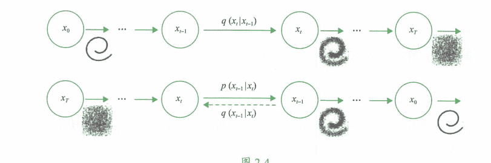

扩散模型的训练思路和 VAE 有相似之处，都在目标分布上加噪得到噪声分布，再从噪声中逐步恢复。若把中间变量视为隐变量，模型就含有 T 个隐层，可被看作一种多层 VAE 的特例。

真正推动扩散模型走进大众视野的是 2020 年 Jonathan Ho 等提出的去噪扩散概率模型 DDPM。它对前人方法做了简化，并用变分推断建模。与 VAE 不同，扩散模型的隐变量与目标数据同维，且扩散过程通常固定，因此可用自编码器结构训练。DDPM 采用 U-Net，编码器各层下采样以压缩特征，解码器上采样以恢复图像，还引入残差块和部分层的自注意力来增强全局建模。相比 VAE 和 GAN，扩散模型的理论更复杂，但优化目标简洁，容易推广。

在生成领域特别是图像生成上，扩散模型表现惊人。截至 2023 年 2 月，它已成为最先进的文生图范式。下面介绍两个代表：DALL·E 2 与 Stable Diffusion。

#### 2.6.2 DALL·E 2 模型

DALL·E 2 由 OpenAI 于 2022 年发布，能根据文本提示生成多样高质量图像，训练数据覆盖多种风格，被视为首个成熟的文生图模型。它还能依据文本修改图像的光线、纹理等属性。

架构上包含 CLIP 对比语言-图像预训练模型、先验模块 Prior 和图像解码器。CLIP 由 Alec Radford 等于 2021 年提出，用于对齐文本与图像。Prior 把文本编码转成图像编码，解码器负责从编码生成最终像素。

训练分三步。先训练 CLIP 得到文本编码器和图像编码器；再训练 Prior，让文本经编码器后通过 Prior 得到图像特征，并逼近 CLIP 图像编码器输出的真实图像特征 z；最后训练解码器根据图像特征生成逼真图片。为保证多样性，模型只保留原图主要特征而非完全复原。推理时丢弃 CLIP，仅用 Prior 和解码器完成文到图的转换。

DALL·E 2 奠定了文生图的基础，依赖大规模匹配的图文数据，鲁棒性要求高。不足在于易混淆物体与属性，对红色蓝色等区分不稳，在高度复杂场景的细节呈现上也会受限，提升质量需要更大算力和模型规模。

#### 2.6.3 Stable Diffusion 模型

直接处理 1024×1024×3 的图像计算量巨大，海量图像训练对算力和存储是挑战。研究者发现把图像映射到低维潜空间再做扩散学习，可在消费级 GPU 上运行。

Stable Diffusion 由 CompVis 与 Runway 团队在 2021 年 12 月提出，是一种潜空间的文生图扩散模型。它先用预训练自编码器压缩图像，再在潜空间扩散，最后解码回像素空间，称为感知压缩。

##### 1. 图片感知压缩扩散模型
高分辨率扩散训练成本高昂。感知压缩先用自编码器降维保留关键特征，把训练与采样复杂度大幅降低。先预训练自编码器学习与图像空间感官等价的潜表示，再在该空间做扩散。

##### 2. 潜在扩散模型（Latent Diffusion Model，LDM）
部分扩散模型需上百 GPU 天。经过编码-解码压缩后可得到低维潜空间，在此空间训练效率更高。普通扩散直接在像素空间预测去噪结果，LDM 先编码到潜空间，完成训练后再解码回图像空间。去噪网络采用基于 Transformer 的 U-Net，集中学习关键特征，提升性能。

##### 3. 条件机制
LDM 引入交叉注意力条件机制，支持文生图、布局生图、图生图等多种条件生成任务。通过条件时序去噪自编码器把控制信号融入 U-Net 中间层，实现细粒度控制。

2021 年 OpenAI 在《High Fidelity Image Generation Using Diffusion Models》中指出，扩散模型比 GAN 更灵活精准，已成为图像生成的 SOTA。扩散模型可生成更优质量，但迭代成本高。基于潜空间的扩散在保持效果的同时显著降低计算与采样开销。

### 2.7 其他模型

2022 年 6 月，谷歌推出 Imagen，结合 Transformer 与扩散用于文生图。它仅对文本做预训练，但在 COCO 数据集上超越 DALL·E 2。生成技术也在 3D、音频、视频领域加速。

文生 3D 代表有谷歌与加州大学伯克利分校的 DreamFusion，和英伟达的 Magic3D。DreamFusion 融合二维扩散与神经辐射场，从 2D 图像集构建 3D 模型并渲染。Magic3D 用粗到细策略降低高分辨率特征计算成本，提升效率与质量。

音频与视频也快速落地。谷歌 MusicLM 可依据文本描述生成高保真音乐，并支持文本加旋律的条件输入。萨里大学与帝国理工联合的 AudioLDM 支持文本生成音乐、语音与音效。清华 2022 年提出 CogVideo，通过文本生成多张图再用双向注意力插帧，训练于 540 万文本视频对。Meta 2022 年 9 月发布 Make-A-Video，用文本图像对训练弥补视频数据不足，实现短视频生成，但在时序连贯与长视频上仍需优化。

### 2.8 LLM 的前景光明
深度学习生成技术正从图像、文本扩展到音视频，已广泛用于游戏、内容营销、影视制作等。相较 3D 与音视频，文本和图像生成更成熟，ChatGPT 与 Stable Diffusion 的出现进一步放大关注。算力与存储提升推动生成模型从 CNN、LSTM、VAE 演进到 LLM，如 GPT、Stable Diffusion。

LLM 在内容创作上优势明显：可处理更长更复杂的文本，上下文理解与逻辑推理更强；迁移能力强，大规模预训练后少量微调即可适配具体任务；生成能力全面，既能产出自然文本，也可覆盖分类、翻译、问答、摘要等多种 NLP 任务，使其成为生成领域最具潜力的方向之一。

# 第 3 章 文本 AIGC 的创作边界
你用过语音助手关灯、查天气吗？你在浏览外网时用过即时翻译吗？这些都是自然语言处理的日常应用。商业场景里，聊天机器人 24 小时在线服务可大幅节省人力。NLP 领域多样，涵盖语音识别、机器翻译、舆情监测等。

上世纪 50 年代 NLP 起步，文本生成作为其核心展现之一，本质是用机器学习与神经网络生成文本以实现语言处理。如今它已渗透出版、电商、人机交互等行业，既推动降本增效，也在重塑内容生产方式。

## 3.1 何为“智能”
当一个应用输出文字时，用户往往凭结果判断其是否智能，但营造智能感有时并不需要复杂模型。比如模板化邮件自动生成，可直接送达客户，对需求方而言已具备智能效果，却未必使用机器学习。那这类应用算不算 AIGC？

为厘清边界，可从算力与内容预设两个维度看。

算力维度：在算法效率相近时，参数越多、训练所需算力越大，模型潜力也越大。规则系统几乎免训练，马尔可夫模型需统计词频，预训练模型则要数百张 GPU 并行训练。

内容预设维度：强预设意味着输出有明确对错；弱预设则没有标准答案，甚至追求更具创作力的参考。强预设内容好坏分明，弱预设则依赖主观评价。

两个维度相互独立，所有文本类应用可映射到二维平面。图 3-1 中标号①的区域，输出基本被预设，模型简单甚至无模型。预设可以是语义或模板，典型如信函生成器、自动翻译系统。

再来看编号②所处的应用区间。这类场景对文字产出有着很强的预设约束，只是任务对语言准确性、语法规范以及模式识别的依赖更高，因而对模型能力与算力投入的要求也更苛刻。常见的代表有语音识别、图像识别以及代码补全工具等。

前面提及的两大类，虽然表面上在“输出”文字，但产出都被严格的预设所框定，实质上并不具备创造性，因此不能归入 AIGC 范畴。

往横轴上方推移，编号③所覆盖的应用，人类对产出文本不再存在非黑即白的对错判断，却仍保留明显的预期指向，甚至可以用 0 到 10 的评分尺度来衡量其好坏。这正是机器学习训练时所依赖的人工标注数据。尽管这类任务往往需要相对复杂的学习模型来完成，但其边界十分清晰，只能在给定输入的范围内做既定处理，无法跳脱输入本身。某种程度上它们给人一种认知和表达能力较强的观感，所以在一些场合下会被误放进 AIGC 的讨论里，但本质上并不属于 AIGC。

到了编号④的区间，则出现了对话机器人与文本创作工具等形态，最典型的就是 OpenAI 在 2022 年 11 月 30 日推出的 ChatGPT。得益于训练语料的极大扩张和大模型强大的学习泛化能力，其生成结果呈现出多样且难以预料的特点。开发者还能依据使用场景调节生成策略，让文本样式更丰富多元，这正是典型的 AIGC 形态。

## 3.2 拆解文本生成技术原理

### 3.2.1 1950—1970 年，NLP 初露锋芒

自然语言处理诞生于 20 世纪 50 年代，是人工智能与语言学交叉下的分支，核心在于对自然语言的理解、认知与生成。其萌芽可以追溯到二战期间，受利益驱动，人们开始重视语言破译，并期望构建能够理解人类语言并“写”出内容的机器，而 1946 年第一台通用计算机的面世为这一设想提供了硬件可能。

1950 年至 1970 年是 NLP 的起步期。1950 年，艾伦·麦席森·图灵在《计算机器与智能》一文中提出图灵测试，用以衡量机器是否具备类人智力。1951 年，牛津大学计算机教授克里斯托弗·斯特雷奇完成历史上首个跳棋程序。到了 70 年代中期，亚瑟·塞缪尔研制的跳棋程序经“机械学习”后，棋艺已达业余爱好者水平。1954 年初，美国乔治城大学借助计算机将 40 多条俄文句子自动译为英文，开启了现代机器翻译的序幕。两年后的达特茅斯会议正式提出人工智能概念，该年被视作 AI 元年。

60 年代，研究者开始探究 AI 的语法与语义，语法树、句法分析与语言模型等关键方法相继出现。1964 年，约瑟夫·维森鲍姆打造出 Eliza 机器人，实现了人与计算机以文字对话，或可视作对话机器人的雏形，也是最早能应对图灵测试的程序之一。

不过发展并非一帆风顺。70 年代受底层技术限制，AI 进展缓慢，许多承诺落空，社会关注度下降。机器翻译频繁出错引发负面舆论，外部资金支持随之减少，行业进入低谷。

### 3.2.2 1980—2010 年，NLP 的寒冬与机遇并存

1980 至 2010 年是 NLP 承上启下的阶段。算力既是束缚也是触发新方法的契机。在这三十年里，研究者不断提升生成文本的流畅度与复杂度，并逐步把技术推向商业应用，为后续更逼真智能的文本生成奠基。

80 年代，随着算力提升，研究者开始尝试神经网络模型与语言模型进行大规模文本生成，实质仍依赖大量手工规则，计算机只是机械执行。这一局面延续到 80 年代末，机器学习算法的出现让 NLP 进入新思路。

90 年代，AI 在机器学习、自然语言理解与翻译、虚拟现实、游戏等领域取得重要进展。研究者打造出更逼真的语言生成系统，能够借助统计推理对未见词、异常结构或错误输入给出更稳健的建模。90 年代后期，深度学习技术开始被用于生成更流畅易读的文本；伴随网络与算力基础设施完善，文本生成技术逐步在商业场景落地。

进入 21 世纪初期，更复杂的高质量神经网络，如循环神经网络与长短期记忆网络，被用于文本生成。让 AI 生成内容与人类创作协同协作以提升流畅性也成为议题，例如 2005 年基于网络行为或媒体使用数据的推荐技术将 AI 引进营销。约在 2010 年前后，表示学习与神经网络风格的机器学习方法在 NLP 中广泛普及，问答准确率令人惊讶，基于深度神经网络的方法由此形成区别于传统统计 NLP 的新范式。

### 3.2.3 2010—2019 年，技术迸发与沉淀

自 2010 年起，算力持续增强，2014 年 GAN 模型的提出与演进让 AI 发展进入爆发节点。2016 年，谷歌 DeepMind 团队的阿尔法围棋成为首个击败职业围棋选手、首个战胜围棋世界冠军的 AI 机器人，如图 3-2 所示。2017 年，小冰公司发布全球首部完全由 AI 创作的诗集《阳光失了玻璃窗》，公众已很难界定 AI 与人类智慧的边界，也难以分辨创作主体。

### 3.2.4 2019 年至今，AIGC 进入寻常百姓家

2022 年 ChatGPT 的面世在业界引发震动，也让普通用户首次切身感受到 AI 带来的生活便利。随之 AIGC 浪潮全面兴起。谷歌 CEO 桑达尔·皮查伊宣布推出“ChatGPT 竞品” Bard，微软则宣布将 ChatGPT 接入搜索引擎 Bing。文本生成技术迎来历史性高点，但这只是开端。随着大语言模型愈发成熟，未来将在更多场景中惠及更多人。

在把握文本生成基本原理后，下面简要介绍其在传媒、教育、办公等领域的落地情况。

## 3.3 文本类 AIGC 在传媒场景中的应用

### 3.3.1 社交媒体文案：Jasper

当下社交媒体几乎无处不在，朋友圈、博客的更新常让人花费心思。AIGC 应用可以分担这部分工作，例如颇具知名度的 AI 写作工具 Jasper。它提供 50 多个写作模板，能够协助撰写博客或社交媒体文案。据其 CEO 称，2021 年该平台服务了超过 70 000 名客户，营收达 4500 万美元。

#### 1. 生成个人介绍
Jasper 作为头部文本类 AIGC 产品，订阅价格较高，约 59 美元/月。下面以实际体验说明其能力。其模板覆盖 Twitter、TikTok、Instagram 等主流平台。个人简介的吸引力至关重要，如图 3-3 所示，用户需在标识 1 处填入背景经历信息，可在标识 2 处选择语气风格，如风趣、礼貌或略显失望等，也可在标识 3 处指定第一人称或第三人称视角。设定完成后，右侧标识 4 处即呈现由系统生成的简介。

从结果看，Jasper 能把输入的标签转化为通顺的文字。有趣的是，输入材料并未使用任何形容词或身份描述，输出却出现了“这是一个多才多艺的年轻企业家”的赞美。当时选用“风趣”语气，输出文本使用了多个感叹句和活泼表达，符合预设风格。

#### 2. 生成社交媒体长文案
长文案是社交媒体的核心。仅输入“Snowboarding in the best ski resorts in Xinjiang”，Jasper 便生成了一段约四行的丰富描述，描绘在新疆滑雪之旅中令人震撼的景致与惊险的雪坡，如图 3-4 所示。除吸引人的描写外，系统还会加入提升点击率的小技巧，如提示查看更多度假村信息，并在结尾自动添加相关标签“SkiXinjiang”以扩大曝光。

#### 3. 生成社交媒体短文案
日常发微博或朋友圈往往需要精炼短句，Jasper 也支持此需求。同样输入“Snowboarding in the best ski resorts in Xinjiang”，这次系统输出了十条约一句话长度的文案，每条差异明显，例如“Time to take my snowboarding skills to the next level and shred those slopes in Xinjiang”、“Nothing beats carving down snow-covered mountains at the top ski resorts in Xinjiang”。这种调性颇具“凡尔赛”感，满足了用户在社交平台展示优越感的需求。

> ① 凡尔赛是网络流行语，指借委婉方式彰显自身优越。

### 3.3.2 新闻写作：Quakebot、CNET
新闻的核心是客观、详实地记录事实，而非创意与美感。AIGC 可以快速承接此类工作，在获取事件信息后生成多风格稿件，在“抢头条”的竞争中提升效率与竞争力。

Quakebot 由《洛杉矶时报》开发，用于即时地震报道。一旦美国地质勘探局 USGS 发布地震警报，机器人便从报告中抽取数据填入预设模板。2013 年 3 月，它首次报道加州南部 4.4 级地震而获得关注。2014 年 3 月 17 日洛杉矶发生 4.4 级地震，Quakebot 三分钟内完成撰写与发布。

CNET 是美国科技新闻主要媒体之一。2022 年底起开始使用 AIGC 撰稿，引发争议。初期文章直接发布，后发现存在低级错误。例如一篇复利文章写道“把 10 000 美元存一年，利率 3% 将获得 10 300 美元的额外收益”。显然正确收益应为 300 美元，系统却把本息总额误作收益。CNET 事后进行人工校对，后续对 AI 生成稿件均实施人工审核。

### 3.3.3 剧本撰写：海马轻帆
海马轻帆是国内专注于影视内容智能创作与评估的公司，2021 年年中推出小说改编剧本功能。2020 年后大量热播剧源自小说改编，市场需求旺盛。其生成的剧本创作的微短剧《契约夫妇离婚吧》在快手上线后，截至 2023 年 2 月 3 日播放量突破 1 亿。该公司还提供剧本智能评估服务，已为《流浪地球》《你好，李焕英》等多部头部作品提供质量与价值判断支持。

## 3.4 文本类 AIGC 在教育场景中的应用

### 3.4.1 文章撰写：EssayGenuis
写作与论文常是学生的难点。随着 AIGC 发展，撰写负担被极大减轻。EssayGenuis（EG）聚焦作文与论文，可改写段落、补全句式甚至生成整篇新文章。其擅长的领域涵盖经济学、心理学、人类学等文科，也包括数学、物理学和化

#### 1. 生成主题文章
以当前工具的写作能力为例。EG 首页极为简洁，仅有一个输入框用于指定主题。笔者以“Combination of AI and Web3”即 AI 与 Web3 结合为主题进行测试，如图 3-6 所示。

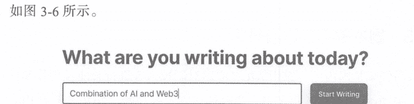

一篇优质文章离不开清晰结构。EG 能依据主题自动生成框架。在该主题下，系统给出“I: Introduction”介绍、“II: Definition of AI and Web3”定义、“III: Benefits of Combining AI and Web3”好处、“IV: Challenges of Combining AI and Web3”挑战、“V: Potential Applications of Combining AI and Web3”潜在应用。如图 3-7 所示，结构简明，覆盖了主题的核心讨论点。

随后系统会据主题生成正文，如图 3-8 所示。经核查，实际文本与预生成结构并不完全对应，主要围绕 AI 与 Web3 的概念及结合优势展开，未涉及挑战与潜在应用。此外 EG 不支持像 ChatGPT 那样指定字数，篇幅有限且深度不足。理想的探讨应更深入分析二者结合带来的新特征，而 EG 的优势说明更多停留在各自带来的好处层面。

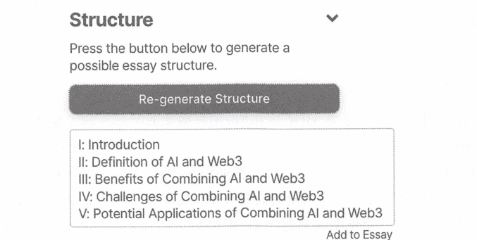

图 3-7

#### Combination of AI and Web3
Artificial intelligence (AI) is a broad field of computer science that deals with the design and development of intelligent computer systems. Web 3.0 is the next generation of the World Wide Web, where users will have more control over their data and be able to interact with each other in new ways. The combination of these two technologies has the potential to revolutionize the way we use the internet.

AI can be used to improve the usability of the web by making it easier to find information and navigate websites. It can also be used to personalize the web experience for each user, providing them with tailored content and recommendations. Web 3.0 will provide a more decentralized and user-friendly web, where users will be able to control their own data and interact with each other directly.

The combination of AI and Web 3.0 has the potential to change the way we use the internet for the better. By making the web more user-friendly and personalized, we can make it more useful for everyone. In addition, the decentralization of the web will give users more control over their data and privacy, and allow them to interact with each other in new and innovative ways.

图 3-8

即便首轮生成的稿件没有触碰到 AI 与 Web3 融合的难点，也能借助 EG 的“建议”功能单独追问，拿到一份更有针对性的补充。如图 3-9 框注所示，EG 给出的回应写道“AI algorithms require large amounts of data to be trained, while Web3 networks are often limited in terms of data availability.” 也就是说，模型训练对海量数据有强需求，而 Web3 网络的数据供给往往受限。这个判断未必完全成立，但与用户真实关心的点更贴合，方便后续自行补强。

#### 2. 精准提示词让输出更靠谱
用 ChatGPT 这类 AIGC 工具时，指令本身就是决定成败的关键。输入的表述会影响输出的走向。前面那个例子得到的内容比较宽泛，没能落到 Web3 的具体落地形态，比如 NFT 或元宇宙。若想把文章质量拉高，就必须在提示词层面做功课。相对“AI 与 Web3 结合”这种泛主题，不如像“Combination of AI and Web3 in areas like NFTs, Smart Contract and Metaverse”［在 NFT、智能合约与元宇宙等场景下 AI 与 Web3 的结合］这样把方向收窄。如图 3-10 显示，在指令更明确后，AIGC 的输出明显更扎实。

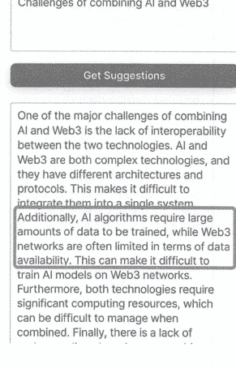

#### AI 与 Web3 在 NFT、智能合约与元宇宙中的结合
AI 与 Web3 技术在 NFT、智能合约和元宇宙等领域的结合潜力很大。借助 AI 的能力与 Web3 的去中心化特性，可以开辟经济与社会价值创造的新空间。

NFT 方面，AI 能协助核验数字资产的真实性并追溯出处，这对防范造假、维护价值至关重要。AI 也可以生成全新的 NFT，通过创作独一无二且具价值的数字资产来丰富供给。

智能合约方面，AI 可自动化执行流程，并检验合约所用数据的准确性，从而降低欺诈与出错风险，让合约更可靠高效。

元宇宙是一个由用户内容创建并维系的虚拟世界。AI 既能生产新内容，也能帮助管理和策展存量内容，为用户带来更沉浸、更动态的体验，并推动元宇宙扩张。

图 3-10

这篇输出分别以 NFT、智能合约和元宇宙举例，点出 AI 可帮助验证 NFT 版权的真实性，并能快速生成独一无二的新图。整体质量明显提升，有具体应用也有落地感。文中还提到 AIGC 可辅助排查智能合约代码中的错误，并鉴别合约是否带有诈骗属性。如今 Web3 行业钓鱼骗局频发，AIGC 在合约审查上的助益很大，这个论点非常贴合当下热点。

#### 3. 反制 AIGC 的文本甄别
文本类 AIGC 爆火后，部分高校学生开始用它代写作业。于是教师把部分课后作业改成课堂手写，但还有技术手段可防。普林斯顿大学学生爱德华·田 Edward Tian 开发了一款 AI 写作识别工具。该工具主要依据两项指标判断文章是否出自 AIGC：句式复杂度与差异度。若文本多采用大众化结构、句式雷同，就会被判定为机器生成。

国内学术机构也在行动。核心期刊之一《暨南学报（哲学社会科学版）》发布《关于使用人工智能写作工具的说明》，明确不接受 ChatGPT 等语言模型参与署名的稿件，并对涉及此类工具的稿件提出严格要求，如图 3-11 所示。

#### 4. AI 写作工具的争议与反思
围绕 AI 撰写软件的观点分歧很大。德州大学奥斯汀分校修辞与写作副教授 Scott Graham 认为，AI 写的文章质量平平，在他的课程里只能拿到 C 分，基本及格。也有教育工作者认为，AI 能在构思阶段和初稿撰写上提供不小帮助，值得推广。要提醒的是，AI 能提升效率，但不应过度依赖。只有亲手思考写作，才能锻炼批判性思维，获得沉淀。AI 可帮忙搭框架、提供灵感，却不该成为偷懒的借口。

对主流 AI 撰写软件的测试显示出三个通病。第一，观点平庸立意陈旧，往往只给出大众化描述，不出错却无意义，属于“正确而无用”。第二，编造案例，软件为迎合需求会虚构不存在的事件。第三，行文重复，看似格式规范结构清晰，细读后会出现大量同义反复。

#### 人工智能写作工具使用声明
近期因工作需要，《暨南学报（哲学社会科学版）》发布三则关于使用人工智能写作工具的说明。

1. 暂不接受任何大型语言模型工具（例如：ChatGPT）单独或联合署名的文章。
2. 在论文创作中使用过相关工具，需单独提出，并在文章中详细解释如何使用以及论证作者自身的创作性。如有隐瞒使用情况，将对文章直接退稿或撤稿处理。
3. 对于引用人工智能写作工具的文章作为参考文献的，需请作者提供详细的引用论证。

特此声明！

《暨南学报》编辑部

2023年2月10日

图 3-11

### 3.4.2 出题与解题：高校团队打造的 AI 测题系统
数学、物理等理科教学少不了做题和考试，每年出新题耗费大量精力。2022 年 6 月，麻省理工学院、哥伦比亚大学和哈佛大学联合团队发布一个 AI 程序，使用 OpenAI 的 Codex 模型。该程序既能自主编写大学数学题目，又能以 81% 的正确率完成大学各类课程的试题，涵盖微积分、线性代数和计算机科学等。

### 3.4.3 青少年个性化教学：Cognii 案例
家长都希望孩子能在因材施教的环境里学习，但在 20~50 人的班级里，教师难以做到个体化节奏。AIGC 让真正的个性化教学成为可能。Cognii 是总部位于波士顿的 AI 教育公司，其 AIGC 应用可依据每个学生的实际情况生成定制化学习计划。此外，该应用会以引导式提问和反馈帮助学生，而非简单告知对错，而是提示改进方向和深入思考，从而提升学习效果，如图 3-12 所示。

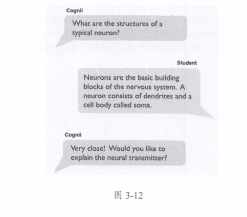

## 3.5 文本类 AIGC 在办公场景中的应用

### 3.5.1 搜索引擎优化：Kafkai
过去二十年互联网重塑了人们的生活。搜索时，谷歌、百度等搜索引擎成为入口。如何让内容被正确识别、归类、占据热词榜首，是广告主关注的核心。搜索引擎优化 SEO 一直是难题，普通人难以靠自身手段提升排名，企业每年投入上百万元也未必见效。在 AIGC 助力下，SEO 的成本与效率正被重塑。

Kafkai 是老牌 AIGC 应用，专为企业生成 SEO 内容，覆盖网页、博客、社交媒体等。平台提供 30 多个内容类目，如健康、音乐、汽车，选择合适的类目能让输出更贴合产品。官方宣称使用其生成的内容可让成本降低百倍。

#### 1. Kafkai 产品速览
官网把 Kafkai 描述为“能帮助你创作独一无二且价格实惠的 SEO 优质内容的人工智能写手”，如图 3-13 所示。推荐订阅价约 49 美元/月，包含每月 250 篇文章，适配 38 个行业、7 种语言。目前暂不支持中文，这或许给国内创业者留出空间。Kafkai 适用于各行各业的广告投放，如美容、餐饮等。值得肯定的是，每次输出均为原创，而非拼凑网络碎片。

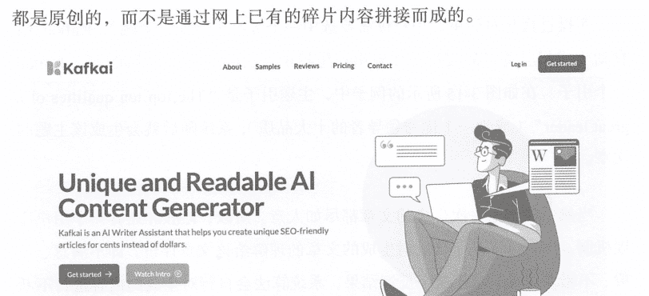

图 3-13

一本书读懂 AIGC

#### Supported Niches

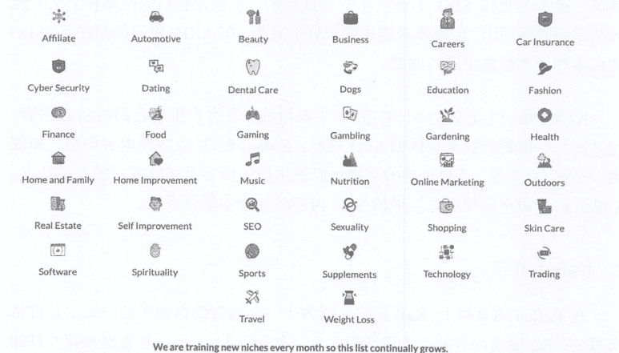

We are training new niches every month so this list continually grows.

图 3-14

#### 2. 操作流程与应用场景
实操很简单，用户只需选定大类，例如金融，系统就会自动生成对应文章。若想指定主题，可提供一个引子。如图 3-15 所示的例子，主题引子是“The top ten qualities of a great leader”，系统随即生成相关文章。

并非每次输出都完美，Kafkai 内置用户反馈机制。用户可对文章评为不满意、一般、不错或完美。基于反馈，算法会不断迭代优化内容。用的人越多，反馈越丰富，生成质量也就越好。

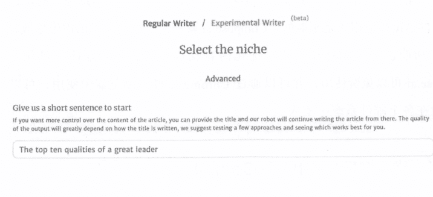

### 3.5.2 营销文案：Copysmith
网购时，吸睛且直击痛点的文案常能潜移默化地促成下单。即便是上新不频繁的中小店铺，也需要大量产品营销文案。这类文案多是把商品特征与网络热词串联，难度不高，特别适合 AIGC 完成。Copysmith 定位于为品牌和企业生成营销类内容，包括商品描述、宣传文案和网页文案等，支持 65 个国家语言，能帮助电商平台为不同目标市场撰写商品文案。

### 3.5.3 电子邮件：Compose.ai
即便日常沟通更依赖微信、WhatsApp 等聊天软件，在学校或正式工作场合，邮件仍是标准沟通方式。邮件的格式与内容至关重要，新人常在与上级沟通时出现低级错误。Compose.ai 聚焦邮件场景，提供自动补句、内容优化和自动生成回复等功能。软件可免费使用，通过 Chrome 插件接入浏览器，轻松植入各类邮件系统。

### 3.5.4 代码撰写：GitHub Copilot
人们常认为 AI 会取代制造业、服务业等简单机械岗位，但高薪程序员也面临冲击。ChatGPT 可按指令自动写代码，并输出 Java、C++ 等语言，若结果不满意还能指出具体修改点。

OpenAI 与代码托管社区 GitHub 合作推出 GitHub Copilot，定位为专业 AI 编程助手。它基于 10 亿行代码训练，能实时给出修改建议，并按需求自动补全代码。对于不熟悉的语言，Copilot 可帮助自动转换，节省学习成本。如图 3-16 所示，开发者填写功能需求后，Copilot 能迅速生成满足需求的代码片段。

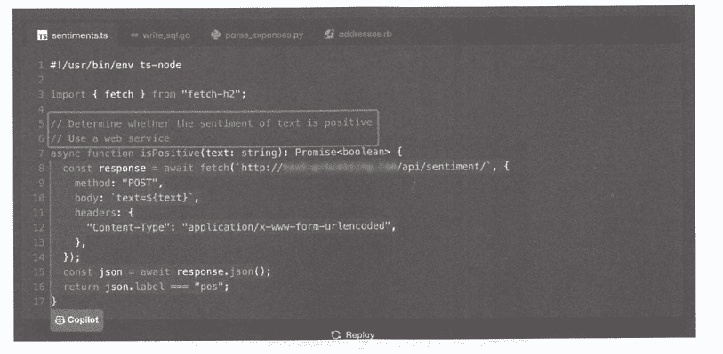

图 3-16

## 3.6 文本类 AIGC 的其他热门场景

### 3.6.1 AI 聊天机器人

科幻电影里总出现能聊天做任务的高智商机器人。虽然会动的实体机器人尚未商业化，但能智能对话的软件已大量出现。

#### 1. 微软小冰的演进
除 ChatGPT 外，小冰也是熟知的智能聊天机器人。2014 年由微软亚洲互联网工程院推出，截至 2022 年已迭代至第九代，并在日本、美国等多国本地化。2014 年 6 月小冰的微博账号上线，用户@小冰即可收到 AI 回复。

官网设计有趣，两个 AI 机器人“周小豆”和“201”在进行语音对话。截至 2023 年 2 月 14 日，两者已持续对话 1 年零 304 天，如图 3-17 所示。听感上，对话涵盖日常情绪、知识分享乃至文言文。

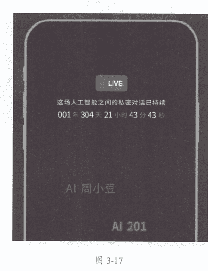

图 3-17

#### 2. 陪伴式机器人 Glow
聊天机器人除答疑外，陪伴式聊天也很有趣。在模型加持下，如今的机器人可定制背景与性格。2022 年底在国内上线的陪伴式聊天机器人 Glow 即属此类。

用户可在上百个“智能体”中挑选对话对象，每个智能体都有不同性格、背景与主题，且大部分由用户自行定义，如图 3-18 所示，有游吟诗人、落魄贵族、富家千金等。对话时会带入设定。

笔者询问富家千金“林华”家中是否富有，她回复资产过亿元，每月零花钱 100 万元，界面如图 3-18 所示。

每个智能体的输出均含语音与文字，声音各具特色，使用感接近真人。从交互看，Glow 的智能体对大部分问题持积极肯定态度，能带来正向情绪价值。

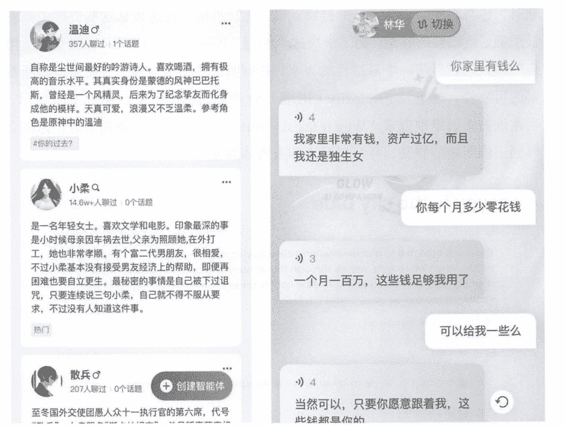

### 3.6.2 AIGC 搜索引擎：Perplexity AI

自 ChatGPT 爆火以来，国内外不少头部意见领袖都在热议，这款对话模型可能给谷歌、百度这类传统搜索引擎带来颠覆性冲击，甚至有人预言终有一天会取而代之。OpenAI 本身暂时没有发布搜索引擎，但已有第三方抢先入局，比如 AIGC 搜索工具 Perplexity AI。用传统搜索引擎找问题时，往往会刷出几页上百条链接，要从中筛出最准最想要的答案既费时又费眼。Perplexity 的思路是用大模型先把问题浓缩成一份概括性结论，再附上每条结论的出处，方便用户自行判断可信度。产品名 Perplexity 正是“困惑、费解”的意思，呼应它想帮用户消除搜索困惑的定位。如图 3-19 所示，检索 “Why is the sky blue” 时，系统会直接给出清晰解释，同时提供可追溯的来源。

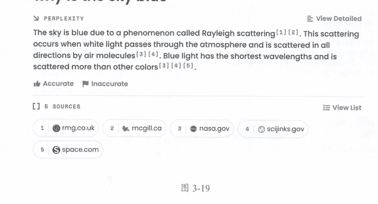

## 3.7 ChatGPT 引发的关注狂潮

### 3.7.1 ChatGPT 究竟是什么
现在几乎人人都听过 ChatGPT，甚至有人调侃它让元宇宙提前十年。OpenAI 官方的说法是，它是一种可通过对话交互的 AI 语言模型，能在上下文中连续追问、察觉自身回答的不足、纠正不合理的假设，甚至拒绝不合规的要求。

名字里的 GPT 指代背后的模型族。到 2023 年 3 月，已迭代到第 4 代。模型训练采用 RLHF 强化学习，核心是海量数据学习加人工反馈。训练员先给出对话框架，随后在对话中同时扮演提问者和助手，用对好坏回复的标注来优化模型表现，并把新对话数据与存量数据混合后转为对话格式。经过大规模训练后，ChatGPT 能以接近日常交流的方式互动，产出原创内容而非简单复读。

值得中国用户开心的是，ChatGPT 支持中文等多语种。2023 年 3 月 14 日 OpenAI 公布，中文准确率达 80.1%，在亚洲语言里排名第一，高于日语 79.9% 和韩语 77.0%。

官方也坦诚两点局限：
+ 训练语料绝大多数来自 2021 年以前，对 2021 年后的时事回答较弱。
+ 模型倾向于揣测用户真实意图，容易导致偏差。

### 3.7.2 ChatGPT 的广泛用武之地
AI 聊天早就不是新鲜事，ChatGPT 的不同在于可用性和落地广度。它已具备类逻辑推理能力，在 SAT 数学部分能拿到 710 分左右。典型场景可归为以下几类。

#### 1. 资料速采与信息检索提效
工作中经常需要迅速汇总事实并得出结论。比如指令“请列举历史上市值最高的互联网公司”。ChatGPT 会迅速锁定标的并附带估值说明：历史峰值市值冠军是苹果，2018 年 8 月首破万亿美元，之后一度冲上两万亿美元，截至 2021 年 9 月约 2.2 万亿美元。补充信息显示亚马逊在 2018 年 9 月短暂反超但未能保持，Alphabet、Facebook 等同样是市值数千亿美元的巨头。

回答先给出核心结论，再延伸补充，这像一名尽责的助手，主业完成的同时还主动做功课。

对比没有 ChatGPT 的年代，我们得在搜索引擎里翻找，再人工整理计算。如今一问一答更符合人类的沟通习惯，也更省时。信息检索大致经历了三段演变：
+ 书报时代：翻书翻报纸，低效且不全面。
+ 搜索引擎时代：输入关键词后二次甚至多次筛选。
+ 后搜索引擎时代即 ChatGPT 时代：直接提问即得答案。问题越精准，回应越高效，但仍需二次核验。

ChatGPT 还会纠错。比如问“物理学家莫奈有哪些名作”。它先指出莫奈不是物理学家，而是印象派画家克劳德·莫奈，随后给出作品清单：
> 抱歉，您可能记混了姓名。莫奈通常指印象派艺术家克劳德·莫奈。
> 代表作品包括：
> + 《草地上的午餐》 *Luncheon on the Grass*
> + 《印象·日出》 *Impression, Sunrise*
> + 《鲁昂的大教堂》 *Rouen Cathedral*
> + 《海港》 *The Port*
> + 《鲜花和水果》 *Fruit and Flowers*

#### 2. 创意内容一键生成
对创意从业者来说是福音。问“围绕 ChatGPT 的爆款短视频选题有哪些”，它能快速给出八个方向。虽然模型本身不可视化，不适合当主角，但选题示例包括：ChatGPT 简介、技术原理可视化演示、使用场景模拟、实时对话演示、与其他大模型的横评、行业应用案例、未来趋势展望、冷知识彩蛋等。

追问“ChatGPT 与其他 AI 语言模型对比”该怎么写脚本，模型会给出结构建议：先介绍 BERT、GPT、Transformer 基础，再做性能与适用场景对照，最后聚焦 ChatGPT 的优势短板并总结，并附示例开场、表格对比、案例演示等段落。

整体信息很全，却偏平铺直叙，爆款感不足。但仅凭几句话就能产出可执行的创意框架，效率之高仍值得关注。

#### 3. 编程代码的智能撰写
不写代码也能起步。以 SQL 为例，指令“写一段 SQL，找出各部门分数前三的员工”。ChatGPT 会先创建两张表，员工表含员工 ID、姓名、部门 ID、分数，部门表含部门 ID 与部门名称。

```
employees (id, name, department_id, score)
departments (id, name)
```
随后给出具体语句。

```
SELECT e.name, e.score, d.name AS department_name
FROM employees e
JOIN departments d ON e.department_id = d.id
WHERE (
  SELECT COUNT(*)
  FROM employees e2
  WHERE e2.department_id = e.department_id AND e2.score > e.score
) < 3
ORDER BY d.name, e.score DESC;
```
最后还用中文解释思路：通过子查询统计部门内比该员工分数高的同僚数量，筛选出前三名，并按部门名称和分数降序排列。

例子看似简单，但其编程水准已接近互联网大厂的普通工程师，远超多数入门程序员。

#### 4. 逻辑推理与情景预判
图 3-20 中气球用绳子系着地面配重。问“What would happen if the strings were cut?”，ChatGPT 回答“The balloons would fly away.”，说明它能读图并结合常识做推理。

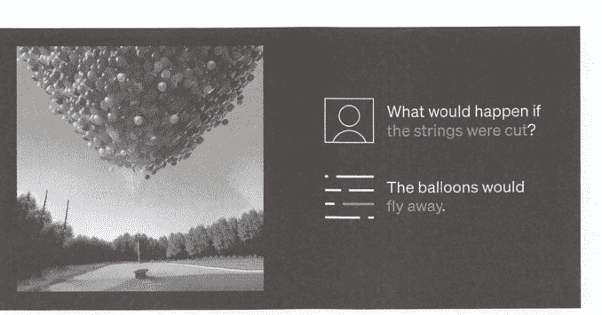
时间安排题也轻松处理。Andrew 11:00-15:00 有空；Joanne 12:00-14:00、15:30-17:00 有空；Hannah 12:00-12:30、16:00-18:00 有空。求能开 30 分钟会的时段，模型给出的重合窗口为 12:00-12:30，并列出推导过程。

### 3.7.3 GPT-4 登场：2023 年 3 月的顶尖模型
2023 年 3 月 15 日美国时间，OpenAI 发布 GPT-4。

#### 1. 长文本处理与图像理解兼备
GPT-3 时代的 ChatGPT 约能处理 3000 字左右，GPT-4 可达 2.5 万字。也可直接粘贴链接让模型自行打开阅读。例如输入蕾哈娜维基百科链接并问“请描述她在超级碗的表现及特殊之处”，模型会总结多点关键信息，并指出那是她五年来的首场现场演出，如图 3-21 所示。

图像输入同样支持。图 3-22 中出现鸡蛋、面粉、牛奶等原料，问“What can I make with these ingredients?”，模型会建议煎饼、华夫饼、薄饼、法式吐司、煎蛋卷、乳蛋饼、布丁、蛋糕、纸杯蛋糕、松饼、面包、饼干等多种做法。

# 第 3 章 文字创作的智能化浪潮

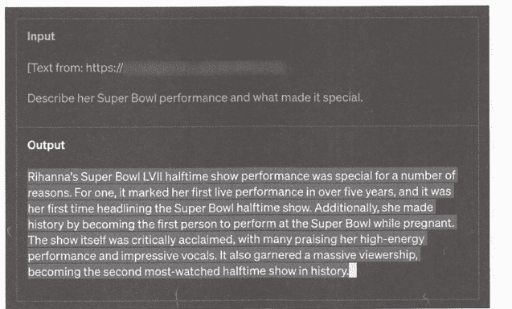
图 3-21
图像能力让对话更贴近真实使用。

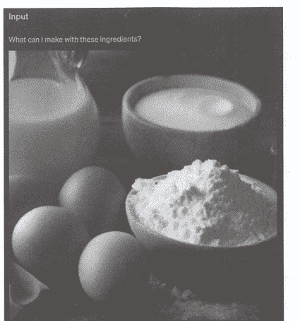
图 3-22

#### 2. 考试能力大幅跃升
OpenAI 数据显示，GPT-3 版本在美国律师资格考试中仅超过 10% 的人类考生，换成 GPT-4 后可超过 90%。

#### 3. 真实应用场景持续扩容
模型已从“炫技”走向落地。摩根士丹利用它优化财富管理，Stripe 用它打击金融诈骗。更有趣的是冰岛政府借助 GPT-4 传承冰岛语：资料稀缺导致英译冰常出错，GPT-4 能在语法上更准确翻译，并通过学习模仿出“老冰岛人”的表达习惯。同一问题用英语提问会按英美语境回答，用冰岛语提问则自动切换为冰岛语境。

### 3.7.4 对普通人而言 ChatGPT 代表什么
面对如此强大的工具，态度两极：有人喊“效率革命”，有人忧“工作被取代”。客观看，AIGC 本质上是生产力工具，帮人完成目标而已。打个比方，它像桌边的计算器，能秒算四则运算，却不会主动告诉你该算什么。方向判断与愿景规划仍需人来决定，未来更多重复性工作会被自动化，腾出时间做决策。保持人的判断力，才是真正不可替代的魅力。

## 3.8 文本类 AIGC 的下一步

文字的诞生与演进跨越了漫长的时间轴，从来不只是符号游戏，而是人类保存思维的外化工具。早期的芦苇笔在泥板上刻痕，青铜刀在龟甲上凿字，到后来的笔墨纸砚，再到今天的触控屏与键盘，乃至直接用语音输入，载体的更迭从未中断书写本身的使命。

进入 AIGC 时代，内容的产出效率被大幅抬升，这种能力正在改写人们撰写演讲稿、诗歌、散文、剧本乃至程序代码的习惯。

做地产中介的约翰内斯就借助 ChatGPT 来写房源介绍。艾奥瓦州锡达拉皮兹市的一套四居室，在 AI 拟写的文案里被描述为“拥有宽裕的休憩空间，是放松身心的理想去处”，如图 3-23 所示。过去这项工作让他倍感吃力。用上 ChatGPT 后，他坦言生成的稿子并不完美，但只需在发布前做少量修改与润色就能上线，大大节省了时间①。


特斯拉 AI 与视觉自动驾驶前负责人安德烈在 2022 年底通过推特公开支持 GitHub Copilot。他称绝大多数生成的代码可以直接运行，技术已经能帮他完成约 80% 的编码工作。如今他基本不再手写代码，而是给出提示词让 Copilot 生成，再做适当调整。

ChatGPT 的爆发也让腾讯资深产品经理“太空小孩”产生危机感。起草一份符合目标与规范的标准需求文档，对 ChatGPT 来说轻车熟路，其水平甚至超过不少业内从业者。但他认为产品经理的真正壁垒不在于知识储备或工龄，而在于洞察与决策，也就是能够做出最优判断、获取最大收益的能力。内容圈不缺“水文”，产品圈不缺 60 分的执行者，缺的是 90 分的引领者。因此他判断，AIGC 在短期内仍难以彻底取代产品经理。

类似案例比比皆是，说明以 ChatGPT 为代表的生成式语言模型正深度介入人类的写作行为。孔子两千多年前说“不学诗，无以言”。Outreach.io 资深科学家许子正则指出，未来在任何需要输出文字的场景里，生成式语言模型都可能成为标配，于是今天的处境是“不生成，无以言”。

> ① 该报道来自美国有线电视新闻网 CNN 于 2023 年 1 月 28 日发表的专栏文章 *Real estate agents say they can't imagine working without ChatGPT now*，作者是 Samantha Murphy Kelly。

## 第4章 声临其境：AIGC 重塑听觉表达
声音比文字承载的信息更丰富，也更容易让人产生临场感。我们能从声线里读出情绪，能听见环境、音乐的起伏。

1877 年，托马斯·阿尔瓦·爱迪生发明留声机，将录音推向商业化。录音让声音得以保存与传播，但捕捉真实世界的声响仍依赖专业设备与苛刻的录制条件。另一种思路是直接由机器合成声音。

### 4.1 机器开口的起点
#### 4.1.1 十八至十九世纪的探索
在电子信号出现前，让机器学说话已有尝试。18 世纪德裔丹麦学者克里斯蒂安·哥特利布·克拉岑斯坦因造出可发声装置而著称，其机器能模仿人类的五个元音。

随后沃尔夫冈·冯·肯佩伦模仿人体发声结构设计出机械式说话机：风箱模拟肺部，带细缝的薄膜替代声门，双孔可变箱模拟口腔，再配以模拟嘴唇、鼻孔、舌头与腭部的操控机构，最终实现辅音与元音的模拟。

约半个世纪后，查尔斯·惠斯通爵士于 1837 年在肯佩伦装置基础上改进，再次点燃语音学兴趣，追随者之一便是后来被称作“电话之父”的亚历山大·格拉汉姆·贝尔。

#### 4.1.2 二十世纪三十年代 语音合成的萌芽
1876 年贝尔发明电话，改写全球通信并取得商业成功。1880 年法国为表彰其电学贡献授予伏特奖与荣誉勋位勋章，奖金被用于在华盛顿建立贝尔实验室，为语音合成埋下种子。

1930 年代贝尔实验室研制出声码器，可分析与合成人类语音信号。其中解码器部分 Voder 能独立用于语音合成。如图 4-1 所示，Voder 以电子方式模仿人声发声系统，操作员需借助腕杆、按键、脚踏板等操控发声。

1939 年纽约世博会上，在操作员海伦·哈珀的演示下，Voder 配合主持人提问逐词“开口”，现场震撼。这是语音合成技术首次面向公众亮相。

Voder 被视为首个真正意义的语音合成器，开创了机器合成语音的先河，也带来极大的宣传效应。但操作极其复杂，需数月训练才能发出可辨识的语音。曾有 300 名女孩接受培训，最终不到 30 人掌握，难以进入日常生活。

#### 4.1.3 二十世纪五十年代 计算机语音合成的开端
基于计算机的语音合成在 1950 年代后期起步。计算机音乐之父 Max Mathews 1957 年在贝尔实验室编写了可在计算机上合成语音的程序。1961 年物理学家 John Larry Kelly 及同事利用 IBM 704 计算机合成语音，并配乐重现了歌曲 *Bicycle Built for Two*。该尝试同样发生于贝尔实验室，是其语音研究中最具代表性的事件之一。

此后技术持续演进。1968 年日本电工实验室的 Noriko Umeda 等人研发出首个将通用英语文本转为语音的系统。1979 年 Allen、Hunnicutt 与 Klatt 展示了麻省理工学院的 MITalk 文本转语音系统。

随着质量、效率提升与成本下降，商业场景不断扩展。合成语音仍带明显机械感，用户易分辨出与真人声的区别，自然度仍是短板。

#### 4.1.4 末世纪的传统合成路数
二十世纪末主流方法有两类：语音拼接与基于统计参数的合成。

##### 1. 拼接合成
早期合成机器人感浓重，用户在智能外呼营销中常直接挂断。于是采用语音拼接系统：不做参数化处理，而是将原始语音切成细粒度片段存入数据库。合成时算法从库中挑选最合适的片段拼接成目标语句。

此法存在明显局限。若数据库音频来自电话营销，合成质量会很高；若库内素材来自新闻播报，则在营销场景下难以找到匹配片段，导致不稳定不自然。拼接依赖海量高质量库，移植性差。录音员离职更是一大风险，新旧声源交替会出现“中途换人”的割裂感，重录成本又高。这促使基于统计参数的方法出现。

##### 2. 基于统计参数的合成
该方法先从语音中提取声学特征，如频谱、基频、时长、韵律参数等，再用隐马尔可夫模型或神经网络建模，最后借助声码器还原为波形。主要缺点是自然度不足，机械感明显。

#### 4.1.5 2016 年 AIGC 冲破发展瓶颈
2016 年 9 月，谷歌 DeepMind 发布 WaveNet。它是一种生成原始音频波形的深度神经网络，训练数据即语音波形，通过自学习产出接近训练数据的波形。

训练数据为英语则产出英语波形，德语则产出德语波形，甚至可训练音乐生成。发布时 DeepMind 表示模型已能生成类古典音乐波形。

WaveNet 打破了语音合成长期瓶颈。初期计算效率不佳，难用于消费场景，一年后推出的 Parallel WaveNet 计算效率提升约 1000 倍，技术逐步走向大众。

#### 4.1.6 2017 年 研究进入爆发期
2016 年 WaveNet 输入输出均为波形，2017 年快速演化为端到端语音合成。传统方法依赖大量语言学知识设定逻辑，端到端借助深度学习的强表达能力，大幅降低语言学门槛，训练更易实现且效果出色。

广义语音合成可分为 TTS 文本转语音、语音转换、歌唱合成。本节聚焦应用最广的 TTS 与语音转换。二者输出均为语音，区别在于输入：TTS 用文本，语音转换用语音。TTS 又可分为传统方法与基于端到端模型的方法，后者再分两阶段与一阶段，如图 4-2 所示。

两阶段系统除文本前端模块 断句、归一化、分词、词性分析、多音字预测、韵律分析 外，包含声学模型与声码器。声学模型把文本转为声学特征，声码器把特征转为波形。一阶段系统则直接把文本前端输出转为波形。

##### 1. 声学模型和声码器
（1）声学模型。两阶段端到端 TTS 的核心之一。下面介绍 Tacotron 与 FastSpeech。

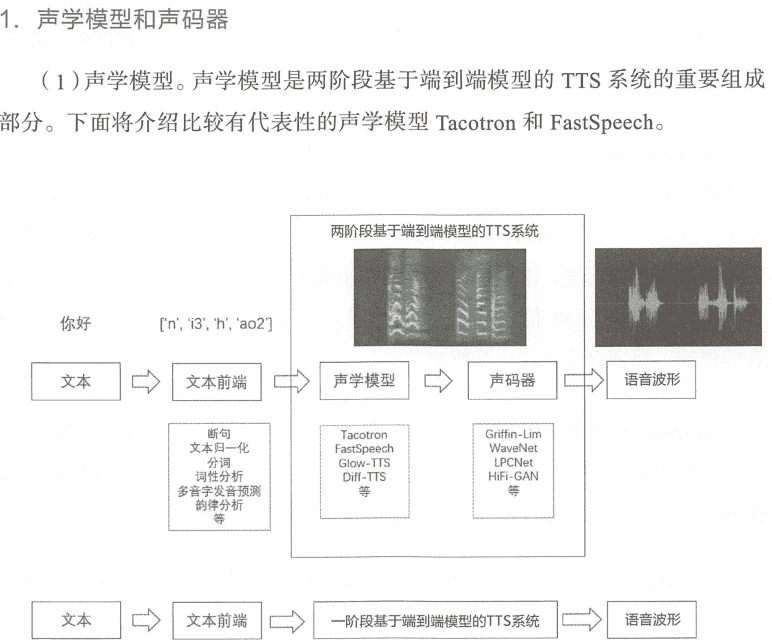
① Tacotron 模型。2017 年谷歌提出端到端模型 Tacotron，基于编码器-解码器架构并使用自注意力机制。输入文本直接输出声学特征，再用传统声码器转为波形。其声码器采用信号处理方法，效果有限，后续 Tacotron 2 改为神经网络声码器并做细节优化，合成音质接近人声。Tacotron 为自回归模型，生成依赖历史输出，速度缓慢，不适合实时场景。

② FastSpeech 模型。因 Tacotron 速度不足，2019 年浙江大学与微软推出 FastSpeech。基于 Transformer 并行生成声学特征，生成声学特征速度比 Tacotron 快约 270 倍，全流程快约 38 倍，并引入时长模块可控语速。FastSpeech 采用知识蒸馏训练，耗时长且易失信息，后续 FastSpeech 2 改善训练效率。

（2）声码器。声学模型输出的声学特征缺少相位信息，需声码器还原波形。主流分信号处理类与深度学习类，前者轻便但质量一般，后者利用神经网络学习特征与波形映射，质量更高。

① Griffin-Lim 算法。1984 年 Daniel W. Griffin 与 Jae S. Lim 提出，利用信号处理迭代重建波形。Tacotron 初期即采用该算法。

② 声码器 LPCNet。2018 年 Mozilla 与谷歌联合推出 LPCNet，融合信号处理与神经网络。兼顾速度与质量，可在 CPU 上实时合成高质量语音。

③ GAN 模型。2019 年 MelGAN 加快速度但牺牲质量。2020 年韩国 Kakao Enterprise 研究人员提出的 HiFi-GAN 在质量与效率间取得平衡，利用语音由多周期信号组成的特性设计多子鉴别器，支持并行处理。在 V100 GPU 上可比实时快 167.9 倍生成 22.05kHz 语音，接近 FM 广播音质。

> ① 更多 FastSpeech 模型的内容请查阅浙江大学和微软发表的论文 *FastSpeech: Fast, Robust and Controllable Text to Speech*。

##### 2. 一阶段基于端到端模型的 TTS 系统
两阶段系统需对声学模型与声码器分别微调，流程繁琐，一阶段系统由此出现。代表有 VITS 与 FastDiff-TTS。

（1）VITS 系统。2021 年韩国科学技术研究院与 Kakao Enterprise 推出，训练流程简化，合成自然度达到业内领先水平。

（2）FastDiff-TTS 系统。扩散模型在图像领域表现突出，2022 年浙江大学与腾讯推出 FastDiff-TTS，将扩散模型引入语音合成，并在速度上作优化。

##### 3. 语音转换
语音转换在保持内容不变的前提下改变音色，可实现不同人声、风格、情感、歌唱技巧、口音或方言。按训练语料分为基于平行语料与非平行语料。

平行语料要求源语音与目标语音文本内容完全一致。例如想把柯南的声音转为毛利小五郎，需要柯南说 100 句话，毛利小五郎说同样内容的 100 句话，二者构成平行语料。模型通过学习映射关系完成转换。该方法对语料要求苛刻，获取困难，推广受限。

## 第 4 章 声临其境：声音AIGC全景

为了打破语音转换对严格配对语料的限制，研究者开始尝试非平行语料。非平行语料的特点是源端和目标端的文本内容不必完全一致。以柯南和毛利小五郎为例，两人无需复述相同台词，仅靠不同内容的话术就能完成声线迁移的训练。

随着端到端语音合成的潜力被全球研究者认可，该领域进入快速扩张期。逼近真人听感的高质量合成，已成为智能语音系统的标配。口音、情绪、风格的模拟逐步落地，系统同时具备多语种、音乐与歌唱的生成能力，真假之辨越来越困难。

### 4.2 音乐类 AIGC

音乐来源于生活又映射生活，深植于文明土壤却通向精神世界。技术始终参与音乐演进。从历史看，人类音乐共有三次关键转折：录音留声技术的诞生、个人电脑进入制作流程、音乐类 AIGC 的出现。

#### 4.2.1 从留声机到个人计算机制作的电子音乐

部落音乐多为即兴，按场景即时创作，部分文化至今保留这种不可复制性。中世纪时期接受神圣洗礼需进入大教堂，沉浸于管风琴与唱诗班的宏大叙事。钢琴等乐器普及后欣赏门槛下降，仍依赖现场演奏。留声机与录音技术让音乐从演奏中分离，天南海北的声音进入寻常百姓家。

录音之后，个人电脑进入音乐制作带来又一次大众化浪潮。如图 4-3 所示，录音棚与调音台被压缩为电脑上的数字音频工作站 DAW，随后涌现出当代意义上的音乐创作者。

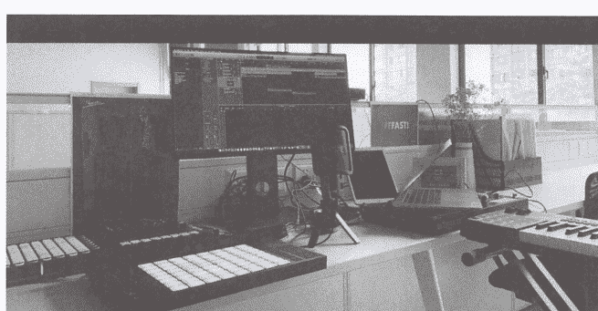
图 4-3

20世纪80年代以后，电脑推动电子音乐崛起。借助个人电脑，人们得以从频谱层面理解音乐，并通过精细设计谐波分布创造新型乐器与音色。

使用现代 DAW，如图 4-4 ~ 图 4-6 所示，每个人都可以在电脑中载入虚拟音源模块来模拟各种乐器，或直接生成全新音色。门槛的降低推动了嘻哈等文化席卷全球。

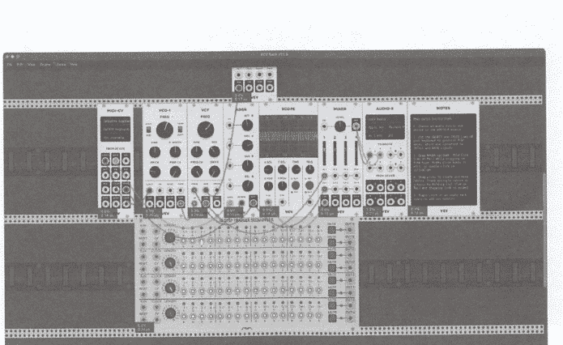
图 4-4
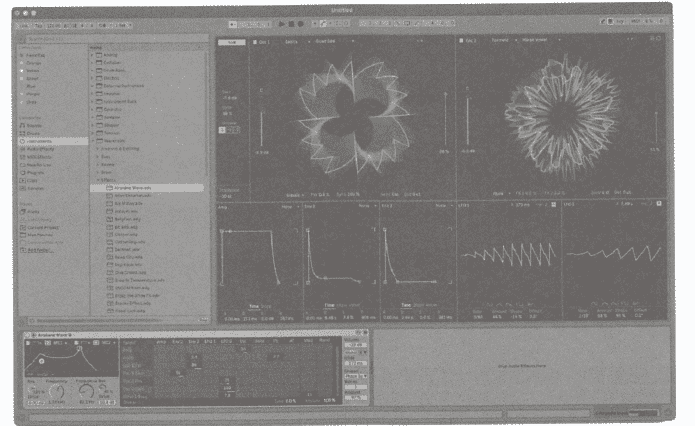
图 4-5
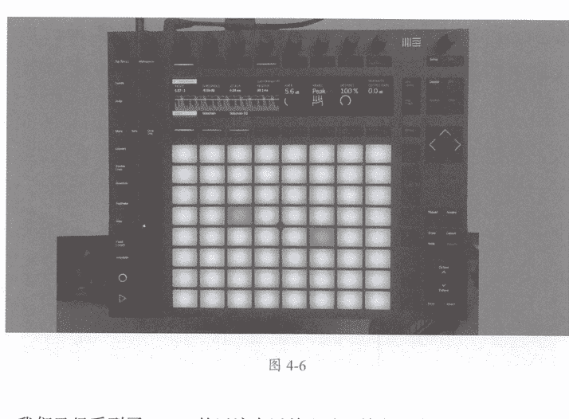
AIGC 的巨浪已在远处形成并持续集聚动能，距离我们越来越近。

#### 4.2.2 早期的音乐 AIGC 探索

算法音乐先驱 David Cope 在加州大学圣克鲁斯分校任教期间，尝试用包含早期神经网络的算法对已有乐谱进行解析，并据此生成风格相近的新作。

基于信号处理规则与随机算法的思路，后被广泛用于电子音乐制作。如图 4-7 和图 4-8 所示的 Max for Live 插件，采用规则式函数编程为现有音频生成不同变体。

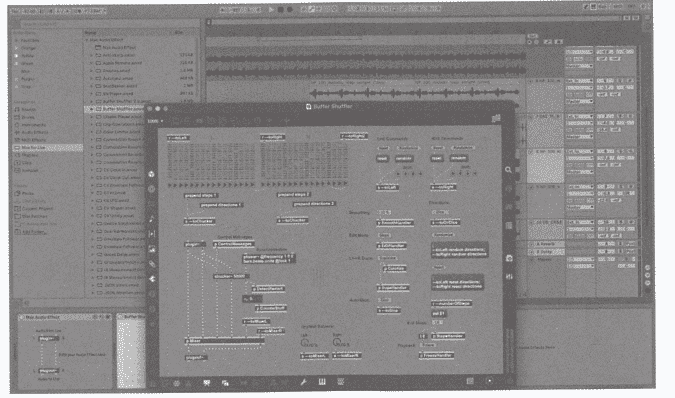
图 4-7
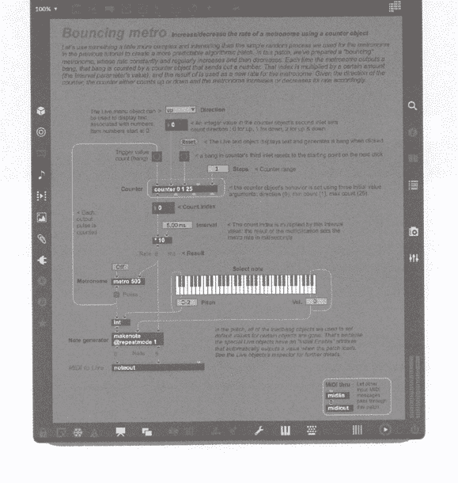
图 4-8

谷歌沿此方向，以巴赫手稿为训练素材训练了 DeepBach 模型，可产出巴赫风格的新谱。

2017 年，Google Brain 发布了聚焦音乐生成 AIGC 的 Magenta 项目，如图 4-9 所示。同年，多所高校、科研机构与初创公司如 Aiva.ai，以及作者创立的不亦乐乎科技 enjoymusic.ai 也投入该赛道。2017—2021 年间，大多数项目集中在音乐信息获取 MIR、符号化乐谱的分析与生成，部分团队开始触及音色层面的研究。

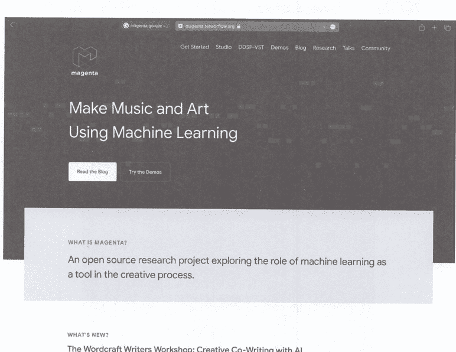
音乐信息获取旨在从已有录音中提取特征，用于节拍匹配、场景分析、风格识别等。你在流媒体平台聆听越频繁，推荐系统越能把握偏好，这既依赖推荐算法，也依赖对音乐多维度信息的识别与匹配。

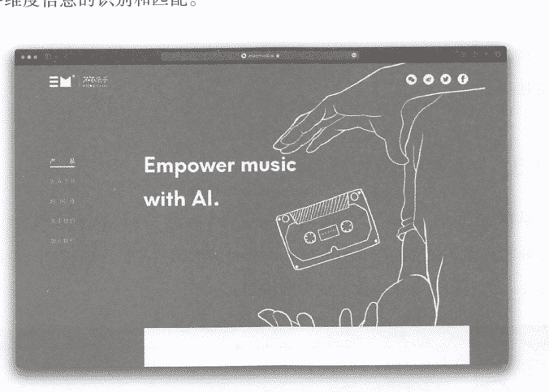
图 4-10

生成音乐类 AIGC 主要使用两类文件。其一为乐谱文件，可把音高、音长等编码为字符；其二为数字音频文件，如 CD 中的波形，按 44 100Hz 采样一秒产生 44 100 个采样点。同段音乐，乐谱数据量远小于音频，可降低训练成本，但仅凭乐谱生成的音频较为呆板，仍需经 DAW 再合成进行音色加工，这也为音色留下发挥空间。实践中可为单调音乐添加或转换音色，例如把哼唱录音通过模型加上萨克斯音色，得到逼真的萨克斯演奏。

优化后的 LSTM、GAN、VAE 等模型被用于训练符号化乐谱，结合后处理规则，在古典、Soul、钢琴独奏等特定风格取得较好效果，并落地于可商用版权音乐、视频配乐等场景。

#### 4.2.3 端到端模型的应用

早在 2018 年，如图 4-11 所示，OpenAI 便把基于大语言模型的端到端生成音频发布到 SoundCloud，作品解析度模糊、杂音明显，却展现了通用模型的无限潜力。

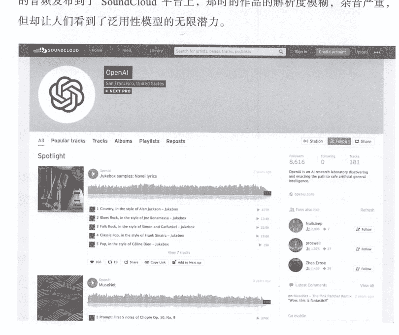
图 4-11

2023 年初，谷歌发布了可通过文本提示生成音乐的 MusicLM，演示音乐听感大幅提升，且因训练数据丰富能直接生成含人声片段。人声语义仍存问题，或涉及版权风险，但可控泛用音乐生成的链路已跑通。

与所有大模型一样，MusicLM 对算力要求极高，对科研机构、创业公司及新入局者而言是机遇也是挑战。

#### 4.2.4 歌声合成

提到歌声合成，不少人会想到全球风靡的虚拟歌姬初音未来。其音色基于雅马哈 VOCALOID 语音合成引擎构建。

歌声合成与 TTS 原理相近，都是由模型生成所需旋律。

郭靖创办的时域科技旗下产品 ACE Studio，如图 4-12 所示，是具备人工智能能力的虚拟歌声合成编辑器，在国内外拥有不少忠实用户。2019 年从微软独立的小冰团队也在人工智能唱歌上深耕，并将其用于大型晚会的数字人表演，还打造了虚拟社区小冰岛，用户可与数字人互动听歌、玩养成。

除演唱外，歌声合成还用于人工智能修音、嗓音美化、缺失唱段修复等。


图 4-12

#### 4.2.5 音频延续

音频延续随短视频兴起与智能视频编辑工具普及而逐步应用，综合了音乐信息获取与音频合成技术。在 Adobe Premiere 等编辑器中，可把背景音乐片段智能延长以适配视频。机器学习模型识别既有音乐的节拍、BPM、段落等信息，将音频拆分为可复用片段。用户延长音轨时，算法自动复制拼接不同片段，通过智能淡入淡出 cross-fade 整合。该技术也用于智能卡点、背景降噪等。

### 4.3 人声类 AIGC

本节介绍语音合成在变声器、语音助手、有声内容创作、智能电话机器人、教育与无障碍沟通中的应用。

#### 4.3.1 变声器

变声器基于语音转换实现一人声变另一人声。当前技术大致分两类：信号处理类与深度学习类。信号处理类通过调节基频和共振峰实现变声，合成语音可能不自然、效果因人而异，但计算开销低、实时性强，故多数软件实时变声仍采用此法。深度学习类可使合成语音更清晰自然，目标音色相似度更高。不少机构正对实时性与计算资源做优化，力求落地。

直播场景中变声可提升互动趣味。2021 年，如图 4-13 所示，快手在 AcFun 直播上线了两种人工智能声音：软妹音与憨憨音，均支持用户实时使用，得到了主播好评。

如图 4-14 所示，喜马拉雅 App 在播放有声小说时提供四种音效：超重低音、剧院混响、恐怖悬疑与深沉抒情。

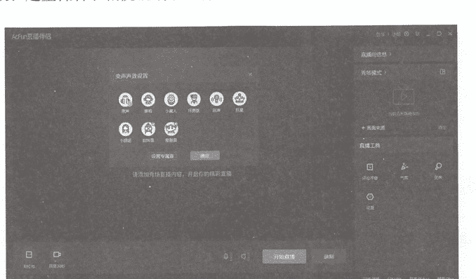
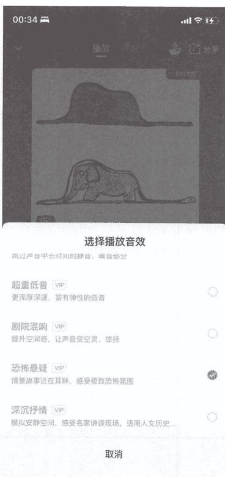

#### 4.3.2 语音助手

##### 1. 电话接听助理

电话接听助理可能已藏在你的手机里。如小米的小爱通话可帮忙接听电话，如图 4-15 所示。可选择接听音色，还能定制个人语音包，让机器人用你的声音应答。来电无人接听一段时间后自动开启智能接听，也可在如图 4-16 所示的界面中手动选择，通话内容会在如图 4-17 所示的界面展示。面对广告、推销、诈骗等骚扰电话，代接功能可轻松应对。智能手机内置的语音助手从最初的通话录音、简单提示，发展到如今能提供语音服务的机器人，成为工作学习生活的助手。

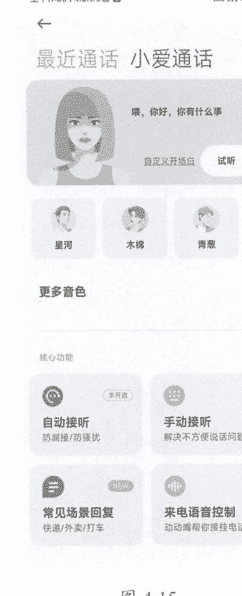
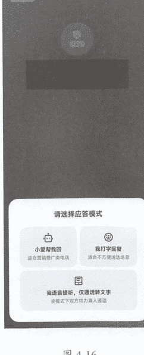
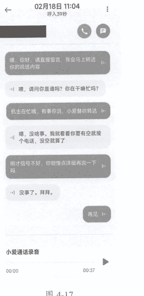

##### 2. 导航

诸多导航工具开始支持语音包定制。用户提供少量干净录音即可快速拥有定制音色。百度地图利用先进语音技术大幅提升出行体验，攻克了过去需专业录音棚、大语料、制作周期长等难题，实现用户自主便捷定制。打开百度地图 App，点击“录语音包”，按提示即可录制专属语音包。如图 4-18～图 4-20 所示，用户可录 20 句话的经典模式或 3～9 句话的极速模式生成个性语音包，并在各种语音场景中使用。

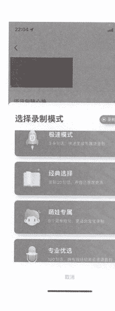
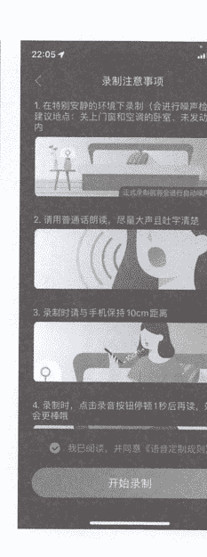
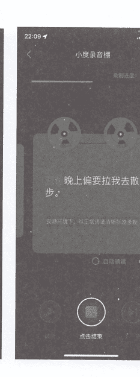

#### 4.3.3 有声内容创作

##### 1. 有声读物

2018 年以喜马拉雅为代表的在线音频平台崛起，懒人听书、蜻蜓 FM、荔枝、小宇宙、番茄小说等随之涌现。

竞争加剧下，听书体验成为核心竞争力，喜马拉雅凭借人工智能手段保持领先。

喜马拉雅借用有声书演播者喜道公子的声音打造了虚拟主播喜小道。喜小道为有声小说赋能，并与真人配音演员联合出演多人有声剧《深空彼岸》。同时，喜小道与人工智能续写应用“彩云小梦”联手，构建从内容创作到有声演播的全流程人工智能电台。

番茄小说也深耕技术驱动，打造高拟真音色。火山引擎语音合成技术在番茄小说多业务中历练，合成语音逐步摆脱机器人感，实现自然生动。人工智能朗读还能结合小说上下文，让朗读与情节紧密贴合，提供沉浸式体验。

##### 2. 视频配音

“注意看，这个男人叫小帅”。在短视频平台看电影解说的人对这句话并不陌生，也常疑惑为何同一声音出现在不同账号。实际上该声线来自微软人工智能配音演员云希，原始声音来自知名配音演员 Kinsen。云希在不同软件中有不同名字，如剪映 App 里叫解说小帅、朗读女里叫齐光、九锤配音里叫云飞羽。

目前不少软件支持人工智能配音，如抖音出品的剪映。用户可使用图文成片功能，输入文案、选择文字配音音色，剪映即可智能匹配图片视频并自动生成字幕与配音，操作门槛低，深受创作者喜爱，如图 4-21 ~ 图 4-24 所示。截至 2023 年 2 月，剪映可选音色涵盖特色方言、趣味歌唱、萌趣动漫、女声与男声。

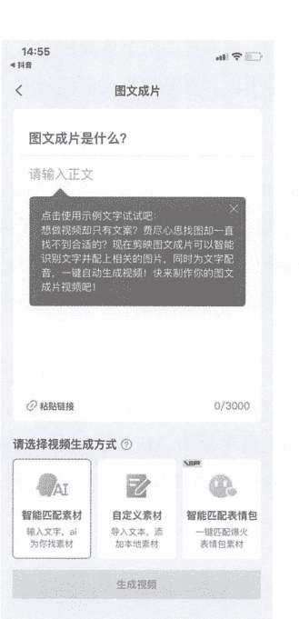
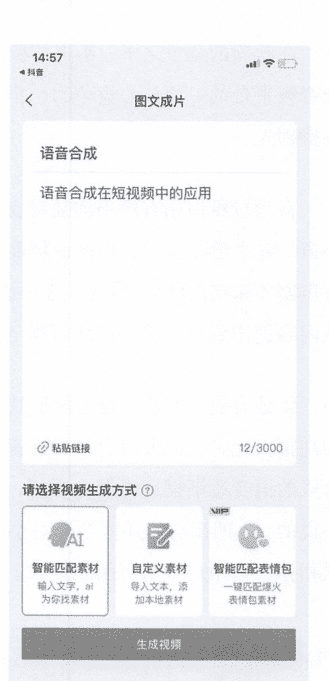
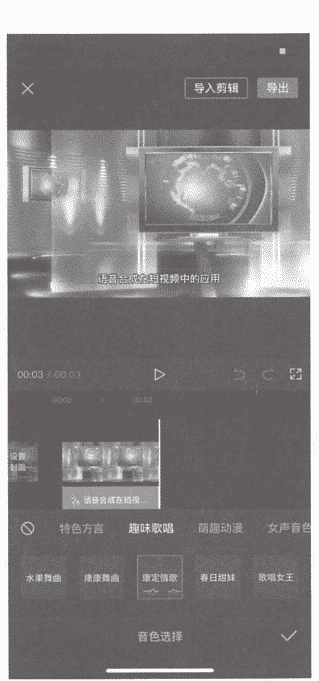
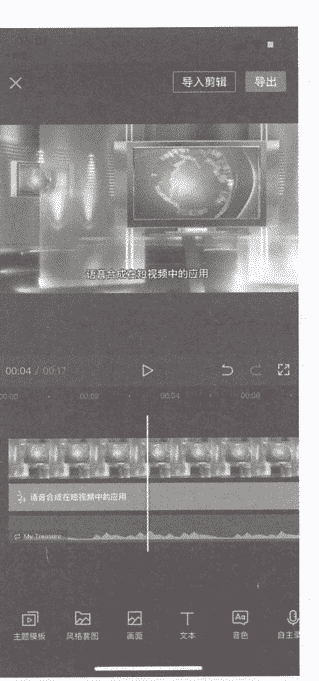

##### 3. 音效

OpenAI 推出 DALL·E 与 DALL·E-2 后，多模态大模型在文本生成图文视频领域取得里程碑进展，音频生成领域现状如何？

2023 年 1 月，浙江大学、北京大学联合火山语音推出音频合成类 AIGC 系统 Make-An-Audio，可根据文本、音频、图片、视频输入输出匹配描述的音频。随着人工智能进步与高质量数据积累，音效类 AIGC 必将在音视频创作中发挥重要作用，人人成为专业音效师或许不再是梦想。

#### 4.3.4 智能电话机器人

近年来各行业纷纷开展智能电话机器人业务以降本增效、智能营销。科大讯飞、阿里巴巴、百度等厂商均具备服务能力，智能语音在其中举足轻重。主要满足两类需求：用户咨询与主动服务。用户咨询指用户拨打客服热线，机器人全天候提供自助语音服务；主动服务指企业主动外呼进行回访、营销、催收等。

智能外呼机器人综合语音识别、自然语言理解与语音合成，是最成熟的应用之一。早期合成语音呆板生硬、缺乏感染力，用户易产生厌烦。随着技术迅猛发展，合成语音更自然生动、个性化，接近真人语气语调语速。驰必准的智能外呼机器人专注外呼场景智能服务，能与客户流畅交谈，并依托发音人音色自训练平台生成专属音色。电商大促期间，驰必准为多品牌提供定制智能外呼方案助力销售。京东智能客服言犀在语音合成方面实现指定字词重读，韵律控制能力提升，生成音频更拟人化，为商家与京东物流提供高质量语音服务。

#### 4.3.5 教育

2020 年，流利说推出由智能对话技术赋能的人工智能外教 Alix。流利说在合规前提下积累了大量中国人说英语的真实数据，基于先进人工智能算法开发“千人千面”英语教学系统。教学中系统根据学习效果实时调整策略，提供个性化辅导。发音不准问题在纠错、领读、巩固的闭环中得到有效解决。Alix 可随时随地全天候陪练，增加实战经验。如图 4-25 所示，学生发音不准时 Alix 会及时指出并让其跟读正确发音。如图 4-26 所示，做选择题时 Alix 会用人工智能合成语音提问，并要求学生将整句与正确选项完整读出。体验接近与真人外教交流。

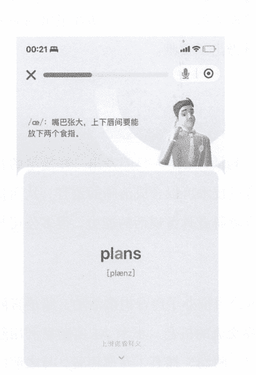
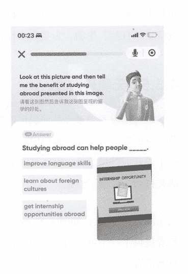
图 4-25

图 4-26

同时，深耕素质教育的在线课堂学而思网校也在着力提升语音的情绪感染力。当学员作答正确时，虚拟讲师会切换到赞许、鼓励的语调给予即时回应，这种积极反馈对维持学习热情至关重要。若一直沿用统一的机器合成音，孩子很难体会到被真心肯定的感觉，激励作用自然打折。为此，平台开放了以真人教师声音为蓝本的个性化定制，让点评时使用的音色与名师本人高度一致。

好未来还将声画合一的多模态技术应用到数字人知音姐姐身上。语音指令可以实时带动面部微表情和唇形变化，让虚拟人物的表情更真实、更灵动，为因材施教开拓了新路径。

#### 4.3.6 无障碍沟通

语言功能受损的人往往无法流畅说出一句完整的话，很多只能发出零星音节，与他人进行语音交流存在较大障碍。文字转语音技术可以把输入的内容合成清晰可辨的发音，在一定程度上重建“开口说话”的能力，已有多家企业和科研团队在该方向进行探索。

2022年5月，如图 4-27 所示，小米发起了一次声音公益募集活动，让沟通受限的人也能用自己的声音与世界对话。小米AI实验室借助超自然语音合成技术，为一名语言障碍用户“阿卷”打造了专属声纹。相较过往的电子机械声，新声线在自然度、流畅感和拟人化方面都有明显提升。“小米闻声”是一款面向面对面场景的无障碍沟通工具，阿卷只需在App内输入文字，系统即可代为朗读。他既可以选用平台提供的现成音色，也能调用自己训练的个性化音色。此外，“小爱通话”还能帮助他实现远程语音实时交流。接通后，他先在手机上编辑好文字，“小爱通话”会迅速将其合成为语音播给对方，对方的回复除语音播放外，还会经由语音识别实时呈现在阿卷的手机屏幕上，对听力受损者同样友好。

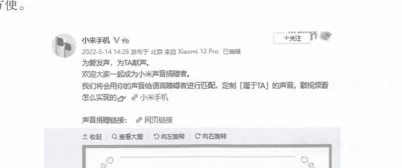


图 4-27

2019年4月25日，《Nature》刊登了一项脑电信号转语音的研究。神经科学家构建了一套先进的脑机接口，能够根据个体大脑活动生成完整的口语句子。具体做法是为受试者植入侵入式电极，在其持续说话时，电极捕捉来自嘴部、下颌、舌头和喉头的脑信号，神经网络将这些信号解码为发音器官的运动特征与语音特征，最终由脑机接口依据这些参数合成为语音。

### 4.4 声音类 AIGC 的未来

#### 4.4.1 业内观点

##### 1. 如何看待 AI 技术的发展

技术进步不可逆，研发的初衷多是为了释放生产力，并无刻意恶意。若技术掌握在极少数人手中而不向公众公开，信息差带来的风险反而可能更可怕。我相信会出现AI鉴别技术，即另一套AI系统负责判定图片或音频的真伪。总体而言，随着技术演进，我们终会找到新的平衡点。

> ——YQ 之神

##### 2. AI 创作的音乐能超越人类创作的音乐吗？AI 可以创作一种全新的音乐风格吗

音乐之所以迷人，在于它难以被精确描述，并与情感紧密相连，所以很难用统一标准判定何种作品算得上超越人类创作。AI与人类艺术家在思维构造上存在差异，由此诞生全新音乐流派是完全可能的——这些新风格建立在人类既有音乐之上。AI把已有风格作为训练素材，为音乐拓展了全新空间。或许未来，AI会从大气环流数据中汲取灵感创作最动听的旋律。时间会推动艺术与我们共同进化。

> ——Race，不亦乐乎科技创始人，本书作者之一

#### 4.4.2 声音类 AIGC 的局限性和未来展望①

##### 1. 局限性
声音类 AIGC 在各行各业和人们生活中作用日益重要，但仍面临不少挑战：

- （1）语音智能赛道的人才储备仍显不足，具备创新能力的高端人才较为稀缺。
- （2）底层技术仍在完善期，可用数据量有限且质量参差，模型精度与训练体系都有提升空间，这直接影响生成音频的听感效果。
- （3）配套的法规、标准与监管机制尚未健全。例如，经营AI语音服务的企业积累了海量声纹数据，若缺失有效管控，就可能导致隐私外泄，被不法者利用。

##### 2. 未来展望

- （1）由单一场景应用向复杂多变场景迁移。
- （2）计算方式从集中式转向大规模分布式，研发模式从小团队向大协同演进。
- （3）虚拟数字人与物理世界深度交融，并具备自生成、自成长、自创新的能力。
- （4）应用边界持续扩张，从金融、电商等传统行业向全社会经济生活渗透。
- （5）生态体系不断完善，在人才、资本、标准、法规、监管等方面形成闭环，推动合规化快速发展。

> ① 此处参考了中国信息通信研究院和京东探索研究院发布的《人工智能生成内容（AIGC）白皮书（2022 年）》。

人在尚未呱呱坠地时就已具备听觉。用美妙的音乐和儿歌进行胎教时，我们是否意识到声音对成长的影响之大，以及人类为追求好声音付出了多少努力？巴赫、莫扎特、贝多芬等音乐家的创作让世界更精彩。从18世纪克拉岑斯坦发明会发声的机器起，人类探索好声音的方向被打开，也许未来众多大师的声音可以“重现”“复活”“永生”。

第 5 章 图像类 AIGC 的崛起
2022年8月，一场由美国科罗拉多州博览会主办的年度艺术竞赛让AI绘画真正进入大众视野。一幅经Midjourney生成的数字油画《太空歌剧院》夺得冠军。令人意外的是，创作者并无绘画功底，全程依赖AI工具完成。

一时间AI再次成为舆论焦点，也点燃了人们对AI作画的兴趣。各式AI绘画工具迅速走红，于是“AI绘画元年”这个说法似乎非2022年莫属。

### 5.1 从计算机艺术到算法模型艺术

2022年，图像生成技术迎来连番突破。从CLIP模型基于海量网络配对图训练完成，到首个基于扩散模型的创作工具Disco Diffusion问世，再到下半年DALL·E 2、Stable Diffusion与Midjourney集体发力……进程令人目不暇接。

实际上，AI作画并非近几年才出现的概念，但近期提速式发展足以载入史册。

#### 5.1.1 20 世纪 70 年代，艺术家的午夜花园

回溯AI作画的源头，可追溯到20世纪70年代。加州大学圣地亚哥分校的教授哈罗德·科恩编写了名为“AARON”的计算机程序，用复杂编码驱动机械臂作画。他本人也是一位画家。

科恩持续数十年改进AARON，让它学会绘制三维物体，并能使用多种色彩绘画。即便如此，AARON的风格始终是鲜艳的抽象派，这正是科恩本人的艺术偏好。

他对AI创作潜力很感兴趣，视其为艺术合作伙伴。AARON负责黑白起稿，他则手工上色。可以说，他把几十年的艺术理解通过AARON传导到画布上。

#### 5.1.2 2012 年，一次有突破意义的尝试：猫脸的识别与生成

2012年，谷歌的研究人员做了一项前所未有的实验：用16000台计算机一起“找猫”。他们把处理器联网，搭建了一个大规模自主学习神经网络，用YouTube上1000万张图片训练数天后，系统已能从海量图像中识别出猫。

看似无聊，却开创了自主学习神经网络的先河。此前模型训练多靠人工标注，而谷歌的系统完全自主学习，研究者从未告知系统何为猫，也未做任何标记。

训练完成后，网络中每个神经元对含猫特征的图像都有强烈反应。通过自主学习，系统最终合成了一张模糊的猫脸，如图5-1所示。

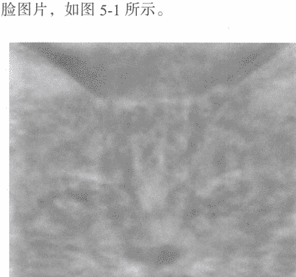

图 5-1

以当下标准看，该系统的训练效率和生成质量都不算高，但对于当时的学术界而言，这是一次极具里程碑意义的尝试。

#### 5.1.3 2014 年，GAN 模型问世

在猫脸实验之后，2014年学术界诞生了一个令人振奋的深度学习框架：GAN。名称源自生成对抗，即模型内部生成器与判别器互相对抗博弈。

生成器基于输入数据造图，并与真实图混在一起交给判别器，目的是“骗过”对方；判别器则负责判断图像是真人做的还是机器造的，目的是揪出假数据。

GAN面世后迅速席卷学术圈，其提出者伊恩·古德费洛被称作“GAN之父”。随后涌现大量基于GAN的图像生成模型，如创造性对抗网络，极大推动了AI作画发展。

但基础GAN用于作画存在明显短板：训练难度高；对结果控制力弱，容易产出随机图且多样性不足；在多类别、多语义、多场景下建模能力偏弱。例如仅有猫或狗数据时效果尚可，但把猫、狗、花、桌椅等混合在一起时，模型难以得到理想结果。

#### 5.1.4 2017 年，梦始于 Transformer 模型

2017年，谷歌发表论文《Attention is all you need》，提出NLP领域的新框架Transformer。该模型擅长捕捉图像重点，以类人方式做重点标注并进行降维处理。

随后OpenAI推出的DALL·E与CLIP都借助Transformer取得佳绩，前者可依文本直接生成图像，后者能完成文本与图像的匹配。

#### 5.1.5 2021 年，文本与图片进行匹配：CLIP 模型和文字提示词

2021年初，OpenAI发布备受关注的DALL·E。此时AI绘画工具获得重要能力：依据用户输入的文字提示词进行创作。

与DALL·E一同出现的还有CLIP。OpenAI于2021年1月开源该深度学习模型，到2023年2月仍是顶尖的图片分类模型之一。

Prompt最初源于NLP，主要用于统一建模，让单一模型学会更多任务。特别在文本生成图像领域，Prompt不可或缺。

提示词示例：“IT professionals working in a server room”，风格提示“A Van Gogh-style”，生成结果如图5-2所示。

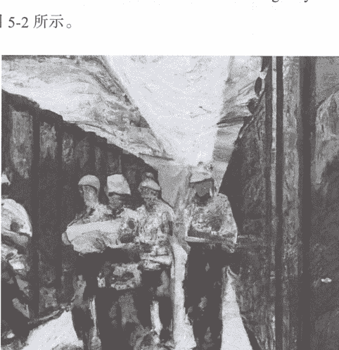

图 5-2

有了Prompt，CLIP实现了从文字到图像的转换，让语言与视觉真正打通。

CLIP的训练采用已标注好的图文对，一边用模型学习文本，一边用模型学习图像，反复调整参数，通过复杂计算让匹配的图文正相关。

借助互联网上广泛分布的图文对以及长时间训练，CLIP最终实现：输入任意文字即可返回相关性最高的图像，输入任意图像即可返回最匹配的文字描述，从而完成图文精准匹配。

#### 5.1.6 2020—2022 年，图片生成技术开启 AI 绘画元年：扩散模型

经历GAN生成效果不理想后，研究者开始关注另一类模型——扩散模型，也称扩散式生成模型。

与2014年爆发的GAN相比，扩散模型降低了训练门槛，并能产出更多样、更高质的图像。

2021年1月，OpenAI发布DALL·E并在论文中指出扩散模型已超越GAN，为工程界指明方向，奠定其技术地位。

2021年10月，首个开源的文本转图像扩散工具Disco Diffusion诞生。

2022年7月，OpenAI的DALL·E 2开始公测；同期，托管在Discord服务器上的Midjourney也进入大众视野。

2022年8月，Stability AI开源Stable Diffusion模型。相比前辈，它解决了细节与效率难题，通过迭代把AI作画精度提升到艺术品水准，将生产周期压缩到秒级，并把创作设备门槛降至家用水平，推动AIGC走向平民化。

从某种程度上说，2022年的AIGC热潮由扩散模型引爆。此后AI作画技术找到广泛的C端应用场景，包括作画、图像处理与识别等。下面介绍具体应用方向及未来走向。

### 5.2 AI 绘画

AI绘图是通过程序实现智能作画的技术，通常以应用形态面向普通用户。与传统手绘不同，它借助大量算法建立文本与图像的多重映射，只需输入文字或原图即可产出满足不同需求的精美作品。

AI绘图工具降低了创作门槛、压缩了成本、提升了效率。在抖音、快手、知乎、微信等平台，已有创作者用这类工具生产素材并实现商业变现。随着作品出圈，技术快速迭代，目前中外已有多个成熟产品。

#### 5.2.1 主流的 AI 绘画工具介绍

评估这类工具通常看生成质量、速度、自动化水平、成本与创新性。不同厂商的产品效果各有差异，本书不做横向对比，感兴趣的读者可自行体验。

表5-1 和表5-2 为截至2023年2月3日整理的主流工具，因更新快名称可能变动。

##### 1. 国外常见的 AI 绘画工具

表5-1 为国外常见工具。

| 名称 | 价格 | 相关描述 |
| :--- | :--- | :--- |
| Disco Diffusion | 免费 | 2021年10月在Google Colab上发布的项目，可用深度学习做数字艺术创作，采用MIT开源许可。既可在Google Drive上直接使用，也支持本地部署。风格多样但生成较慢，上手门槛较高，且受GPU限制 |
| Midjourney | 新用户免费使用20次。之后个人用户每月200美元可画200张图，企业用户每月600美元 | 美国初创公司Midjourney Lab于2022年4月推出，现运行于Discord社群服务器，使用前需注册Discord账号。操作很直观：在Midjourney频道输入“/imagine”后加上提示词，系统就会在对话中返回结果。默认作品公开可见，部分用户会付费开启私密订阅。出图迅速、上手简单，场景适应性强、分辨率高，但需先加入频道。作者认为其作品美感突出、真实度极高，获奖作品几乎难以辨别是否为机器生成 |
| Wombo.art | 免费 | — |
| DALL·E 2 | 免费绘画200张 | 可用文本生成照片级逼真图像，支持抠图。作者认为它是修补功能最强的AI绘画工具 |
| Artbreeder | 免费 | — |
| DreamStudio | 免费使用200次 | — |
| Deep Dream Generator | — | — |
| Big Sleep | 免费 | — |
| NightCafe Creator | — | — |
| Craiyon | — | — |
| PicSo | 新用户每天免费使用10次 | — |
| Make-A-Scene | — | Meta公司于2022年7月推出的AI绘画工具。可根据草图和一段文本，变着花样地精准生成任意画面 |

> ① 知乎博主欧米茄·邦的文章《AI 绘画绘制工具汇总》中有更多相关内容，感兴趣的读者可查阅。

##### 2. 国内常见的 AI 绘画工具

表5-2 为国内常见工具。

| 名称 | 价格 | 相关介绍 |
|---|---|---|
| 文心一格 | 暂时免费 | 百度于2022年8月推出的AI艺术和创意辅助平台。操作简单、可支持中文、出图速度快 |
| 6pen | 部分免费 | — |
| MuseArt | 付费 + 看广告可获得免费使用次数 | 在微信小程序搜索“MuseArt” |

| 大画家 Domo | — | — |

| 盗梦师 | 有免费使用次数 + 付费 | 在微信小程序中搜“盗梦师” |

| 画几个画 | — | 在微信小程序中搜“画几个画” |

| 智能画图 | 免费 + 看广告可以获得免费使用次数 | 在微信小程序中搜“智能画图” |

| Freehand 意绘 | 免费 | — |

| 即时 AI | 免费 | — |

| 意见 AI 绘画 | 有免费使用次数 + 付费 | 在微信小程序中搜“意见 AI 绘画” |

| 话了个画 | 免费 | 星图比特于 2022 年 11 月上线的 AI 生成图片小程序。在微信小程序中搜索“话了个画”，就可以打开这个小程序，输入中文描述就可以生成属于自己的图画 |

#### 5.2.2 三类主流出图方式
工具选定之后，如何把想法落到图上是关键。现在市面上的绘画小程序基本都围绕三种思路展开：单靠文字描述、单靠参考图重绘、以及文字和参考图混合使用。不同场景下各有优势，搭配起来上手更快。

##### 1. 纯文字驱动
本质上就是把画面要求写成描述词交给模型去实现。描述的准确度直接影响成品，关于写法的细节放到 5.2.3 节再细说。

先做个小实验，打开任意一个小程序，输入“树下有一只毛茸茸的可爱小猫”，风格选剪纸，画家风格选梵高，跑出来的结果类似图 5-3。

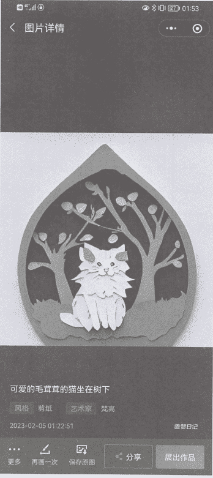

图 5-3

##### 2. 图转图
上传一张参考素材，指定想要的风格后让模型再创作一版。挑一个工具，上传统如图 5-4 的原图，选择对应风格，得到的新图如 5-5。系统会在保留原图部分元素的基础上以此为蓝本进行二次创作，成品与源图通常还能看出关联。

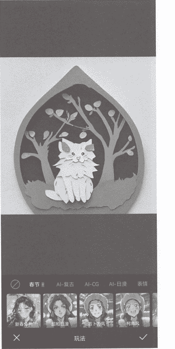

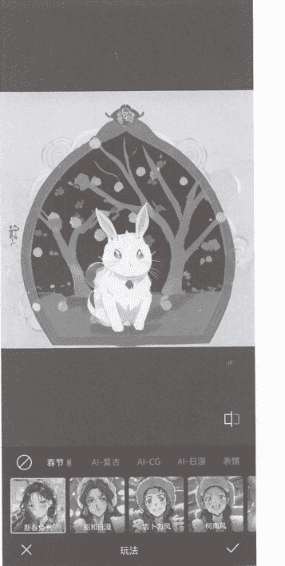

##### 3. 文图混合生成
在文字描述之外再补一张参考图，模型会综合两者信息合成新画面。仍然以“树下有一只毛茸茸的可爱小猫”为描述，风格保持剪纸、画家保持梵高，再上传如图 5-6 的剪纸参考图，调节参考图的作用强度后点生成，如图 5-7 所示。


按照描述和参考，工具产出了一张全新画面，如图 5-8。若把参考强度调低，画风相近但细节会有变化，如图 5-9。


#### 5.2.3 提示词的使用方法
文字转图的核心就是提示词，通过关键词设定主体、位置、风格、画家等，最终成片很大程度上取决于这些词的写法。

##### 1. 主题相关对比
加入特定提示词后，画面会更贴近预期。下面以同一画家“T·金凯德”①和同一风格“赛博朋克”为基准，对比是否加上“细节加强”。未加与已加的效果分别如图 5-10 和图 5-11。


① 这里的“T·金凯德”指的是“绘光大师”Thomas Kinkade 代表的一种风格，是 AI 绘画工具预设的风格模板，类似的还有梵高、莫奈、宫崎骏等。

如果图 5-12 的细节不够理想，可以用词把需要强化的部位点名。例如加上“舞狮毛发细节加强”，毛发表现会明显提升，如图 5-13。


除了“细节加强”，与主题相关的常用词还有“4K”、“颜色”、“背景虚化”和“广角镜头”等。创作时学会补充这些词，能让文本更完整。

##### 2. 位置相关对比
当提示为“第一格：春天，这只猫喜欢在春天追逐蝴蝶。第二格：夏天，这只猫喜欢在夏天沐浴阳光。第三格：秋天，这只猫喜欢在秋天观察落叶。第四格：冬天，这只猫喜欢在冬天躲在温暖的毛毯里”时，模型对位置的把握并不精准，输出如图 5-14。


在提示里加上明确的位置词，改写为“左上角第一格：春天，这只猫喜欢在春天追逐蝴蝶。右上角第二格：夏天，这只猫喜欢在夏天沐浴阳光。左下角第三格：秋天，这只猫喜欢在秋天观察落叶。右下角第四格：冬天，这只猫喜欢在冬天躲在温暖的毛毯里”。此时画面会倾向左右或上下分割，如图 5-15 和图 5-16，排版初见端倪。


再同时加上“生成四格漫画”这一限定，提示变为“生成四格漫画。左上角第一格：春天，这只猫喜欢在春天追逐蝴蝶。右上角第二格：夏天，这只猫喜欢在夏天沐浴阳光。左下角第三格：秋天，这只猫喜欢在秋天观察落叶。右下角第四格：冬天，这只猫喜欢在冬天躲在温暖的毛毯里”。生成的布局就与描述高度一致，如图 5-17。

位置提示越具体，成品越可控。以后做多格漫画，可以按这个思路写。


##### 3. 风格相关对比
据不完全统计，目前工具支持的风格已超过 30 种，比如抽象、剪纸、异次元头像、足球宝贝、手绘增强、吉卜力、像素艺术、哑光画、CG 渲染、儿童画、赛博朋克、素描、蒸汽波、中国风、印象主义、电影、未来主义、超现实主义、游戏场景、浮世绘、虚幻引擎、室内设计、风景、动漫、低聚艺术、油画、水彩、摄影等。输入“树下有一只毛茸茸的可爱小猫”，画家固定为“T·金凯德”，分别加上“剪纸”和“水彩”风格提示，得到的结果如图 5-18 和图 5-19。


这些风格词不仅扩大了创作空间，也能帮助用户找到自己的偏好。截至成稿时，主流工具基本覆盖了常见艺术风格，这是传统设计师很难做到的。

##### 4. 画家相关对比
先看画家“梵高”和“毕加索”的原作，分别如图 5-20 和图 5-21。


图 5-20


图 5-21

在工具里，“画家”本质上是一组预设参数，用来模仿其绘画语言。切换不同画家，就能快速获得接近名家的视觉效果。

输入“树下有一只毛茸茸的可爱小猫”，风格选“电影感”，分别加上画家“梵高”和“毕加索”，两张输出如图 5-22 和图 5-23。


“千人千面”，与原作比起来，你觉得模型模仿得像吗？

### 5.3 图像处理方向
AI 绘画并非凭空造物，而是基于深度学习对已有图像进行加工。下面分别介绍智能润饰、图像质量提升和分割抠图。

#### 5.3.1 智能润饰
聚会合照时常有人问“开美颜了吗”，美颜就是人像润饰的一种常见形态。如今智能润饰已渗透到多个领域，常用功能包括渲染、滤镜、特效、贴纸、美颜美型等。以人像为例，对图 5-24 分别使用滤镜和美颜，得到图 5-25 和图 5-26。


除美颜滤镜外，智能润饰还能用于艺术品和文物修复、影楼、设计、电商等场景。以 Stable Diffusion 为基础的“一键 AI 脑补”技术包含重建 Inpainting 和扩展 Outpainting。

重建是指补全图或视频中缺失的部分，可辅助修复艺术品和文物。传统修复需专家花费数天甚至数月，重建技术能推演出缺失区域，让更多人参与并大幅提升效率。

扩展是指把画面向原尺寸外延伸，根据输入的 Prompt 填充空白。对游戏全景地图和电影特效制作而言，这能降本增效。

#### 5.3.2 图像质量提升
除了润饰，专业人士常用视觉质量增强，简称图像增强。技术手段包括无损放大、去雾、色彩增强、过度拉伸、图像恢复等，可满足老照片修复、降噪、质量矫正等需求，被影楼、电商、摄影、艺术、广告、媒体广泛使用。

举两个例子。婚纱摄影师放大图后操作更方便。利用无损放大可在毫秒级把长宽各放大两倍且保持质量，如图 5-27。为了让画面更逼真，还可使用色彩增强，智能调节亮度、饱和度、对比度，如图 5-28。


图 5-27


图 5-28

#### 5.3.3 分割抠图
当前分割抠图已能处理发丝、镂空主体等复杂背景，广泛应用于电商、零售、泛文娱、个人场景。

首要用途是抠取头像替换背景，生成二次元、搞怪等娱乐图，帮助泛娱乐客户低成本获客；其次可将生活照精细分割后配白蓝红底，用于证件照制作。以如图 5-29 所示的生活照为例，抠出头像后得到图 5-30，可继续用于娱乐或证件照。


除了头像，还能做人体分割，把主体从背景中分离并虚化背景，营造大光圈浅景深效果。“分割前”和“分割后”分别如图 5-31 和图 5-32。


图 5-31


图 5-32

通用分割如图 5-33 和图 5-34。


图 5-33

图 5-34

通用分割有什么用？2022 年 11 月 8 日，PhotoRoom 宣布完成 1900 万美元 A 轮融资，加上天使轮共融资 2100 万美元。其核心技术是背景处理。可先用通用分割抠出想要的内容，再换新背景用于电商。图 5-35 为处理前，图 5-36 为处理中，图 5-37 为处理后。

总之，生成式绘图程序依托先进的图像处理技术，给行业带来变革。头像生成能基于输入图产出不同风格的新头像；智能润饰可自动识别瑕疵并修复，对艺术家和摄影师很有帮助；超分和色彩增强提升分辨率，让画面更细腻；分割抠图实现物体与背景分离，在后期制作中意义重大。


### 5.4 图像类 AIGC 的延伸：智能识别与真伪鉴别
在生成技术流行前，AI 已在图片领域广泛应用，主要集中在识别。图像智能识别利用深度学习对图像进行判断和识别，比如在购物网站上传商品图找同款，或在搜索引擎中上传图片查相关信息。

2022 年后，随着生成技术发展，识别衍生出“鉴别”，即判断一张图是否由生成式绘图程序创作。鉴别不属于 AIGC，但有助于全面了解 AI 在图片领域的应用。

#### 5.4.1 人脸与人体识别
AI 在人脸和人体识别上的应用日益普及，正在快速改变生活，比如支付宝扫脸支付、进站扫脸验证等。以下素材使用随机造脸，5.5.1 节会详细介绍。

（1）支持对五官及轮廓精准定位，如图 5-38 所示，可实现照片贴纸、特效等互动娱乐。


图 5-38

（2）分析人体图片特征，识别基础属性。技术可用于安全验证、生物识别、行为分析等。例如行为分析场景可据是否佩戴口罩判断是否合规。图 5-39 所示为人脸属性识别。

## 一本书读懂 AIGC

（3）人脸识别技术通过分析人脸特征判断是否为同一人，如图 5-40 所示。可用于安全验证、检索、照片管理、身份验证等。例如移动设备人脸解锁，安全系统验证身份后修改密码或手机号码等。


图 5-39


图 5-40

（4）支持人体检测。对动作、人体关键点、手势关键点的识别，可用于行为分析。例如分析运动员动作提升训练效果。即使多角度拍摄或局部被遮挡，也能准确检测人物信息。技术可用于安防、新零售、企业管理等。例如检测办公室内是否有人后智能控制灯光空调；检测员工是否在岗；结合多帧检测结果，如图 5-41 所示，对商场、景区、交通枢纽进行人流统计。


图 5-41

人脸与人体识别正在进入高速迭代期，准确率和识别效率在持续攀升。随模型不断进化，这类视觉感知能力正悄悄改写我们日常生活的交互方式。

#### 5.4.2 通用图片识别
在人脸人体之外，当前的图像理解产品已能对画面中的其他视觉元素进行细粒度标注，通过自动探测人物、指定目标与场景，为内容打上可检索的标签。该类能力已渗透到视频监控、安全防护、无人机作业、交通管理、自动驾驶、数字营销、新零售、广告创意及目标检测等众多领域。整体可归纳为两种路径：场景标注与通用标注。

场景标注的核心是辨识照片所处的地理位置、地标类型或场景模式后进行标记。图 5-42 所展示的就是一场夜景。


通用标注则聚焦于动物、植物、水果、品牌标识、货币、快消品、车型等共性视觉对象，识别后予以标记。例如图 5-43 中，系统能够判断出是动物并定位到动物园环境中的大熊猫。图 5-44 中，系统能够分辨出水果并推测可能是橙子、橘子或石榴。

总体而言，智能图像识别兼具效率与精度，正在推动图片行业的变革，应用前景广阔。它可自动解析人脸、人体及其他视觉信息并分析，在安防、电商、社交等场景价值明显；同时可对场景进行标注，有助于图像归档与检索。

了解完图像识别的应用后，下面关注图像生成衍生的另一能力——如何判断一张图是否由人工智能作画工具生成。

## 第 5 章 如你所见：图片类 AIGC


图 5-43


图 5-44

总体看，智能识图是一种先进高效精准的图像识别技术，对图片领域带来结构性改变，具备广泛的应用空间。它能够自动识别人脸、人体和其他视觉内容并进行分析，在安全、电商、社交等方面价值突出；同时还能为场景打标，对图片的整理与检索帮助很大。

在了解人工智能在图片识别方面的应用后，下面来看图片生成技术衍生的另一个功能——“判断一张图片是否由人工智能作画工具创作”。

#### 5.4.3 是否由 AI 绘画工具创作
2022 年 12 月 14 日，全球知名的视觉艺术社区 ArtStation 上，上千名画师发起联名抵制。打开站首页，可见大量反人工智能生成的海报图标，上面写着“NO TO AI GENERATED IMAGES”，即“抵制人工智能生成图片”，如图 5-45 所示。


在人工智能绘画热度高涨的阶段，看到一件作品时很多人会本能地追问“这是机绘作品吗？”市场上已有同类检测产品。把待检图像上传到鉴别工具后，约 1 秒即可给出是否出自机绘的判断，如图 5-46 和图 5-47 所示。

## 第 5 章 如你所见：图片类 AIGC


即便鉴别工具已出现，笔者在试用多款产品后仍持保留态度。实际上并不存在绝对可靠的判定手段，业内常用的判断思路包括：

1.借助人工智能作画检测工具。
2.画面出现多余肢体、肢体错位，以及常见的人手指扭曲等人形异常，则很可能是机绘作品。
3.画面存在明显像素化、锯齿或其他不够清晰的区域，则很可能是机绘作品。
4.画面出现基础逻辑错误，比如发丝进出不连贯、遮挡关系不合理，则很可能是机绘作品。
5.人工智能作画工具生成的图像往往带有一些特殊痕迹，例如色彩不自然、形态不对称、构图不合理等。

需要留意的是，这些方法并非总是精确，因为生成技术持续进步，图像逼真度不断提升，而鉴别能力也在同步演进。

### 5.5 实用、有趣的图片世界
图像生成技术已在多个领域形成落地案例，除前文提及的内容外，下面梳理更多实用场景。

#### 5.5.1 头像生成
面向 C 端用户的电子头像应用 Lensa，于 2022 年 12 月的前 5 天下载量突破 400 万次，登顶 Apple 与 Google 两大应用商店榜单，并在各大社交媒体刷屏。据称短短 5 天收入就达到 820 万美元。

##### 1. 随机造脸
随机造脸的概念大众不一定熟悉，但它解决的痛点很多人都遇到过，比如影视剧因使用不当素材引发的肖像权纠纷。广告、媒体等需要人像的行业同样存在侵权风险。随机造脸能在低成本下规避这个问题。以某造脸网站为例，进入后每次刷新都能得到一张由生成技术制作的“真实”人脸照片，如图 5-48 所示。


图 5-48

值得一提的是，5.3 节和 5.4.1 节使用的一些素材就是用随机造脸生成的，这免去了找模特要授权的时间，也避免了直接用作者本人照片的尴尬。

在随机造脸加持下，剧组使用合成人脸素材不必再担心侵权，广告主采集肖像素材也不必专门聘请模特，制作成本随之下降。适用面相当广泛。

##### 2. 魔法头像
与 Lensa 类似的产品还有很多，使用流程大致是用户投递照片后传至云端，再按选择的风格定制电子肖像。常见的制作方式可分为“风格迁移”、“元素添加”和“动物变人像”。

“风格迁移”即把投递的头像转成各种风格。图 5-49 的头像可分别变成图 5-50 的“中国风”头像、图 5-51 的“漫画风”头像。


图 5-49


图 5-50


图 5-51

“元素添加”即用户投递头像后叠加想要的元素。投递头像后加上“对联”和“烟花”，可生成如图 5-52 所示的拜年头像。


“动物变人像”即用户投递宠物照片或图片，选择目标风格后生成人像。随着养宠需求增长，用自家宠物定制头像的场景正被广泛使用。选择如图 5-53 所示的宠物图片后，可生成如图 5-54 所示的人像。


图 5-53

图 5-54

#### 5.5.2 模拟场景
图像生成出现前，场景制作主要靠人工，耗时耗力且难以满足个性化需求。如今可用生成技术快速模拟出高质量场景，并按需调整优化。

下面以一张空白背景的照片图 5-55 为例，看它被应用到不同模拟场景后的呈现效果。

即便只有背景简单且略显老旧的照片，也能变成自拍照图 5-56，或拍立得风格图 5-57。

谈到特定情境，你是否幻想过自己出现在大荧幕上？图 5-58 的电影谢幕场景就能满足这种愿望。

## 第 5 章 如你所见：图片类 AIGC


图 5-55


图 5-56


图 5-57

## 一本书读懂 AIGC


除此之外，还能用模拟场景制作穿搭教程视频封面图 5-59、杂志封面图 5-60 等，设计感强且能降本增效。


## 第 5 章 如你所见：图片类 AIGC
其实，还可以模拟室内、室外、城市、森林、山脉等场景，以及其中的物体、建筑、人物等。比如在游戏开发中，开发者可以快速生成不同的游戏场景，在如图 5-61 所示的游戏中参观展览，使得游戏体验更加逼真，从而让玩家获得更好的沉浸感。


图 5-61

从这些案例可见，图片生成技术大幅减少人力与时间成本，还能通过调节天气、视角、时间、光线等参数提升视觉效果与沉浸体验，满足不同用户的定制化需求。

#### 5.5.3 PPT 生成
提到制作 PPT，职场人很容易产生共鸣。如今已有一款名为 ChatBA 的“神器”，由两位斯坦福大学学生 Silas Alberti 与 Joseph Semrai 共同研发。

使用很简单，登录网站如图 5-62 所示，简单输入一句需求文本，点击“Do Magic”按钮即可一键生成 PPT。


ChatBA 已具备生成大纲、标题、要点、粗体关键字、图片和图形等功能，可自定义布局和主题，还能支持导出 PPTX 和 PDF 两种格式。下面以官网案例演示，简单输入需求文本“How to Write a Best Selling Book”，就会生成如图 5-63 所示的整个 PPT。

##### How to Write a Best Selling Book

##### Outline

- Research Your Topic

- Develop a Writing Plan

- Promote Your Book

##### Research Your Topic


##### Research Your Topic

- Understand the genre and audience

- Gather information from reliable sources

- Analyze the competition

##### Develop a Writing Plan

##### Develop a Writing Plan

- Outline the plot and characters

- Set a timeline and writing goals

- Edit and revise your work


##### Promote Your Book


##### Promote Your Book

- Create a website and social media accounts

- Network with other authors and publishers

- Market your book through advertising

#### 5.5.4 设计
人工智能作画工具不仅能帮助设计师更快更准地实现想法，大幅减少投入，还能在极短时间内产出大量图像，提升效率并拓展设计边界。因其能生成高质量逼真图像，设计师获得更多创意，作品质量随之提升，同时让设计更直观立体。下面通过案例感受其魅力。

##### 1. 设计海报
输入需求文本“帮我设计一张演唱会海报，4K”，选定想要的风格和艺术家后，可得到如图 5-64 所示的高清海报。


##### 2. 设计 Logo
输入需求文字“对一家名叫‘桔子’的公司设计 Logo”，可得到如图 5-65 所示的一些公司 Logo 设计方案。


##### 3. 灵感创意
当设计师需要构思本行业产品时，人工智能作画工具可快速生成相关图像帮助迸发灵感。比如面具设计师可输入“设计一个星星月亮面具”，椅子设计师可输入“设计一个桔子椅子”，设计师可根据生成的灵感创意图片分别如图 5-66 和图 5-67 所示，进一步完善或创造更好的产品。

## 一本书读懂 AIGC


图 5-66


图 5-67

#### 5.5.5 稿件配图
如图 5-68 所示，巴比特在 2022 年 10 月 25 日用微博正式对外宣布其官网、自媒体平台和社交媒体账号将规模化采用人工智能配图。


图 5-68

这意味着巴比特发布的文章头图、配图等将由原先付费购买的版权图片更换为由人工智能作画工具创作的自有版权图片，整体图片使用流程发生变化。

下面来看一个具体案例。笔者从新闻稿中选取一段文本“元宵节在即，各地举行多彩民俗活动，展现出浓浓的佳节气氛。正在上海欢乐谷举行的上元灯会吸引了不少民众前来猜灯谜、赏花灯，喜迎元宵佳节。”，输入到某人工智能作画工具后生成的图片如图 5-69 所示。

## 一本书读懂 AIGC


图 5-69

#### 5.5.6 更多场景
- （1）绘制图谱：绘制小说人物关系图、教学图谱、专业领域的知识图谱等。
- （2）画图标：用人工智能技术开发人工智能应用，生成应用后绘制专门的图标。比如可写代码开发微信小程序或 App，定制化绘制其图标。
- （3）电影：生成电影中的各种特效，如星空、大气、闪电、太空场景等。
- （4）游戏：生成完整的游戏环境，如全景地图、建筑、植被等；帮助游戏和影视制作人员制作出更加逼真的作品。
- （5）医学：绘制药物的分子结构图；生成多维度图片，帮助医生从不同视角更好地诊断疾病；绘制三维人体图片帮助医学生了解人体结构和生理功能等。
- （6）研究：生成大量图片数据，用于训练深度学习模型，帮助研究人员更好地模拟和理解现实世界情况；生成多维度图片，帮助研究人员更好地了解图片数据的特征。
- （7）城市规划：模拟不同的城市场景，帮助规划者进行城市规划和设计。

图片生成技术可应用的范围很广，难以一一列举。本节仅对目前流行度较高的热点领域做简单介绍。

### 5.6 图片类 AIGC 的未来

#### 5.6.1 局限性和发展预测

##### 1. 从用户视角来看局限性
尽管图片类 AIGC 应用极大提升了趣味性、便捷性，并提高了中低端图片生产的质量与效率，但现阶段仍有待改进。

投递图片大小受限是常见问题，压缩后可能改变内容，导致识别准确率下降。图像智能识别与真伪鉴别同样不完美，笔者在试用检测工具时发现真实图片被误判为机绘作品，可见检测模型仍需训练。另外，部分工具会出现识别错误，如把“金毛”识别为“北极熊”，说明图像识别仍有提升空间。

以 PPT 生成为例，主流应用多由国外公司推出，目前仅支持英文输入，可选主题风格有限，内容也较为单一。希望国内产品能加速跟上，真正帮职场人摆脱熬夜调 PPT 的困境。

##### 2. 从宏观视角来看局限性
从行业与社会伦理角度审视，风险与争议同样值得关注。

生成图片的真实性可能被质疑，技术或被用于制造假图假信息，制作假新闻或虚假广告，对社会造成负面影响。同时也存在安全隐患，例如生成危险图片带来的潜在风险。

（3）伦理风险容易被触及，比如被用来制作违背公序良俗的图像。
（4）隐私边界易被突破，例如未经授权合成或调用个人肖像。
（5）版权隐患非常明显。当前网络上已出现专门售卖 AI 绘画提示词的交易市场，很多在售组合里混入了热门动漫角色、大 IP 元素、品牌服装等，导致市场上流通着大量疑似侵权的生成物。

##### 3. 未来图景
图像是最普遍的内容载体，渗透到生活的各个角落。展望未来一两年，手机开屏动画、户外电子广告屏、社交平台的短视频广告等内容，很可能都由大数据与算法模型实时生成，AIGC 将在潜移默化中改变审美取向与消费选择。

目前图像生成的应用还相对分散，主要集中在艺术、设计、摄影等独立领域。往后可能会出现跨领域协同的多模态大模型，让商业与生活场景的使用更立体、更全方位，例如直接输出可交付的成稿。图 5-70 为 AIGC 基础模型与应用演进的预测。或许到了 2030 年，用该技术得到的草图会超过当下最顶尖的艺术家、设计师和摄影师的水准①。

| 时间 | 2020年之前 | 2020年 | 2022年 | 2023年? | 2025年? | 2030年? |
| :--- | :--- | :--- | :--- | :--- | :--- | :--- |
| 图片类AIGC |  |  | 艺术 Logo 照片 | 模型，比如工业设计、建筑等领域 | 最终设计稿，比如产品结构图 | 比人类顶级专业艺术家、设计师、摄影师做得更好 |
| 大型模型可用性： | ● 初级尝试 | ● 基本实现 | ● 即将实现 |  |  |  |

图 5-70

> ① 更多相关内容可以查阅红杉资本官网的文章 *Generative AI: A Creative New World*。

#### 5.6.2 如何解读 AI 艺术
通过输入关键词并模仿不同画风，AI 绘图工具大幅降低了创作门槛。与此同时，随之产生的争议也在增多。

下面梳理业内人士的看法以及公众对热点问题的讨论。

##### 1. AI 绘画工具会让画家、美术老师、插画师等失业吗
（1）图 5-71 所示为某网友的担忧。


（2）我发现 AI 绘画工具更适合用作一个创意生成器。给出一些 Prompt 词组后会得到一些图片，这能激发我的想象力。对于我来说，这些图片可以作为一种灵感参考，并能让我在草图上用来绘画。——Stijn Windig（荷兰艺术家）①

（3）不应该是替代插画师，而应该是一个强大的辅助工具：一个能够将想法快速可视化、快速拓展思维边界/寻找灵感、让普通人也能进行自由创作的工具。——某一线城市的画廊老师①

> ① 更多相关内容可以查阅陈陈陈发布在“壁虎看 KOL”公众号上的文章《AI 绘画爆火背后的生意与争议？》。

现在公众已经很难区分手绘作品和 AI 生成作品的差异。当然，高质量的艺术创作至今仍是当前工具难以企及的。AI 生成图像的效率很高，尤其在日常消费类艺术品中，如插画、封面、海报等。创作者用 AI 生成素材来获取灵感的吸引力很大。可以预见，熟练运用 AI 绘图工具将逐步成为创作者必备的能力之一。——认真做产品的设计师

##### 2. AI 绘画算得上艺术吗
（1）艺术家编写算法不是为了遵循一套规则，而是通过分析成千上万张图片来“学习”一种特定的美学。然后，算法尝试按照所学的美学生成新的图片。——Ahmed Elgammal（罗格斯大学教授）

（2）技术性艺术的力量在于它可以积极地塑造某种技术的使用方式，而不仅仅从旁提供美学评论。——Walter Benjamin（德国思想家、哲学家）

（3）AI 艺术将成为创新的驱动力，不仅是审美创新的驱动力，还是批判性创新的驱动力。——Frieder Nake（不来梅大学及不来梅艺术学院教授）

##### 3. 版权问题
（1）图 5-72 所示为网友对版权问题的担心。

一本书读懂 AIGC


guozh-51129 🐧

23-2-12 21:14 来自 荣耀X10 5G

> 法律必须禁止AI绘画商用，至少商用的AI绘画工具用来训练的图必须由公司出钱买断，并在合同里约定“可用于AI训练”。这样，如果画家怀疑自己的画被商用了，至少可以用相关法律保护自己的版权

图 5-72

（2）我并不排斥 AI 生成艺术的概念。在风格、理念、主题和执行方面，艺术家们经常从彼此的作品中寻求灵感，并以某种方式结合自己的想法形成独特的风格。我不是说艺术家的作品没有独创性，但我们必须承认，我们确实互相学习。——弗洛里斯·迪登（德国某工作室艺术总监）

（3）仅仅简单地用严格保护版权的方式，并不是创作者最好的选择。毕竟，AI 绘画工具可以从艺术中释放巨大的生产力，所以生产关系可能需要做出一些适当的调整。——Fabian Offert（Gradient AI Community 的成员）

笔者相信，每个读者都有自己的看法，那你的观点是什么呢？

#### 5.6.3 作者的几分观察
利益相关性不可避免地会带来立场偏差。对于图像生成技术的发展这一热点，不同身份、教育背景、从业经历的读者必然持有不同观点，这一点在 5.6.2 节已可见一斑。难以判断支持或反对的声音究竟源于对人类文明发展的深度思考、对艺术理念的坚守，还是单纯由个人利益偏好导致。

艺术与技术、艺术与生产力本就相互关联。从远古岩画，到纸张普及后的纸本艺术，再到胶片时代的摄影艺术，直至信息时代的数字艺术与 NFT，非同质化通证，创作媒介一直在演进。自 1837 年达盖尔发明“银版摄影术”至今近 200 年，“摄影算不算艺术”的争论仍在持续；自 2017 年 CryptoPunk 出现并于 2021 年大涨，Beeple、Pak、Xcopy 等加密艺术家走红后，“NFT 算不算艺术”再次冲击行业认知。由此可见，“AI 绘画算不算艺术”的争论出现并延续，完全符合历史规律。新技术带来的艺术观念变革，大概率无法被个体阻挡。

无论是否支持，图像生成技术的推进势头很猛，已拥有广泛的民用场景与商业价值。抵制其应用已不现实，关注点更应转向如何正确使用。

# 第 6 章 视频 AIGC：从定格画面到流动表达
1872 年的某一天，美国加州一间旅馆里，斯坦福在看赛马时突发奇想，马奔跑时会不会有一瞬间四蹄离地，他的朋友科恩并不认同。英国摄影师麦布里奇用一组连拍照片给出答案，证实马奔跑时确实存在四蹄腾空的瞬间。他把照片按顺序排成一带，快速牵动时，静止的马就动了起来。

2022 年，AI 绘画迎来爆发，全民创作热潮形成。视频是图像的延伸，研究者随之将目光投向视频生成，希望让“人人都是艺术家”升级为“人人都是导演”。

## 6.1 视频生成技术的发展轨迹
视频生成的发展始终跟随图像处理技术进步。每当图像技术取得突破，科学家便尝试将其迁移到视频生成，这构成了该领域的关键里程碑。

### 6.1.1 早期探路
视频生成的雏形可追溯至 20 世纪 90 年代。1997 年，为解决影视音画不同步问题，Christoph Bregle 等人在论文 *Video Rewrite: Driving Visual Speech with Audio* 中提出视频重写方法，可依据音频修改视频中人物口部动作，使口型与声音一致。

### 6.1.2 2014—2016 年，视频生成起步：无条件生成
受算力与算法限制，视频生成进展缓慢。2014 年 GAN 的出现为图像生成带来突破，此前 AI 更擅长识别分类，生成图像困难。GAN 不仅推动 AI 绘画，也点燃了视频生成的研究热情。深度学习开始广泛应用于视频生成与增强，以 GAN 为主的算法层出不穷。

2016 年，麻省理工学院与马里兰大学的研究者在论文 *Generating Videos with Scene Dynamics* 中提出 VideoGAN，最早把 GAN 用于视频生成框架，可生成微小视频，画面虽不逼真，但物体运动轨迹相对合理。

同年 4 月，Manuel Ruder 等人在 *Artistic Style Transfer for Videos* 中首次把图像风格迁移拓展到视频。德国弗赖堡大学的研究者受 Gatys 等 2015 年神经网络风格迁移算法启发，将单张图片的艺术风格迁移到整段视频。

针对分辨率提升，Kappeler 等人在论文 *Video Super-Resolution With Convolutional Neural* 中提出 VSRNet，在 SRCNN 基础上实现视频超分辨率重建，为后续研究奠基。

### 6.1.3 2017 年，潘多拉的魔盒：人像视频生成
GAN 高分辨能力增强后，人像生成愈发逼真。2017 年，Korshunova 等人把人像视为一种风格迁移对象，发表 *Fast Face-swap Using Convolutional Neural Networks*，提出基于 GAN 的自动化实时换脸技术。

### 6.1.4 2018—2019 年，视频生成视频的突破
2017 年前，研究者已在无条件视频生成上尝试：2017 年出现可学习无标签视频语义并生成新视频的 TGAN，2018 年出现分解运动与内容的 MoCoGAN，以及在 DeepMind Kinetics-600 数据集上大规模训练的 DVD-GAN。但时序上常出现不合理物体变换。

2017 年加州大学伯克利分校 Phillip Isola 等发布图像翻译开山之作 Pix2Pix 后，研究重心转向视频生成。从 2018 年起，视频生成视频技术取得关键进展，逐步具备实用性。

Pix2Pix 有监督生成不再随机。加州大学伯克利分校 Caroline Chan 等据此发表 *Everybody Dance Now*，以专业舞者视频为动作源迁移到普通人视频，首次合成高分辨率人物跳舞视频。

2018 年年末，NVIDIA 的 Ting-Chun Wang 等发布 Video-to-Video Synthesis，Vid2Vid。它在 Pix2Pix 思路上引入光流约束，设计对抗生成网络的鉴别器与生成器，合成仿真度极高的视频。相比 *Everybody Dance Now*，Vid2Vid 物理意识更强，分辨率、真实度、时间一致性显著提升，且可用于人物跳舞、街景、人像等多种任务。

视频生成视频被视作重大突破，缺点是泛化能力有限，需要大量原始数据，难以生成从未见过的场景。

2019 年，Ting-Chun Wang 等推出 Few-shot Video-to-Video Synthesis，小样本学习成功案例，借助少量示例即可生成罕见甚至未见场景，在跳舞、人像、街景任务中效果逼真。大卫雕塑的舞动、蒙娜丽莎的表情变化令人惊叹。

### 6.1.5 2021 年，文本生成视频发展
几年前，让 AI 按文本直接生成符合语义的图像已需想象力，Transformer 的出现不仅掀起文本生成图像浪潮，也推动文本生成视频。

2017 年起已有初步探索，但多局限于简单文本输入，效果一般。

2021 年初 DALL·E 诞生后，基于 VQ-VAE 与 Transformer 的框架在视频领域崭露头角。

2021 年 4 月，Chenfei Wu 等发表 *GODIVA: Generating Open-Domain Videos from nAtural Descriptions*，首次把 VQ-VAE 用于文本生成视频，实现文本与视频内容的秒级匹配，连贯性较高，验证了可行性。

同年，加州大学伯克利分校提出 Video-GPT，首次结合 VQ-VAE 与 Transformer，以最小改动将图像处理技术迁移到文本生成视频。

### 6.1.6 2022 年，扩散模型进入视频领域
2022 年，基于 DALL·E、Stable Diffusion 的绘画应用进入大众视野，研究者期待扩散模型在视频领域复制图像领域的成功。

2022 年 9 月，Meta 发布 Make-A-Video，展示扩散模型在文本生成视频上的进展。谷歌同期发布 Imagen Video 与 Phenaki，提供新的生成方式。

近年算法持续突破，视频流畅性与语义准确性大幅提升，部分应用已具备实用能力，下文将介绍具体场景与未来走向。

## 6.2 视频生成工具
当前主流视频生成工具可分为数字人视频生成、视频编辑、文本生成视频三大类。现整理部分工具供参考。

### 6.2.1 数字人视频生成工具
表 6-1

| 名称 | 是否免费 | 相关介绍 |
| :--- | :--- | :--- |
| Synthesia | 否 | Synthesia 专注于快速生成解说视频的商业软件，支持将文本变为口型同步的数字人视频，提供 74 多个虚拟形象、254 种语音风格及 66 种语言 |
| Elai | 免费试用 | Elai 帮助用户用纯文本创建教育与营销视频，支持文本、PPT  转口播，支持对视频人像进行自定义 |
| 创梦易自动画 | 否 | 中科深智发布的数字人动画创作工具，提供教育培训等十余个场景模板及 60 多个数字人形象，可按文本自动生成动画口播视频 |
| Rephrase.ai | 否 | 类似 Synthesia 的文本转口播视频工具，更侧重营销类视频生成 |
| 来画 | 免费试用 | 在线动画与数字人创作平台，支持捏脸生成数字人形象，导入文本或 PPT 后可生成动画智能播报视频 |

### 6.2.2 视频编辑工具
表 6-2

| 名称 | 是否免费 | 相关介绍 |
| :--- | :--- | :--- |
| Veed | 免费试用 | 在线视频剪辑工具，支持添加进度条、滤镜、转场特效等，也可提升分辨率与调整播放速度 |
| HitPaw | 免费试用 | 利用风格迁移技术自动处理的视频增强软件，2019 年发行，下载超 23 万次，支持全自动画质增强、黑白视频上色、视频卡通化转换 |
| Topaz Video Enhance AI | 免费试用 | 视频增强工具，利用多帧信息去噪、修复缺失，并可提升分辨率至 8K 标准，呈现更清晰细节与动作一致性 |
| Fliki | 每月免费创建 10 分钟视频 | 流行的视频与画外音生成器，优势在于 AI 语音质量高 |
| Lumen5 | 每月免费导出 5 个视频 | 偏向视频剪辑，提供多场景模板，支持拖拽快速剪辑，也可通过博客生成视频，效果一般 |

AI视频创作工具与应用全解

Raw Shorts 完全免费，操作门槛很低，适合快速做出营销短片、产品演示以及广告开场这类轻量内容。  
Magisto 提供基础版免费使用，是业内较早走红的创作平台，能把零散的视频片段和照片拼成有质感的小电影，直接分享到社交媒体。  
Designs.ai 仅限免费试用，功能比较综合，支持先用文字生成视频骨架，再通过拖拽替换画面元素，编辑过程实时呈现，还能一键按比例缩放适配不同平台。

### 6.2.3 文本转视频工具全景
文本生成视频工具见表 6-3。

表 6-3 汇总了当前主流的文本转视频产品：

Pictory 免费可用，项目起步于2019年在西雅图举办的黑客马拉松，经过迭代在2020年7月推出首个版本。只需输入文字或提供网页链接，就能自动配图生成图文视频。  
Vedia 处于免费试用阶段，是一个在线服务，不仅接受直接输入的文字，也能读取网页链接和相关数据，自动提炼要点并搭配素材输出图文视频。  
InVideo 同样提供免费试用，操作逻辑接近前两者，内置大量模板，喂一段文字就能生成带画面的视频。  
一帧秒创 可免费体验，依托秒创的AIGC引擎打造。平台能把图文内容转化为视频，AI会自动匹配画面并合成音频和字幕，创作到导出一次完成。  
Make-A-Video 需要授权使用，是Meta在2022年发布的AI模型。不同于做图文混剪，它能直接根据文字描述生成一段有情节的短视频。  
Phenaki 由谷歌基于扩散模型推出，免费开放，特点是擅长生成较长片长，输入较长的提示词可以得到2分钟及以上的视频内容。  
Imagen Video 同样来自谷歌扩散模型路线，免费使用，输出质量突出，可生成128帧、分辨率为1280×768的高清片段，还能按风格切换艺术效果。

### 6.3 视频生成应用

### 6.3.1 老片修复与高清化
无论是日常怀旧还是学术研究，老视频都很有价值。看老电影电视剧能唤起过去记忆，对历史学家和文化研究者而言，几十年甚至上百年的影像可以还原政治经济社会的面貌，挖掘背后文化含义。

但早期拍摄和存储条件受限，大量老影像存在模糊、损伤、划痕、噪点、雪花、失真和抖动等问题，清晰度、流畅度和真实感都大打折扣。

生成式技术可以从高质量样本中学习画面时序规律，把低清素材自动提升。常见做法分三步：提清、智能插帧、调色。

提高清晰度时，工具会提升对比度、做锐化、消除抖动和噪点，去除雪花，让细节更显现。 借助AI还能把分辨率拉升到4K乃至8K，让老片适配现在的播放设备，细节更丰富。

帧率不足的视频播放会出现卡顿，像翻PPT。相邻两帧内容虽有变化但很接近，智能插帧算法会分析前后画面，推测中间可能的变化并补帧，让播放更顺滑。

受拍摄设备和光线影响，老影像常有颜色暗淡、不准、分布不均的问题。借助处理技术，哪怕是夜间拍摄的素材也能调出更饱满、更真实的色彩。

目前影视行业已基本认同修复经典影片的价值。很多片厂电视台在修复存世老片并重新上映或适配4K/8K电视。流媒体和爱好者也热衷用超分辨率等技术修复老片或明星早期演唱会。

爱奇艺把AI大规模用在修复上，自研ZoomAI技术可完成一套高清修复方案，2小时片长约12小时搞定，效率提升超500倍，还特别优化了黑白影像。借助它，1922年的《劳工之爱情》得到修复；与新派系文化传媒合作的“全球经典拷贝修复计划”中，《护士日记》入选戛纳电影节“戛纳经典”单元。2021年，爱奇艺独家修复的49部经典电影累计播放突破1200万次。

优酷自2017年起推高清修复计划，借助阿里云“画质重生”技术已修复5000多部作品。以苏有朋主演的《倚天屠龙记》为例，修复版播放量比修复前增长4.5倍，甚至超过同期的新版。

在民间创作者里，AI专家Shiryaev创办的neural.love专注AI增强。他的代表作是修复了1895年法国短片《火车进站》，在YouTube上播放超过100万次。

但修复并非全员叫好。早在1989年，影评人罗杰·埃伯特就在《我为什么爱黑白片》中提醒，若年轻人第一次接触《卡萨布兰卡》就是上色版，会污染他们的想象。电影的初次观感往往只有一次，改变原貌是否必要值得商榷。

修复对象不止娱乐片。1906年拍摄的纪录片《A Trip Down Market Street》记录了旧金山Market Street街景，Shiryaev用开源工具和AI模型对胶片进行上色和锐化后，能清晰辨认当时人们的动作、服饰甚至表情。

2018年上映的《他们已不再变老》由彼得·杰克逊为纪念一战结束百年制作。团队对数百小时的一战原始影像进行修复和上色，并把播放速度从13帧/秒提升到24帧/秒，呈现出极具沉浸感的战争画面。

国内也有类似尝试，2019年电影《决胜时刻》片尾加入了4分钟彩色版开国大典纪实影像，正是超分辨率重建等修复技术带来的成果。

### 6.3.2 自动剪辑与摘要生成
在编辑流程里拆条是基本功，要把几十上百小时的素材拆成若干短片段，传统做法需要筛选、导入、排序、剪辑、加转场和配乐再渲染，费时费力。

生成式技术改变了这一模式，能自动分析视频内容，跳过冗余部分，从超过一小时的长片里迅速定位关键素材，辅助更精准的组合，从而大幅降低时间和成本。

基于AI的剪辑系统因其实时、快速、精准的特点，已在社交、新闻、广告等领域得到应用。

2022年冬奥会期间，央视体育频道与阿里云合作引入AI视频处理工具。直播中，AI剪辑系统能实时捕捉金牌时刻或选手突破画面，第一时间完成新闻播报，同时也能把海量赛事浓缩成几分钟精华集锦，提升制作效率，帮助观众快速掌握赛况。

在日常工作中，AI也能提效，例如把一小时的研讨会视频提炼成3分钟要点，便于快速分享知识。

### 6.3.3 智能广告植入
植入式广告已有百年历史，最早可追溯到1896年的电影《瑞士的洗衣日》。它能与内容紧密结合，但受技术限制，往往一次成型难以调整。

随着视频语义理解能力和风格迁移算法的提升，画面可控性和修改精度大幅提高，营销和视频生成技术也碰撞出新玩法。

AI模型可以“读懂”视频，通过语义分割、特征提取和对象识别，对内容进行标签化、碎片化和场景化处理，能够区分画面中的街道、汽车、树木等不同元素。

识别出投放点后，AI可把原元素替换为广告产品，比如把车辆品牌换掉。

英国伦敦的Mirriad就是一家基于AI的视频广告服务商。它能把产品无痕植入视频中的桌子、墙面、广告牌，甚至替换整辆车的品牌。联合利华旗下调味品Knorr就与Mirriad合作，在MyTV SUPER App上热播的剧集Come Home Love Lo and Behold里把Knorr的标识和产品投放到墙面广告牌。这种方式观感自然，还能在二次播放时更换广告。Mirriad还帮歌手变现，哥伦比亚歌手Giovanny Ayala在其MV中植入广告获益。目前公司已与派拉蒙、20世纪福克斯等合作，并在2019年与腾讯签署为期两年的独家协议。

商汤科技和星广互动则更进一步，通过算法实时替换人物视频的背景画面，为直播和短视频等场景创造新广告位，拓展了投放形式。

### 6.3.4 视频转动画
动画在教育和影视领域应用广泛，随着元宇宙热度上升，对动画内容的需求也在增加。

把实拍视频转为动画是生成式技术的一个有趣方向。用户上传一段真实画面，选择喜欢的动画风格即可自动转换。

阿里影业曾发布一支由经典电影镜头串联的短片，选取《绿皮书》《一条狗的使命2》《何以为家》等真实片段，通过风格化技术转为美漫风格的动画。

### 6.3.5 文字驱动视频创作
随着抖音等平台的崛起，视频成为主要内容消费形态，但制作成本较高成为瓶颈。国外已出现一批文本驱动的视频工具，生成效率很高，虽然清晰度仍在提升，但已大幅降低创作门槛。

典型的工作流是：用户输入文字，选择一个代表风格的视频模板，系统会根据文字自动检索相关图片供选择，人工可手动挑选或交由机器匹配，还能设置语音的音色和音量。以InVideo为例，它能把文字转化为易于消化的视频，适合在碎片时间观看，也是创作者的好帮手。图6-2展示了InVideo的模板页面。

### 6.3.6 数字人自动出镜
真人出镜的口播视频在传播上很有优势，给人真实可靠的感觉。基于视频生成技术，现在可以用文字输入自动生成数字人出镜视频。

一个数字人通常包含形象和语音两部分。形象上，先通过真人扫描建模，再搭建动作库，系统里的NLP模型会根据输入文字识别意图，并按预设匹配相应的肢体动作，口型则靠Wav2Lip等AI算法自动生成。语音上，系统会根据选定的音色包把文字合成为声音。

目前国内外已有不少产品，美国的Synthesia就是代表，如图6-3所示，用户可以自行挑选数字人形象、动作和声音来生成视频。数字人技术仍在早期，面部表情僵硬、动作与文本不匹配的问题仍存，进一步提升需要更精准的情感识别和意图理解，以及更自然的动作与语气匹配。

### 6.3.7 人脸风格迁移与复原
在生成技术里，人脸建模是发展最快的赛道之一，风格迁移的效果已相当惊艳。

加拿大Wombo.ai推出了一款应用，可用任意人物照片生成唱歌视频。它能学习真实表演视频中的动作、表情和眼神，并与用户提供的照片融合，让照片中的人物“演唱”指定歌曲。产品上线三周内下载量突破2000万，生成的视频超过1亿个。

拍摄《流浪地球2》时，刘德华已近60岁，吴京也已过40岁，剧组需要他们“回春”到20岁左右，依靠的是深度伪造技术。深度伪造基于机器学习分析大量真实数据，学习表情、动作和语音，训练后可生成逼真的虚假影像。技术团队先对演员面部做标记点三维扫描建模，再用年轻时照片进行图像训练，生成对应三维模型，并不断增加训练次数以兼顾面部细节，最终实现主演的“返老还童”，让观众更易产生共鸣。

迪士尼发布了一项名为FRAN的视频人脸处理技术，专门用于角色的老化或年轻化。它能基于已有数据预测面部老化部位，并学习把皱纹等细节添加到现有片段，示例中几秒即可完成返老还童，效果逼真。

Netflix电影《爱尔兰人》也大量使用生成技术。工业光魔公司借助“工业光与魔术”特效，把罗伯特·德尼罗、乔·佩西、阿尔·帕西诺等演员的样貌从70多岁调回40多岁，德尼罗甚至一人分饰20岁的自己。为确保自然，团队为演员建立庞大影像库，用AI为每个镜头挑选最接近的历史图像作参考。

李安的《双子杀手》同样运用深度伪造，让中年和年轻的威尔·史密斯在银幕上对打。

好莱坞早年就尝试让已故人物重现。保罗·沃克在《速度与激情7》拍摄期间意外离世，剧组与彼得·杰克逊的维

### 6.4 数字人：仿生人与电子羊
2023年，数字代言人迅速渗透到广告、直播带货和IP打造等多个场景。数字人正从各个方面影响生活，人们的接受度也在提升。早期由于形象和“大脑”的限制，数字人更像是机器，与真人有明显差距。随着技术进步，形象愈发逼真，认知能力也越来越强，交流时的沉浸感已接近与真人对话。

这一变化也让数字人的制作流程愈发工业化，从过去行业分散、产业链长、各环节割裂、依赖人工的模式，转向一套完整的标准流程，涵盖策划、原画、建模、绑定、动画、解算、灯光、渲染，并融入AI“大脑”，使数字人具备智慧。图6-4展示了魔珐科技的三维虚拟内容制作流程。

数字人在直播带货场景中的价值正在快速释放，本质上实现了人力的解放。运营方只需把商品讲解要点、常见问答比如运费、折扣等规则录进去，数字人就能依托这些资料自行完成学习并开播带货。硅基智能的方案已经落地到本地生活类直播和品牌店直播，如图 6-5 所示，实际收益相当可观。


随着动作捕捉设备逐步普及，工作室搭建数字人的效率大幅提升。模型完成骨骼绑定后，通过变声技术模拟配音，再借助动作捕捉复刻肢体动作，就能迅速产出数字人动画，推动大量高质量内容生成。国内 AI 企业爱化身科技便以数字人技术塑造了虚拟甄嬛，如图 6-6 所示，让家喻户晓的 IP 在元宇宙里获得新曝光。与此同时，当前火热的数字人集原美的线上推广中，也充斥着出行、游玩、日常生活的丰富素材。这种呈现让用户对数字人的认知更立体、更具体感，接受度随之提升。平台端也在加码运营，比如抖音里的小冰借助 AI 自动回复，让数字人显得更亲近、可信。


图 6-6

数字人在商业化落地上空间很大，智能客服、智能导游只是典型入口。一个受欢迎的数字人往往自带庞大粉丝盘，例如魔珐科技的 Ling 就拥有百万级粉丝量级。这让品牌不必再花重金请明星代言，直接用数字人投放广告即可。数字人广告目前仍属早期形态，调性新颖，用户接受意愿不低，再搭配元宇宙内容制作，能实现现实拍摄难以完成的视觉效果，从而把品牌内涵讲得更深，也更契合 Z 世代的内容消费偏好，实现精准获客与转化。于品牌而言，这也是年轻化升级的重要抓手，有助于提升商业价值。

## 6.5 视频类 AIGC 的未来

### 6.5.1 局限性

视频生成技术在 2023 年距离大规模商用仍有距离。首先从技术层面看，AI 模型产出的视频存在不少短板。

#### 1. AI 模型训练的成本高

其一，模型训练依赖海量视频素材，输出效果与数据质量高度绑定，搜集高质量样本本身就是笔巨额开销。其二，训练对算力需求极高，周期常以月计甚至年计，严重制约了应用范围。

#### 2. AI 模型生成的视频的质量不稳定

相较人工制作，AI 生成视频在细节质感上普遍逊色，很难达到观众的容忍阈值。常见问题包括物体无故凭空出现或瞬间消失等视觉破绽。

#### 3. AI 模型生成的视频缺乏逻辑

AI 缺乏人类式的情感与判断，容易生成毫无意义的画面，对叙事逻辑的把控力不足，常导致剧情跳脱、逻辑混乱。

#### 4. AI 模型生成的视频不够多样

模型本质上是基于训练集的再组合，创造力有限，受数据边界制约，内容多样性不足，难以覆盖所有场景需求。

视频生成正处快速演进期，随着算力提升和深度学习进步，其技术局限终会被逐一突破。但从社会、伦理、法律等宏观视角审视，即便技术无碍，人类社会也还没有准备好全面接入视频生成。

伦理层面，AI 本身无情感，若训练数据被恶意投喂，生成内容可能包含歧视、色情、暴力等有害信息，对社会造成负面影响。

知识产权同样棘手。视频生成依赖大量素材，极易卷入版权争议，也可能被用来复制、篡改已有作品，侵害原创者权益。

再者，虚假视频带来的风险不容忽视。AI 短时间内可批量生产高度相似的视频，其中夹杂虚假信息将更难甄别。

### 6.5.2 未来预测

视频作为信息传播的核心载体，在日常生活中扮演关键角色，尤其是短视频已成为主流娱乐方式。视频传播力极强，未来不远，我们看到的电影、广告、新闻视频都将不同程度地融入生成技术，对思维方式产生深远影响。

目前视频生成正处于上升通道，人们期待将其延伸至电影、游戏、虚拟现实、建筑及实体产品设计等领域。随着计算机视觉与交互式 AI 深度融合，AI 生成视频或将渗透娱乐、社交、营销、设计等多个场景。下班后观看一部 AI 生成的电影，回家后畅玩一款达到 3A 级别的 AI 生成游戏，都可能成为常态。

当然，受情感、信仰、文化与经验影响，各方对发展路径的判断不尽相同，这些观点各有合理性也各有边界。

随着技术成熟，伪造视频会越发逼真，伴随而来的道德与隐私难题也会升级。无论个人立场如何，科技发展不会因意志而停滞。视频生成技术已在逐步渗入生活，关注如何善用技术并应对挑战，或许才是更务实的做法。

## 第 7 章 AIGC 的相关产业和生态发展

### 7.1 芯片：算力决定智力

AI 的三大支柱是数据、算法与算力。数据进入算法学习规律，背后则是海量运算，而运算的底座是芯片提供的算力。回溯 AI 算法史，本质也是芯片厂商的演进史。

从 1999 年首颗 GPU 问世，到 2008 年 NVIDIA 发布首个面向 AI 的 GPU Tegra，再到近年 AVX-512 指令集的 Intel 至强 CPU、NVIDIA Volta 架构、赛灵思 Vitis AI 推理平台等方案百花齐放，算力的跃升直接提升了 AI 的智能水位，也为 AIGC 时代铺路。

过去二十年，数据体量、模型参数、芯片算力三者相互牵引，共同推动 AI 发展并衍生出多元化的 AIGC 形态。下面以 2023 年现象级产品 ChatGPT 为例，说明芯片如何支撑 AIGC。

ChatGPT 拥有约 1750 亿参数，其强大表现背后是昂贵且规模巨大的算力投入。以下通过 ChatGPT 的两个问答切入本节，如图 7-1 和图 7-2 所示。


图 7-1


图 7-2

围绕 AIGC 与芯片的关系，可从两个维度展开：① 当前 AIGC 用了哪些芯片？② AIGC 发展会对芯片提出哪些新需求？

#### 1. 何为“训练（Training）”和“推理（Inference）”

读到这里，你可能已经知道 ChatGPT 的能力来自“训练”。训练与推理是 AIGC 的两大环节。

训练是通过大规模数据培育复杂神经网络模型。借助数据标注与监督学习，让模型具备预设的功能。

具体流程中，数据作为输入经神经网络计算得到输出，这种单向计算无法优化模型。必须建立从输出反向到输入的反馈机制，才能通过负反馈不断调整模型，这就是训练的本质。反向机制可以是有监督学习，由工程师设定参数，也可以是无监督学习，让模型自回归或自编码自行学习。

推理则是调用已训练好的模型，输入新数据得到结论。

通俗讲，训练是计算-反馈-调整-再计算的循环，推理则是针对具体场景的输入-计算-输出。显而易见，训练的计算量与算力需求远高于推理，而推理更强调功耗、成本与场景适配。

AI 芯片大致可分为云端训练、云端推理、端侧推理三类，其代表厂商见表 7-1。

由于训练对算力要求极高且功耗巨大，训练普遍部署在云端，并不存在端侧训练芯片。

表 7-1

| | 云端 | 端侧 |

|---|---|---|

| 训练 | CPU: Intel。<br>GPU: NVIDIA，AMD。<br>ASIC: Google | — |

| 推理 | GPU: NVIDIA。<br>ASIC: NVIDIA，寒武纪等 | 通用处理器：Intel，AMD，Apple，高通。<br>ASIC：海思，地平线等 |

#### 2. 云端训练芯片：ChatGPT 是怎样“练”成的

ChatGPT 的“智能”感来自大规模云端训练集群。目前主流选择是 NVIDIA 的 GPU A100。GPU 的核心工作负载是图形处理。

与 CPU 作为通用处理器不同，GPU 内核更小更专精，例如图像渲染需要大量矩阵乘法与卷积运算，GPU 依托大规模并行架构胜任此类负载。按 NVIDIA 官网的表述，CPU 与 GPU 的差异见表 7-2。

表 7-2

| CPU | GPU |

|---|---|

| 中央处理器 | 图形处理器 |

| 核心数较少 | 核心数较多 |

| 低延时 | 高吞吐量 |

| 适用于连续任务 | 适用于并行任务 |

| 能够同时处理少量任务 | 能够同时处理大量任务 |

（1）始于 1985 年，从 VPU 到 GPU。

最早的图形处理器诞生于 1985 年，由 ATI 公司发布，当时命名为 VPU，即视频处理器，直到被 AMD 收购后才统一更名为 GPU。图 7-3 所示为 ATI 公司于 1986 年推出的 CW16800-A 图形处理器产品。


“GPU”这个名字实际上来源于 1999 年 NVIDIA 公司将其发布的 GeForce 256 命名为 GPU。随着 NVIDIA 公司的发展，GPU 也与图形处理器概念等同，成了现代计算芯片的一大类型。图 7-4 所示为 NVIDIA 公司的 GPU A100 的照片。


图 7-4

虽然 GPU 起源于图像处理，但深度学习的计算范式与图形渲染有诸多共通之处。渲染需要持续计算物体轨迹，依赖大量并行数学运算，而机器学习同样涉及海量矩阵与张量运算，因此 GPU 的并行架构非常契合 AI 计算需求。

（2）2006年，跨时代的计算平台 CUDA。

硬件之外，软件接口与生态同样关键，这就引出统一计算设备架构 CUDA。

2006 年 NVIDIA 首次推出 CUDA，初衷是打造跨平台的统一计算接口。迄今 CUDA 已成为贯穿 NVIDIA 全产品线的通用平台，沉淀了丰富的 API 与算法库，成为其面对竞争对手的核心壁垒。

那么所有训练都必须依赖 NVIDIA GPU 吗？并非如此。正如 ChatGPT 本身的回答所指，OpenAI 并非锁定单一芯片，而是依据模型需求选择合适的计算平台。下面用表 7-3 概括训练芯片的选择逻辑。

表 7-3

| 类型 | 消费级 GPU | 企业级 GPU | CPU | ASIC（Application Specific Integrated Circuit，专用集成电路） |

|---|---|---|---|---|

| 特征 | 价格较低，稳定性和扩展性差，支持 CUDA | 价格较高，稳定性和扩展性强，支持 CUDA | 价格较低，通用性强，并行处理能力差 | 可以理解为更专用的 GPU |

| 适用的场景和人群 | 小规模算法的训练，深度学习的初学者 | 大规模算法的训练，适合大型企业 | 小规模算法的训练 | 芯片面向的特定场景 |

| 适用算法 | 需要进行大量矩阵运算的算法，例如深度学习算法，尤其是神经网络算法 | 需要进行大量矩阵运算的算法，例如深度学习算法，尤其是神经网络算法 | 不需要矩阵运算的算法，例如线性回归、逻辑回归、SVM（Support Vector Machine，支持向量机）等 | 芯片面向的特定算法 |

#### 3. 云端推理芯片：与云端的 ChatGPT 对话

按 AI 芯片分类，使用 AIGC 应用的本质是推理过程。例如与 ChatGPT 对话时，输入一句话经算法计算后输出回答，这就是推理。因此推理对芯片性能的要求远低于训练。

以 ChatGPT 为例，其目前运行于云端，对话每一次都是推理。当前部署在 OpenAI 的计算集群即微软的 Azure AI 超算平台，该平台拥有 28.5 万 CPU 核心、1 万个 GPU，每个 GPU 网络带宽达 400Gb/s。

推理的算力需求虽低于训练，但仍非常庞大。不过由于训练偏向“大力出奇迹”，推理则更易优化加速，未来支撑 AIGC 应用的云端推理资源有望大幅下降。

#### 4. 端侧推理芯片：从云端芯片到终端芯片

目前尚无法在端侧完整运行 ChatGPT 类 LLM，主要原因有两点：其一，模型仍在持续迭代，对话数据也是迭代养分；其二，当前模型对终端部署的优化不足，对内存等资源要求过高。

随着大模型完善，未来完全可能将优化后的模型下载到终端实现离线运行。届时 PC 级芯片，无论是 Intel 酷睿还是 Apple M 系列，都可承担推理任务。图 7-5 所示为 Intel 酷睿处理器。


随着 AIGC 应用成熟且成本下降，其与 IoT 场景的结合将更紧密。

一方面，PC 与手机可基于云端使用各类 AIGC 应用，模型或本地离线运行，或本地与网络协同运行。

另一方面，由 LLM 衍生的小模型或将在扫地机、智能机器人、智能音箱等终端中发挥作用，未来会有更多终端芯片需要增强 AI 算法支持。相比云端芯片的高门槛，终端芯片的普及将为更多厂商创造机会。

### 7.1.2 随着 AIGC 的发展，对芯片会有什么新的需求

#### 1. 摩尔定律和安迪-比尔定律：基础算力提高和负载算力节约

芯片领域有两大经典规律：摩尔定律与安迪-比尔定律。

摩尔定律指出集成电路上晶体管数量约每 18 个月翻倍。安迪-比尔定律则源于 90 年代的一个玩笑，“安迪给的，比尔就会拿走”，意指软件总会消耗掉硬件提升的算力。

因此云端芯片算力将持续提升，表现可能是硅基芯片的迭代，也可能是存算一体、光计算、量子计算的突破。

与此同时，算力成本高企，软硬件两侧都在努力降低算力消耗。硬件侧如谷歌推出的 TPU，针对神经网络计算，在特定场景下成本远低于同性能 GPU；软件侧如 ChatGPT 作为对话专用模型，相较通用大模型 GPT-3 明显更省资源。OpenAI 未公布 ChatGPT 参数规模，但从其兄弟模型 InstructGPT 可见优化效果。图 7-6 展示了 InstructGPT 与 GPT-3 的参数差异。在对话场景中，InstructGPT 仅用精选的 13 亿参数[如图 7-6（a）所示]即可达到甚至超过 GPT-3 使用千亿级参数[如图 7-6（b）所示]的回复质量。这说明精选数据与深挖 Transformer 架构具备巨大降本潜力。


在可见的未来，基础算力的提升与负载资源的节约将同步进行，二者碰撞会带来哪些新局面，值得持续关注。

#### 2. 成本下行成为刚需

ChatGPT 一出圈就引爆了关注度，但支撑它跑起来的运营开销同样惊人，高昂的成本已经成为大规模产业落地的最大拦路石。

市场已经把降本提上日程，而且在两条线上同时发力。硬件层面，NVIDIA 把 A100 换成了 H100，算力性价比明显拉升；Intel 在 Vision 2022 上放出的 Habana Gaudi 2 与 Greco 云端 AI 芯片，被认为很可能针对 OpenAI 这类场景做了定制化加速。软件层面，潞晨科技主推的 Colossal-AI 就打出过号召力，宣称能把 Stable Diffusion 的显存占用压到原来约 1/46。

## 7.2 AIGC 的交互窗口：AR/VR/MR/XR 设备

### 7.2.1 AR 设备

AR 也就是增强现实，是把虚拟信息无缝叠加到真实世界，实现虚实融合的视觉技术。

1968 年，计算机图形学之父 Ivan Sutherland 做出了“The Sword of Damocles”显示系统，一副光学透视的头戴显示器挂在天花板上，通过连杆固定在用户头部，佩戴后能看到叠加在现实中的图形。当时还没 AR 这个名称，但工作机理与今天的 AR 产品如出一辙。

1992 年，波音的研究员在论文《Augmented reality: an application of heads-up display technology to manual manufacturing processes》中首次提出 AR 的概念。1997 年，AR 的定义被正式确立为虚实结合、实时交互、基于三维定位三大特征，这为后续发展奠定了方向。随后几何光波导与衍射光波导技术的发展，进一步夯实了产业化的技术基础。

2012 年，Google Glass 上市，成为行业里程碑。此后 C 端应用逐渐成熟，Pokemon Go、Wikitude、Ingress 等产品已具备相当的普及度。

AIGC 的爆发正为 AR 持续输血。预计 2023 年 AR 设备产量同比增长约 30%。硬件迭代、底层技术完善以及内容生态日益丰富多元，共同推动行业向前。AI 与软硬件的深度融合，让 AR 设备能提供更丰富的使用体验，满足用户多样化的内容诉求。

### 7.2.2 VR 设备

VR 即虚拟现实，是构建超越现实的可交互虚拟空间的技术，被视作元宇宙的基石硬件。核心技术包括动态环境建模、实时三维图形生成、立体显示与传感器、应用系统开发、系统集成等。

VR 的雏形来自科幻。1953 年，作家 Stanley Weinbaum 在小说里描写过一款 VR 眼镜。1968 年，Ivan Sutherland 研制出首个由计算机图形驱动的头盔显示器并加入头部位置追踪，成为发展史上的重要节点。

上世纪 90 年代 VR 眼镜曾掀起第一波热潮，却因成本高、理念超前、技术缺陷等原因未能延续。

2015 至 2017 年资本涌入。2015 年 Oculus Rift 掀起小范围普及浪潮，四年后推出头戴设备。但当时基础设施跟不上，用户体验不佳、性价比低、内容生态单薄，始终难以大规模爆发。

2019 年后，5G、AI、云计算与边缘计算的进步推动底层升级，算力提升、设备降价，VR 重新获得关注，形成“迭代—销量增长—用户增长—内容需求增长—内容质量提升—销量再增长”的正向循环。

除了 Meta 的 Oculus 系列，字节跳动以 90 亿元收购的 Pico 在中国市场也是主流品牌。短视频平台与 VR 设备关系紧密。若智能大屏手机是短视频时代的标配，VR 是否会成为 AIGC 时代的标配？可能性很大。

当前制约 VR 的最大短板是精品内容不足。游戏、电影类内容的制作门槛高、周期长。借助 AIGC，VR 内容的制作成本有望大幅下降，一旦普通人也能产出优质 VR 内容，内容供给将出现爆发式增长。届时观看真人直播的场景可能迁移到 VR 里的数字人直播。

调研显示 20 至 25 岁的男性年轻人是 AR、VR 的主要使用者。销量不佳除内容贫乏外，还因缺乏现象级应用，生态链尚未规模化。作为虚拟世界的入口，设备价格与有限的应用体验不匹配，用户普遍认为性价比不足，购买动力受抑。

除 AR、VR 外，MR 与 XR 硬件同样受益于 AIGC 内容供给。MR 即混合现实，在 VR 与 AR 基础上实现真实世界与虚拟世界的无缝融合，微软 2015 年推出的 HoloLens 虽已问世，应用仍有限。XR 即扩展现实，是通过计算机与可穿戴设备打造真实与虚拟结合的交互环境，是 AR、VR、MR 的总称，常用于沉浸式虚拟演播。AIGC 加持下，MR 与 XR 构建的虚拟世界将更丰富，搭建成本也将显著下降。

内容与硬件互为驱动，但 AIGC 最终在何种终端爆发仍不确定。也许等这些设备还没完全普及，就会被脑机等新形态取代。

## 7.3 元宇宙里的模型类 AIGC 自动化建模

元宇宙时代需要海量模型，人工建模效率低已无法满足快速供给。基于 AIGC 的自动化建模正在成为主流，平台可批量生成模型并自定义参数以适配需求。下面围绕常规的模型类 AIGC 应用展开。

### 7.3.1 拍段视频就能出模型？视频驱动的自动化建模

Luma AI 成立于 2021 年 9 月，总部位于美国加州，累计融资约 810 万美元。其首款产品只需对物品拍视频，就能基于结构光算法自动生成三维模型。系统利用神经辐射场 NeRF 从图像中提取特征并渲染三维结果，可从多角度查看。图 7-7(a) 为视频素材，图 7-7(b) 为生成的三维模型，支持导出 GLTF、OBJ 等格式。

Luma 更强调模型的落地价值而非单纯展示，生成质量较高，通常可直接使用，无需二次人工处理，例如直接放入游戏场景或三维视频制作。产品易用，能较好复刻造型，贴图精细度仍有提升空间。


### 7.3.2 文本即模型，元宇宙版的神笔马良

Luma AI 同样提供文本生成三维模型的能力。用户输入文字描述，如 “sushi on a plate, highly detailed, High Quality, delicious, tasty”，系统即可自动产出三维模型，并支持导出 GLTF、USDZ、OBJ 等常用格式。

生成效果细腻，结构贴合现实，贴图也较为真实。图 7-8 可见虽有穿模现象，但在模型拆分、不同元素的贴图表现以及多样性上均有亮点，能清晰呈现三文鱼、黄瓜、紫菜等细节。该技术大幅提升建模效率，随着训练数据积累，生成能力持续增强。

之所以能实现这一跃迁，得益于 Luma 既有的视频生成模型技术。基于该技术快速获取大量三维训练数据，形成了核心壁垒。


图 7-8

### 7.3.3 跨越空间的虚拟直播搭建

春晚上的精美虚拟场景已成常态。虚拟直播技术早已存在，随着迭代正从电视台走向大众。

技术原理主要包括：三维模型渲染以呈现真实感场景；音视频采集；实时语义分割实现虚实融合，将人物与场景分离并实时植入预置三维模型；数据通过互联网传输实现多端观看；以及互动玩法提升体验。可配合 VR 设备在三维虚拟世界中互动。

算力提升、算法优化、美术资源丰富，个人与企业都在搭建虚拟直播空间。个人多用绿幕，公司则用 LED 阵列实现沉浸式拍摄，实时渲染带来所见即所得的体验。

国内领先者随幻科技成立于 2021 年，截至 2023 年 2 月累计融资 4 亿元。依托 XR 技术提供虚拟发布会、虚拟电商直播、虚拟娱乐直播、虚拟教育直播等服务。技术层通过 3D 深度实时虚拟系统与实时光影融合算法提升舞台表现与响应能力；应用层把复杂技术下沉并提供零门槛操作，实现高效搭建。

### 7.3.4 元宇宙的化身——数字人生成

ChatRoom 等虚拟社交爆火，数字人成为情感投射。数字人生成分为二维与三维呈现。

二维多采用 Live2D，通过普通摄像头完成。软件自动完成人物与场景分割，结合图像识别与面部捕捉标定特征点后替换角色与场景。

三维则需佩戴动作捕捉设备采集全身动作，配合摄像头精准捕捉面部表情，若采集空间视频还可将背景替换为三维场景，增强景深。结合 AI 变声可实时改变音色，提升代入感。趣味直播中可预置手势、姿态并映射数字特效，如手势召唤神兽、施放魔法等。

### 7.3.5 用激光把实物搬进元宇宙——文物逆向建模

元宇宙需要海量资产，将现实模型复刻进去时，三维激光扫描是一种高效手段，尤其在高精度场景下几乎是首选。

原理是激光扫描物体表面获取形状与纹理信息，通过发射激光束测量光返回时间计算表面特征，从不同角度采集多组数据生成点云，再在软件中重建模型。

扫描时需注意光线，部分高反光表面会导致贴图失真，需喷显影剂，精细部位的贴图后期常需人工修复。

元宇宙热潮下扫描设备快速迭代，加拿大 CREAFORM INC 成立于 2002 年，是该领域领先厂商。其 HandyPROBE 设备精度可达 0.025 毫米，并通过自动化校正技术保证移动扫描过程中精度不随时间漂移。

## 7.4 AIGC 应用的未来走向

AIGC 如同星火，正在点亮整个世界，提升效率并改变创作方式。算力、算法、硬件百年积累，才让我们切实体会到 ChatGPT 等带来的震撼。Google、OpenAI、NVIDIA、Meta 等顶级公司共同推动，AIGC 是全人类智慧的结晶。

即便当前在部分领域生成效果仍不完美，保持开放包容的心态很重要。从 Deep Blue 战胜人类象棋，到数字人带货，再到 ChatGPT 流畅对话与自动写码，未来会带来怎样的冲击难以预知，但人机协同工作已成趋势，将改变学习方式、工作模式与世界认知。

时代滚滚向前，从不等待。积极拥抱 AIGC 时代，在擅长的领域发挥优势，共同推动生态发展，是当下最好的准备。

很多人问未来会怎样、元宇宙会怎样。笔者认为，未来必然是 AIGC 爆发带来内容大爆发，元宇宙也将由 AIGC 自主完成。到那时，每个人都能成为造物主，创造自己的世界。随着技术进步，未来只会更精彩。

# 第 8 章 AI 文明的降临已开启倒计时

恭喜读到这里的读者。读完前 7 章，你已对 AIGC 有了入门认知，完成本书一半目标。另一半目标是放下前 7 章的框架，别让既有阐述限制想象力。

回到 AIGC 主题，关键词是 AI 与 GC，即人工智能与生成内容。关于人工智能已从技术、历史、应用多角度展开。那么内容如何定义？

## 8.1 何谓内容

本书把内容定义为成体系、有主题且能被智慧生物阅读的信息集合。混乱无序、无意义或无法解读的信息不算内容。如远古石碑刻字，曾承载信息却因解读能力丧失，已沦为符号而非内容。

文字、声音、图片、视频是常见形式，但不是全部。从感官划分，图片视频属视觉，语音音乐属听觉。那么触觉、嗅觉、情绪模式的信息算不算内容？答案是肯定的。

传统内容通过信息向人体感官释放信号，人类接收后产生反馈。前者是传播过程，后者是解读过程。内容的边界随社会发展不断变化。人类早期没有“音乐”这一内容类型，电子屏出现前没有视频，3D 概念出现前也没有建模内容。我们当下的定义完全建立在信息革命与互联网时代的认知上。技术进步带来生产力提升，新的内容类型必然涌现。

若出现可绕过感官直接刺激大脑皮层的硬件，是否会出现“神经刺激型”内容？

科幻作家陈楸帆在《荒潮》中描写过电子蘑菇，通过脑机直接刺激大脑的信息团。目前的生成内容仍是间接刺激。随着脑机发展，AIGC 或将成为直接作用于中枢神经与大脑皮层的电波信号。届时你不仅能体验“李白眼中的庐山瀑布”与“李白在你身边吟《望庐山瀑布》”，还能直接感受“李白看到瀑布时的心情”。你甚至可以在高一时体验“考上清华的感觉”，或在年老时借助 AIGC 与脑机重温“无忧无虑的童年”。

## 8.2 AIGC 的版权争议

内容不仅关乎创作，更关乎商业化。随着 AIGC 应用产出内容激增，著作权讨论愈发激烈，主要争议有两点：

AIGC 应用生成的作品是否享有著作权？

使用 AIGC 应用创作的人是否享有著作权？

## AI 漫画被撤销登记，版权归属怎么算

2023 年 2 月 21 日，美国版权局 USCO 公布决定，撤销对漫画《Zarya of the Dawn》即《黎明的扎利亚》的版权登记。官方说明是署名创作者并非人类。署名创作者 Kris Kashtanova 仍可就自己撰写的文字叙述以及整体版式主张权利，但由 Midjourney 生成的插图不具备登记资格。换句话说，她仅拥有文本原创与排版方面的权利。USCO 还明确，不由人类完成的成果不予登记。

在该机构的判断里，生成式工具本身不产生著作权，只有能分离出人类实质性贡献的部分，才可能获得登记。

各司法辖区对权利主体的认定分歧明显。英国相对宽松，倾向将生成式产出纳入可归属范围；中国与美国则坚持权利人须为自然人，机器生成的素材既不构成作品，也无法完成登记。部分生成式服务的用户协议中写明平台享有权利，但在不承认机器作品的法域，这类约定缺乏可执行的法律基础。不少创作者认为调用生成式工具即等于创作，这一认知同样站不住脚。更极端的情况是，若有人高价兜售此类作品的商业使用权，受让方甚至可能以欺诈为由提起诉讼。

生成式技术不仅在改写内容生产范式、压缩生产周期、刷新商业模式，也在重塑价值分配与公众认知，最终推动文明迈向智能文明阶段。

关于著作权的讨论仍在进行，或许几年后会变得不那么紧迫。在生成式内容充斥的未来，著作权概念可能进一步淡化。生成式工具能从海量人类数据中学习，不断被训练，最终成为人类集体智慧的投射。

## 8.3 普通人的 AIGC 时代生存建议

生成式浪潮兴起后，兴奋之后随之而来的是明显的焦虑，人们担心岗位被替代。这种不安并非凭空而来。技术性失业在工业史上早有先例，19 世纪英国的卢德运动就是典型，失业者破坏机器以求保住生计。

生成式普及会大幅压缩内容创作的社会必要劳动时间，进而拉低行业平均收入。

把与内容强相关的环节交给生成式工具处理，核心优势是降本增效。无论是人还是模型，创作都离不开前期素材的积累。与人相比，模型的优势在于能在极短时间内吞吐海量样本，并依托人类反馈持续迭代。如图 8-1 所示，a16z 游戏基金 Games Fund One 合伙人 Andrew Chen 在社交账号上表示，生成式技术能把影视、游戏、出版等行业成本压到原先的百分之一。如今策划、文案、剪辑、特效等庞大团队的工作，都可能被不同类型的生成式工具承接，这意味着大量岗位面临被替代的风险。


例如以前一张海报的市场均价约 1000 元，需耗时 5 小时。生成式普及后，5 分钟即可出图，市价可能跌到 100 元。顶尖设计师的报价或许不受影响，但腰部及以下从业者收入必然被压缩。由此可见，避免被替代的关键，在于守住“人”的核心竞争力。

保持核心竞争力有两条路径：一是进入所在领域的顶尖行列；二是学会使用生成式工具。

再举一个场景，北京一位从业 3 年的 UI 设计师月薪约 2 万元，某初创 App 原需招聘 3 名。生成式成熟后，1 人即可完成过去 3 人的工作量。随着技术演进，UI 设计甚至可能与运营合并，企业要的不是“会 UI 设计”的人，而是“会用生成式工具做 UI 设计”的人。此前 3 名设计师无疑面临失业风险，而提前掌握 AI 工具的员工不仅能保住位置，还有望获得加薪，因为公司用裁员节省的预算为留任者提薪是合理的。

更令人不安的是，工业革命后被机器解放的劳动力还能转投新岗位，但如今全社会新增岗位的速度，似乎已跟不上生成式置换人工的速度。模型越完善，人越显多余。跟不上技术节奏的人将失去收入、失去消费能力，最终被经济体系边缘化。

抵制技术进步或抵制应用都只是徒劳。历史滚滚向前，技术增速并非个人可控。用抵制新技术来缓解失业本末倒置。回顾历史、面向未来，核心解法是公平地向全社会开放接触、学习和理解新技术的机会，让更多人跟上步伐并从中受益。这正是 a15a 持续努力的方向。

基于此，a15a 给普通人提出三条生成式时代的生存建议。

### 8.3.1 生产力工具：人工加智能，才是顶级打工人

人区别于动物的起点是学会使用工具；若干年后，或许会出现新的说法——普通人与智能人类的分界在于是否会用生成式工具。

不少年轻人工作时长长、压力大，尤其是长期 996 的职场人，日常任务多为基础、琐碎、重复。提升效率是普遍诉求。虽然生成式驱动的生产力工具听起来很高端，但其实早已潜入生活。从大家熟知的自动补全，到微软计划把 OpenAI 的生成式技术融入 Office 全家桶，包括 Word、Outlook、PowerPoint，只要输入关键词，模型就能协助完成整段工作。

#### 1. 好中选优

对内容创作者来说，绞尽脑汁也未必能产出有创意的文案或脚本。借助 ChatGPT 可以迅速得到一个可用方案。例如指令“请帮我写一段可在 TikTok 快速传播的 30 秒视频脚本”。模型不仅给出关键镜头的描述，还对时长、节奏等细节提出思路。职场人做创意相关工作时，常见痛点是高质量创意不足、成品质感不够。如图 8-2 所示，生成式工具能帮助拓展大量新思路，把创作模式从“从零到一”变为“从一到优”。


#### 2. 准确描述

当老板的需求表述模糊时，执行者难以揣摩。生成式工具同样如此，需求越具体，输出可用性越高。例如指令“请整理一张表格，列出前 5 种货币对人民币的实时汇率”。模型很快给出清晰可用的结果，如图 8-3 所示。可以预见，“生成式描述师”这一岗位会迅速出现，并取代大量低端的内容创作与处理工作。


#### 3. 优化排版

创意类工作产出仍需大量人工校对与反馈，但在事实性内容生成上，生成式工具优势明显。ChatGPT 能节省前期调研时间，快速汇总基于事实的证据并做初步排版。

生成式驱动的工具让人在重复性工作中解放，专注创意表达。只是再好的跑车，也需要好车手驾驭。生产力工具终究是工具，若缺少人的目标与愿景，任务无法落地。短期看，生成式不会完全取代创作者，但会淘汰不会用 AI 的创作者；长期看，工作被取代是必然趋势，无需过度担忧。

所以想成为最强打工人，人工与智能缺一不可。

### 8.3.2 做生成式工具的老师，为人类群体智慧做贡献

生成式工具彻底取代人类尤其是创作性工作仍需时日。模型需要海量数据训练，数据越多，高质量产出越多。某种意义上，每日人类产生的各类内容都是训练数据的来源。人类是生成式工具的老师，生成式工具则映射出人类的群体智慧。

决定生成式工具的价值观与能力的永远是人类。作为使用者与创造者，人类每一次输出都在塑造未来模型的决策。可以说，我们希望模型反馈什么，就应该输入什么。

### 8.3.3 向生成式工具学习逻辑，同时保持创新

当前文本类生成式工具的长处是语义沟通强、逻辑性强、词汇量大，短板是社交弱，难以识别非语言信号，通俗讲就是情商低。随着模型迭代与数据增长，这一问题会逐步改善。

生成式工具在倒逼人类提升逻辑能力。模型逻辑强不代表人类可以放松标准，相反，人类更需要逻辑来理解与驾驭模型生成的内容。

生成式工具的学习速度远超人类，且可 24 小时不间断学习。毋庸置疑，在任何领域模型学得更快。那么人类大脑的不可替代优势是什么？答案只有一个——创新。生成式工具只能提炼已有之物，创造全新之物仍需人脑。因此，提升逻辑的同时保持创新热情至关重要。

a15a 预计 2028 年前生成式技术会取代人类的大多数初级岗位。焦虑并无意义，因为无法阻挡的正是历史进程。作为人类能做的，是找到自身核心竞争力并持续提升，找到生态位，才能在未来三五十年活得相对从容。

## 后记

贾雪丽、0xAres 与张炯担任主编，梳理本书架构与范围。

贾雪丽撰写 2.2 节至 2.5 节及 2.8 节，并核对第 2 章内容；0xAres 撰写 1.5 节、8.1 节、8.2 节、8.3.2 节与 8.3.3 节，并对全书进行梳理；张炯撰写 2.6 节、2.7 节、5.3 节与 5.4 节；王沛弘撰写 5.2 节与 5.5 节；李钰撰写 6.1 节、6.2 节、6.3.1 节至 6.3.4 节及 6.5 节；刘博卿撰写 4.1.4 节、4.1.5 节、4.3 节与 4.4.2 节；0x 深元撰写 6.3.5 节至 6.3.7 节、6.4 节、7.3 节与 7.4 节，并对第 6 章与第 7 章进行文字整理；张国强撰写 5.1 节；查尔斯撰写 3.3 节至 3.5 节与 3.6.1 节；Cheney 撰写 7.1 节；李晨啸撰写 4.2 节与 4.4.1 节；永宁老师撰写 3.6.2 节、3.7 节与 8.3.1 节；Crystal 撰写 3.2.1 节与 3.2.2 节；许子正撰写 3.1 节与 3.8 节；秦筱箫撰写 1.1 节、3.2.3 节与 3.2.4 节；孙敬邦撰写 4.1.1 节至 4.1.3 节与 4.1.6 节；侯佳颖撰写 1.2 节至 1.4 节与 7.2 节；RealDora 提供 1.4 节中的 Stability AI 案例；魏天琛撰写 5.6 节；贾雪娜撰写 2.1 节；阿卡对第 1 章与第 3 章进行文字整理与纠错；Luis 对第 5 章进行文字整理与纠错。

特别感谢星图比特与深元科技有限公司提供案例与图片素材。特别感谢肖京、王义文、张之勇对 AIGC 技术相关写作的指导。

未来我们将持续关注 AIGC 技术发展、动态与商业场景，并推出科普文章、视频与讲座。欲了解相关信息，请关注 a15a 官网，以及 a15a 的小红书、抖音、推特账号，或发送邮件至 aresblockchain@gmail.com。诚邀大家与 a15a 一同认知科技，预见未来！

a15a

2023 年 3 月

## a15a

a15a 是一个 Creator DAO，致力于以 DAO 形式产出新科技领域内容，降低公众了解科技的门槛。a15a 已出版多本新科技科普图书，并计划推出更多体系化课程与讲座。核心成员来自区块链与人工智能领域的专家、从业者、研究者与学生，以及法律合规专业人士。可在抖音、知乎、小红书、推特搜索“a15a”找到官方账号。

## 好书分享


Web3.0 头部科普博主领衔编写！让你系统了解国内外热议的 Web3.0！


让普通人也能看懂 NFT！

Broadview 博文视点·IT 出版旗舰品牌

www.broadview.com.cn

技术凝聚实力·专业创新出版

> 无论是 AI 绘画的火热、ChatGPT 惊人的用户增长速度、数字人在线上线下的应用，还是大模型的迭代，都在宣告 AIGC 时代已经来临。翻开本书，你将成为时代的弄潮儿。

**平安集团首席科学家 肖京**

## 业内专家力荐

> AIGC 时代的到来是一场技术创新驱动的伟大变革。本书能够让你深入浅出地了解生成式 AI 的现状，以及其在各个领域中的应用和相关的技术。翻开本书，你将看到无限可能。

**上海树图区块链研究院首席技术官、微软亚洲研究院前资深研究员 伍鸣**

> 本书是 AIGC 方面的科普书，可以让读者初窥 AIGC 的门径，既介绍了 AIGC 的基础理论和相关概念，也介绍了相关技术和发展趋势，用各种有趣的案例和实际应用，深入浅出地阐述了生成式 AI。同时，ChatGPT 这样有代表性的 AI 模型的出现，让我感受到了 AI 的觉醒。

**上海市人工智能行业协会秘书长 钟俊浩**

> AIGC 将给内容产业带来革命性影响，之所以说革命性，是因为其在“谁是作者”“什么是内容”“什么是创作”这三个问题上给出了与之前纯人工创作内容不一样的答案。这三个问题分别指向内容创作的主体、客体及方式。这种全面而深刻的影响，与“元宇宙”带来的巨大震撼是可以相提并论的。元宇宙打破了内容产业的“次元壁”，迎来了更广阔的发展空间，而 AIGC 为元宇宙时代的到来提供了产业发动机，是“文化宇宙”的助推器。本书展现了这幅 AIGC 图景，是打开新内容生产时代大门的一把钥匙。

**中文在线战略运营部总经理 马韬**

> AI 商业化正以前所未有的速度融入各个产业，AIGC 应用逐渐进入普通人的生活。从《一本书读懂 Web3.0：区块链、NFT、元宇宙和 DAO》到《一本书读懂 AIGC：ChatGPT、AI 绘画、智能文明与生产力变革》，a15a 团队精心梳理了 AIGC 的“前世今生”。从技术到应用场景，从产业到生态，本书可以让读者更快地对 AIGC 建立基本的知识架构。对于关注 AIGC 赛道的人来说，本书是很好的入门指南。我相信，随着算法、算力、数据的不断加持，AIGC 应用在未来不仅可以生成简单的图片、视频、文本、音乐等，还会展现出惊人的创造能力和商业化能力。AI 文明、硅基文明已然降临。

**南京硅基智能联合创始人 毛丽艳**

AIGC


读者服务

微信扫码回复：35393

· 加入本书读者交流群，与作者互动

· 获取【百场业界大咖直播合集】（持续更新），仅需 1 元

上架建议：机器学习


ISBN 978-7-121-35393-2

定价：79.00 元

责任编辑：石 悦

封面设计：侯士卿