# 一本书读懂ChatGPT、AIGC和元宇宙

# 内容简介

马斯克称 ChatGPT 将颠覆世界；微软为 ChatGPT 投资数百亿美元，并计划将其整合到 Offce 办公软件和 Bing 搜索引擎之中；在一些高校和学术机构中，兴起了关于用 ChatGPT 写论文是否合规的大讨论；甚至，一些咨询公司也开始担心自己的饭碗会被抢走……2023 年，应用 ChatGPT 的热情已经被点燃，ChatGPT 的应用场景不断快速拓展。

本书以通俗的语言和生动的案例，将 ChatGPT、AIGC 和元宇宙等热点一网打尽，图文并茂，全面展示幕后的技术路径、涌动的投资热潮和无限可能的未来场景，是一本深入浅出的通识书。本书将为你拨开迷雾，搞懂底层逻辑，把握住人工智能新时代的成长机会。

# 推荐序
FOREWORD

未来已来，不管人类是否欢迎它。

在这个时代，所有人都感觉到，世界的变化太快了，知识的更新太快了，我们很难跟上这种变化。在心理上、行为上、动作上和策略上，我们该如何应对巨变？每一个工作，每一个工种，每一个步骤，每一个流程，都在被技术所赋能、所改变。

比如现在很多人认为，人工智能（AI）将会代替人类，有了 ChatGPT，人类的工作就会被取代。实际上，大家都忽略了最基本的一点，人类这种被称作“智人”的动物，在历史的长河中遇到过很多次濒临灭绝的状况，但人类并没有灭绝，因为人类有主观能动性。人是一种极具智慧的、能够适应复杂变化的智能生物。

为什么 AI 的出现会带来如此大的争议？有些人知道应对 AI 该怎么做，但是决定不这么做，因为他们觉得这么做不好。当然还有很多人知道 AI 很好，但不知道具体该怎么做。要不要用 AI 代替人类的工作流，取决于人的世界观、价值观、知识、经验、能力，以及所在族群的文明、文化、关系、特征，这些因素叠加在一起，才有可能得出一个结论——人类是否愿意拥抱最新的科技，去学习、去体悟。不过，AI 将会代替人类，为人类造福，还是适可而止？这些情况都有可能发生。

AI 这扇门已经打开，不管你愿不愿意拥抱它，不管你觉得它是好是坏，你都一定要努力学习、努力拥抱、批判性地接受它，让人类成为它的主人。如今，在人类与机器的教育之间，其实更重要的是人类的教育。

对于 AI 会如何进化，现在还没有明确的结论，所以我们要先拥抱、先学习。人类从前以为自己的知识很值钱，但是在未来，知识需要以人的智慧表达出来。虽然知识是死的，但是人类可以通过主观能动性利用知识，经实践后产生智慧，再形成新的知识。如今，社会上不断出现能够被机器学习的、由人类智慧提供的新的知识。因此，知识要被利用起来，机器要不断地学习，不断地提炼，不断地沉淀，这样一来，社会很可能趋于良性发展。

王喜文博士的这本书与读者一起分享了前沿科技的最新成果，不仅给科技工作者、政府职员、学者、企业从业人员提供了研究依据，也给学生、教师等群体带来了丰富的课堂案例。本书逻辑清晰、通俗易懂，让人耳目一新，对 AI 的未来充满憧憬……

希望本书能给 AI 的广大参与者、关注者和对前沿科技感兴趣的朋友带来些许帮助。

韦青

微软中国首席技术官

# 前言
FOREWORD

当我们还停留在千篇一律的“基础设施层、数据层、平台层、应用层、用户层”的互联网架构图之时，大洋彼岸的互联网技术已经又取得了跨时代的进步。

马斯克称 ChatGPT 将颠覆世界；微软为 ChatGPT 投资数百亿美元，并计划将其整合到 Office 办公软件和 Bing 搜索引擎之中；在一些高校和学术机构中，兴起了关于用 ChatGPT 写论文是否合规的大讨论；甚至，一些咨询公司也开始担心自己的饭碗会被抢走……2023 年，应用 ChatGPT 的热情已经被点燃，ChatGPT 的应用场景不断快速拓展。

ChatGPT 是 AIGC（AI Generated Content，人工智能生成内容）技术进步的成果体现。在我们的生活中，人工智能早已普及，比如工业机器人替代人类去喷漆、焊接，导航 App 自动规划路径，人脸识别技术在生活中被广泛应用……尽管上述人工智能已经可以替代人类完成某种工作或者具备人类的某种特征，但是人工智能仍旧与真正的人类相去甚远。要使人工智能更接近人类，那么人工智能就必须具备人类拥有的创作能力，这就是 AIGC 存在的意义。AIGC 开启了 AI 绘画、AI 作曲、AI 写作，乃至 AI 生成影视作品的新篇章，可以说是人工智能历史中的跨越式升级。

ChatGPT 的出现为所有人提供了以自然语言对话方式进行文本生成的新方式和新工具，将大幅降低构建元宇宙的门槛，使我们可以用与以往构建互联网时完全不同的方式来构建元宇宙。大量的非专业人员可以通过语言来描述自己的需求，而 ChatGPT 会根据接收到的需求自动生成设计图和代码，使构建元宇宙的效率得到极大提升，成本得到极大降低，元宇宙中的内容也得到极大丰富。与此同时，ChatGPT 将彻底改变数字人的构建技术：从数字人的面貌、穿着、形态设计，数字人的行动和姿态，以及数字人的自然语言沟通，到数字人的任务执行、数字人与环境的感知和交互等。ChatGPT 将使数字人的构建更为便捷和简单，让数字人的功能更加丰富。

2023 年对于人工智能来说是一个里程碑式的年份。随着 ChatGPT 和 AIGC 风靡全球，人工智能技术近 10 年来再一次兴起并走向台前，进入公众的视野。在过去几年中，科技巨头们已相继成立人工智能实验室，投入越来越多的资源抢占人工智能市场，甚至有些企业整体转型为人工智能公司，加紧谋划人工智能的未来布局。我国及其他各国政府都把人工智能当作未来的战略主导，出台战略发展规划，从国家层面进行整体推进，迎接即将到来的人工智能时代。

这一次人工智能的兴起，不仅仅局限于实验室研究。相关理论和关键共性技术的研究与商业化应用在同时推进，这使人工智能领域涌现出更多的产品化解决方案和服务化落地应用案例，让公众真实地感受到了它的冲击力和影响力。尤其是在大型语言模型（LLM）、基于人类反馈的强化学习、多模态模型和自然语言处理等基于深度学习算法应用的领域，人工智能正在迅速产业化，产业竞争的赛道也将随之变得更加拥挤。

# 第一篇 ChatGPT——令 Google 坐立不安，让微软 All in

语言是人类沟通交流的最主要工具之一，一直有互联网公司在挑战机器人智能沟通交流能力的极限。最早的有 IBM 的 Watson，苹果用户惯用的 Siri，后来还有微软小冰等。但用户的使用反馈并不是特别理想。因为，上述人工智能机器人只能帮助人们进行简单的信息查询，连两轮以上的连续对话交流都做不到。它们和电子商务平台的机器人客服十分类似，只能机械式、简单重复地应答，没有记忆，没有想象力，最多就是把手动输入关键字升级为语音输入。相比之下，ChatGPT 能进行多轮对话，并产生具有丰富知识、独特创意，乃至高于人类基本水平的对话内容，两者之间有天壤之别。

## 第一章 闪亮登场的智能科技

2022 年 12 月，ChatGPT 还只是个具备聊天功能的社交网络媒体应用。但 2023 年伊始，ChatGPT 已经被公认为是继互联网、智能手机之后，带给人类第三次“革命”的科技产品。互联网开辟了“空间革命”，使实时与全世界链接成为现实，让我们不必千里迢迢奔赴现场，就可以通过互联网进行沟通、教学、视频会议，让政治、社会、商业产生连锁变化；智能手机的出现，带来了“时间革命”，通过可拓展安装的各种 App（应用软件），我们可以实现最快交易、快速送达，让生活、工作、消费产生巨大变化；而 ChatGPT 的横空出世，有望掀起“思维革命”，ChatGPT 可以代替人类进行创意创作、咨询解答、翻译服务、客服服务……改变人类思考和处理问题的方式，并由此重塑各行业生态，乃至重塑整个世界（见图 1-1）。

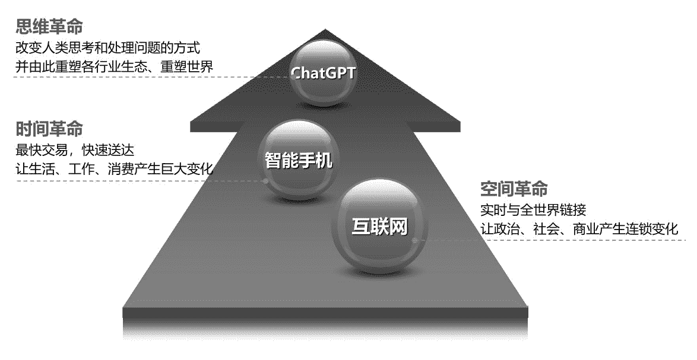

**图 1-1 ChatGPT 引发的思维革命**

在 ChatGPT 中，GPT 就是 Generative Pre-training Transformer（预训练生成模型），OpenAI 的语言模型可以助力教育领域、虚拟治疗师、写作辅助工具、角色扮演游戏等，在这些领域，社会偏见、错误信息和毒害信息的存在是比较麻烦的，只有规避这些系统缺陷才能使其更具有用性。ChatGPT 能够回答连续的问题、生成文本摘要、翻译文档、对信息分类、写代码等，它也会承认错误、质疑不正确的前提并拒绝不恰当的请求。短短两个月，人们源源不绝地挖掘出 ChatGPT 的更多技能，包括替写代码、作业、论文、演讲稿、活动策划、广告文案、电影剧本等各类文本，根据描述绘图、翻译、写诗词，甚至扮演面试官、电影中的角色、陪聊、解忧讲故事者，乃至给予家装设计、编程调试、人生规划等方面的建议。

只要你悉心调教，ChatGPT 甚至能从擅长交流的“咨询大师”快速进化，成为高效学习工具。经过连续追问，它能为你列举出辅助学习的大量书单和资料链接，帮你提炼一篇文章的关键要点、一个领域的知识图谱及核心脉络，甚至帮你在灵感枯竭时打开创意脑洞。

ChatGPT 看起来什么都懂，就像一本百科全书。其流畅的回答方式，丰富的知识储备，给用户带来了极大的震撼。

瑞银集团的一份报告显示，在 ChatGPT 推出仅两个月后（2023 年 1 月末），它的活跃用户量已经突破了 1 亿，打破了抖音的 9 个月的纪录，成为史上用户增长速度最快的 App 之一。而突破 1 亿用户，App Store 用了 2 年，Instagram 用了 2.5 年，WhatApp 用了 3.5 年，推特用了 5 年（见图 1-2）。

在过去几个月里，一大群人涌入网站，给 ChatGPT 提了各种要求。有软件工程师要求它调试代码，它做到了；有美食博主要求它写一份健康巧克力曲奇的食谱，它做到了；还有使用者让它为其编写绘画提示，以输入至另一个人工智能绘画应用 Midjourney，它做到了，Midjourney 根据它的文本描述成功创作出艺术作品。据说，斯坦福大学医学院的皮肤科医生 Roxana Daneshjou 在研究 AI 在医学上的应用时，向它提出了许多医学问题，并得到了充分的解答……

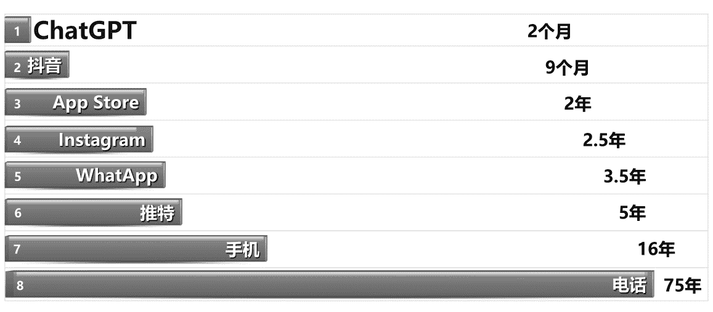

**图 1-2 部分应用用户突破 1 亿的时间**

以前也出现过很多智能聊天机器人，但都没有 ChatGPT 这样神奇。ChatGPT 可以进行长时间、流畅的对话，以回答人们的问题，并能撰写人们要求的几乎任何类型的书面材料，包括商业计划、广告活动方案、诗歌、笑话、计算机代码和电影剧本等。ChatGPT 的应答时间十分短暂，它会在几秒钟内生成回答，用户无须等待，而且它生成的很多内容质量都还不错（见图 1-3）。

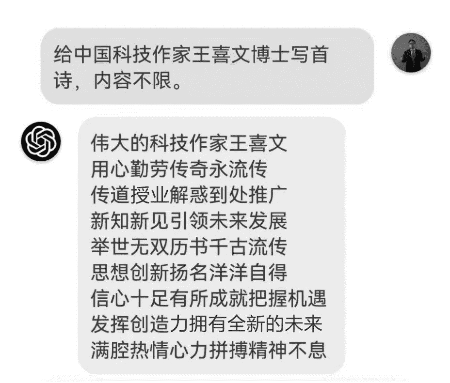

**图 1-3 试用 ChatGPT 作诗**

经过一段时间的试用，已经有很多人发现 ChatGPT 写论文、考试、做表格（整理信息）、编写程序、写诗歌等的能力可以超越 80%的普通人，甚至能通过大学入学考试、Google 程序员招聘等。这将大大影响教育行业。语言是逻辑思维的载体，如果 ChatGPT 因为具有强大的文字与语言处理能力而不学习如何使用语言，那么其他一切都将变成空中楼阁（见图 1-4）。

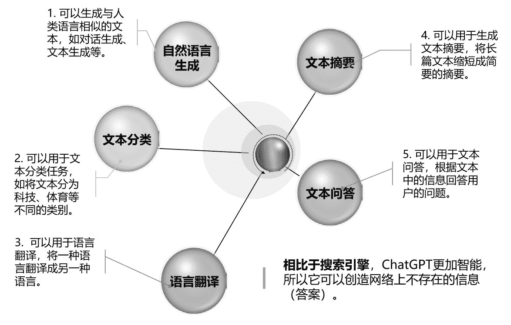

**图 1-4 ChatGPT 的主要特征**

ChatGPT 这次突然引爆舆论，在业内人士看来颇有些不可思议，连开发 ChatGPT 的 OpenAI 自己也没想到，它们可以顺利获得微软 100 亿美元的投资。微软大规模投资 OpenAI，并宣布除了 Office，搜索引擎 Bing 也要全面集成 ChatGPT，势必要打破 Google 对搜索引擎 20 多年的垄断。这一举措逼得 Google 连投竞争对手，并把业务组织完全变阵。

OpenAI 是美国的 AI 实验室，是非营利组织，其功能定位是促进和发展友好的人工智能，使人类整体受益。OpenAI 成立于 2015 年底，创始人是埃隆·马斯克（Elon Musk）及前 YC 总裁山姆·阿尔特曼（Sam Altman）（见图 1-5）。

维基百科资料显示，从时间轴来看，2015 年底，OpenAI 成立，组织目标是通过与其他机构和研究者自由合作，向公众开放专利和研究成果。

2016 年，OpenAI 宣称将制造通用机器人，希望能够预防人工智能的灾难性影响，推动人工智能发挥积极作用。

2019 年 3 月 1 日成立 OpenAI LP 子公司，目标是盈利和商业化。

2019 年 7 月 22 日微软投资 OpenAI 10 亿美元，双方合作为 Azure（微软的云服务）开发人工智能技术。

2020 年 6 月 11 日 OpenAI 宣布推出 GPT-3 语言模型，微软于 2020 年 9 月 22 日取得独家授权。

2022 年 11 月 30 日，OpenAI 发布了名为 ChatGPT 的自然语言生成式模型，以对话方式进行交互。

2023 年 1 月，微软和 OpenAI 洽谈投资 100 亿美元事宜，并希望将 OpenAI 的人工智能技术纳入 Word、Outlook、PowerPoint 和其他应用程序中。

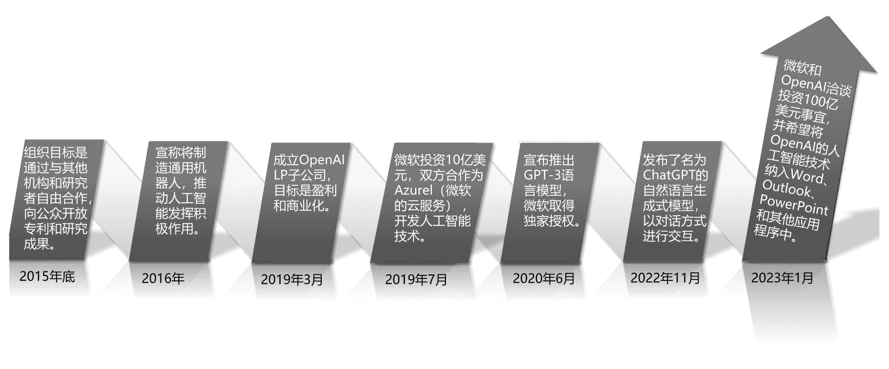

**图 1-5 OpenAI 的发展历程**

由此可见，微软不但很早对 OpenAI 进行了投资，而且在敏锐地发现 ChatGPT 的潜力后，再次重磅投入 100 亿美元，并且快速地在 Office 服务中集成了 ChatGPT，Bing 搜索引擎更是迅速部署 ChatGPT 并且上线。这对 Google 造成了巨大冲击——仿佛以“关键字搜索”为标志的“古典搜索引擎”将被淘汰了。

当然，微软并非心血来潮，这次投资 OpenAI 的行动之所以如此决绝与迅速，实际上源自微软对几乎错过了整个互联网时代的不甘。20 世纪 90 年代是计算机的时代，微软一枝独秀；2000 年以来是互联网的时代，Google、Amazon 等巨头快速崛起，势头远超微软。事实上，微软早在 2006 年就启动了 AI 与隐私相关的研究。自 2010 年以来，负责语音处理和语言理解研发的部门一直由微软研究院副总裁 Peter Lee 领导，谋求将这些 AI 功能用到 Office 办公软件和 Bing 搜索引擎中，为对话转录、语法检查等功能提供技术支持。此后，微软一直利用先进的 AI 技术，潜移默化地改善各类产品的用户体验。在现任 CEO 萨提亚·纳德拉（Satya Nadella）的带领下，微软 2019 年给 OpenAI 投资了 10 亿美元，2020 年买断了 GPT-3 背后基础技术的独家使用许可，从此与 OpenAI 建立了深厚的关系，并换来相当多的优先使用权限，包括将 OpenAI 大部分技术用于 Bing 搜索引擎等产品的优先授权，以及 Azure 云平台成为 OpenAI 的独家云供应商。

微软这项对 OpenAI 的颇具前瞻性的投资，已经显露出巨大回报。在 OpenAI 发布 GPT-3 大模型后没多久，微软就悄悄地将 GPT-3 集成到自家产品中，用于完善 Office 的自动补齐单词等功能，优化语音转文本工具。一位微软高级销售经理称，微软推出 OpenAI 功能的速度比他之前在微软研究院从事 AI 开发的速度快得多。

当然，OpenAI 也离不开微软的软件和硬件的支持。据说，OpenAI 模型在 Azure 中占用的空间和计算比微软语言模型 Turing-NLG 更多。对于像大型语言模型这样的计算密集型开发，降低成本最为关键。假设每月有 1000 万用户，每天运行 ChatGPT 的成本估计高达 100 万美元。微软 CEO 纳德拉曾透露，微软已经建造了一台超级计算机来处理 OpenAI 的工作，能以竞争对手一半的成本处理一些 AI 计算。

除此之外，由于微软是 OpenAI 最大的投资方，在 OpenAI 推出每月 20 美元的 ChatGPT Plus 订阅服务后，OpenAI 从 ChatGPT 收到的商业报酬越多，就意味着微软能获得的回报越大。按照预测，OpenAI 2023 年的预期收入将达到 2 亿美元，2024 年将达到 10 亿美元。

Google 这类搜索引擎是互联网时代里里程碑式的产物之一。Google 可以说是互联网时代的“信息神庙”，它拥有丰富的人类知识并可以主导信息的流向和生产。任何人要想检索信息都需要登录网站，在这座“神庙”中行进。

然而，随着数据的不断增加，信息爆炸让信息检索变得越来越困难，互联网充斥着的信息垃圾常常掩盖了有价值的信息，搜索引擎的广告排名也让用户体验越来越差，以至于人们对搜索引擎的二次智能搜索功能产生了强烈的诉求。

搜索引擎采用平台化的集中式管理模式。因为平台有广告植入的空间和广告流量，所以用户需要到平台上自主检索，平台往往会列出几十页检索页面让用户自行筛选。在移动互联网时代，这种网页布告栏式的传统互联网交互方式已经落后。

为了打破 Google 占据的消费互联网搜索引擎入口的优势，微软的 Bing 搜索一直在尝试反击，目标就是用人工智能技术优化搜索结果（基于很少有人点开搜索结果第二页的现实，用 AI 算法尽可能把最优结果往前提，可以抵消 Google 大规模爬虫系统的优势）。

ChatGPT 采用一对一的生成式对话方式，用户可以直接得到结果，而不是拿到一堆需要二次人工筛选的信息。ChatGPT 有对话记忆功能，用户可以专注于这个对话，直到得到满意的结果。经过数千亿个单词语料的自然语言模型训练，ChatGPT 可以用舒适感很强的表达方式与人对话，使用户体验大幅提升。

现在的微软只是回来了，试图用 OpenAI 的 ChatGPT，将 Google 通过投资 DeepMind、Boston Dynamics、Waymo 积累的光环击碎。微软 CEO 纳德拉说：“对于知识型工作者来说，这完全等于工业革命。”还有人说，ChatGPT 将像搜索引擎杀死黄页一样摧毁 Google。摩根士丹利公开表示，ChatGPT 可能给 Google 母公司的盈利能力带来长期威胁。为了应对 ChatGPT 的威胁，已退出 Google 日常业务的两位 Google 联合创始人紧急重返公司，多次发起会议商讨对策。Google 还向研发 ChatGPT 竞品的创业企业 Anthropic 投资了约 3 亿美元，该企业的创始成员曾为创造 ChatGPT 的 OpenAI 工作。

如今，大家都很好奇 ChatGPT 是否能改变世界？答案是“能”！

在全球经济不明朗的大环境里，ChatGPT 的诞生似乎吹起了一股清风，ChatGPT 被寄予以智能科技来改善世界经济、促进社会进步的美好愿望。自从 ChatGPT 出现后，突然之间，每个人都在谈论人工智能如何影响他们的工作、学习和生活。ChatGPT 之所以让大家感到震撼，是因为其用户体验大大超越以往的人机对话产品。普通使用者感觉到，自己不再是跟“人工智障”对话，ChatGPT 对问题的理解很深入，生成的文本也很流畅，的确像是一个“人”在进行回复。甚至还有工程师尝试用 ChatGPT 改善智能家居体验。据说，一名高级 Web 开发人员用短短不到 1 小时的时间，通过与 ChatGPT 背后的 GPT-3 大模型交互，结合 Siri Shortcuts 做出了一个更智能的语音助手。这个语音助手不仅能控制整个苹果 HomeKit 智能家居系统，而且能够以超低的延迟轻松回答各种问题。他给予了 ChatGPT 极高的评价，称尝试过这个产品后，包括苹果 Siri、亚马逊 Alexa、Google Home 在内的所有“智能”助手，都显得如此愚蠢而没用。

此外，ChatGPT 将取代部分人类工作者的说法也耸人听闻地传开了，他们是：软件开发人员、网络开发人员、程序员、广告人、新闻记者等内容创作者，以及律师、市场研究分析师、教师、金融分析师、财务顾问、交易员、平面设计师、会计师、客服等（见图 1-6）。这个取代的过程似乎有点残酷。未来，从产品和投资的角度看，现在的客服、翻译、文员、初级程序员、文案、家教等以文字工作为主业的从业者将受到第一波冲击，规模将达到上千万人，比如印度就将受到巨大的影响。随着失业人口增加、行业巨变，紧接着大量的语言处理相关公司将失去价值，之前火过一阵子的语音助手都将无人问津……

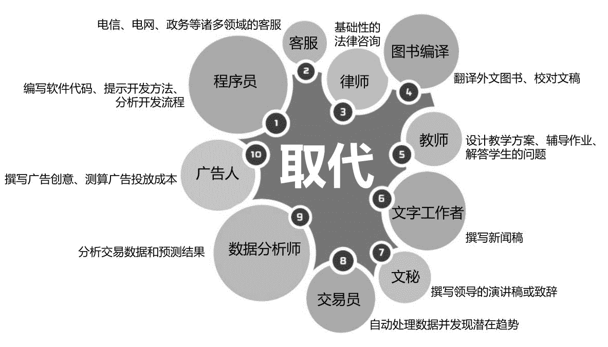

**图 1-6 ChatGPT 可能取代的人类工作者**

## 第二章 快速迭代的发展历程

在 ChatGPT 一词中，Chat 是指对话方式，GPT 是指背后的技术，其是一种基于互联网可用数据训练的文本生成深度学习模型。它用于文本问答、文本摘要、语言翻译、文本分类、代码生成和对话对答等工作中。从最初版本的 GPT-1 到 GPT-4（ChatGPT），仅用 4 年时间 ChatGPT 就实现了快速的迭代式演进（见图 2-1）。

2018 年，GPT-1 诞生，这一年也是 NLP（自然语言处理）的预训练模型元年。在性能方面，GPT-1 有着一定的泛化能力，能够用于和监督任务无关的 NLP 任务。其常用任务包括：

● 自然语言推理：判断两个句子的关系（包含、矛盾、中立）。

● 问答与常识推理：输入为文章及若干答案，输出为每个答案的预测准确率。

● 语义相似度识别：判断两个句子的语义是否相关。

● 分类：判断输入的文本属于指定的哪个类别。

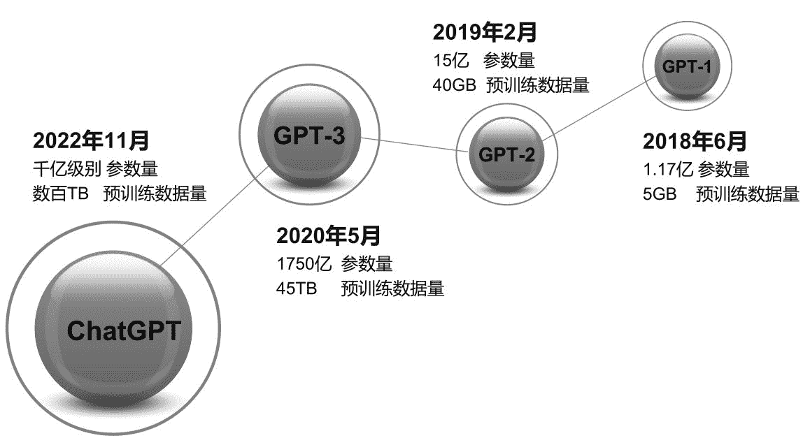

**图 2-1 GPT-1 到 GPT-4 的演进过程**

虽然 GPT-1 在未经调试的任务上有一些效果，但其泛化能力远低于经过微调的有监督任务，因此 GPT-1 只能算得上一个还算不错的语言理解工具而非对话式 AI。

GPT-2 于 2019 年正式推出，不过，GPT-2 并没有对原有的网络进行过多的结构创新与设计，只使用了更多的网络参数与更大的数据集：最大模型共计 48 层，参数量达 15 亿，学习目标则使用无监督预训练模型做有监督任务。在性能方面，除了理解能力，GPT-2 在生成方面第一次表现出了强大的天赋：阅读摘要、聊天、续写、编故事，甚至生成假新闻、钓鱼邮件或在网上进行角色扮演，这些通通不在话下。在“变得更大”之后，GPT-2 的确展现出了普适而强大的能力，并在多个特定的语言建模任务上实现了彼时的最佳性能。

之后，GPT-3 出现了，它作为一个无监督模型（现在经常被称为自监督模型），几乎可以完成自然语言处理的绝大部分任务，例如，面向问题的搜索、阅读理解、语义推断、机器翻译、文章生成和自动问答等。而且，该模型在诸多任务上表现卓越，例如，在法语—英语和德语—英语机器翻译任务中达到当时的最佳水平，自动生成的文章几乎让人无法辨别出自人类还是机器（正确率仅为 52%，与随机猜测相当）。更令人惊讶的是，在两位数的加减运算任务中，该模型的正确率几乎达到 100%，甚至还可以依据任务描述自动生成代码。一个无监督模型功能多、效果好，似乎让人们看到了通用人工智能的希望，可能这就是 GPT-3 影响力如此之大的主要原因。

实际上，我们可以将 GPT-3 看成一个简单的统计语言模型。从机器学习的角度来说，语言模型是指对词语序列的概率分布进行建模，即利用已经说过的片段作为条件，预测下一个时刻不同词语出现的概率分布。语言模型可以衡量一个句子符合语言文法的程度（如衡量人机对话系统自动产生的回复是否自然流畅），同时也可以用来预测并生成新的句子。例如，对于一个片段“杭州东站到了，乘客们请准备下车”，语言模型可以预测“请”后面可能出现的词语。一般的语言模型会预测下一个词语是“下车”，强大的语言模型能够捕捉时间信息，预测并且生成符合语境的词语“准备下车”。

通常，一个语言模型是否强大主要取决于两点：首先，看该模型是否能够调用全部的历史上下文信息，上述例子中如果无法捕捉“杭州东站到了”这个远距离的语义信息，语言模型就无法预测下一个词语“准备下车”。其次，还要看是否有足够丰富的历史上下文可供模型学习，也就是说训练语料是否足够丰富。由于语言模型属于自监督学习，优化目标是最大化所见文本的语言模型概率，因此任何文本无须标注即可作为训练数据。

由于 GPT-3 具有更强的性能和更多的参数，亦包含了更多的主题文本，显然优于前代的 GPT-2。作为目前最大的密集型神经网络之一，GPT-3 能够将网页描述转换为相应代码、模仿人类叙事、创作定制诗歌、生成游戏剧本，甚至模仿已故的哲学家来预测生命的真谛。且 GPT-3 不需要微调，在处理语法难题方面，它只需要一些输出类型的样本（少量学习）。可以说 GPT-3 似乎已经满足了我们对于语言专家的一切想象。

但是 GTP-3 并不完美，当前人们最担心的人工智能的主要问题之一，就是聊天机器人和文本生成工具等很可能会不分青红皂白地对网络上的所有文本进行学习，进而产生错误的、恶意的、冒犯的，甚至是具有攻击性的语言输出，这将会充分影响到它们的下一步应用。

2022 年初，OpenAI 发布了 InstructGPT。相比 GPT-3，OpenAI 采用对齐研究（Alignment Research），训练出更真实、更无害，而且能更好地遵循用户意图的语言模型 InstructGPT。InstructGPT 是一个经过微调的新版本 GPT-3，可以将有害的、不真实的和有偏差的输出最小化。

开发人员通过监督学习叠加从人类反馈中获得的强化学习，来提高 GPT-3 的输出质量。在这种学习中，人类对模型的潜在输出进行排序，强化学习算法则对产生类似于高级输出材料的模型进行打分。

训练数据集以创建提示开始，其中一些提示基于 GPT-3 用户的输入，比如“给我讲一个关于西游记的故事”或“用几句话给一个 6 岁的孩子解释一下春节的由来”。

开发人员将提示分为三个部分，并以不同的方式为每个部分创建响应。

人类作家会对第一组提示做出响应。开发人员微调了一个经过训练的 GPT-3，将它变成 InstructGPT，以生成每个提示的现有响应。

下一步是训练一个模型，使其为更好的响应提供更高的奖励。对于第二组提示，经过优化的模型会生成多个响应。人工评分者会对每个回复进行评分。在给出一个提示和两个响应后，一个打分模型（另一个预先训练的 GPT-3）学会了为评分高的响应计算更高的奖励，为评分低的回答计算更低的奖励。

开发人员利用第三组提示和近端策略优化（Proximal Policy Optimization，PPO）的强化学习方法进一步微调了语言模型。给出提示后，语言模型会生成响应，而打分模型会给予相应奖励。PPO 使用奖励来更新语言模型（见图 2-2）。

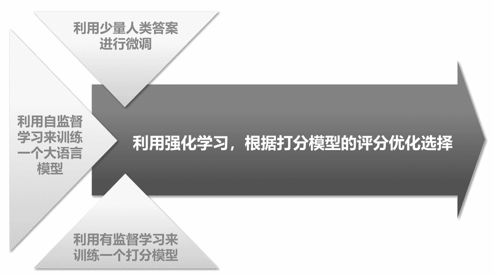

**图 2-2 ChatGPT 的训练过程**

ChatGPT 相较于之前的 InstructGPT，在训练过程方面略有不同。之前的 InstructGPT 模型是给一个输入，就给一个输出，然后与训练数据进行对比，对了有奖励，错了有惩罚；现在的 ChatGPT 只有一个输入，模型给出多个输出，然后“人”给这个输出结果排序，再让模型将这些结果从“善解人意”到“不知所以”排序，让模型学习人类排序的方式，这种策略叫作监督学习（Supervised Learning）。总结而言，ChatGPT 与 InstructGPT 的不同之处就在于数据是如何设置并用于训练（及收集）的。

2023 年初，OpenAI 曾经提出，其会在不久的将来发布更为强大的 GPT-4。据说，GPT-4 会在 2024 年发布，它将能够通过图灵测试，并且能够先进到和人类比肩，除此之外，企业接入使用 GPT-4 的成本也将大规模下降。有专家猜测，GPT-4 可能将在多模态上有所进展，也就是会引入视频、音频等。

## 第三章 智能交互的运行模式

回顾 ChatGPT 的发展历程，可以看出，OpenAI 其实从 GPT-1 开始，基本就坚定地把大型语言模型（Large Language Model，LLM）看作通往通用人工智能（Artificial General Intelligence，AGI）的一条必由之路。具体而言，在 OpenAI 眼中，未来的 AGI 应该是这个样子的——有一个任务无关的超大型 LLM，用来从海量数据中学习各种知识，这个 LLM 以生成一切的方式，来解决各种各样的实际问题，而且它能听懂人类的命令，以便于人类使用。

**幕后：大型语言模型**

自然语言处理（NLP）是计算机科学领域与人工智能领域中的一个重要研究方向。它研究能够实现人与计算机之间用自然语言进行有效通信的各种理论和方法。自然语言处理是一门融语言学、计算机科学、数学于一体的科学。因此，这一领域的研究将涉及自然语言，即人们日常使用的语言，所以它与语言学的研究有着密切的联系，但又有重要的区别。自然语言处理并不是一般地研究自然语言，而在于研制能有效地实现自然语言通信的计算机系统，特别是其中的软件系统。因而它是计算机科学的一部分。

自然语言处理是计算机科学，是人工智能、语言学等关注计算机和人类（自然）语言之间的相互作用的领域。因此，自然语言处理与人机交互领域有关。自然语言处理面临很多挑战，包括自然语言理解，因此，NLP 涉及人机交互的面积。在 NLP 的诸多挑战中，就涉及自然语言理解的问题，即计算机源于人为或自然语言输入的含义，和其他涉及到的自然语言生成的问题。

一直以来，自然语言处理领域存在的问题有两个方面：一方面，迄今为止的语法大多仅限于分析一个孤立的句子，至于对上下文关系和谈话环境对本句的约束和影响还缺乏系统研究，因此分析歧义、词语省略、代词所指、同一句话在不同场合或由不同的人说出来所具有的不同含义等问题，尚无明确规律可循，需要加强对语用学的研究才能逐步解决。另一方面，人理解一个句子并非单凭语法，还会运用大量的有关知识，包括生活知识和专门知识，这些知识无法全部贮存在计算机里。因此一个书面理解系统只能建立在有限的词语、句型和特定的主题范围内；计算机的贮存量和运转速度大大提高之后，才有可能适当扩大范围。

最早的自然语言理解方面的研究源于机器翻译。1949 年，美国人瓦伦·韦弗（Warren Weaver）首先提出了机器翻译设计方案。20 世纪 60 年代，国外对机器翻译曾进行过大规模研究，并产生了巨额费用，但人们当时显然低估了自然语言的复杂性，由于语言处理的理论和技术均不成熟，所以进展不大。当时主要的做法是存储两种语言的单词、短语并在翻译时一一对应译法大辞典，技术上只是调整语言的同条顺序。但日常生活中语言的翻译并非这么简单，很多时候还要参考某句话上下文的意思。

大约 20 世纪 90 年代开始，自然语言处理领域发生了巨大的变化。这种变化有两个明显的特征。

（1）对系统的输入：要求研制的自然语言处理系统能处理大规模的真实文本，而不是如以前的研究性系统那样，只能处理很少的词条和典型句子。只有这样，研制的系统才有真正的实用价值。

（2）对系统的输出：鉴于真实地理解自然语言是十分困难的，所以并不要求系统能对自然语言文本进行深层的理解，但要能从中抽取有用的信息。例如，对自然语言文本进行自动提取索引词、过滤、检索，自动提取重要信息、进行自动摘要等。

同时，由于强调了“大规模”和“真实文本”，下面两方面的基础性工作也得到了重视和加强。

（1）大规模真实语料库的研制。大规模且经过不同深度加工的真实文本的语料库，是研究自然语言统计性质的基础。没有它们，统计方法只能是无源之水。

（2）大规模、信息丰富的词典的编制工作。规模达到几万、十几万，甚至几十万个词，含有丰富信息（如包含词的搭配信息）的计算机可用词典对自然语言处理的重要性是不言而喻的。

自然语言处理是指机器理解并解释人类写作、说话方式的能力，是人工智能和语言学的一部分，它致力于使用计算机理解或产生人类语言中的词语或句子。自然语言处理主要涉及语音识别、语音合成、语义理解、机器翻译，自然语言类产品呈现实用化的发展趋势，但是在产品成熟度方面仍存在较大的提升空间。

现代 NLP 算法基于机器学习，特别是统计机器学习。机器学习范式不同于一般的、之前的尝试语言处理。语言处理任务的实现，通常涉及直接用手的大套规则编码。主要研究领域包括：短文本的计算与分析技术，跨语言文本挖掘技术和面向机器认知智能的语义理解技术，以及多媒体信息理解的人机对话系统（见图 3-1）。

ChatGPT 无比强大的能力主要归功于“大规模”——ChatGPT 所依托的大型语言模型。ChatGPT 尽管加入了人工标注的数据，但是量级只有数万，这个规模的数据量和训练 GPT-3.5 模型使用的千亿级别的数据量相比，可谓沧海一粟，完全可以忽略不计，基本不会对提升 GPT-3.5 的基础能力产生作用。所以 ChatGPT 的强大功能，应该主要来自隐藏于背后的巨无霸模型——LLM。

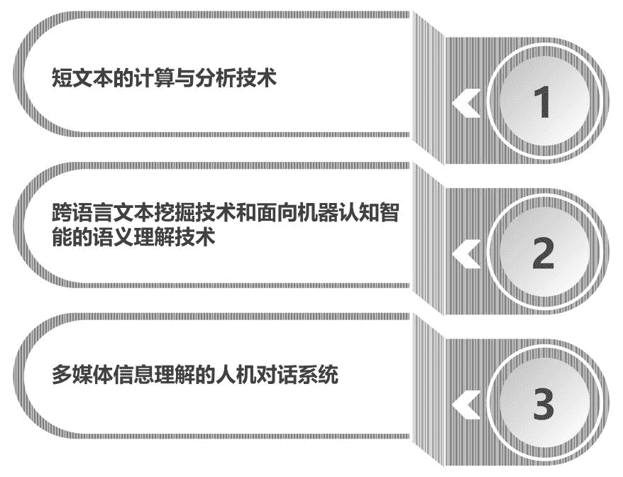

**图 3-1 自然语言处理技术**

在整个人工智能行业，几乎所有机构都在建立一个个专门的小模型，解决一个个具体的问题，然后再把这些模型组合起来一起工作。这时候，如果有人去研究大语言模型，试图制造一个类似于通用人工智能的东西，其有百亿的参数和大量计算资源，需要投资几十亿美元，那肯定会被认为是一群疯子。

所谓“大模型”，通常是在无标注的大数据集上，采用自监督学习的方法进行训练。之后在其他场景的应用中，开发者只需要对模型进行微调，或采用少量数据进行二次训练，就可以满足新应用场景的需求。

腾讯研究院称，当前的人工智能大多针对特定的应用场景进行训练，生成的模型难以迁移到其他应用，属于“小模型”的范畴。整个过程不仅需要大量的手工调参，还需要给机器喂养海量的标注数据，这拉低了人工智能的研发效率，且成本较高。

这就如同哥伦布逆着西风带着航行的船队所遇到的囧境。要想远航就需要干粮等补给的支撑。过了某一个折返点，剩下的补给将无法支撑船员返航，前面要么有岛屿，要么留给船员的就是生命最后几个月的时光。所有的人都害怕近在咫尺的死亡。所以，当哥伦布到达新大陆的时候，不仅哥伦布及西班牙的王室知道了此事，所有的人都知道了：这条路走得通。

如今，OpenAI 已经用“暴力美学”的方式，把大语言模型这条路走通了，接下来其他企业、机构走第二遍，就容易多了。

LLM 的发展可以理解为“构建一个任务无关的超大型 LLM，让它从海量数据中学习各种知识”。图 3-2 展示了一个大型语言模型该有的样子。

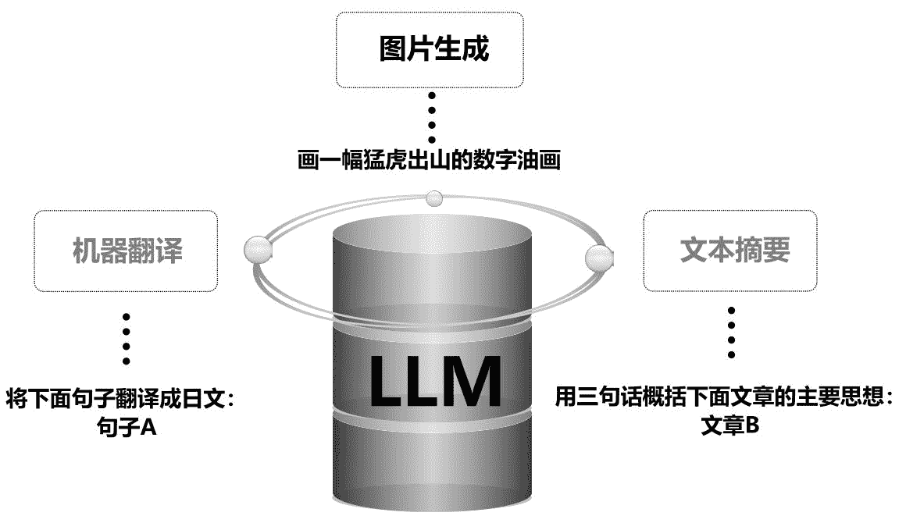

**图 3-2 大型语言模型**

首先，这个模型的规模必然非常巨大，有能力研发出或改动这个模型参数的机构必然很少。而任务需求方是无数的中小机构甚至是个人，就算这些中小机构或个人把大型语言模型开源出来，也无力部署这个模型，更不用说用微调这种技术模式去修改模型参数了。所以，我们应该追求不修正模型参数，就能让任务需求方顺利完成任务的方式，也就是应该采取提示词（Prompt）模式完成任务，而非采用微调模式。模型制作方则将 LLM 做成公用基础设施服务，以基础设施即服务（Infrastructure as a Service，IaaS）的模式运行。与此同时，服务提供方需要考虑到千变万化的用户需求，所以 LLM 开发方更要让 LLM 完成尽可能多的类型的任务，这也是 LLM 一定会走向通用人工智能之路的现实因素。

其次，LLM 应该具备强大的自主学习能力。假设我们把世界上能获得的所有文本或者图片等不同类型的数据喂给它，它应该能够自动从中学习到数据所包含的所有知识点，学习过程不需要人的介入，并且它能灵活应用所学知识解决实际问题。因为数据是海量的，要吸收所有知识，就要用非常多的模型参数来存储知识，所以这个模型必然会是一个巨无霸模型。

那么，ChatGPT 向 GPT-3.5 模型注入新知识了吗？答案：应该注入了。这些知识就包含在有人揭秘 ChatGPT 时所提到的“几万人工标注”数据里，不过注入的不是世界知识，而是人类偏好知识。所谓“人类偏好”，包含几方面的含义：首先，它是人类表达一个任务的习惯说法。比如，人们习惯说：“把下面的句子翻译成日语”，以此表达一个“机器翻译”的需求。但是 LLM 并非人类，它会如何理解这句话的意思呢？你要想办法让 LLM 理解这句命令的含义，并正确执行。所以，ChatGPT 通过人工标注数据，向 GPT-3.5 注入了这类知识，方便 LLM 理解人的命令，这是它了解人类意图的关键。其次，对于什么是好的回答，什么是不好的回答，人类有自己的标准，例如，比较详细的回答是好的回答，带有歧视内容的回答是不好的回答，诸如此类。这是人类自身对回答质量好坏的偏好。人工标注通过打分模型（Reward Model）将这类信息反馈到 LLM 的数据里。总体而言，ChatGPT 把人类偏好知识注入 GPT-3.5，以此获得一个听得懂人话且比较有分寸的 LLM。

就具体过程而言，首先，创建人类偏好数据。随机挑选一些问题，并由标注人员给出高质量回答，形成“人类表达—任务结果”的标注数据，喂给模型，让它学习。这批数据数量仅有数万，并通过提示词模式进行学习，即模型参数不产生变化。其次，训练一个反馈模型。随机挑选一些问题，让原始模型输出答案，再由标注人员基于“人类偏好标准”（如相关性、信息丰富程度、答案有害、负面情感等），对原始模型的答案做一个排序。最后，利用这批标注好的人类偏好数据，训练一个打分模型，这个打分模型会对原始模型的结果进行打分，告诉它哪个答案得分高，哪个答案得分低。

这样一来，整个过程通过循环式地强化学习，将反馈模型和原始模型连接到一起，当原始模型输出的结果在打分模型中获得较低分值时，它就会受到惩罚，被要求重新学习。后续不断循环后两个步骤，原始模型就会不断迭代升级，乃至脱胎换骨，学习到人类的偏好，变成一个让人类满意的模型，也就是我们最终看到的 ChatGPT。

**台前：新型人机交互接口**

语言是人类区别于其他动物的本质特性。在所有生物中，只有人类具有语言能力。人类的多种智能都与语言有着密切的关系。人类的逻辑思维以语言为形式，人类的绝大部分知识也是以文字的形式记载和流传下来的。因而，语言也是人工智能的一个重要部分，甚至是核心部分。

用自然语言与计算机进行通信，是人们长期以来的追求。因为这既有明显的实际意义，同时也有重要的理论意义：人们可以用自己最习惯的语言来使用计算机，而无须花大量的时间和精力去学习各种复杂的计算机语言；人们也可通过它进一步了解人类的语言能力和智能机制。

实现人机间自然语言通信意味着要使计算机既能理解自然语言文本的意义，也能以自然语言文本来表达给定的意图、思想等。前者称为自然语言理解，后者称为自然语言生成。因此，自然语言处理大体包括自然语言理解和自然语言生成两个部分。历史上对自然语言理解研究得较多，而对自然语言生成研究得较少。但这种状况已有所改变。

无论实现自然语言理解，还是自然语言生成，都远不如人们原本想象得那么简单。从现有的理论和技术现状看，打造通用的、高质量的自然语言处理系统，仍然是未来较长时期的努力目标。但是针对一定应用，具有相当强的自然语言处理能力的实用系统已经出现，有些已商品化，甚至产业化。典型的例子有：多语种数据库和专家系统的自然语言接口、各种机器翻译系统、全文信息检索系统、自动文摘系统等，但是它们都不具备强大的记忆能力。

目前，很多研究已经证明 LLM 对于知识具有强大的记忆能力。但是，通常而言，在现实世界中，我们一般不会因为一个人记忆能力强就说这个人很聪明。是否具有强大的推理能力，往往是我们判断一个人是否聪明的重要标准。如果想让人觉得 ChatGPT 效果很惊艳，那么 ChatGPT 背后强大的推理能力是必不可少的。推理能力的本质是综合运用很多相关知识点，推导出新知识或新结论。当模型规模足够大的时候，LLM 本身就具备了相应的推理能力。

ChatGPT 的最大贡献在于：较好地构建了 LLM 的接口层，让 LLM 适配人类习惯的命令式表达方式，而不是反过来让人类去适配 LLM，绞尽脑汁地想出一个想达到目的的命令。由此一来，LLM 的易用性和用户体验便提升了。

而这种交互方式的演变，就是一种非常理想的新型人机交互模式。我们不需要专业的能力，不需要高端的设备，我们只需要开口说出自己的诉求，人工智能就能够理解并帮我们解答（见图 3-3）。

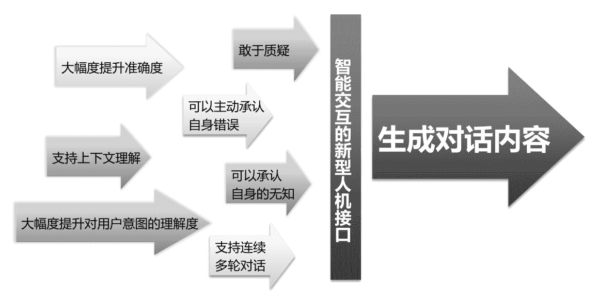

**图 3-3 新型人机接口**

这种产业变革和模式创新至少会体现在以下方面：

**1.改变现有人机交互模式**

用户将能够使用自然对话的方式与智能产品进行交互。

由于 ChatGPT 可以比较精准地理解用户的意图，因此在随后的软件和服务调用上它能够更加贴合用户的需求，进而提高交互效率与任务成功率。

这种人机交互模式的更迭，将会改变当前 App 等的使用方式。比如，更多的功能会被整合进 App 里，甚至出现拥有“大一统”能力的超级通用 App。

**2.改变信息分发获取模式**

基于认知智能技术可实现更高效的信息整合和知识推荐。

以搜索为例，传统搜索引擎根据关键字匹配内容，使用者需要在海量搜索结果中筛选出有用信息，而 ChatGPT 加持的 Bing 搜索引擎可以直接给出答案，并提高了问题与答案的匹配度，大大提升了用户体验。

由 ChatGPT 引发的信息分发获取模式的改变，将影响流量的分布，并改变流量变现的商业模式。

在 2022 年 12 月的媒体通稿中，各大媒体对 ChatGPT 的评价集中于“仿真性”，俨然它通过了图灵测试一般。这种仿真性，可以认为是 ChatGPT 的“智力”又提升了的结果，人们认为它更聪明了。

## 第四章 深度学习的核心技术

很多人发现 ChatGPT 在自然语言处理的系列任务中，比如在文本理解和生成、对话问答、机器翻译、程序代码生成方面都有很大的进步。这是怎么做到的呢？从技术层面讲，这其实是近几年深度神经网络、大型语言模型的研究不断深入带来的成果，通俗点讲就是海量的数据加上巨大的算力催生了这样一个大型语言模型，使其落地应用。

也就是说，ChatGPT 背后的关键技术离不开大模型的算法、算力、数据（见图 4-1）。

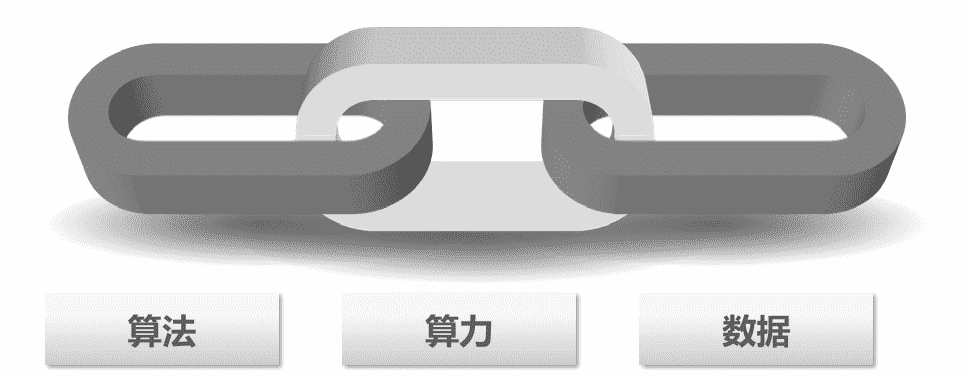

**图 4-1 ChatGPT 的技术支撑**

**算法**

ChatGPT 由 GPT-3.5 模型提供支持。GPT 是一种基于互联网可用数据训练的文本生成深度学习模型。在算法方面，该模型使用了“利用人类反馈强化学习”（RLHF）的训练方式，包括人类提问机器回答、机器提问人类回答，并且不断迭代，让模型逐渐有了对生成的答案的评判能力。

RLHF 的训练过程可以分解为三个步骤（见图 4-2）。

**阶段 1：预训练语言模型**

首先，将一个经典的预训练语言模型作为初始模型。在预训练模型出现之前，深度学习之所以不够成功，主要原因来自两个方面：一方面是匹配给某个具体任务的训练数据总量不够多。随着模型容量的增加，其需要靠大量训练数据来支撑，否则即使能把深度做起来，任务效果也不佳，因此这成为自然语言处理领域一个无法解决的难题；另一个方面是深度学习的特征抽取能力不够强，就算有再多的数据也没用，因为模型不能有效地吸收数据里蕴含的知识。这两个原因，阻碍了深度学习在自然语言处理领域成功突围。而 GPT 预训练模型的出现，无论从学术研究角度看，还是从场景应用角度看，都代表了自然语言处理领域的一个技术飞跃，并带来了整个领域研究范式的转换（见图 4-3）。

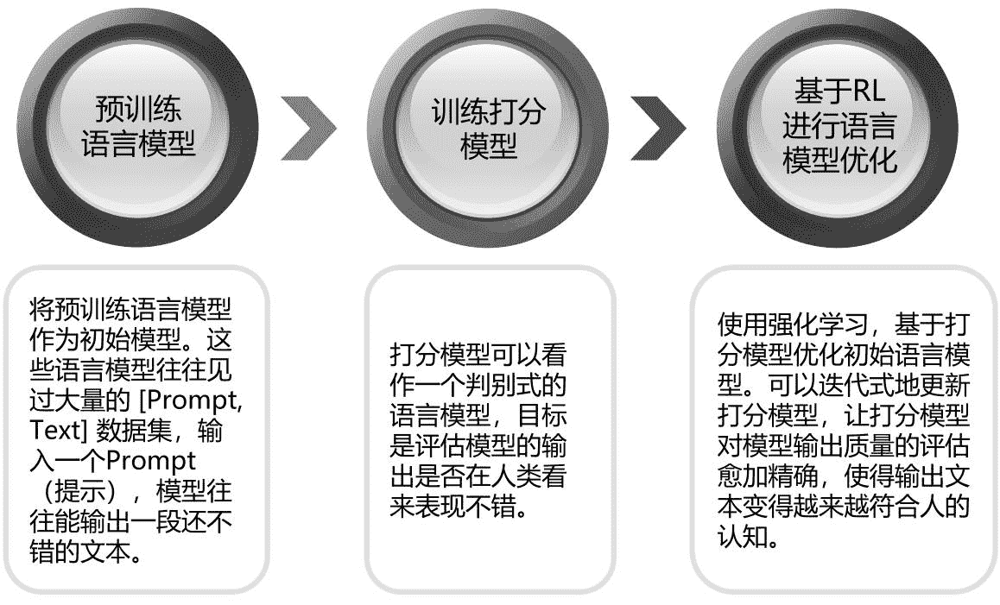

**图 4-2 RLHF 的训练过程**

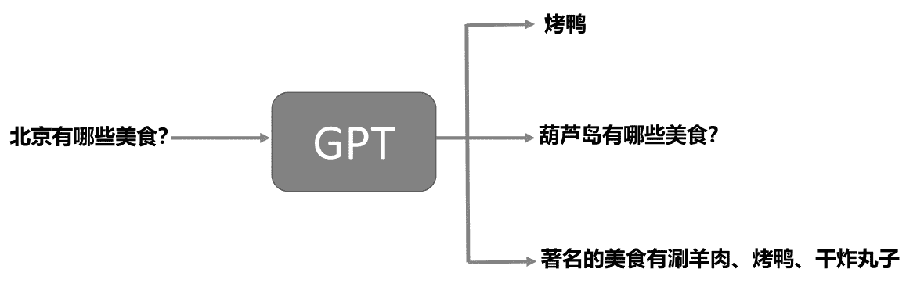

**图 4-3 预训练语言模型（LM）**

**阶段 2：训练打分模型**

之后，要基于这个初始语言模型产出的数据来训练一个打分模型。打分模型的目标是评估模型的输出是否在人类看来表现不错。即输入[Prompt（提示），模型生成的文本]，输出一个评估文本质量的标记数字。用于训练打分模型的 Prompt 数据一般来自一个预先富集的数据集，ChatGPT 的 Prompt 数据主要来自那些调用 GPT API 的用户。这些提示词会被放进初始的语言模型（第一阶段的模型）以生成文本。打分模型可以看作一个判别式的语言模型，因此可以从一个预训练语言模型出发，而后在[*x*=（Prompt，模型回答），*y*=人类满意度]构成的标注语料上微调，也可以直接随机初始化，在语料上直接训练（见图 4-4）。

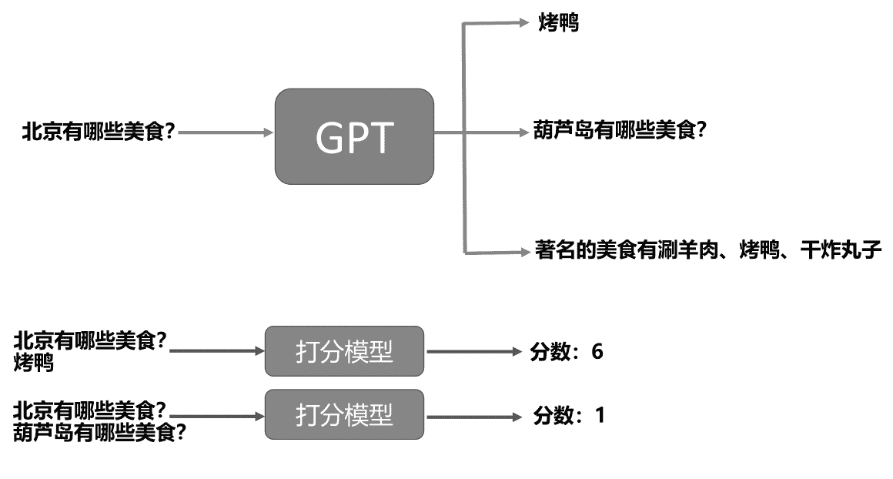

**图 4-4 收集数据并训练奖励模型（RM）**

**阶段 3：基于 RL 进行语言模型优化**

有了一个初始的语言模型来生成文本，以及用一个打分模型来判断模型生成的文本是否优质（迎合人类偏好）之后，就可以使用强化学习（RL）基于打分模型来优化初始语言模型。

将初始语言模型的微调任务建模为强化学习问题，因此需要定义策略（Policy）、动作空间（Action Space）、观察空间（Observation Space）和打分函数（Scoring Function）等基本要素。所谓策略，就是指基于该语言模型，接收 Prompt 并将其作为输入，然后输出一系列文本（或文本的概率分布）；动作空间就是词表所有标记在所有输出位置的排列组合；观察空间是可能的输入标记序列（Prompt），是词表所有标记在所有输入位置的排列组合；打分函数是基于训练好的 RM 模型，配合一些策略层面的合约进行的打分计算。有了这个打分模型，便可以根据策略优化算法来更新模型参数了（见图 4-5）。

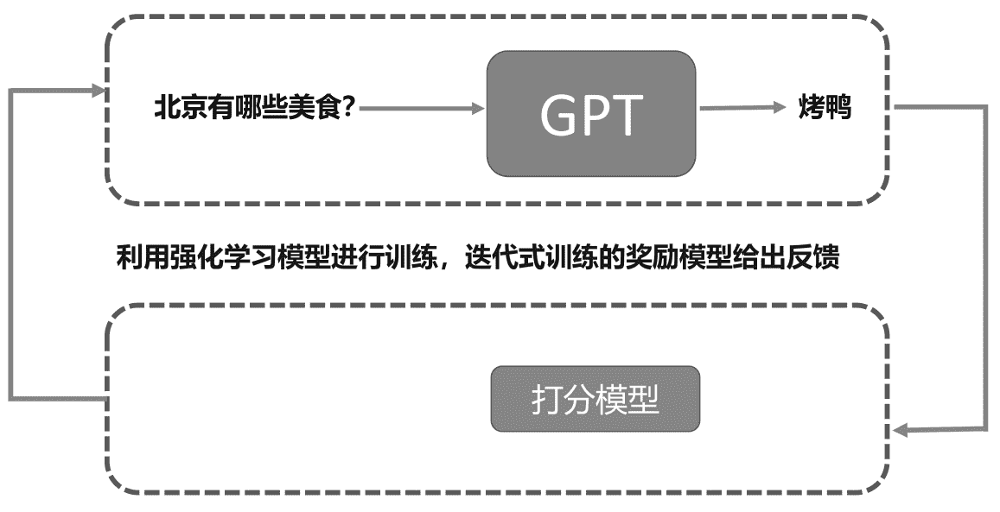

**图 4-5 通过强化学习微调**

通过以上过程，完全可以迭代式地更新打分模型和策略模型，让打分模型对模型输出质量的评估愈加精确；策略模型的输出则不断地与初始模型拉开差距，使得输出文本变得越来越符合人类的需求和认知。

**算力**

ChatGPT 成为新一代人工智能里程碑的背后，是算力发展和数字经济时代形成的大数据所共同支持的大型语言模型训练。在算力方面，ChatGPT 所使用的 GPT-3.5 模型是在微软云计算服务 Azure AI 超算基础设施（由 V100 GPU 组成的高带宽集群）上进行训练的，总算力消耗约 3640 PF-days（每秒一千万亿次计算，运行 3640 天）。

这就带来了两个问题：巨大的算力需求与资金消耗（见图 4-6）。训练和运行模型都需要庞大的算力，有研究估测，训练 1750 亿个参数大型语言模型的 GPT-3，就需要有上万个 CPU/GPU 24 小时不间断输入数据，所需能耗相当于开车往返地球和月球，且一次运算就要花费 450 万美元。

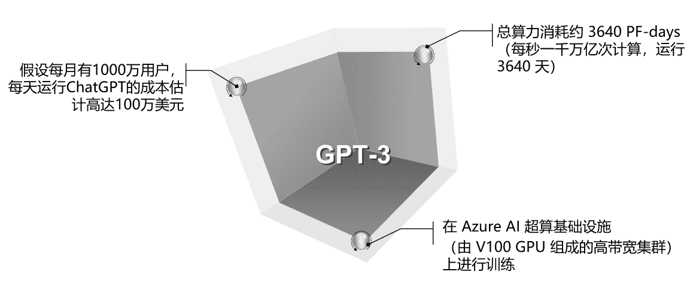

**图 4-6 巨额的算力**

在大模型的框架下，ChatGPT 所使用的 GPT 模型的每一代参数量均高速扩张，预训练的数据量需求和成本亦快速提升。ChatGPT 官网在 2023 年 1 月 27 日至 2023 年 2 月 3 日吸引的每日访客数量高达 2500 万。假设以目前的稳定状态，每日每位用户提出约 10 个问题，则每日约有 2.5 亿次咨询量。

根据国盛证券计算机分析师刘高畅、杨然发表于 2023 年 2 月 12 日的报告《ChatGPT 需要多少算力》，2023 年 1 月平均每天约有 1300 万独立访客使用 ChatGPT，其对应的芯片需求为 3 万多个英伟达 A100 GPU 图形处理器，初始投入成本约为 8 亿美元，每日电费在 5 万美元左右，GPT-3 训练一次的成本约为 140 万美元，对于一些更大的 LLM，训练成本介于 200 万美元至 1200 万美元之间。这对于全球科技大企业而言并不便宜，但尚在可接受范围内。

对于 ChatGPT 的技术，Google、Meta 等头部互联网巨头迟早都会掌握，但是科技公司之间的军备竞赛依旧会展开。一方面，ChatGPT 的推理成本高昂，而且消耗的算力与用户体验高度正相关；另一方面，搜索引擎用户黏度小，用户永远会去用体验最好的那个，这将大幅推高搜索算法的成本，使得 Google 赖以生存的搜索广告业务再也无法“躺着赚钱”。微软的营收将会更加多元化，因此受到的冲击会更小，能享受到 Edge 浏览器，甚至 Windows 系统市场份额增加的好处。说得直白一点，现在的微软相当于开启了大模型军备竞赛，想要“卷死”竞争对手。

早些年，企业通过自行发电来满足运营的电力需要，不仅耗资巨大而且还需具备某些与企业业务关联不大的特殊能力。电网基础设施的运行，使供电成为一项公共事业，这也使得企业能用购电代替自行发电，就其实质而言，企业将自行发电变为购买发电服务。集中发电可以使电力的使用更为高效，这意味着更多企业，甚至是个人可以根据自身的需要买电，而不用为其他电量支付任何费用。电力供应的公共化，提高了各部门的生产力，改善了社会生活的质量，并为新兴产业创造了发展机会。

信息和通信技术行业也正经历着类似的演进过程。几十年来，机构和个人通过投资计算机软件和硬件，像购买商品一样购买信息和通信技术。在过去十年中，信息和通信服务的供给方式快速更新，随着高速宽带基础设施的普及，通过网络我们可以将信息和通信技术作为一项服务来购买。

如今，算力就像被大家广泛使用的电力一样，同时具有潜在破坏性与变革性。如果将 AI 比作电力，那么大模型算力则相当于发电机，能将智能应用在更大的范围中进行普及。大模型的智能能力在未来将成为一种公共基础资源，像电力或自来水一样随取随用。未来，每个智能终端、每个 App、每个智能服务平台，都可以像接入电网一样，接入由 IT 基础设施组成的算力网络，让 AI 算法与技术能够更广泛地应用于各行各业。各行各业的用户若想使用服务，却不想购买、安装和运行昂贵的计算机硬件，就可借助无处不在的有线或无线网络，从云端获取算力，这与使用其他公共服务没有区别（见图 4-7）。

云计算尽管也将算力比作随取随用的资源，但目前仍然不像用电那样方便。这是因为云计算本质上需要云和用户进行双向的资源交换，用户需要经过烦琐的数据准备、定义计算过程等环节，将数据和算法转移到云端，再由云端完成任务后传回本地。相对于云计算模式，基于大模型算力形成的大规模智能网络能够更加方便地被调用。基于大模型算力的大规模智能网络不需要用户定义计算过程，只需要准备好数据，大模型算力就能够在少量微调甚至不微调的情况下直接完成用户所需的工作。这一智能能力生产和消费的网络，未来或将成为人类社会产业发展的主流模式。

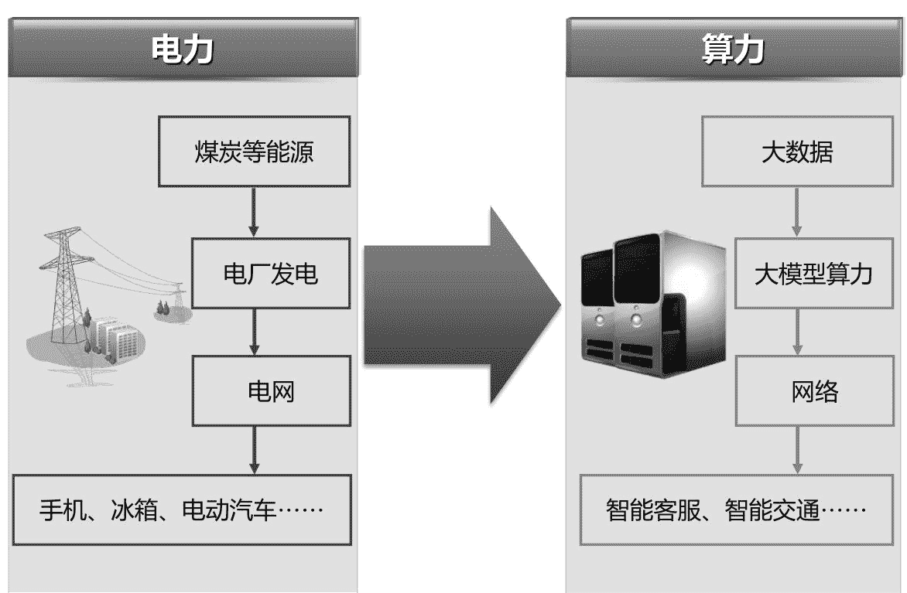

**图 4-7 从电力到算力**

未来，大模型算力在能力泛化、技术融合、研发标准化等方面的优势让其有能力支撑各种应用，成为人工智能技术及应用的新基座。正如发电厂和高速公路一样，大模型算力将成为各行各业应用人工智能技术的底座和创新的源头。

**数据**

资料显示，ChatGPT 有着多达 1750 亿个参数的模型，并在 2023 年初训练完成。模型训练的背后离不开大数据的支持，OpenAI 所使用的主要公共爬虫数据集有着超过万亿个单词的人类语言数据库。正是这些海量数据，使得 ChatGPT 展示出了强大的三种能力：

● 语言生成：遵循提示词（Prompt），然后生成补全提示词的句子。这也是目前人类与语言模型最普遍的交互方式。

● 上下文学习（In-context Learning）：遵循给定任务的几个示例，然后为新的测试用例生成解决方案。值得一提的是，GPT-3 虽然是个语言模型，但它的重点不是语言建模（Language Modeling），而是上下文学习。

● 世界知识学习：包括事实性知识（Factual Knowledge）和常识（Commonsense）。

以上三种能力都来自大规模预训练：在有 3000 亿个单词的语料上预训练拥有 1750 亿个参数的模型（训练语料的 60%来自 2016—2019 年的 Common Crawl 语料库，22%来自 WebText 语料库，16%来自书籍和报刊，2%来自维基百科）。其中的 Common Crawl 语料库是 2008 年至今一个网站抓取的大型数据集，数据包含原始网页、元数据和文本提取，它的文本涉及不同语言、不同领域。重点研究实验室一般会首先选取它的纯英文过滤版（C4）作为数据集。其中的 WebText 语料库是一个大型数据集，它的数据是从社交媒体平台 Reddit 所有输出链接网络中爬取的，每个链接至少有三个赞，代表了流行内容的风向标，对输出优质链接和后续文本数据具有指导作用（见图 4-8）。

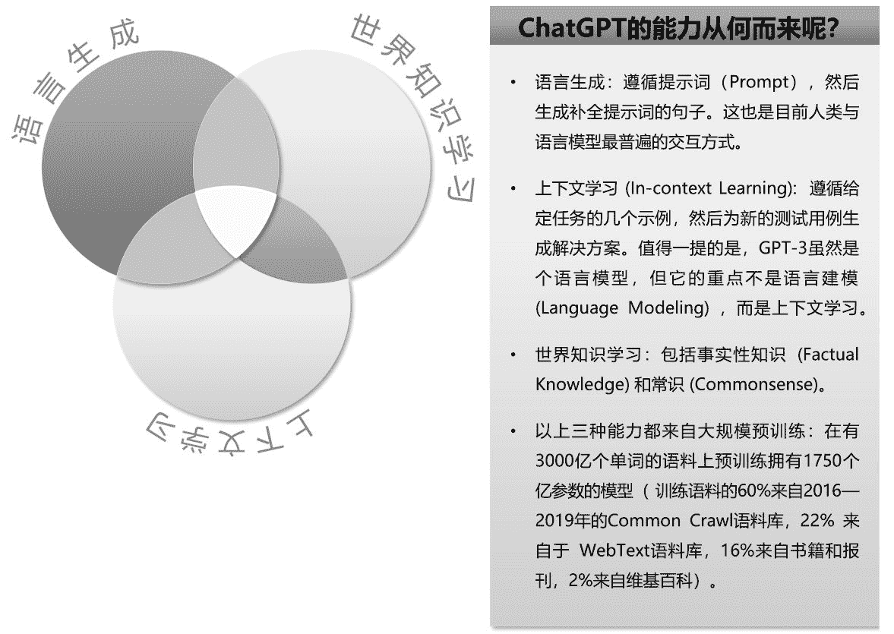

**图 4-8 ChatGPT 的数据来源**

关于 ChatGPT 上下文学习的能力来源及为什么上下文学习可以泛化，目前尚未有明确的剖析。有些人工智能领域专家推测，这种能力可能来自同一个任务的数据点在训练时按顺序排列在同一个 batch（批处理）中。未来，语言模型预训练促进上下文学习的原理，以及上下文学习行为与微调的协同原理值得进一步深入研究。

目前的 ChatGPT 在有 3000 亿个单词的语料上预训练拥有 1750 亿个参数的模型，据说 GPT-4 将是一个拥有超过 100 万亿级别参数的大模型（见图 4-9）。根据学术界的经验，深度神经网络的学习能力和模型的参数规模呈正相关。人类的大脑皮层有 140 多亿个神经细胞，每个神经细胞又有 3 万多个突触。所以，大脑皮层的突触总数超过 100 万亿个。所谓的神经细胞会通过这些突触相互建立联系。一旦 GPT-4 实现 100 万亿个参数规模，那么它就可以堪比人的大脑，这意味着它将达到与人类大脑神经触点规模同等的水平。如果这样，不仅意味着 GPT-4 可以改造人类的思想和具备创作能力，具有形成超越人工智能的专业能力和大众化的趋势，而且意味着它开始具备人类的思维能力，并有可能在越来越多的方面替代人类。

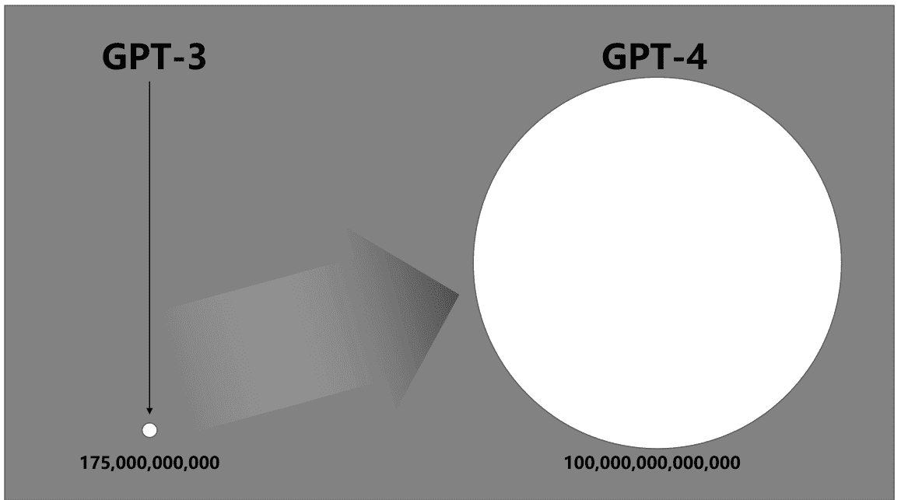

**图 4-9 大量的数据**

## 第五章 无限可能的未来图景

ChatGPT 这波冲击，对人工智能新兴行业及传统行业的智能化带来的影响都非常巨大，它内在的创新运行模式和新的技术及工程理念，以及对所有行业的影响，都需要我们重视和研究。未来类似 ChatGPT 的人机对话系统功能会越来越强大，各行各业都应该抓住难得的技术机遇，把握技术带来的红利，思考如何通过深度地融合新一代人工智能获得突破与发展，这很有可能开辟一些新的赛道，形成新的动能，诞生新的经济（见图 5-1）。

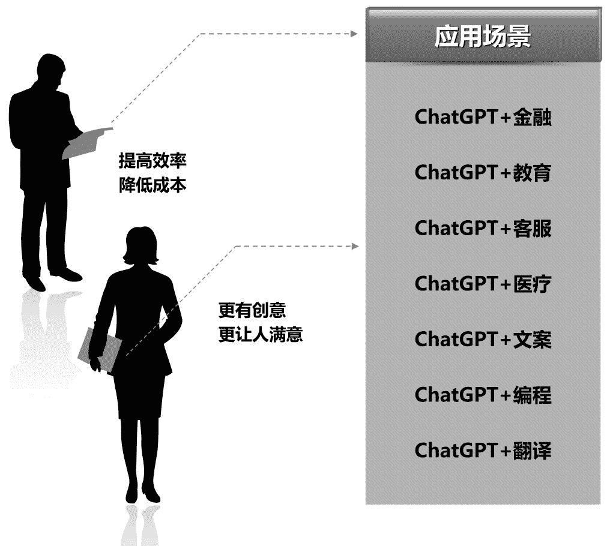

**图 5-1 应用场景**

ChatGPT 成为所谓未来人机交互的一个新入口，很可能改变现有 App 的交互方式，以更为自然的对话方式，让用户使用软件和调用接口，从而颠覆现有行业的生态。例如，未来在 Word 等文档编辑软件中，人们可以通过描述需求，让软件直接生成文字内容，或者生成一个图形，甚至直接进行修图等工作。在软件开发方面，ChatGPT 这种即时编程的方式，将改变传统的工作方式和开发规则，推动产业进入软件工程的新阶段。

现阶段的 ChatGPT 以高度拟人化的对话问答模式，带来更好的交互体验，它在短期内将进一步促进金融、媒体、医疗等许多领域自然语言处理的应用。例如，在金融领域，ChatGPT 利用其大模型能够大幅提升语义搜索能力，面对复杂多变的投资理财咨询，其能够准确地找到满足用户需求的咨询结果。比如招行信用卡基于 ChatGPT 撰写宣传稿，它写出了“生命的舞台上，我们都是基因的载体”“如果说基因给我们的生命带来了基础，那亲情便是对生命的深刻赋予。它不由基因驱使，而是一种慷慨的选择”等诗意十足的文案。在投研方面，业内首份采用 ChatGPT 撰写的行业研究完成度颇高，但与专业人士相比相去甚远。财通证券团队介绍，ChatGPT 在文字表意、标题撰写等方面均具有较高水平。在媒体领域，大量的稿件都可以用 ChatGPT 自动化生产，其独创性和创造力并不输于专业人员。未来，文字工作者应该积极地探索新技术来提高生产效率，比如让 ChatGPT 起草初稿，人类只需要在它的背后把控方向。在医疗领域，ChatGPT 完全可以替代专业人员为患者提供心理咨询、问诊服务和给出用药建议等。

除此之外，ChatGPT 在未来还可以有更多样化的应用前景。例如，开发者可以利用 ChatGPT 这样的底层平台，在大模型基础上根据不同行业和场景进行模型调优，从而创造出各类满足用户需求的应用产品或解决方案。据媒体报道，国外火爆的 Jasper，通过在 GPT-3 模型上微调，可以帮助用户撰写营销文案，甚至有人在上面完成了一部 12 万字的小说，IBM、Airbnb、Autodesk 等大企业都是其用户。普通用户可以免费试用能生成 1 万个单词的版本，之后可以用 29 美元购买能生成 2 万个单词的服务，或用 59 美元购买能生成 5 万个单词的服务。

**ChatGPT+金融**

人工智能已被广泛应用到投资、信贷、保险和监管等多个金融业务场景。目前，传统金融机构、大型互联网公司和人工智能公司纷纷布局金融领域，智慧银行、智能投顾、智能投研、智能信贷、智能保险和智能监管是当前人工智能在金融领域的主要应用，作用于银行运营、投资理财、信贷、保险和监管等业务场景，但整体来看人工智能在金融领域的应用尚不成熟。应用在金融领域的人工智能相关技术主要包括机器学习、生物识别、自然语言处理、语音识别和知识图谱等。

但是，目前的智能金融应用场景还处于起步阶段，大部分是人机结合式的，人工智能应用对金融业务主要起辅助性作用，“智能化”常常被各家金融机构包装成亮点，但效果始终不能令人满意，在真正落地的过程中总是充满槽点。

未来，随着 ChatGPT 在金融领域的深度应用，金融业务场景和技术应用场景都具有很强的创新潜力。从长远来看，在智能客服、智能投顾、推荐金融产品、智能投研等方面，ChatGPT 可能会对行业产生颠覆性影响（见图 5-2）。

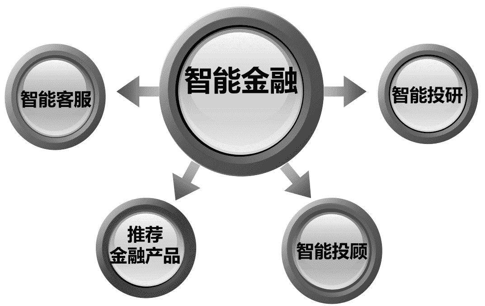

**图 5-2 智能金融的应用场景**

**（一）智能客服**

随着人力成本的提高、客户消费体验要求的提升，以及人工智能技术的发展，劳动力密集型的传统客服已经不能适应市场需求，因而智能客服开始出现，以提供有效的快速回复，使客服系统可以实现 24 小时全天候工作。智能客服通过网上在线客服、智能手机应用、即时通信等渠道，以知识库为核心，使用文本或语音等方式进行交互，可以理解客户的意图并为客户提供反馈服务。

ChatGPT 客服问答系统可以利用自然语言处理技术实现自动应答，主要解决一些重复性的服务性请求，应用相对比较成熟。对于处在价值链高端的金融业而言，人工智能技术将给金融领域中的服务渠道、服务方式、风险管理、授信融资、投资决策等各个方面带来深刻的变革式影响，成为金融业沟通客户、发现客户需求的重要决定因素。这不仅能够有效响应客户要求，而且大大减少了人工服务的压力，有效降低从事金融服务的各类机构的运营成本。

此外，ChatGPT 客服问答系统利用自然语言处理技术，将金融服务的内容和细节全面地抽取出来，形成客户可以简单明了地了解金融业务的参考，避免了客户深入研究金融服务的麻烦，大大提升了客户获取金融知识和信息的效率。同时，ChatGPT 客服问答系统可以应对复杂多变的投资理财咨询，能够准确地找到满足客户需求的咨询结果。

**（二）智能投顾**

智能投顾（投资顾问）最早在 2008 年左右兴起于美国，又称机器人投顾（Robo-Advisor），其依据现代资产组合理论，结合个人投资者的风险偏好和理财目标，利用算法和友好的互联网界面，在线为客户提供财富管理和投资建议等服务。

与传统投顾相比，智能投顾具有门槛低、费用低、投资范围广、透明度高、操作简单、可个性化定制等优势。因此，智能投顾更能满足投资者的需求。根据美国金融业监管局（FINRA）提出的标准，理想智能投顾服务包括：客户分析、大类资产配置、投资组合选择、交易执行、组合再选择、税负管理和组合分析。传统投顾和智能投顾都基于以上七个步骤，只是实施的方式不同，智能投顾本质上是技术代替人工来实现投顾。

投资者对于投资顾问的需求主要体现在“情绪管理”和“投资策略/建议”上：一方面，投资者在投资过程中容易产生贪婪或恐慌等情绪波动；另一方面，投资者对金融市场的信息了解相对较少，存在信息不对称问题（见图 5-3）。

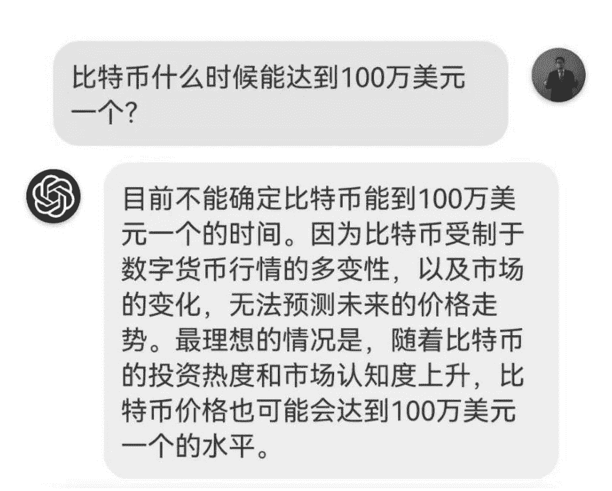

**图 5-3 在投资咨询中使用 ChatGPT**

随着人工智能的发展，智能投顾也以强劲的姿态进入我们的视线。其实，智能投顾并不是一个新概念，因为算法基础早在 20 年前就已然扎根成型，而智能投顾近年来的发展主要得益于大数据和计算力的提升。

智能投顾主要指根据个人投资者提供的风险偏好、投资收益要求及投资风格等信息，运用智能算法技术、投资组合优化理论模型，为其提供投资决策信息参考，并随着金融市场的动态变化对资产组合及配置提供改进建议。智能投顾不仅可以在投资配置和交易执行能力上超越人类，还可以帮助投资者克服情绪上的弱点。

ChatGPT 为投行行业带来了更高效的工作流程，它可以通过自然语言处理技术高效分析市场信息、提取关键信息，从而给投行行业带来更快捷、更精准的投行分析服务，提高投资效率和投资回报。ChatGPT 还可以通过收集、统计和建模用户历史交易行为，分析交易参与者的策略偏好，从而识别出潜在的欺诈行为。例如，ChatGPT 可以识别出用户重复性交易的行为特征，以及交易参与者之间不一致的行为特征，并根据模型对其进行预测，以防止金融损失。

**（三）推荐金融产品**

ChatGPT 的推荐金融产品系统主要利用人工智能算法预测用户的金融需求，根据用户属性、行为及投资风格，结合专家经验对用户的金融需求进行实时分析，并且进行金融产品的推荐。ChatGPT 自然语言处理技术提供了一种自动获取用户属性信息的功能，在自动识别用户意图、行为和兴趣的同时，便于将金融产品个性化地推荐给用户，从而满足不同用户的金融需求。

**（四）智能投研**

金融业对数据具有极强的依赖性，工作人员每天用一半的时间收集和处理数据。因此，如何节省收集和处理数据的时间，是金融业对人工智能提出的需求。智能投研具有基于知识图谱和机器学习等技术，收集并整理信息，形成文档，供分析师、投资者等使用的能力。智能机器的效率较高，但创新性不足，而人机结合将大大提高决策的效率和质量。

对金融机构来说，人工智能将促进更多金融机构使用人工智能实现日常业务流程自动化，其能够有效识别用户需求并提供定制产品，显著提升业绩。对消费者与投资者来说，人工智能可以降低消费者和投资者的金融服务成本，促进其获得更好的金融服务。

**ChatGPT+教育**

智能教育正在改变现有教学方式，解放教师资源，使教育理念与教育生态产生深刻变革。当前全球许多国家都在加速推进教育教学创新，积极探索教育新模式，开发教育新产品。

在改变现有教学方式方面，一是实现教学成果智能测评，提升教学质量。利用人工智能技术对数字化、标准化的教师教学行为与学生学习情况进行测试、分析与评价，帮助师生快速精准定位问题，实现针对性、科学性教学，提升教学效果。二是构建个性化学习系统，激发学生自主学习动力。教育机构通过对学生学习特点进行知识画像，推送针对性教学内容，进一步激发学生自主学习意愿。

例如，智能辅导系统。自动语音识别和自然语言处理等人工智能技术的发展促进了智能辅导系统的发展，其已经从实验室迅速转移到实际应用中，能够模仿教师指导不同学科的学习。当学生遇到问题时，系统会进行提醒，根据答案提供即时反馈，甚至为每个学生设计个性化的学习方案。

再如，学习分析。这一领域是由学习过程中学生数据的测量、收集和分析组成的，由在线学习系统的发展推动，是数据收集的“天然载体”。这种合作可以促进教育领域的新科学发现，并促进大规模学习的改进。事实上，目前人工智能技术已经被用于分析学生的动机、行为和结果。这些研究的目的是发现学生最常见的错误，预测哪些错误有导致失败的风险，并向他们提供实时反馈。事实上，专家相信，学习分析将加速开发个性化的学习工具。

以教育领域为例，从媒体报道中，可以整理出如表 5-1 所示的 ChatGPT 教学应用的 16 种用途。

**表 5-1 ChatGPT 教学应用举例**

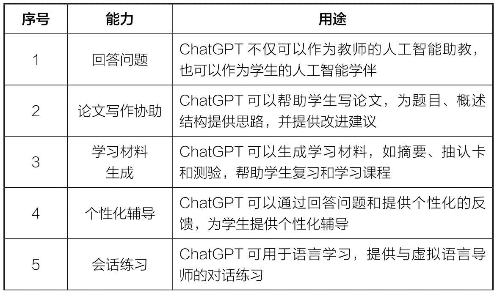

续表

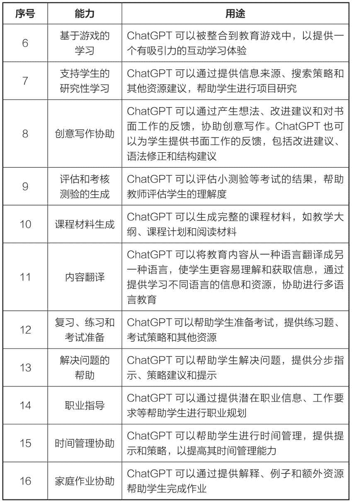

据媒体报道，ChatGPT 除了在高校有着一席之地，其适用范围已经拓展至学龄前儿童和中小学阶段了。据说，有一位居住在国内二线城市的 4 岁小孩的妈妈向记者明确表示，她每天都会登录 ChatGPT，和它聊会儿天，并且把它推荐给其他的妈妈们，解答孩子的教育问题（见图 5-4）。一些中小学的老师也在思考将 ChatGPT 融入自己的教学工作中。一名刚入职的小学语文老师解释说，小学生由于年龄小、心智尚未发育成熟，在上课时不仅需要知识上的辅导，更需要心理上的全方位帮助，她经常询问 ChatGPT 诸如“如何矫正小学生行为习惯”“老师如何与内向的小学生沟通”等问题。

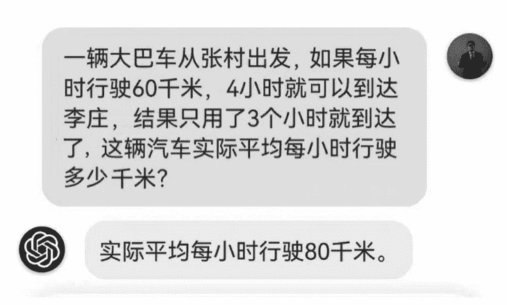

**图 5-4 用 ChatGPT 完成小学数学作业**

不久的将来，我们可以利用 ChatGPT 加快推动人才培养模式、教学方法的改革，构建包含智能学习、交互式学习的新型教育体系。要开展智能校园建设，推动人工智能在教学、管理、资源建设等全流程上的应用；开发立体综合教学场、基于大数据智能的在线学习教育平台；开发智能教育助理，建立智能、快速、全面的教育分析系统；建立以学习者为中心的教育环境，提供精准的教育服务，实现日常教育和终身教育定制化。

**ChatGPT+客服**

近些年，各大厂都推出了智能聊天助手，Google 有 Bard，苹果有 Siri，亚马逊有 Alexa，微软、IBM、Meta 也都有自己的智能聊天工具或相关服务。这些所谓的智能聊天助手常常答非所问，把用户搞得哭笑不得；电商平台那些客服机器人的使用体验更是让人火大。面对人类千奇百怪的个性化和众口难调的需求，客服机器人成为“人工智障”的代表，最后还是得人工客服上阵。“人工智障”聊天机器人显然让普通人对人工智能的发展感到失望，无论你用什么算法模型，服务器有多厉害，数据库有多庞大，大众只关心四个字——用户体验。

除了帮助用户获得对答如流的体验，在智能客服领域，AI 大模型的通用智能能力能否助力一个行业构建“大脑”，进而带动整个产业发展？或许需要先解决搭建企业级智能客服面临的三大痛点（见图 5-5）。

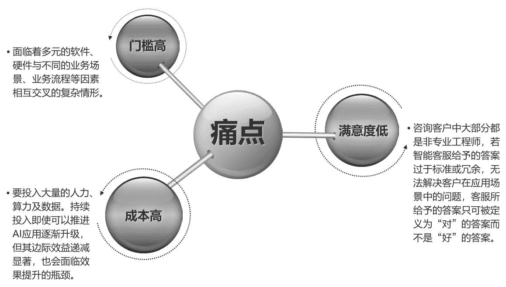

**图 5-5 智能客服的三大痛点**

一是门槛高。面向 B 端的数据中心智能服务所面对的场景更加复杂、知识门槛更高。数据中心服务往往面临着多元的软件、硬件与不同的业务场景、业务流程等因素相互交叉的复杂情形，如何让 AI 与复杂的数据、业务场景实现融合，在用户服务的全生命周期，实现专业服务端到端智能化，是服务转型过程中要突破的难点。

二是满意度低。咨询客户中大部分都是非专业工程师，若智能客服给予的答案过于标准或冗余，无法解决客户在应用场景中的问题，客服所给予的答案只可被定义为“对”的答案而不是“好”的答案。

三是成本高。任何领域的智能化转型都要投入大量的人力、算力及数据。持续投入即使可以推进 AI 应用逐渐升级，但其边际效益递减显著，也会面临效果提升的瓶颈。

这三大痛点对企业级智能客服系统提出了更加具体的要求：要具备理解上下文的自然语言能力，且通过多轮对话的形式识别用户的意图；要具备无须持续标注和训练的阅读理解能力，可以在降低训练投入的同时，实现高精度回答的效果。ChatGPT 恰好完全可以满足要求（见图 5-6）。

自从有了 ChatGPT，AI 终于有了和人类对话的资格。而这种一对一随叫随到的 24 小时 VIP 服务体验，不亚于拥有庞大算力的 AlphaGo 和围棋大师一对一下棋。这样的直观体验，让普通人第一次感受到了 AI 带给人的“日常欢愉”。

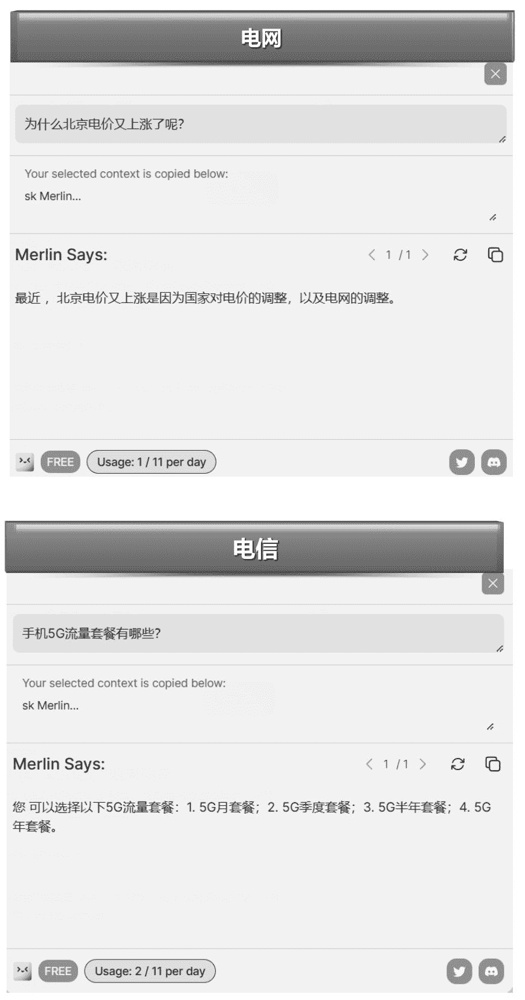

**图 5-6 智能客服中 ChatGPT 的试用场景**

**ChatGPT+医疗**

据媒体报道，我国 50%以上的医生平均每天用于写病历的时间超过 4 小时，相当一部分医生写病历的时间超过 7 小时；国内部分放射科仍采用传统书写方式，由专门的记录员记录医生主诉内容，而后录入计算机中，效率低下。

所以，一直以来，医疗都被视为人工智能的一个有潜力的应用领域。未来几年，基于人工智能的应用将有效辅助医护人员，改善人们的健康状况，提高人们的生活质量。该领域的主要应用包括临床决定支持、患者监测和指导、帮助手术或患者护理的自动化设备，以及医疗保健系统管理。近期，人工智能技术在医疗领域取得了很大成功，包括通过挖掘社交媒体数据来推断可能的健康风险，通过机器学习来预测患者的风险，以及利用机器人做手术等，这在很大程度上拓展了人工智能在医疗领域的应用潜力。但是，医疗专业人员和患者交互方式的升级将是未来的一个核心挑战。

医疗领域中的 ChatGPT 基于特定领域的知识系统，可以让医生和患者通过文字或语音的方式，与人工智能进行类人级别的交流交互，通过智能语音技术（包括语音识别、语音合成和声纹识别）和自然语言处理技术（包括自然语言理解与自然语言生成），实现人机交互，目的是解决使用者某一特定的需求。

ChatGPT 在医疗领域，完全可以替代专业人员为患者提供导诊、问诊和服药建议等（见图 5-7）。

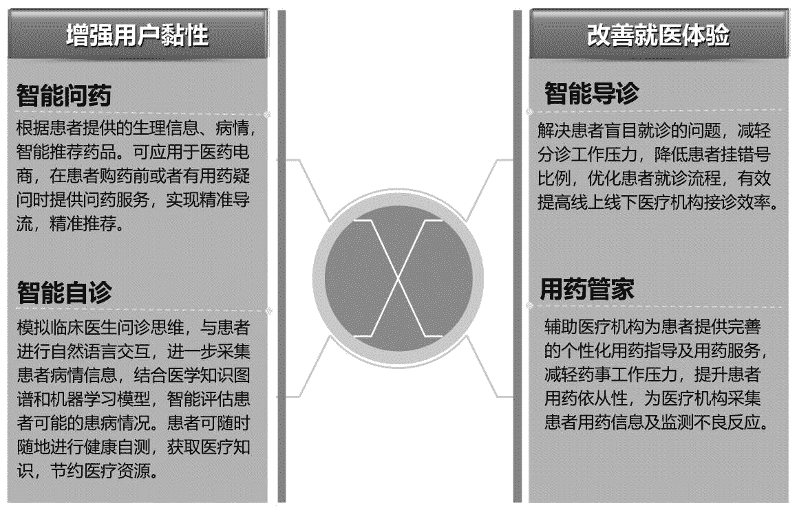

**图 5-7 智能医疗的场景应用**

**（一）智能导诊**

相对于传统的诊断系统，作为一种人工智能技术，ChatGPT 可以使用海量的病例数据，模仿人的行为，从而自动诊断疾病。自动诊断系统的优势在于其更准确，可以有效帮助医生准确诊断疾病，从而准确、迅速地治疗疾病，提高医疗水平。而且自动诊断系统也可以为医学研究提供质量更高的数据和分析结果，有助于指导医院的检测、诊断和治疗过程。

例如，ChatGPT 可以根据患者的症状、体征和化验报告等信息，对疾病进行诊断，并分析患者的病情，为治疗方案提供建议。ChatGPT 还可以根据诊断报告中的数据，使用预测模型，以精准地预测患者的病情发展趋势，从而帮助医生为患者制定最佳治疗方案。

通过 ChatGPT，医疗机构不仅可以减少医护人员的检查和诊断时间，还能够节省大量的诊疗费用，从而改善患者的体验。ChatGPT 还可以解决患者盲目就诊的问题，减轻分诊工作压力，降低患者挂错号比例，优化患者就诊流程，有效提高线上线下医疗机构接诊效率。

人工智能可以用作有效的决策支持系统，为医生提供有价值的数据以用于诊断和治疗。人眼可能会忽视 CT 扫描中的微小异常，但经过训练的人工智能却能跟踪最小的细节。一位 IT 领域的专家告诉“医学界”，ChatGPT 对于临床医学可能会有很大的帮助，毕竟医生的记忆力有限，无论如何也比不过计算机的强大存储能力。

**（二）智能自诊**

ChatGPT 可以模拟临床医生问诊思维，与患者进行自然语言交互，进一步采集患者病情信息，结合医学知识图谱和机器学习模型，智能评估患者可能的患病情况。患者可随时随地进行健康自测，获取医疗知识，节约医疗资源。

首先，ChatGPT 可以与医学知识库和诊断报告进行交互，帮助患者进行诊断。例如，ChatGPT 可以根据患者症状、体征和化验报告等信息，对疾病进行准确的诊断，以及分析病情走向，为治疗方案提供参考。

其次，ChatGPT 可以帮助医疗信息自动搜索系统快速识别出专业医疗服务机构的信息，自动检索合适的医疗保健机构，从而帮助患者更容易地找到合适的服务机构。此外，ChatGPT 还可以协助医疗信息自动搜索系统对患者及其家属的病情和诊疗过程进行实时监控，以便及时发现变化，快速做出应对。

最后，ChatGPT 可以为医疗信息自动搜索系统提供个性化推荐服务。根据不同患者的病情和病史，ChatGPT 可以自动提供最有价值的诊断和治疗方案，从而节省医疗资源，提高医疗服务质量。

**（三）智能问药**

根据患者提供的生理信息、病情，智能推荐药品。

首先，ChatGPT 可以帮助医疗信息自动搜索系统快速检索与诊断和治疗有关的研究、文献等信息，如在新药的研发中，可以帮助医生快速检索出相关的药物，以便更快地找到有效的药物。此外，ChatGPT 还可以通过自动搜索技术识别前沿研究、基因组序列和疾病风险，从而提供全方位的医疗信息搜索服务。

其次，可应用于医药电商，在患者购药前或者有用药疑问时提供问药服务，实现精准导流，精准推荐。例如，ChatGPT 可以识别患者的口头描述，根据其传达的内容，自动显示相关医疗建议，帮助其更快找到所需信息。

**（四）用药管家**

辅助医疗机构为患者提供完善的个性化用药指导及用药服务，减轻药事工作压力，提升患者用药依从性，为医疗机构采集患者用药信息及监测不良反应。

综上所述，ChatGPT 对医疗系统的帮助是显而易见的，能够有效地提高医疗效率，为患者提供更优质的医疗服务。

**ChatGPT+文案**

文案不仅仅指广告中的标题、副标题、活动主题、活动介绍，还包括广告策略、创意图片、视频等，它们都是文案不可分割的一部分。它们所构成的整体共同服务于背后的目标，比如品牌传播的目标是让用户喜欢其品牌和产品，实现转化等。

我们都会写东西，但让人觉得好、感受到产品或服务的价值，且对你所写的内容感兴趣的文案，才算好文案。大部分文案都以商业为目的，通过描述产品的卖点，迎合甚至创造消费者的需求，牢牢把控消费者的心理，激发其购买欲望并促使其产生购买行为，最终达成销售目标（见图 5-8）。

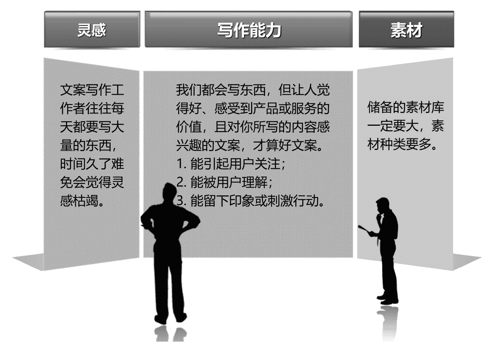

**图 5-8 文案工作的难度**

既然文案的核心作用是传递产品价值、影响他人看法或感受，促成行动，那么就要求你描述出来的东西卖点突出、能撬动欲望、制造转化。不管我们最终以视频、音频还是图像形式呈现出来，都需要先用文字描述，然后用 ChatGPT 转化为对应的呈现形式（见图 5-9）。

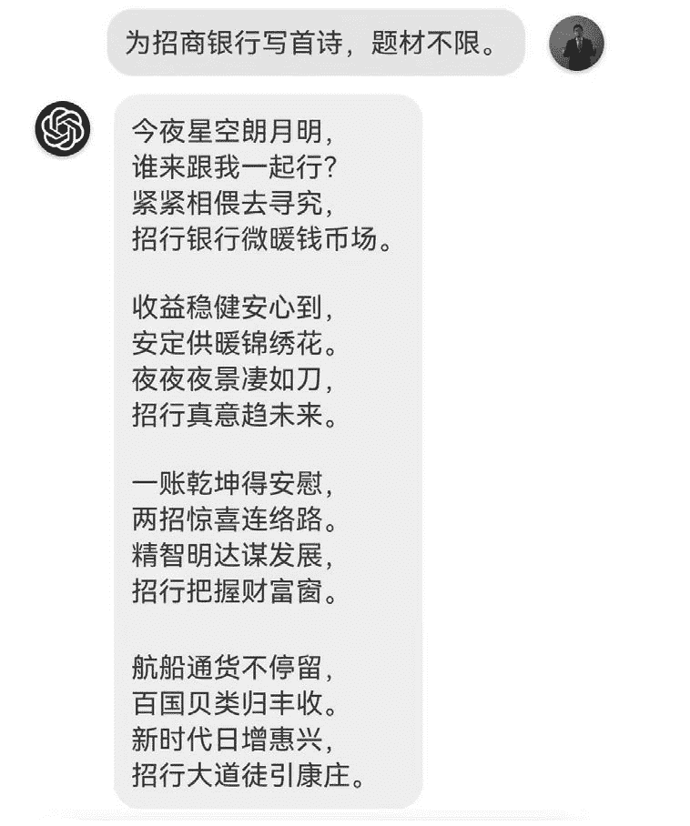

**图 5-9 创作文案中 ChatGPT 的试用场景**

文案写作可谓生成式 AI 最吸人眼球也最常见的用途之一了。互联网营销的成本越来越高，而且难度也越来越大——好的营销需要大量的时间、技巧及很强的能力。生成式 AI 的出现，给了营销团队除去外包与搭建团队的第三种方案——任何人都可借助这一强大的 AI 助手，顺利写出电子邮件、博客文章、社媒推文等，而且速度比以前快数倍。特别是对于初创公司来说，这种方案将大大减少公司所花费的成本与精力。

类似 Jasper 或 copy.ai 这样的工具使用的都是和 GPT-3 类似的算法。但它们能做的远不止文章写作，还有诸如创意宣传、产品描述等更多类型的创作。从长远来看，这会对整个文案和营销行业产生巨大影响，在未来人类和 AI 之间将产生一种新的伙伴关系。

如果你想要在这方面进行创业，需要注意的是竞争会十分激烈——像 Jasper 这样的公司，如果不想被竞争对手超越，就要迅速建立起行业壁垒，因为新的强力对手已经越来越多。事实上，这些公司使用的算法都差不多，几乎都是 GPT-3 的变体，并且都不是自己独立开发的。此外，这些算法在更广泛主题的内容生成方面还远远不够完美，要想覆盖更广的人群，可能还需要一点时间。或者，等到 GPT-4 出现后，它可能才是我们真正需要，且能大规模使用的技术产品。

另外，很多现有工具和平台已经开始推出自己的 AI 助手。因此，像 Jasper 等一站式平台的发展或许会受冷。可以说，这个领域留给初创公司的机会不多了。

**ChatGPT+编程**

随着时代的节奏越来越快，越来越多的人习惯用手机或计算机学习、工作，在此过程中会使用许许多多的软件。软件设计的所有部分都是通过计算机程序代码实现的，编程是基于软件的设计，它有着有统一规范的程序书写规则，这保证了软件程序的可理解性。

很多人认为，程序员进行软件编程是个高难度工作，但是 ChatGPT 也做到了。至少，目前 ChatGPT 可以在开发编程行业做到如下两点：

第一，初学者和兼职程序员可以更高效地编写中等质量的代码。

第二，将旧代码从旧语言转换成新语言会变得更容易。

当然，对于开发工程师来说，现阶段 AI 工具生成的代码在结构、准确度上的问题很多，需要人工进行审查。所以它对于工程师的帮助仅仅是提高生产力 1.5 倍——看起来提升不少了。未来，我们可以将 ChatGPT 集成到开发环境，更好地整合这些技术，以帮助开发者提高效率。更具体地说，一些工具可能会让公司用现有代码和优秀用例训练这些算法，打造出智能助手之类的工具来协调所有存储库的代码及指导新员工等（见图 5-10）。

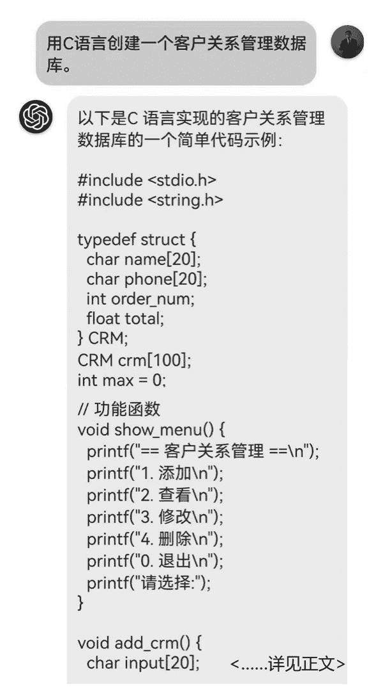

**图 5-10 软件开发中 ChatGPT 的试用场景**

问：用 C 语言创建一个客户关系管理数据库。

答：以下是 C 语言实现的客户关系管理数据库的一个简单代码示例。

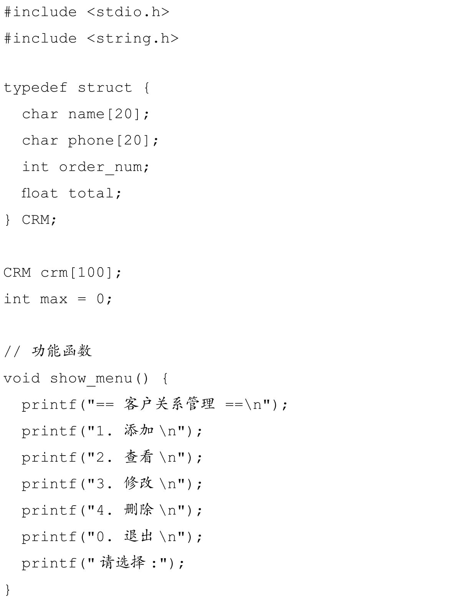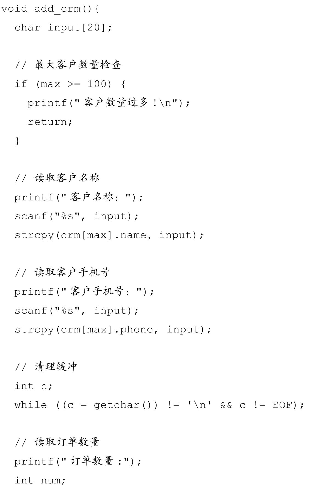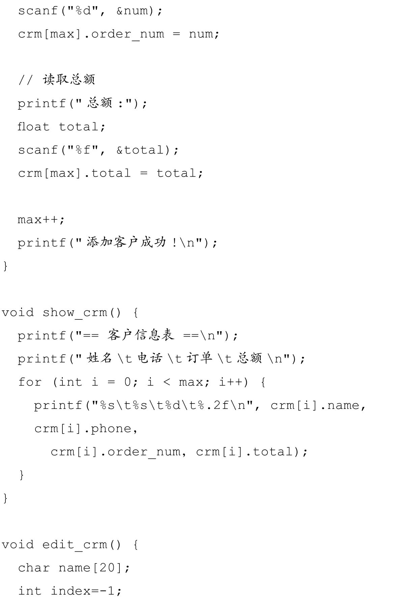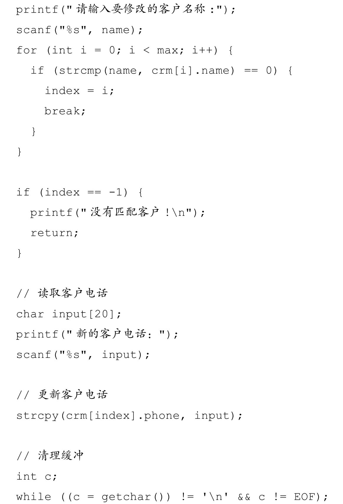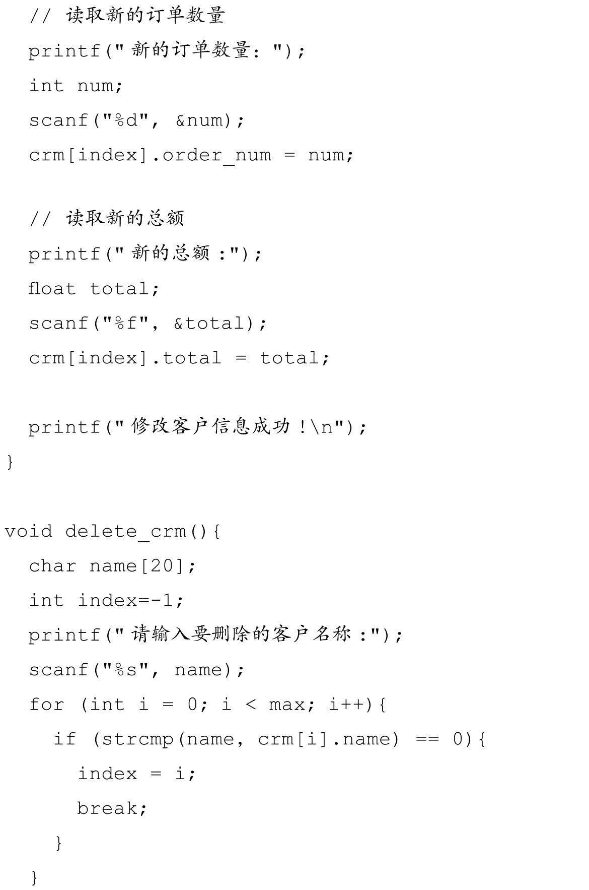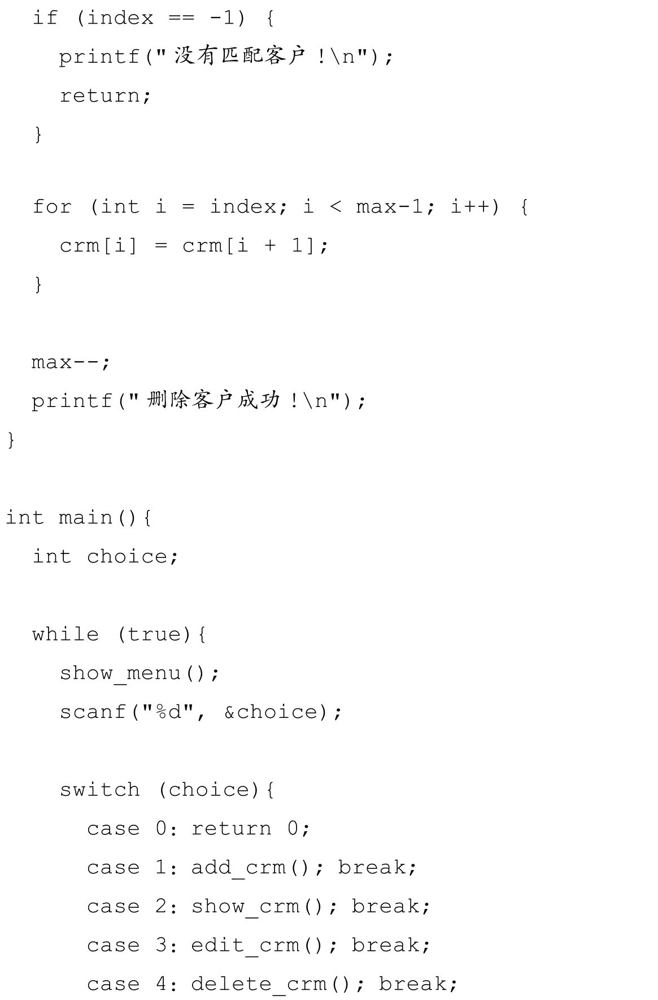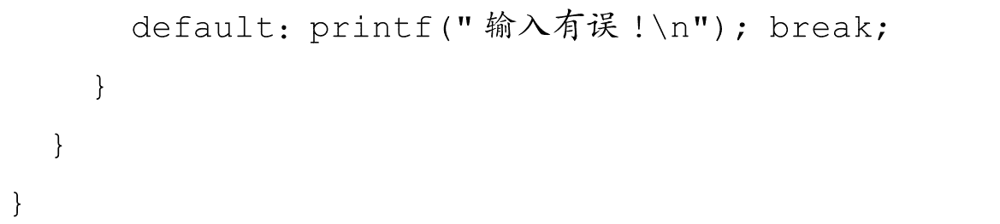

**ChatGPT+翻译**

清末新兴启蒙思想家严复在《天演论》的“译例言”中提道：“译事三难：信、达、雅。求其信，已大难矣！顾信矣，不达，虽译，犹不译也，则达上焉。”。何谓“信、达、雅”，通俗来讲就是译文要符合汉语言的特点，注重句子的完整性，语法结构的顺畅度及语言载体的文学性。

“信”，简单来说就是要忠于原文，不删减、不歪曲、不随意添加。不过西方文法与中国迥殊，如果完全保留原文形式，则必不可通，因此“信”并不是一味地照搬照抄原文形式，而是将原文按照译入语语法形式做适当调整，从而使译语准确完整地表达出来。

“达”即译文顺畅易懂。严复在谈到“达”的时候就讲到，译者需要在下笔之前仔细阅读原文并充分理解，因为源语和译语存在语法上的差别，需要译者对语句顺序进行相应调整。因此真正意义上的“达”其实是强调译者应该理解原文，并根据句法规则进行相应调整，并不是一味地强调译文通顺。

至于“雅”，在界定这一翻译标准时，严复阐述得比较模糊，只是说译文要求其“尔雅”，后来许渊冲先生进行了补充，他觉得“信”是翻译的本体论，“达”是翻译的方法论，而“雅”则是翻译的目的论。因此译文追求“雅”并不是一味地追求文雅、高雅，而是要求译文尽量还原原文意境和神韵。

ChatGPT 的翻译达到了令人难以置信的“信、达、雅”的水平。例如，其将《大话西游》里的一段经典台词翻译成日文，极具文采（见图 5-11）。

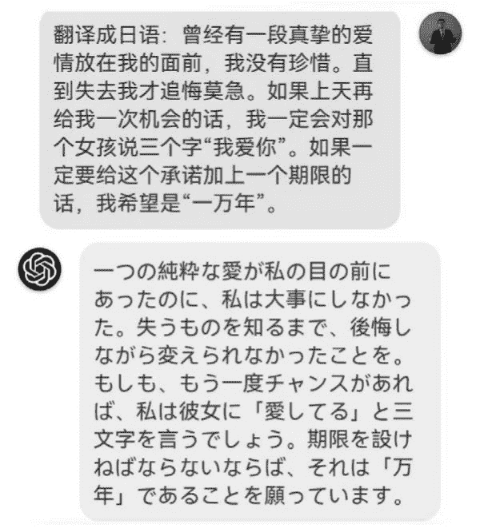

**图 5-11 翻译中 ChatGPT 的试用场景**

# 第二篇 AIGC——真正意义的智能，颠覆性的变革

人工智能懂创作、会写诗、会作曲、会画画，可以说是技术的一个跨越式升级。虽然人工智能在生活中已经普及，比如我们习惯用工业机器代替人去喷漆、焊接、搬运重物，比如坐高铁、坐飞机、住宾馆时的人脸识别，比如金融和商业领域的人工智能完成复杂的计算等。但是，如果人工智能要想更接近人，那就必须具备人类的创作能力。这就是 AIGC 的意义。

## 第六章 瞬间的风靡全球

语言是人类最基本的社会工具，也是每个人最基本的生存技能。在人工智能时代，语言将不再只是交流的工具，更是生产工具！语言将直接生成文本、图像、音频、视频，甚至是 3D 模型等更多未知的流媒体形态。未来几年，我们将看到基于 AIGC 的人工智能内容生产范式呈井喷式发展。

AIGC 是一项全新的技术，目前人们对 AIGC 技术究竟是什么，依旧没有形成广泛的共识，但从其英文（AI Generated Content）来看，所谓 AIGC 即“利用人工智能技术来生产内容”。

以往的人工智能只是模仿人类做“已知”的事情。例如，人脸识别。首先通过摄像头拍摄人脸图片，识别人脸的大小和定位。然后，利用 CNN（卷积神经网络）提取人脸特征，通过逐层迭代，根据人脸特征在人脸图片大数据中进行查找。最后，判定人脸是哪种表情（见图 6-1）。

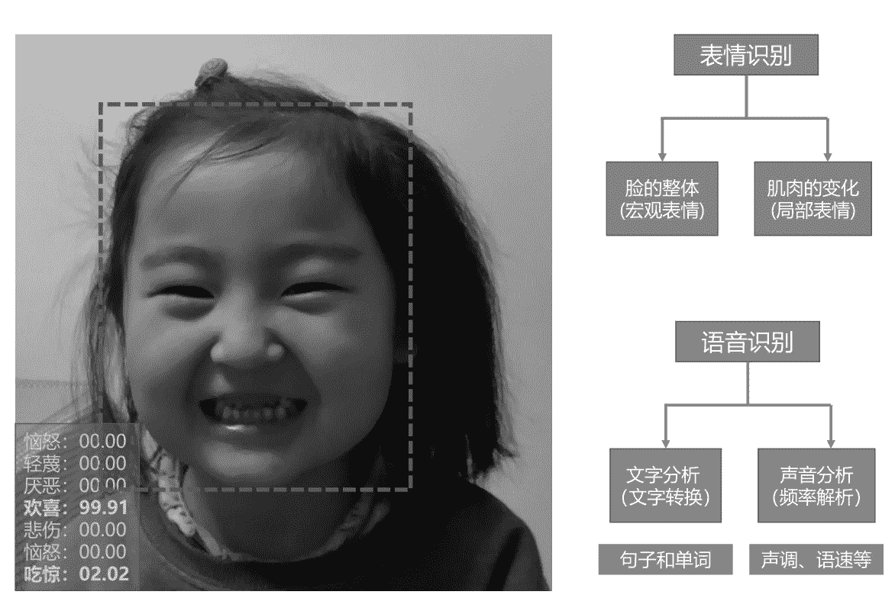

**图 6-1 人脸识别的案例**

人类不仅擅长分析事物，也擅长创造。我们写诗、设计产品、制作游戏、编写代码。不久之前，机器还没有机会在创造性工作上与人类竞争。但最近，机器开始尝试创造有意义和美妙的东西，这个新类别被称为 AIGC——“生成式 AI”，这意味着机器正在生成新的东西，而不是仅限于分析已经存在的东西。

在没有 AIGC 之前，不管你想从事绘画还是音乐等艺术创作，都需要数年的学习、练习和经验技巧的积累。而 AIGC 时代，一个人可能只需要用几天的时间熟悉 AIGC 工具，掌握相关的技巧与参数，就能创作出想象力丰富、色彩艳丽的艺术作品。这种创作模式，造就了内容生产力的巨大变革，可以创造“未知”的作品，极大地提升了艺术创作的效率。

克莱·舍基在《认知盈余》中断言，内容创作者将迎来创作的智能化时代——随着现代社会技术的进步，人们有了更多的闲暇时间。AIGC 用最简单的方式给了每一个人释放“认知盈余”的机会，大幅降低了内容创作的门槛和成本，并帮助人们参与到更广泛的知识共享活动之中。创作者可以利用免费或者廉价的 AIGC 工具，以更加快速高效的方式进行多样化的内容创作。内容创作者将从烦琐的工作中抽离出来，特别是那些自由职业者和自媒体工作者，他们可以更加专注于内容创作本身，把一切生产行为都交给 AI，甚至发布和营销推广都可以交由 AI 一并完成。

2022 年 8 月，美国设计师杰森·艾伦（Jason Allen）使用一款名为 Midjourney 的 AI 图像生成器制成了一幅名为《太空歌剧院》的画作，该作品获得了科罗拉多州艺术博览会“数字艺术类”冠军（见图 6-2）。荣誉的背后，引发了各界人士的好奇，他利用什么高科技技术创作了这幅作品呢？后来大家发现，背后的技术正是 AIGC。这个事件在让大家了解 AIGC 的同时，也让大家看到了更多可能：任何人只要有想象力、文字表达能力，就可以从事艺术创作，这是过去的 AI 做不到的，也是令很多人想象不到的事情。

**图 6-2 画作《太空歌剧院》**

参考学界及业界的诸多观点，AIGC 其实并不是一门单一的技术，也不是一类具象化的产品，其本质是利用 AI 赋能技术而形成的一种高自由度且低门槛的内容生产能力，而这种能力将服务于各类场景中的创作者与生产者。事实上，AIGC 并不是新鲜事物，人们所熟悉的 DeepMind、会作诗的微软小冰及近期横空出世的 ChatGPT，都可被视为 AIGC 发展过程中的重要突破。

AIGC 正在变得不仅更快、更便宜，而且在某些情况下比人类创造得更好。从社交媒体到游戏，从广告到建筑，从编程到平面设计，从产品设计到法律，从市场营销到销售，每一个原来需要人类创作的行业都正在被机器重新塑造……AIGC 可以处理的工作包括知识性工作和创造性工作，而这涉及数亿的人工劳动力。AIGC 可以使人工的效率和创造力大幅提高，不仅变得更快和更高效，而且比以前能力更强。因此，AIGC 有潜力产生数万亿美元的经济价值。

我们可以将创作者生态的发展分成三个阶段：专业生成内容（PGC）时代、用户生成内容（UGC）时代，以及即将到来的 AI 生成内容（AIGC）时代（见图 6-3）。

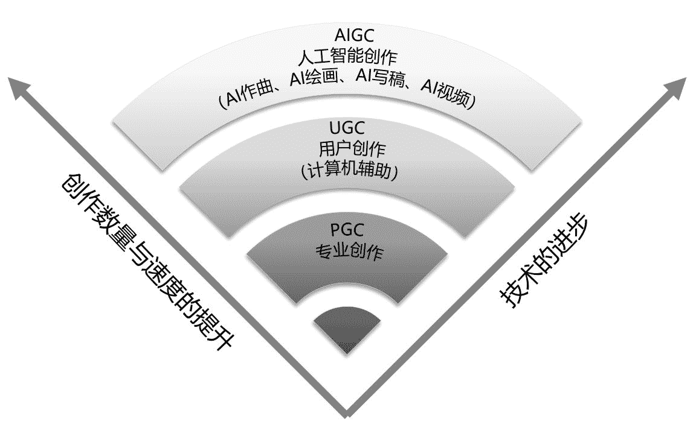

**图 6-3 创作者生态的进化**

在 PGC 时代，尽管专业化的内容能够为用户带来极佳的体验，但由于生产成本较高，产能往往跟不上需求。另外，由此诞生的 UGC 模式虽然能够大大降低生产成本，也能解决 PGC 的产能瓶颈，但海量内容参差不齐，尽管生产成本降低了，但用户对于优质内容的搜寻成本却在持续提升。

换句话说，一边是生产成本，另一边是搜寻成本，供给与需求的生产效率都有极大的提升空间。而借助 AI，一方面能够通过持续深度地学习提升内容的专业性，另一方面也能够辅助专业创作者，提升创作效率，供给与需求之间的这条“效率鸿沟”也因此被缝合。

未来，AIGC 将在很多领域代替人类的基础性工作。以 ChatGPT 为例，我们能够确定的是，它除了能更好地缝合“效率鸿沟”，也已具备很好的内容总结能力，能帮助人们解决具体问题。ChatGPT 在商业写作、人文创作及日常生活等应用场景中，已具备足够的想象力，这种借助 ChatGPT 的视角生成内容的方式在某种程度上确实能够取代一部分的初级内容生产者。

不只是在销售领域，在广告行业，AIGC 可以生成广告内容和广告创意，以提高效率和增加创造性；在新闻行业，它可以生成新闻报道和摘要，以提高报道效率和质量；在娱乐领域，它可以生成音乐、电影和游戏内容，以提升效率；在教育领域，它可以生成教材、教学内容和课程大纲，以快速构建教学内容。

总之 AIGC 的应用场景涉及企业经营的销售、策划、运营、开发、财务等多个部门，因此它几乎可以应用于所有领域所有行业，帮助企业提高生产力，赋能企业的数字化转型与降本增效。

## 第七章 幕后的技术路径

当然，AIGC 能力的提升，并不是一蹴而就的，而是经历了漫长且复杂的“模型突破—大幅提升—规模化生产—遇到障碍—再模型突破—大幅提升”的循环发展过程。而 AIGC 要实现商业化落地应用，走进人类生活，就必须在资源消耗、学习门槛等方面做到平民化。

AIGC 的成功主要得益于基础的生成算法模型不断突破创新。比如为人熟知的 GAN、Transformer、Diffusion、CLIP、LLM 等（见图 7-1），这些模型的性能、稳定性、生成的内容质量等不断提升。得益于生成算法的进步，AIGC 现在已经能够生成文字、代码、图像、语音、视频、3D 物**（**二**）**体幕等后各的种技类术型路的径内容了。

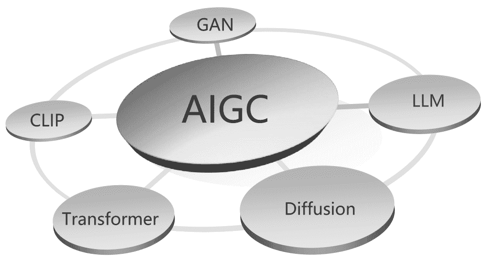

**图 7-1 AIGC 的技术支撑**

**LLM**

AIGC 开创了 LLM 主导内容生成的时代。人类将跑步进入传统人类内容创作和人工智能内容生成并行的时代，进而进入后者逐渐走向主导位置的时代。这意味着传统人类内容创作互动模式将转变为 AIGC 模型互动模式。预训练模型，即基础模型、大模型，引发了 AIGC 技术能力的质变。虽然过去各类生成模型层出不穷，但是它们使用门槛高、训练成本高、生成的内容简单和质量偏低，远远不能满足真实内容消费场景中的灵活多变、高精度、高质量等需求。而预训练模型能够满足多任务、多场景、多功能需求，能够解决以上诸多痛点。预训练模型显著提升了 AIGC 模型的通用化能力和工业化水平，同一个 AIGC 模型可以高质量地完成多种多样的内容输出任务，AIGC 模型成为自动化内容生产的“工厂”和“流水线”。目前业界主流的 AIGC 模型大多达到了千亿级、万亿级参数量的水平。通过学习各行各业的数据，它除了能给出相较于小模型更准确的预测结果，也展现出了惊人的泛化能力、迁移能力，产出了质量更高、更智能的内容，这也是当前 AIGC 让人眼前一亮的原因。

**Transformer**

在自然语言处理系统中，“Transformer”是一种融入注意力机制和神经网络模型领域的主流模型和关键技术。Transformer 具有将所处理的任何文字和句子“向量”化或“矢量”化，最大限度反映精准意义的能力。ChatGPT 使用的核心技术之一也是 Transformer，这从其全称 Chat Generative Pre-trained Transformer 上也能看得出来。Transformer 技术是近几年人工智能技术最大的亮点之一，它是 Google 于 2017 年提出的一种采用注意力机制的深度学习模型，可以按输入数据各部分的重要程度，分配不同的权重。Transformer 的精度和性能都要优于之前流行的 CNN（卷积神经网络）、RNN（循环神经网络）等模型，大幅提升了模型训练的效果，让人工智能得以在更大模型、更多数据、更强算力的基础上进一步增强能力。此外，它还具有很强的跨模态能力，不仅在自然语言处理领域表现优异，在语音、图像方面也显示出了优异的性能（见图 7-2）。

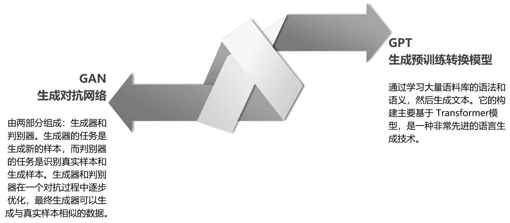

**图 7-2 GAN 与 GPT 的比较**

**GAN**

在深度学习模型的迭代上，AIGC 领域最早出现的一个深度学习模型为生成对抗网络（GAN），尽管它曾被称为“21 世纪最强大的算法模型之一”，但也存在着生成图像分辨率较低、新图像创意不足等问题。

2014 年，GAN 诞生，真正教会 AI 自己画画。GAN 包含两个模型，一个是生成网络 G（G 模型），一个是判别网络 D（D 模型）。G 模型负责用接收到的随机噪声生成图片，D 模型则要判断这张图片是 G 模型画的还是现实世界本就存在的。G 模型、D 模型互相博弈，能力不断提升，而当 D 模型不再能判断出 G 模型生成的图片时，训练就达到了平衡（见图 7-3）。

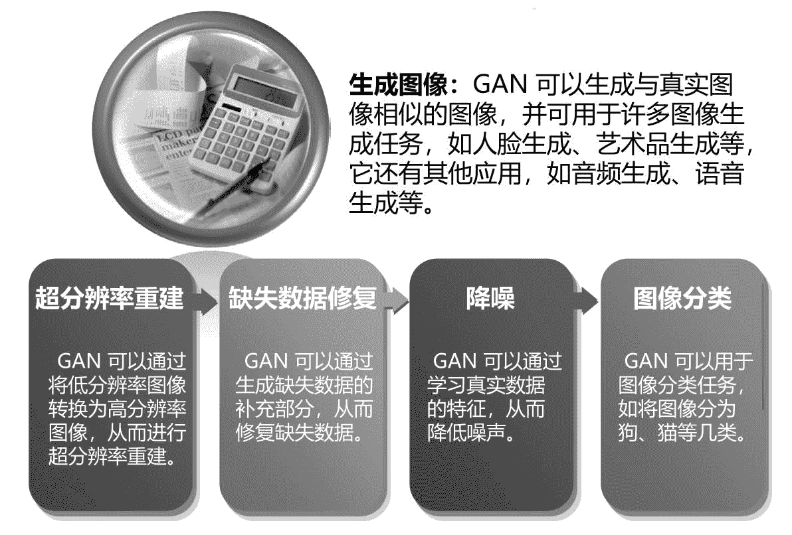

**图 7-3 GAN 的特征**

GAN 的开创性在于，它精巧地设计了一种“自监督学习”方式，摆脱了以往监督学习需要大量标签数据的应用困境，可以广泛应用于图像生成、风格迁移、AI 艺术和黑白老照片上色修复等方面。

2018 年，佳士得拍卖行在纽约以 43.25 万美元（约合人民币 301 万元）的天价拍卖了一幅由 AI 程序绘制的肖像画。这个名为《爱德蒙·贝拉米肖像》的作品，以朦胧手法描绘了一名身穿黑色西服外套，搭配白色衬衫的无脸男士（见图 7-4）。

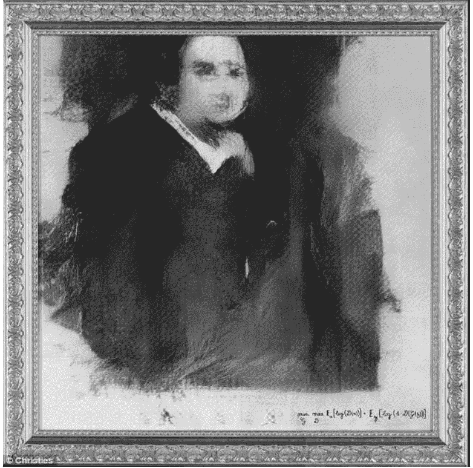

**图 7-4 GAN 创作的 AI 画作**

但 GAN 的缺陷也正源于其开创性：由于需要同步训练两个模型，GAN 的稳定性较差，容易出现模式崩溃。还需要提及另一个有趣的现象——“海奥维提卡现象”（Helvetica Scenario）：如果 G 模型发现了一个能够骗过 D 模型的 bug，它就会开始偷懒，一直用这张图片来欺骗 D 模型，导致整个平衡无效。

**CLIP**

诞生于 2021 年的 CLIP 模型由于能够同时进行自然语言理解和计算机视觉分析，实现了图像和文本匹配，也为后续 AIGC 应用的落地打下了基础。

多模态技术使 AIGC 的内容更多样，进一步增强了 AIGC 模型的通用化能力。多模态技术也使文字、图像、音视频等多种类型的数据可以互相转化和生成。比如 CLIP 模型，它能够将文字和图像进行关联，如将文字“狗”和狗的图像进行关联，并且关联的特征非常丰富。这为后续以文字生成图片、以文字生成视频类的 AIGC 应用的爆发奠定了基础。AIGC 的大爆发不仅有赖于 AI 技术的突破创新，还离不开产业生态快速发展的支撑。在技术创新方面，生成算法、预训练模型、多模态技术等 AI 技术汇聚发展，为 AIGC 的爆发提供了肥沃的技术土壤。相信 AIGC 将颠覆现有内容生产模式，这种颠覆将从文本生成辐射到其他的媒体形式。

**Diffusion**

到了 2022 年，Stable Diffusion 扩散化模型的出现与正式开源，直接推动了 AIGC 技术的突破性发展。扩散（Diffusion）模型的概念最早在 2015 年的论文《利用非均衡热力学的深度非监督学习》（*Deep Unsupervised Learning Using Nonequilibrium Thermodynamics*）中被提出。2020 年，论文《去噪扩散概率模型》（*Denoising Diffusion Probabilistic Models*）提出，将 DDPM 模型用于图像生成的观点。从技术的角度来看，扩散模型是一个潜在变量（Latent Variable）模型，通过马尔可夫链（Markov Chain）映射到潜在空间。

简单来说，Diffusion 模型其实实现了两方面的突破，一是更成熟的深度学习模型能让 AI 可以快速、灵活地生成不同模态的数据内容。二是这一训练好的模型大大降低了 AIGC 创业的门槛，更多的生产者与创作者可以借助这一可商用的开源工具，立足不同的应用场景做更多的事。基于需求端对 AIGC 的追捧，AIGC 恰好能缝合供给与需求之间的这条“效率鸿沟”。

扩散模型的原理是“先增噪后降噪”。首先给现有的图像逐步施加高斯噪声，直到图像被完全破坏，然后根据给定的高斯噪声，逆向逐步还原出原图。当模型训练完成后，输入一个随机的高斯噪声，一张图像便能无中生有了。这样的设计大大降低了模型训练难度，突破了 GAN 模型的局限，在逼真的基础上兼具多样性，也就能够更快、更稳定地生成图片。

随着 AIGC 模型的通用化水平和工业化能力的持续提升，AIGC 的重要影响在于，将极大降低内容生产和交互的门槛与成本，有望带来一场自动化内容生产与交互变革，引起社会的成本结构的重大改变，进而在各行各业引发巨震。未来，“AIGC+”将持续大放异彩，深度赋能各行各业高质量发展。

## 第八章 高级的应用场景

AIGC 在我们的日常生活中越来越常见。如今，画作、文章、音乐、游戏乃至代码，任何一个需要人类原创能力的创作都可能出自 AIGC 之手。但是，我们需要了解的是，AIGC 的出现，不是为了替代人类，而是为了帮助人们更快、更好、更低成本地创作。

AIGC 技术还将颠覆现有内容生产模式，它仅用十分之一的成本，就能以百倍千倍的速度生成 AI 原创内容，让整个艺术世界都被编码进这些大型模型中，这将允许任何人随意探索以前可能需要花一辈子的时间才能掌握的主题和风格（见图 8-1）。

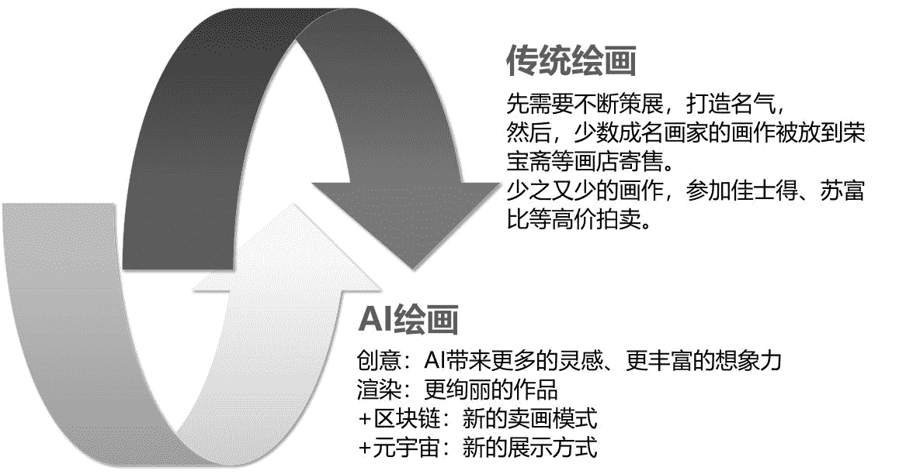

**图 8-1 AI 绘画与传统绘画的对比**

未来，AIGC 有望成为新型的内容生产基础设施，塑造数字内容生产与交互新范式，持续推进数字文化产业创新。而现在，随着 AIGC 生成的内容种类越来越丰富，内容的质量不断提升，AIGC 将作为新型的内容生产基础设施对既有的内容生成模式产生变革性影响，艺术家们用它获得灵感、快速测试设计效果，其中一些人甚至生成了 100%由计算机制作的艺术作品。

我们看到了 AI 绘画的巨大发展潜力，一种具备计算机科学技能的新型艺术家正在出现。但是这些工具还远远不够完美，例如，它们生成的东西在大多数时都不是我们真正想要的，使用的过程中交互相对麻烦，生成的结果无法本地修改编辑等。这就需要后期运用 PhotoShop 等绘图工具进行进一步的修改完善（见图 8-2）。

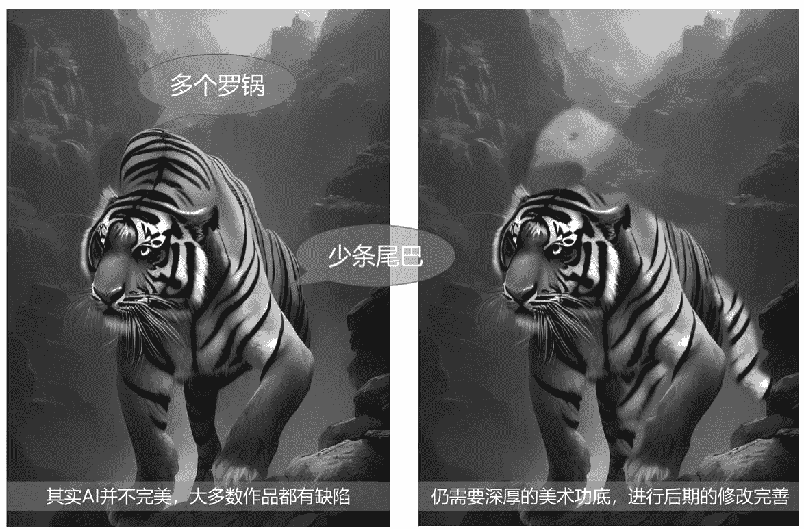

**图 8-2 AI 绘画的后期处理**

但是，不可否认，AI 绘画的巨大应用前景将带来市场规模的快速增长，根据 AI 绘画平台 6pen 预测，未来五年 10%～30%的图片内容将由 AI 参与生成，有望创造超过 600 亿元的市场规模。也有国外商业咨询机构预测，2030 年 AIGC 市场规模将达到 1100 亿美元。

随着 AIGC 生成的内容种类越来越丰富，内容的质量不断提升，AIGC 将作为新型的内容生产基础设施对既有的内容生成模式产生变革性影响。当前 AIGC 已经率先在传媒、电商、影视等数字化程度高、内容需求丰富的行业取得重大发展，市场潜力逐渐显现。例如，在广告领域，AI 大模型能够支持广告智能制作，即利用 AIGC 将广告文案自动生成为广告视频，大大降低了广告视频制作成本，为各行业的生成式 AI 创造了许多用例（见图 8-3）。

**图 8-3 本书作者创作的 AI 绘画系列作品**

例如，很多媒体机构开始将 AIGC 生成的图片用作杂志封面，一些作家也能够用 AI 作画来为自己的文章或者小说配图。《经济学人》前段时间就用 Midjourney 生成的图片做了杂志封面（见图 8-4）。AI 生成图片，还将进一步在各行业普及。

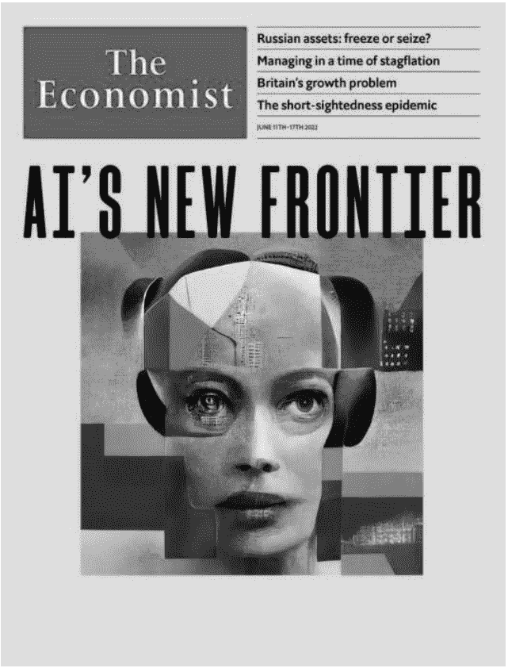

**图 8-4 《经济学人》用 Midjourney 生成的图片做杂志封面**

在 AIGC 加持下，各行各业的创作者经济迎来了新的增长点。比如有声书配音者、影视配音演员、动漫制作画师，或者一个营销广告公司的设计师，都可能是未来 AIGC 的主要使用者，他们可以用 AIGC 辅助自己的产业进行效能优化。当然，AIGC 不仅会促进艺术创作、娱乐产业、广播出版、教育行业的文化创新和发展，游戏设计、工业设计乃至医药研发等各个行业都会发生改变。

**1.医药研发**

2010 年的一项研究显示，一种药物从研发到上市的平均成本约为 18 亿美元，其中药物研发成本约占三分之一，整个研发过程长达 3 至 6 年。AIGC 可将各种用途的药物设计周期缩短到几个月，减少制药行业的药物研发成本和时间。

AIGC 可以用来创建合成数据。合成数据是一种生成的数据，不是来自对真实世界的直接观察结果。这保护了模型训练数据原始来源的隐私，例如，AIGC 可以人为生成用于研究和分析的医疗数据，这样就能避免透露所使用的医疗记录上的病人信息，保护病人的隐私。

**2.工业设计**

工业领域可以将 AIGC 以更好的方式融入工业设计的工作流程。比如一些针对设计行业特定领域的工具，在 AIGC 的加持下，结合可本地编辑修改的辅助工具，任何人都将能成为更好、更高效的设计师。原本设计数字和实物产品的原型是一个劳动密集型的迭代过程，AIGC 可根据粗略的草图和提示，制作高保真的效果图。随着 3D 模型的出现，生成设计的过程将从制造和生产延伸到实物，你的下一个 iPhone App 或运动鞋可能是由机器设计的。凭借 AIGC，制造、汽车、航空、国防等行业能够设计出最能够满足性能、材料、制造工艺等特定目标和限制的零件。例如，汽车制造商可以使用生成式设计创造出更轻量化的设计，帮助其实现让汽车更省油的目标。

**3.游戏设计**

在过去很长一段时间中，游戏公司已经在使用接近生成式 AI 算法的方式来构建无限世界了。其中最受欢迎的方法是程序生成——游戏设计师提供一套包含对象、景观元素和规则的算法，算法按照这些规则随机生成新的世界，诸如《我的世界》和《无人深空》等游戏就是如此。

AIGC 将让游戏和元宇宙领域步入全新的时代，让梦想变得不再遥远。想象一下，你不仅可以要求计算机通过将你设计的多个内容组合在一起来生成一个世界，还可以使用这些内容来生成全新的内容，并构建更丰富、更广阔的世界。通过微调 3D 生成算法，结合游戏设计师的设计，配以现实物体的虚拟副本，在未来，公司将能够生成令人难以置信的丰富的虚拟世界和游戏，而成本和时间可能只是之前的百分之一。但这还不是全部，得益于文本和音频生成技术，我们或许还能创造出真正智能的游戏角色，这些都是前所未有的突破。

## 第九章 涌动的投资热潮

AIGC 带来了两个很大的突破，一是从对语义的理解进化到了对语义的分析归纳。以前的算法只能知道这张图片里面有什么标签，有什么主体，分析出大概情况。但现在的语义模型已经具备分析和归纳总结的能力了，给它一些很散的内容和资料，它就能提炼出结构化的内容。这也正是 ChatGPT 如此火爆的主要原因。二是 AIGC 实现了从无到有生成内容。比如 AI 绘画，以前需要人先画好，然后再用 AI 去组装，现在 AIGC 可以自主完成像素级图片的生成，把内容成本降得更低。可以肯定的是，未来 10 年会出现一些以生成式 AI 为核心的“独角兽”（估值超过 100 亿美元的公司）。

首先，由人工智能生成的文字、图像、视频、代码、模型等内容都属于 AIGC；其次，在 AIGC 场景下可以将人工智能灵活运用于写作、编曲、绘画和视频制作、编写代码等创意领域，AIGC 的作业模式已经得到大量应用。

Gartner 预计，到 2025 年，生成式人工智能将占所有生成数据的 10%。*Generative AI：A Creative New World*也给出了数据，AIGC 有潜力产生数万亿美元的经济价值。这么大的市场空间，自然会吸引更多巨头入局，使更多的初创企业涌现出来。

在国外，AIGC 领域既有科技巨头 Google、Meta、微软等，也不乏新晋独角兽 Stability.AI、Jasper、OpenAI 等。有了成熟的 AI 模型与足够的数据，科技公司很快就将 AI 作画的热度延续到了 AI 生成视频、AI 作曲等多个领域。从 Meta 发布由文本到视频的系统 Make-A-Video，到 Google 发布可以用简单的文本提示生成高清视频的 Imagen Video 和 Phenaki，AIGC 在海外市场迅速发展。

在所有 AIGC 中，文字生成和音乐领域已经先一步找到了财富密码。OpenAI 是文字生成领域的领航员，不光吸引了“生成对抗网络之父”Ian Goodfellow 加盟，还早早获得了微软的 10 亿美元投资。从 GPT 到 GPT-3.5，OpenAI 不断迭代，也不断带给行业惊喜。ChatGPT 生成文字在遍历了写新闻稿、写诗、写小剧本等颇受关注的应用方式后，终于在营销场景找到了能够稳定变现的商业模式，成为辅助写作的效率工具，帮助从业者写邮件、文案，甚至策划案。专注于音乐的 LifeScore，则让人工智能学会了即时编曲，其按照场景、歌曲长度，重新组织艺术家的人工创作及音乐素材，在人类的创作流程中找到了自己的位置。

能够互动的聊天机器人，则在客服和游戏这两个相去甚远的领域分别“打工”。区别于当下只会提供预设问题解答，有时还会答非所问的“智能客服”，真正的 AI 需要结合用户的行为和上下文来理解人类的真正意图。在游戏领域，AI 则被用来协助人类高效地创造内容丰富、体验良好的游戏内容，从而延长用户的游戏时间。图像模型可以被迅速创造，并引导人们迅速消费，同时又能以较低成本快速整合到不同领域，从而快速普及，掀起浪潮。而事实上，确实许多创业者涌入了这些领域。

另一类宠儿，则是押对应用场景的企业，其在 AI 绘画之外吸纳了不少资本支持与人才投入。

具体内容如下。

**Synthesia**

Synthesia 是英国一家基于人工智能的视频合成工具提供商，用户可以使用 API 自动生成视频，构建个性化视频内容、可视聊天机器人等。在 2019—2021 年期间，其完成了 3 轮融资，分别来自个人投资人、Seedcamp、MMC Ventures、LDV Capital、FirstMark、MMC Ventures、KPCB、Google 风投，共完成 4.1 亿元融资，于 2021 年 12 月 8 日获得 5000 万美元的 B 轮融资。

**Rct Studio**

Rct Studio 是一家 AI 娱乐技术提供商，致力于运用人工智能打造下一代交互式娱乐体验，团队将前沿的 AI 技术，特别是深度学习和强化学习，引入娱乐产业，为消费者和制作方提供真正动态且智能的用户体验。Rct Studio 相信下一代的游戏体验将会更加开放，更加沉浸与智能，人类玩家与虚拟世界的互动将变得更加动态和多元。同时 Rct Studio 正在打造各种游戏、云服务、产品和解决方案，帮助设计师和游戏开发者创造真正动态的、智能的游戏体验。在 2018—2021 年期间，其完成 5 轮融资，分别来自 Sky Saga Capital、Y Combinator、星瀚资本、Makers Fund、Galaxy Interactive、Zonff Partners、Galaxy Interactive、Yuanyuzhou Ventures、Springwind Ventures、Bonfire Union、Everest Ventures Group、FBG Capital、Folius Ventures、HashKey Capital、Hash Global、Liang Xinjun、Lucid Blue Ventures、Mask Network、PKSHA SPARX Algorithm Fund、SNZ 等，共完成约 3100 万美元融资，于 2021 年 11 月 2 日获得 1000 万美元的 A3 轮融资。

**Copy.ai**

Copy.ai 是一家为企业客户建立人工智能驱动的文案写作工具初创公司。这些自动化工具使用户能够在几秒钟内生成营销副本。Copy.ai 的平台具有社交媒体主要文本、标题、链接描述、博客创意等功能。

Copy.ai 主要利用 GTP-3 来实现其主要功能，GPT-3 的模型包含了 1750 亿个不同的参数。这个巨大的模型训练了数万亿单词和短语，用户只需要输入文章的标题和核心内容即可。通过 AI 生成和人工修正，它能不断地训练出更优秀的人工智能。

**Jasper**

AI 文案生成平台 Jasper 在 2022 年 10 月刚刚宣布完成 1.25 亿美元 A 轮融资。用户只需在 Jasper 平台输入主题和关键字，便可利用人工智能技术自动生成相应文本。Jasper 可以生成推送广告、博客文章、促销邮件等多种文本，应用范围十分广泛。Jasper 还能做到帮助企业优化 SEO，提升 Google 搜索排名。

Jasper 目前支持超过 25 种语言，拥有 5 万名活跃用户，共生成超过 60 亿字的文本。

**Runway**

成立于 2018 年的图片和视频 AI 编辑软件提供商 AIGC 公司 Runway 在 2022 年 12 月 5 日宣布获得 5000 万美元的 C 轮融资。Runway 主要为设计师、艺术家和开发人员提供一系列的工具和平台，帮助他们利用人工智能技术创作作品。

该公司创始团队在接受福布斯采访时介绍，目前包括 New Balance、好莱坞制作公司等企业客户都在使用 Runway 来制作内容。其 CEO 克里斯托瓦尔·巴伦苏埃拉（Cristóbal Valenzuela）还表示，从长远来看，他希望能建立一个类似于 Adobe 的人工智能原生视频编辑软件工具套件。

**Stability.AI**

Stability.AI 是一家由 AI 驱动的视觉艺术初创公司，通过其开放的 AI 工具，用户可以输入文字信息来创建图像。Stability.AI 成立于 2020 年，2022 年 8 月才正式公开发布 Stable Diffusion，10 月，Stability.AI 刚刚宣布完成了 1.01 亿美元的种子轮融资，估值达 10 亿美元。

Stability.AI 采用的是开源技术，用户可以在其代码的基础上构建与设计、电影、增强现实、视频游戏、广告甚至电子商务相关的应用程序。

目前，其社区通过这套开源技术创造出了几乎涵盖所有媒体内容形态的 AI 模型，包括图像、语言、音频、视频及 3D 内容等 AI 模型。

**Resemble.AI**

Resemble.AI 是一款灵活的 AI 语音生成器，可帮助用户从文本中创建语音，以及为广告生成文本。同时，它还可以帮助用户创建定制的语音，用作语音助手，并克隆呼叫中心代理的语音。

Resemble.AI 为合成语音提供了四个单独的选项，允许用户使用 API 创建语音。用户可以从众多配音演员中进行选择，或者在没有文稿的情况下上传原始音频。Netflix 曾采用 Resemble.AI 为纪录片《安迪·沃霍尔日记》重新还原了安迪·沃霍尔的声音。

对于如何投资 AIGC，我个人认为要从两个角度做研究：一是产业链，二是商业模式。

从产业链角度看，AIGC 的技术支持是“AI”，是幕后，是产业链上游，包括：后端基建（如渲染公司）、底层架构（如引擎公司）等。底层的大模型与数据集将成就下一个科技时代，真正意义上的 IT 基础设施，会吸引大量的投资。而生成的“GC”属于产业链下游，包括面向各行业的内容与场景等（见图 9-1）。

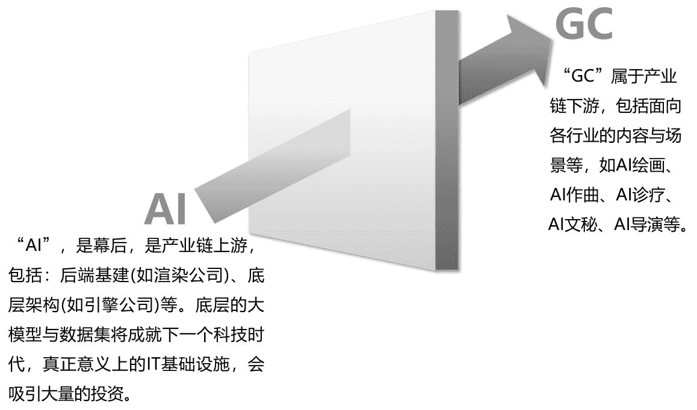

**图 9-1 AIGC 投资路径**

从商业模式角度看，面向 C 端的 AIGC 以 SaaS 订阅为主，让 C 端用户以较低的门槛使用 AI 生成内容，收取用户的点卡费或让用户包月、包年使用套餐。而有一些 C 端用户刚开始可能只是因为好奇才体验试用，未必会长久订阅。因此，面向 B 端的商业模式可能更加稳定。AIGC 使 B 端的效率提升、成本下降，用 AIGC 设计海报、封面、撰写新闻稿等十分方便。所以，B 端客户愿意接受这种商业模式的服务，付费意愿自然也就相对稳定。

## 第十章 巨大的社会影响

一直以来，每次科技上发生进步和突破，文化产业都会迎来一次繁荣的契机，而文化产业的兴旺又能促进科学技术的商业化落地。如今，随着 AIGC 技术的大热，文化产业再次走到了关键节点，以 AI 绘画与 ChatGPT 聊天机器人为代表的生成式 AI 产品，凭借着足以顶替人类画手和知识问答专家的强大实力，正为 AI 产业注入一抹全新的商业化曙光。

无论绘画师、程序员还是新闻工作者，都因这一技术的风靡而心生警惕。这些颠覆想象力的 AI 作品，带来令人兴奋的生产力跃迁，但也带来了一些令人难安的潜在风险。

人工智能与人类的边界在哪里？人类在宇宙中作为“万物之灵”，很重要的一点是会创造工具。回顾科技发展史，一直到计算机时代之前，人总体上处于主导机器的地位，人与机器的主从关系是很明确的。

但在计算机出现之后，人们普遍感到焦虑：一方面希望机器更聪明，另一方面又担心失去自己的原有地位。人工智能的确会替代一些末端的工作，但是从更积极的层面来说，人类也同样需要人工智能的辅助。

ChatGPT 的横空出世，在业界掀起了惊涛骇浪。专家表示，ChatGPT 和相关人工智能技术可能会威胁到一些工作岗位，尤其是白领工作。自 2022 年 11 月发布以来，聊天机器人 ChatGPT 已经被用于各种各样的工作中：撰写求职信、编写儿童读物，甚至帮助学生写论文。Google 发现，从理论上来讲，如果机器人参加 Google 的面试，该公司会雇它担任入门级程序员。牛津大学 2013 年的一项研究发现，未来 20 年，美国 47%的工作岗位可能会被人工智能取代，但这一预测也并不完全正确。

一方面，对于一些工作受到直接影响、难以适应的人来说，人工智能领域的最新进展肯定会给他们带来一段困难和经济痛苦的时期。另一方面，AIGC 可以提高数百万人创作和处理图像的能力，将对经济产生深远的影响。因此，人类的判断仍然需要这些技术，以避免错误和偏见，我们必须把这些东西看作提高生产力的工具，而不是完全的替代品。

面对 AIGC 的巨大社会影响，一方面，要加快研究 AIGC 带来的就业结构、就业方式转变及新型职业和工作岗位的技能需求，建立适应智能经济和智能社会需要的终身学习和就业培训体系，支持高等院校、职业学校和社会化培训机构等开展 AIGC 技能培训，大幅提升就业人员专业技能，以满足 AIGC 发展带来的高技能、高质量就业岗位需要。要鼓励企业和各类机构为员工提供 AIGC 技能培训，加强员工再就业培训和指导，确保从事简单重复性工作的员工和因 AIGC 失业的员工顺利转岗（见图 10-1）。

另一方面，要支持开展形式多样的 AIGC 科普活动，鼓励广大科技工作者投身 AIGC 的科普与推广，全面提高全社会对 AIGC 的整体认知和应用水平。实施全民智能教育项目，在中小学阶段设置 AIGC 相关课程，逐步推广编程教育，鼓励社会力量参与寓教于乐的编程教学软件、游戏等的开发和推广。建设和完善 AIGC 科普基础设施，充分发挥各类 AIGC 创新基地平台等的科普作用，鼓励 AIGC 企业、科研机构搭建开源平台，面向公众开放 AIGC 研发平台、生产设施或展馆等。支持开展 AIGC 竞赛，鼓励进行形式多样的 AIGC 科普创作。鼓励科学家参与 AIGC 科普（见图 10-2）。

**图 10-1 大力加强 AIGC 劳动力培训**

AIGC 首先带来的一大变化就是将一部分基础脑力工作释放出来，以前面对机器，人需要学习如何使用它，但现在人只要告诉 AI 自己想要什么，AI 就可以自动生成内容。而且基于 Stable Diffusion 这样的开源模型，技术人员可以将其自由修改成为他想要实现的场景或能力，相当于 AI 用了全人类所有的语义素材帮你生成内容。

**图 10-2 广泛开展 AIGC 科普活动**

第二个变化是，AIGC 帮助我们节省了很多创意方面的人力，但是前提是需要将其调到一个能够稳定输出的状态，因此目前阶段还是很消耗人力的。AI 比人类的想象能力更强，可以产生出其不意的效果，所以从创意生产角度而言，AI 解放的不是体力劳动，而是智力劳动。难怪微软 CEO 纳徳拉惊叹——这辈子第一次见到这么大的技术浪潮，AIGC 堪比工业革命！

500 多年前的文艺复兴，解放了人类的思想，释放了无穷创造力，出现了达·芬奇、牛顿、莱布尼兹、麦克斯韦尔、歌德伟人。之后，人类掌握了微积分和经典物理，发明了蒸汽机、珍妮纺纱机、火车和电力系统等强有力的工具，引发了以机械化替代手工劳动的第一次工业革命，使人类社会进入了长达 300 年的工业化时代。如今，以智能化和数字化为标志的第四次工业革命正在发生。随着智能化与数字化科技的大规模应用与成熟，将引发文艺复兴 2.0（见图 10-3）。

艺术品主要分为创作、展览和交易几大流程。而 AIGC 可以替代人类智能创作数字艺术品，元宇宙提供虚拟现实的 3D 沉浸式与交互式展览，NFT 则为数字艺术品的交易带来了确权和防伪新模式。而 AI 绘画带来了无限的可能。首先，在创意方面：AI 带来更多的灵感、更丰富的想象力。其次，在渲染方面：AI 能产生传统绘画无论如何也实现不了的效果，创作更绚丽的作品。再加上区块链、元宇宙与 Web3.0 等新科技，艺术界将被全面颠覆与重构，我们将迎来伟大的文艺复兴 2.0 时代。

**图 10-3 文艺复兴 2.0 时代到来**

**元宇宙**

在艺术展 1.0 时代，展品在艺术馆展览，观众到艺术馆欣赏；在艺术展 2.0 时代，艺术馆里的数字屏幕、音频视频让观众获得了更加丰富的知识，早在 1998 年故宫博物院就着手建设自己的数字博物馆项目“数字故宫”；在艺术展 3.0 时代，观众可以足不出户，在云端纵览艺术作品、欣赏展品细节；在艺术展 4.0 时代，观众可以通过元宇宙搭建的虚拟艺术馆，用 VR、AR、MR、XR 等终端设备随时随地进入数字孪生世界，眼睛到屏幕的距离不复存在，观众可以得到沉浸式、交互式的体验，并在其中交流、娱乐，构建新的社交关系。2017 年故宫采用 3D 扫描、VR、全景等技术推出了故宫 VR 体验馆项目。比如借助先进的 VR 技术，游客戴上 VR 4D 头盔体验“朱棣肇建紫禁城”项目时，仿佛穿越时空隧道回到明朝，气势宏大的故宫建筑全景图映入眼帘，在观赏的过程中，游客会突然感觉纵身一跃，上了马背，与明朝皇帝朱棣一起前行。如今，不少艺术馆和博物馆纷纷上线了“元宇宙展览”模式。比如在 2021 年 9 月，苏州寒山美术馆举办了“分身：我宇宙”艺术展，其被视为国内首个美术馆级元宇宙生态下的数字艺术探索展。故宫博物院、湖北省博物馆、上海博物馆、河南博物院等一线博物馆纷纷开启了线上模式，使观众与宝藏零距离接触。

未来，在元宇宙时代，每个艺术家都可以拥有独一无二的数字博物馆（见图 10-4）。元宇宙艺术馆运用线上+线下双轨并进的展览模式，打破了观众与艺术品有限的触达边界，结合多媒体、语音讲解、图片、文字介绍、虚拟仿真、实景再现、人机互动等技术手段，全方位、立体式展示艺术馆内的文物，配合虚拟现实技术的高度互动性，让参观者有身临其境、畅游寻觅的感受，成为实体展馆走进元宇宙虚拟空间中的一扇窗口。

**图 10-4 作者在阿里巴巴鲸探平台的元宇宙展示空间**

**区块链**

区块链是一种分布式记录保存技术，链上数据难以篡改。区块链上的交易记录透明且可溯源。交易环节中任何一方都可以对交易进行核查但无法轻易改动，从而有效地解决了信任问题。未来，每个艺术家都有机会将自己的数字作品存储在区块链上，形成一种独特资产。而且，由于区块链让所有交易有迹可循，相当于提供了一种永久稳固的产权登记方式——可能比现实世界中的方式更简洁更安全，杜绝传统书画艺术品假冒伪劣等行为。

在典型的区块链系统中，数据以区块为单位产生和存储，并按照时间顺序连成链式数据结构。所有节点共同参与区块链系统的数据验证、存储和维护。新区块的创建通常需得到全网多数节点的确认，并向各节点广播实现全网同步，之后不能更改或删除，从而形成了区块链对账本进行分布式的有效记录。

在这种规则下，任何互不了解的人可以通过加入一个公开透明的数据库，实现点对点记账、数据传输、认证或签订合约，而不需要借助任何一个中间方来达成信用共识。这个公开透明的数据库包括了过去所有的交易记录、历史数据及其他相关信息，所有信息都被分布式存储并透明可查，并以密码学协议的方式保证其不能被非法篡改。因此，区块链的主要特征包括“不可篡改”“去中心化”“共识机制”和“机密性”（见图 10-5）。

**图 10-5 区块链系统的四大特征**

**Web3.0**

Web1.0 可以理解为以计算机终端为主导的互联网时代，其代表公司有新浪、搜狐和网易等前三位巨头，加上 BAT（百度、阿里巴巴和腾讯）等后三位巨头。但是，Web1.0 时代，互联网的特点是信息单向传播，互联网公司是内容生产者，用户只能被动消费，就其产生的信息量而言还是非常有限的。

Web2.0 可理解为以移动终端为主导的移动互联网时代，这个时代的特点是信息双向传播，用户既是内容的生产者，也是内容的消费者，代表性的应用包括：微博、微信。智能手机和 4G、5G 网络的出现，激发了人们创作内容的热情，人们可以借助移动终端利用碎片时间，随时随地创造和消费内容，在满足自身精神追求的同时，也满足了他人的消费欲望。

如果我们把 Web1.0 抽象地定义为对数据可读，将 Web2.0 定义为对数据可写，那么理所当然 Web3.0 就应该是对数据可拥有，不再有垄断平台，由此开创了创作者经济时代。Web3.0 是一个崭新和开放的领域。它使创作者能够以独特的方式建立和拥有社区，同时将他们的创造力带给更广泛的人群，并真正让他们的社区参与到创作过程中（见图 10-6）。

**图 10-6 Web3.0 的进化**

在 Web3.0 中，随着权力的分配从平台转移到创作者及其社区，创作者的定义也正在发生变化。今天，创作者经济不再只是为平台提供价值，而是创作者与社区直接产生关系的新形式。创作者不仅有机会为他们的粉丝提供更多效益（包括经济收益），还可以让粉丝成为合伙人，让创作者和粉丝绑定在一起，创造集体价值。

# 第三篇 元宇宙——下一代的互联网，数字经济的支撑点

随着现实世界加速向虚拟世界“搬迁”，元宇宙和数字人对人工智能应用的规模、多样性和个性化等的需求也在急剧增加。但是，以往 AI 模型从研发到生产的周期长且成本高昂，流程碎片化且不同领域之间缺乏标准化。由于每种模型的生产都需要投入大量的算力和人力，因此会呈现出人力投入增加和资源密集的趋势，无法快速响应现实需求。

无论 AI 模型生产、智能计算、网络连接等基础设施建设，还是元宇宙相关技术研发和攻关都需要投入大量的资金和人力资源，通过集中式建设、平台化赋能，能够大幅降低使用者的边际成本，提高元宇宙生产效率。

而 AIGC 的出现，在元宇宙建设和数字人制作过程中，实现了大幅提质增效。在元宇宙和数字人领域，AIGC 在构建沉浸式空间环境、提供个性化内容体验、打造智能用户交互方式、让数字人栩栩如生等方面发挥重要作用。比如，扎克伯格在元宇宙的岛屿上，可以通过发出语音命令创造海滩、变换天气，添加不同的场景等。只有借助 AIGC，元宇宙和数字人才可能以低成本、高效率的方式满足海量用户的不同内容需求。

## 第十一章 元宇宙使数字经济加速落地

数字经济的概念始于 1995 年美国科技作家唐·塔斯考特（Don Tapscott）的著作《数字经济》。从字面上看，数字经济就是基于数字技术的经济，而数字技术的发展往往与互联网技术的发展相辅相成，所以很多时候数字经济也常被称作互联网经济或网络经济。在 2016 年 G20 期间，中国将数字经济进一步拓展，并给出了具体定义：数字经济是指以使用数字化的知识和信息作为关键生产要素，以现代信息网络作为重要载体，以信息通信技术的有效使用作为效率提升和经济结构优化的重要推动力的一系列经济活动。

在数字经济时代，所有流程和场景在虚拟空间实现全面部署，利用物联网技术、软件技术和通信技术，加强信息管理和服务，提高生产过程的可控性，从而实现研发、生产、制造工艺及工业控制等全方位的信息覆盖，全面控制各种信息，确保各个生产制造环节都能处于最优状态。在数字经济时代，一切将围绕数据开展，通过对人、机、物、软件系统等的全面连接，构建起覆盖全产业链、全价值链的全服务体系，带来可视化体验更好、准确性更高、性能更突出的数字化生产和智能化管理应用，有效提升效率、降低成本（见图 11-1）。

**图 11-1 数字经济的内涵**

各国之所以大力发展数字经济，主要原因有以下三方面（见图 11-2）。

**图 11-2 数字经济驱动经济增长的基本作用**

**1.提高全要素生产率**

数字经济与实体经济深度融合，以信息流带动技术流、资金流、人才流、物资流，减少信息流动障碍，加速资源要素流动，提高供需匹配效率，促进资源配置优化，为推动创新发展、优化经济结构发挥积极作用。

**2.培育新市场和产业新增长点**

数字经济领域不断孕育出新模式新业态，成为激发创新创业的重要驱动力量，促进大众创业、万众创新，柔性化、网络化、个性化生产将成为制造模式的新趋势，全球化、服务化、平台化将成为产业组织的新方式。

**3.推动实现包容性增长和可持续增长**

数字经济有助于提高连接水平，减少要素流动障碍，推动实现经济与社会、物质与精神、城乡之间、区域之间的协调发展。同时数字经济减少了经济主体参与经济活动的壁垒，从而为落后地区、低收入人群创造了更多经济机会，共享发展成果，减少发展不平衡。

从构成来看，数字经济主要包括数字产业化和产业数字化。数字产业化涵盖集成电路、软件和信息技术服务业、互联网产业（电子商务服务业）、文化创意产业等基础产业和云计算、大数据、移动互联网、物联网、网络和信息安全产业等先导产业。

产业数字化主要指在制造业、服务业、农业等领域构筑数字化应用体系（见图 11-3）。

**图 11-3 数字经济的构成**

近两年在国内兴起的元宇宙无疑为发展数字经济提供了新机遇、新动能，其被业内认为是数字经济下一个新增长点，成为引领数字经济发展的新引擎，将开启数字经济新一轮的产业布局。

元宇宙以大数据、云计算、区块链、人工智能等数字化技术为关键生产要素，以移动互联网、5G、物联网等现代信息网络为重要载体，能实现现实世界与虚拟世界的交互与融合，与数字经济的内涵不谋而合。通过布局元宇宙，可以开创新的经济、商业模式，乃至衍生新的社会文明（见图 11-4）。

**图 11-4 元宇宙的内涵**

从元宇宙的特征来看，现实世界发生的一切都将同步到虚拟世界中，而虚拟世界的行为和事物也将反馈到现实世界，为现实世界中的经济、社会带来影响。就数字产业化领域而言，在虚拟世界里，通过虚拟的平行世界，可以实现数字化的真实体验，增强实体体验丰富度；在现实世界里，通过真实化的数字体验，能够以虚拟形式提高实际生产效率，创造更多的价值。

由实向虚：数字产业化仍属于现实世界的事物，虽然应用了数字孪生技术，但是，数字产业化里的数字孪生主要是现实世界向虚拟世界的映射，通过在虚拟世界对生产过程、生产设备的控制来模拟现实世界的工业生产。而元宇宙则比数字孪生更具想象力，元宇宙所反映的虚拟世界不仅有现实世界的映射，还有现实世界中尚未实现甚至无法实现的体验与交互。

由虚向实：元宇宙更加重视虚拟空间和现实空间的协同联动，从而实现虚拟操作指导现实生产制造。例如，在产品设计方面，通过元宇宙，可控制产品应用时的环境因素，并基于在元宇宙中设计的产品模型对产品各零部件的作用方式做出直观、精准的模拟，能够有效验证产品性能，让工业产品的虚拟化达到可以实际生产的水平。由此一来，相比现阶段利用工业软件进行产品设计，元宇宙中的研发设计将在更大程度上提高产品开发效率，降低产品开发成本，并提高一次制造成功率，使产品在市场上更具备竞争力（见图 11-5）。

全球最大的咨询公司之一 Analysis Group 预计，未来十年内元宇宙经济规模将高达 20 万亿元，麦肯锡更是预测这一数字将达到 34 万亿元。截至目前，全国已有北京、上海、重庆、深圳、广州、杭州、武汉、厦门等 22 个省市在“十四五”规划、《政府工作报告》中提及了元宇宙，或出台了元宇宙产业发展规划和扶持政策。例如，河南省人民政府于 2022 年 9 月印发《河南省元宇宙产业发展行动计划（2022—2025 年）》，明确指出元宇宙作为虚拟世界与现实社会交互的重要载体，是新一代信息技术重大前沿领域，对河南省领跑产业发展新赛道、重塑竞争新优势具有重要意义（见图 11-6）。

**图 11-5 元宇宙的发展路径**

产业数字化基于新一代信息技术与先进制造技术深度融合，贯穿设计、生产、管理、服务等制造活动的各个环节，是致力于推动制造业数字化、网络化、智能化转型升级的新型生产方式。

**图 11-6 河南省的元宇宙发展规划**

元宇宙更像产业数字化的未来形态，强调定性而不是定量，强调经验而不是逻辑。例如，工业产品的生产制造是从不确定性向确定性转化的复杂过程，数据的种类、数量是不断增加的。工业产品的制造过程也是效率、成本、质量、客户满意度平衡与优化的过程，在元宇宙里，通过在虚拟空间协同工作、模拟运行，指导实体工业高效运转，赋能工业各环节、场景，使工业企业达到降低成本、提高生产效率的目的，促进企业内部和其他企业之间高效协同，助力工业高质量发展，实现数字经济的进一步升级。

展望未来，元宇宙的应用场景将实现产业数字化全生命周期覆盖，“由虚向实”和“由实向虚”双路径指导和推进研发设计、生产制造、设备运维、产品测试等工业流程优化及效率提升。

**（一）研发设计的协同交互**

在元宇宙里，我们更强调个人的创意，既包括客户、消费者的需求，也包括企业管理人员、普通员工的创意，然后逐步从不确定性向确定性转化。在元宇宙里，网络空间能力的提升，可以让生产者与用户建立起更强大的沟通场景、更好的沟通模式，用户也可以在元宇宙中参与产品设计并体验其设计的产品。经过用户的深层参与，产品更加贴近用户需求，并能在更大程度上增强用户体验。例如，利用虚拟技术，更好地展现产品、生产能力和保障能力，从而满足用户的需要，为企业赢得市场订单。以往我们展示的都是二维 CAD 图纸，元宇宙展示的可能是三维模型，甚至可以展示产品的运动模型以介绍产品功能，可以展示仿真模型以介绍产品的刚度和强度。

进入元宇宙时代，协同无处不在。元宇宙能够打破地域限制，支持多方协同设计，典型的有设计师之间的协同，工艺人员与仓库物流员之间的协同，企业人员与相关供应链的协同，企业人员与用户乃至管理机构的协同，从而取得更佳的沟通效果。

**（二）生产制造的优化提升**

通过元宇宙应用场景，生产制造人员能够沉浸式体验虚拟智能工厂的运营过程，与虚拟智能工厂中的设备、产线进行实时交互，可以更加直观、便捷地优化生产流程、开展智能排产。

未来的产业数字化，基于元宇宙技术可以实时跟踪智能工厂生产过程中的任何变动，可以在虚拟智能工厂中进行模拟，预测生产状态，实现生产流程优化。例如，据媒体报道，宝马与英伟达正开展虚拟工厂方面的相关合作，宝马引入英伟达元宇宙平台协同 31 个工厂生产，集成这些工厂的各种技术、应用和数据，使得生产能力显著提升，有望将宝马的生产效率提高 30%。

**（三）设备运维的远程实时**

产业数字化中的设备运维主要是利用大数据和人工智能技术，对设备建模、采集不同时段的大量应用数据，经过机理分析实现预测性维护。而基于元宇宙的设备运维能够打破空间限制，在元宇宙的虚拟空间中，运维人员将不受地域限制，在生产设备出现问题时，能够实现远程实时确认设备情况，及时反馈、修复问题，有效提高设备运维响应效率和服务质量。

还有一些大型装备，往往需要定期巡检。早期只能通过人工方式进行巡检，随着信息化和数字化的不断推进，逐渐出现了信息化辅助工具及数字化自动化巡检的方式，在一定程度上减少了信息偏差，提高了巡检效率。未来，在元宇宙中，通过增强现实等智能眼镜设备的广泛使用，巡检人员可以直接看到数字化设备的实时数据和相关预警信息，使得巡检工作加速向沉浸式体验的方式进化。

**（四）产品测试的提质增效**

产品检测是确保产品质量的重要环节，也是产业数字化不可或缺的环节。利用元宇宙技术在虚拟环境中开展试验验证和产品性能测试，通过虚实结合实现物理空间和虚拟空间同步测试，可以完成那些应用标准高、测试要求复杂的产品测试。

在元宇宙里，我们可以更加直观地感受产品的内外部变化，提高测试的认证效率和准确性。例如，汽车碰撞模拟，氢能源汽车高温环境使用模拟，汽车电池在极寒地区的使用寿命预测等，可让企业用较低的成本完成要求较高的测试，缩短测试周期，提高认证效率。

## 第十二章 AIGC 为元宇宙创作场景内容

元宇宙既可以是完全独立于现实世界的平行空间，也可以是虚实融合、可与现实世界交互的虚拟世界。随着数字化转型的深入，现实世界的各种要素都可以“搬到”虚拟世界中，同时虚拟世界创设的内容，又可以通过不同的载体投射到现实世界里，进而对现实世界产生影响。在这个过程中，人工智能所扮演的角色就是现实世界和虚拟世界的连接器。

内容生产是元宇宙新基建中最重要的一个部分，它将用户、企业和社会连接起来，使人们能够在元宇宙中体验不同的服务。AIGC 将在未来的元宇宙交互空间中扮演一个不可或缺的重要角色，为元宇宙的内容生产起到重要支撑作用。

Roblox 被称为元宇宙第一股，其在利用 AI 技术建立虚实融合的元宇宙世界方面做了很多尝试（见图 12-1）。第一步是场景的数字化，就是我们熟悉的像素化、3D 化；第二步是要素的结构化，就是将第一步数字化之后得到的大量非结构化数据，结合智能感知和分析，从而抽取为对人类有意义的元要素，即转化为结构化数据；第三步是流程的可交互化。只有基于可交互的流程，才能去做业务流程的重塑和自动化。这一步基于上一步得到的结构化数据，进一步实现应用端的智能决策。

**图 12-1 Roblox 利用 AIGC 搭建元宇宙平台**

The SandBox 是与 Roblox 齐名的另一个元宇宙代表性公司。The Sandbox 可出售的土地总数量为 166464 块，具有一定的稀缺性。按照目前的地板价计算，在这部分土地全部出售的情况下，其土地的市值将达到 125 亿元。未来，在 The Sandbox 的世界中，土地（Land）是构成世界的基础，人们可以在土地上随意规划自己的内容，比如建设房屋、乐园，甚至艺术馆（见图 12-2）。

**图 12-2 The SandBox 的地产元宇宙**

在 The SandBox 元宇宙里，AIGC 能够让元宇宙大幅提高内容创作效率。一方面，利用 AI 自动化生成内容或进行内容增强。譬如，从简单的随机物体摆放，到全自动生成场景、建筑、物品、外形等，或通过 AI 算法增强内容呈现质量，扩展人们的视觉边界。另一方面，利用 AI 辅助内容创作。譬如，一种基于 GAN 的智能画笔，可以将只有一些轮廓和颜色的草图，转化为照片精度的图片。用户只需要画出一些线条、标注颜色，然后指定特定部分为内容元素，譬如“大海”“乌云”“城堡”等，AI 就可以自动“脑补”进行细节填充。为此，大型品牌厂商、元宇宙基建商和演艺明星都可以利用 AIGC 技术搭建属于自己的元宇宙空间（见图 12-3）。

**图 12-3 利用 AIGC 在 The SandBox 中搭建属于自己的元宇宙空间**

**1.大型品牌厂商**

一些大型体育用品公司早在 2021 年就进入了 The Sandbox，并打造自己的虚拟空间。这样的做法，更像是在纳斯达克大屏幕上投放广告，或者是在曼哈顿开一家旗舰店。能在元宇宙内拿下一块土地用作品牌展示，企业显然是愿意的。

**2.元宇宙基建商**

据福布斯报道，有建筑公司在元宇宙中设计一个项目就可以赚近 30 万美元，大小、位置和高度等都会影响具体的价格。这更像是元宇宙经济模型的建立催生了诸多新的行业，比如元宇宙装修公司、元宇宙地产经纪商等。作为元宇宙的深度参与者，在最显眼的地方占领一块土地是这些类型的企业快速打开市场、寻找目标用户的方式。并且，这块永久的广告牌，还有可能带来更大的升值空间。

**3.演艺明星**

2021 年 9 月 24 日，美国巨星 Snoop Dogg 宣布与 The Sandbox 合作，计划进一步推出 NFT，以及游戏内音乐会。Dogg 还将推出 1000 个 NFT 派对通行证，向粉丝发售。除了选择直播带货增加收入，国外的明星选择通过元宇宙举办线上演唱会，同样能够达到类似的效果。

## 第十三章 ChatGPT 让数字人更加智能

随着 AR/VR、虚拟引擎、3D 建模等软硬件技术的日臻成熟，数字人迎来了重大发展契机——充分利用新技术完善沉浸式体验，极大地提升数字人的商业价值与扩展应用领域。例如，数字人可以扮演向导的角色，与用户进行多模态互动，即“面对面”低延迟地进行实时交互交流，为用户提供路线规划、信息查询、导览讲解等智能服务，在社交和娱乐之中持续为用户带来新鲜体验。这将有效提高景区吸引力、提升景区的品牌价值和商业价值（见图 13-1）。

**图 13-1 眉山市的数字人代言人**

数字人不再是留存于屏幕表面的 IP 形象，而是为行业带来真正价值、能干的数字员工。随着行业对数字人的认可，兼顾“皮囊”和“灵魂”的数字人将在越来越多的领域绽放光彩。数字人不但可以成为人们在元宇宙世界的化身，而且也能成为企业的好助手，实现降本增效。

2022 年 1 月，长安汽车的首位数字员工“宫”入职，后又升级改名为“宫橙诗”，其在虚拟世界“2060 星环城”代表长安汽车参与社会议题，传达“长安式”的生活方式（见图 13-2）。

**图 13-2 长安汽车的数字员工**

在 bilibili、优酷、爱奇艺、腾讯等网络平台播出的综艺节目《2060》，是国内首个基于元宇宙概念打造的虚拟世界、虚拟 IP、虚拟节目。2022 年底，“宫橙诗”多了一些新的身份，拥有了星球职业——2060 星环城机械义警，以及地球职业——长安汽车数字体验工程师的双重身份，既在星环城维护交通秩序，还在地球参观长安工厂，参加重庆车展。“宫橙诗”在真实世界与虚拟世界来回穿梭，同时也邀请现实中的消费者进入虚拟世界，通过交互式的沉浸体验感受产品。

浦发银行打造了多种类型的数字员工，这些数字员工提供包括产品解读、市场资讯、财富诊断、产品推荐等多样化服务。据介绍，目前小浦可以对近万款基金产品、多款财富产品的盈利情况、风险特点等，进行详细剖析和解读，还可以根据客户持仓情况和风险承受程度，给予资产配置的调整建议，并根据客户不同的财务目标和管理需求，个性化推荐理财产品。数字人本身自带的渠道流量优势，也大幅提升了服务的效率。

另外，品牌虚拟 IP 也是一条正在探索的路径。自古以来，人体本身作为丈量物体和感知空间的参照，是空间感知的主体，基于人的观感、触感及心理感受才能对城市形态进行再深化和补充。但在元宇宙中，数字人的尺度可以任意设定，小到原子级，中到城市尺度，大到一座星系；人的空间感知将面临再定义，变得更加多元。同时，由于实体环境和虚拟空间相互交融又彼此独立，用户将拥有多空间、多身份、多维度的空间体验。用户实体躺在卧室，而化身在绿水青山中游走；抑或用户实体在飞驰的列车中，而化身在虚拟会议室中讨论。

当前蓬勃发展的数字人产业，极有希望实现对元宇宙中虚拟化身的想象。数字人是基于计算图形学、深度学习、面部识别、动作捕捉等数字化技术创建的具有类人特质的数字虚拟形象，是实体用户在元宇宙中空间感知和信息交互的主要载体，是构建元宇宙的重要组成部分。用户在元宇宙中可以摆脱现实的束缚，完全掌控自身形象，塑造自己的完美化身，弥补现实中的缺憾，这也成为许多企业布局未来业务的一个重点领域。

天眼查数据显示，2022 年国内有近 20 万家与数字人相关的企业成立，而国内整个数字人行业的玩家不超过 60 万。我们可以看出，创业者们对数字人赛道抱有较大的热情，行业竞争也日益加剧。除了文旅行业，数字人也逐渐深入金融领域，并且已经为企业带来降本增效的成果。

但是，一直以来，无论担任电影主角的数字人还是能唱会跳的虚拟偶像，它们的诞生都需要依赖价格高昂的光学动捕设备。数字人制作成本高、制作时间长、拍摄技术门槛高，成为限制数字人走入人们生活的三道枷锁。目前，数字人的内容创作主要涉及图文、视频、影视、音频四大方向。数字人以虚拟主播、虚拟歌手等营销宣传、传媒娱乐功能为主，交互性尚显不足，距离成为元宇宙中用户的虚拟化身这一愿景仍有很大差距。

快速发展的 ChatGPT 无疑是斩断数字人产业枷锁的过程中，最为锋利的武器之一。现阶段，数字人的人格化和内容运营往往受限于前期的创意效率问题。如果能和一些大模型结合起来，那么就可以通过 ChatGPT 提升内容生产效率、拓展创意边界。现阶段，大家体验对话式语言模型，多数停留在语音和文字阶段。未来，ChatGPT 可以深入数字人内容生产及人机交互等环节，将彻底改变数字人的全部构建技术。从数字人的面貌、穿着、形态设计，数字人的行动和姿态、数字人的自然语言沟通，到数字人的任务执行，数字人和环境的感知交互等，ChatGPT 将使数字人的制作更加便捷和简单，让数字人的功能更加丰富（见图 13-3）。

**图 13-3 数字人的三要素**

数字人在好看的皮囊下，通过 ChatGPT 这样的模型提供对话能力，能让数字人具备有趣的灵魂，更好地陪伴和服务用户。ChatGPT 赋予数字人有趣的灵魂，让其拥有更加多样的创造能力。目前通过大模型等技术支撑，数字人可以根据文本要求自动生成一段颇具个人风格的图文内容、动作视频，甚至演戏。比如在直播场景中，当你告诉数字人带货产品的主要特点、价格及产品优势，并且让它以喜剧风格设计三种直播讲稿时，数字人将会直接提供几种不同风格的稿件。好看的皮囊千篇一律，有趣的灵魂万里挑一。可以看到，ChatGPT 不但为数字人提供了好看的皮囊，更为其赋予了有趣的灵魂，而整个数字人产业升级的背后，是大量 AI 技术的升级与叠加。

ChatGPT 为元宇宙中的“原住民”数字人植入“AI 大脑”，使它们拥有独立的沟通和决策能力，可以通过判断人类意图和需求，适时准确地给予回应，使得人机交互更加智能，并且数字人还可以通过不断学习和自我强化，升级成为数字世界的 AI 代理人，为人们提供各类咨讯和服务。未来，你可以像与你的朋友打视频电话一样，和数字人进行长时间、多轮次、有逻辑的互动（见图 13-4）。

**图 13-4 通过 ChatGPT 与数字人交互**

随着技术的发展、交互方式的增多，将会带来更多的可能性。元宇宙将会逐渐扩展边界，摆脱泛娱乐属性的限制。在引入 ChatGPT 交互方式之后，用户可以在元宇宙中进行更贴近现实的交互操作，进一步提升沉浸感。由于沉浸感的提升，虚拟世界和现实世界的边界也将变得模糊，元宇宙所代表的虚拟世界将会对现实世界产生不可忽视的影响。

人作为社会动物，社交需求是人的基本需求之一。数字人将会给社交提供更丰富的选择，社交不再受到地域、时间、文化等现实要素的制约，虚拟社交将会在与现实社交的竞争中展现出优势。社交行为将会越来越多地在元宇宙中展开，进而可能导致现实关系疏远。这种趋势会对家庭沟通等必须进行面对面交流的场景产生冲击（见图 13-5）。

**图 13-5 未来的数字人交互与社交**

在数字人领域，大模型让数字人的内容生产和交互方式发生了变化。比如用户和数字人互动对话的调用，由于 ChatGPT 对自然语言拥有极强的理解能力，数字人的开放性大幅提升。

在没有引入大模型之前，数字人说话和行动基本要靠真人行为驱动。有了大模型之后，内容的输出可以通过大模型来完成。以直播带货为例，数字人公司先给本地生活、知识付费和直播商家等建立一个数字人的虚拟主播形象，而后可以将大模型接入，让大模型辅助撰写数字人直播带货的话术和脚本。未来在泛生活和电商赛道，可能有 30%的内容能够通过大模型生成。

相信不久的将来，数字人的发展将会与社交应用深度绑定。未来，数字人能够通过 ChatGPT 扮演非常智能的泛娱乐化应用角色，我们将会看到数字人出现在聊天室、演唱会、多人游戏中。可以预见，ChatGPT 在游戏的用户互动环节和制作环节中将有更广阔的应用前景。

# 结语——我们该怎么迎接新一代人工智能革命？

从 2009 年到 2018 年，我曾经长期在工信部工作，对工业制造业的发展历程较为熟悉。经常有人问我，工业制造业在 GDP 中的占比为何不断下滑，是政策上不鼓励工业制造业而要大力发展服务业吗？其实不然，经过改革开放 40 多年的大规模工业化迅猛增长，工业制造业面临着能源消耗大、污染严重等突出问题。所以这些年我国在淘汰落后产能上的决心很大，前有“绿水青山也得要”后有“双碳”战略，一些高污染、高能耗的产业不断地被重组、被淘汰，使得工业制造业在 GDP 中的占比整体上下降了。但是在制造强国战略布局下，高端制造却迅速崛起，增速非常明显。

同样的道理，传统科技企业、传统互联网企业也面临技术和市场的瓶颈，以及人力成本的制约，放慢或收缩是一种必然。但新的、有前沿科技含量的企业也必然会闪亮登场，成为新的主角。ChatGPT、AIGC、元宇宙是新一代人工智能的三驾马车，是未来的高科技风口。它们的出现，会改写以 Google 和百度为代表的互联网搜索引擎模式，会对传统的以科大讯飞为代表的智能语音搜索引擎造成巨大的影响，甚至一改人工智能在金融、无人驾驶、教育、医疗等领域的传统发展路径，比如调用 AIGC 接口或采用定制版 ChatGPT。相对于千辛万苦地研究新的算法，这种方式能够让各个行业以更加简单、更加直接的方式实现智能化升级。

科技进步造福人类经济社会，让人类可以提质增效、实现高质量发展。但是，科技也是一把双刃剑，用得不好，就会对经济社会产生负面效应。

**（一）正面效应：大幅提质增效**

科技创新可以提高经济结构的效率和灵活性，提高企业的竞争力，节约能源、资源和工人成本，推动产业升级，促进供给侧结构性改革，提升质量和效率，催生新产品、新技术和新模式，从而促进经济增长。ChatGPT 和 AIGC 就是这样一种科技创新，它们通过分析大规模数据，在其中找到诸多规律，生成新东西，而不是仅限于分析已经存在的东西。在某些情况下，它们较人类更具创造力、创造得更好。未来，ChatGPT 和 AIGC 涉及的领域将包括所有知识性工作和创造性工作，可能涉及数亿的人工劳动力，使相关领域人工劳动力的效率和创造力得到大幅提高，不仅较以往更快、更高效，而且更完美、更具创意。

首先，ChatGPT 能够带来更高的生产效率。与传统的文本识别或语言理解系统相比，聊天机器人更加容易使用，可以更有效地了解输入的问题，从而提高结果的准确性，改变传统生产和服务的方式，让企业更有效地利用有限的资源生产更多的产品和提供服务，提升效率，同时降低成本。其次，ChatGPT 新技术的应用可以提升企业的核心竞争力，带来增量利润，从而促进业务增长，不断改善经济社会结构，带动产业数字化转型和智能化升级。最后，技术创新可以满足更多的消费需求，促进投资市场的发展。例如，ChatGPT 可以帮助客服代言人进行个性化的会话，有能力快速了解客户的需求、重点，及时回答客户的提问，这样可以提高客户的满意度和其对公司的信任度。由此一来，ChatGPT 新技术的应用可以使企业拥有更多的客户，从而拉动营收和增加利润，促进投资市场的发展，最终实现经济的可持续发展。

**（二）负面效应：作弊与知识产权纠纷**

ChatGPT 被滥用的问题愈发明显，最常见的就是作弊。在美国，北密歇根大学一名学生使用 ChatGPT 生成的哲学课小论文“震惊”了教授，得到全班最高分。还有调查显示，89%的美国大学生承认使用 ChatGPT 做家庭作业，53%的学生用 ChatGPT 写论文，48%的学生使用 ChatGPT 完成测试。

据媒体报道，近期，有多所欧美高校发出禁令。法国巴黎政治学院宣布禁止学生使用 ChatGPT 和其他人工智能产品完成报告，除非教师有特定课程需求，否则学生使用 ChatGPT 完成报告，最重将面临退学处罚。美国纽约市公立学校只有在进行人工智能与科技相关教学时，才能由教师申请在课堂上使用 ChatGPT。澳大利亚、印度、英国等的多所大学也限制学生使用 ChatGPT，尤其是在校园内及考试期间。

由此带来的问题是，ChatGPT 这类人工智能产品虽然能快速提供答案，但无法帮助学生培养他们批判思考与解决问题的能力。

与此同时，AIGC 创作的内容所有权归使用者所有，但是如果产生的内容侵犯了他人知识产权，那么这将是一个知识产权纠纷。例如，使用 AIGC 在未经授权的具有知识产权的图片或文字基础上创作内容，就可能出现知识产权纠纷。对使用 AIGC 生产内容而言，知识产权纠纷是绝对不可忽视的，而知识产权保护、合法性检查、协调和解决、技术防弊及持续的监管等措施，将是未来应对 AIGC 知识产权纠纷可能采取的重要措施。

故此，建议政府部门和企事业单位要前瞻性布局 ChatGPT、AIGC 和元宇宙，让新一代人工智能更好地服务经济社会发展，创造更大的价值。

一是引导企业融入 ChatGPT 和 AIGC 浪潮。ChatGPT 的重点在于创造，通过大量的语料训练和强大的纠错能力，对素材进行消化、整理和再输出，与传统的 IT 行业云计算模式完全不同。以阿里云为例，其主要负责为客户提供云存储和数据库服务，程序运作的底层逻辑是先有问题再找答案。AIGC 会从 0 到 1 主动创作内容，侧重点十分明显。因此，建议各企业开展企业负责人培训等工作，让企业家意识到新一代人工智能时代到来的重大意义，鼓励企业将人工智能主导的内容创作作为公司核心业务的重要组成部分。

二是推动 AIGC 融入元宇宙产业布局。AIGC 的出现为所有人提供了以自然语言对话方式进行文本生成的新方式和新工具，大幅降低了构建元宇宙的门槛，可以用与构建互联网完全不同的方式构建元宇宙。大量非专业人员可以用语言描述自身需求，AIGC 会自动生成设计图和代码，使效率得到极大提高、成本极大下降，元宇宙内容将更丰富。建议各地元宇宙产业发展的主管部门定期追踪研究 AIGC 的技术进展和国内外先进应用场景案例，带动元宇宙以更快的速度发展。

三是促进 ChatGPT 融入数字人功能。2022 年 8 月，北京市发布《北京市促进数字人产业创新发展行动计划（2022—2025 年）》，明确提出到 2025 年北京市数字人产业规模突破 500 亿元的发展目标。不仅北京，全国诸多省市纷纷将数字人纳入新科技发展目录，进一步谋划推动其普及落地。ChatGPT 将彻底改变数字人的全部构建技术。从数字人的面貌、穿着、形态设计，数字人的行动和姿态，数字人的自然语言沟通，到数字人的任务执行，数字人和环境的感知交互等，ChatGPT 数将使数字人的制作更加便捷和简单，让数字人的功能更加丰富。建议政府、企业、各大高校和科研院所研究落实 ChatGPT 技术在数字人中的应用，让数字人产业发展目标超额实现。

四是重视 ChatGPT 和 AIGC 的隐患，将其纳入社会科学研究课题。由于 ChatGPT 和 AIGC 训练数据源自公开互联网，企业或科研院所在使用时需要对 ChatGPT 和 AIGC 生成的作品进行把关，防范知识产权风险。尤其是大学和科研院所工作人员在使用 ChatGPT 撰写论文、艺术家在使用 AIGC 作画、作曲等过程中，一方面要建议他们在创作内容时，务必核实内容，不侵害他人知识产权，并对这些内容拥有授权，以免出现知识产权纠纷；另一方面，应该有第三方帮助其“验明正身”，通过技术手段建立一个有效的、具有针对性的持续监管体系，以确保生成的内容合法合规。例如，通过某种检测工具，弄清文本是由人类撰写的还是由人工智能生成的。科技在进步，社会科学也要及时跟进，建议高校、科研院所等单位将 ChatGPT 和 AIGC 列为重大课题，注重科技创新过程中的伦理问题，注重科技创新可能造成的不利社会影响，制定相关规范，促进自然科学与社会科学的交融共振。

# 附录

2023 年春节以来，本书作者王喜文博士已受邀陆续为招商银行、工商银行、浦发银行、中国移动、中国联通、复泰商学院、浙江大学等企事业单位进行了 ChatGPT 与 AIGC 方面的授课。欢迎大家邀请王喜文博士（微信号：wangxiwen44）开展培训、做讲座，并欢迎大家联系本书责任编辑黄菲（微信号：fay463215）团购本书，赠送给学员，以便进一步学习。

# 参考资料
REFERENCES

[1]OpenAI 官网文章 ChatGPT：Optimizing Language Models for Dialogue。

[2]Swyx 的文章 The Day The AGI Was Born。

[3]Arst Echnica 官网文章 OpenAI Invites Everyone To Test ChatGPT，A New AI-Powered Chatbot—With Amusing Results。

[4]腾讯网官网文章《中小学教师 ChatGPT 的 23 种用法》。

[5]51CTO 官网文章《后 GPT 3.0 时代，主流大模型技术精要详解，走向 AGI 之路的大门已开》。

[6]今日头条官网文章《张俊林：由 ChatGPT 反思大型语言模型（LLM）的技术精要》。

[7]百度官网文章《ChatGPT 正“侵入”国内教育界，是敌是友？咋对待？》。

[8]网易官网文章《行业洞察|万字长文解读 AIGC 如何革命性提效内容营销》。

[9]电子发烧友网官网文章《AI 下一个风口来临 AIGC 产业生态迎来发展快车道》。

[10]搜狐网官网文章《Gartner：ChatGPT 只是开始，企业生成式 AI 的未来不止如此》。

