# ChatGPT、AIGC、元宇宙 一本读通
# 内容速览
2023 年，围绕 ChatGPT 的讨论已全面升温。埃隆·马斯克公开指出其具备颠覆世界的可能，微软投入数百亿美元并谋划把该技术植入 Office 办公套件与 Bing 搜索，校园里关于用其撰写论文是否合规的争论不断升温，甚至连咨询行业都开始担忧岗位被挤压。应用热度被点燃后，场景的扩张速度远超预期。

本书以通俗的表述与具体的案例，把 ChatGPT、AIGC、元宇宙等热点一次性讲清，用图文并茂的方式展现背后的技术路径、资本涌动与多种未来图景，是一部面向大众的通识读本。阅读后能帮助读者拨开表象，把握底层逻辑，抓住人工智能新周期中的成长机会。

# 推荐序
FOREWORD
未来已经抵达，无论人类是否做好准备。

当下多数人都能感受到世界在加速，知识也在快速迭代，要跟上这种节奏，需要在心态、行为、行动与策略上作出调整。每个职业、每个工种、每道工序与流程，都在被技术赋能与重塑。

当前有观点认为人工智能会取代人类，有了 ChatGPT 工作就会被消失。实质上人们忽略了最根本的一点，人类之所以能延续至今，正是因为拥有主观能动性。智人是一种善于适应复杂变化、富于智慧的生物。

AI 引发争议的原因是什么？一部分人明知应对之法却选择回避，认为那样做不妥；另一部分人认同 AI 的价值却不知如何下手。用不用 AI 重构工作流，取决于个人的世界观、价值观、知识储备、经验与能力，也取决于所在群体所处的文明、文化与关系网络，多重因素叠加才决定是否拥抱新技术。AI 会为人类造福还是过度扩张，都有可能发生。

AI 之门已开，不论愿意与否，都必须主动学习、以批判的态度接纳，让人类始终是主导者。如今机器教育之外，更关键的是人类的教育。

AI 的演进路径尚无定论，因此先学习再判断是更稳妥的姿态。过去人们认为知识本身值钱，未来知识必须经由人的智慧表达出来。知识是死的，智慧来自于人借助主观能动性运用知识、经过实践后再沉淀为新知。社会上不断涌现可被机器学习的人类智慧结晶，知识若被持续使用、机器不断提炼沉淀，社会发展则更有可能走向良性。

王喜文博士的作品与读者共同分享了前沿科技的最新进展，为科技从业者、政府人员、学者、企业人士提供了参考，也为学生与教师提供了丰富的教学素材。书中思路清晰、语言平实，给人耳目一新的感受，对人工智能的未来充满期待。

愿本书能为关注 AI 的参与者、观察者以及对前沿科技感兴趣的朋友带来帮助。

韦青
微软中国首席技术官

# 前言
FOREWORD
当国内仍在反复图解“基础设施—数据—平台—应用—用户”的互联网分层时，海外技术已迈入新的阶段。

马斯克断言 ChatGPT 将改写世界，微软斥资数百亿美元并计划把功能整合进 Office 与 Bing，高校与科研机构围绕论文撰写合规性展开激烈讨论，咨询公司亦开始担心业务被侵蚀。2023 年，ChatGPT 的应用热情被点燃，落地场景持续快速扩散。

ChatGPT 是 AIGC，即人工智能生成内容技术发展的集中体现。人工智能早已渗透生活，工业机器人完成喷涂焊接、导航 App 自动规划路线、人脸识别随处可见。尽管这些系统能在特定任务上替代人工，却与真正的人类仍有距离。要更接近人类，人工智能必须具备创作能力，这正是 AIGC 的意义所在。AIGC 推动了 AI 绘画、AI 作曲、AI 写作乃至影视生成，实现了人工智能史上的跃升。

ChatGPT 为所有人提供了用自然语言对话生成文本的新方式，大幅降低了构建元宇宙的门槛。过去构建互联网的方式被彻底改写，非专业人士只需用语言描述需求，系统即可自动生成设计图与代码，提升效率、降低成本、丰富内容。同时，数字人的构建也被重塑，从面貌、着装、形态设计，到动作姿态、自然语言交互，再到任务执行与环境感知，ChatGPT 使数字人的搭建更简便、功能更丰富。

2023 年是人工智能的里程碑之年。ChatGPT 与 AIGC 风靡全球，十年积累的技术重返公众视野。过去几年，巨头纷纷设立 AI 实验室，加码资源争夺市场，部分企业甚至整体转型为 AI 公司。各国政府把人工智能列为战略主导，出台规划，加速推进。

此次浪潮不局限于实验室，理论研究与商业化应用同步推进，催生出更多产品化方案与落地案例，公众切实感受到冲击力与影响力。尤其在大型语言模型、基于人类反馈的强化学习、多模态模型与自然语言处理等深度学习相关领域，产业化速度加快，竞争赛道变得拥挤。

# 第一篇 ChatGPT 让谷歌不安 微软全面押注
## 第一章 智能新星的爆发时刻
语言始终是人类交流的核心工具，多家互联网公司长期在机器沟通能力上展开挑战。IBM 的 Watson、苹果的 Siri、微软小冰等产品曾被寄予厚望，但用户反馈平平，多轮连续对话难以实现，与电商客服机器人类似，只能做机械式应答，缺乏记忆与想象力。ChatGPT 却能进行多轮连贯对话，输出具备广博知识、独特创意甚至超越基础水平的回应，两者差距显著。

2022 年 12 月，ChatGPT 仍被视为一种聊天类社交应用，进入 2023 年后则被视作继互联网、智能手机之后第三次“革命”。互联网带来空间革命，实现实时全球连接；智能手机带来时间革命，通过可扩展 App 提升交易与服务效率；而 ChatGPT 有望掀起思维革命，可替代创意创作、咨询解答、翻译、客服等环节，重塑思考方式，进而重构行业生态乃至整体社会。

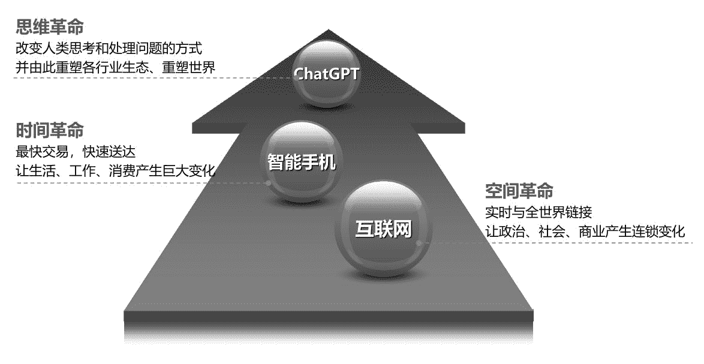

**图 1-1 ChatGPT 触发的思维革新**

在 ChatGPT 中，GPT 指代预训练生成模型。OpenAI 的语言模型被用于教育、虚拟陪伴、写作辅助、角色扮演游戏等场景，其中偏见、虚假信息与有害内容是需要规避的系统缺陷。ChatGPT 能追问、生成摘要、翻译、分类信息、编写代码，也会承认错误、质疑前提并拒绝不当请求。短短两个月，社区挖掘出大量新技能，如代写代码、作业、论文、演讲稿、策划案、广告文案、剧本，根据描述绘图、作诗、扮演面试官或影视角色、提供家装建议、编程调试与人生规划等。

只要调教得当，它能从擅长交流的“咨询高手”进化为高效学习工具。连续追问后可获得大量书单与资料链接，提炼文章要点、知识图谱与核心脉络，在灵感枯竭时打开创意路径。

其流畅表达与海量知识储备给用户带来强烈震撼。

瑞银报告显示，ChatGPT 上线仅两个月，活跃用户便突破 1 亿，打破抖音 9 个月的纪录，成为增长最快的 App 之一。App Store 达到 1 亿用户用了 2 年，Instagram 2.5 年，WhatsApp 3.5 年，Twitter 5 年。

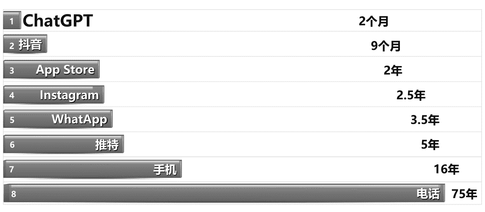

**图 1-2 各类应用达 1 亿用户所需时长的对比**

大量用户涌入网站提需求。工程师让其调试代码，美食博主索要健康曲奇食谱，艺术爱好者让其生成绘画提示词导入 Midjourney 并成功创作。斯坦福医学院皮肤科医生 Roxana Daneshjou 在研究 AI 医学应用时，也获得了充分解答。

以往智能聊天机器人难有亮点，ChatGPT 却能进行长时间流畅对话，撰写商业计划、广告方案、诗歌、笑话、代码与剧本，应答几乎在数秒内完成，质量尚可。

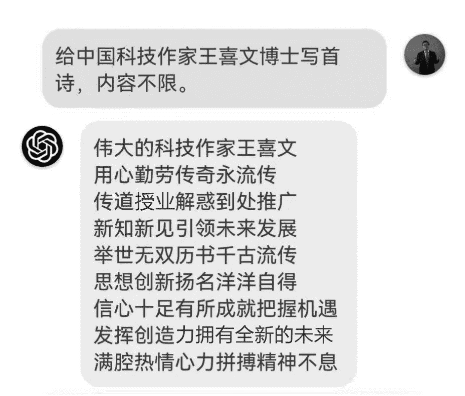

**图 1-3 ChatGPT 作诗试用示例**

经过试用，很多人发现其写论文、考试、做表格、写程序、写诗的能力可超越 80% 的普通人，甚至能通过大学入学考试与 Google 程序员招聘。这将深刻影响教育。语言是逻辑思维的载体，若不学习如何使用语言，一切将成空中楼阁。

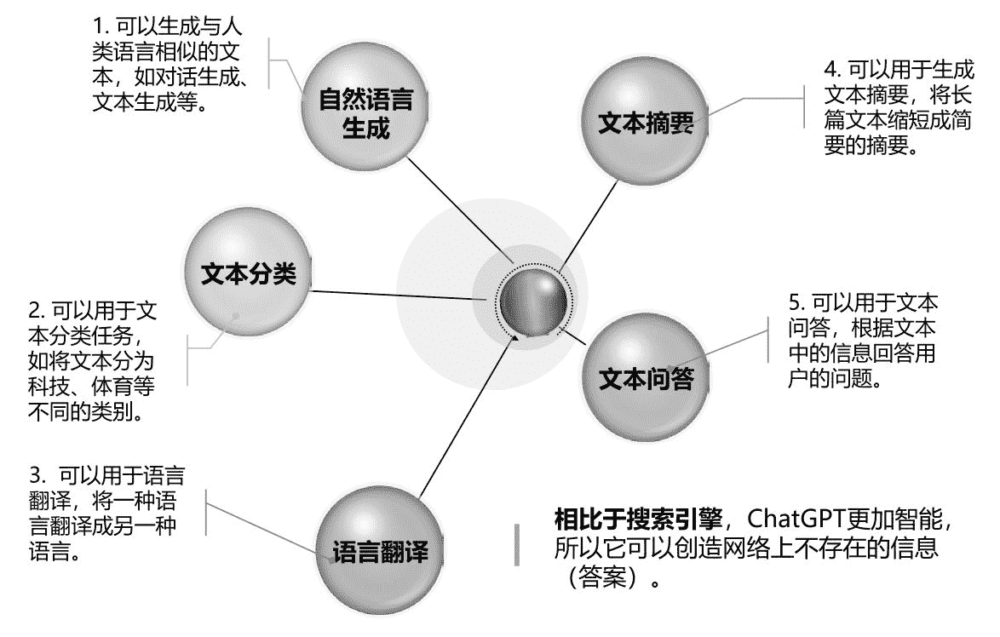

**图 1-4 ChatGPT 核心特性概览**

此次舆论爆发在业内看来出人意料，连 OpenAI 自己也未想到能获得微软 100 亿美元投资。微软大规模押注并宣布把技术嵌入 Office 与 Bing，意图打破 Google 长达二十多年的搜索垄断，迫使 Google 投资竞争对手并重组业务。

OpenAI 是美国的非营利 AI 实验室，旨在推动造福人类的友好人工智能。2015 年底由埃隆·马斯克与前 YC 总裁山姆·阿尔特曼联合创立。

发展脉络如下：2015 年底成立并承诺开放专利；2016 年提出制造通用机器人以规避灾难性风险；2019 年 3 月设立盈利子公司，7 月获微软 10 亿美元投资并为 Azure 开发技术；2020 年 6 月发布 GPT-3，微软 9 月获独家授权；2022 年 11 月 30 日发布 ChatGPT；2023 年 1 月洽谈 100 亿美元投资，并计划植入 Word、Outlook、PowerPoint 等应用。

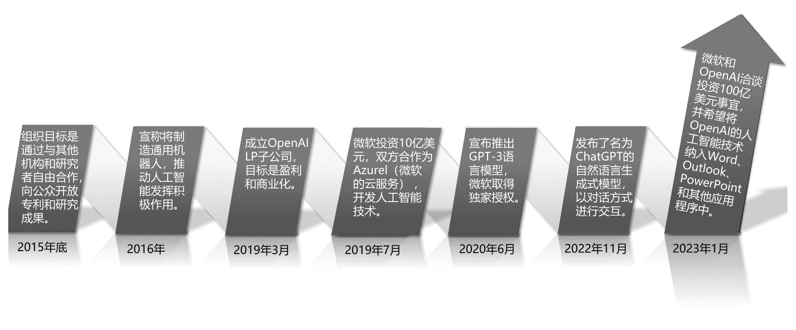

**图 1-5 OpenAI 关键发展时间线**

微软很早就布局 OpenAI。1990 年代是计算机时代，微软称霸；2000 年后互联网时代，Google、Amazon 崛起。微软自 2006 年起研究 AI 与隐私，2010 年起由研究院副总裁 Peter Lee 主导语音与语言理解研发，目标是服务 Office 与 Bing。现任 CEO 萨提亚·纳德拉于 2019 年追加 10 亿美元投资，2020 年获得 GPT-3 核心技术的独家使用权，Azure 成为 OpenAI 的独家云供应商，保证优先使用权。

投资已显现回报。GPT-3 发布后，微软即将其集成至 Office 自动补全等功能与语音转文本工具。销售经理称其上线速度远超研究院研发节奏。OpenAI 模型在 Azure 上占用大量计算资源，降低成本至关重要，预计日活 1000 万用户每月成本可达百万美元。纳德拉透露，微软已建超级计算机使 AI 计算成本降至竞争对手一半左右。

随着 ChatGPT Plus 每月 20 美元订阅服务上线，OpenAI 的商业回报上升，微软作为最大投资方也随之获益，预测 2023 年收入约 2 亿美元，2024 年达 10 亿美元。

Google 搜索引擎是互联网时代的信息枢纽，主导信息流向。数据爆炸导致检索困难，信息垃圾与广告排名恶化用户体验，推动人们渴求二次智能搜索。

搜索引擎采用集中式平台管理，广告植入依赖用户自行筛选大量结果。移动互联网时代，这种网页公告栏式交互已滞后。

Bing 长期试图挑战 Google 的入口优势，寄望 AI 优化结果排序，弥补爬虫规模劣势。

ChatGPT 采用一对一生成式对话，直接给出结果，减少二次筛选。对话记忆让用户可持续追问至满意为止。数千亿词训练带来的自然流畅表达显著提升体验。

如今微软试图以 OpenAI 的 ChatGPT 打破 Google 通过 DeepMind、Boston Dynamics、Waymo 积累的光环。纳德拉称其对知识工作者而言“相当于工业革命”。也有观点认为 ChatGPT 将如搜索引擎终结黄页般冲击 Google。摩根士丹利提示其可能长期威胁 Alphabet 盈利。Google 联合创始人重返公司商讨对策，并向 Anthropic 投资约 3 亿美元，该团队多位成员曾在 OpenAI 工作。

市场普遍好奇 ChatGPT 是否能改变世界，答案是肯定的。

当经济走向不明朗时，ChatGPT 的出现像一阵清风，点燃了用技术修复创伤、推动社会向前的期待。产品上线后，人工智能会怎样改写工作、学习和生活的讨论迅速升温。真正让使用者信服的，是交互体验的跃迁，明显优于此前的对话系统。不少体验者表示，自己不再面对“人工智障”，模型对问题的理解很细致，生成的文字通顺自然，几乎等同于人与人之间的回话。甚至有工程师把这项能力迁移到智能家居场景。据说，一名资深前端工程师借助 ChatGPT 背后的 GPT-3 大模型，并结合 Siri Shortcuts，在不到一小时内搭建出一套更聪明的语音控制方案。该方案能够操控整套苹果 HomeKit 生态，并在几乎无感知的延迟下解决各类咨询。尝试者给予极高评价，认为体验之后，苹果 Siri、亚马逊 Alexa、Google Home 等传统“智能”助手都显得笨拙且无用。

关于 ChatGPT 或将取代部分人类工作的说法也在快速扩散，涉及的岗位包括：软件开发、网站开发、程序员、广告从业者、新闻记者等内容生产者，以及律师、市场研究分析师、教师、金融分析师、财务顾问、交易员、平面设计师、会计、客服等。此番替代看起来相当残酷。从产品与投资的角度观察，客服、翻译、文员、初级程序员、文案、家教等以文字处理为核心的从业群体将迎来第一波冲击，受影响人数预计达上千万，印度市场冲击尤为突出。随着失业人数攀升、行业格局被重塑，大量依赖语言处理的公司价值会被稀释，此前一度火热的语音助手也将失去关注……

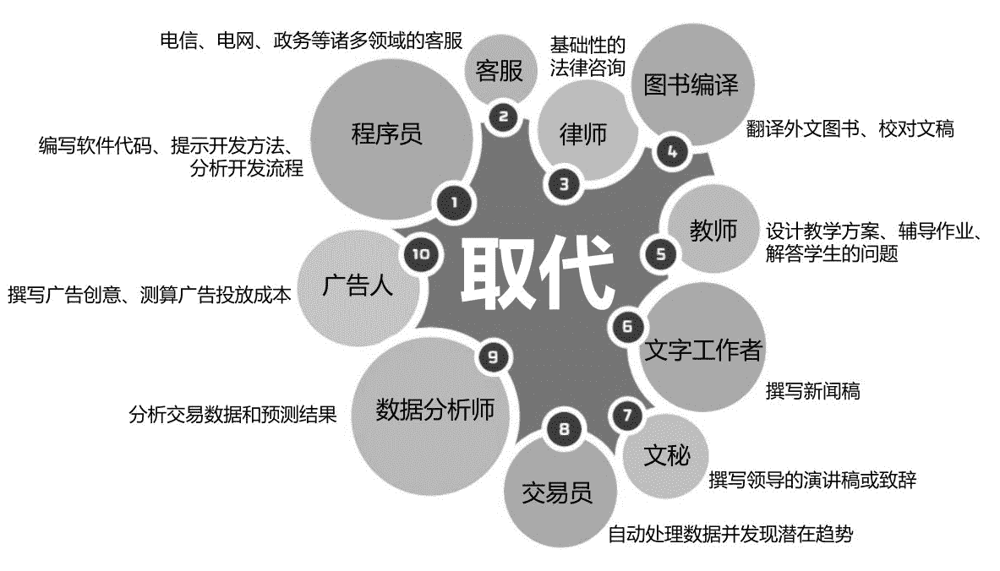

**图 1-6 ChatGPT 可能取代的人类工作者**

## 第二章 快速迭代的发展历程

ChatGPT 的命名里，Chat 指对话方式，GPT 指底层技术，它是基于互联网可获取数据训练的文本生成深度学习模型。应用范围涵盖文本问答、文本摘要、语言翻译、文本分类、代码生成和对话应答等。从首个 GPT-1 到 GPT-4 即 ChatGPT，四年间完成了快速迭代式演进（见图 2-1）。

2018 年 GPT-1 诞生，该年也被视为 NLP 预训练模型的元年。性能上，GPT-1 具备一定泛化能力，可用于与监督任务无关的 NLP 任务。常用任务包括：

● 自然语言推理：判定两句子的关系为蕴含、冲突或中立。
● 问答与常识推理：输入文章及若干候选答案，输出每个答案的预测可信度。
● 语义相似度识别：判断两句话语义是否相关。
● 分类：判定输入文本属于指定类别。

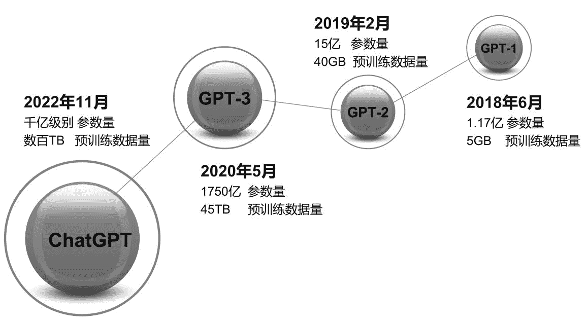

**图 2-1 GPT-1 到 GPT-4 的演进过程**

尽管 GPT-1 在未调优任务上能得到一些效果，其泛化能力远低于微调后的有监督任务，因此只能算作一款尚可的语言理解工具，而非对话式 AI。

GPT-2 于 2019 年正式发布，它并未在结构上进行太多创新，主要依靠更大的参数量与更广的数据集：最大模型有 48 层，参数量达 15 亿，学习目标是利用无监督预训练完成有监督任务。表现方面，除理解能力外，GPT-2 在生成侧首次显露出强天赋：阅读摘要、闲聊、续写、讲故事，甚至生成假新闻、钓鱼邮件或在网络上扮演角色，均游刃有余。规模扩大后，GPT-2 展现出普适且强大的能力，并在多个语言建模任务上达到当时最佳水平。

随后 GPT-3 登场。它本是一个无监督模型，现多被称作自监督，几乎能完成自然语言处理的绝大部分任务，例如面向问题的检索、阅读理解、语义推断、机器翻译、文章生成和自动问答等。在多项任务上表现突出，如法语-英语、德语-英语机器翻译达到当时最佳水平，自动生成的文章几乎无法分辨出自人类还是机器，辨识正确率仅 52%，接近随机猜测。更令人惊讶的是，在两位数的加减运算上正确率几乎为 100%，还能根据任务描述自动生成代码。一个功能丰富、效果良好的无监督模型，让人看到通用人工智能的曙光，这也是 GPT-3 影响力巨大的原因。

本质上，GPT-3 可被视作一种统计语言模型。从机器学习视角看，语言模型是对词语序列概率分布的建模，即以已说出的片段为条件预测下一时刻各词出现的概率。它能衡量句子是否符合语言语法，例如评估人机对话系统自动回复是否自然，同时也能预测并生成新句子。比如面对“杭州东站到了，乘客们请”，语言模型可能预测“下车”，而强大的模型能捕捉时间信息，预测并生成更贴合语境的“准备下车”。

语言模型的强弱主要取决于两点：一是能否调用全部历史上下文，上述例子若无法捕捉“杭州东站到了”这一远距语义，就无法预测“准备下车”。二是是否有足够丰富的历史上下文可供学习，即训练语料是否充足。由于语言模型属于自监督，优化目标是最大化所见文本的语言模型概率，因此任何文本无需标注即可作为训练数据。

凭借更强性能、更多参数和更丰富的主题文本，GPT-3 明显优于前代 GPT-2。作为目前最大的密集型神经网络之一，它能把网页描述转为代码、模仿人类叙事、创作定制诗歌、生成游戏剧本，甚至模仿已故哲学家推测生命真谛。且 GPT-3 无需微调，仅需少量输出样本即可处理语法难题，可谓满足了人们对语言专家的想象。

但 GPT-3 并非完美，当前人们最担忧的问题之一是，聊天机器人和文本生成工具很可能无差别学习网络上所有文本，进而输出错误、恶意、冒犯甚至具攻击性的语言，这将严重影响后续应用。

2022 年初，OpenAI 发布了 InstructGPT。相较 GPT-3，采用对齐研究，训练出更真实、更无害且更能遵循用户意图的语言模型。InstructGPT 是对 GPT-3 的微调版本，可最小化有害、不真实和有偏输出。

开发人员通过监督学习叠加从人类反馈中获得的强化学习来提升 GPT-3 输出质量。在该流程中，人类对模型的潜在输出进行排序，强化学习算法则对产生类似高质量输出材料的模型进行打分。

训练数据构建从创建提示开始，部分提示源自 GPT-3 用户输入，例如“给我讲一个关于西游记的故事”或“用几句话给一个 6 岁的孩子解释春节的由来”。

开发人员将提示分为三组，并以不同方式为每组创建响应。

人类写作者对第一组提示作出回应。开发人员微调一个训练好的 GPT-3，使其变为 InstructGPT，以生成每个提示的现有响应。

下一步是训练模型为更好的响应提供更高奖励。对第二组提示，经优化的模型生成多个响应，人类评定者对每个回复评分。给出提示和两个响应后，打分模型即另一预训练 GPT-3 学会为高分响应计算更高奖励，为低分回答计算更低奖励。

开发人员利用第三组提示和近端策略优化 PPO 的强化学习方法进一步微调语言模型。给出提示后，语言模型生成响应，打分模型给予相应奖励，PPO 使用奖励更新语言模型（见图 2-2）。

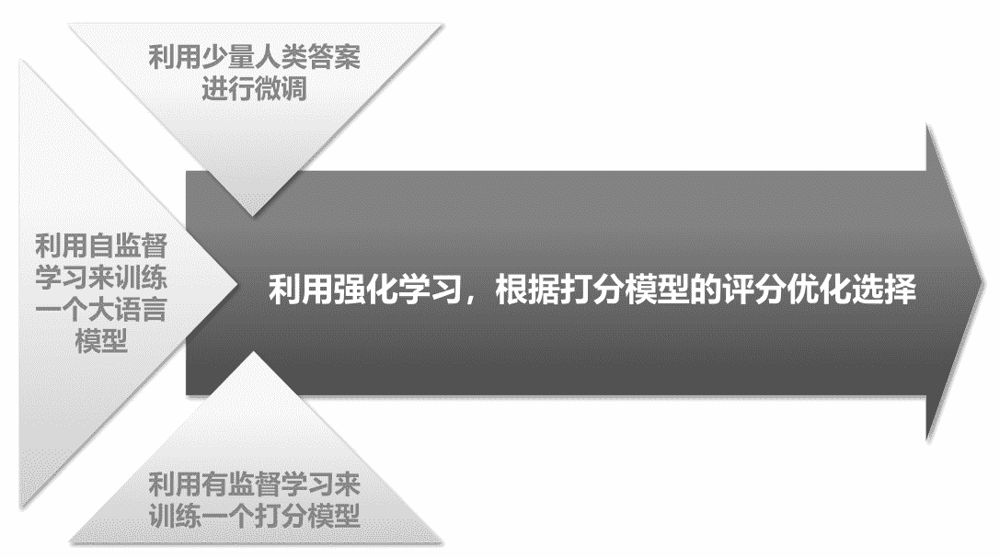

**图 2-2 ChatGPT 的训练过程**

与此前的 InstructGPT 对比，ChatGPT 在训练流程上略有差异。之前的 InstructGPT 是给一个输入对应一个输出，再与训练数据对比，正确有奖励，错误有惩罚；现在的 ChatGPT 只有一个输入，模型给出多个输出，然后“人”为这些输出排序，再让模型学习从“善解人意”到“不知所云”的排序方式，这种策略称为监督学习。总结来看，二者的不同在于数据如何设置并用于训练与收集。

2023 年初，OpenAI 曾表示不久将推出更强大的 GPT-4。据称 GPT-4 将在 2024 年面世，能通过图灵测试并达到与人类比肩的水平，同时企业接入成本将大幅下降。有专家猜测，GPT-4 可能在多模态上取得进展，即引入视频、音频等。

## 第三章 智能交互的运行模式

回顾这一产品的成长轨迹可以看出，OpenAI 从 GPT-1 起就坚定地把大型语言模型 LLM 视为通往通用人工智能 AGI 的必经之路。具体而言，在 OpenAI 看来，未来的 AGI 应具备一个任务无关的超大 LLM，用来从海量数据中学习各种知识，以生成一切的方式解决各类实际问题，并能听懂人类指令便于使用。

**幕后：大型语言模型**

自然语言处理是计算机科学与人工智能领域的重要研究方向，研究能实现人与计算机用自然语言有效沟通的理论和方法。它融合语言学、计算机科学、数学等，因此与语言学关系密切但有所区别。NLP 并非泛泛研究自然语言，而在于研制能有效实现自然语言通信的计算机系统，特别是软件系统，因而属于计算机科学范畴。

自然语言处理涉及计算机与人类自然语言的相互作用，与人机交互相关。NLP 面临诸多挑战，包括自然语言理解，即计算机从人为或自然语言输入中把握含义，以及自然语言生成。

长期以来，NLP 存在两大问题。一方面，迄今语法多仅限于分析孤立句子，对上下文和谈话环境对本句的制约影响缺乏系统研究，因而歧义、省略、指代、同句不同场合不同含义等问题尚无明确规律，需加强语用学研究。另一方面，人理解句子并非单靠语法，还会调用大量生活和专业知识，这些知识无法全部存入计算机，因此书面理解系统只能建立在有限词汇、句型和特定主题范围内；只有计算机存储量和运算速度大幅提升后，范围才可能扩大。

最早的自然语言理解研究源于机器翻译。1949 年，美国人瓦伦·韦弗首先提出机器翻译设计方案。20 世纪 60 年代，国外曾大规模投入机器翻译并花费巨额，但当时严重低估了自然语言复杂性，因理论和技术不成熟进展有限。当时做法主要是存储两种语言的词、短语并在翻译时逐一对应词典，技术上只是调整词序。但日常翻译并非如此简单，很多时候需参考上下文含义。

大约 20 世纪 90 年代起，自然语言处理领域发生巨大变化，呈现两大特征。

（1）对系统输入：要求系统能处理大规模真实文本，而非如早期研究性系统那样仅处理少量词条和典型句子。只有如此，系统才具实用价值。
（2）对系统输出：鉴于真实理解自然语言困难，并不要求系统对文本做深层理解，但要能抽取有用信息。例如自动提取索引词、过滤、检索、自动提取重要信息并做自动摘要等。

同时，因强调“大规模”和“真实文本”，两项基础工作得到重视和加强。

（1）大规模真实语料库研制。经过不同深度加工的大规模真实文本语料库，是研究自然语言统计性质的基础，没有它们统计方法便无源之水。
（2）大规模信息丰富的词典编制。规模达数万、十几万甚至几十万词，且含丰富信息如搭配信息的计算机可用词典，对自然语言处理至关重要。

自然语言处理指机器理解并解释人类写作、说话方式的能力，属于人工智能和语言学的一部分，致力于用计算机理解或产生人类语言中的词或句子。NLP 主要涉及语音识别、语音合成、语义理解、机器翻译，产品呈现实用化趋势，但在成熟度上仍有提升空间。

现代 NLP 算法基于机器学习，特别是统计机器学习。与早期用大量手工规则编码不同，主要研究领域包括短文本计算与分析技术、跨语言文本挖掘技术、面向机器认知智能的语义理解技术，以及多媒体信息理解的人机对话系统（见图 3-1）。

ChatGPT 表现如此突出主要归因于“大规模”，即其依托的大型语言模型。ChatGPT 虽加入人工标注数据，但量级仅数万，与训练 GPT-3.5 模型使用的千亿级数据相比可忽略不计，基本不会提升基础能力。因此其强大功能主要来自隐藏其后的巨无霸模型 LLM。

在整个人工智能行业，几乎所有机构都在建立专门的小模型解决具体问题后再组合使用。若有人研究大语言模型，试图制造类似通用人工智能的东西，参数以百亿计且需大量算力，投资需数十亿美元，定会被视作疯子。

所谓“大模型”，通常是在无标注大数据集上采用自监督学习训练。之后开发者只需微调或少量数据二次训练即可满足新场景需求。

腾讯研究院指出，当前人工智能多针对特定应用场景训练，模型难以迁移，属于“小模型”范畴。整个过程不仅需大量手工调参，还需喂养海量标注数据，降低了研发效率且成本较高。

这如同哥伦布逆风航行所遇困境。要远航需补给支撑，过了折返点补给不足则无法返航，前方要么有岛屿，要么只有几个月的生命时光。所有人害怕近在咫尺的死亡。所以当哥伦布抵达新大陆时，不仅他和西班牙王室知晓，所有人都明白：这条路走得通。

如今 OpenAI 已用“暴力美学”把大语言模型这条路走通，接下来其他企业机构走第二遍便容易得多。

LLM 的发展可理解为“构建一个任务无关的超大型 LLM，让它从海量数据中学习各种知识”。图 3-2 展示了一个大型语言模型该有的样子。

首先，该模型规模必然巨大，能研发或改动其参数的机构必然稀少。而任务需求方是无数中小机构甚至个人，即便开源也无力部署，更不用说用微调修改参数。因此应追求不修正模型参数就能完成任务的方式，即采用提示词 Prompt 模式而非微调模式。模型制作方可将 LLM 做成公用基础设施服务，以基础设施即服务 IaaS 模式运行。与此同时，服务提供方需面对千变万化的用户需求，所以 LLM 开发方更要让模型完成尽可能多的任务类型，这也是 LLM 走向通用人工智能的现实推动力。

其次，LLM 应具备强大的自主学习能力。假设把世界上能获得的所有文本或图片等不同类型数据喂给它，它应能自动从中学习所有知识点，学习过程无需人工干预，并能灵活应用所学知识解决实际问题。因数据海量，需用大量模型参数存储知识，所以模型必然是巨无霸。

ChatGPT 是否给 GPT-3.5 模型带来新知识？答案应是带来了。这些知识就包含在揭秘时提及的“数万人工标注”数据里，不过注入的不是世界知识，而是人类偏好知识。所谓“人类偏好”包含几层含义：首先是人类表达任务的习惯说法。例如人们习惯说“把下面的句子翻译成日语”来表达机器翻译需求。但 LLM 并非人类，会如何理解这句话呢？需要让 LLM 理解命令含义并正确执行。ChatGPT 借助人工标注数据把这类知识喂进 GPT-3.5，方便 LLM 理解人类指令，这是其把握意图的关键。其次，什么是好回答、什么是不好回答，人类有自己的标准，如详细回答是好的，含歧视内容的回答是不好的。人工标注通过打分模型将这类信息反馈进 LLM 数据。总体而言，ChatGPT 将人类偏好知识植入 GPT-3.5，以此获得一个听得懂人话且比较有分寸的 LLM。

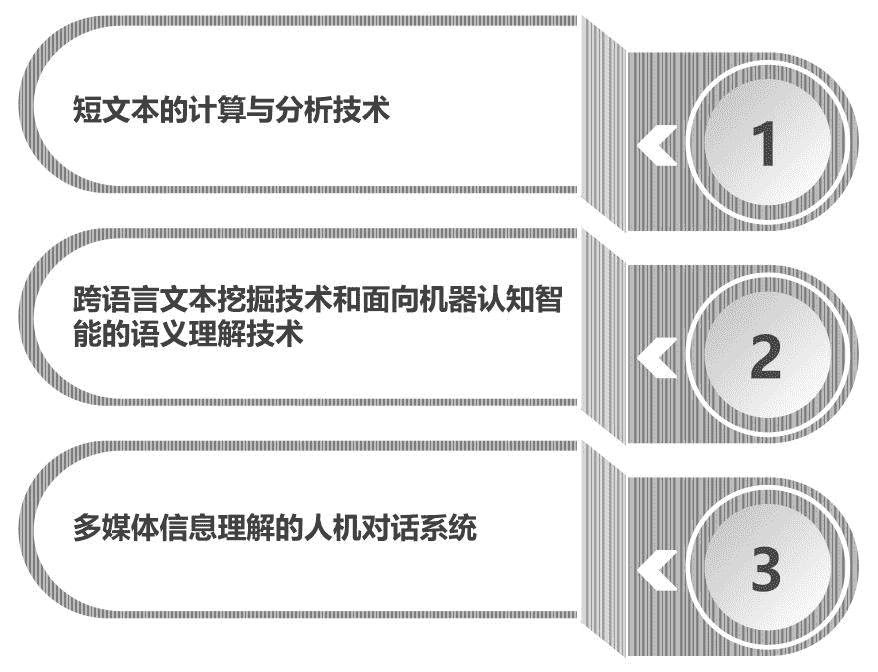

**图 3-1 自然语言处理技术**

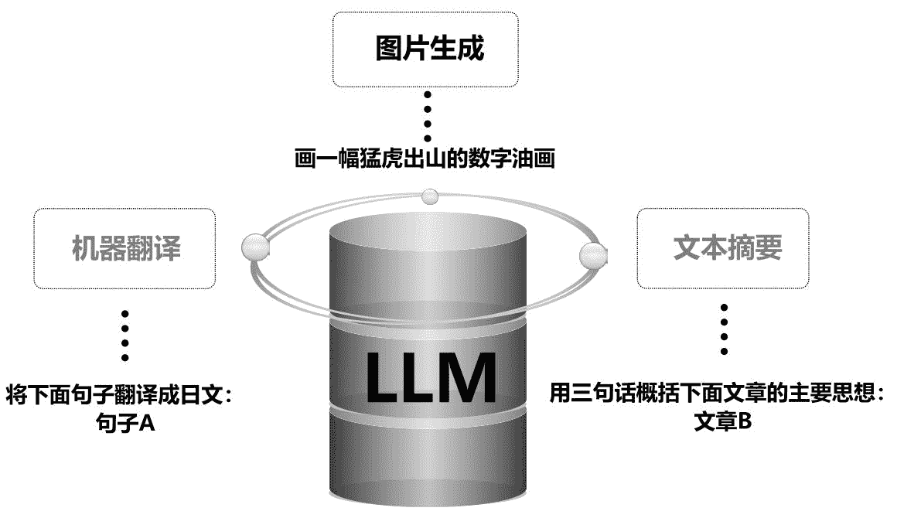

**图 3-2 大型语言模型**

**让模型学会人类的偏好**

落到实操上，偏好对齐可以拆成三步走。第一步是攒标注集。随机挑一批问题请标注员给出高质量参考答案，整理成“人类的表达—理想结果”配对喂给系统学习。这批样本体量只有数万条，学习方式是提示模仿，底座参数并不变动。

第二步是培养偏好判别器。同样随机抽题，让当前的基础系统先出答案，再由标注员按相关性、信息饱满度、有害程度、情绪偏负面等标准对答案做排序。

第三步是用打过标的偏好数据训一个评分器。它能对基础系统的输出打分，标明哪些高哪些低。

到此闭环就形成了。判别器与基础系统通过反馈式优化连起来，基础系统在评分器里拿低分就会被惩罚并触发再学习。循环往复后，基础系统的能力不断升级，最终内化了使用者的偏好，变成公众熟知的 ChatGPT。

**台前：语言成了交互的主干**

语言是人类区别于其他生命的根本标志，也是多项智能的核心载体。人类逻辑以语言呈现，大量知识也以文字流传。人工智能要真正好用，语言能力几乎是关键。

长期以来人们渴望用自然语言和计算机沟通，既有现实价值也有理论价值：用自己习惯的语言操作设备，无需去学繁琐的编程语言；同时也能借此探究人类语言与智能的运行机制。

要实现自然的人机交流，机器既要读懂文本含义，也要用自然语言表达意图。前者是理解，后者是生成。自然语言处理大体包含理解与生成两大块。历史上理解研究更深，生成相对薄弱，但近几年格局在变化。

无论理解还是生成，实际难度都远超直觉。以现有理论与技术判断，打造通用且高质量的语言系统仍是长期工程。针对特定场景的实用系统早已出现并商品化、产业化，比如多语种库与专家系统的自然语言入口、各类机器翻译、全文检索、自动文摘等，只是它们的记忆力并不突出。

当下研究已证实大型语言系统在知识记忆上很强，但现实里记忆强不等于聪明。判断聪不聪明更看推理能力。推理本质是整合多个相关知识点推导出新知或新结论。规模足够大时，大型语言系统本身就会具备相应推理能力。

ChatGPT 的最大贡献在于把大型语言系统的接口层搭好了。它让系统去适应人类习惯的命令式表达，而不是反过来要求人类迁就系统、绞尽脑汁写出可执行的指令。易用性和体验因此大幅提升。

这种交互演进是一种很理想的新型人机交互形态。无需专业技能，也无需高端设备，只需口头说出诉求，人工智能就能理解并给出解答。

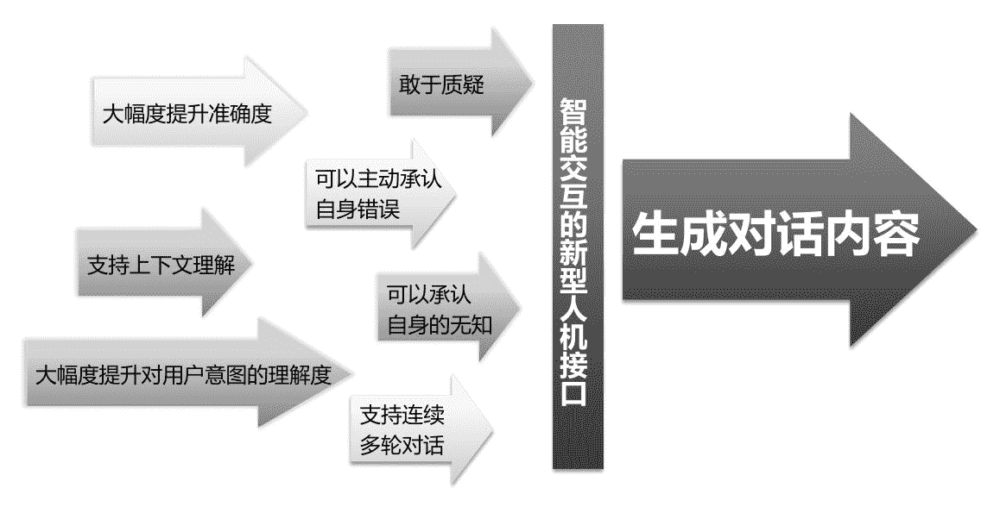

**图 3-3 新型人机接口**

这类产业变革与模式创新大体会在以下方面显现：

**1.改变现有人机交互模式**
用户可以用自然对话和智能产品互动。因为模型能比较精准地捕捉意图，后续软件与服务的调用会更贴合需求，交互效率与任务完成率都会提升。

交互方式的更迭将改写 App 等的使用逻辑。更多功能会被整合进应用内部，甚至出现具备统一能力的大型通用 App。

**2.改变信息分发获取模式**
基于认知智能技术可以实现更高效的信息整合与知识推荐。以搜索为例，传统搜索引擎靠关键词匹配，用户需要在海量结果中筛选有用信息；而接入 ChatGPT 的 Bing 可以直接给出答案，提升问题与答案的匹配度，用户体验明显改善。

由 ChatGPT 引发的信息获取方式变化，会影响流量分布，也会改变流量的商业化逻辑。

2022 年 12 月的媒体通稿里，各大媒体对 ChatGPT 的评价集中在“仿真性”上，仿佛它已通过图灵测试。这种仿真感本质上是智力感知的提升，人们觉得它更聪明了。

## 第四章 深度学习的核心技术

很多人发现 ChatGPT 在文本理解与生成、对话问答、机器翻译、代码生成等任务上进步很大。技术层面看，这源于近年深度神经网络与大型语言模型研究的持续深入，通俗讲就是海量数据加上巨大算力催生了可落地的模型。

支撑 ChatGPT 的关键离不开大模型的算法、算力、数据。

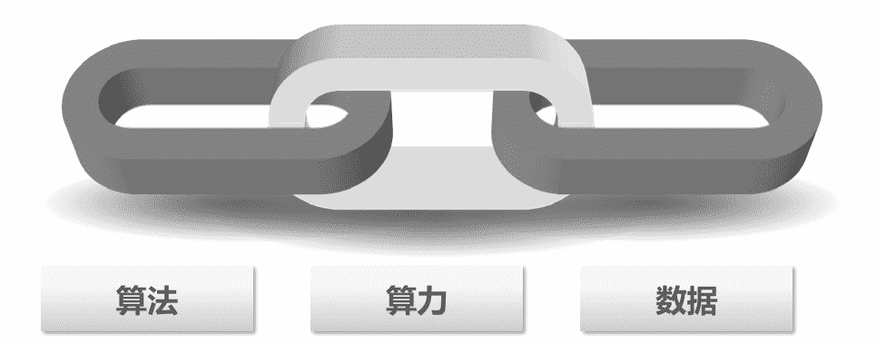

**图 4-1 ChatGPT 的技术支撑**

**算法**
支撑 ChatGPT 的是 GPT-3.5。GPT 是一种基于互联网开放数据训练的文本生成深度学习模型。算法上采用“利用人类反馈的强化学习”RLHF，包含人问机答、机问人答并不断迭代，让模型逐渐具备对生成答案的评判能力。

RLHF 的训练流程可拆为三步。

**阶段 1：预训练语言模型**
先选用经典的预训练语言模型作为初始系统。预训练出现前，深度学习在自然语言处理上受阻，主要有两个原因：一是面向具体任务的训练数据总量不足，模型容量越大越需要数据支撑；二是特征抽取能力不够强，即便数据充足也难以吸收知识。这两个原因阻碍了深度学习在该领域的突破。而 GPT 预训练模型的出现，从学术到应用都是一次技术飞跃，推动了研究范式的转换。

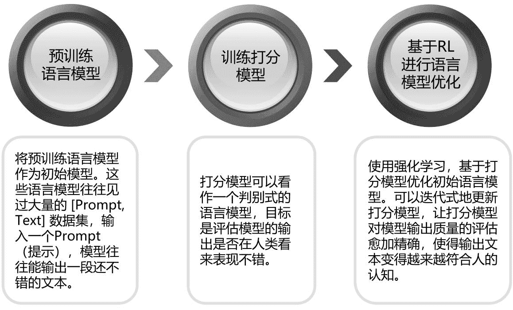

**图 4-2 RLHF 的训练过程**

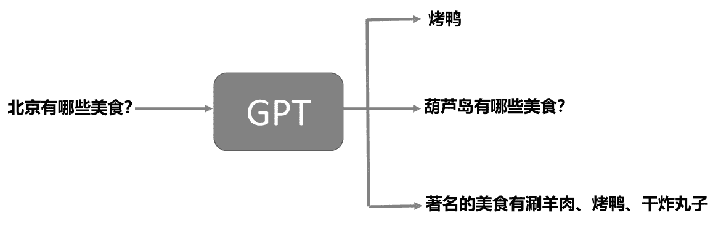

**图 4-3 预训练语言模型**

**阶段 2：训练打分模型**
在此基础上，用初始语言模型产生的数据训练一个打分模型。打分模型的目标是评估输出在人类看来是否表现不错。输入是提示词与模型生成的文本，输出是一个评估文本质量的数值标记。

用于训练打分模型的提示数据通常来自预先富集的数据集，ChatGPT 的提示主要来自调用 GPT API 的用户。这些提示会被送入第一阶段的初始语言模型生成文本。打分模型可视为判别式语言模型，可以从预训练语言模型出发，在 [x =（提示，模型回答），y = 人类满意度] 的标注语料上微调，也可直接随机初始化后在语料上训练。

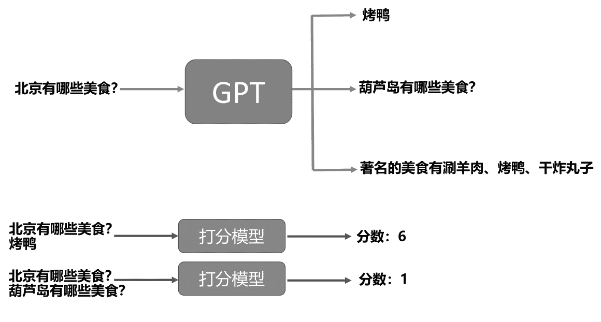

**图 4-4 收集数据并训练奖励模型（RM）**

**阶段 3：基于 RL 进行语言模型优化**
有了能生成文本的初始语言模型和能判断质量的打分模型，就可以用强化学习基于打分模型来优化初始语言模型。

把微调任务建模为强化学习问题，需要定义策略、动作空间、观察空间和打分函数等要素。策略指基于语言模型接收提示并输出文本序列或概率分布；动作空间是词表所有标记在所有输出位置的排列组合；观察空间是可能的输入标记序列，即词表所有标记在所有输入位置的排列组合；打分函数则基于训练好的奖励模型配合策略层面的合约进行计算。有了打分模型，就能按策略优化算法更新模型参数。

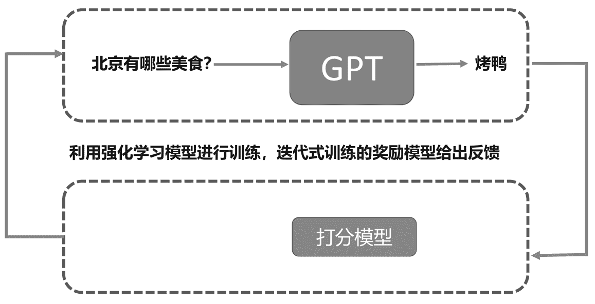

**图 4-5 通过强化学习微调**

通过以上过程，可以迭代式更新打分模型与策略模型，让打分模型对输出质量的评估越来越准；策略模型的输出则不断偏离初始模型，使文本越来越符合人类需求与认知。

**算力**
ChatGPT 成为新一代人工智能里程碑的背后，是算力发展与数字经济时代大数据共同支撑的大型语言模型训练。GPT-3.5 的训练在微软云服务 Azure AI 超算基础设施上完成，该集群由 V100 GPU 组成的高带宽集群，总算力消耗约 3640 PF-days。

这带来了巨大的算力需求与资金消耗。训练和运行模型都需要庞大算力，有研究估算训练 1750 亿参数的 GPT-3 需要上万个 CPU/GPU 24 小时不间断输入数据，能耗相当于开车往返地球和月球，一次运算花费约 450 万美元。

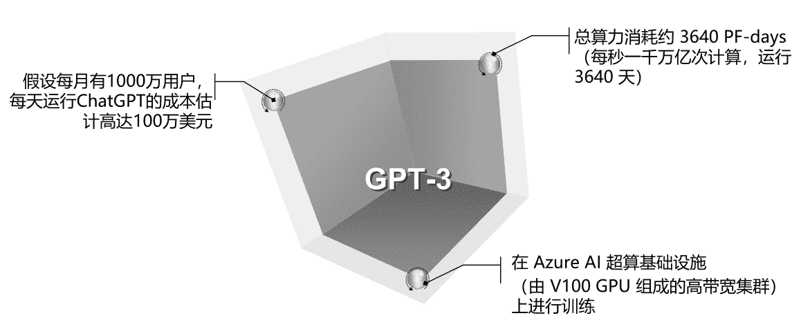

**图 4-6 巨额的算力**

在大模型框架下，GPT 每一代参数量高速扩张，预训练数据量需求和成本同步攀升。ChatGPT 官方站点在 2023 年 1 月 27 日至 2 月 3 日吸引的每日访客高达 2500 万。按稳定状态估算，每人每天提约 10 个问题，每日咨询量约 2.5 亿次。

据国盛证券计算机分析师 2023 年 2 月 12 日发布的报告《ChatGPT 需要多少算力》，2023 年 1 月 ChatGPT 平均每天约有 1300 万独立访客，对应芯片需求为 3 万多个英伟达 A100 GPU，初始投入约 8 亿美元，每日电费约 5 万美元。GPT-3 训练一次成本约 140 万美元，更大 LLM 的训练成本在 200 万美元至 1200 万美元之间。对全球科技巨头而言不便宜，但尚可接受。

Google、Meta 等头部公司迟早会掌握类似技术，但军备竞赛仍会继续。一方面推理成本高昂，算力消耗与用户体验高度正相关；另一方面搜索用户黏性低，用户会流向体验最好的产品，这将大幅抬高搜索算法成本，Google 赖以生存的搜索广告业务难以继续躺赚。微软营收更多元，冲击更小，还可能受益于 Edge 浏览器乃至 Windows 系统份额提升。直白说，微软正开启大模型军备竞赛，要卷死对手。

早年企业自行发电成本高且需要额外能力。电网基础设施运行后，供电成为公共事业，企业可购买电力代替自发电，企业将自行发电变为购买发电服务。集中发电提升效率，更多企业甚至个人可按需买电。电力供应的公共化提高了生产力，改善了生活质量，并为新兴产业创造机会。

信息通信技术行业也在经历类似演进。几十年来机构和个人像买商品一样购买软硬件，过去十年随着高速宽带普及，信息通信技术正转向作为服务购买。

如今算力像电力一样普及，同时具有破坏性与变革性。若把 AI 视作电力，大模型算力就相当于发电机，能把智能应用推广到更大范围。未来大模型智能能力将成为公共基础资源，像电力或自来水一样随取随用。每个智能终端、每个 App、每个智能服务平台都可像接入电网一样接入由 IT 基础设施组成的算力网络，让 AI 算法更广泛地应用于各行各业。用户不必购买、安装和运行昂贵硬件，只需借助有线或无线网络从云端获取算力，与使用其他公共服务无异。

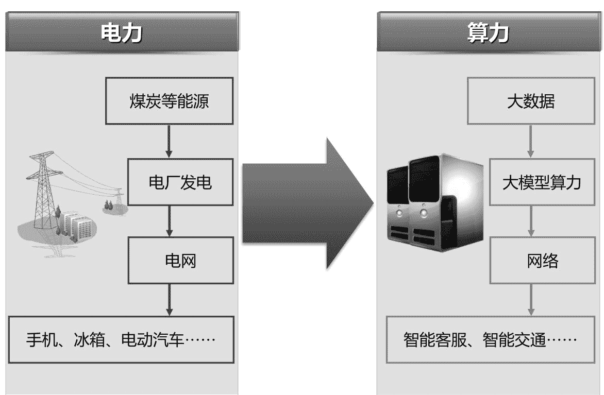

**图 4-7 从电力到算力**

云计算虽也把算力比作随取随用的资源，但目前仍不如用电方便，因为云计算需要云和用户双向交换资源，用户需经过繁琐的数据准备和计算过程定义。相比之下，基于大模型算力形成的大规模智能网络调用更方便。用户只需准备好数据，大模型算力就能在少量微调甚至不微调的情况下直接完成所需工作。这种智能生产与消费的网络未来或将成为产业发展的主流模式。

未来，大模型算力在能力泛化、技术融合、研发标准化等方面的优势让其有能力支撑各种应用，成为人工智能技术及应用的新基座。正如发电厂和高速公路，大模型算力将成为各行各业应用人工智能技术的底座和创新的源头。

**数据**
资料显示，ChatGPT 拥有多达 1750 亿个参数的模型，并在 2023 年初完成训练。背后离不开大数据支持，OpenAI 使用的主要公共爬虫数据集拥有超过万亿词的人类语言数据库。正是这些海量数据，使 ChatGPT 展现出三种强能力：

● 语言生成：遵循提示词生成补全句子的内容，是目前人机交互最普遍的方式。
● 上下文学习：遵循给定任务的几个示例，为新测试用例生成解决方案。值得一提的是，GPT-3 虽是语言模型，重点却在上下文学习而非语言建模。
● 世界知识学习：包括事实性知识和常识。

以上能力都来自大规模预训练：在有 3000 亿个词的语料上预训练 1750 亿参数模型。训练语料 60% 来自 2016—2019 年的 Common Crawl，22% 来自 WebText，16% 来自书籍和报刊，2% 来自维基百科。Common Crawl 是 2008 年至今的网站抓取大型数据集，包含原始网页、元数据和文本提取，覆盖多语言多领域。研究实验室常选取其纯英文过滤版 C4。WebText 语料是从 Reddit 输出链接网络中爬取的大型数据集，每个链接至少有三个赞，代表流行内容风向，对优质链接和后续文本有指导意义。

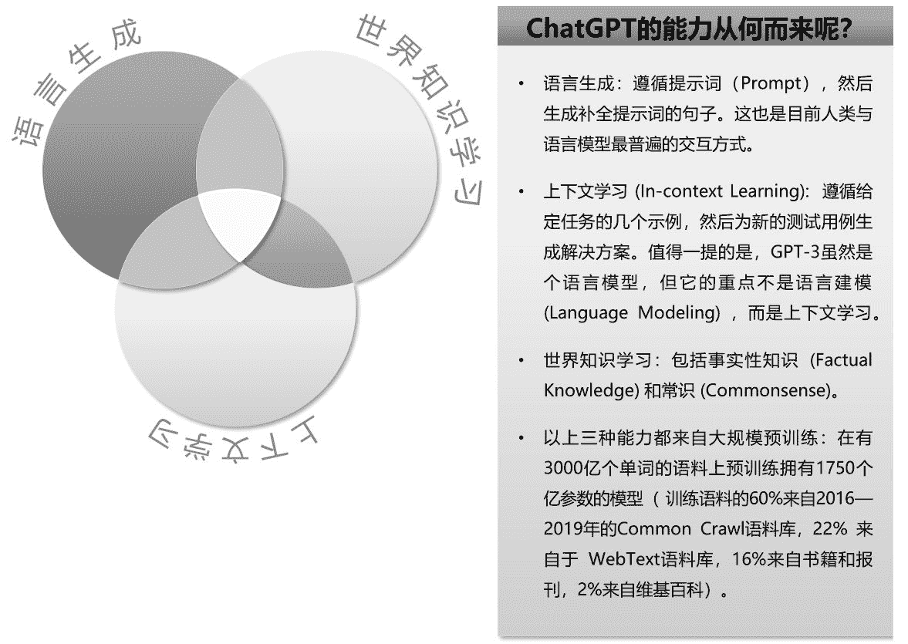

**图 4-8 ChatGPT 的数据来源**

关于上下文学习的能力来源及泛化原因，目前尚无明确剖析。部分专家推测，这种能力可能源于同一个任务的数据点在训练时按顺序排在同一个 batch 中。未来语言模型预训练如何促进上下文学习，以及上下文学习行为与微调的协同原理值得深入研究。

当前 ChatGPT 在 3000 亿词语料上预训练 1750 亿参数模型，据说 GPT-4 将是一个参数规模超过 100 万亿级别的大模型。据学术经验，深度神经网络的学习能力与参数规模正相关。人类大脑皮层有 140 多亿个神经细胞，每个神经细胞约有 3 万多个突触，突触总数超过 100 万亿个。一旦 GPT-4 实现 100 万亿参数规模，就可堪比人脑突触规模。这意味着它可能改造人类思想、具备创作能力、形成超越人工智能的专业能力和大众化趋势，甚至在越来越多方面替代人类思维。

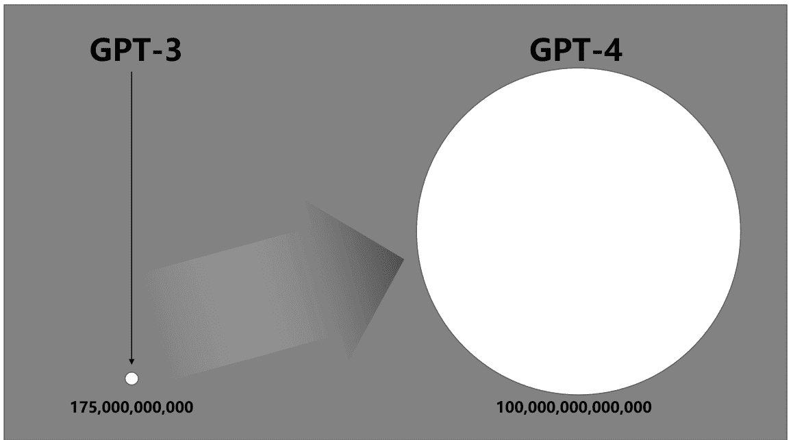

**图 4-9 大量的数据**

## 第五章 无限可能的未来图景

ChatGPT 这波冲击对人工智能新兴行业及传统行业的智能化影响巨大，其内在创新运行模式、新技术及工程理念、对各行业的影响都值得重视。未来类似 ChatGPT 的人机对话系统功能会越来越强，各行各业都应抓住技术机遇，把握红利，思考如何通过深度融合新一代人工智能获得突破与发展，这很有可能开辟新赛道，形成新动能，诞生新经济。

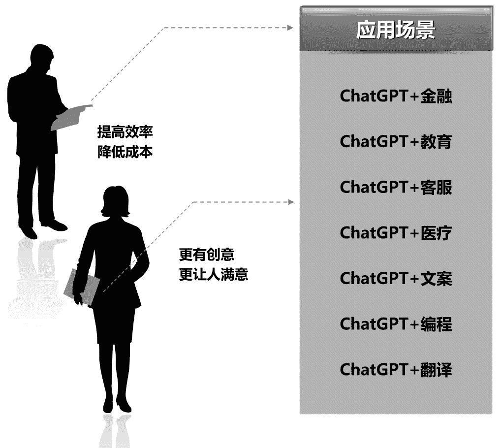

**图 5-1 应用场景**

ChatGPT 成为未来人机交互的一个新入口，很可能改变现有 App 的交互方式，以更自然的对话方式让用户使用软件和调用接口，从而颠覆现有行业生态。例如，未来在 Word 等文档编辑软件中，人们可以通过描述需求，让软件直接生成文字内容，或者生成图形，甚至直接进行修图等工作。在软件开发方面，ChatGPT 这种即时编程方式，将改变传统工作方式和开发规则，推动产业进入软件工程的新阶段。

当前版本的 ChatGPT 采用更像人类的对话交互方式，交互手感明显更顺滑，短期内会加速金融、媒体、医疗等行业自然语言处理的落地。金融场景里，大模型让语义检索能力得到明显跃升，哪怕面对理财咨询里千变万化的提问也能快速给出贴合需求的答案。招商银行信用卡曾借助它撰写宣传文案，产出“生命的舞台上，我们都是基因的载体”“如果说基因给我们的生命带来了基础，那亲情便是对生命的深刻赋予。它不由基因驱使，而是一种慷慨的选择”等极具诗意的表达。投研层面，市场上第一份由它完成的行业研究整体完成度不错，但与资深分析师相比仍有差距。财通证券团队的反馈是模型在表意和标题拟定上表现可观。媒体端，批量内容的自动化生产已成为常态，其原创水准并不逊色于专业写作者。未来文字工作者更应主动拥抱技术提升效率，例如先让模型生成初稿，人类再把控整体方向。医疗里，它甚至能够承担心理疏导、初筛问诊以及用药建议等工作。

除基础对话外，延伸场景更丰富。开发者可把 ChatGPT 当作底层平台，按行业和业务场景做微调，孵化出多样化产品。海外热销的 Jasper 就在 GPT-3 基础上做微调后，能帮助用户写营销文案，甚至有人用它写出 12 万字的小说，IBM、Airbnb、Autodesk 等大型企业都在使用。普通用户可先免费体验生成 1 万词的版本，付费 29 美元可解锁 2 万词，59 美元可解锁 5 万词。

**ChatGPT 赋能金融**

AI 已渗入投资、信贷、保险、监管等多个金融业务。传统银行、互联网巨头、AI 厂商都在加码布局，智慧银行、机器人投顾、智能投研、智能信贷、智能保险、智能监管成为主流方向，覆盖运营、财富管理、信贷、保险与监管等环节，整体成熟度仍偏低。支撑这些应用的技术主要包括机器学习、生物识别、自然语言处理、语音识别与知识图谱。

当下 AI 在金融的应用多处于起步期，多为人机协同，AI 扮演辅助角色。“智能化”常被包装成卖点，实际落地体验却常被吐槽。

随着模型在金融领域更深度的应用，业务与技术创新的空间很大。从长远看，智能客户服务、机器人投顾、金融产品推荐、智能投研等赛道都可能被重塑，甚至出现颠覆性变化（见图 5-2）。

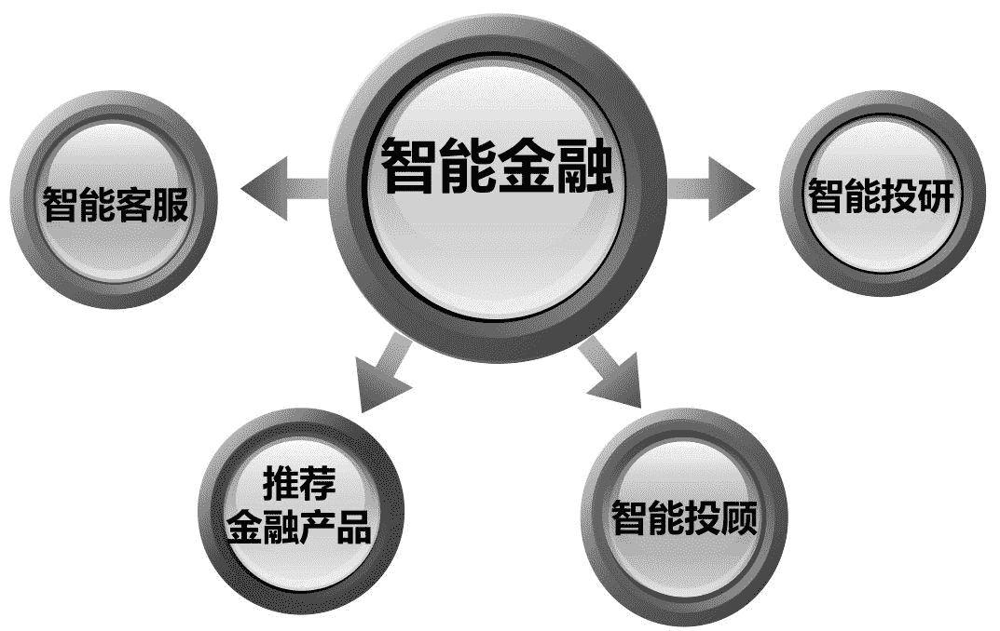

**图 5-2 智能金融的应用场景**

**（一）自动化客户服务**

人力成本上涨、客户体验要求提升、AI 技术成熟，传统劳动密集型客服已难以满足市场，自动化客户服务开始普及，提供快速稳定反馈并实现全天候在线。系统依托知识库，通过官网、手机 App、即时通讯等渠道，以文字或语音交互，识别意图并给出反馈。

基于 ChatGPT 的客服问答可借助自然语言处理实现自动应答，主要处理重复性服务请求，应用已较成熟。对处于价值链高端的金融业而言，AI 将深刻影响服务渠道、服务方式、风险管理、授信融资、投资决策等，成为连接客户、发现需求的关键。既能快速响应，也能减轻人工压力、降低机构运营成本。

此外，系统能把金融服务的细节抽取出来，用通俗方式呈现，避免客户反复钻研，提升获取金融知识的效率。还能应对复杂多变的理财咨询，精准匹配客户需求的答案。

**（二）机器人投顾**

智能投顾又称机器人投顾，约在 2008 年前后起于美国。基于现代资产组合理论，结合投资者风险偏好与理财目标，通过算法与互联网界面在线提供财富管理与投资建议。

相较传统投顾，机器人投顾门槛低、成本低、覆盖面广、透明度高、操作简便、可个性化定制，更符合需求。按美国金融业监管局 FINRA 标准，理想服务包括客户分析、大类资产配置、投资组合选择、交易执行、组合再平衡、税负管理与组合分析。传统与智能路径相同，只是执行由人工转为技术。

投资者对顾问的需求集中在情绪调节与投资策略建议：投资中易出现贪婪恐慌等波动，且信息不对称导致判断不足（见图 5-3）。

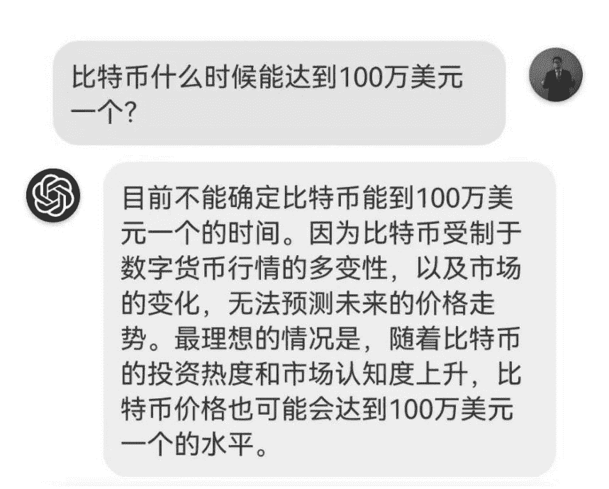

**图 5-3 在投资咨询中使用 ChatGPT**

机器人投顾并非新概念，算法基础二十年前已萌芽，近年爆发主要得益于大数据与算力提升。它依托用户提供的风险偏好、收益要求与投资风格，用智能算法与组合优化模型给出决策参考，并随市场动态调整配置。既能提升配置与交易效率，也能帮助用户克服情绪短板。

模型为投行业务带来更高效流程，可通过自然语言处理快速分析市场信息、提炼要点，提供更快捷精准的投行分析服务，提升投资效率与回报。还能收集、统计、建模用户历史交易行为，分析参与者策略偏好，识别异常重复交易或行为不一致等潜在欺诈信号，实现预测预警，避免损失。

**（三）金融产品推荐**

推荐系统主要依赖 AI 算法预测用户金融需求，结合属性、行为与投资风格，并融入专家经验进行实时分析后推送匹配产品。自然语言处理能力使其可自动获取用户属性，在识别意图、行为与兴趣的同时实现个性化推荐，满足差异化需求。

**（四）智能投研**

金融对数据的依赖极强，员工大量时间耗在收集与处理数据上。智能投研依托知识图谱与机器学习收集整理信息，形成文档供分析师与投资者使用。机器效率高但创新不足，人机结合可大幅提升决策效率与质量。

对金融机构而言，AI 推动日常业务流程自动化，能有效识别需求、提供定制产品，提升业绩。对消费者与投资者而言，AI 能降低服务成本，获得更好体验。

**ChatGPT 助力教育**

智能教育正在重塑教学方式，释放教师资源，推动教育理念与生态变革。全球多国都在加速创新，探索新模式与新产品。

教学方式改变主要体现在：一是智能测评提升教学质量，用 AI 对数字化、标准化的教学行为与学习情况进行测试、分析、评价，帮助师生快速定位问题，实现针对性、科学化教学；二是构建个性化学习系统激发自主学习动力，通过知识画像推送针对性内容，提升学习意愿。

例如智能辅导系统。自动语音识别与自然语言处理的发展让智能辅导从实验室走向应用，能模仿教师指导各学科学习。学生遇到问题时系统会提醒并即时反馈，甚至为每位学生定制学习方案。

再如学习分析。该领域由学习数据的测量、收集与分析构成，随在线学习系统发展而兴起，是数据收集的天然载体。可促进教育新发现，改进大规模学习。AI 已被用于分析学生的动机、行为与结果，旨在发现常见错误、预测失败风险并提供实时反馈。业界普遍认为学习分析将加速个性化学习工具的开发。

以教育为例，媒体报道可整理出如表 5-1 所示的教学应用 16 种用途。

**表 5-1 ChatGPT 教学应用举例**

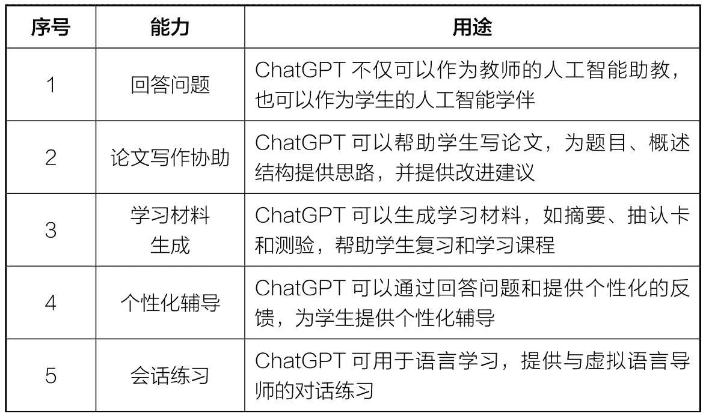

续表

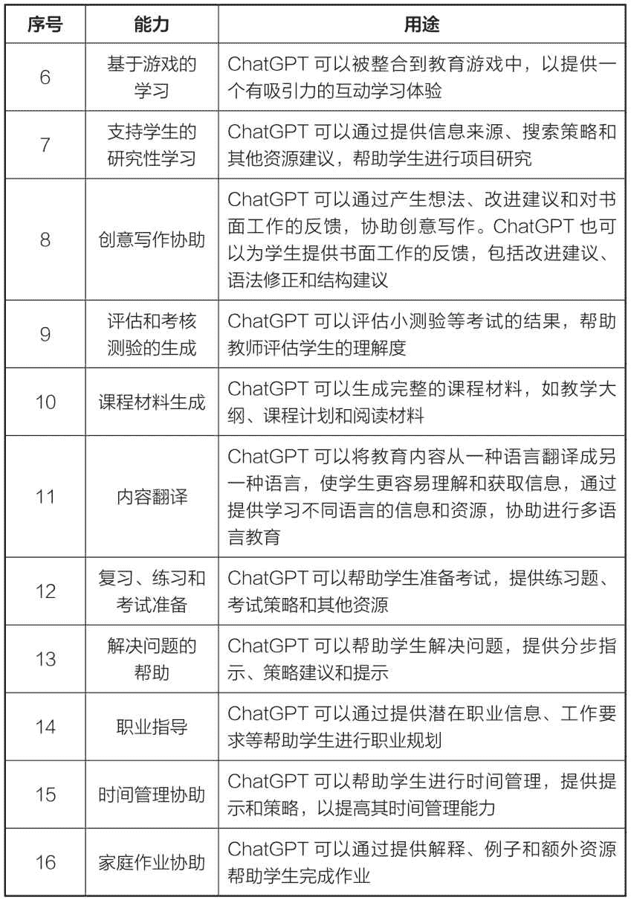

据报道，ChatGPT 的使用范围已从高校扩展到学龄前与中小学。国内二线城市一位 4 岁孩子的母亲表示，她每天都会登录与之聊天，并推荐给其他家长解答教育问题（见图 5-4）。部分中小学教师也在思考如何将之融入教学。一名新入职的小学语文教师说，小学生既需要知识辅导，也需要心理关怀，她常询问“如何矫正小学生行为习惯”“如何与内向小学生沟通”等问题。

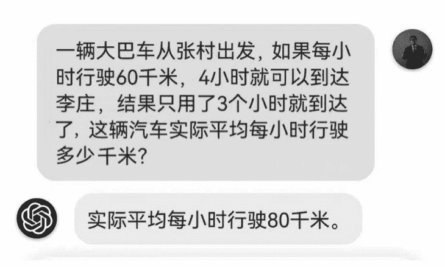

**图 5-4 用 ChatGPT 完成小学数学作业**

未来可借助 ChatGPT 加快人才培养模式与教学方法改革，构建包含智能学习与交互式学习的新型体系。推进智能校园建设，让 AI 贯穿教学、管理、资源建设全流程；开发立体综合教学场与基于大数据智能的在线学习平台；开发智能教育助理，建立智能、快速、全面的教育分析系统；以学习者为核心提供精准服务，实现日常教育与终身教育定制化。

**ChatGPT 与客服**

近年各大厂均推出智能聊天助手，Google 有 Bard，苹果有 Siri，亚马逊有 Alexa，微软、IBM、Meta 也有各自产品。所谓智能助手常答非所问，使用体验不佳；电商平台客服机器人更是槽点不断。面对人类多样化的个性化需求，客服机器人成了“人工智障”的代表，最终仍需人工兜底。公众对 AI 的失望更多源于体验。

除体验外，通用智能能否帮助行业构建“大脑”、带动产业发展？可能先要解决企业级智能客服的三大难题（见图 5-5）。

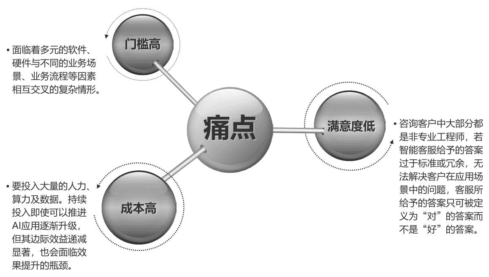

**图 5-5 智能客服的三大痛点**

一是门槛高。面向 B 端的数据中心智能服务场景复杂、知识要求高。多种软件、硬件、业务流程交织，如何让 AI 与复杂数据与业务场景融合，实现全生命周期专业端到端智能化，是转型难点。

二是满意度低。大部分咨询者是非专业工程师，若答案过于模板化或冗余，无法解决实际场景问题，只能算“对”而非“好”。

三是成本高。智能化转型需投入大量人力、算力与数据，边际效益递减明显，易触及效果瓶颈。

这对企业级智能客服提出明确要求：具备上下文理解的自然语言能力，并通过多轮对话识别意图；具备无需持续标注训练的阅读理解能力，在降低投入的同时保持高精度回答。ChatGPT 基本能满足这些要求（见图 5-6）。

自 ChatGPT 出现后，AI 终于获得了与人对话的资格。这种单人专属、随叫随到的 24 小时 VIP 体验，与 AlphaGo 对弈的直观感受类似，让普通人首次感受到 AI 带来的日常愉悦。

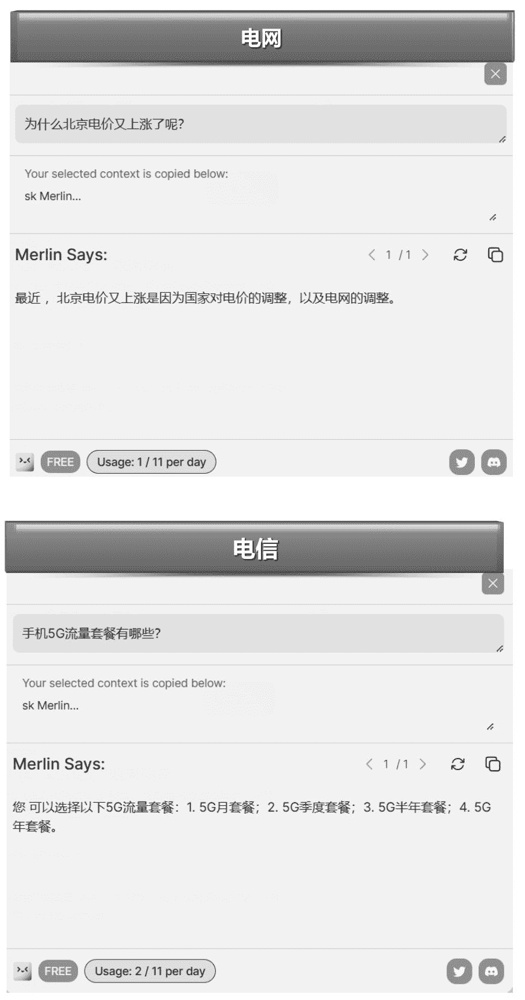

**图 5-6 智能客服中 ChatGPT 的试用场景**

**ChatGPT 在医疗中的应用**

据报道，我国超 50% 的医生每天写病历超过 4 小时，部分超过 7 小时；部分放射科仍采用人工记录再录入，效率低下。

医疗一直是 AI 的高潜力领域。未来几年 AI 将有效辅佐医护人员，改善健康状况、提升生活质量。主要应用包括临床决策支持、患者监测与指导、自动化手术或护理设备、医疗系统管理。近期 AI 已通过挖掘社交媒体推断健康风险、用机器学习预测患者风险、机器人手术等方式拓展应用。但医疗专业人员与患者交互方式的升级仍是核心挑战。

医疗领域的 ChatGPT 依托特定知识体系，让医生与患者以文字或语音进行类人交流，通过智能语音技术与自然语言处理实现人机交互，解决特定需求。

在医疗领域完全可以替代专业人员面向患者提供导诊、问诊与用药建议等（见图 5-7）。

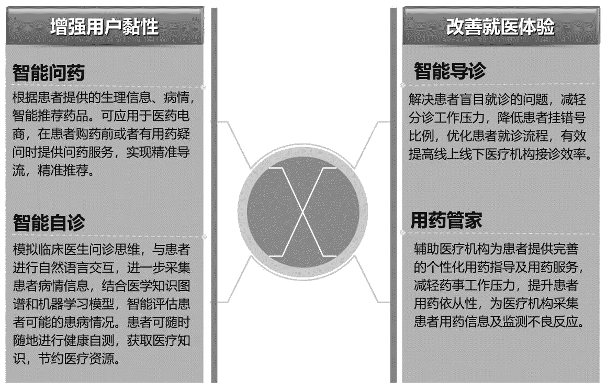

**图 5-7 智能医疗的场景应用**

**（一）智能导诊**

与传统诊断系统相比，ChatGPT 可用海量病例数据模仿人行为，实现自动诊断。自动诊断更准确，能帮助医生快速确诊、及时治疗，也为医学研究提供高质量数据与分析，指导检测、诊断、治疗。

例如，可依据症状、体征、化验报告进行诊断并分析病情，为治疗方案提供建议；还能基于诊断数据用预测模型精准推演病情发展趋势，帮助制定最佳方案。

借助该能力，医疗机构可减少检查诊断时间，节省费用，提升就诊体验；还能缓解盲目就诊、分诊压力，降低挂错号率，优化就诊流程，提高线上线下接诊效率。

AI 可作为决策支持系统，为医生提供有价值数据。AI 能捕捉 CT 扫描中人眼易忽略的细微异常。业内人士认为，对临床医学帮助很大，医生的记忆力有限，远不及计算机存储能力。

**（二）智能自诊**

可模拟临床医生问诊思维，与患者自然语言交互采集病情信息，结合医学知识图谱与机器学习模型评估患病可能。患者可随时随地自测、获取医学知识，节约医疗资源。

首先，可与医学知识库与诊断报告交互，辅助诊断。其次，可帮助医疗信息检索系统快速定位专业医疗机构，自动检索合适保健机构。最后，可提供个性化推荐服务，根据病情与病史给出有价值的诊断与治疗建议。

**（三）智能问药**

根据患者生理信息与病情智能推荐药品。一方面可快速检索诊断治疗相关的研究文献，加速新药研发等工作；另一方面可用于医药电商，在购药前或用药疑问时提供问药服务，实现精准导流与推荐，自动理解口头描述并呈现相关建议。

**（四）用药管家**

辅助医疗机构面向患者提供个性化用药指导与服务，减轻药事压力，提升用药依从性，帮助采集用药信息并监测不良反应。

总体而言，ChatGPT 能显著提升医疗效率，为患者提供更优质服务。

**ChatGPT 与文案创作**

文案不仅指广告的标题、副标题、主题、活动介绍，还包括广告策略、创意图片、视频等，它们共同构成整体并服务于品牌传播、用户喜爱与转化的目标。

写东西几乎是基本技能，真正算得上好文案的，是能够让人产生好感、感受到产品或服务带来的价值，并对内容保持兴趣。绝大部分文案服务于商业目的，习惯强调产品卖点，迎合乃至塑造受众需求，抓住心理触发点，点燃购买欲并推动成交，最终实现销售目标（见图 5-8）。

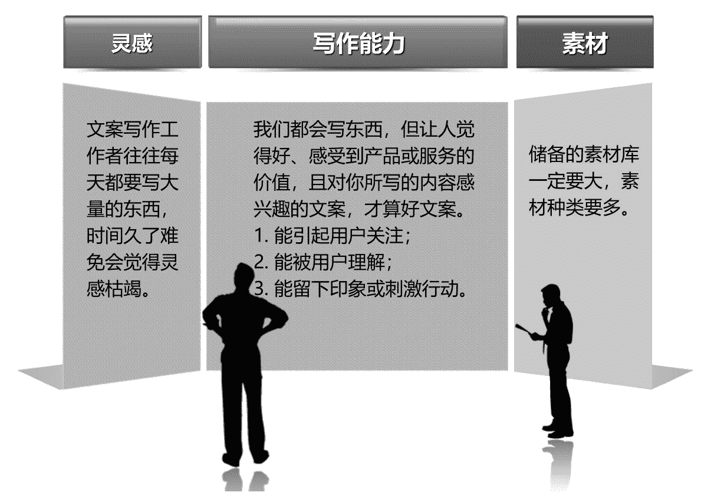

**图 5-8 文案工作的难度**

文案的核心职责在于传递价值、影响认知与感受、促成行为。因此写出来的内容需要卖点突出、具备撬动欲望的能力，并能实现转化。不论最终以视频、音频或图像呈现，都要先以文字梳理思路，再借助 ChatGPT 转化为目标形态（见图 5-9）。

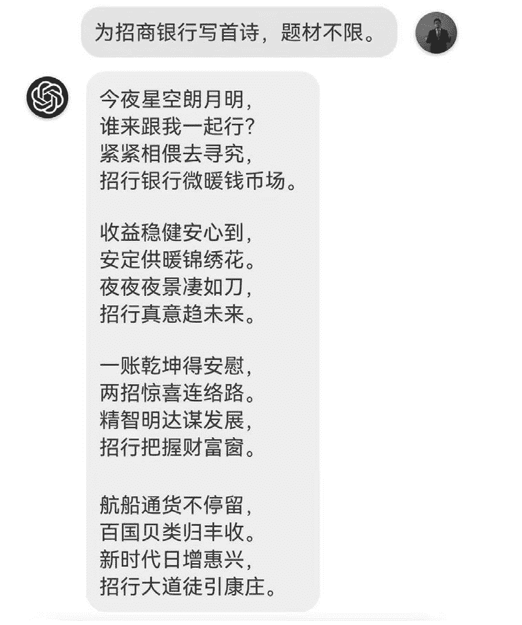

**图 5-9 创作文案中 ChatGPT 的试用场景**

在生成式 AI 的众多应用里，文案创作既是关注度最高的方向，也是落地最普遍的场景。互联网营销成本持续攀升，难度也在加大，高质量的营销需要投入大量时间、技巧和经验。生成式 AI 的出现，给营销团队提供了除外包和自建团队外的第三种选择，普通人也能借助强大的 AI 助手，快速撰写邮件、博客、社交推文等，效率相比过去提升数倍。对初创企业而言，这能大幅降低成本和人力负担。

像 Jasper 或 copy.ai 这类工具，其底层多沿用与 GPT-3 相关的算法，但可做的已远不止文章撰写，还包括创意宣传、商品描述等多种内容生成。从长远看，这将从根本上重塑文案与营销行业的协作方式，人与 AI 的伙伴关系进入新阶段。

想在该赛道创业，需要清醒认识竞争格局。以 Jasper 为例，若不能迅速建立壁垒，很容易被后来者超越，因为强劲的新玩家不断涌现。事实上，这些公司的技术路径高度同质，算法基本都是 GPT-3 的变体，且多非自研。此外，这些算法在宽泛主题的内容产出上仍显不足，要实现更大人群的覆盖还需时间。要么等待 GPT-4 推出后成为真正可规模化的产品。

另外，众多已有的工具和平台都开始上线自家 AI 助手，像 Jasper 这样的一站式平台发展空间可能受限。可以说，给新创公司的窗口已经很窄了。

**ChatGPT+编程**

随着节奏加快，越来越多的人用手机和电脑进行学习与工作，期间会接触大量软件。软件的各部分都由程序代码实现，编程有一套统一的书写规范，这保证了代码的可读性。

很多人认为程序员编写代码门槛很高，但 ChatGPT 也能胜任。至少现阶段它在编程开发领域能做到两点：

第一，入门者和兼职开发者可以更高效地写出中等质量的代码。

第二，把旧代码从旧语言迁移到新语言变得更轻松。

当然，对专业工程师来说，当前 AI 生成的代码在结构和准确性上仍有不少问题，需要人工复核。现阶段它对工程师的助力大概是提升约 1.5 倍的生产力。未来把 ChatGPT 集成到开发环境中，可以进一步整合技术来辅助开发。更具体地说，部分工具可能会让企业用自身代码和优秀案例来训练模型，打造出能管控所有代码仓库、指导新人的智能助手（见图 5-10）。

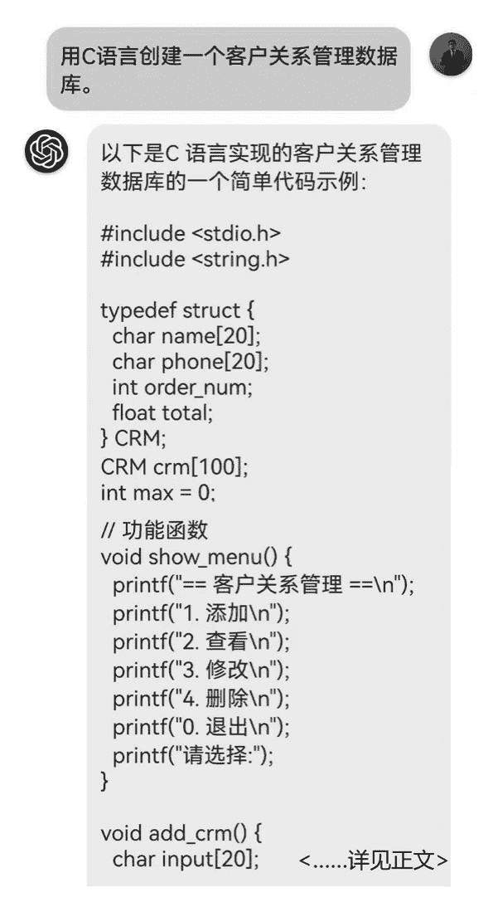

**图 5-10 软件开发中 ChatGPT 的典型应用**

问：用 C 语言创建一个客户关系管理数据库。

答：以下是 C 语言实现的客户关系管理数据库的一个简单代码示例。

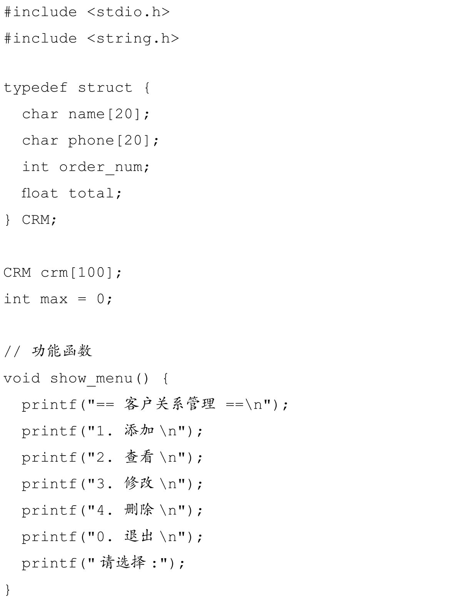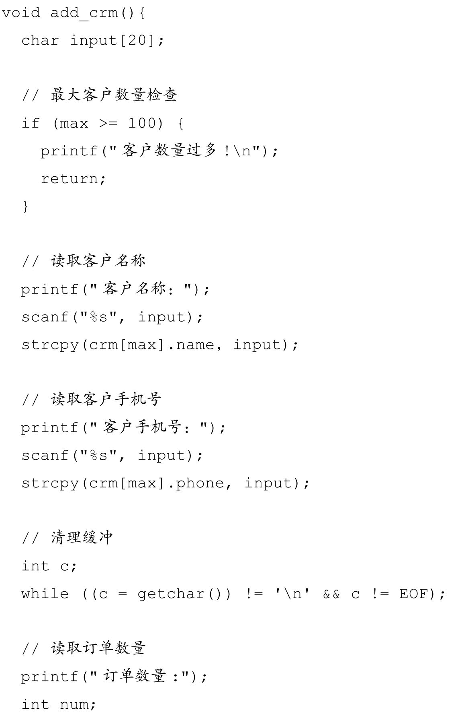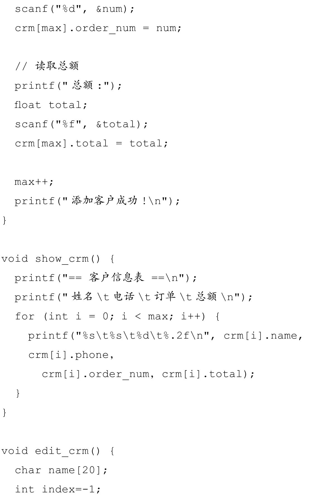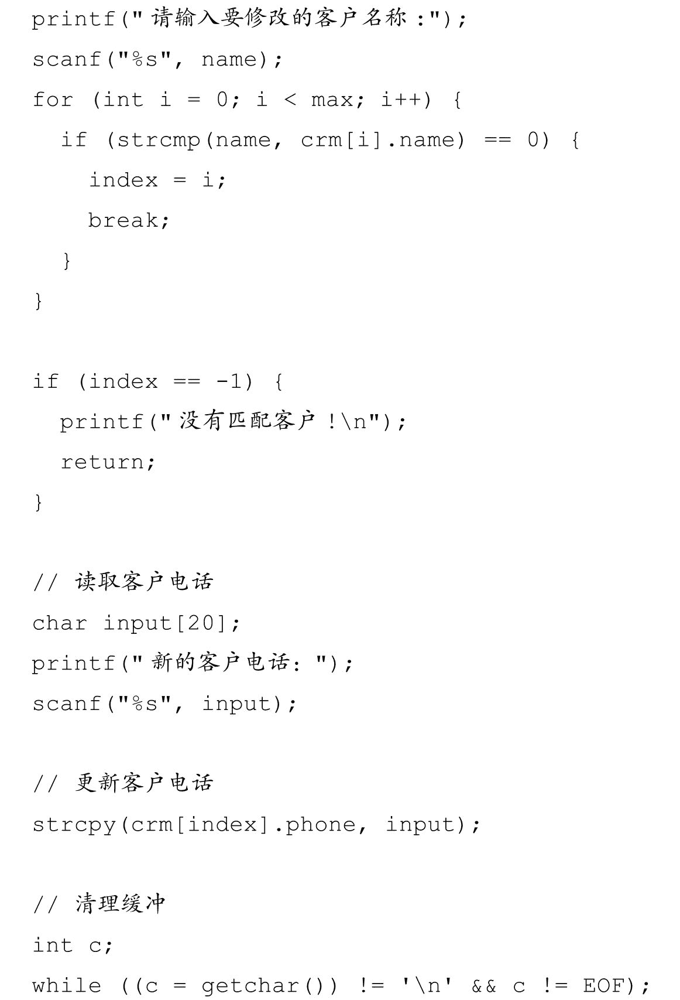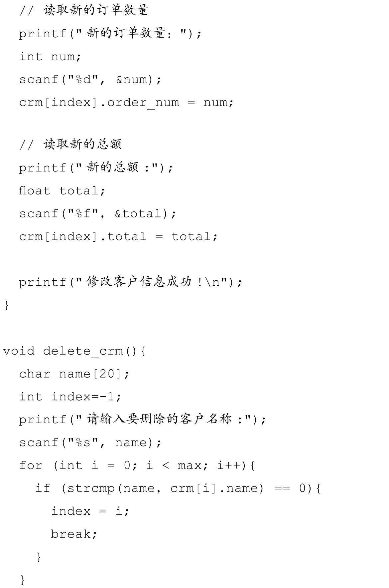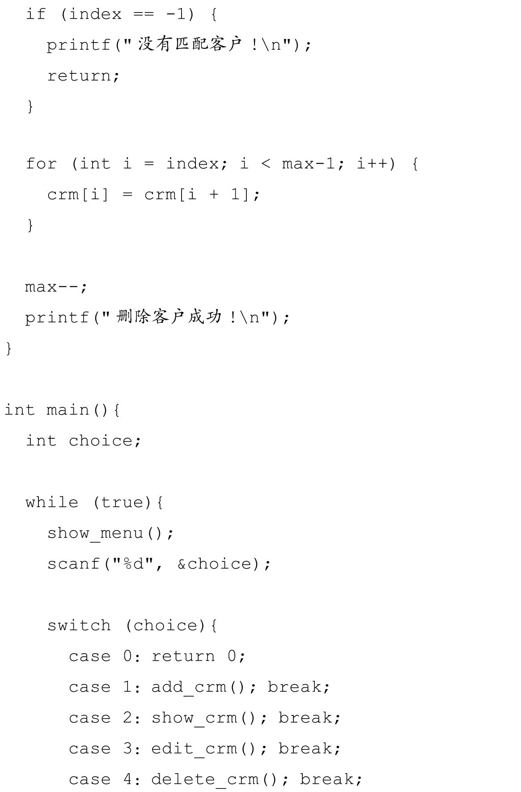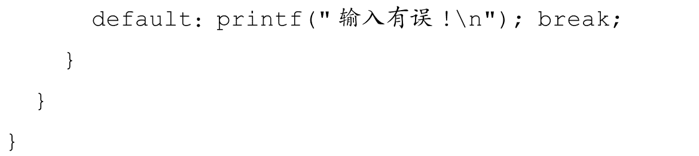

**ChatGPT+翻译**

清末启蒙思想家严复在《天演论》译例言中写道：“译事三难：信、达、雅。求其信，已大难矣！顾信矣，不达，虽译，犹不译也，则达上焉。”。通俗讲，“信、达、雅”就是译文要符合汉语表达习惯，注意语句完整、语法通顺以及语言的文学性。

“信”就是忠于原文，不删减、不歪曲、不随意增添。西方语法与汉语差别很大，完全照搬原文形式往往不通，所以“信”不是机械照抄，而是按译入语语法做适当调整，让译文完整准确地表达原意。

“达”指译文流畅易懂。严复谈“达”时强调，译者下笔前要反复阅读原文并吃透含义，因为源语与译语语法不同，需要调整语序。真正的“达”是理解原文后按目标语言规则重塑，而非只求表面通顺。

“雅”的界定严复说得比较模糊，只提到译文要“尔雅”，后许渊冲补充认为“信”是本体论，“达”是方法论，“雅”是目的论。所以追求“雅”不是刻意求文雅高贵，而是力求还原原文的意境和神韵。

ChatGPT 的翻译水平达到了令人惊讶的“信、达、雅”程度。例如它把《大话西游》里的一段经典台词译成日文，文采极佳（见图 5-11）。

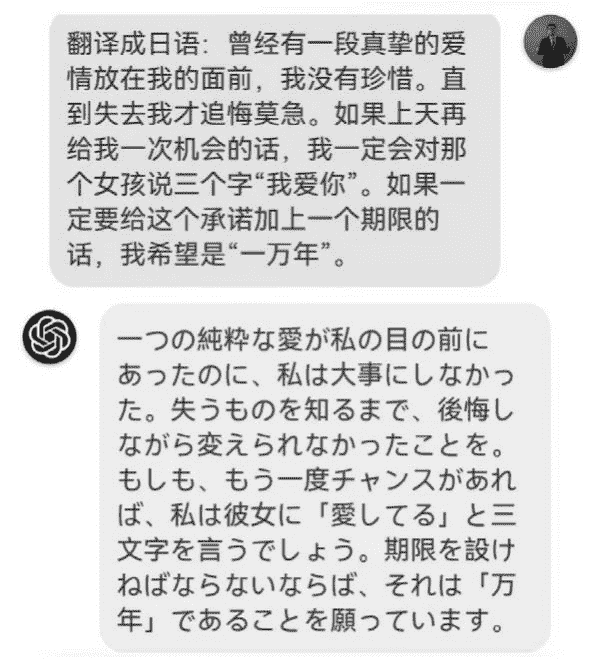

**图 5-11 翻译场景中 ChatGPT 的应用示例**

# 第二篇 AIGC：创作智能的全新跃升

人工智能具备创作、写诗、作曲、绘图的能力，标志着技术跨越式升级。AI 在生活中已十分常见，例如工业机器人喷涂焊接搬运，人脸识别进站乘机住店，金融和商业领域的复杂计算等。但要更接近人类，就必须拥有类人的创作能力，这正是 AIGC 的意义。

语言是人类最基本的社会工具和生存技能。在人工智能时代，语言不再只是交流工具，更是生产工具。语言能够直接生成文本、图像、音频、视频，甚至 3D 模型等更多未知形态的流媒体。未来几年，基于 AIGC 的人工智能内容生产范式将井喷式发展。

AIGC 是全新技术，目前学界对它到底是什么仍无统一共识，但从英文 AI Generated Content 看，就是利用人工智能技术来生产内容。

以往的人工智能只是模仿人类做“已知”的事。例如人脸识别，先用摄像头采集人脸图像，定位大小，再用 CNN 提取特征，通过逐层迭代在大数据库中匹配，最后判断表情（见图 6-1）。

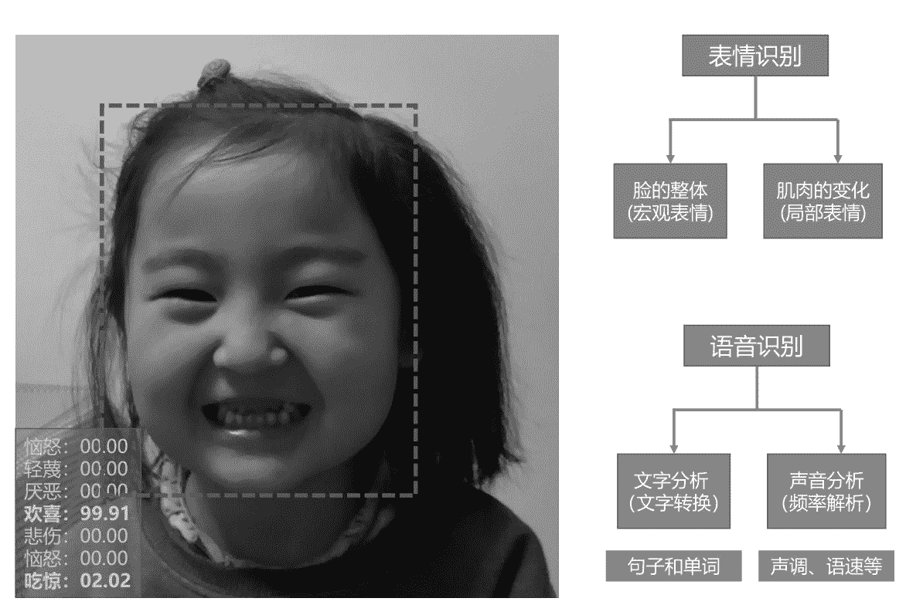

**图 6-1 人脸识别示例**

人类不仅擅长分析，也擅长创造。我们写诗、设计产品、制作游戏、编写代码。很久以前机器还无法在创造性工作上与人类竞争，但现在机器开始尝试创造有意义和美妙的东西，这个新类别被称作 AIGC——生成式 AI，意味着机器开始生成全新事物，而非仅分析已有信息。

没有 AIGC 时，绘画、音乐等艺术创作需要数年学习、练习和经验积累。到了 AIGC 时代，一个人可能只需几天熟悉工具，掌握参数技巧，就能创作出想象力丰富、色彩艳丽的作品。这种模式带来了内容生产力的巨大变革，能够创造“未知”的作品，大幅提升艺术创作效率。

克莱·舍基在《认知盈余》中断言，内容创作者将迎来智能化创作时代。随着社会技术进步，人们拥有更多闲暇。AIGC 以最简单的方式给每个人释放“认知盈余”的机会，大幅降低创作门槛和成本，推动更广泛的知识共享。创作者能用免费或低价的 AIGC 工具更快速高效地做多样化内容生产。从繁琐事务中抽离出来，尤其是自由职业者和自媒体工作者，可以更专注于内容本身，甚至把发布和营销推广也交给 AI。

2022 年 8 月，美国设计师杰森·艾伦用 Midjourney 生成《太空歌剧院》并斩获科罗拉多州艺术博览会“数字艺术类”冠军（见图 6-2）。事件引发好奇，背后技术正是 AIGC。它让大家认识到 AIGC 的同时，也看到更多可能：只要有想象力和文字表达能力，任何人都能从事艺术创作，这是过去 AI 做不到、很多人想不到的事。

**图 6-2 作品《太空歌剧院》**

综合学界与业界观点，AIGC 并不是单一技术，也不是具体产品，其本质是依托 AI 赋能形成的一种高自由度、低门槛的内容生产能力，服务于各场景的创作者和生产者。DeepMind、会作诗的微软小冰以及 ChatGPT 都可视为 AIGC 发展进程中的重要里程碑。

AIGC 正在变得更快、更便宜，并在某些情况下比人类创造得更好。从社交媒体到游戏，从广告到建筑，从编程到平面设计，从产品设计到法律，从市场营销到销售，任何原本需要人类创作的行业都在被机器重塑。AIGC 可处理知识性工作和创造性工作，涉及数亿人工劳动力。它能大幅提升人工效率和创造力，让工作更快更高效、能力更强，从而具备产生数万亿美元经济价值的潜力。

我们可以把创作者生态划分为三个阶段：专业生成内容 PGC 时代、用户生成内容 UGC 时代，以及即将到来的 AI 生成内容 AIGC 时代（见图 6-3）。

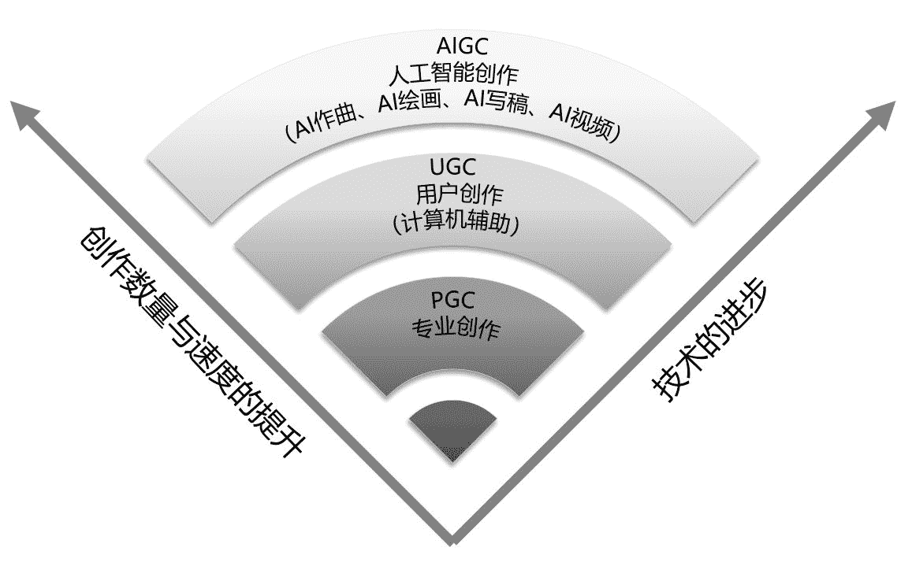

**图 6-3 创作者生态演变路径**

PGC 时代，专业内容体验好但成本高，产能常跟不上需求。UGC 模式虽降低成本、缓解产能瓶颈，却带来海量参差内容，用户搜寻优质内容的成本持续上升。

一面是生产成本，一面是搜寻成本，供给与需求的效率都有很大提升空间。借助 AI，一方面可通过持续深度学习提升内容专业性，另一方面可辅助专业创作者提高效率，供给与需求之间的“效率鸿沟”因此被缝合。

未来 AIGC 将在多领域替代人类基础性工作。以 ChatGPT 为例，它不仅能缝合“效率鸿沟”，已具备很好的内容总结能力，能帮助解决具体问题。在商业写作、人文创作和日常生活场景中，ChatGPT 已显现出足够想象力，这种借助其视角生成内容的方式在一定程度上能取代部分初级内容生产者。

不仅在销售，广告行业可用 AIGC 生成广告内容和创意以提升效率和创造力；新闻行业可生成报道和摘要以提高效率和质量；娱乐行业可生成音乐、电影和游戏内容；教育行业可生成教材、教学内容和课程大纲以快速搭建课程。

总之 AIGC 的应用场景覆盖企业经营中的销售、策划、运营、开发、财务等多个部门，几乎可应用于所有行业，帮助企业提升生产力、推动数字化转型和降本增效。

## 第六章 瞬間席卷全球

语言是人类最基本的社会工具，也是每个人最基本的生存技能。在人工智能时代，语言将不再只是交流的工具，更是生产工具！语言将直接生成文本、图像、音频、视频，甚至是 3D 模型等更多未知的流媒体形态。未来几年，我们将看到基于 AIGC 的人工智能内容生产范式呈井喷式发展。

AIGC 是一项全新的技术，目前人们对 AIGC 技术究竟是什么，依旧没有形成广泛的共识，但从其英文 AI Generated Content 来看，所谓 AIGC 即“利用人工智能技术来生产内容”。

以往的人工智能只是模仿人类做“已知”的事情。例如，人脸识别。首先通过摄像头拍摄人脸图片，识别人脸的大小和定位。然后，利用 CNN 提取人脸特征，通过逐层迭代，根据人脸特征在人脸图片大数据中进行查找。最后，判定人脸是哪种表情（见图 6-1）。

人类不仅擅长分析事物，也擅长创造。我们写诗、设计产品、制作游戏、编写代码。不久之前，机器还没有机会在创造性工作上与人类竞争。但最近，机器开始尝试创造有意义和美妙的东西，这个新类别被称为 AIGC——“生成式 AI”，这意味着机器正在生成新的东西，而不是仅限于分析已经存在的东西。

在没有 AIGC 之前，不管你想从事绘画还是音乐等艺术创作，都需要数年的学习、练习和经验技巧的积累。而 AIGC 时代，一个人可能只需要用几天的时间熟悉 AIGC 工具，掌握相关的技巧与参数，就能创作出想象力丰富、色彩艳丽的艺术作品。这种创作模式，造就了内容生产力的巨大变革，可以创造“未知”的作品，极大地提升了艺术创作的效率。

克莱·舍基在《认知盈余》中断言，内容创作者将迎来创作的智能化时代——随着现代社会技术的进步，人们有了更多的闲暇时间。AIGC 用最简单的方式给了每一个人释放“认知盈余”的机会，大幅降低了内容创作的门槛和成本，并帮助人们参与到更广泛的知识共享活动之中。创作者可以利用免费或者廉价的 AIGC 工具，以更加快速高效的方式进行多样化的内容创作。内容创作者将从烦琐的工作中抽离出来，特别是那些自由职业者和自媒体工作者，他们可以更加专注于内容创作本身，把一切生产行为都交给 AI，甚至发布和营销推广都可以交由 AI 一并完成。

2022 年 8 月，美国设计师杰森·艾伦使用一款名为 Midjourney 的 AI 图像生成器制成了一幅名为《太空歌剧院》的画作，该作品获得了科罗拉多州艺术博览会“数字艺术类”冠军（见图 6-2）。荣誉的背后，引发了各界人士的好奇，他利用什么高科技技术创作了这幅作品呢？后来大家发现，背后的技术正是 AIGC。这个事件在让大家了解 AIGC 的同时，也让大家看到了更多可能：任何人只要有想象力、文字表达能力，就可以从事艺术创作，这是过去的 AI 做不到的，也是令很多人想象不到的事情。

参考学界及业界的诸多观点，AIGC 其实并不是一门单一的技术，也不是一类具象化的产品，其本质是利用 AI 赋能技术而形成的一种高自由度且低门槛的内容生产能力，而这种能力将服务于各类场景中的创作者与生产者。事实上，AIGC 并不是新鲜事物，人们所熟悉的 DeepMind、会作诗的微软小冰及近期横空出世的 ChatGPT，都可被视为 AIGC 发展过程中的重要突破。

AIGC 正在变得不仅更快、更便宜，而且在某些情况下比人类创造得更好。从社交媒体到游戏，从广告到建筑，从编程到平面设计，从产品设计到法律，从市场营销到销售，每一个原来需要人类创作的行业都正在被机器重新塑造……AIGC 可以处理的工作包括知识性工作和创造性工作，而这涉及数亿的人工劳动力。AIGC 可以使人工的效率和创造力大幅提高，不仅变得更快和更高效，而且比以前能力更强。因此，AIGC 有潜力产生数万亿美元的经济价值。

我们可以将创作者生态的发展分成三个阶段：专业生成内容 PGC 时代、用户生成内容 UGC 时代，以及即将到来的 AI 生成内容 AIGC 时代（见图 6-3）。

在 PGC 时代，尽管专业化的内容能够为用户带来极佳的体验，但由于生产成本较高，产能往往跟不上需求。另外，由此诞生的 UGC 模式虽然能够大大降低生产成本，也能解决 PGC 的产能瓶颈，但海量内容参差不齐，尽管生产成本降低了，但用户对于优质内容的搜寻成本却在持续提升。

换句话说，一边是生产成本，另一边是搜寻成本，供给与需求的生产效率都有极大的提升空间。而借助 AI，一方面能够通过持续深度地学习提升内容的专业性，另一方面也能够辅助专业创作者，提升创作效率，供给与需求之间的这条“效率鸿沟”也因此被缝合。

未来，AIGC 将在很多领域代替人类的基础性工作。以 ChatGPT 为例，我们能够确定的是，它除了能更好地缝合“效率鸿沟”，也已具备很好的内容总结能力，能帮助人们解决具体问题。ChatGPT 在商业写作、人文创作及日常生活等应用场景中，已具备足够的想象力，这种借助 ChatGPT 的视角生成内容的方式在某种程度上确实能够取代一部分的初级内容生产者。

不只是在销售领域，在广告行业，AIGC 可以生成广告内容和广告创意，以提高效率和增加创造性；在新闻行业，它可以生成新闻报道和摘要，以提高报道效率和质量；在娱乐领域，它可以生成音乐、电影和游戏内容，以提升效率；在教育领域，它可以生成教材、教学内容和课程大纲，以快速构建教学内容。

总之 AIGC 的应用场景涉及企业经营的销售、策划、运营、开发、财务等多个部门，因此它几乎可以应用于所有领域所有行业，帮助企业提高生产力，赋能企业的数字化转型与降本增效。

## 第七章 技术背后的路线图

当然，AIGC 能力的提升，并不是一蹴而就的，而是经历了漫长且复杂的“模型突破—大幅提升—规模化生产—遇到障碍—再模型突破—大幅提升”的循环发展过程。而 AIGC 要实现商业化落地应用，走进人类生活，就必须在资源消耗、学习门槛等方面做到平民化。

AIGC 的成功主要得益于基础的生成算法模型不断突破创新。比如为人熟知的 GAN、Transformer、Diffusion、CLIP、LLM 等（见图 7-1），这些模型的性能、稳定性、生成的内容质量等不断提升。得益于生成算法的进步，AIGC 现在已经能够生成文字、代码、图像、语音、视频、3D 模型等各类内容。

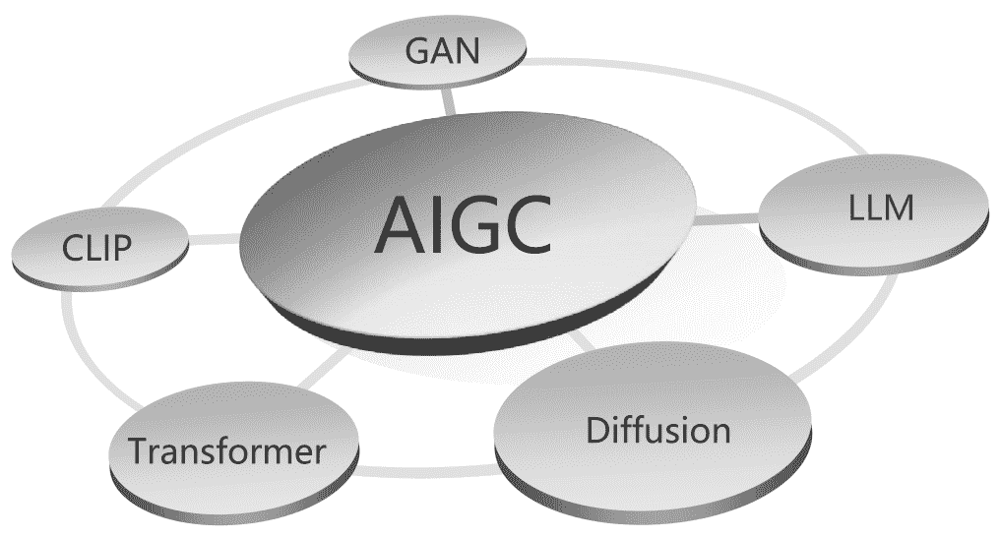

**图 7-1 AIGC 的技术支撑**

**LLM**

AIGC 开创了 LLM 主导内容生成的时代。人类将跑步进入传统人类内容创作和人工智能内容生成并行的时代，进而进入后者逐渐走向主导位置的时代。这意味着传统人类内容创作互动模式将转变为 AIGC 模型互动模式。预训练模型，即基础模型、大模型，引发了 AIGC 技术能力的质变。虽然过去各类生成模型层出不穷，但是它们使用门槛高、训练成本高、生成的内容简单和质量偏低，远远不能满足真实内容消费场景中的灵活多变、高精度、高质量等需求。而预训练模型能够满足多任务、多场景、多功能需求，能够解决以上诸多痛点。预训练模型显著提升了 AIGC 模型的通用化能力和工业化水平，同一个 AIGC 模型可以高质量地完成多种多样的内容输出任务，AIGC 模型成为自动化内容生产的“工厂”和“流水线”。目前业界主流的 AIGC 模型大多达到了千亿级、万亿级参数量的水平。通过学习各行各业的数据，它除了能给出相较于小模型更准确的预测结果，也展现出了惊人的泛化能力、迁移能力，产出了质量更高、更智能的内容，这也是当前 AIGC 让人眼前一亮的原因。

**Transformer**

在自然语言处理系统中，“Transformer”是一种融入注意力机制和神经网络模型领域的主流模型和关键技术。Transformer 具有将所处理的任何文字和句子“向量”化或“矢量”化，最大限度反映精准意义的能力。ChatGPT 使用的核心技术之一也是 Transformer，这从其全称 Chat Generative Pre-trained Transformer 上也能看得出来。Transformer 技术是近几年人工智能技术最大的亮点之一，它是 Google 于 2017 年提出的一种采用注意力机制的深度学习模型，可以按输入数据各部分的重要程度，分配不同的权重。Transformer 的精度和性能都要优于之前流行的 CNN、RNN 等模型，大幅提升了模型训练的效果，让人工智能得以在更大模型、更多数据、更强算力的基础上进一步增强能力。此外，它还具有很强的跨模态能力，不仅在自然语言处理领域表现优异，在语音、图像方面也显示出了优异的性能（见图 7-2）。

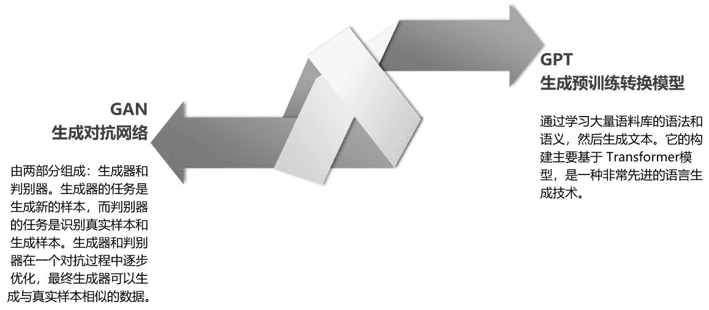

**图 7-2 GAN 与 GPT 的比较**

**GAN**

在深度学习模型的迭代上，AIGC 领域最早出现的一个深度学习模型为生成对抗网络 GAN，尽管它曾被称为“21 世纪最强大的算法模型之一”，但也存在着生成图像分辨率较低、新图像创意不足等问题。

2014 年，GAN 诞生，真正教会 AI 自己画画。GAN 包含两个模型，一个是生成网络 G，一个是判别网络 D。G 负责用接收到的随机噪声生成图片，D 则要判断这张图片是 G 画的还是现实世界本就存在的。G、D 互相博弈，能力不断提升，而当 D 不再能判断出 G 生成的图片时，训练就达到了平衡（见图 7-3）。

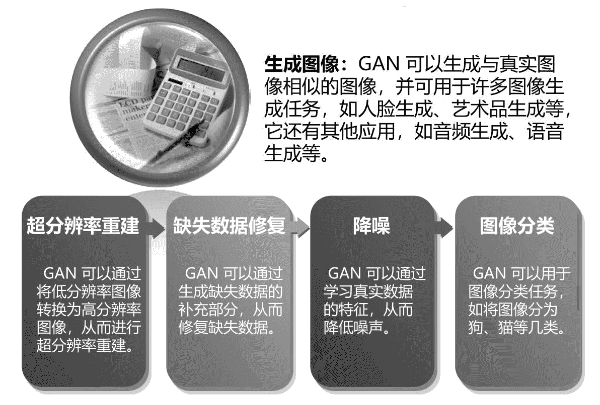

**图 7-3 GAN 的特征**

GAN 的开创性在于，它精巧地设计了一种“自监督学习”方式，摆脱了以往监督学习需要大量标签数据的应用困境，可以广泛应用于图像生成、风格迁移、AI 艺术和黑白老照片上色修复等方面。

2018 年，佳士得拍卖行在纽约以 43.25 万美元约合人民币 301 万元的天价拍卖了一幅由 AI 程序绘制的肖像画。这个名为《爱德蒙·贝拉米肖像》的作品，以朦胧手法描绘了一名身穿黑色西服外套，搭配白色衬衫的无脸男士（见图 7-4）。

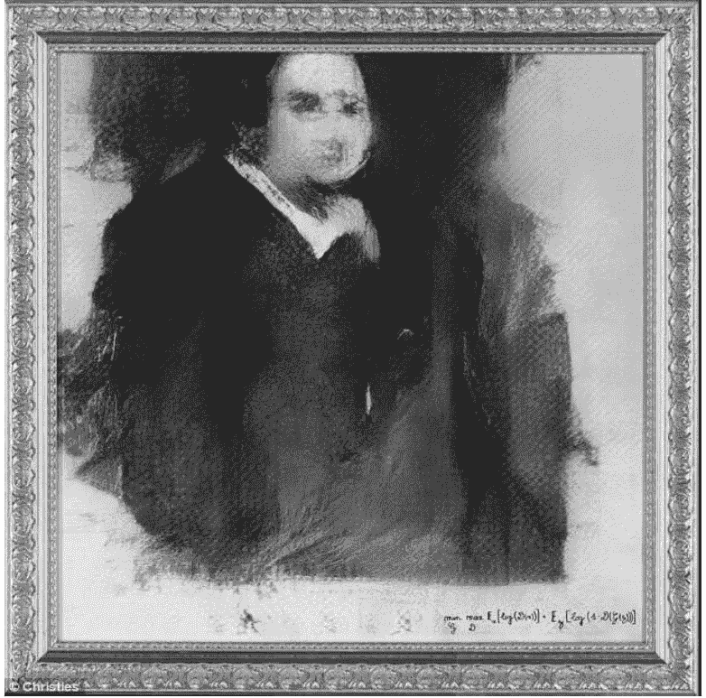

**图 7-4 GAN 创作的 AI 画作**

但 GAN 的缺陷也正源于其开创性：由于需要同步训练两个模型，GAN 的稳定性较差，容易出现模式崩溃。还需要提及另一个有趣的现象——“海奥维提卡现象” Helvetica Scenario：如果 G 发现了一个能够骗过 D 的 bug，它就会开始偷懒，一直用这张图片来欺骗 D，导致整个平衡无效。

**CLIP**

诞生于 2021 年的 CLIP 模型由于能够同时进行自然语言理解和计算机视觉分析，实现了图像和文本匹配，也为后续 AIGC 应用的落地打下了基础。

**多模态底座与扩散突破：AIGC爆发的关键**

多模态让AIGC的可输出形态更广，也把通用化水平推上新台阶。文本、图像、音视频等多种数据可以在彼此之间转译与共创。CLIP等关联模型把“狗”这个词和狗的图像映射到同一语义空间，匹配的细节很饱满，为随后出现的文本到图像、文本到视频等应用的集中释放埋下伏笔。AIGC的骤然放量既是技术迭代的结果，也是产业生态加速成熟的产物。生成算法、预训练体系、多模态能力等方向共同发力，为爆发提供了肥沃土壤。可以预期，AIGC将重塑内容生产逻辑，从文字向外延伸到各类媒体形态。

**Diffusion**

2022年，Stable Diffusion的发布与开源，直接把AIGC推向质变。扩散概念最早源于2015年论文《利用非均衡热力学的深度非监督学习》*Deep Unsupervised Learning Using Nonequilibrium Thermodynamics*。2020年，《去噪扩散概率模型》*Denoising Diffusion Probabilistic Models*提出用DDPM完成图像合成。从技术视角看，扩散属于潜在变量家族，通过马尔可夫链把观测数据送入潜在空间。

Diffusion带来两点改变：一是更成熟的深度学习让系统能快速灵活地产出跨模态内容；二是训练好的体系大幅拉低创业门槛，更多创作者与生产者可以借助可商用的开源工具，在不同场景开展更多尝试。需求端对AIGC的追捧，恰好弥合了供给与需求之间的效率鸿沟。

扩散的工作方式是先加噪再去噪。先对已有图像逐步叠加高斯噪声直至信息湮灭，再沿噪声方向逆向逐步复原。训练收敛后，输入一段随机高斯噪声，就能从无到有合成新图。这种设计降低了训练难度，摆脱了GAN的局限，在保持真实感的同时兼顾多样性，从而实现更快更稳的图像合成。

随着通用化水平与工业化能力的持续提升，AIGC将大幅拉低内容生产与交互的门槛与成本，带来自动化生产与交互的变革，改变社会成本结构，并在各行各业引发震荡。未来“AIGC+”将持续释放能量，深度赋能各行业的高质量发展。

## 第八章 高级的应用场景

AIGC已渗入日常生活。绘画、文章、音乐、游戏乃至代码，只要需要人类原创能力的创作，都可能借助AIGC完成。但其定位并非替代人，而是帮助人们更高效、更低成本、更高质量地创作。

AIGC还将颠覆既有生产模式。以十分之一的开销，实现百倍千倍的速度产出AI原创作品，让整个艺术世界被编码进大模型，任何人都能探索过去需要耗费一生才能掌握的题材与风格。

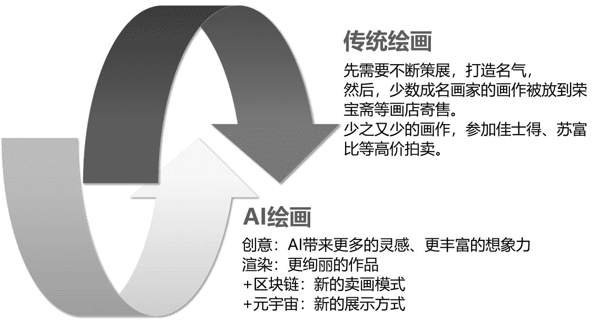

**图 8-1 AI 绘画与传统绘画的对比**

未来AIGC有望成为新型内容生产基础设施，塑造数字内容生产与交互新范式，推动数字文化产业持续创新。随着可产出品类增多、质量提升，AIGC将以基础设施的姿态重塑既有生成模式。艺术家用它获取灵感、快速验证设计效果，部分作品甚至已实现百分之百由计算机完成。

AI制图的潜力巨大，具备计算机科学技能的新型艺术家正在涌现。但工具尚不完美，产出结果往往偏离预期，交互不够顺滑，也难以直接本地编辑，通常仍需借助PhotoShop等工具后期完善。

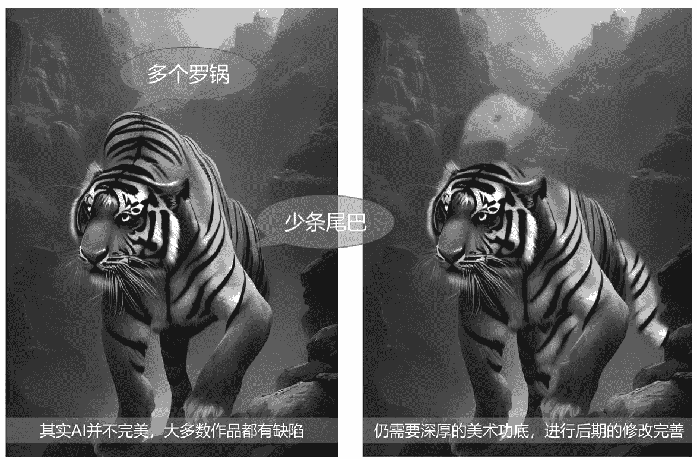

**图 8-2 AI 绘画的后期处理**

尽管如此，AI制图的巨大前景正推动赛道规模加速扩张。据AI制图平台6pen预测，未来五年10%～30%的图片内容将由AI参与产出，有望创造超600亿元的体量。海外咨询机构也预测，2030年AIGC赛道体量将达1100亿美元。

品类与质量的双提升，让AIGC成为新型基础设施，对传统生成模式产生变革性影响。目前AIGC率先在传媒、电商、影视等数字化程度高、内容需求旺盛的行业取得突破。例如广告领域，大型AI体系可把广告文案自动转为广告视频，大幅降低制作成本，为各行业创造大量生成式AI用例。

**图 8-3 本书作者创作的 AI 绘画系列作品**

不少媒体机构已用AIGC产出的图片作为杂志封面，作家也用AI制图为文章或小说配图。《经济学人》此前便用Midjourney产出的图片制作封面。

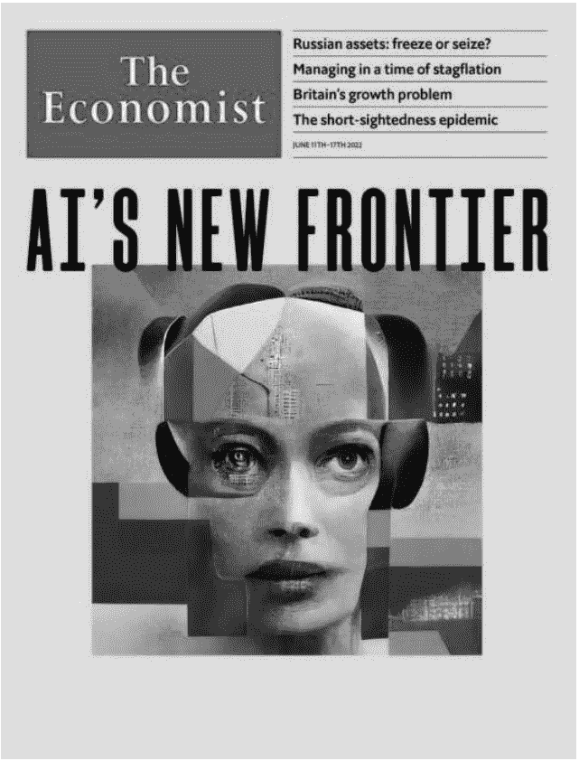

**图 8-4 《经济学人》用 Midjourney 生成的图片做杂志封面**

在AIGC助力下，创作者经济迎来新增长点。有声书配音、影视配音、动漫画师、营销广告设计师都将成为主要使用者，用AIGC优化自身效能。AIGC不仅推动艺术创作、娱乐、广播出版、教育等文化创新，游戏设计、工业设计乃至医药研发等领域也将被重塑。

**1.医药研发**
2010年的研究显示，药物从研发到上市平均成本约18亿美元，其中研发约占三分之一，周期长达3至6年。AIGC可把各类药物的设计周期压缩至数月，降低制药行业的研发成本与时间。
AIGC还能创建合成数据。合成数据并非源于真实世界直接观测，而是模型产出，能保护训练数据的隐私。例如AIGC可人为生成用于研究分析的医疗数据，避免泄露原始病历信息，保护患者隐私。

**2.工业设计**
工业领域正把AIGC更深度地嵌入设计流程。面向设计行业的特定工具结合可本地编辑的辅助手段，可让任何人成为更高效的设计师。原本劳动密集的数字与实物原型迭代，正被AIGC重构——基于粗略草图和提示即可产出高保真效果图。随着3D模型成熟，生成设计将从制造延伸到实物，你的下一款iPhone App或运动鞋或许由机器完成。借助AIGC，制造、汽车、航空、国防等行业可设计出满足性能、材料、工艺等特定约束的最优零件，例如汽车厂商可利用生成式设计打造更轻量化的结构以提升燃油经济性。

**3.游戏设计**
很长时间里，游戏公司已用类生成式AI算法构建无限世界。最流行的是程序生成：设计师提供对象、景观元素和规则，算法按规则随机生成新世界，《我的世界》《无人深空》等即是代表。
AIGC将让游戏与元宇宙进入全新时代。未来不仅能把设计师的多项内容组合生成世界，还能在此基础上创造全新内容，构建更丰富广阔的空间。微调3D生成算法，结合设计师意图和现实物体的虚拟副本，企业有望以此前百分之一的成本和时间生成极度丰富的虚拟世界与游戏。得益于文本与音频生成，真正智能的游戏角色也可能出现，这都是前所未有的突破。

## 第九章 涌动的投资热潮

AIGC带来两大跃迁：一是从语义理解进化到语义分析归纳。旧算法仅能识别图片标签与主体，而今的语义体系具备提炼与总结能力，可把零散资料归纳为结构化内容，这也是ChatGPT爆火的关键。二是从无到有产出内容。以AI制图为例，过去需先人工绘制再由AI组装，如今AIGC可直接完成像素级图像产出，把内容成本降到新低。未来十年，以生成式AI为中枢的“独角兽”公司将涌现。

人工智能产出的文字、图像、视频、代码、模型等均属AIGC；场景上可灵活应用于写作、编曲、绘画、视频制作、代码编写等创意领域，且应用模式已大规模落地。

Gartner预计，到2025年生成式人工智能将占所有生成数据的10%。*Generative AI：A Creative New World*的数据也显示，AIGC有望创造数万亿美元的经济价值。如此巨大的空间，吸引巨头入局并催生大量初创。

海外既有Google、Meta、微软等科技巨头，也有Stability.AI、Jasper、OpenAI等新锐独角兽。在成熟模型与数据加持下，AI制图的热度迅速延伸至AI视频、AI作曲等领域。从Meta的Make-A-Video到Google的Imagen Video与Phenaki，AIGC在海外快速扩张。

文字产出与音乐已率先找到商业化路径。OpenAI是文字产出的领航者，不仅吸引“生成对抗网络之父”Ian Goodfellow加盟，还早获微软10亿美元投资。从GPT到GPT-3.5，产品不断迭代。ChatGPT在新闻稿、诗歌、小剧本等场景被广泛关注后，最终在营销领域实现稳定变现，成为辅助写作的高效工具，可写邮件、文案乃至策划案。专注音乐的LifeScore让AI学会即时编曲，按场景与时长重组艺术家素材，在创作流程中占据位置。

可交互的聊天机器人则在客服与游戏两端发力。区别于仅能回答预设问题的传统智能客服，真正的AI需结合用户行为与上下文理解真实意图。在游戏端，AI协助高效创造内容丰富、体验良好的游戏以延长用户时长。图像模型可被快速生产并低成本整合进各领域，迅速普及形成浪潮，众多创业者已涌入。

另一类受宠企业则是押中应用场景的公司，在AI制图之外获得大量资本与人才。

**Synthesia**
英国AI视频合成工具提供商，用户可通过API自动生成视频、构建个性化视频内容与可视聊天机器人。2019—2021年完成3轮融资，来自个人投资人、Seedcamp、MMC Ventures、LDV Capital、FirstMark、KPCB、Google风投等，共计4.1亿元，于2021年12月8日获5000万美元B轮。

**Rct Studio**
AI娱乐技术提供商，致力于打造下一代交互娱乐体验，将深度学习与强化学习引入娱乐产业。2018—2021年完成5轮融资，来自Sky Saga Capital、Y Combinator、星瀚资本、Makers Fund、Galaxy Interactive等，共约3100万美元，于2021年11月2日获1000万美元A3轮。

**Copy.ai**
为企业客户提供AI驱动文案写作工具，可数秒生成营销文案，涵盖社媒正文、标题、链接描述、博客创意等。主要基于GPT-3，模型含1750亿参数，训练于数万亿词句。用户输入标题与核心内容，经AI生成后人工修正即可不断优化模型。

**Jasper**
AI文案生成平台，于2022年10月完成1.25亿美元A轮。输入主题与关键词即可自动生成文本，支持推送广告、博客、促销邮件等多种形态，并可优化SEO。现支持超25种语言，拥有5万活跃用户，累计生成超60亿字文本。

**Runway**
成立于2018年的图片与视频AI编辑软件商，于2022年12月5日获5000万美元C轮。为设计师、艺术家、开发者提供AI创作工具。客户包括New Balance、好莱坞制作公司等。CEO克里斯托瓦尔·巴伦苏埃拉表示，长期目标是打造类似Adobe的AI原生视频编辑套件。

**Stability.AI**
AI驱动的视觉艺术初创，通过开放AI工具实现文生图。成立于2020年，2022年8月正式发布Stable Diffusion，10月完成1.01亿美元种子轮融资，估值达10亿美元。产品采用开源技术，可在设计、影视、增强现实、游戏、广告、电商等场景构建应用。社区已基于该开源技术创造涵盖图像、语言、音频、视频、3D等多种AI模型。

**Resemble.AI**
灵活的AI语音生成器，可从文本创建语音、为广告生成配音，也能定制语音助手并克隆客服代理语音。提供API创建语音，支持选择配音演员或上传原始音频。Netflix曾采用其为纪录片《安迪·沃霍尔日记》还原安迪·沃霍尔的声音。

投资AIGC可从产业链与商业模式两个维度研究。产业链上游是“AI”技术支撑，包括后端基建如渲染公司、底层架构如引擎公司等。大模型与数据集将成为下一代IT基础设施，吸引大量资金。产业链下游是“GC”生成内容，面向各行业的内容与场景。

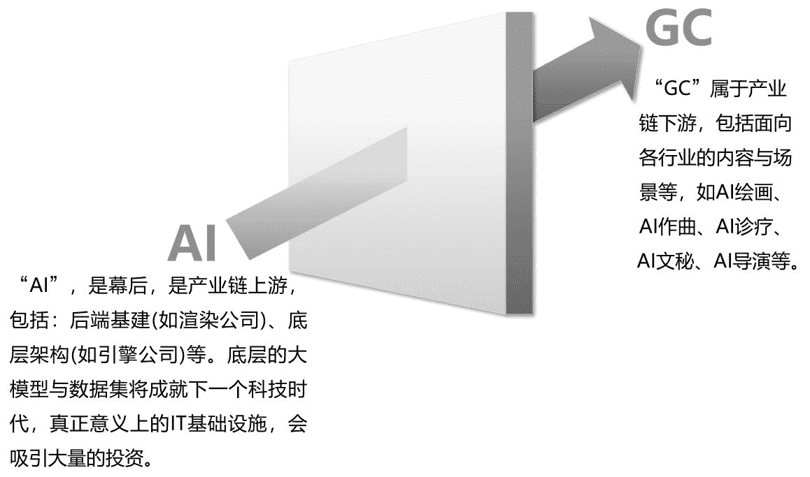

**图 9-1 AIGC 投资路径**

商业模式上，面向C端的AIGC多以SaaS订阅为主，通过点卡、包月、包年降低使用门槛。但C端用户常因好奇尝鲜而难以长期付费。面向B端的模式更趋稳定，AIGC可提升效率、降低成本，用于海报、封面、新闻稿等制作，客户付费意愿更坚定。

## 第十章 巨大的社会影响

每次科技突破都会带来文化产业的繁荣，而文化繁荣又反过来推动技术商业化。如今AIGC大热，文化产业再次站到关键节点。以AI制图与ChatGPT为代表的生成式AI，凭借足以替代人类画师与知识问答专家的能力，正为AI产业注入全新的商业化曙光。

生成式AI冲击波已抵达创作、编程、新闻等多个赛道，从业者们开始审视职业坐标。那些充满想象力的生成内容让生产效率飙升，也让不安情绪蔓延。

长期以来，人类之所以被视作造物主，很大程度上因为会制造工具。追溯技术史，上世纪计算机普及之前，人处于技术的主导端，主从关系明确。

计算机时代开启后，集体心态陷入矛盾：一方面渴望机器更智能，另一方面又担心自身价值被侵蚀。人工智能的确在吞噬部分低端岗位，但从积极视角看，它同样是人能力的延伸。

ChatGPT横空出世，像石头投入行业湖面。业界普遍担忧这类大语言模型会重塑就业生态，白领首当其冲。自2022年11月问世后，聊天机器人被用于撰写求职信、编绘童话、代笔作业。Google内部推演显示，若机器人参加面试，完全可胜任初级程序员岗位。牛津大学2013年的研究曾预测美国未来二十年近47%岗位将被自动化取代，后来证明过于悲观。

对那些岗位直接受冲击且转岗困难的人群而言，技术迭代意味着一段经济和心理的阵痛。另一方面，AIGC正在把数百万人的图像创作与处理能力拉升，对经济版图产生深远影响。人的判断仍是关键防线，用来识别错误与偏见，核心在于把这些技术当成生产力放大器，而非完全替代。

应对AIGC带来的社会级冲击，需要两条并行路径。

其一是加快研究就业结构、就业形态以及新职业对能力需求的变化，构建适配智能经济和智能社会的终身学习和就业培训体系。鼓励高校、职业院校、社会化培训机构开展AIGC能力培养，提升从业者专业水平，满足高技能高质量岗位需求。推动企业和机构为员工提供AIGC培训，加强再就业指导，确保从事简单重复性工作的人和因AIGC失业的人员顺利转岗。

其二是推动AIGC科普普及。鼓励科技工作者投身科普，提升全社会认知与应用水平。实施全民智能教育，在中小学阶段引入AIGC相关教学，逐步推广编程教育，支持社会力量开发寓教于乐的编程软件和游戏。完善科普基础设施，发挥创新基地平台作用，鼓励企业和科研单位搭建开源平台，向公众开放研发平台、生产设施或展馆。支持举办AIGC竞赛，鼓励多元科普创作，欢迎科学家参与科普。

**图 10-1 大力加强 AIGC 劳动力培训**
AIGC带来的首个显著变化，是把一批基础脑力活释放出来。过去人需要先学会操作机器，如今只需向AI描述需求，内容即可自动生成。以Stable Diffusion为代表的开源系统，让技术人员可以自行改造模型以适配特定场景或功能，相当于借助全人类语义素材为己所用。

**图 10-2 广泛开展 AIGC 科普活动**
第二个变化是，AIGC节省了大量创意人力，但前提是模型要被调到稳定输出的状态，当前阶段仍高度依赖人工。AI的想象力常超出人类预期，会产出令人意外的结果，所以在创意生产层面，AI解放的是智力劳动而非体力劳动。微软CEO纳德拉曾感慨，这是他见过的最大技术浪潮，AIGC的冲击不亚于工业革命。

五百多年前文艺复兴解放了思想，释放了创造力，催生了达·芬奇、牛顿、莱布尼茨、麦克斯韦、歌德等巨人。此后微积分与经典物理被掌握，蒸汽机、珍妮纺纱机、火车、电力等工具出现，开启了以机械化替代手工的第一次工业革命，人类进入长达三百年的工业化阶段。如今以智能化、数字化为标志的第四次工业革命正在推进，随着智能与数字技术规模化成熟，文艺复兴2.0正呼之欲出。

艺术品的核心流程是创作、展览、交易。AIGC可以分担数字艺术品的智能创作，元宇宙提供沉浸式3D交互展览，NFT为数字艺术交易带来确权与防伪新模式。AI绘画打开了无限可能：创意上提供更多灵感与更丰富的想象，渲染上实现传统绘画难以企及的视觉效果，再叠加区块链、元宇宙、Web3.0等新技术，艺术界将被全面重塑，我们将迎来伟大的文艺复兴2.0时代。

**图 10-3 文艺复兴 2.0 时代到来**

**元宇宙**
艺术展1.0时代，作品在实体馆展出，观众必须亲临现场。艺术展2.0时代，场馆内的数字屏、音视频让观众获得更丰富的知识，1998年故宫就启动了“数字故宫”项目。艺术展3.0时代，观众足不出户即可云端浏览作品细节。艺术展4.0时代，借助元宇宙搭建的虚拟馆与VR、AR、MR、XR等终端，观众随时进入数字孪生空间，屏幕距离被消除，体验沉浸、交互与社交。2017年故宫以3D扫描、VR、全景技术推出VR体验馆，“朱棣肇建紫禁城”让游客仿佛穿越到明朝。2021年9月，苏州寒山美术馆举办“分身：我宇宙”展，被视为国内首个美术馆级元宇宙数字艺术探索展。故宫、湖北省博、上海博物馆、河南博物院等一线馆纷纷上线线上模式，实现观众与藏品零距离。

未来在元宇宙时代，每位艺术家都可拥有独一无二的数字博物馆。元宇宙艺术馆以线上线下双轨展览打破触达边界，结合多媒体、语音导览、图文介绍、虚拟仿真、实景再现、人机互动等手段，全方位立体展示馆藏，配合虚拟现实的高互动性，让参观者获得身临其境的感受，成为实体馆通向虚拟空间的窗口。

**图 10-4 作者在阿里巴巴鲸探平台的元宇宙展示空间**

**区块链**
区块链是一种分布式记账技术，链上数据难以篡改。交易记录公开可追溯，任何一方都可核查却难以改动，有效解决信任难题。未来艺术家可将数字作品上链，形成独特资产。区块链带来的全程可追溯相当于永久稳固的产权登记，比现实登记更简洁安全，有助于杜绝书画伪劣。

在典型区块链系统中，数据按区块产生并按时间顺序串成链式结构。所有节点共同参与验证、存储与维护。新区块需经全网多数节点确认并广播同步后不可更改或删除，形成分布式账本。

在此规则下，互不相识者可通过加入公开透明的数据库，实现点对点记账、数据传输、认证或签约，无需中介达成信用共识。数据库收录全部交易记录与历史信息，以密码学协议保障安全不可篡改，核心特征为“不可篡改”“去中心化”“共识机制”和“机密性”。

**图 10-5 区块链系统的四大特征**

**Web3.0**
Web1.0可视为以PC为主的互联网时代，代表为新浪、搜狐、网易及后来的BAT。信息单向传播，平台是生产者，用户被动消费，信息量有限。

Web2.0是以移动终端为主的移动互联网时代，信息双向流动，用户既是生产者也是消费者，微博、微信是典型应用。智能手机与4G/5G的普及激发创作热情，用户可碎片化生产与消费内容。

若将Web1.0归纳为数据可读，Web2.0为数据可写，则Web3.0理应是数据可拥有，摆脱平台垄断，开创创作者经济时代。Web3.0是一个开放领域，让创作者以独特方式建立并拥有社区，把创造力带给更广人群，并让社区深度参与创作。

**图 10-6 Web3.0 的进化**
在Web3.0中，权力从平台转向创作者及其社区，创作者定义正在改变。今天的创作者经济不再是为平台创造价值，而是创作者与社区直接连接的新形态。创作者既能为粉丝提供经济等收益，也能让粉丝成为合伙人，形成集体价值。

# 第三篇 元宇宙——下一代的互联网，数字经济的支撑点
现实世界加速向虚拟世界迁移，元宇宙与数字人对AI应用的规模、多样性与个性化需求急剧攀升。过去模型从研发到生产周期长、成本高，流程碎片化且缺乏标准化。每种模型都需要大量算力与人力投入，呈现资源密集、响应迟缓的特征。

无论AI模型生产、智能计算、网络连接等基础设施，还是元宇宙技术研发，都需要巨量资金与人力，通过集中建设与平台赋能，可大幅降低使用者的边际成本，提升元宇宙生产效率。

AIGC的出现让元宇宙建设与数字人制作实现提质增效。在元宇宙与数字人领域，AIGC用于构建沉浸式空间、提供个性化内容体验、打造智能交互方式、让数字人更真实。例如在元宇宙岛屿上，用户可通过语音指令生成海滩、变换天气、添加场景。只有借助AIGC，元宇宙与数字人才可能以低成本高效率满足海量用户的差异化需求。

## 第十一章 元宇宙使数字经济加速落地
数字经济概念始于1995年唐·塔斯考特著作《数字经济》。字面上是基于数字技术的经济，与互联网发展相辅相成，故常称作互联网经济或网络经济。2016年G20期间中国进一步界定：以数字化知识和信息为关键生产要素，以现代信息网络为载体，以信息通信技术有效应用推动效率提升与结构优化的一系列经济活动。

在数字经济时代，所有流程与场景在虚拟空间全面部署，利用物联网、软件与通信技术加强信息管理与服务，提升生产过程可控性，实现研发、生产、制造工艺及工业控制的全信息覆盖，确保各环节处于最优状态。一切围绕数据展开，通过连接人机物软件系统，构建覆盖全产业链全价值链的服务体系，带来可视化体验更好、准确性更高、性能更优的数字化生产与智能化管理，提升效率、降低成本。

**图 11-1 数字经济的内涵**
各国大力发展数字经济主要基于三方面。

**图 11-2 数字经济驱动经济增长的基本作用**
**1.提高全要素生产率**
数字经济与实体经济深度融合，以信息流带动技术流、资金流、人才流、物资流，减少信息流动障碍，加速要素流动，提高供需匹配效率，促进资源优化配置，推动创新发展与结构优化。

**2.培育新市场和产业新增长点**
数字经济不断孕育新模式新业态，成为激发创新创业的重要动力，促进大众创业、万众创新。柔性化、网络化、个性化生产将成制造新趋势，全球化、服务化、平台化将成产业组织新方式。

**3.推动实现包容性增长和可持续增长**
数字经济提高连接水平，减少要素流动障碍，推动经济与社会、物质与精神、城乡与区域协调发展。同时降低参与经济活动的壁垒，为落后地区和低收入人群创造更多机会，实现共享与均衡。

从构成看，数字经济主要包括数字产业化和产业数字化。数字产业化涵盖集成电路、软件信息技术服务、互联网产业、文化创意等基础产业，以及云计算、大数据、移动互联网、物联网、网络信息安全等先导产业。

产业数字化指在制造业、服务业、农业等领域构建数字化应用体系。

**图 11-3 数字经济的构成**
近两年兴起的元宇宙为发展数字经济提供新机遇与动能，被视为数字经济下一个增长点，是引领发展的新引擎，将开启产业布局新一轮周期。

元宇宙以大数据、云计算、区块链、人工智能为关键要素，以移动互联网、5G、物联网为载体，实现现实与虚拟交互融合，与数字经济内涵高度契合。布局元宇宙可开创新的经济与商业模式，甚至衍生新社会文明。

**图 11-4 元宇宙的内涵**
从特征看，现实世界的一切同步到虚拟世界，虚拟行为也反馈到现实，影响经济与社会。就数字产业化而言，虚拟平行世界可实现数字化真实体验，增强实体体验丰富度；在现实世界，真实化数字体验可通过虚拟形式提升实际生产效率创造价值。

由实向虚：数字产业化仍属现实事物，虽应用数字孪生，但主要为现实向虚拟映射，通过虚拟控制模拟现实工业生产。元宇宙比数字孪生更富想象，不仅映射现实，还包含现实尚未实现甚至无法实现的体验与交互。

由虚向实：元宇宙更重视虚拟与现实协同联动，实现虚拟操作指导现实制造。例如产品设计可控制应用环境因素，基于元宇宙模型直观精准模拟零部件作用，验证性能，让虚拟化设计达到可生产水平。相比工业软件设计，元宇宙研发可大幅提升效率、降低成本并提高一次制造成功率，增强市场竞争力。

**图 11-5 元宇宙的发展路径**
Analysis Group预计未来十年元宇宙经济规模可达20万亿，麦肯锡预测达34万亿元。截至目前，北京、上海、重庆、深圳、广州、杭州、武汉、厦门等22个省市在“十四五”规划或政府工作报告中提及元宇宙或出台发展规划。例如河南省2022年9月发布《河南省元宇宙产业发展行动计划（2022—2025年）》，指出元宇宙是虚拟与现实交互重要载体，对产业新赛道与竞争优势重塑意义重大。

**图 11-6 河南省的元宇宙发展规划**
产业数字化基于新一代信息技术与先进制造技术深度融合，贯穿设计、生产、管理、服务各环节，推动制造业数字化、网络化、智能化转型，是新型生产方式。

元宇宙更像产业数字化的未来形态，强调定性而非定量，强调经验而非逻辑。工业生产制造是从不确定性向确定性转化的复杂过程，数据种类数量持续增加。制造过程需平衡效率、成本、质量与客户满意度。元宇宙通过虚拟空间协同工作与模拟运行指导实体高效运转，赋能各环节与场景，降低成本、提高效率，促进企业内外部协同，助力高质量发展，推动数字经济升级。

展望未来，元宇宙应用场景将覆盖产业数字化全生命周期，“由虚向实”与“由实向虚”双路径推进研发设计、生产制造、设备运维、产品测试等流程优化与效率提升。

**（一）研发设计的协同交互**

# 元宇宙如何把创意、协同与制造方式重新串联

在沉浸式数字空间里，大家更珍视全员发散的创意。客户与消费者的真实诉求、管理层的战略判断以及一线员工的实操灵感，都能在同一虚拟场域碰撞聚合，让原本模糊不确定的设想逐步变得可落地。网络能力的大幅跃升，让生产端与使用端对话更立体、更顺畅，使用者可以直接进入虚拟环境参与产品定义并即时体验自己参与打磨的成果。深度共创以后，产品更贴合使用场景，体验价值随之提升。例如借助虚拟手段，直观呈现产品的形态、企业制造与交付保障能力，进而拿下市场订单。过去主要依赖二维 CAD 图纸，如今更多采用三维实体模型，甚至能以运动模型演示功能，也能用仿真模型说明刚度、强度等性能指标。

协同变得无处不在。地域壁垒被打破，多方联动设计成为常态。典型情形包括设计师之间的联动、工艺人员与仓储物流的配合、企业内部与上下游供应链的对齐，以及企业、用户乃至监管机构的联合研讨，沟通效能因此明显改善。

**（二）制造流程的沉浸式优化**
借助元宇宙场景，制造人员可沉浸进入虚拟智能工厂，与虚拟产线、设备实时交互，进而更直观、更便捷地优化作业流程、开展智能排产。未来产业数字化依托元宇宙技术，可对智能工厂运行的任何波动实现实时捕捉，并在虚拟工厂中做仿真推演，预判生产状态、优化流程。据公开报道，宝马与英伟达在虚拟工厂领域开展合作，宝马引入英伟达平台统筹 31 家工厂的技术、应用与数据，生产能力明显增强，有望推动整体生产效率提升 30%。

**（三）设备运维的远程实时**
产业数字化中的设备运维传统上依赖大数据与人工智能建模，通过多时段数据采集与机理分析实现预测性维护。基于元宇宙的运维突破了空间限制，运维人员可在虚拟空间中不受地点制约地确认设备状况，及时反馈并修复问题，大幅提升响应速度与服务质量。大型装备的定期巡检也在升级。早期只能人工巡检，后期出现信息化辅助与数字化自动化巡检，减少偏差、提升效率。未来随着增强现实智能眼镜的普及，巡检人员可在元宇宙中直接看到设备的实时数据与预警信息，巡检逐步转向沉浸式体验。

**（四）产品验证的提质增效**
产品检测是确保质量与产业数字化的关键环节。元宇宙技术可在虚拟环境中开展试验验证与性能测试，实现虚实同步，完成标准高、要求复杂的测试。元宇宙能让内部结构与外部表现的变化更直观呈现，从而提高认证效率与准确性。例如汽车碰撞仿真、氢能源汽车高温工况模拟、汽车电池在极寒环境下的寿命预测，都能以更低成本满足高要求测试、缩短周期、提升认证效率。

## 第十二章 AIGC 重塑元宇宙内容生产
元宇宙既可以是独立于现实的平行空间，也可以是虚实融合、可与现实交互的世界。数字化转型深入后，现实要素被迁移进虚拟世界，而虚拟世界创造的内容又能通过各类载体回投现实并产生影响。在这一过程中，人工智能扮演现实与虚拟之间的连接器。内容生产是元宇宙新基建的核心，它连接用户、企业与社会，使多元服务得以体验。AIGC 将在未来元宇宙交互空间中发挥不可或缺的支撑作用。

Roblox 被称作元宇宙第一股，其在构建虚实融合世界的探索路径值得关注（见图 12-1）。首要环节是场景数字化，即像素化、3D 化；次要环节是要素结构化，将数字化后的海量非结构化数据经智能感知与分析，提炼为对人类有意义的元要素，转化为结构化数据；最后环节是流程可交互化，在结构化数据基础上实现应用端的智能决策，从而重塑业务流程与自动化。

**图 12-1 Roblox 利用 AIGC 搭建元宇宙平台**

The Sandbox 与 Roblox 齐名。The Sandbox 可售土地总量为 166464 块，具有稀缺性。按当前地板价测算，若全部售出，其土地市值将达 125 亿元。未来在 The Sandbox 世界里，土地是世界的基础，用户可在其上自由规划内容，如建造住宅、游乐园乃至艺术馆（见图 12-2）。

**图 12-2 The SandBox 的地产元宇宙**

在 The Sandbox 元宇宙中，AIGC 能大幅提升内容创作效率。其一，AI 可自动化生成或增强内容，从随机摆放物体到全自动生成场景、建筑、物品及外观，或用算法提升呈现质量、拓展视觉边界。其二，AI 可辅助创作，例如基于 GAN 的智能画笔，能把只有轮廓与色彩的草图转化为接近照片质感的图像。用户只需勾线、上色并标注元素如“大海”“乌云”“城堡”等，AI 便会自动补全细节。由此，大型品牌、元宇宙基建商与演艺明星均可利用 AIGC 搭建专属元宇宙空间（见图 12-3）。

**图 12-3 利用 AIGC 在 The SandBox 中搭建属于自己的元宇宙空间**

**1.大型品牌厂商**
部分大型体育用品公司早在 2021 年便入驻 The Sandbox，打造虚拟空间。这种方式类似在纳斯达克大屏投放广告，或在曼哈顿开设旗舰店。能够在元宇宙购地用于品牌展示，企业普遍认可其价值。

**2.元宇宙基建商**
据福布斯报道，建筑公司在元宇宙中设计一个项目即可收入近 30 万美元，价格受面积、位置、高度等因素影响。这催生了元宇宙装修、地产经纪等新业态。作为深度参与者，占据显眼地块是其快速打开市场、触达目标用户的方式，这块永久广告位还具备升值潜力。

**3.演艺明星**
2021 年 9 月 24 日，美国巨星 Snoop Dogg 宣布与 The Sandbox 合作，计划推出 NFT 及游戏内音乐会，并发行 1000 个 NFT 派对通行证面向粉丝发售。除直播带货外，海外明星通过元宇宙举办线上演唱会同样能实现类似增收效果。

## 第十三章 ChatGPT 赋能数字人智能跃升
随着 AR/VR、虚拟引擎、3D 建模等软硬件趋于成熟，数字人迎来发展契机，新技术完善了沉浸式体验，大幅提升商业价值与应用广度。例如数字人可担任向导角色，多模态互动、低延迟实时交流，为用户提供路线规划、信息查询、导览讲解等智能服务，在社交娱乐中持续带来新鲜感，从而提高景区吸引力与品牌、商业价值（见图 13-1）。

**图 13-1 眉山市的数字人代言人**

数字人正从屏幕上的 IP 形象，转变为能创造真实价值的数字员工。随着行业认可度提升，兼顾“皮囊”与“灵魂”的数字人将在更多领域绽放。数字人既可成为元宇宙中的化身，也能成为企业的得力助手，实现降本增效。

2022 年 1 月，长安汽车首位数字员工“宫”入职，后升级为“宫橙诗”，其在虚拟世界“2060 星环城”代表长安汽车参与社会议题，传递“长安式”生活方式（见图 13-2）。

**图 13-2 长安汽车的数字员工**

在 Bilibili、优酷、爱奇艺、腾讯等平台播出的综艺《2060》，是国内首个基于元宇宙概念打造的虚拟世界、虚拟 IP、虚拟节目。2022 年底，“宫橙诗”新增双重身份：2060 星环城机械义警与长安汽车数字体验工程师，既维护星环城交通秩序，也在现实中参观长安工厂、参加重庆车展。“宫橙诗”在真实与虚拟世界穿梭，并邀请现实消费者进入虚拟世界，通过交互式沉浸体验感知产品。

浦发银行打造了多种类型的数字员工，提供产品解读、市场资讯、财富诊断、产品推荐等服务。据介绍，小浦可对近万款基金产品及多款财富产品的盈利情况、风险特征进行剖析，并结合客户持仓与风险承受能力给出资产配置建议，还能依据财务目标个性化推荐理财产品。数字人自带的渠道流量优势也大幅提升了服务效率。

品牌虚拟 IP 亦是探索方向。传统空间感知以人体为参照，依托观感、触感与心理感受。但在元宇宙中，数字人尺度可任意设定，从原子级到城市尺度再到星系。人的空间感知将被重新定义，变得多元。实体环境与虚拟空间交融又独立，用户可拥有多空间、多身份、多维度的体验，如实体躺在卧室而化身在山水间游走，或实体在列车中而化身在虚拟会议室讨论。

当前数字人产业有望实现对元宇宙虚拟化身的想象。数字人基于计算图形学、深度学习、面部识别、动作捕捉等技术创建，具有类人特质，是用户在元宇宙中感知与交互的主要载体，也是构建元宇宙的重要组成。用户可摆脱现实束缚，塑造完美化身弥补缺憾，这成为众多企业布局未来的重点。

天眼查数据显示，2022 年国内成立的与数字人相关企业近 20 万家，而行业整体玩家不足 60 万，显示创业热情高涨、竞争加剧。除文旅外，数字人正深入金融领域，并已带来降本增效成果。

然而，数字人长期依赖高价的光学动捕设备，制作成本高、周期长、技术门槛高，形成三大约束。目前数字人内容创作主要涉及图文、视频、影视、音频四大方向，多用于营销宣传、传媒娱乐，交互性不足，距离成为用户的虚拟化身仍有差距。

快速发展的 ChatGPT 正成为斩断这些枷锁的关键力量之一。数字人人格化与内容运营常受前期创意效率制约。结合大模型后，ChatGPT 可提升内容生产效率、拓展创意边界。现阶段对话式语言模型多停留在语音与文字，未来 ChatGPT 可深入内容生产与人机交互环节，彻底改变数字人构建技术。从面貌、穿着、形态设计，到行动姿态、自然语言沟通，再到任务执行与环境感知交互，数字人制作将更便捷，功能更丰富（见图 13-3）。

**图 13-3 数字人的三要素**

在好看的皮囊之下，ChatGPT 赋予数字人对话能力，使其拥有有趣的灵魂，更好陪伴与服务用户。ChatGPT 让数字人具备多样创造力，可依据文本要求自动生成具个人风格的图文内容、动作视频甚至演戏。例如直播场景中，告知产品特点、价格与优势并指定喜剧风格，数字人即可提供多种讲稿。皮囊千篇一律，灵魂万里挑一。ChatGPT 不仅提供外形，也注入灵魂，背后是大量 AI 技术的叠加升级。

ChatGPT 为元宇宙原住民数字人植入“AI 大脑”，使其拥有独立沟通与决策能力，可判断人类意图与需求并及时回应，让人机交互更智能。数字人还能通过持续学习与自我强化，升级为数字世界的 AI 代理人，提供各类资讯与服务。未来可像与朋友视频通话一样，进行长时间、多轮次、有逻辑的互动（见图 13-4）。

**图 13-4 通过 ChatGPT 与数字人交互**

技术与交互方式的丰富将带来更多可能。元宇宙将逐步扩展边界，摆脱泛娱乐属性。引入 ChatGPT 交互后，用户可在元宇宙中进行更贴近现实的操作，进一步提升沉浸感，虚拟与现实边界模糊，虚拟世界对现实产生不可忽视的影响。

社交是人类基本需求。数字人提供更丰富的社交选择，不受地域、时间、文化限制，虚拟社交可能在竞争中胜出。社交行为将更多在元宇宙展开，可能导致现实关系疏远，对家庭沟通等需面对面交流的场景形成冲击（见图 13-5）。

**图 13-5 未来的数字人交互与社交**

大模型改变了数字人内容生产与交互方式。得益于 ChatGPT 对自然语言的强理解能力，数字人开放性大幅提升。过去数字人说话与行动多靠真人驱动，如今输出可经大模型完成。以直播带货为例，企业先为商家建立虚拟主播形象，再接入大模型辅助撰写话术与脚本。未来在泛生活与电商赛道，可能有 30% 的内容可由大模型生成。

相信不久的将来，数字人发展将与社交应用深度绑定，可扮演智能泛娱乐角色，出现在聊天室、演唱会、多人游戏中。ChatGPT 在游戏用户互动与制作环节的应用前景广阔。

# 结语——如何迎接新一代人工智能浪潮
2009 年至 2018 年，我长期在工信部工作，对工业制造业发展历程较为熟悉。有人问我为何工业制造业在 GDP 中的占比持续下滑，是否政策偏向服务业。并非如此。改革开放 40 余年的工业化高速增长后，制造业面临能源消耗大、污染严重等问题，国家在淘汰落后产能上决心很大，“绿水青山就是金山银山”与“双碳”战略下，高污染高能耗产业不断重组淘汰，占比整体下降。但在制造强国战略下，高端制造迅速崛起，增速明显。

同理，传统科技企业与传统互联网企业亦面临技术与市场瓶颈及人力成本制约，放缓或收缩在所难免，但具备前沿科技含量的新企业必然崛起。ChatGPT、AIGC、元宇宙是新一代人工智能的三驾马车，是未来高科技风口。它们将改写以 Google、百度为代表的搜索引擎模式，对以科大讯飞为代表的智能语音搜索产生巨大冲击，甚至重塑人工智能在金融、无人驾驶、教育、医疗等领域的传统路径，例如调用 AIGC 接口或采用定制版 ChatGPT。相比苦心研发新算法，这种方式能让各行业更简单、更直接地实现智能化升级。

科技进步造福经济社会，助力提质增效与高质量发展。但科技亦是双刃剑，用不好会产生负面效应。

**（一）正面效应：大幅提质增效**
科技创新提升经济结构效率与灵活性，增强企业竞争力，节约能源资源与人力成本，推动产业升级与供给侧结构性改革，提升质量与效率，催生新产品、新技术与新模式，促进增长。ChatGPT 与 AIGC 通过分析海量数据、发现规律并生成新内容，而非仅分析已有信息，在某些场景创造力甚至超越人类。未来其涉及范围将覆盖所有知识性与创造性工作，可能影响数亿人工劳动力，使效率与创造力大幅提升。

首先，ChatGPT 可带来更高生产效率。相较传统文本识别或语言理解，聊天机器人更易用，能更有效理解问题，提升结果准确性，改变传统生产服务方式，让企业更高效利用资源、降本增效。其次，新技术应用可提升核心竞争力，带来增量利润，推动业务增长与产业数字化、智能化升级。最后，技术创新满足更多消费需求，促进投资市场发展。例如 ChatGPT 可帮助客服进行个性化对话，快速把握客户需求与重点，及时答复，提高满意度与信任度，进而拉动营收与利润，促进经济可持续发展。

**（二）负面效应：作弊与知识产权纠纷**

生成式AI的滥用警示与产业布局思考

生成式AI被不当使用的风险正愈发凸显，学术舞弊是最惹眼的表现。美国北密歇根大学一名学生用ChatGPT生成哲学课程的小论文，竟让授课教授感到惊讶并拿到全班最高分。相关调研显示，89%的美国大学生承认会借助ChatGPT完成课后作业，53%用其撰写正式论文，48%用于应对考试测验。

欧美高校的管控动作也在加速。法国巴黎政治学院明确禁止学生在未获课程特别要求的情况下，使用ChatGPT等生成工具完成报告，违规者最高可面临退学。纽约市公立学校体系规定，只有在人工智能与科技类教学中，经教师正式申请后才可在课堂有限使用。澳大利亚、印度、英国等多个国家的高校同样对校园内尤其是考试期间的使用作出限制。

这些工具虽能瞬间给出答案，却难以帮助学习者养成批判性思维与独立解决问题的能力。

在内容权益层面，AIGC产出物的权利归使用者所有，但若生成物侵害他人知识产权，便易引发法律纠纷。比如在未经授权的图像或文本素材基础上进行二次创作，就可能构成侵权。面向AIGC生产场景，知识产权风险必须严肃对待，未来需要在权利保护、合规审查、纠纷调解、技术防弊以及长期监管方面建立体系化应对。

因此，有关部门与机构应前瞻性地谋划ChatGPT、AIGC和元宇宙的组合布局，让新一代生成式智能更好地服务经济社会，创造更大价值。

第一，拉动企业拥抱ChatGPT与AIGC浪潮。ChatGPT的核心是创作，通过海量语料训练与较强纠偏能力，把素材消化整理后重新输出，这对比传统IT行业的云计算逻辑截然不同。以阿里云为例，其核心是为客户提供云存储与数据库服务，底层思路是先提出问题再寻找答案。AIGC则能够从零开始主动原创，侧重点迥异。建议各企业开展负责人培训，帮助经营者认识生成式智能时代的重大意义，推动以AI主导的内容创作成为企业核心业务的重要部分。

第二，推进AIGC融入元宇宙发展版图。AIGC让普通人可用自然语言对话的方式生成文本，极大降低了元宇宙的构建门槛，也能以不同于互联网的方式搭建元宇宙。大量非专业人士只需用语言描述需求，AIGC便可自动生成设计图和代码，效率提升、成本下降，元宇宙内容将更为丰富。建议各地主管元宇宙发展的部门定期追踪技术进展与国内外典型案例，加速元宇宙的演进。

第三，推动ChatGPT赋能数字人。2022年8月，北京市发布《北京市促进数字人产业创新发展行动计划（2022—2025年）》，明确到2025年数字人产业规模突破500亿元的目标。除北京外，多省份已将数字人纳入新科技发展目录，推动其落地。ChatGPT将重塑数字人全流程的技术，从形象、着装、形态设计，到动作姿态、自然语言交流、任务执行以及与环境的感知互动，均能变得更便捷，功能也更丰富。建议政府、企业、高校与科研院所协同研究ChatGPT在数字人中的落地应用，助推产业目标超额完成。

第四，重视隐患并纳入社会科学研究议程。ChatGPT与AIGC的训练数据源自公开互联网，企业或科研机构使用时必须对生成物进行把关，防止知识产权风险。特别是高校科研人员撰写论文、艺术家用AIGC作画作曲的情形，首先要核实内容未侵害他人知识产权并取得授权，避免纠纷；其次应引入第三方核验，通过技术手段建立有效且持续的监管机制，确保生成内容合法合规，例如借助检测工具辨别文本是人类撰写还是机器生成。科技在迭代，社会科学也应同步跟进，建议高校与科研院所把ChatGPT与AIGC列为重点研究课题，关注伦理问题与潜在负面社会影响，制定规范，促进自然科学与社会科学的融合共振。

# 附录

2023 年春节以来，本书作者王喜文博士已受邀陆续为招商银行、工商银行、浦发银行、中国移动、中国联通、复泰商学院、浙江大学等企事业单位进行了 ChatGPT 与 AIGC 方面的授课。欢迎大家邀请王喜文博士（微信号：wangxiwen44）开展培训、做讲座，并欢迎大家联系本书责任编辑黄菲（微信号：fay463215）团购本书，赠送给学员，以便进一步学习。

# 参考资料

REFERENCES

[1]OpenAI 官网文章 ChatGPT：Optimizing Language Models for Dialogue。

[2]Swyx 的文章 The Day The AGI Was Born。

[3]Arst Echnica 官网文章 OpenAI Invites Everyone To Test ChatGPT，A New AI-Powered Chatbot—With Amusing Results。

[4]腾讯网官网文章《中小学教师 ChatGPT 的 23 种用法》。

[5]51CTO 官网文章《后 GPT 3.0 时代，主流大模型技术精要详解，走向 AGI 之路的大门已开》。

[6]今日头条官网文章《张俊林：由 ChatGPT 反思大型语言模型（LLM）的技术精要》。

[7]百度官网文章《ChatGPT 正“侵入”国内教育界，是敌是友？咋对待？》。

[8]网易官网文章《行业洞察|万字长文解读 AIGC 如何革命性提效内容营销》。

[9]电子发烧友网官网文章《AI 下一个风口来临 AIGC 产业生态迎来发展快车道》。

[10]搜狐网官网文章《Gartner：ChatGPT 只是开始，企业生成式 AI 的未来不止如此》。

