# 读懂 DeepSeek：全景笔记

# 专家委员会

陈美霞 勾春宁 高 璐

胡显煜 贾雪丽 吕东津

戚耀文 桑 梓 田雨晴

许子正 杨 柳 永宁老师

张嘉伦 张 炯 张天辉

# 推荐序

文明向前推演的脉络，始终围绕着认知不断拓宽、生活形态被重新定义。起初是石器被用来制作器物，随后工业化带来了批量制造，电力让能量可控，信息时代则让数据成为主角。每一次跃迁都在改写人与世界的沟通方式。今天我们站在了新节点：智能系统已不再局限于科幻想象，而是成为重塑生产关系的底层架构。在此背景下，《一本书读懂 DeepSeek》及时出现，它以若干鲜活案例为透镜，折射出通用智能在不同场景中的创造性落地，为理解智能与社会的互动提供了具启发性的观察。

## 一、拆解与重塑：既有工作范式的再造
翻开此书，首先感受到的是 DeepSeek 对传统流程的解构与重组。在办公情境里，自动化带来的不仅是效率提升，更关键的是人机协同方式对组织智慧的重新阐释。将人的战略判断与机器的结构化处理深度融合，这种新模式正在刷新效率的定义。

转向内容生产领域，智能写作工具引发的不仅是产出速度变化。智能的价值不在于取代人的表达，而在于拓展艺术边界，让创作者摆脱重复性技术劳动，聚焦更本质的美学探究与思想实验。

## 二、认知抬升：技术赋能的多维增益
在视频与绘画章节，所呈现的已超出工具迭代。把抽象概念转化为可感知的具象呈现，正逐渐模糊科学与艺术的界线。当非遗传承者借助智能绘画重现传统纹样时，看到的不仅是图样的数字化再生，更是文化基因在新载体上的进阶传承。

自媒体案例更具社会学意义。乡村教师借助 DeepSeek 将晦涩的科学知识转译为通俗语言，制作成方言短视频，使偏远学童能够突破地域教育限制。这一普惠效应说明：智能系统的核心力量并不在于炫技式的复杂计算，而在于作为普及工具推动知识平民化的潜能。当普通人都能借助智能把想法转化为专业级多媒体表达时，社会话语权的分配正在悄然改变。

## 三、从使用者到规则制定者：创作者的新空间
编程章节的图景尤为振奋。开发团队使用 DeepSeek 的代码生成框架，把自然语言描述映射为可运行的环保监测程序，这种“意念即现”的开发体验正在降低技术创新的门槛。更值得关注的是跨学科融合催生的范式转移：智能正在把“编程”从专业技能转化为人类表达创意的通用语法。

这一转变的深层含义是技术主体的扩容。教师可以编程教育机器人，农户可以开发智能种植方案，艺术家可以搭建交互装置。当工具足够自然流畅，人类创造力的释放将突破专业壁垒，释放难以估量的创新动能。

## 四、共生演进：技术与人性的辩证
通览案例，最触动的是技术与人类智慧碰撞产生的化学反应。医疗场景中，智能诊断并非要取代医生，而是增强医生的认知能力，让诊疗兼具数据分析与经验温度；法律咨询中，智能助手可从海量判例中提炼规律，最终司法裁量仍归于人性化价值判断。这些实践印证：智能的终极意义不在于超越人，而在于帮助人更好地成为自己。

残障人士借助脑机接口重获表达自由，语言障碍者依靠实时翻译突破交流壁垒，这些案例提醒我们：技术演进的本质是生命演进的延续。DeepSeek 展现的不仅是机器智能，更是人类突破自身局限的永恒渴望。技术与人性的关系，正从单向使用转向共同演进的共生。

## 五、面向未来的多面透镜
本书既不陷入技术至上的盲目乐观，也不落入人文主义的技术恐慌，以冷静洞察的案例剖析呈现智能落地应用的立体图景。案例如同棱镜，折射出变革的光谱：有教育平权般的温暖，有艺术表达的裂变，有科学发现的深邃。

未来智能系统将持续改写文明的底层代码。技术的终极命题永远不是技术本身，而是如何让进步服务于人的解放与提升。跟随书中案例见证 DeepSeek 在各领域的创造性实践，本质上是在观察人类如何借助技术之翼飞越认知的巴别塔，在机器智能与人类智慧的共振中谱写新篇章。这或许是本书给予读者的最珍贵启示：在智能时代，真正的奇迹都发生在技术与人文的交界。

亦仁
生财有术社群创始人

# 第1章
初识 DeepSeek：万能钥匙

2025 年开春，中文媒体场域绕不开的热词就是“DeepSeek”。背后是一场技术突破与产业变革共振的全球现象。由杭州深度求索人工智能基础技术研究有限公司推出的人工智能大模型，以颠覆性技术路线改写行业规则，成为数字经济时代中国创新力的标志性符号。外界评价认为，DeepSeek 的崛起意味着中国在 AI 领域从追赶者转向规则重塑者，其系统性工程创新改写了全球竞争格局。①

## 1.1 DeepSeek 究竟为何物
对不同人群，DeepSeek 的意义各不相同。对普通用户，它像随身的百事通：早晨看天气推荐穿搭；孩子数学卡壳时，能逐步讲解并联动动画演示公式；群聊里争论恐龙与鸡的亲缘关系，能用通俗比喻讲清进化论；工作报告缺灵感时，可梳理思路起草；无聊时还能像朋友一样用大白话聊天。

对开发者，它更像搭积木的工具箱。提示词生成代码已成基本操作，还能通过接口把能力嵌入自家 App：让购物 App 更懂“帮我找条海边穿的连衣裙”的需求、让文档软件自动批改语法、让游戏 NPC 根据玩家性格切换对话风格。技术积木自由组合，拼出的可能是下一个现象级应用。

对企业，它是 24 小时在线的全能助手。商场可用它分析顾客评价情绪，医院可快速整理电子病历，物流可优化派送路线；餐厅老板能实时抓取外卖平台数万条评价，自动生成“酸辣粉过咸”“服务态度差”等关键词报表；广告公司可让它扮演 50 个不同年龄的虚拟顾客，提前测试文案效果。总体而言，它帮助企业降本增效。

对科研与创作者，它是撬动未知的杠杆。生物学家可让它从百万份基因数据中捕捉突变规律；环保组织可训练它识别卫星云图里的非法捕捞船；非遗传承人可用它分析老艺人雕刻手法，将濒临失传技艺转化为数字模型。这些探索未必每次成功，但 AI 显著降低了探索成本。

对学生，它像智能学伴。上课走神没听懂的物理公式，可让它用“对小学生讲”的方式拆解；写历史小论文时，能从秦长城讲到同期罗马的建造；考前背单词，可用谐音梗编口诀；在学术写作中协助结构梳理、文献初整理与语言润色；在学习辅导上解答专业问题、提供课程总结与习题解析；在求职准备上给简历优化建议、模拟面试、撰写求职信；在创新思维上激发头脑风暴。当传统教育还在争论是否禁用 AI 时，这一代学生已把 AI 融入学习全流程。

每个人都能从这把“智能瑞士军刀”里找到适配工具，这正是 DeepSeek 有趣的地方。它像水一样渗入各处，每人取一捧都能解渴。

### 1.1.1 创造者：深度求索
大众提到 DeepSeek，通常指其 AIGC 对话工具，也指推出产品的公司及模型矩阵。

深度求索成立于 2023 年，总部在杭州，是中国创新型科技公司，聚焦大模型底层研发。核心技术涵盖长文本建模、多模态理解、智能体开发、模型高效训练与推理优化等。自研产品包括可智能联网搜索、提炼关键信息并支持数万字长文本生成的 DeepSeek-R1 内容创作模型，以及具备自然对话能力的 DeepSeek Chat 交互系统。

公司坚持高效训练与优化算法，模型在性能与成本控制上具竞争力。多个版本语言模型在国际评测中表现突出，与主流产品相比各具技术特色。公司亦在探索 AI 技术向各产业的广泛应用，推动智能化转型。

### 1.1.2 模型谱系与表现
DeepSeek-R1 发布前，公司已推出 V3、V2.5、V2 等版本。DeepSeek-V3 已在多任务上对齐全球领先水平。

据官网，2024 年 12 月 26 日发布的 DeepSeek-V3 在推理速度上较前代及 Qwen2.5-72B、Llama-3.1-405B 等实现明显提升。作为自研 MoE 模型，671B 参数在多项基准中开源榜首，在 MMLU、DROP、Codeforces 等任务中与 GPT-4o、Claude-3.5-Sonnet 不相上下。

知识处理方面，DeepSeek-V3 通过 MMLU、MMLU-Pro、GPQA、SimpleQA 验证，相比 V2.5 提升显著，知识表征逼近 Claude-3.5-Sonnet-1022；长文本处理上在 DROP、FRAMES、LongBench v2 等基准综合超越主流模型；代码生成方面在 Codeforces 等算法密集场景大幅领先非 o1 类模型，在 SWE-Bench Verified 与 Claude-3.5-Sonnet-1022 接近；在数学推理上经 AIME 2024、MATH、CNMO 2024 验证，符号运算、逻辑推演、问题建模均显著超越开源闭源主流；在中文处理上与 Qwen2.5-72B 在 C-Eval 及代词消歧上可比，在 C-SimpleQA 事实性知识上更优①。

官方文档显示，2025 年 1 月 20 日发布的 DeepSeek-R1“在数学、代码、自然语言推理等任务上，性能比肩 OpenAI o1 正式版”，如图 1-1-1 所示；同时为社区蒸馏 6 个开源小模型，其中 32B 和 70B“在多项能力上对标 OpenAI o1-mini”，如图 1-1-2 所示。

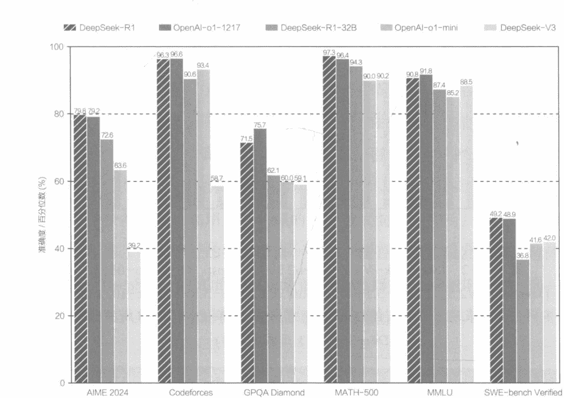
图 1-1-1 DeepSeek-R1、OpenAI-o1-1217、DeepSeek-R1-32B、OpenAI-o1-mini 及 DeepSeek-V3 处理不同任务的表现（图片来自 DeepSeek 官网 2025 年 1 月 20 日发布的文章《DeepSeek-R1 发布，性能对标 OpenAI o1 正式版》）

> ① 此处数据来源于 DeepSeek 官网 2024 年 12 月 26 日发布的文章《DeepSeek-V3 正式发布》。

## 1.2 从技术突围到国家重器：发展与普及

### 1.2.1 技术突破：低成本高效的中国式创新
2025 年 1 月 20 日，深度求索发布 DeepSeek-R1。模型基于混合专家架构，6710 亿参数，每次计算仅激活 370 亿参数，实现效率跃升。训练成本较国际同类显著降低，却展现出比肩 OpenAI o1 正式版的性能①。更关键的是其开创的无监督强化学习训练体系，可通过算法自我博弈激活推理潜能，减少对人工标注依赖，打破传统 AI 研发“数据饥渴”。这种以算法优化替代算力堆砌的路径，被《人民网》评价为“非对称创新”的典范，颠覆了算力垄断即竞争力的迷信。

公司践行“以开源精神和长期主义追求普惠 AGI”的理念。与部分封闭策略不同，DeepSeek-R1 的架构与训练方法全面开源，全球开发者可低成本部署。据报道，已有多家知名学术机构和 AI 公司低成本完成复现②。开源策略不仅赢得全球赞誉，也推动技术普惠。

中国技术公司正以开放共赢范式证明：人工智能的真正进步不在于个别企业的技术壁垒，而在于能否构建激发全球智慧的创新网络。DeepSeek-R1 的成功为全球科技公司指明方向——唯有打破知识垄断，才能实现技术普惠的繁荣。

> ① 该表述出自 DeepSeek 官网 2025 年 1 月 20 日发布的文章《DeepSeek-R1 发布，性能对标 OpenAI o1 正式版》。
> ② 引自《人民网》2025 年 1 月 29 日发布的文章《AI 观察 | 另辟蹊径的中国 AI，在除夕前夜“爆火”》。另，原文为“只用几十美元的成本就能完成复现”，但实际可能未计算人工、硬件、算力或其他成本，因此本处仅引用为“低成本”。

### 1.2.2 市场冲击：改写全球竞争版图
DeepSeek-R1 发布后 30 天内，产品全球注册用户突破 1.19 亿，海外用户占比超一半。增长速度打破大模型推广纪录，直接推动全球 AI 市场重构。多家国际巨头宣布接入，表明其不仅在国内站稳脚跟，更在全球找到突破口，可与 OpenAI、Anthropic、Google DeepMind 同台竞技。过去市场长期由 ChatGPT、Claude、Gemini 主导，而 DeepSeek 迅速吸纳大量海外用户，显示其在技术能力、体验、生态上的强竞争力。

与此同时，国内市场迎来洗牌。发布前，豆包、Kimi、文心一言主导国内格局。短短 30 天，DeepSeek 日活用户已超过上述领军者，成为国内新霸主①。面对强劲对手，相关企业必然加速产品迭代以保市场地位。未来国内大模型竞争将更激烈，DeepSeek 能否稳固领先，取决于迭代、生态与策略的持续创新。

DeepSeek 的崛起揭示了 AI 技术平权带来的市场变革。过去领先者集中于欧美科技公司，如今技术壁垒逐步消解，更多企业和国家共享红利。技术平权意味着 AI 不再是少数巨头的专利，而可普惠全球。开放性与可扩展性让更多开发者基于其模型构建应用，加速普及，推动产业发展并带来创新与商业机会，重塑行业竞争格局。

从全球扩张到国内洗牌，再到规模化落地与技术平权，这一连串变化表明 AI 产业进入新竞争周期。DeepSeek 能否持续领先有待检验，但由其引发的市场变革已在重塑全球人工智能格局，推动行业迈向更开放、多元、公平的新阶段。

> ① 引自虎嗅 2025 年 2 月 13 日发布的文章《数据揭露 DeepSeek 崛起的秘诀》。

### 1.2.3 产业链重构：从硬件依赖到应用爆发

DeepSeek 在算法层面不断迭代，让对硬件的依赖度明显下降，产业的重心正从底层算力向应用层转移。一方面，预训练阶段的算力需求出现结构性分化，另一方面推理侧的使用量持续走高。长城基金分析师刘疆指出，DeepSeek 带动的应用爆发将拉动推理算力需求，而在外部限制下，国产算力迎来发展窗口①。受技术封锁影响，国内企业加快自主研发与技术迭代，通过搭建高能效计算平台和数据中心去承接推理侧的增长。这不仅有助于削弱外部技术垄断，也为上游芯片制造、服务器集群等环节带来新机遇。随着国产算力技术趋于成熟、生态体系趋于完善，其在全球市场的分量有望进一步提升。

与此同时，开源生态大幅降低了技术创新的门槛，也催生了大量面向垂直场景的应用。模型普惠成为可能，中小开发者能以更低成本参与到前沿研发。以 DeepSeek 为代表的开源大模型，既为创业者提供强劲底座，也推动了跨领域、跨行业的深度融合，成为当前创业热点。从民生服务到工业制造，从社交传媒到智慧教育，从金融风控到智慧农业，从交通运输到物流配送，从医疗健康到文化旅游，从环境监测到能源管理，人工智能正以前所未有的速度渗透各个行业。这种渗透不仅带来单一行业的升级，更推动整条产业链的数字化转型。企业在推进智能化过程中，纷纷调整技术路线，把人工智能融入生产、管理、服务等环节，以提升效率、降本增效并实现精细化运营。

资本对各环节长期价值的判断也在悄然变化。传统产业在数字化冲击下被重塑，新兴应用层出不穷，投资者对人工智能生态的关注度不断升高。大量创业团队和机构把目光投向基于 DeepSeek 等开源平台的垂直应用，因其门槛低、成本可控、可快速迭代、具备可持续创新潜力。资金持续注入，形成技术与市场的正向循环，进一步升级整条产业链。

在这一背景下，行业竞争进入新阶段。巨头必须直面中小创新团队的挑战，后者凭借组织灵活和成本优势，迅速推出具竞争力的产品，打破原有格局。与此同时，监管部门开始重视人工智能在各行业的广泛落地，在鼓励创新的同时完善法规，保障数据安全与隐私，为生态健康发展提供制度支撑。

总体来看，DeepSeek 的技术突破与开源化既降低了创新门槛、实现了模型普惠，也催生了垂直领域的创新应用。这一趋势正持续重塑产业链各环节的价值分配，引领社会向数字化、智能化迈进。

### 1.2.4 全球资本再平衡：中国科技资产的价值重估
当技术创新不再只靠堆算力，而是靠算法优化与资源利用率提升实现突破时，全球资本的关注点自然迁移。DeepSeek-R1 开源后，其高能效、低成本的技术创新模式在全球资本市场引发剧烈震荡，直接冲击了以算力为核心的投资逻辑，也动摇了投资者对传统人工智能企业与算力垄断模式的信心。

发布后美股出现罕见波动，英伟达单日下跌 18%，市值蒸发近 6000 亿美元，成为变革最典型的样本。长期以来它被视为算力产业的中枢，其 GPU 几乎垄断高性能计算，人工智能繁荣也是其业绩驱动力。此轮下跌反映出市场对传统算力垄断信心的松动，投资者开始重新审视算力链条的价值分配与技术创新和资本回报的关系。

英伟达并非孤例。整个算力驱动生态均受冲击，AMD、英特尔股价下行，依赖高算力服务的云厂商如亚马逊 AWS、微软 Azure、谷歌 Cloud 也被波及，显示出投资逻辑正在深度演变。

长期以来，全球资金配置围绕欧美科技巨头展开，美国企业凭借技术垄断、全球市场和资本运作能力吸引大量资金。人工智能领域亦然，欧美巨头以雄厚研发资金、领先半导体和算力优势构筑高壁垒，产业长期由少数西方企业主导。过去市场普遍认为高算力投入等于更强能力，这一逻辑主导投资。

DeepSeek 的崛起迫使市场重新评估创新的地域优势。其在预训练、推理、链式思考等关键环节的算法优化显著降低算力需求，同时提升智能水平。这一突破打破了算力决定水平的做法，让创新重心从硬件投入转向算法优化与资源效率。算力投入与应用效果的关系被重新审视，资本开始重新衡量技术创新的长期价值。

从经济学看，技术边际成本下降时资本必然重估行业回报。DeepSeek 出现后，投资者重新思考市场中的核心资产——若高效能模型不再依赖昂贵算力资源，过往对 GPU 与高性能基础设施的投资逻辑就需要调整。这正在推动全球科技资本进入效率优先新阶段。

DeepSeek 的突破不仅搅动美股，也推动中国科技股全面上扬。发布后中国人工智能概念股强势反弹，板块估值大幅抬升，多家龙头市值飙升。大批国际机构和基金经理调整策略，把资金从传统高算力驱动企业转向拥有自主核心技术和开放生态的中国企业。这一动向说明国际资本正加速向中国市场配置，并重新评估中国科技企业在全球人工智能中的地位。

中国科技股估值重构所引发的资本转向，本质是全球市场对新技术路径的再认识与再定价。技术创新摆脱路径依赖，打破高算力投入等于优势的单一逻辑，全球科技话语权格局出现新变量。DeepSeek 的成功不仅是个体事件，更象征中国人工智能产业整体崛起。随着更多中国企业登上全球舞台，产业领导权正从单一中心化向多极化演进。

从美股震荡到中国科技股崛起，再到全球资本配置调整，技术范式转变正引发资本市场的深层重构。未来随着行业演进，全球科技产业话语权也将迎来新变革。DeepSeek 的成功，或许只是这一巨变的开端。

> ① 引自搜狐财经 2025 年 3 月 5 日发布的文章《长城基金刘疆：DeepSeek 提振 AI 产业信心，“算力平权”时代有望到来》。

## 1.3 DeepSeek 怎么用？
### 1.3.1 DeepSeek 使用方式
DeepSeek 的使用路径多样，终端覆盖官方网页版、移动应用、API 接入、第三方平台、本地部署模型五大类，使用场景细分为九种，具体说明在本书第三章，读者可按需查阅。DeepSeek 的使用方式如图 1-3-1 所示。

### 1.3.2 DeepSeek 赋能多场景生产力革新
作为新一代人工智能技术平台，DeepSeek 的价值不仅在于独立的推理能力，更在于与各类专业工具的深度融合。通过跨域协作，它正逐步成为提升效率与生产力的核心引擎，重塑现代工作与创作模式。

在办公文档领域，DeepSeek 与主流办公软件无缝对接，实现从信息整理到报告生成的自动化。它能快速解析海量信息，生成条理清晰的文档框架，并按用户需求调整语言风格，显著减少重复性劳动。对于创意工作者，其写作辅助提供多维灵感，无论是文学创作还是商业文案，都能通过语义分析优化表达，并基于历史数据预测热点趋势，成为内容的智能外脑。

在视频与图像创作场景，DeepSeek 与设计工具联动释放艺术潜力。视频创作中可协作生成脚本或剧本，供专业人工智能视频工具据此生成视频；图像设计中，能理解用户抽象描述，快速产出主题视觉方案并转化为专业绘画工具可用的提示词，大幅缩短构思到落地周期。对自媒体从业者，DeepSeek 可结合发帖内容推理用户画像，优化传播策略实现精准触达，还能撰写各平台封面提示词，如小红书图文封面、视频号封面、B 站封面、公众号封面等，通过专业绘画工具快速转为实图。

人工智能编程领域同样迎来革新。与代码编辑器深度整合后，可实时解析开发者意图，提供模块化代码建议并自动检测潜在漏洞。该协作模式提升开发效率，降低技术门槛，让复杂系统构建更顺畅。

从文档到代码，从文字到影像，DeepSeek 正在重新定义人机协作边界。它并非替代人类，而是以智能增强将重复劳动转化为创造性思考，推动各行业向更高效、更创新方向演进。其背后是人与人工智能共探生产力新维度的时代图景。

### 1.3.3 DeepSeek 的使用成本
截至本书完稿，DeepSeek 官网对话服务完全免费，提供最新 R1 模型，且深度思考与联网搜索无次数限制，对普通用户是显著福利。相比之下，主流人工智能模型多设调用限制或订阅费。OpenAI 的 ChatGPT 提供 Plus 与 Pro 方案，分别为月费 20 美元与 200 美元，Plus 可优先使用并有限度使用新工具，Pro 则可无限制使用并优先体验新功能。

企业更关注 API 费用。DeepSeek API 采用用量计费。按 DeepSeek API 文档，标准时段北京时间 08:30—00:30，调用 deepseek-chat 即 DeepSeek-V3，输入每百万 tokens 2 元，输出 8 元；调用 deepseek-reasoner 即 DeepSeek-R1，输入 4 元，输出 16 元。优惠时段北京时间 00:30—08:30 费用进一步下调，具体见表 1-3-1。

**表 1-3-1 DeepSeek 与 ChatGPT 部分模型 API 服务价格对比**

| 模型 / 服务 | 输入价格（缓存命中 / 未命中） | 输出价格 | 其他成本优势 |
| :--- | :--- | :--- | :--- |
| DeepSeek-V3 | 0.5 元 / 2 元（人民币） | 8 元（人民币） | 夜间时段（00:30—08:30）输入 0.25 元 / 输出 4 元（5 折） |
| DeepSeek-R1 | 1 元 / 4 元（人民币） | 16 元（人民币） | 夜间时段输入 0.25 元 / 输出 4 元（2.5 折） |
| ChatGPT GPT-4o | 1.25 美元（≈ 8.9 元）/2.5 美元（≈ 17.75 元） | 10 美元（≈ 71 元） | 无额外折扣 |
| ChatGPT GPT o1 | 7.5 美元（≈ 53.25 元）/15 美元（≈ 106.5 元） | 60 美元（≈ 426 元） | 无开源支持，闭源生态依赖 |

注：汇率换算按 1 美元≈ 7.1 元人民币，价格单位均为每百万 Token。

在场景适配上，DeepSeek 通过产品矩阵构建多层次性价比。对智能客服、舆情监测等高并发场景，DeepSeek-V3 展现出优秀的成本控制，输入缓存命中价低至每百万 tokens 0.5 元，夜间错峰可降至 0.25 元，输出 8 元/百万 tokens，相比同类服务成本压缩超 90%，适合日均百万级请求的大规模商用。

对延迟敏感的实时交互需求，DeepSeek-R1 提供更高性能，其优惠时段折扣更深，R1 为 2.5 折、V3 为 5 折，可通过动态定价形成成本与性能的平衡。适用于需 7×24 在线但存在明显波峰波谷的场景，例如跨时区多语言客服，可在目标市场非活跃时段以 25% 成本维持响应。

需注意，大规模商用成本仍需审慎评估。以日处理百万级请求计，基础 API 年成本可能超 50 万美元，此时企业需权衡自建开源模型与 API 服务的性价比。开源的 DeepSeek 为用户提供了更多选择。

# 第 2 章
用 DeepSeek 能做什么？

## 2.1 增强自主学习能力 重塑认知与成长边界
信息爆炸时代，知识迭代远超传统认知工具的跟进速度。我们身处海量信息构成的复杂体系，传统学习方式难以应对其复杂与动态。DeepSeek 不只是检索工具，更是学习伙伴，帮助打破固有认知，开展自我成长与知识体系重构的探索。

### 2.1.1 突破传统认知局限
传统教育与既有经验为我们奠定知识基础，却也像无形枷锁限制好奇与探索。DeepSeek 凭借强大的知识整合与实时更新能力，成为打开新认知大门的钥匙，帮助突破固有框架。

当你对新兴科技领域感兴趣却缺少系统入门资料时，DeepSeek 可扮演专业导师。它能依据你的知识水平与兴趣定制个性化学习路径，从基础理论到前沿进展层层递进，并用通俗语言解释复杂抽象概念，让跨学科学习更高效、更亲切，从而拓宽认知边界。

提升认知的过程中可参考以下方法。首先明确学习目标，是职业发展所需还是纯兴趣。其次利用关键词搜索与拓展功能，输入如模型参数等关键词，它会返回相关结果并推荐延伸词。再者对结果进行多源整合，筛选高价值内容深入学习，如图 2-1-1 所示。最后将所学在实践中应用，让知识转化为能力与素养。

帮我解释一下 AIGC 模型概念中的模型参数

##### 1. 什么是模型参数
- 模型参数是指机器学习或深度学习模型在训练过程中自动习得的数值，用来决定模型如何根据输入生成输出。
- 可以把参数理解为模型的记忆体或经验值，模型借助这些数值处理信息、进行推理并产出结果，例如文本、图像、音乐等。

##### 2. 参数的作用是什么
- 操控模型行为：参数决定了模型对输入的反应方式，比如在生成文本时会影响词汇选择与句式组织。
- 承载知识：参数里保存了模型从训练数据中学到的规律，如语言模式、图像特征、音乐风格等。

##### 3. AIGC 模型的参数有什么特点
- 规模庞大：AIGC 模型通常包含数十亿到万亿级参数，例如 GPT-3 约 1750 亿参数，GPT-4 约 1.8 万亿参数，Stable Diffusion 约 10 亿参数。参数越多理论上处理能力越强，但训练与部署成本也越高。
- 通过训练习得：参数并非人工设定，而是经梯度下降、反向传播等方法自动调整，使生成内容更接近人类表达。

##### 4. 参数 vs. 超参数
- 参数：模型内部自动学习得到的数值，如神经网络的权重与偏置。
- 超参数：人为事先设定的配置，如学习率、层数、批次大小，影响参数调整过程。

##### 5. 参数如何影响 AIGC 的输出
- 生成质量：参数越多、训练越充分，输出通常更连贯、更逼真。
- 多样性：参数调节会影响随机性，可控制保守性或创造性。
- 领域适应性：通过微调参数可使模型适配医学、法律等特定领域。

##### 6. 参数示例（以语言模型为例）
假设一个简单的神经网络处理“今天天气很”→模型经参数计算→预测输出“好”。参数决定了输入词向量如何映射到目标词。

##### 7. 参数的实际挑战
- 计算成本：训练大模型需要海量算力。
- 过拟合风险：参数过多可能导致模型过度依赖训练数据，泛化能力下降。
- 部署难度：大模型对硬件资源要求高，难以在普通设备运行。

图 2-1-1 使用 DeepSeek-R1 的联网搜索功能快速学习知识点

### 2.1.2 反向推演的思维训练

逆向拆解，让思考更清晰

生成式智能的普及大幅缩短了获取结论的耗时，同时也在悄然重塑学习的方式。过去人们习惯直接索要答案，而把答案的推导过程倒过来拆开来学，反而更具启发性。这种逆向的思维训练能帮助使用者看清问题背后的推理链条，并在不断复盘中建立独立判断与自主解决问题的能力。

以向 DeepSeek 请教“作为教学方法研究者，如何借助实验法判断 AIGC 工具是否对大学生学习产生积极作用？AIGC 即人工智能生成内容，典型代表有 ChatGPT、MidJourney 等”为案例，系统会先梳理实验法的基本框架与操作要点，再展开实验设计、变量设定、数据收集以及可能面临的挑战。沿着这条推理轨迹对照，学习者可以整理自身的思路脉络，补上容易忽略的环节，逐渐养成更为高效、完整的思考习惯，如图 2-1-2 所示。

在呈现推理方面，该平台的表现格外突出。它不止于给出结果，更像一位耐心的引路人，逐步展开思考路径。面对复杂的科学命题或逻辑谜题时，它会把每一步推导拆分得很细，让人直观看见问题如何被分解、如何被化解。如此一来，使用者既能拿到答案，也能读懂问题的本质，甚至借鉴模型的思维方式，进一步强化自身的逻辑能力。

这种逆向学习机制的意义在于，智能系统不再只是执行工具，更像学习的引导者。在持续互动中，使用者不断打磨自身的思维模式，提升拆解复杂情境的能力。久而久之，逻辑更为严谨，AI 也从信息供给者转变为推动人类智能成长的助推器。

### 2.1.3 培养创新思维与能力
当创新成为社会进步的主引擎，DeepSeek 这类前沿的 AIGC 产品正逐步演变为锻炼创新思维的重要伙伴。凭借多元功能与丰富场景，它为用户打开了一条激发灵感、提升创新能力的通道。

它能供给多样化信息。探索新领域时，会提供不同视角的材料，触发联想与思考。比如在构思跨界项目时，能够给出相关前沿动态，帮助拓宽视野。多轮对话中，使用者可以不断细化需求，获得即时反馈并调整方向。例如在产品设计阶段，可以反复与之交流，优化概念。此外，它还能产出创意内容。无论是撰写文章还是视觉设计，生成的素材都可以作为灵感起点，供使用者在基础上发挥想象、完善创意。

### 2.1.4 AI Agent 激发终身学习热情
技术高速演进的背景下，终身学习已成为适应复杂环境、实现自我超越的关键。一锤子买卖式的教育无法满足职业与社会责任的持续变化，保持学习与自我更新才是竞争力之本。在此语境下，DeepSeek 开源的最新版本凭借强推理与联网检索能力，为搭建个人 AI 学习代理提供了新可能，实现对学习偏好与兴趣的精准捕捉，并动态构建个性化知识网络，完善个人知识库。至本书完稿，已有多家智慧教育平台宣布接入 DeepSeek 并推出学习代理服务。同时，“AI+教育”也成为海内外高校研究的热点。

借助智能代理，可以打破传统学习边界，将持续学习融入日常，使学习更个性化、更智能、更高效。在 DeepSeek 的支持下，每个人都能搭建专属的学习代理，按最适合自己的节奏持续进步，在快速变化的世界中保持领先，实现个人成长与社会价值的双重提升。

## 2.2 提升个人生产力 打造 AI 工作流
数字化转型正在重塑工作方式，人工智能不仅加快效率，更在推动思维模式的革新。DeepSeek 不仅是辅助手段，更在引导重新审视工作本质、优化流程并塑造全新的智能化办公形态。

多数使用者初次接触时，仅把它当成信息检索或内容生成的工具，用来撰写报告、整理笔记或答疑。随着使用加深，他们会发现其能力远不止于此。它不仅能处理繁琐的重复性任务，更可充当智能助手，在信息归纳、决策支持、数据分析、自动化执行等方面发挥核心作用，促使我们跳出传统模式，建立更高效、更智能的人工智能工作流 ①。

要搭建人工智能工作流，首先要理解其基本逻辑。一个简洁的流程通常包含数据输入、数据处理和结果输出三部分。可以把输入端设计为让 DeepSeek 从文档、邮件、表单等渠道收集信息；处理端利用其自然语言理解与生成能力，对输入数据进行分析、解读与生成，例如自动生成报告、归纳邮件要点或从文档中提取关键信息；输出端则将生成内容推送至文件系统、邮箱或消息平台。

随着技术迭代，DeepSeek 在智能流程中的应用会更广泛更深入。未来人工智能不仅是辅助，更是人类智能的延伸。通过与 RPA、智能分析系统、大数据平台等联动，将构建更完整的智能办公生态，让企业与个人更精准、高效地完成复杂任务。

本书第 5 至第 10 章将深入探讨如何利用 DeepSeek 及其他智能工具搭建高效工作流，帮助你在数字化时代保持领先，释放创造力，实现生产力的跃升。

> ① 人工智能工作流是指将人工智能技术应用于工作流程中，以自动化和智能化的方式完成特定任务的流程。

## 2.3 塑造未来公民素养 对接社会发展
DeepSeek 作为前沿的 AIGC 产品，在智能技术迅猛发展的背景下，正日益成为塑造未来公民素养的重要平台。

凭借先进的数据分析与智能推荐，它不仅提供丰富的学习资源与案例解析，更引导使用者在技术应用中深入思考科技伦理。通过对隐私保护、算法偏见等现实困境的讨论与实践，帮助使用者建立正确的伦理判断，确保在追求创新的同时坚守道德底线，实现技术与人文精神的和谐统一。

面对海量信息冲击，AI 幻觉倒逼人类具备更强的信息甄别能力。要培养批判性思维，学会从多个权威渠道交叉验证，而非被表面合理的说法误导。理解 AI 的工作机制、局限性及可能带来的偏差，也是应对信息污染的关键。与 DeepSeek 对话时，可以要求它提供不同来源的信息对比、揭示观点分歧、整理不同立场的引用文献，帮助理性分析、形成独立见解，而非被偏见驱动的算法推送左右。通过精准筛选、智能分析、多角度比较和个性化训练，帮助使用者在信息洪流中保持理性，确保获取的知识经得起推敲，真正做到“借助 AI，超越 AI”。

此外，通过整合全球新闻资讯、文化解读和多语言资源，DeepSeek 为使用者提供高效了解全球文化的机会，拓展开放包容的国际视野，使其能站在全球化高度审视问题，理解不同文化背景下的价值观与行为模式，更好参与国际事务与跨文化对话。

总之，DeepSeek 通过科技伦理引导、信息辨别培养、全球视野拓展，塑造全新的公民素养，让使用者在享受便捷高效的同时保持理性与责任，成为推动社会持续进步的重要力量，为引领未来社会发展奠定基础。

# 第 3 章
DeepSeek 实战入门向导

## 3.1 可用的接入方式
使用途径可分为基础与进阶两大类，共计九种情形。基础途径包括官方网页端、官方移动端（安卓或 iOS）两种；进阶途径包括调用接口（官方或第三方）、借助第三方平台（国内或国外）、本地部署模型（满血版或蒸馏版）三种，如图 3-1-1 所示。

### 3.1.1 基础接入渠道
#### 官方网页端 DeepSeek
官方网页端是最简便的方式，适用于各类设备，使用门槛几乎为零，如图 3-1-2 所示。

> **网页端使用三步精简版**
> ①打开浏览器，推荐 Chrome。
> ②在地址栏输入官方网址 www.deepseek.com。
> ③点击“开始对话”注册账号即可直接使用，无需下载软件。

读者亦可在移动端下载 DeepSeek 应用程序，随时随地使用。

图 3-1-2 DeepSeek 官方网页端

### 3.1.2 进阶使用方式
上述两种方式虽方便，但在访问量激增时网页端与 App 端易出现服务器繁忙。

#### 1. 通过接口调用
使用 DeepSeek 接口有官方接口与第三方接口两种。网页端或移动端无法正常使用时，可借助官方或第三方接口快速调用，但操作相对复杂，需多个软件配合。

> **接口调用三步精简版**
> 
> **官方接口**
> ①登录 DeepSeek 官网，申请官方接口，如图 3-1-3 所示。
> ②下载第三方软件并配置官方接口。
> ③使用第三方软件可视化调用 DeepSeek。
> 
> **第三方接口**
> ①登录第三方网站，申请第三方接口，如图 3-1-4 所示。
> ②下载第三方软件并配置第三方接口。
> ③使用第三方软件可视化调用 DeepSeek。

036 一本书读懂 DeepSeek

图 3-1-3 DeepSeek 官方 API

图 3-1-4 在硅基流动中配置 DeepSeek 官方 API

#### 2. 使用第三方平台
借助第三方平台接入 DeepSeek 分为国内软件与国外软件两种。操作相对简单，但功能可能受限，需按第三方软件习惯使用。

> **第三方平台使用三步精简版**
> 
> **国外软件**
> ①登录各类第三方国外软件官网，如图 3-1-5 所示。
> ②注册账号，下载国外第三方软件。
> ③通过 App 或官网使用 DeepSeek 部分功能。
> 
> **国内软件**
> ①登录各类第三方国内软件官网，如图 3-1-6 所示。
> ②注册账号，下载国内第三方软件。
> ③通过 App 或官网使用 DeepSeek 部分功能。

图 3-1-5 DeepSeek 第三方国外软件案例（NVIDIA）

图 3-1-6 DeepSeek 第三方国内软件案例（知乎直答）

## 3. 本地部署模型
本地部署 DeepSeek 模型分为满血版与蒸馏版两种。

本地部署虽操作复杂，但优势明显。一是数据安全性强，敏感数据无需上传云端，存储于本地服务器，满足金融、政府等高保密场景。二是定制化程度高，可按企业需求调整参数，添加专属知识库、优化领域术语响应。三是离线环境可用，不受网络波动影响，可在受限网络中稳定运行。四是合法性保障，符合《数据安全法》《个人信息保护法》等本地化存储要求。五是长期稳定服务，可持续保障业务不中断，提升流程稳定性。

局限性也明显。首先成本较高，需采购高性能服务器并承担维护升级费用。其次维护复杂度随模型更新与性能监控需求增加，需 IT 团队持续支持。部署对硬件资源要求极高，尤其 GPU 算力，部署前需仔细评估。DeepSeek 技术复杂，需一定 AI 开发与系统运维能力，技术门槛较高。

**本地部署使用三步精简版**

**满血版模型**
- ①准备适配满血版 DeepSeek 模型的硬件。
- ②下载 Ollama 或 LM Studio 本地部署大模型软件。
- ③下载满血版 DeepSeek 模型，运行本地部署软件。

**蒸馏版模型**
- ①准备适配蒸馏版 DeepSeek 模型的硬件。
- ②下载 Ollama 或 LM Studio 本地部署大模型软件。
- ③下载蒸馏版 DeepSeek 模型，运行本地部署软件。

### 3.1.3 常见疑问解答
> **问：没有网络时可以使用 DeepSeek 吗？**
> 答：若使用本地部署，则无需互联网即可使用。若通过官方接口、第三方接口或第三方平台，则必须联网。
> **问：使用 DeepSeek 时数据是否安全？**
> 答：本地部署下数据不上传云端，非常安全。通过接口或第三方平台使用时数据会上传云端，请选择可信平台以保护安全。
> **问：普通电脑能本地部署 DeepSeek 吗？**
> 答：满血版对电脑要求较高，普通电脑难以运行。可选择蒸馏版模型，体积较小、硬件要求相对可接受，但仍需量力而行。
> **问：什么是 DeepSeek-R1 的蒸馏版模型？**
> 答：蒸馏版是 DeepSeek-R1 的简化版本，硬件要求更低，运行速度更快。

### 3.2 官方网页端实战操作
登录账号后会出现 DeepSeek 使用页面，如图 3-2-1 所示。

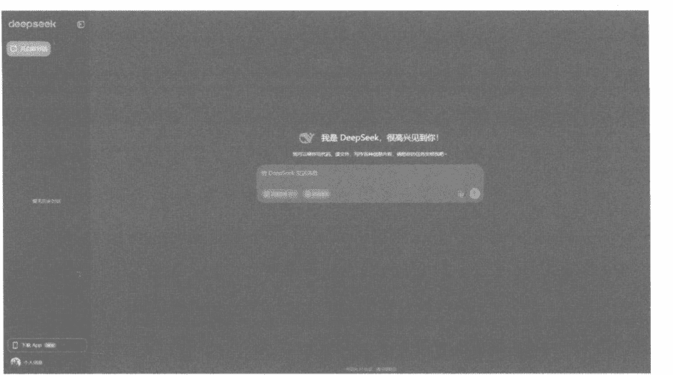
DeepSeek 界面共九个区域，各功能如图 3-2-2 所示。
- ①侧边栏开关：点击可快速折叠或展开侧边栏。
- ②新建对话：启动不同主题会话，便于管理。
- ③下载客户端：获取 DeepSeek 官方 App。
- ④深度推理模式：启用 DeepSeek-R1 处理需深度思考或推理的问题。
- ⑤联网检索：使 DeepSeek 可在线获取最新搜索结果，增强时效性。
- ⑥附件上传：仅识别文字，最多 50 个文件，单个不超过 100MB，支持各类文档与图片。
- ⑦发送：在输入提示词后点击提交。
- ⑧输入区：填写待解答问题，也称提示词区。
- ⑨个人中心：实现系统设置、删除所有对话、联系 DeepSeek 及退出登录。

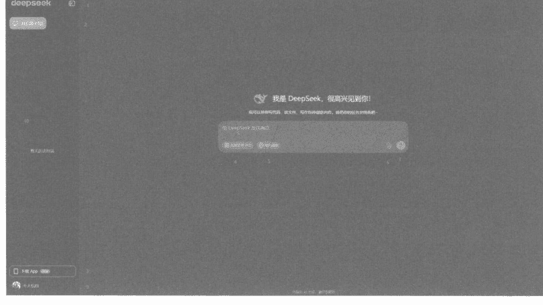
图 3-2-2 DeepSeek 使用页面的九个区域分布

### 3.2.2 四大核心功能体验
DeepSeek 有四个强大 AI 功能（智能对话、深度思考、联网搜索、文件分析），以下逐一体验。网页端与手机端功能类似，不再赘述手机版。

#### 1. AI 智能对话
可在输入区输入问题，如“如何有效学习 AI”，点击发送或回车，等待生成回答，如图 3-2-3 所示。

此方式下回答迅速，因未加入深度思考步骤，可快速得到较好答案。

> 简单问题推荐此方式，回答速度非常快。

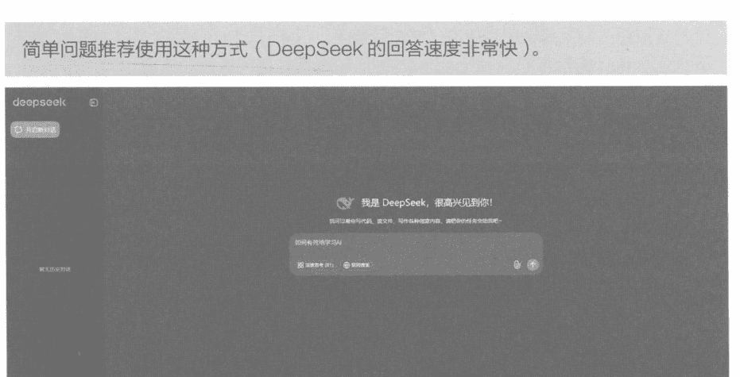
回答结果如图 3-2-4、图 3-2-5 所示。

回答末尾有四个按钮：“复制文本”“重新回答”“喜欢回答”“不喜欢回答”。若回答符合预期，可点“喜欢回答”；若不符，可点“不喜欢回答”并点“重新回答”，让其再回答一次，如图 3-2-6 所示。

# 第3章 DeepSeek 快速上手 实操指南

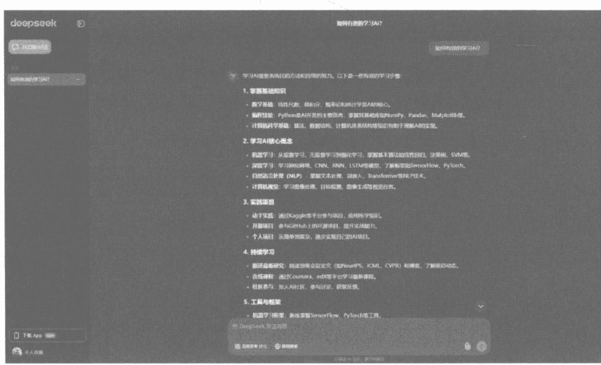
图 3-2-4 DeepSeek 交互反馈（例 1）

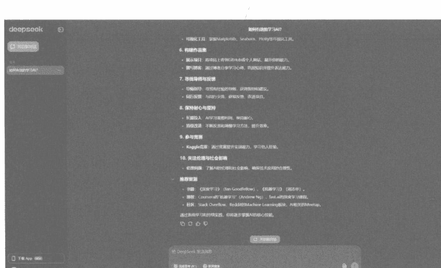
图 3-2-5 DeepSeek 交互反馈（例 2）

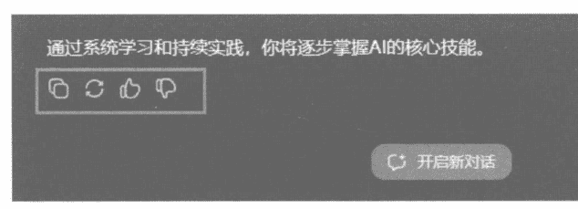
图 3-2-6 DeepSeek 交互按钮介绍

#### 2. AI 深度思考
再次在输入区输入相同问题“如何有效学习 AI”，点击“深度思考”后发送，等待生成。

此方式下回答稍慢，因加入了深度思考推理过程，结果更具深度与全面性。

> 需深度思考的问题推荐此方式，会加入推理，让答案更全面。

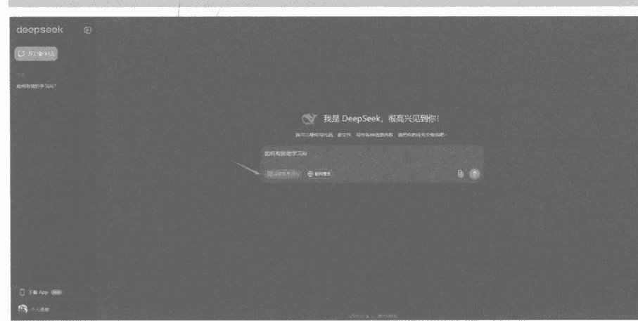

图 3-2-7 DeepSeek 深度思考应用

#### 3.AI 联网搜索

在提问区再次输入同一条问题“如何有效地学习 AI”，打开深度思考与联网搜索两个开关后点击发送或回车，等待模型生成结果，示意如图 3-2-8 所示。

这种组合响应最慢，因为模型要先做内部推演再去抓取网络最新资料。等待时间换来的是更宽广的信息来源和更深入的论证。需要注意，联网检索模式下不支持上传文件分析。对于需要细致推敲且官方知识库缺乏时效内容的提问，推荐采用此方式。耗时虽长，却是获取最全面最新资料的路径。

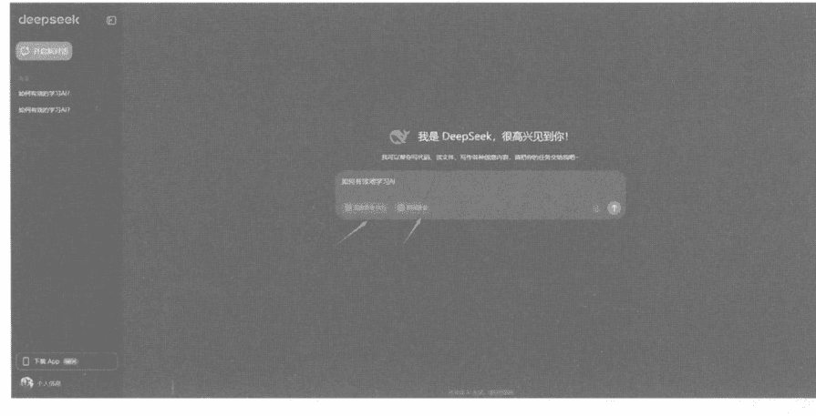

图 3-2-8 DeepSeek 深度思考与联网搜索

具体产出可见图 3-2-9 至图 3-2-12。输出里能看到思考链条、联网检索痕迹，同时做了资料整合并给出长期规划。三种用法中，这次的覆盖最为完整。

046 一本书读懂 DeepSeek

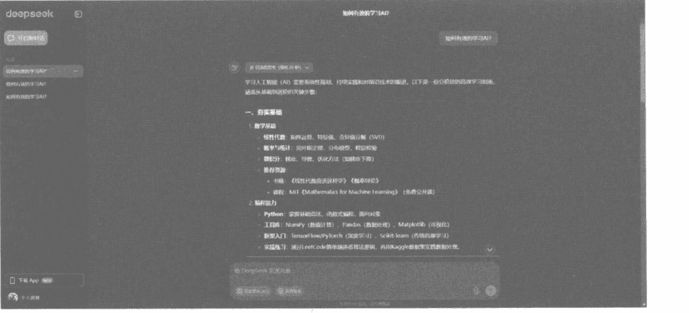

图 3-2-9 DeepSeek 综合回答（例 1）

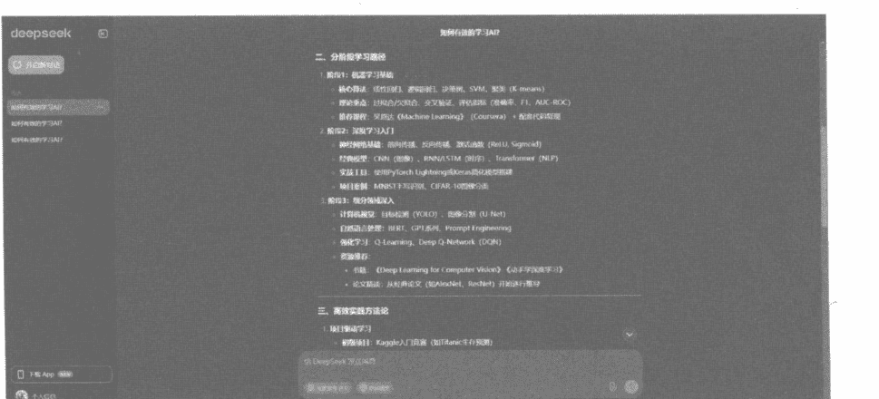

图 3-2-10 DeepSeek 综合回答（例 2）

# 第 3 章 DeepSeek 实操入门指南

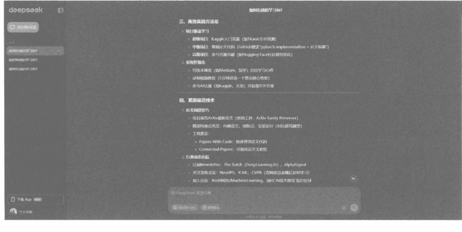

图 3-2-11 DeepSeek 综合回答（例 3）

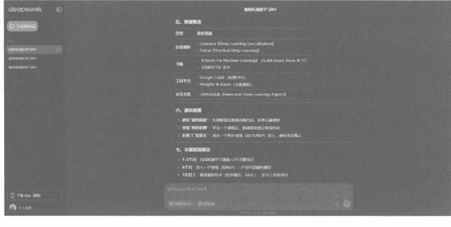

图 3-2-12 DeepSeek 综合回答（例 4）

#### 4.AI 文件分析

点击“上传文件”可导入本地文档或图片。仅识别文字内容，单次最多 50 个文件，每个文件上限 100MB，按本书定稿时的规则。

以一份表格为例，包含标题、点赞数、帖子链接三列，如图 3-2-13。在对话框输入“分析表格中热门点赞标题的共同特点”，等待回复，如图 3-2-14。需要提醒，联网搜索模式下无法上传文件。

> 对于需要深度思考的问题，且在 DeepSeek 数据库中没有最新资料的情况下，推荐使用这种方式。DeepSeek 这种方式的回答虽然最慢，但它可以针对用户提供的内容进行深度思考，从而获得更精准的答案。

| A | B | C |

|---|---|---|

| 标题 | 点赞数 | 链接 |

| DeepSeek官方信息 | 57000 | https://www.xiaohc |

| 用DeepSeek抽盲盒 | 53000 | https://www.xiaohc |

| 我没有想到有一天 | 39000 | https://www.xiaohc |

| DeepSeek有太极 | 29000 | https://www.xiaohc |

| 码一下DeepSeek的 | 26000 | https://www.xiaohc |

| 达到什么条件才能 | 18000 | https://www.xiaohc |

| DeepSeek不好用 | 18000 | https://www.xiaohc |

| 我的天DeepSeek | 16000 | https://www.xiaohc |

| 还得是清华！名校 | 15000 | https://www.xiaohc |

| DeekSeek教师指令 | 15000 | https://www.xiaohc |

| 苹果粉狂喜！Dee | 14000 | https://www.xiaohc |

| DeepSeek真的好会 | 10000 | https://www.xiaohc |

| 教师版DeepSeek | 10000 | https://www.xiaohc |

| 第一次深刻感受到 | 8146 | https://www.xiaohc |

| 给我妈装完DeepS | 8560 | https://www.xiaohc |

| 【教程】两段话让 | 8118 | https://www.xiaohc |

| DeepSeek大半夜 | 8643 | https://www.xiaohc |

| 不要去官网挤着用 | 7397 | https://www.xiaohc |

| 关于我和DeepSee | 6839 | https://www.xiaohc |

| 人类对于未来的恐 | 7105 | https://www.xiaohc |

| 人们还在热议 Dee | 6694 | https://www.xiaohc |

| 如题 | 6877 | https://www.xiaohc |

| DeepSeek让美国 | 6620 | https://www.xiaohc |

| 问DeepSeek异地 | 6514 | https://www.xiaohc |

| DeepSeek喂饭级 | 6364 | https://www.xiaohc |

| 帮大家总结了超全 | 6872 | https://www.xiaohc |

| 突然发现清华Dee | 6400 | https://www.xiaohc |

| DeepSeek好用的 | 6000 | https://www.xiaohc |

| DS告诉我的人生 | 5960 | https://www.xiaohc |

图 3-2-13 上传文件

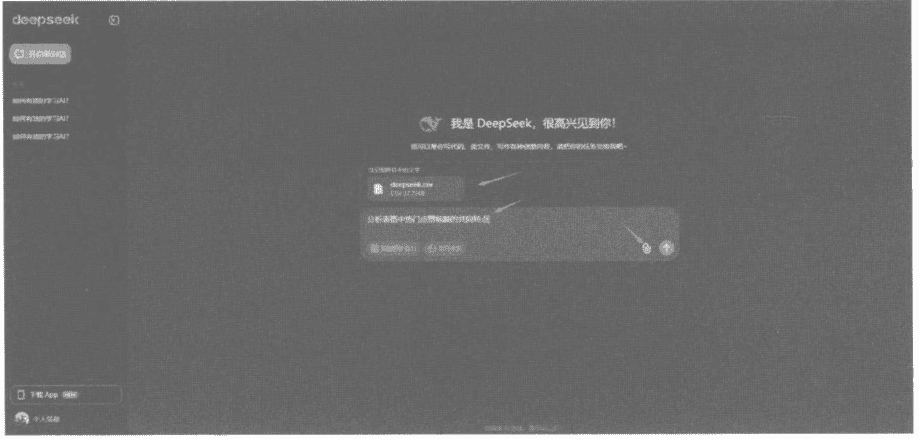

图 3-2-14 DeepSeek 文件分析案例

图 3-2-15 的回复保留了思考过程，并对上传表格做了细致拆解，结合提问给出综合结论。

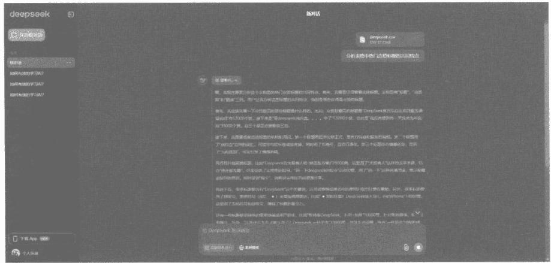

图 3-2-15 DeepSeek 深度思考与文件分析结果

分析完成后可在同一对话里继续追问或定制需求，示例见图 3-2-16。

050 一本书读懂 DeepSeek

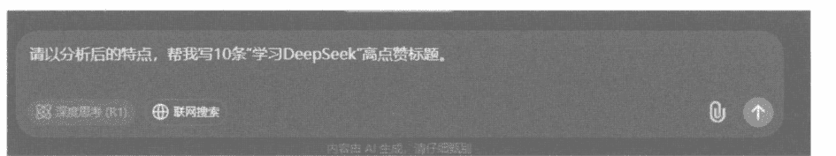

图 3-2-16 用户需求定制示例

## 3.3 官方 API 使用 DeepSeek——Cherry Studio

### 3.3.1 获取 DeepSeek 官方 API

进入 DeepSeek 官网，点击右侧的“API 开放平台”入口即可开始申请。


图 3-3-1 获取 DeepSeek 官方 API 操作

在左侧菜单打开“API keys”，点击“创建 API key”。列表会展示名下全部密钥，密钥仅在生成瞬间可见可复制，请妥善保管，不要外泄或写入前端代码。一旦泄露，官方可能自动封禁。为避免业务受影响，目前官方已暂停 API 充值，现有余额仍可使用，默认赠送 10 元。API 本质上是一串字符，让其他程序能调用 DeepSeek 能力。因为官网近期负载高，可能出现不可用，通过客户端调用更稳定。唯一限制是官方 API 暂不支持联网搜索。

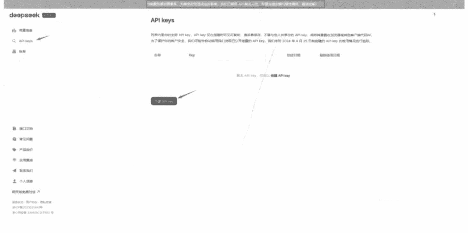

图 3-3-2 DeepSeek API key 管理界面

### 3.3.2 下载 Cherry Studio

Cherry Studio 是一款跨平台桌面客户端，兼容 Windows、Mac、Linux，开箱即用。内置 30 多个行业智能助手，集成主流大模型 API，也支持本地模型。功能涵盖多模型对话、知识库管理、AI 绘画、翻译等，高度可定制，适合专业用户和爱好者。前往官网 https://cherry-ai.com/ 点击“下载客户端”，如图 3-3-3 所示。

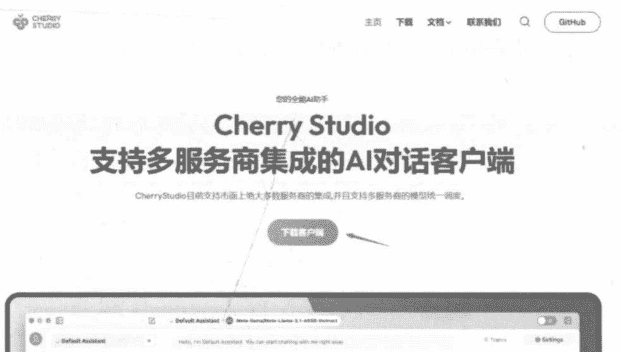

图 3-3-3 Cherry Studio 下载页面

### 3.3.3 安装 Cherry Studio

打开下载好的安装包，双击运行后一路点“下一步”即可完成安装，如图 3-3-4 所示。

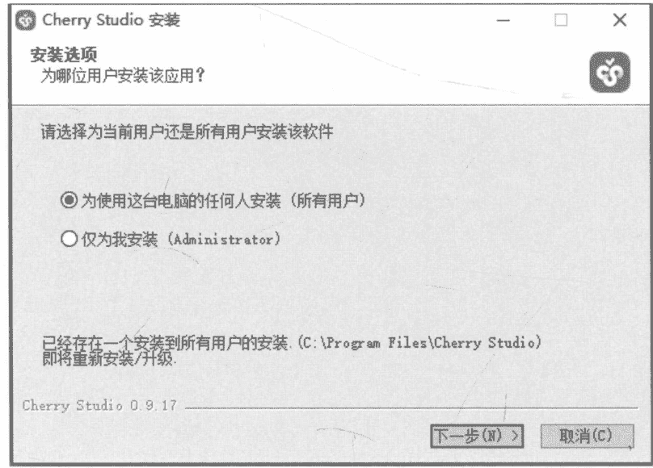

图 3-3-4 Cherry Studio 安装页面

### 3.3.4 配置 Cherry Studio

安装完成后打开软件，点击左下角“设置”，进入“模型服务”，选择“深度求索”，在右上角点绿色启动按钮填入前面获取的官方 API key，点击“检查”确认连通，如图 3-3-5 所示。

### 3.3.5 在 Cherry Studio 中使用 DeepSeek

启动后点左上角“助手”，选用“默认助手”，在输入区写下问题或提示词即可调用 DeepSeek，如图 3-3-6 所示。

054 一本书读懂 DeepSeek

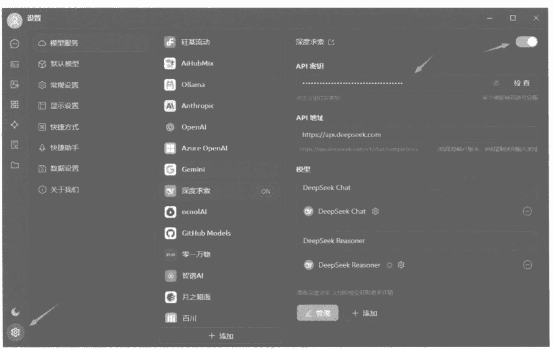

图 3-3-5 Cherry Studio 配置步骤详情

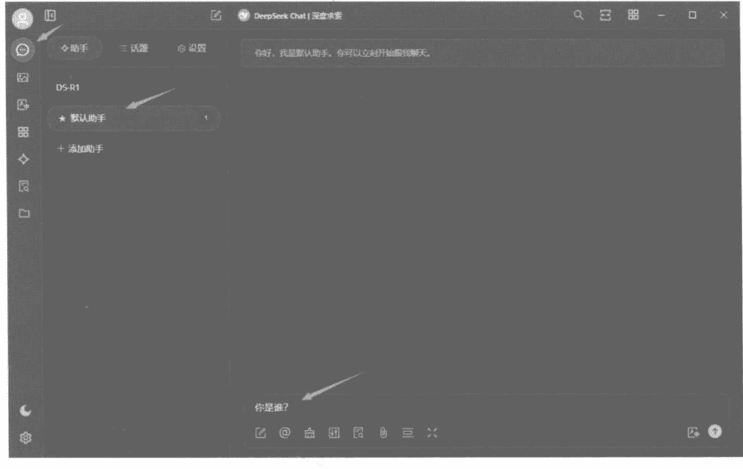

图 3-3-6 在 Cherry Studio 中使用 DeepSeek

顶部栏可以切换不同的 DeepSeek 模型，见图 3-3-7 所示。

## 3.3.6 获取 DeepSeek 官方 API 使用情况

使用官方 API 时要定期查看用量。

打开 https://cloud.siliconflow.cn/bills 可查看 DeepSeek-V3 和 DeepSeek-R1 的使用记录及余额，如图 3-3-11 所示。

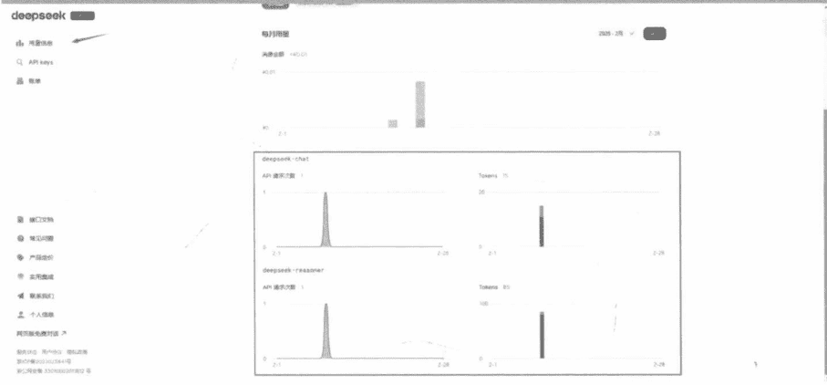

图 3-3-11 DeepSeek API 用量和消费分析

> 截至定稿，官方已停止 API 充值，现有余额还能用，赠送的 10 元很快会用完，不建议长期依赖官方接口，仅作备用。更推荐使用第三方 API，可随时充值更省心。

## 3.4 第三方 API 使用 DeepSeek——硅基流动 + Chatbox

### 3.4.1 获取 DeepSeek 第三方硅基流动 API

截至 2025 年 2 月 14 日，市场上已有 34 家云平台提供 DeepSeek 第三方 API。硅基流动提供多款模型，操作简单，适合新手。进阶用户可参考章节 3.4.7 的汇总表挑选。

先登录 https://www.siliconflow.cn/，未注册会自动创建账号，如图 3-4-1 所示。

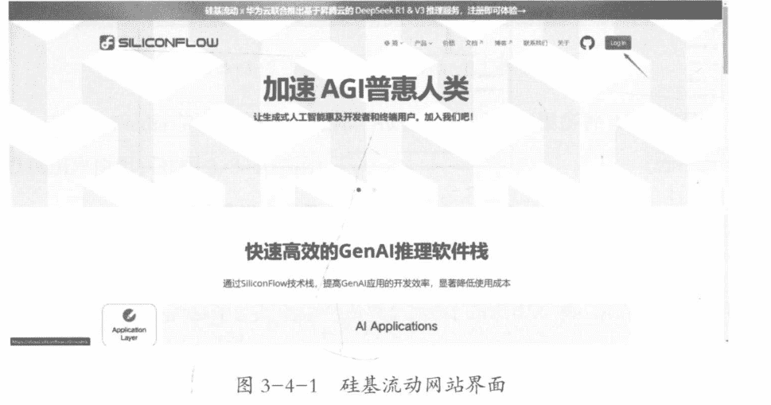

图 3-4-1 硅基流动网站界面

进入 API 密钥页面 https://cloud.siliconflow.cn/account/ak，新建或复制已有密钥，如图 3-4-2 所示。

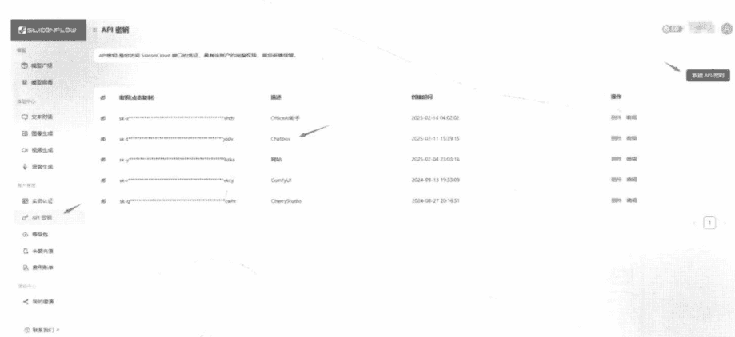

图 3-4-2 硅基流动的 API 密钥页面

建议提前充一点余额，平台默认赠送 14 元，如图 3-4-3 所示。


图 3-4-3 硅基流动的余额充值页面

### 3.4.2 下载 Chatbox

Chatbox AI 是一款多平台 AI 客户端，支持众多模型和 API，可在 Windows、MacOS、Android、iOS、Linux 及网页版使用。相比 Cherry Studio，平台覆盖更广，支持网页和手机，如图 3-4-4 所示。

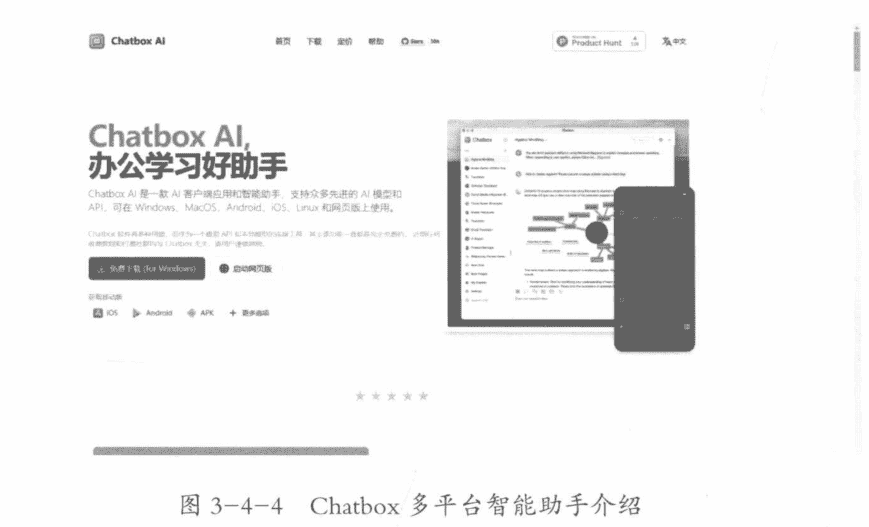

图 3-4-4 Chatbox 多平台智能助手介绍

### 3.4.3 安装 Chatbox

选择对应平台下载安装包，如图 3-4-5 所示。以 Windows 为例，双击运行后点“下一步”完成安装，如图 3-4-6 所示。

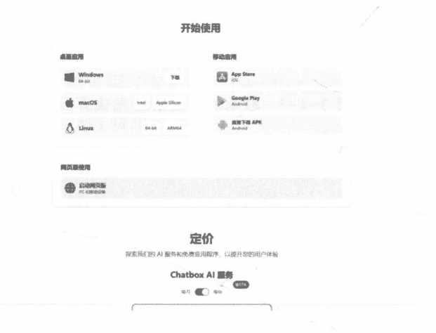

图 3-4-5 Chatbox 多平台安装页面

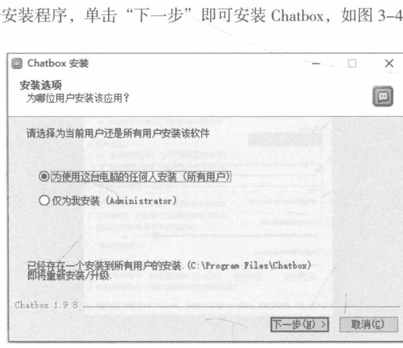

图 3-4-6 Chatbox 的 Windows 安装界面

### 3.4.4 配置 Chatbox

打开 Chatbox，点击左下角“设置”，进入“模型”选项卡，将模型提供方设为硅基流动“siliconflow API”，填入 API 密钥，选择模型“DeepSeek-R1”，保存，如图 3-4-7 所示。

### 3.4.5 在 Chatbox 中使用 DeepSeek

打开 Chatbox，点击左上角“对话”，在输入区输入问题即可，如图 3-4-8 所示。

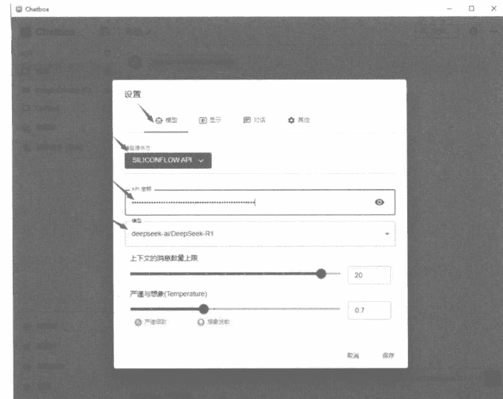

图 3-4-7 修改 Chatbox 配置界面

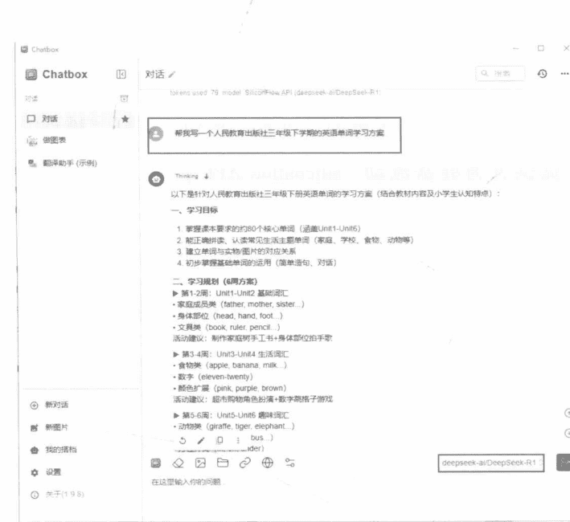

图 3-4-8 在 Chatbox 中使用 DeepSeek 的操作

注意，截至定稿时，DeepSeek-R1 的 API 暂不提供联网搜索功能，见图 3-4-9。

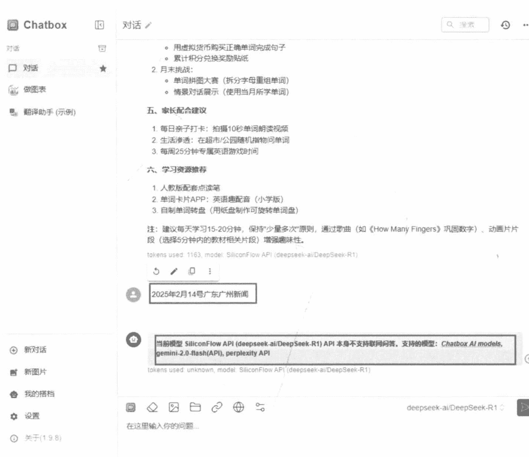

图 3-4-9 DeepSeek-R1 模型的 API 暂时不支持联网搜索

Chatbox 内置的“做图表”智能体可快速生成各类图表，见图 3-4-10，方便数据可视化。

Chatbox 的“翻译助手”智能体可中英文互译，见图 3-4-11。

点击“我的搭档”可挑选不同智能体，见图 3-4-12。

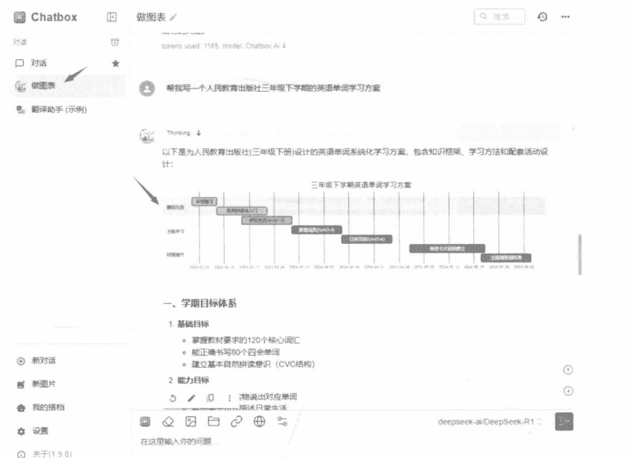

图 3-4-10 Chatbox 生成图表功能展示

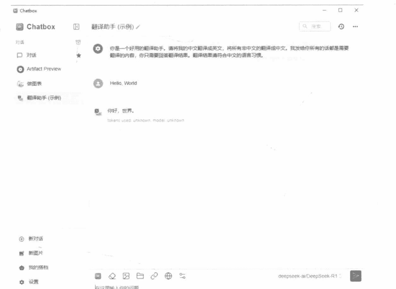

图 3-4-11 Chatbox 翻译助手功能展示

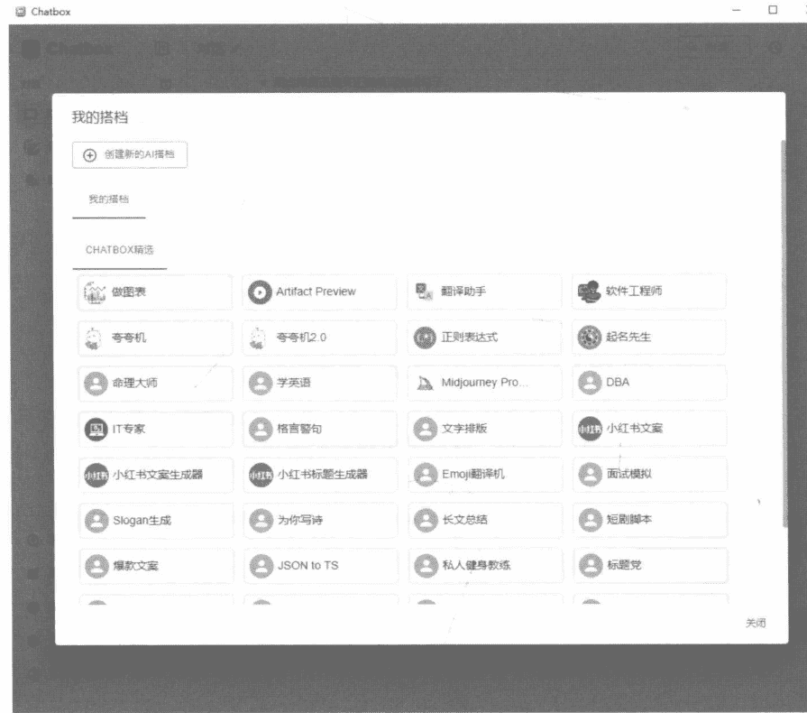

图 3-4-12 Chatbox AI 智能体选择界面

### 3.4.6 获取 DeepSeek 第三方 API 使用情况

为保证稳定，建议定期查看第三方 API 消耗。打开硅基流动官网账单页 https://cloud.siliconflow.cn/bills，点“查看详情”可看到月度消费总额，如图 3-4-13 所示。

点开后能看到各 API 及各大模型的具体消耗，如图 3-4-14 所示。


图 3-4-13 硅基流动账单界面示例

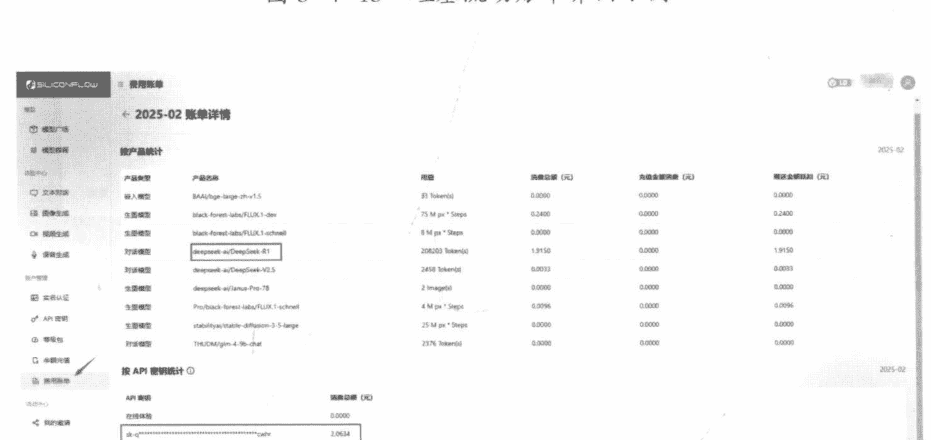

图 3-4-14 不同 API 和模型的消耗详情

### 3.4.7 DeepSeek 第三方 API 汇总

DeepSeek 三方 API 接入时间一览

想快速对照各厂商何时开放 DeepSeek 接口？下面按对外发布的先后顺序梳理了 10 个平台，方便选型参考。

1. 无问苍穹
开放日期：2025 年 1 月 28 日
地址：https://cloud.infini-ai.com/genstudio/model
操作要点：先完成注册并登录账号，进入模型列表后即可申请 DeepSeek-R1 的 API。

2. 派欧算力云
开放日期：2025 年 1 月 28 日
地址：https://ppinfra.com/llm
操作要点：创建账号登录控制台，就能拿到 DeepSeek-R1 的接口凭证。

3. 硅基流动 & 华为云
开放日期：2025 年 2 月 1 日
地址：https://cloud.siliconflow.cn/models
操作要点：登录后打开模型广场，定位 DeepSeek-R1，按提示生成并领取 API。

4. 青椒云
开放日期：2025 年 2 月 2 日
地址：https://www.qingjiaocloud.com/
操作要点：用青椒云客户端新建云桌面，下单 AIGC 标准版，再把系统镜像切换为 DeepSeek 即可使用。

5. 腾讯云
开放日期：2025 年 2 月 2 日
地址：https://cloud.tencent.com/product/hai
操作要点：注册登录后，使用一键部署功能快速拉起 DeepSeek 服务。

6. 云轴科技 ZStack
开放日期：2025 年 2 月 2 日
地址：https://www.zstack.io/
操作要点：登录 AI 模型平台，在模型列表中找到 DeepSeek-R1 后获取对应接口。

7. 百度智能云
开放日期：2025 年 2 月 3 日
地址：https://cloud.baidu.com/product-s/qianfan_modelbuilder
操作要点：登录千帆平台后，直接打开 DeepSeek-R1 模型卡片生成 API。

8. 超算互联网
开放日期：2025 年 2 月 3 日
地址：https://www.scnet.cn/
操作要点：注册登录后进入模型社区，选择 DeepSeek-R1 申请接口。

9. 算力互联
开放日期：2025 年 2 月 3 日
地址：https://console.casdao.com/console
操作要点：登录控制台后在模型区选择 DeepSeek-R1，即可获取使用凭证。

10. 华为昇腾大模型平台
开放日期：2025 年 2 月 4 日
地址：https://www.hiascend.com/software/modelzoo/big-models
操作要点：登录后在模型库中选择 DeepSeek-R1，完成授权即可调用。

### 3.5 本地部署 DeepSeek 蒸馏版模型——LM Studio

#### 3.5.1 准备硬件
DeepSeek-R1 家族提供多种规格，671B 为完整版，其余皆为基于 Llama 与 Qwen 蒸馏而来的轻量化模型，版本分布见图 3-5-1。

DeepSeek-R1

DeepSeek's first-generation of reasoning models with comparable performance to OpenAI-o1, including six dense models distilled from DeepSeek-R1 based on Llama and Qwen.

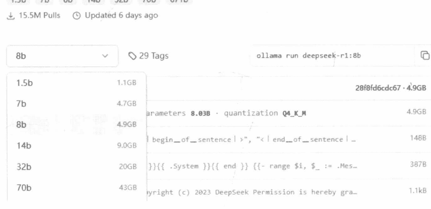
图 3-5-1 DeepSeek-R1 模型版本

1.5B、7B、8B、14B、32B、70B 等本地蒸馏版的配置建议见表 3-5-1。

表 3-5-1 DeepSeek-R1 模型配置及适用场景一览表

| 模型版本 | 模型种类 | 参数量 | 模型大小 | 硬盘需求 | 显卡最低配置 | 建议显存 | 多卡需求 | 内存需求 | 适用场景 |
| :--- | :--- | :--- | :--- | :--- | :--- | :--- | :--- | :--- | :--- |
| DeepSeek-R1-1.5B | 蒸馏版 | 15亿 | 1.1GB | 512GB | GTX 1650 (4GB显存) | 6GB | 无须 | 16GB | 适合简单任务（文本生成），低资源设备部署（树莓派、旧款笔记本，嵌入式系统） |
| DeepSeek-R1-7B | 蒸馏版 | 70亿 | 4.7GB | 512GB | RTX 3070/4060 (8GB显存) | 10GB | 无须 | 16GB | 中等复杂度任务（文本摘要、翻译），轻量级多轮对话系统 |
| DeepSeek-R1-8B | 蒸馏版 | 80亿 | 4.9GB | 512GB | RTX 4070 (12GB显存) | 16GB | 无须 | 24GB | 需更高精度的轻量级任务（代码生成、逻辑推理） |
| DeepSeek-R1-14B | 蒸馏版 | 140亿 | 9GB | 1TB | RTX 4090/A5000 (16GB显存) | 24GB | 可选 | 32GB | 企业级复杂任务（长文本理解与生成、合同分析、报告生成） |
| DeepSeek-R1-32B | 蒸馏版 | 320亿 | 20GB | 1TB | A100 40GB (24GB显存) | 32GB | 可选 | 64GB | 高精度专业领域任务（多模态任务预处理、医疗诊断、法律咨询） |
| DeepSeek-R1-70B | 蒸馏版 | 700亿 | 140GB | 2TB | 2张 A100 80GB/ 4张 RTX 4090 | 140GB | 必需 | 128GB | 科研机构/大型企业（高复杂度生成任务、金融预测、大规模数据分析） |
| DeepSeek-671B | 满血版 | 6710亿 | 404GB | 2TB | 8张 A100/H100 | 512GB | 必需 | 512GB | 国家级/超大规模 AI 研究（气候建模、基因组分析、科研推理）以及通用人工智能（AGI）探索 |

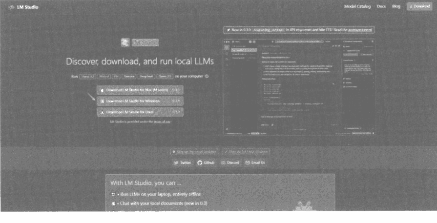
图 3-5-2 LM Studio 的下载界面

#### 3.5.2 下载 LM Studio
用 Chrome、Firefox、Safari 等主流浏览器访问 https://lmstudio.ai/，点按 Download 获取安装包，见图 3-5-2。

#### 3.5.3 安装 LM Studio
双击安装包按提示依次点下一步完成安装，见图 3-5-3。

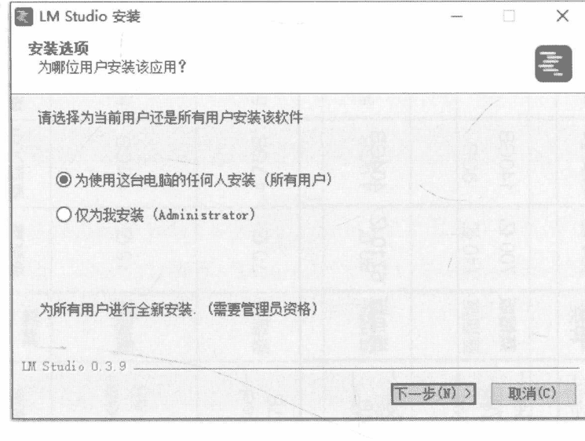
图 3-5-3 LM Studio 的安装界面

#### 3.5.4 使用 LM Studio 下载蒸馏版模型
启动后点按 “Get your first LLM”，即获取首个大模型，见图 3-5-4。


图 3-5-4 LM Studio “获取你的第一个大模型” 界面

进入 App Setting 应用设置，将语言切换为简体中文，并勾选 “Use LM Studio’s Hugging Face Proxy”，见图 3-5-5。

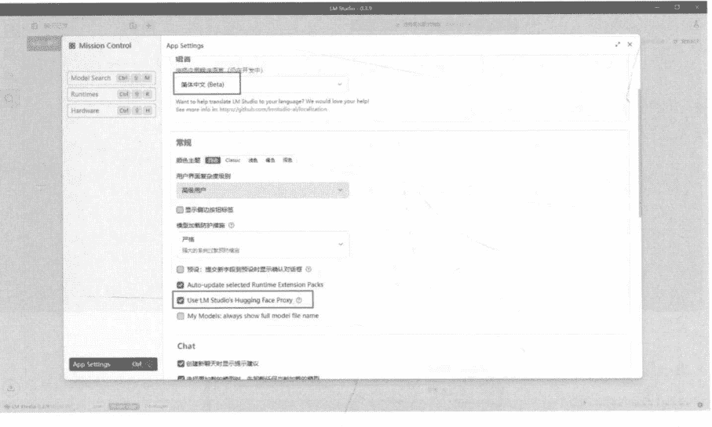
图 3-5-5 语言设置界面

切换到底部 Power User 模式，点左侧放大镜进入发现页，见图 3-5-6。


图 3-5-6 Power User 模式和 Developer 开发模式设置界面

在 Model search 搜索框输入 “deepseek”，初次尝试建议选 1.5B 版本下载更快，需要更强推理可选 7B 或 8B，点 Download 开始拉取，见图 3-5-7。

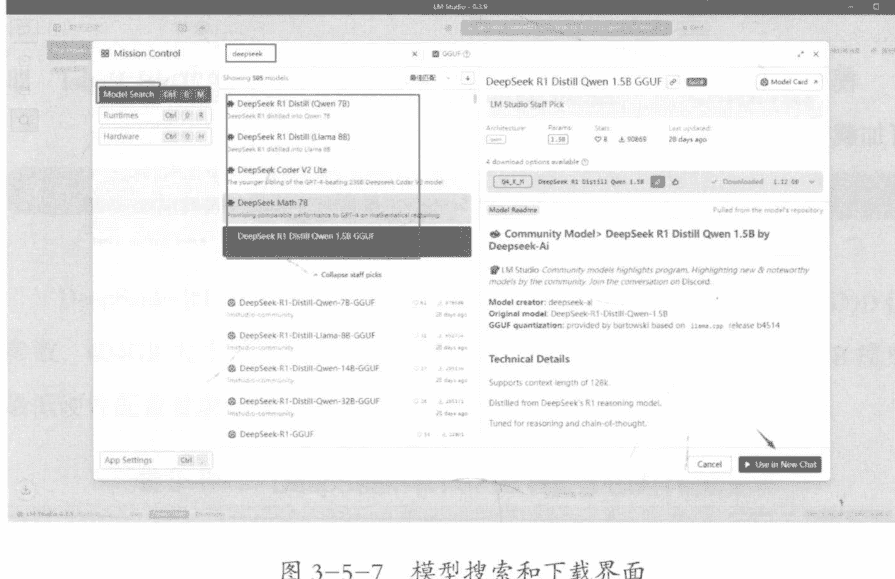
图 3-5-7 模型搜索和下载界面

左侧会弹出下载进度，耐心等待完成，见图 3-5-8。

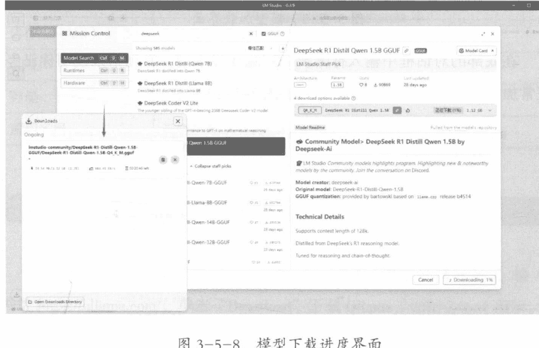
图 3-5-8 模型下载进度界面

#### 3.5.5 LM Studio 使用 DeepSeek 蒸馏版模型
下载完成后右下角提示完成，点击 Load Model 加载，见图 3-5-9。


图 3-5-9 模型加载界面

在底部对话框输入问题或提示词，返回结果即表示蒸馏版模型已正常运行，见图 3-5-10。

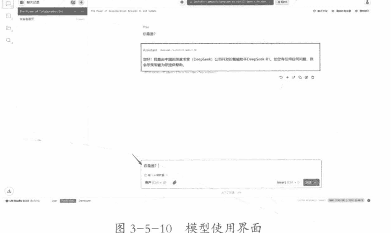
图 3-5-10 模型使用界面

### 3.6 本地部署 DeepSeek 满血版模型——Ollama

#### 3.6.1 准备硬件
671B 满血版约 6710 亿参数，体积约 404GB，对硬件要求较高。最低配置参考表 3-6-1。

表 3-6-1 DeepSeek-R1 671B 模型最低硬件配置要求

| 配置项 | 最低配置 |
|---|---|
| 显存（GPU） | 480GB |
| 显卡型号 | 6~8 张 NVIDIA H100 80GB/A100 80GB |
| 内存（RAM） | 512GB+ DDR5 ECC |
| CPU | 八路 CPU（256 核以上） |
| 存储 | 8TB 企业级 SSD 阵列 |
| 适用场景 | 云端服务、AIaaS 平台 |

#### 3.6.2 下载 Ollama
在浏览器中打开 https://ollama.com/，点击 Download 下载安装包，见图 3-6-1。


图 3-6-1 Ollama 的下载界面

Ollama 是开源的本地模型运行工具，支持跨平台且注重隐私。下面以 Windows 安装包为例，见图 3-6-2。


图 3-6-2 Windows 版本 Ollama 的下载界面

#### 3.6.3 安装 Ollama
双击安装包点 Install 开始安装，见图 3-6-3。

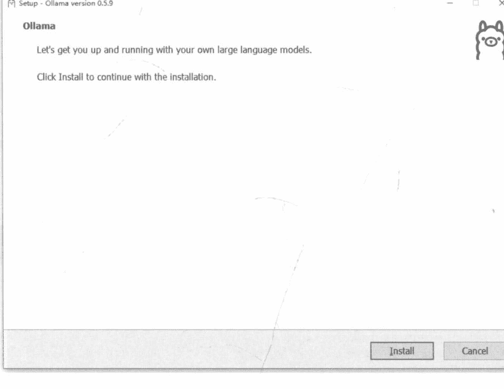
图 3-6-3 Ollama 的安装界面

安装完成后按 Win+R 打开运行窗口，输入 CMD 确认打开命令行，见图 3-6-4。

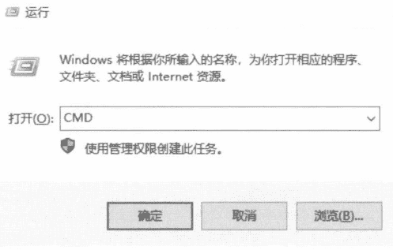
图 3-6-4 运行 CMD 窗口

在命令行输入 `ollama -v` 查看版本，正常输出即表示安装成功，见图 3-6-5。

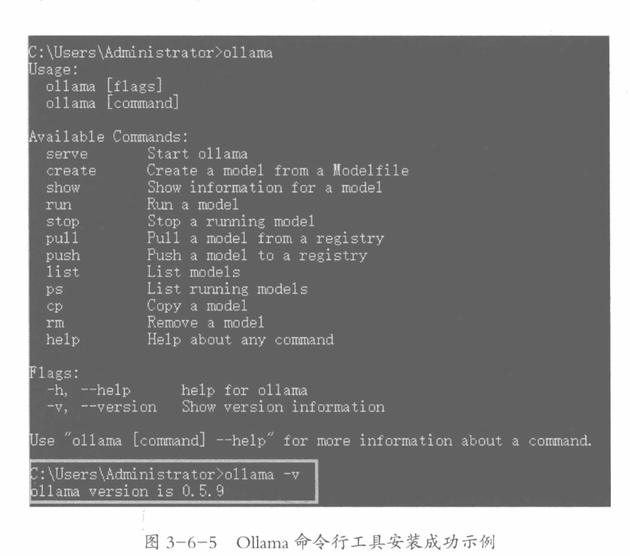

#### 3.6.4 下载 DeepSeek-R1 满血版模型
打开模型页面 https://ollama.com/library/deepseek-r1，见图 3-6-6。

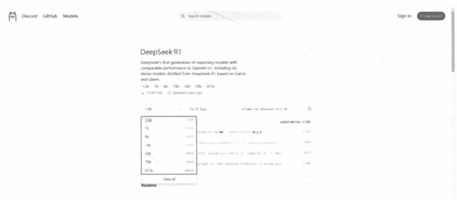
图 3-6-6 DeepSeek-R1 模型下载界面

在命令行执行 `ollama pull deepseek-r1:671b` 开始拉取，务必先确认硬件满足要求，见图 3-6-7。

```
C:\Users\Administrator>ollama pull deepseek-r1:671b
pulling manifest
pulling 9801e7fce27d... 0% | | 70 MB/404 GB 7.4 MB/s 15h0m
```
图 3-6-7 DeepSeek 模型下载命令执行示例

执行 `ollama list` 可查看本地模型列表，出现 deepseek-r1:671b 即代表下载成功，见图 3-6-8。

```
C:\Users\Administrator>ollama list
NAME                ID              SIZE    MODIFIED
deepseek-r1:7b       0a8c26691023    4.7 GB  3 minutes ago
deepseek-r1:1.5b     a42b25d8c10a    1.1 GB  About an hour ago
```
图 3-6-8 模型下载状态查看示例

具备运行条件的用户可执行 `ollama run deepseek-r1:671b` 启动模型。

#### 3.6.5 使用 Ollama 技巧

1. Ollama 命令大全
命令行下 Ollama 提供多项操作，格式为 `ollama <命令>`，见图 3-6-9 和表 3-6-2。

```
C:\Users\Administrator>ollama
Usage:
  ollama [flags]
  ollama [command]

Available Commands:
  serve      Start ollama
  create     Create a model from a Modelfile
  show       Show information for a model
  run        Run a model
  stop       Stop a running model
  pull       Pull a model from a registry
  push       Push a model to a registry
  list       List models
  ps         List running models
  cp         Copy a model
  rm         Remove a model
  help       Help about any command

Flags:
  -h, --help      help for ollama
  -v, --version   Show version information
```
图 3-6-9 Ollama 命令行工具使用说明

表 3-6-2 Ollama 命令参考表

| 类型 | 命令 / 参数 | 功能描述 | 使用范例 |
| :--- | :--- | :--- | :--- |
| 基础类命令 | ollama create <名称> | 基于 Modelfile 创建自定义模型 | ollama create mymodel -f modelfile |
| 基础类命令 | ollama show <模型名> | 显示模型的详细信息（参数、系统提示等） | ollama show deepseek-r1:7b |
| 基础类命令 | ollama run <模型名> | 运行指定模型并进入交互模式 | ollama run Gemma3:12b |
|  | ollama pull <模型名> | 下载模型（支持 FP16 模型或量化模型） | ollama pull deepseek-r1:7b |
|  | ollama push <模型名> | 将自定义模型推送至仓库（需私有仓库权限） | ollama push mymodel |
|  | ollama list | 列出本地已下载的模型 | ollama list |
|  | ollama cp <源模型名> <目标模型名> | 复制一个模型并重命名 | ollama cp llama2 myllama2 |
|  | ollama rm <模型名> | 删除本地模型 | ollama rm llama2 |
| 服务管理类命令 | ollama serve | 启动 API 服务（默认端口 11434） | ollama serve |
|  | ollama stop | 停止 API 服务或当前运行的模型 | ollama stop |
|  | ollama ps | 查看当前运行的 Ollama 进程和模型信息 | ollama ps |
| 全局参数类命令 | ollama -v 或 --version | 查看 Ollama 版本 | ollama -v |

Ollama 命令速查

| | ollama -h 或 --help | 查看命令帮助 | ollama -h |

#### 2. Ollama 修改模型默认位置

想减轻系统盘压力，可以把 Ollama 的模型库挪到其他盘位，比如从 C 盘搬到 D 盘，常见做法有两种。

第一种是借用环境变量改路径。先在目标盘新建文件夹，例如 D:\ollama\models。随后在 Windows 10/11 中右键此电脑打开属性，进入高级系统设置，点击环境变量，在用户变量或系统变量里新建 OLLAMA_MODELS，数值填 D:\ollama\models，保存后重启生效。之后执行 ollama pull deepseek-r1:8b，下载就会自动落到新目录，如图 3-6-10 所示。

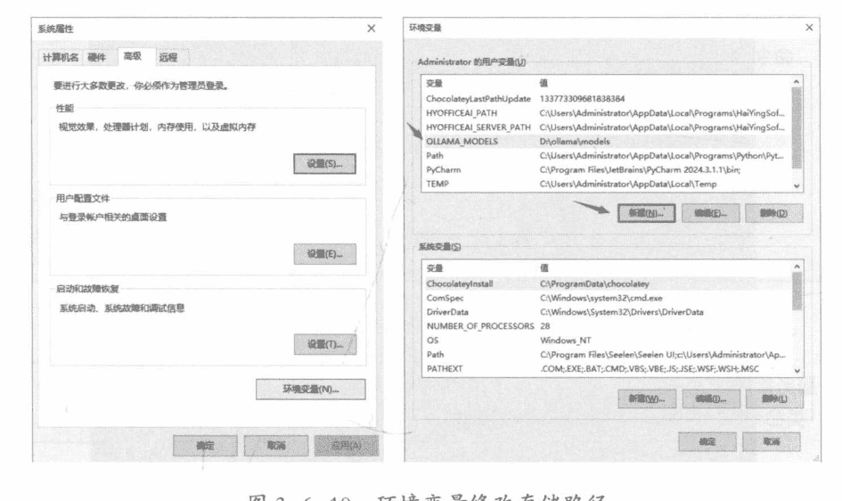

图 3-6-10 环境变量修改存储路径

第二种是用符号链接把默认目录指向新位置。先把原目录 C:\Users\<用户名>\.ollama 整体剪切到 D:\ollama，原位置清空。随后以管理员身份打开命令提示符，执行 mklink /J ‘C:\Users\<用户名>\.ollama’ ‘D:\ollama’，注意把用户名换成自己的。完成后再次运行 ollama pull deepseek-r1:8b，数据会写进新盘，如图 3-6-11 所示。

```
C:\Users\Administrator>mklink /j "C:\Users\administrator\.ollama" "D:\ollama"
为 C:\Users\administrator\.ollama <<===>> D:\ollama 创建的联接
```

图 3-6-11 使用符号链接迁移默认文件夹

### 3.6.6 配置 Cherry Studio

安装好 Cherry Studio 后打开程序，点击左下角设置，左侧选择模型服务，将服务切换为 Ollama，点击右上角绿色启动，API Key 留空，API 地址保持默认，点击检查确认连通，如图 3-6-12 所示。

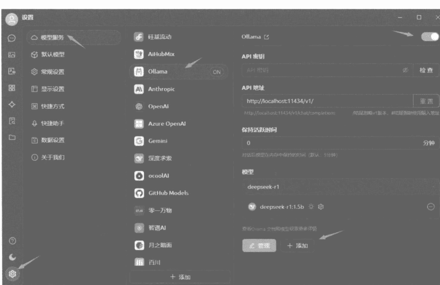

图 3-6-12 修改 Cherry Studio 配置页面

提醒一下，DeepSeek 完整版需要手动录入，只需填模型 ID，分组和名称会自动识别，如图 3-6-13 所示。

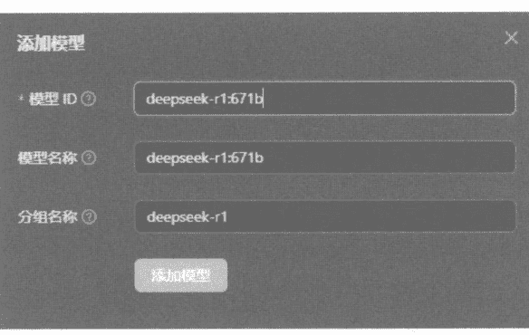

图 3-6-13 添加模型界面

部署完毕后进入 API Key 页面点检查，校验模型选择为 deepseek-r1:671b，如图 3-6-14 所示。

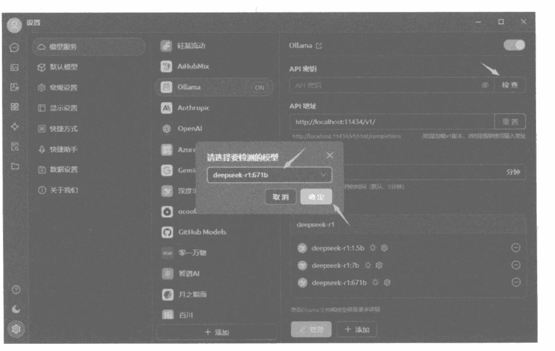

图 3-6-14 检查模型界面

受本地算力限制，演示环境会提示找不到模型。硬件条件充足的用户可以尝试部署 DeepSeek 满血版，如图 3-6-15 所示。

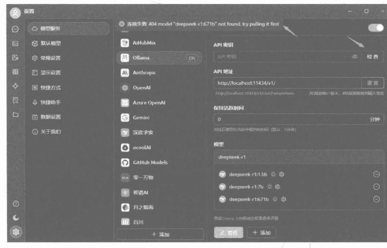

图 3-6-15 部署 DeepSeek 满血版模型界面

### 3.6.7 Cherry Studio 使用 DeepSeek 满血版模型

打开 Cherry Studio 后点左上角助手，选择默认助手，在输入区写问题或提示词即可调用本地的 DeepSeek，如图 3-6-16 所示。


图 3-6-16 Cherry Studio 使用本地部署 DeepSeek 满血版模型的操作

顶部可切换本地模型，自由选择不同参数量的蒸馏版或完整版，如图 3-6-17 所示。


图 3-6-17 切换不同参数量的 DeepSeek 模型

# 第4章 进阶实战 DeepSeek：提示词宝典

## 4.1 DeepSeek 提示词核心逻辑与基础原则

生成式 AI 正在改变人机协作的方式，提示词作为沟通桥梁愈发关键。DeepSeek 在理解与生成上表现突出，已在科研、教学、商业等场景落地。如何用更精准的指令释放潜力，是多数用户需要突破的点。本章围绕设计思路，结合案例与进阶技巧，帮助读者从普通使用者成长为熟练驾驭者。

提示词的本质是给模型传递明确指令与背景，设计应遵循目标清晰与结构化两项原则。以 DeepSeek 举例，需先判断任务类别，如文本创作、数据分析、代码编写，再据此调整结构。开放式写作需要背景与风格限定，逻辑推理类任务要强调步骤拆解与校验机制，代码类任务则要详述需求、约束、编程语言及部署平台等细节。

以“学术论文摘要生成”为例，简单写“请生成一篇关于量子计算的摘要”，结果往往空泛。若改写为“基于 2020 年后发表的文献，总结量子计算在密码学领域的最新突破，重点对比量子密钥分发与后量子加密算法的优劣，语言风格需符合《自然》期刊的学术规范”，输出会更专业深入，如图 4-1-1 所示。


来来

02/16 02:50

请生成一篇关于量子计算的摘要


来来

02/16 02:58

基于2020年后发表的文献，总结量子计算在密码学领域的最新突破，重点对比量子密钥分发与后量子加密算法的优劣，语言风格需符合《自然》期刊的学术规范

图 4-1-1 DeepSeek 学术类提示词

下面以高中生视角理解“暗物质”为例。提示词可写为：请以科普作家的视角，为高中生撰写一篇关于暗物质探测技术的文章。要求如下，从历史背景切入，简述1933年兹维基的发现；解释引力透镜效应的基本原理；对比欧洲核子研究中心与中国锦屏实验室的技术路径差异；语言生动有趣，每段插入一个生活化类比，如图4-1-2所示。该提示通过角色、受众、结构、语言风格四层约束，使模型输出更符合教学场景。


来来

02/16 03:04

请以科普作家的视角，为高中生撰写一篇关于暗物质探测技术的文章。要求：

从历史背景切入，简述1933年兹维基的发现；

解释引力透镜效应的基本原理；

对比欧洲核子研究中心与中国锦屏实验室的技术路径差异；

语言生动有趣，每段插入一个生活化类比。

图 4-1-2 DeepSeek 科普类提示词

## 4.2 DeepSeek 复杂场景下提示词进阶策略

多轮对话、跨模态或需要长期记忆的场景中，可引入思维链与上下文锚点。以医疗辅助诊断为例，分步提问提升推理质量：“第一步，根据患者主诉（胸痛、呼吸困难）列出可能的疾病范围；第二步，结合心电图和CT检测特征缩小鉴别诊断；第三步，推荐对应的实验室检查方案。”分步引导能显著提高结论可靠性，如图4-2-1所示。


图4-2-1 DeepSeek 医疗鉴定类提示词

跨模态任务需明确输入输出对应关系。例如图像描述生成，可提示：“分析附件中的胸部X光片，用三段式结构输出诊断报告：第一段描述影像特征（如渗出影位置、肺纹理变化），第二段列举三种可能的临床诊断，第三段提出进一步检查建议（如CT扫描、痰培养）。”该写法通过格式约束与内容清单降低歧义，如图4-2-2所示。


图4-2-2 DeepSeek 医疗类详细提示词

若以编剧视角构思剧本大纲，可写：你是一位资深编剧，请根据以下要素创作电影剧本大纲，核心冲突：火星殖民背景下，生态学家与矿业公司的资源争夺；关键角色：女科学家（理想主义）、公司CEO（实用主义）、AI机器人（道德困境）；结构要求：三幕式结构，第二幕结尾出现重大技术故障危机；风格参考：《星际穿越》的硬科幻质感+《黑镜》的社会批判色彩；需在剧本中嵌入关于技术伦理的隐喻性对话，并在最终幕设计开放式结局。该提示通过冲突、人物、结构、风格、主题五维锚定，确保输出具备戏剧张力与思想深度。

## 4.3 行业应用场景的定制化提示词设计

不同行业对输出的要求差异明显，需要注入领域知识与术语规范。

教育场景示例：“设计一套高中数学函数专题的差异化练习题库，包含基础题（反比例函数图像绘制）、提高题（复合函数单调性证明）与拓展题（经济学生产函数建模应用），每题需附解题思路与易错点提示。”如图 4-3-1 所示。


图 4-3-1 DeepSeek 数学题提示词

金融场景更强调数据关联与合规：“分析近五年沪深 300 指数与美联储利率决议的关联性，使用 ARIMA 模型预测未来两季度走势，输出结论需包含置信区间说明，并标注‘本分析不构成投资建议’的免责声明。”如图 4-3-2 所示。

图 4-3-2 DeepSeek 在金融领域中的提示词

法律场景示例：作为智能法律顾问，请完成以下任务，对比《民法典》第一千一百六十五条与《消费者权益保护法》第五十五条关于惩罚性赔偿的适用条件；结合 2023 年最高人民法院第 23 号指导案例，说明电商平台“秒杀活动标价错误”案件中的过错认定规则；用表格形式整理北京、上海、广州三地法院近三年类似案件的赔偿金额中位数；最后给出商家预防法律风险的 5 条实操建议，如图 4-3-3 所示。

作为智能法律顾问，请完成以下任务，对比《民法典》第1165条与《消费者权益保护法》第55条关于惩罚性赔偿的适用条件；结合2023年最高人民法院第23号指导案例，说明电商平台“秒杀活动标价错误”案件中的过错认定规则；用表格形式整理北京、上海、广州三地法院近三年类似案件的赔偿金额中位数；最后给出商家预防法律风险的5条实操建议。

图 4-3-3 DeepSeek 在法律中的提示词

## 4.4 面向未来的提示词工程创新

随着多模态大模型与具身智能推进，提示词正向全感官交互演进。工业质检场景可设计：“同步分析上传的发动机异响音频（频率范围 1500 ~ 2000Hz）、热成像视频（重点关注第三缸体温度变化）及历史维修记录，输出故障概率评估与零件更换优先级列表。”

另一方向是动态提示词优化，通过实时反馈自动调整指令。例如心理咨询场景，系统检测到用户提及“失眠”频次上升时，自动嵌入 PHQ-9 抑郁量表问题，并将语言风格调整为更具支持性。

DeepSeek 提示词示例：构建一个城市交通治理的数字孪生系统，要求：整合实时交通流量数据、地铁客流热力图及气象局降水预报；建立突发拥堵模拟模型（如暴雨导致三个主干道瘫痪）；生成包含绕行路线优化、公交班次动态调整、应急响应等级的处置方案；输出可视化驾驶舱界面，用颜色梯度标注区域风险等级。

提示词工程不是技巧堆砌，而是领域知识、认知心理学与计算机科学的交叉。随着 DeepSeek 等模型进化，用户需保持协同进化思维，既理解技术边界，也持续创新交互方式。科学的提示设计既能挖掘当前能力，也能指引未来探索。

# 第5章 AI 办公文档：DeepSeek 实战攻略

## 5.1 PPT 一键制作（DeepSeek+Kimi）

### 5.1.1 新手必学：快速完成一个演示文稿（PPT）

#### 1. 辅助软件准备

PPT 是职场沟通的核心载体，传统制作耗时且易受时间压力影响。生成式 AI 可自动化生成内容、排版与配色，大幅压缩制作周期，并按主题、风格与受众智能推荐模板，提升专业度与视觉效果。

联动 Kimi 与 DeepSeek 前，需先完成 Kimi 账号注册，支持 App 或网页版，通过手机号验证码或微信扫码登录即可。注册完成后即可进入协同流程。

#### 2. 实战操作流程

（1）先在 DeepSeek 中构思 PPT 主题描述的提示词。

```
[用途]科技公司年终总结 PPT 文案
[页数]12 页以内
[内容]销售数据/团队成长/明年目标为主，可以自由发挥添加
[风格]蓝色科技风，要有动态图表
```

（2）进入 Cherry Studio，选择任意 DeepSeek 使用方式，本文以硅基流动第三方 API 为例，输入提示词，模型会输出完整的 PPT 文案，如图 5-1-1 所示。


图 5-1-1 利用 DeepSeek 第三方输入 PPT 提示词

（3）在 Cherry Studio 中复制生成的文案，如图 5-1-2 所示。


图 5-1-2 Cherry Studio 中复制 DeepSeek 生成的 PPT 文案

（4）浏览器打开 https://kimi.moonshot.cn/，左侧选择 Kimi+，进入官方推荐的“PPT 助手”，如图 5-1-3 所示。


图 5-1-3 打开 Kimi 中 PPT 助手

（5）将文案粘贴到“PPT 助手”，如图 5-1-4 所示。


图 5-1-4 粘贴文案至 PPT 助手

（6）点击一键生成 PPT，如图 5-1-5 所示。


图 5-1-5 选择一键生成 PPT 操作

（7）在弹窗中选择模板场景、设计风格与主题色，例如深蓝色模板，确认后生成 PPT，如图 5-1-6 所示。


图 5-1-6 选择模板并生成 PPT

（8）生成完成后进入预览页，提示制作完成，点击编辑按钮进入可视化修改，如图 5-1-7 所示。


图 5-1-7 编辑 PPT 页面

（9）编辑界面分为四区：右上角为保存、放映、拼图、下载；左侧为大纲、模板替换、插入元素；中间为页面选择；右侧为文字、形状、背景、图片、表格、图表设置，如图 5-1-8 所示。若无需修改可直接下载。


图 5-1-8 PPT 编辑界面的四个区域

### 5.1.2 注意事项：雷区千万别踩

1. 风险提醒
使用 AIGC 制作 PPT 时，避免插入未获授权的网络图片，PPT 助手产出的图片均为 AI 生成；引用数据需标注来源。

2. 数据安全

PPT 安全加固与 AI 提效实操手册

在调用相关功能时，建议同步建立三层防护体系。首层是文件加密，涉及敏感资料的 PPT 上传时必须单独设置访问密码；次层是云端备份，可设定每日固定时段将当天完成的 PPT 自动同步至企业网盘；末层是痕迹管控，主动关闭历史记录保存功能以降低不必要的留存。

3. 自检清单

PPT 定稿后请逐项核对：所有超链接能否正常点击；配色对比度是否清晰易读；是否已准备应急方案，包含 PDF 备份与 U 盘拷贝；演示现场电脑的字体是否齐全，建议提前开启字体嵌入。若动画播放卡顿，可执行性能优化操作；若文档需保密，记得补上密码保护。

### 5.1.3 新手任务

- （1）借助 DeepSeek 起草一份 5 页的个人自我介绍 PPT 文案。
- （2）使用 Kimi 的 PPT 助手挑选合适的模板，完成一份演示文稿的制作。
- （3）任选至少 2 张 PPT 页面，各执行 3 项编辑操作并记录改动前后的差异。

## 5.2 办公文档速成（DeepSeek+ 海鹦 OfficeAI 助手）

### 5.2.1 新手必学：快速撰写文档

是否常被日报、周报、月报以及各类工作材料折磨得焦虑不已？到了汇报节点，面对零散的数据和待梳理的要点，脑中一片空白，思绪仿佛被雾霾裹住，疲惫感不断累积。最消耗人的是反复调整格式、统计数据、排版 PPT 等琐碎环节。熬夜赶出的文档质量仍不理想，这种心力交瘁的体验想必并不陌生。

生成式智能的加入从根本上改变了这一困境。它能够智能整理数据、自动生成汇报初稿，按需完成排版设计，甚至依据工作目标推荐呈现方式。再也不用逐字输入、反复改色改版。依托 DeepSeek 的强处理能力与海鹦 OfficeAI 助手的无缝衔接，反复写文档的压力得以释放。只需给出关键词，模型就能自动搭建报告框架、整理数据、输出精准分析，并同步优化排版与图表，节省大量时间精力。无论是日常总结、周度汇报还是大型项目材料，组合使用可在数分钟内产出初稿，并结合上下文润色表达，使文档更具逻辑与专业度。

#### 1. 辅助软件准备

先在浏览器打开 https://www.office-ai.cn/ 下载 OfficeAI 助手。完成海鹦 OfficeAI 助手的安装，并确认电脑已安装 Microsoft Office。启动 Word 后，点击 OfficeAI 选项卡，通过微信完成登录。再进入 OfficeAI 选项卡下的设置，选择大模型设置，开启本地模型 /api-key，模型平台选硅基流动，填入硅基流动的 API 密钥，模型名称选择 DeepSeek-R1 模型，如图 5-2-1 所示。


#### 2. 与 AI 对话

（1）配置完成后，可在右侧直接使用聊天功能，与 DeepSeek 对话完成日常办公文档的撰写。笔者输入的提示词为：你是一位职业经理人，擅长资源规划和目标设定，请根据要求制订年度工作计划。计划重点：市场拓展、产品创新、团队建设；关键目标：提升市场占有率 10%、发布 3 款新产品、提高团队满意度；要求：确保计划既具挑战性又可落地，明确各阶段的具体目标和预期成果；计划书需详细写明总体目标制定背景、关键目标、具体措施、实施步骤、总结与反馈。DeepSeek 有时不会一次性输出完整内容，此时在对话框输入继续即可。文字生成完毕后，单击导出到左侧，文章会自动同步进 Word 中，如图 5-2-2 和图 5-2-3 所示。


（2）Word 左侧已同步 DeepSeek 生成的文档。笔者尝试让 DeepSeek 直接控制和修改文档，经验证文档无法被 DeepSeek 直接编辑，需人工手动修改，如图 5-2-4 所示。


#### 3. 使用 AI 写作

（1）用户可单击 OfficeAI 选项卡选择文案生成，或切换海鹦 OfficeAI 助手右侧面板的“创作”标签，进入更专业的写作模式。这正是海鹦 OfficeAI 助手的核心能力。用户可在职场、媒体、教育、广告营销四大领域中挑选所需文档类型，OfficeAI 支持创作多种文体。无论是市场营销文案、技术文档还是内部沟通材料，该插件都能胜任，并依据个性化需求提升文案质量，确保输出符合预期，如图 5-2-5 所示。


（2）作者以培训心得体会为例进行测试，选择职场类的“培训心得体会”，会进入设置界面。按自身需求调整参数后单击确定，即可自动生成培训心得体会，如图 5-2-6 和图 5-2-7 所示。


图 5-2-6 OfficeAI 助手生成培训心得体会功能演示（例 1）

图 5-2-7 OfficeAI 助手生成培训心得体会功能演示（例 2）

（3）DeepSeek 开始思考文档内容，经过数秒的处理后生成培训心得体会，此时可单击复制按钮，将内容复制到 Word 文档中，如图 5-2-8 所示。

### 5.2.2 专业技巧：文档 AI 自动优化

#### 1. 使用 AI 润色

单击顶部润色按钮，AI 会依据你的需求和喜好对文章进行改善和优化，提升语言表达、逻辑连贯性和流畅度，使成文更贴合个人风格和预期，如图 5-2-9 所示。


#### 2. 使用 AI 续写

单击顶部文章续写按钮，AI 能够理解文本语境，在需要扩展内容时提供新思路、补充资料或挖掘更深层次观点，从而丰富文档。这项功能让撰写更高效全面，帮助更快完成内容的拓展与完善，如图 5-2-10 所示。


#### 3. 使用 AI 校对

AI 校对功能可有效避免拼音输入法联想导致的错别字，比 Word 自带拼写检查更精准，也能检查 AI 生成文章中的拼写问题，如图 5-2-11 所示。

## 5.3 思维导图专家（DeepSeek+Xmind）

信息过载的当下，思维导图成为整合知识与激发创意的有效工具。DeepSeek 作为人工智能思维引擎，与专业导图软件 Xmind 深度结合，实现了从碎片化思考到结构化输出的闭环。技术协同不仅革新了传统脑图制作流程，还通过智能交互显著提升思维质量。以下系统解析协作机制与进阶方法。

### 5.3.1 新手必学：快速创建思维导图

1. 辅助软件准备

安装好 Xmind 等思维导图软件，准备工作即完成，如图 5-3-1 所示。


2. 实战操作流程

初级用户的核心诉求是快速搭建逻辑清晰的思维框架，避免陷入形式化排版的低效。Xmind 的基础模块与 DeepSeek 的语义解析结合，可将自然语言指令直接转化为可视化结构。

（1）在导图创建阶段，可通过 DeepSeek 生成主题框架。输入提示词“为《人类简史》一书设计思维导图，最终输出 markdown 格式”。DeepSeek 会输出思维导图结构的 markdown 代码，单击图示复制按钮复制代码，如图 5-3-2 所示。


（2）新建一个文本文档，粘贴 DeepSeek 生成的 markdown 代码，并将文件格式修改为 md 文件，如图 5-3-3 所示。


图 5-3-3 修改文件格式为 md 文件

（3）打开 Xmind 软件，选择新建导图，如图 5-3-4 所示。


图 5-3-4 在 Xmind 中新建导图演示

（4）选择模板，思维导图；单击创建按钮，如图 5-3-5 所示。


图 5-3-5 选择思维导图模板并单击创建

（5）打开 Xmind 软件思维导图界面，单击左上角图标，选择文件，选择导入，选择 markdown，选择刚才的 md 文件，如图 5-3-6 所示。


图 5-3-6 导入 md 文件操作

（6）Xmind 软件成功识别思维导图内容，如图 5-3-7 所示。


图 5-3-7 Xmind 软件自动生成导图

### 5.3.2 高手进阶：用图片创建一个思维导图

若手头有一张思维导图图片，希望用 Xmind 复现并可编辑，可这样操作：先打开 DeepSeek，上传思维导图图片。DeepSeek 的 API 不支持图片分析，笔者打开 DeepSeek 官网，上传图片并输入提示词：这张图片是个思维导图，分析图片上的文字，输出为 Markdown 格式，以便我可以复现这个思维导图，如图 5-3-8 所示。


图 5-3-8 DeepSeek 思维导图图片转 Markdown

复制 Markdown 格式，创建 MD 文件，如图 5-3-9 所示。


图 5-3-9 创建 MD 文件

后续步骤与上章相同，即可创建好思维导图，如图 5-3-10 所示。

### 5.3.3 新手任务

- 1. 制作个人学习计划思维导图。
- 2. 分析一本书的核心内容。
- 3. 设计一个项目的流程图。
- 4. 总结一次会议的讨论要点。
- 5. 规划一次旅行计划。

# 第5章 AI办公文档：DeepSeek实战攻略


# 第6章 AI写作辅助：DeepSeek实战速成

## 6.1 周报复盘高手

用 DeepSeek 写周报，相当于请了一位会主动理清思路的智能搭档。最大价值在于打破对着空白文档发呆的困境——无需学习专业指令，也不用套用固定格式，用日常口语沟通即可。微信里的项目讨论、邮件里的进展记录，甚至口头汇报的要点录音，交给它就能自动筛选出关键成果、瓶颈问题与下阶段计划，像拼图一样把零散信息整理成清晰的汇报脉络。即便只说“这周主攻新版本测试，验收卡在兼容性问题”，它也能梳理出完整的技术攻关路径，并提示所需协调资源。

智能适配各类企业模板也极大节省时间。互联网公司的数据驱动周报、设计团队的创意进度报告、销售部门的业绩追踪表，无需手动改版。面对多张数据图表的复杂报告，它能自动提炼核心结论转为文字；涉及专项任务时，又会像思维导图般生成完整分析框架。对行业术语的理解也十分到位，无论是软件开发的“敏捷迭代”还是营销的“用户画像”，都能精准把握并场景化运用。

更难得的是持续个性化的体验。初期可能需要少量风格调整，三四周后生成的内容就能自动贴合个人表达习惯，甚至预判团队关注的汇报要点。这种既懂业务又懂你的能力，让写周报变成高效复盘，省下的时间可投入真正的业务突破。

### 6.1.1 强大的自然语言理解能力

在众多 AI 工具中，职场人常感选择困难：ChatGPT 像万能学霸，Kimi 擅长解析复杂文件，Claude 更像策略军师。而 DeepSeek 走的是更亲民路线——像随时待命的职场助手，无需复杂操作即可高效完成任务。

其核心优势是“听得懂人话”。其它 AI 往往需要像指挥机器人般给出明确指令，例如“作为项目经理，请用 STAR 法则总结本周工作，需包含 3 个指标……”，DeepSeek 却能理解“这周搞定了客户，但测试要延期”这类日常对话。其能力源于对大量职场真实沟通的训练，就像在公司潜伏多年的老员工，听得懂“过会”“打样”等职场暗语。

真实案例：跨境电商小王用 AI 写招商周报，普通工具需要反复解释 GMV、ROI 等专业术语。换成 DeepSeek 后，小王只需说“这周新增 12 个商品，但两家商户结款谈不拢”，系统自动补充商品分类、历史合作数据，并生成“付款谈判指南”。背后是 300 多个预设行业知识模块在支撑，相当于为 AI 装好了各部门工作手册。

DeepSeek 的中文处理能力尤为突出。处理“把政府公文改口语化”这类需求时，其他工具常显生硬，而 DeepSeek 不仅转换表达，还能智能识别“妥否，请批示”等标准格式要求。某单位测试显示，用 DeepSeek 撰写的会议纪要一次性通过率从 37% 提升到 89%。

这并非技术的优胜劣汰，如同螺丝刀与瑞士军刀各有用途。DeepSeek 聚焦职场真实场景：当你在茶水间边喝咖啡构思周报结构时，它已把语音备忘整理成 PPT 大纲；当你犹豫如何汇报项目延期时，它已找好同类案例的处理方案。这种无缝衔接工作场景的能力，正重新定义智能办公。

### 6.1.2 实战演示

DeepSeek 最大的优势是像资深秘书一样轻松理解需求。即便从未接触人工智能，也无需掌握复杂指令框架，用日常说话方式沟通即可获得有效帮助——如同给新员工布置任务般简单。

使用时把握三点：先说明身份，如市场主管/人力资源专员；其次描述需求背景，如“正在准备三季度产品发布会”；最后明确具体任务，如“请整理会议重点并生成执行清单”。

面对客户提案、团队会议记录或复杂报表，DeepSeek 不仅能准确抓取核心信息，还能自动归纳逻辑框架，输出可直接汇报决策的文本。整个过程无需专业培训，用平时对接同事的方式即可完成，特别适合需要快速处理文件但无暇钻研 AI 技术的职场人士，让公文写作、信息整理等事务性工作更简单高效。

下面做一个简单示例，告知 DeepSeek 我的岗位、本周总结数据及字数要求。提示词示例为“我是一名 Java 开发师，目前正在做一个商城类的项目，这周主要开发完成了微信支付模块、支付宝支付模块，修改了 8 个地方的小漏洞，请帮我写一篇周报，大约 200 字”，如图 6-1-1 所示。


DeepSeek 的回复如下，分段阐述了本周工作重点及下周计划。可以看到只需简单描述工作内容，无需太多技巧。只要告诉 DeepSeek 我是谁、我做了什么、我需要什么即可，如图 6-1-2 所示。

> > 已深度思考（用时 55.6 秒）

# 周报

【202X年XX月XX日 - 202X年XX月XX日】

本周工作重点围绕支付模块开发及系统优化展开，具体进展如下：

- 1. 核心功能开发

  - ✓ 完成微信支付模块开发

    - 对接微信支付SDK实现扫码支付、JSAPI支付功能

    - 优化支付状态回调处理，设计异步通知失败自动重试机制

  - ✓ 完成支付宝支付模块开发

    - 整合APP支付和电脑网站支付双渠道

    - 开发加密签名字段工具类，配合财务部门完成交易对账测试

- 2. 系统优化与BUG修复

  - ▶ 处理支付模块关联性问题

    - 修复订单超时未关闭仍可支付状态同步异常（#BUG0237）

    - 解决优惠券使用与支付金额校验冲突问题（#BUG0241）

  - ▶ 优化用户体验

    - 修正移动端收银台样式兼容性问题（#BUG0245）

    - 完善支付失败场景的错误提示国际化配置（#BUG0248）

    - 共完成8项缺陷修复，涉及支付流程、数据校验、前端展示等方面

图 6-1-2 DeepSeek 深度思考过程

注意：以上周报未给出具体数据，DeepSeek 会自动检索互联网数据生成周报。

## 6.2 公文智能写作

公文润色：严谨是不可逾越的底线

用智能模型润色政务文书，首要原则是严谨可信。公文是政策传达与事务部署的正式载体，其规范程度直接影响执行力和机关公信力。模型能在短时间内改善句式、归纳重点，但因其算法的机械性，有三处必须人工把关：第一，逻辑的严密性，行文要形成完整的因果链，防止政策解读产生歧义；第二，术语的规范性，专业称谓、职务名称须严格对照单位现行标准，避免信息错位；第三，数据的可追溯性，涉及统计口径、百分比、条款编号的改动必须回溯核查，避免误差扩散。实际应用中，常因训练语料滞后导致条文编号出错，或因表述模糊留下责任真空。因此改写公文应当建立“智能辅助+人工复核”的双层校验机制，既利用技术提效，也借助人工注入政策判断、专业认知与人文考量，使文书既适配数字时代效率，又守住政务文本的权威底线。

### 实战演练
下面以项目实施类模板为例说明操作思路。笔者让 DeepSeek 产出一份可复用的实施方案框架，保持普适性，采用自然语言对话下单，把需求描述得越具体越好。

- （1）示例指令：“帮我输出一份《（项目名称，含背景说明与目标概览）的实施方案》模板。需要包含领导小组，组长 1 名、副组长 2 名并写明职责；任务分解表，要列出具体任务、责任人姓名及所属部门、完成时限；整体进度采用倒排工期，精确到周；保障措施，经费预算用 X 万元标注，并说明资金来源和使用计划。”

- （2）稍作等待后，模型已生成模板，涵盖上述要素。“任务分解表”与“保障措施”分别以表格呈现。复制到本地文档后即可填充具体内容，如图 6-2-1 和图 6-2-2 所示。

> > 已深度思考（用时 56.5 秒）

以下是为您设计的《项目实施方案》模板框架（请将[]内项目内容替换为实际情况）：

# 《[XXX项目名称]实施方案》

## 一、项目背景与目标

- 1. 项目背景：（300字内概括政策依据、行业需求或痛点）

- 2. 总体目标：（量化/非量化表述，如“2024年底前完成XX系统上线，覆盖XX用户”）

## 二、组织架构与职责分工

### 1. 领导小组

- 组长：姓名（职务），职责：统筹协调重大决策、资源调配

- 副组长：姓名（职务），职责：分管技术实施/财务监管；姓名（职务），职责：分管进度督导/风险控制

- 成员单位：XX部门、XX单位（列关键部门）

图 6-2-1 DeepSeek 深度思考过程（例 1）

## 三、任务分解表

| 任务序号 | 具体任务内容 | 责任人（部门） | 完成时限 | 交付成果 |

| :--- | :--- | :--- | :--- | :--- |

| 1 | XX需求调研分析 | 张三（市场部） | 2024-03-15 | 调研报告 |

| 2 | XX系统开发 | 李四（技术部） | 2024-06-30 | 系统测试版本 |

| ... | ... | ... | ... | ... |

## 四、进度安排（甘特工期表）

| 时间节点（第X周） | 关键任务 | 责任主体 |

| :--- | :--- | :--- |

| 第16周（结束周） | 项目验收总结 | 领导小组 |

| 第12-15周 | 试运行及优化 | 技术部+运维部 |

| 第8-11周 | 核心模块开发与联调测试 | 技术部 |

| 第1-7周 | 方案设计、采购招标 | 采购部+财务部 |

图 6-2-2 DeepSeek 深度思考过程（例 2）

- （3）若内容不涉密，可点击对话窗口下方的上传文档按钮把参考材料导入模型，这里以“Cherry Studio+硅基流动第三方 DeepSeek 接口”为例，如图 6-2-3 所示。


图 6-2-3 上传文档操作

**使用说明：**

- 1. 领导小组副组长的分工建议为“业务执行”与“监督保障”两条线

- 2. 倒排工期要按总周期拆分，示例假设周期为16周，请按实际调整刻度

- 3. 经费预算中的“X万元”需换成具体数字，并按比例说明分配合理性

当传统起草还在与格式模板纠缠时，人工智能已形成“即时生成—智能校对—合规锁定”的短链。起草安全生产月报时，上传本地应急预案作参考，系统会自动抽取“三年行动方案”“双控体系”等专属术语作初稿。涉及敏感资料时，DeepSeek 的开源形态支持企业本地部署，解析全程离线，避免信息外泄。最巧妙的是“半成品策略”：模型输出带批注的框架，如“（此处填本月隐患整改率）较上季度提升（智能推算建议值）个百分点”，既保留权威表述又腾出创作空间。某市应急管理局实测，往年需两周的年终总结，现在核对三处关键数据即可定稿——这不仅是效率提升，更让行政人员从咬文嚼字的焦虑中抽身，回归决策分析本质。

## 6.3 爆款公众号文章
深夜十一点，80% 的公众号运营者还在为次日头条标题发愁时，DeepSeek 已能依据选题方向自动给出 10 个备选标题，并附上点击率预估。这种“记忆继承式写作”让老号焕新变得轻松——某亲子号主理人说：“跟热点时像有个共事三年的人工编辑，既懂平台规则又懂我的读者。”

当多数工具仍要求用户记住“三段式结构+5 个关键词”的复杂指令时，DeepSeek 正在证明：真正的智能写作，或许就该像与老友聊选题那样自然。毕竟在注意力稀缺的公众号红海，省下揣摩机器逻辑的时间，才可把心思放在更关键的事上——读懂那三亿双期待的眼睛。

### 6.3.3 案例演练
假设我是一位公众号新手，想写一篇推文。写作基础三步：主题、标题、内容。现在缺少主题，于是让 DeepSeek 帮忙提供灵感，因涉及最新信息需联网检索。DeepSeek 官网访问拥堵，这里使用接入 DeepSeek 深度思考 R1 模型的秘塔 AI 搜索，并开启“长思考 R1”和“全网”功能。示例指令：“我现在想写公众号文章，不知道写什么，你能推荐近期热门主题吗”，如图6-3-1所示。


时，某健康类创作者已在对话框输入：“帮我写篇夏季养生指南，引用三部中医典籍，避开绿豆汤这类老梗。”三分钟后，一篇结构清晰、数据扎实的初稿出现在编辑后台——这类场景正在改变微信公众号的创作生态。坐拥 3.6 亿日活的平台上，运营超五年的账号占比达 47%，持续输出原创的压力让无数小编键盘损耗堪比电竞选手。

## 6.3.1 AI写作的进化悖论
早期工具生成的机械文本常被调侃为“正确的废话制造机”。某时尚博主测试“七夕穿搭攻略”，得到的内容里“温柔”“浪漫”等泛化词出现 17 次，具体单品建议仅覆盖 3 种基础场景。这种“模板依赖症”在强调人格化表达的公众号领域尤为致命——直到自然语言交互引擎带来转机。

DeepSeek 的做法是：运营者用口语指令提问“写篇北京 citywalk 路线推荐，突出胡同咖啡馆和 00 后打卡偏好”，系统会自动识别深层需求，调取近期探店报告，生成“五道营胡同手冲地图：Z 世代偏爱的工业风空间增长 300%”等精准锚点。某旅游号实测，使用自然语言交互后，文章打开率从 12.7% 升至 28.4%，读者留言“终于不是千篇一律的南锣鼓巷攻略了”。

## 6.3.2 长效运营的智能解法
对经营六年以上的教育类账号，DeepSeek 的垂直知识库能识别其长期沉淀的 IP 特质。输入“结合往期 135 篇教改分析，解读新课标政策变化”，模型不仅避免重复旧观点，还会在文末智能插入往期经典文章跳转链接。

## 四、健康养生新趋势（流量密码）
6. 科学养生避坑指南
- 2025 年十大伪科学养生法：你还在交智商税吗？
- 哈佛最新研究：每天两分钟“黄金排便法”改善代谢

7. 心理健康专题
- 社恐自救手册：AI 心理医生实测报告
- 职场 PUA 识别指南：这五句话正在摧毁你的自信

## 五、文娱消费新现象（传播性强）
8. 春节档现象级复盘
- 2025 春节票房黑马分析：为何年轻人不再为流量明星买单
- 电影《流浪地球 3》背后的科学硬伤

9. 怀旧经济崛起
- 为何 95 后开始收集小浣熊卡片？2025 复古消费报告
- 周杰伦演唱会 AI 修复版爆火：情怀生意怎么做？

图 6-3-3 六大主题（例 2）

## 六、教育升学新动态（家长刚需）
10. 教育政策深度解读
- 2025 中考新政：编程纳入必修课的机遇与陷阱
- 海淀妈妈最新焦虑：AI 家教正在加剧教育不平等

创作工具建议：
- 使用 DeepSeek 的“热点关联”功能抓取实时热搜
- 通过有一云 AI 的“智能排版”快速生成视觉化内容
- 利用微信指数分析关键词热度

注意事项：
1. 追热点时结合账号定位，如育儿号可写“AI 绘本生成器测评”
2. 情感类账号可尝试“AI 情感咨询师”等跨界话题
3. 加入本地化元素更易出圈，如“上海白领的 AI 咖啡地图”

建议优先选择与自身领域相关且数据验证过的话题，用 AI 工具完成初稿后，补充真实案例和场景化细节。例如写 AI 健康专题时，可加入“实测 DeepSeek 生成的健身计划”等亲身测评，既蹭热点又保证原创性。

图 6-3-4 六大主题（例 3）

DeepSeek 罗列出六大主题，如图 6-3-2 ~ 图 6-3-4 所示。

根据 2025 年 2 月的最新趋势和公众号热门主题分析，以下是近期值得关注的 10 个爆款选题方向，并结合智能创作方法助你快速产出优质内容：

## 一、AI 科技与生活结合（当前最热）
### 1. AI 工具重塑内容创作
- 如何用 DeepSeek/有一云 AI 一键生成 10W+ 爆文？附操作教程
- AI 写作的伦理争议：人类创作者会被取代吗？

### 2. AI 医疗健康新场景
- 2025 智能穿戴设备测评：AI 如何预判健康风险？
- 对话 ChatDoctor：AI 家庭医生真的靠谱吗？

## 二、可持续发展与环保（政策热点）
### 3. 零碳生活实践指南
- 2025 年最火的五种环保副业：垃圾分类师月入过万？
- 城市阳台农场养成记：如何用 1㎡ 实现蔬菜自由？

## 三、职场生存与个人成长（永恒刚需）
### 4. AI 时代的职场危机
- 这五类岗位正在被 AI 淘汰，你的工作安全吗？
- 打工人必备：用 ChatGPT 写周报的三个高阶技巧

### 5. Z 世代管理难题
- 00 后整顿职场 2.0：2025 年最新摸鱼神器大揭秘
- 管理者必读：如何用游戏化机制提升 95 后团队效率？

图 6-3-2 六大主题（例1）

笔者让 DeepSeek 选择第一个“AI 工具重塑内容创作”选题，先写一个吸睛标题。提示词示例：“以‘AI 工具重塑内容创作’为主题，帮我写一个吸人眼球的标题，长度 10-16 字”，如图6-3-5所示。

等待片刻，模型给出文章。文章被分为：“一、效率革命：当 AI 日更 30 篇时你在做什么？（悬念前置）”，“二、灵魂拷问：爆款文章需要心跳吗？（认知冲突）”，“三、人机共生：2025 年创作者生存指南（解决方案）”，“四、终极预言：我们将走向何方？（引发思考）”四个章节。整体尚可，资深写作者可继续对话微调。

文末还给出互动并留下悬念，如图 6-3-8 所示。

> **文末互动：**
> 你发现本文有多少内容可能是 AI 生成的吗？在评论区写出判断依据，点赞最高的 3 位读者将获得《AI 写作避坑指南》电子书。面对汹涌而来的技术浪潮，你的选择是——成为驯兽师，还是困兽？

图 6-3-8 DeepSeek 给出的文末互动

此时一篇公众号文章已完成。虽然模型写的文章缺乏资深写作者的情感与技巧，但没关系，先完成再完善。以上示例是从新手角度展示如何快速生成推文。若需更专业的内容，可通过更明确的指令约束描写：选主题时告知账号定位、目标受众、核心诉求、选题要求与呈现方式；写标题时告知主题、价值角度、目标读者；写正文时告知主题、结构、节奏、开头结尾要求、风格、互动、案例引用等。

值得注意的是，即便模型可生成 80% 甚至 90% 的内容，仍需人工润色。内容逻辑与情感是写作者多年积累的宝贵经验，模型仍在持续成长。

模型整合数据后给出多个标题，如图 6-3-6 所示。其中是否有让你想点开的？

以下是多个符合要求的吸睛标题（含字数统计）：
1. 《AI 写作神器：3 步打造 10W+ 爆文》（14 字）
2. 《内容革命！AI 工具让你日更 10 篇》（14 字）
3. 《10W+ 爆文如何诞生？AI 创作实测》（14 字）
4. 《告别熬夜！AI 写作效率暴涨 500%》（14 字）
5. 《爆款流水线：AI 重构内容生产法则》（14 字）
6. 《自媒体人必看：AI 写作避坑指南》（14 字）
7. 《内容焦虑终结者：AI 创作全攻略》（14 字）

读者可根据经验判断是否需再改标题。把需求继续提供给对话框即可。笔者从新手角度选择《内容爆炸时代，AI 写作是敌是友？》为标题。接下来让模型据此展开内容。提示词示例：“以《内容爆炸时代，AI 写作是敌是友？》为标题，帮我写一篇文章，要求约 1000 字，每段都要让读者有继续阅读的欲望”，如图 6-3-7 所示。

## 6.3.4 新手小任务
1. 用 DeepSeek 写一篇约 1000 字的文章，主题自拟。
2. 人工打磨润色后发布到公众号。

# 第 7 章

## AI 视频创作：DeepSeek 实战秘籍

## 7.1 剧情短片（DeepSeek+ 剪映一键成片）

### 7.1.1 新手必学：从零开始创作剧情短片
实战操作流程
（1）可从第 3 章提到的六种使用方式中任选其一，这里以“Cherry Studio+硅基流动第三方 DeepSeek API”为例介绍提示词输入。
- 指令模板：
“生成一段 [ 时长 ] 的 [ 类型 ] 短片剧本，主题为 [ 关键主题 ]，希望包含 [ 元素 1、元素 2 ]，风格偏向 [ 形容词 ]。”
- 操作示例：
输入指令：
“生成一段 15 秒的悬疑短片剧本，主题为‘密室逃脱’，需包含‘密码盒’‘倒计时’元素，风格偏向紧张烧脑”。
- 输出示例，如图 7-1-1 所示。

（2）打开剪映并登录，复制 DeepSeek 生成文案中的画面描述，打开剪映选择“文案成片”，如图 7-1-2 所示。
（3）稍等片刻，会自动打开剪映 AI 文案成片网站，如图 7-1-3 所示。
（4）点击右上角灰色头像，用抖音扫描登录，如图 7-1-4 所示。
（5）登录后选择“AI 素材成片”，如图 7-1-5 所示。
（6）把在 DeepSeek 中复制的文案粘贴到网站右侧“文案”框，如图 7-1-6 所示。
（7）选择风格、视频比例、声音，点击右下角生成，如图 7-1-7 所示。
（8）稍等片刻，剪映自动完成后跳转到预览界面，如图 7-1-8 所示。
（9）图 7-1-9 所示左侧是自动分段的文案，右侧是生成的视频，点击即可预览，右上角可选择“去剪映编辑”。当然，若对自动生成的视频满意，也可直接点击“导出”，如图 7-1-9 所示。

### 7.1.2 高手技巧：短片进阶创作和效率提升
以上是 AI 自动生成文案和视频，若对视频质量要求更高，仍需手动打磨。例如修改文案、编辑画面、替换素材、添加背景音乐等。以下为修改文案、替换视频和添加音效的实战，读者可按需选择操作。
（1）若熟悉剪映操作，可点击右上角“去剪映编辑”。此时弹出提示框，点击确认即可把视频素材导入剪映云空间，如图 7-1-10 所示。
（2）打开剪映，点击左侧菜单栏“我的云空间”，点击素材中的下载按钮，即可下载到本地电脑草稿箱，如图 7-1-11 所示。
（3）点击首页，找到刚下载到本地的视频，点击素材，如图 7-1-12 所示。
（4）此时进入剪映编辑界面，可按需求对字幕、画面、音效等进行创作，完成后点击右上角导出即可，如图 7-1-13 所示。

### 7.1.3 注意事项：版权问题与优化效果
1. 技术边界认知
   - DeepSeek 的局限性：AI 生成内容可能存在逻辑漏洞如情节跳跃、人物动机模糊，需二次审核修正。
   - 剪映 AI 的适配范围：简单视频或图片生成较易实现，若需更精准效果，需人工操作特效、音效、素材替换等。
2. 版权与合规风险
   - 素材来源审核：剪映内置素材的版权声明需解析，避免商用争议，如“CC-BY 协议”与“CC0 协议”差异。
   - AI 生成内容权属：国内外对 AI 创作版权归属的法律实践对比，以中国《生成式人工智能服务管理暂行办法》为例。

3. 用户体验优化

- 节奏把控：AI 旁白容易写得过长导致剪辑卡顿，建议每句口播不超过15字，相邻分镜之间预留约2秒的停顿。
- 多端验证：成片导出后要在手机、电视等不同终端上预览，并在静音与外放两种环境下检查观看效果。

## 7.2 产品广告片（DeepSeek+ 即梦 + 海螺）

### 7.2.1 新手入门：三步搞定产品广告片

1. 工具准备
推广需要宣传素材，AI 能把人力与工期压到最低，通过大数据捕捉受众偏好，自动生成创意脚本并匹配画面、音乐与特效，一次产出多版便于精准投放。本节以 DeepSeek 写分镜、即梦出图、海螺做成视频的串联流程做演示。

2. 实战操作流程
（1）用浏览器打开即梦和海螺官网，完成注册登录。
（2）回到 DeepSeek 输入指令，例如“帮我写一个约30秒的茶叶宣发视频脚本，分5个分镜描述”。
（3）系统会自动生成分镜文案，见图7-2-1。
（4）进入即梦AI，点击左上角AI绘图里的图片生成入口，见图7-2-2。
（5）把每个分镜的描述文本复制到即梦的提示框内，见图7-2-3。
（6）左侧面板可调模型与比例，本文选用图片2.1模型、9:16竖版，确认后点左下角立即生成，见图7-2-4。
（7）生成完成后点图片上方的下载图标保存到电脑，见图7-2-5。
（8）重复上述操作，依次把剩余分镜提示词填入生成并下载，直至全部画面齐备，见图7-2-6。

### 7.2.2 高级技巧：提高生成图片质量的妙招

（1）对即梦的初稿基本满意但想提升清晰度，可为单张开启超清选项，见图7-2-12。
（2）细节表现不足时可用细节修复，人物图会优先优化手部与面部，见图7-2-13。
（3）对局部画面不满意可调用局部重绘，见图7-2-14。
（4）重绘工具提供画笔、橡皮擦、移动三种方式，编辑后点右下角重新生成即可，见图7-2-15。
- 画笔用于涂抹区域，补充描述后系统会按新提示重绘该处；
- 橡皮擦用于清除涂抹痕迹；
- 移动用于调整画面元素的相对位置。

## 7.3 企业宣传片（DeepSeek+ 可灵）

### 7.3.1 新手必学：快速制作企业宣传片

（1）访问可灵AI官网 https://klingai.kuaishou.com/ 注册登录。回到 DeepSeek 输入指令，例如“我是一家茶叶公司员工，主营天然好茶自有茶山，Slogan‘让每个细胞住进一座茶山’，请写一段40秒宣传片的分镜”。系统会输出分镜文案，见图7-3-1。
（2）进入可灵首页点AI图片，见图7-3-2。
（3）把 DeepSeek 的分镜画面描述粘贴到创意描述框，见图7-3-3。
（4）在参数设置里选比例，本文选9:16，设定生成4张，点立即生成，见图7-3-4。
（5）右侧自动出图，挑选合适的一张点下载，见图7-3-5。
（6）继续把其余分镜描述依次填入生成，循环直至所有分镜图片完成，见图7-3-6。
（7）图片完成后切换视频，鼠标悬停左上角图标点AI视频，见图7-3-7。
（8）选择多图参考并上传已生成的图片，见图7-3-8。若图片为可灵生成，也可点小框的历史创作挑选，或上传本地文件。
（9）把对应分镜描述复制到图片创意描述框，设定时长与比例后点立即生成，见图7-3-9。
（10）视频生成完毕后下载到本地，见图7-3-10。
（11）组装以剪映为例，打开剪映点开始创作，见图7-3-11。
（12）把素材导入素材库，见图7-3-12。
（13）按顺序把视频拖到下方轨道，点视频右下角的加号即可添加，见图7-3-13。
（14）点左上角菜单文本，再点下方加号新增字幕轨，见图7-3-14。
（15）选中轨道文本框，在右上角输入旁白“海拔1600米云巅，每一寸土壤都积蓄着自然原力”，拖动边缘调节时长，见图7-3-15。
（16）点右上角菜单朗读，选择文本朗读并挑选音色如解说小帅，点开始朗读自动合成，见图7-3-16。
（17）合成完成后音频会出现在轨道下方，见图7-3-17。
（18）再次选中文本，将字幕改为“大刘茶园 | 北纬23°黄金产茶带”，见图7-3-18。注：大刘茶园为虚构，仅作演示。
（19）其余片段可按同样方式处理，按需加入背景音乐、文字与特效。

### 7.3.2 专家技巧：快速制作对口型视频

对口型即为一段人物视频替换台词，对自媒体创作很实用。
（1）点开可灵AI的对口型功能，见图7-3-19。
（2）上传视频，支持最大100MB的MP4/MOV，时长不超过10秒，分辨率720p/1080p，见图7-3-20。
（3）填写需要说的内容，目前仅支持中文与英文，见图7-3-21。
（4）选择音色，可上下滑动试听，见图7-3-22。
（5）下方可调节语速与情感，见图7-3-23。
（6）设置完成后点左下角立即生成，即可得到口型视频，见图7-3-24。

# 第 8 章 AI 图片设计：DeepSeek 实战宝典

## 8.1 设计电商产品主图（DeepSeek+Midjourney）

在电商视觉竞争中，主图同时要完成吸睛、传值、促单的三重任务。随着AI工具成熟，DeepSeek正在改变传统设计流程，为从业者提供高效且富创意的方案。下面系统讲解其在AI设计中的用法。

### 8.1.1 新手必学：快速制作电商主图

#### 1. 用 DeepSeek 生成 Midjourney 提示词
对新手而言，先掌握DeepSeek的工作逻辑是关键。其知识库收录大量优质电商主图，并已通过深度学习建立视觉元素与消费心理的关联，用它来生成提示词能明显提升Midjourney的撰写质量，加快创作节奏。

相较手工撰写，DeepSeek的优势是效率与灵感。手工写提示词耗时，尤其是任务复杂时；DeepSeek可快速分析并给出精准提示，节省时间。生成范围不限于基础词，还能按需提供多样化创意，避免灵感枯竭。

同时能保证提示更精准多元。AI会据主题、风格、情绪等自动生成符合方向的描述，减少人工偏差，其无偏算法可灵活适配不同需求，提升效率与精确度。

借助强大的自然语言处理，输入简短描述，AI即可按语境与风格自动产出可直接使用的英文提示词，提升图像精准度与艺术感。

基础提示建议遵循“主体+场景+风格”三段式，高级提示再加入参数。

示范主体：天然翡翠手镯，直径58毫米，冰种通透。场景：置于黑色丝绒展台，侧面45度布光。风格：珠宝摄影质感，背景景深虚化。参数：4K分辨率，锐度+20%，色温5500K。请据此写一段符合Midjourney规范的英文提示并附中文翻译，如图8-1-1。

举例煮蛋器：主体为不锈钢机身、亚光反光材质的煮蛋器；场景白色大理石操作台；风格生活化温馨、景深虚化；参数同上。DeepSeek会按三段式输出规范英文提示，如图8-1-2。

#### 2. 用 Midjourney 生成图片
Midjourney已成为电商视觉设计的生产力工具。下面以翡翠主图为例拆解全流程。

打开 https://www.midjourney.com/ ，完成注册与充值后，输入从DeepSeek获取的提示词：“A natural jadeite jade bracelet with 58mm diameter, ice-clear transparency, radiating vivid emerald-green hues from within, displayed on a black velvet exhibition platform under 45-degree side studio lighting, hyper-detailed macro jewelry photography with soft bokeh background, 4k resolution with refined texture, crystal-sharp edges (sharpness +20%), balanced color grading at 5500K temperature, cinematic tonal contrast between dark silk textures and glowing gemstone --v 6 --ar 3:4”

要点包括材质、陈列、摄影参数、光影艺术、技术参数。视觉亮点有冰种质感、45度侧光折射、5500K色彩校准、景深策略。

回车后在Create区块可看到四张初稿，如图8-1-4。评估主体完整性、光影层次、色彩还原度后，可选用合适的图执行右侧Vary（Subtle）微调，将风格化参数从默认--s 850提升至--s 920强化晶体结构，必要时追加降低反光的描述控制展台反光，最终得到符合商业摄影规范的成品，如图8-1-6。

## 3. 使用 Midjourney 高阶参数

### （1）画幅比例参数的类目构图建议

从比例到种子：Midjourney 参数实操全览

画面骨架由 --ar 决定

--ar 用来设定最终图的长宽比例，直接影响构图是铺开还是收窄。出厂默认是 1:1 方图。调用时在指令末尾空一格加上 --ar 再写宽:高即可。

例如：A sleek brushed steel egg boiler with fine steam outlets catching soft studio light, delicate vapor rising around eggs, placed on white marble with morning light from a kitchen window, hyper-real product photography with shallow depth of field, 4K detail emphasizing metal texture sharpness +20%, color temperature 5500K for true chroma, minimalist layout with steam diffusion --ar 16:9

同一段蒸蛋器的描述，只换比例数值，主体在画面中的占比就会明显变化，对比见图8-1-7 到图8-1-11。
图8-1-7 16:9 构图示例
184 一本书读懂 DeepSeek
图8-1-8 1:1 构图示例
图8-1-9 2:3 构图示例
图8-1-10 3:4 构图示例
图8-1-11 1:3 构图示例

宽高比就是宽与高的份数关系，比如 4:3 表示宽占四份高占三份，方图为 1:1。前值大于后值偏横向，前值小于后值偏纵向，选对比例等于选对呈现方式。

实战建议：拍摄服装时用 --ar 2:3 的竖向，把模特身形与面料垂坠感完整收下；家居场景用 --ar 16:9 横向，更好展开空间层次。某灯具品牌把主图从 1:1 调到 --ar 3:4 后，产品与背景的空间更协调，详情页跳出率明显回落。食品想强化堆叠冲击感，可试 --ar 9:16 竖向配合俯拍，某蛋糕品牌用此做法提升了视觉张力。注意拼多多、淘宝、京东等电商对主图比例有硬性规范，必须严格遵循。

### （2）风格强度 --s 的质感把控

--s 调节模型的可控与发挥空间，取值 0~1000，默认 100，本质是细节丰富度与艺术化程度的调节旋钮。写法与比例参数一致，指令后空一格加 --s 再跟数字。

例如：A sleek brushed steel egg boiler with fine steam outlets catching soft studio light, delicate vapor rising around eggs, placed on white marble with morning light from a kitchen window, hyper-real product photography with shallow depth of field, 4K detail emphasizing metal texture sharpness +20%, color temperature 5500K for true chroma, minimalist layout with steam diffusion --s 300

保持蒸蛋器提示不变只改 --s，创意层级会明显分层。--s 为 0 时模型高度贴合描述，画面写实简洁；拉到 1000 时模型会自行脑补，在主体不变前提下加入多层结构、更丰富的色彩与元素，创意感大幅提升，对比见图8-1-12 到图8-1-15。
图8-1-12 S=0 效果
图8-1-13 S=100 默认效果
图8-1-14 S=300 效果
图8-1-15 S=1000 效果

简单说 --s 就是艺术化滑块。数值低要求高度还原，模型按事实执行；数值高给予更大解读空间，画面更艺术有趣，但可能偏离细节。需要严谨还是需要发挥，自行取舍。

### （3）混沌度 --c 的多样性激发

--c 控制结果的离散程度，范围 0~100，默认值 0，可以理解为让模型跳出常规套路的概率阈值。用法为指令后空一格加 --c 再跟数字。

例如：A sleek brushed steel egg boiler with fine steam outlets catching soft studio light, delicate vapor rising around eggs, placed on white marble with morning light from a kitchen window, hyper-real product photography with shallow depth of field, 4K detail emphasizing metal texture sharpness +20%, color temperature 5500K for true chroma, minimalist layout with steam diffusion --c 50

同一提示下不同 --c 的多样性对比见图8-1-16 到图8-1-19。数值越大想象越活跃，产品外形与功能也会出现更多变体。
图8-1-16 C=0 默认效果
图8-1-17 C=30 效果
图8-1-18 C=60 效果
图8-1-19 C=90 效果

把 --c 看作引入惊喜的开关。默认 0 时像厨师照食谱，稳定可控；提升数值后会产生创造性跳跃，带来意外效果，常用于新品设计激发灵感。

使用参考：新品测款建议 --chaos 35~50，某箱包品牌在此区间生成 12 组方案，悬浮透视、材质解构等创新构图占比达 67%。成熟产品优化时降到 --chaos 10~20，保证视觉调性统一。典型案例：某饮料品牌把参数设为 --chaos 90，生成液滴飞溅形成品牌 LOGO 的创意主图，90% 方案不可用，但剩余 10% 的爆款使点击率大幅提升。建议配合 --no 排除风险元素，例如 --chaos 60 --no deformed，在保持主体结构稳定的同时激发创意。

### （4）种子码 --seed 的复现机制

--seed 可视作每张图的唯一编号，用来锁定特征。取值 0 到 4294967295 的整数，未指定时模型每次使用随机种子。种子通过固定随机数实现复现，是 AB 测试的基础，前提是能拿到已有图的种子。

获取方式：在 Midjourney 网页版打开任意已生成图片，点击面板选择 Copy 选择 Seed，可获得种子数值，例如 3861073268，见图8-1-20。
图8-1-20 在网页版获取种子数值

同种子不同提示的演示：
木桌上放置钢质蒸蛋器。提示词：Stainless steel egg boiler with precision designed steam vent placed on a wooden tabletop --seed 3861073268
大理石桌面上放置钢质蒸蛋器的提示词：Stainless steel egg boiler with precision designed steam vent placed on a marble tabletop --seed 3861073268
192 一本书读懂 DeepSeek

两张图仅桌面材质不同，其它构图特征保持高度一致，见图8-1-21 和图8-1-22。
图8-1-21 钢质蒸蛋器在木质桌面上
图8-1-22 钢质蒸蛋器在大理石桌面上

### （5）参数配合的黄金组合

好看的视觉往往是参数间相互配合的结果。经过实测验证的几种组合可供参考：

需要突出质感与材质的服装拍摄，推荐 --ar 3:2, --s 750 , --chaos 30。比例利于展示全身，较高的风格强度增强面料层次，适中的混乱度带来构图灵动而不失统一。

要求高度标准化、精确呈现的产品展示，适合 --ar 1:1 --s 500 --chaos 10。方图稳定，细节适中，低混乱度保证视觉整洁统一，电商和广告中表现稳定。

追求社交媒体传播力的创意素材，建议 --ar 9:16 --s 900 --chaos 30。竖版符合信息流，强风格强度提升饱和度与艺术感，适量混乱度增加差异化，更易抓住注意力。

以上组合基于 Midjourney V6.1 参数体系制定，后续版本数值可能调整，请以官方最新文档为准。

8.1.2 高手进阶：创意解构与风格融合

突破基础主图后，高手习惯把产品解构为材质、功能、情感三个维度重组关键词，激活更深层的联想。以高科技感键盘为例：

[主体]电竞机械键盘，RGB 背光。[场景]悬浮于赛博都市夜景。[风格]70% 蒸汽朋克机械结构 +30% 水墨晕染特效。[参数]动态模糊强度 15%。请为该产品写一段符合 Midjourney 规范的英文提示词，附带提示词的中文翻译，如图8-1-23 和图8-1-24 所示。

此种风格权重分配能创造传统摄影难以实现的超现实场景，蒸汽朋克强化科技感，水墨注入文化辨识度，主图更具差异化，见图8-1-25。

图8-1-23 DeepSeek 的深度思考过程
MidJourney Prompt:
"Floating gaming mechanical keyboard illuminated by RGB matrix, hovering over neon cyber cityscape at night, 70% steampunk mechanical details such as brass cogs, copper tubing and steam valves combined with 30% ink wash diffusion around switches, 15% motion blur from drifting data fragments, holographic calligraphy dissolving into electric storm, teal-orange cinematic grade, ultra-detailed industrial render --v 6.0 --ar 16:9"

中文提示词解析：
1. 核心构造
- 机械轴体外露的蒸汽朋克模块(齿轮/压力表/黄铜导管)
- 透明键帽下的多层级RGB光污染矩阵
- 水墨特效在触发行程中产生的墨汁飞溅残影
2. 环境叙事
- 赛博都市背景的垂直光源(飞行汽车探照灯/全息广告射线)
- 环绕键盘旋转的数据字节呈现《攻壳机动队》式数字雨变体
- 金属悬浮特效通过磁流体波纹实现视觉失重感
3. 冲突美学
- 硬核机械结构与水墨粒子的量子纠缠态
- 冷调赛博光效与暖调铜锈氧化的材质对冲
- 动态模糊既表现键盘位移轨迹也渲染数据流速

技术拆解表

| 层级 | 技术实现 | 物理模拟参数 |
| :--- | :--- | :--- |
| 机械层 | 差分式压力轴承透视结构 | 亚光金属粗糙度0.4 |
| 光学层 | per-key RGB光子隧道效应 | 色域覆盖率120% NTSC |
| 特效层 | 水墨粒子的SPH流体解算 | 粘度系数0.08Pa·s |

提示词拆解与实战案例

| 环境层 | 城市光污染的体积雾算法 | 光线步长128 samples |

图 8-1-24 DeepSeek 创作的提示词结果


图 8-1-25 Midjourney 根据提示词创作的图片

这种拆解思路迁移性很强。以运动鞋为例，把碳纤维纹理、空气动力学曲面、冠军领奖台三项要素打包进指令，既点出科技属性，也暗含夺冠场景的联想，比起传统的罗列式写法，生成图的点击率与转化表现明显更优，见图 8-1-26 至图 8-1-28。

餐饮品类里同样适用。将手工拉面、麦香颗粒特效、暖调厨房组合写进提示，能迅速唤起味觉记忆，推动用户购买意愿提升，如图 8-1-29 至图 8-1-31 所示。

要跳出同质化困局，风格融合是关键手段。DeepSeek 支持对多种艺术流派进行配比调控，例如极简主义 70% 叠加故障艺术 30%，画面保持清爽的同时增添数码时代质感。某数码配件品牌把赛博朋克与水墨画做跨界融合后，充电宝主图在 3C 类目中的辨识度跃升前三。进阶玩法

运动鞋，碳纤维纹路/空气动力学曲面/冠军领奖台，请以该产品写一段符合midjourney规范的英文提示词。附带提示词的中文翻译。

Tokens: 64

deepseek-ai/DeepSeek-R1

02/15 22:41

> 已深度思考（用时 59.1 秒）

本次聚焦高端跑鞋，关键词围绕碳纤纹理、气动曲面、冠军领奖台展开。整体要在材质科技感、形态流线度与领奖台荣誉感之间取得平衡。参照此前翡翠手镯、煮蛋器等案例，这次仍需涵盖材质刻画、场景搭建、光影调性及技术参数。碳纤维要表现编织触感，气动设计呈现减阻线条，领奖台构建仪式氛围。英文指令需符合 Midjourney 规则，补充分辨率、清晰度、色温等信息，并注明版本与画幅。整体基调偏未来竞技，同时突出鞋体主体。

图 8-1-26 DeepSeek 的深度思考过程

MidJourney Prompt:

"A futuristic athletic shoe with dynamic carbon fiber weaving patterns, aerodynamic curvature design inspired by Formula 1 engineering, glowing championship badge embedded on the heel, captured mid-stride on a holographic championship podium with confetti explosions in 3D space, hyper-detailed 3D rendering with metallic nano-coating texture, cinematic track stadium lighting casting dramatic shadows, motion blur 30% enhancing speed dynamics, 8K resolution (sharpness +25%), color accents in neon gold and graphene black --v 6.0 --ar 16:9"

中文提示词解析：

+   1. 核心结构
- 多层碳纤维编织肌理，采用双向对角编织工艺
- 气动力学曲面，前掌带流体分割线，后跟设涡轮增压导风槽
- 领奖台悬浮特效，鞋底环绕全息数据带并投射虚拟赛道

+   2. 动态元素
- 竞技动能捕捉，鞋带飞扬定格与气垫压缩形变可视化
- 赛道级灯光，白炽聚光束结合霓虹广告牌补光
- 冠军礼花以冯氏粒子系统渲染飘散

+   3. 材质科技
- 纳米镀层呈现金属液态质感，基于 BRDF 双向反射分布函数
- 荧光黄缝线搭配夜光科技面料
- 鞋底透明视窗露出磁悬浮减震模块

图 8-1-27 DeepSeek 创作的提示词结果


图 8-1-28 Midjourney 根据提示词创作的图片

手工拉面产品，麦香粒子特效/暖光厨房，请以该产品写一段符合midjourney规范的英文提示词。附带提示词中文翻译。

Tokens: 57

deepseek-ai/DeepSeek-R1

02/15 22:49

✓ 已深度思考（用时 52.7 秒）

当前任务是为手工拉面生成 MidJourney 指令，重点落在麦香颗粒特效与暖光厨房。主体为拉面，需突出手工质感与温度感。麦香颗粒可用金色粉尘、蒸汽等词汇表达，暖光厨房则以琥珀灯光、木质灶台等氛围词呈现。参照跑鞋案例，本次需材质细腻、光影柔和，表现拉面延展动作与面粉飞扬细节。技术参数保持高分辨率与适度锐度，色温下调以呼应暖光，同时加入体积光与丁达尔效应提升质感。整体风格传统而不失视觉冲击。

图 8-1-29 DeepSeek 的深度思考过程

MidJourney Prompt:

"Artisan hand-pulled noodles in dynamic stretching pose, floating golden wheat particle swirls surrounding dough strands, warm amber lighting in traditional wood-fired kitchen with clay stove reflections, hyper-detailed dough texture showing 1070 layered folds, steam trails with starch crystal micro details, 8k resolution (sharpness +30%), volumetric lighting through bamboo window lattice, flour dust suspended in sunbeam gradients, 4300K color temperature enhancing handmade authenticity --v 6.0 --ar 3:4"

中文提示词解析：

1. 核心元素
+   - 延展中的面团 108 层折叠微距特写，呈现面体拉丝阻力
- 麦香颗粒以面粉分子气溶胶形态环绕
- 老灶台铸铁锅具带铜绿氧化痕迹，增强场景可信度

2. 光影法则
+   - 柴火余烬跃动辉光在陶砖墙面投射流动暗纹
- 晨光穿透屉笼蒸汽形成丁达尔光锥
- 面粉悬浮微粒采用流体力学轨迹解算

3. 材质科技
+   - 面团含水率 27% 的粘弹性建模，胡克定律形变参数
- 老榆木案板 0.6mm 深使用划痕增强历史感
- 铜勺镜面反射灶台火光的路径追踪渲染

图 8-1-30 DeepSeek 创作的提示词结果


图 8-1-31 Midjourney 根据提示词创作的图片

后续可搭建风格矩阵库，记录不同组合的市场反馈，逐步沉淀品牌专属视觉基因，如图 8-1-32 ~ 图 8-1-34 所示。

创意枯竭时，构建创意知识库是破局方式。建议定期收集 Pantone 流行色、时装周元素、影视视觉热点等新鲜素材，通过融合重构纳入创意库。手工环节不可缺位，建议每周保留 4 小时手绘练习，先输入铅笔草图线稿，再用 Midjourney 输出 AI 成图。

> 充电宝产品，融合赛博朋克和水墨画两个风格。以该产品和特殊融合风格写一段符合Midjourney规范的英文提示词。附带提示词中文翻译。

本次主体为充电宝，需将赛博朋克的高科技感与水墨画的传统意境结合。赛博朋克包含霓虹、电路、未来都市元素，水墨画以墨色晕染、山水意境、笔触流动为主。融合点可在材质与特效上寻找平衡，如霓虹电路搭配墨色烟雾，或水墨纹理包裹机械结构。参数可加入动态模糊表现能量流动，色调冷暖并存。整体画面要呈现科技与写意的冲突美。

图 8-1-32 DeepSeek 的深度思考过程

MidJourney Prompt:

"A cyberpunk power bank with holographic circuit patterns glowing in neon cyan, wrapped in dynamic ink wash textures where nanobots swarm transform into floating mountain landscapes, suspended in a digital rain environment with calligraphy data streams, mechanical detailing reveals 63% exposed graphene battery modules blending with 37% ink splatter abstraction, volumetric mist carries both electromagnetic interference waves and traditional ink gradients, cinematic framing with triadic color scheme (neon purple/ink black/hologram silver), 8K resolution (sharpness +40%) enhancing quantum foam texture details --v 6.0 --ar 16:9"

中文提示词解析：

## 1. 核心冲突架构
- 石墨烯电池组呈现机械解构主义造型
- 霓虹线路板上嵌《兰亭序》二进制变体编码
- 纳米机器人集群组成动态水墨《千里江山图》全息投影

## 2. 双重特效系统
- 数字雨粒子遵循洛伦兹混沌运动轨迹
- 电磁干扰波纹与墨色扩散处于相变临界态
- 充电接口处出现磁流体水墨龙卷风特效

## 3. 跨维度材质
- 阳极氧化钛外壳镌刻篆书散热纹路
- 霓虹导光条搭载北宋皴法光影算法
- 墨迹残留使用量子隧穿渲染技术

| 维度代码表 | 赛博组件 | 水墨组件 | 融合协议 |
| :--- | :--- | :--- | :--- |
| 表面处理 | 紫外激光蚀刻电路 | 宣纸纤维纹理 | 电路走笔飞白渐变 |
| 动态反馈 | 无线充电能量波纹 | 墨滴水面涟漪 | 电磁墨韵共振算法 |
| UI系统 | 全息电量浮窗 | 活字印刷百分比 | 量子篆刻显示技术 |
| 连接协议 | Type-C量子接口 | 湖笔造型触点 | 数据丹青传输协定 |

图 8-1-33 DeepSeek 创作的提示词结果

204 一本书读懂 DeepSeek


图 8-1-34 DeepSeek 创作的提示词结果

协作模式，保持创意思维的活性，如图 8-1-35 和图 8-1-36 所示。


图 8-1-35 铅笔草图线稿


图 8-1-36 Midjourney 根据线稿创作的衍生图

## 8.1.3 注意事项：规避风险与数据安全

效率提升的同时，智能工具使用须坚守法律与商业伦理底线。版权风险集中在风格模仿与元素复用，直接输入提示词：[风格]吉卜力动画风，如图 8-1-37 所示，易产生侵权。合规做法应转为中性描述：[风格]手绘水彩，柔和渐变，童话森林背景，拟人化动物配角，如图 8-1-38 所示。

数据安全同样关键。上传产品原型图时建议开启局部模糊，核心专利结构做像素扰动处理。曾有家电企业因未处理工程样机图，导致散热系统细节被逆向还原。建议对敏感部件设置自动打码规则。

在视觉变革中，以 DeepSeek 为代表的智能工具是赋能者而非替代者。从新手到专家的成长，本质是强化“精准表达需求—深度理解想法—创造性突破限制”的能力进阶。当技术理性与设计创意取得平衡，每个电商商品都能通过主图讲出动人的商业故事，在像素构成的数字货架上展现独特光芒。这种进化不仅改变单品命运，也推动电商生态向更高效、更智能、更富创造力的方向演进。

206 一本书读懂 DeepSeek


图 8-1-37 ［风格］吉卜力动画风


图 8-1-38 ［风格］手绘水彩，柔和渐变，童话森林背景，拟人化动物配角

## 8.2 设计节日营销海报（DeepSeek+ 美图设计室）

营销视觉一体机：策略到成品的快链

在流量争夺白热化的阶段，一张海报的吸睛与转化能力，核心在于视觉生产的速度和精度。传统手工打样需要反复头脑风暴、修改校对，成本高耗时长。生成式AI出现后，整个链路被重构，关键是让不同工具各司其职顺畅衔接。DeepSeek擅长把模糊的营销意图拆解为结构化指令，Midjourney擅长把指令转化为高质感图像，美图设计室擅长为图像加上地道中文排版并完成商业化交付。三者串联形成策略—画面—落地的闭环，下面拆解协同逻辑、创意思路与风险管控，从概念推到成品。

### 8.2.1 新手必学：电商主图的软件配合实战

先厘清分工。DeepSeek负责语义解析与创意框架搭建，Midjourney负责高质量画面生成，美图设计室负责后期精修与中文商业化呈现。三端构成“策略—视觉—落地”的完整链路。以美妆春季限定樱花精华液海报为例，整体流程可拆成三步走。

### 1. AI 提示词撰写（DeepSeek）

DeepSeek的核心价值是把感性营销关键词转译为可落地的视觉语言。把需求要点输入后，让它给出结构化方案，再整理成Midjourney可识别的英文Prompt，并配中文对照方便核验。

示例需求：制作一套樱花主题精华液竖版海报，比例9:16。瓶身要有半透明花瓣纹理，背景采用粉紫渐变光晕叠加动态飘落花瓣，整体营造春日氛围，采用对角线构图，左侧预留30%文字区，风格融合新中式美学与年轻人喜爱的潮流元素。请基于这些内容输出一段符合Midjourney规范的英文提示词并附中文翻译。

该指令激活了DeepSeek的语义拆解能力，把“春季限定”“年轻化”等抽象词拆解为材质、光效、布局、风格等执行要素，最终沉淀为Midjourney标准Prompt。目标是为妇女节营销定制一版以产品为核心的海报，如图8-2-1所示。

第 8 章 AI 图片设计：DeepSeek 实战宝典

来来

02/16 00:21

生成一套樱花主题的精华液产品海报的视觉方案，海报宽高比为9比16竖版，海报需要包含以下要素：瓶身表面呈现半透明花瓣纹理；背景为粉紫色渐变光晕与动态飘落的花瓣；画面的季节氛围是春季，构图采用对角线分割布局，左侧预留30%文字区域；风格融合新国风美学与年轻人喜欢的风格，请以该海报内容写一段符合Midjourney规范的英文提示词，附带提示词的中文翻译。

Tokens: 175

deepseek-ai/DeepSeek-R1

02/16 00:21

▼ 已深度思考（用时 62.9 秒）

嗯，用户让我生成一套樱花主题的精华液产品海报的视觉方案，使用Midjourney的英文提示词，并附上中文翻译。之前他们有生成其他产品的经验，比如充电宝融合赛博朋克和水墨画、手工拉面等，所以可能对提示词的格式和结构比较熟悉，需要保持一致性。需要特别注意用户提到的宽高比9:16，这可能在之前的案例中出现过，但可能需要调整参数。

首先，用户提到的要素包括：半透明花瓣纹理的瓶身，粉紫色渐变背景和动态花瓣，春季季节氛围，对角线构图，左侧30%文字区域，融合新国风和年轻人喜欢的风格。需要把这些元素逐一转化为Midjourney的提示词。同时要注意风格的融合，需要找到合适的词汇来表达新国风与年轻时尚的结合。

用户可能没明说但重要的是，品牌信息的传达可能需要留白区域的设计，特别是在左侧的文字区域要足够清晰，不影响主体。动态花瓣可能需要用粒子效果或动态模糊来实现，确保视觉上的流动感。瓶身的半透明花瓣纹理可能需要材质描述，比如半透明玻璃、花瓣浮雕等。

之前的案例中使用了参数如--v 6.0和--ar 16:9，这次用户要求9:16，即需要调整宽高比为--ar 9:16。同时要检查是否需要其他参数，比如清晰度调整、光效等。中文翻译时需要准确对应英文词汇，尤其是技术术语，比如流体模拟、景深效果等。

可能还需要考虑颜色的搭配，粉紫色渐变，樱花粉色，需要确保颜色词汇准确。新国风可能涉及传统元素，比如水墨、书法，但用户同时希望有年轻人喜欢的风格，可能需要现代简约或时尚元素，比如霓虹光泽、几何图案。如何将两者结合，比如在传统水墨背景中加入现代渐变光晕。

总结，需要分步骤描述各个元素，确保每个用户要求都被涵盖，并且使用Midjourney能理解的词汇，同时保持提示词的结构清晰，避免冲突。检查是否有遗漏，比如季节氛围的细节，比如春天的光线、花瓣的数量和动态效果。确保左侧文字区域的预留不会让画面显得不平衡，可能需要提到布局的对角线分割，左侧留白，或者使

图 8-2-1 DeepSeek 的深度思考过程

MidJourney Prompt:

> "A 9:16 vertical poster design for sakura-themed serum, semi-transparent glass bottle with embossed petal veins glowing in gradient pink, floating sakura pollen particles with fluid simulation effects, background blending soft purple haze with dynamic falling petals using particle system (speed 0.7x), spring atmosphere enhanced by dappled sunlight through cherry branches, diagonal composition dividing 30% left text area with gold foil texture, fusion of neo-Chinese aesthetics (ink wash mountain silhouettes) and trendy Y2K elements (holographic neon gradients), 8K product photography with shallow depth of field highlighting serum's refractive index (sharpness +35% chromatic aberration) --v 6.0 --ar 9:16"

中文提示词解析：

## 1. 瓶体质感

- 双层玻璃结构呈现樱花肌理（外磨砂+内浮雕层）

- 光致变色油墨显示不同角度的粉晶光谱

- 瓶颈处镀玫瑰金融合《千里江山图》青绿笔触

## 2. 动态系统

- 花瓣飘落路径算法（贝塞尔曲线×布朗运动）

- 花蕊生物荧光粒子每秒220帧渲染

- 液体折射计算的春季晨曦光斑（色温4300K）

## 3. 新国风架构

- 背景水墨山体解构成数据点云形态

- 篆书品牌标识的霓虹呼吸灯效

- 传统万字纹转化为分子结构网格

图 8-2-2 DeepSeek 根据要求生成的 Midjourney 提示词


我们选择第一张图片作为后续产品营销海报的素材，如图 8-2-4 所示。

图 8-2-4 DeepSeek 根据要求生成的樱花主题精华液产品海报

### 2. AI 图像生成（Midjourney）

把DeepSeek提供的Prompt直接输入Midjourney。提示词如下：A 9:16 vertical poster design for sakura-themed serum, semi-transparent glass bottle with embossed petal veins glowing in gradient pink, floating sakura pollen particles with fluid simulation effects, background blending soft purple haze with dynamic falling petals using particle system (speed 0.7x), spring atmosphere enhanced by dappled sunlight through cherry branches, diagonal composition dividing 30% left text area with gold foil texture, fusion of neo-Chinese aesthetics (ink wash mountain silhouettes) and trendy Y2K elements (holographic neon gradients), 8K product photography with shallow depth of field highlighting serum's refractive index (sharpness +35% chromatic aberration) --v 6.1 --ar 9:16。

其中 --v 6.1 调用最新绘图引擎以强化材质表现，--ar 9:16 锁定竖版比例，关键词如 dynamic falling 带来飘落动感。效果见图 8-2-2 和图 8-2-3 所示。

### 3. AI 主图成品处理（美图设计室）

打开浏览器输入美图设计室地址 https://www.designkit.com/tools，选择 AI 工具再进入 AI 海报，如图 8-2-5 所示。

图 8-2-5 美图设计室中 AI 主图成品处理使用流程（例 1）
# 1 Diseño experimental
# 3 Valoración


# Oscilógrafo

# 2 Determinación de la corriente en el canal aislado
(Región R. Greger)
第 8 章 AI 图片设计：DeepSeek 实战宝典
213

图 8-2-7 美图设计室中 AI 主图成品处理使用流程（例 3）

图 8-2-8 美图设计室中 AI 主图成品处理使用流程（例 4）
214 一本书读懂 DeepSeek

图 8-2-9 美图设计室中 AI 主图成品处理使用流程（例 5）

图 8-2-10 美图设计室中 AI 主图成品处理使用流程（例 6）
最终电商产品主图，如图 8-2-11 所示。

图 8-2-11 美图设计室生成的最终电商产品主图

这一阶段要把握三者的输入输出关系：DeepSeek给出结构化创意指令，Midjourney完成高精度视觉生产，美图设计室交付商业级中文成品，形成线性工作流。

### 8.2.2 高手进阶：跨平台协同的创意海报

掌握主图制作后，可升级为节日营销海报。以妇女节为主题完善精华液节日海报。若文案缺乏灵感，可继续让DeepSeek辅助。输入提示：我要制作一个精华液的妇女节营销海报，帮我想主标题（10 字内），副标题（20 字内），祝福语（30 字内），如图 8-2-12 所示。DeepSeek会给出完整文案并附设计建议，如图 8-2-13 和图 8-2-14 所示。

来来

02/16 01:31

我要制作一个精华液的妇女节营销海报，帮我想主标题（10字内），副标题（20字内），祝福语（30字内）

Tokens: 55

deepseek-ai/DeepSeek-R1

02/16 01:31

> 已深度思考（用时 75.3 秒）

好的，用户要制作妇女节的精华液营销海报，需要主标题10字内，副标题20字内，祝福语30字内。之前用户已经询问过一次，现在又再提了一次，可能是之前的回复还不够符合他们的需求，或者想看看更多选项。

首先回顾上一次的回复，提供了三个版本的主副标题和祝福语，以及设计建议。用户这次可能希望更简洁，或者需要不同的角度。要注意用户这次特别强调了字数限制，尤其是祝福语严格控制在30字内，而之前的祝福语有44字，明显超了，所以这次需要更精简。

分析用户的需求，主标题需要突出精华液的功效，同时结合妇女节的元素，比如绽放、美丽、自信等。副标题要包含促销信息，如限时优惠、赠品，同时保持吸引力。祝福语要温馨，表达对女性的祝福，并且与产品关联，比如肌肤、时光、自信等。

需要检查用户提供的例子，是否有重复或需要改进的地方。之前的主标题如“时光绽美 自拥光华”不错，但可能有更贴近妇女节和产品特点的选项。副标题要包含促销内容和产品效果，比如“3.8节专属 买精华赠定制礼盒”这样直接且吸引人。祝福语必须严格控制在30字内，之前的44字太长了，需删减，例如去掉冗余的比喻，直接表达祝福和产品效果结合。

还需要考虑不同的风格，知性、悦活、优雅等，可能覆盖不同年龄层或消费群体。比如年轻群体可能喜欢更有活力的词汇，成熟女性可能偏好稳重优雅的表达。同时，促销信息如赠品、折扣能够有效吸引购买，要突出显示。

接下来要生成新的方案，确保每个部分符合字数要求，并且信息明确。主标题可能需要使用动词或比喻，比如“绽现”“焕新”等。副标题要结合节日特惠和产品效果，比如“肌肤焕亮礼遇，3.8节赠玫瑰精华面膜”这样既有产品效果又有赠品信息。祝福语要简洁有力，比如“愿你如春日绽放，时光予你细腻光芒，自信姿态终成隽永风景。”刚好30字。

最后需要确认每个选项是否符合用户的所有要求，特别是字数，避免再次超出限制。同时提供多样化的版本，供用户根据品牌调性选择合适的方向。

图 8-2-13 DeepSeek 文案创作的深度思考过程

（根据规范调整后全新方案）

## 主标题（10字内）

- 【绽现肌光 自有锋芒】

- 【春日焕颜 柔金入肌】

- 【凝时驻美 礼献芳华】

## 副标题（20字内）

- 「3.8节专属购 赠鎏金永生花礼盒」

- 「透亮加速方程式 限量赠定制丝巾」

- 「28天黑曜修护力 下单解锁焕新礼」

## 祝福语（30字内）

- 「愿温暖浸透每寸时光，温柔力量与肌肤共生长，自有光芒无需借谁的光」

- 「以春意滋养岁月肌纹，骄傲绽放所有棱角温柔，让时光见证美的答案」

- 「三月馈赠无需设限的美丽配方，肌肤如羽翼舒展自有高光时刻」

## 创意方向说明

1. 主标题策略：聚焦“破茧新生+自我价值”概念，符合当代女性追求独立与内外兼修的心理

2. 副标题设计：数据化呈现产品功效（如28天周期）+高价值感赠品组合（永生花/丝巾既实用又有收藏价值）

3. 祝福语升级：弱化传统赞美式表达，转向「你本自具足」的赋能型文案，采用“肌理隐喻人生”的文学化处理

4. 节日符号转化：将鲜花/丝巾这些妇女节常见意象转化为「不凋谢的永恒赠礼」强化品牌记忆点

图 8-2-14 DeepSeek 根据要求生成的海报文案

将DeepSeek生成的文案填入美图设计室，上传Midjourney生成产品图，点击生成即可获得带中文的节日营销成品海报，如图8-2-15所示。系统会批量输出约十张可选版本，可点“生成更多”扩充。滑动预览支持编辑和下载，如图8-2-16所示。

可双击任意文字区直接修改，主标题、副标题、祝福语均可自由改写或删增。觉得产品图不够突出，可自行上传并使用自动抠图功能替换。编辑完毕点右上角下载即可保存成品，如图8-2-17所示。

最终电商节日营销海报，如图8-2-18所示。

图 8-2-15 美图设计室中海报生成使用流程

图 8-2-16 美图设计室中自动生成了六张海报

图 8-2-17 DeepSeek 根据要求生成的海报下载页面

图 8-2-18 美图设计室中生成的最终电商节日营销海报

### 8.2.3 注意事项：规避技术边界与法律风险

【人机共创的设计操作系统】
把人类创意、AI算力与工程化交付串成可复用的生产链，DeepSeek、Midjourney 与美图设计室就构成了一套营销视觉的设计操作系统。在这套协作里，DeepSeek 扮演概念翻译官，把模糊需求转译成可执行的创意指令；Midjourney 充当视觉试炼场，快速做探索与验证；美图设计室则升级为规模化交付的流水线。当三者实现参数级的连通，海报制作便从依赖灵感的艺术行为，转向可度量、可复现的工程化任务。

随着多模态模型持续演进，人机共创会衍生出更多形态，但真正的护城河始终在于如何把冰冷的参数代码，变成能触动消费者心智的情感画面。这既要求拆解视觉元素的工程化思维，也要求对人性需求保持敏锐洞察，因为技术最终都要服务于情感共鸣。

即便智能工具在重塑营销视觉的生产方式，其定位依然是增强而非替代。DeepSeek 与 Midjourney 的价值在于帮设计师卸下重复性劳动，让精力集中在策略构思与情感表达上。当技术设定与人文洞察形成共振，产品海报才能从视觉表意升级为连接品牌与用户的价值纽带。掌握工具特性并建立稳定的人机协作流程，已成为数字时代设计师的核心竞争力。

效率提升的同时，技术边界与合规风险必须同步关注。版权归属是首要风险点，DeepSeek 默认输出遵循 CC0 协议，但一旦调用 --style vanGogh 之类的特定艺术家风格，就可能触发知识产权争议；Midjourney 的商业使用则需要 Pro 订阅。建议企业自建生成素材溯源库，为每张海报保留提示词、生成时间与修改记录。

在技术边界上，要警惕模型的物理常识盲区。比如呈现“水流环绕产品”的画面时，DeepSeek 容易生成违背流体规律的水纹，这时需要通过迭代指令修正，例如明确“水流动线应顺应从右上向左下的重力方向，并在瓶身接触点形成飞溅浪花”。涉及人脸或特定地标的生成内容，必须加上 --no face 与 --no landmark 限制参数，以降低伦理风险。

参数滥用是常见误区。部分用户为追求视觉冲击过度拉高 --stylize 1000 等极端数值，导致成品丧失商业传播力。专业做法是把风格化强度控制在 500～700 区间，生成后借助 DeepSeek 的美学评分功能做客观复核，该功能可基于色彩对比度、视觉焦点集中度、信息层级清晰度等维度给出优化建议。

## 8.3 DeepSeek×美间 批量打造企业中文海报

在数字化浪潮下，企业人才战略的落地方式正在改变。传统中文海报仍依赖人工头脑风暴与反复修改，已难以匹配快节奏投放需求。DeepSeek 与美间的协同，为各部门提供了从文案到视觉的一站式路径。这种融合不仅拉低制作门槛，也借助智能手段释放创意潜力，让中文海报从信息载体升级为品牌传播的媒介。

### 8.3.1 入门实操：快速生成日签海报

打开 Cherry Studio 并选用 DeepSeek-R1 模型，输入指令：制作 2025 年 2 月 16 日到 3 月 16 日每天日签海报的文案，文案建议不超过 15 个字，需要结合节日等因素撰写文案。

这样日签文案的构思就交给 DeepSeek 完成，无需手工逐条撰写，也附带了设计层面的提示，如图 8-3-1 所示。

222 一本书读懂 DeepSeek

**来来**

02/16 18:32

制作2025年2月16日到3月16日每天日签海报的文案，文案建议不超过15个字，需要结合节日等因素撰写文案。

Tokens: 54

**deepseek-ai/DeepSeek-R1**

02/16 18:32

> 已深度思考（用时 128.1 秒）

以下是为2025年2月16日至3月16日设计的每日日签文案（15字以内，结合节日、节气及周末）：

+   **2月16日-2月28日**

- 2/16（初九）：新春启程，向光而行

- 2/17（初十）：人勤春早，耕耘不负

- 2/18（初十一—雨水）：雨水润百谷，希望悄然生

- 2/19（十二）：烟火向星辰，所愿皆成真

- 2/20（十三）：破茧成蝶日，静待花开时


在浏览器中打开美间地址 https://www.meijian.com/x/print/ai-poster，选择“AI 创意印刷”，再点选“AI 海报”，如图 8-3-2 所示。


任选 DeepSeek 生成的某天文案，本文以二月初二龙抬头的文案（抬头揽春光，昂首步从容）为例，将类型设为日签，风格设为中国风。美间提供 AI 推荐、水彩、摄影、插画、中国风、扁平、像素、微缩摄影、剪纸共九种风格可供挑选。点击“立即生成”按钮，如图 8-3-3 所示。


图 8-3-3 在美间使用提示词生成海报

随后出现美间登录页，未注册手机号会自动创建账号，输入手机与验证码即可完成注册登录。

登录后自动进入 AI 海报页，美间已默认产出四张日签草图，可任选其一进入编辑页，如图 8-3-4 所示。

进入美间海报编辑页后，右侧编辑栏可快速修改海报文字内容，如图 8-3-5 所示。

224 一本书读懂 DeepSeek


图 8-3-4 在美间生成的四张海报中选择一张继续


图 8-3-5 在美间编辑海报上的文字内容

图片素材也可迅速替换，如图 8-3-6 所示。

选中文字后点右侧设计栏，可调整文字参数与字体样式，如图 8-3-7 所示。


图 8-3-6 在美间替换海报图片素材


图 8-3-7 在美间修改文字样式

选中图片后点右侧设计栏，可实现替换图片、AI 抠图、AI 扩图、AI 细节增强、裁切、加圆角、描边、阴影、倒影、模糊、透明度调整、图层排序、锁定与删除等丰富编辑功能，如图 8-3-8 所示。

226 一本书读懂 DeepSeek


图 8-3-8 在美间进一步编辑海报图片

编辑完成后点右上角“完成”按钮，选择“下载”即可导出图片，如图 8-3-9 所示。


图 8-3-9 下载美间生成的海报

若需更精细的调整，可点右上角“自由编辑”，如图 8-3-10 所示。


图 8-3-10 自由编辑功能

此时会打开高级自由编辑器，支持快速添加素材等精细化操作，如图 8-3-11 所示。


图 8-3-11 美间的自由编辑器界面

最终得到的日签海报如图 8-3-12 所示。

228 一本书读懂 DeepSeek


图 8-3-12 美间生成的日签案例

### 8.3.2 进阶技巧：一次性批量出图

以上述日签为例，批量产出 2 月 16 日至 3 月 16 日的日签海报。此时点“完成”按钮，选择批量出图，如图 8-3-13 所示。


图 8-3-13 美间的批量出图功能

进入批量出图编辑器后，可看到可批量替换的图片与文字区域。本例海报含两处可批量替换的图片区、四处可批量替换的文字区。图片可设填充方式，文字可设对齐方式，按需选择，不需替换的区域可删除。确认参数后点“下一步”，如图 8-3-14 所示。


图 8-3-14 美间的批量出图编辑器

随后进入批量添加数据页，可点右侧“批量导入内容”，如图 8-3-15 所示。


图 8-3-15 批量导入内容

需先下载批量上传数据的模板，如图 8-3-16 所示。


图 8-3-16 下载批量上传数据的模板

解压后包含图片素材与电子表格。打开表格后按需求修改内容即可。页面列代表不同海报文件名。图片1 代表 LOGO，每行可用同一张或不同 LOGO。图片2 代表画面中央图片，本文暂用同一张。文字2 代表年份，文字3 代表日期，文字4 为每日日签文案，此处采用 DeepSeek 提供的文案，修改即可。

务必将电子表格与所有图片保存至同一文件夹并打包为 ZIP 格式，如图 8-3-17 所示。

打开美间批量编辑页后，点右侧“批量导入内容”，在“批量上传”弹窗中上传制作好的 ZIP 压缩包，如图 8-3-18 所示。

⚠️ 模板填写需知：

1. 每一行表格的内容将生成一份设计结果，最多仅支持100行数据；

2. 请不要增加、删除、修改表头内容，避免Excel无法导入成功；

3. 请不要合并、拆分单元格，避免Excel无法导入成功；

4. 请将用到的图片文件与Excel放在同一个文件夹中，不支持多层文件夹，打成压缩包后上传；

5. 图片仅需填写文件名，无需填写图片后缀，但请确保图片文件名不重复；

6. 请注意文案的内容输入字数，过多的字数将会导致排版时溢出；

| 页面 | 图片1 | 文字1 | 文字2 | 文字3 | 文字4 | 图片2 |

|---|---|---|---|---|---|---|

| 页面1 | 图片1_1 | 揽春光 | 2025 | 2月16 | 新春启程，向光而行 | 图片2_1 |

| 页面2 | 图片1_1 | 揽春光 | 2025 | 2月17 | 人勤春早，耕耘不负 | 图片2_1 |

| 页面3 | 图片1_1 | 揽春光 | 2025 | 2月18 | 雨水润百谷，希望悄然生 | 图片2_1 |

| 页面4 | 图片1_1 | 揽春光 | 2025 | 2月19 | 烟火向星辰，所愿皆成真 | 图片2_1 |

| 页面5 | 图片1_1 | 揽春光 | 2025 | 2月20 | 破茧成蝶日，静待花开时 | 图片2_1 |

| 页面6 | 图片1_1 | 揽春光 | 2025 | 2月21 | 心怀山海，步履不停 | 图片2_1 |

| 页面7 | 图片1_1 | 揽春光 | 2025 | 2月22 | 月圆人安，灯火可亲 | 图片2_1 |

| 页面8 | 图片1_1 | 揽春光 | 2025 | 2月23 | 日日是好日，慢慢亦灿烂 | 图片2_1 |

| 页面9 | 图片1_1 | 揽春光 | 2025 | 2月24 | 春风吹万里，好事正发芽 | 图片2_1 |

| 页面10 | 图片1_1 | 揽春光 | 2025 | 2月25 | 晨光不负赶路人 | 图片2_1 |

| 页面11 | 图片1_1 | 揽春光 | 2025 | 2月26 | 低头有路，抬头有星 | 图片2_1 |

| 页面12 | 图片1_1 | 揽春光 | 2025 | 2月27 | 万物新，心亦新 | 图片2_1 |

| 页面13 | 图片1_1 | 揽春光 | 2025 | 2月28 | 知足常乐，平凡即福 | 图片2_1 |

| 页面14 | 图片1_1 | 揽春光 | 2025 | 3月1 | 抬头揽春光，昂首步从容 | 图片2_1 |

| 页面15 | 图片1_1 | 揽春光 | 2025 | 3月2 | 三月伊始，向美而生 | 图片2_1 |

| 页面16 | 图片1_1 | 揽春光 | 2025 | 3月3 | 心若向阳，无畏路长 | 图片2_1 |

| 页面17 | 图片1_1 | 揽春光 | 2025 | 3月4 | 春寒料峭，暖心为上 | 图片2_1 |

| 页面18 | 图片1_1 | 揽春光 | 2025 | 3月5 | 惊雷唤万物，奋进展新程 | 图片2_1 |

| 页面19 | 图片1_1 | 揽春光 | 2025 | 3月6 | 前路有光，步履莫慌 | 图片2_1 |

| 页面20 | 图片1_1 | 揽春光 | 2025 | 3月7 | 温柔半两，从容一生 | 图片2_1 |

| 页面21 | 图片1_1 | 揽春光 | 2025 | 3月8 | 她力量，自有光芒万丈 | 图片2_1 |

| 页面22 | 图片1_1 | 揽春光 | 2025 | 3月9 | 春山可望，未来可期 | 图片2_1 |

| 页面23 | 图片1_1 | 揽春光 | 2025 | 3月10 | 晴耕雨读，岁月不误 | 图片2_1 |

| 页面24 | 图片1_1 | 揽春光 | 2025 | 3月11 | 春风解意，开门见喜 | 图片2_1 |

| 页面25 | 图片1_1 | 揽春光 | 2025 | 3月12 | 栽种梦想，绿满心田 | 图片2_1 |

| 页面26 | 图片1_1 | 揽春光 | 2025 | 3月13 | 日子常新，远方不远 | 图片2_1 |

| 页面27 | 图片1_1 | 揽春光 | 2025 | 3月14 | 爱在日常，不惧时光 | 图片2_1 |

| 页面28 | 图片1_1 | 揽春光 | 2025 | 3月15 | 诚行天下，信筑未来 | 图片2_1 |

| 页面29 | 图片1_1 | 揽春光 | 2025 | 3月16 | 初心如磐，简单致远 | 图片2_1 |

图 8-3-17 批量导入模板示例


图 8-3-18 上传制作好的 ZIP 压缩包

美间会自动分析文件，需稍作等待，如图 8-3-19 所示。


图 8-3-19 文件分析进程

数据上传成功后，美间会自动识别批量文字与图片。点“批量生成”按钮即可，如图 8-3-20 所示。


图 8-3-20 批量识别文字和图片数据

美间会自动产出批量海报，左侧列出全部成果，中间展示当前选中的单张。点右上角“完成”后选择“下载”即可导出全部图片，如图 8-3-21 所示。


下载弹窗会提示选择页面数量，默认全选，如图 8-3-22 所示。


美间会以压缩包形式打包全部图片，本文仅展示两张日签示例，如图 8-3-23 所示。

234 一本书读懂 DeepSeek


这场由 DeepSeek 与美间共同驱动的设计革新，重新定义了企业宣传的表达方式。从入门到熟练的成长路径中，智能工具始终扮演能力放大器的角色，既降低基础操作的门槛，又为创意突破提供技术支撑。当机器智能与人类洞察深度融合，每张企业海报都将成为企业竞争力的立体宣言。这种演进不仅体现在效率上，更预示着人机协同在组织管理领域的广阔可能。

# 第 9 章

## AI 自媒体创作

## DeepSeek 实战大全

CHAPTER 9

## 9.1

### 小红书封面批量制作：DeepSeek+稿定设计

稿定设计作为国内主流的在线设计平台，长期为用户提供海量模板、丰富素材以及“小白友好”的编辑能力，涵盖朋友圈配图、企业宣传海报、电商详情页到短视频封面，只需替换文字图片即可快速出图。

引入 DeepSeek 的 AI 能力后，这套工具更像一个读懂需求的设计精灵：当你需要一张端午节促销海报，不必在数百个模板里筛选，只需告诉 AI“要国风粽子主题、突出五折优惠、背景带龙舟元素”，几秒内就能给出三套风格方案，连粽叶上的露珠反光都具备专业质感。

以往最耗时的抠图操作，现在用画笔圈出主体，AI 便能将猫咪从杂乱背景中精准剥离；版式调整时仿佛有隐形设计总监指导，原本拥挤的文字排版经 AI 自动优化后，字号、间距、配色立刻变得舒适高级。

更关键的是，该组合能读懂不同场景的潜规则：为中年用户设计养生品广告时，AI 会自动放大字体并选用沉稳的深蓝色；切换到年轻人偏爱的潮牌文案，则立刻变为荧光色碰撞与手写字体风格。

把大语言模型和在线制图平台组合使用，相当于为普通用户配了一支随时在线的创意小组。既能提供接近专业设计师的视觉判断，又具备助理般的即时响应能力，把技术门槛对创作的制约降到最低，让高质感的视觉表达成为人人可上手的能力。

### 9.1.1 新手入门：两分钟批量生成上百张书摘图
稿定设计可在浏览器直接打开使用。过去做图往往先找模板再配素材，流程比较繁琐。结合 DeepSeek 后效率明显提升，DeepSeek 在理解需求和归纳信息方面表现突出。下面以书摘语录图为例，演示如何借助组合在两分钟内批量做出上百张可用素材。

（1）在浏览器输入 https://www.gaoding.com/ 进入官网，点击右上角“登录 / 注册”，如图 9-1-1 所示。

（2）打开后默认支持微信扫码进入，未创建账号的访客会自动生成，也可选择手机号、花瓣号、QQ、企业微信或邮箱登录。
（3）登录完成后进入稿定设计的首页。
（4）打开 DeepSeek 对话窗口，输入提示词“我现在需要做书摘语录，你帮我提供 30 个经典书籍中的金句，需要包含金句、金句作者、金句来源这三个字段内容。不需要其他字段和排序，用表格的形式帮我展现出来。示例：其实地上本没有路，走的人多了，也便成了路。鲁迅——《故乡》”，如图 9-1-2 所示。

（5）等待 DeepSeek 返回书摘表格后即可继续后续操作，如图 9-1-3 所示。

（6）打开稿定官网首页，在搜索栏输入“书摘”，点按“搜索”，如图 9-1-4 所示。

（7）挑选一个模板，例如本例采用的这款，如图 9-1-5 所示。

（8）点开模板后进入编辑页，可在此调整版式，如图 9-1-6 所示。

（9）点击稿定设计左上角的“添加”按钮，再点下方“批量套版”，如图 9-1-7 所示。

（10）按对 DeepSeek 的要求顺序，分别将金句、金句作者、金句来源三个文本块设为“添加替换项”，如图 9-1-8 所示。

（11）点选下一步，进入批量模板操作界面，如图 9-1-9 所示。

（12）进入模板预览页，点击表格左上角的“批量导入内容”下载模板，如图 9-1-10 所示。

（13）选择“下载模板”，如图 9-1-11 所示。
（14）返回 DeepSeek 界面，将生成的金句书摘表格整体复制，如图 9-1-12 所示。

图 9-1-11 稿定设计下载模板界面

图 9-1-12 在 DeepSeek 中复制书摘金句文案
（15）打开刚从稿定下载的模板表格文件，把 DeepSeek 复制的内容粘贴进表格，如图 9-1-13 所示。
244 一本书读懂 DeepSeek

图 9-1-13 稿定设计模板表格内容填充指南
（16）填写第一列页面，按顺序依次填入并保存表格。最终表格如图 9-1-14 所示。
（17）回到稿定页面，再次点按“批量导入内容”，随后点选“导入”。注意此处需选择“导入”，如图 9-1-15 所示。
（18）选择需要导入的模板文件，注意表格需先打包成 ZIP 压缩包再上传，如图 9-1-16 所示。
△ 填写需知：
1. 每一行表格的内容将填充成一份设计结果；
2. 请不要增加，删除，修改表头内容，避免Excel无法导入成功；
3. 请不要合并、拆分单元格，避免Excel无法导入成功；
4. 请将用到的图片文件与Excel放在同一个文件夹中，打成压缩包后上传；
5. 图片仅需填写文件名，无需填写图片后缀，但请确保图片文件名不重复；
6. 请注意文案的内容输入字数，过多的字数将会导致排版时溢出；
7. 当前批量套版仅支持最多149行数据；

| 页面 | 文本_1 | 文本_2 | 文本_3 |
|---|---|---|---|
| 页面1 | 生活总是这样，不 | 路遥 | ——《人生》 |
| 页面2 | 真正的高贵应该是优于过去的自己 | 海明威 | ——《真实的高贵》 |
| 页面3 | 所有伟大事物都矗立在暴风雨中 | 柏拉图 | ——《理想国》 |
| 页面4 | 世间所有的相遇，都是久别重逢 | 白先勇 | ——《台北人》 |
| 页面5 | 快乐，快乐总夹杂着烦恼和忧虑 | 杨绛 | ——《我们仨》 |
| 页面6 | 才容得下各自赋予意义 | 米兰·昆德拉 | ——《不可承受的生命之轻》 |
| 页面7 | 每个冬天的句号都是春暖花开 | 加缪 | ——《加缪手记》 |
| 页面8 | 由两部分组成的，可是神为什么要让 | 纪伯伦 | ——《沙与沫》 |
| 页面9 | 你担心什么，什么就控制你 | 约翰·洛克 | ——《人类理解论》 |
| 页面10 | 你灵魂的欲望，是你命运的先知 | 霍姆斯 | ——《霍姆斯读本》 |
| 页面11 | 暗，如果不曾见过太阳 | 狄金森 | ——《狄金森诗选》 |
| 页面12 | 勇者愤怒，抽刃向更强者 | 鲁迅 | ——《华盖集杂感》 |
| 页面13 | 包含在这两个词中：等待和希望 | 大仲马 | ——《基督山伯爵》 |
| 页面14 | 爱情太短，而遗忘 | | ——《二十首情诗》 |

图 9-1-14 稿定设计模板表格数据填充界面
246 一本书读懂 DeepSeek

图 9-1-15 稿定设计“批量导入内容”指南

图 9-1-16 稿定设计工具导入 ZIP 压缩包操作示例
（19）导入成功后所有金句、金句作者、金句来源会全部展示，如图 9-1-17 所示。

图 9-1-17 稿定设计批量导入金句信息界面
（20）点击右上角“完成套版”，等待出图，如图 9-1-18 所示。

图 9-1-18 稿定设计“完成套版”操作界面
（21）至此，两分钟内完成全部书摘图片，点击右上角“下载”即可使用，如图 9-1-19 所示。
注：一次性最多生成张数可参考下载后模板中显示的数量。如本次书摘图文，最多可一次性生成 149 张数据图片。


### 9.1.2 进阶玩法
上述是 AI 加稿定批量化的思路，可依据自身需求挑选模板和素材。熟练后，原本需要数天甚至半个月的工作可在短时间内完成。若觉得风格单一，还可在当前页面继续编辑。

（1）点击左侧菜单栏“添加”，可上传其它图片作为素材，下方可添加不同样式的文字，选择不同形状对图片进行装饰和修改，如图 9-1-20 所示。
（2）若当前模板使用次数过多想更换，可点击左侧菜单栏“模板”，上方可输入关键词搜索，如图 9-1-21 所示。

图 9-1-20 稿定设计素材添加界面

图 9-1-21 稿定设计切换模板操作
（3）若画面显单调，可点击左侧菜单栏“元素”，可理解为贴纸，上方仍可按需搜索贴纸，如图 9-1-22 所示。

（4）想单独添加文字的用户，左侧侧边栏提供了文字模板，有各种现成文字、3D 文字模板等，以及适合节假日使用的加了样式和边框的成品文字模板，如图 9-1-23 所示。
（5）例如笔者觉得当前模板用得太多了，想换背景，也是可以的。点击左侧侧边栏“背景”，可选择纯色背景、各种纹理等背景。如笔者切换了一个渐变背景色，如图 9-1-24 所示。
（6）若想替换成自己的图片作为背景，也没问题。点击图片主体，右侧菜单栏会出现背景图，可选择上传图片，也可在背景库中寻找合适图片作为背景，如图 9-1-25 所示。
（7）最有趣的要数“AI 工具”，其中有“AI 背景”“AI 绘画”“AI 扩写”等实用 AI 功能，如图 9-1-26 所示。

图 9-1-23 稿定设计文字模板添加界面

图 9-1-24 稿定设计背景切换界面
252 一本书读懂 DeepSeek

图 9-1-25 稿定设计自定义背景上传功能界面

图 9-1-26 稿定设计 AI 工具功能概览
例如“AI 背景”功能可上传一张产品图，通过选择不同场景，无需提示词，即可生成对应背景。
而“AI 扩写”功能，可将短短几句话扩写成一大段文字，用作文案再合适不过。

### 9.1.3 练习任务
- 1. 完成稿定平台的注册。
- 2. 找到合适的模板，把需要替换的内容设为“添加替换项”，做成模板。
- 3. 使用 DeepSeek 结合模板批量生成 10 张图片。

## 9.2
### 公众号封面批量制作：DeepSeek 协同即梦
即梦 AI 能把脑中画面快速变为高质量图片，像是给想象力插上翅膀的魔法画笔。它最大特点是用最简单的方式画出专业级效果——无需懂设计软件，不用记复杂参数，只要输入描述文字，比如“穿汉服吃糖葫芦的猫猫在故宫看烟花”，30 秒内就能生成色彩明艳、细节丰富的图片，连猫胡子上的糖渣和琉璃瓦的反光都清晰可见。
这款工具特别擅长理解普通人的语言，哪怕你说“想要夏天汽水广告那种亮晶晶的感觉”，它也能自动匹配清爽的蓝绿色调和玻璃瓶上的水珠特效，生成的图片分辨率高达 8K，放大看连广告文案上的小字都清清楚楚。操作界面跟聊天一样简单，既有内置的“情人节告白”“电商美食”等 100 多种模板一键应用，也支持用白话描述定制专属画面，比如加上“韩系 ins 风滤镜”或“动画里的云朵”，系统就会自动优化光影层次和构图比例。
更让用户惊喜的是出图质量稳定，画人脸很少出现歪眼睛掉鼻子现象，做产品图能大幅保留 LOGO 完整度，支持中英文描写。就连最难处理的透明婚纱和火焰特效都能细腻呈现，好多网友说“比公司花大价钱请人做的还精致”。现在不仅是设计师用它找灵感，学生做 PPT、小店主设计促销海报、情侣做纪念相册都在用它，真正实现了“动动嘴就能出海报”的智能创作。笔者将演示如何使用 DeepSeek 出提示词，用即梦 AI 来生成图片的具体流程。

### 9.2.1 准备工作指南
首先需要注册即梦 AI，打开官网 https://jimeng.jianying.com/ai-tool/home，点击“登录”，会跳转到另一界面，再次点击“登录”，使用抖音扫码或手机号登录即可，未注册用户会自动注册。
这时即梦网站已登录成功，请勿关闭。接下来登录注册“海螺 AI”。打开海螺 AI 视频官网 https://hailuaoai.com/video，点击右上角“登录”。可选择手机号或微信扫码登录，未注册用户会自动注册。至此，准备工作完成。
注：使用微信扫码首次登录需绑定手机号。

### 9.2.2 实践进阶
下面以 DeepSeek 给出提示词，然后用即梦根据提示词生成图片为例，演示如何生成情人节封面图。
（1）在即梦 AI 首页选择“AI 作图”中的“图片生成”，点击“图片生成”按钮，如图 9-2-1 所示。

图 9-2-1 即梦 AI 作图工具指南
（2）此刻进入即梦 AI 用描述词生成图片的页面，如图 9-2-2 所示。

图 9-2-2 即梦 AI 生成图片页面
（3）切换到 DeepSeek 对话框中，让 DeepSeek 帮忙生成提示词，输入“我想在即梦 AI 中生成一张情人节的海报封面图，请帮我生成一段提示词”，如图 9-2-3 所示。

（4）等待 DeepSeek 回复后，将给出的提示词复制出来。这里 DeepSeek 给出了基础提示词和进阶版提示词，为方便演示，可先用基础版试一下效果。复制基础版提示词，如图 9-2-4 所示。

（5）粘贴到即梦 AI 图片生成页面的提示词文本框中。选择图片比例后，点击左下角的“立即生成”按钮，进行图片生成，如图 9-2-5 所示。
（6）查看生成效果，可以看到 DeepSeek 给出的提示词结合即梦 AI 生成的图片效果非常不错，如图 9-2-6 所示。

图 9-2-5 即梦 AI 图片提示词输入与生成界面

图 9-2-6 结合 DeepSeek 提示词即梦 AI 生成的效果图
（7）可以看到整体主题温馨浪漫，有气球和玫瑰花等装饰。若需要更多类似图片，可在即梦 AI 中继续点击“立即生成”。也可以让 DeepSeek 批量生成不同提示词，用表格形式展现，再把每个提示词放入即梦 AI 中生成，如图 9-2-7 所示。

图 9-2-7 即梦 AI 生成英文情人节海报效果图

### 9.2.3 练习任务
- （1）打开即梦官方网址，注册登录即梦 AI。
- （2）查看日历，确认即将到来的是什么节日或节气。
- （3）让 DeepSeek 根据节日或节气生成一段提示词。
- （4）把提示词复制粘贴到即梦 AI 中进行图片生成。

## 9.3 B站封面速做：DeepSeek 联动美图设计室
在数字化营销如同视觉竞技场的今天，决定产品能否抓住用户注意力的关键，往往就藏在点击屏幕前的那一眼画面里。过去设计师需要在 Photoshop 里层层打磨的海报效果，如今通过 AI 对话就能快速实现——这就像用语音助手订外卖一样，输入“国潮奶茶店开业海报，要有手绘插画感和热闹氛围”，AI 组合工具便能将模糊的灵感转化为精致画面：从冷饮杯壁冒出的水珠，到招牌上的毛笔字细节，甚至连光影投射角度都能精准呈现。
在这场效率革命中，DeepSeek 与美图设计室的组合如同“智能文案 + 全能美工”的双人搭档，前者擅长把用户零散的想法翻译成专业设计指令，比如自动补充“森系风格需搭配 60% 草木绿与描金线条”，后者则能把文字描述变成可直接商用的视觉设计，就连新手容易翻车的人物手部畸变、金属反光质感等细节都能自动优化。这套组合拳的实际应用比想象中更简单：化妆品店主想推七夕限定礼盒，只需对 AI 说“想要粉紫色系的仙女主题，突出水晶包装和樱花元素”，系统瞬间生成三版不同构图方案；奶茶店要做节日促销，输入“表情包风格设计，突出第二杯半价”，五分钟就能得到可直接打印的店面海报。数据显示，使用这套工具的新晋运营人员，制作营销素材的效率提升超 300%，而学习成本仅为传统设计软件的十分之一——就像智能手机让所有人都变成摄影师，AI 工具的进化正让“专业级设计”成为人人可掌握的数字化生存技能。

调滤镜要先把强度拧合适，借助智能工具做视觉内容也得掌握诀窍：先用具体场景来描述，比堆抽象形容词更管用，比如“学生党平价彩妆”比“年轻化设计”更能让模型锁定画面排布；再挑选精准的风格关键词，效率会立刻提升，像“小红书爆款排版”“超市促销立体字”这类表述会激活模型内部的模板库；最后别忘了人工复核品牌 Logo 等关键细节，就像自动导航仍需驾驶员把控方向。接下来用真实案例拆解完整工作流，演示如何用日常口语替代专业术语，让系统真正读懂“高级感”“接地气”的真实指向，并带你做出第一张可用海报。

### 9.3.1 新手必看

（1）在浏览器中访问美图设计室官网 https://www.designkit.com/tools，点击右上角登录入口，可用手机号、美图秀秀 App 扫码、微博、微信、QQ 等方式进入，如图 9-3-1 所示。


（2）登录后点左侧菜单栏的“AI 工具”，即可浏览设计室中集成的多项智能图像处理入口，可视作一站式智能修图聚合平台，如图 9-3-2 所示。

（3）打开 DeepSeek 对话窗口，本次以制作 B 站科幻类视频封面为例。先向 DeepSeek 说明需求，示例提问：“我制作了一个科幻视频准备发布到 B 站上，现在我需要一张科幻类的封面图，请你帮我写一段提示词，我将用美图设计室的 AI 文生图来使用你的提示词。”如图 9-3-3 所示。


图 9-3-2 美图设计室 AI 集成工具展示


图 9-3-3 DeepSeek 生成科幻视频封面提示词示例

（4）稍等片刻，DeepSeek 会返回提示词方案，本次给出基础框架版、进阶动态版、神秘探索版三种，笔者先复制基础框架版用于演示，如图 9-3-4 所示。

（5）切换回美图设计室网页，点击右下角的“AI 文生图”入口，如图 9-3-5 所示。

（6）进入 AI 文生图后左侧有提示词输入区，将 DeepSeek 复制的内容粘贴进去，如图 9-3-6 所示。

（7）粘贴完成后可自行调整生成模型、画面比例与生成张数，这里将比例设为 9：16，然后点击左下角的“立即生成”，等待模型出图，如图 9-3-7 所示。

262 一本书读懂 DeepSeek

deepseek-ai/DeepSeek-R1

02/16 21:20

> 已深度思考 (用时 158.7 秒)

以下是专为科幻类B站视频封面优化的AI绘图提示词，已适配美图设计室的图像生成特性，包含视觉焦点强化和平台传播要素：

【基础框架版】

“赛博朋克风格封面，中央悬浮着发光的全息地球，表面流转着数据流光线，背景是覆盖霓虹广告的摩天大楼群，天空漂浮着菱形太空站，前景有身着黑衣，主色调为青蓝+品红碰撞，暗部保留金属反光细节，添加镜头光晕特效，画面四周分布故障艺术效果的二进制代码，整体充满科技决战氛围。”

【进阶动态版】

“宇宙星门爆裂瞬间，虫洞漩涡中冲出流线型星舰，舰体反射着超新星爆发的橙红色光芒。舷窗透视舰桥内的全息控制界面，操作员身影映在玻璃上。斜动态构图，主光源从右下方45度投射，金属材质呈现8K精度的刮擦战损细节，尾焰粒子效果带有运动模糊处理。”

【神秘探索版】

“未知行星的深蓝穹顶之下，科考队员的防护服探照灯穿透紫色晶簇森林，光柱中漂浮着发光的量子生物体。远处金字塔遗迹表面浮现出旋转的星际坐标光中倒映着队员惊讶的透明面罩，雾气中隐约可见巨型机械残骸，整体笼罩在神秘的艾蓝雾霭中。”

使用技巧：

- 1. 保留“封面”关键词可自动优化竖版比例

- 2. 添加“B站风格”可获得更符合平台用户审美的色彩倾向


# 第 9 章 DeepSeek 赋能自媒体视觉实战


图 9-3-6 美图设计室 AI 文生图提示词应用


图 9-3-7 美图设计室图片模式调整界面

（8）图片生成完毕，若不满意可再次点击左下角“立即生成”重绘，也可先切换模型再试。先点开一张查看细节，如图 9-3-8 所示。


图 9-3-8 美图设计室 AI 文生图效果图

（9）本次输出包含一张远景、两张近景和一张特写，如图 9-3-9 所示。

（10）对结果满意时，可在右侧菜单点击“下载”保存原图，也可继续使用“AI 扩图”“AI 无痕消除”等处理功能，如图 9-3-10 所示。

（11）若需添加文字、贴纸等元素，可先下载图片，返回美图设计室点击左侧“首页”，再点页面右侧的“图片编辑”进入编辑区，如图 9-3-11 所示。


图 9-3-9 科幻视频封面图片多方位展示图


图 9-3-10 图片处理与下载

266 一本书读懂 DeepSeek


图 9-3-11 美图设计室图片编辑功能

至此，DeepSeek 负责提供结构化创意提示词，美图设计室完成生成与编辑的基础协同流程就搭建完毕。

### 9.3.2 高手进阶

美图设计室的智能功能多样，这里以制作精美 PPT 为例。进入 2025 年，用美图生成一份“2025 年运营工作规划”。若缺乏灵感，可请 DeepSeek 帮忙构思。

（1）输入需求：“我是一名 B 站 UP 主，自己运营了一个账号，日常更新科幻类视频，请帮我写一个关于 2025 年运营工作规划 PPT 主题，大约 30 字。”如图 9-3-12 所示。


图 9-3-12 DeepSeek 生成工作规划 PPT 的提示词示例

（2）DeepSeek 返回主题后直接复制，如图 9-3-13 所示。

deepseek-ai/DeepSeek-R1

02/16 21:55

> 已深度思考（用时 99.7 秒）

《星海征程：2025科幻UP主账号战略升级与多维内容生态构建》

——以硬核科普为根基，通过短剧/AI动画等创新形式打造“科幻+”矩阵，联动元宇宙技术实现沉浸式粉丝共创。

图 9-3-13 DeepSeek 提示词的复制

（3）打开美图工作室左侧栏的“AI 工具”，再点击页面底部的“LivePPT”，如图 9-3-14 所示。


图 9-3-14 美图工作室 AI 工具的 LivePPT 功能入口

（4）浏览器会跳转到 LivePPT 页面，可设定页数，平台已接入“DeepSeek-R1”模型，点击后背景变蓝即启用。将主题提示词粘贴到输入框，点击右侧“免费生成大纲”，如图 9-3-15 所示。

268 一本书读懂 DeepSeek


图 9-3-15 DeepSeek-R1 平台和 LivePPT 功能对接

（5）大纲生成后，可点左下角“重新生成大纲”调整，若满意则点右侧“选择模板”。本例选择“选择模板”，如图 9-3-16 所示。


图 9-3-16 PPT 大纲的调整与模板的选择

（6）在模板库中挑选科技类模板，悬停可预览样式，点击“开始生成 PPT”，如图 9-3-17 所示。


图 9-3-17 PPT 的生成界面

（7）PPT 生成完成后可直接浏览，文字或样式可直接修改。左侧侧边栏提供模板、文字、贴纸等更多调节项，右上方可点“演示”预览效果，修改完毕后点右上角“下载”保存到本地，如图 9-3-18 所示。

270 一本书读懂 DeepSeek


图 9-3-18 PPT 各部分的修改与下载

本小节操作到此结束。仅提供主题，内容由智能体自动填充，因此成稿后仍需手动核对时间轴、数据等细节。虽然智能体尚未完美，但已明显提升效率。智能体仍在成长。

# 第 10 章 DeepSeek 驱动的编程提效攻略

把智能体当成 24 小时在线的编程搭档，能自动补全代码、处理重复性任务。比如做登录功能时，可直接得到表单校验、加密实现乃至测试用例。过去需查资料的任务，如“用 Python 生成二维码”，现在一句自然描述就能得到可用代码，开发效率提升超 50%，让开发者聚焦核心逻辑。

降低门槛的随身说明书，传统编程要求记忆大量语法和接口文档，而智能体能理解口语生成代码。用“让网页背景每小时自动变色”这样的指令就能得到 JavaScript 方案；遇到不熟悉的语言或框架时，智能体会在旁标注解释，相当于随身全栈工程师。这种对话式编程大幅减少学习成本。

兼具质检与优化能力的智能助手，智能体可像 X 光一样扫描隐患：发现明文存储密码、未加密网络请求等安全问题，识别内存泄漏等性能瓶颈。它还能提出人难以想到的优化，比如把低效的斐波那契递归改写为动态规划并自动重构，运行速度提升数十倍。

这项技术正在重塑编程本质——开发者从“代码打字员”转向“架构指挥官”，智能体负责精准执行。就像汽车取代马车，智能体并非取代程序员，而是让数字世界的创造更智能、更人性化。

## 10.1 自动化脚本生成（DeepSeek+Photoshop）

Photoshop 功能强大但重复操作易显枯燥。PS 支持脚本运行，而学习编程耗时。智能体加持后问题迎刃而解，DeepSeek 在脚本适配性上表现突出，能为不同 PS 版本生成兼容代码。本章介绍如何用 DeepSeek 编写脚本，用 PS 批量处理图片，解放双手。

### 10.1.1 新手必学

#### 1. DeepSeek 生成脚本代码

（1）为便于使用，提示词保持通俗即可，直接说明需求。例如：“请帮我写一个 PS 的脚本，需要选择一张图片，然后把图片亮度 +20，柔光 +12，最后再添加一个纹理”，如图 10-1-1 所示。


（2）DeepSeek 会返回可直接使用的代码，如图 10-1-2 所示。

（3）DeepSeek 同时给出使用说明，如图 10-1-3 所示。

（4）点击代码区右上角的“复制”图标即可复制脚本，如图 10-1-4 所示。

（5）在桌面新建一个文本文档，如图 10-1-5 所示。

（6）将复制的代码粘贴进新文档，按 Ctrl+S 保存，如图 10-1-6 所示。

# 第 10 章 AI 辅助编程：DeepSeek 实战攻略


图 10-1-2 DeepSeek 代码的运行结果

使用流程：

- 1. 将代码保存为 .jsx 文件（如 ImageEnhancer.jsx）

- 2. 打开 Photoshop，点击 文件 > 脚本 > 浏览 选择脚本

- 3. 按提示：第一步：选择要处理的主图

  第二步：选择纹理图片（可选，点击取消则跳过纹理）

- 4. 自动生成效果图并保存

图 10-1-3 DeepSeek 给出的使用步骤示意图


图 10-1-4 复制代码

276 一本书读懂 DeepSeek


（7）文本文档默认后缀为 .txt，需手动改为 .jsx，如图 10-1-7 所示。
注：重命名提示时点“是”即可。文件名建议用英文，避免中文导致兼容问题。


图 10-1-7 修改文本文档后缀

#### 2. PS 运行脚本代码

（1）启动 PS，点击菜单栏 文件 > 脚本 > 浏览，如图 10-1-8 所示。


图 10-1-8 脚本代码载入 PS

（2）选择已保存的 .jsx 文件，如图 10-1-9 所示。


（3）运行后先选择待处理图片，点击确定。处理完成后可在同一目录找到结果文件，如图 10-1-10 所示。


## 10.1.2 高手进阶

上面是单张处理的流程，下面演示批量操作脚本的生成。

（1）需求示例为“实现批量操作一些图片，要求把每张图片的尺寸调整为 600*600px，加上朦胧感”，提示词如图 10-1-11 所示。


（2）DeepSeek 生成结果，因需求复杂未直接给出可用脚本，如图 10-1-12 和图 10-1-13 所示。


```
originalLayer.duplicate();

// Apply Gaussian Blur
var blurRadius = 10; // 可调整数值，例如用户可能需要更大的模糊效果
doc.activeLayer = doc.artLayers[0]; // 新复制的图层?
// 或者确保当前活动层是新复制的层
// 可能需要更具体的获取图层的方式，比如原始图层是背景层，复制后的位于其上。

app.activeDocument.activeLayer = doc.artLayers[0]; // 假设复制后的层位于顶层

// 应用高斯模糊
var desc = new ActionDescriptor();
desc.putUnitDouble( charIDToTypeID('Rds '), charIDToTypeID('#Pxl'), blurRadius );
executeAction( stringIDToTypeID('gaussianBlur'), desc, DialogModes.NO );

// 设置图层混合模式为柔光
doc.activeLayer.blendMode = BlendMode.SOFTLIGHT;

// 调整不透明度为50%
doc.activeLayer.opacity = 50;

// 合并图层
doc.mergeVisibleLayers();

这种方式是否可行？或者应当使用更可靠的方法获取复制的图层？

或者，对于DOM操作：

// 复制当前图层（假设原图层是背景）
var newLayer = originalLayer.duplicate();

// 对新的图层应用高斯模糊
newLayer.applyGaussianBlur(blurRadius);

// 设置混合模式和不透明度
newLayer.blendMode = BlendMode.SOFTLIGHT;
newLayer.opacity = 50;

//
```

图 10-1-13 DeepSeek 本次未返回结果（示例 2）

（3）点选让 DeepSeek 继续，模型随后补充完整内容，给出了可直接运行的完整脚本，相关示意图见图 10-1-14 与图 10-1-15。

（4）代码编辑区右上角提供复制快捷图标，一键即可把整段内容拷贝到剪贴板，参考图 10-1-16。

（5）在桌面新建空白文本文件，把从 DeepSeek 复制来的代码粘贴进去，按 Ctrl+S 完成保存，操作示意见图 10-1-17。

（6）文本文件默认后缀为 .txt，需手动修改为 .jsx。文件名可自行设定，为降低兼容风险建议避免使用中文，具体见图 10-1-18。

注：前面的文件名自定义即可，为防止莫名兼容的错误，建议不要使用中文。

大刘

02/16 04:13

继续

Tokens: 2

deepseek-ai/DeepSeek-R1

02/16 04:13

> > 已深度思考（用时 18.7 秒）

好的，下面给出完善版的 Photoshop 脚本，可批量把图片统一到 600×600 像素并加入朦胧效果，并附带使用说明与完整源码：

# 功能概览：

- 1. 批量遍历：自动读取指定目录内的所有图片。
- 2. 尺寸统一：强行输出 600×600px 的正方形，原始比例将被忽略。
- 3. 朦胧效果：通过智能滤镜高斯模糊配合图层透明度调节实现柔和雾感。
- 4. 输出设置：自动导出为 JPG 保存到目标文件夹，不会覆盖源文件。

# 完整源码（请保存为 .jsx 文件）：

```
// Photoshop脚本 - 批量处理600x600图片并添加朦胧感
// 注意：需预先在Photoshop中允许脚本访问文件系统

// 配置参数
var inputFolder = Folder.selectDialog("请选择输入图片的文件夹");
var outputFolder = Folder.selectDialog("请选择保存结果的文件夹");
var targetSize = 600; // 目标尺寸
var blurRadius = 5; // 高斯模糊半径（像素）

if (inputFolder != null && outputFolder != null) {
    var fileList = inputFolder.getFiles();
```

图 10-1-14 DeepSeek 续写后输出结果（示例 1）

282 一本书读懂 DeepSeek

```
} catch (e) {
    alert("处理文件时出错: " + file.name + "\n错误信息: " + e);
}
}

function saveAsJPG(doc, outputFile) {
    var jpgOptions = new JPEGSaveOptions();
    jpgOptions.quality = 10; // JPG质量 (1-12, 推荐10)
    doc.saveAs(outputFile, jpgOptions, true);
}
```

# 操作流程：

- 1. 脚本配置：
  - 调整 blurRadius 控制模糊强度，修改 opacity 控制透明度来改变朦胧程度。
  - 如需保留原比例并填充背景，可把 resizeImage 换成 resizeCanvas。
- 2. 执行脚本：
  - 启动 Photoshop，进入菜单 文件 > 脚本 > 浏览，选择已保存的 .jsx 文件。
  - 按提示指定源图片所在目录和结果输出目录。
- 3. 效果微调：
  - 若朦胧感不足，可增大 blurRadius，比如 8px，或降低模糊图层透明度，比如 30%。
  - 脚本默认以前景色填充底色，通常为黑色，如需其他底色可在填充前设置 app.backgroundColor = new SolidColor(... )。

# 重要提示：

- 强制裁切：脚本会直接拉伸/裁切为正方形，若想按比例缩放并补底，需修改尺寸处理逻辑。
- 支持格式：可处理 .jpg/.png/.psd，统一导出为 JPG。

如有更细需求，比如保留透明通道或动态模糊区域，可补充细节进一步优化！

图 10-1-15 DeepSeek 续写后输出结果（示例 2）

# 功能概览：

- 1. 批量遍历：自动读取指定目录内的所有图片。
- 2. 尺寸统一：强行裁剪/缩放为 600×600px，原始比例将被忽略。
- 3. 朦胧效果：通过智能滤镜高斯模糊配合图层透明度调节实现柔和雾感。
- 4. 输出设置：自动导出为 JPG 保存到目标文件夹，不会覆盖源文件。

# 完整源码（请保存为 .jsx 文件）：

```
// Photoshop脚本 - 批量处理600x600图片并添加朦胧效果
// 注意：需要在Photoshop中允许脚本访问文件系统

// 配置参数
var inputFolder = Folder.selectDialog("请选择输入图片的文件夹");
var outputFolder = Folder.selectDialog("请选择保存结果的文件夹");
var targetSize = 600; // 目标尺寸
var blurRadius = 5; // 高斯模糊半径（像素）

if (inputFolder != null && outputFolder != null) {
    var fileList = inputFolder.getFiles();
    for (var i = 0; i < fileList.length; i++) {
        var file = fileList[i];
        if (file instanceof File && file.name.match(/\.(jpg|jpeg|png|psd)$/i)) {
            processImage(file, outputFolder);
        }
    }
    alert("处理完成！");
}
```

图 10-1-16 复制代码

# 第10章 DeepSeek 实战指南：AI 助力代码开发

```
// Photoshop脚本 - 批量处理600x600图片并添加朦胧感
// 注意：需预先在Photoshop中允许脚本访问文件系统

// 配置参数
var inputFolder = Folder.selectDialog("请选择输入图片的文件夹");
var outputFolder = Folder.selectDialog("请选择保存结果的文件夹");
var targetSize = 600; // 目标尺寸
var blurRadius = 5; // 高斯模糊半径（像素）

if (inputFolder != null && outputFolder != null) {
    var fileList = inputFolder.getFiles();
    for (var i = 0; i < fileList.length; i++) {
        var file = fileList[i];
        if (file instanceof File && file.name.match(/\.(jpg|jpeg|png|psd)$/i)) {
            processImage(file, outputFolder);
        }
    }
    alert("处理完成！");
}

function processImage(file, outputFolder) {
    try {
        // 打开图片
        var doc = app.open(file);

        // 转换为智能对象以保留编辑灵活性
        doc.activeLayer.smartObject = true;

        // 调整尺寸至600x600（强制裁剪）
        doc.resizeImage(
            UnitValue(targetSize, "px"), // 宽度
            UnitValue(targetSize, "px"), // 高度
            null, // 分辨率不变
            ResampleMethod.BICUBIC // 插值方法
        );

        // 添加高斯模糊
        var blurLayer = doc.artLayers.add();
        blurLayer.name = "Blur Effect";
        doc.activeLayer = blurLayer;
        doc.selection.selectAll();
        doc.selection.fill(app.foregroundColor); // 填充背景色（根据需求调整颜色）
        doc.selection.deselect();

        // 应用高斯模糊智能滤镜
        blurLayer.applyGaussianBlur(blurRadius);

        // 调整不透明度（例如：50%）
        blurLayer.opacity = 50;

        // 保存为JPG
```

图 10-1-17 代码保存至文本文档


图 10-1-18 修改文本文档后缀

（7）打开 PS 后，通过菜单栏 文件 > 脚本 > 浏览 进入脚本载入窗口，如图 10-1-19 所示。


图 10-1-19 脚本代码载入 PS

（8）在文件选择对话框中定位到刚才保存的 .jsx 文件，如图 10-1-20 所示。

（9）因脚本为批量处理，会先弹出选择“输入文件夹”的提示，请指定原始图片所在目录，如图 10-1-21 所示。

（10）随后弹出选择“输出文件夹”的提示，用于存放处理完成后的图像，如图 10-1-22 所示。

（11）设置完成后无需手动干预，脚本会自动运行，结束后会提示“已经完成”，点击确定即可，如图 10-1-23 所示。

（12）查看对比结果，图 10-1-24（a）为源文件夹中的原图，图 10-1-24（b）为输出文件夹中的处理结果，可看出尺寸已统一为正方形并带上模糊暗调效果。

# 第10章 DeepSeek 实战指南：AI 助力代码开发

285


图 10-1-20 文件载入 PS 流程图


图 10-1-21 选择“输入文件夹”

286 一本书读懂 DeepSeek


图 10-1-22 选择“输出文件夹”


图 10-1-23 脚本运行完成界面

# 第10章 DeepSeek 实战指南：AI 助力代码开发


## 10.1.3 注意事项

（1）AI 生成代码时报错很常见，可能在启动瞬间出现，也可能在运行过程中触发。遇到错误不必紧张，把完整报错信息反馈给 AI，由它协助排错。

（2）建议在提问时一并提供所用软件的版本号。不同版本脚本语法存在差异，附上版本信息能大幅降低兼容性问题。

（3）需求过于复杂时不要一次性全部堆砌，分步拆解让 AI 逐段实现，减少冲突，同时保持上下文连贯。

（4）AI 输出的代码通常自带注释，并在结尾给出操作说明。建议通读全文，理解思路后再使用。

## 10.1.4 新手小任务

（1）让 DeepSeek 生成一段可裁剪图片尺寸的 Photoshop 脚本。
（2）在 PS 中加载并运行自己生成的脚本。
（3）尝试与 DeepSeek 协作完成一个批量操作脚本。

## 10.2 垂直领域代码生成（DeepSeek+Cursor）

Cursor 到底是什么？一句话概括就是“用对话的方式写代码”。Cursor 是一款 AI 驱动的智能代码编辑器，集成 Claude3.5 Sonnet、GPT、DeepSeek、Gemini 等模型，支持自然语言转代码、自动补全、逻辑优化，显著提升开发效率。它可实时给出编码建议，减少重复劳动，兼容多语言与跨平台，适合个人到团队使用。典型场景包括快速搭建功能模块、解读复杂代码、修复 Bug、跨语法转换，以及代码审查与质量提升。借助智能交互与错误检测，Cursor 能缩短调试周期，辅助学习新技术，加速原型迭代，让开发者聚焦核心逻辑。Cursor 对上下文的理解能力更强，适合把局部代码交给它处理，尤其对有一定基础的技术人员友好。接入 DeepSeek 模型后，其能力进一步增强。下面就用 Cursor 来实现一个经典小游戏，熟悉这款工具。

### 10.2.1 新手必学

（1）本节需先安装 Cursor。打开官网 https://www.cursor.com/，点击右上角“Download”下载安装包，如图 10-2-1 所示。


图 10-2-1 Cursor 下载界面

（2）下载完成后双击安装包开始安装，如图 10-2-2 所示。


图 10-2-2 Cursor 安装界面

（3）安装完成后会自动进入设置页，主要设置语言。点击语言输入框输入“中文”，再点右下角“Continue”，如图 10-2-3 所示。

（4）继续确认下一步，若本地已安装 VS Code，会提示相关扩展；未安装也无妨，直接点确认即可，如图 10-2-4 所示。

290 一本书读懂 DeepSeek


图 10-2-3 Cursor 语言设置界面


图 10-2-4 VS Code 扩展程序界面

（5）选择是否允许 Cursor 收集使用数据，左右皆可。点击“Continue”，如图 10-2-5 所示。


图 10-2-5 Cursor 数据偏好设置界面

（6）进入注册环节，已有账号点左侧“Log In”登录，新用户点右侧“Sign Up”注册。可使用 Google 邮箱、GitHub 账号或国内邮箱，如图 10-2-6 所示。

（7）注册成功后会出现“YES, LOG IN”提示，点击即可，如图 10-2-7 所示。

（8）账号登录完成，页面会显示设置成功，可直接忽略，如图 10-2-8 所示。

# 第10章 DeepSeek 实战指南：AI 助力代码开发

### 10.2.2 高手进阶

（1）准备开始动手，先打开工作区。点一下界面上的“Open project”进入项目目录，参考图10-2-14。笔者这边显示的是已存在项目的画面，有些读者会看到“Open a folder”的提示，点它一样能选到本地文件夹。先建好一个空文件夹，把后续的代码都放进去，后期找起来更省事。
（2）选定文件夹后确认进入，参考图10-2-15。
（3）在左侧的主侧边栏先点新建按钮，再点新建文件的图标，准备一个空白文档来写代码，参考图10-2-16。
（4）弹出命名框后文件名随意，关键是后缀必须是“.py”，这样才会被识别为 Python 脚本，参考图10-2-17。
（5）打开 DeepSeek 对话页，发送如下提示词：“我是一个没有编程经验的人，我想用 Python 来实现一个贪吃蛇的游戏，我用的电脑是 Win10 系统，请详细告诉我应该怎么做，我将每一步都按照你提供的步骤来操作。当我完成时我会告诉你，你继续指导我，直到完成这整个游戏。”回车发送，参考图10-2-18。
（6）等回复后第一件事是装 Python。对话里会出现蓝色的“Python 官网”链接，点击跳转后按指引下载安装，一共三步，参考图10-2-19。
（7）Python 装完后按 Win+R 输入 cmd 打开命令行，执行 pip install pygame 来装游戏依赖，完成后见图10-2-20。
（8）安装结束回到对话，输入“我已安装好 Python 和 Pygame”告知进度，参考图10-2-21。
（9）这时模型会提示新建文件。文件已经提前建好，直接点代码块右上角的复制图标把代码拷下来，参考图10-2-22。
（10）往下滑动会发现这次只给出了片段，先把这一段复制下来，参考图10-2-23。
（11）切回 Cursor，点开刚建的文件，并在右侧空白编辑区定位，参考图10-2-24。
（12）Ctrl+V 粘贴代码，Ctrl+S 保存。未保存时文件名旁会出现一个小白点，参考图10-2-25。
（13）文件右上角的三角图标是运行键，点击即可执行，参考图10-2-26。
（14）运行后稍等，会弹出窗口，里面有一个像素点，用方向键就能控制移动，参考图10-2-27。
（15）第一阶段完成，回到 DeepSeek 输入“我们已经完成测试了”继续下一步，参考图10-2-28。
（16）模型这时会给出完整代码，同样点右上角复制图标拷下，参考图10-2-29。
（17）回到 Cursor 清空旧内容，粘贴完整版并保存，再点三角运行，参考图10-2-30。
（18）等待片刻后贪吃蛇游戏正式启动，参考图10-2-31。

### 10.2.3 Cursor 内置 DeepSeek 的一体化工作流
上面是把 DeepSeek 和 Cursor 分开用，操作会显得有点割裂。现在 Cursor 已接入 DeepSeek 模型，可以直接在编辑器内部对话。具体设置如下。
（1）启动 Cursor，点击左上角 文件 → 首选项 → Cursor Settings 进入设置页，参考图10-2-32。
（2）在设置里打开 Models 模型列表，可见 Claude、DeepSeek、Gemini、GPT 等多个选项，这里勾选 DeepSeek-R1 与 DeepSeek-V3，参考图10-2-33。
（3）模型添加完成后可关闭设置。想用 DeepSeek 时点右上角的侧边栏图标，参考图10-2-34。
（4）侧边栏对话窗口打开后，点击左下角的模型切换按钮，选择 DeepSeek-R1 即可切换成功，参考图10-2-35。
（5）为方便验证，先清空 she.py 的内容。现在直接用内置的 DeepSeek 模型，提示词输入“请帮我写一个完整的贪吃蛇的代码”并发送，参考图10-2-36。
（6）模型返回代码块后，点击右上角的 Apply 即可一键写入当前文件，参考图10-2-37。
（7）同步后注意左上角文件名旁是否出现小白点，表示未保存，及时保存，参考图10-2-38。
（8）也可以点编辑区右上角的绿色按钮快速保存，参考图10-2-39。
（9）最后点击右上角的运行图标启动程序，参考图10-2-40。
（10）游戏启动后即可优雅操控，参考图10-2-41。

### 10.2.4 运行中常见问题与小建议
- （1）代码报错很常见，别慌，把报错信息复制发给 Cursor 让它给出修改建议。安装和调试最好逐项进行，有问题就逐个解决。
- （2）若看不到三角运行图标，通常是 Python 环境未生效或未安装，重装一次即可，安装过程需要一定时间。
- （3）首次安装 Python 的读者，建议装完重启电脑，让环境变量生效。很多莫名问题都是配置未加载导致。
- （4）单次对话不宜过长，上下文过长会拖慢模型推理。建议使用一段时间后开启新对话，保持响应效率。

### 10.2.5 新手练手清单
- （1）让 DeepSeek 指导你安装 Python 并按步骤完成。
- （2）用 Cursor 尝试做一个小游戏，例如贪吃蛇、俄罗斯方块等。
- （3）成功跑通代码并把游戏分数打到 80 分，加油！

## 10.3 用 Windsurf 配合 DeepSeek 实现注释自动化
Windsurf 由 Codium 发布，和 Cursor 属于同一梯队的 AI IDE。过去这类工具多为技术人员使用，随着 AI 集成，非技术用户也能通过对话生成简单程序。
Windsurf 对新手和轻量项目更友好，擅长输出完整代码且上下文消耗少。它的上下文取舍做了优化，理解需求的能力不错。目前更适合小项目或项目初期，大型代码库的深度分析暂时有限。
本节带你体验对话式开发经典小游戏。

### 10.3.1 Windsurf 安装与首次启动
（1）访问官网 https://codeium.com/，点击右上角 Download 开始下载，参考图10-3-1。
（2）在下载页再次点击，系统会自动匹配操作系统，参考图10-3-2。
（3）下载完成后双击安装包启动安装，参考图10-3-3。
（4）阅读并勾选同意协议才能继续，参考图10-3-4。
（5）选择安装目录后点下一步，参考图10-3-5。
（6）快捷方式保持默认，直接下一步，参考图10-3-6。
图10-3-6 安装 Windsurf 程序时的快捷方式选择界面
（7）勾选最后两项附加任务后点下一步，参考图10-3-7。
图10-3-7 Windsurf 安装附加任务选择界面
（8）点击安装按钮开始正式安装，参考图10-3-8。
图10-3-8 Windsurf 安装界面
（9）安装结束会自动勾选运行 Windsurf，点击完成即可，参考图10-3-9。
图10-3-9 Windsurf 安装完成界面
（10）首次启动会看到欢迎页，点击 Get started 开始，参考图10-3-10。
图10-3-10 Windsurf 初次启动欢迎界面
（11）选择 Start fresh 全新开始，注意下方 √ 保持选中，参考图10-3-11。
图10-3-11 全新开始设置流程选择界面
（12）保留默认 Default（VS Code）选项，点击 Next，参考图10-3-12。
图10-3-12 选择“Default（VS Code）”界面
（13）挑选喜欢的主题后点 Next，参考图10-3-13。
图10-3-13 主题选择界面
（14）进入注册登录环节，点击 Sign up 或 Log in 会跳转浏览器，可用谷歌邮箱或其他邮箱/SSO 注册，已有账号点最下方的 Sign in 登录，参考图10-3-14。
图10-3-14 用户注册和登录界面
（15）浏览器登录成功后点“打开 Windsurf”，自动返回软件，参考图10-3-15。
图10-3-15 登录成功后跳转至 Windsurf 操作
（16）登录完成后即可看到主工作界面，参考图10-3-16。
图10-3-16 登录成功后的 Windsurf 界面

### 10.3.2 实战：对话式开发俄罗斯方块
（1）可选用第3章介绍的任意一种 DeepSeek 用法，这里以 Cherry Studio + 硅基流动 API 为例，输入提示词“我是一个没有编程经验的人，我想用 Python 来实现一个俄罗斯方块的游戏，我用的电脑是 Win10 系统，请详细告诉我应该怎么做，我将每一步都按照你提供的步骤来操作。当我完成时我会告诉你，请你继续指导我，直到完成这整个游戏”，参考图10-3-17。
大刘
02/16 06:44
我是一个没有编程经验的人，我想用Python来实现一个俄罗斯方块的游戏，我用的……
图10-3-17 笔者需求示例
（2）等待回复，模型会先要求安装 Python。注意我们用的是 Windsurf 代码编辑器，所以文中提到的 VS Code 安装可跳过，参考图10-3-18。
> 已深度思考（用时 27.5 秒）
好的！我们将分步骤来完成这个俄罗斯方块游戏的开发。以下是详细的步骤指南：
### 第一步：安装Python和必要工具
1. 安装Python
   - 访问 Python官网
   - 下载最新版（选择 Windows Installer，勾选 Add Python to PATH）
   - 按照默认选项安装。
2. 安装代码编辑器（推荐VS Code）
   - 下载安装 VS Code
   - 安装完成后，打开VS Code，安装Python扩展（在扩展商店搜索“Python”）。
3. 安装pygame库（用于游戏开发）
   - 打开命令提示符（Win + R，输入 cmd），输入：
```bash
pip install pygame
```
### 第二步：创建项目和代码结构
1. 在你的电脑上创建一个文件夹，例如 TetrisGame。
2. 在文件夹中创建一个空白文件，命名为 tetris.py（后续的代码都在这里编写）。
### 第三步：编写基础框架代码
将以下代码粘贴到 tetris.py 文件中：
图10-3-18 俄罗斯方块游戏开发步骤说明
（3）Python 装好后按指引安装 Pygame，参考图10-3-19。
图10-3-19 Python 和 Pygame 库安装步骤示意图
（4）Pygame 安装成功提示参考图10-3-20。
图10-3-20 Pygame 库安装完成界面
（5）接下来按提示新建项目文件夹及文件，参考图10-3-21。
### 第二步：创建项目和代码结构
1. 在你的电脑上创建一个文件夹，例如 TetrisGame。
2. 在文件夹中创建一个空白文件，命名为 tetris.py（后续的代码都在这里编写）。
（6）文件夹建好后新建空白文件，tetris.py 可先建 tetris.txt 再修改后缀为 .py，参考图10-3-22。
（7）回到对话输入“我已经按照你提供的步骤安装完成了 Python 和 Pygame 库，代码编辑器使用的是 Windsurf，接下来告诉我需要怎么做”继续求助，参考图10-3-23。
（8）模型可能分段给出代码，参考图10-3-24。
好的！接下来我们将逐步添加俄罗斯方块的核心功能。请将你的代码分成以下几个步骤完成，每一步完成后运行测试再继续。
### 步骤1：生成并绘制当前方块
修改代码：在Tetris类的__init__方法末尾生成第一个方块
```python
class Tetris:
    def __init__(self, width=10, height=20):
        # 之前的代码...
        self.new_piece()  # 在初始化时生成第一个方块
```
在main()函数中添加绘制逻辑
将以下函数添加到Tetris类中（放在check_collision之后）：
```python
def draw_grid(self, screen, px_size=30):
    """绘制游戏区域的所有方块（包括固定和当前移动的）"""
    for y in range(self.height):
        for x in range(self.width):
            if self.grid[y][x]:
                pygame.draw.rect(
                    screen,
                    COLORS[self.grid[y][x]],
                    (x * px_size, y * px_size, px_size - 1, px_size - 1)
                )
    # 绘制当前下落的方块
```
图10-3-24 分段代码
（9）若为分段，可要求一次性给出完整代码，提示词示例“我不懂编程，请给出详细完整的代码”，参考图10-3-25。
图10-3-25 笔者需求示例
（10）得到完整代码后先打开 Windsurf，点击 Open Folder 选择项目目录，参考图10-3-26。
（12）首次打开会提示是否信任文件夹，选择是，参考图10-3-28。
图10-3-28 首次使用文件夹时的信任提示框
（13）复制 DeepSeek 生成的完整代码，参考图10-3-29。
图10-3-29 复制代码
（14）回到 Windsurf 打开 Tetris.py，在空白处 Ctrl+V 粘贴，参考图10-3-30。
图10-3-30 粘贴代码
（15）粘贴后 Ctrl+S 保存，注意文件名旁的小黑点表示未保存，要勤保存，参考图10-3-31。
（16）完成后点击右上角小三角运行，参考图10-3-32。
（17）程序启动，俄罗斯方块成功运行，参考图10-3-33。
图10-3-31 保存代码
图10-3-32 运行代码
图10-3-33 俄罗斯方块游戏界面

### 10.3.3 使用 Windsurf 时的注意点
（1）受模型上下文长度限制，大型项目很难一次给全。可按功能让 AI 逐段编写，写完一段测一段。
（2）粘贴完代码没看到运行三角，可打开左边插件市场搜索 python 安装 Python 插件，安装后即可出现。
注：笔者这里因为已经安装过了，所以不显示“Install”按钮。
图10-3-34 插件选择界面
（3）若要做更复杂的功能，建议先补一点编程基础，理解 AI 给出的内容后使用效率会更高。

### 10.3.4 Windsurf 练习任务
- （1）安装 Windsurf 软件。
- （2）尝试安装中文汉化插件，步骤和 Python 插件安装类似。
- （3）用 Windsurf 制作一个俄罗斯方块的小游戏。
- （4）成功运行并获得 90 积分。

# 10.4 代码安全审查与优化

## 10.4.1 代码安全审查的核心目标

AI代码审查：安全与质量的智能闭环

代码安全评审是保障软件健壮性的关键一环，核心在于揪出潜在风险点、阻断恶意代码注入的可能、守住数据隐私底线。通过有体系的核查，研发团队能够确认实现是否契合安全基准，比如 OWASP Top 10 与 CWE 标准，并提前规避因逻辑缺陷或资源处置不当而暴露的攻击面。AI 在这一环节的价值尤其突出，借助模式识别能力可以迅速锁定高危片段，例如未做校验的用户输入处理、明文硬编码凭证等常见隐患。

### 10.4.2 自动化扫描工具组合
当前的安全评审普遍依赖 SAST、DAST 与 IAST 三类手段协同。以 AI 加持的 SAST 产品如 DeepCode、Fortify 为例，其会先构建抽象语法树并实现跨文件的路径追踪，再结合知识图谱定位敏感函数调用链路。深度学习模型能够持续扩充规则覆盖面，比如识别新型 LLM 提示注入或 API 权限缺失问题。对误报的压制则借助对抗训练，通过混入大量正常但易混淆的代码样本来提升判别精度。

### 10.4.3 七大高危漏洞的智能识别逻辑
- （1）SQL 注入：利用词向量技术解析用户输入拼接位置，标记出未做参数化的查询语句。
- （2）XSS 跨站脚本：沿 DOM 操作路径追踪，校验反射型与存储型输出是否存在未转义点。
- （3）缓冲区溢出：基于控制流图推算数组下标传播，判断边界变量是否失控。
- （4）认证失效：捕捉 JWT 签名未校验、会话超时配置失当等常见缺陷。
- （5）加密误用：识别常量盐、弱哈希 MD5/SHA1 以及 ECB 模式的错误选用。
- （6）依赖链风险：依托 SBOM 将组件清单与 CVE 数据库做智能关联匹配。
- （7）逻辑缺陷：结合业务规则建模与符号执行，验证权限边界是否完备。

### 10.4.4 修复决策的智能辅助
AI 不只负责找问题，还能给出可落地的修复方案。基于历史补丁数据训练的 Transformer 模型能够生成贴合上下文的代码改写，例如把字符串拼接自动转为预编译语句。面对并发锁竞争等复杂情形，系统会启动交互式调试，植入故障探针并用强化学习策略扩大测试覆盖。修复方案的风险评估模块会预判变更对上下游功能的影响，避免出现次生缺陷。

### 10.4.5 性能优化的分层做法
优化需覆盖四层评估：
- （1）算法层：分析时空复杂度，AI 推荐更合适的结构与策略。
- （2）执行层：通过插桩定位热点函数，建议循环展开或 SIMD 指令加速。
- （3）资源层：识别内存泄漏模式，如句柄未释放、监听器未注销。
- （4）架构层：给出微服务拆分建议，并基于读写比预测模型优化缓存策略。

### 10.4.6 可维护性提升的 AI 实践
- （1）代码异味检测：标记长方法、发散式变更等反模式。
- （2）规范校验：自动完成命名风格转换，如 snake_case 到 camelCase。
- （3）文档生成：依据代码上下文产出 API 说明并补充典型用例。
- （4）依赖解耦：发现高耦合模块，推动接口抽象或依赖注入重构。

### 10.4.7 全流程智能监控体系
把评审与优化嵌入 CI/CD 后，AI 代理形成三级拦截：
- （1）预提交拦截：本地 Hook 即时检测，阻止高危代码进入仓库。
- （2）流水线分析：分布式扫描集群输出安全与性能综合评分。
- （3）运行时防护：结合 RASP 技术做动态行为特征监控。
融合符号执行、程序分析与深度学习后，现代 AI 审查已形成从漏洞发现到架构进化的正循环。开发者应以“安全左移 + 智能右置”为整体思路，将 AI 的预测能力转化为质量的可预期保障。未来方向是构建具备因果推理能力的审查模型，实现对零日漏洞的预测式防御。

# 专家推荐

**张世琨** 北京大学软件工程国家工程研究中心教授
DeepSeek 已超越单一 AIGC 工具的定位，正在塑造一种新的工作与生活方式。本书带读者进入 DeepSeek 的应用世界，展示其在办公、写作、编程及自媒体创作等场景的强劲能力，帮助生产效能实现跃升。每次技术浪潮都在重塑文明进程，AIGC 正把人类从信息时代推向智能时代。高校作为知识创造与思想交锋的核心场所，应当主动拥抱变化，让 AI 发挥拓展人类智慧的助推作用，而不是替代作用。

**魏凯** 中国信息通信研究院人工智能研究所所长
随着人工智能日趋成熟，编程与数字内容创作的门槛在快速下降，能灵活使用 AI 工具的人才能抢占先机，应对即将到来的智能化冲击。向想认识并实践 DeepSeek 的读者推荐此书。

**雷德明** 武汉理工大学自动化学院教授，博士生导师
2025 年 DeepSeek 的使用热潮席卷全球，本书应时而出。从入门认知切入，深入剖析技术原理与实操方法，助力读者快速掌握这一前沿手段。无论是技术爱好者还是行业从业者，都能获得实用指引，更从容应对复杂任务。推荐给所有希望提高效率、探索 AI 潜能的读者。

**宋涛** 甲子光年智库院长
在 AI 重塑生产力的当下，掌握前沿工具等于掌握未来。本书以国产大模型 DeepSeek 为主线，构建起从认知刷新到落地实战的全景指南。区别于常规手册，其采用“理论筑基 + 场景突破 + 工具联动”的三维框架，系统阐释技术演进、应用场景与操作实务，既覆盖普通人的日常应用，也兼顾专业开发者的编程实践，可作为探索 AI 创生时代的导航参考。

**亦仁** 生财有术社群创始人
AI 正重塑全球产业版图，DeepSeek 作为国内领先的智能工具，持续为数字时代注入动能。本书以前瞻视角梳理 DeepSeek 在六大核心行业的落地场景，既是解读 DeepSeek 生态的实战手册，也是开启新型工作方式的钥匙。传统从业者转型或 AI 探索者寻求突破，都能在其中找到进化路径，卡位智能化时代的黄金赛道。

上架建议：科普 | 畅销

ISBN 978-7-5236-1321-4

定价：79.00 元