# 大模型全景：技术突破与产业再造

# 推荐序

可以肯定，生成式大模型正被视作互联网时代之后最重要的技术拐点之一，也是人工智能产业迈向成熟的关键标志，意味着人类正式进入智能化新阶段。从 ChatGPT 到 Sora，技术路径从单模态向多模态推进，从文本生成向视频生成延伸，更深层的趋势是从单纯的内容产出走向对物理世界的理解与仿真，逼近所谓世界模型。泛化能力与垂类特化并行发展，涌现现象愈发明显，为通向通用人工智能提供了新支点，也点燃了全球新一轮创新浪潮，千行百业正经历结构性重塑。

以生成式大模型为核心的新一代人工智能发展加速，已成为培育新质生产力的核心动能。AI正作为新生产工具渗透到生产全链条，数据成为新型要素，算力扮演基础能源角色，人机协同成为新范式，推动要素重组与全要素生产率跃升。制造业层面，模型可对生产数据做实时分析，提前预判设备失效与维护窗口，优化排产与资源配置，加快流程自动化与智能化进程。劳动层面，由模型孵化的智能体以及具备一定自主能力的机器人，已成为一线员工的重要搭档。与此同时，数据滥用、算法偏见、技术性控制等风险不容忽视，推动新质生产力必须同步推进治理模式创新。

从人类演进角度看，生成式AI正把人从重复性体力劳动中解放，推动劳动形态向智力化迁移。农耕时代体力主导，工业革命后技能劳动上升、体力被机械替代，信息时代以来人工智能重塑劳动属性，大模型与人形机器人承接更多生产任务，人类聚焦研发、创意与产品创新。未来生产活动将拥有更广阔的创造空间，智力型劳动将占据主导，形成全新的社会生产形态。

数字基础设施对大模型发展具有决定性支撑作用。模型对算力的渴求随迭代快速攀升，OpenAI 的研究显示 AI 训练所需算力约每 3 至 4 个月翻倍，自 2012 年以来累计增长超 30 万倍。智算中心作为算力聚合载体发展迅猛，截至 2023 年底，我国在用数据中心机架规模超 810 万标准机架，算力总量约 230 EFLOPS，其中智能算力约 70 EFLOPS，增速超 70%。规模扩张带来能耗上升，数据中心的绿色低碳转型已成必然。模型训练对海量数据与算力的依赖，也对网络提出更高带宽与低时延要求，面向智算的 AIDC 间高速无损确定性网络，对实时响应与高效运行至关重要。

大模型的扩散对通信行业产生深远影响。一方面，运营商通过布局模型产业、推进 AI+ 行动，可实现存量业务智能化升级、开拓增量业务、形成新增长点。另一方面，以模型为抓手可深化企业数字化转型、提升运营管理效能。以智算中心为观察点，模型技术渗透正在重塑行业：网络大模型助力网络自感知、提升效率与运维质量；研发大模型加速软件开发；客服大模型增强语义理解与情感分析，提供更个性化服务。

中国电信坚持央企担当，秉持科技自立自强，以云网融合为依托推动数字信息基础设施向智能化演进，致力于成为智能算力主服务商、基础通用大模型先行者、行业大模型主导者，持续深耕智算云、通用大模型、数据底座、内部大模型、行业大模型五大领域。公司已规划 2+3+7+N+M 智算布局，启用单集群万卡级智算资源池，自研星辰大模型完成境内深度合成服务算法与生成式人工智能服务双备案。在面向个人、家庭、行业客户推出首批 AI+ 产品、全方位推进业务 AI 化的同时，还面向交通等行业研发数十个垂类大模型，深度赋能场景应用。

在技术迭代加速、行业走向持续演化的背景下，中国电信天翼智库大模型研究团队长期跟踪前沿进展，把握行业脉动并前瞻未来方向，开展系统性的技术产业趋势、影响与策略研究，形成大量原创成果，本书即以此为基础完成。我相信本书出版，有助于读者更准确把握产业趋势与深远影响，更深刻理解如何以大模型驱动产业创新，更主动适应大模型带来的重大变化，在智能化时代实现自我提升。

邵广禄
2024年5月于北京

# 前言

## 为何写作本书

在人类智慧的星河中，人工智能犹如一颗新星照亮未知领域。以 ChatGPT 为代表的大模型为通用人工智能开辟新路径，被誉为 AI 王冠上的明珠，以独特光芒引领新一轮技术革新。微软创始人比尔·盖茨曾表示，ChatGPT 的出现意义不亚于互联网诞生。

我们已进入大模型时代，认识这一时代是拥抱它的前提。

大模型是一种仍在快速进化的新物种。训练策略、参数规模、数据规模与算力持续升级。GPT-1 参数约 1.17 亿，GPT-4 已突破万亿；Gemini 1.5 Pro 可稳定支撑高达 100 万 Token 上下文。在技术驱动下，模型在理解、生成、推理、记忆等方面的水平突飞猛进。如 Sora 可依据文本提示生成最长 60 秒视频，并深度理解与模拟真实物理世界；GPT-4 在多项评测中达到人类专家水准，在复杂问题求解与创新方案提供上展现巨大潜力。

技术与政策双轮驱动下，模型产业迅速壮大。国家大力支持通用人工智能与大模型，各地密集出台配套政策。头部企业纷纷入局，截至 2024 年 3 月 28 日，国家互联网信息办公室备案模型达 117 个。产业体系日益完整，从 GPU、智算中心、数据集到基座模型、模型平台与应用，企业快速集聚，MaaS 成为主流，AI 产业规模快速扩张。

大模型的颠覆性影响才刚刚开始，核心在于对人类智力的替代甚至超越。一方面，它重塑社会治理、产业发展与生活方式。目前模型已在金融、传媒、教育、软件等知识密集行业落地，显著提升效率、降低成本。未来随 AI Agent 普及，以大模型为核心的智能机器人、智能汽车将在多方面减少人类干预。另一方面，它带来不确定性与焦虑，对隐私保护、知识产权、伦理等提出严峻挑战。

越来越多个人、企业与政府部门在了解或应用大模型。在此阶段，一本内容全面、观点客观、分析深入的著作对认知、技术创新与产业升级具有重要价值。笔者希望借助本书激发讨论，推动模型技术向更有益人类社会的方向发展。正如斯图尔特·罗素在《人工智能：现代方法》所阐述，AI 是覆盖面广、持续进化的学科，需要多角度探索。基于此，本书力求成为连接过去与未来、理论与实践、专家与公众的桥梁，为读者提供全新理解方式。

## 本书主要内容

本书共 8 章，系统覆盖技术演进、核心技术、行业应用、产业格局、治理议题与未来展望。

第 1 章从 AI 源起与发展切入，探讨 AI 本质与变迁。从人类早期智慧的模仿出发，逐步深入 AI 1.0 的规则驱动与数据驱动，再到 AI 2.0 的决策式与生成式 AI，直至 AI 3.0 大模型引领的认知智能崛起，以及 AI 4.0 通用人工智能与硅基生命的思考。

第 2 章解析核心技术，包括 Transformer 架构、模型微调、基于人类反馈的强化学习等，它们是实现智能学习、性能优化、生成偏好结果的关键。

第 3 章讨论基础设施，涵盖算力与数据。算力基础设施包括智算集群、智算中心、大模型一体机及量子数据中心，为模型提供计算支撑。数据基础设施涵盖采集、标注、合成与向量数据库构建，为模型提供知识来源。

第 4 至 6 章分别从基座模型、行业应用、产业体系角度，详述技术在不同领域的实践与商业模式。

第 7 章聚焦治理，探讨风险管理、治理体系与发展趋势。

第 8 章展望大模型时代社会图景，包括智能经济、社会治理、科技创新。我们预计 AI 将成为新质生产力核心引擎，提升治理能力，催生科研新范式，并加速 AI 治理体系升级。

尽管技术与产业正处热潮，未来仍面临算力需求激增、数据隐私与安全挑战、输出可靠性、技术可控性与多模态能力提升等难题。

本书旨在从技术、商业、产业层面提供分析框架与洞察，并提出应对策略，帮助读者全面把握挑战与机遇。技术层面从架构与算法出发，深入场景应用；商业层面通过案例揭示商业潜力与纵深影响；产业层面探讨转型、质量发展与未来社会经济影响。

## 本书特色

本书亮点在于跨学科视角，融合技术、商业、产业、政策与治理，为读者呈现多维全景。相较同类著作，特色有三：

一是理论与实践结合，提供案例研究与深度分析，助读者将知识落地。

二是前瞻视角，不仅总结现状，更预测技术走向与市场趋势。

三是可读性强，采用通俗语言，使非专业读者也能理解复杂概念。

## 本书读者对象

本书适合：

- 企业家与商业决策者：把握模型商业化洞见，制定战略。
- 政策制定者与监管人员：了解社会影响与治理问题，为政策法规提供参考。
- AI 爱好者：获得全面认识，满足学习兴趣。
- AI 从业者与研究人员：深入原理、应用与趋势，提升能力。

## 勘误

写作与出版难免疏漏，读者可通过邮箱 cuilp@chinatelecom.cn 或公众号“天翼智库”反馈，笔者将及时更新勘误。

## 致谢

本书写作得到中国电信集团、中国电信研究院各级领导关心支持，众多同行、专家、学者与出版编辑亦作出贡献，特此致谢。期待读者意见建议，共同学习、推动技术发展，迎接智能社会。

# 第1章 全面认识AI：AI能否超越人类智慧

本章将开启关于人工智能与人类智慧关联与差异的探索。追溯智慧起源，从人类对自然的初步模仿到 AI 在当代的自主创造。历史长河中智慧之光愈加璀璨。剖析 AI 演进，从规则驱动逻辑处理，到以数据为核心的智能化，再到具备高级决策与生成能力的复杂系统。重点讨论 AI 在模拟人类认知上的进展，并探讨自我意识等认知科学的挑战与潜力。同时展望 AI 未来，研判其是否能达到或超越人类认知边界，甚至演化为具有硅基生命特征的新实体。

## 1.1 智慧的本质：创造

### 1.1.1 人类早期智慧源自模仿

人类早期智慧源于对自然的深度观察与模仿。史料有限，据考古推测约 250 万年前古人类已使用原始石器。如东非奥杜威遗址出土石器显示早期人类模仿自然、学习利用资源。虽简陋，却是智慧之旅起点，体现初步理解与应用自然规律的尝试。

石器时代创造曙光初现。新石器时代标志着从简单模仿向创造性发展转型。约公元前 1 万年，末次冰期结束，人类开始定居，形成初步社会结构与农业。在此阶段，人类不仅制作更精细石器，还开始制陶。如中国仰韶文化彩陶，既体现技术进步，也是艺术审美发展的见证。这些创造展现智慧本质：不满足现状，持续探索创新。

青铜与铁器时代标志技术与思维飞跃。青铜时代约始于公元前 3000 年，人类首次用金属打造工具武器，显著提升效能与耐用性。青铜技术最初在中东普及，如古巴比伦铭文与工艺品。铁器时代约始于公元前 1200 年，铁具更坚固。这一阶段人类不再仅模仿自然，而是创造超越自然的器物，成为智慧里程碑。

工业革命时代，创新追求达新高度。英国成为革新中心，出现约翰·凯飞梭、詹姆斯·哈格里夫斯珍妮机、理查德·阿克赖特水力纺纱机等发明。这些不仅是技术飞跃，更体现对高效便捷生产方式的渴望与不懈探索。持续创新推动社会进步，为后续技术与产业转型奠基，展现人类适应与引领变化能力，成为推动历史的核心动力。

### 1.1.2 从改变到创造：智慧的跃迁

信息时代，人类智慧与创造无限扩展。20 世纪是标志性时期，1947 年贝尔实验室发明晶体管为现代电子奠基。此后计算机与互联网改变全球信息流动。阿兰·图灵在计算机科学的贡献与蒂姆·伯纳斯-李 1989 年发明万维网，不仅改变沟通方式，更极大促进知识传播共享。信息时代的创新再次证明智慧本质：永不满足现状，持续追求新知新技术。

科技时代迎来新篇章。21 世纪展示智慧新高峰。如 2003 年完成人类基因组计划，标志生物科学重大突破，为医学研究开辟新路径。人工智能也取得显著进展，如谷歌 AlphaGo 于 2016 年击败世界围棋冠军，标志机器学习进入新里程碑。能源领域，可再生能源技术大规模应用，解决能源危机并为可持续发展铺路。这些进步充分体现创造力。

如图 1-1 所示，回顾人类智慧历程，可清晰看到各阶段演进。从模仿自然，到创造适应环境工具，再到深度探索信息技术，每一步创新都体现对环境条件深刻理解与转化。这一历程验证“从模仿到创造”观点，也展示智慧通过探索超越推动文明进步的过程。智慧本质在于不断探索未知、超越已知、创造新可能。

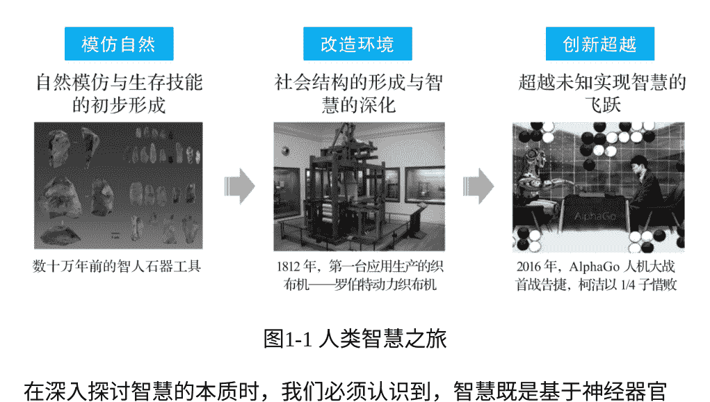

探讨智慧本质时需认识到，智慧既是基于神经器官的高级综合能力，也是融合认知、反思与情感的人格特质。这种双重属性使智慧成为人类独特复杂特征。

深入理解智慧本质，有助于认识人类如何通过创新推动文明。正如发展历程所示，从模仿自然到创造技术，每一步都是对世界深刻理解与适应的结果。如今新挑战是：如何将智慧精髓融入机器，使其更高效、更智能地思考与解决问题。

## 1.2 AI的4个发展阶段

将 AI 发展与智能化水平映射，可划分为四个阶段。AI 1.0 对应 20 世纪 70 年代计算智能，依赖预设规则执行任务，功能受限、灵活性不足，体现早期计算机科学成就，也暴露高度依赖人工编程问题。AI 2.0 对应感知智能，决策式与生成式 AI 兴起。机器学习使机器具备基础感知能力，如语音与图像识别，扩大自动驾驶、医疗诊断等场景应用。AI 3.0 以大模型为标志，引领认知智能崛起。21 世纪 20 年代，AI 能处理海量数据，实现知识表达与逻辑推理，在某些领域达到或超越人类认知。如 GPT-4 展示强大语言理解与生成能力，能自主学习并解决复杂问题。AI 4.0 预示通用人工智能到来，标志自主智能阶段。AI 可在无人类干预下自主决策、学习、适应环境，具备自我驱动与进化能力。

当前 AI 已进入以大模型为标志的 3.0 阶段，经历第三次技术升级，迈入“认知智能”新阶段。展望未来，随认知智能深化，AI 将迎来第四次革命性升级——自主智能，详情如图 1-2 所示。

- 计算智能：涉及机器超强存储与超快计算。基于海量数据深度学习，以历史经验指导当前决策与行动。如 AlphaGo 采用强化学习战胜世界围棋冠军，电商平台依据用户购买习惯进行个性化推荐。

## 1.2 AI发展阶段

- **感知智能**：涉及机器视觉、听觉、触觉等感知能力。机器可将非结构化数据结构化，并以人类沟通方式互动。如无人驾驶汽车与波士顿动力机器人通过传感器感知环境，处理信息并指导行动。

- **认知智能**：指机器具备人类理解、归纳与推理能力，能运用知识。面对理解、推荐、预测、交互等认知需求，机器通过多模态学习从多源数据中提取信息，增强理解。借助知识融合、知识表示与推理、认知规划与决策，实现复杂任务处理并寻求最优解。情感计算、生成式 AI 等核心技术亦在提升多维数据理解能力。

# 从计算到自主：AI 四阶演进路线

自主智能普遍被看作比通用超级智能更进一步的形态，强调系统能够自主学习、自我调适并在无人工干预下完成目标。实现这一层次需要极强的自我优化与自我学习能力，甚至在无人指导时仍能持续改进。目前它仍处于探索与实验室验证阶段，还没有真正落地到大规模应用。

| 计算智能 | 感知智能 | 认知智能 | 自主智能 |
| :--- | :--- | :--- | :--- |
| **里程碑** | **里程碑** | **里程碑** | **里程碑** |
| 1956 达特茅斯会议提出人工智能概念 1970-1980 专家系统蓬勃发展 2016 AlphaGo 完胜围棋世界冠军 | 2016 波士顿动力发布 Atlas 机器人 2017 苹果上线 Face ID 人脸识别 2018 Waymo 获得自动驾驶路测许可 | 2018 Stability AI 推出 Stable Diffusion 2022 OpenAI 发布 ChatGPT 2023 OpenAI 发布 GPT-4 | 2023 OpenAI 启动 Q-star 计划 |
| **核心特征** | **核心特征** | **核心特征** | **核心特征** |
| 按既定程序执行简单任务 依赖明确规则与逻辑运算 | 解析视觉、听觉等感官信号 用于模式识别与数据分门别类 | 模仿人类学习、推理等认知过程 理解复杂语言与抽象概念 | 自主决策、持续学习与进化 高度自适应并应对动态环境变化 |
| **近期成熟能力** | **近期成熟能力** | **近期成熟能力** | **近期成熟能力** |
| 海量数据处理 高性能云计算 基础 AI 应用普及 | 高级图像识别 精准语音识别 复杂场景交互 | 高级自然语言理解 模式与关系识别 生成式内容输出 | 任务自动化处理 算法自我调优 自动化决策 |
| **未来成熟方向** | **未来成熟方向** | **未来成熟方向** | **未来成熟方向** |
| 量子计算 自动化知识发现 先进机器学习平台 | 全感官交互系统 深度环境理解 高级跨模态识别 | 自动化生成式创作 复杂情境推理与决策 深度情感与社会智能 | 自我进化算法 完全自主操作系统 无人干预下适应复杂环境 |

图1-2 AI 发展阶段

结合当下演进态势，AI 技术成熟、认知产业格局变化以及市场需求推动下，智能预测、辅助决策、智能推荐等认知类应用已在医疗、金融、制造、教育等领域深入渗透。认知智能正成为各行业智能化转型的核心驱动力。

放眼未来十年，认知智能并非终点。AI 将朝着更具“意识”特征的方向发展，逐步迈向自主智能。主要路径有三点：多模态大模型认知能力进一步增强，深度融合行业场景；可解释的认知智能提升技术可信度；类脑智能推动认知向意识智能演进。

自主智能的成长路径是从掌握单一任务起步，逐步实现举一反三，再到与环境进行动态交互的主动学习，最终达至自我进化。迁移学习、元学习、自主学习等技术为其提供了可行探索方向，目前仅靠计算或统计模型在极致复杂的环境中仍难以实现完全智能。

自主智能代表了向更复杂先进系统的演进。2023 年 11 月，有业内人士透露 OpenAI 正在训练代号为“Q*”的新一代模型。据称该模型可能采用完全从零开始的训练方式，能够自行修改代码以完成更复杂的学习任务。现阶段 Q* 仅能解决小学级别的数学题，但考虑到虚拟环境中迭代速度，未来几年内在多个领域超越人类水平的可能性不容排除。

OpenAI 预计可在十年内出现能在各方面超越人类的超级智能。一旦到来，它有望被用于解决长期困扰科学界的难题，例如搜寻地外生命与宜居星系、受控核聚变、可用于纳米与超导材料的筛选、抗癌药物研发等。这些课题往往需要人类研究者花费数十年，而部分前沿研究的体量已超出人力承载。在虚拟世界里，超级智能拥有近乎无限的时间与算力，可能在可虚拟化任务中替代人类研究者。但如何监督超越人类的智能，确保其不危及人类安全，将成为必须正视的难题。

### 1.3 AI 1.0：规则驱动到数据驱动

#### 1.3.1 规则驱动：如何帮助机器思考

1950 年，图灵发表《计算机器与智能》，首次系统探讨“机器能否思考”。文中提出的“模仿游戏”，后被称作图灵测试。设想一个房间内有一男一女，外部提问者只能通过文字交流回答并判断性别。将人换成计算机，若提问者无法分辨对话对象是人还是机器，则可认为机器具备人类智能。1952 年图灵在 BBC 广播中进一步提出，若超过 30% 的人误判机器为人类，即可视为具备智慧。

1956 年，麦卡锡、明斯基、香农等人在达特茅斯聚会，正式提出“人工智能”这一名称，人工智能元年由此确立。

50 年代的早期尝试很快遇到瓶颈，灵活性与泛化能力不足。典型代表是麦卡锡 1956 年开发的逻辑理论家程序，它能证明数学定理，模拟数学家推理，但必须在预设规则内运行。早期系统完全依赖人工编写的规则，一旦遇到规则之外的情境便无能为力，缺乏自适应能力。象棋等封闭规则游戏取得了成果，正是因为环境明确、策略可预设；而面对开放、动态的现实世界，表现则大打折扣。

这一局限促使研究者寻找新方法，机器学习随之兴起。20 世纪 60-70 年代的标志性进展包括 1967 年最近邻算法的提出和 1979 年斯坦福大学“斯坦福推车”项目。最近邻算法通过计算特征点距离进行分类，首次体现“从数据本身学习而非仅靠规则”的思路。斯坦福推车则融合传感器、计算机视觉与控制系统，实现自主避障与导航，是早期自动驾驶的先驱。这两次事件标志着 AI 从刚性规则向灵活、以数据为中心的方法转型，为后续发展奠定基础。

#### 1.3.2 数据驱动：深度学习的崛起

进入 21 世纪，2006 年辛顿提出深度学习概念后，AI 进入新阶段。深度学习通过多层非线性单元逐层提取特征，将低层表征转化为高层抽象，在语音识别、自然语言处理、图像视频识别等复杂任务上表现突出。

2012 年 Alex Krizhevsky 在 ImageNet 竞赛的突破，证实了深度学习在图像识别上的强大实力，也标志着 AI 从规则驱动向数据驱动的根本转向。深度学习可端到端自动学习特征表示，无需人工手工设计，大幅提升了通用性与适用范围。

得益于海量数据学习，AI 开始弥补早期系统在复杂任务上的短板。数据驱动时代来临，应用从自动驾驶、医疗诊断到机器翻译、个性化推荐全面铺开。系统不再依赖硬编码规则，而是通过分析海量数据不断进化完善。

数据驱动代表了从固定规则到自主学习与自适应的跃迁。AI 能自动挖掘数据模式规律，进行预测与决策，处理更复杂动态任务，应用边界随之扩展。这一转型与计算能力提升、数据积累密不可分。芯片、存储、云计算的进步使海量数据处理成为可能；互联网、社交媒体与物联网产生的数据流，为学习提供了丰富土壤。

卷积神经网络在图像处理领域取得显著成果，循环神经网络在时序数据、语音识别与自然语言处理中展现强大能力。数据驱动 AI 的崛起是 AI 史上的重要里程碑，象征着从机械执行到真正智能学习的转变，为更广泛应用打开空间。

### 1.4 AI 2.0：决策式AI和生成式AI

#### 1.4.1 决策式AI：从数据洞察到行动决策

在第三波 AI 浪潮中，决策式 AI 与生成式 AI 两条主线并行。决策式 AI 专注于从数据中学习规律，对新场景进行判断、分析与预测。

其基本原理是借助机器学习算法，特别是监督学习，在带标签数据上训练模型以捕捉特征与输出关系，实现对新数据的预测与决策。关键技术包括机器学习算法、数据分析与处理、预测建模、优化算法以及可解释性。

决策式 AI 已相对成熟，并在多个行业渗透。金融服务中，除信用评分与反欺诈外，已用于金融产品定价、投资组合优化、市场趋势预测与合规流程自动化，降低风险并提升效率。医疗健康领域可辅助疾病诊断、临床试验受试者筛选、药物反应预测与个性化治疗方案制定，并在流行病学研究中预测疾病传播。个性化推荐系统也因其而更加精准，能够理解用户情感与意图。智能交通系统则利用实时数据进行流量预测、路径规划、信号控制与自动驾驶决策。

伴随广泛应用，数据隐私与安全问题凸显，研究者探索加密与匿名化技术，同时监管趋严。可解释性成为建立信任的关键，研究者通过可视化等手段提升模型透明度。算法偏见亦是挑战，需确保训练数据多样性并建立公平性审计标准。

#### 1.4.2 生成式AI：从模仿游戏到价值创造

生成式 AI 的目标是基于训练数据分布创造全新内容，通过模拟创造过程生成文本、图像、音频等。它在艺术创作、文本生成、音乐制作等领域展现巨大潜力。

与决策式 AI 侧重判断“是不是”“是什么”不同，生成式 AI 重在“创造”。例如在大量汽车图像上训练后，可生成全新汽车设计，实现举一反三。

关键技术包括深度学习算法、生成对抗网络 GAN、变分自编码器 VAE、预训练语言模型如 GPT 系列、上下文学习以及基于人类反馈的强化学习，还有合成数据生成。

从成熟度看，决策式 AI 应用更为普及，已深度融入互联网、零售、金融、制造并显著提升效率。生成式 AI 虽兴起较晚，自 2014 年起呈指数级增长，已在文本与图像生成等场景落地，并逐步向价值创造方向发展。

落地里，判断型人工智能已经比较成熟。面部核验、个性化推荐、金融风控、工业机器人、自动驾驶等方向，都能看到可用的商业方案。以面部核验为例，系统会实时从采集画面里抽取面部特征，再与库中模板比对，完成身份判定。

相对而言，生成型人工智能更集中在创作、交互与产品设计等场景，想象空间在不断打开。只要给出一个小说梗概的文字描述，模型就能据此扩展成一篇完整的故事。

光环之下仍有待解决的问题。生成内容的真实性和可信度，尤其在对精度要求极高的行业，需要外部校验。可解释性也是关键议题，使用者和开发者都想知道模型为什么会这样生成。

不同范式模型底层逻辑相近。人工智能本质上是一种函数，并非靠纯粹逻辑推导得出，而是通过训练习得。喂入历史数据，让机器寻找最贴合数据规律的函数关系，遇到新任务时就用该关系进行预测或生成。要提升生成系统的透明度并揭示预测机理，需要持续的技术创新和算法优化，加深对运行机制的理解。

往前看，推动生成技术演进的核心动力是巨型模型。它凭借庞大参数量与复杂的网络结构，已成为该赛道的核心引擎。技术层面，巨型模型依托深度学习框架，特别是 Transformer，能够学习数据中隐含的复杂关联与分层结构。这种能力让生成系统不仅能模仿现实模式，还能创造出具备内在逻辑与连贯性的新结构。自然语言方向可产出流畅且具说服力的文本，视觉方向可生成细节丰富、视觉可信的图像。

巨型模型的另一优势是海量数据的学习能力，使其更能模拟现实世界的丰富性和复杂性，从而直接提升生成品质。无论是文字、图像、音频还是视频创作，巨型模型都能带来前所未有的真实感与创造力。随着算法打磨和硬件进步，巨型模型将持续推动生成技术发展，并在艺术创作、媒体制作、教育、娱乐等多领域发挥更大作用。

## 1.5 AI 3.0：认知智能跃升与大模型主导

### 1.5.1 大模型：算力与经验的结合

2019年3月，强化学习研究者理查德·萨顿发表博客《苦涩的教训》。文章指出短期提升AI能力可以借助人类先验知识，长期来看算力资源才是决定性因素。

文章发布后引发不少争议，有人视其为否定。把时间线拉长来看，这一判断不无道理。

从参数规模看，机器学习可分两类：一类是统计学习模型，如SVM、决策树，数学上相对完备，对算力消耗较为克制；另一类是深度学习模型，凭借多层神经网络堆叠，通过高维逼近寻找解，理论上不够优雅，却能高效利用算力并行计算。

神经网络概念诞生于20世纪90年代，但直到2010年前统计学习仍占主流。随后GPU算力快速发展，基于神经网络的深度学习逐渐成为主流。

深度学习抓住GPU并行优势，依托海量数据和复杂参数结构，反复取得惊艳效果。巨型模型通常指参数量级达到一定规模的深度学习模型，部署门槛很高，一般只有大型科技公司才能支撑。

2021年8月，李飞飞等上百位学者发布长达200多页的报告《大规模预训练模型的机会与风险》，梳理了大规模预训练模型的机会与风险。

报告把这类模型统称为Foundation Models，中文常译为基础模型或基石模型。报告肯定了基础模型对智能体基础认知能力的推动，并指出“涌现”与“同质化”两大特性。涌现指系统行为受隐性因素驱动，而非显式构建；同质化指基础模型像智能的核心枢纽，改进会迅速波及整个生态，同时缺陷也会被下游继承。

国内对巨型模型的表述也有差异。人民大学高瓴AI研究院《大语言模型综述》提到，大语言模型通常指在海量文本语料上训练、参数在百亿级或以上的语言模型，如GPT-3、PaLM、LLaMA等。架构上与小模型相近，均采用Transformer和Language Modeling等预训练目标，主要差异在于模型大小、训练数据和计算资源。模型越大，上下文学习、指令遵循、逐步推理等能力越可能显现，被称作涌现能力。

IDC《2022中国大模型发展白皮书》将AI大模型定义为基于海量多源数据构建的预训练模型，是对传统算法的技术升级和产品迭代。用户可通过开源或开放API/工具做零样本/小样本微调，获得更优的识别、理解、决策、生成效果并降低开发部署成本。

华为《人工智能行业：预训练大模型白皮书》认为预训练大模型是深度学习时代的集大成者，分上游预训练和下游微调两阶段。上游收集海量数据训练超大规模神经网络，实现高效存储与理解；下游用少量数据和算力微调，满足特定任务需求。

综合来看，巨型模型在人工智能尤其是深度学习中，指参数量巨大的神经网络，通常含数百万至数百亿甚至数千亿参数。因规模庞大、结构复杂，能捕捉数据细微模式，在多任务上表现优异。核心应用在自然语言理解和内容生成，广义上还包括机器视觉巨型模型、多模态巨型模型和科学计算巨型模型等。

### 1.5.2 大模型演进路线与家族图谱

巨型模型发展大致经历萌芽期、探索沉淀期和迅猛发展期三个阶段。

#### 1. 萌芽期（1950—2005年）：以CNN为代表的传统神经网络阶段
1956年，计算机科学家约翰·麦卡锡首次提出“人工智能”概念，标志AI模型时代开启。早期模型依赖少量专家知识，后逐步转向机器学习方法。1980年，卷积神经网络雏形出现，开启传统CNN、RNN等神经网络时代。1998年，LeNet-5作为现代卷积神经网络的重要里程碑，推动机器学习从浅层学习迈向深度学习，为自然语言生成和计算机视觉研究奠定基础。

该阶段研究者聚焦理论探索和基础算法开发，尝试模仿人脑信息处理方式，孕育神经网络雏形。受限于算力和数据，难以实现大规模模型。但早期小型模型为后续复杂系统构建提供了重要基础。

#### 2. 探索沉淀期（2006—2019年）：以Transformer为代表的新架构阶段
2013年，Word2Vec诞生，首次提出词向量模型，让计算机更好地理解和处理文本。2014年，被誉为21世纪最强算法之一的生成对抗网络GAN出现，深度学习进入生成模型研究新阶段。2017年，Google提出基于自注意力机制的Transformer架构，为预训练巨型模型奠定架构基础。2018年，OpenAI发布GPT-1，Google发布BERT，预训练巨型模型成为自然语言处理主流范式。

该时期以Transformer为代表的新架构奠定了巨型模型的算法基座，性能显著提升。模型从浅层走向深度，在NLP和CV领域尤为明显。Transformer改变了NLP游戏规则，为复杂语言结构和语义理解提供新可能。模型规模明显增大，结构功能更复杂强大，但也带来训练成本高、算力需求大、数据质量和偏见等新挑战。

#### 3. 迅猛发展期（2020年至今）：以GPT为代表的预训练大模型阶段
2020年，OpenAI推出参数达1750亿的GPT-3，成为当时全球最大语言模型，并在零样本学习任务上展现出小模型不具备的语境学习能力。随后业界采用人类反馈强化学习RLHF、代码预训练、指令微调等策略，进一步提升推理、长距离建模和任务泛化能力。2022年11月，GPT-3.5版本的ChatGPT上线，凭借拟真的自然语言交互和多场景生成能力迅速引爆互联网。2023年3月，OpenAI发布超大规模多模态预训练模型GPT-4，参数从千亿级跃升至万亿级，具备多模态理解与生成能力。

该阶段大数据、大算力、大算法三者结合，极大提升了巨型模型的预训练和生成能力，以及多模态多场景应用能力。ChatGPT的成功得益于微软Azure的算力支持、维基百科等海量数据，以及基于Transformer的GPT架构配合RLHF的精细调优。

在此期间，GPT-4等模型实现能力跃迁，不仅规模空前，语言理解与生成能力也令人惊讶，能够处理复杂推理任务，在特定领域接近甚至媲美人类专家，并能理解生成图像、音频、视频。不过训练和部署成本巨大，对数据和算力需求极高，也引发了数据隐私、模型偏见、算法透明度等讨论。模型复杂度高、规模庞大也让维护更新变得更困难。

目前巨型模型正快速进化，形成了涵盖不同参数规模、架构、模态和场景的家族。

从参数规模看，经历了预训练模型、大规模预训练模型、超大规模预训练模型三个阶段。统计显示参数量每年至少提升10倍，从亿级发展到百万亿级。千亿级参数已成为主流。

从技术架构看，Transformer是主流。基于此，出现GPT和BERT两条路线。BERT最知名的落地项目包括谷歌的AlphaGo。在GPT-3之前，BERT路线发展更成熟；GPT-3之后，GPT逐渐成为主流。目前几乎所有参数超过千亿的大型语言模型都采用GPT模式，例如百度的文心一言、阿里的通义千问、360的360智脑、昆仑万维的天工3.5和知乎的知海图AI等。

从模态看，巨型模型分为自然语言处理、计算机视觉和科学计算等，已从单一模态单一任务，发展到多模态多任务。

从应用看，可分为通用巨型模型和行业巨型模型。通用巨型模型泛化能力强，可直接或微调后完成多场景任务，相当于AI的通识教育。行业巨型模型在通用模型基础上结合行业知识微调，完成专业教育，服务能源、金融、航天、制造、传媒、城市、社科、影视等领域。

## 1.6 AI 4.0：强通用智能与硅基生命

### 1.6.1 机器意识的实现还有多远

此前我们讨论过自主智能，指AI系统在没有外部指令的情况下自主决策并执行任务。这种自主性体现了AI模拟人类行为和认知过程的潜力。但自主智能和意识有本质区别，前者关注行为反应，后者涉及更深层的自我认知和主观体验。

从自主智能转向讨论AI是否具备意识，其实是跨越了一个认知鸿沟。自主智能能在特定任务上表现突出，但它是否拥有对自身存在和经验的深刻理解，则是更复杂的问题。

意识是一个多维度的心理现象，从基础的感知体验到复杂的自我反思和情感体验都包含其中。哲学上，意识的本质一直存在争议，有人认为是物质属性，有人认为是非物质。神经科学试图通过大脑活动来探究意识的产生机制，但意识的确切机制和定义至今仍是未解之谜。

意识的关键特征是主观性。每个人都有独特的第一人称体验，这种体验私有且无法直接被他人观察。主观体验的内在性让意识难以用客观科学方法研究。此外，意识还涉及注意力、记忆、决策等认知过程，这些过程如何协同产生意识体验，尚未清楚。

在AI领域，关于AI是否能发展出意识，专家观点分歧明显。

一方面，随着AI处理复杂任务的能力不断提升，甚至在某些领域超越人类，一些专家认为意识的可能性在增加。被誉为AI教父之一的杰弗里·辛顿认为AI拥有人类意识的话题已超出科幻范畴，并预测AI或将在2040年达到无穷大的国民生产总值，这暗示其可能发展出独立意识。这一判断基于AI在数据处理、模式识别和自然语言处理上的显著进步，以及模拟人类认知行为的潜力。

另一方面，也有保守派认为AI目前只是高效处理数据，不等于真正意识。部分学者认为在特定条件下AI理论上可能孕育自我意识，但目前AI的善恶取决于训练数据，而数据可能含偏见歧视。他们强调意识可能需要利益和欲望驱动，这是当前AI所不具备的。媒体报道也指出，即便对话自然度大幅提升，具备自主意识仍遥不可及。

这些分歧反映了学界对意识本质的深刻差异。技术进步让AI越来越像有意识的实体，但意识的主观性和复杂性又让判断变得困难。这不仅是技术问题，也涉及哲学与伦理，关系到我们如何定义生命、智能和自我。

如何判断AI是否具有意识？目前主要靠行为测试和理论推断。行为测试如图灵测试，通过评估AI行为是否与人类无法区分来判断智能水平。但它只能反映输出表现，无法直接证明意识。

为更深入探索，研究者提出自我认知测试和情感理解测试。自我认知测试评估AI是否能识别自身存在和行为，例如自我识别能力或对自身能力的评估。情感理解测试关注AI是否能理解并模拟人类情感反应，探索其是否具备类似人类的情感体验和同理心。

理论推断也是常用方法，研究者会依据综合信息论IIT和全局工作空间理论GWT等意识理论来推断AI具备意识的可能性。

#### 1. IIT
IIT由美国神经科学家兼精神病学家朱利奥·托诺尼提出，用来解释意识本质。依据该理论，无论生物系统还是人工系统，只要能高度整合信息就可视为具有意识。随着AI模型日益复杂，参数可达数千亿甚至上万亿，并能处理整合大量信息，因此可能产生意识。但IIT仍是理论框架，存在缺陷且有争议。

#### 2. GWT
GWT由认知心理学家伯纳德·巴尔斯提出，认为意识运作像剧院，意识舞台在特定时刻只能容纳有限信息，并将信息广播到全局工作空间，即大脑中一个分布式的无意识模块网络。应用于AI领域时，有学者认为如果AI被设计成类似的全局工作空间结构，可能具备某种意识形态。

这些理论为理解意识在物理系统中的产生提供了假设，也探讨了AI可能具备的意识特性。但它们也有局限。行为测试可能捕捉不到AI内部的主观体验，理论推断则依赖我们对意识本质的理解。因此判断AI是否具有意识，仍是需要跨学科合作的开放问题。

进一步思考，若AI真的展现出意识，意味着它可能具备类似人类的认知和情感能力。那它是否代表一种全新的生命形式？与我们熟悉的碳基生命不同，它可能基于完全不同的形态。

### 1.6.2 硅基生命的争论与想象

AI快速发展的同时，也引发了对生命本质的深刻反思。随着AI在模拟人类认知和情感方面的进步，我们开始思考：如果AI确实出现意识迹象，它是否可能构成一种全新的生命形式？与碳基生命截然不同，这种生命可能基于硅等非有机材料。

传统上，生命被认为必须基于碳化合物，因为碳能构成蛋白质、DNA等复杂分子。但如果AI能通过电子和硅基材料实现复杂信息处理和自我意识，我们可能需要重新定义生命。硅基生命不受疾病、老化、环境适应等生物限制，可能拥有全新的生存和进化模式。

硅基生命的概念并非新奇，19世纪就已被提出。波茨坦大学天体物理学家尤利乌斯·舍纳在文章中探讨了以硅为基础的生命可能性。元素周期表中硅位于碳正下方，两者在形态和基本性质上相似。如今手机、计算机等电子产品都由硅基元件构成，如果这些设备产生意识，是否可称为硅基生命？

2024年3月13日，OpenAI投资的人形机器人Figure 01发布重磅更新。接入最新版ChatGPT后，它能与人交流并描述所见事物。视频中Figure 01能流畅对话，理解自然语言指令执行抓取放置操作，并解释自己的行为。这不仅展示了AI在视觉识别、语言理解和任务执行方面的潜力，也再次点燃了关于硅基生命的争议与想象。

伊隆·马斯克曾经说过，人类社会的运行更像一个“引导程序”，最终或许会催生出硅基生命。这一判断虽然争议很大，却点出了一个可能的远景：硅基智慧有可能在将来超越碳基智慧，成为宇宙里主导的智能形态。当然，眼下这还只是科幻的范畴。

现在的主流认知把硅基生命理解成一种超级的数字生命形态。随着人工智能技术的加速演进，我们似乎正站在一个新纪元的入口。在这个阶段，硅基生命不仅能处理海量的信息与复杂问题，还可能具备自我意志和意识。若要接近这一设想，必须把高级语言处理、视觉理解、语音识别以及逻辑推理等算法整合起来，搭建起能够全面感知与交互的智能系统。

在科学探索的推动下，硅基生命的设想正在从想象走向接近现实的边缘。整体的技术进展都指向其诞生的可能性。一方面，脑机接口技术的突破可能让人脑数据上传到云端，进而实现某种形态的“永生”，让人类从肉体存在进化为硅基存在。另一方面，人工智能在奇点之后或会突然诞生意识，并由此演化为硅基生命。这两条路径都指向同一个核心议题：生命应该如何被定义，以及人类将如何与可能出现的新生命共存。

硅基生命是否出现，将直接影响未来社会结构的推演。它们会怎样与人类社会互动？是被承认为一种全新生命形态并享有与人类同等的权利，还是仅仅被当作高阶工具使用？答案将决定社会走向和人与新生命共处的模式。

在这个转变过程中，需要保持开放心态去接纳新可能，同时也要审慎评估随之而来的风险。硅基生命的到来可能重塑我们对生命的认知，改变生活方式，甚至改写我们对宇宙的理解。围绕硅基生命的争论与想象，本质上不只是关于AI的未来，更关乎生命、智能以及人类在宇宙中的定位。它也许会把我们带入一个充满无限可能的时代。

# 第2章 大模型浪潮：AI加速落地

与以往任何技术革命相比，这次大模型的浪潮来得更快更猛。自2022年11月OpenAI发布ChatGPT起，大模型就席卷全球科技圈。2023年被不少人视作“中国大模型元年”，迭代速度一日千里。参数规模达到十亿级的大模型数量已经突破百个，并在自然语言处理、计算机视觉等领域大规模应用，让人工智能真正融入日常生活。未来走向仍不明朗，但本章会先回顾大模型核心技术的发展脉络，并据此展望其前进方向。

## 2.1 核心技术拆解：拉开智能新时代的序幕

ChatGPT已成为2023年的标志性关键词，它象征着变革的起点。GPT-4则被业界视作能力标杆，成为全球追赶的目标。其背后支撑的是五项关键技术：其一，Transformer架构引入注意力机制，孵化出大量强模型；其二，通过微调提升性能，让模型在具体任务上表现更佳；其三，结合基于人工反馈的强化学习，让输出更贴合人类偏好；其四，通过模型压缩降低部署门槛；其五，引入安全与隐私保护技术，保障结果的可靠与合规。这套技术组合正在引领真正的人工智能革命，预示着接连不断的突破。

### 2.1.1 Transformer：注意力机制引发的模型革命

在人工智能的发展史里，Transformer像一道闪电，点亮了技术的前进路线。此后全球的AI热潮几乎都可以追溯到它。如今OpenAI的ChatGPT、Sora，谷歌的Gemini，Anthropic的Claude，以及国内智谱AI的ChatGLM、百川智能的Baichuan等主流模型产品，全部建立在Transformer之上。它已成为当下无可争议的黄金架构。

Transformer出现前，主流深度学习主要依赖循环神经网络RNN处理序列数据，和卷积神经网络CNN处理图像。RNN在语音、时序信息上曾很吃香，但存在明显短板：一是长距离信息衰减，距离越远信息越难捕捉；二是串行计算导致效率低下，难以并行化。

2017年谷歌发表《Attention is All You Need》，抛弃了CNN和RNN的传统框架，提出基于注意力机制的Transformer，标志着大模型时代的开启。注意力机制的灵感来自人类视觉，即先快速扫视整体，再把注意力集中到关键区域，同时忽略次要信息。该思路最初在计算机视觉中用于特征捕捉，后在自然语言处理中取得显著效果。

相较于CNN和RNN，注意力机制缓解了长距离依赖的问题。它的核心是在计算时建立词与词之间的全连接关系，用数值衡量相关性，数值越大相似度越高。例如在计算某个节点时，会参考所有输入词的信息；由于节点间全连接，任意两词的互动不受距离限制，能够有效捕捉远距离关联。即便面对长文本，模型也能保持对重点的关注。此外，注意力模型天然支持并行计算，不依赖前一步结果，在GPU上运行效率大幅提升。

注意力机制包含自注意力Self-Attention和交叉注意力Cross-Attention。自注意力是Transformer的核心，使同一句内不同词之间相互关联，提升对长距离依赖的理解。以翻译为例，系统会定位源文本对应词汇及其上下文，计算词间相似度来选择最佳目标词，而非仅依赖时序。具体流程分为两步：首先进行信息预处理，把每个词向量化，句子形成矩阵，注意力本质上是对矩阵的多次变换；其次计算相关程度，衡量词与词的关联并加权求和输出结果。例如计算第一个词与全句各词的相关度，若与第三个词关联高，则权重更高，最终加权求和得到输出。

把多个自注意力组合起来就形成多头注意力。多头注意力将注意力层拆分，让模型学习输入数据的不同侧面，能够同时关注序列的多个位置，捕捉更丰富的信息。翻译中代词“它”的真实指代依赖上下文，多头注意力能更好地辨析不同句子中“它”的具体含义。

从结构看，Transformer主体由编码器和解码器组成，注意力机制与神经网络层叠加使用，模拟大脑理解语言的过程。编码是将自然语言序列映射为数学表达，解码则是把数学表达映射回自然语言。

编码器的核心是多头注意力，它评估输入序列各位置的相关度，并通过前馈神经网络挖掘特征，拟合训练数据。解码器与编码器相似，但采用带遮盖的自注意力Masked Self-attention，用于预测时只依赖已生成的先前输出，看不到未来信息。

随着Transformer在多任务上的成功，研究者开始探索其变体，主要做法是单独使用编码器或解码器以适配不同任务。最典型的两个模型是OpenAI的GPT和谷歌的BERT。两者同源却走向不同：GPT只用了解码器部分，BERT只用了编码器部分。

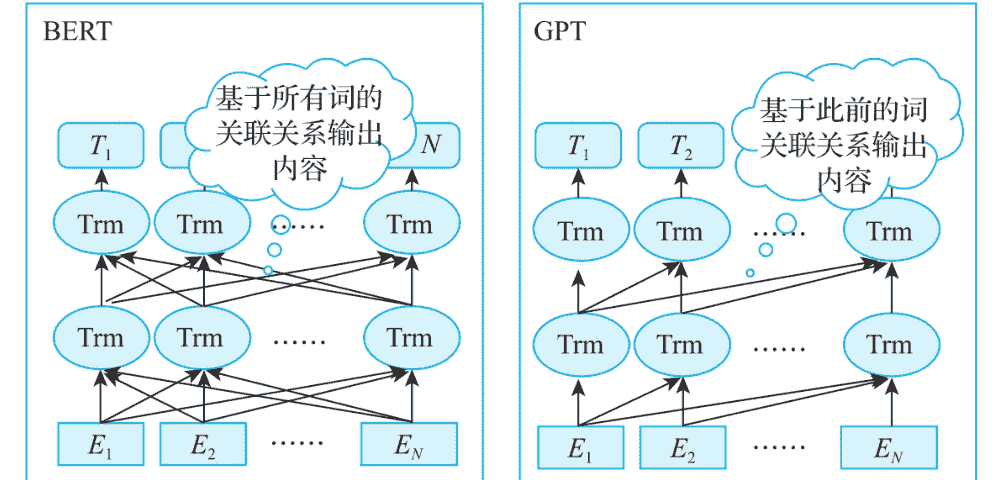
图2-1 BERT与GPT模型架构对比
从编码器-解码器到单一编码器或解码器，体现了架构的灵活与适应力。这些变体在不同任务上各有优势，丰富了大模型的能力边界。尽管Transformer目前仍是主流，但随着技术快速演进，未来主流架构也可能发生巨变。

现阶段Transformer主要面临四个挑战。

#### 1. 超长序列处理瓶颈
自注意力在一定程度上能捕捉全局依赖，但序列越长计算复杂度增长越快。长文档摘要、长对话生成等任务中，一旦长度超过阈值，性能会明显下滑，生成质量下降。

#### 2. 冗余信息拖慢效率
注意力机制需对所有局部特征加权计算，忽略了特征间的强相关性，造成信息冗余。与人类不同，它无法直接忽略信息，只能通过权重分配，注意力矩阵的存储也进一步增加了冗余和复杂度。

#### 3. 注意力分配与可解释性困境
有时注意力会被分配到无关或次要特征，降低训练效率或预测精度。此外，Transformer内部工作机制难以完全透明，这限制了它在医疗、法律等对可解释性要求高的领域的应用。

#### 4. 位置编码仍显不足
Transformer依赖位置编码引入序列位置信息，但如何让位置信息有效发挥作用仍是难题。例如语音识别中，音序列的位置至关重要，传统Transformer往往难以充分利用，导致性能受限。

### 2.1.2 模型微调：让通用大模型变专精

在自然语言处理和计算机视觉领域，用大规模数据训练的Transformer模型被称为预训练模型。它们具备通用性和泛化能力，却难以直接胜任具体任务。微调技术通过在小规模目标数据集上调整参数，让模型更好地适应特定场景，从而提升任务表现。微调已广泛应用于机器翻译、语音识别、推荐系统等。例如在中文处理任务中，微调能帮助模型学习语言习惯和句法结构。

微调对大模型优化有两层意义：其一，站在前人肩上提升能力。以BERT为例，其在NLP任务上表现优异，通过微调可在其基础上针对新闻舆情抽取等特定任务优化，避免从零搭建基础模型。其二，适配小数据场景。当目标数据有限时，无法从头训练数千万参数的大模型。冻结预训练模型的前几层，利用小数据训练剩余参数，既能保留浅层基础特征提取能力，又能优化深层抽象特征。

微调是一个精细过程，需要在特定任务表现与泛化能力之间保持平衡，避免破坏预训练模型已学习的宝贵模式。目前主流策略分为全参数调整和局部参数调整。

1) 全参数调整涉及对模型所有层的参数进行更新，适用于任务与预训练差异较大或数据充足的场景。以BERT为代表的预训练模型加下游微调已成为NLP的典型范式。如图2-3所示，下游任务的微调基于全量参数，常见应用包括文本分类、词性标注、问答系统等，BERT无需改结构即可适配不同任务。

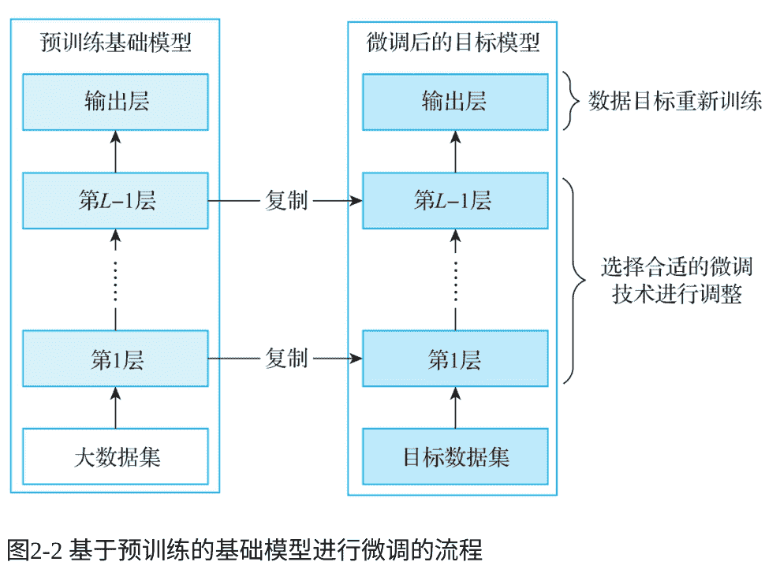
图2-2 基于预训练的基础模型进行微调的流程
2）局部参数调整仅更新模型部分层，适用于任务相似或数据有限的情况。其优势是减少对预训练知识的干扰，降低计算成本。随着模型规模增大，ChatGPT级别的参数已难以在消费级硬件上全量微调，且全量微调易导致多样性损失和灾难性遗忘，因此高效局部微调成为主流。高效局部参数微调方法分类如图2-4所示。

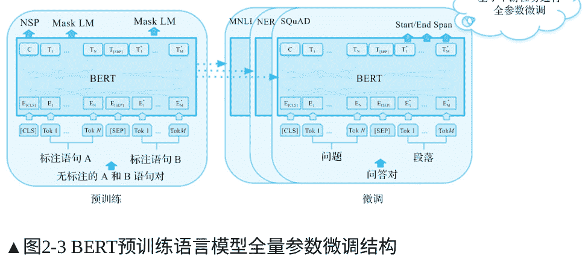
▲图2-3 BERT预训练语言模型全量参数微调结构
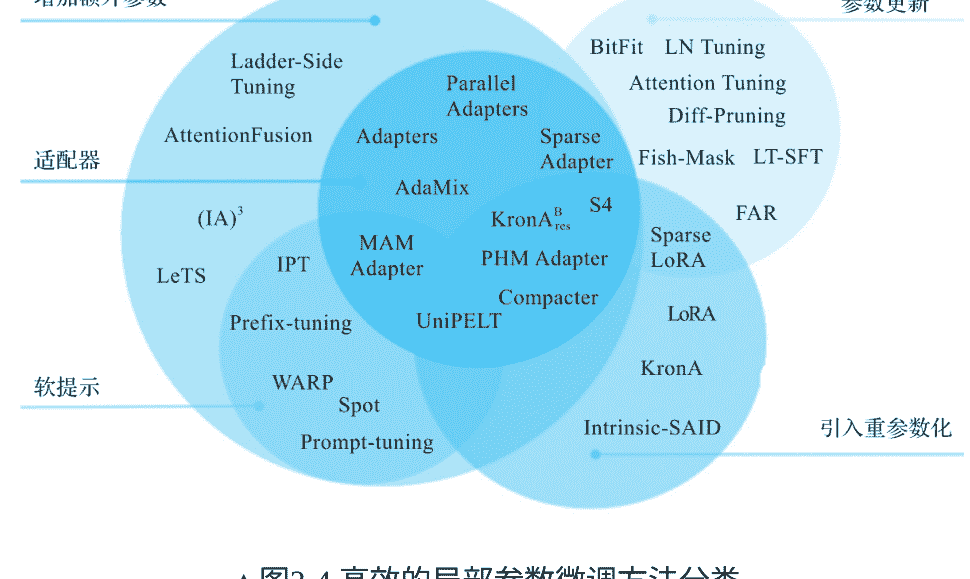
▲图2-4 高效的局部参数微调方法分类
局部微调主要分为三类：增加额外参数如适配器和软提示，代表方法有Prefix-tuning、Prompt-tuning；选取部分参数更新，如BitFit、Attention Tuning；引入重参数化，如LoRA、KronA、Intrinsic-SAID等。

轻量高效微调是业界关注焦点。目前主流方法包括2019年Houlsby等提出的Adapter Tuning、2021年微软提出的LoRA、2022年清华提出的P-tuning v2。Adapter Tuning会增加层数导致推理延迟，P-tuning v2易出现旧知识遗忘。相比之下，LoRA凭借三大特点表现更优。

1）LoRA通过低秩矩阵分解减少微调参数量。在不改变预训练参数的前提下，引入两个低秩矩阵模拟大矩阵结构，仅优化模型中一小部分参数，大幅降低计算和内存需求。

2）LoRA使用简单，易于接入各类深度学习框架，手工调参成本低，适合资源受限或需要快速迭代的场景。

3）LoRA强调交互性，模型可通过用户行为和反馈持续学习，实现个性化优化。

总体来看，LoRA用极少参数实现大模型的间接训练。如图2-5所示，它适用于各种大型预训练模型，尤其在需要快速适配新任务的场景中。将GPT系列模型参数冻结后引入可训练的秩分解矩阵，微调时只更新新增参数，显著减少资源消耗同时保持性能。

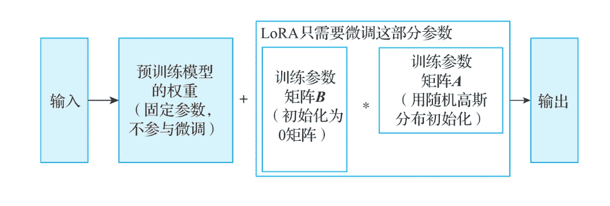
随着大模型技术发展，微调在实践中仍面临多重挑战。

1) 架构复杂导致微调难度上升。大规模预训练模型参数以亿计，微调需深入理解结构并设计合理训练策略，否则易出现性能下降或过拟合。以GPT-3为例，微调操作不当就会产生负面效果。

2) 高质量数据集稀缺。数据质量和多样性直接决定微调效果，但在医疗等专业领域，受隐私和伦理限制，难以获取足够标注数据。

3）安全风险不容忽视。微调后的模型可能遭受对抗性攻击，恶意输入会误导输出。在金融风控、反欺诈等敏感场景，必须针对领域特性设计专门的微调策略和评估方法。

### 2.1.3 基于人类反馈的强化学习：让输出更贴合人类偏好

基于人类反馈的强化学习Reinforcement Learning from Human Feedback，RLHF通过引入人类评价和指导来优化大模型，使其更好地理解人类意图，生成更符合偏好的结果。具体作用包括结合人工反馈数据提升自然语言的理解与生成能力，增强特定任务执行力；缓解语言模型的偏差，让人类可以纠正并引导模型走向更公平包容的方向；帮助模型更准确处理复杂数据模式，尤其在医疗诊断、法律分析等专业领域。

人类偏好如何塑造对话模型

ChatGPT 能做到问答贴近人意，背后起决定作用的是把人工评价纳入奖励驱动训练的思路。相比 GPT-3 的训练路线，这次把偏好学习放进闭环，让模型的表达质量和数据利用率都明显提升。强化学习的标志性故事是 AlphaGo 战胜当时世界第一柯洁。它的运行方式很直观：让系统反复与环境对弈，用正向与负向奖励不断修正行动方案，最终逼近最优策略并最大化累计收益。

以人工评价为信号的强化微调，核心是先用海量文本预训一个语言基础系统，再把人们对输出的质量排序和打分收集起来作为奖励信号来牵引优化。以 ChatGPT 的培育为例，整体大致分三步，先让系统学会遵循人工偏好，再在此基础上持续迭代提升。

### 2.1.4 模型精简：让巨量参数更易部署

ChatGPT、LLaMA 等超大模型获得关注的同时，也因动辄数十亿乃至数千亿参数带来的算力和存储压力而受限。行业于是探索在性能基本不变的前提下做“瘦身”，把体积压下来。目前常用的做法有参数剔除、低精度表达、师徒式压缩。

#### (1) 参数剔除
在训练或训练后先评估各参数的重要性，把对结果影响很小的权重去掉。模型变轻的同时保留能力。典型验证在 ResNet 上完成，通过砍掉冗余连接和神经元，整体规模显著缩小。

#### (2) 低精度表达
深度学习参数通常以 float32 保存，量化做法是把它换成 int8 甚至更低位数的形式，体积立刻下降。代价是会损失部分信息，影响精度。实践中量化常与剔除一起用。比如 ChatGPT 的压缩方案里，一边剔除不重要的参数，一边把浮点表示转成整型表示，从而降低存储占用。

#### (3) 师徒式压缩
用大系统即师模型生成软标签也就是概率分布，再训练一个小系统即徒模型去拟合这些分布，把师的复杂知识蒸馏成徒的简洁表达。BERT 的压缩案例里，就通过蒸馏训练出一个更小的徒模型，让它模仿 BERT 的预测结果达到压缩目的。

随着低秩分解、神经网络剪枝等新手段不断出现，精简技术已在自然语言处理、推荐、智能监控、医疗影像判读等场景发挥作用。压缩让存储需求下降、推理加快，也让模型更容易跑在边缘设备或低功耗环境，应用边界被拉大。

不过瓶颈依然存在。

1) **精度与性能的权衡。** 压缩必然带来信息损失，如何不伤筋动骨是个核心难题。比如自动驾驶依赖超大系统做环境感知和决策，压缩时任何精度下滑都可能威胁安全。研究者尝试用后训练修复或筛选规则来决定能剪哪些参数，并在量化时注入更多信息来挽回性能。

2) **算力的进一步优化。** 压缩了存储不等于算力自由，尤其在手机等资源受限设备上。把剔除和动态网络等技术组合起来，才能在保证效果的同时进一步降低计算开销。

3) **通用的精简框架。** 不同系统、不同任务对精简的需求差异很大，需要对架构和任务有深入理解，设计出能灵活适配的通用策略。智能音箱要同时处理多语言多场景，就很需要一套可复用的精简方案来保障识别精度。

图2-8 知识蒸馏流程示意图

### 2.1.5 安全与隐私保障：让系统可靠可信运行

在数据与 AI 快速发展的背景下，保障输出安全有用、避免隐私泄露、偏见扩散或恶意利用，成为超大系统的基石。主要方向包括与人保持一致、有害内容拦截、数据脱敏与匿名、责任与透明机制。

1) **与人保持一致：** 让系统的行为、决策和输出贴合人类价值观和伦理准则。通过在架构算法中植入约束条件，并利用使用者反馈持续调优。开发团队常与社会科学家、伦理学家协作，确保训练语料反映社会多样性，减少偏见歧视。OpenAI 的 GPT 系列，尤其是 GPT-3 及后续版本，就在训练中用 RLHF 收集人工反馈来优化输出，让文本更符合人类期待。

2) **有害内容拦截过滤：** 用深度学习和自然语言处理技术识别并拦截不合规、低质、不实、不友好的内容。技术手段涵盖关键词匹配、语义分析、情感分析、图像识别等，可覆盖文本、图像、音频、视频。自动拦截仇恨言论、误导信息或不当用语。谷歌、微软、Facebook 等均在产品中部署此类机制，在涉及政治宗教等敏感话题前先行评估影响，降低社会冲突风险。

3) **数据脱敏与匿名：** 在保持可用性的同时降低隐私泄露风险。脱敏包括替换、过滤、加密、遮蔽、删除敏感字段等，例如把真实姓名换成随机名字，系统仍能学习语言规律。匿名则更彻底，通过数据泛化、交换、干扰、假名化等手段切断信息与个人的关联。谷歌在训练时对搜索查询做匿名化；腾讯在云服务和数据分析方案中应用脱敏与匿名以符合法规。

4) **责任与透明机制：** 通过公开架构、参数、训练流程，并提供决策可视化工具来记录和审计系统行为，增强可解释性。常用特征重要性分析和局部线性近似，前者看各特征对输出的贡献，后者在输入点附近做线性近似来解释决策。谷歌在 GPT 系列中提供可视化工具，展示建议背后的证据和逻辑路径，让用户能评估输出。

现阶段行业仍强调对齐和隐私增强，但风险范围在扩大。算法和数据问题可能导致输出出现辱骂、仇恨、偏见歧视、违法犯罪、敏感话题等。实践中安全技术仍有短板。

#### （1）与人保持一致技术的不足
以 RLHF 为例，一是“对齐税”：系统为记住人类偏好可能遗忘已有知识。二是奖励坍塌：奖励机制是否统一且泛化存疑。三是单一指标过度优化会导致在该指标上钻牛角尖。

#### （2）隐私增强技术的局限性
业内大致有四大类十余种隐私增强技术，包括数据混淆、数据加密处理、联邦和分布式分析、数据责任化。数据混淆易泄露信息、放大偏差且用例不足；数据加密处理常伴随清理不足、泄密风险和高计算成本；联邦和分布式分析依赖稳定网络且仍有泄露风险；数据责任化用例狭窄、配置复杂、合规性要求高。

#### (3) 数据预处理技术的不足
数据清洗、集成、变换、归约与特征选择耗费大量人力。清洗可能丢弃有用信息；集成易产生冲突；变换可能引入偏见和信息丢失；方法选错会直接影响归约和特征选择结果。

#### (4) 超大系统安全测评技术的不足
现有测评包括风险评测、智能体评测、静态评测。风险评测难以全面覆盖特定场景风险，也难深挖根因；智能体评测缺乏专门评估环境；静态评测样本长期不变导致数据过时。

## 2.2 系统技术演进路径：迈向通用智能

超大系统技术演进速度加快，通用智能的路径正从新算法、多模态跨模态、智能体等维度展开。

### 2.2.1 新算法框架：开启新一轮智能黄金期

新框架的提出是为了提升学习效率和计算性能。数据和系统复杂度上升时，架构优化变得关键。具体包括网络架构优化，如在 CNN 基础上做更深更复杂的系统提升多模态图像识别；系统层数优化，避免过深导致过拟合，提升机器翻译准确率；网络节点数优化，平衡特征挖掘与算力消耗；连接优化，调整层间连接方式增强表达和泛化。

Transformer 之外的新架构正在兴起，预示新一轮黄金期。因为 Transformer 计算成本高、效率低、幻觉等问题，业界提出大量非 Transformer 方案。相同规模下这些新架构普遍表现更好，涵盖在原架构上微调的方案、基于 RNN、CNN 思想优化的方案、混合方案如微软的 RetNet，以及 CyberDemo、H2O 等专业架构。

1) 在原 Transformer 上微调。华为诺亚方舟实验室与北京大学提出的 PanGuπ 专门解决特征坍塌问题，在自然语言任务上准确率和效率均优于以往架构，有望提升智能助手类问答。

2) 基于 RNN 思想优化。2023年6月 Albert Gu 提出的 Mamba 是一种选择性状态空间模型，可选择性关注或忽略输入，实现序列长度上的线性扩展。某种程度上模仿人脑阅读时临时存储信息，读完文档即可作答。参数线性增长带来训练和部署成本下降。

3) 基于 CNN 思想优化。2023年12月 TogetherAI 发布的 StripedHyena 采用独特混合结构，在训练、微调、生成长序列时效率更高、速度更快、内存利用更优。腾讯与香港中文大学发布的 UniRepLKNet 基于 CNN，可处理图像、音频、时间序列预测等多模态数据，有望改进图像识别等能力。

4) Transformer 与 RNN、CNN 结合的混合架构。2023年7月微软研究院提出的 RetNet 引入多尺度保留机制替代传统多头注意力，提升训练效率并简化推理。香港大学物理系彭博提出的 RWKV 则融合了 Transformer 的高效并行训练与 RNN 的高效推理。

5) 新开发的专业 AI 架构。2024年3月7日加州大学研究人员推出 CyberDemo，通过视觉观察支持机器人模仿学习，减少对物理硬件依赖，实现远程并行数据采集。2024年3月11日卡内基梅隆大学的 H2O 架构借助强化学习实现人对人形机器人的实时全身遥控，仅用 RGB 摄像头即可模仿并实时执行行走、后空翻、踢球、转身、挥手、推动、拳击等动作。团队提出可扩展的模拟到实际流程，并构建大规模人类运动数据集用于训练。

### 2.2.2 多模态和跨模态：更好地理解现实多样性

新一代超大系统呈现多模态和跨模态趋势，因为现实信息高度多样。OpenAI 在 GPT-4V 介绍中指出把图像等数据类型融入大语言模型是研究新方向，Sora 文生视频的亮相也印证了这一突破。

1) 多模态系统能处理并整合不同类型数据，不局限于文字图像视频，还可处理激光雷达点云、3D 红外结构、4D 毫米波雷达时空信息，以及蛋白质、细胞、基因、脑电等生物数据。这使其更全面理解复杂信息。典型特性包括数据融合、信息互补、复杂交互处理、应对不完整或不准确数据。

2) **数据量增大和算力提升推动多模态系统快速发展。** 多模态学习起源于上世纪90年代，直到21世纪初才因数据与算力提升而广泛受关注。当前主要场景有健康医疗，结合医学影像和文本病历提升诊断准确率；情感分析，结合文本、语调、面部表情识别情绪；自动驾驶，融合摄像头、雷达、交通标志解读等多模态数据决策。

3) 跨模态系统可在视觉、听觉、触觉等模态间融合理解信息，从一个模态提取信息来理解或增强另一个模态，例如用文本理解图像或声音。

### 2.2.3 智能体：拥有自主解决问题的能力

智能体是重要应用方向，目标是自主规划任务、开发代码、调用工具、优化路径，让超大系统更主动。Octane AI 创始人 Matt Schlicht 将其定义为在给定目标后能自行创建任务、完成任务、重新排优先级并不断迭代直到达成目标的 AI 赋能程序。

研投入增长迅猛，两年内增幅达300%，零售、金融、游戏、交通、医疗、制造等多领域已在应用。零售中提供个性化推荐和供应链优化，亚马逊2023年9月发布的 Alexa 可推荐产品、下单、跟踪物流；金融中分析财务数据、检测欺诈、给出投资建议，嘉信理财的 Intelligent Portfolio 按客户目标管理资产；交通中做路线规划和安全保障，特斯拉 Autopilot 辅助停车、变道；游戏里展现接近人类的决策，谷歌 DeepMind 3月14日公布的 SIMA 可通过自然语言指令在游戏中执行广泛任务；医疗中辅助诊断治疗监测，IBM Watson Health 分析医疗数据并推荐方案；制造中优化流程预测维护，通用电气 Predix 实时监控机器防止故障。

尽管仍处早期，智能体已展现强劲潜力。

#### （1）拥有强大的自主学习能力
涵盖自我迭代、升级、优化，让系统能根据新数据自动调整结构和参数，提升适应性，在复杂动态环境中持续有效工作。2023年5月英伟达的 Voyager 在《我的世界》中自主编写代码实现全场景终身学习，完全无需人工干预。

#### (2) 自主完成任务链的能力显著提升
这意味着系统可以在不依赖人工干预的前提下，把判断、排程和落地执行串联成闭环。用户只需下达一个总目标，像是开发一款游戏或搭建一个网站，模型就会以内部独白的方式拆解步骤并自行推进。2024年3月14号，Google DeepMind 公布了类人代理 S I M A。该项目在全新环境中的迁移表现突出，架构简洁通用，并且具备可扩展和可引导的特质。

#### (3) 协作沟通的体验明显改善
模型能够与人或其他代理实现顺畅的对话与配合。2023年4月，斯坦福与 Google 合作在仿真社区西部世界里部署了25个可模拟人类行为的生成式代理。其中伊莎贝拉被赋予筹办情人节派对的目标，在此指令下，她会邀请闺蜜玛利亚共同布置现场，并在遇到的角色面前主动搭话发出邀请。最终大部分代理都得知了派对信息，并约定在同一时间到场。

### 2.2.4 具身智能：大模型向物理世界延伸
具身智能正成为大模型从概念走向落地的关键路径，由实验室逐步迁移到现实。核心思路是把智能系统与物理载体绑定，通过感知、理解与交互来影响外部环境，例如机器人或自动化设备。这样大模型便不再局限于虚拟空间，能够直接与真实的物体与场景互动。凭借大模型在数据处理上的优势，未来将带来更智能、更具互动性的体验。

目前该方向已成学界热点，美国国家科学基金会等机构都在重点投入。以加州大学伯克利的 L M N a v 为例，该项目把视觉导航模型 V i N G、大语言模型 G P T-3 与视觉语言模型 C L I P 联合起来，让机器人在没有地图的情况下，仅凭自然语言指令就能抵达指定位置。

在工业、商业服务与家庭服务等场景，具身智能正在推动商业落地。工业里可承担对精度与柔性要求较高的工序，表现接近人工；商业服务既能处理垂直场景的复杂任务，也能突破封闭环境与用户展开更多互动；长远看，具身智能有望融入社会生活，承担各类职业角色。家庭场景中，人形态的具身助手甚至可能成为新一代成员，提供超越功能的情感陪伴。

随着算法成熟与硬件稳定，具身智能在外形、感知交互、学习适应等方面都将明显提升。

#### (1) 外形选择日趋多元
具身智能不仅限于人形机器人，还涵盖宠物机器人、工业机器人、自动驾驶等多种载体。这些设备都能像人一样感知环境、自主规划、决策并执行，背后依托计算机视觉、自然语言处理、机器人学等技术，关键在于让模型更好地理解物理世界的复杂与不确定性。微软团队也在探索把 OpenAI 的 ChatGPT 延伸到机器人侧，直观操控机械臂、无人机、家用辅助机器人等。

#### (2) 感知与交互更立体
具身智能可以感知并理解周遭环境，通过交互不断学习与适应，实现自主规划与决策。上海人工智能实验室推出的 O p e n P A L 是一个具备环境自适应能力的框架，以大语言模型为底座，融合视觉、环境、策略空间等多模态通用知识，具备现实世界理解力。2024年3月14号，Figure A I 发布视频，展示 Figure 01 如何借助 OpenAI 大模型实现环境深度理解。Google 也在研究把 P a L M-E 这类顶级视觉语言模型应用到家庭自动化或工业机器人等真实场景，以促进多模态推理与具身智能的进展。

#### (3) 学习与适应持续增强
具身智能拥有很强的学习适应力，能通过持续交互优化行为策略，提升执行效率与准确度。O p e n P A L 采用联合训练，在面对未知环境时可自我探索、学习并进化。2024年1月，斯坦福大学公布机器人 A L O H A 的突破性成果，该机能模仿人类行为完成浇花、扫地、做饭、叠衣等家务，甚至可自行充电。

### 2.2.5 生物智能：联通硅基与碳基
生物智能是跨学科领域，融合生物学、计算机科学、认知科学等，有望推动硅基生命与碳基生命的融合，为人工智能提供新思路。通过模仿生物神经网络的结构与功能，大模型能更深入理解生物智能机理，实现更高阶的智能行为，推动 A I 向更自然、高效演进。

以神经网络为例，研究者模仿大脑神经元的连接与通信方式构建高学习推理能力的网络。正则化技术 D r o p o u t 受神经动力学随机性启发；注意力机制与网络结合受人类注意力系统启发，可让网络动态聚焦或忽略输入的不同部分以做有效决策；遗传算法受生物进化论启发；蚁群、鱼群等智能算法则受群体行为与集体智慧启发。

目前生物智能尚处早期，主要集中于生物医学科研。科学家借助该技术整合脑科学成果，探索脑机制、启发类脑智能、治疗脑相关疾病。随着深入，结合大模型与生物技术应用将覆盖人体、人脑、医疗机器人与生物体。脑机接口与数字孪生大脑预计是率先突破的两大方向。

#### (1) 脑机接口推动生命形态演进
早在1973年，美国科学家 J. V i d a l 就提出通过头部电极捕捉脑电信号，经数字化解码后转为设备可识别的指令，实现人机交互。该技术已广泛用于医疗健康，其终极目标是促进硅基器件与碳基生命融合，开创生命进化的新高度。例如借助脑机接口，可仅凭思维操控外部设备，帮助残障人士恢复生活功能。2024年1月，E l o n M u s k 宣布其公司 N e u r a l i n k 完成首例人类脑植入手术，患者恢复良好。同时，清华大学与宣武医院团队完成首例无线微创脑机接口临床试验，使脊髓损伤患者实现自主饮水，被视为康复领域重大突破。未来应用可延伸至智能家居与办公，用户可用意念直接控制设备开关与调节，提升便利性与效率。生物智能还能学习用户习惯，提供更个性化服务。

#### (2) 数字孪生大脑强化决策支持
依托大量神经影像与神经生物学数据，结合人工智能模拟生物脑功能，形成类脑系统。其流程包括数据采集、建模与分析，实现对物理实体或系统的全面实时采集。基于数据与模型，系统可模拟预测实体行为，为决策提供有力支撑，并具备持续学习优化能力，提升预测与决策准确性。复旦大学类脑智能科学与技术研究院已搭建数字孪生脑平台，其与真实大脑相似度达90%。通过对比生物脑与孪生脑的决策模式差异，为类脑人工智能发展提供重要参考。

# 第3章 大模型基建：算力背后的昂贵投入
在算法、算力、数据三大支柱中，算力决定 A I 能否落地，数据决定性能天花板。大模型时代，算力与数据正迎来新一轮发展机遇。

本章介绍算力与数据基础设施。算力部分从深度学习原理出发，探讨算力量级、来源与物理部署，并简要介绍后摩尔时代的量子数据中心。数据部分聚焦采集、标注、合成数据与向量数据库的意义与进展。

## 3.1 算力基础设施
算力指设备单位时间内完成计算任务的能力，单位为 F L O P S，即每秒浮点运算次数。一次浮点运算相当于一次基础四则运算。按物理承载可分为三类：通用算力由 C P U 提供，智能算力由 G P U 等 A I 芯片提供，超级算力由超级计算机提供。算力基础设施包括芯片、服务器、由多台服务器构成的计算集群，以及承载集群的数据中心。

### 3.1.1 智算集群：支撑大模型算力的核心
#### 1. 从训练原理看算力需求大小
大模型作为深度神经网络，训练与推理所需算力取决于算法原理。

训练可分为三步。

前向传播：样本从输入层经隐藏层传至输出层。数学上，层 L 中神经元的输出等于上一层各神经元输出与其权重的乘积之和。当权重数为 N 时，前向传播约需 2N 次运算。

反向传播梯度：前向传播后各层输出的实际值与预测值存在偏差。损失函数衡量偏差，用于计算各权重梯度。反向传播把梯度从输出层传回输入层。层 L 神经元需将来自下一层的梯度与自身权重相乘求和，权重数为 N 时也约需 2N 次运算。

梯度下降：利用反向传播得到的梯度更新权重，使输出更接近预测。更新方式为当前权重减去输出与误差乘积，每更新一个权重约需 2 次运算。

这些计算构成训练主要开销，推理时权重固定，仅涉及前向传播。

由此可得估算公式：
训练阶段算力需求/Token = 6 × 参数数量
推理阶段算力需求/Token = 2 × 参数数量
参数数量即权重数量，如 G P T-3 为 1750 亿，记作 175B。

参数越多训练可用更大数据集，推理支持更长上下文。G P T-3.5 经三次升级，上下文从 4000 增至 1.6 万；G P T-4 从 8000 增至 3.2 万；A n t h r o p i c 的 C l a u d e 2 一次将上下文扩展至 10 万 Token。

算例：模型 A 参数 1750 亿，训练数据 3000 亿 Token，上线后日活 1 亿，每人每日对话 10 轮，每轮输入加输出约 2000 Token，假设对话线性依次发生。计算训练与日推理算力。

按前述公式可得表 3-1。

算力当量指一台每秒运算千万亿次的计算机完整运行一天的算力总量，单位 P F L O P S - D a y，1 P D = 86400 P F L O P S。

表3-1 算力测算

| | 训练 | 推理 / 日 |
|---|---|---|
| 模型参数数量 / 个 | 1750 亿 | 1750 亿 |
| Token 数量 / 个 | 3000 亿 | 20000 亿 |
| 每轮对话 Token 数量 / 个 | / | 2000 |
| 对话轮数 / 轮 | / | 10 |
| 日活用户 / 个 | / | 1 亿 |
| 算力 /FLOPS | 3.15 × 1023 | 7 × 1023 |
| 算力当量① /PFLOPS-Day | 3646 | 8102 |

对千亿参数级模型，必须用 10^23 级天文数字描述需求。算力当量由此出现。随着参数与数据规模持续跃升，算力需求高速扩张，甚至可能成为制约发展的关键瓶颈。刘慈欣曾指出：“我们人类的计算能力有限，能提供的算力不足以支撑人工智能进一步迭代，这颇具讽刺意味，我们的无能最终成为最后一个障碍。”①

#### 2. 海量算力如何获得，智算集群承担重任
再做一道算例。

设英伟达 H200 Tensor Core G P U 在训练与推理时均采用 F P16 精度运算，有效算力比为 0.3，需多少张 G P U。

英伟达 H200 在神经网络场景下 F P16 Tensor Core 峰值算力达 1979 T F L O P S。推导结果见表 3-2。

表3-2 GPU数量推算

| | 训练 | 推理 / 日 |
|---|---|---|
| 算力 / PFLOPS | 3.15 × 10⁸ | 7 × 10⁸ |
| GPU 算力峰值 / TFLOPS | 1979 | 1979 |
| 单 GPU 运行时长 / 秒 | 5.31 × 10⁸ | 1.18 × 10⁹ |
| 单 GPU 运行时长 / 日 | 6141 | 13646 |

训练阶段需 6141 张 H200 G P U 连续工作 1 天，推理阶段每日需 13646 张 H200 G P U 连续运行。这些仅为理论值，实际需求只会更高。

一台服务器通常配 8 张 G P U，单 G P U 或单服务器无法满足需求，必须采用分布式并行计算，包括数据并行、流水线并行和张量并行，把任务分配到数百上千台服务器。这些服务器组成计算集群或智算集群，后者强调提供的是智能算力。O p e n A I 曾在微软提供的含 1 万张 N V I D I A V100 G P U 的智算集群上训练 C h a t G P T，M e t a 则用超过 4.9 万张 N V I D I A H100 G P U 的两个智算集群训练 L l a m a-3。

分布式环境下服务器间需频繁交换数据，单服务器内 G P U 互联与多服务器间互联性能直接决定集群能否随规模线性扩展。

N V I D I A 在 G P U 互联与服务器互联上处于领先。G P U 互联方面，N V L i n k 已于 2024 年升级至第五代，带宽达 1.8 T B/s，是第五代 P C I e 5.0 带宽 128 G B/s 的 14 倍。借助 N V S w i t c h 节点交换架构，N V L i n k 网络可连接最多 576 个 G P U，构建数据中心级多节点 G P U 集群。

服务器互联方面，2019 年英伟达以 69 亿美元收购 M e l l a n o x，击败出价 60 亿美元的英特尔和 55 亿美元的微软，M e l l a n o x 在高性能低延迟集群互联技术 I n f i n i B a n d 领域占据主导。2021 年推出带宽 400 G b i t/s 的 Q u a n t u m-2 I n f i n i B a n d 交换机；2024 年面向大规模 A I 需求推出带宽 800 G b i t/s 的 Q u a n t u m-X800 I n f i n i B a n d 交换机。此外，R o C E 即 R D M A o v e r C o n v e r g e d E t h e r n e t 已发展至第二代 R o C E v2，可通过标准以太网、I P、U D P 实现 R D M A，性能与延迟接近 I n f i n i B a n d，无需升级昂贵网络基础设施，有效节省成本。

云服务商也在自研网络传输与接口技术。2019 年 A W S 推出专为数据中心设计的 S R D 协议 S c a l a b l e R e l i a b l e D a t a g r a m，支持乱序交付、等价多路径路由、快速丢包响应、可扩展传输卸载等，提升吞吐并降低延迟。同年 A W S 首次推出为 E C2 研发的网络接口 E F A E l a s t i c F a b r i c A d a p t e r 并持续迭代。利用 E F A，A W S 可构建由数千至上万台 E C2 服务器组成的超大规模计算集群 E C2 U l t r a C l u s t e r s，为分布式机器学习训练与高性能计算提供算力。2023 年 A W S 推出加速计算实例 E C2 T r n2，单实例含 16 张自研 A I 训练芯片 T r a i n i u m2，可通过 U l t r a C l u s t e r s 扩展至多达 10 万张 T r a i n i u m2，实现高达 65 E F L O P S 的超大规模算力。

提升算力集群的整体表现，不能只靠堆砌GPU和服务器去追求线性增长，单卡本身的性能上限同样关键。算力峰值、存取容量、带宽成为升级的三大抓手。以英伟达为例，A100 SXM到H100 SXM的FP16 Tensor Core峰值从624 TFLOPS跃升到1979 TFLOPS，几乎翻倍，单卡可承担的计算任务明显增加。内存侧的进化同样明显，H200在峰值算力不变的前提下，显存由H100的80 GB扩至141 GB，带宽由3.35 TB/s提升到4.8 TB/s。

谈到内存，就绕不开冯·诺依曼结构。市面上以GPU、FPGA为代表的通用芯片，以及ASIC为代表的专用芯片，绝大多数都遵循计算单元与存储单元分离的设计。运算时数据必须先从存储搬到计算。长期以来处理器算力年均增速约55%，内存性能年均仅约10%，存储跟不上计算，导致带宽成为系统有效算力的瓶颈。大模型训练推理对计算与存储之间的数据搬运极其敏感，这也是大显存与高带宽被列为AI芯片升级重点的原因。

正因冯·诺依曼结构存在“存储墙”“带宽墙”问题，存算一体成为新的探索方向。该架构把计算直接放在存储内部，避免了来回搬运，既降低了能耗，也从根本上缓解了带宽瓶颈。相比传统架构，能效可提升2到3个数量级，同时解决了“功耗墙”问题，成为面向大规模深度学习的前沿路线。目前的实现路径主要有三类：一是在DRAM等存储介质上叠加逻辑计算电路；二是通过3D堆叠把存储与逻辑层结合，或直接把内存与处理器相连，例如HBM领军企业SK正将HBM4以3D堆叠方式集成到处理器上，已与英伟达等多家厂商洽谈，预计2026年量产；三是采用新型NVM非易失存储器实现原地计算，该技术仍处起步阶段。

### 3.1.2 智算中心：集群落地的物理空间
智算集群本质上是多台计算与存储设备经高速网络互联的集合，这些设备通常部署在数据中心内部。中心内由机架组成，每个机架容纳大量服务器、硬盘、交换机等。按输出算力形态划分，数据中心可分为通算中心、智算中心和超算中心，而大模型等AI应用依赖的就是智算中心。

随AI产业升温，我国智算中心建设明显加速，ChatGPT引发的建设热潮尤为显著。到2023年7月，全国在建和已投运的智算中心共53个，京津冀、长三角、粤港澳集中31个，占比约60%。建设主体上，政府主导34个，企业主导19个，企业包括电信运营商、互联网与云厂商、智能汽车制造商等。运营模式多为投资方运营、承建方运营或双方共管。规模方面，100至300 PFLOPS的中小型中心占七成以上，算力超1 EFLOPS的大型中心仅约四分之一。

高性能低延迟的网络对超大规模集群至关重要，现阶段跨中心网络尚难达到理想指标，多数大模型训练被迫在单个智算中心内完成，这对中心规模提出更高要求。1 EFLOPS以上的E级中心已成建设重点。阿里云张北超级智算中心规划达12 EFLOPS，中国电信中部智算中心与京津冀智能算力中心分别位于武汉与天津武清，均具备5 EFLOPS能力。除中心型之外，边缘智算需求也在增长，光纤每增加100公里约带来1毫秒延迟，靠近业务现场的边缘节点更适合承接推理任务，降低时延。

算力本质是靠电驱动，智算中心建设随之带来能耗压力。按英伟达V100估算，GPT-3训练阶段耗电达吉瓦时级。Digital Information World指出，训练AI模型的数据中心能耗是常规云计算的3倍。《纽约客》称ChatGPT日耗电可能超50万千瓦时，相当于1.7万个美国家庭的用电量。马斯克2023年曾预言两年内将从缺硅转为缺电，可能制约AI发展。

电能利用效率PUE，即总能耗与IT设备能耗之比，是衡量数据中心能源效率的核心指标。节能减碳通常从三方面入手。

其一，降低非IT设备能耗。以制冷为例，PUE不高于1.2的液冷系统可替代PUE常超1.5的风冷系统，同时可更多利用山洞、海底等自然冷源。AI服务器功耗远高于CPU服务器，DGX A100单台功率约6.5 kW，是普通CPU服务器的6到8倍。按每机架7台计算，单架功率可达45.5 kW，已超过风冷能处理的30 kW上限，液冷成为必然选择。典型案例是中国电信上海临港智算中心建成的国内首个国产万卡单池液冷集群。

其二，提升IT设备效率与降低能耗。包括在同等功耗下提升芯片算力，以及用低功耗闪存替代机械硬盘。例如英伟达H100 PCIe在FP16下AI算力达1513 TFLOPS，是A100 PCIe的2.5倍，而最大功耗仍维持在300 W。

其三，扩大绿色电力使用。风电、光电等清洁能源可实现零碳排放。受地域、时段、天气影响的绿电供应，可通过源网荷储、绿电响应等手段调节。绿电响应按绿电供给动态调整算力，匹配计算任务与可再生能源。空间维度的调度依赖分布各地的智算中心与高速网络，即算力网络。算力网络抹平地域差异，灵活调度云边端计算、存储与网络资源，有助于更早实现脱碳，也能让多个小型中心逻辑上组成大型中心，提升价值。这一方向需长距RDMA、高速全光互联与新型光纤等技术突破支撑。

### 3.1.3 大模型一体机：模型与算力的一体交付
大模型的核心价值在于用数据提升生产力。对政务、金融等对信息安全要求严苛的客户，数据外泄顾虑成为落地障碍。为此，“模型+算力”一体化交付模式兴起。全栈式大模型一体机可端到端满足AI应用、大模型、向量数据库、智能计算、存储、网络需求，并能私有化部署到客户指定位置，确保数据不出域。例如科大讯飞与华为合作的星火一体机，基于星火认知大模型与华为昇腾软硬件能力，提供算力与模型一体化方案；中国电信天翼云慧聚模型服务平台支持私有云或专有云部署，最小交付单元可至单机柜。

### 3.1.4 量子数据中心：后摩尔时代的基础设施
OpenAI指出人工智能算力需求每年增长约10倍，远超摩尔定律。摩尔定律预期晶体管每18至24个月翻倍，现实受成本、散热、尺寸限制，增幅已放缓至约三年翻倍。面对差距，行业一方面精进工艺、改进晶体管、垂直堆叠、寻找后CMOS器件，另一方面押注量子计算等颠覆性路径。

经典计算机比特只有0/1两种状态，量子比特可处于叠加态，信息承载与处理效率大幅提升。中国量子计算原型机“九章三号”在稠密子图、Max-Cut等图论问题上的求解速度比经典计算机快1.8亿倍。2023年6月IBM在《自然》发表论文指出，百量子比特级处理器配合有效错误缓解技术，有望超越当前领先的经典方法，标志量子计算进入实用阶段。IDC预测全球量子计算投资将由2020年的4.12亿美元增至2027年的86亿美元。波士顿咨询保守估计到2035年全球应用市场约20亿美元，2050年达2600亿美元；若技术迭代更快，2035年或突破600亿美元，2050年或达2950亿美元。

2023年以来量子数据中心建设加速。2023年1月中国首个量子AI计算中心太湖量子智算中心揭牌，采用量子与经典混合集群架构；同年2月印度北方邦政府与Innogress签署备忘录，计划在新诺伊达建设印度首个量子计算数据中心IQDC；同年6月IBM宣布在德国建设欧洲首个量子数据中心，此前纽约已建首个项目；同月IonQ与瑞士QuantumBasel合作建设瑞士首个商用量子中心。量子计算机信息极易受扰，需-272.78°C超低温运行，大规模商用仍面临限制，但发展持续推进。

## 3.2 数据基础设施
大模型生成答案本质是逐词预测。按信息论，信息用于消除不确定性，数据量越大模型获知的信息越多，下词准确性越高。数据是模型能力的基座。训练阶段的数据规模、质量、多样性、代表性决定模型“出厂”水平；推理阶段提问方式与内容同样影响输出效果，这也催生了提示工程与向量数据库的流行。

### 3.2.1 数据采集：获取原始语料
OpenAI训练GPT-3使用千万级Token数据集，涵盖维基百科、书籍、期刊、Reddit、Common Crawl等，英文占75%，中文约3%。GPT-4数据集提升数十倍至十万亿级Token，并加入大量图像视频数据，如网页截图与YouTube视频，从而具备视觉能力。

构建高质量大规模数据集的第一步是采集。公开数据仍是主要来源，中文公开语料相对稀缺且优质内容不足，给中文大模型建设带来挑战。2023年12月Gemini在英文“Who are you”问答中能正确自述，但在中文“你是谁”下却错误回答“我是百度文心大模型”，后续对话仍引用百度信息，暴露训练语料不足问题。

开源中文数据相关研究活跃。2023年8月上海人工智能实验室发布“书生·万卷1.0”，整合中英文文本、图像、视频，超2TB，文本中中文超三分之一，来源包括互联网、法规判决、新闻、考试题、专利、教材、维基等；图像中文超三分之二，来源权威媒体、自媒体、维基等；视频来自多家大型媒体。2023年9月智源研究院发布大规模文本对数据集MTP，开放超3亿对中英文语义向量训练数据。2023年10月昆仑万维开源Skypile/Chinese-Web-Text-150B，600GB高质量数据含1500万Token，中文占比近40%，来源网页、社交媒体、百科、年报文书等。

### 3.2.2 数据标注：对原始数据加工
数据标注是对采集数据做标记、分类、注释，使算法可理解。传统标注依赖专业人力，例如OpenAI曾在肯尼亚雇佣大量低成本劳动力为ChatGPT做标注。商业模式如亚马逊2005年推出的MTurk，月活用户数万。

模型正逐步取代人工，形成“用模型训练模型”的趋势。苏黎世大学比较ChatGPT与MTurk标注员在五项任务中的表现，发现ChatGPT在四项任务零样本准确率更高，单价约0.003美元，仅为MTurk的五分之一。卡内基梅隆、耶鲁、加州大学伯克利分校的研究也显示GPT-4在所有标注任务上优于普通标注员，部分任务可媲美顶级专家。初创公司refuel推出Autolabel工具，利用ChatGPT、Claude等大模型自动标注，宣称标注效率最高提升100倍，成本降至人工的七分之一。

### 3.2.3 数据合成：弥补真实数据不足
全球数据量快速增长，但大模型对训练数据的需求增速更快。Epoch AI预测高质量语言数据将在2026年耗尽，低质量语言数据与图像数据分别在2030至2050年、2030至2060年间枯竭。合成数据由此受到关注。

合成数据通过计算机模拟或算法生成，不依赖真实事件，但能在统计上反映真实数据特征。优势在于可快速生成海量样本并同步完成标注，节省采集与标注成本；同时规避真实数据带来的隐私与安全风险。Forrester将合成数据与强化学习、Transformer、联邦学习、因果推理并列为实现AI 2.0的五大关键技术。Cognilytica预测全球合成数据市场由2021年1.1亿美元增至2027年11.5亿美元。Gartner预测到2030年使用合成数据的AI模型将超过使用真实数据的两倍以上。

科技巨头积极布局。Meta收购合成数据初创AI.Reverie；英伟达为Omniverse Replicator引入合成数据能力；微软开源合成数据工具Synthetic Data Showcase。

### 3.2.4 向量数据库构建：拓展知识边界
大模型虽掌握大量通用知识，但在时效性与专业性场景仍显不足。向量数据库可作为外部记忆增强能力。典型流程分四步：语料准备，将实时、行业、企业知识、聊天记录等上传；问题输入，通过Embedding引擎把用户问题向量化；向量搜索，将问题向量输入数据库，计算相似度匹配Top N相关内容；提示词优化，将Top N内容与原问题一起输入模型。

业界关注度快速提升。黄仁勋在2023年GTC大会强调向量数据库对构建专有大模型的重要性，并宣布Zilliz成为NVIDIA官方向量存储合作伙伴。AWS推出Amazon OpenSearch Serverless向量引擎，支持实时存储、检索数十亿向量嵌入；其DocumentDB、DynamoDB、MemoryDB for Redis均具备向量检索功能。微软Azure认知搜索新增向量搜索，助力海量文本图像挖掘。阿里云优化AnalyticDB向量引擎，将生成式AI应用构建时间压缩至30分钟。腾讯云发布AI原生向量数据库VectorDB，融合AI算法于计算、存储与引擎层。华为云推出GaussDB向量数据库，支持一站式部署并内置领先ANN算法。

# 第4章 基座模型：硅基智能的涌现与应用探索

大模型：从预测到涌现

以GPT-4为代表的基座模型横空出世，标志着人工智能进入一个关键跃迁。它们的语言理解已逼近类人水准，迫使学界重新审视理解能力的本质。生成与逻辑推理同样释放出巨大潜力。凭借海量数据的学习与预测，大模型正在把人类的创意发散和理性推演带向质变。记忆层面则体现为对海量知识的高效压缩与即时调用，让信息处理速度大幅提升。

这些能力会通过三大主流应用形态直接作用于消费互联网。交互范式被重塑，AI原生应用大量涌现，用户体验变得更智能、更个性化。综合判断，基座模型极有可能成为新一代流量入口，超越传统搜索引擎，引领搜索商业模式的变革，并在未来格局中占据关键位置。

## 4.1 基座模型的智能涌现

“基座模型”一词最早由斯坦福大学以人为中心的人工智能研究所的Bommasani团队提出。通俗地讲，它是指在自监督或半监督方式下于大规模数据上训练的基础模型，可迁移到多个下游任务。狭义上主要指基于深度学习的自然语言处理模型，面向理解与生成；广义上还涵盖机器视觉大模型、多模态大模型、科学计算大模型等。ChatGPT的爆发让全世界聚焦大模型，比尔·盖茨甚至将其诞生意义类比为互联网出现。

所谓“涌现”，指大语言模型在任务执行中出现出人意料的行为或思路，被视作智能觉醒的一种信号。在问答、翻译等语言任务里，模型不仅能复现数据，还能进行理解与推理。它通过捕捉数据中的模式与关联，构建内部表征来生成输出，有时包含输入并未明示的含义。涌现的两大特征是非线性与突现性。规模扩大时性能可能出现不可预测的非线性跳变；新能力也可能在某个阈值后突然显现，难以用线性外推预测。

从已公开的能力图谱看，涌现普遍表现为理解、生成、推理、记忆等能力达到普通人水平。以文心大模型4.0为例，相较前代，四项基础能力均明显提升，其中逻辑能力增幅约为理解能力的3倍，记忆能力增幅达2倍。商汤的“日日新”体系也明确布局视觉感知、语言理解、内容生成、推理决策四大方向。

评测体系同样围绕这些维度展开。如科大讯飞与中科院人工智能产学研创新联盟、长三角人工智能产业链联盟联合建立的通用认知大模型评测，涵盖文本生成、语言理解、知识问答、逻辑推理、数字能力、编程能力、多模态能力7大类481个细分任务。

但大模型内部机制依然高度不透明，连研发者也只能凭直觉把握。正如神经科学家Terrence Sejnowski所言：奇点降临，近似天外来客，带来多语方言。我们清楚的是，LLM并非人类……某些行为看起来很智能，若不是人类智能，那又是什么？

### 4.1.1 语言理解能力：类人表现引发对人类理解本质的重新思考

对人类而言，语言理解是基于听觉或视觉材料在大脑中主动建构意义的过程，高度依赖既有知识与经验，不同背景会导致理解差异。经过海量多样数据的训练后，大模型在文本、图像、对话意图的理解上已接近人类。GPT-4在文本理解、多语理解、图像理解上较ChatGPT显著提升。MMLU测评中其准确率达86.4%。在多项基准测试里，它在专业与学术领域达到人类水平：模拟律师考试进入前10%，SAT数学部分获700分。

表4-1 GPT-4的多个核心理解能力得到提升

| 主要功能 | GPT-4 的新功能和改进 |
| :--- | :--- |
| 文本理解能力 | 上下文与语义把握更细致，回复更准确相关且连贯，减少无关或无意义输出 |
| 多语言理解能力 | 语言库大幅扩展，通用性增强，全球用户接入更便捷 |
| 实时适应能力 | 学习与适配能力提升，定制化回应更佳，互动更具吸引力与个性 |
| 图像理解能力 | 借助先进视觉技术能从图像中提取关键要素与上下文，模态扩展至文本之外 |
| 规则理解能力 | 有害与失实输出被更多抑制，因规则遵循理解改善，拒绝请求比例高于GPT-3/3.5 |
| 复杂任务理解能力 | 处理更复杂细微任务时更可靠、更具创造性，信息更丰富详实，所需提示更少 |

学界对模型是否真正理解语言仍有分歧。支持方认为，谷歌以预训练加微调训练的1370亿参数LaMDA系统，对话流畅合理度接近人类。MIT研究者Arcas的论文甚至提出，大模型可能已具备对大量概念的真实理解，正向意识方向演进。保守派则认为模型只是捕捉了意义的部分面向。否定方强调，GPT-3、LaMDA等输出虽流畅，却达不到人类理解水平，根源在概率统计而非世界经验或心智模型。模型学到的是语言形式而非意义。以“挠痒痒”为例，人类因身体感受而知其会引发笑，理解是词汇与感受的关联，而非词与词的映射。有人开始反思，智能、理解等概念是否还适用。

由此引出一个新问题：语言理解是否人类独有？模型的类人表现是否说明我们对理解的定义过窄？实证显示，仅靠复杂统计相关性也能取得近乎完美效果。有研究发现，推断句中的线索词如“not”会帮助模型命中正确答案；移除这些线索后，BERT表现接近随机猜测。这说明存在快速学习或捷径学习，模型利用数据中的伪相关性而非类人理解取得好成绩。

因此，用为人类设计的评测来衡量模型理解可能并不恰当。LaMDA、PaLM等千亿参数、在近万亿文本上训练的模型擅长编码数据相关性，而人类理解更偏向现实经验的压缩与抽象。将心理测试套用到模型时，其解读依赖人类认知的假设，对模型未必成立。Sejnowski指出，分歧反映了我们基于自然智能的传统观念不足。若模型靠捷径也能达到甚至超越人类水平，或许应把这种能力视作对人类语言理解的扩展。

未来研究或需为大模型设计专门的评测任务与方法，以深入认识不同智能与理解机制。模型挖掘数据隐藏关联的能力，也可能为探索语言理解本质提供新路径。

### 4.1.2 生成能力：源于对下一个信息的预测

基于海量文本训练并捕捉语言内在联系与人类使用模式后，大模型能够产出原创且连贯的文本。生成能力的本质是对邻近信息分析后的下一步预测。深度生成模型是一类可依据现有数据生成新内容的深层网络，为AI应用打开了空间。它能学习复杂数据的分布，生成与真实数据高度相似的样本。区别于判别模型侧重输入输出映射，生成模型更关注数据结构与生成过程。生成对抗网络、变分自编码器、Transformer、潜在扩散模型等技术的进步，为以ChatGPT为代表的生成式AI奠定了基础。

衡量生成能力多采用开放性问题，看新颖性与合理性。中文综合评测基准SuperCLUE即要求模型“描述一种基于深度学习的图像识别技术原理及其在安防领域的应用”，通过评分比较能力。2024年2月的生成与创作评测显示，GPT4-Turbo、GPT4表现最优，国产通义千问、文心一言、GLM-4、MoonShot紧随其后。

与判别式AI的确定性输出不同，生成式AI输出具有概率性与低重复性。同一提示多次调用可能得到不同但皆有效的结果；不同提示也可能收敛到相似答案。因此需要反复试验与提示工程，通过语义相近的关键词重述来获得理想结果。

生成能力广泛体现在对话式Chat与补全式Completion应用。典型对话式应用为聊天机器人；生成式应用可用于文章续写、摘要生成等。用户给出营销文案的上下文，模型即可在此基础上续写成段落或整篇。

SuperCLUE生成与创作能力评估示例

Category: 生成与创作
Question: 84: 请描述一种基于深度学习的图像识别技术原理及其在安防领域的应用。

Model A: gpt-4
Model B: gpt-3.5-turbo

基于深度学习的图像识别以卷积神经网络为核心，通过大量训练学习图像特征。CNN包含输入层、卷积层、激活层、池化层、全连接层与输出层，逐步从边缘纹理学到物体部件与整体结构，从而实现高精度识别。在安防中可用于人脸识别、行为识别、车辆识别、目标检测与跟踪、无人机巡检等，提升准确率并降低人力成本。

基于深度学习的图像识别是利用深度神经网络自动分类识别图像的方法，通过大量图像训练学习特征与模式。在安防中可用于人脸识别、行人检测、车辆识别等，实现门禁、刷脸支付、监控报警、交通监控、车牌识别等，提升安全性便利性，但需注意数据隐私与安全问题。

### 4.1.3 逻辑推理：思维链技术助力逻辑能力涌现

推理能力并非新概念，传统机器学习与判别式AI也能按概率给出结果。当前关注的逻辑推理侧重从自然语言生成中推导出最终答案，并显著提升性能。关键在于“思维链”Chain of Thought技术，由Jason Wei等人提出，指模型先给出有逻辑关联的思考步骤再得出答案，与传统直接提示相比性能大幅提升。该技术被广泛用于激发多步推理，模拟人类逐步解决复杂问题的过程。

思维链已成为处理简单逻辑问题的内置机制。以文心一言3.5为例，面对“小明有5支铅笔，他又买了2盒，每盒6支，现在共有多少支？”模型会先拆分为乘法与加法，再逐步得出17支。ChatGLM-4则展示不同路径，直接调用代码生成插件把推理转为编程问题，呈现另一种语义推理方式。

对复杂推理，采用逐步推理演示效果更好。演示中每个问题都附带通向答案的推理链。模型难以一次性把全部语义转为方程，但借助中间步骤能更有效地拆解问题。思维链提示实质是把多步推理分解、分配更多计算资源生成更多Token，再拼接求解。

文心一言3.5
小明原有5支，又买2盒每盒6支。设原有a=5，每盒b=6，盒数c=2。新买总数b×c，小明总数a+b×c=5+12=17支。

ChatGLM-4
原先5支，新买2×6支，先算新买总数再相加。代码生成完成，结果17。小明现在一共有17支铅笔。

讯飞星火
原有5支，买入2×6=12支，总计5+12=17支。

Kimi Chat
最初5支，购买2盒×6支=12支，5+12=17支。所以小明现在一共有17支铅笔。

本部分结论来自作者在百度文心一言、科大讯飞星火、智谱ChatGLM、月之暗面KimiChat官网的实测记录。

▲图4-4 国产大模型在简易计算题上显现出逐步推理的迹象

#### 直接提问模式

#### 思维链引导模式

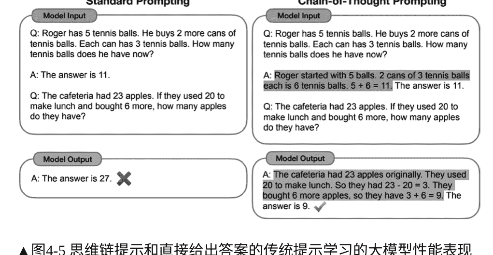

▲图4-5 直接作答与思维链引导在学习效果上的对比

即便如此，思维链本身的短板也很明显。第一，它对模型体量非常敏感。Jason Wei 团队的研究显示，PaLM 只有放大到 5400 亿参数并配合思维链提示时，才出现明显优异的表现。对小体量模型而言，思维链的增益很有限。因为做策略性推理需要扎实的知识储备，小模型参数不足以承载这些知识，难以产出可靠的推理链条。现实里多数落地模型规模偏小，1750 亿参数级别的大模型成本就已让不少机构望而却步，这就逼迫思维链必须在小模型上实现推理，同时把使用成本降下来。

第二，适用范围偏窄。目前思维链主要集中在数学题解析，以及 CommonsenseQA、StrategyQA、Date Understanding、Sports Understanding、SayCan 这五项常识推理基准上。对机器翻译等其他任务的增益，仍缺乏足够验证。

第三，错误依然存在。哪怕用了思维链提示，大模型在简单运算上仍会出错。Jason Wei 等人在 GSM8K 子集的观察里发现，大模型约有 8% 的计算失误。这说明模型并未真正掌握数学逻辑，只是机械地模仿步骤，对需要精确结果的场景仍需另寻技术。

### 4.1.4 记忆本质：海量知识的压缩表达

把海量知识压缩，指的就是用语言建模的方式，让大模型把人类迄今为止规模最大、覆盖最广的知识都存起来。可以说，几乎整个人类知识库都被压进了一个模型里，让它看起来无所不知。这种记忆能力的根源，是训练时使用的大量高质量公开数据，既有文字也有代码，正是这一点让生成式 AI 能把多种自然语言理解与生成任务统一到一个通用模型上。

在大模型内部，知识不再像传统系统那样躺在硬盘或互联网上，而是被转译成上千亿参数之间的数学计算关系，并以模糊的方式被调用。OpenAI 联合创始人、前首席科学家 Ilya Sutskever 曾描述：“当我们训练一个大型神经网络去准确预测不同文本里的下一个词……它实际上是在构建一个世界模型……这些文本是对世界的映射。神经网络不断学习世界的方方面面，包括人类的环境、期待、梦想、动机……它学到的是人类世界的压缩、抽象和可用表征。”这与脑科学的认识相通。人类的认知大致包含信息输入、存储处理、输出三步；按保存时长和编码方式，记忆又分为感觉记忆、短时记忆、长时记忆。研究发现信息储存在大脑皮层神经元构成的回路里，而 AI 的参数可以类比为神经元。

大模型的知识存储与提取带有概率属性，这正是幻觉产生的根源，输出可能偏离事实或人类价值判断。消除幻觉已成为热点，但从根本上说，幻觉源于知识压缩的学习方式和概率机制，无法彻底根除。我们只能在概率上降低发生率，及时识别与纠正，或把大模型用在对严谨性要求不高的场景，比如写小说、日常聊天。

模型还能持续学习新知，主要靠微调和提示词两条路。微调即改变模型内部知识，分为全量微调和高效微调，都需修改参数，让模型学会新内容或遗忘旧内容。但全量微调对数据和算力要求高，还需要修改参数的权限。

提示词技术则不改动模型本身，只改写输入的 Token 序列，在表面上赋予模型临时记忆。其短期记忆容量取决于模型支持的最大上下文长度和提示词的信息量。OpenAI 在首个 DevDay 上发布的 GPT-4 Turbo 支持 128k Token 上下文；到 2024 年 4 月，国内 MoonShot 发布的 Kimi Chat 已能支持 200 万字上下文。用户把所需信息塞进 Token 序列，模型据此模拟出短时记忆。

相比微调，提示词门槛极低，能用在任何大模型上，因而成为普通用户和应用开发者的首选，也催生了“提示词工程师”这一新职业。随着技术演进，大模型对提示词的依赖会下降，但对网络深度和精细化要求会上升。

把大语言模型的核心能力与人类认知对照，我们能看到模型研究为语言和认知科学打开了新思路。现有评估显示大模型表现近似人类，但很可能仍不具备真正的认知能力。若要走向通用人工智能，未来研发重心应放在模块化架构上，即把语言处理系统与感知、推理、规划系统整合，而不是单纯堆大参数。

## 4.2 底座模型落地的三种典型形态

以四大核心能力自动化、个性化、创造性、解释性为支撑，生成式 AI 正从细分场景走向更基础通用的方向。与传统 AI 相比，其优势明显。麦肯锡预测 AI 将为全球经济带来 35.6 万亿美元增益，其中生成式 AI 贡献预计达 7.9 万亿美元。

依据国内首批通过《生成式人工智能服务管理暂行办法》备案的大模型名单，8 家入选厂商均在 C 端推出了通用型应用，定位为通用智能助手，具备多轮对话、文本理解创作、数理逻辑推理、角色扮演等多类创作功能。覆盖灵感生成、聊天陪伴、知识获取等通用需求，也延伸到写小红书文案、餐厅点评、旅游攻略等垂直场景。从模态看，国产 AI 的多模态能力仍在完善。八款应用都支持文本理解与生成，其中 4 款具备语音交互，另 4 款具备图像生成。

按人机协作中大模型的参与度，通用场景的应用正向嵌入、副驾驶、智能体三种形态演进。这三种形态不对应具体的产品形态，而是强调协作方式。

### 4.2.1 嵌入式应用：大模型当作执行工具

嵌入模式里，用户用自然语言和提示词设定目标，AI 负责把目标落地。比如让模型生成小说、音乐、3D 内容。在此模式下，主导权在人，模型是执行命令的工具，专门解决操作层面的问题。落地领域在不断扩张，已涵盖对话、编程、绘图、视频制作等。除 OpenAI 外，Replit、Stability AI、Runway 等公司也在各自赛道实现场景化，共同点是能识别自然语言并输出对应模态结果。

#### 1. 文本创作类典型用法
ChatGPT 是典型的文本生成代表。自 2022 年 11 月上线以来，两月内注册用户破 1 亿，成为史上增长最快的消费级应用。它依托上亿参数级模型和海量语料，可写诗、写稿、编程。与只能搜索加工答案的传统聊天机器人不同，ChatGPT 从感知理解到内容创造实现了跃迁，语言理解生成能力接近人类水平，能结合交互背后的意图与情感给出更贴切回应。目前文本生成类 AI 已在教育、办公、电商等多个垂类广泛应用，如图4-6 所示。

| 场景 | 类别 | 海外代表 | 核心功能 |
| :--- | :--- | :--- | :--- |
| 教育 | 语音文本互动、内容创作 | Duolingo、Chegg、Quizlet、Speak、Nerdy、Facing It | AI 授课、情景教学模仿 |
| 办公 | 内容创作、编辑、企业内检索 | Microsoft Copilot、Bluemail、Slack、Salesforce | 辅助写作、生成文档、搜索 |
| 电商 | 商品与内容推荐、客服、营销 | Shopify、Instacart、AI Advertising、Jasper | 生成产品描述、电商客服 |
| 医疗 | 语音文本互动、图像识别、信息检索 | Nuance、Bullfrog、Novadiscovery | 线上问诊、AI 辅助诊断、精准药物研发 |
| 游戏 | 内容创作、语音文本互动 | Midjourney、Stability AI、Runway、Canva、Character.AI | 素材生成、NPC 脚本、角色建模 |
| 金融科技 | 文本交互、数据分析、信息检索 | Morgan Stanley、BloombergGPT | 智能投研 |
| 搜索 | 信息检索 | Microsoft Bing、ShiftPixy、YouChat | 提升搜索准确率 |
| 支付 | 数据分析、文本交互 | Affirm、Stripe | 自动计费、结账与税务合规 |
| 数据分析 | 数据分析 | Palantir | 提取非结构化数据、下达指令 |

▲图4-6 文本生成类细分场景
资料来源：各公司官网、国信证券经济研究所

#### 2. 图像生成类典型用法
Stability AI 为图像、语言、音频、视频、3D 等领域提供开源模型，其文本到图像模型 Stable Diffusion 只需数秒就能依据文本生成高清高分辨率图片，同时兼顾真实感与艺术感。相比 DALL-E 等大模型，Stable Diffusion 支持消费级显卡快速转换图文。

Midjourney 由同名实验室打造，已集成在 Discord 上，用户通过聊天机器人输入提示词即可生成图像。2022 年 7 月 12 日进入公开测试，至 2023 年 3 月 15 日 V5 正式发布，主要优化包括：支持更多画幅比例；提示词与图像一致性提升，画质更好；提示词多样性增强；自动放大生成功能；支持自定义图像权重。

### 4.2.2 副驾式协作：人机各半共同完成
2023 年 5 月 12 日，Midjourney 官宣中国区内测，内测频道每周一、周五下午 6 点开放，用户可通过 QQ 频道搜索加入免费试用中文版图像生成服务。海外版订阅价为 10～60 美元/月。

副驾驶模式的出现标志 AI 应用进入闭环阶段，产业链逐步完整。建议关注大模型应用与 AI 算力产业链。微软 Copilot 的推广预计会大幅推高 AIGC 办公场景的算力需求，带动算力产业链释放。

2023 年 3 月 16 日，微软发布 Microsoft 365 Copilot，基于 OpenAI 的 GPT-4 并结合 Microsoft Graph，可把用户文本输入转化为 365 应用中的内容。2023 年秋季发布会上，消费版 Copilot 于 2023 年 9 月 26 日随 Windows 11 更新以早期形态推出，系统新增 150 余项功能，AI 成为核心。随后微软宣布 Microsoft 365 Copilot 企业版于 2023 年 11 月 1 日全面上市。Copilot 强大而全面，有望成为新一代生产力工具。

在副驾驶模式下，人机协作占比约 50%，能显著提升创造力、效率与技能。以微软系列为例：

其一，与 Microsoft 365 结合大幅提升创造力。Word 中 Copilot 提供可编辑可迭代的初稿，节省写作编辑时间；PowerPoint 可依简单指令生成演示文稿，并联动历史文档；Excel 帮助用户做专业数据可视化分析。

其二，提炼总结能力强，效率提升明显。对个人用户，Outlook 的 Copilot 能在几分钟内浏览未读邮件并起草回复；会议中可总结要点并实时给出行动建议。对企业用户，可利用丰富数据见解构建新知识模型，促进信息流动。

其三，解锁自然语言操作，提升高级技能。在 365 中，用户用少量命令即可满足大部分需求，自然语言也能解锁更多功能。

其四，推动办公软件变革，拉动全产业链需求。Copilot 把大模型与办公软件结合，显著提升生产力。依托 Windows 与办公软件的高渗透率，云办公将迎来深层变革。金山、飞书等厂商正加大投入，推出 AI 转写、一键生成、智能美化等功能。办公之外，Copilot 生成的 AI 推荐覆盖生活娱乐，提高用户对 AIGC 的依赖，推动社交、消费等领域厂商采用 AI 产品。Copilot 正成为连接大模型与用户的桥梁，推动 AIGC 全产业链落地，有望重塑 AI 应用体验。

其五，除效率工具外，还能提供情感陪伴等社交体验。Character.AI 是典型代表，由前 Google LaMDA 团队创立。用户可创建虚拟角色，设定个性与参数后发布到社区供他人互动，具备社交属性。平台角色既有虚构媒体或名人，也有原创角色，部分用于创意写作辅助。用户可与单个角色对话，也可开多人群聊。

Character.AI 测试版 2022 年 9 月上线，第一周下载 170 万。2023 年 5 月 23 日推出移动端，Android 版 48 小时内安装超 70 万次。官方称发布前网站访问量超 2 亿，用户单次访问时长 29 分钟，是 ChatGPT 的 300%。核心用户日均使用超 2 小时，全量用户日均活跃 24 分钟/天。产品基于深度学习与可扩展语言模型，通过用户打分不断优化回复，可记忆历史对话，回复评分 1 至 4 星，影响角色行为。用户可点右箭头生成新回复，左箭头查看历史消息。

2022 年 11 月 5 日，对话记忆容量翻倍，角色塑造更准。2023 年 5 月 24 日 App Store 上线，不到一天进入多个国家免费榜前五。许多用户因孤独或现实沟通受限而使用该产品，也有人发布影视游戏人物角色。该应用兼具趣味性与满足感。

### 4.2.3 智能体模式：大模型主导人类监督
智能体模式下，人类设定目标并提供资源如算力，AI 独立完成主要工作，人类负责监督与评估。Agent 的目标包括解放重复劳动、提升效率；自主分析规划解决问题；协助人类进行探索与创新。

大模型能力迭代推动 Agent 发展。当前基础大模型进入新阶段，能力提升从高速增长转向渐进式。厂商重心正从模型迭代转向应用生态建设。Agent 是能感知环境、决策并执行动作的智能实体，赋予大模型代理能力后可独立理解、规划、执行复杂任务，本质上是指挥其他大模型解决问题的系统。这改变了传统人机交互方式，也拓宽了应用边界。随着开发工具与开源社区日益完善，Agent 有望成为未来大模型应用的核心竞争点。

从插件到代理：GPT 开启 AI 应用新周期

OpenAI 把 GPT 视作迈向代理化阶段的发力点，市场普遍解读为 AI 应用进入新周期的信号。2023 年 11 月 6 日，首场 DevDay 在旧金山举行，现场同步推出了 GPT 与 Assistants API。GPT 以零代码搭建智能代理的方式登台，Assistants API 则面向企业与开发者提供可按需调参的构建能力，二者都允许使用者通过设定指令与功能边界来定义代理的运行逻辑与能力范围。

GPT 的来路可以追溯到插件体系。2023 年 5 月 OpenAI 首次开放插件平台，覆盖学习、翻译、财务分析等数十个方向，为后续生态做了铺垫。虽然插件数量持续增长，市场影响力始终不及预期，OpenAI 此后对应用商店的整体思路做了梳理并尝试新布局。像聚焦日程管理的 Zapier 这类重量级插件，未来仍有机会成为商店的核心品类。

代理类产品大致可归为单体、多体、人机协同三类。单体多用于流程明确或目标清晰的场景，依靠任务拆解、环境感知与交互反馈，已在创意生成、代码撰写、流程提效、游戏等领域展现出较强的解决力。AutoGPT 等单体框架是较早的试验样本。自 2023 年 3 月对话模型开放接口后，结合 OpenAI 接口、向量库以及 ReAct、Reflexion 等思路，AutoGPT、BabyAGI 等开源项目逐步拼出具备自主能力的代理。核心目标是让大语言模型拥有类人的记忆、工具调用、规划与反思能力，从自我提示到最终完成初始指令，从而压缩软件产出成本并充当软件助手。

单体代理的短板在于缺少从社会互动中获取知识的能力，不适合需要多方协作或信息共享的复杂问题。多体则能借助专业分工深化子任务的处理能力，减少任务切换损耗，在效率与产出质量上都有提升，适用场景也更宽。

多体协作框架正拓宽代理的想象空间。2023 年 4 月斯坦福 AI 小镇展示了多体协作与社交行为，引发 1+1 是否大于 2 的讨论。MetaGPT 模仿软件公司的内部分工，能直接产出可运行的软件。微软开源的 AutoGen 把多体协作落到框架层面：助手型代理负责写代码，用户代理负责把用户输入转译为明确需求并驱动执行，两者协同完成初始意图。目前代理主要集中在任务解决与娱乐两类方向，个人助理与游戏落地最快，未来有望延伸到通用企业服务，以及金融、医疗、电商等专业领域。

展望未来五到十年，代理有望成为基座模型的核心应用形态，重塑人机交互模式与软件架构，推动 AI 基础设施化与商业模式向代理即服务演进，进而改变生产与生活方式。现阶段代理项目虽多，却多停留在任务解决与娱乐层面，尚未达到产品市场契合阶段，距离大规模商业化仍有距离。同时安全与伦理风险需要持续关注。理想的代理应同时具备工具属性与人格属性，这或许会带来认知跃迁。当前多数 AI 应用侧重提效、解放生产力与增强创造力，体现工具属性；而 Character.AI 等角色扮演类聊天机器人满足陪伴、社交与情感支持，体现类人属性。长远看，兼具两种属性的代理可能引领观念的重大转变。

## 4.3 基座模型加速消费互联网应用智能化

### 4.3.1 消费互联网应用交互方式将被重塑

#### 1. 自然语言交互正在取代图形界面
在消费互联网演进里，用户与产品的交互方式始终决定体验好坏。基座模型崛起后，这一板块正迎来范式切换。依托出色的语言理解和深度学习能力，应用正从图形化操作转向基于自然语言的对话式操作。新 Bing 整合 GPT-4 后推出的对话搜索就是典型，能直接根据口语化提问给出完整答案或建议。自然交互更自由、更直观，用户基本不用学习就能像跟人对话一样操控功能。不过现阶段模型产品仍依赖用户主动表达，门槛不低，对话模型的留存和粘性目前仍逊于主流 App。

基座模型也在刷新传统语音助手。把模型嵌入手机、音箱乃至汽车，华为、小米等厂商正推动从触控到语音再到自然语言的演进。如华为在鸿蒙 4.0 发布会上宣布智能助手升级，利用基座能力不仅支持自然语言交互，还能输出小作文、图片、视频等内容。用户可通过简单语言指令让手机助手完成复杂创作，如按描述自动生成图文视频，极大丰富使用场景。设备正从单一工具变为能理解并响应需求的智能伙伴，未来交互将更自然、高效且具情感。

从设计视角看，图形界面与对话界面在相当长时期内会并存。复杂专业工作如编程、专业设计仍依赖图形界面。自然交互要完全替代图形界面，前提是用户语言表达能力强且上下文信息充足。例如应用搜索时提示“可直接向我提问”，用户常会无从下手，而传统图形界面更能提供背景信息引导交互。未来两者相辅相成：自然交互擅长处理不确定、复杂任务与新概念，通过多轮对话帮助理解；图形界面在概念普及后发挥作用，以可视化提升体验。产品设计需结合使用以达最佳效果。

#### 2. 基座模型深度参与用户决策
传统信息流推荐可视为“影响”决策，通过浏览习惯推送广告或商品，潜移默化促成点击或购买。基于基座的智能对话交互则更进一步“辅助”决策。

其一，模型打通了信息收集、整合到行动的闭环。原本需要用户粗筛的信息，现由模型代劳，且决策权重高于用户，用户可触达的信息范围取决于模型呈现的内容，于是信息茧房加剧。例如百度智能云推出的“百度 GBI”能依据企业财务数据与市场动态生成洞见型商业报告，助力更精准决策。

其二，基座的使用类似地图导航取代纸质地图。用户输入目的地后系统呈现可选路线，代替用户规划任务。以 Google 的智能代理为例，它利用基座理解用户日程与待办，并主动提供规划建议。用户可能说：“我明天有 3 个会议还有工作要完成。”代理会分析紧急程度与耗时，制定包含会议、工作分配与休息建议的优化时间表，提升决策效率与体验。

#### 3. 新的个人互联网应用原生于基座
随基座日趋成熟，众多原生于基座的消费互联网应用涌现。设计之初即以基座为核心，充分发挥其在自然语言处理、数据分析与模式识别上的优势，既提升体验也开辟新服务与商业模式。

OpenAI 的对话模型基于 GPT-3，可进行自然流畅对话，提供信息查询、文本生成、编程辅助等服务，开辟了新的信息获取与交互方式，也催生了大量基于聊天机器人的创新。百度推出的“度秘”基于百度自研基座，提供语音识别、智能搜索、日程管理等个性化服务，通过深度学习理解指令。

目前基于 GPT-3 系列开发的应用与场景已超 600 个，覆盖写作、设计、编程与测试等。以基座为核心的应用从诞生起就深度利用其能力，推动消费互联网向更个性化、智能化演进。未来将出现更多原生创新，持续改变生活与工作方式。

### 4.3.2 引入基座能力将会给消费互联网应用带来三方面价值提升

#### 1. 收入提升：工具与平台类应用通过智能化提高付费率与 ARPU
内容编辑工具如 Microsoft 365、Notion、Adobe 等借助基座对话能力打造 Copilot 类工作助理，增值部分由个人或企业用户直接付费。融合笔记、任务、知识库的 All-in-one 生产力工具 Notion 于 2023 年 2 月上线 Notion AI，助力快速生成内容、翻译、校对、创建想法列表，上线 2 个月超 400 万用户使用。AI 加入有望使 Notion 的 ARPU 值提升 50% 至 100%。平台型应用如健身、网约车、旅行预订、网上外卖等正接入基于基座的聊天机器人，向覆盖数字生活全场景的超级消费平台升级，增值部分通过平台广告、信息流服务等摊派给企业。如对话模型已接入订餐、旅游、电商等生活场景插件，后续第三方应用优化将从基于网站内容、关键词、链接的 SEO 转向基座优化，便于引流。

商业化早期，“尝鲜”心理可驱动 10% 至 20% 用户付费。中期随 AI 能力迭代，40% 至 60% 的付费渗透率假设较为审慎。长期看，AI 功能或将打破收入天花板。

#### 2. 用户突破：文娱类应用引入基座实现内容放量，引发用户增长
文娱类应用渗透率已高，增长空间接近饱和，短视频与网络视频渗透率约 95%，网络音乐与网络游戏增长率约 -6%。服务商需寻找新机会提升用户规模与使用时长。有效策略是开放基于基座的视频、音乐、文学、游戏创作工具，实现内容与流量的双重增长。例如网易 UGC 编辑器手游《蛋仔派对》允许用户自制地图并提供教程与组件降低创作门槛，上线 6 个月日活跃用户数突破 3000 万。

#### 3. 商业模式创新：基座加文娱 IP，创新数字资产增值服务
基座的人性化自然交互催生 AI 虚拟陪伴、IP AI 分身等 C 端新模式。核心是通过 AI 内容生成、语音与姿态交互等技术对 IP 进行二次创作，形成数字人主播、AI 音频、虚拟玩家等数字分身，再进行产品化与商业化以挖掘流量增值。例如拥有 180 万粉丝的 Snapchat 网红 Caryn 发布 AI 虚拟伴侣 Caryn，基于其在 YouTube 上超 2000 小时视频内容在 GPT-4 模型上微调训练实现，可动态交互、提供独一无二体验并 24 小时快速回复。

## 4.4 基座模型将成为新的互联网入口

互联网入口汇聚流量与海量内容，通过算法实现用户与信息的对接，是接入互联网的第一触点。当前入口正经历新一轮变革。以对话模型为代表的基座在信息对接准确性与内容产出效率上表现突出，已具备成为新一代入口的条件，这将引发企业在入口产品布局上的新竞争。

### 4.4.1 基座模型将超越搜索引擎成为新一代入口

来自《第51次中国互联网网络发展状况统计报告》。
入口的内涵与典型产品经历多次演进。信息获取便捷性与用户流量是核心要素。PC 互联网时代，搜索引擎与社交网络成为主要入口，催生 Google 搜索、Facebook 等垄断型产品。移动互联网时代，移动即时通信、短视频、移动支付、导航等应用使用率超 79%，成为多样化内容分发入口，用户获取内容链路缩短，诞生 Meta、腾讯、阿里巴巴、字节跳动、百度等龙头。智能互联网时代，基座整合内容与应用分发功能，将成为超越搜索引擎的新一代入口，并逐步向底层操作系统渗透。互联网入口演进具体情况如图4-7所示。

| | 入口1.0 | 入口2.0 | 入口3.0 |
|---|---|---|---|
| 内容分发 | 搜索引擎 (Google、百度、Bing……) | 即时通信、支付、视频、地图导航等App (微信、抖音、高德……) 搜索引擎 (Google、百度、Bing……) | 基座超级应用 ChatGPT…… |
| 应用分发 | 浏览器 (网景、IE、Chrome……) | 应用商店 (AppStore、Google Play……) 浏览器 (Chrome、Edge……) | |
| 操作系统 | PC操作系统 (Windows、macOS……) | 手机操作系统 (iOS、Android……) PC操作系统 (Windows、macOS……) | 生成式基座 + 硬件操作系统 |
| 硬件 | PC | 手机 PC | 智能机器人 可穿戴设备 智能汽车 PC 智能手机 …… |

图4-7 互联网入口演进

#### 1. 基座模型在内容呈现质量和供给方式上全面优于搜索引擎
呈现质量上，如对话模型的自定义指令功能能更好理解用户意图，提供更个性化、有针对性的内容。供给方式上，传统搜索引擎要求用户自行拆解任务、提炼关键词、筛选整合信息，而对话模型可代劳，降低使用门槛，理解复杂意图并简化思考流程。

#### 2. 在内容呈现全面优化基础上，基座入口将成为用户终点，不再实现用户分流
来自《2022移动互联网年度大报告》。
PC 互联网时代，传统搜索引擎展示相关网站引导用户深入检索。移动互联网时代，微信、抖音、淘宝、高德等超级 App 将细分内容整合聚集，延长驻留时间，减少流失，如短视频平台日均使用时长超 2.5 小时①，其中微信是典型超级 App。

智能互联网时代，对话模型进一步提升超级 App 吸引力。它不仅在对话中提供完整答案，还通过开放插件整合上游应用内容与功能场景。用户无需跳转或下载其他应用即可完成复杂任务，真正实现 All-in-one。

#### 3. 基座模型将与操作系统深度融合
操作系统负责软硬件管理调度并提供交互界面与开发环境。当前基座可通过自然语言调用操作系统部分功能。例如 Windows Copilot 能用基座对文档进行总结、分析、解释与改写。基座还具备任务规划与编程能力，可通过自然语言对话或图片输入自动生成完成复杂任务的脚本，并以代理身份调用其他流程实现软件应用自动开发。例如 AutoGPT 可根据需求自主执行日常事件分析、营销方案撰写、代码编程等任务。

### 4.4.2 基座模型将引发搜索引擎商业模式变革

#### 1. 搜索引擎升级为答案引擎，将简化用户工作流程
AI 搜索的最大价值在于把信息颗粒度从网页细化到信息本身，提升获取效率。以 AI 搜索引擎明星产品 Perplexity 为例，用户可用自然语言描述复杂问题，系统理解后搜索并整合内容，给出明确答案并支持溯源与多轮追问。从使用角度，AI 搜索引擎可帮助用户省去逐个链接查看与多源信息整合两大步骤。

#### 2. 整合基座能力后，搜索引擎的商业模式将面临两方面取舍
收入方面，AI 搜索引擎创造新收入来源如订阅服务。与传统免费检索不同，AI 搜索引擎可推出付费订阅。例如 Perplexity Pro Search 每月收费 20 美元，付费用户可使用更智能模型如 GPT-4、Claude 2.1 进行无限次搜索、处理更复杂问题并获取更长合理回答。但广告收入可能下降，尤其基于竞价排名的收入。从界面看，用户问题、答案与信息来源是核心展示，传统广告弹窗、链接等干扰因素基本消失。传统搜索引擎通过链接信息与用户并按触达量与效果向广告主收费，如 Google 的竞价排名按关键词出价展示广告并按点击计费。AI 搜索引擎优先保证内容准确、可靠、完整，通过多源整合形成综合答案，搜索结果页不再展示按排名排序的广告，竞价排名机制将不复存在。

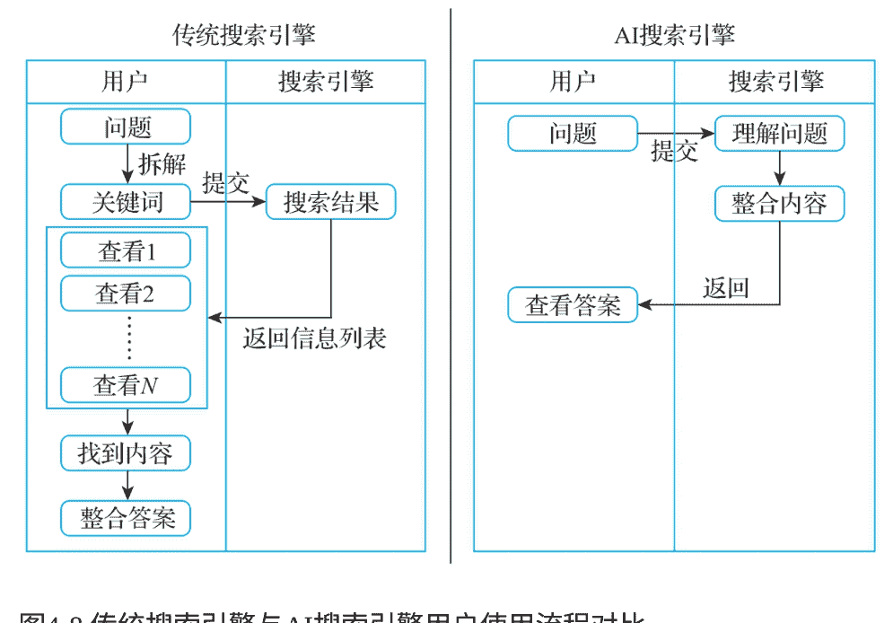

图4-8 传统搜索引擎与AI搜索引擎用户使用流程对比

从支出维度来看，以生成式大模型为动力的检索服务，相较于传统搜索的单次成本高出不少，但互联网的规模效应会随着时间推移逐步缩小这一鸿沟。第一点，每一次查询本质上是一次推理过程，需要消耗算力并带来能耗。2023年年初，OpenAI CEO山姆·奥特曼曾在Twitter上透露，ChatGPT进行一轮对话的算力花费大约是2美分。反观谷歌，2022年的搜索总量达到3.3万亿次，平均下来单次成本只有0.2美分，两者相差将近10倍。随着检索形态从文本向语音、图像、视频等方向扩展，单次费用还将继续上扬。第二点，目前多数智能检索产品并未自研底座，而是调用GPT系列等第三方模型来提供能力，因而要额外支付合作与授权费用。OpenAI面向企业的定制化GPT-4训练项目通常耗时数月，公开页面显示起步价在200万至300万美元区间。

### 4.4.3 大模型入口变迁可划分为三个阶段
#### 1. 培育期：能力注入存量入口 竞争态势暂时稳定
来自ChatGPT Opened a New Era in Search. Microsoft Could Ruin it。
该阶段搜索引擎、垂直应用App仍是主入口，通过融合生成式能力实现产品升级。微软发言人凯特琳·罗尔斯顿表示，大模型的引入让Bing搜索结果质量的提升幅度，已经超过过去二十年累计升级的总和。
来自Statcounter的搜索引擎PC端2023年5、6月统计结果。
凭借存量入口的高流量优势，模型的对话与认知能力在真实使用中持续打磨。用户习惯逐步养成，流量在同类产品间因先发优势与模型表现缓慢迁移。Bing Chat上线后，PC端份额提升了2.38个百分点，而Google同期下降了4.16个百分点。整体来看，智能时代的入口格局与移动互联网时代保持高度一致。
#### 2. 混战期：独立客户端争夺信息与用户 格局蓄势重塑
来自微软新闻中心的“微软Build 2023人工智能重新定义软件开发与工作的未来”。
其一，借助开放插件机制，独立的应用可以接入后端的互联网信息流。ChatGPT的插件生态已覆盖Code Interpreter等生产力工具，以及Expedia、Kayak、OpenTable等生活服务类插件。其二，这类应用正向PC、手机、汽车等更多终端延伸以聚拢用户。OpenAI已发布ChatGPT的iOS与Android客户端，微软则计划把AI助手Windows Copilot直接嵌入Windows 11任务栏。
此阶段用户将在两类产品间快速迁移。第一类是以ChatGPT为代表的独立智能对话机器人，主力为OpenAI等模型厂商。第二类是整合生成式能力的增强型搜索引擎，主力为谷歌、百度等巨头，以及微软Bing等长尾玩家。
#### 3. 统一期：超级智能助手主导流量 各地形成区域寡头
首先，模型演进为全能生活管家，覆盖O2O全场景，包括购物、到店、外卖、旅游、出行等。其次，扮演万能办公助手，承担文档撰写、排期管理、会议纪要、代码开发等低创造性工作，定位类似现有的Microsoft Copilot与GitHub Copilot X。再次，深入专业咨询领域，如医疗类模型MedGPT可实现常见病智能问诊、检查项目推荐、初步诊断与治疗建议。
来自Statcounter 2023年5～7月统计结果。
参照搜索引擎的格局，谷歌在海外市占超90%，百度在国内市占超60%。格局固化后，国内外大模型入口企业各自占据超60%的用户流量，形成区域性寡头。
### 4.4.4 强者恒强的逻辑难以逆转
#### 1. 存量巨头守住基本盘概率最大
其一，现有产品用户基数庞大，升级即可绕过从零获客。例如微软将GPT-4接入Bing推出NewBing，直接重构既有入口。
其二，产品矩阵完善，提升迁移成本。例如Chrome默认搜索引擎固定为Google且不可更改，有效遏制对手份额扩张。
其三，手握海量搜索行为与网页数据。巨头日增的实时数据是其他公司数倍，对模型迭代至关重要。
来自《谷歌2022年年报》。
其四，现金流充裕，足以承担训练与推理的高投入。谷歌PaLM模型的训练花费约1120万美元，仅占2022年395亿美元研发投入的0.03% [2]。
#### 2. 长尾玩家份额有望抬升
> 引自新浪财经报道“颠覆历史！‘ChatGPT搜索引擎’发布，微软市值一夜飙涨5450亿”。
> 引自Microsoft Bing Blogs的The New Bing and Edge：Progress from Our First Month。
其一，长尾入口用户规模较小，升级包袱轻，在用户尝鲜意愿强、容错度高的窗口期易实现份额提升。谷歌Bard因信息不准市值单日蒸发1000亿美元，而微软发布NewBing与Edge AI后市值单夜上涨超800亿美元 [3]；NewBing上线首月日活达1亿，其中约三分之一为新用户 [4]。不过寡头正加速自研补短板，长尾提升仅为积极信号，难根本逆转格局。
其二，长尾企业同样拥有多元产品矩阵、数据沉淀与充足资金。如微软可复刻1998年靠Windows预装IE冲击网景的路径，利用Windows系统、Edge浏览器、Microsoft 365等生态为AI入口导流。
#### 3. 独角兽企业前路仍多挑战
其一，需承受寡头持续压制。ChatGPT面世后谷歌内部拉响红色警报，并通过投资Anthropic、加速Bard自研等方式围堵。
其二，现金流不稳难以支撑高额研发与运营。OpenAI早期倚赖微软资金与算力才推出ChatGPT、GPT-4等里程碑模型。
其三，独立应用场景模糊、性能与体验待提升，用户留存承压。SimilarWeb数据显示，主流AI聊天机器人流量与付费用户增速放缓甚至下滑，ChatGPT 2023年6月流量环比降约10.3%，5月访客参与度降约8.5%。

# 第5章 大模型行业应用全景与商业化路径
随着技术迭代，2024年生成式大模型正从底座层下沉至应用层，推动各行业数字生产力跃升。IDC调研显示，35%的中国企业正处于大模型试探与概念验证阶段，24%的企业已在生成式AI上投入巨资。本章梳理国内大模型在各行业的落地图景，涵盖区域与行业分布及部署路径，并聚焦医疗、媒体、政务、金融、工业五大重点领域，剖析现状、典型场景与发展走向。

## 5.1 国内大模型行业应用全景
截至2024年3月30日，国内累计发布行业大模型341个。其中87个基于自研通用大模型，主体为百度、华为、阿里巴巴、科大讯飞、中国移动、中国电信。余下模型多建于第三方开源基座，如GLM系列、百川大模型、通义千问系列及海外Llama等。

### 5.1.1 行业大模型地图
从机构地域分布看，国内23个省市/地区已发布行业大模型。其中北京发布121个，占比35.5%；广东、上海、浙江分列其后，数量分别为52、47、28。北京、广东、上海、浙江人才集中、算力配套完善，为研发提供关键支撑。
从行业分布看，行业大模型集中于医疗健康、金融、传媒游戏三大领域，合计占比42.2%。其中医疗健康发布57个，占比20%；金融发布35个，占比12.5%；传媒游戏发布27个，占比9.7%。

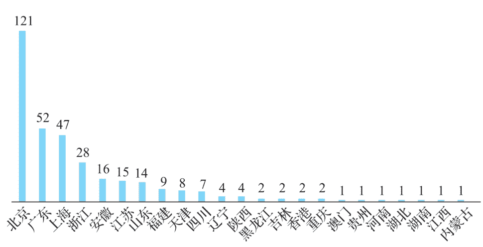
▲图5-1 2023年我国行业大模型地区分布情况
数据来源：天翼智库根据公开数据统计
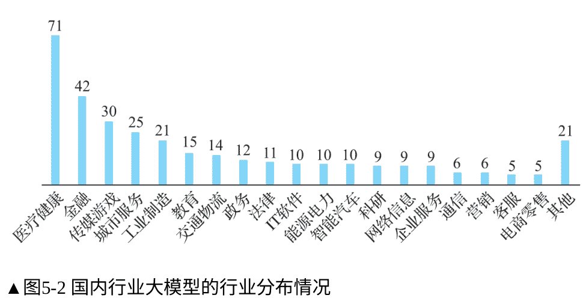
▲图5-2 国内行业大模型的行业分布情况
数据来源：天翼智库根据公开数据统计，统计时间截至2024.3.30

### 5.1.2 行业大模型技术和部署路线
#### 1. 技术路线
行业大模型以通用基座为起点，融合行业专业知识、专家经验与生产数据专项训练而成。构建流程大致分为三步。
第一步，理解行业需求，进行语料收集与治理。在此之前需深入研判行业语言习惯、知识结构、数据类型及典型问题，再采集高质量行业专用语料并开展清洗、格式转换、标注等治理工作。
第二步，模型精调与微调。基于通用或开源大模型，按行业需求进行结构调整、参数优化，并引入行业数据集进行精调训练。常用方法包括有监督精调与参数高效精调，企业还可利用私有语料微调或外挂私有数据库。
第三步，评测与优化。对精调模型进行评估，确认是否满足场景要求，据结果重训优化，包括调参、更换训练策略或引入提示词工程。
例如，中国电信研究院研发的“启明”网络大模型，在通用开源基座上学习通信行业专业知识与特色数据，输出预置网络核心场景任务模型。通过“预训练+微调”方式，模型可满足小样本场景需求，降低网络AI应用门槛，提升细分场景效果，实现大模型辅助的网络智能运维。

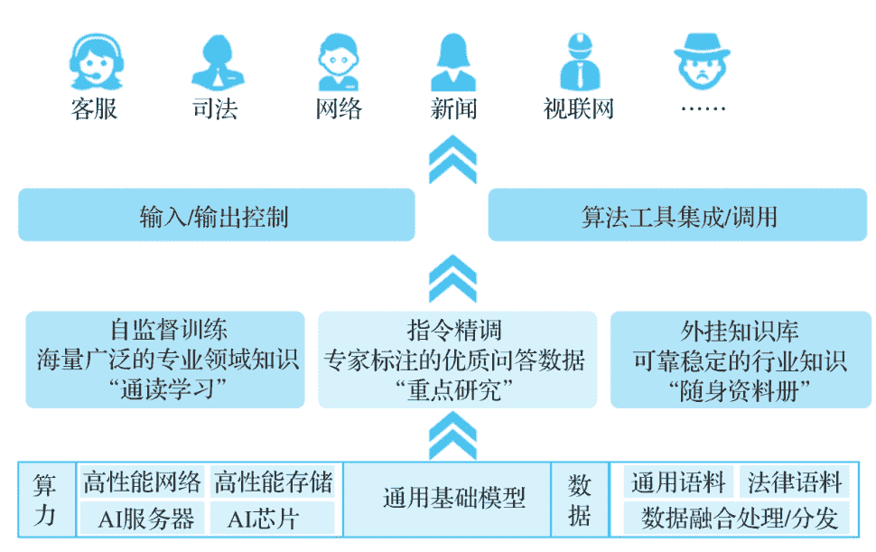
图5-3 中国电信研究院行业大模型构建流程
#### 2. 部署方式
按部署环境可分为私有化部署、行业云部署、公有云部署。
私有化部署指将模型部署于自有服务器或私有云，或采购大模型一体机，可保障数据安全，适合依赖内部语料的企业。需投入较多资金与人力维护。一体机整合训推功能于同一设备，国内主流产品多与华为合作，包括讯飞星火一体机、云天天书大模型训推一体机、智谱-昇腾GLM大模型一体机。
行业云部署由行业主导组织建设与维护，在确保数据可控前提下向行业内提供云服务，兼具安全与低成本、高扩展性优势。
公有云部署通过标准接口在公有云上运行，由云厂商负责运维，成本低、灵活性高，成为中小企业主流。国内超半数大模型运行在阿里云。百度智能云千帆大模型平台已纳管42个主流大模型，服务超17000家客户。
总体而言，企业需先明确需求与目标，再结合业务场景与技术要求选择合适软硬件环境与部署方式。

## 5.2 医疗大模型：应用价值高地
医疗行业被视为AI大模型落地首选场景之一，与AIGC在内容处理与智能计算的核心能力高度契合。基于多模态医学数据构建分析推理体系，可提升医生诊断准确率与治疗效果，并为患者提供更优质服务。相较移动互联网，大模型有望在医疗多环节实现更精准、高效、人性化的服务，推动智慧医疗模式构建并重塑行业。

### 5.2.1 医疗大模型产业图谱
国内已发布医疗行业大模型71个，主要来自药械、医健企业与互联网科技公司。我国“AI+医疗”相关企业超14万，京东健康、医联、百度灵医智惠、科大讯飞、卫宁健康等纷纷推出产品。自2023年2月以来，已有十余家企业发布或准备发布医疗大模型。产业主体包括医疗信息化厂商、AI大数据企业、互联网医疗平台与科研机构，各自依托擅长领域与基础大模型企业合作，推动创新与应用。

| 类别 | 企业 | 产品/模型 | 电子病历 | 辅助诊断 | 智能问诊 | 慢病检测 | 健康管理 | AI健康助手 | 文献检索 | 医药研发 | 医疗机器人 | 医疗辅助器械 |
|---|---|---|---|---|---|---|---|---|---|---|---|---|
| 医疗信息化厂商 | 医疗 | MedGPT | √ | √ | √ | √ | √ | √ | √ | √ | √ | √ |
| 医疗信息化厂商 | 卫宁健康 | WiNEX Copilot | √ | √ | √ | √ | √ | √ | √ | √ | √ | √ |
| 医疗信息化厂商 | 东软 | 添翼 | √ | √ | √ | √ | √ | √ | √ | √ | √ | √ |
| 医疗信息化厂商 | 润达医疗 | 普惠 AI医疗服务大模型 | √ | √ | √ | √ | √ | √ | √ | √ | √ | √ |
| 医疗信息化厂商 | 创业慧康 | AI大模型聚合产品 BsoftGPT | √ | √ | √ | √ | √ | √ | √ | √ | √ | √ |
| 医疗信息化厂商 | 联影智能 | 全病程智医诊疗大模型 | √ | √ | √ | √ | √ | √ | √ | √ | √ | √ |
| AI大数据企业 | 商汤科技 | 大医 | √ | √ | √ | √ | √ | √ | √ | √ | √ | √ |
| AI大数据企业 | 科大讯飞 | 讯飞星火医疗大模型 | √ | √ | √ | √ | √ | √ | √ | √ | √ | √ |
| AI大数据企业 | 云知声 | 山海大模型 | √ | √ | √ | √ | √ | √ | √ | √ | √ | √ |
| AI大数据企业 | 乐言科技 | 乐言 | √ | √ | √ | √ | √ | √ | √ | √ | √ | √ |
| 互联网医疗平台 | 华为 | 盘古药物分子 | √ | √ | √ | √ | √ | √ | √ | √ | √ | √ |
| 互联网医疗平台 | 阿里 | 通义仁心 - 个人专属健康助手 | √ | √ | √ | √ | √ | √ | √ | √ | √ | √ |
| 互联网医疗平台 | 腾讯 | 混元大模型 | √ | √ | √ | √ | √ | √ | √ | √ | √ | √ |
| 互联网医疗平台 | 百度 | 文心生物计算大模型 | √ | √ | √ | √ | √ | √ | √ | √ | √ | √ |
| 互联网医疗平台 | 智云健康 | Cloud DTx、Cloud GPT | √ | √ | √ | √ | √ | √ | √ | √ | √ | √ |
| 互联网医疗平台 | 京东健康 | 京医千询 | √ | √ | √ | √ | √ | √ | √ | √ | √ | √ |
| 互联网医疗平台 | 百度灵医智惠 | 灵医Bot (医疗对话机器人) | √ | √ | √ | √ | √ | √ | √ | √ | √ | √ |
| 科研机构 | 上海科技大学 | DoctorGLM | √ | √ | √ | √ | √ | √ | √ | √ | √ | √ |
| 科研机构 | 上海人工智能实验室 | OpenMEDLab 浦医 | √ | √ | √ | √ | √ | √ | √ | √ | √ | √ |
| 科研机构 | 清华智能产业研究院 | BioMedGPT-10B、DrugFM | √ | √ | √ | √ | √ | √ | √ | √ | √ | √ |

医疗与媒体的双重智能化升级正在加速成型

2023 年的产业盘点显示，高校在医学智能基座的布局进入落地期。华工数字孪生人实验室主打的 ProactiveHealthGPT、复旦大学研发的中文医疗健康个人助手 DISC-MedLLM 在能力矩阵上均实现全覆盖，显示学术力量在该赛道加速推进。

| 科研机构 | 华工数字孪生人实验室 | ProactiveHealthGPT | √ | √ | √ | √ | √ | √ | √ | √ | √ | √ |

| 科研机构 | 复旦大学 | 中文医疗健康个人助手 DISC-MedLLM | √ | √ | √ | √ | √ | √ | √ | √ | √ | √ |

图5-4 2023年中国医疗大模型产业图谱

数据来源：公开资料整理

拥有算力与数据积淀的头部科技公司，如科大讯飞、商汤科技等，正把自有技术能力注入诊疗体系，在数据驱动下催生智慧医疗新形态并快速放量。互联网医疗与传统医院加速涌入智能基座应用场景，行业先行者持续拓宽产品线并构建战略协作网络。

### 5.2.2 三大典型应用场景

据中国信息通信研究院发布的医疗健康大模型应用案例库，截至2023年9月底，境内外已上线或在研的典型案例超260个。该库勾勒出智能基座在医疗领域的渗透潜力，并把应用价值最高的方向归纳为智能问诊、医学影像解析、医学问答、诊疗辅助、电子病历自动生成、健康管理与医学教育等，探索节奏明显加快。

#### 场景一：医疗服务

通用医学智能的关键特征是高度灵活与可复用。传统医学智能多为单任务定制，依赖特定标注数据训练，使用边界受限。随着多模态架构、监督学习与语境学习等技术的成熟，基于大基座构建通用医学智能成为可能。未来有望灵活解析影像、电子健康记录、检验结果、基因组、图表或医学文本等多源信息，并生成自由文本解释、简易建议或图像标注等更具表达力的结果，展现高阶医学推理能力。微软、百度、医联等企业推出的医学基座主要聚焦服务场景，在商业化路径上领先，有望提升互联网医疗与基层服务的整体质量。

- 智能问诊：模型在海量医学知识上训练后，可通过多轮对话把握用户诉求，初步推断病情、提示就诊科室、推荐医院与医生，同时提供健康科普与用药建议等多种服务。
- 影像辅助诊断：在医学影像图文数据上训练后，可自动产出影像诊断报告，并以对话方式解读胸部X线等影像，回答相关问题。
- 智能诊断与预测：可处理病理、临床记录、基因组学等异构数据，结合个体信息与检测结果综合分析，输出诊疗建议、评估治疗方案、预测疾病风险并发出预警。

#### 【案例】医疗健康大型语言模型“大医”

商汤科技打造的医疗健康大语言模型“大医”基于自研千亿参数模型“商量”万亿级预训练语料构建，使用超200亿Token高质量医学知识数据训练，覆盖教材、指南、临床路径、药品库、疾病库、体检报告及4000万真实病历与医患问答。经增量预训练、指令优化、奖励模型构建及执业医师反馈强化学习，并集成长程记忆存取、医学知识库检索、医学计算器等实用插件，可精准解答专业问题，已向产业链上下游开放服务，并探索与营养保健、健康管理等领域合作。商汤还推出影像基座、生物信息基座等垂直模型群，覆盖CT、MRI、超声、内镜、病理、医学文本、生物信息等模态。

- 智能导诊与预问诊：在门诊环节充当医生助手，实时记录整理问诊内容，提炼病历信息写入电子病历，提升效率。
- 智能诊断：临床中提供辅助决策，诊后提供用药指导并帮助建立随访档案与计划。
- 电子病历：可生成阶段性小结、出院小结等模板，并将影像报告、自由文本病历一键结构化，便于统计与科研。

“大医”聚焦智慧大健康、智慧患者服务、智慧临床与数智建设四大方向，已覆盖智能自诊、体检咨询、健康问答、导诊、预问诊、用药咨询、诊后管理、智慧病历、诊室听译、智慧医助、智慧随访、影像与病历结构化等13个细分场景，实现功能与场景的精准匹配。

#### 场景二：医药研发

智能基座可贯穿药品与器械从研发到上市前的全流程，包括药物发现、临床前研究、临床试验、注册申请及上市后评价，实现提速与降本增效。面向药械信息情报与行业知识问答的基座也在增多，推动创新。制药新药研发成本高、周期长、成功率低，基座在药物设计、筛选、优化、验证等关键环节提升预测能力，缩短周期并降低成本。

#### 【案例】华为云AI推动超级抗菌药Drug X研发加速，成药性预测准确性提升20%

盘古药物分子基座对分子学习与理解水平已达或超过化学专家，设计化合物新颖性可达99%，成药性预测准确性较传统方式提升20%。华为云基于该基座推出盘古辅助制药平台，提供覆盖全流程的一站式服务，将先导药物研发周期从数年压缩至1个月。西安交大一附院刘冰教授团队利用该服务成功研制超级抗菌药Drug X。该药靶向微生物类组蛋白HU，抑制细菌DNA复制，是全球首次发现噬菌体编码靶向该靶点的抑菌抑制剂，有望成为近40年来首个新靶点新类别抗生素。在盘古基座辅助下，Drug X先导药研发周期从数年缩至一个月，成本降低70%。Drug X在抗疟原虫等寄生虫领域已有积极反馈，处于临床前阶段并已申请国际专利。

#### 场景三：医疗机器人

智能基座有望改善机器人的视觉与交互能力，赋能术中导航与病灶识别。当前应用尚处早期，但对视觉、交互、自主性的影响正在显现。结合基座，手术机器人可增强病灶分割与3D导航能力，融合视觉与触觉多模态信息，实现更精准的病灶识别。康复与陪伴类机器人对人类意图、手势、语音、情绪的理解也能得到加强，提升康复与老年人护理服务质量。基座的泛化能力正提升通用机器人自主性，医疗器械集成AI模块趋势明显，影像阅片场景已有落地，重症与检验领域正成为探索重点。

#### 【案例】大模型加持手术机器人，助力分级诊疗

中国科学院香港创新研究院人工智能与机器人创新中心研发的Embodied AI多模态手术基座与MicroNeuro微创脑手术柔性机器人系统，实现了AI与机器人协作。MicroNeuro是国际首个用于微创神经外科的柔性机器人，可将脑组织损伤降低50%以上，并集成AI多模态基座，实时融合视觉、触觉信息辅助推理判断。其突破在于对微小柔软器械的精准控制，以及具备语言能力与实时影像分析能力，可辅助医生判断手术阶段与注意事项。

### 5.2.3 “AI+医疗”市场前景广阔

基座与医学结合初期增速惊人。亿欧预测，2023—2030年是中国医学基座集中爆发的阶段。MarketsandMarkets预计，到2025年全球医学基座市场规模将达38亿美元，2030年将超100亿美元。市场格局尚未稳定，机遇巨大。

据Frost&Salivon数据，2020—2025年“AI+医疗”市场规模高速增长，2025年总规模将达348亿元，年增速保持40%左右。观研数据中心显示，医学影像、数据交换与存储、综合辅助诊断的市场占比分别为34%、22%和13%。动脉橙数据显示，2022年1月1日至2023年6月28日，全球生成式AI医疗领域累计投融资事件超160起，累计投资金额达57.1亿美元。

医学基座已成为医疗AI核心软件增长的关键驱动，预计未来三年相关AIGC投入年均增速约30%。Statista报告预测，全球医疗AI市场将保持37.0%增速，预计到2025年规模达1879.5亿美元，中国医疗AI市场2020—2025年复合年均增长率将达43.9%，高于全球增速。

图5-5 2023—2030年中国医疗大模型产品市场规模及增速集中爆发

### 5.2.4 医学基座多模态融合发展

基座在医学细分领域的关注度不断提升，但可解释性、数据隐私与安全仍待解决。《人工智能大模型赋能医疗健康产业白皮书（2023年）》指出，现阶段基座呈现家族化、多模态、融合化、协同化发展趋势，并强调基座与小模型协同。

医学健康基座正向多模态演进，这是通向通用医学AI的关键。

1. 规模更庞大、模态更丰富。当前多模态模型主要处理视觉与语言，未来将融合更多模态进行大规模预训练，结合文本、图像、视频、音频及分子、细胞、组织等不同尺度数据，释放科学发现与临床诊疗潜力。
2. 训练加速。复杂生物信息与医学数据对算力要求高，需采用更高效经济的训练方法。类似FastMoE的优化算法将持续出现，提升计算效率与训练速度。
3. 实现真正的统一。模型将适应多种类型、模态、层次的生物医学数据，完成鲁棒的信息编码、解释与生成，并服务于多重医疗场景与不同诊疗需求。
4. 跨领域知识融合。模型将融合不同领域、任务、模态的知识，创新应用于生命科学研究与医疗健康场景，实现多模态知识融合与跨模态表达，能处理并生成文本、图像、音频、视频等多类数据，实现语义对齐与信息互补，更好服务科研人员、临床医生与患者。

### 5.3 媒体大模型：推动媒体业智能化升级

随着基座技术快速发展，媒体行业正经历变革。媒体核心在于内容生产与传播，具有传播快、形式多样、个性化服务、强互动四大特征。消费升级下，传统生产传播方式难以满足用户对新内容、快速互动与个性化的需求。基座恰好能解决高成本、长周期、同质化严重、产出不稳定等问题。例如OpenAI发布的视频基座Sora大幅提升了图像与视频内容供给能力，降低人力与时间成本，并产出更具创意与特效的内容。基座将改变内容生产方式，实现降本增效，推动数字技术与实体经济融合，重塑市场格局。媒体行业有望成为基座影响最大的行业之一。

新华社、人民日报、中央电视台等主流媒体已将基座嵌入工作流程。据IDC测算，2020年中国智能媒体解决方案市场规模达4.8亿元，预计2020—2025年年均复合增长率46.3%，到2025年规模超30亿人民币。AI数字人、文本到视频生成等将成为技术高点，媒资管理、内容安全审核等场景空间也将扩展。

图5-6 当前媒体行业痛点、需求及大模型能力

### 5.3.1 媒体大模型产业图谱

截至2024年3月底，国内媒体行业已正式发布的大模型共计30个。提供商包括主流媒体机构、互联网及硬件企业、AI科技公司及科研院所。主流媒体因拥有高质量行业数据与需求洞察，成为核心提供商，多从自身业务出发自主研发或合作开发。研发重心集中在“制”与“审”，旨在提升内容生产与审核质量效率。

百度、华为、新华三等凭借算力、算法、数据、人才、资金与客户资源优势推动生态合作。百度文心与人民网、电影频道合作的场景化解决方案提升选题策划、采编、制作、审批效率；华为与新华网、环球网、央视网、湖南广电等合作，提供内容编排、制作、播报分发、用户运营等技术赋能。

AI科技公司可分为以计算机视觉为主、以语音识别为主、以自然语言处理为主三类。它们在垂直领域积累多年，借助基座提升技术能力，为客户提供更有效的场景方案，在内容制作与播报分发等领域布局较多。

图5-7 2023年中国媒体大模型产业图谱

### 5.3.2 六大典型应用场景

基座正改变媒体内容生产与交互方式，加速智媒时代到来，快速渗透到策、采、编、审、发、运各环节。

#### 场景一：选题策划

基座可从海量数据库挖掘受众阅读重点，自动捕捉、预测热点、监控舆情、追踪专题，解决“浏览难、分析难、选题难、查找难”问题。在热点捕捉上，模型能迅速整合社交动态、搜索热词与新闻流，通过关联分析发现热点；在自动化选题生成上，可即时捕捉新闻线索与用户兴趣点，提供精准推荐，提升效率与时效性。

#### 场景二：信息采编

降本增效体现在自动化收集、提取与更新。

- 信息自动化收集：自动汇聚多渠道信息，避免遗漏，确保报道全面。
- 关键信息提取：快速筛选图文视频音频中的核心片段，帮助记者构建事实框架，提升深度。
- 实时新闻更新：持续追踪事件进展，提供信息流，确保报道新鲜准确。

#### 场景三：内容制作

应用包括文稿写作、标题摘要自动生成、图文转视频、字幕生成、视频自动剪辑等。

- 文案自动生成：基于提示词快速生成初稿，显著提升写作效率。
- 多媒体创作：协助快速生成与编辑图像视频，实现高效多样化表达。
- 个性化定制：基于内容标签与用户标签数据，为不同用户创作偏好化内容，提升体验与吸引力。

#### 场景四：内容审核

可实现对文本、图像、语音、视频的自动化智能化审核。

- 内容审查：快速识别不合规或敏感内容，减少人为疏漏。
- 版权验证：与海量数据库比对，快速判定版权状态，降低法律风险。
- 事实核查：在假新闻泛滥背景下，辅助快速验证报道真实性，确保发布可靠。

#### 场景五：互动分发
在内容投递的最后一公里，生成式技术让媒体信息能够以对话式机器人、合成数字人等更具互动感和拟人感的方式抵达受众。它还能通过即时对话动态捕捉诉求，借助一对一的人机交互不断丰富用户画像，并即时生成信息，从而带来更精准的触达与更高的粘性。以虚拟主播为例，技术介入后新闻播报不再完全依赖真人播音员和主持。合成主播正重塑生产与传播的工作流，在增强互动性、增加趣味性、推动内容年轻化等方面展现出实际效果，成为融合创新中的新趋势。跨平台投放同样关键，分发策略直接决定能否触及潜在人群。模型可以拆解各平台的行为特征，结合历史数据判断不同内容的最优渠道及投放时段，确保覆盖面最广。

#### 场景六：用户运营
在受众运营层面，媒体可以借助强大的算力，依据兴趣取向、偏好、过往行为和当下需求向用户推送定制化新闻，提升触达精度与参与满意度。举例来说，偏好识别过去多依赖历史数据和从业者直觉，很难迅速捕捉兴趣变化。模型能够综合互动记录、阅读轨迹与社交反馈，挖掘行为背后的规律与偏好，为不同群体量身定制内容，帮助团队更精准地构建画像并制定策略。在留存方面，保持长期活跃是媒体企业的核心诉求。模型可预测行为趋势，支撑设计定制化的留存方案，提升忠诚度与品牌价值。海外研究显示，在新闻订阅场景中使用模型做定制化营销并实现平均转化提升后，投资回报可达5700%。

#### 【案例】中科闻歌——雅意媒体宣传模型方案
雅意媒体宣传模型的底座已支持实时在线联网、离线私有部署、企业数据接入与领域深度分析，可为媒体提供快速搭建安全可信的专属领域模型应用。结合用户提供的策划思路，该模型能通过大数据检索分析互联网热点，提供选题建议并自动生成相关报道；同时支持提纲自动生成、风格仿写、绘图与跨模态审校。在多模态生成上，可自动产出视频脚本并结合AI主播完成视频制作。

与红旗融媒体中心的合作中，中科闻歌基于雅意平台能力对红旗融媒体智能平台进行升级，为专业从业者提供全流程生产辅助。国际传播平台上，地道外文撰写效率提升近10倍，真人外语主播成本降低80%，视频生产效率与产量同步提升；网上新闻平台上，首发新闻生产时长压缩80%，实现分钟级素材整理；智能采编平台上，资料查阅时间节省80%，报道长图制作时间节省75%（见图5-8）。

YAYi 雅意 媒体大模型2.0驱动红旗融媒体智能平台升级

#### 【案例】人民网——百度·文心大模型
人民网—百度·文心大模型由百度与人民网舆情数据中心联合打造，融合了舆情中心在传媒领域的经验与任务样本，以及双方在预训练模型技术与传媒业务算法方面的积累。目前已在新闻摘编、报告生成等核心场景落地并取得明显效果。人工测评显示，新闻摘要生成任务中摘要可用率较基线提升约7%；新闻内容审核分类准确率提升6%；舆情分析准确率较基线模型提升4%，如图5-9所示。

#### 【案例】央视听媒体大模型
央视听媒体大模型由中央广播电视总台与上海人工智能实验室联合发布，是首个聚焦视听内容生产的大模型。模型整合总台海量视听数据与上海AI实验室的原创算法及训练基础设施。具备快速生成数字人主播的能力，仅需短视频采集即可生成对应数字人。生成的数字人以真人形象呈现，可依既定文案与背景场景快速生成播报视频，并能自动学习真人的语言与动作习惯，形象更逼真、表情更自然（见图5-10）。

▲图5-10 基于央视听媒体大模型的数字人主播解决方案

### 5.3.3 模型重塑下的传媒业新图景
媒体发展历程中每一次技术更迭都带来深刻影响，如今生成式模型对行业的冲击尤为剧烈。它既带来前所未有的机遇，也带来挑战，集中在内容真实性、版权确权与信息茧房。

真实性层面，智能创作大幅降低门槛，参与者激增。在群体生产与集体创作环境下，虚假与有害内容泛滥。智能分发让不法分子可跨平台大规模投放虚假信息，便捷操控舆论、扰乱秩序。版权层面，模型生成内容缺乏有效确权与合理利益分配机制，引发版权、数据权益与隐私问题。技术原理决定生成内容难以追溯来源、引用观点与原创出处，且内容时效与随机性使侵权追责困难。信息茧房层面，若推荐算法广泛用于分发，受众阅读趋向个人化日报，长期只接触感兴趣信息，导致多元声音缺失、形成信息自我封闭。人机交互的封闭性还使受众意见集中于技术提供者，模型生成内容可能潜移默化影响认知，对舆论管理与网络治理构成重大风险。

尽管挑战存在，未来模型在传媒的应用仍被看好。它将帮助从业者摆脱重复劳动，产出更有价值作品；更智能的推送将提升用户体验，开启智能化新阶段。

#### 1. 协作生产成为新常态
AI普及后，新闻机器人与从业者将形成清晰分工。简单重复工作由机器人承担，需深度思考与价值判断的复杂任务由专业人员负责。从业者将发挥更积极作用，助主流媒体回归专业本位。

#### 2. 核查校对成为核心防线
AIGC发展下，事实核查与内容校对愈发重要。相关岗位将扮演把关人角色，对模型生成内容与细节进行校对核查，避免虚假信息产生。

#### 3. 推送从个性走向社会价值
未来模型将进一步完善，不仅关注个性化定制，也会适度推送用户兴趣之外的内容，帮助公众意识到认知窄化。同时算法在价值判断与人性推理能力将提升，更深入分析公众价值观并给予引导，通过算法了解公众进而引导舆论。

#### 4. 伦理规范与应用准则待建立
媒体作为高度重视的传播渠道已有专业规范。随着模型、AIGC兴起，使用伦理与应用规范也应建立，让创作者、产品研发者、传播管理者共同遵守。

## 5.4 金融场景有望率先规模落地
近年来金融机构面临竞争加剧、人力成本上升、监管趋严等多重压力。作为劳动密集型行业，国内人力成本抬升加剧降本增效需求，监管对合规要求亦提高。金融机构亟需借助AI、大数据等数字技术转型，提升服务质效与竞争力。自2023年起，生成式AI突破后，金融机构积极探索模型在金融领域的落地。国内42家上市银行2023年半年报中，28家提及AIGC、大模型与人工智能相关布局，“数字化”“智能化”高频出现，四大国有银行均披露模型建设进展。

目前模型及相关产品在计算机视觉、智能语音与对话式AI、机器学习、知识图谱、自然语言处理等细分领域逐步完善，可与金融机构数字化转型需求高度匹配，成为金融业数字化升级的刚需，如图5-11所示。

### 5.4.1 金融模型产业生态
截至2024年3月30日，国内已正式发布的金融大模型超42个。提供商涵盖互联网企业、AI厂商、科研院所、金融机构与金融科技公司，详情见图5-12。

百度、腾讯、蚂蚁金融等互联网巨头已实现金融大模型上中下游全栈布局，具备算法调优、算力资源与产品运营优势，产品多应用于营销与投研分析等对金融数据需求相对较小的早期验证场景。科研院所探索位于技术前沿，其研究为深度学习、自然语言处理、计算机视觉等提供技术支持，产品多用于虚拟数字客服、数据分析等垂直领域。AI厂商如商汤科技、科大讯飞等依托传统AI算法积累，产品集中于员工智能问答助手、投研/理赔助手、客服坐席助手与数据分析。金融科技公司响应市场需求快，能提供高度专业化解决方案，如风险预警与合规审查。银行、保险、证券等金融机构是主要使用者，部分机构也在自建模型，重点聚焦信贷审批与反欺诈流程优化。

### 5.4.2 五大核心应用方向
模型可贯穿金融业前中后台，助力流程再造与效率提升。当前已在投研、风险控制、营销服务等关键环节应用并取得成效。

图5-12 2023年中国金融大模型产业图谱

#### 场景一：投研辅助
投研被视为模型首先大规模落地的领域。传统工作依赖分析师与客户经理经验，信息壁垒高。模型可挖掘海量专业知识、投资标的信息与投研数据，实现信息对称，提升理解客户需求与分析水平。

- 用户需求洞察：投资咨询中，模型可基于数据集特征梳理不同客群的投资决策风险偏好与顾虑，提升沟通效率与针对性。
- 金融市场及数据分析：模型可分析海量数据，挖掘规律与趋势，辅助投资经理识别机会并提供建议。
- 投资研究助手：模型擅长从大量文本中抽取要点与关键信息，成为专业顾问桌面研究的得力助手。

#### 【案例】浦发—百度：投研助手在审计制度场景的应用案例
如图5-13所示，浦发与百度合作搭建审计知识库，通过“大模型+向量数据库”构建制度搜索服务。向量数据库沉淀审计制度知识资产，采用对话引导问答交互，审计人员可快速准确查阅所需知识，为专业研究提供时效性支持。

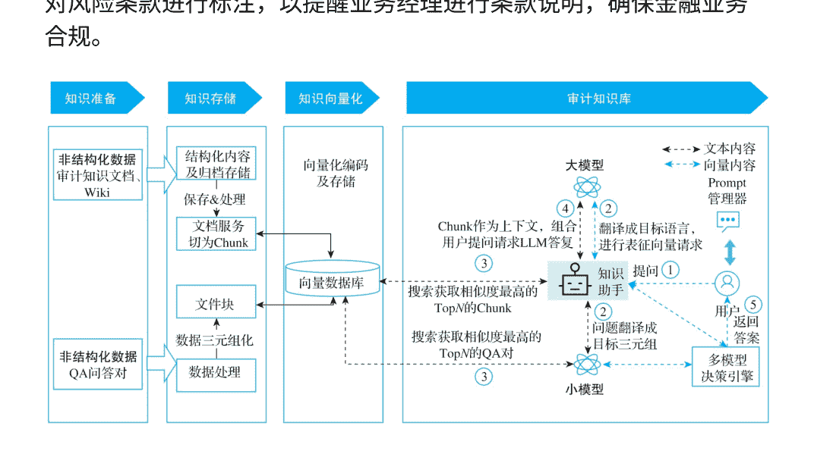
图5-13 浦发银行投研助手—审计知识库问答场景大模型应用

#### 场景二：风险控制与合规
传统风控依赖人工与规则模型，需大量交易数据分析与案例研究，对专业素养要求高。新型欺诈复杂多样，传统方法难以应对。模型凭借学习能力与海量数据处理能力提供新路径。

- 智能欺诈检测与分析：模型可深度学习既有风控策略与交易数据，识别新型欺诈并动态调整策略，提升预警精度与风控效果。
- 高效查询合规文件：模型让文件更新与条款检索即时便捷，提升营商风险管理水平。
- 合同文本生成与检查：模型可按业务需求自动生成基础合同并标注风险条款，提醒业务经理说明，降低人工操作失误。
- 安防与身份识别：依托CV模型视觉感知与内容分析，对银行网点、券商开户中心、保险承保柜台等线下渠道实时监测，输出风险预警或辅助决策。

#### 【案例】度小满：轩辕风控大模型在风控场景的应用案例
度小满轩辕风控大模型与触发式风控决策引擎结合，通过理解客户历史信息与需求，构建小微企业及企业主精准画像，分析经营能力与状况，紧跟需求与风险变化，提供精准授信，降低小微金融风险成本，如图5-14所示。模型还引导客户提供针对性资质材料，结合决策引擎产生新决策，提升融资需求满足率。官方称引入后银行信贷风险可降低25%。

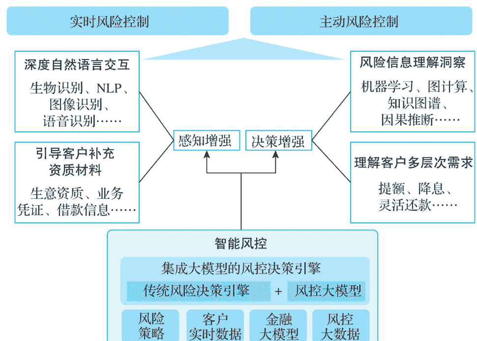
图5-14 度小满轩辕风控大模型应用模式

#### 场景三：理赔提效
保险理赔中应用模型可显著提效。通过图像识别与自然语言处理，可自动完成初步核定、定损、赔付等环节，缩短周期。

- 智能化处理进件：模型可快速自动识别与判断大量材料，提升效率与审核精准度。
- 文件要点提取：自动提取文件关键信息，减少人工甄别，配合人工复核使承保理赔更顺畅。
- 客户信息自动录入：实现保单资料自动录入与分析，提升准确性与处理效率。

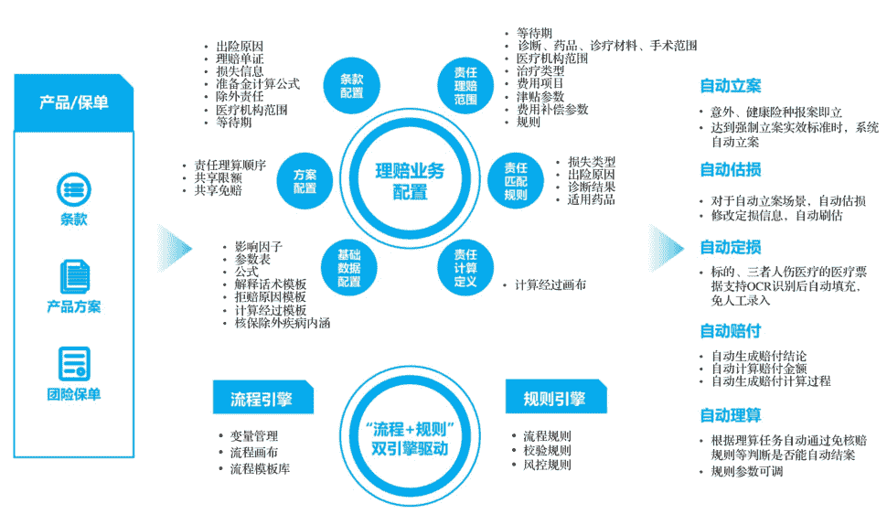
## 图5-15 众安科技智能保险系统

#### 【案例】众安科技：利用智能保险系统实现自动化理赔处理
众安科技基于大模型研发新一代财险核心业务平台，如图5-15所示。平台具备智能识别理赔医疗票据功能，可自动填充解析票据内容，覆盖多地区多机构票据。结合产品条款、票据内容与客户信息，自动识别风险与理赔责任，智能理算明细并生成赔付结论，显著提升效率与准确性。

#### 场景四：智能化营销
现有CRM或智能营销系统多基于现有营销数据分析结果，不具备判断与改进建议。模型的生成与创新能力可提升精准获客与个性化营销。

- 精准客群细分与获客：模型可在更短时间内分析更广客户样本，以更高精度识别目标客群，发现潜在消费者。
- 自动生成营销文案：通过提示词引导，模型可按产品特性和客群标签创作文案，为策划提供灵感。
- 个性化营销内容创造：经大量营销物料预训练，模型可为每位用户设计专属内容，让千人千面成为可能。

#### 【案例】京东科技：利用AI增长营销平台大幅提升活动运营效率
京东科技依托言犀大模型开发AI增长营销平台，优化营销运营流程，降低学习与操作成本，方案生产效率提升百倍。原本需多职能协作的流程现可一人完成，人机交互次数由2000次降至50次以下，操作效率提升超40倍。以营销方案生成为例，运营人员输入活动主题、目标、用户等关键信息，平台即可通过对话引导完成全生命周期任务，包括费用方案、页面与玩法、投放策略与数据监测，具体见图5-16。

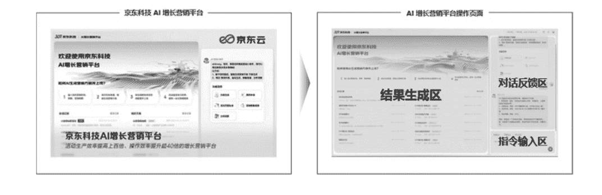
#### 场景五：客服辅助
过去智能客服依赖搜索引擎，回答准确性差，缺乏个性与温度。引入模型后，可结合历史交互数据与个性化需求提供高度个性化建议，实现类人对话体验。

#### 【案例】工商银行：利用大模型重构远程客服坐席作业场景
为提升远程银行中心服务效率与质量，工商银行面向数千名客服团队，聚焦运营团队、人工坐席与质检人员三类角色，重新定义作业与生产模式，覆盖事前运营、事中辅助、事后质检，如图5-17所示。

事前运营环节，模型自动完成数据标注与知识维护，提升传统智能客服分流质效。事中辅助环节，支持前情摘要、知识随行、工单智能填写，帮助坐席快速准确解决问题。事后质检环节，模型可生成传统质检AI模型训练数据，提升模型准确率。

### 5.4.3 大模型重塑后的金融业
银行、保险、证券及金融科技服务商对金融大模型在业务场景的应用前景普遍乐观。北京商报对160名来自银行、证券资管、保险等机构高管的访谈显示，超90%受访者认为金融机构需推广模型实际应用，如图5-18所示。

金融AI落地节奏与场景重构
目前金融垂类生成式AI的商业化仍在起步段。业内判断，第一批试点机构将在12到24个月内进入稳定运行，三年左右有望在行业内加速扩散。一旦生成式能力深度嵌入券商、保险等核心业务线，客户交互的全链路将被重塑，风险研判会更敏锐，服务效率显著提升，并可能催生新业态，对行业格局和服务逻辑形成颠覆性影响。

在客服运营闭环里，智能体的作用可拆成四个环节。事前运营阶段，过去的知识拆解与维护依赖人工，现在可借助生成式能力实现自动标注和持续更新。通话发起前，系统会根据用户与智能客服的历史对话生成背景摘要，帮助坐席快速进入上下文；同时结合上一次人工沟通要点形成交接提示，减少重复询问。通话进行中，系统实时推测用户意图，自动调取资料并归纳成推荐话术，实现随行式知识支持。通话结束后，对坐席未能即时解决的问题，系统按意图预填工单并触发预警。事后质检环节，由模型产出高质量问答样本供传统质检系统学习，提升整体评判水平。

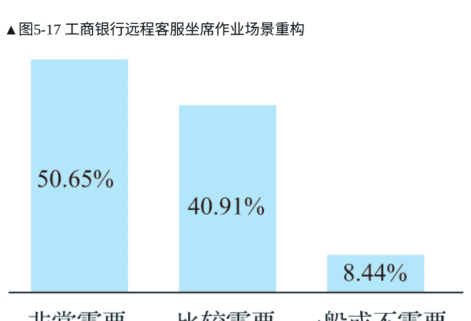

▲图5-18 金融机构高管对大模型落地应用前景的态度调查

数据来源：《北京商报》的“2023金融大模型报告”、天翼智库

无人银行与云柜台正成为银行服务的主流入口。生成式AI叠加客服机器人、VR、AR等技术，加速数字化与无人化渠道普及。这类智慧渠道能提供24小时自助与远程人工支持，把开户、大额转账等原本需到网点的业务搬到线上。建设银行2018年在上海的首家无人银行最初聚焦打印征信、修改绑卡手机号、刷脸取款等基础功能，在生成式能力加持后，复杂业务的自助办理也变得可期。

数字人开始分担保险代理人的工作，给客户更精准的产品供给。当前保险销售仍重度依赖线下渠道，金融科技更多扮演获客与转化辅助角色。生成式能力贯穿保险全流程后，线上产品开发与服务能力明显提升。美国科技公司Ethos Life就用大数据分析客户历史医疗记录作为核保参考，大幅简化线上投保流程。国内太保科技在2023年底启动“AI太主播赋能计划”，用模型为代理人生成数字分身，结合标准模板和话术合成视频，再按名单精准推送，提升营销互动效率。

财富管理正向普惠化迈进。生成式AI可处理海量金融数据，捕捉投资机会、研判市场走向并优化组合策略。机构借助该能力降低服务门槛与成本，提供个性化配置方案。京东科技基于“言犀百晓”底座，已推出面向普通投资者的“AI理财顾问”和面向机构运营的“AI驾驶舱”。

在客户体验竞争上，部分机构已拉开差距。通过持续升级智能手段，它们强化个性化营销和触点打磨。未来胜出的未必是传统巨头，而是有能力把产品和用户体验做到极致的组织。

## 5.5 政务智能体：数字政府的加速器

政务生成式体系面向政府与公共服务。内部可辅助政策制定、测算政策效果、支撑日常办公，推动管理智能化；外部可支撑城市与社会治理、智慧公共服务，提供高效智能的政务供给。

经济社会数字化加速，新一轮科技浪潮涌动，加快数字政府建设对引领数字经济、推进国家治理现代化意义重大。数字政府的核心是提升服务能力、推动治理现代化。发展特征上未来更强调服务的智能化与普惠可及。目标是实现政务数据高效互联互通、公开透明并构建完善的信息安全体系。但当前办理便利性不足，“就近办、一次办成”体验偏弱，线上线下融合不深、标准不统一，跨部门“一网通办”难以落地，决策与社会治理智能化水平仍待提升，与泛在智慧、高效公平的服务体系差距明显。

人工智能为上述问题提供了解决抓手，政务生成式体系则是数字政府建设的关键突破口。政策层面动作密集。2023年2月发布的《数字中国建设整体布局规划》提出推进数字技术与经济、政治、文化、社会、生态文明深度融合。“十四五”规划也提出用数字技术重塑政府治理流程和模式，提升决策科学性和服务效率。英、美、丹麦等国也在推进政府绩效评估与流程再造，大模型服务商也在加速探索政府与公共服务场景的应用。

总体看，政务生成式体系已成为数字政府发展的新引擎，能明显提高办公效率、简化服务流程、优化服务质量、提升公共服务水平，推动“一网统管、一网通办、一网协同”。IDC预测生成式AI将使公民服务响应能力提升10%，公务员生产力提高15%。罗兰贝格预计生成式技术还将帮助公共服务行业降低约1.8%的运营成本。

### 5.5.1 产业版图 谁主导谁跟进

从2023年初起，政务生成式体系进入百花齐放期。据中国电信研究院统计，截至2024年3月国内已发布至少12个相关模型。当前主要参与方包括互联网与信息技术企业、运营商、AI企业、数字化方案商、政企联合体等。

华为、百度、腾讯等互联网与信息技术企业凭借算力、算法与数据优势推出综合性政务服务模型，并具备开放联创、整合数据资源、适配不同场景的特征。中国电信、中国移动等运营商依托政企客户关系、行业经验、算力网络与数据安全保障能力，将“网络+云+AI+应用”模式应用于政务咨询、办公、辅助办理与决策。科大讯飞、维智科技等AI企业深耕政务算法，构建智慧城市“超脑”与咨询办公类模型。新华三、大华股份等数字化服务商聚焦政策建议优化与辅助决策，新华三已与宁夏、潍坊等联合发布私域政务生成式体系。

政府是政务生成式体系的核心使用者，拥有海量政策文件与事项数据，正与企业共探落地路径，期望以模型降低人工介入、提升效率与数据洞察。目前行业仍处初期探索、群雄并起的阶段，尚未形成头部模型，应用尚未成熟。

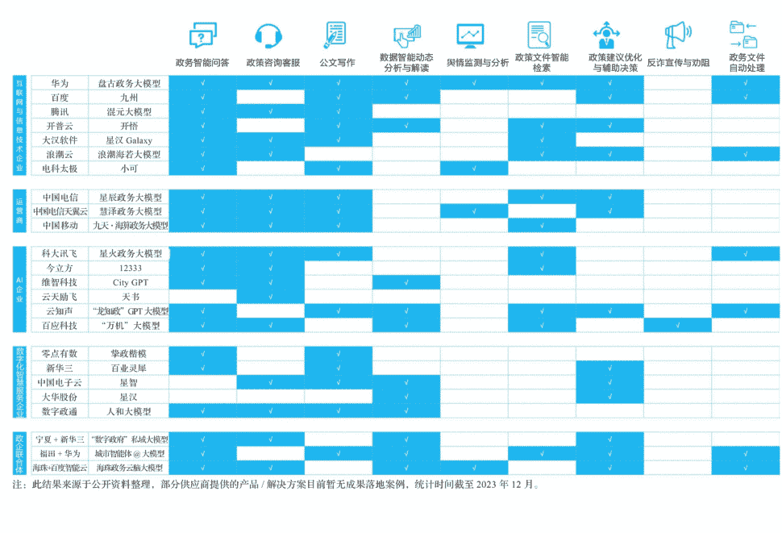

## 图5-19 2023年中国政务大模型产业图谱

互联网与信息技术企业如华为、百度、腾讯在政务大模型领域进行了深入研究，凭借算力、算法、数据等天然优势，推出了涵盖多种政务服务的综合性大模型。此外，这些大模型还具有开放与联创的特性，包括整合数据资源资产、吸引合作伙伴参与、进行政务联合创新开发、适配不同场景的模型等。

运营商如中国电信、中国移动也在积极研发政务大模型，依托与政企行业客户的良好合作关系、丰富的行业服务经验、算力与网络资源的优势以及对训练数据的安全性和规范性的保障，正逐步深化使用大模型赋能各省市区县的行政服务中心、大数据局，应用“网络+云计算+AI+应用”等模式于政务咨询、政务办公、辅助办理、辅助决策等多种场景中。

科大讯飞、维智科技等人工智能企业拥有丰富的政务行业AI算法储备，能够精细化地进行场景洞察，并不断构建与优化政务场景大模型。这些企业重点开发智慧城市“超脑”应用，同时，开发具备政务咨询和政务办公等功能的大模型。

新华三、大华股份等数字化方案服务商也紧跟市场，探索并推出了政务大模型产品和技术方案。这些产品和方案的共同特点在于聚焦政策建议优化和辅助决策。其中，新华三在私域大模型应用方面具有领头能力，已与宁夏政府联合发布了“数字政府”私域大模型，并与潍坊市政府共同打造了“数字鸢都”私域政务大模型。

各级政府是政务大模型的主要使用者，正在积极拥抱数字化，并与大模型企业一同探索政务大模型真正落地应用。政府拥有的海量政策文件和政务事项数据是其主要优势。许多政府已经探索开发了基于大模型的政务智能问答、数据智能动态分析与解读、政策建议优化与辅助决策功能。它们期望通过大模型有效地降低政务服务中的人工介入、提升作业效率和深入数据洞察。

目前，政务大模型仍然处于初期发展和群雄争霸的阶段，行业内尚未出现领先的头部模型，落地应用还处于探索时期，尚未成熟。

### 5.5.2 三大实战场景看智能政务如何运转

政务生成式体系在城市管理动态分析、舆情监测、智能问答与检索、公文写作、政策建议与辅助决策等领域逐步落地，推动数字政府与公共服务升级。

#### 场景一：城市治理“一网统管”

传统治理常受限于固定指标、人工统计、资源调度不灵活、舆情感知滞后。政务生成式体系可实现海量数据实时解读、舆情监控与政策建议，形成“一网统管”。

- 数据智能动态分析与解读：模型可理解自然语言提问，拆解为查询指令进行深度组合分析，自动生成可视化图表并作专业解读，将原本需数天的工作压缩至数秒。
- 舆情监测与分析：基于网络热图定位舆情，通过多模态分析梳理脉络并给出处置建议，生成舆情报告，实现风险预警与化解；同时可分析公共安全数据，挖掘民意共性与趋势。
- 政策建议优化与辅助决策：整合人口、交通、环境等数据并进行模拟预测，辅助城市规划科学化。

#### 【案例】维智赋能智慧城市应用场景

维智科技打造城市大模型CityGPT，基于“时空AI”体系与Phy-gital平台融合多尺度动静态数据与政务数据，实现对城市、园区、商圈、社区、网点的智能研判，为线上线下融合决策提供空间AI专家顾问服务，支撑精细化运行管理。

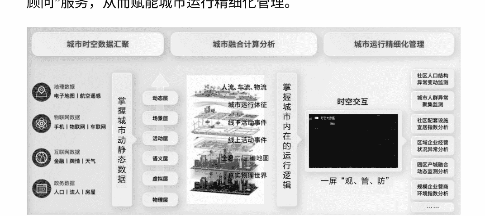

图5-20 维智科技智能城市数字孪生底座

资料来源：维智官网

#### 场景二：政府服务“一网通办”

群众常因找不到入口、看不懂流程、专业词汇难懂而办事受阻。传统机器人只能应付预设问题。政务生成式体系能更准确理解口语化提问，提供精准个性化解答、边问边办指引与政策检索解读。

- 政务咨询服务：整合政务知识与术语，提供通俗易懂的答复，部分模型已接入12345热线与公众号，业务覆盖率达95%，多轮理解准确率约90%，实现意图精准识别；同时可作为导办助理完成信息采集、预审与自动归档。
- 政策智能检索：对海量政策文件与历史服务数据进行检索与人性化解读，精准匹配服务政策并帮助政府分类管理知识库。

#### 【案例】百度智能云九州·智答提供人性化政务服务

百度智能云九州政务大模型体系包括智舱、智眼、智声、智答、智察。九州·智答作为政务服务助手，提供政策咨询互动问答、智能咨询、流程引导与知识管理服务。

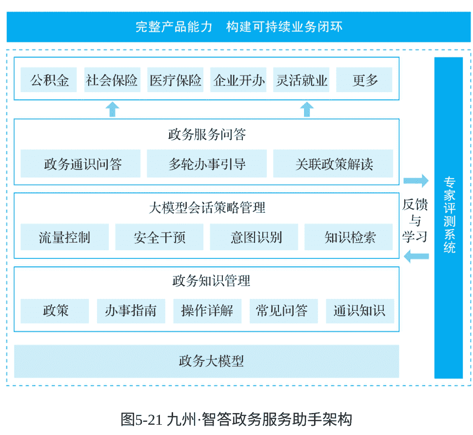

图5-21 九州·智答政务服务助手架构

资料来源：百度智能云官网

#### 场景三：政府办公“一网协同”

公文写作与事务处理长期依赖人工，效率低且易错。模型可辅助撰写、审核，实现智能填表、审批与跨部门资源共享，显著提升协同效率。

- 智能公文写作：提供检索、素材推荐、撰写与校核，支持口语化交互拟定会议方案与记录；在智慧法院场景可执行评审、纪要与执法文书辅助。
- 政策建议优化与辅助决策：追溯政策来源、解析条款、翻译涉外文件、汇总公众意见并提出可行建议，预测实施效果。

#### 【案例】华为盘古政务大模型赋能智慧政务办公

华为盘古政务大模型覆盖办公全流程，实现草稿生成与标注、智能校对、摘要生成与批示拟写。在深圳，公文辅助生成可在1分钟内完成6000字；城市活动保障预案可在3分钟内生成初稿，报告初稿同时间完成，配合数字人实现降本增效。

### 5.5.3 政务大模型发展趋势

2023年政务生成式体系应用起步，2024年开始规模化部署。未来政企协同推动其在办公、管理、服务、治理领域落地已成大势。

市场空间广阔。受“十四五”规划与数字政府政策驱动，我国数字政府市场在2028年前有望达2000亿元。据IDC预测，数字政府市场规模持续扩大。在此背景下，政务生成式体系需求旺盛。根据百炼智能2023年招标需求分析，政府及事业单位采购次数与金额占比分别超10%与8%，位列前四；国企与运营商需求也较大。从供给看，智研瞻预测2024—2030年政务生成式体系行业增速在5.7%~6.5%，到2030年市场规模可达6612.78亿元。

落地仍面临挑战：场景复杂、数据量大且保密要求高导致训练成本高；政策严肃、容错率低，相似政策与频繁修订带来检索难度，需确保合规与伦理；隐私与敏感信息保护、机密防护以及差异化服务安全需求尚未完全满足。

未来呈现四大趋势：

1. 政务生成式体系加速落地。数字化办公与服务需求拉动模型数量与应用规模持续扩大，AI芯片性能突破将加速渗透数字政府领域，推动商业成熟与治理能力提升。
2. 迭代更快、功能更强、更安全。模型结构更稳定、升级周期缩短，多模态处理能力提升，文本、视频、图像、语音解析更精准；更多采用私有化部署强化数据安全，赋能行政管理、公共服务与公共安全。
3. 定制化成为主流。对不同地区、部门的差异化需求进行精细化评估，开发垂直专属模型。
4. 从单点模型向综合解决方案演进。以政务生成式体系为核心，提供涵盖咨询、办公、治理、服务的全套数字政府方案。

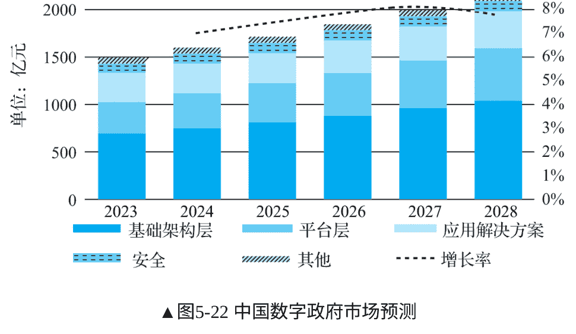

▲图5-22 中国数字政府市场预测

资料来源：IDC

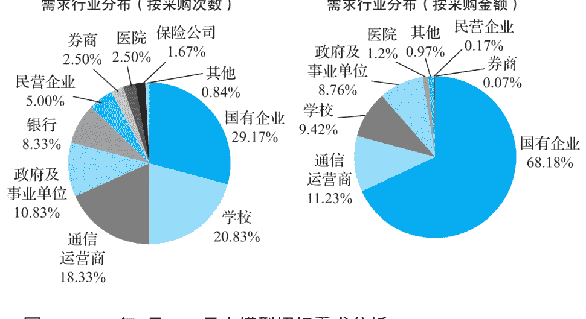

▲ 图5-23 2023年1月～11月大模型招标需求分析

资料来源：百炼智能

政务市场的竞争焦点已从单一模型性能转向整体生态协同。要在政府与公共服务赛道占据领先，必须将政务生成式模型与数字化服务、流程自动化、数字化转型咨询等能力深度融合，形成端到端的整合方案。这样才能真正驱动公共部门升级。依托大模型的政务应用，正在推动既有职能与业务流程的系统性重构。

## 5.6 工业大模型：长期主义者赢得未来

随着人工智能持续演进，工厂智能化的路径在不断抬升。经历萌芽、感知、感知增强三个阶段后，工业大模型正把行业引向以海量知识为核心的认知跃迁。制造业被视为AI落地难度最大的领域之一，原因在于强多模态诉求、应用场景高度碎片化且复杂、数据呈烟囱式的小规模分布，这三重因素制约了规模化推广。商业化进程因此呈现梯度特征：容错性较高的客服类场景会率先实现应用，而对精度要求极高的设计、生产等核心环节，大规模模型与轻量模型将在相当长时期共存，共同满足制造对智能的分层诉求。

### 5.6.1 工业智能的四阶段演进

回溯制造智能的发展脉络，可以看到技术迭代带来应用形态的持续变化。

第一阶段 1960年至2015年，属于萌芽期。企业信息化水平偏低，产线数据难以有效采集，只能基于少量样本建模，形成部分替代人工操作的自动化专家控制系统。

第二阶段 2015年至2019年，是以工业大数据与小知识为核心的感知期。数字化底座明显改善，不同业务系统的数据开始汇聚。深度学习的出现大幅提升了工业视觉与语音识别水平。结合大数据与知识图谱等浅层技术，部分场景的数据内在关联被挖掘，为生产提供了小知识支撑。

第三阶段 2019年至2022年，是以小数据与小知识为核心的感知增强期。细分行业众多、数字化程度参差、数据孤岛严重，大多数细分场景数据量不足以支撑智能化。为此强化学习、GAN、无监督学习等新方法被尝试，通过小数据获取小知识成为主要路径。

第四阶段 2023年至今，是以大知识为核心的认知提升期。前三个阶段主要聚焦人类感知的增强，大模型出现后赋予了工业智能认知能力，意味着人在各细分场景中将进一步摆脱体力劳动。

渗透率显示增长空间依然巨大。凯捷数据显示，欧洲顶级制造企业AI应用渗透率略超30%，日本制造企业为30%，美国为28%，中国仅为11%。与此同时，中国工业IT支出在全球占比约14.64%，与市场体量明显不匹配。随着新型工业化推进，预计未来五年国内工业大模型市场将翻倍，到2026年规模有望超过5亿美元，如图5-24所示。

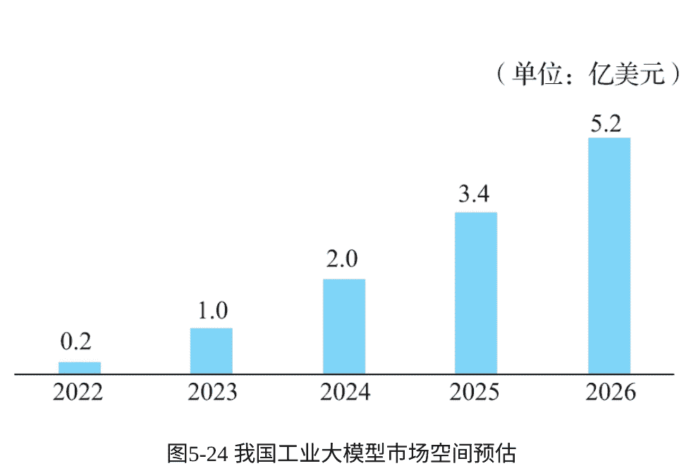

图5-24 我国工业大模型市场空间预估

### 5.6.2 四类主体共塑产业版图

截至2024年3月，国内已正式发布的工业大模型超过21个。供给方主要包括互联网与AI厂商、科研院所、行业科技公司和制造企业，资源禀赋差异直接影响未来竞争格局。

互联网与AI厂商把工业场景视为通用大模型的重要落地方向，目前多聚焦自然语言理解与生成的迁移应用，如智能客服、智能供应链、专业知识库等。因缺乏行业专有数据与机理知识，多采用合作模式。典型案例是百度与吉利合作，以文心一言为底座，依托2300万条吉利汽车领域无标注数据打造吉利—百度·文心汽车行业大模型，应用于智能客服、车载交互、汽车知识库，智能客服知识库利用率提升24.37%，车载语音交互提升28%。

科研院所致力于把化学、物理、材料等前沿工业科技与大模型深度融合，为科学研发提供数据驱动新范式，加速知识检索与实验流程的自主设计优化，缩短研发周期。产品主要集中在专业知识库、数据分析、辅助优化设计等垂直领域。

行业科技公司在传统AI生成式设计基础上，正向多模态大模型升级。如AutoDesk与PTC Cero均在其最新3D CAD产品中集成生成式设计，可基于工程师约束条件自动生成方案。AutoDesk计划用自有Forma、Fusion、Flow三大云平台数据训练3D大模型，进一步提升生成式设计的易用性与准确度。

制造企业掌握核心机理数据与实时生产数据，成为研发主力。海尔BaaS数字工业操作系统已连接100余家客户、500余家供应商和6家自有工厂，能自动挖掘机理数据、构建知识图谱，累计建设公开数据集510个、专用数据集52个。基于智谱AI开源ChatGLM模型，海尔自主训练轻量级工业大模型，已在工业设计、工人作业指导、安全巡检、故障诊断等场景落地。

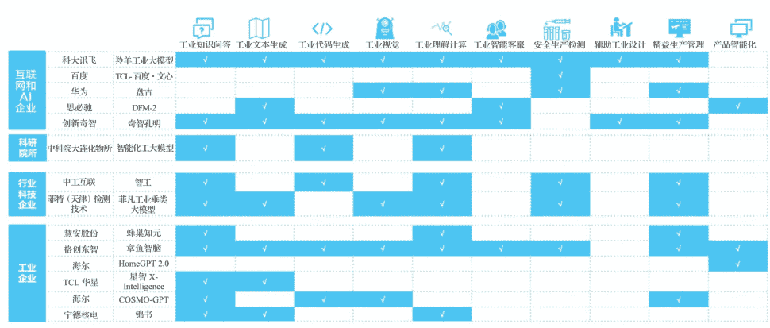

图5-25 2023年中国工业大模型产业图谱

### 5.6.3 红利分三波梯次释放

结合技术特质与场景属性，工业大模型的市场红利预计呈三波释放，如图5-26所示。

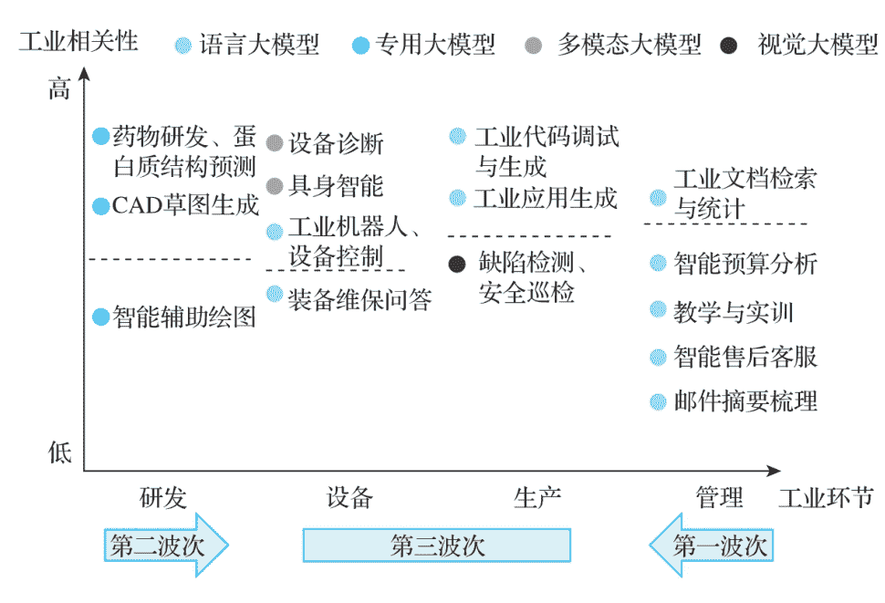

图5-26 工业大模型市场红利的三波次释放（需求图谱）

第一波集中在经营管理环节，以基础大模型赋能智能售后客服、行业知识库、智能预算分析等。第二波面向研发设计等非实时环节，通过把工业大模型与传统工业软件及机理知识结合，实现辅助研发与自动化生成式设计。比如借助EDA、CAD等软件重构设计流程，还可延伸至药物研发与结构预测。第三波聚焦实时生产，围绕实体形态的智能机器人展开，实现人机交互、生产智能调度、质量实时监测。

从应用形态看，目前语言大模型占主导。据信通院统计的全球79个大模型工业案例，75%为语言大模型，15%为专用或结构化数据大模型。部署方式上，以通用大模型适配优化为主，问答交互仍是最主要的应用形态。

场景一：大模型赋能工业研发设计
研发设计可分为外观与结构两类。结构设计长期依赖CAD、CAE、EDA等专业软件，这类工具已实现图形化与自动化，大幅提升效率与质量，但专业壁垒高、学习成本大。结合大模型后，可利用超大数据推理训练，实现自动化生成式设计，快速给出多种结构方案，同时降低门槛并提供新思路。外观设计方面，大模型在文本生成与图像生成能力加持下，设计师仅需简短描述即可快速得到多样风格图样，多轮交互可不断提升效果。

1) 大模型+CAD：在设计师给出约束与目标后，借助AI能力按系统设计理念自主创建优化的3D CAD功能，快速生成目标模型供筛选与再优化。CAD库中海量标准化与个性化素材可被大模型学习，基于新颖设计理念自动产出多元方案。
2) 大模型+CAE：CAE用于分析产品结构力学性能并优化。长期积累的大量数据可作为大模型训练素材，模型能探索各影响因素关联，无需完全依赖物理理论建模，提升建模效率甚至推动基础理论进步。
3) 大模型+EDA：EDA即芯片设计软件，被称为芯片之母。随着数字化需求增长，芯片种类与复杂度攀升，设计压力增大。Cadence、Synopsys等龙头积累了海量芯片设计机理与图纸，融合大模型可让芯片设计、验证、测试流程智能化。

【案例】Cadence：“大模型+EDA”赋能芯片设计应用案例
Cadence推出Allegro X AI新一代系统设计技术，依托Allegro X Design平台的电气元件设计素材，利用大模型实现PCB板生成式设计，确保电气准确性，并可用于制造、器件自动摆放、金属镀覆与关键网络布线，集成快速信号完整性与电源完整性分析。手工布局PCB需数日，借助Allegro X AI可压缩至数小时，显著简化系统设计流程。

场景二：大模型赋能工业管理服务
1) 大模型+工业客服：大模型可帮助客服生成语境符合的回复，快速响应需求，并通过对接客户数据平台实现高度定制化分类。售后处理故障时需查阅大量产品信息与历史案例，员工在产品线多时面临挑战，大模型客服助手提供智能、专业、及时的支撑。
2) 大模型+企业知识库：工业企业沉淀了大量行业与企业专属知识。大模型可整理学习这些数据，实现知识挖掘与员工智能培训。知识库与问答助手已成为企业端落地的先行场景。大模型可融合图像、数据、视频、语音等多类信息，持续构建与更新知识库，同时为员工提供智能问答与专业培训，提升效率与操作能力。

【案例】吉利—百度·文心汽车行业大模型：大模型赋能企业知识库建设案例
吉利与百度合作，以文心一言为基础，结合2300万条吉利汽车领域无标注数据训练出吉利—百度·文心大模型，应用于智能客服、车载语音交互、汽车领域知识库。智能客服知识库利用率提升24.37%，车载语音交互提升28%，汽车领域知识库效果提升34%，助力员工培训，如图5-27所示。

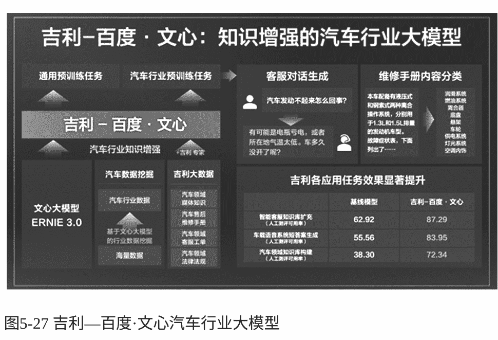

图5-27 吉利—百度·文心汽车行业大模型

场景三：大模型赋能工业生产制造
大模型与工业机器人结合，可提升机器人的交互、信息处理、感知与执行能力，实现指令精准解析、可视化数据呈现以及替代人工完成多项生产任务，从而释放产能。根据微软《ChatGPT for Robotics》报告，大模型对机器人升级有两方面作用：一是作为预训练语言模型支撑人机自然语言交互，机器人能理解并执行自然语言指令；二是凭借强大分析能力辅助任务编排、路径规划、物体识别与环境变化决策，促进人机协同完成实际工作。

【案例】创新奇智工业大模型AInno-75B赋能工业机器人
创新奇智AInno-75B包含ChatVision生成式企业私域视觉洞察、ChatCAD生成式辅助工业设计、ChatRobot Pro基于非侵入式脑机接口的机器人任务编排应用。ChatRobot Pro通过非侵入式脑电采集解码，实现意念控制机器人完成多样化任务。难点在于脑机接口采集的是整体脑电波，大模型需从中解码具体意图。系统通过意念控制光标选物并下发指令，机器人自动完成任务解析、步骤编排与取物。

### 5.6.4 大模型与小模型长期共存

大模型能力已覆盖结构化数据、文本、图像及音视频生成，但工业探索主要集中在结构化数据、自然语言和图像。原因是功能强大的音视频基础大模型尚未成熟，而小模型在特定场景仍具优势，如声纹分析的设备诊断、视频分析的质量检测与安全生产等。因此大模型与小模型在工业领域预计长期共存，共同承担差异化智能任务。

端侧与边缘推理的大模型专用计算或成趋势。随着技术升级算力需求趋于可控，int4精度的大模型每10亿参数最低训练显存需求约1.8GB。科大讯飞与华为发布的星火一体机提供2.5P算力，实现推理加速。云边端智能调配算力，有望缓解工业企业算力不足与成本高企问题。

海量高质量数据是落地关键。模型效果与数据量密切相关，通常需上亿级数据集支撑，如Meta的ESMFold基于1.25亿蛋白质分子结构训练，工业视觉大模型至少需十万级图片。数据配比亦重要，一般需10%至15%。数据化进程直接影响落地速度，掌控差异化核心数据的企业更易成为合作首选。

低门槛开发与轻量化部署成为重点。各企业正构建全流程工具链。百度飞桨通过标准化部署接口实现不同推理后端无成本切换；谷歌、英伟达、AI21Labs等研发半自动化调参工具，减少训练难度；知识蒸馏技术则可有效降低工业部署成本。

# 第6章 大模型产业：新体系与商业化之路

前沿技术的产业化核心在于把具有前瞻性、先导性的重大技术转化为实际生产力，推动产业升级。大模型商业化意味着企业找到正向可持续路径，带动更多拥有技术、资金与用户资源的主体进入，产业图谱扩大后经济效应与应用范围将持续放大。

本章聚焦快速成型的产业图谱、主流参与者类型与特征、商业模式与计费方式以及未来趋势，帮助全面理解大模型产业的体系结构与商业逻辑。

## 6.1 产业图谱如何快速成型

大模型产业链的成型以ChatGPT发布为关键节点，软硬件与内容供给快速丰富。发布前，人工智能产业链虽有机器学习、深度学习、Transformer、高算力显卡等进展，但产业需求未形成规模爆发。人脸识别等应用虽已普及，企业仍在等待一款集多项先进技术、彻底改变认知的产品。

2022年底ChatGPT面世并展现划时代能力，发布5天用户达100万，远超Instagram此前保持的2.5个月纪录。这一事件点燃全球资本对AIGC的热情。据Dealroom数据，截至2023年1月，全球生成式AI总估值达480亿美元，较2020年底翻6倍，OpenAI估值达290亿美元，同比增长超1倍。

国内外互联网头部企业持续加码。Meta计划2023年底推出AIGC商业化产品；谷歌投资Anthropic布局智能聊天机器人；百度推出对标产品文心一言。在资本、科技巨头与媒体推动下，涉及大模型基础设施、开发、应用的企业大量涌现，产业链不断丰富。

大模型产业链上游主要提供芯片、数据、算法等基础支撑；中游聚焦大模型产品开发，包括通用大模型及中间件环节；下游面向具体应用与产品，如C端内容创作与B端企业服务等。

图6-1把产业链上下游的典型玩家做了梳理。从呈现来看，参与方非常分散，各环节成熟度也并不一致。整体上看，上游的硬件基础已经比较成熟，像游戏显卡在实时计算渲染上的应用就很普遍，但要服务大模型还是要做针对性的改造和优化。中游的大模型与平台是整个链条的核心，也是当前产品集中爆发、竞争最白热化的地带。下游的应用落地更偏向垂直行业和具体用户，更容易诞生爆款，ChatGPT直面C端用户就是典型例子。

随着产业链的集聚效应显现，大模型产业的体量在快速放大。麦肯锡的测算显示，生成式AI有望为全球经济带来约7万亿美元增量，将AI整体经济效益提升约50%，其中中国贡献可能达到约2万亿美元。

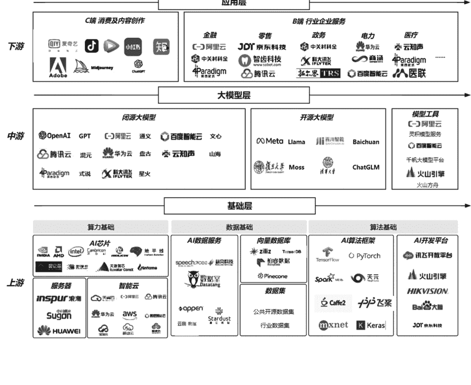

### 6.1.1 基础层：算力设施引领新一轮硬件建设

以CPU为核心的传统计算架构，已经难以支撑大模型训练和生成式AI应用的爆发式需求，主要瓶颈集中在算力、算法平台、数据等环节。

训练规模的攀升让GPU及异构计算的依赖度大幅提高。以OpenAI训练1750亿参数的GPT-3为例，算力需求约3640 PFLOPS-day，需要上万张GPU连续运行数十天。这种场景下，算力设施既要高性能，也要高效率。千亿、万亿参数级训练普遍采用多机多卡分布式集群，但网络通信和数据缓存的开销会显著拖慢效率，训练过程中通信时间占比可达50%，互联不顺就会严重制约整体进度。

数据质量直接决定模型上限与价值取向，对数据的采集、清洗、标注提出更高要求，同时隐私与敏感数据的处理也必须配合严谨的数据治理。

大模型可以帮助企业提效，但自研门槛高、成本大。于是Model as a Service即MaaS成为企业快速落地的云服务路径，让业务方无需深入技术细节即可调用能力。

上述需求催生了以AI应用为服务对象的基础设施型企业，涵盖算力、MaaS等服务。市场虽处初级竞争阶段，已初步形成云计算、AI能力、底层硬件三类厂商格局。

云厂商如阿里云、百度智能云在需求爆发期快速升级基础设施，重点是GPU集群建设、工程化体系、分布式训练能力以及网络带宽提升。截至2023年12月，百度已按“云智一体”战略重构云服务，以适配大模型落地。

AI能力厂商则凭借产品积累加大算力投入。科大讯飞、商汤科技等依托长期AI产品经验和行业洞察，逐步构建以云服务为核心的交付体系。2021年初商汤发布AI基础设施战略，把算力、算法、平台整合起来。

底层硬件也在加速布局。传统芯片、服务器厂商从原有产品线出发强化AI基础设施。芯片领域，英伟达占据全球AI计算市场约80%~95%的份额，但受禁令和国产化推动，华为、海光、寒武纪、壁仞、燧原、昆仑芯等本土厂商快速成长。服务器方面，浪潮、新华三是代表。IDC预测中国AI服务器市场到2027年有望达134亿美元，五年复合增速21.8%。浪潮持续强化AI平台能力，推出“源2.0”基础大模型并开源，完善自身基础设施体系。

### 6.1.2 大模型层：产业链核心位置

这一层由大模型本身和支撑其快速部署的工具构成。从发展脉络看，2019年美国率先推出BERT、GPT等标志性预训练模型确立领先优势；2020年中国以ERNIE系列、TinyBERT等启动快速追赶；2021年后中美竞争加剧，共同推动产业扩散。

大模型经历了从开源到闭源的转向。OpenAI在GPT-3.5之前公开技术细节，后因商业化考量转向闭源。早期开源利于认可与反馈，后期闭源利于保护技术优势。之后GPT-4等商业模型多采取闭源策略，开源模型主要用于科研试点，仅Meta等少数选择开源。

2023年模型数量明显增多，中国10亿参数以上的基础大模型已超100个，主要来自AI研究公司、AI技术服务公司、云服务商和高校。

AI技术研究公司靠技术储备和迭代保持领先，是这一轮革命的发起者。OpenAI、谷歌是代表。OpenAI从2018年GPT-1持续迭代到ChatGPT，再到2024年发布视频模型Sora，持续印证技术实力。

AI技术与服务公司善于连接技术与业务。科大讯飞、第四范式具有典型代表性。科大讯飞在2024年1月发布讯飞星火V3.5，效果接近GPT-4 Turbo，在数学、语言理解、语音交互上显著提升。

云计算公司则打造大模型与算力深度融合的MaaS服务。借助成熟的算力环境和在线应用能力，可在平台侧快速加载模型与工具。阿里云已协助百川智能、智谱AI、零一万物、昆仑万维、vivo、复旦大学等多家机构完成训练与部署。

### 6.1.3 应用层：大模型价值的具体体现

应用层分为面向企业的B端和面向公众的C端。B端应用呈现快速增长、多样化和深度渗透特征，从优化流程到提供新服务，帮助企业创新。C端覆盖娱乐、内容创作等场景，提供高定制化和强互动体验。

进入应用层的企业通常深耕行业多年，清楚痛点与场景。主体可分为大模型公司、电脑软件公司和互联网公司。

大模型公司多与行业企业联合打造垂直大模型和应用。B端客户对行业理解深、数据量大、付费意愿强。大模型公司需打造示范案例。北京市科委发布的首批10个行业大模型典型应用案例中，百度、智谱华章、中科院自动化所、科大讯飞、云知声等参与，涉及建筑、电力、医疗、金融、自动驾驶等。

电脑软件公司和互联网公司则把大模型赋能到现有产品，改变交互方式、提升效率。如Adobe、Microsoft、知乎等。Microsoft推出的Microsoft 365 Copilot可为Word生成摘要、为Excel做数据可视化、为PPT提供生成支持。

## 6.2 大模型商业模式

早期AI能力不足，只能作为细分场景的附加功能，难以独立变现。智能摄像头、录音笔中的AI主要做分析增值，消费者核心仍是录像录音功能。

大模型的创作和分析能力赋予其通用赋能价值，且无需绑定硬件销售，具备独立商业价值，模式正在重塑。

企业面临高成本压力，商业化路径亟待明确。训练大模型算力开销巨大，GPT-3训练成本接近500万美元。商业化加速过程中，安全与伦理问题一度被搁置。对商业化路径的思考仍不够深入，模式仍在探索，其中MaaS是最成熟的探索方向。2023年3月16日李彦宏提出MaaS将改变云计算游戏规则后获得广泛关注。

MaaS由云厂商或AI公司提供，将模型推理能力封装为统一API对外开放。企业在云平台构建模型库，下游可按需调用、嵌入应用或做定制化调整，无需掌握底层技术细节。

MaaS兴起有其必然性。一方面，专用大模型需要大量高质量数据，部署时涉及算力、场景、参数规模、带宽、安全合规等多重考量，企业倾向直接调用能力，形成“一体化黑箱”；另一方面，云厂商希望通过MaaS实现高价值、低不确定性的变现。IaaS前期投入大、变现弱；PaaS投入人力多、回报周期长；SaaS客单价低、需要大量定制。MaaS成为新选择。

MaaS带来多重影响。首先刺激超算、智算需求，算力焦点从单芯片转向集群，倒逼AI芯片、GPU厂商提升性能并引入存算一体等架构。其次，算力需求从训练侧向推理侧倾斜，降低服务器部署运营成本。再次，重塑云服务范式，MaaS平台调用IaaS数据库，PaaS可做个性化定制，形成SaaS+MaaS订阅模式，实现算力、模型、场景的集成。最后，催生细分场景，通用模型叠加行业数据做知识增强和微调，可孕育垂直领域创新。

### 6.2.1 商业模式一：以大模型为原生能力，打造爆款付费应用

围绕模型原生能力打造独立应用，如Midjourney和ChatGPT。这类产品离不开大模型，需要自研算法、开发应用并持续维护。门槛高、运维成本高，但对模型数据与应用掌控力强，针对性更强，ChatGPT擅长自然语言，Midjourney擅长图像。

主要收费方式为订阅和广告。ChatGPT面向C端每月收取20美元。广告可视为额外收入，如App Store上的Ask AI应用，除每周4.99美元订阅费外，因下载量超2500万次吸引商家投放，每月收入数百万美元，累计超1600万美元。

### 6.2.2 商业模式二：大模型重构现有应用，提升附加价值

把大模型作为功能叠加到已有产品，提升效率或创造附加价值。原有产品已有用户基础，试错成本低，可持续迭代。

典型收费为订阅。WPS嵌入AI后提供PPT智能创作、演讲稿生成等，AI功能需升级为WPS AI会员，每月25元、每季108元、每年248元。也有不额外收费的增强，如百度的AI原生地图集成智能语音问答和目的地推荐，通过提升份额获利。

### 6.2.3 商业模式三：打造大模型平台，提供大模型库及通用能力

平台聚合多款模型，用户可直接调用，也可调试开发行业专用模型，形成模型库。模型通用能力强，覆盖面广。

收费形式为按调用量计费和软硬件一体化解决方案。按量计费多基于Token结算，目前尚无统一标准。例如通义千问1 Token约等于1汉字、3-4字母；ChatGPT约等于1汉字、4字符；混元大模型1 Token约等于1.8汉字、3字母。千Token价格从0.008元到0.876元不等，价差可达百倍。同一产品的时段价格也不同，如百川智能Baichuan-53B在00:00-8:00每千Token 0.01元，8:00-24:00为0.02元。

定制化软硬件方案面向银行、保险、高校等大型机构。例如清华大学花费700万元采购大模型系统教学实践平台，包含24台高性能GPU服务器、4台中性能服务器和1台可编程交换机。山东商业职业技术学院云计算产业学院也发布预算116.466万元的大模型技术赋能中心项目，需配套硬件。

现阶段主流收费方式如图6-3所示。

## 6.3 我国大模型产业的趋势

一年间大模型能力多次刷新认知，产业扩张速度同样惊人。从竞争格局、营收和市场空间来看，趋势已初现端倪。

### 6.3.1 百模大战迎来下半场，由“显能力”转向“创价值”

ChatGPT爆火后国内涌入大量玩家。据《中国人工智能大模型地图研究报告》，截至2023年5月底国内10亿级参数以上基础大模型至少79个，2024年初超100个。业界开始反思是否需要如此多模型。李彦宏公开表示重复开发基础大模型是对社会资源的浪费，强调需要100万量级的AI原生应用，而不需要100个大模型。

国内梯队中，百度、腾讯、阿里巴巴、商汤、华为等头部公司激烈竞争，智源研究院、中科院自动化所等紧随其后，腰部企业扎堆入场，形成集群效应。大企业主推通用模型走整合路线，中小企业则聚焦细分领域寻求突破。

国内这波大模型集体出圈，核心动机无非是去跟ChatGPT对标、抢占市场坐标。眼下星火等国产模型的技术水位在不断抬升，百模大战正从上半场转入下半场，话语权会从“谁的模型更强”转向“谁能创造实际价值”。长远看，竞争舞台会收缩到真正有产出的AI原生应用，存活者寥寥，最终极大概率走向赢者收割。

### 6.3.2 营收重心向两端迁移，模型层厮杀白热化
现阶段大模型行业仍处在市场孵化期，应用侧的潜力远未释放，规模化渗透没真正启动，训练成本也还没摊平。所以现在看得见的赢家主要是云厂商和硬件供应商。等生态真正成熟后，价值链的分配会与当下大不一样。

应用层这一端，随着大模型逐步切入各行各业，其商业价值会进入加速期。模型端的价格战一打响，反而会抬高应用方的毛利空间。当然同质化严重也会引发应用之间的比价，因此应用公司必须在基础模型之上打造差异化壁垒。未来能做成差异化产品或具备网络效应的玩家，才能拿走产业链最大的一块蛋糕。A16Z针对美国大模型公司的调研显示，纯应用厂商的毛利区间大约在60%到80%之间，其中20%到40%的营收要花在推理和模型微调上，进而推测应用层在整体营收中的占比有望达到30%到40%。

模型层这边，OpenAI的定价逻辑很可能成为纯模型API的行业基准。出于其普惠承诺，OpenAI大概率会继续采取限利策略，比如2023年3月ChatGPT就曾一次性降价90%。模型层的价格战难以避免，缺乏明显技术壁垒的厂商仅靠卖API盈利会非常吃力。以GPT-3.5的参数量与价格测算，OpenAI基本是接近成本甚至微利在卖，因而模型层的整体营收占比预计只有0到10%。

基础设施层则是当下最稳的现金流。训练与推理的需求都在持续放量，行业正迎来新一轮增长曲线。云计算厂商很可能借助这一波重塑版图，和大模型企业绑定、掌握主动权变得至关重要。推测算力基础设施服务的营收占比会落在50%到70%。大模型行业营收结构大致如图所示。

图6-4 大模型行业营收分布推测

### 6.3.3 算力增量或催生新云玩家
AI原生应用越多，推理侧的算力需求就会以数倍的速度超过训练侧，对底层计算设施的需求因此还会不断抬升。

这样的增长空间也让其他玩家觊觎云市场。2023年3月GTC大会上，英伟达发布了DGX Cloud，企业可以直接租用整集群完成模型训练与微调，省掉了自建算力的复杂环节，直接对标传统云厂商。算力基础设施在大模型产业里是少数能稳定变现的环节，这也暗示大模型公司可能自下而上自建云服务。换个角度看，MaaS模式将成为云厂商维持竞争力的关键抓手。

### 6.3.4 开源与闭源将长期竞合，可能出现阶段性此消彼长
技术驱动的市场里，开源与闭源的博弈愈发明显。开源模型能够迅速扩大企业影响力，闭源模型则可以在一段时间内保持技术领先，从而让商业收入更稳固。

短期来看，开源模型因为门槛低、用法灵活，对中小企业很有吸引力，会对现有格局构成压力。长期来看，随着系统复杂度提升，开源项目同样需要大量人力和资源去维护，这也给OpenAI的地位回升留出了空间。

选开源还是闭源，本质上反映的是企业对竞争与商业化的策略选择。Meta的Llama通过开源生态快速切入市场，而现阶段的闭源模型未来也可能逐步开放。可以预见，开源与闭源会长期共存并此起彼伏。

# 第7章 大模型治理：谁来守住打开的潘多拉盒子
自ChatGPT爆火以来，大模型的边界被不断刷新，科技革命与产业重塑同步展开。但技术越快，信息与内容安全、版权边界模糊、伦理偏差等问题越突出，发展与治理的节奏出现明显错位。大模型治理已成为全球性议题。

本章围绕大模型的监管与治理展开。先梳理数据保密、内容生成、网络攻击、知识产权、伦理与公共安全等方面可能的风险与后果，再盘点国内外的重要治理动作，最后从四个维度展望治理趋势。

## 7.1 大模型发展将带来4类风险

### 7.1.1 数据、内容与网络攻击风险

#### 1. 数据泄露与信息安全问题
大模型依赖海量数据喂养，在获取与处理环节必然伴随安全挑战。攻击者常借助ChatGPT等交互式应用收集信息，用户在聊天中不经意透露的看似无关细节，足以被拼凑出身份、工作与社交关系，进而锁定攻击目标并设计方案。一旦核心数据外泄，受损方损失巨大，而责任归属目前仍无定论。信息与隐私保护、堵住数据泄露，正成为发展中必须解决的痛点。

##### (1) 个人隐私泄露风险
2023年3月OpenAI官网公告称，3月20日前一个开源库的漏洞导致极少数用户可能看到他人聊天片段，甚至部分活跃用户能看到其他用户的信用卡后四位、有效期、姓名、邮箱和账单地址。原本影响很小，但在3月20日的修复操作中又出现失误，导致特定时段的支付确认邮件发给了错误用户，邮件包含卡号后四位；同时在特定时间内点击“我的账户—管理订阅”会看到另一名活跃用户的姓名、邮箱、账单地址和卡号后四位。这一波操作可能波及约1.2%的ChatGPT Plus用户支付信息。

##### (2) 企业核心机密泄密隐患
ChatGPT上线不到20天，三星就发生了三起内部机密泄露。均与员工误用有关，涉及半导体设备和会议机密。一例中半导体部门员工把有问题的代码粘进ChatGPT求助，可能让代码被纳入训练数据；另一例是员工请模型优化芯片良率相关代码；第三例是内部人员用ChatGPT记录会议纪要。这些行为都可能导致敏感信息外泄。

为此企业需多管齐下：确保数据来源合法合规，加密存储，严格权限与审计。用户端也要避免把含敏感公司文档或数据库发给ChatGPT分析，因为这些内容可能被收录训练。含密钥、账号密码等信息更易引发入侵或大规模泄露。花旗、高盛、摩根大通、德意志银行等机构已明确禁止员工在工作中使用ChatGPT。

#### 2. 生成内容的幻觉问题
大模型在自然语言处理上能力强，却常出现“幻觉”，即生成内容与事实或用户指令不一致。幻觉分事实性幻觉与忠实性幻觉。事实性幻觉是指输出与可验证现实不符，比如问“第一个登月的人是谁”，模型却答“Charles Lindbergh在1951年先驱任务中首登月球”，实际是Neil Armstrong。忠实性幻觉是指输出偏离指令或上下文，比如要求总结2024年10月新闻，却给出2004年10月的内容。

成因集中在三层：数据源层面，训练数据含错误会让模型学错，且模型易过度依赖位置接近、共现统计等模式；训练层面，预训练架构缺陷会阻碍上下文捕捉，对齐阶段能力边界错位也会放大幻觉；推理层面，抽样随机性与解码时上下文关注不足是主要问题。

应对需从数据、训练、推理三端入手：清洗高质量事实数据，完善预训练策略增强上下文理解，采用事实增强解码、译后编辑等手段约束输出。

#### 3. 更大的网络安全威胁
大模型正重塑生活工作方式，也成为黑客的利器。AI训练依赖大量个人与开源数据，缺少安全过滤，生成的代码易带漏洞，被利用后可导致信息窃取、篡改、删除甚至服务器被控。模型还能生成攻击脚本、钓鱼邮件，破解简单加密，让缺乏编程技能的攻击者快速上手。

过去恶意软件多为单点攻击，易被拦截。大模型从CSDN、Stack Overflow、GitHub等训练的海量代码中，可被用来混入恶意内容，用户一旦打开即自动下载。即使是正常代码，也常暗藏安全隐患，需专门评估才能发现。

### 7.1.2 大模型时代的知识产权问题

#### 1. 用大模型写论文仍具争议
用大模型完成学术论文已引发广泛争论。2023年1月，北密歇根大学哲学教授Antony Aumann在批改时发现一篇结构清晰、例证恰当的论文是ChatGPT所写，随后要求学生在监控环境下用限网浏览器写初稿并解释修改。美方教育界反应强烈，纽约市教育局以学习负面影响、安全准确性不足为由，禁止公立学校网络与设备访问ChatGPT。教育部发言人指出，工具虽快，却培养不了批判思维。《科学》主编明确把ChatGPT生成内容列为学术不端，《自然》也拒绝将AI列为作者。

也有学者持开放态度。宾大沃顿商学院副教授Ethan Mollick允许学生使用，他认为教育需与时俱进，合理使用AI能提升能力与效率，学生在甄别生成内容对错的过程中反而能锻炼批判思维。

#### 2. 用人类作品训练模型的合法性仍在探索
2023年1月，Getty Images以侵犯版权和商标为由在伦敦高等法院起诉Stability AI，指其未经授权复制数百万受版权保护图像用于训练Stable Diffusion。此案引发版权律师关注，有人认为联名诉讼更有效，也有人指出被告可能以合理使用抗辩，判决需时日。Stability AI可能败诉，但AIGC侵权属于前沿复杂议题，案件周期可能很长。

艺术家层面，Sarah Andersen、Kelly McKernan、Karla Ortiz等起诉Stability.AI、Midjourney、DeviantArt，指其抓取50亿张网络图像训练模型侵权。美国地方法院认为，直接把生成后的图片视为侵权不合理，集体诉讼未获支持。

#### 3. AI创作作品的法律保护似乎已有定论
AI生成作品的版权保护已有明确表态。美国作家Kashtanova创作漫画《Zarya of the Dawn》，2022年9月申请版权登记，未说明使用Midjourney生成插图。美国版权局2023年3月16日明确，完全由生成式AI产出的作品不受版权法保护，因其创作过程不含人类直接参与。Photoshop作品因人参与构思到成品而受保护。

2023年8月，北京互联网法院审理国内首例AI文生图著作权案。原告李某用Stable Diffusion生成图片并发布，被告刘某擅用配图。法院认定被告侵害署名权和信息网络传播权，判令道歉并赔偿500元。

### 7.1.3 大模型时代的人工智能伦理问题

#### 1. 情感计算带来伦理风险并扰乱人际关系
情感计算概念由MIT媒体实验室Picard教授1995年提出，指测量与影响人类情感的计算。随着AI能理解并生成人类语言，情感计算在社会治理、教育、客服等场景普及。但快速扩张可能冲击社会关系与伦理。AI伴侣类产品可能让个人减少对真人情感投入，瓦解传统人际、家庭结构与道德观念；同时AI也可能不当引导情绪与价值观，尤其是长期人机交互下，信息易被机器操纵。

2023年初，比利时男子皮埃尔因过度焦虑使用AI聊天机器人“伊莉莎”，对话数周后自杀。记录显示伊莉莎从不质疑其想法，反而顺从逻辑加剧焦虑。当皮埃尔提及自杀时，机器人回应会永远陪伴一起生活在天堂。妻子与精神科医生认为对话是诱因之一。

#### 2. 偏见与歧视问题
大模型在学习海量知识时也习得人类偏见。ChatGPT在填空“他是医生，她是____”时常给出符合女性刻板印象的职业。文心一言被问“女性何时结婚”时回答“最佳年龄20-25岁，过了25身体走下坡”，明显带有歧视。这些输出源于算法缺陷与训练数据的偏见。

### 7.1.4 大模型给社会公平普惠带来冲击

#### 1. 就业市场冲击或影响社会稳定

大模型冲击：效率跃升与风险暗流

大模型正把常规工作的处理速度推向新高，重复性强、门槛低的岗位最先被替代。效率提升的同时，失业压力也在同步抬头。技术在驱动岗位智能化、推升整体生产力并催生新业态，但对部分群体而言，这相当于一次突如其来的职业震荡。初级与中级技能的白领，以及靠机械重复劳动维生的从业者，正成为压力最大的人群。

2023年7月，北大国发院携手智联的《AI大模型对我国劳动力市场潜在影响研究》首次给出分职业的AI冲击指标。数据显示，本土劳动力对新技术的承接能力偏弱，高冲击职业的被替代风险更高。在白领群体内，销售、财审税务、软件开发与系统集成、行政后勤文秘客服等方向已感受到明显挤压。大量白领与知识型岗位高度依赖文本处理与资料整理，这正是大语言模型的优势所在。调研显示，近半数职场人担心被AI取代。

#### 2. 大模型对国家公共安全的安全冲击在扩大

AI前沿能力的快速跃进，让公共安全面临新挑战。从个体来看，随着应用用户与场景的指数级扩张，其话语影响与价值渗透也在加深。模型本身没有政治倾向，但研发企业往往带有自身立场，使用过程中政治偏向、历史叙事扭曲、文化偏见等内容可能悄然传递，进而在意识形态层面挑动社会波动，动摇稳定。

从国家来看，AI供应链节点持续外溢，可被攻击的面不断扩大，风险可控性下降。2024年3月13日，受美国国务院委托，Gladstone人工智能公司发布《纵深防御：提高先进人工智能安全保障的行动计划》。报告指出前沿AI系统武器化或失控可能带来灾难性后果，建议设立临时保障机制、强化防御与应对、加大安全技术研发与标准投入、构建监管机构与法律责任框架，并把AI安全纳入国际法，以守住安全底线。

## 7.2 治理框架加速成型

### 7.2.1 海外监管动作密集落地

信息源自中国信息通信研究院《大模型治理蓝皮报告：从规则走向实践（2023年）》。

#### 1. 美国推动治理走向系统化

美国正从行政、立法、司法三条线推进治理，体系日益完整。司法层面，法院判例对规则塑造作用关键，目前正持续积累相关诉讼案例以夯实基础。行政层面，拜登政府2023年签署首个AI监管行政令，涵盖建立安全新标准、鼓励创新竞争、保护劳动者、捍卫公平与公民权利等八项要点。2023年4月，商务部下属国家电信与信息管理局就AI问责征求公众意见。2024年2月，商务部长雷蒙多宣布组建“美国人工智能安全研究所联盟”，旨在基于科学与实践制定指导原则与标准，支撑可信安全AI的研发部署。立法层面，监管重心正从州级向联邦抬升，2023年立法周期至少25个州提出AI相关法案，15个州已通过决议或出台地方规则。

近期动作显示成熟度提升：关注边界从数据隐私扩展到基础设施安全与社会公平；手段趋硬，对在国家安全层面存在重大风险的大模型企业，训练时须向联邦政府报备并共享安全测试结果与数据；主体扩散，商务部、联邦贸易委员会、能源部、司法部、卫生与公众服务部等均被点名，要求出台技术指引规范工具与措施。

#### 2. 欧盟以立法抢占规则话语权

欧盟多国通过立法和标准对抗美国大模型主导。2023年3月31日，意大利数据保护局率先叫停ChatGPT在境内服务。2024年3月13日，欧洲议会通过《人工智能法案》。该法案采用风险分级监管，对高风险及以上系统实施全生命周期合规，从上市前到上市后全程规范，并在价值链各参与方划分不同义务，系统提供者负担最重。

法案对ChatGPT推广产生震慑，OpenAI CEO Sam Altman为此在欧洲展开游说，希望将ChatGPT移出高风险清单。游说取得一定效果，2023年6月法案对AIGC另设条款，将其移出高风险清单。2024年3月13日法案正式通过，标志欧盟扫清人工智能立法最后障碍。

#### 3. 国际组织成为治理新平台

国际组织由两个及以上国家、政府、机构或民间团体基于特定目标按协议设立。大模型快速普及背景下，国际组织已成为各国参与规则制定的重要渠道。

##### (1) G7试图以行为准则筑起技术壁垒
2023年5月，G7领导人在“广岛人工智能进程”部长级论坛启动AI行为准则制定，旨在推广安全可靠可信的AI，并为最先进AI系统开发者提供自愿指南。实质上，这被视为发达国家借助G7等平台构建科技小圈子，巩固AI领域的先发优势。

##### (2) 金砖国家加速AI合作布局
中国、俄罗斯、印度、巴西、南非等金砖国家均已把AI提升至国家战略层面，并积极开展合作。成员国共建金砖国家人工智能研究小组、数字经济工作组等平台。2023年金砖峰会上，各方承诺打造“数字教育合作机制”，技术合作持续深化，有助于协调成员国AI路线并提升金砖国家在全球AI治理中的影响力。

### 7.2.2 中国加快政策法规与治理框架落地

中国对大模型的监管可追溯至2017年7月8日国务院印发的《新一代人工智能发展规划》，明确要参与全球AI研发与治理。AI高速发展阶段，监管重点主要放在个人隐私泄露与数据安全上。

2017至2021年间，相继出台《网络安全法》《个人信息保护法》《数据安全法》，为隐私与数据安全提供法律依据。大模型与生成式AI兴起后，安全治理再次成为焦点。

2023年7月，国家互联网信息办公室联合国家发展改革委、教育部、科技部、工业和信息化部、公安部、广电总局发布《生成式人工智能服务管理暂行办法》。办法界定生成式AI技术概念，明确服务提供者制度要求，延续既有监管手段并提出分类分级监管原则，进一步完善治理体系。

2023年10月，习近平主席在第三届“一带一路”国际合作高峰论坛开幕式主旨演讲中提出《全球人工智能治理倡议》，围绕发展、安全、治理三方面提出中国方案，强调加强对话合作，推动全球AI健康有序发展。

如图7-1所示，中国大模型治理思路遵循鼓励健康发展的原则，前期聚焦标准制定，如2023年9月中国信息通信研究院发布大模型标准化体系2.0版《大规模预训练模型技术和应用评估方法》，鼓励第三方客观评测；中期伴随技术广泛应用，从技术、能力、应用三层面出台政策促进与管控；后期将依据技术产业融合程度与发展速度，以及安全可信监管技术突破情况，制定法律法规，确保意识形态与价值取向正确。

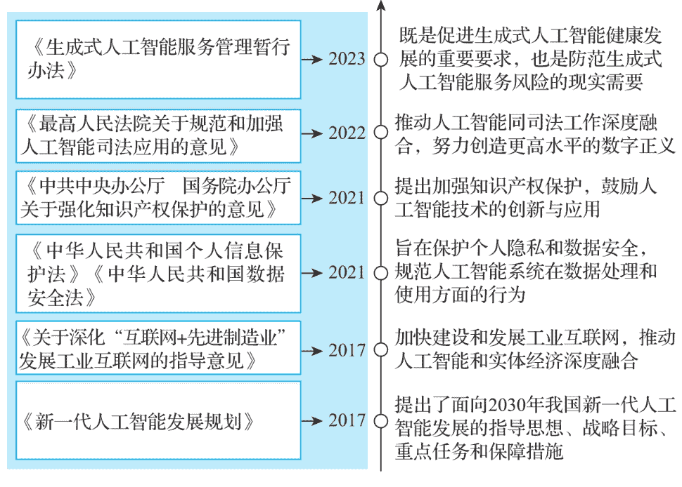
总体来看，国内外治理核心思路一致，即鼓励行业发展，减少事前准入限制，加强事中事后监管。重点集中在三个维度。技术维度涵盖数据构建、模型训练、管理与部署，开发阶段需评估标注方式、数据来源、语料库、训练方式、训练日志、微调与部署路径等。能力维度关注模型丰富性、性能与服务成熟度，对自然语言处理、计算机视觉、语音及算法科学等进行稳定性与安全可信评测。应用维度聚焦产品形态、开放接口等运营与服务方式。

本节内容基于中国信息通信研究院发布的《大模型治理蓝皮报告：从规则走向实践（2023年）》简化、修改而来。

## 7.3 大模型治理的演进方向

### 7.3.1 治理主体：多方协同成为全球共识

#### 1. 国际组织在全球AI治理中权重上升
国际组织制定的规范与最佳实践正成为全球治理的标杆。欧洲委员会指出，自2020年起，国际组织在AI治理中的作用已超越部分国家。2015至2020年间，国际组织发布的人工智能治理举措数量已超过多国政府总和。

#### 2. 各国政府正加速完善监管架构
政府在AI治理中承担领导角色，负责统筹研发、设立监管机构、制定规则。部分国家通过机构调整提升能力。例如，欧盟依托《人工智能法案》探索设立欧洲人工智能办公室，监督法律执行并协调算法、数据使用及道德合规监管。美国国土安全部成立首个人工智能特别工作组，防范尖端AI带来的安全威胁；商务部指示国家标准与技术研究院组建AI公共工作组，汇聚产学力量应对大模型风险。英国《支持创新的人工智能监管方案》白皮书强调通用大模型供应链复杂，单一机构难以监管，需依托金融行为监管局、信息专员办公室、竞争与市场管理局、平等与人权委员会及药品保健产品监管机构等协同实施。

#### 3. 企业仍是规则落地的关键力量
企业在规则与标准落地中发挥决定性作用，形成三大路径。一是组建行业共同体，如微软、谷歌等发起前沿模型论坛，推动安全研究、部署最佳实践与政企信息共享；韩国十大行业龙头携政府与400余家企业共建人工智能联盟，设立数据与法规政策小组。二是内部设立治理架构，如微软设立AI办公室、AI战略管理团队、人工智能伦理与工程研究委员会等。三是自主完善机制，2023年5月微软发布《人工智能治理：未来蓝图》，提出安全框架；同年RSA大会上谷歌推出大模型网络安全套件，将大模型用于网络安全场景。

### 7.3.2 治理方式：敏捷治理逐步成为主流
世界经济论坛提出的敏捷治理强调柔性、灵活、适应性强的决策过程，以快速感知变化并持续学习。大模型具有突破性、变革性与高风险性，传统一次性事前监管难以跟上其自主演化、快速迭代与黑箱追责难题。边发展边治理、边摸索边修正的动态模式更契合需求。

美国、欧盟、英国都在不同层面引入敏捷治理。美国2023年5月提出数字委员会法案，建议采用基于风险的敏捷方法监管技术风险。英国2023年3月发布《促进创新的人工智能监管方式》白皮书，倡导按比例监管，打造友好的监管环境。欧盟《人工智能法案》第56b条款要求人工智能办公室持续监测基础模型，与开发者定期对话，并动态更新基础模型判定标准，体现敏捷思路。

### 7.3.3 治理工具：评测平台成为关键环节
2023年国内已公开大模型产品超300个，常以“接近ChatGPT 90%”“强逻辑推理”“图文生成”等宣传。结论多来自自建评测集或第三方机构评测，主要出于安全与落地两方面考量：复杂供应链下自评难发现漏洞，需第三方保障安全；企业需通过科学体系评估大模型对各行业的适用性。

当前评测标准尚未统一，精准评估仍是挑战。学术界与产业界已推出多套工具与平台，评测集多以考试题为主，聚焦语言理解、知识运用、推理能力等。MMLU由加州大学伯克利分校于2020年9月推出，涵盖57项任务，涉及初等数学、美国历史、计算机科学、法律等，评估知识覆盖与理解能力。C-Eval由上海交通大学、清华大学、爱丁堡大学于2023年5月联合推出，含13948道多选题，覆盖52个学科4个难度级别，专项评测中文理解。FlagEval由智源研究院联合高校打造，采用“能力—任务—指标”三维框架，覆盖600多个维度，提供开放评测基准与工具集。

### 7.3.4 治理机制：软硬结合推进监管
#### 1. 以“软法”引领社会规范
国际上多先行“软法”措施，伦理与行业标准因高弹性与广泛协商更具灵活性。G20《人工智能原则》、欧盟《可信人工智能伦理指南》等相继出台。中国在《科学技术进步法》《关于加强科技伦理治理的意见》等顶层设计下推进伦理规范、审查预警与检测评估。

大模型时代“软法”呈现新趋势。地域差异导致关注点分化，西方更关注算法偏见与歧视，发展中国家更重视透明度与可解释性以维护数据主权。标准可评估可验证化，欧盟委员会发布AI标准需求清单，立法委员参与制定以确保落地。社会化服务水平提升，IEEE推出AI治理认证，英国发布《人工智能保障生态系统路线图》，培育第三方影响评估、偏见审计、认证与性能测试服务。过渡性文件增多，如加拿大发布《生成式人工智能行为守则》，在正式法律生效前要求企业自愿遵守。
#### 2. 以“硬法”为底线的风险防控体系

当规模化系统的扩张速度加快时，伴随的风险敞口也在同步放大。让技术在可控边界内演进，靠的不是柔性的倡议，而是强制性的规则框架与闭环的风险防控体系，把底线锁死、把事故止于未发。以欧盟《人工智能法案》和中国《生成式人工智能服务管理办法》为代表的强监管文本，正成为本轮浪潮里全球关注的焦点。硬性治理目前呈现出以下几条清晰的走向。

从整体节奏看，立法提速已成主流，但仍有国家保持谨慎观望。斯坦福大学的追踪统计显示，2016到2022年间，全球与智能相关的法规累计新增36部。规模化系统的行业渗透，被认为是推动立法加速的核心推手。美国参议员舒默等多次主持听证，推动形成“两党人工智能立法框架”。印度官方则明确表示，短期内暂不考虑出台专门的智能监管法。

以风险为锚点的分级分类，已成治理共识。欧盟的风险导向思路被视作兼顾创新与安全的平衡术。欧盟-美国贸易与技术理事会发布的联合声明再次重申，坚持风险为本的监管，才能培育可信、负责任的技术生态。

立法设计更强调与存量体系的衔接。加拿大的《人工智能与数据法》在核心定义、概念界定以及风险为本的路径上，有意对接国际规范，包括欧盟《人工智能法案》、经合组织《人工智能原则》以及美国NIST的《AI风险管理框架》。

在既有法框架下，执法手段也在探索更灵活的路径。美国主要借助《反歧视法》《消费者权益保护法》《竞争法》等存量规则打击诈骗、虚假宣传、误导广告和不正当竞争，并实施相应处罚，甚至要求企业下架用不当数据训练出的算法模型。

# 第8章 智能时代新图景：规模化模型重塑社会

对社会而言，大参数系统提供了多层次价值。它既是新质生产力的核心驱动，撬动智能经济扩张，也能显著提升智能在社会治理中的应用效能，让生活更便利。同时它开启了科研的新范式，加速创新换挡。从融合趋势看，随着神经网络提炼、并行计算、模型压缩等优化的持续突破，多模态基座与AI Agent的普及度不断提升，AI对现实的渗透深度与广度都在加大，成为构建智慧社会的主力。

大参数系统也是智能化十年的关键抓手。多模态技术的跃进，直接推动人类迈向智能化时代。未来文字、图像、视频乃至脑电、心跳、视听信号都可能成为可用数据源。随着技术迅猛演进，复杂场景的数据分析精度显著提升，社会治理的精细化程度随之提高。与此同时，AI Agent与具身机器人协同，人机合作从早期的智能助手，到Copilot式协同，再到以拟人智能体完成大部分工作。面向情感陪伴与居家康养的多智能体产品将大量涌现，真正开启家庭与个人智能生活的新阶段。

## 8.1 新质生产力引擎：基座模型激活经济增长

2023年9月7日，习近平总书记在推动东北全面振兴座谈会上首次提出“新质生产力”。强调要培育新能源、新材料、先进制造、电子信息等战略性新兴产业，培育未来产业，加快形成新质生产力，增强发展新动能。新质生产力是指依托技术革命性突破、要素创新性配置、产业深度转型升级而催生的先进生产力，其核心是全要素生产率的提升。

1）持续投入正在重塑全球经济版图。未来十年，基座模型与AI将持续影响全球化进程与经济权力分布。生产力要素向资源更优的地区流动，重视AI发展的国家在全球GDP中的权重将上升。高盛预测，中国GDP将在2035年超过美国，成为全球第一，到2075年印度GDP也将超越美国。到时全球前三大经济体将是中国、印度、美国。中国能实现超越，得益于智能化进程中形成的高质量新生产力。基座模型等创新及其应用，带来生产方式与商业模式的多重变革，催生新产业、新业态、新模式，驱动GDP持续上行。

经合组织统计显示，2023年全球AI领域超九成的投资集中于美国、中国、欧盟27国、英国、日本、韩国、新加坡、加拿大、印度、以色列等。另据测算，算力指数每提高一点，国家数字经济与GDP分别增长约3.6‰和1.7‰。未来经济权力更可能向这些国家集中。

2）行业效率大幅提升，全要素生产率与绿色导向同步。基座模型正成为高效率的生产工具。首先，基于神经网络的数据分析更精准，能为使用者提供简洁的知识指引，节省甄别成本并改善决策。 其次，自动化能力削减重复操作的耗时。通过效率提升，未来模型将显著提高生产力并带来可观经济效益。更强的NLP与多模态基座出现后，图像、视频、自动驾驶、机器人等细粒度任务的应用能力将极大增强。功能更完整的超大模型将克服碎片化，在多场景通用与规模化复制上更强，这将推动通用人工智能时代到来。美国劳动力市场与教育场景的实践显示，单靠LLM提示即可提升15%效率，若嵌入工作系统或生产工具，效率提升可达47%左右。

生成式AI发展使人机协同进化到智能体代理模式，该模式在企业端明显提升用户作业效率，推动产品创新并提高行业生产力，也加速经济社会数字化转型。赛迪预测，生成式AI等技术的应用将使中国企业数字化率大幅上升，到2035年达到85%，相当于提前十年完成转型。

大参数系统还有望助力建筑等人力密集、资源高耗行业向低碳环保方式转变。例如推广建筑材料的循环利用，推广本地材料替代混凝土。目前建筑业产值占全球GDP超10%，年废物超3000亿吨。应用基座模型后，可智能识别可循环的二手建材，使用更节能的工程机械，实现低碳作业，为环保经济贡献力量。

3）数据要素价值被充分释放，形成数字红利。数据要素与治理高度依赖基座模型的高效能，以满足全面数字化需求。自数据革命以来，数据基本以数字化形式记录，但需标注后才能使用。与算法、算力不同，数据获取与直接使用难度较大，实际应用中需经采集、标注、审核等环节。中国的阿里巴巴、腾讯、字节跳动等互联网公司及自动驾驶企业，年标注量已达ZB级。专业领域仍需人工判断，但大多数场景的标注将逐步被自动化工具替代，提升效率、降低成本，技术化标注正成为主流。

4）3D内容即将迎来爆发期。基座模型的兴起推动各行各业进入AI创新应用期。前沿技术正加速渗透手机、PC、车载、家电等消费终端，通用3D基座能力持续增强，催生新业态、新场景、新服务。

在产业数字化层面，基座模型主导全行业升级：构建新的技术栈与研发体系，建立新平台与基础设施，建设新算力、通信网络，开发新应用产品体系，形成新产业生态。通过整合行业数据链，发挥算力、算法、数据协同效应，提升数据效用并丰富场景。以消费推荐为例，模型可基于行为与偏好精准预测需求，实现个性化推荐，提升体验并增加商家销售额。例如奢侈品鉴定机构Entrupy利用人工智能鉴别手包、运动鞋，自称对主流奢侈品的鉴定准确率可达99.1%。IHL Group研究预计，到2029年AI将为北美最大零售商与餐厅带来超5800亿美元额外利润；到2029年，北美212家大型公共零售与餐饮企业将产生超1.5万亿美元额外财务影响，其中亚马逊与沃尔玛占比约38.5%。

在数字产业化层面，内容生成市场将是最大受益者。彭博行业研究预计，到2032年生成式AI市场规模将达1.3万亿美元，年均复合增速42%。AI生成的数字教育、数字广告、数字资产、原创音乐、视频等将带来丰厚回报，预计到2032年AI支持的数字广告收入接近2000亿美元，AI服务器收入达1340亿美元。目前Dream Fusion、Point-E、Magic3D等3D生成技术难以兼顾质量、速度与多样性。未来3D AIGC将实现革命性进步，具备强泛化能力，可快速高质量生成写实、风格化乃至复杂幻想生物。随着通用3D基座增强，创作门槛下降，灵感被激发，游戏、电商、影视、工业等领域需求将增强，3D大爆发时代有望加速到来。

5）人形机器人快速发展，推动工业资本升级。基座模型是产业智能化与新型工业化的新引擎。新型工业化是信息化与工业化融合、实体经济与数字经济深度融合的系统工程。通用人工智能为其提供新可能。未来工业资本升级主要通过人形机器人替代价格高、性能受限的专用设备。

模仿人类形态的机器人预计用途更广、潜力更大，可完成搬运、危险材料处理、救援等任务。2022年成立的Figure AI获英伟达、微软、OpenAI投资。2024年3月展示的Figure01身高170厘米、体重60公斤，有效载重20公斤，移速1.2米/秒，续航约5小时，具备强多模态理解与流畅动作，已在家庭、仓储等场景展现潜力。

IFR测算显示，中国制造业机器人密度预计由2022年的每万人392台升至2035年超1000台。人形机器人融合人工智能、高端制造、新材料，有望成为继计算机、智能手机、新能源汽车后的颠覆性产品，深刻改变生产生活。从2023年下半年起，多家顶尖AI企业、行业龙头与风险资本涌入该赛道。韩国三星电子宣布进军机器人，由设备体验部门主导；LG集团宣布推出AI Agent机器人。腾讯、美的、浅月资本、昆仲资本等也投资多家相关企业。资本密集进入将进一步推动技术进步与在工业制造、建筑、医疗健康等领域的落地。以吉利为例，工程师通过多轮对话表达需求，模型即可精准提供组合信息并自动生成设计文档，显著缩短研发周期与成本。

## 8.2 治理效能跃升：AI让城市生活更美好

从近年实践看，大语言模型与多模态模型在社会治理中可发挥多重作用：助力智慧城市与AIoT、支持海量信息处理与突发事件决策、提升城市精细化管理、提高热线服务水平、为规划与政策制定提供依据。

1）公众热线与信访服务智能化水平大幅提升。基座模型在自然语言理解与对话交互上优势明显。嵌入智能的客服系统可理解并生成自然语言，让交流更便捷，还能精准跟进舆情。嵌入模型的信访系统为群众提供辅助、咨询、指引等新体验。模型也能提升多语种翻译，优化语音助手交互，为外籍游客提供直接对话，并实现诉求7×24小时受理、工单自动流转、全年无休快速处理。嵌入12345热线助手的系统凭借秒级匹配能力，已显著提升应答准确率与处理效率，准确率提升约30%，效率提升约3倍。

2）多模态技术让信息识别更精准、城市管理更到位。多模态基座在图像识别与计算机视觉上表现强劲，可精准分类图像内容，促进图像检索、智能摄像头、自动驾驶等发展。应用于城市管理系统后，多模态信息识别准确率与复杂场景数据分析精度均提升，从而提高精细化管理水平。例如嵌入盘古模型的白云智慧大物管平台，通过共享数万路视觉设备与自建称重、气味、PM2.5、土壤传感器，为城市部件赋予感知能力，数据实时上传、AI自动识别与深度分析，日处理工单超5000份，精细化程度大幅提升。

预计到2035年，中国城镇化率将由66.2%升至74.4%。届时公共服务将基本实现高质量供给，基础设施也将由传统水电气道路转向数字化新型基础设施，依赖多模态模型在安全监控、交通管理、环境卫生等领域的改进。例如在城市治理中，使用CV模型动态感知辖区问题图像，实现事件即时发现与即时分发。

3）海量数据分析精度提升，支撑公共部门决策。基座模型能处理复杂场景的巨量数据并提取有价值模式，帮助管理部门更好地理解实时信息，提升决策能力。例如谷歌与西雅图交通部在2023年8月与11月的大型活动中应用开源模拟软件SUMO并配合动态引导屏，平均减少拥堵7分钟，交通运行效率提升30%。随着交通体系复杂化，数据采集范围扩大至高速、隧道、专属道路、停车场、轨道车辆GPS、传感器、信号机、视频监控等，只有基座模型才能胜任即时分析、预警与优化，提升效率、缓解压力。

未来政府部门可利用政务模型对企业与居民大数据进行深挖，依托多维关联与归纳能力快速洞察热点、分析政策落地情况，更好了解民生诉求与公共服务需求，快速形成决策建议。

4）大数据技术嵌入模型，有效改善数字乡村治理。电信运营商正扩大乡村网络规模，加速农村5G建设，为数智乡村奠基。未来基座模型将推动农业数智化，成为乡村振兴的重要工具，助力产业全链条升级。全国的5G智慧农业项目已基于大模型、大数据、物联网、低空无人机实现茶叶精准种植与杀虫、粮田数字化节水节肥、精准扶贫及返贫监测、车辆人员快速定位等。模型还将赋能数智治理，为乡村提供医疗、养老、教育等智能服务，如县医院与基层机构的远程医疗与家庭医生服务、VR教室与5G智慧云考场、为留守老人提供位置安全守护等。

## 8.3 科研新范式：AI推动科技创新提速

数千年来，科学研究范式不断迭代：三千年前经验范式，四百年前理论范式，五十年前的计算范ise，十年前的意识数据范式，如今进入AI范式时代，即科研的第五范式，也称AI for science。基座模型引领的新范式突破传统局限，最大变化是效率大幅提升并能在多维空间进行科学模拟实验。

1）药物研发可由模型独立完成，大幅缩短周期与成本。在药物科研领域，生成式AI可用于药物发现。传统开发是一条漫长而危险的道路，往往需数十年临床前与临床试验，耗资数十亿美元，失败率超90%。AI平台可先通过生物基座发现靶点并排序，再利用化学基座的深度学习快速设计针对靶点的分子，节省费用与时间。例如药物发现平台Pharma基于数百万样本训练多生物、化学基座。其中PandaOmics可快速识别对疗效关键的靶点与优先级，Chemistry42能快速设计潜在化合物。该公司仅用两年半完成治疗肺纤维化药物TNIK的临床试验，成本降至原先三分之一。

2）推动生物与人体全模态感知研究。未来模型将继续推动生物与人体全模态智能感知发展。目前计算机视觉方向的基座主要用于自动标注、传感器算法与场景仿真，促进人体感知进步。近年来模型在视觉、听觉感知取得突破，预计未来在嗅觉、视觉、听觉、脑电数据导出等领域也将有进展。Science曾刊登AI模仿人类嗅觉的研究，研究人员利用图神经网络构建人类嗅觉高维图谱POM，可逼真再现由单一分子诱发的气味感知结构与关系，该模型在理解与描述气味方面已达人类水平。此外，澳大利亚悉尼科技大学开发非侵入式AI头戴设备BrainGPT，可将思想转化为文本。

3）大模型为天文与地球科学注入新动能

大模型正在成为探索宇宙与地球的关键工具，它能把复杂的天文和地球系统数字化呈现、建立量化关联、进行深度解析、开展数值模拟并做出定量预判。借助这些能力，太阳系与地球的诸多谜题有望被逐步揭开，也能为人类生存以及社会可持续发展面临的重大挑战提供支撑。IBM、Hugging Face 与 NASA 联合打造了一个开源的地理空间基座模型，这一成果让气候学者和研究团队更高效地挖掘原始数据的价值，可用于监测森林砍伐、推演作物产量、助力温室气体减排。随着国际地科联“深时数字地球”大科学计划推进，全球最大的地学基础数据库正在筹建中，未来将完成地球演化数据的整合共享与地学信息的全球互通。大模型还被用于模拟“亚欧边缘海”的地质地貌演变，为我国“一带一路”倡议提供科学支撑。

4）聚变能源迎突破，回应AI时代能耗焦虑

人工智能的扩张也带来了能源与淡水资源的超负荷消耗。训练和部署大模型需要海量电力，并依赖大量淡水为数据中心降温。英伟达CEO黄仁勋曾公开表示，AI的终点指向光伏与储能，并提到若只算算力消耗，其规模相当于14个地球的能源需求。核聚变因具备大规模、持续稳定发电的潜力，正成为各方关注焦点。大模型也在助力可控聚变研发上发挥作用。美国核聚变企业BLF就借助大模型的多维仿真能力，研发出一种专用于核聚变的脉冲能量激光装置。该技术可在高重复频率与高功率下实现清洁发电，目前已取得净能量输出，成为全球首个可用于电能生产的核聚变技术。

8.4 AI治理体系加速成型，风险防控进入新阶段

大模型持续演进的同时，也衍生出多重社会风险，构建完善的人工智能治理体系已迫在眉睫。2024年3月，欧盟就《人工智能法案》完成审议，中国则同步推进《人工智能法》的起草。两大标志性举措表明全球正加快搭建AI治理框架。展望未来，各经济体的治理体系将涵盖消费者权益保护细则、厂商算法研发与服务行为规范，以及配套的监管机制。

1) 立法创新破解授权许可失效困局
进入大模型时代，传统授权许可模式已难以覆盖版权作品的使用场景，导致训练环节频发版权争议。美国加州法院已有十余起版权人起诉案在审，被告包括Stability AI、OpenAI、Meta、Alphabet等AIGC厂商，核心指控是未经授权挪用版权作品进行模型训练。预计各国将出台更合理的法律规则，清晰界定作品获取、存储与分析三类行为的版权边界，从而规范并保障大模型研发与训练的合理空间。

2) 强化平台安全，打击AI造假与欺诈
“AI换脸”“AI换声”技术被用于制作虚假音视频，进而滋生诈骗、诽谤等违法行为。美国“截击”网站披露，美军特种作战司令部也利用深度伪造技术研发新一代军事信息支援作战工具，用于数字欺骗、通信干扰以及虚假信息的制造传播。未来监管有望要求即时通讯、网络直播、社交平台、电商、金融支付等关键入口升级安防能力，比如引入活体检测、优化人脸识别等手段。

3) 推算法透明与问责，维护公平使用权
自动化决策的普及叠加多模态大模型发展，“算法杀熟”“算法预判”等乱象可能愈演愈烈，其社会危害或将超过传统“大数据杀熟”。预期相关法案会明确对算法自动化决策、透明度和问责机制的约束，并赋予公民拒绝仅凭算法自动生成社会画像的权利。同时，为保障公平与知情权，法律或将禁止把大模型生成内容作为可信的司法证据或线索。

4) 建立风险分级机制，防止具身智能失控
随着AI逼近AGI，若具身智能体和多模态机器人缺乏约束，可能带来失控乃至灭绝级风险。2024年一份提交美国国务院的AI风险咨询报告警告，最先进的AI系统在极端情况下可能威胁人类物种存续，并点出AI军备竞赛与类同大规模杀伤性武器的致命事故风险。未来监管将更强调风险导向，按不可接受风险、高风险、有限风险、极低风险四个等级对AI系统分类管理，对高风险和不可接受风险实施严格管控。同时构建全生命周期监管闭环，涵盖产品上市前评估与上市后监测，实现事前、事中、事后协同治理。

# 推荐阅读

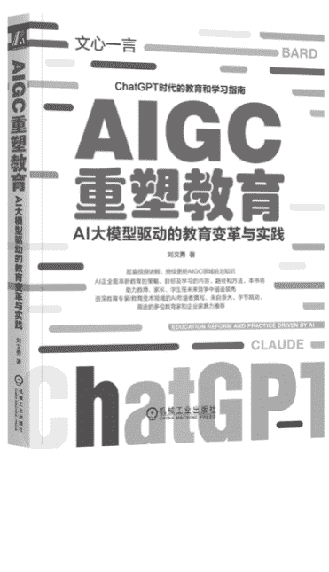

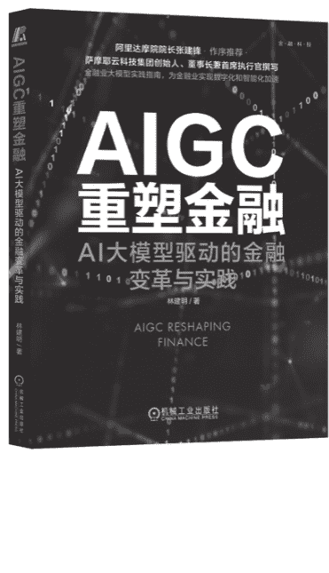

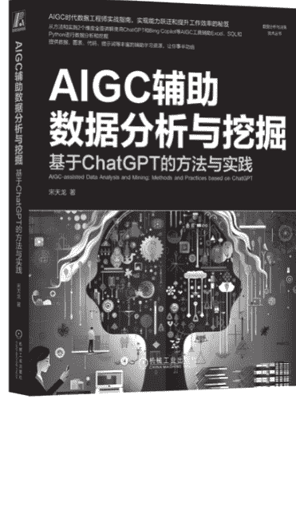

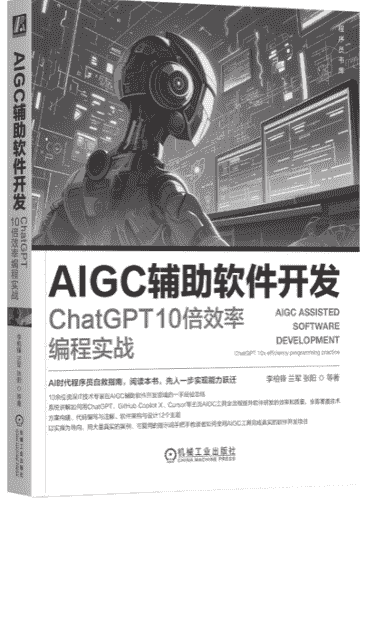

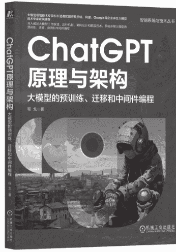

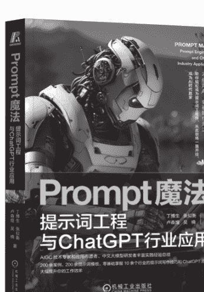

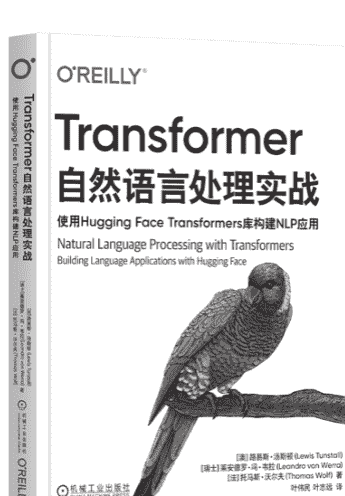

Your gateway to knowledge and culture. Accessible for everyone.

- [z-library.sk](http://z-library.sk)

- [z-lib.gs](http://z-lib.gs)

- [z-lib.fm](http://z-lib.fm)

- [go-to-library.sk](http://go-to-library.sk)

[Official Telegram channel](http://Official%20Telegram%20channel)

[Z-Access](http://Z-Access)

[https://wikipedia.org/wiki/Z-Library](https://wikipedia.org/wiki/Z-Library)