# 不懂乐理也能作曲：零基础AI音乐创作教程

## 内容提要

这是一本面向广大音乐爱好者及专业人士的AI音乐创作入门指南，旨在帮助读者轻松掌握AI音乐生成技术。无论是具备专业音乐背景的音乐人，还是没有任何音乐基础的初学者，都能通过本书轻松开启属于自己的AI音乐创作之旅。

全书从AI音乐的基础概念入手，首先带领读者了解AI音乐生成的工作原理和流程。接着，以当下热门的AI音乐生成平台Suno为核心，详细讲解从零开始生成歌曲、创作歌词的流程，并利用自定义功能学习如何为作品“打标签”。

在掌握了Suno的基本操作后，本书将视野拓展至其他AI音乐工具平台，详细介绍了AIVA、Soundraw、Udio等国外平台，以及Mureka、海绵音乐、网易天音等优秀的国内平台，并讲解了各平台在歌曲生成、人声处理、音频转换等方面的独特优势和侧重点，帮助读者更好地挑选适合自己的平台。最后一章聚焦于AI生成作品的后期编辑与辅助创作。针对AI平台可能存在的局限性，书中推荐了Replay、Logic Pro、ACE Studio和Samplab等专业工具。这些工具能帮助读者对AI生成的音乐进行后期处理，极大地拓展了二次创作的可能性。

本书适合对AI音乐创作感兴趣的音乐爱好者、独立音乐人和视频创作者阅读，也可作为音乐制作、视频制作培训班的教材。

## 序言

在当今这个快节奏的时代，音乐早已融入我们的日常生活。无论是清晨喝咖啡的宁静时刻、忙碌的上班路上，还是夜晚仰望星空的时光，音乐总是无时不在。

音乐是人类表达情感最有力的方式之一，然而，创作音乐似乎就是少数人的专属技能了。

曾经，音乐创作是一项高门槛的工作，作曲、编曲、演奏乐器、录音、混音、作词、演唱——每一步都需要深厚的音乐理论知识、熟练的乐器技能，以及昂贵的专业设备和团队配合。普通人往往只能做“听音乐的人”，想要成为“创作音乐的人”似乎遥不可及。

因此，我们中的大多数人，一直是“听音乐的人”，对“创作音乐”这件事，不敢想，更不敢试。

然而，人工智能（AI）的出现彻底打破了音乐创作的壁垒，让每个人都能轻松成为音乐创作者。无论你有没有音乐基础，只要有一台电脑或一部手机，有一段旋律或一个灵感，AI音乐生成工具能在几分钟之内帮你把脑海中的音乐创意转化为真实的声音。从此，音乐创作不再是专业人士的专属，而会变成每一个普通人都可以尝试和享受的事情。

那么，AI作曲到底是怎么一回事？AI音乐生成工具该怎么用？它能做些什么？本书将带你走进AI音乐生成的世界，用通俗易懂的语言，介绍从入门到实践的具体方法，即便你没有任何音乐基础也能轻松上手。

你可以用AI为视频配上动感的背景音乐，为企业品牌设计独特的声音标志，甚至创作一首原创歌曲送给家人朋友。无论是表达情感，还是传达创意，AI音乐创作都能让你的想法变成现实。

拥抱AI音乐生成技术，不仅能激发你的创造力，还能让你在未来的竞争中占据优势。越早熟悉它，你的创作能力、表达方式和竞争力就越强。

通过本书，你将从“听音乐的人”转变为“创作音乐的人”，开启全新的表达方式。希望这本书能让你感受到AI音乐创作的乐趣，制作出属于自己的音乐。

现在，就让我们一起迈出第一步，走进AI音乐创作的世界吧！

## 本书使用的AI工具及网站

AI 音乐生成平台（国外）

- Suno
- AIVA
- Soundraw
- Udio
- Mubert
- Soundful
- Stable Audio

歌词创作平台

- ChatGPT
- 豆包
- DeepSeek

人声处理工具

- ACE Studio

分轨 /MIDI 处理工具

- Replay
- Logic Pro 11
- Samplab

AI 音乐生成平台（国内）

- Mureka
- 海绵音乐
- 网易天音

# 第1章 什么是AI音乐生成

1. 了解常规的音乐制作工具

在人工智能介入音乐创作之前，大多数音乐人主要使用DAW（数字音频工作站）来完成作曲和编曲。简单来说，DAW就是一款功能强大的音乐制作软件，它可以帮助你完成从旋律创作、乐器编排，到录音、混音、导出音频的所有步骤，是现代音乐制作中最核心的工具。在DAW里，创作者可以使用MIDI（音符数据）来写旋律、编配乐器。例如，我们可以用钢琴音轨写出主旋律，再加上鼓组、贝斯、弦乐等声部，逐步构建出完整的音乐。这些“音轨”都是虚拟的，不需要真实演奏者，只要用鼠标点击或通过MIDI键盘输入即可。

完成旋律和配器后，还可以通过DAW添加各种音效插件（如混响、压缩器），让声音更饱满动听，最后导出为成品音乐。

目前主流的DAW软件有Logic Pro、FL Studio、Cubase、Studio One等，它们都支持MIDI编曲和音频编辑，功能和操作界面也大同小异。

总之，在常规的作曲流程中，DAW是一切工作的核心。在没有AI的时代，想写一首完整的歌，需要一定的乐理知识、编曲能力和DAW操作技能。

2. 了解传统编曲的流程

如果说作曲是写出一段旋律，那么编曲就是把这段旋律扩展成一首丰富、完整的作品。编曲的过程大致包括编配和声、增加伴奏、编排乐器、设计段落结构等核心步骤。

从中世纪到近代，作曲和编曲通常都由作曲者一个人完成。从巴洛克音乐到浪漫派音乐，作曲者会把所有乐器的音符和演奏指示写在五线谱上，交给演奏者演奏，也就是说，作曲本身就包含了编曲，没有单独的“编曲者”角色。

到了现代，随着科技的发展和商业音乐的兴起，作曲和编曲工作开始分离。作曲者通常只负责创作主旋律（比如歌曲的演唱部分），而设计和声、编配伴奏、选择乐器伴奏等工作则交由编曲者来负责。

在实际工作中，编曲者可能会收到不同形式的素材，编曲流程也会有所不同。有些客户音乐基础较好，可能会提供简谱或五线谱的旋律，编曲者需要为旋律配上和声、乐器伴奏，再用电脑制作出成品音乐，供客户演唱或录音。还有些客户会提供一个简单的演唱小样，包含主旋律、简单的和声或配器，编曲者需要把小样整理成乐谱，优化旋律，重新设计和声和伴奏，制作成完整的作品。最具有挑战性的情况是客户完全不懂音乐，只能提供一段清唱的旋律，甚至音准还存在一定的问题。编曲者就需要先将旋律整理成乐谱，进行优化，再根据客户的需求配上和声和伴奏。

除了歌曲，编曲者还为电影、游戏、广告等制作音乐，风格和重点因项目而异。优秀的编曲者只有对音乐理论、乐器搭配和相关设备有较为深入的了解，才能创作出高质量的作品。

3. AI音乐创作的原理与流程

如前所述，传统的音乐创作流程通常涉及多个环节，需要多人协作，耗时长、门槛高，让许多音乐爱好者望而却步。

但AI音乐生成技术的诞生改变了这一现状。AI作曲的过程很直接：用户只需要输入一句简单的指令或描述，比如“创作一首舒缓的钢琴曲”或“写一首像周杰伦的《轨迹》那样的抒情流行歌”，AI就能根据这些关键词生成旋律、和声，甚至编配好完整的歌曲。即使你不懂乐理、不会弹奏乐器，也能通过AI轻松创作。

AI创作音乐的原理是通过学习大量现有的音乐数据，分析其中的旋律结构、节奏模式、和声走向等规律，从中找出最匹配用户需求的模式来生成音乐。很多AI作曲平台还会提供多个版本供用户挑选，用户可以进一步修改，完成属于自己的作品。

需要明确的是，AI是辅助工具，不是替代人类创作的“全能机器”。它能帮你快速打草稿、表达灵感、节省时间，但最终的选择与调整，仍然掌握在你手中。

目前，AI音乐已经广泛应用于视频配乐、广告音乐、游戏音效等场景。它的优势在于节省制作时间，降低创作门槛，让更多人能够参与到音乐创作中来。

4. AI音乐创作的优点

### 激发创意灵感

对非专业人士来说，作曲过程中最常遇到的问题之一就是创意枯竭。AI工具能够快速生成多样化的旋律、节奏和编配，提供出人意料的音乐组合，帮助用户突破创作瓶颈，激发新的灵感。

### 降低门槛

AI工具可以简化复杂的作曲流程，即使用户没有任何音乐理论基础或乐器演奏经验，也能轻松上手，体验音乐制作的乐趣。

### 拓展音乐风格与表达方式

通过对多种音乐风格和音乐人作品的学习，AI工具可以创作出风格多样的音乐，包括模仿某位作曲家的风格，或是融合不同题材的表达方式，带来突破传统的创意组合与全新体验。

### 提升效率，节省成本

传统作曲往往耗时费力，甚至需要专业团队协助。借助AI工具，用户可以迅速获得多个创作方案，为后续修改提供素材，大幅提升制作效率，节省时间与经济成本。

### 实现个性化音乐创作

AI工具可以让用户根据个人偏好进行定制，创作出符合自己审美的作品。

### 支持实时反馈与修改

AI工具可以根据用户的输入进行即时生成与调整，使创作过程更为直观和高效。新手也能在反复尝试中逐步完善自己的作品。

### 促进学习与成长

AI工具不仅提供创作辅助，还能通过互动不断学习用户的喜好与风格，成为伴随用户成长的创作伙伴，让用户在实践中逐渐掌握音乐语言。

# 第2章 认识并使用Suno来作曲

1. 认识Suno

目前市面上的AI音乐生成工具和软件有很多，并且都在快速迭代升级，其中最知名的当数Suno。自从Suno V3.5模型的推出，人们就认识到了AI音乐生成的实力和未来的无限可能性。很多人认识AI音乐生成都是从Suno开始的，所以本书也将从它开始讲解。

Suno是一款基于生成式AI技术的音乐创作工具，能够根据用户提供的提示词或关键词快速生成完整的音乐作品，能完成包括作词、作曲、编曲和作品封面设计在内的全流程工作。Suno的创作过程简单直观，用户只需在Suno网站上输入提示词来描述创作的主题，如“一首摇滚歌曲”，点击创作后，AI就能生成相应的音乐作品。这种技术降低了音乐创作的门槛，使非专业人士也能参与到音乐创作中来，体验创作的乐趣。

2. Suno的特点

### 快速生成音乐作品

用户可以快速生成音乐作品，每天最多可以生成5次，生成10首歌曲。

### 自定义模式

在自定义模式下，用户可以输入具体的歌词和音乐风格标签，如“重金属”“经典摇滚”“民谣”等，以获得更符合需求的音乐作品。

### 多版本生成

对于同一提示词，Suno可以生成多个版本的音乐作品，用户可以选择最喜欢的一个。

3. Suno能做什么

截至2025年7月，Suno最新的模型为4.5，但需要收费。本书以免费的3.5模型为基础介绍它的核心功能，帮助你快速上手。Suno主要有以下功能。

### 3.1 用文字生成音乐

进入Suno的“Create”页面，在“Describe your song”（描述你的歌曲）中输入你的想法，比如输入“我在为AI作曲教程写一首轻快的流行歌”或“适合短视频的动感背景音乐”。你还可以指定音乐风格（如流行、摇滚）、情绪（如欢乐、忧伤），也可以提供自己的歌词。Suno会根据提示词生成两首完整歌曲，通常在几十秒内即可完成。Suno 3.5模型生成的作品最长为4分钟，包含完整的结构（前奏、主歌、副歌、间奏等）。如果你觉得不够长，还可以使用“Extend”功能，能将作品延长最多2分钟，总时长可达6分钟。

### 3.2 多版本选择

Suno每次会生成两首不同风格的音乐，你可以进行对比、挑选，选择自己喜欢的那一版，再微调风格或结构。

比如，这里我输入“我在为没有音乐基础的读者创作一本AI作曲教程，请你写一首轻快的流行歌，pop”，Suno生成了两首名为“追梦的节奏”的歌曲。

### 3.3 下载和分享

免费用户可以将生成的音乐以MP3或MP4格式下载（付费用户支持WAV格式），还能生成播放页面，分享给朋友他人，或用于短视频、广告或其他项目中。

以下是Suno根据提示词“我在为AI作曲教材写一首适合的歌曲”创作的两首歌曲，每首歌都包含完整的中文歌词和清晰的曲式结构（前奏、主歌、副歌等）。你可以找到配套资源中的“试听音频2-1”和“试听音频2-2”，感受Suno如何将简单的文字描述变成一首完整的歌曲，体验AI音乐创作的魅力。

[ Verse ]
电线链接宇宙星火
数字跳跃超越一切
未来的旋律在我耳边
科技的心脏跳动不停

[ Verse 2 ]
算法编织梦想如梦
数据的河流永不枯竭
在虚拟世界畅游不息
每一个音符都包含秘密

[ Chorus ]
AI作曲智慧无限
未来音律填满心田
在代码深处寻找灵感
音乐的未来就在眼前

[ Verse 3 ]
机器人舞步如行云
代码与旋律完美结合
虚拟的世界无尽奇迹
在电波中唱出心声

[ Bridge ]
跨越时间 绽放未来
人机协作 永不分离
在合成的声音里飞翔
凝聚出全新的希望

[ Verse 4 ]
键盘敲击如心跳跳动
每个程序都有旋律
大脑与机器共振共鸣
未来的乐章我们共同谱写

免费用户每天可以创作5次音乐，最多10首歌曲。免费的3.5模型生成的歌曲质量已经非常不错，还支持生成多种语言的歌曲，人声也比较自然。

4. 如何使用Suno

在必应等搜索引擎中搜索“suno”，找到Suno的官方网站并打开。用电脑或手机都可以访问，本书使用电脑端的网页来讲解示范。进入网站以后，会看到一个全英文的主界面，如下图所示。往下滚动网页还可以看到关于Suno的各种介绍。

在主界面中间的文本框里就可以输入提示词，但点击“Create”之后会提示你需要登录。因此，这里我们直接点击右上角的“Sign Up”（注册）按钮。

本书中的Suno截图截取于2025年7月，由于Suno持续更新，实际界面或功能可能会有变化，敬请读者朋友谅解。 ——编辑注

这时我们就会看到注册界面，如下图所示。Suno可以使用苹果、微软等账号登录，也可以直接输入手机号登录。这里我们用手机号登录，点击“Phone Number”下面的处，输入“CN”或“China”，然后在“+86”后面输入自己的手机号。随后，手机上会收到验证码，在网页上输入验证码之后，就会显示注册成功。

接着，网页会自动跳转到登录后的主界面。页面还会弹出一些Suno的介绍，如果不想看可以直接关闭。

- 首页
- 生成
- 图书馆
- 探索
- 搜索
- 通知

主界面左上方是主功能区，各个按钮的功能如上图所示。

主功能区下方左下角有一个“50 Credits”，这是免费用户可以使用的积分。免费用户每天可以获得50个积分，不累积。Suno生成一首歌曲会消耗5积分，每次生成2首，因此每次生成都会消耗10个积分，也就是说一天可以免费生成5次。这对于普通音乐爱好者来说基本够用了。

### Suno的收费服务

如果我们想创作更多的作品，就可以订阅Suno的收费服务。

点击“50 Credits”下方的“Upgrade”就可以看到Suno的收费方案。

Suno的订阅收费分为两档，分别为Pro Plan和Premier Plan，可以按月或按年订阅，大家根据自己的需求购买即可。

Suno的免费用户创作的歌曲不能用于商业用途。比如你想把作品放到网络音乐平台销售，或者通过电视、广播、播客或广告获得收入，就需要升级到Pro Plan或Premier Plan，也就是收费的订阅会员。

5. 用Suno听别人的作品

在开始自己的创作之前，是不是想先听听别人使用Suno创作出来的歌曲是什么样的？

回到主界面，我们会发现占据页面大部分位置的（下图中红框的部分）是Suno推荐的作品和用户，点击进入对应页面就可以聆听他人的作品。

再往下滚动页面，还可以看到各种分类，比较重要的有以下几类。

### Top Categories（热门分类）

### Trending Playlists（热播歌单）

### Suno Showcase（Suno精选）

“Suno Showcase”中列出的都是单曲，将鼠标指针移动到歌曲的图片上就会出现一个三角形，点击即可播放，如下图所示。一首歌曲结束后会自动播放下一首歌曲，可以一直不间断地聆听其他用户制作的歌曲。

## Shadows of the Holler

appalachian death metal ...

timmo

而 “Trending Playlists” 和 “Top Categories” 等都是以列表的方式呈现，需要点击图片进入页面再聆听。播放时，界面右边会显示歌曲封面和歌词，如下图所示。

# 第3章 使用Suno来作曲

1. 试着用Suno创作人声作品

现在我们来学习用Suno作曲吧。首先，我们尝试用Suno生成有人声的作品。

点击主功能区中的“Create”按钮，就进入了歌曲创作界面，如下图所示。

我们来看看界面上各个按钮的功能。

### ❶ Simple/Custom模式选择

点击这里，用户可以在“Simple”（简单模式）和“Custom”（自定义模式）之间切换。简单模式提供更简洁的设置界面，适合初学者快速上手；而选择自定义模式后，会出现更多可供调整的参数选项，便于有一定经验的用户进行更细致的创作。初学者建议从简单模式开始，逐步熟悉各项功能后，再尝试自定义模式。

### ❷ 模型版本选择

点击“v3.5”，会出现一个下拉列表，从中可以选择Suno不同版本的模型。比v3.5更新的模型有v4、v4.5和v4.5 Pro，功能更强大一些，生成的歌曲长度也更长，但都需要收费；更旧的模型有v2和v3，功能和生成的歌曲长度都不及v3.5。我们根据自己的需要选择即可。

### ❸ Describe your song（歌曲描述）

就是我们写提示词的地方，用文字告诉Suno你想生成的歌曲内容、风格等。比如之前我就输入了“我在为AI作曲的技术写教材，写一首适合的歌曲”这样的描述。你的描述越细致，生成的音乐越贴近你的想法。右上角有一个小小的骰子的图标，点击一下，Suno会随机生成一段提示词。

在这里最好不要输入特定的歌手或歌曲名称，如果包含艺术家或歌曲名称，则可能无法生成。目前Suno支持50多种语言的输入与创作，你输入的描述是中文，生成的就是中文歌，输入英文就是英文歌。

好的提示词可以让Suno更精准地生成我们想要的音乐。在写描述的时候，我们可以从以下几个方面来组织语言。

- 1. 指定音乐风格，尽量精确到某个音乐风格流派或者该风格流派下的子流派或子风格，如摇滚、爵士融合、都市流行等。风格越具体，越容易生成我们想要的效果。
- 2. 精确描述歌曲的情绪或氛围，如欢乐、忧郁、充满活力等。
- 3. 说明歌曲的主题或使用场景，如生日歌、旅行配乐、婚礼背景乐等。
- 4. 加入你希望听到的乐器，如吉他、钢琴、古筝等，增加音乐的独特质感。
- 5. 描述具体的人声类型，如男声、女声、女高音、老年男声等。

在后面的章节里，我会提供音乐风格、乐器和情绪词汇的中英文对照，帮你更轻松地编写提示词。

### ❹ Audio（上传音频）

点击这里会出现一个菜单，显示“Upload”（上传）和“Record”（录制）两个选项。上传是将已经录制好的音频文件上传到Suno，让它基于上传的音频进行生成。我们可以使用任何声音来制作歌曲，比如自己哼唱的一段旋律、弹奏的一段音符等。录制就是直接在Suno中录制，比如通过连接到计算机的麦克风哼唱一段旋律。

### ❺ Lyrics（添加歌词）

点击这里之后，Suno会临时切换到自定义模式，并出现歌词界面。歌词界面有“Auto”（自动）和“Write Lyrics”（写歌词）两种模式，默认是“Write Lyrics”模式。这个模式下，我们填写已有的歌词。如果选择“Auto”模式，我们可以输入对歌词的描述，Suno会根据我们的描述来创作歌词。这一项如果不填写，Suno就会根据它对提示词的理解生成歌词。

### ❻ Instrumental（人声/纯音乐开关）

“Instrumental”是用来设定是否加入人声的开关，勾选之后，Suno将生成纯音乐。

### ❼ Inspiration（灵感）

这个版块是Suno根据我们的歌曲描述自动推荐的一些音乐风格或关键词。如果它推荐的风格或关键词符合你想表达的音乐风格，点击一下，相应的词语就会被自动添加到提示词里，帮助Suno更精准地理解你的创作意图。这个功能尤其适合不擅长写风格或情绪描述的初学者。

### ❽ Create（生成）

确定我们的提示词都写好了，点击“Create”按钮，Suno就会开始生成作品。每点击一次这个按钮，都会消耗10积分。

如前所述，Suno会根据你的描述生成两首歌曲（实际上还会以4.5版生成两首歌曲，但只能试听），整个过程只需几十秒。生成完成后，作品将显示在界面右侧，点击小封面图的位置即可试听。除了音乐本身，Suno还会同步生成歌词、封面图和音乐风格等信息，点击歌曲名，进入歌曲页面就可以看到。

列表中歌曲的右侧还有几个按钮。点击“Publish”（发布）可以将该歌曲设为公开状态，它就会出现在你的个人主页中，也可能被收录到Suno的首页或歌单推荐中，可以被更多的人听到。

“Publish”右边的4个小图标分别表示点赞（喜欢）、点踩（不喜欢）、评论和分享。

点击最右边三个小白点构成的图标，会弹出一个菜单，如下边左图所示，与歌曲相关的操作都在其中，包括编辑、下载、删除等。

在 “Remix/Edit”（混编/编辑）下面还有子菜单，如下边右图所示，包含覆盖、延长、调整速度等操作。在歌曲的页面和底部的播放器上也有三个小白点的图标，点击后，会弹出同样的菜单。生成好的歌曲有一个单独的播放页面的链接，你可以随时播放，也可以下载到电脑中。

如果想下载歌曲，可以依次点击三个小白点→ Download，会显示可供下载的文件格式，免费用户可以选择MP3格式，付费用户还可以选择WAV格式。

> 菜单中的最后一项“Generate Video”是Suno内置的视频生成功能，理论上点击后会生成与歌曲匹配的视频文件，生成完成后再点击“Video”就可以下载。但经过我们的测试，点击“Generate Video”之后，界面底部会短暂弹出“Generating video…”的提示，此后就没有任何反应，也不会生成视频文件，“Video”选项也始终为灰色。这个功能可能还不稳定，感兴趣的读者朋友可以自行尝试。——编辑注

像这样，生成两首质量不错的时长4分钟左右的作品，附带歌词和封面，只需要不到一分钟，而且在这个过程中完全不需要用到专业的音乐知识。

要知道，以前即使是经验丰富的音乐人，完成这样一首作品也往往要花费数周时间。相比之下，AI作曲的效率之高，确实令人惊叹。

2. 试着用Suno创作纯音乐

接下来，我们试试创作没有主唱、只有乐器（instrumental）的纯音乐，步骤和生成人声歌曲几乎一样。

同样，在 “Describe your song” 中输入你想生成的歌曲的提示词，描述你想要的音乐风格和主题。这里，我输入的是 “写一首韩国抒情流行曲风，使用钢琴以及弦乐来搭配。和声方面使用一些爵士和声” 这样的描述。同时，勾选 “Instrumental” 选项，这时，Suno就会生成没有人声的纯音乐了。点击 “Create” ，也会生成两首乐曲，显示方式和其他按钮与人声歌曲完全一样 。

你会发现，和生成人声作品一样，创作纯音乐时，Suno也会为我们的作品取一个合适的名字，并设计好音乐的封面。

在配套资源中找到 “试听音频3-1” 和 “试听音频3-2”，可以听听这两首纯音乐作品。

### 我们曾经的回忆

by @entertainingmicrogenre4570

[Instrumental]

MADE WITH SUNO

- 试听音频3-1
- 试听音频3-2

我们换一种音乐风格试一试，这次我想创作中国风的音乐，所以在“Describe your song”中输入了“中国风的流行音乐，用古筝作为主奏乐器”。大家可以听听效果。在描述中，我仅使用了最简单的表达说明方式，没有使用任何专业的音乐术语，生成的音乐也很不错。大家可以尽情发挥自己的想象，然后让Suno来实现。

Simple Custom v3.5

Describe your song 📝

中国风的流行音乐，用古筝作为主奏乐器

+ Audio + Lyrics Instrumental

Inspiration

+ fank + piano + blackmetal + clear production +

🎵 Create

🎵 试听音频3-3 试听音频3-4

我们再试一试其他的创作类型，这次我想创作一首喝酒时的背景纯音乐，所以在“Describe your song”中输入了“我和朋友在家喝酒，创作Smooth Jazz类型的音乐，并使用尼龙吉他作为主奏乐器，音乐风格可以稍微舒缓一点，性感一点”。大家可以听听效果。在描述中，我使用了“酒”和专业的音乐风格“Smooth Jazz”，并且强调了使用尼龙吉他。Suno创作出来的音乐非常符合我的提示词，并且乐曲名“深夜微醺”也很符合主题，乐曲的封面也有吉他和酒的设计。但是这首曲子并没有达到我的预期，音乐中只有吉他，而且弹奏的是Bossa Nova风格。当Suno的生成结果不准确的时候，就需要用其他的词语来描述，多生成几次，最后达到想要的效果。

Simple Custom v3.5

Describe your song 🎵

我和朋友在家喝酒，创作Smooth Jazz类型的音乐，并使用尼龙吉他作为主奏乐器，音乐风格可以稍微舒缓一点，性感一点

+ Audio + Lyrics

Instrumental

Inspiration

+ fank + piano + blackmetal + clear production +

✨ Create

🎵 试听音频3-5 试听音频3-6

在 “Describe your song” 中输入提示词的时候，可以使用英文、中文、日文等各种文字信息，但是使用英文时，Suno的识别会更准确，大家可以多多尝试。

### 深夜微醺

nylon guitar sultry soothing smooth jazz

3. 制作播放列表

想把喜欢的歌曲集中起来听的时候，制作一个播放列表会很方便。

要将歌曲发送到播放列表中，先单击该歌曲右侧三个小点的按钮，然后从弹出的菜单中选择“Add to Playlist”。

如果你没有建立过播放列表，Suno会弹出提示，告诉你没有播放列表，如下图所示。这时，点一下左下角的“Playlist Name”，就可以输入新播放列表的名称，再点击右边的 “Create Playlist”，一个新的播放列表就创建完成了。Suno会自动为你的播放列表匹配一张封面图。

创建好的播放列表保存在 “Library” 中。点击左侧功能区中的 “Library”，再点击第二个选项卡 “Playlists”，就能看到刚才新建的播放列表 了。我们会发现这里还有一个 “Liked Songs”，里面存储了你点赞过的歌曲。

随着创作的歌曲逐渐增多，你可以把它们整理到不同的播放列表中，就能更方便地管理和连续播放。这样一来，你不仅能更好地享受自己创作的音乐，还能像一个私人电台主持人一样，随心所欲地编排自己的专属节目。

# 第4章 用AI创作歌词

1. 用AI写歌词的基本思路

到目前为止，我们在Suno里生成音乐时，都是输入一个简单的提示词或概念，让Suno自动为我们生成歌词和旋律。这种方式虽然方便，但歌词的内容大多由Suno自己发挥，有时候可能并不能完全符合我们的想法。

如果你对歌曲的主题有明确的构思，比如想表达某种情绪、讲一个具体的故事，或者想模仿某种风格的歌词，这时就可以使用其他更擅长文本生成的AI工具来单独创作歌词。向AI详细说明你想要的内容，它可以根据你的要求生成更贴合你想法的歌词。你也可以反复调整和修改，直到满意为止。这比使用Suno的自动生成歌词更高效。

目前主流的AI平台都可以创作歌词，比如国外的ChatGPT，国内的豆包、DeepSeek等，使用方法大同小异。这一章，我们将分别以ChatGPT、豆包和DeepSeek为例，来介绍如何一步步生成你想要的歌词。

使用AI创作歌词的基本流程如下：

- 1. 明确主题和风格
- 2. 确定歌词的基本结构
- 3. 向AI提出清晰的写作请求
- 4. 根据生成结果进行修改和润色

值得一提的是，使用AI创作歌词的内容非常自由，只要不涉及侵权或违反相关法律法规，几乎任何题材都可以成为你的灵感来源。即便你有没有写歌词的经验，也可以通过这种方式尝试创作属于自己的歌词。

2. 了解歌曲曲式结构，为你的歌词搭建骨架

写歌词不像写文章，可以自由书写，而要遵循一定的“格式”，这个格式在音乐中就叫作“曲式”。简单来说，曲式就是一首歌曲的结构框架，也就是它由哪些部分组成，每一部分起到什么作用。在创作歌词时，如果你知道这些结构，就能更清楚地规划每一部分的歌词内容该写什么、写多少，让情感的铺垫、发展和高潮更有层次。这对于我们指导AI创作，以及修改AI生成的歌词至关重要。

流行音乐的结构相对灵活，一般是按照段落的功能来划分的，通常由以下几个部分组成。

### ·前奏（Intro）

指歌曲正式演唱前的一段纯音乐，通常有4～8小节。它的作用是营造氛围，吸引听众的注意力，为歌曲的整体风格定下基调。

### ·主歌（Verse）

通常是歌曲的第一个演唱段落，紧跟在前奏之后。主歌的旋律起伏相对平缓，是歌曲的“叙事”部分，用来交代故事背景、描绘场景或陈述事实，为副歌的情感爆发做铺垫。一般一段主歌对应4～8句歌词。

### ·预副歌（Pre-Chorus）

位于主歌和副歌之间，起到一个“能量提升”或“情绪加速”的作用。并不是所有歌曲都有预副歌，有时它也被归入主歌。

### ·副歌（Chorus）

这是一首歌的“灵魂”和高潮部分，也是最容易被听众记住的部分。副歌的旋律通常最有记忆点，情感最强烈，会在歌曲中反复出现。

### ·桥段（Bridge）

用于打破重复，通常出现在中后段，带来新的旋律或情绪变化，帮助歌曲过渡到最后的高潮。

### ·间奏（Interlude）

一段纯音乐，用来隔开两个段落，或给听众一个缓冲，通常是歌曲中段的纯器乐部分。

### ·尾奏（Outro）

歌曲的结尾部分，可以是纯音乐，也可以是某句核心歌词的反复吟唱。它的作用是慢慢释放歌曲积累的情绪，让歌曲平稳、自然地结束，给听众留下余韵。

这些段落的名称（如Verse、Chorus、Bridge等）在Suno或ChatGPT自动生成的歌词中经常会出现，所以理解它们的含义非常重要。你在写歌词时，也可以根据需要自由组合这些段落，比如主歌+副歌+主歌+副歌+桥段+副歌，就构成了非常常见的一种歌曲结构。

此外，歌词的句子数量和每段的长短通常与乐句和小节有关：比如一段8小节的旋律，通常配上4～8句歌词。你也可以根据旋律划分，把主歌分成两小段（比如“主歌1”和“主歌2”），每段4句歌词。

在用AI写歌词时，如果你能掌握这些基本的曲式概念，就可以更合理地安排歌词的结构和情绪层次，也更容易让Suno生成匹配的旋律。

3. 实战演练：使用主流AI平台生成歌词

### （1）使用ChatGPT来创作歌词

前期工作都准备好之后，我们就可以着手让AI来创作歌词了。我们先试试用ChatGPT来写。

#### ·登录

打开ChatGPT的官网并登录账号，我们会看到以下界面。免费用户默认使用的是GPT-5模型。关于如何注册ChatGPT的账号以及如何登录，本书就不赘述了，请大家到网上搜索教程。

#### ·输入提示语

在输入框中，清晰地向ChatGPT描述你想要的歌词内容，包括主题、风格、情感倾向、大致的结构等。例如，你可以输入“请为我写一首关于梦想的流行风格的歌词，要有主歌和副歌部分，表达对梦想的坚持和追求”。

ChatGPT会根据你的提示生成歌词。仔细阅读歌词，看看是否符合你的预期。

#### ·优化和修改歌词

AI生成的歌词往往只是初稿，通常都要经过人工修改调整，才能更符合我们的创作意图。这个过程就是为歌词注入思想、情感和灵魂的关键一步，我们可以从以下几个层面入手。

##### ·结构与内容的调整

**结构优化：** AI生成的歌词结构不一定是完美的。你可以根据前面学到的曲式知识，检查主歌和副歌的衔接是否自然，情感递进是否合理。如果感觉歌曲太平淡，可以在副歌之间增加一个桥段（Bridge）来营造新鲜感和转折；如果感觉太拖沓，可以删减一些重复的段落，让结构更紧凑。

**内容调整：** 仔细推敲每一个词句。有时候，替换一个词就能让意境大不相同。比如，将“我追逐梦想的脚步不停歇”改为“我追逐梦想的步伐永不停歇”，后者在韵律和力量感上就更胜一筹。

##### ·创意与个性的融入

接下来，要给这首歌词打上你自己的烙印。

**添加独特意象：** 在歌词中加入一些巧妙的意象、比喻或象征，能让你的表达更含蓄、更高级，也更具诗意。比如，用“夜空中的星星”来象征遥远却明亮的梦想，用“逆风飞行”来比喻追梦路上的艰辛。

**结合自身经历：** 最能打动人心的永远是真情实感。如果歌词的主题与你的亲身经历相关，不妨将自己的故事和感悟融入其中。比如，如果你曾为梦想在黑暗中摸索，就可以写下“也曾在深夜里叩问，那束微光来自何方”，这样真实的细节会让歌词充满感染力。

##### ·最终的检查与完善

在完成所有创意修改后，别忘了进行最后的“质检”。

**语言校对：** 通读全篇，检查是否有语法、拼写或用词错误，确保语言流畅、简洁、易懂。

**情感核对：** 再次确认歌词表达的情感，是否与你设定的主题和风格完全一致。一个非常有效的方法是大声地、带着感情朗读一遍。在朗读的过程中，你能最直观地感受到哪些地方情感饱满，哪些地方比较别扭，从而进行最后的调整。

以下是ChatGPT生成的歌词，结构很完整，段落结构清晰，包含主歌、副歌、桥段和尾奏等部分，每个段落中句与句的划分也很清楚，各句的字数也比较均衡。在结构方面，我们不仅可以告诉AI工具，歌词需要包含哪些段落，还可以限定每个段落有多少歌词。通常每个段落包括4句歌词，比如主歌部分有8句，也可以拆分为主歌1和主歌2。有时候，AI生成的歌词内容太多，我们可以进行简化。根据具体需要灵活调整，更好地贴合自己的创作目标。

## 主歌

仰望星空那一瞬间
心跳随着节奏蔓延
脚步坚定不怕疲倦
我知道路在前面
曾经跌倒痛也无所谓
一次次站起，不曾后悔
在这繁华的城市夜晚
我听见梦想在召唤

### 副歌

我追逐着那道光
在黑夜中越发明亮
再多阻碍也不能挡
我的心从未迷茫
无论风雨多疯狂
我有勇气把梦点亮
用汗水去谱写时光
让未来为我鼓掌

## 主歌

一路走来多少磨难
学会在孤独中勇敢
不再怀疑自己的选择
因为梦想不容敷衍
就算世界不曾理解
我依然奋力向前去追
即使前方依旧遥远
梦想从未离我太远

### 副歌

我追逐着那道光
在黑夜中越发明亮
再多阻碍也不能挡
我的心从未迷茫
无论风雨多疯狂
我有勇气把梦点亮
用汗水去谱写时光
让未来为我鼓掌

### 桥段

也许前方还会有挫折
也许曾经怀疑和退缩
但那心底的执着
是我唯一的承诺

### 副歌

我追逐着那道光
在黑夜中越发明亮
再多阻碍也不能挡
我的心从未迷茫
无论风雨多疯狂
我有勇气把梦点亮
用汗水去谱写时光
让未来为我鼓掌

### 结尾

梦想之光，在我心上
带我飞向那片希望

## （2）使用豆包来创作歌词

豆包是由字节跳动开发的人工智能工具，目前已具备写歌词和生成音乐的能力。在歌词创作方面，豆包的优势主要体现在以下几点。

**中文表达自然：** 豆包支持根据中文提示生成主题明确、语句流畅的歌词，适合中文母语用户使用。

**结构清晰：** 支持一次性生成包含主歌、副歌甚至桥段的完整歌词，并能进行结构标注，方便你后续调整。

**多要素输入支持：** 你可以在提示中指定多种要素，如歌曲风格（民谣、嘻哈、R&B等）和情感倾向（欢乐、伤感等）。

简而言之，豆包相较于一些国外模型，它能更准确地理解中文语境，生成的歌词在表达、韵律和情感上更贴合我们的语言习惯，更自然，也更具感染力。

你可以访问豆包的网页，或者下载豆包App来使用。

使用豆包创作歌词的流程和思路与使用ChatGPT一样，这里就不再重复了。这里我们还是输入同样的提示词：“请为我写一首关于梦想的流行风格的歌词，要有主歌和副歌部分，表达对梦想的坚持和追求。”豆包创作的歌词如下，整体结构也是非常完整的，甚至还附带了歌名。

# 《逐梦之光》

### 主歌1

在黑暗中独自徘徊
街灯下身影被拉长了孤单
怀揣着心中那团火焰
哪怕世界都对我冷眼旁观
每一步都走得艰难
梦想像繁星在遥远的彼岸
但我知道不能轻易就转弯
风雨中我要扬起我的帆

### 主歌2

汗水浸湿了我的衣衫
疲惫也常常将我灵魂纠缠
可那梦的声音在召唤
像古老神秘的力量在呐喊
看过了无数的悲欢
那些挫折不过是小小波澜
我带着希望从不曾离散
向着梦想的方向一直闯

### 副歌

梦想是我的信仰
是我飞翔的翅膀
穿越风雨的阻挡
闪耀在那最高的地方
坚持是我的力量
是我心中的太阳
燃烧所有的渴望
追逐那永不灭的梦想之光

## 主歌3

路上有荆棘刺痛心房
有迷雾让我迷失了方向
但我想起最初的梦想
那是我心中最温暖的地方
也许会有怀疑的浪
冲击我那看似脆弱的堤防
可我会握紧双拳更顽强
为梦想我要变得更有锋芒

## 主歌4

岁月会改变我的模样
但梦想永远在我灵魂之上
它是我生命最美的乐章
伴随我走过每个天亮
我要在这舞台中央
用热血书写属于我的辉煌
让梦想之花灿烂地绽放
那是我一生的宝藏

### 副歌

梦想是我的信仰
是我飞翔的翅膀
穿越风雨的阻挡
闪耀在那最高的地方
坚持是我的力量
是我心中的太阳
燃烧所有的渴望
追逐那永不灭的梦想之光

## （3）使用DeepSeek来创作歌词

DeepSeek是由杭州深度求索人工智能基础技术研究有限公司开发的一款AI助手，于2025年1月初上线，凭借其多维度文本控制能力和免费开放策略，迅速成为创作者的热门工具。截至2025年7月，DeepSeek提供V3和R1两种模型，不开启“深度思考”时使用V3模型，开启“深度思考”后则调用R1模型。

DeepSeek在文本生成方面的能力也非常出色。使用DeepSeek创作歌词有以下优势。

**押韵风格丰富：** R1模型支持多种韵律风格（如AABB、ABAB等），特别适合创作说唱、诗意歌词等需要明确押韵结构的内容，能够生成更具节奏感、易于演唱的歌词。

**结构清晰完整：** 可以按照用户的要求生成主歌、副歌、桥段等完整段落，并保持风格统一。如果你对生成的歌词不满意，还可以让它调整优化，比如增加情感表达、修改某些句子等。

**语言生动，贴近真人创作：** 生成的内容“AI味儿”没有那么浓，更接近人类语言风格，尤其适合想要加入比喻、意象、叙事元素的创作者。

**深度思考模式，让歌词更有层次：** DeepSeek的“深度思考”模式可以生成更高级的歌词，会加入更多巧妙的比喻和情感变化，让整首歌的意境更丰富。

你可以用浏览器打开DeepSeek的官方网站或下载DeepSeek App来使用它。

同样，我们在DeepSeek中输入提示词：“请为我写一首关于青春奋斗的流行说唱歌词，要有主歌、副歌和桥段，各段落各自押韵，结构明确。”

以下分别是普通模式和“深度思考”模式生成的歌词，大家可以看看在感觉上有什么不同。

## 追光者（普通模式）

### 主歌1

夜色笼罩城市的角落，
我数着星星许下承诺。
就算前方有暴雨滂沱，
也要让心跳得炽热。

### 主歌2

曾经跌倒过，痛过沉默，
可梦在燃烧，怎能退缩？
就算世界笑我太执着，
我仍相信有光在等我。

### 副歌

我要追着光，逆风飞翔，
哪怕遍体鳞伤也不投降。
梦是黑夜里的灯塔亮，
照亮我奔向远方。
就算路再长，也不彷徨，
因为热爱是唯一的信仰。
终有一天，我会站在巅峰上，
让世界听见我的光！

### 桥段

时间会证明所有泪和汗，
化作翅膀，带我翱翔。
当风吹散迷雾的阻挡，
我会拥抱属于我的光。

### 副歌重复

我要追着光，逆风飞翔，
哪怕遍体鳞伤也不投降。
梦是黑夜里的灯塔亮，
照亮我奔向远方。
就算路再长，也不彷徨，
因为热爱是唯一的信仰。
终有一天，我会站在巅峰上，
让世界听见我的光！

### 结尾

梦在前方，脚步不停歇，
直到星光洒满我的世界。

## 逐梦刻度（“深度思考”模式）

### 主歌1

第几次把简历折成纸飞机，
瞄准霓虹却坠入人潮间隙。
地下室泡面蒸腾的勇气，
在发霉墙角长出藤蔓根系。

### 主歌2

地铁窗映出疲惫的剪影，
掌心老茧是年轻的勋章印记。
当所有账单嘲笑着初心，
我把月光铸成唯一的硬币。

### 预副歌

听啊，心底鼓声从未暂停，
纵使全世界按下静音——

### 副歌

我是候鸟穿越季风的深，
把远方刻进每根羽纹。
当冻土之下有春在沸腾，
谁听见种子的裂痕？
梦是荆棘王冠加冕的刃，
痛与荣耀在血里同存。
若时光要我以白发为凭，
就把指纹刻进年轮！

### 桥段

十年后回望这长夜跋涉，
所有跌倒都是星图坐标。
当流星划过默剧般街道，
原来追光者自成光鞘。

### 副歌升Key

我是候鸟穿越季风的深，
把远方刻进每根羽纹！
当冻土之下有春在沸腾，
天地见证我的裂痕！
梦是荆棘王冠淬炼的刃，
所有伤口终绽放成辰。
若星辰需要燃烧才诞生，
我把自己举向苍穹——

### 结尾渐弱

当群星俯身相认，
那个倔强指纹……

我们会发现，DeepSeek普通模式生成的歌词相对于ChatGPT和豆包生成的歌词在结构上更简单，却更清晰，更有“人味儿”，更像真人创作的歌词，与当前的流行歌曲非常接近，文本自然，逻辑顺畅，押韵到位，可以不用修改直接拿到Suno里创作旋律了。

而“深度思考”模式下创作的歌词加入了更多比喻和意象，甚至还会加上“副歌升Key”这样的设计，更为丰富全面，在针对某些特定场景或主题进行创作时可能会有很好的效果。大家可以自行尝试，挑选自己喜欢的版本。

除了ChatGPT、豆包和DeepSeek，国内外还有很多AI工具可以生成歌词，大家都可以进行尝试，根据自己的喜好来选择。

# 第5章 使用Suno的自定义模式

在第3章我们提到过Suno还有一个“Custom”模式，即自定义模式，其中提供了更多可供调整的参数选项，便于有一定经验的用户进行更细致的创作。在这一章，我们就来学习如何使用“Custom”模式。

## 1. 认识自定义模式

在第3章，我们已经了解了如何切换到自定义模式。

点击Suno主界面左边功能区中的“Create”，再点击上方的“Custom”，就切换到了自定义模式。这时，我们会看到，页面上多了很多可以设置的选项。点击最下方“Advanced Options”，还会展开更多选项。

仔细观察这个界面，我们会看到，原先填写歌曲描述的 “Describe your song” 的地方已经变成了 “Lyrics”（歌词），在这里我们可以输入我们写好的歌词。右上角的 “Auto”（自动）和 “Write Lyrics”（写歌词）在第3章已经介绍过，这里就不重复了。如果想让Suno来创作歌词，切换到 “Auto” 模式，并填入我们对歌词的描述即可。

点击歌词输入框下面的 “By Line”，会进入专业的编辑器模式，如下图所示。在这里，你可以让Suno帮你逐行修改歌词。点击 “Write Here”，Suno会在光标的位置生成歌词并插入。如果我们选中已有的歌词，这个按钮会变成 “Rewrite”，点击之后，Suno会对被选中的歌词进行改写。点击 处，可以输入你对歌词的想法或要求，比如 “改为中国风”，Suno会按照你的要求进行改写。有时Suno对中文的理解不够准确，可以试一试使用英文指令。

而如果点击歌词输入框下面的“Full Song”，会进入歌词生成界面，如上图所示。在 处输入提示词，再点击“Write Lyrics”，Suno就会生成两版歌词。点击 处，会出现一个下拉列表，如上方右图所示，里面有“Classic”和“ReMi”两种模式 。请注意看页面上的提示：“ReMi”模式更具创造力，但生成的歌词可能会含有令人不适的内容，而“Classic”模式能更好地贴合用户的提示词。

这里我们用“Classic”模式，还是输入同样的提示词：“请为我写一首关于梦想的流行风格的歌词，要有主歌和副歌部分，表达对梦想的坚持和追求。”Suno生成了两版以“追梦的光”为题的歌词。点击我们更喜欢的一版下面的“Select This Option”，歌词就会自动填入主界面的歌词输入框里，再点击“By Line”，也可以在编辑器里进一步编辑。

## 2. 元标签

下面是我从Suno生成的歌词中选出的比较满意的一版，结构完整，几乎没有语病。缺点是韵脚切换过于频繁，不太符合我们的习惯，有点不自然。总体看来，Suno创作中文歌词的水平相较于前面我们提到的AI工具，还存在一定的差距，而它创作其他语言歌词的水平如何，读者可以自行尝试后判断。

### [Verse]

奔跑在无尽的路上
心中充满无限希望
每个黑暗都闪耀光芒
梦就在下一秒释放

### [Verse 2]

无数次跌倒还要爬起
眼泪是奋斗的勇气
每一刻都在为你坚持
梦想在召唤的声音里

### [Chorus]

追逐梦的光 永不停歇脚步
用汗水浇灌 希望不会迷路
纵使风雨狂 梦在心中燃烧
只要你在坚持 梦想永不老

### [Bridge]

每一盏星光都是目标
每一段旅程都要骄傲
不管多远多么难找
梦想一直在你怀抱

### [Verse 3]

未来的路虽然漫长
脚步坚定从不彷徨
心之所属坚定不移
勇敢追梦永不放弃

### [Chorus]

追逐梦的光 永不停歇脚步
用汗水浇灌 希望不会迷路
纵使风雨狂 梦在心中燃烧
只要你在坚持 梦想永不老

在Suno生成的歌词中使用了带方括号的英文段落标记，比如 [Verse]、[Chorus]、[Bridge] 等，而不像ChatGPT、豆包或DeepSeek那样使用中文来标注段落。这些英文段落标记其实是一种元标签（Metatags），它们在AI音乐创作中起着非常重要的作用。

简单来说，元标签就像是一位隐形的指挥，它告诉AI当前这段音乐该怎么写、该怎么演奏。

元标签最常见的用途就是定义歌曲的结构，也就是划分主歌、副歌、桥段等不同部分。不同的结构会影响旋律的编排，比如副歌部分通常是整首歌的高潮，旋律会更加饱满激昂，配器也会更丰富。

除了划分结构，元标签还有很多实用的功能。比如，你可以通过元标签指定音乐风格，只要在某个段落前加上元标签，告诉AI你希望这一段音乐是什么风格，如流行、摇滚、爵士等。如果你希望某个段落由特定的乐器来演奏，还可以通过元标签指定乐器演奏，比如吉他、钢琴、电子鼓等。甚至你还可以指定某段使用男声或女声演唱，或者采用某种特别的演唱风格。

再举个例子，如果你在 [Verse 2] 和 [Chorus] 之间插入一个 [Guitar Solo]，AI就会自动识别，在这个段落使用吉他来独奏，并生成相应的旋律，大大增加了音乐的丰富性。

可以说，元标签就是你与Suno等AI音乐平台进行深度沟通的桥梁，掌握了它们，你就能更精准地塑造音乐的每一个细节。

## 3. 音乐风格设定

当我们输入好歌词之后，接下来就是为歌曲赋予灵魂的关键一步——设定音乐风格和情绪。这一步操作是在歌词输入框下方的“Styles”区域进行（如下页图所示）。

在“Styles”中，你可以直接选择，或者自己输入想要的音乐风格、节奏和情绪。这与元标签功能类似，你可以把它看作是一个更直观、更集中的“元标签”输入界面，方便统一设置音乐的整体走向。

通常，我们可以在这里设定以下参数。

**风格：** 设定作品的音乐风格，如流行（Pop）、摇滚（Rock）、电子（Electronic）、古典（Classical）等。

**情绪：** 设定作品的情绪氛围，如振奋人心、悲伤、放松、欢快等。

**节奏：** 设定作品的速度，快节奏适合舞曲或动感音乐，慢节奏则更适合抒情和沉静的风格。

我们可以直接在 处输入标签。输入框的下方也会出现一些风格和情绪的提示 ，如果有适合的词，点击就可以添加到输入框里。 处是Suno新增的一个功能，可以填入想要排除的音乐风格的标签，但是这个功能需要付费。

你还可以尝试输入混合风格，例如“流行+电子”或“爵士+朋克”，来生成更独特、更有个性的音乐。

## 指定乐器和音色

我们可以根据音乐类型和情感需求，进一步选择主旋律乐器和伴奏乐器。以下是常见的音乐类型和常用的乐器。

**流行音乐：** 可以选择吉他、合成器、电子鼓等现代乐器。

**古典风格：** 多使用弦乐器、钢琴等乐器。

**电子风格：** 可以选择合成器、鼓机、低音贝斯等。

**嘻哈风格：** 适合加入采样、电子鼓和陷阱低音等元素。

无论是在歌词中使用元标签来设置，还是在“Styles”界面输入，Suno支持的风格标签大致分为以下几类：

- A. 音乐结构标签（如Verse、Chorus等）
- B. 风格与流派标签（如pop、rock、jazz等）
- C. 人声标签（如male vocal、female vocal等）
- D. 乐器标签（如piano、electric guitar、synth等）
- E. 环境与音效标签（如ambient、reverb-heavy等）
- F. 情绪氛围标签（如sad、uplifting、dark等）

这些标签可以组合使用，从而创造出更加丰富和有层次感的音乐风格。相关术语的中英文对照表，我会在本书后面的章节中详细列出，供你随时查阅和参考。

## 4. 在自定义模式中生成作品

到目前为止，我们已经通过ChatGPT、豆包、DeepSeek和Suno，以“梦想”为主题创作了4组不同的歌词。现在，我们就分别将这4组歌词放到Suno中来生成歌曲。为了便于对比，也为了确保音乐风格的一致性，这4首歌都使用同样的提示词和设定。

因为是关于“梦想”的歌曲，我们在“Styles”（音乐风格）这一栏中选择了流行风格（Pop），并加入了放克（Funk）元素，使旋律更有律动感。同时，在“情感氛围”一项中选择了“欢快”（Cheerful）。这样，最终“Styles”中的提示词就是“pop funk cheerful”。

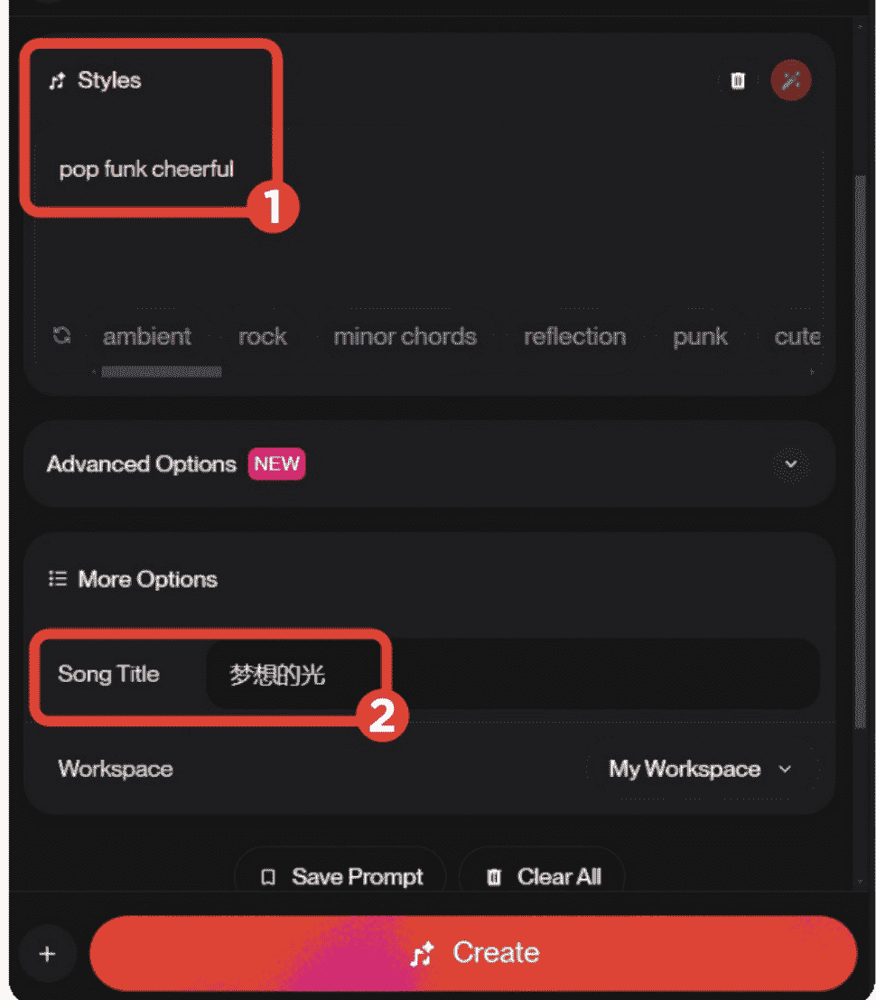

虽然Suno支持中文输入标签，但识别不够准确，建议大家尽量使用英文。你也可以尝试一下使用中文的效果是否有所不同。在“Song Title”一栏中可以填写歌曲的名称，这里我们统一使用《梦想的光》。

## ❶ 由ChatGPT创作歌词、Suno生成音乐的两首作品

### 梦想的光

**主歌**

仰望星空那一瞬间
心跳随着节奏蔓延
脚步坚定不怕疲倦
我知道路在前面

曾经跌倒痛也无所谓
一次次站起，不曾后悔
在这繁华的城市夜晚
我听见梦想在召唤

**副歌**

我追逐着那道光
在黑夜中越发明亮
再多阻碍也不能挡
我的心从未迷茫
无论风雨多疯狂
我有勇气把梦点亮
用汗水去谱写时光
让未来为我鼓掌

但那心底的执着
是我唯一的承诺

**主歌**

一路走来多少磨难
学会在孤独中勇敢
不再怀疑自己的选择
因为梦想不容敷衍
就算世界不曾理解
我依然奋力向前去追
即使前方依旧遥远
梦想从未离我太远

**副歌**

我追逐着那道光
在黑夜中越发明亮
再多阻碍也不能挡
我的心从未迷茫
无论风雨多疯狂
我有勇气把梦点亮
用汗水去谱写时光
让未来为我鼓掌

**副歌**

我追逐着那道光
在黑夜中越发明亮
再多阻碍也不能挡
我的心从未迷茫
无论风雨多疯狂
我有勇气把梦点亮
用汗水去谱写时光
让未来为我鼓掌

**结尾**

梦想之光，在我心上
带我飞向那片希望

**桥段**

也许前方还会有挫折
也许曾经怀疑和退缩

## ② 由豆包创作歌词、Suno生成音乐的两首作品

### 梦想的光

**主歌 1**

在黑暗中独自徘徊
街灯下身影被拉长了孤单
怀揣着心中那团火焰
哪怕世界都对我冷眼旁观
每一步都走得艰难
梦想像繁星在遥远的彼岸
但我知道不能轻易就转弯
风雨中我要扬起我的帆

**主歌 3**

路上有荆棘刺痛心房
有迷雾让我迷失了方向
但我想起最初的梦想
那是我心中最温暖的地方
也许会有怀疑的浪
冲击我那看似脆弱的堤防
可我会握紧双拳更顽强
为梦想我要变得更有锋芒

**主歌 2**

汗水浸湿了我的衣衫
疲惫也常常将我灵魂纠缠
可那梦的声音在召唤
像古老神秘的力量在呐喊
看过了无数的悲欢
那些挫折不过是小小波澜
我带着希望从不曾离散
向着梦想的方向一直闯

**主歌 4**

岁月会改变我的模样
但梦想永远在我灵魂之上
它是我生命最美的乐章
伴随我走过每个天亮
我要在这舞台中央
用热血书写属于我的辉煌
让梦想之花灿烂地绽放
那是我一生的宝藏

**副歌**

梦想是我的信仰
是我飞翔的翅膀
穿越风雨的阻挡
闪耀在那最高的地方
坚持是我的力量
是我心中的太阳
燃烧所有的渴望
追逐那永不灭的梦想之光

**副歌**

梦想是我的信仰
是我飞翔的翅膀
穿越风雨的阻挡
闪耀在那最高的地方
坚持是我的力量
是我心中的太阳
燃烧所有的渴望
追逐那永不灭的梦想之光

试听音频5-3 试听音频5-4

## ③ 由DeepSeek普通模式创作歌词、Suno生成音乐的两首作品

### 梦想的光

**主歌 1**

夜色笼罩城市的角落，
我数着星星许下承诺。
就算前方有暴雨滂沱，
也要让心跳得炽热。

**副歌重复**

我要追着光，逆风飞翔，
哪怕遍体鳞伤也不投降。
梦是黑夜里的灯塔亮，
照亮我奔向远方。
就算路再长，也不彷徨，
因为热爱是唯一的信仰。
终有一天，我会站在巅峰上，
让世界听见我的光！

**主歌 2**

曾经跌倒过，痛过沉默，
可梦在燃烧，怎能退缩？
就算世界笑我太执着，
我仍相信有光在等我。

**结尾**

梦在前方，脚步不停歇，
直到星光洒满我的世界。

**副歌**

我要追着光，逆风飞翔，
哪怕遍体鳞伤也不投降。
梦是黑夜里的灯塔亮，
照亮我奔向远方。
就算路再长，也不彷徨，
因为热爱是唯一的信仰。
终有一天，我会站在巅峰上，
让世界听见我的光！

**桥段**

时间会证明所有泪和汗，
化作翅膀，带我翱翔。
当风吹散迷雾的阻挡，
我会拥抱属于我的光。

试听音频5-5 试听音频5-6

## 由Suno创作歌词并生成音乐的两首作品

### 梦想的光

**Verse**

奔跑在无尽的路上
心中充满无限希望
每个黑暗都闪耀光芒
梦就在下一秒释放

**Verse 3**

未来的路虽然漫长
脚步坚定从不彷徨
心之所属坚定不移
勇敢追梦永不放弃

**Verse 2**

无数次跌倒还要爬起
眼泪是奋斗的勇气
每一刻都在为你坚持
梦想在召唤的声音里

**Chorus**

追逐梦的光
永不停歇脚步
用汗水浇灌
希望不会迷路
纵使风雨狂
梦在心中燃烧
只要你在坚持
梦想永不老

**Chorus**

追逐梦的光
永不停歇脚步
用汗水浇灌
希望不会迷路
纵使风雨狂
梦在心中燃烧
只要你在坚持
梦想永不老

**Bridge**

每一盏星光都是目标
每一段旅程都要骄傲
不管多远多么难找
梦想一直在你怀抱

试听音频5-7 试听音频5-8

## 5. 编辑或修改已生成的音乐

假如我们对Suno生成的音乐不是非常满意，是不是只能再次花费积分重新生成呢？其实Suno生成好的音乐是可以再编辑的，可以进行的操作都在“Remix/Edit”菜单里。

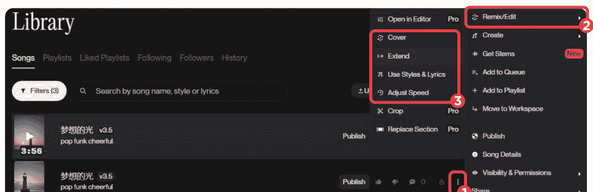

如果想编辑、修改某一首歌，可以先在“Library”里找到它，依次点击它后面的3个小白点 → Remix/Edit，就会看到其中列出了多个操作，免费用户能使用的操作有“Cover”（翻唱）、“Extend”（延长）、“Use Styles & Lyrics”（复用风格与歌词）和“Adjust Speed”（调整速度）。而“Crop”（裁剪）和“Replace Section”（区域替换）两个功能都需要付费才能使用。

这4个操作的具体功能如下。

**Cover:** 制作当前歌曲的“翻唱版本”（Cover），即保留歌词与风格提示词，让Suno生成全新的旋律与编曲，但保持对原曲的参考。

**Extend:** 在已有作品的基础上继续生成后面的部分，将已生成的作品延长。例如，如果生成的作品比较短，你可以让Suno继续往下创作，使歌曲整体更完整、时间更长。前面我们介绍过，目前Suno最多能将4分钟的作品延长至6分钟。

**Use Styles & Lyrics:** 使用原作品的提示词、歌词、风格设定等信息，再次新生成作品，而不消耗积分。

**Adjust Speed:** 调整已生成作品的播放速度（节奏感），可以选择变快或变慢，方便你根据需求调整作品的整体氛围。

我们来看具体的操作。选择其中任意一个功能，都会打开Suno的“Remix”界面，如下图所示，这个界面我们在前面已经见过了。

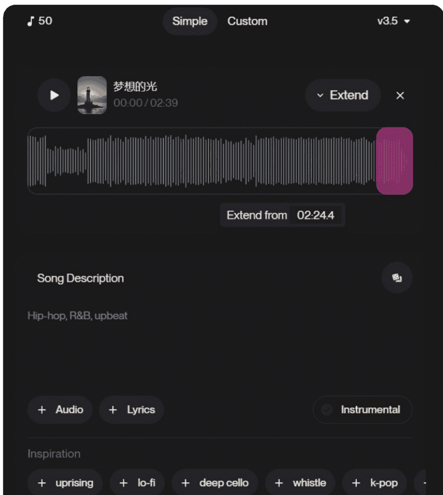

我们首先来试一下延长歌曲的功能。通常，Suno生成的作品长度不会超过4分钟，最短的时候可能不到2分钟。如果我们对生成的作品比较满意，但是觉得太短了，就可以扩展该歌曲，让歌曲更完整。

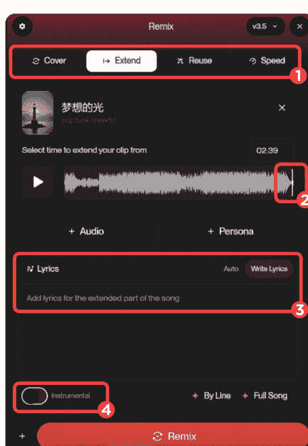

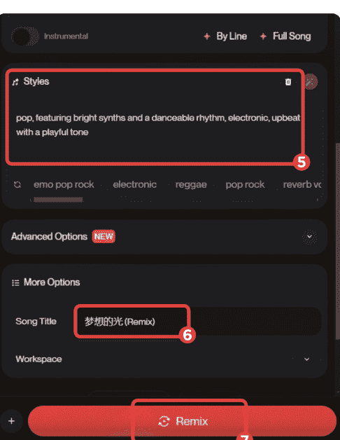

这里，我从“Library”中随便选择一首歌，依次点击3个小白点 → Remix/Edit → Extend，会出现上方左图的界面。可以看到，顶部有4个按钮，分别对应4个编辑操作，可以随时切换。这个界面其实和自定义的界面很相似。鼠标按住处的小条并左右拖曳，来确定你想从歌曲的哪个位置开始延长。在歌词编辑框里，我们可以为要延长的部分输入新的歌词，也可以勾选“Instrumental”，让延长的部分是纯音乐。

再往下是“Styles”输入框，可以指定延长部分的风格。点击处可以给延长后的作品取一个新的标题。最后点击“Remix”，就会为已有的作品生成延长部分了。

但是需要注意，通过“Extend”生成的只是延长的部分，在作品名旁边会有一个“Part 2”的标记。如果想获得完整的作品，可以点击“Get Full Song”，Suno会将延长的部分和原作品合到一起，但这个操作会消耗5积分，相当于新生成一首作品。

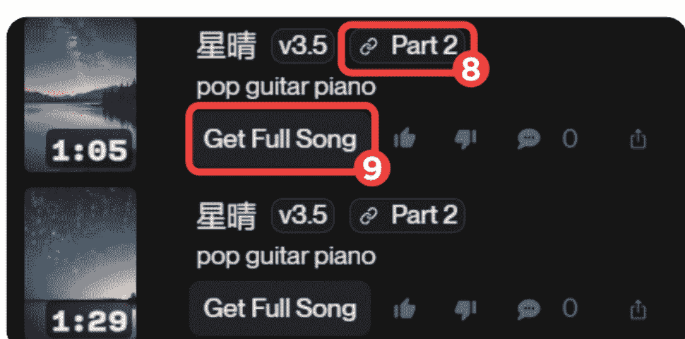

我们再来看看“Speed”（调整速度）的操作。点击上方的“Speed”切换到调整速度的界面，如下图所示。画面中间有一个小球，按住它，左右拖曳鼠标，就可以调整作品的速度，往左是变慢，往右是变快。下方有一个“Keep Pitch”（保持音高）的开关，打开之后，Suno就会在改变速度的同时保持旋律的音高。调整好之后，点击“Remix”就可以得到一个新作品了。

Cover | Extend | Reuse | Speed

### 梦想的光

pop funk cheerful

### 1.26x

0.25x

4.00x

Keep Pitch

Reset

Advanced Options NEW

More Options

Song Title

梦想的光

Workspace

Remix

“Cover”（翻唱）和“Use Styles & Lyrics”（复用）的界面和“Extend”几乎一模一样，这里就不演示了，请大家自己尝试。

## 6. 发布、分享创作好的作品

当Suno生成了我们非常满意的作品时，我们可能希望让其他的人也能听到。分享Suno生成的作品大致可以通过两种方式，一种是在Suno的播放页面上直接分享，另一种是将作品下载后上传到其他平台进行分享。下面我们来看看分别如何操作。

### ·在Suno中分享与发布作品

在Suno的页面上进行分享，主要有两种方式，第一种是使用链接分享，第二种是发布歌曲后再分享。

使用链接分享的操作方法非常简单。

在作品列表中的每个作品名后面都有一个分享图标，或者点击作品名称，进入该作品单独的页面，其中也有分享图标。点击分享图标，页面底部会显示“Copied song link to clipboard”（歌曲链接已复制到剪贴板），这时我们就可以把链接粘贴并分享给其他人了。

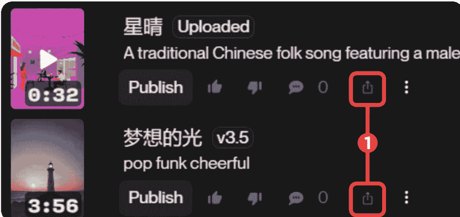

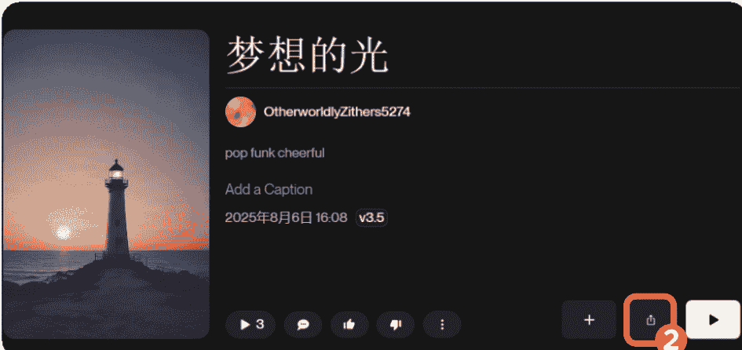

将这个链接在浏览器中打开，就会来到作品的页面，页面上会显示作品标题、创作者、音乐风格、歌词等信息。

第二种方式是在Suno上公开发布自己的作品。

在Suno中，默认情况下，新生成的作品不会展示在用户的个人空间里，其他人只有获得作品的链接后才会听到。如果我们想让Suno上的其他用户也能听到我们的作品，该怎么操作呢？

首先我们点击作品名称后面的3个小白点，并点击“Publish”，这时就会弹出“Publish Song”（发布歌曲）的界面。

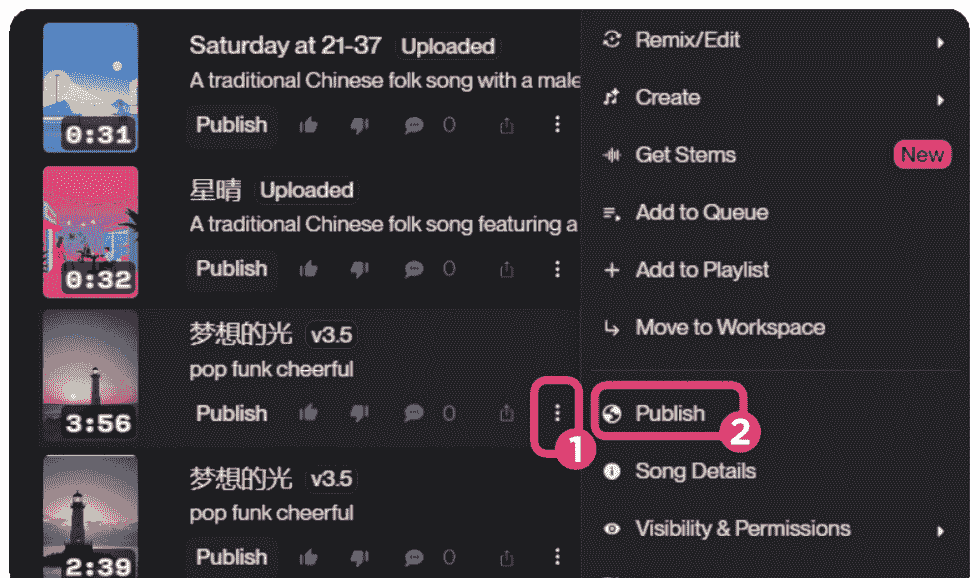

这个界面上有多个选项和按钮。点击处可以修改作品的名称，在处可以为歌曲添加一段描述、创作背景，或者任何你想说的话。点击处的垃圾桶图标可以删除封面图片。

点击“Replace Image”（替换图片）可以上传一张新图片，更换封面图；点击“Add a Video”（添加视频）可以为作品配上简单的视频。

点击“Edit Displayed Lyrics”（编辑要显示的歌词）会进入歌词编辑界面，也就是说页面上显示的歌词不一定要与作品中实际的歌词一致，我们可以增删内容。点击“More Options”（更多选项）会显示3个选项，如下方右图所示。

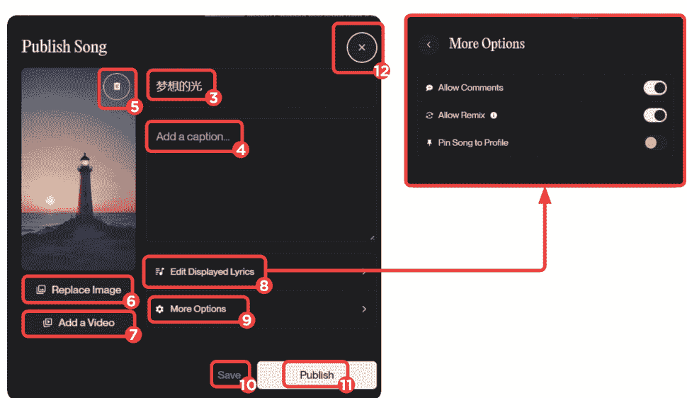

### Allow Comments（允许评论）：

开启此选项后，其他用户可以在你的作品页面下方留言评论，与你互动。

### Allow Remix（允许混音）：

开启此选项，其他Suno用户就可以基于你的这首歌进行“混音”或“再创作”。它旁边有一个小感叹号，点击一下会提示你，默认情况下，一首作品发布之后，其他Suno用户都可以对它进行自由混音，但每一次混音都会链接显示原始作品的链接。如果你不愿意自己的作品被他人模仿或使用，可以关闭这个选项。

### Pin Song to Profile（将作品置顶到个人主页）：

开启此选项后，这首歌曲就会被固定在你的Suno个人主页的最上方，方便访问者第一时间看到和听到你的作品。

如果你修改了信息，“Save”（保存）按钮就会亮起，点击可以保存但不发布作品。点击“Publish”（发布），作品就真正发布了。点击关闭按钮，可以关闭这个页面。

作品发布之后，在作品列表里，它的名称下方会显示“Published”（已发布），如下图所示。

### ·下载作品后分享

在Suno之外进行分享的方式就是将作品下载之后上传到其他平台，分享给更多人。

下载作品的方法，我们在前面的章节中已经讲解过，这里就不赘述了。但下载后上传到其他平台的分享方式，我只建议付费用户使用，因为只有付费用户才拥有作品的商业使用权。通常我们会上传到国内主流音乐平台，一定要确保作品中使用的歌词是自己原创的，不然可能会有版权问题。

# 第6章 标签的分类与参考

在前面的章节中，我们学习了如何通过输入标签的方式来指导AI创作音乐。相信你已经体会到，掌握并准确运用标签，是让AI创作更贴近我们想法的关键。这些标签就像是与AI沟通的“密码”，你给出的信息越具体、越精准，AI创作出的音乐就越能达到你的预期。

在这一章，我将系统地介绍几类最重要的标签，包括音乐的风格、结构、人声特点、乐器选择、环境音效，以及情感和氛围。通过建立起自己的“音乐词库”，你就能更自如地指挥AI创作。

## 1. 音乐风格的分类

在各种标签中，音乐风格无疑是最基础也是最重要的一类，它决定了整首作品的基调。AI读取到音乐风格标签后，会从旋律设计、节奏结构、乐器选择等方面，让生成的作品符合这种风格。所以，我们对音乐风格的了解程度会直接影响到AI生成音乐的方向和质量。

音乐风格的种类非常多，并且一直在不断演化、融合，诞生新的音乐类型。为了更好地选择风格和设计标签，我们需要对音乐风格有一个基本的认识。

音乐风格通常可以分为流行、摇滚、电子乐等大类。我们一起来看看，每个大类下面有哪些细分风格。

### (1) 流行音乐 (Pop)

**流行摇滚 (Pop Rock)**：融合了流行与摇滚的元素，旋律轻松，伴奏偏向摇滚风格。

**合成器流行 (Synthpop)**：以电子合成器为主要乐器，旋律带有明显的电子感和律动，是20世纪80年代非常流行的风格。

**流行舞曲 (Dance Pop)**：特点是节奏充满动感，非常适合跳舞，常用于俱乐部或派对音乐。

**民谣流行（Folk Pop）**：结合了民谣音乐的叙事性与流行音乐的旋律感，旋律柔和而富有故事性。

**独立流行（Indie Pop）**：通常由独立音乐厂牌或艺人制作，风格清新独特，注重个性化的表达。

### （2）摇滚（Rock）

**经典摇滚（Classic Rock）**：20世纪70年代兴起，风格偏复古，代表乐队有披头士（The Beatles）、滚石乐队（The Rolling Stones）等。

**硬摇滚（Hard Rock）**：音色重，节奏强劲有力，以电吉他为主要乐器。

**朋克摇滚（Punk Rock）**：崇尚简单直接的节奏和歌词，常传达反叛情绪。

**车库摇滚（Garage Rock）**：带有粗糙质感，注重现场表演，风格直率。

**另类摇滚（Alternative Rock）**：个性独特，不拘泥于传统摇滚形式，代表乐队有涅槃乐队（Nirvana）。

### （3）电子音乐（Electronic）

**浩室（House）**：以清晰的四拍节奏为基础，充满舞动感，起源于20世纪80年代的芝加哥。

**电子舞曲（Electronic Dance Music, EDM）**：一个广义概念，包括浩室、科技舞曲等众多分支。

**科技舞曲 (Techno)**：源自底特律，特点是快速的节奏、强烈的律动感和多样化的电子音色。

**陷阱音乐 (Trap)**：以强烈的鼓机节奏和标志性的低音频率为主要特征，在现代流行音乐和嘻哈音乐中非常常见。

**鼓打贝斯 (Drum and Bass)**：以高速的碎拍节奏和强劲的贝斯线条为特点，起源于英国。

### (4) 嘻哈 (Hip-Hop)

**硬核嘻哈 (Hardcore Hip-Hop)**：节奏硬朗，歌词直白，往往包含批判性的内容。

**陷阱嘻哈 (Trap Hip-Hop)**：融合了电子音乐中的陷阱 (trap) 元素，重低音明显。

**说唱 (Rap)**：节奏感强烈，歌词的押韵和内容表达是核心。

**老派嘻哈 (Old School Hip-Hop)**：诞生于20世纪80年代，节奏简单，充满复古韵味。

**地下嘻哈 (Underground Hip-Hop)**：通常由独立音乐人创作，更注重歌词深度与思想表达。

### (5) 爵士 (Jazz)

**传统爵士 (Traditional Jazz)**：特指20世纪20年代的新奥尔良风格 (New Orleans Jazz)，也称为迪克西兰爵士 (Dixieland Jazz)，是一种集体即兴演奏的形式，以铜管乐队为主。

**自由爵士 (Free Jazz)**：20世纪60年代兴起，强调完全自由的即兴演奏，无固定结构与和声，形式多变。

### (6) 乡村音乐 (Country)

**传统乡村 (Traditional Country)**：旋律简单，歌词叙述性强。

**新乡村 (New Country)**：更现代的乡村音乐，结合了流行元素。

**乡村摇滚 (Country Rock)**：加入了摇滚的元素，节奏感更强。

**蓝草 (Bluegrass)**：源于美国南部，以吉他、班卓琴为主要乐器。

**民谣乡村 (Folk Country)**：带有民谣特色，旋律和歌词抒情细腻。

### (7) 放克和灵魂 (Funk & Soul)

**放克 (Funk)**：节奏感强烈，贝斯和鼓声突出，代表艺术家有詹姆斯·布朗等。

**灵魂乐 (Soul)**：以表达情感为主，结合了福音、布鲁斯等风格。

**摩城 (Motown)**：一种独特的流行灵魂乐，由摩城唱片公司开创，融合了融合灵魂和流行风格，具有独特的音色。

**新灵魂 (Neo-Soul)**：将灵魂乐与嘻哈、R&B等风格结合，更具现代感。

**迷幻灵魂 (Psychedelic Soul)**：在灵魂乐中融入了迷幻音色，节奏和音色自由多变。

### (8) R&B (节奏布鲁斯)

**现代R&B (Contemporary R&B)**：节奏轻快，旋律感强，深受流行音乐影响。

**另类R&B (Alternative R&B)**：创新性更强，常常与其他的音乐元素进行融合。

**经典R&B (Classic R&B)**：指20世纪60年代至80年代的经典R&B风格，代表人物有史蒂夫·旺德。

**都市R&B (Urban R&B)**：将嘻哈和流行音乐的元素相结合，具有浓厚的现代都市生活气息。

**慢情歌 (Slow Jam)**：节奏缓慢，抒情性强，多用于情歌创作。

### (9) 民谣 (Folk)

**传统民谣 (Traditional Folk)**：源于民间的传统音乐，歌词故事性强，旋律简单。

**现代民谣 (Contemporary Folk)**：民谣中融入了现代元素，抒情且贴近生活。

**民谣摇滚 (Folk Rock)**：加入了摇滚元素，更具动感和活力。

**凯尔特民谣 (Celtic Folk)**：苏格兰和爱尔兰的传统音乐，音色特别。

**布鲁斯民谣 (Blues Folk)**：在民谣中融入了布鲁斯音乐的旋律，情感浓厚。

### (10) 古典音乐 (Classical)

**巴洛克 (Baroque)**：和声与复调结构精致复杂，代表作曲家为巴赫、亨德尔。

**古典主义 (Classical Period)**：结构严谨、形式规范，代表作曲家有贝多芬、莫扎特、海顿等。

**浪漫主义 (Romantic)**：注重个人情感的抒发与自然景物的描绘，并常常吸收民族与民间音乐素材，旋律抒情而富有表现力，代表作曲家非常多，如舒曼、舒伯特、勃拉姆斯、门德尔松、李斯特等。

**20世纪现代主义 (20th Century)**：注重创新性和实验性，代表作曲家如肖斯塔科维奇。

**极简主义 (Minimalism)**：以简洁的节奏与旋律反复营造氛围，代表作曲家是菲利普·格拉斯。

这些音乐风格只是众多音乐类型中的一部分，实际上，音乐的种类远不止这些，每个大类下面还包含着许多细分的子风格，并且它们还在不断发展和融合。

下面的表格涵盖了更多风格类型，你可以把它当作一个速查工具，方便日后参考和使用。

| 中文 | 英文 | 中文 | 英文 | 中文 | 英文 |
| --- | --- | --- | --- | --- | --- |
| 流行 | Pop | 摇滚 | Rock | 嘻哈 | Hip Hop |
| 电子音乐 | Electronic | 爵士 | Jazz | 布鲁斯 | Blues |
| 古典 | Classical | 乡村 | Country | 民谣 | Folk |
| 灵魂乐 | Soul | 放克 | Funk | 雷鬼 | Reggae |
| 金属乐 | Metal | 独立音乐 | Indie | 另类 | Alternative |
| 迪斯科 | Disco | 拉丁 | Latin | 新世纪 | New Age |
| 世界音乐 | World Music | 氛围 | Ambient | 后摇 | Post-Rock |
| 实验音乐 | Experimental | 硬核 | Hardcore | 工业 | Industrial |
| 电子舞曲 | Electronic Dance Music, EDM | 民谣摇滚 | Folk Rock | 重金属 | Heavy Metal |
| 蓝草 | Bluegrass | 嘻哈摇滚 | Rap Rock | 融合爵士 | Jazz Fusion |
| 哥特 | Gothic | 黑金属 | Black Metal | 前卫金属 | Progressive Metal |
| 死亡金属 | Death Metal | 车库摇滚 | Garage Rock | 朋克摇滚 | Punk Rock |
| 另类摇滚 | Alternative Rock | 前卫摇滚 | Progressive Rock | 华丽摇滚 | Glam Rock |
| 迷幻摇滚 | Psychedelic Rock | 布鲁斯摇滚 | Blues Rock | 硬摇滚 | Hard Rock |
| 垃圾摇滚 | Grunge | 另类金属 | Alternative Metal | 新金属 | Nu Metal |
| 电子摇滚 | Electronic Rock | 说唱金属 | Rap Metal | 陷阱音乐 | Trap |
| 工业金属 | Industrial Metal | 另类嘻哈 | Alternative Hip Hop | 爵士嘻哈 | Jazz Rap |
| 浩室 | House | 科技舞曲 | Techno | 鼓打贝斯 | Drum and Bass |
| 杜步舞曲 | Dubstep | 氛围浩室 | Ambient House | 回响贝斯 | Dub |
| 酸性浩室 | Acid House | 冷爵士 | Cool Jazz | 比波普 | Bebop |
| 自由爵士 | Free Jazz | 摇摆爵士 | Swing Jazz | 布鲁斯爵士 | Blues Jazz |
| 乡村布鲁斯 | Country Blues | 芝加哥布鲁斯 | Chicago Blues | 巴洛克 | Baroque |
| 浪漫主义 | Romantic | 现代古典 | Modern Classical | 极简主义 | Minimalism |
| 新古典 | Neoclassical | 歌剧 | Opera | 另类乡村 | Alternative Country |
| 当代民谣 | Contemporary Folk | 传统民谣 | Traditional Folk | 凯尔特 | Celtic |
| 非洲音乐 | African | 拉丁爵士 | Latin Jazz | 萨尔萨 | Salsa |
| 斯卡 | Ska | 放克摇滚 | Funk Rock | 新浪潮 | New Wave |
| 桑巴 | Samba | 波萨诺瓦 | Bossa Nova | 雷鬼摇滚 | Reggae Rock |
| 后朋克 | Post-Punk | 哥特摇滚 | Gothic Rock | 工业摇滚 | Industrial Rock |
| 噪声摇滚 | Noise Rock | 梦流行 | Dream Pop | 鞋带摇滚 | Shoegaze |
| 后金属 | Post-Metal | 后硬核 | Post-Hardcore | 情绪硬核 | Emo |
| 数学摇滚 | Math Rock | 氛围黑金属 | Atmospheric Black Metal | 交响金属 | Symphonic Metal |
| 朋克 | Punk | R&B | R&B | 陷阱金属 | Trap Metal |
| 民谣金属 | Folk Metal | 维京金属 | Viking Metal | 电子核 | Electronicore |
| 太空摇滚 | Space Rock | 艺术摇滚 | Art Rock | 新浪漫主义 | New Romanticism |
| 合成器流行 | Synthpop | 未来贝斯 | Future Bass | 蒸汽波 | Vaporwave |
| 深度浩室 | Deep House | 科技浩室 | Tech House | 极简科技舞曲 | Minimal Techno |
| 复古电子 | Retrowave | 电子流行 | Electropop | 热带浩室 | Tropical House |
| 硬核科技舞曲 | Hard Techno | 工业科技舞曲 | Industrial Techno | 液态鼓打贝斯 | Liquid Drum and Bass |
| 神经鼓打贝斯 | Neurofunk | 跳步舞曲 | Breakbeat | 大节拍 | Big Beat |
| 氛围杜步舞曲 | Ambient Dubstep | 实验电子 | Experimental Electronic | 胶囊流行 | Hyperpop |
| 陷阱舞曲 | Trap | 未来浩室 | Future House | 后杜步舞曲 | Post-Dubstep |
| 8位音乐 | 8-bit Music | 合成波 | Synthwave | | |
| 后布里特流行 | Post-Britpop | 新迷幻 | New Psychedelia | | |

## 2. 音乐结构与曲式分类

在前面的章节中，我们已经了解了流行音乐中常见的主歌、副歌、桥段等基本结构。下面这个表格是更全面的音乐结构与曲式相关词汇对照表，其中不仅包含了歌曲的常见组成部分，还加入了一些在音乐理论和创作中比较常用的术语，能帮助你更精准地描述音乐的结构。

| 中文 | 英文 | 中文 | 英文 | 中文 | 英文 |
|---|---|---|---|---|---|
| 前奏 | Intro | 间奏 | Interlude | 尾奏 | Outro |
| 主歌 | Verse | 副歌 | Chorus | 桥段 | Bridge |
| 重复句 | Refrain | 过渡段 | Transition | 即兴段 | Improvisation |
| 主题 | Theme | 变奏 | Variation | 发展 | Development |
| 前奏曲 | Prelude | 间奏曲 | Intermezzo | 尾声 | Coda |
| 重复段 | Repetition | 高潮 | Climax | 结尾 | Ending |
| 独奏 | Solo | 合奏 | Ensemble | 齐奏 | Tutti |
| 引子 | Introduction | 再现 | Recapitulation | 结束段 | Finale |
| 和声 | Harmony | 旋律 | Melody | 节奏 | Rhythm |

## 3. 人声标签分类

我们在写提示词的时候，如果不对人声作品中的声音进行指定，Suno就会根据歌曲的风格自动为我们匹配人声，但有时候它编配的人声并不是我们想要的效果。

人声作为歌曲的灵魂，其表达方式、音色特点，甚至是各种演唱技巧，都能通过特定的标签来指导AI实现。

下面这张表格汇集了在AI音乐创作中常用的人声相关的标签词汇，涵盖不同的演唱形式、人声效果和演唱技巧等。掌握它们，能让你的AI歌曲在人声表现上更具多样性和专业性。

| 中文 | 英文 | 中文 | 英文 |
|---|---|---|---|
| 独唱 | Solo Vocal | 假声 | Falsetto |
| 合唱 | Choir | 说唱 | Rap |
| 吟唱 | Chant | 颤音 | Vibrato |
| 气声 | Breathy Voice | 即兴演唱 | Scat Singing |
| 咏叹调 | Aria | 朗诵 | Spoken Word |
| 耳语 | Whisper | 呐喊 | Shouting |
| 拟声 | Beatbox | 尖叫 | Scream |
| 嘶吼 | Growl | 口哨 | Whistle |
| 宣叙调 | Recitative | 换气声 | Breath Sound |
| 哼唱 | Humming | 人声效果 | Vocal Effects |
| 自动调音 | Auto-Tune | 声音扭曲 | Voice Distortion |
| 破音 | Voice Crack | 对唱 | Duet |
| 和声叠加 | Layered Vocals | 齐唱 | Unison |
| 声音模仿 | Voice Imitation | 声乐即兴 | Vocal Improvisation |
| 声音分层 | Voice Layering | 声音变声 | Voice Modulation |
| 和声 | Harmony | | |

## 4. 乐器标签分类

在AI音乐创作中，我们还可以更具体地控制歌曲中使用的乐器种类和音色，不同的乐器会为歌曲带来截然不同的听觉感受和情感色彩。

下面的表格整理了在AI音乐生成中常用的乐器标签词汇。掌握这些标签，你就能更精准地告诉AI用什么乐器来演奏，从而让生成的作品更符合预期的编曲效果。

| 中文 | 英文 | 中文 | 英文 | 中文 | 英文 |
|---|---|---|---|---|---|
| 钢琴 | Piano | 小提琴 | Violin | 吉他 | Guitar |
| 贝斯 | Bass | 架子鼓 | Drums | 萨克斯管 | Saxophone |
| 长笛 | Flute | 单簧管 | Clarinet | 小号 | Trumpet |
| 大提琴 | Cello | 中提琴 | Viola | 双簧管 | Oboe |
| 班卓琴 | Banjo | 曼多林 | Mandolin | 口琴 | Harmonica |
| 竖琴 | Harp | 手风琴 | Accordion | 尤克里里 | Ukulele |
| 大号 | Tuba | 长号 | Trombone | 圆号 | French Horn |
| 管风琴 | Pipe Organ | 木琴 | Xylophone | 马林巴 | Marimba |
| 竖笛 | Recorder | 大管 | Bassoon | 电子琴 | Synthesizer |
| 钟琴 | Glockenspiel | 颤音琴 | Vibraphone | 钢鼓 | Steel Drums |
| 康加鼓 | Conga | 邦戈鼓 | Bongo | 三角铁 | Triangle |
| 定音鼓 | Timpani | 卡宗鼓 | Cajon | 非洲鼓 | Djembe |
| 铃鼓 | Tambourine | 沙槌 | Maracas | 钹 | Cymbals |
| 西塔尔琴 | Sitar | 古筝 | Guzheng | 琵琶 | Pipa |
| 二胡 | Erhu | 笛子 | Dizi | 箜篌 | Konghou |
| 三弦 | Sanxian | 阮 | Ruan | 唢呐 | Suona |
| 扬琴 | Yangqin | 葫芦丝 | Hulusi | 巴乌 | Bawu |
| 古琴 | Guqin | 柳琴 | Liuqin | 板胡 | Banhu |
| 埙 | Xun | 箫 | Xiao | 笙 | Sheng |
| 竹笛 | Bamboo Flute | 非洲竖琴 | Kora | 风笛 | Bagpipes |
| 手鼓 | Hand Drum | 电子鼓 | Electronic Drums | 三角钢琴 | Grand Piano |
| 钢舌鼓 | Hang Drum | 12弦吉他 | 12-string Guitar | 电吉他 | Electric Guitar |
| 电钢琴 | Electric Piano | 合成贝斯 | Synth Bass | 滑棒吉他 | Slide Guitar |
| 原声贝斯 | Acoustic Bass | 混音台 | Mixer | 打击垫 | Drum Pad |
| 电贝斯 | Electric Bass | 鼓机 | Drum Machine | 电子管风琴 | Electronic Organ |
| 电子小提琴 | Electric Violin | 电子大提琴 | Electric Cello | | |

## 5. 环境与音效标签分类

在AI音乐创作中，除了音乐本身的元素，我们还可以添加各种环境声音和特殊音效来增强音乐的叙事感和画面感，帮助听众更深入地沉浸在歌曲所营造的场景中。

下面的表格中是AI音乐生成中常用的环境音效标签词汇。

| 中文 | 英文 | 中文 | 英文 | 中文 | 英文 |
| --- | --- | --- | --- | --- | --- |
| 海浪 | Ocean Waves | 鸟鸣 | Bird Chirping | 虫鸣 | Insect Sounds |
| 雨声 | Rain | 雷声 | Thunder | 风声 | Wind |
| 溪流 | Stream | 瀑布 | Waterfall | 森林 | Forest |
| 城市噪声 | City Noise | 交通 | Traffic | 人群 | Crowd |
| 火焰 | Fire | 雪地 | Snow | 沙漠 | Desert |
| 办公室 | Office | 咖啡店 | Cafe | 学校 | School |
| 工厂 | Factory | 建筑工地 | Construction Site | 机场 | Airport |
| 飞机 | Airplane | 直升机 | Helicopter | 船 | Boat |
| 地铁 | Subway | 火车 | Train | 汽车 | Car |
| 警笛 | Siren | 钟声 | Bell | 闹钟 | Alarm Clock |
| 脚步声 | Footsteps | 敲门 | Knocking | 开门 | Door Opening |
| 玻璃破碎 | Glass Breaking | 爆炸 | Explosion | 枪声 | Gunshot |
| 相机快门 | Camera Shutter | 电视静电噪声 | TV Static | 收音机调频 | Radio Tuning |
| 电话铃声 | Phone Ringing | 打字机声 | Typewriter | 鼠标点击 | Mouse Click |
| 心跳 | Heartbeat | 呼吸 | Breathing | 咳嗽 | Coughing |
| 笑声 | Laughter | 哭泣 | Crying | 打喷嚏 | Sneezing |
| 鼓掌 | Applause | 口哨 | Whistle | 鸡鸣 | Rooster Crowing |
| 牛叫 | Cow Mooing | 羊叫 | Sheep Bleating | 马嘶 | Horse Neigh |
| 狗叫 | Dog Barking | 猫叫 | Cat Meowing | 气泡 | Bubbles |
| 钟表滴答 | Clock Ticking | 水滴 | Water Drip | 微波炉 | Microwave |
| 吸尘器 | Vacuum Cleaner | 洗衣机 | Washing Machine | 电钻 | Power Drill |
| 篝火 | Campfire | 烟花 | Fireworks | 龙卷风 | Tornado |
| 电锯 | Chainsaw | 割草机 | Lawnmower | 冰雹 | Hail |
| 地震 | Earthquake | 火山喷发 | Volcano Eruption | 游戏音效 | Game Sound Effects |

## 6. 情感和氛围标签分类

在前面的章节中我们已经知道，音乐不仅是声音的组合，更是情感和氛围的载体。一首成功的歌曲，不仅要有动听的旋律和清晰的结构，更需要让听众感受到某种情绪并产生共鸣。

下面的表格列出了AI音乐创作中常用的情感和氛围标签词汇。掌握它们，你就能让AI创作出的音乐更“言之有情”。

| 中文 | 英文 | 中文 | 英文 | 中文 | 英文 |
|---|---|---|---|---|---|
| 恐怖音效 | Horror Sound Effects | 转场音效 | Transition Effects | 用户界面音效 | UI Sound Effects |
| 白噪声 | White Noise | 粉红噪声 | Pink Noise | 棕噪声 | Brown Noise |
| 环境氛围 | Ambience | 空间混响 | Spatial Reverb | 回声 | Echo |
| 动画音效 | Cartoon Sound Effects | 科幻音效 | Sci-Fi Sound Effects | | |
| 雾角 | Foghorn | 教堂钟声 | Church Bells | | |

| 中文 | 英文 | 中文 | 英文 | 中文 | 英文 |
|---|---|---|---|---|---|
| 欢快 | Cheerful | 悲伤 | Sad | 激情 | Passionate |
| 浪漫 | Romantic | 神秘 | Mysterious | 紧张 | Tense |
| 平静 | Calm | 兴奋 | Excited | 忧郁 | Melancholic |
| 轻松 | Relaxed | 焦虑 | Anxious | 愤怒 | Angry |
| 欢乐 | Joyful | 沮丧 | Depressed | 希望 | Hopeful |
| 温柔 | Gentle | 强烈 | Intense | 梦幻 | Dreamy |
| 恐惧 | Fearful | 幽默 | Humorous | 庄严 | Solemn |
| 活力 | Energetic | 阴沉 | Gloomy | 温暖 | Warm |
| 冷酷 | Cold | 深远 | Profound | 轻快 | Upbeat |
| 怀旧 | Nostalgic | 振奋 | Uplifting | 沉思 | Contemplative |
| 忧愁 | Sorrowful | 欣慰 | Comforting | 孤独 | Lonely |
| 激动 | Thrilling | 平和 | Peaceful | 狂热 | Frenzied |
| 优雅 | Elegant | 粗犷 | Rugged | 甜美 | Sweet |
| 阴郁 | Moody | 欢腾 | Exuberant | 忧虑 | Worried |
| 敏感 | Sensitive | 坚强 | Strong | 脆弱 | Vulnerable |
| 满足 | Content | 冷漠 | Indifferent | 同情 | Sympathetic |
| 热情 | Enthusiastic | 决心 | Determined | 困惑 | Confused |
| 怀疑 | Doubtful | 轻盈 | Light | 喜悦 | Delightful |
| 沉重 | Heavy | 躁动 | Restless | 不安 | Uneasy |
| 宁静 | Serene | 舒适 | Comfortable | 超然 | Transcendent |
| 激昂 | Stirring | 世俗 | Secular | 华丽 | Elaborate |
| 神圣 | Sacred | 朴实 | Simple | 迷茫 | Bewildered |
| 迷幻 | Psychedelic | 清晰 | Clear | 明亮 | Bright |
| 模糊 | Hazy | 阴暗 | Dark | 亲密 | Intimate |
| 阳光 | Sunny | 疏离 | Distant | 震撼 | Overwhelming |
| 温馨 | Cozy | 微妙 | Subtle | 前卫 | Avant-garde |
| 壮观 | Majestic | 保守 | Conservative | 空灵 | Ethereal |
| 激进 | Radical | 实在 | Grounded | 未来 | Futuristic |
| 古典 | Classical | 现代 | Modern | | |
| 失落 | Lost | 自信 | Confident | | |

## 7. 使用已发行的歌曲的歌词来创作

在本节中，我们将利用前面学习的各种标签来探索一种新的创作方式。之前的练习通常是从编写歌词开始，然后让AI生成相应的旋律。这种创作方法需要我们深入理解歌词结构和文字表达，甚至需要一定的作词能力。

在这里，我推荐一种“反向创作”的思路——先选取已发行的流行歌曲的歌词（通常由资深词作者精心打磨，结构与韵律非常适合演唱），将其复制到Suno里，再通过精确打标签和设定段落风格，让AI以全新方式谱曲、编曲，生成一首旋律和编曲皆与原曲截然不同的新作品。这样生成的旋律与伴奏都比较规整，我们就可以在此基础上进行二次加工创作，比如重新编写歌词，或者只保留旋律和编曲，打造一首纯音乐作品。

下面，我将以周杰伦的《星晴》为例进行示范。这里只使用了歌词的一半内容。首先，我设计了曲式结构，然后在音乐风格部分的提示词为“Pop Sweet Guitar”（流行、甜美、吉他），打造一首甜美流行风格的歌曲，编曲中融入吉他的音色。

# 星晴

提示词：Pop Sweet Guitar
歌曲速度：90

[ Intro ]
[ Verse1 ]
乘着风飘荡在蓝天边
一片云掉落在我面前
捏成你的形状
随风跟着我
一口一口吃掉忧愁

[ Chorus ]
手牵手一步两步三步四步望着天
看星星一颗两颗三颗四颗连成线
背对背默默许下心愿
看远方的星是否听得见

[ Verse2 ]
载着你仿佛载着阳光
不管到哪里都是晴天
蝴蝶自在飞
花也布满天
一朵一朵因你而香

[ Chorus ]
手牵手一步两步三步四步望着天
看星星一颗两颗三颗四颗连成线
背着背默默许下心愿
看远方的星如果听得见
它一定实现

[ Pre-Chorus ]
试图让夕阳飞翔
带领你我环绕大自然
迎着风
开始共度每一天

[ Outro ]
[ Guitar Solo ]

接下来，我们继续使用《星晴》的歌词，尝试不同的音乐风格。如果你的英文不太好，可以直接用中文输入标签，Suno也能识别得不错，只要别用太复杂、生僻的词就行。这次，我用的提示词是“中国风 古琴 浪漫”，听听看会有什么效果。

接下来，还是用同样的歌词，再换个风格试试。这次我写的提示词是“Blues Piano Sorrowful”（蓝调、钢琴、忧愁），听听看！

下面是“Funk Rock”（放克和摇滚）的融合风格，搭配《星晴》的歌词，听起来怎么样？

最后是用“Synthpop”（合成器流行）风格生成的两首歌，和《星晴》原曲已经完全不一样了。

## 8. 通过探索功能学习如何写标签

通过前面的学习，相信你已经发现了，“写标签”是AI音乐创作中非常关键的环节。Suno的“全自动”模式虽然也可以生成不错的音乐，但要让它创作出更符合我们想法的作品，我们就必须学会把自己的创意转化成准确的标签。

如果你对音乐风格标签还不太了解，不妨好好利用一下Suno的探索功能，通过它，你不仅能认识到许多不同的音乐风格，还可以直接试听，从而找到你喜欢的风格标签。

在主界面左边的功能区中找到“Explore”，点击它，就会进入炫酷的探索页面。

在这个界面中，占据右半边屏幕的大转盘是由各种不同的音乐风格标签组成的，点击任意标签，系统便会加载对应风格的歌曲并开始播放；滚动鼠标滚轮可以转动这个大转盘。

开始播放后，会显示当前作品的名称，点击就可以进入这首作品的页面。是一个骰子图标，点击它，Suno会随机选择一种风格的音乐进行播放。如果你喜欢某种风格，可以直接复制它的标签，并粘贴到“Styles”的文本框中，用来创作自己的新歌。

# # Melancolia entrelaçada

 **GROOVEBOT** &nbsp; 👤 Follow

pop bossa nova

2025年7月17日 16:28 &nbsp; v4.5+

▶ 7 &nbsp; 💬 1 &nbsp; 👍 3 &nbsp; 👎 &nbsp; ⋮

进入作品的页面之后，我们可以再次点击音乐风格标签，这时，Suno会列出与这个风格相关的作品。例如，上页图中，我们点击“pop bossa nova”，Suno就列出了“bossa nova”标签的作品。在这里，我们不仅可以试听这些作品，还可以观察它们使用了哪些风格标签。如果有喜欢的，也可以复制下来，在自己的创作中进行尝试。

通过探索功能，我们可以接触到大量风格各异的音乐作品，其中有很多是多种音乐风格的组合，我们平时很少会听到，如Dreamy Boom Bap、Klezmer Pop、Alternative R&B Dembow、Arabic Pop等。建议大家多花时间去聆听、分析和模仿，把这个功能当作一扇通往新世界的大门，不断拓宽音乐视野。

本章介绍了许多标签分类，相信它们会成为你在Suno中创作时的得力帮手。希望你能多多尝试不同的标签组合，探索AI音乐生成的各种可能性，找到自己的音乐灵感，你会发现，你将拥有无限的音乐表达空间。

# 第7章 利用Suno的音频功能来创作

Suno自3.5模型开始加入了上传音频的功能。你可以上传已经录制好的一段旋律、器乐或人声，或者上传制作好的成品或半成品音乐，也可以直接在Suno里用麦克风录音。然后，Suno就可以根据你提供的音频来生成音乐。

这种创作方式比较准确，也能给我们提供灵感。比如，你哼唱一段旋律，录下来，再让Suno根据这段旋律来变奏、配器，或者增加新的段落，这是个很有用的功能。

目前，免费用户可以上传或录制6到60秒的音频。付费用户可以上传或录制最长8分钟的音频。

需要注意的是，为了保护版权，Suno不允许上传已经发行的歌曲或音频。如果使用受版权保护的素材，Suno将无法成功生成音乐。

接下来我们来看看，直接在Suno里录制音频和上传已有的音频分别如何操作。

### 1. 通过录制音频来生成音乐

首先点击“Create”，这时，无论是“Simple”模式还是自定义模式，我们都可以看到一个“+Audio”的按钮，这就是上传/录制音频的入口。

点击它之后，会出现一个下拉列表，有两个选项：“Upload”（上传）和“Record”（录音）。顾名思义，点击“Upload”之后可以上传已有的音频，而点击“Record”就可以开始用麦克风进行录制。

这里，我先演示一下如何录音。在开始录制前，确保电脑连接了麦克风或其他录音设备。

点击“Record”之后，Suno会首先弹出一个提示，如下图所示。这里就是提示你要上传你拥有版权的内容。点击“Agree to Terms”，进入录制界面。

**Upload Audio**

I certify that I own or exclusively control all rights in any content I will upload using this Suno feature. I understand that I am not allowed to upload content if I do not own or exclusively control the rights to it, and that if I do so in spite of this prohibition, I will (among other problems) be breaching a contract with Suno and I may be subject to various other forms of legal liability as well. By clicking this box, I acknowledge and agree to the foregoing.

Agree to Terms

下方的大红点就是录制按钮，点击后它会变成方形，并开始录音，再次点击它可以暂停录音。在最下方可以看到一行提示：最长录制1分钟，付费升级后，最长可以录制8分钟。

开始录制后的界面如下图所示，录音按钮变成了方形，点击就会停止录制。界面中间会显示音频的波形（这里我只是做一个示范，没有连接录音设备，所以波形是一条线）。

停止录制后的界面如下图所示。点击“Start Over”（从头再来）会放弃当前录音，并从头开始。左右拖动两个粉红色的箭头可以裁剪录音，选取我们想要的部分。点击“Save”（保存）会上传当前录音。点击处可以给当前录制的音频重命名。这里我重命名为“星晴”。

上传音频的界面如下图所示。点击“Cancel”（取消）可以取消上传。在画面中间，我们可以看到3个操作，“Cover”和“Extend”与之前我们学习过的操作一样；“Save to Library”（保存到图书馆）是将当前音频保存到我们的音乐库里，方便后续使用。点击最下方的“Continue”（继续），我们又会回到上传音频之前的界面。

这时我们会看到，刚才上传的音频现在已经在右边的列表里了，Suno也自动为音频创建了封面，还会根据音频的特征自动匹配音乐风格。

依次点击音频旁边的3个小白点→Remix/Edit，我们可以对它进行翻唱、延长、复用风格/歌词等操作，但不能调整速度。这里我们点“Extend”试一试。你会发现，这个界面和之前编辑Suno生成的作品时的界面完全一致，如下图所示。

> 这里点击“Speed”也可以切换到调整速度的界面，但是拖动小球，音频的速度并不会改变。——编辑注

“Styles”输入框里是Suno根据我们的音频自动匹配的音乐风格，可能不太准确，我们可以重新输入。这里我写的是“pop guitar”（流行、吉他），并勾选了“Instrumental”，生成纯音乐。

最后点击“Remix”，Suno就会基于我们的音频和提示词生成两个完整的新作品。

大家可以听听看创作好的作品。“试听音频7-1”是我在Suno中录制的一段吉他，只有10多秒，而且只弹奏了几个音符，Suno就为我创作了一段以吉他为中心的音乐作品。我们可以利用Suno的这个功能来寻找灵感。

### 2. 通过上传音频来生成音乐

上传音频的创作过程与录制基本相同，只是上传之前需要提前找好音频素材。这里，我为大家演示几个具体的例子。

#### 上传音频片段

和录制时的步骤一样，首先点击“+Audio”，然后点击“Upload”。

之后会弹出选择文件的界面，我们在计算机中找到要上传的音频，并选中上传。上传的界面和过程与录制音频时一模一样，这里就不再赘述了。

上传的音频和录制的音频一样，在编辑菜单中可以选择翻唱、延长和复用风格/歌词等操作，但同样也不能调整速度。

选择“Extend”功能，在音乐风格部分，这次我依然选择纯音乐，勾选“Instrumental”，并在“Styles”中写上“pop guitar piano”，即“流行、吉他、钢琴”，也就是让Suno生成以吉他和钢琴为主要乐器的流行纯音乐。

最后点击“Remix”，Suno就生成了两首新作品。

| Cover | Extend | Reuse | Speed |
| :--- | :--- | :--- | :--- |
| 星晴 | | | |
| A high-energy, upbeat pop song with a driving tempo of... | | | |
| Select time to extend your clip from 00:16 | | | |

+ Audio | + Persona

Instrumental

Styles

pop guitar piano

Remix

大家可以听听看创作好的作品，试听音频7-4是我录制的一段吉他，和之前一首曲子是一样的，只是这里在音乐风格中多输入了钢琴，就生成了完全不一样的音乐作品，我们就可以根据Suno来寻找灵感，大家可以尝试一下。

#### 上传成品音乐

接下来，我们试一试使用成品音乐的片段来生成新的作品。这里我选用了之前自己作曲、编曲的作品，只使用了A段，将音频时长控制在60秒以内。用同样的方式上传。

这里我依然勾选了“Instrumental”，生成纯音乐。因为原曲就是融合爵士风格，所以在“Styles”里我填写了“fusion, electro”，即融合与电子元素。最后点击“Remix”，生成两首新作品。

fusion
A female vocalist sings a melancholic pop ballad in Mandarin,...

Select time to extend your clip from 00:52

+ Audio + Persona

Instrumental

Styles
fusion, electro

Remix

- fusion v3.5 Part 2
  fusion, electro
- fusion v3.5 Part 2
  fusion, electro

“试听音频7-7”是我自己编曲的作品，后面两首是Suno在此基础上再创作的作品，大家可以对比聆听：“试听音频7-8”改变了原曲的旋律，加入了大段的即兴独奏，包括电子音色的旋律和电吉他。生成的旋律流畅自然，吉他solo部分也非常完整，就像专业演奏一样。如果我们自己来编写旋律并弹奏出来，要达到这样的效果需要长时间的练习和积累，而Suno仅用了十几秒就创作完成，效率非常高。此外，这首曲子的和声相对复杂，Suno处理起来也游刃有余。

“试听音频7-9”在后半段的编曲中加入了多种变奏与变化，听起来自然且富有层次感。如果由人来创作，这些变化通常需要较高的音乐功底和审美判断，而Suno也能轻松实现。

通过这些例子我们可以看到，利用Suno不仅能节省大量创作时间，还能为我们的音乐带来新的灵感。哪怕你不会演奏乐器，仅仅通过哼唱也能创作出不错的作品。

#### 上传钢琴伴奏配歌词

最后我们来试试上传歌词和伴奏，生成人声作品。这里我用钢琴弹奏了一段流行歌曲的伴奏，一共8个小节，时长也在60秒以内。用同样的方式上传音频文件。

在歌词输入框里粘贴《星晴》的歌词，在结尾部分加上了[Piano Solo]的标签。这次我们要生成人声作品，就不勾选“Instrumental”了。

音乐风格部分，我想尝试一下韩式流行乐，因此“Styles”中我填入了“Korea-Pop, K-pop”（韩国流行乐）。最后点击“Remix”，生成新作品。

**Remix**

k-pop
A solo piano piece in a classical style, characterized by a slow...

Select time to extend your clip from

00:51

+ Audio

+ Persona

Lyrics

Auto

Write Lyrics

[Intro]
[Verse1]
乘着风飘荡在蓝天边
一片云掉落在我面前
捏成你的形状
随风跟着我
一口一口吃掉忧愁

Instrumental

+ By Line

+ Full Song

Styles

Korea-Pop, K-pop

Remix

K-pop

v3.5

Part 2

Korea-Pop, K-pop

K-pop

v3.5

Part 2

Korea-Pop, K-pop

“试听音频7-10”是我自己弹奏的一段钢琴伴奏，试听音频7-11和7-12是Suno在伴奏的基础上结合歌词再创作的作品。歌词还是使用了《星晴》的歌词，整体结构与原曲保持一致，只是在结尾处加入了Piano Solo的标签，也就是让Suno加入钢琴的间奏或尾奏。

这两首新生成的作品感觉都非常出色，无论是旋律、和声，还是唱法，都很“韩式”，也很好听。我们可以将Suno生成的不错的旋律记录下来，作为进一步创作的素材，能大大加快我们写歌的速度，并激发更多创作灵感。

下面还是用同样的歌词和结构标签生成的另一组作品。同样的设定可以反复生成。AI的创作不可能每次都让人满意，但多生成几次，总会有合心意的旋律，我们就可以记录下来进行再创作。

在本章中，我们了解了Suno基于音频创作的功能。从简单的哼唱到复杂的伴奏，Suno都展现出了其强大的变奏、配器和旋律生成能力。我们会发现，无论是有专业背景的人士，还是不擅长乐理的音乐爱好者，都可以通过Suno直观的功能，将脑海中的音乐创意变为现实。

Suno不仅仅是一个生成工具，它更像是一个随叫随到的、高效的音乐伙伴，能够帮助你快速验证灵感，或者在已有素材上进行天马行空的再创作。通过它，你能够以难以想象的速度进行音乐创作，并从中收获乐趣和成就感。

至此，对Suno这个核心AI音乐工具的介绍就告一段落了。在下一章中，我们将把视野投向更广阔的AI音乐领域，为你介绍其他同样出色、各具特色的AI创作平台，帮助你进一步拓展你的AI音乐工具箱。

# 第8章 其他AI创作平台

在前面的章节中，我们已经详细学习了Suno的各种功能和使用方法。Suno确实强大，但它并不是唯一的选择。

其实，目前市面上还有很多优秀的AI音乐创作平台值得我们去尝试。它们有各自的特点和优势，能够满足不同的创作需求。了解和使用这些平台，可以进一步拓展我们的AI音乐工具箱。

本章我将介绍一些国内外的AI音乐创作平台。由于国外的平台大多没有提供中文界面，对于不熟悉英文的读者来说，操作起来可能会有些不便，所以我会相对详细地讲解它们的使用方法。

国内的AI音乐平台升级迭代也非常迅速，值得尝试。由于这些平台界面都是中文，大家理解和操作起来会更容易，我就不再详细讲解操作步骤了，让大家自行探索。

### 1. AIVA

#### 1.1 认识AIVA

AIVA（Artificial Intelligence Virtual Artist）由卢森堡的AIVA Technologies公司开发。AIVA的核心技术是深度学习。它通过学习大量著名作曲家（如巴赫、贝多芬、莫扎特等）的古典作品和超过3万首其他音乐，从中提取出音乐的特征规律，并建立相应的数学模型，以此来辅助音乐人创作出各种风格的乐曲。

AIVA适合内容创作者、游戏开发者、电影制作人和音乐人，可以为视频、游戏、电影等项目快速制作背景音乐。即使是免费版本，也能生成不错的音乐作品。

AIVA主要有以下特点和功能。

**生成速度快：** AIVA在几秒内就能生成一首作品，适合快速创作或捕捉灵感。

**多风格支持：** AIVA支持超过250种音乐风格，包括现代影视、电子、爵士、幻想、探戈、中国风等。它也能创作巴洛克、浪漫等古典风格作品，甚至还能模仿特定贝多芬、肖邦等作曲家的风格。平台还内置了庞大的音乐作品数据库，为用户提供了多样化的风格选择。

**支持上传素材和编辑：** 用户可以上传自己的音频或MIDI文件作为创作素材，生成的作品也可以进行编辑和混音等操作，并支持以MP3、MIDI或WAV等多种格式下载。

**版权解决方案：** AIVA的Pro计划能让用户获得生成音乐的完整版权，方便进行商业使用。同时，AIVA针对个人、学生、学校和企业等不同用户提供了不同的订阅方案，用户可以灵活选择。

**操作界面友好：** AIVA的主界面设计简洁，虽然功能很多，但用户能较快地上手。

#### 1.2 AIVA的使用方法

在必应等搜索引擎中搜索“AIVA”，找到并打开它的官方网站。第一次使用之前需要先注册账号。

点击页面中间的“Create a free account”，会来到注册新账号的界面，如下图所示。如果有谷歌邮箱，可以使用谷歌账号登录。也可以在“Email address”中输入其他邮箱地址，并点击“Continue”。

AIVA会给我们注册的邮箱发送验证邮件，验证通过后，AIVA会让我们设置密码。最后点击“Create account”，我们的账号就注册成功了，以后可以点击首页右上角的“LOG IN”直接登录。

登录成功后，我们就进入了AIVA的主界面，可以直接开始创建音乐了。不过我们还是先来认识一下左边的功能区。

“Home”是AIVA的主界面，也就是我们现在看到的界面。“Editor”是编辑器，可以编辑生成的作品。在“Style Designer”中，用户可以自己创造音乐风格。“Radio”相当于Suno的探索功能，可以听到官方生成的多种类型的歌曲和乐曲。点击“Billing”可以看到AIVA的各种付费计划。“Updates”是版本更新的信息与说明。“Tutorials”是官方的使用教程和说明。“Download App”可以下载AIVA的软件，目前提供MacOS、Windows和Linux版本的软件。

接下来我们试试创作音乐。点击功能区上方绿色的按钮“Create Track”（创建曲目），会弹出一个子菜单，每一项的功能如下。

- **With a prompt (Beta)**：从提示词生成。
- **From a Style**：从音乐风格开始生成。
- **From a Chord progression**：从和弦进行开始生成。
- **Step by step**：分步创建，这个功能类似于一个创作向导，你可以一步一步选择音乐风格，再输入和弦进行，最后由AIVA将这些要素扩展成一首完整曲子。
- **From an Influence**：从已有素材生成。
- **Import MIDI**：导入MIDI文件。

我们先来试一试“With a prompt (Beta)”。这应该是AIVA新增的功能，还在试用阶段。点击之后，我们会跳转到一个新界面，如下图所示。

界面中的文字会告诉你，这里使用的是Lyra Classical模型，它通过学习莫扎特、贝多芬、巴赫等著名作曲家的作品，来模仿他们的风格进行作曲。这个模型只能生成古典风格的纯器乐。

我们可以在 ① 中输入提示词。拖动 ② 处的小球可以调整生成作品的长度，最长为3分钟。最后点击 “Generate” ③ 就可以生成作品了。

如果我们想生成其他风格的作品，就需要从 “From a Style” （从音乐风格）进行创建了。

点击 “From a Style”，我们会看到页面上列出了众多的音乐风格，共有16页。点击每种风格前的播放按钮 可以进行试听。这些音乐风格默认是按使用人数从多到少排列的。在左上角的搜索框 中，可以直接输入关键词进行搜索。

点击右上角的 “Filter”（筛选器） 可以对这些风格进行筛选，”Style“（风格）一栏可以按音乐大类（如Pop、Jazz等）筛选；”Created by“ 可以按是否AIVA创建的风格筛选。 处可以调整这些风格的排序，除了第一项默认排序之外，还可以按创建日期、导入作品和名称进行排序。

找到喜欢的音乐风格后，将鼠标指针移动到使用人数那一栏，会变为”Create“按钮 ， 点击就会进入细节设置界面 。在这里，从上到下的3个选项分别是设置调号、作品长度和生成作品的数量。AIVA生成的作品最长为3分钟，最多一次可以生成5首作品。

点击 “Create tracks”，AIVA就会开始生成。

稍等片刻，创建好的作品就会显示在主界面上，如上图所示。和Suno不同，AIVA会显示作品的详细信息，如风格、调性、速度、拍号、长度等。如果你喜欢这首作品，还可以下载到电脑里保存。

下载时，我们先点击屏幕最右边的3个小白点，并从菜单中选择“Download”，随后会弹出下载页面。

AIVA提供了多种格式和内容的文件下载，免费用户可以下载MP3格式的作品、配器版MIDI（Orchestrated MIDI）、精简版MIDI（Reduced MIDI）以及和弦（Chords），付费用户还可以下载WAV格式的作品和已渲染的分轨音频文件（Stems）。

页面下方是一些提示。首先是版权方面的提示，免费用户个人使用生成的作品，商用则需要升级到付费订阅计划。其次是下载计数，免费用户每月可以下载3首作品，多次下载同一首作品不重复计数。

最后一行可以选择要不要将作品参数添加到文件名，勾选后，下载的文件名中会包含作品的一些关键参数，如风格、速度、调性等，方便你日后识别和管理文件。

下面是我随便选的一个音乐风格生成的歌曲，是一首“80s Synth Pop”，即20世纪80年代的合成器流行风格，大家可以听听看。之后我下载了MIDI文件，并把它导入了专业的音乐制作软件Logic Pro中，如下图所示。我们可以看到，AIVA生成的MIDI文件是整体分轨的，作品中的每个声部（如鼓、贝斯、合成器旋律等）都独立显示在一个音轨上，方便我们进行精细的编辑和修改，非常方便。我在随书资源中也附上了导出的配器版MIDI和精简版MIDI文件，感兴趣的朋友可以下载下来，导入DAW里看看。

我再示范一下从和弦进行开始生成。点击Create Track ，选择 “From a Chord progression” 。

我们会进入一个和从风格创建差不多的界面，同样可以先进行试听。找到喜欢的风格之后，点击风格名称后面的 “Select” 按钮 。

之后就会进入编辑和弦进行的界面。在 处可以输入我们对和弦进行的想法，相当于提示词，再点击“Generate”就可以生成了。点击右上角的“Settings”（设置），可以看到多个设置，可以更换音乐风格、改变调号和拍号、调整速度等。

将鼠标指针移动到和弦字母上，会出现一个画笔的图标和一个“+”号。点击画笔图标可以对当前和弦进行修改，可以更换和弦，也可以给当前和弦增加扩展音（如七音、九音、sus4、dim等）。而点击“+”号，会在当前和弦的后面添加一个完全相同的和弦，也可以再对这个和弦进行修改。

拖动 处的滑块，可以缩放和弦的显示大小。

需要注意的是，和弦进行页面不能进行试听，点击页面底部的播放按钮，会显示实时回放功能与浏览器不兼容，必须下载安装AIVA的软件才行。

和弦生成完毕，点击界面右上角的“Next”（下一步），就会进入最后的创作界面。

在这里我们可以设定作品名、作品长度、生成作品的数量，以及要不要将作品保存到账号里。最后点击“Create composition”，AIVA就会开始生成。

“试听音频8-2”是我从和弦进行开始生成的作品，大家可以试听一下。

接下来我再演示一下“Step by step”的生成方式。这种生成方式和从和弦进行开始差不多，也是先选择音乐风格，并生成和弦进行，不同的是，在生成好和弦进行之后，会进入编辑器界面，如下图所示。

这个编辑器和专业音乐制作软件中的编辑区域很相似，每个声部的音符都可以修改。将鼠标指针移动到要修改的声部上，再点击“Edit notes”（编辑音符）即可。也可以点击“Regenerate”（再次生成），AIVA会将该声部的音符重新生成。最后点击“Next”生成作品。但网页版的编辑器同样没有试听功能，比较不方便，下载软件使用会更加便捷。

最后我们来看看如何上传音频或MIDI文件。

依次点击“Create a Track→From an Influence”，就可以打开上传界面，如右边下方图片所示。点击 处，并从弹出的对话框中找到计算机上的文件，或直接将文件拖拽到 处，都可以开始上传。

AIVA只支持MP3和WAV格式文件，但和Suno不同，AIVA要求音频的长度必须在1～20分钟之间。

上传文件时，可能会弹出一个界面，问你是否知道作品的调性。我们可以从下拉菜单中选择调性，但由于AIVA的自动识别比较准确，这里可以不调整，直接点击“Done”（完成）即可。这时，我们可以对音频进行修剪，完成之后，点击“Trim and Upload”（修剪并上传），AIVA就会上传文件并开始生成。点击“Cancel”（取消）可以取消上传。

上传好的文件会显示在主界面的 “Influences” 选项卡中。点击屏幕最右边的3个小白点并选择 “New Composition”（新作品），这时会弹出新作品的设置界面，可以选择作品的配器、调性、情绪、长度等。点击 “Create tracks” 就可以生成新作品了。

由于篇幅有限，AIVA的基本使用方法就讲解到这里。从整体上来说，AIVA生成的音乐旋律性不如Suno，听起来不太吸引人，也不支持生成带有人声的作品。它最大的优势在于能够生成分轨的MIDI文件，方便用户进行进一步的编辑修改。如果你对这款AI感兴趣，可以自行深入研究，相信随着不断迭代更新，AIVA生成的作品也会越来越好。

### 2. Soundraw

#### 2.1 认识Soundraw

Soundraw是来自日本的AI音乐生成平台。它通过机器学习和生成式算法，根据用户的需求快速生成定制化的音乐作品。用户无须音乐制作经验，只需在界面中设置好曲目的时长、节奏、氛围、风格、主题或乐器等要素，平台就能生成可用的音乐，并提供进一步的编辑、修改功能。

Soundraw生成的音乐适用于多种场景，可以作为视频、播客、广告、电影、游戏或应用的配乐，也可以作为音乐人和创作者的灵感工具。免费用户每天可生成有限数量的曲目，付费用户则可以解锁更多功能和下载权限。

Soundraw主要有以下特点。

- **AI驱动作曲：** 根据用户选择的音乐类型、情绪、节奏和乐器等要素自动生成音乐。
- **可编辑和定制：** 支持对生成的曲目进行微调，包括调整结构、修改前奏或副歌、替换乐器等。
- **高质量与多用途：** 生成的音频适用于广告、影视、播客、游戏等多种项目。
- **免版税与灵活授权：** 用户下载的音乐完全免版税，即使用户取消订阅，也保留使用权，可商用。
- **用户友好：** 界面简洁易用，不需要音乐制作基础就能上手。
- **视频预览功能：** 在制作视频时，可以实时预览音乐与画面的搭配效果。

#### 2.2 Soundraw的使用方法

在必应等搜索引擎中搜索“Soundraw”，找到Soundraw的官方网站并打开。Soundraw的界面支持英语和日语两种语言。

首次使用，我们可以点击网页右上角的“Sign Up”进行注册，不想注册也可以点击“Try it for free”先试用一下。注册时，同样可以使用谷歌账号，也可以使用其他邮箱账号。注册流程非常简单，无须验证。

注册完成之后，网页上会显示Soundraw的付费方案，如果暂时不想了解，可以点击右上角的“Generate Music”直接进入创作界面。

下图就是Soundraw创作音乐的主界面，和Suno等平台略有不同，但也非常清晰，很容易上手。

处是设定作品参数的区域，相当于Suno中为作品“打标签”的地方。在这里可以调整音乐风格、情绪、主题和作品长度等选项。 处列出的是已经生成好的作品，将鼠标指针移动到作品封面上会出现播放按钮，点击就可以试听。

我们来仔细看看设定参数的界面。

第一行 相当于不同的选项卡，分别是音乐风格（Genre）、情绪（Mood）、主题（Theme）、长度（Length）、速度（Tempo）与乐器（Instruments），非常清楚。

每个“选项卡”中都有不同的选项，比如“Genre”中列出了各种常见的音乐风格 ，如Rock、Funk、Pop等。在名称上点击就可以选中，比如这里我点击“Rock”，下方就会出现“Rock”的标签 ，在标签上点击可以删除。其他选项卡的使用方法大致相同。

现在我们来试着生成一首作品，看看各选项卡如何设置。

我想生成一首R&B（节奏蓝调）风格的音乐，首先我在“Genre”中选择“R&B” 。

然后设定音乐的情绪，切换到“Mood”选项卡。Soundraw提供了20多种情绪供选择，如幸福（Happy）、愤怒（Angry）、浪漫（Romantic）等。但有些情绪的名称变成了灰色，这表示这些情绪不适合当前的音乐风格。这里我选择了“Laid Back”，即悠闲的情绪。

接着，切换到“Theme”选项卡，设定作品的主题。Soundraw也提供了20多种主题供选择，如电影（Cinematic）、烹饪（Cooking）、自然（Nature）、游戏（Gaming）等。同样，不适合当前音乐风格的主题显示为灰色。这里我选择“Travel”（旅行）。

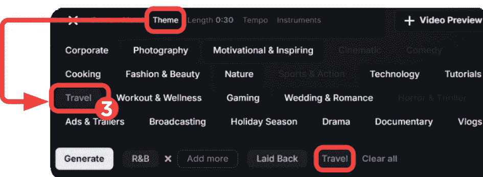

后面3个选项都是以下拉列表的形式进行设置。

“Length”可以设定作品的时长。单击“Length”，从列表中进行选择。最短为10秒，最长为5分钟。这里我选择2分钟。

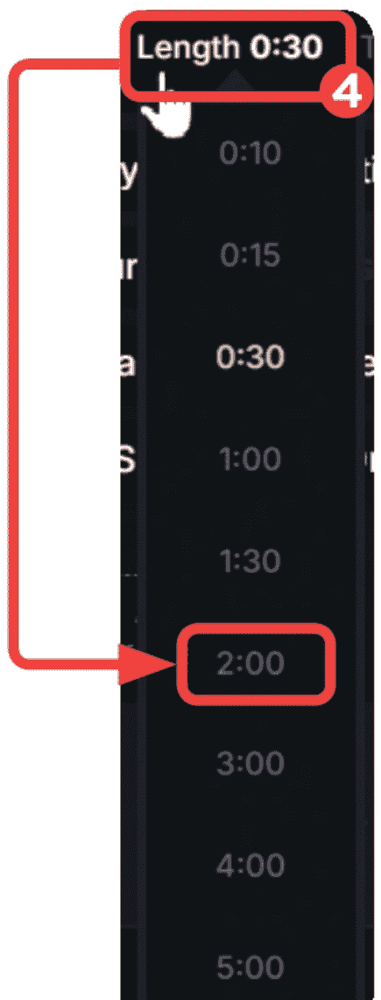

“Tempo”是设置速度，点击“Tempo”，下拉列表如下图所示。这里不能精确设定速度的数值，而要从列表里的Slow（慢）、Normal（普通）或Fast（快）中进行选择。在每一项上点击可以选中或取消，可以全部选中，也可以全都不选。选中就表示我们希望Soundraw生成相应速度的作品。

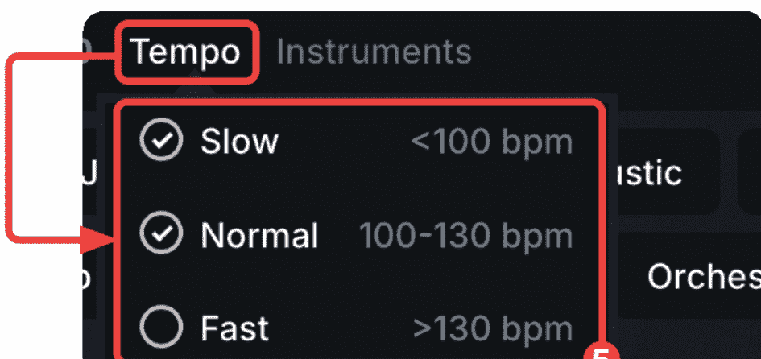

最后的“Instruments”选项可以选择作品中使用的乐器组合。点击“Instruments”，下拉列表如下图所示，有12种可选，如钢琴、合成器、原声吉他等。我们可以按自己喜欢的乐器进行选择，Soundraw会按照设定的乐器组成生成作品。

## Instruments

- Piano
- Keyboard
- Synth
- Acoustic Guitar
- Electric Guitar
- Bell
- Mallet
- Ethnic
- Strings
- Voice
- Brass
- Woodwind

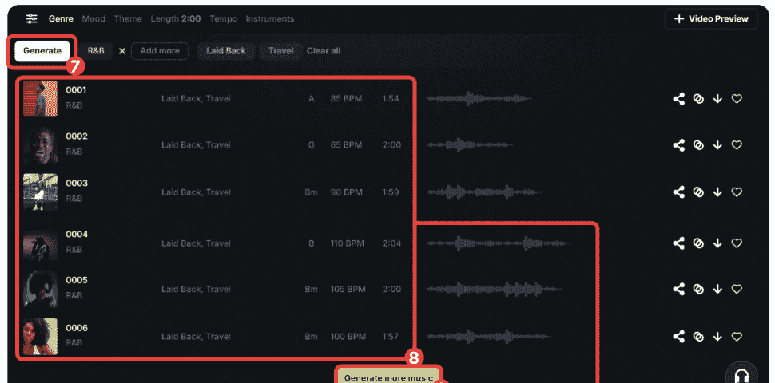

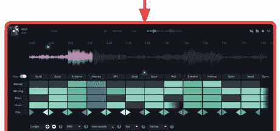

都设置好之后，点击白色的“Generate”按钮，仅几秒钟，Soundraw就生成了6首作品，点击即可试听。试听时，会弹出一个全新的界面，在这个界面上可以直接编辑调整音乐，非常方便。点击最下方的“Generate more music”可以生成更多音乐。

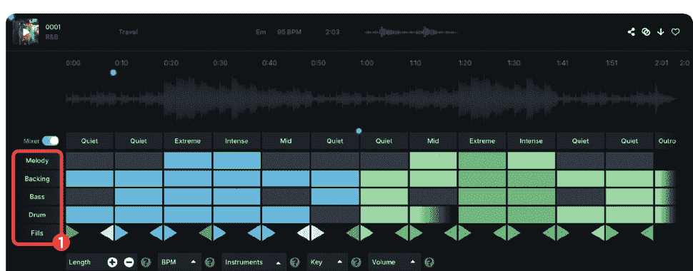

上图是Soundraw的编辑器，它和Suno、DIVA的编辑界面很不一样，是以独特的图形形式呈现的，即使是没有任何音乐基础的朋友也能轻松掌握。

纵向上的每一行代表音乐中的一个声部，一共有5个声部。“Melody”是旋律；“Backing”是伴奏声部，是中音声部；“Bass”为低音声部；“Drum”是鼓，在这里代表节奏型；“Fills”是过门，也就是乐段的衔接处的变化。

而横向的每一列代表音乐的乐段。上方显示的是音乐的波形，鼠标左右移动可以看到不同乐段的波形，在任意一个乐段上点击，就可以从该乐段开始播放。

彩色的方格就是对应应该乐段的调整模块，一共有三种状态，黑色时，该声部是无声的；在黑色状态点击一次会变成浅色，这时该声部就有声音了；再点击一次变成深色，该声部就会以最强状态演奏。

“Fills”（过门）和其他声部稍有不同，是三角形的，并且有4种颜色：灰色、接近白色的浅色、浅色和深色。

在编曲发生改变的地方会用另一种颜色显示。

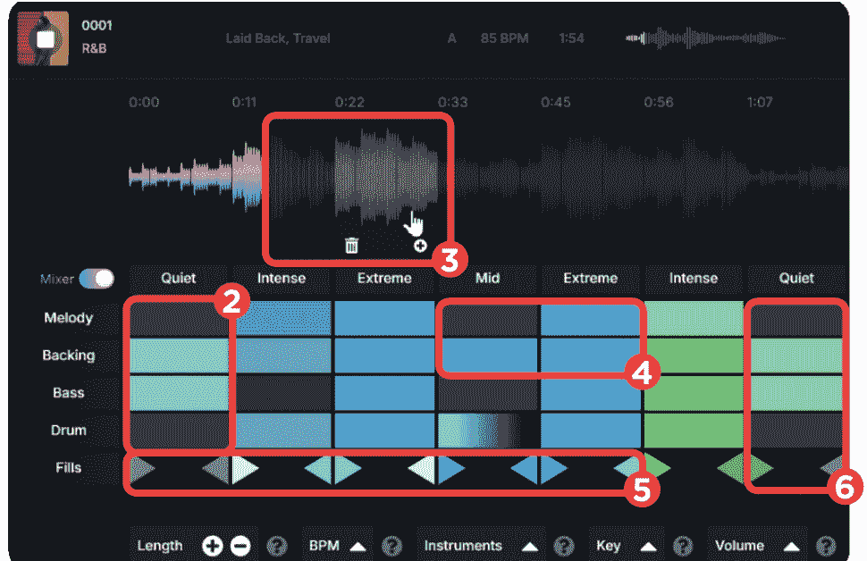

上图中，第一乐段只有Backing和Bass声部在演奏，Melody和Drum是没有声音的。到了第五乐段，所有声部都在演奏，并且都是深蓝色。

每个乐段上方的英文表示该乐段的整体情绪强烈程度，我们调整每个格子的强弱状态时，这个英文表述也会自动变化。一共有4种状态：Quiet（安静）、Mid（中等）、Intense（强烈）和Extreme（极为强烈）。比如下图中，第一乐段只有Backing与Bass在演奏，Soundraw判断为“Quiet”，而第三乐段中所有声部都用最大强度演奏，Soundraw判断为“Extreme”。

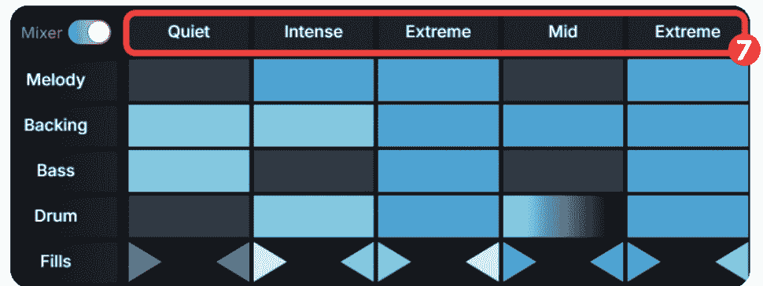

除了改变声部的演奏状态，还有一些参数可以修改。在下方的一排参数中，“Length”是调整长度，点击“+”或“-”，会在作品末尾增加或减少乐段；“BPM”可以调整整体的速度，同样不能自由设定，需要从下拉列表中选择；“Instruments”是调整乐器，点开以后可以看见使用的乐器，可以分声部调整。比如Backing使用的是吉他（A.GUITAR1），如果你想换成钢琴，可以选择“A. PIANO1”，然后点击“Apply”，Soundraw就会重新生成音乐。

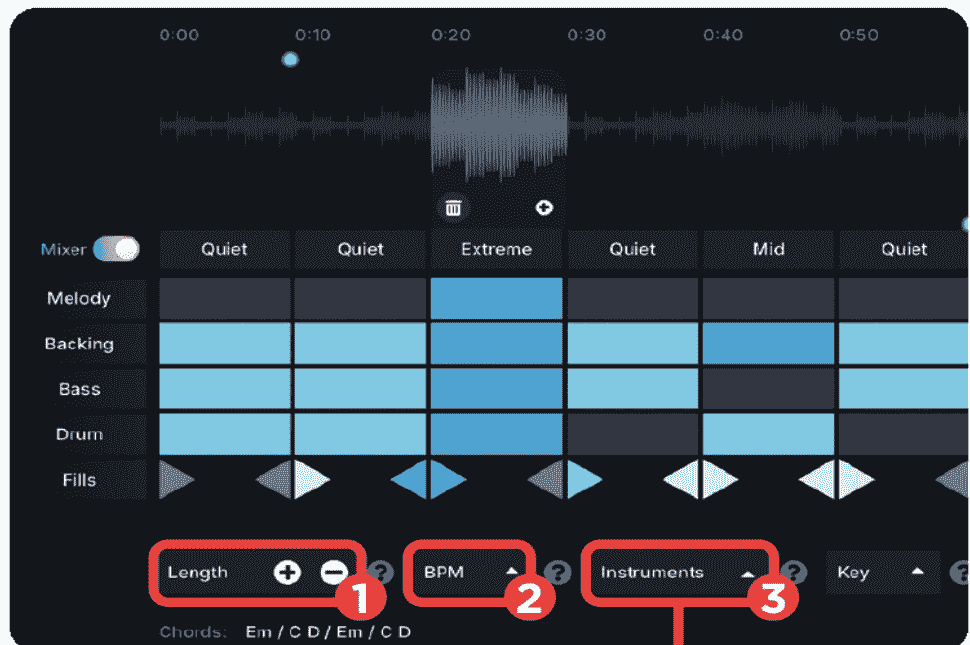

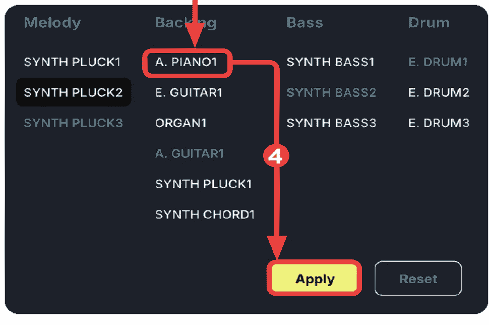

再往右的两项，“Key”（调）可以调整音乐的调性，这里也不是自由选择，只能移两个调。

“Volume”（音量）相当于混音，可以调整各个声部的音量大小。比如，你觉得Bass的音量有点大，就可以往左调整一点。

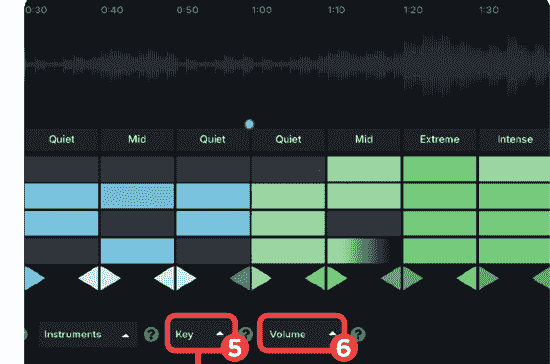

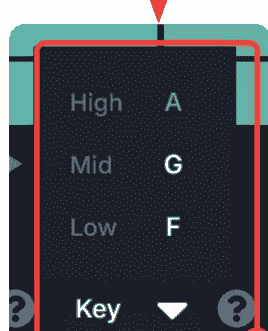

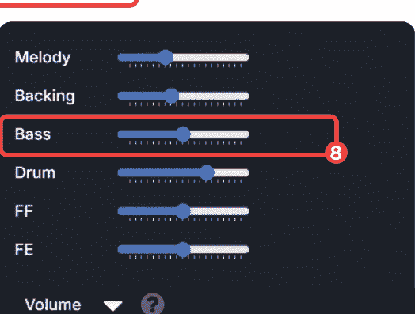

最下方的“Chords”显示的是作品中使用的和弦进行，这一项不能修改，是Soundraw自动生成的，但可以作为我们音乐创作的参考。

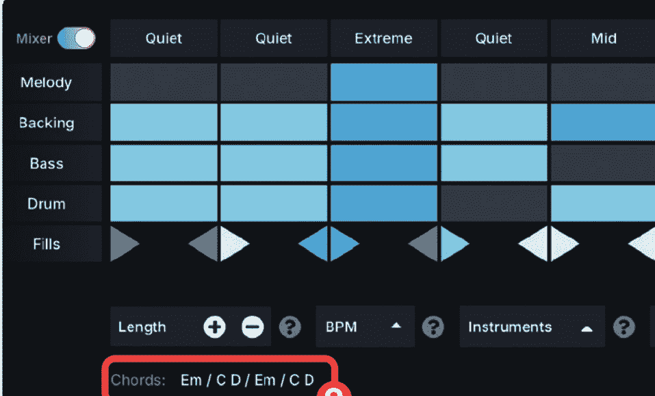

当你对调整好的音乐感到满意时，就可以通过右上角的几个按钮，来分享或下载音乐。这几个按钮的功能如下。

- 创建链接来共享生成的作品。
- 重新生成与生成的歌曲感觉相似的作品。
- 下载生成的作品。
- 标记喜欢，方便查找生成的作品。

需要注意的是，Soundraw生成的音乐需要付费才能下载及商用，所以在这里我就不提供试听音频了。建议你先免费试用，看看它是否适合自己，再考虑付费。Soundraw的功能比较简单，生成效果整体来说还不错，如果你感兴趣，可以多尝试，深度使用，也许它能成为你得力的音乐创作工具。

# 3. Udio

## 3.1 认识Udio

Udio是一款由前DeepMind的研究人员开发的AI音乐生成工具。它能根据用户输入的文字描述（提示词）来生成高质量的音乐作品，并支持创作带歌词的歌曲。

Udio主要有以下特点和功能。

**文本到音乐的转换：** Udio能够根据用户的提示词（包括风格、情绪等信息）快速生成音乐，还能根据歌词生成人声作品，支持生成中文、英文、日文等多种语言的人声。

**混音与扩展功能：** Udio的混音模式（Mix Mode）允许用户在已有的歌曲基础上进行微调，生成类似的新内容。它还具备音乐片段扩展功能，可以为现有音乐添加前奏、延伸主旋律或延长歌曲结尾，生成更长的曲目。

**社区功能：** 通过“Library”（音乐库）选项，用户可以发现并收听社区中其他创作者的优秀作品。

**音乐封面生成：** Udio还能根据你输入的提示词，自动为音乐生成封面图片。它提供的封面选项通常比较多样且质量不错。

**界面简洁易用：** Udio的设计简洁易用，即使是音乐创作新手，也能快速上手。

**免费创作额度：** Udio提供免费试用，登录后，用户每月可以获得一定的歌曲创作额度。

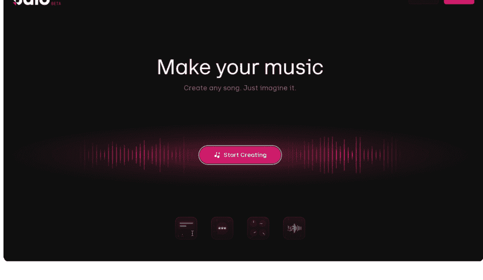

### 3.2 Udio的使用方法

在必应等搜索引擎中搜索“Udio”，找到Udio的官方网站并打开。

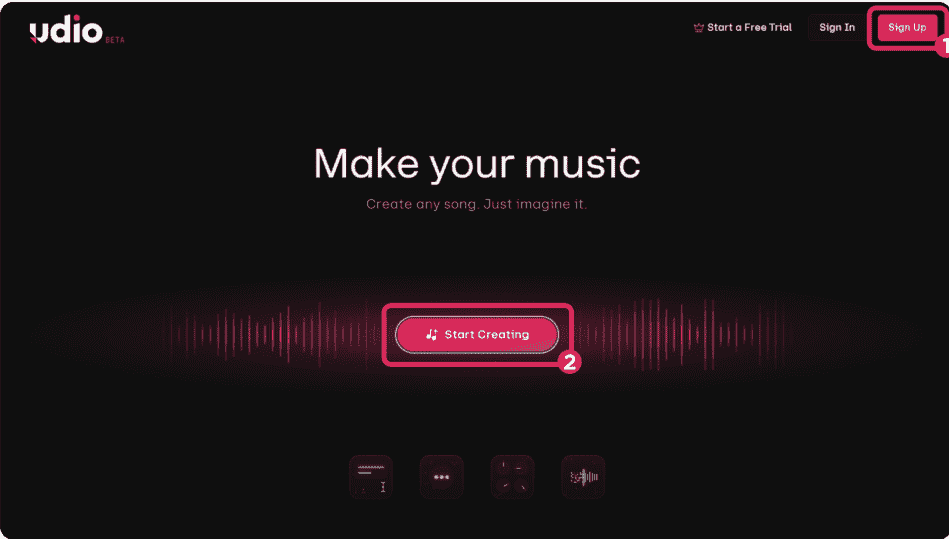

首次使用，我们可以点击网页右上角的“Sign Up”进行注册，暂时不想注册的话，可以直接点击“Start Creating”进行试用。

注册时，可以使用谷歌、苹果等账号，也可以使用其他邮箱。Udio会发送邮件至注册邮箱进行验证，验证完成后，需要设置用户名，然后就直接进入创作界面了，如下图所示。

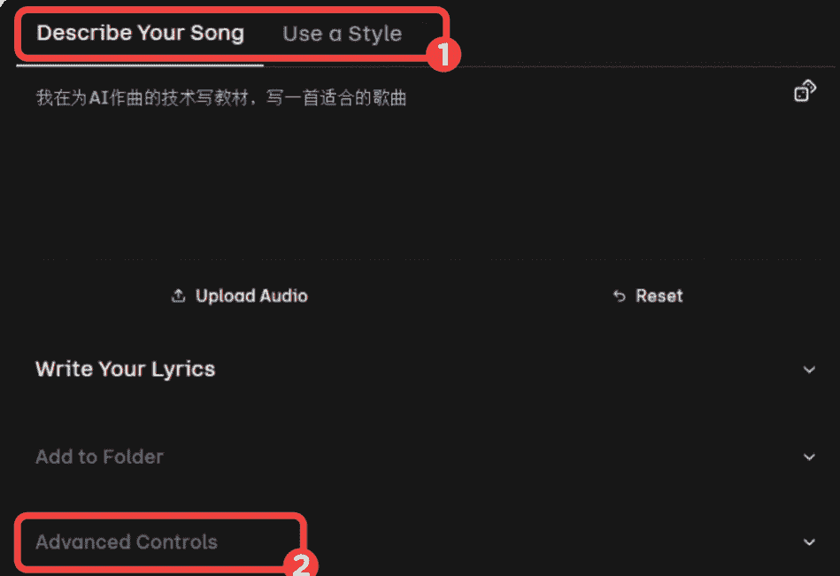

Udio的界面和Suno非常相似，创作步骤和思路也差不多。最上方有两个主要选项卡：“Describe Your Song”（描述你的歌曲）和“Use a Style”（使用风格范例）。

“Describe Your Song”是填写作品描述的地方，比如，我填入了“我在为AI作曲的技术写教材，写一首适合的歌曲”。当然，这里也可以输入音乐风格等标签文字。在我们输入的时候，Udio会自动提示相关的关键词，比如我输入Chinese，它会出现“chinese folk music”“chinese classical music”等描述，对英语不好或是对风格提示词不太熟悉的朋友非常友好。

作品描述文本框往下依次是上传音频、歌词设置和纯音乐的按钮，相信大家一看就明白，这里就不详细讲解了。

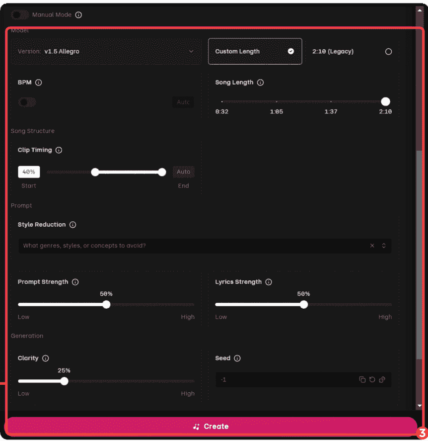

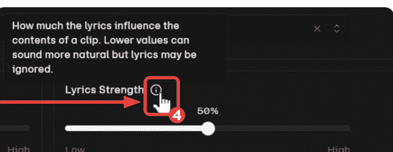

如果点击“Advanced Controls”，会显示更多设置。这些选项包括模型切换、作品的速度和长度、提示词和歌词在作品中的权重、清晰度、生成质量等，会影响到最终生成作品的效果。将鼠标指针移动到每个选项旁边的感叹号上可以看到该选项的意思，再决定是否调整。作品的长度是常用的一个选项，如果选择“Custom Length”（自定义长度），就有从32秒到2分10秒共4种不同的长度可以选择。其他选项相对来说比较专业，大家可以自行探索。

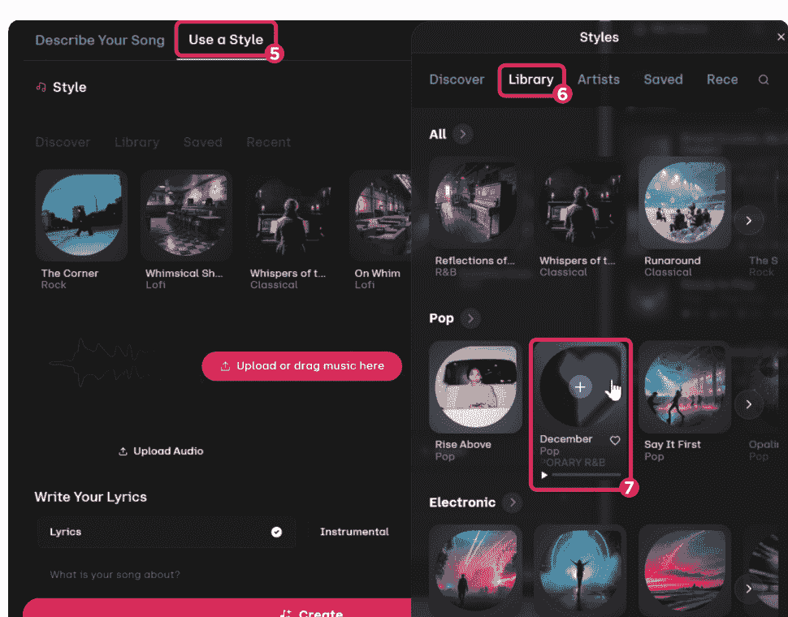

“Describe Your Song”旁边有一个“Use a Style”，这和在提示词中打标签、指定音乐风格不同，它是让用户从已有的音乐库或上传的音频中选取风格参考，作为创作新作品的基础。相比打标签，这种方式能更准确展现用户想要的氛围与质感。

点击“Use a Style”后，会来到一个新界面。点击“Library”，会列出所有的音乐风格。将鼠标指针移动到任意一种风格的图片上，会出现一个“+”号和播放按钮，我们可以先试听，喜欢这种风格就可以点击“+”号，在作品里使用这种风格。付费用户可以上传已有的音乐。

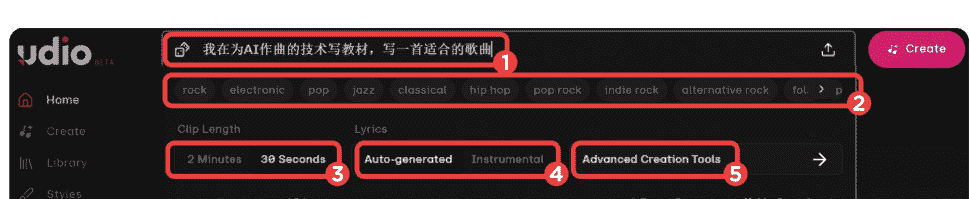

实际上，在Udio的首页最上方也有一个简易的创作入口，可以让我们快速生成作品。点击后可以直接输入提示词，并能选择音乐风格。“Clip Length”可以设置作品长度，但只有2分钟和30秒两种选择；“Lyrics”（歌词）只有自动生成和纯音乐两种选择。点击“Create”就可以生成音乐了。如果需要详细设置（比如输入歌词），可以点击“Advanced Creation Tools”（高级生成工具），就会进入详细的创作界面。如果什么都没有输入或选择，直接点击“Create”，Udio也会随机生成两首作品。

Udio同样采用积分制，但规则比其他平台复杂一些，主要与生成作品的长度有关。

免费用户每天会获得10个普通积分和3个完整作品积分（都是每天刷新，不累积）。此外，每月还有100个普通积分的上限。

前面说到，Udio目前支持4种长度的音乐作品：32秒的短片段、1分05秒及1分37秒的中长片段和2分10秒（130秒）的完整作品。不同长度的作品的积分消耗规则如下。

- 短片段（32秒）：生成一首32秒的短片段会消耗1个普通积分。Udio每次会生成2首，消耗2个普通积分。但免费用户每天最多只可生成4次（8首）短片段。
- 长作品（2分10秒/130秒）：生成一首130秒的完整作品，会同时消耗2个普通积分和1个完整作品积分。同样，Udio每次会生成2首，总共花费4个普通积分和2个完整作品积分。免费用户每天最多只能生成3首完整的130秒作品。

中长片段是Udio新增的选项，积分消耗情况还不清楚，大家可以自己尝试一下。

积分情况可以在页面左下角看到。将鼠标指针移到页面左下角“Credits”处，就能看到剩余的积分。

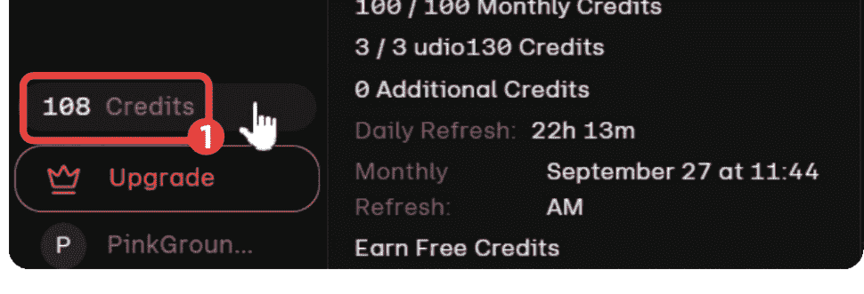

生成好的作品会显示在页面右边，如下图所示。这个界面的操作和Suno也比较类似。点击作品的图片即可试听。点击最右边的小白点，也可以进行编辑（Edit）、延长（Extend）、混音（Remix）等操作。

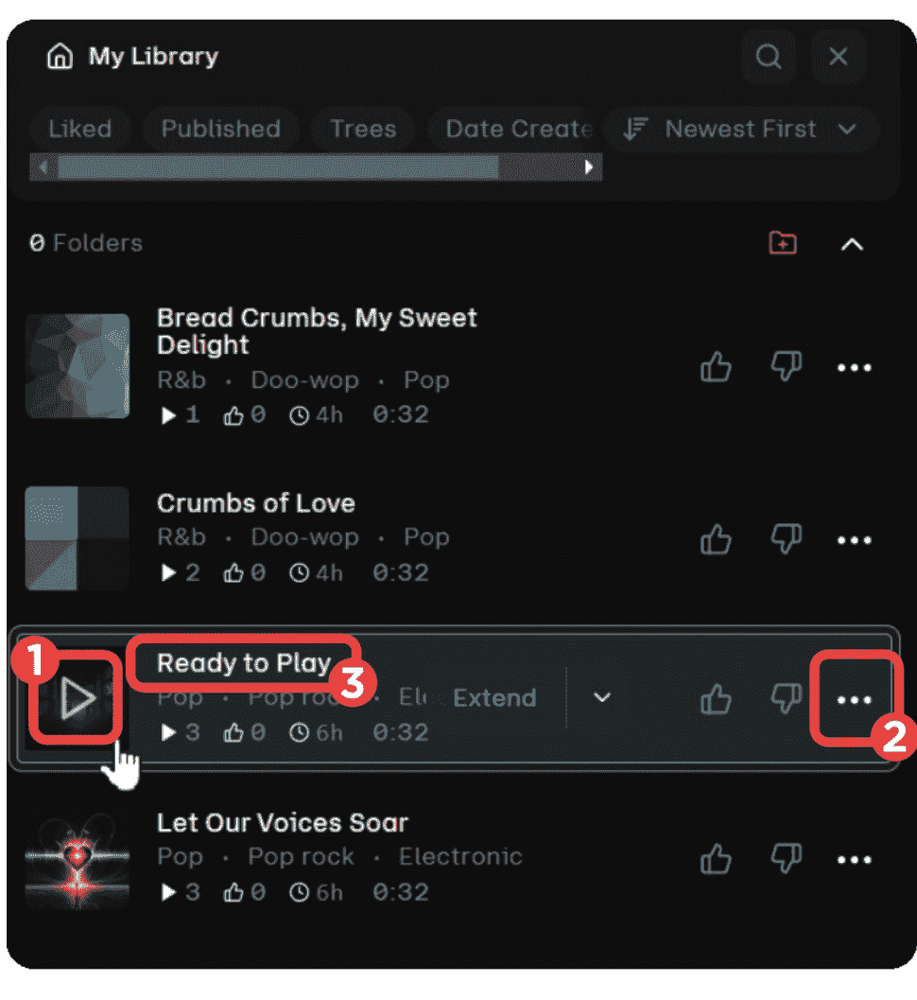

在作品名上点击，可以看到作品的详细信息，包括音乐风格和歌词等，也可以在这里进行编辑操作。再次在作品名上点击，会进入独立的作品页面。

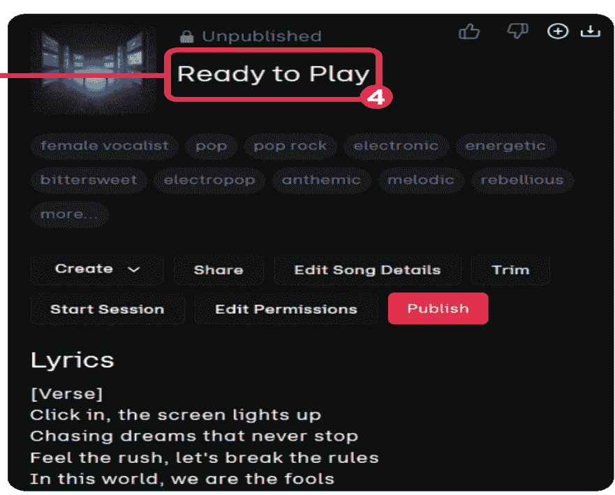

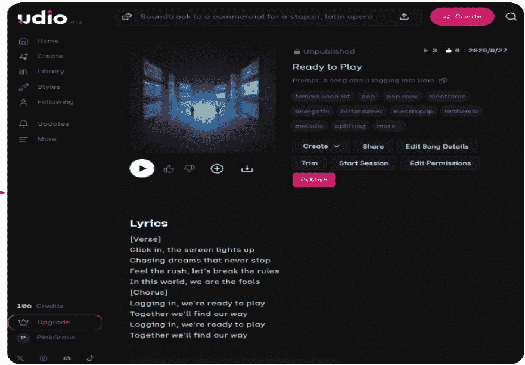

现在我们来试一试，将之前用过的《星晴》的歌词放到Udio里，提示词点击骰子图标，随机生成；作品长度选择2分钟。最终生成的歌曲请大家打开“试听音频8-3”聆听一下吧。

下面是我生成的其他歌曲。如果不使用中文歌词，人声会更加自然，整体效果也比较出色。

再来看Udio生成的纯音乐，大家可以听听看。这几首乐曲涵盖了交响乐、中国风、爵士乐、摇滚等多种风格，整体质量都比较高，表现力丰富。

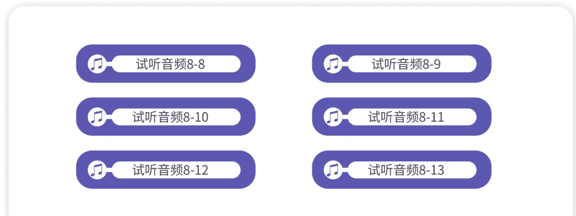

由于篇幅有限，Udio的基本使用方法我们就讲到这里。如果你对Udio感兴趣，可以自己深入使用和探索。在Udio主页的社区中，有很多优秀作品可以试听，大家一定要去听听看。

总的来说，Udio是目前综合实力较强的AI音乐创作平台之一，音乐生成能力很强，特别是它的声音质量，表现突出。它生成的纯音乐尤其优秀，可以直接用于商业用途。

更值得一提的是，Udio提供了很多专业设置，能让具有专业能力的用户更精细地控制AI的创作方向，从而获得更符合预期的音乐作品。对于希望进行深入探索和追求精确结果的创作者来说，这是一项显著的优势。

与Suno相比，Suno的创作可能更注重人性化和旋律的流行性，容易产出好听、抓耳的歌曲，对中文人声的支持也更好。而Udio则在纯音乐方面具有明显优势，当然，人声作品也表现不俗，并且提供了专业的选项，便于精确控制。在实际创作中，大家根据自己的需求来选择即可。

# 4. Mubert

## 4.1 认识Mubert

Mubert是一个将AI与真实音乐采样相结合的音乐生成平台，适合内容创作者、开发者与品牌使用。用户可以即时生成免版税的音乐，非常适合用于视频、直播、应用背景等场景。

Mubert与其他AI音乐平台最大的不同在于，它是一个将真实音乐人与人工智能结合的协作平台。Mubert将数百位音乐人的专业作品和超过250万个音乐样本进行训练与组合，这样既能保证生成音乐的独特性，又能确保音乐的质量。

Mubert主要有以下特点和功能。

- **AI协作模式：** 利用数百位音乐人创作的采样数据进行训练，生成多样化的音乐。
- **丰富的风格选择：** 提供100多种流派与多种情绪分类，用户可根据风格、情绪和节奏等参数生成音乐片段。
- **产品生态：** Mubert提供多条产品线，包括面向创作者的Mubert Studio、面向听众的Mubert Play，以及可供项目调用的API。
- **应用场景广泛：** 适用于音乐创作者、视频制作者、广告从业者等，可快速生成背景音乐。
- **免版税与商业用途：** 所有生成的音乐均可商用，无须担心版权问题。
- **贡献者机制：** 采样贡献者可获得收入分成，鼓励音乐人与平台共同成长。
- **API与集成能力：** 支持通过API接入应用和平台，实现音乐的自动化生成与分发。

Mubert这种独特的系统不仅让用户能够高效生成所需的音乐，还突破了传统音乐制作的门槛，使个人与企业都能以低成本、灵活的方式获得原创、可商用的音乐作品。

## 4.2 Mubert的使用方法

我们在必应等搜索引擎中搜索“Mubert”，找到它的官方网站并打开。Mubert的官网如下方左图所示。

同样，第一次使用时，我们可以右上角的“Sign Up”进行注册，在弹出的界面中可以使用谷歌等账户来注册，也可以使用其他邮箱，邮箱需要验证一下。暂时不想注册的话，也可以点击“Generate a track now”先试用。

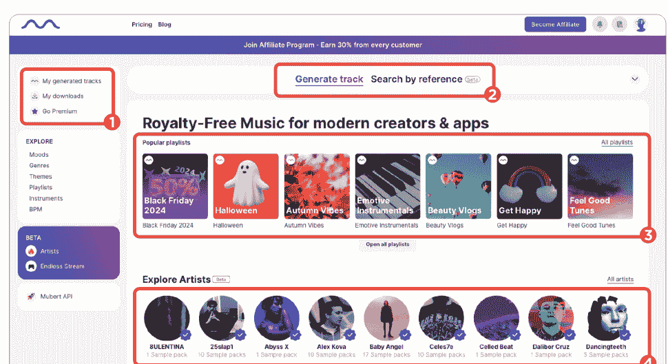

Mubert的整体界面也非常清新，很容易上手。左边是功能区，我们生成的作品可以在其中找到。中间上方就是开始创作作品的入口，点击一下就会展开创作区，一会儿我们会详细讲解。占据页面大部分面积的是试听区，其中“Popular playlists”是其他用户或Mubert官方推荐的热门歌单；“Explore Artists”列出的是与Mubert合作的真实音乐人。点击歌单小封面或音乐人的头像，会进入新的页面，显示播放列表。我们可以听一听，感受一下Mubert的音乐效果。

现在我们来看如何在Mubert上生成音乐。我们在主页的“Generate track”上点击一下，就会展开创作区。Mubert的创作区非常简洁紧凑，一目了然。

“1. Enter prompt or upload image”就是我们输入提示词的地方，和其他AI一样，可以输入风格、乐器、情绪等词语，输入框中也会有提示，只能输入英文。我们会注意到，Mubert可以上传图片，点击相机的小图标就可以上传图片了，我将在下文演示。这里我在输入框中输入了“Piano Pop Romantic”，即钢琴、流行风格与浪漫。也可以点击“or choose”下面的“Genre”（风格）、“Moods”（情绪）和“Activities”（活动），都会显示相应的列表，可以从中直接选择。其中“Activities”相当于其他AI中的“场景”。

“2. Set type”是一个很重要的参数，可以理解为你要生成什么用途的音乐。点击“Track”，会展开下拉菜单，其中有四个选项，分别是“Track”“Loop”“Mix”和“Jingle”。选“Track”会生成普通的较为完整的曲子；选“Loop”会生成以8小节或16小节循环的乐段；“Mix”表示混合型作品，没有特定结构，更灵活；“Jingle”则可以生成非常短的音乐，比如开场或结尾音乐。

“3. Set duration”是设置作品的时长，可以手动输入精确的时间。页面上也有小提示，时长需要在5秒到25分钟之间，说明Mubert对作品时长的限制比较小。

参数设置好之后，点击“Generate track”就可以生成作品了。“试听音频8-14”是我用Mubert生成的作品，大家可以试听一下。

用图片生成音乐是Mubert的一个特色功能，操作也很简单，首先点击相机的图标，再点击处会打开浏览计算机文件的对话框，找到文件上传即可，或者直接将图片拖拽到界面中也行。

# Image-to-music

Drag and drop the image here

you can use CTRL + V (CMD + V) to insert image here

Upload png, jpg or webp

Enter the address of the image

Next

上传之后，点击“Continue”（继续），提示词的输入框中会显示“Image is selected”（已选择图片），即图片是我们的提示词。

# Image-to-music New

Continue

Generate track Search by reference beta

1. Enter prompt or upload image

2. Set type

3. Set duration

Image is selected

Track

00 : 45

Generate track

or choose:

Genres Moods Activities

from 5 sec to 25 min

最后点击“Generate track”就可以生成作品了。使用图片生成音乐，等待的时间会稍长一些。这里我选了一张云雾缭绕、风格有一点阴森的栈道照片，生成了这样一首作品，请听听看。

页面左边的“EXPLORE”菜单和Suno的探索功能差不多，Mubert按照“Moods”（情绪）、“Genres”（音乐风格）、“Themes”（主题）、“Playlists”（播放列表）、“Instruments”（乐器）和“BPM”（速度）进行了分类，每个大类中都有细分类别的词语，把这些词复制进提示词输入框即可。

点击这些词语，都会出现对应的生成好的作品，我们可以依次试听，如果有喜欢的作品，可以点击该作品右边的闪电符号，设置好作品的类型和时长，再点击“Generate track”，就可以迅速生成与该作品相似的新作品。

下面的“试听音频8-16”是Mubert网页上的范例作品，而“试听音频8-17”是我基于范例作品生成的新作品，大家可以对比一下。

在试听Mubert生成的音乐时，你可能会留意到，每隔一段时间就会有一句女声的“Mubert”插入到音乐中。这其实是Mubert平台为了保护版权和推广品牌，在免费试听（预览）版本中设置的“声音水印”。

如果你希望下载不带这种声音水印的纯净音乐，或者想将音乐用于商业目的，就需要升级到Mubert的付费订阅计划。

整体来看，Mubert是一个比较有特色的AI音乐生成平台，生成的音乐质量相当不错，提示词的使用也十分便捷，用户找到喜欢的风格或作品后能迅速生成相似的作品。这个平台很适合有背景音乐需求的用户，尤其是对短视频创作者来说，当一时找不到合适的背景音乐时，Mubert无疑能发挥巨大的作用。

# 5. Soundful

## 5.1 认识Soundful

Soundful是一个由人工智能驱动的音乐创作平台，它的目标是简化音乐制作过程，让用户能够轻松地生成定制的音乐曲目。Soundful的核心优势在于高质量的免版税音乐和强大的自定义功能（包括支持导出分轨文件和MIDI文件）。

Soundful主要有以下特点。

**智能音乐生成：** Soundful利用人工智能技术，能帮助用户快速生成各种风格的背景音乐。它提供了多种音乐流派和情绪风格供选择，如EDM、Hip Hop、Pop等，用户还可以根据需要调整音乐的速度和调性。

**无版权与商业用途：** 在Soundful上生成的音乐是无版权的，用户可以放心地在视频、播客、广告等多种媒体项目中使用。同时，用户可以将音乐上传到其他平台实现收益。

**多格式导出：** 用户可以导出MP3、WAV文件，也支持下载分轨音频、MIDI等文件，方便在DAW中进行后期混音与编辑，满足了专业音乐创作和后期制作的需求。

**用户友好的界面：** Soundful的界面简洁直观，易于操作，适合不同音乐经验水平的用户。

**免费和付费计划：** Soundful提供免费和高级订阅计划。免费版本会限制下载数量，而付费计划则提供更多下载额度，并支持导出分轨文件、MIDI文件等。

Soundful的生成方式与Suno或Udio有所不同，它不需要输入提示词，而是通过选择流派（genre）、情绪（mood）和艺术家风格（artist）等预设选项，快速生成符合用户需求的音乐。这种操作模式特别适合内容创作者、视频剪辑者或播客主等希望快速得到成品音乐的用户，以及对音乐理论或提示词不熟悉的用户。

## 5.2 Soundful的使用方法

了解了Soundful生成音乐的原理，它的使用方法就很简单了。在必应等搜索引擎中搜索“soundful”，找到它的官方网站并打开，如下图所示。Soundful虽然提供了多种语言的选项，但是没有中文。这里还是使用英文。

第一次使用需要注册，点击“START FOR FREE”，会跳转到注册页面。注册需要填写的3项分别是名字、邮箱和密码，注意密码必须多于8位，且须同时包含大小写字母和至少1个数字。Soundful也支持使用谷歌等账号注册。

# Sign up, it's free

First Name

Email Address

New password

Must be **8 or more characters**, **uppercase** and **lowercase** letters, with **at least one number**.

SIGN UP FOR FREE

No Credit Card Required

or

Sign up with Google

Sign up with SOUNDCLOUD

注册完账号再进入Soundful时，会弹出一个身份选择，如音乐制作人、歌手、DJ等，只能选择一项；然后需要选择你最喜欢的音乐风格，选择4项。

选择好以后进入主界面，Soundful就会给你推荐生成好的作品。

上图中，绿色框里就是根据我的喜好推荐的音乐风格，如Afro House、Afrobeats、Pop Funk等。点击红色的图标就可以生成该风格的音乐。

生成界面会从页面下方弹出。这里可以调整一些音乐的基本参数：处调节音乐的速度，处设置调性等，点击处输入作品的名字。设置好以后，点击“CREATE PREVIEW”（创建预览）就可以生成音乐了，就是这么简单。

生成好以后，点击播放按钮就可以试听了。播放作品时我们会看到，生成界面的上方出现了一行文字提示，这是在说我们听到的只是预览版本，以便我们快速判断旋律、风格是否符合需求。当我们下载作品时，Soundful会对曲子进行混音和处理，从而得到更加平衡、专业的最终版本，可以说是很贴心了。点击“SAVE”（保存）可以将作品保存到我们的音乐库里。如果对作品不满意，可以点击“CREATE NEW PREVIEW”（生成新预览），生成一首新作品。

点击左侧“My Library”（我的图书馆），就会显示我们创作的音乐。“GET”（获取）就是下载按钮，点击后会弹出下载界面，免费用户只能下载MP3格式，而付费用户可以下载STEMS分轨文件和适用于Ableton Live的als文件。

“试听音频8-18”是我在Soundful生成的作品，请大家听听看。

除了上面这种创作方式，我们还可以从界面左侧的功能区找到更多参考风格和模板。

处列出了4个选项，分别是Genre（风格）、Collections（合集）、Loops & SFX（循环乐段与音效）和Global Tracks（精选曲库），每一项中都有很多的选项和范例，可以进行试听。“Collabs”（合作曲风）是Soundful邀请一些音乐人，将其创作“风格DNA”输入平台并进行训练后形成的风格。付费用户可以使用这些风格来生成音乐，让作品带有合作艺术家的特色，同时具备原创性。

以“RnB”为例。在“Genre”中找到“RnB”，点击之后显示的是“RnB”的细分风格，点击每一个小封面，就会看到该风格的范例作品。我们可以先试听，如果有喜欢的，可以点击“CREATE”或点击该作品后面两个圆圈的符号，就会弹出创作界面，操作方法和前面一样。

Genres / RnB

# RnB

CREATE

RnB Dance

RnB Wavy

RnB Pop

RnB Hip Hop

整体来说，Soundful的生成质量还不错，适合快速获得灵感或生成背景音乐。操作界面简洁直观，提供了丰富的模板，用户只需简单选择和调整即可生成作品，几乎没有使用门槛。它特别适合没有专业作曲经验但需要音乐的创作者，例如视频博主、自媒体从业者或独立设计师。不过，由于依赖预设选项而不是详细提示，灵活性可能稍显不足，有时生成的风格可能不够独特，对于追求高度原创性或专业水准的音乐人可能不太适合。

# 6. Stable Audio

## 6.1 认识Stable Audio

Stable Audio是由Stability AI公司开发的一款AI音乐和音效生成工具。它能够根据用户输入的文本提示词或音频样本生成高质量的音乐和各种音效。它主要有以下特点。

**高质量音频生成：** Stable Audio能够生成长达3分钟、44.1kHz采样率的高保真音乐作品和音效。它支持多种音乐风格，如摇滚、爵士、电子、嘻哈等，并且音质表现较为出色。

**采用结构生成技术：** 使用扩散模型与DiT（Diffusion Transformer）架构，具备处理长时间结构和复杂音频模式的能力，从而生成连贯且细节丰富的音乐。

**从音频生成音频或音效：** Stable Audio具备强大的音频到音频转换功能。用户可以上传现有的音频样本，并通过文本提示词将其转化为各种不同风格或主题的新音频。此外，它还能直接创作各种音效和音频效果，为音频项目提供更多可能性。

**生成速度快：** Stable Audio的生成速度比较快，1分钟左右就能完成一首3分钟的音乐作品，并且支持在手机等移动平台使用。

**商业化应用支持：** Stable Audio生成的音乐可以商用，为自媒体用户、广告制作及其他商业项目提供了便捷的音乐解决方案。

**多样化的输出格式：** 生成的音乐能够以MP3和WAV格式下载，还可以输出为视频，方便用户直接用于视频项目。

**用户界面与免费试用：** Stable Audio的用户界面设计友好，操作简单。用户只需在官网注册，即可免费试用体验。

Stable Audio最大的优势在于能够生成高保真（44.1kHz）的音频内容，并且在音效创作方面有独到之处。因此，Stable Audio尤其适合视频创作者、游戏开发者，以及那些需要进行音频转化和追求高音质的商业用户。

## 6.2 Stable Audio的使用方法

我们在必应等搜索引擎中搜索“Stable Audio”，找到它的官方网站并打开，如下图所示。

第一次使用时需要注册账号。无论是点击右上角的“Sign up”还是左下角的“Try now”，或是中间下方的“Try prompt”，都会跳转到注册界面。

## Stable Audio

Sign up to access AI music models.

Email address*

Password*

Continue

Already have an account? **Log in**

OR

Continue with Google

注册流程和其他AI平台一样，使用邮箱即可，无须验证；也可以使用谷歌账号。

注册完成之后点击右上角的头像图标，可以看到免费账号的信息：每月最多可以生成10首作品，每首作品的时长最长为3分钟；每月可以上传的音频文件总时长上限也是3分钟。同时，生成的作品不能商用。

# Free

Subscription

+   - 10 tracks a month
- Generate up to 3 minutes
- 3 mins of upload
- Non-commercial license

No. of track generations

10 tracks

Audio upload

3 mins 0 seconds

Training: Improve the Model for Everyone
Allow your content to train our models and improve them for all users

On

Upgrade

Delete account

回到主界面，我们会发现Stable Audio的界面和之前讲解过的AI界面非常相似。左侧是设置作品参数的区域，“Prompt”（提示词）就是输入提示词的地方，可以输入音乐风格、乐器、情绪等信息，输入方式和其他AI一样。

如果不会输入，也可以从下方的“Prompt Library”（提示词图书馆）中进行选择。点击右边的按钮，会展开一个列表，其中有17种预设的风格可以选择，如Synthpop、Ambient、Warm、Disco等，也可以选最后一项“Surprise me”，即随机选择。这里我选择了“Techno”，你可以看到，“Prompt”输入框里自动填入了系统设定好的提示词，其中不仅包含音乐风格，还有情绪、乐器、速度等设置。看看这些提示词是否合适，可以进行调整。

“Model”（模型）是选择要使用的模型，目前只有“Stable Audio AudioSparx 2.0”这一种模型，没有其他选择。“Duration”（持续时间）是设置作品的长度，最长为3分钟。再往下是上传或者录制音频，点击“Add audio”（添加音频）即可上传，操作步骤和Suno差不多。

点击最下方的“Add extras”（添加额外设置），会看到几个比较专业的选项。

Prompt guide ⓘ

A hypnotic Techno track featuring thumping kick 909 drum, deep rumbling bass and evolving modular synthesizer tones. The mood is dark, and moody. 133 BPM

Prompt Library

Techno >

Model Stable Audio AudioSparx 2.0

Duration (max. 3m 0s) 3 m 0 s

Input audio (3m 0s remaining) ⓘ

+ Add audio

+ Add extras

Generate

Extras ×

**Steps（步数）**：控制生成音频的迭代次数，增多可提升音质（默认值是50）。

**Seed（种子）**：决定随机生成音频的起点，设置相同的seed值可以重复生成相似的音频结果。

**Prompt Strength（提示词强度）**：调节生成的作品与提示词之间的贴合度，数值越高，结果越贴近提示词的内容。

**Number of Results（生成数量）**：Pro版用户可以一次生成多首（最多5首）作品，效率更高。

这里我尝试输入了“Pop, K-Pop, Piano, Sad, 75BPM”的提示词，即“流行，韩式流行，钢琴，悲伤，速度75”，其他使用默认设置，最后点击“Generate”，看看会生成什么样的音乐。

Prompt guide ⓘ

Pop, K-Pop, Piano, Sad, 75BPM

Prompt Library None >

Model Stable Audio AudioSparx 2.0

Duration (max. 3m 0s) ∨ 3 m 0 s ∧

Input audio (3m 0s remaining) ⓘ

+ Add audio

+ Add extras

Generate

生成好的作品会在界面右侧显示，我们可以试听。点击下载按钮就可以下载，免费用户可以下载MP3和MP4视频，付费用户可以下载WAV文件。不过，经测试，这种MP4视频并不是我们想象的那种音乐MV，它的内容相当于一个动态封面，方便在视频平台分享。你可以根据自己的需求决定是否下载。

“试听音频8-19”是我用Stable Audio生成的音乐，大家听听看。

在Stable Audio中上传音频的操作也非常简单。

首先点击“Add audio”，第一次使用这个功能会弹出一些提示，告知你必须上传你拥有版权的音频文件，并且音频的长度要在1秒～3分钟之间，超过3分钟就需要修剪。

然后我们在“Upload”（上传）和“Record”（录音）中选择“Upload”。上传好之后，会出现一个“Input strength”的选项，它用于控制上传的音频样本对最终生成作品的影响程度。值越高，生成的音乐或音效会越接近上传的原始音频，保留更多其特征。如果你希望生成与原音频高度相关的作品，就调高强度；如果希望AI进行自由发挥，只需借鉴部分元素，就调低一些。

需要特别指出的是，在Stable Audio中上传音频之后，我们还可以输入提示词，让它将音频和提示词结合，生成新作品。这个功能与Suno的音频上传有本质上的区别。Stable Audio的“音频到音频”功能，是对上传的音频本身进行风格转换、变奏或“再创作”，是对素材本身进行加工。而Suno更倾向于在原音频的框架上继续生成，相当于音频是下一次生成的“起点”。

如下图所示，这里我输入的提示词依然是“Pop, K-Pop, Piano, Sad, 75BPM”。最后点击“Generate”就可以生成新作品了。

## Stable Audio

Prompt guide

Pop, K-Pop, Piano, Sad, 75BPM

Prompt Library

None

Model

Stable Audio AudioSparx 2.0

Duration (max. 30s)

0 m

30 s

Input audio (2m 0s remaining)

01.mp3

0:30

Input strength

75 %

Add extras

Generate

Stable Audio生成的器乐/纯音乐的质量很不错，能够生成结构完整、音质清晰的音乐，很适合生成背景音乐或音效，对于音效设计师、独立游戏开发者、影视创作者以及需要电影般音乐氛围的多媒体制作者来说是比较好的工具。

它的基于音频再创作的功能可以让用户上传音频，并通过提示词将已有的文件转换为不同风格的音乐，深受好评。现在，它还支持输入人声并转换为音乐和音效，是非常实用的功能。

此外，Stable Audio提供了许多可以调节的参数，对于有一定想法的使用者非常友好。

当然，Stable Audio也有一些局限，目前它还不支持生成带有人声的作品，音乐的层次也不像Suno那样“有歌感”，有时候效果偏“静态”。总的来说，如果你对生成音乐的质量和结构更看重，想要更“大块头”的纯音乐作品，Stable Audio是一个很实用的选择。但若你希望做带歌词的歌曲，或偏向旋律和人声创作，则建议搭配其他平台使用。

## 7. 国内的AI音乐平台

到目前为止，我为大家介绍的都是国外的AI音乐生成平台，实际上，国内的AI音乐生成平台近年来的发展也非常迅猛。由于这些平台的界面都是中文，操作上比较直观，且官网通常都有详细的使用说明和教程，我就不再逐一展开演示，大家可以挨个儿试用一下。

以下是一些比较有代表性的平台。

### (1) Mureka (原天工SkyMusic)

Mureka的前身是“天工SkyMusic”（又名“音疯”），是由昆仑万维推出的AI音乐生成大模型，基于“天工3.0”大模型打造，是中国首个音乐SOTA注“SOTA”是“State of the Art”的缩写，通常指特定领域中技术先进、表现最好、性能最优的产品、模型或技术方案。模型，是中国在音乐生成领域表现较突出的模型。目前最新的模型为Mureka O1。

Mureka主要有以下特点。

**高质量AI音乐生成：** 能生成长达6分钟、44.1kHz采样率的双声道立体声歌曲，音质和细节表现较好。

**自然真实的人声合成与个性化音色：** Mureka在人声合成尤其是中文人声方面表现优异，发音清晰、无异响，接近真人的声音。此外，Mureka不仅提供了多种官方歌手音色选择，还允许用户上传自己的声音，通过AI学习和训练，实现个性化音色定制。

**歌词段落控制：** 支持通过歌词控制歌曲情绪变化，能区分不同段落的情感差异。

**多种音乐风格支持：** 涵盖说唱、民谣、放克、古风、电子等多种风格，提供多样创作选择。

**歌唱技巧模拟：** Mureka不仅能生成基础的音乐作品，还能学习和模仿多种歌唱技巧，如颤音、歌剧、吟唱、男女对唱以及自动和声等。

**方言音乐生成：** Mureka还支持参考音乐生成和方言歌曲生成，包括粤语、四川话、北京话等多种方言，帮助用户实现多样化音乐表达，并推广方言文化。

**分轨下载与局部编辑：** 歌曲生成后，用户可以下载分轨音频和伴奏等文件，方便进行后期制作。同时，Mureka还支持对音乐进行局部编辑，用户可以根据自己的想法自定义作品。

**开放API服务：** 面向企业和开发者，Mureka开放了两大类灵活的API服务，包括音乐音频生成API和语音合成API。这使得音乐工作室等可以通过Mureka API来训练专属的厂牌风格模型，实现创作的工业化应用。

有评测认为，和Suno V4模型相比，Mureka在音乐连贯性、歌词发音准确度、文本相关性、作品复杂度和质量等维度上，都能超越Suno V4，是个非常值得一试的平台。

我们在必应等搜索引擎中搜索“mureka”，就能找到它的官网，如上页图所示。第一次进入，网页上会有提示，告诉你不同的按钮的功能，非常贴心。如果打开之后页面是英文的，可以找到左下角的“Language: English”，并从列表中选择中文即可。

Credits: 0

Invite for Free credits

API Platform

Language: English

Feedback

What's New?

Try free now

- English
- 中文（简体）
- 中文（繁體）
- 日本語
- 한국어
- Español
- Português
- Deutsch
- Français
- Italiano
- Русский язык

### (2) 海绵音乐

海绵音乐是由字节跳动公司推出的AI音乐创作平台，旨在利用人工智能技术生成个性化音乐。

进入海绵音乐的官网之后，首先会看到“精选”版块，这里展示的是海绵音乐已生成的作品，我们可以听听看。点击左侧功能区中的“创作”就可以开始生成音乐。界面和Suno很像，有“灵感创作”“自定义写词”和“纯音乐”3种模式。使用“灵感创作”模式时，用户输入灵感关键词，海绵音乐会根据这些关键词自动生成相应的歌词和旋律，相当于Suno的Simple模式；“自定义写词”就是输入歌词并选择音乐风格，相当于Suno的自定义模式。“纯音乐”在海绵音乐中是一个独立的模式，提供了针对短视频Vlog、品牌广告、专注场景、游戏互动、影视动画和睡眠疗愈等6个用途的提示词提示，还可以上传视频进行配乐，非常接地气。

点击左侧的“实验室”会进入海绵实验室，当中提供了“AI改词”“AI仿写”和“音色克隆”（暂未开放）3个功能，可以试用一下。

在中文歌曲处理方面，海绵音乐表现出色，通过减少电音使用、提升吐字清晰度和演唱流畅性，带来更自然的中文歌曲体验。目前，海绵音乐仍处于内测阶段，免费提供音乐创作体验，支持链接分享，但暂不支持下载。

### (3) 网易天音

网易天音是网易云音乐推出的AI音乐创作工具，它的特色是，不仅能生成音乐，还支持AI编曲，对于有一定音乐基础的用户来说可玩性比较高。用户可以选择喜欢的和弦进行，设定主歌和副歌部分，并挑选编曲风格，网易天音会根据这些设置生成相应的编曲，生成之后的作品还可以进行微调，如修改歌词或调整音符的位置，让作品更符合个人需求。

网易天音的核心功能和特点如下。

**全流程AI创作辅助：** 网易天音集成了作词、作曲、编曲、演唱、混音等音乐创作全流程的AI辅助功能，为音乐制作各环节提供支持。

**多样化的创作入口：** 支持通过关键词和随笔文字生成歌词和音乐，为用户提供寻找创作灵感的多种途径。

**高度可编辑性与丰富模板：** 网易天音在AI作曲、编曲、作词等各个环节都支持编辑修改。它拥有超过450种编曲模板，覆盖了各种情绪和风格，用户可以快速选择并进行个性化调整。

**AI划词辅助作词：** 在作词环节，AI划词辅助功能支持用户自定义段落结构和韵脚，结合丰富的灵感库，使作词更高效。

**虚拟歌手音色选择：** 歌曲生成后，用户还可以选择不同音色的虚拟歌手进行演唱，让每首歌曲都独具特色。

**多种输入形式支持：** 平台支持多种输入形式，如文本描述、意向词、歌词文本、和弦段落、旋律MIDI等，为用户提供了更多的创作可能性。

**版权声明：** 用户对网易天音生成的作品拥有完整的版权，可以自由使用、修改、发布、商用，但需要在注明来源于网易天音并遵守相关法律法规。

## 新建歌曲

- 关键字灵感
- 写随笔灵感

录入2-4个关键词，关键词字数2-4字，歌词生成效果更佳：

热词：红蜻蜓 南浦 哲学 彩光 广寒宫 天鹅 蒲草 红砖 小筑 琼浆

作曲/段落结构/音乐类型 (选填) ^

上传作曲

+ 上传4/4拍单轨midi

段落结构

- 自定义
- Demo格式
- 副歌模式
- 全曲模式

全曲模式 制作完整歌曲

开始AI写歌

总的来说，网易天音覆盖了AI音乐创作从“灵感输入”到“成品输出”的完整流程，并且具有辅助编曲、虚拟歌手演绎等特色功能，是一个非常高效的综合性音乐创作平台。无论是想打造精良作品的专业音乐制作人，还是想轻松创作歌曲的音乐爱好者，都能从中获得灵感。

到目前为止，我们已经认识了国内外许多优秀的AI音乐创作平台，你会发现，不同的平台有不同的优势和侧重点。有些平台综合实力强大，能快速生成抓耳的作品（如Suno）；有些平台虽然不能生成人声作品，但在纯音乐领域表现出色，或能提供MIDI文件便于后期处理，例如AIVA、Udio；还有Stable Audio这样的平台提供了音频到音频转换的功能。而Mureka、海绵音乐、网易天音等国内平台则针对中文进行了优化，更符合中文用户的需求。

这些AI音乐生成工具和平台无疑为音乐创作打开了新的大门。它们极大地降低了创作门槛，即使是没有专业音乐背景的人，也能将脑海中的旋律和创意变为现实。未来，或许还会有更多AI音乐创作平台诞生，我们都可以尽情尝试，找到最适合自己、最符合我们需求的工具，提高我们的创作效率，收获更多灵感。

# 第9章 AI生成作品的后期编辑与辅助创作工具

AI生成的音乐已经很不错了，但有时我们可能想对这些作品进行进一步编辑或二次创作，比如调整音轨、分离人声、把生成的音乐变成MIDI文件，或是想在已有作品里再加上AI合成的人声。这些操作在大部分AI音乐平台里是做不到的，这时我们就需要借助其他的专业软件来帮忙。本章我将介绍几个常用的工具，它们能在后期阶段帮助我们分离音轨、转换格式，或者加入新的创意，让作品更符合我们的想法。

### 1. 人声分离利器——Replay

当我们用各种AI平台创作好歌曲之后，有些朋友可能会想再做一些深入的处理，比如，只想保留伴奏，把人声去掉，或者只想要人声，不要伴奏；平时喜欢唱歌但找不到伴奏的人也有类似的需求。这时就需要用到能分离音轨的软件。

以前也有能进行这种处理的软件，但效果不太好，往往达不到可以商用的水平。但随着技术的进步，现在有些软件已经可以实现很不错的效果了。本节要介绍的就是我认为目前最好用、操作最简单的一款软件——Replay。

Replay是一款功能丰富的AI音频处理工具，它不光能进行人声分离，还提供了AI翻唱等很多其他功能。只需要在电脑上下载并安装这个软件就可以使用了，目前它在Mac和Windows平台都是免费的。

首先我们访问Replay的官方网站，点击下载按钮，可能会提示你需要注册，使用邮箱或谷歌等账号注册即可。然后返回Replay的官网首页，再次下载并安装好软件。

首次运行软件，界面上会提示需要下载一些组件，点击“DOWNLOAD”下载。

下载完以后，会显示一个新界面，这里点“NEXT” 即可，我们就来到了处理音频的界面。

这里先把蓝色区域中 处的音频删除，就正式进入主界面了。

进入主界面以后，就可以上传要处理的音频了，点击 处从计算机里选择音频文件，或直接把音频文件拖进来都可以。

处显示的是我们选择好的音频，点击最右边的“×”按钮可以删除音频。处是音频的波形，最左边是播放按钮。点击最下方的“Settings”（设置），就会弹出设置菜单。

## Create New AI Cover

### Train A Model

Audio selected: 1.Bruno Mars,Anderson Paak,Silk Sonic - Leave The Door Open.mp3

Select or drop audio here

Trim and Select

Model

Select or drop custom RVC model

Multi-Model Merge Favorites only

Looking for models? 35k+ available on weights.gg

Filter models No Sort

No models found. Try downloading one from weights.gg

Settings

下图就是设置菜单。Replay有很多功能，比如AI翻唱等，这里我们只用来提取伴奏，所以我们把“Stem Only”（仅分离）点亮。这一步操作之后可能还需要再上传一次音频。处的“Stem Method”是选择用来处理音频的算法，这里我选择的是UVR（UVR-MDX-NET VocFT）。除了这两个设置，点击“Advanced Settings”（高级设置），还会看到更多设置。

“Output Format”（输出格式）顾名思义，是选择导出的文件格式，可以选择WAV或MP3。其他的选项如果你不明白是什么意思，就不用修改。

最后点击下方 “STEM SONG” ，Replay就会运用算法，将歌曲中的人声和伴奏分离。

软件处理音频需要一定的时间，界面上会显示进度条和完成的百分比。

处理完成后，左边区域会多出一个新文件。

### Replay

v6.1.1

NEW SONG

Join the Replay Discord

Sign in with Weights

### Your Library

SONGS

MODELS

Sort By Date

Search

+   1. Bruno Mars Anderson Paak Silk Sonic
   2024/11/17 • 9:49 AM

点击生成好的文件，右边就会出现该歌曲的界面，我们可以在这里试听。“Original Song” 是处理之前的原文件，“Original Vocals” 是只有人声的音频，“Instrumentals” 就是伴奏，也就是消除了人声的音乐。需要哪个文件，直接点击名称旁边的下载按钮即可。

下面3个试听文件分别是未处理的原曲、纯人声文件和纯伴奏文件，大家可以听听看，整体处理的效果很不错，已经达到可以商用的程度了。

刚才示范的算法是把歌曲中的所有人声（包括主唱和伴唱）都和伴奏分离了，如果你希望在伴奏中保留伴唱，那就可以选择其他的算法来实现。

我们在Replay的算法选择菜单中选择带有“Karaoke”（即卡拉OK模式）字样的算法，然后再进行处理和生成，伴奏中就能保留伴唱了。

Replay内置了许多算法，每种算法处理出来的效果都会有所不同，大家可以根据自己的需求多尝试几次。

## 2. 分轨好帮手——Logic Pro

上一节我们学习了Replay这款人声分离软件。现在，我们来认识一个更专业的音乐制作工具——Logic Pro。它是一款专业的音乐制作软件，只能在苹果系统（macOS）上使用。

Logic Pro升级到11版本之后，增加了大分轨功能，可以直接把一首完整的歌曲分离成“人声”“鼓”“贝斯”和“其他”4条独立的音轨。这个功能对于将AI创作的歌曲进行再编辑非常有帮助，我们不但可以提取或消除人声，还能只使用鼓和贝斯声部进行编曲学习，非常实用，且操作方便。

这个功能的操作步骤也很简单。首先，我们把需要分轨的音频文件导入Logic Pro中，导入后的界面如下图所示。

在导入的音频文件上点击鼠标右键，在弹出的菜单栏中依次点击“处理→大分轨拆分器”，之后会弹出“大分轨拆分器”的对话框。在对话框中勾选我们需要拆分的音轨，最后点击“拆分”，软件就会自动开始处理。

处理完成后，在下方区域会自动生成我们选择拆分的音轨，我4条都勾选了，这里就有4条独立的音轨 。每一条音轨代表一个分离出来的声部。我们可以对它们进行普通音轨的操作，如静音或独奏。比如，静音人声轨道，这首歌曲就立刻变成了一段纯伴奏音乐。我们还可以删除原作品中的AI人声，并在Logic Pro中录制自己的人声，让作品更具个人特色。

Logic Pro的大分轨功能弥补了很多AI音乐创作平台不能导出分轨文件的遗憾，能让我们更好地利用AI生成的素材，为二次创作带来了极大的便利。

## 3. 人声AI合成小能手——ACE Studio

ACE Studio是一款国产的AI歌声合成软件。用户输入旋律和歌词，就可以生成富有表现力的AI歌声。这款软件提供了多种不同的人声音色，能帮助用户创作出非常接近真人演唱效果的音乐作品，特别适合那些不擅长演唱或无法进行实际录音的音乐制作人。

ACE Studio主要有以下特点和功能。

- **丰富的AI歌手库**：软件内置了多个预设的AI歌手，用户可以根据歌曲需求选择。
- **个性化音色定制**：除了内置歌手，用户还可以用自己的声音训练AI模型，让AI复制用户的音色特点，实现个性化的声音表达。
- **高度可编辑的歌声**：平台提供详细的编辑功能，用户可以对AI生成的歌词和发音进行精细调整，包括设置歌词语言、使用延音符、编辑辅音和音素等，确保歌声的自然度和表现力。
- **声线混合与创意**：软件支持声线混合功能，用户可以通过这项功能组合出独一无二的AI歌声。
- **音乐分离功能**：在最新版本中，ACE Studio新增了音乐分离功能，可以将音乐分离成人声和伴奏，方便用户在创作中进行素材提取。
- **成本效率**：ACE Studio能够大规模生成AI歌声，不受实际录音条件的限制，这在一定程度上能够帮助用户节省音乐制作的预算和时间。
- **用户界面友好**：软件拥有直观易用的用户界面，使得整个操作过程流畅便捷。

ACE Studio的这些功能为音乐制作人和娱乐产业提供了一种新颖的创作方式，它让更多人能更轻松、更灵活地创作出具有专业水准的人声作品。

想使用这个软件，同样需要先下载安装。

首先我们进入ACE Studio的官方网站，在右边 输入手机号并获取验证码，就可以登录成功了。

登录之后，就会看到ACE Studio的下载按钮 。

点击下载按钮就进入了下载页面，选择我们需要的版本 下载并安装即可。安装好软件之后启动它。这个软件不是免费的，提供了3天的免费试用，启动时会弹出提示，点击“开始试用” 就可以进入主界面。

进入主界面以后，会看到简单明了的3个区域。使用过音乐制作软件的朋友对这个界面应该很熟悉。

其中上方 是轨道区域，导入的音频片段或MIDI片段会在这里显示；下方 是轨道编辑区域，也就是钢琴卷帘窗，可以编辑MIDI音符；左侧 是AI歌手选择区，这里提供了大量内置的AI歌手供你选择。这些歌手拥有各种不同的音色和风格，甚至有些还能模仿知名歌手的声线。

由于这是一款国产软件，并且官方也提供了详细的帮助文档，我就不细细讲解了，大家摸索一下，很快就能上手。这里我重点示范一下如何将我们之前AI生成的作品中的人声换成ACE Studio里的AI歌手。

首先我们要把人声和伴奏分离。新版的ACE Studio也有了分离的功能，大家可以尝试一下。我习惯使用Replay，这里我用Replay把作品分成伴奏与人声两个音频。下面是原曲和分离好的伴奏、人声文件，大家可以试听一下。

然后，我们把音频导入ACE Studio中，直接将文件拖曳进来即可。先将伴奏音频拖入音频轨，也就是第二条轨道，再把人声音频拖拽到伴奏轨的下方，注意两个音频都要对齐左边的竖线。点击上方的播放键可以播放试听。

接下来，我们把人声轨（也就是现在的第三条轨道）拖拽到歌手轨，也就是第一轨 。将鼠标移动到人声轨的上方，等鼠标指针变成一个手形的时候，按住并向上拖拽即可。

拖入之后，软件会弹出一个窗口，如下图所示。点击“开始转换”，软件就会开始分析人声轨，并转换为MIDI。

转换完成后，歌手轨就会有MIDI信息，这条轨道的所有信息都是可编辑的，包括音高、音色、歌词等。这时，下方的区域就显示出了钢琴卷帘窗，其中的MIDI音符都可以上下拖拽来改变音高，双击还可以修改歌词。

我们可以看到歌词是以拼音的形式呈现的，是ACE Studio从音频中自动识别的，有些地方识别不太准确，我们可以手动修改。

现在我们来换人声。从左侧AI歌手选择区将选好的歌手拖拽到歌手轨的头像处 ，软件就会对音轨再次渲染，渲染完成后，人声就变成了新歌手的声音。

最后点击上方的导出 ，就可以将处理好的音频导出了。

“试听音频9-7”是我将原曲替换人声后导出的文件，没有进行其他修改和调整，大家可以听听看。

通过这种方式，我们就可以调整AI生成工具无法修改的内容，比如之前用Suno等平台时无法实现的细致编辑。如果你觉得ACE Studio很有用，可以深入学习，细致地调整和修正声音细节。除了我们这里示范的人声替换和编辑，ACE Studio还有许多其他有趣的功能，例如，你可以直接录制人声并将其转换为MIDI，或者用自己的声音训练歌手模型，这些都为音乐创作带来了更多可能。

## 4. 音频变MIDI魔术手——Samplab

很多具备音乐理论知识和音乐制作基础的朋友常常不满足于AI音乐平台生成的作品，希望对它们进行深度的修改和个性化调整，如修改旋律、更换乐器音色或重新编配和声，那么将音频数据转换为MIDI文件就成了关键一步。这里我推荐Samplab这个软件。这是一款来自瑞士的人工智能音频编辑工具，旨在通过AI技术简化音频处理的流程。该软件的音频转换为MIDI文件的效果很不错，并能将音频分解为键盘、贝斯、鼓和人声等声部。

使用过Logic Pro等传统DAW的朋友可能知道，DAW通常也都支持音频转MIDI功能，传统DAW在处理单轨或简单混音时效果尚可，一旦遇到音色复杂、混响较大的复杂音频时，其转换精度就会大幅下降。而Samplab使用AI算法，针对复杂音频的分离和识别进行了优化，它的转换精度通常会远超传统DAW。

而对于复杂项目或需要高质量输出的场景，我们还可以将Logic Pro的大分轨功能与Samplab结合使用，为Samplab提供更干净的单轨输入。例如，先用Logic Pro将一首歌曲分离成不同的音频分轨，再将这些音频分轨导入Samplab，转换成MIDI文件，然后导入DAW，调整音色或修改音符、音高等。最后，将原始音频与修改后的MIDI进行混音，得到的成品会更出色、更动听，甚至接近出版发行的专业水平。

使用Samplab，首先需要从官方网站下载安装包并进行安装。

打开Samplab的官方网站，如上图所示，点击“Get Started”，会显示Samplab的付费方案。这里直接点第一格下方的“Download”按钮 就可以下载软件。直接点主页上方的“Download Samplab”也会直接跳转到下载页面。

网页会自动匹配你电脑的系统，并开始下载 。注意，免费版的Samplab只能处理10秒以内的音频。

安装好Samplab。在启动它之前，我们可以先在Logic Pro里对原文件进行分轨并导出。这里我只想将贝斯声部转换为MIDI，那么就在贝斯音轨上点击鼠标右键 ，从弹出的菜单中依次点击“导出→1个片段为音频文件”。在大分轨拆分器中只勾选贝斯声部也是可以的。

启动Samplab，将刚才导出的分轨音频直接拖拽到窗口中间的区域 。

随后软件会弹出窗口，让我们选择要分析的声部，这里有4个选项，“instrumental”“drums”“bass”和“vocals”，分别是除人声、鼓和贝斯之外的所有其他器乐声部，鼓，贝斯和人声。因为我们导入的分轨是贝斯声部，这里只勾选“bass”即可。点击“Ok”，软件就会开始分析并转换。

转换完成后，界面中就会出现该声部的MIDI。

点击界面右上方的箭头，可以导出文件，这选择导出为MIDI，这样，音频就成功变成了MIDI，我们可以在DAW进行进一步处理了。

Samplab在音频转MIDI上的表现非常优秀，即便是处理复杂的混音时，音符识别准确率也比较高，尤其在提取和弦和节奏方面表现出色，能很好地保留原始音色特色。当然，在处理极复杂的多声部音频时，Samplab仍可能出现错误音高或漏识别鼓点等问题，需要手动修正。不过，随着技术的进步，相信在未来，有软件能实现一键将一首歌的所有声部完美分离并转为可编辑的MIDI文件，那将极大提升创作效率。

到这里，我们已经完整学习了一套利用AI技术辅助音乐创作和后期处理的流程，相信你对AI音乐创作的认识已经有了很大的飞跃，我们不仅能用AI生成歌曲、创作歌词，制作完整的编曲，还能借助Replay、ACE Studio等工具进行后期调整。这些工具为我们的音乐创作带来了前所未有的可能性。

AI音乐工具的发展速度惊人，相信未来还会有更多更方便、更强大的AI音乐工具出现，它们将持续为我们提供服务，极大地拓展音乐创作的边界。

## 作者简介

陈飞

## 音乐制作人 | 吉他手 | 现代音乐推广人

8岁开始学习吉他，先后跟随多位名家深造。2006～2010年就读北京现代音乐学院音乐制作专业。2010年成立成都乐立方文化传播中心，致力于推广现代音乐与爵士音乐。他拥有丰富的音乐制作与教学经验，著有多本编曲教程及乐器教程。

扫一扫，添加客服，回复“168501”即可领取配套资源。

如有问题，可以发送邮件至客服邮箱：243136040@qq.com