# AI作曲从零开始：用生成式音乐开启创作

## 内容提要

这是一部面向音乐爱好者与从业者的生成式音乐入门读物，目标是帮助读者建立对人工智能音乐技术的理解并进入实操。无论是有乐理基础的音乐人，还是从未碰过乐器的新手，都能沿着书中搭建的路径开启第一次创作实验。

全书先从生成式音乐的概念与运行机理讲起，梳理完整的制作流程。随后以当下最主流的Suno平台为主线，手把手演示如何从空白提示生成完整曲目、撰写歌词以及通过标签实现精细化控制。

在熟悉Suno的基础用法后，视野会扩展到更多选择。书中介绍了海外代表的AIVA、Soundraw、Udio，以及国内的Mureka、海绵音乐、网易天音等产品，分别说明它们在曲目合成、人声处理、音源转换等方面的侧重点，帮助读者组合出最适合自己的工具链。最后一章聚焦生成内容的二次加工，针对模型本身的局限，推荐Replay、Logic Pro、ACE Studio、Samplab等后期工具，用于剪辑、混音与分轨，放大二次创作空间。

本书适合对生成式音乐感兴趣的爱好者、独立音乐人、短视频创作者阅读，也可作为音乐制作或视频制作培训的参考材料。

## 序言

当下节奏很快，音乐却无处不在。清晨起床、通勤路上、深夜独处时，旋律始终在身边。音乐是最直接的情感表达方式，但过去它似乎只属于少数人。

过去做一首歌需要作曲、编曲、演奏、录音、混音、填词、演唱等多重环节，每一步都离不开系统的乐理积累、熟练的演奏技巧以及昂贵的设备与团队配合。对大多数人来说只能停留在聆听，变成创作者几乎没有路径。

生成式人工智能的出现改写了规则。只要有一台电脑或一部手机，一个模糊的旋律想法或一句灵感，生成工具就能在数分钟内把概念变成可听的声音。创作不再是专业人士的特权，普通人也能尝试并享受这个过程。

生成式音乐到底是什么？工具如何使用？能做到什么程度？本书用通俗的语言带你进入这个世界，从基础概念到具体操作，帮助零基础读者顺畅上手。

你可以为视频配上节奏感强的背景音，为品牌打造专属声音标识，也可以写一首原创小歌送给亲友。无论是抒发情绪还是传递想法，生成式创作都能把抽象念头落地为声音。

越早熟悉这项技术，创造力、表达力与竞争力都会随之提升。读完之后，你会从“只听音乐的人”变为“会做音乐的人”，开启新的表达方式。希望你能感受到其中的乐趣，做一首属于自己的作品。

现在就出发，进入人工智能音乐创作的世界吧。

## 本书使用的AI工具及网站

AI 音乐生成平台（国外）

- Suno
- AIVA
- Soundraw
- Udio
- Mubert
- Soundful
- Stable Audio

歌词创作平台

- ChatGPT
- 豆包
- DeepSeek

人声处理工具

- ACE Studio

分轨 /MIDI 处理工具

- Replay
- Logic Pro 11
- Samplab

AI 音乐生成平台（国内）

- Mureka
- 海绵音乐
- 网易天音

# 第1章 什么是AI音乐生成

1. 了解常规的音乐制作工具

在生成式技术普及前，音乐人主要依靠DAW完成创作与编排。DAW即数字音频工作站，是现代音乐制作的核心软件，覆盖从旋律构思、乐器编配到录音、混音、导出成品的全链路。在DAW内部可以用MIDI输入音符信息进行配器，例如用钢琴音轨写出主线，再叠加鼓组、贝斯、弦乐等声部，逐步搭建完整作品。这些音轨本质都是虚拟的，不需要真人演奏，通过鼠标点击或MIDI键盘即可录入。

配器完成后，还能加载混响、压缩等效果插件让声场更饱满，最后导出成品。

目前常用的DAW有Logic Pro、FL Studio、Cubase、Studio One等，功能和交互逻辑大致相似。总体而言，在没有人工智能的时代，写出一首完整歌曲需要一定的乐理功底、编曲能力以及DAW使用经验。

2. 了解传统编曲的流程

作曲是写出主旋律，编曲则是把主旋律扩展成丰富完整的作品。编曲的核心包括配和声、增加伴奏、安排乐器、设计段落结构等。

中世纪到近代，作曲与编曲常由一人完成。巴洛克到浪漫主义时期，作曲家会把所有乐器的音符和演奏指示写在总谱上交给演奏者，作曲本身就包含了编曲。

到了现代，随着技术发展和商业音乐兴起，作曲与编曲开始分工。作曲者多负责主旋律的创作，编曲者负责和声设计、伴奏编排、乐器选择。

实际工作中素材形式不同，流程也会变化。有的客户提供简谱或五线谱旋律，编曲者需要为其配和声、编配伴奏并制作成品；有的提供人声小样，编曲者需要整理成谱、优化旋律、重新设计和声与伴奏；最具挑战的是客户不懂音乐，只能提供一段走音的清唱，编曲者要先整理音准，再按需求配器。

编曲也广泛用于影视、游戏、广告等项目，风格因项目而异。只有对音乐理论、乐器搭配及设备有深入理解，才能做出高质量作品。

3. AI音乐创作的原理与流程

传统流程环节多、协作难、耗时长，让许多爱好者望而却步。生成式音乐改变了这一现状。

人工智能作曲的逻辑很直接：用户输入一段指令或描述，比如“创作一首舒缓的钢琴曲”或“写一首像周杰伦《轨迹》那样的抒情流行”，系统就能根据关键词生成旋律、和声甚至完整编配。即使不懂乐理、不会演奏，也能轻松启动创作。

其原理是模型学习海量音乐数据，分析旋律结构、节奏模式、和声走向等规律，再按用户需求生成匹配的模式。大多数平台会提供多个版本供挑选，用户再做微调。

需要明确的是，人工智能是辅助手段，不是取代人类的全能机器。它能快速打草稿、捕捉灵感、节省时间，但最终的取舍与调整仍由人决定。

目前生成式音乐已广泛应用于视频配乐、广告、游戏音效等场景，优势在于提速降本，让更多人参与创作。

4. AI音乐创作的优点

### 激发创意灵感

对非专业人士而言，创意枯竭是常见难题。人工智能能迅速生成多样化的旋律、节奏与编配，提供意想不到的组合，帮助突破瓶颈、点燃灵感。

### 降低门槛

人工智能简化了复杂流程，即使零乐理、零演奏经验也能快速上手，体验制作乐趣。

### 拓展音乐风格与表达方式

人工智能基于大量风格学习，能模仿特定创作者、融合不同题材，带来传统方式难以实现的新组合。

### 提升效率，节省成本

传统创作费时费力，常需团队配合。人工智能可快速给出多个方案供修改，大幅提升效率并降低成本。

### 实现个性化音乐创作

用户可按个人偏好定制，生成符合审美的作品。

### 支持实时反馈与修改

人工智能能根据输入即时生成并调整，让创作更直观高效。新手可在反复尝试中不断完善。

### 促进学习与成长

人工智能不仅是创作助手，还能通过交互学习用户喜好，成为陪伴成长的伙伴，让用户在实践中逐步掌握音乐语言。

# 第2章 认识并使用Suno来作曲

1. 认识Suno

市场上生成式音乐工具迭代很快，其中最受关注的就是Suno。自V3.5发布后，市场对生成式音乐的能力有了全新认识。很多人第一次接触人工智能音乐就是从Suno开始，所以本书也从它讲起。

Suno是一款基于生成式人工智能的音乐创作工具，能根据提示词快速生成完整作品，涵盖作词、作曲、编曲和封面设计全流程。操作很直观：在网站输入主题描述，比如“一首摇滚歌”，点击生成后人工智能即可产出对应音乐。这种方式大幅降低了创作门槛，让非专业人士也能体验创作。

2. Suno的特点

### 快速生成音乐作品

用户可迅速生成曲目，免费账户每日最多生成5次，合计10首。

### 自定义模式

自定义模式下可输入具体歌词和风格标签，如“重金属”“经典摇滚”“民谣”，获得更贴合需求的结果。

### 多版本生成

同一提示词可生成多版作品供对比挑选。

3. Suno能做什么

截至2025年7月，Suno最新模型为4.5，需付费。本书以免费的3.5模型说明核心功能，便于快速上手。主要功能如下。

### 3.1 用文字生成音乐

进入“Create”页面，在“Describe your song”里输入想法，例如“为人工智能作曲教程写一首轻快流行歌”或“适合短视频的动感背景音乐”。可指定风格如流行、摇滚，情绪如欢乐、忧伤，也可提供自写歌词。人工智能会按提示生成两首完整歌曲，通常几十秒完成。3.5模型单曲最长4分钟，含前奏、主歌、副歌、间奏等完整结构。若需要更长，可用“Extend”功能延长最多2分钟，总长可达6分钟。

### 3.2 多版本选择

每次生成会给出两首不同风格的版本，可对比挑选，再微调风格或结构。

例如输入“为没有音乐基础的读者创作一本人工智能作曲教程，请写一首轻快的流行歌，pop”，Suno生成了两首名为“追梦的节奏”的歌曲。

### 3.3 下载和分享

免费用户可把生成音乐以MP3或MP4格式下载，付费用户支持WAV。也可生成播放页分享给朋友，或用于短视频、广告等项目。

以下为Suno根据提示词“为人工智能作曲教材写一首适合的歌曲”创作的两首歌曲，每首都带完整中文歌词和清晰曲式。你可以找配套资源中的“试听音频2-1”和“试听音频2-2”，感受文字如何被转化为完整歌曲。

[ Verse ]

电线链接宇宙星火

数字跳跃超越一切

未来的旋律在我耳边

科技的心脏跳动不停

[ Verse 2 ]

算法编织梦想如梦

数据的河流永不枯竭

在虚拟世界畅游不息

每一个音符都包含秘密

[ Chorus ]

AI作曲智慧无限

未来音律填满心田

在代码深处寻找灵感

音乐的未来就在眼前

[ Verse 3 ]

机器人舞步如行云

代码与旋律完美结合

虚拟的世界无尽奇迹

在电波中唱出心声

[ Bridge ]

跨越时间 绽放未来

人机协作 永不分离

在合成的声音里飞翔

凝聚出全新的希望

[ Verse 4 ]

键盘敲击如心跳跳动

每个程序都有旋律

大脑与机器共振共鸣

未来的乐章我们共同谱写

免费用户每天可创作5次，最多10首。3.5模型质量已相当不错，还支持多语言，人声自然。

4. 如何使用Suno

在必应等搜索引擎搜索“suno”，打开官网即可用电脑或手机访问。本书以电脑网页演示。进入首页后会看到全英文界面，滚动可阅读介绍。

主界面中间的文本框用于输入提示词，但点击“Create”前需登录。直接点右上角“Sign Up”注册即可。

本书截图来自2025年7月，因Suno持续更新，界面可能有变化，敬请谅解。

注册界面支持苹果、微软账号或手机号登录。选择“Phone Number”，输入“CN”或“China”，填入手机号后获取验证码，验证通过即注册成功。

登录后自动跳转主界面，弹出介绍可关闭。

- 首页
- 生成
- 图书馆
- 探索
- 搜索
- 通知

左上方为主功能区，各按钮功能如上。

功能区下方左下角显示“50 Credits”，为免费用户每日额度，不累积。生成一首歌消耗5积分，每次生成2首即消耗10积分，所以一天可免费生成5次。对普通爱好者已足够。

### Suno的收费服务

想创作更多作品可订阅付费服务。点击“50 Credits”下方的“Upgrade”可查看方案。

订阅分为Pro Plan和Premier Plan，支持月付或年付，按需选择。

免费用户创作的歌曲不可用于商业用途。若需用于音乐平台售卖，或通过电视、广播、播客、广告等获利，需升级到Pro Plan或Premier Plan。

5. 用Suno听别人的作品

创作前可以先听听别人的例子。回到主界面，页面主体会展示推荐作品和用户，点击即可收听。

继续向下滚动，有多个分类：

### Top Categories（热门分类）

### Trending Playlists（热播歌单）

### Suno Showcase（Suno精选）

“Suno Showcase”列出单曲，鼠标移到封面会出现播放三角，点击即可播放，结束后自动连播。

而“Trending Playlists”和“Top Categories”等以列表呈现，需点进页面再播放。播放时右侧会显示封面和歌词。

# 第3章 使用Suno来作曲

1. 试着用Suno创作人声作品

现在开始实践，先尝试生成有人声的作品。

点击主功能区“Create”进入创作界面。

我们来看界面各部分功能。

### ❶ Simple/Custom模式选择

在这里可在“Simple”简单模式和“Custom”自定义模式间切换。简单模式界面简洁，适合新手快速上手；自定义模式提供更多可调参数，适合有经验用户精细创作。建议先从简单模式开始，熟悉后再尝试自定义。

### ❷ 模型版本选择

点击“v3.5”会弹出下拉列表，可选择不同模型。v4、v4.5、v4.5 Pro功能更强、时长更长但需付费；更旧的v2、v3功能和时长不及v3.5。按需求选择即可。

### ❸ Describe your song（歌曲描述）

即提示词输入区，用文字告诉Suno想要的内容和风格，例如之前用的“为人工智能作曲技术写教材，写一首适合的歌曲”。描述越具体，结果越贴合。右上角骰子图标可一键随机生成提示词。

输入时最好避免写具体歌手或歌曲名，否则可能无法生成。目前支持50多种语言输入，中文本提示生成中文歌，英文本提示生成英文歌。

写好提示词可从以下维度组织：

- 1. 指定风格，尽量具体到流派或子风格，如摇滚、爵士融合、都市流行。
- 2. 描述情绪或氛围，如欢乐、忧郁、充满活力。
- 3. 说明主题或使用场景，如生日歌、旅行配乐、婚礼背景。
- 4. 加入想要的乐器，如吉他、钢琴、古筝。
- 5. 描述人声类型，如男声、女声、女高音、老年男声。

后续章节会提供风格、乐器、情绪词的中英文对照，方便编写提示词。

### ❹ Audio（上传音频）

Suno 创作面板速览

点开素材入口会弹出一个小面板，提供 Upload 与 Record 两条路径。Upload 用来把本地已有的音轨传进去，模型会以此为参考进行扩展编排，手哼的小样或几秒弹奏都能作为输入。Record 则直接在网页内录音，通过电脑麦克风即时采集哼唱或演奏内容。

### ❺ 歌词编辑区
进入后界面会切换到自定义模式，出现歌词工作区。工作区提供 Auto 与 Write Lyrics 两种逻辑，默认是 Write Lyrics。手动模式需要把现成歌词填入；切换到 Auto 只需描述想要的歌词意境，由模型负责撰写。若整个区域不填写，系统会按照前面的描述文自动生成歌词。

### ❻ 器乐模式开关
该开关控制是否保留人声。勾选后输出为纯器乐，不包含主唱。

### ❷ 风格推荐
此区域会依据歌曲描述自动给出风格标签或关键词。觉得合适即可点选，标签会自动写入提示词，帮助模型更精准理解创作意图，对不太会描述风格的新手尤其友好。

### ❽ 生成入口
提示词确认后点击 Create 开始制作，单次消耗 10 积分。一次操作会返回两首成品，后台还会用 4.5 版本再生成两首仅供试听。整个过程数十秒即可完成，成品会显示在右侧列表，点封面即可试听。除了音频，系统还会同步产出歌词、封面与风格信息，进入曲目页可查看。

列表右侧有一组操作键。Publish 可将曲目设为公开，会出现在个人主页并有机会被首页或歌单推荐。Publish 右侧是点赞、点踩、评论、分享四个图标。最右侧的三点图标会打开更多菜单，包含编辑、下载、删除等。

在 Remix/Edit 下还有覆盖、延长、调速等子选项。曲目页和底部播放器上的三点也会弹出相同菜单。每首作品都有独立播放链接，可随时回放或保存到本地。

下载路径为三点 → Download，免费用户可得 MP3，付费用户额外支持 WAV。

> 菜单末尾的 Generate Video 是内置视频生成功能，理论上会产出匹配的视频。实测点击后底部仅短暂出现 Generating video… 的提示，随后无响应，Video 按钮始终灰色，功能不稳定，可自行尝试。——编辑注

按此流程，数分钟时长、附带歌词封面的成品常在 1 分钟内得到，全程无需专业音乐训练。过去即便资深音乐人完成同等规格也需数周，AI 音乐创作的效率对比十分明显。

2. 探索纯音乐制作
做纯器乐的流程与带人声几乎一致。

在 Describe your song 填入风格与主题的描述，例如“韩国抒情流行，钢琴与弦乐搭配，和声带一点爵士色彩”。同时勾选 Instrumental，模型就会只输出器乐。点击 Create 同样会获得两首，展示逻辑与按钮与人声版一致，系统也会自动命名并生成封面。

配套资源中可试听音频3-1 与音频3-2。

我们曾经的回忆
by @entertainingmicrogenre4570

[Instrumental]

MADE WITH SUNO

- 试听音频3-1
- 试听音频3-2

换风格试试，这次目标是中式流行。提示写成“中国风流行，古筝为主奏”。描述很口语化，未使用专业术语，生成效果依然可用，想象空间交给模型。

再试一个场景化需求，这次想做喝酒时的背景音乐。提示为“和朋友在家喝酒，创作 Smooth Jazz 类型，用尼龙吉他做主奏，风格偏舒缓、带点性感”。模型给出的曲名很贴题，封面也有吉他和酒的元素，但实际音色只有吉他，且演奏走向更接近 Bossa Nova，未完全命中预期。当生成结果不准时，换个说法多试几次就能逼近目标。

Describe your song 支持中英文日文等多种语言输入，用英文描述时识别更准，建议多尝试。

### 深夜微醺
nylon guitar sultry soothing smooth jazz

3. 制作播放列表
把喜欢的曲子归类，建播放列表很方便。

点歌曲右侧三点，选择 Add to Playlist。若此前没有列表，系统会提示创建。点左下角 Playlist Name 输入名称，再点 Create Playlist，系统会自动配封面。

新建列表保存在 Library 中。点左侧 Library，再点 Playlists 标签即可看到。里面还有 Liked Songs，收纳所有点赞曲目。

作品增多时分到不同列表管理，连续播放更顺手，也能像私人电台一样自由编排专属节目。

# 第4章 AI 歌词创作指南

1. AI 写歌词的基本思路
目前我们多让 Suno 根据简单提示自行生成歌词与旋律，方便但可控性有限。若对主题情绪有明确想法，更专业的做法是用擅长文本生成的 AI 单独撰写歌词。把需求详细告知模型，它会产出更贴合想法的文字，再反复润色即可，效率比直接依赖 Suno 自动生成更高。

主流平台都能胜任，如国外的 ChatGPT，国内的豆包、DeepSeek 等，使用逻辑相似。本章以 ChatGPT、豆包、DeepSeek 为例演示流程。

基本流程：
- 明确主题与风格
- 确定歌词结构框架
- 向 AI 提出清晰的写作请求
- 根据生成结果修改润色

题材几乎不受限，只要不涉及侵权违规，几乎任何灵感都可尝试，哪怕没有创作经验也能上手。

2. 了解曲式结构，为歌词搭骨架
歌词不像散文自由书写，需要遵循音乐曲式。曲式即歌曲结构框架，决定由哪些段落构成、各段作用。了解后规划会更清晰，情感推进更有层次，对指导 AI 和后期修改至关重要。

流行音乐常见段落：

### ·前奏（Intro）
演唱前的纯音乐，4～8 小节，用来定调营造氛围。

### ·主歌（Verse）
跟在前奏后，旋律平稳，是叙事段落，用来交代背景描绘场景，为副歌蓄力。一段主歌约 4～8 句。

### ·预副歌（Pre-Chorus）
衔接主歌与副歌，提升能量，部分歌曲没有或并入主歌。

### ·副歌（Chorus）
歌曲核心与高潮，旋律最抓耳，情感最强，反复出现。

### ·桥段（Bridge）
中后段出现，打破重复，提供新旋律或情绪转折。

### ·间奏（Interlude）
段落间的纯器乐缓冲。

### ·尾奏（Outro）
结尾，可为纯音乐或核心歌词的余韵收束。

这些英文名称在 Suno 或 ChatGPT 生成的歌词里很常见。结构可自由组合，如主歌+副歌+主歌+副歌+桥段+副歌是常见写法。每段句数与小节相关，8 小节约配 4～8 句。掌握基本曲式概念，能让 AI 生成的结构更合理，旋律匹配度更高。

3. 实战演练：主流平台生成歌词

### （1）用 ChatGPT 创作歌词
打开官网登录，免费用户默认使用 GPT-5 模型。注册流程略。

在输入框明确描述需求，例如“请为我写一首关于梦想的流行风格歌词，要有主歌和副歌，表达坚持与追求”。

模型会返回初稿，阅读后判断是否符合预期。

优化与修改可从以下层面入手：

##### ·结构与内容的调整
**结构优化：** 检查主歌到副歌的衔接是否自然，情感是否递进。感觉平淡可在副歌间加入桥段，感觉拖沓可删减重复。
**内容调整：** 推敲用词，单字替换就能改变意境。

##### ·创意与个性的融入
**添加独特意象：** 用比喻象征提升诗意，如“夜空的星星”象征遥远的梦想。
**结合自身经历：** 真实细节更具感染力。

##### ·最终的检查与完善
通读检查语法、用词是否流畅。带着感情大声朗读，能快速发现别扭处并修正。

示例中 ChatGPT 给出结构完整的作品，包含主歌、副歌、桥段和结尾，段落清晰，句式均衡。可在提示中限定段落数量与每段句数，通常每段 4 句，主歌可拆为主歌1、主歌2。生成过长可要求简化，按需调整。

### （2）用豆包创作歌词
豆包由字节跳动开发，可写歌词并生成音乐。优势在于中文表达自然，结构清晰，能一次性输出主歌副歌桥段并标注，支持指定风格与情感倾向，贴合中文语感。

网页或 App 均可使用。操作思路与 ChatGPT 相同，这里使用相同提示：“请为我写一首关于梦想的流行风格的歌词，要有主歌和副歌部分，表达对梦想的坚持和追求。” 生成结果结构完整，并附带歌名，呈现主歌1、主歌2、副歌、主歌3、主歌4与重复副歌的完整布局，示范了中文 AI 在意境与韵律上的贴合度。

DeepSeek联动Suno：从脑中灵感到可听作品的完整路径

闪耀在那最高的地方

坚持是我的力量

是我心中的太阳

燃烧所有的渴望

追逐那永不灭的梦想之光

## （3）DeepSeek 写词实操拆解

DeepSeek 是深度求索在 2025 年初推出的生成助手，背后是杭州的深度求索团队。多维度文本操控加上完全免费的开放策略，让它在创作者圈迅速扩散。截至 2025 年 7 月，平台对外提供 V3 与 R1 两套引擎，默认状态调用 V3，开启深度思考后切换为 R1。

在歌词创作上表现稳定，主要体现在以下几个点。

**韵律可塑性强：** R1 能处理 AABB、ABAB 等多种押韵格式，对说唱或需要明确节奏的诗意曲风尤其友好，输出更易上口。

**结构完整可控：** 可按需生成主歌、副歌、桥段等完整段落，风格保持统一。对不满意的部分还能继续要求补强情感或改写句子。

**口语化程度高：** 文案机械感弱，更接近真人笔触，适合加入比喻、意象与叙事。

**深度思考提升意境：** 开启深度思考后，歌词会引入更巧妙的隐喻与情绪转折，整首作品的层次更饱满。

使用方式很简单，打开官网或安装 App 即可。

同一条指令：“请为我写一首关于青春奋斗的流行说唱歌词，要有主歌、副歌和桥段，各段各自押韵，结构明确。” 下方是普通模式与深度思考模式的对比。

## 追光者（普通模式）

### 主歌1

夜色笼罩城市的角落，

我数着星星许下承诺。

就算前方有暴雨滂沱，

也要让心跳得炽热。

### 主歌2

曾经跌倒过，痛过沉默，

可梦在燃烧，怎能退缩？

就算世界笑我太执着，

我仍相信有光在等我。

### 副歌

我要追着光，逆风飞翔，

哪怕遍体鳞伤也不投降。

梦是黑夜里的灯塔亮，

照亮我奔向远方。

就算路再长，也不彷徨，

因为热爱是唯一的信仰。

终有一天，我会站在巅峰上，

让世界听见我的光！

### 桥段

时间会证明所有泪和汗，

化作翅膀，带我翱翔。

当风吹散迷雾的阻挡，

我会拥抱属于我的光。

### 副歌重复

我要追着光，逆风飞翔，

哪怕遍体鳞伤也不投降。

梦是黑夜里的灯塔亮，

照亮我奔向远方。

就算路再长，也不彷徨，

因为热爱是唯一的信仰。

终有一天，我会站在巅峰上，

让世界听见我的光！

### 结尾

梦在前方，脚步不停歇，

直到星光洒满我的世界。

## 逐梦刻度（“深度思考”模式）

### 主歌1

第几次把简历折成纸飞机，

瞄准霓虹却坠入人潮间隙。

地下室泡面蒸腾的勇气，

在发霉墙角长出藤蔓根系。

### 主歌2

地铁窗映出疲惫的剪影，

掌心老茧是年轻的勋章印记。

当所有账单嘲笑着初心，

我把月光铸成唯一的硬币。

### 预副歌

听啊，心底鼓声从未暂停，

纵使全世界按下静音——

### 副歌

我是候鸟穿越季风的深，

把远方刻进每根羽纹。

当冻土之下有春在沸腾，

谁听见种子的裂痕？

梦是荆棘王冠加冕的刃，

痛与荣耀在血里同存。

若时光要我以白发为凭，

就把指纹刻进年轮！

### 桥段

十年后回望这长夜跋涉，

所有跌倒都是星图坐标。

当流星划过默剧般街道，

原来追光者自成光鞘。

### 副歌升Key

我是候鸟穿越季风的深，

把远方刻进每根羽纹！

当冻土之下有春在沸腾，

天地见证我的裂痕！

梦是荆棘王冠淬炼的刃，

所有伤口终绽放成辰。

若星辰需要燃烧才诞生，

我把自己举向苍穹——

### 结尾渐弱

当群星俯身相认，

那个倔强指纹……

横向来看，DeepSeek 普通模式的输出比 ChatGPT、豆包更简洁通透，人味更足，贴近当下流行曲风，文字自然、逻辑顺畅、押韵到位，基本可直接丢进 Suno 配旋律。深度思考模式则加入更多意象与比喻，还会出现副歌升 Key 这类编排细节，在特定主题下更有发挥空间。各家工具皆可尝试，按个人偏好挑选即可。

# 第5章 Suno 自定义模式全解析

前文已提到 Suno 另有 Custom 自定义模式，提供更多可调参数，适合有经验的用户精细化制作。下面说明用法。

## 1. 认识自定义模式

切换方式前文已讲。点左侧 Create，再点上方 Custom，即可进入。界面会多出大量可调项，点击底部 Advanced Options 还能展开更多。

观察可发现，原本的 Describe your song 变成了 Lyrics，可粘贴已写好的歌词。右上角 Auto 与 Write Lyrics 前文已介绍。若想让 Suno 写词，可切到 Auto 并填入对歌词的描述。

点歌词框下方的 By Line，会进入专业编辑界面，可逐行修改。点 Write Here，Suno 会在光标处生成并插入；选中已有歌词后按钮变为 Rewrite，可对选中部分改写。点击输入区可填修改要求，如 改为中国风，Suno 会按指令调整；中文理解不准时可尝试英文指令。

点歌词框下方的 Full Song 会进入歌词生成界面。在输入区填提示词，点 Write Lyrics，Suno 会给出两版。点下拉会看到 Classic 和 ReMi 两种模式。提示写明：ReMi 创造力更强，但可能出现不适内容；Classic 更贴合用户提示。

以 Classic 为例，输入提示：“请为我写一首关于梦想的流行风格的歌词，要有主歌和副歌部分，表达对梦想的坚持和追求。” Suno 生成两版均以追梦的光为题。点喜欢的一版下方的 Select This Option，歌词会自动填入主界面，再点 By Line 可在编辑器里微调。

## 2. 结构标记

下面是从 Suno 生成的歌词中挑的一版，结构完整、语病较少。不足是韵脚转换频繁，不够自然。总体看，Suno 中文歌词能力相比前述工具仍有差距，其他语言表现可自行测试。

### [Verse]

奔跑在无尽的路上

心中充满无限希望

每个黑暗都闪耀光芒

梦就在下一秒释放

### [Verse 2]

无数次跌倒还要爬起

眼泪是奋斗的勇气

每一刻都在为你坚持

梦想在召唤的声音里

### [Chorus]

追逐梦的光 永不停歇脚步

用汗水浇灌 希望不会迷路

纵使风雨狂 梦在心中燃烧

只要你在坚持 梦想永不老

### [Bridge]

每一盏星光都是目标

每一段旅程都要骄傲

不管多远多么难找

梦想一直在你怀抱

### [Verse 3]

未来的路虽然漫长

脚步坚定从不彷徨

心之所属坚定不移

勇敢追梦永不放弃

### [Chorus]

追逐梦的光 永不停歇脚步

用汗水浇灌 希望不会迷路

纵使风雨狂 梦在心中燃烧

只要你在坚持 梦想永不老

Suno 用方括号英文段落标记如 [Verse]、[Chorus]、[Bridge]，与 ChatGPT、豆包的中文标注不同。这些结构标记在 AI 音乐制作中作用关键。

简单说，标记像隐形指挥，告诉 AI 当前段落如何演绎。最常见用途是定义歌曲结构，划分主歌、副歌、桥段等，不同结构会影响旋律编排，比如副歌通常是高潮，旋律更饱满激昂，配器也更丰富。

除结构外，标记还能指定风格、乐器、人声等。在段落前加上风格标记可指定音乐类型，如流行、摇滚、爵士；在段落前指定乐器可让吉他、钢琴、电子鼓等主导；也可指定男女声或演唱方式。例如在 [Verse 2] 和 [Chorus] 间插入 [Guitar Solo]，AI 会自动在该段生成吉他独奏旋律，大幅提升层次感。

可以说，结构标记是与 Suno 等 AI 音乐平台深度沟通的桥梁，掌握后能更精准塑造每个细节。

## 3. 音乐风格设定

输入歌词后，下一步是赋予灵魂——设定风格与情绪。操作在歌词框下方的 Styles 区域。

在 Styles 中可直接选择或手动输入音乐风格、节奏和情绪，它与结构标记类似，可视为更直观统一的整体设定入口。

通常可设定：

**风格：** 如流行 Pop、摇滚 Rock、电子 Electronic、古典 Classical 等。

**情绪：** 如振奋、悲伤、放松、欢快等。

**节奏：** 快节奏适合舞曲，慢节奏更适合抒情。

可在输入区填入标签，下方会提示常用词，点击即可添加。处是 Suno 新增的功能，可填写需要排除的风格标签，但该功能需付费。也可尝试混合风格，如流行+电子或爵士+朋克，生成更独特的声音。

**指定乐器和音色**

可根据类型与情感需求进一步选择主旋律乐器和伴奏乐器。常见搭配：

**流行音乐：** 吉他、合成器、电子鼓等现代乐器。

**古典风格：** 弦乐器、钢琴等。

**电子风格：** 合成器、鼓机、低音贝斯等。

**嘻哈风格：** 采样、电子鼓、陷阱低音等。

无论是用歌词中的结构标记还是 Styles 界面输入，Suno 支持的标签大致分为：

- A. 音乐结构标签，如 Verse、Chorus 等
- B. 风格与流派标签，如 pop、rock、jazz 等
- C. 人声标签，如 male vocal、female vocal 等
- D. 乐器标签，如 piano、electric guitar、synth 等
- E. 环境与音效标签，如 ambient、reverb-heavy 等
- F. 情绪氛围标签，如 sad、uplifting、dark 等

标签可组合使用，创造更丰富有层次的音乐。相关术语对照表将在后续章节详细列出。

## 4. 在自定义模式中生成作品

到目前为止，已用 ChatGPT、豆包、DeepSeek 和 Suno 以梦想为主题创作了 4 组歌词。现在分别导入 Suno 生成歌曲。为保证可比性，四首歌使用相同的提示词与设定。

主题为梦想，在 Styles 中选择了流行 Pop 并加入放克 Funk 元素，让旋律更有律动感。情感氛围选择欢快 Cheerful。最终 Styles 提示词为 pop funk cheerful。

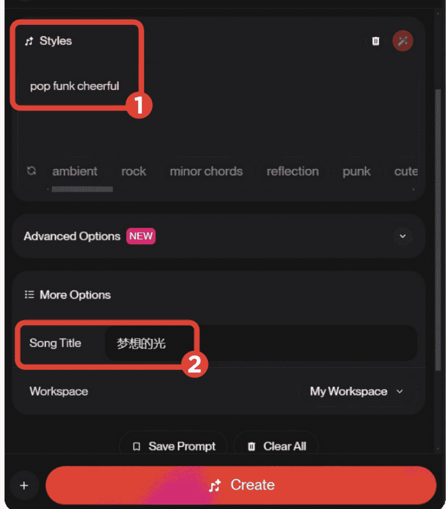
虽然 Suno 支持中文输入标签，但识别不够准确，建议大家尽量使用英文。你也可以尝试一下使用中文的效果是否有所不同。在“Song Title”一栏中可以填写歌曲的名称，这里我们统一使用《梦想的光》。

## ❶ 由ChatGPT创作歌词、Suno生成音乐的两首作品

### 梦想的光

**主歌**

仰望星空那一瞬间

心跳随着节奏蔓延

脚步坚定不怕疲倦

我知道路在前面

曾经跌倒痛也无所谓

一次次站起，不曾后悔

在这繁华的城市夜晚

我听见梦想在召唤

**副歌**

我追逐着那道光

在黑夜中越发明亮

再多阻碍也不能挡

我的心从未迷茫

无论风雨多疯狂

我有勇气把梦点亮

用汗水去谱写时光

让未来为我鼓掌

但那心底的执着

是我唯一的承诺

**主歌**

一路走来多少磨难

学会在孤独中勇敢

不再怀疑自己的选择

因为梦想不容敷衍

就算世界不曾理解

我依然奋力向前去追

即使前方依旧遥远

梦想从未离我太远

**副歌**

我追逐着那道光

在黑夜中越发明亮

再多阻碍也不能挡

我的心从未迷茫

无论风雨多疯狂

我有勇气把梦点亮

用汗水去谱写时光

让未来为我鼓掌

**副歌**

我追逐着那道光

在黑夜中越发明亮

再多阻碍也不能挡

我的心从未迷茫

无论风雨多疯狂

我有勇气把梦点亮

用汗水去谱写时光

让未来为我鼓掌

**结尾**

梦想之光，在我心上

带我飞向那片希望

**桥段**

也许前方还会有挫折

也许曾经怀疑和退缩

## ② 由豆包创作歌词、Suno生成音乐的两首作品

### 梦想的光

**主歌 1**

在黑暗中独自徘徊

街灯下身影被拉长了孤单

怀揣着心中那团火焰

哪怕世界都对我冷眼旁观

每一步都走得艰难

梦想像繁星在遥远的彼岸

但我知道不能轻易就转弯

风雨中我要扬起我的帆

**主歌 3**

路上有荆棘刺痛心房

有迷雾让我迷失了方向

但我想起最初的梦想

那是我心中最温暖的地方

也许会有怀疑的浪

冲击我那看似脆弱的堤防

可我会握紧双拳更顽强

为梦想我要变得更有锋芒

**主歌 2**

汗水浸湿了我的衣衫

疲惫也常常将我灵魂纠缠

可那梦的声音在召唤

像古老神秘的力量在呐喊

看过了无数的悲欢

那些挫折不过是小小波澜

我带着希望从不曾离散

向着梦想的方向一直闯

**主歌 4**

岁月会改变我的模样

但梦想永远在我灵魂之上

它是我生命最美的乐章

伴随我走过每个天亮

我要在这舞台中央

用热血书写属于我的辉煌

让梦想之花灿烂地绽放

那是我一生的宝藏

**副歌**

梦想是我的信仰

是我飞翔的翅膀

穿越风雨的阻挡

闪耀在那最高的地方

坚持是我的力量

是我心中的太阳

燃烧所有的渴望

追逐那永不灭的梦想之光

**副歌**

梦想是我的信仰

是我飞翔的翅膀

穿越风雨的阻挡

闪耀在那最高的地方

坚持是我的力量

是我心中的太阳

燃烧所有的渴望

追逐那永不灭的梦想之光

试听音频5-3 试听音频5-4

## ③ 由DeepSeek普通模式创作歌词、Suno生成音乐的两首作品

### 梦想的光

**主歌 1**

夜色笼罩城市的角落，

我数着星星许下承诺。

就算前方有暴雨滂沱，

也要让心跳得炽热。

**副歌重复**

我要追着光，逆风飞翔，

哪怕遍体鳞伤也不投降。

梦是黑夜里的灯塔亮，

照亮我奔向远方。

就算路再长，也不彷徨，

因为热爱是唯一的信仰。

终有一天，我会站在巅峰上，

让世界听见我的光！

**主歌 2**

曾经跌倒过，痛过沉默，

可梦在燃烧，怎能退缩？

就算世界笑我太执着，

我仍相信有光在等我。

**结尾**

梦在前方，脚步不停歇，

直到星光洒满我的世界。

**副歌**

我要追着光，逆风飞翔，

哪怕遍体鳞伤也不投降。

梦是黑夜里的灯塔亮，

照亮我奔向远方。

就算路再长，也不彷徨，

因为热爱是唯一的信仰。

终有一天，我会站在巅峰上，

让世界听见我的光！

**桥段**

时间会证明所有泪和汗，

化作翅膀，带我翱翔。

当风吹散迷雾的阻挡，

我会拥抱属于我的光。

试听音频5-5 试听音频5-6

## 由Suno创作歌词并生成音乐的两首作品

### 梦想的光

**Verse**

奔跑在无尽的路上

心中充满无限希望

每个黑暗都闪耀光芒

梦就在下一秒释放

**Verse 3**

未来的路虽然漫长

脚步坚定从不彷徨

心之所属坚定不移

勇敢追梦永不放弃

**Verse 2**

无数次跌倒还要爬起

眼泪是奋斗的勇气

每一刻都在为你坚持

梦想在召唤的声音里

**Chorus**

追逐梦的光

永不停歇脚步

用汗水浇灌

希望不会迷路

纵使风雨狂

梦在心中燃烧

只要你在坚持

梦想永不老

**Chorus**

追逐梦的光

永不停歇脚步

用汗水浇灌

希望不会迷路

纵使风雨狂

梦在心中燃烧

只要你在坚持

梦想永不老

**Bridge**

每一盏星光都是目标

每一段旅程都要骄傲

不管多远多么难找

梦想一直在你怀抱

试听音频5-7 试听音频5-8

## 5. 编辑或修改已生成的音乐

生成的曲子听感不理想，就只能白白花积分再来一次吗？其实 Suno 产出的音频是可以后期调整的，所有可用的改动入口都集中在 Remix/Edit 菜单里。

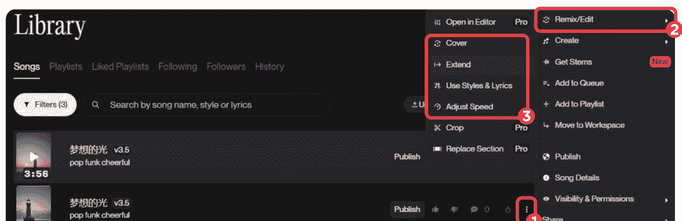
想对某首作品动刀，先去 Library 找到它，点开它右侧的三点菜单进入 Remix/Edit。里面罗列了多项编辑手段，其中 Cover、Extend、Use Styles & Lyrics、Adjust Speed 这四项免费账号就能用，而 Crop 与 Replace Section 则属于付费专属功能。

下面就把这四项免费功能的作用说清楚。

**Cover：** 基于原曲的歌词和风格提示重新生成一版，旋律和编配会完全换新，但仍围绕原曲思路展开，相当于一次翻唱。

**Extend：** 在已有片段后追加新内容，让曲子变长。假如成品只有两三分钟，可以让模型续写下去补全结构。目前官方上限是从4分钟拉长到6分钟。

**Use Styles & Lyrics：** 直接复用原曲的提示词、歌词和风格参数重新生成一版，且不会扣积分。

**Adjust Speed：** 修改已生成音频的播放速率，可加快或放慢，从而改变节奏感和整体氛围。

下面演示实际操作。无论点开哪一项，都会进入熟悉的 Remix 编辑页，界面逻辑之前已经讲过。

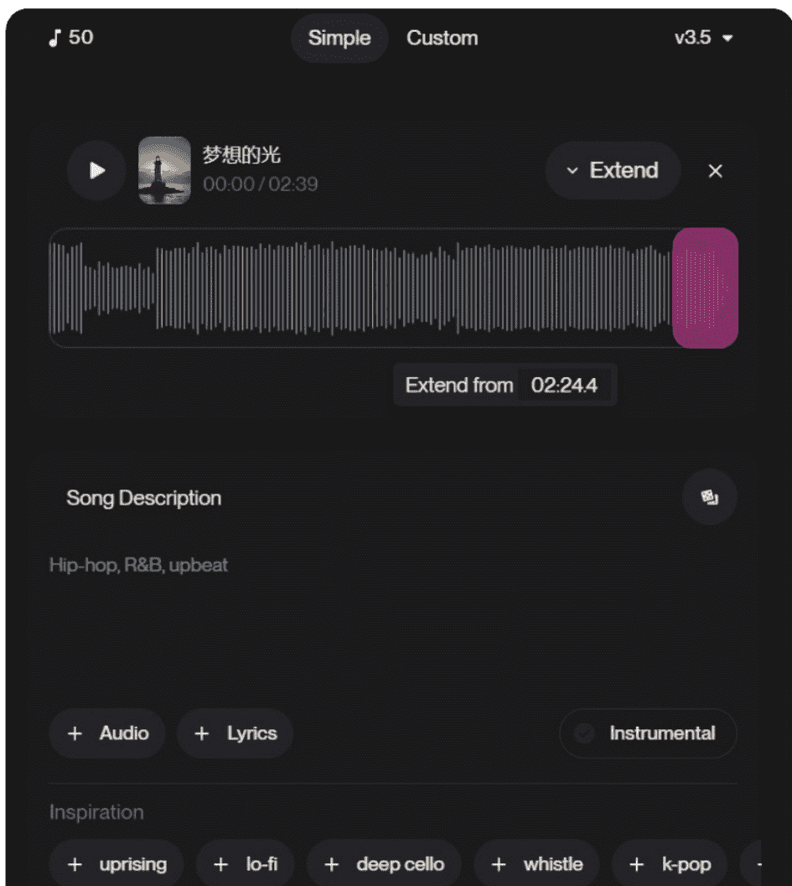
先从延长功能说起。一般 Suno 产出的单曲时长在2到4分钟之间，觉得够好听但略显单薄时，就可以用 Extend 把它补足。

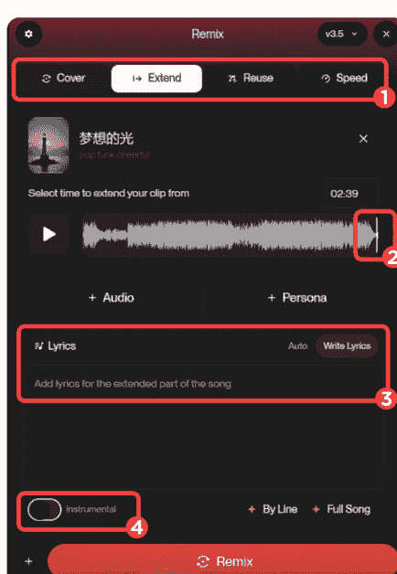

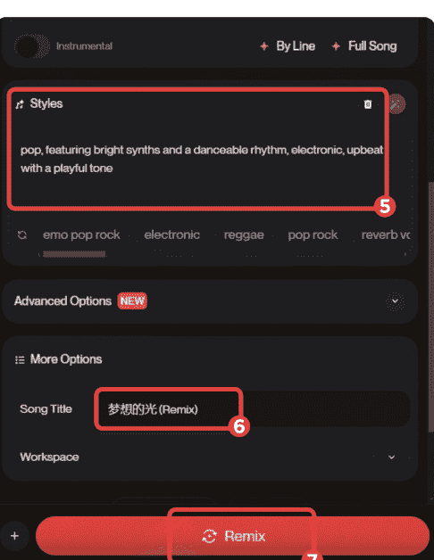
我随便从 Library 挑一首，随后点 三点菜单 → Remix/Edit → Extend。上方会出现四项编辑按钮，可随时切换，整体布局和创作页很像。页面中央的滑块可拖动来设定续写起点。歌词框里能为新增段落撰写新歌词，也可勾选 Instrumental 让续写部分为纯伴奏。

再往下是 Styles 栏，用来指定续写段落的风格倾向。还可以为新片段命名。确认后按 Remix，就能生成续写内容。

需要注意的是，Extend 只会产出续写片段，文件名旁会显示 Part 2 标识。若要把原曲和续写合并成完整文件，需要点击 Get Full Song，这一步会花费 5 点积分，成本等同于重新生成一首。

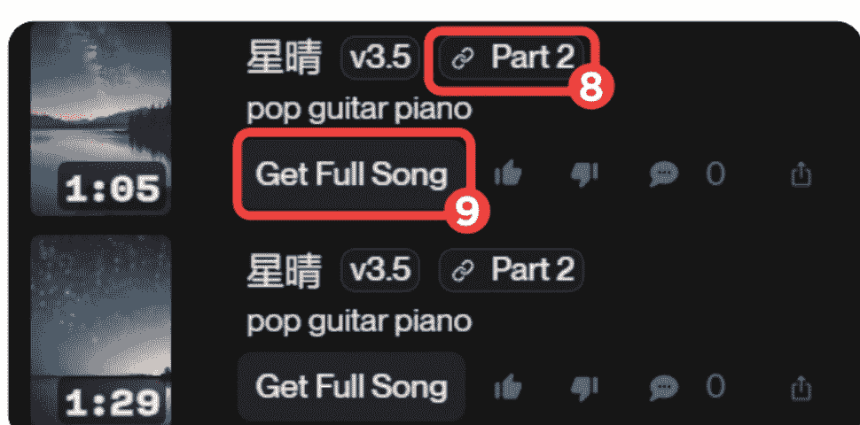
再看速度调节。点上方的 Speed 切换到该面板。如图所示，中间有个圆点控件，左右拖拽即可改变速率，左滑减慢、右滑加快。下方有 Keep Pitch 选项，开启后即使变速旋律音高也不会漂移。设定完毕后点 Remix 即可生成新版本。

Cover | Extend | Reuse | Speed

### 梦想的光

pop funk cheerful

### 1.26x

0.25x

4.00x

Keep Pitch

Reset

Advanced Options NEW

More Options

Song Title

梦想的光

Workspace

Remix

Cover 与 Use Styles & Lyrics 的页面和 Extend 基本一致，就不多重复了，有兴趣可以自行体验。

## 6. 如何发布与分享满意的作品
当一首作品达到预期时，通常想让更多人听到。分享方式大致分两类：一类是在 Suno 平台内部直接分享链接，另一类是下载文件后投放到外部平台。下面分别说明操作步骤。

### ·在 Suno 内部分享与发布
在平台内分享主要有两种做法：直接复制链接分享，或先将作品公开发布后再分享。

链接分享很直观。作品列表里每个标题旁都有分享图标，进入单曲页同样可以找到。点一下后底部会提示 Copied song link to clipboard，链接就已复制，可直接粘贴发送。

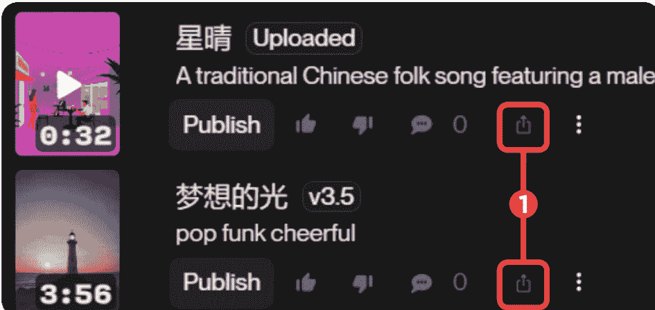

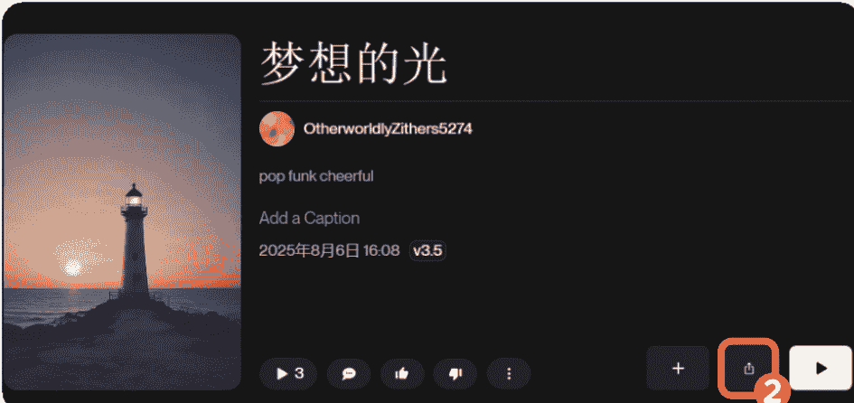
用浏览器打开该链接即可进入作品页，能看到标题、作者、风格标签、歌词等基本信息。

另一种是正式发布。默认情况下新作不会出现在个人空间，只有持有链接的人才能收听。若希望公开可见，需要手动发布。

先点标题旁的三点菜单，选择 Publish，会弹出 Publish Song 对话框。

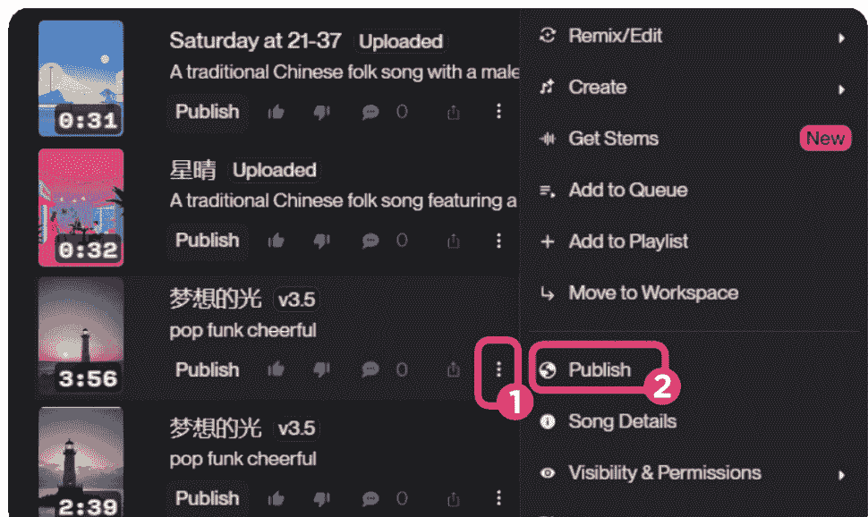
对话框里提供多项编辑入口。可修改曲目名称、填写描述或创作背景，封面图片可通过垃圾桶图标删除，也可用 Replace Image 上传新图，或用 Add a Video 为作品配视频。Edit Displayed Lyrics 可单独调整对外显示的歌词，不必与音轨完全一致。点开 More Options 还能看到三个进阶设置。

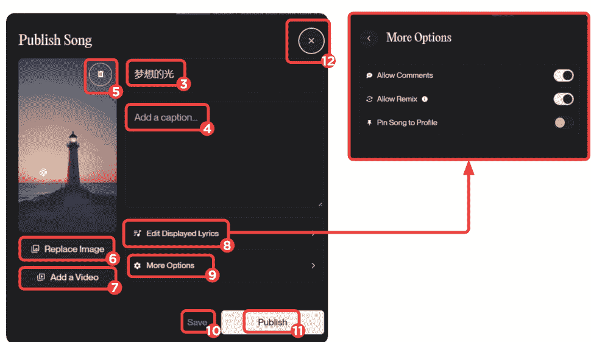

### Allow Comments（允许评论）：
打开后他人可在作品页下方留言，与你互动。

### Allow Remix（允许混音）：
开启后其他用户可以基于该曲进行混音或再创作。旁边的感叹号提示默认发布后他人即可自由混音，且每次混音都会回链到原作。若不想被模仿，可关闭此项。

### Pin Song to Profile（置顶到个人主页）：
开启后该曲会固定在个人主页顶部，访客进入就能第一时间看到。

修改信息后 Save 按钮会激活，点击可仅保存不发布；点 Publish 才正式上线；也可直接关闭页面。

发布成功后，作品列表中标题下会标注 Published。

### ·下载后在外部平台分享
想在 Suno 之外传播，就需要先下载文件再上传到第三方平台。

下载流程前面已介绍，这里不再重复。需要注意的是，只有付费用户才具备商业使用权限，所以我建议对外发布时使用付费账号。上传到各大音乐平台前，请确认歌词为原创，避免版权纠纷。

# 第6章 标签的分类与参考

前面章节讲过，用标签来引导 AI 作曲。标签的掌握程度直接决定成品是否贴合预期，它相当于和模型对话的密码，信息越具体结果越精准。本章会系统梳理核心标签类型，涵盖风格、结构、人声、配器、环境音以及情绪氛围，帮助你建立专属的音乐词库，更好地掌控创作。

## 1. 音乐风格的分类
在所有标签里，风格是最基础也是最关键的一项，它决定整首曲子的基调。AI 会根据风格提示调整旋律走向、节奏框架和配器选择，所以对风格的理解深度会直接影响生成质量。

音乐风格繁多且持续演化融合，认识其脉络有助于更精准选标签。

下面按大类拆解常见的细分风格。

### (1) 流行音乐 (Pop)
**流行摇滚 Pop Rock**：把流行旋律与摇滚编配结合，听感轻快，吉他驱动感明显。

**合成器流行 Synthpop**：核心是合成器音色，电子质感强、律动鲜明，是80年代的标志性声音。

**流行舞曲 Dance Pop**：节拍驱动强，适合跳舞，多见于俱乐部与派对场景。

**民谣流行 Folk Pop**：保留民谣叙事，加入流行旋律线，柔和且故事感强。

**独立流行 Indie Pop**：多由独立厂牌推出，风格清新、个性化表达突出。

### （2）摇滚（Rock）
**经典摇滚 Classic Rock**：70年代兴起的复古摇滚，代表艺人包括 The Beatles、Rolling Stones 等。

**硬摇滚 Hard Rock**：音色厚重、节奏强劲，电吉他是主角。

**朋克摇滚 Punk Rock**：追求简洁直接的编配与歌词，情绪偏向反叛。

**车库摇滚 Garage Rock**：质感粗糙、现场感强，风格直白。

**另类摇滚 Alternative Rock**：突破传统框架，个性鲜明，代表如 Nirvana。

### （3）电子音乐（Electronic）
**浩室 House**：基于四拍底鼓，舞感强，源自80年代芝加哥。

**电子舞曲 Electronic Dance Music, EDM**：泛指各类舞曲风格，涵盖 House、Techno 等分支。

**科技舞曲 Techno**：诞生于底特律，节奏快速、律动强烈，音色多变。

**陷阱音乐 Trap**：鼓机节奏突出、低频明显，在流行与嘻哈中广泛使用。

**鼓打贝斯 Drum and Bass**：高速碎拍搭配厚重贝斯，源自英国。

### (4) 嘻哈 (Hip-Hop)
**硬核嘻哈 Hardcore Hip-Hop**：节拍硬朗、歌词直白，常带批判性。

**陷阱嘻哈 Trap Hip-Hop**：融入 Trap 电子元素，低音突出。

**说唱 Rap**：以节奏感与押韵歌词为核心。

**老派嘻哈 Old School Hip-Hop**：80年代起源，节奏简洁，复古感浓。

**地下嘻哈 Underground Hip-Hop**：多由独立艺人创作，侧重歌词深度。

### (5) 爵士 (Jazz)
**传统爵士 Traditional Jazz**：指20年代新奥尔良风格，又称迪克西兰爵士，以铜管集体即兴为主。

**自由爵士 Free Jazz**：60年代兴起，强调无结构自由即兴，形式多变。

### (6) 乡村音乐 (Country)
**传统乡村 Traditional Country**：旋律朴素，叙事性歌词。

**新乡村 New Country**：加入流行元素，乐风更现代。

**乡村摇滚 Country Rock**：融合摇滚，节奏更强劲。

**蓝草 Bluegrass**：源自美国南部，主奏吉他、班卓琴。

**民谣乡村 Folk Country**：民谣气息浓郁，旋律歌词细腻抒情。

### (7) 放克和灵魂 (Funk & Soul)
**放克 Funk**：节奏强劲，贝斯与鼓线突出，代表艺人如 James Brown。

**灵魂乐 Soul**：以情感表达为核心，融汇福音与布鲁斯。

**摩城 Motown**：由 Motown 唱片开创的流行灵魂乐，音色辨识度高。

**新灵魂 Neo-Soul**：把灵魂乐与嘻哈 R&B 融合，呈现现代感。

**迷幻灵魂 Psychedelic Soul**：加入迷幻音色，编配自由多变。

### (8) R&B (节奏布鲁斯)
**现代R&B Contemporary R&B**：旋律性强，受流行影响大。

**另类R&B Alternative R&B**：实验性强，常跨界融合。

**经典R&B Classic R&B**：60-80年代风格，代表如 Stevie Wonder。

**都市R&B Urban R&B**：融合嘻哈与流行，带有都市气息。

**慢情歌 Slow Jam**：节奏舒缓，抒情性强，常用于情歌。

### (9) 民谣 (Folk)
**传统民谣 Traditional Folk**：源于民间，故事性强、旋律简洁。

**现代民谣 Contemporary Folk**：加入现代元素，贴近生活且抒情。

**民谣摇滚 Folk Rock**：注入摇滚能量，动感更强。

**凯尔特民谣 Celtic Folk**：苏格兰爱尔兰传统，音色独特。

**布鲁斯民谣 Blues Folk**：融合布鲁斯旋律，情感厚重。

### (10) 古典音乐 (Classical)
**巴洛克 Baroque**：复调与和声精致复杂，代表巴赫、亨德尔。

**古典主义 Classical Period**：结构严谨形式规范，代表莫扎特、贝多芬、海顿。

**浪漫主义 Romantic**：强调情感抒发与自然描写，常吸纳民族素材，抒情性强，代表舒曼、舒伯特、勃拉姆斯等。

**20世纪现代主义 20th Century**：追求创新与实验，代表如肖斯塔科维奇。

**极简主义 Minimalism**：通过简洁动机重复营造氛围，代表菲利普·格拉斯。

这些音乐风格只是众多音乐类型中的一部分，实际上，音乐的种类远不止这些，每个大类下面还包含着许多细分的子风格，并且它们还在不断发展和融合。

下面这张表汇总了更多常见风格，可作快速查阅。

| 中文 | 英文 | 中文 | 英文 | 中文 | 英文 |
| --- | --- | --- | --- | --- | --- |
| 流行 | Pop | 摇滚 | Rock | 嘻哈 | Hip Hop |
| 电子音乐 | Electronic | 爵士 | Jazz | 布鲁斯 | Blues |
| 古典 | Classical | 乡村 | Country | 民谣 | Folk |
| 灵魂乐 | Soul | 放克 | Funk | 雷鬼 | Reggae |
| 金属乐 | Metal | 独立音乐 | Indie | 另类 | Alternative |
| 迪斯科 | Disco | 拉丁 | Latin | 新世纪 | New Age |
| 世界音乐 | World Music | 氛围 | Ambient | 后摇 | Post-Rock |
| 实验音乐 | Experimental | 硬核 | Hardcore | 工业 | Industrial |
| 电子舞曲 | Electronic Dance Music, EDM | 民谣摇滚 | Folk Rock | 重金属 | Heavy Metal |
| 蓝草 | Bluegrass | 嘻哈摇滚 | Rap Rock | 融合爵士 | Jazz Fusion |
| 哥特 | Gothic | 黑金属 | Black Metal | 前卫金属 | Progressive Metal |
| 死亡金属 | Death Metal | 车库摇滚 | Garage Rock | 朋克摇滚 | Punk Rock |
| 另类摇滚 | Alternative Rock | 前卫摇滚 | Progressive Rock | 华丽摇滚 | Glam Rock |
| 迷幻摇滚 | Psychedelic Rock | 布鲁斯摇滚 | Blues Rock | 硬摇滚 | Hard Rock |

| 垃圾摇滚 | Grunge | 另类金属 | Alternative Metal | 新金属 | Nu Metal |
| 电子摇滚 | Electronic Rock | 说唱金属 | Rap Metal | 陷阱音乐 | Trap |
| 工业金属 | Industrial Metal | 另类嘻哈 | Alternative Hip Hop | 爵士嘻哈 | Jazz Rap |
| 浩室 | House | 科技舞曲 | Techno | 鼓打贝斯 | Drum and Bass |
| 杜步舞曲 | Dubstep | 氛围浩室 | Ambient House | 回响贝斯 | Dub |
| 酸性浩室 | Acid House | 冷爵士 | Cool Jazz | 比波普 | Bebop |
| 自由爵士 | Free Jazz | 摇摆爵士 | Swing Jazz | 布鲁斯爵士 | Blues Jazz |
| 乡村布鲁斯 | Country Blues | 芝加哥布鲁斯 | Chicago Blues | 巴洛克 | Baroque |
| 浪漫主义 | Romantic | 现代古典 | Modern Classical | 极简主义 | Minimalism |
| 新古典 | Neoclassical | 歌剧 | Opera | 另类乡村 | Alternative Country |
| 当代民谣 | Contemporary Folk | 传统民谣 | Traditional Folk | 凯尔特 | Celtic |
| 非洲音乐 | African | 拉丁爵士 | Latin Jazz | 萨尔萨 | Salsa |
| 斯卡 | Ska | 放克摇滚 | Funk Rock | 新浪潮 | New Wave |
| 桑巴 | Samba | 波萨诺瓦 | Bossa Nova | 雷鬼摇滚 | Reggae Rock |
| 后朋克 | Post-Punk | 哥特摇滚 | Gothic Rock | 工业摇滚 | Industrial Rock |
| 噪声摇滚 | Noise Rock | 梦流行 | Dream Pop | 鞋带摇滚 | Shoegaze |
| 后金属 | Post-Metal | 后硬核 | Post-Hardcore | 情绪硬核 | Emo |
| 数学摇滚 | Math Rock | 氛围黑金属 | Atmospheric Black Metal | 交响金属 | Symphonic Metal |
| 朋克 | Punk | R&B | R&B | 陷阱金属 | Trap Metal |
| 民谣金属 | Folk Metal | 维京金属 | Viking Metal | 电子核 | Electronicore |
| 太空摇滚 | Space Rock | 艺术摇滚 | Art Rock | 新浪漫主义 | New Romanticism |
| 合成器流行 | Synthpop | 未来贝斯 | Future Bass | 蒸汽波 | Vaporwave |
| 深度浩室 | Deep House | 科技浩室 | Tech House | 极简科技舞曲 | Minimal Techno |
| 复古电子 | Retrowave | 电子流行 | Electropop | 热带浩室 | Tropical House |
| 硬核科技舞曲 | Hard Techno | 工业科技舞曲 | Industrial Techno | 液态鼓打贝斯 | Liquid Drum and Bass |
| 神经鼓打贝斯 | Neurofunk | 跳步舞曲 | Breakbeat | 大节拍 | Big Beat |
| 氛围杜步舞曲 | Ambient Dubstep | 实验电子 | Experimental Electronic | 胶囊流行 | Hyperpop |
| 陷阱舞曲 | Trap | 未来浩室 | Future House | 后杜步舞曲 | Post-Dubstep |
| 8位音乐 | 8-bit Music | 合成波 | Synthwave | | |
| 后布里特流行 | Post-Britpop | 新迷幻 | New Psychedelia | | |

## 2. 曲式结构速查
前面聊过流行曲里常见的段落划分，这组对照把歌曲骨架的命名、曲式概念和织体关系集中罗列，兼顾段落组织、主题推进与层次变化，方便在写提示时更细致地描述走向和内部发展。

| 中文 | 英文 | 中文 | 英文 | 中文 | 英文 |
|---|---|---|---|---|---|
| 前奏 | Intro | 间奏 | Interlude | 尾奏 | Outro |
| 主歌 | Verse | 副歌 | Chorus | 桥段 | Bridge |
| 重复句 | Refrain | 过渡段 | Transition | 即兴段 | Improvisation |
| 主题 | Theme | 变奏 | Variation | 发展 | Development |
| 前奏曲 | Prelude | 间奏曲 | Intermezzo | 尾声 | Coda |
| 重复段 | Repetition | 高潮 | Climax | 结尾 | Ending |
| 独奏 | Solo | 合奏 | Ensemble | 齐奏 | Tutti |
| 引子 | Introduction | 再现 | Recapitulation | 结束段 | Finale |
| 和声 | Harmony | 旋律 | Melody | 节奏 | Rhythm |

## 3. 人声标签清单
若提示里不明确指定声线特质，系统往往会按曲风自动选型，结果容易偏离预期。人声是作品的辨识核心，演唱形式、音色质感和技巧细节都可用关键词引导。下面这份清单整理了生成时常用的声线词汇，覆盖演唱方式、效果处理与技巧，能让虚拟人声更丰富、更有层次。

| 中文 | 英文 | 中文 | 英文 |
|---|---|---|---|
| 独唱 | Solo Vocal | 假声 | Falsetto |
| 合唱 | Choir | 说唱 | Rap |
| 吟唱 | Chant | 颤音 | Vibrato |
| 气声 | Breathy Voice | 即兴演唱 | Scat Singing |
| 咏叹调 | Aria | 朗诵 | Spoken Word |
| 耳语 | Whisper | 呐喊 | Shouting |
| 拟声 | Beatbox | 尖叫 | Scream |
| 嘶吼 | Growl | 口哨 | Whistle |
| 宣叙调 | Recitative | 换气声 | Breath Sound |
| 哼唱 | Humming | 人声效果 | Vocal Effects |
| 自动调音 | Auto-Tune | 声音扭曲 | Voice Distortion |
| 破音 | Voice Crack | 对唱 | Duet |
| 和声叠加 | Layered Vocals | 齐唱 | Unison |
| 声音模仿 | Voice Imitation | 声乐即兴 | Vocal Improvisation |
| 声音分层 | Voice Layering | 声音变声 | Voice Modulation |
| 和声 | Harmony | | |

## 4. 乐器标签清单
除了旋律和结构，音色挑选对氛围塑造作用很大。同一旋律换种配器，情绪会完全不同。以下列表收集了在生成里经常使用的乐器名称，明确指定演奏配置后，编曲会更贴合设想。

| 中文 | 英文 | 中文 | 英文 | 中文 | 英文 |
|---|---|---|---|---|---|
| 钢琴 | Piano | 小提琴 | Violin | 吉他 | Guitar |
| 贝斯 | Bass | 架子鼓 | Drums | 萨克斯管 | Saxophone |
| 长笛 | Flute | 单簧管 | Clarinet | 小号 | Trumpet |
| 大提琴 | Cello | 中提琴 | Viola | 双簧管 | Oboe |
| 班卓琴 | Banjo | 曼多林 | Mandolin | 口琴 | Harmonica |
| 竖琴 | Harp | 手风琴 | Accordion | 尤克里里 | Ukulele |
| 大号 | Tuba | 长号 | Trombone | 圆号 | French Horn |
| 管风琴 | Pipe Organ | 木琴 | Xylophone | 马林巴 | Marimba |
| 竖笛 | Recorder | 大管 | Bassoon | 电子琴 | Synthesizer |
| 钟琴 | Glockenspiel | 颤音琴 | Vibraphone | 钢鼓 | Steel Drums |
| 康加鼓 | Conga | 邦戈鼓 | Bongo | 三角铁 | Triangle |
| 定音鼓 | Timpani | 卡宗鼓 | Cajon | 非洲鼓 | Djembe |
| 铃鼓 | Tambourine | 沙槌 | Maracas | 钹 | Cymbals |
| 西塔尔琴 | Sitar | 古筝 | Guzheng | 琵琶 | Pipa |
| 二胡 | Erhu | 笛子 | Dizi | 箜篌 | Konghou |
| 三弦 | Sanxian | 阮 | Ruan | 唢呐 | Suona |
| 扬琴 | Yangqin | 葫芦丝 | Hulusi | 巴乌 | Bawu |
| 古琴 | Guqin | 柳琴 | Liuqin | 板胡 | Banhu |
| 埙 | Xun | 箫 | Xiao | 笙 | Sheng |
| 竹笛 | Bamboo Flute | 非洲竖琴 | Kora | 风笛 | Bagpipes |
| 手鼓 | Hand Drum | 电子鼓 | Electronic Drums | 三角钢琴 | Grand Piano |
| 钢舌鼓 | Hang Drum | 12弦吉他 | 12-string Guitar | 电吉他 | Electric Guitar |
| 电钢琴 | Electric Piano | 合成贝斯 | Synth Bass | 滑棒吉他 | Slide Guitar |
| 原声贝斯 | Acoustic Bass | 混音台 | Mixer | 打击垫 | Drum Pad |
| 电贝斯 | Electric Bass | 鼓机 | Drum Machine | 电子管风琴 | Electronic Organ |
| 电子小提琴 | Electric Violin | 电子大提琴 | Electric Cello | | |

## 5. 环境音效清单
音乐之外，加入环境声和特效能让场景更生动，帮助听者进入歌曲的世界。下面汇总了常用的环境音和音效词，可用来强化画面感和叙事细节。

| 中文 | 英文 | 中文 | 英文 | 中文 | 英文 |
| --- | --- | --- | --- | --- | --- |
| 海浪 | Ocean Waves | 鸟鸣 | Bird Chirping | 虫鸣 | Insect Sounds |
| 雨声 | Rain | 雷声 | Thunder | 风声 | Wind |
| 溪流 | Stream | 瀑布 | Waterfall | 森林 | Forest |
| 城市噪声 | City Noise | 交通 | Traffic | 人群 | Crowd |
| 火焰 | Fire | 雪地 | Snow | 沙漠 | Desert |
| 办公室 | Office | 咖啡店 | Cafe | 学校 | School |
| 工厂 | Factory | 建筑工地 | Construction Site | 机场 | Airport |
| 飞机 | Airplane | 直升机 | Helicopter | 船 | Boat |
| 地铁 | Subway | 火车 | Train | 汽车 | Car |
| 警笛 | Siren | 钟声 | Bell | 闹钟 | Alarm Clock |
| 脚步声 | Footsteps | 敲门 | Knocking | 开门 | Door Opening |
| 玻璃破碎 | Glass Breaking | 爆炸 | Explosion | 枪声 | Gunshot |
| 相机快门 | Camera Shutter | 电视静电噪声 | TV Static | 收音机调频 | Radio Tuning |
| 电话铃声 | Phone Ringing | 打字机声 | Typewriter | 鼠标点击 | Mouse Click |
| 心跳 | Heartbeat | 呼吸 | Breathing | 咳嗽 | Coughing |
| 笑声 | Laughter | 哭泣 | Crying | 打喷嚏 | Sneezing |
| 鼓掌 | Applause | 口哨 | Whistle | 鸡鸣 | Rooster Crowing |
| 牛叫 | Cow Mooing | 羊叫 | Sheep Bleating | 马嘶 | Horse Neigh |
| 狗叫 | Dog Barking | 猫叫 | Cat Meowing | 气泡 | Bubbles |
| 钟表滴答 | Clock Ticking | 水滴 | Water Drip | 微波炉 | Microwave |
| 吸尘器 | Vacuum Cleaner | 洗衣机 | Washing Machine | 电钻 | Power Drill |
| 篝火 | Campfire | 烟花 | Fireworks | 龙卷风 | Tornado |
| 电锯 | Chainsaw | 割草机 | Lawnmower | 冰雹 | Hail |
| 地震 | Earthquake | 火山喷发 | Volcano Eruption | 游戏音效 | Game Sound Effects |

## 6. 情绪氛围清单
一首歌的打动力来自情绪。没有情绪锚点，再美的旋律也难引起共鸣。接下来两组词汇分别指向声音氛围和情感色彩，用来指引生成更具感染力的听感。

| 中文 | 英文 | 中文 | 英文 | 中文 | 英文 |
|---|---|---|---|---|---|
| 恐怖音效 | Horror Sound Effects | 转场音效 | Transition Effects | 用户界面音效 | UI Sound Effects |
| 白噪声 | White Noise | 粉红噪声 | Pink Noise | 棕噪声 | Brown Noise |
| 环境氛围 | Ambience | 空间混响 | Spatial Reverb | 回声 | Echo |
| 动画音效 | Cartoon Sound Effects | 科幻音效 | Sci-Fi Sound Effects | | |
| 雾角 | Foghorn | 教堂钟声 | Church Bells | | |

| 中文 | 英文 | 中文 | 英文 | 中文 | 英文 |
|---|---|---|---|---|---|
| 欢快 | Cheerful | 悲伤 | Sad | 激情 | Passionate |
| 浪漫 | Romantic | 神秘 | Mysterious | 紧张 | Tense |
| 平静 | Calm | 兴奋 | Excited | 忧郁 | Melancholic |
| 轻松 | Relaxed | 焦虑 | Anxious | 愤怒 | Angry |
| 欢乐 | Joyful | 沮丧 | Depressed | 希望 | Hopeful |
| 温柔 | Gentle | 强烈 | Intense | 梦幻 | Dreamy |
| 恐惧 | Fearful | 幽默 | Humorous | 庄严 | Solemn |
| 活力 | Energetic | 阴沉 | Gloomy | 温暖 | Warm |
| 冷酷 | Cold | 深远 | Profound | 轻快 | Upbeat |
| 怀旧 | Nostalgic | 振奋 | Uplifting | 沉思 | Contemplative |
| 忧愁 | Sorrowful | 欣慰 | Comforting | 孤独 | Lonely |
| 激动 | Thrilling | 平和 | Peaceful | 狂热 | Frenzied |
| 优雅 | Elegant | 粗犷 | Rugged | 甜美 | Sweet |
| 阴郁 | Moody | 欢腾 | Exuberant | 忧虑 | Worried |
| 敏感 | Sensitive | 坚强 | Strong | 脆弱 | Vulnerable |
| 满足 | Content | 冷漠 | Indifferent | 同情 | Sympathetic |
| 热情 | Enthusiastic | 决心 | Determined | 困惑 | Confused |
| 怀疑 | Doubtful | 轻盈 | Light | 喜悦 | Delightful |

| 沉重 | Heavy | 躁动 | Restless | 不安 | Uneasy |

| 宁静 | Serene | 舒适 | Comfortable | 超然 | Transcendent |

| 激昂 | Stirring | 世俗 | Secular | 华丽 | Elaborate |

| 神圣 | Sacred | 朴实 | Simple | 迷茫 | Bewildered |

| 迷幻 | Psychedelic | 清晰 | Clear | 明亮 | Bright |

| 模糊 | Hazy | 阴暗 | Dark | 亲密 | Intimate |

| 阳光 | Sunny | 疏离 | Distant | 震撼 | Overwhelming |

| 温馨 | Cozy | 微妙 | Subtle | 前卫 | Avant-garde |

| 壮观 | Majestic | 保守 | Conservative | 空灵 | Ethereal |

| 激进 | Radical | 实在 | Grounded | 未来 | Futuristic |

| 古典 | Classical | 现代 | Modern | | |

| 失落 | Lost | 自信 | Confident | | |

## 7. 逆向玩歌词：把老歌词交给AI重新谱曲

这一部分要结合前面学到的各种标签，去尝试一种反向工作流。过往的练习多是先写词再让AI配旋律，这对词的结构感和文字功底要求比较高。

我更建议反向操作：先挑一首已经发行、词作者打磨成熟的流行歌词，完整复制进 Suno，再用精准的标签和段落风格设定，驱动AI给出全新编曲和旋律，让整首作品在听感上与原曲截然不同。这样生成的骨架比较稳，也便于二次加工，比如换词、只保留音乐做纯音乐。

下面以周杰伦的《星晴》做演示，这次只用了歌词的一半。先搭好曲式，风格提示词写成 Pop Sweet Guitar，意在做出甜美流行感并点出吉他音色。

# 星晴改编示范

提示词：Pop Sweet Guitar

歌曲速度：90

[ Intro ]

[ Verse1 ]

乘着风飘荡在蓝天边

一片云掉落在我面前

捏成你的形状

随风跟着我

一口一口吃掉忧愁

[ Chorus ]

手牵手一步两步三步四步望着天

看星星一颗两颗三颗四颗连成线

背对背默默许下心愿

看远方的星是否听得见

[ Verse2 ]

载着你仿佛载着阳光

不管到哪里都是晴天

蝴蝶自在飞

花也布满天

一朵一朵因你而香

[ Chorus ]

手牵手一步两步三步四步望着天

看星星一颗两颗三颗四颗连成线

背着背默默许下心愿

看远方的星如果听得见

它一定实现

[ Pre-Chorus ]

试图让夕阳飞翔

带领你我环绕大自然

迎着风

开始共度每一天

[ Outro ]

[ Guitar Solo ]

接着沿用同一组歌词换风格体验。英文不好也没关系，中文标签 Suno 也能识别，词别太生僻就行。这次提示词换成 中国风 古琴 浪漫，效果明显不同。

再换一次，这次是 Blues Piano Sorrowful，蓝调钢琴加一丝忧郁，情绪完全变了。

随后试了 Funk Rock，放克与摇滚的混合，配上原词也很有趣。

最后用 Synthpop 合成器流行生成两版，和原曲已经没有可比性了。

## 8. 在探索里练标签

前面应该能感受到，标签写作是 AI 音乐创作里最关键的一环。Suno 的全自动模式能出结果，但要贴近自己的想法，就必须把创意翻译成准确的标签。

如果对风格标签还不熟，Explore 探索功能非常好用。它能让你认识大量风格，并直接试听。

主界面左侧找到 Explore 进入后，右侧的大转盘就是风格标签集合。点任意一个标签就能加载并播放对应作品，滚轮可转动盘面。

播放时会出现作品名，点击可进入详情页。右上角的骰子图标会随机挑一种风格播放。喜欢某个标签就复制下来，粘到 Styles 框里创作即可。

# # Melancolia entrelaçada

 **GROOVEBOT** &nbsp; 👤 Follow

pop bossa nova

2025年7月17日 16:28 &nbsp; v4.5+

▶ 7 &nbsp; 💬 1 &nbsp; 👍 3 &nbsp; 👎 &nbsp; ⋮

进入作品页还能再次点开风格标签，Suno 会列出同类作品。点 pop bossa nova 就能看到一串 bossa nova 相关作品，既能听也能观察它们用了哪些组合标签，拿来借鉴很方便。

探索里有很多日常少见的多风格混搭，比如 Dreamy Boom Bap、Klezmer Pop、Alternative R&B Dembow、Arabic Pop 等。花时间听、拆、模仿，能把探索当成打开新世界的大门，不断拓宽听觉边界。

本章梳理的标签分类，相信会成为你在 Suno 创作时的好帮手。多尝试不同组合，去挖掘 AI 生成的可能性，找到属于自己的音乐表达空间。

# 第7章 用音频素材驱动 Suno 创作

从 3.5 模型开始，Suno 支持上传音频。你可以传一段已录的旋律、纯器乐或人声，也能上传半成品或成品，甚至直接在网页用麦克风录。Suno 会基于提供的音频做生成。

这种方式更精准，也易于启发灵感。哼一段旋律录下，让 AI 变奏、配器或补段落，十分好用。

免费用户可录 6 到 60 秒，付费用户最长 8 分钟。注意版权保护，禁止上传已发行的歌曲或受版权保护音频，否则无法生成。

下面看录制和上传两种操作流程。

### 1. 麦克风录音生成音乐

点 Create，无论 Simple 还是自定义模式，都能看到 +Audio 按钮，这是音频入口。

点开后有 Upload 上传和 Record 录音两个选项。Record 开始麦克风录制前请确认设备已连接。

点 Record 后会弹出版权提示，勾选 Agree to Terms 进入录音界面。

**Upload Audio**

I certify that I own or exclusively control all rights in any content I will upload using this Suno feature. I understand that I am not allowed to upload content if I do not own or exclusively control the rights to it, and that if I do so in spite of this prohibition, I will (among other problems) be breaching a contract with Suno and I may be subject to various other forms of legal liability as well. By clicking this box, I acknowledge and agree to the foregoing.

Agree to Terms

下方大红点是录制键，点下开始录，再点暂停。底部提示免费最长录 1 分钟，付费可至 8 分钟。

录制中波形会实时显示。停止后可点 Start Over 重新来，或拖动粉红箭头裁剪，点 Save 上传。上传前可重命名，这里命名为 星晴。

上传页有 Cancel 取消，中间是 Cover、Extend、Save to Library 三个动作，最后点 Continue 返回编辑区。

此时音频已出现在右侧列表，Suno 会自动生成封面并匹配风格。

点音频旁的三点 → Remix/Edit，可进行翻唱、延长、复用风格或歌词，但速度无法调整。点 Extend 进入编辑页，界面与常规作品编辑一致。

> 编辑注：点 Speed 可切换速度界面，但拖动不会改变音频本身速度。

Styles 框里是自动匹配的风格，可能不准，可手动改。这里改成 pop guitar，勾选 Instrumental 生成纯音乐，最后点 Remix，Suno 基于音频和提示词产出两首新作品。

我录了一段十几秒的吉他，只弹了几个音，Suno 就围绕吉他做了完整编曲，很适合找灵感。

### 2. 上传已有音频生成音乐

流程和录制类似，只是提前准备素材。下面演示几个例子。

#### 上传片段

点 +Audio → Upload，选择本地文件上传。后续编辑、延长、复用等操作与录音一致，速度同样不可调。

点 Extend，勾选 Instrumental，Styles 填 pop guitar piano，让 AI 以吉他钢琴为主做流行纯音乐。点 Remix 即可得到两首结果。

| Cover | Extend | Reuse | Speed |

| :--- | :--- | :--- | :--- |

| 星晴 | | | |

| A high-energy, upbeat pop song with a driving tempo of... | | | |

| Select time to extend your clip from 00:16 | | | |

+ Audio | + Persona

Instrumental

Styles

pop guitar piano

Remix

同一段吉他素材，多加钢琴标签后风格完全不同，灵感来源很丰富。

#### 上传成品音乐

这次用一段自己做的融合爵士 A 段，时长控制在 60 秒内，按同样方式上传。

保持 Instrumental，Styles 写 fusion, electro，最后点 Remix。

fusion

A female vocalist sings a melancholic pop ballad in Mandarin,...

Select time to extend your clip from 00:52

+ Audio + Persona

Instrumental

Styles

fusion, electro

Remix

- fusion v3.5 Part 2

  fusion, electro

- fusion v3.5 Part 2

  fusion, electro

生成的作品在原旋律上加入了大段即兴独奏，电子音色与电吉他配合自然，复杂和声处理也很稳定。另一版后半段加入多层变奏，层次丰富。这些变化靠人手实现需要很高的功底，AI 很快就能完成。

#### 上传钢琴伴奏并配歌词

弹一段 8 小节的流行钢琴伴奏，上传后在 Lyrics 区粘贴《星晴》歌词，结尾加上 [Piano Solo] 标签。这次不勾 Instrumental，生成人声。

Styles 填 Korea-Pop, K-pop，想尝试韩式流行。点 Remix。

**Remix**

k-pop

A solo piano piece in a classical style, characterized by a slow...

Select time to extend your clip from

00:51

+ Audio

+ Persona

Lyrics

Auto

Write Lyrics

[Intro]

[Verse1]

乘着风飘荡在蓝天边

一片云掉落在我面前

捏成你的形状

随风跟着我

一口一口吃掉忧愁

Instrumental

+ By Line

+ Full Song

Styles

Korea-Pop, K-pop

Remix

K-pop

v3.5

Part 2

Korea-Pop, K-pop

K-pop

v3.5

Part 2

Korea-Pop, K-pop

基于自弹伴奏与歌词生成的两版旋律都很“韩式”，唱法和编曲都对得上味。可以把满意的旋律记下来再做深化，写歌效率会大幅提升。

同一设定可反复生成，AI 不一定每次都中，但多生成几次总能挑到可用素材。

本章介绍了基于音频的创作方式。从哼唱到完整伴奏，Suno 的变奏、配器和旋律生成能力都很强。无论专业还是爱好者，都能把脑中想法快速落地。

Suno 不只是生成器，更像一个随时待命的音乐搭档，能快速验证灵感、在已有素材上做天马行空的再创作，让音乐制作既快又有乐趣。

至此，Suno 核心工具的介绍告一段落。下一章会把视野放宽，介绍其他各具特色的 AI 音乐平台，帮你扩充工具箱。

# 第8章 其他 AI 创作平台

前面详细讲解了 Suno 的功能，它很强，但不是唯一选择。

市面上还有不少国内外平台，各有擅长，能满足不同需求。了解并使用它们，可以让你的 AI 音乐工具箱更完整。

本章会介绍一些国内外平台。国外平台多为英文，对不熟悉英文的读者不太友好，我会尽量讲清用法。国内平台更新快，界面中文，操作直观，可自行探索。

### 1. AIVA：AI 虚拟作曲家

#### 1.1 AIVA 简介

AIVA 即 Artificial Intelligence Virtual Artist，由卢森堡的 AIVA Technologies 研发。技术底座是深度学习，通过研读巴赫、贝多芬、莫扎特等大师的古典曲目，以及3万多首其他作品，提炼出音乐的内在规律并形成数学模型，用来辅助音乐人产出多样风格的乐曲。

这套工具很适合自媒体创作者、游戏开发者、影视制作以及独立音乐人，能快速为视频、游戏、电影等项目配上背景音乐。即便是免费档，生成的作品听感也相当在线。

核心优势集中在以下几点。

**出曲极快：** 几秒内就能产出一段成型作品，拿来捕捉灵感或快速迭代很方便。

**风格覆盖广：** 平台支持 250 多种音乐风格，涵盖现代影视、电子、爵士、幻想、探戈、中国风等流行类目，也能做巴洛克、浪漫派等古典表达，甚至可以模仿贝多芬、肖邦等特定作曲家的笔触。内置的作品库为风格挑选提供了充足素材。

**可上传可编辑：** 用户能把自己的音频或 MIDI 文件上传作为创作起点，生成后的曲目支持编辑、混音，并可导出为 MP3、MIDI 或 WAV。

**版权可控：** Pro 计划能拿到生成的完整版权，支持商业发行。平台面向个人、学生、学校、企业提供不同订阅档位，可按需灵活选择。

**界面友好：** 主界面简洁，功能虽多上手门槛不高。

#### 1.2 AIVA 上手指南

在常用搜索引擎搜 “AIVA” 打开官网，首次使用先注册账号。点页面中间的 “Create a free account”，进入注册页，可用 Google 账号直接登录，或填写邮箱后点 “Continue”。

AIVA 会发验证邮件到注册邮箱，验证通过后设置密码，再点 “Create account” 完成注册。之后点首页右上角 “LOG IN” 即可进入。

进入主界面后先熟悉左侧功能区。

“Home” 为工作台，即当前看到的页面。“Editor” 是作品编辑器。“Style Designer” 可自行定义音乐风格。“Radio” 相当于音乐探索区，能收听官方示例。“Billing” 查看付费方案。“Updates” 看版本更新说明。“Tutorials” 收录官方教程。“Download App” 提供 MacOS、Windows、Linux 客户端下载。

开始创作点功能区上方绿色按钮 “Create Track”，会弹出子菜单：

- With a prompt (Beta)：用提示词生成
- From a Style：基于风格生成
- From a Chord progression：基于和弦进行生成
- Step by step：分步向导式创作，先选风格再输入和弦，最后扩展为完整曲目
- From an Influence：基于已有素材生成
- Import MIDI：导入 MIDI 文件

先试试 “With a prompt (Beta)”。这是实验功能。跳转后会提示使用 Lyra Classical 模型，该模型学习了莫扎特、贝多芬、巴赫等作曲家的作品，只能生成古典纯器乐。

① 输入创作提示词；② 拖动右侧小球调节时长，最长 3 分钟；③ 点 “Generate” 开始生成。

若要换风格，就走 “From a Style”。页面会列出大量风格，共 16 页，每种风格前有试听按钮。默认按使用人数从多到少排列，左上角搜索框可关键词检索。右上角 “Filter” 可筛选，Style 按大类如 Pop、Jazz 筛选，Created by 可区分是否 AIVA 原生风格。排序可按创建时间、导入作品数、名称调整。

选定风格后，鼠标移到使用人数栏会变成 “Create” 按钮，点击进入细节页。由上到下可设置调号、时长、一次生成数量。单次最长 3 分钟，最多 5 首。点 “Create tracks” 开始制作。

完成后作品会出现在主界面，信息包含风格、调性、速度、拍号、时长等。和主流平台不同，AIVA 会显式展示这些元数据。喜欢的曲目点右侧三点菜单选 “Download” 进入下载页。

免费用户可下载 MP3、配器版 MIDI、精简版 MIDI、和弦信息；付费用户额外可得 WAV 及分轨音频 Stems。页面下方有版权提示，免费版仅限个人使用，商用需升级。免费账号每月可下载 3 首，多次下载同一首不重复计次数。底部可勾选是否把作品参数写入文件名，方便后续归档管理。

例如生成的 “80s Synth Pop” 风格曲目，可下载 MIDI 导入 Logic Pro，可见 AIVA 导出的是分轨 MIDI，鼓、贝斯、合成器旋律各自独立，便于精细修改。

再演示从和弦进行创作。点 Create Track 选 “From a Chord progression”。先选风格点击风格名后的 “Select”。进入和弦编辑页，可在提示区输入对和弦进行的描述后点 “Generate”。右上角 “Settings” 可更换风格、调号、拍号、速度等。

鼠标移到和弦字母上会出现画笔图标和 “+”。画笔可修改当前和弦或添加七音、九音、sus4、dim 等扩展音；“+” 可在后方复制一个相同和弦再单独调整。滑块可缩放和弦显示尺寸。注意该页无法试听，点击播放会提示浏览器不兼容，需安装客户端软件。

和弦确定后点右上角 “Next”，进入最终创作页，可命名作品、设定时长、生成数量、是否保存到账号。点 “Create composition” 开始制作。

“Step by step” 流程与和弦进行类似，先选风格再生成和弦，区别在于生成后会进入编辑器。编辑器类似专业 DAW，音符可逐个调整，点 “Edit notes” 进入音符编辑，也可用 “Regenerate” 重生成某声部，最后点 “Next” 产出成品。网页版编辑器不支持试听，建议使用客户端体验更好。

上传素材的操作：Create a Track → From an Influence 打开上传页，点击上传区或拖拽文件均可。仅支持 MP3、WAV，时长需在 1 至 20 分钟之间。上传时可能询问调性，可从下拉菜单选择，自动识别通常准确，直接点 “Done” 即可。修剪完成后点 “Trim and Upload” 开始处理，点 “Cancel” 可取消。

上传成功的文件会在主界面 “Influences” 选项卡显示。点右侧三点选 “New Composition”，可设置配器、调性、情绪、时长，点 “Create tracks” 生成新作品。

总体来看，AIVA 的旋律吸引力不及部分竞品，且暂不支持人声生成。它的最大价值在于能输出可编辑的分轨 MIDI，为后续人工精修提供很大便利。随着迭代，作品质量会持续提升。

### 2. Soundraw：日本 AI 配乐工具

#### 2.1 Soundraw 核心功能

Soundraw 来自日本，基于机器学习和生成式算法，按用户需求快速产出定制音乐。无需专业背景，只需设定时长、节奏、氛围、风格、主题、乐器等参数，就能得到可用音轨并继续编辑。

适用场景包括视频、播客、广告、电影、游戏、应用配乐，也可作为创作者的灵感启动器。免费用户每日生成次数受限，付费用户解锁更多功能与下载权限。

主要特点如下。

- AI 驱动作曲：按音乐类型、情绪、节奏、乐器组合自动生成
- 可编辑与定制：支持微调结构、替换前奏副歌、更换乐器
- 高质量多用途：输出音频适配广告、影视、播客、游戏等项目
- 免版税灵活授权：下载的音乐完全免版税，取消订阅后使用权保留，可商用
- 操作友好：界面简洁，零基础也能上手
- 视频预览：可实时预览音乐与画面搭配效果

#### 2.2 Soundraw 操作教程

在浏览器搜索 “Soundraw” 进入官网，界面支持英语与日语。新用户可点右上角 “Sign Up” 注册，也可点 “Try it for free” 先体验。注册支持 Google 账号或邮箱，流程简便无需验证。

注册后会看到付费方案介绍，不想了解可点右上角 “Generate Music” 直接进入创作页。

创作页左侧是参数设置区，类似给作品打标签，可调风格、情绪、主题、时长等；右侧列出已生成的作品，鼠标移至封面会出现播放按钮。

参数区第一行是选项卡，分别是风格 Genre、情绪 Mood、主题 Theme、时长 Length、速度 Tempo、乐器 Instruments。

以制作 R&B 曲目为例，先在 Genre 选择 R&B。切换到 Mood，选择 “Laid Back” 悠闲这类情绪，部分情绪因风格不匹配会显示灰色不可选。切换到 Theme，选择 “Travel” 旅行等主题，不兼容项同样变灰。

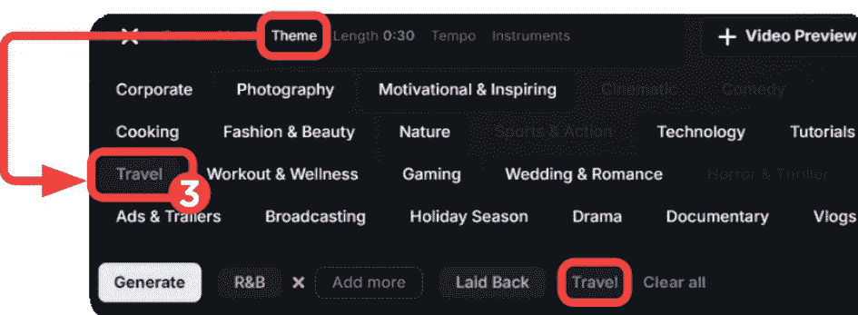
后面几个参数以下拉列表呈现。

Length 用于设定时长，最短 10 秒最长 5 分钟，此处设为 2 分钟。
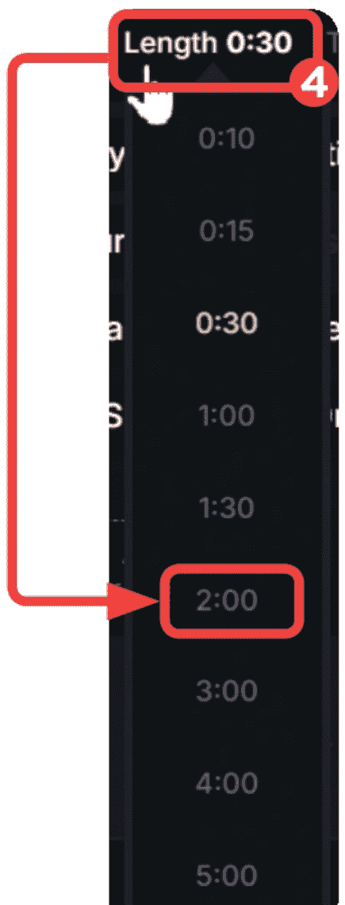
Tempo 用于设定速度，无法填写具体数值，只能从 Slow、Normal、Fast 中勾选，可多选也可全不选。
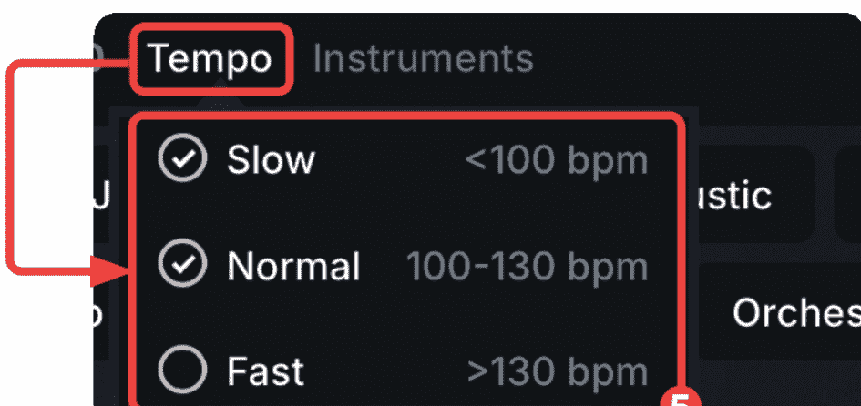
Instruments 可挑选乐器组合，共有 12 种可选：
- Piano
- Keyboard
- Synth
- Acoustic Guitar
- Electric Guitar
- Bell
- Mallet
- Ethnic
- Strings
- Voice
- Brass
- Woodwind
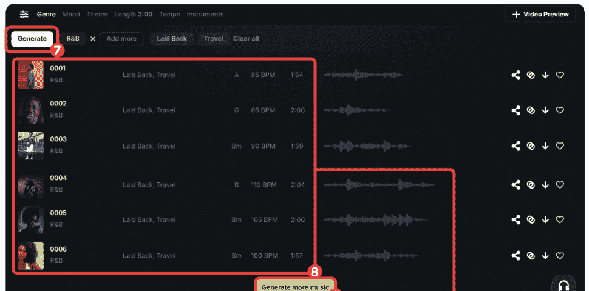
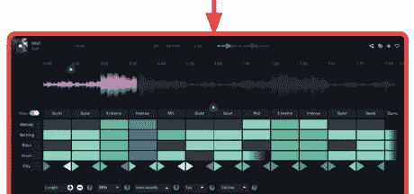
设置完毕后点白色 “Generate” 按钮，数秒内生成 6 首作品，点击即可试听。试听会打开编辑界面，可直接调整。底部 “Generate more music” 可继续生成。
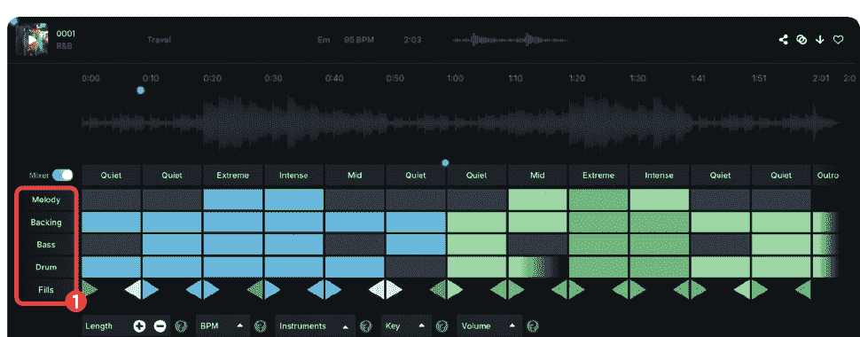
编辑器以图形化呈现。每行代表一个声部，共 5 个：Melody 旋律、Backing 伴奏中音、Bass 低音、Drum 节奏、Fills 过门。每列代表一个乐段，上方显示波形，左右拖动可查看不同乐段，点击即可从该乐段开始播放。

彩色方格对应乐段的声部开关，三种状态：黑色无声、浅色有声、深色最大强度。Fills 为三角形，有四种颜色区分。编曲变化处会用不同颜色标记。

例如第一乐段仅 Backing 与 Bass 发声，Melody 与 Drum 静音；第五乐段所有声部均以深色强度演奏。

每个乐段上方显示情绪强度标签，实时随方格调整变化：Quiet 安静、Mid 中等、Intense 强烈、Extreme 极强。如第一乐段判定为 Quiet，第三乐段满配时判定为 Extreme。
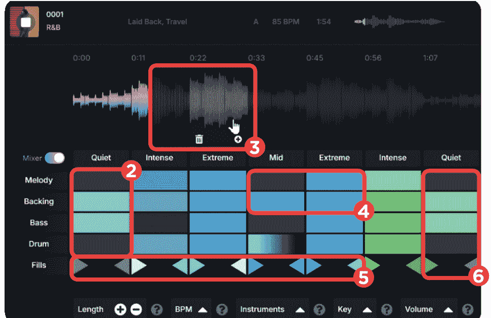
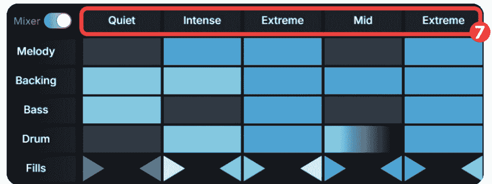

除了对声部演奏方式做调整，Soundraw 还在下方提供了一组细节控制面板。最左侧的参数叫 Length，用来增减整体时长，点击加号会在曲尾追加一段，按减号则删去末尾一段。BPM 用来控制整体节奏快慢，但数值不是自由输入，只能在下拉列表里挑选。Instruments 控制配器，展开后能看到各声部当前使用的音色，也支持单独替换，例如 Backing 声部默认是 A.GUITAR1 的吉他，想换成钢琴就选 A.PIANO1，随后按下 Apply，系统会重新渲染一版。

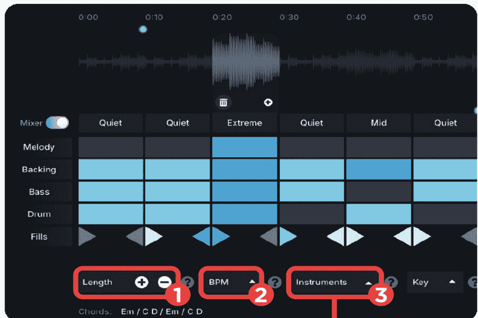

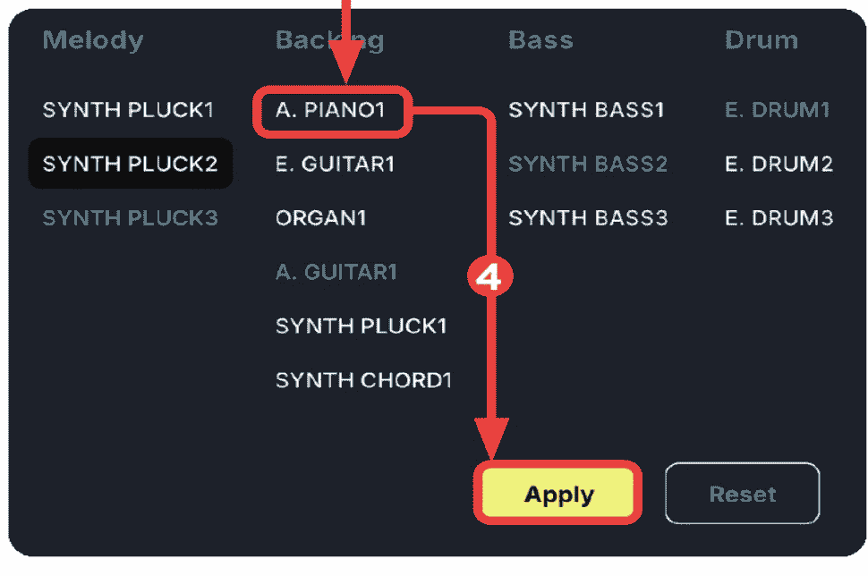

往右继续是两项关键调节。Key 负责调性迁移，并不支持随意设定，只能在前后相邻的两个调之间移动。Volume 则像小型混音台，可以为每个声部单独调节响度，例如觉得 Bass 过于抢戏，就把推子稍微往左推一点。

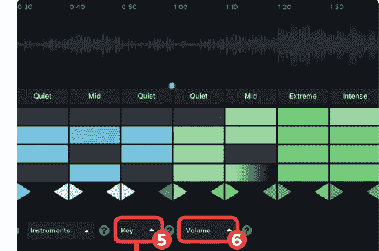

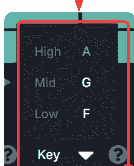

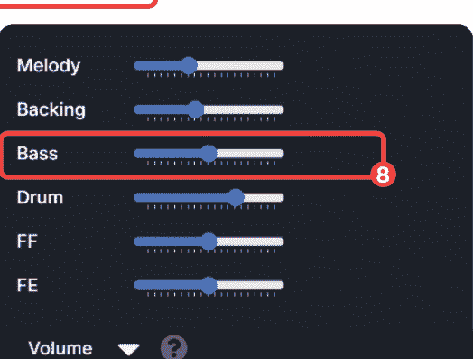

最底部的 Chords 会列出整首作品所用的和弦走向，这一栏由系统自动生成，不允许手动改写，主要是供参考借鉴。

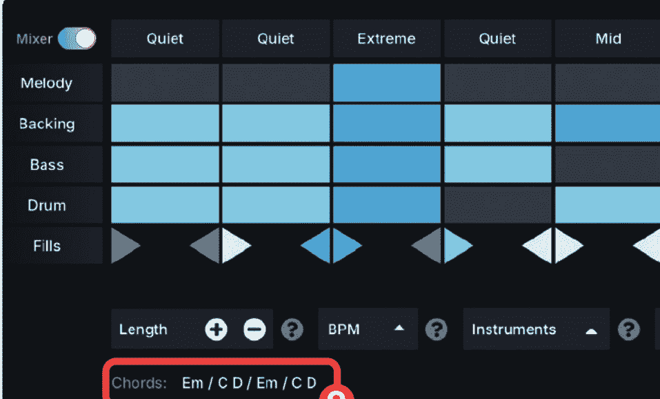

当参数调整到满意程度后，右上角提供了一组操作按钮，功能分别是：

- 生成分享链接，把作品分发给他人。
- 基于相似度再生成一版风格相近的新曲。
- 将成品导出到本地。
- 收藏标记，方便日后快速检索。

需要留意的是，Soundraw 的下载与商用权限需要付费解锁，这里就不提供试听。建议先用免费额度体验，确认符合需求后再考虑订阅。整体功能偏轻量，输出质量尚可，多尝试几次后也能成为顺手的配乐工具。

# 3. Udio 全解析

## 3.1 Udio 核心概念

Udio 由前 DeepMind 团队打造，核心定位是基于文字描述生成高质量音乐的生成式工具，同时也支持带人声的歌曲创作。

主要能力概括如下。

**文字转音乐：** 根据风格、情绪等提示快速合成曲目，还能依据歌词生成人声，支持中文、英文、日文等多种语言演唱。

**混音与延展：** Mix Mode 允许在已有曲目上做微调并衍生相似内容；同时具备片段扩展能力，可为现有音乐补上前奏、拉长主歌或延长结尾，制作更长版本。

**社区浏览：** 通过 Library 可浏览其他创作者的作品获取灵感。

**封面自动生成：** 依据输入的提示自动产出专辑封面，样式丰富且质量不错。

**界面简洁：** 整体设计干净，新手也能迅速上手。

**免费配额：** 登录后每月可获得一定次数的免费创作额度。

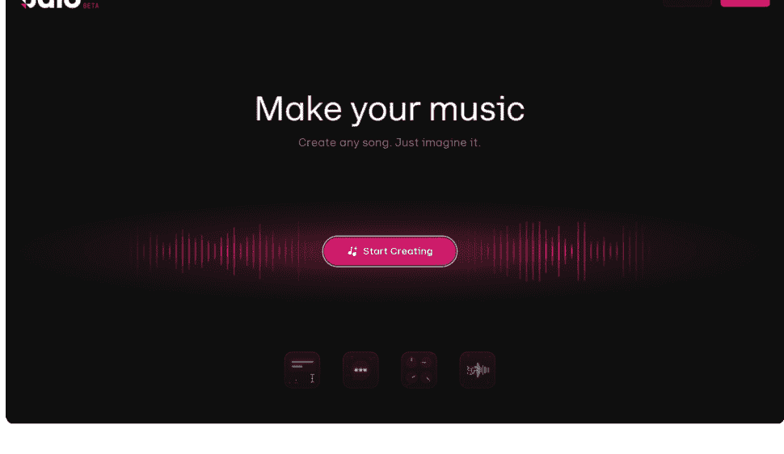

### 3.2 如何使用 Udio

在必应等搜索引擎查找 “Udio”，打开其官方网站即可。

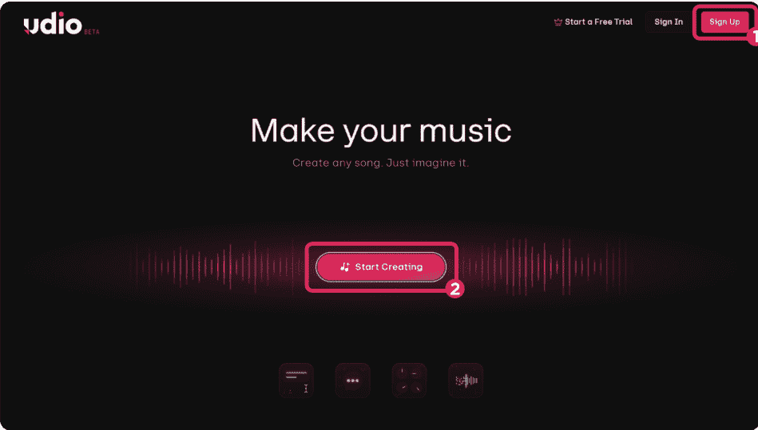

初次进入可点右上角 Sign Up 注册，也能直接点 Start Creating 体验。

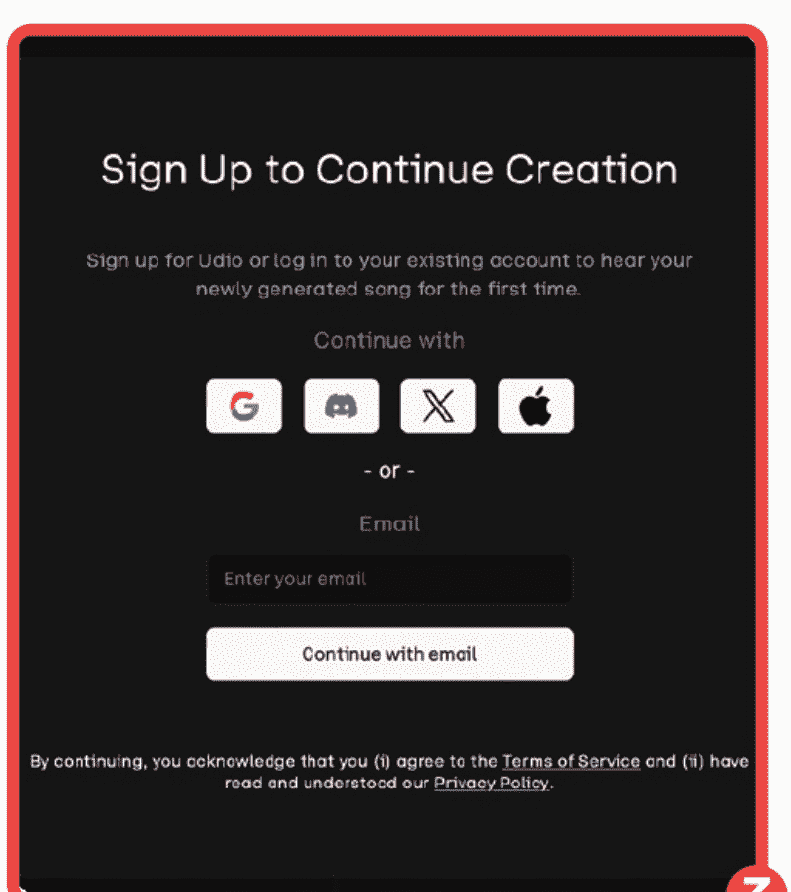

注册方式支持 Google、Apple 账号或邮箱，邮箱会收到验证邮件，验证后设置用户名便进入创作工作台，界面如下。

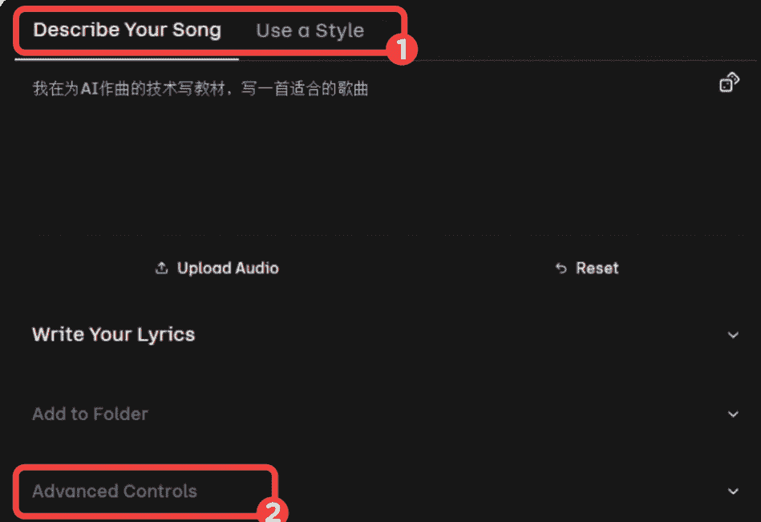

整体布局与 Suno 类似，操作思路也相近。顶部有两个主标签：Describe Your Song 与 Use a Style。

Describe Your Song 是填写需求的区域，例如可写 “为 AI 作曲教材配套一首轻快曲子”。也能直接写入风格标签，输入时系统会联想关键词，比如输入 Chinese 会提示 chinese folk music、chinese classical music，对不熟悉英文提示词的用户很友好。文本框下方依次是音频上传、歌词开关、纯音乐开关，功能一目了然。

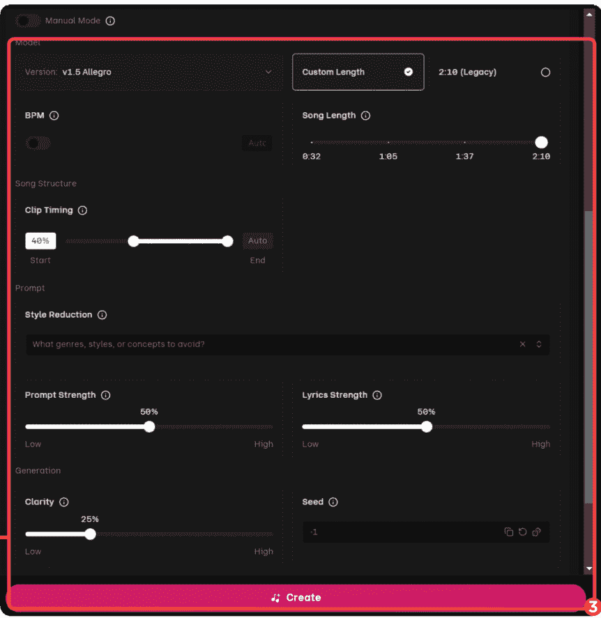

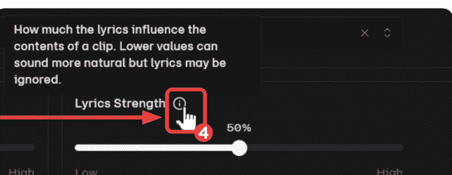

点开 Advanced Controls 会展开进阶设置，包含模型选择、速度与时长、提示词和歌词权重、清晰度、生成质量等，具体作用悬停感叹号即可查看。时长是常用选项，选择 Custom Length 后提供 32 秒到 2 分 10 秒共四档，其余参数偏专业，可自行探索。

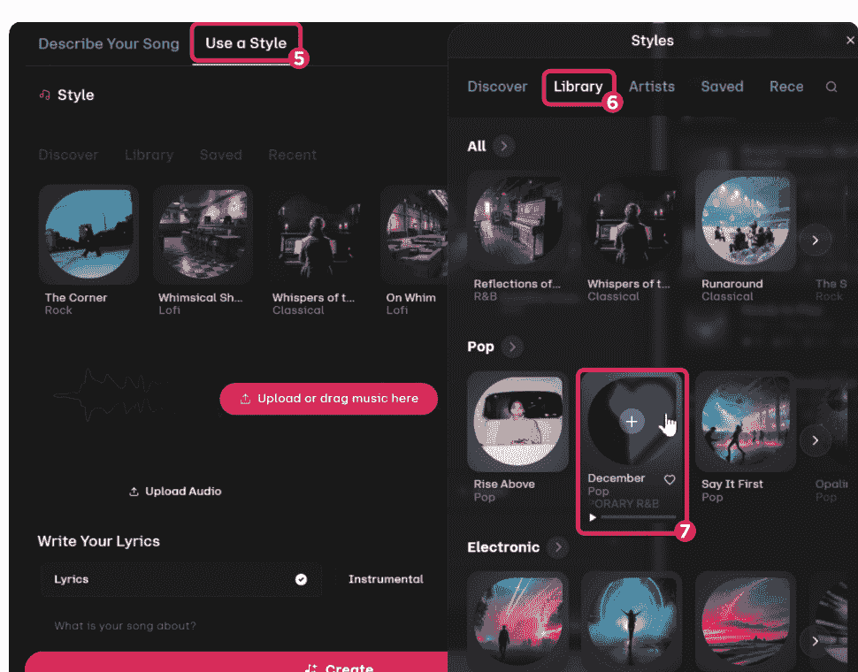

Use a Style 与在提示词里打标签不同，它是从已有曲库或上传的音频中挑选风格作为创作参考，氛围还原更为精准。

点进 Use a Style 后点击 Library，即可看到全部风格卡片。悬停任意卡片会出现 “+” 与播放按钮，先试听，满意就点 “+” 纳入本次创作。付费用户还能上传自有的参考音频。

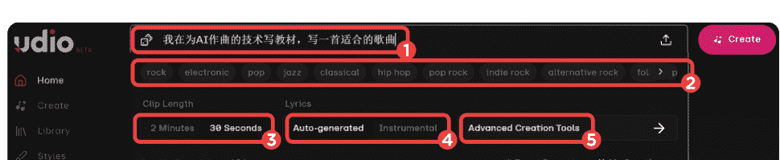

事实上，首页顶部也提供一个简化入口，可直接输入提示词并选择风格。“Clip Length” 仅提供 2 分钟与 30 秒两种；“Lyrics” 只有自动生成歌词与纯音乐两种模式。点 Create 即可开始生成。若需精细设置如手动填歌词，可点 Advanced Creation Tools 进入完整工作台。若不做任何输入直接点 Create，系统会随机产出两首。

Udio 采用积分制，规则与时长挂钩，相对复杂。

免费用户每日刷新 10 个普通积分和 3 个完整作品积分，不累积，另有每月 100 个普通积分上限。

目前支持四种时长：32 秒短片段、1 分 05 秒、1 分 37 秒的中长片段、2 分 10 秒完整作品。消耗如下。

- 短片段 32 秒：单首消耗 1 普通积分，系统一次生成两首共耗 2 分，每天最多生成 4 次共 8 首。
- 完整作品 130 秒：单首消耗 2 普通积分加 1 完整作品积分，系统一次生成两首共耗 4 普通积分加 2 完整作品积分，每天最多 3 首。
中长片段的积分规则官方未明确，可自行测试。

积分显示在左下角，悬停 Credits 即可查看剩余。

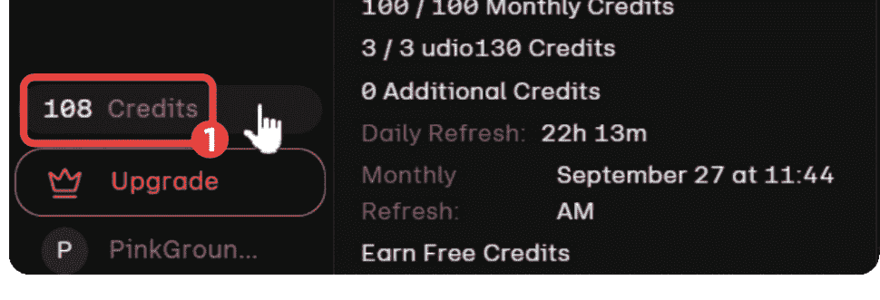

生成结果显示在右侧，操作与 Suno 相近。点封面即可试听，点最右侧小白点可执行 Edit、Extend、Remix 等操作。

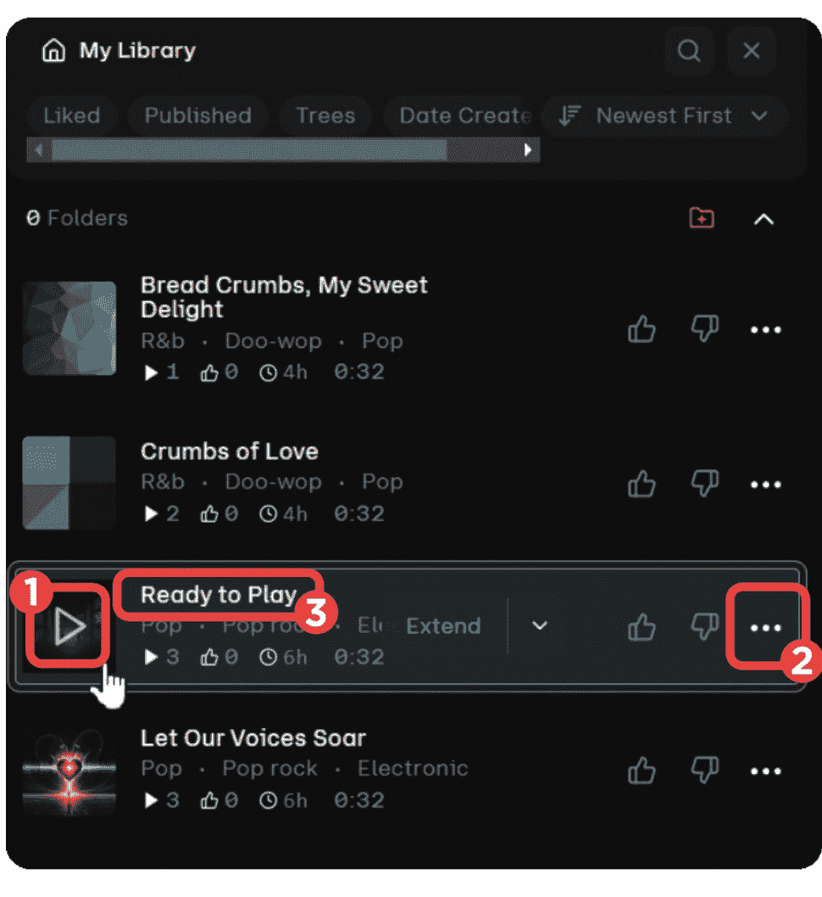

点作品名可查看风格、歌词等详情，也可在该处编辑。再点一次名称会进入独立作品页面。

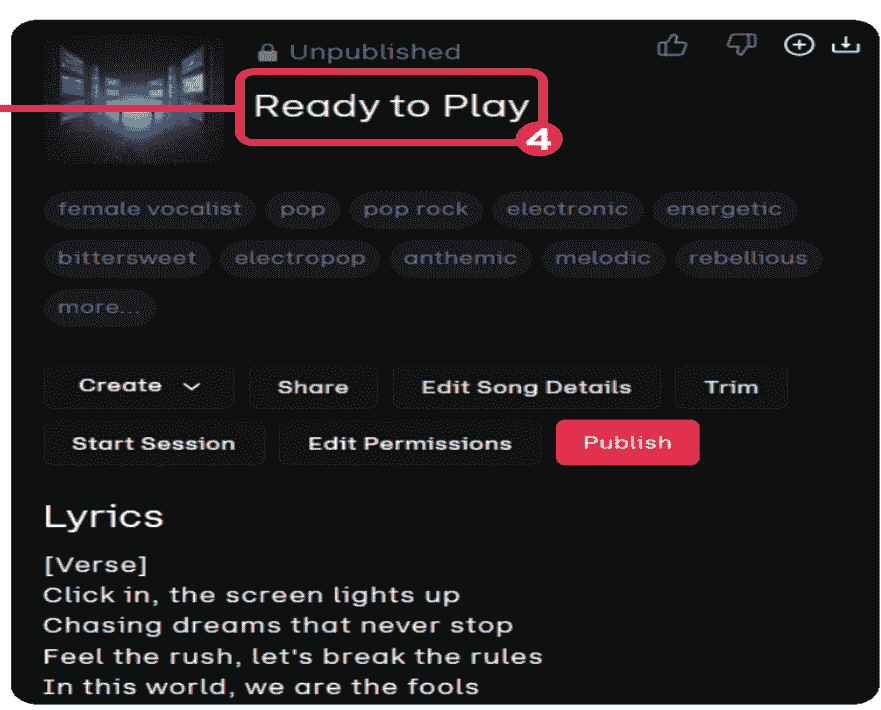

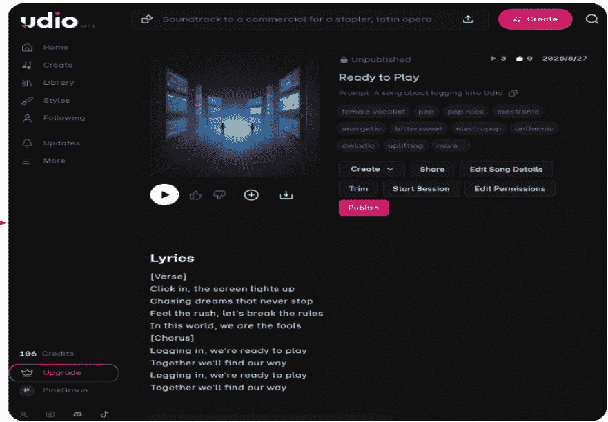

可尝试将之前用过的《星晴》歌词填入，提示词点骰子随机，时长选 2 分钟，最终效果请听 “试听音频8-3”。

以下是我生成的其他案例。不使用中文歌词时人声更自然，整体听感更好。

再听几首纯音乐作品，涵盖交响、中国风、爵士、摇滚等，音质与表现力均在线。

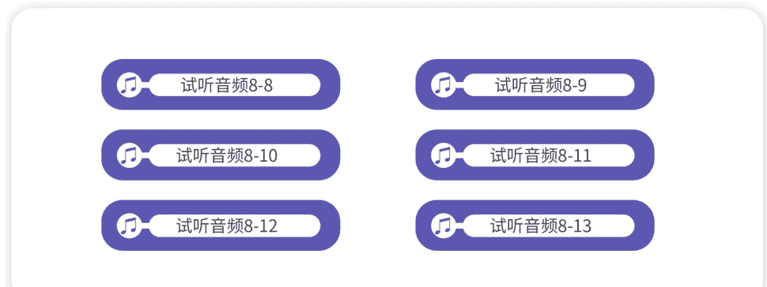

篇幅有限，基础用法到此为止。感兴趣可自行深入探索，社区里有大量优质作品可听。总的来说，Udio 是当前综合实力较强的 AI 音乐平台，音色表现突出，纯音乐尤为适合商业使用。专业参数丰富，能让有经验的用户更精准地引导创作方向。相较 Suno，Suno 更偏向旋律流行化与人性化，中文人声更亲切；Udio 在纯音乐与可控性上优势明显，根据需求选择即可。

# 4. Mubert 平台概览

## 4.1 Mubert 产品认知

Mubert 将生成式 AI 与真实音乐采样结合，为内容创作者、开发者与品牌提供即时生成的免版税音乐，常用场景为视频、直播、应用背景等。

其最大差异在于人机协作模式。平台以数百位音乐人的作品和超过 250 万个采样进行训练，既保证独特性也兼顾音质。

核心特点如下。

- AI 协作模式，基于真实音乐人采样生成多样化音轨。
- 风格丰富，提供上百种流派与情绪分类，可按风格、情绪、BPM 生成片段。
- 产品生态包含面向创作者的 Mubert Studio、面向听众的 Mubert Play，以及可供项目调用的 API。
- 应用场景广泛，适合音乐人、视频制作、广告等快速配乐。
- 全站生成音乐可商用，无需担心版权。
- 采样贡献者可获分成，鼓励音乐人与平台共建。
- 支持 API 集成，实现音乐自动化生成与分发。

该模式既降低创作门槛，也能低成本获得原创可商用音轨。

## 4.2 Mubert 操作指南

在必应等搜索引擎搜索 “Mubert”，打开官方网站即可。Mubert 的官网如下方左图所示。

首次使用可点右上角 Sign Up 注册，用 Google 等账号或邮箱均可，需验证。也可以点 Generate a track now 先试用。

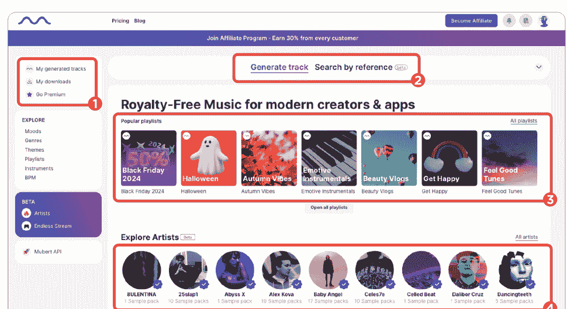

界面清新易懂。左侧为功能区，生成的作品会收纳于此；中间上方是创作入口，点击展开。页面大部分为试听区，“Popular playlists” 为官方或用户推荐歌单，“Explore Artists” 列出合作音乐人，点击封面或头像可进入播放列表感受音色。

点击主页的 Generate track 展开创作区，整体紧凑清晰。

“1. Enter prompt or upload image” 为提示词区，和其他 AI 一样可输入风格、乐器、情绪等词语，仅支持英文。还可上传图片，点击相机图标即可，我后续会演示。此处示例输入 Piano Pop Romantic，即钢琴流行浪漫。下方也可点 or choose 下的 Genre、Moods、Activities 直接挑选，Activities 相当于场景标签。

“2. Set type” 决定生成类型。点击 Track 会展开四个选项：Track、Loop、Mix、Jingle。Track 生成完整曲目，Loop 生成 8 或 16 小节循环，Mix 结构更灵活，Jingle 用于制作很短的开场或收尾音乐。

“3. Set duration” 设置时长，可手动输入，提示范围 5 秒到 25 分钟，限制较宽松。

设置完成后点 Generate track 即可。示范作品听 “试听音频8-14”。

图片生音乐是 Mubert 的特色。点相机图标上传本地文件或拖拽图片，也支持粘贴链接。上传后点 Continue，提示词区会显示 Image is selected，图片即作为创作依据。

# Image-to-music

Drag and drop the image here

you can use CTRL + V (CMD + V) to insert image here

Upload png, jpg or webp

Enter the address of the image

Next

上传之后，点击“Continue”（继续），提示词的输入框中会显示“Image is selected”（已选择图片），即图片是我们的提示词。

# Image-to-music New

Continue

Generate track Search by reference beta

1. Enter prompt or upload image

2. Set type

3. Set duration

Image is selected

Track

00 : 45

Generate track

or choose:

Genres Moods Activities

from 5 sec to 25 min

最后点 Generate track 即可生成作品。图片生成耗时会稍长。示例选用一张云雾缭绕、略显阴森的栈道照片，生成的氛围与画面相符，请听一下。

页面左边的 EXPLORE 菜单与 Suno 探索类似，按 Moods、Genres、Themes、Playlists、Instruments、BPM 分类，每个大类下有细分标签，可复制进提示词框。点击这些词会展示对应已生成的作品，可逐一试听。若有喜欢的作品，可点右侧闪电图标，设置好类型与时长后再点 Generate track，即可快速获得相似新作。

下面 “试听音频8-16” 为网页范例，“试听音频8-17” 为我基于范例生成的作品，可作对比。

用 Mubert 生成的曲子试听时，容易注意到一段女声会定时报出 “Mubert”。这是平台在免费预览版本里加入的音频水印，用来做版权保护和品牌露出。想要获取干净无水印的音源，或是拿来做商业发布，就必须开通付费订阅。

整体来看，Mubert 是个辨识度比较高的 AI 音乐生成工具，成品听感在线，提示词门槛低，找到喜欢的风格后可以很快复刻出相似作品。对需要背景配乐的用户很友好，尤其是短视频创作者，在找不到合适的配乐时能派上大用场。

# 5. Soundful

## 5.1 认识Soundful

Soundful 是由人工智能驱动的音乐制作平台，主打让音乐创作变得简单直观，快速产出定制化曲目。它的核心竞争力是高质量的免版权音乐，以及强大的可定制能力，支持导出分轨和 MIDI。

平台主要有以下特点。

**智能音乐生成：** 基于 AI 快速生成各类背景音乐，提供 EDM、Hip Hop、Pop 等多种流派与情绪标签，用户还能自行调节速度和调性。

**无版权可商用：** 在平台生成的作品属于免版权范畴，可安心用于视频、播客、广告等项目，同时也能把音乐发布到其它平台获取收益。

**多格式导出：** 支持导出 MP3、WAV，也能下载分轨音频和 MIDI 文件，便于在 DAW 中做后期混音与编辑，满足专业创作需求。

**界面友好：** 交互简洁直观，上手快，适合不同音乐经验的用户。

**免费与付费套餐：** 提供免费版和高级订阅。免费版限制下载次数，付费版下载额度更高，并开放分轨、MIDI 等导出功能。

Soundful 的创作逻辑和 Suno、Udio 不同，它不要求你写提示词，而是通过选择流派、情绪、艺术家风格等预设选项来生成音乐。这种方式对内容创作者、剪辑师、播客主，或是对音乐理论和提示词不熟悉的用户特别友好，能快速拿到成品。

## 5.2 Soundful的使用方法

弄清原理后，使用流程很顺手。在必应等搜索引擎搜索 “soundful”，打开官网即可，目前无中文界面，以英文操作。

首次使用点 “START FOR FREE” 进入注册页，需要填写姓名、邮箱和密码，密码要求不少于 8 位，须同时包含大小写字母和至少 1 个数字，也支持用 Google 账号登录。

注册后会弹出身份选择，如音乐制作人、歌手、DJ，只能选其一；再挑选 4 项最喜欢的音乐风格。

进入主界面后，平台会根据喜好推荐已生成的作品。左侧绿色区域展示推荐风格，比如 Afro House、Afrobeats、Pop Funk 等，点击红色图标即可为该风格生成音乐。

生成面板会从底部弹出，可调节速度、设置调性，并为作品命名。设置完成后点 “CREATE PREVIEW” 开始生成。

生成后点播放试听。此时上方会提示当前为预览版，便于快速判断旋律和风格是否合适。下载时平台会进行混音处理，得出更平衡专业的最终版本。点 “SAVE” 可保存到音乐库，不满意可点 “CREATE NEW PREVIEW” 再生成一版。

点左侧 “My Library” 可查看创作记录。点 “GET” 下载，免费用户仅能下载 MP3，付费用户可下载分轨文件和适用于 Ableton Live 的 als 文件。

“试听音频8-18” 就是在 Soundful 上生成的作品，效果可自行体会。

除主创作区外，左侧功能区还有更多参考。分别有 Genre、Collections、Loops & SFX、Global Tracks，里头集合大量模板和范例可试听。Collabs 是 Soundful 邀请音乐人把其“风格 DNA”训练进平台形成的合作风格，付费用户可用这些风格生成带艺术家特色的原创作品。

以 RnB 为例，在 Genre 中打开 RnB，会看到细分风格封面，点击后可试听范例，喜欢的话点 “CREATE” 或作品后的圆圈图标弹出创作界面，操作同前。

总体而言，Soundful 生成质量不错，很适合快速找灵感或做背景音乐。界面简洁，模板丰富，选选调调就能出片，使用门槛几乎为零。非常适合没有专业作曲经验的视频博主、自媒体从业者或独立设计师。但依赖预设选项，灵活性相对有限，风格独特性有时不足，对追求高度原创或专业水准的音乐人可能不够。

# 6. Stable Audio

## 6.1 认识Stable Audio

Stable Audio 由 Stability AI 打造，是一款面向音乐和音效生成的 AI 工具，能根据文本提示词或音频样本产出高质量音乐与各类音效。主要特点如下。

**高保真音频生成：** 可生成长达 3 分钟、44.1kHz 采样的音乐与音效，支持摇滚、爵士、电子、嘻哈等多种风格，音质表现扎实。

**结构化生成技术：** 采用扩散模型结合 DiT 架构，能处理长时间结构和复杂音频模式，输出连贯且细节丰富的音乐。

**音频转音频与音效创作：** 具备强大的音频到音频转换能力，可上传已有音频样本，通过提示词将其转化为不同风格或主题的新音频，也能直接创作音效。

**生成速度快：** 约 1 分钟即可完成一首 3 分钟作品，并支持移动端使用。

**商业化支持：** 生成的音乐可用于商业项目，适合自媒体、广告制作等场景。

**多样输出格式：** 支持 MP3、WAV 下载，也可输出视频格式便于直接嵌入视频项目。

**友好界面与免费试用：** 注册后即可免费体验，操作简便。

Stable Audio 的最大优势是能产出高保真音频，并在音效创作上很有特色。因此特别适合视频创作者、游戏开发者，以及需要音频转换和追求高音质的商业用户。

## 6.2 Stable Audio的使用方法

在必应等搜索引擎搜索 “Stable Audio”，打开官网。首次使用需注册，点右上角 “Sign up” 或左下角 “Try now”、中间的 “Try prompt” 都会跳转到注册页。用邮箱注册无需验证，也可使用 Google 账号。

注册后点右上角头像，可看到免费账号权益：每月最多生成 10 首作品，每首最长 3 分钟；每月上传音频总时长上限 3 分钟；生成作品仅限非商业用途。

回到主界面，左侧为参数设置区。Prompt 用于输入风格、乐器、情绪等提示词，输入方式与其它 AI 类似。若不会写，可从下方的 Prompt Library 选择。点右侧按钮会展开列表，提供约 17 种预设风格，像 Synthpop、Ambient、Warm、Disco 等，还有 “Surprise me” 随机选项。选 “Techno” 后，Prompt 框会自动填入系统设定的风格、情绪、乐器、速度等描述，可自行微调。

Model 目前只有 “Stable Audio AudioSparx 2.0” 一种。Duration 用于设定时长，最长 3 分钟。再往下可上传或录制音频，点 “Add audio” 即可。

点 “Add extras” 会出现进阶选项：Steps 控制迭代次数，默认 50，数值越高音质通常越好；Seed 决定随机起点，相同 Seed 可复现相似结果；Prompt Strength 调节作品与提示词的贴合度；Number of Results 为 Pro 用户提供一次生成多首的能力，最多 5 首。

举例输入 “Pop, K-Pop, Piano, Sad, 75BPM”，其余保持默认，点击 “Generate”。

生成结果显示在右侧，可试听，点下载即可。免费用户可下 MP3 和 MP4 视频，付费用户可下 WAV。需注意，该 MP4 并非音乐 MV，而是一个带动态封面的分享格式。

“试听音频8-19” 为用 Stable Audio 生成的音乐。

上传音频也很简单。点 “Add audio”，首次使用会提示必须上传拥有版权的素材，时长 1 秒到 3 分钟，超长需自行裁剪。选择 Upload 或 Record。上传后会出现 Input strength，用于控制上传样本对最终结果的影响，数值越高越接近原音频，越低则越自由发挥。

值得强调的是，Stable Audio 的音频到音频功能是对上传素材本身进行风格转换、变奏或再创作，而非像 Suno 那样在原音频框架上续写。上传后仍可输入提示词，结合两者生成新作品。

Stable Audio 的纯音乐和音效质量可靠，结构完整、音质清晰，适合做背景音乐或音效设计，深受音效师、独立游戏开发者、影视创作者等喜爱。它的音频再创作能力口碑不错，也支持人声输入转化为音乐与音效，且参数调节丰富，对有明确想法的用户很友好。

局限在于目前不支持生成带人声的歌曲，音乐层次感不及 Suno 那样“有歌感”，有时偏静态。总体而言，若看重音质与结构，想要大块头的纯音乐作品，Stable Audio 是个实用选择；若偏向带歌词的歌曲或人声旋律创作，建议搭配其它平台使用。

# 7. 国内的AI音乐平台

前面介绍的多是海外平台，国内的 AI 音乐生成服务近年发展很快。界面多为中文，操作直观，官网通常配有详细说明与教程，这里不再逐一演示，可自行体验。以下为代表性平台。

### (1) Mureka (原天工SkyMusic)

Mureka 前身为“天工SkyMusic”，亦称“音疯”，由昆仑万维推出，基于“天工 3.0”大模型打造，是国内首个音乐 SOTA 注 SOTA 为 State of the Art 的缩写，指某一领域技术领先、表现最优的方案 模型，表现突出。最新模型为 Mureka O1。

主要特点。

**高质量 AI 音乐生成：** 可生成长达 6 分钟、44.1kHz 采样的立体声歌曲，音质与细节表现较好。

**自然真实的人声合成与个性化音色：** 中文人声合成效果优秀，发音清晰无杂音，接近真人。提供多款官方歌手音色，也支持用户上传自有声音训练，实现个性化音色定制。

**歌词段落控制：** 支持通过歌词控制歌曲情绪变化，可区分不同段落的情感差异。

**多种风格覆盖：** 涵盖说唱、民谣、放克、古风、电子等多种风格，创作选择多样。

**歌唱技巧模拟：** 除了基础生成，还能学习并模仿颤音、歌剧、吟唱、男女对唱、自动和声等多种演唱技巧。

**方言音乐生成：** 支持参考音乐生成和方言歌曲生成，包括粤语、四川话、北京话等，可实现多样音乐表达并助力方言文化推广。

# 中文 AI 音乐创作工具实测笔记

**Mureka 分轨与 API**  
作品完成后可以导出分轨音频和伴奏文件，方便后续剪辑；平台也支持对已生成音乐的局部编辑，按自己的想法做二次创作。面向企业和开发者的开放 API 分为音乐音频生成和语音合成两大类，音乐工作室可借此训练专属厂牌风格模型，把创作流程工业化。

评测视角来看，相比 Suno V4，Mureka 在音乐连贯性、歌词发音准确度、文本相关性、作品复杂度与整体质量上都有优势，值得体验。

官网通过搜索引擎即可找到，首次进入会有按钮功能提示，语言可在左下角切换。默认是 English，点击 Language: English 即可在 English、中文（简体）、中文（繁體）、日本語、한국어、Español、Português、Deutsch、Français、Italiano、Русский язык 等选项中选择。页面可见 Credits: 0、Invite for Free credits、API Platform、Feedback、What's New?、Try free now 等入口。

### (2) 海绵音乐
海绵音乐是字节跳动推出的 AI 个性化音乐创作平台。

进入官网先看到「精选」作品集，可直接试听。左侧「创作」进入生成页，界面接近 Suno，提供灵感创作、自定义写词、纯音乐三种模式。灵感创作只需输入关键词，系统自动补全歌词与旋律，相当于 Simple 模式；自定义写词则是自行输入歌词并指定风格，对应自定义模式。纯音乐是独立入口，内置短视频 Vlog、品牌广告、专注场景、游戏互动、影视动画、睡眠疗愈六类提示词，还支持上传视频做配乐。

左侧「实验室」提供 AI 改词、AI 仿写和音色克隆三个功能，音色克隆暂未开放。

中文歌曲处理是亮点，通过降低电音比例、提升吐字清晰度和演唱流畅度，听感更自然。目前仍在内测，创作免费且可分享链接，但暂不支持下载。

### (3) 网易天音
网易天音是网易云音乐的 AI 音乐创作工具，特点是生成之外还能 AI 编曲，可玩性较高。可选择和弦走向、设定主副歌结构、挑选编曲风格，系统生成编曲后还能微调歌词或音符位置。

核心能力包括：
**全流程 AI 辅助** 作词、作曲、编曲、演唱、混音一站式支持。
**多元灵感入口** 支持关键词、随笔文字生成歌词与音乐。
**高可编辑性与模板库** 各环节均可编辑，拥有 450+ 编曲模板，覆盖多种情绪风格。
**AI 划词作词** 可自定义段落结构与韵脚，结合灵感库提高效率。
**虚拟歌手音色** 生成后可挑选不同虚拟歌手演唱。
**多形式输入** 文本描述、意向词、歌词文本、和弦段落、旋律 MIDI 均支持。
**版权说明** 用户对生成作品拥有完整版权，可自由使用、修改、发布、商用，需注明来源于网易天音并遵守法规。

新建歌曲提供关键字灵感与写随笔灵感两种方式，建议录入 2-4 个关键词，2-4 字效果更佳，示例热词有红蜻蜓、南浦、哲学、彩光、广寒宫、天鹅、蒲草、红砖、小筑、琼浆。还可选填作曲/段落结构/音乐类型，上传 4/4 拍单轨 MIDI，段落结构可选自定义、Demo 格式、副歌模式、全曲模式，全曲模式可制作完整歌曲。

整体来看，天音覆盖了从灵感输入到成品输出的完整链路，加上编曲辅助和虚拟歌手演绎，兼顾专业制作人细抠需求和爱好者快速创作。

不同平台各有侧重。Suno 这类综合型工具能快速产出抓耳作品；AIVA、Udio 等在纯音乐或 MIDI 输出上更突出；Stable Audio 则擅长音频到音频转换。而 Mureka、海绵音乐、网易天音针对中文优化，更贴合中文用户习惯。AI 音乐工具大幅降低了创作门槛，让没有专业背景的人也能把脑中旋律变为现实，未来选择会更多。

# 第9章 AI生成作品的后期编辑与辅助创作工具
AI 生成的音乐已经可用，但想要精修音轨、分离人声、转 MIDI 或给已有作品叠加合成人声，多数平台做不到，这时需要专业后期工具补位。

### 1. 人声分离利器——Replay
创作完成后常需要保留伴奏去人声，或只取人声。Replay 是目前操作简单、效果靠谱的 AI 音频处理工具，支持人声分离、AI 翻唱等功能，Mac 与 Windows 均可免费使用。

官网下载后需用邮箱或 Google 账号注册，首次启动会提示下载组件，点击 DOWNLOAD 安装。删除蓝色区域示例音频进入主界面后，可点击或拖拽上传待处理音频。

在 Settings 中打开 Stem Only，仅分离音轨；Stem Method 建议选 UVR-MDX-NET VocFT。Output Format 可选 WAV 或 MP3。确认后点 STEM SONG 开始处理，进度条显示完成度。

完成后左侧会出现新文件，点击即可在右侧试听三种结果：Original Song、Original Vocals 与 Instrumentals，均可下载。默认算法会把主唱伴唱一起分离，若想保留伴唱在伴奏中，可改选带 Karaoke 字样的算法。每种算法听感不同，建议多试。

### 2. 分轨好帮手——Logic Pro
Logic Pro 是苹果生态的专业音乐制作软件。升级到 11 后新增大分轨功能，可把完整曲目拆成人声、鼓、贝斯、其他四条独立音轨，便于对 AI 素材再编辑。

导入音频后右键选择 处理→大分轨拆分器，勾选所需声部点拆分。生成后可在下方看到独立音轨，静音人声即得纯伴奏；也可删除原 AI 人声后自行录音。功能弥补了多数 AI 平台不提供分轨导出的短板。

### 3. 人声AI合成小能手——ACE Studio
ACE Studio 是国产 AI 歌声合成软件，输入旋律与歌词即可生成接近真人的 AI 演唱，提供多种预设歌手音色。

主要特点：内置丰富 AI 歌手库；可上传个人声音训练模型实现音色定制；歌声高度可编辑，支持歌词、发音、延音、辅音音素微调；支持声线混合；最新版加入音乐分离，可拆人声伴奏；生成效率高，节省录音成本；界面直观。

官网登录需手机号验证码后下载，试用期为 3 天。主界面分为上方轨道区、下方钢琴卷帘窗编辑区、左侧歌手选择区。

流程示例：先用 Replay 分离伴奏与人声，分别拖入 ACE Studio，伴奏放音频轨，人声对齐后拖入下方。把人声轨拖到歌手轨进行 MIDI 转换，转换后音高、歌词均可编辑，拼音识别有误可手动修正。从左侧挑选歌手拖至头像即可渲染新音色，最后导出成品。还能录人声转 MIDI、训练自定义歌手，为二次创作提供更多可能。

### 4. 音频变MIDI魔术手——Samplab
想深度修改旋律、换音色或重编配，音频转 MIDI 是关键。Samplab 是瑞士出品的 AI 音频编辑工具，转 MIDI 精准度较高，并能分离键盘、贝斯、鼓、人声。

传统 DAW 的音频转 MIDI 在简单素材上可用，遇到复杂混音和混响时精度下降。Samplab 的 AI 算法对此优化更好。复杂项目可先用 Logic Pro 大分轨得到干净单轨，再导入 Samplab 转 MIDI，最后回 DAW 调整音色与音符，混音后成品更接近商业发行水准。

使用方式为从官网下载安装包并安装即可上手。

要上手 Samplab 的音频转 MIDI 功能，先打开官网进入页面。点进 Get Started 就会看到付费套餐的介绍，直接在第一栏下方按 Download 即可获取安装包，顶部导航的 Download Samplab 也能直达下载页。网页会自动识别系统开始下载，需要留意的是免费版仅支持 10 秒以内的音频处理。

安装完成后建议先在 Logic Pro 里把素材分好轨再导出。以贝斯转 MIDI 为例，只需在贝斯音轨上右键，选择 导出→1个片段为音频文件 即可，借助大分轨拆分器只勾选贝斯声部导出也是同理。

打开 Samplab 后，把刚导出的分轨音频拖进窗口中央区域。随后会弹出声部选择提示，共有 instrumental、drums、bass、vocals 四项，分别对应除人声鼓贝斯外的器乐、鼓、贝斯和人声。因为本次导入的是贝斯轨，只勾选 bass 确认即可，软件随即开始分析并生成 MIDI。

转换完成后对应声部的 MIDI 会直接显示在界面中。点击右上角的导出箭头，选择 MIDI 格式导出，就能把音频变成可在 DAW 中继续编辑的 MIDI 数据。

实际使用下来，Samplab 在音频转 MIDI 上的表现相当稳健，即便面对混音复杂的片段，音符识别率也很高，在和弦与节奏的还原上尤为突出，能较好保留原声的特色。当然，遇到极度复杂的复调片段时，仍会出现音高偏差或漏掉鼓点的情况，需要人工修正。随着技术迭代，相信未来会出现一键完成整首歌全声部分离并转为可编辑 MIDI 的工具，那将大幅提升创作效率。

到这里，一套借助 AI 完成音乐创作与后期处理的完整路径就梳理清楚了。除了用 AI 生成曲目、歌词和编配，使用 Replay、ACE Studio 这类工具做精细化调整也变得很常见，这些产品为创作提供了前所未有的可能性。

AI 音乐工具的进化速度很快，未来会有更多更易用、更强力的方案出现，持续服务创作者并不断拓宽音乐创作的边界。

作者简介

陈飞

音乐制作人 | 吉他手 | 现代音乐推广人

8岁开始接触吉他，师从多位名家。2006～2010年就读北京现代音乐学院音乐制作专业。2010年创立成都乐立方文化传播中心，专注推广现代音乐与爵士音乐。拥有丰富的制作与教学经验，出版多本编曲及乐器教程。

扫一扫，添加客服，回复“168501”即可领取配套资源。

如有问题，可以发送邮件至客服邮箱：243136040@qq.com