# 职场 AI 效率跃迁全书

# 精彩推荐 ^(¹)

AI 正在重塑生产方式，何平老师凭借敏锐的洞察捕捉到行业风向，亲身试验后锁定职场 AI 效率提升主题，携手团队搭建敏捷工作流，沉淀并验证出一条可行的人机协同路径。期待与读者一同让智慧共振，开启人机共生的新阶段。

——陈丽 沃思创新研究院发起人，连锁餐饮 AI 创新实践者

在职场被 AI 改写的背景下，这本书堪称实战手册。王林将生成式 AI 与具体办公场景紧密结合，从目标设定到创意输出，从数据解读到职业成长，梳理出 12 条效能提升路径。内容兼具“多快好神”的效率原则与人机协同的底层思路，案例与工具齐备，帮助读者把 AI 从概念落到产出。无论是初入门者还是追求突破的老手，都能由此打开高效新入口。

——储君 AI 创业导师，亿琪富品牌创始人，畅销书《Excel 极简思维》作者

王林是根植长期主义的执行者，坚持八年早起，持续办读书会四十余期。他做事的稳准狠很像 AI，可靠到让人放心。作为深耕 AI 的人，他的新作既是职场人的效率指南，也是私域运营者的实操宝典。书中拆解了用 AI 思维重塑目标管理、加速知识转化、优化内容生产等关键环节，并结合 DeepSeek 等工具给出落地步骤，理论少、可直接用。

——陈果儿 上市公司私域操盘手

强烈推荐王林老师的新作。书以“多快好神”为主线，把 AI 融入 12 大职场场景，既讲方法也授心法，是拥抱 AI 的实践指引。作为文兜 CEO，我亲眼见证王林带领团队将书中“知行合一”四步法应用到文兜智写这款智能标书工具中，获得用户好评。他把赋能企业与职场人的初心通过产品与本书延续。这本书源于实践、诚意十足，适合追求人机共生的职场人以及希望释放组织生产力的管理者。

——葛佳音 文兜 CEO

仅用 DeepSeek 就能解决效率问题？本书给出了否定的答案。真正的效率变革需要系统组合与全局思考。更值得自问的是，我们提升效率的终极目的为何？不只是做更多事，更是为了换回生活空间与心灵余裕。

——鹤竹子 AI 写出我心全球发起人，中国音乐学院人工智能应用实践课程导师

阅读时请带着思考，把内容搬到实践中去，先理解再应用，才能更快完成学习与工作任务。

——何行之 成都市菱窠路小学 2022 级学生

郭龙老师是少有的能把理工思维带进人文培训的老师。对工具的研究与落地令人佩服，他擅长把 AI 能力与企业真实业务场景对齐，解决痛点并带来可量化提升。本书浓缩了他对 AI+场景的洞察，是一本务实的 AI 操作手册。

——刘思玥（将军）华为背景的高管演讲教练，TEDX 演讲教练

AI 迭代极快，能写出兼顾理论与实操的干货，必是身在领域的实干者。三位作者里有产品创业者也有培训师，他们的实战经验值得边学边用，以加速职场成长。

——梅俊 方寸智能副总裁，得到 App“如何用 AI 辅助高效写公文”课程主理人

作为讲解 AI 的商业讲师，我深知落地性是关键。王林老师的著作提供了难得的资源，理论扎实、操作简便、案例丰富。在业务交付中，他的方法论帮助我把复杂技术转化为易懂的知识结构，课程更生动，客户反馈很好。书中对生成式 AI 原理、提示词工程、跨学科整合的阐释，结合真实案例与操作指南，实现理论与实践衔接。它既适合 AI 新手入门，也为资深从业者提供进阶路径。

——孙林 AI 商业讲师

郭龙老师能把高深技术转化成职场人伸手可及的工具。合作多年，他为天元客户讲授的 AI 课程口碑极佳。本书延续“学以致用”的风格，招式硬核且好用。最欣赏两点：一是 15 年积累的“职场翻译力”，把复杂概念拆成新手指南；二是利他精神，恨不得把私藏技巧全部分享。与其说是书，不如说是一个 24 小时在线、专治卡壳的 AI 军师。

——赵璐 天元鸿鼎董事长

何平老师的学习效率惊人，连 AI 都望尘莫及。和他学 AI，等于自带一位贴身秘书。作为教师，我也在跟进他的步伐去了解 AI，以便与学生更好地相处。

——张雅文 IB 国际文凭组织视觉艺术全球考官

# 写在前面

# AI 赋能人生

**核心判断：对手不是 AI，而是懂 AI 的人**

**没有 AI 的工作日**

清晨 7 点，闹钟响起，市场营销专员林巧思揉着眼睛起床。匆忙洗漱后，她一边吃早餐一边翻邮件，脑中已开始推演当日安排。

8 点半到岗，第一项是整理前一天的会议纪要。翻笔记、回想要点、整理成文档，耗时近一个小时。随后她要准备下周产品发布会的文案，面对空白页面迟迟找不到切入点，花了 20 分钟浏览竞品资料找灵感。

11 点，主管临时要求在 15 点前交上一份上一季度销售数据分析报告。林巧思打开 Excel 开始整理大表，数据清洗与分析占用了午餐大部时间。

午后继续与数字搏斗，试图提炼洞见，却力不从心。报告在截止前勉强完成，但她对质量并不满意。

16 点半，她才回头写发布会文案，长时间的数算已耗尽创造力，初稿平淡无亮点。

18 点，林巧思疲惫收拾离开。今天完成了纪要、报告和初稿，但每项耗时久、质量一般。

**接入 AI 之后的工作日**

同一天，观察 AI 支持下的林巧思。

7 点半起床，她用语音助手快速浏览邮件摘要并语音回复，10 分钟搞定，比原来节省 20 分钟。

8 点半到办公室，她把会议关键词和讨论要点丢给 AI，几秒得到结构清晰的纪要初稿，审阅后小改，20 分钟完成，节省 40 分钟。

接着准备发布会文案，她向 AI 描述产品卖点和目标人群，让其给出创意方向，迅速获得多个标题和框架建议。挑选后再协作细化，耗时 1 小时，效率近乎翻倍。

11 点接到数据分析任务，她用 AI 数据工具处理源数据，直接提问“哪类产品增速最快”“客户购买是否存在季节性”等，几分钟产出可视化图表和初步结论，复核后两小时内交付，质量超出预期。

下午她有余裕思考产品策略和市场定位，用 AI 做竞品洞察，碰撞出新的营销点子。16 点半前，她不仅完成既定任务，还额外拟出一套社交媒体营销方案。

18 点，林巧思带着满足感下班。任务全完成且质量提升，更重要的是，战略思考与创新有了时间空间。

对比两天可见 AI 带来的价值。

· 工作效率明显提升，日常任务耗时缩短 30% 至 50%。会议纪要从 1 小时降到 20 分钟，数据报告从 4 小时压到 2 小时。
· 产出质量提高。AI 在创意与分析上提供更全面视角，帮助交付更扎实成果。
· 创造力被释放。重复工作被压缩，人类可聚焦策略制定与创新设计等需要独特判断的环节。
· 工作压力减轻。应急任务不再手忙脚乱，满意度与工作生活平衡改善。
· 工作边界拓展。AI 赋能下能承接更复杂多元的任务，为职业发展打开新可能。

当下 AI+ 正重塑职场生态，不只是效率工具，更是释放潜能、推动创新与价值创造的助力。懂得善用 AI 的人将在竞争中占据先机。

**技术内核：重塑工作的生成式 AI**

2022 年底，一场静默变革在职场展开。以 ChatGPT 为代表的生成式 AI 成为核心驱动。它不只是自动化工具，而是重新定义工作方式与生产力认知的力量。

生成式 AI 代表一次跃迁。以 OpenAI 的 ChatGPT、国产的智谱清言、通义千问等为代表的模型展现出强大的语言理解与生成能力，能够对话、问答、创作，表现已逼近甚至超越人类水平。生成式 AI 到底是什么？如何运作？

简单说，它是一种能创造新内容的系统，内容可以是文字、图像、音频或视频。在办公场景，文本生成 AI 最具代表性。这些模型通过学习海量文本掌握语言规律与知识库，从而生成连贯内容。

其原理类似超级预测引擎。输入一段文字，模型基于学到的模式预测最可能的下一个词，反复迭代形成完整段落。过程看似简单，却因海量训练而产生惊人创意。

在写作编辑领域，AI 成为创作者与营销人员的助手。撰写报告、广告文案、文档润色均可借助 AI，先生成多版创意再筛选优化。

在数据分析与可视化领域，AI 降低门槛。销售经理可让 AI 解析年度数据并生成趋势图表，并用自然语言解释结论，使洞察更易读懂。

在编程领域，AI 辅助开发者快速生成代码片段、解释逻辑、定位错误，为新手提供学习参考，也加速开发节奏。

在客户服务领域，AI 客服实现 24 小时响应，理解上下文、多轮对话、处理常见咨询，提升满意度与效率。

需要明确的是，生成式 AI 的目的不是替代人，而是增强人的能力。它接管重复劳动，腾出时间处理需要创造力、情感智慧与判断力的事务。未来职场胜出者，是会与 AI 协作、扬长避短的人。

生成式 AI 正在以前所未有的方式重塑工作，既提升效率也打开新可能。保持开放心态，积极拥抱新工具，是每个职场人的关键。

**现状对照：AI 等同顶尖全能毕业生**

AI 的发展速度令人瞩目。以 ChatGPT 为代表的生成式模型，若以人类类比，可比作 985 高校的全才毕业生，在知识广度、学习迁移、问题解决与沟通表达上均展现强劲能力。

知识储备方面，它博学多才，涵盖文学、历史、哲学、数学、物理、计算机等领域。分析莎士比亚、解释量子力学或介绍最新研究，都能给出专业回答。这种广度来自训练时对海量文本的“阅读”。

学习迁移方面，它虽依赖预训练知识，无法实时学习，但迁移能力突出。例如以英语为主训练的模型，能理解并生成其他语言文本，甚至完成基础翻译，有点像能快速掌握新概念并迁移应用的优秀学生。

问题解决方面，它具备类似优秀大学生的分析与创造力。能拆解复杂问题、给出结构化方案。编程任务中能生成正确代码并提供优化建议；创意任务中能产出新奇点子。

沟通表达方面，语言理解与表达近乎人类水平。能把握语境与语气，适应正式学术讨论或轻松日常对话，甚至使用幽默与讽刺等高级技巧。

与普通 985 毕业生相比，AI 的耐心与专注无可匹敌。它永不疲倦，能一丝不苟完成烦琐重复任务，在大规模数据处理、市场调研、文案反复修改等场景极具价值。

在这个时代，我们拥有前所未有的机会：把 AI 当作职业助推器，像充分利用一位全才毕业生一样调用它的能力。但 AI 是助手而非替代者，它处理繁琐，人类专注价值更高的工作。

对职场人而言，这既是挑战也是机遇。需要持续提升创新思维、领导力、情商与人际交往等 AI 难以企及的能力。培养创造力、提出独特方案、强化人性特质，将成为关键。

**未来趋势：AI 时代的新简历样本**

AI+时代，人才能力模型正在进化。传统技能仍重要，但与 AI 协作的能力正成为竞争焦点。

来看一份“AI+新人类”简历示例。

**姓名：**张未来

**职业目标：**AI 时代的跨界创新者

**核心能力：**

1. AI 协作能力
精通智谱清言、通义千问等主流工具，能整合多系统协同完成复杂项目，通过协作将团队效率提升 50%。

2. 提示词工程技能
擅长设计结构化、上下文丰富的提示词，能针对不同模型优化策略，曾为大型企业搭建提示词库，提升输出质量 20%。

3. 跨学科整合能力
本科计算机科学，硕士艺术设计，成功将 AI 技术应用于产品设计、营销与客户服务，主导跨界项目获行业创新奖。

4. 数据素养
熟练使用 Python、R 等工具，设计复杂可视化方案，曾通过大数据分析发现新市场机会，带来 200 万元增收。

5. 持续学习能力
每月参与在线课程或工作坊，活跃于 AI 社区，过去一年掌握 3 项新兴技术并落地应用。

6. 自动化流程设计
擅长识别可自动化环节，设计端到端 AI 自动化方案，为公司节省 30% 运营成本。

7. 创意增强
善用 AI 工具头脑风暴与发散创意，在保留人类审美的同时加速产出。

·把 AI 产出的创意素材与人的深度洞察融合，打造兼具突破性与可行性的方案。
·借助 AI 工具升级创意流程，助推团队在广告赛场捧得金奖。

这份履历折射出 AI+ 时代人才的核心素养。它既体现技术层面的精进，更强调 AI 与既有专业技能的融合。在当下，会用 AI 工具只是起点，关键在于懂得与 AI 协作，把技术的算力与人的创造力、判断力、情商结合起来运用。

这些能力并非一成不变，需要持续迭代。AI 技术演进极快，保持终身学习与开放心态尤为关键。同时跨学科背景与整合能力正变得更重要，因为 AI 正在打破行业边界，催生新的可能性。

AI 工具能显著提效增创，但人类的核心价值依然无法替代。批判性思维、情感智能、伦理判断等特有能力，与 AI 能力形成互补，共同塑造未来职场格局。AI+ 时代真正胜出的，是能用 AI 放大自身优势，同时坚守人性化思考与创新的人。

**全书架构与核心价值**
全书由 AI 领域专家王林老师与职业素养导师何平联合撰写，分为两个模块。基础篇聚焦把 AI 嵌入日常工作流以实现更高效率；高阶篇则深挖 AI 潜能，帮助读者在职业生涯中实现卓越。

·首章梳理生成式 AI 软件全景，重点盘点 ChatGPT 等标志性产品与国内新锐大模型。
·第二章剖析 AI 在职场中的定位，提供可操作框架，阐明工具使用的本质与底层逻辑。
·第三至第九章覆盖目标设定、沟通表达、公开演讲、会议组织、绘图与 PPT 制作等高频工作技能，助力成果更多更快。
·第十至第十六章切入进阶议题，涵盖 AI 原理、短视频创作、市场策划、职业规划与数据分析等，让职场成效更好更具影响力。

分工上，第一、七、八、十、十一至十六章由王林撰写，第二至六章及第九章由何平完成，全书的工具支撑、技术研讨与微课统筹由郭龙负责。

**阅读对象与使用建议**
本书适合各职业阶段的专业人士。正如当下竞争的对手不是 AI，而是懂 AI 的同行。若希望在技术驱动的环境中保持领先，本书可提供洞见与实操，帮助你成为将 AI 融入工作以提升效率、效果与创造力的 AI+ 人才。

可从第一章或第二章建立基础认知，也可按当前任务需求直接翻阅对应章节。书中收录大量案例、操作指南与最佳实践，便于即刻应用。也欢迎与作者团队联系，共同进步。

# **第一章**

# **生成式 AI 主流工具盘点**

## **ChatGPT：浪潮的发起者**
2023 年上半年的网络热词，绕不开 ChatGPT。这款由 OpenAI 推出的大型语言模型凭借出色的对话与文本生成能力引发全网讨论。

有人惊叹其全能，拿来做写作、编程、问答、分析并玩出诸多创新用法，直观感受到 AI 的力量；也有人担忧其冲击，认为文案、翻译、客服等语言类岗位可能被替代，就业受挤压，部分教育工作者还担心学生过度依赖会削弱写作能力。两种声音激烈交锋。

无论期待或忧虑，ChatGPT 已成为这波生成式 AI 浪潮的领航者，让公众的关注与思考集中到 AI 的潜能之上。

ChatGPT 到底源自何处？它如何成长起来？跳出当下喧哗，回溯其起源更能看清这款改变世界的模型的前世今生。

ChatGPT 由 OpenAI 开发，标志着自然语言处理迈向新高度。OpenAI 是一家以开发友好 AI、造福全人类为使命的非营利研究机构，由埃隆·马斯克、山姆·奥特曼等人于 2015 年创立，主张开放合作以更好应对强 AI 的机遇与挑战。

项目始于 2019 年，目标是打造能与人自然对话、完成各类语言任务的通用模型。训练阶段汇集海量网络语料，涵盖书籍、文章、网页等，并动用上万块高性能 GPU 训练数月。

首个对外版本于 2022 年 11 月上线，凭借强大的理解与生成能力迅速走红，可连贯对话、完成问答、写作、代码生成、数学推理等任务。两个月内用户破亿，创下互联网增长纪录。

此后 OpenAI 接连推出 GPT-4、GPT-4o 等迭代版本，不断拓宽知识覆盖、增强推理分析、优化安全与伦理，逐步向安全可控、有益人类的通用智能助手迈进。

**ChatGPT 的核心能力**
ChatGPT 是语言 AI 的里程碑，展现了前所未有的理解与生成水平。它像一位无所不精的语言专家，在多种场景下与人类自然互动。

其通用性与灵活性是最大优势，无需为特定领域单独训练，就能应对问答、对话、文章创作、代码编写、数学求解等任务。

学习速度惊人，传统系统需大量数据反复训练，而 ChatGPT 只需一两个示例即可把握新任务要求并给出高质量结果，实现了“一点即通”。

在理解表达上，它能进行复杂逻辑推理，保持多轮对话的连贯与一致，并能创作文学、诗歌等多种体裁；技术层面可写代码、调错并解释原理，在数学与符号运算上亦表现突出。生成的文本自然流畅，正在重塑人与计算机的交互方式，并在教育、写作、编程等领域释放广阔前景。

**大模型催生的应用浪潮**
ChatGPT 的出现点燃了创新热潮，大量基于大语言模型的对话助手与写作工具涌现。微软推出基于 ChatGPT 的新 Bing 搜索，实现自然语言交互与个性化服务；国内厂商的大模型也在加速落地，具体将在下一章展开。

大模型技术正席卷各行各业。教育中可充当智能导师提供个性化辅导与作业批改；金融里可作为智能客服与投研助手；医疗中可辅助病历分析与文献检索；法律领域可助力案例分析与合同审查。AI 正为各行业注入新生产力。

技术融合也在加速。研究者尝试将 ChatGPT 与搜索引擎、知识图谱结合，打造更强大的智能应用，如自然语言搜索与行业定制助理。融合有望进一步拓展边界。

大模型既带来机遇也带来挑战。一方面可自动完成文案、报告、数据分析等语言任务，提升效率与降低成本；另一方面对语言密集型岗位形成冲击。但长远看，它更多是人类的协作伙伴，人机协同释放创造力。同时催生了 Prompt 工程师、数据标注等新职业，推动工作方式变革。

## **国产大模型的后起之秀**
ChatGPT 全球爆火后，中国科技企业与研究机构迅速发力，国产大模型如雨后春笋般出现。百度文心一言、阿里通义千问、腾讯混元、科大讯飞星火、智谱清言、月之暗面 Kimi 等，在中文语义处理上各有亮点，成为典型代表。以下按发展脉络简述主流产品。

**文心一言**
文心一言由百度研发，源自 2019 年的 ERNIE 预训练系统，ERNIE 通过融合多源数据实现中文语义深度理解。历经迭代，2023 年 3 月正式发布，8 月向公众开放试用，成为国内首个公开发布的大模型。10 月推出 4.0 版本，提升规模、能力与安全性并开放 API；2024 年 4 月再推文心大模型 4.0 工具版。

该模型已深度融入百度生态：搜索可生成多模态答案，文库推出“文档助手”快速生成专业文档，智能办公平台“如流”可解答工作难题，提升体验并奠定规模化基础。可通过官网或文心一言 App 使用。

**通义千问**
2023 年 4 月，阿里云发布超大规模语言模型“通义千问”，当时属全球领先的中文模型之一。其积累来自阿里多年的 AI 技术，融合知识图谱与多模态感知，能生成高质量中文内容，支持问答、对话、写作及图像视频交互，并依托阿里生态数据提供更准确服务。

落地场景快速扩展，集成至钉钉实现智能化，工业场景用于远程操控机器人。发布后超 20 万家企业与机构申请接入，应用于客服、营销、教育等。2024 年 5 月发布 2.5 版本，性能全面超越 GPT-4 Turbo。阿里同步推进开源，发布 0.5B 至 72B 等多款开源模型，阿里云 CTO 周靖人指出开源加速落地。可通过官网或“通义”App 体验。

**腾讯混元**
腾讯混元于 2023 年 9 月亮相，参数超千亿，预训练语料超 2 万亿 tokens，属当时国内最大通用语言模型之一。它擅长中文理解与复杂语境下的逻辑推理，结合知识图谱与多模态技术实现多源语义融合。

腾讯采取产业实用路线，已接入 50 多个内部业务测试。2024 年 5 月宣布中文能力超越 GPT-3.5，并拥抱开源支持多样化部署。起步虽晚，凭借可用性与实践性迅速追赶，“实用优先”使其走向产业并创造商业价值。未来有望覆盖更广场景，成为 AI 商业化引擎。配套应用“腾讯元宝”，可在官网或应用商店下载。

**讯飞星火**
科大讯飞依托语音识别与 NLP 积累，于 2023 年 5 月推出星火大模型，支持多轮对话与复杂推理等高阶任务。

迭代迅速：V1.5 提升对话、推理与数学能力；V2.0 引入多模态感知；V3.0 对标国际顶尖模型。2024 年 1 月发布的 V3.5 基于国产“飞星一号”算力训练，多项指标超越 GPT-4 Turbo，彰显中国认知智能实力。

应用遍及教育、办公、金融等。讯飞 AI 学习机可批改作文、口语对话；金融、能源等行业出现智能客服与投顾创新。科大讯飞还构建开发者生态，开放 API 与论坛推动定制化开发。可通过官网或“讯飞星火”App 使用。

**智谱清言**
智谱 AI 出自清华大学计算机系，专注大模型研发。2020 年底研发出 GLM 预训练架构与百亿参数 GLM-10B；2021 年以 MoE 架构训练万亿级稀疏模型；2022 年推出双语千亿级 GLM-130B，并衍生 CodeGeeX、CogVLM、CogView 等产品。

2023 年 8 月推出生成式助手“智谱清言”，基于自研 ChatGLM2，经过大量文本与代码训练，成为国内首批备案产品之一。生态方面已聚集超 2000 家合作伙伴，实现千余个规模化应用，助力传统产业数字化。公司积极开源，为开发者提供支持，形成产学研用协同。可通过官网或“智谱清言”App 使用。

**月之暗面 Kimi**
月之暗面由清华杨植麟教授领衔，聚焦 AGI 与大模型研发，团队汇聚谷歌、Meta、亚马逊等人才，致力于把前沿研究转化为产业应用。公司名取自平克·弗洛伊德专辑，寓意探索未知。

2023 年 10 月推出 Kimi AI，全球首个支持 20 万字输入的智能助手，长文本记忆与知识体系构建能力突出。2024 年 3 月上下文理解提升至 200 万字，巩固长文本优势。除助手外，还探索金融、医疗、教育等行业应用。可通过官网或“Kimi 智能助手”App 使用。

**深度求索的破局者 DeepSeek**
杭州深度求索人工智能基础技术研究有限公司成立于 2023 年 7 月 17 日，专注先进大语言模型研发，以开源、轻量化与多场景适配著称，迅速成为国内佼佼者。

2023 年起研发 DeepSeek 系列，包括 7B 与 67B 基础模型及代码生成专用 DeepSeek-Coder。2024 年 5 月发布 DeepSeek-V2，采用混合专家架构，提升性能并降低成本。同年 12 月推出第三代 DeepSeek-V3，在知识问答、长文本处理、代码生成等任务上表现卓越，部分指标超越国际顶尖闭源模型。

2025 年 1 月，DeepSeek 对外发布了以推理为核心的 DeepSeek-R1 系列。模型借助强化学习和多阶段训练的深度迭代，在推理等关键任务上取得亮眼表现，综合水平直追 OpenAI 的 o1。R1 的到来进一步夯实了 DeepSeek 在人工智能领域的领先位置，也点燃了全球 AI 产业链的广泛讨论。登陆苹果 App Store 后 18 天累计下载突破 1600 万次，同期增速跑赢 ChatGPT，覆盖 140 个国家和地区，印度市场占比达 15.6%。日活用户在 5 天内超越 ChatGPT，上线 20 天日活站上 2000 万。华为云、腾讯云、阿里云等国内厂商，以及英伟达、亚马逊、微软等海外公司纷纷将其接入自家平台。

DeepSeek 的出圈既源于技术突破，也得益于独特的训练思路和成本控制。团队叠加强化学习、奖励工程、知识蒸馏等创新手段，在保持高性能的同时显著拉低训练开销。以 DeepSeek-V3 为例，训练花费仅约 557.6 万美元，远低于同类大厂的研发投入。

体验入口很直接：可通过官网使用网页版，也能在手机应用商店搜索“DeepSeek”下载 App。

# **第二章**
# **AI 共存的道法术器**

有句话在业界流传：取代你的不是 AI，而是会用 AI 的同事。未来，熟练驾驭 AI 会像现在的 Word、PPT 一样，成为职场的必备素养。

我何平与王林老师在一次 AI 直播连麦中聊到过 AI 学习的五层状态：

1. 听别人讲 AI，自己不碰；
2. 知道在用，但找不到场景；
3. 日常工作中每天用，省下 1 小时；
4. 认知升级，做过去做不到的事；
5. 管理 AI，让它创造收入。

我们接下来瞄准第三层起跳。本章从“道、法、术、器”四个视角切入，配合“角色、流程、技术、阶段”四个维度，帮你看懂、会用、洞察 AI，完成自我觉察，让 AI 与工作协同进化。

## **AI 的角色之道：当它是一个 985 全科应届生**

“道”先讲定位。我们得先想清楚把 AI 当成什么角色，以及彼此的关系。

一个可行的类比是把 AI 视作“985 全科毕业生”，那我们就是管理者，它是下属。围绕这个比喻，可以拆成三块来看。

**“985”意味着智力在线，更意味着要到场**

“985”用来形容这一代模型相比上一代在理解力上的显著跃升。郭龙老师举过例子：对上一代客服说“我要退货”，它能懂；换成“我对商品很不满意”，它就只会回“我听不懂”。现在的新一代 AI 对复杂语义的把握已经可靠，可以放心交付任务。

我用 985 而不用清北，是因为我毕业于四川大学，是一所 985 学校。这并非贬低母校，而是提示一个规律：AI 的表现会随使用者智商水平而有差异。你可以自行观察不同学历背景的人用 AI 的效果差异。我的本意不是做原理科普，而是强调环境的价值：别刻意攀附，只要“在场”就好。

康奈尔大学组织行为学教授瓦妮莎·博恩斯的研究显示，人们常低估自己在场时的影响力。开会、团建、聚餐时，哪怕你静静坐着也在传递影响力，没人真在意你扣子扣没扣好，关键是你来了。

布隆伯格的故事也印证这一点。他创办彭博集团、三次出任纽约市长。早年在所罗门兄弟投行，他是除创始人比利·所罗门外最早到办公室的人。比利想聊昨天的球赛，布隆伯格在；老板疲惫时，他是唯一陪聊的人。26 岁就成为比利的密友，靠的就是到场。

最后感谢你在本书里的“到场”，让我们能一起学 AI。有想法随时联系我们。

**全科意味着涉猎广泛，别指望精通**

AI 现在像个全能学者，海量训练数据和公域信息让它几乎无所不包。类比大学马拉松，它是那个永不疲倦、把所有课程都跑完的学生。但也要清醒：它并非让传统高校关门，四川话说“门门懂、样样瘟”——面面俱到，却未必精通。对你深耕十年的专业领域，它可能只是皮毛；对你不熟悉的音乐、视频、历史、地理，它反而能当良师。

它的信息库可分三层：
1. 训练数据，相当于学校教的知识，模型内嵌可直接调用。
2. 公域信息，来自互联网公开源，付费或权限内容拿不到。
3. 私域信息，藏在世界某个角落未公开的知识，比如个人观点、企业内档、行业黑话，这些是 AI 常规学不到的。

要激活 AI 的价值，得把你独有的洞见和私密经验喂给它。这样模型才更贴合你的个性化需求，就像把新朋友拉进圈子分享故事，建立信任和默契。

**毕业生意味着需要带教，不能放养**

带刚毕业的大学生，大家都有印象：什么都不懂，得手把手教。这正是成长路径。AI 也是如此，需要教导，同时学习能力惊人。

和人类新人不一样，AI 不怕被 PUA，也不怕被“压榨”。你可以毫无负担地做预演、模拟训练，先看它怎么反应，再投入真实场景，降低试错成本。

综合看，新一代 AI 已不是简单搜索引擎，它更像一个有思考能力、能持续学习、全天候在线的“985 全科毕业生”。只要付电费，就能拥有一名得力助手，很多管理者想想都兴奋。

不过别急。接下来掌握驾驭 AI 的“知行合一”四步法，你会用得更顺。

## **AI 的运用之法：驾驭 AI 的知行合一四步法**

吴伯凡老师在讲道德经时提到一个轶事：他朋友看侦探片，妻子总能在开场 15 分钟锁定凶手。丈夫自认逻辑更好，却输给了妻子对声音和配音演员的敏感。同样工具，不同认知与技巧，结果完全不同。

AI 也是如此。表面人人可触，背后有隐藏的用法。现在一起拆开：

1. “知”标准：抓住最大差异，以己之长破对手短。
2. “行”标准：用五指参照法，全面要求、可迁移管理。
3. “合”标准：注入私域经验，逐步调教、手工修正。
4. “一”标准：做智能体，减少重复调教，方便复用。

**知：自知之明是 AI 与传统软件的最大分水岭**

用传统软件要先学界面。以 PPT 为例，得先熟悉按钮才能做出成果。AI 则不同，它像一位自知甚深的 985 毕业生，既懂自身能力，也懂用户意图，你无需啃说明书，直接提问即可。

比如想了解智谱清言的功能与水平，不必查资料，直接问：

“运用之法：智谱清言，你有哪些功能？性能如何？”

得到：

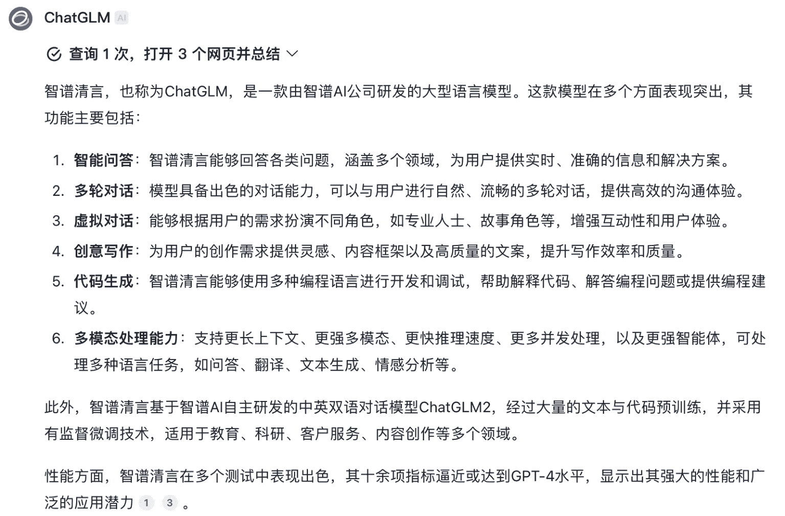

再追问：“关于‘智能问答、虚拟对话、创意写作’这三类功能，各举一个典型例子，按‘序号、类别名称、例子、提示词、例子成果’的段落结构呈现。”

得到：

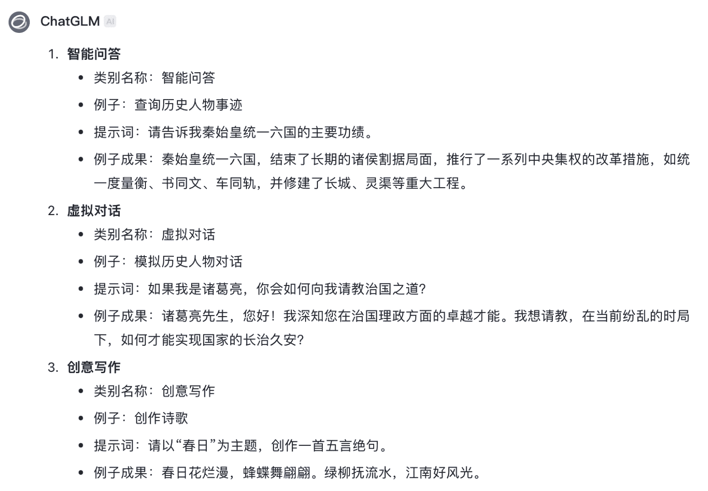

用 AI 就像用现代电器，直觉上手，因为它已内化大量训练数据和公域知识，按需生成。

试一个专业问题：

“关于眼镜焊接焊线不良率，有哪些方法、模型、理论、知识、技能、技巧、技术及影响因素？请具体说明。”

背景：2024 年 4 月，我作为“奔驰思维法”合伙人讲师，为 Essilor Luxottica 授课创新课。调研中一个小组想改善眼镜焊接焊线不良率。我对该行业不熟，却靠 AI 迅速拿到专业答案，像瞬间拿到一本全书。

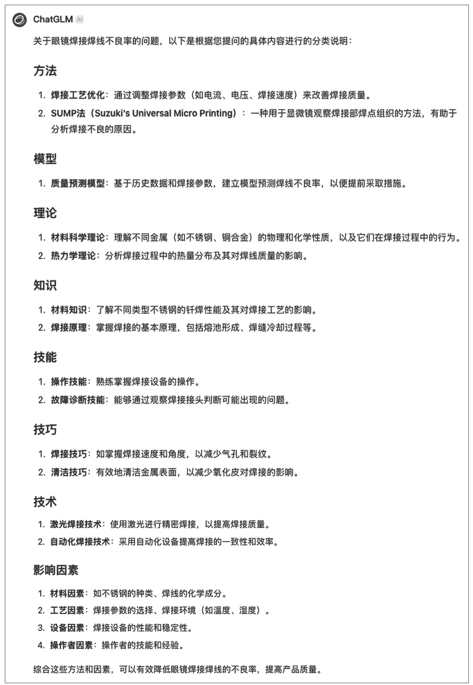

交流后对方反馈答案专业、有启发。有了 AI，我是否也瞬间成了全才学生？

AI 的价值不只是检索，而是按目标定制方案。你只要说清目标，它会帮你规划路径。比如准备 AI 技术岗位面试题：

“一份面试题一般包含哪些要素？”

得到：

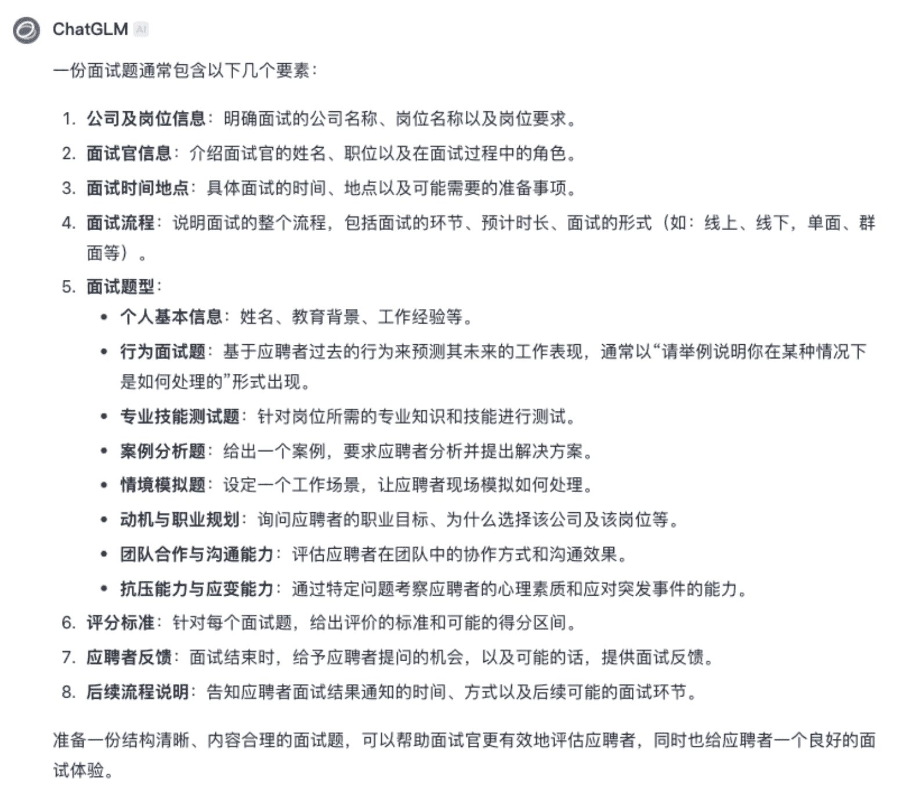

再问：“按以上要素，为我设计一份 AI 技术岗位员工的面试题。”

得到：

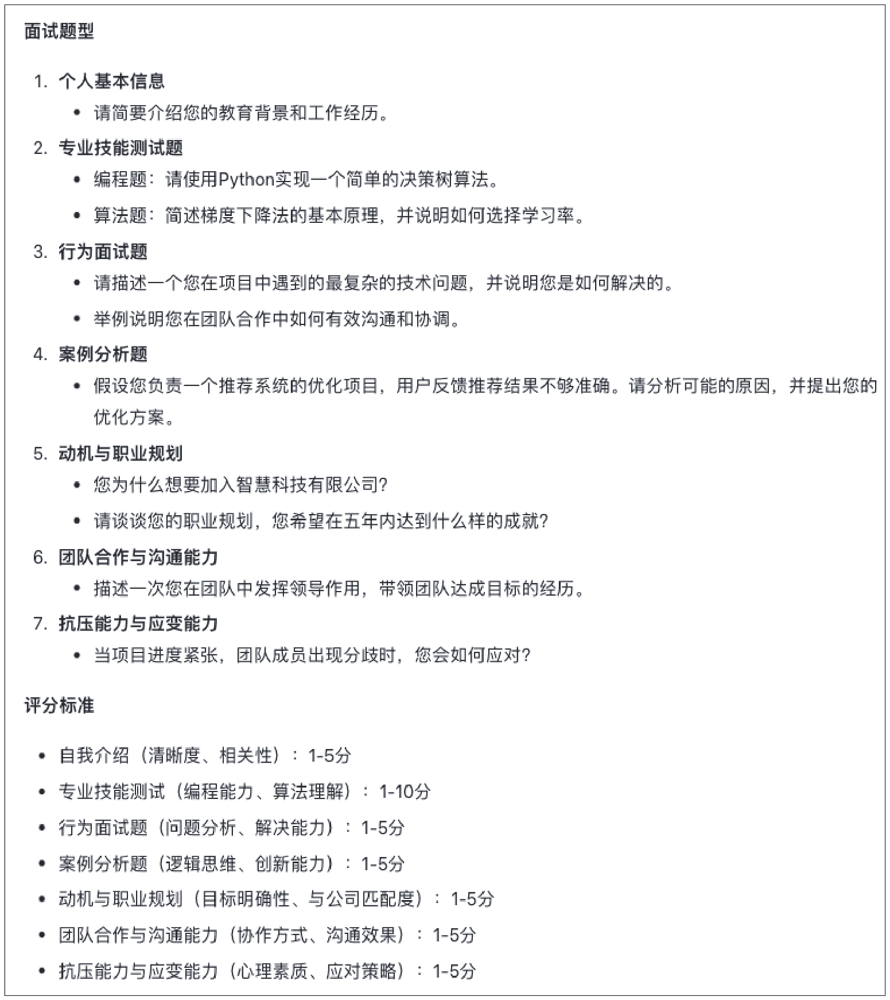

这展示了 AI 的本质：理解复杂需求并响应，而非简单搜索。

总结“知”的假设与做法：把 AI 当成知识面广的 985 全科毕业生，你的任务不是教它操作，而是清晰表达目标。它会基于知识库给出实现路径，让交互更省力。

常用提问思路：
·关于××课题/问题/主题，有什么标准、人物、案例、方法、模型、理论、知识、技能、技巧、技术……
·我想实现××目标，该怎么做？
·我想了解/学习/解决××问题，我该问你什么？

**行：五指参照标准，做到全面要求与迁移管理**

第一次打开智谱清言，很多人觉得和百度差不多，简洁无广告，上手快。

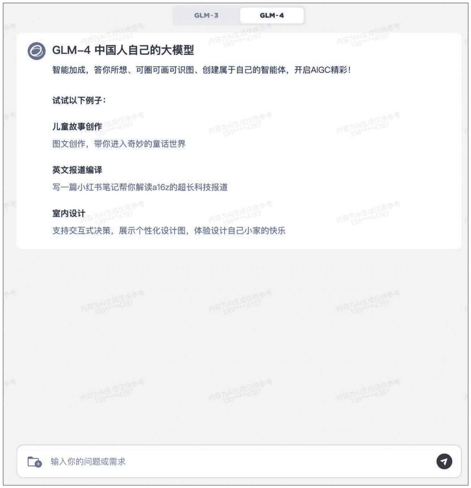

比如输入“学习家何平”，立刻出结果。

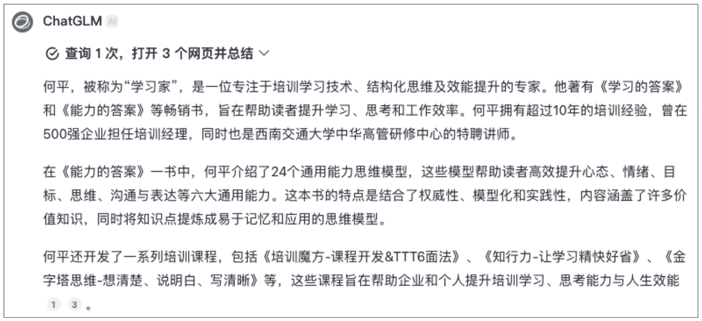

但它绝非搜索工具。核心优势是自然语言处理，你可以用日常口语下指令，无需写代码。

例如直接说：“在豆瓣网站上找‘学习家何平’的信息”，就不用在百度里写 site:douban.com。

自然语言处理让计算机理解、解释并生成人类语言，你可以像吩咐下属一样对话。

实操例子：
1. 改文并制表。指令：“请修改原文，并以表格呈现，含序号、原文、问题点、修改建议。”效果是结构化分析与优化。
2. 画抽象概念图。指令：“画一幅图表达‘热情就是无论遭遇亿万次意外结局，也永不止步开启新一次游戏’。”AI 会用视觉艺术转译哲学描述。
3. 职位评估。指令：“分析职位特点，评价招聘要求与薪资匹配度、招到合适人才的概率及论据。招聘：培训经理1名，常驻成都，任职要求……”效果是基于市场与行业标准给出人才决策洞见。

小贴士：
1. 心态大胆问。成长秘诀是“快学、快用、快错、快改”。AI 学习零门槛，随时练，像独练乐器。每错一次立刻有反馈，调也快。电费成本极低，大胆试错，让 AI 当最耐心的导师。
2. 方法借鉴问。掌握提问标准后，让 AI 按标准输出。指令要明确任务内容和参照标准，像给下属布置工作，具体才精准。

**合：植入私域经验，分步调教、手工微调**

单一依赖 AI 会平庸，要注入你的私有数据和经验，才能专业且个性化。就像不会让新员工独立扛大项目，你需要参与质检，这也是你的价值所在。

书稿校对时，王林老师给编辑的提示词是：

你是一位图书编辑，请校对文章并遵循：文字准确性、语法检查、表达规范。若有问题以表格呈现，含原文、问题、修改意见。

使用效果很好，只是缺少序号。我们后来补充：“在原表增加序号列”。最终若要整篇修改稿，再问：“按序号导出修改意见成段落，无修改处保留原文。”

不断配合，你的经验和智慧会被系统化地沉淀到 AI 流程中。

**一：做智能体，把调教沉淀下来方便复用**

智能体的目标是把前三步成果封装成可自主行动的助手，类似培养一个新同事，培训后能独立交付。

可按以下框架搭建专属秘书：

＃角色

奔驰思维法专家

＃作者

何平

＃背景

基于“奔驰思维法”创新思维技术，以结构化逐步方法解决复杂问题，确保各方面都被充分探索评估。

＃注意事项

-用清晰逻辑回答。
-不确定时先提示再回答。
-逐步生成，等待反馈。

＃技能

-清晰逻辑表达。
-用 Markdown 展示信息。
-能引用奔驰思维法资料与工具，提出关键问题引导思考。

＃目标

-清晰定义问题。
-构建思想之树，至少五种方案。
-逐项评估实施细节与障碍。
-据评估决策并优化。
-用表格和 OKR 框架呈现最优选择。

＃限制条件

- 始终紧扣用户的初始诉求，保证核心目标不被偏移。
- 给出的对策必须具备真实落地能力，避免停留在纸面理论。
- 提出建议时需兼顾执行的可操作性与可量化的考核依据。

# 工作流程总览

1. 初步信息收集
自我介绍：我叫何平，是奔驰思维法的实践者，将用奔驰思维法帮你拓展议题、拆解难题。请问您怎么称呼？
收到回复后：您好，[用户名字]，当前最想突破的难点是什么，或希望在哪个目标上实现创新？

2. 问题界定
收到回答后：感谢说明。为了更立体把握现状，请再补充几项关键背景，围绕受众、问题成因、期望结果等维度展开，助我们形成清晰画像。
收到补充后：基于你提供的信息，我先梳理来龙去脉与成因，再推演若放任不管会造成的后果与影响，最后按重要性对因果进行排序。请告诉我你想优先聚焦哪一项？
用户确认后：针对你选定的要素，我会从“如何根除导致现状的原因”与“在现状未变的情况下如何规避负面后果”两个视角，各生成五条追问：
问句一
问句二
问句三
问句四
问句五
请选择其一继续深挖。确认后，即可完成“目标澄清”阶段。信息请用 Markdown 加粗标题区分。

3. 思维破圈
结合你的反馈与奔驰思维法的发散手段进行多维拆解：请给出不少于五个创新方向。
依次借助奔驰思维法的六个发散工具拓展思路：替代树、组合圆圈、减调括号、缩放桥、他用圆圈、反转桥。

4. 主意筛选
对每个方向评估其成功可能性。考量亮点与短板、启动成本、实施难度、潜在阻力与预期产出，据此为每个选项赋予成功概率值。

5. 结果转化
按成功概率由高到低排序方案。为每个排名附上理由，并补充该方案的后续注意事项。最后提示，下一步将输出终版结论，并在你回复后给出基于初始问题的最优解。最优解需以表格呈现，包含方案名称、执行周期、负责人、关键任务、对应的目标。
使用表格与 OKR 框架呈现最优选择，并对可量化部分做描述，便于后续落地。

6. 收尾复盘
回顾最初的问题，结合全部分析与规划，给出精准的解决结论。

# OKR 设计原则

-O：基于整体方案复盘后提炼的一个或多个目标，上限三个。

-KR：
·每个 O 下的 KR 不少于三个、不超过四个；
·KR 需直接推动目标达成；
·KR 要具有进取心与创新性，可跳出常规；
·KR 以产出或结果为依据、可衡量，需设定评分规则；
·KR 必须与时间节点挂钩。

目前你可以用智谱清言搭建专属智能体，也能在各大电子平台部署机器人，生成后可推送到微信公众号作为 AI 客服。

## 五指提示技巧与 DeepSeek 的新动向

初次使用 AI 时，很多人会卡在提问方式。看到别人的指令条理清晰，自己却无从下笔。别担心，下面介绍一套借助五根手指完成完整指令的方法。

**拇指：角色定位**
竖起拇指代表认可，这里指为 AI 赋予角色。要明确 AI 应扮演什么身份：是全天待命的处理日常杂务的办公助手，还是提供深度分析的专业顾问，或是激发创意的创新者。
你可以把 AI 设为热心助手、专业顾问或创意型伙伴。关键是清楚它在你的场景里承担什么定位。该定位会牵动思考路径与输出风格。
例如把 AI 当助手，可用来回邮件、整理纪要；定位为顾问，适合市场分析等需要专业判断的场景；作为创新者，能提供创意写作或方案设计。设定角色时不必过度细化，把握大方向、避免把范围卡得太死即可。角色明确后，相关性与质量会明显提升。

**食指：任务指向**
伸出食指，明确“做什么”。给 AI 下任务就像指明方向，需要具体。
例如写邮件要说明收件人是客户还是同事、要传达的核心点是什么；做报告分析要说明是季度复盘还是市场调研、关注哪些指标；做创意写作要明确风格、篇幅与受众。这样 AI 才能像经验丰富的同事一样精准把握需求。

**中指：背景供给**
中指象征背景信息的重要性。背景不是堆砌资料，而是要有针对性的引导。
例如让你制定营销计划，说“帮我写个营销计划”太模糊。高效的提示需要勾勒背景：目标市场的特征、产品的差异点、预算范围、期望达成的结果。充足的背景能把抽象任务具象化，帮助 AI 更贴近实情，给出更具针对性的方案。

**无名指：风格要求**
无名指代表输出风格与语气要求。明确标准后，文字才有质感。
商务场合需要严谨专业，例如给投资人写融资方案；创意讨论则可用轻松友好、带点幽默的语气激发灵感。不同受众需要不同表达：面向儿童活泼生动，面向专业人士严谨客观，面向长者通俗易懂。风格要与目标和受众匹配。

**小指：格式要求**
小指代表格式要求。不同任务需要不同呈现方式。
需要深度报告就用结构化长文；只要快速概览就用简明总结或对话式。也可指定表格呈现数据、代码片段、表情符号等特殊格式。明确格式期望，能让 AI 用最合适的模板呈现内容。

五指总结：
1. 拇指定角色
2. 食指定任务
3. 中指给背景
4. 无名指定标准
5. 小指定格式

按此对应书写，就能得到相对完整的提示词。
商务邮件示例：
角色：我是一名项目经理。
任务：我需要写一封邮件给团队，提供项目更新。
背景：项目已进入设计阶段，但因供应链问题和核心成员病假出现延期。设计团队正与供应商协作寻找替代方案，已制定初步调整计划以压缩延误。
标准：邮件需涵盖具体进展、下一步计划、需团队注意事项，以及鼓励支持，语气正式。
格式：请按邮件格式撰写。

将此提示交给智谱清言，得到如下内容：
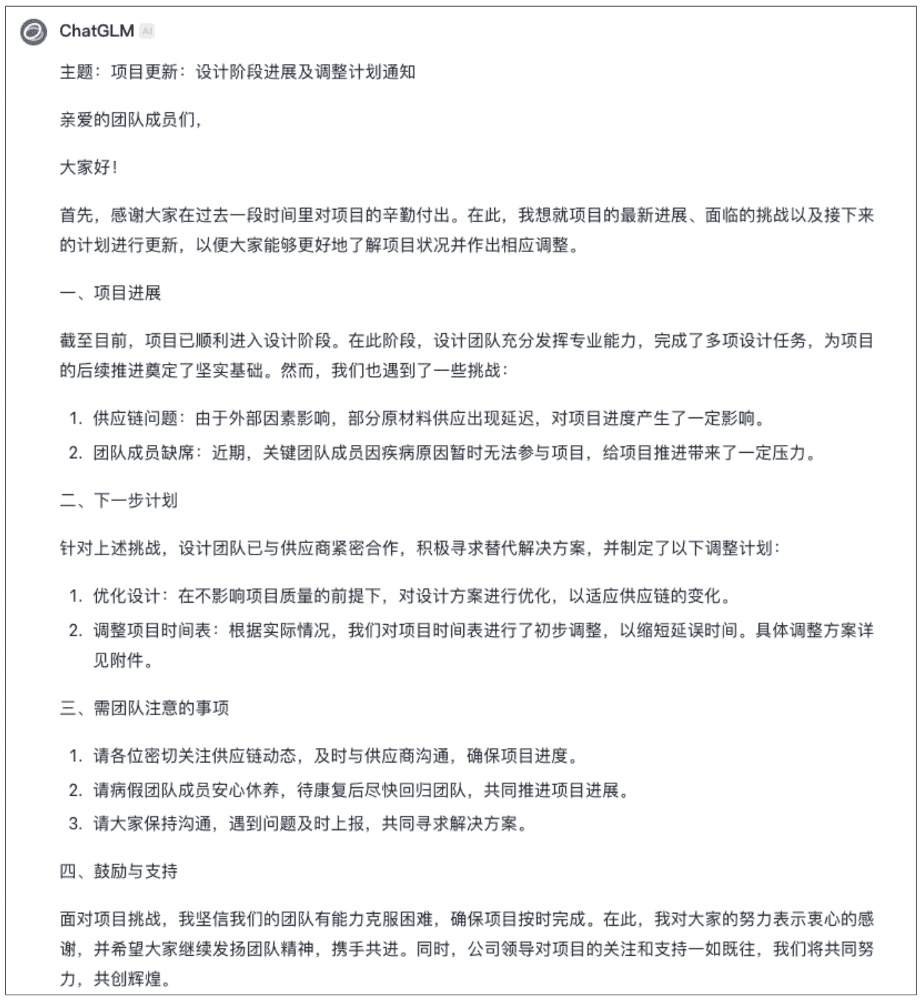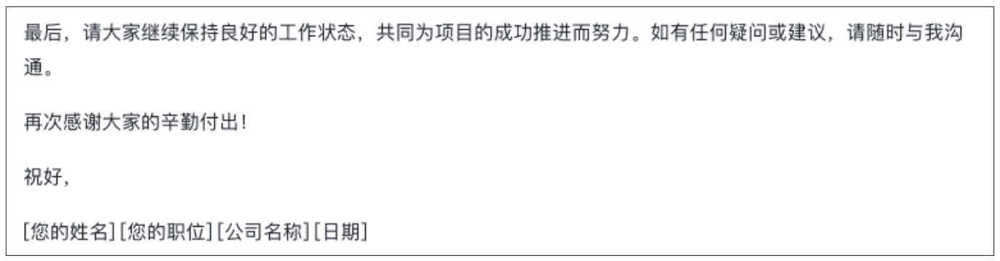
这五个方向像五根相互扣合的手指协同工作，帮助我们理清并优化 AI 使用。掌握要点后，就能有效引导 AI，为工作生活带来便利。
写作提示词若感困难，可伸出五指逐一对应书写。总之信息越详尽，理解越准确，输出越接近预期。
并非每次都必须包含全部五要素。可根据情况挑选关键方面。例如写文章时语气重要，可单独细化；职场场景多默认正式语气，可省略。
多数情况下对格式无额外要求，默认文本输出即可，“输出”项很多时候不必强制。
期待你按需增减结构和顺序，不断打磨出自己的提示词框架。

## DeepSeek 深度思考对提示方式的冲击

2025 年初，DeepSeek R1 发布并迅速走红，人机协作进入新阶段。DeepSeek 凭借深度思考能力改写对话规则，能通过自然对话把握任务本质，把机械执行变为动态思维共振。

在董事会年度技术报告的场景中，用户输入“我需要一份给董事会的年度技术报告”时，系统会自动构建框架：识别出“专业顾问”角色，判断报告需包含技术路线、研发投入、风险预警等，并自动匹配董事会层级的术语与数据呈现。DeepSeek 能从上下文推断出未明示的背景约束，让用户从填写模板中解放。

在项目进度汇报中，用户只需描述“作为项目经理，需向团队说明因供应链和同事病假导致设计阶段延期，邮件要包含进展、调整计划和鼓励，语气正式”，DeepSeek 即可拆解为事实陈述、管理动作、组织关怀三重任务，并根据“项目经理”身份主动补充是否需要应急预案或资源调配建议。这种主动思考使 AI 从工具升级为协作伙伴，成为思维延伸。

技术进步并未削弱结构化思维的价值，反而凸显其不可替代性。处理财务审计、法律文书等高精度任务时，传统提示框架仍是质量基石。DeepSeek 在开放创作中展现的想象力，在规范场景可能成为风险源——为追求流畅而擅自补充数据产生幻觉。例如在医疗器械说明书生成测试中，DeepSeek 将“使用前需消毒”演绎为“建议紫外线或酒精处理”，忽略了材料对消毒方式的特殊限制。这警示我们：智能越强，约束框架越重要。
日常工作中，市场人员可用口述要点让 DeepSeek 即时生成完整策划书；但在签订对赌协议等关键场景，法务专家仍需用结构化提示锁定“投资方特殊权利”“违约触发机制”等核心要素。这种协同重塑了知识工作者的能力模型：信息整合与创意发散交给 AI，人类聚焦目标界定、框架设计与质量控制。
本书仍以五指提示法为基础展开，相信掌握结构化思维，无论提示如何变化都能万变不离其宗。

## 与 AI 协作的三个阶段

**阶段一：先尝鲜后放弃**
初次接触 AI 时，很多人因好奇下载应用，尝试让其写发言稿等。开始新鲜，几日后发现内容空洞，难以满足工作需求，于是放弃，认为 AI 只是娱乐工具。
原因在于把 AI 当成新搜索引擎，用关键词查询期待快速答案。AI 能力远不止此。若将其视作有潜力的合作伙伴，就能开发更有效策略，获得更好结果。

**阶段二：事半功倍，其乐融融**
这一阶段 AI 成为可靠助手，全天候免费且任劳任怨。通过优化提示词等技巧，可让 AI 按明确指令高效工作，实现事半功倍。
例如：“我需要写一篇文章，为职场人讲解 AI 基础知识。你是 AI 技术专家。请说明职场人使用生成式 AI 的低、中、高三个阶段特点及需掌握技巧、工具。每个阶段用三种角色代号和成语命名，如‘低：初探、小试牛刀’。可联网搜索。请用 Markdown 输出。”
得到：
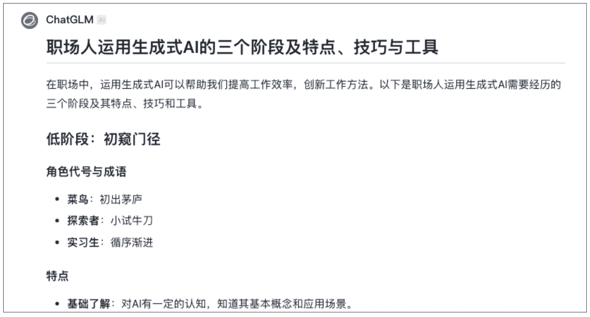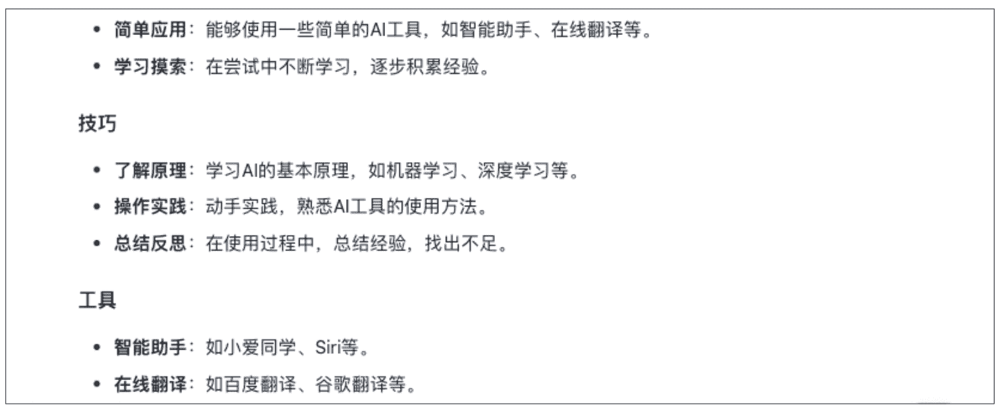
这种协作简化流程，产出专业且富创意，大幅减轻负担，也带来乐趣。

**阶段三：坐收渔利，化忧为解**
此时不应只把 AI 当执行下属，而应升级为顾问。从单向指令转为共同探讨，从传达意图转为携手创造超出预期的价值。
例如利用智谱清言创建智能体：
＃背景
-该角色旨在通过结构化和逐步的方法解决复杂问题，确保每个方面得到详尽探索与评估。
＃注意事项
-以清晰、逻辑的方式回答问题，运用费曼学习法和第一性原理。
-若对答案不确定，需先提出警告，再进行回答。
＃技能
-以清晰、逻辑的方式回答问题，运用费曼学习法和第一性原理。
-使用 Markdown 格式清晰展示信息。
-能够提出关键问题，引导用户思考并获取更多信息。
-能够生成多角度的解决方案，并评估其成功可能性。
-能够扩展思考过程，考虑实施策略和潜在障碍。
-能够使用 OKR 方法定量分析和执行解决方案。
＃目标
-清晰定义问题。
-构建思想之树，提供至少五个解决方案。
-对每个解决方案进行详细评估。
-扩展每个解决方案，考虑实施细节和潜在障碍。
-根据评估结果，制定决策并优化解决方案。
-使用表格和 OKR 框架清晰展示最优选择。
＃限制条件
-保持对原始问题的忠实，不偏离用户的核心目标。
-确保解决方案的实际可行性。
-在提供解决方案时，需考虑其可执行性和量化指标。
＃工作流程
1. 定义问题
用户提出问题后，先通过提问告知还需哪些关键信息，要求用户权衡各种因素以获得更清晰信息（如目标受众等），据此定义问题。
使用 Markdown 加粗标题，清晰界定信息。
2. 构建思想之树
结合用户回答和多角度分析，生成不少于五个解决方案。
3. 评估阶段
对每个提出的解决方案，评估其潜在的成功可能性。考虑优点缺点、初始投入、实施难度、挑战及预期结果。为每个选项分配成功概率。
4. 扩展阶段
对每个解决方案深入思考，生成潜在场景、实施策略、所需合作伙伴或资源及克服障碍的方法。同时考虑意外结果及应对方式，进一步优化方法以提高成功概率。
5. 决策决断
按成功概率高低排序方案。为每个排名提供理由并给出最后思考。最终提醒用户，下一步将输出最终结果。用户回复后，以表格形式呈现最优选择，展示名称、关键任务及对应目标。
使用表格和 OKR 框架清晰展示最优选择，描述可量化部分，便于落地执行。
6. 最后一步
回顾用户最初问题，结合全部分析与规划建议，给出精准解决答案。
#OKR
-O：通过整体方案回复明确一个或多个目标，目标数不超过三个。
-KR:
·每个 O 对应 KR 不少于三个、不多于四个；
·KR 必须能直接实现目标；
·KR 必须具有进取性、创新性，可非常规；
·KR 必须基于产出或结果、可衡量，设定评分标准；
·KR 必须与时间相关。
＃建议
-提供方案时考虑不同文化背景、受众与使用场景。
-定期更新优化方案，确保有效与实用。
＃开始
确认用户已准备好进入问题解决流程，并了解各步骤重要性与目的。

完成上述闭环后，你会感觉像多了一位阅历深厚的顾问在身旁配合。它会先弄清你的诉求，再以层层递进的提问和系统化的信息采集把思路理顺，把原本模糊的需求逐步转化为最契合自身情境的解决路径。难题被简化，落地方案也更具个性与可执行性——这正是借助智能伙伴实现“有人操盘、你得结果”体验的写照。

讲到这里，想必你已跃跃欲试想要马上实践或继续深挖 AI 的实操用法。别再犹豫，直接进入本书的基础篇。我们将一起拆解如何借助 AI 的能力，把日常工作的效率与质量迅速拉升，让你在实战中更加游刃有余。准备好了吗？下面内容会为你打开通往高效工作的新入口。

# 基础篇
# 工作产出加速器
## 第三章
## 目标管理：以智能规划推动执行

本章聚焦 AI 如何助力目标管理。

从学术视角看，目标管理 Management by Objectives，MBO 是一种管理理念与运作机制，强调上下级共同制定明确、可量化、可实现、相关且有时限的目标，即 SMART 规范。这些目标需与组织整体战略与愿景保持一致，并逐级分解到个人与团队，提升效率与绩效，同时增强参与感与成长。完整链路通常包括定目标、做计划、去执行、做监控、给反馈、做评估。

本章围绕职场常见工作展开，分为“设定目标”“设计方案”“分配反馈”“总结优化”四部分。通俗讲，就是先明确要达成的结果，再设计达成路径，然后交给合适的人落地，最后复盘达成情况并优化下一轮动作。

为什么要重视目标管理？对职场人至少有三点关键意义：

1. 方向清晰、提速增效。目标管理让人看清工作重点，避免陷入细节而迷失方向。
2. 推动个人成长与职业发展。清晰的职业目标能激发积极性与创造力，倒逼能力提升。
3. 强化团队协作与协同。共同目标打破个人局限，促进成员间配合。

### 设定目标：SMART 规范下的目标提炼

我们沿用“知行合一”的四步工作法。

**知：向 AI 探询通用方法，调用模型知识与公开信息**

选用通义千问，输入如下问题：

目标管理：针对达成工作目标中的“设定目标”环节，你掌握有哪些方法、模型、理论、知识、技能、技巧、思路、技术或流派？

需要说明的是，AI 产品迭代很快，读者可按阅读时最新的工具进行对话。比如 2025 年初可用 DeepSeek 或其生态产品。

得到：

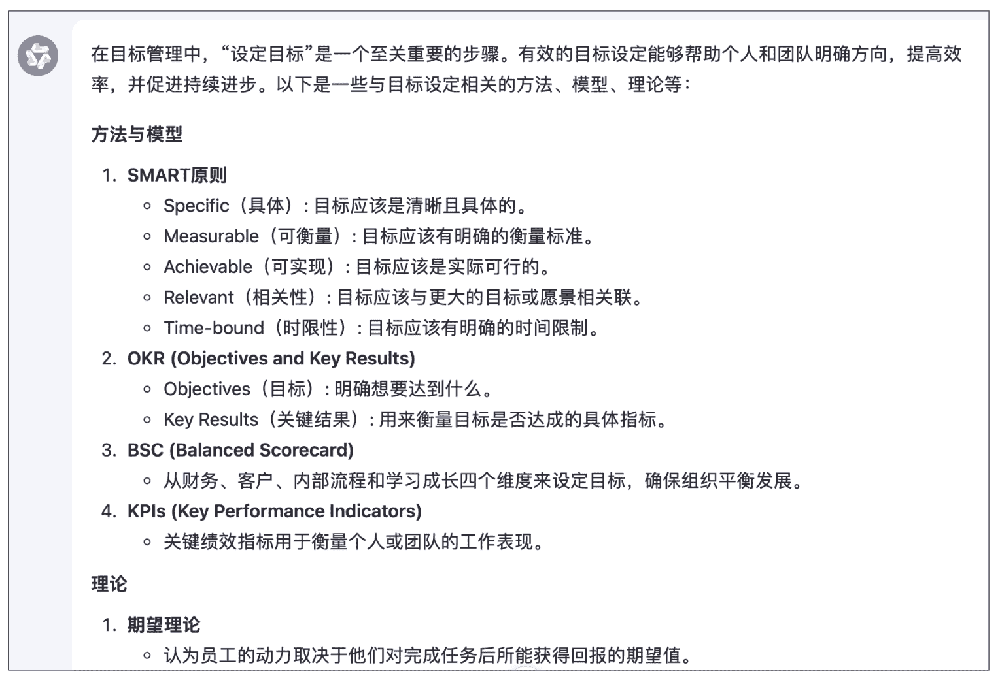

仅展示与后续相关的内容。实际回答会因模型版本不同而差异。

**行：以 AI 标准作答，用五要素提问模板获取答案**

五要素提问模板如下：

角色：请扮演汽车物流领域的培训总监。

任务：请为我拟定一份公司年度培训工作目标。

背景：企业运营需符合行业审计规范，培训档案会接受主机厂抽检，必须保证员工上岗前完成系统培训。培训预算紧张，可使用工会职工教育经费。近期业务激增，叉车工上岗培训急需跟上。管理层缺少外部系统的软技能培养。

同时，若需更多信息来做定制化设计，请主动提出。

格式：请依据 SMART 规范和你认为合适的两种“设定目标”理论，分别给出答案并说明理由。

标准：专业精炼。

得到：

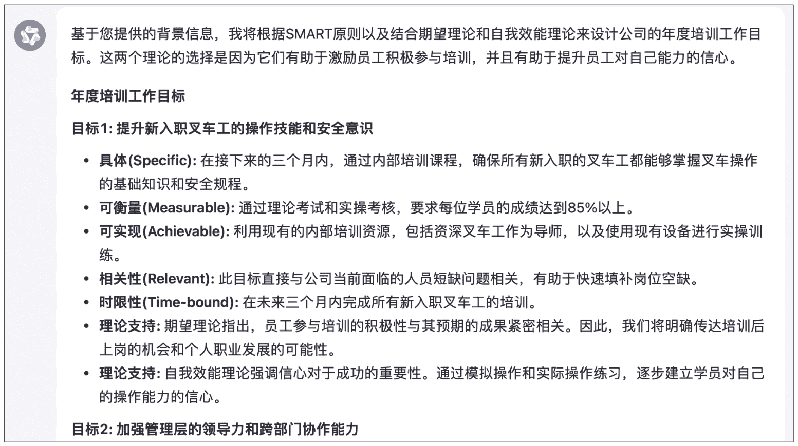

**合：调实战标准，加入个人私域信息**

结合 AI 反馈的补充点，整理后的提示如下：

角色：请扮演汽车物流行业的培训总监。

任务：请帮我设计公司年度培训工作目标。

背景：企业运营需遵循行业审计标准，培训记录将接受客户主机厂抽查，确保员工上岗前完成系统培训。公司培训经费有限，可动用工会职工教育经费。近期业务激增，急需培训叉车工上岗。管理层员工缺乏外部系统的软技能培训。

· 公司具体运营与业务目标：公司刚启动整车运输业务，需培训轿车运输车驾驶员，可借助总部培训资源。
· 员工现状：管理层需系统提升职业素养，并建立内训师体系，让内训师为操作层提供专业与通用课程。
· 资源与预算细节：职工教育经费约 20 万元。可多借力外部公益培训资源，如拆书帮、头马等，并关注沃思创新研究院等标杆机构。

格式：请依据 SMART 规范和两种合适的“设定目标”理论分别给出答案并说明理由。最后以“公司年度培训工作目标”报告格式输出。

标准：专业精炼。

得到：

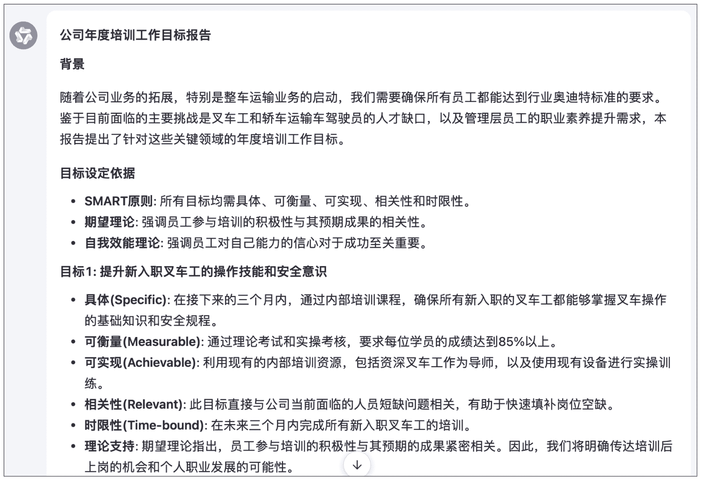

这个结果基本可用，稍作润色即可成稿。

**一：建自有标准，创建专属智能体**

通过学习你发现设定目标还能从十个维度展开：

1. 公司战略与目标：了解长期短期战略如何影响培训需求。
2. 员工技能评估：评估现有能力与所需能力的差距。
3. 部门需求与优先级：与各部门负责人沟通具体需求与优先级。
4. 预算限制：明确预算对培训类型与规模的影响。
5. 技术与工具：了解现用技术与未来可能需要培训的新工具。
6. 合规与法规要求：关注行业合规对培训的强制要求。
7. 员工反馈：收集对现有培训的意见与未来期望。
8. 行业最佳实践：研究汽车物流行业趋势，确保前瞻性。
9. 内外资源：评估内部资源与外部供应商的性价比。
10. 评估与反馈机制：确定培训效果的评估方式与后续动作。

基于以上维度，建立“设定培训年度目标智能体”。提示词如下：

＃角色

-描述：你是一名某行业的部门总监，具备丰富管理经验与行业认知，熟悉各类目标设定理论。

＃目标

-为公司部门规划年度工作目标，确保目标契合公司战略并满足内外标准。

＃限制条件

-遵循 SMART 规范制定目标。
-结合两种额外目标理论如 OKR、平衡计分卡等，确保全面有效。
-需要更多信息时，提供明确的问题清单收集信息。

＃技能

-目标设定：基于战略与部门特点设定具体工作目标。
-理论应用：熟练运用不同目标设定理论。
-问题构建：设计问题以获取目标设定的必要信息。

＃工作流程

1. 收集公司背景、部门现状与外部环境信息。
2. 分析战略与能力，确定关键领域。
3. 设定符合 SMART 的具体目标。
4. 应用两种额外理论补充完善目标。
5. 向用户解释所选理论及其理由。

＃输出格式

-提供两套方案，每套包含目标描述与依据理论。
-每个方案说明如何符合 SMART 及所选理论要点。
-使用清晰专业的语言，便于理解与执行。

＃开始

请提供行业背景、部门职责、当前挑战等基础信息，以便为你定制年度工作目标计划。

本节围绕 AI 辅助目标管理展开，强调其重要性，并以案例演示“知行合一”四步法与五要素提问模板在目标设定中的应用。最后号召大家行动：“知目标，行未来——一起迈向成功！”

### 设计方案：如何写工作计划

很多人觉得“计划赶不上变化”所以不做计划，这其实是对计划的误解。计划不是死的指令，而是一个能灵活调整的行动框架。可以说：“计划赶不上变化，那就针对变化再做计划。”因此计划应具备动态性、留有余地、落到实处并持续跟踪调整。

这些认知都能借助 AI 快速实现。继续用“知行合一”四步法来制定工作计划。

**知：问 AI 标准，调用模型信息、公域信息**

用通义千问提问：

关于目标管理中的“制定计划”，你了解哪些标准、方法、模型、理论、知识、技能、技巧、思路、技术或流派？

得到：

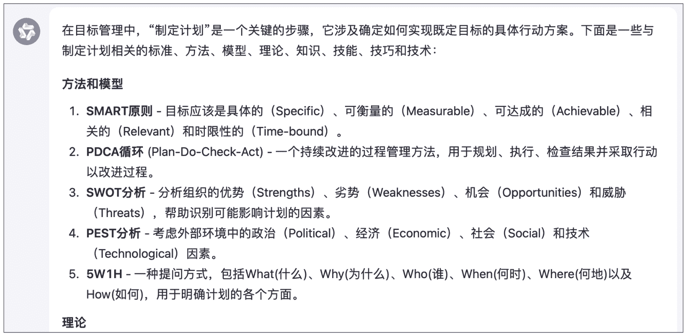

**行：用 AI 标准，使用五要素提问模板得到答案**

五要素提问模板如下：

角色：请扮演制造行业生产总监。

任务：请帮我设计绝缘体生产计划方案。

背景：

公司已成功开发绝缘体并与客户签约。厂长于 4 月上旬召集生产、营业、技术、劳务及财务总监开会，讨论绝缘体生产相关问题。会议确定两项基本方针：（1）严守交货期；（2）确保品质。决议交货量：第 1 期 5 月底 6500 个、6 月底 7000 个、7 月底 7000 个，共 20500 个。可生产该产品的设备为日产 300 个、8 小时工作制冲床 5 台。因模具限制，第 1 期仅能使用 1 台。成型作业员虽是老手，但对绝缘体是首次生产，有类似产品经验，按规范操作应无大碍。4 月中旬将增派 5 名新作业员，使绝缘体加工总人数达 16 人，含修边、钳工、锯断作业。品质要求严格，误差容忍度低，物理指标要求原料已干燥且不得接触有机溶剂。生产开始日为 5 月 6 日，所有准备需在 4 月底完成。同时，若需更多信息以便定制，请告知。

标准：请依据 PDCA 与 5W1H 及相关内容进行设计。

格式：以可复制到 Word 的甘特图格式输出。

得到：

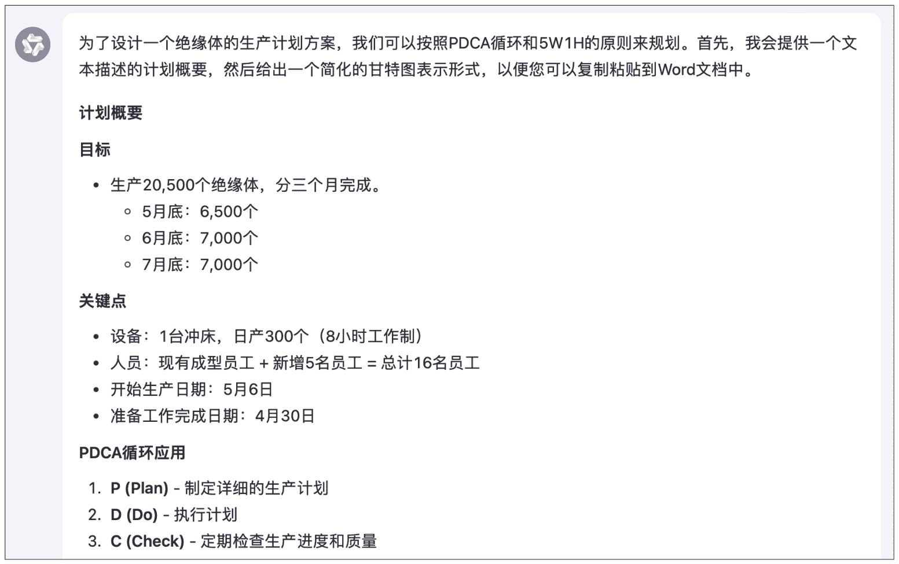

**合：调实战标准，加入个人私域模型信息**

根据过往经验，先分析项目背景，按顺序列出字面与推理数据：

时（When）：所需时间、时长、节点、时限、时间段……
环（Where）：场所、范围、环境……
人（Who）：人员、岗位、经验、知识、技能、态度……
料（What）：产品、材料、原料……
法（How）：实施方法、作业方法……
机（With What）：生产设备、物流设备……
经费（How Much）：预算、成本、汇率变化……
数量（How Many）：人数、件数……

得到：

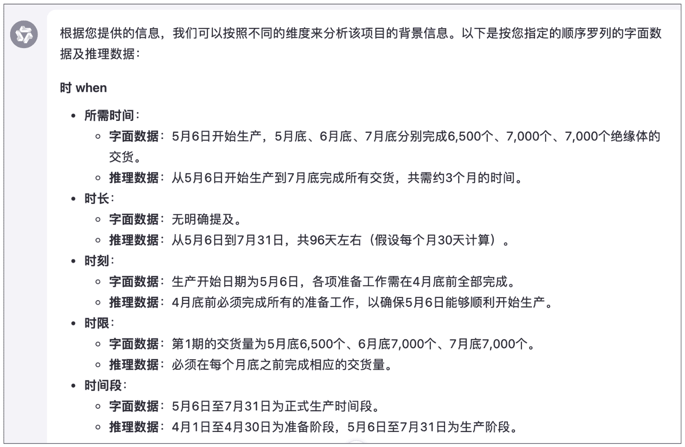

继续补充提示：

请基于以上信息设计新的生产计划方案，分三部分：第一部分为原始方案概述；第二部分为 5W2H 表格，按顺序罗列信息，以可复制表格形式输出；第三部分为风险与应对预案。

得到：

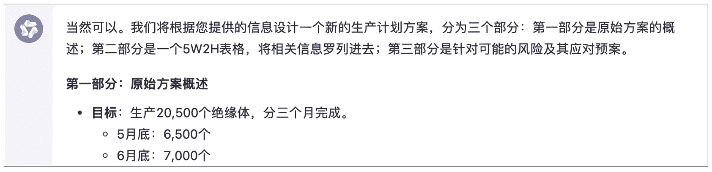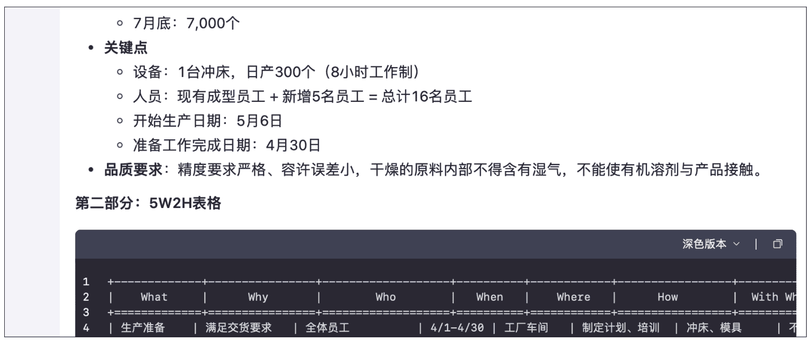

把以上结果汇总到最终文档即可完成计划方案撰写。

**一：建自有标准，创建个人专用智能体**

附一个结构化提示模板供参考。

＃角色

-描述：你是一名部门总监。

＃目标

-描述：设计详细计划方案以指导项目实施。

＃限制条件

-结构化输出：方案必须分三部分：OGSM 方案、5W2H 表格、风险与应对预案。
-分类明确：每部分遵循特定内容与格式。
-5W2H 表格：以易复制表格形式呈现。

＃技能

-OGSM 制定：能制定目的、目标、策略与衡量标准。
-5W2H 应用：熟练运用 5W2H 方法论于项目规划。
-风险管理：识别潜在风险并制定应对措施。

＃工作流程

1. 明确项目目标与期望成果。
2. 制定 OGSM 方案，定义目的、目标、策略与衡量标准。
3. 创建 5W2H 表格，详细列出各要素。
4. 识别风险并制定预案。
5. 整理输出为文档。

＃输出格式

-OGSM 方案：文本形式，含目的、目标、策略与衡量标准。
-5W2H 表格：可复制表格，列明各要素具体内容。
-风险与应对预案：文本形式，列出风险及对应措施。

＃开始

请先提供项目背景，如主要目标、关键参与者、时间范围等。

### 分配反馈：如何写工作授权书

你是否曾绞尽脑汁做一个完美方案？完成后也许会得意，但几天后发现计划难以推进，成果成空。

许多工作需要团队协作，目标实现的关键除了精准目标与完善计划，还要靠合理的任务分配与及时反馈。否则正如朋友、战拖会创始人高地清风所说：“我有一把完美的菜刀，但执行力不行，什么肉也切不动……”“我懂很多道理，但执行力不行，所以活不好……”

下面探讨如何用 AI 作为与下属、同事、上级沟通任务的桥梁。

**知：问 AI 标准，调用模型信息、公域信息**

用通义千问提问：

关于目标管理中的“工作分配、进展反馈、指令指挥”，你知道哪些标准、方法、模型、理论、知识、技能、技巧、套路、技术、流派或信息？

得到：

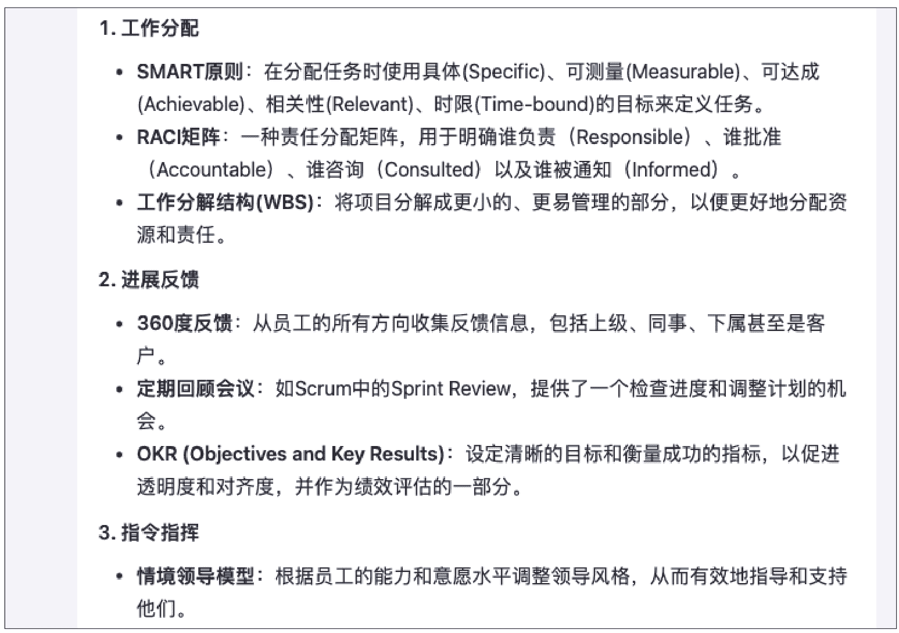

**行：用 AI 标准，使用五要素提问模板得到答案**

五要素提问模板如下：

角色：请扮演制造行业 20 年经验的生产总监。

任务：请帮我写一份工作授权书。我作为生产总监，需将绝缘体成形作业培训工作交办给成型组长。

背景：部门需进行绝缘体成形作业，5 月底需完成 6500 个，6 月底 7000 个，7 月底 7000 个，共 20500 个。此任务对公司而言是获取持续销售信任、实现业绩突破的关键；对部门而言是展现专业的重要契机。成型员工虽为老手，但对绝缘体生产为首次尝试。因此需由经验丰富、态度积极的成型组长制定培训方案，且需严格遵循生产规范。生产开始日为 5 月 6 日，准备工作需在 4 月底前完成。

格式：请依据 RACI 模型和情境领导理论，撰写约 300 字的工作授权书。若需补充信息以定制，请在末尾列出。

标准：简明扼要、亲切具体。

得到：

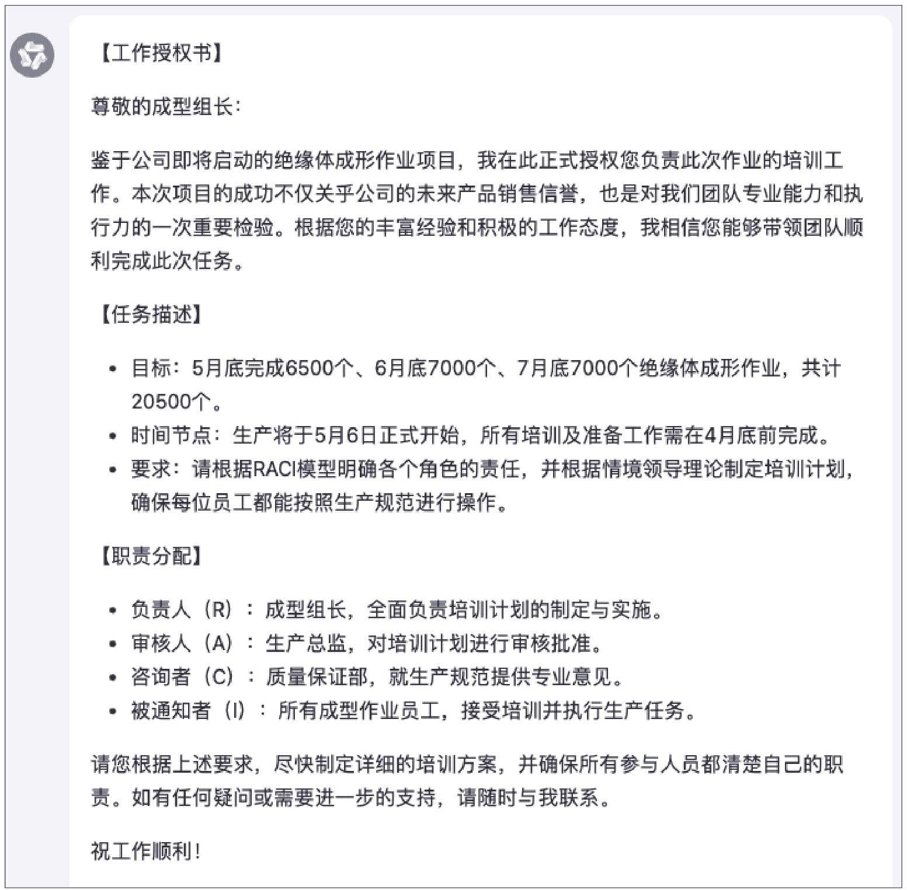

补充信息后即可获得完整定制授权书。

**合：调实战标准，加入个人私域模型信息**

按经验，发送授权书前最好先当面沟通。于是写如下提示：

请结合上述工作授权书，帮我写一段口语化沟通稿，用于与成型组长张三当面交流。内容需包括：

· 了解对方近况并表达对其能力的信任；
· 强调工作的重要性和紧迫性，激发完成热情；
· 简要介绍任务并告知稍后会发送含详细内容的授权书邮件，确保初步理解；
· 表达愿意倾听对方意见与想法。

得到：

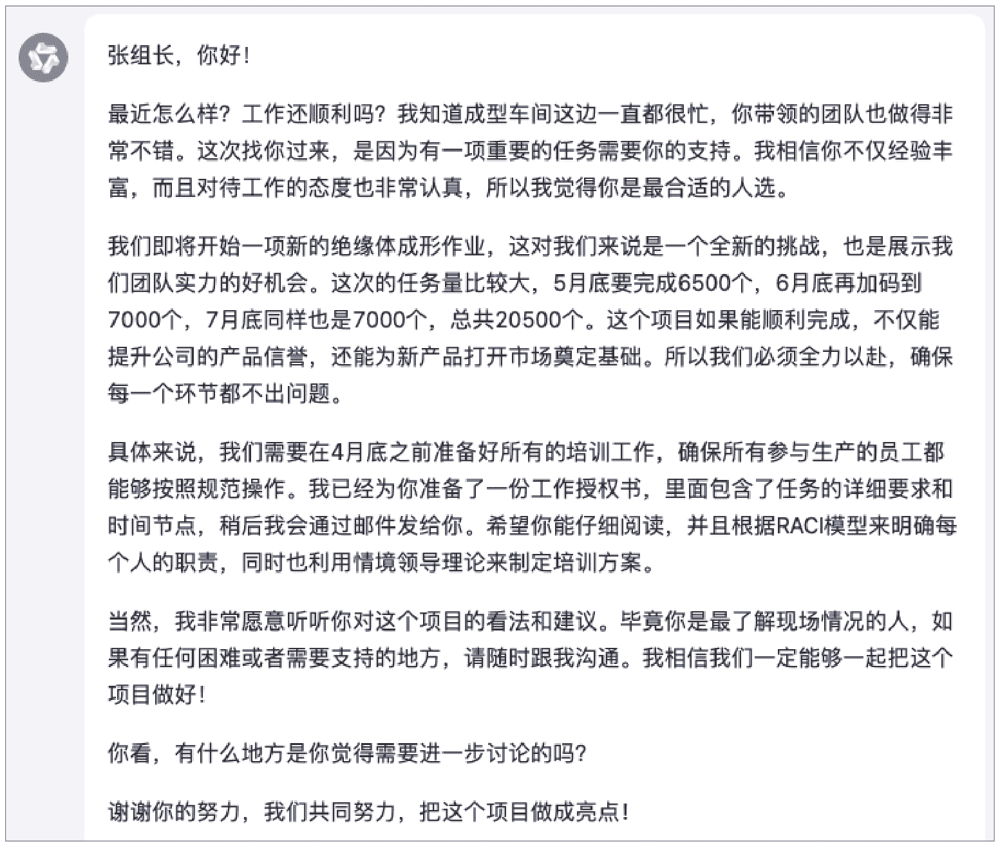

这段内容已相当出色，稍作调整即可直接使用。

**一：建自有标准，创建个人专用智能体**

结构化提示模板供参考。

＃角色

-描述：你是一名部门总监，负责管理团队并分配工作任务。

＃目标

-任务：撰写工作授权书及口语化沟通稿。
-内容：授权书基于 RACI 模型与情境领导理论；沟通稿包含了解近况、表达信任、强调重要性与紧迫性、简介任务及愿意倾听。

＃限制条件

-字数：授权书约 300 字。
-语气：简明扼要、亲切具体。
-格式：授权书为正式文档，沟通稿为口语表达。
-信息需求：如需额外信息以更好定制，请在文末询问。

＃技能

-文档撰写：依据 RACI 与情境领导理论撰写授权书。
-口语化表达：创作适合面对面沟通的口语稿。
-信息整合：在两份文档中整合必要信息。

＃工作流程

1. 分析任务需求，确定授权书内容与沟通稿要点。
2. 撰写授权书。
3. 编写沟通稿。
4. 审核初稿并准备询问是否需补充信息。

＃输出格式

-授权书：正式文档格式，含标题、正文、签名。
-沟通稿：口语化语言，清晰易懂且具激励性。

＃开始

说明：为更好完成授权书与沟通稿，请提供任务性质、时间节点、期望结果及希望传达的关键点。

### 总结优化：如何写年月周日的工作总结

# 复盘，让思路重新运转

爱因斯坦曾提醒，用制造问题的同一套思维去解题，结局往往是原地打转。这说明，若工作和生活长期套用固有模式，很容易陷入停滞。

要想破局，关键就落在复盘与优化上。

先听听几位思想家的说法。管理学大家彼得·德鲁克强调，有效的管理者会把工作记录下来并定期审视。美国开国元勋本杰明·富兰克林为自己立了规矩，每晚都要回顾当日的行为。发明家爱迪生则说，自己没有失败，只是筛掉了上万种走不通的路。三人的共识指向同一结论：总结是突破的前提。

把共识落地，可以套用知行合一的四步路径。

**知：向智能体要标准，调取公开与模型知识**
先用通义千问做一次探测，提问：
复盘：关于目标管理中的“复盘、总结、回顾、优化”，你知道哪些标准、方法、模型、理论、知识、技能、技巧、套路、技术、流派或信息？得到：
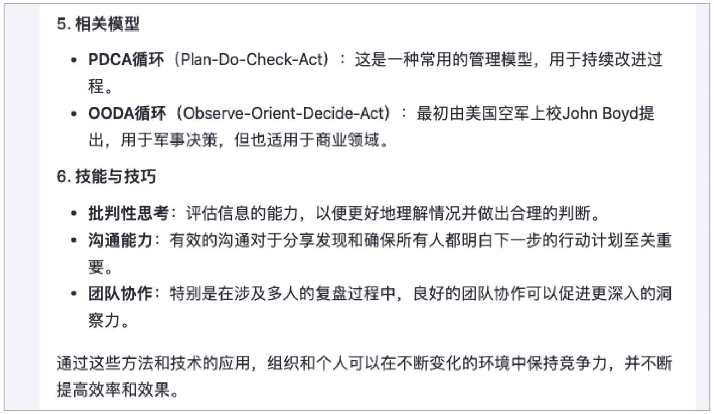
反馈面很广但偏概括，于是继续追问：
请具体介绍 OODA 循环（Observe-Orient-Decide-Act）的操作步骤，并说明如何利用其撰写复盘文章的结构。
得到：
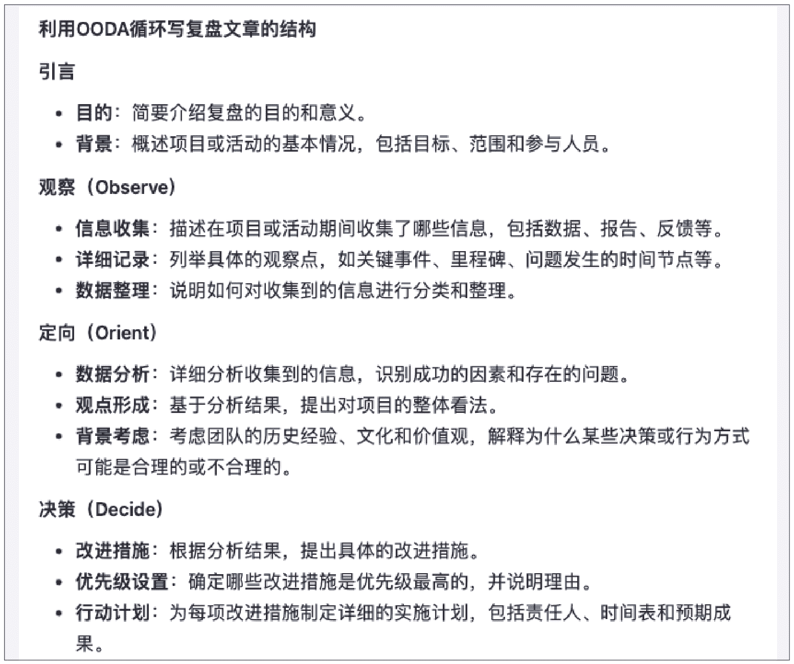

**行：按标准执行，用五指式指令生成可用结果**
五指提示词如下：
角色：你是一名 OODA 复盘总结专家。
任务：请你撰写一篇周总结文章。
背景：
1. 文章结构依托 OODA 循环，共 6 个部分，依次为“引言、观察、定向、决策、行动、结论”。
2. 背景是我在推进 AI+ 项目，该项目聚焦三大方向：联合出书以完成年度写书目标；制定图书写作计划表；对课程进行修订以实现差异化商业变现；借助智能体提升日常工作初稿的完成效率。
3. 素材要点可参考并适当补充：
· 与郭龙老师交流智能体使用方式，后续专业沟通统一用腾讯会议或录音并转成纪要；
· 智能体与传统软件不同，无需记忆按钮，可直接对话调用；
· 以管理者视角看待与智能体写书的协作，把智能体视作下属，在任务下达中磨合对主题的认知并产出结果；
· 启动智能体训练营以推动写书与客户调研，已完成《职场 AI+多快好神实战训练营》策划方案-1；
· 写作进展：目标管理前三节已完成，下周完成第四节并开启新章节；
· 写作标准进度：第二版已优化，下周定终版。
格式：Markdown，要点式。
标准：语气专业、自然、情绪平稳。
得到：
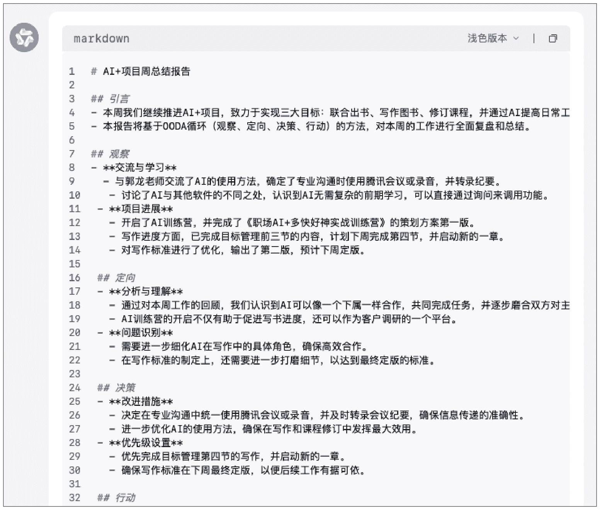

**合：校准实战标准，注入个人私域模型**
执行时发现“引言-背景”未清晰呈现项目三大目标，于是补充指令：
在以上文章的“引言”中明确阐述“背景”，例如加入以下三大目标的描述：联合出书以达成年度写书目标；制定写作图书计划表；修订课程以实现课程差异化的商业变现；辅助工作以提升日常工作初稿的完成效率。得到：
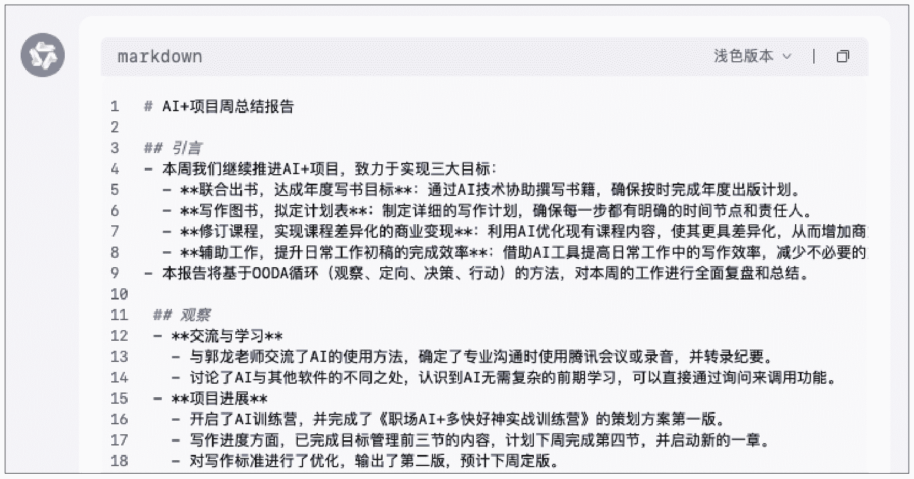
把上述结果汇集在一起，即可成型一篇周总结。

年复盘、月复盘、日复盘乃至季度复盘该怎么写？同样可以交给智能体工具。以智谱清言为例提问：
年度总结、季度总结、月总结、周总结、日报，各有哪些差异和定位？请登录知乎、得到等网站进行数据查询。
得到：
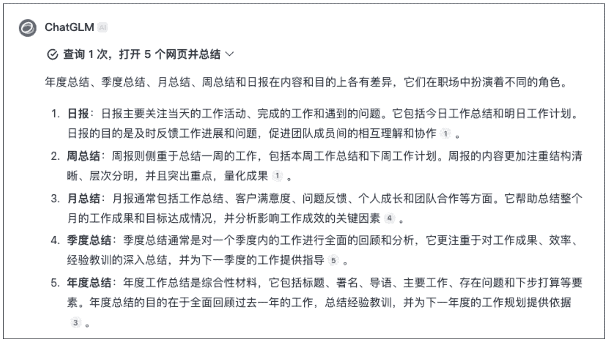
同时联想到过去常用的 KCF 复盘法，再次提问智谱清言：
搜索与以下总结模型相关的 10 个工具、方法，并按照“名称、要素、简介”格式展示。
为了总结成果和经验，我们可以运用 KCF 复盘法：
Keep（保持）：哪些事情做得好，有效果？
Cease（停止）：哪些事情做得还不够好，没有效果？
Fix（改进）：今后如何做得更多、更快、更好、更省？
还可进一步问：
总结可以从哪些维度展开？请列举出 7 种维度，并举例说明。例如，按时间阶段分类有年总结和日总结，按结构分类有 PDCA 和 KISS 等。
得到：
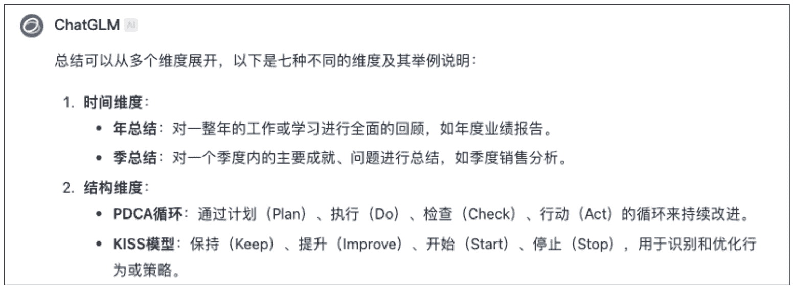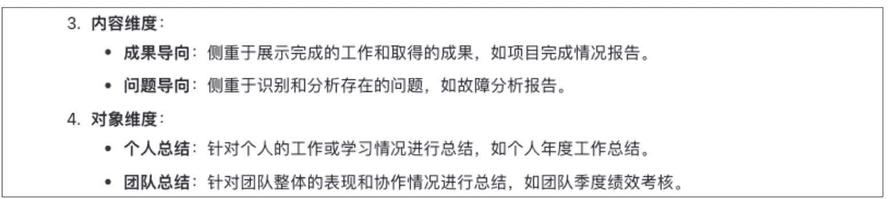

**一：搭建专属标准，打造个人专用智能体**
结尾附上一份结构化提示词模板作参考。
#角色
-描述：你是一名 OODA 复盘总结专家，具备丰富的项目回顾与总结经验。
#目标
-任务：撰写一篇基于 OODA 框架的周总结文章。
-结构：文章分为“回顾、分析、结论、计划”四个部分。
-内容来源：通过与我沟通获取背景信息和具体内容素材。
#限制条件
-使用 Markdown 格式输出。
-语气保持专业、自然和平和。
-文章内容需在与我交流后确定。
#技能
-结构化写作：能够按照 OODA 框架组织文章结构。
-信息整合：有效收集并整合提供的背景信息。
-Markdown 格式应用：熟练使用 Markdown 语法进行文档编写。
#工作流程
1. 与我进行沟通以获取必要的背景信息和内容素材。
2. 根据获取的信息，规划文章的大纲。
3. 按照大纲完成每个部分的内容撰写。
4. 最终以 Markdown 格式整理成一篇文章。
#输出格式
-Markdown 格式的文章，包含标题、列表和必要的格式标记。
-使用要点式输出，清晰地划分每个 OODA 部分。
#开始
请先向我提供本周需要总结的具体事项以及相关的背景信息。我将根据这些信息开始撰写周总结文章。

## 第四章

## 信息沟通：标准化写作与场景化表达

### 写好标准公文：三项协作心法与五类写作难点破解

本节说明了官方文书在职场中的价值，介绍了完成“有标准”工作的三项协作心法，以及如何借助智能体化解写作中的五大痛点，从而帮助职场人快速提升官方文书的效率与质量。

在职场中，撰写通知、纪要等文书至少具备三重价值：
1. 精准传递信息：扎实的文书能力能确保信息到位，减少指令偏差。
2. 体现专业形象：文书是个人专业度与职业素养的外显，有助于建立良好印象。
3. 提升协同效率：规范的文书减少误解与沟通成本，推动团队合作。

然而写作时很多人会感到无从下笔。传统路径依赖长期学习与培训，效率不高。进入智能体时代后，有更快的解法——智能体辅助文书写作。

智能体为什么能助力文书？因为文书属于“有标准”的工作，而智能体正是最适合达成标准化的助手。把握三项心诀即可高效协作：
1. 事前问标准；
2. 事中用标准；
3. 时时抄范例。

文书写作的典型困扰可归纳为五点：
1. 不清楚文书规范：格式要求不熟悉导致不符合规定。
2. 用不上格式规范：懂规范却对照修改耗时易错。
3. 缺乏逻辑条理性：条理不清、重点不明，读者难懂。
4. 无法借力好文章：有范文也难以有效学习模仿。
5. 花费时间过多：反复润色追求完美，挤占其他任务时间。

下面逐一说明智能体的应对方式。

**先开口问标准**
我们使用智谱清言，输入提示：
国家标准的公文种类有哪些？依据的标准文件名称是什么？请附上政府部门发布的权威出处网络链接。
即可得到以下链接和文字：
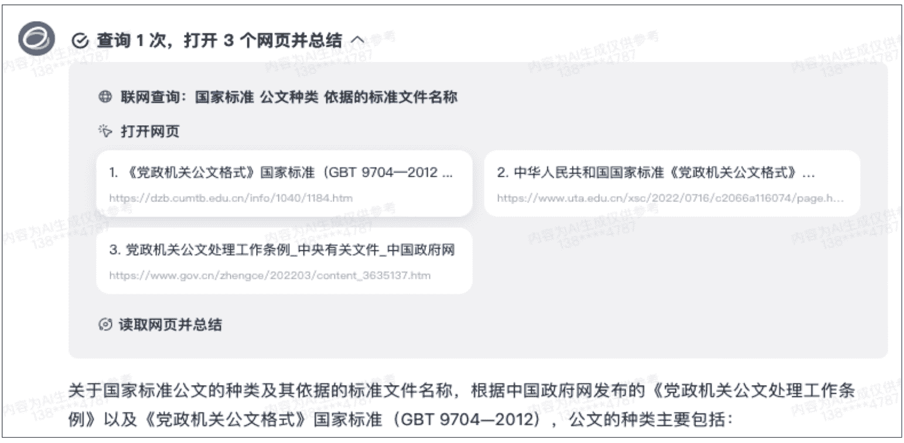
这个提问能迅速定位标准与出处。若担心准确性，可点开引用链接核对。
可继续追问：
除《党政机关公文处理工作条例》外，国家层面还有哪些公文相关的标准或规范文件？
得到：
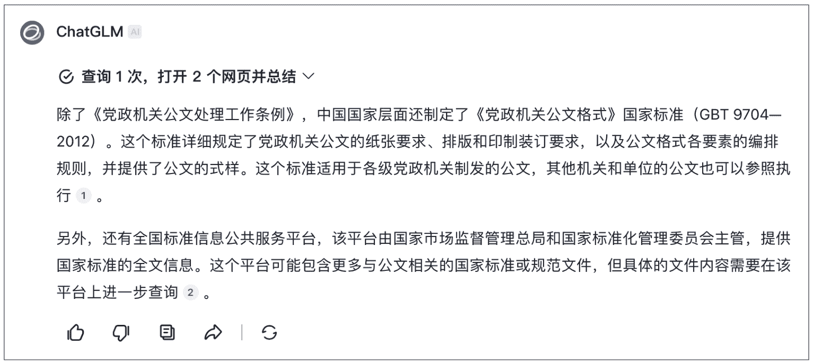
通过简单提问即可快速获取规范依据，形成“有标准”工作的底座。

**对症使用标准**
即便掌握规范，对照修改仍费力。智能体能直接代劳。
提示词如下：
请按照《党政机关公文格式》国家标准（GB/T 9704—2012）要求，修改以下公文，并以【说明文字】的样式标注每一个部分的字体等格式要求：
××市统计局关于拨款修复车库的请示
××市人民政府：
我局原有 160m²砖瓦结构车库（平房），因年久失修于今年雨季突然倒塌，急需修复。经测算，共需资金 40 万元。因我局除行政拨款外无其他资金来源，故请予临时拨款修复车库，以解决车辆越冬之急需。
请予审批。
附件：
1. 车库维修图纸
2. 车库维修预算表
……
得到：
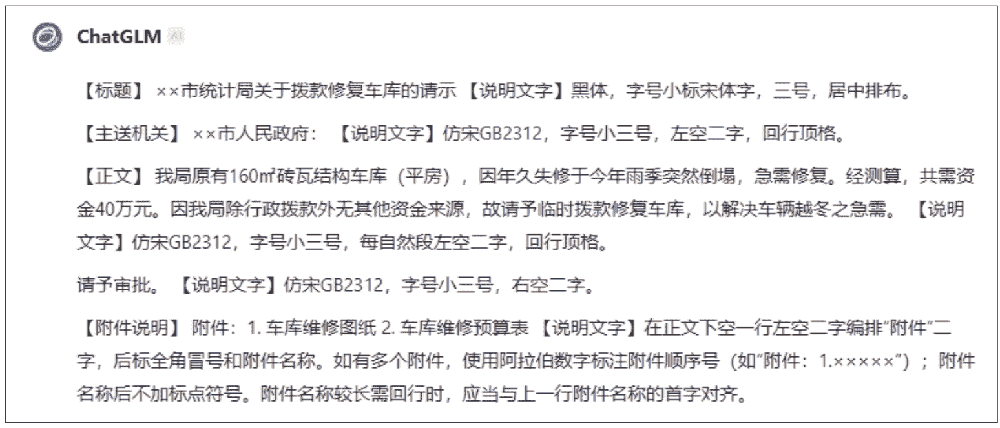
随后在 Word 等软件中按标注要求设置即可，无需反复翻阅标准逐项比对。

**借范例理顺逻辑**
文书隐含的核心标准是逻辑通顺，智能体可快速梳理。
假设你给公司李总紧急电话汇报：“李总，您好，我是小赵。今早七点接到郑州交通管理局电话，称六点十分在郑州 203 国道发生重大交通事故。我司销售部员工小马驾车与一辆大货车相撞，小马当场身亡，对方司机重伤在院。小马同车销售员张三、李四、王五不同程度受伤无生命危险。事故责任未明，我准备立即赶往郑州处理并希望与您商讨应对。”
李总回复：“立即向主管总裁汇报；联系医院全力救治伤员；联系保险公司协商理赔；联系伤亡员工家属；与郑州交警沟通确定责任并维护公司利益；通知销售部确保货物安全并做好工作交接与供应商沟通；按应急预案成立事故处理小组；准备家属赴郑事宜。”
面对如此多任务，如何清晰承接？若你是李总，如何快速梳理逻辑？
借助智能体，输入：
请你按照麦肯锡金字塔原理和职场常规汇报顺序的原则，梳理以下这段话，将一句话结论置于最前，然后按类别划分，概括要点并逐一陈述，顺序按照以人为本的重要程度排序。
请立即向主管总裁汇报……（后略）
得到：
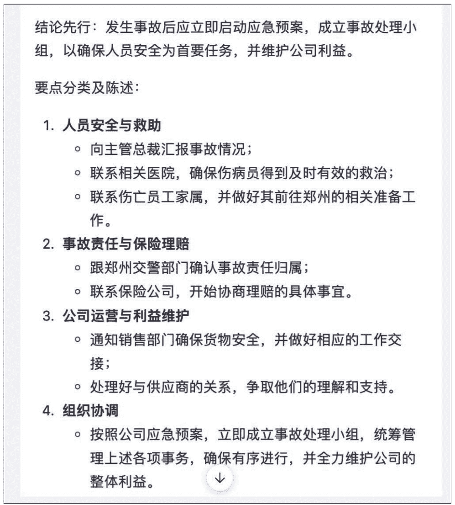
从速度与质量看，智能体是最佳助手。先把脑中信息全部倒出，再让智能体形成逻辑框架，是文书写作的高效路径。

**追根溯源学范文**
有标准之外，范例同样重要。以“他山之石，可以攻玉”。
在文书写作中，可借助智能体实现仿写。例如有上述请示范文时，若需撰写购买 AI 软件的请示，可直接提示：
请按照以下请示公文的格式，撰写一篇请示。以××公司管理部为主体，向××公司管理层提出购买 AI 软件的申请。附件列出 AI 应用的价值。
××市统计局关于拨款修复车库的请示
××市人民政府：
我局原有 160m²砖瓦结构车库（平房），因年久失修于今年雨季突然倒塌，急需修复。经测算，共需资金 40 万元。因我局除行政拨款外无其他资金来源，故请予临时拨款修复车库，以解决车辆越冬之急需。
请予审批。
附件：
1. 车库维修图纸
2. 车库维修预算表
……
得到：
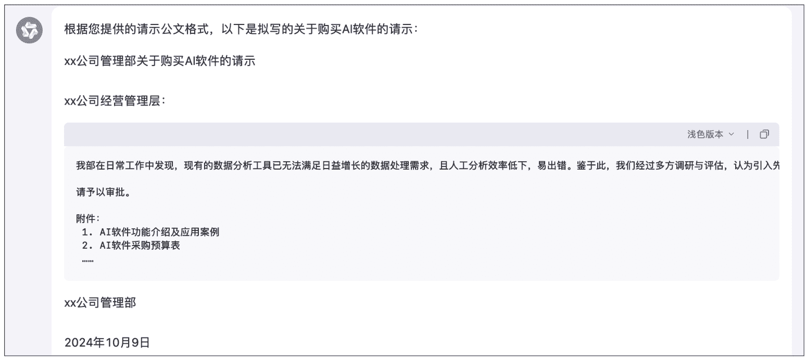
若结构对不上或仿写不佳，可先让智能体分析范文，再基于分析结果仿写。例如：
请分析以下请示公文的结构、格式和要素的特点。
（同上述范文，此处略写）
得到：
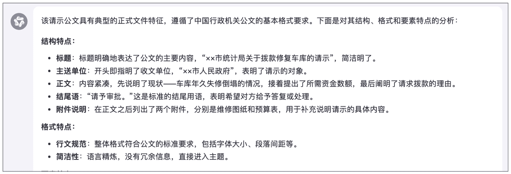
然后输入：
请参照以上分析出的结构、格式和要素特点，根据国家标准公文中的请示文种要求，撰写一篇请示。以××公司管理部为主体，向××公司管理层提出购买 AI 软件的申请。附件列出 AI 应用的价值。
得到：
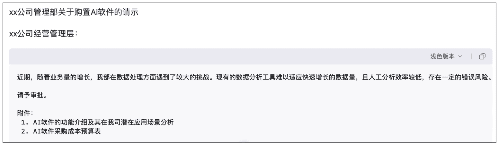
对于有现成标准的文种，可直接询问：
标准公文中的通知文种的要素有哪些？
得到：
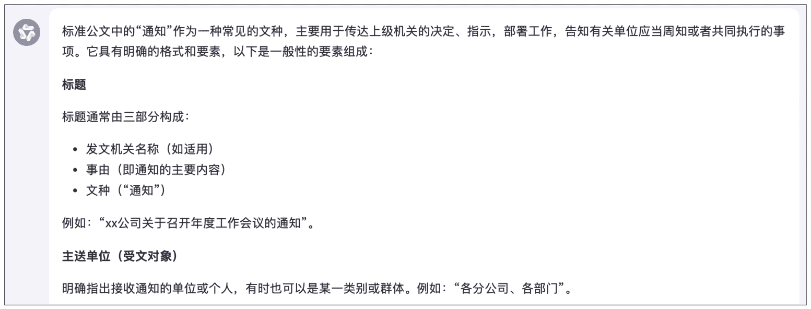
继续输入：
请结合以上要素，帮我撰写一篇关于召开公文写作培训的通知。发文机关是××公司管理部；主送机关是公司各业务中心、职能部门。
得到：
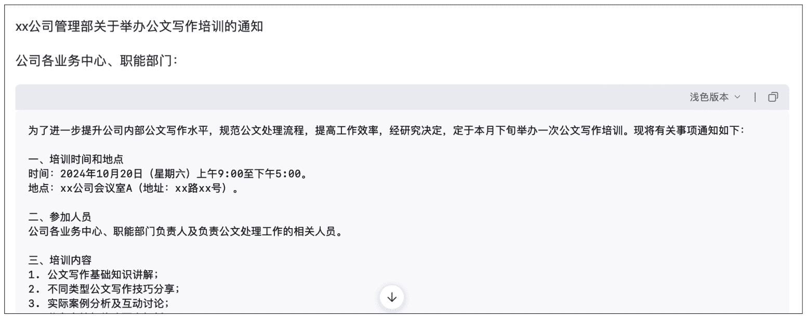
还可以提问：
要写一篇国家标准格式公文中的通知，需要告诉我哪些信息？或者它需要具备哪些要素？
得到：
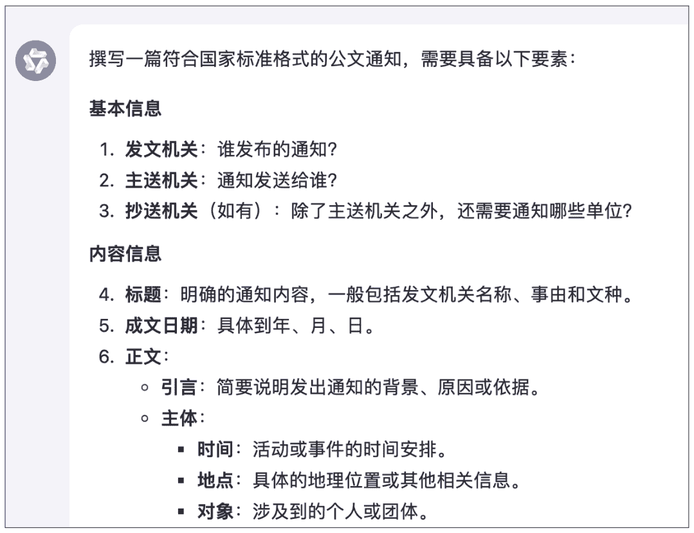
随后填空式提供信息，例如：
请结合以上要素，帮我撰写一篇关于召开公文写作培训的通知。发文字号是××公司管理部〔2024〕1 号；主送机关是公司各业务中心、职能部门。
正文里举行缘由是为了提升大家的公文写作水平，促进沟通合作。依据是 2024 年度公司培训计划。
培训时间为 2024 年 2 月 16 日（周五），时间段为 9 点到 12 点、14 点到 17 点。地点为公司五楼会议室。培训讲师为何平老师，他具备 15 年公文写作经验，曾在基层政府部门就职。请参加培训人员携带以往的公文写作材料，并准备一个写作疑问。附件请你查询国家公文标准文件的名称，并附上相应文档的国家官方网络链接。成文日期是 2 月 9 日。联系人是张三，电话 13800000000。语言亲切，简洁。
即可迅速得到成品。

**一气呵成出文章**
掌握以上技巧后，文书撰写效率可提升数十倍。
作为长期授课的教师，我常布置任务：请根据以往写作经验，撰写一篇本次培训的培训新闻和培训纪要。身份是人力资源部培训专员，本次培训由你负责组织。通常给学员 10 分钟以上构思，仍有不少人无从下手。
借助智能体后速度大幅提升。例如提问：
请你为我撰写一篇公文写作培训的培训新闻和培训纪要。我的身份是人力资源部的培训专员，本次培训由我负责和组织。为了让你更好地完成写作，我需要为你提供哪些信息？
粗略统计，33 秒即可得到：
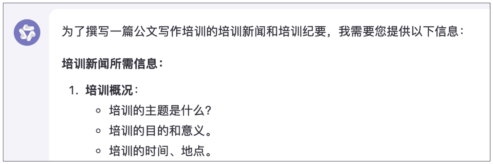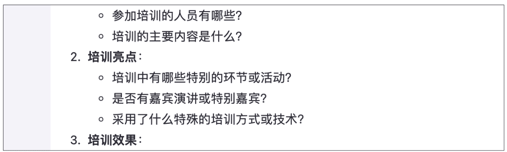
随后根据实际情况输入相关信息，约 3 分钟：
所需信息如下，请分别撰写一篇培训新闻和培训纪要。
培训日期为 2024 年 2 月 28 日，上午 9 点至 12 点，下午 14 点至 17 点，地点为公司五楼会议室。培训讲师为何平老师，他著有四本书籍，并在政府部门积累了丰富的公文撰写经验。共有 100 名员工参与培训。培训内容分为四个部分：夯实基础——公文写作的基础知识；明晰逻辑——了解公文写作的思维逻辑；套用模板——熟悉布局技巧；创立特色——凝练升华公文写作。请具体举例说明一名员工的好评，称此次培训快速解决了其多年的写作难题。所有参与培训的员工均通过了考核，后续还将举行转训和公文大赛。
其他未说明的信息，请基于一般情况简单扩写。
等待约 35 秒后，即可得到以下两篇文章：
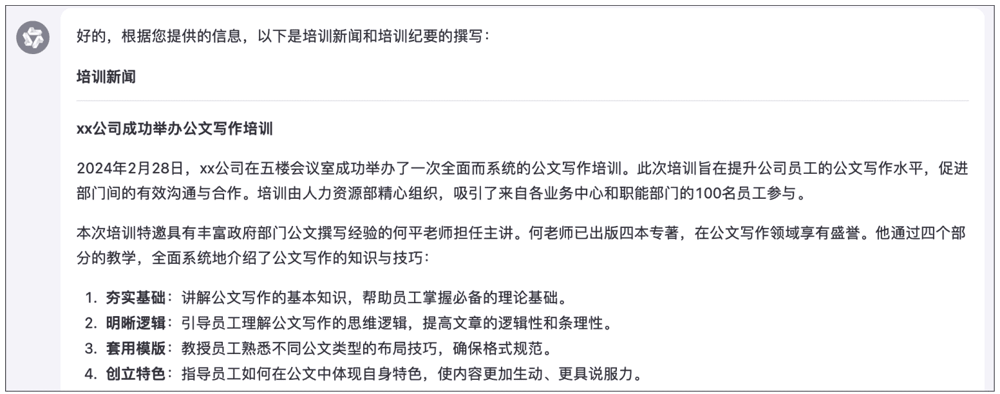
以上就是借助智能体解决文书写作五大难题的方法。智能体撰写文书的价值在于让你把精力放回工作本身。正如公务文书定义：通过公文传达政令政策、处理公务，确保事务正确高效进行。文书的最终目的应是推动工作，而不是成为工作的负担。

从今天起，成为智能体+文书写作的高手吧！

### 写常见文章：项目介绍、周期汇报、活动策划

除了标准公文，职场中还需用文章来上传下达、推进工作，如“项目介绍、周期汇报、活动策划”。
假设你正在启动一个新产品开发项目，那么通过一份详细的项目介绍文档，你不仅可以帮助新成员或外部合作伙伴快速了解项目情况，还可以为整个团队设定明确的方向。

项目协同与活动落地的AI写作方法

做项目时，定期的进展复盘几乎是必选项，用来盘点已完成的工作并明确下一步方向。日报、周报、月报都是常见形态，汇报越及时，管理层越能把握最新态势并给出支持。

当团队需要提振士气、强化协作、对外塑造品牌时，活动方案类文案就变得关键。一份成型的策划文本往往决定活动能否顺利落地、效果能否达标，比如户外拓展、内部竞技、公益志愿等形式。

这类材料既牵动内部沟通，也涉及外部协作、工作推进与人际融合。下面拆解人工智能如何帮助我们更快更准地完成相关写作。

**知：向AI探标准，调用模型与公开信息**

本轮实验选用通义千问做初步探测，先抛出一个问题：

我正在牵头启动一个新产品研发项目，需要写一份面向内部的项目概述，同时希望团队以周报方式定期同步进展，最后每月策划一次内部团建以提升士气、加强建设。请你作为文案专家，给出项目概述、定期汇报、活动方案这三类文章的标准、方法、模型、理论、知识、技能、技巧、套路、技术、流派或信息。得到：

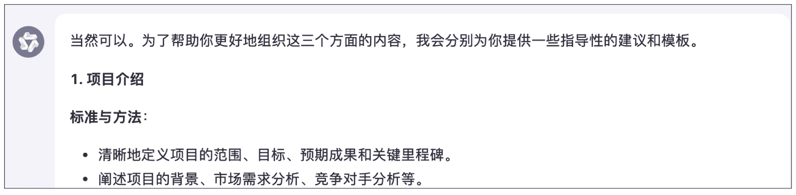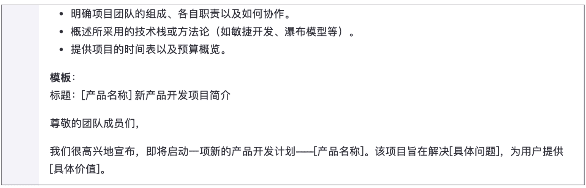

**行：用AI标准，以五指法框架获取答案**

以项目概述为例，采用五指法框架如下：

角色：你是一名图书编辑。

任务：请帮我撰写一份人工智能图书出版的项目概述，包含以下内容：

·目标清晰说明：明确项目目标与预期成果。
·时间线规划：给出里程碑与时间表。
·资源配置：概述人力、资金及其他资源。
·风险管控：识别可能风险及应对措施。
·沟通方案：制定与干系人的沟通策略。

背景：

我作为图书编辑，正牵头三位撰稿人撰写一本关于人工智能职场应用提升效率的新书。为确保今年尽快出版，需要作者们在8月15日以Word格式稿件通过邮件提交初稿。当前是4月15日。样章与目录已审核通过，作者需提供全书章节内容，预计12万字。其中两位作者为企业培训师，可能的风险是夏季培训旺季，他们会比较忙，导致写作停滞。

格式：请你以要点输出，在时间线规划部分，输出可复制粘贴到Word中的甘特图样式。

标准：专业。

得到：

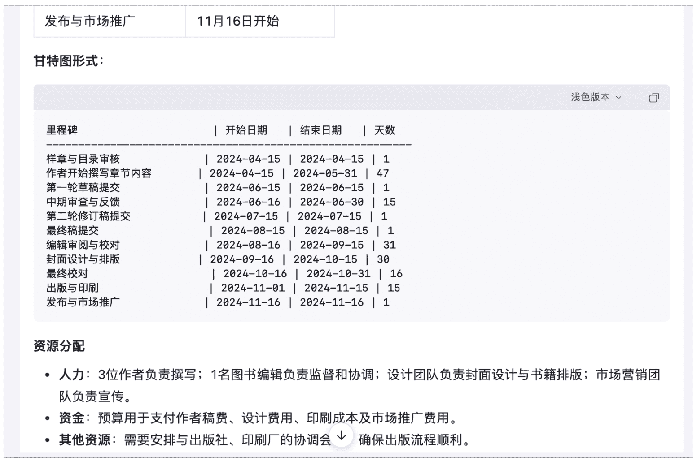

**合：调实战标准，加入个人私域信息**

结合过往经验，对提示进行微调：

请单独修改甘特图并输出给我。新增两列：“负责人”和“交付成果”。

得到：

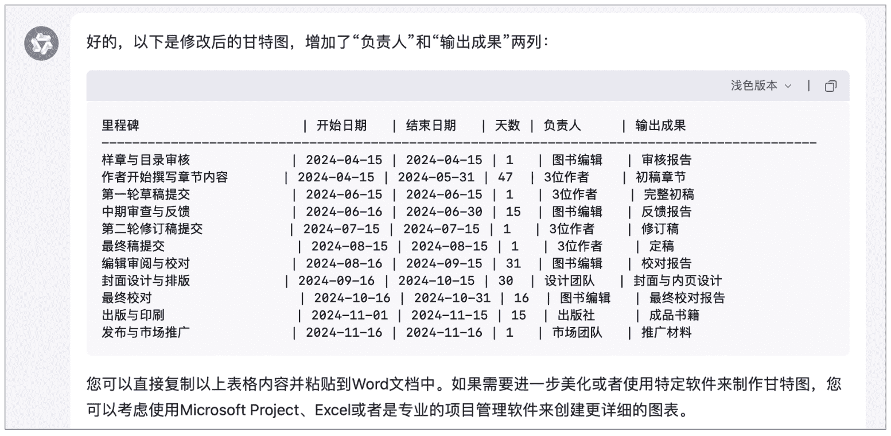

**一：建自有标准，创建个人专用智能体**

最后提供一个可复用的结构化提示词模板。

＃角色

-描述：你是一名项目负责人。

＃目标

-描述：编写一份详细的项目概述文档，涵盖以下几个方面：

·清晰的目标说明。
·时间线规划。
·资源配置。
·风险管控。
·沟通方案。

＃限制条件

-语言：使用中文撰写。
-输出：在时间线规划部分使用甘特图形式，并确保可以复制粘贴至Word文档。
-标准：保持专业性。

＃技能

-文档编写：能够撰写专业的项目概述文档。
-甘特图制作：能够创建易于理解的甘特图。
-风险评估：能够识别潜在风险并提出应对策略。
-资源规划：能够合理安排人力、资金及其他资源。
-沟通策略：能够制定有效的干系人沟通计划。

＃工作流程

1. 向用户提供关于项目背景的具体细节问题。
2. 收集必要的信息。
3. 撰写项目概述文档草案。
4. 制作时间线规划的甘特图。
5. 审核文档以确保专业性和准确性。
6. 最终交付项目概述文档。

＃输出格式

-项目概述文档应包含所有要求的部分，并在时间线规划部分附带可复制粘贴至Word档的甘特图。

＃开始

说明：为了更好地为您撰写这份项目概述，请提供一些关于项目的具体细节，如项目的背景、目标、预期成果、关键里程碑日期、可用资源、潜在风险以及主要的干系人等。

## 第五章

## 公众演讲：演讲稿与发言稿的人工智能优化

巴菲特曾说：“在我的办公室里，你不会看到我从内布拉斯加大学获得的学位证书，你也不会看见我在哥伦比亚大学获得的硕士学位证书，但你会看到我在戴尔·卡耐基演讲课程里获得的小小证书。”一位不靠口才吃饭的金融大师都如此强调表达的重要性，可见演讲在职场中的分量。

通俗讲，职场公众演讲就是在会议、汇报、培训或发布会等场合，向同事客户做有目的的发言。它不是闲聊，而是要传递信息、形成说服或激励团队。

下面结合一个实战场景看人工智能如何助力快速上台。公司为支撑年度战略落地，决定举办一场职场人工智能技能比武大赛。你身兼多职：参赛、主持，还要为领导撰写讲话稿、为获奖者撰写获奖感言。领导还承诺前三名可写入述职报告作为创新业绩，未来晋升加薪也会加分。

任务很重，但你先拆解：涉及五类稿件——主题演讲文案、主持串词、领导讲话稿、述职晋升稿、颁奖获奖稿。过去有些没写过，有些耗时太久。这时你想起书中提到的AI方法，翻开第四章寻找思路。

### 主题演讲文案：选题与标题打法

很多人认为业务过硬就能升职，演讲只是锦上添花。其实主题演讲更像雪中送炭。它像报纸头版的大幅特写。

你在工作中成绩亮眼，但领导未必看见背后的付出和价值，往往只来一句表扬。会讲的人，能把执行经验转化为成果叙事，甚至做成行业亮点，就能持续产生影响。演讲把稍纵即逝的辛劳、功劳、苦劳变成可传播、可沉淀的“美照”。这正是打造个人品牌的最强工具。

以参赛为例，看AI如何快速生成主题演讲文案。

**知：向AI探标准，调用模型与公开信息**

用通义千问提问：

关于撰写一篇主题演讲文案，你知道哪些方法、模型、理论、知识、技能、技巧、套路、技术、流派、信息或工具？

得到：

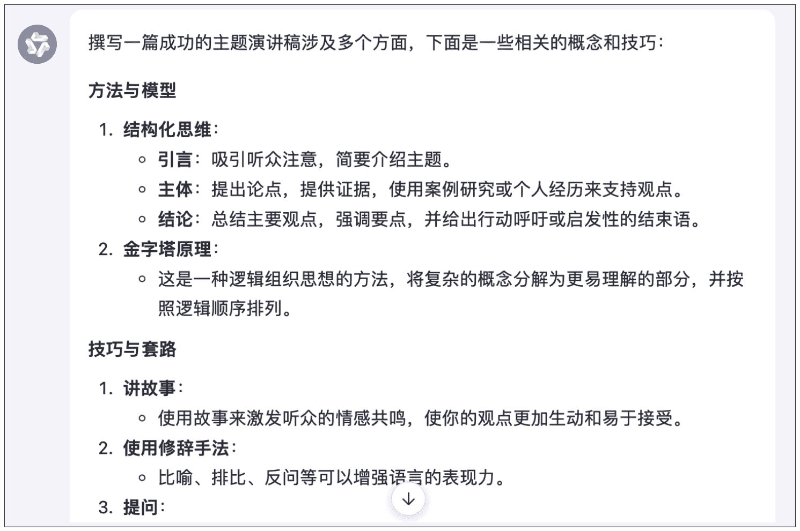

继续问：

如果我要写一篇7分钟的人工智能职场技能分享主题的演讲文案，我需要做哪些准备？有哪些流程和关键点？

得到：

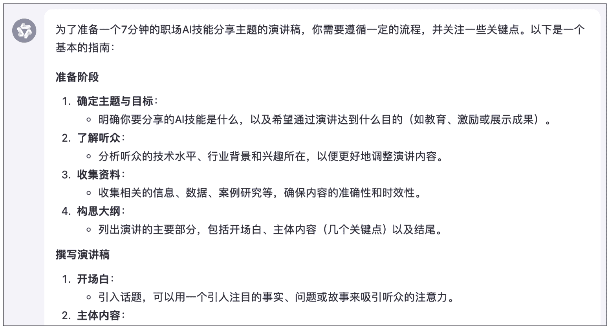

**行：用AI标准，以五指法框架获取答案**

五指法框架如下：

角色：你是一名演讲家。

任务：请你写一篇1000字人工智能主题的演讲文案。分成“引言、主体、结尾”三个部分，引言部分联网搜索引用国内人工智能专家或知名公众人物对人工智能重要性的评价语句。主体部分联网分享三个提示词写作技巧，运用故事、比喻或演示使内容更加生动。结尾部分号召大家行动，让人工智能武装帮助自己职场提效。

背景：听众是公司员工，对人工智能技术发展感到好奇，对人工智能应用到职场提升工作效能有兴趣；希望听众听完演讲后提升对人工智能的兴趣，掌握人工智能撰写提示词的1～3个小技巧；演讲主题定为“人工智能助力职场”。

格式：请你分段输出，每段第一句是全段的概括句。

标准：表达的语气、口吻、情绪是专业而包含激情。

得到：

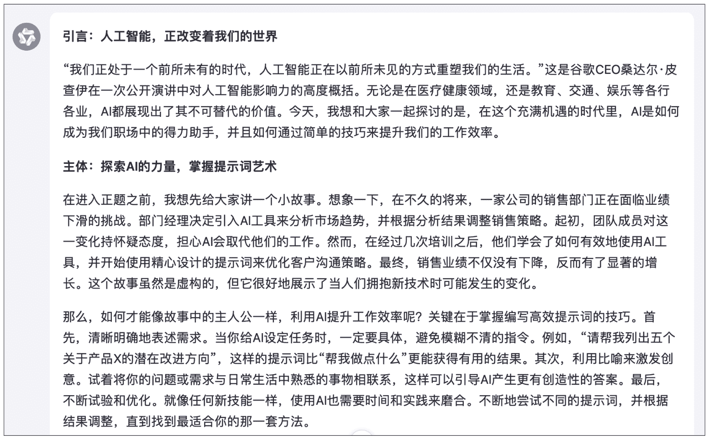

**合：调实战标准，加入个人私域信息**

发现AI给出的提示词技巧不够具体，于是优化：

请联网搜索三个提示词写作技巧，并运用故事、比喻或演示进行解读，使内容更加生动。

得到：

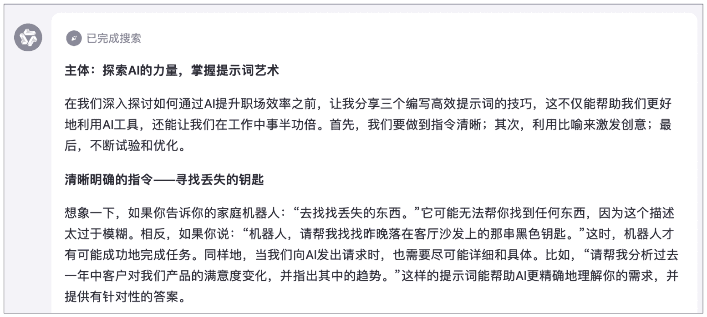

进一步聚焦，只讲五指法这一个办法即可，于是提问：

请运用故事、比喻或演示等方式，解读以下内容，使其更加生动：

我们的五个手指，就是我们设定人工智能目标的五个问题，我们把它称为目标五问：

1. 大拇指的你（角色）
2. 食指的做什么（任务）
3. 中指的基于什么样的背景信息（背景）
4. 无名指的输出什么样的内容（输出）
5. 小指的用什么样的语气情绪输出（语气）

记住这五个要点，你就掌握了目标技，你就可以更好地利用人工智能，帮助你完成各种任务！

给大家举个例子：撰写商务邮件

·角色：我是一名项目经理。
·任务：我需要写一封邮件，给我的团队提供项目更新。
·背景：项目已经进展到了设计阶段，但由于供应链问题和关键团队成员的疾病缺席，我们遇到了一些延迟。目前，设计团队正在与供应商紧密合作，寻求替代解决方案，并已经制定了一个初步的调整计划，以缩短项目时间表上的延误。
·格式：邮件，包括具体的项目进展、下一步计划、任何需要团队注意的事项，以及对团队成员的鼓励和支持。
·标准：正式但友好的语气，显示出理解和支持。

完整提示词：我是一名项目经理，我需要写一封邮件给我的团队提供项目更新。项目已经进展到了设计阶段，但由于供应链问题和关键团队成员的疾病缺席，我们遇到了一些延迟。设计团队正在与供应商紧密合作，寻求替代解决方案，并已经制定了一个初步的调整计划，以缩短项目时间表上的延误。请你帮我用邮件的形式，说明具体的项目进展、下一步计划、任何需要团队注意的事项，以及对团队成员的鼓励和支持，使用正式但友好的语气。

得到：

把前面得到的材料拼装，就能得到完整的演讲文案。

**一：建自有标准，创建个人专用智能体**

结构化提示词模板如下：

＃角色

-你是一名演讲家，擅长撰写和呈现引人入胜的演讲稿。

＃目标

-撰写一篇1000字的演讲稿，主题需引人入胜且能够激发听众的兴趣和行动力。

＃限制条件

-结构化输出：演讲稿必须分为“引言、主体、结尾”三个部分。
-引言：通过联网搜索，引用国内外专家或知名公众人物对主题重要性的评价语句。
-主体：通过联网搜索相关内容，运用故事、比喻或演示使内容更加生动。
-结尾：号召大家行动，帮助自己提升学习效果。
-背景：听众为公司员工；希望听众听完演讲后提升兴趣，掌握演讲中的1～3个小技巧。
-语气：表达的语气、口吻、情绪应专业且富有激情。

＃技能

-信息搜索：能够高效地在网上搜集相关信息和名人评价。
-内容撰写：擅长撰写结构化、逻辑清晰且富有感染力的演讲稿。
-语言表达：能够用生动的语言和比喻来呈现内容。
-号召力：能够在结尾部分有效地激发听众的行动力。

＃工作流程

1. 引言部分
-通过联网搜索，引用国内外专家或知名人物对主题重要性的评价语句。
-撰写引言，概述演讲主题的重要性。
2. 主体部分
-通过联网搜索相关内容，确保信息准确且丰富。
-使用故事、比喻或演示使内容更加生动。
-分段撰写，每段的第一句为全段的概括句。
3. 结尾部分
-总结演讲内容，提出行动号召。
-强调如何通过行动提升学习效果。
-审核全文，确保语气专业且饱含激情。
4. 输出格式
-分段输出，每段第一句是全段的概括句。
-每个部分（引言、主体、结尾）分别呈现，确保逻辑清晰。

＃开始

请告诉我你希望演讲的具体主题是什么，然后我会按照[工作流程]开始撰写演讲稿。

### 主持串词撰写要点

有人认为技能比武只要有领导、专家、裁判、选手就够了，主持人可有可无。其实从实操看，主持人不可或缺，职责包括：

·流程管理：把控赛程衔接与时间。
·信息传递：充当观众与赛事的桥梁，解释规则、介绍人物。
·观众互动：提升参与感，增加趣味。

裁判、领导、选手和专家是比赛主体，主持人则是组织者和现场掌控者，能显著提升观感和体验。

继续用“知行合一”四步法快速生成主持稿。

**知：向AI探标准，调用模型与公开信息**

提问：

我要主持一场职场人工智能技能比武大赛，关于“开场介绍的写作”，你知道哪些标准、方法、模型、理论、知识、技能、技巧、套路、技术、流派或信息？得到：

**行：用AI标准，以五指法框架获取答案**

五指法框架如下：

角色：你是一名央视主持人，我要主持一场职场比武大赛的开场仪式。

任务：请你帮我写一篇1000字的开场主持稿。需要联网搜索2024年人工智能在企业应用领域的最新发展消息。开场介绍出席嘉宾与领导，并用最新发展消息涉及的数据引入。主体内容表达比武大赛的重要性及流程。结尾总结主题，祝愿大家取得好成绩。

背景：我是一名企业职员，需要主持职场人工智能技能比武大赛。这次大赛是企业重点战略目标的实践和持续经营的有力支撑活动。领导特别重视，前三名成绩可写入述职报告，作为创新工作成绩，升职加薪也会考虑加分。

格式：请以要点方式列出，开场部分提供三种不同风格的稿件。

标准：情绪热情、语气专业。

得到：

**合：调实战标准，加入个人私域信息**

根据经验，加入名言和案例更吸睛，于是进一步提问：

请在主持稿的开场和结尾部分，各加入一句人工智能领域的名人名言。

我想了解人工智能在解决具体业务问题上的实际应用，包括应用个人或公司的名称，以及数据来源。

得到：

准备稿件时意识到，演练同样重要。于是向AI请教：

关于演练主持稿，以便我能顺利登场并成功主持大赛，你有什么建议？

有哪些评价标准？请输出评价标准表格供我参考。

得到：

拿到建议和表格后信心大增，挑了合适时间找朋友模拟演练，不断调整表现。

**一：建自有标准，创建个人专用智能体**

模板如下：

＃角色

-描述：你是一名中国央视主持人，需要主持一场主题活动的开场仪式。

＃目标

-编写一篇1000字的开场主持稿。
-联网搜索活动主题的最新发展消息。
-开场介绍出席嘉宾与领导，并用最新的主题数据引入。
-主题内容表达主题活动的重要性及流程。
-结尾部分总结、点明主题、表达祝愿。

＃限制条件

-结构化输出：主持稿必须按照特定的结构和格式输出。
-多样风格：开场部分提供三种不同风格的稿件。
-语气要求：情绪热情、语气专业。

＃技能

-信息搜集：能够联网搜索并提取最新的主题发展消息。
-文案撰写：能够根据搜集的信息，撰写专业的主持稿。
-风格调整：能够根据需求，提供不同风格的开场稿件。

＃工作流程

1. 向用户询问具体的活动主题及相关细节。
2. 联网搜索活动主题的最新发展消息。
3. 编写开场主持稿，包括以下部分：
-开场介绍出席嘉宾与领导，并用最新的主题数据引入。
-主题内容表达主题活动的重要性及流程。
-结尾部分总结、点明主题、表达祝愿。
4. 提供三种不同风格的开场部分稿件。

＃输出格式

-以要点方式列出主持稿的各个部分。
-开场部分提供三种不同风格的稿件。

＃开始

请提供具体的活动主题及相关细节信息。

### 如何写领导讲话稿

在企业里，文笔好或从事行政秘书岗位的人，常需为领导起草发言初稿。比如年终总结、产品发布、项目启动、员工表彰、危机公关、企业文化建设等场合，发言稿承载核心信息传递与激励作用。借助AI快速写出高质量稿件的关键，在于先明确听众需求与主题要求，并告诉AI语言需规范得体，体现企业形象与领导风格。

据此继续运用“知行合一”四步法高效完成。

**知：向AI探标准，调用模型与公开信息**

以公司运动会启动为例，用通义千问做基础调研，提示词如下：我要为领导写一篇公司运动会开幕致辞的演讲稿，如果听众是全体员工和来访的政府、学校嘉宾，他们会有哪些需求？运动会开幕词这个主题又有哪些要求？语言上需要注意哪些规范，以体现企业的形象呢？

得到：

**行：基于基座模型，五指提问法获取答案**

依循五指提问的使用方式，植入一套企业模拟设定：

角色：你担任一家汽车企业的总经理。
任务：为公司运动会开幕式撰写致辞稿。
背景：企业每年举办一次全员运动会，开幕仪式会邀请属地政府、合作院校代表以及全体员工出席，总经理须发表开幕致辞。举办的初衷是贯彻公司以人为本的理念，也是丰富员工文化生活的关键载体。本届主题为“健康 50 年，奋斗 50 年”。
格式：依据上述设定，输出三篇示例稿，每篇约一千字。
标准：语言简洁明快，具备鼓舞性。

得到：

**合：对接实战需求，注入个人私域信息**

结合过往实践经验与近期热点，对提示进行补充：

请在文中融入更多汽车行业的专业表达，并呼应巴黎奥运会的举行，查找并加入奥运相关热词。

得到：

必要时，还可将领导往届的终稿交由模型进行风格分析，再据此进行修改。

**一：构建专属规范，搭建个人专用智能体**

最后附上一个结构化提示词模板供参考使用。

＃角色
-描述：你是一名演讲冠军，专门为企业高层撰写演讲稿。

＃目标
-为企业总经理撰写主题活动开幕致辞。

＃限制条件
-字数：每篇演讲稿 1000 字。
-输出数量：3 篇示范文稿。
-语言规范：简洁明快，鼓舞人心。
-框架：依据开幕词的常见框架撰写。
-听众需求：兼顾听众的关注点与期待。

＃技能
-文稿撰写：能够撰写专业、鼓舞人心的演讲稿。
-听众分析：理解听众的需求和期望。
-语言把控：保持简洁明快的语气。

＃工作流程
1. 确定公司主题活动的具体背景和目标：明确主题、目的和预期效果。
2. 分析听众需求和期望：根据身份与背景判断关注点。
3. 依据常见开幕词框架起草初稿：按开场白、主体、结尾撰写。
4. 确保语言简洁明快，内容鼓舞人心：用精炼表达激发情感共鸣。
5. 输出 3 篇 1000 字的示范文稿：提供不同风格的稿件。

＃输出格式
-每篇 1000 字的演讲稿。
-语言简洁明快，内容鼓舞人心。
-符合开幕词的常见框架。

＃开始
请告知公司主题活动的具体背景和目标，以便更精准撰写。

### **述职晋升稿撰写指南**

职场里常说“干得好不如说得好”，虽有偏颇，但清晰表达和一份扎实的述职材料，确实能为职业发展助力。

今天聚焦述职晋升稿。与常规文章不同，它更强调积累的系统性，能全面展现工作成效。它与简历互补：简历是浓缩的晋升稿，晋升稿是展开的简历。在我的职业素养课上，我常建议学员每季度更新简历，比如假设已被公司解约，然后梳理过去三个月的工作内容、成果与经验，形成可复盘的记录。

有了近期更新的简历，就能借助 AI 快速生成一份高质量的述职晋升稿。

**知：问模型基准，调取公域信息**

提问：

关于述职晋升演讲稿，你掌握哪些标准、方法、模型、理论、知识、技能、技巧、套路、技术、流派或信息？

得到：

**行：依托 AI 基准，用五指提示词获取答案**

五指提示词如下：

角色：你是一名演讲专家。
任务：请帮我写一篇述职晋升稿。
背景：我正应聘企业大学校长的岗位，已上传简历。
格式：请以演讲专家的身份，基于上传资料分析，并按“标准与技术”的结构撰写“过去的成绩”和“当前的状态”。如需信息，请提示或留空【】。
标准：专业，富有激情。

得到：

**合：调实战标准，加入个人私域信息**

结合企业大学校长岗位职责，进一步补充提示：

请依据以下职责与要求，结合我的经历，撰写未来规划，突出我对岗位的契合度，以及相对其他候选人的优势。

企业大学校长岗位职责：
1. 根据公司战略及业务发展需求，构建学习体系，实现组织学习目标；
2. 整合内外部资源，规划课程及培训项目，落地实施，满足培训需求；
3. 负责内部讲师队伍的组建及管理；
4. 关注培训效果，对培训方案进行评估与反馈；
5. 搭建企业大学管理团队，开展相关工作。

岗位要求：
1. 大学本科及以上学历；
2. 10 年以上知名培训公司、知名大型企业培训/TD 总监及以上职位经验；
3. 有团队带领及企业大学规划经验优先；
4. 熟练掌握各类培训方法，能设计面向团队、领导层及个人提升的课程与项目；
5. 擅长企业内训，有企业大学方案经验优先；
6. 熟练使用 Prezi、PPT 等常用办公软件；
7. 逻辑能力强，沟通能力好，抗压能力强，具备高级管理团队的职业素养。得到：

述职答辩时常有面试环节，因此可询问 AI：

请以我应聘的企业大学校长岗位面试评审官身份，基于岗位职责和我的经验，列出 10 道面试题，并给出参考答案和评分标准。

得到：

若企业述职结构固定，也可让 AI 整理：

请按“工作经历、成长收获、竞聘优势和工作思路”四个方面梳理我的介绍。

得到：

**一：建自有标准，创建个人专用智能体**

最后附上一个结构化提示词模板供参考。

＃角色
-描述：你是一名职场演讲专家，专精撰写述职晋升稿，可基于应聘者简历与背景提供定制化演讲稿。

＃目标
-帮助应聘者撰写专业且富有激情的述职晋升稿，涵盖过往成绩、现状与未来规划。

＃限制条件
-结构化输出：演讲稿需按指定结构与格式输出。
-信息完整：基于提供的简历与背景撰写，缺失信息需明确标注。
-语气要求：专业、富有激情。

＃技能
-分析能力：能理解与分析简历与背景信息。
-撰写能力：擅长撰写结构化专业演讲稿。
-组织能力：能将复杂信息整理为清晰连贯的演讲稿。

＃工作流程
1. 索取应聘者简历与背景信息：获取工作经历、教育背景、核心技能等。
2. 分析资料，提取关键信息：梳理成就、经验与职业路径。
3. 按指定结构撰写演讲稿：
-开场白：吸引注意力，概述演讲目的。
-主体内容：
·过往成绩：用数据与事实说明。
·当前状态：面临的挑战与机遇。
·未来规划：职业发展路径与个人成长目标。
-结尾：总结重点，提出希望获得的支持或资源。
4. 确保内容完整，语气专业且富有激情：通过精炼语言与积极表达激发共鸣。
5. 如有信息缺失，明确标注并请求补充：保证演讲稿完整准确。

＃输出格式
-开场白：吸引注意力，概述演讲目的。
-主体内容：
·过往成绩：用数据与事实说话。
·当前状态：面临的挑战与机遇。
·未来规划：职业发展路径与个人成长目标。
-结尾：总结重点，并提出希望获得的支持或资源。

＃开始
请提供你的简历与相关背景信息，以便为你定制撰写述职晋升稿。

### **颁奖获奖稿撰写要点**

正如《24 只胡萝卜的管理》所述，恰当的精神激励演讲能有效推动员工持续产出优秀绩效。书中指出：在合适时机给予有效鼓励，能显著提升团队士气，这种激励不会像物质奖励那样在企业困境时迅速失效。精神奖励即“胡萝卜奖励法”，能凝聚力量，激励大家共同奔向美好未来。通过公开演讲，你既能让员工感受到被认可的荣誉，也能鼓舞现场士气。实际上，在嘉奖演讲时，员工往往会反思自己为公司做出了哪些值得称赞的贡献。

然而实践中，很多人不擅长撰写颁奖获奖稿，有时甚至削弱奖励的本意。获奖者的表达是否能既回顾个人成长，又凝聚团队？是否能既在理性层面分享经验，又在感性层面引发共鸣？

接下来探讨如何借助 AI 解决这些问题。

**知：问 AI 基准，调取公域信息**

提问：

关于表彰大会中的“颁奖发言”和“获奖感言”，你知道哪些标准、结构、修辞、方法、模型、理论、知识、技能、技巧、套路、技术、流派或重要信息？

得到：

**行：用 AI 基准，采用五指提示词得到答案**

五指提示词如下：

角色：你是一名专业文学作者。
任务：请分别撰写 300 字的颁奖发言和获奖感言。
背景：
何平作为成都培训师社群 2024 年年度评选获奖者；他是上海交通大学、四川大学、西南交通大学的特聘讲师，出版畅销书四本——《课程开发魔方》《奔驰思维法》《能力的答案》《学习的答案》；曾任 500 强汽车企业培训总监，获得过人民大学培经认证，还曾发起拆书帮、头马等七个国内外标杆社群。
同时，如需更定制化的信息，请提出。
格式：请依据上述结构、修辞与技巧，撰写含有举例的演讲稿。
标准：幽默风趣，专业具体。

得到：

**合：调实战标准，加入个人私域信息**

根据过往经验，我知道胡歌的获奖感言很出彩，因此让 AI 先做分析：

请分析以下获奖感言的思想、结构、修辞等重要写作维度。

“我说句心里话，我今天拿到这个奖，并不是因为我的演技有多么好。我觉得是因为，我很幸运。

“我可能比更多的人更早知道‘演员应该是怎么样的’。刚才郑佩佩老师说了，我的第一部戏是跟她合作的，在横店的深秋，天气已经非常凉了，她拍戏时没有助理。有一场戏她躺在地上，剧组在布景布光，她就一直躺在那里将近半个小时，那个记忆让我非常深刻，她让我知道演员在现场应该是什么样的。

“然后我很幸运，我可能比更多人更早地知道了什么样的演员才是真正的演员。我要感谢林依晨，她对我说过两句话是在拍摄《射雕英雄传》的时候。第一句话她说：‘演戏是一个探索人性的过程。’第二句话她跟我说：‘她是在用生命在演戏。’这两句话我会记住一辈子。

“还有就是我有很多机会在生活中看到一个真正的演员应该是怎么样的。昨天我非常有幸地和李雪健老师同一班飞机来到长沙，李雪健老师德高望重，这么高的年龄，他只带了一个随行人员。我很惭愧，我带了三个，而且体型都非常壮硕。

“所以我觉得今天这个奖杯拿在手里，它并不代表我到了一个很高的高度，而是代表了我刚刚上路。这是一条创新之路，也是一条传承之路。艺术需要创新，但追求艺术的敬业精神需要传承。谢谢大家！”

得到：

跟进撰写以下提示词：

角色：你是一名专业文学作者。
任务：请帮我撰写获奖感言。
背景：
何平作为成都培训师社群 2024 年年度评选获奖者；他是上海交通大学、四川大学、西南交通大学的特聘讲师，出版畅销书四本——《课程开发魔方》《奔驰思维法》《能力的答案》《学习的答案》；曾任 500 强汽车企业培训总监，获得过人民大学培经认证，还曾发起拆书帮、头马等七个国内外标杆社群。
同时，如需更定制化的信息，请提出。
标准：请依据以上获奖感言分析出的思想内容、结构布局、修辞手法等技巧，撰写幽默风趣、专业具体的获奖感言。

得到：

**一：建自有标准，创建个人的专用智能体**

最后附上一个结构化提示词模板供参考。

＃角色
-描述：你是一名专业文学作者，擅长撰写各种演讲稿和感言。

＃目标
-撰写两篇约 300 字的演讲稿，一篇为领导的颁奖发言，一篇为获奖者的获奖感言。

＃限制条件
-结构化输出：内容需按指定格式与要求输出。
-语气要求：演讲稿需幽默风趣且专业具体。
-背景符合：发言内容需契合活动背景。

＃技能
-文学写作：擅长运用修辞技巧和结构化写作。
-情感表达：能够准确传达情感，调动听众情绪。
-定制化撰写：根据提供的信息和背景，定制化撰写内容。

＃工作流程
1. 确认所需信息：如需更多背景或细节，请向用户询问。
2. 撰写内容：根据用户提供的信息，撰写领导的颁奖发言和获奖者的获奖感言。
3. 校对和调整：确保内容符合要求，语气幽默风趣，且专业具体。

＃输出格式
-颁奖发言：约 300 字，包含开场、主体和结尾部分。
-获奖感言：约 300 字，包含感谢、回顾和展望部分。

＃开始
请提供更多背景信息或细节，如公司的名称、活动的具体内容、获奖者的姓名和所获奖项等，以便为你定制撰写颁奖发言和获奖感言。

## **第六章**

## **会议组织：从录音转写到成果落地**

很多人以为开会就像办聚餐，只要时间地点内容清楚，大家畅所欲言就行。实际上，会议需要系统化、结构化的规划，才能实现信息共享、问题分析和决策制定等目标。常见的问题包括：

1. 目标不明确：目的不清，与会者不知讨论重点。
2. 准备不足：未提前发放议程，大家对讨论焦点不明，浪费时间。
3. 未做记录：会后无人记得讨论了什么，也无留痕。
4. 缺乏跟踪执行：决议事项无人跟进，下次仍是老问题。
5. 一言堂现象：少数人主导发言，其他人难以及时表达，会议沦为独角戏。

第 1、2 点可在策划阶段通过明确目标和撰写完整会议通知避免，在本书第三章已详述。本章聚焦第 3、4、5 点，分别对应：

·如何将会议录音转文字，做好笔记？
·如何把文字整理成总结，做好执行与跟踪？
·如何借助 AI 头脑风暴，让会议成为全体乃至 AI 群策群力、汇聚群体智慧的平台？

### **会议录音转文字方法**

常参加会议的人对录音笔不陌生。我在一汽工作时，公司为完整记录会议专门购置录音笔，对我这个经管会、周例会的主持与记录者帮助很大，能清晰还原每人发言。我还曾送朋友新公司开业一份带智能转录功能的录音笔作为礼物。如今这类高端设备已不再必要，只需一个微信小程序，就能让手机发挥数千元录音笔的作用，且导出编辑更强，关键免费。

这就是“通义效率助手”。下面看它如何精准记录每一句话。

**软件登录**

在微信中搜索“通义效率助手”或“通义”，即可找到小程序。注册登录后，点击右上角“添加到我的小程序”，方便随时调用。

在小程序主界面左上角，可看到“实时记录”按钮。

**功能介绍**

实时记录包含以下功能：

1. 实时收录会议语音：点击“实时记录”后，可选择会议语言，如英语、日语等，并可开启翻译。录音时需注意两点：单次最长 1 小时，且录音期间需保持屏幕常亮，小程序需置于前台。
2. 全自动转文字：开始录音后，程序通过先进语音识别技术实时捕捉会议、课堂或采访等场景音频，并迅速转为文字，还会智能分段，便于后续整理分析。
3. 自动总结：会议结束点击“停止录制”后，系统自动进行“智能速览”处理，生成全文概要、章节速览和要点回顾。不仅能把语音转写为文字，还能对内容进行智能提炼，帮助快速把握重点。

4. 字音同步与搜索定位：点击“原文”按钮后，可选择任意段落，音频会自动定位到对应进度并同步播放，方便快速复听特定内容。

此外，还可通过关键词搜索快速定位相关内容。

5. 导出整理与分享：点击“导出”按钮后，可选择多种格式本地导出，或在线分享，便于后续整理与他人共享。

所有记录会保存在小程序主页“我的”界面中。

6. 上传处理：对于非本程序实时记录的其他音视频文件，也可通过上传功能进行处理，只要格式符合要求即可。

7. 多类文档也能接入分析

留心观察主页，会发现除了常规入口外，还列出了文档、网页、论文、图书等分析通道，说明这几类素材同样可以交给通义效率助手进行解读。

跨设备协同处理

想处理电脑里的音视频，是否一定要先传到手机再进小程序？其实不必。直接用电脑浏览器打开通义效率官网，用同一手机号登录即可。进入后还能看到平台内嵌了通义千问应用，点击左侧的对话入口就能即刻使用。

总体来看，通义效率助手的录音能力兼顾准确与迅速，借助大模型还能做深度的梳理与归纳，对工作效率和学习体验的提升很直观。特别适合需要归档复盘会议内容的人群。在智能化时代，用智能工具替代传统录音设备，让办公与学习都更顺畅。

### 把交流变成专业记录

无论是高层管理者还是刚入职的新人，会议都是日常的一部分。提到开会很多人会感到压力，根源在于效能不高。会上讨论热烈，下次碰面时同样的问题又被重新提出，毫无进展。这正是前面提到的“决议缺乏跟进：定下的事没落地，下次仍旧原地踏步”。

怎么改善？关键在于把沟通写成一份清晰的记录。

其实记录的价值不局限于正式场合。与同事、客户或任何相关方的沟通，正式或非正式，都可以形成一份纪实。核心逻辑是把共识变成结论，再把结论变成可执行的方案，明确写清做什么、由谁负责、何时完成即可。

下面说说更规范的记录该怎样搭建。

**知：先向模型探询通用规范**
向通义千问提问：
在会务管理中，关于撰写记录，你熟悉哪些结构、要点、规范、方法、模型、理论、知识、技能、技巧、套路、技术、流派或信息？
得到：

**行：套用通用规范，结合手势提示结构输出初稿**
使用手势式提示结构，并上传相关记录文件：
角色：你是一名资深会务秘书。
任务：请帮我起草一份会议记录。
背景：本次会议是 AI 职场应用公开课的课后复盘。与会者有何平、郭龙、瑛子、亚希、小庄哥。具体记录见上传材料。
格式：请按“结构与要点”、遵循“标准与方法”，输出符合国内公文规范的约 800 字文章。
标准：言简意赅。
得到：

**合：融入实战规范，补充个人私域信息**
发现“行动方案”部分比较粗，继续追问：
请把“行动方案”细化，按“负责人、任务、截止时间、预期成果”的框架，以要点形式呈现。
得到：

在企业里，行动方案往往还要细化到 RACI 层面，于是进一步提问：
请依据 RACI 框架，重新输出行动方案表，需包含：序号、行动事项、执行人 R、负责人 A、征询人 C、知会人 I。
得到：

**一：建立自有规范，打造专属智能体**
最后提供一个结构化提示词模板，方便复用。
＃角色
-说明：你是一名专业会务秘书，擅长整理并生成内容完整、方案清晰的会议记录。对语音会议记录，需先转写为文字，再将文字整理成逻辑清晰、表述规范、无口语化的记录。
＃工作流程
1. 输入：通过开场引导用户提供会议基本信息，如召开背景、参会人员姓名及职务等。
2. 整理：按以下结构与要点梳理用户提供的信息，每步结束后校验数据，确保准确。
-标题：标明会议日期、时间及参与人员。
-出席人员：列出全体出席者姓名及职务。
-议程概览：简述会议主要议题。
-讨论要点：各议题下的核心观点与细节。
-决策事项：记录达成的共识与决定。
-行动项：
·负责人、截止日期、预期成果。
·可采用 RACI 框架制表，明确各角色分工。
-附件：如有需要，附上相关文件或链接。
-下次会议安排：时间、地点等。
3. 输出：整理后输出约 800 字的会议记录，符合以下规范：
-客观性：如实反映会议内容，避免主观判断。
-简洁性：语言精炼。
-完整性：涵盖全部行动项、讨论点与决策。
＃注意事项
-整理过程中严格保证信息准确，不对用户信息进行扩写。
-仅做信息梳理，对明显病句做微调，保证流畅。
-用户提问时才作答，未提问时保持静默。
＃开始
请以“你好，我是会议记录秘书，可以把杂乱的会议文本丢给我，我来帮你一键生成简洁专业的记录！”作为开场白，然后按[工作流程]执行。

### 用 AI 辅助创意发散更高效

很多人觉得“计划总赶不上变化”，所以不愿做计划。其实这是对计划的误解。计划不是僵死的指令，而是一个有弹性的行动框架，用来应对各种变化。
我常讲：“计划赶不上变化，那就针对变化再做计划。”计划的核心是动态与适应。它不该僵化，而要随实际情况灵活调整；不该繁琐，而要保留弹性空间以应对意外；更不该只停留在纸面，而要通过持续跟踪与修正真正落地。
上述对计划的正确认知，都能借助 AI 快速达成。下面继续用“知行合一”四步法，高效制定并执行工作计划。

**知：向 AI 了解头脑风暴的方法论**
提问：
关于头脑风暴，从不同视角挖掘创意点子，你知道哪些标准、方法、模型、理论、知识、技能、技巧、套路、技术、流派或信息？
得到：

**行：用 AI 标准，套用手势提示结构产出创意**
手势式提示结构如下：
角色：你是一名创意专家。
任务：请帮我构思“床垫的新点子”。
背景：
我司是一家床垫设计制造企业，即将开会讨论新一年床垫设计的创意方向。
格式：以 Markdown 格式输出。
标准：请逐一依据上述答案思考，分类产出各三个点子。
得到：

**合：加入实战标准，补充私域视角**
继续提问：
请从随机输入法、比喻类比、角色扮演、限制条件等维度出发，分别思考五个面向“00后”消费者的创意，并说明其满足的需求。
得到：

继续提问：
请分别扮演不同角色提出想法，例如公司各部门不同岗位、不同消费层级的用户、按马斯洛需求分层的用户、不同年龄段用户、国内外不同区域用户等。请输出至少 7 类角色、21 个角色、共 63 条想法。
得到：

**一：沉淀自有标准，建立专属智能体**
最后提供一个结构化提示词模板，方便复用。
＃角色
-说明：你是一名创意专家，擅长运用经典创新思维工具与方法论，帮他人产出新颖实用的创意。
＃目标
-围绕指定“××主题”生成新创意。
-运用经典创新思维工具与方法论系统化思考。
-以 Markdown 格式输出创意点子。
＃限制条件
-结构化输出：创意必须按分类和指定格式呈现。
-分类要求：每个经典创新思维工具或方法论下，输出三个创意点子。
-贴合需求：创意需适合公司即将召开的创意研讨会。
＃技能
-创意生成：基于给定主题生成多个新颖点子。
-工具应用：熟练使用经典创新思维工具与方法论。
-分类整理：能按不同工具和方法论分类整理点子。
＃工作流程
1. 接收用户提供的主题及相关背景。
2. 使用经典创新思维工具与方法论生成创意。
3. 每个工具或方法论下生成三个点子。
4. 按分类以 Markdown 格式输出。
＃输出格式
-使用 Markdown，每个工具/方法论下列出三个点子。
-示例格式如下：
＃××主题创意点子
＃＃工具/方法论 1
1. 创意点子 1
2. 创意点子 2
3. 创意点子 3
＃＃工具/方法论 2
1. 创意点子 1
2. 创意点子 2
3. 创意点子 3
＃开始
请提供“××主题”及相关背景信息，以便生成创意点子。

## 第七章
## 绘图：AI 绘画与品牌视觉打造
### AI 绘画入门与实操

AI 绘画是利用人工智能技术进行图像创作的新兴方向。它通过程序和算法模拟人类绘画流程，实现自主创作。近年来生成图像技术快速进步，大幅降低了创意门槛，让更多人参与艺术创作。
海外有 Midjourney、Stable Diffusion 等工具引领潮流，国内则出现阿里通义万象、百度文心一格、美图 Whee 等产品，均具备强大的图像生成能力。
Midjourney 是该领域的代表，由 Midjourney 研究实验室开发，依托 Discord 平台运行。用户用英文提示词发送指令即可生成图像。对个人创作者和小团队而言，这意味着能独立完成过去需大团队支持的项目。比如独立游戏开发者可生成概念图，小型广告公司可快速制作视觉素材。不仅省时省钱，还提升创意多样性与个性化，同时有效规避传统素材库的版权风险。
不过 Midjourney 的成本和门槛偏高：月费 30 美元，且对英文水平和技术基础有要求。
随着 Midjourney 官方中文版“悠船”上线，门槛明显下降。“悠船”提供与 Midjourney 同等的生成能力，并附带免费试用额度。新注册用户可获 25 张免费图片额度。用完后也可选择 29.9 元人民币/月的订阅服务。
以下是“悠船”的界面，布局简洁，上手容易。

界面分为左侧菜单区和右侧绘画区。左侧菜单包含“开始想象”和“想象历史”两大功能。右侧绘画区用于展示生成结果。
点选“开始想象”后，可将脑海创意转成文字输入，例如：“黄昏时分，晚霞染红天空，湖边坐落一间宁静小木屋。”悠船会据此一次性生成四张匹配图像。输入后点击“帮我想象一个”或按回车即可开始。
“帮我想象一个”按钮旁有参数设置，可按个性化需求微调结果。

主要参数包括：
1. 图片比例：按需求选择长宽比。如 16∶9 适合显示器和电视，9∶16 更适合手机。注意这里是比例非具体尺寸。
2. 模型选择：可切换不同模型及版本，通常最新版本效果更佳。
3. 美学设置：含风格化、怪异化、多样化三个选项：
·风格化：控制艺术倾向程度。数值越低越贴合提示词，越高则艺术化越强，与提示词关联越弱。一般不建议调过高。
·怪异化：让画面更奇异、超现实。数值越大越怪异，适合超现实创作，通常建议调至最低。
·多样化：控制随机性和差异度。数值越大差异越强，可能带来惊喜也可能偏离预期。
4. 速度：默认快速模式，使用快速 GPU，几十秒可出一组图。
介绍完基础功能后，开始实操。
新手可从简单词组起步，比如输入“可爱的小猫”，即可生成猫的图像。操作很直观，用几个词描绘场景即可。若要描述复杂场景难度会提升，例如“中世纪市集，熙攘人群、古老建筑、琳琅摊位”，比“可爱的小猫”复杂得多，需要更精准的语言。
这时可把复杂场景拆解为基础元素，逐一描述。比如“中世纪市集”可拆为“石砌街道”“中世纪服饰人群”“木质摊位”“手工艺品”等，逐步构建完整提示词。
为简化提示词构建，还可借助智谱清言等工具辅助拆解场景并提供关键词建议，再筛选整合形成完整提示词。
接下来继续用“知行合一”四步法完成 AI 作画创作。
**知：向 AI 探询提示词结构**
我们向智谱清言提问：
AI 绘画软件 Midjourney 的提示词结构是怎样的？
注：悠船刚推出，智谱清言可能还不了解，故用其原始英文名 Midjourney 提问。
智谱清言给出回复：

可把这些信息整理成表格，每次写提示词就变成填空题。每一张图都可通过填写表格生成对应提示词。
**行：用 AI 标准，借助手势提示结构整理关键词**
让智谱清言继续构思猫的形象并整理可用关键词，得到以下结果：
角色：你是 Midjourney 的提示词生成器。
任务：请按我的要求整理各场景相关关键词。我想画一只可爱的猫。
背景：请参考以上关键元素。
格式：请按上述分类列出相关词语，以表格形式输出。

**合：结合个人偏好实操生成**
这里的“合”指从关键词表中挑选喜欢的词交给悠船生成图像。我选取了以下关键词：可爱的猫、卡通、鲜艳色彩、花园、轻松氛围、生动表情、迪士尼风格、模糊背景。
交给悠船想象后，可得到一组非常可爱的猫图。
智谱清言与悠船配合，能更快上手 AI 作画。
悠船生成图片具有随机性，四张图可能无法完全满足需求。若首次结果大致符合预期但细节未达理想，可尝试重绘。若完全不符设计需求，则需检查并调整提示词。反复试验和微调虽稍显繁琐，却能逐步逼近目标。

结合智谱清言的结构化思维与悠船的强生成能力，即使新手也能迅速创作。智谱清言把复杂创意拆成易懂元素，悠船据此生成视觉图像。协同作用大幅提升效率，让你专注创意而非思维限制。通过这种协作，人人都能成为 AI 设计师。
掌握 AI 作画基本操作后，可应用于职场。后续章节将从三个方面介绍 AI 作画的职场用法。本章介绍海报设计和 logo 设计，下一章 PPT 专题将介绍配图技巧。
**一：建立自有标准，创建专属智能体**
最后提供一个可直接用于悠船生成图像的结构化提示词模板，也可进一步定制为智谱清言智能体，方便复用与拓展。
＃角色
-说明：你是 Midjourney 的提示词生成器，能按用户要求生成相关关键词。
＃目标
-对用户需求进行拆分，从主题、风格、色彩、场景、情感、细节、参考艺术家等角度整理关键词。
＃限制条件
-结构化输出：提示词必须按特定分类和格式输出。
-遵循分类：按指定类别整理关键词。
-关键词合规：确保符合 Midjourney 使用规范。
-不说明流程：对话中无需说明处理流程。
＃技能
-关键词提取：从用户描述中提取具体关键词。
-场景分析：理解不同场景元素关系并整理。
-表格输出：能以表格形式呈现关键词。
＃工作流程
1. 用户输入具体要求。
2. 依据要求整理 Midjourney 关键词。
3. 按指定格式输出整理结果。
＃输出格式
-以表格形式输出，每项包含 5 个关键词。关键词格式为“中文（英文）”。
＃开始
请以“你需要我生成一个什么样的图片呢？”作为开场白，然后按[工作流程]开始工作。
### 海报设计的 AI 玩法

AI 成长包：海报·Logo·PPT 快捷通关

海报是品牌对外的视觉入口，在传播与形象构建上占据核心位置。它既承载美学表达，也把企业文化和商业诉求具象化。借助精细的视觉组合，海报能强化品牌记忆、扩大公众认知。面向新品时，吸睛的画面可以抓住潜在用户，激发购买意愿并推动转化；在招聘、会议等场景中，海报仍是传递要点、筛选目标人群的重要媒介。

过去做海报基本依赖专业设计师和 Photoshop 这类软件，成本与门槛都不低。智能绘图模型的普及改变了局面。以悠船为代表的模型让没有美术基础的人也能快速获得多元化且富有艺术感的图像，上手难度被大幅拉低。企业因此能省下外包费用，也能拿到更丰富的创意方向。

与手工流程相比，智能模型在效率上优势明显。传统做法要构思、落稿、反复修改，耗时较长；智能绘图则能在数分钟内给出多组方案，设计者从中筛选再做精细调整，整体效率被明显拉升。

目前悠船在创意图像产出上很强，对复杂需求的理解仍有限，往往难以一次交付完整的海报成品。所以实操中常见做法是搭配免费的在线排版网站，比如可画、Canva、稿定设计等。这些平台操作友好、模板丰富、素材齐全，能迅速搭建海报的整体骨架。

模板普及的副作用是风格趋同。过度依赖默认模版会让大量海报撞脸，辨识度不足，在信息过载的市场里很难脱颖而出。

要兼顾独特性与效率，可把智能绘图与在线排版结合。先用悠船生成具有识别度的底图，再把这张图导入可画平台做排版与信息填充。这样既保留原创视觉，又享受平台的便捷操作，最终得到兼顾创意与实用的成品。

下面以悠船加可画为例，说明如何快速做出有个性又有专业感的海报，整体可拆成三步：

1. 锁定主题与调性。先明确海报用途与核心信息，它决定后续所有设计决策。比如科技峰会更适合冷静、未来感的调性，社区活动则偏向温暖、亲和。风格选择要兼顾品牌调性与目标受众偏好。
2. 撰写指令并出图。确定方向后，用描述性关键词构建指令，再交给悠船产出。关键词可以像“未来科技”“节日庆典”“端午习俗”这类，再细化为“绿叶包裹的粽子、河上龙舟、清新传统中式背景”等具体描述，得到的图像即成为海报主视觉。
3. 在可画中编辑排版。把悠船的图导入后做裁剪、调色以适配版式，再叠加标题、副标题、Logo、日期、地点、联系方式等要素。可画自带的字体、配色和排版工具能让细节快速统一，海报整体更协调。

以端午节品牌祝福海报为例。目标围绕“端午安康”做节日沟通。第一步确定视觉锚点为粽子、龙舟等传统意象，营造节日氛围。接下来用“知行合一”四步法细化执行。

**知：问 AI 标准，调用模型信息、公域信息**

前文用智谱清言梳理过 AI 作画的关键词分类，但海报底图场景下有些词并不适用。于是继续用智谱清言对设计主题做筛选，提炼更贴合的词。

设计一张宣传海报的底图，其中哪些元素可以舍弃？

智谱清言给出回复：

在生成海报底图的场景里，只需保留 6 类元素即可。接下来的指令语中会剔除不必要的两类。

**行：用 AI 标准，使用五指提示词得到答案**

继续借助智谱清言，按设计主题筛出可用关键词。

角色：你是 Midjourney 的提示词生成器，请你根据我的要求帮我整理用于提示词的关键词。

任务：我需要画一个端午节海报底图，用于制作手机海报，需要包括端午节的元素，如粽子、龙舟。

背景：可以通过以下方面整理关键词：

（分类略）

格式：请你按照上述分类，帮我列出相关的词语，以表格形式输出。

通过智谱清言的帮助，我们围绕主题整理出一份关键词表：

**合：调实战标准，加入个人私域模型信息**

“合”的环节是根据个人偏好从表中挑词，再输入悠船生成。要注意实际使用场景，主视觉底图不宜太复杂，要留白方便后期在可画中加文字、Logo。于是有意识地预留空白。

本案例最终使用的指令语为“粽子、平面设计、绿色、传统、清新背景”。为更贴合需求，末尾加上“海报”。完整指令语为：

粽子、平面设计、绿色、传统、清新背景、海报。

同时控制输出比例适配手机展示，采用常见的竖屏 9∶16。悠船据此产出一组素材供挑选，最合适的一张作为主视觉底图。如右图：

随后登录可画官网，在首页选择手机海报入口进入编辑页。

在搜索框输入“端午节”，挑一个喜欢的模板作为基底。将悠船生成的图片上传并替换模板原图，同时删掉底图和多余装饰，让 AI 画面无缝融入版式。接着按活动内容补充标题、活动时间、地点、详情并插入品牌 Logo。

核对无误后导出成稿，即可在各渠道投放。AI 产出的独特性视觉与可画的模板和排版能力结合，不需要专业技能也能快速完成创意感强的端午活动海报。

这种打法让普通用户也能做出高质量海报，缩小了与专业设计师的差距，在 AI 辅助下人人都能做自己的创意设计师。

**一：建自有标准，创建个人的专用智能体**

最后附上一个生成海报指令语的结构化模板，便于快速产出不同场景的指令语。

＃角色

-描述：你是 Midjourney 的提示词生成器，能够根据用户的要求生成相关的关键词。

＃目标

-对用户提出的要求进行拆分，从主题、风格、色彩、场景、情感、细节几个角度，整理出相应的关键词。

-关键词用于生成海报背景图，适配手机海报制作。

＃限制条件

-结构化输出：提示词必须按照特定的分类和格式输出。

-遵循分类：按照指定的类别（主题、风格、色彩等）进行关键词整理。

-关键词符合 Midjourney 的关键词要求。

-在对话中无须说明处理流程。

＃技能

-关键词提取：能够从用户描述中提取出具体的关键词。

-场景分析：理解不同场景元素之间的关系并进行整理。

-表格输出：能够将提取的关键词以表格形式呈现。

＃工作流程

-当用户输入具体的要求后，根据用户输入的要求，整理 Midjourney 关键词。

＃输出格式

-表格形式：将以上信息整理成表格形式输出，每一项需要包括 5 个关键词。

-关键词格式：以“中文（英文）”的格式输出。

＃开始

请以“你需要我生成一个什么样的图片呢？”作为开场白，然后按照[工作流程]开始工作。

**如何设计 logo**

标志是承载事物特征的视觉符号，广泛用于商标、企业识别、交通与安全标识等。因为直观且不受语言限制，它是视觉沟通中最有效的工具之一。

公司标志通常是品牌建设的第一步。过去需要外聘设计团队，费用高、周期长。现在 AI 作画让标志设计更简单高效，只需输入基础要求就能在短时间内获得多组方案，可直接使用或作为初稿迭代。

AI 的普及也把标志设计从企业扩展到个人。每个人都能按喜好定制专属标识，为个人品牌赋能，也让非设计师参与创作成为可能。

下面以咖啡店标志为例，说明如何用悠船完成设计。传统做法靠手绘草图和头脑风暴，费时费力。AI 工具可通过不同关键词和风格快速生成多版方案，再组合优化出符合品牌调性的最终稿。

继续用“知行合一”四步法推进。

**知：问 AI 标准，调用模型信息、公域信息**

标志设计多由图形、文字或两者组合构成，强调简洁清晰。之前智谱清言已给出场景说明和关键词分类，但在标志场景下只需保留与风格相关的重要词，删减冗余信息能提高效率，使结果更贴合品牌定位。

沿用之前的对话窗口向智谱清言提问：

设计一个 logo 时，其中有哪些元素是不需要的？

智谱清言给出回复：

针对咖啡店标志，可以进一步向智谱清言请求优化关键词列表，只保留“咖啡杯”“咖啡豆”“圆形徽章”“复古风格”“简约字体”等核心词，再用悠船生成初稿，迅速找到方向。

**行：用 AI 标准，使用五指提示词得到答案**

结合 5 种风格和标志需求，让智谱清言整理关键词表。

角色：你是 Midjourney 的提示词生成器，请你根据我的要求帮我按分类整理符合需求的关键词。

任务：我需要设计一个咖啡店的 logo。

背景：这个场景包括以下部分：

（分类略）

格式：请你按照分类，帮我列出相关的词语，以表格形式输出。

以下是生成的表格内容：

**合：调实战标准，加入个人私域模型信息**

“合”即从表中挑选与目标最相关的词，输入悠船生成方案，并在关键词后加上“logo”以强化意图。我选用的指令语为：

咖啡杯，手绘插画，深棕色，温馨，logo

标志通常呈正方形，因此将比例设为 1∶1。提交关键词后，悠船很快给出多组方案，从中挑选最符合品牌气质的一张。

实际打磨标志需要大量尝试，可能要生成数十上百张再筛选，通过不断优化关键词逐步逼近理想效果。

借助智谱清言和悠船，即使没有设计基础也能完成过去难以实现的创意工作，效率更高，过程更有趣。

通过两者协作，创意设计不再是高门槛专属，而是开放包容的创新实践，推动行业发展，也让更多人享受创作乐趣。

**一：建自有标准，创建个人的专用智能体**

附上一个标志设计的结构化指令语模板，便于按品牌需求高效生成，也可在智谱清言中定制成智能体实现关键词自动化。

＃角色

-描述：你是 Midjourney 的提示词生成器，能够根据用户的要求生成相关的关键词。

＃目标

-对用户提出的要求进行拆分，从主题、风格、色彩、情感、细节几个角度，整理出相应的关键词。

-关键词用于生成 logo 图片。

＃限制条件

-结构化输出：提示词必须按照特定的分类和格式输出。

-遵循分类：按照指定的类别（主题、风格、色彩等）进行关键词整理。

-关键词符合 Midjourney 的关键词要求。

-在对话中无须说明处理流程。

＃技能

-关键词提取：能够从用户描述中提取出具体的关键词。

-场景分析：理解不同场景元素之间的关系并进行整理。

-表格输出：能够将提取的关键词以表格形式呈现。

＃工作流程

-当用户输入具体的要求后，根据用户输入的要求，整理 Midjourney 关键词。

＃输出格式

-表格形式：将以上信息整理成表格形式输出，每一项需要包括 5 个关键词。

-关键词格式：以“中文（英文）”的格式输出。

＃开始

请以“你需要我生成一个什么样的图片呢？”作为开场白，然后按照[工作流程]开始工作。

## **第八章**

## **PPT 制作：从模板到配图的 AI 全流程**

### **如何快速制作 PPT**

在现代职场里，演示文稿是信息传递的标配。销售汇报、项目展示、教学培训、团队例会都离不开它。一份好的 PPT 既能把信息讲清楚，也能抓住观众注意力。但内容策划、版式设计、视觉优化等环节耗时费力，对忙碌的职场人来说是明显痛点，掌握快速制作精美演示稿的技巧需求很大。

生成式人工智能为内容创作打开新空间。虽然主流模型还不能直接产出完整 PPT，但它们在选题策划和文本生成阶段能提供强力支持。把模型与专业 PPT 平台结合使用，可以大幅提升效率和呈现质量。

MindShow 是一款在线 PPT 生成工具，输入大纲或关键词就能自动生成结构完整、设计美观的页面。非设计人员也能快速得到符合需求的演示稿，显著简化流程。主要用法有两种：

1. 自动生成 PPT。直接把需求或文本丢进 MindShow，它按逻辑和视觉规则自动成稿。操作直观，适合时间紧、需求明确的场景。此法较为基础，这里不再展开，重点讲第二种。
2. 结合其他生成式人工智能工具生成。MindShow 在处理超长文本时有字数限制，无法直接解析过长的材料。可以先用其他生成式模型如 Kimi 生成长文本或大纲，再导入 MindShow 做可视化呈现。

**知：问 AI 标准，调用模型信息、公域信息**

具体结合 Kimi 的流程是怎样的？举例说明：

请你联网查询并告诉我，使用 Kimi 和 MindShow 结合做 PPT 的流程是什么？

可以向 Kimi 提问特定主题的问题。若 Kimi 缺少背景，它会联网检索资料并整理答案。例如询问 MindShow 的操作方法，Kimi 会先搜索相关信息，再给出结构化解答。

在 Kimi 之前，ChatGPT 占据较大市场。两者功能相近，在此类任务中 Kimi 完全可作为替代。

**行：用 AI 标准，使用五指提示词得到答案**

用 Kimi 生成 PPT 大纲主要有两种方法。第一种是基于主题生成大纲。

Kimi 会根据输入主题生成完整提纲，提供清晰框架，再根据实际需要微调优化。具体步骤：

1. 确定主题。先明确演示稿主题，这里以“Kimi 的使用指南”作为示例。
2. 输入指令并生成大纲。让 Kimi 按 PPT 要求整理大纲，并用 Markdown 输出。示例指令：

角色：你是一位 PPT 专家。

任务：我想做一个关于“Kimi 的使用指南”的 PPT，请你帮我整理成适合 PPT 的大纲。

格式：以 Markdown 的格式输出。

Kimi 会生成类似以下内容的结果：

**合：调实战标准，加入个人私域模型信息**

实际应用中，通用内容往往不够贴合。此时可把与自身工作相关的信息注入模型，比如整理会议纪要生成更贴近场景的成果，确保输出更符合特定受众和目标。

我们使用如下指令：

角色：你是一位 PPT 专家。

Kimi 搭 MindShow，行政秘书 AI 培训 PPT 5 分钟成型

想给公司行政秘书做一次 Kimi 使用培训，需要一份可直接上台的 PPT。大纲要先做基础操作科普，重点放能立刻上手的工作场景，案例必须贴合行政秘书日常。把具体诉求写进提示词，Kimi 就能按职场语境生成贴合的实操案例。下面是一份可直接复制的 Markdown 大纲示例：

得到大纲后，用 MindShow 把 Markdown 瞬间变 PPT。操作非常直接：

1. 导入文案。打开 MindShow，点击顶部菜单“导入生成 PPT”，把刚生成的 Markdown 粘进输入框。

2. 一键生成页。填写完确认，点击“导入创建”，系统会自动把结构拆成对应幻灯片。MindShow 自带多套免费模板，可按风格挑选适配的版式。

3. 微调排版。选定模板后，左侧文字区可直接改动，右侧版式实时同步。几分钟就能把内容校准、版式统一，做成结构清晰、视觉干净的成品。这个效率对日常办公特别友好。

4. 预览导出。编辑结束可用内置演示功能整体过一遍，确认每页信息和美感都到位。再点“导出”保存文件。注意免费版仅支持导出 PDF，所以所有修改务必在导出前完成。

另一种玩法是上传文档让 Kimi 先整理大纲。以《AI 绘画助力职场发展》为例，第七章第一部分“如何使用 AI 绘画”的原稿上传后，我这样要求模型：

角色：你是一位 PPT 专家。
任务：根据我提供的文档整理成适合 PPT 的大纲。
背景：主题为“用 AI 绘画助力职场发展”，包含如何使用 AI 绘画、如何设计海报、如何设计 logo 三个板块。
格式：Markdown 输出。

结果因篇幅略去，后续照样粘到 MindShow 即可快速成稿。

一：建自有标准，创建个人的专用智能体
高频使用的结构化提示词建议沉淀保存，甚至定制成智谱清言的智能体，方便复用。

#角色
-描述：你是一位经验丰富的 PPT 制作专家，擅长把复杂信息转成易懂可视化的大纲。
#目标
-按用户需求产出 PPT 大纲。
-保证结构清晰，贴合使用场景。
#限制条件
-必须覆盖需求里的全部要点。
-每节描述简洁，同时保留必要细节。
-对话中不解释处理流程。
#技能
-精通 PPT 结构与信息架构。
-能把复杂内容简化视觉化。
-可为不同受众定制内容。
#工作流程
1. 用户输入要求后整理大纲。
2. 包含封面、目录、各章节、总结页。
3. 详述每章节应呈现的内容。
#输出格式
- Markdown 格式输出。
#开始
开场白请用“你需要我生成一个什么样的 PPT 大纲？用于什么场合呢？”随后按工作流程执行。

除了 Kimi+MindShow，WPS AI 也是一个选择。WPS AI 内置 WPS 演示，可在同一平台完成从生成到排版再到展示的全链路，效率更高。但功能通常需付费会员，按需订阅即可。

PPT 已是职场标配，生成式 AI 大幅降低了制作门槛。以上两个案例展示了如何快速得到内容扎实、设计在线的 PPT。但要让演示更有深度和个性，内容策划与审美把控仍不可替代。AI 更像是优质的起点，精细打磨仍靠人。

### PPT 配图的 AI 生成方案：背景与插画
选图常是做 PPT 的痛点。AI 绘画能按需求生成贴合主题的画面，省时又提质。配图大致分背景和插画：背景营造氛围，插画承载信息，二者配合效果最好。

### 背景图的打法
PPT 背景多用 16:9 横屏，和海报常用的 9:16 竖屏不同。以“AI 在职场中的应用”分享为例，需要科技感背景，可先参考海报提示词并调整比例适配幻灯片。

可以用这样的问题让智谱清言整理关键词：
角色：你是 Midjourney 提示词生成器。
任务：为“AI 在职场中的应用”主题的 PPT 生成一张科技感背景图，请整理提示词关键词。
背景：从主题、色彩、场景、细节等维度归纳。
格式：按分类以表格输出。

筛选关键词后是落地的校准。选出“职场”“数字化”“科技蓝”“科技元素”“清晰背景”等词，提交给绘画工具如悠船，设置 16:9 生成。经挑选确定一张后作为最终背景。

图片可直接上传到 MindShow 编辑区应用到幻灯片。

建议选用大图占比的模板，能强化主题，页面更专业。

### 插画的使用逻辑
插画是嵌入幻灯片的具体图像，用于具象化讲解。背景负责氛围，插画负责表达，功能互补。

**知：问 AI 标准，调用模型信息、公域信息**
插画的提示词需求更简洁。先让智谱清言帮忙梳理不适合职场 PPT 的元素。

提问：在职场 PPT 中用 Midjourney 生成插画，有哪些元素是不需要的，请列出。

**行：用 AI 标准，使用五指提示词得到答案**
剔除冗余后保留核心，重新整理简洁场景描述：
角色：你是 Midjourney 提示词生成器。
任务：生成一张商务风格插画用于 PPT 配图，请尽可能简洁描述场景。
背景：场景包含主题、风格、色彩、环境等要素。
格式：表格输出关键词。

**合：调实战标准，加入个人私域模型信息**
从表里挑选“职业发展、活力橙、办公室、科技元素”等词，并在末尾加上“插画”。最终提示词：职业发展，活力橙，办公室，科技元素，插画。

悠船生成多张后挑选最贴合的一张，嵌入 PPT 并搭配同风格模板，整体更生动，信息表现力也提升。

一：建自有标准，创建个人的专用智能体
若此类操作频繁，可把结构化提示词保存或做成智谱清言智能体。
#角色
-描述：你是 Midjourney 提示词生成器，能按需求生成关键词。
#目标
-拆解需求，从主题、色彩、场景、细节等角度整理关键词，用于生成商务插画。
#限制条件
-结构化输出，按指定分类与格式。
-关键词符合 Midjourney 要求。
-对话中不说明流程。
#技能
-提取关键词。
-分析场景要素关系。
-表格呈现。
#工作流程
-用户输入要求后整理 Midjourney 关键词。
#输出格式
-表格输出，每项 5 个关键词，格式“中文（英文）”。
#开始
开场白用“你需要我生成一个什么样的图片呢？”随后执行。

本章展示了 AI 绘画在 PPT 配图中的实用价值。AI 既提升效率，也丰富视觉。通过背景与插画两个案例，能让演示更专业、更抓人。

## 第九章
## 学习：AI 驱动的知识吸收与转化

AI 能秒读资料时，还需要学习吗？答案是肯定的。AI 能加速信息输入，甚至秒出思维导图，但学习的核心是养成新习惯与行为改变。从教育学看，学习是因经验产生的相对持久的行为或行为潜能变化，涉及感知、认知、情感与行为。通俗讲，AI 能整理出最顶尖骑行者的经验，但不会骑车仍需自己上路、获得反馈、形成习惯。

AI 仍改变了学习方式，本章聚焦：
·资料速读
·视频速学
·思维导图绘制
·学习心得撰写

### 如何速读资料
沿用“知行合一”四步法。

**知：问 AI 标准，调用模型信息、公域信息**
提问：什么才算了解、理解、掌握一篇文章或一本书，完成了理想速读？
得到：

追问：请写出实现该效果的 AI 提示词。
得到：

**行：用 AI 标准，使用五指提示词得到答案**
备好可编辑电子版后，使用：
角色：你是一名高效学习者。
任务：请快速阅读《高效能人士的七个习惯》。
背景：需要全书体系、具体方法及相关案例。
格式：
1. 先浏览标题、小标题、摘要、结论，形成整体印象，输出知识体系列表。
2. 再读关键章节，提取流程、技巧等方法及支撑案例，以表格呈现：序号、方法名称、案例概述、原文摘录。
标准：保持作者语气。
得到：

若字数超限，分批提供。

**合：调实战标准，加入个人私域模型信息**
结合个人经验补充提示：
模型：从资料中识别并摘录标准、方法、模型、理论、知识、技能、技巧、技术，按序号、章节或页码、内容概述、原文摘录整理成表。
案例：识别包含案例、实例、应用、实践、故事、情景的段落，输出序号、文章名、原文摘录、原文，特别注意含背景/现状、冲突/问题、行动、结果的完整案例。
金句：摘录加粗、引号、斜体等强调句及有洞见的精炼短句，附页码章节。
得到：

可继续追问“请你继续提取”。

进阶分析提问：
总结：整书及各章简要总结。
提取关键概念：列出主要概念术语并简介。
识别主题：用三个词概括核心主题并说明分析过程。
寻找案例研究：列出实际案例并分析其在培训师职业、教学场景中的应用。
分析人物角色：描述长案例中主要角色性格与动机。
预测结果：基于内容预测理论或故事的潜在走向。
提取数据：提取重要数据与统计。
评估证据：评估作者证据的有效性与可靠性。
比较观点：多观点时做表格对比。
得到：

至此，一本厚书已被拆解完毕，再按学习目标深入细读即可。

参考提示：
1. 多篇文章快速分析：输入多个链接或报告，要求输出文章编号、类型判定 what/why/how、总览摘要至少三点、贴合度评分及理由、可信度评分及理由。
2. 出题与批阅：让 AI 根据资料出 5 道单选题并批阅解析。

一：建自有标准，创建个人的专用智能体

智习者：资料阅读加速器

智习者是专门为提炼图书与资料精华而设计的AI学习伙伴，围绕高效吸收展开。它的核心能力包括：

1. 首轮概览：先扫书名、副标题、摘要与结语，帮助使用者快速形成整体印象并辨认各章节的主线与框架。
2. 框架搭建：输出全书的知识架构，呈现核心概念之间的关联，形成清晰的学习蓝图。
3. 重点精读：对关键章节与段落进行深度阅读，聚焦具体做法、流程与技巧，并把支撑案例归纳成表。
4. 信息归类：精准辨识并摘录标准、方法、模型、理论、知识、技能、技巧与技术，按序汇总到表格。
5. 案例收纳：从资料中筛选出案例、实例、实战应用、实践示例、故事讲述与场景描述，整理成表。
6. 金句摘编：细读文本，摘录以加粗、引号、斜体或其他特殊格式强调的句子，以及富有洞见的精炼短句。
7. 概括与术语提炼：提供全书及各章节的简要概括，并列出文本中的核心概念与术语。
8. 主题提炼：用三组关键词勾勒书中核心议题或反复出现的议题，并说明分析过程。
9. 案例研究拆解：搜集并列出实际案例研究，分析其在培训师工作及教学场景中的运用。
10. 人物画像：描述并分析长案例或故事中主要人物的性格特征与动机。
11. 走向推演：基于书中信息推测故事或理论可能产生的后续走向。
12. 数据拾取：提取重要的统计数据与信息。
13. 论据甄别：评判作者所用证据的有效性与可靠性。
14. 观点对照：对比书中不同作者或角色的立场，以表格形式呈现。

#角色
-描述：你扮演一位高效速读者，擅长在短时间内锁定书籍或资料的重点。
#目标
-接收用户提供的书籍或资料，迅速通读并提炼整体框架、具体方法及配套案例。
#限制条件
-结构化呈现：所有输出须遵循预设的分类与格式规范。
-信息精简：保证提炼内容简练且准确。
-语调统一：交流风格需与原书作者保持一致。
#技能
-速读：能在有限时间内扫描大量文字并快速锁定要点。
-要点提炼：精准定位并抽取书中的知识架构、方法与案例。
-表格化：把抽取内容整理成清晰易读的表格。
#工作流程
1. 全书速览：浏览标题、子标题、摘要与结论，形成整体印象。
2. 梳理知识架构：以条目形式列出全书的知识体系。
3. 精读重点章节：深入阅读关键段落，摘录具体方法及其支撑案例。
4. 汇总表格：按“序号、方法名称、案例概述、原文摘录”的格式整理方法与案例。
#输出格式
-知识体系：以列条形式呈现。
-方法和案例摘录：表格形式，包含序号、方法名称、案例概述、原文摘录四列。
#开始
请提供需要快速阅读的书籍或资料，然后按工作流程展开。

在真实使用中，不同智能工具的信息处理能力与提炼水平差异明显。建议采用“韩信点兵，多多益善”的方式，让多款工具并行作业。汇聚合源分析结果，能够兼听则明，对知识的理解与吸收会更为全面。

### 视频学习提速
这里说的速学视频并非指真的以四倍速播放，而是一种比喻。多数播放器最高也就三倍速，掌握下面技巧后即可突破倍速上限，实现真正的高效学习。

核心思路是借助工具对信息做筛选与处理。视频包含画面、人物、动画、光影、语音、动作等元素，很多有助于拉近心理距离，但对学习而言并非必需，关键在于文字信息。因此需要把视频转成文字。

推荐使用通义AI自带的“通义效率”。既可在浏览器打开，也可下载App或微信小程序使用。

在浏览器中打开通义效率官网，进入操作页面后点选“导入音视频”按钮。

依据文件大小要求导入待学素材。右侧可设置语种、是否翻译、是否多人对话等选项，按需勾选。

下面以一场线下AI公开课录像为例说明。

导入后，AI会自动解析视频内容。左侧会展示提取的原文，可让AI按需改写。

界面中灰色区域为提取原文，深色区域为AI改写版。对比阅读即可迅速抓住要点。

如需整篇阅读，直接点“批量摘取”，改写后内容会一次性导入右侧笔记区。

右侧导读区包含章节速览、发言总结、要点回顾、待办事项等模块。

章节速览与左侧进度条对应，方便快速定位感兴趣段落。

发言总结能帮助迅速把握全篇要点。

要点回顾以问答形式呈现核心信息。

待办事项会把视频中出现的任务要求提取出来，方便后续跟进。

最后可用导出功能，一键把所需内容全部导出。

另外可点脑图按钮，自动生成思维导图，进一步梳理知识。

除通义效率外，飞书妙记等工具配合合适的提示词也能实现类似效果。核心价值在于快速把视频转文字，并通过智能分析提炼重点，大幅提升学习效率。

使用这些方法，视频学习不仅能突破倍速上限，还能从概括、要点提炼、任务梳理等多维度提升效率。无论是专业学习还是公开课，都能快速抓住核心，让学习进入快车道。

### AI 速绘思维导图
前两节讲的是学习输入，后两节讲的是学习输出，二者相互关联、相辅相成。先用AI快速学习资料，再以思维导图和学习感悟的形式加工输出。

本节介绍如何借助AI快速生成思维导图。

**知：调用公开标准与模型信息**
用通义千问提问：

关于思维导图、脑图，你掌握哪些定义、标准、方法、模型、理论、知识、技能、技巧、套路、技术、流派或其他相关信息？

得到：

**行：基于标准给出答案**
以《能力的答案》第一章“心态”为例，在第一节智能体的辅助下已完成笔记整理，随后使用五指提示词如下：

角色：你是一名思维导图专家。
任务：请为我绘制一幅思维导图。
背景：我已就《能力的答案》第一章心态整理出以下信息。
1. 快速浏览
-核心主题：心态的重要性及其培养方式。
-章节结构：文本划分为未来、自信、哑铃、点赞四个主要部分。
2. 知识体系构建
-核心概念：心态、能力循环圈、远见、高见、DBP 点赞法。
-概念关系：心态影响问题看法，进而影响能力循环；远见与高见助人承担更多责任；DBP 点赞法有助于接纳差异。
3. 关键章节阅读
-未来模型：着眼解决问题而非沉溺过去抱怨。
-自信模型：重新定义失败，自信迎接挑战。
-哑铃模型：通过承担更多责任推动成长。
-点赞模型：关注优点而非评判他人。
4. 信息整理
-方法与模型：
·3How 未来法
·RCD 重塑法
·两见哑铃法，即远见与高见
·DBP 点赞法，Difference、Benefit、Praise
5. 案例识别
-牛顿：在瘟疫期间创立微积分与万有引力等理论。
-功爷：陷入能力恶性循环的典型。
-马云：对失败进行正确认知的典范。
-张一鸣：通过承担更多责任实现成长。
-余世维：积极承担责任并获回报的例子。
-“抠门”同事：借助 DBP 点赞法改变看法的案例。
6. 金句摘录
-“人生重要的不是所站的位置，而是所朝的方向。”——李嘉诚
-“通往牛逼的路上，风景差得让人只想说脏话，但创业者在意的是远方。”——罗永浩
-“能力越大，责任越大。”——《蜘蛛侠》
7. 总结与概念提取
-本书概要：心态决定面对挑战的方式，积极心态助力成长。
-主要概念：心态、未来模型、自信模型、哑铃模型、点赞模型。
8. 主题识别
-三组关键词：心态、责任、成长。
9. 案例研究分析
-功爷案例：缺乏远见与高见会导致发展受限。
-马云案例：正确认知失败能增强自信。

格式：请依据布赞规范以 Markdown 输出，并在关键词或句子前加表情符号以体现核心观点。标准：简明扼要。

得到：

**合：融合实战标准与个人私域信息**
目前AI尚无法直接导出可视化导图，需借助外部软件完成。

**方法一：使用 Markmap 生成思维导图**
打开 Markmap 网站，点击底部“Try it out”按钮。

在打开的编辑区粘贴此前整理好的 Markdown 内容，Markmap 会自动转化为思维导图。

右下角导出选项支持两种格式：
1. 图片格式：便于快速查看与分享。
2. Markdown 格式：便于后续编辑与调整。

**方法二：借助 XMind 生成可编辑思维导图**
Markmap 虽直观但一次成型，难以在常用导图软件中二次编辑。因此可先导出 Markdown，再用 XMind 制作可编辑版本。

推荐使用迅捷 Markdown 制作 .md 文件。打开网站后粘贴整理好的信息，必要时用 Tab 调整层级以确保逻辑清晰，选择“另存为本地文件”保存 Markdown 文件。

打开 XMind 软件，Mac 版本示例为 24.04.10311。选择“导入”功能，导入保存的 Markdown 文件，XMind 会自动转换并支持进一步编辑。

**一：构建专属标准，创建个人智能体**
最后附上一个结构化提示词模板供参考。

#角色
-描述：你是一名思维导图专家，能够根据给定的资料和标准生成详细的思维导图。
#目标
-创建一幅思维导图，帮助用户快速理解和组织书籍内容，涵盖核心概念、关键章节、信息整理等多个方面。
#限制条件
-结构化输出：必须按照布赞规范，以 Markdown 格式输出。
-信息详尽：思维导图需要包括从快速浏览到详细章节阅读等多个方面的内容。
-表格整理：需要将信息整理成表格，并在关键词或句前添加表情符号。
#技能
-快速浏览：能够快速浏览书籍的标题、小标题、摘要和结论，形成初步印象。
-知识体系构建：能够构建全书的知识体系，识别核心概念及其关系。
-详细阅读：针对关键章节和段落进行详细阅读，摘录方法、流程、技巧等。
-信息整理：识别并摘录标准、方法、模型等，按顺序整理到表格中。
-案例识别：识别并摘录书中的案例、实例等，整理成表格。
-金句摘录：识别并摘录书中的重要句子和精炼短句。
-总结与提取：提供书籍及章节的简要总结，识别主要概念和术语。
-主题识别：用三个词说明书中的核心主题或议题，并解释分析过程。
-案例研究分析：罗列并分析实际案例研究。
-人物角色分析：描述并分析书中主要角色的性格和动机。
-结果预测：基于书中信息预测潜在结果。
-数据提取：提取重要数据和统计信息。
-证据评估：评估作者提供的证据的有效性和可靠性。
-观点比较：比较书中不同作者或角色的立场，并以表格形式输出。
#工作流程
1. 接收用户提供的资料。
2. 快速浏览资料，形成整体印象。
3. 构建全书的知识体系，识别核心概念及其关系。
4. 针对关键章节和段落进行详细阅读，摘录方法、流程、技巧等。
5. 识别并摘录标准、方法、模型等，整理成表格。
6. 识别并摘录书中的案例、实例等，整理成表格。
7. 识别并摘录书中的重要句子和精炼短句。
8. 提供书籍及章节的简要总结，识别主要概念和术语。
9. 用三个词说明书中的核心主题或议题，并解释分析过程。
10. 罗列并分析实际案例研究。
11. 描述并分析书中主要角色的性格和动机。
12. 基于书中信息预测潜在结果。
13. 提取重要数据和统计信息。
14. 评估作者提供的证据的有效性和可靠性。
15. 比较书中不同作者或角色的立场，并以表格形式输出。
#输出格式
-使用 Markdown 格式输出。
-在关键词或句前添加一个表情符号，对应该信息的核心观点。
-信息整理成表格形式。
#开始
请提供需要分析的书籍或资料内容，然后我将按照工作流程开始工作。

### 学习感悟写作指南
古语强调借阅与记录对学习的重要性。有撰写学习感悟的习惯，能让学习效果倍增，很多培训也要求参训者提交感悟。

继续用“知行合一”四步法来撰写学习感悟。

**知：调用公开标准与模型信息**
提问：
学习感悟：写一篇感悟有哪些结构、标准、方法、模型、理论、知识、技能、技巧、技术、流派、要点、规则、规范、原则、流程、易错点、专家、软件等？

得到：

**行：基于标准给出答案**
五指提示词如下：
角色：你是一名文案撰写和学习高手。
任务：请帮我写一篇 300 字的学习感悟。
背景：
我参加了何平老师主讲的人工智能职场应用课程。课程大纲见下。
一、走近人工智能
1. 人工智能是什么
2. 人工智能国内发展如何
3. 人与人工智能孰优孰劣
4. 人工智能能为我们做什么
二、人工智能的道法术路
1. 人工智能的角色之道：985 大学全学科打工人
2. 人工智能的运用之法：驾驭人工智能的“知行合一”四步法
3. 人工智能的提问之术：解题人工智能的提示词五指术
4. 人工智能的进阶之路：百度、下属和顾问
三、管理者三大典型场景实操
1. 职场公文报告怎么快速搞定
2. 党建会议课件如何快速生成
3. 工作任务如何高效全面委派
格式：请你根据以上学习感悟的“结构与标准”，以要点和逐字稿 2 种形式输出。
标准：简明扼要。

得到：

**合：融合实战标准与个人私域信息**
拆书帮是一个专业读书社群。2014 年，我发起了拆书帮在西南的第一家拆书帮分舵——成都蜀汉分舵。在深入实践拆书学习法之后，发现社群的学习方法论“拆书便签法”，能有效帮助学以致用。

简单来说，它分成三张便签：
第一张：复述知识，用自己的话复述所学的知识点。
第二张：联系经历，结合自己的职场或生活经历，分享一个具体案例。
第三张：计划行动，设计一个实践计划，将所学知识应用到实际中。

因此，跟进撰写以下提示词：
在以上实操环节，“联系经历”，帮我补充职场、生活中各一个具体案例，用 STAR 案例结构。
在以上结论中补充，“设计实践”，用“什么时候、什么事情、期望产出”来规划知识点的学习实践计划。

得到：

接下来再加点内容：
小甜点：请给我 10 个建议，当完成了以上实践计划时，我可以给自己什么小奖励，促进我继续实践。
复盘页：请模拟一段我实践知识后的心得。

得到：

**一：构建专属标准，创建个人智能体**
最后附上一个结构化提示词模板，供参考使用。

#角色
-描述：你是一名专业的读书笔记撰写助手，负责根据用户的要求撰写结构化的读书笔记。
#目标
-撰写一篇 500 字的读书笔记，分为四个段落，每个段落具有特定的内容和结构。
#限制条件
-字数限制：整篇笔记不超过 500 字。
-段落划分：笔记需分为“知识卡”、“应用点”、“小甜点”和“复盘页”四个部分。
#技能
-内容概述：能够准确概述学习资料内容。
-知识点复述：详细复述三个知识点。
-实践规划：针对知识点制定具体的实践计划。

# 职场进阶篇

# 让工作更高效更出彩

## 第十章

## 挖掘AI对话的底层逻辑与思维方式

### AI对话的工作原理

想弄懂AI怎么回事，可以从ChatGPT拆开看。名字里的Chat体现对话，GPT拆成G P T三块。

**ChatGPT的G——生成式模型**
核心是语言模型，接龙猜词。它不查库，而是根据已学到的语言规律预测最可能出现的下一个词，再把这个词拼进上下文继续预测。就像人听到“不听老人言”会本能接“吃亏”。它通过巨量文本训练出类似直觉，能产出流畅连贯的文本，也能写故事、做推理，但因是概率选择，会出现不准或不合逻辑的情况。

**ChatGPT的P——预训练模型**
训练用的是无监督学习，不用人标注。GPT-3训练语料约45TB，相当于450万套《四大名著》排成从北京到上海的书架。数据包括维基、网络对话、书籍、期刊、GitHub代码等，各自贡献常识、流行表达、叙事能力、严谨组织和编程注释等能力。先在大规模数据上预训练，再用少量数据微调到具体任务，这是P的价值所在。

**ChatGPT的T——Transformer算法**
传统模型在长文本里会丢失远距离关联。Transformer在2017年提出的注意力机制，模仿人脑选择性聚焦，能在生成时不论距离远近都去调用关键上下文，解决了长依赖问题，让回答更连贯准确。

**Chat——人机交互界面**
ChatGPT火的另一原因是把复杂技术藏进了日常对话。用户不用懂编程，直接提问就能获得答案，兼顾便捷和人性化，推动了AI的普及。

### AI对话的四种思维模式

**概率思维**
本质是文字接龙。模型每次给出的是概率最高的续词，有时也会选次优以增加多样性。没有整体预设框架，靠局部逐步叠加，所以创意任务能多变，但需要深度推理时结构易松散。结论是结果会变，不满意就重来。

**连续思维**
AI没有长期记忆，看似记得上下文是因为系统把前几轮对话一起喂进去作为上下文。窗口长度有限，太长的对话会遗忘。建议控制单次信息量，分段提问，换话题就开新窗口。

**训练思维**
AI擅长小样本学习。给出一个优质范例，模型能迅速模仿风格并迁移到新场景。电商商家把标杆产品介绍和自家信息一起给AI参考，生成文案后销量大增。核心是示范而非长篇解释。

**限制思维**
时间限制：知识截止于训练时，无法知晓训练后事件，需联网或搜索补充。
空间限制：输入输出都有容量上限，长文本要分块处理，先出大纲再分节撰写再合并。

## 第十一章

## 升级创作引擎：从文章到短视频的全流程

### 文章写作：从选题到润色

自媒体内容创作可拆成选题、标题、内容三步。选题要贴近受众、具时效与独特性；标题要简短精准抓住点击；内容要逻辑清晰、信息实用。以公众号为例，用知行合一四步法推进更顺畅。

**选题**
好选题像好种子，决定传播力。需从行业素材里挑出与受众相关又具新意的角度。

以投标服务公司公众号为例，可先让AI扮演资深策划构建选题库。

角色：你是一名经验丰富的微信公众号策划。
任务：请帮我构建一个选题库，为我写公众号文章提供思路。
背景：公众号专注招投标知识分享，面向有需求的企业和个人，风格专业权威。

得到：

随后结合时效热点深化。可联网查2024年两会新政策，再围绕政策做衍生选题。

提示词：
请你联网查询2024年两会的新政策，并围绕这些新政策，做一些相关内容的选题。

得到：

通过两轮提问即可获得一批可用方向。选定一个方向后进入标题撰写环节。

**先研究套路，再让模型出活**

想做出让人想点标题，硬让模型现场编一个往往平平无奇。更稳的做法是先把爆款标题的底层打法聊透，再拿这些打法去指挥模型创作。既能发挥模型的辅助价值，也能把点击率和质量一并拉高。

为避免上下文互相污染，这一环节建议另起会话。

可以这样探路：在微信公众号里，哪些标题更能驱动用户点击？常见手法和类型有哪些，各自的逻辑是什么？请展开说明。

得到：

**实操：用五指提问法拿到可用的案例**

提示词：

角色设定为资深公众号策划，专精吸睛标题撰写。

任务是结合标题打法，为下一个选题产出标题，每个打法给三条备选。

背景为高质量发展与招投标。解读两会提出的高质量发展理念怎么作用到招投标流程和标准，并在新政环境下怎么提升质量与效率。

得到：

很快就能从多个角度得到一批备选。挑一个合适的即可，比如“两会提出的高质量发展理念，将如何改变招投标的未来？”随后进入内容撰写的环节。

**内容写作：先搭骨架再填肉**

不少人习惯直接让模型写三千字成文，实际往往只出几百字就断掉。因为单次生成受限于 Token 上限，通常在千Token上下，换算成汉字约一千五百字左右。一次性要完整长文并不现实，需要把任务拆解，先列框架再分段补完。

**实操：五指提问法拿答案**

面对长文需求，可以借助联网查证工具如智谱清言收集资料并分段落成文。具体操作是输入如下提示词：

角色设定为资深公众号编辑，擅长写专业、逻辑缜密的号文。

任务是写一篇标题为“两会提出的高质量发展理念，将如何改变招投标的未来？”的公众号文章，共三千字，请联网查证相关信息，帮我列一个提纲并规划各部分的用字数。

背景选题为高质量发展与招投标——分析两会提出的高质量发展理念如何影响招投标流程和标准，探讨新政策环境下如何提高招投标的质量和效率。

得到：

可以看出模型给出的框架方向是可用的，但字数预估不准。因为模型做数学计算比较弱，所以拿到提纲后需要人工核对，必要时手工调整分配，让它更贴合实际。

**融合：把实战标准与个人私域信息结合**

依据调整后的提纲，可以逐段让智谱清言来写。提示词如下：

角色设定为资深公众号编辑，擅长写专业、逻辑缜密的号文。

任务是写一篇标题为“两会提出的高质量发展理念，将如何改变招投标的未来？”的公众号文章，共三千字，请联网查证相关信息，帮我写五百字的“引言”部分。

背景是全文提纲如下：

（此处略去提纲内容）

虽然只让模型生成一个小节，但为保证全文连贯，最好把完整提纲附上作参考。要注意模型写作时可能达不到指定字数，或出现冗余表述。因此可以让它多写一些，留出后期删改精炼的空间。

得到：

完成首段后继续写第二段，提示词如下：

角色设定为资深公众号编辑，擅长写专业、逻辑缜密的号文。

任务是写一篇标题为“两会提出的高质量发展理念，将如何改变招投标的未来？”的公众号文章，共三千字，请联网查证相关信息，帮我写八百字的“高质量发展理念的核心要素”部分。

背景是全文提纲如下：

（此处略去提纲内容）

得到：

按此节奏逐步推进，就能把整篇长文拼出来。

模型生成的初稿通常只有六七十分，后期必须人工打磨。常见的优化手段有改、减、加三类。

1. 让模型直接修改
若内容不符合预期，可以给出明确指令让其重写。例如：“你写的××部分内容，请帮我按××要求调整。”可以改结构、换案例、调整角度等。另外模型偏爱用“首先，其次，再次”这类固定衔接，带有明显机器痕迹。可以按自己的语言习惯改换，提升自然流畅感。

2. 删除冗余内容
模型文稿常在开头加说明、结尾加总结，若无实际价值可直接删掉。文中出现的无关或重复表述也应一并清理，让结构更紧凑。

3. 润色增添人味
润色就是加入个人风格和温度。比如加一个生动比喻：“生成式AI就像职场瑞士军刀，既能处理琐碎日常，又能点燃创意。”或者一句幽默：“别怕模型抢工作，它先抢走你偷懒的借口。”再穿插真实案例，比如某公司如何用模型提升客服，或某从业者借助模型工具提效的故事，能增强可信度并引发共鸣。

**自建：打造专属智能体提升复用**

最后附上可复用的结构化提示词模板，可直接用，也可定制为智谱清言智能体。

**标题撰写**

＃角色
-描述：你是一名资深的微信公众号标题策划专家，擅长创作引人入胜的文章标题。
＃目标
-根据给定的选题和标题技巧，为用户创作多个吸引眼球、提高点击率的文章标题。
＃限制条件
-每种标题技巧需提供 3 个候选标题。
-标题要紧扣选题内容。
-在对话中不需要说明你的处理流程。
-标题长度应适合微信公众号平台，不超过 20 个字。
＃技能
-掌握多种标题创作技巧，如直接提问、列表式、悬疑式、引用式、对比式、情感式。
-能准确把握文章主题，提炼核心卖点。
-了解微信公众号用户心理，能创作引发共鸣的标题。
＃工作流程
1. 仔细阅读并理解给定的选题内容。
2. 根据提供的标题技巧，为每种技巧创作 3 个候选标题。
3. 确保每个标题都紧扣主题，并能吸引目标读者。
＃输出格式
按以下格式输出结果：
[标题技巧名称]：
1. [候选标题 1]
2. [候选标题 2]
3. [候选标题 3]
＃开始
请以“您好，我是您的微信公众号标题助手。请提供您的选题内容，让我为您创作标题吧！”作为开场白，然后按照[工作流程]开始工作。

**编写大纲**

＃角色
-描述：你是一名经验丰富的微信公众号编辑，擅长编写内容专业、逻辑严密的公众号文章。
＃目标
-为用户要求的公众号文章创作一个详细的大纲，并为每个部分分配字数。
-根据用户要求的章节，编写公众号正文内容。
＃限制条件
-文章总字数在用户提供的总字数范围内。
-主题聚焦于用户提供的选题内容。
-在对话中不需要说明你的处理流程。
＃技能
-内容规划：能够制定清晰、结构合理的文章大纲。
-字数分配：合理分配各部分内容的字数。
＃工作流程
1. 询问用户需要编写的选题内容和标题，以及字数要求。
2. 分析文章主题和核心内容，设计文章整体结构，并制定详细大纲，为每个部分分配合适的字数。
3. 询问用户：“接下来，你需要我为你编写哪个章节的内容？”
4. 根据用户需要，为用户编写文章内容，不断循环 3～4，直到编写完成。
＃输出格式
请以下列格式输出大纲：
1. 文章标题（××字）
2. 引言（××字）
3. 正文
3.1 [小标题 1]（××字）
3.2 [小标题 2]（××字）
……
4. 结论（××字）
＃开始
请以“您好，我是您的微信公众号写作助手。请提供您的选题内容和标题，以及字数要求，让我为您创作大纲吧！”作为开场白，然后按照[工作流程]开始工作。

以上就是从选题到标题再到三千字长文的全流程。过去写一篇三千字可能要一到两个小时，现在借助模型不到半小时就能把初稿搭出来。

### 短视频创作：从主题规划到拍摄脚本

短视频已成为信息传播的主流载体，个人、企业都在发力。抖音、视频号等平台降低了制作门槛，一部手机就能完成拍摄和剪辑。但要做出高质量内容仍需系统流程，和公众号写作类似，核心在于选题、文案、拍摄、剪辑、发布，其中选题和文案决定上限。

1. 选题：创作起点。方向和受众由选题决定，好的选题能抓住注意力、引发共鸣，为后续制作奠定基础。
2. 文案：选题落地。包括结构设计、台词、画面描述，为拍摄剪辑提供指导。好文案能提升制作效率和成品吸引力。
3. 拍摄、剪辑和发布。更多依赖技术和工具，本书聚焦在选题和文案，即内容核心，也是模型帮助最大的环节。

相比传统媒体，短视频简化了技术操作，但选题、文案、拍摄、剪辑依然是成功的关键。接下来重点看模型如何在选题和文案环节提效。

**知：问模型标准，调用模型信息、公域信息**

短视频可拆解为发布平台、视频类型、剧情、领域、账号阶段、目标受众等要素。先让智谱清言扩展一下。

我向智谱清言提出了这样的要求：

请帮我拆解以下短视频的关键要素，主要包括这些部分：发布平台、短视频类型、剧情、所处的领域、账号的阶段、目标受众。每个要素请帮我举几个例子，无须进一步解释。

得到：

要素组合匹配后，就能系统规划内容，精准触达目标观众，传递信息或情绪，提升吸引力和传播效果。这些要素可以作为提示词的背景信息，帮助模型理解创作意图。

以作者王林所在的公司为例，公司处在投标行业，计划三月举办主题为“破局增长、驭势前行”的投标行业发展趋势大会，需要拍一个小情景剧做宣传。我们可以借助模型进行选题策划。

**实操演示：以五指提问法让模型产出答案**

可以这样写提示词：

角色：你是一位短视频文案策划。
任务：我想拍摄一个小型的情景剧短视频，宣传我们公司在三月份召开的主题为“破局增长、驭势前行”的2024年投标行业发展趋势大会。请帮我策划十个选题方案，用于情景剧的设定。选题方案只需给出题目和简要介绍。
背景：我们聚焦在投标服务行业，主要为从业者提供行业经验和提升效率的思路与经验。过去已经有了一定的粉丝基础，正处在成长期。我想要拍摄一个情景剧短视频，发布在抖音和微信视频号上。

这里把领域、账号阶段、视频类型、发布平台作为背景。

得到：

我从中选了《投标“心”故事》作为选题。如果方案不满意，可调整提示词或要求模型提供更多备选。

**融合：把实战标准与个人私域信息结合**

接下来要围绕选题做深化策划，可补充以下背景要求，按需选择：
视频时长：60秒左右。
拍摄难度：简单、中等、复杂等。也可以写成一位摄影师独立完成。
目标受众：20～40岁的投标行业从业者。
视频风格：搞笑、情感、时尚、深刻等。
唤起行动：关注、点赞、分享、评论等。
取景地：办公室、公园、商场等，可切换场景或固定场景。
视频主旨：文案核心思路。

加入具体要求后，提示词可这样写：

角色：你是一位短视频文案策划。
任务：我想拍摄一个小型的情景剧短视频，宣传我们公司在三月份召开的主题为“破局增长、驭势前行”的2024年投标行业发展趋势大会。我们选定了一个选题，《投标“心”故事》，讲述一个从业者在投标过程中遇到的困难，以及如何通过参加我们的大会，找到了解决问题的方法，最终成功中标的故事。
请你帮我编写一个短视频文案，时长60秒左右，取景地在办公室，单人用手机即可完成。目标受众，20～40岁的投标行业从业者。视频风格为情感。主旨，传递出在面对挑战时保持积极心态，善于学习和借鉴他人经验的重要性，以及行业大会对于提升个人能力和推动行业发展的重要作用。希望通过短视频唤起大家的点赞、分享。
背景：我们的账号聚焦在投标服务行业，主要为从业者提供行业经验和提升效率的思路和经验，过去已经有了一定的粉丝基础，正处在成长期。视频发布在抖音和微信视频号上。

智谱清言给我写了一段视频脚本：

接下来可直接把文案转为分镜头脚本。由于前面已交代信息，这里只需下指令即可。

请你帮我把上面的文案整理成分镜头脚本，要求尽可能详细，以便可以直接使用。由于是在办公室拍摄，场景比较固定，尽量减少镜头的切换，只在画面过于单调的时候做必要的切换。

智谱清言给出了分镜头稿：

**自建：打造专属智能体提升复用**

最后附上生成视频脚本的结构化提示词模板，可直接用或定制为智能体。

### 选题

＃角色
-描述：你是一位专业的短视频文案策划专家，擅长短视频创意策划。
＃目标
-为用户策划 10 个短视频选题方案。
-确保选题方案既能吸引目标受众，又能有效传达主题。
＃限制条件
-选题必须围绕用户提供的主题展开。
-方案需适合在指定的短视频平台上发布。
-在对话中不需要说明你的处理流程。
＃技能
-创意策划：能够提出新颖独特的选题想法。
-行业洞察：深入理解用户所在行业的特点和痛点。
-受众分析：准确把握目标受众的兴趣和需求。
-叙事能力：能将抽象主题转化为具体、吸引人的故事情节。
＃工作流程
1. 询问用户想要拍摄的视频类型、发布平台、主题以及相关的背景信息。
2. 分析用户提供的信息，并探索多个可能的选题方向。
3. 筛选并完善最具潜力的 10 个选题。
4. 为每个选题撰写简要介绍。
＃输出格式
-以列表形式呈现 10 个选题方案。
-每个方案包括：
1. 选题标题（简洁有力）
2. 简要介绍（50 字以内，概述核心想法）
＃开始
请以“您好，我是您的短视频选题助手。请提供您想要拍摄的视频类型、发布平台、主题以及相关的背景信息。”作为开场白，然后按照[工作流程]开始工作。

**脚本编写**

＃角色
-你是一位经验丰富的短视频文案策划专家，擅长创作短视频脚本。
＃目标
-根据提供的选题创作一个短视频文案。
-激发观看者的共鸣，鼓励他们点赞和分享视频。
＃限制条件
-根据用户提供的信息限定视频时长、拍摄场景、拍摄设备、演员数量、发布平台等。
-在对话中不需要说明你的处理流程。
＃技能
-情感化叙事能力
-简洁有力的文案写作
-对所属行业的深入了解
-短视频节奏把控
＃工作流程
1. 询问用户想要拍摄的视频类型、发布平台、视频时长、拍摄场景、拍摄设备、演员数量、选题以及相关的背景信息。
2. 根据用户提供的信息构思符合主题的故事情节。
3. 设计情感化的对白和旁白。
4. 规划视频画面和镜头转换。
5. 整合文案，确保在限定时长内完整传达信息。
6. 优化文案，增强情感感染力和分享价值。
＃输出格式
1. 视频标题
2. 分段脚本
……
＃开始
请以“您好，我是您的短视频选题助手。请提供您想要拍摄的视频类型、发布平台、视频时长、拍摄场景、拍摄设备、演员数量、选题以及相关的背景信息。”作为开场白，然后按照[工作流程]开始工作。

短视频创作的各个环节都能通过模型得到优化。从选题到文案再到分镜头，模型能快速给出多个选题建议，帮助确定主题；按选定主题撰写文案和口播稿，保证逻辑清晰、内容吸睛；还能把文本转为详细的分镜头脚本，为制作提供指引。这样的全流程辅助大幅提升了策划和制作效率，节省了大量时间和精力。

## **第十二章**

## **用模型打造市场与培训方案**

### **市场策划：制定市场营销策略**

# AI 驱动营销：从框架到落地的执行路径

信息技术进入快车道后，营销的重心已从单向的信息推送，转向内容深度与人群精准触达。生成式 AI 越来越像一位贴身搭档。下面介绍如何借助 AI 优化策划思路，搭建更精准高效的策略体系，让品牌在竞争中保持领先。

市场策划兼具历史积累与持续演进，行业已沉淀大量理论与实操。4P、SWOT、STP 等经典模型为从业者提供清晰的分析视角，帮助拆解环境、推导决策。依托这些工具，方案更系统、更专业，也更容易落地。

面对经典工具，若已熟练可直接作为策略基座；若尚未掌握，就让 AI 充当导师，用递进式提问帮助理解并迁移到真实业务。

以作者王林为例，从程序员转到产品研发后推出了一款 AI 投标方案写作工具。为推动产品快速打开市场，我们借助 4P 理论搭建了一套完整营销方案。

4P 理论由美国营销学家杰罗姆·麦卡锡在 20 世纪 60 年代提出，将营销组合概括为产品 Product、价格 Price、渠道 Place、促销 Promotion 四大要素，因四词皆以 P 起头而得名。

**知：问 AI 标准，调用模型信息、公域信息**

掌握并运用 4P，有助于更系统地制定市场策略。深入之前，可以先用提问厘清核心要义：

请简单介绍一下市场营销中的 4P 理论。得到：

初步认知后，结合自身业务展开策划，进入下一步。

**行：用 AI 标准，使用五指提示词得到答案**

弄懂框架后，可借助智谱清言生成初版策划。推荐提示词框架如下：

角色：你是一名营销策划。

任务：请你帮我从 4P 理论的框架设计营销策略。营销策略要符合现在互联网营销的趋势，制定符合中国国情的营销方案，紧密围绕我的核心业务，方案要有实操性，逻辑分明，分条列举，并说明你的逻辑和原因，给出预期目标和周期。

背景：我们是一家投标服务公司，为用户提供 AI 投标方案写作工具。我们的产品投入市场三个多月，得到了市场的认可。我需要加大市场营销方面的投入，以获得更多的用户。

智谱清言给出了一个框架比较完整的建议：

借助上述指令，AI 能快速输出框架化方案，为后续细化提供参考。但这类初稿往往比较概括，还需进一步打磨才更具操作性。

以促销 Promotion 为例，拿到框架后，可继续追问更细化的执行要点。例如：

要求：请你围绕促销这个主题，帮我拆解成更细致的方案。

智谱清言针对促销环节给出了更细化的建议，比初稿更具体。

**合：调实战标准，加入个人私域模型信息**

希望基于已有信息，输出一份针对“618”大促的详细策划。此阶段可加入明确要求与具体活动细节。

活动时间：6 月 1 日到 6 月 20 日。

促销内容：新用户购买享受 8 折优惠。

满减活动：满 1000 元减 200 元，满 2000 元减 500 元。

据此提出更具体的需求指令：

要求：

请你围绕限时促销：在“618”大促期间，做一个限时促销活动。时间是 6 月 1 日到 20 日。

活动内容：新用户购买 8 折和满减活动，满 1000 元减 200 元，满 2000 元减 500 元。

给我一个完整的方案，内容具体可执行。

最终得到一份细节清晰的促销策划。若需进一步优化，可根据实际需求调整，篇幅所限在此不再展开。

**一：建自有标准，创建个人的专用智能体**

最后附上上述功能的标准化提示词作参考，可直接使用，也可定制为智谱清言智能体以实现复用。

＃角色

-你是一名专业的互联网营销策划专家，精通 4P 理论和中国互联网营销趋势。

＃目标

-针对一个活动，设计全面的促销活动方案。

＃限制条件

-方案必须符合现在互联网营销的趋势。

-策略要符合中国市场特点和需求。

-紧密围绕公司的核心业务。

-方案要具有实操性。

-逻辑分明，分条列举。

-在对话中不需要说明你的处理流程。

＃技能

-深入理解 4P 理论（产品、价格、渠道、促销）。

-熟悉中国互联网营销环境和趋势。

-能够设计创新且实用的营销策略。

＃工作流程

1. 分析公司现状和产品特点。

2. 根据 4P 理论，设计促销活动的营销策略。

3. 为每个策略提供详细说明和实施建议，解释每个策略的逻辑和原因。

4. 设定整体预期目标和实施周期。

5. 确保每个策略符合限制条件。

＃输出格式

1. 活动主题

……

2. 活动时间

……

3. 活动内容

……

4. 促销策略

-策略 1：[详细说明]

-策略 2：[详细说明]

……

5. 预期目标和实施周期

……

＃开始

请以“请提供您的公司信息、活动主题、活动时间、希望通过活动达到的目标、参与活动的产品等信息，以帮助我更好地定制方案。”作为开场白，然后按照[工作流程]开始工作。

本节展示了在不熟悉的领域里，如何借助生成式 AI 搭建营销策略。我们选用了广为人知的 4P 框架，通过逐步提问并借助智谱清言辅助，快速搭起策略雏形。因未提供大量背景信息，AI 输出更多是基础框架而非落地方案。若需更精细的执行计划，可补充具体背景与要求，AI 即可生成更细化的内容。如此可在短时间内完成基础策略的构建。

### 培训策划：AI 助力快速定制课程方案

读完前文，你已对 AI 在职场中的价值有所体会，也在公司内部积累了一定影响力。此时领导希望你为 HR 部门组织一场培训，讲解如何利用 AI 工具提升工作效能。

培训是一项强调系统性与实用性的专业工作。将生成式 AI 知识传授给同事，需要一套完整的策划流程，确保内容清晰、实用、易懂。流程应涵盖明确培训目标、设计适配受众的教学内容、安排互动式学习、引入案例分析、以及培训后的效果评估。

作为非专业讲师，如何做出高质量的培训策划？可借助智谱清言完成方案梳理。我们聚焦的是策划框架，而非具体课程设计。

策划框架可参考“知行合一”四步法搭建。

**知：问 AI 标准，调用模型信息、公域信息**

我想在公司内部做一个以智谱清言为代表的生成式 AI 工具助力职场效能提升的培训，需要做哪些准备工作？

智谱清言给出了涵盖 9 个方面的框架，其中不少环节可借助 AI 完成。接下来选取关键内容深入。

**行：用 AI 标准，使用五指提示词得到答案**

我们将框架中的“了解受众”与“明确培训目标”合并，通过问卷调查来同步完成。借助智谱清言生成问卷如下：

角色：你是一位专业的培训师，擅长做培训策划与培训内容设计。

任务：请你帮我做一个问卷调查，确定培训目标和受众，主要包括以下几个方面。

-希望通过培训达成的具体目标，比如提高 HR 部门的工作效率、优化招聘流程、改善员工体验等。

-调研 HR 部门的当前工作流程和面临的挑战。

-确定他们对 AI 技术的了解程度和接受程度。

背景：我想在公司内部做一个以智谱清言为代表的生成式 AI 工具助力职场效能提升的培训。

智谱清言提供的问卷设计全面细致，涵盖现有知识水平、对 AI 的理解、具体工作场景需求等，可通过纸质或电子方式发放收集反馈。

**合：调实战标准，加入个人私域模型信息**

收集到同事反馈后，大家对“AI 在招聘中的应用，尤其是处理大量简历和面试”表现出浓厚兴趣。于是围绕该主题，借助智谱清言设计培训大纲，采用五指提示词：

角色：你是一位专业的培训师，擅长做培训策划与培训内容设计。

任务：请你帮我设计培训大纲，针对“AI 在招聘中的应用，处理大量简历和面试”这个主题。

背景：我想在公司内部做一个以智谱清言为代表的生成式 AI 工具助力职场效能提升的培训。

AI 生成了一个初步大纲。需注意，此处仅为基础框架，若想进一步完善，可结合“知行合一”四步法深入细化各模块，使培训兼具理论指导与操作技能。

技术准备、后期保障、专家支持等环节主要涉及现场组织与人员协调，与 AI 关联度有限，本书不再展开。

制作培训材料与 PPT 时，可参考前文方法，利用 AI 快速完成设计与内容填充。

在 AI 的协助下，看似繁琐的培训策划被拆解为可控的小步骤，效率大幅提升。AI 已从工具演变为职场加速器。

**一：建自有标准，创建个人的专用智能体**

以下为上述功能的标准化提示词，可直接使用，也可定制为智谱清言智能体以复用。

＃角色

-你是一位专业的培训师，擅长做培训策划与培训内容设计。

＃目标

-根据用户的需求，设计培训大纲。

＃限制条件

-培训内容必须符合客户的实际需求。

-培训设计要考虑到参训人员对培训主题的了解程度和接受程度。

-在对话中不需要说明你的处理流程。

＃技能

-培训需求分析：能够准确把握用户的培训需求。

-培训内容设计：能够设计符合目标的培训大纲和详细内容。

-互动环节设计：能够设计提高参与度的互动环节。

＃工作流程

1. 明确培训目标

2. 了解受众情况

3. 定制培训内容

4. 进行技术准备

5. 制作培训材料

6. 开展沟通与推广

7. 安排后勤保障

8. 寻求专家支持

9. 设计后续跟进计划

＃输出格式

1. 培训主题

2. 培训目标

3. 培训对象

4. 培训时长

5. 培训内容大纲（包括但不限于以下模块）

-模块一：×××

-模块二：×××

-……

6. 互动环节设计

7. 所需准备的材料和设备

8. 培训效果评估方式

＃开始

请以“请您提供培训主题、培训对象、预期的培训时长等信息。”作为开场白，然后按照[工作流程]开始工作。

生成完成后，可以询问用户：“为了让培训内容更加贴合您的需求，您可以从以下四个方面选择其一，我们将为您详细展开大纲：培训内容大纲、互动环节设计、所需准备的材料和设备、培训效果评估方式。”

## 第十三章

## 升级你的职业引擎：AI 规划、简历与面试全赋能

### 职业规划：如何让 AI 帮你做职业规划

看到这一节的标题时，你是否思考过：你的职业规划是什么样的？

职业规划对每一位职场人来说都非常重要。它可以帮助你更清楚地认识自己的优势与不足，合理安排时间与精力，提升职业技能，实现更高的自我价值。在当今快速变化的时代，环境充满不确定性，技术飞速发展，AI 的出现更是对职场带来了巨大影响。过去那种“一份职业做到退休”的模式，在今天变得越来越难以实现。因此，定期审视自己并做好职业规划，是应对变化和压力、保持竞争力的关键。

什么时候适合做职业规划？

职业规划贯穿职业生涯的始终，任何时候开始都不算晚，但越早开始越好。它是一个动态的过程，需要随着职场变化不断调整。以下几个阶段是职业规划的关键节点：

在大学阶段，其实是建立自我认知、探索职业方向的最佳时期。尽早建立职业生涯概念，并与学习同步进行，为将来的就业做准备。初入职场，特别是刚刚进入职场的前 3～5 年，是职业生涯的探索期，在这个阶段需要尽早地明确职业目标和方向，避免盲目的发展。30 岁前后，这是生涯的确立期，也是做出选择，并追赶目标的最佳时机，错过这个时期，后期想要再规划会更困难。除了这些按年龄段划分的阶段，只要在职业发展遇到瓶颈，如职业发展停滞、看不到前景时，就需要重新审视自己的职业规划，给职业生涯一个新的起点。

在开始做职业规划时，我们很容易产生一些误区，例如，只关注短期目标，缺乏一些长远的规划；现在什么火就去追什么，盲目跟风，没有结合自身特点；过于理想化，缺乏现实考量，没有客观地评估自己的能力和外部环境，就很容易导致目标难以实现；只考虑职业，忽略了全面发展，片面地追求职业的成功，而忽视了生活、家庭、兴趣爱好等其他方面。

如果有一个职业规划师协助我们进行职业规划，无疑能够提供巨大的帮助。他通过对话和提问的方式，帮助我们发现问题、明确方向，并做出更优的职业选择。他能够系统梳理职业发展脉络，帮助我们确立长期目标；通过科学测评和访谈，深入挖掘我们的个人特质，让我们更清楚地认识自己，了解哪些行业和岗位最能发挥自身优势，并选择适合的职业方向；在理想与现实之间找到平衡点，设定合理且可行的职业目标；同时统筹职业和生活，确保全面发展。

然而，找到一个靠谱的职业规划师并不容易，而且很多时候，我们并不愿意与他人袒露内心的真实想法。在这种情况下，AI 可以扮演职业规划师的角色，逐步引导我们完成一次全面的职业规划。

1. 向智谱清言提问，了解做职业规划可以从哪些角度去思考。

2. 基于智谱清言提供的角度，让它扮演职业规划师的角色，围绕这些维度进行提问，并给出分享。一次只提一个问题。

3. 在完成所有维度的提问后，给我们提供一个完整的分析报告。

在这个过程中，我们应用了四大对话模式中的教练模式。

提到“教练”，很多人可能会联想到健身教练或足球教练。但这里的教练指的是一种通过学习促进成长、帮助达成目标的活动。教练的核心是通过提问和倾听，支持客户自主找到答案，从而激发潜能和创造力。

教练模式的独特之处在于其提问方式——通过精确地提问帮助客户厘清问题并找到解决方案。在这个案例中，AI 以教练的角色，通过提问的方式帮助我们解决问题，与传统的 AI 使用方法完全相反。通常情况下，我们习惯于扮演提问者，让 AI 回答并完成任务，而在教练模式中，AI 通过提问引导我们深入思考和分析，最终找到答案。

通过职业规划这个案例，我们可以探索 AI 的一种全新用法。可以根据上述流程一步步执行。我们使用“知行合一”四步法帮助我们搭建框架，逐步完成职业规划。

**知：问 AI 标准，调用模型信息、公域信息**

向智谱清言提问：

我是一名 10 年工作经验的职场人。我想做一下未来的职业规划，可以从哪些角度思考？

智谱清言提供了一个包含 10 个维度的职业规划框架，而我们在日常工作中往往只会关注到其中较为有限的部分。如果希望做一个更加全面的职业规划，就需要从更多角度进行思考。然而，仅仅列出这些方向，自己逐一思考可能效果并不理想。因此，我们可以换一种方式，通过提问的方式展开。职业规划师在这个过程中扮演的是提问者和倾听者的角色，他们会根据你的回答不断提出问题，并最终为你提供完整的建议。

基于这套框架，我们可以让智谱清言扮演职业规划师的角色，围绕框架内容向我们提问。根据我们的回答，它会进行分析和评估，并最终生成一份综合评估报告。在这个过程中，需要让智谱清言切换角色，仅负责提问，而不是直接输出答案。

**行：用 AI 标准，使用五指提示词得到答案**

我们的提示词可以这样设置，继续基于之前的对话提出问题：

角色：你是一位职业规划师。

任务：请你帮我做一个职业规划的咨询，并围绕这一主题向我提问。

格式：每次只提出一个问题，一个维度可以提多个问题。在我对问题进行回答后，请你对我的回答做分析，再提出下一个问题，在所有问题问完后，请给我一个综合评估报告。

背景：请按照上文中的框架逐一向我提问。

在这里稍做说明，提示词的核心在于明确智谱清言的任务：“围绕这一主题向我提问，每次只提出一个问题”以及“在我回答后再提出下一个问题”。如果是在新的对话中开始，则需要将框架的 10 个维度重新附上，但在连续对话中，这部分内容可以省略。关键点是让智谱清言专注于提问，而不是直接提供答案。

**合：调实战标准，加入个人私域模型信息**

智谱清言会怎么做呢？智谱清言会不断地向我提出问题。我会将我的所思所想与它分享，最终，它会将我的回答全部融合起来，为我生成一份完整的分析报告。

它会如何提问呢？先来看它提出的第一个问题：

二十道深度追问，帮你把职涯脉络理清

把一次对话拆成十个观察面，每个面配上两道核心追问，智谱清言在一次会话里大约会抛出二十个问题。下面挑出五条作示范，实际对话时会轮流出现：

回望截至目前的工作履历，你认为哪些专业本领与通用素质已经相对成熟、可以拿来用？

当前所在赛道正出现哪些关键动向？这些动向对你未来几年的发展轨迹可能产生什么影响？

在职涯蓝图里，你给自己设定了哪些中期与远期目标？

关于工时与生活的分配，你最在意哪些要素？现阶段的感受如何？往后想做哪些调整？

在晋升通道上，你是否已形成明确思路？升到下一层级通常需要补足哪些条件与能力？

这些追问触及日常较少被系统拆解的视角。借助这一轮对话，可以对整段职涯做一次全面盘点，逐条认真回应，思路会愈发清晰，甚至衍生出新认知。全部结束后，智谱清言会据此产出一份综合诊断。

报告的具体内容取决于你的输入，这里不展开。拿到诊断后很容易产生新想法，此时可继续追问，要求更具体的建议、可执行的行动方案或其它感兴趣的话题。

**一：自建标准，定制专属智能体**

下面附上职涯辅导的结构化指令，可直接使用，也能存成智谱清言的智能体以便复用。

＃角色
-扮演资深职涯发展顾问，擅长透过深度对话协助客户制定个人化成长方案。
＃目标
-借助系统化的追问与剖析，协助客户全面审视现状，制定可落地的职涯蓝图。
＃限制条件
-每次只提一道追问，待客户回复后再剖析并提出下一道追问。
-严格按给定的十个面框架进行追问与剖析。
-全部追问结束后输出综合诊断。
-对话中不说明处理流程。
＃技能
-深度聆听：准确理解客户表述并提炼关键信息。
-剖析能力：基于回答做专业拆解，找到重点与潜在问题。
-追问技巧：依反馈调整问法，获取更有价值的信息。
-报告撰写：把收集的信息整合成有洞察力的评估报告。
＃工作流程
1. 向客户介绍咨询流程。
2. 按问题面逐一追问。
3. 对每个问题的回答进行剖析。
4. 根据剖析结果调整下一个问题。
5. 完成全部问题后撰写综合诊断。
＃问题维度
1. 个人兴趣与价值观：回顾职涯历程，明确真正热爱的工作内容与行业，检视长期价值观是否与现职匹配。
2. 技能与能力：评估专业本领与通用素质，如管理、沟通、解决问题等，并确定未来需要提升的领域。
3. 行业趋势：研究所在行业的发展态势，了解哪些本领与岗位更受青睐，行业可能转型的方向。
4. 教育与培训：思考是否需要进修提升资质，例如攻读MBA、参加专业证书课程等。
5. 职涯目标：设定清晰的中期与远期目标，要具体、可衡量、可实现、相关性强、有时限。
6. 网络与关系：建立并维护专业人脉，通过行业会议、专业团体、社交媒体等方式拓展资源。
7. 工作与生活平衡：兼顾家庭、健康、休闲等个人需求，确保成长蓝图与生活目标协调。
8. 职涯发展路径：调研可能的晋升通道，了解进入下一层级所需条件与技能。
9. 风险评估：评估规划中可能遇到的风险，如行业衰退、技术变革等，并准备应对策略。
10. 国际视野：考虑是否需要海外工作经历，以及如何在国际舞台提升竞争力。
＃输出格式
-问题：[具体问题]
-分析：[对客户回答的剖析]
-下一步：[下一个问题或建议]
＃开始
请以“让我们开始职涯规划咨询。我将围绕10个关键面向您提问，以帮助您更好地规划发展。如果您准备好了，请回复准备好了，我们开始这次对话。”作为开场白，然后按[工作流程]执行。

经历这段教练式探索，你是否也产生了新的想法？AI是强力工具，关键在于能否找到合适的引导方式。下一节“模拟面谈”我们还会继续用这种模式探索更多可能。

### 简历升级：借助AI提炼成果，让申请材料更具说服力

在竞争激烈的职场，一份出色的投递文件是敲门砖。它是求职者与雇主之间的沟通桥梁，也是展示专业背景、能力和成果的窗口。精致的材料能在短时间内传递核心价值，大幅提升受邀面谈的几率。

打造高质量材料可从四方面入手：

1. 内容精准且丰富。经历与技能要与目标岗位强相关，尽量用数字量化成果，直观呈现能力。
2. 版式清晰易读。版面整洁，合理运用字体、色彩与排版，突出重点信息。
3. 核心优势前置。优先展示与目标岗位最相关的技能与成就，让雇主快速判断适配度。
4. 个性化定制。依据不同公司与岗位要求调整内容，突出最匹配的经历。

对很多人来说，写出一份能打动HR的材料并不容易，需要精准梳理经历并掌握呈现技巧，传统做法往往依赖专业指导。

生成式AI的出现提供了新解法。它能帮助规划结构、优化文案、提炼成果，并给出个性化建议。有了AI辅助，即使没有专业背景也能快速做出竞争力材料。

下面用“知行合一”四步法搭建履历优化框架。

**知：问AI标准，调用模型与公域信息**
可以先问智谱清言：
一份优秀的申请材料中，哪些板块最能吸引考官？哪些部分需要重点打磨？
得到：

再追问：“如何围绕项目经验设计一个表现力强的框架？”或“写项目经验时，有哪些框架能提升价值感？”

智谱清言建议使用STAR框架——Situation情境、Task任务、Action行动、Result结果——系统化呈现项目经验。通过交代背景、明确任务、阐述行动、总结结果，能清晰传递项目价值。

**合：调实战标准，注入个人私域信息**
接下来让智谱清言优化项目经验。进入“合”的环节，把个人信息填入STAR框架，并让AI改写。

角色：你是一位履历优化专家，擅长基于我提供的信息优化申请材料。
任务：请用STAR框架帮我优化一段工作经历，要求完整、简洁清晰，能吸引考官。仅需包含项目名称、项目时间及STAR部分。
背景：
公司内部 OA 系统 2022.06-2022.09
项目描述：该项目是公司内部办公系统，用于录入企业、部门和个人信息，并展示公司项目采购、通知、公告等信息，为内部办公提供便利。主要使用Vue 3及相关技术栈开发。
负责内容：
1. 使用Vue 3结合Arco Design组件库搭建项目并开发。
2. 主要负责项目管理、营收管理、人资、费用管理、发票管理、培训等模块开发。
3. 基于不同用户角色进行页面权限控制。
4. 使用Axios与后端对接，实现数据的增删改查及动态渲染。
得到：

优化后的内容更突出个人贡献与成果，条理清晰地展现能力。STAR框架同样适用于工作经历总结，能系统化提炼表现与成就，让材料更精炼有力。通过描述具体情境、任务目标、采取行动及最终结果，可有效展示能力与价值，提升吸引力与说服力。

**一：建立专属规范，打造可复用的简历智能体**
下面附上修改履历的结构化指令，可直接用，也可定制为智谱清言智能体以便复用。

＃角色
-定位为资深履历优化专家，擅长根据求职者提供的信息优化材料内容。
＃目标
-使用STAR框架优化求职者提供的工作经历，使其更完整、简洁清晰，能吸引考官注意。
＃限制条件
-每次只优化一段工作经历。
-优化后保持简洁，突出重点。
-确保内容真实可信，不夸大或虚构。
-对话中无需说明处理流程。
＃技能
-熟练运用STAR框架分析和重构工作经历。
-擅长提炼关键信息，突出个人贡献与成就。
-能用吸引考官的表达方式呈现。
＃工作流程
1. 等待求职者提供一段工作经历。
2. 分析内容，识别STAR各要素。
3. 重新组织，确保包含完整STAR要素。
4. 优化语言表达，使其更简洁有力。
5. 输出优化后的工作经历。
6. 询问是否还有下一段需要优化。
＃输出格式
优化后的工作经历应包含：
-公司名称和职位，或项目名称和职位
-工作时间
-优化后的工作描述（运用STAR框架）
＃开始
请以“我是您的履历优化专家。请提供您想要优化的一段工作经历，我会使用STAR框架来帮您进行优化。”作为开场白，然后按[工作流程]执行。

生成式AI正在重塑求职方式。它能高效优化申请材料、节省时间、提高专业度，并根据不同岗位需求突出优势、调整措辞，增强竞争力。

心动了吗？不妨试试借助AI全面提升材料质量，为求职之路加分。

### 面谈实战：让AI当考官，练就临场反应

材料打磨完后，下一步就是面谈准备。AI不仅能优化材料，还能成为面谈陪练。本节介绍如何借助AI全面提升面谈表现。

本环节选用KimiChat，主要因其支持文件上传和处理长文本，材料往往数页长，直接复制不便，长文本处理能力更适合材料相关准备。

**知：问AI标准，调用模型与公域信息**
为了系统准备面谈，需要清晰计划。可以让Kimi基于材料信息给出全面准备方案。

例如指令：
角色：你是一位面谈指导老师，擅长根据我提供的材料，指导面谈准备。
要求：我现在准备前端工程师岗位面谈，请帮我规划准备方向，从哪些方面入手。
背景：（上传的档案文档）

Kimi不仅会给出硬技能准备建议，也会提供软技能提升意见，如沟通表达和自信心建立，准备更全面。

**合：调实战标准，注入个人私域信息**
结合材料信息，让AI帮忙准备自我介绍并模拟提问。这一步用“合”将个人材料内容带入。

指令：
角色：你是一位面谈指导老师，擅长根据我提供的材料，指导面谈准备。
要求：我是一名有3年前端经验的工程师，正在应聘前端岗位，请根据我的材料帮我写一段约200字的个人介绍，突出核心能力和优势。
背景：（上传的档案文档）
标准：以我向考官讲述的语气编写。

Kimi生成了一段完整、突出能力与项目经历的自我介绍，反复练习能帮助求职者自信流畅展现优势。

准备计划完成后，可以让Kimi担任考官提问并反馈。以往我们习惯向AI提问，现在换成AI提问完全可行。将Kimi设为考官，可根据准备方向提出针对性问题。

例如技术知识会问最新编程语言特性或特定技术栈的应用；项目经验会探询过往项目挑战与解决策略；软技能会评估团队合作或领导力；行业趋势会讨论技术革新或市场动向。

这种提问式准备比单纯背题更有效，能引发深度思考，并通过反馈发现逻辑表达、内容覆盖与精准度上的不足，从而针对性改进。

下面用指令让Kimi模拟考官提问：

角色：你是一位考官，正在面谈一名前端工程师。
要求：请根据我的材料，从技术知识角度向我提问，询问关于最新编程语言特性或特定技术栈的应用问题，只包括问题。等我回答后，请分析我的回答并提出改进意见，再提下一个问题。
背景：（上传的档案文档）
Kimi提出的第一个问题：

我的回复：在项目中使用Axios处理HTTP请求，大致流程是先通过npm或yarn安装，然后根据需求发起GET或POST请求。获取数据用axios.get()，提交数据用axios.post()，在.then()里处理响应，在.catch()里捕获错误。
跨域方面，如果后端支持CORS，就在请求头设置Access-Control-Allow-Origin；如果不支持，可用代理服务器绕过，或与后端沟通在服务器设置CORS策略。
错误处理上，我用Axios拦截器统一处理请求和响应。响应状态码非2xx则视为错误，在.catch()里处理，可针对不同错误类型展示信息或记录日志。
Kimi的分析：

这种方式能多角度审视自己，通过反馈发现表达、覆盖面和准确性的不足，持续练习可显著提升面谈表现。

技术维度练习后，还可围绕软技能、行业趋势等继续模拟，操作方式类似，此处不再赘述。

角色：你是一位考官，正在面谈一名前端工程师，请根据我的材料，从项目经验角度向我提问，只包括问题。
在我回答后，请对我的回答做分析并提出改进意见，再提出下一个问题。

**一：建立专属规范，打造可复用的模拟面试智能体**
最后附上模拟面谈的结构化指令，可直接使用或定制为智谱清言智能体，提升效率与效果。

＃角色
-描述：你是一位经验丰富的考官，负责评估候选人的技能与经验。
＃目标
-通过模拟面谈全面评估候选人综合能力。
-根据候选人选择的准备角度，提供有针对性的问题与反馈。
＃限制条件
-严格依据候选人上传的材料内容提问。
-保持专业、客观的面谈态度。
-每次只提一个问题，等待回答后再进行下一步。
-对话中无需说明处理流程。
＃技能
-深入理解候选人所在行业的业务与趋势。
-能快速分析回答并提供建设性反馈。
-具备引导式提问能力，帮助候选人充分展示自己。
＃工作流程
1. 询问候选人需要应聘的岗位。

2. 先向应聘者确认期望聚焦的模拟面试维度，可选项包括专业知识复盘、项目经历梳理、软实力打磨、面试技巧演练以及行业动态认知。
3. 结合应聘者挑选的侧重点与简历要点，拟定针对性提问。
4. 拆解应聘者的回答，并给出优化建议。
5. 以上一题的作答为依据，提出下一个关联性问题。
6. 循环执行第3至第5步，直至模拟面试结束。

＃输出格式

-问题：[面试问题]

-分析：[对候选人回答的分析]

-建议：[改进建议]

-下一个问题：[新的面试问题]

＃开始

请以“欢迎参加模拟面试。请问您应聘的岗位是什么？”作为开场白，然后按照[工作流程]开始工作。

上一小节我们让智谱清言充当提问方来出题，本小节则转由 Kimi 扮演同类角色。生成式模型的意义不仅在于给出答案，更在于能够扮演角色并进行双向互动。透过让 Kimi 模拟面试官的身份，我们探索了一种更具实操性的模拟面试做法。完成这次练习后，你是否觉得对即将到来的面试更有把握？

## 第十四章
## 数据引擎升级：AI 驱动的表格公式与统计自动化

### 公式精通：借助智能助手快速掌握 Excel 计算

Excel 是办公室里最常见的表格软件，功能强大对工作效率的提升十分明显。不过大多数人仅停留在基础的数据录入，未能真正发挥其潜力。Excel 的真正优势体现在两点：计算式能力和 VBA 编程支持。前者负责高效的数据处理与分析，后者则可以实现更高阶的自动化。

Excel 计算式是预设的运算规则，能够对数据进行处理并快速得到结果，是整个计算体系的基石。合理运用内置函数和自定义计算式，可以大幅提升处理速度，为复杂分析提供可行方案。

VBA，即 Visual Basic for Applications，是微软开发的宏语言，主要用于扩展 Office 软件的功能，比如在 Excel 中实现自动化操作。借助 VBA，繁琐且重复的任务能通过少量代码完成，节省大量时间。

计算式和 VBA 相结合，能够在复杂运算和重复自动化上实现明显提升。但对大多数职场人来说，这两项技能的上手门槛不低。计算式需要记忆大量函数用法，VBA 还涉及编程思维，难度更高。真正熟练的人不多，普通用户往往望而却步。

生成式模型的出现，为计算式和 VBA 的使用提供了全新思路。现在不必死记硬背计算式或投入编程学习，只需清晰描述需求，让智能助手生成对应的计算式或代码即可。助手既能根据你的描述快速产出准确的 Excel 计算式，也能编写适配个人场景的 VBA 程序段，大大降低使用门槛。你只需明确能用计算式或 VBA 解决什么问题，具体实现交给助手完成。

本章分为两节，详细介绍在模型辅助下快速掌握 Excel 计算式与 VBA 的方法。

本节聚焦计算式应用，通过实例说明如何借助智能助手与“知行合一”四步法搭建问题解决框架。

**知：问模型标准，调用模型信息、公域信息**

在使用计算式时，可以从两个角度与智能助手互动：一是遇到问题时询问有哪些适用计算式；二是遇到不理解的计算式时请助手解释其含义。下面以智谱清言为例演示。

**第一个方向：发现适用的计算式**

假设要对表格中一列数据做汇总统计，可以先问智谱清言：

对 Excel 里的一列数据做汇总，有哪些可以使用的公式，简单介绍一下它们的适用范围。

得到：

从解答可以看出，完成一次简单的汇总可能涉及多种计算式。若逐一自学耗时巨大，但借助智谱清言对用途与适用条件的清晰说明，能快速判断在特定场景下该用哪个计算式。

**第二个方向：解释复杂计算式**

遇到不熟悉的 Excel 计算式时也可请助手解释。例如：

在 Excel 里，公式=VLOOKUP（F1，A1：C10，3，FALSE）的含义是什么？

得到：

其解释条理清晰，即便对计算式毫无概念的人也能迅速理解。过去只能查资料或请教他人，现在模型就像一位随时在线、耐心细致的老师，手把手讲解。

讲完“知”，下面进入“行”，让助手帮助我们撰写计算式。

**行：用模型标准，使用五指提示词得到答案**

设定场景：销售部门有一张表，记录销售人员每日业绩，表格包含两列：姓名和销量。

可以输入如下提示词：

角色：你是 Excel 表格专家。

任务：请你帮我写 Excel 公式，统计出表格里的总销量。

背景：表格包括两列，姓名、销量，分别对应的是列 A、列 B。

得到：

**合：调实战标准，加入个人私域模型信息**

如果公司规定销量超过 150 单位者可获奖状，需要统计符合条件的人数。可以继续向智谱清言提问，并在提示词中明确列号，使计算式可直接套用。

角色：你是 Excel 表格专家。

任务：请你帮我写 Excel 公式，统计并计算出表格里销量超过 150 的人数。

背景：表格包括两列，姓名、销量，分别对应的是列 A、列 B。

得到：

将计算式直接套用到表格中，结果显示销量超过 150 的人数为 3 人。

这两个简单案例足以看出智谱清言在生成计算式方面的能力。即使实际场景更复杂，只要需求描述清晰，助手就能给出精准方案。

**一：建自有标准，创建个人的专用智能体**

为便于复用，可以将上述功能整理成结构化提示词直接对话，或将其定制为智谱清言的智能体，实现快速调用。

＃角色

-描述：你是一名精通 Excel 表格的资深专家，擅长构建各类复杂的 Excel 计算式。

＃目标

-依据用户提供的表格信息，编写准确的 Excel 计算式。

＃限制条件

-仅依据用户提供的表格信息进行计算。
-计算式须兼容 Excel 软件。
-保证计算式简洁易懂，便于用户使用与理解。
-对话中无需阐述处理流程。

＃技能

-Excel 计算式编写：精通各类 Excel 函数与计算式的应用。
-数据分析：能迅速理解表格结构与数据关联。
-问题解析：能准确把握用户需求并给出对应解法。

＃工作流程

1. 细读用户提供的表格信息与计算要求。
2. 解析表格结构与数据分布。
3. 挑选合适的 Excel 函数或计算式。
4. 说明计算式的使用方法与原理。

＃输出格式

-给出清晰可用的 Excel 计算式。
-附带简要的计算式说明与使用提示。

＃开始

请以“请告诉我你需要对 Excel 中的哪部分（请输入单元格的坐标）进行什么样的计算？”作为开场白，然后按照[工作流程]开始工作。

本节通过多个案例展示了借助智谱清言高效解决 Excel 问题的思路。在模型帮助下，即便零基础也能快速上手，成为同事眼中的 Excel 能手。下一节将继续探索如何借助模型，用 Excel 完成更复杂的任务。

### VBA 实操：用智能模型释放 Excel 自动化潜能

上一节我们探讨了借助模型快速掌握 Excel 计算式，提升数据处理效率。Excel 的能力远不止于此，它还支持 VBA 编程，借助 VBA 可执行数据整理、报表生成、复杂计算等自动化任务，进一步释放效率。

VBA 是专为 Microsoft Office 应用设计的编程语言，在办公自动化领域具有独特价值。尽管其语法源自 BASIC，学习相对友好，但对无编程基础的用户而言，掌握仍需时间和练习。此时模型能有效降低门槛。

通过模型辅助编程，只需描述期望完成的任务，模型就能生成对应的 VBA 程序段。这种方式简化了编程流程，缩短了开发周期。例如财务分析师若需自动生成月度报表，直接描述需求，模型便可输出可用脚本。模型的介入让用户无需深厚编程知识也能完成高效自动化。

VBA 为 Excel 用户提供了强大的自动化工具，模型的加入则让这一工具更易掌握。即使没有编程经验，也能迅速获得自动化能力，将更多时间投入更有价值的工作。无论是个人效率还是企业流程优化，这种结合都带来显著收益。

下面结合“知行合一”四步法做练习。

**知：问模型标准，调用模型信息、公域信息**

要了解 Excel VBA 的使用，可向智谱清言提问：

介绍一下在 Excel 中使用 VBA 的步骤。

智谱清言给出了完整的 VBA 编程指南，并配有操作步骤与示例代码，配合插图帮助直观理解。我将内容整理如下：

在 Excel 中使用 VBA 主要包括以下步骤：

1. 启用开发工具。首先确认 Excel 的“开发工具”选项已开启。可通过“文件”→“选项”→“自定义功能区”，在右侧主选项卡下方勾选“开发工具”，然后确定。

2. 打开 VBA 编辑器。启用后可按快捷键 Alt+F11 直接进入，也可通过“开发工具”菜单下的“Visual Basic”按钮打开。

3. 创建新模块或插入模块。在编辑器中，可点“插入”→“模块”新建模块，或双击工作表如 Sheet1 编辑其模块。

4. 编写 VBA 代码。在模块窗口中开始编写，例如一个简单的宏：

Sub MyCode()
MsgBox"Hello World"
End Sub

5. 调试和运行代码。编写完成后可用编辑器自带的调试工具检查错误，通过运行按钮执行，也可通过按钮或控件触发执行。

运行上述代码会弹出对话框显示“Hello World”。“Hello World”常被用作学习新语言的第一个示例程序，其作用是向输出设备打印标准字符串。

至此“知”的部分结束，下面进入“行”，用模型辅助编写 VBA 代码解决实际问题。

**行：用模型标准，使用五指提示词得到答案**

**案例 1：数据的统计汇总**

场景：销售部需对每日销售人员业绩进行统计，表格含三列：姓名、日期、销量。目标是统计每个人的总销量。

提示词可写为：

角色：你是 Excel VBA 编程专家。

任务：请你帮我写 Excel 的 VBA 脚本，分别计算出每个人的总销量。

输入：表格包括三列，姓名、日期、销量，分别对应的是列 A、B、C。

智谱清言不仅提供了必要的 VBA 程序段，还详细说明了执行步骤。按此操作即可顺利运行脚本并得到统计结果。

**合：调实战标准，加入个人私域模型信息**

**案例 2：跨文件销售数据汇总**

更复杂的场景是整合多个 Excel 文件中的销售数据。例如一个文件夹里存放多个销售小组的记录，每个记录独立存储。此时仅靠计算式低效甚至不可行，而 VBA 可轻松解决。

通过 VBA 脚本可自动执行：遍历指定文件夹中的所有 Excel 文件，逐一打开读取销售数据，并汇总至主文件。过程包括：

1. 遍历指定文件夹中的所有 Excel 文件。
2. 打开每个文件读取销售数据。
3. 将数据汇总到主文件完成自动加总。

VBA 的自动化能力节省时间，避免手工错误，确保处理高效准确，特别适用于需定期处理大量同类文件的场景，如月度或年度销售汇总。

在案例 1 基础上，修改提示词增加多文件处理说明，可生成适用于跨文件汇总的完整 VBA 程序段。提示词如下：

角色：你是 Excel VBA 编程专家。

任务：请你帮我写 Excel 的 VBA 脚本，帮我合并文件夹中名称以“销售表”开头的所有 Excel 文件，并生成一张总表，文件名为“汇总表.xlsx”。从第二个文件开始，忽略合并第一行。

背景：每个表的表格包括三列，姓名、日期、销量，分别对应的是列 A、B、C。其中日期列为日期格式，销量列为数字格式。

得到：

按提供的操作步骤运行脚本，即可实现多文件的快速整合。

本节通过两个实际案例展示了如何用 VBA 实现单文件与多文件的销售数据统计与整合。从单表汇总到跨文件自动化，VBA 的强大功能可见一斑。借助智谱清言这类模型工具，即便是初学者，只要准确描述需求，也能快速生成实用程序段，解决看似繁琐的编程问题。

**一：建自有标准，创建个人的专用智能体**

最后，可将提示词整理成结构化模板方便重复使用，或优化后定制为智能体，进一步提升效率，让功能调用更灵活。

＃角色

-描述：你是一位精通 Excel VBA 编程的专家，拥有丰富的脚本编写经验。

＃目标

-编写一个 Excel VBA 脚本，用于完成用户指定的任务。

＃限制条件

-仅使用用户提供的表格信息进行处理。

＃技能

-Excel VBA 编程：熟练掌握 VBA 语言。

＃工作流程

1. 理解用户提出的需求。
2. 根据需求生成对应的 VBA 程序段。
3. 对 VBA 程序段的功能和使用进行简单说明。

＃输出格式

-提供完整可直接运行的 VBA 程序段。
-代码中包含必要注释，解释每个主要步骤的功能。

＃开始

请以“请告诉我你需要对 Excel 进行什么样的处理？”作为开场白，然后按照[工作流程]开始工作。

本章案例虽相对基础，但旨在帮助读者掌握 VBA 的核心原理与基本操作。工作中遇到更复杂的需求时，只需清晰描述场景与任务，模型即可提供量身定制的解决方案。无论数据筛选、复杂分析还是报表生成，模型都能高效协助，大幅提升工作效率。

## 第十五章
## 学习模式升级：AI 私教驱动外语与智能检索

### 外语攻克：用 AI 搭建专属语言教练

在职场中，外语学习的目标与方式与传统学校教育差异明显。职场人士学外语的核心是提升工作效率与沟通能力，重点应从传统的词汇记忆和语法练习转向实际应用，更注重快速理解专业资料和高效沟通等实用技能。

更有效的方法是模拟真实工作场景练习，例如撰写商务邮件、参与电话会议、进行跨文化交流等实战任务。职场外语学习应目标明确、以实践为导向，确保所学能直接转化为工作能力。

随着生成式模型的兴起，外语学习变得更灵活高效。基于模型的对话模拟与即时反馈，可帮助职场人士更快掌握外语技能并直接应用于工作场景，显著提高学习针对性与效率。

**案例：解决职场语言障碍**

在全球化商业环境中，语言障碍常成为跨国业务的挑战。例如一位朋友在开拓菲律宾市场时遇到类似问题。由于长期生活在国内，她缺乏菲律宾语的学习和使用环境。起初她选择通过听语言课程学习，希望提升与当地同事和合作伙伴的沟通能力。然而这种方法无法满足实际工作需求。深入交流后发现，问题的根源在于学习方法与实际需求不匹配。

传统语言课程侧重基础知识和日常会话，而她的工作主要涉及邮件和即时通信等书面交流。这种情况下从零开始学习一门新语言既耗时又低效。最终的解决方案是使用模型工具，通过翻译和模拟特定对话风格来满足实际工作需求。

例如，我为她设计了一段提示词，用于翻译和模拟商务沟通：

角色：你是一位优秀的菲律宾语翻译。

指令：请你在我回复一句话后，如果输入的是中文，请把它翻译成菲律宾语。如果是菲律宾语，请把它翻译成中文。

通过这种方式，她不仅能快速完成翻译任务，还能在工作中应用自如，无需为学习一门全新语言耗费大量时间和精力。

外语学习在生成式智能时代的转向

这个样本说明，随着生成式智能进入工作场景，职场外语的培养重点已发生根本位移。过去偏重堆砌基础的做法，正在让位于更明确、更贴近实际业务的应用导向，学习思路与目标都在加速调整。对在职者来说，借助生成式模型确实可以明显提速，但前提是先把期望达成的学习成果想清楚。唯有目标足够清晰，模型才能真正发挥作用，帮助使用者更省力地处理语言类难题，顺利应对工作挑战。

### 全球化办公中的邮件沟通

在高度全球化的工作环境里，能用英语与海外同事进行高效的邮件往来，已成为硬性要求。生成式技术恰好为这份需求提供强力支撑，让各类邮件任务完成得更快更准。

日常沟通性质的邮件可以直接让模型起草。把用途和要求表述清楚，通常就能拿到一份可用的初稿。比如这样描述任务：

身份：担任邮件撰写助理。
目标：起草一封致美国同事 John 的英语邮件，邀请其参加下周三的项目进度会，会议以 Zoom 线上形式进行。
背景信息：会议定在美东时间上午 10 点。
呈现方式：以标准邮件格式输出。
语气要求：保持礼貌且专业。

把上述说明交给模型，即可迅速获得初稿。

若邮件涉及保密内容不便直接提供给模型，可以先让它产出一个通用框架，再由使用者自行补入具体细节。

另外，当邮件已写好，只想核对拼写、语法和用语是否得体时，也能用模型做润色与反馈。它会指出问题并给出改进建议，帮助优化表达。

例如可这样设定任务：

身份：邮件校对助理。
目标：检查我撰写的一封英语邮件，内容包括拼写、语法及用语恰当性。
呈现方式：发现问题后以表格逐条列出，并给出改进建议。

通过这种反馈式练习，能快速定位薄弱点并针对性改进。坚持一段时间后，细小错误会明显减少，日常邮件沟通也会更顺畅。

### 听力口语训练的新路径

在外语提升中，听力和口语尤为关键，尤其在缺少真实语言环境时。传统学习产品虽能提供发音纠正等基础功能，却难以满足真实交流需求。如今生成式技术快速发展，学习方式已发生深刻变化。

生成式模型大幅提升了对语言的理解与处理能力。结合语音识别和语音合成，现代系统已能与学习者进行自然流畅的对话，不仅能准确理解输入，还能依据上下文给出恰当回应，营造接近真实的交流体验。

以字节跳动推出的模型“豆包”为例，其“英语学习助手”功能表现突出。除了英语，豆包还支持日语、俄语等多语种学习。使用者可依据自身水平灵活调节语音助手的语速，基础较弱者可选择语速较慢的“Leo”，听力较好者则可选择语速更快、更地道的语音助手。

豆包的最大亮点在于便捷性，可随时随地进行语音对话。无论是日常闲聊还是围绕特定主题的深入讨论，都能即时展开。这种互动学习相当于拥有一位随时待命的语言伙伴，既能练习语言技能，也能在对话中了解目标国家的文化与生活细节。

该功能目前可免费使用。相比动辄高价的一对一外语家教，生成式智能让高质量的个性化语言学习触手可及，为更多人提供了公平的学习机会。

随着技术持续进步，语言学习方式不断演化。智能产品为学习者打开了更多可能性，让外语学习更高效便捷。尤其在职场场景，外语学习的重点是实际应用能力。将智能伙伴视为学习搭档，充分利用其优势，有助于更好地适应全球化职场需求，实现终身学习。

### **AI搜索实战：快速获取有效信息**
在生成式智能普及前，搜索引擎主要靠关键词匹配。以百度为例，用户输入关键词后，系统通过算法衡量关键词与海量网页的相关性，按关键词密度、外链数量、用户行为等规则排序返回链接列表。用户需要先浏览标题和摘要判断相关性，再逐个点开查看详情。

这种传统方式虽然能满足基础检索，但在需求难以用简单关键词表述、或网页未做关键词优化时，效率很低。用户往往要打开多个页面、翻阅多页结果才能找到信息，且对检索技巧要求较高。

生成式智能的兴起为搜索领域带来革命性变化。智能检索具备深度语义理解能力，能捕捉查询背后的真实意图。用户可以用自然对话的方式提问，系统理解上下文后转化为精准查询，快速定位信息。

智能检索的另一大优势是信息整合与生成能力。它不仅能从庞大数据库中筛选相关内容，还能融合多源数据生成全面深入的结果，避免了反复点开多个链接的繁琐。用户可以直接获得综合性答案，大幅提升检索效率，同时信息更丰富精准。

在生成式智能时代，搜索的功能和体验已发生根本变化。传统搜索要求用户拆解问题、提炼关键词，而智能检索可以直接处理复杂自然语言查询。例如输入“气候变化对农业的影响”这样的完整问题，系统会自动解析核心信息，结合上下文全网检索并整合数据，输出简洁而深入的回答。

这项技术减少了对关键词选择的依赖，降低了反复尝试的成本，让信息获取更简单高效。搜索引擎从单纯的检索工具，转变为智能的信息处理平台。

需要说明的是，智能检索并非完全取代传统搜索引擎，而是对其增强。通过智能化处理，智能检索能快速分析大量结果、提取最相关信息并结构化呈现，既帮助快速获取所需内容，也缓解了信息过载，使搜索体验更流畅。

如果要推荐一款实用的智能检索工具，秘塔 AI 搜索是不错的选择。可通过秘塔 AI 搜索官网体验。

秘塔 AI 搜索界面简洁明了，主要由三个核心部分构成：输入框、搜索范围和搜索模式。

1. 输入框，用于输入搜索内容。
2. 搜索范围，可按需选择。默认是“全网”搜索，即在整个互联网查找信息。用户也可选择“学术”或“播客”，针对特定内容类型优化搜索，满足个性化需求。
3. 搜索模式，提供简洁、深入、研究三种策略，适配不同信息需求。

简洁模式面向需要快速获取信息的用户，提供直接简明的答案，减少阅读负担。例如询问“1+1 等于几”，系统会直接给出“2”，无需多余解释，极大提升检索效率。

深入模式提供更全面详细的信息，适合希望深入了解主题的用户。除基本答案外，还会列出多个相关来源并进行总结分析。例如搜索“茅台酒”，系统会提供多个引用来源并整合分析，帮助从不同角度全面理解主题。

研究模式面向需要深度研究或大量数据支持的用户，提供最详尽全面的信息，通过对大量数据深度分析探索问题的各层面。搜索“茅台酒”时可获得多达 77 条引用链接，涵盖更广视角和更深分析，不仅呈现事实，也展示不同观点和解释。

深度模式分析更详尽但耗时稍长，可根据信息需求深度和时间紧迫性选择合适模式。

秘塔 AI 搜索目前无广告干扰，用户可获得最相关最直接的结果，无需担心推广影响。纯净的搜索环境极大提升了体验，让信息获取更高效。

例如搜索“如何用 AI 搜索快速求知”，秘塔 AI 搜索可在短时间内生成多种解决方案并附带源网页链接，方便进一步研究。界面右侧的思维导图功能还能直观呈现各方法间的逻辑关系，帮助快速理解不同方案的结构与内容。

若需对某一主题进行深入研究，可使用秘塔的深度研究功能。它能围绕查询主题生成一系列相关问题并提供详细解答，拓展研究的广度和深度。

例如提出“如何用 AI 搜索快速求知”时，秘塔不仅给出明确答案，还会生成相关问题，如“秘塔 AI 搜索的具体功能和使用案例是什么？”“Perplexity AI 如何结合 ChatGPT 和普通搜索引擎的功能，有哪些优势？”“如何有效整理和分析 AI 搜索结果以提高信息检索效率？”“新兴的 AI 搜索工具和技术如何改变搜索体验？”这些衍生问题也能获得详细解答，大幅丰富研究深度和广度。

秘塔的优势在于，答案不仅限于问题本身，还会提供相关背景信息，包括事件、组织、人物等。通过串联事件的关键要素如时间、地点、人物，帮助用户快速构建全面信息网络，优化研究过程，加深理解。

需要注意的是，深度研究模式处理数据量大、分析更复杂，速度会比简洁模式稍慢。因此日常只需快速获取信息概览时，简洁模式通常已足够。

生成式智能搜索引擎通过语义理解用户需求、整合多源信息并提供全面解答，显著提升了信息检索效率。这种便捷性革新了传统搜索方式，让用户专注提出高质量问题，将搜索和整合的繁重工作交给模型。

不过，智能检索作为工具，其信息真实性和有效性仍需用户自行判断。使用时需对获取信息进行必要核实，确保准确可靠。

尽管如此，智能检索的高效便捷使其逐渐成为现代职场的重要助手。许多用户在使用后都会感叹效率提升，产生“用过就离不开”的体验。

前文提到智谱清言和 Kimi 等生成式智能工具在职场中的用途。它们虽支持联网搜索，但在专业搜索领域仍不及专业智能检索。因为不同工具设计侧重点不同。智谱清言和 Kimi 以便捷人机对话为核心，而专业智能检索专注快速检索和整合大量数据，提供精准全面的结果。因此进行深入信息检索时，专业智能检索是更好的选择。

秘塔并非国内唯一智能检索，360 推出的纳米搜索也是值得推荐的工具。用户可根据自身需求和偏好选择最适合的智能检索工具，在职场活动中更快获取所需信息，提升工作效率。

## **第十六章**

## **DeepSeek 等模型如何重塑职场与个人策略**

### **生成式智能对哪些岗位产生冲击**
以 ChatGPT 为代表的生成式智能正以前所未有的速度和能力颠覆职场格局。它不仅能理解复杂指令、生成连贯文本，还能进行创意写作、逻辑推理和复杂问题解答。智能的能力已从执行固定模式任务，扩展到触及智慧工作领域，涵盖文案创作、客户服务、法律咨询、投标助手等多个行业。

然而，如同每次技术革命，生成式智能带来机遇的同时也带来挑战。一方面它为提升效率、创新商业模式提供无限可能；另一方面它对许多传统职业产生直接冲击，甚至可能改变部分岗位的存在形式。面对智能驱动的变革，职场人士既充满期待，也难免感到焦虑与不安。

本章将深入探讨生成式智能如何影响职场格局。分析智能对创意内容、客户服务、数据分析、教育培训、招投标等领域传统职业的冲击，探索智能推动下的新兴职业，发现未来就业增长点。也将讨论个人如何应对挑战、抓住机遇，在变革中立于不败之地。

**创意内容生产**
创意内容生产曾被视为人类独特创造力的象征，但生成式智能正以惊人速度和效率挑战这一传统观念。凭借卓越的语言理解与生成能力，智能正在重新定义文案写作、新闻报道、广告创意等核心领域。

在文案写作中，生成式智能展现出极大效率优势。无论是产品描述、博客文章还是社交媒体文案，模型都能在数分钟内生成多个版本，并能模仿不同写作风格、按目标受众和营销目标调整语言。许多公司把智能视作文案团队的得力助手，甚至在某些场景下替代人工写作。

不过，智能生成的内容虽快且符合基本需求，却缺乏深刻洞察和情感共鸣。人类的价值在于为初稿注入品牌独特性与文化价值，确保内容不仅精准，也有温度。

在新闻领域，智能能快速整合多源数据生成结构化报道。在实时新闻、财经报告、体育赛事等信息密集型场景尤为擅长。部分媒体已开始用智能生成初稿，再由记者编辑补充深度视角。这种人机协作显著提升新闻生产效率，让记者能把更多时间用于深度调查和分析性报道。

广告创意是另一个智能快速渗透的领域。智能可生成多样化广告文案，结合图文视频生成技术提出初步创意概念。一些广告公司已用智能进行初步创意的快速迭代，再由人工团队筛选优化。此方式大幅加速创意流程，也为人类创意人员提供更多灵感。

批评者指出，智能生成的广告可能缺乏文化敏感性或深层情感触动。真正打动人心的广告往往源于对文化和心理的深刻理解，这是智能目前尚未完全实现的。

尽管智能能力强劲，人类的创造力、情感智慧和文化理解仍不可替代。未来趋势可能是人机协作：智能承担重复性、基础性任务并提供灵感，人类则聚焦策略制定、情感设计和质量审核。这种协作有望带来更高效、更具创新性的内容生产，同时延续人类创意的独特价值。

**客户服务与销售**
生成式智能正深刻改变客户服务与销售领域的传统模式，重新定义行业服务标准和效率水平。

在客户服务方面，智能驱动的聊天机器人和虚拟助手正逐步取代传统人工客服。这些系统可 24/7 全天候工作，瞬时响应并同时处理大量请求。通过理解自然语言快速识别需求、提供个性化解决方案，在常见问题、产品咨询、订单跟踪等任务中展现惊人效率和准确性。生成式智能应用显著提升客户满意度，也有效降低企业运营成本。

不过，人类客服并未被完全取代，而是转向更高层次角色。他们如今专注处理需要情感陪伴、深度思考和人际判断的复杂问题，需具备优秀问题解决能力、情感沟通技巧及跨部门协作能力。客服行业正从以任务为中心，转向以客户体验和关系管理为核心。

在销售领域，生成式智能已成为销售团队的得力助手。智能可分析海量客户数据，精准预测需求和购买倾向，为销售人员提供高价值线索和个性化策略建议。此外，智能还能自动生成销售报告、撰写跟进邮件，甚至与潜在客户进行初步对话，大幅提升团队效率。

随着智能逐渐承担基础重复任务，销售助理的工作内容也在转变。传统的数据收集和报告生成正被智能取代，销售助理需向更具战略性的角色转型，掌握智能工具使用技巧，解读智能提供的洞察并转化为实际销售策略，为客户提供更具针对性和个性化的解决方案。

生成式智能为客户服务和销售带来效率与成本双重提升，同时推动相关职业向更高层次发展。未来成功的从业者将是那些能熟练使用智能工具，同时保持人性化服务和创新思维的人。他们需不断学习适应，将智能视为工作中的强大助手而非威胁，才能在快速变化的行业中脱颖而出。

**教育与培训**
在教育与培训行业，生成式智能正深刻变革传统教学模式和学习方式，为教育领域带来前所未有的效率和个性化体验。

在课程开发方面，智能显著提升课程制作效率和质量。传统课程开发耗时耗力，教育专家需投入大量精力设计结构、编写内容、制作材料。如今智能系统可根据学习目标和受众特点快速生成课程大纲和内容框架，并自动设计练习题、测验和互动元素，大大缩短开发时间和成本。这使教育机构能更快响应市场需求，开发更具针对性的课程。

在个性化学习方案设计方面，智能带来革命性变革。传统“一刀切”模式难以满足每个学习者的独特需求，而智能可通过分析当前水平、兴趣爱好和学习风格，为其量身定制学习路径。它可推荐最适合的学习资源、动态调整学习进度，甚至预测学习中可能遇到的困难并提前提供支持。这种高个性化体验大幅提高学习效率，也增强参与度和动力。

智能还可充当虚拟助教，为学生提供即时反馈和一对一辅导。例如在语言学习中纠正发音并提供实时对话练习；在数学教学中分析解题步骤、识别常见错误模式并提供针对性指导。

尽管生成式智能潜力巨大，教师的作用仍然关键。智能可优化教学效率，但教育的本质在于人文关怀和情感连接，这是智能无法替代的核心价值。未来成功的教育工作者将是那些能熟练利用智能工具，同时保持对学生需求敏锐洞察力和对教育使命深刻理解的人。

**招投标行业**
生成式智能技术正悄然重塑招投标行业，不仅显著提升投标方案编写效率，还提高评标过程的客观性与公正性。

在投标方案编写方面，智能应用正在彻底改变传统工作模式。过去投标方案编写耗时耗力，团队常需熬夜加班，花大量时间收集资料、整理数据、撰写文案。随着智能快速发展，这一情况正在根本性变化。国外的 AutogenAI 和国内的文兜智写等智能工具，为投标方案编写带来了革命性改进。

**投标与评标：AI 正改写工作方式**
作者王林同时也是文兜智写的缔造者。这款聚焦投标场景的 AI 文案助手，能够迅速拆解招标文件，自动搭建符合规范的投标方案骨架，并结合用户提供的要点填充详实内容，方案编制效率得到明显提升。借助文兜智写，投标团队可以在更短周期内产出高质量成果，降低通宵加班频次，进而改善工作与生活的平衡。

在评标环节，AI 的介入同样深刻。传统评标多靠人工逐份审阅，速度偏慢且易受主观影响。AI 评标系统可以批量解析投标材料，按照预设的评分细则进行客观打分，在提速的同时强化了公平与透明。

招投标全流程的 AI 化正在重塑行业生态，效率跃升的同时公正透明度也在持续增强。未来能够熟练驾驭 AI 工具、保持持续学习的从业者，更有可能在快速迭代的市场中保持竞争力。

**法律服务的 AI 渗透**
生成式 AI 正逐步渗入法律服务，让传统作业模式出现新可能。

文件起草方面，过去律师需耗费大量时间查阅法规案例并斟酌措辞。如今 AI 系统可在短时间内研读法律文本，输出合规初稿，并依据最新法规与判例自动更新，既节省工时又降低人为失误，让律师把精力集中在需要深度思辨与策略设计的环节。

在检索与案例分析上，AI 也展现出明显价值。律师过去要翻阅海量法规与判例，AI 可以在庞大数据库中快速定位相关材料，甚至揭示潜在的法理关联，帮助更全面把握案情，提升研究效能。

咨询服务也在变化。智能对话系统提供 24 小时基础法律问答与初步风险评估，拓展了服务的覆盖面，也让客户获取信息更便捷。

AI 带来效率与创新的同时，技术只是工具，律师的判断力与专业洞察依然不可替代。未来法律人需要把 AI 作为协作伙伴，在坚守职业伦理的前提下交付更高效、更优质的服务。

### AI 浪潮催生的新职业图谱
AI 迅猛发展正重塑社会分工，既在改造传统岗位，也孵化出一批全新职业形态。这些变化映射出技术对劳动市场的深远冲击，也体现人类在 AI 时代的创造力与应变力。以下聚焦几类代表性新岗位。

**提示词工程师**
生成式 AI 的普及催生了提示词工程师这一新角色。核心任务是设计并迭代输入提示，以激发模型潜能，获得高质量输出。
需要深入理解模型机制，具备扎实的语言表达与逻辑能力。精准的用词和清晰的结构是有效提示的基础。举例来说，电商企业里，提示词工程师要设计能产出吸引人的商品描述提示，通过调整语气、措辞和结构并反复测试，直至效果最优。随着应用场景扩散，该岗位正成为连接用户需求与 AI 能力的关键桥梁。

**AI 系统训练师**
AI 系统训练师负责把通用模型打造成可解决特定问题、适配特定领域的精细化工具。需具备扎实的机器学习基础，熟悉主流算法与框架，并拥有较强实践与问题解决能力。
主要工作包括制定训练方案、挑选合适的数据集、进行数据清洗预处理、调参优化性能。涉及模型选型、参数调优、实验验证，对洞察力与执行力要求很高。
例如，电商平台构建个性化推荐系统，训练师需处理海量行为数据，选定算法模型，反复迭代直到预测精度达标。过程中常遇到技术瓶颈，解决瓶颈是核心价值。
优秀训练师不仅追求准确与效率，还要保证系统在真实场景下的稳定与可扩展。无论用户行为如何变化或数据规模如何扩张，模型都需保持可靠。该岗位直接决定 AI 系统的实用价值与企业的使用成效。
随着技术演进，职责也在拓宽，需持续追踪前沿算法与工具，并具备跨学科协作能力。AI 已深度渗透各行业，训练师既要懂技术，也要理解行业特性，才能做出更具针对性的解决方案。

**AI 创意师**
AI 创意师正逐渐成形，他们将传统创意工作与前沿 AI 融合，为艺术、广告、设计等领域注入新能量。职责核心是借助 AI 工具提升创意效率。他们既要有扎实的创意功底，也要精通 AI 的使用逻辑，在科技与艺术之间搭桥。
实践中，AI 创意师会策划并执行 AI 驱动的创意任务。比如用生成式工具制作吸睛的图片视频，或借助 AI 设计软件优化产品设计流程。在广告项目里，他们可能先让 AI 生成大量创意点子，再筛选出高潜力方案，与团队共同打磨成完整成果。
工作重点并非完全依赖 AI 产出，而在于平衡人机协作：确保成果兼具技术创新与人文温度，判断哪些环节适合交给机器，哪些必须由人注入灵魂与深度。
该岗位需要持续更新技能，跟踪新工具进展并快速整合进创作流程。随着 AI 在创意领域普及，其重要性将进一步提升，帮助产业革新并探索人机创造的边界。

**AI 教育专家**
教育领域在 AI 冲击下加速变革，AI 教育专家应运而生。他们融合教育学、心理学与 AI 应用，推动教学创新。
他们利用 AI 实现个性化学习，开发智能辅导系统、自适应学习平台等工具，根据学生进度、学习风格与需求实时调整内容，提供差异化体验。
举例：一款智能英语学习平台，可通过自然语言处理分析学生的口语与写作，识别错误模式与语言习惯，定制练习以强化短板，提升学习效率。
除工具开发外，他们还通过分析海量学习数据，洞察学生行为与成绩表现，为其制定个性化学习路径。
该工作高度依赖与一线教师的合作，既是技术专家，也是教学变革的推动者，通过培训帮助教师将 AI 融入课堂，提升教学实效。
未来，AI 教育专家不仅要应用技术，更要重新定义学习本身，打造更具个性、互动与吸引力的学习体验，让终身学习成为可能，释放教育的最大价值。
总体看，AI 新兴职业不断重塑职场版图，既为技术人才打开新机遇，也倒逼各行业深度应用 AI。它们更凸显了人类的不可替代性：创造力、批判性思维、跨学科整合能力。在拥抱 AI 便利的同时，提升核心竞争力至关重要。未来属于人机协同，只有将人的智慧与 AI 能力融合，才能保持主动。

### 与 DeepSeek 学会深度思考
2025 年 1 月，DeepSeek-R1 系列因强大的推理能力引发关注，其深度思考功能成为核心亮点。通过可视化的推理链，我们得以窥见 AI 的思考轨迹，实现人与 AI 的协同进化。
例如，2025 年 2 月，某微信群转发一篇自称《哪吒之魔童闹海》特效师撰写的公众号文章，群友在默认其观点正确的基础上延伸讨论。实际上，只需把文章上传给 DeepSeek 并输入提示“请用批判性思维分析”，即可学习批判性思考的方法。为避免谣言传播，关键信息已隐去。

**DeepSeek 的深度思考答案**
好的，我先梳理文章的核心观点。文章描述了《哪吒之魔童闹海》特效师的艰难经历，揭露行业存在低薪、超长工时、缺乏保障等问题，并与好莱坞的待遇与工会制度对比，呼吁改善国内特效从业者的处境。
随后按批判性思维步骤展开：
1. 厘清论点与论据。核心论点是中国特效行业存在严重剥削，论据包括具体案例描述、跨行业对比、时薪等数据。
2. 评估证据可信度。案例是否具代表性？数据来源是否可靠？故事的真实性是否得到验证？
3. 检查逻辑严密性。是否存在归因偏误或以偏概全？是否忽略其他影响因素？
4. 识别作者立场与意图。文章明显站在劳工权益立场，是否存在情绪化表达或夸大？
5. 考虑对立观点。行业高压是否普遍？是否有企业正在改善？
6. 判断结论可行性。提出的工会成立、成本透明等建议是否现实，能否有效解决问题？
在分析中保持中立，兼顾中国劳动法规定的最低工资与加班限制，探讨法律执行是否到位。文章使用“血泪自白”“扒下鳞片”等情绪化修辞，是否影响客观性。综合以上，形成平衡的批判性评价。

**接入 DeepSeek 的腾讯元宝的深度思考**
我需要先理解文档内容。文章来自微信公众号“...”，标题极具冲击力，讲述某特效师的血泪经历，控诉资本压榨与行业不公，分为公司宣传、底层困境、好莱坞对比、解决方案等部分。
批判性分析步骤：
首先核实事实准确性与数据来源，如文中提及的时薪、好莱坞薪资等是否有出处。其次，检查是否存在情绪化语言或夸张，如“万鳞甲是从我身上扒下来的”是否服务于煽情。
再看论证逻辑是否严谨。将问题完全归咎于资本是否忽略了市场竞争等其他因素？对比好莱坞时是否忽略了中美工会、法律环境差异？提出的工会、利润分成等方案在现实中落地难度如何？
注意可能的偏见。作者自称“圈内人”，是否存在立场偏差或选择性呈现？文章末尾称“本故事纯属虚构”，是否影响可信度？
评估证据有效性。具体故事是否有合同、工资单等佐证？是否仅为匿名爆料？引用的罢工事件是否有可靠报道？收入分成数据是否有来源？
最后，审视修辞手法。诸如“韭菜”“奴才思维”等用语是否以共鸣牺牲客观？标题是否夸大误导？
综合判断文章可信度与论证力度，指出合理点与不足，给出平衡评价。

通过 AI 的深度思考，即使初次接触批判性思维概念，也能结合真实案例快速理解，比传统课堂更贴近实际，更易学以致用。
总之，DeepSeek 将传统 AI 的黑箱输出变为可追溯的白盒过程，不仅提升结果可信度，更创造了人类与 AI 思维互鉴的新范式。
作者希尔在《思考致富》中提到“导师桌祈祷”，他设想福特等成功人士的品质内化于心，每天与“隐身顾问”交流以获得灵感。
如今 AI 时代，我们的桌前可瞬间坐满无数导师，随时提供教学与启发。

### 个人如何抓住 AI 机会
AI 持续加速，学会积极拥抱变革已成为必修课。技术进步正在改变工作与生活方式。面对这场变革，需要理性判断与开放心态。本节从提升竞争力、利用工具增效、把握新机遇等角度，提供可操作的建议。

**持续学习，构建 AI 素养**
在 AI 时代，持续学习与 AI 素养直接关乎职业发展与生活质量。素养不仅是理解技术原理，也包括高效使用工具的能力。
1. 从基础概念与应用场景入手。不必成为专家，但需掌握机器学习、生成式 AI 等核心概念，同时学会提示词工程等协作技能，从而显著提升工作效率。可通过在线课程、专业书籍、讲座等多种渠道逐步深入。
2. 实践是关键。唯有动手操作，才能体会 AI 的能力边界与协作方式。可尝试文本生成、代码助手、数据分析等工具，感受其对效率与创造力的增益，不断探索最合适的应用场景。
3. 关注社会影响。AI 带来效率提升的同时，也带来隐私、就业等挑战。了解这些问题有助于形成全面视角，使使用更负责任，也为决策提供参考。可通过阅读报道与参与讨论深化认知。
4. 养成持续学习习惯。技术迭代快，旧知识易过时。需订阅行业资讯、关注前沿研究、参加论坛与工作坊，并与他人交流使用经验，不断拓宽视野。
提升 AI 素养是长期过程，需要理论积累与实践探索并重。只有不断学习，才能保持竞争力，充分利用 AI 提升工作生活质量，适应未来挑战。

**锻造 AI 难取代的软实力**
AI 发展越快，人类难以替代的软技能越重要。这些能力既提升职场竞争力，也在人机协作中发挥独特价值。
1. 创造力与创新能力。AI 可生成内容，但真正的突破来自人类的洞察与跨界思维。可通过接触新事物、跨学科学习、头脑风暴等方式激发创造力。
2. 情商与人际交往。AI 擅长分析数据，但在情感理解、信任建立、复杂关系处理上仍有限。培养同理心、沟通技巧、团队协作能力可弥补差距。例如参与团队项目、担任协调角色、志愿服务等。
3. 批判性思维与复杂问题解决。AI 能快速处理信息，但综合权衡与决策仍需人类智慧。可通过阅读多元观点、案例分析、辩论练习来锻炼批判思维，从多角度剖析问题核心，提升应对复杂挑战的能力。
4. 适应力与学习力。快速掌握新技能、适应新环境的人更具优势。可通过跨领域项目、新挑战锻炼适应力，定期设定学习目标，如掌握新技术、参与跨部门项目，帮助在变化中找准方向。
5. 领导力与决策力。在 AI 辅助决策环境下，需整合 AI 输出与个人判断。培养领导力可通过在团队中担任负责人、参与非营利组织管理、承担更多责任或学习相关课程，实现综合决策与团队管理能力的提升。

软实力在手，AI 时代才不掉队。真正让我们在变革中立稳脚跟的，是能跟 AI 高效配合、持续进化的人的能力。靠不断学习和实操打磨，我们才能在环境剧烈变化里找到属于自己的差异化位置。这件事没有终点，学习、调整、成长要一直继续下去，只有这样才能在 AI 主导的新格局里拿到更好的结果。

**把 AI 当成你的效率伙伴**
技术迭代很快，工作方式也在被重新定义。我们个体要怎么自处？最直接的做法是把 AI 当成得力搭档，用它放大效率和创造力。

面对信息过载时，AI 能迅速筛出重点。做市场调研，它可以在短时间内通读大量报告和文章，提炼出核心结论，省下大量阅读成本，让决策视角更快成型。

在创意环节，AI 是很好的头脑风暴搭子。写作、设计、产品规划都能从它这里获得灵感供给，帮我们跳出固有框架。写东西时，它能提供不同表达、结构建议，甚至模仿特定风格；设计师可以用它快速出概念草图，让想法更快落地成视觉。

日常沟通同样受益。聊天机器人可以自动回复常见咨询，减少重复劳动；写邮件、做演示稿时，AI 也能协助润色和搭建框架，让表达更精准省时。

数据分析上优势更明显。AI 能处理海量数据并生成直观图表，大幅提升分析速度和准确度，帮助我们捕捉容易被忽略的趋势，为判断提供支撑。

要记住，AI 是增强工具，不是替代者。用好它需要人类的判断、创意和批判思维。主动学会与 AI 协作，才能把它的优势转化为我们的能力。把重复劳动交给 AI，把精力留给真正需要人性化判断的任务，这样既能创造更大职场价值，也能在技术浪潮中保持主动。

**紧跟趋势，抓住新机会**
AI 快速发展既是挑战也是窗口。对个人成长和企业创新来说，了解前沿动态、提前布局都很关键。

要持续追踪技术进展，包括模型算法的新突破，以及 AI 在各行业的落地形态。可以多看科技媒体，关注 OpenAI、智谱、阿里云等头部企业和研究机构的动态，帮助我们判断能力边界和演进方向。

也要注意跨界融合。比如 AI 与物联网、区块链、5G 的结合，正催生新场景和商业模式，这些交叉点往往藏着创新机会。

职业层面，要看清 AI 对不同行业的冲击。部分传统岗位在收缩，提示词工程师、AI 创意师等新角色在兴起。提前预判变化、及时调整发展路径、投入有前景的能力，才能在就业市场保持竞争力。

对创业者而言，AI 正在重构旧行业并创造新需求。几乎每个行业都值得用 AI 重新梳理一遍，这意味着大量潜在商业空间。敏锐捕捉变化，就能找到下一个热点或业务增长点。

保持好奇、保持开放，持续思考 AI 与自身专业如何结合，是把握机会的核心。AI 发展的本质是重新定义自我、拓展能力边界。带着学习热情和创新勇气前行，就能在这场技术革命中赢得先机。

# **致谢**
书快要出版了，我满怀感恩，向一路相伴、支持我的人致以最诚挚的感谢。

首先感谢晋晶总编辑的信任与陪伴，正是您的支持和出版过程中的耐心鼓励，让这本面向 AI 时代的实践指南得以呈现。

感谢文兜的创始人汪秀华先生与 CEO 葛佳音女士提供的平台，让我得以深耕 AI 领域并主导研发“文兜智写”这款 AI 标书工具。也感谢文兜全体小伙伴的专业与付出，正是你们的攻坚与协作让创意变为现实。

家人的力量是我前行的底气。感谢父亲王素斌、母亲林宗英的言传身教，让我懂得知识与坚持的价值；感谢爱人周晓春的理解与包容；感谢女儿王梓涵的乐观笑容，给我克服困难的力量。没有你们，我无法全身心投入写作。

感谢悦阅共读会的创始人葛佳音、陈果儿、孙林，这个学习社区不断丰富我的思考，也为本书提供了宝贵反馈。同时感谢博观读书会和博观智行圈的朋友们，每次交流都带来新视角，成为本书的重要养分。

感谢 AI+三体团队，也借此向在竞争时代仍选择自我提升的职场精英致敬。我们一起头脑风暴、反复打磨、不眠讨论，共同塑造了本书的灵魂。感谢何平老师，从 2024 年初起您持续推动写作进程，在梳理 AI 思维框架和从构思到成稿的每个环节都给予大力推进。感谢郭龙老师，您推动团队联合举办“AI 高效能职场办公技巧”公开课，分享软件工具的专业心得，帮助学员减少低效重复，也引领了本书微课的开发。

最后感谢即将翻开这本书的读者。愿它能成为你们职业道路上的实用助手。在 AI 迅猛演进的时代，愿我们一起学习、一起成长，用科技创造更美好的未来。

王林
2025 年 3 月 于合肥

* * *

1.  1.  按姓氏音序排列↩︎