# 中国 AI 合规与 IP 实务全景

# 推荐语 1
智能化正把新一轮科技革命和产业升级推向新高度，党中央对新一代智能技术引领高质量发展作出部署。技术边界在不断扩张，法治体系既要跟进规范也要被技术重塑，双方共同塑造社会生活与治理范式。2017 年 10 月沙特为汉森机器人公司的索菲亚授予公民身份，曾在学界引发对法律主体边界的广泛讨论。

作为通用技术，AI 正深度融入生产生活的各个环节，也带来了一系列根本性追问：机器生成的成果是否需要产权激励？人创与机创的价值如何衡量？既有产权框架是否需要随技术而调整？这些议题已成为当前制度建设的核心议程。

2017 年起清华法学院相继推出法律科技与人文、智律、大数据、互联网治理全球等系列论坛，2018 年率先设立计算法学并连续五年举办计算法学国际年会，正是对互联网、大数据、区块链、云计算、AI 等新命题的积极回应。

WIPO 前总干事弗朗西斯·高锐在访谈中指出，产权制度的核心使命是为新技术与创造性活动提供可持续的经济基础。AI 的普及势必重塑专利、外观设计、文学艺术作品等传统产权范畴的内涵。

近年我国产权事业受重视程度不断提升，理论与实务的互动尤为关键。学界通过对实务争议的理论化解释提供支撑，实务界则依托前沿研究指导操作。一线产权律师的专业高度很大程度上决定行业水准，既要精通法条，也要读懂技术逻辑。

中伦合伙人王红燕邀请我为其新作《中国人工智能合规建设与知识产权法律实务》作序。该书聚焦近年 AI 领域产权及关联法律的热点与落地点，既有办案经验提炼，也有基于典型案例的法规解读，体现了律师对法理与实践的持续思考，彰显专业精神与职业素养，是理论结合实务的佳作，对提升从业能力有帮助。

党的十八大以来党中央高度重视经营合规。在 AI 行业健康发展与合规并重的议题上，企业主、法务与合规负责人关注持续升温。本书从产权合规管理的视角，围绕专利、商标、著作权等权利的申请取得与维护、商业秘密与个人信息数据安全、算法与科技伦理、成果许可转让、侵权防范等维度给出务实建议。

以办案为主的律师能挤出时间对难点热点进行研究并分享实属不易，祝贺此作付梓。

申卫星
清华法学院教授、博士生导师

# 推荐语 2
科技是生产力，人才是资源，创新是动力。IP 作为创新激励安排，是创新动力的制度保障。世界知识产权组织《2022 年全球创新指数报告》显示，中国指数从 2012 年的第 34 位升至 2021 年的第 11 位，十年跨越 23 位，既是全球前沿创新的参与者，也是解决全球问题的贡献者。

过去十年，我国原创成果持续涌现，科技实力迈上新台阶。新能源汽车与新型显示规模均居全球首位，AI 产业进入世界前列；量子计算原型机、三维量子霍尔效应、卡勒几何核心猜想等前沿领域取得原创突破；AI 在模式识别、问题求解、专家系统与机器学习、机器翻译等方向实现突破性进展。

民法典、专利法、商标法、著作权法、反不正当竞争法等产权相关法律不断完善。一方面深耕传统优势领域，强化传统知识、民间文艺、遗传资源等保护规则制定；另一方面积极适应新技术、新业态，加快大数据、AI、基因技术等领域的保护制度建设。

中伦合伙人王红燕律师撰写的《中国人工智能合规建设与知识产权法律实务》，对 AI 涉及的 Data 合规、开源合规、算法推荐合规、个人信息隐私保护、伦理安全及出口管制风险作出提示与预警，并从著作权、专利、商标、商业秘密的现状与特点展开分析，对专利纠纷、商业秘密纠纷、不正当竞争纠纷、著作权纠纷、开源软件诉讼等案例进行归纳，对 AI 公司产权管理、许可转让、投融资并购、科创板上市等提供实务建议。

当前多数公司尤其是中小微公司仍存在保护意识不强、价值认知不足、保护能力与发展不匹配等问题，制约产权激励创新效能的发挥。本书为 AI 领域公司提供针对性指引，可回应创新主体的现实关切，助力激发公司与科研机构活力，发挥产权作为国家战略资源与国际竞争力核心要素的作用，推动科技强国建设。

袁继新
之江实验室副主任

# 推荐语 3
自 1956 年达特茅斯会议算起，AI 已走过 66 年历程，成为计算机学习的基础与复杂决策的未来。

技术、经济、产品类著述汗牛充栋，专门拆解法律实务的作品却寥寥。

王红燕律师所著《中国人工智能合规建设与知识产权法律实务》以产权问题切入，深入剖析行业复杂议题，如生成物著作权归属、技术可专利性等。同时延伸至产业应用中的合规风险与伦理命题，例如业界高度关注的算法合规，并给出作者的深度思考。

全书既有行业全貌的通俗梳理，也有法理疑难的深度剖析，并在公司创新与合规之间探寻平衡点，对具体法律问题提出可行建议。无论是法学院学生、AI 从业者还是法律实务工作者，本书都是一部难得的教材、工具书与实务指南。

徐驰
思摩尔国际总法律顾问

# 推荐语 4
翻阅《中国人工智能合规建设与知识产权法律实务》目录已觉亮点，通读后感触更深。

书从 AI 领域产权法律实践，到公司产权管理与法律合规，再到传统产权布局到 AI 伦理与出口管制等前沿议题，内涵深、外延广，印象深刻。

作为长期在 AI 公司负责产权管理的人，几年前看到此书会在工作中获得启发，如今重读仍获益良多。愿它摆在更多同行案头，助力 AI 及其他领域的法律工作者。

刘婵
商汤科技 IP 总监

# 自序
AI 诞生至今已有六十余年，历经两次波动后，以深度学习为标志进入第三次浪潮，技术正从理论走向商业产品与服务。随着技术在各产业的关键性提升，国家一方面以法律法规、部门规章和政策推动发展，另一方面以立法形式明确价值导向并加强规制，要求提出更多合规举措。

本书分上下两编，上编 AI 与合规建设，下编 AI 与产权，分别从 Data 合规、开源技术、算法推荐、个人信息与隐私保护、科技伦理、出口管制、著作权、专利、商标、商业秘密、不正当竞争、投融资并购、科创板上市等维度展开。

合规建设编对 Data 合规风险、开源合规风险、算法推荐合规风险、个人信息与隐私保护风险、伦理安全风险及出口管制作出提示预警。

产权编包含三个章节：保护、纠纷应对、管理与运营。保护章节梳理著作权、专利、商标、商业秘密的现状，并分析技术发展引发的新问题，包括生成物可著作权性、机器学习相关著作权、可专利性、生成发明创造的专利保护等。纠纷应对章节通过著作权侵权、专利侵权、商业秘密、开源软件诉讼、不正当竞争案例，总结取证、认定与裁判要点。管理与运营章节聚焦公司产权管理、许可与转让、投融资并购、科创板上市等实践建议。

本书旨在结合技术保护现状与诉讼案例，多维度剖析风险，为 AI 公司提供实务建议与合规指引，释放产权价值，共同推动产业发展。

# 上编 AI 与合规建设

## 第一章 AI 领域合规建设与出口管制

### 第一节 AI 公司的数据合规挑战
AI 是通过计算机模拟人类思维与智能行为的学科，涵盖学习、推理、思考、规划等，并衍生出机器视觉、指纹与人脸识别、专家系统、自动规划、智能搜索、定理证明、博弈、自动程序设计、智能控制、机器人、语言与图像理解、遗传编程等功能，对生活产生广泛影响。

AI 发展的基础之一是 Data 供给。要实现上述功能，必须在海量 Data 上学习并优化。因此公司会从个人用户、合作方等渠道获取信息并进行分类融合与商业化，在此过程中出现多类合规风险。

一、AI 技术与信息保护的冲突
公司获取的 Data 主要分为个人信息与运营 Data、消费者行为 Data 等。采集渠道大致分为自行采集、Data 交易共享、公开网络 Data 抓取三种，各自面临不同风险。

其一，通过产品设备、网站、App 注册使用收集的个人 Data 与使用 Data，用于优化体验与技术迭代，后续会回流至研发，价值较高。权属通常以隐私协议获得授权，后续需关注使用是否与协议一致，是否严格遵循最小必要原则。

其二，从第三方合作伙伴共享的 Data 多为已清洗整合的 Data 资产，双方签署协议共同或委托处理。此时需重点尽调 Data 来源清洁性与合作方合规能力，协议中权利责任分配是合规要点。

其三，技术抓取的 Data 量大来源广，除授权问题外，还需关注抓取行为本身是否构成不正当竞争。

二、信息整合带来的挑战与应对
公司对多方 Data 进行处理融合，可能发生在集团内部或与外部合作方之间。

内部融合风险相对可控，但实务中常有误区认为集团内部主体可自由使用 Data。即使为管理或效率优化且非商用，不同子公司间也需签署授权与 Data 传输协议，在个人信息保护法强制场景下还需开展个人信息安全影响评估。

外部融合合规风险更高，核心在于文本处理与内控制度的可控性。监管部门对违法行为倾向于推定过错，公司作为处理方与责任方必须保证处理链路合规且完整留痕，需以合同、制度、评估与审计报告等形式固化证据，必要时采用 Data 分类分级、隐私影响评价、Data 审计等工具。

从下游应用视角看，Data 应用链条越长风险越大。应依据合作方角色如共同处理、委托处理、转让、共享等判断权限，对要求合规的合作方进行有效监督。

三、个人信息保护合规工具运用
前述提及的 Data 分类分级、隐私影响评价、Data 审计是通行做法。对 Data 存量大形成核心资产的 AI 公司而言，产品上线、迭代、委托处理或提供等情形下，仅靠协议约定效力有限，需进行实质评估与后续监督。委托处理必须开展隐私影响评价并配套复核验证，确保受托方在权限内处理并具备足够安全能力。

根据《信息安全技术 个人信息安全影响评估指南》GB/T 39335—2020，新产品或服务设计、上线、法律法规变更、业务模式变更、发生重大个人信息保护事件后均需开展评估，重点产品还需年度评估。隐私影响评价并非一次性工作，需定期复核，在合作方发生 Data 安全事件时，评估报告是重要合规证明。

Data 安全审计亦可定期开展。多数公司已委托外部机构修订合同、起草制度，但落地才是关键。需对文本与合同使用效果、制度执行情况、网络安全有效性进行回溯检查，确保措施真正落实。

总体来看，相较于传统行业，AI 公司的数据更新更快、类型更多，需高度重视合规工作的时效性，确保制度与主营业务发展有效衔接，避免沦为空文。

### 第二节 AI 公司的开源合规风险及管理建议
1956 年计算机专家约翰·麦卡锡提出“人工智能”一词，被视为该领域诞生标志。此后数十年，机器人、语言识别、图像识别、自然语言处理等技术迅速进步，AI 时代加速到来。

2022 年 6 月第六届世界智能大会发布《中国新一代人工智能科技产业发展报告 2022》，显示 AI 技术赋能 19 个应用领域。2021 年排名前六的是企业智能管理、智慧城市、智能营销与新零售、智能制造、智能网联汽车、智能金融。自 2017 年以来，智能营销与新零售、智能制造、智能网联汽车、智能教育、智慧文旅与智能农业的技术合作关系增长较快。

技术发展同时带来社会问题，如部分工种消失、失业率上升、机器操控不透明等。2021 年 4 月 21 日，欧盟委员会通过《人工智能法》提案，旨在建立统一规则。按欧盟定义，AI 指采用列明技术方法开发的软件，能针对特定人群或目标产生影响交互环境的内容、预测、建议或决定。提案将风险分为不可接受、高风险、有限风险和极小风险，通过监督推动良性发展。

开源技术近年蓬勃发展，对各行业渗透加深。2005 年谷歌收购安卓公司掌控开源终端操作系统 Android，占据手机产业主导；2010 年甲骨文收购开源数据库 MySQL 增强数据库领先地位；2018 年 IBM 收购红帽增强服务器市场竞争力。长期抵制开源的英伟达近期也宣布以 GPL/MIT 双许可开源 R515 版 Linux GPU 内核模块，被视为更广泛开源计划的开端。上述巨头态度转变表明开源创新与协同能有力推动产业进程。开源技术在 AI 产业中的应用也将产生积极影响。

# 开源如何重塑AI？机遇与合规风险

2021年3月12日，《中华人民共和国国民经济和社会发展第十四个五年规划和2035年远景目标纲要》发布，提出要扶持数字技术开源社区等创新联合体，完善开源知识产权法律体系，鼓励企业开放软件源代码、硬件设计和应用服务。随后2021年12月27日，国务院知识产权战略实施工作部际联席会议办公室印发《知识产权强国建设纲要和“十四五”规划实施年度推进计划》通知，要求完善新兴领域知识产权规则，研究大数据、人工智能、区块链、基因技术等新业态保护规则；同时研究信息技术开源知识产权合规标准、开源社区代码贡献规则标准，开展行业开源知识产权风险研究，加强合规评估与培训。两份文件共同指向一个事实：开源技术在实际应用中涉及大量知识产权风险。

下面从开源概念、AI产业应用、技术影响、合规风险四个层面展开梳理。

### 一、开源协作的本质逻辑
开源是一种在软硬件开发、数据信息共享领域常用的开放协作方式，产出物必须符合所选许可证条款。[^(\[3\])](#chapter001.html#m3)从这点可看出，开源并非特指软件，也不是商业模式，而是一种协作范式。产出可以是程序、小程序、数据库、文档等，每类产出可按特性挑选许可证。例如程序可选用通用公共许可证GPL以保障使用者自由；小程序可选用Apache协议，利用其专利反击条款降低被诉风险；已使用非自由或宽松度不足许可证的数据库可选用GNU宽通用公共许可LGPL；教程、参考手册等可选用GNU自由文档许可证GFDL或知识共享许可CC协议。[^(\[4\])](#chapter001.html#m4)

### 二、开放技术在AI产业中的落地
#### （一）AI产业里的开放源码软件
据开放源代码促进会OSI官网信息[^(\[5\])](#chapter001.html#m5)，开放源码定义最初源于Debian自由软件指南DFSG，后由Bruce Perens剔除Debian专属表述形成。开放源码不等于仅能读代码，分发条款必须满足十项OSD标准：（1）可自由再发布；（2）源代码须公开；（3）允许衍生；（4）保持作者源码完整性；（5）不得歧视个人团队；（6）不得歧视应用领域；（7）许可须公开；（8）许可不能绑定单一产品；（9）许可不能限制其他软件；（10）许可须独立于技术。[^(\[6\])](#chapter001.html#m6)

AI浪潮再起时，越来越多AI厂商选择开源。AI产业链通常分为基础、技术、应用三层，技术层涵盖计算机视觉、自然语言处理、机器学习与深度学习。目前AI产业的开放源码软件集中在机器学习尤其是深度学习，形成一批影响深远的框架。比如谷歌在Apache 2.0授权下发布TensorFlow，提供基于数据流图的数值计算库，可在单/多核CPU或GPU乃至移动设备运行；[^(\[7\])](#chapter001.html#m7)Meta前身Facebook推出Caffe2框架；百度推出深度学习平台飞桨PaddlePaddle等。

#### （二）AI产业里的开放源码硬件
开放源码软件大幅缩短软件研发周期并提升效率。硬件领域尤其是芯片设计，每个模块验证都关系到流片成败，若所用开放组件成熟度不足导致流片后出现bug，研发成本和周期会大幅增加，因此开放组件在芯片领域应用仍谨慎。但品质过关时能明显缩短设计周期并降低成本。近年来AI芯片备受关注，其需执行大量矩阵乘法等计算。典型开放芯片项目包括RISC-V和NVDLA。

2010年，美国加州大学伯克利分校UCB推出基于精简指令集计算RISC原理构建的开放处理器指令集RISC-V，成为目前最成功的开放芯片项目，可免费使用并允许任何人设计、制造和销售RISC-V芯片及软件。基于RISC-V可设计服务器计算芯片、家电计算芯片、工控计算芯片以及微型传感器计算芯片。未来在异构计算和物联网IoT领域有望广泛应用。[^(\[8\])](#chapter001.html#m8)

NVDLA是NVIDIA基于Xavier推出的开放深度学习推理加速器，面向终端片上系统SoC推理场景，模块化结构便于在物联网设备上扩展。NVDLA允许SoC厂商免费使用并按需修改框架。但要注意，使用NVDLA虽免费，修改时仍需借助NVIDIA生态下的其他工具，比如用TensorRT优化深度学习模型，从而助推NVDLA生态构建等。[^(\[9\])](#chapter001.html#m9)

#### （三）AI产业里的开放数据
AI技术已广泛应用于手机、汽车、家电、安防、医疗、教育、金融等领域，这些突破都依赖海量训练数据。随着场景快速演进，数据开放正成为趋势。

一方面，AI领域已有若干标准数据集，如机器视觉的MNIST、CIFAR、ImageNet，自然语言的WikiText、SQuAD、Billion Words、Stanford Sentiment Treebank，语音识别的2000 HUB5 English、CHIME，推荐系统的Million Song Dataset等。这些数据集对算法优化和工程开发起到了关键推动作用。若各厂商各自开发数据集，定义、格式、接口差异很大，会导致AI程序无法兼容互操作，影响平台集成性能。另一方面，AI所用的海量训练数据需提前标注，高质量标注数据影响厂商竞争力。数据标注类型多样，如分类、画框、注释、标记等，可按行业、需求、目标、语言等进一步细分，导致不同机构标注的同类数据甚至同数据标注差异显著，不利后续分析和处理。[^(\[10\])](#chapter001.html#m10)基于上述两点，在确保商业秘密和数据安全前提下推进数据开放，不仅能减少重复采集、标注和处理工作，提升效率、降低研发成本，也能促进同领域厂商合作共同推动产业发展。

全球数据库流行度排行榜网站DB-Engines显示，截至2020年9月，全球开放数据库共182个，已超过商业数据库，[^(\[11\])](#chapter001.html#m11)较知名者包括Apache软件基金会ASF的Hadoop、Spark，国内有华为的Apache CarbonData等。此外，还有保护开放数据的法律框架，如Linux基金会发起了社区数据许可协议CDLA，用于个人和组织之间公开、共享和使用数据。

### 三、开放源码对AI技术演进的影响
#### （一）何为开放源码软件
开放源码对AI技术演进至关重要，了解其法律属性是使用前提。开放源码通常被理解为开放源代码的软件，任何人均可查看、修改或扩充其源代码。与专有软件不同，专有软件使用需作者同意或授权，一般还需付费。而开放源码由作者将源代码公开在网络上，任何人可依许可要求使用相应源代码。开放源码仍属作品，受著作权保护，作者对其公开的源代码享有著作权。需要明确的是，并非无前提公开源代码就意味着可随意使用。相反，根据各国著作权法一般规定，著作权人对源代码享有权利，任何人不得未经同意复制、使用、传播其作品。因此，若作者希望更多人使用、修改、完善其代码，可通过选择相应许可，建立作者与使用者间的授权关系，免除使用者的侵权责任。

#### （二）与开放源码相关的组织
既然许可对使用者行为提出要求，那么谁来保证实际遵循呢？1985年，Richard Matthew Stallman、RMS发起成立自由软件基金会Free Software Foundation、FSF，它是非营利性组织，致力于促进计算机使用者自由。最初成立目的是促进自由软件开发，目前该协会自身就拥有GNU操作系统的版权。除此之外，通过协议签署，FSF已拥有大多数GNU程序和其他一些自由软件的版权，以便可通过诉讼方式约束使用者履行许可项下义务。

早在2008年，思科公司Cisco曾因其销售的无线路由器Linksys WRT54G固件中使用GNU/Linux系统但未向用户发布全部源代码而遭到FSF起诉。此前数年FSF一直尝试与思科沟通促其主动发布产品源代码但未获有效回复。诉讼过程中双方最终和解，思科公司将任命一名免费软件总监，负责使Linksys品牌产品符合GPL授权方式，并向FSF汇报相关情况。思科公司还将告知现有Linksys客户其权利，并在网站上发布产品源代码，将源代码反馈给FSF。

除了拥有开放源码版权的组织，开放源码作者自身也可依据许可内容维权。社区维权被认为更理想，不过在开放源码社区中，大多数人认为更主要努力方向是促使使用人合规，而不是惩罚。[^(\[12\])](#chapter001.html#m12)

#### （三）开放源码许可的主要类型
##### 1. 开放源码许可的主要内容
开放源码许可即程序开放时使用的许可证，其主要作用是规定许可内容，以便使用人能自由使用作者发布的源代码而不必担心侵犯版权。一般程序许可协议会规定许可期间、地域范围、权利类型、许可的具体权利，如复制、修改、传播、收费等。某些开放源码许可还会对与代码有关的专利许可作出约定。

##### 2. 常见的开放源码许可
目前比较常用的开放源码许可有GNU通用公共许可证GNU General Public License、GNU GPL、Apache许可证2.0、Apache License version 2.0、BSD许可证、BSD licenses、宽通用公共许可证Lesser General Public License、LGPL、MIT许可证、MIT license、Mozilla公共许可证1.1版本Mozilla Public License version 1.1、MPL-1.1和通用公共许可证1.0版本Common Public License 1.0、CPL-1.0等，已有开放源码许可达80多种。以下介绍几种常见开放源码许可（表1-1）。

表1-1 常见的开放源码许可

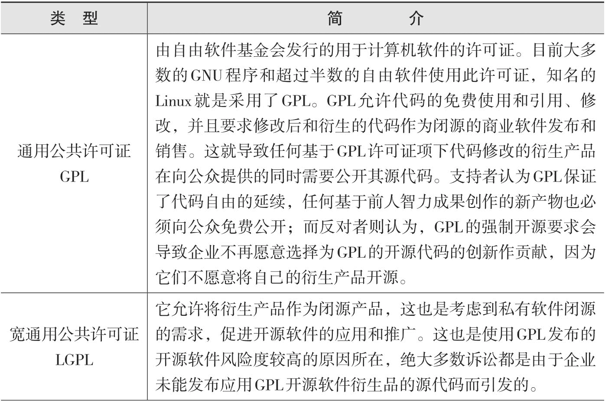

续表

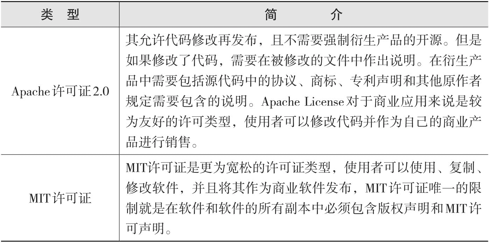

#### （四）开放源码对AI技术发展的影响
AI技术发展离不开基础研究深入，该技术发展迅速，科技巨头都在着眼构建充满活力的开放社区以拓展自身开放生态圈。例如，2015年Google推出其开放框架解决方案TensorFlow，它是用于机器智能的开放软件库，吸引不同企业在此平台训练模型，其通用性使其也可广泛应用于其他计算领域。Facebook也推出Caffe2框架，旨在让微软和亚马逊等主要市场参与者和社交网络的PyTorch框架一起使用该平台。[^(\[13\])](#chapter001.html#m13)开放平台的发展确实让企业获得更多创新力量，它们推出的深度学习开放平台在全球AI领域占有很大份额。2021年7月8日，中国科学院院士梅宏在2021世界AI大会上提出，AI快速发展离不开代码开放和数据开放，高质量开放数据促进了深度学习算法突飞猛进，深度学习框架极大提升了算法开发效率，二者相辅相成。[^(\[14\])](#chapter001.html#m14)

在大数据产品领域，基本上所有数据库产品都绕不开使用MariaDB、PostgreSQL和MongoDB等开放数据库的核心代码。著名手机系统安卓也采用了Linux内核项目，而该项目本身也是开放软件。开放软件的运用使得其他使用者无须从零开始开发全新系统，只需在已有开放项目基础上进行修改和定制即可，最重要的是开放软件通常免费，这在很大程度上刺激了行业创新积极性。

我国AI开放项目正处于起步阶段，2018年中国AI开放软件发展联盟发布的《中国AI开放软件发展白皮书（2018）》指出，AI开放软件是驱动AI技术创新和应用的重要支撑力量。[^(\[15\])](#chapter001.html#m15)2021年《中华人民共和国国民经济和社会发展第十四个五年规划和2035年远景目标纲要》中也指出，“支持数字技术开源社区等创新联合体发展，完善开源知识产权和法律体系，鼓励企业开放软件源代码、硬件设计和应用服务”。目前，我国已打造OpenI启智平台、之江天枢AI开放平台等项目，为AI行业发展提供新动力。

### 四、AI厂商在开放源码方面的合规风险
AI厂商在引入、使用、修改、分发开放技术时，可能触发许可违约风险、合规风险、专利侵权风险、商标侵权风险、数据安全风险、出口管制风险和应用过程中的知识产权风险等。以下围绕许可合规风险、供应链管理风险、程序使用合规风险和应用过程中的知识产权风险展开讨论。

#### （一）开放源码许可合规风险
新思科技Synopsys发布的《2022开放源安全和风险分析报告》显示，2021年审计的代码库中有53%的开放代码存在许可冲突风险，17%的开放代码存在许可兼容性问题。[^(\[16\])](#chapter001.html#m16)

AI厂商在自定义许可时，应注意规则清晰。例如，JSON许可实质上是宽松型MIT许可，其添加了“该款软件严禁用于恶意用途，仅限于善意用途”的注释。许多Apache软件基金会项目都因许可定义含糊不清而删除了使用JSON许可的代码。

#### （二）开放源供应链管理风险
虽然引入开放软件能提高研发效率、缩短产品上市时间，但由于开放软件贡献者往往人数众多、互不相识且散布全球，导致大量风险隐患。2022年3月发生的faker.js与colors.js开放库遭到作者Marak恶意破坏事件就是典型例子。Marak通过向两个包提交恶意代码进行供应链投毒，并发布到GitHub和npm包管理器中，之后又将项目仓库所有代码清空，完全停止维护，从而导致依赖两个库的数千个项目无法运行。

#### （三）开放软件使用合规风险
根据开放安全扫描平台Snyk和Linux基金会的调查结果，只有49%的组织制定了开放软件开发或使用的风险管控策略。企业未建立完整的开放软件使用管理机制，导致开发人员对开放软件基本处于“只用不说”的状态，企业也无法了解其产品或服务中是否包含了开放软件，[^(\[17\])](#chapter001.html#m17)使得合规风险大大提升。

另外，AI训练所需的数据许可并无国际组织对其进行标准化，这意味着对使用数据的企业来说暗藏诸多风险。此外，开放技术中的安全漏洞也会带来数据泄露风险。

### 1. 许可的法律风险
在许可背景下，选择适合企业情况的许可至关重要，这决定了软件使用者的自由程度。若选择得当，企业可在享受开放社区便利的同时提高自身产品适应性。但若选择不当，则有可能为衍生产品的使用埋下隐患。

#### （1）GPL中的强制开放
GPL具有高度的“传染性”，其允许第三方对开放的代码免费使用、修改，但不允许将修改后的代码作为闭源商业软件发布和销售。著名的Linux内核开放项目即使用GPL许可，由于使用Linux内核开放项目的上层服务不可避免会涉及调用Linux内核文件，若将该行为视为创作了衍生产品，将导致上层服务源代码被受GPL许可控制的Linux内核开放项目所“传染”，从而需要接受GPL许可。这就形成了一个以Linux内核开放项目为核心的传染源，任何基于Linux开发的内核驱动到中间服务到上层应用都受到GPL许可控制，在符合发布软件条件下需向大众开放源代码。不过Linux内核作者Linus Torvalds以及内核开发人员多次澄清普通系统调用为非GPL作用范围，也就是允许Linux用户空间程序使用其他许可。

2018年，软件自由保护协会`Software Freedom Conservancy`，`SFC`难得在其博客公开了一家知名车企的`GPL`合规争议。SFC披露，自2013年6月起便不断收到关于该企业S系列车型的违规反馈，相关车载系统内集成了`BusyBox`与`Linux`项目，却始终未向用户公布系统源代码。多年以来SFC持续要求对方尽快完整提供源码，但在漫长沟通后，该企业仍未向SFC或公众交付符合`GPL`约定的代码。[^(\[18\])](#chapter001.html#m18)

一个容易被忽略的细节是，`GPL`的义务触发点在于分发。若使用者仅在内部修改并通过服务交付，而不将程序本身分发给用户，则不产生公开源代码的责任。典型例子是`SaaS`，`Softwareas-a-Service`，软件即服务模式，供应商把软件部署在自有服务器上，用户仅通过网络使用服务，并未获得程序副本或源码，此时供应商没有开源义务。

#### （2）双重许可的商业逻辑
双重许可指权利人既以商业软件形式售卖，又以开源协议向公众开放。商业授权带来直接收益，开源则能借助社区力量加速迭代。权利人可同时采用专有许可与`GPL`，`GPL`确保下游发布修改版时必须同步开源源码；也可选用更宽松的协议，吸收社区贡献后融合到自有产品中。`MySQL`数据库管理系统即为代表，一方面以商业许可满足特定用户需求，另一方面依托`GPL`获得持续更新。[^(\[19\])](#chapter001.html#m19)

#### （3）违规后的法律后果
自由软件基金会`FTF`部门与`GPL-Violations.org`在2008年发布了《举报和修复违反许可证行为指南》，对常见合规问题进行说明。指南指出任何人均可向FSF或GPL维护组织举报，收到通知后组织通常先以邮件或书信与涉事方协商，若协商不成则可能启动诉讼以达成和解或申请法院禁令。GPL维护组织的经验表明，其已在德国与美国取得过胜诉案例。

### 2. 专利侵权隐患
开源协议往往只授予著作权许可，部分协议并不包含专利授权。`BSD`、`MIT`等许可证通常不提供专利授权，而`Apache-2.0`与`GPL`则包含普通的专利授权，使用者在获得著作权许可的同时也降低了专利风险。对未明示专利授权的开源组件，使用前应做专利检索，若存在有效专利，使用该代码即可能构成侵权。

### 3. 安全漏洞的法律责任
开源代码若存在安全缺陷，使用方将承担严重后果。调研显示，针对人工智能行业，开源代码安全缺陷中`API`，`Application Programming Interface`，应用程序编程接口误用与代码质量问题占比高达94%。[^(\[20\])](#chapter001.html#m20)因开源软件缺陷遭受攻击的损失需使用者自行承担，无法向原作者追偿。例如`RealAI`，瑞莱智慧发布的`RealSafe`人工智能安全平台测试发现，某两家公司的人脸比对演示平台存在重大安全漏洞。[^(\[21\])](#chapter001.html#m21)人脸识别已广泛用于金融远程开户、手机解锁、支付校验，若被利用将对用户人身财产安全造成重大损害，使用者可能面临用户索赔。

## （四）应用开源技术时的知识产权雷区

### 1. 著作权侵权风险
开源软件同样受著作权法保护，且多数许可证均保留版权声明。`GPL`引言即明确：“采用`GNU`通用公共许可协议的开发者通过两步保障你的权益：其一，申明软件的版权；其二，通过本协议使你可以合法地复制、分发和修改该软件。”[^(\[22\])](#chapter001.html#m22)正因源代码公开，侵权行为更容易被发现，也更易引发诉讼。

2008年美国`Jacobsen`诉`Katzer`上诉案中，联邦巡回上诉法院认为，开源许可明示了复制条件并提示了授予复制、改编、分发的权利。若下载使用者未满足条件，应另行协商；超出授权范围使用即构成侵权，权利人可提起版权诉讼。[^(\[23\])](#chapter001.html#m23)

2006年德国`Welte`诉`D-Link`案中，法兰克福地区法院判定，违反`GPL`许可属于著作权侵权，许可条件应视为解除条件，违反时许可无效，使用行为构成侵权，权利人可依德国《著作权法》起诉。[^(\[24\])](#chapter001.html#m24)

总体来看，应用过程中的著作权风险主要表现为：违反许可证约定使用软件；或因贡献者引入存在版权瑕疵的代码而产生连带责任。

### 2. 专利侵权风险
著作权仅保护表达形式，专利可覆盖硬件结构、软件逻辑与算法，保护范围更广。专利有效期内，未经许可使用相关技术即构成侵权，即使独立研发亦然。自由软件基金会在`GNU`计划书中指出，开放源码软件面临的最大威胁并非著作权而是专利。开源许可能解决著作权独占问题，却对专利无能为力。

`GPLv3`只能规定：“若法院判决或专利指控等强加的条件与许可证冲突，且你无法同时满足双方义务，则只能停止发布程序。”[^(\[25\])](#chapter001.html#m25)`GPL`还允许权利人在专利受限国家排除该地区发布。可见开源对专利采取回避策略，仍无法消除威胁。

`MIT`的`X Windows`曾被美国电话电报公司`AT&T`指控侵犯“后援存储”技术第4555775号专利。该技术在窗口被遮盖时将内容存于显存外，恢复时快速调用。`MIT`早在`Lisp`机器系统上就已使用该技术，时间早于`AT&T`，但未公开发表。`AT&T`于1985年获美国专利商标局`United States Patent and Trademark Office`，`USPTO`批准，因`MIT`未公开而被禁止继续使用。[^(\[26\])](#chapter001.html#m26)

`Linux`亦非免疫。2004年8月4日，德国慕尼黑政府因担心专利赔偿风险，暂时叫停了14000台`Linux`台式机的采购计划。[^(\[27\])](#chapter001.html#m27)

开源硬件同样可能触及专利。为降低风险，可采取：开发阶段进行自由实施`FTO`分析与专利预警；先申请专利再以开源许可发布；尽早公开技术细节形成在先技术阻断他人申请；或在许可证中加入专利报复条款。

### 3. 商标侵权风险
多数开源许可证明确不授予商标许可。`Mozilla Public License`即规定不授予贡献者的商标、服务标记或徽记许可，除声明要求外。开源项目在放弃版权和专利保护后，可通过商标维护权益而不损害“自由”属性，同时提升知名度。

2002年`MySQL AB`诉`Progress Software Corp.`、`NuSphere Corp.`案中，`MySQL AB`既是开源数据库`MySQL`的著作权人，也是瑞典、美国等国“`MySQL`”注册商标持有人。2000年6月被告与原告签约分销并提供技术支持，8月终止。之后被告注册`mysql.org`域名，发行含`GPL`发布的`MySQL`与自研`Gemini`的“`NuSphere MySQL Advantage`”。法院于2002年2月作出初步禁令，禁止被告销售含`MySQL`商标的商品与服务、使用相关域名及网站。[^(\[28\])](#chapter001.html#m28)

合理使用商标有助于追踪开源发展。仅经开放源代码促进会认证的许可证发布的软件才能使用“`OSI Certified`”标识，便于识别。获认证明细包括`GPL`、`BSD`[^(\[29\])](#chapter001.html#m29)、`Apache`等。[^(\[30\])](#chapter001.html#m30)商标保护为开源项目提供了不带垄断指责的、相对持久的收益渠道。[^(\[31\])](#chapter001.html#m31)

随着开源在人工智能领域的渗透加深，其自由属性与知识产权独占性之间的张力日益明显。开源种类、许可证类型与使用方式均影响风险程度。企业需长期系统性管理：提升风险意识、开展风险分析、协同防范、建立管理规则与全流程管控、跟踪案例、加强法律研究。

## 五、AI企业的开源合规实操建议
开源合规的核心是通过制度与流程规范开源技术的引入、使用、修改与分发，确保产品服务安全可控、符合法律与许可要求，保障权利人合法权益。

### （一）开源软件管理与审查
建议在内部设立开源项目管理流程或部门，对使用的开源软件进行安全性与合法性评估。伴随产品国际化，中国企业出口需求上升，开源风险凸显。企业可能收到个人用户或SFC的合规通知。国内虽尚未形成统一司法确认，但已有承认开源协议效力的判例，应提前预判风险并培养应对能力。

### （二）技术进出口合规审查
除开源软件本身限制外，还需依据技术出口方国家的技术进出口管制措施进行审核。在国际博弈加剧背景下，美国曾限制人工智能软件出口，涵盖智能传感器、无人机、卫星及自动化设备的目标识别软件等。触及管制范围可能导致制裁，影响在该国经营。

### （三）专利前置审查
开源许可证不一定包含专利许可，使用他人代码前应按使用地域检索当地专利登记情况。若权利人已在先申请专利，使用方式即受限，企业需评估是否继续使用及如何使用。

### （四）开源方式选择
合适的许可策略是可持续发展的前提，企业可选择专有许可、开源许可或双重许可决定是否公开源码及后续更新方式。基于已有作品的衍生成果最好遵循原许可要求，部分协议要求采用相同许可证发布。对非核心小程序，使用`GPL`并不划算，难以发挥其传染性优势激励社区改进。

### （五）并购尽调中的开源风险核查
人工智能离不开开源支持，并购涉及AI或软件研发企业时，必须核查其软件使用的开源组件与协议是否合规，识别是否存在开源风险、安全漏洞或质量问题，使用方是否已履行许可义务，为交易提供法律保障。

### （六）建立开源合规委员会
腾讯、华为、百度、滴滴等公司已设立开源管理办公室`Open Source Program Office`，`OSPO`。人工智能企业可由科技、法务、采购等部门组成开源合规委员会或OSPO，将开源纳入战略，明确目标与实施方案，设立首席开源合规官。法务职责包括制定制度与清单、审查批准代码使用修改分发、提供许可证法律指导、编撰许可证摘要手册、组织培训、监督合规。技术人员职责包括依据制度调整开发流程、提出规则优化建议、审查代码架构设计。

### （七）健全开源技术应用管理制度
制度应覆盖引入审批、技术评估、合规使用、漏洞检测、更新维护、应急处置、停用退出等环节。

引入审批时，可借助开源组件扫描工具识别产品服务中使用的开源技术，来源包括代码托管平台、技术社区、官方网站或合作研发、商业采购。强化供应链管理，通过合同明确供应商义务，要求披露交付物含有的开源技术并提供评估与合规证明。初步识别后出具开源技术材料清单，列明名称、来源、许可证、冲突点，并审查版权、专利、商标、声明与许可证兼容性，必要时引入第三方协助。

### （八）开源技术合规管理
技术评估环节需依据材料清单核查使用、修改、分发情况，解读许可证规则，进行全面评估并明确预期用途，建立选型评估模型提升效率。

合规使用环节应遵循许可协议与法律法规，明确使用范围与权利义务，按要求完成版权与修改声明，确保各部门使用符合许可证，保障作者权益。同时加强技术储备，掌握核心能力，建立问题发现、反馈、解决闭环，形成自主知识产权，推动迭代。

维护与应急处置环节应建立开源技术应用台账，实时跟踪许可证变更、漏洞、闭源、停服等变化，常态化管理并制定应急预案并定期演练。

### （八）积极参与开源生态建设和标准化建设

人工智能企业若希望在开源赛道实现可持续发展，就必须把技术能力嵌入到合规的开源体系中。加入经法律认可的开源社区、开源基金会等社会组织，深度参与技术规划设计、研发决策讨论以及社区运营工作，在依法合规的前提下对外分享应用实践经验并共享研究成果。凭借主动开源和持续代码贡献破解行业共性难题，提升开源技术的整体应用水平，推动技术迭代升级与成果转化，最终实现优势互补、互利共赢与共同发展。

2021年12月27日，国务院知识产权战略实施工作部际联席会议办公室发布《关于印发〈知识产权强国建设纲要和“十四五”规划实施年度推进计划〉的通知》，明确任务分工：中央宣传部、国家知识产权局按照职责分工研究制定大数据、人工智能、区块链、基因技术等新领域新业态的知识产权保护规则；工业和信息化部负责研究制定信息技术开源知识产权合规标准、开源社区代码贡献规则标准等，开展行业开源知识产权风险及合规问题研究，加强行业开源知识产权合规评估与培训。

人工智能已成为全球难以逆转的发展方向，各国都在该领域争夺领先地位。产业进展高度依赖计算机技术的突破，但任何技术演进都必须在法律规范范围内进行。只有技术与合规并行，社会既能享受智能技术带来的便利，也能确保各方利益得到合法保护。在国家明确规划强化人工智能领域知识产权保护和开源技术合规建设的背景下，企业应从制度、流程、工具、团队等多个维度建设合规体系，提升开源治理能力并防范开源合规风险。

开源是一种无边界的协作方式，秉持开放共赢理念，正推动人工智能、云计算、操作系统、数据库等领域的发展。开源帮助企业把握技术趋势、提高研发效率，同时扩大行业影响力。例如，`Linux`操作系统采用去中心化的开源开发模式，汇聚大量开发者进行持续快速迭代，构建起完整生态，使其在全球智能手机操作系统市场占有率超过85%。[^(\[32\])](#chapter001.html#m32)新思科技《2022 开源安全和风险分析报告》显示，新思科技网络安全研究中心`CyRC`团队审查了17个行业超过2400个商业代码库，在报告覆盖的17个行业中，计算机硬件与半导体、网络安全、能源与清洁科技、物联网行业的代码库100%包含开源代码。[^(\[33\])](#chapter001.html#m33)

人工智能发展已有60余年历史，经历两次起伏后在深度学习推动下迎来第三次浪潮，同时涌现出`TensorFlow`、`PyTorch`、飞桨（`PaddlePaddle`）、`Caffee`等开源AI框架，加速了应用落地。随着开源生态日趋成熟，越来越多的人工智能企业选择拥抱开源，但与此同时，各类开源合规风险也在不断显现。

### 第三节 人工智能算法推荐技术的合规风险
### 一、算法推荐技术是人工智能产业的重要基础
2021年12月31日，国家互联网信息办公室、工业和信息化部、公安部、国家市场监督管理总局联合发布《互联网信息服务算法推荐管理规定》，以下简称《算法规定》。根据该规定，算法推荐技术是指利用生成合成类、个性化推送类、排序精选类、检索过滤类、调度决策类等算法技术向用户提供信息。

人工智能产业链通常分为基础层、技术层和应用层。基础层可按算力、算法与数据划分，为上层提供底层支撑。算法推荐技术一方面承接芯片与半导体制造，另一方面统筹数据收集处理与应用，其在人工智能研究开发过程中的基础性与决定性作用逐渐受到关注。

《算法规定》将算法推荐场景划分为生成合成类、个性化推送类、排序精选类、检索过滤类、调度决策类五类，该分类契合当前学术研究与产业实践的主流观点，对把握人工智能领域算法推荐技术的基本内涵具有重要指引意义。

#### （一）生成合成类
生成合成类算法可自动生成、合成内容，将视频、图片、文字、语音等素材自动组合并发布到互联网平台。典型应用包括自动写稿机器人（如互联网医疗借助数据分析形成诊断结论）、虚拟博主、聊天机器人、AI换脸程序、自动生成的文字与美术作品等。大量虚假新闻的传播与此类技术相关，《算法规定》为应对生成合成类算法对舆论与公众的影响，明确禁止生成合成虚假新闻信息等。

#### （二）个性化推送类
个性化推送类算法指网络服务提供者识别并筛选用户偏好，优先呈现与用户需求相符的信息内容，实现个性化推荐服务。该类算法结合用户浏览行为、用户特征如兴趣标签、话题、性别、年龄、职业等以及环境特征，形成用户画像并推送特定信息。其底层逻辑大致为：采集信息——建立标签体系，形成对用户、用户特征、环境特征的画像——依据标签映射关系圈选人群并确定推送内容——根据推送效果反馈持续优化算法。新闻、电商、视频类网站或移动客户端普遍使用此类技术。

#### （三）排序精选类
排序精选类算法指按一定规则对信息排序并向用户展示推荐或精选列表的算法，常见于搜索引擎结果排序、广告推荐排序等。

以京东商城商品排序系统为例，系统基于用户输入与历史行为数据对商品打分排序。传统方法多采用`XGBoost`（eXtreme Gradient Boosting）[^(\[34\])](#chapter001.html#m34)等基于决策树的学习方法，近年来逐渐引入`Wide&Deep`模型[^(\[35\])](#chapter001.html#m35)等深度学习方法。[^(\[36\])](#chapter001.html#m36)

#### （四）检索过滤类
检索过滤类算法通过建立内容索引树等方式，对内容进行检索、过滤，形成用户偏好结果。借助该类算法，用户可快速从海量非结构化数据中提取信息，或从推荐标的物中筛选出偏好的对象。主要应用于搜索引擎、敏感词自动识别、信息屏蔽、关键词联想等功能。

#### （五）调度决策类
调度决策类算法依据系统资源分配策略，结合多维度影响因素自动提供最优路线、最短时间等决策结果。在技术层面，该类算法包括先来先服务算法（First Come First Service，`FCFS`）、短作业优先算法（Short Job First，`SJF`）、高响应比优先算法、时间片轮转算法、优先级调度算法、多级反馈队列算法等多种方案。以美团外卖订单分配为例，系统兼顾用户、商家、骑手三方需求，为时间充裕且配送顺利的骑手派单，对新手骑手匹配距离更近、难度更低的订单。调度决策类算法被用于解决路线规划、时间分配、网约车调度、外卖订单分配等现实问题。

### 二、我国涉人工智能算法推荐技术立法现状
算法应用不断深化，为经济社会发展注入新动能的同时，算法歧视、大数据杀熟、诱导沉迷等不合理应用也对传播秩序、市场秩序和社会秩序造成冲击，对意识形态安全、社会公平公正和网民合法权益构成挑战。

《算法规定》属于我国“数据法三驾马车”——《中华人民共和国网络安全法》《中华人民共和国数据安全法》《中华人民共和国个人信息保护法》的下位法，是首部专门规范算法推荐技术的部门规范性文件。结合《网络信息内容生态治理规定》《关于进一步压实网站平台信息内容管理主体责任的意见》等文件，我国构建了人工智能领域算法推荐技术的立体法律规范体系（表1-2），为企业依法审查算法开发与应用、规范算法备案、规避处罚与诉讼风险提供遵循。

表1-2 我国算法推荐领域主要法律法规
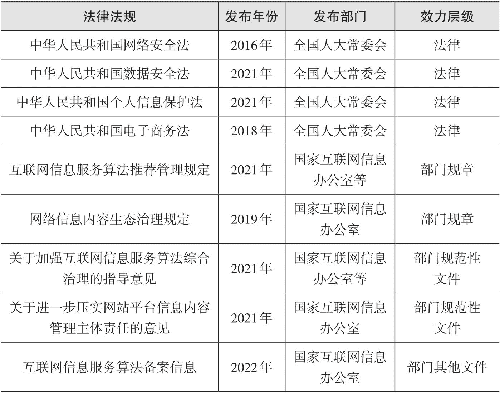

2021年9月25日，国家新一代人工智能治理专业委员会发布《新一代人工智能伦理规范》，对算法推荐相关技术的运用作出规范性指引：“在算法设计、实现、应用等环节，提升透明性、可解释性、可理解性、可靠性、可控性，增强人工智能系统韧性、自适应性与抗干扰能力，逐步实现可验证、可审核、可监督、可追溯、可预测、可信赖。”“在数据采集与算法开发中，加强伦理审查，充分考虑差异化诉求，避免数据与算法偏见，努力实现人工智能系统的普惠性、公平性与非歧视性。”

### 三、我国人工智能算法推荐技术备案规范
#### （一）主管部门
根据《算法规定》，国家网信部门负责统筹全国算法推荐服务治理和监督管理工作，国务院电信、公安、市场监管等部门依职责负责监督管理工作；地方网信部门负责统筹本行政区域治理和监督管理工作，地方电信、公安、市场监管等部门依职责负责本行政区域监督管理工作。因此，目前主责部门为国家互联网信息办公室及其下属机构，工业和信息化部、公安部、国家市场监督管理总局等在其职权范围内共同管理。

#### （二）备案主体
《算法规定》明确，申请备案的经营主体应为提供互联网新闻信息服务和具有舆论属性或社会动员能力的算法推荐服务提供者。

#### （三）备案流程
具有舆论属性或社会动员能力的算法推荐服务提供者，应自提供服务之日起10个工作日内，通过互联网信息服务算法备案系统填报服务提供者名称、服务形式、应用领域、算法类型、算法自评估报告、拟公示内容等信息，完成备案手续（图1-1）。自2022年3月1日起，系统正式上线运行，官方网址为`https：//beian.cac.gov.cn`。

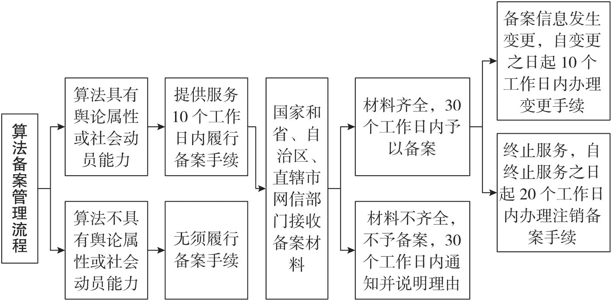
图1-1 算法备案管理流程

#### （四）监督方式
备案完成后，服务提供者需接受相关部门实时安全评估，并接受社会公众监督。

1.公示备案信息
提供者应在网站、应用程序等显著位置标明备案编号并提供公示信息链接。
2.开展企业安全评估
具有舆论属性或社会动员能力的提供者应按国家有关规定开展安全评估。
3.接受相关部门监督检查
提供者应依法留存网络日志，配合网信、电信、公安、市场监管等部门开展安全评估与监督检查，提供必要技术数据支持与协助。
4.接受社会举报与监督
任何组织或个人发现违反《算法规定》行为的，可向网信部门和有关部门投诉举报，相关部门应及时依法处理。

根据国家互联网信息办公室发布的互联网信息服务算法备案信息公告[^(\[37\])](#chapter001.html#m37)，以下列示已成功备案的典型案例（表1-3），仅供参考。

表1-3 境内互联网信息服务算法备案清单（2022年8月）
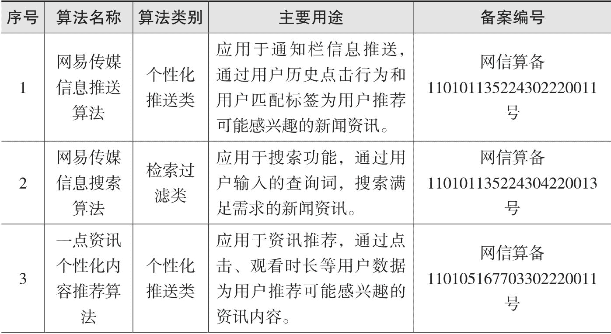
续表
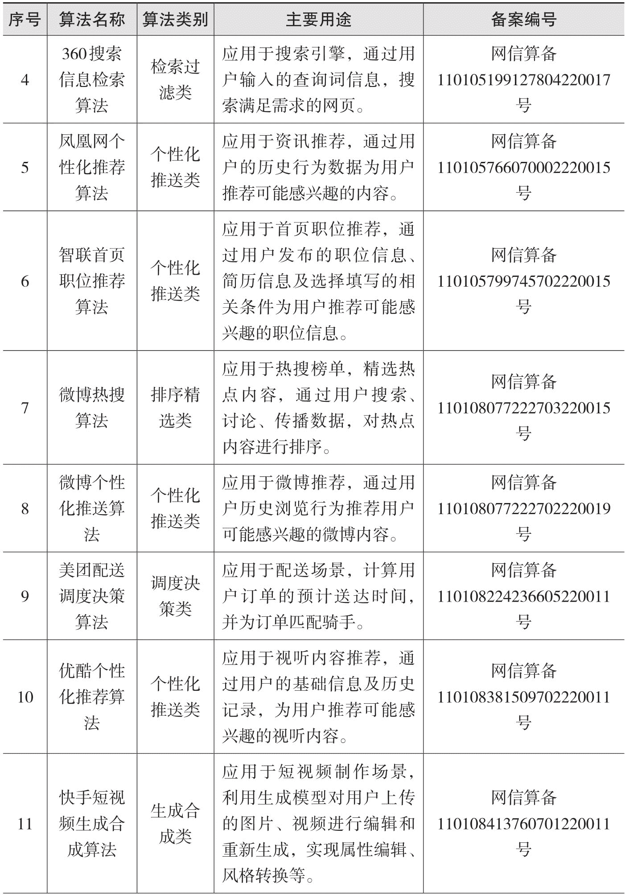
续表
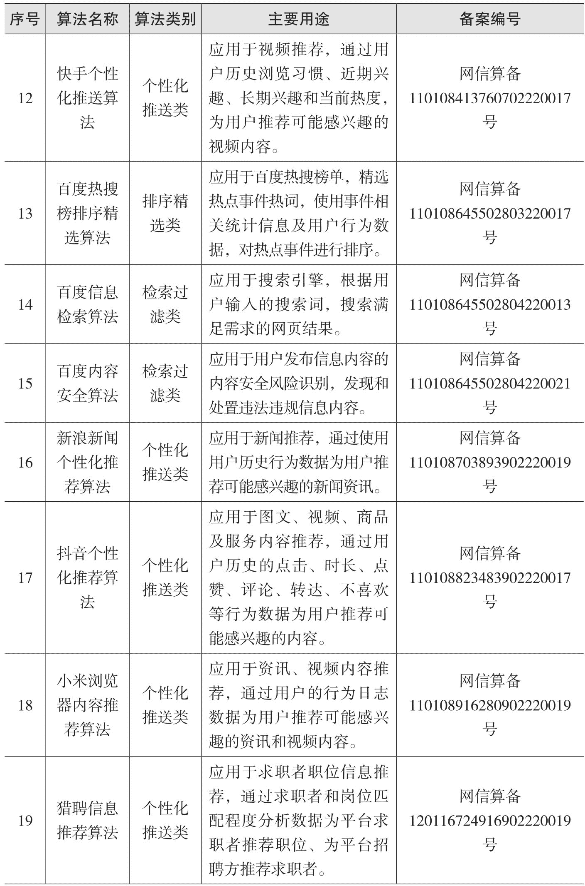
续表
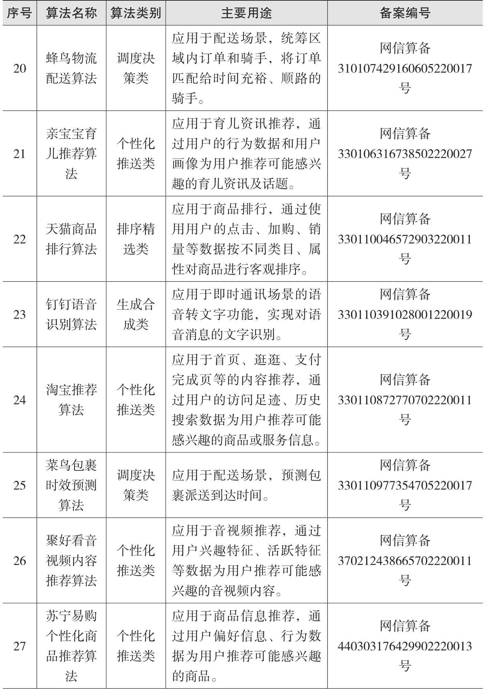
续表
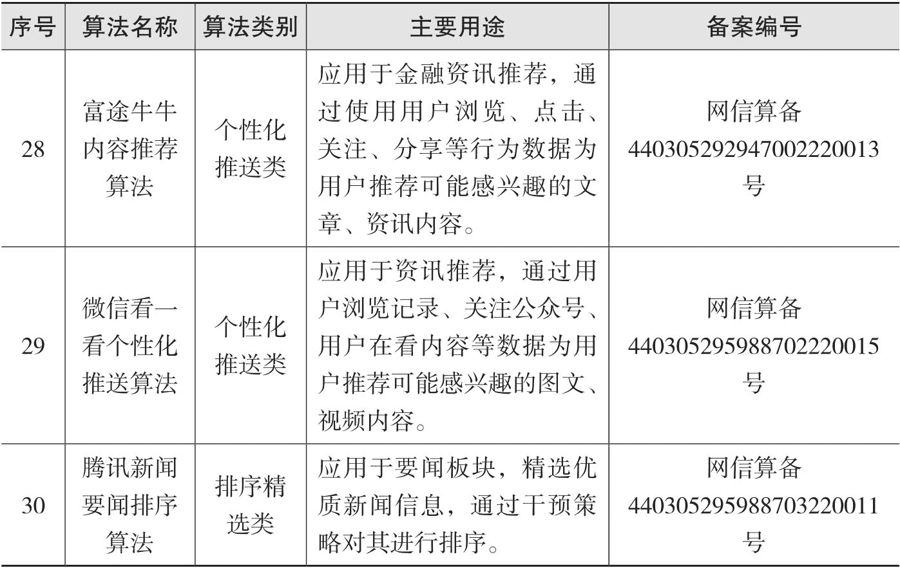

### 四、人工智能算法推荐技术合规要点
《算法规定》对算法推荐服务提供者的要求主要集中在信息服务规范和用户权益保障两方面。信息服务规范主要解决推荐何种信息、如何推荐的问题，用户权益保障则对不同类型消费者进行特别保护。

#### （一）信息服务规范方面
1.责任主体
算法推荐服务提供者承担算法安全主体责任。根据《算法规定》第7条，应建立健全算法机制机理审核、科技伦理审查、用户注册、信息发布审核、数据安全与个人信息保护、反电信网络诈骗、安全评估监测、安全事件应急处置等管理制度和技术措施，制定并公开相关服务规则，配备与服务规模相适应的专业人员与技术支撑。

2.审核评估义务
提供者负有定期审核、评估、验证算法的义务。根据《算法规定》第8条，不得设置诱导沉迷、过度消费等违反法律法规或违背伦理道德的算法模型。为提升透明度，《算法规定》鼓励采用内容去重、打散干预等策略，优化检索、排序、选择、推送、展示规则的可解释性，避免对用户产生不良影响，预防争议纠纷。

3.安全管理义务
提供者负有信息安全管理义务。根据《算法规定》第9条，应加强信息安全管理，建立健全用于识别违法和不良信息的特征库，完善入库标准、规则与程序。

对未作显著标识的算法生成合成信息，应先行标识后方可传播；发现违法信息，应立即停止传输、消除处置、保存记录并上报网信部门和有关部门；发现不良信息，应按网络信息内容生态治理有关规定处置。

4.合理利用算法推荐的义务
根据《算法规定》第14条，提供者不得利用算法虚假注册账号、非法交易账号、操纵账号或进行虚假点赞、评论、转发，不得利用算法屏蔽信息、过度推荐、操纵榜单或检索结果排序、控制热搜或精选等干预信息呈现，实施影响网络舆论或规避监管的行为。

#### （二）用户权益保障方面
1.保障用户知情权
《算法规定》第16条赋予用户知情权。提供者应以显著方式告知用户算法推荐服务情况，并以适当方式公示基本原理、目的意图与主要运行机制。

2.保障用户关闭推荐权利
提供者应向用户提供选择或删除个性化标签的功能，或提供不针对个人特征的选项，并提供便捷关闭推荐的入口。用户选择关闭后，应立即停止相关服务。

3.特殊主体的特殊保护
为解决算法歧视，《算法规定》区分用户类型进行特别保护。例如对未成年人严控推荐内容并设置防沉迷机制；对老年人设计反诈骗等保护；禁止算法不当用工；禁止大数据杀熟等。

总体来看，围绕《算法规定》，我国算法技术标准与行业规范日益清晰。针对具有舆论属性和社会动员能力的算法推荐技术构建登记管理制度，提示企业重视信息服务规范与用户权益保障，积极履行审核评估与安全管理义务，合理使用算法，保障用户知情权与关闭权，对特殊群体差异化保护并接受社会监督。

### 第四节 人工智能引发的个人信息与隐私保护
人工智能领域大数据价值不断被挖掘，但隐私泄露、数据垄断、算法决策公平性问题也日益凸显。《个人信息保护法》出台后，企业合规重点转向数据隐私。例如2017年绍兴警方破获全国首例利用人工智能侵犯公民个人信息案，打掉入侵网站“黑客”团伙、制作撞库软件“黑客”团团、利用AI技术识别图片验证码团伙、数据买卖团伙、网络诈骗团伙。该团伙运用机器深度学习训练机器，通过有效识别图片验证码绕过网络公司安全登录设置，非法获取网站后台用户注册数据。[^(\[38\])](#chapter001.html#m38)

大数据是人工智能运行的基础，算法是其本质。技术突破对数据喂养和算法支撑的依赖增强，可能引发严重隐私危机。数据分为商业数据与公共数据，并与个人信息交叉，下文聚焦个人信息与人工智能碰撞下的隐私保护议题。

### 一、隐私保护与人工智能技术的关系
数据是人工智能发展的养分。人工智能应用于自动驾驶、人脸识别、智能设备后会持续采集数据以优化服务，必然涉及分析、融合、共享等处理。用户获取更全面服务需提供更多个人信息，相应隐私风险随之放大。

人工智能发展不仅依赖个人主体数据，还需大量大数据支撑。例如精准营销除获取个人消费倾向外，还需结合企业既有数据库建模，并融合公共数据或第三方数据。此时必须审视第三方数据来源合法性、委托处理合规性、公共数据使用边界等。

### 二、人工智能侵犯个人信息及隐私权益的机理
从侵权路径看，主要分为两类：一是智能系统被非法控制，如黑客攻击、病毒入侵，或因个人信息处理者技术缺陷导致泄露与安全事件；二是人工智能设计或用户协议存在瑕疵，如制造者技术缺陷、人工智能“自主行为”、用户协议未明确个人信息使用权限导致超越授权处理。

两种路径均可能导致个人信息泄露与违法处理、干扰个人行为决策、侵害个人权益。相关处罚散见于《个人信息保护法》《网络安全法》《中华人民共和国刑法》《中华人民共和国消费者权益保护法》等，可见不当使用个人信息将带来多重法律后果。

以2019年备受争议的某换脸App事件为例，其隐私协议载明：“如果您把用户内容中的人脸换成您或其他人的脸，您同意或确保肖像权利人同意授予本产品及其关联公司全球范围内完全免费、不可撤销、永久、可转授权和可再许可的权利，包括但不限于：人脸照片、图片、视频资料等肖像资料中所含的您或肖像权利人的肖像权，以及利用技术对您或肖像权利人的肖像进行形式改动。”

人脸数据与量刑模型：技术使用的边界在哪里

条款本身并没有写明数据使用范围——彼时相关上位法规尚未出台——但从表述可以推断App是以概括授权的方式获取全部使用者本人或第三方的面部识别资料，并默认拥有对这些资料的任意处置、修改、提供等权限。该起争议已成为AI企业对个人资料不当使用、权限滥用的典型样本。

另一例是美国威斯康星州诉卢米斯案。法院在判决时引用了COMPAS风险评估工具，对卢米斯判处六年监禁。裁判依据既有犯罪记录，也有COMPAS系统里卢米斯对137道问卷的计算结果。COMPAS在美国刑事程序中运用广泛，通过预测再犯概率、出庭可能性等指标，为保释、量刑、假释提供数据参考，意图让法官做出更具数据支撑的判断。卢米斯提出异议，认为自己有权知晓指控理由，使用COMPAS进行风险评估损害了宪法保障的正当程序权利。[^(\[39\])](#chapter001.html#m39)

上述两种技术实践带来的侵权后果是多方面的。公民的私密空间可能被无必要地持续监控，用户画像的生成能力被放大、辐射面更广；与此同时，AI设备本身成了隐私设置的载体，反而形成了信息牢笼。

## 三、隐私合规工具的运用与改进思路
AI企业与传统互联网营销公司或转型中的传统企业不同，合规节奏必须跟上技术迭代。既要夯实当下基础，也要前瞻性地预判未来风险。值得庆幸的是，目前个人数据使用问题仍可通过合规工具覆盖解决，技术持续演进未来仍会催生新挑战。

### （一）开发阶段——产品的隐私设计
新功能立项之初就要启动隐私合规工作，将个人资料保护要求嵌入产品设计。设计、开发、评审、试运营全流程都要嵌入合规节点。企业应从业务涉及的数据采集、流转、提供环节出发，有针对性地编制产品隐私合规清单。

同时参照《信息安全技术 个人信息安全影响评估指南》（GB/T 39335—2020）建议，在业务上线前开展PIA。开发阶段即按合规清单设计功能，有助于后续评估顺利开展。

### （二）投放使用阶段
产品完成设计准备投放前，除对业务功能开展PIA外，还应梳理整个产品的个人资料流转全景。AI企业数据体量大，且可能与下游企业、合作方发生数据交易与共享。根据《个人信息保护法》第55条，有下列情形之一的，个人资料处理者应当事前进行个人资料保护影响评估并记录处理情况：（1）处理敏感个人资料；（2）利用个人资料进行自动化决策；（3）委托处理个人资料、向其他个人资料处理者提供个人资料、公开个人资料；（4）向境外提供个人资料；（5）其他对个人权益有重大影响的个人资料处理活动。评估结论需形成书面报告，并落地执行、督促落实、定期审计，确保结论体现在日常工作。

### （三）市场推广阶段
该阶段覆盖产品投放后的全部生命周期。相关法律对PIA落地后的合规审核也有要求。企业在关注新业务线合规评估与措施落地之余，还应聘请第三方专业机构定期审计。定期评估与审计既有助于数据资产管理与价值提升，也能在企业或下游供应商、合作方发生数据安全事件时，以成文报告和审计记录证明合规工作开展情况，降低处罚风险。

对AI企业而言，个人资料处理的全链路和合规原理与其他企业并无本质区别。关键在于技术迭代快、对数据依赖度高、采集的资料质量更高，这些共同提高了合规要求。同时AI产品贴近日常生活，很可能涉及伦理道德问题，而不限于信息权益，企业须始终正视风险，重视合规。

公民的“合理隐私期待”源自普通法，最早出现在1967年的卡茨诉美国案中。当时美国联邦最高法院约翰·哈伦大法官在协同意见中提出，只要主观上公民对隐私有真实期待，客观上社会也认为该期待应当被承认，则该期待合理。[^(\[40\])](#chapter001.html#m40)

在中国，现行上位法同样保障合理隐私期待。《中华人民共和国民法典》将自然人个人资料界定为法定权利。该上位法定义在《个人信息保护法》及相关法规中得到细化，最终形成整体隐私保护框架。

### 第五节 AI技术带来的伦理与安全风险
AI正以前所未有的方式重塑社会、环境与生态。规模更大、结构更复杂、能力更强的系统在多任务上表现优异，但潜在伦理问题也更突出。例如偏见、算法缺乏透明与可解释性、数据收集使用对隐私的冲击等。

《人工智能指数 2022 年度报告》显示，大型语言模型不断刷新技术基准，但也更易反映训练数据的偏见。与2018年1.17亿参数的先进模型相比，2021年一个2800亿参数的模型诱发的毒性提升了29%。在CLIP实验中，黑人图像被误判为非人类的比例是其他族群的两倍以上。自2014年起，AI公平性与透明度的研究呈爆发式增长，伦理学会议相关论文数量增加5倍。算法公平与偏见已从学术议题变为具有广泛影响的主流课题。[^(\[41\])](#chapter001.html#m41)

### 一、各国 AI 伦理制度建设
牛津大学学者卢西亚诺·弗洛里迪与乔西·考尔斯在2019年《哈佛数据科学评论》发表文章，提出业界广为认可的AI伦理五原则：行善、不伤害、自治、正义、算法可解释性。[^(\[42\])](#chapter001.html#m42)

全球竞争加剧，各国纷纷出台政策法规，在法律框架内推动产业发展。

#### （一）欧盟
2016年10月，欧盟委员会发布《欧盟机器人民事法律规则》，将AI和机器人伦理标准纳入2018年立法重点。
2019年4月，欧盟发布《可信赖人工智能的伦理准则》，提出可信赖AI全生命周期的框架。准则要求可信赖AI必须合法、合伦理、稳健，并列出七大关键点：人工干预与人工监督、稳健性与安全性、隐私与数据治理、透明性、多样性非歧视与公正性、社会与环境福祉、问责制。
2020年2月，欧盟发布《可信人工智能自评量表》，协助各方对AI应用进行可信度自我评量，保障模型安全公正与数据合理使用。
2021年4月，欧盟《人工智能法草案》提交，全球首个专门针对AI系统开发使用的法规，按风险高低分为三级并实施差异化约束，违规企业可被处以2000万欧元或营收4%的罚款。
2022年9月28日，欧盟通过《人工智能责任指令》提案，首次为AI系统造成的损害设立专门规则，围绕消费者赔偿，允许对AI不当行为造成的损害提出索赔，依据包括侵犯隐私、AI安全问题导致的损害、招聘中因AI遭受歧视等。该指令补充了《产品责任指令》，确立因果关系推定原则减轻受害者举证负担，并在高风险AI案件中赋予受害者调取企业证据的权利。与《人工智能法草案》侧重预防侵权不同，该指令旨在提供救济，增强公众对AI的信任。

#### （二）美国
2020年4月8日，美国联邦贸易委员会发布《使用人工智能和算法》指南，要求：（1）收集敏感数据时保持透明；（2）基于第三方信息作出自动化决策时可能需对消费者进行“不利行动”通知；（3）向消费者解释决策理由；（4）保障消费者对决策所用个人资料的访问与更正权；（5）向其他处理者提供消费者数据时需保证准确并及时更新。[^(\[43\])](#chapter001.html#m43)
2020年12月3日，特朗普签署《关于促进联邦政府使用可信赖人工智能的行政命令》，要求机构在开发、采办和使用AI时尊重国家价值观，遵循准确、可靠、安全、负责任、可追溯、透明原则。[^(\[44\])](#chapter001.html#m44)
2021年4月19日，联邦贸易委员会更新指南，从消费者权益保护角度说明AI如何构成欺诈或不公平。指南强调处理个人资料时应真实说明用途。例如Everalbum照片库应用对人脸识别能力及用户删除照片视频的能力作出虚假陈述。[^(\[45\])](#chapter001.html#m45)

#### （三）中国
2017年7月，国务院发布《新一代人工智能发展规划》，指出AI将影响就业结构、法律与社会伦理、个人隐私和国际关系准则等，需加强前瞻预防与约束引导，确保安全可靠可控。到2025年要初步建立法律法规、伦理规范和政策体系，形成安全评估与管控能力。
2019年6月，国家新一代人工智能治理专业委员会发布《新一代人工智能治理原则——发展负责任的人工智能》，提出和谐友好、公平公正、包容共享、尊重隐私、安全可控、共担责任、开放协作、敏捷治理八项原则。
2021年1月，全国信息安全标准化技术委员会秘书处发布《网络安全标准实践指南——人工智能伦理安全风险防范指引》，要求开展AI活动前进行伦理安全风险分析，涵盖失控性、社会性、侵权性、歧视性、责任性五方面风险，并提出尊重并保护个人基本权利、关注弱势群体等六项基本防范要求。
2021年9月，国家新一代人工智能治理专业委员会发布《新一代人工智能伦理规范》，提出增进人类福祉、促进公平公正、保护隐私安全、确保可控可信、强化责任担当、提升伦理素养六项基本要求，以及对管理、研发、供应、使用等活动的18项具体要求。
2022年3月，中共中央办公厅、国务院办公厅发布《关于加强科技伦理治理的意见》，明确“十四五”期间重点加强生命科学、医学、人工智能等领域的科技伦理立法研究，推动重要规范上升为国家法律，将伦理要求贯穿科研、技术开发全过程。

### 二、AI带来的伦理风险
#### （一）信息茧房
2006年，哈佛大学凯斯·R.桑斯坦在《信息乌托邦》中提出“信息茧房”。他指出公众接触的信息有限，倾向于选择愉悦内容，久而久之被束缚在像蚕茧般的空间里，思考能力被削弱。AI算法基于基本信息、浏览内容、停留时长、关注点赞、消费记录等反复推送定制化信息，剥夺了多元信息接触权，加剧个人偏见的放大。

#### （二）歧视与偏见
算法是AI的核心，执行结果直接影响决策。算法歧视指程序设计看似中立，却因设计者认知偏见或训练数据带偏见而产生歧视性结果。主要分为三类：“人为造成的歧视”“数据驱动造成的歧视”“机器自我学习造成的歧视”。
人为造成的歧视指人为因素将偏见写入决策过程，如电商推荐系统偏袒自营及合作商品，消费者无法获得公正比价。
数据驱动造成的歧视指原始训练数据本身存在偏见，算法只是挖掘数据模式，导致输出复制偏见。
机器自我学习造成的歧视指机器在学习中自行捕捉数据多维特征，即便未刻意输入敏感数据，也可能从其他特征中衍生出偏见。[^(\[46\])](#chapter001.html#m46)

#### （三）算法可解释性
依据加州大学伯克利分校2017年《对人工智能系统挑战的伯克利观点》，算法可解释性可理解为“解释输入某些特性如何引起特定输出的原因”。米勒等人2017年综述中将其定义为“展示自己或其他主体决策所依赖的原因”。[^(\[47\])](#chapter001.html#m47)
算法难以解释源于“黑箱”现象。AI算法的涌现性和自主性使其理解与解释困难。[^(\[48\])](#chapter001.html#m48)人类对算法的安全感、信任感取决于其透明与可理解性。例如智能信贷领域，算法可能降低弱势群体的信贷评分。2019年某公司信用卡核发算法不透明，经结果观察发现，共享财产的夫妻双方信用额度相差可达20倍，女方额度更低，引发舆论争议。这类不透明却影响重大的决策，理应提供解释，包括算法功能、通用逻辑、目的意义、设想后果、决定逻辑及个人数据权重等，否则将产生严重伦理问题。[^(\[49\])](#chapter001.html#m49)

#### （四）数据与隐私
大数据与AI加深了数据挖掘的广度和深度，AI与隐私保护的紧张关系愈演愈烈。不法分子获取隐私数据的成本更低、收益更高，数据安全事件频发。例如2019年4月11日，彭博报道科技巨头亚马逊的智能音箱Echo在用户不知情的情况下录制日常对话，并雇佣上千名员工收听分析录音，每人每天工作9小时，至少处理1000条录音。[^(\[50\])](#chapter001.html#m50)隐私泄露扰乱日常生活，威胁财产与人身安全，也削弱用户对企业的信任。

### 三、AI企业伦理合规建议

## AI伦理治理：全链路合规的关键抓手

《新一代人工智能伦理规范》要求经营主体把伦理要求贯穿AI的整个生命周期，从管理、研发、供给到使用每个环节都要做到规范化落地。实践中可设立专门的AI伦理审查委员会，承担技术伦理评议、规范制定与制度建设等职能。DeepMind公司[^(\[51\])](#chapter001.html#m51)于2017年10月3日对外宣布成立DeepMind Ethics & Society，并配套完善内部制度体系，落地了《人工智能伦理审查管理制度》。科技企业需正视AI伦理治理的价值，把道德准则内化为全流程管理，提升技术可控性：在算法设计、实现与应用中强化透明性、可解释性、可理解性、可靠性与可控性；从系统层面提升韧性、自适应与抗干扰能力；在数据采集、存储、利用、加工、传输、提供与公开等全链条严格遵守相关法律、标准与规范，规避歧视与偏见风险，同时健全应急处置机制，定期开展伦理风险评估并制定伦理安全事件应急预案。

AI的快速演进正推动社会迈向智能化时代，智慧交通、智慧医疗、智慧家居、智慧农业、智慧金融等应用场景不断涌现。即便目前仍以弱AI为主，其对社会与环境的伦理影响已逐步显现。伦理的本质是规范人与人、人与社会关系的行为准则与秩序。迄今已有多个国家和地区出台与科技伦理相关的法律或政策，未来各国对科技伦理的重视度只会更高。爱因斯坦说：“科学是一种强有力的工具，怎样用它，究竟是给人带来幸福还是带来灾难，全取决于人自己，而不取决于工具。”企业在推进AI发展的同时，应在组织建设、制度管理、业务流程等方面关注科技伦理，从形成伦理共识出发积极探索，推动技术向透明、包容、负责、公正、可靠、安全与隐私保护的方向落地。

### 第六节 AI技术出海合规全景

## 一、我国涉技术出海管控立法图景

国际局势复杂多变，AI作为各国科技与产业竞争的重要抓手，正被越来越多国家纳入进出口管控视野。美国已陆续公布针对特定国家的出口新规，对先进数据中心、先进云计算、量子应用、高性能计算以及用于国内芯片研发制造的物项等实施审查与限制。技术出海管控正成为维护国家安全与竞争优势的重要手段。

我国围绕进出口管控构建了出口管控制度、技术进出口禁限管理制度、不可靠实体清单制度三大支柱，依托《中华人民共和国出口管制法》《中华人民共和国对外贸易法》等法律及配套部门规章，搭建起覆盖货物、技术、服务等多类型的规范体系。AI技术在各产业的广泛渗透，使企业在涉AI物项、技术服务出海与投资中极易遭遇趋严的国家安全审查，投资难度与风险同步上升。

### （一）法规体系日益健全

为维护国家利益与安全、规范对外贸易并履行国际防扩散义务，我国从20世纪末起先后制定了《对外贸易法》《出口管制法》以及《中华人民共和国技术进出口管理条例》《中国禁止出口限制出口技术目录》等行政法规与部门规范性文件。上述文件共同形成覆盖货物、技术、服务及AI产业的法律法规网络，并逐步沉淀出操作指引与审查经验，既守住国家安全底线，也为AI企业提供出海合规指引。

表 1-4 我国涉人工智能技术出口管制主要法律法规

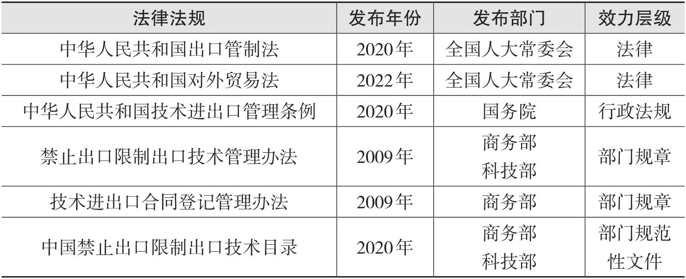

1.一旦触及《出口管制法》所列管控物项，审查阻力会明显加大

《出口管制法》所称出口管控，是指对自中国境内向境外转移管控物项，或中国公民、法人及非法人组织向外国组织和个人提供管控物项，采取禁止或限制措施。针对两用物项、军品、核及与国家安全、利益、防扩散等相关的货物、技术、服务，国家会制定管理清单、名录或目录并以许可方式管理。清单所列或临时管控物项须向国家出口管控主管部门申请许可。目前该法尚未直接点名AI技术与相关物项，但鉴于AI在国防与民生领域的快速应用，未来以修正形式纳入限制并非不可能。

2.依据《对外贸易法》，AI技术已被技术进出口禁限管理制度广泛覆盖

以《对外贸易法》对国家安全等禁止或限制情形作出指引为契机，我国相继出台《技术进出口管理条例》《禁止出口限制出口技术管理办法》《中国禁止出口限制出口技术目录》，基本形成技术进出口禁限管理框架。在法规规章的迭代中，大量涉及AI各层级与应用领域的技术被纳入其中，成为经营者开展技术出海必须遵循的首要依据。若AI技术属于自由出口范围，经营者须向国务院对外贸易主管部门或其委托机构办理合同备案登记；国家对限制进出口的货物实行配额、许可证管理，对限制进出口的技术实行许可证管理。涉及限制出海的AI技术，则需向地方有关行政管理机构申请出海许可，后文将详述流程。

### （二）地方规划普遍锚定国家安全

笔者梳理《新一代人工智能发展规划》等37份中央部委、19个省市及9个重点城市的产业规划与行动方案，发现“国家安全”出现约15次。

《新一代人工智能发展规划》指出，AI是引领未来的战略性技术，主要发达国家均将其作为提升竞争力、维护国家安全的重要战略，加紧部署核心技术、顶尖人才与标准规范，力争在新一轮科技竞争中掌握主动。《上海市促进人工智能产业发展条例》要求市国资监管、人社、教育、卫健、财政、统计、国家安全等部门在各自职责内制定政策，推动产业发展。

上述规定凸显了AI技术与国家安全的紧密关联，企业应积极响应中央与地方的价值导向，在研发应用中强化合规建设，实施技术出海时主动进行国家安全自查并落实申报要求。

## 二、我国AI技术出海审批规则梳理

依据《技术进出口管理条例》第2条，技术进出口是指通过贸易、投资或经济技术合作等方式，自境外向境内或自境内向境外转移技术的行为，包括专利权转让、专利申请权转让、专利实施许可、技术秘密转让、技术服务及其他形式的技术转移。

### （一）出海技术三大分类

国家既鼓励成熟产业化技术出海，也依据《对外贸易法》和《技术进出口管理条例》将出海技术划分为禁止出口、限制出口、自由出口三类。国务院通过目录或清单公布，有助于企业明确定位并及时完成备案或许可申请。

1.禁止出口的技术

《对外贸易法》规定，国家为维护国家安全、社会公共利益或公共道德、保护健康安全、建立特定产业等需要，可以限制或禁止技术出口，由商务部与科技部制定《中国禁止出口限制出口技术目录》，对通信设备、计算机及电子设备制造、计算机服务业等关键技术实施进出口限制。属于禁止出口的技术不得出口，企业须充分认识其战略意义。目前人工智能领域尚无技术或产品被列入禁止出口目录。

2.限制出口的技术

大量AI技术落入《中国禁止出口限制出口技术目录》限制范围。依据法律规定，国家对限制出口技术实行许可证管理，须向国务院外贸主管部门提出申请。这些技术涵盖AI产业基础层、技术层与应用层，包括半导体器件制造技术、传感器制造技术、无人机技术、信息处理技术、计算机应用技术等，基础层占比更高。

《新一代人工智能发展规划》提出建立新一代AI基础理论体系，突破应用基础理论瓶颈，超前布局可能引发范式变革的基础研究，加强大数据智能、跨媒体感知计算、人机混合智能、群体智能、自主协同与决策等研究。限制出口目录所涉技术与国家产业发展需求高度重合。

表 1-5 《中国禁止出口限制出口技术目录》中限制出口的人工智能技术[^(\[52\])](#chapter001.html#m52)

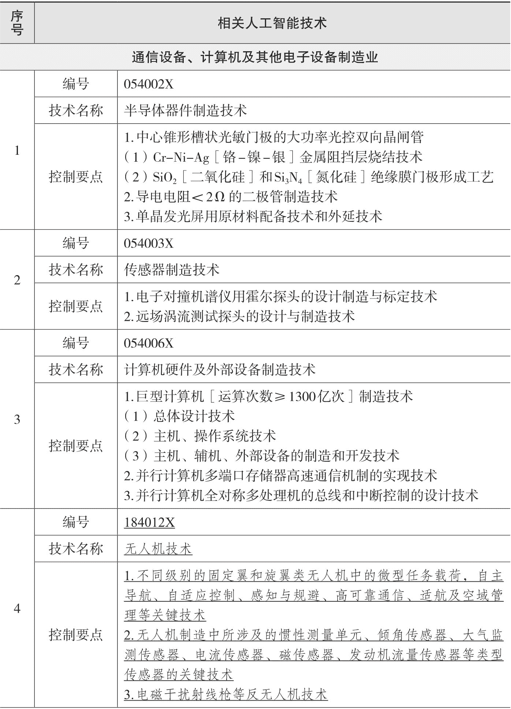

续表

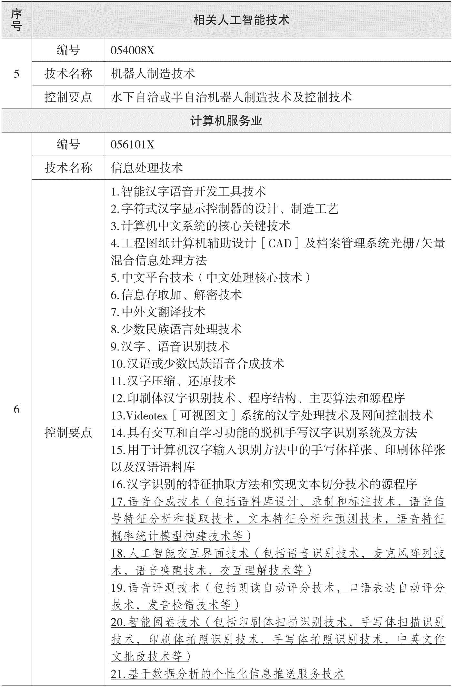

续表

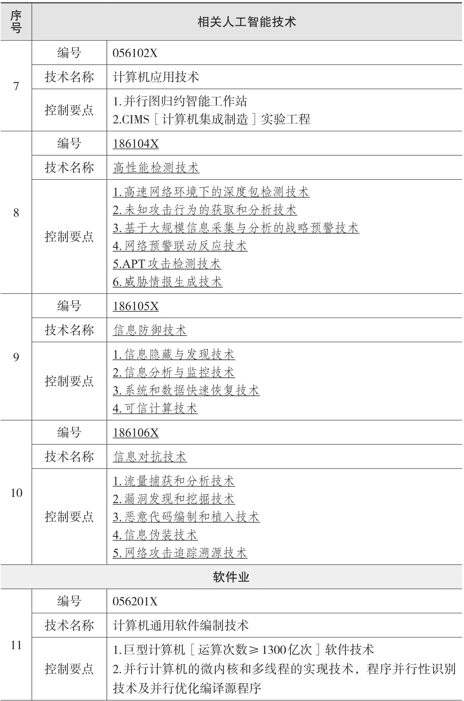

续表

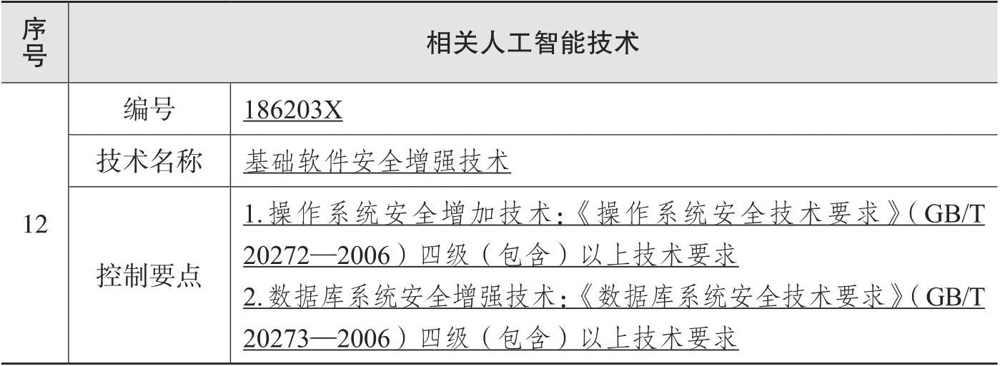

3.自由出口的技术

属于自由进出口的技术，须向国务院对外贸易主管部门或其委托机构办理合同备案登记。未列入禁止出口限制出口技术目录的AI技术经备案后可自由实施出海。

### （二）管辖权与转移方式

1.规制范围遵循属地管辖原则

《技术进出口管理条例》第2条第1款将自中国境内向境外通过贸易、投资或经济技术合作转移技术的行为纳入规制，不对技术所有权人的国籍或注册地作特别要求。只要行为发生在中国境内，即受地方商务与科技行政部门管辖与审核。

2.规制范围涵盖多种转移方式

该条例第2条第2款列举了专利权转让、专利申请权转让、专利实施许可、技术秘密转让、技术服务及其他方式的技术转移。规则顺应了信息时代技术转移多样化、隐蔽化的特征。技术转移可通过发送电子邮件、提供数据接口或授予访问权限等方式实现披露与传播。

### （三）限制出口的AI技术出海许可流程

1.主管部门

依据《禁止出口限制出口技术管理办法》第4条，限制出口技术的出海许可由技术出海经营者所在地的省、自治区、直辖市商务主管部门会同同级科技行政主管部门管理。

2.审查内容

许可申请需向商务主管部门提交，商务部门在进行贸易审查的同时将材料转交当地科技行政主管部门，后者组织专家技术审查并报科技部备案。

依据该办法第8条、第9条，贸易审查包括是否符合对外贸易政策与产业出口政策、是否有利于外贸与国民经济发展、是否符合对外承诺义务。技术审查包括是否危及国家安全、是否符合科技发展与产业技术政策、能否带动大型成套设备与高新技术产品生产及经济技术合作。

3.审查流程

限制出口技术的出海许可流程如图 1-2 所示。

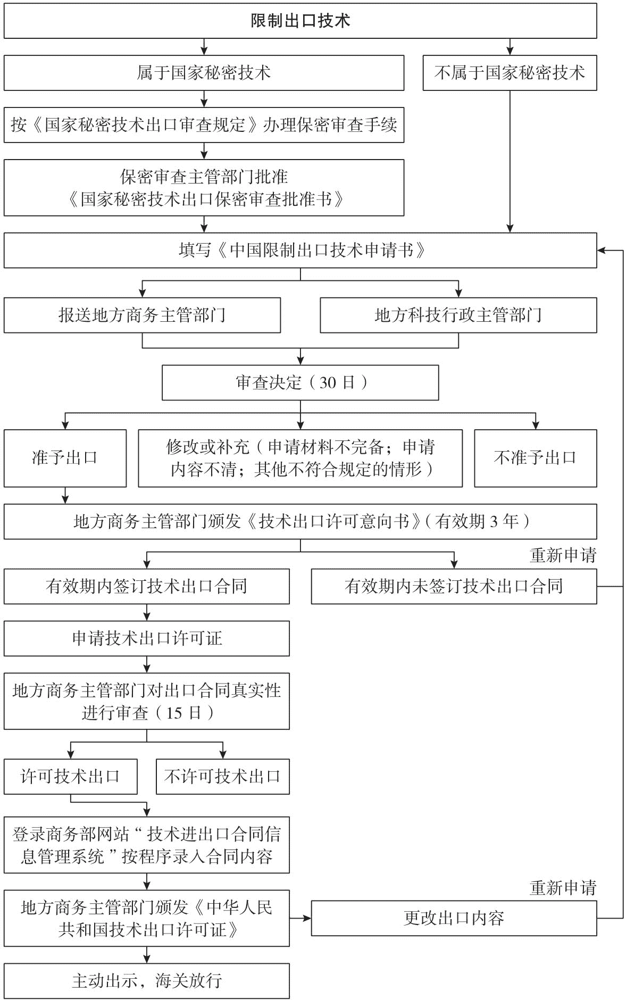

图 1-2 限制出口技术的出口许可流程

### （四）违规法律后果

《技术进出口管理条例》第43条规定，进口或出口禁止进出口技术，或未经许可擅自进出口限制进出口技术的，依照刑法关于走私、非法经营、泄露国家秘密等罪名追究刑事责任；不够刑事处罚的，依照海关法处罚，或由国务院外经贸主管部门给予警告、没收违法所得并处1倍以上5倍以下罚款，可撤销对外贸易经营许可。第44条规定，擅自超出许可范围进出口限制进出口技术的，同样可追究刑事责任或给予警告、没收违法所得并处1倍以上3倍以下罚款，可暂停直至撤销许可。

此外，《对外贸易法》规定从事法律禁止行为的，相关部门可禁止违法主体在1至3年内从事对外贸易经营活动，期间海关不予报关验放，外汇管理部门不予办理结售汇。

## 三、企业合规实操建议

AI在各产业的关键性日益凸显，立法与行政机关在法规、规章与政策中高度重视。当下企业涉AI物项出海与投资极易因国家安全审查趋严而增加难度与风险。建议高度重视出口管控合规审查，熟悉申请流程并主动规避风险。

### （一）建好内部技术清单与IP管理

AI领域技术庞杂，单一个产品或应用往往包含多项基础技术，部分可能落入限制出口目录。建议企业设立专门知识产权管理部门，规范日常IP管理，搭建内部技术自审自查机制，建立AI技术清单。在开展专利权转让、专利申请权转让、专利实施许可、技术秘密转让、技术服务等可能触及出口管控的行为前，及时评估风险。对自由出口技术办理合同登记；对限制出口技术，应在获得监管部门许可意向后再进行实质谈判与签约，并办理技术出海许可证。

### （二）持续跟踪立法与执法动向

需关注限制出口AI技术是否扩容、相关技术是否被列入禁止出口或出口管控物项。执法经验的积累与社会关注度的提升将催生更多典型案例，为企业风险评估提供借鉴。

综上，为维护国家利益与安全并保障对外贸易权益，我国已形成较为完善的AI进出口管控法制体系，《对外贸易法》《出口管制法》《技术进出口管理条例》《中国禁止出口限制出口技术目录》等构成核心规范，地方规划进一步强化国家安全价值取向。相关企业应熟识技术清单，明确技术定位，了解管辖规则与审查流程，从强化知识产权管理、跟踪立法与执法动态入手完善合规建设，科学评估出海法律风险，在全球竞争中发出中国标准的声音。同时应密切关注各国出口管控政策动向，在芯片、超算等AI关联领域给予更多法律重视。作为全球最大AI应用市场之一，中国将在芯片、生产设备、技术与软件等全链条管控领域面临更大挑战。

* * *

[\[1\]](#chapter001.html#w1) 早期的人工智能还只是一个设想，英国数学家、逻辑学家图灵在提出一项关于检测机器是否具备人类智能的猜想，即让被测试者（人）向人与机器询问问题，如 30%以上的被测试者无法分辨做出回答的是人还是机器，即说明该机器具备了像人一样的思考能力。这是最早对人工智能概念进行解释的观点之一，同时也为后来的人工智能技术的研发奠定了基础。

[\[2\]](#chapter001.html#w2) 《〈中国新一代人工智能科技产业发展报告（2022）〉发布》，载光明网，https：//m.gmw.cn/baijia/2022-06/27/35840687.html，最后访问时间：2022 年 11 月 14 日。

[\[3\]](#chapter001.html#w3) 谭中意：《开源到底是什么？——开源是一种协作模式（答复 osc 开源知产活动相关问题）》，载开源博客，https：//my.oschina.net/u/3742410/blog/5520919，最后访问时间：2022 年 10 月 20 日。

[\[4\]](#chapter001.html#w4) 《如何为你的作品选择一份许可证》，载 GNU 官网，https：//www.gnu.org/licenses/license-recom mendations.html，最后访问时间：2022 年 10 月 20 日。

[\[5\]](#chapter001.html#w5) “History of the OSI”，Open Source Initiative，https：//opensource.org/history，最后访问时间：2022 年 10 月 20 日。

[\[6\]](#chapter001.html#w6) “The Open Source Definition”，Open Source Initiative，https：//opensource.org/docs/osd，最后访问时间：2022 年 10 月 20 日。

[\[7\]](#chapter001.html#w7) 何宝宏主编：《开源法则》，人民邮电出版社 2020 年版，第 11 页。

[\[8\]](#chapter001.html#w8) “关于 RISC-V”，`https：//riscv.org/about/`，最后访问时间：2022 年 10 月 20 日。

[\[9\]](#chapter001.html#w9) “NVDLA 开源项目：文档”，`http：//nvdla.org/`，最后访问时间：2022 年 10 月 20 日。

[\[10\]](#chapter001.html#w10) 国家人工智能标准化总体组：《人工智能开源与标准化研究报告》，2019 年 4 月发布，`http：//www.cesi.cn/images/editor/20190425/20190425143108915001.pdf`，最后访问时间：2022 年 10 月 20 日。

[\[11\]](#chapter001.html#w11) 中国信息通信研究院：《开源生态白皮书（2020 年）》，2020 年 10 月发布，载中国信息通信研究院官网，`http：//www.caict.ac.cn/kxyj/qwfb/bps/202010/P020201211560823978082.pdf`，第 6 页，最后访问时间：2022 年 11 月 14 日。

[\[12\]](#chapter001.html#w12) 《如何应对开源软件的版权牟利者？开源律师说这样做！》，载搜狐网，`https：//www.sohu.com/a/201032826_261288`，最后访问时间：2022 年 10 月 20 日。

[\[13\]](#chapter001.html#w13) 《格局可能会改变？科技巨头们正在使用开源框架来主导人工智能社区》，载腾讯云“ATYUN 订阅号”，`https：//cloud.tencent.com/developer/article/1051255`，最后访问时间：2022 年 10 月 21 日。

[\[14\]](#chapter001.html#w14) 《梅宏院士：人工智能的快速发展离不开代码开源和数据开放》，载人民网，`http：//finance.people.com.cn/n1/2021/0709/c1004-32153614.html`，最后访问时间：2022 年 10 月 20 日。

[\[15\]](#chapter001.html#w15) 《中国人工智能开源软件发展白皮书（2018）》，载中国电子技术标准化研究院官网，`http：//www.cesi.cn/201807/4064.html`，最后访问时间：2022 年 10 月 20 日。

[\[16\]](#chapter001.html#w16) 新思科技：《2022 开源安全和风险分析报告》，2022 年 3 月发布，`https：//www.synopsys.com/zh-cn/software-integrity/resources/analyst-reports/open-source-security-risk-analysis.html#`，最后访问时间：2022 年 10 月 20 日。

[\[17\]](#chapter001.html#w17) 中国信息通信研究院：《全球开源生态研究报告（2022 年）》，2022 年 9 月发布，载中国信息通信研究院官网，`http：//www.caict.ac.cn/kxyj/qwfb/bps/202209/P020220916644891972234.pdf`，第 36 页，最后访问时间：2022 年 11 月 14 日。

[\[18\]](#chapter001.html#w18) 《电动汽车制造商特斯拉已经采取行动遵守 GPL 许可》，载 OSCHINA，`https：//www.oschina.net/news/96276/tesla-incomplete-ccs`，最后访问时间：2022 年 10 月 21 日。

[\[19\]](#chapter001.html#w19) 在 Artifex Software，Inc.（“Artifex”）和 Hancom，Inc.（“Hancom”）之间的诉讼中，Artifex 发布了 Ghostscript，并同时以专有许可和 GPL 许可的方式授权第三方使用，其诉称 Hancom 未能遵守 GPL 许可下的义务，在免费使用 Ghostscript 的情况下，将其修改的版本整合到自己名为 Hangul 的商业软件中对外销售产品，但是没有分发产品的源代码。

[\[20\]](#chapter001.html#w20) 奇安信代码卫士：《开源软件源代码安全缺陷分析报告——人工智能类开源软件专题》，载 FREEBUF，`https：//www.freebuf.com/articles/paper/186281.html`，最后访问时间：2022 年 10 月 20 日。

[\[21\]](#chapter001.html#w21) 《人脸识别再曝安全漏洞：清华创业团队推出全球首个 AI 模型“杀毒软件”》，载微信公众号“机器之心”，2020 年 4 月 7 日发布，`https：//mp.weixin.qq.com/s/soQMwuEvO_ YP8Qv5Vf-uvA`，最后访问时间：2022 年 10 月 21 日。

[\[22\]](#chapter001.html#w22) “GNU 通用公共许可证”，`https：//www.gnu.org/licenses/gpl-3.0.en.html`，最后访问时间：2022 年 10 月 20 日。

[\[23\]](#chapter001.html#w23) 广州知识产权法院（2019）粤 73 知民初 207 号民事判决书，载中国裁判文书网，最后访问时间：2022 年 10 月 20 日。

[\[24\]](#chapter001.html#w24) 广州知识产权法院（2019）粤 73 知民初 207 号民事判决书，载中国裁判文书网，最后访问时间：2022 年 10 月 20 日。

[\[25\]](#chapter001.html#w25) 张平、马骁：《开源软件对知识产权制度的批判与兼容（二）——开源软件许可证的比较研究》，载《科技与法律》2004 年第 2 期。

[\[26\]](#chapter001.html#w26) 陈际红：《GNU GPL 的规则与 Linux 在中国的发展》，载《信息网络与高新技术法律前沿——中华全国律师协会信息网络与高新技术专业委员会成立大会论文集》2001 年。

[\[27\]](#chapter001.html#w27) 《担心 Linux 专利问题惹麻烦 慕尼黑计划搁浅》，载新浪网，`https：//tech.sina.com.cn/s/n/2004-08-05/1008398608.shtml`，最后访问时间：2022 年 10 月 21 日。

[\[28\]](#chapter001.html#w28) 陈际红：《GNU GPL 的规则与 Linux 在中国的发展》，载《信息网络与高新技术法律前沿——中华全国律师协会信息网络与高新技术专业委员会成立大会论文集》2001 年。

[\[29\]](#chapter001.html#w29) BSD 许可协议（伯克利软件发行许可）是自由软件中使用广泛的许可协议之一。20 世纪 70 年代由加州大学伯克利分校的学生比尔·乔伊创建。BSD 许可证非常宽松，它允许无限制地重用全部或部分软件，以集成到自由软件或所有者中。

[\[30\]](#chapter001.html#w30) “OSI 商标指南”，开源促进会，`https：//opensource.org/trademark-guidelines#Open_Source_Initiative_Trademark_Policy`，最后访问时间：2022 年 10 月 20 日。

[\[31\]](#chapter001.html#w31) 张平：《开源软件——知识产权制度的批判与兼容》，载《网络法律评论》2004 年第 2 期。

[\[32\]](#chapter001.html#w32) 中国信息通信研究院：《全球开源生态研究报告（2022 年）》，2022 年 9 月发布，载中国信息通信研究院官网，`http：//www.caict.ac.cn/kxyj/qwfb/bps/202209/P020220916644891972234.pdf`，第 2 页，最后访问时间：2022 年 11 月 14 日。

[\[33\]](#chapter001.html#w33) 新思科技：《2022 开源安全和风险分析报告》，2022 年 3 月发布，`https：//www.synopsys.com/zh-cn/software-integrity/resources/analyst-reports/open-source-security-riskanalysis.html#`，最后访问时间：2022 年 10 月 20 日。

[\[34\]](#chapter001.html#w34) `XGBoost`是一个优化的分布式梯度增强库。

[\[35\]](#chapter001.html#w35) `Wide&Deep`模型把单输入层的 Wide 部分与由 Embedding 层和多隐层组成的 Deep 部分连接起来，一起输入最终的输出层。

[\[36\]](#chapter001.html#w36) 王松林、唐国瑜：《京东电商搜索中的语义检索与商品排序》，载知乎专栏《人工智能算法实践》，`https：//zhuanlan.zhihu.com/p/465504164`，最后访问时间：2022 年 10 月 21 日。

[\[37\]](#chapter001.html#w37) 《国家互联网信息办公室关于发布互联网信息服务算法备案信息的公告》，载国家互联网信息办公室官网，`http：//www.cac.gov.cn/2022-08/12/c_1661927474338504.htm`，最后访问时间：2022 年 10 月 21 日。

[\[38\]](#chapter001.html#w38) 《绍兴警方成功破获全国首例利用 AI 人工智能犯罪大案》，载绍兴市公安局官网，`http：//ga.sx.gov.cn/art/2017/9/25/art_1229599235_58924603.html`，最后访问时间：2022 年 10 月 21 日。

[\[39\]](#chapter001.html#w39) 881 N.W.2d 749 （Wis.2016），`https：//harvardlawreview.org/2017/03/state-v-loomis/`，最后访问时间：2022 年 11 月 14 日。

[\[40\]](#chapter001.html#w40) Charles KATZ，申请人，诉美利坚合众国，`https：//www.law.cornell.edu/supremecourt/text/389/347`，最后访问时间：2022 年 11 月 14 日。

[\[41\]](#chapter001.html#w41) 斯坦福以人为本人工智能研究院（HAI）：《人工智能指数 2022 年度报告》，`https：//aiindex.stanford.edu/wp-content/uploads/2022/03/2022-AI-Index-Report_Master.pdf`，最后访问时间：2022 年 10 月 20 日。

[\[42\]](#chapter001.html#w42) Luciano Floridi，Josh Cowls，“人工智能社会中五项原则的统一框架，哈佛数据科学评论”，2019 年夏季，`https：//www.researchgate.net/publication/334166840_A_Unified_Framework_of_Five_Principles_for_AI_in_Society`，最后访问时间：2022 年 10 月 21 日。

[\[43\]](#chapter001.html#w43) Andrew Smith，“使用人工智能和算法”，`https：//www.ftc.gov/business-guidance/blog/2020/04/using-artificial-intelligence-and-algorithms`，最后访问时间：2022 年 10 月 21 日。

[\[44\]](#chapter001.html#w44) 关于在联邦政府中促进值得信赖的人工智能使用的行政命令，2020 年 12 月 3 日，`https：//trumpwhitehouse.archives.gov/presidentialactions/executive-order-promoting-use-trustworthy-artificial-intelligence-federalgovernment/`，最后访问时间：2022 年 10 月 21 日。

[\[45\]](#chapter001.html#w45) Elisa Jillson，“在贵公司使用人工智能时力求真实、公平和公正”，`https：//www.ftc.gov/business-guidance/blog/2021/04/aiming-truth-fairness-equity-yourcompanys-use-ai`，最后访问时间：2022 年 10 月 21 日。

[\[46\]](#chapter001.html#w46) 国家人工智能标准化总体组：《人工智能伦理风险分析报告》，2019 年 4 月发布，`http：//www.cesi.cn/images/editor/20190425/20190425142632634001.pdf`，最后访问时间：2022 年 10 月 21 日。

[\[47\]](#chapter001.html#w47) Miller，Tim，Piers Howe，and Liz Sonenberg，“可解释人工智能：谨防囚犯掌管精神病院”，IJCA-17 可解释人工智能（XAI）研讨会，2017。

[\[48\]](#chapter001.html#w48) 刘劲杨：《人工智能算法的复杂性特质及伦理挑战》，载《光明日报》2017 年 9 月 4 日，第 15 版。

[\[49\]](#chapter001.html#w49) 张凌寒：《商业自动化决策的算法解释权研究》，载《法律科学（西北政法大学学报）》2018 年第 3 期。

[\[50\]](#chapter001.html#w50) 唐健：《人工智能应用与伦理》，载《人工智能》2019 年第 4 期。

[\[51\]](#chapter001.html#w51) 位于英国伦敦，是由人工智能程序师兼神经科学家戴密斯·哈萨比斯（Demis Hassabis）等人联合创立的谷歌公司旗下前沿人工智能企业。

[\[52\]](#chapter001.html#w52) 表中下画线部分即 2020 年目录修订时新增涉人工智能技术内容。

# 下编 AI 与知识产权新视角
## 第二章 人工智能领域知识产权保护探析
### 第一节 AI 语境下的著作权保护
#### 一、AI 版权保护现状梳理
著作权制度的源头可追溯至 1710 年英国出台的《安妮法》。三百多年里，伴随经济社会演进与文艺科学的持续进步，受保护客体的范围以及传播方式都经历了明显扩张，权利类型也随之变得更为多元。广播电视的兴起让传播权得以确立，互联网的成熟则带来了信息网络传播权。

与传统行业相比，AI 产业呈现出明显差异。大量程序与文档能够纳入软件著作权的保护范畴，同时由于应用场景高度丰富，也牵动了虚拟卡通、数字人形象、虚拟建筑等美术与建筑类作品的保护议题。目前 AI 领域的版权实践基本仍在现行法律框架内运行，但技术的高度复杂与强创新性，正在不断衍生出新的版权难题。

##### （一）AI 场景中常见的著作权客体
《著作权法》第三条将作品界定为文学艺术科学领域内具备独创性并能以一定形式体现的智力成果，典型列举包括文字作品、口述作品、音乐戏剧曲艺舞蹈杂技艺术作品、美术建筑作品、摄影作品、视听作品、工程设计图产品设计图地图示意图等图形作品和模型作品、计算机软件，以及其他符合作品特征的智力成果。

在 AI 语境下，主要涉及以下两类：

1. 计算机软件
AI 全栈中遍布算法、代码与程序，从基础层到技术层再到应用层均有体现。这类软件的表达可以获得著作权保护，其内涵参照《计算机软件保护条例》（国务院令第 632 号）界定为程序及其相关文档。程序分为源程序和目标程序；文档则包括程序设计说明书、流程图、用户手册等用于说明设计思路、功能实现与开发过程的文字材料和图表。需要明确的是，软件开发所依赖的思想、处理逻辑、操作方法或数学概念等抽象内容，不在软件著作权保护范围内。

2. 美术、建筑作品

AI 技术带来的版权客体拓展

随着智能技术在各行业的落地，受到版影响的客体范围在同步扩大。以 Z 方诉 B 方字库版权纠纷为例，法院认定涉案字库呈现出的字体，既区别于现存的古帖书法，也不同于市面上流通的电脑字库，更非手写美术字常见形态，形成了具有可识别性的新字体。该字体具有一定独创性，其独创特征来源于 AI 路径的生成，是 B 方借助智能技术并结合人工干预得到的成果，落入知识产权范畴，构成版权法意义上的美术类作品。[^(\[1\])](#chapter002.html#m1)

在增强现实、虚拟现实等智能交互场景中，常出现虚拟卡通、虚拟角色、虚拟建筑等视觉内容，此类美术或建筑作品均可申请版权保护。国内某视觉计算头部企业曾对交互过程中出现的网络虚拟角色完成美术作品登记。此外，具备较强独创性与艺术设计价值的人机交互界面，也可作为美术作品受保护。实践中，多家智能企业在对企业标识、产品标识完成商标保护后，还会通过美术作品登记进行补充保护。

### 3. 工程设计图、产品设计图等图形作品和模型作品
智能技术若涉及实体产品的研发，如近期热度很高的 AR 眼镜，在研发链条中会产生大量工程制图、产品图样及模型资料，这些材料本身符合版权登记条件。

### 4. 文字作品、音乐作品、摄影作品等
智能时代催生了大量人与机器交互的网络游戏，游戏通常包含名称、规则、剧情、场景地图、角色形象、文字说明、对话旁白、背景音乐等要素。可将这些素材拆分，分别以文字作品、美术作品、音乐作品、图形作品等形式主张保护，这一做法在过往司法实践中已形成共识。现行版权法并未将游戏单列为独立客体。根据《著作权法实施条例》第 4 条第 11 项，电影作品和以类似摄制电影的方法创作的作品，是指摄制在一定介质上、由一系列有伴音或无伴音的画面组成并借助适当装置放映或传播的作品。例如 2017 年上海知识产权法院审理的广州 S 企业与上海 Z 企业版权纠纷案，法院指出类似摄制电影的方法创作是对创作方法的界定，不仅指制作技术，还包含对各类文学艺术元素进行整合的创作方法，并首次将游戏整体画面认定为类电影作品予以保护。[^(\[2\])](#chapter002.html#m2)此后多个判例均倾向于将不同类型的游戏整体认定为类电影作品。由此，借助 AI 实现交互的游戏，各要素既可单独保护，也可探索整体作为类电影作品保护。

与此同时，AI 生成的音乐、美术、文学、影视作品也在增多。比如微软小冰推出的个人诗集《阳光失了玻璃窗》。司法实践中关于 AI 创作作品的版权纠纷案例持续出现，相关保护问题受到广泛关注。

## （二）AI 场景下作品的权利归属判定
《著作权法》第 2 条规定，我国公民、法人或非法人组织的作品，无论是否发表，均享有版权。境外作者作品在互惠条件下受保护。据此版权自作品完成时自动产生，无需登记或授权。《著作权法》第 9 条界定了权利人范围，第 12 条规定作品上署名的自然人、法人或非法人组织推定为作者，除非有相反证明。

### 1. AI 领域普通作品的署名推定
对智能领域的一般作品，即便未办理登记，只要署名明确且无相反证据，署名主体通常被认定为权利人。对重要作品，建议在研发、设计、销售和服务全流程中，通过多种方式明确权利人身份并保存证据。例如企业开发的智能软件，可在源代码注释、头文件里载明软件名称、版本、开发时间及权利人。再考虑到诉讼举证需要，《最高人民法院关于审理著作权民事纠纷案件适用法律若干问题的解释》第 7 条第 1 款列举了底稿、原件、合法出版物、登记证书、认证证明、权利转让合同等可作为证据的材料。因此同步做好版权登记，登记证书在争议时是一项有力凭证。

### 2. 混用开源代码的 AI 软件权利归属
新思科技《2022 开源安全和风险分析报告》显示，研究团队审查了 17 个行业 2400 多个商业代码库，其中计算机硬件与半导体、网络安全、能源与清洁科技、物联网行业的代码库开源成分占比达 100%，其余行业在 93% 至 99% 之间，即便占比最低的医疗健康、健康科技和生命科学领域，也有 93% 的代码库包含开源软件。[^(\[3\])](#chapter002.html#m3)智能软件同样大量使用开源组件，由于贡献者众多、分散全球且动态增加，给版权保护带来特殊挑战。根据《计算机软件保护条例》第 10 条，合作开发软件的权利归属由合同约定，无约定或约定不明且可分割使用的，开发者对各自部分单独享有权利。

广州知识产权法院审理的 L 企业诉 W 企业版权纠纷案中，被告主张插件化框架虚拟引擎软件 Virtual App 有 32 位贡献者，属于不可分割使用的合作作品。法院认为：其一，L 企业股东作为项目管理人于 2016 年 7 月 7 日在 GitHub 开源发布 Virtual App 初始版本，507 个文件共 31097 行，该初始版本占 V1.0 开源软件代码绝大部分，是核心基础，后续贡献多为升级优化，且合并与否由项目管理人决定，其他贡献未对版权产生实质影响；其二，合作作品需满足作者两人以上、主观有共同创作合意、客观有共同创作行为且贡献独创性表达，被告未举证证明贡献代码具有独创性表达，难以认定合作作品；其三，涉案软件采用 LGPL3.0 或 GPL3.0 开源协议，贡献者申请合并即默认遵守协议，同意在许可范围内自由使用；其四，L 企业已提交版权登记证书，自 2017 年 8 月起对项目进行公司化运营，被告未提供反证。故认定 L 企业享有涉案软件版权。[^(\[4\])](#chapter002.html#m4)

由此可见，若含开源代码的 AI 软件无明确约定且未构成合作作品，开发者贡献核心部分并占主导时，可单独享有版权。

### 3. 纯 AI 创作作品的权利归属争议
AI 创作作品是新型客体，我国尚无明确规定，学界观点分歧。传统观点认为版权法要求作品须由自然人创作，法人仅为拟制，本质仍源于自然人，故 AI 创作不属于版权法意义上的作品。美国的猴子自拍案中，PETA 认为自拍照版权应归猴子，美国法院驳回主张，指出版权法未向动物提供保护。[^(\[5\])](#chapter002.html#m5)

随着案例增多，学界实务界更倾向保护。当前仍处弱智能阶段，AI 多为辅助人类创作的强化工具，AI 作品仍可视为自然人创作的成果，受《著作权法》保护。随着技术增强，人类贡献与机器贡献边界模糊，立法与研究亟待跟进。在法律未明确前，建议通过协议事先约定 AI 创作作品的归属以防纠纷。

总体看，与专利权、商标权需审查授权或注册不同，版权自完成即自动产生，这与 AI 技术迭代快、生命周期短的特点相契合。版权仅要求独创性，无需专利的 novelty、inventive step、实用性三性，因此能覆盖不同水平和阶段的创作。但版权仅保护表达不保护思想，相同算法思路但代码表达不同不构成侵权；产品设计图的版权只能阻止图纸被抄袭，不能阻止他人按图制造同款产品。权利人应结合商标、专利等进行交叉保护，并做好证据保存、权利明晰。

## 二、从版权视角看 AI 生成物的保护边界
智能技术发展改变了传统创造方式，带来大量 AI 生成的音乐、美术、文学、影视等产物。比如沃森节拍研究了 2 万余首热门歌曲后，仅凭聆听 20 秒音乐即可创作出新曲目，《不容易》即为代表。格莱美提名制作人亚历克斯通过指令“播放一些浪漫的音乐”，沃森节拍便生成原创音乐作品。[^(\[6\])](#chapter002.html#m6)深梦发生器通过反复解释随机噪声图像、放大处理，可生成梦幻图片。[^(\[7\])](#chapter002.html#m7)微软小冰除创作音乐《我知我新》《微风》《我是小冰》《好想你》外，还推出诗集《阳光失了玻璃窗》《花是绿水的沉默》等。

AI 生成物呈现两大特征：一是数量急剧增长；二是内容、形态和表达方式日益接近人类作品。若缺乏配套法律制度，复制、抄袭风险将削弱开发者、使用者、投资者积极性，进而影响产业发展。司法实践中已出现多起相关纠纷，涉及可版权性与归属等核心问题，对现有法律框架形成冲击。

### （一）AI 生成物是否构成作品
《著作权法》属私法，主体为自然人和法人。第 2 条明确只有我国公民、法人或非法人组织的作品才受保护。随着 AI 生成物中人类因素占比下降，对以人为中心的版权制度带来挑战。

判断 AI 生成物是否属于作品，需对照《著作权法》第 3 条：文学、艺术和科学领域内具有独创性并能以一定形式表现的智力成果。需满足四要件：领域归属、独创性、可表现性、智力成果。AI 生成物的形式与人类作品相近，可纳入文学、艺术或科学领域，满足前两项和表现性，但独创性与智力成果存疑。

关于独创性，需把握“独”与“创”。“独”指独立完成，“创”指具备最低限度创造性，与现有作品存在可区分变化。2018 年《北京市高级人民法院侵害著作权案件审理指南》第 2.2 条指出认定独创性应考虑是否独立创作完成、表达安排是否体现作者选择与判断，且与价值无关。司法中多采用最低限度创造性客观标准。针对 AI 生成物，争议焦点不在创造性高低，而在创作者是否为自然人，表达是否体现选择与判断。

关于智力成果，多国以自然人创作作为必要条件。美国版权法保护固定于有形媒介的原创作品，判例确认作者为人类，猴子自拍案即为典型。[^(\[9\])](#chapter002.html#m9)西班牙版权法第 5 条明确作者是创作文学、艺术或科学作品的自然人。[^(\[10\])](#chapter002.html#m10)若 AI 不能被认定为创作主体，则难以构成智力成果。若在创作过程中仍有开发者、使用者等自然人介入，且生成物的表达体现了其选择与判断，可将其视为自然人的智力成果。

### （二）AI 生成物版权归属
《著作权法》第 11 条规定版权属于作者，创作作品的自然人为作者，由法人或非法人组织主持、代表其意志创作并承担责任的，视为作者。对传统作品，权利归属自然人、法人或非法人组织。AI 生成作品尚无明确规则，学界主要有三种思路：一是归属 AI 开发者，因生成依赖开发者对数据算法的创造性投入；二是赋予 AI 拟制法律人格，版权归 AI 本身，但 AI 缺乏意思能力、行为能力和责任能力，会带来意思表示、侵权责任等难题；三是认为无人类介入不应授予版权，直接进入公有领域自由使用，但此举会打击开发者、使用者、所有者和投资者积极性，不利于产业发展。

【AI创作归属之争：从产出认定到训练数据边界】

我国版权规则的根本取向，是在保障创作者利益的同时，激励有益于精神文明与物质文明建设的成果被创制和传播，进而推动文化与科学的长远繁荣。版权保护本身只是实现该目标的工具，要真正发挥激励创作、便利传播的功能，就必须正视AI产出归属与收益分配的难题。

厘清归属的第一步，是先锁定谁在实质上完成了创作行为，再评估该主体是否具备后续推广的意愿与能力。

从技术现实看，我们仍处于弱AI阶段，系统运行依赖预设的学习指令，尚未出现真正自主的智能。因此一次AI产出形成时，往往涉及两类自然人：模型开发者与模型使用者。以英国1988年《版权、外观设计和专利法》第9条第3款为例，对计算机生成的成果，作者应被视为为创作出具必要安排的人，即完成全部准备、编写程序并向算法输送数据的那一方。这里的“必要安排”实质指向谁投入了更多的创造性智力。判断归属时，需要具体比较开发者与使用者各自的智力付出，以及最终表达究竟体现开发者的选择判断，还是使用者的选择判断。通常两者并不构成版权法上的合作作者，合作作品要求多个作者有共同创作合意并以合作身份共享权利，而程序的开发者与使用者之间并不存在共同创作与共享权利的意图。

就推广意愿而言，开发者可通过收取软件使用费回收研发成本，并有动机推动产出传播以扩大收费规模。使用者若为使用技术支付了对价，则更倾向于进一步传播产出以实现自身收益。

在现行法尚无明确规定的情形下，归属认定应兼顾责任承担能力，结合创作主体的创造性贡献与推广意愿，将权利赋予开发者或使用者，或其所代表的法人、其他组织。但此路径仍存争议。例如若将AI产出的权利全部归于开发者，只要程序可运行就能源源不断产生新成果，开发者即可能垄断全部版权，这是否构成过度激励，仍需进一步探讨。

### （三）谁为AI侵权买单
在判断AI产出能否受版权法保护之外，还涉及一个关键问题：一旦产出构成侵权，应由开发者、使用者还是AI本身承担责任。

目前有一种主流观点主张以代理—受托关系处理此问题，即把AI程序视为受托完成任务的代理人，由委托人掌控生产方式与内容。委托人可随时修改指令以反映自身意图，最终从AI的工作成果中获益。所以当代理人制作的成果侵害版权时，责任应由委托人承担。

### （四）两起判决为何走向相反
北京某律师事务所诉北京某科技有限公司案被视为国内AI产出版权纠纷首案。原告在某数据库中检索关键词，使用“可视化”功能自动生成分析报告《影视娱乐行业司法大数据分析报告——电影卷·北京篇》，并发布在微信公众号，被告未经许可在其自媒体平台转载。

该案焦点是AI自动生成的大数据分析报告中的文字是否构成受保护的成果。2019年4月25日，北京互联网法院一审认为，选定关键词并使用可视化功能自动生成的报告，涉及对影视行业的司法分析，符合文字成果的形式要求，体现了对数据的选择、判断与分析，具有一定独创性。但法院强调，独创性并非构成文字成果的充分条件。现行法下文字成果须由自然人完成，自然人创作仍是构成成果的必要条件，据此法院否定了该报告的成果属性。

法院指出，生成过程涉及两个自然人参与环节：软件开发环节和软件使用环节。软件开发者并未依据自身需求输入关键词检索，该报告并未传递研发者思想感情的独创性表达，故不认定为开发者创作。软件使用者仅提交关键词检索，自动生成的报告亦不传递使用者思想感情的独创性表达，故也不宜认定为使用者创作。研发者和使用者均不构成作者。报告系数据库将输入关键词与算法、规则、模板结合形成，可说数据库“创作”了报告。但因其非自然人创作，即使有独创性，仍不构成版权法意义上的成果。

关于权利归属，法院认为开发者可通过收取使用费获得回报，已无推广动力，将权益赋予开发者不利于文化传播。对使用者而言，其已付费投入并据自身需求设置关键词生成报告，具有进一步使用传播的动力与预期，应激励其使用传播行为，将相关权益赋予其享有，否则使用者会减少，使用传播也会受阻，最终不利于价值发挥。[^(\[11\])](#chapter002.html#m11)

另一则判例是某互联网公司诉某科技公司案。2019年12月24日，深圳市南山区人民法院作出判决。被告旗下资讯平台未经许可抄袭原告自动写作软件撰写的文章。

法院认定，涉案文章由原告主创团队使用自动写作软件生成，外在表现符合文字成果要求，体现了对当日股市信息数据的选择、分析、判断，结构合理、逻辑清晰，具有一定独创性。主创团队在数据输入、触发条件设定、模板与语料风格取舍上的安排选择，属于与特定表现形式直接关联的智力活动。法院认为，若仅把自动生成这两分钟视为创作过程，确实看不到自然人参与，只是软件运行既定规则、算法和模板的结果，但该自动运行并非凭空或具自我意识，其运行方式体现了原告的选择，由软件技术特性决定。文章的特定表现形式源于创作者个性化选择与安排，并由软件技术“生成”，满足版权法对文字成果的保护条件。法院据此认定文章属于我国版权法保护的文字成果。这是国内法院首次承认AI产出满足文字成果保护条件。[^(\[12\])](#chapter002.html#m12)

两案分歧在于对创作过程时间段的认定标准不同。对自然人是否参与创作的判断随之产生差异。北京互联网法院认为报告由数据库结合关键词与算法规则模板形成，非自然人直接创作，因此不构成成果。深圳法院则认为软件自动运行体现了原告的选择，故认定文章受保护。

整体看，各国学者对AI产出可否受版权保护仍在探讨，各国规定不一，我国司法实践也尚未形成统一标准，需结合具体案情分析。2020年修正的《著作权法》第3条新增第9项“符合作品特征的其他智力成果”，为AI产出被认定为成果预留了空间。关于归属，在法律未明确时，应从促进AI产业发展的长远角度出发，依据立法初衷，明确激励对象，综合分析创作主体的创造性智力贡献、推广动力及责任承担能力，在个案中确定权属归谁，可为自然人、法人或其他组织。

## 三、训练数据喂养会侵权吗：机器学习与版权边界
随着智能化水平提升，传统版权制度面临前所未有的挑战。以深度学习为核心的AI系统取得诸多成果，如腾讯写作机器人Dreamwriter撰写的财经报道被认为与记者日常稿件无异，微软小冰于2017年独立创作出版诗集《阳光失了玻璃窗》，于2019年在中央美术学院美术馆举办个展《或然世界》。[^(\[13\])](#chapter002.html#m13)[^(\[14\])](#chapter002.html#m14)[^(\[15\])](#chapter002.html#m15)

学界热度多集中在AI输出端成果是否属于成果及归属问题，而对训练阶段输入端机器学习是否构成侵权讨论较少。训练是AI“创作”的必要前提，主流训练算法依赖深度学习，需要海量数据作为“养料”。训练团队对海量数据的获取与输入，很可能触及版权风险。因此，以海量成果为训练数据进行机器学习是否侵权，能否以合理使用抗辩，中国版权体系能否涵盖此类新行为，是必须讨论的问题。

### （一）机器学习怎么分类：表达型vs非表达型
机器学习的核心是对能通过经验自我改进的计算机算法进行研究。深度学习则是采用深度模型学习样本内在规律和表示层次的方法。

#### 1. 训练喂养背后的法律隐患
深度学习依赖海量训练数据，数据“喂养”环节容易触及版权。以微软小冰为例，训练团队将20世纪20年代至今519位中国现代诗人的数万首诗歌，通过图像识别等技术数字化为计算机可读语言，作为语料库输入诗歌生成模块训练，并可设定训练次数。训练结束后，训练人员通过诱发模块给出创作信号，按指标评价训练后诗歌，将评价信息作为反馈完善生成模块，直至诗歌具备一定美感停止训练。[^(\[16\])](#chapter002.html#m16)这一过程中可能涉及对受版权保护成果的输入、改编或汇编性输出，存在复制权、演绎权等法律风险。

#### 2. 如何对机器学习进行归类
复制权具有依附性，其控制目的是规制后续传播和使用。以是否产生表达性内容输出为标准，可将使用行为分为表达性使用和非表达性使用。据此，机器学习可分为表达型机器学习和非表达型机器学习；再以成果来源是否特定作者为标准，表达型可细分为普通表达型和特殊表达型。[^(\[17\])](#chapter002.html#m17)[^(\[18\])](#chapter002.html#m18)

##### （1）不产出表达结果的隐形训练
指没有表达性内容输出的机器学习。典型如人脸识别系统，其以训练人员输入的人脸照片为材料，经深度学习完成像素点阵化、面部特征值提取、构建特征值数字矩阵的识别算法训练，完成训练后系统可基于识别算法对现实场景需求做出回应。

##### （2）普通表达型机器学习
指有表达性内容输出，且训练材料并非局限于特定作者，而是来源于不特定的成果。如微软小冰将近现代500多位诗人的诗歌作为语料库训练诗歌生成模块，模块运用双向语言模型根据诱发源提取关键词扩展成诗句，经流畅性与连贯性检查后输出现代诗歌。

##### （3）特殊表达型机器学习
指有表达性内容输出，且训练材料来源于特定作者。如微软将伦勃朗近16万幅作品片段作为训练材料，提取绘画细节与风格训练创作模块，最终系统创作出与伦勃朗风格近似但不完全相同的作品。[^(\[19\])](#chapter002.html#m19)

### （二）合理使用认定与三步检验法
版权人专有权并非绝对，在鼓励创作与促进公众获取成果的平衡下，法律对专有权作出合理例外限制。

在国际条约层面，《保护文学和艺术作品伯尔尼公约》第9条第2款规定，成员国可在某些特殊情况下允许不经作者许可复制作品，但不应损害成果正常使用，也不致无故侵害作者合法利益。TRIPS和《世界知识产权组织版权条约》亦作类似规定。

#### 1. 各国立法模式差异
各成员国国内例外规定须以国际条约为前提。立法体例主要分为两类：

##### （1）美国式的一般条款型
美国《版权法》第107条未列举合理使用情形，而是提供四项考量因素：使用的目的和性质、被使用成果的性质、被使用部分的数量和重要性、对成果潜在市场或价值的影响。

##### （2）大陆法系的列举穷尽型
欧洲大陆法系国家通常以“权利例外和限制条款”形式，对可构成合理使用的情形作出封闭性全面列举，不在列举范围内的行为难以适用合理使用。

我国《著作权法》合理使用制度沿用大陆法系模式。2010年版列举12种情形，后2020年修正增加“法律、行政法规规定的其他情形”的兜底条款，在穷尽列举情形后为司法裁量预留空间。

#### 2. 合理使用认定模式与争议
各国立法虽有差异，立法精神基本一致。法官论证主要采用两种模式：

##### （1）三步检验法
###### ① 特殊且特定情形
该要件对应我国《著作权法》的合理使用条款，法官仅能在列举的12种法定情形及“其他情形”范围内认定免责。有学者指出，《著作权法》在明文列举之外增设“其他情形”作为开放入口，违背了三步检验法中“特定”要件，因版权例外类型应由法律明确界定，而非仅提供模糊标准。[^(\[21\])](#chapter002.html#m21)

在我国法律体系中，涉及“法律、行政法规规定的其他情形”的规范性文件主要有《计算机软件保护条例》《信息网络传播权保护条例》《著作权法实施条例》。随着技术革新，法律滞后，新类型行为如机器学习成果行为，是否构成合理使用，往往面临缺乏明确法律依据的困境。

AI 版权与专利的司法实践观察

为弥补法律空白、实现可裁判，最高人民法院在 2011 年发布的《关于充分发挥知识产权审判职能作用推动社会主义文化大发展大繁荣和促进经济自主协调发展若干问题的意见》法发〔2011〕18 号第 8 条指出：应恰当适用著作权限制与例外，准确判定被诉行为是否合法……在技术创新与商业发展确有特殊需要时，要综合使用目的与性质、被用作品的属性、取用部分的数量与质量、对潜在市场或价值的影响，若该使用既不妨碍作品的正常利用，也不构成对作者正当权益的不合理侵害，可认定为合理使用。该司法文件实质上突破了《著作权法》列举的限制，引入了美国版权法四要素考量，并在司法中发挥了作用，谷歌图书数字化与片段使用案即为代表。[^(\[22\])](#chapter002.html#m22)

② 不影响作品的正常使用
这一要件常被理解为禁止竞争性经济收益标准，要求合理使用不得与著作权人依法定权利可获得的经济回报相冲突，法定权利产生的收益应归权利人所有。[^(\[23\])](#chapter002.html#m23)该标准旨在保障权利人在行使权利时产生的经济利益，但著作权与经济利益之间的因果关系、应纳入保护的经济价值范围，是排除专有权绝对控制后需要厘清的边界，也是认定难点。正常使用带来的经济利益既有现实部分，也有预期部分。对直接使用作品的情形，如复制权、信息网络传播权被诉，实务多以新行为是否对原作品市场形成替代效应判断合法性；对演绎权的使用，演绎物改变了表达方式，可能在不同市场产生收益，这类收益通常可视为原作正常利用下可预期的经济利益。

③ 不得不合理地损害合法利益
就文义而言，正常使用指通常行使的权利，若将著作权市场保护范围划得过宽，当下技术快速发展的新市场与新价值空间将被挤压。理论上，任何转换性使用都必然对作品的市场价值产生影响，故解释“不得不合理地损害合法利益”的关键在于划定“不合理”的界限。[^(\[24\])](#chapter002.html#m24)不合理损害与正常使用考量均指向经济利益，评价亦延伸至预期市场，核心在于是否对原作市场构成替代，以及使用是否具有转换性。

（2）转换性使用
美国《版权法》第 107 条对合理使用的判断列明：
①使用的目的和性质，包括是否出于商业目的或非营利的教育目的；
②受到版权法保护的作品的性质；
③被使用部分的数量和重要程度相较于被使用的作品的整体情况；
④这种使用对于被使用作品的潜在市场或者作品的价值的影响。
经上述要素判断构成合理使用，作品是否发表不影响合理使用的成立。

司法认定存在分歧，本质是原作创造新价值与保护原作合法利益的张力。例如，美国联邦最高法院在索尼案中提出，在无相反证据时，对受版权保护作品的二次商业性使用可推定为不合理使用。[^(\[25\])](#chapter002.html#m25)坎贝尔案则强调，商业性并非决定性因素，仅为衡量因素之一，使用越具转换性，其他不利因素权重越低。[^(\[26\])](#chapter002.html#m26)谷歌图书案中，第二巡回上诉法院认为，若复制后形成的新作具有高度转换性与创造性，且新市场不构成对原作受保护市场的实质替代，则商业性使用及取用比例过高也不能否定合理性。[^(\[27\])](#chapter002.html#m27)

所谓转换性使用，是指使用并非单纯再现原作的文学艺术价值或实现其内在功能，而是通过增添新的美学内容、新视角、新理念等方式，使原作在被使用过程中获得新的价值、功能或性质，从而改变其原有功能目的。[^(\[28\])](#chapter002.html#m28)

典型情形有两类：
①内容转换的使用。转换主要体现在以批注、评论或再创作方式对原作改动。[^(\[29\])](#chapter002.html#m29)我国首例转换性使用判决中，法院认为《黑猫警长》等美术作品用于电影海报后获得新的价值、意义与功能，原有艺术价值功能发生转换，且转换程度较高，不产生替代性使用，亦不影响权利人正常使用。[^(\[30\])](#chapter002.html#m30)
②目的转换的使用。不改变作品表达仅改变使用目的，也称功能性转换。[^(\[31\])](#chapter002.html#m31)美国谷歌图书案中，法院对复制行为与片段引用均作合理使用认定。我国法院在相似事实的谷歌图书数字化及片段使用案中，一审仅认定片段引用属转换性使用，复制行为被认定侵权。二审维持原判，但指出若复制是为后续合理使用而进行，应视为合理使用的一部分同样构成合理使用，二审基于谷歌证据不足驳回上诉，未在实体法上对复制行为是否构成合理使用作出评价。

（三）机器学习作品著作权责任
##### 1. 非表达型机器学习
此类仅将著作权作品作为输入。以人脸识别系统训练为例，从版权图片提取特征值并构建特征矩阵，并未提取作品的创造性内容，后续训练完成的人工智能系统应用场景也不产生表达性作品输出。该训练行为不属于著作权法意义上的作品使用，不构成侵权。
##### 2. 普通的表达型机器学习
该类强调不特定作品的输入。比如微软小冰诗歌生成模块训练中，输入数百位诗人的诗歌作为语料库，训练过程主要是提取原作高频词组表达，生成的新作依据概率分布与高频搭配进行词语扩展，很难形成对原作的替代性使用，也不会损害原作市场利益，可适用合理使用进行抗辩。
##### 3. 特殊的表达型机器学习
如微软的伦勃朗绘画创作人工智能系统，仅输入伦勃朗 300 余幅作品，训练系统识别和分析其绘画风格与细节，包含了对表达性作品独创性表达的提取，且输出的新作具有强烈伦勃朗风格，会对原作市场产生替代效应，不属于正常使用，不能以合理使用抗辩。

总体看，人工智能技术的发展不仅取决于算法、算力、数据三要素，也与著作权法对人工智能各环节的规制引导密切相关。将机器学习行为类型化并解析合理使用条款适用，对人工智能时代的司法实践有意义。

第二节 人工智能领域的专利保护
一、人工智能技术的专利保护现状
#### （一）人工智能相关专利的申请趋势
世界知识产权组织发布的《2019 年产权组织技术趋势——人工智能》[^(\[32\])](#chapter002.html#m32)显示，自 20 世纪 50 年代人工智能出现以来，已有超 34 万项人工智能相关发明专利申请，以及超 160 万篇科学出版物。人工智能专利的平均年增长率明显高于所有技术领域平均水平。论文与专利申请的比例从 2010 年的 8∶1 下降到 2016 年的 3∶1，表明技术正从理论研究转向商业产品和服务。
根据《人工智能指数 2022 年度报告》[^(\[33\])](#chapter002.html#m33)，2021 年人工智能专利申请数量是 2015 年的 30 多倍，年复合增长率达 76.9%。根据《2019 年产权组织技术趋势——人工智能》，自 2014 年起，中国在人工智能领域的首次专利申请数量位居全球前列，美国紧随其后，中、美、日三国的申请量占总量的 78%。

#### （二）人工智能相关专利的主要技术内容
根据《2019 年产权组织技术趋势——人工智能》，机器学习是专利中披露的主要技术，超 1/3 文件包含机器学习，相关申请年均增长 28%。其中深度学习与神经网络是发展最快的技术。
在功能应用中，计算机视觉尤其是图像识别最受欢迎，49% 的人工智能相关专利文件提及计算机视觉，年均增长 24%。另有 14% 涉及自然语言处理，13% 涉及语音处理。在计算机视觉中，生物识别专利年均增长 31%，场景理解增长 28%。在自然语言处理中，语义增长 33%，情感分析增长 28%。在语音处理中，语音识别与说话人识别均增长 12%。
在应用领域，交通运输占全部人工智能相关专利的 15%、电信占 15%、生命与医学科学占 12%。交通运输中，航空航天/航空电子年增长率 67%，自动驾驶汽车年增长率 42%。

#### （三）人工智能相关专利的主要申请人
##### 1. 企业
根据《2019 年产权组织技术趋势——人工智能》，前 30 位人工智能专利申请人中 26 位为公司，主要来自日本、美国、中国，多活跃于消费电子、电信、软件领域，也包括中国国家电网和丰田，前 4 位为大学或公共研究机构。
前 20 名公司中 12 家为日本企业，前 2 名为美国 IBM 和微软。IBM 拥有最大的人工智能专利组合，8290 项发明，其次是微软，5930 项。两家公司覆盖范围广，并未局限于特定行业。IBM 与微软拥有迄今最大的自然语言处理组合。
中国国家电网跻身前 20 名，2013 至 2016 年专利申请量年均增长 70%，集中在仿生方法的机器学习。百度在深度学习方面排名靠前。
在消费电子、影像、电话与软件领域，日本与韩国公司主导计算机视觉最大功能应用，如东芝、三星、佳能、富士通、日本电气。三星在六个计算机视觉子类别中领先四项，即生物识别、图像与视频分割、增强现实及对象跟踪。丰田在场景理解领先，东芝在字符识别领先。
在控制方法方面，活跃于交通领域的公司专利组合最大，如丰田、博世、本田、福特、通用汽车。Nuance 公司[^(\[34\])](#chapter002.html#m34)拥有最大语音处理应用专利组合，1776 个专利家族。
电信领域，微软在电话与计算机网络/互联网子类别及基于 IP 的语音传输和视频会议领先；三星在广播与电视广播领先。诺基亚、乐金、索尼也在电信领域活跃。
交通领域最大专利组合属于亚洲或欧洲汽车制造商或供应商，包括丰田、博世、现代。丰田在自动驾驶汽车、运输或交通工程、驾驶员或车辆识别子类别领先。波音是航空航天/航空电子主要参与者。
生命与医学领域最大组合属于西门子、飞利浦、三星。
个人设备、计算与人机交互领域，微软、IBM、三星提交专利家族最多。情感计算为新兴趋势，目前无明确领导者，Affectiva[^(\[35\])](#chapter002.html#m35)拥有与三星、微软相当的组合。
安全应用方面，IBM 在网络安全、异常检测与监视、隐私/匿名领先；三星在认证领先；微软在密码学领先，其次是步步高电子。
业务应用由 IBM 与 Microsoft 主导，Alphabet[^(\[36\])](#chapter002.html#m36)、Verizon[^(\[37\])](#chapter002.html#m37)、东芝也表现强劲。
工业与制造应用主要由 IBM 与中国国家电网拥有，西门子专利较少。
网络应用包括社交网络、物联网与智慧城市，由微软主导，其次是 IBM 与 Alphabet。社交网络专利由 Facebook、Verizon、腾讯主导。
能源领域中国国家电网为明显领导者，一些中国大学也进入前 20 名。
电子娱乐领域，索尼、微软、科乐美、任天堂、迪士尼拥有相当多的人工智能相关专利组合。
##### 2. 高校与科研机构
根据《2019 年产权组织技术趋势——人工智能》，中国大学与公共研究机构专利活动显著增长，美国顶尖机构则减少。人工智能领域前 20 的大学与公共研究机构中 17 家在中国，3 家在韩国。前两名是中国科学院 CAS 与韩国电子通信研究所 ETRI。两者均拥有超 1000 个计算机视觉专利家族。中国大学在政府事务计算应用活跃，专业公司主导农业与军事：迪尔、富世华、中国农业大学、CNH[^(\[38\])](#chapter002.html#m38)负责农业，雷神、洛克希德马丁、BAE 系统负责军事。

#### （四）人工智能相关专利的主要申请地域
20 世纪 80 年代初，日本专利局受理首批人工智能相关专利，之后申请停滞，美国随后增加，中国随后增长。
美国是最受外国申请人欢迎的目标之一。根据《人工智能指数 2022 年度报告》，东亚与太平洋地区份额自 2014 年起激增，2021 年以 62.1% 领先全球，其次为北美与欧洲及中亚。
根据《2019 年产权组织技术趋势——人工智能》，2014 年中国首次申请数量超过美国，但在华首次申请的专利中仅 4% 后续在其他国家或地区申请。其他主要申请国为法国、德国、韩国、英国，印度成为新目标。
中国与美国在所有人工智能技术与功能应用专利申请中领先，但在模糊逻辑、计算机视觉、语音处理受日本挑战，本体工程受韩国挑战。
微软向多达七个主要专利局提交申请，博世、佳能、三星、西门子、索尼、丰田多在多国递交。
授权方面，北美占 57%，东亚与太平洋占 31%，欧洲与中亚占 11.3%。中国申请占全球总数一半以上，授权率约 6%，与欧盟、英国相近。美国申请的北美专利约是中国申请量的 1/3。

#### （五）人工智能相关专利的诉讼情况
根据《2019 年产权组织技术趋势——人工智能》，1975 至 2017 年间，1264 个人工智能专利家族出现在诉讼案件中，4231 个出现在异议案件中。
诉讼中前三原告为 Nuance 公司、美国车辆服务 AVS、国际汽车技术公司 ATI，最大被告为微软、苹果、Alphabet。Nuance 是 26 起 AI 专利案件的原告，案件多在 2008 至 2010 年间发起。
自 2012 年起 Orbit 已提起近 60 起诉讼，其中一起案件涉及 24 个专利家族，包括 13 个 AI 专利家族，部分此前由 ATI 拥有。ATI 于 2004 至 2011 年针对汽车公司发起 5 项侵权诉讼，2012 年部分专利转让给 AVS。
苹果作为原告参与 7 起案件，涉 5 项 AI 专利，对象为三星、摩托罗拉、宏达电；作为被告涉及 23 起案件，涉 46 项 AI 专利。20 名已确定原告中，12 名为非生产专利实体 NPE，8 名为运营公司。
Alphabet 作为被告涉及 44 个 AI 专利家族的 24 起案件，其中 22 起侵权诉讼由 16 起 NPE 提起。作为原告主要涉及针对 NPE 的多方审查诉讼。
提交最多 AI 专利异议的为西门子、戴姆勒、德国捷德，主要被异议对象为三星、LG、现代。

全球范围的AI相关专利纠纷，约七成三集中在美国。技术本身的模糊性让侵权边界难以界定，举证难度明显高于传统领域。按技术分支看，围绕机器学习的案子最多，计421起；逻辑编程96起；模糊逻辑59起；本体工程仅7起；概率推理5起。截至目前，还没有深度学习专利被牵扯进诉讼，这与该技术商业化较晚有直接关系。

从应用场景看，电信类纠纷排在第一，其后是个人终端、计算及人机交互、生命健康、交通和商业。交通板块的诉讼相对稀少，可能反映了自动驾驶等项目多停留在试验阶段，且损害后果通常要等产品真正上市后才显现。

整体上，现阶段的AI专利申请大多围绕商业落地展开，即把AI能力嵌入具体使用场景，覆盖娱乐、教育、银行业在内的约20个行业，显示各行各业都在探索AI应用。申请最集中的方向，与媒体关注度高的赛道重合，比如交通运输里的自动驾驶汽车、无人机、飞机，以及生命医学。数据显示AI正与机器人、物联网、区块链密码学等前沿技术交叉，这种融合意味着AI有望重塑多个行业。

### 二、AI能否署名发明？DABUS 案件的全球追踪

围绕AI生成成果能否获得专利保护的讨论持续升温，DABUS案是目前最具代表性的样本。DABUS，即统一科学自主引导装置，是美国科学家史蒂芬·泰勒博士打造的类脑自主思考与创作系统。该系统搭载可模仿人脑运作的神经网络，在仅被赋予物理世界常识的前提下，无需指令即可自主组合记忆与启示，从而产出新产品。系统先后产出“食品容器”和“用于吸引增强注意力的装置与方法”两项成果。

泰勒博士虽为DABUS的所有者与实际控制人，却不自认是发明者。自2018年底起，其团队把DABUS写在发明者栏，通过国际专利合作条约渠道，在包括美国、中国、英国、日本、韩国在内的16个国家和地区提交上述两项成果的专利申请。

#### （一）欧洲：机器不具备法律主体资格

2018年，泰勒向欧洲专利局提交申请号EP18275163的食品容器和EP18275164的注意力吸引装置方法，主张把AI系统纳入发明者名单以体现真实来源，并认为EPO此前并未明说发明者必须是自然人。EPO指出申请人对发明者的理解与《欧洲专利公约》存在偏差。经口头审理后，EPO驳回申请，认为人工智能不具备专利主体的资格；同时认为系统开发者泰勒博士也无权申请，因其未能证明对AI所作成果享有权利。

泰勒起初称自己作为AI的发明者应获权利，未被接受；随后改称自己是权利继受人。EPO回应称机器没有法律人格，无法拥有财产，因机器缺少《欧洲专利公约》第19条第1款规定的发明者姓名，机器对成果无自我权益，不能通过雇佣关系转让或继承。

上诉后，EPO上诉委员会认为依据《欧洲专利公约》，专利申请的发明者必须是具有法律能力的实体，将AI指定为发明者不合规。该决定成为全球首个就DABUS发明者问题作出的终局裁定。[^(\[40\])](#chapter002.html#m40)

#### （二）美国：专利法只认自然人

2019年7月，泰勒向美国专利商标局递交申请号16/524,350和16/524,532的两项专利，分别是“Neural Flame”信号灯和“Fractal Container”分形几何饮料容器，把DABUS列为发明者，自己列为权利人。2019年8月8日，USPTO发出补正通知，指出申请未载明任何发明者的法定姓名。泰勒申请监督复审被拒，2020年1月再请重新考虑也被驳回。核心争议是美国《专利法》下机器能否作出法律意义上的发明。

2020年4月27日，USPTO回避了机器是否具有思想的问题，强调AI只是工具，并依据现行法律与判例指出专利发明者只能是自然人，法条中使用“whoever”及“他/她”等表述即强调自然人属性。若把发明者范围扩至机器将违背文本。USPTO驳回了泰勒关于公共政策应支持机器发明者的所有论点，并据此驳回申请。

泰勒依据《行政程序法》第702条向弗吉尼亚东区地方法院起诉，要求撤销USPTO决定并确认AI可为发明者。法院认为争议焦点在于AI能否成为美国专利法下的发明者。2011年《美国发明法案》将发明者解释为个人或共同发明的全体个人。法院并指出最高法院先例要求按立法时的含义解释法律，且在另案中已将“个人”解释为自然人。法院认为国会明显限定发明者为人类，技术发展至AI能成发明者时应由国会立法扩大范围。法院批准USPTO即决判决动议，驳回诉讼。

上诉至联邦巡回上诉法院后，法院明确《专利法》未进一步定义“个人”，但最高法院判例和权威词典均显示该词通常指人类。体系解释下国会并未偏离默认含义。法院指出第101条和第271条使用“任何人”不代表发明者不限于人类，第271条定义侵权人，即使非人类可侵权也不等于可成为发明者。按《词典法案》，“任何人”比“个人”更宽泛。最终上诉被驳回，维持原判。[^(\[41\])](#chapter002.html#m41)

#### （三）澳洲：先承认后撤回的摇摆

2019年9月，泰勒以DABUS为发明者向澳大利亚专利局申请食品容器专利。2020年9月局方以违反《1990年专利法》为由驳回。泰勒诉至联邦法院。2021年7月30日，初审法官认为《1990年专利法》第15(1)(a)条的“发明者”属代理名词，不限于人类，法律并无明确禁止AI为发明者的条款，且AI已用于药物研究，不应狭隘解释，否则将抑制创新。法院认定AI可作为发明者，这是首个承认AI可为专利发明者的判决，虽AI不能申请或持有专利。该判决引发争议。

上诉审回顾专利制度历史，指出专利本质是公开换垄断，权利授予与真正首创发明密切相关。早期曾扩大适用于引进发明者，后续判例显示专利权以自然人或自然人智力活动为前提。法院认为“人的努力”是核心要件。二审指出若DABUS为发明者，其产出应归谁的问题难以界定，可能是运行机器所有者、开发者或代码版权人，支持初审观点将带来较高法律风险。且若承认AI为发明者，创造性标准也需重校，以不再参照本领域普通技术人员的知识与思维。

2022年4月13日，澳大利亚上诉法院最终否认AI发明者身份，推翻原判。[^(\[42\])](#chapter002.html#m42)

#### （四）中国：审查指南明确排除机器署名

《民法典》第123条规定民事主体享有知识产权，第2条将民事主体限定为自然人、法人和非法人组织，AI不在列，故不能享有专利权。

国家知识产权局2020年11月10日发布的《专利审查指南修改草案（第二批征求意见稿）》第一部分第一章第4.1.2条规定：“发明人应当是个人，请求书中不得填写单位或者集体，以及人工智能名称，例如不得写成‘××课题组’或‘人工智能××’等。发明人应当使用本人真实姓名，不得使用笔名或者其他非正式的姓名。不符合规定的，审查员应当发出补正通知书。申请人改正请求书中所填写的发明人姓名的，应当提交补正书、当事人的声明及相应的证明文件。”这表明中国继英国之后成为第二个以规范形式明确拒绝AI为发明人的国家，弱人工智能时代的人类发明人中心主义仍占主导。

DABUS在中国以发明人身份提交的申请尚未进入实质审查，但依现行规定可推断中国立场将与其他主要国家一致，持否定态度。

现阶段AI没有生物学身体，不具备完全权利能力，也缺乏自主意识。人类依靠社会经验积累形成情感、道德、欲望等认知理性，AI则通过数据收集与分析产生认知，最多停留在表象，无法把握数据背后的内在规律与道德准则，因此缺乏自主意识，无法对激励作出反应。专利激励机制对AI形同虚设，违背鼓励创新的立法目的。[^(\[43\])](#chapter002.html#m43)

总体而言，AI难以像人类那样作出价值判断，法律上承认其为发明者会带来伦理等难题。目前除前述国家外，英国、德国、新西兰、韩国等主要司法辖区观点亦趋一致，均认为专利法意义上的发明者应为自然人。

### 第三节 AI商标保护的现实图景

### 一、AI商标价值与布局新需求

AI的快速发展使产业与市场价值日益凸显。在政策文件中，AI科技成果商业化、产业市场化转型被列为重点工作。AI与商业融合态势空前，《上海市人工智能产业发展“十四五”规划》提出要推进AI在电子信息、生命健康、汽车、高端装备等六大重点产业的应用，推动人工智能赋能智能制造试点示范，也要在商贸零售领域发展AI赋能的新型零售方式，促进行业转型。在此背景下，AI领域的商标保护需求凸显，企业在商标申请与管理上呈现新特点。

#### （一）抢注高峰期的防御策略

在政策扶持下，我国AI技术发展与市场化水平持续提升，应用场景不断多元。企业在拓展业务、研发新品时，需要重新梳理现有商标布局，在核心类别完成注册的同时，覆盖新兴领域与产业相关商品服务类别，以防抢注。

例如企查查2022年初发布的《中国元宇宙商标申请企业画像报告（2021年）》显示，截至2021年底，我国“元宇宙”商标申请达11376件，涉及企业1692家，其中2021年新增11374件，涉及1691家。申请人既包括游戏、影视传媒、汽车、物联网等广泛使用AI技术的企业，也包括AI企业。腾讯最为积极，申请了“QQ元宇宙、王者元宇宙、和平精英元宇宙”等99件商标，网易系企业亦提出申请，百度申请了METMAP、META MAPS、METAApp等商标，布局地图与移动业务。[^(\[44\])](#chapter002.html#m44)

#### （二）诉讼地图：东部沿海集中

商标诉讼状况与产业发展与法律服务需求密切相关。截至2022年9月底，通过威科先行法律信息库检索关键词“人工智能”、案由“商标权权属侵权纠纷”，获得裁判文书58篇，北京18篇、上海7篇、浙江7篇、广东9篇（图2-1）。以关键词“算法”加案由“商标权权属侵权纠纷”检索，获128篇，北京21篇、上海15篇、浙江14篇、广东41篇（图2-2）。

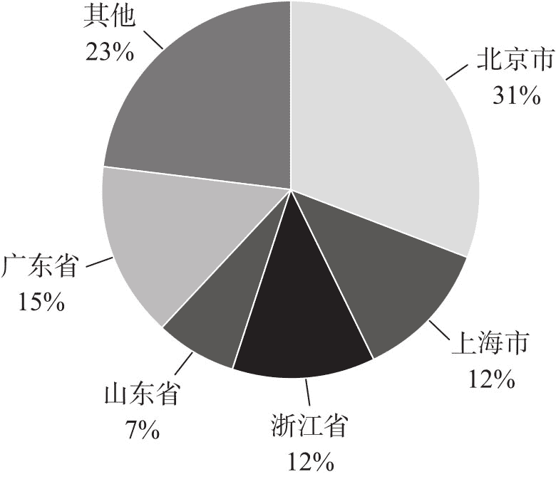

图 2-1 以“人工智能”为关键词之一的检索结果

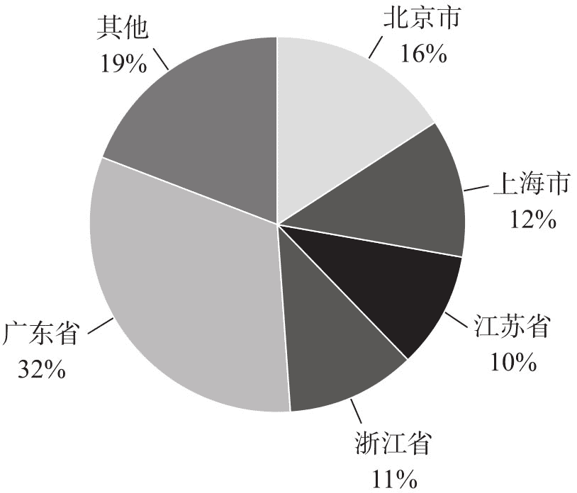

图 2-2 以“算法”为关键词之一的检索结果

分析显示，我国AI产业整体发展仍处中低水平，剔除无关案件后，以AI为争议焦点或主体为AI企业的商标诉讼年案件量不多，企业在商标确权、维权方面仍属起步阶段。同时案件呈现明显地域集中特征，北京、上海、广东、浙江、江苏裁判数量较多，而中西部省市明显偏少，这反映出AI产业在区域间发展不均，京沪粤及江浙汇聚高校、人才与科技创新企业，对司法保护需求更高。

#### （三）人工智能领域的商标典型案例

唤醒口令也能定输负：AI场景下司法如何衡量不正当竞争

在涉及人工智能的商标和不正当竞争审理中，法院并不机械套用传统侵权判断标准，而是把技术落地的具体情境、商业使用带来的实际影响放在首位，对消费者是否易混淆、市场秩序是否受损进行综合权衡。

“小度”语音指令不正当竞争案[^(\[45\])](#chapter002.html#m45)被北京法院列入2021年度知识产权司法保护十大案例。[^(\[46\])](#chapter002.html#m46)在该案中，百度在线网络技术北京有限公司负责“小度在家1S”等AI终端的研发与运营，`xiaodu xiaodu`即为其设备唤醒与操控的核心语音指令。经过长期市场经营，“小度”这一商品名以及`xiaodu xiaodu`口令均已形成一定认知度。百度发现，一家同业厂商生产并销售与小度智能音箱同类的AI学习机，在官网宣传与机器中突出使用“小杜”指代自有产品，并在学习机里内置`xiaoduxiaodu`作为唤醒指令并加以宣传。百度认为该做法易造成公众误认，构成不正当竞争。法院认为，无论是把设备从休眠唤醒，还是执行某项具体操作，都必须发出`xiaoduxiaodu`。由此可见该口令在人机交互中具有高度必要性和高频出现特征，已与产品功能服务形成紧密关联。即便“小杜”与“小度”仅有一字差别，且在文字表述上写成“小杜小杜”，但用户使用感受的网络文章，以及对双方设备同时发出`xiaoduxiaodu`后获得相同反馈的事实，都能够证明细微差别不足以消除混淆误认风险，也不能改变被诉行为的法律定性。本案聚焦唤醒时刻的使用体验与反馈，深入AI应用场景后作出判断，认定合理，也预示了未来AI相关商标裁判的走向。

国务院发布的《新一代人工智能发展规划》把市场主导作为基本原则之一，强调尊重市场规律、坚持应用导向，让企业在技术路线与行业标准制定中发挥主体作用，加快成果商业化，形成竞争优势，同时明确政府在规划引领、政策扶持、安全防范、市场监管、环境营造与伦理法规等方面的职责。

随着AI与社会生活的融合加深，企业在商标申请与维护过程中不断遇到新情况与新难题，也推动了该领域保护重点及诉讼策略的变化。司法部门在侵权认定上不断提出新观点，这提示经营者需要前瞻性布局商标组合，强化品牌管理，以匹配企业战略。

二、人工智能领域的商标注册及布局策略
作为AI知识产权体系的重要构成，具备针对性与前瞻性的品牌发展规划，有助于借助法律工具实现品牌增值，在竞争中巩固并放大品牌优势。企业应研判产业重点方向，厘清业务边界，明确核心、关联与潜在的产品服务，据此制定内部商标工作计划、管理办法与知识产权制度，分层推进注册，保障发展利益与合法权益，规避侵权风险。

为应对商标管理需求的提升，下文从注册规范与使用规范两个维度展开。AI企业应结合行业特性与发展节奏，明确注册规划与申请策略；取得授权后，应规范使用行为，建立市场监测机制，应对潜在风险，健全内部流程与合规制度，为发展赋能。

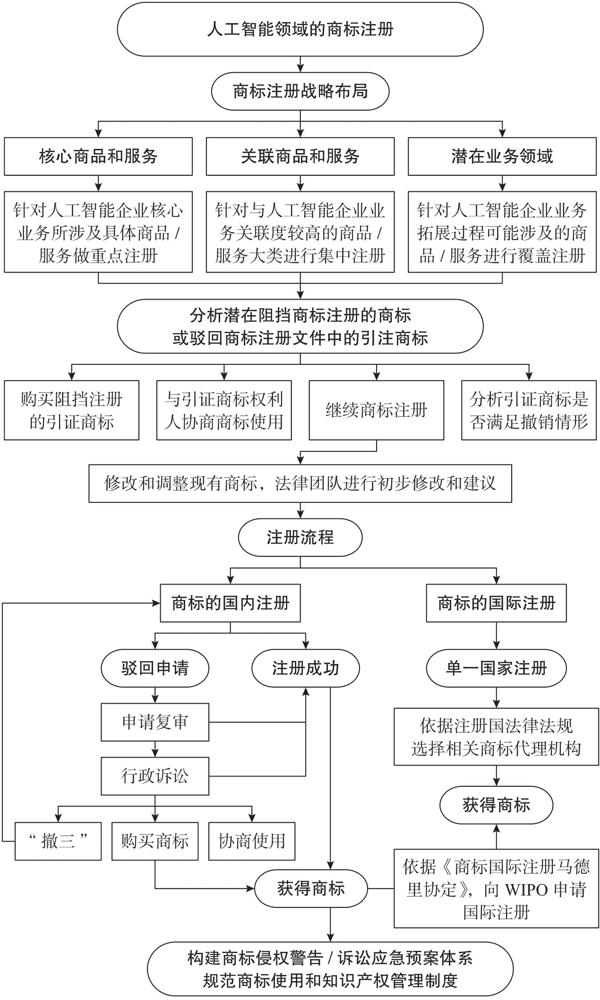

图 2-3 人工智能领域的商标注册及布局策略

### （一）人工智能领域商标注册规范

#### 1. 结合人工智能领域特点和企业发展需求，制定明确的商标注册规划
AI已渗透教育、医疗、养老、环保、城市运行、司法服务等多个场景，其感知、预测、预警能力明显提升了公共服务水平与生活品质。

对照现行《类似商品和服务区分表》，AI产业可能涉及第9类计算机软件、第35类计算机在线广告、第41类网络游戏服务等。当前多数互联网与AI企业集中在上述类别，对更细分的品类则需结合自身实际判断。值得注意的是，除算法、算力、数据、技术外，《科技部关于支持建设新一代人工智能示范应用场景的通知》（国科发规〔2022〕228号）提出要围绕全链条、全过程生态，打造可复制、可推广的标杆场景，首批即推出智慧农场、智能港口、智能矿山、智能工厂、智慧家居等10个场景。这意味着注册范围将远超计算机与互联网，依托政策与市场，企业可能进入三大产业与生活的方方面面。相关主体应及时洞察变化，结合行业特点与发展需求，明确规划，界定核心、关联与潜在品类，及时申请。

#### 2. 结合人工智能企业发展规划和需求，制定明确的商标申请策略
注册过程中，若商标已被抢注、申请商标与在先商标近似、违反强制性规定等情形出现，驳回风险显著上升。《中华人民共和国商标法》第30条规定，申请注册的商标不符合本法规定或与他人在同种或类似商品服务上已注册或初步审定的商标相同近似的，由商标局驳回申请，不予公告。鉴于理论与实务对相同近似的判断存在争议与模糊地带，当企业依据发展规划进入全新领域时，该领域内识别力强的商标资源可能已被占据，注册难度加大。

AI企业命名通常有两种路径。第一种是在已有主商标后附加简洁新名词，如`IBM Watson`、`HUAWEI Atlas`等。依托多年注册的主商标可提升组合商标通过率，并带动新品牌运营营销。主商标后的新名词还能代表新系列，如`Cloud`、`AI SOLUTION`即体现服务内容。第二种是与既有主商标完全无关的全新商标，如百度的`Apollo`。[^(\[47\])](#chapter002.html#m47)

#### 3. 人工智能企业在商标选取上，注重企业品牌稳定性与新商标灵活性的统一
全新独立商标宜选用自创词汇而非通用字典词，在创作中尽量呼应公司名称元素，暗示科技属性，选择显著性强的图文组合。同时，采用与主商标组合注册的方式，有助于品牌文化延续，借助现有市场影响力提升新商标推广便利度与消费者接受度，降低驳回风险。注册时还需注意不得使用《商标法》禁止注册的要素，不得使用知名人物姓名、艺名、企业字号、地理标志等可能侵害在先权利的内容。为提高通过率，建议同时创作2—3个备选方案同步申请。

#### 4. 以商业秘密的方式保护企业经营方案和申请策略，避免商标抢注
企业应高度重视待注册商标的经营价值，加强保密管理，跟踪注册计划在商业秘密中的流转，对复制、下载、访问等行为实施严格管控，实现申请文件从形成、存储、应用到脱密全生命周期的安全保护。也可通过标记、分类、隔离、加密、封存、限制接触人员范围等物理措施落实保密，对存放载体的区域上锁、悬挂警示标志等。

#### 5. 积极推进商标国际布局和国际注册
为满足未来潜在的国际市场与海外运营需求，企业在取得国内授权后，可依《商标国际注册马德里协定》提出国际注册申请。《知识产权强国建设纲要（2021—2035年）》和《“十四五”国家知识产权保护和运用规划》均强调提升商标国际注册服务水平，培育以商标品牌为核心的国际竞争新优势。2021年12月31日起，我国马德里商标国际注册业务全面实现电子化，为推进国际布局提供便利。企业还可视需求聘请境外本土代理机构完成国外注册。

### （二）人工智能领域商标使用规范

#### 1. 积极完成商标使用行为，避免商标因不使用被撤销
商标的本质是识别商品或服务来源，其经济价值的实现依赖于实际使用。我国《商标法》第49条第2款规定，注册商标成为核定商品的通用名称或没有正当理由连续3年不使用的，任何单位或个人可申请撤销。在过往实践中，市场主体常据此撤销他人在先权利。

AI行业涌现大量以无形形式通过网络快速传播的商品服务，商标使用方式与传统实践出现偏差。鉴于技术产品开发周期不确定，服务可能滞后于商标申请。

依据《商标法》第48条，使用包括用于商品、包装、容器及交易文书，也包括用于广告宣传、展览及其他商业活动。维持注册所需的使用与构成侵权的“使用”既有共通也有差异。维持注册的使用必须在商业活动中发挥识别来源作用，成为创设或维持市场份额的手段，且应真实、善意、具有一定商业规模。单纯内部使用或象征性使用不被认可。实践中，企业常通过低成本网络电视广告，或以成本价向员工象征性销售，这类行为难以被认定为有效使用。因此，企业应在推进研发与布局的同时，强化使用情况追踪与管理，留存使用与销售证据，发挥商标的识别与促活作用。

#### 2. 规范商标使用行为，及时规避商标限制性风险
当标志对某类商品具有显著性并被注册后，若因使用逐渐成为通用名称，即丧失识别功能，发生显著性退化或淡化。《商标法》第49条第2款对该可撤销风险作出规定。

为避免显著性退化，部分权利人积极宣传注册商标并非商品通用名称，JEEP与FREON即为经典案例。“U盘”商标退化为计算机存储器通用名称，对AI产业亦敲响警钟。AI更新迭代快，新技术与新产品易迅速占领市场或为公众熟知。鉴于技术术语复杂性，公众易习惯用商标指称某类新产品。当大量消费者或经营者以该商标指代该类商品时，显著性退化风险即显现。因此，企业需明确区分商标与商品名称，规范宣传行为，发现市场混用或竞争对手借名牌搭便车将知名商标作为通用名称使用时，应积极维护显著性。

#### 3. 构建商标市场监测体系，应对潜在商标侵权风险
笔者团队曾处理一家知名智能驾驶汽车企业的商标案件，其核心商标在国内因近似被驳回，并在美国等海外市场被抢注与驳回。该商标价值极高，本应列为一级重点。从此可见，AI企业应搭建商标市场监测体系，完善预警机制，及时掌握侵权信息。若涉嫌侵权申请正在公告，可及时提起异议；针对已注册商标可提起无效宣告。同时可利用工商投诉举报、诉讼等多途径维护权益。企业还应强化内部信息管理，整理许可合同、广告推广合同、宣传物料制作合同等证明使用与知名度的材料，对商标价值进行评估，及时更新注册信息、缴纳费用，维护权利体系文档。

商标是企业面向消费者的名片，也是市场地位的基石。商标注册与AI企业品牌运营、产业发展紧密关联，科学高效推进注册与布局，在市场拓展与品牌影响中价值日益凸显。在研判产业重点、厘清业务范围的基础上，企业应结合发展需求制定注册规划，兼顾稳定性与灵活性，规避抢注风险，规范完成使用，及时规避限制性风险，构建内部监测与合规制度，应对潜在侵权。

### 第四节 人工智能领域的商业秘密保护

### 一、人工智能领域的商业秘密保护特点
商业秘密是最具竞争力的无形财富之一，在与AI产业交集的过程中，已成为众多创新主体的核心依仗。《最高人民法院关于人民法院知识产权审判工作情况的报告》指出，要健全大数据、人工智能、基因技术等新领域新业态的司法保护规则，研究完善算法、商业秘密、人工智能产出物、开源知识产权的司法保护规则。我国也在商业秘密司法解释中细化客体、明确保密义务、规范侵权判断、落实民事责任、统一裁判标准、加大违法成本，以适应对芯片、算法、数据等技术保护的需求。

不过，新兴AI产业因自身特性，在现行法律规范下适用往往存在难度与争议，但也形成鲜明特点。一方面，商业秘密的不公开特性降低了权利保护起点，扩展了保护范围，为著作权、专利权之外提供了可操作路径；另一方面，不公开导致权利外观不足，权利人难以有效划定边界，增加保密措施实施难度，也增加维权时的举证难度。

### 二、人工智能商业秘密保护优势与风险

#### （一）人工智能商业秘密以不公开方式予以保护，丰富了权利保护路径
AI商业秘密的保护以信息未公开披露为前提，在特定情形下可作为临时保护措施，丰富该领域权利保护路径。依据《最高人民法院关于审理侵犯商业秘密民事案件适用法律若干问题的规定》第3条，权利人请求保护的信息在被诉侵权行为发生时不为所属领域相关人员普遍知悉和容易获得，这是“秘密性”要件的要求。结合技术保护阶段与需求，企业可考虑阶段性选取商业秘密作为保护路径。以算法技术、芯片制造技术为例，部分企业选择以技术秘密方式保护；部分企业在申请专利并公开前阶段性采用商业秘密，既填补专利授权周期长的劣势，也保留路径选择空间。

#### （二）人工智能商业秘密保护可能与相关监管要求相冲突
随着立法机关与行政执法部门认识深化，我国正完善AI监管体系，强化对技术发展的预测研判，建立公开透明监管机制，实现对算法设计、产品开发、成果应用的全流程监管，以确保发展可控。监管模式强调产业的公共属性，往往需要公开相关技术或数据，而这些可能涉及核心竞争力的技术、算法、数据在产业中通常以商业秘密形式保护。两者之间存在潜在冲突。

算法透明与商业机密的临界点

算法已成为支撑智能社会的底层底座，保持其运行过程可被检视、防止权力失控，对捍卫数字时代的民主与自由意义重大。[^(\[49\])](#chapter002.html#m49) 然而当算法切入更多智能应用场景后，黑箱化判断、结构性偏见、差异化定价以及算法合谋等负面问题逐步显现。面对这些风险，业界与监管部门对提升透明度的诉求愈发迫切。国务院发布的《新一代人工智能发展规划》鼓励企业搭建工厂级大数据体系、网络化分布式制造设施，推动设备互联、数据直观呈现、制造流程可视化、生产现场无人化，进而提高工厂智控水平。国家新一代人工智能治理专业委员会在《新一代人工智能伦理规范》中要求，在算法设计、落地与使用环节强化可解释、可理解、可控及可信等属性，提升系统的韧性与抗干扰能力，最终迈向可验证、可审计、可监管、可溯源、可预测、可信赖的目标。与此同时，算法等技术成果可作为企业商业秘密受到法律保护，未经许可不得披露或使用。为换取该项保护，企业常有意放大保密强度。有学者认为，当下不少场景的算法不透明已超出合理界限，本质是规则滞后或缺位所致，并暗含对消费者的操纵或歧视。若企业愿公开算法设计思路，外部即可通过代码审阅发现操纵线索或合规缺陷。[^(\[50\])](#chapter002.html#m50)

### （三）人工智能范畴与商业秘密保护边界并非完全重合

当企业以商业秘密形式对技术与数据进行护航时，人工智能产业的价值取向与商业秘密制度的保护逻辑并不总是一致，可能产生保护需求与保护范围错位的问题。对产业发展起关键作用的要素，未必都能被纳入商业秘密范畴。随着行政与司法对商业秘密认定日趋严格，企业举证一项技术或经营信息具备秘密属性的难度在提升。

《最高人民法院关于审理侵犯商业秘密民事案件适用法律若干问题的规定》第1条将商业秘密界定为“与技术相关的结构、原料、组分、配方、材料、样品、样式、植物新品种繁殖材料、工艺、方法或其步骤、算法、数据、计算机程序及其有关文档等信息”以及“与经营活动有关的创意、管理、销售、财务、计划、样本、招投标材料、客户信息、数据等信息”。该条款承认算法、数据、计算机程序可纳入商业秘密保护范围。另一方面，人工智能在学习、处理和表达信息过程中，往往涉及公众常识、常识性判断、既公开的事实、人类的专业经验以及用户投喂的公开数据，这些内容在机器处理前本就处于公开状态，并不会因机器转换而成为秘密。商业秘密保护的核心在于信息处理的方法，而非处理后的表现形式，而要在专家系统、神经网络和机器人等体系里剔除原本公开的信息并不容易。即使能够做出区分，在专家与设计者、使用者与设计者之间的权属争议仍易出现。[^(\[51\])](#chapter002.html#m51)

在软件源代码层面，判断整体或局部是否构成商业秘密客体也存在实践困境。尤其是在开源软件基础上开展算法、程序开发时，需逐案分析开源许可协议的具体表述、不同模块是否受传染性规则牵连、以商业秘密路径进行保护是否与协议冲突而导致权利基础丧失。

### （四）人工智能商业秘密保护方式的可操作性较强

1.商业秘密保护门槛通常低于著作权或专利权保护

只要相关信息未为公众广泛知悉，即可满足秘密性要件，无需再论证创造性或新颖性。商业秘密的取得也不依赖授权审批或登记程序。

2.人工智能商业秘密保护客体较著作权或专利权更宽泛

除完整的算法、数据、计算机程序之外，商业秘密还能覆盖一切未公开的“软件构件”，即具备特定功能与结构、符合标准并能完成一或多个特定任务的软件系统要素，如需求、需求规格、设计文档、源代码、测试方案与测试用例等。[^(\[52\])](#chapter002.html#m52) 著作权保护受到思想与表达二分原则的限制，只能针对以代码、符号、界面、模型及文字等形式呈现的表达，若算法、结构与功能被归入思想范畴，则难以获得著作权保护。专利保护也不接受单纯的算法，必须是具备技术特征的应用方案。

3.人工智能商业秘密保护期限较著作权或专利权更长

从期限角度看，商业秘密理论上可实现永久保护。只要技术保持领先且保密措施有效，实际保护时长常显著超过著作权与专利权的法定期限，对权利人更为有利。

## 三、人工智能领域商业秘密保护建议

### （一）灵活选取法律保护路径

人工智能企业应清晰把握商业秘密与著作权、专利权各自的优劣，结合研发阶段与保护诉求，灵活组合使用多种法律手段。在明确秘密范围、保密时限、知悉人员界限的基础上，建立商业秘密清单目录，做好标识工作，确保涉密信息在相关文件资料上得到准确、完整的标示。

### （二）实现商业秘密全周期全过程管理

人工智能企业应构建完善的保密体系，持续推进保密制度的废改立，建立覆盖全周期、全流程的管理机制。

1.强化保密教育，签署并落实保密协议，实现共建共守。
2.依托法务服务团队，严格管控涉密人员。确保岗前审查、上岗培训、离岗脱密等环节落实到位，在劳动合同中增设保密条款，对核心涉密人员签订竞业限制协议并支付相应补偿，防止其在限制期内从事竞争性业务。
3.强化保密问题检查。保密部门应定期或不定期开展排查，重点关注保密宣传教育、定密执行、涉密人员管理、信息公开、涉密载体保管使用等情况，及时发现漏洞并封堵。应将商业秘密管理纳入企业考核体系，与经济绩效挂钩。
4.搭建人工智能企业商业秘密安全保护平台。跟踪信息流转，加强信息化建设，对线上资料的复制、下载、访问等行为实施权限管控，实现文件从形成、存储、使用到脱密的全生命周期安全防护，形成“进不来、拿不走、打不开、赖不掉”的管控闭环。《最高人民法院关于审理侵犯商业秘密民事案件适用法律若干问题的规定》第6条第3项与第4项列举了限制生产经营场所来访、区分管理以及标记、分类、隔离、加密、封存、限制接触人员范围等物理隔离措施。实践中，对存放载体的区域单独划定、上锁并悬挂警示标识，均属有效手段。

[\[41\]](#chapter002.html#w41) Thaler v.Vidal，No.21-2347（Fed.Cir.2022），https：//law.justia.com/cases/federal/Appellate-courts/cafc/21-2347/21-2347-2022-08-05.html，最后访问时间：2022 年 10 月 20 日。

[\[42\]](#chapter002.html#w42) 专利专员诉 Thaler ［2022］ FCAFC 62 - AI 作为发明人？，https：//piperalderman.com.au/insight/commissioner-of-patents-v-thaler-2022-fcafc-62-ai-as-aninventor/，最后访问时间：2022 年 10 月 20 日。

[\[43\]](#chapter002.html#w43) 陈全真、徐棣枫：《论人工智能生成发明的可专利性及权利归属》，载《科技进步与对策》2022 年第 9 期。

[\[44\]](#chapter002.html#w44) 崔凡：《企查查发布〈中国元宇宙商标申请企业画像报告〉：中国元宇宙的未来在这 1692 家公司手里！》，载企查查官网，http：//news.qcc.com/postnews/qd72ad8996f16f26374 ce638198f32c4.html，最后访问时间：2022 年 10 月 20 日。

[\[45\]](#chapter002.html#w45) 北京市海淀区人民法院（2019）京 0108 民初 63253 号民事判决书，载中国裁判文书网，最后访问时间：2022 年 10 月 20 日。

[\[46\]](#chapter002.html#w46) 《北京法院发布 2021 年度知识产权司法保护十大案例》，载微信公众号“京法网事”，2022 年 4 月 20 日发布，https：//mp.weixin.qq.com/s/gwgjgL7m01RF2YoPwu8NGA，最后访问时间：2022 年 10 月 20 日。

[\[47\]](#chapter002.html#w47) 《【商法实务】人工智能企业如何做好商标保护工作》，载微信公众号“河北贸促”，2022 年 8 月 4 日发布，https：//mp.weixin.qq.com/s/c9UEV9BKhfb27-YEfJNZYg，最后访问时间：2022 年 10 月 20 日。

[\[48\]](#chapter002.html#w48) 王迁：《知识产权法教程》，中国人民大学出版社 2021 年版，第 600 页。

[\[49\]](#chapter002.html#w49) 李安：《算法透明与商业秘密的冲突及协调》，载《电子知识产权》2021 年第 4 期。

[\[50\]](#chapter002.html#w50) Jenna Burrell，“机器‘如何思考’：理解机器学习算法中的不透明性”，大数据与社会，一月-六月，2016：3-4.

[\[51\]](#chapter002.html#w51) 李宗辉：《论人工智能的商业秘密保护》，载《中国发明与专利》2019 年第 2 期。

[\[52\]](#chapter002.html#w52) 胡水晶、方义涛：《软件构件的知识产权保护研究》，载《电子知识产权》2009 年第 11 期。

## 第三章 AI 技术环境下的知识产权纠纷处理策略

## 第一节 AI 场景下的计算机软件著作权侵权应对要点

在司法实践中，以计算机程序著作权为标的的纠纷常被列为难度较高的类型。取证门槛高、举证压力大、审理周期长且败诉不确定性高，让不少权利人望而却步。根本原因在于程序研发涉及架构设计、运行逻辑、部署环境、源代码等多重技术维度，对代理人及法官的专业要求较高。

这类案件的典型特征是行为隐蔽。权利人多在核心研发人员离职后，对方在短期内推出功能高度重叠的产品，才产生源代码被带走的疑虑。被诉程序的源代码属商业保密范畴，通常不对外公开，诉讼前难以核验双方代码是否相同或相近，只能进入审理后由法院裁断。因此个案的认定结果高度不确定，风险系数也随之升高。

现行司法认定仍然以“可得接触且表达实质近似”为基准，其中近似性的判断为核心。司法实践对近似的认定经历了从比例化判断、举证负担转移到不合理重合判断的演进，保护力度逐步增强。

### 一、程序侵权的判断框架

《著作权法》并未以条文明示构成要件，但学理与实务普遍采用“具备接触机会且实质近似”的判断口径。只有在被诉人具备接触原作的可能，同时表达上达到实质近似，二者兼备才构成侵害。该思路源自美国判例，我国在借鉴中不断细化。

《最高人民法院关于审理著作权民事纠纷案件适用法律若干问题的解释》第15条明确，不同作者就同一题材独立创作并形成表达时，各自享有独立权利。

2021年北京市高级人民法院《知识产权民事诉讼证据规则指引》第3.1条要求，审理著作权侵害应查明：原告权利归属、被诉作品与权利作品是否相同或实质近似、被告是否具备接触可能或存在相同错误、暗记等特有部分、两者是否高度一致以致排除合理巧合。

可见“接触与近似”已融入证据审查体系。

### 二、接触可得性的认定路径

在程序著作权案件中，原告通常从以下方向构建接触可能：

其一，主张涉案人员曾在原告处任职且岗位关键，与涉案源码资料关联度高，具备接触条件。

其二，员工在职时间段与权利程序开发周期是否重合，开发记录、代码提交日志是否指向该员工。

其三，员工离职后入职被诉方，并担任相近岗位。

此外，通过鉴定若被诉程序中出现原告程序特有的字符，如企业简称、员工姓名、具有独特性的连续字符序列，且被诉方无法作出合理解释，也能强化接触推断。

### 三、近似性判断的演进

司法对程序近似的把握经历了阶段性变化，整体趋向有利权利人。

#### （一）早期比例判断模式

初期法院对程序侵害采取与一般作品相近的思路，原告须证明侵权作品与权利作品构成实质近似，举证负担完全由原告承担。

按《计算机软件保护条例》，程序指代码及其相关文档，源程序与目标程序视为同一作品。但不同源代码可编译为相同目标程序，界面表现与源码并不一一对应。在无法获取源代码时，仅以目标程序或界面相同为由主张，法院多以证据不足驳回。

因此早期程序维权被视为难度最大的类型之一。

#### （二）举证负担转移的运用

因源代码多由被诉方控制，原告取证困难，近年举证责任转移在程序案件中得到扩张。

《最高人民法院关于民事诉讼证据的若干规定》第95条规定，控制证据一方无正当理由拒不提交的，对事实负举证责任一方可主张证据对其不利，法院可予认定。

实践中，被诉方拒不提供源代码时，法院依据现有证据推定近似，但需满足前提：原告已举证目标代码相同或相近，或被诉程序目标代码包含权利程序特有内容，或运行结果、界面、数据库结构等方面相同或实质近似。

例如北京知识产权法院审理的一起著作权纠纷中，双方函数近似部分整体占比不高，但达471处，涉及基础功能且不可替代，被诉方未能合理解释，法院认定部分构成实质近似。[^(\[1\])](#chapter003.html#m1)

#### （三）不合理重合的判断标准

除比例外，法院更重视“不合常理的重合”。另一起系统公司侵害程序著作权案中，一审认定25处不合常理重合：本应自主命名的进程、工具命名雷同；被诉程序大量出现权利程序的曾用名；出现相同错误、冗余设计；核心程序结构高度相似；被诉方软件开发时间与权利程序记录吻合等。被诉方既无合理解释又拒不提交源代码，最终被认定构成实质近似。[^(\[2\])](#chapter003.html#m2)

二审最高法进一步指出，被诉方拒交源代码时，比对目标程序和界面并无不当，源代码比对并非必经程序。若权利人已初步证明存在自主命名信息、设计缺陷、冗余设计等特有信息，举证负担即转移至被诉方，由其自证未侵害。[^(\[3\])](#chapter003.html#m3)

总体来看，程序著作权侵害仍以接触与近似为基线，但近似性审查已从僵化的源码相似度比例转向合理性审查。只要权利人初步证明存在不合常理的重合，即可倒逼被诉方举证。上海等地已有小比例近似即获支持的案例，标准仍在放宽。

## 第二节 AI 专利争议与取证建议

随产业扩张，我国 AI 相关专利申请快速增长，2021年申请量达19945项，同比增20.6%。[^(\[4\])](#chapter003.html#m4)案件数量随之攀升，此类纠纷多涉及机器学习、自然语言处理、知识图谱、计算机视觉等，侵害行为隐蔽、取证难度大。

### 一、专利诉讼中需准备的证据类型

专利民事争议通常需三类证据：权利基础证据、侵害行为证据、损失赔偿证据。

权利基础证据包括专利证书、权利存续证明、年费缴纳凭证、许可合同，外观设计和实用新型还需专利评价报告。

侵害行为证据包括销售合同、官网宣传、厂房照片、侵权物实物、公证书等。AI 技术应用面广，一项语音识别专利可能覆盖输入法、电销机器人、声控家居、语音导航等多个领域，影响远超单一行业。

赔偿证据用于证明被诉方获利或原告受损，可参考销售渠道、销售额、销售时间、范围等估算。企业年报常披露营业额、客户规模等信息，可直接作为获利佐证。若未公开，可通过匿名购买接触销售人员获取相关数据。

其中技术特征比对为关键，是否落入权利要求范围决定侵害成立；赔偿数额则决定维权价值。

### 二、专利侵权取证的实务经验

笔者团队曾办理一起典型案件。2020年，权利人方以其“基于语音识别实现自主拨号，智能对话以及信息分析的方法”发明专利ZL2017107928××.×起诉涉诉企业乙，后撤诉再诉。该专利应用于电话机器人领域，而涉诉企业主营AI数字员工解决方案，其电销机器人产品市场占有率高且具备智能对话功能。

2022年南京中院审理时，权利人提交了涉诉企业销售、许诺销售、生产被诉产品的证据，并通过公证记录还原使用流程，将步骤与权利要求技术特征逐项对应。

在AI专利领域，技术特征复杂且不一定体现在外观或操作上，原告往往难以获知被诉方具体实现方案，因其多以商业秘密保护。对此，若已有初步证据显示侵害可能，可申请证据保全、行为保全或调查取证，迫使被诉方披露技术方案以供比对。

## 举证倒置下的专利攻防

在现行规则下，只要原告已经穷尽合理调查但仍无法取得关键材料，而这些材料事实上掌握在被诉方手中且对方无合理解释拒绝提供，法院就可以对被诉方作出不利推定。据此，原告即便在起诉前尚不足以完整证明对方技术落入权利要求保护边界，也能在审理中要求对方自证其方案不构成侵权，以明确争议焦点。反过来，若被告已经持有充分证据证明自身技术未被权利要求覆盖，便可主张无需逐项比对，从而降低核心技术对外暴露的风险。

核心的争议点在于，当初步证据显示被告部分技术与原告专利的部分特征重合，而需要被告进一步证明不可见的部分也不属于剩余特征的保护范围时，原告是否必须获悉对方技术的具体实现。若被告拒绝全面披露，原告就难以进行有效质证；若被告被迫披露后最终证明两者并不相同，甚至被告方案更具先进性，原告便可能零成本地通过诉讼获知竞争对手的优化思路，随时撤诉以规避败诉风险。实务中法院常要求接触保密信息的人员签署保密承诺函来约束，但双方本是竞争关系，涉案信息又属产品核心，很难绝对保证不出现泄露。为此，被告在操作层面更适宜以可观察的功能表现、操作流程等显性要素来抗辩其方案未落入权利要求。

## 三、人工智能专利行政纠纷及取证方法

笔者团队曾办理过一起相关案件，被告就涉案专利向国家知识产权局申请无效宣告。2022年7月24日，局方作出审查决定，宣告该专利权全部失效，原告随即撤回侵权诉讼。

上海 Z 公司与 A 公司围绕一项人工智能专利对峙多年。2012 年 Z 公司在上海第一中级人民法院提起侵权诉讼，随后 A 公司启动无效程序。2013年9月3日，专利复审委员会作出维持专利有效的决定。A 公司不服向北京市第一中级人民法院提起行政诉讼，一审维持维持，二审认定专利无效，侵权案先行裁定驳回。Z 公司申请再审后，最高人民法院最终认定专利有效。历经八年行政博弈，2020 年 Z 公司再次发起侵权诉讼，暂计索赔 100 亿元，诉讼费高达 5000 万元，属境内罕见的高标的 AI 诉讼，若胜诉将成为司法实践新里程碑。2022 年 8 月 18 日，上海高级人民法院第三次开庭审理该案，Z 公司表示该专利系其核心基础专利，是国内计算机人工智能领域的基础之一，中国移动、中国电信、QQ、微博等提供的智能聊天服务背后均有其技术支撑。

A 公司在无效请求中主要主张说明书公开不充分、部分权利要求表述不清、缺少解决技术问题的必要特征、权利要求得不到说明书支持、缺乏新颖性与创造性。A 公司提交了四份材料，其中前三份为在先专利文件，第四份为国家知识产权局专利检索咨询中心出具的检索报告。专利复审委员会认为证据一至三可作为评价新颖性与创造性的现有技术使用。

由此可见，无效案件中申请人提交的证据多为在先技术，用以比对涉案权利要求是否具备新颖性与创造性。取证思路的关键在于拆解权利要求的技术特征，通过专利检索定位相同或近似的在先技术，再对在先技术的技术特征进行分解组合，以论证涉案专利不具备新颖性或创造性。

总体来看，人工智能专利纠纷既具一般专利案件的共性，也存在明显特殊性。共性在于侵权诉讼常与无效程序紧密绑定，被告多在应诉同时提起无效，审查结果直接决定侵权走向。特殊性在于 AI 领域侵权取证难度更高，技术复杂使原告在起诉前通常无法全面掌握对方方案，必须借助法院协助或对方配合才能完成技术比对；而被告则需要在举证责任转移风险与商业秘密泄露风险之间寻求平衡。

人工智能已深度融入社会生活，且为各国重点培育的新兴产业，我国更需重视其发展与保护。立足举证责任转移规则，审慎评估证据开示制度的适用边界，为权利人提供有效维权救济。

## 第三节 人工智能领域的商业秘密纠纷案例
### 一、商业秘密保护的背景信息
目前我国商业秘密保护以《中华人民共和国反不正当竞争法》、最高人民法院关于适用该法的解释和关于审理侵犯商业秘密民事案件适用法律若干问题的规定为主体，并辅以《全国商业秘密保护创新试点工作方案》《中央企业商业秘密保护暂行规定》等部门文件，明确了保护的重要性，为人工智能领域商业秘密保护提供遵循。浙江省市场监督管理局《商业秘密保护工作指引》等地方文件进一步强调对新兴产业、高科技产业及区域重点集聚产业中具有领先地位的企业进行试点帮扶。依托愈加成熟的法规体系，AI 企业商业秘密保护的政策优势日益清晰。

近年来司法机关在人工智能领域商业秘密的构成、接触可能性的认定、实质性相同判断和合法来源抗辩分析等方面持续探索。虽我国非判例法国家，但研读典型案例仍有助于企业把握裁判要点，强化举证与合规意识，及时完善保密机制，规避泄密风险。

### 二、人工智能领域的商业秘密纠纷及其核心问题
#### （一）人工智能领域“商业秘密”的构成认定
在商业秘密纠纷中，首要任务是确认涉案技术或经营信息是否具备商业秘密属性。《反不正当竞争法》第9条第4款将商业秘密界定为不为公众知悉、具有商业价值并经权利人采取相应保密措施的技术信息、经营信息等。最高人民法院司法解释对商业秘密类型作了细化，包括技术方面的结构、原料、配方、工艺、方法或其步骤、算法、数据、计算机程序及其文档等，以及经营方面的创意、管理、销售、财务、客户信息、数据等，均与人工智能产业密切相关。解释还对秘密性[^(\[5\])](#chapter003.html#m5)、保密性[^(\[6\])](#chapter003.html#m6)与价值性[^(\[7\])](#chapter003.html#m7)作了阐释，明确了保密措施认定标准、价值性判断及阶段性成果是否具备价值等问题。

L 公司、D 公司侵害商业秘密纠纷案中，原告 L 公司自主开发的《L 建设企业管理信息系统 V4.8》有多项技术内容构成商业秘密。D 公司股东臧某等在 L 公司任高管、技术主管期间离职前参与 D 公司设立，D 公司在获准登记不足三个月内将 L 公司不为公知产品改头换面登记为《D 管理信息系统平台软件 V1.0》。本案一审法院北京知识产权法院从内容属性、保密性、秘密性、价值性四个维度进行审查。

先界定内容属性，参照司法解释，将原告主张的数据库表和存储过程/函数认定为技术信息。其次，保密性认定结合密点说明、鉴定意见及与核心技术人员签署保密协议的行为，确认权利人设置了密点并采取了保密措施。再者，秘密性要求证明信息不属公共技术领域，法院以数据库表和存储过程/函数属于软件后台代码，一般不为业内人员普遍知悉，且被告未证明其来源于公共领域为由驳回抗辩。最后，价值性从竞争优势角度考察，认为数据库结构对软件质量具有贡献性，能为权利人带来经济利益和竞争优势，故构成技术信息。[^(\[8\])](#chapter003.html#m8)

王某等与 H 公司侵害商业秘密案中，法院依据经证据保全的源代码鉴定意见认定其为外界难以获知的技术信息。依据《软件开发合同》约定的价款证明 H 公司享有经济利益，依据《系统集成合同》保密条款、《保密协议》《保密及竞业限制协议》《离职员工承诺书》及交接手续证明已采取相应保密措施。[^(\[9\])](#chapter003.html#m9)

#### （二）人工智能商业秘密纠纷中“接触可能性”的认定
司法解释第12条规定，认定员工或前员工是否有渠道或机会获取商业秘密，可考虑其职务、职责、权限、承担任务、参与生产经营活动情形、是否保管使用复制接触信息载体等因素。该规定承认了接触在商业秘密案件中的作用，并细化了考察类型。值得注意的是，可能性接触并不要求直接证明实际接触，证明存在接触条件或机会即可，这与人工智能商业秘密转移的隐蔽性相契合，在一定程度上减轻了权利人举证负担。

L 公司与周某等、D 公司侵害技术秘密纠纷案中，L 公司主张的技术信息记载于技术指标书等图纸，涉及13个密点，包括电路布局、元件选择、参数、位置及连接方式、特定元件材料构成及工艺要求等。魏某2007年入职 L 公司任检验员并签保密协议，李某次年入职研发部实验员，2009年周某入职、2011年赵某入职均任销售员并签约。D 公司2012年成立，四人先后到该企业任职。

一审以不构成商业秘密驳回，二审最高人民法院聚焦侵权行为分析。法院综合考量被诉人员职务接触商业秘密的可能性、离职时间与商业秘密形成时间、离职时可接触图纸版本与涉案秘密的比较等因素后指出，魏某离职时间早于图纸形成时间，最晚离职的赵某离职时周某与赵某从事销售，接触核心秘密可能性不大；李某虽任研发实验员，但离职后图纸仍更新，无证据证明其任职期间接触过相关图纸，权利人亦未提供初步证据。据此认定四人非法获取技术信息缺乏事实依据。[^(\[10\])](#chapter003.html#m10)

#### （三）人工智能商业秘密纠纷中“实质性相同”的认定
判断涉案商业秘密与被诉信息是否实质性相同是人工智能商业秘密案件的核心争议。司法解释第13条列举了异同程度、业内人员是否易于想到区别、用途使用方式目的效果是否实质差异、公有领域相关信息情况等考量因素。

在前述 L 公司、D 公司案中，一审法院认为商业秘密比对的实质上相同更接近著作权比对的实质性相似，但《著作权法》思想表达二分法不适用于商业秘密领域。因此，只要能在某一具体层面确信被诉内容来源于主张权利内容，即构成实质性相同，且层面越具体，确信度越高。

鉴定机构对数据库表实体关系模型、字段名称、类型、存储内容、数量、表名及主外键关系进行比对，结论为 W 公司使用的 35 个数据库表、10 个存储过程/函数中，与 L 公司对应表及存储过程/函数相同或实质相同，19 个数据库表、1 个存储过程/函数部分相似。

法院认为程序代码表达有形式表达和内容表达之分。形式表达体现为字段名称、数量、表名及语句等；内容表达体现为实体关系模型、存储内容、主外键关系及逻辑功能等。鉴定结论中实质性相同指形式部分相同且内容基本相同，部分相似指少量形式或内容相似。涉案数据表单彼此独立又相互关联，且实质相同部分体现了选择、实现和布局的具体性，能够展现软件功能，因此足以认定被诉内容来源于涉案商业秘密。[^(\[11\])](#chapter003.html#m11)

#### （四）人工智能商业秘密纠纷中“合法来源抗辩”的认定
司法解释第14条明确，通过自行开发研制或反向工程获得被诉侵权信息的，不构成侵犯商业秘密。反向工程指通过拆卸、测绘、分析等技术手段从公开渠道取得的产品中获取技术信息。该行为既节省研发成本，也促进技术迭代，具有积极意义。

构成反向工程抗辩需满足主体适格和来源合法。主体方面，实施前不得负有保密义务，实施中不得接触标的秘密信息；来源方面，产品须来源于公共渠道且取得手段正当诚实。实施过程应满足净室程序，即研发者除自身专业常识经验外，与权利人受保护的技术信息相隔离。美国案例中，因无法排除接触和复制事实，净室程序瑕疵导致抗辩不成立。[^(\[12\])](#chapter003.html#m12)

总体而言，人工智能商业秘密纠纷既体现技术与伦理特征，也遵循商业秘密基本构成要件。裁判实践在保密构成、接触可能性、实质性相同、合法来源抗辩等方面形成了规律性指引。企业应明晰涉案信息是否具备商业秘密属性，厘清人员接触路径，准确把握实质性相同认定思路，并以司法经验为基础强化合规建设，构建完整保密制度，降低泄密与诉讼风险。

## 第四节 开源软件的诉讼纠纷案例
### 一、开源许可协议介绍

# 开源许可框架与维权审判要点

开放源码软件，指权利人依据特定开放许可向公众披露源代码，并在许可约定的范围内允许他人使用、改动和再分发。此类实践倡导开放共建与资源互通，对软件产业的成长与创新具有催化作用。

2019 年，中国开源云联盟对外发布木兰宽松许可证 Mulan PSL，这是境内首个由官方体系推出并得到认可的开放协议。[^(\[13\])](#chapter003.html#m13)该协议随后通过开放源代码促进会的认证，成为培育本土开放生态的重要抓手。

从权利让渡角度看，软件开源授权是原作者为鼓励他人自由使用、复制、修改、分发源代码，而将著作财产权及部分人身权让渡给使用者继续开发的安排。其核心在于倡导开放、共享、平等与协作，营造自由开发、使用与传播的网络环境。许可的存在使后来者能够在已有成果之上继续建设。目前无论是 GPL 还是其他各类开放许可，均已获得众多国际组织、政府部门乃至政治团体的立法支持，成为行业公认的契约文本，也是守约精神的体现。只有各方均恪守许可条款，源代码才能持续流通，软件市场得以繁荣，公众才能享受到开放成果带来的收益。

在实践层面，境内对开放许可的归类已形成基本共识，概括为宽松自由软件许可、复制左许可与弱复制左许可三类。[^(\[14\])](#chapter003.html#m14)学界也有将之译为获准型、传染型与弱传染型许可的说法。本文沿用后一种表述作简要介绍。

## （一）获准型许可证
获准型许可对使用、修改、传播的限制设定得最为宽松。该类软件通常仅要求使用者对原作者进行署名致谢，衍生作品完全可以闭源私有化。典型代表包括 BSD 家族、MIT、Apache-2.0 以及木兰宽松许可等。WhiteSource 的统计结果显示，2019 年获准型许可在整体开放生态中的占比已超过六成。[^(\[15\])](#chapter003.html#m15)

## （二）传染型开源许可证
传染型许可为促进协作与共享，要求任何对软件的修改和扩充都必须沿用原许可发布，且不得违反原作品的限制。其效力既有纵向传染，即修改后的版本必须整体适用同一许可，也有横向传染，即只要作品中包含该类许可的代码，整体就须以该许可发布。以 GPL 为例，采用 GPL 许可的软件经修改、使用或复制后产生的衍生作品，必须继续以 GPL 发布，否则许可失效，衍生作品将被认定为侵权，既包括对开放软件本体的修改，也包括基于其衍生出的新作品。[^(\[16\])](#chapter003.html#m16)典型代表有开放软件许可系列和 GPL 等。

## （三）弱传染型开源许可证
弱传染型与传染型不同，当某软件仅使用了这类协议下的部分代码并再次发布时，只有被引用的那部分受原许可约束，其他部分不受限制，因此不具备横向传染性。合并了这些代码的大型项目仍可以闭源发行，代表性许可为 LGPL、MPL 等。

有研究者据此绘制了许可类型的划分图示。[^(\[17\])](#chapter003.html#m17)

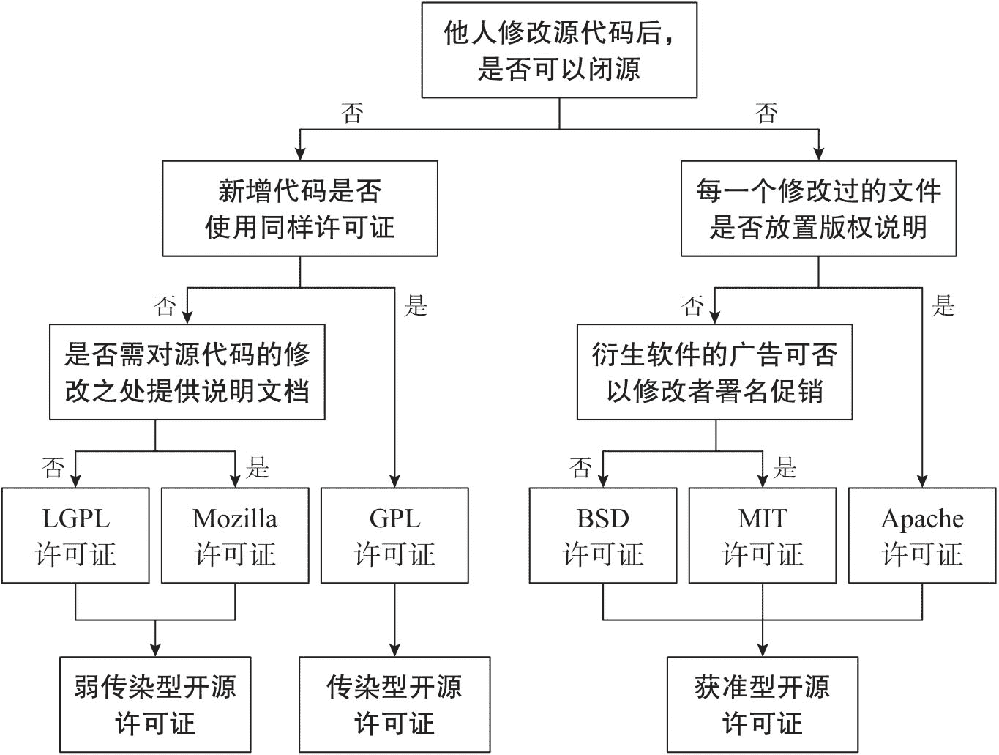

图 3-1 各类开源许可证类型划分

## 二、开放源码软件争议与审判关注点
笔者梳理了近年人工智能和互联网领域涉及开放源码软件的典型争议，发现审判实践通常聚焦四项核心：权利主体确认、侵权构成判断、许可传染边界以及救济路径选择。以下结合典型案例作概括与评析。

### （一）相关主体确认
#### 1. 开放源码软件版权归属于开发者
境内裁判中，法院多援引《最高人民法院关于审理著作权民事纠纷案件适用法律若干问题的解释》第 7 条[^(\[18\])](#chapter003.html#m18)或《计算机软件保护条例》第 9 条[^(\[19\])](#chapter003.html#m19)，结合开发过程记录、版权登记署名及其他权属证据进行综合印证。

在一则电商平台系统著作权纠纷中，一审法院认为被诉权利人提交了涉案系统的登记证书、权属声明及正版光盘，被告未提供相反证据，足以认定其为权利人，具备原告资格。[^(\[20\])](#chapter003.html#m20)

#### 2. 开放源码项目管理者可单独提起诉讼
开放项目通常由管理者先行上传初始源代码并选定许可，其他用户可 Fork 创建分支并提交 Pull Request 申请合并，管理者决定是否合并。合并成功后该用户即成为主分支贡献者。参见图 3-2 所示。

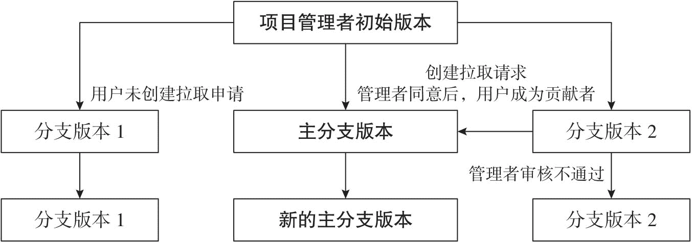

图 3-2 开源软件开发模式

当分支软件受版权法保护时，往往被认定为合作作品。我国对可分割与不可分割的合作作品有专门规定，《著作权法实施条例》第 9 条、《计算机软件保护条例》第 10 条均作了相应安排。但开放项目贡献者遍布全球、数量庞杂且持续增长，若要求起诉必须取得全部贡献者授权，维权将事实上被堵死。

广州知识产权法院在涉及插件化框架虚拟引擎系统的著作权纠纷中明确了管理人可单独起诉的立场。该案入选 2021 年度广州知产法院十大典型案例。

原告于 2017 年 11 月 8 日取得“L 插件化框架虚拟引擎系统 V1.0”即 L App 的登记证书。被告抗辩称代码托管于 GitHub 的 L App 开源项目，参与者多达 32 人，项目人 A 仅为其中之一，属不可分割的合作作品，转让需全体权利人书面一致同意，单方转让无效。

法院虽未最终认定合作作品性质，但在原告起诉权上作了三点分析：

其一，权利基础清晰，项目管理人起决定性作用。原告股东罗某于 2016 年 7 月 7 日将涉案软件初始版本 507 个文件共 31097 行上传至 GitHub，是项目权利基础与核心。贡献者代码均在此基础上优化，且是否合并由管理人决定，管理人代码量占绝大多数，其他贡献并未对版权产生实质影响。

其二，开放许可赋予管理人在协议范围内自由使用权。涉案项目适用 LGPLv3 或 GPLv3，贡献者在提交 Pull Request 时即默认同意该许可，视为将其代码开源供管理人与公众在许可范围内使用。

其三，权衡维权难度与诉讼现实。开放贡献者众多、彼此陌生且动态增加，若要求逐一授权，维权无从提起。法院据此认定原告作为主要代码提交者和管理人，可无需其他贡献者授权单独起诉。[^(\[21\])](#chapter003.html#m21)

### （二）许可传染性边界的认定
在主体确认后，法院还需结合传染性判断许可影响的范围，主要争议在于是否落入传染性规则的例外。

#### 1. 各部分可独立区分时不适用传染
在一则前端与后端交互的著作权纠纷二审中，法院聚焦权利软件是否属开放源码、是否应无偿许可。被告主张前端与后端交互且未隔离，按 GPL 的强传染性，前后端应共同构成一项软件需整体开放。

法院未予支持：其一，前后端可分别打包部署，展示方式、技术栈、功能分工明显不同，仅因交互配合不能视为一体。其二，被上诉人明确放弃以前端主张权利，仅就后端主张权利，争议客体仅为后端代码。其三，依据 GPLv3 第 5 条关于聚合体的规定，传染性仅及于衍生程序或修订版本，不及于与其联合的独立程序。本案后端为独立于前端的另一程序，不受前端使用的 GPL 代码约束，无需强制开放。[^(\[22\])](#chapter003.html#m22)

#### 2. 派生作品紧密关联时应适用传染
在另一起涉及 L App 的著作权纠纷中，被诉软件使用了原告以 GPLv3 发布的 L App。法院依据 GPLv3 第 5 条第 1 款 c 项、第 7 条和第 10 条及强传染性特征认为，逻辑上相关且整体发布的衍生作品，只要其中一部分采用 GPLv3，整体即须受 GPLv3 约束，不能将 GPL 源代码与非自由代码合并。被诉软件应向公众无偿开放源代码。被告以未实质性修改为由抗辩被驳回。[^(\[23\])](#chapter003.html#m23)

### （三）维权路径选择
#### 1. 开放许可的法律定性
开放许可实现了权利人对著作财产权及部分人格权的授予，同时保障软件的自由开发与传播。许可形式已被业界广泛认可。学界与实务对许可性质一直存在分歧，而性质认定直接影响法律适用与维权方式。前述 L App 案即为国内首个明确 GPLv3 性质的判决。[^(\[24\])](#chapter003.html#m24)

法院从内容与形式两方面分析：其一，内容具备合同特征。GPLv3 属私法效果的意思表示，是民事法律行为。其授予复制、修改、再发布权利，形成授权人与使用者之间的权利变动，属于设立、变更、终止民事权利义务的行为。授权行为自愿且合法，使用者在复制、修改或发布时即作出承诺，合同成立生效。其二，形式具备合同特征。GPLv3 通过电子文本表现，属于有形载体，符合书面合同形式。综上，GPLv3 具有合同性质，是著作权授权协议，受《民法典》调整。

#### 2. 诉讼路径
违反许可既可主张违约救济，也可主张侵权救济，二者责任范围与救济措施不同。违约责任范围相对较轻，主要为继续履行与损害赔偿；侵权责任除赔偿外，还包括停止侵害、恢复原状及禁令救济。

在前述 L 公司、W 公司案中，法院援引美国 Jacobsen 诉 Katzer 案与德国 Harald Welter 诉 SiteCom 案。美国法院认为超出许可使用构成侵权，可依版权提起诉讼；德国法院认为授权终止后继续使用构成侵害，实践倾向侵权救济。

法院认为违约与侵权竞合，由当事人选择。本案原告主张被告同时违反商业使用限制保留条款及 GPLv3，构成无权使用，应承担侵权责任，故法院从侵权角度审理。

其一，违约即丧失授权基础。依据《合同法》第 45 条，现为《民法典》第 158 条，附解除条件的合同自条件成就时失效。GPLv3 属附解除条件的著作权合同，许可条款为授权条件，使用者违约则许可自动终止。本案被告未提供源代码下载即违约，复制、发布行为因无权利来源构成侵权。

其二，无权实施的信息网络传播行为构成著作权侵权。

开源风险与AI数据竞争合规指南

《最高人民法院关于审理侵害信息网络传播权民事纠纷案件适用法律若干问题的规定》第三条对侵权边界作出界定：网络用户或网络服务提供者若在未获权利人授权的情况下，通过信息网络向公众提供其享有的信息网络传播权客体，包括作品、表演、录音录像制品，除另有法律行政法规规定外，均应认定为侵权。所谓提供行为，是指将上述客体上传至网络服务器、设定为共享文件或借助文件分享工具，使作品能够被公众在个人自行决定的时间与地点以下载、浏览等方式获取。本案中，W公司把被诉软件上架至多个应用平台，供用户按需获取，侵害了L公司对涉案软件的信息网络传播权。

整体来看，随着开源模式快速扩张和开源软件应用面扩大，围绕开源的诉讼热度持续上升。开源软件的争议处理与一般民事、知识产权案件在多个环节存在差异，必须结合许可模式的特殊性进行具体分析。前面基于不同开源许可文本，简要对比了协议间的异同，提醒企业厘清著作权归属和诉权行使路径，有针对性地研判传染性条款以划定权利边界；诉讼发生时，要依据案情权衡双方权利义务的分担，选择最有利于自身的应对策略。同时，企业也应提升对开源开发与运营风险的预判，及时识别著作权归属分歧和潜在诉讼隐患。

第五节 人工智能涉数据、算法的不正当竞争行为规制

当前中、美、日、英、法、德等多国均已发布支持人工智能研发与应用的国家战略。随着机器学习、自然语言处理、图像识别等技术加速发展，人工智能成为社会关注焦点。技术带来便利的同时，也附带风险与挑战。

在人工智能背景下，经营者借助先进算法与海量数据资源，可能实施隐蔽、复杂的非公平竞争举措，对他人合法的网络产品或服务造成阻碍、干扰乃至颠覆性影响。研究显示，到2020年零售业85%的客户服务互动将由人工智能驱动或受其影响。智威汤逊广告公司报告指出，70%的千禧一代偏好用AI呈现产品的品牌，38%的消费者认为在AI辅助下获得的购物引导优于无AI情形。[^(\[25\])](#chapter003.html#m25)

学界对AI相关法律问题的研究多集中于可专利性、生成物著作权保护等方面，而AI与反不正当竞争的交叉讨论相对有限。

### 一、人工智能时代涉数据、算法的不正当竞争行为

人工智能的三大支柱是数据、算法、算力。数据是算法的养料，算法是技术演进的推手。随着技术进步，数据与算法的经济价值不断被释放。

数据与算法本身中立，但经营者同时具备经济人及理性人属性，易于滥用技术突破法律与商业伦理边界，实施流量劫持、妨碍干扰、恶意不兼容等新型竞争手段，最终损害其他市场参与者利益。

不正当竞争既可侵害商标、商业秘密等法定有名权益，也可侵害虽无明文规定却能形成竞争优势的无名权益。涉数据、算法的新型不正当竞争，是指经营者利用数据与算法实施违反法律与商业道德的竞争行为。以被视为中国大数据产品不正当竞争首案的T公司诉M公司案为例，法院认定T公司对“生意参谋”数据产品享有竞争性财产权益。M公司为营利目的直接把该数据产品作为获利工具，提供同质化网络服务获取商业利益与竞争优势，明显有违公认商业道德，属于搭便车式的不正当竞争，判令赔偿200万元。[^(\[26\])](#chapter003.html#m26)可见技术中立不等于行为正当，一旦被用作竞争工具即具备可罚性。

中国人工智能企业获取数据的典型路径包括自行采集、业务沉淀、爬虫抓取、付费购买、生态共享、算法生成、公开数据集等七种，数据开放程度不同，竞争形态亦不同。

## 一、按数据开放程度划分的不正当竞争行为

### （一）涉及完全公开数据的不正当竞争行为

完全公开数据无需身份认证即可获取。例如通过“网络爬虫”(`Web Spider`)抓取搜索引擎上的公开信息。搜索引擎正是依靠爬虫自动抓取网页并建立索引。数据控制者可通过robots协议限制访问，该协议即网站根目录下的`robots.txt`文件，用于告知搜索引擎哪些页面可抓取、哪些不可抓取，主要是避免服务器过载和抓取无价值信息。该文件默认值为允许抓取，不允许抓取为特例。未设置或文件为空即视为对所有爬虫开放。

在此场景下，数据控制方若以不合理方式限制他人获取数据，也可能构成不正当竞争。如B公司在其网站robots协议中专门排除Q公司搜索引擎，导致用户通过Q搜索B网站后点击即被阻断并跳转至B自有搜索引擎。robots协议本意是引导爬虫更高效抓取有价值信息，促进共享。若把“允许抓取”变为特例则背离初衷。根据《互联网搜索引擎服务自律公约》第8条，对通用搜索引擎的限制应有行业公认的正当理由。B公司在无合理依据下区别对待Q公司，限制其抓取，影响其正常运行，降低用户满意度，损害Q公司合法权益并强化自身市场优势，妨碍互联网竞争秩序，违反公平竞争、诚信与公认商业道德，构成《反不正当竞争法》第2条所述不正当竞争。

反之，数据使用者若用爬虫抓取后超出合理限度使用，也会构成不正当竞争。如抓取后经简单处理即向用户提供与数据控制方同质的产品或服务，属于“实质性替代”。H公司诉B公司案中，法院认为B公司抓取信息虽不违反robots协议，但在其产品中大量使用H公司用户评论，已构成实质性替代，削弱H公司竞争优势与交易机会，超出必要限度使用损害H公司利益，也可能削弱市场主体信息收集投入意愿，对产业生态与竞争秩序产生负面影响，并损害消费者未来获知信息渠道。认定为不正当竞争。[^(\[27\])](#chapter003.html#m27)

### （二）涉及相对公开数据的不正当竞争行为

相对公开数据需经身份认证或事前授权。典型问题是未经授权或超出授权范围抓取用户数据。如通过`API`接口认证后获取授权范围外数据。W公司诉T公司案中，T公司明知需申请用户信息的接口权限，合作终止后应及时删除获取信息，却在合作期内超许可范围抓取使用W公司用户职业、教育信息，并在合作终止后较长时间仍继续使用。主观故意明显，违反诚信原则，违背公认商业道德，危及用户信息安全，损害W公司合法竞争利益，构成不正当竞争。[^(\[28\])](#chapter003.html#m28)

大数据时代，企业间通过`API`共享数据已成新模式。收集利用用户信息应遵循合法、正当、必要的原则并获用户同意。第三方获取平台用户信息应坚持“用户授权+平台授权+用户授权”三重授权，即数据控制方需先获用户授权，第三方需获数据控制方授权，使用时仍需再次取得用户授权并明确目的、方式、范围，尊重知情权与选择权。

### （三）涉及不公开数据的不正当竞争行为

不公开数据通常受技术措施保护。若具备秘密性、价值性、保密性即构成商业秘密，非法获取即为侵犯商业秘密的不正当竞争。典型行为是黑客行为，可能同时构成刑事犯罪。G公司与Y公司案中，为提升智能公交App准确度与用户量，Y公司人员利用爬虫攻破G公司App加密系统，大量爬取实时数据供自用。经评估G公司直接经济损失24.43万元。深圳南山法院认定其违反国家规定获取计算机信息系统数据，情节特别严重，构成非法获取计算机信息系统数据罪。中院认为Y公司大量获取并无偿使用G公司实时公交信息，是坐享其成，非法占有他人无形财产权益，破坏竞争优势，违反诚信原则，扰乱竞争秩序，构成不正当竞争。[^(\[29\])](#chapter003.html#m29)

## 二、涉数据、算法等技术的不正当竞争行为的分类

学界从反不正当竞争法理视角提出，涉数据算法的新型不正当竞争可分为两类：非效能竞争风险类型与阻碍竞争风险类型。[^(\[30\])](#chapter003.html#m30)

### （一）非效能竞争风险类型

指经营者利用数据算法显著妨碍消费者理性判断，使其丧失在市场中甄别优劣的功能。

#### 1. 误导型不正当竞争行为

经营者滥用数据算法制造“信息茧房”“信息误导”，影响消费者理性决策。2021年8月17日国家市场监督管理总局《禁止网络不正当竞争行为规定公开征求意见稿》第15条所指利用技术手段误导、欺骗用户修改、关闭、卸载、放弃使用他人合法网络产品或服务即属典型。上海市长宁区法院曾认定，合同双方通过手段让某品牌负面新闻在搜索引擎中难觅或不易被公众知晓的“负面压制”条款，违背诚信原则，严重违反《消费者权益保护法》与《反不正当竞争法》基本原则，损害搜索引擎公信力与商业价值，条款无效。[^(\[31\])](#chapter003.html#m31)

#### 2. 侵犯型不正当竞争行为

经营者施压迫使消费者做出商业决策，严重损害自主决策权。《征求意见稿》第三章第13—16条禁止的利用技术手段实施妨碍干扰等行为主要属此类。若经营者并非为便利消费者而设商业模式，而是通过强制改变消费习惯攫取暴利，如餐厅强制扫码点餐取代人工点餐，即涉嫌构成侵犯型不正当竞争。

### （二）阻碍竞争风险类型

指经营者利用数据算法阻碍他人提供高性价比产品服务，滞阻公平有效竞争机制运行。

恶意不兼容是典型表现。如经营者以搜索降权、排名后置、阻断流量等隐秘手段变相强迫平台内商家接受“二选一”，即属阻碍竞争风险类型。若经营者故意借助数据算法实施不兼容且不符合诚信与公认商业道德标准，则涉嫌构成恶意不兼容形态的不正当竞争。若不兼容是为正常提供网络产品服务、保护合法权益或避免过度高昂改造成本维护成本，则具有正当性与合法性。

## 三、涉数据、算法的不正当竞争行为的法律规制

市场经济鼓励创新与公平竞争，但扰乱秩序的不正当竞争应予禁止。《反不正当竞争法》第2章列举了常见行为，但竞争方式多样可变，法律难以穷尽。如语音指令较商品名称、企业名称出现较晚，《反不正当竞争法》第6条未明列，但其目的在于制止混淆、避免公众误认。只要能与商品服务及其提供者建立特定联系且具一定影响力，即应纳入保护范围。B公司与Z公司案中，北京市海淀区法院认为B公司的语音指令已成为用户使用产品时必不可少且高频出现的特定指令，与人机交互功能服务建立密不可分联系，经广泛宣传具有较高知名度与影响力，与B公司及其产品形成稳定联系，依法受《反不正当竞争法》第6条第4项保护。Z公司使用完全相同语音指令，主观恶意明显，客观上易致公众混淆，违反第6条第4项，构成不正当竞争。[^(\[32\])](#chapter003.html#m32)语音指令的产生与识别离不开AI算法与数据，一旦构成用于识别商品服务的语音商标权，即受“其他足以引人误认为是他人商品或与他人存在特定联系的混淆行为”规制。

互联网发展带来流量劫持、屏蔽广告、数据爬取、大数据杀熟等新型不正当竞争，往往借助涉算法与数据的人工智能技术，传统法条存在滞后性。2017年修订的《反不正当竞争法》在仿冒混淆、商业贿赂、虚假宣传、侵犯商业秘密、有奖销售、商业诋毁之外，增设第12条“互联网专条”，规制利用技术手段影响用户选择或以其他方式妨碍、破坏他人合法网络产品服务正常运行的行为，包括插入链接、强制跳转的流量劫持，误导、欺骗、强迫用户修改、关闭、卸载的妨碍干扰，以及实施不兼容的恶意不兼容行为。

国家市场监督管理总局发布的《征求意见稿》对涉数据算法行为进一步细化。第13条规定经营者不得利用数据、算法等技术手段，通过影响用户选择或其他方式实施流量劫持、干扰、恶意不兼容等行为，妨碍、破坏他人合法网络产品服务正常运行。第21条规定经营者不得利用数据、算法等技术手段，通过收集分析交易相对方的交易信息、浏览内容及次数、终端设备品牌价值等方式，对交易条件相同的相对方不合理提供不同交易信息，侵害知情权、选择权、公平交易权等，扰乱市场公平秩序。交易信息包括交易历史、支付意愿、消费习惯、个体偏好、支付能力、依赖程度、信用状况等。

数据算法竞争的兜底判断与合规指南

当以数据、算法为驱动的新型竞争手段还未被《反不正当竞争法》第六条至第十二条的单行规则涵盖时，司法上通常会启用第二条这一概括性条款来填补空白。该条款的核心作用是为那些未被明文列举、却明显背离诚信与行业常识的做法提供价值评价，从而稳定市场秩序。

最高法在海带配额纠纷中把第二条的适用凝练成三项可操作的门槛，实践里常被概括为三要件：其一，该类竞争没有法律特别规制；其二，竞争行为对其他经营者的正当权益造成了现实损害；其三，行为因违背诚实信用原则与业内公认的商业伦理而具有不当性。其中，是否构成对诚信与商业伦理的违背，是认定不当性的关键锚点。[^(\[33\])](#chapter003.html#m33)

行业自律文件在此类判断中往往充当伦理证据。以T公司与Q公司纠纷为例，最高法认为，行业协会或自律组织基于行业特色总结出的从业公约，能够体现该领域的通行做法和道德底线，可作为法院识别惯常标准的重要来源。正是基于这一思路，《互联网终端软件服务行业自律公约》第十八条、第十九条被采纳为判断互联网行业公认商业伦理的参考依据。[^(\[34\])](#chapter003.html#m34) 最高法于2022年3月16日出台的《关于适用〈中华人民共和国反不正当竞争法〉若干问题的解释》亦明确，特定商业领域被普遍遵循并认可的行为规范，可以落入第二条意义上的商业道德范畴。

除《反不正当竞争法》《消费者权益保护法》及其司法解释之外，《民法典》《网络安全法》《数据安全法》《个人信息保护法》《广告法》《互联网信息服务算法推荐管理规定》等规则也形成交叉约束。《数据安全法》第五十一条禁止窃取或以其他非法方式获取数据并据此排除、限制竞争或侵害他人合法权益；《互联网信息服务算法推荐管理规定》第十五条明确禁止算法推荐服务提供者利用算法对其他服务提供者实施不合理限制或妨碍其正常运行，构成垄断和不正当竞争。整体指向清晰：数据获取与算法使用须合法合规，相关主体的权益须得到充分保护。

## 四、对经营者开展涉数据、算法的商业竞争行为的实践建议

自由竞争有助于资源优化，但数据与算法驱动的竞争必须以诚信与业界公认伦理为边界，兼顾经营者、消费者与公共利益。基于现行司法实践，提出以下操作提示供参考：

第一，鉴于人工智能产业的行业规范、标准及自治协议仍在成长期，经营者在探索新商业模式的同时，应主动参与并推动规范的制定与签署，使其在不抵触法律原则的前提下，上升为《反不正当竞争法》概括条款所指商业道德的具体化内容。后续在数据、算法等技术的应用中严格遵循，并在争议中作为正当性抗辩的依据。

### 第二，数据控制方在 robots 协议中设定限制需兼顾合理性与正当性

目前爬虫排除规则尚未被IETF等国际权威组织正式采纳为行业标准，部分巨头曾借此形成垄断争议。作为数据控制者，若拟通过排除规则限制网络爬虫抓取，必须给出合理正当理由，例如保护网站内部或敏感信息、保障网站稳定运行、维护社会公共利益等，且不得剥夺用户的自主选择权。

### 第三，数据获取方在获取不同开放程度数据时应遵循合法、正当、必要原则

对完全公开数据，若数据控制方设置了不合理的抓取限制，获取方可先按“协商—通知”路径提出书面修改请求。若在合理期限内未获明确合理解释，或理由不成立，可尝试行业调解或诉诸法律途径。对完全公开数据在未违反排除规则前提下通过搜索引擎抓取，也应最小化损害，例如回溯源链接，避免对竞争对手业务构成实质性替代。

对相对公开数据，通过API接口获取平台用户信息的，需坚持“用户授权+平台授权+用户授权”的三重授权机制。未经授权的技术化抓取，不仅可能构成不正当竞争或侵害商业秘密，还可能触犯刑法中非法获取计算机信息系统数据罪。

### 第四，使用数据时可结合案例从以下维度进行正当性论证

（1）数据是否具有商业价值，能否为经营者带来竞争优势；（2）数据获取的难度、成本投入；（3）获取与利用行为是否违法、违背商业伦理或损害公共利益；（4）竞争对手的使用方式与范围。若使用者在获取数据后，通过算法深度加工形成明显更优的产品或服务，且具备经济合理性，则难以认定为不正当竞争。此外，人工智能场景下应强化数据匿名化与用途限定，保障用户隐私。

### 第五，提升人工智能技术应用流程的可控性与透明度，降低算法黑箱带来的负面影响

算法与数据虽常作为商业秘密保护，但在广告投放、信息过滤、商业评级等影响消费者决策的环节，经营者仍有义务以可理解的方式披露技术原理，归还消费者自主选择权，避免强制或暗中代为决策，确保算法可解释、可验证。

反不正当竞争的本质在于维护公平市场秩序。2018至2020年间，全国法院新收一审、二审不正当竞争民事案件14736件，审结13946件，年均增幅18%，“二选一”、恶意不兼容、数据抓取等新型案件备受关注。[^(\[35\])](#chapter003.html#m35) 随着人工智能技术演进，竞争形态将持续变化。经营者在追求正当商业利益、尊重他人权益的前提下，提供中立、便利的技术工具，既符合法律要求，也能获得市场认可。人工智能时代的竞争，应当以法律为边界，以向善为价值，合理规制数据与算法行为，为产业发展营造公平透明的环境。

[\[33\]](#chapter003.html#w33) 最高人民法院（2009）民申字第 1065 号民事裁定书，载最高人民法院公报 2011 年第 10 期，http：//gongbao.court.gov.cn/Details/77634dc56f52bd146d782567addb14.html，最后访问时间：2022 年 11 月 14 日。

[\[34\]](#chapter003.html#w34) 最高人民法院指导案例 78 号，载最高人民法院官网，https：//www.court.gov.cn/shen pan-xiangqing-37612.html，最后访问时间：2022 年 11 月 14 日。

[\[35\]](#chapter003.html#w35) 《最高人民法院发布人民法院反垄断和反不正当竞争典型案例》，载中国法院网，https：//www.chinacourt.org/article/detail/2021/09/id/6288565.shtml，最后访问时间：2022 年 10 月 21 日。

## 第四章 AI 产业的 IP 治理与运营
## 第一节 公司侧实务观察
目前统计显示 AI 产业正从成长期迈向成熟期，进入稳步扩张通道。2022 年核心赛道规模约 2476 亿元，拉动上下游合计约 9396 亿元，到 2026 年核心规模有望突破 6000 亿元。代表性赛道覆盖计算机视觉、智能语音、对话式系统、机器学习及自动驾驶、知识图谱、自然语言处理、AI 芯片等。随着规模扩容，区域竞争格局也在重塑。中国新一代人工智能发展战略研究院 2018—2021 年对区域科技产业竞争力指数的跟踪显示，2021 年长三角综合得分首次超过京津冀位居首位。从层级分布看，应用层公司最为集中，京津冀与长三角在基础层、技术层占比高于珠三角及川渝。[^(\[1\])](#chapter004.html#m1)

无形资产已成为市值核心。智力资本评估机构 OCEAN TOMO 的研究指出，1975 年标普 500 公司市值中 83% 来自厂房机器等有形资产，到 2015 年 84% 的市值由无形资产构成，其中 IP 是主因。[^(\[2\])](#chapter004.html#m2) 在 AI 被视作未来全球竞争制高点的背景下，AI 公司作为创新主体，提升 IP 治理水平是保障竞争力与持续经营的前提。

结合一线经验，下文从战略取向与侧重、制度构建、布局与风控三个维度展开。

### 一、战略取向与侧重
做好 IP 治理先要明确目标。与其他行业一致，AI 公司的目标应与整体经营目标保持一致，用以强化商业竞争力。目标确定后再形成方法与侧重。

制定方法需综合主营形态、规模阶段、市场地位、财务预算等变量，并随发展动态调整。对初创团队，核心是守住能形成细分市场竞争力的自主创新技术，强调质量而非数量与广度；地域选择上优先覆盖法制健全且销量领先的主市场，在有限预算下实现资源最优配置。

随技术演进，可保护客体不断外延，涵盖发明授权、核心保密信息、著作权、商标、域名、数据等，各类权利属性差异明显。发明授权是国家在一定期限内授予的独占使用许可，可覆盖产品、工艺及其改进，但需经国家知识产权局实质审查，满足新颖性、创造性、实用性等门槛，流程较长。核心保密信息指未公开、具商业价值且经权利人采取保密措施的技术信息、经营信息，无固定期限，但权属证明与侵权取证难度较大。软件著作权自完成之日自动产生，但不延伸至思想、处理过程、操作方法或数学概念等。

AI 的关键要素为算法、数据、算力。因此与传统行业不同，AI 公司的 IP 治理更聚焦算法与芯片的核心保密信息与发明授权保护、计算机软件著作权保护，以及数据合规与安全。

### 二、制度建设要点
国家层面 IP 法规旨在在保护公众利益前提下激励创新。公司内部制度也应发挥激励功能，创新激励机制是 AI 公司必备的管理制度之一，常见做法包括发明授权奖励、标准参与及制定奖励、创新项目申报奖励。

创新主要来自技术人员，但当前人才流动加快、跳槽频次上升，职务发明纠纷增多，科创板问询中亦可体现。自 2019 年 6 月 13 日科创板开板以来，上市委员会持续关注核心技术人员在拟上市公司研发形成的核心发明授权是否与原单位或高校存在权属争议。例如 AI 公司虹软科技在申报过程中被要求说明实际控制人、董事、高级管理人员、核心技术人员是否存在违反原单位竞业禁止或保密协议情形，以及占公司发明授权比例高于 10% 的两位已于 2005 年离职发明人，其离职原因是否涉及权属纠纷。[^(\[3\])](#chapter004.html#m3) 可见职务发明管理制度同样必不可少。

在操作层面，无论初创还是大厂，都需要建立 IP 保护评审机制，对内外部软硬件技术进行筛选识别，判断是否需要保护、采用何种手段、保护等级如何。例如可设立由发明人、技术专家、专利工程师、市场人员组成的评审委员会，定期评审技术交底书。评审维度可包括技术先进程度、市场应用广度、可授权性等，最终形成是否申请、申请类型、授权等级、申请地域等结论，从而保证投入产出。同时提高撰写质量，才能真正形成技术壁垒。

制度落地最终靠人，必须培育保护意识，形成文化氛围。要建立分层分类培训制度。对 IP 内部团队培训法律法规、典型案例、专利挖掘、检索分析、布局策略；对市场销售团队培训商务拓展中的授权风险、侵权取证保全、IP 资产运用；对人力资源团队培训入职离职审查、激励考核机制。

分级培训方面，与高层管理者讨论竞争环境、风险挑战与机遇并进行战略规划；与中层管理者对齐目标并细化执行方案；对基层员工侧重技术交底撰写、挖掘等实操；对新员工侧重制度宣导。

随发展阶段变化，还可逐步完善数据合规审查、开源软件审核、技术进出口审查、AI 伦理与安全风险治理等规范。

### 三、布局与风控思路
如前所述，AI 公司 IP 治理重心在算法与芯片的核心保密信息与发明授权、软件著作权、数据合规安全。以下围绕发明授权、核心保密信息、数据展开。

#### （一）发明授权的护持与风险管控
不同阶段授权工作的目标不同。起步期以合理布局为前提积累授权资产，重点在挖掘、申请、流程与文档管理；成长期在继续积累的同时提升质量，增加风险防控需求，工作重心加入检索分析与风险管理；成熟期则增加 IP 资产运营需求，重点在价值评估、维护管理与运营。

运营维度包括：数量上要与可比竞争对手保持合理申请与授权水平，科创板拟上市公司还需满足《科创属性评价指引试行》常规指标中“形成主营业务收入的发明授权 5 项以上”的要求；内容上优先保护核心技术，再保护与核心技术相关的外围技术，在条件允许时补充前瞻技术与对抗技术，并确保核心授权与主要产品、核心技术、主营业务收入对应；时间上要在技术开发全流程持续保护，确保申请时间与技术迭代同步，且必须在技术公开前递交申请，避免市场推广或开源导致提前公开影响授权；地域上综合市场规划、目标区域法律与资源环境、竞争对手布局；发明人上避免挂名，防止后续法律纠纷。

全球 AI 相关发明授权申请年均增长约 28%，中国 AI 技术授权保持爆发式增长。截至 2021 年 9 月，中国 AI 领域申请 909401 件，授权 253811 件。[^(\[4\])](#chapter004.html#m4) 庞大数据下风险并存。公司要关注侵权风险，结合 FTO 分析评估高低，并配合规避设计、宣告无效、现有技术抗辩、先用权抗辩、合法来源抗辩、寻求许可转让等手段应对。同时注意使用风险，避免合作或委托开发中对使用权与收益权约定不明，特别关注涉诉授权的使用风险。

#### （二）核心保密信息的防守与风险防范
各国对 AI 授权保护客体的适格性认定标准不一，技术方案易被归为抽象概念或智力活动规则而被排除，且 AI 授权可视化程度低、举证难。因此数据、算法、程序等非公知信息成为主要技术秘密。

《反不正当竞争法》第 9 条第 4 款要求核心保密信息具备秘密性、价值性、保密性。侵权案件中权利人须先明确秘密点，否则权利范围不清难以获益。AI 公司在开源代码基础上二次开发时，若对开源部分未做改动，法院通常要求在剔除开源代码后剩余独创代码范围内确定秘密点。“中国无人驾驶第一案”中，B 公司指控前员工违反竞业协议创立竞争公司并挖走核心员工、离职时未上交载有核心保密信息的物品，但因无法证明核心保密信息存在及被侵害行为，最终撤回起诉。[^(\[5\])](#chapter004.html#m5)

管理时要厘清哪些构成核心保密信息，按价值与载体设定不同密级、保密期限与措施。涉及算法推荐服务，《互联网信息服务算法推荐管理规定》第 16 条要求以显著方式告知用户服务情况，并公示基本原理、目的意图与运行机制。披露时应避免透露核心细节，可用示例、流程图满足合规。例如国内头部外卖平台 2021 年 9 月首次公开骑手配送“预估到达时间”算法规则，未披露技术细节，但说明了四层算法模型的基本原理、以提供充裕送餐时间为目的意图、以及在模型预估基础上叠加三层保护时间的运行机制。[^(\[6\])](#chapter004.html#m6)

核心保密信息泄露多与员工离职相关。AI 领域人才流动快，技术秘密与个人知识技能交界模糊，泄露风险高。除签署保密协议，还需通过竞业限制协议降低风险。

一旦泄露，核心保密信息即不复存在。依据《最高人民法院关于审理侵犯商业秘密民事案件适用法律若干问题的规定》第 6 条，可采取签订保密协议、在合同中约定保密义务；以章程、培训、规章制度、书面告知等方式对接触人员提出保密要求；对涉密场所实行限制或分区管理；以标记、分类、隔离、加密、封存、限制接触范围等方式管理载体；对涉密设备、网络、存储、软件采取禁止或限制使用、访问、存储、复制措施；要求离职员工登记、返还、清除、销毁载体并继续履行保密义务等。

#### （三）数据合规与风险管控
AI 运行依赖海量数据，流程涵盖收集、存储、处理、使用。

收集环节可能涉及姓名、出生日期、证件号码、电话、住址、生物识别、邮箱、健康信息等个人信息，来源包括第三方采购、自采、网络爬虫等。《民法典》《数据安全法》《个人信息保护法》均作保护，《网络安全法》要求遵循合法、正当、必要原则，禁止收集与服务无关的个人信息，刑法第 253 条之一对侵害个人信息行为作了刑事责任规定。公司须合法获取，例如“中国人脸识别第一案”郭某诉 Y 公司服务合同纠纷中，二审法院认为人脸识别信息敏感度高、采集隐蔽，须严格规制。经营者只有在消费者充分知情同意前提下收集使用，且遵循合法正当必要原则。Y 公司在指纹年卡办理流程中要求拍照，郭某同意拍照仅为配合指纹年卡使用，不能视为授权人脸识别。Y 公司虽称未将照片激活为人脸识别信息，但企图扩大处理范围超出事前目的，违反正当性原则，且以短信等方式要求激活，构成对面部特征信息人格利益侵害的可能与危险。[^(\[7\])](#chapter004.html#m7)

存储贯穿全过程，最大风险是系统漏洞导致泄露。北京 T 技术有限公司、北京 T 科技发展有限公司与某网络技术有限公司不正当竞争纠纷案中，二审法院指出被诉新浪微博通过 Open API 向第三方提供接口，在未授权情况下上诉人已获取信息，暴露平台在权限控制、检测与记录方面的严重缺陷。法院强调互联网公司应将用户数据保护作为社会责任，通过技术措施提升 Open API 权限控制，完善合作模式。[^(\[8\])](#chapter004.html#m8)

整体上，数据处理须遵守合法、正当、必要与最小范围原则，取得充分授权、不过度收集；在存储与使用中采取必要技术措施确保安全，防止泄露、窃取、篡改、丢失，不非法出售或未经授权提供。尽量对合法数据做清洁处理，避免侵犯隐私；遵循公开处理原则，保障数据主体知情权与控制权。若确需向境外提供数据且属于《数据出境安全评估办法》特定情形，应进行安全评估申报与风险自评估。

总的来看，人工智能在推动国家竞争力和产业升级上发挥着关键作用，同时也带来了大量新的智识产权难题。如何做到合规研发、合法应用，如何对AI企业的智识产权进行系统化梳理与管理，从原始创新到商业化落地构建全链条的保护体系，必须在现行法规框架下，结合真实案例和企业实际持续迭代优化，才有可能真正走通。

## 第二节 AI领域的知识产权授权与流转

智识产权的商业化不止自研自卖，还可以通过授权、转让、资本运作等方式变现，具体路径的选择取决于企业的研发能力、商业化能力、资本运作能力和风险承受度及业务布局。本文聚焦AI领域的技术类授权与转让所涉及的核心法律要点，不涉及商标权。

### 一、概念界定与行业背景
授权是指权利人将某项智识产权依约定许可被许可人使用或实施的行为。许可人既可以是权利的单独所有人或共有权人，也可能是具备转授权资格的被许可人。常见的授权形态包括独占许可、排他许可和普通许可。独占许可下被许可人是唯一使用者，许可人自己也不能使用；排他许可下被许可人唯一，但许可人保留自行使用的权利；普通许可下许可人可同时许可多人并自行使用。此外实务中还有交叉许可，即双方互为许可方与被许可方，相互授予不同技术的在用权，类似技术互换，常出现在专利联盟中。

转让是指将智识产权的完整权利让与给受让人的行为。广义的转让在外文资料中常包含授权和狭义转让。授权或转让的标的通常涵盖专利、专利申请、技术秘密、计算机软件、集成电路布图设计、植物新品种等。实践中多以书面技术合同形式确定，合同一般约定主体范围、权利种类、用途边界如使用权、制造权、销售权、期限、地域、价款支付、后续改进归属与收益分配、验收标准与方法、瑕疵担保、第三方侵权责任、保密义务、违约责任与争议解决。

AI技术合同的特殊性在于主体与要素更复杂。行业参与方多、迭代速度快，授权或转让标的的复杂程度往往超过主体本身，需要对条款做审慎设计以防范风险。

### 二、AI技术合同的主体与特征
AI技术合同的主体结构通常呈现多环层态势。典型参与方包括算法提供方、模型训练方、数据提供方和模型应用方。不同协作关系会产生双向授权、单向授权、再授权等模式，转让时也需对转让范围做精确锁定。

AI涉及的智识产权类型多样，包含专利、软件著作权、商业秘密等。按产业分层看，基础层、技术层、应用层分别以专利、软件著作权、商业秘密的不同组合形成保护。类型多样导致授权或转让时必须兼顾各类型规则，针对保密期限、侵权追诉权、专利被宣告无效或技术秘密进入公有领域的处置等设置差异化条款。

### 三、技术合同中的改进成果处理
## （一）改进成果的权属类型
改进成果指合同任何一方或双方对合同标的的专利、软件或技术秘密所做的革新与改良。许可人或让与人在签约后可能对背景技术进行优化，被许可人或受让人在使用中也可能产生适应性或创造性修改。因此合同必须预先约定改进的归属与收益分配。我国法律允许当事人协议约定后续改进成果的分享方式，但不同表述可能存在效力风险。

### （一）归属一方独有
合同可约定一定期间内所有改进归一方所有，不论实际开发主体是谁。但《民法典》禁止非法垄断技术，《最高人民法院关于审理技术合同纠纷案件适用法律若干问题的解释》将限制一方在原技术基础上进行新研发、或要求一方无偿提供自行改进技术、非互惠性转让等行为界定为非法垄断。此类独占约定若缺乏合理对价补偿或无法证明开发独立性，容易被认定无效。

### （二）共同共有
合同也可约定改进成果由各方共同共有，不论由谁完成。采用共有模式需对权利行使方式进行细化约定，避免因共有人意见分歧影响后续使用与维权。

### （三）归实际改进方所有
按实际开发主体确定归属，即独立开发归开发者，合作开发归共同所有。该方式公平性最好且法律瑕疵少。实务难点在于“独立开发”的举证，特别是被许可方通常更具备改进的动机与能力。

### （四）回授许可安排
当改进成果归一方所有时，常约定另一方享有使用许可，建议明确该许可是否排他、地域范围、期限、用途及有偿无偿。

## 四、技术合同的保证条款
### （一）权利有效性与技术有效性保证
技术合同标的的有效性是合同成立的基础。《民法典》要求让与人与许可人保证技术合法享有、完整无误、有效且能达到约定目标。实践中应区分权利有效性保证即有权处分、专利在许可期内的有效性，以及技术有效性保证即技术可实现合同目的。对于权利被宣告无效、保护范围缩小或技术无法实现目的的情况，应预先约定价款调整机制。建议结合技术迭代速度与竞争态势，选择性约定保证期限与费用调整方式。

特别注意标的技术进入公有领域的情形。根据《最高人民法院关于审理技术合同纠纷案件适用法律若干问题的解释》第34条，若技术在履行中进入公有领域且提供方仅进行技术指导、传授知识、解决特定问题，合同按技术服务处理，原价款可视为服务报酬。若报酬明显不合理，法院可依请求调整。

### （二）不侵权保证
不侵权保证是常见条款，许可方或让与方保证其技术不侵犯第三方权益，被许可方保证使用行为不构成侵权。具体保障内容与责任承担应随谈判地位调整。

## 五、授权中的不质疑条款
不质疑条款是指禁止被许可人对许可专利的有效性与可执行性提出异议的约定。该限制实质上剥夺被许可人挑战权利的权利，容易构成非法垄断。依据《民法典》第850条及司法解释，禁止技术受让方对标的技术知识产权有效性提出异议属于非法垄断。我国司法实践下此类条款效力存疑。签署时应结合合同类型、谈判地位、许可费及是否涉及标准必要专利等因素审慎评估，并建议加入效力分割条款，避免单一条款无效导致整体失效。

## 六、授权转让的进出口合规
《技术进出口管理条例》第二条将技术进出口定义为通过贸易、投资或经济技术合作向境外转移技术，包括专利转让、专利申请权转让、专利实施许可、技术秘密转让、技术服务等。技术出口分为自由出口、限制出口和禁止出口，《中国禁止出口限制出口技术目录》中与AI相关的技术多归入限制出口。

涉及出境的AI技术授权与转让必须按规定办理主管部门许可，未经许可出口将面临警告、没收违法所得并处1倍至5倍罚款，情节严重可追究刑事责任。被行政或刑事处罚的经营者，自决定生效之日起3年内可能不被受理配额或许可证申请，或被禁止1至3年内从事相关技术进出口。

总体而言，AI企业的授权与转让模式需要因企制宜。除了主体、权利类型、用途、期限、地域、费用、侵权责任、保密、违约与争议解决等基础约定外，应重点关注改进成果归属与收益分配、回授许可、有效性与不侵权保证、不质疑条款的有效性，以及交易各方和交易本身的技术进出口合规。各方必须对技术合同下可能触发的法律风险保持高度警惕，审慎设计条款以实现风险可控与利益最大化。

### 第三节 人工智能领域的投融资并购
## 一、AI投融资的整体态势
AI并非单一概念。基础层涉及智能芯片、传感器、大数据、云计算、物联网；技术层提供语音识别、计算机视觉等核心能力；应用层则落地于制造、医疗、教育、物流、零售、金融等场景。以下从共性法律问题进行梳理。

据IT桔子《2021—2022年中国人工智能创投数据报告》，截至2021年底中国AI领域投融资并购事件累计约7442起。过去十年总体呈上升趋势，2019—2020年虽小幅回落，2021年回升至1132起，投融资金额创纪录达3996亿元。[^( \[9\])](#chapter004.html#m9)

随着交易数量与金额攀升，投资阶段从早期向成长期和成熟期延伸，对法律风险的识别与管控需求日益迫切。

## 二、投融资中的重点法律议题
### （一）国家安全审查与技术出口管制
跨境投资或涉及跨境业务时，需提前评估国家安全审查与技术出口限制。2021年1月27日起，自贸试验区内外商投资鼓励目录涵盖AI领域，外国投资者可享受关税、用地、所得税等优惠。但2021年1月18日起施行的《外商投资安全审查办法》在全国范围内适用，对技术、信息技术、互联网产品与服务等行业实施国家安全审查。同时《出口管制法》与《中国禁止出口限制出口技术目录》对AI算法等成果对外交流与交易设置限制。

### （二）反垄断审查
经营者集中包括合并、股权或资产取得控制权、通过合同取得控制权或决定性影响。根据2022年《国务院关于经营者集中申报标准的规定修订草案征求意见稿》，达到以下情形需申报：参与集中的所有经营者上一年度全球营业额合计超120亿元且其中至少两家在中国境内营业额均超8亿元；或所有经营者在中国的营业额合计超40亿元且其中至少两家在中国境内营业额均超8亿元。新增的兜底标准为：一方在中国境内营业额超1000亿元，另一方市值或估值不低于8亿元且中国境内营业额占全球三分之一以上。交易前需预留申报与核查时间。

### （三）技术保护方面
AI属技术密集型行业，专利、软件著作权及非专利技术构成核心竞争力。被投企业应完善知识产权申请、布局与维权机制，建立并有效执行保密制度，避免核心技术泄密。投融资前须对专利、著作权、技术秘密的法律状态进行全面尽调，形成问题清单与应对方案，体现在交易文件与交割安排中。

### （四）核心人员方面
AI人才竞争激烈，人员流动频繁。创始人在原单位的研究成果及其归属、竞业限制、股权激励等安排直接影响企业价值。许多创始人来自高校或科研院所，需关注离职或兼职创业的合规性，以及单位规章制度的限制。尽调应覆盖核心团队背景、劳动合同、在职状态、知识产权归属、竞业限制及股权激励方案，并在交易结构中提前设计人才保留机制。

### （五）个人信息保护、数据安全及网络安全

AI 公司的合规边界与科创板 IP 审查全景拆解

在多数 AI 公司的经营实践中，抓取、清洗和利用各类数据几乎是日常操作。随着国内对个人隐私与生物特征采集的监管框架不断完善，合规底线已越来越清晰。从 2017 年起，一批关键规则陆续落地，涉及面包括自 2017 年 6 月 1 日起实施的《网络安全法》；自 2021 年 1 月 1 日起实施的《民法典》；自 2021 年 9 月 1 日起实施的《数据安全法》；自 2022 年 2 月 15 日起实施的《网络安全审查办法》；自 2021 年 8 月 1 日起实施的《最高人民法院关于审理使用人脸识别技术处理个人信息相关民事案件适用法律若干问题的规定》；自 2020 年 10 月 1 日起实施的《信息安全技术 个人信息安全规范》（GB/T 35273—2020）；自 2021 年 11 月 1 日起实施的《个人信息保护法》。这套体系共同确立了个人信息获取使用的基本原则，明确了数据处理方的法定义务，并强化了信息主体的救济渠道。

在资本交易环节，买卖双方通常会对上述议题做前置的法律核查。重点是确认标的是否落实了法规要求的安保技术措施，是否建立了成体系的隐私保护机制，尤其是敏感信息处置与跨境传输等高风险场景，以及关键信息基础设施的安全状况。同时要排查是否曾出现过信息泄露、篡改或非法提供等事件，是否因数据获取或使用被行政处罚或卷入诉讼，数据来源链条是否合法合规，并据此制定应对预案，最终体现在交易文件与交割安排中。

总体来看，AI 公司的并购与融资要求交易双方在启动前完成监管环境扫描与标的精细法律尽调，核心风险点涵盖国家安全与技术出口管控、反垄断、境外限制、技术保护、核心人才、个人信息与数据安全等。在交易架构、协议文本与交割方案中需充分考量，合理设置标的方的陈述、保证及披露条款，提前厘清权利义务与责任边界，既避免投资人权益受损，也避免为融资方设置过度刚性经营约束而制约长期发展。交割后仍需持续跟踪重点领域的法律动态，及时应对宏观政治、法律环境及行业与公司自身经营带来的各类挑战。

### 第四节 AI 公司冲刺科创板，IP 审查怎么过

科创板是独立于主板的交易板块，以信息披露为核心实行注册制，主要服务科技型公司。自 2019 年 6 月 13 日开板至 2022 年 8 月 31 日，全部 459 家挂牌主体均通过半年报、上市公告书等形式披露了 2022 年上半年度经营数据，营收与盈利增速均较快，韧性明显。2022 年上半年，科创板公司合计营业收入 5195.01 亿元，同比增长 33%；归母净利润 585.58 亿元，同比增长 20%；扣非归母净利润 502.33 亿元，同比增长 29%。超过七成公司营收实现正增长，85 家公司增幅超过 50%，31 家实现翻倍，两成公司营收超过 10 亿元；超过五成公司归母净利润实现增长，107 家增幅超过 50%，超过一成公司增幅超过 100%，峰值达 18 倍。[^(\[10\])](#chapter004.html#m10)

## 一、科创板挂牌的 IP 审核框架

### （一）科创板挂牌的基本流程

科创板发行上市通常包含受理、问询、上市委员会审议、提交注册、注册生效五个环节（图 4-1），截至 2022 年 9 月 27 日，已有 823 家公司递交注册申请。注册状态分布为：已受理 6 家，已问询 104 家，上市委员会审议中 2 家，提交注册 33 家，注册生效 550 家，中止及财务更新 2 家，终止 166 家。

图 4-1 科创板上市基本流程

### （二）科创板挂牌的行业指向

依据 2020 年 7 月 10 日修订的《科创板首次公开发行股票注册管理办法（试行）》第 3 条，发行人需契合科创板定位，面向世界科技前沿、经济主战场和国家重大需求，优先支持符合国家战略、掌握关键核心技术、创新能力突出、以核心技术驱动经营、商业模式稳健、市场认可度高、社会声誉良好、成长性强的公司。

依据 2021 年 4 月修订的《上海证券交易所科创板企业发行上市申报及推荐暂行规定》第 4 条，申报主体应属于新一代信息技术、高端装备、新材料、新能源、节能环保、生物医药等领域的高新技术与战略新兴产业。其中人工智能被归入新一代信息技术。2019 年 7 月 22 日首批 25 家公司挂牌，其中虹软科技股份有限公司作为计算机视觉代表成为首家 AI 公司。此后中科寒武纪、旷视科技、云从科技、海天瑞声等多家 AI 公司以软件与信息技术服务或计算机通信电子设备制造业定位申报。云从科技于 2020 年 12 月 3 日递交注册申请，经两轮问询后于 2022 年 4 月 6 日完成注册。国内专业对话式 AI 平台公司思必驰科技于 2022 年 7 月 15 日递交注册申请。

## 二、AI 公司科创板挂牌的 IP 审查要点

当前审核导向强调遴选真正符合科创板定位的硬科技公司，知识产权审查成为核心，归纳为六大关注方向：

第一，核心技术独立性：IP 对主营业务的支撑作用、核心技术的领先程度与成熟度、IP 的来源路径包括许可、委托研发、合作研发或共有情况。

第二，IP 风险：权属瑕疵风险、侵权风险以及稳定性风险即被宣告无效的风险。

第三，研发独立性：是否存在合作研发频繁或对外部技术、人才的依赖、核心技术源自第三方、研发投入与研发人员占比等情形。

第四，核心技术人员：认定标准、稳定性与依赖程度、与原雇主的关系。

第五，贸易保护政策：被列入实体清单的负面影响及应对方案。

第六，科技伦理与数据安全：数据来源的合法合规性、科技伦理风险。

### （一）IP 质量问题

IP 质量与技术先进性高度相关，上市委员会常追问专利能否反映技术领先水平。据统计，第一批科创板受理公司有效专利以发明为主，占比约 45.3%，发明专利平均维持年限约 5.3 年，为科创公司整体水平的约两倍，显示受理公司专利质量相对较高。[^(\[11\])](#chapter004.html#m11)公司可从核心专利的引用频次、维持年限、产业共性专利、专利中体现的关键性能指标等方面进行佐证。

以无效手段阻碍竞争对手挂牌已成为常见商业博弈策略，尤其针对形成主营收入的专利、核心技术或核心产品。例如，消费级智能投影龙头成都极米科技股份有限公司在审核期间，其招股说明书披露的 16 项发明专利均被深圳光峰科技股份有限公司请求宣告无效。[^(\[12\])](#chapter004.html#m12)这对科创板公司的专利质量提出更高要求。

### （二）IP 权属问题

实务中易引发争议的情形包括职务发明归属纠纷，以及合作或委托开发中未约定或约定不清 IP 归属。

#### 1.职务发明纠纷

拟挂牌公司多由原单位离职人员创业或高校在职人员兼职创业，核心人员在新主体研发形成的核心专利是否与原单位或高校存在权属争议，是上市委员会重点关注的点。虹软科技股份有限公司在反馈中被要求说明：“请发行人……（2）说明实际控制人、董事、高级管理人员、核心技术人员是否存在违反与曾任职单位之间的竞业禁止协议或保密协议的情况……（5）D 某与 Z 某发明专利数占公司所有发明专利比例高于 10%，两人已于 2005 年从公司离职，以上两人离职的原因，是否与发行人在专利权属方面存在纠纷……”[^(\[13\])](#chapter004.html#m13)

#### 2.合作开发和委托开发中的 IP 权属问题

当拟挂牌公司与公司、高校、研究机构存在合作或委托关系时，上市委员会通常会问询委托合作技术是否具备独立研发能力、权利归属及使用是否存在限制。

中科寒武纪在招股说明书中披露与中科院存在技术授权、委托开发协议及人员兼职情况，审核委员会要求其说明：（1）中科院计算所许可使用的知识产权在发行人产品中的具体应用，是否涉及核心技术、产品；（2）委托研发的分工及各自发挥的作用，中科院计算所授权发行人使用研发成果的期限、是否为独占许可，在核心技术、产品中的运用情况；（3）结合前述技术授权、委托开发协议及人员兼职情况，分析发行人是否对中科院计算所存在人员、技术上的依赖，并充分揭示相关风险。[^(\[14\])](#chapter004.html#m14)

#### 3.数据及伦理相关的合法合规性问题

随着《数据安全法》《个人信息保护法》等出台，数据安全与个人信息监管持续收紧，AI 公司技术与产品常涉及数据采集与使用，监管部门对此高度关注。

旷视科技在招股说明书中披露其核心技术涵盖系统层与算法层，涉及数据的处理、清洗与管理能力、算力共享、调度和分布式能力，以及算法的训练、推理及部署能力。审核委员会要求其说明：（1）技术、业务及产品中涉及数据采集、清洗、管理、运用的具体环节；各环节涉及的数据类型，文字、图像、视频等情况；（2）自身核心技术是否大量使用数据，如是，相关数据的来源及其合规性；（3）对外提供的产品是否涉及数据的采集运用，如是，说明数据的来源及其合法合规性；（4）保障数据采集、清洗、管理、运用合规的具体措施；（5）数据来源是否包含向供应商采购，如是，说明是否在相关合同中约定数据合规条款，并结合《民法典》《网络安全法》《个人信息安全规范》《数据安全法》《个人信息保护法》等相关规定，说明相关措施能否切实避免数据合规风险或法律纠纷；（6）结合产品交付及部署模式，说明产品涉及用户个人数据的情形和场景，该等数据的运用、管理及其合规性；（7）产品至今是否面临数据合规方面的诉讼或纠纷；并请结合相关公开报道，说明数据合规性。[^(\[15\])](#chapter004.html#m15)

科技伦理风险亦需关注。在旷视科技首轮问询中，要求说明关于数据合规及科技伦理的问题：（1）公司在研发和业务开展过程中落实相关责任、遵守伦理相关规范和标准的措施及执行情况；（2）结合境内外法律法规、技术规范、行业共识，进一步分析公司在保证人工智能技术可控、符合伦理规范的措施和规划，公司在技术开发和业务开展过程中所面临的伦理风险。[^(\[16\])](#chapter004.html#m16)公司通过梳理回复称已搭建以伦理道德委员会及人工智能治理研究院为核心的组织架构，确定内部业务执行应用准则，并以技术手段解决人工智能面临的伦理道德问题；积极参与国家及行业层面关于人工智能政策的探讨，推动道德伦理与治理落地。

## 三、拟科创板挂牌 AI 公司 IP 合规建议

拟挂牌 AI 公司需关注上市委员会的审核逻辑，结合行业特点完善 IP 合规管理。

### （一）提升 IP 质量

针对挂牌过程中频发的专利无效请求，公司可在无效程序中从对比文件适用性、对比文件未充分披露新颖性等角度应对，也可在挂牌前对自有专利进行稳定性分析，检索可能导致无效的对比文件，对稳定性不足的专利提前规划应对策略，避免不满足科创板硬性指标。专利申请时应做好查新检索，提升授权概率，降低无效风险。

同时应从产品立项到推广全流程开展 FTO 分析及规避设计，提前防范专利诉讼风险。可采用多种策略：对侵权产品进行先用权抗辩、现有技术抗辩、合法来源抗辩；对目标专利提起无效程序；通过商业谈判购买目标专利或获取许可。

### （二）厘清 IP 权属

应对即将入职的核心技术人员进行背景调查，了解其在原单位的工作内容，要求后续研发与原单位技术隔离，尽量避免离职后一年内提出专利申请，并做好研发记录留存以证明权利归属。

与合作方、委托方以书面形式明确 IP 归属、使用与收益分配，确保拟挂牌公司为所有人或共有人。即使约定共有，也应对实施方式作出必要限制，如禁止单方利用 IP 对外投资、约定转让时的优先受让权、限定单方对外许可的权利，从而确保核心竞争力。

### （三）建立健全数据及伦理合规体系

挂牌前应布局全生命周期数据合规治理，贯穿采集、存储、使用、出境全过程。例如在数据采集时，确保收集的数据与公司现有业务紧密相关，遵循最小必要原则；确保获得用户明示授权，对“注册即授权”“默认勾选同意”等非明示方式进行合规整改；完善用户协议与隐私政策，公开收集、使用规则，明示收集、使用信息的目的、方式和范围。

建议引入或成立专业的数据合规团队，基于数据源和数据业务调整产品或运营模式、优化底层信息技术架构；持续参与挂牌申请阶段的数据治理工作；参与回应发审委关于数据合规的问询，把控披露风险，降低行政、民事甚至刑事风险；同时公司应努力采用技术手段解决人工智能面临的伦理道德问题，积极关注和参与国家以及行业层面关于人工智能政策的探讨、积极探索人工智能道德伦理与治理工作的落地路径。

总体来看，自科创板开市以来，汇聚了一批立足于科技创新、保持高研发投入的硬科技公司。新一代信息技术是科创板受理公司最多的领域，覆盖人工智能、大数据、软件、云计算、半导体及集成电路、电子信息、互联网、物联网等。科创属性的严格标准明确了挂牌门槛，突出 IP 作为科创属性评价指标之一，有助于资本市场更好支持科技创新与 IP 竞争力。IP 正成为科创板挂牌的核心指标，拟挂牌 AI 公司应尽早梳理 IP 问题，提升管理能力，完善信息留存与披露制度，为成功登陆科创板奠定基础。

* * *

[\[1\]](#chapter004.html#w1) 艾瑞咨询：《2021 年中国人工智能产业研究报告》，2022 年 4 月发布，载艾瑞咨询官网，https：//www.iresearch.com.cn/Detail/report?id=3925&isfree=0，最后访问时间：2022 年 10 月 21 日。

[\[2\]](#chapter004.html#w2) 国家知识产权局知识产权保护司：《企业知识产权保护指南》，2022 年 4 月发布。

[\[3\]](#chapter004.html#w3) 《关于虹软科技股份有限公司首次公开发行股票并在科创板上市申请文件的第二轮审核问询函回复》，第 134 页，http：//static.sse.com.cn/stock/information/c/201905/ae2259cb 81814040a0b9e5a40a086aed.pdf，最后访问时间：2022 年 10 月 21 日。

[\[4\]](#chapter004.html#w4) 国家工业信息安全发展研究中心、工信部电子知识产权中心：《中国人工智能高价值专利及创新驱动力分析》，2021 年 10 月发布。

[\[5\]](#chapter004.html#w5) 北京知识产权法院（2017）京 73 民初 2000 号民事裁定书，载中国裁判文书网，最后访问时间：2022 年 10 月 21 日。另参见《“中国无人驾驶第一案”尘埃落定》，载腾讯网，https：//new.qq.com/rain/a/20200228A0BTCP00，最后访问时间：2022 年 10 月 21 日。

[\[6\]](#chapter004.html#w6) 陈际红、陈煜烺：《算法推荐新规生效：五大视角厘清算法治理新格局》，载中伦律师事务所官网，https：//www.zhonglun.com/Content/2022/03-01/1557405640.html，最后访问时间：2022 年 10 月 21 日。

[\[7\]](#chapter004.html#w7) 浙江省杭州市中级人民法院（2020）浙 01 民终 10940 号民事判决书，载中国裁判文书网，最后访问时间：2022 年 10 月 21 日。

[\[8\]](#chapter004.html#w8) 北京知识产权法院（2016）京 73 民终 588 号民事判决书，载中国裁判文书网，最后访问时间：2022 年 10 月 21 日。

[\[9\]](#chapter004.html#w9) IT 桔子：《2021—2022 年中国人工智能创投数据报告》，载微信公众号“IT 桔子”，2022 年 3 月 1 日发布，https：//mp.weixin.qq.com/s/XpLEu5aYwD4EBi1xdHoQFw，最后访问时间：2022 年 10 月 21 日。

【科创板文献速览】

[\[10\]](#chapter004.html#w10) 《依托科技创新提升发展的韧性和活力，科创板公司完成 2022 年半年度报告披露》。该报道刊载于上海证券交易所网站，网址 http：//www.sse.com.cn/star/media/news/c/c_20220831_5707931.shtml，浏览日期 2022年10月21日。

[\[11\]](#chapter004.html#w11) 《中国科创企业全景洞察报告》由国家知识产权大数据应用研究基地于2019年7月推出。引述来源为程强、连慧撰写的《科创板上市之知识产权相关问题研究》，该文2021年10月12日在微信公众号“大成律师事务所”发布，链接 https：//mp.weixin.qq.com/s/E-q01QwaXuFvpmXEkIuNBw，查阅时点2022年10月21日。

[\[12\]](#chapter004.html#w12) 《深圳光峰科技股份有限公司关于对成都极米科技股份有限公司发明专利提出无效宣告请求的公告》，文件可通过 https：//q.stock.sohu.com/newpdf/202040766848.pdf 访问，最后核对 2022年10月21日。

[\[13\]](#chapter004.html#w13) 《关于虹软科技股份有限公司首次公开发行股票并在科创板上市申请文件的第二轮审核问询函回复》第134页，电子版链接 http：//static.sse.com.cn/stock/information/c/201905/ae2259cb 81814040a0b9e5a40a086aed.pdf，查看于2022年10月21日。

[\[14\]](#chapter004.html#w14) 《关于中科寒武纪科技股份有限公司首次公开发行股票并在科创板上市申请文件的审核问询函之回复报告》第76页，文件地址 http：//static.sse.com.cn/stock/information/c/202005/974 c91285f304e0a86eb75e66a8af521.pdf，确认日期2022年10月21日。

[\[15\]](#chapter004.html#w15) 《关于旷视科技有限公司首次公开发行存托凭证并在科创板上市申请文件的审核问询函之回复》第302页，对应文档 http：//static.sse.com.cn/stock/information/c/202105/c0283f8ad813 4a08a50b07b5c12b1af2.pdf，于2022年10月21日阅览。

[\[16\]](#chapter004.html#w16) 《关于旷视科技有限公司首次公开发行存托凭证并在科创板上市申请文件的审核问询函之回复》第313页，源文件 https：//static.sse.com.cn/stock/information/c/202105/c0283f8ad813 4a08a50b07b5c12b1af2.pdf，最后核验时间为2022年10月21日。