# 2020中国企业图鉴：AI落地实战与未来趋势

## 核心撰稿团队

### 崔昊

阿里云研究院 高级战略专家  
shenyou.ch@alibaba-inc.com

### 张靓

阿里云研究院 高级数据专家  
zhangliang.lz@alibaba-inc.com

### 杨军

阿里云研究院 战略总监  
yuezhu.yj@alibaba-inc.com

### 李双宏

阿里云研究院 高级运营专家  
shuanghong.lsh@alibaba-inc.com

### 宿宸

阿里云研究与战略咨询部 总经理  
suchen.cs@alibaba-inc.com

### 刘松

阿里巴巴集团 副总裁  
song.ls@alibaba-inc.com

---

## 第一章 数字经济浪潮下的中国企业突围

### 重新定义数字经济：内核与特征

数字经济企业的异军突起，标志着全球正式步入数字经济纪元。回溯2013至2018年，全球市值前十榜单经历了剧烈洗牌。苹果、Alphabet、Facebook、亚马逊、阿里巴巴、腾讯六大巨头强势入榜，加上成功转型的微软，数字经济范式企业占据了半壁江山。

**数据智能**是这些企业崛起的核心引擎，**网络协同效应**则是平台式扩张的关键逻辑。它们借助数据与算法，在十余年间构建起史无前例的海量高频用户池，赋予资本市场无限遐想。更关键的是，依托智能终端与应用生态搭建的全球化平台，让普惠级的高频数据服务触手可及，这是传统企业难以企及的护城河。展望未来，这些新兴势力掌握的数据智能技术，将不止于重塑单一产业，更将全方位赋能工农服三大产业的转型升级。

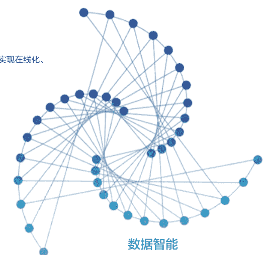

> **核心基因：** 网络协同与数据智能，构成数字经济的双螺旋DNA。

网络协同与数据智能的双轮驱动，为C端与B端带来了极致的精准体验。平台模式以“免费服务换数据沉淀”构建网络协同，数据智能则以算法模型预测需求、主动服务。依托多维实时数据，算法持续迭代，以机器决策替代人工判断，在极短时间内完成快速学习与逼近，实现“所想即所得”的精准触达。

**数字经济的本质**：以数据为关键生产要素，云计算、大数据、AI为核心生产力，通过算力与算法将数据转化为价值的全新经济形态。它继农业、工业经济之后，重构了生产要素与生产关系。数字经济非取代实体，乃反哺实体——用数据智能提升工农业产出效率。

数字经济由“数字产业化”与“产业数字化”双翼构成，**产业数字化才是广阔蓝海**。前者指互联网、软件、通信等信息产业；后者指传统三次产业借力数据智能产生的增量。鉴于传统产业基数远超信息产业，未来“产业数字化”增量必将超越“数字产业化”存量，成为主流增长引擎。

以2016年为例，我国软件业收入约4.9万亿，规上工业主营业务收入115万亿。若AI与大数据融合仅提升工业4%效率，增量即超软件业总规模。故而，**数字技术在实体经济渗透带来的效率红利，将是未来经济增长的主引擎。**

### 数字经济版图构成

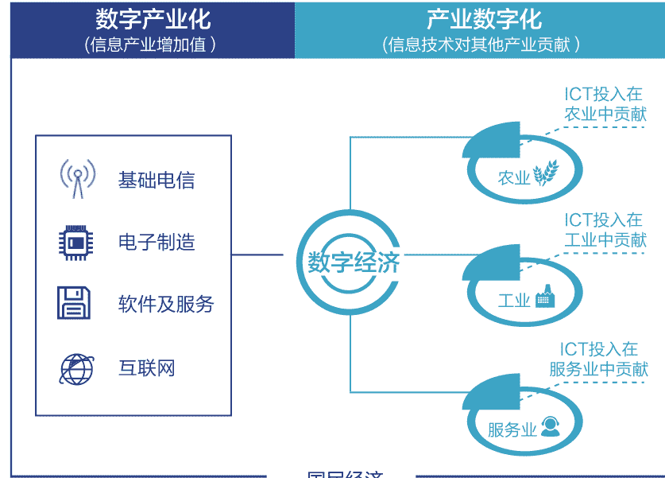

> **视觉洞察：** 产业数字化——数字经济的“蓝海”版图。

当前数字经济仍处萌芽期，全球商业创新案例揭示其四大核心特征：**数据要素化、智能决策化、平台基建化、普惠服务化。**

*   **数据与智能：** 数据是“油”，智能预测是“成品”。移动互联网时代，比特化记录让万物在线、数据实时流动。海量活数据催熟了云计算与AI算法，孕育出“数据智能服务”这一核心产品形态。数据生产资料→智能决策→用户反馈→新数据，形成正向飞轮。
*   **平台特征：** 平台是支持供应链角色自组织协作的数字基座，本质是基于数字设施的“二维生态”。相较传统“一维供应链”，二维平台能自生长、聚合资源、加速创新孵化。
*   **普惠属性：** 无论资讯、搜索还是电商，数字经济以Web/App形态向全阶层无差别开放。C端多免费，B端低门槛——小微企业几美元即可投放广告，偏远青年免费开网店卖货全国。

### 中国企业2020：数字化创新破局之道

中国消费主力正加速向“数字原生代”迁徙。这群18-35岁的成熟新世代，占城镇人口40%（2021年将超46%），即“Z世代”。他们伴随移动互联网、电商、在线服务同频成长，消费行为呈现**实时化、在线化、数字化**特质，并在社交网络中自发聚合成圈层，共创极简、绿色、智能等新消费风尚。

海量消费数据与洞察的涌现，为企业打开了数据时代的机遇之门。企业创新将深度受影响、甚至被数字化与智能化重新定义。适应变局，企业须仗**数据、技术、智能**等新要素取利，靠**创新**筑竞争力。数字科技（云、物、智）正构筑新基建与生产工具，数据价值充分释放。

由此，**数字化创新已成中国企业必答题**。除搭建先进生产力与柔性创新力外，更需“数字化领导力”——以技术为杠杆撬动业务价值。调研显示，数字化创新正在四大维度发力：

#### 1. 产品与服务重塑：从“冷”到“热”
利用数字技术改造存量，赋予传统产品“连接、数据、智能”三大能力；开发原生智能产品，提供定制化服务。  
**案例·天猫精灵：** 2017.8上线至2019.3，销量破千万，连接智能设备超亿台。意味着超2%中国家庭已接入智能生活入口。

#### 2. 客户体验跃迁：极简、秒懂、懂你
优化触点技术创新体验；沉淀行为数据深度洞察需求。  
**案例·支付宝刷脸付：** 2017.9落地杭州肯德基。首刷<10秒，复购<1分钟。重新定义“排队买单”痛点，将支付隐形化。

#### 3. 业务模式与流程重构：让机器跑流程
平台化商业模式成主流，数据技术驱动传统模式迭代。核心不止洞察决策，更在于**塑造新模式**——自动化、少人工、高并发。  
**案例·温德姆酒店集团：** 开发“收入管理机器人”，跨系统（PMS、CRS、数仓）自动监控需求调价。人工从繁琐调价解脱，聚焦市场分析高价值工作。

#### 4. 内部IT焕新：告别“重资产、低人效、高风险”
传统内部IT痛点：平台碎片、重硬件、数据孤岛、人效低、安全隐患、RAS（可靠性、可用性、可维护性）成本高。  
**案例·钉钉赋能西贝莜面村：** 智能移动办公平台+软硬结合终端（智能前台/考勤）。审批全流程电子化、移动端闭环、催签提醒、电子归档合规，实现无纸化办公跨越。

### 数字化创新的底座：基建与关键技术

回望文明史，每次技术革命都深度重塑生产生活。当前数字技术日新月异，数字经济高速增长、广泛渗透，正重塑世界经济动能与治理格局。未来数十年，是数字化创新“改造旧动能、培育新动能”的关键窗口期，**机遇转瞬即逝，先机稍纵即逝。**

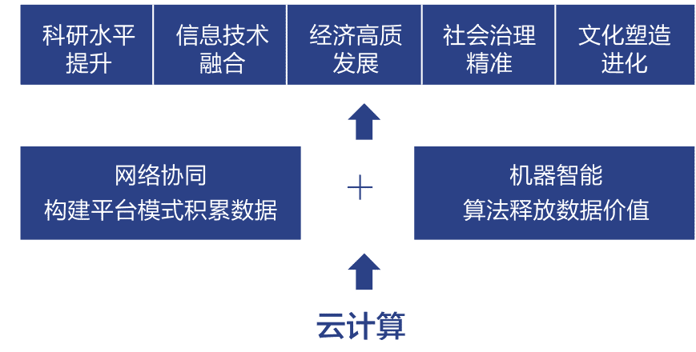

**原创性技术**与**融合性创新**是双引擎。互联网、云、大数据、机器智能、物联网、区块链等原创技术改变信息采集、存储、分析、共享全链路。**产业数字化的融合性创新最为关键**——传统行业借力数字技术融合工艺流程，换来产量与效率的跃升。

| 核心技术栈 | 关键能力 |
| :--- | :--- |
| **大数据** | 海量数据实时获取、存储、计算 |
| **机器智能 (MI)** | 算法替代天量人力，实现海量处理与个性化服务 |
| **云计算** | 数字时代的“电”，按需弹性、即插即用、普惠算力基座 |
| **互联网/移动互联/区块链** | 数据流动的“第五维”，超越时空协作；区块链重构数字生产关系与存证信任 |
| **物联网 (IoT)** | 物理世界数字化入口，万物实时镜像，手机成超级终端 |

> **技术融合图谱：** 物联网、移动互联、云、大数据、AI相互渗透，共筑数字经济创新基建，打通物理世界与赛博空间，催生工业互联、新零售、新金融新价值，并倒逼生物工程、新能源、新材料前沿突破。

*   **物联网——感知神经：** 负责数据采集，建立物理与数字的实时镜像。传感器、摄像头、触屏是末梢神经，智能手机是集大成的超级终端，实现“人”的在线化，行为与体征实时上云。
*   **互联网/移动互联——流动血管：** 让数据成为“第五维”，数据流动替代物质位移，打破时空协作边界。移动互联更实现随时随地交互，是人类协作能力的文明级跃迁。
*   **区块链——信任契约：** 互联网深度演化，重构数字生产关系。核心创新在于“公开透明存证”，解决数据篡改难题。若以社会生产理论类比：数据是劳动对象，算力算法是工具，互联网是流转机制，区块链则清晰定义了数字世界生产关系的三要素。
*   **云计算——算力电网：** 数字时代的“电”。三大特征：按需付费弹性、即插即用便捷、无处不在通用。居“云大智物移”技术底座核心，亦是前沿科技（生物、新能源、新材、医药）突破的关键加速器。
*   **大数据与机器智能——双子引擎：** 大数据管“存算”，机器智能管“决策服务”。**二者一体两面，缺一不可**，共同将数据转化为价值。背后是云计算源源不断的廉价算力支撑。三者合一，构筑数字经济最核心驱动引擎。

> **概念辨析：** “机器智能”常被大众称作“人工智能”。机器智能强调用简模型+大算力解决人类难题；AI更强调模仿人。长期看，**AI只是机器智能的中间态，机器智能上限将超越人类智能模仿层级。**

---

## 第二章 人工智能：数字经济时代的“新生产力”

### AI发展现状：从概念验证到规模化落地

上海临港原生态海滩成“网红”打卡地，但游客常惊见头顶无人机“巡逻执法”。依托潮汐表，无人机提前20分钟出勤，30米高空沿海岸线巡检，**5分钟响应、日飞行100公里+**，效率远超人力。

更硬核的是**机器视觉赋能精细化治理**：识别滞留人员→头顶绕飞实时喊话→紧急自动报警→隐患消除才离场。从“主动发现”到“智能派单”再“处理闭环”，临港已跑通多个标杆案例。

这非孤例。全球范围内，AI渗透已成常态。Statista预测，AI市场将保持**年均50.7%**增速，2025年规模达**369亿美元**。随着图像/人脸识别、语音、工业大脑、预测分析、自动驾驶等能力跃升，零售、医疗、金融、交通、教育、服务、安防、农业等全产业链将被深度渗透。

但产业全景不止于渗透率，AI发展呈现独特且动态演变的**三大现状**：

#### 现状一：投资热度显著降温，告别“PPT融资”泡沫
据中国信通院2019年报告，2018年Q2起全球AI融资降温。2019年Q1全球融资额126亿美元（环比降7.3%），笔数310笔（同比降44.1%）。中国区融资30亿美元，**同比暴跌55.8%**。

资本不再为植入“AI”字眼的PPT买单。现实是：**解决复杂真实问题上，当前AI不比30年前强多少**。定制系统虽能在围棋、问答等窄域制胜，但面对人类复杂矛盾症状的疾病诊断，仍力有不逮。

#### 现状二：商业化变现仍是硬骨头

### AI商业化变现为何仍是“烧钱游戏”？

以明星独角兽DeepMind为例，其2018年营收虽达1.028亿英镑，同比激增近89%，但净亏损却高达4.7亿英镑，较上一年扩大超55%。这并非个案，行业报告直指痛点：2018年约九成AI企业处于亏损泥沟，仅存的盈利者多为技术输出方。这揭示了核心症结——AI尚未跨越“卖算法”到“场景化、整体化落地”的鸿沟。以刷脸支付为例，技术方往往只能分得寥寥几分钱的“调用费”，商业闭环依然遥远。

#### 三、 无监督学习：通往通用智能的“破壁”钥匙

过去十年，监督学习与强化学习驱动了图像识别、自动驾驶及围棋等领域的突破。但这两者本质上都依赖人类预设“标签”或“奖励”，属于“有人带路”的学习范式。这构筑了硬性天花板：模型上限被人工标注成本与数据规模锁死，难以通向通用智能（AGI）。

无监督学习恰似幼儿自由探索世界——无需显式指令，自主从海量未标注数据中捕捉规律。UC Berkeley BAIR实验室的研究印证了其威力：让机器人在无监督下与环境交互，构建因果预测视觉模型，训练后竟能举一反三，操作从未见过的工具完成复杂多对象任务。这预示着未来机器人将具备即兴使用工具、适应新场景的通用智能雏形。

#### 四、 实时强化学习：推荐与决策的“分钟级”进化

实时机器学习概念由Michael I. Jordan等人于2017年正式确立，其中实时强化学习（Real-time RL）正重塑推荐、营销系统。痛点在于：电商大促、新闻热榜内容瞬息万变，传统“十几分钟甚至半小时更新一次模型”的滞后性，导致推荐失准、用户体验受损。

实时RL实现分钟级乃至秒级模型在线更新，用户反馈即时回流，显著提升服务精准度。展望未来，随技术成熟，高收益模型与最优架构将实现全自动生成，无需人工干预。但需清醒认知：当前AI仍处“数据智能”阶段，跨越至“知识智能”、具备常识推理能力，仍是未来数年的核心攻关方向。

#### 五、 边缘AI：把“大脑”下放到终端

英伟达、高通、苹果等巨头与众多初创公司竞相布局边缘端专用芯片，核心逻辑是将推理算力从云端下沉至手机、车载、穿戴设备。本地化处理带来双重红利：极致低延迟的实时响应，与数据不出终端的隐私安全。

应用场景全面开花：监控摄像头本地跑人脸/步态识别实现秒级安防预警；自动驾驶车辆无需联网即可完成紧急避障决策；无人机、婴儿监护仪、工业机器人均获赋“离线视觉”能力。不过，边缘端算力与存储受限是硬伤，未来必将走向“云边协同”混合架构，云端训练大模型、边缘端推理小模型，互补共生。

#### 六、 AI性能指数级跃升：逼近甚至超越人类感知

斯坦福《2018 AI指数报告》揭示惊人增速：ImageNet图像分类训练耗时18个月内从1小时压缩至4分钟，效率暴增16倍；目标分割精度三年飙升72%；机器翻译与语法解析逼近人类水平（虽边际效应递减）。

更震撼的是情感计算突破：MIT媒体实验室实验显示，机器识别真笑与假笑的准确率达92%，显著超越人类表现。但“读懂表情”不等于“懂人心”，要让机器真正具备共情与深度交互能力，仍需心理学、认知科学、人机交互等多学科协同突围。

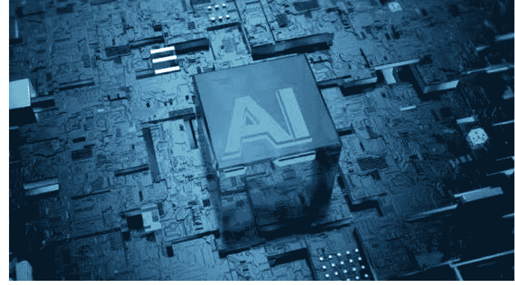

### 基于神经网络的AI算法演进史：从“术数”到深度学习

#### 算法溯源：跨越时空的逻辑基因

“算法”一词源于中世纪波斯学者花拉子米（al-Khwārizmī）拉丁化名“Algoritmi”。其825年巨著《印度数字算术》推动了印度-阿拉伯数字系统在欧亚大陆的普及。早期“algorismus”仅指四则运算法则，实则古今中外皆有“算法”雏形——中国古代“术数/数术”，便是通过观测自然规律与社会振荡的内在关联，以数理模型推演未来、定策略。

现代计算机诞生后，算法定义剥离了模糊的“术/法”概念，明确为：在时空与资源约束下，将问题求解拆解为有限步骤的**高经济性逻辑过程**。它是从复现现象中抽象出的理想化模型，核心追求是“有限资源、最优效率、不失灵活”。

### 神经网络视角下的AI算法关键里程碑

#### 黎明期：感知机——单层神经元的尝试与瓶颈

1950年代，康奈尔实验室Frank Rosenblatt发明**感知机**，首创监督式二元线性分类。首台原型机Mark 1模拟视网膜接收400像素图像，通过电位计调节权重、电机迭代更新，能识别字母、三角形等简单模式。这为单神经元训练、后续深度学习奠基。

但单层感知机只能处理线性可分问题，对异或（XOR）等非线性关系无能为力。1986年，Hinton提出**分布式表示**：每个输入由多特征组合表达，特征间相互联结，神经元从全局相关样本中学习内部表示。为高效训练多层网络实现输入到输出的任意映射，**反向传播算法（BP）**应运而生。

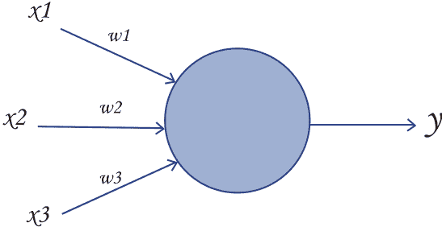

> 图：感知机架构示意

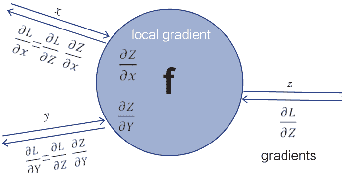

> 图：反向传播原理示意

BP算法虽引爆学术界，却赶上AI第二次寒冬：专家系统（如XCON）因维护成本高昂、PC机兴起而衰退，资本大规模撤离。至90年代，AI以机器学习、模式识别之名“隐形”渗透进万千系统。

#### 拐点：三大引擎点燃第三次浪潮（2006至今）

21世纪初，三大要素重塑格局：**海量数据积累、存储成本暴跌、算力性能指数级跃升**。深度学习凭借模型表现与商用双优势，成为本轮浪潮标志性特征。

学界公认2006年Hinton提出“深度信念网络+贪婪逐层预训练”攻克深层网络训练难题为理论源头；业界视2012年AlexNet在ImageNet大赛将错误率降低10.8个百分点为工业界爆发起点。

**深度学习定位**：机器学习子集，核心是**表征学习**——自动挖掘数据内在表征特征，而非人工设计特征。AI ⊃ 机器学习 ⊃ 表征学习 ⊃ 深度学习。

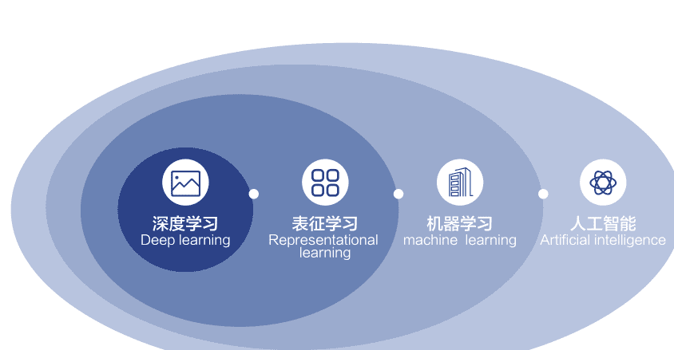

> 图：AI、ML、表征学习、深度学习包含关系

#### 深度学习三大质变特征（2000年后）

1.  **规模跃迁**：层数加深、连接稠密度激增。2015年后神经元连接数达啮齿类水平（10³），总量达蜜蜂级（10⁶），尚远低人类（>10¹¹）。科学家推测按当前增速，本世纪中叶有望达人脑量级。
2.  **训练极速化**：ILSVRC赛事中，模型训练耗时从1小时骤降至4分钟（约15倍提升）。
3.  **精度超人**：图像识别错误率从28%（2010）降至2.3%，2015年后反超人类5%基线。

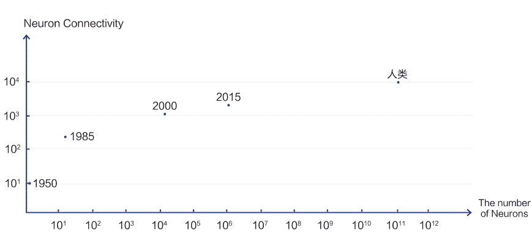

> 图：神经网络规模演进路线图

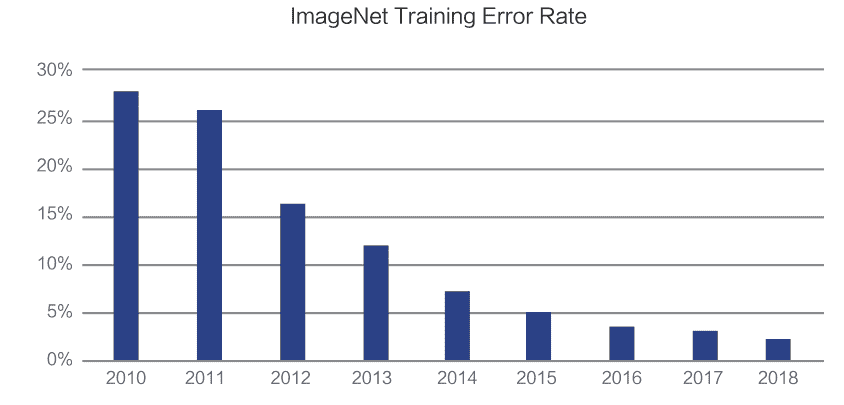

> 图：ILSVRC竞赛错误率下降曲线

深度学习不止重塑计算机视觉，更在语音识别、机器翻译、强化学习等硬核任务中称霸，成为当前AI学术主流。未来看点聚焦：模型上限突破、与垂直领域知识深度融合、拓展新型应用疆域。

### AI算力演进：智能时代的“底座”革命

数据、算法、算力构成AI铁三角。达特茅斯会议60年后的第三次爆发，本质是**算力爆发**倒逼的结果。

1986年Rumelhart、Hinton、Williams重提**BP算法**（反向传播配合梯度下降），为深度神经网络训练提供了数学利器。Google Jeff Dean高度评价：深度神经网络不仅攻克了视觉、语音、NLP长期难题，更重塑了计算机科学乃至几乎所有科学领域的研究范式。算力的每一次跨越，都在重写AI的可能性边界。

# 算力为王，数据为本：解码AI基础设施演进与商业落地新范式

无论是早期的BP算法，还是十年后深蓝击败卡斯帕罗夫的标志性“人机大战”，人工智能发展的脚步始终受制于算力瓶颈。即便到了2006年辛顿正式确立深度学习范式并完成实证，算力短缺依然是业界挥之不去的痛点。

业内不少权威专家指出，在当前的弱人工智能阶段，算力是制约AI发展的核心变量。DeepMind杰出科学家Richard S. Sutton直言不讳：唯有拥抱算力，配合搜索与算法，才能实现技术能力的长期跃升。他批评研究者常陷入“手工注入知识”的短视路径——虽能速成、令当时满意，却长期看会锁死创新上限。真正的突破源于“苦涩教训”：基于海量计算的搜索与学习，才是唯一能随算力无限扩展的通用方法，“这两者才是真正具备任意扩展性的技术路线”。

尽管观点不乏争鸣，但算力的核心地位毋庸置疑。近年，AI算力实现跨越式增长，并呈现出清晰的演进脉络。

#### 01 算力需求井喷，异构计算成主流范式

IDC《2018年中国AI基础架构市场调查报告》显示，当年市场销售额同比暴增132%，达13.18亿美元。OpenAI数据更揭示惊人增速：自2012年起，AI训练算力呈指数级跃升，平均3.43个月翻倍，迄今膨胀30万倍；预计2020年前还将再扩12倍。

面对爆发式需求，如何高效调度、让异构算力协同成为关键。将CPU、GPU、DSP、ASIC、FPGA等差异化计算单元整合为混合系统，各司其职、扬长避短，大幅跃升AI计算效能。

各类芯片在异构构建中特质分明：
*   **CPU/GPU**：生态成熟，开源资源丰富，算法首选落地平台，开发门槛低、周期短。
*   **FPGA**：底层硬件描述语言开发，需深谙芯片特性，但高并行特性常带来数量级性能跃升；动态重构特性使数据中心部署后可按业务灵活切换加速逻辑。
*   **ASIC**：性能天花板最高——面积效率、速度、功耗三优合一；但研发风险极大，需超大规模市场摊薄成本，周期长，难适应CNN等快速迭代算法。

#### 02 GPU稳坐AI算力“主力军”宝座

同期IDC报告显示，2018年GPU服务器销售额同比劲增131.2%，占AI基础设施市场99%份额，绝对统治力未减。

细分看，4卡及以上高密度配置成主流，贡献近8成销售额（80.4%）；16卡机型增速骇人，销售额从2017年2090万美元飙至2018年2.63亿美元，同比狂飙1161.7%，占比从3.7%跃至20.4%。这折射出：数据爆发与模型复杂化倒逼单系统向高密度、高性能进化，深度赋能线下训练场景。推理侧同样亮眼，M4/P4/T4类推理加速卡销售额从4810万美元跃至3.6亿美元，份额从8.5%增至27.6%。

更关键的是，GPU计算正演进为“Non-CPU”架构——剥离CPU依赖，构建纯GPU算力集群，重塑算力供给范式。

#### 03 传统HPC与AI深度融合，催生“先进计算”

Hyperion Research分析师Steve Conway敏锐捕捉到：深度学习正将大批“完全不懂HPC”的组织裹挟入超算领域。

海量数据集（数字社会红利）与强劲算力的合璧，打开了突破口。AI尤其是深度学习极度渴算，随数据增长愈发依赖算力；唯有匹配深度学习特性的先进计算系统（集成GPU算力、框架平台），才能高效训练模型。故而“AI站在先进计算肩膀上行更远”非虚言。

早有先例：90年代初，乔治梅森大学医院即用Cray超算辅助乳腺癌筛查，训练模型识别X光“微钙化”超越人眼。新一代融合传统超算、大数据分析、AI计算的先进计算中心，显然是更强底座。

美规划2021年建成的E级超算“Aurora”即实证：它非传统仅跑计算密集型的超算，更针对数据密集型分析（含深度学习优化）深度定制，是原生支持AI负载的先进计算系统。

#### 06 边缘算力持续进阶，赋能万物智联

物联网边缘侧对实时、高吞吐AI算力渴求剧增。设备需借此即时分析、决策。预计2025年将有1500亿传感器/物联网设备持续吐数据，规模远超智能手机用户产出，市场与算力需求均呈指数级。

希捷工厂实战佐证：部署NVIDIA EGX边缘视觉平台检测磁头质量，边缘推理加速让管理员捕捉肉眼不可见的微小缺陷，预期带来10%制造吞吐提升与300%投资回报率——边缘算力正转化为硬核生产力。

### 数据与AI：共生博弈与破局之道

第三次AI浪潮本质是“大数据+深度学习”：数据越多，深度学习优势越显，尤在算法未成熟的弱AI阶段，海量数据常能破解机器学习难题。

数字化、物联网、移动互联网深化，沉淀海量物理/数字世界数据，为深度学习提供充足样本，驱动智能水位持续跃升。数据稀缺时，复杂网络往往失效。

但数据非取之不竭。虽具可再生性，但AI可用数据昂贵且耗时：深度学习依赖精准标注数据，标注极度耗人力；医疗、教育、公共事务等领域数据更因隐私合规难获取。

数据孤岛、隐私安全、小样本、缺失标注等痛点日益凸显。吴恩达直击要害：“数据多多益善，但农业、制造、医疗等场景手头仅百张图像时，该如何破局？”

“小数据，大智能”成为核心课题，业界已有多路探索。

#### 一、联邦学习：数据不动模型动，隐私合规双全

2016年谷歌首倡，初衷解决Android端侧模型更新难题。核心目标：在保障数据安全、隐私合规前提下，实现多方/多节点高效协同训练。

机制上：用户数据留在本地，云端下发全局模型至随机设备，本地训练更新后仅上传模型参数（梯度），聚合优化全局模型再迭代。全程原始数据不出域，却能达同等训练水平。

本质是将计算下沉至数据持有方，通过加密分布式计算完成协同。同态加密是基石，保障全流程零原始数据传输。虽非绝对“小样本训练”，但盘活了沉睡数据，显著缓解数据饥渴。

#### 二、合成训练数据：以假乱真，低成本造“高价值”数据

实数据难得，便仿造高精度、高可信度的合成数据，精准模拟真实场景与物理规律。

英伟达DRIVE Constellation仿真系统即典范：模拟摄像头、激光雷达等全传感器链路，生成逼真数据流，覆盖昼夜、暴雨暴雪、强眩光等极端稀缺场景，为自动驾驶决策系统提供海量测试样本。

GAN生成对抗网络增强真实数据、真模混合训练扩充数据集多样性，亦是当前主攻方向。

#### 三、迁移学习：触类旁通，借力打力练就泛化模型

“触类旁通”精准诠释迁移学习：将已学相关任务知识迁移至新任务。识别苹果的特征可助识别梨，打破传统“单打独斗、垂直孤岛”模式，实现知识横向流动与复用。

吴恩达2016年NIPS大会预言：迁移学习将成机器学习商业化成功的下一引擎。在缺乏标注数据时，借力相关领域知识，能高效训练出泛化能力更强的模型。

### 云计算：数字经济基座与AI赋能引擎

云计算是数字经济核心基建，亦是AI发展基石。数字经济以数据为要素、云/大/智为生产力、互联网为生产关系，推动数实深度融合创造新值。云计算作为“心脏”，提供普惠算力与存储，驱动产业数字化转型。

近十年，云裹挟AI、大数据、区块链、边缘计算、工业互联网等浪潮席卷各业。艾媒咨询预测2019年中国云市场规模将破4300亿。

**云原生架构完成IT进化升级**：轻量容器、微服务、API协作、DevOps管控，以高效稳定、极速响应助企业构建云上原生应用。新旧架构切换与数字化迫切需求，为云原生落地铺就康庄大道。

**工业互联网平台加速制造数字化**：2017年国务院指导意见确立其新工业革命关键支撑地位。至2020年，政企数字化转型仍是主旋律，产业互联网成创新主战场。云计算如水电煤般成公共基建，公共属性凸显，在变革中扮演关键角色。

**智慧城市进入集中建设爆发期**：阿里云城市大脑为例，经2016-2018深耕，已落地杭州、苏州、上海、衢州、澳门、海南等地，云基建托起城市智能化跃迁。

**云服务三大形态，层层赋能**：
*   **IaaS（基础设施即服务）**：虚拟化交付算力/存储/网络。免机房、免运维、降本增效。阿里“飞天”系统连百万服务器成超算，抗住“双11”洪峰，输出普惠算力。
*   **PaaS（平台即服务）**：提供开发运行环境，缩短周期降成本。阿里云PAI机器学习平台覆盖数据处理到预测全链路，打造“人人用得起”的AI平台。
*   **SaaS（软件即服务）**：浏览器直达应用，极致便捷。Gmail、Salesforce CRM、淘宝商家后台应用、钉钉协同办公均为典范。

---

## 第三章：中国企业2020——AI驱动数字化创新实战

按物理服务器所有权，云分公共云、专有云、混合云。公共云无服务器所有权，即买即用；专有云自建自管；混合云融合两者优势。

长周期看，云演进将似电力发展：专有云如厂内自备电厂仅作备用，公共云如发电厂输送普惠稳价电力。数字经济时代，万物皆需云。刷淘宝、扫码付，皆云服务所及。无云无普惠智能；弃云如工业时代弃电，必陷竞争劣势。

### AI为企业造值的三大核心范式

AI已多点开花，为企业创造实值。2018年10月，菜鸟无锡未来园区上线中国最大机器人仓，边缘计算+AI构建数字化物流园，将人工作业重构为实时在线与自动化。

**安防端**：IoT设备自动核验人员、引导车辆、守护周界消防、甚至捕捉吸烟违规；  
**仓储端**：算法赋能摄像头“会思考”，7×24小时动态扫描库存堆积进出，实时回传调度；  
**作业端**：近3万平米库区内700台AGV“小蓝人”组最大机器人军团，自主避障、自主充电，高密存储容量达普通仓5倍；包裹经智能分拨自动流向华东200+线路。

仓储、运输、车辆、末端、包裹全链路注入AI，倒逼行业技术投入，实现要素数智化，不只极致优化效率、平稳跨过“双11”高峰，更树立AI企业级落地标杆。

随渗透深化，AI以用户画像、知识管理、NLP、机器学习为基座，重塑业务模式、流程、产品应用与结构，加速运营智能化转型，持续释放企业价值。

#### 一、替代重复性低技能劳动

### AI 重塑生产力：七大核心价值深度解析

人工智能落地应用有一条几乎铁律般的规律：它会率先接管那些机械化、单一化、重复性强且无需创意介入的人类劳动。相较于人力，机器天生具备速度更快、精度更高、不知疲倦的特性，尤其难能可贵的是，它不会因劳累导致效能与准确率双双下滑。因此，机器交付的不仅是效率与速度的跃升，更是一种恒久不变的稳定产出水准。放眼现代化工厂，工业机器人与机械臂已大规模填补人工岗位空缺；叠加高阶 AI 算法的“智力加持”，企业的生产效能与质量管控双双迈上新台阶。

#### 二、 孵化数字经济纪元的“新物种”

当 AI 步入“强智能”阶段，甚至萌发类脑智能雏形，人类凭借这项技术孕育出超越自身的“新物种”便具备了理论可能——它们能透彻理解人类逻辑、自主决策、甚至完成觉醒进化并衍生新族群，开启脱离人类的全新文明。虽说这仍是科幻小说的常见设定，在当下技术与伦理的双重框架下尚显遥远，但 AI 在商业维度创造“新物种”（指新品类、新服务、新业态）的能力已是不争事实。

在商业社会图景中，AI 联手云计算、物联网、VR/AR 等技术，拥有打破有形无形壁垒、解放并重组生产要素、催生百业“寒武纪大爆发”的潜能。近几届 WMT 国际机器翻译大赛成绩印证了 AI 翻译已臻高水平，这直接催生了“翻译机”这一新物种：依托“语音识别+机器翻译”软件内核与专属硬件载体，赋予消费者随身即时对话翻译能力，迅速俘获出境游人群青睐，带动翻译机市场规模预计突破 561 亿大关（2020 年预期）。

#### 三、 打破人类认知与生理的天花板

人类凭借卓越的逻辑推演、复杂事务处理与情感洞察，独占地球智慧高地。然而计算机普及以来，在全局统筹、高并发处理、深度逻辑运算及海量精准记忆等维度，人类已落后于现代算力、存储与算法体系。AI 恰能填补这些短板，释放全新生产力。此外，在高危、高复杂作业环境中，AI 更是突破人类极限的主力军。

阿里巴巴“天巡”卫星遥感影像智能解译产品，将深度学习植入遥感解译全流程，实现数据自动化处理：原本需数月的人工周期压缩至数小时，新增建筑识别准确率达 95%。在自然资源部与农业农村部联合推进的“全国大棚房专项整治行动”中，该技术以大棚房监管为切入点，监测准确率高达 90%，展现了跨越人力极限的硬核实力。

#### 四、 盘活沉睡数据资产，重燃业务增长引擎

过去二十年，中国企业普遍完成信息化、电子化转型，沉淀了海量高价值数据资产——营销数据、金融客户画像、投资交易记录、零售消费偏好等。引入 AI 对这些“睡眠数据”进行“激活”，便能挖掘隐性业务价值点、重构流程、洞察真实需求，助力企业超越人工极限，交付更优服务与流程。

众多企业已部署 RPA（机器人流程自动化）工具，让“数字员工”捕获、解析现有应用逻辑，跨系统执行复杂嵌套任务，且无需搭建僵化的系统级接口。实测显示，RPA 能将共享服务运营成本削减 30%-50%；融合 AI 后，自动化边界进一步外拓，覆盖以往难以适配的场景，或显著提升现有机器人产出比。

#### 五、 穿透数据迷雾，精准捕捉隐性关联

AI 依托强悍数学建模能力与极致算力，单次并发处理百万级场景，远超人脑带宽。它能在海量数据编织的复杂拓扑网络中，以惊人速度锚定关键节点，量化最优关联关系。这种认知反演路径，打破了“老专家”经验主义的思维固化，将隐性、碎片化难题显性化、结构化，进而生成新知。

更关键的是，数字世界的试错成本远低于物理世界。AI 宛如“微创手术”，无需重资产投入或业务大动干戈，仅在虚拟环境中微调数据参数，便能快速产出显性收益，且随时可逆。这使得企业能精准匹配供需两端，揭示因人力、认知瓶颈而长期被掩盖的深层逻辑与内在联系。

阿里云工业大脑落地攀钢西昌钒钛转炉炼钢案例便是佐证：打通全流程数据建模，结合专家经验锁定提轧、脱硫、炼钢三大关键工序，聚焦脱硫环节，仿真模型与参数寻优模型输出最优参数组合。实测每吨钢节省 1 公斤铁，按年产 400 万吨测算，年降本超 700 万元。

#### 六、 重构人机交互范式，开启零门槛服务新纪元

得益于深度学习持续演进，AI 在机器视觉、自然语言理解、语音识别三大感知维度已具备逼近人类的“视听语”综合能力。正如 Gartner 成熟度曲线所揭示，多模态接口与 AI 技术进步正深度重塑人机交互版图，释放出汽车、医疗等万亿级增量红利。AI 正成为交互革新的新坐标：交互效率指数级跃升，用户学习成本趋近于零，依赖粘性大幅强化。

#### 七、 赋能决策大脑，从辅助走向智核

AI 提供的智能决策支持，已超越传统 DSS、知识辅助系统或专家系统范畴。它为决策者构建全链路智能中枢——覆盖问题建模、流程仿真、方案推演、多源信息调度与分析工具调用，实质性提升决策质量与水平，让决策从“拍脑袋”转向“算脑袋”。

### 从边缘渗透至核心：中国企业 AI 应用的阶段性跃迁

2017 年《新一代人工智能发展规划》落地，锁定宏观政策红利期；中国公众对互联网新事物的务实包容，在数据隐私与 AI 伦理上展现更大弹性，营造了宽松社会土壤。这些构成了中国企业推动 AI 应用创新的独家优势。

虽早期技术突破不在国内，但回溯移动互联网在中国的野蛮生长史，其爆发速度令西方咋舌。同理，我们有理由预判：行业 AI 从边缘走向核心的全面爆发，极大概率将在中国上演。正处“爆发前夜”的中国，已具备边缘向核心演进的完备条件。

产业架构上，应用层深耕安防、金融、自动驾驶、医疗、电商、教育、制造、家居等垂直场景，消费级硬件聚焦机器人、无人机、智能硬件；技术层覆盖图像/语音/文字识别、计算机视觉、NLP、知识图谱等，底层支撑深度学习与强化学习；基础层则是传感器、AI 芯片等算力与数据设施。除 BAT 外，技术层已涌现大批独角兽，技术底座夯实。

数据层面，过去十年移动互联网积累的海量“活数据”是 AI 崛起的核心燃料。无数据不智能，无迭代不进化。中国拥有近 9 亿网民，日均移动时长超 4 小时，从二维码支付、公共服务到安防、政务、能源、制造垂直领域，全球最高密度的活数据流，为企业 AI 创新提供了取之不尽的“生产资料”。

场景层面，在存量模式触顶、新旧动能转换的关键期，AI 作为关键增量变量，普受企业拥抱。以阿里云为例，三年助力工农服众多企业降本增效，前提正是传统企业敢于试错、信任数据算法能为老树发新芽。杭州城市大脑为救护车智能让行、平均抢回 7 分钟黄金时间；海升集团苹果园精准水肥管理、亩均省 200 元。这些实战场景反哺平台数据沉淀与算法迭代，形成正向飞轮。

技术、数据、场景三大优势叠加，催生了金融、安防、教育、客服、视频、电商、建筑、法律、招聘、传媒等全赛道第一梯队服务商，构筑起庞大应用生态圈。AI 是数字经济核心生产力，应用是唯一出口，企业是中流砥柱。在多维协同演进大势下，中国企业 AI 应用必将从边缘加速渗透核心，迎来全行业爆发期。

## 第四章：中国企业 2020——AI 落地的“第一公里”

### 一、 未来 180 天：锁定三大形态必争产品

基于 AI 产业基础层、技术层、应用层三大形态，本章梳理半年内值得关注的前沿标杆产品，它们代表技术天花板与产业风向标，供企业落地选型参考。

#### AI 专用芯片：算力战争的制高点
作为基础层皇冠上的明珠，是芯片巨头与互联网大厂的必争之地，独角兽云集、资本热捧。英特尔推出代号“Pohoiki Beach”神经拟态系统，集成 64 颗 Loihi 芯片，拥 800 万神经元、80 亿突触，抛弃冯·诺依曼架构，模拟脑式计算。实测运行实时深度学习基准，功耗仅为传统 CPU 的 1/109。英特尔携手 Facebook 共研新型 AI 芯片，专攻“推理”环节——如自动给相册好友打标签，极大提升落地效能。

#### 小样本无监督学习：突破数据标注瓶颈
十年来监督学习与强化学习驱动 NLP、CV、自动驾驶乃至围棋、星际争霸、DOTA 取得突破。但科学界共识：真正的通用智能需具备自主学习能力，未来将高度依赖“小样本无监督学习”，剥离对海量人工标注的依赖。加州大学伯克利 AI 研究院最新成果：利用演示数据与无监督经验，让机器人通过“模仿+交互”掌握工具使用技能。训练后面对未见工具亦能举一反三，甚至无标准工具时即兴替代（如用拖把代扫帚），并更高效完成任务。

#### 通用人工智能（AGI）：通往“全能智能”的远征
AGI 旨在掌握人类可学的一切智力任务，释放“广泛分布的”经济价值。真正的 AGI 将跨越单一领域，通过识别专家无法捕捉的跨学科复杂关联实现降维打击。OpenAI 预测，负责任部署 AGI 有望破解气候、医疗、教育等长期顽疾。其模型在《Dota2》击败 99.4% 玩家并两胜职业战队；最复杂 NLP 模型能生成拟真短篇小说与亚马逊式评论。DeepMind 在游戏、媒体合成、医学领域亦屡获突破。

#### 脑机接口（BCI）：碳基与硅基的融合入口
Neuralink 发布新一代 BCI 系统，演示从实验鼠 1500 电极读取信号；马斯克透露猴子已能意念控制电脑。该领域有望助力人类机能增强，让截瘫患者通过意念驱动机械臂。随着技术演进与脑认知深入，不仅能极大改善疾病与残障，更可能实现碳基生命与硅基智能的深度共生。

#### 自动驾驶：货运先行，车路云网协同成必选
沃尔沃自动驾驶卡车 Vera 已在瑞典港口实战商用，时速 40 公里，固定路线穿越公共路段，由 DFDS 运营。福特三代自动驾驶混动扩大底特律测试，丰田发布两款概念车。货运落地显著快于乘用车（规避复杂人员安全博弈），Vera 试商用预示 2019 年将有更多货运任务交付无人驾驶。未来“车、路、网、云”协同模式为必由之路。

#### 无人机物流：武装到牙齿的“最后一公里”突围者
亚马逊 Prime Air 新版无人机亮相，续航 24 公里、载重 2.26 公斤、30 分钟送达。搭载热成像、深度相机、探测传感器，配合机载算力与 ML 算法自主避障，堪称“满配战机”。虽 2013 年立项，物流法规仍是最大拦路虎，但无人机送货必将重塑航空物流版图与供应链体系。

#### AI + 新材料：算法驱动材料设计范式革命
《美国国家科学院院刊》刊登华人科学家李林鲜团队成果，首次实现 AI 驱动生物材料设计，标志着材料研发从“试错经验”迈入“计算导向”新纪元。

### 研究速览：AI加速水凝胶研发新范式

科研团队借助组合化学手段，短时间内构建了包含两千余种结构迥异水凝胶的庞大文库。通过对上千项拓扑与理化特征参数的量化计算，成功实现了以机器学习模型预测水凝胶成败的突破。这标志着AI在生物材料设计领域的落地生根，证明了材料关键属性及生成机理的可预测性，将显著提升研发效能，并为生物材料创新提供智能导航。

### AI重塑医疗新图景

**谷歌AI突围肺癌筛查**：依托低剂量CT影像，谷歌AI系统在准确率上超越了六位平均从业八年的资深放射科专家，展现出专家级的诊断水准。

**MIT联手MGH破解乳腺癌早筛**：双方合作开发的深度学习模型，能从乳腺X光片中捕捉人眼难辨的隐性特征，预测未来五年发病风险。其31%的准确率大幅领先于传统模型的18%。

**普惠医疗的曙光**：展望未来，AI将深度嵌入医疗服务体系。凭借机器运算的高性价比与高精度，AI有望打破地域与资源壁垒，为欠发达地区及基层诊所注入专业级诊疗能力，让优质医疗真正触手可及。

### 即买即用：成熟AI产品赋能千行百业

历经多年实战磨砺，头部互联网企业内部孵化的AI技术已臻成熟，化作通用化产品模块，支持各行业快速定制专属解决方案。企业可联手软件服务商，基于这些“积木”搭建贴合业务场景的智能应用。以下以阿里云产品矩阵为例，梳理当前主流的成熟AI能力：

#### 一、 智能语音交互：听得懂、说得出、可定制
*   **录音文件识别**：支持长音频转写、短语音（1分钟内）极速转写、实时流式转写（边说边出字）。已深耕呼叫中心质检、庭审记录、病历录入等场景。
*   **语音合成（TTS）**：文字转语音，提供深度音色定制与语言模型自学习工具，助力智能客服、智能家居、有声阅读等落地。

#### 二、 人脸识别：精准验证，多元部署
基于检测、分析、比对核心技术，提供定位、属性识别、1:N/1:1比对等高性能API。广泛适用于人脸登录、VIP识别、闸机通关、AR特效等无感验证场景。

#### 三、 图像识别：读懂视觉内容
依托大数据与深度学习，精准打标数千物体标签、数十常见场景，含场景分类、内容安全等模块。赋能智能相册分类（如风景细分天空/沙滩、人物分类聚餐/运动）、图片检索与安防监控。

#### 四、 以图搜图：拍照即搜，所见即所得
融合深度学习与机器视觉，支持自建图库内同款/相似图检索。电商场景下，用户上传照片即可直达商品，省去关键词描述繁琐，大幅优化购物路径。

#### 五、 内容安全：全媒体智能把关
覆盖图片、视频、文本、音频，智能识别涉黄、涉政、涉恐、涉暴、广告Logo等风险，构建内容生态护城河。

#### 六、 文字识别（OCR）：结构化录入专家
泛卡证、票据、文档及通用文字场景全覆盖，输出结构化数据，告别人工键入。

#### 七、 机器翻译：打破语言壁垒
基于注意力机制的深层神经网络（NMT），依托海量电商语料训练。已渗透SEO、搜索、商品详情、评论翻译、实时沟通、风控等全链路。提供百万字符免费额度与梯度优惠，服务会议、跨境电商、跨语言协作等刚需场景。

#### 八、 机器学习平台PAI：一站式建模工厂
集成数据处理、模型训练、部署预测全流程，三大子产品协同发力：
*   **PAI-Studio**：可视化拖拽建模；
*   **PAI-DSW**：云端交互式代码开发；
*   **PAI-EAS**：模型在线高性能服务部署。

#### 九、 大数据计算服务MaxCompute：PB级数仓，极致性价比
原ODPS，提供全托管计算服务。东润环能实测：对比自建Hadoop集群，总成本大幅下降，开发效率显著跃升，让企业聚焦核心业务而非运维烦恼。

#### 十、 大数据开发治理DataWorks：数据中台底座
One-box集成开发、治理、质控、服务全生命周期，支撑数据中台建设与智能化体验。

#### 十一、 数据可视化DataV：让数据会说话
零代码图形化拖拽，非专业工程师也能产出专业级大屏。杭州城市大脑指挥大屏即由此构建，涵盖交通感知、调度、安防、信控四大场景，实现城市运行一屏尽览。

---

## 第五章 AI行业落地：价值深潜与实战范本

### 零售业：从“场前端”走向“场后端”的智能跃迁

新零售共识已定：以数据与前沿技术武装升级。2017年聚焦消费端体验（盒马新物种、无人货架），如今变革重心下沉至产业链腹地——品牌端与零售端内部。在AI、IoT、云计算、区块链驱动下，重构“消费者关系”与“运营决策”双主线，以微粒化数据为核心生产要素，撬动全链路体验革命。

智能技术配合组织流程再造，重塑企业竞争力三部曲：

**1. 重塑消费者关系：从流量到“留量”的深度运营**
AI构建消费者立体画像，支撑全域触达与精细化运营，双提转化与复购。更关键在于沉淀可识别、可运营的私域用户池，通过深度连接培育忠诚粉丝，实现关系资产化。

**2. 突破运营天花板：从“辅助决策”迈向“自主决策”**
借鉴自动驾驶分级标准：
*   *有条件自动化（现状）*：系统输出建议（如智能补货SKU清单），店长经验校验后下单。
*   *高度自动化（趋势）*：算法迭代+全链路数字化，在明确目标下，局部环节实现无人经验干预的自动决策执行。
*   *全域渗透*：全渠道运营、门店管理、供应链、产销协同等领域，智能化正替代大量人工判断与记录，实现标准化、中心化统筹，提升单店业绩上限。

**3. 颠覆供需关系：柔性制造接棒新零售**
当前端数字化沉淀成熟，细颗粒市场数据经智能分析反哺运营、供应链、制造端，驱动柔性生产与柔性供给。对品牌方而言，研发制造是消费数据触达的“最后一公里”。AI解码数据，实现规模化柔性制造，让“新零售”拥抱“新制造”，完成“人-货-场”彻底重构的闭环。

---

### 鹿班：双11背后的“超级设计师”

2018年央视《机智过人》节目，阿里云智能设计师“鹿班”与人类设计师过招互有胜负，虽未在创意巅峰全胜，却赢得在场专家由衷喝彩。

**战绩亮眼**：2017年日产4000万张海报（峰值8000张/秒）；2018年全年赋能30万+商家，产出1000万+图片。

**四大核心技能包**：
*   **一键生成**：投素材、填文案、选尺寸风格，自动出成品。
*   **设计拓展**：成稿输入，自动适配多规格尺寸。
*   **智能排版**：传图文、定尺寸，随机风格自动排版。
*   **智能创作**：设计师喂入个人风格作品训练模型，沉淀为专属风格模板。

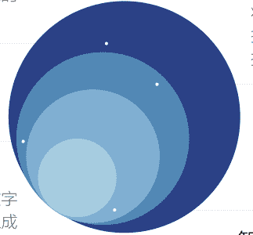

**溢出效应：赋能专业设计公司**
洛可可设计集团引入阿里云AI技术，重塑Logo设计流程。传统流程需检索、比对、优化，耗时1-2周至3-5个月。现借助图像识别，**1秒调取200+参考素材**；后续包装设计、视频关键帧等重复性执行亦由AI分担，设计师聚焦高价值创意决策。

---

### 三维脚型扫描仪：新零售“试穿”黑科技

2018淘宝亲测节现场，两台扫描仪成焦点。市民赤脚站上，瞬间获全维脚型参数（长宽高、足弓、脚宽等），购鞋不再盲目选码。

**技术内核**：阿里机器智能视觉团队联合硬件厂商，核心算法实现全自动脚部三维建模与生理参数精准提取。

**双端价值闭环**：
*   **C端**：淘宝/天猫App基于模型智能推荐合脚鞋款，数据留存账户随时复用。
*   **B端**：精准匹配大幅降低退货率，倒逼品牌方优化楦型设计，推动鞋履产业健康发展。

---

### 正佳广场：百货商场的数字化破局战

面对增量见顶、竞争白热化，正佳广场确立“客流、会员、交易、营销”四维数字化战略，引入阿里云智能技术驱动精细化运营，双追极致体验与营收增量。

**转型实绩**：
*   **客流去重准确率提升50%+**：巡迹平台ReID技术超越传统探针方案。
*   **人群画像立体化**：机器视觉捕捉年龄、性别、动线、停留，精准洞察品牌偏好。
*   **营销千人千面**：线上动态推券、线下黄金位智能投放，有效提升客单价。
*   **招调决策数据化**：流量数字化识别铺位价值，自动预警风险店/挖掘潜力店，提升整场运营效能。

---

### 制造业：迈入机器智能工厂新纪元

**核心图景**：自动化、数字化、智能化三位一体，终局是**机器智能工厂**。机器承接复杂决策与逻辑控制，人类聚焦想象力与创造力，经验显性化为知识喂养机器，形成大规模“脑力协同”。阿里云工业大脑以云算力建模沉淀知识，解决/规避生产难题，并实现知识规模化复用。

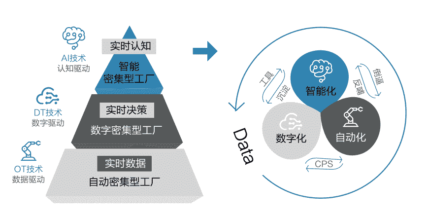

**标杆实证：AI重塑制造关键指标**

| 企业 | 痛点/场景 | AI介入路径 | 核心成果 |
| :--- | :--- | :--- | :--- |
| **天合光能** (光伏龙头) | 电池片A品率提升难 | 采集千参数→深度学习筛30关键参数→建模实时调控 | **A品率提升7%**，增利数千万 |
| **盾安集团** (风电民企) | 风机故障突发、维维护成本高 | 温度全量监测→深度学习构建预测模型 | **提前1-2周预警微小故障**，单次重大维护成本大降 |
| **中策橡胶** (轮胎巨头) | 天然橡胶批次波动大，配方稳定性差 | 多源数据深度运算→优化原料组合与工艺参数 | **混炼胶合格率增3-5个百分点**，达国际水平 |
| **恒逸石化** (化纤大厂) | 高耗能，年煤耗数亿 | 燃烧全流程数据建模→实时预测蒸汽量→推荐最优工艺参数 | **燃煤效率升2.6%**，**单厂年省千万煤耗成本** |
| **正泰新能源** (光伏电站) | 人工目检成本高、效低、漏检 | 5万+缺陷图训练→AI视觉检测接入MES联动机械臂 | **识别准确率>95%**，**瑕疵品率降50%**，**全流程<1秒**（原耗时一半） |
| **京信通信** (通信方案商) | 调测瓶颈：成本占比30-40%，单品>1小时 | 云端打通关键环节数据→算法优化制程能力评估 | **检测点位300→200**，**整体调试效率优化35%** |

---

### 教育行业：AI赋能教学新范式待启

### 联合国教科文组织：AI重塑教育新图景

联合国教科文组织指出，人工智能的变革浪潮已渗透经社会经济各层面，教育领域自然不例外。其发布的《教育中的人工智能：可持续发展的机遇和挑战》工作报告明确指出：AI技术打破了传统教学的物理空间限制，不仅有力保障了教育机会的公平普惠，更极大推动了个性化学习的落地，显著提升了学习成效。

教科文组织总干事阿祖莱强调：“人工智能将引发教育的深度变革。教学工具、学习路径、知识获取渠道及教师培养体系，都将经历一场革命。”

凭借消除资源获取壁垒、实现管理流程自动化、引入多元优化教学手段等优势，AI展现出加速全球教育目标达成的巨大潜力。因而，愈发多的机构与个人投身于利用AI优化教育管理、构建智能学习平台（LMS）及开发垂直应用，旨在探索能助力教师、化解教育难题的个性化学习新范式。

除了推动城乡义务教育均衡发展、赋能民办与乡村教育提质增效，AI还能催生创新教学模式。通过在教、管、资建设全链路渗透，实现教育资源配置的最优解，弥合教育鸿沟。此外，国内“全面二孩”政策催生的学龄人口新增长期，也成为驱动AI在教育场景深度应用的关键外部动力。

经对中小学、高等教育及职业教育等多元形态的系统调研，AI在教育领域的落地主要集中于以下五大维度：

#### 01 重构数智化多元评价体系

传统教育以“分数”为唯一导向，学生长期处于“被灌输、被塑造”的客体位置，而非“以学习者为中心”的主体地位，甚至可以说教育的核心主体异化为了“成绩”本身。这一困局的成因，与教育从业者、管理者构建的体系架构、评价导向及关注焦点高度相关。引入AI，可助力构建数字化、智能化的新型评价机制，让学习过程、系统环境、评价标准与学生实现更自然、顺畅、全维度的交互，从而客观量化学习成效，为精准个性化教学落地夯实基础。

#### 02 绘制现代教育知识图谱与教学体系

近年来，以项目式学习（PBL）为核心的STEAM教育蓬勃发展，其跨学科融合特质与我国素质教育不谋而合，均致力于培养复合型人才。然而，随着学科壁垒打破、知识系统交叉加深，传统按年龄/年级线性推进的教学编排已显乏力。知识图谱本质上是大规模语义网络，是教学体系构建的基石。AI能助力教育者深度挖掘学科间隐性关联，构建精准、动态、深度链接的知识图谱，乃至模拟认知规律的“第二大脑”。

#### 03 化身AI教师与智能助教

在英语学习类应用中，AI教师已部分替代人工，承担发音纠正、词汇记忆、水平测评等任务。未来，AI将以“主讲教师”或“教学助理”双重身份全面进场：一方面，接管教师繁琐的事务性工作，腾出精力聚焦学生个性化指导与深度沟通；另一方面，基于学习计划、轨迹、优劣势及偏好绘制学习者全息画像，辅助教师制定差异化教学策略。此外，课堂互动、实验演示、兴趣拓展、能力训练等环节，AI均能成为教师的得力副驾。

#### 04 融合新一代信息技术，筑牢智慧平安校园

通过云计算、大数据、物联网、VR/AR等技术的深度融合，AI赋能校园向“智慧”与“安全”双向进阶：一是构建7×24小时全域感知的安防监控、预警、处置闭环，大幅提升校园本质安全水平；二是为师生提供智慧化的学习生活服务，显著增强便利性与获得感。从宿舍管控、课堂教学、门禁通行，到消费支付、轨迹分析、身心健康监测（体感感知），AI全方位提升校园治理现代化水平。

#### 05 创新服务体系与管理范式，践行“以人为本”

传统教育服务聚焦“资源管控”而非“数字服务”，导致供需错位、响应滞后；校园管理虽覆盖人财物事全链条，却常忽视人的核心价值。AI通过精准画像洞察需求、深度认知业务逻辑并实现流程智能化重组，助力学校重塑服务体系，达成服务供给与需求“零时差”对接，真正落实以人为本的管理理念。

---

#### 标杆案例：浙江大学——依托课程云与AI，开创新型智慧教育范式

浙大以课程云平台为底座，结合智慧教室硬件设施，引入AI技术，将同声传译能力转化为实时多语种无障碍教学系统；对智慧教室闲置的音视频资源实施标签化治理与非结构化统一存储，结合教学科研大数据算法，打造“千人千面”的智慧教学实践体验。

**学习者视角：** 以就业、学习、能力发展为维度，串联第一课堂、第二课堂、创新创业实习至就业的全链路，利用AI将学生音视频资源转化为可视化知识图谱，生成立体能力画像。无论从哪个切口切入，均能强化学生在个性化智慧教育体系下的综合素养跃升。

**教师视角：** 从课堂关联度、科研成果展示、知识点萃取等维度，运用AI构建教师全息知识图谱，推动教学理念从“以人为本”进阶为“以内容为本”，精准赋能教学质量提升。结合校友网关系网络分析，深化师生、师师关联洞察，为个性化教育提供强效支撑。

综上，浙大智慧教育实践以AI为底层驱动，通过教学质量诊断、教法分析、全生命周期“人物时光机”等应用，成功实现范式跃迁：打破传统“教师中心、资源集中、个性化受限”桎梏，转向“学生中心、资源自选、方法迁移、全周期赋能、就业导向”的新型智慧教育模式。（案例来源：阿里云合作伙伴华栖云）

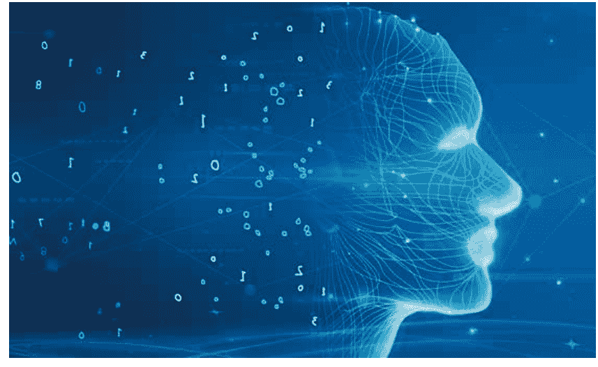

### 人工智能赋能传媒业：数据重构价值链

#### 数智微粒化，重塑受众深度连接

受众在内容消费与媒介接触中留下的海量行为数据，折射出其习惯偏好与心理诉求。传媒机构亟需部署“智能触角”——涵盖移动App、智能机顶盒、互联网电视等数字终端——以触达并采集这些关键数据。在未来竞争中，以智能数字化手段建立受众立体认知，进而实现全域触达与内容精细化运营，已成必然选择。智能数字化工具能高效助力企业构建可识别、可运营的用户资产池，建立深度链接，沉淀忠诚粉丝群，完成受众关系的彻底重构。

| 维度 | 传统运营痛点 | 数智微粒化解构后的新图景 |
| :--- | :--- | :--- |
| **受众画像** | 粗放、颗粒度大、固化于性别/年龄/地域等少数维度 | 细腻、多维、构建受众心智画像 |
| **受众认知** | 广电网络：制播分离、广播模式、缺乏认知；电视台：依赖粗抽样调研，不懂消费逻辑 | 微粒化架构、微粒社群；全方位立体认知；洞察消费逻辑、关系流转、时间动线 |
| **受众触达** | 电视/开机/广告/海报投放，效果不可评估 | App/社群/媒体全域触达；恰时+投其所好+适宜营销=高收视 |
| **精细运营** | 用户数据源自后台地址/银行卡，缺乏沉淀 | 精准识别真实用户；精准推送+反馈收集；微粒社群时空穿梭+适时促销+共享裂变=高忠诚 |

*图：基于数据微粒化解构的受众关系重构模型*
*数据来源：ACRC分析*

#### 案例深度：优酷《微微一笑很倾城》——数据洞察造就百亿爆款

早在数年前，优酷通过舆情监测便发现原著小说《微微一笑很倾城》长期保持高热度。2016年8月剧集杀青登陆卫视首播、收视攀升之际，优酷果断低成本买断网播版权。初期仅定级为A级剧集，但随着播放数据（点击、播放、关注）超预期释放，优酷即刻启动深度用户分析，精准锁定核心受众为29岁以下年轻女学生及白领，且与平台高价值重度用户高度重合。

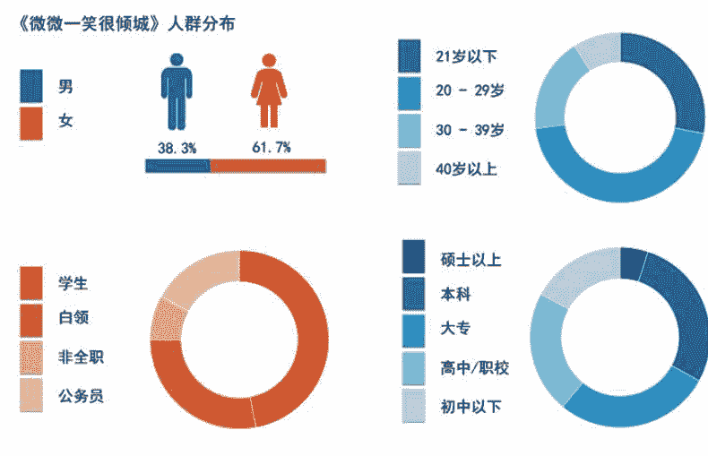

*图：优酷基于用户数据优化内容分发策略*

基于用户分群与收视数据的强匹配，优酷预判后续流量仍将爆发，火速将剧集升级为S级，倾斜宣发资源，最终缔造“10天破60亿播放”的现象级IP。其核心逻辑在于：基于受众收视偏好与用户数据关联的深度洞察，动态调整内容触达策略与资源投放。该剧第二季筹备中，内容设计亦深度参考首季用户反馈数据。

#### 案例：央视CCTV5客户端——阿里视频云+CDN支撑体育新媒体标杆

面对行业变局，央视主动求变。2016年6月，CCTV5 App上线，将拥有顶级赛事独家版权的王牌频道与移动互联网融合，以新媒体形态切入体育赛事，拓新用户、贴近年轻群体。

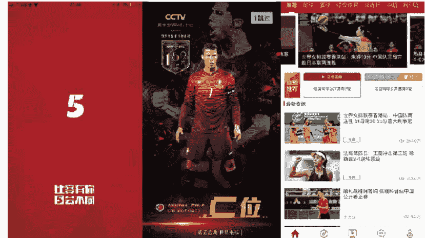

*图：基于视频云与CDN的CCTV5客户端深受年轻群体喜爱*

2016年欧洲杯、里约奥运会、2018年世界杯等大赛期间，手机端直播极大便利观众，赛事集锦点播更成亮点。视频直播App对并发与稳定性要求极高，传统IT架构难以支撑，必须借力公有云与CDN。央视选用阿里视频云与CDN（全球1500+加速节点、120T带宽、国内节点最多），为高并发直播提供坚实底座。项目从启动到上线不足4个月，至2018年弹性算力与带宽峰值扩容6倍以上，稳健承接世界杯级流量洪峰。

#### 创新：世界杯AI自动剪辑——效率跃升10倍，抢占发布先机

俄罗斯世界杯期间，亿万球迷聚焦赛后集锦。CCTV5客户端打破传统，全程采用AI自动化剪辑替代人工。传统流程耗时30分钟以上，AI仅需**3分钟**即可生成成片并上线，效率提升**10倍**，大幅增强客户端用户粘活与播放量，锁定传播首发优势。

基于达摩院技术积淀，阿里巴巴为CCTV5定制多模态视频+音频AI剪辑方案，融合计算机视觉、音频理解、机器学习与体育赛事知识，从数字化剪辑、体验、竞技、传播四维推动世界杯直播与剪辑的数智化升级。

*图：AI剪辑成果获广大球迷用户高度认可*

实战验证显示：AI生成集锦在片段选择合理性、音视频完整度、剪辑精准度、整体观感上均获用户高度好评。AI不仅释放人力、保障时效，更催生新价值——双方联合打造央视新媒体广告平台，接入阿里营销引擎，实现统一投放、人群定向、精准触达，广告与内容互不干扰，开创精准营销新范式，广受广告主好评。

#### 创新：优酷“高清经典”专区——AI视频画质重生，让老片焕新颜

融媒发展与怀旧情怀驱动经典老剧回看热潮，但受限于当年拍摄存储条件，画质普遍低劣，严重影响体验。人工修复成本高昂（动辄千万级），仅惠及极少内容。海量老旧视频面临黑白色调、色偏、噪点、扫描线、重影、低分辨率、台标广告等复杂画质顽疾，单靠人力无法破局。

2018年优酷启动“经典影剧修复计划”，引入AI视频画质重生技术：通过海量样本训练，实现画质迁移，批量自动化完成去噪、去模糊、去划痕、去闪烁等修复动作，大幅提升画面比例与分辨率，且成本效率双优于人工，让海量库存内容“画质重生、换发第二春”。

上线“高清经典”专区精准匹配观影需求。截至2019年5月底，优酷已修复100余部剧集（4000+集）及20余部影片。算法将单部经典电影4K修复周期从传统工作室的“数十至数百天”压缩至**1小时**，实现质的飞跃。

### 人工智能重塑金融业：从前端体验到后端决策的全渗透

数据、算法、算力三驾马车驱动AI迎来第三次浪潮。计算机视觉、NLP、语音识别等核心技术成熟落地，在金融领域掀起深度变革。

**前端：重构交互界面，降本增效。**
AI首当其冲重塑客户端：服务侧大幅压降交互成本，客户侧创造全新体验与极致效率。数据智能通过智能化处理，精准感知客户需求、身份、行为（构建精准画像），输出智能服务（如智能客服）提升满意度。曾吞噬银保巨额成本的呼叫中心，将因AI坐席规模化替代而发生革命性重构，人力得以解放、成本大幅收敛。

**后端：三阶跃迁，释放核心价值。**

#### 1.0 阶段：流程智能化——攻克“复杂、僵化、人机不友好”
金融业为合规控险、权责清晰，构建了极其繁复的传统流程体系。随数字经济演进，动态、简洁、柔性的流程成生存关键。AI率先切入流程层：改变人机协作模式（如节点建议、风险预判），推动流程智能化、自动化、无人化（少人化），实现增效降本。

#### 2.0 阶段：客户洞察智能化——从“粗放分群”到“千人千面”
极致体验源于深度洞察。但数据维度爆发（引入非结构化、社交等非金融数据）、标签体系精细化（单用户百级标签、百个社群），传统分析手段彻底失效。
AI双重赋能：
1. **自动化提效：** 覆盖数据获取、分析、归类、定位全链路，快速产出智能洞察，精准识别新客潜需、老客隐患，转化为“千人千面”产品推荐与功能排布（如手银首页个性化磁贴）。
2. **自发现创造：** 借助深度学习、强化学习、对抗网络，挖掘数据隐含规律与深层关联，**自主发现**新画像、新用法规律、新体验痛点，超越人工建模上限。

#### 3.0 阶段：产品与服务智能化——业务原生智能
国内智能投顾爆发已验证AI在产品端的商业威力。虽属初级赋能，却完成了市场教育。3.0阶段，AI将深度嵌入具体业务单元：
*   **风控反欺诈：** 实时强化/深度学习赋能交易级实时风控、反欺诈、动态高强度认证。
*   **智能营销：** 自动生成营销方案、产品组合、文案创意与设计。
*   **全链路渗透：** 未来从获客、反欺诈、风控到催收，AI将无处不在。这不仅优化体验，更是规避人为劣势与错误、显著增强业务能力与效率的关键，在征信、风控、投顾、营销、服务等核心域实现充分渗透。

---

#### 标杆价值：AI为车险行业节省百亿级成本

车险报案查勘定损流程长、环节多、主体杂：查勘员现场勘查、定损员评估（现场/照片）、资料收集、损失确认、方案制定、赔付核定。该环节耗时占整体理赔周期**85.84%**，导致2017年平均出险支付周期仅压降**6.69%**。AI技术的引入（如图像识别自动定损、智能核损模型），可大幅压缩环节耗时，实现理赔提速与成本收敛的双重突破，为行业节省数十亿级运营成本。

### AI定损宝：化解车险理赔“痛点”，释放百亿级价值

车险报案流程繁琐只是导致理赔周期长的表象之一。深层矛盾在于供需失衡：2017年常规结案量突破5500万件，全国查勘定损员却不足10万人且逐年减少。这群疲于奔命的从业者，常年错峰进餐、日均工作超11小时，还得时刻警惕精心设局的保险欺诈。数据显示，超六成理赔案件仅为“小剐小蹭”式的外观损伤，高薪定损员被迫“大材小用”；按单均150元成本测算，行业每年为此耗资数十亿元。

定损宝的使命直指此痛点：压缩数十亿运营成本，让定损专家聚焦高赔付、高风险的复杂案件及反欺诈核心工作。

依托AI技术，定损宝仅凭定损员或车主拍摄的影像资料，结合维修方案与后台配件价格库，即可秒级输出赔付金额。全流程机器化作业，效率与标准化程度远超人工，且在轻微损伤识别上精度已逼近人工水平。其技术护城河极深：融合海量理赔案例机器学习、数字处理、目标检测、损失程度判定至多模态决策，看似一键出结果，实则凝聚了从感知到认知的完整技术链。

截至目前，定损宝已成全球首个落地车险领域的AI图像定损商业化产品。服务太平、大地、阳光、安盛天平等头部险企，调用量破千万次，累计释放定损工时75万小时，为行业节省理赔成本超20亿元。

### “数据跑腿”重塑船政服务：让“最多跑一次”驶入水上

刘雨扣、张爱萍夫妇在京杭大运河漂泊13载，最头疼的莫过于每年金秋的船舶年审。内河船舶涉证繁多——检验、登记、营运、国籍、配员、经营许可、核验，整整7本证书，需跑遍多个部门。年审期间船只停航，每少跑一趟货便损失数百元收入。

2018年7月，“最多跑一次”改革延伸至水上。借力云计算与AI，浙江打通数据壁垒，杭州市港航管理局全国首创“多证合一、多检合一”。7本证书合为一本《内河船舶管理信息簿》，厚度由20余页压缩至2页，附赠一枚“电子身份证”二维码。扫码即得船舶全维信息，云端流转的数据替船户跑了腿，让营运监管双高效。

### “农业大脑”种出20°甜度阎良瓜：传统农业的数字化跃迁

百年甜瓜产区阎良，借阿里云“农业大脑”实现种植全链路数字化。从育苗、移栽到开花结果，浇水、施肥、授粉、缠蔓等农事操作，瓜农仅需遵循手机端的科学标准化手册执行，免去靠天吃饭、凭经验判断、盲目用激素的旧俗。

阿里云智慧农业算法工程师童鸿翔透露：农业大脑可调度智能设备精准水肥，记录日照、施肥全链路数据，配合“瓜脸识别”技术精准把控采收节点。普通甜瓜甜度常在13°-16°，AI赋能下均值冲破20°大关。目前示范种植面积已达2600亩。

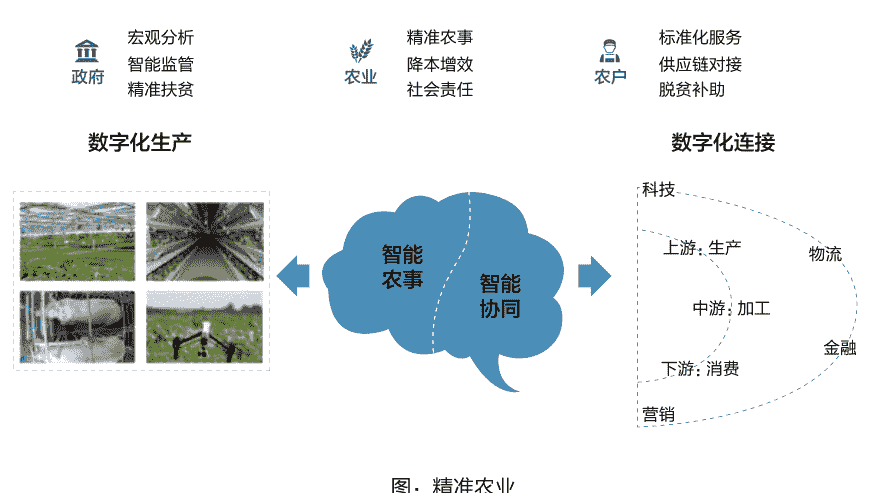

**四大引擎驱动智慧农业升级**

**01 数据智能赋能精准农业**  
基于阿里巴巴对消费偏好的深度洞察，融合数据智能与精准农事，助力企业全程监测作物生长、精细化管控病虫害，实现增产提质。

**02 销售渠道下沉助力精准扶贫**  
搭建特色农产品直达通道，借智能技术与现代供应链培育新增长极，推动“一县一品”产业升级，精准帮扶、精准脱贫。

**03 互联网生态激活创业致富**  
构建种植知识库，指导果农科学决策；依托阿里金融、营销、物流体系，让农民从“勤劳致农”进阶“科学致富、跨越发展”。

**04 区块链溯源筑牢食品安全防线**  
精细化管理杜绝农药化肥滥用，区块链技术贯穿全链路溯源，让消费者“买得放心，吃得安心”。

### 城市大脑让杭州交通“长出大脑”：从管空间到治时空

杭州城市大脑·交通构建“情、指、勤”一体化AI中枢，集信号灯优化、智能巡检、实时指挥于一体，推动交管从单一空间管理迈向时空综合治理，从交警单兵作战转向社会共治，从定性经验走向定量科学，加速治理体系现代化。

**实战成果斐然：**  
- 优化1300个路口信号灯，覆盖主城四分之一路网；萧山试点路段通行速度提升11%，主城区视频报警准确率超95%。
- 苏州工业园区未增车前提下，AI优化线路使高峰客流分别激增17%与10%。
- 吉隆坡引入实时视频算法实现救护车优先调度，到院时间压缩近49%。

**核心应用矩阵：**  
**AI信号灯：** 融合动静态数据实时评估路口效率，告别“凭感觉调灯”，精准锁定拥堵根因，动态配时全城联动。实测中河-上塘高架通行时间降15.3%，萧山自动配时路段均速提15%、耗时减3分钟。  
**智能事件发现：** 挖掘海量球机视频价值，算法自动识别路面事件并精准推送最近警力。试点“视频巡检替代人工”，日均报警500+，准确率超92%。  
**应急车辆优先通行：** “一键护航”集调度、规划、控灯于一体。杭州萧山实测救护车到达时间减半，救援环节压缩7分钟以上，为生命争取50%更多希望。

### 第六章 中国企业2020：AI应用的隐忧与破局

#### 安全博弈：AI既是盾亦是矛

AI已大规模赋能千万级应用，驱动生产力跃升。但伴随普及而来的，是社会效应与安全风险的双重拷问。过去十年漏洞频发、数据泄露常态化，阿里云日均拦截30亿网络攻击、2000次DDoS，仅2018上半年Web攻击拦截超五千亿次，攻击规模与日俱增。云计算、IoT、5G拓宽攻击面，网络安全成全数字化企业命门。

传统边界防御失效，黑客更将AI武器化：鱼叉钓鱼锁定社交账号，发送速率为人工6倍，成功率翻倍；恶意代码生成分发全流程智能化自动化。对抗样本成典型威胁——微小扰动致模型误判，如噪声干扰下熊猫被识为长臂猿（置信度99.3%）。逃避攻击“瞒天过海”绕过检测，模仿攻击“以假乱真”窃取权限。当前无通用有效防御架构，攻防进入深水区。

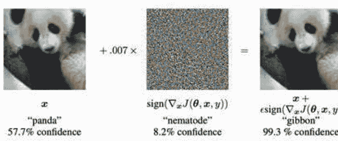

**AI反制：以魔法打败魔法**  
Capgemini 2019年调研850名高管显示：近7成认可AI在防御核心作用，超半数用AI诊断漏洞，80%电信企业高度依赖AI识别威胁。AI介入使诊断成本可控，响应提速12%。

阿里云安全团队将前沿算法实战化：2018年推出基于深度学习的WAF（Web应用防火墙）。海量查询数据训练神经网络，双引擎（正则+深度学习）架构大幅提升攻击者逆向分析难度，自主进化规避人为误操作。部署后准确率从99.99%跃升至99.999%，在亿级日攻击量下，千分位突破即质变。

#### 隐性浪费：产业狂飙背后的“四大漏斗”

中国AI核心产业将破4000亿、带动万亿规模，高速增长下暗藏可避免的浪费：

1.  **算力空转：** 企业热衷自建算力平台，因负载不饱和、调优乏力导致资源闲置。
2.  **数据孤岛：** 共享机制与交易市场不成熟，制约模型训练上限。
3.  **能力割裂：** 成熟技术（如CV）仍陷“点对点”交付，未形成“开发者-云平台-客户”生态闭环，价值未充分释放。
4.  **人才错位：** 学科教学缺乏交叉融合，造就“懂算法不懂业务、懂业务不懂算法”的断层，AI人才退化为纯计算机人才。

**破局之道：**

*   **上云用云，激活算力：** 公共云按需付费、资源共享特性，天然释放边际成本红利，以更低成本获取弹性算力，杜绝重复建设与闲置。
*   **平台思维，流通能力：** 云平台统一数据与技术标准，将AI能力包装为优易用、强适用的公共服务，加速业务落地，开发者收益更丰厚。
*   **共享机制，盘活数据：** 尽管小样本学习探索不止，数据仍是核心产要素。亟需建立可信、可用、合规的数据共享平台，兼顾安全与脱敏。
*   **跨学科育人，对齐人才：** MIT斥资10亿设立“苏世民计算学院”，以“双学科学者”培养模式打通“AI+专业”壁垒，成行业共识。

#### 伦理治理：从阿西莫夫三定律到全球共识

技术伦理讨论由来已久。阿西莫夫1942年设“机器人三定律”，四十年后增“零定律”护人类整体利益，要求植入底层逻辑不可篡改。今日AI伦理探讨内核未变：如何确保技术向善慎用、避免误滥用、明确责任归属、体现包容可解释性。

但关注度空前高涨，缘于三点：
1.  **渗透深广：** 本白皮书证言，AI已以高速、高并行渗透零售、教育、金融、制造、传媒、农业等全谱系。
2.  **类人超人：** 从未有技术初期即冲击人类工作版图，AlphaGo双胜人类顶尖棋手令替代焦虑具象化。
3.  **迭代指数级：** AlphaGo Zero不依赖人类棋谱，自博弈数日超越前代，展现远超人类的进化速度。

中国已密集输出治理主张：从《新一代AI发展规划》（2017）到《AI标准化白皮书》（2018）再到《北京共识》（2019），并成立中人工智能学会伦理专委会等组织，构建治理生态。

# 【深度】AI不失控，治理有九则：从李飞飞的一句话读懂技术向善的底层逻辑

斯坦福大学终身教授、前谷歌云首席科学家李飞飞曾直言不讳：“无论技术自动化程度如何攀升，它对世界造成的影响——褒贬皆在——归根结底都是人类的责任。”这精准点出了人工智能伦理的核心内涵：AI的道德底色、操守与价值观，本质上是其创造者与使用者的延伸。任何关于AI伦理的探讨与规范，都不能脱离人类社会的伦理坐标系。

当下，推动AI伦理建设的终极旨趣，是让机器智能更深层次地映射人类智慧，赋能人类变得更强，而非取代人类，确保技术演进始终在正确轨道上造福人类。

立足中国企业的AI落地实战，融汇“阿西洛马AI原则”、“IEEE《自主智能系统伦理设计》”、“人工智能北京共识”等国际主流共识，我们提炼出以下九条通用治理准则，为构建可信AI提供行动指南：

### 1. 透明性原则：拒绝“黑箱”，拥抱“可解释”
透明不等于强制开源代码或数据。核心诉求是**可解释性、可验证性、可预测性**。用户有权知晓决策背后的逻辑链条与因果关系，必要时可引入专家介入解读，打破算法“黑箱”带来的信任危机。

### 2. 分层分级原则：拒绝“一刀切”，实施“差异化”
AI能力天差地别，人脸识别与人脸检测在技术门槛与应用风险上截然不同。治理须建立**分级标准**：依据能力水平（如识别精度）与功能属性设定差异化规范，参照自动驾驶L0-L5分级逻辑，精准施策，避免过度监管扼杀创新或监管缺位酿成风险。

### 3. 福祉性原则：技术向善，底线思维
AI发展必须锚定**人类及生态系统的共同福祉**。在社会落地层面，坚决杜绝对公民身心造成损害、引发经济损失或不良社会影响的场景，重点攻克算法偏见与数据歧视等顽疾，让技术红利普惠大众而非加剧分层。

### 4. 开放性实验原则：搭建“沙箱”，小步快跑
设立**受控实验区/示范区**，在安全边界内开展范围限定、能力可控的创新验证。推行“实验验证→效果评估→社会开放”的分级释放机制，让成熟技术加速惠及大众，将试错成本降至最低。

### 5. 行业区隔性原则：定制“专属规则”，防止“误伤全局”
不同赛道特性迥异，**制定行业专属伦理准则**，既能充分释放AI在垂直领域的应用价值，又能避免因个别高风险行业的特殊限制而波及全行业，导致通用技术红利错失。

### 6. “行为”治理优先原则：盯住“人与事”，而非过早“卡算法”
治理重心应置于**AI行为及商业行为本身**，以及背后具有主观意图的创造者/使用者身上。在技术演进主通道上保持克制，遵循基本商业与社会规范，避免对算法底层进行过度深度干预导致创新停滞。

### 7. 包容性原则：宽容试错，静待成熟
第三次AI浪潮仍处上升期，技术远未成熟。**早期监管难、成熟期规范易**。当下应保持必要包容性，为探索预留试错空间，防止“破窗效应”扼杀幼芽期的创新活力。

### 8. 公共数据开放原则：打破“数据孤岛”，治愈“算法歧视”
数据稀缺是算法歧视的温床，单一企业难以独享海量公共数据。**推动公共数据授权开放**（医疗等高潜力领域优先），在严守隐私底线前提下扩大研究者数据获取权限，是提升AI能力上限、修正偏见的关键钥匙。

### 9. 多层对话机制：打破壁垒，共治共享
- **全球对话**：搭建**产学研政多方共议平台**，通过广泛、深度、精准的对话凝聚全球治理共识，应对无国界的技术伦理挑战。
- **企业深度对话**：客观承认**科技企业是当前AI创新的主力军**——市场驱动与技术溢出使其能力领先、迭代快、场景验证深。与头部企业建立深度对话渠道，不是选择题，而是治理有效性的必答题。

---

### 参考文献
1. Pasquinelli M. Three Thousand Years of Algorithmic Rituals. 2009  
2. Rosenblatt F. The Perceptron. 1958  
3. Hinton et al. Distributed Representation. 1986  
4. Rumelhart, Hinton, Williams. Learning representations by back-propagating errors. 1986  
5. Goodfellow, I. Deep Learning. 2016  
6. BBC. AI: 15 key moments in the story of AI. 2019  
7. Lighthill Report: Artificial Intelligence: a paper symposium  
8. BBC. 人工智能70年：科幻与现实的交融. 2019  
9. Bengio, et.al. Greedy layer-wise pre-training. 2006  
10. AlexNet. Wikipedia  
11. AI Index 2018 Annual Report  
12. 网络气象台，阿里云安全报告. 2018  
13. Reinventing Cybersecurity with Artificial Intelligence. 2019  
14. Szegedy et al. Intriguing properties of neural networks. 2014  
15. Goodfellow et al. Explaining and Harnessing Adversarial Example. 2014  
16. 肖剑. 智能时代的传媒变革与发展. 2018  
17. 王岳. 人机边界重构. 2018  
18. 中国信通院. 2018世界人工智能产业蓝皮书  
19. 中国信通院. 全球人工智能产业数据报告. 2019  

### 特别鸣谢（排名不分先后）
感谢以下专家对本文观点形成给予的深度支持与实战案例分享：
- **郭继军** 阿里巴巴集团副总裁
- **王岳** 阿里云研究院高级战略专家
- **谢宣松** 达摩院机器智能实验室技术总监
- **徐鑫** 达摩院人工智能中心高级产品经理
- **施江敏** 蚂蚁金服人工智能部运营专家
- **雷鸣** 达摩院机器智能语音实验室资深算法专家
- **肖剑** 阿里云研究院高级战略专家
- **乐晓磊** 阿里云战略拓展部上海区总监
- **王巍** 达摩院机器智能实验室高级产品专家
- **褚崴** 蚂蚁金服人工智能部研究员
- **李威** 达摩院机器智能语音实验室资深算法专家