# 深度学习：中科大智能技术丛书研究生教材

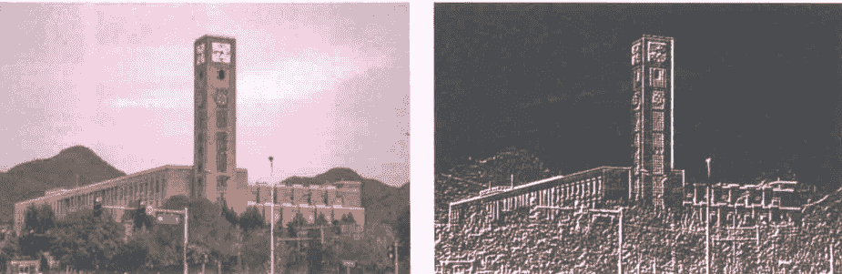
### 图 2-5 Sobel算子梯度可视化

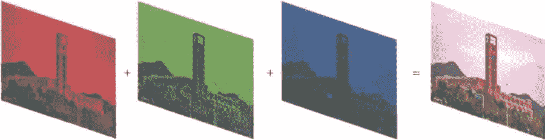
### 图 2-9 RGB图像通道示意

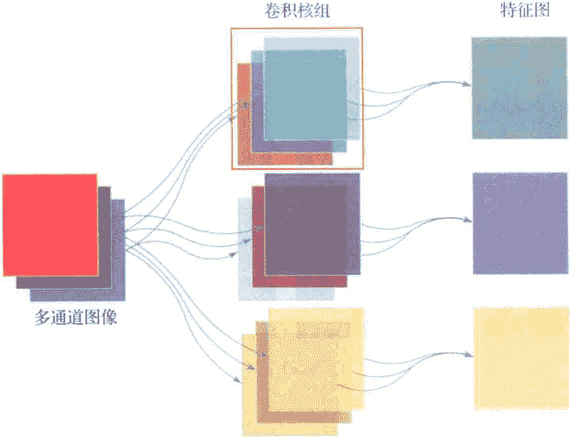
### 图 2-11 多通道与多卷积核卷积演示

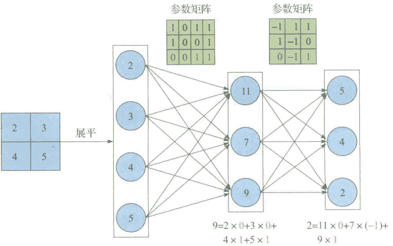
### 图 2-19 全连接层架构例解

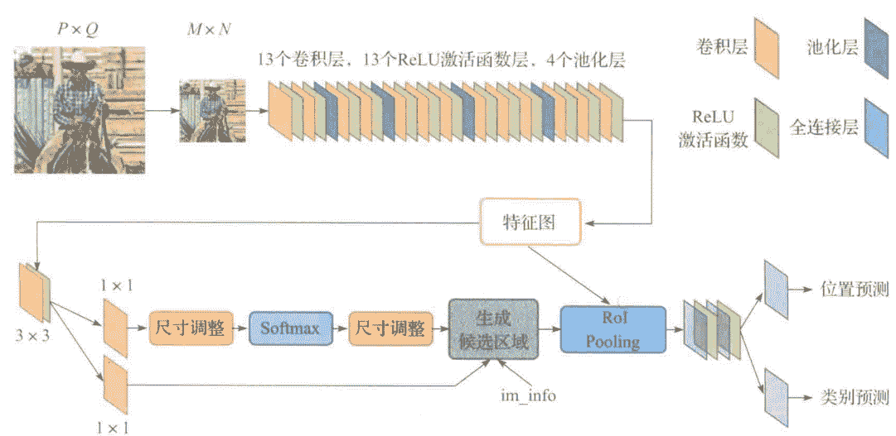
### 图 2-42 Faster R-CNN架构剖析

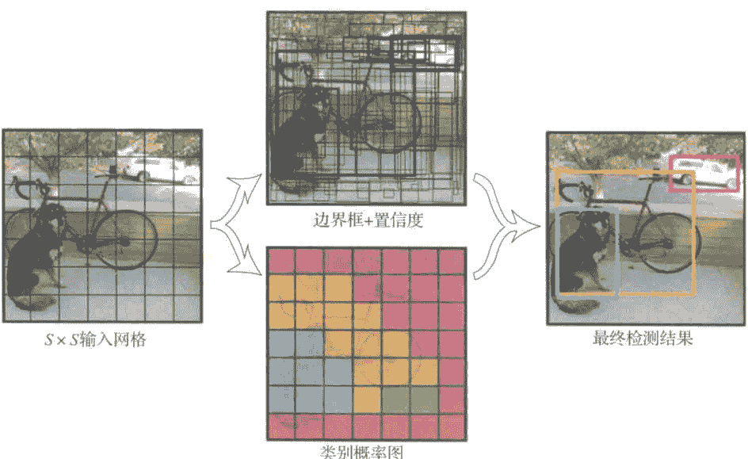
### 图 2-45 YOLO模型架构[15]

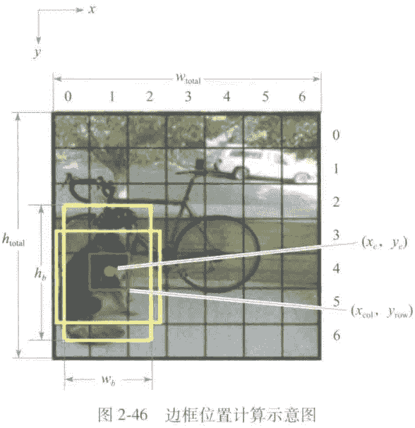
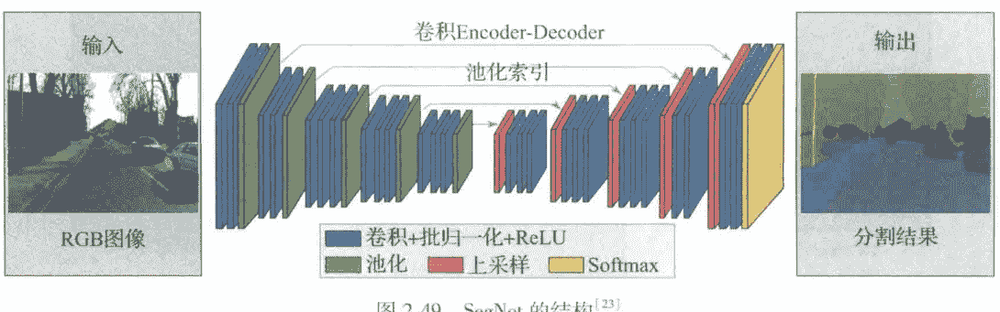
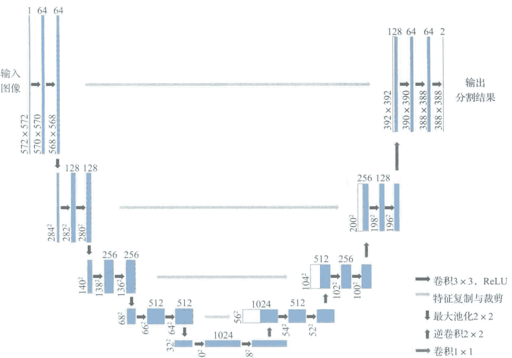
### 图 2-50 UNet架构详解

### 初始阶段

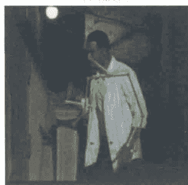
### 级联回归：第2阶段

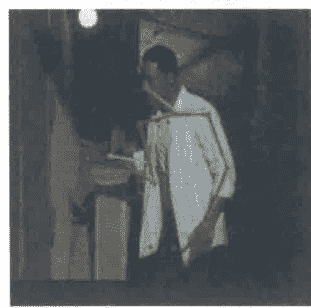
### 级联回归：第3阶段

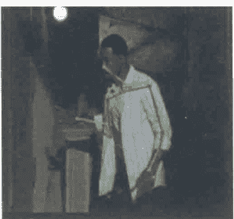
### 图 2-54 DeepPose级联输出机制

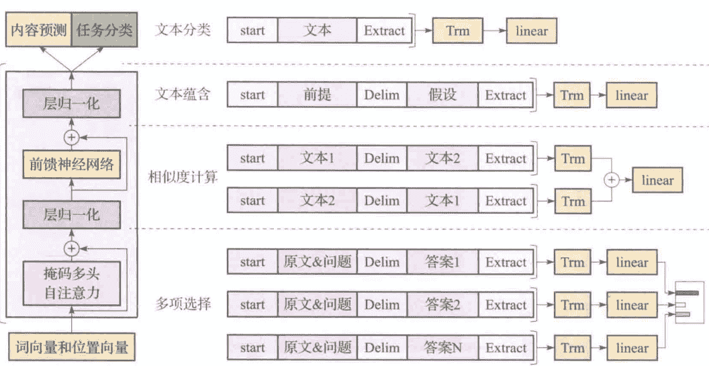
### 图 4-13 GPT-1内部架构

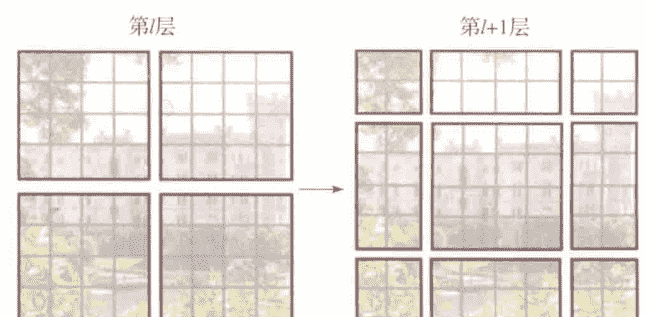
### 图 4-23 滑动窗口机制演示[17]

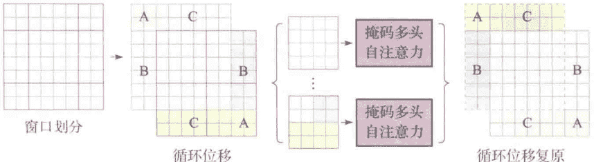
### 图 4-24 滑动窗口批次计算策略[17]

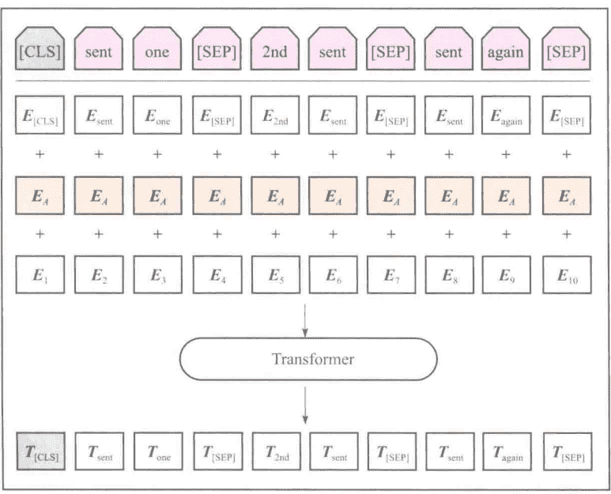
a) 原始BERT

### 图 4-27 原始BERT与BERTSum架构对照

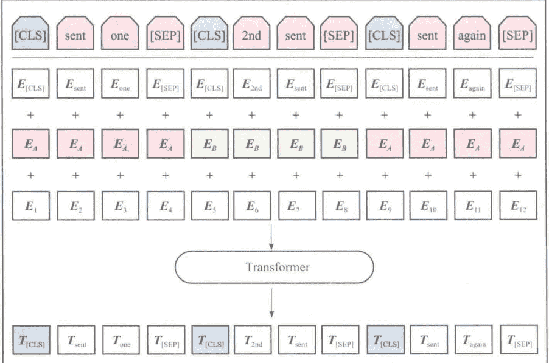
### 图 4-27 原始BERT与BERTSum架构对照（续）

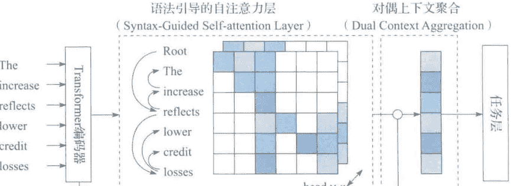
### 图 4-28 SG-Net架构

### 图 4-36 PureT整体框架

该图解析了 PureT 模型的整体框架，核心模块与数据流向如下：

- **输入端**：
  - 图像分辨率 384×384×3。
  - 经 Swin Transformer 编码，输出特征图 12×12×1536。

- **双分支特征提取**：
  - 左侧分支：网络特征 (12×12×512) 经线性层映射得 $v_c^g$。
  - 右侧分支：全局特征 (1×512) 经均值池化聚合得 $v_c$。

- **增强编码器**：
  - 标注“参数共享”机制。
  - 内置掩码操作、自注意力模块 7、多头交替块 8 等单元。

- **解码器**：
  - 接收前序词元序列 $x_1, x_2, ..., x_{l-1}$。
  - 预测后续词元序列 $x_2, x_3, ..., x_l$。
  - 包含掩码、多头交替块 8、自注意力 7 等组件。

- **预测融合模块**：
  - 输入 $X_1^l$。
  - 流程涵盖向量内积、ReLU 激活、多头交替块 8、再次内积。
  - 输出融合表征 $X_1^{pl}$。

- **输出端**：
  - 由线性层与 Softmax 层组成，给出最终预测分布。

### 图 5-8 LAPGAN架构

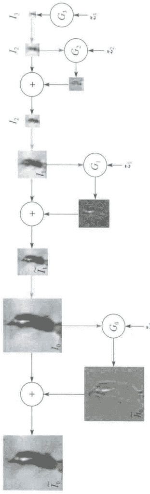
### 阶段 I 判别器 D0
下采样 | 128 512 4 | {0, 1} | 压缩与空间复制

### 阶段 II 判别器 D
下采样 | 128 512 4 | {0, 1} | 压缩与空间复制

### 阶段 I 生成器 G0
上采样 | Z~N(0, I)

### 阶段 II 生成器 G
上采样 | 残差块

### 条件增强
c_tilde_0 | mu_0 sigma_0 | epsilon ~ N(0, I)

### 文本描述 I
This bird is grey with white in its chest and has a very short beak

### 阶段 I 结果
[Image]

### 条件增强

### 图 5-9 StackGAN架构

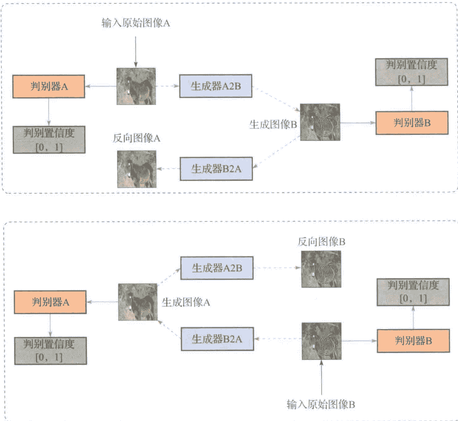
### 图 5-12 CycleGAN架构

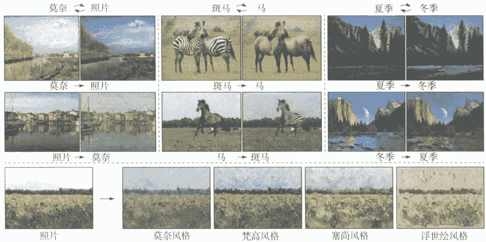
### 图 5-13 图像域迁移案例[13]

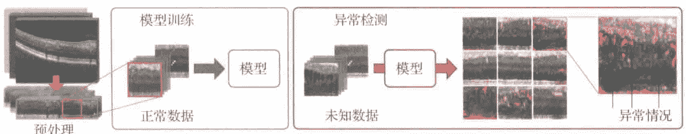
### 图 5-25 AnoGAN异常检测流程[19]

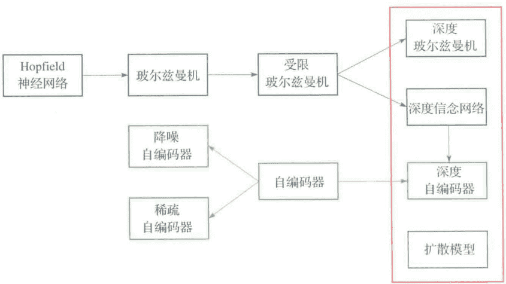
### 图 6-1 深度生成模型谱系

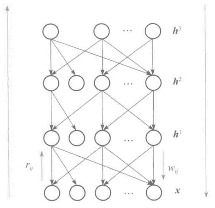
### 图 6-5 Sigmoid信念网络

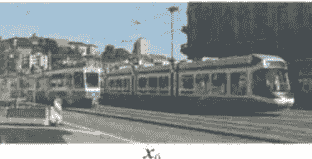
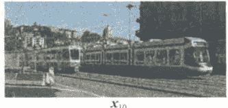
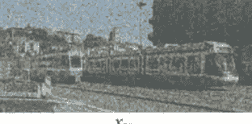
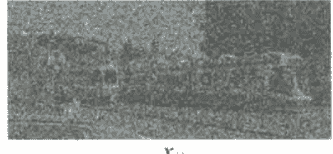
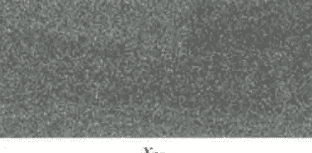
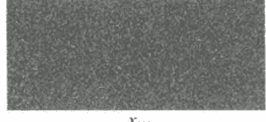
### 图 6-16 DDPM前向扩散演示 (T=100, β: 0.0001→0.1)

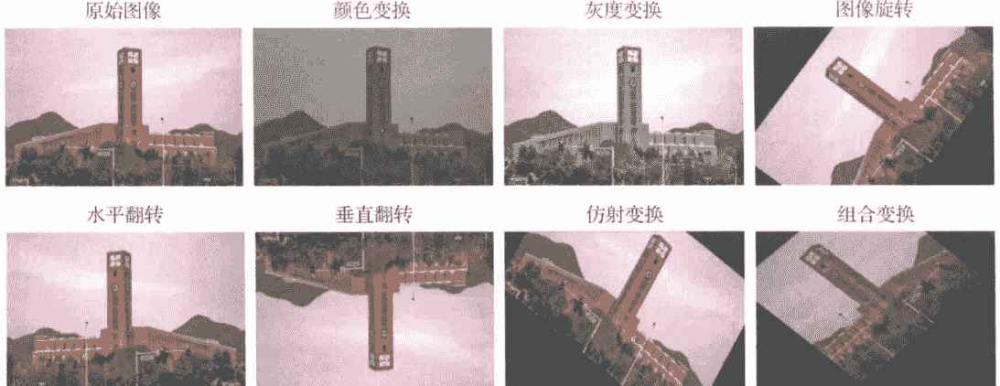
### 图 7-8 图像数据增强演示

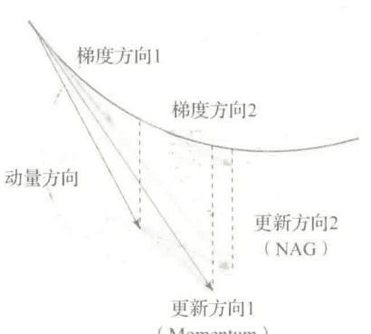
### 图 7-16 动量法与NAG更新策略对比

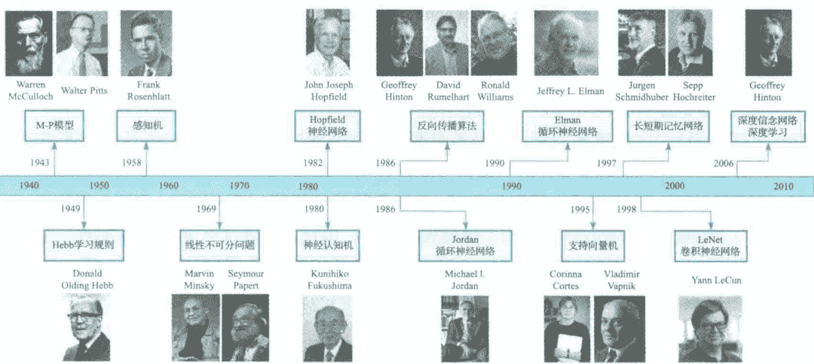
图 1-1 深度学习源流图

## 序言：八十载智能跃迁见证

追溯至 1943 年 M-P 神经元模型问世，人工智能已走过八十个春秋。纵观发展脉络，AI 的每一次范式跃升都与人工神经网络的命运紧密绑定，历经数轮“寒冬”与“盛夏”更迭：早期神经网络蓬勃二十载，却因 1969 年 Minsky 与 Papert 严谨证明感知机无法攻克“异或”等线性不可分难题而陷入低谷；1986 年 Rumelhart 等人重塑反向传播算法，打破线性壁垒，令神经网络重焕生机；1995 年 Cortes 等人推出的支持向量机凭借高效性能再度将神经网络推至边缘；直至 2006 年 Hinton 抛出“深度学习”概念，在视觉、语音、NLP 等领域连续突围，引燃新一轮爆发；2023 年大型语言模型横空出世，AI 正式迈入全新纪元，引发全球对未来的无限遐想。近十年来，深度学习无疑是学术界与产业界聚光灯下的绝对主角。

作为长期深耕 AI 领域的研究者，我有几点体会愿与诸君共勉。

**首先，深度学习崛起，传统机器学习是否退场？** 现实并非如此。深度学习确实攻克了大量传统方法难以企及的高维非线性难题，但在结构化数据分析处理上，传统机器学习凭借更高的效率与更优的效果，依然稳坐主力军宝座，二者各有擅长，互补共存。

**其次，以深度学习为代表的统计学习范式，真的是“万能钥匙”吗？** 并非全能。其高度依赖海量标注数据、训练成本高昂且“黑盒”特性导致可解释性不足。对于逻辑规则明确、可建模为数学方程的问题，无需借助统计学习；唯有面对规律未知、难以用显式方程描述的复杂场景，深度学习才展现出不可替代的价值。

**最后，大模型浪潮下，小模型研究是否失去意义？** 眼下小模型研究确受冲击，不少观点认为“大模型能解决的，小模型无需染指”。但这或许高估了大模型的泛化上限。大模型架构本质上并不复杂，并非包打天下；在特定约束、低资源或强实时性场景下，小模型依有独特优势，其研究依然必要且迫切。

谨以此序，推荐徐俊刚教授的这部力作。徐教授 2018 春在国科大首开“深度学习”课，选课人数屡创新高，课程获评校级优秀研究生课程。他长期耕耘大数据与 AI 前沿，科教融合成果丰硕，直抵课堂一线。愿本书出版，为我国 AI 人才培养添薪续火，助推学术与产业双轮驱动。

黄庆明  
中国科学院大学  
2023 年 12 月于北京

## 前言：从课堂讲义到案头必备

以 ChatGPT 为代表的大型语言模型横空出世，掀起了继互联网之后信息技术史上的又一座里程碑。它们均立足于 Transformer 架构，而 Transformer 本质上是深度学习模型，这足证深度学习在 AI 版图中的基石地位。从计算机视觉、语音识别到自然语言处理，深度学习斩获无数突破性成果，早已渗透进国计民生：人脸核验、语音交互、机器翻译、智能问答、工业瑕疵检测……应用版图仍在疯狂外拓，AIGC 内容生成、蛋白质折叠预测、新材料研发、精准天气预报乃至数学猜想发现等前沿阵地，均已见硕果。

2018 春，我在国科大首讲“深度学习”，首届学员超 400 人。彼时市面缺乏系统配套教材，为备好课，我投入海量精力撰写讲义、打磨课件，所幸研究方向契合，文献积累厚实，仍广泛涉猎最新文献补齐短板。出版教材的念头由来已久，直至学校正式立项方付诸行动。此间感谢教务处田晨晨老师、计算机学院杨林春老师的鼎力相助，亦感谢机械工业出版社的专业支撑。

本书定位高等院校教材，旨在助读者构建“原理—技术—实践”完整知识体系。全书 8 章，章间相对独立，阅读教学均可打破顺序：第 1 章勾勒全景；第 2-5 章为核心主干，深度剖析 CNN、RNN、Transformer 与 GAN；第 6 章梳理典型生成模型与热门扩散模型；第 7 章聚焦正则化与优化实战技巧；第 8 章实战对比 TensorFlow、PyTorch、PaddlePaddle 三大主流框架。附录补齐数学基础与中英术语对照。

每章配套复习题巩固要点，第 2-7 章更增设实验题，主张“唯实践出真知”，便于教师选配上机教学。另设“本章人物”专栏，追溯领军科学家风采，厚植学科历史底蕴。受限于技术迭代飞速，书中难免有疏漏与滞后，期待再版持续迭代，更盼广大读者不吝赐教。

成书离不开教学团队张新锋、林姝、万方三位老师的协作，感谢 CCIP 实验室李鹏飞、李帅敏、景琨、王义宇、刘淼、李科尧、向迅之、王迪、陈旭、邱柏瑜、夏琦等同门倾力支持。北交大于剑教授通读全稿并予精修建议，致以谢意。书中大量引用学术文献与网络资源，亦向原作者致敬。

笔力有限，疏漏在所难免，恳请读者批评指正，我将第一时间修订完善。

徐俊刚  
中国科学院大学  
2024 年 4 月于北京

## 常用数学符号对照表

| 符号 | 含义 |
|---|---|
| m,n,i,j,k | 标量，通常表示自然数 |
| a,b | 标量，通常表示常量 |
| x,y,z | 标量，通常表示变量 |
| \(\boldsymbol{x}, \boldsymbol{y}, \boldsymbol{z}\) | 向量 |
| \(X,Y,Z\) | 变量集合 |
| \(\mathbf{A}\) | 矩阵 |
| \(\mathbf{I}, \mathbf{I}_n\) | 单位矩阵，\(n\times n\) 的单位矩阵 |
| \(\text{rank}(\mathbf{A})\) | 矩阵的秩 |
| \(\mathbf{A}^{-1}\) | 矩阵的逆 |
| \(\text{tr}(\mathbf{A})\) | 矩阵的迹 |
| \(\mathbf{A}^{\text{T}}\) | 矩阵的转置 |
| \(|\mathbf{A}|\) | 矩阵对应的行列式 |
| \(\|\mathbf{A}\|_f\) | 矩阵的 Frobenius 范数 |
| \(\text{diag}(\cdot)\) | 对角矩阵 |
| \(\mathbf{A} \in \mathbb{R}^{m\times n}\) | 大小为 \(m\times n\) 的实数矩阵 |
| \(\mathbf{T}\) | 张量 |
| \(\mathcal{D}\) | 数据集 |
| \(E(\cdot)\) | 期望 |
| \(\text{Var}(\cdot)\) | 方差 |
| \(H(\cdot)\) | 熵 |
| \(\|\cdot\|_p\) | L_p 范数 |
| \(N(\mu, \sigma^2)\) | 均值为 \(\mu\)、方差为 \(\sigma^2\) 的正态分布 |
| \(L(\theta)\) | 似然函数 |
| \(f * g\) | 卷积运算 |
| \(\lfloor \cdot \rfloor\) | 向下取整 |
| \(\log(\cdot)\) | 以 2 为底的对数函数 |
| \(\exp(\cdot)\) 或 \(e(\cdot)\) | 以自然常数 \(e\) 为底的自然指数函数 |
| \(\text{sign}(\cdot)\) | 符号函数 |

## 引言：深度学习演进脉络溯源

### 1.1 深度学习渊源与演进

#### 1.1.1 奠基之作与早期探索

“深度学习” 一词由多伦多大学 Geoffrey Hinton 教授团队于 2006 年正式提出，他因此被誉为“深度学习之父”。然其渊源远不止于此，与人工神经网络（ANN）同根同源，脉络可上溯至更早纪元（见图 1-1）。

**1943 年**，神经学家 Warren McCulloch 与数学家 Walter Pitts 联手推出 M-P 神经元模型，模拟生物神经元结构与运作机理，为人工神经网络奠基立柱。

**1949 年**，生理心理学家 Donald Olding Hebb 惠布学习规则，揭示神经元间反复激发将强化连接权重、反之减弱的可塑性机制，确立了神经网络学习算法的基石逻辑。

**1958 年**，心理学家 Frank Rosenblatt 构建两层神经元网络——感知机，模拟大脑分层处理，采用 Hebb 规则或最小二乘法训练参数，迈出工程化关键一步。

**1969 年**，Marvin Minsky 与 Seymour Papert 严谨证明感知机仅能处理线性可分任务，对“异或”等线性不可分问题无能为力，这一结论直接引发神经网络研究首次寒冬。

### 1.1.2 深度学习：从萌芽到爆发的进化史

2006 年，深度学习概念正式确立，随即在学术与工业双界掀起研究热潮。短短数载，该领域迸发出惊人势能，一批奠基性算法接踵而至（详见下文时间轴）。

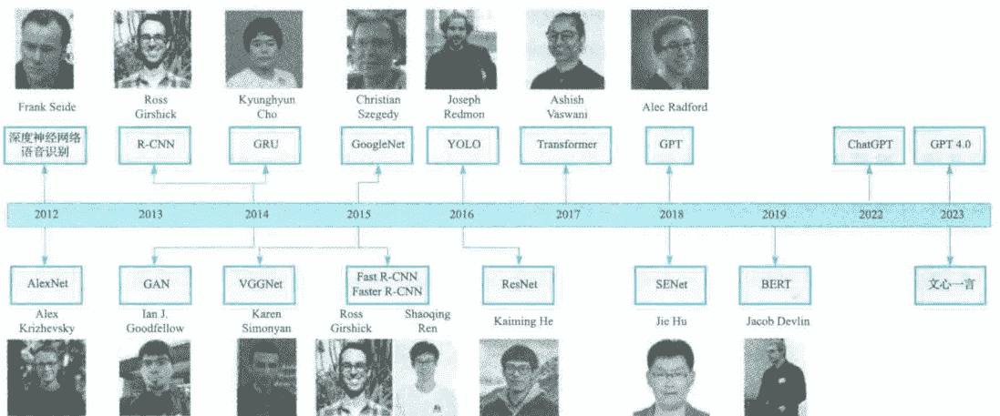

**图 1-2 深度学习发展关键节点**

**2012 年：语音与视觉的“双子星”突破**
这一年堪称分水岭。Frank Seide 团队引入深度神经网络攻克语音识别，较传统 GMM-HMM 体系将错误率压降 20%~30%，实现质变。同年，Alex Krizhevsky 等人推出 AlexNet，创性引入 ReLU 激活函数并借力 GPU 加速，在 ImageNet 大赛上将误识率从 26% 斩至 15%，加冕冠军，让卷积神经网络（CNN）名声大噪。

**后 ImageNet 时代：模型架构的军备竞赛**
随后几届赛事中，VGG-Net、GoogleNet、ResNet、SENet 等经典架构迭代登场，错误率持续下探。至 2017 年，SENet 将该指标推至 2.25% 逼近天花板，促使 ImageNet 分类赛自 2018 年起谢幕。

**目标检测：从两阶段走向端到端**
2014 年起，R-CNN 系列（Fast/Faster R-CNN）大幅提升检测精度，但受限于“特征提取 + 分类回归”两阶段流程，训练效率成瓶颈。2016 年，YOLO 横空出世，以端到端单阶段架构极大提速训练与推理；虽早期精度略逊两阶段法，但后续版本快速迭代至 v8，在兼顾高效的同时精度持续攀升。

**生成式模型：GAN 的零和博弈美学**
2014 年，博士生 Ian J. Goodfellow 提出生成对抗网络（GAN）。凭借免海量标注即可训练的特性，GAN 迅速引燃学界，在图像生成、风格迁移、修复重建等任务中大放异彩。

**NLP 领域：从循环到注意力的范式迁徙**
视觉侧 CNN 称霸之时，自然语言处理阵营里，LSTM、GRU 等 RNN 变体在语言建模、机器翻译上深耕细作。真正的拐点源于 2017 年 Google 推出的 Transformer——其自注意力机制打破循环结构的串行瓶颈，实现并行高效计算。随之而来的 BERT、GPT 等预训练大模型，横扫十余项 NLP 基准榜单，重塑领域版图。

**大模型元年：通用人工智能的曙光**
2022 年底至 2023 年，ChatGPT、GPT-4 相继问世，将大型通用语言模型推向前所未有高度，被誉为信息技术里程碑。国内百度“文心一言”领跑，清华、复旦、华为、阿里、科大讯飞等巨头接力入场，开启大型中文语言模型新纪元。

当下，深度学习仍是 AI 领域当之无愧的 C 位话题，科研与应用双线开花：理论端聚焦 AIGC、多模态融合、深度强化学习；落地端已在安防、医疗、金融、智造、自动驾驶等赛道斩获丰硕成果。

---

### 1.2 三者关系：层层递进的包含体系

深度学习、机器学习、人工智能三者呈同心圆嵌套关系（如图 1-3）：机器学习是 AI 的核心子集，深度学习则是机器学习的一个关键分支。

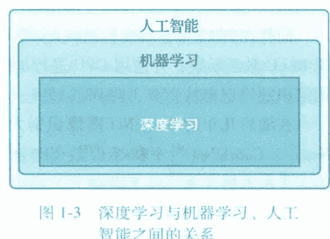

#### 1.2.1 人工智能：模拟与延展人类智能的学科
1956 年达特茅斯会议首提“Artificial Intelligence”，确立该学科元年。核心使命：用机器模仿、拓展人类智能。按任务维度常分三级：
- **计算智能**：会算会析 —— 已成熟落地；
- **感知智能**：能看会听、能说会认 —— 基本实现；
- **认知智能**：会理解、会思考 —— 正在攻关中。

AI 技术栈涵盖搜索、知识表示推理、机器学习、感知决策控制等，详情可参阅《高级人工智能》《人工智能》等经典教材。

#### 1.2.2 机器学习：赋予机器“举一反三”的学习力
本质是让机器从既知数据中挖掘规律，推演未知。如以历史气象数据训练模型预测未来天气。按监督信号强弱分三类：

| 学习范式 | 核心隐喻 | 四字诀 | 典型算法 |
| :--- | :--- | :--- | :--- |
| **有监督学习** | 学生刷题对答案，师评指导 | **跟学师评** | 线性/多项式回归、决策树、随机森林、KNN、逻辑回归、贝叶斯、SVM |
| **无监督学习** | 学生自学总结，按内在规律评价 | **自学标评** | K-Means、PCA、关联分析 |
| **弱监督学习** | 老师仅给奖励信号或部分答案 | **少导强行** | 强化学习、半监督学习、多示例学习 |

系统性介绍请见周志华《机器学习》、李航《统计学习方法》。

#### 1.2.3 深度学习：打破瓶颈的“特种兵”分支
虽属机器学习分支（含监督/无监督/弱监督混合路线），但因在视觉、语音、NLP 上实现降维打击，且训练验证流程与传统 ML 差异巨大，常被独立成类。下节将拆解其核心概念与典型算法。

**一言蔽之**：AI 为终极目标（赋智超人），ML 为核心路径（赋能学习），DL 为利器（破局多模态感知认知）。

---

### 1.3 核心概念与算法全景图

#### 1.3.1 基本概念：层层抽象的特征学习机器
深度学习源于人工神经网络，本质是构建**多层（≥4 层）神经网络**自动学习数据特征，完成分类、回归、生成。以前馈网络为例：
- **浅层网络**：输入层 → 单隐藏层 → 输出层；
- **深度网络**：输入层 → **多隐藏层** → 输出层（见图 1-4）。

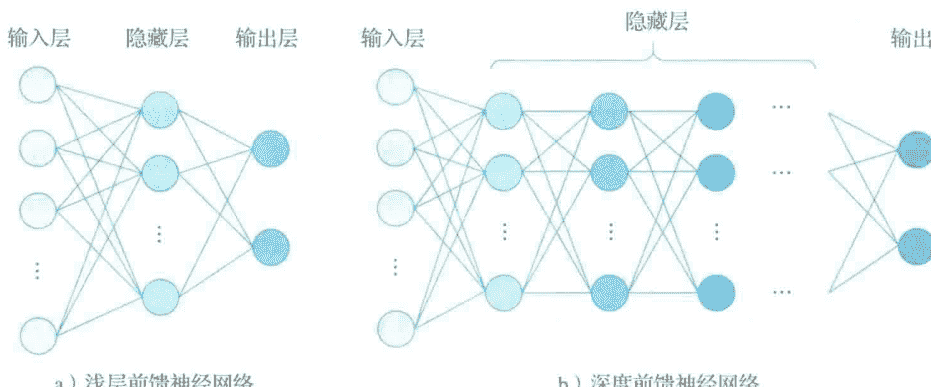

**图 1-4 浅层 vs 深度前馈网络结构对比**

**核心差异：特征工程的“自动化革命”**
传统 ML 需人工设计特征（如汽车轮廓、纹理、色彩）再分类；深度学习将**特征提取与分类融合为一体**，端到端自动完成（见图 1-5），极大降低人力成本。

| 流程 | 传统机器学习 | 深度学习 |
| :--- | :--- | :--- |
| **管线** | 输入 → **人工特征提取** → 分类 → 输出 | 输入 → **自动特征提取+分类** → 输出 |
| **任务示例** | 判定：小汽车 / 非小汽车 | 判定：小汽车 / 非小汽车 |

**图 1-5 两种范式处理流程对比**

#### 1.3.2 典型算法谱系：有监督与无监督的双轨并行
无论浅层还是深度，均涵盖有监督、无监督两大阵营（全景见图 1-6）。

**有监督阵营**
- *浅层*：决策树、SVM、感知机、Boosting
- *深度*：深度前馈网络（DFNN/MLP）、CNN、RNN、Transformer、胶囊网络、深度森林

**无监督阵营**
- *浅层*：自编码器、受限玻尔兹曼机、GMM、稀疏自编码器
- *深度*：深度自编码器、深度玻尔兹曼机、GAN、深度信念网络（DBN）

**图 1-6 浅层/深度学习算法全景分类**

下文重点解读五大支柱算法：

##### 1. 深度前馈神经网络（DFNN/MLP）：万物基石
典型结构：输入层 + **多隐藏层** + 输出层（见图 1-7），兼顾分类与回归。以回归任务说明训练闭环：
1. 参数随机初始化（权重 & 偏置）；
2. 正向传播得预测值；
3. 误差函数量化偏差，反向传播（BP）逐层回传梯度；
4. 梯度下降法（或变种）更新参数；
5. 迭代至损失收敛阈值以下，定型。

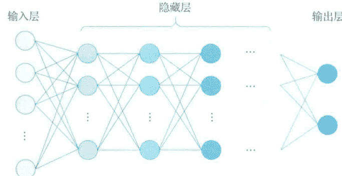

**图 1-7 深度前馈神经网络架构图**

##### 2. 卷积神经网络（CNN）：视觉领域的霸主
专攻图像分类、检测、分割、回归。经典管线（见图 1-8）：
输入层 → **卷积/池化混合块**（初级→高级特征提取） → **全连接层**（降维） → 输出层。
**优势**：海量样本自动特征化，告别手工造特征；
**痛点**：训练调参周期长、链路复杂。详述见第 2 章。

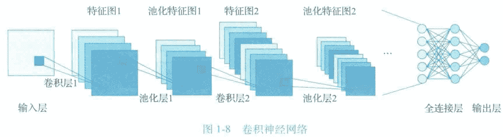

**图 1-8 CNN 典型架构**

##### 3. 循环神经网络（RNN）：序列建模的专家
专为时序数据设计，沿时间展开递归（见图 1-9）。核心假设：当前样本与历史样本存在序列依赖。主流变体：LSTM、GRU、Bi-RNN、Stacked RNN。详述见第 3 章。

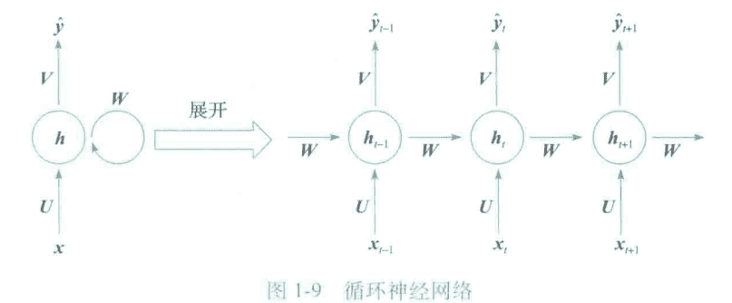

**图 1-9 RNN 循环结构示意**

##### 4. Transformer：注意力机制的范式重塑者
2017 年 Google 提出，以 **Self-Attention 替代循环**，实现并行加速。基于 Encoder-Decoder 栈式结构（见图 1-10）。首战机器翻译告捷，衍生出 BERT、GPT 等预训练巨头，横扫 NLP 任务；近年延展至视觉（ViT、Swin Transformer），同样刷新 SOTA。详述见第 4 章。

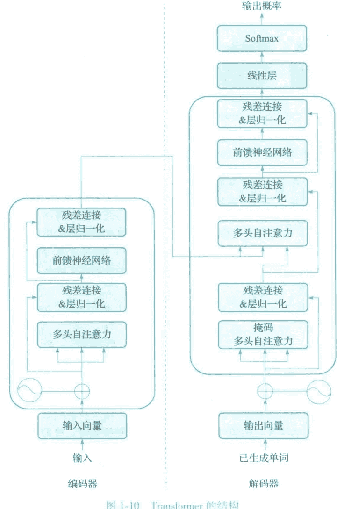

**图 1-10 Transformer 编码-解码架构**

##### 5. 生成对抗网络（GAN）：零和博弈下的生成艺术
无监督生成模型，灵感源自博弈论零和博弈。双塔对抗（见图 1-11）：
- **生成器 (G)**：从潜在空间采样噪声，造假以乱真；
- **判别器 (D)**：收真假样本，辨真伪。
双方博弈收敛于纳什均衡——D 无法分辨 G 输出与真实分布。详述见第 5 章。

**图 1-11 GAN 对抗训练机制图**

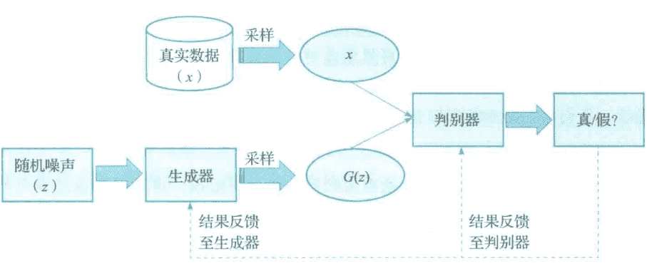

图 1-11 生成对抗网络示意图

##### 6. 深度信念网络

深度信念网络（DBN）属于概率生成模型范畴，其架构融合了 Sigmoid 信念网络（SBN）与受限玻尔兹曼机（RBM）：顶层由两层 RBM 构建，底层则为 SBN 结构（如图 1-12a 所示）。DBN 采用逐层贪婪策略训练，因底层为 SBN，需待下层训练收敛后再向上逐层推进，此机制有效化解了深度神经网络的优化难题。其核心优势在于利用预训练机制，规避了前馈神经网络因参数随机初始化易陷入局部最优的弊端。第 6 章将对 DBN 展开深度剖析。

##### 7. 深度玻尔兹曼机

深度玻尔兹曼机（DBM）常与 DBN 并提，二者渊源颇深，均以 RBM 为基石，却在架构细节上截然不同（见图 1-12b）。对比可见：DBN 仅顶层为 RBM，其余为 SBN；而 DBM 全层级均由 RBM 堆叠而成。这种结构差异直接导致两者训练范式的分野。

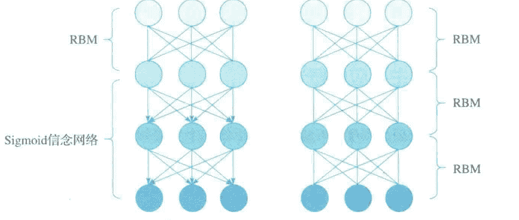

图 1-12 深度信念网络与深度玻尔兹曼机

DBM 的主流训练范式为“逐层贪婪预训练 + 监督微调”。预训练阶段，各层作为独立 RBM 单独优化：可见层建模输入数据，后续隐藏层则建模前一层 RBM 的后验分布样本。待所有 RBM 训练就绪，即可组装成完整的 DBM。第 6 章将详细阐释 DBM 细节。

##### 8. 深度自编码器

自编码器（AE）由编码器与解码器两大模块组成：编码器将原始输入压缩为紧凑表示，解码器再由该表示重构输入。深度自编码器（DAE）则由两个对称的 DBN 构建，编码与解码端各采用 4~5 个隐藏层（如图 1-13 所示）。第 6 章将继续深入讲解 DAE。

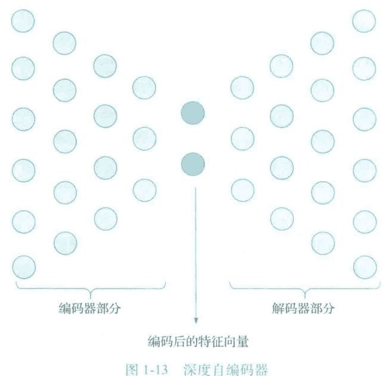

### 1.4 深度学习主要应用版图

深度学习极大推动了 AI 进程，备受学术与产业界瞩目。计算机视觉、语音处理、自然语言处理（NLP）是其三大核心战场，而在多模态领域，应用版图亦持续拓展。

#### 1.4.1 计算机视觉：从感知到理解

2012 年 AlexNet 于图像分类任务取得突破，标志着以 CNN 与 Transformer 为代表的深度算法在视觉任务全面开花。应用可划分为“基础任务”与“高级任务”两大梯队：前者夯实通用能力，后者面向具体落地，常依赖基础任务支撑。

**基础任务矩阵：**
*   **图像分类**：全图语义判别，如手写数字识别、猫狗分类。
*   **目标检测**：定位物体位置并判别类别，如行人、车辆检测。
*   **图像分割**：按边缘分离物体并识别，细分为像素级分类的语义分割、与实例级区分的实例分割（如街景、细胞分割）。
*   **图像回归**：预测关键坐标，如人脸/人体关键点定位。

**高级任务图谱：**
*   **人脸识别**：检测正脸 -> CNN 提特征 -> 身份认证。
*   **行人重识别 (Re-ID)**：检测行人 -> 提取穿着、骨架、步态特征 -> 跨镜头身份关联。
*   **目标跟踪**：融合检测与关联算法，实现视频流中目标的持续定位。
*   **动作识别**：解析视频行为，主流路线为双流法与关键点法。
*   **工业缺陷检测**：识别紧固件缺失、建筑病害、金属表面瑕疵等。
*   *……更多场景不胜枚举。*

#### 1.4.2 语音处理：精准与自然的双重飞跃

深度学习在语音领域成果丰硕，识别准确率等核心指标大幅超越传统技术，应用聚焦三大支柱：语音识别、声纹识别、语音合成。

**语音识别 (ASR) 流水线：** 训练集预处理/特征提取 -> 训练声学模型 -> 语料训练语言模型（捕捉词序关系） -> 测试集打分（声学+语言联合解码） -> 输出最高分词序列。

**声纹识别 (说话人识别) 流程：** 训练集建模声纹模型 -> 测试集特征提取 -> 模型分类决策 -> 输出身份结果。

**语音合成 (TTS) 现代范式：**
1.  **文本前端**：语种判断、分词、转音素、韵律预测（停顿、重轻音）。
2.  **声学建模**：摒弃传统波形拼接的生硬感，**端到端深度模型**已成主流，文本输入，语音波形直接输出。

#### 1.4.3 自然语言处理：从统计到大模型时代

2010 年 RNN 语言模型问世，LSTM 与 Transformer 接力推动 NLP 任务全面突围。同视觉一样，任务分基础与高级两层。

**基础任务（语言理解基石）：**
*   **词法分析**：词级处理（词性标注、纠错等）。
*   **句法分析**：句级结构解析（成分/依存句法）。
*   **语义分析**：挖掘深层含义（词/句/篇章三级）。
*   **信息抽取**：非结构化转结构化（实体、事件抽取）。
*   **语言模型**：基于上下文预测下一词。

**高级任务（场景化落地）：**
*   **情感分析**：识别文本倾向（正负/多维度）。
*   **神经机器翻译 (NMT)**：基于神经网络的多语互译。
*   **自动摘要**：单/多文档压缩生成摘要。
*   **机器阅读理解 (MRC)**：读文本答题/完形填空/选择题。
*   **自动问答**：单轮交互答疑。
*   **人机对话**：多轮自由对话，依赖海量语料训练。
*   *……应用边界持续外拓。*

#### 1.4.4 多模态处理：打破单一模态壁垒

图像、语音、文本均为单模态，现实场景多为多模态融合。深度学习在图文互生、视觉问答、虚拟数字人等领域大显身手：

*   **图像描述 (Captioning)**：看图生成语句，即“看图说话”。
*   **可视问答 (VQA)**：针对图像/视频内容回答提问。
*   **图像生成**：文本驱动生成对应图像 (Text-to-Image)。
*   **视频生成**：文本驱动生成视频片段 (Text-to-Video)。
*   **虚拟主播/数字人**：自动化新闻播报等交互场景。
*   *……多模态融合正重塑人机交互范式。*

### 1.5 本书架构导览

全书系统覆盖深度学习核心概念、典型算法与应用、正则化优化、主流框架，脉络如图 1-14 所示：

*   **第 1 章 引言**：溯源发展、理清 AI/ML/DL 关系、奠基核心概念与算法、纵览应用版图。
*   **第 2 章 卷积神经网络 (CNN)**：溯源、基础结构、训练技巧、经典架构、视觉应用。
*   **第 3 章 循环神经网络 (RNN)**：溯源、结构与训练、LSTM 核心、变体家族、序列应用。
*   **第 4 章 Transformer**：注意力机制、架构详解、预训练巨头 (GPT/BERT)、广泛应用。
*   **第 5 章 生成对抗网络 (GAN)**：起因、原理博弈、优化改进、生成式应用。
*   **第 6 章 深度生成模型**：聚焦 DBN、DBM、DAE、扩散模型，兼溯源 Hopfield、玻尔兹曼机、RBM、AE 及变种。
*   **第 7 章 正则化与优化**：参数范数、数据增强、Bagging、早停、Dropout、归一化等正则手段；梯度下降、动量法等优化算法。
*   **第 8 章 深度学习框架**：全景扫描，深度实战 TensorFlow、PyTorch、飞桨三大主流框架。

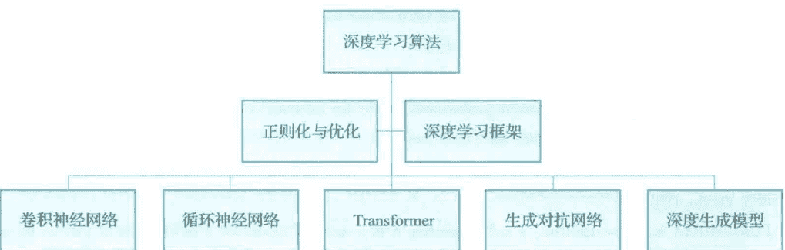

图 1-14 本书的组织结构

### 复习题

1.  简述深度学习的发展脉络。
2.  阐释深度学习、机器学习、人工智能三者关系。
3.  对比浅层学习与深度学习核心差异，并举例。
4.  列举典型深度学习算法及其核心功用。
5.  列举深度学习典型应用案例。

### 参考文献

- [1] HINTON G E, OSINDERO S and TEH Y. A fast learning algorithm for deep belief nets [J]. Neural computation, 2006, 18: 1527-1554.
- [2] HINTON G E, SALAKHUTDINOV R R. Reducing the dimensionality of data with neural networks [J]. Science, 2006, 313 (5786): 504-507.
- [3] MCCULLOCH W S, PITTS W. A logical calculus of the ideas immanent in nervous activity [J]. Bulletin of mathematical biophysics, 1943, 5: 115-133.
- [4] HEBB D O. The organization of behavior [M]. New York: Wiley & Sons, 1949.
- [5] ROSENBLATT F. The perceptron: a probabilistic model for information storage and organization in the Brain [J]. Psychological review, 1958, 65 (6): 386-408.
- [6] MINSKY M L, PAPERT S A. Perceptrons: an introduction to computational geometry [M]. Cambridge, MIT Press, 1969.
- [7] FUKUSHIMA K. Neocognitron: a self organizing neural network model for a mechanism of pattern recognition unaffected by shift in position [J]. Biological cybernetics, 1980, 36 (4): 193-202.
- [8] HOPFIELD J J. Neural networks and physical systems with emergent collective computational abilities [J]. Proceedings of the national academy of sciences of the USA, 1982, 79 (8): 2554-2558.
- [9] RUMELHART D E, HINTON G E, WILLIAMS R J. Learning representations by back-propagating errors [J]. Nature, 1986, 323: 533-536.
- [10] JORDAN M I. Serial order: a parallel distributed processing approach [R]. Report 8604, institute for cognitive science, University of California, San Diego, 1986.
- [11] ELMAN J L. Finding structure in time [R]. CRL technical report 8801, center for research in language, University of California, San Diego, 1988.
- [12] CORTES C, VAPNIK V. Support-vector networks [J]. Machine learning, 1995, 20: 273-297.
- [13] HOCHREITER S, SCHMIDHUBER J. Long short-term memory [J]. Neural computation, 1997, 9 (8): 1735-1780.
- [14] LECUN Y, BOTTOU L, BENGIO Y, et al. Gradient-based learning applied to document recognition [J]. Proceedings of the IEEE, 1998, 86 (11): 2278-2324.
- [15] SEIDE F, LI G, YU D. Conversational speech transcription using context-dependent deep neural networks [C]. Proceedings of the 29th International Conference on Machine Learning, 2012: 1-2.
- [16] KRIZHEVSKY A, SUTSKEVER I, HINTON G E. ImageNet classification with deep convolutional neural networks [C]. Advances in Neural Information Processing Systems 25, 2012: 1097-1105.
- [17] SIMONYAN K, ZISSERMAN A. Very deep convolutional networks for large-scale image recognition [C]. Proceedings of the 3rd International Conference on Learning Representations, 2015.
- [18] SZEGEDY C, LIU W, JIA Y, et al. Going deeper with convolutions [C]. Proceedings of IEEE Conference on Computer Vision and Pattern Recognition, 2015: 1-9.
- [19] HE K, ZHANG X, REN S, et al. Deep residual learning for image recognition [C]. Proceedings of IEEE Conference on Computer Vision and Pattern Recognition, 2016: 770-778.
- [20] HU J, SHEN L, SUN G. Squeeze-and-excitation networks [C]. Proceedings of IEEE Conference on Computer Vision and Pattern Recognition, 2018: 7132-7141.
- [21] GIRSHICK R, DONAHUE J, DARRELL T, et al. Rich feature hierarchies for accurate object detection and semantic segmentation [C]. Proceedings of IEEE Conference on Computer Vision and Pattern Recognition, 2014: 580-587.
- [22] GIRSHICK R. Fast R-CNN [C]. Proceedings of International Conference on Computer Vision, 2015: 1440-1448.

### 核心参考文献

- [23] REN S, HE K, GIRSHICK R, 等. Faster R-CNN: 利用区域建议网络实现实时目标检测 [C]. 神经信息处理系统进展 28, 2015: 91-99.

- [24] REDMON J, DIVVALA S, GIRSHICK R, 等. 你只需看一眼：统一的实时目标检测 [C]. IEEE 计算机视觉与模式识别会议论文集, 2016: 779-788.

- [25] GOODFELLOW I J, POUPET-ABADIE J, MIRZA M, 等. 生成对抗网络 [C]. 神经信息处理系统进展 27, 2014: 2672-2680.

- [26] CHUNG J, GULCEHRE C, CHO K, 等. 门控循环神经网络在序列建模上的实证评估 [J]. arXiv abs: 1412.3555, 2014.

- [27] VASWANI A, SHAZEER N, PARMAR N, 等. 注意力机制就是你所需要的一切 [C]. 神经信息处理系统进展 30, 2017: 6000-6010.

- [28] DEVLIN J, CHANG M W, LEE K, 等. BERT: 用于语言理解的深度双向变换器预训练 [C]. 北美计算语言学协会会议论文集, 2019.

- [29] RADFORD A, NARASIMHAN K, SALIMANS T, 等. 通过生成式预训练提升语言理解 [EB/OL]. https://openai.com/research/language-unsupervised, 2018.

- [30] 史忠植. 高级人工智能 [M]. 北京: 科学出版社, 2011.

- [31] 史蒂芬·卢奇, 丹尼·科佩克. 人工智能 [M]. 第 2 版. 林赐, 译. 北京: 人民邮电出版社, 2018.

- [32] 周志华. 机器学习 [M]. 北京: 清华大学出版社, 2016.

- [33] 李航. 统计学习方法 [M]. 第 2 版. 北京: 清华大学出版社, 2019.

---

### 本章主角：Geoffrey Hinton 教授

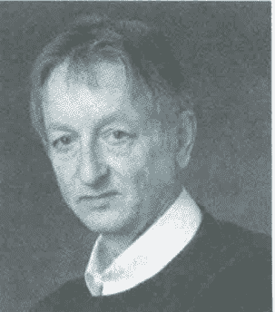

Geoffrey Hinton（1947年生），多伦多大学杰出教授，英国皇家学会院士、美国国家工程院外籍院士、美国艺术与科学院外籍院士，2018 年图灵奖得主。他在反向传播算法、玻尔兹曼机、时间延迟神经网络、变分学习及深度学习等领域建立了里程碑式贡献，被公认为“深度学习之父”。

Hinton 1970 年毕业于剑桥大学获实验心理学学士，1978 年于爱丁堡大学获得人工智能博士学位。1982 至 1987 年执教于卡内基梅隆大学，历任助理教授、副教授，后转入多伦多大学计算机系任教授。他亦曾任职 Google 担任主任工程研究员，并出任 Vector 研究院首席科学家。

长期深耕人工神经网络领域，自 20 世纪 80 年代起，该领域的诸多重大突破几乎都有其研究组的身影：1985 年，他与 Terry Sejnowski 基于 Hopfield 网络提出玻尔兹曼机，并发明了用于训练受限玻尔兹曼机及专家乘积模型的对比散度算法（CD）；1986 年，联合 David E. Rumelhart、Ronald Williams 提出多层感知机的反向传播算法，证明其可解决异或等线性不可分难题；2006 年，他带领团队提出深度信念网络并实现高效训练，同年推出深度自编码器实现降维，奠定深度学习理论基石。近年更推出胶囊网络、对比学习算法 SimCLR 及前向-前向训练算法等前沿成果，持续引领领域风向。

门下桃李满天下，众多弟子活跃于 AI 研究一线，如 Radford Neal（贝叶斯统计权威）、Alex Krizhevsky（AlexNet 核心作者）、Ilya Sutskever（OpenAI 联合创始人兼首席科学家）、Brendan Frey（DeepGenomics 创始人）、Ruslan Salakhutdinov（CMU 教授）等；Yann LeCun 亦曾在其麾下从事博士后研究。

个人主页：https://www.cs.toronto.edu/~hinton/。

---

## 卷积神经网络

### 2.1 卷积神经网络的溯源与演进

#### 2.1.1 起源：源自生物视觉的洞察

卷积神经网络（CNN）属于人工神经网络的特殊分支，可视为受生物学启发的多层感知机变体。其渊源可追溯至 20 世纪 60 年代，神经生理学家 David Hubel 与 Torsten Wiesel 对猫视觉皮层细胞的开创性研究[1]。实验中，猫观察特定光束，科学家通过电极记录视觉皮层电信号。研究发现：神经元仅对视野特定区域（感受野）敏感，细分为中心与周边感受野；且细胞响应模式各异——简单细胞响应位置、复杂细胞响应位置与移动、超级复杂细胞响应有端点光束的移动，层层递进完成特征提取与整合，最终实现识别。这一经典范式被称为 Hubel-Wiesel 实验。

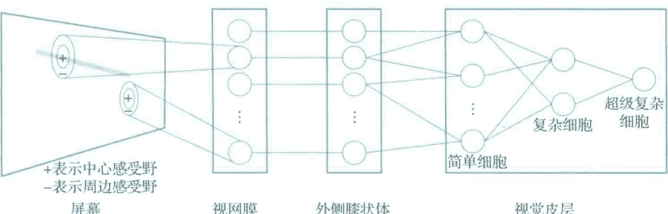

#### 2.1.2 雏形：神经认知机

进入 80 年代，Kunihiko Fukushima 教授基于 Hubel-Wiesel 分层模型构建了神经认知机（Neocognitron）[2]，堪称 CNN 的鼻祖。其架构包含两大核心单元：简单细胞（S-Cell）负责特征抽取，对应今之卷积操作；复杂细胞（C-Cell）负责容错，对应激活函数与池化。结构上自底向上依次为：输入层 $U_0$、对比度提取层 $U_g$、多层特征提取中间层 $U_s$、多层抗变形中间层 $U_c$、最终识别输出层 $U_{c_4}$。

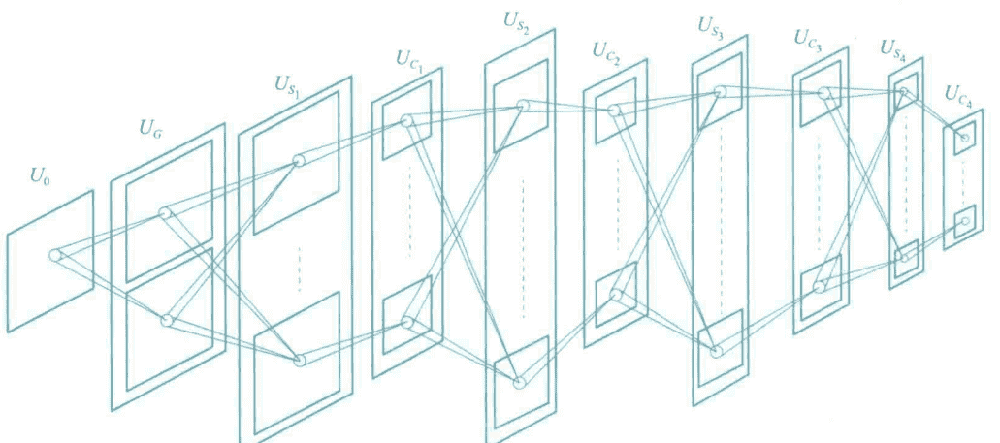

各层职能明确：
1.  $U_0$：接收图像数据；
2.  $U_g$：提取图像对比度；
3.  $U_s$（简单细胞层）：提取边缘、纹理、颜色等初级特征；
4.  $U_c$（复杂细胞层）：提供抗变形、抗畸变鲁棒性；
5.  $U_{c_4}$：输出识别结果。

#### 2.1.3 发展史：从 LeNet 到百花齐放

1998 年，Yann LeCun 基于神经认知机推出 LeNet-5[3]，首次将神经网络实用于图像识别，被公认为首个真正意义上的 CNN。

2012 年，Alex Krizhevsky 等人推出 AlexNet[4]，引入 ReLU 与 Dropout，借力 GPU 加速，在 ImageNet 大赛将错误率从 26% 降至 15% 并夺冠，实现图像分类的历史性跨越。

此后，CNN 百花齐放，在各细分任务屡创佳绩：
*   **图像分类**：VGGNet[5]、GoogleNet 系列[6-9]、ResNet[10]、DenseNet[11] 等接力突破；
*   **目标检测**：R-CNN 系列[12-14]、YOLO 系列[15-20]、SSD[21] 等定义主流范式；
*   **图像分割**：FCN[22]、SegNet[23]、UNet[24] 等奠基之作；
*   **姿态估计**：沙漏网络[25] 独树一帜；
*   **人脸识别**：DeepFace[26]、DeepID[27]、FaceNet[28] 等推动商用落地。

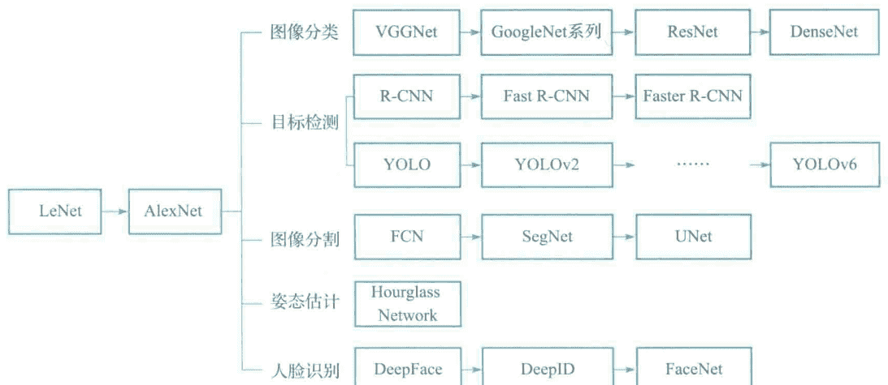

如今，CNN 已成计算机视觉基石，广泛服务于分类、检测、跟踪、分割、姿态估计、人脸识别等场景，是深度学习应用最广的架构之一。

### 2.2 CNN 基础架构解析

典型 CNN 由卷积层（含激活）、池化层、全连接层、输出层串联而成。卷积与池化交替堆叠，后接一至多层全连接，最终输出。这种层层深入的拓扑结构，直观诠释了深度学习中“深度”的含义。

#### 2.2.1 卷积层：核心引擎

##### 1. 数学根基：卷积运算
卷积分离散与连续、一维与二维形式，公式分别为：
一维连续：$(f * g)(n)=\int_{-\infty}^{\infty} f(\tau) g(n-\tau) \mathrm{d} \tau \quad (2-1)$
一维离散：$(f * g)(n)=\sum_{\tau=-\infty}^{\infty} f(\tau) g(n-\tau) \quad (2-2)$
二维离散：$(f * g)(x, y)=\sum_{\tau_1=-\infty}^{\infty} \sum_{\tau_2=-\infty}^{\infty} f(\tau_1, \tau_2) g(x-\tau_1, y-\tau_2) \quad (2-3)$
二维连续：$(f * g)(x, y)=\int_{\tau_1=-\infty}^{\infty} \int_{\tau_2=-\infty}^{\infty} f(\tau_1, \tau_2) g(x-\tau_1, y-\tau_2) \mathrm{d} \tau_1 \mathrm{d} \tau_2 \quad (2-4)$

##### 2. 实战逻辑：卷积操作
给定二维图像 $I$ 与卷积核 $K$，视为矩阵，离散卷积表示为：
$(I * K)(u, v)=\sum_i \sum_j I_{i, j} K_{(u-i), (v-j)} \quad (2-5)$

以 5×5 输入、3×3 卷积核、步长 1 为例，窗口滑动计算得输出。

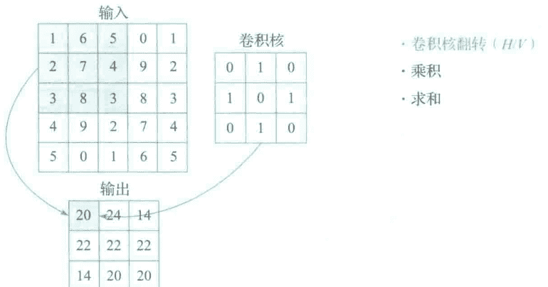

**关键差异**：数学定义要求卷积核翻转（水平+垂直）后再相乘求和，但 CNN 实践中**省略翻转**。因为卷积核参数经训练学得，翻转与否对最终拟合能力无影响，工程上直接按对应位置相乘求和（即互相关运算）。

若使用 $k$ 个同尺寸卷积核，同一输入可得 $k$ 个等大输出矩阵，由此引出**卷积层**概念：一层包含多个同尺寸核，各自卷积产出特征图，作为下层输入。

**对比传统 CV**：传统特征算子（如 Sobel 45° 模板）需人工设计；CNN 卷积核参数**自动学习**。且呈现**层次性**：浅层捕捉边缘、方向、纹理等低级特征；深层组合出车轮、人脸等高级语义模式。

```
[-2  -1   0]
[-1   0   1]
[ 0   1   2]
```
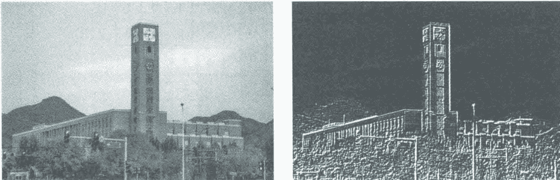

##### 3. 数据填充：解决边缘信息流失与尺寸收缩
无填充时，$n \times n$ 输入经 $f \times f$ 核卷积，输出变为 $(n-f+1) \times (n-f+1)$。深层堆叠导致特征图急剧缩小，且边缘像素参与计算次数少，信息易丢失。

对策：卷积前在边缘填充 $p$ 层数据（常用零填充）。填充后尺寸变 $(n+2p) \times (n+2p)$，输出尺寸为 $(n+2p-f+1) \times (n+2p-f+1)$。若 $p$ 取值得当可保持尺寸不变（如 5×5 输入，3×3 核，填 1 层，输出仍 5×5）。


主流框架（PyTorch/TensorFlow）提供三种 Padding 模式：
*   **Valid**：不填充，纯有效区域计算；
*   **Same**：填充且保持输入输出尺寸一致；
*   **Full**：核与输入刚接触即计算，最大化输出尺寸。


##### 4. 卷积步长：控制采样密度
步长 $s$ 决定窗口滑动间隔。设步长为 2，窗口每次跳跃 2 个像素，输出尺寸缩减。通用输出尺寸公式：
$\lfloor \frac{n + 2p - f}{s} + 1 \rfloor \times \lfloor \frac{n + 2p - f}{s} + 1 \rfloor \quad (2-6)$
（$\lfloor \cdot \rfloor$ 为向下取整）

```
⌊(n+2p-f)/s + 1⌋ × ⌊(n+2p-f)/s + 1⌋
```


##### 5. 通道与特征图：立体感知的关键

### 核心概念：通道、特征图与卷积机制

在计算机视觉里，“通道”本质上对应图像的颜色维度。灰度图只有一个通道，而彩色图则由 R、G、B 三个通道构成（如图 2-9）。经过卷积层与激活函数处理后的输出，我们称之为“特征图”。


针对单通道与多通道输入、单/多卷积核的组合情况，其运作逻辑如图 2-10、2-11 所示。重点在于多通道多核卷积：通常存在多组卷积核，每组内核与对应通道卷积后，需将各通道同位置的结果**逐元素相加**，最终融合成单张特征图。


---

### 2.2.2 激活函数：打破线性束缚的关键

激活函数模拟生物神经元的“全或无”特性：输入累积超阈值则兴奋，否则抑制。它的引入赋予了网络非线性建模能力，是深度学习强大表达力的源头。早期 Sigmoid 功不可没，但随层数加深配合反向传播，梯度消失成了拦路虎。现代 CNN 常用 ReLU、PReLU、ELU、Maxout 等变体来缓解此问题。下文将逐一拆解，并对比经典的 Sigmoid 与 Tanh。

#### 1. Sigmoid：经典但易“饱和”
公式定义见下：
```
Sigmoid(x) = \frac{1}{1+e^{-x}}
```
函数曲线及梯度如图：


**硬伤**：两端梯度趋近于 0，形成“梯度饱和”。反向传播时误差无法穿透该区域传回前层，导致训练停滞。

#### 2. Tanh：零均值的改良版
定义公式：
```
tanh(x) = \frac{e^x - e^{-x}}{e^x + e^{-x}}
```
曲线与梯度图：


输出以 0 为中心收敛快于 Sigmoid，但**同样逃不掉两端梯度饱和**的宿命，深层网络中依然会阻断梯度流动。

#### 3. ReLU：简单高效的主流选择
为缓解饱和，Nair 与 Hinton 提出 ReLU：
$$ReLU(x) = \max(0, x)$$
曲线与梯度：


**优势**：$x \ge 0$ 区间梯度恒为 1，彻底消除正向饱和；计算极简（仅阈值操作），速度极快。
**隐患**：$x < 0$ 时梯度为 0，易造成“神经元死亡”（权重永不更新）。尽管有此缺陷，它仍是当前深度学习的**绝对主力**。

#### 4. PReLU：给负区域一条生路
为解决“死神经元”，引入可学习参数 $\alpha$：
$$f(x) = \begin{cases} \alpha x, & x < 0 \\ x, & x \ge 0 \end{cases}$$
$\alpha=0.2$ 时的曲线与梯度：


**变体**：$\alpha=0.01$ 称 Leaky ReLU；$\alpha$ 随机采样称 RReLU。
**权衡**：收敛更快、解决死亡问题，但引入额外参数增加学习负担。

#### 5. ELU：指数线性单元，抗噪更强
负区域引入指数曲线平滑过渡：
$$f(x) = \begin{cases} \alpha(e^x - 1), & x < 0 \\ x, & x \ge 0 \end{cases} \quad (\alpha=1 \text{ 时曲线见下})$$


**特点**：负值输出非零，均值更接近 0，收敛加速且鲁棒性强；代价是指数运算开销大，收敛速度反而略慢于 ReLU。

#### 6. Maxout：以空间换时间的“万金油”
本质是增加一层全连接，取 $k$ 个线性单元的最大值：
$$h_i(x) = \max_{j \in \{1..k\}} (x^T w_{ij} + b_{ij})$$
结构示意：


**优势**：完美规避梯度消失与神经元死亡。
**代价**：参数量与计算量成倍增长（$k$ 倍），部署需谨慎权衡。

#### 7. 选型速查表：实战怎么选？
1.  **首选 ReLU** + 小学习率（防死亡）。
2.  **ReLU 失效**？尝试 Leaky ReLU / PReLU / ELU / Maxout，通常能破局。
3.  **禁用 Sigmoid/Tanh** 作为隐层激活（梯度<1，深层必消失）。

---

### 2.2.3 池化层：降采样与不变性
池化用邻域统计量（最大/均值）替代精确位置信息。无参数，只需定核大小、步长、类型。例如 3×3 输入，2×2 核，步长 1，操作演示见下：


**核心价值**：
- **降采样**：压缩特征图尺寸，大幅减少后续参数与算力。
- **平移不变性**：输入微小位移，输出近似不变，增强容错。

---

### 2.2.4 全连接层：特征压缩与分类头
由 1-N 层全连接网络组成。职责：将卷积/池化输出的**二维特征图“压扁”为一维向量**，送入输出层做分类或回归。两层 FC 结构示例：


---

### 2.2.5 输出层：任务导向的最后一环
- **分类任务**：Softmax 归一化输出概率分布。
  $$y_i = \frac{e^{x_i}}{\sum e^{x_i}}$$
  计算示例：
  
- **回归任务**：线性输出 $y_i = \sum w_{im} x_m$。

---

### 2.3 卷积神经网络的训练全流程

#### 2.3.1 标准训练循环（以图像分类为例）
1.  **初始化**：权重/偏置随机赋值（**架构、核数、核大小此时已定，训练中不变**）。
2.  **前向传播**：输入图像 $\to$ 卷积 $\to$ ReLU $\to$ 池化 $\to$ 全连接 $\to$ 类别概率。
3.  **计算损失**：交叉熵 $Loss = -\sum (y_{true} \times \log(y_{pred}))$。
4.  **反向传播 (BP)**：算梯度 $\to$ 梯度下降（或其它优化器）更新参数 $\to$ 循环至收敛。

#### 2.3.2 池化层的反向传播：只传梯度，不算参数
池化层可视为特定连接的稀疏网络（见下）：

无论最大/均值池化，**无可学习参数**。训练仅做一件事：**将误差项 $\delta$ 传回上一层**。
示例：4×4 输入，2×2 核，步长 2，最大池化得 2×2 输出。已知 $l$ 层误差，如何传回 $l-1$ 层？


- **最大池化**：误差**原路返回**——仅传给前向时“赢家”位置（索引已记录），其余位置归零。
  
- **均值池化**：误差**均分**——平均分配给感受野内所有位置。
  

#### 2.3.3 卷积层的反向传播：权值共享下的梯度推导
同样先将卷积层展开为稀疏连接网络：


**核心难点**：权值共享导致单个权重对应多个连接，梯度需**累加**。

##### 1. 误差项 $\delta$ 的层间传递
最简设定：步长 1，单核，3×3 输入，2×2 核，无填充，输出 2×2。


已知 $l$ 层 $\delta^l$，求 $l-1$ 层 $\delta^{l-1}$。
链式法则拆解：
$$\delta^{l-1}_{i,j} = \underbrace{\frac{\partial E}{\partial a^{l-1}_{i,j}}}_{\text{项1}} \times \underbrace{f'(net^{l-1}_{i,j})}_{\text{项2(激活导数)}}$$

**项1 计算技巧**（无需推导，记结论）：
将 $\delta^l$ 作为输入，**填充**后，与**原卷积核旋转 180°** 后的核做卷积。
$$\frac{\partial E}{\partial a^{l-1}} = \delta^l * \text{rot180}(W^l)$$
图示说明：


**项2**：直接求上一层激活函数导数。

##### 2. 卷积核参数梯度（权重 $W$ 与偏置 $b$）
有了各层 $\delta$，参数梯度即：
$$\nabla W^l_{i,j} = \sum_{m,n} \delta^l_{m,n} \cdot a^{l-1}_{i+m, j+n}$$
$$\nabla W^l_b = \sum_{m,n} \delta^l_{m,n}$$
本质上是**输入特征图与输出误差图的互相关运算**。得梯度后，优化器更新权重。以上公式对任意尺寸输入/核均适用。

---

### 2.4 典型架构：LeNet-5——CNN 启蒙教科书
1998 年 LeCun 提出，专攻手写字符识别。虽层数不深，但**卷积、池化、全连接、Softmax 一应俱全**，是入门 CNN 的标准范本。官网：`yann.lecun.com/exdb/lenet/`。

#### 2.4.1 LeNet-5：经典卷积网络的奠基之作

LeNet-5 的整体架构如图 2-28 所示，下面我们逐层拆解其核心构造。


**图 2-28 LeNet 网络架构图**

- **输入层**：接收尺寸为 32×32 像素的图像数据。
- **C1 层（卷积层）**：配备 6 个 5×5 卷积核，步长设为 1，输出 6 张 28×28 的特征图（计算公式：32-5+1=28），共包含 4704 个神经元（6×28×28）。
- **S2 层（下采样层）**：对 C1 的 6 张 28×28 特征图执行均值池化，核大小 2×2、步长 2。池化结果乘以权重加上偏置，经 Sigmoid 激活后，得到 6 张 14×14 特征图，神经元数量降至 1176 个（6×14×14）。
- **C3 层（卷积层）**：采用 16 组 5×5 卷积核（连接模式见下文）作用于 S2 输出，加偏置并经 Sigmoid 激活，产出 16 张 10×10 特征图（14-5+1=10），神经元总数 1600 个（16×10×10）。这 16 组卷积核的具体连接拓扑如图 2-29 所示。


**图 2-29 C3 层卷积核组连接示意**

- **S4 层（下采样层）**：对 C3 的 16 张 10×10 特征图施行最大池化，核与步长均为 2。取最大值后乘权重、加偏置，送入 Sigmoid 激活，输出 16 张 5×5 特征图，神经元数压缩至 400 个（16×5×5）。
- **C5 层（卷积层）**：使用 16 个 5×5 卷积核卷积，结果加权求和加偏置后经 Sigmoid 激活，因输入为 5×5，故输出为 1×1（5-5+1=1）。为获取 120 张特征图，需动用 120 组卷积核（每组含 16 个核），最终神经元数定格为 120 个。
- **F6 层（全连接层）**：与 C5 全连接，含 84 个神经元（对应 7×12 位图）。输入加权求和加偏置，经 Sigmoid 输出 84 维向量。
- **输出层（全连接层）**：与 F6 全连接，设 10 个神经元分别代表数字 0-9。采用径向基函数（RBF）连接方式（见图 2-30），其定义见公式（2-20）。其中 $w_y$ 由比特图编码决定，$i$ 遍历 0-9，$j$ 遍历 0-83。第 $i$ 个神经元输出越接近 0，表明输入图像与字符 $i$ 匹配度越高。

$$ y_i = \sum_j (x_j - w_y)^2 \tag{2-20} $$


#### 2.4.2 AlexNet：深度学习爆发的引爆点

AlexNet 由 Alex Krizhevsky 等人于 2012 年提出，它不仅确立了 CNN 在计算机视觉的霸主地位，更推动了深度学习在语音、NLP 等领域的全面开花。其创新主要体现在六大技术突破：

1.  **引入 ReLU 激活函数**：首次大规模替代 Sigmoid，有效缓解了梯度消失难题。
2.  **Dropout 正则化**：训练中随机“掐灭”部分神经元，显著抑制过拟合。
3.  **重叠最大池化**：打破均值池化惯例，采用步长小于核尺寸的最大池化，让特征图保留更多细节信息。
4.  **CUDA 加速训练**：首创 GPU 并行计算加速 CNN 训练流程。
5.  **数据增强策略**：从 256×256 原图随机裁剪 224×224 区域，并结合水平翻转，大幅扩充样本量，强化泛化能力。
6.  **PCA 颜色增强**：对主成分分量施加高斯噪声（标准差 0.1），进一步降低识别错误率。

论文原始模型（图 2-31）受限于单张显存，采用双 GPU 并行设计；如今算力提升，单卡即可容纳完整模型，简化结构如图 2-32 所示。


#### 2.4.2.1 AlexNet 简化版架构详解


**图 2-32 AlexNet 简化架构**

AlexNet 共 8 层（不单独计池化层），含 5 个卷积层、3 个全连接层：

- **输入层**：标准输入 224×224×3（实测常用 227×227×3）。
- **第 1 卷积层（含池化）**：96 个 11×11 卷积核，步长 4，输出 55×55×96；接 3×3 最大池化（步长 2），输出 27×27×96。
- **第 2 卷积层（含池化）**：256 个 5×5 卷积核，步长 1，Padding 保尺寸，输出 27×27×256；接 3×3 最大池化（步长 2），输出 13×13×256。
- **第 3、4 卷积层**：均为 384 个 3×3 卷积核，步长 1，Same 卷积，输出均为 13×13×384。
- **第 5 卷积层**：256 个 3×3 卷积核，步长 1，Same 卷积，输出 13×13×256；再经 3×3 最大池化（步长 2）降维为 6×6×256，展平为 9216 维向量。
- **全连接层组**：前两层各 4096 个神经元，第 3 层 1000 个神经元，配合 Softmax 输出 1000 类别概率。

#### 2.4.3 VGGNet：极简设计的极致演练

VGGNet 由牛津 VGG 组与 Google DeepMind 合作推出，主流为 VGG-16 与 VGG-19。相较 AlexNet，VGG-16 确立了**“全 3×3 卷积 + 全 2×2 最大池”**的极简范式，结构规整、扩展性极强（见图 2-33）。


**图 2-33 VGG-16 网络结构**

VGG-16 共 16 个权重层（13 卷积 + 3 全连接），按 5 组卷积堆叠，每组后接最大池化，卷积层均跟随 ReLU。各组配置见表 2-1，通道数随深度递增。

**表 2-1 VGG-16 核心参数配置**

| | 卷积组 1 | 卷积组 2 | 卷积组 3 | 卷积组 4 | 卷积组 5 |
|---|---|---|---|---|---|
| **卷积层数** | 2 | 2 | 3 | 3 | 3 |
| **卷积核数** | 64 | 128 | 256 | 512 | 512 |

**设计精妙之处**：两个 3×3 卷积串联的感受野等效于 5×5，但参数量仅为后者的 72%（$2\times3^2 / 5^2$），且引入了两次非线性激活，以更少参数换取更强表达能力（见图 2-34）。


**图 2-34 3×3 串联 vs 5×5 卷积对比**

#### 2.4.4 GoogleNet：Inception 模块的宽度革命

GoogleNet 主打“深度加宽度”双轨并进，核心创新在于 **Inception 模块**（图 2-35），其四分支设计融合了多尺度特征提取与通道维度调控：

- **多尺度并行**：1×1、3×3、5×5 卷积 + 3×3 最大池化并行，适应不同尺度目标。
- **1×1 卷积妙用**：跨通道信息整合，同时实现降维/升维，大幅压缩参数量与算力。


**图 2-35 Inception 模块结构图**

后续版本持续迭代：
- **v2**：引入 **Batch Normalization (BN)**，解决深层网络“内部协变量偏移”问题，加速收敛。
- **v3**：卷积分解（如用两个 3×3 替代 5×5），进一步瘦身参数。
- **v4**：融合 **ResNet 残差连接** 与 Inception，强强联合，效果卓著。

#### 2.4.5 ResNet：残差连接破解超深网络训练难题

ResNet 由何凯明团队提出，夺得 2015 年 ImageNet 冠军。核心单元 **残差块**（图 2-36）引入**跳跃连接**，让信息跨层直传。


**图 2-36 残差块结构对比**

- **普通块（a）**：信息沿“直管”流动，$x_{l+2} = \sigma(W_2 \sigma(W_1 x_l + b_1) + b_2)$，层层变换极易导致梯度衰减或爆炸。

```
\(x_{l+1} = \sigma(W_{l+1}x_l + b_{l+1})\)
\(x_{l+2} = \sigma(W_{l+2}x_{l+1} + b_{l+2})\)
(2-21)
```

- **残差块（b）**：引入恒等映射捷径，$x_{l+2} = \sigma(W_2 \sigma(W_1 x_l + b_1) + b_2) + x_l$。若维度不匹配，对 $x_l$ 做线性投影即可。

```
$x_{i,i_1}=\sigma\left(W_{i,i_1}x_i+b_{i,i_1}\right) \\ x_{i,i_2}=\sigma\left(W_{i,i_2}x_{(i_1)}+b_{i,i_2}+x_i\right)$
```

**为何需要 ResNet？** VGG 证明加深网络提升性能，但极深网络反向传播时梯度极易消失/爆炸，导致训练集误差反而上升（退化问题）。残差块将学习目标转化为**拟合残差映射 $F(x) = H(x) - x$**，而非直接拟合 $H(x)$。若恒等映射为最优，只需将残差压至 0，大幅降低优化难度，使百层甚至千层网络训练成为可能。

### 2.5 卷积神经网络核心应用：目标检测

#### 2.5.1 目标检测任务与两大流派

目标检测旨在用边界框定位目标并给出类别。主流分两派：
- **两阶段**：以 **R-CNN 系列** 为代表，先提候选区，再分类回归。
- **一阶段**：以 **YOLO 系列** 为代表，端到端直接预测。

##### 1. R-CNN 系列：开山之作

R-CNN (Girshick et al., 2014) 先在 ImageNet 预训练，再在 VOC 微调，mAP 飙升至 53.7%，大幅超越前人。流程见图 2-37。


**R-CNN 四步走流程**：
1.  **区域提议**：Selective Search 提取 ~2000 个候选框。
2.  **特征提取**：每个候选框 warp 定尺寸，送入 AlexNet 抽固定长度特征向量。
3.  **分类判别**：用类别特定 SVM 分类。
4.  **边框回归**：修正候选框位置大小，贴合真实边界。

###### (1) 区域提议：Selective Search 算法

核心假设：目标区域在颜色、纹理、尺寸、空间上具相似性/连续性。采用**层次分组**策略：先过分割得小区域，再按相似度迭代合并，每轮合并生成外接矩形作为候选框。伪代码见算法 2-1。

```
算法 2-1 层次分组算法（Hierarchical Group Algorithm）
输入：（彩色）图像
输出：目标定位假设 L 的集合
获取初始化区域 R={r1,⋯,rn}
初始化相似度集合 S=Ø
For each 相邻的区域对 (ri,rj) do
计算相似度 s(ri,rj)
S=S∪s(ri,rj)
End
While S≠Ø do
获取最大相似度值：s(ri,rj)= max (S)
合并并对应区域：ri=ri∪rj
移除与 ri 相关的相似度：S=S \ s(ri,r∗)
移除与 rj 相关的相似度：S=S \ s(r∗,rj)
计算 ri 与其相邻区域的相似度集合 Si
更新相似度集合：S=S∪Si
更新区域集合：R=R∪ri
End
```

###### (2) 目标分类：SVM 与 IoU 机制

- **训练正/负样本定义**：
  - Ground Truth (GT) 为正样本。
  - IoU < 0.3 的候选框为负样本。
  - 微调 CNN 时：IoU ≥ 0.5 为正，其余为背景（负样本）。
- **IoU 定义**（图 2-38）：两框交并比 $IoU = \frac{A \cap B}{A \cup B}$。


###### (3) 边框回归：精准定位的关键

目标：学习映射 $f$，将候选框 $P$ 映射至预测框 $\hat{G}$，逼近 GT 框 $G$（图 2-39）。


参数化表示：框用中心点 $(x,y)$ 及宽高 $(w,h)$ 表示。给定 $P$ 的参数，寻找变换 $f$ 使得：

```
(\hat{G}_x, \hat{G}_y, \hat{G}_w, \hat{G}_h)=f(P_x, P_y, P_w, P_h) \quad (2-24)
(\hat{G}_x, \hat{G}_y, \hat{G}_w, \hat{G}_h) \approx (G_x, G_y, G_w, G_h) \quad (2-25)
```

**两步变换策略**：
1.  **平移**：$\Delta x = P_w d_x(P), \Delta y = P_h d_y(P)$，得到平移后框。
    ```
\hat{G}_x=P_w d_x(P)+P_x \quad (2-26)
\hat{G}_y=P_h d_y(P)+P_y \quad (2-27)
```
2.  **缩放**：$\Delta_w = \exp(d_w(P)), \Delta_h = \exp(d_h(P))$，得到最终预测框。
    ```
\hat{G}_w=P_w \exp(d_w(P)) \quad (2-28)
\hat{G}_h=P_h \exp(d_h(P)) \quad (2-29)
```

此设计将回归目标规范化为平移偏移量与对数尺度比，利于网络收敛。

### 核心回归目标：真实偏移量

```
t_x=(G_x-P_x)/P_w \quad (2-30)
t_y=(G_y-P_y)/P_h \quad (2-31)
t_w=\log(G_w/P_w) \quad (2-32)
t_h=\log(G_h/P_h) \quad (2-33)
```

边框回归所采用的损失函数定义如下：

```
\hat{w}_* = \arg \min_{w_*} \sum_i^n (t_* - \hat{w}_*^T \phi_3(P_i'))^2 + \lambda \|\hat{w}_*\|^2 \quad (2-34)
```

式中，\(\theta_5(\mathbf{P}^i)\) 代表第 \(i\) 个候选框的特征向量（源自 AlexNet 第 5 层池化输出），\(\mathbf{w}_i\) 则是待优化的参数矩阵。

**Fast R-CNN：四大革新重塑检测流程**

Fast R-CNN [13] 在 R-CNN 基础上实现了关键跨越，主要体现在四个维度：

1.  **分类器替换**：抛弃了原本的 SVM，改用 Softmax 完成分类判别。
2.  **多任务联合训练**：精心设计联合损失函数，将分类与边框回归融合为单一优化目标，同步更新参数。
3.  **RoI Pooling 登场**：引入感兴趣区域池化层，巧妙解决了不同尺度候选区域特征对齐难题，统一输出定长特征向量。
4.  **内存级特征缓存**：训练阶段特征图全程驻留内存，彻底告别繁琐的硬盘读写，大幅提速。

Fast R-CNN 的整体架构如下图所示。


**图解 Fast R-CNN 架构**

在骨干网络提取全图特征后，Fast R-CNN 通过 RoI Pooling 将不等大的候选区域“压制”成等尺寸特征图，随后接入全连接层，构建起**分类**与**回归**双头并行的多任务学习框架。

RoI Pooling 的核心逻辑是：将每个候选区均分为 \(M \times N\) 个子窗口，逐窗执行最大池化，从而将任意大小的区域映射为固定维度的特征向量，如下图演示。


**图解 RoI Pooling 操作示意**

**联合损失函数深度解析**

Fast R-CNN 的联合损失由分类损失与定位损失加权求和而成，具体形式如下：

```
\(L(p, u, t^u, v) = L_{cls}(p, u) + \lambda [u \ge 1] L_{loc}(t^u, v)\) (2-35)
```

```
\(L_{cls}(p, u) = -\log p_u\) (2-36)
```

$$L_{loc}(t^u, v) = \sum_{i \in \{x,y,w,h\}} \text{smooth}_{L_1}(t_i^u - v_i) \quad (2-37)$$

$$\text{smooth}_{L_1}(x) = \begin{cases} 0.5x^2 & |x| < 1 \\ |x| - 0.5 & \text{其他情况} \end{cases} \quad (2-38)$$

符号说明：
- \( L_{cls}(p, u) \)：类别 \(u\) 的对数损失，\(p\) 为全类别概率分布。
- \( L_{loc}(t^u, v) \)：针对正样本类别 \(u\) 的边框回归损失，\(v\) 为归一化目标，\(t^u\) 为预测偏移量。
- \( \lambda[u \geqslant 1] \)：指示函数，仅当 \(u\) 为前景类（\(u \ge 1\)）时激活回归损失，背景类不参与回归。
- \( \text{smooth}_{L_1} \)：平滑 L1 损失，兼顾 L1 与 L2 优点，鲁棒性更强。

---

### Faster R-CNN：RPN 让“找框”也进了网络

Faster R-CNN [14] 的里程碑意义在于引入**区域建议网络（RPN）**，用全卷积网络取代了耗时的选择性搜索，实现了“区域生成”的端到端学习。整体架构如下：


**图解 Faster R-CNN 完整架构（详见彩插）**

**流程拆解：**
1.  **共享骨干**：卷积池化提取公共特征图，双管齐下——供 RPN 生成建议，供 RoI Pooling 做后续分类回归。
2.  **RPN 双头输出**：
    *   **分类头**：Softmax 判定 Anchor 是“含目标”还是“纯背景”。
    *   **回归头**：微调 Anchor 坐标，输出精准偏移量 \((x, y, w, h)\)。
3.  **RoI Pooling + 全连接**：融合特征图与高质量建议，二次精修类别与坐标。

**Anchor 机制详解**

RPN 在特征图每个滑动窗口位置预设 \(k\) 组（默认 9 个）Anchor，覆盖 3 种尺度 \(\times\) 3 种长宽比（1:1, 1:2, 2:1），如下图。


**图解 RPN Anchor 设置**

- **分类输出**：\(2k\) 维，二分类概率。
- **回归输出**：\(4k\) 维，对应每个 Anchor 的 4 维偏移量。

**RPN 训练损失函数**

```
L({p_i}, {t_i}) = \frac{1}{N_{cls}} \sum_i L_{cls}(p_i, p_i^*) + \lambda \frac{1}{N_{reg}} \sum_i p_i^* L_{reg}(t_i, t_i^*) \quad (2-39)
```

关键点：
- \(p_i\) 为预测正样本概率，\(p_i^*\) 为标签（IoU > 0.7 为正，< 0.3 为负，中间忽略）。
- \(t_i\) 为预测回归量，\(t_i^*\) 为 Ground Truth 编码目标。
- **关键设计**：回归项乘以 \(p_i^*\)，**仅正样本 Anchor 计算回归损失**，负样本不回传梯度，极大简化了优化目标。\(\lambda\) 控制两任务权重平衡。

---

### 2. YOLO 系列：极致速度的“单阶段”哲学

YOLO 系列 [15-20] 最大的标签是 **“真·端到端”**——单个 CNN 直出框与类别，彻底摒弃“先找框再分类”的两阶段范式。

#### YOLOv1：将检测建模为回归问题

**网络骨架**：24 层卷积 + 2 层全连接，细节见下表。

| 层类型 | 核心配置 |
| :--- | :--- |
| 卷积 | 7x7x64, s=2 |
| 最大池化 | 2x2, s=2 |
| 卷积 | 3x3x192 |
| 最大池化 | 2x2, s=2 |
| 卷积组 | 1x1x128 → 3x3x256 → 1x1x256 → 3x3x512 (×2) |
| 最大池化 | 2x2, s=2 |
| 卷积组 | 1x1x256 → 3x3x512 (×4) → 1x1x512 → 3x3x1024 |
| 最大池化 | 2x2, s=2 |
| 卷积组 | 1x1x512 (×2) → 3x3x1024 (×2) → 3x3x1024, s=2 |
| 卷积 | 3x3x1024 (×2) |
| 全连接 | 1024 → 4096 → 30 (S=7, B=2, C=20) |

**图解 YOLOv1 网络结构**


**图解 YOLOv1 预测张量结构（详见彩插）**

**网格化预测逻辑**
将输入图划分为 \(S \times S\) 网格。若目标中心落入某网格，该网格负责预测：
- \(B\) 个边框（每框 5 维：\(x, y, w, h, C\)）。
- \(C\) 维类别条件概率。
最终输出张量维度：\(S \times S \times (B \times 5 + C)\)。

以 \(S=7, B=2, C=20\) 为例，输出 \(7 \times 7 \times 30\)。

**坐标编码细节**（以网格为原点归一化）：

```
\hat{x} = \frac{x_c}{w_{total}} \times S - x_{col} (2-40)
```


**图解 边框坐标回归几何关系（详见彩插）**

```
\(\hat{y} = \frac{y_c}{h_{total}} \times S - y_{min}\) \\
\(\hat{w} = \frac{w_b}{w_{total}}\) \\
\(\hat{h} = \frac{h_b}{h_{total}}\)
```

**置信度 \(C\) 定义**：

```
\(\hat{C} = P_r(\text{Object}) * \text{IoU}_{pred}^{truth}\)
```

置信度 = **“有物体概率”** \(\times\) **“预测框与 GT 的 IoU”**。
- 无目标网格：置信度强制为 0。
- 有目标网格：置信度 = IoU，隐式监督框的质量。

**类别得分计算**：

```
\(P_r(\text{Class}_i | \text{Object}) \times \hat{C}\) \\
\(= P_r(\text{Class}_i | \text{Object}) \times P_r(\text{Object}) \times \text{IoU}_{pred}^{truth}\) \\
\(= P_r(\text{Class}_i) \times \text{IoU}_{pred}^{truth}\)
```

测试时，类别得分 = 网格置信度 \(\times\) 类别条件概率。

**YOLOv1 损失函数**：四项加权求和（坐标误差、含目标置信度误差、无目标置信度误差、分类误差），通过指示函数 \(1_{ij}^{obj}, 1_{ij}^{noobj}, 1_i^{obj}\) 实现样本平衡。

```
\(\lambda_{coord} \sum_{i=0}^{S^2} \sum_{j=0}^B 1_{ij}^{obj} [(x_i - \hat{x}_i)^2 + (y_i - \hat{y}_i)^2]\) \\
\(+ \lambda_{coord} \sum_{i=0}^{S^2} \sum_{j=0}^B 1_{ij}^{obj} [(\sqrt{w_i} - \sqrt{\hat{w}_i})^2 + (\sqrt{h_i} - \sqrt{\hat{h}_i})^2]\) \\
位置误差 \\
\(+ \sum_{i=0}^{S^2} \sum_{j=0}^B 1_{ij}^{obj} (C_i - \hat{C}_i)^2\) \\
含有目标的置信度误差 \\
\(+ \lambda_{noobj} \sum_{i=0}^{S^2} \sum_{j=0}^B 1_{ij}^{noobj} (C_i - \hat{C}_i)^2\) \\
不含目标的置信度误差 \\
\(+ \sum_{i=0}^{S^2} 1_i^{obj} \sum_{c \in classes} (p_i(c) - \hat{p}_i(c))^2\) \\
分类误差
```

**v1 得失总结**：
- ✅ **全局感受野强**，背景误检率降半，泛化好，**极快（实时级）**。
- ❌ 定位精度不及两阶段，**小目标检测乏力**，近距离密集目标易漏检。

#### 版本迭代史：在速度与精度间走钢丝

| 版本 | 核心骨干 | 关键创新点 | 效果 |
| :--- | :--- | :--- | :--- |
| **v2** | Darknet-19 | BatchNorm、高分辨率输入、多尺度训练、Anchor Box 引入 | 精度大幅提升，仍保持实时 |
| **v3** | Darknet-53 | **FPN 思想**（多尺度特征融合）、三尺度预测 | 小目标能力质变，精度超越同速度段竞品 |
| **v4** | CSPDarknet-53 | SPP、PANet、Mosaic 增强、Mish 激活、DropBlock | **工业界标杆**，精度与速度极佳平衡 |
| **v5** | CSPDarknet (优化) | 工程落地大师级：PyTorch 重写、自适应锚框、自动超参进化、部署友好 | **最易用、生态最强**，成为默认首选 |
| **v6** | EfficientRep | 骨干网结构再造、RepVGG 式重参数化 | 推理延迟再降，工业部署再优 |

> **一句话概括**：YOLO 从 v1 到 v6，本质是在“单阶段极速”基座上，通过**骨干网深化、特征融合升维、数据增强狂魔、工程细节极致打磨**，不断逼近甚至超越两阶段精度上限。

---

### 2.5.2 图像分割：FCN 开启“像素级分类”新纪元

全卷积网络（FCN）[22] 是语义分割领域的**奠基之作**。它打破了“CNN 必须以全连接层收尾、只能输出单一类别标签”的教条。

**核心范式转移**：
- **传统 CNN**：卷积池化提特征 → 全连接压扁 → 分类器 → **图级标签**。
- **FCN**：**全程卷积**（无全连接），保留空间结构 → **像素级分类** → **密集预测图**。

两者对比一目了然：


**图解 FCN 与传统 CNN 结构差异**

#### FCN 编码-解码全流程

**编码器（下采样/特征提取）**：
采用 VGG16 等经典骨干，逐层池化感受野指数级扩大，分辨率逐级减半：

| 阶段 | 特征图 | 尺寸 (相对输入) |
| :--- | :--- | :--- |
| 输入 | Image | \(w \times h\) |
| Stage 1 | pool1 | \(1/2\) |
| Stage 2 | pool2 | \(1/4\) |
| Stage 3 | pool3 | \(1/8\) |
| Stage 4 | pool4 | \(1/16\) |
| Stage 5 | pool5 | \(1/32\) |

**解码器（上采样/特征复原）**：
FCN 提出三种融合策略，由粗到精：

 *(注：素材中图2-48对应PRE18，此处复用标记)*

1.  **FCN-32s（单跳）**：pool5 直接 **32× 上采样** → 预测。最粗糙，细节丢失严重。
2.  **FCN-16s（双跳）**：pool5 **2× 上采样** → 与 pool4 **逐元素相加** → **16× 上采样** → 预测。引入浅层细节，边界锐化。
3.  **FCN-8s（三跳）**：pool5 → 2×上采样 + pool4 → 相加 → 2×上采样 + pool3 → 相加 → **8× 上采样** → 预测。**融合三层语义**，细节还原最佳，成为经典基线。

**设计精髓**：**跳跃连接**将高层“语义强/位置粗”与低层“语义弱/位置精”逐点相加，实现**语义与几何的互补**，这是后续 U-Net、DeepLab 等所有分割网络的鼻祖思想。

上采样操作主要分为两大类：一是尺寸缩放，典型手段是利用双线性插值实现图像放大；二是逆卷积（反卷积）。以卷积与逆卷积的配合为例：先对 $m \times m$ 的特征图施以 $k \times k$ 卷积核、步长为 1 的卷积，输出特征图尺寸缩减为 $(m-k+1) \times (m-k+1)$；随后执行逆卷积，先在该特征图四周填充 $(k-1)$ 层零值，再用同尺寸卷积核滑动，最终将特征图还原至 $m \times m$。

在 FCN 基础上衍生出诸多变体，SegNet 便是其中颇具代表性的 Encoder-Decoder（编码-解码）架构。


SegNet 的编码器骨干采用 VGG-16，剔除了全连接层，保留 13 个卷积块（卷积+BN+ReLU）与 5 次 $2 \times 2$ 最大池化。关键在于池化过程中会记录最大值的位置索引。解码器端同样基于 VGG-16 结构镜像搭建，包含 13 个卷积块和 5 个上采样层，利用编码器保存的池化索引精准还原空间分辨率，最后经 $K$ 类 Softmax 分类器逐像素预测类别。

UNet 是医学影像分割领域的里程碑模型，同样采用对称的编码-解码设计。


其左侧编码路径由四组“双 $3 \times 3$ 卷积+ReLU + $2 \times 2$ 最大池化”构成，逐级下采样；右侧解码路径则对称执行四次“$2 \times 2$ 逆卷积上采样 + 特征拼接 + 双 $3 \times 3$ 卷积+ReLU”。UNet 的核心亮点在于引入了跳跃连接：将编码器各层特征图直接拷贝拼接至对应解码层，实现了浅层细节与深层语义的多尺度融合，显著提升了边缘恢复精度，例如在眼球血管分割任务中表现优异。


#### 2.5.3 姿态估计：关键点定位与多尺度建模

人体姿态估计本质上是定位图像或视频中人体关节（关键点，如肘、膝、肩等）的空间坐标问题。以 MSCOCO 数据集为例，其定义了 18 个标准关键点：


- 0: 鼻尖
- 1: 颈部
- 2: 右肩
- 3: 右肘
- 4: 右腕
- 5: 左肩
- 6: 左肘
- 7: 左腕
- 8: 右髋
- 9: 右膝
- 10: 右踝
- 11: 左髋
- 12: 左膝
- 13: 左踝
- 14: 右眼
- 15: 左眼
- 16: 右耳
- 17: 左耳

姿态估计按场景分为单人（SPPE）与多人（MPPE）两大范式。早期受限于数据集，研究聚焦单人；随着大型多人数据集涌现，MPPE 逐渐成为主流。多人姿态估计技术路线主要分两派：

1.  **自顶向下（Top-Down）**：先用检测器逐个框出人体，再逐人送入单人姿态模型。优势是精度高、工程落地易；劣势是强依赖检测器性能，难以处理遮挡，且推理耗时随人数线性增长。
2.  **自底向上（Bottom-Up）**：先全图检测所有关键点，再通过分组算法将关键点归属到不同个体。优势是全图仅推理一次，速度与人数无关；劣势是精度通常不及 Top-Down，同样面临遮挡难题。

DeepPose 开创了深度学习做姿态估计的先河，将其建模为“卷积特征提取 + 坐标回归”任务。其骨干为 AlexNet 叠加全连接层，输出 $2k$ 维向量直接回归 $k$ 个关键点的 $(x, y)$ 坐标，采用 L2 损失优化。

```
\(\arg\min \sum_{(x_i) \in \Omega_y} \sum_{i=1}^k \| y_i - \varphi_i(x;\theta) \|_2^2 \quad (2-47)\)
```


为细化预测，DeepPose 引入级联回归器：利用上一阶段预测坐标对图像局部裁剪放大，使后续阶段聚焦高分辨率区域学习精细特征，逐步修正偏差。


但直接坐标回归训练难度大、泛化弱，且 AlexNet 表达力有限。改良思路是将回归转为预测 $k$ 张 $W_0 \times H_0$ 的热图，每张热图表征对应关键点的空间概率分布。基于此，沙漏网络应运而生。堆叠沙漏网络不仅在当时刷新各榜单 SOTA，更延伸至检测、分割等领域。其核心结构由重复的“下采样-上采样”模块组成，辅以残差连接保留不同分辨率的空间信息。与级联回归同理，沙漏网络旨在融合多尺度特征：局部特征识别五官肢体，全局特征约束整体姿态。不同之处在于，它输出热图而非直接坐标，通过均方误差损失拟合以真实关节点为中心、标准差为 1 的二维高斯分布标签。


#### 2.5.4 人脸识别：从特征工程到度量学习

人脸识别通过计算机分析面部图像提取判别性特征，确认身份，已渗透至安检、金融、移动支付等核心场景。按任务分类：
1.  **人脸验证（1:1）**：判断两张图是否为同一人，如手机解锁。
2.  **人脸辨识（1:N）**：在库中检索身份，如刑侦比对、会场签到。

传统流程依赖人工设计特征提取器 + 传统分类器，组合数有限，工程代价高。深度学习引入 CNN 极大提升了精度。

**DeepFace (2014)** 是 CNN 在人脸领域的奠基之作。流程含检测、对齐、表示、分类四步，创新在于对齐与表示：
- **3D 对齐**：用 LBP+SVR 定 6 点粗对齐 -> 裁剪 -> 定 67 点三角剖分 -> 拟合 USF 3D 平均人脸模型 -> 学习 2D 到 3D 映射 -> 正向渲染生成正脸。
- **9 层表示网络**：前三层 (C1, M2, C3) 提取低级特征；L4-L6 采用**局部卷积**（不同区域不共享权重），针对性建模眼眉、鼻嘴等区域差异；F7 全连接融合区域关联；F8 归一化后 Softmax 分类 4030 维身份。LFW 上达 97.35%。


**DeepID (2014)** 聚焦验证任务。在 1 万类身份上训练多个独立 CNN（输入人脸局部 Patch，矩形 $39\times31$ 或正方形 $31\times31$），提取各网络末层特征 (DeepID 特征) 拼接，经 PCA 降维至 150 维送入 Joint Bayesian 分类器，LFW 准确率 97.45%。


**DeepID2** 将输入扩至 $55\times47$，核心改进是**联合监督**：同时引入识别信号 (Softmax+交叉熵) 与验证信号 (对比对 L2 损失)。识别信号拉开类间距，验证信号压缩类内距，双管齐下将 LFW 推至 99.15%。

```
Ident(f, t, \theta_{id}) = - \sum_{i=1}^n p_i \log \hat{p}_i = -\log \hat{p}_i
```


```
\text{Verif}(f_i, f_j, y_{ij}, \theta_n) = \begin{cases} \frac{1}{2} \| f_i - f_j \|_2^2, & y_{ij} = 1 \\ \frac{1}{2} \max(0, m - \| f_i - f_j \|_2)^2, & y_{ij} = -1 \end{cases}
```

**FaceNet (2015)** 提出**度量学习**新范式：将人脸映射为欧氏空间紧凑向量，同一身份距离近、异身份距离远。仅需设定阈值（如 $\alpha=1$）即可直接比对欧氏距离判定同一性，LFW 高达 99.63%。其核心是**三元组损失**：以 Anchor 为锚点，拉近 Positive (同身份) 距离，推远 Negative (异身份) 距离，并强制二者距离差大于间隔 $\alpha$。


```
\sum_i [ \| f(x_i^a) - f(x_i^p) \|_2^2 - \| f(x_i^a) - f(x_i^n) \|_2^2 + \alpha ]_+
```

### 核心知识复盘与思考

- 1. 梳理卷积神经网络的起源脉络与演进历程。
- 2. 归纳 CNN 的核心组件及其各司其职的功能机制。
- 3. 列举经典 CNN 架构，对比其结构设计与特性差异。
- 4. 概括 R-CNN 系列目标检测的核心思想，剖析结构优劣。
- 5. 解读 YOLO 系列检测范式的演进逻辑、架构细节与利弊权衡。
- 6. 阐述 FCN 语义分割的基础原理、网络拓扑与关键特性。
- 7. 多人姿态估计的两大技术流派？各自的定义边界与优劣势对比。
- 8. 总结 FaceNet 的核心创新点、网络拓扑及三元组损失的数学定义。

### 实战演练指引

### 四大核心实战项目：从图像分类到语义分割

**项目一：MNIST 手写数字识别挑战**  
基于经典 MNIST 数据集，从零搭建标准卷积神经网络（CNN），目标是让测试集精度破 98%。全流程覆盖数据加载、架构设计、模型构建、训练调优至最终评测。  
🔗 数据集获取：http://yann.lecun.com/exdb/mnist/

**项目二：猫狗大战二分类实战**  
选取 CIFAR-10 中的猫狗子集，构建规范 CNN 模型，测试集准确率不低于 75%。同样要求跑通数据读取、网络搭建、训练验证完整闭环。  
🔗 CIFAR-10 官方源：https://www.cs.toronto.edu/~kriz/cifar.html

**项目三：基于 YOLOv5 的目标检测实战（VOC2007）**  
依托 Pascal VOC2007 数据集，复现 YOLOv5 实现指定目标的快速检测（检测类别自选）。涵盖数据预处理、网络配置、模型训练与推理测试全链路。  
🔗 VOC2007 下载：http://host.robots.ox.ac.uk/pascal/VOC/index.html

**项目四：街景语义分割——SegNet 实战（SYNTHIA）**  
利用 SYNTHIA 合成数据集，复现 SegNet 编码器-解码器架构，完成街景像素级分割任务。包含数据管线构建、模型定义、训练优化及效果验证。  
🔗 SYNTHIA 官网：https://synthia-dataset.net/

---

### 核心参考文献速览

[1] Hubel & Wiesel (1962) 猫视觉皮层感受野机制奠基之作  
[2] Fukushima (1980) Neocognitron：位置不变模式识别的自组织网络原型  
[3] LeCun et al. (1998) 基于梯度的文档识别学习，奠定现代 CNN 训练范式  
[4] Krizhevsky, Sutskever & Hinton (2012) AlexNet：深度 CNN 在 ImageNet 上的突破性胜利  
[5] Simonyan & Zisserman (2015) VGGNet：极简 3×3 卷积堆砌极致深度  
[6] Szegedy et al. (2015) GoogLeNet/Inception：多尺度并行卷积拓宽网络宽度  
[7] Ioffe & Szegedy (2015) Batch Normalization：缓解内部协变量偏移，加速收敛  
[8] Szegedy et al. (2016) Inception-v3/v4：因式分解卷积与正则化优化  
[9] Szegedy et al. (2017) Inception-ResNet：引入残差连接融合两大架构优势  
[10] He et al. (2016) ResNet：残差学习破解超深网络退化难题  
[11] Huang et al. (2017) DenseNet：稠密连接强化特征复用与梯度流动  
[12] Girshick et al. (2014) R-CNN：区域提议 + CNN 开启两阶段检测时代  
[13] Girshick (2015) Fast R-CNN：ROI 池化实现端到端训练提速  
[14] Ren et al. (2015) Faster R-CNN：RPN 网络实现近实时检测  
[15] Redmon et al. (2016) YOLOv1：首创单阶段“只看一次”实时检测范式  
[16] Redmon & Farhadi (2017) YOLOv2 (YOLO9000)：Anchor 机制与多尺度训练  
[17] Redmon & Farhadi (2018) YOLOv3：多尺度预测与 Darknet-53 主干  
[18] Bochkovskiy et al. (2020) YOLOv4：工程调优集大成者，速度精度平衡典范  
[19] Jocher (2020) YOLOv5：PyTorch 生态落地标杆，工业界首选  
[20] Li et al. (2022) YOLOv6：面向工业场景的单阶段检测框架重构  
[21] Liu et al. (2016) SSD：单次多框检测器，多特征图融合预测  
[22] Long, Shelhamer & Darrell (2015) FCN：全卷积网络开启语义分割新纪元  
[23] Badrinarayanan, Kendall & Cipolla (2017) SegNet：编解码架构实现像素级分类  
[24] Ronneberger, Fischer & Brox (2015) U-Net：跳跃连接融合浅层细节，医学分割基石  
[25] Newell, Yang & Deng (2016) 砂漏网络：多尺度特征迭代捕获人体关键点  
[26] Taigman et al. (2014) DeepFace：人脸验证逼近人类水平  
[27] Sun, Wang & Tang (2014) 万类人脸识别驱动深度表征学习  
[28] Schroff, Kalenichenko & Philbin (2015) FaceNet：统一嵌入空间实现聚类与识别  
[29] 山下隆义 (2018) 《图解深度学习》入门经典图解读本  
[30] Uijlings et al. (2013) Selective Search：区域提议算法经典  
[31] He et al. (2015) SPP-Net：空间金字塔池化适配任意输入尺度  
[32] Weng et al. (2023) EfficientRep：硬件感知设计的 RepVGG 风格高效骨干  
[33] Toshev & Szegedy (2014) DeepPose：DNN 直接回归人体姿态坐标  
[34] Sun et al. (2014) 联合身份验证与识别优化人脸深度表征  

---

### 本章领军人物：卷积之父 Yann LeCun

**杨立昆（Yann LeCun，1960－）**  
纽约大学石讲教授、美籍法裔科学家，三院院士（美科学院、美工程院、法科学院），2018 图灵奖得主。现任 Meta 首席 AI 科学家、NYU 数据科学中心创始主任。他在 CNN 架构、反向传播优化、计算神经科学及 AI 落地应用领域建立了里程碑式贡献，被公认为“卷积神经网络之父”。


1983 年毕业于 ESIEE Paris，1986 年获巴黎第六大学博士学位。博士后投奔 Hinton 门下一年，随后入职贝尔实验室深耕十余年，2003 年转战 NYU。  
**核心贡献聚焦 CNN 领域**：1998 年推出 LeNet-5，确立“卷积+池化+全连接”经典范式，早期即在银行支票识别系统大规模商用。后世 AlexNet、VGG、GoogLeNet、ResNet 等皆在其肩膀上向深、向宽演进，推动计算机视觉全任务跨越式突破。他在反向传播算法改良上亦有奠基性工作。  
2013 年联合 Bengio 创办 ICLR（国际表征学习会议），现已跻身 AI 顶会第一方阵。  
2021 年出版《科学之路：人，机器与未来》，回顾学术历程并展望 AGI 前景。  
常往来中法学术圈，中文名“杨立昆”广为人知。  
🌐 个人主页：http://yann.lecun.com/

---

## 深度序列建模：走进循环神经网络（RNN）世界

CNN 在视觉领域称霸，面对序列数据却显乏力。文本（字符/词流）、语音（音素流）、视频（帧序列），以及气象、股票、房价等时序数据，本质皆为**时序依赖建模**问题。为此，**循环神经网络（RNN）** 应运而生，其变体（LSTM、GRU 等）更成为序列建模主力军。本章将系统梳理 RNN 起源演进、核心拓扑与训练机制、长短期记忆网络（LSTM）、主流变体架构及典型落地场景。

### 3.1 RNN 演进史：三十年螺旋上升

循环神经网络的发展脉络可划分为三个里程碑阶段（见示意图 3-1）：  
- **萌芽期（1980s-1990s）**：理论雏形确立，受限于梯度消失/爆炸难以规模化；  
- **发展期（1990s-2010）**：LSTM/GRU 门控机制破解长距离依赖，工程落地起步；  
- **爆发期（2010至今）**：深度学习算力红利下，RNN 及变体在 NLP、语音、时序预测全面开花。


# RNN 演进史：从 Hopfield 到 GRU 的关键节点

循环神经网络的渊源可追溯至 1982 年，物理学家 John Joseph Hopfield 构想了具有递归特性的 Hopfield 网络[1]，其神经元间全互联、输出反馈至他元，却无自环结构。直到 1986 年，Michael I. Jordan 推出 Jordan Network[2]，确立了序列递归范式，标志着 RNN 研究正式起航。紧随其后的 1990 年，Jeffrey L. Elman 精简结构提出 Elman Network[3]，奠定了现代 RNN 的主流骨架；同年 Paul Werbos 创立 BPTT 算法[4]，攻克了循环结构的高效训练难题。

1997 年成为里程碑之年：Jurgen Schmidhuber 与 Sepp Hochreiter 发明 LSTM[5]，虽初期沉寂，却在深度学习浪潮后成为主力军；Mike Schuster 与 Kuldip K. Paliwal 同期提出 BRNN[6]，主张输出兼顾过去与未来语境，采用双层 RNN 叠加架构。2014 年，Junyoung Chung 等人简化 LSTM 推出 GRU[7]，以更少参数达成同等效能；Alex Graves 等人引入外部存储构建 NTM[8]，大幅拓展记忆容量；翌年 Armand Joulin 与 Tomas Mikolov 设计 Stacked RNN[9]，通过多层堆叠在机器翻译等 NLP 任务中表现优异。


## 3.2 RNN 训练机制深度解析

RNN 本质上是神经元按时序形成有向图的网络，样本间存在顺序依赖，通过时间维度展开即可捕捉序列关联。其通用架构见图 3-2，核心计算由两式驱动：

\( h_t = \sigma(Ux_t + Wh_{t-1} + b_h) \quad (3-1) \)

\( \hat{y}_t = \varphi(Vh_t + b_y) \quad (3-2) \)

符号含义速查：
- \( x_t \in \mathbb{R}^m \)：当前时刻输入
- \( h_t \in \mathbb{R}^n \)：隐态/记忆向量
- \( \hat{y}_t \)：预测输出
- \( U, V, W \)：权重矩阵
- \( b_h, b_y \)：偏置项
- \( \sigma \) 取 Tanh/Sigmoid，\( \varphi \) 取 Softmax


训练核心是 BPTT[3]，即在标准反向传播基础上引入时间演化。回顾 BP 思想：定义损失 \( E \)，链式法则自顶向下求梯度，逆梯度更新参数至收敛。以图 3-3 典型 RNN 为例，简化公式（忽略偏置）：

\( h_t = \tanh(Ux_t + Wh_{t-1}) \quad (3-3) \)

\( \hat{y}_t = \text{softmax}(Vh_t) \quad (3-4) \)

采用交叉熵损失：

\( E_i = -y_i \log \hat{y}_i, \quad E = \sum_i E_i = - \sum_i y_i \log \hat{y}_i \quad (3-5, 3-6) \)

目标求 \( \frac{\partial E}{\partial V}, \frac{\partial E}{\partial W}, \frac{\partial E}{\partial U} \)。


**梯度拆解**：

1. **\( \frac{\partial E}{\partial V} \)**：各时刻误差对 \( V \) 的梯度求和。以 \( t=3 \) 为例，\( z_3 = V h_3 \)：
   \( \frac{\partial E_3}{\partial V} = \frac{\partial E_3}{\partial \hat{y}_3} \frac{\partial \hat{y}_3}{\partial z_3} \frac{\partial z_3}{\partial V} \quad (3-10) \)

2. **\( \frac{\partial E}{\partial W} \)**：关键在于隐态的跨时刻依赖。\( h_3 \) 依赖 \( h_2 \)，链式传递至 \( t=0 \)，故不能视 \( h_2 \) 为常数：
   \( \frac{\partial E_3}{\partial W} = \sum_{k=0}^3 \frac{\partial E_3}{\partial \hat{y}_3} \frac{\partial \hat{y}_3}{\partial h_3} \left( \prod_{j=k+1}^3 \frac{\partial h_j}{\partial h_{j-1}} \right) \frac{\partial h_k}{\partial W} \quad (3-13) \)


3. **\( \frac{\partial E}{\partial U} \)**：同理，输入权重亦需累积历史梯度：
   \( \frac{\partial E_3}{\partial U} = \sum_{k=0}^3 \frac{\partial E_3}{\partial \hat{y}_3} \frac{\partial \hat{y}_3}{\partial h_3} \left( \prod_{j=k+1}^3 \frac{\partial h_j}{\partial h_{j-1}} \right) \frac{\partial h_k}{\partial U} \quad (3-16) \)


## 3.3 LSTM：以门控机制破解长程依赖

普通 RNN 前向传播中，远距时刻影响随层数加深呈指数衰减，根因是 BPTT 中梯度连乘导致消失。对策众多，门控 RNN 最具代表性，LSTM[5] 即典范。本节详拆其架构。

LSTM 单元由细胞、输入门、输出门、遗忘门构成。细胞状态贯穿隐藏层，仅受少量线性干预（图 3-8a）；“门”由 Sigmoid 与点乘组成，输出值控制信息流通比例（图 3-8b）。


### 核心三门详解

1. **遗忘门**（图 3-9）：依据 \( h_{t-1}, x_t \) 输出遗忘权重，决定旧状态保留比例。
   $$

f_t = \sigma(U_f x_t + W_f h_{t-1} + b_f) \quad (3-17)

$$
   

2. **输入门**（图 3-10）：同输入 \( h_{t-1}, x_t \)，输出接收权重，控制新信息写入程度。
   $$

i_t = \sigma(U_i x_t + W_i h_{t-1} + b_i) \quad (3-18)

$$

3. **输出门**（图 3-11）：同样输入，输出认可权重，筛选细胞状态对外输出部分。
   $$

o_t = \sigma(U_o x_t + W_o h_{t-1} + b_o) \quad (3-19)

$$
   

### 状态更新流程（图 3-12）

通过三门协同，细胞状态实现“选择性遗忘 + 选择性写入 + 选择性读出”，达成长程记忆。
$$

\tilde{C}_t = \tanh(U_c x_t + W_c h_{t-1} + b_c) \quad (3-20)

$$
$$

C_t = f_t \cdot C_{t-1} + i_t \cdot \tilde{C}_t \quad (3-21)

$$
$$

h_t = o_t \cdot \tanh(C_t) \quad (3-22)

$$


## 3.4 RNN 变体速览：GRU 与更多

### 3.4.1 GRU：轻量级门控新星

2014 年 Junyoung Chung 等人提出 GRU[7]，可视为 LSTM 变体。它合并遗忘门与输入门为**更新门**，融合细胞状态与隐态，结构更简、训练更易，却在音乐建模、语音建模等任务上性能持平 LSTM。


GRU 双门机制：
- **重置门 \( r_t \)**：决策如何融合新输入 \( x_t \) 与旧记忆 \( h_{t-1} \) 生成候选信息。
  $$

r_t=\sigma(W x_t + U h_{t-1} + b_r) \quad (3-23)

$$
- **更新门 \( z_t \)**：控制旧记忆 \( h_{t-1} \) 向当前传递的比重，即“决定记住多少过去”。
  $$

z_t=\sigma(W x_t + U h_{t-1} + b_z) \quad (3-24)

$$

最终隐态 \( h_t \) 基于双门更新：
$$

h_t=(1-z_t) \cdot h_{t-1}+z_t \cdot \tanh(W x_t+U_h(r_t \cdot h_{t-1})+b_h) \quad (3-25)

$$

符号表：
- \( x_t \in \mathbb{R}^m \)：输入
- \( h_t \in \mathbb{R}^n \)：隐态/记忆
- \( z_t, r_t \)：更新/重置门向量
- \( W, U \)：参数矩阵
- \( b_r, b_z, b_h \)：偏置向量

#### 3.4.2 双向循环神经网络

- 7) $\sigma$ 代表 Sigmoid 函数。
- 8) $\tanh$ 代表 Tanh 激活函数。

回顾前一节的循环神经网络，其在单一时刻仅能依据历史序列与当前输入捕捉信息以预测输出。但在实际场景中，当前输出往往不仅取决于过去与当下，未来的上下文同样关键，语音识别便是典型例子。

针对这一需求，双向循环神经网络应运而生，其经典架构如图 3-14 所示。BRNN 融合了从序列起始向后传播的前向 RNN 与从序列末尾向前传播的后向 RNN，从而实现对历史与未来信息的双重建模。


图 3-14 典型的双向循环神经网络架构

双向 RNN 的计算逻辑如下：

$$

\vec{h}_t = f(\vec{U}x_t + \vec{W}\vec{h}_{t-1} + \vec{b}) \quad (3-26)

$$

$$

\vec{h}_t = f(\vec{U}x_t + \vec{W}\vec{h}_{t-1} + \vec{b}) \quad (3-27)

$$

$$

\hat{y}_t = g(V[\vec{h}_t ; \vec{h}_t] + c) \quad (3-28)

$$

此外，双向 RNN 还能推广至多维输入处理。以二维数据为例，可分别沿上、下、左、右四个方向构建 RNN，最后融合输出。关于双向 RNN 的训练流程，与标准 RNN 大同小异，此处不再展开。

#### 3.4.3 堆叠循环神经网络

堆叠循环神经网络 是 RNN 的另一重要变体，它通过垂直堆叠多个 RNN 层来构建更强大的模型。图 3-15 展示了一个由两层 RNN 组成的典型结构。与单层结构相比，深层堆叠赋予了模型更深层次的特征学习能力与更强的表达力，在自然语言处理及各类序列建模任务中表现优异。

堆叠 RNN 通常由多个递归层组成，前一层的输出直接作为后一层的输入。这种层层递进的机制使得每一层都能从前一层学习到更高阶的表征，并通过深层架构进行复杂推理。


图 3-15 两层堆叠 RNN 结构示意

### 3.5 循环神经网络的典型应用场景

#### 3.5.1 语言模型

语言模型 的核心在于通过特定训练方式从语料中提炼语言知识，用于词序列预测。LM 大致分为基于规则与统计两大流派，目前统计语言模型占据主流。它通过对语料库的统计学习，归纳词与词间的连接概率，以词序列的概率大小判断其合理性。

统计语言模型旨在估算自然语言中单词序列 $S = (w_1, w_2, \dots, w_T)$ 的概率，该概率可分解为给定上文条件下各单词条件概率的连乘：

$$

\begin{aligned}

P(S) &= P(w_1, w_2, \dots, w_T)\\

&= P(w_1, w_2, \dots, w_{T-1}) P(w_T \mid (w_1, w_2, \dots, w_{T-1}))\\

&= P(w_1) P(w_2 \mid w_1) \cdots P(w_T \mid (w_1, w_2, \dots, w_{T-1}))

\end{aligned}

$$

这一链式法则假设序列中每个词仅依赖于其之前的词，这是所有统计语言模型的基石。统计语言模型涵盖传统 N-gram 与神经网络语言模型，后者又细分为前馈神经网络、循环神经网络、LSTM 及 Transformer 等，本节重点介绍前馈与循环两类。

尽管早有研究者尝试引入人工神经网络，但直到 2003 年 Yoshua Bengio 等人提出前馈神经网络语言模型 才引发广泛关注，随后 RNN 的引入更推动了该领域的突破性进展。下面分别阐述这两类模型。

##### 1. 前馈神经网络语言模型

前馈神经网络语言模型 沿用了 N-gram 的思想：统计上单词更依赖于临近词，评估条件概率时仅考虑前 $(n-1)$ 个直接先导词，即：

$$

P(S) = \prod_{t=1}^T P(w_t \mid w_{t-n+1}^{t-1}) \quad (3-30)

$$

其网络结构如图 3-16 所示，$w_0$ 与 $w_{T+1}$ 分别标记序列的起止。


图 3-16 前馈神经网络语言模型结构

在 FNNLM 中，词汇表源自训练数据，每个词拥有唯一索引。为计算单词 $w_i$ 的条件概率，其 $(n-1)$ 个先导词通过共享投影矩阵 $C \in \mathbb{R}^{k \times m}$ 映射为特征向量（$k$ 为词表大小，$m$ 为向量维度）。矩阵 $C$ 的每一行即对应词表中一个词的词向量。前馈网络输入 $x \in \mathbb{R}^{n_i}$，其中 $n_i = m \times (n-1)$。网络计算可表示为：

$$

y=b+Wx+U \times \tanh(d+Hx) \quad (3-31)

$$

其中，$H$ 为输入权重，$U$ 为输入至隐层权重，$n_h$ 为隐层大小，$n_o=k$ 为输出层大小，$W$ 为输入至输出直连权重（无直连则为 0），$d$ 与 $b$ 分别为隐层与输出层偏置，$y$ 为输出向量，$\tanh$ 为激活函数。

输出向量第 $i$ 个元素代表词表中第 $i$ 个词的未归一化条件概率。为保证概率非负且和为 1，输出层后接 Softmax 层：

$$

P(w_t \mid w_{t-1}, \dots, w_{t-n+1}) = \frac{e^{y_{w_t}}}{\sum_i e^{y_i}} \quad (3-32)

$$

训练目标是寻找参数 $\theta$ 最大化训练数据对数似然：

$$

L=\frac{1}{T}\sum_t \log f(w_t, w_{t-1}, \dots, w_{t-n+1}; \theta) + R(\theta)

$$

其中 $R(\theta)$ 为正则项，$\theta=(b,d,W,U,H,C)$ 为参数集。参数学习通常采用随机梯度下降配合反向传播，更新公式如下：

$$

\theta \leftarrow \theta + \varepsilon \frac{\partial \log P(w_t \mid w_{t-1}, \dots, w_{t-n+1})}{\partial \theta}

$$

$\varepsilon$ 表示学习率。

##### 2. 循环神经网络语言模型

循环神经网络语言模型 由 Tomas Mikolov 等人提出，采用 Elman RNN 结构（图 3-17）。主要包含输入、隐藏、输出三层，隐层单元数 30~500，词表规模 3000~200,000。因应用于时序，各层均带时间步标记 $t$。

输入层、隐藏层、输出层计算公式如下：


$$

x(t) = w(t) + h(t-1) \quad (3-35)

$$

$$

h_j(t) = f(\sum x_i(t) u_{ij}) \quad (3-36)

$$

$$

y_i(t) = g(\sum h_j(t) v_{ij}) \quad (3-37)

$$

$X_t$ 为 $t$ 时刻输入，$w(t)$ 为输入词，$h_j(t)$ 为隐层状态，$y_k(t)$ 为输出，$f$ 为 Sigmoid，$g$ 为 Softmax，$u_{ij}, v_{ki}$ 为对应权重。注意：此处计算范式与前文标准 RNN 有所差异。

图 3-17 循环神经网络语言模型

相较于前馈模型，RNNLM 实现了质的飞跃。核心优势在于结构上能建模当前词之前的**全部**历史词汇，捕获更丰富的语义信息。

然而，上述神经网络语言模型在取得成效的同时，也面临计算复杂度高、语料单一导致迁移性差、超大词表处理困难等局限。针对这些痛点，涌现出诸多优化技术：层次概率神经网络语言模型、基于分类的语言模型、上下文相关语言模型、卷积神经网络语言模型 等。

衡量语言模型优劣的核心指标是困惑度。对于序列 $S = (w_1, w_2, \cdots, w_T)$，困惑度定义为：

困惑度与测试数据交叉熵紧密相关，且与系统性能呈显著正相关。

#### 3.5.2 自动文本摘要

自动文本摘要 是利用计算机将长文本压缩为短摘要的技术，广泛用于报告生成、新闻标题生成等场景。优质摘要需兼顾信息量充足、冗余度低、可读性强。按生成方式分，主流分为抽取式与生成式两大路线。

- **1. 抽取式文本摘要**

抽取式摘要本质是句子排序问题：算法对原文句子打重要性分，高分句子经去冗余后组成摘要。因方法直观，应用极广。

TextRank 算法 是经典抽取式方法，流程为：1) 去停用词、计算句子间相似度、迭代传播直至收敛；2) 按得分排序，按长度需求选取句子成摘。抽取式虽简单，但直接拼接原句，缺乏语义重组能力，偏离摘要生成本质。

- **2. 生成式文本摘要**

随着深度学习及 Seq2Seq 发展，生成式摘要成为主流。主流框架为编码器-解码器结构：常用单向或双向 RNN 编码原文，单向 RNN 解码生成摘要。通用结构见图 3-18。

但受限于“长距离依赖”问题，RNN 到末尾时步已遗忘大量早期信息，导致编码语义向量失真，摘要准确率受损。为破解此题，注意力机制 被引入摘要任务，基于 Attention 的模型结构见图 3-19。


目前，Attention-based Seq2Seq 是生成式摘要主流范式，但仍存三大痛点：1) 事实细节复述不准；2) 无法处理 OOV（未登录词）；3) 生成重复片段。2017 年 Abigail See 等人提出 指针-生成器网络 及 覆盖率机制 解决上述问题（图 3-20），近年模多以此为基座。

Pointer-Generator 融合 Seq2Seq 与 Pointer Network：前者保留抽象生成能力，后者可直接从源文拷贝词汇，提升准确度并缓解 OOV。解码每一步动态计算生成概率 $p_{gen}$，软融合两者分布，单词概率计算如下：

$ P(\boldsymbol{w})=p_{gen} P_{vocab}(\boldsymbol{w})+(1-p_{gen}) \sum_{i:w_i=w} a_i^t \quad (3-39) $

$p_{gen}$ 为 Seq2Seq 生成概率，$P_{vocab}$ 为词表分布，$a_i^t$ 为注意力权重。相当于动态将源文词汇纳入词表，增加复制源文词的倾向。


针对生成重复问题，引入机器翻译中的覆盖机制效果显著。其维护一个 Coverage 向量，累积过往各步注意力分布，记录模型已关注的源文位置，并影响当前步注意力计算，有效抑制模型反复关注同一词汇。

摘要评价分人工与自动两类。人工评价虽直观但成本高、难规模化。自动评价主流指标为 ROUGE 指标族，常用 ROUGE-n 与 ROUGE-L。

- **1) ROUGE-n**：对比生成摘要与参考摘要的 N-gram 重叠度，常用 ROUGE-1/2/3。
- **2) ROUGE-L**：基于最长公共子序列 (LCS) 评价。LCS 越长质量越高，但要求 N-gram 连续，这是其局限。

#### 3.5.3 机器阅读理解

机器阅读理解 是典型的有监督学习任务。给定训练集 $\{(p_i,q_i,a_i)\}^n_{i=1}$，目标学习预测器 $f$，输入篇章 $p$ 与问题 $q$，输出答案 $a$。

$f(p,q) \to a$ (3-40)

按答案形式不同，MRC 任务主要分四类：

- **1) 完形填空类**：根据文章预测缺失词/实体，答案来自预设候选集或全词表。
- **2) 多项选择类**：从 $k$ 个假设答案中选出正确项。
- **3) 范围预测类**：即抽取式问答，答案为原文连续文本片段，用起止位置 $(a_{start}, a_{end})$ 表示。
- **4) 自由形式回答类**：答案为任意长度的自然语言文本序列。

MRC 算法涵盖基于规则、传统机器学习、深度学习三类，目前深度学习方法占据绝对主流，下文重点介绍深度学习路线。

# 机器阅读理解：从完形填空到跨模型演进的关键节点

回溯至 2015 年，DeepMind 团队（Karl Moritz Hermann 等）首度将注意力机制引入 LSTM，尝试攻克机器阅读理解（MRC）难题。翌年，Danqi Chen 等人推出 CNN/Daily Mail 数据集，其构造思路颇具“应试”色彩：把整篇新闻视作一段文本，用占位符遮盖实体词，强行转化为完形填空题。这种自动化生成手法虽解决了数据规模问题，但引入的噪声严重制约了模型上限的突破。

真正的转折出现在 SQuAD（斯坦福问答数据集）的诞生。Pranav Rajpurkar 等人摒弃了填空模式，转而标注 536 篇文档上超 10 万个“问题-答案片段”对，答案必须是原文中的连续片段。得益于高质量人工标注与在线自动评测系统，SQuAD 迅速成为领域公认的基准测试床。截至 2022 年底，排行榜前列模型皆基于深度学习构建，技术路线高度收敛：先独立编码文章与问题，再经交互融合语义，最后直接回归答案在原文中的起止位置。

主流架构普遍遵循四阶段范式（如图 3-21 所示）：


- **输入表示层**：将文档与问题的 Token 分别映射为稠密向量（可复用 Word2Vec、GloVe 等预训练嵌入）。
- **上下文编码层**：利用循环网络对双向序列建模，使各 Token 向量融合上下文语义。
- **语义交互层**：核心环节，计算问题与文档的关联强度，输出注入问题感知信息的文档表征（即 Query-Aware 表征）。
- **答案预测层**：基于上述表征，通过指针定位或边界回归锁定答案区间。

在众多经典架构中，R-Net 与 BiDAF 最具里程碑意义，下文逐一拆解其创新点。

### R-Net：门控注意力与自我对齐的双重奏

R-Net（Yuxin Wang 等提出）在输入端融合 GloVe 词向量与字符级嵌入，丰富表征颗粒度；编码环节沿用 RNN 建模。其交互模块采用**双层级设计**——首层引入门控注意力循环网络，实现问题与段落的深度匹配，获取问题感知的段落表征；次层施以自我匹配注意力，让段落内部 token 互相对齐，完成全局语义的高效聚合。预测端由指针网络直接输出答案边界。网络拓扑详见图 3-22。


### BiDAF：双向注意力流驱动的显式语义对齐

BiDAF（Minjoon Seo 等提出，架构见图 3-23）在表示层混合词级与字符级特征：词级加载预训练 GloVe，字符级经 CNN 编码，拼接后送入双向 LSTM 深度编码。交互层创新性提出**双向注意力流**——先构建段落-问题相似度矩阵，据此计算“问题到段落”（Query2Context）与“段落到问题”（Context2Query）双向注意力，融合生成 Query-Aware 段落表征，再经双向 LSTM 聚合上下文。预测端采用边界模型直接输出答案起止索引。


图 3-23 BiDAF 的网络结构

### 评价体系：严格匹配与宽松重叠的互补视角

针对片段抽取任务，学界沿用 SQuAD 创始团队确立的双核心指标：

- **精确匹配（EM）**：预测片段与标准答案字符级完全一致记 1 分，否则 0 分，判定标准极严。
- **F1 值**：将预测与标准答案视作 Token 袋，计算平均词级重叠度，兼顾精确率与召回率。

```
F1 = 2×precision×recall/( precision+recall ) (3-41)
```

对于生成式自由回答任务，目前尚无完美评价标准，常借用自然语言生成领域的 BLEU、METEOR、ROUGE 等指标辅助量化。

---

### 核心考点回顾

1. 梳理循环神经网络的起源脉络与演进里程碑。
2. 概述循环神经网络的训练流程及关键机制。
3. 长短时记忆网络（LSTM）与标准 RNN 的核心差异及其优势何在？
4. 阐述 GRU 的核心设计动机及其与 LSTM 的异同点。
5. 自动文本摘要的两大主流范式为何？各自的核心逻辑与优劣势如何？
6. 片段抽取式问答基础框架包含哪几层？简述各层功能定位。

### 实战项目清单

1. **自动作诗系统**：基于唐诗语料（给定或自爬），设计并实现基于 RNN/LSTM 的续写模型。要求覆盖数据加载、网络架构、模型训练与推理全流程，输出符合中文语法与意境的诗句（如接“湖光秋月两相和”）。
2. **影评情感分析**：基于电影评论数据集，构建 RNN/LSTM 分类器，实现正负向情感判别。完整复现数据处理、建模、训练与测试闭环。
3. **语言建模实战**：基于 Penn TreeBank (PTB) 语料库，训练 RNN/LSTM 语言模型，实现次词预测。涵盖数据读取、网络搭建、训练调优与评测全链路。语料官方源：https://www.ldc.upenn.edu/。
4. **机器阅读理解实战**：基于 SQuAD 数据集，从零构建片段抽取式问答系统。要求落实数据预处理、网络设计（编码-交互-预测）、模型训练与效果验证。数据集官方入口：https://rajpurkar.github.io/SQuAD-explorer/。

---

### 参考文献

[1] HOPFIELD J J. Neural networks and physical systems with emergent collective computational abilities [J]. Proceedings of the national academy of sciences of the United States of America, 1982, 79 (8) : 2554-2558.

[2] JORDAN M I. Serial order: a parallel distributed processing approach [R]. Report 8604, institute for cognitive science, University of California, San Diego, 1986.

[3] ELMAN J L. Finding structure in time [R]. CRL technical report 8801, center for research in language, University of California, San Diego, 1988.

[4] WERBOS P J. Backpropagation through time: what it does and how to do it [J]. Proceedings of IEEE, 1990, 78 (10) : 1550-1560.

[5] HOCHREITER S, SCHMIDHUBER J. Long short-term memory [J]. Neural computation, 1997, 9 (8) : 1735-1780.

[6] SCHUSTER M, PALIWAL K K. Bidirectional recurrent neural networks [J]. IEEE transactions on signal processing, 1997, 45 (11) : 2673-2681.

[7] CHUNG J, GULCEHRE C, CHO K, et al. Empirical evaluation of gated recurrent neural networks on sequence modeling [J]. arXiv, preprint arXiv: 1412.3555, 2014.

[8] GRAVES A, WAYNE G, DANIHELKA I. Neural turing machines [J]. arXiv, preprint arXiv: 1410.5401, 2014.

[9] JOULIN A, MIKOLOV T. Inferring algorithmic patterns with stack-augmented recurrent nets [C]. Advances in Neural Information Processing Systems 28, 2015: 190-198.

[10] BRITZ D. Recurrent neural networks tutorial, part 3-backpropagation through time and vanishing gradients [EB/OL]. https://dennybritz.com/posts/wildml/recurrent-neural-networks-tutorial-part-3, 2015-10-08.

[11] BENGIO Y, DUCHARME R, VINCENT P. A neural probabilistic language model [J]. The journal of machine learning research, 2003, 3: 1137-1155.

[12] MIKOLOV T, KARAFIAT M, BURGET L, et al. Recurrent neural network based language model [C]. Proceedings of the 11th Annual Conference of the International Speech Communication Association, 2010: 1045-1048.

[13] MORIN F, BENGIO Y. Hierarchical probabilistic neural network language model [C]. Proceedings of the 10th International Workshop on Artificial Intelligence and Statistics, 2005.

[14] BROWN P F, PIETRA V J, DESOUZA P V, et al. Class-based n-gram models of natural language [J]. Computational linguistics, 1992, 18 (4): 467-480.

[15] MIKOLOV T, ZWEIG G. Context dependent recurrent neural network language model [C]. Proceedings of 2012 IEEE Spoken Language Technology Workshop, 2012: 234-239.

[16] ATHIWARATKUN B, STOKES J W. Malware classification with LSTM and GRU language models and a character-level CNN [C]. Proceedings of IEEE International Conference on Acoustics, Speech and Signal Processing, 2017: 2482-2486.

[17] MALLICK C, DAS A K, DUTTA M, et al. Graph-based text summarization using modified textrank [C]. Proceedings of International Conference on Soft Computing in Data Analytics, 2018: 137-146.

[18] EL-KASSAS W S, SALAMA C R, RAFEA A A, et al. Automatic text summarization: a comprehensive survey [J]. Expert systems with applications, 2021, 165.

[19] CHOPRA S, AULI M, RUSH A M. Abstractive sentence summarization with attentive recurrent neural networks [C]. Proceedings of the 2016 Conference of the North American Chapter of the Association for Computational Linguistics: Human Language Technologies, 2016: 93-98.

[20] SEE A, LIU P J, MANNING C D. Get to the point: summarization with pointer-generator networks [C]. Proceedings of the 55th Annual Meeting for the Association for Computational Linguistics, 2017: 1073-1083.

[21] LIN C Y. ROUGE: a package for automatic evaluation of summaries [C]. Proceedings of Text Summarization Branches Out, 2004: 74-81.

[22] HERMANN K M, KOCISKY T, GREFENSTETTE E. Teaching machines to read and comprehend [C]. Advances in Neural Information Processing Systems 28, 2015: 1693-1701.

[23] CHEN D, BOLTON J, MANNING C D. A thorough examination of the CNN/Daily mail reading comprehension task [C]. Proceedings of the 54th Annual Meeting of the Association for Computational Linguistics, 2016: 2358-2367.

[24] RAJPURKAR P, ZHANG J, LOPYREV K, et al. SQuAD: 100,000+ questions for machine comprehension of text [C]. Proceedings of the 2016 Conference on Empirical Methods in Natural Language Processing, 2016: 2383-2392.

[25] WEISSENBORN D, WIESE G, SEIFFE L. Making neural QA as simple as possible but not simpler [C]. Proceedings of the 21st Conference on Computational Natural Language Learning, 2017: 271-280.

[26] WANG Y, XIE H, ZHA Z, et al. R-Net: a relationship network for efficient and accurate scene text detection [J]. IEEE transactions on multimedia, 2020, 23: 1316-1329.

[27] SEO M, KEMBHAVI A, FARHADI A, et al. Bidirectional attention flow for machine comprehension [C]. Proceedings of the 5th International Conference on Learning Representations, 2016.

[28] WEISSENBORN D, WIESE G, SEIFFE L. FastQA: a simple and efficient neural architecture for question answering [J]. arXiv, preprint arXiv: 1703.04816, 2017.

- [29] SHEN Y, HUANG PS, G J, et al. ReasoNet: learning to stop reading in machine comprehension [C]. Proceedings of the 23rd ACM SIGKDD International Conference on Knowledge Discovery and Data Mining, 2017: 1047-1055.

- [30] HU M, PENG Y, HUANG Z, et al. Reinforced mnemonic reader for machine reading comprehension [C]. Proceedings of the 27th International Joint Conference on Artificial Intelligence, 2017: 4099-4106.

### 本章人物：Jürgen Schmidhuber 教授

Jürgen Schmidhuber（1962 年生），现任瑞士 IDSIA 人工智能实验室（Dalle Molle Institute for Artificial Intelligence）教授兼共同主任。他曾荣获 2013 年国际神经网络学会 Helmholtz 奖，以及 2016 年 IEEE 计算智能分会神经网络先锋奖。作为循环神经网络领域的奠基人之一，Schmidhuber 教授于 1997 年联合 Sepp Hochreiter 提出长短期记忆网络（LSTM），享誉业界为 “LSTM 之父”。


1987 年与 1991 年，Schmidhuber 教授先后在慕尼黑工业大学取得计算机科学学士与博士学位。博士毕业后，他加入瑞士 IDSIA 实验室，正式开启神经网络研究生涯。其核心贡献在于发明 LSTM，该架构现已成为机器翻译、语音识别等核心任务的标配，被苹果、Google、华为、百度等科技巨头大规模部署于智能业务中。此外，他还创立了 Highway Network，利用门控机制有效破解了深度神经网络的训练难题。

Schmidhuber 教授个人主页：https://people.idsia.ch/~juergen/。

## Transformer

2018 年，Ashish Vaswani 等人发布划时代论文，提出 Transformer 架构[1]。该模型凭借自注意力机制实现全并行计算，较传统循环神经网络大幅提升训练效率，并在机器翻译基准上刷新最优纪录。本章将由浅入深：先溯源注意力机制，再拆解 Transformer 核心架构，继而介绍 BERT、GPT 等预训练大模型演进脉络，最后盘点其典型应用场景。

### 4.1 注意力机制

#### 4.1.1 注意力机制的 Encoder-Decoder 结构

注意力机制最早由 Dzmitry Bahdanau 等人于神经机器翻译任务中提出[2]。谈及神经机器翻译，绕不开 Encoder-Decoder（编码-解码）范式，即第 3 章屡见的序列到序列模型。针对源语言与目标语言长度不等（源长 n，目标长 m，通常 n ≠ m）的建模难题，Seq2Seq 提供了标准解法：Encoder 将源序列 x 压缩为定长语义向量 c，Decoder 再由 c 重构目标序列 y，流程如图 4-1 所示。


图 4-1 Encoder-Decoder 架构

早期实现中，Encoder/Decoder 均采用 RNN。语义向量 c 的提取方式多样：可直接取末端隐态，或对隐态施以 σ(·) 变换，抑或对全体隐态变换后聚合，具体形式见下式：

$$

c = h_n \quad (4-1)

$$
$$

c = \sigma(h_n) \quad (4-2)

$$
$$

c = \sigma(h_1, h_2, \cdots, h_n) \quad (4-3)

$$

获得 c 后，Decoder 解码常走两条路：一是将 c 作为 RNN 初始隐态（图 4-2）；二是将 c 拼接至每一步输入（图 4-3）。


图 4-2 采用语义向量 c 作为初始输入的 Encoder-Decoder 结构


图 4-3 采用语义向量 c 作为每一步输入的 Encoder-Decoder 结构

显而易见，定长向量 c 需塞进变长序列的全部信息。一旦源序列过长，信息瓶颈便会导致语义丢失。注意力机制的诞生，正是为了攻克这一痛点。

图 4-4 展示了引入注意力后的新架构：解码第 j 步时，动态生成专属上下文向量 c_j，仅聚焦与当前输出 y_j 高度相关的编码信息。

新结构下，输出条件概率定义为：

$$

p(y_j | y_1, \cdots, y_{j-1}, x) = g(y_{j-1}, h'_j, c_j) \quad (4-4)

$$


图 4-4 引入注意力机制的 Encoder-Decoder 结构

其中 g(·) 为非线性函数，h'_i 为解码器隐态：h'_i = f(h'_{i-1}, y_{i-1}, c_i)。上下文向量 c_i 由编码器隐态序列 {h_j} 经注意力系数 α_{ij} 加权求和得出：

c_i = \sum_{j=1}^{T_s} α_{ij} h_j

注意力系数通过 Softmax 归一化计算：

α_{ij} = \frac{\exp(e_{ij})}{\sum_{k=1}^{r_s} \exp(e_{ik})}

打分函数 e_{ij} = a(h'_i, h_j) 主流形式有四种：

e_{ij} = \begin{cases} h'_i^T \cdot h_j \\ h'_i^T \cdot W_a \cdot h_j \\ W_a \cdot [h'_i^T, h_j^T]^T \\ V_a \tanh (U_a h'_i + W_a h_j) \end{cases}

注意力机制不止于 NLP。计算机视觉领域同理：人眼观图时聚焦前景而非背景，注意力机制即赋予模型这种 “关注重点、忽略噪声” 的能力。

#### 4.1.2 注意力机制的分类

按关注范围，注意力机制分为全局、局部、自注意力三类。

**全局注意力**即图 4-4 范式：解码端每一步均遍历编码端全序列计算权重。

**局部注意力**[3] 则仅在预估对齐位置 p_i 附近的窗口 [p_i-D, p_i+D] 内计算，如图 4-5 所示，兼顾精度与效率。


图 4-5 局部注意力

其计算公式为：

c_i = \sum_{j=p_i-D}^{p_i+D} α_{i,j} h_j \quad (4-9)

α_{i,j} = \frac{\exp(e_{ij})}{\sum_{k=p_i-D}^{p_i+D} \exp(e_{ik})} \exp\left(-\frac{(j-p_i)^2}{2(D/2)^2}\right) \quad (4-10)

e_{ij} = h_i'^T \cdot W_α \cdot h_j \quad (4-11)

p_i = T_x \cdot \text{sigmoid}(V_p^T \tanh(W_p h_i')) \quad (4-12)

式中：p_i 为对齐位置，D 为窗口半径，T_x 为编码端序列长度，W_α、W_p、V_p 为可学习参数。

**自注意力** 让模型捕捉输入序列内部各位置间的相互依赖，是 Transformer 的基石，详见 4.2.3 节。

### 4.2 Transformer 概述

#### 4.2.1 Transformer 的结构

Transformer[1] 采用经典 Encoder-Decoder 双塔设计（图 4-6），双塔均由 6 个同构 Block 堆叠。Encoder 负责 “理解” 输入，产出语义表示；Decoder 以自回归方式逐 token 生成输出。


**Encoder 构成**：每层含两子层——多头自注意力层（核心，详见 4.2.3）与前馈网络层。两子层均辅以 **残差连接** 与 **层归一化（LN）**，层输出公式化为：

$$

output = LayerNorm(X + SubLayer(X)) \quad (4-13)

$$

式中 X 为输入，SubLayer 代指任一子层，LayerNorm 为层归一化算子。

**Decoder 构成**：同样 6 层，但每层含 **三** 子层。除前两子层（带掩码的多头自注意力、前馈网络）外，第 3 子层对 Encoder 输出执行多头注意力（Encoder-Decoder Attention）。关键差异在于第 1 子层引入 **掩码**，强制解码时仅能 “看到” 已生成 token，未来 token 不可见。三子层同享残差与 LN 优化。

后续小节将逐一拆解：输入编码、自注意力、多头机制、掩码注意力、残差与 LN 等细节。

#### 4.2.2 Transformer 的输入编码

同主流 Seq2Seq 模型，Transformer 先将输入映射为词嵌入向量（可随机初始化训练，亦可加载 Word2Vec、Glove 等预训练向量）。

$$

PE_{(pos, 2i)} = \sin(pos/10000^{2i/d_{model}}) \quad (4-14)

$$

因架构摒弃循环与卷积，丢失天然位置感知，故必须显式注入 **位置嵌入（PE）**。采用不同频率正弦/余弦函数生成位置向量：

$$

PE_{(pos, 2i+1)} = \cos(pos/10000^{2i/d_{model}}) \quad (4-15)

$$

其中 pos 为序列位置，d_{model} 为模型维度（通常 512），词向量与位置向量维度对齐。2i 为偶数维，2i+1 为奇数维。

最终输入编码 = 词向量 + 位置向量（逐元素相加）。例：输入 x = (x_1..x_4)，词向量 w，位置向量 p，则编码 e_i = w_i + p_i，示意图 4-7。


图 4-7 Transformer 的输入编码

#### 4.2.3 Transformer 中的自注意力机制

注意力本质：给定 Query（查询）与一组 Key-Value（键值）对，计算 Query 与 Key 相似度得权重，加权求和 Value 得输出。

Transformer 创新提出 **可缩放点积注意力**，即自注意力。输入为 Q、K（维度 d_k）、V（维度 d_v）。流程：Q 与 K 矩阵相乘 → 除以 \sqrt{d_k} 缩放 → Encoder 直通，Decoder 掩码 → Softmax 得权重 → 乘 V 得结果。全流程见图 4-8。


工程落地时，先以线性投影矩阵 W_Q、W_K、W_V 将输入 X 映射为 Q、K、V 矩阵（图 4-9）。

核心计算公式：

$$

Attention(Q, K, V) = softmax(\frac{QK^T}{\sqrt{d_k}}) V \quad (4-16)

$$


为增强表达能力，Transformer 并行跑多组注意力再拼接投影，形成 **多头自注意力机制**（图 4-10）。

$$

MultiHead(Q, K, V) = Concat(head_1, \dots, head_h) W^o \quad (4-17)

$$

h 头计算公式：

其中 head_i = Attention(QW_i^Q, KW_i^K, VW_i^V)，W_i^Q、W_i^K、W_i^V、W^o 为可学习参数，维度分别为 \mathbb{R}^{d_{model} \times d_k}、\mathbb{R}^{d_{model} \times d_k}、\mathbb{R}^{d_{model} \times d_v}、\mathbb{R}^{h d_v \times d_{model}}。典型配置 h=8，故 d_k = d_v = d_{model}/h = 512/8 = 64。


图 4-10 多头注意力机制

### 4.2.1 解码器的“防作弊”机制：掩码多头自注意力

前文 4.2.1 节已指出，Transformer 解码器的第三个子层采用了**带掩码的多头自注意力机制**。这源于序列到序列任务中常用的 **Teacher Forcing（教师强制）** 训练策略：在预测第 $t$ 个词时，模型理应仅依赖前 $t-1$ 个已生成词，但为提升精度、抑制误差累积，训练阶段直接喂入目标序列前 $t$ 位的真实标签作为“教师”信号。

若直接照搬标准注意力，模型便能“窥视”未来信息（$t$ 之后的词），导致训练与推理不一致。因此，必须引入**掩码矩阵**屏蔽未来位置。具体而言，假设编码输出为 $e = \{e_1, e_2, e_3, e_4, e_5\}$，解码至第 $i$ 步时，掩码矩阵会将 $i+1$ 及之后位置的注意力权重置为负无穷（经 Softmax 后趋近 0），强制模型仅关注历史上下文，后续流程如图 4-11 所示。


图 4-11 掩码自注意力机制运作示意图

#### 4.2.4 Transformer 的核心工程细节

**残差连接：深层网络的“高速公路”**
如前所述，Transformer 通过**残差连接**配合**层归一化**稳固深层训练。残差结构将层输入 $x$ 与子层输出 $F(x)$ 直接相加（$x + F(x)$），再接激活函数。这种“短路”机制让梯度能原路回流，有效缓解深层网络的梯度消失难题。该技术源自 ResNet（详见 2.4.5 节），其拓扑结构如图 4-12 所示：输入通过恒等映射跨层直达输出端，任何采用此架构的网络均可称作残差网络。


图 4-12 残差连接结构示意图

**层归一化：样本级的特征标准化**
与残差搭配的**层归一化（Layer Normalization, LN）**[5]，作用于每个子层输出。不同于 Batch Norm 依赖批次统计量，LN 针对**单个样本**的所有特征维度计算均值 $\mu$ 与方差 $\sigma^2$，并进行标准化变换，最后引入可学习缩放参数 $\gamma$ 与平移参数 $\beta$ 恢复表达能力。公式如下：

```
layernorm(u) = \frac{u - E(u)}{\sqrt{Var(u) + \varepsilon}}\gamma + \beta  (4-18)
```

其中 $u$ 为输入向量，$\varepsilon$ 为防除零常数。LN 能显著加速收敛、增强泛化，详细推导见 7.7.2 节。

**前馈网络：位置级的非线性变换**
编码器、解码器各层还包含一个**位置级前馈网络（FFN）**。它由两次线性变换夹一层 ReLU 激活组成，对每个位置的向量独立并行处理，公式定义为：

```
FFN(X) = max(0, XW_1 + b_1) W_2 + b_2  (4-19)
```

$W_1, W_2$ 为权重矩阵，$b_1, b_2$ 为偏置项。

#### 4.2.5 基于 Transformer 的预训练范式兴起

得益于 Transformer 对长序列的并行建模能力，催生了**大规模预训练模型**新范式：以 Transformer 为骨干，在海量无标注语料上自监督学习通用语义表征，再迁移至下游任务。OpenAI 的 **GPT 系列**与 Google 的 **BERT 系列** 是两大里程碑，均在翻译、摘要、情感分析、问答等任务刷新 SOTA，奠定了 NLP 领域的基座模型地位。

---

### 4.3 GPT 系列：从生成式预训练到指令对齐

**生成式预训练 Transformer（GPT）** 是基于 Transformer 解码器栈的**自回归语言模型**，核心逻辑是 $P(x_t | x_{<t})$ 逐词预测。2018 年由 OpenAI 发布，涵盖 GPT-1/2/3 等版本，持续刷新 NLP 基准，成为标志性基座模型。

#### 4.3.1 GPT-1：预训练 + 微调的开创者

**背景痛点**：NLU 任务（分类、蕴含、相似度、QA）虽多，但标注数据稀缺。GPT-1 提出**“大规模无监督预训练 + 下游有监督微调”**两阶段范式，学习通用表征迁移至特定任务，降低对标签依赖。

**架构选型**：采用**仅含解码器的 12 层 Transformer**，利用掩码自注意力捕获长距离依赖，效率优于 CNN/RNN。

**阶段一：无监督预训练**
给定无标注语料 $U=\{u_1...u_n\}$，最大化上下文窗口 $k$ 内的条件似然：

```
$L_1(U) = \sum_i logP(u_i | u_{i-k}, \cdots, u_{i-1}; \theta)$ (4-20)
```

参数 $\theta$ 经梯度下降优化。建模过程融合词向量 $W_e$ 与位置向量 $W_p$，经 $n$ 层 Transformer 解码器输出分布：

```
h_0 = UW_e + W_p (4-21)
h_l = transformer_block(h_{l-1}) (4-22)
P(U) = softmax(h_n W_e^T) (4-23)
```

**阶段二：有监督微调**
针对标注集 $C=\{(x^1...x^m, y)\}$，预训练模型编码得状态 $h_t^m$，接线性头预测：

```
P(y | x^1, x^2, \cdots, x^m) = softmax(h_t^m W_y) (4-24)
```

目标函数含交叉熵损失 $L_2$ 与语言模型辅助损失 $L_1$（权重 $\lambda$），双目标协同加速收敛、提升泛化：

```
L_2(C) = \sum_{(x,y)} log P(y | x^1, x^2, \cdots, x^m) (4-25)
```
```
L_3(C) = L_2(C) + \lambda * L_1(C) (4-26)
```

**任务适配设计**：通过特殊 Token `[start]`、`[extract]` 及分隔符 `Delim` 重组输入，统一接口适配分类、蕴含、相似度、多选 QA 等任务（见图 4-13）。FFN 隐层维度 3072，Adam 优化器峰值学习率 $2.5 \times 10^{-4}$。


图 4-13 GPT-1 模型内部结构（详见彩插）

**数据与成果**：预训练使用 **BooksCorpus**（7000+ 未出版长书，保留长程连贯性）及 Word Benchmark。在 12 项 NLU 任务中 9 项夺冠，常识推理/QA 绝对提升 8.9%，文本蕴含提升 1.5%。

#### 4.3.2 GPT-2：零样本泛化与指令微调雏形

GPT-2 探索**“零样本”任务迁移**——无需改参数、改结构，仅凭自然语言提示（Prompt）完成任务。核心建模目标转为 $P(\text{output} | \text{input}, \text{task})$，将任务描述显性化为输入前缀：
- 翻译：“请翻译为法语：[英语文本] => [法语文本]”
- 阅读理解：“[问题] [文章] => [答案]”

这实质是早期的**指令微调（Prompt Finetuning）**思想，让模型学会按提示模式生成。

**规模与数据升级**：为支撑多任务零样本，自建高质量 **WebText**（4500 万过滤链接）。架构微调：LN 前置（类 Pre-LN）+ 末尾额外 LN，层数扩展至 24/36/48 层。实验显示模型长期处于欠拟合，随训练持续提升，零样本性能大幅超越同期基线。

#### 4.3.3 GPT-3：上下文学习与规模法则

GPT-3 核心主张：**极少领域数据、免微调解决问题**。沿用 GPT-2 管线，参数量飙升至 **1750 亿**，聚焦**上下文学习（In-Context Learning, ICL）**能力——以自然语言指令 + 少量示例为条件，直接完成任务。评估三种设置（见图 4-14）：

| 设置 | 核心特征 | 示例 |
| :--- | :--- | :--- |
| **零样本** | 仅任务指令，无示例，梯度冻结 | `Translate En->Fr: Cheese =>` |
| **单样本** | 指令 + 1 个示例，梯度冻结 | `... Sea otter=>loutre de mer \n Cheese =>` |
| **少样本** | 指令 + 10~100 示例，梯度冻结 | `... peppermint=>menthe poivre \n Cheese =>` |

图 4-14 GPT-3 上下文学习评估范式

**数据策略转向**：发现大模型对噪声数据鲁棒性增强，引入 **Common Crawl**（>45TB）混合高质量语料，加权采样训练。GPT-3 在零/单样本表现优异，少样本逼近监督微调 SOTA。

#### 4.3.4 InstructGPT 与 ChatGPT：对齐人类意图的 RLHF 路线

早期 GPT 仅靠提示易产生**幻觉、不遵指令、偏见**等有害输出。OpenAI 引入**基于人类反馈的强化学习（RLHF）**，训练**意图对齐**模型，成果为 **InstructGPT**[9]，流程见图 4-15。


图 4-15 InstructGPT (RLHF) 训练流水线

**RLHF 三阶段闭环**：

1.  **监督微调（SFT）**：收集 Prompt 集，人工撰写高质量回答，微调 GPT-3 获得策略模型 $\pi^{SFT}$。
2.  **奖励模型（RM）训练**：$\pi^{SFT}$ 对新 Prompt 多次采样生成 $K$ 个回答，标注员对回答**排序**，训练 RM 输出标量分 $r_\theta(x, y)$。损失函数基于 Bradley-Terry 模型：
    $$ \text{loss}(\theta) = -\frac{1}{\binom{K}{2}} \mathbb{E}_{(x, y_w, y_l)\sim D} \left[ \log \sigma \big( r_\theta(x, y_w) - r_\theta(x, y_l) \big) \right] \tag{4-27} $$
    其中 $y_w \succ y_l$ 为人类偏好序。
3.  **强化学习（PPO）优化**：采样更多 Prompt，用 PPO 算法优化生成策略 $\pi^{RL}$，RM 作为奖励函数打分，最大化期望奖励。

**阶段 2 与 3 迭代循环**：不断扩充偏好数据、刷新 RM、再优化策略，逐步将模型行为拉齐人类意图。InstructGPT 先 SFT 再 RM 再 PPO，奠定了 ChatGPT 等对话模型的核心训练范式。

### 4.4 BERT 系列：双向编码器的里程碑

纯 Encoder 架构仅保留 Transformer 的编码器部分，这意味着注意力机制能无障碍地捕捉输入序列中所有词元的上下文关联。Google 研究员 Jacob Devlin 等人于 2018 年推出的 BERT（Bidirectional Encoder Representations from Transformers）便是此类模型的集大成者，凭借其卓越的语言理解能力，迅速成为 NLP 任务的基石，广泛服务于文本分类、语义匹配、自然语言推理、实体识别及机器阅读理解等场景。

BERT 以双向 Transformer 编码器为骨干，打破了单向建模的局限，实现了对左右上下文的同步感知，显著增强了表达能力。其范式遵循“预训练 + 微调”两阶段：先在海量无标注语料上自监督学习通用语言知识，再针对 MNLI 推理、NER 识别、SQuAD 问答等下游任务进行有监督适配。

#### 4.4.1 核心差异：打破单向束缚

将预训练模型迁移至下游任务，主流路径分为“特征提取法”（如 ELMo）与“全参数微调法”（如 GPT 系列）。早期模型均受限于单向语言模型：ELMo 拼接双向 LSTM 的独立隐藏状态（图 4-16a），GPT 依赖 Transformer Decoder 的自回归掩码（图 4-16b），导致词元仅能关注历史信息，难以胜任需全局视野的问答类任务。

BERT 的创新在于引入**双向编码目标** $P(w_i | w_1, \cdots, w_{i-1}, w_{i+1}, \cdots, w_n)$（图 4-16c），允许模型在预测当前词时同时“看到”左右两侧语境，从根本上解决了上下文融合不足的痛点。


#### 4.4.2 架构规格：Base 与 Large 双规格

BERT 基于标准 Transformer Encoder 搭建，复现细节高度对齐原始论文。核心超参数由层数 $L$、隐藏维度 $H$、注意力头数 $A$ 决定：
- **BERT-Base**：$L=12, H=768, A=12$，参数量约 1.1 亿；
- **BERT-Large**：$L=24, H=1024, A=16$，参数量约 3.4 亿。

#### 4.4.3 输入表示：三位一体的嵌入设计

为兼容单句与句子对任务，BERT 构造了包含三类嵌入的输入向量（图 4-17）：
1. **Token Embedding**：采用 WordPiece 切分词汇，首位强制插入 `[CLS]` 标记（分类任务聚合向量），句子间以 `[SEP]` 分隔。
2. **Segment Embedding**：区分句子对归属（句子 A 标 0，句子 B 标 1），实现段落级判别。
3. **Position Embedding**：注入位置信息，弥补自注意力机制的位置不敏感缺陷。

最终输入为三者逐元素相加，维度统一为 $H$。


#### 4.4.4 预训练任务：MLM 与 NSP 双驱动

预训练阶段在 Wikipedia 与 BookCorpus（合计 34 亿词）上执行两大自监督任务：

**掩码语言模型 (MLM)**
随机遮蔽 15% 的 Token，要求模型复原。为缓解“预训练有 `[MASK]`、微调无 `[MASK]`”的分布偏移，采用 80%/10%/10% 策略：80% 替换为 `[MASK]`，10% 替换为随机词，10% 保持原样。此举迫使模型学习深度双向表征，而非简单记忆共现统计。

**下一句预测 (NSP)**
针对句子对判定是否连续（IsNext/NotNext），赋予模型跨句推理能力，服务于 QA、NLI 等需建模句间关系的任务。正样本取自同文档相邻片段，负样本跨文档随机采样。

微调阶段仅需在 `[CLS]` 向量或序列输出上接任务头（分类器/CRF/Span 预测层），极低成本适配多元场景。

#### 4.4.5 变种百花齐放：针对性改良与极致压缩

BERT 激发了大量衍生工作，主要针对三大短板优化：
- **MLM 粒度过细**：单 Token 掩码破坏短语/实体完整性（中文尤甚）→ **ERNIE** 引入短语/实体级知识掩码。
- **训练信号利用率低**：仅预测被遮蔽词 → **RoBERTa** 等探索更高效目标。
- **NSP 任务过简**：负样本易判别，学习信号弱 → **ALBERT/RoBERTa** 优化或移除。

| 模型 | 核心创新点 | 关键收益 |
| :--- | :--- | :--- |
| **RoBERTa** | 动态掩码、移除 NSP、字节级 BPE (50K vocab)、大批次长训练 | 大幅提升预训练充分度，刷新多项 SOTA |
| **ALBERT** | 1. 嵌入分解（词表大小 $\times$ 隐藏维 $\to$ 词表 $\times$ 嵌入维 + 嵌入维 $\times$ 隐藏维）<br>2. 跨层参数共享（12 层共享权重）<br>3. SOP 任务替代 NSP（预测句序正逆序） | 参数量骤降 89%（Large 仅 18M），显存友好，SOP 强化连贯建模 |
| **ERNIE** | 知识掩码（短语/实体级）、异构语料（百科/新闻/对话）、DLM 对话建模 | 中文语义理解显著增强，知识注入范式确立 |


---

### 4.5 Swin Transformer：视觉骨干的层级革命

Transformer 经 ViT 引入视觉领域后，面临两大拦路虎：目标尺度跨度大、像素分辨率远超文本序列长度。刘泽等人提出的 **Swin Transformer** 以**层级化设计**与**滑动窗口注意力**双剑合璧，化解上述难题，成为分类、检测、分割全能的视觉通用骨干，在 ImageNet-1K 上斩获 87.3% Top-1 精度。

#### 4.5.1 架构拓扑：四阶段金字塔

以 $224\times224$ 图像为例（图 4-19）：
1. **Patch Partition (Stage 0)**：$4\times4$ 切块，线性投影至 $C=96$ 维，分辨率降为 $56\times56$（$3136$ tokens）。
2. **Stage 1~3**：各阶段包含 **Patch Merging 下采样层**（分辨率 $\div 2$，通道 $\times 2$，类池化）与若干 **Swin Transformer Block**。

这种层级结构天然生成多尺度特征图（$1/4, 1/8, 1/16, 1/32$），完美契合 FPN 等密集预测头需求。

#### 4.5.2 核心模块：窗口内自注意力 (W-MSA)

全局自注意力复杂度 $O((HW)^2)$ 难以承受。Swin 将特征图划分为不重叠的 $M\times M$ 窗口（默认 $M=7$），仅在窗口内计算注意力，复杂度降为线性 $O(HW)$。

**计算流程**（图 4-21）：
输入 $\to$ Linear 投影得 $Q, K, V$ $\to$ 窗口内 $QK^T$ 得注意力图 $\to$ 加权求和 $V$ $\to$ Linear 输出。

**复杂度对比**：
- 全局 MSA：$\Omega(\text{MSA}) = 4hwC^2 + 2(hw)^2C$  \hfill (4-29)
- 窗口 W-MSA：$\Omega(\text{W-MSA}) = 4hwC^2 + 2M^2hwC$ \hfill (4-30)

其中 $h,w$ 为特征图高宽，$C$ 为通道数。第二项由平方级降为常数级，实现算力质变。


> **注**：为建立跨窗口连接，Swin 在相邻 Block 引入**移位窗口 (SW-MSA)** 机制，通过循环平移特征图打破窗口边界，实现全局感受野扩展，细节见后续章节。

##### 2. Swin Transformer 模块架构

Swin Transformer 的构建核心在于用基于滑动窗口的注意力单元取代了标准 Transformer 中的多头自注意力（MSA）模块，其余层级结构保持原样。如图 4-22 所示，一个标准的 Swin Transformer 模块包含一个窗口化 MSA 模块，随后跟随一个两层的多层感知机（MLP），中间以 GeLU 激活函数连接。在每个 MSA 与 MLP 模块前均配置了层归一化（LayerNorm），且每个子模块输出后均接有残差连接。


图 4-22 Swin Transformer 模块

##### 3. Patch Merging 层（像素块合并层）

Patch Merging 层的功能类似于 CNN 中的池化操作，用于特征图的下采样。该过程在压缩空间分辨率的同时成倍扩展通道维度。以输入维度 $H \times W \times C$ 为例，经过合并层处理后，空间尺寸减半变为 $H/2 \times W/2$，通道数增至 $4C$；随后通过一个 $1 \times 1$ 卷积调整通道数至 $2C$。这一机制清晰地解释了图 4-19 中各阶段特征维度的演变规律。

#### 4.5.3 滑动窗口机制详解

Swin Transformer 采用窗口内自注意力计算，虽显著降低了计算复杂度，但也导致不同窗口间的像素块（Patch）缺乏交互。为扩大感受野、间接实现全局建模，引入了滑动窗口机制（如图 4-23）。图中红框标识窗口范围，灰块代表像素块。每次滑动窗口向右下方向位移 2 个像素块距离。这种错位使得部分像素块从原窗口移入新窗口，后续的窗口内注意力计算便能捕捉跨窗口的关联信息，从而变相达成全局建模效果。


图 4-23 滑动窗口机制示意图[17] (详见彩插)

然而，这种硬件滑动策略带来了工程难题：例如图 4-23 中第 $l$ 层有 4 个规则窗口，第 $l+1$ 层却因位移产生 9 个大小不一的窗口，增加了并行计算的复杂度。Swin Transformer 通过**循环位移**配合**注意力掩码**巧妙化解此问题。如图 4-24 所示，位移后将超出边界的碎片窗口“环绕”填充至对侧（左上角窗口 A 移至右下，上方窗口 C 填充至下方，左侧窗口 B 填充至右侧），构成规则的窗口分区以便批次并行计算。但重组后的窗口内可能包含原本距离遥远、不应关联的像素块，因此引入掩码多头自注意力（Masked MSA）屏蔽这些非法关联。计算完成后再执行逆向循环位移复原特征图，避免特征持续向右下漂移。


图 4-24 滑动窗口机制中的批次计算方法[17] (详见彩插)

### 4.6 Transformer 核心应用领域

#### 4.6.1 自然语言处理 (NLP)

Transformer 最初为机器翻译设计，表现卓越。此后，以其为骨干网络的大规模预训练模型（如 GPT 系列、BERT、BART 等）在文本分类、生成、命名实体识别、阅读理解、文本蕴含等 NLP 任务中全面开花。以下重点剖析其在机器翻译、自动摘要及阅读理解三大任务中的典型应用。

##### 1. 机器翻译——BART 模型

传统 Seq2Seq 模型依赖 RNN 编码器-解码器结构，难以应对长序列的梯度消失且训练效率低。Transformer 凭借自注意力与多头机制，可并行建模全局依赖，大幅提升表达能力与训练推理速度。其翻译应用仍沿用 Encoder-Decoder 范式：编码器将源语言压缩为连续向量，解码器据此生成目标语言。优势在于单次前向传播即处理完整句子，减少信息损耗，显著提质增速。

BERT 采用掩码语言模型（MLM）预训练，但各掩码位置预测相对独立，擅长理解 (NLU) 而非生成 (NLG)；GPT 单向自回归适合生成，却无法双向编码交互。2019 年，Lewis 等人提出 BART[14]，融合双向编码器与自回归解码器，本质是一个去噪自编码器，极适合序列到序列建构（见图 4-25）。


图 4-25 BART 与 BERT、GPT 架构对比

BART 预训练分两阶段：(1) 任意噪声函数破坏文本；(2) 学习 Seq2Seq 模型重建原文。其核心优势在于噪声类型的灵活性，支持任意文本变换。微调生成任务时效果显著。BART 在此基础上堆叠额外 Transformer 层构建新型翻译模型。

与 GPT 不同，BART 激活函数改用 GeLU。Base 版含 6 层编/解码器，Large 版为 12 层。BART 通过“破坏-重建”范式训练，区别于针对特定噪声定制的去噪自编码器，它允许任意破坏策略，具体包括：
- **Token Masking**：随机词替换为 `[MASK]`。
- **Token Deletion**：随机删除词汇。
- **Text Infilling**：按泊松分布采样跨度长度，整段替换为单个 `[MASK]`。
- **Sentence Permutation**：按句号分句后随机打乱顺序。
- **Document Rotation**：随机选取一词为轴，旋转文档。

图 4-26 展示了面向机器翻译的 BART 整体架构。BART 替换编码器嵌入层为新初始化的源语言编码器，训练其将外语词映射至 BART 鲁棒的表示空间，且可使用独立词表。


训练分两步走：(1) 冻结 BART 主体，仅更新新编码器、位置嵌入及编码器首层注意力投影矩阵；(2) 解冻全量参数微调少量迭代。实验表明，在 WMT 罗-英基准上，BART 超越反向翻译基线 1.1 BLEU，大幅推升翻译性能。

##### 2. 自动文本摘要——BERTSUM 模型

Liu 等人将 BERT 引入摘要生成，提出统一框架 BERTSUM[18]（见图 4-27），兼容抽取式与生成式范式。在 BERT 基础上，BERTSUM 设计文档级编码器获取句级语义，顶层叠加句级 Transformer 层建模句间关系，并采用差异化优化器分别微调编解码器以缓解不平衡。


###### a) 原始 BERT


###### b) BERTSUM

图 4-27 原始 BERT 与 BERTSUM 结构对比 (详见彩插)
*图源：依据文献 [18] 重绘*

**核心改动在于编码器重构**：原始 BERT 输入句对，BERTSUM 输入多句文档，各句前添加 `[CLS]` 标记句边界，段嵌入交替使用 $E_A$ (奇数句) 与 $E_B$ (偶数句) 区分相邻句。

**抽取式摘要流程**：为每句 $sent_i$ 预测二分标签 $y_i \in \{0,1\}$ 判断是否入选。BERTSUM 输出顶层第 $i$ 个 `[CLS]` 向量 $t_i$，经句级 Transformer 交互后得最终句表示，送入 Sigmoid 分类器打分。训练时用贪心算法构建伪标签；推理时选取得分 Top-3 句子组成摘要。

**生成式摘要流程**：采用 Enc-Dec 结构，编码器用预训练 BERTSUM，解码器为 6 层随机初始化 Transformer。针对“编码器预训练好 vs 解码器从头练”的不平衡，设计了分阶段微调机制：先在抽取任务微调，再迁移至生成任务，实现两阶段平衡过渡。

##### 3. 机器阅读理解——SG-Net

阅读理解关键在于从长文本中高效建模知识并滤除噪声。传统注意力无显式约束易关注冗余词。SG-Net (Syntax-Guided Network)[19] 引入句法依赖约束注意力，提出**语法引导自注意力机制**。SG-Net 由该机制与原始 Transformer 编码器自注意力通过对偶语义聚合融合而成（见图 4-28）。


SG-Net 聚焦两类 MRC 任务：**片段抽取式** (`<P, Q, A>`) 与 **多项选择式** (`<P, Q, C, A>`)，分别对应 SQuAD 2.0 与 RACE 数据集。前者预测答案在原文 $P$ 中的起止位置，无答案返空串；后者从候选集 $C$ 中选正确答案 $A$。

SG-Net 以 BERT 为编码器骨干，输入经 BERT 得语义向量 $H$，送入 SG-Net 获语法增强表示 $\widetilde{\mathbf{H}}$。片段任务中 $\widetilde{\mathbf{H}}$ 经线性层+Softmax 出起止位置分布；选择任务中送分类器预测标签。SQuAD 2.0 与 RACE 基准实验均验证了 SG-Net 的性能提升。

#### 4.6.2 计算机视觉 (CV)

Transformer 虽诞生于 NLP，但其强建模能力迅速攻克视觉任务。前文已详述 Swin Transformer，此处补充图像分类代表作 ViT[16] 与目标检测开山作 DETR[20]。

##### 1. 图像分类——ViT (Vision Transformer)

CNN 依赖卷积池化提特征再全连接分类，处理长序列易现梯度消失。Transformer 自注意力天然捕捉长程依赖，缓解此痛点。ViT 将图像视为 Patch 序列：将 $\mathbf{x} \in \mathbb{R}^{H \times W \times C}$ 切分为 $N = HW/P^2$ 个 Patch，展平为 $\mathbf{x}_p \in \mathbb{R}^{N \times (P^2 \cdot C)}$，再经线性投影（全连接）降维至 $D$ 维。

ViT 弃用原始正弦位置编码，改用**可学习位置编码** $E_{pos}$。Patch Embedding 后拼接可学习分类 Token $x_{class}$，加上位置编码送入 Encoder。前向传播公式化为：

$z_0 = [x_{class}; x_p^1 E; \dots ; x_p^N E] + E_{pos}$  &nbsp; (4-31)
$z_l' = MSA(LN(z_{l-1})) + z_{l-1}$  &nbsp; (4-32)
$z_l = MLP(LN(z_l')) + z_l'$  &nbsp; (4-33)
$y = LN(z_L^0)$  &nbsp; (4-34)

其中 (4-31) 为 Patch 与位置编码融合，$E \in \mathbb{R}^{(P^2 C) \times D}$ 为投影矩阵；(4-32)(4-33) 分别为带残差归一化的 MSA 与 MLP 块，重复 $L$ 次；(4-34) 为最终归一化取分类 Token 输出。ViT 结构见图 4-29。


图 4-29 ViT 模型结构图

##### 2. 目标检测——DETR (Detection Transformer)

传统检测器 (Fast R-CNN, YOLO 等) 基于 CNN + RPN 两阶段或锚框回归，深层网络同样面临长序列梯度消失难题。DETR[20] 引入 Transformer 实现**端到端**检测：直接从全图预测集合形式的目标框与类别，无需 NMS 等后处理，在 COCO 上达成与 Faster R-CNN 相当的精速平衡（见图 4-30）。


图 4-30 CNN 与 Transformer 融合的 DETR 架构

DETR 核心由 CNN 骨干网、Transformer 编解码器、预测头四部分组成（见图 4-31）。Transformer 自注意力可显式建模序列中任意两元素关系，天然适配“带约束的集合预测”问题。


图 4-31 DETR 详细结构图

首先，DETR 选用卷积神经网络充当主干网络，负责处理形状为 \(x_{img} \in \mathbb{R}^{B \times 3 \times H_0 \times W_0}\) 的输入图像，将其映射为 \(f \in \mathbb{R}^{B \times C \times H \times W}\) 的特征图谱。

$$ \text{PE}_{(pos, 2i)} = \cos\left(\frac{pos}{10000^{2i/d}}\right) $$

随后，针对获得的图像特征 \(f\)，DETR 引入 Transformer 编码器执行建模编码工作。编码器沿用标准的多头自注意力机制构建序列间关联，其计算表达如下：

\(\text{Attention}(Q, K, V) = \text{softmax}\left(\frac{QK^T}{\sqrt{d_k}}\right)V \quad (4-35)\)

标准 Transformer 的位置嵌入定义为：

\(\text{PE}_{(pos, 2i)} = \sin\left(\frac{pos}{10000^{2i/d}}\right) \quad (4-36)\)

$$ \text{PE}_{(pos_x, 2i)} = \sin\left(\frac{pos_x}{10000^{2i/d}}\right) $$

原版 Transformer 仅对单一维度施加位置编码，但鉴于图像特征呈二维分布，DETR 同步融合了水平与垂直两个方向的位置信息，具体形式如下：

$$ \text{PE}_{(pos_x, 2(i+1)} = \cos\left(\frac{pos_x}{10000^{2i/d}}\right) $$
$$ \text{PE}_{(pos_y, 2i)} = \sin\left(\frac{pos_y}{10000^{2i/d}}\right) $$
$$ \text{PE}_{(pos_y, 2(i+1)} = \cos\left(\frac{pos_y}{10000^{2i/d}}\right) $$

此外，DETR 与原版 Transformer 不同之处在于，位置嵌入向量必须注入至每一层编码器内部。在编码器层内，位置编码仅叠加至 Query 与 Key 上，Value 分支保持不变。

DETR 解码器包含两路核心输入：一路源自编码器输出与位置编码的逐元素相加结果；另一路为目标查询。该查询是一个形状为 \( (100, b, 256) \) 的可训练张量（nn.Embedding 类型），其内部隐含了 100 个候选目标间的全局关联。解码器初始输入为全零张量，与目标查询求和后，作为首个多头自注意力模块的 Query 与 Key，而 Value 即为该全零张量。进入各解码层的第二个多头自注意力单元时，Key 与 Value 切换为来自编码器的输出张量，形状为 \( (hw, b, 256) \)。DETR 解码器并行处理全部目标查询，一次性产出全量预测结果，这与原版 Transformer 从左向右逐词生成的自回归模式截然不同（参考图 4-32）。

DETR 的核心创新在于将目标检测重构为无序集合预测任务。模型输出固定数量 \(N\) 的预测集合（\(N\) 大于图像实际目标数）。损失函数通过在预测集与真值集间寻找最优二分匹配，再针对匹配对优化特定损失（如边界框回归）。记真值集为 \(y\)，预测集为 \(\hat{y}\)，需寻找使总代价最小的排列 \(\hat{\sigma} \in S_N\)：

$$ \hat{\sigma} = \text{argmin}_{\sigma} \sum_{i}^{N} L_{\text{match}}(y_i, \hat{y}_{\sigma(i)}) $$

其中 \(\sum_{i}^{N} L_{\text{match}}(y_i, \hat{y}_{\sigma(i)})\) 表示单个真值 \(y_i\) 与其匹配预测 \(\hat{y}_{\sigma(i)}\) 的配对代价。匈牙利算法可高效求解该最优分配：

$$ L_{\text{match}}(y_i, \hat{y}_{\sigma(i)}) = -\mathbb{1}_{[c_i \neq \emptyset]} \hat{p}_{\sigma(i)}(c_i) + \mathbb{1}_{[c_i \neq \emptyset]} L_{\text{box}}(b_i, \hat{b}_{\sigma(i)}) $$
$$ L_{\text{hungarian}}(y, \hat{y}) = \sum_{i=1}^{N} [-\log \hat{p}_{\sigma(i)}(c_i) + \mathbb{1}_{[c_i \neq \emptyset]} L_{\text{box}}(b_i, \hat{b}_{\sigma(i)})] $$

此处 \(\sigma\) 为真值索引到预测索引的映射，\(\hat{p}_{\sigma(i)}(c_i)\) 为分类分支输出，\(\hat{b}_{\sigma(i)}\) 为回归分支输出，\(b_i\) 为真值框。边框损失 \(L_{box}\) 定义为：

$$L_{box}(b_i, \hat{b}_{\sigma(i)}) = \lambda_{iou} L_{iou}(b_i, \hat{b}_{\sigma(i)}) + \lambda_{L1} \| b_i - \hat{b}_{\sigma(i)} \|_1$$ （4-45）

其中 \(L_{box}\) 衡量预测框与真值框的重合度损失，\(\| b_i, \hat{b}_{\sigma(i)} \|\) 为广义距离，\(\lambda_{iou}\) 与 \(\lambda_{L1}\) 为超参数。


图 4-32 DETR 模型架构示意图（依据文献 [20] 复现）。

#### 4.6.3 多模态领域的 Transformer 落地

Transformer 在图像描述、视觉问答、文生图等多模态任务中均有广泛布局，本节重点剖析其在图像描述任务上的典型范式。

主流深度学习图像描述方案均采用“编码-解码”架构：编码端提炼视觉表征，解码端将其转译为自然语言。早期常用 CNN（VGG、ResNet 等）编码搭配 RNN（GRU、LSTM 等）解码；后期引入 Faster R-CNN 获取区域级表征替代网格特征，统称 CNN-RNN 范式。随着 Transformer 在 NLP 与 CV 双赛道取得突破，研究者探索其在描述任务上的潜力，催生出 CNN-Transformer 与 Transformer-Transformer 两大技术路线。

##### 1. CNN-Transformer 路线

核心思路是将 CNN-RNN 中的 RNN 解码器替换为 Transformer。代表作有 X-Transformer、M2Transformer、RSTNet、DLCT 等。以 M2Transformer 为例，其架构由骨干编码器、记忆增强编码器、网格解码器三大模块构成（如图 4-33）。


[图 4-33 M2Transformer 整体架构]

给定 RGB 图像 \(I\)，M2Transformer 前向流程可形式化表达为：

```
\( X = \text{BackboneEncoder}(I) \) (4-46)
\( \widetilde{X}_1, \widetilde{X}_2, \cdots, \widetilde{X}_n = \text{Memory-AugmentedEncoder}(X) \) (4-47)
\( \widetilde{Y} = \text{MeshedDecoder}(\widetilde{X}_1, \widetilde{X}_2, \cdots, \widetilde{X}_n) \) (4-48)
```

核心计算单元为多头自注意力（MSA）：

$$\text{Attention}(Q, K, V) = \text{softmax}\left(\frac{QK^T}{\sqrt{d_k}}\right) V \quad (4-49)$$
$$\text{MSA}(Q, K, V) = \text{Concat}(\text{head}_1, \cdots, \text{head}_h) \quad (4-50)$$
$$\text{head}_i = \text{Attention}(Q^i, K^i, V^i), \quad i = 1, \dots, h \quad (4-51)$$

骨干网络采用 Faster R-CNN 提取区域特征 \(X \in \mathbb{R}^{n \times d}\)。标准 MSA 通过 \(X' = \text{MSA}(W_q X, W_k X, W_v X)\) 对区域内部成对关系建模实现语义增强（式 4-52）。但 M2Transformer 指出，仅靠特征相似性难以捕捉“人+篮球 \(\rightarrow\) 球员/比赛”此类先验认知。为此，模型在 \(K、V\) 基础上引入可学习的“记忆槽” \(M_k, M_v\) 编码先验信息（式 4-53~4-55）：

$$ \text{PE}_{(pos_x, 2(i+1)} = \cos\left(\frac{pos_x}{10000^{2i/d}}\right) $$
$$ \text{PE}_{(pos_y, 2i)} = \sin\left(\frac{pos_y}{10000^{2i/d}}\right) $$
$$ \text{PE}_{(pos_y, 2(i+1)} = \cos\left(\frac{pos_y}{10000^{2i/d}}\right) $$

记忆增强编码器由多层上述结构堆叠，输出多级特征 \(\{\widetilde{X}_1, \dots, \widetilde{X}_N\}\)（图 4-34）。

记忆增强编码器 (Memory-Augmented Encoder)

图 4-34 记忆增强编码器细节结构

网格解码器（图 4-35）利用已生成词元与多级视觉特征交互，其差异化设计在于跨模态注意力层：构建与编码器各层输出的网状连接，并引入门控机制加权融合（式 4-57~4-60）：

网格解码器 (Meshed Decoder)

图 4-35 网格解码器细节结构

$$ \hat{\sigma} = \text{argmin}_{\sigma} \sum_{i}^{N} L_{\text{match}}(y_i, \hat{y}_{\sigma(i)}) $$
$$ L_{\text{match}}(y_i, \hat{y}_{\sigma(i)}) = -\mathbb{1}_{[c_i \neq \emptyset]} \hat{p}_{\sigma(i)}(c_i) + \mathbb{1}_{[c_i \neq \emptyset]} L_{\text{box}}(b_i, \hat{b}_{\sigma(i)}) $$
$$ L_{\text{hungarian}}(y, \hat{y}) = \sum_{i=1}^{N} [-\log \hat{p}_{\sigma(i)}(c_i) + \mathbb{1}_{[c_i \neq \emptyset]} L_{\text{box}}(b_i, \hat{b}_{\sigma(i)})] $$
$$L_{box}(b_i, \hat{b}_{\sigma(i)}) = \lambda_{iou} L_{iou}(b_i, \hat{b}_{\sigma(i)}) + \lambda_{L1} \| b_i - \hat{b}_{\sigma(i)} \|_1$$


##### 2. Transformer-Transformer 路线

CNN 依赖 Faster R-CNN 预训练，导致任务割裂为两阶段，难以端到端优化。为打破瓶颈，PureT、PTSN、ViTCAP 等纯 Transformer 架构应运而生。以 PureT 为例（图 4-36），它由骨干编码器（提取网格特征）、细化编码器（捕获模态内关系增强表征）、解码器（生成描述）组成，并设计预融合模块强化跨模态交互，实现单阶段端到端训练。


为解决全局 MSA 平方复杂度问题，PureT 引入 Swin Transformer 的窗口自注意力（W-MSA）与移位窗口自注意力（SW-MSA）：将 \(Q,K,V\) 划分窗口局部计算，SW-MSA 通过错位窗口实现跨窗口信息流动（图 4-37）。

```
\( X = \text{BackboneEncoder}(I) \) (4-46)
\( \widetilde{X}_1, \widetilde{X}_2, \cdots, \widetilde{X}_n = \text{Memory-AugmentedEncoder}(X) \) (4-47)
\( \widetilde{Y} = \text{MeshedDecoder}(\widetilde{X}_1, \widetilde{X}_2, \cdots, \widetilde{X}_n) \) (4-48)
```

# PureT架构深度解析：融合全局与局部的图像描述新范式

在图像描述生成任务中，如何高效建模视觉特征与语言序列的深度交互始终是核心挑战。PureT 模型提出了一种基于纯 Transformer 的端到端架构，通过精心设计的双流增强编码器与预融合解码器，实现了粗粒度全局语义与细粒度网格细节的协同建模。

## 核心骨干：Swin Transformer 特征提取

PureT 选用 Swin Transformer 作为骨干网络，从 $384 \times 384$ 的输入图像中抽取 $12 \times 12$ 共 144 个网格特征向量 $V_c = \{v_1, \dots, v_m\}$，维度为 $D$（经线性层映射至 512 维）。同时，通过均值池化聚合得到初始全局特征 $v_g \in \mathbb{R}^{512}$。得益于同源的 Transformer 架构，骨干网络可与后续模块无缝联合训练，避免了异构模型衔接的困境。

> **窗口注意力机制回顾**  
> Swin 核心在于将自注意力限制在局部窗口内计算：  
> $$(S) \text{W-MSA}(Q, K, V) = \text{Merge}(\text{window}_1, \dots, \text{window}_w)$$  
> $$\text{window}_i = \text{MSA}(Q^i_w, K^i_w, V^i_w)$$  
> 其中常规 W-MSA 采用固定划分，SW-MSA 引入位移窗口实现跨窗口信息流动（见下文图示）。


a) 常规窗口划分 (W-MSA)

b) 位移窗口划分 (SW-MSA)

图示：PureT 采用的两种窗口注意力划分策略对比

## 增强编码器：双流交互与参数共享

增强编码器由 $N$ 个同构子层堆叠而成，其设计巧妙之处在于**网格特征流**与**全局特征流**的并行更新与深度耦合：

1.  **网格特征增强**：交替采用 W-MSA 与 SW-MSA 捕捉局部与跨窗口依赖，Key/Value 拼接全局特征 $v_g^{l-1}$，实现“局部看全局”的语义注入。
2.  **全局特征增强**：采用标准 MSA，Key/Value 拼接网格特征 $V_c^{l-1}$，实现“全局聚局部”的细节聚合。
3.  **参数共享机制**：两路特征流的投影矩阵 $W_q^l, W_k^l, W_v^l \in \mathbb{R}^{D \times D}$ 完全共享，大幅减少参数量并强制对齐语义空间。

数学形式上，第 $l$ 层更新规则为：

$$\tilde{V}_c^l = \text{LN}\big(V_c^{l-1} + (S)\text{W-MSA}(W_q^l V_c^{l-1}, W_k^l [V_c^{l-1}; v_g^{l-1}], W_v^l [V_c^{l-1}; v_g^{l-1}])\big)$$

$$\tilde{v}_g^l = \text{LN}\big(v_g^{l-1} + \text{MSA}(W_q^l v_g^{l-1}, W_k^l [V_c^{l-1}; v_g^{l-1}], W_v^l [V_c^{l-1}; v_g^{l-1}])\big)$$

随后分别接入前馈网络（FFN）与残差归一化，输出 $V_c^l, v_g^l$ 供下一层使用。最终得到增强后的 $V_c^N$ 与 $v_g^N$ 送入解码端。

## 解码器：预融合机制强化多模态交互

标准 Transformer 解码器仅在交叉注意力处融合视觉信息，PureT 指出这限制了模态间交互深度。为此，其在每个解码层内引入**预融合模块**，实现视觉全局特征 $v_g^N$ 与语言历史隐状态的**早期融合**，构成“双阶段交互”范式：

### 四大核心组件逐层解析

| 模块 | 功能定位 | 关键操作 |
| :--- | :--- | :--- |
| **预融合** | 第1次模态交互：视觉全局 $\rightarrow$ 语言 | 拼接 $v_g^N$ 经 ReLU+Linear 降维，残差接入词嵌入 |
| **掩码自注意力** | 语言内部建模：单词间依赖 | 标准因果 MSA，防止信息泄露 |
| **交叉注意力** | 第2次模态交互：视觉网格 $\leftrightarrow$ 语言 | Query 来自语言，Key/Value 取增强网格特征 $V_c^N$ |
| **前馈 & 生成** | 特征变换与词表概率预测 | FFN 后接 Softmax 输出下一词分布 |

**预融合公式化表达**：
$$X^{p,l} = \text{LN}\big(X^{l} + \text{ReLU}(W_f [X^{l}; v_g^N])\big)$$
其中 $W_f \in \mathbb{R}^{D \times 2D}$ 为融合投影矩阵，$X^l$ 为上一层输出（首层为词嵌入 $W_e x_{1:t-1}$）。

**后续流程**：
1.  掩码自注意力：$\widetilde{X}^l = \text{LN}(X^{p,l} + \text{MSA}_{mask}(\dots))$
2.  交叉注意力：$\hat{X}^l = \text{LN}(\widetilde{X}^l + \text{MSA}_{cross}(Q=\widetilde{X}^l, K,V=V_c^N))$
3.  FFN 与输出：$X^l = \text{LN}(\hat{X}^l + \text{FFN}(\hat{X}^l))$，最终 $p(x_t|x_{<t}) = \text{Softmax}(W_s X^l_{t-1})$

这种“预融合 + 交叉注意力”的双通道设计，使得全局语义先引导语言建模，细节特征再精准定位生成内容，显著提升了描述的准确性与连贯性。

## 章节小结与思考

PureT 的创新在于：
- **编码端**：双流共享参数的交替窗口注意力，平衡了局部细节感知与全局语义聚合。
- **解码端**：预融合模块前置了跨模态交互时刻，打破了“编码-解码”割裂的单一交互瓶颈。
- **工程性**：全 Transformer 统一架构，便于端到端优化与大规模预训练迁移。

### 复盘自测题
1.  对比 MSA、W-MSA、SW-MSA 的计算图差异及适用场景。
2.  PureT 增强编码器中“参数共享”对模型容量与泛化性的双重影响？
3.  预融合模块为何选择全局特征 $v_g^N$ 而非网格特征 $V_c^N$？若替换会怎样？
4.  解码器两次注意力（掩码自注意力 vs 交叉注意力）在 Query/Key/Value 来源上的本质区别。

### 实战复现指南
- **任务 1**：基于 NiuTran 语料复现标准 Transformer 机翻基线（数据清洗 $\rightarrow$ 模型搭建 $\rightarrow$ 训练评测）。
- **任务 2**：CIFAR-10 上从零实现 ViT 分类器，对比 CNN 基线，分析 Patch Size 与深度对性能的影响。
- **任务 3**：Flickr30k 数据集上构建 CNN-Transformer 或 PureT 风格的图像描述模型，重点调试 Beam Search 解码策略与 CIDEr 指标优化。

> **数据获取**：NiuTran (GitHub) / CIFAR-10 (官网) / Flickr30k (Illinois官网)

## 核心参考文献速览
| 方向 | 代表作 | 核心贡献 |
| :--- | :--- | :--- |
| **基石** | Vaswani et al. (2017) | Attention Is All You Need，确立 Transformer 范式 |
| **预训练演进** | GPT 系列 / BERT / RoBERTa / ALBERT / BART / ERNIE | 从单向到双向，从大模型到参数高效，融合知识增强 |
| **视觉骨干** | Dosovitskiy et al. (2021) - ViT | 图像即 Patch 序列，开启纯 ViT 时代 |
| | Liu et al. (2021) - Swin Transformer | 层次化 + 位移窗口，兼顾效率与感受野，成 CV 基座 |
| **应用拓展** | Liu & Lapata (2019) | 预训练 Encoder 用于文本摘要，验证迁移有效性 |

*注：完整参考文献列表见原教材第 4 章末尾 [1]-[18]。*

- [19] Zhang Z, Wu Y, Zhou J, et al. SG-Net: Syntax-Guided Machine Reading Comprehension. Proc. AAAI Conf. Artif. Intell., 2020, 9636-9643.
- [20] Carion N, Massa F, Synnaeve G, et al. End-to-End Object Detection with Transformers. Proc. Eur. Conf. Comput. Vis., 2020, 213-229.
- [21] Girshick R. Fast R-CNN. Proc. IEEE Int. Conf. Comput. Vis., 2015, 1440-1448.
- [22] Redmon J, Divvala S, Girshick R, et al. You Only Look Once: Unified, Real-Time Object Detection. Proc. IEEE Conf. Comput. Vis. Pattern Recognit., 2016, 779-788.
- [23] Chang WC, Yu HF, Zhong K, et al. Taming Pretrained Transformers for Extreme Multi-Label Text Classification. Proc. ACM SIGKDD Int. Conf. Knowl. Discov. Data Min., 2020, 3163-3171.
- [24] Cornia M, Stefanini M, Baraldi L, et al. Meshed-Memory Transformer for Image Captioning. Proc. IEEE Conf. Comput. Vis. Pattern Recognit., 2020, 10578-10587.
- [25] Zhang X, Sun X, Luo Y, et al. RSTNet: Captioning with Adaptive Attention on Visual and Non-Visual Words. Proc. IEEE Conf. Comput. Vis. Pattern Recognit., 2021, 15465-15474.
- [26] Luo Y, Ji J, Sun X, et al. Dual-Level Collaborative Transformer for Image Captioning. Proc. AAAI Conf. Artif. Intell., 2021, 2286-2293.
- [27] Wang Y, Xu J, Sun Y. End-to-End Transformer-Based Model for Image Captioning. Proc. AAAI Conf. Artif. Intell., 2022, 2585-2594.
- [28] Zeng P, Zhu J, Song J, et al. Progressive Tree-Structured Prototype Network for End-to-End Image Captioning. Proc. ACM Int. Conf. Multimedia, 2022, 5210-5218.
- [29] Fang Z, Wang J, Hu X, et al. Injecting Semantic Concepts into End-to-End Image Captioning. Proc. IEEE Conf. Comput. Vis. Pattern Recognit., 2022, 18009-18019.

### 核心人物：Yoshua Bengio


生于1964年的Yoshua Bengio，现为蒙特利尔大学教授，兼任英国皇家学会与加拿大皇家学会院士，2018年荣获图灵奖。他创立并主导Mila实验室，担任IVADO科学总监，亦曾斩获2019年IEEE计算智能学会神经网络先锋奖。

其学术生涯始于麦吉尔大学：1986年获计算机工程学士，1988年获硕士，1991年获博士。随即赴MIT与贝尔实验室从事博士后研究，1993年入职蒙特利尔大学，2002年晋升正教授。

学术贡献可归纳为五大里程碑：
1. **注意力机制奠基者**：联合Bahdanau等人提出注意力机制，大幅提升神经机器翻译性能，为Transformer架构奠定理论基石。
2. **神经语言建模开创者**：基于N-gram思想构建前馈神经网络语言模型，开启统计语言建模新纪元，后续RNN语言模型与Transformer语言模型皆沿袭此脉络。
3. **GAN共同缔造者**：携手Goodfellow发明生成对抗网络，引爆生成式AI研究浪潮。
4. **深度学习框架先驱**：主导开发早期框架Theano，虽已停止维护，但其设计理念深度影响了TensorFlow、PyTorch等后继者。
5. **正则化利器发明者**：与Vincent等人提出去噪自编码器，有效缓解原始数据训练中的过拟合风险。

如前文LeCun介绍，二人共同创办表征学习国际会议（ICLR），迄今已举办十余届，稳居AI领域顶级会议行列。

个人主页：https://yoshuabengio.org/。

## 生成对抗网络（GAN）深度解析

机器学习领域存在两大基石范式：**生成式建模**通过拟合联合概率分布$P(X,Y)$来合成符合数据分布的新样本，擅长在无标签场景下捕捉高阶关联；**判别式建模**直接学习决策函数$f(X)$或条件概率$P(Y|X)$，专注有监督分类预测。

有监督虽效果显著，却高度依赖海量标注数据；长远视角下，无监督潜力更大。但生成式路径面临双重困境：一是建模严重依赖先验知识，质量直接决模型上限；二是真实数据分布极其复杂，拟合所需算力往往难以承受。

为破局，涌现出GAN[1]、深度信念网络、深度玻尔兹曼机、深度自编码器、扩散模型等深度生成家族。鉴于GAN应用最广、影响最深，本章专章详解；其余模型留待第6章展开。

### 5.1 GAN 核心原理

#### 5.1.1 零和博弈：对抗的数学骨架

GAN初衷是合成逼真图像，设计灵感源自博弈论**零和博弈**：双方利益此消彼长，总收益恒为零。

以大众熟知的“猜拳”游戏为例（如图5-1）。单局胜者+1、败者-1、平局0。若甲胜$N$、负$M$、平$P$，乙必胜$M$、负$N$、平$P$。双方总分$(N-M)+(M-N)\equiv0$。收益矩阵如下：

| | ✊ | ✌️ | ✋ |
|---|---|---|---|
| ✊ | 0,0 | 1,-1 | -1,1 |
| ✌️ | -1,1 | 0,0 | 1,-1 |
| ✋ | 1,-1 | -1,1 | 0,0 |

图 5-1 猜拳游戏收益矩阵


#### 5.1.2 双塔架构：生成网络与判别网络

GAN由两大模块构成：**生成网络（G）**与**判别网络（D）**。G以假乱真，从噪声采样合成逼近真实分布的样本；D火眼金睛，辨别真实样本与G制造的伪样本。双方在对抗博弈中互逼共进，最终G掌握高质量生成能力。

以图像合成为例（如图5-2）。G接收服从均匀/高斯分布的噪声$z$，输出类真实图$G(z)$，追求“越像越好”。D为二分类器，输入真图$x$与生成图$G(z)$，输出“是真实图”的概率。真图入则高概，假图入则低概。

```
\min_G \max_D V(D, G) = E_{x \sim p_{data}(x)}[\log D(x)] + E_{z \sim p_z(z)}[\log (1 - D(G(z)))]
```

图 5-2 GAN 基础架构

#### 5.1.3 目标函数：极大极小优化

训练目标：让G产出骗过D。定义目标函数，使D判真为真、判假为假的概率最大化（即真假差异最大化）：

```
L(G, D) = -E_{x \sim p_{data}(x)}[\log D(x)] - E_{z \sim p_z(z)}[\log (1 - D(G(z)))]
```

其中$V(D,G)$量化真假差异；$p_{data}(x)$真实分布，$p_z(z)$噪声分布；$D(x)$为D判$x$为真概率，$D(G(z))$为D判生成样本为真概率。

训练时双方目标相反：
- **判别器D**：极大化$V(D,G)$，固定G拼命提高辨别准确率。损失形式：
```
E_{z \sim p_z(z)}[\log (1 - D(G(z)))]
```
- **生成器G**：极小化$V(D,G)$，迷惑D降低其判断正确率。严格零和博弈下G极小化$V(D,G)$，但实战效果不佳，常改用非饱和损失极小化：
```
for 训练迭代轮数 do
for k 步 do
    • 在噪声先验分布为 $p_z(z)$ 的情况下采样大小为 $m$ 的小批量噪声样本 $\{z^{(1)}, \cdots, z^{(m)}\}$
    • 在样本生成分布为 $p_{data}(x)$ 的情况下采样大小为 $m$ 的小批量样本 $\{x^{(1)}, \cdots, x^{(m)}\}$
    • 通过随机梯度上升法更新判别器：
    $\nabla_{\theta_d} \frac{1}{m} \sum_{i=1}^m [\log D(x^{(i)}) + \log (1 - D(G(z^{(i)})))]$
end for
• 在噪声先验分布为 $p_z(z)$ 的情况下采样大小为 $m$ 的小批量噪声样本 $\{z^{(1)}, \cdots, z^{(m)}\}$
• 通过随机梯度下降法更新生成器：
$\nabla_{\theta_g} \frac{1}{m} \sum_{i=1}^m \log (1 - D(G(z^{(i)})))$
end for
```

#### 5.1.4 训练实战：三步走动态博弈

训练流程（如图5-3）含三步[2]：
1. **真样本练D**：输入真实$x$，前向传播目标输出1（真），反向更新D参数。
2. **假样本练D**：输入$G(z)$，前向传播目标输出0（假），反向再更新D参数。
3. **练G骗D**：输入$G(z)$，冻结D参数，前向传播目标输出1（骗过D判为真），反向更新G参数。

双方轮番优化，直至动态纳什均衡——生成分布无限逼近真实分布，D彻底“失明”，真假样本输出概率均为50%。

工程上采用随机梯度上升/下降。判别器每轮迭代步数$k$为超参数，文献[1]取$k=1$（成本最低）。优化器可用普通SGD或动量法（详见7.8.2节），文献[1]采用动量法。伪代码如下：


图 5-3 训练流程示意（基于文献[2]绘制）


### 5.2 GAN 优化进阶：攻克训练顽疾

GAN虽强但“驯服”难。双模型对抗易陷**训练震荡**、**模式坍缩**（生成样本单一）等坑。研究者从三维度破局：**条件约束**、**迭代式生成**、**架构重构**。

#### 5.2.1 条件约束：给生成装“导航”

原始GAN的G只管“像不像”，不管“生啥”。引入条件$y$（类别、属性标签），可定向生成，大幅提升可控性与多样性。此时G目标变为：在对抗中寻找满足约束的最优解。代表作：**CGAN**[3]与**InfoGAN**[4]。

##### 1. CGAN：有条件生成对抗网络

CGAN核心：**可控生成，削减随机性**。如图5-4，G额外接收条件$y$（通常为类别标签），任务变为“按需生成”符合$y$的图像；D同步接收$y$，判断“给定$y$下真假”。


图 5-4 CGAN 架构示意

目标函数引入条件$y$：

```
\min_G \max_D V(D, G) = E_{x \sim p_{data}(x)}[\log D(x|y)] + E_{z \sim p_z(z)}[\log (1 - D(G(z|y)))] \quad (5-4)
```

其中$E_{x\sim p_{data}(x)}[\log D(x|y)]$为给定$y$时真样本被判为真的期望；$E_{z\sim p_z(z)}[\log(1-D(G(z|y)))]$为给定$y$与噪声$z$时生成样本被判为假的期望。

实战中，CGAN可定向生成带属性图像。如手写数字实验（图5-5），指定类别0-9，每行对应一类，效果清晰。


图 5-5 CGAN 生成手写数字（每行一类）

##### 2. InfoGAN：挖掘潜在语义

### GAN进阶全景：解耦表征、迭代炼金与架构重塑

#### 5.2.1 InfoGAN：让隐变量“说人话”

标准 GAN 视噪声向量 $z$ 为黑盒，生成过程不可控。InfoGAN 打破这一局限，它在合成高保真样本的同时，能自动挖掘数据分布背后的**语义因子**（如姿态、光照、纹理），并将其剥离为互不干扰的独立编码维度。

**架构四件套**  
InfoGAN 沿用对抗学习骨架，但在数据流上做了关键增强：


1.  **双轨输入**：除随机种子 $z'$ 外，新增结构化编码 $c$（称作“先验码”），显式承载语义意图。
2.  **合成器 $G$**：融合 $z'$ 与 $c$，输出图像 $x$。设计上强制 $c$ 的每个维度对视觉内容产生可辨识的干预——旋转角、笔画粗细、背景色等皆可单独操控。
3.  **评论家 $D$**：输出真伪概率的同时，兼任特征提取骨干，为后续推断提供高质量表征。
4.  **推断网络 $Q$ (原文称分类器)**：这是点睛之笔。$Q$ 从 $D$ 的中间特征或 $G$ 的输出中反推 $c$，实现“图生码”。训练目标是让 $Q(c|x)$ 逼近真实后验 $P(c|x)$。

**目标函数：互信息做正则**  

$$ \min_c \max_\theta V_i(D, G) = V(D, G) - \lambda I(c; G(z, c)) \quad (5-5) $$

在原始 Minimax 博弈基础上，引入互信息下界最大化项 $\lambda I(c; G(z, c))$。直观理解：**若 $c$ 真能左右生成细节，则 $Q$ 能从 $x$ 准确复原 $c$；反之若 $c$ 被忽略，$Q$ 只能瞎猜，互信息趋零，梯度会强迫 $G$ 启用 $c$。**

**实战演示：手写数字解耦**  
固定数字类别（离散 $c$），将倾斜度、宽度编码为连续 $c$。训练收敛后，遍历单一维度即可观测到：数字身份不变，仅目标属性平滑变化，其余因素纹丝不动。


---

#### 5.2.2 迭代式生成：分级打磨，由粗入微

核心范式：**单次生成 $\to$ 多轮修正**。在生成器内部引入循环机制，参数随轮次动态更新，逐步修正伪影、补全细节，兼顾稳定性与多样性。典范之作：LAPGAN 与 StackGAN。

##### 1. LAPGAN：金字塔级联的“分层补细节”

LAPGAN 借用经典信号处理工具——**拉普拉斯金字塔**，将高清合成拆解为一系列子任务：先生成缩略图，再逐层预测高频残差，最终合成全分辨率图像。


*   **降采样链（高斯金字塔）**：原图 $I_0$ 连续 $k$ 次下采样，得多尺度序列 $\{I_0, I_1, ..., I_k\}$，分辨率呈指数衰减。
*   **残差编码（拉普拉斯金字塔）**：第 $k$ 层残差 $h_k = I_k - \uparrow I_{k+1}$，仅保留该尺度独有的纹理/边缘信息。
*   **条件对抗重建**：第 $k$ 级生成器 $G_k$ 接收“上层上采样结果 $\uparrow \tilde{T}_{k+1}$ + 噪声 $z_k$”，预测残差 $\tilde{h}_k$。顶层 $G_k$ 仅以噪声发起；其余层将上采样结果作为**空间条件**，强制细节与粗略结构对齐。
*   **合成公式**：$\tilde{T}_k = \uparrow \tilde{T}_{k+1} + G_k(z_k, \uparrow \tilde{T}_{k+1})$。

这种“粗糙框架定调，细节层层填充”的策略，大幅降低了单模型建模高分分布的难度，显著提升了纹理锐度与全局一致性。

##### 2. StackGAN：文生图的“两步走”战法

针对文本生成图像（Text-to-Image）分辨率瓶颈，StackGAN 采用**双 GAN 串联**：


*   **Stage-I：草图师**。输入文本嵌入 $\varphi_t$，产出 $64\times64$ 低分图，确立色调布局与物体轮廓。
    *   **难点**：高维文本嵌入（>100维）在小样本下极易导致流形破碎，训练发散。
    *   **破局——条件增强**：引入高斯后验 $\mathcal{N}(\mu(\varphi_t), \Sigma(\varphi_t))$ 采样潜码 $c_0$，人为扩充条件多样性；辅以 KL 散度正则 $D_{KL}(\mathcal{N}(\mu, \Sigma) \| \mathcal{N}(0, I))$，压缩潜在空间，防过拟合。
    *   损失 = 标准 CGAN 对抗损 + $\lambda \times$ KL 正则。
*   **Stage-II：细节师**。接收 Stage-I 产出 $s_0$ 与文本嵌入，输出 $256\times256$ 高清图。重点修正 Stage-I 的形变、伪影及细节缺失。
    *   **关键差异**：**弃用随机噪声 $z$**，改用新采样高斯码 $\hat{c}$（同源 $\varphi_t$ 但经独立映射层），专注条件细化。
    *   双阶段共享预训练文本编码器，却通过私有全连接层学习各自适配的条件统计量，实现“布局与纹理”的分工解耦。

---

#### 5.2.3 架构重塑：从“卷积规范”到“翻译专用”

结构优化直接动刀网络拓扑。DCGAN 确立了卷积骨架的“工业标准”，Pix2Pix 则为像素级翻译定制了专用架构。

##### 1. DCGAN：卷积生成的“黄金法则”

DCGAN 不只是“套个 CNN”，而是总结出一套至今仍被沿用的**工程化设计准则**：

*   **去池化化**：生成端用**转置卷积**上采样，判别端用**步长卷积**下采样，彻底移除池化层，保留空间梯度流。
*   **全链路 BN**：除生成输出层、判别输入层外，全网络挂载批归一化，稳定深层梯度传播。
*   **全卷积化**：砍掉全连接层，实现真正端到端的深层特征学习。
*   **激活分工**：生成隐层 **ReLU** + 输出 **Tanh** (映射到 $[-1,1]$)；判别全层 **LeakyReLU** (保留负半轴梯度)。

DCGAN 让 CNN 自然形成从纹理边缘 $\to$ 物体部件 $\to$ 全局场景的层级表征。判别器提取的特征泛化性极强，甚至支持生成空间的**向量运算**（如“戴眼镜男 - 男 + 女 = 戴眼镜女”）与**语义编辑**，将 GAN 推向表征学习与可控生成新高度。

##### 2. Pix2Pix：成对翻译的“三板斧”

面向**有监督图像翻译**（边缘 $\to$ 实景、黑白 $\to$ 彩色、语义图 $\to$ 照片），Pix2Pix 在 CGAN 基座上实施三大改良：


1.  **目标函数 = 对抗 + L1 约束**  
    $$\min_G \max_D \mathcal{L}_{cGAN} + \lambda \mathbb{E}[\|y - G(x, z)\|_1]$$  
    对抗项管“逼真感”，L1 项管“像素级对齐”，双管齐下消除模糊与结构错位。
2.  **生成器采用 U-Net**：跳跃连接直通浅层高分辨率特征至深层解码端，打通“信息高速公路”，极大缓解编码器瓶颈，保留几何细节。
3.  **判别器升级为 PatchGAN**：不再输出单一标量，而是输出 $N \times N$ 矩阵，每个元素裁决一个**局部感受野**的真伪。等价于将“全图真假”拆解为“局部纹理真假”，强制生成器在每个图像块过关，大幅提升高频锐度。

实验证实，Pix2Pix 在高度结构化的像素级翻译任务中表现卓越，奠定了图像翻译领域的基石基线。

---

#### 5.3 GAN 主战场应用全景扫描

### 5.3.1 图像生成：三大流派各显神通

按架构复度与生成范式，GAN 图像生成分为**直接法、分层法、迭代法**三大流派。


| 流派 | 核心拓扑 | 典型代表 | 核心逻辑与特征 |
| :--- | :--- | :--- | :--- |
| **直接法** | 单 G + 单 D | GAN, InfoGAN, **DCGAN** | 端到端单次前向，结构最简。DCGAN 奠定工业标准，后续无数模型沿用其骨架。 |
| **分层法** | 双 G + 双 D (并/串行) | **SS-GAN** | 解耦“几何结构”与“外观风格”。Structure-GAN 产出法线/深度图，Style-GAN 负责渲染着色，最后联合微调融合。 |
| **迭代法** | 多同构 G (串行/共享权重) | **LAPGAN** | 金字塔级联，每个 G 负责一个尺度的残差补全。任务同构，可共享权重，生成质量超越原始 GAN。 |

### 5.3.2 图像转换：从有监督到无监督的跨越

图像转换旨在学习域映射 $A \to B$。Pix2Pix 需成对数据，结合 L1 实现像素对齐；PLDT 引入额外判别器建模跨域关联。**CycleGAN 与 DualGAN 双雄并起，攻克非配对/无监督翻译**，共享“双生成器 + 双判别器 + 循环一致性”核心框架，仅主干网络异（CycleGAN 用 ResNet，DualGAN 用 U-Net）。

##### 1. CycleGAN：循环一致性下的“马变斑马”魔法

核心洞见：**若 $A \xrightarrow{G} B \xrightarrow{F} A$ 能还原原图，则 $G$ 必保留语义结构。**


*(注：原素材图 5-12 为 CycleGAN 结构示意，此处保留 PRE 标记位置)*

**架构四件套**：
*   **$G_{A\to B}$**：马 $\to$ 斑马（保形状、换纹理）。
*   **$G_{B\to A}$**：斑马 $\to$ 马（逆向重建）。
*   **$D_A$**：鉴别马域真假（含真马、$G_{B\to A}$ 生成马）。
*   **$D_B$**：鉴别斑马域真假（含真斑马、$G_{A\to B}$ 生成斑马）。

**复合损失**：
1.  **对抗损失**：双域各自逼真。
2.  **循环一致性损失**：$L_{cyc} = \|G_{B\to A}(G_{A\to B}(a)) - a\|_1 + \|G_{A\to B}(G_{B\to A}(b)) - b\|_1$。强制前向+反向还原，锚定语义不变性。
3.  **身份映射损失 (可选)**：$G_{A\to B}(b) \approx b$，保色防偏移。

**里程碑意义**：无需配对数据，仅需域级别图像集合，即可实现风格迁移、季节变换、物体置换等跨域翻译，极大降低标注门槛，开启无监督图像翻译繁荣纪元。


**CycleGAN 核心架构与损失机制解析**

CycleGAN 的网络拓扑结构如图 5-12 所示（详情请参考彩插）。其核心目标函数由两个循环一致性损失相加构成，数学表达式如下：

\[
L_{cyc}(G, F) = E_{x \sim p_{data}(x)} [\|F(G(x)) - x\|_1] + E_{y \sim p_{data}(y)} [\|G(F(y)) - y\|_1] \quad (5-16)
\]

公式中，G 代表生成器 A2B，F 代表生成器 B2A。引入循环一致性约束的初衷，是为了遏制图像跨域迁移时出现的结构形变过大问题。简单来说，正如图 5-12 演示的那样：一张马的图片经过两个生成器的“去来”变换后，应还原为原始马图。通过计算前后两张马图的 L1 范数距离，距离越趋近于零，说明重构越精准，图像内容保留越完整。

CycleGAN 的一大亮点在于其在**域迁移**任务中的广泛适用性，能实现图像风格的自由转换。区别于早期众多图像翻译模型，它摒弃了配对数据、对齐操作乃至任何标注信息的依赖。图 5-13 展示了其多样化的应用效果。


**DualGAN：对偶学习驱动的双向翻译范式**

DualGAN[14] 同样聚焦于双域图像互译，但采用了**自编码器与 GAN 融合**的架构，并引入**对偶学习**机制作为优化核心（见图 5-14）。

模型为源域 U 与目域 V 分别配置了生成器与判别器：生成器 $G_A$ 负责 $U \to V$，$G_B$ 负责 $V \to U$；判别器 $D_B$ 甄别 $G_B$ 的输出与真实 U 域样本，$D_A$ 甄别 $G_A$ 的输出与真实 V 域样本。这种协同博弈实现了双向的全方位映射。以“素描 $\leftrightarrow$ 照片”为例，$G_A$ 将素描转为照片（核心任务），配合判别器 $D_A$；同时构建对偶分支 $G_B$（照片转素描）及其判别器 $D_B$。

**关键差异点在于优化策略**：CycleGAN 依赖循环一致性，而 DualGAN 通过**对偶学习**最小化双域间距离的不一致性。具体做法是引入两个额外的自编码器分支，计算双向变换的重构误差，其目标函数为：

\[
l^*(u, v) = \lambda_t \|u - G_B(G_A(u, z), z')\| + \lambda_v \|v - G_A(G_B(v, z'), z)\| - D_B(G_B(v, z')) - D_A(G_A(u, z)) \quad (5-17)
\]

其中 $\lambda$ 为权重系数。以素描 $u$ 为例：$G_A$ 加噪 $z$ 生成类照片 $G_A(u, z)$，再经 $G_B$ 加噪 $z'$ 重构为 $\hat{u} = G_B(G_A(u, z), z')$。这种“去来”重构机制有效抑制了过度形变，降低了跨域距离偏差，显著提升了生成质量与训练稳定性。

---

#### 5.3.3 图像超分辨率重建：SRGAN 深度剖析

**图像超分辨率重建（ISR）** 旨在从低分辨率（LR）输入复原高分辨率（HR）细节。GAN 变体在此领域表现卓著，SRGAN[15]、FSRAGAN[16] 等均取得 SOTA 级效果，本节聚焦 SRGAN。

**生成器设计**：采用 16 个残差块级联，每块内含“卷积-BN-PReLU-卷积-BN-残差加和”流程（见图 5-15）。参数标注“k3n64s1”即核尺寸 3、输出通道 64、步长 1；双向箭头标识残差连接。引入**像素重排** 实现上采样，规避了传统反卷积的棋盘伪影。

**判别器设计**：8 层卷积堆叠，第 2 层起每层后接 BN 归一化中间特征分布（见图 5-16）。


图 5-15 SRGAN 生成器网络结构


图 5-16 SRGAN 判别器网络结构

**任务重定义**：生成器输入不再是随机噪声，而是 LR 图像 $I^{LR}$；判别器输入为 HR 图像 $I^{HR}$。生成器退化为条件生成器 $G_{\theta_c}(I^{LR})$，对抗损失定义为：

\[
L_{Gen}^{SR} = \sum_{n=1}^{N} (- \log D_{\theta_d} (G_{\theta_c} (I^{LR})))
\]

其中 $\theta_d, \theta_c$ 分别为 D、G 参数，$D_{\theta_d}(G_{\theta_c}(I^{LR}))$ 表征判别器判定生成图为真实 HR 图的概率。

**感知损失的引入**：单纯 MSE 易陷入像素级平均模糊解。SRGAN 借用 VGG-Net 高层语义特征构建感知损失，强制内容对齐：

\[
L_{VGG,i,j}^{SR} = \frac{1}{W_{i,j} H_{i,j}} \sum_{x=1}^{W_{i,j}} \sum_{y=1}^{H_{i,j}} (\phi_{i,j} (I^{HR})_{x,y} - \phi_{i,j} (G_{\theta_c} (I^{LR}))_{x,y})^2
\]

$\phi_{i,j}$ 为 VGG 第 $i$ 个最大池化层前第 $j$ 次卷积激活后的特征图，$W_{i,j} H_{i,j}$ 为其空间尺寸。流程为：真实 HR 图过 VGG 退化 $\to$ LR 图经 SRGAN 生成器超分 $\to$ 生成 HR 图再过 VGG $\to$ 对比两者在第 $i$ 层特征图的逐像素 MSE，即得感知误差。

**总损失融合**：

\[
L_{SR} = L_{VGG,i,j}^{SR} + \omega L_{Gen}^{SR}
\]

对抗权重 $\omega$ 典型取值 $10^{-3}$，平衡纹理锐度与感知真实感。

---

#### 5.3.4 音乐生成：从序列建模到多轨编排

音乐作为承载情感与逻辑的“特殊语言”，其生成任务较图文更具结构化挑战。主流 GAN 方案包括 C-RNN-GAN[17] 与 MuseGAN[18]。

##### 1. C-RNN-GAN：MIDI 序列的时序建模

架构沿用 GAN 双塔，但生成器采用**双向 LSTM**，判别器用全连接网络。针对 MIDI 格式特性，将音符建模为四元组标量：音长、频率、力度、间隔时长。生成器从随机变量采样四元组序列送入判别器（见图 5-17）。


图 5-17 C-RNN-GAN 模型架构

© 图 5-17 根据文献 [17] 重新绘制。

损失函数沿用标准 GAN 形式：
$L_G = \frac{1}{m} \sum \log(1 - D(G(z^{(i)})))$
$L_D = \frac{1}{m} \sum [-\log(D(x^{(i)})) - \log(1 - D(G(z^{(i)})))]$
$z^{(i)} \sim U[0,1]^k$ 为噪声，$x^{(i)}$ 为训练四元组序列，$k$ 为噪声维度。

##### 2. MuseGAN：多音轨符号音乐的结构化生成

复调音乐涉及和弦、琶音、旋律的多轨协同，单纯时序建模不足。MuseGAN 提出**三大多轨依赖模型**及**两类时序模型**，并确立评估指标体系。

**(1) 数据表征：以小节为单元，多轨 Piano-Roll 编码**
Piano-Roll 本质为二值化钢琴卷帘矩阵。单小节表示为 $x \in \{0, 1\}^{R \times S \times M}$，R=时间步长，S=音高数，M=轨道数，张量形状固定。

**(2) 三大多轨依赖模型（见图 5-18~5-20）**

| 模型范式 | 创作隐喻 | 架构特点 | 灵活性 |
| :--- | :--- | :--- | :--- |
| **即兴创作模型** | 乐手即兴合奏 | N 轨 $\to$ N 独立生成器 (私有 $z_i$) + N 独立判别器 | 轨道解耦，难保全局和声 |
| **统筹创作模型** | 作曲家总谱创作 | 1 生成器 (共享 $z$) 输出多声道 + 1 判别器 | 全局一致性强，轨道参数共享受限 |
| **混合模型** | 指挥统筹 + 乐手发挥 | N 生成器 (输入 = 全局 $z$ ⊕ 私有 $z_i$) + 1 共享判别器 | **兼顾轨道独立性与全局和谐，可为不同轨道配置异构网络参数** |

 图 5-18 即兴创作模型
 图 5-19 统筹创作模型
 图 5-20 混合模型

**(3) 时序模型：跨小节连贯性建模**
上述模型仅生成单小节，需时序模型串联多小节。生成器拆分为**时序生成器 $G_{temp}$** 与 **小节生成器 $G_{bar}$**：

*   **重头生成模型**（图 5-21）：$G_{temp}$ 将噪声 $z$ 映射为隐变量序列 $\hat{z} = \{z^{(1)}, ..., z^{(T)}\}$，$G_{bar}$ 逐步展开生成 Piano-Roll。$G(z) = | G_{bar}(G_{temp}(z^{(t)})) |_{t=1}^T$。
*   **条件音轨生成模型**（图 5-22）：给定种子小节 $y$（人工/检索得），引入 Encoder 将 $y$ 映射至潜空间，配合时序噪声 $z$，由条件生成器 $G_{bar}^c$ 续写完整乐曲。

 图 5-21 小节连贯性（重头生成）模型
```
G^n(z, y) = | G^0_{bar}(z^{(l)}, E(y^{(l)})) |^l_{l=1} (5-24)
```
 图 5-22 小节连贯性（条件音轨）模型

**(4) 完整 MuseGAN 架构（图 5-23）**
融合依赖模型与时序模型，四输入源驱动：
1.  轨道间时序无关变量 $z$
2.  轨道内时序无关变量 $z_i$
3.  轨道间时序相关变量 $z_l$
4.  轨道内时序相关变量 $z_{i,l,t}$

每轨 $i$ 并行双时序塔（共享 $G_{temp}$ 处理 $z$，独立 $G_{temp,i}$ 处理 $z_i$），输出融合 $z_l, z_{i,l,t}$ 后送入 $G_{bar}$ 生成小节，堆叠成完整 Piano-Roll。

```
G(\vec{z}) = | G_{bar}(z, G_{temp,i}((z_i)^{(l)}), z_l, G_{temp,i,l}((z_{i,l,t})^{(l)})) |^{M,T}_{l,t=1} (5-25)
```
 图 5-23 MuseGAN 模型
图 5-23 根据文献 [18] 重新绘制。

---

#### 5.3.5 异常检测：无监督重构视角的 AnoGAN 与 GANomaly

异常检测旨在无标注条件下识别偏离正常分布的样本。传统统计学方法（密度估计、聚类）强依先验且泛化受限。GAN 凭借强大的分布拟合能力，开辟了**基于重构误差的无监督检测新范式**。

##### 1. AnoGAN：基于反向映射的异常重构

AnoGAN[19] 核心思想：**仅用正常样本训练 GAN，推理时通过“反向映射”寻找能生成最接近测试样本的潜向量，以重构误差为异常分数**（见图 5-24）。

 图 5-24 AnoGAN 模型结构图

**三大组件**：
1.  **生成器 G**：学习正常数据分布 $p_{data}(normal)$，噪声 $z \to$ 正常样本 $x'$。
2.  **判别器 D**：标准对抗训练，区分真实正常样本与生成样本。
3.  **异常重构/反向映射（推理阶段核心）**：
    *   步骤 1：从噪声空间采样序列 $\{z\}$，生成候选集 $\{x'\}$，选取与输入 $x$ 距离最近者 $x'^*$。
    *   步骤 2：计算重构误差 $||x - x'^*||$。误差小 $\to$ 正常；误差大 $\to$ 异常。
    *   步骤 3：迭代优化潜向量 $z$（梯度下降最小化重构损失），定位流形上最近邻，最终重构残差作为异常热力图依据。

**损失函数**（结合判别器特征匹配与像素重构）：
$Loss = (1-\lambda) | D(x)-D(G(x)) | + \lambda(x-G(x)) \quad (5-26)$

**工作流**（图 5-25）：正常数据训练 $\to$ 冻结模型 $\to$ 测试样本反向映射搜索 $\to$ 重构误差阈值判决。

 图 5-25 AnoGAN 模型进行异常检测的流程 [19] （详见彩插）

**优势总结**：零先验、零标注、全自动化、可扩展、可复现。缺点在于推理阶段需迭代优化 $z$，计算开销大，且对训练数据分布覆盖度敏感。

*(注：素材截至此处，GANomaly 部分内容缺失，待续。)*

##### 2. GANomaly：基于潜在空间的异常检测新范式

GANomaly 可视作 AnoGAN 的进阶版。它摒弃了直接对比图像像素分布的旧路，转而聚焦于**潜在向量空间**的差异度量（架构示意见  后图示）。其核心改造在于生成器：不再从随机噪声出发，而是采用“编码-解码-再编码”的闭环结构。判别器则承担起“正常/异常”二分类的裁判角色。

训练阶段仅喂入正常样本。对于正常数据，初始编码向量 $z$ 与重构后再编码得到的 $\hat{z}$ 高度一致；但当推理阶段遇到异常样本时，因模型未见过此类模式，重构路径会被迫“投影”回正常流形，导致双向编码向量出现显著偏移——这一特性成为异常判定的依据。


图 5-26 GANomaly 的模型结构

模型训练旨在学习输入空间到输出空间的映射 $G: x \rightarrow \hat{x}$，并同步优化对抗博弈。判别逻辑直观：若输入 $x$ 经生成器重构为 $\hat{x}$ 并骗过判别器（被判为正常），则 $x$ 为正常；反之若判别器识破 $\hat{x}$ 为假（即异常），则原始输入 $x$ 被判定为异常。


图 5-27 AnoGAN 与 GANomaly 的结构对比

尽管架构上承继 AnoGAN，但损失函数设计上 GANomaly 独树一帜，由三项核心损失加权求和构成：

```
Loss = \omega_1(L_{enc}) + \omega_2(L_{con}) + \omega_3(L_{adv})
```

*   **编码一致性损失 ($L_{enc}$)**：强制首尾两次编码特征对齐，$L_{enc} = \|z - \hat{z}\|_2$。这是异常检测的核心指标。
*   **上下文重构损失 ($L_{con}$)**：约束像素级重构质量，$L_{con} = \|x - \hat{x}\|_1$。
*   **对抗损失 ($L_{adv}$)**：拉近真假样本在判别器特征层的分布距离，$L_{adv} = \|f(x) - f(\hat{x})\|_2$。

$\omega_1, \omega_2, \omega_3$ 为对应权重系数。

**核心优势**：实现了端到端训练，彻底规避了异常样本标注难、获取难的痛点，在工业目检、医疗影像筛查、图像修复补全等场景表现优异。

---

#### 复习题
1.  概述 GAN 的基础架构双塔博弈机制及目标函数形式。
2.  图解 GAN 训练流程：判别器与生成器的交替优化步骤。
3.  列举条件约束优化 GAN 的主流策略（如 cGAN、投影判别器等）。
4.  简述迭代式生成优化思路（如 Progressive GAN 逐层叠加机制）。
5.  总结网络结构层面的改进方向（如自注意力引入、谱归一化、大批量训练技巧）。
6.  结合业务场景构思 GAN 应用方向（如数据增强、跨域迁移、隐私保护合成），并草拟初步网络拓扑。

#### 实验题
1.  **条件生成实战 (MNIST)**：基于 MNIST 实现条件 GAN，支持按类别、旋转角度、笔画粗细等多属性控制生成。全流程含数据管线、双塔架构搭建、损失函数实现、训练调参及推理验证。数据源：http://yann.lecun.com/exdb/mnist/。
2.  **风格迁移实战**：参考 CycleGAN 机制，构建无配对图像风格互换模型（如四季更替、油画写实互转）。数据集自选，要求覆盖完整工程闭环。参考：https://junyanz.github.io/CycleGAN/。
3.  **文生图实战**：复现 StackGAN 两阶段粗精生成范式，实现文本描述驱动的高保真图像合成。数据集自选，需落地全流程代码。参考：https://github.com/hanzhanggit/StackGAN。

#### 参考文献
- [1] GOODFELLOW I, et al. Generative adversarial networks. *Communications of the ACM*, 2020.
- [2] PASCUAL S, et al. SEGAN: Speech enhancement GAN. *arXiv:1703.09452*, 2017.
- [3] MIRZA M, OSINDERO S. Conditional GAN. *arXiv:1411.1784*, 2014.
- [4] CHEN X, et al. InfoGAN: Interpretable representation learning. *NeurIPS 29*, 2016.
- [5] DENTON E L, et al. Laplacian pyramid of adversarial networks. *NeurIPS 28*, 2015.
- [6] ZHANG H, et al. StackGAN: Text to photo-realistic image synthesis. *ICCV 2017*.
- [7] RADFORD A, et al. DCGAN: Unsupervised representation learning. *arXiv:1511.06434*, 2015.
- [8] ISOLA P, et al. Image-to-image translation with conditional adversarial networks. *CVPR 2017*.
- [9] LI C, WAND M. Precomputed real-time texture synthesis. *ECCV 2016*.
- [10] HUANG H, et al. Introduction to image synthesis with GANs. *arXiv:1803.04469*, 2018.
- [11] WANG X, GUPTA A. Generative image modeling using style and structure. *arXiv:1603.05631*, 2016.
- [12] YOO D, et al. Pixel-level domain transfer. *ECCV 2016*.
- [13] ZHU J Y, et al. CycleGAN: Unpaired image-to-image translation. *ICCV 2017*.
- [14] YI Z, et al. DualGAN: Unsupervised dual learning for image-to-image translation. *ICCV 2017*.
- [15] LEDIG C, et al. SRGAN: Photo-realistic single image super-resolution. *CVPR 2017*.
- [16] 孙琪. 基于 GAN 的人脸图像修复和超分重建研究. 博士论文, 河南大学, 2022.
- [17] MOGREN O. C-RNN-GAN: Continuous recurrent networks. *arXiv:1611.09904*, 2016.
- [18] DONG H W, et al. MuseGAN: Multi-track symbolic music generation. *AAAI 2017*.
- [19] SCHLEGL T, et al. Unsupervised anomaly detection with GANs. *IPMI 2017*.
- [20] AKCAY S, et al. **GANomaly: Semi-supervised anomaly detection via adversarial training**. *ACCV 2019*.

---

### 本章人物：Ian Goodfellow —— 对抗学习之父


1985 年生，斯坦福本硕（师从吴恩达、Gary Bradski），蒙特利尔大学博士（师从 Yoshua Bengio、Aaron Courville）。2014 年博士毕业论文中正式提出 **生成对抗网络 (GAN)**，瞬间点燃 AI 界“生成式建模”燎原之火，顶会论文呈指数级爆发。Yann LeCun 高度评价：“GAN 为无监督学习提供了最强算法框架，有望赋予 AI 常识推理能力。”凭此贡献入选 2017 年《MIT Technology Review》全球 35 岁以下创新领军人物。

职业轨迹：Google Brain 高级研究员 (2014-2019) → Apple 特别项目组 ML 总监 (2019-2022) → 重返 Google DeepMind 深耕前沿研究。合著经典教材 *Deep Learning*（中文版《深度学习》），成深度学习入门必读。个人主页：https://www.iangoodfellow.com/。

---

## 第 6 章 深度生成模型

### 6.1 概述：从显式概率到隐式生成


图 6-1 深度生成模型谱系图（详见彩插）

第 5 章已阐述：生成式建模核心在于拟合联合分布 $P(X,Y)$，以实现“采样新数据”。它是无监督学习主力军，擅长捕捉无标签数据的高阶相关性。区别于 CNN/RNN 的判别式结构，深度生成模型常以**概率图模型**面目示人。

早期典型 **Sigmoid 信念网络 (SBN)** 虽为生成式多层网络，但依赖变分近似训练，深层联合概率推断极其困难。2006 年 Hinton 提出 **深度信念网络 (DBN)** 破局：顶层引入 **受限玻尔兹曼机 (RBM)**，并发明**贪婪逐层无监督预训练**——自底向上堆叠“浅层”生成模块，高效构建深层概率模型。此范式催生出 **深度玻尔兹曼机 (DBM)**、**深度自编码器 (DAE)** 等变体。

本章将深度生成模型划为三大支系（见图 6-1 红框）：
1.  **能量模型支系**：以 RBM 为基石的 DBN 与 DBM；
2.  **自编码支系**：以自编码器及其变体（去噪 DAE、稀疏 SAE）为核心的 DAE；
3.  **新生力量**：近年异军突起的 **扩散模型 (Diffusion Model)**。

后续章节将先铺垫基础组件（Hopfield 网络、玻尔兹曼机族、自编码器族），再深入三大主线。

### 6.2 Hopfield 神经网络：联想记忆的物理隐喻

1982 年，John Hopfield 提出此模型 [5]，本质为**全连接单层反馈网络**，神经元间双向对称连接 ($w_{ij}=w_{ji}, w_{ii}=0$)。按激活函数分两族：
*   **离散型 (DHNN)**：符号函数激活，主攻**联想记忆**——模拟“大脑根据线索提取完整记忆”；
*   **连续型 (CHNN)**：Sigmoid 激活，主攻**优化求解**——将能量函数映射为目标函数，网络演化即梯度下降。


图 6-2 6-节点 Hopfield 网络拓扑

网络拥有多个稳定态（吸引子）。任取初始状态，有限步迭代必收敛至某稳定态。神经元取值二值化：输入超阈值输出 1（或 -1），否则 0（或 -1）。

#### 1. 状态更新机制
离散 Hopfield 网络神经元更新遵循局部规则：第 $i$ 个神经元的净输入为 $u_i = \sum_{j \neq i} w_{ij} s_j + \theta_i$（$\theta_i$ 为阈值/偏置），输出状态 $s_i = \text{sgn}(u_i)$。更新模式分**同步**（全体并行）与**异步**（随机串行），后者保证收敛稳定性。

### 离散型 Hopfield 网络：原理、能量与训练

神经元 $i$ 的状态更新规则定义如下：

$$
x_i = \begin{cases} +1, & \sum_j w_{ij}x_j \geqslant b_i, \\ -1, & \text{其余情况} \end{cases}
$$

这里，$x_i$ 代表神经元 $i$ 的当前状态，$x_j$ 为与之相连的神经元 $j$ 的状态，$b_i$ 是该神经元的激活阈值，$w_{ij}$ 则表示节点 $i$ 与 $j$ 间的连接强度。网络状态刷新分为同步与异步两种模式。同步模式下多个神经元同时变更，但工程上难以保证严格同步，因此异步更新更常用——即每次仅选取单个神经元（按序或随机）进行状态刷新。对于包含 $n$ 个节点的网络，完成一轮全节点更新至少需 $n$ 步操作。

#### 能量函数与稳定性

Hopfield 网络引入能量函数 $E$ 作为衡量系统稳定度的指标：若存在相邻状态导致能量下降，则系统处于不稳定态。其数学形式为：

$$
E = -\frac{1}{2} \sum_i \sum_j w_{ij}x_i x_j + \sum_i b_i x_i
$$

每一次状态迭代，能量值要么不变，要么下降。随着迭代推进，能量必然收敛至局部极小值，此时网络达到稳定，对应的状态即为网络输出。

#### 训练目标与 Hebb 规则

训练旨在赋予网络联想记忆能力：给定目标稳定态 $s$，当输入扰动态 $s'$ 时，网络能自发演化回 $s$。例如 4 节点网络以 $(1, -1, 1, -1)$ 为稳定态，输入全 1 向量后经迭代可恢复原态。

主流学习算法包括 Hebb 规则、Storkey 规则及伪逆法。Hebb 规则源于神经科学：“一起激发，一起连接”。即同步激活的神经元对增强连接权，异步激活的则削弱。权重计算公式为：

$$
w_{ij} = \begin{cases} \sum_{k=1}^K x_{ik}x_{jk}, & i \neq j \\ 0, & i = j \end{cases}
$$

其中 $x_{ik}$ 为第 $k$ 个待存储模式中第 $i$ 个神经元的状态。确定权重矩阵后，网络运行流程固化为：初始化状态 $\to$ 随机/顺序选取神经元 $\to$ 更新单节点状态 $\to$ 计算能量判断收敛 $\to$ 未收敛则循环。

> **局限性提示**：离散型 Hopfield 网络虽能实现联想记忆，但存储容量有限，面对过多或高相似度模式易误判。下文将介绍的玻尔兹曼机可缓解此问题。

---

### 6.3 玻尔兹曼机与受限玻尔兹曼机

#### 6.3.1 玻尔兹曼机（BM）

玻尔兹曼机可视为**引入随机性的离散型 Hopfield 网络**，属带隐单元的全连接反馈架构。其核心差异在于：神经元状态演变引入统计概率，平衡态服从玻尔兹曼分布，运行机制基于**模拟退火算法**。

结构上，BM 区分**可见单元**（与外界交互，承担输入/输出）与**隐藏单元**（内部辅助，不直接接触外部信号）。如图 6-3 所示，6 个节点中 $v_1,v_2,v_3$ 为隐藏单元，$v_4,v_5,v_6$ 为可见单元。连接权重保持对称（$w_{ji}=w_{ij}$）且无自连接（$w_{ii}=0$）。


图 6-3 包含 6 个神经元的玻尔兹曼机

神经元 $j$ 的净输入为 $net_j = \sum_i w_{ji}x_i - b_j$。不同于 Hopfield 的确定性符号函数，BM 的输出状态按概率产生：节点 $j$ 取值 1 的概率为

$$
P_j(1) = \frac{1}{1+e^{-net_j/T}}
$$

$T$ 为温度系数。高温下易跳出局部极小但难收敛；低温下易陷入局部极小但收敛快。训练采用**模拟退火策略**：先高温粗调，再缓慢降温细调。

**BM 训练流程（模拟退火）：**
1. 初始化权重 $w_{ij}$ 与阈值 $b_j$。
2. 从 $n$ 个神经元中随机抽取节点 $j$。
3. 计算净输入 $net_j = \sum_i w_{ji}x_i - b_j$。
4. 按概率 $P_j(1)=\frac{1}{1+e^{-net_j/T}}$ 决定输出。
5. 其余节点状态保持不变。
6. 依据 $x_i, x_j$ 调整 $w_{ij}$ 与 $b_j$。
7. 循环迭代至网络稳定或满足终止条件。

#### 6.3.2 受限玻尔兹曼机（RBM）

标准 BM 全连接拓扑导致训练极其困难耗时，**RBM 通过拓扑限制大幅降低复杂度**。由 Ruslan Salakhutdinov 等人提出，属于马尔可夫随机场（MRF），也是双分无向图模型（见图 6-4）。包含 $m$ 个可见节点 $\boldsymbol{v}$ 与 $n$ 个隐藏节点 $\boldsymbol{h}$，本文聚焦二值 RBM（取值 $\{0,1\}$）。


联合概率分布定义为：

$$
p(\boldsymbol{v}, \boldsymbol{h}) = \frac{1}{Z} e^{-E(\boldsymbol{v}, \boldsymbol{h})} \tag{6-7}
$$

可见变量边缘分布 $p(\boldsymbol{v}) = \sum_h p(\boldsymbol{v}, \boldsymbol{h}) = \frac{1}{Z} \sum_h e^{-E(\boldsymbol{v}, \boldsymbol{h})}$，其中配分函数 $Z = \sum_{v,h} e^{-E(\boldsymbol{v}, \boldsymbol{h})}$ 计算极难。能量函数为：

$$
E(\boldsymbol{v}, \boldsymbol{h}) = - \sum_{i=1}^m \sum_{j=1}^n w_{ij} v_i h_j - \sum_{i=1}^m b_i v_i - \sum_{j=1}^n c_j h_j \tag{6-9}
$$

$w_{ij}$ 为层间实值权重，$b_i, c_j$ 分别为可见/隐藏层偏置。

**关键性质：层内无连接，层间全连接** $\Rightarrow$ 给定可见层，隐藏单元条件独立；反之亦然：

$$
p(\boldsymbol{h} \mid \boldsymbol{v}) = \prod_{j=1}^n p(h_j \mid \boldsymbol{v}), \quad p(\boldsymbol{v} \mid \boldsymbol{h}) = \prod_{i=1}^m p(v_i \mid \boldsymbol{h}) \tag{6-10}
$$

单节点激活概率由 Sigmoid 函数 $\sigma(x)=1/(1+e^{-x})$ 给出：

$$
p(h_j=1 \mid \boldsymbol{v}) = \sigma(\sum_{i=1}^n w_{ij} v_i + c_j), \quad p(v_i=1 \mid \boldsymbol{h}) = \sigma(\sum_{j=1}^m w_{ij} h_j + b_i) \tag{6-11}
$$

##### 1. 参数学习：最大似然与梯度

参数集 $\theta = \{w_{ij}, b_i, c_j\}$。单样本 $v$ 的对数似然：

$$
\log p(v \mid \theta) = \log \left( \frac{1}{Z} \sum_h e^{-E(v,h,\theta)} \right) \tag{6-12}
$$

梯度分解为两项（公式 6-13）：
- **正相项**：数据驱动期望，易计算。
- **负相项**：模型分布期望，需长时间 Gibbs 采样，难计算。

以 $w_{ij}$ 为例，梯度形式为（6-14）：
$$
\frac{\partial \log p(v \mid \theta)}{\partial w_{ij}} = \underbrace{p(h_j=1 \mid v) v_i}_{\text{正相}} - \underbrace{\sum_v p(v) p(h_j=1 \mid v) v_i}_{\text{负相}}
$$
偏置 $b_i, c_j$ 梯度同理（6-15）。

##### 2. 对比散度算法（CD-k）

为规避负相项计算难题，**CD 算法用有限步 Gibbs 采样近似模型期望**。算法 6-1 给出 $k$ 步 CD 流程：

**算法 6-1 $k$ 步对比散度算法**
> **输入**：RBM 结构、训练批数据 $S$
> **输出**：梯度估计 $\Delta w_{ij}, \Delta b_i, \Delta c_j$
> **初始化**：梯度置零
> **For** $S$ 中每样本 $v$:
>   $v^{(0)} \leftarrow v$
>   **For** $t=0$ 至 $k-1$:
>     对 $j=1\cdots n$ 采样 $h_j^{(t)} \sim p(h_j \mid v^{(t)})$
>     对 $i=1\cdots m$ 采样 $v_i^{(t+1)} \sim p(v_i \mid h^{(t)})$
>   **End For**
>   累积梯度：
>   $\Delta w_{ij} \leftarrow \Delta w_{ij} + p(h_j=1 \mid v^{(0)}) v_i^{(0)} - p(h_j=1 \mid v^{(k)}) v_i^{(k)}$
>   $\Delta b_i \leftarrow \Delta b_i + v_i^{(0)} - v_i^{(k)}$
>   $\Delta c_j \leftarrow \Delta c_j + p(h_j=1 \mid v^{(0)}) - p(h_j=1 \mid v^{(k)})$

> **核心洞见**：CD-1（$k=1$）在实践中常足够有效，将“漫长的梦境采样”压缩为“一次清醒-做梦-醒来”的循环。

---

### 6.4 Sigmoid 信念网络与深度信念网络

#### 6.4.1 Sigmoid 信念网络（SBN）

1990 年 Radford M. Neal 提出，**SBN 是生成式有向图模型**（图 6-5）。可见层为 $x$，$k$ 隐层为向量 $h^k$，顶层 $h^3$ 拥有可分解先验。层内节点相互独立，节点为二值随机变量。


图 6-5 Sigmoid 信念网络（详见彩插）

**自顶向下的生成机制**是其显著特征（区别于自底向上的判别式网络）。第 $k$ 层节点 $i$ 激活概率条件于上层 $h^{(k+1)}$：

$$
P(h_i^k = 1 \mid h^{(k+1)}) = \text{sigmoid}(b_i^k + \sum_j w_{ij}^{(k+1)} h_j^{(k+1)}) \tag{6-16}
$$

其中 $h_i^k$ 为第 $k$ 层隐节点 $i$ 的二值激活，$h^{(k+1)}$ 为上层状态向量，输入 $x = h^0$。Sigmoid 函数 $\sigma(u)=1/(1+e^{-u})$，$b_i^k$ 为偏置，$w_{ij}^k$ 为层间权重。模型通过最大化训练数据概率来学习，生成向量与样本越接近，模型表达能力越强。考虑到多层结构，生成模型分解为条件概率乘积链……

# 6.4 深度生成模型演进：从 SBN 到 DBN

### Sigmoid 信念网络（SBN）的联合概率与训练难点

SBN 将可见变量 $x$ 与多层隐变量 $h^1, \dots, h^l$ 的联合分布定义为链式乘积形式：

$$P(x, h^1, \dots, h^l) = P(h^l) \prod_{k=1}^{l-1} P(h^k | h^{k+1}) P(x | h^1) \tag{6-17}$$

理论上通过边缘化隐变量可得边缘分布 $P(x)$，但实际操作中该积分计算极其困难。


针对这一难题，SBN 通常采用 **Wake-Sleep 算法** 训练（见图 6-5），核心在于交替优化两组权重：

*   **Wake 阶段（醒）**：锁定“自下而上”识别权重（红箭头，$r_{ij}$），利用生成模型“自上而下”产生样本，随后反向传播更新“自上而下”生成权重（蓝箭头，$w_{ij}$）。
*   **Sleep 阶段（睡）**：锁定生成权重（蓝箭头，$w_{ij}$），利用识别模型“自下而上”产生样本，反向传播更新识别权重（红箭头，$r_{ij}$）。
*   **迭代收敛**：重复上述过程，直至权重稳定满足条件。


---

### 深度信念网络（DBN）：顶层结构的关键改良

DBN 与 SBN 架构相近，最大区别在于**顶层建模方式**（见图 6-6）。SBN 顶层用可分解先验 $P(h^3)$，而 DBN 顶层引入一个 **受限玻尔兹曼机（RBM）**，即无向图模型 $P(h^{l-1}, h^l)$。这使得 DBN 成为有向与无向混合的杂交模型。含 $l$ 个隐层的 DBN 联合概率为：

$$P(x, h^1, \dots, h^l) = P(h^{l-1}, h^l) \prod_{k=1}^{l-2} P(h^k | h^{k+1}) P(x | h^1) \tag{6-18}$$

#### 架构解耦：生成路径 vs 识别路径
如图 6-7 所示，DBN 将模型拆分为两条通路：
1.  **生成模型（实线 $P$ 分布）**：用于采样生成。包含条件分布 $P(h^k|h^{k+1})$ 及顶层 RBM 联合分布 $P(h^{l-1}, h^l)$。
2.  **识别模型（虚线 $Q$ 分布）**：用于训练推理。$Q(h^{k+1}|h^k)$ 近似后验 $P(h^{k+1}|h^k)$。

**关键性质**：顶层 $Q(h^l|h^{l-1})$ 与真实后验 $P(h^l|h^{l-1})$ **完全相等**，因为 RBM 允许精确推理，消除了近似误差。

---

#### 贪心逐层预训练：核心训练范式

DBN 训练分“预训练+微调”两步。预训练采用 **逐层堆叠 RBM** 的贪心策略：
*   每层视为独立 RBM 训练，得到 $Q(h^k, h^{k-1})$。
*   因 $Q(h^k|h^{k-1})$ 可分解（计算易），而真实后验 $P(h^k|h^{k-1})$ 不可分解（计算难)，故用前者近似后者。
*   **推理流程**：输入 $x \to$ 采样 $h^1 \sim Q(h^1|x) \to$ 作为下层输入计算 $h^2 \to \dots \to$ 逐层向上至顶层。

```
输入：DBN 网络结构 \( (x, h^1, h^2, \cdots, h^l) \)，训练样本 \( S \)，大小为 \( M \)
输出：权重 \( w^1, w^2, \cdots, w^l \)，偏置 \( b^1, b^2, \cdots, b^l \) 和 \( c^1, c^2, \cdots, c^l \)
初始化：\( \Delta w_{ij} = \Delta b_j = \Delta c_i = 0 \)，其中 \( i=1, 2, \cdots, n, j=1, 2, \cdots, m \)
for 所有 \( S \) 中的训练样本 \( v^{(i)} \) do
  //训练第一个 RBM
  将 \( x \) 初始化为 \( v^{(i)} \)
  \( h^0=x \)
  调用 RBM \( (h^0, h^1) \)，得到 \( w^1, b^1 \) 和 \( c^1 \)
  //逐层堆叠 RBM
  for \( k=1:l-1 \) do
    将 \( Q(h^k | h^{k-1}) \) 作为 \( h^k \) 的初始值
    调用 RBM \( (h^k, h^{k+1}) \)，得到 \( w^{k+1}, b^{k+1} \) 和 \( c^{k+1} \)
  end
end
```

> **算法 6-2** 给出了完全无监督预训练 DBN 的伪代码流程。

预训练完成后，获得的参数 $\{w^k, b^k, c^k\}$ 可直接初始化多层神经网络，随后通过 **有监督反向传播** 进行精调。DBN 的这一“预训练+微调”范式，深刻影响了后续深度玻尔兹曼机、深度自编码器等模型的发展。

---

# 6.5 深度玻尔兹曼机（DBM）：全无向的深度架构

2009 年，Salakhutdinov 与 Hinton 提出 DBM。虽同含 RBM，但拓扑结构截然不同（见图 6-8）：
*   **DBN**：仅顶层无向，其余层有向（自上而下）。
*   **DBM**：**全层无向**（自底向上均为无向连接），这一差异直接导致训练算法不同。

#### 能量函数与条件分布
以两层 DBM（可见层 $v$，隐层 $h^1, h^2$）为例，能量函数为：

$$E(v, h^1, h^2; \theta) = -v^T W^1 h^1 - h^{1^T} W^2 h^2$$

可见层边缘概率需对隐变量求和归一化：

$$p(v;\theta)=\frac{1}{Z(\theta)}\sum_{h^1,h^2}e^{-E(v,h^1,h^2;\theta)} \tag{6-20}$$

得益于无向图的马尔可夫性质，各层条件分布呈 Sigmoid 形式：

$$\begin{aligned}
p(h_j^1 = 1 | v, h^2) &= \text{sigmoid}\left( \sum_i w_{ji}^1 v_i + \sum_m w_{jm}^2 h_m^2 \right) \tag{6-21} \\
p(h_m^2 = 1 | h^1) &= \text{sigmoid}\left( \sum_j w_{jm}^2 h_j^1 \right) \tag{6-22} \\
p(v_i = 1 | h^1) &= \text{sigmoid}\left( \sum_j w_{ij}^1 h_j^1 \right) \tag{6-23}
\end{aligned}$$


#### 训练策略：双向信息融合的贪心预训练
DBM 同样采用“逐层贪心预训练 + 监督微调/联合训练”。

*   **预训练差异**：DBN 单向堆叠（训练完下层再练上层）；DBM 需**同时考虑上下文**。以中间层 $h^1$ 为例，它同时接收来自可见层 $v$（下层 RBM）和 $h^2$（上层 RBM）的输入，**需合并两个 RBM 产生的统计量**（见图 6-9）。
*   **组装微调**：所有 RBM 预训练完毕后，拼装成完整 DBM，通常采用 **PCD（持久对比散度）** 算法进行联合精调。

---

# 6.6 自编码器家族：从浅层到深度的表征学习

### 6.6.1 标准自编码器（AE）：压缩与重构
1986 年 Rumelhart 等提出。核心思想：**编码器**将高维输入 $x$ 压缩为低维隐向量 $z$（通常 $\dim(z) < \dim(x)$），**解码器**从 $z$ 重构 $\tilde{x}$，目标是最小化重构误差 $x \approx \tilde{x}$。

**前馈自编码器（FFA）**：早期常用 $\ge 3$ 层前馈网络构建。以三层为例（图 6-11）：
$$\begin{aligned}
z &= f(W_1 x + b_1) \tag{6-24} \\
\tilde{x} &= g(W_2 z + b_2) \tag{6-25}
\end{aligned}$$
训练用反向传播，但属**无监督学习**，损失函数常用均方误差（MSE）或交叉熵（CE）：

$$(L_{AE})_{MSE} = \frac{1}{n} \sum_{i=1}^n |x_i - \tilde{x}_i|^2 \tag{6-26}$$
$$(L_{AE})_{CE} = -\frac{1}{n} \sum_{i=1}^n \left( x_i \log \tilde{x}_i + (1-x_i) \log (1-\tilde{x}_i) \right) \tag{6-27}$$


### 6.6.2 降噪自编码器（DAE）：鲁棒性的引入
2008 年 Vincent 等提出。动机：防止标准 AE 过拟合（如恒等映射）。
**机制**：输入端人为加噪 $x' = x + \epsilon$（常用高斯噪声 $x' \sim \mathcal{N}(x, \sigma^2 I)$，公式 6-28），强制模型从损坏输入 $x'$ 恢复原始干净输入 $x$。结构见图 6-12。损失函数沿用 MSE/CE。


### 6.6.3 稀疏自编码器（SAE）：显式稀疏约束
Ng 等人为解决隐层神经元数量难以权衡（过少丢特征、过多冗余）的问题，在损失中引入**稀疏正则项**：

$$L_{SAE} = L_{AE} + \Omega(\theta) \tag{6-29}$$

正则项用 **KL 散度** 约束隐层神经元平均激活度 $\hat{\rho}_j$ 接近极小目标值 $\rho$（如 0.05），迫使多数神经元“沉默”，仅少数激活，实现稀疏表征。若基于 MSE：

$$(L_{SAE})_{MSE} = \frac{1}{n} \sum_{i=1}^n |x_i - \tilde{x}_i|^2 + \beta \sum_{j=1}^m KL(\rho \| \hat{\rho}_j) \tag{6-30}$$

其中 $\hat{\rho}_j = \frac{1}{n} \sum_{i=1}^n f(w_j x_i + b_j)$，$KL(\rho \|\hat{\rho}_j) = \rho \log\frac{\rho}{\hat{\rho}_j} + (1-\rho)\log\frac{1-\rho}{1-\hat{\rho}_j}$。反向传播时需额外计算稀疏惩罚的梯度项。

### 6.6.4 深度自编码器：DBN 的对称延伸
2006 年 Hinton 等提出，用于降维。架构：**编码器与解码器对称**，均由 4~5 个隐层（实为 RBM）组成（图 6-13）。


**三阶段训练流程**（图 6-14）：
1.  **预训练 DBN**：贪心逐层堆叠 RBM，获取初始权重（图 6-14a）。
2.  **构建对称 AE**：编码器直接复用预训练 DBN；解码器将 DBN **翻转**，权重取**转置**，形成镜像结构（图 6-14b）。
3.  **有监督微调**：端到端反向传播精调全网权重（图 6-14c）。


---

# 6.7 扩散模型：生成式 AI 的新范式

近年来，扩散模型异军突起，超越 GAN 成为图像生成主流。源头多追溯至 OpenAI 2020 年的 **DDPM（去噪扩散概率模型）**。下文将以 DDPM 为基石，展开扩散模型原理。

### DDPM 核心架构：双向扩散机制解析

去噪扩散概率模型（DDPM）由两大核心阶段构成：前向扩散与逆向去噪。前向阶段本质是一个逐步“加噪”的过程，它以真实图像为起点，按预设步长持续注入高斯噪声，直至图像信息彻底湮灭，仅剩服从标准正态分布的纯噪声。逆向阶段则承担生成重任：从纯高斯噪声出发，通过逐步预测并剥离噪声，最终复原出清晰图像。这对孪生过程的交互关系如图 6-15 直观展示。


#### 6.7.1 前向扩散：从确定到随机的马尔可夫链

前向过程对应图 6-15 中虚线箭头指向的 $q$ 过程。给定初始图像 $x_0 \sim q(x_0)$ 与一组方差超参数 $\beta = \{\beta_i \in (0, 1)\}_{i=1}^T$，系统将在 $T$ 个步骤中递归添加高斯噪声，生成序列 $\{x_1, x_2, \cdots, x_T\}$。由于任一时刻状态仅依赖于其前一时刻，该过程构成一个马尔可夫链。以下依据文献 [4] 与 [11] 进行详细推导。

以第 $t$ 步为例，条件分布定义为：
$$ q(x_t | x_{t-1}) = \mathcal{N}(x_t; \sqrt{1-\beta_t}x_{t-1}, \beta_t I) \tag{6-34} $$
联合分布为条件概率乘积：
$$ q(x_{1:T} | x_0) = \prod_{t=1}^T q(x_t | x_{t-1}) \tag{6-35} $$

利用重参数化技巧，从 $\mathcal{N}(\mu_\theta, \sigma_\theta^2 I)$ 采样可写为 $x = \mu_\theta + \sigma_\theta \odot \epsilon, \epsilon \sim \mathcal{N}(0, I)$。据此，前向任意步 $x_t$ 可展开为：
$$ x_t = \sqrt{1-\beta_t}x_{t-1} + \sqrt{\beta_t}\epsilon_{t-1} $$
将 $x_{t-1}$ 递归代入并合并同类项（利用独立高斯变量相加仍服从高斯分布的性质），可得：
$$ x_t = \sqrt{(1-\beta_t)(1-\beta_{t-1})}x_{t-2} + \sqrt{(1-\beta_t)\beta_{t-1}+\beta_t}\bar{\epsilon}_{t-2}, \quad \bar{\epsilon}_{t-2} \sim \mathcal{N}(0, I) \tag{6-39} $$

引入简化符号 $\alpha_t = 1-\beta_t, \bar{\alpha}_t = \prod_{i=1}^t \alpha_i$，继续递推至初始态 $x_0$，得到**闭式解**：
$$ x_t = \sqrt{\bar{\alpha}_t}x_0 + \sqrt{1-\bar{\alpha}_t}\bar{\epsilon}_0, \quad \bar{\epsilon}_0 \sim \mathcal{N}(0, I) \tag{6-40} $$

这意味着，在给定噪声调度 $\beta$ 的前提下，任意时刻 $t$ 的采样结果 $x_t$ 可直接由 $x_0$ 一步到位生成，无需逐步迭代：
$$ q(x_t | x_0) = \mathcal{N}(x_t; \sqrt{\bar{\alpha}_t}x_0, (1-\bar{\alpha}_t)I) \tag{6-41} $$
随着步数 $T \to \infty$，累积项 $\bar{\alpha}_t \to 0$，终态 $x_T$ 将完全收敛为标准高斯分布 $\mathcal{N}(0, I)$。


**图 6-16 前向加噪演示（$T=100$, $\beta$ 线性增长 0.0001 $\to$ 0.1）**（详见彩插）
> 示例中噪声强度随步数线性递增，直观展示了原始图像如何逐步失去纹理细节，最终演变为不可辨识的随机噪声。

#### 6.7.2 逆向去噪：从随机重构确定的参数化学习

前向过程将 $x_0$ 经 $q(x_t|x_{t-1})$ 推向 $x_T \sim \mathcal{N}(0,I)$。若能获知每一步的真实后验 $q(x_{t-1}|x_t)$，便可从纯噪声反向复原 $x_0$。遗憾的是真实后验不可直接求解，DDPM 引入参数化神经网络 $p_\theta(x_{t-1}|x_t)$ 来逼近它（图 6-15 实线箭头）。

逆向联合分布建模为：
$$ p_\theta(x_{0:T}) = p_\theta(x_T) \prod_{t=1}^T p_\theta(x_{t-1} | x_t) \tag{6-42} $$
单步转移设为高斯形式：
$$ p_\theta(x_{t-1} | x_t) = \mathcal{N}(x_{t-1}; \mu_\theta(x_t, t), \Sigma_\theta(x_t, t)) \tag{6-43} $$
训练目标即学习均值 $\mu_\theta$ 与协方差 $\Sigma_\theta$ 的最优预测。

虽无法直接由 $q(x_t|x_{t-1})$ 推导 $q(x_{t-1}|x_t)$，但引入 $x_0$ 后，借助贝叶斯公式可得后验：
$$ q(x_{t-1} | x_t, x_0) = \frac{q(x_{t-1} | x_0)q(x_t | x_{t-1}, x_0)}{q(x_t | x_0)} \tag{6-44} $$
利用前向过程的马尔可夫性及闭式解（6-41），将分子分母各项展开为高斯分布：
$$
\begin{aligned}
q(x_t | x_{t-1}, x_0) &= \mathcal{N}(x_t; \sqrt{1-\beta_t}x_{t-1}, \beta_t I) \\
q(x_{t-1} | x_0) &= \mathcal{N}(x_{t-1}; \sqrt{\bar{\alpha}_{t-1}}x_0, (1-\bar{\alpha}_{t-1}) I) \\
q(x_t | x_0) &= \mathcal{N}(x_t; \sqrt{\bar{\alpha}_t}x_0, (1-\bar{\alpha}_t) I)
\end{aligned}
$$

将上述概率密度函数的指数部分代入（6-44），忽略与 $x_{t-1}$ 无关的常数项，通过配方法（匹配一元高斯分布指数项系数 $\frac{1}{\sigma^2}$ 与 $\frac{2\mu}{\sigma^2}$），解析得出后验均值 $\widetilde{\mu}_t$ 与方差 $\widetilde{\beta}_t$：
$$
\begin{aligned}
\frac{1}{\widetilde{\beta}_t} &= \frac{1}{1-\bar{\alpha}_{t-1}} + \frac{1-\beta_t}{\beta_t} = \frac{1-\bar{\alpha}_t}{(1-\bar{\alpha}_{t-1})\beta_t} \tag{6-50} \\
\frac{2\widetilde{\mu}_t(x_t, x_0)}{\widetilde{\beta}_t} &= \frac{2\sqrt{\bar{\alpha}_{t-1}}x_0}{1-\bar{\alpha}_{t-1}} + \frac{2\sqrt{1-\beta_t}x_t}{\beta_t} \tag{6-51}
\end{aligned}
$$
整理得：
$$ \widetilde{\mu}_t(x_t, x_0) = \frac{\sqrt{\bar{\alpha}_{t-1}}\beta_t x_0 + (1-\bar{\alpha}_{t-1})\sqrt{\alpha_t}x_t}{1-\bar{\alpha}_t}, \quad \widetilde{\beta}_t = \frac{(1-\bar{\alpha}_{t-1})\beta_t}{1-\bar{\alpha}_t} \tag{6-52} $$

此时后验均值依赖未知的 $x_0$。利用前向闭式解 $x_t = \sqrt{\bar{\alpha}_t}x_0 + \sqrt{1-\bar{\alpha}_t}\bar{\epsilon}_0$ 反解 $x_0 = \frac{1}{\sqrt{\bar{\alpha}_t}}(x_t - \sqrt{1-\bar{\alpha}_t}\bar{\epsilon}_0)$ 并代入（6-52），可消去 $x_0$：
$$ \widetilde{\mu}_t(x_t, x_0) = \frac{1}{\sqrt{\alpha_t}} \left( x_t - \frac{\beta_t}{\sqrt{1-\bar{\alpha}_t}}\bar{\epsilon}_0 \right) \tag{6-53} $$

新变量 $\bar{\epsilon}_0$ 代表前向过程中加入的真实噪声，在逆向推理时不可见。DDPM 的核心创新在于：**引入神经网络 $\epsilon_\theta(x_t, t)$ 预测该噪声**。至此，逆向转移分布 $p_\theta(x_{t-1}|x_t)$ 完全确定：
$$ p_\theta(x_{t-1} | x_t) = \mathcal{N}(x_{t-1}; \mu_\theta(x_t, t), \Sigma_\theta(x_t, t)) \tag{6-54} $$
其中参数化形式为：
$$
\mu_\theta(x_t, t) = \frac{1}{\sqrt{\alpha_t}} \left( x_t - \frac{\beta_t}{\sqrt{1-\bar{\alpha}_t}}\epsilon_\theta(x_t, t) \right), \quad
\Sigma_\theta(x_t, t) = \widetilde{\beta}_t = \frac{(1-\bar{\alpha}_{t-1})\beta_t}{1-\bar{\alpha}_t} \simeq \beta_t \tag{6-55}
$$
模型训练至此转化为：让网络 $\epsilon_\theta$ 尽可能准确地预测前向过程中加入的噪声 $\bar{\epsilon}_0$。

#### 6.7.3 DDPM 训练机制深度解析

简而言之，DDPM 的逆向采样流程是：给定当前步骤 $x_t$，模型首要任务是预测加入的高斯噪声 $\epsilon_\theta(x_t, t)$；接着据此推算出条件概率 $p_\theta(x_{t-1} | x_t)$ 的均值 $\mu_\theta(x_t, t)$ 与方差 $\Sigma_\theta(x_t, t)$；最后借助重参数化技巧采样得到 $x_{t-1}$，循环往复直到还原出初始数据 $x_0$。

**核心训练目标：从极大似然到变分下限**

DDPM 以极大似然估计（MLE）为基石，初始损失函数定义为对数似然的负期望：
$$ L = E_{q(x_0)} [-\log p_\theta(x_0)] \tag{6-56} $$

直接优化该目标困难重重，因此引入变分下限（VLB）策略。参考文献 [4] 与 [11] 的思路，我们在原损失基础上引入一项 KL 散度 $D_{KL}(q(x_{1:T} | x_0) \| p_\theta(x_{1:T} | x_0))$。由于 KL 散度非负特性，可建立如下不等式关系：
$$ E_{q(x_{1:T})}[-\log p_\theta(x_0)] \leqslant E_{q(x_{1:T})}[-\log p_\theta(x_0) + D_{\text{KL}}(q(x_{1:T}|x_0) \| p_\theta(x_{1:T}|x_0))] \tag{6-57} $$

展开 KL 散度定义并代入贝叶斯公式推演（公式 6-58 至 6-59），原始优化目标 $L$ 成功转化为最小化变分下限 $L_{\text{VLB}}$。

**目标函数的层层拆解与简化**

利用前向链式法则 $q(x_{1:T}|x_0) = \Pi_{i=1}^T q(x_t|x_{t-1})$ 与逆向分解 $p_\theta(x_{0:T}) = p_\theta(x_T) \Pi_{i=1}^T p_\theta(x_{i-1}|x_i)$，代入 $L_{\text{VLB}}$ 后，经过一系列代数变换（合并求和项、抵消中间项、提取常数项），最终将损失拆解为三部分：
1.  终止步 $T$ 的先验匹配项：$D_{KL}(q(x_T | x_0) \| p_{\theta}(x_T))$；
2.  中间步 $t=2 \dots T$ 的去噪匹配项：$\sum_{t=2}^T D_{KL}(q(x_{t-1} | x_t, x_0) \| p_{\theta}(x_{t-1} | x_t))$；
3.  起始步 $t=1$ 的重构项：$-\log p_{\theta}(x_0 | x_1)$。

DDPM 的关键创新在于**大胆简化**：舍弃常数项与首尾特殊项，仅聚焦中间步的去噪匹配项 $L_t$。

已知前向后验 $q(x_{t-1} | x_t, x_0)$ 与模型预测分布 $p_{\theta}(x_{t-1} | x_t)$ 均为高斯分布，且共享相同方差 $\tilde{\beta}_t I$，两者 KL 散度简化为均值差的平方误差：
$$ L_t = \frac{1}{2\beta_t} \| \tilde{\mu}_t(x_t, x_0) - \mu_{\theta}(x_t, t) \|^2 $$

将均值参数化为噪声预测形式（$x_t$ 由 $x_0$ 与噪声 $\epsilon_0$ 合成），代入上式并化简，系数项 $\frac{\beta_t^2}{2\beta_t \alpha_t (1 - \bar{\alpha}_t)}$ 与期望操作保留，核心矛盾聚焦于**真实噪声 $\epsilon_0$ 与预测噪声 $\epsilon_\theta$ 的差距**。

**最终形态：简化损失函数 $L_{simple}$**

论文发现，抛弃随时间步 $t$ 变化的加权系数，直接最小化无权重的均方误差（MSE），反而能取得更优生成质量。于是得到终极训练目标：
$$ L_{simple} = E_{x_0, \epsilon_0} \left[ \| \epsilon_0 - \epsilon_{\theta} \left( \sqrt{\bar{\alpha}_t} x_0 + \sqrt{1 - \bar{\alpha}_t} \epsilon_0, t \right) \|^2 \right] $$

**结论：** DDPM 训练的本质极其纯粹——**让神经网络学会从不同时间步的噪声图中，精准预测出最初添加的那份高斯噪声。**

---

#### 6.8 深度生成模型的落地图景

历经理论推演，这些模型早已走出实验室：
*   **深度信念网络 (DBN)：** 其贪婪逐层训练思想曾是深度网络参数初始化的“标准动作”，配合 Softmax 即成分类器；同时在图像、文本等高维数据降维上表现亮眼。
*   **自编码器家族：** 从标准 AE 到去噪、稀疏、变分等变种，不仅承担预训练重任，更在数据压缩、特征表示学习、去噪复原、异常检测等工程场景大放异彩。
*   **扩散模型：** 自 DDPM 问世以来，凭借稳定训练与高保真生成，迅速霸主图像生成领域（Stable Diffusion、Midjourney 皆基于此），并成功跨界自然语言处理、多模态融合、时间序列预测等新疆域。

---

### 复习思考题

1.  给出深度生成模型的定义，并列举当前主流的典型代表架构。
2.  解释深度信念网络 (DBN) 架构，对比其与 Sigmoid 信念网络、深度玻尔兹曼机 (DBM) 的结构差异与训练机制区别。
3.  何为自编码器？请梳理其主要变种谱系（如去噪、稀疏、变分、契约式等）及各自动机。
4.  深度自编码器如何实现深层表达？请描述其分层预训练与全局微调的训练范式。
5.  用通俗语言阐述扩散模型的核心原理：前向加噪与逆向去噪的博弈过程。

---

### 实战挑战题

**挑战一：去噪自编码器复原 MNIST 手写数字**
*   **数据源：** MNIST 官方数据集 (http://yann.lecun.com/exdb/mnist/)。
*   **任务：** 人工注入高斯噪声构建脏数据对；从零搭建去噪自编码器 (DAE)；完整跑通数据加载、网络架构设计、模型训练、推理可视化全流程。
*   **考察点：** 编码器-解码器对称结构设计、损失函数选择（MSE/BCE）、噪声鲁棒性验证。

**挑战二：扩散模型 vs DCGAN 蝴蝶图像生成对决**
*   **数据源：** Smithsonian Butterflies 子集 (https://huggingface.co/datasets/huggan/smithsonian_butterflies_subset)。
*   **任务：** 分别基于扩散模型 (DDPM/改进版) 与 DCGAN 实现图像生成；对比两者在生成质量 (FID/IS)、训练稳定性、模式覆盖度、推理速度等维度的优劣。
*   **考察点：** 扩散模型 U-Net 架构与噪声调度策略、GAN 判别器-生成器对抗训练技巧、定量评估指标计算与定性可视化分析。

---

### 参考文献

1.  Hinton G E, Osindero S, Teh Y. A fast learning algorithm for deep belief nets. *Neural Computation*, 2006, 18: 1527-1554.
2.  Salakhutdinov R, Hinton G E. Deep boltzmann machines. *Proc. AISTATS*, 2009: 448-455.
3.  Hinton G E, Salakhutdinov R R. Reducing the dimensionality of data with neural networks. *Science*, 2006, 313(5786): 504-507.
4.  Ho J, Jain A, Abbeel P. Denoising diffusion probabilistic models. *Proc. NeurIPS*, 2020, 33: 6840-6851.
5.  Hopfield J J. Neural networks and physical systems with emergent collective computational abilities. *PNAS*, 1982, 79(8): 2554-2558.
6.  Salakhutdinov R, Mnih A, Hinton G E. Restricted boltzmann machines for collaborative filtering. *Proc. ICML*, 2007: 791-798.
7.  Neal R M. Connectionist learning of belief networks. *Artificial Intelligence*, 1992, 56(1): 71-113.
8.  Rumelhart D E, Hinton G E, Williams R J. Learning internal representations by error propagation. In: *Parallel Distributed Processing*, Vol 1. MIT Press, 1986: 318-362.
9.  Vincent P, Larochelle H, Bengio Y, et al. Extracting and composing robust features with denoising autoencoders. *Proc. ICML*, 2008: 1096-1103.
10. Andrew N. Sparse autoencoder. *Stanford CS294A Lecture Notes*, 2011. https://web.stanford.edu/class/cs294a/sparseAutoencoder.pdf

- [11] WENG L. What are diffusion models [ EB/OL ]. https://lilianweng.github.io/posts/2021-07-11-diffusion-models/#forward-diffusion-process , 2021.

### 本章人物：David E. Rumelhart 教授

David E. Rumelhart（1942~2011），斯坦福大学教授，认知心理学泰斗，深耕认知神经科学与人工智能领域。1991 年当选美国科学院院士，1996 年荣获美国心理学会杰出科学贡献奖。2000 年，认知科学学会为表彰其卓越贡献，特设立“David E. Rumelhart 认知科学理论基础贡献奖”。


1967 年，Rumelhart 于斯坦福大学斩获数学心理学博士学位，随后赴加州大学圣迭戈分校任教，早期聚焦符号计算理论，70 年代中期果断转向神经网络探索。1987 年重返斯坦福继续深造。遗憾的是，90 年代他染上 Pick 病（一种神经退行性疾病），1998 年被迫退休，2011 年与世长辞。

Rumelhart 教授在 AI 领域的丰碑之作，莫过于联手 Geoffrey Hinton、Ronald Williams 推出**反向传播算法**，这一突破力挽狂澜，扭转了人工神经网络曾陷入的低谷。此外，他还是**自编码器**思想的首倡者，率先实现了图像数据的压缩与重构。

## 正则化与优化

“正则化”概念溯源于线性几何，最初指用全纯参数表征平面不可约代数曲线。放到机器学习里，正则化手段大致分两派：**狭义正则化**指在损失函数里加罚项以强泛化；**广义正则化**则涵盖一切能压制过拟合、显著降低泛化误差的招式。本章聚焦广义正则化，囊括参数范数正则化、数据增强、Bagging、提前终止、Dropout、归一化等主流手段。

“优化”即在约束下寻目标函数极值作为最优解。深度网络结构繁复、参数海量，梯度消失与爆炸屡见不鲜，优化难度大、全局最优难觅。故而，选对优化算法是让目标函数顺利收敛的关键。本章将剖析梯度下降法及动量法等常用优化器。

深度模型泛化性能至关重要：即便优化器在训练集上找到近似最优解，测试集表现若差，即陷入过拟合。因此，**正则化与优化必须组合拳出击**。

### 7.1 深度学习模型的训练与测试

#### 7.1.1 深度学习中的数据集划分

传统机器学习通常二分数据：训练集练模型，测试集测泛化（严禁用于调参/选特征）。深度学习则常从训练集中再切出**验证集**——它是训练期单独留出的样本，专司超参数调优与模型能力初评。两者划分对比见图 7-1。


图 7-1 机器学习与深度学习中的数据集划分

当然，交叉验证、自助法等传统划分术在深度学习里依然适用，此处不再赘述。

#### 7.1.2 过拟合与欠拟合

与机器学习如出一辙，**过拟合**指模型对训练集“背得滚瓜烂熟”，却对测试集“一窍不通”，泛化能力扫地。对策：裁参数、降复杂度、上正则化。

**欠拟合**则是模型“学艺不精”，连训练数据规律都没摸透。对策：增参数、加深迭代、换更复杂模型。

欠拟合、合适拟合、过拟合三态对比见图 7-2。


图 7-2 欠拟合、合适拟合与过拟合现象

#### 7.1.3 偏差、方差、噪声与泛化误差

设数据集 $D$ 含训练集 $D_{train}$ 与测试集 $D_{test}$。训练集输入 $X_{train}=\{x_i\}_{i=1}^n$，真值 $Y_{train}$，标签 $L_{train}$；测试集输入 $X_{test}=\{x_j\}_{j=1}^m$，真值 $Y_{test}$，标签 $L_{test}$。假设用留出法从 $D_{train}$ 生成 $K$ 个等量子集 $D_k$，$f_k(x; D_k)$ 为第 $k$ 子集训练出的模型。

##### 1. 偏差

偏差度量模型预估均值偏离真值的程度，反映**算法拟合本领**。

记第 $k$ 模型对测试样本 $x_j$ 的预估为 $(\hat{y}_j)_k = f_k(x_j; D_k)$，$K$ 个模型预估均值为 $\bar{y}_j = E[(\hat{y}_j)_k] = E[f_k(x_j; D_k)]$。则样本 $x_j$ 的偏差：
$$bias^2(x_j) = (y_j - \bar{y}_j)^2$$
计算示意见图 7-3。


图 7-3 偏差计算示意图

##### 2. 方差

方差度量不同训练集导致的模型性能波动，反映**数据扰动对算法的影响**。

沿用上述符号，样本 $x_j$ 的方差：
$$Var(x_j) = E[((\hat{y}_j)_k - \bar{y}_j)^2], \quad k=1,\dots,K$$
计算示意见图 7-4。


##### 3. 噪声

噪声度量真值与标签的偏离，反映**学习任务本身的难度**。$y_j$ 为真值，$l_j$ 为标签。

单样本噪声：$\varepsilon^2 = (l_j - y_j)^2$ (7-5)
多样本期望噪声：$\bar{\varepsilon}^2 = E[\{(l_j - y_j)^2\}]$ (7-6)
计算示意见图 7-5。


##### 4. 泛化误差

泛化误差度量模型预估偏离标签的程度。

泛化误差计算：
$$GenError(x_j) = E[((\hat{y}_j)_k - l_j)^2], \quad k=1,2,\dots,K$$
计算示意见图 7-6。


图 7-6 泛化误差计算示意图

---

**核心推导：泛化误差 = 偏差 + 方差 + 噪声**

为简化记法，省略下标：$y$=真值，$l$=标签，$\hat{y}$=预估，$\bar{y}$=预估均值。参考文献 [1] 推导如下：

$$
\begin{aligned}
GenError(x) &= E[(\hat{y}-l)^2] \\
&= E[(\hat{y}-\bar{y}+\bar{y}-l)^2] \\
&= E[(\hat{y}-\bar{y})^2] + E[(\bar{y}-l)^2] + E[2(\hat{y}-\bar{y})(\bar{y}-l)] \\
&= E[(\hat{y}-\bar{y})^2] + E[(\bar{y}-y+y-l)^2] + E[2(\hat{y}-\bar{y})(\bar{y}-l)] \\
&= E[(\hat{y}-\bar{y})^2] + E[(\bar{y}-y)^2] + E[(y-l)^2] \\
&\quad + E[2(\hat{y}-\bar{y})(\bar{y}-l)] + E[2(\bar{y}-y)(y-l)]
\end{aligned}
$$

证 $E[2(\hat{y}-\bar{y})(\bar{y}-l)] = 0$：
$E[2(\hat{y}-\bar{y})(\bar{y}-l)] = 2(E[\hat{y}-\bar{y}] E[\bar{y}-l]) = 2(E[\hat{y}]-E[\bar{y}])E[\bar{y}-l] = 0$ （因 $\bar{y}=E[\hat{y}]$）。

假设噪声均值为 0（$E[y-l]=0$），则 $E[2(\bar{y}-y)(y-l)] = 2E[\bar{y}-y]E[y-l] = 0$ (7-10)。

最终得经典分解公式 (7-11)：
$$\underbrace{GenError(x)}_{\text{泛化误差}} = \underbrace{E[(\hat{y}-\bar{y})^2]}_{\text{方差 Var}} + \underbrace{E[(\bar{y}-y)^2]}_{\text{偏差 bias}} + \underbrace{E[(y-l)^2]}_{\text{噪声 }\epsilon^2}$$

#### 7.1.4 深度学习模型的训练与测试实战流程

实战中，先搭网络架构，在训练集上跑 Epoch 算偏差。
- **偏差大** $\rightarrow$ 继续练；练久不降 $\rightarrow$ 换更复杂架构（加宽/加深），直到偏差达标。
- **偏差达标** $\rightarrow$ 去验证集算方差。**方差高（过拟合）** $\rightarrow$ 增数据、上正则化、裁参数、降复杂度，直到方差达标。
- **双低** $\rightarrow$ 进测试集终测。泛化误差通常达标；若超标，按公式 (7-11) 排查：偏差、方差皆低时，锅多在**数据噪声大** $\rightarrow$ 需提前降噪。

完整流程见图 7-7。


图 7-7 深度学习的训练与测试过程

### 7.2 参数范数正则化

这招在深度学习问世前就已流行。核心思路：在损失函数 $L$ 后拼一个正则项 $\Omega(\theta)$ 管住模型学习能力。正则化后损失函数：
$$\tilde{L}(\theta; x, y) = L(\theta; x, y) + \alpha \Omega(\theta) \tag{7-12}$$
$\alpha$ 为正则系数（超参），掌控惩罚力度。最小化 $\tilde{L}$ 时，原始损失 $L$ 与正则项 $\Omega(\theta)$ 同步下降，即在保精度的同时压缩参数规模，从而缓解过拟合。范数形式不同，诱导出的最优解侧重点也不同。

最常见的两种：**L1 正则化** 与 **L2 正则化**。设 $w$ 为待正则参数，$\theta$ 含 $w$ 及免正则参数。

#### 7.2.1 L1 参数正则化

损失函数加项：
$$\Omega(\theta) = \|w\|_1 \tag{7-13}$$
即参数绝对值之和。别名 **Lasso 回归**。
带 L1 项的损失函数：
$$\tilde{L}(w; x, y) = L(w; x, y) + \alpha \|w\|_1 \tag{7-14}$$

#### 7.2.2 L2 正则化

损失函数加项：
$$\Omega(\theta) = \frac{1}{2} \|w\|_2^2 \tag{7-15}$$
即参数平方和开根号（常直接用平方和）。别名 **岭回归**，可视为给参数加了“倾向不大”的强先验。
带 L2 项的损失函数：
$$\tilde{L}(w; x, y) = L(w; x, y) + \frac{\alpha}{2} \|w\|_2^2 \tag{7-16}$$

### 7.3 数据增强

深度学习飞跃仰仗大数据，但并非任任务都数据充沛。小样本硬练极易过拟合。**数据增强**就是“变废为宝、以少博多”，用有限数据生成更多有效样本。一方面规避过拟合，另一方面提升泛化性。本节聚焦**图像数据增强**两大流派：

1.  **空间变换**：最直观。随机翻转、旋转、平移、裁剪，可组合施策。
2.  **像素颜色变换**：改像素值。对比度/饱和度扰动、色彩变换、加噪声等。

工具链成熟：OpenCV、PIL 手工造；TensorFlow、PyTorch、飞桨等框架内置函数即插即用。

**PyTorch `torchvision.transforms` 常用增强函数速查：**

- **ColorJitter**(brightness=0, contrast=0, saturation=0, hue=0)：亮度、对比度、饱和度、色调随机抖动。
- **Grayscale**(num_output_channels=1)：强制转灰度图（通道数可指定）。
- **RandomGrayscale**(p=0.1)：按概率 $p$ 随机转灰度。
- **RandomRotation**(degrees)：指定角度范围随机旋转。
- **RandomHorizontalFlip**(p=0.5)：概率 $p$ 水平翻转。
- **RandomVerticalFlip**(p=0.5)：概率 $p$ 垂直翻转。

### 7.3 图像数据增强：扩充样本的利器

**核心算子：`RandomAffine` 仿射变换**  
该函数支持对输入图像实施旋转、平移、缩放与错切等几何变换。关键参数解读：`degrees` 界定旋转角度范围，`translate` 设定水平/垂直平移比例，`scale` 控制缩放倍率区间，`shear` 指定错切角度。

想深入掌握更多增强算子及参数细节？建议直接查阅 PyTorch 官方文档：https://pytorch.org/vision/stable/transforms.html。

这里附上一份 PyTorch 实现色彩抖动增强的参考代码：
```
#### 导入需要的库
import torchvision.transforms as transforms
from PIL import Image
#### 构造数据增强操作
data_aug = transforms.Compose([
    transforms.ColorJitter (brightness=[0.5, 0.9], contrast=[0.8, 1], saturation=[0.6, 0.9], hue=0.3)
])
#### 读取输入图像
orig_img = Image.open("PATH/OF/IMAGE")
#### 执行数据增强
aug_img = data_aug(orig_img)
```

增强效果直观对比请见下图：

**图 7-8 图像数据增强效果展示（完整版见彩插）**

此外，GitHub 上也有成熟的开源库 `imgaug` 可供调用（地址：https://github.com/aleju/imgaug）。不过，**数据增强并非“越花哨越好”**，必须结合具体任务场景：例如人脸检测中，垂直翻转会破坏人脸固有结构；手写数字识别里，过度旋转或垂直翻转会让“6”与“9”难以区分，反而引入噪声。

---

### 7.4 Bagging：集成学习里的“众人拾柴火焰高”

Bagging（Bootstrap Aggregating，自助聚合）是集成学习的经典范式。核心逻辑分三步：先从原始数据集有放回地抽样出多个子集；再基于每个子集独立训练一个基模型；最后让所有基模型对测试样本“会诊”，通过平均（回归）或投票（分类）产出最终预测（见图 7-9）。该方法能有效压低泛化误差，是深度学习中常用的正则化手段。

它的采样基石是**自助采样法**。给定含 $m$ 个样本的数据集 $D$，有放回抽样 $m$ 次得到 $D_1$，同理构建 $D_2, D_3, \dots, D_k$。由于放回抽样的特性，每个子集都会漏掉部分原始样本，同时包含重复样本，这天然制造了子集间的差异性（见图 7-9）。正是这种差异，让 $k$ 个模型各有千秋，错误模式不再重叠，从而为集成增效奠基。

Ian Goodfellow 等人在《Deep Learning》中给出了数学视角的剖析。假设第 $i$ 个子模型误差 $\varepsilon_i$ 服从均值为 0、方差 $v$、协方差 $c$ 的多维正态分布，集成均方误差期望推导如下：
$$

E\left[\left(\frac{1}{k} \sum \epsilon_i\right)^2\right] = \frac{1}{k^2} E\left[\left(\sum \epsilon_i\right)^2\right] = \frac{1}{k^2} E\left[\sum_i \left(\epsilon_i^2 + \sum_{j \neq i} \epsilon_i \epsilon_j\right)\right]

$$
$$

= \frac{1}{k^2} E\left[\sum \epsilon_i^2\right] + \frac{1}{k^2} E\left[\sum_i \left(\sum_{j \neq i} \epsilon_i \epsilon_j\right)\right]

$$
$$

= \frac{1}{k^2} k v + \frac{1}{k^2} k(k-1)c

$$
$$

= \frac{1}{k} v + \frac{(k-1)}{k} c

$$
**(7-17)**

结论直观：若误差完全相关（$c=v$），集成无益，期望误差退化为 $v$；若完全不相关（$c=0$），误差随模型数 $k$ 线性衰减至 $v/k$。简而言之，**Bagging 至少不劣于最强单模，若成员误差独立，效果将显著超越个体。**

深度学习实战中，训练多个网络再平均/投票输出，正是 Bagging 思想的直接落地。

---

### 7.5 提前终止：在过拟合前精准“刹车”

训练深度网络时，训练损失通常单调下降，但验证集损失往往呈“先降后升”的 U 型曲线（见下图）。拐点出现的那一刻，意味着模型已充分学到泛化特征，继续训练只会拟合噪声导致过拟合。

**图 7-10 训练/验证损失动态演变示意**

**提前终止**的任务就是精准捕捉这个拐点并果断叫停。因其原理简单、落地轻量、可单用可叠加，成为深度学习正则化工具箱里的“常青树”。

具体实现逻辑参考算法 7-1：
#### 算法 7-1 提前终止流程
```
输入：验证集损失计算间隔轮数 E^{interval}，验证集损失开始上升后训练轮数阈值 E^{threshold}
输出：最佳验证集损失 Loss^*_{val}，最佳训练轮数 E^*
i=0
j=0
Loss^*_{val} = \infty
E^* = 0
while i<E^{threshold} do
    j=j+E^{interval}
    计算最新 Loss'_{val}
    if Loss'_{val} < Loss^*_{val} then
        i=0
        E^* = j
        Loss^*_{val} = Loss'_{val}
    else
        i=i+1
    end if
end while
```

---

### 7.6 Dropout：以“随机缺席”换取鲁棒特征

2012 年，Nitish Srivastava 团队提出的 Dropout，凭借“计算极简、效果惊人”迅速成为深度网络标配。

训练时，按概率 $p$ 随机“熄灭”部分神经元（激活值置零），强迫网络不依赖特定少数节点，从而学到更鲁棒的分布式特征（对比见下图）。


数学层面看，**无 Dropout** 时第 $l+1$ 层第 $i$ 节点计算为：
$$z_i^{(l+1)} = w_i^{(l+1)} y^{(l)} + b_i^{(l+1)} \quad (7-18)$$
$$y_i^{(l+1)} = f(z_i^{(l+1)}) \quad (7-19)$$
其中 $w, b$ 为线性变换参数，$f$ 为激活函数。

**加入 Dropout** 后，引入伯努利掩码 $r_i^{(l)} \sim \text{Bernoulli}(p)$，实际输入变为：
$$\hat{y}^{(l)} = r^{(l)} * y^{(l)} \quad (7-20)$$
$$r_i^{(l)} \sim \text{Bernoulli}(p) \quad (7-21)$$
以此实现“以概率 $p$ 停工”。

训练流程三步走：

1. 隐藏层激活值按概率 $p$ 置零（保留率 $1-p$）；
2. 正常前向反向传播，被置零节点梯度不更新；
3. 循环至收敛。

推理阶段则全员上阵：所有神经元激活，但输出需乘以保留率 $(1-p)$ 完成期望校准。

Dropout 可视作**高效近似 Bagging**的“参数共享版集成”：Warde-Farley 等人实证表明，其泛化提升甚至优于独立模型集成。本质上，它打破了神经元间的“共适应”依赖——既然不确定伙伴是否在线，每个神经元就必须自力更生学会鲁棒特征，不再靠特定组合才能工作。

---

### 7.7 归一化：统一度量衡，铺平收敛路

特征量纲不一、数量级悬殊会让模型“偏心”大数值特征，导致优化路径扭曲、收敛缓慢甚至陷入劣解。归一化将数据映射到 $[0,1]$ 或 $[-1,1]$，统一度量尺度，能显著平滑损失地形，加速收敛并提升精度，是建模前的“必修课”。

#### 7.7.1 传统机器学习常用两大归一化

##### 1. 最小-最大归一化（Min-Max）
将样本线性压缩至 $[0,1]$：
$$x_i^{minmax} = \frac{x_i - x^{\min}}{x^{\max} - x^{\min}} \quad (7-24)$$
缺点明显：极易受离群点牵制分母，且输出全为正数导致参数更新方向受限（只能同增同减），非最优路径，故工程上较少单独使用。

##### 2. 标准化/均值方差归一化 (Z-Score)
$$x_i^{stand} = \frac{x_i - E(X)}{\sqrt{\text{Var}(X)}} \quad (7-25)$$
其中 $E(X)$ 为均值 (7-26)，$\text{Var}(X)$ 为方差 (7-27)。分子去中心化使数值正负共存，参数可沿最优方向独立调整；分母引入方差稀释离群点影响。大样本下表现稳健，是首选预处理。

#### 7.7.2 深度学习专用：BN 与 LN

##### 1. 批归一化 —— 稳定分布、加速收敛的“定海神针”
深层网络中，激活函数层层变换导致数据分布漂移，引发梯度消失/爆炸、收敛困难。BN 针对 4D 张量 $(N, H, W, C)$，在 $N,H,W$ 维度上按通道 $C$ 归一化：均值归 0、方差归 1，再引入可学习缩放 $\gamma$ 与平移 $\beta$ 恢复表达能力。公式 (7-28) 至 (7-30)。

优势：固定层输入分布、缓解梯度病、加速训练、增强鲁棒性。  
短板：强依赖 Batch Size——太小统计量不可靠，太大显存爆炸；RNN 等动态图结构不适用。

##### 2. 层归一化 —— 为变长序列量身定制
NLP 任务样本长度不一，BN 基于批统计失效。LN 转而对单样本在 $H,W,C$ 维度归一化（均值 0、方差 1），无需批训练，天然适配 RNN/Transformer 等动态网络。公式 (7-31) 至 (7-34)。

### 归一化家族与优化引擎：深度模型训练的双基石

#### 3. 层归一化（Layer Normalization）：摆脱批次束缚

层归一化（LN）的核心优势在于**彻底解耦批次维度**。无论训练还是推理，均可灵活切换批次规模，甚至支持单样本（Batch=1）前向传播，且无需缓存批次统计量，显存占用更低。它在循环神经网络（RNN）等序列建模中表现优异。唯一短板：大批次场景下，性能通常略逊于批归一化（BN）。

#### 4. 实例归一化（Instance Normalization）：风格迁移的专属利器

针对图像风格迁移“风格源于单一实例”的特性，实例归一化（IN）仅在空间维度（高 H、宽 W）做统计，通道与批次维度完全独立。

**计算流程解析：**
输入形状 $N \times H \times W \times C$。对每个样本 $n$ 及每个通道 $c$ 单独操作：
1.  **统计量**：在 $H \times W$ 平面求均值 $E_{nc}[X]$ 与方差 $Var_{nc}[X]$（公式 7-35, 7-36）。
2.  **标准化**：$Y = (X - E) / \sqrt{Var + \epsilon}$（公式 7-37）。
3.  **仿射复原**：$Z = Y \cdot \gamma + \beta$（公式 7-38），$\gamma, \beta$ 为可学习缩放/平移因子。

**适用边界：** 完美保留样本独立性，批次大小、通道数变化不影响统计量，是生成任务保持风格一致性的首选。但若任务强依赖通道间相关性（如特定分类任务），则不宜采用。

#### 5. 组归一化（Group Normalization）：小批次训练的“黄金平衡点”

组归一化（GN）旨在修补 BN 小批次失效 与 LN 全通道归一化过强 两大痛点。核心思路：将 $C$ 个通道切分为 $G$ 组，组内联合归一化。

**机制要点：**
-   统计范围：单样本 $\times$ 组内通道 $(C/G)$ $\times$ 空间 $H \times W$（公式 7-39, 7-40）。
-   标准化与仿射变换同理（公式 7-41, 7-42）。

**统一视角的灵活性：**
-   $G=1$ $\rightarrow$ 退化为 **LayerNorm**；
-   $G=C$ $\rightarrow$ 退化为 **InstanceNorm**；
此特性使其成为目标检测、视频理解等小批次场景的标准化首选。

#### 5. 权重归一化（Weight Normalization）：参数空间的几何解耦

权重归一化（WN）跳出激活分布，直接重参数化权重张量 $w$：
$$w = g \cdot \frac{v}{\|v\|}$$
-   **方向向量 $v$**：同形状向量，决定权重指向。
-   **模长标量 $g$**：控制权重欧氏范数（$\|w\| = |g|$）。

这种分解将范数固定化，隐含**正则化效果**；优化时分别更新 $v$ 与 $g$，几何意义明确，梯度流动更可控。


---

### 7.8 优化算法：驾驭高维非凸地貌的导航系统

优化器的使命：在海量参数空间中，通过迭代最小化�失函数。面对非凸地貌、鞍点密布、病态曲率等挑战，优秀算法需兼备**指引下降向、规避陷阱、自适应步长**三大核心素养。

#### 7.8.1 梯度下降家族：从全量计算到随机采样的进化

**1. 原始梯度下降 (GD) —— 理论基石**
沿梯度反方向迈步：$X_{new} = X - \epsilon \nabla f(X)$。
流程：初始化 $\rightarrow$ 计算全量梯度 $\rightarrow$ 按学习率 $\epsilon$ 更新 $\rightarrow$ 循环收敛。
*局限*：全量计算内存压力大、速度慢；极易卡驻局部极小值或鞍点。

**2. 批量梯度下降 (BGD) $$x' = x - \epsilon \sum_{j=1}^n \nabla_{x_j} f(x_j)$$**
每步迭代遍历**全部训练集**求梯度均值。方向最准，但计算开销随数据量线性增长，不支持流式/在线学习，大规模数据难以承受。

**3. 随机梯度下降 (SGD) $$x' = x - \epsilon \nabla_{x_j} f(x_j)$$**
每步随机抽取**单个样本**估算梯度。
-   *优势*：迭代极快，引入的噪声有助跳出浅层局部最优。
-   *劣势*：轨迹剧烈抖动，收敛末期难以稳定下降。
-   *理论*：配合学习率衰减，凸问题趋向全局最优，非凸问题趋向局部最优。

**4. 小批量随机梯度下降 (Mini-batch SGD) —— 工业界标配 $$x' = x - \epsilon \sum_{j=i}^{i+k-1} \nabla_{x_j} f(x_j)$$**
每步采样 **$k$ 个样本（典型 50~256）** 计算梯度均值。
-   方差可控，收敛曲线平滑。
-   完美契合 GPU 矩阵并行加速，成为深度学习框架默认范式。

---

#### 7.8.2 动量机制与自适应步长：让优化更具“智慧”

**1. Momentum（动量法） —— 注入“惯性” **
针对 SGD 在峡谷地形两侧震荡、谷底推进缓慢的问题，引入指数移动平均 (EMA) 累积历史梯度：
$$m_t = \beta m_{t-1} + \nabla f(\theta_t)$$
$$\theta_{new} = \theta - \epsilon m_t$$
-   同向维度：动量累积 $\rightarrow$ **加速穿越平坦区**；
-   反向维度：动量抵消 $\rightarrow$ **抑制横向震荡**。
物理隐喻：小球滚入峡谷，动量助其冲过局部坑洼。

**2. NAG (Nesterov Accelerated Gradient) —— “前瞻修正” **
Momentum 看当前位置梯度，NAG 先按动量“探一步”再求梯度：
$$m_t = \beta m_{t-1} + \nabla f(\theta - \epsilon \beta m_{t-1})$$
$$\theta_{new} = \theta - \epsilon m_t$$
**核心优势**：在悬崖边缘能提前“刹车”或“转向”，避免过冲，收敛更稳、更快。

**3. AdaGrad —— 参数级自适应步长**
针对稀疏特征（如 NLP 词频）更新不均，为**每个参数**维护梯度平方累积 $s$：
$$\eta_t = \frac{\epsilon_0}{\sqrt{s_t + \delta}}, \quad s_t \leftarrow s_t + (\nabla f)^2$$
-   高频参数：分母大 $\rightarrow$ 步长自动缩小；
-   低频参数：分母小 $\rightarrow$ 步长相对放大。
*硬伤*：$s_t$ 单调增 $\rightarrow$ 学习率衰减至 0，导致训练过早停滞。

**4. RMSProp 与 AdaDelta —— 根治“步长消亡”**
引入**指数移动平均 (EMA)** 替代简单累加，引入遗忘因子 $\gamma \in [0,1]$，仅关注近期梯度幅度。

*RMSProp*：
$$s_t = \gamma s_{t-1} + (1-\gamma)(\nabla f)^2$$
$$\eta_t = \frac{\epsilon_0}{\sqrt{s_t + \delta}}$$
缓解了衰减问题，但仍需人工设定全局基础学习率 $\epsilon_0$。

*AdaDelta*：**彻底告别人工学习率**
引入第二状态量 $\Delta \theta$ 记录**参数更新量**的 EMA：
$$s_t = \gamma s_{t-1} + (1-\gamma)(\nabla f)^2 \quad \text{(梯度二阶矩)}$$
$$\Delta \theta_t = \gamma \Delta \theta_{t-1} + (1-\gamma)(\Delta \theta_{t-1})^2 \quad \text{(更新量二阶矩)}$$
$$\theta_{new} = \theta - \frac{\sqrt{\Delta \theta_{t-1} + \delta}}{\sqrt{s_t + \delta}} \nabla f$$
巧妙利用 “更新量 RMS / 梯度 RMS” 比值自动缩放步长，实现真正的**免超参自适应**。

---

> **续章预告**：Adam —— 融合 Momentum 与 RMSProp 精髓的“万金油”优化器，及其改进变体（AdamW、Nadam 等）深度拆解。

##### 5. Adam 优化器

动量法是在随机梯度下降（SGD）基础上融入了一阶动量；而 AdaGrad、RMSProp 与 AdaDelta 则引入了二阶动量。Adam（Adaptive Moment Estimation，自适应矩估计）[13] 则将二者合二为一，同步利用梯度的一阶与二阶动量来更新参数，其核心公式如下：

$$x' = x - \epsilon \frac{\hat{m}_t}{\sqrt{\hat{s}_t} + c} \quad (7-63)$$

一阶动量估计与偏差修正：
$$m_t = \beta_1 m_{t-1} + (1-\beta_1) \nabla_{x_j} f(x_j, t), \quad \hat{m}_t = \frac{m_t}{1-\beta_1^t} \quad (7-64)$$

二阶动量估计与偏差修正：
$$s_t = \beta_2 s_{t-1} + (1-\beta_2) \nabla_{x_j} f(x_j, t)^2, \quad \hat{s}_t = \frac{s_t}{1-\beta_2^t} \quad (7-65)$$

其中，$\beta_1$ 与 $\beta_2$ 为非负超参数，经验默认值分别为 0.9 与 0.999。$m_t$ 与 $s_t$ 分别代表梯度一阶矩（均值）与二阶矩（非中心方差）的指数移动平均，可视为对梯度一、二阶矩期望的估计。由于初始时刻 $m_0, s_0$ 均设为 0，训练初期（$t$ 较小）估计值偏差显著。例如 $\beta_1=0.9$ 时，$m_1$ 仅为 $0.1 \nabla f$。为消除这一初始化偏差，Adam 引入修正项 $\hat{m}_t, \hat{s}_t$ 参与实际参数更新。

##### 6. Nadam 优化器

Nadam（Nesterov-accelerated Adaptive Moment Estimation）[14] 在 Adam 框架内融合了 Nesterov 加速梯度（NAG）的前瞻思想。其核心在于利用“未来时刻”的梯度信息修正当前动量。通过展开 Adam 中的 $\hat{m}_t$，参数更新规则可重写为：

$$x' = x - \epsilon \frac{1}{\sqrt{\hat{s}_t}+c} \left( \frac{\beta_1 m_{t-1}}{1-\beta_1^t} + \frac{(1-\beta_1) \nabla_{x_j} f(x_j, t)}{1-\beta_1^t} \right) \quad (7-66)$$

进一步代入 $m_t$ 的递推定义，可得等价形式：
$$x' = x - \epsilon \frac{1}{\sqrt{\hat{s}_t}+c} \left( \frac{\beta_1 m_t}{1-\beta_1^t} + \frac{(1-\beta_1) \nabla_{x_j} f(x_j, t)}{1-\beta_1^t} \right)$$

最终化简为显式包含当前梯度与修正动量的组合：
$$= x - \epsilon \frac{1}{\sqrt{\hat{s}_t}+c} \left( \beta_1 \hat{m}_t + \frac{(1-\beta_1) \nabla_{x_j} f(x_j, t)}{1-\beta_1^t} \right) \quad (7-67)$$

这种形式使得更新方向不仅依赖历史累积动量 $\hat{m}_t$，更直接纳入了当前时刻的梯度 $\nabla f(x_j, t)$，体现了 Nesterov “向前看一步”的修正机制。

---

### 复习题

1.  简述深度学习模型训练与测试的完整流程。
2.  阐述 Bagging 算法的核心思想，并分析集成模型优于单模型的原因。
3.  说明 Dropout 正则化的工作机制。
4.  概括深度学习领域常用的归一化技术手段。
5.  梳理深度学习训练中主流的优化算法体系。

### 实验题

1.  基于第 2 章实验题 1-4 的基础模型，引入 Dropout 正则化进行对比实验，分析其对泛化性能的影响。
2.  沿用第 2 章实验题 1-4 的设置，分别采用不同优化算法训练，对比分析收敛速度与最终精度差异。

### 参考文献

[1] 周志华. 机器学习 [M]. 北京: 清华大学出版社, 2016: 44-46.
[2] GOODFELLOW I, BENGIO Y, COURVILLE A. Deep learning [M]. Cambridge: MIT Press, 2016.
[3] SRIVASTAVA N, HINTON G, KRIZHEVSKY A, et al. Dropout: a simple way to prevent neural networks from overfitting [J]. Journal of machine learning research, 2014, 15 (1): 1929-1958.
[4] IOFFE S, SZEGEDY C. Batch normalization: accelerating deep network training by reducing internal covariate shift [C]. Proceedings of the 32nd International Conference on Machine Learning, 2015.
[5] BA J L, KIROS J R, HINTON G E. Layer normalization [J]. arXiv preprint arXiv: 1607.06450, 2016.
[6] ULYANOV D, VEDALDI A, LEMPITSKY V. Instance normalization: the missing ingredient for fast Stylization [J]. arXiv preprint arXiv: 1607.08022, 2016.
[7] WU Y, HE K. Group normalization [C]. Proceedings of the European Conference on Computer Vision, 2018: 3-19.
[8] RUDER S. An overview of gradient descent optimization algorithms [J]. arXiv preprint arXiv: 1609.04747, 2016.
[9] SUTSKEVER I, MARTENS J, DAHL G E, et al. On the importance of initialization and momentum in deep learning [C]. Proceedings of the 30th International Conference on Machine Learning, 2013: 1139-1147.
[10] DUCHI J C, HAZAN E, SINGER Y. Adaptive subgradient methods for online learning and stochastic optimization [C]. Proceedings of the 24th Annual Conference on Learning Theory, 2010: 257-269.
[11] HINTON G E. RMSProp: divide the gradient by a running average of its recent magnitude [EB/OL]. https://www.cs.toronto.edu/~tijmen/csc321/slides/lecture_slides_lec6.pdf, 2012.
[12] ZEILER M D. ADADELTA: an adaptive learning rate method [J]. arXiv preprint arXiv: 1212.5701, 2012.
[13] KINGMA D P, BA J. Adam: a method for stochastic optimization [J]. arXiv preprint arXiv: 1412.6980, 2015.
[14] DOZAT T. Incorporating nesterov momentum into adam [C]. Proceedings of 4th International Conference on Learning Representations (workshop track), 2016.

---

### 本章人物：Ilya Sutskever 博士

**Ilya Sutskever**（1985—），OpenAI 联合创始人兼首席科学家。他主导了 GPT 系列大模型的研发，ChatGPT 与 GPT-4 展现出的拟人对话能力远超既往系统，引发全球科技界震动。凭借在深度学习领域的卓越建树，他入选 2015 年《MIT Technology Review》 “35 岁以下创新领军人物”。


Ilya Sutskever 早年出生于俄罗斯，2002 年随家庭移居加拿大，求学于多伦多大学，师从深度学习教父 Geoffrey Hinton，攻读本科至博士，2012 年毕业。博士后曾在斯坦福大学 Andrew Ng（吴恩达）课题组深造。随后，他联合 Alex Krizhevsky 与 Hinton 创立 DNNResearch，该公司于 2013 年被 Google 收购，他随之加入 Google Brain。2015 年底，他联合 Sam Altman、Reid Hoffman、Elon Musk 与 Peter Thiel 创办 OpenAI，出任首席科学家至今。

**核心贡献里程碑：**

*   **2012 年**：联合 Krizhevsky 与 Hinton 设计 **AlexNet**，横扫 ImageNet 大赛冠军，打响深度学习复兴第一枪。
*   **2013 年**：提出 **动量梯度下降法**，奠定现代主流优化算法（Adam 等）的设计基石，优化理论重大突破。
*   **近年**：主导 **GPT 系列**开发，推动生成式 AI 与大语言模型迈入实用化新纪元。

个人主页：https://www.cs.toronto.edu/~ilya/。

---

## 第 8 章 深度学习框架

### 8.1 框架概览：从手工搭建到工业级生产

深度学习萌芽期，研发者需基于 C++、Python、Java 等语言从零造轮子，实现训练、验证、测试全流程，开发效率低下。随着技术爆发，社区将卷积、池化、优化器等高频模块封装沉淀，催生出一批支撑模型全生命周期的**深度学习框架**，极大释放了生产力。早期代表有 Theano、Neon、MXNet、Caffe、CNTK；当前主流阵营则以 **TensorFlow、PyTorch、飞桨、昇思** 为首。表 8-1 汇总了主流框架关键特性，选型关键在于匹配具体场景需求，以实现效率与性能的最佳平衡。

| 深度学习框架 | 发布时间 | 发布者 | 支持语言 | 核心亮点 | 官方网址 |
|---|---|---|---|---|---|
| **TensorFlow** | 2015 | Google | Python/C++/Java/Go | 生态成熟、跨平台部署强、多语言支持、文档完善 | tensorflow.google.cn |
| **Caffe** | 2013 | UC Berkeley | Python/C++/MATLAB | 推理极速、模块化设计、模型库丰富 | caffe.berkeleyvision.org |
| **CNTK** | 2016 | Microsoft | Python/C++/BrainScript | 分布式训练原生支持、跨平台 | 已停止主版本更新 |
| **MXNet** | 2017 | DMLC | Python/C++/R/Scala/Julia/Go/MATLAB | 高扩展性、多语言、边缘端友好 | mxnet.apache.org |
| **PyTorch** | 2017 | Facebook (Meta) | Python/C++/CUDA | 动态图易用、Pythonic 风格、科研首选、生态爆发 | pytorch.org |
| **Theano** | 2016 | 蒙特利尔大学 | Python | 先驱级自动微分、GPU 加速 | 已停止维护 |
| **飞桨** | 2016 | 百度 | Python | 动静态图统一、产业级模型库、中文社区活跃 | paddlepaddle.org.cn |
| **昇思** | 2019 | 华为 | Python | 全场景（端边云）统一、国产硬件适配深度 | mindspore.cn |

本章将重点剖析 **TensorFlow、PyTorch、飞桨** 三大主流框架的核心架构与实战用法。

### 8.2 TensorFlow：Google 的工业级基建

#### 8.2.1 简介与定位

2015 年 11 月，Google 正式开源 **TensorFlow**[1]，其前身为 Google Brain 团队内部使用的 DistBelief 系统。官网：`tensorflow.google.cn`，GitHub：`github.com/tensorflow/tensorflow`。

TensorFlow 提供端到端工具链，覆盖模型构建、训练、部署全链路。核心抽象为**计算图**——由 **Operation（算子/节点）** 与 **Tensor（张量/边）** 组成的有向无环图（DAG）。算子定义计算逻辑，张量承载多维数据流。开发者通过 API 构建图结构，交由执行引擎在 CPU/GPU/TPU 等异构设备上高效运行。其强项在于：极致灵活性、生产级可移植性、海量预置模型/算法库、完善的分布式训练与服务化部署能力，使其成为大规模工业落地首选框架之一。此外，配套数据预处理、可视化、模型评估、优化工具链丰富，社区活跃度极高，学习资源极易获取。

#### 8.2.2 核心架构与编程模型

TensorFlow 以**计算图**描述数值计算。图中节点分四类：
1.  **Operation**：有输入的计算节点（如矩阵乘法、激活函数）。
2.  **Constant**：无输入、值固定的常量节点。
3.  **Variable**：无输入、可变状态节点（模型参数）。
4.  **Placeholder**：无输入、运行期注入数据的占位节点。

**边** 表示张量流动关系，张量即多维数组，流动过程即计算转化过程。

系统架构分**前端**与**后端（Runtime）**：
*   **前端**：多语言 API（Python 为主），统一编程模型构建图，通过 `Session` 对接后端。
*   **后端**：分布式运行时，负责图分区、调度、内存管理、内核执行、跨设备通信。

详见官方中文教程：`tensorflow.google.cn/learn?hl=zh-cn`。

#### 8.2.3 实战速览：CIFAR-10 图像分类

下方示例展示基于 TensorFlow 高阶 API 快速实现 CIFAR-10 训练评测流程（完整代码见配套资源）：

```python
import cifar10
import cifar10_input
import tensorflow as tf
import numpy as np
import time
import math

#### 定义训练超参数：
#### 批大小 batch_size,训练轮数 max_steps 以及下载 CIFAR10 数据集的默认存储路径
max_steps = 3000
batch_size = 128
data_dir = 'E:\\tmp\\cifar10_data\\cifar-10-batches-bin'

#### 定义初始化权重(weight)的函数,定义的同时,对 weight 加一个 L2 loss,放在集合'losses'中
def variable_with_weight_loss(shape, stddev, wl):
    var = tf.Variable(tf.truncated_normal(shape, stddev=stddev))
    if wl is not None:
        weight_loss = tf.multiply(tf.nn.l2_loss(var), wl, name='weight_loss')
        tf.add_to_collection('losses', weight_loss)
    return var

#### 使用 cifar10 包中的 maybe_download_and_extract() 函数下载数据集并解压展开到其默认位置 cifar10.maybe_download_and_extract()
cifar10.maybe_download_and_extract()

#### 使用 cifar10_input 包中的 distorted_inputs 函数获取训练数据。但需要注意的是，该函数返回的
#### 是已经封装好的 tensor,且对数据进行了数据增强(Data Augmentation)
images_train, labels_train = cifar10_input.distorted_inputs(data_dir=data_dir,
batch_size=batch_size)

#### 再使用 cifar10_input.inputs 函数生成测试数据,这里不需要进行太多处理
images_test, labels_test = cifar10_input.inputs(eval_data=True, data_dir=data_dir,
batch_size=batch_size)

#### 创建数据的 placeholder
#### 首先定义图片输入参数,batch_size 前面已经定义,图片尺寸大小为 24×24,通道数为 3
image_holder = tf.placeholder(tf.float32, [batch_size, 24, 24, 3])
#### 接着创建图片分类的目标标签
label_holder = tf.placeholder(tf.int32, [batch_size])

#### 构造网络结构
#### 创建第一个卷积层,卷积核大小为 5×5,输入通道为 3,输出通道为 64
#### 设置标准差 stddev 的值,wl=0 表示不进行 L2 正则化
weight1 = variable_with_weight_loss(shape=[5, 5, 3, 64], stddev=5e-2, wl=0)
#### 使用卷积操作对图像进行卷积运算:strides(步长)包含四个参数:[batch 滑动步长,水平滑动
#### 步长,垂直滑动步长,通道滑动步长],padding 方式采用 SAME 卷积
kernel1 = tf.nn.conv2d(image_holder, weight1, strides=[1, 1, 1, 1], padding='SAME')

#### 创建一个包含偏置项的参数
bias1 = tf.Variable(tf.constant(0.0, shape=[64]))
#### 将偏置项添加到卷积的结果上,并使用 ReLU 函数进行激活
conv1 = tf.nn.relu(tf.nn.bias_add(kernel1, bias1))
#### 使用最大池化操作对卷积的结果进行下采样,池化核大小为 3×3,步长为 2
pool1 = tf.nn.max_pool(conv1, ksize=[1, 3, 3, 1], strides=[1, 2, 2, 1], padding='SAME')

#### 局部响应归一化(Local Response Normalization,LRN)主要是对池化输出进行归一化处理,
#### 对 ReLU 会比较有用,但不适合 Sigmoid 激活函数,也可采用批归一化等归一化方法
norm1 = tf.nn.lrn(pool1, 4, bias=1.0, alpha=0.001 / 9.0, beta=0.75)

#### 创建第二个卷积层,卷积核大小为 5×5,输入通道为 64,输出通道为 64
weight2 = variable_with_weight_loss(shape=[5, 5, 64, 64], stddev=5e-2, wl=0)
#### 使用卷积操作对归一化结果进行卷积运算
kernel2 = tf.nn.conv2d(norm1, weight2, strides=[1, 1, 1, 1], padding='SAME')
#### 创建一个包含偏置项的参数
bias2 = tf.Variable(tf.constant(0.1, shape=[64]))
#### 将偏置项添加到卷积的结果上,并使用 ReLU 激活函数
conv2 = tf.nn.relu(tf.nn.bias_add(kernel2, bias2))
#### 对卷积结果进行局部响应归一化
norm2 = tf.nn.lrn(conv2, 4, bias=1.0, alpha=0.001 / 9.0, beta=0.75)
#### 使用最大池化对归一化结果进行下采样
pool2 = tf.nn.max_pool(norm2, ksize=[1, 3, 3, 1], strides=[1, 2, 2, 1], padding='SAME')

#### 构造一个全连接层,对池化结果进行扁平化,数据长度变为 384
reshape = tf.reshape(pool2, [batch_size, -1])
#### 获取扁平化后的数据长度
dim = reshape.get_shape()[1].value
#### 对权重进行初始化,全连接层的节点数为 384,设置标准差 stddev 的值,进行 L2 正则化
weight3 = variable_with_weight_loss(shape=[dim, 384], stddev=0.04, wl=0.004)
#### 创建一个包含偏置项的参数
bias3 = tf.Variable(tf.constant(0.1, shape=[384]))
#### 对扁平化后的数据进行矩阵乘法运算,并添加偏置项,然后应用 ReLU 激活函数
local3 = tf.nn.relu(tf.matmul(reshape, weight3) + bias3)

#### 构造第二个全连接层,数据长度变为 192
weight4 = variable_with_weight_loss(shape=[384, 192], stddev=0.04, wl=0.004)
#### 创建一个包含偏置项的参数
bias4 = tf.Variable(tf.constant(0.1, shape=[192]))
#### 对前一项的输出进行矩阵乘法运算,并添加偏置项,然后应用 ReLU 激活函数
local4 = tf.nn.relu(tf.matmul(local3, weight4) + bias4)

#### 构造最后一层全连接层,数据长度变为 10
weight5 = variable_with_weight_loss(shape=[192, 10], stddev=1 / 192.0, wl=0.0)
bias5 = tf.Variable(tf.constant(0.0, shape=[10]))
logits = tf.add(tf.matmul(local4, weight5), bias5)

#### 定义 loss
def loss(logits, labels):
#### 将标签转换成 int64 类型
    labels = tf.cast(labels, tf.int64)

#### 使用交叉熵损失函数进行损失计算
    cross_entropy = tf.nn.sparse_softmax_cross_entropy_with_logits(logits=logits, labels=labels, name='cross_entropy_per_example')
#### 计算平均交叉熵损失
    cross_entropy_mean = tf.reduce_mean(cross_entropy, name='cross_entropy')
#### 将交叉熵损失添加到损失集合中
    tf.add_to_collection('losses', cross_entropy_mean)
#### 计算总损失,将损失集合中的所有损失相加
    return tf.add_n(tf.get_collection('losses'), name='total_loss')

#### 获取最终损失
loss = loss(logits, label_holder)
#### 使用 Adam 优化器
train_op = tf.train.AdamOptimizer(1e-3).minimize(loss)

#### 使用 tf.nn.in_top_k 函数求输出结果中 top k 的准确率,默认使用 top 1,也就是输出分数最高的
#### 那一类的准确率
top_k_op = tf.nn.in_top_k(logits, label_holder, 1)
#### 使用 tf.InteractiveSession 创建默认的 Session,接着初始化全部模型参数
sess = tf.InteractiveSession()
tf.global_variables_initializer().run()

#### 正式开始训练
#### 在每个训练步中循环
for step in range(max_steps):
    start_time = time.time()
    # 获取图像和标签批次数据
    image_batch, label_batch = sess.run([images_train, labels_train])
    # 运行训练操作和损失计算
    _, loss_value = sess.run([train_op, loss], feed_dict={image_holder: image_batch, label_holder: label_batch})
    # 计算时间间隔
    duration = time.time() - start_time
    # 每隔十步打印一个训练结果
    if step % 10 == 0:
        example_per_sec = batch_size / duration
        sec_per_batch = float(duration)
        format_str = 'step %d, loss=%.2f , %.1f examples/sec, %.3f sec/batch'
        print(format_str % (step, loss_value, example_per_sec, sec_per_batch))
```

```
#### 定义测试样本和迭代次数
num_examples = 10000
num_iter = int(math.ceil(num_examples / batch_size))
true_count = 0
total_sample_count = num_iter * batch_size
step = 0
#### 在测试集上进行预测
while step < num_iter:
    image_batch, label_batch = sess.run([images_test, labels_test])
    # 运行预测操作，计算正确预测的数量
    predictions = sess.run([top_k_op], feed_dict={image_holder: image_batch,
    label_holder: label_holder})
    true_count += np.sum(predictions)
    step += 1
    # 计算和打印预测精度
    precision = true_count / total_sample_count
    print('precision @ 1 = %.3f ' % precision)
```

### 8.3 PyTorch

#### 8.3.1 PyTorch 概览

2017 年 1 月，Facebook AI 研究院（FAIR）正式推出了深度学习框架 PyTorch。它的渊源可追溯至 2002 年纽约大学发布的 Torch 框架，后者因采用 Lua 这种小众语言，未能广泛普及。PyTorch 以 Torch 为底座，用 Python 完成了封装与重构，历经多版本迭代，现已跻身主流深度学习框架前列。官网地址为 https://pytorch.org/，代码托管于 https://github.com/pytorch/pytorch。

PyTorch 沿用了 Torch 的核心概念——张量与模块，并将其作为基石。后续版本陆续加入了并行、异构及分布式计算支持，融合 CuDNN 库后，张量运算与神经网络组件库大幅扩充。当前版本几乎覆盖所有主流神经网络类型，在高频更新节奏下仍保持 API 稳定，生态活力旺盛。

设计理念上，PyTorch 彻底贯彻了 Python“简洁、直观、线性”的编程范式，上手门槛远低于 TensorFlow。它原生兼容 NumPy、SciPy 等科学计算生态，数据处理极为顺手。不同于 TensorFlow 为工业级部署牺牲底层可读性，PyTorch 源码清晰友好，利于学习与调试。与此同时，它也在持续强化大规模工程化能力，早已突破中小型项目的应用边界。

#### 8.3.2 核心功能解析

PyTorch 架构建立在**反向自动求导**机制之上，支持动态图计算，让网络结构可在零延迟下动态调整，极大降低了模型调试与开发的复杂度。

**张量** 是核心数据载体（`torch.Tensor`），类似 NumPy 的 `ndarray`，却能无缝迁移至 GPU 加速。它兼容多种精度的整浮类型，支持丰富的算术与矩阵运算，使用灵活度极高。

**自动微分引擎** 是 PyTorch 的心脏，负责梯度的自动采集、计算与回溯，免去手动求导之苦。其“定义即运行”特性，允许开发者像写普通代码一样控制前向与反向传播流程，赋予模型设计极大自由度。

`autograd` 体系包含两大基石类：

- **Variable 类（张量封装器）**  
  封装 Tensor 并支持绝大多数操作。只需将 `requires_grad=True`，即可自动记录操作历史；调用 `detach()` 则切断追踪。封装后，一句 `backward()` 即可完成反向传播中的梯度计算。

- **Function 类（自定义微分原语）**  
  允许开发者定制求导逻辑。Tensor 与 Function 互联构建有向无环图（节点为 Tensor，边为 Function），完整保存计算史。这本质上是面向开发者的扩展接口，进一步拓展了建模边界。

数据生态方面，PyTorch 提供模块化库支持多模态输入：`torchvision` 覆盖视觉变换与经典 CV 模型，`torchaudio` 处理音频采样与波形分析，`torchtext` 则专攻文本预处理。

模型构建依托 `torch.nn` 模块，内置全连接、卷积、循环、激活等标准层。主流范式是继承 `nn.Module`，在类中封装参数（权重、偏置）与 `forward()` 前向逻辑，实例化即得模型。

更多进阶特性请参阅官方教程：https://pytorch.org/tutorials/。

#### 8.3.3 实战代码演示

以下示例基于 CIFAR-10 数据集，演示如何用 PyTorch 完成图像分类模型的训练与评估流程：

```
import torch
import numpy as np
from matplotlib import pyplot as plt
from torch.utils.data import DataLoader
from torchvision import transforms
from torchvision import datasets
import torch.nn.functional as F

#### 定义超参数：
#### 数据批量大小 batch_size、学习率 learning_rate、动量法优化器参数 momentum、训练轮数 EPOCH
batch_size = 64
learning_rate = 0.01
momentum = 0.5
EPOCH = 10

#### 数据集预处理：调整图片大小，转换为张量数据形式，再对张量数据进行标准化处理，使其
#### 更好地响应激活函数，提升学习效果
transform = transforms.Compose([
    transforms.Resize(32),
    transforms.ToTensor(),
    transforms.Normalize((0.5, 0.5, 0.5), (0.5, 0.5, 0.5))])

#### 加载数据集：按照 PyTorch 的格式要求，在指定存储路径和数据集预处理方法的情况下，从
#### torchvision 包中加载预设好的 CIFAR10 图像分类数据集，分为训练集和测试集
train_dataset = torchvision.datasets.CIFAR10(root = PATH, train = True, transform=transform, download=True)
train_loader = DataLoader(dataset = train_dataset, batch_size = batch_size, shuffle=True)
test_dataset = torchvision.datasets.CIFAR10(root = PATH, train = False, transform=transform, download=True)
test_loader = DataLoader(dataset=test_dataset, batch_size=batch_size, shuffle=False)
#### 定义类别
classes = ['airplane', 'automobile', 'bird', 'cat', 'deer', 'dog', 'frog',
'horse', 'ship', 'truck']
```

##### 搭建网络架构

该网络架构由两个卷积层、两个池化层及三个全连接层组成。卷积核尺寸统一设为 5×5，通道数依次从 3 扩展至 6，再到 16，卷积操作不使用填充，步长保持默认值 1；每个卷积层之后均连接一个核大小 2×2、步长为 2 的最大池化层；全连接层接在第二个池化层之后，将展平后的特征图通过三层全连接映射，最终输出长度为 10 的向量，对应 10 个分类类别。

```
class CNN(nn.Module):

    def __init__(self):
        super(CNN, self).__init__()
        self.conv1 = nn.Conv2d(3, 6, 5)
        self.pool = nn.MaxPool2d(2, 2)
        self.conv2 = nn.Conv2d(6, 16, 5)
        self.fc1 = nn.Linear(16 * 5 * 5, 120)
        self.fc2 = nn.Linear(120, 84)
        self.fc3 = nn.Linear(84, 10)
```

##### 实现模型前向传播

输入数据依次流经两组卷积池化模块，展平后进入全连接层产出最终结果。全部卷积层与全连接层的输出均经 ReLU 激活函数处理。

```
def forward(self, x):
    x = self.pool(F.relu(self.conv1(x)))
    x = self.pool(F.relu(self.conv2(x)))
    x = x.view(-1, 16 * 5 * 5)
    x = F.relu(self.fc1(x))
    x = F.relu(self.fc2(x))
    x = self.fc3(x)
    return x
```

##### 模型实例化

```
model = CNN()
```

##### 配置损失函数与优化器

损失函数选用交叉熵，优化器采用随机梯度下降算法。

```
criterion = torch.nn.CrossEntropyLoss()
```

```
optimizer = torch.optim.SGD(model.parameters(), lr=learning_rate, momentum=momentum)
```

##### 编写训练流程

依据预设超参数中的训练轮数，利用已加载的训练集与测试集开展训练。对每个批次数据进行前向计算得出损失，调用 `.backward()` 执行反向传播，再通过优化器的 `.step()` 更新参数。训练期间会记录并打印每轮的准确率，便于监控训练动态。

```
def train(epoch):
    running_loss = 0.0
    running_total = 0
    running_correct = 0
    for batch_idx, data in enumerate(train_loader, 0):
        inputs, target = data
        # 将模型的参数梯度初始化为 0,保证每批次数据计算得到的梯度相互独立
        optimizer.zero_grad()
        outputs = model(inputs)
        loss = criterion(outputs, target)
        loss.backward()
        optimizer.step()
        # 保存该批次数据的损失值和预测结果,用于统计训练集上的模型准确率
        running_loss += loss.item()
        _, predicted = torch.max(outputs.data, dim=1)
        running_total += inputs.shape[0]
        running_correct += (predicted == target).sum().item()
        # 打印损失和准确率
        if batch_idx % 200 == 199:
            print('[%d, %5d]: loss: %.3f , acc: %.2f %% ' % (epoch + 1, batch_idx + 1,
                  running_loss / 300, 100 * running_correct / running_total))
            running_loss = 0.0
            running_total = 0
            running_correct = 0
```

##### 编写测试流程

使用训练完成的模型在测试集上评估，获取测试准确率。

```
def test():
    correct = 0
    total = 0
    with torch.no_grad():
        for data in test_loader:
            images, labels = data
            outputs = model(images)
            _, predicted = torch.max(outputs.data, dim=1)
            total += labels.size(0)
            correct += (predicted == labels).sum().item()
    acc = correct / total
    print('[%d / %d]: Accuracy on test set: %.1f %%' % (epoch + 1, EPOCH, 100 * acc))
    return acc
```

##### 启动训练与测试

```
if __name__ == '__main__':
    acc_list_test = []
    for epoch in range(EPOCH):
        train(epoch)
        acc_test = test()
        acc_list_test.append(acc_test)
```

##### 绘制准确率变化曲线

```
plt.plot(acc_list_test)
plt.xlabel('Epoch')
plt.ylabel('Accuracy On TestSet')
plt.show()
```

### 8.4 飞桨

#### 8.4.1 飞桨概览

飞桨（PaddlePaddle）是百度自主研发并开源的深度学习框架。2016 年百度世界大会上，吴恩达宣布其开源，2019 年正式定名“飞桨”。官网：`paddlepaddle.org.cn`，GitHub：`github.com/PaddlePaddle/Paddle`。

底层由 C++ 构建，兼容 CPU/GPU，提供 Python 接口，上手容易，支持 Docker 与原生部署。飞桨具备完善的私有云解决方案，在分布式通信上深度优化，兼顾数据安全与并行效能，助力高吞吐、高性能模型开发。

历经持续迭代与产学合作，飞桨已成国内应用规模最大的深度学习框架与赋能平台，强力推动技术创新落地。

#### 8.4.2 核心功能亮点

**极致并行与多端适配**：飞桨兼具稠密/稀疏参数下的超大规模并行训练能力，支持多平台、多系统部署，兼容性强。近期版本聚焦性能提升与移动端适配，致力于高效产品化交付。

**双图模式灵活切换**：同时提供动态图与静态图。静态图预编译执行，速度快、显存低，利于生产部署；动态图即时执行，调试便捷。装饰器 `@paddle.jit.to_static` 可将动态图一键转静态图，实现从调试到上线的无缝衔接。

**类 PyTorch 编程体验**：核心概念一致，均以 Tensor 传递数据，通过 `paddle.autograd` 实现自动微分，反向传播与张量保存由 `backward()` 及 `saved_tensors_hooks()` 完成。

**模块化组网与批量操作**：`paddle.nn` 汇聚全部层与 API。模型构建即组网过程，支持 `sublayers()` 查看、`add_sublayer()` 添加层级。结构复杂时，`apply()` 可批量作用自定义函数，高效重构。同时开放自定义损失、指标、回调，满足定制化需求。

**自动混合精度（AMP）加速**：训练中自动为算子选取适配精度，降低资源消耗。仅需引入 `paddle.amp.auto_cast` 与 `paddle.amp.GradScaler` 即可快速接入。

**性能剖析利器**：内置低开销 `paddle.profiler`，采集导出性能数据，助力定位瓶颈、调优提速。

**丰富的模型生态**：官网提供 70+ 经实战验证的官方模型，覆盖 CV、NLP、推荐等领域，附多种配置方案；另配海量开源工具集与数据集，助力开发者紧跟前沿。详见官方文档。

#### 8.4.3 飞桨实战：CIFAR10 图像分类

基于 CIFAR10 数据集的训练测试示例代码如下：

```
import paddle
import paddle.nn.functional as F
```

```python
from paddle.vision.transforms import Compose, Normalize
```

```python
#### 定义超参数:
#### 数据批量大小 BATCH_SIZE,训练轮数 EPOCH_NUM 和学习率 LEARNING_RATE.
BATCH_SIZE = 128
EPOCH_NUM = 1000
LEARNING_RATE = 0.001
```

```python
#### 加载数据集,对数据进行预处理,配置运行模式和批大小
transform = Compose([Normalize(mean=[127.5], std=[127.5], data_format='CHW')])
train_dataset = paddle.vision.datasets.Cifar10(mode='train', transform=transform)
test_dataset = paddle.vision.datasets.Cifar10(mode='test', transform=transform)
train_loader = paddle.io.DataLoader(train_dataset, batch_size=BATCH_SIZE, shuffle=True)
test_loader = paddle.io.DataLoader(test_dataset, place=paddle.CPUPlace(), batch_size=BATCH_SIZE)
```

```python
#### 构建网络结构
#### 网络结构共包含两个卷积层、两个池化层和两个全连接层。卷积层的卷积核大小均为 5×5,图像
#### 通道数从 1 增加到 6,再增加到 16,且第一个卷积层在图像外围填充 2 层,步长为 1,第二个卷
#### 层没有填充,步长为 1;池化层采用最大池化,池化核大小为 2×2,步长为 2;全连接层承接
#### 第二个池化层,将经过卷积层和池化层处理并被扁平化后的中间结果用连续的两个全连接层进行
#### 映射,最终得到长度为 10 的输出,对应于 10 种不同的分类结果
class CNN(paddle.nn.Layer):
    def __init__(self):
        super(CNN, self).__init__()
        self.conv1 = paddle.nn.Conv2D(in_channels=1, out_channels=6, kernel_size=5, stride=1, padding=2)
        self.max_pool1 = paddle.nn.MaxPool2D(kernel_size=2, stride=2)
        self.conv2 = paddle.nn.Conv2D(in_channels=6, out_channels=16, kernel_size=5, stride=1)
        self.max_pool2 = paddle.nn.MaxPool2D(kernel_size=2, stride=2)
        self.linear1 = paddle.nn.Linear(in_features=16 * 5 * 5, out_features=100)
        self.linear2 = paddle.nn.Linear(in_features=100, out_features=10)
```

```python
#### 定义模型前向计算函数:原始输入依次经过两个卷积层和池化层,在扁平化后进入全连接层,
#### 得到最终输出
def forward(self, x):
    x = self.conv1(x)
    x = F.relu(x)
    x = self.max_pool1(x)
    x = self.conv2(x)
    x = F.relu(x)
    x = self.max_pool2(x)
    x = paddle.flatten(x, start_axis=1, stop_axis=-1)
    x = self.linear1(x)
    x = F.relu(x)
    x = self.linear2(x)
    return x
```

# 核心流程：模型训练与评估函数构建

```python
def train(model):
    model.train()
    optim = paddle.optimizer.Adam(learning_rate=0.001, parameters=model.parameters())
    for epoch in range(EPOCH_NUM):
        for batch_id, data in enumerate(train_loader):
            x_data = data[0]
            y_data = data[1]
            predicts = model(x_data)
            # 计算交叉熵损失和准确率
            loss = F.cross_entropy(predicts, y_data)
            acc = paddle.metric.accuracy(predicts, y_data)
            loss.backward()
            if batch_id % 300 == 0:
                print("epoch: {}, batch_id: {}, loss is: {}, acc is: {}".format(
                    epoch, batch_id, loss.numpy(), acc.numpy()))
            optim.step()
            # 将模型的参数梯度初始化为 0,保证每批次数据计算得到的梯度相互独立
            optim.clear_grad()
```

**训练逻辑封装**：依据预设的超参数轮次，利用已加载的训练集与测试集开启模型训练。流程中，模型前向输出结果后，引入交叉熵损失函数量化误差，随即执行 `backward()` 完成反向梯度计算，继而调用 Adam 优化器的 `step()` 方法更新参数。训练周期内，系统会实时记录并打印各轮次的准确率，便于直观监控收敛态势。

```python
def test(model):
    model.eval()
    for batch_id, data in enumerate(test_loader):
        x_data = data[0]
        y_data = data[1]
        predicts = model(x_data)
        loss = F.cross_entropy(predicts, y_data)
        acc = paddle.metric.accuracy(predicts, y_data)
        if batch_id % 20 == 0:
            print("batch_id: {}, loss is: {}, acc is: {}".format(batch_id,
                loss.numpy(), acc.numpy()))
#### 执行模型构建、训练与测试
if __name__ == '__main__':
    model = CNN()
    train(model)
    test(model)
```

**测试逻辑封装**：加载训练完毕的模型，在测试集上推理并输出最终的测试准确率指标。

### 复习题

- 1. 概述 TensorFlow 核心功能与显著特性。
- 2. 概述 PyTorch 核心功能与显著特性。
- 3. 概述飞桨框架核心功能与显著特性。
- 4. 对比分析 TensorFlow、PyTorch 与飞桨三大深度学习框架的优劣势。

### 参考文献

- [1] Google Inc. TensorFlow [EB/OL]. https://tensorflow.google.cn/.
- [2] Facebook Inc. PyTorch [EB/OL]. https://pytorch.org/.
- [3] 百度公司. 飞桨 [EB/OL]. https://www.paddlepaddle.org.cn/.

### 本章人物：吴恩达教授

吴恩达（Andrew Ng，1976年生），DeepLearning.AI 创始人，Landing AI 创始人兼 CEO，Coursera 联合创始人，斯坦福大学计算机系兼职教授。曾荣获 2007 年斯隆奖，入选 2008 年《麻省理工科技评论》全球 35 岁以下顶尖创新人物。


**学术与职业轨迹**：1997 年本科毕业于卡内基梅隆大学计算机科学系；1998 年获麻省理工学院硕士学位；2002 年博士毕业于加州大学伯克利分校，随即留任斯坦福大学。2010 年加入 Google 领衔 “Google Brain” 项目；2014 年出任百度首席科学家，主导百度研究院及 “百度大脑” 计划；2017 年 12 月创立 Landing.ai 并担任 CEO。

**核心贡献**：
1.  主导斯坦福 STAIR 项目，催生广泛应用的开源机器人操作系统 ROS；
2.  掌舵 Google Brain，构建当时全球最大神经网络平台，攻克无监督视频目标识别；
3.  推动百度大脑建设，孵化多款 AI 产品，并于 2016 年 9 月宣布深度学习平台开源，命名为 PaddlePaddle（飞桨）；
4.  依托 Coursera 推广名校课程普惠化，亲授机器学习与深度学习公开课，助其成为全球最大 MOOC 平台。

个人主页：https://www.andrewng.org/.

---

## 数学基础附录

### A.1 线性代数核心概念

#### A.1.1 基础数据结构：标量、向量、矩阵、张量

- **标量**：仅具大小、无方向的物理量（如时间、温度、质量）。记法：小写斜体字母，需注明类型（如 $n \in \mathbb{N}$ 表示样本数，$k \in \mathbb{R}$ 表示斜率）。
- **向量**：具大小与方向（如速度、位移）。记法：粗体小写斜体字母，通过下标索引元素（如向量 $\mathbf{x} = (x_1, x_2, \dots, x_n)$，$x_2$ 为第二元素）。
- **矩阵**：二维数组，元素由行列索引定位。记法：粗体大写斜体字母，需明确元素类型与形状（如实数矩阵 $\mathbf{A} \in \mathbb{R}^{m \times n}$）。
- **张量**：向量的多维推广，描述多线性关系。阶数对应：标量（0阶）、向量（1阶）、矩阵（2阶）。记法：粗体大写斜体字母，多维索引定位元素（如三阶张量 $\mathcal{T}$ 中索引 $(i,j,k)$ 处元素记作 $T_{i,j,k}$）。

#### A.1.2 矩阵关键性质与运算

**矩阵乘法**：首尾维度匹配（$n=p$）时可乘。设 $\mathbf{A} \in \mathbb{R}^{m \times n}, \mathbf{B} \in \mathbb{R}^{p \times q}$，满足 $n=p$ 时，乘积 $\mathbf{C}$ 定义见公式 (A-1) $$C_{i,j} = \sum A_{i,k} B_{k,j} \quad (A-1)$$。
- **代数律**：满足分配律 $\mathbf{A}(\mathbf{B}+\mathbf{C})=\mathbf{AB}+\mathbf{AC}$ 与结合律 $\mathbf{A}(\mathbf{BC})=(\mathbf{AB})\mathbf{C}$。
- **非交换性**：通常 $\mathbf{AB} \neq \mathbf{BA}$。

**矩阵的秩**：列向量极大线性无关组向量数（列秩），等同于行秩。可通过初等变换（行/列乘非零常数、行/列加倍加、行/列互换）求得，记作 $\text{rank}(\mathbf{A})$。

**矩阵的逆**：方阵 $\mathbf{A} (n \times n)$。若 $\text{rank}(\mathbf{A}) < n$ 称奇异/不可逆矩阵；若 $\text{rank}(\mathbf{A}) = n$ 称非奇异/可逆矩阵，存在逆矩阵 $\mathbf{A}^{-1}$ 满足 (A-2)：$\mathbf{AA}^{-1} = \mathbf{A}^{-1}\mathbf{A} = \mathbf{I}_n$。

**特征值与特征向量**：方阵 $\mathbf{A}$，若存在非零向量 $\mathbf{x}$ 与常数 $\lambda$ 满足 (A-3)：$\mathbf{Ax} = \lambda \mathbf{x}$，则 $\lambda$ 为特征值，$\mathbf{x}$ 为对应特征向量。$n \times n$ 方阵有 $n$ 个特征值，排序为 $\lambda_1 \le \lambda_2 \le \dots \le \lambda_n$。

**迹与行列式**：
- 迹：特征值之和，$\text{tr}(\mathbf{A}) = \sum \lambda_i$ (A-4)。
- 行列式：特征值乘积，$|\mathbf{A}| = \prod \lambda_i$ (A-5)。

**矩阵分解**（深度学习常用）：
1.  **特征分解**：$n \times n$ 方阵 $\mathbf{A}$ 有 $n$ 个特征值，可分解为 (A-6)：$\mathbf{A} = \mathbf{U} \mathbf{\Sigma} \mathbf{U}^{-1}$。其中 $\mathbf{U}=[\mathbf{u}_1, \dots, \mathbf{u}_n]$ (A-7) 由归一化特征向量组成 ($\|\mathbf{u}_i\|_2=1$)，$\mathbf{\Sigma}$ 为对角矩阵 (A-8) 对角线为特征值。
2.  **奇异值分解 (SVD)**：任意 $m \times n$ 矩阵 $\mathbf{A}$，若存在正交矩阵 $\mathbf{U}(m \times m)$、$\mathbf{V}(n \times n)$ 满足 (A-9)：$\mathbf{A} = \mathbf{U} \mathbf{\Sigma} \mathbf{V}^T, \mathbf{U}^T\mathbf{U}=\mathbf{V}^T\mathbf{V}=\mathbf{I}$。$\mathbf{\Sigma}$ 为 $m \times n$ 矩阵。
    - **SVD 求解步骤**：
        1. 求 $\mathbf{A}^T\mathbf{A}$ 特征值 $\{\lambda_i\}$ 与特征向量 $\{\mathbf{v}_i\}, i=1..n$。
        2. 求 $\mathbf{A}\mathbf{A}^T$ 特征向量 $\{\mathbf{u}_j\}, j=1..m$。
        3. 构造 $\mathbf{U}=[\mathbf{u}_1..\mathbf{u}_m], \mathbf{V}=[\mathbf{v}_1..\mathbf{v}_n], \mathbf{\Sigma}=\text{diag}(\sqrt{\lambda_i})$。

#### A.1.3 范数：衡量“大小”的工具

**定义**：将向量映射为非负实数的函数 $f(\mathbf{x})$，满足非负性 ($f(\mathbf{x})\ge 0, =0 \Leftrightarrow \mathbf{x}=0$)、齐次性 ($f(\alpha\mathbf{x})=|\alpha|f(\mathbf{x})$)、三角不等式 ($f(\mathbf{x}+\mathbf{y}) \le f(\mathbf{x})+f(\mathbf{y})$)。

**$L_p$ 范数**：最通用形式，公式 (A-10) $$\|x\|_p = (\sum_i |x_i|^p)^{\frac{1}{p}}$$。$p=2$ 时即欧氏距离。

**Frobenius 范数**：衡量矩阵大小的常用方式，矩阵 $\mathbf{A}$ 的计算公式 (A-11) $$\|A\|_F = \sqrt{\sum_{i,j} A_{i,j}^2}$$。

#### A.1.4 距离度量：量化样本相似性

**距离定义**：映射 $d: \mathbb{R}^d \times \mathbb{R}^d \to \mathbb{R}$ 满足非负性、自反性 ($d(\mathbf{x},\mathbf{x})=0$)、对称性、三角不等式。合理的距离选择对分类、聚类至关重要。

**常用距离公式**（设 $\mathbf{x}, \mathbf{y} \in \mathbb{R}^d$）：
- **闵可夫斯基距离**：公式 (A-12) $$d(x, y) = (\sum_{i=1}^d |x_i - y_i|^q)^{\frac{1}{q}}$$。
- **曼哈顿距离** ($q=1$)：公式 (A-13) $$d(x, y) = \sum_{i=1}^d |x_i - y_i|$$。
- **欧氏距离** ($q=2$)：$d(\mathbf{x}, \mathbf{y}) = \sqrt{\sum_{i=1}^d |x_i - y_i|^2}$ (A-14)。
- **切比雪夫距离** ($q \to \infty$, 即各维差值最大值)：$d(\mathbf{x}, \mathbf{y}) = \max_{1 \le i \le d} |x_i - y_i|$ (A-15)。
- **马氏距离**：$d(\mathbf{x}, \mathbf{y}) = \sqrt{(\mathbf{x}-\mathbf{y})' \mathbf{M} (\mathbf{x}-\mathbf{y})}$ (A-16)。$\mathbf{M}$ 为半正定矩阵。
    - $\mathbf{M}=\mathbf{I}$ 时退化为欧氏距离。
    - $\mathbf{M}$ 为对角矩阵时退化为特征加权欧氏距离。

---

### A.2 微积分基础

#### A.2.1 导数定义

函数 $y=f(x)$ 在 $x_0$ 邻域内有定义。自变量增量 $\Delta x$ 导致函数增量 $\Delta y = f(x_0+\Delta x)-f(x_0)$。若 $\Delta y / \Delta x$ 在 $\Delta x \to 0$ 时极限存在，称函数在 $x_0$ 可导，该极限为导数，记作 $f'(x_0)$ 或 $\frac{dy}{dx}|_{x=x_0}$，即 (A-17)：$f'(x_0) = \lim_{\Delta x \to 0} \frac{f(x_0+\Delta x)-f(x_0)}{\Delta x}$。

#### A.2.2 链式法则：复合函数求导核心

设 $f$ 在区间 $I$ 上可微 ($a \in I$)，$g$ 在 $J \subset f(I)$ 上可微 ($f(a) \in J$)。则复合函数 $(g \circ f)(x)=g(f(x))$ 在 $a$ 处可微，导数为 $(g \circ f)'(a) = g'(f(a))f'(a)$。通式 (A-18)：$(g \circ f)'(x) = g'(f(x))f'(x)$，即 $\frac{du}{dx} = \frac{du}{dy}\frac{dy}{dx}$ (令 $u=g(y), y=f(x)$)。**此法则是神经网络反向传播算法的数学基石。**

#### A.2.3 向量/矩阵求导：深度学习计算范式

深度学习数据以矩阵流动，核心在于矩阵/向量求导。
设向量 $\mathbf{x} = [x_1, \dots, x_n]^T$，标量 $b$。向量对标量求导 ($\frac{\partial \mathbf{x}}{\partial b}$) 与标量对向量求导 ($\frac{\partial b}{\partial \mathbf{x}}$) 结果均为向量……

### A.2.4 神经网络里的“链式法则”实战

咱们接着看矩阵求导的两个常见场景：向量对标量、标量对向量。假设 $\boldsymbol{x}$ 是个 $n$ 维列向量，$b$ 是标量，那么导数结果依然是向量，只是排布方式略有不同：

$$ \frac{\partial \boldsymbol{x}}{\partial b} = \left[ \frac{\partial x_1}{\partial b}, \frac{\partial x_2}{\partial b}, \cdots, \frac{\partial x_n}{\partial b} \right]^{\mathrm{T}} \qquad (\mathrm{A}-19) $$

$$ \frac{\partial b}{\partial \boldsymbol{x}} = \left[ \frac{\partial b}{\partial x_1}, \frac{\partial b}{\partial x_2}, \cdots, \frac{\partial b}{\partial x_n} \right]^{\mathrm{T}} \qquad (\mathrm{A}-20) $$

推广到矩阵 $\boldsymbol{A} \in \mathbb{R}^{m \times n}$ 对标量 $b$ 求导，以及标量 $b$ 对矩阵 $\boldsymbol{A}$ 求导，结果自然也是同形状的矩阵，逐元素求导即可：

$$ \frac{\partial \boldsymbol{A}}{\partial b} = \left[ \begin{array}{ c c c c } \frac{\partial a_{1,1}}{\partial b} & \frac{\partial a_{1,2}}{\partial b} & \cdots & \frac{\partial a_{1,n}}{\partial b} \\ \frac{\partial a_{2,1}}{\partial b} & \frac{\partial a_{2,2}}{\partial b} & \cdots & \frac{\partial a_{2,n}}{\partial b} \\ \vdots & \vdots & & \vdots \\ \frac{\partial a_{m,1}}{\partial b} & \frac{\partial a_{m,2}}{\partial b} & \cdots & \frac{\partial a_{m,n}}{\partial b} \end{array} \right] \qquad (\mathrm{A}-21) $$

$$ \frac{\partial b}{\partial \boldsymbol{A}} = \left[ \begin{array}{ c c c c } \frac{\partial b}{\partial a_{1,1}} & \frac{\partial b}{\partial a_{1,2}} & \cdots & \frac{\partial b}{\partial a_{1,n}} \\ \frac{\partial b}{\partial a_{2,1}} & \frac{\partial b}{\partial a_{2,2}} & \cdots & \frac{\partial b}{\partial a_{2,n}} \\ \vdots & \vdots & & \vdots \\ \frac{\partial b}{\partial a_{m,1}} & \frac{\partial b}{\partial a_{m,2}} & \cdots & \frac{\partial b}{\partial a_{m,n}} \end{array} \right] \qquad (\mathrm{A}-22) $$

再说标量函数对向量/矩阵求导，也就是梯度。设 $f(\boldsymbol{x})$ 可导，$\boldsymbol{x}=[x_1,\dots,x_n]^\mathrm{T}$，梯度是个列向量：

$$ \nabla_{\boldsymbol{x}} f(\boldsymbol{x}) = \frac{\partial f(\boldsymbol{x})}{\partial \boldsymbol{x}} = \left[ \frac{\partial f(\boldsymbol{x})}{\partial x_1}, \frac{\partial f(\boldsymbol{x})}{\partial x_2}, \cdots, \frac{\partial f(\boldsymbol{x})}{\partial x_n} \right]^\mathrm{T} \qquad (\mathrm{A}-23) $$

同理，标量函数 $f(\boldsymbol{A})$ 对矩阵 $\boldsymbol{A}$ 的梯度，形状与 $\boldsymbol{A}$ 一致：

$$ \nabla_{\boldsymbol{A}} f(\boldsymbol{A}) = \frac{\partial f(\boldsymbol{A})}{\partial \boldsymbol{A}} = \left[ \begin{array}{ c c c c } \frac{\partial f(\boldsymbol{A})}{\partial a_{1,1}} & \frac{\partial f(\boldsymbol{A})}{\partial a_{1,2}} & \cdots & \frac{\partial f(\boldsymbol{A})}{\partial a_{1,n}} \\ \frac{\partial f(\boldsymbol{A})}{\partial a_{2,1}} & \frac{\partial f(\boldsymbol{A})}{\partial a_{2,2}} & \cdots & \frac{\partial f(\boldsymbol{A})}{\partial a_{2,n}} \\ \vdots & \vdots & & \vdots \\ \frac{\partial f(\boldsymbol{A})}{\partial a_{m,1}} & \frac{\partial f(\boldsymbol{A})}{\partial a_{m,2}} & \cdots & \frac{\partial f(\boldsymbol{A})}{\partial a_{m,n}} \end{array} \right] \qquad (\mathrm{A}-24) $$

---

#### 实战演示：Sigmoid 与反向传播

神经网络里最经典的莫过于 Sigmoid 激活函数及其导数了。函数式子如下：

$$ f(x) = \frac{1}{1+e^{-x}} \qquad (\mathrm{A}-25) $$

求导过程利用链式法则和代数技巧“凑”出原函数形式：

$$
\begin{aligned}
f'(x) &= (-1) \times (1+e^{-x})^{-2} \times e^{-x} \times (-1) \\
&= \frac{e^{-x}}{(1+e^{-x})^2} \\
&= \frac{1+e^{-x}-1}{(1+e^{-x})^2} \quad \text{(分子加减 1)} \\
&= \frac{1}{1+e^{-x}} - \frac{1}{(1+e^{-x})^2} \\
&= f(x) \bigl(1 - f(x)\bigr) \qquad (\mathrm{A}-26)
\end{aligned}
$$

这个性质 $f'(x) = f(x)(1-f(x))$ 极其方便编程实现，因为前向传播已经算出 $f(x)$，反向传播直接复用即可。

接着看回归问题的均方误差（MSE）反向传播。误差函数定义为：

$$ E = \sum_i \frac{1}{2}(y_i - f(z_i))^2 \qquad (\mathrm{A}-27) $$

其中 $y_i$ 为目标值，$f(z_i)$ 为网络输出，$z_i = \sum_j w_{ji} h_j$ 为加权输入。我们要求权重 $w_{ji}$ 的梯度，链式法则拆解三步走：

$$ \frac{\partial E}{\partial w_{ji}} = \underbrace{\frac{\partial E}{\partial f(z_i)}}_{\text{输出误差}} \cdot \underbrace{\frac{\partial f(z_i)}{\partial z_i}}_{\text{激活梯度}} \cdot \underbrace{\frac{\partial z_i}{\partial w_{ji}}}_{\text{输入}} $$

代入具体形式：
1. $\frac{\partial E}{\partial f(z_i)} = -(y_i - f(z_i))$
2. $\frac{\partial f(z_i)}{\partial z_i} = f(z_i)(1-f(z_i))$
3. $\frac{\partial z_i}{\partial w_{ji}} = h_j$

最终得到权重梯度公式：

$$ \frac{\partial E}{\partial w_{ji}} = -(y_i - f(z_i)) f(z_i) (1 - f(z_i)) h_j \qquad (\mathrm{A}-28) $$

---

### A.3 概率统计：从随机变量到贝叶斯推断

#### A.3.1 随机变量：给不确定性“编号”

随机变量就是把随机事件的结果映射成数值，方便用数学工具分析。按取值性质分俩类：
*   **离散型**：取值有限或可数无限（如掷骰子点数）。
*   **连续型**：取值不可枚举，通常是区间（如身高、时间）。
每个随机变量背后都有一个**概率分布**，描述它取各个值的可能性大小。

#### A.3.2 概率分布的“三板斧”

核心概念是**分布函数** $F(x) = P\{X \leqslant x\}$，记作 $X \sim F(x)$。

*   **离散型**：概率质量函数 (PMF) $P\{X=x_i\}=p_i$，分布函数 $F(x)=\sum_{x_i \le x} p_i$。
*   **连续型**：概率密度函数 (PDF) $f(x)$，分布函数 $F(x)=\int_{-\infty}^x f(t) dt$。
    PDF 必须满足：定义域覆盖所有可能取值；处处非负；积分归一化（$\int f(x)dx = 1$）。

#### A.3.3 必背的五大常用分布

| 分布 | 别名/场景 | 核心参数 | PMF/PDF 公式 |
| :--- | :--- | :--- | :--- |
| **伯努利** | 0-1 分布，单次二值试验 | $p$ | $P(X=1)=p, P(X=0)=1-p$ |
| **二项** | $n$ 次独立伯努利重复 | $n, p$ | $P(X=k)=C_n^k p^k (1-p)^{n-k}$ |
| **均匀** | 矩形分布，区间等概率 | $a, b$ | $f(x)=\frac{1}{b-a}\ (a\le x\le b)$, 否则为 0 |
| **高斯/正态** | 自然界最常见，钟形曲线 | $\mu, \sigma$ | $f(x)=\frac{1}{\sqrt{2\pi}\sigma} e^{-\frac{(x-\mu)^2}{2\sigma^2}}$ |
| **指数** | 描述事件时间间隔，无记忆性 | $\lambda$ | $f(x)=\lambda e^{-\lambda x}\ (x\ge 0)$, 否则为 0 |

> **指数分布的无记忆性**：$P(X>s+x \mid X>x) = P(X>s)$。意思是“已用 $x$ 小时的元件，再坚持 $s$ 小时的概率，等同于新元件坚持 $s$ 小时的概率”，历史不影响未来。

#### A.3.4 数字特征：期望、方差、协方差

*   **期望 $E(X)$**：加权平均数，反映“中心位置”。
    *   离散：$\sum x_k p(x_k)$
    *   连续：$\int x f(x) dx$
*   **方差 $\text{Var}(X)$**：衡量“波动/离散程度”，$E[(X-E(X))^2] = E(X^2) - [E(X)]^2$。
*   **协方差 $\text{Cov}(X,Y)$**：衡量两变量“同向/反向变化趋势”，$E[(X-E(X))(Y-E(Y))] = E(XY) - E(X)E(Y)$。
    *   离散双重求和，连续二重积分，形式对称。

#### A.3.5 条件概率与贝叶斯：从“因果”到“推断”

*   **条件概率**：$P(Y \mid X) = \frac{P(Y, X)}{P(X)}$。已知 $X$ 发生，求 $Y$ 发生的概率。
*   **链式法则**：联合概率拆解为条件概率连乘：
    $P(X_1,\dots,X_n) = P(X_n) \prod_{i=1}^{n-1} P(X_i \mid X_{i+1},\dots,X_n)$。
*   **先验 vs 后验**：
    *   先验 $P(B_i)$：事件发生前基于经验的概率（因）。
    *   后验 $P(B_i \mid A)$：观测到结果 $A$ 后修正的概率（果 $\to$ 因）。
*   **全概率公式**：若 $B_i$ 划分样本空间，则 $P(A) = \sum_i P(B_i)P(A\mid B_i)$  \qquad (\mathrm{A}-46)。
*   **贝叶斯公式**：全概率公式的直接推论，完成“由果溯因”：
    $$ P(B_i|A) = \frac{P(B_i)P(A|B_i)}{\sum_j P(B_j)P(A|B_j)} \qquad (\mathrm{A}-47) $$

#### A.3.6 最大似然估计 (MLE)

（素材至此结束，后续内容待续...）

# 附录 A：核心数学工具箱

## A.4 信息论基石

### 似然估计：锁定生成数据的最优参数
假设观测样本独立同分布，源自概率模型 $D$，其概率密度函记为 $f_\theta$，参数向量为 $\theta$。现有 $n$ 个采样值 $(x_1, x_2, \dots, x_n)$，这组数值同时出现的联合概率即似然函数：
$$ L(\theta) = f_\theta(x_1, x_2, \dots, x_n | \theta) $$
**极大似然估计（MLE）** 的任务是在参数空间中寻找 $\theta^*$，使得该似然值达到最大化。

**标准计算流程：**
1. **建立似然方程**：由独立性，联合概率拆为边缘概率连乘：
   $$ L(\theta) = \prod_{i=1}^n p(x_i | \theta) \tag{A-48} $$
2. **对数变换**：将乘积转为求和，消除连乘求导不便，保持单调性不变：
   $$ \ell(\theta) = \log L(\theta) = \sum_{i=1}^n \log p(x_i | \theta) \tag{A-49} $$
3. **驻点求解**：对参数求导并置零，解得估计量：
   $$ \frac{d\ell(\theta)}{d\theta} = 0 \quad \Rightarrow \quad \theta^* $$

---

### 熵族指标：不确定性的多维度量
**熵（Entropy）** $H(X)$：量化随机变量 $X$ 所有可能取值 $x$ 所携带信息量的期望。$p(x)$ 为取值概率，定义为：
$$ H(X) = -\sum_{x} p(x) \log p(x) \tag{A-50} $$
> **直观理解**：分布越均匀，随机性越强，熵值越大；分布越集中，确定性越高，熵值越小。

**联合熵** $H(X, Y)$：描述二元随机向量 $(X, Y)$ 的整体无序程度。
$$ H(X, Y) = -\sum_{x,y} p(x,y) \log p(x,y) \tag{A-51} $$

**条件熵** $H(Y|X)$：在变量 $X$ 已观测的条件下，变量 $Y$ 仍存在的不确定性。
$$ H(Y|X) = -\sum_{x,y} p(x,y) \log p(y|x) \tag{A-52} $$
两者与单变量熵满足**链式法则**：整体不确定性 = 条件变量的不确定性 + 已知条件下的剩余不确定性。
$$ H(Y|X) = H(X, Y) - H(X) \tag{A-53} $$

**相对熵（KL 散度）** $D(P \| Q)$：衡量用近似分布 $Q$ 去拟合真实分布 $P$ 时产生的信息损耗，具有不对称性。
$$ D(P \| Q) = \sum_{x} p(x) \log \frac{p(x)}{q(x)} \tag{A-54} $$
展开公式可见其由**熵**与**交叉熵**构成：
$$ D(P \| Q) = \underbrace{\sum_{x} p(x) \log p(x)}_{-H(X)} - \sum_{x} p(x) \log q(x) = -H(X) + H_{cross}(P, Q) \tag{A-55} $$
其中交叉熵项 $H_{cross}(P, Q) = -\sum_{x} p(x) \log q(x)$ 是深度学习分类任务最常用的损失函数形式。

**互信息** $I(X, Y)$：捕捉两个变量间共享的信息量，等于联合分布与独立分布乘积的 KL 散度。
$$ I(X, Y) = \sum_{x,y} p(x, y) \log \frac{p(x, y)}{p(x)p(y)} \tag{A-56} $$
核心等价关系：
-  已知 $X$ 降低的 $Y$ 不确定性：$I(X, Y) = H(Y) - H(Y|X)$ \tag{A-57}
-  对称性质：$I(X, Y) = H(X) + H(Y) - H(X, Y)$ \tag{A-58}

**最大熵原理**：模型选择准则。在满足先验约束（如特征期望匹配）的所有候选分布中，**熵最大者最优**，因为它仅利用已知知识，不引入额外主观偏见。

---

## A.5 数学优化全景

数学优化旨在寻找决策变量 $\mathbf{x}$，使目标函数 $f(\mathbf{x})$ 在特定约束条件下取得极值（最小化或最大化）。

### A.5.1 线性/非线性划分与凸优化的统治地位
| 类别 | 判定标准 |
| :--- | :--- |
| **线性规划 (LP)** | 目标函数与约束条件均为线性 |
| **非线性规划 (NLP)** | 目标或约束中至少含一个非线性项 |
| **凸优化** | **核心子类**：定义域为**凸集** $\mathcal{C}$，目标为**凸函数** $f$ |

**凸集定义**：$\mathcal{C} \subseteq \mathbb{R}^n$，任意 $\mathbf{x}, \mathbf{y} \in \mathcal{C$ 及 $\lambda \in [0,1]$，线性组合 $\lambda \mathbf{x} + (1-\lambda)\mathbf{y} \in \mathcal{C$。

**凸函数定义**：定义域为凸集，任意两点连线段位于函数图像上方：
$$ f(\lambda \mathbf{x} + (1-\lambda)\mathbf{y) \le \lambda f(\mathbf{x}) + (1-\lambda) f(\mathbf{y}) $$
> **关键性质**：凸优化问题的**局部最优解即全局最优解**，为机器学习模型收敛提供坚实保证。

### A.5.2 离散与连续优化：变量类型决定的求解路径
*   **离散优化（整数规划）**： 决策变量取整数值。细分为纯/混合整数线性规划 (MILP) 与整数非线性规划 (MINLP)。
*   **连续优化**： 决策变量取实数值。
    1.  **无约束**： $\min f(\mathbf{x}), \quad \mathbf{x} \in \mathbb{R^n$ \tag{A-59}
    2.  **有约束**：含等式 $h_i(\mathbf{x})=0$ ($i=1..m$) 与不等式 $g_j(\mathbf{x})\le 0$ ($j=1..n$) \tag{A-60}

**约束处理策略**：
*   仅含等式约束 $\rightarrow$ **拉格朗日乘子法**，转化为无约束问题。
*   含不等式约束 $\rightarrow$ 引入松弛变量转化为等式约束 $\rightarrow$ 应用拉格朗日乘子法。

### A.5.3 最小二乘法 (LS)：机器学习的优化基因
核心思想：**最小化残差平方和**，寻找数据的最佳参数拟合。

**数学表达**：给定参数化模型 $f(\mathbf{x}; \boldsymbol{\alpha})$ 与观测数据集 $\{(\mathbf{x}_i, y_i)\}_{i=1}^n$，求参数向量 $\boldsymbol{\alpha}$ 使：
$$ J(\boldsymbol{\alpha}) = \sum_{i=1}^{n} \left[ f(\mathbf{x}_i; \boldsymbol{\alpha}) - y_i \right]^2 \tag{A-61} $$
达到最小化。
> **地位声明**：虽形式简练，却是机器学习与深度学习绝大多数算法（线性回归、神经网络参数学习等）的**源头优化原语**与**基因级基石**。

---

# 附录 B：核心术语中英对照速查表

> *注：按章节编排，跨章复用术语各节均标注。*

## 第 1 章 引言

| 中文术语 | 英文术语 | 缩写 |
| :--- | :--- | :--- |
| 深度学习 | Deep Learning | |
| 人工神经网络 | Artificial Neural Network | ANN |
| M-P 神经元模型 | McCulloch-Pitts Neuron Model | |
| 感知机 | Perceptron | |
| 神经认知机 | Neocognitron | |
| 反向传播算法 | Back Propagation | BP |
| 循环神经网络 | Recurrent Neural Network | RNN |
| 支持向量机 | Support Vector Machine | SVM |
| 长短期记忆网络 | Long-Short Term Memory | LSTM |
| 卷积神经网络 | Convolutional Neural Network | CNN |
| 深度信念网络 | Deep Belief Network | DBN |
| 高斯混合模型 | Gaussian Mixture Model | GMM |
| 隐马尔可夫模型 | Hidden Markov Model | HMM |
| 生成对抗网络 | Generative Adversarial Network | GAN |
| 门限循环单元 | Gated Recurrent Unit | GRU |
| 基于 Transformer 的双向编码器表示模型 | Bidirectional Encoder Representation from Transformer | BERT |
| 生成式预训练 Transformer | Generative Pre-training Transformer | GPT |
| 计算智能 | Computational Intelligence | |
| 感知智能 | Perceptual Intelligence | |
| 认知智能 | Cognitive Intelligence | |
| K-近邻 | K-Nearest Neighbor | KNN |
| 深度前馈神经网络 | Deep Feedforward Neural Network | DFNN |
| 多层感知机 | Multi-Layer Perceptron | MLP |
| 自注意力 | Self-Attention | |
| 编码器-解码器结构 | Encoder-Decoder | |
| Sigmoid 信念网络 | Sigmoid Belief Network | SBN |
| 受限玻尔兹曼机 | Restricted Boltzmann Machine | RBM |
| 深度玻尔兹曼机 | Deep Boltzmann Machine | DBM |
| 自编码器 | AutoEncoder | AE |
| 深度自编码器 | Deep AutoEncoder | DAE |
| 时间延迟神经网络 | Time-Delay Neural Network | TDNN |
| 变分学习 | Variational Learning | |
| 对比散度算法 | Contrastive Divergence | CD |
| 胶囊网络 | Capsule Network | |
| 前向-前向算法 | Forward-Forward Algorithm | |

## 第 2 章 卷积神经网络

| 中文术语 | 英文术语 | 缩写 |
| :--- | :--- | :--- |
| 卷积神经网络 | Convolutional Neural Network | CNN |
| 感受野 | Receptive Field | |
| 中心感受野 | In-center Receptive Field | |
| 周边感受野 | Surround Receptive Field | |
| 神经认知机 | Neocognitron | |
| 沙漏网络 | Hourglass Network | |
| 卷积（运算） | Convolution | |
| 通道 | Channel | |
| 特征图 | Feature Map | |
| 填充 | Padding | |
| 池化 | Pooling | |
| 最大池化 | Max Pooling | |
| 均值池化 | Average Pooling | |
| 降采样 | Downsampling | |
| 主成分分析 | Principal Component Analysis | PCA |
| 内部协变量偏移 | Internal Covariate Shift | ICS |
| 批归一化 | Batch Normalization | BN |
| 残差神经网络 | Residual Neural Network | ResNet |
| 残差块 | Residual Block | |
| 跳跃连接 | Skip Connection | |
| 边界框 | Bounding Box | |
| 区域卷积神经网络 | Region-CNN | R-CNN |
| 选择性搜索 | Selective Search | |
| 层次分组算法 | Hierarchical Group Algorithm | |
| 感兴趣区域池化 | Region of Interest Pooling | RoI Pooling |
| 微（精）调 | Finetuning | |
| 平均精度均值 | Mean Average Precision | mAP |
| 多任务学习 | Multi-task Learning | |
| 区域建议网络 | Region Proposal Network | RPN |
| 全卷积网络 | Fully Convolutional Network | FCN |
| 上采样 | Upsampling | |
| 逆卷积 | Deconvolution | |
| 姿态估计 | Pose Estimation | |
| 单人姿态估计 | Single Person Pose Estimation | SPPE |
| 多人姿态估计 | Multiple Person Pose Estimation | MPPE |
| 人脸验证 | Face Verification | |
| 人脸识别 | Face Identification | |
| 局部二值模式 | Local Binary Pattern | LBP |
| 支持向量回归 | Support Vector Regression | SVR |
| 三元组损失 | Triplet Loss | |

## 第 3 章 循环神经网络

| 中文术语 | 英文术语 | 缩写 |
| :--- | :--- | :--- |
| 循环神经网络 | Recurrent Neural Network | RNN |
| 基于时间的反向传播算法 | Backward Propagation Through Time | BPTT |
| 长短期记忆网络 | Long-Short Term Memory | LSTM |
| 双向循环神经网络 | Bi-directional Recurrent Neural Network | BRNN |
| 门限循环单元 | Gated Recurrent Unit | GRU |
| 神经图灵机 | Neural Turing Machine | NTM |
| 堆叠循环神经网络 | Stacked Recurrent Neural Network | Stacked RNN |
| 输入门 | Input Gate | |
| 输出门 | Output Gate | |
| 遗忘门 | Forgot Gate | |
| 语言模型 | Language Model | |
| 重要性采样 | Importance Sampling | |
| 基于分类的语言模型 | Class Based Language Model | |
| 上下文依赖的语言模型 | Context Dependent Language Model | |
| 卷积神经网络语言模型 | CNN Based Language Model | |
| 困惑度 | Perplexity | |
| 自动文本摘要 | Automatic Text Summarization | ATS |
| 抽取式文本摘要 | Extractive Summarization | |
| 生成式文本摘要 | Abstractive Summarization | |
| 未登录词 | Out of Vocabulary | OOV |
| 指针网络 | Pointer Network | |
| 指针-生成器网络 | Pointer-Generator Network | |
| 覆盖率机制 | Coverage Mechanism | |
| 最长公共子序列 | Longest Common Subsequence | LCS |
| 机器阅读理解 | Machine Reading Comprehension | MRC |
| 抽取式问答 | Extractive Question Answering | |
| 精确匹配 | Extract Match | EM |

## 第 4 章 Transformer

| 中文术语 | 英文术语 | 缩写 |
| :--- | :--- | :--- |
| 注意力机制 | Attention Mechanism | |
| 编码器-解码器结构 | Encoder-Decoder Structure | |
| 序列到序列模型 | Sequence to Sequence | Seq2Seq |
| 残差连接 | Residual Connection | |
| 层归一化 | Layer Normalization | LN |
| 词嵌入 | Word Embedding | |
| 位置嵌入 | Position Embedding | |
| 自注意力 | Self-Attention | |
| 可缩放的点积注意力 | Scaled Dot-Product Attention | |

# 这本深度学习教材，把从GAN到大模型的核心术语都讲透了

近期研读了徐俊刚教授的最新力作《深度学习》，这是中国科学院大学研究生教材系列中的重磅之作，由中科大教材出版中心资助出版。全书不仅系统梳理了深度学习十余年的演进脉络，更将当下大模型时代的核心技术栈纳入体系，堪称从业者与研习者的“案头必备”。

## 第 5 章 生成对抗网络：博弈与生成的艺术
这一章深度剖析了生成对抗网络（GAN）的内核机制。作者从零和博弈的理论基石出发，详细拆解了生成器与判别器的对抗博弈过程，并延伸至动量机制、KL散度等关键度量指标。重点在于对循环一致性损失的讲解，为图像转换、风格迁移等跨域任务提供了理论支撑。此外，章节还覆盖了超分辨率重建、复调音乐生成、异常检测与重构、反向映射等极具落地价值的应用场景，将理论与实战紧密扣合。

## 第 6 章 深度生成模型：从概率图模型到扩散范式
这一部分堪称生成式模型的“进化史”。脉络清晰地串联起信念网络（SBN/DBN）、玻尔兹曼机家族（RBM/DBM/BM）以及霍普菲尔德网络（离散/连续型），揭示了马尔可夫随机场与对比散度算法在无监督预训练中的核心地位。自编码器体系（AE/DAE/SAE/FFA）被系统归类为特征学习的基石。最令人瞩目的是，书中专辟版章详解扩散模型——特别是去噪扩散概率模型（DDPM）的前向扩散与逆向去噪双重过程，精准回应了当前AIGC浪潮下最主流的生成范式。

## 第 7 章 正则化与优化：模型泛化的“定海神针”
模型训练的稳健性，全赖此章。作者以偏差-方差权衡为切入点，透彻剖析过拟合、欠拟合与泛化误差的成因。正则化手段方面，从Lasso与岭回归的经典范式，延伸至数据增强、自助采样、提前终止等工程实践；归一化技术栈更是全景式覆盖，从基础的最大最小/标准化，到批归一化（BN）、层归一化（LN）、实例归一化、组归一化、权重归一化，逐一击破内部协变量偏移难题。优化算法部分，梯度下降法四大变体（BGD/SGD/Mini-batch SGD/动量法）梯次呈现，为大规模模型训练奠定算法基石。

## 第 8 章 深度学习框架：计算图视角的工程落地
跳出算法视角，转向工程实现。本章以计算图为核心抽象，界定操作、张量、节点与边的拓扑关系，厘清变量、常量、持久变量的生命周期管理。批大小、局部响应归一化、学习率调度等超参数配置策略实用性极强。特别值得一提的是自动混合精度（AMP）技术的收录，直指当前大模型训练显存优化与加速的痛点。

## 附录 A：数学基石，厚积薄发
线性代数（标量/向量/矩阵/张量/范数）、距离度量（闵可夫斯基/曼哈顿/欧氏/切比雪夫/马氏距离）、概率论核心（随机变量/分布/期望/方差/协方差/信息熵）、凸优化理论（凸集/凸函数/最小二乘法）……附录以“速查手册”般的密度，为前文所有推导提供了坚实的数学后盾。

---

### 权威背书，实至名归
业界泰斗们的推荐语，最能印证本书分量：
*   **陈尚义**（百度技术委员会理事长）指出：本书系统总结前沿技术，配套实验题，极大助力人才培养与大模型研究。
*   **于剑**（北交大AI院院长）评价：内容深入浅出、图文并茂，全面覆盖基础理论与关键技术。
*   **杜军平**（北邮教授、IEEE Fellow）强调：囊括AlexNet、ResNet、LSTM至Transformer、扩散模型、大语言模型等几乎所有著名架构，极适合教学与工程参考。
*   **操晓春**（中山大学教授、国家杰青）认为：在计算机视觉基础研究视角下，本书涵盖历代经典网络与当前流行模型，是难得的优秀教材。

**结语：**
无论你是攻读研究生的学术新人，还是冲锋一线的算法工程师，《深度学习》都能为你构建起一张“知识密度极高、工程落地性极强”的认知网络。徐俊刚教授多年教学打磨的结晶，值得每一位严肃的AI学习者反复研读、常备案头。