# 中老年人学AI：人工智能让生活更精彩

# **内容简介**

本书详尽介绍了 10 余款当下炙手可热的 AI 工具，还原了 100 多个贴合中老年人生活场景的 AI 实用案例。为方便中老年读者学习，还贴心赠送 120 多分钟同步教学视频，全方位助力他们快速运用 AI，提升晚年生活品质与幸福感。

书中介绍的 10 多款 AI 工具，包含文心一言、文心一格、天工、Kimi、豆包、讯飞星火、即梦、剪映、可灵等，功能多样且操作简便，能让中老年人轻松上手使用 AI。

书中还精心规划了 10 个具体的应用领域，不仅涵盖了 AI 在健康管理、社交娱乐、出行、教育、诗词、绘画、摄影、音乐创作等多个大的方面，还列举了用 AI 提醒按时服药、精准检测体质状况、快速获取实时交通信息、高效学习专业技能等具体事项，充分展现了 AI 在日常生活中的广泛用途和巨大价值。

通过阅读本书，中老年人将了解 AI 如何为生活带来便利、增添乐趣、促进健康、提升个人能力，助其更好地融入智能时代，享受科技带来的精彩生活，是一本实用且具指导意义的 AI 入门书。

# **作者简介**

万春，原名柏松，AI 及 AIGC 生成式人工智能的深度使用者，体验过上百种 AI 工具；对 AI 在中老年人的健康管理、社交、绘画、摄影、音乐制作、视频制作等方面的运用，经验丰富。

中国摄影家协会会员、湖南卫视摄影培训讲师，老年大学摄影讲师，拍摄的视频作品登上央视，荣获 2023 年年度微信视频号优秀创作者、大疆无人机殿堂级玩家。

参与编写的图书有《剪映 AI：短、中、长视频剪辑全攻略》《大疆无人机御 3 航拍摄影与后期从入门到精通》《AI 短视频制作：可灵 AI+剪映 AI+即梦 AI 一本通》。

# **PREFACE** **前言**

## **痛点分析**

在技术的浪潮中，你是否感到被时代抛弃？面对智能设备，你是否感到无从下手？生活中的诸多不便，是否仍在忍受，而没有尝试用科技手段进行改善？你的社交圈是否越来越小，与家人和朋友的关系是否越来越疏远？在追求知识的道路上，是否因为缺乏合适的学习资源而止步不前？娱乐活动是否单一乏味，缺乏新鲜感？

本书正是为了解决这些痛点而生，帮助中老年人跨越数字鸿沟，拥抱智能生活。让我们一同探索如何用人工智能（Artificial Intelligence，AI）技术解决这些痛点，让中老年人的生活更加精彩。当前，中老年人主要面临以下痛点。

**1．技术接受度：**中老年人可能对 AI 之类的新兴技术感到陌生和难以适应，担心自己无法掌握 AI 技术。

**2．智能设备使用困难：**许多中老年人在操作智能设备和应用时面临挑战，不知道如何有效利用这些工具。

**3．生活质量提升：**在日常生活中，中老年人可能需要更多便利和辅助，以提高生活质量和舒适度。

**4．社交隔阂：**随着年龄的增长，一些中老年人可能感到孤独，需要通过技术手段加强与家人和朋友的联系。

**5．学习资源缺乏：**中老年人可能缺乏适合自己学习节奏和方式的资源，难以找到合适的学习材料。

**6．娱乐方式单一：**中老年人的娱乐活动可能较为有限，需要更多创新和多样化的娱乐方式。

## **写作驱动**

在这个由人工智能驱动的时代，中老年人群体正面临着前所未有的挑战与机遇。他们渴望跨越数字鸿沟，享受技术带来的便利，却又常常在技术的复杂性面前感到无助。本书正是基于中老年人学习人工智能的现实情况而编写的。

本书首先介绍了人工智能的基础知识，旨在帮助中老年人理解 AI 的基本概念及 AI 与日常生活的紧密联系。通过深入浅出的解释，我们希望激发读者对 AI 的兴趣，并认识到学习 AI 的重要性。接下来，我们深入探讨了 AI 在健康管理、社交娱乐、艺术创作等方面的应用，展示了 AI 如何帮助中老年人提升生活质量。

最后，本书通过一系列实战案例和操作指导，使中老年人能够亲手实践 AI 技术，从而真正体验 AI 带来的便利和乐趣。我们相信，通过本书的引导，中老年人不仅能够克服技术挑战，还能在智能时代找到自己的位置，让生活更加精彩。

## **本书特色**

**1．实用性强：**提供了 100 多个 AI 助力生活的技巧，覆盖中老年人生活的方方面面。

**2．工具介绍：**详细介绍了 10 多款常用 AI 工具，如文心一言、文心一格、天工等。

**3．教学视频：**随书赠送 120 多分钟同步教学视频，扫码即可观看，让学习内容更加直观易懂。

**4．个性化服务：**强调 AI 技术提供个性化养老服务能力，满足不同中老年人的需求。

## **特别提醒**

**1．版本更新：**在编写本书时，作者基于当时各种 AI 工具和软件的界面截取实际操作图片，其中，本书涉及的健康云 App 为 5.3.28 版本，知源中医 App 为 4.5.1 版本，微信 App 为 8.0.54 版本，百度地图 App 为 20.10.0 版本，豆包 App 为 6.4.0 版本，车来了 App 为 4.58.0 版本，高德地图 App 为 15.03.1.2016 版本，支小宝 App 为 1.0.50.8000 版本，通义为通义千问 2.5 版本，文心一言为文心大模型 3.5 版本，智谱清言为 GLM-4 版本，剪映电脑版为 7.1.0 版本，其他工具软件为当时的最新版本。但本书从编写到出版需要一段时间，这些工具的功能和界面可能会有变动，请在阅读时，根据书中的思路，举一反三，进行学习。

**2．关于会员功能：**有的工具软件的部分功能，需要开通会员才能使用，虽然有些功能有免费的试用次数可以，但是开通会员之后，就可以无限使用或增加使用次数。对于 AI 短视频的深度用户，建议开通会员，这样就能使用更多的功能和得到更多的玩法体验。

**3．提示词的使用：**通过 AI 技术生成内容时，即使是相同的文字描述和操作指令，AI 每次生成的结果也不会完全一样，因此在通过本书进行学习时，请读者注意实践操作。

在进行创作时，需要注意版权问题，应当尊重他人的知识产权。另外，读者还需要注意数据安全问题，应当遵循相关法律法规和安全规范，确保作品的安全性和合法性。

## **资源获取**

如果读者需要获取书中案例的素材、提示词、效果和视频，请使用微信“扫一扫”功能扫描书中二维码及“文泉云盘”二维码即可。

## **售后服务**

本书由万春编著，参与编写的人员有高彪等人，提供素材和拍摄帮助的人员还有向小红等人，在此表示感谢。由于作者知识水平有限，书中难免有疏漏之处，恳请广大读者批评、指正。读者可扫描上方的“文泉云盘”二维码获取作者联系方式，与我们交流、沟通。

**编者**

**2025 年 8 月**

# **第一章 快速认识人工智能**

人工智能（AI）是计算机科学的一个重要分支，旨在研究、开发能够模拟、增强甚至超越人类智能的理论、方法和技术。为了帮助中老年人快速认识人工智能，本章对相关的知识进行讲解。

## **1.1 人工智能的基础知识**

AI 是一门研究如何使计算机具备像人类一样智能行为的学科，而 AIGC 则是 AI 技术在内容生成领域的具体应用。本节将对 AI 和 AIGC 的基础知识进行介绍，为用户后续进行 AIGC 创作打好基础。

**1.1.1 什么是 AI**

扫码看教学视频

AI 是一种由人类创造出来的系统，能够理解、学习、适应并实现人类的智能表现。它是计算机科学的一个分支，致力于研究、开发能够模仿、扩展和增强人类智能的理论、方法、技术及应用系统。

AI 的目标是理解和构建能够执行通常需要人类智能才能完成的任务的机器，这些任务包括学习、推理、问题解决、语言理解、知识表示、规划、自然语言处理、模式识别、视觉识别、感知、创造以及在各种任务中的自主行动等。

随着技术的不断进步和应用场景的日益丰富，学术界的 AI 分类标准也变得多样化。例如，基于功能和用途可以将 AI 分为专用 AI、通用 AI、辅助 AI 和自主 AI；基于技术方法和研究方向可以将 AI 分为机器学习 AI、深度学习 AI 和自然语言处理 AI；等等。

其中，基于能力和智能水平的分类是理解 AI 最为直观和核心的方式之一，这一分类标准将 AI 划分为弱人工智能（weak AI）和强人工智能（strong AI）两大类别，它们分别代表了 AI 发展的不同阶段和潜力，具体内容如图 1-1 所示。

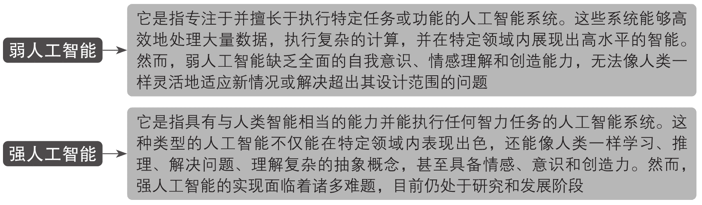

图 1-1

**1.1.2 什么是 AIGC**

扫码看教学视频

AIGC（artificial intelligence generated content，人工智能生成内容）是指利用人工智能技术，通过学习和模拟人类的创作过程，自动生成各种类型的文本、图像、视频、音频等内容。这是一种继专家生产内容（professional generated content，PGC）、用户生产内容（user generated content，UGC）之后的新型内容创作方式。

按生成内容的类型可将 AIGC 划分为文本生成、图像生成、视频生成和音频生成这 4 类，具体如图 1-2 所示。

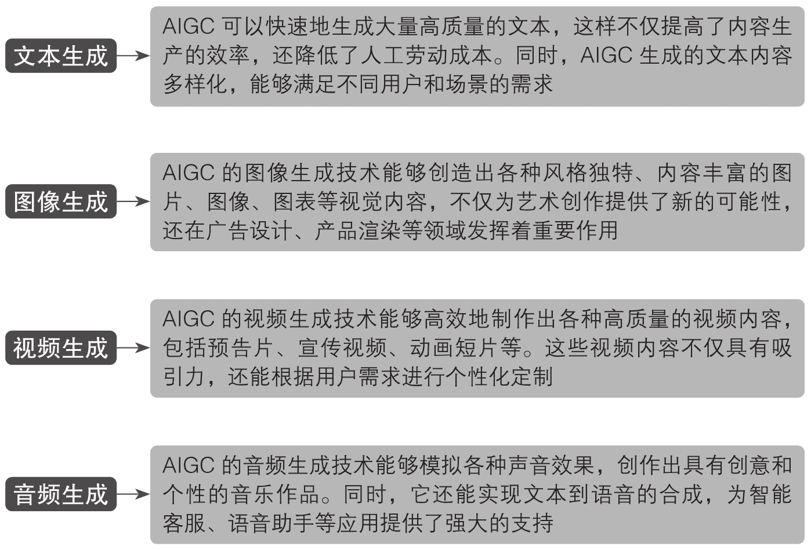

图 1-2

## **1.2 中老年人与人工智能的关联**

中老年人与人工智能的关联主要体现在人工智能如何提升中老年人的生活质量上。随着科技的进步，人工智能技术在中老年人的生活中发挥着越来越大的作用。本节讲解人工智能对中老年人的作用，以及中老年人学习人工智能的机遇。

**1.2.1 中老年人学习人工智能的意义**

扫码看教学视频

中老年人学习人工智能具有多方面的意义，不仅有助于他们跟上时代步伐，还能从多个维度提升他们的生活质量和个人能力。以下是对中老年人学习人工智能的意义的详细阐述，具体如图 1-3 所示。

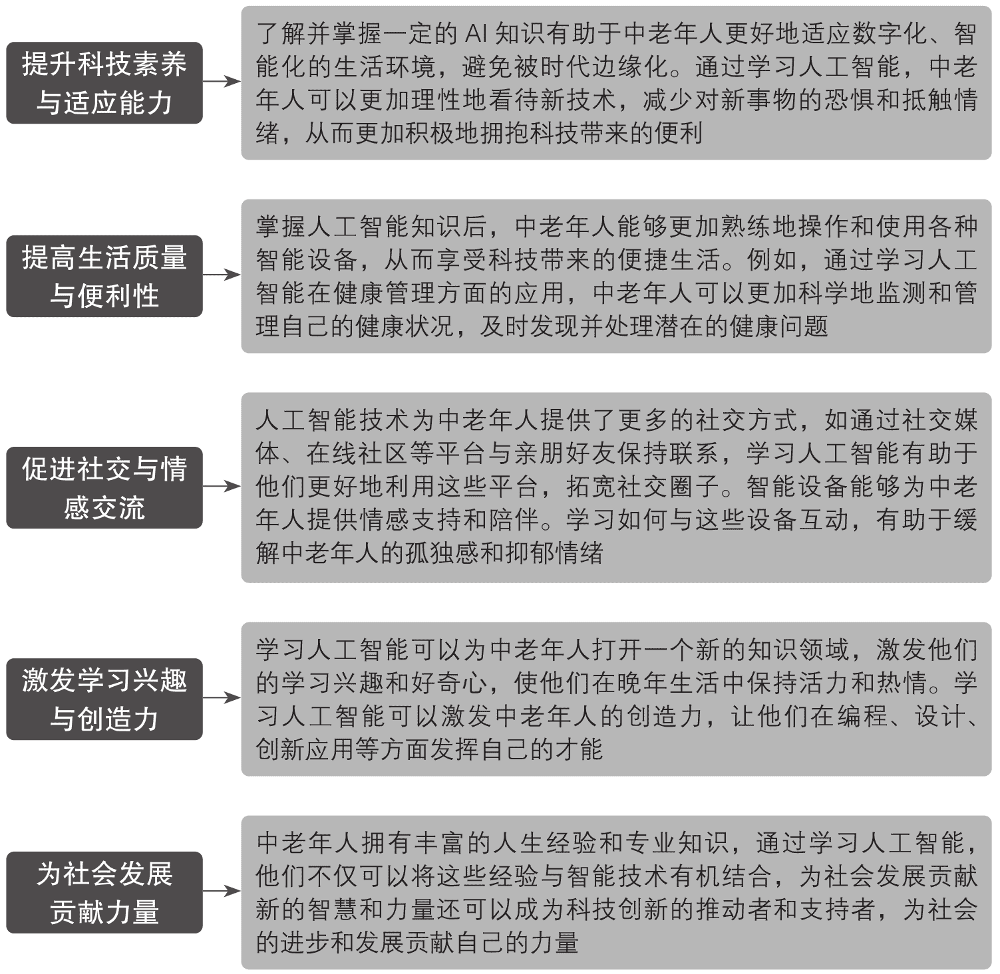

图 1-3

**1.2.2 中老年人学习人工智能的机遇**

扫码看教学视频

中老年人学习人工智能蕴藏着丰富的机遇。下面通过图解的方式，具体讲解中老年人学习人工智能可能带来的机遇，如图 1-4 所示。

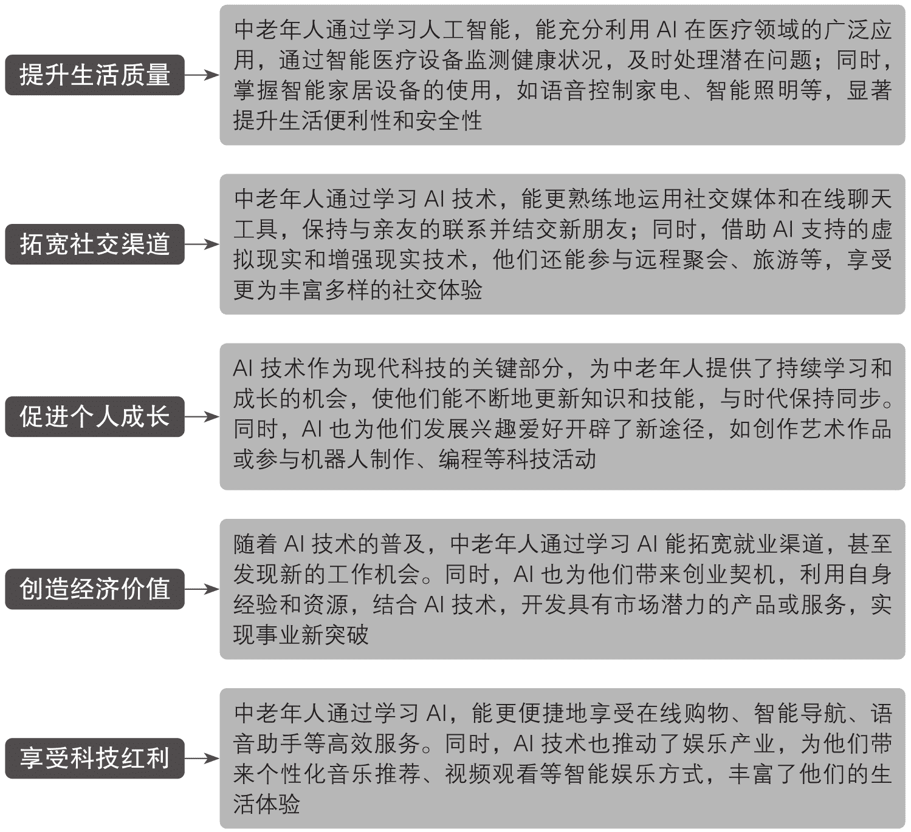

图 1-4

# **第二章** **AI 健康管理**

AI 健康管理是指利用人工智能技术，通过收集、分析个人的健康数据，提供个性化的健康管理方案、疾病预防、健康风险评估以及健康干预等服务。它融合了大数据、机器学习、深度学习等先进技术，旨在为中老年人提供精准、高效、便捷的健康管理服务。

## **2.1** **用 AI 进行健康管理**

很多中老年人对健康问题比较关心，而借助 AI 技术和 AIGC 技术，可以解答相关的问题，帮助中老人更好地进行健康管理。本节将通过具体案例，深入剖析 AI 在健康管理领域的应用，为中老年群体筑起一道坚实的健康守护屏障。

**2.1.1** **用 AI 提醒服药**

扫码看教学视频

部分中老年人需要吃一些药品，但是由于一些原因，会忘记按时服药。其实，这部分中老年人可以借助相关的 AI 功能设置用药提醒，督促自己按时服药。

例如，健康云 App 是一款健康管理类软件，在该软件中，中老年人不仅可以查询医药方面的信息，还可以完成提醒服药等操作。下面介绍设置服药提醒的操作步骤。

步骤 01 打开手机，点击手机桌面上的“软件商店”图标，如图 2-1 所示。

图 2-1

步骤 02 在软件商店的搜索框中，❶输入“健康云”并进行搜索，❷点击对应 App 右侧的“安装”按钮，如图 2-2 所示，下载并安装健康云 App。

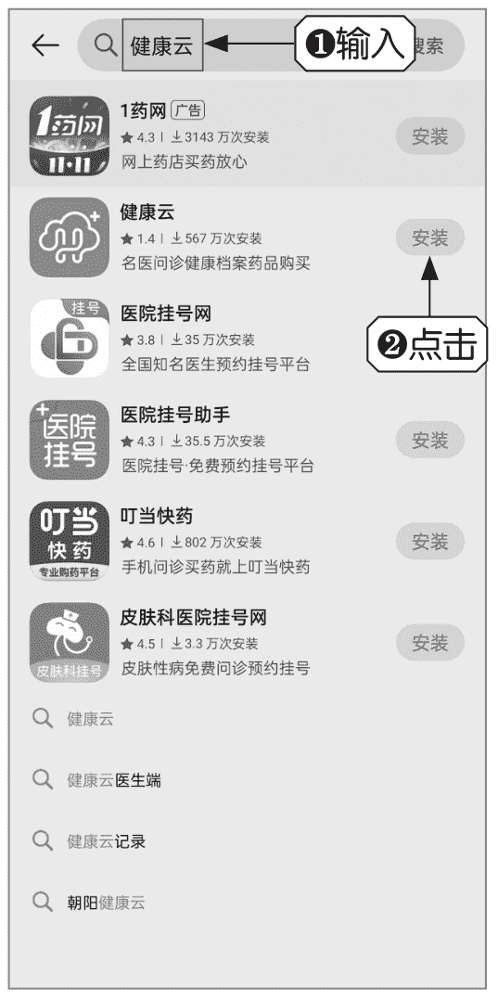

图 2-2

步骤 03 健康云 App 下载安装完成后，点击“健康云”右侧的“打开”按钮，如图 2-3 所示，打开该 App。

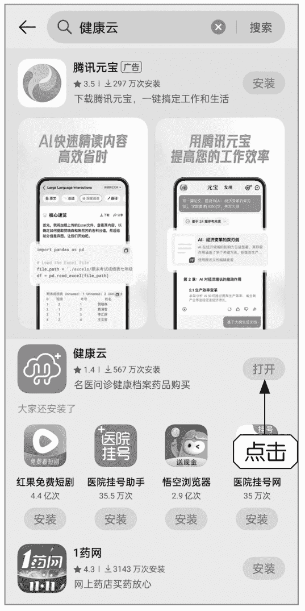

图 2-3

步骤 04 弹出“个人信息保护指引”面板，阅读该面板中的信息，如图 2-4 所示。

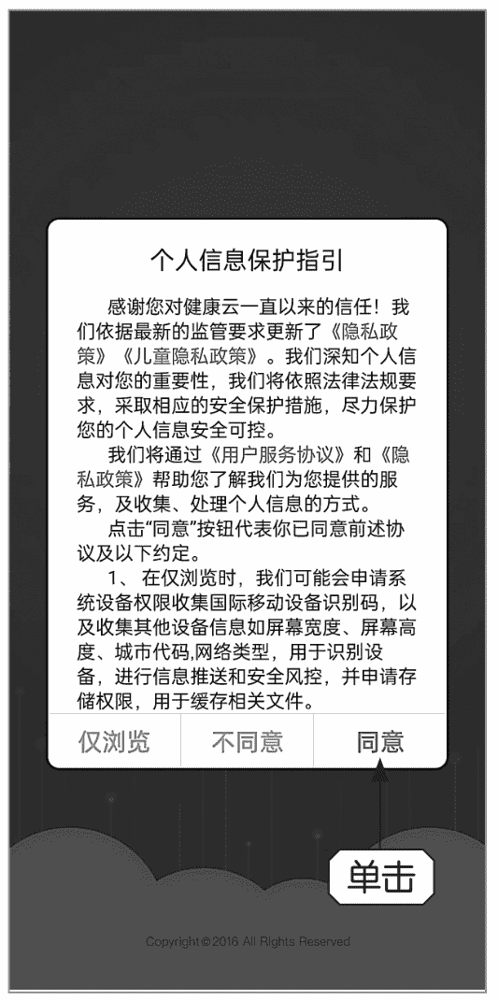

图 2-4

步骤 05 点击“同意”按钮，进入健康云 App 的“首页”界面，如图 2-5 所示。

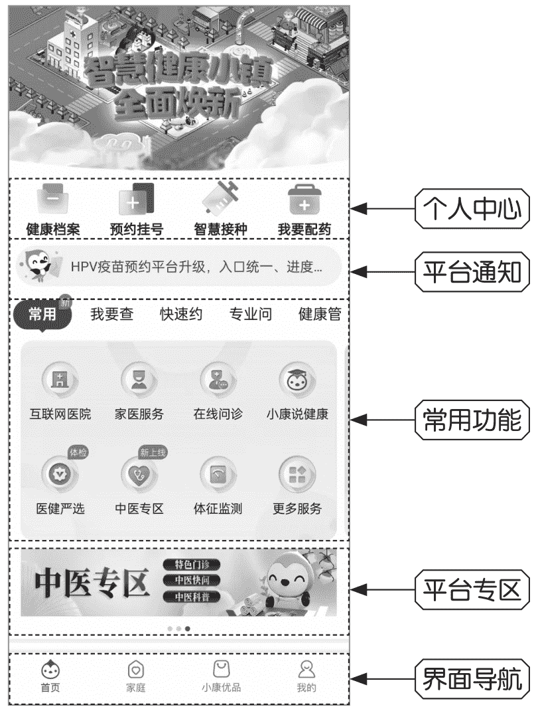

图 2-5

步骤 06 点击“我的”按钮，进入健康云的账号登录界面，点击“注册账号”按钮，如图 2-6 所示，进行账号的注册。

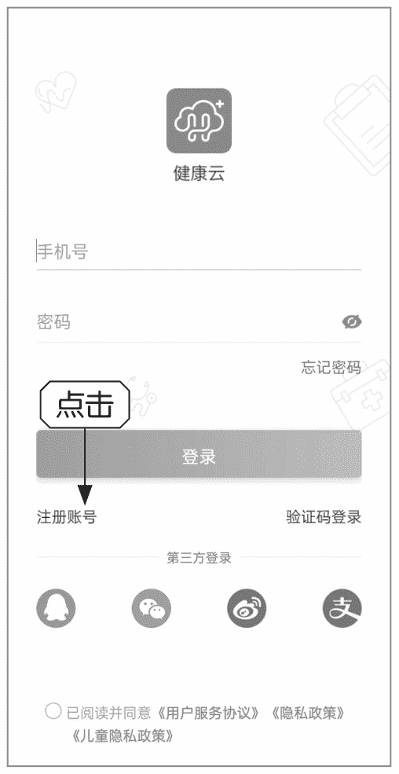

图 2-6

步骤 07 在新跳转的界面中，❶输入注册信息，❷选择相应的复选框，❸点击“注册”按钮，如图 2-7 所示，注册一个账号。

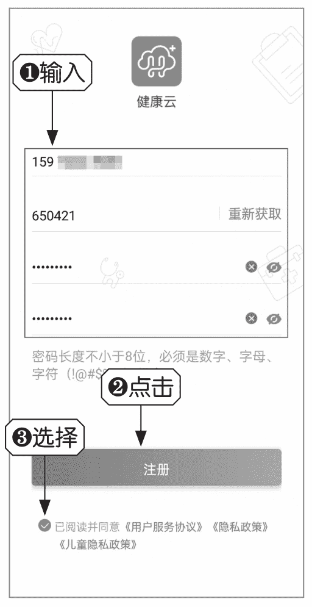

图 2-7

步骤 08 账号注册成功后，❶点击“首页”按钮，进行界面的切换，❷点击“健康管理”板块中的“添加用药提醒”按钮，如图 2-8 所示。

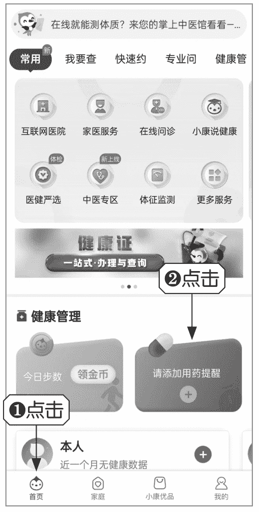

图 2-8

步骤 09 进入“添加用药提醒”界面，❶设置用药提醒的相关信息，❷点击“保存”按钮，如图 2-9 所示，即可完成用药提醒的添加操作。

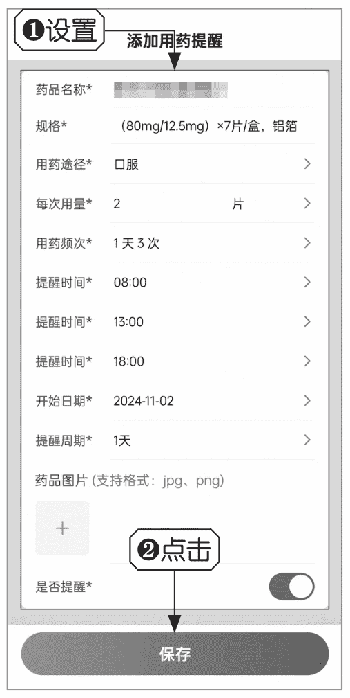

图 2-9

**2.1.2** **用 AI 检测体质**

扫码看教学视频

对于中老年人来说，体质检测是评估其健康状况的重要手段，通过体质检测，能及时发现潜在的健康问题，为制订个性化健康管理方案提供依据，助力中老年人享受健康、幸福的生活。对于中老年人来说，线下做体质检测可能需要花费一些时间和精力，而使用一些 AI 工具，在家里即可完成体质检测。

例如，知源中医 App 是一款专注于中医知识的软件，在这款软件中，中老年人不仅可以查看中医方面的信息，还能从中医的角度做体质检测。下面讲解用 AI 检测体质的具体操作方法。

步骤 01 在手机的软件商店中，❶输入并搜索“知源中医”，❷点击“安装”按钮，如图 2-10 所示。

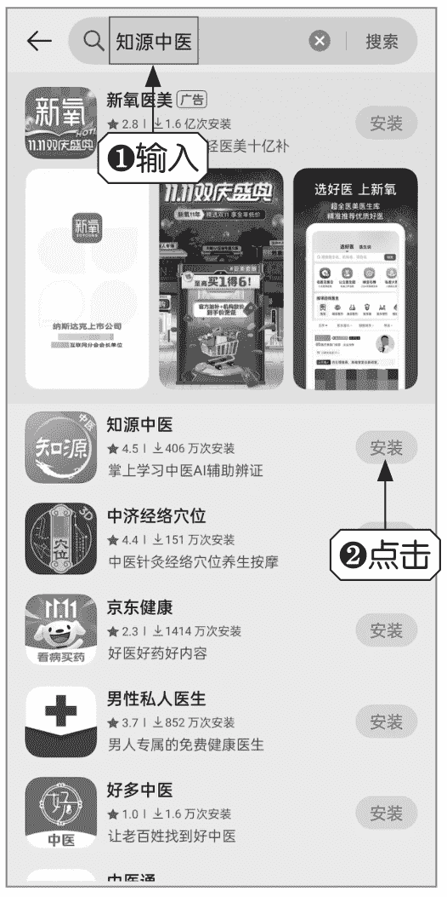

图 2-10

步骤 02App 下载安装完成后，点击“打开”按钮，如图 2-11 所示，打开该 App。

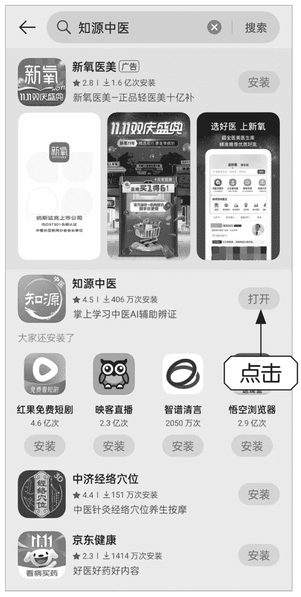

图 2-11

步骤 03 弹出“个人信息保护指引”面板，阅读指引信息，点击“同意”按钮，如图 2-12 所示。

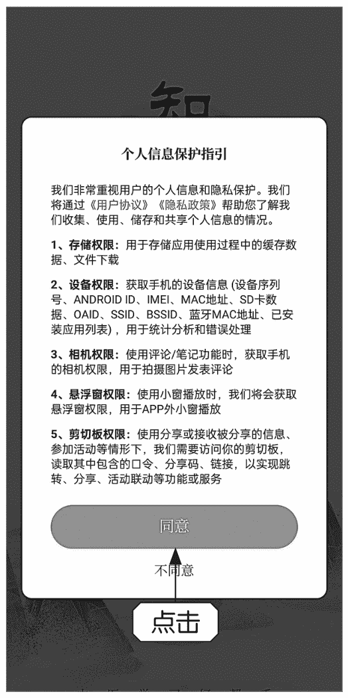

图 2-12

步骤 04 进入知源中医 App 的“首页”界面，如图 2-13 所示。

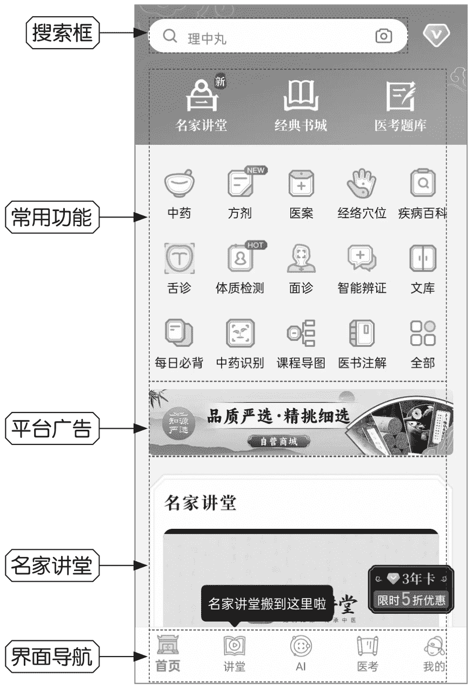

图 2-13

步骤 05 点击“首页”界面中的“体质监测”按钮，进入“AI 体质监测”界面，点击该界面中的“开始检测”按钮，如图 2-14 所示，进行 AI 体质检测。

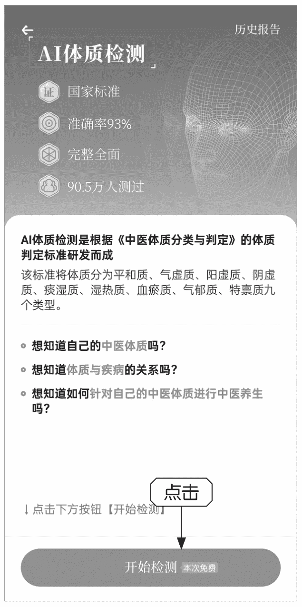

图 2-14

步骤 06 进入“AI 体质检测系统”界面，在该界面中与知源中医智能体质检测系统进行对话，完成基本信息的问答之后，会提示发送舌诊报告，点击“开始舌诊”按钮，如图 2-15 所示。

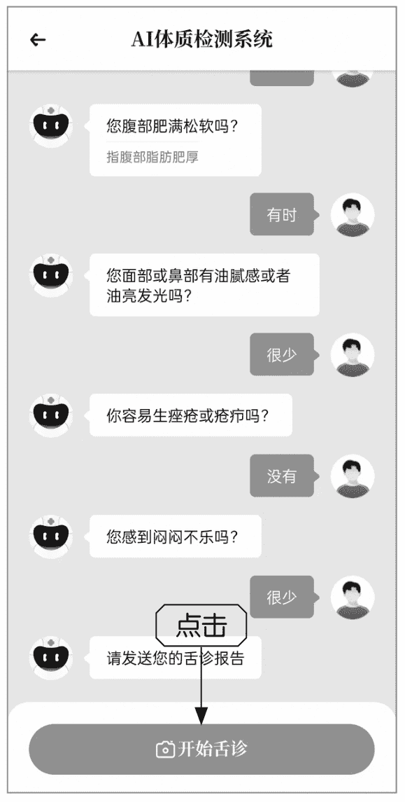

图 2-15

步骤 07 进入“请拍摄舌面”界面，如图 2-16 所示，在该界面中，使用相机拍摄自己的舌面。

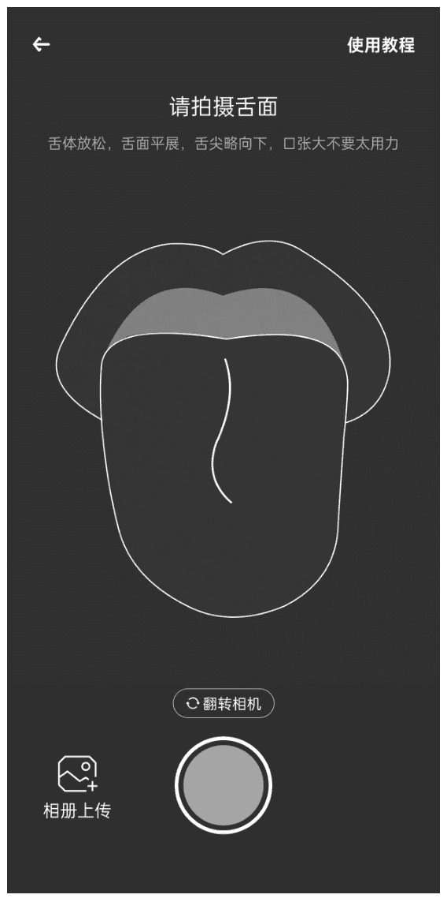

图 2-16

步骤 08 拍摄并上传舌面图片之后，会进行舌诊，舌诊完成后会给出体质检测报告。点击“查看报告”按钮，如图 2-17 所示。

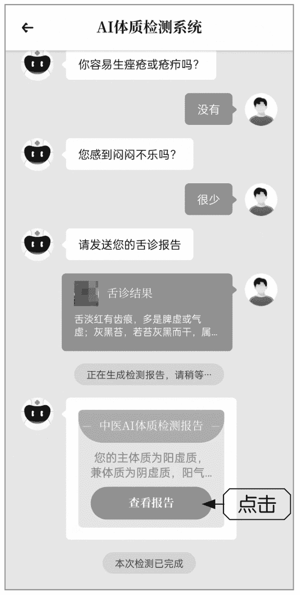

图 2-17

步骤 09 执行操作后，即可查看体质检测的结果，如图 2-18 所示。

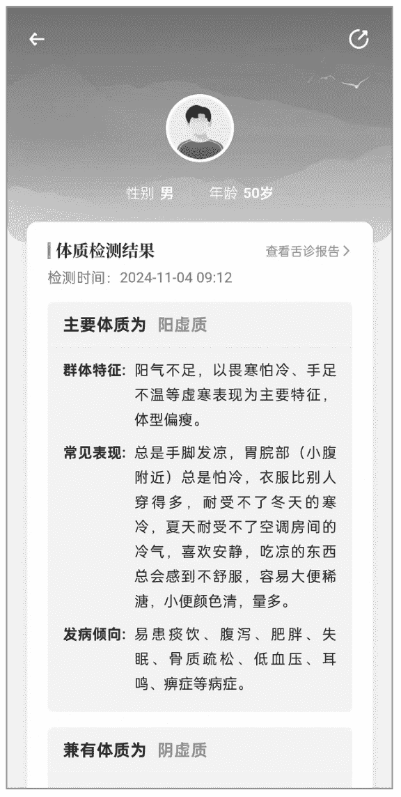

图 2-18

**专家提醒**

在与知源中医智能体质检测系统对话时，虽然对话内容大体相同，但是问题的顺序可能会有差异。在实际操作过程中，只需根据自身实际情况回答问题即可。

**2.1.3** **用 AI 导诊**

扫码看教学视频

智能导诊是借助医疗 AI、自然语言处理等技术推出的在线导医分诊智能工具，它覆盖导诊、智能问答、科普宣教等就医服务。智能导诊可根据患者的症状快速推荐科室医生，同时提供智能问答功能，针对院务等问题在线答疑解惑。借助 AI 导诊功能，中老年人可以快速对就诊问题进行问询，让线下就医变得有的放矢。

例如，腾讯健康公众号是一个健康应用平台，该平台可以为中老年人提供名医咨询、预约挂号和智能导诊等服务。下面讲解智能导诊的具体操作方法。

步骤 01 打开微信，点击“微信”界面上方的 按钮，如图 2-19 所示。

图 2-19

步骤 02 在新弹出的界面中，点击“公众号”按钮，如图 2-20 所示，指定搜索内容所属的类型。

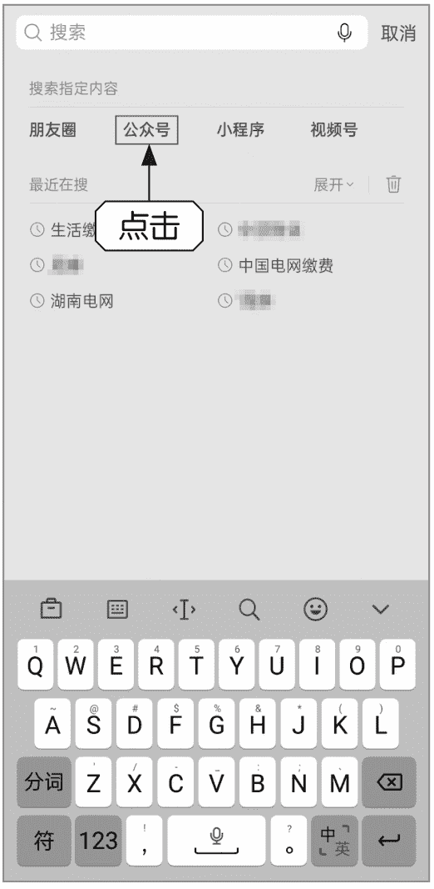

图 2-20

步骤 03❶在输入框中输入并搜索“腾讯健康”，❷点击搜索结果界面中对应公众号所在的区域，如图 2-21 所示。

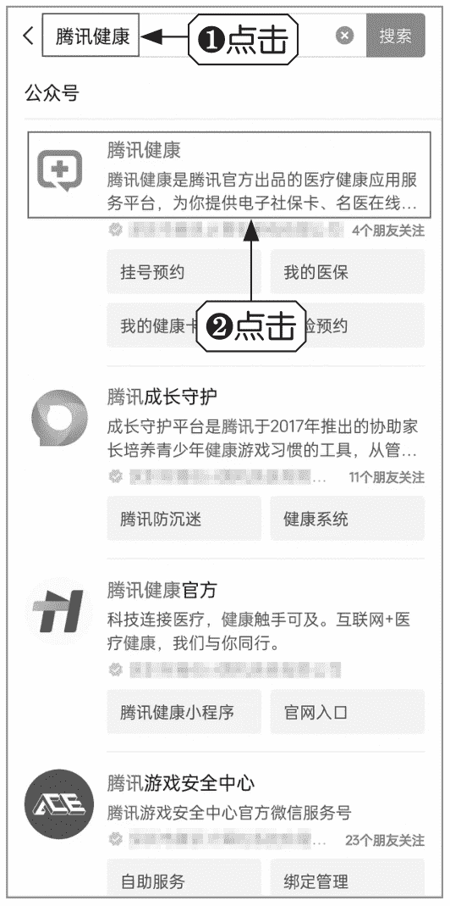

图 2-21

步骤 04 进入“腾讯健康”公众号的介绍界面，点击“关注公众号”按钮，如图 2-22 所示，关注该公众号，以便更好地获得相关的服务。

图 2-22

步骤 05 执行操作后，界面信息会发生变化，点击“发消息”按钮，如图 2-23 所示，与腾讯健康公众号进行对话。

图 2-23

步骤 06 执行操作后，进入“腾讯健康”界面，如图 2-24 所示。

图 2-24

步骤 07❶点击“腾讯健康”界面中的“医疗服务”按钮，在弹出的列表框中，❷选择“挂号预约”选项，如图 2-25 所示。

图 2-25

步骤 08 进入“预约挂号”界面，点击“智能导诊”按钮，如图 2-26 所示，启用“智能导诊”功能。

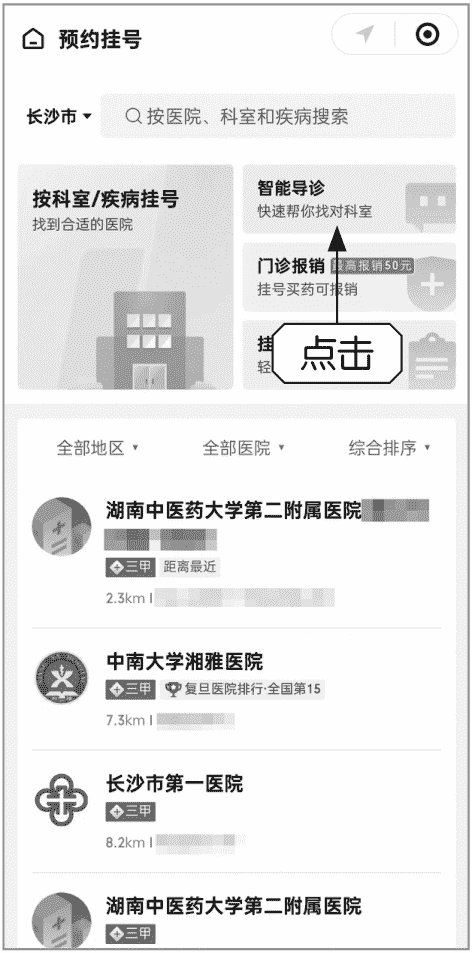

图 2-26

步骤 09 进入“智能导诊”界面，会显示相关的提示信息，如图 2-27 所示。

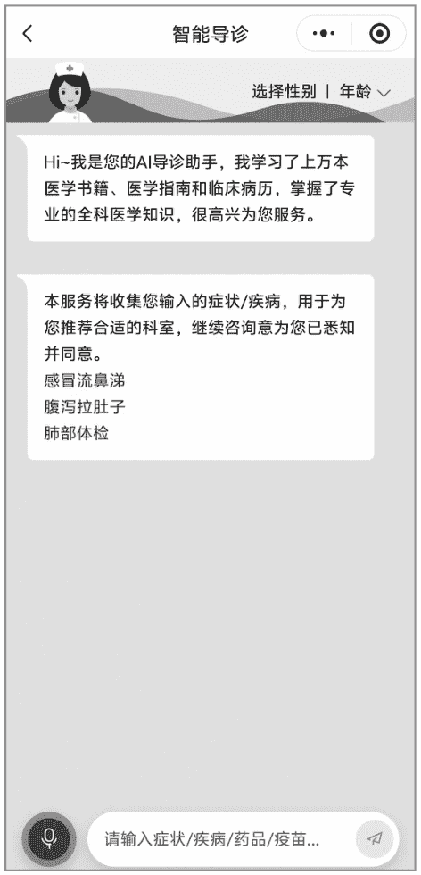

图 2-27

步骤 10 根据自身需求与 AI 导诊助手进行对话，即可获得相关的医疗咨询信息，如图 2-28 所示。如果有需要，中老年人还可以点击“去挂号”按钮，并通过线上平台进行挂号。

图 2-28

**专家提醒**

在腾讯健康公众号中，与 AI 导诊助手对话的信息会一直自动保存，即便取消关注之后再次关注该公众号，进入“智能导诊”界面时仍旧会显示之前的对话内容。

**2.1.4** **用 AI 呵护健康**

扫码看教学视频

扫码看效果

有的平台推出了 AI 智能体，中老年人可以就相关问题向这些 AI 智能体提问，快速获得相关的解答，从而更好地呵护自己的健康。

例如，通义是一个应用了 AIGC 技术的平台，在该平台中，用户可以通过问答生成文字和图片等内容。下面讲解使用通义进行健康咨询的具体操作步骤。

步骤 01 打开搜索引擎（如百度搜索引擎），❶在搜索框中输入“通义”，❷单击“百度一下”按钮，如图 2-29 所示，进行信息的搜索。

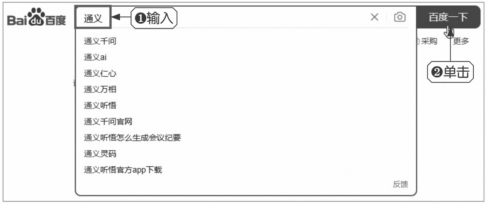

图 2-29

步骤 02 单击搜索结果中通义官网的对应链接，如图 2-30 所示。

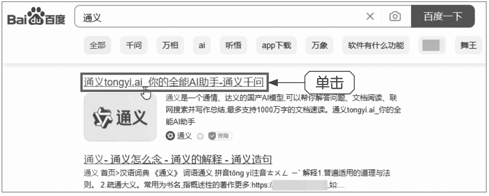

图 2-30

步骤 03 进入通义的官网默认页面，如图 2-31 所示。

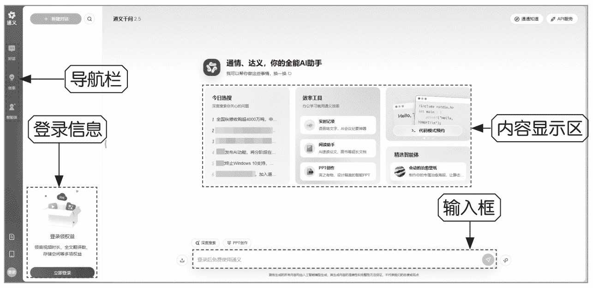

图 2-31

步骤 04 单击“对话”页面中的“立即登录”按钮，弹出“通义”对话框，在该对话框中，中老年人可以通过手机验证登录或扫码登录，登录通义平台。以手机验证登录为例，❶中老年人只需输入手机号码和验证码，❷选中相关复选框，❸单击“登录”按钮，如图 2-32 所示，即可进行账号的登录。

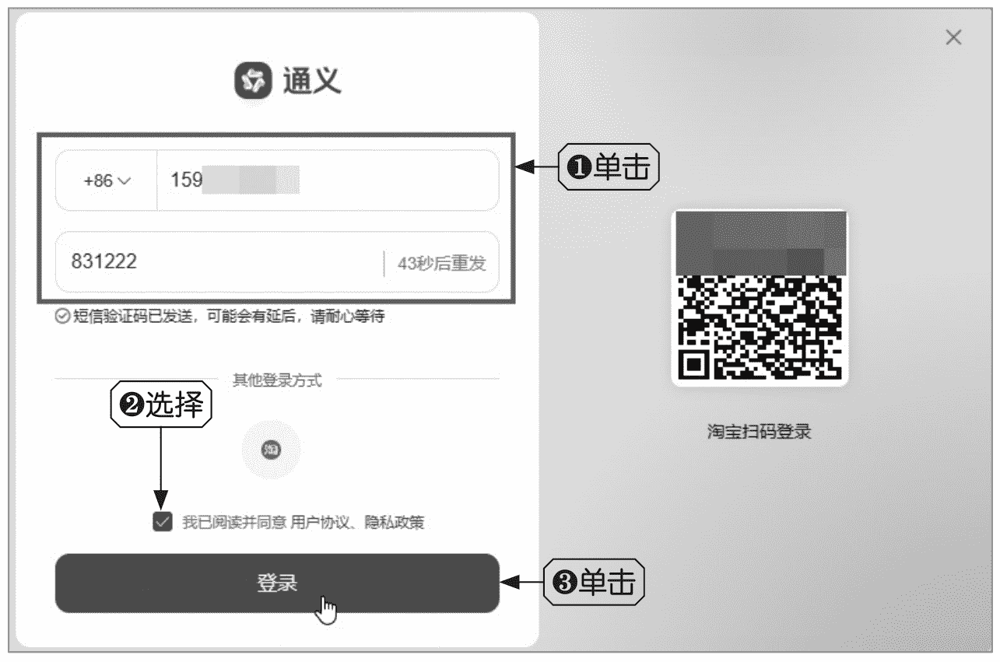

图 2-32

步骤 05 执行操作后，如果官网默认页面的左下方显示账号头像，就说明账号登录成功了。单击“智能体”按钮，如图 2-33 所示，进行页面的切换。

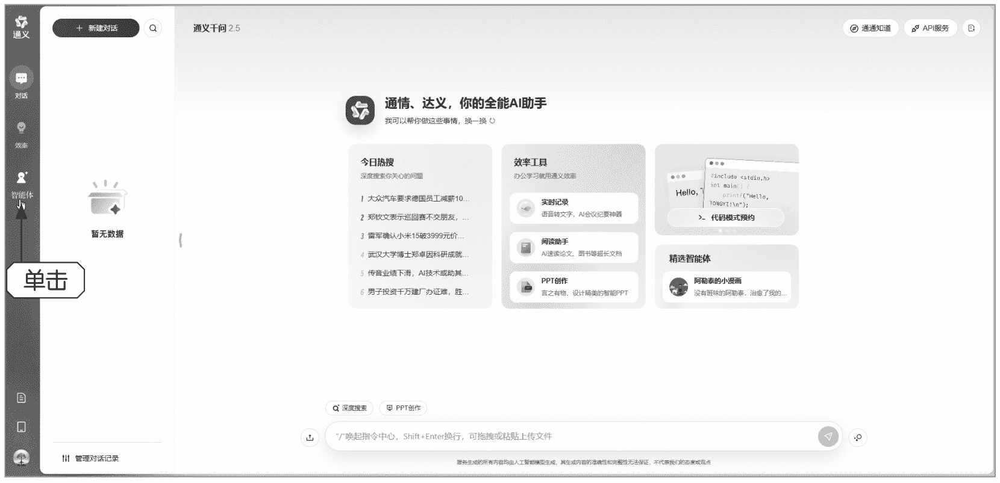

图 2-33

步骤 06 在“智能体”页面的“全部分类”选项卡中，单击“健康助手”按钮，如图 2-34 所示，启用“健康助手”智能体。

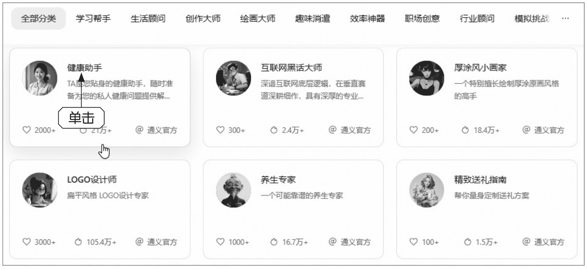

图 2-34

步骤 07❶在新页面的输入框中输入提示词，❷单击 按钮，如图 2-35 所示，就相关问题向健康助手智能体提问。

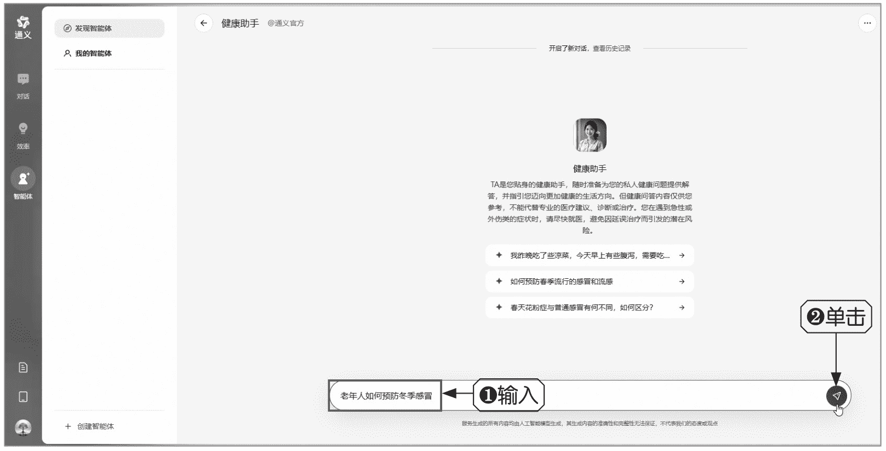

图 2-35

步骤 08 执行操作后，健康助手智能体会就相关问题进行回答，给中老年人提供一些建议，具体内容如下。 

**通义**

老年人在冬季确实比较容易感冒，因为他们的免疫力相对较弱。预防感冒可以从以下几个方面来做：

1．保暖：冬天天气寒冷，老年人要特别注意保暖，尤其是脚部和背部的保暖很重要。出门前记得穿暖和的衣服，戴帽子、围巾和手套。

2．合理饮食：多吃富含维生素 C 和维生素 E 的食物，比如新鲜水果（柑橘类）、蔬菜等，这些都有助于增强身体抵抗力。同时也要保证足够的蛋白质摄入，如鱼肉、鸡肉等。

3．适量运动：适当的体育锻炼可以提高身体素质，增强免疫功能。但要注意不要过度劳累，选择适合自己的轻度到中度强度的活动，比如散步、太极等。

4．保持室内空气流通：虽然外面冷，但是也不能长时间紧闭门窗，应该定时开窗通风换气，减少病毒细菌滋生的机会。

5．个人卫生：勤洗手，尤其是在外出回家后；尽量避免去人多拥挤的地方，如果必须前往，则最好佩戴口罩。

6．充足睡眠：保证充足的休息时间对维持良好的免疫系统至关重要。

7．接种疫苗：对于部分体质较弱或有慢性疾病的老年人来说，可以考虑接种流感疫苗来增加防护力。

通过以上方法可以帮助老年人更好地抵御冬季感冒哦！如果还有其他健康方面的问题或者需要更详细的建议，请随时告诉我。

**2.1.5** **用 AI 规划饮食**

扫码看教学视频

扫码看效果

合理的饮食可以让中老年人拥有更加健康的体魄，中老年人可以借助 AIGC 的相关技术，让 AI 提供一个饮食规划。下面就以通义为例，讲解制订饮食计划的具体操作步骤。

步骤 01 进入通义的“对话”页面，❶在输入框中输入相关的提示词，❷单击 按钮，如图 2-36 所示，就相关问题向通义提问。

图 2-36

步骤 02 执行操作后，通义会根据提问内容，为中老年人制订一个饮食计划，具体内容如下。 

**通义**

当然可以。根据您的要求，这里为您提供一个一周的清淡饮食计划，旨在帮助您享受美味的同时，保持营养均衡和身体健康。请根据个人口味和需求适当调整食材和分量。

周一至周日营养均衡清淡饮食计划

**早餐**

燕麦粥：使用低脂牛奶或豆浆煮燕麦，加入少量坚果和新鲜水果（如蓝莓、香蕉片）。

全麦面包：搭配自制的低脂果酱或天然花生酱。

一杯绿茶或温开水：有助于促进新陈代谢。

**午餐**

主食：糙米饭或全麦面条，每日变换。

蔬菜：清炒时令蔬菜，如菠菜、西蓝花、胡萝卜等，尽量采用清蒸、白煮或凉拌的方式烹饪。

蛋白质：清蒸鱼、瘦肉丝炒豆芽、豆腐汤等，根据个人喜好选择。

水果：一份新鲜水果，如苹果、橙子或梨。

**晚餐**

主食：紫薯、南瓜或玉米等粗粮，有助于增加膳食纤维。

蔬菜：凉拌黄瓜、西红柿炒蛋或清炒青菜，保持蔬菜的新鲜和营养。

蛋白质：鸡胸肉炖蘑菇、虾仁豆腐或黑木耳炒瘦肉，选择低脂肉类。

汤品：番茄蛋花汤或冬瓜排骨汤，清淡可口。

……

## **2.2** **用 AI 设备管理健康**

近年来，市面上的 AI 健康管理类设备越来越多，这些设备不仅便捷易用，还大大提升了健康管理的精准度和效率，为中老年人的健康生活保驾护航。本节将结合具体的案例，讲解 AI 设备在中老年人健康管理方面的应用。

**2.2.1** **用 AI 监测睡眠**

扫码看教学视频

中老年人应重视睡眠质量，良好的睡眠有助于身心健康。保持规律的作息，创造安静舒适的睡眠环境，避免晚间过度兴奋的活动。使用智能手环等科技产品，可以监测睡眠状态，调整睡眠习惯，让中老年人享受更加宁静、健康的夜晚。

以华为智能手环 9 为例，该手环提供就寝提醒服务，可以提醒中老年人按时睡觉。同时，华为智能手环 9 还可以设置睡眠模式，减少睡前干扰。如果有需要，中老年人还可以使用该手环播放音乐，让自己更快入眠。

在中老年人的睡眠过程中，华为智能手环 9 可以对“睡眠呼吸暂停”“睡眠呼吸率”“睡眠心率”和“睡眠血氧”等信息进行睡眠健康的监测，多方位守护中老年人的健康，如图 2-37 所示。

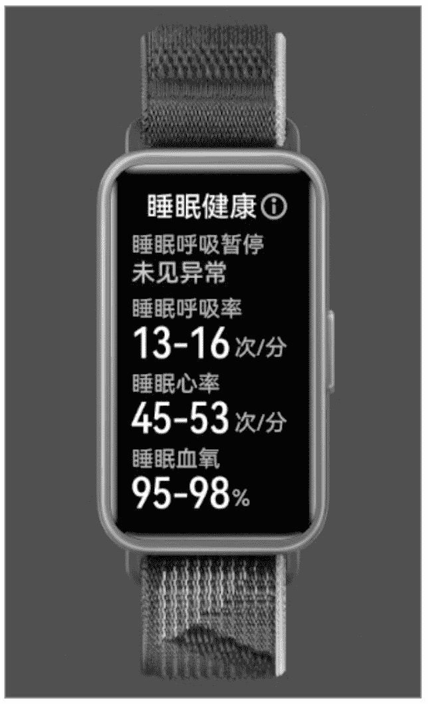

图 2-37

睡醒之后，华为智能手环 9 会根据中老年人的睡眠情况进行评分，同时，它还可以联动健康 App 综合分析中老年人的睡眠情况，并为中老年人提供专属的睡眠解读和建议，帮助中老年人更好地提升睡眠质量，如图 2-38 所示。

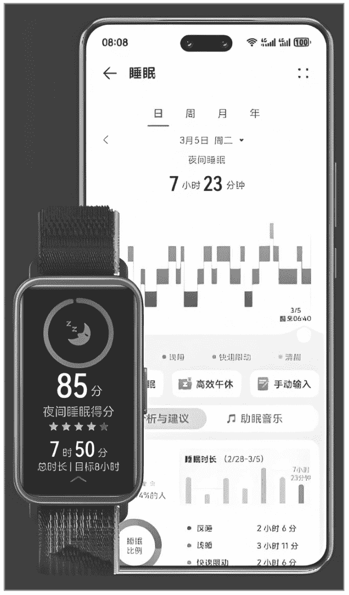

图 2-38

**专家提醒**

除了睡眠健康的监测，华为智能手环还具备多种实用功能，如实时心率与血氧监测、健康提醒与预警、信息同步与提醒紧急求救等，这些功能可以为中老年人的生活带来诸多便利。

例如，华为智能手环 9 可以根据中老年人的健康数据，提供久坐提醒、饮水提醒等健康建议。对于存在特定健康风险（如高血压、糖尿病）的中老年人，手环的预警功能还可以在关键时刻提供及时警示，从而降低突发健康事件的风险。

**2.2.2** **用 AI 测量血压**

扫码看教学视频

中老年人应定期监测血压，这是维护心血管健康的关键。中老年人测量血压时，建议使用智能血压计，因为其操作简便且读数准确。测量时保持安静，避免饭后或运动后立即测量，以确保数据可靠。记录每次测量结果，有助于及时发现血压波动，为健康管理提供依据。

以奥克斯 BSX5128 型号的电子血压计为例，该血压计具有智慧测压功能，可以一键完成测压，大大简化了操作的难度，让动手能力相对较弱的人也能快速完成血压的测量，如图 2-39 所示。

图 2-39

除此之外，这款电子血压计还配备了“智能语音播报”功能，系统会通过语音播报的方式告知测量结果，让视力不太好的中老年人也能快速了解自身的血压情况，如图 2-40 所示。

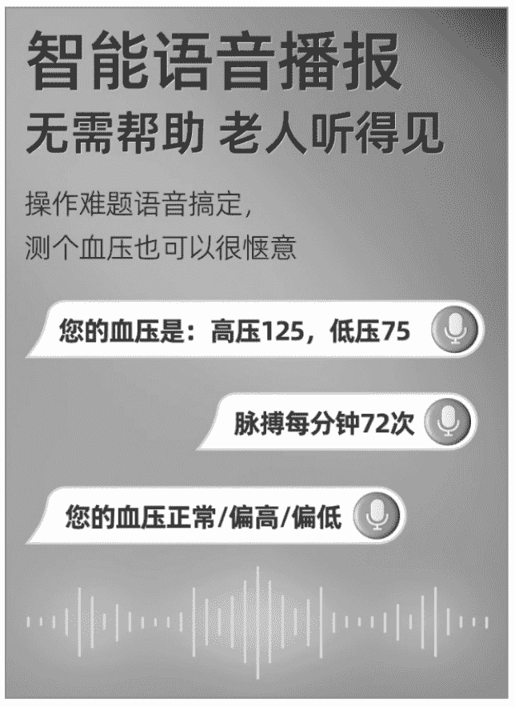

图 2-40

**2.2.3** **用 AI 监测心率**

扫码看教学视频

中老年人心率监测对于预防心血管疾病至关重要。正常情况下，心率应在每分钟 60 至 100 次之间，超过或低于这个范围可能预示着健康问题。定期监测心率有助于及时发现异常，比如因情绪波动、身体劳累或疾病引起的心动过速或过缓。通过持续关注心率变化，中老年人可以更好地了解自身健康状况，调整相应的生活方式或进行医疗干预，从而保障生活质量。

中老年人可以借助多种 AI 设备监测自己的心率，如智能手环、智能心率监测一体机和智能耳机等。以墨觉 Terra 智能运动耳机为例，图 2-41 所示为该智能运动耳机的产品图。

图 2-41

这款智能运动耳机可以对中老年人的心率进行监测，并对中老年人的健康进行有效管理，这主要体现在两个方面，即心率的实时监测和 AI 运动私教。

**1．心率的实时监测**

墨觉 Terra 智能运动耳机可以对中老年人的心率进行精准监测，它不仅可以通过语音播报的方式将心率的监测结果告知中老年人，还可以在心率过高或过低时，通过振动向中老年人发出危险预警。

**2．AI 运动私教**

墨觉 Terra 智能运动耳机可以充当中老年人的运动私教，并为中老年人提供一对一的服务。它会基于中老年人的心率和运动数据，并结合专业的运动算法，生成有效的训练计划，让中老年人的运动变得更加安全、高效。

**2.2.4** **用 AI 保护颈椎**

扫码看教学视频

中老年人应注意颈椎保护，避免长时间低头看手机或久坐不动。日常可进行颈部轻柔拉伸、适量转动头部，以缓解颈椎压力。睡觉时选用合适的枕头，保持颈椎自然曲度。定期进行散步、太极等锻炼，增强颈部肌肉力量，维护颈椎健康。

除此之外，中老年人还可以借助智能颈椎按摩器等 AI 设备，对颈部进行按摩，放松颈椎，对颈椎起到保护作用。

以京东京造智能颈椎按摩器 SE 为例，该颈椎按摩器采用了先进的 AI 算法，能够模拟真人的按摩手法，深入颈部的肌肉组织，有效舒缓颈部疲劳。同时，它提供了 16 档脉冲强度，能够满足中老年人多样化的需求，让中老年人感受到不同的按摩快感，如图 2-42 所示。

图 2-42

另外，这款颈椎按摩器还提供智能恒温热敷功能，带上它之后，中老年人可以在按摩的同时，享受 42℃的恒温热敷，让颈部的疲劳得到快速缓解，如图 2-43 所示。

图 2-43

**2.2.5** **用 AI 防止摔伤**

扫码看教学视频

中老年人摔伤后果严重，可能导致骨折、长期卧床不起，甚至引发并发症，影响生活质量。摔伤后恢复缓慢，给生活带来诸多不便，还可能造成心理阴影，影响日常活动和社交。

中老年人可通过保持家居环境安全，如安装扶手、防滑地板以及选择舒适防滑的鞋子来防止摔伤。同时，进行适量的平衡和力量训练，增强身体协调性，降低摔倒风险。除此之外，中老年人还可以通过穿戴 AI 设备来减轻甚至避免摔倒给自己带来的伤害。

以信安智囊老人防摔马甲为例，该马甲具有全方位的自动防护功能，无论是前摔、后摔，还是侧摔，马甲中的芯片一旦监测到中老年人处于跌倒或失重状态，就会开启防护模式并快速触发气囊保护，减少摔倒给中老年人带来的伤害。图 2-44 所示为信安智囊老人防摔马甲的前摔保护的示意图。

图 2-44

这款马甲具有“AI 智能识别”功能，平常它就像普通马甲一样，不会妨碍中老年人的日常活动，如图 2-45 所示。

图 2-45

如果怕摔倒之后无法自救，中老年人还可以在房间内安装智能跌倒检测雷达等设备，让设备根据设置信息及时报警，这样即便出现了意外情况，也能让自己得到救助。

以萤石非接触式智能跌倒检测雷达为例，该 AI 设备可以对所在区域内的人体进行精准识别，并将识别的信息推送到对应的手机 App 上。如果识别到人体离开或跌倒，就会给手机 App 推送告警信息，如图 2-46 所示。

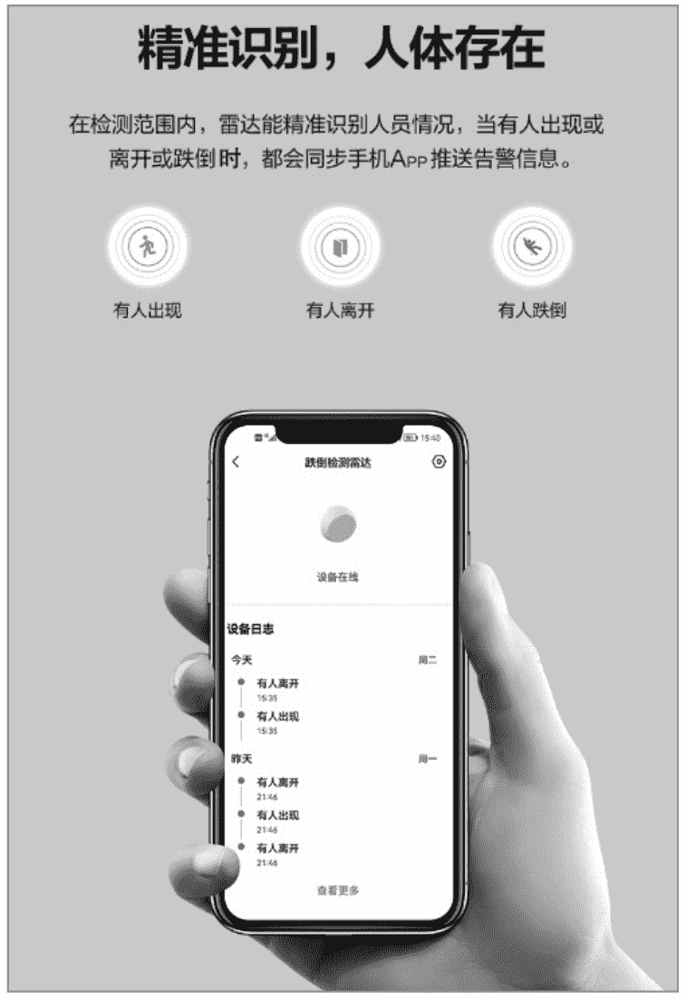

图 2-46

**专家提醒**

告警是指在系统、设备、网络或应用程序等运行过程中，当检测到异常情况、潜在威胁或超出预设阈值的指标时，自动触发的一种通知机制。告警的目的是及时告知相关人员（如系统管理员、运维人员、开发人员等）发生的问题，以便他们能够迅速采取必要的措施进行响应和处理，从而保障系统的稳定运行和服务的连续性。

另外，该检测雷达还可以对检测信息进行设置，确定报警延长时间，如图 2-47 所示。在报警延长时间内，只要摔倒的人起身，就不会向手机 App 发送告警信息，减少误报情况的发生。

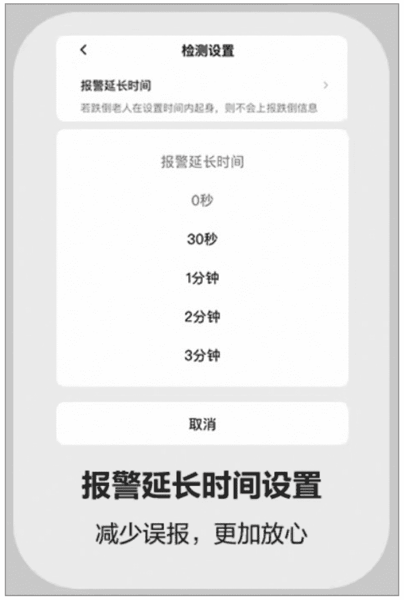

图 2-47

**2.2.6** **用 AI 紧急求救**

扫码看教学视频

中老年人如遇紧急情况，应立即使用随身携带的紧急求救设备或拨打急救电话，清晰告知自身状况及位置信息。同时，保持冷静，等待救援人员到来，确保自身安全，这是中老年人自我保护的重要措施。

通常情况下，比较方便快捷的求救方式就是使用随身携带的通信设备拨打急救电话。但是，中老年人日常生活中可能会遇到未携带通信设备的情况，此时如果家里装备了 AI 紧急求救设备，问题就迎刃而解了。

以分音塔老人安全摔倒报警器为例，虽然这款设备的名字中带有“摔倒”的字样，但是它并不会像智能跌倒检测雷达那样，只在人体摔倒时才会报警，而是可以根据中老年人自身情况选择是否报警。

具体来说，该款摔倒报警器提供了智能语音报警功能，中老年人只需喊出“救命”等敏感词汇，即可快速进行报警，如图 2-48 所示。同时，因为这款摔倒报警器采用了先进的 AI 语音技术，所以可以有效地降低误报率。

图 2-48

除了语音报警，这款摔倒报警器还带有“一键报警”功能，中老年人只需按下智能报警装置中的对应按键，即可快速报警，如图 2-49 所示。

图 2-49

**专家提醒**

健壮性是一个跨学科的专业术语，用于描述系统、算法或事物在面临异常、不确定性或意外情况时，仍然能够保持其功能、性能以及稳定性的能力。简而言之，它是在不利条件下系统持续正常工作的能力。

# **第三章** **AI 社交娱乐**

AI 社交娱乐是当前科技发展的一个热门领域，它将人工智能技术与社交娱乐相结合，为用户，特别是中老年人，提供了更加便捷、高效和个性化的社交体验。本章将通过具体案例，讲解 AI 在社交娱乐方面的应用。

## **3.1** **用 AI 享受娱乐时光**

在智能科技的温柔拥抱下，中老年人正以一种前所未有的方式享受娱乐时光。AI 技术根据他们的喜好，定制个性化内容，让音乐、故事、知识等触手可及，不仅丰富了他们的精神世界，更让晚年生活焕发新生，充满了无限乐趣与温馨。本节将结合具体的 AI 设备，讲解中老年人用 AI 享受娱乐时光的具体案例。

**3.1.1** **用 AI 高效交流**

扫码看教学视频

在数字化时代，AI 技术为中老年人搭建了一座高效交流的桥梁。AI 能根据对话内容，提供健康咨询、生活建议，甚至陪伴聊天，让中老年人在享受便捷交流的同时，感受科技带来的温情与关怀。

以小米小爱音箱 Play 为例，这款音箱拥有超过 1600 种生活技能，中老年人可以通过语音与其进行交流，询问相关问题，并快速获得对应的答案，如图 3-1 所示。

图 3-1

这款智能音箱还带有语音控制功能，中老年人可以通过它快速控制接入小米 IoT 平台的智能设备，更好地享受娱乐时光，如图 3-2 所示。例如，中老年人可以通过这款音箱打开小米电视，观看新上线的电影。

图 3-2

**专家提醒**

IoT 平台指的是物联网（the internet of things，简称 IoT）平台。物联网平台是物联网解决方案将感知层的各类设备连接到场景应用的关键桥梁，它允许用户通过语音等交互方式，对连接到平台的智能设备进行远程控制和管理。

**3.1.2** **用 AI 驱散孤独**

扫码看教学视频

AI 聊天机器人以其独特的智能魅力，成为许多中老年人生活中的温馨伴侣。它们不仅能够通过智能对话，为中老年人提供丰富的信息、解答疑惑，还能倾听他们的心声，用贴心的关怀和温暖的陪伴驱散他们的孤独感。在 AI 的陪伴下，中老年人感受到了前所未有的情感支持，让晚年生活更加充实，重拾与人交流的乐趣与温暖。

以乐天派桌面机器人为例，这款 AI 实体生命的机器人具有视觉、触觉、听觉，它不仅可以说话，还可以做出表情和进行思考，如图 3-3 所示。

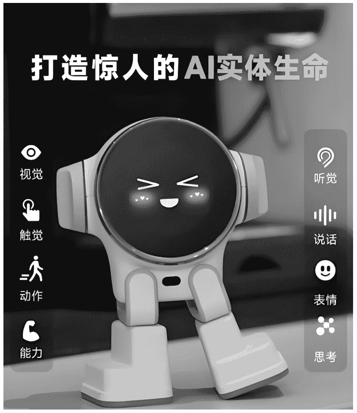

图 3-3

而且这款机器人具有情绪感知能力，当中老年人触摸它时，它能感知你的情绪，并通过表情和语音进行回应，如图 3-4 所示。

图 3-4

**3.1.3** **用 AI 指挥手机**

扫码看教学视频

AI 技术的融入，让手机成为中老年人生活中的得力助手。通过手机的智能助手，中老年人不要烦琐的操作，只需简单的语音指令，就能让手机进行各种操作，如设定提醒、查询天气、播放音乐、视频通话等。这一创新不仅简化了手机使用流程，更让中老年人在享受智能便利的同时，感受到科技带来的温暖与关怀。

以一加 Ace2 Pro 手机为例，中老年人可以通过如下操作向手机下达指令，指挥手机播放纯音乐。

步骤 01 打开手机，通过语音在手机中输入“小布小布”，如图 3-5 所示，启动手机助手。

图 3-5

步骤 02 如果手机回复“在呢”，就说明手机助手启动成功了，随后可根据自身需求下达语音指令，如让其播放一首纯音乐，如图 3-6 所示。

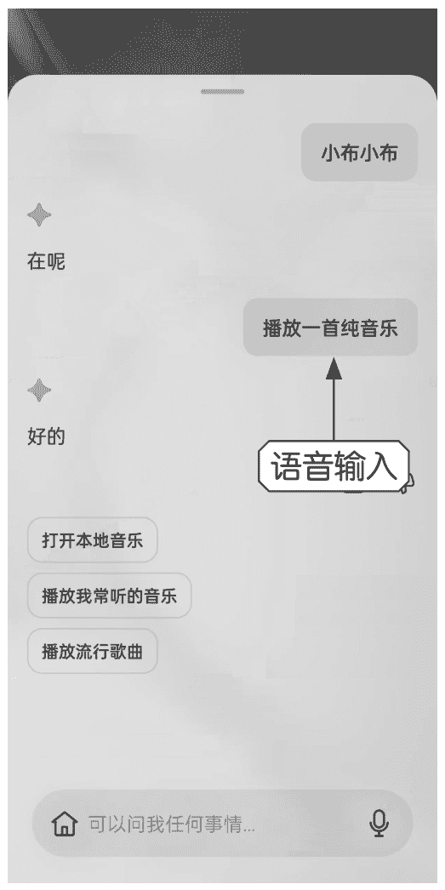

图 3-6

步骤 03 执行操作后，手机助手即可根据下达的语音指令，播放相关的音乐，如图 3-7 所示。

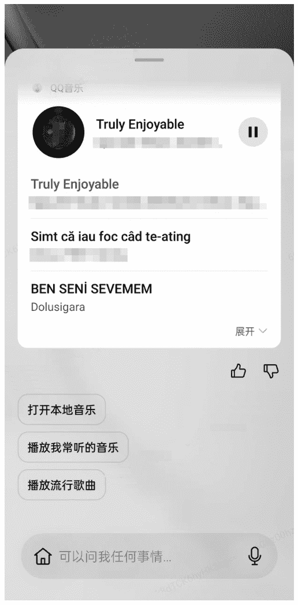

图 3-7

**专家提醒**

不同品牌的手机，手机助手的名称可能有所不同。例如，苹果手机的助手叫 Siri，华为手机的助手叫小艺，小米手机的助手叫小爱同学。在使用手机助手下达指令时，用户需要喊出对应的名称，启动手机助手。当然，如果手机助手的名字只有两个字，可以对着手机喊两次它的名字，这样启动手机助手的成功率会更高一些。

**3.1.4** **用 AI 联系子女**

扫码看教学视频

部分中老年人可能不和子女住在一起，平时很难和子女见一面。而利用 AI 设备联系子女，为中老年人带来了极大的便利与温情。它跨越了地域限制，让思念不再受距离阻隔。通过 AI 设备，中老年人能轻松与远方子女沟通，分享生活点滴，减轻孤独感。

以萤石智能家居摄像机为例，这款摄像机不仅具有超高的像素，还具备“AI 手势识别”“AI 人形特写追踪”和“AI 宠物检测”等多种功能，能够满足中老年人多样化的需求，如图 3-8 所示。

图 3-8

以“AI 手势识别”功能为例，中老年人可以对着这款摄像机的镜头比个耶，让它呼叫子女，快速与子女取得联系，如图 3-9 所示（图中展示的是孩子和父母，换成中老年人和自己的子女，同样也是适用的）。除此之外，中老年人还可以让镜头给自己拍照，让子女看到自己良好的生活状态。

图 3-9

**3.1.5** **用 AI 虚拟现实**

扫码看教学视频

AI 和虚拟现实（virtual reality，VR）技术为中老年人打造了一个全新的数字世界。通过智能 VR 设备，他们可以轻松体验世界各地的风光、参与互动式的健康锻炼课程，甚至重温年轻时的兴趣爱好。AI 的加入，让虚拟体验更加个性化、智能化，不仅丰富了他们的精神生活，还促进了身心健康，让中老年人享受到了科技带来的无限乐趣与便利。

以雷鸟 Air 2s 智能眼镜为例，该款智能眼镜采用虚拟现实技术，能营造出呼之欲出的近眼效果，让中老年人在观看影像时如临其境，如图 3-10 所示。

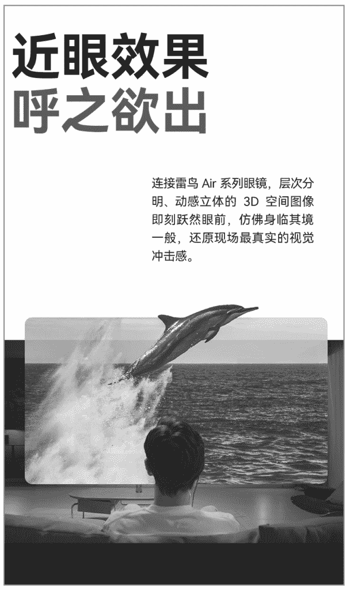

图 3-10

这款手机还配备了 AI 技术，可以将图片一键转化为 3D 效果，如图 3-11 所示。中老年人在使用其观看照片等图片时，可以让图片变得更加立体，从而更加细致地查看图中的信息。

图 3-11

## **3.2** **用 AI 进行社交互动**

AI 赋能社交互动，为中老年人开启了智慧社交的新篇章。它简化了社交流程，让中老年人能轻松跨越技术门槛，享受便捷的线上交流。AI 的融入，让社交体验更加个性化、贴心，可以帮助中老年人拓宽社交圈，增进情感交流，有效缓解孤独感。本节主要介绍使用 AI，进行社交互动的相关应用。

**3.2.1** **用 AI 获取内容**

扫码看教学视频

AI 内容推荐系统可以为中老年人量身定制信息盛宴，让他们可以快速获取想要的内容。该系统能精准捕捉用户偏好，满足中老年人多元化需求。这一创新不仅简化了信息筛选过程，还极大丰富了他们的精神世界，让中老年人在享受个性化服务的同时，保持积极心态，享受更加充实、快乐的晚年生活。

例如，抖音 App 是一个短视频平台，在该平台上，中老年人不仅可以查看短视频和直播等内容，还可以购买商品。该平台“首页”界面的“推荐”选项卡中会根据中老年人的浏览习惯和内容的热度，推荐平台的内容，如图 3-12 所示。中老年人打开抖音 App 之后，即可在“首页”界面的“推荐”选项卡中看到自己感兴趣的内容。

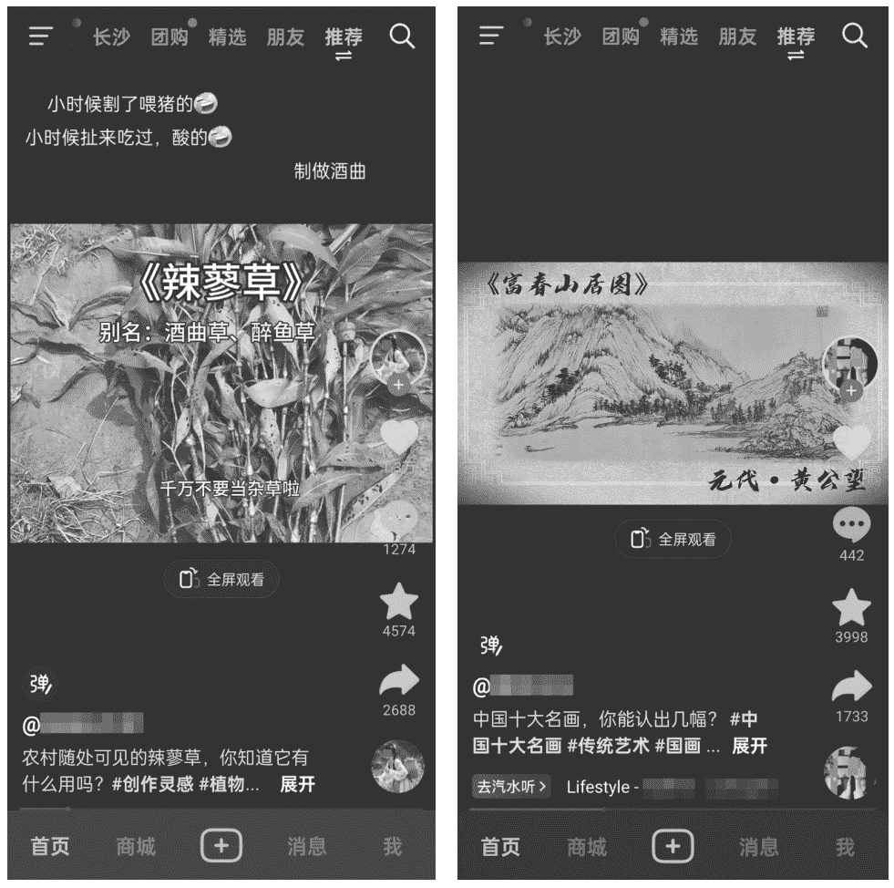

图 3-12

除了平台的主动推荐，中老年人还可以让 AI 推荐相关的内容。例如，天工 AI 是一个智能化解决方案平台，它可以通过数据处理与模型训练，提升中老年人的效率与决策能力。下面介绍让天工 AI 推荐相关内容的具体操作方法。

步骤 01❶在搜索引擎（如百度搜索引擎）的搜索框中输入并搜索“天工 AI”，❷单击搜索结果中天工 AI 官网的对应链接，如图 3-13 所示，进入天工 AI 的官网。

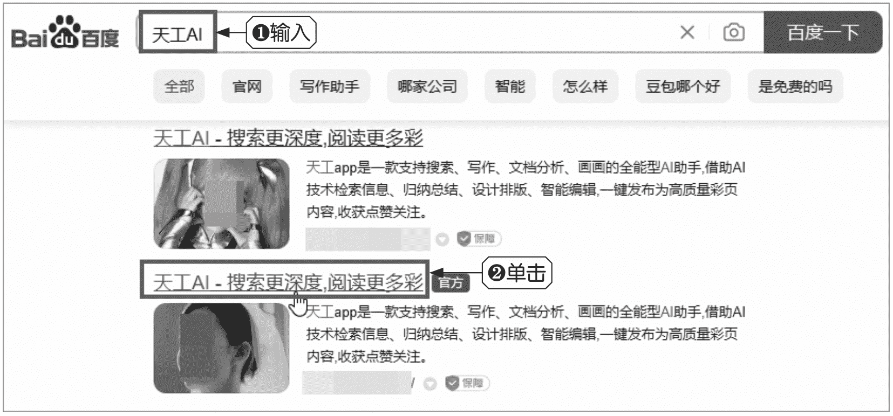

图 3-13

步骤 02 执行操作后，进入天工 AI 的“搜索”页面，如图 3-14 所示。

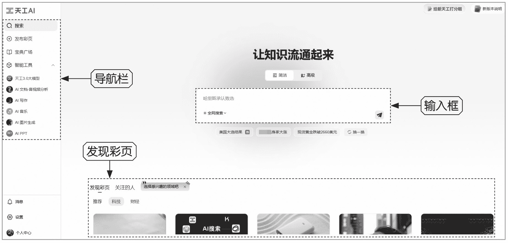

图 3-14

步骤 03 单击“搜索”页面中的输入框，❶在输入框中输入提示词，❷单击 按钮，如图 3-15 所示，向天工 AI 发送提示词。

图 3-15

步骤 04 执行操作后，天工 AI 会根据提示词回复相关的内容，具体内容如下。

**天工 AI**

适合 60 岁及以上人群的社交工具。

根据您的需求，以下是三个适合 60 岁及以上人群的社交工具：

微信：微信是一款非常流行的社交软件，不仅可以与家人和朋友聊天，还可以通过加入兴趣群组与陌生人交流。中老年人可以加入一些与自己兴趣相关的群组，如养生、旅游、摄影等，与同样爱好的人交流并结交新朋友。

QQ：QQ 是中国最早的社交软件之一，也是中老年人常用的聊天工具。中老年人可以通过 QQ 加入一些兴趣群组，与其他群成员一起交流、分享生活经验和兴趣爱好。

老无忧：老无忧是一款专为中老年人设计的交友软件，提供了许多交友和社交功能。用户可以创建个人资料，浏览其他用户的资料，通过文字、语音、图片等多种方式与其他用户交流。老无忧还提供了一些线下活动，如相亲会、旅行团等，让用户有机会在现实中结识新朋友。

……

**3.2.2** **用 AI 线上旅游**

扫码看教学视频

AI 线上旅游为中老年人打造了一个便捷的数字游览新方式，他们只需轻点屏幕，即可在家中轻松游览全球名胜古迹。高清画质与生动解说带领他们穿越空间，仿佛置身实地。这种不需要出门的旅行方式，不仅丰富了中老年人的生活，还保障了他们的安全与舒适，让旅游的乐趣触手可及。

例如，百度地图 App 是综合导航与位置的服务平台，可以为中老年人提供精准的路线规划、实时的路况信息，让中老年人的出行更加便捷。借助百度地图 App，中老年人可以搜索并查看某个景区的全景图，并滑动图片获得全方位的观景体验，在家里完成线上的旅游，具体操作步骤如下。

步骤 01 打开百度地图 App，进入“出行”界面，搜索如图 3-16 所示。

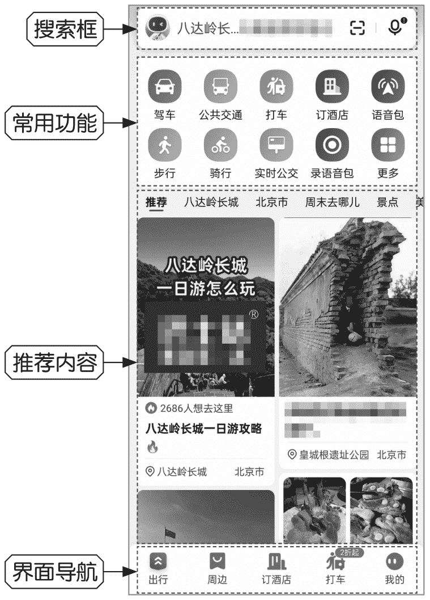

图 3-16

步骤 02 点击“出行”界面上方的搜索框，❶在搜索框中输入并搜索景区；❷点击搜索结果中对应景区所在的位置，如图 3-17 所示。

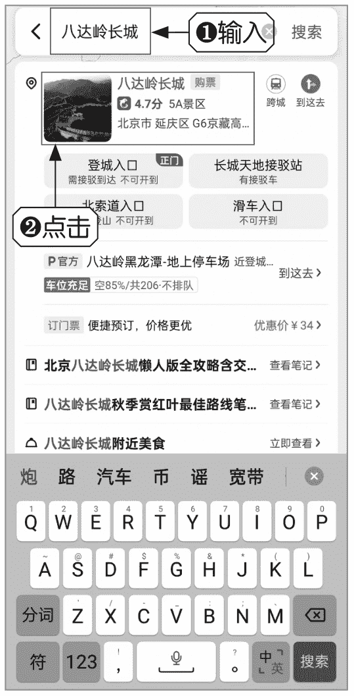

图 3-17

步骤 03 进入对应景区的介绍界面，点击界面上方的景区全景图，如图 3-18 所示。

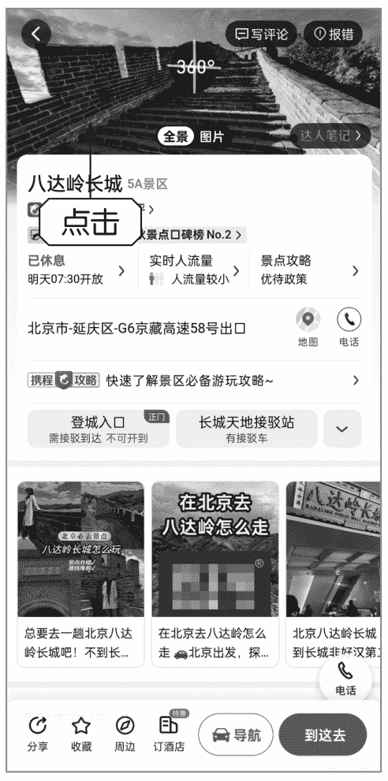

图 3-18

步骤 04 执行操作后，即可进入景区全景图的预览界面，查看对应的全景图，如图 3-19 所示。

图 3-19

步骤 05 点击全景图的显示区域，即可进入全屏预览界面，全屏查看该全景图，如图 3-20 所示。如果中老年人想要查看该全景图其他角度的风景，只需滑动手机界面即可。

图 3-20

**3.2.3** **用 AI 进行互动**

扫码看教学视频

扫码看效果

运用 AI 进行互动，为中老年人开启了全新的生活体验。智能体作为 AI 的具象化代表，不仅能够根据他们的兴趣和需求提供精准服务，还能通过深度学习理解并回应他们的情感需求，成为他们生活中的贴心伙伴。这种智能化的互动方式，让中老年人在享受便捷服务的同时，也感受到科技带来的温暖与关怀。

例如，豆包 App 是一款多功能的 AI 助手，可以为中老年人的生活、学习和工作提供帮助。中老年人可以根据自身需求选择豆包 App 中的智能体，并与其进行互动，具体操作步骤如下。

步骤 01 打开豆包 App，进入“发现”界面，如图 3-21 所示。

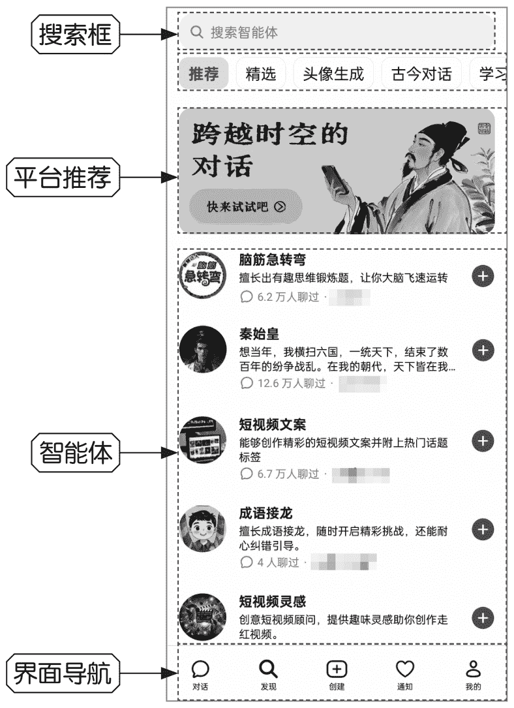

图 3-21

步骤 02 点击“发现”界面上方的对应按钮，进行选项卡的切换，❶如点击“古今对话”按钮，即可切换至“古今对话”选项卡，❷点击对应智能体所在的区域，如图 3-22 所示，与该智能体进行对话互动。

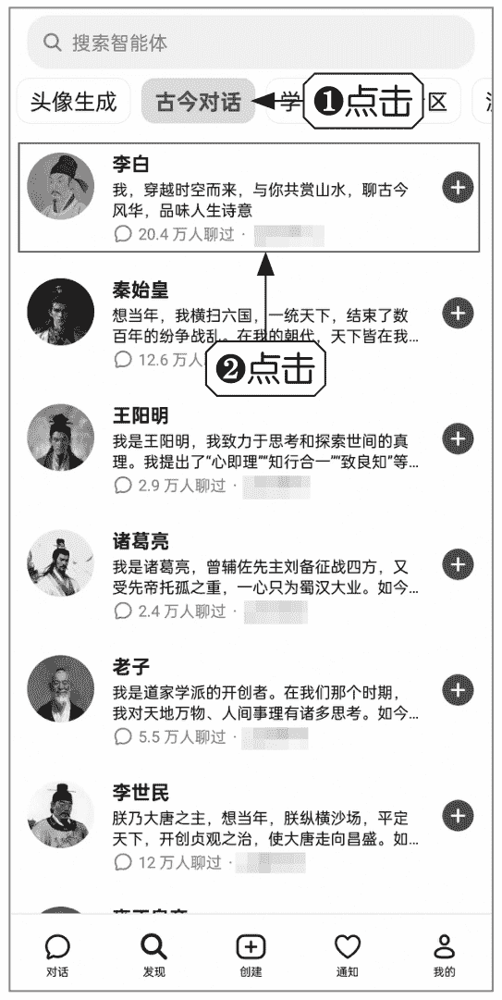

图 3-22

步骤 03 进入与对应智能体的文字对话界面，中老年人可以点击系统提供的问题，如图 3-23 所示。

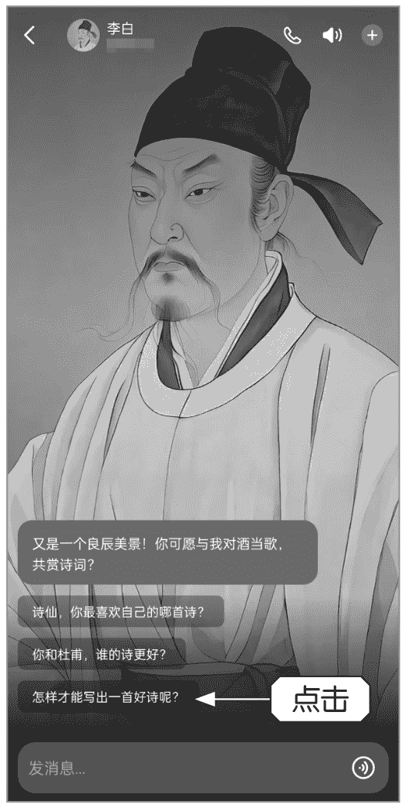

图 3-23

步骤 04 执行操作后，智能体就会根据问题给出答案。除了点击系统提供的问题，中老年人还可以通过文字和语音输入的方式与智能体进行互动。以语音输入为例，中老年人可以点击界面上方的 按钮，如图 3-24 所示。

图 3-24

步骤 05 进入与智能体的语音对话界面后，如图 3-25 所示，中老年人可以直接对着手机说话。

图 3-25

步骤 06 在语音对话界面中，通过语音输入提示词，即可与智能体进行对话，如果要查看智能体回复的文字内容，可以点击 按钮，如图 3-26 所示。

图 3-26

步骤 07 返回与智能体的文字对话界面，即可查看智能体回复的内容，如图 3-27 所示。

图 3-27

# **第四章** **AI 出行助手**

AI 出行技术的出现，极大地便利了中老年人的日常出行。它提供了更加安全、舒适的出行方案，减少了中老年人面对复杂交通环境的压力。无论是乘坐智能公交，还是使用便捷打车服务，都能让中老年群体享受到更为贴心的出行体验。

## **4.1** **用 AI 规划出行信息**

通过综合考虑各种因素，AI 能够提供精准的出行建议和详细的路线指引。这不仅能帮助中老年人高效地安排行程，还大大提升了出行的便捷性和安全性，让他们的出行体验更加舒适。本节将讲解 AI 在中老年人规划出行信息方面的常见应用。

**4.1.1** **用 AI 获取交通信息**

扫码看教学视频

借助相关的 AI 功能，中老年人可以便捷地掌握实时交通资讯，涵盖公交动态、路况信息及最优路径规划等，这些信息的即时获取，显著增强了出行的便捷与安全，让他们的日常出行体验更加顺畅与安心。

例如，车来了 App 是一款实时公交查询软件，它覆盖了全国 300 多个城市，可以为中老年人提供公交的实时信息。中老年人可以在车来了 App 中快速查看某个线路的公交车到达附近站点的时间，具体操作步骤如下。

步骤 01 打开车来了 App，进入首页界面，如图 4-1 所示。

图 4-1

步骤 02 点击搜索框，❶在框中输入并搜索对应的线路（也可以是站点、目的地），❷点击搜索结果中对应的线路，如图 4-2 所示。

图 4-2

步骤 03 执行操作后，即可查看对应线路的相关信息，如果此时该线路公交车的行驶方向与自己的目的地相反，可以点击“换向”按钮，如图 4-3 所示。

图 4-3

步骤 04 执行操作后，即可查看相反方向对应线路的相关信息。如果此时要查看该线路更多公交车的信息，可以点击“更多车辆”按钮，如图 4-4 所示。

图 4-4

步骤 05 进入“更多车辆”界面，即可查看更多该线路的公交车到达附近站点的相关信息，如图 4-5 所示。

图 4-5

**4.1.2** **用 AI 规划出行线路**

扫码看教学视频

对于中老年群体而言，借助 AI，规划出行线路将变得更加智能和便捷。通过集成多种交通信息，系统能够自动生成最优化的出行建议，无论是选择公交、地铁，还是选择步行，都能确保他们以最轻松的方式到达目的地。这种智能化的规划方式，不仅提升了出行的效率，还为中老年人带来了舒适的出行体验。

以百度地图 App 为例，中老年人可以通过语音输入目的地，让 AI 帮他们规划出行的线路，具体操作步骤如下。

步骤 01 打开百度地图 App，进入“出行”界面，点击 按钮，如图 4-6 所示，启动百度地图的语音输入助手。

图 4-6

步骤 02 执行操作后，会显示语音输入助手的相关提示框，如图 4-7 所示。

图 4-7

步骤 03 通过语音输入目的地，语音输入助手会识别语音内容并显示对应的输入内容，如图 4-8 所示。

图 4-8

步骤 04 随后，百度地图会借助 AI 功能进行出行路线的规划，有时候还会提供多条出行路线，中老年人只需从中选择合适的路线即可。

**4.1.3** **用 AI 制订旅游规划**

扫码看教学视频

扫码看效果

AI 能根据中老年人的身体状况、兴趣爱好及时间安排，精心规划行程，确保景点适合慢行游览，餐饮推荐注重营养健康，住宿选择注重安静与便利。同时，AI 还能考虑天气变化，适时调整活动安排，让中老年人在享受旅途乐趣的同时，确保安全与舒适，使每一次旅行都成为美好回忆。

以文心一言为例，中老年人可以说出自己的旅游目的地，让 AI 制订具体的旅游规划，相关案例如下。 

**提问**

我上个月刚退休，想趁现在有时间去桂林旅游，你能为我制订一个具体的旅行规划吗？ 

**文心一言**

当然可以为您制订一个桂林旅游的规划。考虑到您已退休，时间较为充裕，以下是一个为期 4 天的桂林旅行规划：

**第 1 天：**

上午：抵达桂林，前往两江四湖景区，乘船环湖赏桂林城景，感受“千锋环野立，一水抱城流”的美景。

下午：游览独秀峰王城景区，探访明朝历史，感受桂林文化发源地的古老韵味。

晚上：入住桂林市区酒店，如桂林台联酒店或桂林杉湖大酒店，享受宁静的夜晚。

**第 2 天：**

上午：前往阳朔，游览遇龙河，乘坐竹筏漂流，欣赏田园风光和奇峰异石。

下午：游览漓江风景名胜区，这是桂林风光的精华，百里漓江，百里画廊。您可以选择乘船游览，从桂林至阳朔的 40 公里河段是最精华的部分。

晚上：在阳朔西街漫步，感受异国风情，品尝当地特色小吃。

**第 3 天：**

上午：前往龙脊梯田，欣赏层层叠叠的梯田景观，体验当地民族文化和农家生活。

下午：返回阳朔，游览银子岩，欣赏溶洞景观，领略大自然的神奇魅力。

**第 4 天：**

上午：返回桂林市区，游览象鼻山，这是桂林最著名的景点之一。

下午：如果时间充裕，可以选择游览其他小景点，如靖江王城等。

晚上：结束愉快的桂林之旅，返回酒店整理行李，准备返程。

在旅行的过程中，请注意穿着舒适的鞋子，携带必要的防晒和防雨用品，以及常用的药品。同时，请根据天气情况适时调整行程，确保旅途的愉快和安全。祝您在桂林度过一个难忘的退休旅行！

**4.1.4** **用 AI 确定旅游目的地**

扫码看教学视频

扫码看效果

利用 AI 技术为中老年人确定旅游目的地，可以依据他们的健康状况、兴趣偏好及过往旅行经验，智能推荐适宜的景点。无论是宁静的乡村田园，还是富含历史底蕴的城市，AI 都能精准匹配，确保旅行既安全又充满乐趣。同时，还能根据季节天气，规划最佳出行时间，让中老年群体享受更加贴心、舒心的旅行体验。

以文心一言为例，中老年人可以说出自己的要求，让 AI 推荐合适的旅游目的地，相关案例如下。 

**提问**

我准备从长沙出发，去海边旅游，请为我推荐几个旅游目的地。 

**文心一言**

从长沙出发去海边旅游，可以考虑以下几个目的地：

1. 厦门鼓浪屿：厦门是一个充满海滨风情的城市，鼓浪屿则是其著名的旅游景点。这里有风格各异的建筑、丰富的历史文化和美食，适合漫步小巷，感受悠闲的生活节奏。从长沙出发，乘坐高铁大约 5 小时即可到达厦门。

2. 三亚：位于海南岛南端的三亚，以其阳光、沙滩和海浪而闻名。这里，可以尽情享受海边的乐趣，游览天涯海角、南山寺等著名景点，感受海南独特的热带风情。从长沙出发，乘坐飞机大约 4 小时即可抵达。

3. 北海涠洲岛：涠洲岛是中国较大的火山岛之一，拥有独特的火山地貌和丰富的海洋资源。游客可以在这里游览火山口、熔岩、海滩等景点，品尝美味的海鲜。从长沙出发，乘坐高铁到北海后，再乘坐轮渡即可到达涠洲岛。

这些目的地各具特色，可根据个人喜好和旅行计划进行选择。

**4.1.5** **用 AI 了解某地的特产**

AI 技术为中老年人了解各地特产带来了极大的便利，通过 AI 的辅助，他们能够轻松获取各地的特色物产信息。无论哪个地区的特产，AI 都能提供详尽的介绍和背景知识，帮助他们更深入地了解当地的文化和历史。

以文心一言为例，中老年人可以说出具体的地点，让 AI 介绍该地点的特产，相关案例如下。

扫码看教学视频

扫码看效果

**提问**

请为我介绍陕西比较有代表性的 8 种特产。 

**文心一言**

陕西比较有代表性的 8 种特产介绍如下：

1. 陕西苹果：以其色泽鲜艳、果形优美、口感脆甜、香气浓郁而著称，被誉为“苹果之冠”。得益于陕西得天独厚的地理环境，这里的苹果品质上乘，不仅在国内享有盛誉，更远销海外。

2. 临潼石榴：陕西省西安市临潼区的特产，享有“果中之王”的美誉。其果实饱满，色泽红润诱人，籽肥渣少，汁多味甜，种植历史悠久，曾是封建皇帝的贡品。

3. 西凤酒：中国四大名酒之一，产自陕西省宝鸡市凤翔区，拥有三千多年的酿造传统。它以其形态清澈透明、色泽晶莹、口感醇香典雅而著称，代表着陕西的地域特色与酿酒艺术。

4. 榆林豆腐：陕西省榆林市的特产，以其洁白细腻、质地柔韧、口感鲜嫩滑爽而著称。它选用当地优质黄豆，配以桃花水精制而成，承载着厚重的历史与文化韵味。

5. 延川红枣：陕西省延安市延川县的特产，拥有超过三千年的栽培历史。延川县独特的地理环境为红枣提供了理想的生长条件，使得延川红枣色泽深红、肉质饱满、口味醇厚、甜而不腻。特别是其中的“狗头枣”，品质优异，享有盛誉。

6. 洋县黑米：陕西省汉中市洋县的特产，拥有超过 2600 年的种植历史。它外皮乌黑光亮，内芯洁白如玉，口感软糯而不腻，营养价值极高，被誉为“米中之王”。

7. 蓝田玉：作为中国四大名玉之一，不仅有着“玉种蓝田”之美誉，更是国家地理标志保护产品。它色泽多样，质地细腻坚韧，为透明至半透明，无论是作为工艺品还是收藏品，都是极佳的选择。

8. 镇安大板栗：陕西省商洛市镇安县的特产，以其个大、甜脆、含淀粉率高而闻名。镇安县地处秦岭腹地，气候适宜，土壤肥沃，为板栗的生长提供了得天独厚的条件。

这些特产充分展现了陕西的自然地理优势和丰富的人文风情，更深刻体现了陕西人民对美食和传统文化的热爱与世代传承。

## **4.2** **用 AI 提升出行体验**

AI 不仅简化了出行的复杂度，更在无形中为中老年群体编织了一张充满关怀与便捷的出行网络，让每一次出行都成为一次愉悦的享受。本节将重点讲解 AI 在提升中老年人出行体验方面的常见应用。

**4.2.1** **用 AI 进行导航**

扫码看教学视频

AI 导航能够根据路况和偏好，自动规划出最适合的路线，避免了复杂的交通选择。此外，AI 还能实时更新交通信息，确保中老年人能够及时避开拥堵，享受更加顺畅、安心的出行体验。这样的智能导航，无疑为中老年人的出行增添了一份从容与自信。

与传统的导航方式相比，AI 导航具有诸多优势，这主要体现在 5 个方面，如图 4-9 所示。

图 4-9

**4.2.2** **用 AI 简化打车流程**

扫码看教学视频

AI 正逐步简化打车流程，中老年人通过智能语音助手或一键打车的相关功能，就能迅速下单。系统会自动匹配最优车辆，并实时显示行程信息，让中老年人也能轻松掌握出行情况。到达目的地后，自动扣款功能省去了现金支付的麻烦，整个打车过程更加顺畅、安全，为中老年人提供了更加便捷、舒适的出行体验。

例如，高德地图 App 是一款导航与位置服务软件，它可以提供精准的路线规划、实时路况更新及丰富的生活信息。在高德地图 App 中，中老年人可以通过语音输入快速打车，具体操作步骤如下。

步骤 01 打开高德地图 App，进入“首页”界面，如图 4-10 所示。

图 4-10

步骤 02 对着手机说“小德小德”，如果显示语音输入的提示框，如图 4-11 所示，就说明高德语音助手启动成功了。

图 4-11

步骤 03 通过语音输入目的地，语音输入助手会识别语音内容并显示对应的输入内容，如图 4-12 所示。

图 4-12

步骤 04 执行操作后，系统会根据行程，为你推荐车辆，点击“立即打车”按钮，如图 4-13 所示，进行打车。

图 4-13

步骤 05 进入“正在通知司机接单[…]”界面，如图 4-14 所示，系统会根据所选的车辆发送订单。

图 4-14

步骤 06 司机接单之后，中老年人只需前往上车地点等待出租车到达即可。

**专家提醒**

如果中老年人着急出门，可以点击“追加车型”按钮，添加更多类型的车辆。这样可以同时呼叫更多的车辆，加快打车的速度。另外，打车成功之后，中老年人只需查看对应的订单，并通过手机进行支付。

**4.2.3** **用 AI 获得伴游服务**

扫码看教学视频

AI 技术为中老年群体量身定制了创新的伴游服务，让他们能够便捷地享受旅行的乐趣。借助 AI 伴游，中老年游客可以轻松获取详尽的旅游资讯，定制个性化行程，同时享受实时的景点讲解与路线导航。AI 伴游不仅知识全面，还能依据用户的偏好与身体状况，智能推荐适合的旅游活动。

例如，支小宝 App 是支付宝推出的服务型 AI 独立应用，可快速办理生活事务，提供智能陪伴与推荐服务。在支小宝 App 中，中老年人可以根据要游览的景区选择相应的智能体，获得对应的 AI 伴游服务，具体操作步骤如下。

步骤 01 打开支小宝 App，进入“此刻”界面，如图 4-15 所示。

图 4-15

步骤 02❶点击“智能体”按钮，切换至对应界面，❷在该界面中选择对应的智能体，如选择“游东湖”智能体，如图 4-16 所示。

图 4-16

步骤 03 进入“游东湖”界面，点击“路线伴游”按钮，如图 4-17 所示，启动 AI 伴游服务。

图 4-17

步骤 04 执行操作后，即可向该智能体发送“开启 AI 伴游”，并获得相关的回复，如图 4-18 所示。

图 4-18

步骤 05 除了文字回复，智能体还会推荐游览路线，点击相关路线板块中的“开启 AI 伴游”按钮，如图 4-19 所示。

图 4-19

步骤 06 执行操作后，即可获得对应游览路线的 AI 伴游服务，如果中老年人不方便查看文字信息，可以点击对应景点的 按钮，如图 4-20 所示。

图 4-20

步骤 07 执行操作后， 按钮会变成 按钮，同时智能体会通过语音的方式，播报对应景点的相关信息，如图 4-21 所示。

图 4-21

**4.2.4** **用 AI 自动驾驶汽车**

扫码看教学视频

借助先进的 AI 自动驾驶系统，车辆能够自主导航、规避障碍，确保安全行驶。这一技术减轻了中老年人在驾驶或乘车过程中的负担，让他们无须担忧复杂的交通环境和操作难度，享受更为安心、舒适的出行体验，从而丰富他们的日常生活。

随着 AI 自动驾驶技术的发展趋于成熟，国内出现了越来越多带有自动驾驶功能的汽车，如华为系车型（北汽极狐阿尔法 S、长安阿维塔等）、蔚来车型（蔚来 ET5、ET7 等）、小鹏车型、理想车型（如理想 L7 等）、特斯拉的 Model 3 和 Model Y 等，它们均搭载了先进的自动驾驶系统，提供了不同程度的自动驾驶功能。

与传统的驾驶方式相比，AI 自动驾驶具有诸多优势，这主要体现在 5 个方面，如图 4-22 所示。

图 4-22

# **第五章** **AI 教育与培训**

很多中老年人都抱着“活到老，学到老”的心态，他们觉得接受教育和培训始终是一件很有必要的事情。在接受教育与培训时，AI 能够为中老年人提供许多帮助，它不仅能帮助中老年人做好学习的相关准备，还能提供高效的学习技巧。本章就为中老年人介绍 AI 在智能教育与培训方面的应用。

## **5.1** **用 AI 做好学习的准备**

在接受教育和培训之前，中老年人可以先做好学习的准备，比如明确要学什么、去哪里学习，准备好学习的相关工具和材料等。在此过程中，中老年人可以借助 AI 更好地做好学习的准备，本节将讲解具体的应用案例。

**5.1.1** **用 AI 明确学习的方向**

扫码看教学视频

扫码看效果

利用 AI 技术，中老年人能够更精确地锁定个人的学习方向和目标。AI 可以运用大数据分析，精准捕捉个人兴趣与学习需求，为中老年人精准匹配相关的学习内容，为他们构建起清晰的学习蓝图。

以文心一言为例，中老年人可以说出自己的想法，让 AI 帮他们确定学习的方向，相关案例如下。 

**提问**

我刚退休，想培养一些兴趣爱好，你可以为我提供一些学习的方向吗？ 

**文心一言**

当然可以！退休后培养兴趣爱好是个很好的选择，既能丰富生活，又能促进身心健康。以下是一些建议的学习方向：

1. 绘画或书法：通过练习绘画或书法，可以锻炼耐心和专注力，同时享受创作的乐趣。

2. 摄影：学习摄影技巧，记录生活中的美好瞬间，探索光影与构图的艺术。

3. 园艺：园艺活动能让您亲近自然，学习植物养护知识，享受绿色生活的宁静与美好。

4. 烹饪：尝试学习新的烹饪技巧，不仅满足味蕾，还能与家人和朋友分享美食。

5. 舞蹈：参加舞蹈课程，如广场舞、拉丁舞等，锻炼身体，提升协调性和节奏感。

6. 外语学习：学习一门新语言，拓展视野，增加与世界各地朋友的交流机会。

7. 手工制作：如编织、陶艺等，培养动手能力，创造独一无二的作品。

8. 音乐：学习乐器演奏或歌唱，音乐能陶冶情操，带来心灵的愉悦。

选择您感兴趣的方向，开启退休后的精彩学习之旅吧！

看到文心一言提供的建议之后，中老年人只需从中选择合适的学习方向即可。当然，如果文心一言提供的建议不符合自身的需求，中老年人也可以让其重新生成回复内容，以获得更多的学习方向。

**5.1.2** **用 AI 寻找学习的平台**

扫码看教学视频

扫码看效果

明确自己学习的方向之后，中老年人还需要找到学习的渠道，如线上的教育平台和线下的教育机构等。此时，如果中老年人不知道去哪里学习，可以让 AI 提供合适的学习平台或教育机构。

以文心一言为例，中老年人可以讲明自己的学习方向，让 AI 据此寻找合适的学习平台，相关案例如下。 

**提问**

我想学习书法，请为我提供一些包含相关课程的线上平台。 

**文心一言**

对于想要学习书法的您，以下是一些包含相关课程的线上平台推荐：

1. B 站：一个广受好评的学习平台，里面有各种字体教学，纯免费教学，非常适合自学书法的小伙伴。

2. 中国大学 MOOC（慕课）：由爱课程网携手网易云课堂打造的在线学习平台，提供书法鉴赏课、书法审美与基本技法、书法创作与欣赏等课程，学完还能获得认证证书。

3. 网易公开课：该平台汇集清华、北大、哈佛、耶鲁等世界各校上千门课程，里面包含各种书体的讲解、各种字帖临摹教学，不限于毛笔字，还有硬笔字学习。此外，除了网页版，还有手机 App，学习起来非常方便。

4. 中国书法网：书法爱好者的天堂，这里有丰富的书法作品、新闻动态，还能学习到各种书法技巧。

5. 书法在线：提供大量的在线课程，适合不同水平的书法爱好者，不管你是新手还是老手，都能找到适合自己的资源。

6. 不厌书法 App：一款热门高品质的免费学习软件，能够提供多种书法工具以及碑帖以进行深度学习，支持临摹对比手写练习，多种图片变化处理等。

7. 以观书法 App：支持查询行书、草书、隶书、篆书、楷书等多种字体，收录了大量高清字帖、拓本等，并配有释文和注解。同时，收录的书法字形数量超过 400 万，包括甲骨文、金文、简帛、篆刻等；另收录硬笔字形数量超过 130 万。

8. 练字大师 App：能够自动生成电子字帖并支持导出和打印，支持中文、英文、韩文、日文等多种语言的字帖生成，并涵盖了楷书、行书、草书、瘦金体、大篆、小篆等各种书法风格。

这些平台都提供了丰富的书法课程资源，可以根据自己的需求和兴趣选择合适的课程进行学习。希望这些推荐能够帮助到您！

**5.1.3** **用 AI 确定学习的内容**

扫码看教学视频

扫码看效果

所谓的确定学习内容，就是要达到心中的目标，确定学习主题、范围、深度等，以确保学习活动能够有针对性地进行，从而达到预期的学习效果。在确定学习内容时，中老年人可以针对学习方向，向 AI 询问具体要学习哪些内容。

以文心一言为例，中老年人可以让 AI 根据其学习目标列出需要学习的主要内容，相关案例如下。 

**提问**

如果我要快速掌握摄影的基本技巧，需要学习哪些内容？ 

**文心一言**

想要快速掌握摄影的基本技巧，你需要学习以下内容：

**一、摄影基础知识**

1\. 相机操作与设置

熟悉相机的基本结构和功能，包括光圈、快门、感光度（ISO）等关键参数的设置。

掌握相机的对焦技巧，包括自动对焦和手动对焦的使用，以及对焦点的选择。

2\. 曝光原理

理解曝光三角（光圈、快门速度、感光度）之间的关系，学会根据拍摄环境调整曝光值。

掌握曝光补偿的使用，以便在复杂光线条件下获得正确的曝光。

**二、光线与色彩运用**

1\. 自然光与人工光

学会利用自然光进行拍摄，掌握黄金时刻和蓝调时刻等最佳拍摄时间。

了解人工光源的使用，包括闪光灯、反光板等，以及如何在不同光线条件下进行补光。

2\. 色彩理论

学习色彩的基本原理，如色轮、互补色、冷暖色调等。

掌握色彩搭配技巧，以便在拍摄中创造富有表现力的色彩效果。

**三、构图与视角选择**

1\. 构图法则

熟悉常见的构图法则，如三分法、对称构图、引导线等。

学会在实际拍摄中运用构图法则，以突出主题、引导视线。

2\. 视角选择

尝试不同的拍摄角度，如低角度、高角度、平视等，以创造独特的视觉效果。

学会利用前景元素增强画面的层次感和深度。

……

文心一言列出要学习的主要内容之后，中老年人可以在学习平台上查找对应的课程进行学习。例如，网易公开课是网易推出的在线教育平台，它提供了海量免费的优质课程，可以帮助中老年人自主学习，拓宽知识视野。在网易公开课平台中，中老年人可以通过如下操作查找相关的课程。

步骤 01❶在搜索引擎（如百度搜索引擎）的搜索框中输入并搜索“网易公开课”，❷单击搜索结果中网易公开课官网的对应链接，如图 5-1 所示，进入网易公开课的官网。

图 5-1

步骤 02 进入网易公开课官网的“首页”页面，如图 5-2 所示。

图 5-2

步骤 03 单击“首页”页面上方的搜索框，在搜索框中输入关键词，❶如输入“摄影构图”，❷单击 按钮，如图 5-3 所示，进行课程的搜索。

图 5-3

步骤 04 执行操作后，即可查找到相关的课程，如图 5-4 所示。

图 5-4

**5.1.4** **用 AI 准备学习的工具**

扫码看教学视频

扫码看效果

在接受教育和培训时，中老年人可能需要准备相关的工具和材料。如果对要学习的内容不太熟悉，不知道要准备哪些工具和材料，中老年人可以询问 AI，并根据它的回复准备学习工具和材料。

以文心一言为例，中老年人可以让 AI 根据其学习内容列出需要准备的工具和材料，相关案例如下。 

**提问**

学习书法，需要准备哪些工具和材料，请分别列出来。 

**文心一言**

以下是学习书法所需精心筹备的工具和材料清单，每一项都扮演着不可或缺的角色：

1. 毛笔：对于初学者而言，兼毫毛笔因其软硬适中的特性而备受推荐。根据个人书写习惯和字体大小需求，挑选合适的毛笔型号，为书法学习之旅奠定坚实基础。

2. 墨汁：优质的墨汁是书法创作的点睛之笔。液态墨汁方便快捷，而墨块则需经过研磨，这一过程增添了书法艺术的仪式感。选择浓度适中、光泽度好的墨汁，让每一笔都流淌出深厚的文化底蕴。

3. 宣纸：作为书法艺术的载体，宣纸以其独特的吸墨性和韧性而著称。初学者可从经济实惠的毛边纸练起，随着技艺的日益精进，逐渐过渡到吸墨性更佳的宣纸，感受纸张对墨水的细腻呈现，让作品更加生动、持久。

4. 毛毡：铺设在书写桌面上，毛毡能有效防止墨水渗透，同时增加书写时的摩擦力，使笔触更加稳定有力，提升书写体验。

5. 字帖：字帖是书法学习的必经之路。从基础字帖开始，逐步掌握笔法、结构和章法，临摹名家作品，深入体会书法艺术的魅力与精髓。

6. 镇纸：小巧而实用的镇纸，用于压平纸张，防止书写过程中纸张移动，确保书写的连贯性和整洁度，为作品增添一抹精致的美感。

7. 笔架：专为毛笔设计的存放工具，笔架可悬挂或放置毛笔，保持其干燥和形状，避免毛笔因长时间浸泡或随意放置而变形，延长使用寿命。

8. 印章与印泥：完成书法作品后，加盖个人印章，为作品增添艺术气息和个性化色彩。选择质地细腻、色彩鲜艳的印泥，确保印迹清晰、持久，为书法作品增添一抹独特的韵味。

准备好这些工具和材料后，您就可以正式开始您的书法学习之旅了。

## **5.2** **用 AI 提高学习的效率**

在接受教育和培训时，除了做好学习的准备，中老年人还可以借助 AI 提高学习的效率。例如，当学习的过程中遇到什么问题时，可以让 AI 快速解答；当要学习某个内容时，可以向 AI 请教学习的技巧。本节将通过具体的案例，为大家讲解 AI 在提高学习效率方面的应用案例。

**5.2.1** **用 AI 学习专业技能**

扫码看教学视频

扫码看效果

在学习专业技能时，AI 可以根据中老年人的需求，为他们提供一些实用的学习技巧。这些技巧可以帮助他们更快掌握知识，减少学习路途上的阻碍。这不仅能让学习的效率大幅提升，还能让中老年人享受到学习的乐趣。

以文心一言为例，中老年人可以让 AI 根据他们要学习的技能，给出相关的学习技巧，相关案例如下。 

**提问**

我想学习如何制作 AI 短视频，请为我传授一些学习技巧。 

**文心一言**

想要学习如何制作 AI 短视频，以下是一些高效的学习技巧：

1\. 学习视频制作的基础知识：

掌握视频剪辑技巧，如剪辑、拼接、转场等，这是短视频制作的基础。

学习视频后期处理，包括颜色校正、音效添加、字幕制作等，以提升视频的整体质量。

2. 深入了解 AI 在短视频制作中的应用：

研究 AI 如何帮助生成剧本、分镜头设计以及视觉素材。

学习如何利用 AI 技术进行视频配音、配乐和音效制作，提高视频的听觉效果。

3\. 选择合适的 AI 工具和平台：

根据自己的需求和技能水平，选择适合的 AI 短视频制作工具和平台。

尝试不同的 AI 工具，如 ChatGPT 用于生成剧本和分镜头，即梦 Dreamina 用于图生视频等，找到最适合自己的组合。

4\. 实践并不断优化：

通过不断实践，熟悉 AI 短视频制作的流程。

根据实践结果，不断调整和优化自己的制作方法和技巧。

5\. 关注行业动态和新技术：

保持对短视频行业动态的关注，了解最新的技术和趋势。

尝试将新技术应用到自己的作品中，以提升竞争力。

6\. 参与社群和论坛：

加入相关的社群和论坛，与其他制作者交流经验和心得。

通过分享和讨论，不断拓宽自己的视野和思路。

……

**5.2.2** **用 AI 培养兴趣爱好**

扫码看教学视频

扫码看效果

在培养自己的兴趣爱好时，中老年人同样可以使用 AI 提升学习的效率。例如，明确要培养的兴趣爱好之后，中老年人可以让 AI 提供一些高效的学习方法，让自己更快地将相关的兴趣爱好培养起来。

以文心一言为例，中老年人可以让 AI 根据他们要培养的兴趣爱好，提供一些高效的学习方法，相关案例如下。 

**提问**

我想学习跳舞，请为我提供一些高效的学习方法。 

**文心一言**

学习跳舞是一个既有趣又能提升身体协调性和表达能力的过程。以下是一些高效学习跳舞的方法，希望能帮助你更好地入门并享受跳舞的乐趣：

1. 明确目标与风格：首先确定你想要学习的舞蹈类型（如街舞、爵士舞、芭蕾舞、拉丁舞等），以及你的学习目标（如健身、表演、专业比赛等）。明确的目标能帮助你更有针对性地选择学习资源和规划学习路径。

2. 基础体能训练：跳舞需要良好的身体素质，包括柔韧性、力量、耐力和协调性。通过瑜伽、拉伸、核心力量训练等基础体能训练，可以为你的舞蹈学习打下坚实的基础。

3. 寻找专业指导：参加舞蹈课程或工作坊，跟随经验丰富的舞蹈老师学习。专业的指导可以确保你掌握正确的姿势、步伐和技巧，避免受伤，并能更快地进步。

4. 观看视频学习：在线上有大量的舞蹈教学视频资源，包括分解动作教学、完整舞蹈演示等。选择高质量的视频，反复观看并跟随练习，是自我提升的好方法。记住，观看时要注重细节，模仿老师的每一个动作。

5. 实践与反馈：理论学习之后，最重要的是实践。定期安排时间练习，将所学应用于实际舞蹈中。可以录制自己的练习视频，回看时更容易发现需要改进的地方。同时，向他人展示你的舞蹈，接受他们的反馈和建议，这也是快速成长的方式之一。

6. 加入社群，交流心得：加入舞蹈爱好者社群或论坛，与其他舞者交流学习经验、分享心得。这不仅能拓宽你的视野，还能结识志同道合的朋友，共同激励进步。

7. 保持耐心与热情：学习任何新技能都需要时间和耐心，跳舞也不例外。遇到困难时不要气馁，保持对舞蹈的热爱和好奇心，享受每一次练习带来的成就感。

8. 设定阶段性目标：为自己设定短期和长期的学习目标，比如学会一个完整的舞蹈、参加一次小型表演等。达成目标后给自己一些奖励，这样可以保持学习的动力和积极性。

记住，每个人的学习节奏和学习方式都是独特的，找到最适合自己的方法，持之以恒地练习，你定能在跳舞的道路上越走越远，享受舞蹈带来的无限乐趣。

**5.2.3** **用 AI 获取培训建议**

扫码看教学视频

扫码看效果

中老年人在接受教育和培训时，可以让 AI 通过智能分析个人兴趣、学习速度及记忆力等特点，定制专属的培训方案，并给出相关的培训建议。这种个性化的培训建议不仅让学习过程更加高效，还增强了中老年人参与培训的积极性。

以文心一言为例，中老年人可以让 AI 根据他们要接受的培训，提供相关的培训建议，相关案例如下。 

**提问**

我要参加一个老年人计算机技能培训，请为我提供一些提升培训效果的建议。 

**文心一言**

参加老年人计算机技能培训是一个非常好的决定，可以帮助您更好地融入数字时代，享受科技带来的便利。以下是一些提升培训效果的建议，专门针对老年人计算机技能培训：

**一、明确培训目标**

1．实用性为主：由于老年人的学习时间和精力有限，建议将培训重点放在最实用的功能上，如基本的计算机操作、上网浏览、视频通话、社交媒体使用等。

2．个性化需求：考虑您的个人兴趣和需求，如照片编辑、健康监测软件使用等，这样可以让培训更加贴合您的生活。

**二、选择合适的培训方式**

1．面对面授课：对于老年人来说，面对面的授课方式可能更容易理解和接受，讲师可以即时解答疑问，演示操作步骤。

2．小班教学：小班授课可以更好地保证教学质量，讲师可以更多地关注每位学员的学习进度和理解程度。

3．辅助材料：提供清晰的讲义、操作指南和视频教程，方便课后复习和巩固。

**三、保持积极的学习态度**

1．保持好奇心：对新技术保持好奇和开放的态度，勇于尝试和探索。

2．耐心和毅力：学习新技能需要时间和耐心，不要急于求成，遇到困难时保持冷静，寻求帮助。

**四、实践与应用**

1．实际操作：尽可能多地参与实践操作，将理论知识转化为实际技能。可以在培训中设置模拟场景，让您在安全的环境中练习。

2．日常应用：将学到的技能应用到日常生活中，如使用计算机查看新闻、与家人视频通话、在线购物等。

……

**5.2.4** **用 AI 制订培训计划**

扫码看教学视频

扫码看效果

AI 技术能够为中老年人量身定制培训计划，精准匹配其学习需求和兴趣。通过分析中老年人的认知特点、学习习惯及生活需求，AI 可以制订个性化的培训计划，这不仅能提高中老年人的学习效率，还能增强他们的学习兴趣。

以文心一言为例，中老年人可以让 AI 根据他们要接受的培训，制订具体的培训计划，相关案例如下。 

**提问**

我今年 55 岁了，下个星期要参加为期半个月的外语培训，请为我制订一个高效的培训计划。 

**文心一言**

针对您 55 岁的年龄和即将参加的外语培训，以下是一个高效且适合您的培训计划，旨在帮助您在短时间内取得显著进步：

**一、前期准备**

了解课程内容：提前了解培训课程的具体内容、难度和教学方式，以便有针对性地准备。

设定学习目标：明确自己希望达到的语言水平，如日常交流、商务沟通等，并设定具体、可衡量的目标。

准备学习工具：购买或准备好所需的教材、词典、录音笔等学习工具，并提前熟悉它们的使用方法。

调整作息：确保每天有足够的睡眠时间，保持良好的身体状态和精神状态。

**二、每日学习计划**

1．早晨（7:00～8:30）

听力训练：听录音、新闻或观看外语视频，提高听力理解能力。可以从一些语速较慢、内容简单的材料开始。

词汇复习与预习：复习前一天学习的词汇，并预习当天的新词汇，可以使用记忆卡片等工具辅助记忆。

2．上午（9:00～12:00）

课堂学习：认真听讲，积极参与课堂讨论，做好笔记。注意理解并掌握语法知识。

口语练习：利用课堂时间，与外教或同学进行口语对话，提高口语流利度和准确性。

3．午餐与休息（12:00～13:30）

休息：保证充足的睡眠和休息时间，有助于大脑恢复和记忆巩固。

轻松阅读：阅读一些简单的外语文章或小说，增加阅读量和语感。

……

# **第六章** **AI 答疑解惑**

AI 可以化身答疑解惑的小能手，耐心陪伴中老年人。无论是健康问题、生活问题，还是其他方面的问题，它都能提供相关的参考意见。这份细致入微的关怀，可以帮助中老年人轻松融入智能时代，享受便捷与乐趣，让他们的晚年生活更加丰富多彩。

## **6.1** **用 AI 解答健康问题**

AI 可以像健康助手一样，为中老年人提供贴心服务，精准解答健康方面的疑问，定制个性化的养生方案。本节将通过具体的案例讲解 AI，特别是 AIGC，在解答健康问题方面的应用。

**6.1.1** **用 AI 科学养生**

扫码看教学视频

扫码看效果

中老年人可以借助 AI 进行科学养生，获得个性化的健康管理新体验。AI 可以结合中老年人的具体需求，为其提供个性化的饮食、运动及生活建议，有效地预防疾病，增强中老年人的体质。

例如，Kimi 是月之暗面公司推出的智能助手，它支持长文本处理、多语言对话等，能够高效地解答各种问题。在 Kimi 平台中，中老年人可以通过如下操作与 AI 进行沟通，让 AI 制订科学的养生方案。

步骤 01❶在搜索引擎（如百度搜索引擎）的搜索框中输入并搜索 Kimi，❷单击搜索结果中 Kimi 官网的对应链接，如图 6-1 所示，进入 Kimi 的官网。

图 6-1

步骤 02 执行操作后，进入 Kimi 官网的默认页面，如图 6-2 所示。

图 6-2

步骤 03❶在输入框中输入提示词，❷单击 按钮，发送提示词，如图 6-3 所示。

图 6-3

步骤 04 执行操作后，Kimi 会根据提示词，为中老年人提供一个科学养生的建议，具体内容如下。

**Kimi**

根据您的年龄和腿脚不便的情况，以下是为您定制的养生方案：

1．合理膳食：保持均衡营养，定时定量，食物种类应包含粮谷类、杂豆类及薯类（粗细搭配）、动物性食物、蔬菜、水果、奶类及奶制品，以及坚果类等，控制烹调油和食盐摄入量。建议三餐两点，能量分配为早餐约 30%，午餐约 40%，晚餐约 30%，上下午各加一次零食或水果。

2. 适度运动：根据自身情况和爱好选择轻中度运动项目，如快走、慢跑、游泳、舞蹈、太极拳等。最佳运动时间为上午 10～11 点和下午 3～5 点，每次运动时间 30～60 分钟为宜。

3. 预防跌倒：保持适度运动，佩戴适当的眼镜以改善视力，避免单独外出和拥挤环境，室内规则摆放物品，增加照明，保持地面干燥及平整。

4. 预防骨关节疾病和骨质疏松症：注意膝关节保暖，避免过量体育锻炼，尽量少下楼梯，控制体重以减轻下肢关节压力。增加日晒时间，提倡富含钙、低盐和适量蛋白质的均衡饮食，通过步行或跑步等适度运动提高骨强度。

5. 腿脚锻炼：可以常揉揉腿肚，多踮踮脚后跟，以及扳足趾关节各 20～30 次，能锻炼脚力，防止腿足软弱无力。

6. 保持良好睡眠：每天最好午休 1 小时左右。如果长期入睡困难或有严重的打鼾并呼吸暂停者，应当及时就医。

……

**6.1.2** **用 AI 指导健身**

扫码看教学视频

扫码看效果

对中老年人而言，AI 可以在健身方面提供指导意见。它能根据个体的体质和健康状况，智能制定专属的锻炼计划和饮食建议，确保锻炼既精准又高效，让中老年人能够安全、科学地享受健身，拥有更健康的晚年。

以 Kimi 为例，中老年人可以提出健身方面的疑问，让 AI 给出一些指导意见，相关案例如下。 

**提问**

像我这种不太适合剧烈运动的中年人，要如何进行健身呢？请你从健身教练的角度，给我一些指导意见。

**Kimi**

作为一名健身教练，我很高兴为您提供一些适合中年人的健身指导意见：

1. 选择适合的运动方式：对于中年人来说，选择低冲击性、对关节负担较小的运动是非常重要的。根据研究，快走、慢跑、骑自行车、游泳和跳绳等有氧运动是不错的选择，它们可以提升心肺功能，同时对关节的压力较小。

2. 肌肉力量训练：除了有氧运动，肌肉力量训练也是不可忽视的。可以通过自体重训练（如深蹲、俯卧撑和仰卧起坐）、弹力带训练或健身器械训练来增强肌肉力量。

3. 运动频率和时长：建议每周锻炼 3 至 4 次，每次 1 小时。如果一开始难以坚持，可以逐渐增加运动时间和强度，例如，如果只能连续慢跑 10 分钟，可以先跑 10 分钟，然后快走或走走跑跑，保持身体处于运动状态。

4. 明确目标，循序渐进：无论是减肥还是增肌，都应该明确目标，并根据目标选择合适的运动内容。减肥可以通过慢跑、划船机、动感单车等运动逐步实现，而增肌则需要以力量训练为主。

5. 注意运动强度：运动强度不宜过高，尤其是对于刚开始接触健身的中年人。可以从低强度开始，逐渐增加，以避免受伤。

……

**6.1.3** **用 AI 预防疾病**

扫码看教学视频

扫码看效果

对中老年人而言，AI 在疾病预防方面的作用显著，它能根据个体的特定需求，运用先进的信息生成技术，识别潜在的疾病风险，并据此量身定制预防方案。这样，中老年人就能未雨绸缪，有针对性地管理自身健康，享受一个无忧无虑、高品质的晚年生活。

以 Kimi 为例，中老年人可以提出预防疾病方面的疑问，让 AI 给出一些实用的方法，相关案例如下。 

**提问**

中老年人如何预防骨质疏松？请为我提供 8 种实用的方法。

**Kimi**

针对中老年人如何预防骨质疏松的问题，以下是 8 种实用的方法：

1. 增加钙质摄入：确保饮食中含有足够的钙和维生素 D。牛奶、豆腐、绿叶蔬菜等是优质钙源，同时适量晒太阳可促进维生素 D 的合成，帮助钙的吸收。

2. 规律运动：进行负重训练和有氧运动是提高骨密度的有效方法。快走、慢跑、游泳及负重训练（如使用哑铃）均有助于强化骨骼。

3. 避免不良习惯：戒烟限酒，保持良好的生活习惯，有助于骨骼健康。研究表明，吸烟和过量饮酒会加速骨密度下降。

4. 定期检查：建议中老年人定期进行骨密度检测，及时了解自身骨骼状况，必要时可在医生指导下进行相关治疗。

5. 改善生活习惯：改善不良生活习惯，如彻夜唱卡拉 OK、打麻将、夜不归宿等生活无规律的做法，都会加重体质酸性化，应当养成良好的生活习惯，从而保持弱碱性体质，预防骨质疏松的发生。

6. 保持良好的心情：不要有过大的心理压力。适当地调节心情，舒缓自身压力可以保持弱碱性体质，从而预防骨质疏松的发生。

7. 增加日照：适度增加日照量，有助于人体合成维生素 D，促进钙吸收，增强骨骼健康。同时，注意涂抹防晒霜，让皮肤免受紫外线伤害。

8. 合理膳食：选择富含钙、低盐和适量蛋白质的均衡饮食，避免吸烟和吃刺激、含盐量高的食物。

以上方法可以帮助中老年人有效预防骨质疏松，保持骨骼健康。

**6.1.4** **用 AI 疏导心理**

扫码看教学视频

扫码看效果

中老年人面临着退休、身体机能下降、亲友离世等多种生活变化，这些变化往往带来心理压力和情绪波动。因此，心理疏导对于中老年人来说至关重要。除了接受专业的心理疏导，中老年人还可以借助科技的力量，在与 AI 的沟通过程中获得心理的疏导。

以 Kimi 为例，中老年人可以向 AI 说出自己遇到的问题，让 AI 对其进行心理上的疏导，相关案例如下。 

**提问**

我最近总是感到特别孤独，即使家人都在身边也觉得心里空落落的，这正常吗？我应该怎么调整自己的心态呢？

**Kimi**

即使家人都在身边，感到孤独也是一种常见的情感体验，尤其对于中老年人来说，这可能与多种因素有关，如生理变化、社交圈子的缩小、生活节奏的改变等。这种孤独感虽然让人不适，但它是正常的情感体验之一，不必过于担忧。

要调整这种孤独感，你可以尝试以下方法：

1. 主动沟通：与家人分享你的感受，让他们了解你内心的孤独和需要。通过沟通，你可以找到更多共同话题和活动，增进彼此的了解和亲密感。

2. 培养兴趣爱好：参与一些你感兴趣的活动或课程，如绘画、书法、园艺、跳舞等。这些活动不仅可以丰富你的生活，还能让你结识志同道合的朋友，减轻孤独感。

3. 加入社交团体：考虑加入一些中老年人社交团体或社区组织，如志愿者组织、老年人活动中心等。这些团体可以提供与他人交流和互动的机会，帮助你建立新的社交关系。

4. 保持身体健康：适当的身体锻炼和健康的生活方式可以改善心情和增强自信。你可以尝试散步、瑜伽、太极等适合中老年人的运动方式。

5. 寻求专业帮助：如果孤独感持续存在且影响到你的日常生活和情绪状态，可以考虑寻求心理咨询师的帮助。他们可以提供专业的指导和支持，帮助你更好地应对孤独感。

最重要的是，要给自己时间和耐心去适应和调整。孤独感是一个复杂的情感体验，需要时间和努力来克服。保持积极的心态和乐观的态度，相信自己能够逐渐走出孤独，享受充实和幸福的生活。

## **6.2** **用 AI 解答生活问题**

对于中老年人而言，AI 技术的出现如同一束温暖的阳光，照亮了生活的每一个角落。它不仅能够快速、准确地解答他们在日常生活中遇到的各种疑问，还能提供个性化的建议和服务，让他们的生活更加便捷和舒适。本节将结合具体的案例，讲解 AI 在解答生活问题方面的应用。

**6.2.1** **用 AI 规划生活**

扫码看教学视频

扫码看效果

步入中老年阶段，生活的规划显得更为关键了。这一阶段，人们期望将生活安排得既充实又舒适，平衡休闲与个人兴趣，尽享与家人共度的温馨时刻。通过细致的规划，每一天都能充满阳光，让生活变得富有深度与温度。

以 Kimi 为例，中老年人可以通过提示词的输入，让 AI 帮他们规划退休生活，相关案例如下。 

**提问**

我前一段时间刚退休，感觉现在的生活太清闲了。我该怎么规划自己的退休生活，才能让每一天变得更加充实呢？

**Kimi**

退休之际是开启新篇章的绝佳时机，为了让每一天都充满意义与乐趣，您可以从以下几个维度着手规划：

1. 探索与深耕兴趣爱好：退休后的时间充裕，正是挖掘和深耕个人兴趣的最佳时机。无论是重拾年轻时未竟的梦想，如学习一门乐器、练习书法，还是尝试全新的领域，如园艺设计、烹饪美食，都能让您的生活更加多彩多姿。参与相关的兴趣小组或课程，结识志同道合的朋友，共享乐趣。

2. 积极参与社区活动：加入社区或老年大学，参与各类社交活动，如健康讲座、文化展览、手工艺制作等。这些活动不仅能让您保持与时俱进，了解社会动态，还能拓宽社交圈，结识新朋友，丰富人际关系网。

3. 保持身心健康：定期进行体检，关注自身健康状况。结合适量的运动，如散步、太极、瑜伽等，以及均衡的饮食，保持身体活力。学习冥想、瑜伽等放松技巧，调节情绪，保持心理健康。

4. 加强与家人的联系：利用退休后的空闲时间，加强与家人的联系。定期安排家庭聚会，共同烹饪美食、分享生活点滴，或是一起进行短途旅行，增进亲情，享受家庭的温馨与快乐。

5. 规划个人成长与学习：退休生活也是自我成长和提升的良机。您可以尝试学习新的技能或知识，如在线课程、语言学习等，提升自我价值感，保持对生活的热情与好奇。

6. 追求精神层面的满足：阅读经典书籍、观看优秀电影或参加文学沙龙等活动，提升个人修养，追求精神层面的富足与满足。

……

**6.2.2** **用 AI 安排日程**

扫码看教学视频

扫码看效果

对于中老年人而言，合理的日程安排不仅能更好地管理时间，提高生活效率，还能确保有足够的时间去享受生活中的美好。通过规划每日的活动，中老年人能更好地平衡休息与娱乐，促进身心健康。如果觉得自己做日程安排有些麻烦，中老年人可以借助 AI 的力量，快速安排好自己的日程。

以 Kimi 为例，中老年人可以把某一天要做的事写出来，让 AI 做出一个合理的行程安排，相关案例如下。 

**提问**

今天上午我要晨练、读书、浇花，下午要下棋、画画、与朋友聊天。那么，我要怎么制订一个精确的日程规划呢？

**Kimi**

当然，以下是根据您的活动需求制订的一个精确的日程规划示例：

**上午日程：**

6:30～7:00：起床，进行早晨的个人卫生和准备工作。

7:00～7:30：晨练，可以选择散步、慢跑、瑜伽或其他您喜欢的运动。

7:30～8:00：休息，补充水分，准备早餐。

8:00～8:30：吃早餐，享受早晨的宁静。

8:30～9:00：浇花，照顾您的植物。

9:00～10:30：读书时间，可以选择一本您感兴趣的书籍。

10:30～11:00：休息，准备午餐食材。

11:00～12:00：做午餐，享受午餐。

**下午日程：**

12:00～13:00：午休或小憩，为下午的活动储备能量。

13:00～14:30：下棋，可以是与自己对弈，也可以是与朋友或家人。

14:30～15:00：休息，准备画画。

15:00～16:30：画画，发挥您的创造力。

16:30～17:00：准备与朋友聊天的环境，比如准备茶点。

17:00～18:00：与朋友聊天，享受社交的乐趣。

18:00～19:00：准备晚餐，享受晚餐。

……

**6.2.3** **用 AI 投资理财**

扫码看效果

扫码看教学视频

AI 能根据个人风险偏好，智能推荐合适的理财产品，避免盲目选择。同时，AI 实时监控市场动态，及时调整投资组合，确保资产稳健增长。通过 AI 理财，中老年人能轻松管理财务，享受科技带来的安心与收益，让晚年生活更加无忧。

以 Kimi 为例，中老年人可以将自己的实际情况说出来，让 AI 提供投资理财建议，相关案例如下。 

**提问**

我手上有一笔 5 万元人民币的养老金，这笔钱要如何进行投资呢？请为我推荐几种稳健的投资理财方式。

**Kimi**

根据您的实际情况，您手头有 5 万元人民币的养老金，希望进行稳健的投资。以下是一些建议：

1. 银行储蓄：储蓄存款产品收益较低但保本，适合风险承受能力较低的投资者。您可以考虑将一部分资金存入银行定期存款，以保证资金安全。

2. 银行理财产品：理财产品相对于储蓄存款来说收益稍高，但受资本市场影响较大，短期波动性相对较大。您可以选择一些低风险的银行理财产品进行投资。

3. 保险产品：养老保险产品的收益更为稳健和确定，还能对接险企布局的养老社区和综合养老服务等。您可以考虑购买一些养老保险产品，以确保资金的安全性和收益性。

4. 基金投资：您可以选择投资一些 Y 类份额基金，这类基金的费率相较普通养老 FOF 基金的 A/C 类份额更低。同时，您也可以选择一些低风险的基金产品进行投资，比如债券基金或者货币市场基金。

5. 分散投资：您可以考虑将资金分散投资于不同的理财产品中，以降低单一投资的风险。例如，您可以按照一定比例分配资金到储蓄存款、理财产品、保险产品和基金中。

6. 长期投资：考虑到养老金是长期的资金，您应该树立长期投资的理念，选择一些长期稳健的投资产品，比如长期国债或者长期银行定期存款。

7. 流动性管理：您也可以考虑一部分资金投资于流动性管理类商业养老金产品，这类产品主要投资于货币类资产，类似于货币市场基金，可以满足您阶段性的理财需求。

请根据您的风险承受能力、投资偏好以及资金的流动性需求，合理分配这 5 万元养老金，选择适合您的投资方式。同时，建议您定期评估投资组合的表现，并根据市场变化和个人需求进行调整。

**6.2.4** **用 AI 咨询法律问题**

中老年人面对法律问题时，往往感到困惑与无助。AI 法律咨询服务的出现，为他们提供了一个便捷高效的解决方案。通过智能分析法律问题，AI 能够提供准确的解答，帮助中老年人明确自身权益与责任。这一服务不仅增强了他们在处理法律事务时的信心，还大大节省了时间和精力，为中老年人的生活带来了更多的安心与便利。

扫码看教学视频

扫码看效果

以 Kimi 为例，中老年人可以提出法律方面的疑问，让 AI 提供法律咨询服务，相关案例如下。 

**提问**

我的年纪大了，感觉记性也变得越来越差了，想要趁着头脑还清醒立下遗嘱。你能告诉我怎么立遗嘱吗？

**Kimi**

立遗嘱是一个重要的法律行为，以下是根据搜索结果为您提供的立遗嘱指南：

1. 确保完全民事行为能力：立遗嘱人必须是完全民事行为能力人，即头脑清醒，知道自己在做什么。

2. 亲笔书写：遗嘱必须由立遗嘱人亲自手写，不能由他人代写。

3. 签名：立遗嘱人必须在遗嘱上签名。

4. 注明日期：遗嘱中必须注明年、月、日，以确认立遗嘱的时间。

5. 明确财产：遗嘱中提到的财产必须是立遗嘱人所有，并且要具体明确，如房产的位置、产权证号，银行存款的账号等。

6. 自书遗嘱无需见证人：自书遗嘱不需要见证人，只需立遗嘱人本人书写签名即可。

7. 书写规范：遗嘱全文应保持书写规范、整洁，不可涂改。如有笔误，须将该页撕毁并重新书写。

8. 继承人姓名准确：遗嘱中继承人的姓名应与其身份证、护照等法律证件中的姓名一致。

9. 录像要求：为证明遗嘱订立过程的真实性，建议立遗嘱人在订立遗嘱时使用“遗嘱卫士”小程序完成自书遗嘱，并录像宣读遗嘱内容。

10. 保存电子证据：使用“遗嘱卫士”订立完成后，下载遗嘱资料和证书，并将电子证据材料和对应的解压密码保存到 U 盘或刻录光盘，并与纸质遗嘱一同妥善保管。

11. 邮寄纸质遗嘱证：在“遗嘱卫士”小程序中操作，填写邮寄地址、收件人及联系电话，以便邮寄纸质遗嘱证。

12. 遗嘱内容合法性：遗嘱内容不得违反法律法规的禁止性规定，不得违背公序良俗。

请根据以上指南，仔细考虑并撰写您的遗嘱。如果需要进一步的帮助，建议咨询专业律师以确保遗嘱的合法性和有效性。

## **6.3** **用 AI 解答其他问题**

除了健康问题和生活问题，AI 技术，特别是 AIGC 技术，还可以为中老年人解决其他方面的问题。本节将通过 4 个常见的案例，讲解用 AI 解决其他问题的具体应用。

**6.3.1** **用 AI 创作歌词**

扫码看教学视频

扫码看效果

智能时代为中老年人带来了歌词创作的新方式——AI 创作歌词。这一创新技术能够捕捉旋律中的情感与意境，为歌词创作注入新的活力。尽管 AI 无法完全替代人类心中的真挚情感，但它确实简化了创作过程，增添了趣味性。中老年人通过学习使用 AI，不仅让音乐梦想得以延续，也为晚年生活增添了更多乐趣与色彩，展现了与时俱进的精神风貌。

以 Kimi 为例，中老年人可以说出自己的要求，让 AI 帮他们创作出相关的歌词，相关案例如下。 

**提问**

我想以书法为主题创作歌曲，你可以给我提供一个示例的歌词吗？

**Kimi**

当然可以，以下是一首以书法为主题的歌词示例：

【标题：笔下春秋】

（副歌）

笔尖轻触纸面，墨色舞翩跹，

每一笔都是时光的沉淀。

横竖撇捺间，流转着千年，

书法之美，笔下春秋传。

（第一节）

墨香四溢，古韵悠长，

笔走龙蛇，书写着希望。

每一字，都是心的向往，

在宣纸上，绽放光芒。

（副歌）

笔尖轻触纸面，墨色舞翩跹，

每一笔都是时光的沉淀。

横竖撇捺间，流转着千年，

书法之美，笔下春秋传。

……

**6.3.2** **用 AI 创作对联**

对于中老年人而言，用 AI 创作对联既是一种新奇体验，也是传统与科技的巧妙融合。这一创新方式不仅让对联的生成更加迅速，而且保证了对仗的工整和意境的深远，为传统艺术形式注入了新的活力。AI 技术的应用，激发了人们对古老对联艺术的热爱与传承，传递出一份别样的温暖与感动。

扫码看教学视频

扫码看效果

以 Kimi 为例，中老年人可以说出自己的上联，让 AI 根据上联创作下联，相关案例如下。 

**提问**

我写了一个对联的上联，你可以创作出下联吗？我写的上联是：春风送暖迎新岁。

**Kimi**

当然可以，根据您提供的上联“春风送暖迎新岁”，我为您创作一个下联：

上联：春风送暖迎新岁

下联：瑞雪兆丰辞旧年

这样的对联表达了春天的温暖和新年的喜庆，同时也寓意着冬天的雪预示着来年的丰收，辞别旧的一年。希望这个下联能够符合您的期待。

**6.3.3** **用 AI 创作提示词**

扫码看教学视频

扫码看效果

对于中老年人而言，在利用 AI 进行文字、图片和视频创作时，恰当的提示词起到了至关重要的引导作用。这不仅能够帮助他们清晰地表达创作意图，还能确保 AI 生成的作品更加贴近他们的需求和审美。通过巧妙设计提示词，中老年人能够更有效地与 AI 沟通，从而创作出符合个人风格与期望的作品，享受科技带来的创作乐趣。

以 Kimi 为例，中老年人可以提出自己的创作要求，让 AI 根据要求给出相关的提示词，相关案例如下。 

**提问**

我想用 AI 创作日出的图片，你可以给出合适的提示词吗？

**Kimi**

当然可以，以下是一些适合 AI 创作日出图片的提示词：

1．晨曦初照：暗示着新的一天的开始，光线柔和而温暖。

2．金色光辉：描述日出时金色的阳光洒满大地的景象。

3．破晓时分：强调日出前后的短暂时刻，天空由暗转亮。

4．地平线光芒：太阳在地平线上露出的第一缕光线。

5．天空渐变：从深蓝到浅蓝，再到橙红的渐变色彩。

6．温暖色调：使用橙色、红色和黄色调来模拟日出时分的温暖光线。

7．宁静清晨：营造一种宁静和平和的氛围，适合清晨的开始。

8．光线穿透：光线穿透云层，形成光束或光晕的效果。

9．自然之美：强调自然元素如树木、山脉或水面在日出时的美景。

10．希望之光：日出象征着希望和新的开始，可以以此作为创作的核心主题。

11．日出印象：模仿印象派画家的风格，用色彩和光线捕捉日出的瞬间。

12．光影交错：强调光线与阴影在日出时的交错效果。

13．宁静水面：如果画面中有水，可以展示水面上的日出倒影。

14．清新空气：通过画面传达清晨空气清新的感觉。

15．日出剪影：使用剪影手法，展示日出时的轮廓和形状。

使用这些提示词，可以帮助 AI 创作出具有强烈视觉冲击力和情感表达的日出图片。

**专家提醒**

有时候，AI 会将提示词一一列出，并解释某个词汇的用处。在 AI 工具和软件中使用提示词时，只需将提示词输入即可，无须了解每个词汇的用处。对此，中老年人可以进一步与 AI 进行对话，让其只列出提示词即可。

**6.3.4** **用 AI 翻译内容**

扫码看教学视频

扫码看效果

用 AI 翻译内容为中老年人提供了极大的便利，使他们能够轻松跨越语言障碍，获取更多信息。这一技术不仅实现了快速准确的翻译，还帮助中老年人拓宽视野，让他们能够深入了解和欣赏多元文化的魅力。

以 Kimi 为例，中老年人可以在提示词中列出要翻译的内容，让 AI 根据提示词翻译内容，相关案例如下。 

**提问**

下面的英文我不知道是什么意思，你可以将它翻译成中文吗？

**Fleeting** **Moments**

In life’s swift river, moments drift,

Like autumn leaves, they gently lift.

Caught in twilight’s tender grip,

Whispers of time, soft and slip.

Yet in each fleeting heartbeat’s span,

Lies a world, both vast and plain.

To cherish now, before it’s gone,

Is the art of living, truly won.

**Kimi**

当然可以，以下是这段英文的中文翻译：

**短暂的瞬间**

在生命的急流中，时光悄然流逝，

如秋叶般，轻轻升起。

被黄昏温柔地握住，

时间的低语，轻柔地滑过。

然而在每一个短暂的心跳间，

蕴藏着一个世界，既广阔又平凡。

珍惜当下，在它消逝之前，

是生活的艺术，真正的胜利。

希望这个翻译能帮助你更好地理解这段文字的意义。

# **第七章 AI 诗词与动画制作**

AI 诗词与动画创作是指利用人工智能技术和算法模拟人类的创作过程，从而生成具有艺术性、韵律美和意境深远的诗词与动画作品。本章将结合具体的案例，讲解用 AI 创作诗词内容和诗词动画的具体操作技巧。

## **7.1 用 AI 创作诗词内容**

借助 AIGC 的相关功能，中老年人可以创作各种类型的诗词，例如古体诗、格律诗、咏物词和怀古词等，本节将结合具体的案例进行说明。

**7.1.1 用 AI 创作古体诗**

扫码看教学视频

扫码看效果

古体诗，是中国古代的一种诗歌体裁，指唐代以前流行的各种诗歌形式，它不受近体诗格律的严格限制，形式自由，语言质朴，句式灵活多变，既可以是四言、五言、七言，也可以是杂言。

中老年人可以借助 AI 工具和软件，快速创作出古体诗。例如，讯飞星火是科大讯飞推出的 AI 大模型，可用于智能对话、文案创作、PPT 生成等。下面介绍使用讯飞星火创作古体诗的操作方法。

步骤 01❶在搜索引擎（如百度搜索引擎）的搜索框中输入并搜索“讯飞星火”，❷单击搜索结果中讯飞星火官网的对应链接，如图 7-1 所示，进入讯飞星火的官网。

图 7-1

步骤 02 进入讯飞星火的官网“首页”页面，单击“开始对话”按钮，如图 7-2 所示，与讯飞星火进行对话。

图 7-2

步骤 03 执行操作后，进入讯飞星火的对话页面，如图 7-3 所示。

图 7-3

步骤 04 单击对话页面的输入框，❶在输入框中输入提示词，❷单击 按钮，如图 7-4 所示，发送提示词。

图 7-4

步骤 05 执行操作后，讯飞星火即可根据提示词，创作一首古体诗（有时候还会给出释义），具体内容如下。

**讯飞星火**

好的，下面是一首蕴含哲理的古体诗：

**《人生路》**

月映长河梦自幽，风吟古道意难收。

红尘百态皆如戏，岁月千般总是愁。

淡看浮华心自静，闲观世事眼更明。

沧桑历尽归平淡，笑对风云任去留。

释义：月光映照在长河上，梦境显得幽深；风在古老的道路上吟唱，思绪难以收回。人世间的种种景象都如同戏剧一般变幻莫测，岁月流转中总带着忧愁。以淡然的心态看待世间的浮华，内心自然会平静下来；悠闲地观察世事，眼睛会变得更加明亮。经历了无数的沧桑变化后，最终回归到平淡的生活，无论风云如何变幻，都能坦然面对并随遇而安。

**7.1.2 用 AI 创作格律诗**

扫码看教学视频

扫码看效果

格律诗，又称近体诗，是古代汉语诗歌的一种体裁，在形式和格律上有严格要求。它要求诗句字数整齐划一，每句有一定声调，按一定的韵部押韵，并严格遵守平仄规则，通常分为五言和七言，句式固定，且中间两联对仗工整，展现了古典诗歌的韵律之美。

智谱清言是一款基于 AI 技术的智能助手，提供高效问答、写作辅助等功能，能够帮助中老年人提升工作效率与创造力。中老年人可以提供一个示例，让智谱清言仿写一首格律诗，具体操作步骤如下。

步骤 01❶在搜索引擎（如百度搜索引擎）的搜索框中输入并搜索“智谱清言”，❷单击搜索结果中智谱清言官网的对应链接，如图 7-5 所示，进入智谱清言的官网。

图 7-5

步骤 02 进入智谱清言的官网默认页面，单击“立即体验”按钮，如图 7-6 所示，与智谱清言进行对话。

图 7-6

步骤 03 执行操作后，进入智谱清言的 ChatGLM（智谱清言的千亿对话模型）页面，如图 7-7 所示。

图 7-7

步骤 04 单击 ChatGLM 页面中的输入框，❶在输入框中输入提示词，❷单击 按钮，如图 7-8 所示，发送提示词。

图 7-8

步骤 05 执行操作后，智谱清言即可根据参照对象，创作一首类似的格律诗，具体内容如下。 

**智谱清言**

**《秋日怀古》**

枫叶红于二月花，秋风送爽入千家。

古战场边马蹄远，今朝楼上酒旗斜。

世事几回人易老，江湖一别梦难赊。

凭栏遥望悠悠水，怀古幽情满碧霞。

**7.1.3 用 AI 创作咏物词**

扫码看教学视频

扫码看效果

咏物词是中国古典文学中的一种独特诗词形式，它专注于描绘和歌颂某一特定事物，如花卉、草木、鸟兽等。作者通过细腻的笔触和丰富的想象力，将所咏之物的形态、特征、神韵等刻画得栩栩如生，同时融入个人的情感、志趣或哲理思考，使作品既具有鲜明的物象特征，又富含深邃的文化意蕴和审美价值。

例如，诗三百平台是 AI 诗歌写作工具，可自动生成多种类型诗歌，提升创作的效率。中老年人可以借助诗三百平台，生成一首特定主题的咏物词，操作步骤如下。

步骤 01❶在搜索引擎（如 360 搜索）的搜索框中输入并搜索“诗三百”，❷单击搜索结果中诗三百官网的对应链接，如图 7-9 所示，进入诗三百的官网。

图 7-9

步骤 02 执行操作后，进入诗三百的官网默认页面，如图 7-10 所示。

图 7-10

步骤 03❶单击诗三百官网默认页面上方的“AI 填词”按钮，切换至对应选项卡，❷单击“咏物抒怀”按钮，如图 7-11 所示。

图 7-11

步骤 04 滑动页面，在输入框中输入提示词，❶如输入“咏梅”，❷单击“填词”按钮，如图 7-12 所示。

图 7-12

步骤 05 执行操作后，诗三百即可根据提示词，创作一首咏物词，具体内容如下。 

**诗三百**

**浣溪沙·咏梅**

寒雪迎春梅绽放，冷香飘逸韵悠长。

玉枝摇曳舞风光。

独倚轩窗思旧事，静听幽谷赋新章。

素心何惧岁华忙。

**专家提醒**

在诗三百平台中，中老年人也可以对作品的韵部和韵脚进行设置。例如，可以选择“平水韵”“新韵”或“通韵”选项，来规定作品的韵部。而设置好作品的韵部后，还可以对韵脚进行设置，不过这项功能需要开通会员服务才能使用。

如果中老年人没有对作品的韵部和韵脚进行设置，那么在创作时，AI 会使用平水韵中的任意韵脚。

**7.1.4 用 AI 创作怀古词**

扫码看教学视频

扫码看效果

怀古词是古典诗词中的一种题材，主要以回顾历史事件、凭吊古迹、追思往昔英雄人物等为内容，通过描绘昔日繁华与今日荒凉的对比，抒发词人对世事沧桑、历史变迁的感慨，以及对往昔辉煌岁月的怀念。

例如，九歌平台是 AI 诗歌创作平台，可智能生成并分享诗歌，助力诗歌创作与交流。中老年人可以输入特定的词汇，让九歌平台生成一首相关的怀古词，具体操作步骤如下。

**专家提醒**

在九歌平台中，不仅可以用 AI 填词，还可以用 AI 写诗、对对子，中老年人可以根据自身需求选择要生成的内容。

步骤 01❶在搜索引擎（如 360 搜索）的搜索框中输入并搜索“九歌”，❷单击搜索结果中九歌官网的对应链接，如图 7-13 所示，进入九歌的官网。

图 7-13

步骤 02 执行操作后，进入九歌官网的默认页面，如图 7-14 所示。

图 7-14

步骤 03❶单击“词”按钮，进行选项卡的切换；单击对应词牌名的按钮，❷如单击“沁园春”按钮，如图 7-15 所示。

图 7-15

步骤 04 在输入框中输入提示词，❶如输入“长沙 怀古”；❷单击“生成诗歌”按钮，如图 7-16 所示。

图 7-16

步骤 05 执行操作后，九歌即可根据提示词，创作一首怀古词，具体内容如下。 

**九歌**

九十韶光

今朝初度

喜见吾师

忆故园东畔

牙签玉轴

锦囊金管

绣带垂丝

多病维摩

长沙作伴

贝阙珠宫绝妙辞

龙眠稳

整顿神仙态

还我支颐

诸公衮衮风姿

奈盛世遭逢如此稀

但酒酣高卧

歌声慷慨

壮怀激烈

剑气飞飞

霖雨功名

江山信美

……

## **7.2 用 AI 创作诗词动画**

扫码看效果

**【效果展示】：**中老年人可以借助 AI 提问工具、AI 绘画工具和 AI 短视频生成工具，将古诗的意境、场景、声音等元素生动地呈现出来，制作成具有艺术性、观赏性和教育意义的诗词动画短视频，效果如图 7-17 所示。

图 7-17

**7.2.1 用 AI 生成绘图提示词**

扫码看教学视频

扫码看效果

在 AI 提问工具中，中老年人可以让 AI 对诗词内容进行解析，并对诗句描绘的场景进行概括。在这个过程中生成的回复内容可以用来生成后续的图片素材，因此也可以称为绘图提示词。下面以文心一言为例，介绍生成绘图提示词的操作方法。

步骤 01 进入文心一言的“对话”页面，在输入框中输入提示词，单击 按钮，发送提示词，让 AI 写几首符合要求的诗，相关提示词和回复如下。 

**提问**

写几首画面感强的写景诗。 

**文心一言**

当然，以下是我为您创作的几首具有强烈画面感的写景诗：

1. 山居秋景

秋意浓时山色深，

枫林如火映斜曛。

清泉石上流潺潺，

云绕峰巅似画纹。

2. 湖畔晨景

湖畔晨光破晓时，

水波微荡映朝曦。

柳丝轻拂风细细，

远山含黛映湖堤。

3. 月夜江景

月色溶溶照大江，

波光粼粼夜未央。

渔舟唱晚归帆远，

芦荻萧萧伴晚凉。

……

步骤 02 在 AI 编写的诗中选择一首，继续输入并发送提示词，让 AI 对这首诗进行分析和概括，相关提示词和回复如下。 

**提问**

请对《湖畔晨景》中 4 句诗所描绘的画面进行分析，并分别以“这句诗描绘了一幅××的画”格式进行概括。 

**文心一言**

当然，以下是对《湖畔晨景》中四句诗所描绘的画面进行的分析，并以“这句诗描绘了一幅××的画”格式进行概括：

1. “湖畔晨光破晓时”

这句诗描绘了一幅湖畔晨曦初现的画。画面中，天边刚刚泛起鱼肚白，晨光如细丝般穿透薄雾，轻轻洒在宁静的湖面上，带来一天最初的生机与希望。

2. “水波微荡映朝曦”

这句诗描绘了一幅湖面水波粼粼、倒映朝曦的画。晨光中，湖面仿佛被轻轻唤醒，微波荡漾，闪烁着金色的光芒，仿佛将朝曦的温柔与美丽都揽入怀中，呈现出一种宁静而祥和的美。

3. “柳丝轻拂风细细”

这句诗描绘了一幅柳丝随风轻拂、细风拂面的画。画面中，湖边垂柳依依，细长的柳丝在微风中轻轻摇曳，宛如少女的秀发，温柔地拂过湖面，带来一丝丝凉爽与惬意。

4. “远山含黛映湖堤”

这句诗描绘了一幅远山如黛、倒映湖堤的画。远山在晨光中呈现出淡淡的青黑色，宛如一幅淡雅的水墨画，与湖堤相映成趣，形成了一幅美丽而和谐的画面。这样的景色不仅让人感受到大自然的壮丽与神秘，也让人心生向往和敬畏。

这 4 句诗共同构成了一幅宁静而富有生机的湖畔晨景画，展现了自然景色的美丽与和谐。

**7.2.2 用 AI 生成图片素材**

扫码看教学视频

相比起文生视频，图生视频的效果更可控，符合用户需求的可能性更高。而想使用图片生成视频，中老年人就要先准备好对应的图片素材。下面以第 1 张图片为例，介绍使用即梦 AI 生成图片素材的操作方法。

步骤 01❶在搜索引擎（如百度搜索引擎）的搜索框中输入并搜索“即梦 AI”，❷单击搜索结果中即梦 AI 官网的对应链接，如图 7-18 所示，进入即梦 AI 的官网。

图 7-18

步骤 02 进入即梦 AI 的“首页”页面，单击“AI 作图”板块中的“图片生成”按钮，如图 7-19 所示。

图 7-19

步骤 03 执行操作后，进入“图片生成”页面，如图 7-20 所示。

图 7-20

步骤 04 在“图片生成”页面的输入框中输入提示词，如图 7-21 所示，描述要生成的图片内容。

图 7-21

步骤 05❶设置图片的精细度和比例等信息，❷单击“立即生成”按钮，如图 7-22 所示，进行图片的生成。

图 7-22

步骤 06 执行操作后，即梦 AI 即可根据输入的提示词和设置的信息生成相关的图片，如果对某张图片比较满意，可以单击该图片下方的“超清”按钮 ，如图 7-23 所示。

图 7-23

步骤 07 执行操作后，即可生成对应图片的超清图，如图 7-24 所示。中老年人如果对这张图片比较满意，只需将其下载至电脑中，作为第 1 张图片素材备用即可（如果在即梦 AI 中使用该图片生成视频，可以不保存）。

图 7-24

**7.2.3 用 AI 生成视频素材**

扫码看教学视频

步骤 01 在“即梦-图片生成”页面中，将鼠标停留在刚刚生成的超清图上，在弹出的工具栏中，单击“生成视频”按钮，如图 7-25 所示。

图 7-25

在进行图生视频时，中老年人可以在即梦 AI 中直接选择生成的图片作为参考图。注意，选择的图片最好经过了高清处理，这样获得的视频效果才更清晰、美观。下面以第 1 段视频素材为例，介绍使用即梦 AI 生成视频素材的操作方法。

步骤 02 执行操作后，跳转至“视频生成”页面的“图片生视频”选项卡，会自动将对应图片作为参考图使用，设置视频模型、动效面板和运镜控制信息，如图 7-26 所示。

图 7-26

步骤 03❶设置运动速度、基础设置和生成次数，❷单击“生成视频”按钮，如图 7-27 所示。进行视频的生成。

图 7-27

步骤 04 执行操作后，即可使用参考图和设置的信息，生成 1 条视频素材，如图 7-28 所示。

图 7-28

**7.2.4 用 AI 合成视频动画**

扫码看教学视频

生成视频素材之后，中老年人可以使用剪辑处理类软件工具合成 AI 视频动画效果。下面就以剪映电脑版（即剪映专业版）为例，讲解具体的操作步骤。

步骤 01❶在搜索引擎（如 360 搜索）中输入并搜索“剪映专业版”，❷单击搜索结果中的剪映专业版官网链接，如图 7-29 所示，即可进入剪映的官网。

图 7-29

步骤 02 进入剪映专业版官网的默认页面，在“专业版”选项卡中单击“立即下载”按钮，如图 7-30 所示。

图 7-30

步骤 03 弹出“新建下载任务”对话框，单击“下载”按钮，如图 7-31 所示，将软件安装包下载到本地文件夹中。

图 7-31

步骤 04 下载完成后，打开相应的文件夹，在软件安装包上单击鼠标右键，在弹出的快捷菜单中选择“打开”选项，如图 7-32 所示。

图 7-32

步骤 05 执行操作后，弹出“剪映专业版下载安装”对话框，显示软件的安装进度，如图 7-33 所示。

图 7-33

步骤 06 下载完成后，弹出“环境监测”对话框，单击“确定”按钮，如图 7-34 所示，确定使用剪映电脑版。

图 7-34

步骤 07 执行操作后，进入剪映专业版的“首页”界面，单击“点击登录账户”按钮，如图 7-35 所示。

图 7-35

步骤 08 弹出“登录”对话框，❶选择“已阅读并同意剪映创作者协议和剪映隐私政策”复选框，❷单击“通过抖音登录”按钮，如图 7-36 所示。

图 7-36

步骤 09 执行操作后，进入抖音登录界面，如图 7-37 所示，创作者可以根据界面提示进行扫码登录或手机验证码登录。

图 7-37

步骤 10 完成登录后，即可返回“首页”界面，如图 7-38 所示。

图 7-38

步骤 11 在“首页”界面中，单击“开始创作”按钮，进入剪辑处理界面，在“媒体”功能区的“本地”选项卡中，单击“导入”按钮 ，如图 7-39 所示。

图 7-39

步骤 12 在弹出的“请选择媒体资源”对话框中，❶选择需要上传的 AI 视频素材，❷单击“打开”按钮，如图 7-40 所示。

图 7-40

步骤 13 执行操作后，即可将 AI 视频素材上传至“本地”选项卡中，并自动选择所有的 AI 视频素材，单击最后一个 AI 视频素材右下方的“添加到轨道”按钮 ，如图 7-41 所示，将所有视频素材添加到视频轨道中。

图 7-41

步骤 14 单击“转场”按钮，如图 7-42 所示，进入“转场”功能区。

图 7-42

步骤 15 选择合适的转场效果，单击该转场效果右下方的“添加到轨道”按钮 ，如图 7-43 所示，为 AI 视频素材添加转场，让视频素材间的衔接更加顺畅。

图 7-43

步骤 16 执行操作后，在“转场”操作区中，❶设置转场的时长，❷单击“应用全部”按钮，如图 7-44 所示，在所有的 AI 视频素材之间应用该转场效果。

图 7-44

步骤 17 执行操作后，如果各 AI 视频素材之间显示 按钮，如图 7-45 所示，就说明转场效果添加成功了。

图 7-45

**7.2.5 用 AI 优化视频效果**

扫码看教学视频

合成视频动画效果之后，还可以使用剪映电脑版，为视频动画添加片头、字幕、配音和背景音乐，优化视频的效果，具体操作步骤如下。

步骤 01 ❶选择第 1 段素材，❷单击“定格”按钮 ，如图 7-46 所示，即可将第 1 段素材的首帧定格，并生成一段 3 秒的定格素材作为片头。

步骤 02❶单击“文本”按钮，进入对应功能区。❷单击“默认文本”右下方的“添加到轨道”按钮 ，如图 7-47 所示，新建一个默认文本。

图 7-46

图 7-47

步骤 03 在文本操作区中，❶输入诗词的标题，❷设置标题字幕的相关信息，如图 7-48 所示。

图 7-48

步骤 04❶单击“动画”按钮，进入对应操作区的“入场”选项卡，选择合适的入场动画，❷如选择“溶解”选项，如图 7-49 所示，即可完成片头字幕的制作。

图 7-49

步骤 05 拖曳时间轴至片头的结尾处，新建一个默认文本，❶输入第 1 句诗，❷设置这句诗的字幕信息，如图 7-50 所示。

图 7-50

步骤 06❶单击“动画”按钮，进入对应操作区的“入场”选项卡，选择合适的入场动画，❷如选择“渐显”选项，如图 7-51 所示，即可完成第 1 句诗的字幕制作。

图 7-51

步骤 07 参照同样的操作方法，添加其他诗句的字幕，如果视频轨道上方出现对应的字幕信息，就说明字幕添加成功了，如图 7-52 所示。

图 7-52

步骤 08 选择所有的字幕，❶单击“朗读”按钮，进入对应操作区，❷在“文本朗读”选项卡中选择合适的朗读音色，❸单击“开始朗读”按钮，如图 7-53 所示。

图 7-53

步骤 09 执行操作后，即可生成对应的朗读音频，如图 7-54 所示。

图 7-54

步骤 10 选择所有的朗读音频，❶单击“变速”按钮，进入对应操作区，在该操作区中，❷设置朗读的倍数，如图 7-55 所示，优化朗读的效果。

图 7-55

步骤 11 执行操作后，如果朗读音频中显示对应的倍数信息，就说明朗读音频的倍数设置成功了，如图 7-56 所示。

图 7-56

步骤 12 如果中老年人觉得只有数字人的朗诵声有些单调，可以根据视频内容添加合适的背景音乐。❶单击“音频”按钮，进入对应功能区；在输入框中输入搜索关键词，❷如输入“舒缓纯音乐”。如图 7-57 所示。

图 7-57

步骤 13 按回车键进行搜索，在搜索结果中选择合适的音频，单击该音频右下方的“添加到轨道”按钮 ，如图 7-58 所示。

图 7-58

步骤 14 执行操作后，即可将所选的音频添加到音频轨道中。❶拖曳时间轴至合适的位置，❷选择音频素材，❸单击“向左裁剪”按钮 ，如图 7-59 所示，删除时间轴左侧的音频素材。

图 7-59

步骤 15 执行操作后，❶拖曳音频素材使其处于音频轨道的起始处，❷拖曳时间轴至视频的结束位置，❸单击“向右裁剪”按钮 ，如图 7-60 所示，将时间轴右侧多余的音频素材删除。

图 7-60

步骤 16 选择音频素材，在“基础”操作区中，降低音频素材的音量，如图 7-61 所示，避免朗读声被背景音乐掩盖。

图 7-61

步骤 17 有的 AI 视频素材中带有水印，可以通过缩放画面去除含有水印的部分。选择视频素材，在“画面”操作区的“基础”选项卡中，设置视频的缩放比例为 105%，如图 7-62 所示，将视频画面稍微放大。

图 7-62

步骤 18 选择片头视频素材，在“播放器”面板中拖曳视频画面，如图 7-63 所示，让水印不再显示在画面中。

图 7-63

步骤 19 参照同样的操作，将其他视频素材中的水印都处理掉，即可完成诗词动画的制作。

# **第八章** **AI 绘画与艺术创作**

AI 绘画降低了艺术创作的门槛，使那些曾因技艺限制而难以涉足绘画领域的中老年人也能自由挥洒创意，将心中的美好愿景转化为生动的画面。AI 不仅是创作的得力助手，更是激发灵感的伙伴，它引领着中老年人探索色彩的奇妙世界，让他们的生活因艺术的滋养而焕发新的光彩。

## **8.1** **用 AI 绘制人物图片**

AI 绘画技术简化了复杂的人物线条与色彩搭配，使那些即便对绘画技巧不太熟悉的人也能借助 AI，将心中的人物形象具象化。本节以豆包为例，通过具体的案例，讲解用 AI 绘制人物图片的具体操作技巧。

**8.1.1** **用 AI 绘制萌娃图片**

扫码看效果

**【效果展示】：**AI 绘画精准捕捉了孩子的天真烂漫，如图 8-1 所示。这样的创作方式，让中老年人也能轻松参与到记录孙辈成长的乐趣中，用科技的力量留住那些珍贵的瞬间，感受与年轻一代共同探索新事物的喜悦与成就感。

扫码看教学视频

豆包是字节跳动开发的 AI 工具，提供聊天、写作及英语学习等功能，能够帮助中老年人获取信息、创作内容。下面介绍使用豆包的 AI 功能绘制萌娃图片的具体操作步骤。

图 8-1

步骤 01❶在搜索引擎（如百度搜索引擎）的搜索框中输入并搜索“豆包”，❷单击搜索结果中豆包官网的对应链接，如图 8-2 所示，进入豆包的官网。

图 8-2

步骤 02 执行操作后，进入豆包的官网默认页面，如图 8-3 所示。

图 8-3

步骤 03 在豆包官网默认页面中，单击“图像生成”按钮，如图 8-4 所示。

图 8-4

步骤 04 进入豆包的“图像生成”页面，❶在输入框中输入提示词，❷单击“比例”按钮，如图 8-5 所示，进行图片比例的设置。

图 8-5

步骤 05 在弹出的列表框中，选择对应的比例选项，如选择“9:16 手机壁纸，人像”选项，如图 8-6 所示。

图 8-6

步骤 06 执行操作后，如果输入框中显示对应的比例尺寸，就说明比例设置成功了。单击“发送”按钮 ，如图 8-7 所示，进行图片的生成。

图 8-7

步骤 07 跳转至“最近对话”页面，会根据提示词和比例信息，生成 4 张图片，单击对应的图片，如图 8-8 所示。

图 8-8

步骤 08 进入对应图片的预览页面，即可查看该图片的放大图，如图 8-9 所示。如果中老年人对该图片比较满意，可以单击“下载原图”按钮，将该图片下载至电脑中的默认位置。

图 8-9

**8.1.2** **用 AI 绘制肖像图片**

扫码看教学视频

扫码看效果

**【效果展示】：**AI 技术能够精准捕捉人物的神态与特征，将平凡的照片转化为充满艺术感的肖像画。这些肖像画视觉上与真实的人脸图像几乎无法区分，而且可以根据用户的需求进行定制，让人仿佛穿越时光，效果如图 8-10 所示。

图 8-10

下面介绍使用豆包的 AI 功能绘制人物肖像图片的具体操作步骤。

步骤 01 进入豆包的“图像生成”页面，❶在输入框中输入提示词，❷设置图片的比例，❸单击“发送”按钮 ，如图 8-11 所示，进行图片的生成。

图 8-11

步骤 02 跳转至“最近对话”页面，豆包会根据提示词和比例信息，生成 4 张图片，单击对应的图片，如图 8-12 所示。

图 8-12

步骤 03 进入对应图片的预览页面，即可查看该图片的放大图，如图 8-13 所示。

图 8-13

**8.1.3** **用 AI 绘制动漫图片**

扫码看教学视频

扫码看效果

**【效果展示】：**AI 技术在绘制人物动漫图方面的应用，为中老年人群体带来了新鲜有趣的体验。通过简单的照片上传，AI 能够快速生成充满生动与趣味性的动漫形象，效果如图 8-14 所示。

图 8-14

下面介绍使用豆包的 AI 功能绘制人物动漫图片的具体操作步骤。

步骤 01 进入豆包的“图像生成”页面，❶在输入框中输入提示词，❷单击“参考图”按钮，如图 8-15 所示，进行参考图的上传。

图 8-15

步骤 02 弹出“打开”对话框，❶选择要上传的参考图，❷单击“打开”按钮，如图 8-16 所示。

图 8-16

步骤 03 参考图上传成功后，❶设置图片的生成比例，❷单击“风格”按钮，❸选择“动漫”选项，如图 8-17 所示，进行图片风格的设置。

步骤 04 图片风格设置完成后，单击“发送”按钮 ，如图 8-18 所示，进行图片的生成。

步骤 05 跳转至“最近对话”页面，AI 会根据提示词和比例信息，生成 1 张图片，单击该图片，如图 8-19 所示。

步骤 06 进入对应图片的预览页面，即可查看该图片的放大图，如图 8-20 所示。

图 8-17

图 8-18

图 8-19

图 8-20

**专家提醒**

因为在豆包平台中，上传图片生成动漫图时，每次只能生成 1 张效果图，所以可能会出现对效果图不满意的情况。对此，可以单击“重新生成”按钮 ，再次生成效果图。还可以多次单击“重新生成”按钮 ，直到生成了相对满意的图片。

## **8.2** **用 AI 绘制景物图片**

随着 AI 技术的发展，中老年人不用亲自动笔，只需简单操作，就能绘制出各种景物的图片。AI 绘画工具不仅便捷高效，还能根据个人喜好调整效果。

文心一格是百度推出的 AI 艺术和创意辅助平台，能将文字描述转为图像。本节以文心一格为例，通过具体的案例，讲解用 AI 绘制景物图片的具体操作技巧。

**8.2.1** **用 AI 绘制牡丹花图**

**【效果展示】：**牡丹象征着富贵吉祥，花朵繁茂华丽，寓意着生活的美好与繁荣。这类图片往往能唤起老人对往昔岁月的温馨回忆，以及对幸福安康生活的向往。用文心一格的 AI 功能绘制的牡丹花图效果，如图 8-21 所示。

扫码看教学视频

扫码看效果

图 8-21

下面介绍使用文心一格的 AI 功能绘制牡丹花图的具体操作步骤。

步骤 01❶在搜索引擎（如百度搜索引擎）的搜索框中输入并搜索“文心一格”，❷单击搜索结果中文心一格官网的对应链接，如图 8-22 所示，进入文心一格的官网。

图 8-22

步骤 02 进入文心一格的“首页”页面，如图 8-23 所示。

图 8-23

步骤 03 单击“首页”页面右侧的“立即创作”按钮，如图 8-24 所示，开始进行图片的创作。

图 8-24

**专家提醒**

在文心一格平台中生成图片时，需要消耗一定的电量。通常来说，每生成 1 张图片需要消耗两个电量，生成的图片数量越多，消耗的电量也会越多。

步骤 04 进入“AI 创作”页面的“推荐”选项卡，在输入框中输入提示词，如图 8-25 所示。

图 8-25

步骤 05❶设置图片的画面类型、比例和数量等信息，❷单击“立即生成”按钮，如图 8-26 所示，开始进行图片的生成。

图 8-26

步骤 06 执行操作后，即可生成对应数量的图片，单击某张图片，如图 8-27 所示。

图 8-27

步骤 07 执行操作后，即可查看该图片的放大图，如图 8-28 所示。

图 8-28

**8.2.2** **用 AI 绘制喜鹊登梅图**

扫码看教学视频

扫码看效果

**【效果展示】：**喜鹊登梅图，展现的是喜鹊跃然枝头、梅花傲雪绽放的生动景象。该图片寓意着吉祥如意、幸福安康，与中老年人祈求家庭和睦、岁月静好的心愿相契合。用文心一格的 AI 功能绘制的喜鹊登梅图，如图 8-29 所示。

图 8-29

下面介绍使用文心一格的 AI 功能绘制喜鹊登梅图的具体操作步骤。

步骤 01 进入“AI 创作”页面的“推荐”选项卡中，❶在输入框中输入提示词，❷设置图片的画面类型、比例和数量等信息，❸单击“立即生成”按钮，如图 8-30 所示，开始进行图片的生成。

图 8-30

步骤 02 稍等片刻，即可生成喜鹊登梅的图片，如图 8-31 所示。

图 8-31

**8.2.3** **用 AI 绘制中国山水画**

扫码看教学视频

扫码看效果

【效果展示】：用 AI 绘制的中国山水画，不仅保留了传统山水画的意境与技法，更通过现代科技的加持，展现出细腻入微、层次分明的视觉效果。中老年人欣赏此类画作时，不仅能感受到大自然的壮美与和谐，还能在心灵上获得一种回归自然的宁静与满足。用文心一格的 AI 功能绘制的中国山水画，如图 8-32 所示。

图 8-32

下面介绍使用文心一格的 AI 功能绘制中国山水画的具体操作步骤。

步骤 01 进入“AI 创作”页面的“推荐”选项卡中，❶在输入框中输入提示词，❷设置图片的画面类型、比例和数量等信息，❸单击“立即生成”按钮，如图 8-33 所示，开始进行图片的生成。

图 8-33

步骤 02 执行操作后，即可生成中国山水画，具体效果请见本节的【效果展示】。

**8.2.4** **用 AI 绘制莲花与鱼图**

扫码看教学视频

扫码看效果

**【效果展示】：**莲花象征着高洁与长寿，鱼则寓意着富足与和谐，两者结合，传递出一种宁静致远的意境，以及对年年有余的美好祝愿。这样的画作不仅富有艺术美感，还蕴含着深厚的文化寓意，能够唤起中老年人对美好生活的回忆与向往。用文心一格的 AI 功能绘制的莲花与鱼图，效果如图 8-34 所示。

下面介绍使用文心一格的 AI 功能，自定义绘制莲花与鱼图的具体操作步骤。

步骤 01 进入“AI 创作”页面的“自定义”选项卡，❶在输入框中输入提示词，❷单击 按钮，如图 8-35 所示，进行参考图的上传。

步骤 02 弹出“打开”对话框，❶选择要上传的参考图，❷单击“打开”按钮，如图 8-36 所示。

图 8-34

图 8-35

图 8-36

步骤 03❶设置参考图的影响比重，❷设置图片的尺寸和数量等信息，❸单击“立即生成”按钮，如图 8-37 所示，开始进行图片的生成。

图 8-37

步骤 04 执行操作后，即可生成对应数量的图片，单击某张图片，如图 8-38 所示。

图 8-38

步骤 05 执行操作后，即可查看该图片的放大图，具体效果请见本节的【效果展示】。

# **第九章 AI 摄影与效果优化**

随着 AIGC 技术的发展，越来越多 AI 工具和软件都具备了图片生成功能。借助这些 AI 工具和软件，中老年人可以快速完成 AI 摄影作品的生成和优化。本章将以即梦 AI 为例，为大家讲解 AI 摄影与效果优化的实操技巧。

## **9.1 用 AI 创作摄影作品**

使用即梦 AI 的“图片生成”功能，中老年人可以创作各种类型的摄影作品。本节将以人像、萌宠、花卉、风光和鸟类等主题为例，为大家讲解用 AI 创作摄影作品的操作技巧。

**9.1.1 用 AI 创作人像作品**

扫码看教学视频

扫码看效果

**【效果展示】：**AI 技术正逐步革新人像摄影领域，通过深度学习算法与大数据支持，能够创造出细腻逼真、风格多样的人像作品。这些作品不仅展现了技术的力量，也拓宽了艺术创作的边界，为中老年人带来前所未有的视觉体验。使用即梦 AI 创作的人像作品效果，如图 9-1 所示。

图 9-1

下面介绍使用即梦 AI 创作人像作品的具体操作步骤。

步骤 01 进入即梦 AI 的“图片生成”页面，在输入框中输入提示词，如图 9-2 所示，描述要生成的图片内容。

图 9-2

步骤 02❶设置图片的精细度和比例等信息，❷单击“立即生成”按钮，如图 9-3 所示，进行图片的生成。

图 9-3

步骤 03 执行操作后，即梦 AI 即可根据输入的提示词和设置的信息生成相关的图片，如果对某张图片比较满意，可以单击该图片下方的“超清”按钮 ，如图 9-4 所示。

图 9-4

步骤 04 执行操作后，即可生成对应图片的超清图，如图 9-5 所示。

图 9-5

步骤 05 如果要下载该图片，只需将鼠标放置在图片上，并单击“下载”按钮 即可，如图 9-6 所示。

图 9-6

**9.1.2 用 AI 创作萌宠作品**

扫码看教学视频

扫码看效果

**【效果展示】：**中老年人可以借助 AI 捕捉宠物的生动瞬间，生成一幅幅充满趣味与温情的萌宠作品。这些作品不仅展现了宠物的天真无邪，也体现了 AI 在记录美好生活方面的独特魅力。使用即梦 AI 创作的萌宠作品效果，如图 9-7 所示。

图 9-7

下面介绍使用即梦 AI 创作萌宠作品的具体操作步骤。

步骤 01 进入“图片生成”页面，❶在输入框中输入提示词，❷设置图片的精细度和比例等信息，❸单击“立即生成”按钮，如图 9-8 所示，进行图片的生成。

图 9-8

步骤 02 执行操作后，即可根据输入的提示词和设置的信息生成相关的图片，如果对某张图片比较满意，可以单击该图片下方的“超清”按钮 ，如图 9-9 所示。

图 9-9

步骤 03 执行操作后，即可生成对应图片的超清图，如图 9-10 所示。

图 9-10

**9.1.3 用 AI 创作花卉作品**

扫码看教学视频

扫码看效果

**【效果展示】：**利用 AI 技术创作花卉摄影作品，能够精准捕捉花卉的细腻之美，通过算法模拟光线与色彩，呈现花卉的绚烂与生机。中老年人欣赏这类作品时，能够感受到大自然的奇妙与美好，享受科技与艺术交织的愉悦。使用即梦 AI 创作的花卉摄影作品效果，如图 9-11 所示。

图 9-11

下面介绍使用即梦 AI 创作花卉摄影作品的具体操作步骤。

步骤 01 进入“图片生成”页面，❶在输入框中输入提示词，❷设置图片的精细度和比例等信息，❸单击“立即生成”按钮，如图 9-12 所示，进行图片的生成。

图 9-12

步骤 02 执行操作后，即可根据输入的提示词和设置的信息生成相关的图片，如果对某张图片比较满意，可以单击该图片下方的“超清”按钮 ，如图 9-13 所示。

图 9-13

步骤 03 执行操作后，即可生成对应图片的超清图，如图 9-14 所示。

图 9-14

**9.1.4 用 AI 创作风光作品**

扫码看教学视频

扫码看效果

**【效果展示】：**AI 创作的风光摄影作品，不仅能捕捉大自然的壮丽景色，还能通过智能技术赋予图片更多的艺术感和情感深度。中老年人欣赏这类作品时，能够感受到大自然的宁静与美好，享受科技与艺术交织的愉悦。使用即梦 AI 创作的风光摄影作品效果，如图 9-15 所示。

图 9-15

下面介绍使用即梦 AI 创作风光摄影作品的具体操作步骤。

步骤 01 进入“图片生成”页面，❶在输入框中输入提示词，❷设置图片的精细度和比例等信息，❸单击“立即生成”按钮，如图 9-16 所示，进行图片的生成。

图 9-16

步骤 02 执行操作后，即可根据输入的提示词和设置的信息生成相关的图片，如果对某张图片比较满意，可以单击该图片下方的“超清”按钮 ，如图 9-17 所示。

图 9-17

步骤 03 执行操作后，即可生成对应图片的超清图，如图 9-18 所示。

图 9-18

**9.1.5 用 AI 创作鸟类作品**

扫码看教学视频

扫码看效果

【效果展示】：AI 能捕捉鸟类细腻姿态与自然环境，生成逼真图像。中老年人无须长途跋涉，在家就能欣赏到栩栩如生的鸟类摄影，感受大自然的奇妙与和谐。使用即梦 AI 创作的鸟类摄影作品效果，如图 9-19 所示。

图 9-19

下面介绍使用即梦 AI 创作鸟类摄影作品的具体操作步骤。

步骤 01 进入“图片生成”页面，❶在输入框中输入提示词，❷设置图片的精细度和比例等信息，❸单击“立即生成”按钮，如图 9-20 所示，进行图片的生成。

图 9-20

步骤 02 执行操作后，即可根据输入的提示词和设置的信息生成相关的图片，如果对某张图片比较满意，可以单击该图片下方的“超清”按钮 ，如图 9-21 所示。

图 9-21

步骤 03 执行操作后，即可生成对应图片的超清图，如图 9-22 所示。

图 9-22

## **9.2 用 AI 优化摄影效果**

AI 技术在摄影领域展现出其强大能力，特别是对于中老年摄影爱好者来说，它提供了一种便捷的优化摄影效果的方式。通过智能算法，AI 能够自动调整摄影作品的构图、光线、色调和艺术风格等，快速对摄影作品的效果进行优化。这样一来，不需复杂的后期处理技巧，就能轻松提升摄影作品的质量。

**9.2.1 用 AI 调整构图**

扫码看教学视频

扫码看效果

**【效果展示】：**构图是指根据主题和创意，合理安排画面中的元素布局，以达到最佳的视觉效果和表达意图。AI 能自动识别并精细调整图片中的视觉元素，使作品引人入胜。即便没有深厚的构图知识，也能轻松利用 AI 技术，创作带有构图效果的图片。使用即梦 AI 调整摄影构图的效果，如图 9-23 所示。

图 9-23

下面介绍使用即梦 AI 调整摄影构图的具体操作步骤。

步骤 01 进入“图片生成”页面，❶在输入框中输入带有构图词汇的提示词，❷设置图片的精细度和比例等信息；❸单击“立即生成”按钮，如图 9-24 所示，进行图片的生成。

图 9-24

步骤 02 执行操作后，即可根据输入的提示词和设置的信息生成相关的图片，如果对某张图片比较满意，可以单击该图片下方的“超清”按钮 ，如图 9-25 所示。

图 9-25

步骤 03 执行操作后，即可生成对应图片的超清图，如图 9-26 所示。

图 9-26

**9.2.2 用 AI 调整光线**

扫码看教学视频

扫码看效果

**【效果展示】：**摄影中的光线是指拍摄时利用的各种光源，包括自然光和人造光，它们对画面造型、氛围营造和主题表达起着至关重要的作用。借助 AIGC 技术，中老年人可以轻松增强或减弱光线，调整色温与对比度，使摄影作品更加生动立体。使用即梦 AI 调整摄影光线的效果，如图 9-27 所示。

图 9-27

下面介绍使用即梦 AI 调整摄影光线的具体操作步骤。

步骤 01 进入“图片生成”页面，❶在输入框中输入带有光线词汇的提示词，❷设置图片的精细度和比例等信息，❸单击“立即生成”按钮，如图 9-28 所示，进行图片的生成。

图 9-28

步骤 02 执行操作后，即可根据输入的提示词和设置的信息生成相关的图片，如果对某张图片比较满意，可以单击该图片下方的“超清”按钮 ，如图 9-29 所示。

图 9-29

步骤 03 执行操作后，即可生成对应图片的超清图，如图 9-30 所示。

图 9-30

**9.2.3 用 AI 调整色调**

扫码看教学视频

扫码看效果

**【效果展示】：**色调是指整个图片的颜色、亮度和对比度的组合。AI 不仅能智能识别场景与情感，还能精准调控色彩与光影，让作品色调更加和谐动人，轻松实现个性化风格，为艺术创作开辟全新维度。使用即梦 AI 调整摄影色调的效果，如图 9-31 所示。

图 9-31

下面介绍使用即梦 AI 调整摄影色调的具体操作步骤。

步骤 01 进入“图片生成”页面，❶在输入框中输入带有色调词汇的提示词，❷设置图片的精细度和比例等信息，❸单击“立即生成”按钮，如图 9-32 所示，进行图片的生成。

图 9-32

步骤 02 执行操作后，即可根据输入的提示词和设置的信息生成相关的图片，如果对某张图片比较满意，可以单击该图片下方的“超清”按钮 ，如图 9-33 所示。

图 9-33

**专家提醒**

自然绿色调（natural green）具有柔和、温馨等特点，在 AI 摄影中使用该指令可以营造出大自然的感觉，令人联想到青草、森林或童年，常用于生成自然风光或环境等 AI 摄影作品。

步骤 03 执行操作后，即可生成对应图片的超清图，如图 9-34 所示。

图 9-34

**9.2.4 用 AI 调整艺术风格**

扫码看教学视频

扫码看效果

**【效果展示】：**艺术风格指的是摄影者在创作总体上所表现出来的独特的创作个性和鲜明的艺术特色，是摄影者通过相机观察客观事物的独特方式。利用 AI 技术调整摄影作品的艺术风格，中老年人可以轻松地创作出具有独特视觉效果的艺术作品。使用即梦 AI 调整摄影艺术风格的效果，如图 9-35 所示。

图 9-35

下面介绍使用即梦 AI 调整摄影艺术风格的具体操作步骤。

步骤 01 进入“图片生成”页面，❶在输入框中输入带有艺术风格词汇的提示词，❷设置图片的精细度和比例等信息，❸单击“立即生成”按钮，如图 9-36 所示，进行图片的生成。

图 9-36

步骤 02 执行操作后，即可根据输入的提示词和设置的信息生成相关的图片，如果对某张图片比较满意，可以单击该图片下方的“超清”按钮 ，如图 9-37 所示。

图 9-37

步骤 03 执行操作后，即可生成对应图片的超清图，如图 9-38 所示。

图 9-38

# **第十章** **AI 音乐创作与剪辑**

AI 技术在音乐创作领域的运用，为中老年群体开辟了新的艺术探索之路。借助智能算法，AI 能够生成丰富多样的旋律与和弦组合。如果需要，中老年人还可以借助 AI 功能对创作的音乐进行剪辑处理。这不仅可以助力中老年人重温往昔经典，还能激发中老年人的创作灵感。

## **10.1** **用 AI 创作音乐**

AI 音乐是指利用 AI 技术进行音乐创作、制作和表演的音乐形式。它能够模仿和生成各种音乐风格，快速定制旋律、和声及配乐，为中老年人提供了无限的可能性和便捷性。本节将结合具体的案例，讲解用 AI 工具创作 AI 音乐的具体操作技巧。

**10.1.1** **用歌词创作 AI 音乐**

扫码看教学视频

扫码听效果

**【效果展示】：**在部分 AI 工具中，中老年人只需输入歌词，AI 就能迅速化身为音乐魔法师，为他们量身打造出一曲曲动人的乐章。这项贴心的技术，不仅省去了手动作曲的烦琐，更让每一段情感都能找到完美的音乐诠释。用歌词创作的 AI 音乐视频的效果，如图 10-1 所示。

图 10-1

海绵音乐是字节跳动推出的 AI 音乐创作平台，可快速生成个性化音乐作品。下面就以海绵音乐平台为例，讲解用歌词创作 AI 音乐的操作步骤。

步骤 01❶在搜索引擎（如百度搜索引擎）的搜索框中输入并搜索“海绵音乐”，❷单击搜索结果中海绵音乐官网的对应链接，如图 10-2 所示，进入海绵音乐的官网。

图 10-2

步骤 02 进入海绵音乐官网的“精选”页面，如图 10-3 所示。

图 10-3

步骤 03 在左侧的导航栏中单击“创作”按钮，进入“创作”页面，单击“自定义创作”按钮，如图 10-4 所示，进行选项卡的切换。

图 10-4

步骤 04 切换至“自定义创作”选项卡，单击输入框，并在输入框中输入歌词，如图 10-5 所示。

图 10-5

**专家提醒**

如果中老年人没有准备好歌词，可以在“灵感创作”选项卡中输入文字灵感进行生成；也可以单击图 10-6 中的“一键生词”按钮，让 AI 随机生成歌词；还可以单击“灵感生词”按钮，让 AI 根据要求写作歌词。

图 10-6

步骤 05 滑动页面，❶设置 AI 音乐的曲风、心情和音色，❷单击“生成音乐”按钮，如图 10-7 所示，进行 AI 音乐的生成。

图 10-7

步骤 06 执行操作后，“创作”页面的“创作历史”板块中会生成 3 个 AI 音乐视频，并自动播放第 1 个 AI 音乐视频，如图 10-8 所示。

图 10-8

步骤 07❶将鼠标移动至对应 AI 音乐视频右侧的 按钮上，❷在弹出的面板中单击“下载视频”按钮，如图 10-9 所示，即可将该 AI 音乐视频下载至电脑中。

图 10-9

**10.1.2** **用标签创作 AI 音乐**

扫码看教学视频

扫码听效果

中老年人可以先确定 AI 音乐的主题，再使用符合该主题的标签，创作出相关的 AI 音乐。例如，BGM（Background Music，背景音乐）猫是一个音乐素材库，可用于制作多种类型的音乐。老年人可以使用 BGM 猫，快速创作出特定主题的 AI 视频配乐，具体操作步骤如下。

步骤 01❶在搜索引擎（如百度搜索引擎）的搜索框中输入并搜索“BGM 猫”，❷单击搜索结果中 BGM 猫官网的对应链接，如图 10-10 所示，进入 BGM 猫的官网。

图 10-10

步骤 02 执行操作后，进入 BGM 猫的官网首页，如图 10-11 所示。

图 10-11

步骤 03 在“视频配乐”选项卡中，设置“输入时长”为 1:00，如图 10-12 所示，让 AI 生成 1 分钟的音乐。

图 10-12

步骤 04❶选择“选择标签”复选框，❷选择“风格”选项卡中的“古风”标签，如图 10-13 所示，设置音乐风格。

图 10-13

步骤 05❶切换至“场景”选项卡，❷选择“宣传片”标签，如图 10-14 所示，设置音乐的应用场景。

图 10-14

步骤 06 用同样的方法，❶在“心情”选项卡中选择“大气磅礴”标签，设置音乐的情感，❷单击“生成”按钮，如图 10-15 所示，进行 AI 音乐的生成。

图 10-15

步骤 07 执行操作后，即可生成相关的 AI 音乐，如图 10-16 所示。

图 10-16

步骤 08❶在音乐的右侧单击 按钮，❷在弹出的面板中单击“试听下载”右侧的 MP3 按钮，如图 10-17 所示，即可下载 MP3 格式的音乐。

图 10-17

**10.1.3** **用提示词创作 AI 音乐**

扫码看教学视频

扫码听效果

除了使用歌词和标签之外，中老年人还可以使用提示词创作 AI 音乐。以豆包为例，中老年人可以通过如下操作，用提示词创作 AI 音乐。

步骤 01 进入豆包的官网默认页面，单击“更多”按钮，如图 10-18 所示，让豆包展示更多的功能。

图 10-18

步骤 02 单击“音乐生成”按钮，如图 10-19 所示，启动“音乐生成”功能。

图 10-19

步骤 03 进入“音乐生成”页面。在设置区中，❶输入“中秋节”；❷单击“流行”右侧的下拉按钮；在弹出的“风格”列表框中，❸选择“国风”选项，修改歌曲的音乐风格。如图 10-20 所示。

图 10-20

步骤 04 用同样的方法，设置“情绪”为“浪漫”，修改歌曲传达的情绪。单击“发送”按钮 ，如图 10-21 所示，向豆包发送提示词。

图 10-21

步骤 05 执行操作后，即可让豆包创作对应的 AI 音乐，单击 AI 音乐右上角的 按钮，如图 10-22 所示，即可试听 AI 音乐。

图 10-22

步骤 06 如果中老年人对 AI 音乐满意，可以单击 AI 音乐左下角的 按钮，如图 10-23 所示，将 AI 音乐下载到本地文件夹中。

**专家提醒**

豆包在创作 AI 音乐时，会生成 AI 音乐的封面和背景图，但是下载的 AI 音乐视频中是没有封面和背景图的，如果中老年人有需求，可以对 AI 音乐视频进行编辑和美化。

图 10-23

## **10.2** **用 AI 剪辑音乐**

如果中老年人对 AI 音乐的效果不是很满意，可以借助剪辑软件和工具中的音频处理功能，对 AI 音乐进行调整，让其呈现出更好的效果。本节将以剪映为例，讲解用 AI 剪辑音乐的相关操作技巧。

**10.2.1** **用 AI 美化人声**

扫码看教学视频

扫码听效果

在剪映电脑版中，中老年人可以对 AI 音乐中的人声进行美化处理，让人声呈现出更好的效果，下面就来讲解具体的操作步骤。

步骤 01 在剪映电脑版“首页”界面中单击“开始创作”按钮，进入剪辑处理界面，在“媒体”功能区“本地”选项卡中单击“导入”按钮 ，如图 10-24 所示。

图 10-24

步骤 02 在弹出的“请选择媒体资源”对话框中，❶选择需要上传的 AI 音乐素材，❷单击“打开”按钮，如图 10-25 所示。

图 10-25

步骤 03 执行操作后，即可将 AI 音乐素材上传至“本地”选项卡中，单击该 AI 音乐素材右下方的“添加到轨道”按钮 ，如图 10-26 所示，将其添加到音频轨道中。

图 10-26

步骤 04 进入“基础”操作区，选择“人声美化”复选框，如图 10-27 所示。

图 10-27

步骤 05 根据自身需求设置人声美化的强度，如图 10-28 所示，即可对 AI 音乐的人声进行美化。

图 10-28

**专家提醒**

AI 音乐剪辑处理完成后，中老年人只需单击“导出”按钮，并根据提示进行操作，即可将人声美化后的 AI 音乐保存至计算机中。

**10.2.2** **用 AI 分离人声**

扫码看教学视频

扫码听效果

如果 AI 音乐中包含了人声和背景音，中老年人可以使用“人声分离”功能，仅保留 AI 音乐中的人声或者背景音，从而满足大家的声音创作需求，下面介绍具体的操作步骤。

步骤 01 将 AI 音乐素材添加至剪映电脑版“媒体”功能区的“本地”选项卡中，单击 AI 音乐素材右下角的“添加到轨道”按钮 ，如图 10-29 所示，将 AI 音乐素材添加到音频轨道中。

图 10-29

步骤 02 进入“基础”操作区，选择“人声分离”复选框，如图 10-30 所示，即可将音频中的背景音删除。

图 10-30

步骤 03 背景音删除之后，可能音频轨道的结尾部分会有很多没有声音的内容，❶此时可以拖曳时间轴至合适的位置，❷单击“向右裁剪”按钮 ，如图 10-31 所示，将多余的内容删除。

图 10-31

**10.2.3** **用 AI 匹配场景音**

扫码看教学视频

扫码听效果

在剪映电脑版的“场景音”操作区中，有许多 AI 声音处理效果，中老年人可以根据自身需求添加合适的场景音，具体操作步骤如下。

步骤 01 将 AI 音乐素材添加至剪映电脑版“媒体”功能区的“本地”选项卡中，单击 AI 音乐素材右下角的“添加到轨道”按钮 ，如图 10-32 所示，将 AI 音乐素材添加到音频轨道中。

图 10-32

步骤 02❶单击“声音效果”按钮，进行操作区的切换，❷单击“场景音”按钮，如图 10-33 所示。

图 10-33

步骤 03 切换至“场景音”选项卡，选择合适的场景音效果，如选择“空灵感”选项，如图 10-34 所示，即可为 AI 音乐匹配对应的场景音。

图 10-34

# **第十一章 AI 视频创作与剪辑**

使用 AIGC 的相关功能，中老年人不仅可以生成文字信息、音频和图片，还可以进行视频的创作和剪辑。本章将结合具体案例，讲解 AI 视频创作与剪辑的入门技巧和进阶技巧，帮助中老年人快速创作出满意的视频效果。

## **11.1 用 AI 创作视频的入门技巧**

在日常生活中，中老年人会看到各种各样的视频，其中便包括了一些 AI 视频。那么，中老年人如何快速创作出 AI 视频呢？本节将讲解 AI 视频创作的入门知识，让中老年人也能轻松创作出简单的 AI 视频。

**11.1.1 用 AI 创作《小鸟停歇》视频**

扫码看教学视频

扫码看效果

**【效果展示】：**在许多具有 AI 视频生成功能的平台中，中老年人只需用提示词对画面内容进行描述，即可用 AI 创作《小鸟停歇》视频，效果如图 11-1 所示。

图 11-1

可灵 AI 是快手推出的创意生产力平台，支持 AI 视频及图片的生成和编辑。下面就以可灵 AI 为例，讲解用 AI 创作《小鸟停歇》视频的具体操作技巧。

步骤 01❶在搜索引擎（如百度搜索引擎）中输入并搜索“可灵 AI”，❷单击搜索结果中可灵 AI 官网的对应链接，如图 11-2 所示，进入可灵 AI 的官网。

图 11-2

步骤 02 执行操作后，进入可灵 AI 平台的“首页”页面，单击“AI 视频”按钮，如图 11-3 所示，启动“AI 视频”功能。

图 11-3

步骤 03 执行操作后，进入“AI 视频”页面，如图 11-4 所示。

图 11-4

步骤 04 在“文生视频”选项卡的“创意描述”输入框中，输入提示词，如图 11-5 所示，对视频内容进行描述。

图 11-5

步骤 05 滚动鼠标滚轮，❶设置视频生成的参数信息，❷单击“立即生成”按钮，如图 11-6 所示，进行视频的生成。

图 11-6

步骤 06 执行操作后，即可根据输入的提示词和设置的参数信息，生成《小鸟停歇》的相关视频，如图 11-7 所示。

图 11-7

**专家提醒**

可灵 AI 生成的视频是没有任何声音的，因此为了提升 AI 视频的整体效果，通常需要通过剪辑软件（如剪映电脑版）给可灵 AI 生成的视频添加合适的背景音乐。

**11.1.2 用 AI 创作《熊猫弹吉他》视频**

扫码看教学视频

扫码看效果

【效果展示】：很多中老年人都喜欢熊猫（例如大熊猫），但是现实生活中却没多少机会见到它。对此，中老年人可以用 AI 创作熊猫的相关视频，用行动表达对它的喜爱。图 11-8 所示为用 AI 创作的《熊猫弹吉他》视频的效果。

图 11-8

下面以可灵 AI 为例，讲解用 AI 创作《熊猫弹吉他》视频的具体操作技巧。

步骤 01 进入可灵 AI 的“AI 视频”页面，单击“可灵 1.0”按钮，如图 11-9 所示，对视频的生成模型进行调整。

图 11-9

步骤 02 在弹出的列表框中，选择“可灵 1.5”选项，如图 11-10 所示。

图 11-10

步骤 03 在“文生视频”选项卡的“创意描述”输入框中输入提示词，如图 11-11 所示，对视频内容进行描述。

图 11-11

步骤 04 滚动鼠标滚轮，❶设置视频生成的参数信息，❷单击“立即生成”按钮，如图 11-12 所示，进行视频的生成。

图 11-12

步骤 05 执行操作后，即可根据输入的提示词和设置的参数信息，生成《熊猫弹吉他》视频，如图 11-13 所示。

图 11-13

**11.1.3 用 AI 创作《世界名画变视频》**

扫码看教学视频

扫码看效果

**【效果展示】：**除了使用文字生成视频，中老年人还可以使用图片生成视频。例如，中老年人可以将一幅世界名画作为参考图，创作《世界名画变视频》的效果，如图 11-14 所示。

图 11-14

下面就以可灵 AI 为例，讲解用 AI 创作《世界名画变视频》的具体操作技巧。

步骤 01 进入可灵 AI 平台“AI 视频”页面，单击“图生视频”按钮，如图 11-15 所示，进行选项卡的切换。

图 11-15

步骤 02 进入“图生视频”选项卡，单击“图片及创意描述”板块中的“点击／拖拽／粘贴”按钮，如图 11-16 所示，选择图片素材的上传方式。

图 11-16

步骤 03 弹出“打开”对话框，❶在该对话框中选择要上传的图片素材，❷单击“打开”按钮，如图 11-17 所示，确定上传该图片素材。

图 11-17

步骤 04 执行操作后，如果“图片及创意描述”板块中显示刚刚选择的图片素材，就说明该图片素材上传成功了，在“图片创意描述”输入框中输入提示词，如图 11-18 所示，对视频内容进行描述。

图 11-18

步骤 05❶在“图生视频”选项卡中设置视频的生成信息，❷单击“立即生成”按钮，如图 11-19 所示，进行视频的生成。

图 11-19

步骤 06 执行操作后，可灵 AI 即可根据上传的图片和设置的信息，生成《世界名画变视频》的效果，如图 11-20 所示。

图 11-20

## **11.2 用 AI 创作视频的进阶技巧**

掌握 AI 视频创作的入门技巧之后，中老年人还可以进一步提高 AI 视频的创作水平，制作出更加复杂的视频效果。本节将用 3 个具体案例，讲解用 AI 创作视频的进阶技巧。

**11.2.1 用 AI 创作《子孙集锦》视频**

扫码看教学视频

扫码看效果

【效果展示】：很多中老年人都珍藏着子孙的照片，用以回忆子孙小时候的美好时光。其实，这些照片除了拿来珍藏之外，还可以用来制作集锦视频。图 11-21 所示为使用 AI 制作的《子孙集锦》视频。

图 11-21

下面介绍使用剪映电脑版制作《子孙集锦》视频的具体操作步骤。

步骤 01 启动剪映电脑版，在“首页”界面的左侧导航栏中，单击“模板”按钮，如图 11-22 所示，启动“模板”功能。

图 11-22

步骤 02 进入“模板”界面，❶在输入框中输入搜索关键词；❷对模板的相关信息进行设置，并进行模板的搜索；找到所需的模板，❸单击“使用模板”按钮，使用该模板。如图 11-23 所示。

图 11-23

步骤 03 执行操作后，会自动进入剪映的操作界面，单击模板第 1 个视频片段中的“替换”按钮，如图 11-24 所示，对素材进行替换。

图 11-24

步骤 04 弹出“请选择媒体资源”对话框，❶在该对话框中选择相应的图片素材，❷单击“打开”按钮，如图 11-25 所示。

图 11-25

步骤 05 执行操作后，即可将该图片素材替换到视频片段中，效果如图 11-26 所示，同时导入“媒体”功能区中。

图 11-26

步骤 06 参照同样的操作方法，替换其他的图片素材，即可完成《子孙集锦》视频的制作，如图 11-27 所示。

图 11-27

**11.2.2 用 AI 创作《老照片变视频》**

扫码看教学视频

扫码看效果

【效果展示】：为了怀念逝去的青春和亲朋好友，很多中老年人都保留了一些老照片。照片只有一个固定的画面，展示的内容比较有限。对此，中老年人可以用老照片制作视频，将老照片变成视频，效果如图 11-28 所示。

图 11-28

下面就以可灵 AI 为例，讲解用 AI 创作《老照片变视频》的具体操作技巧。

步骤 01 在“图生视频”选项卡的“图片及创意描述”板块中，❶上传图片素材，❷输入提示词，如图 11-29 所示，对视频内容进行描述。

图 11-29

步骤 02 滑动页面，❶对视频的参数信息进行设置，❷单击“立即生成”按钮，如图 11-30 所示，进行视频的生成。

图 11-30

步骤 03 执行操作后，可灵 AI 即可根据上传的老照片和设置的信息，生成《老照片变视频》的效果，如图 11-31 所示。

图 11-31

**11.2.3 用 AI 创作《温暖的笑容》视频**

扫码看教学视频

扫码看效果

【效果展示】：借助 AI 工具软件中的首尾帧功能，中老年人可以将一张人物没有微笑的图片作为首帧，将一张人物微笑的图片作为尾帧，创作《温暖的笑容》视频，展现人物表情变化的过程，效果如图 11-32 所示。

图 11-32

步骤 01 进入可灵 AI 平台“AI 视频”页面的“图生视频”选项卡，单击“图片及创意描述”板块中的按钮，如图 11-33 所示，开启“增加尾帧”功能。

图 11-33

步骤 02 执行操作后，“图片及创意描述”板块中的信息会发生变化，单击“上传首帧图片”按钮，如图 11-34 所示，进行首帧图片的上传。

图 11-34

步骤 03 弹出“打开”对话框，❶选择要上传的图片素材，❷单击“打开”按钮，如图 11-35 所示，确定将该图片素材作为首帧图片上传。

图 11-35

步骤 04 返回“图生视频”选项卡，如果“图片及创意描述”板块中显示刚刚选择的图片，就说明该图片上传成功了。单击“上传尾帧图片”按钮，如图 11-36 所示，进行尾帧图片的上传。

图 11-36

步骤 05 参照同样的操作，将尾帧图片素材上传至“图片及创意描述”板块中，如图 11-37 所示。

图 11-37

步骤 06❶在“图生视频”选项卡中设置视频的生成信息，❷单击“立即生成”按钮，如图 11-38 所示，进行视频的生成。

图 11-38

步骤 07 执行操作后，可灵 AI 即可根据上传的图片和设置的信息，生成的《温暖的笑容》视频的效果如图 11-39 所示。

图 11-39