# 智慧银龄·人工智能入门

# **内容简介**

本书梳理了目前热度较高的十多款智能产品，并以年长读者的日常需求为导向，整理了上百个可直接操作的实践案例。配套提供一百二十余分钟的同步教学影像，扫码即可观看，有助于读者快速掌握，提升晚年生质量与幸福感。

所涉及的智能产品包括文心一言、文心一格、天工、Kimi、豆包、讯飞星火、即梦、剪映、可灵等，使用门槛低、功能多样，便于长者迅速上手。

全书围绕十个生活场景展开，涵盖健康管理、社交娱乐、出行、学习、诗词、绘画、摄影、音乐创作等方向，并以定时用药提醒、体质自评、路况实时查询、专业技能快速学习等具体事项为例，直观展示人工智能在日常生活中的广泛价值。

阅读本书后，读者能明白智能技术如何带来便利、增添乐趣、守护健康、提升能力，更好融入智能社会，享受科技带来的精彩，是一部兼具实用性与指导性的入门读物。

# **作者简介**

万春，笔名柏松，是人工智能及生成式内容的资深体验者，已亲测上百款智能工具；在长者健康管理、社交互动、绘画、摄影、音乐制作、视频制作方面的实操积累深厚。

中国摄影家协会会员、湖南卫视摄影培训讲师、老年大学摄影讲师，其视频作品曾上央视，并获2023年度微信视频号优秀创作者、大疆无人机殿堂级玩家称号。

曾参与编著《剪映AI：短中长视频剪辑全攻略》《大疆无人机御3航拍摄影与后期从入门到精通》《AI短视频制作：可灵AI+剪映AI+即梦AI一本通》。

# **PREFACE** **前言**

## **痛点分析**

在技术浪潮下，你是否感到被时代拉开距离？面对智能设备时是否无从下手？本可借助科技改善的不便是否仍在忍受？社交圈是否在收窄，和亲友的联系是否转淡？在学习新知时是否因资料不匹配而受阻？休闲方式是否单调，缺少新鲜感？

本书正是为化解上述困扰而编写，帮助长者跨越数字鸿沟，拥抱智慧生活。让我们共同探索人工智能如何回应这些难题，让老年生活更有色彩。目前银发群体普遍面临以下六个困境。

**1．技术接受度：**对人工智能等新技术感到陌生、难以适应，担心无法掌握。
**2．智能设备使用困难：**操作终端和应用时感到吃力，难以发挥工具效能。
**3．生活质量提升：**日常起居需要更多便利与支持，以提高舒适度。
**4．社交隔阂：**随年龄增长容易感到孤独，需要借助技术维系亲友联系。
**5．学习资源缺乏：**缺少契合个人节奏的学习资料，难以找到合适材料。
**6．娱乐方式单一：**休闲活动相对有限，渴望更多创新多样的娱乐形式。

## **写作驱动**

在人工智能主导的时代，银发群体既面临挑战也拥有机遇。他们希望享受科技便利，却常因操作复杂而无力。本书基于长者学习人工智能的实际情况编写。

首先介绍人工智能的基础概念，帮助读者理解其原理及与生活的关联，用通俗语言激发兴趣，认识学习的重要性。随后深入讲解人工智能在健康管理、社交娱乐、艺术创作等场景的应用，展示其提升生活品质的作用。

最后通过实操案例和步骤指引，让长者亲手体验人工智能，真正感受到便利与乐趣。我们相信，在本书引导下，读者既能克服技术障碍，也能在智能时代找到位置，让生活更精彩。

## **本书特色**

**1．实用性强：**提供上百个人工智能助力生活的技巧，覆盖老年生活的各个方面。
**2．工具介绍：**系统介绍十多款常用智能工具，如文心一言、文心一格、天工等。
**3．教学视频：**随书赠送一百二十余分钟同步教学影像，扫码观看，学习更直观。
**4．个性化服务：**突出人工智能提供个性化养老服务的能力，满足不同需求。

## **特别提醒**

**1．版本更新：**本书成稿时依据当时智能工具和软件的界面截图，其中健康云App为5.3.28版，知源中医App为4.5.1版，微信App为8.0.54版，百度地图App为20.10.0版，豆包App为6.4.0版，车来了App为4.58.0版，高德地图App为15.03.1.2016版，支小宝App为1.0.50.8000版，通义为通义千问2.5版，文心一言为文心大模型3.5版，智谱清言为GLM-4版，剪映电脑版为7.1.0版，其他工具为当时最新版。因出版周期，功能和界面可能调整，请读者以书中思路举一反三学习。
**2．关于会员功能：**部分工具的高级功能需开通会员，免费试用有限。人工智能短视频的重度使用者建议开通会员，以获得更多功能与玩法。
**3．提示词的使用：**人工智能生成内容具有随机性，相同描述可能得到不同结果，学习时请注重实践操作。

创作时请注意版权，尊重知识产权；使用数据时请遵循法规与安全规范，确保作品合法合规。

## **资源获取**

如需获取书中案例素材、提示词、效果图和视频，请用微信“扫一扫”扫描书中二维码及“文泉云盘”二维码即可。

## **售后服务**

本书由万春编著，高彪等参与编写，向小红等提供素材与拍摄支持，在此致谢。因作者水平有限，书中难免有疏漏，敬请读者批评指正。扫描上方“文泉云盘”二维码可获取作者联系方式，便于交流。

**编者**

**2025 年 8 月**

# **第一章 快速认识人工智能**

人工智能是计算机科学的重要分支，致力于研究和开发能够模拟、增强甚至超越人类智能的理论、方法与技术。为帮助长者迅速建立认知，本章对相关基础知识进行讲解。

## **1.1 人工智能的基础知识**

AI是一门让计算机具备类人智能行为的学科，而AIGC则是AI在内容生成领域的落地应用。本节对AI与AIGC的基础概念作介绍，为后续创作奠定基础。

**1.1.1 什么是 AI**

扫码看教学视频

AI是人类构建的能够理解、学习、适应并表现出类人智能的系统，属于计算机科学分支，专注于研发模拟、扩展和增强人类智能的理论、方法、技术及应用。

AI的追求是让机器能够完成原本需要人类智能才能处理的任务，如学习、推理、问题求解、语言理解、知识表示、规划、自然语言处理、模式识别、视觉识别、感知、创造以及在多任务中的自主行动等。

随着技术演进，学术界对AI的分类也日益丰富。例如按功能用途可分为专用AI、通用AI、辅助AI、自主AI；按技术路线可分为机器学习AI、深度学习AI、自然语言处理AI等。其中，按能力与智能水平划分最为直观，核心分为弱人工智能和强人工智能，两者的发展阶段与潜力差异如图1-1所示。

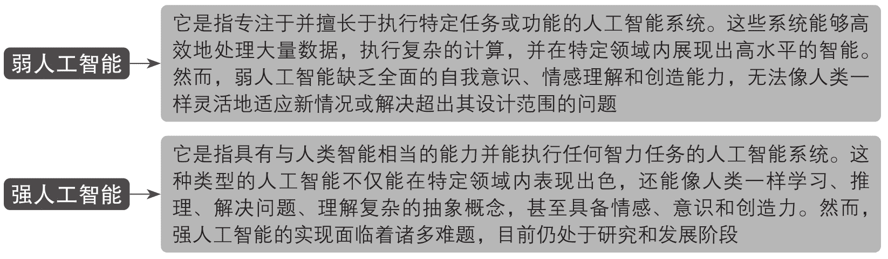

图 1-1

**1.1.2 什么是 AIGC**

扫码看教学视频

AIGC即人工智能生成内容，指利用AI技术学习和模拟人类创作流程，自动生成文本、图像、视频、音频等多种内容。AIGC是继PGC专家生产内容、UGC用户生产内容之后的新型创作方式。

按产出类型，AIGC可分为文本生成、图像生成、视频生成、音频生成四类，具体如图1-2所示。

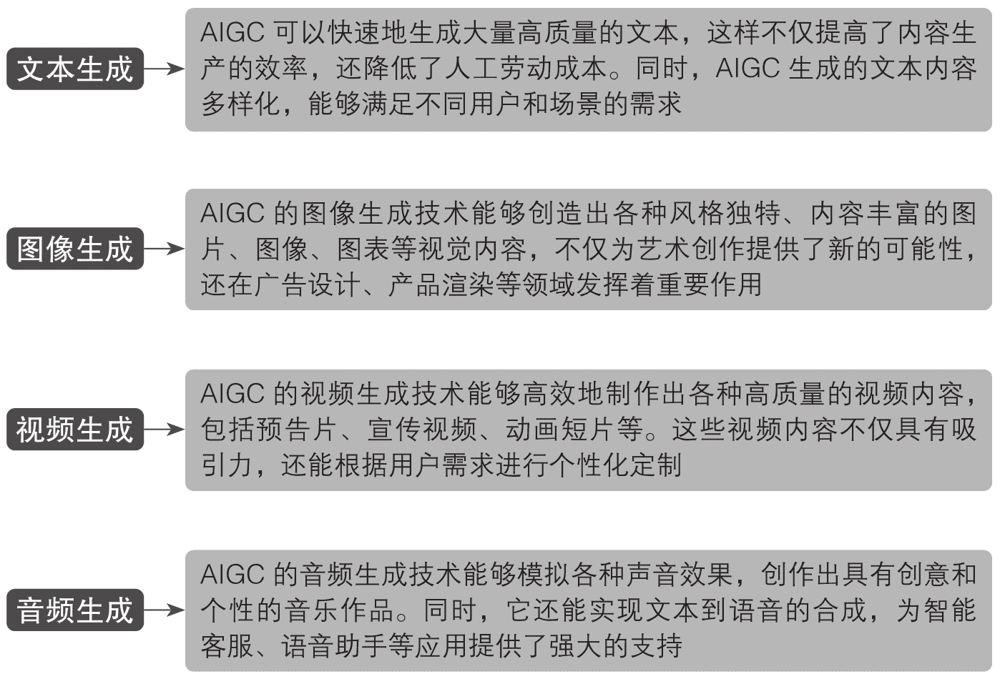

图 1-2

## **1.2 中老年人与人工智能的关联**

长者与人工智能的关联核心在于人工智能如何提升其生活质量。随着科技发展，人工智能在长者生活中作用愈发明显。本节阐述人工智能对长者的价值及学习机遇。

**1.2.1 中老年人学习人工智能的意义**

扫码看教学视频

长者学习人工智能意义深远，不仅有助于跟上时代，还能从多维度改善生活质量和个人能力。具体意义如图1-3所示。

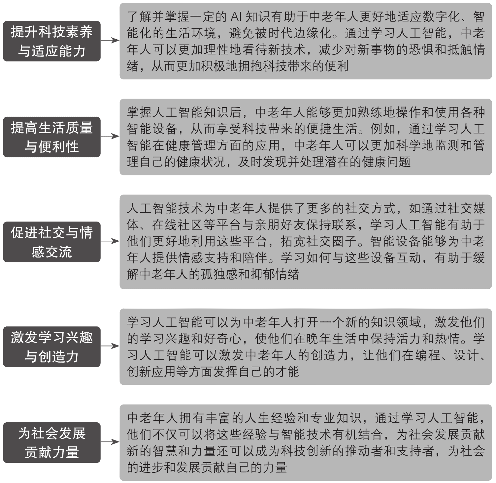

图 1-3

**1.2.2 中老年人学习人工智能的机遇**

扫码看教学视频

学习人工智能为长者带来丰富机遇。下面以图解形式说明可能获得的益处，如图1-4所示。

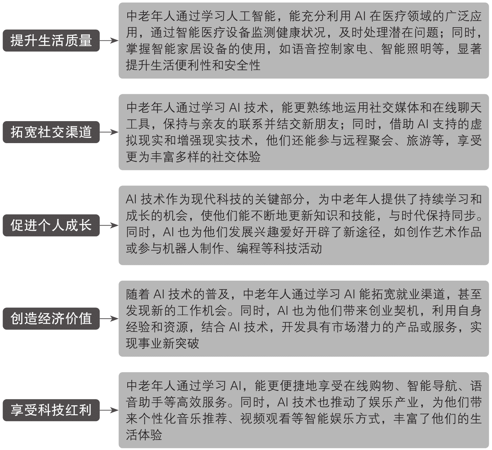

图 1-4

# **第二章 AI 健康管理**

人工智能健康管理是借助人工智能收集、分析个人健康数据，提供个性化健康方案、疾病预防、风险评估与健康干预的服务。它融合大数据、机器学习、深度学习等技术，为长者提供精准、便捷的健康守护。

## **2.1 用 AI 进行健康管理**

很多长者对健康格外关注，借助人工智能与AIGC技术可解答相关疑问，助力更科学地管理健康。本节通过典型案例解析人工智能在健康领域的落地，为长者群体筑起健康屏障。

**2.1.1 用 AI 提醒服药**

扫码看教学视频

部分长者需按时服药，易因疏忽而遗忘。可利用人工智能功能设置用药提醒，养成良好习惯。

以健康云App为例，该健康管理软件支持查询医药信息并可设置服药提醒。操作如下。

步骤 01 打开手机，点击桌面“软件商店”图标，如图 2-1 所示。

图 2-1

步骤 02 在软件商店搜索框中，❶输入“健康云”并搜索，❷点击对应App右侧“安装”按钮，如图 2-2 所示，完成下载安装。

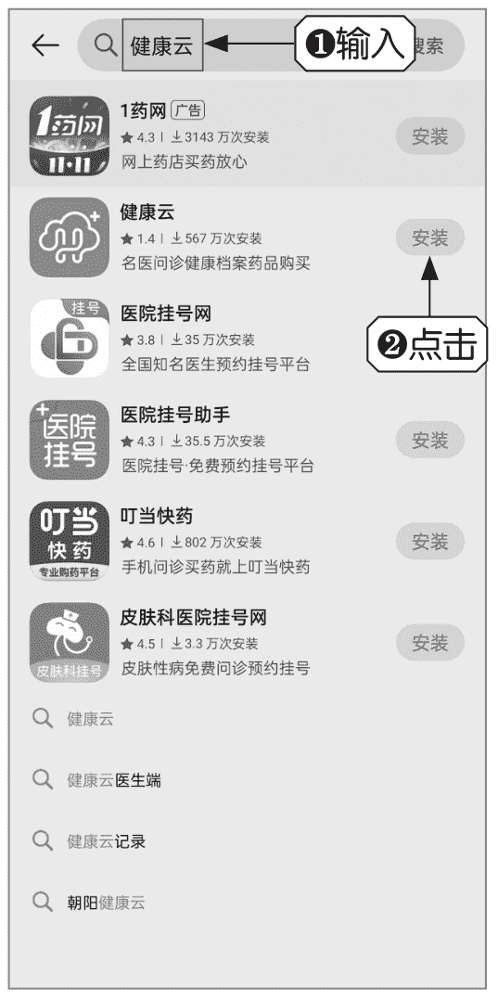

图 2-2

步骤 03 安装完成后，点击“健康云”右侧“打开”按钮，如图 2-3 所示，进入App。

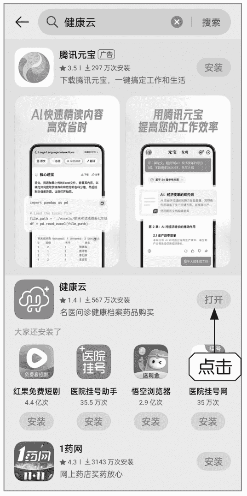

图 2-3

步骤 04 弹出“个人信息保护指引”面板，阅读内容，如图 2-4 所示。

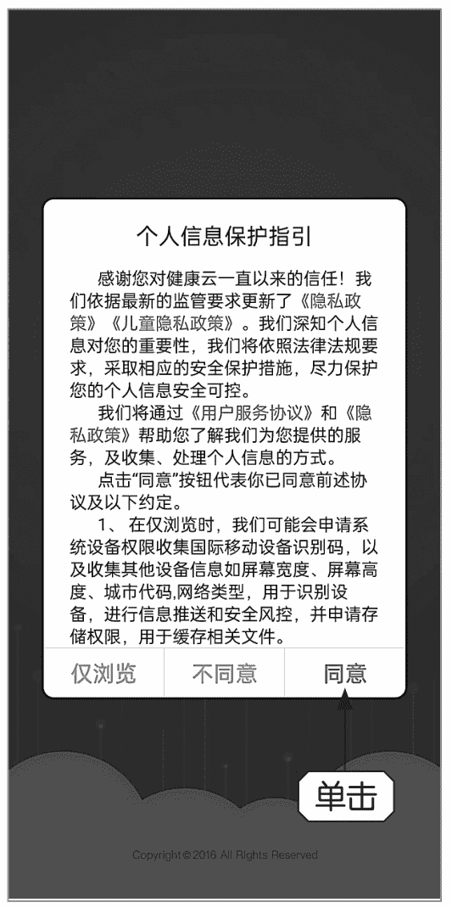

图 2-4

步骤 05 点击“同意”按钮，进入健康云“首页”界面，如图 2-5 所示。

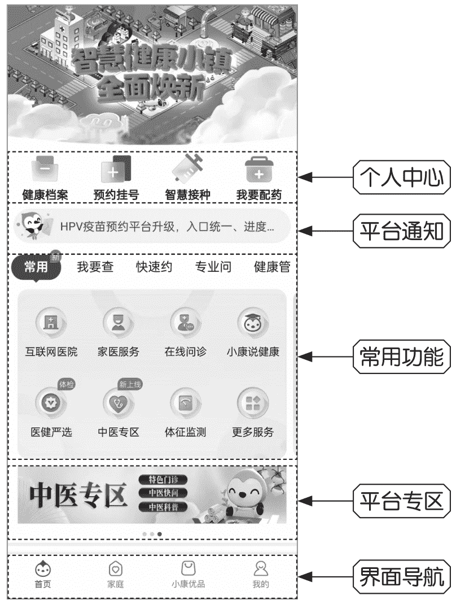

图 2-5

步骤 06 点击“我的”按钮，进入登录界面，点击“注册账号”按钮，如图 2-6 所示，完成注册。

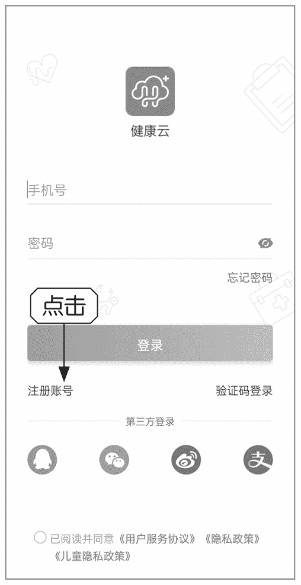

图 2-6

步骤 07 在新界面中，❶填写注册信息，❷勾选相应复选框，❸点击“注册”按钮，如图 2-7 所示，创建账号。

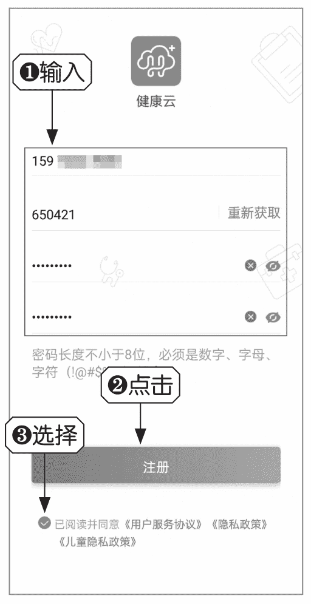

图 2-7

步骤 08 注册成功后，❶点击“首页”按钮切换界面，❷点击“健康管理”板块中的“添加用药提醒”按钮，如图 2-8 所示。

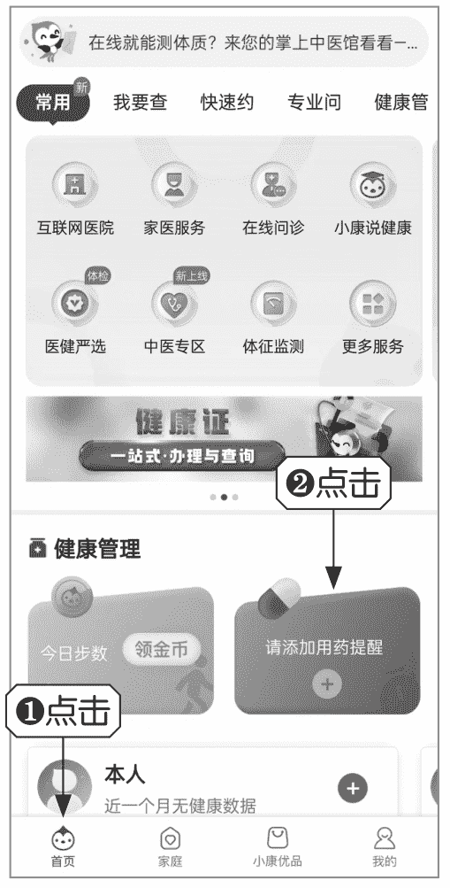

图 2-8

步骤 09 进入“添加用药提醒”界面，❶设置提醒相关信息，❷点击“保存”按钮，如图 2-9 所示，完成添加。

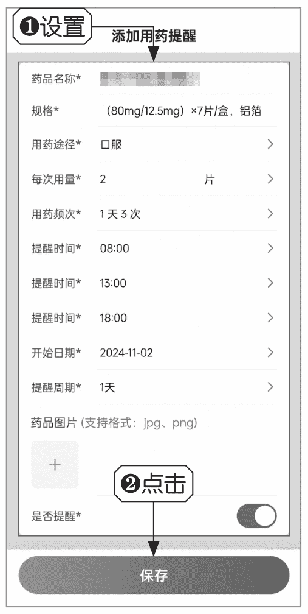

图 2-9

**2.1.2 用 AI 检测体质**

扫码看教学视频

体质检测是评估长者健康的重要手段，可尽早发现潜在风险，为个性化健康方案提供依据。借助人工智能工具，居家即可完成检测。

以知源中医App为例，该软件提供中医知识查询及体质检测功能。下面介绍操作流程。

步骤 01 在手机软件商店中，❶搜索“知源中医”，❷点击“安装”按钮，如图 2-10 所示。

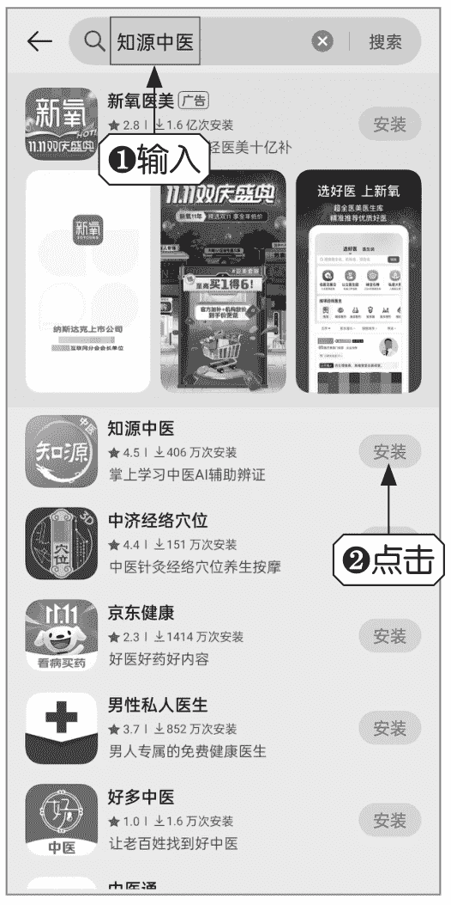

图 2-10

步骤 02 安装完成后，点击“打开”按钮，如图 2-11 所示，启动App。

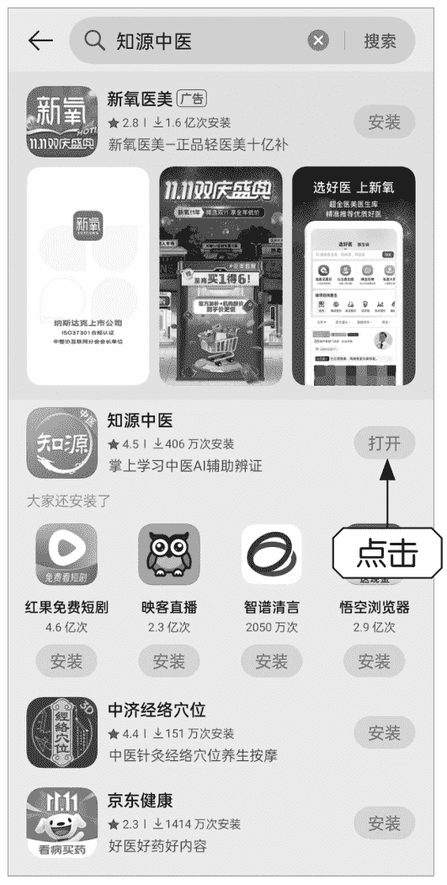

图 2-11

步骤 03 弹出“个人信息保护指引”面板，阅读后点击“同意”按钮，如图 2-12 所示。

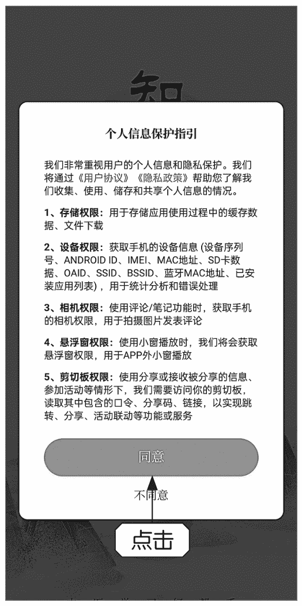

图 2-12

步骤 04 进入知源中医App“首页”界面，如图 2-13 所示。

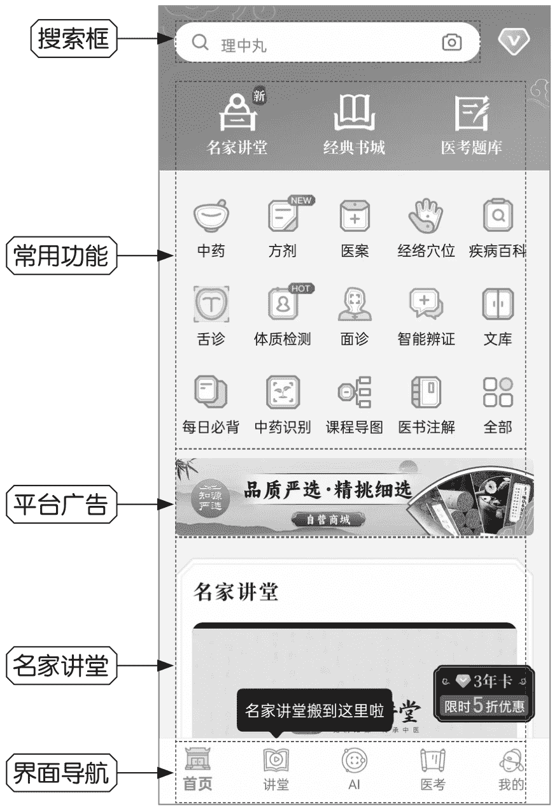

图 2-13

步骤 05 点击首页中的“体质监测”按钮，进入“AI体质监测”界面，点击“开始检测”按钮，如图 2-14 所示。

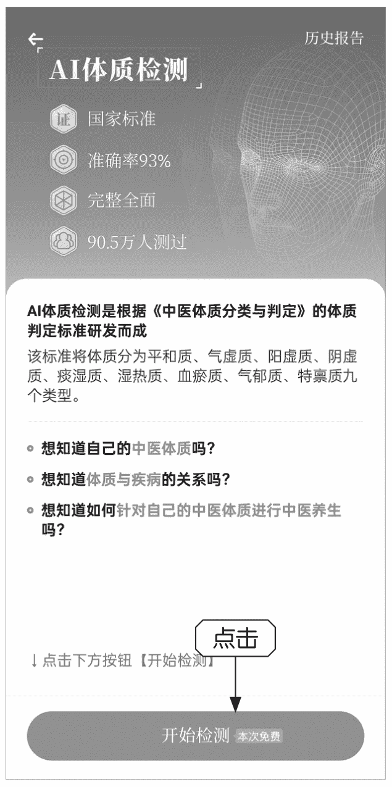

图 2-14

步骤 06 进入“AI体质检测系统”界面，与智能体质检测系统对话，完成基本信息问答后会提示上传舌诊报告，点击“开始舌诊”按钮，如图 2-15 所示。

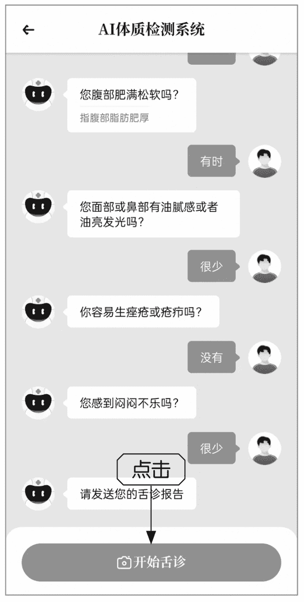

图 2-15

步骤 07 进入“请拍摄舌面”界面，如图 2-16 所示，使用相机拍摄舌面。

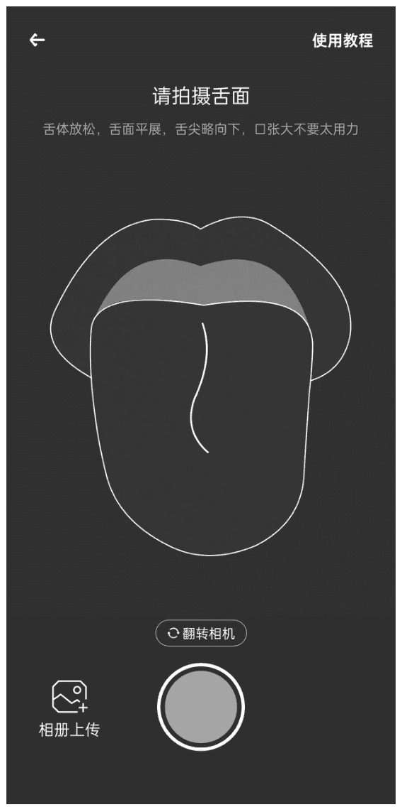

图 2-16

步骤 08 上传舌面照片后系统进行舌诊，完成后给出体质检测报告。点击“查看报告”按钮，如图 2-17 所示。

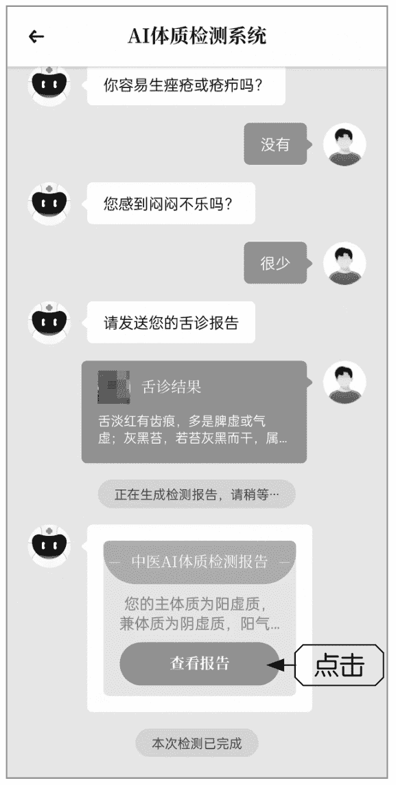

图 2-17

步骤 09 执行后即可查看检测结果，如图 2-18 所示。

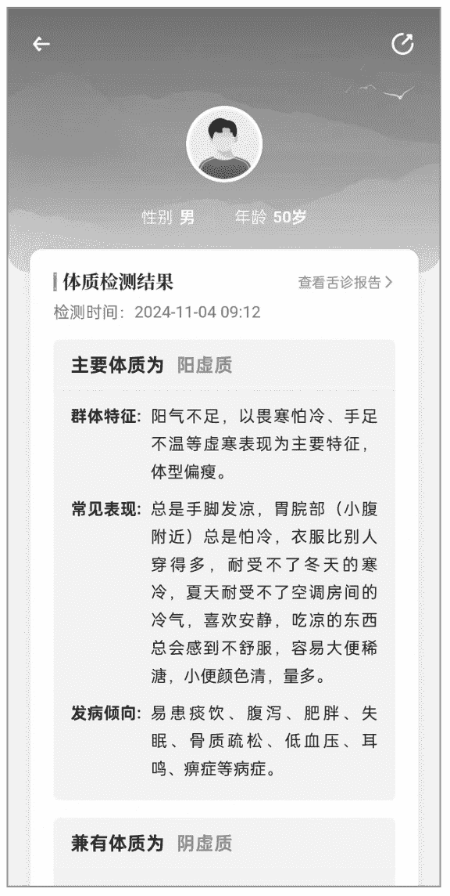

图 2-18

**专家提醒**

与知源中医智能体质检测系统对话时，提问内容大体一致，但顺序可能变化。操作时按自身实际情况作答即可。

**2.1.3 用 AI 导诊**

扫码看教学视频

智能导诊依托医疗人工智能、自然语言处理等技术，提供在线导医分诊、智能问答、科普宣教等就医服务。可根据症状快速推荐科室与医生，并在线解答院务问题，让长者就医更有指向性。

以腾讯健康公众号为例，该平台提供名医咨询、预约挂号、智能导诊等服务。下面介绍操作方法。

步骤 01 打开微信，点击“微信”界面上方的 按钮，如图 2-19 所示。

图 2-19

步骤02 弹出新页面后，点上方的“公众号”入口，图2-20能看到具体位置，用于限定搜索类型。
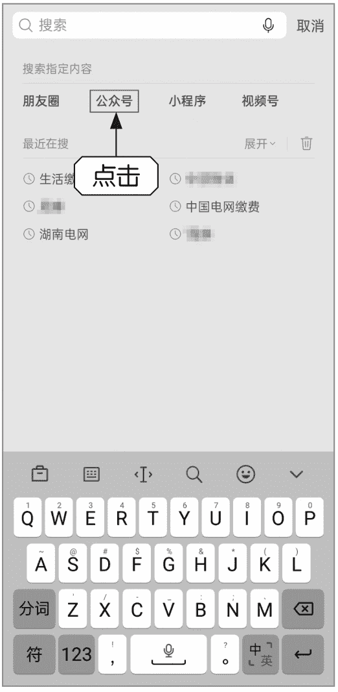
图2-20

步骤03❶把“腾讯健康”填进搜索框并执行搜索，❷在结果页找到对应的官方账号区域后进入，见图2-21。
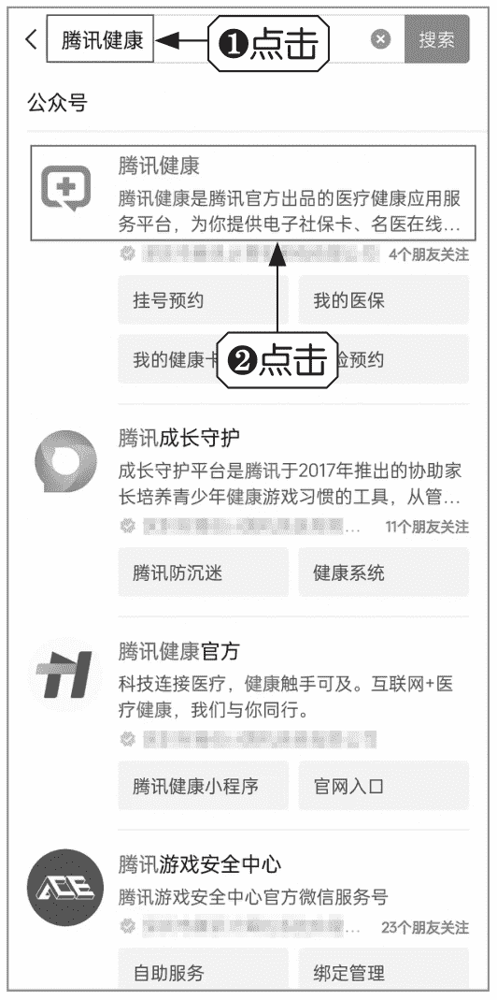
图2-21

步骤04 进入账号简介页后，按下“关注公众号”按钮，图2-22所示，完成订阅以便后续获取服务。

图2-22

步骤05 订阅完成后界面会刷新，点“发消息”即可开始对话，见图2-23。

图2-23

步骤06 随后进入对话主界面，如图2-24。

图2-24

步骤07❶在主界面打开“医疗服务”，弹出列表后❷挑选“挂号预约”选项，图2-25。

图2-25

步骤08 进入预约挂号页后，按“智能导诊”按钮，图2-26，启动问诊引导功能。
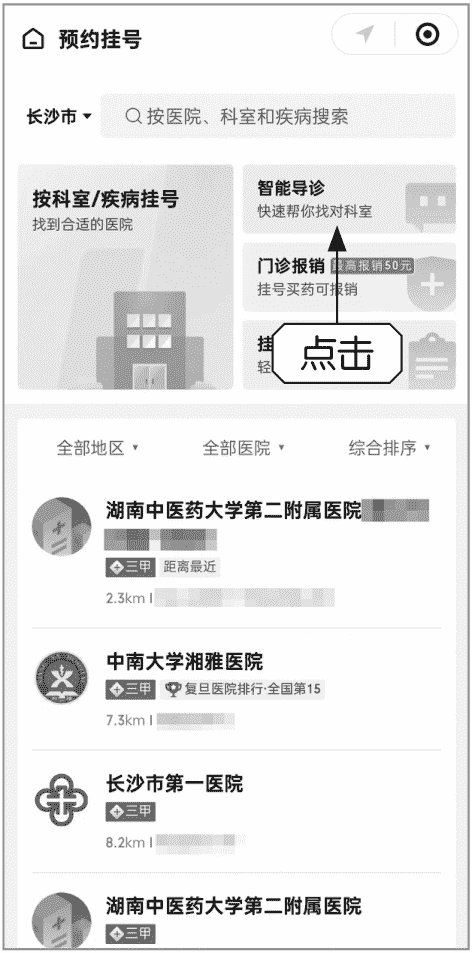
图2-26

步骤09 进入引导页后系统会展示说明文字，图2-27。
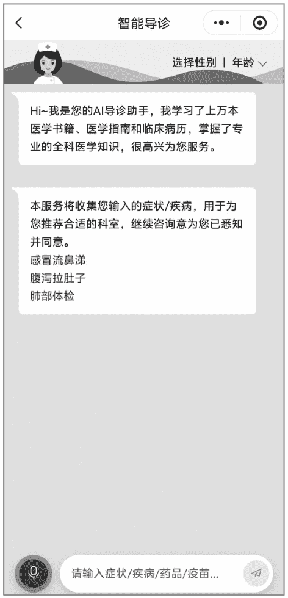
图2-27

步骤10 结合自身情况与AI问诊小助手交流，即可拿到相关医疗咨询。若需要挂号，长者可点“去挂号”在线完成预约，见图2-28。

图2-28

专家提示
在腾讯健康号里，与AI问诊小助手的聊天记录会自动保存。即使先取关再重新关注，再次打开智能导诊时之前的对话依然可见。

**2.1.4 AI 陪伴健康咨询**

扫码看教学视频

扫码看效果

现在不少平台都上线了AI助手，长者可以就健康问题向它们提问，迅速得到解答，更好地照护自己。

拿通义来说，它基于生成式AI技术，用户可通过问答生成文字、图片等内容。下面介绍借助通义做健康咨询的操作路径。

步骤01 打开搜索引擎如百度，❶在搜索栏输入“通义”，❷点击“百度一下”发起检索，见图2-29。
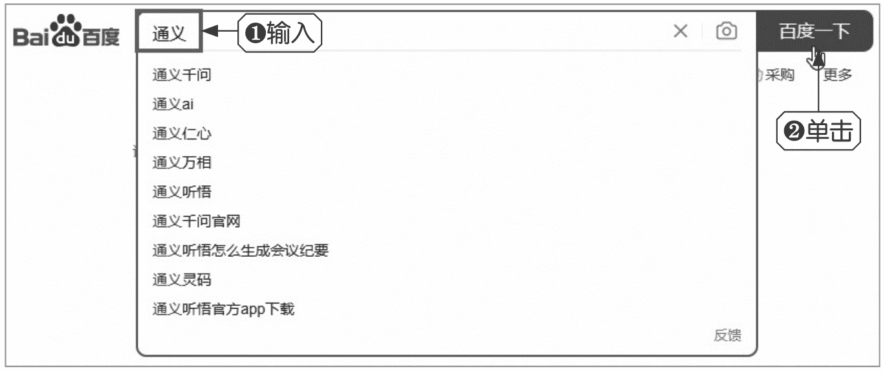
图2-29

步骤02 在结果列表中点开通义官网链接，见图2-30。
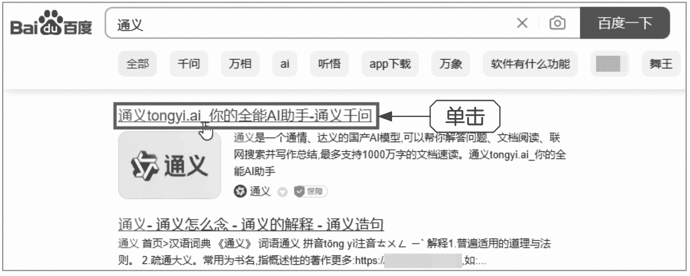
图2-30

步骤03 进入官网默认首页，见图2-31。
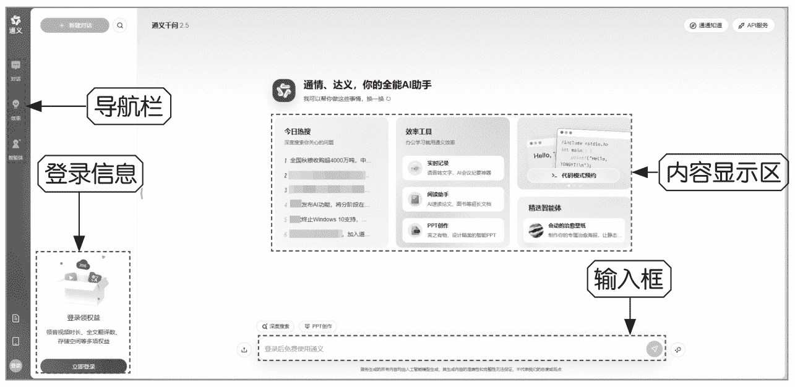
图2-31

步骤04 点对话页的“立即登录”按钮，弹出登录框，长者可用手机验证码或扫码登录。以验证码为例，❶填写手机号及验证码，❷勾选协议，❸点“登录”，见图2-32，完成登录。
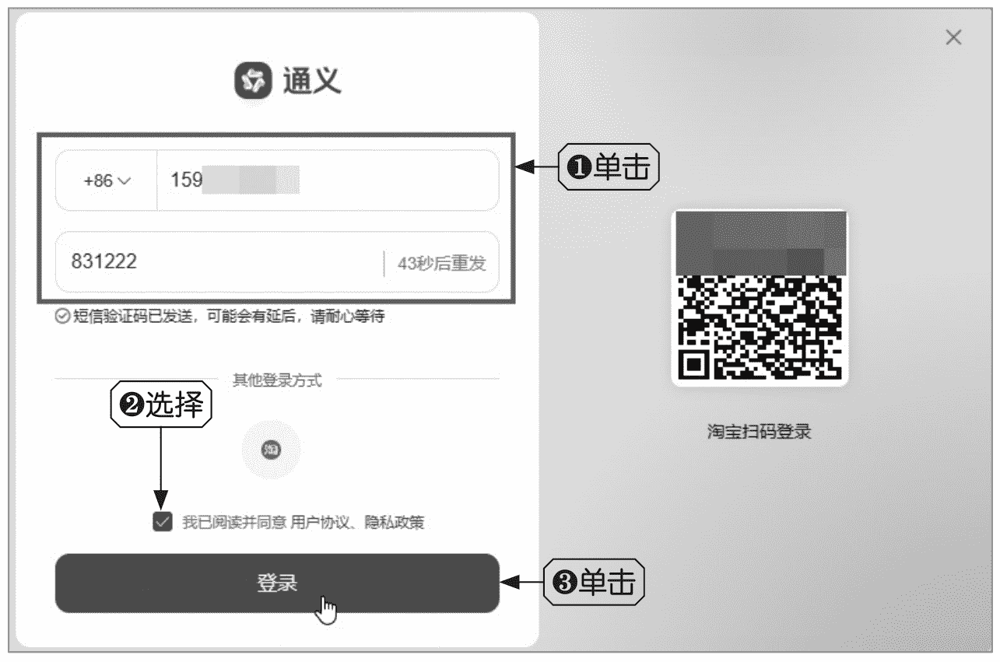
图2-32

步骤05 登录成功后官网左下角会显示头像。点“智能体”，见图2-33，切换页面。
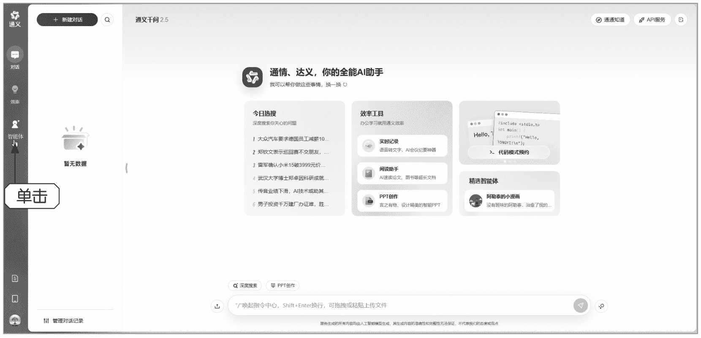
图2-33

步骤06 在智能体页的“全部分类”下点“健康助手”，见图2-34，调用该助手。
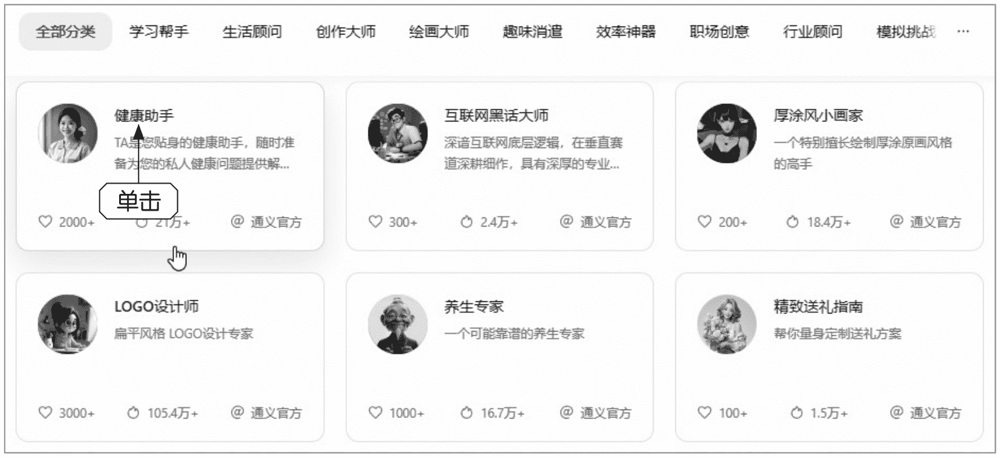
图2-34

步骤07❶在新页输入提示词，❷点击 按钮，见图2-35，向健康助手提问。
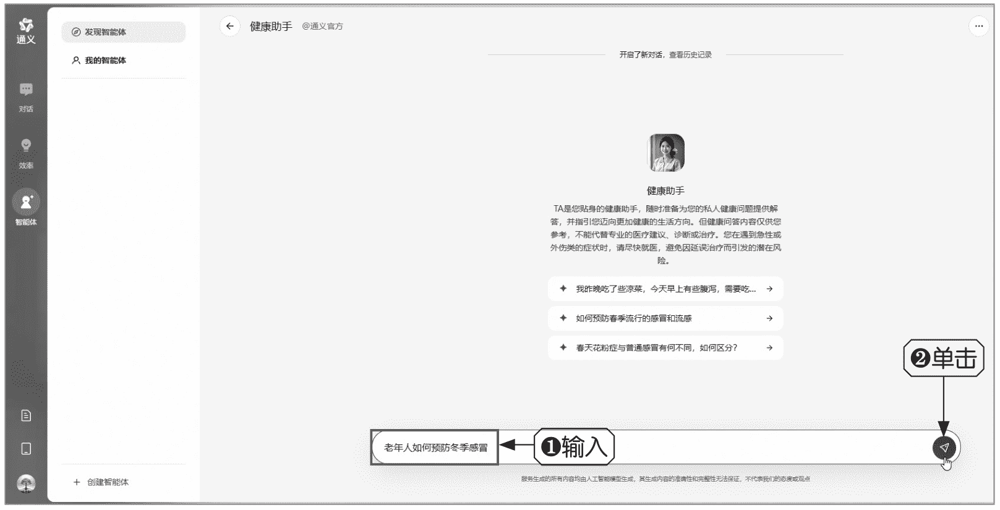
图2-35

步骤08 提问后，助手会给出建议，内容如下。 
**通义**
冬季老人较易感冒，因抵抗力偏弱。可从以下方面预防：
1．保暖：注意足部与背部，外出穿暖衣，戴帽子、围巾、手套。
2．饮食均衡：多摄入富含维C与维E的新鲜果蔬，适度补充蛋白质如鱼肉、鸡肉等。
3．适度活动：选择散步、太极等轻中度运动，提升体质，避免过度疲劳。
4．通风：室内定时开窗，减少病菌滋生。
5．卫生：勤洗手，外出回家后尤须注意；少去人多场所，必要时戴口罩。
6．充足睡眠：保证休息以维持免疫。
7．疫苗：体质弱或有慢性病者可考虑接种流感疫苗。
按上述方法可有效抵御冬季感冒。如有其他健康疑问，可随时咨询。

**2.1.5 AI 帮你制定食谱**

扫码看教学视频

扫码看效果

合理膳食有助于长者保持体魄，可借助生成式AI让助手提供饮食方案。下面以通义为例说明制定饮食计划流程。

步骤01 进入通义“对话”页，❶在输入区填入提示词，❷点击 按钮，见图2-36，向通义提问。

图2-36

步骤02 提问后，通义会据此生成饮食计划，内容如下。 
**通义**
可以。按要求提供一周清淡饮食计划，兼顾口味与营养，请按个人喜好调整食材与分量。
周一至周日营养均衡清淡饮食计划
**早餐**
燕麦粥：用低脂牛奶或豆浆煮燕麦，加入少量坚果与新鲜水果如蓝莓、香蕉片。
全麦面包：搭配自制低脂果酱或天然花生酱。
一杯绿茶或温开水：有助于新陈代谢。
**午餐**
主食：糙米饭或全麦面条，每日轮换。
蔬菜：清炒时令蔬菜，如菠菜、西兰花、胡萝卜，宜清蒸、白煮或凉拌。
蛋白质：清蒸鱼、瘦肉丝炒豆芽、豆腐汤等，按喜好选择。
水果：一份新鲜水果，如苹果、橙子或梨。
**晚餐**
主食：紫薯、南瓜或玉米等粗粮，增加膳食纤维。
蔬菜：凉拌黄瓜、西红柿炒蛋或清炒青菜，保持新鲜。
蛋白质：鸡胸肉炖蘑菇、虾仁豆腐或黑木耳炒瘦肉，选择低脂肉类。
汤品：番茄蛋花汤或冬瓜排骨汤，清淡可口。
……

## **2.2 AI 硬件守护健康**
近年市面上的智能健康管理设备越来越多，使用便捷且精准度提升，为长者健康生活提供支撑。本节结合案例说明设备在健康管理中的应用。

**2.2.1 AI 睡眠守护**

扫码看教学视频
长者应重视睡眠质量，规律作息、营造安静舒适环境、避免夜间过度兴奋均有益。借助智能手环等设备可监测睡眠状态并调整习惯。
以华为智能手环9为例，手环提供就寝提醒，可提示按时入睡；还可开启睡眠模式，减少睡前干扰。如需助眠，还能播放音乐。
睡眠期间，手环可监测睡眠呼吸暂停、呼吸率、心率和血氧等多项指标，全方位守护健康，见图2-37。
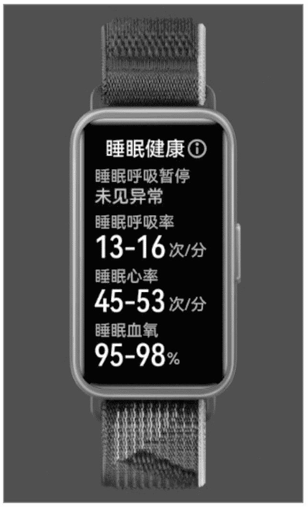
图2-37
起床后，手环会根据睡眠情况给出评分，并联动健康App综合分析，提供专属解读与建议，帮助提升睡眠质量，见图2-38。
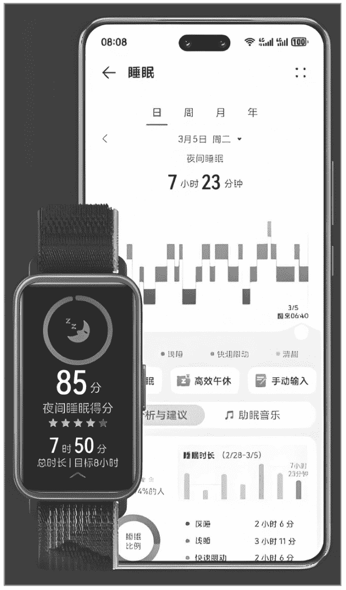
图2-38

专家提示
除睡眠监测外，华为智能手环还具备实时心率与血氧监测、健康提醒预警、信息同步与紧急求救等实用功能，为长者生活带来便利。
例如，华为智能手环9能基于健康数据提供久坐提醒、饮水提醒等建议。对存在高血压、糖尿病等健康风险的用户，预警功能可在关键时刻及时提示，降低突发风险。

**2.2.2 AI 血压测量**

扫码看教学视频
长者需定期监测血压以维护心血管健康。测量时建议使用智能血压计，操作简便读数准确。测量应保持安静，避免餐后或运动后立即测，记录结果便于发现波动。
以奥克斯BSX5128电子血压计为例，其具备智慧测压功能，一键完成测量，操作简化，便于动手能力较弱者使用，见图2-39。

图2-39
该机还配备智能语音播报，测量结果会通过语音告知，方便视力不佳的长者快速了解血压情况，见图2-40。
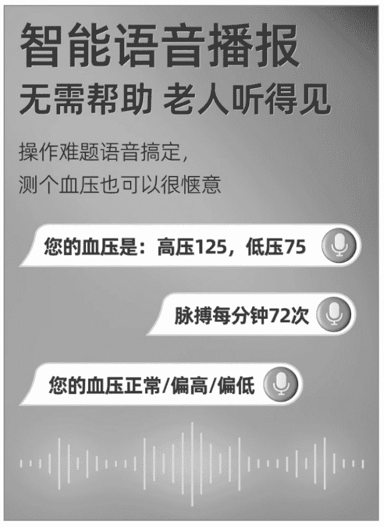
图2-40

**2.2.3 AI 心率监测**

扫码看教学视频
心率监测对预防心血管疾病很重要。正常心率约为每分钟60至100次，超出此范围可能提示健康问题。持续监测有助于及时发现异常，调整生活方式或进行医疗干预。
长者可借助智能手环、智能心率监测一体机、智能耳机等设备监测心率。以墨觉Terra智能运动耳机为例，图2-41为产品图。

图2-41
该耳机主要体现在两方面：
**1．心率实时监测**
可精准监测心率，支持语音播报结果，并在心率过高或过低时通过震动发出预警。
**2．AI运动私教**
可充当运动私教，根据心率和运动数据结合专业算法生成训练计划，让运动更安全高效。

**2.2.4 AI 颈椎呵护**

扫码看教学视频
长者应避免长时间低头或久坐。可适当做颈部拉伸、缓慢转动头部，选用合适的枕头保持颈椎自然曲度，定期散步、练太极增强颈部肌力。
还可借助智能颈椎按摩器等设备按摩放松颈部。
以京东京造智能颈椎按摩器SE为例，其采用AI算法模拟真人手法，深入肌肉组织缓解疲劳，提供16档脉冲强度，满足不同需求，见图2-42。

图2-42
该按摩器还支持智能恒温热敷，佩戴时可享受约42℃恒温热敷，快速缓解颈部疲劳，见图2-43。

图2-43

**2.2.5 AI 防摔保护**

扫码看教学视频
长者摔伤后果严重，可能导致骨折、长期卧床及并发症，恢复缓慢且易产生心理阴影。
可通过安装扶手、防滑地砖、穿防滑鞋，以及进行平衡力量训练降低风险。也可借助穿戴式设备减轻伤害。
以信安智囊老人防摔马甲为例，马甲具备全方位自动防护，前后侧摔均可被检测。芯片识别到跌倒或失重状态后即启动防护并迅速充气，减少伤害。图2-44为前摔保护示意图。

图2-44
该马甲具备AI智能识别，日常佩戴如普通马甲，不影响活动，见图2-45。

图2-45
担心摔倒后无法自救，也可在室内安装智能跌倒检测雷达，实现及时报警。
以萤石非接触式智能跌倒检测雷达为例，可精准识别区域内人体并将信息推送至手机App。识别到离位或跌倒时会推送告警，见图2-46。
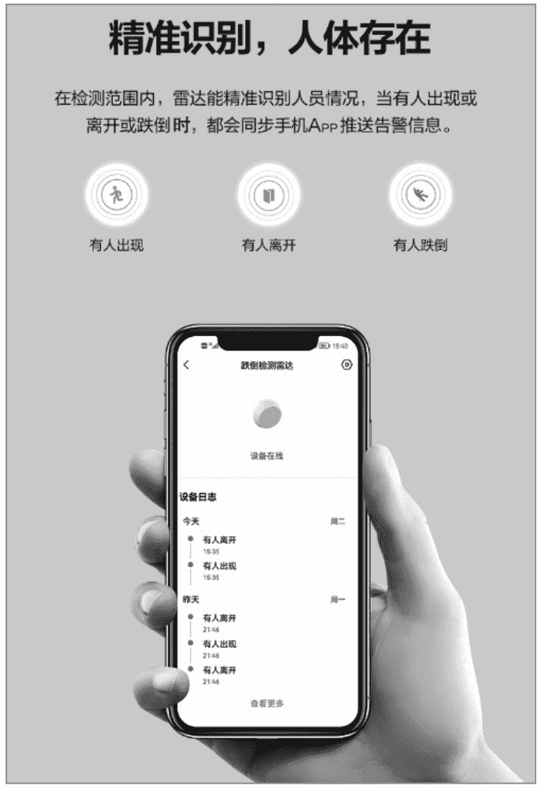
图2-46

专家提示
告警是指系统在运行过程中检测到异常、潜在威胁或指标超出阈值时自动触发的通知机制，用以告知相关人员及时处理，保障系统稳定运行。
该雷达还可设置报警延时，见图2-47。在延时内若跌倒者自行起身则不推送告警，减少误报。
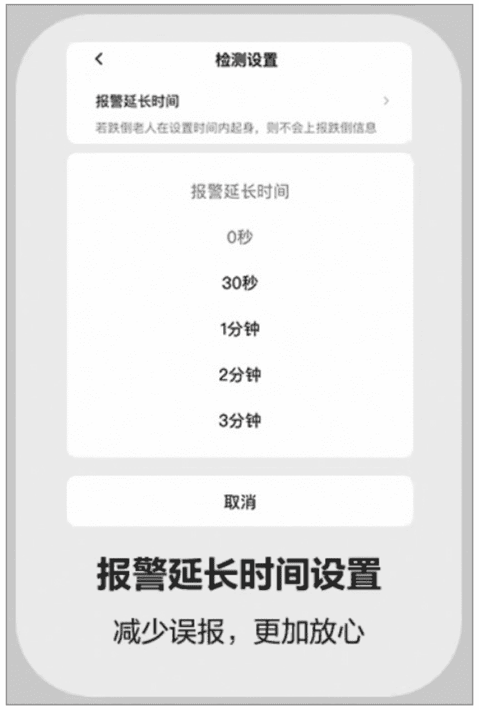
图2-47

**2.2.6 AI 紧急求助**

扫码看教学视频
遇到紧急情况时，长者应立即使用随身求救设备或拨打急救电话，清晰说明状况与位置，保持冷静等待救援。
通常可用通信设备拨打电话，但若未携带设备，家中配备AI紧急求救设备即可解决问题。
以分音塔老人安全摔倒报警器为例，其不仅限于摔倒报警，可按用户需求设定触发条件。
该设备提供智能语音报警，只需喊出“救命”等敏感词即可快速报警，见图2-48。采用先进AI语音技术，有效降低误报率。

图2-48

除开语音式求救之外，这款跌倒监测装置还配备了手动一键报警，长者只需按下设备对应的按键即可立刻触发警报，详见图 2-49。

图 2-49

**专家提醒**

健壮性在跨学科领域里是一个常用概念，用来衡量系统、算法或事物在面对异常、不确定或突发状况时，依然能够保持功能、效用和稳定性的能力。简单来说，就是系统在不利环境下仍能持续正常运转的水平。

# **第三章** **AI 社交娱乐**

人工智能与社交娱乐的结合正成为当前热门方向，它让用户尤其是中老年群体获得更省心、高效且具个性化的社交体验。本章借助真实案例来说明 AI 在该领域的实践。

## **3.1** **用 AI 享受娱乐时光**

在智能化氛围中，中老年人以全新姿态度过休闲时刻。AI 会依据个人喜好生成定制化内容，使音乐、故事、知识等触手可及，不仅丰富精神世界，也让晚年更有活力，充满趣味与温度。本节结合具体设备，介绍中老年人借助 AI 放松身心的实例。

**3.1.1** **用 AI 高效交流**

扫码看教学视频

数字化背景下，AI 为长者搭建起顺畅沟通的桥梁。系统能根据对话情境提供健康咨询、生活建议，甚至进行陪伴式聊天，让交流更便捷同时感受到科技的温情。

以小米小爱音箱 Play 为例，该音箱具备超过1600项生活技能，长者可用语音与其互动，提出问题并迅速获得答案，如图 3-1 所示。

图 3-1

该智能音箱亦支持语音操控，可快速操控接入小米 IoT 平台的智能设备，更好地享受娱乐时光，如图 3-2 所示。例如可通过它开启小米电视，观看新上线的影片。

图 3-2

**专家提醒**

IoT 平台即物联网平台，是连接感知层各类设备到应用场景的枢纽，允许用户通过语音等交互方式对平台上的智能设备进行远程控制与管理。

**3.1.2** **用 AI 驱散孤独**

扫码看教学视频

AI 聊天机器人凭借智能互动，成为许多长者日常生活中的温暖伙伴。它们能通过对话提供信息、解答疑惑，也能倾听心声，用关怀与陪伴缓解孤独，让晚年更充实，重拾交流的乐趣。

以乐天派桌面机器人为例，该实体机器人融合视觉、触觉、听觉，不仅能发声，还能做表情并模拟思考，如图 3-3 所示。

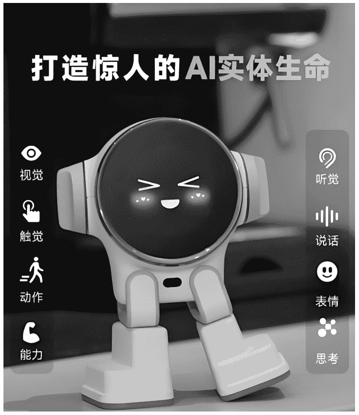

图 3-3

该机器人还具备情绪感知功能，当长者触摸它时，能捕捉情绪并以表情和语音做出回应，如图 3-4 所示。

图 3-4

**3.1.3** **用 AI 指挥手机**

扫码看教学视频

借助 AI，手机成为长者的得力助手。利用手机内置助手，无需繁琐操作，仅用语音指令即可实现设定提醒、查询天气、播放音乐、视频通话等功能，既简化使用流程，也带来温暖的科技体验。

以一加 Ace2 Pro 手机为例，长者可按以下方式让手机播放纯音乐。

步骤 01 打开手机，通过语音说出“小布小布”，如图 3-5 所示，启动手机助手。

图 3-5

步骤 02 若手机回复“在呢”，说明助手已启动，随后可根据需求下达语音指令，例如要求播放一首纯音乐，如图 3-6 所示。

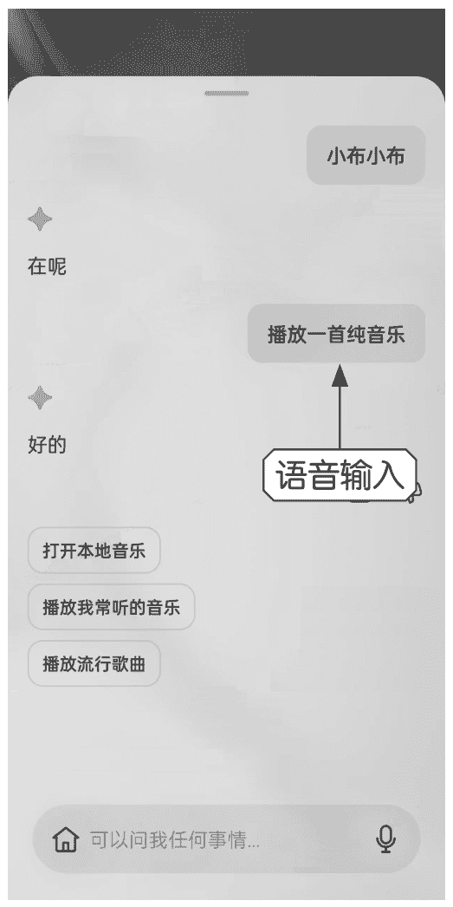

图 3-6

步骤 03 执行后，手机助手会按指令播放相关曲目，如图 3-7 所示。

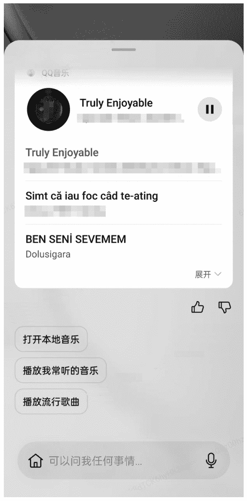

图 3-7

**专家提醒**

不同品牌手机的语音助手名称并不相同。例如苹果为 Siri，华为为小艺，小米为小爱同学。下达指令时需先唤出对应名字启动助手。注意，若助手名称仅有两个字，连续呼叫两次，启动成功率会更高。

**3.1.4** **用 AI 联系子女**

扫码看教学视频

部分长者与子女分居，面见不易。借助 AI 设备沟通，可跨越地域限制，让思念不再受距离阻隔，通过设备轻松与远方子女联系，分享生活点滴，缓解孤独。

以萤石智能家居摄像机为例，该摄像机像素较高，并提供“AI 手势识别”“AI 人形特写追踪”“AI 宠物检测”等功能，可满足多样化需求，如图 3-8 所示。

图 3-8

以“AI 手势识别”为例，长者可对着镜头比出耶的手势，让其呼叫子女，迅速取得联系，如图 3-9 所示。图中展示的是亲子场景，替换为长者与子女同样适用。此外还可让镜头自拍，让子女看到生活状态。

图 3-9

**3.1.5** **用 AI 虚拟现实**

扫码看教学视频

AI 与虚拟现实技术共同构建全新数字世界。通过智能 VR 设备，长者可体验各地风光、参与互动式健康锻炼、重温昔日爱好。AI 的加入使虚拟体验更个性、更智能，丰富精神生活，促进身心健康。

以雷鸟 Air 2s 智能眼镜为例，该眼镜采用虚拟现实技术，能营造出近眼沉浸效果，观看影像时仿若置身现场，如图 3-10 所示。

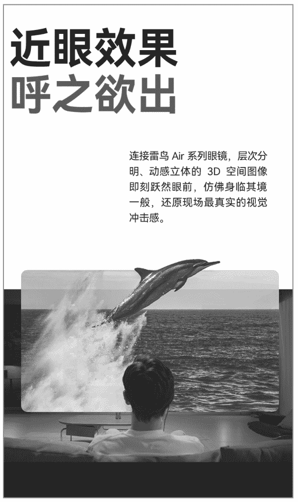

图 3-10

该设备还集成 AI 功能，可将图片一键转为 3D 效果，如图 3-11 所示。观看照片时画面更立体，信息查看更细致。

图 3-11

## **3.2** **用 AI 进行社交互动**

AI 赋能社交互动，为长者开启智慧社交新阶段。它简化流程，降低技术门槛，实现便捷线上交流，让体验更个性、更贴心，有助于拓宽社交圈、增进情感交流，缓解孤独。本节介绍 AI 在社交互动中的典型应用。

**3.2.1** **用 AI 获取内容**

扫码看教学视频

AI 内容推荐系统可为长者量身定制信息，让其快速获取感兴趣内容。系统精准捕捉偏好，满足多元需求，既简化信息筛选，也丰富精神世界，让晚年更积极快乐。

例如抖音 App 是短视频平台，长者可观看短视频、直播并购物。首页“推荐”栏目会依据浏览习惯与内容热度推送信息，如图 3-12 所示。打开 App 后即可在推荐页看到感兴趣的内容。

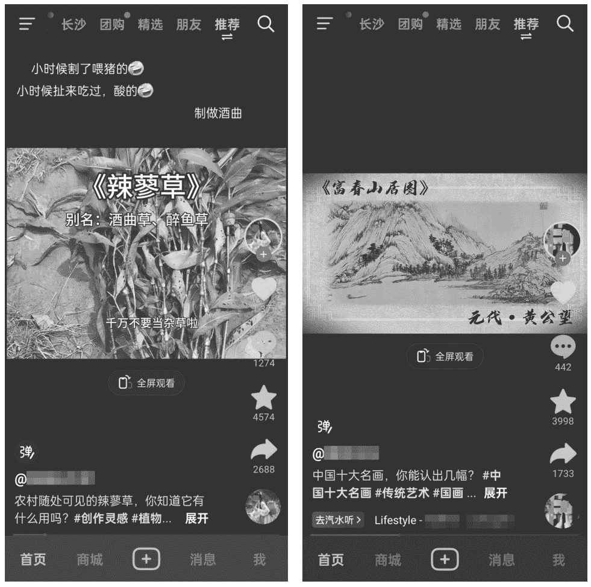

图 3-12

除平台主动推荐外，长者也可主动寻求 AI 推荐。以天工 AI 为例，这是一个智能化解决方案平台，通过数据处理与模型训练提升效率与决策能力。以下为操作流程。

步骤 01❶在搜索引擎如百度搜索框输入并搜索“天工 AI”，❷点击搜索结果中天工 AI 官网链接，如图 3-13 所示，进入官网。

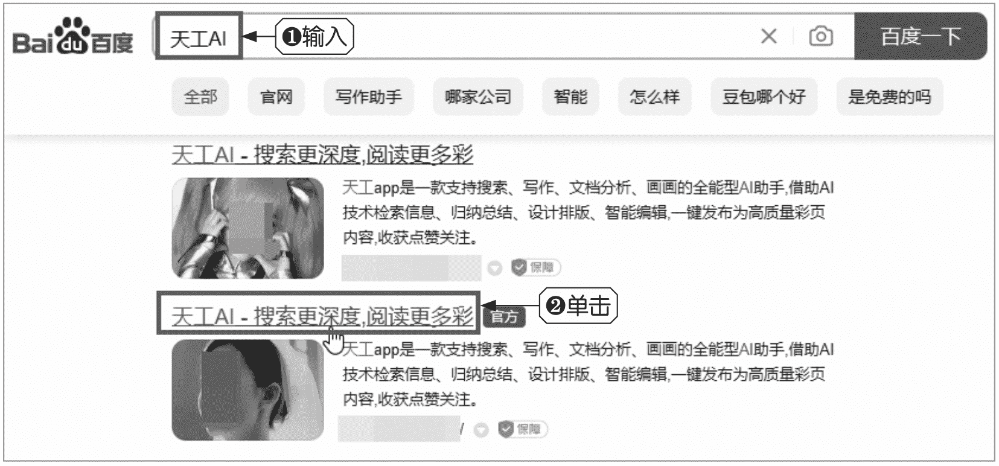

图 3-13

步骤 02 执行后进入天工 AI 的“搜索”页面，如图 3-14 所示。

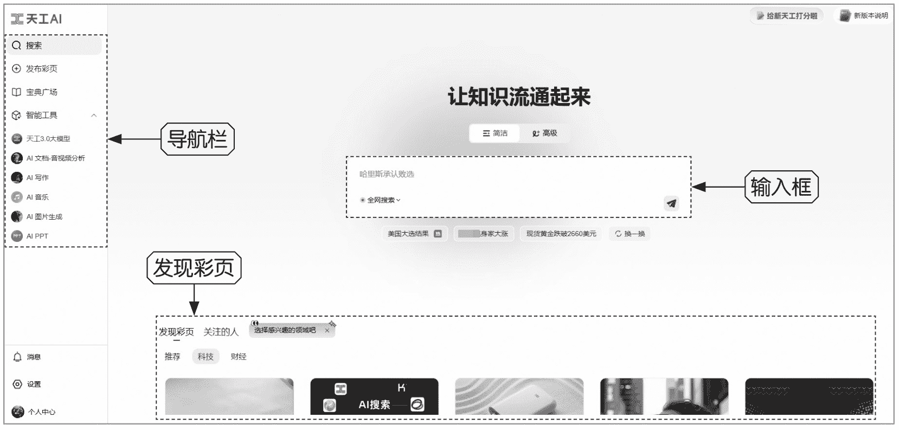

图 3-14

步骤 03 点击搜索页输入框，❶输入提示词，❷点击 按钮，如图 3-15 所示，向天工 AI 发送请求。

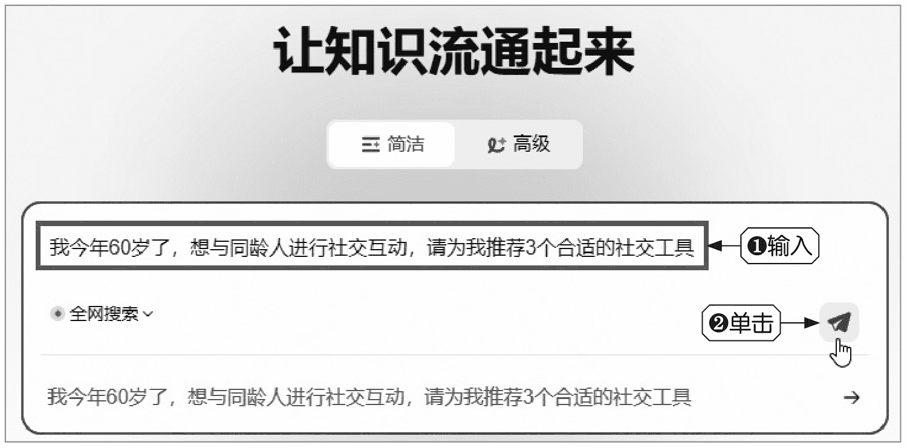

图 3-15

步骤 04 执行后，天工 AI 会按提示词返回相关内容，具体如下。

**天工 AI**

适合 60 岁及以上人群的社交工具。

根据您的需求，以下是三个适合 60 岁及以上人群的社交工具：

微信：微信是一款非常流行的社交软件，不仅可以与家人和朋友聊天，还可以通过加入兴趣群组与陌生人交流。中老年人可以加入一些与自己兴趣相关的群组，如养生、旅游、摄影等，与同样爱好的人交流并结交新朋友。

QQ：QQ 是中国最早的社交软件之一，也是中老年人常用的聊天工具。中老年人可以通过 QQ 加入一些兴趣群组，与其他群成员一起交流、分享生活经验和兴趣爱好。

老无忧：老无忧是一款专为中老年人设计的交友软件，提供了许多交友和社交功能。用户可以创建个人资料，浏览其他用户的资料，通过文字、语音、图片等多种方式与其他用户交流。老无忧还提供了一些线下活动，如相亲会、旅行团等，让用户有机会在现实中结识新朋友。

……

**3.2.2** **用 AI 线上旅游**

扫码看教学视频

AI 线上旅游为长者打造足不出户的数字游览方式。轻点屏幕即可游览全球名胜，高清画面配合解说，仿若身临其境。不出门也能旅行，既丰富生活又保障安全与舒适。

例如百度地图 App 是综合导航与位置服务平台，可提供精准路线规划与实时路况，让出行更便捷。借助它可搜索景区全景图并滑动浏览，实现居家线上旅游，具体操作如下。

步骤 01 打开百度地图 App，进入“出行”界面，搜索如图 3-16 所示。

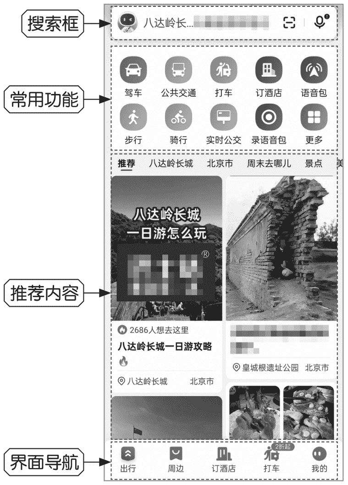

图 3-16

步骤 02 点击上方搜索框，❶输入并搜索景区；❷点击搜索结果中对应景区位置，如图 3-17 所示。

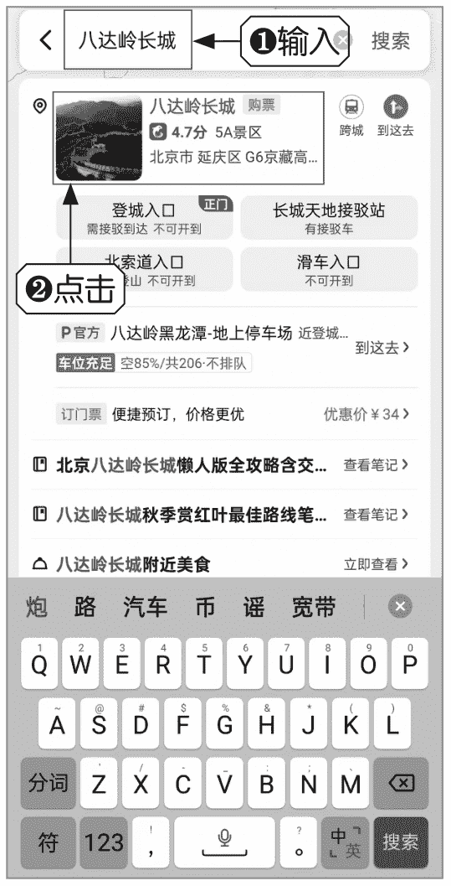

图 3-17

步骤 03 进入景区介绍页，点击上方景区全景图，如图 3-18 所示。

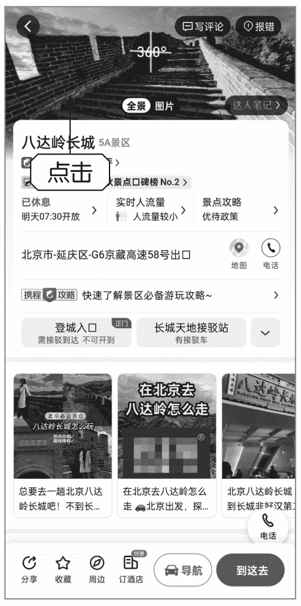

图 3-18

步骤 04 执行后进入全景图预览页，可查看全景图，如图 3-19 所示。

图 3-19

步骤 05 点击全景图区域进入全屏预览，如图 3-20 所示。想查看其他角度，只需滑动手机即可。

图 3-20

**3.2.3** **用 AI 进行互动**

扫码看教学视频

扫码看效果

借助 AI 进行互动，为长者带来全新生活体验。智能体作为 AI 的具象化形式，能根据兴趣与需求提供精准服务，并通过深度学习理解情感需求，成为贴心伙伴，让服务更便捷温暖。

例如豆包 App 是多功能 AI 助手，可在生活、学习、工作上提供帮助。长者可按需选择智能体并与其互动，具体操作如下。

步骤 01 打开豆包 App，进入“发现”界面，如图 3-21 所示。

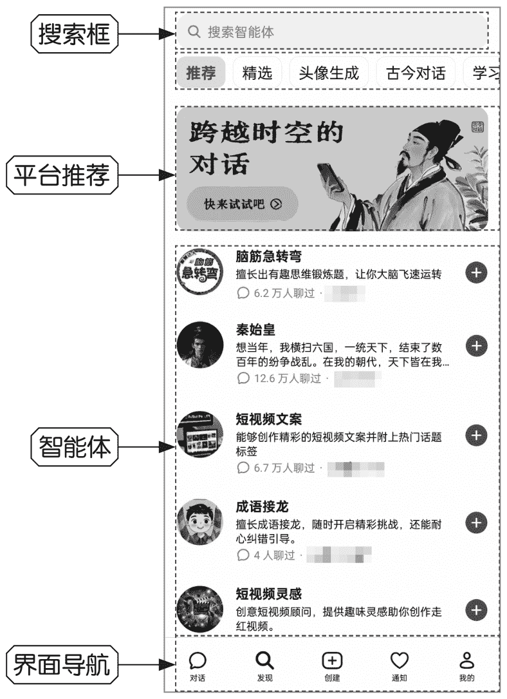

图 3-21

步骤 02 点击发现页上方按钮切换选项卡，❶如点击“古今对话”即可切换至对应页，❷点击智能体区域，如图 3-22 所示，开始对话。

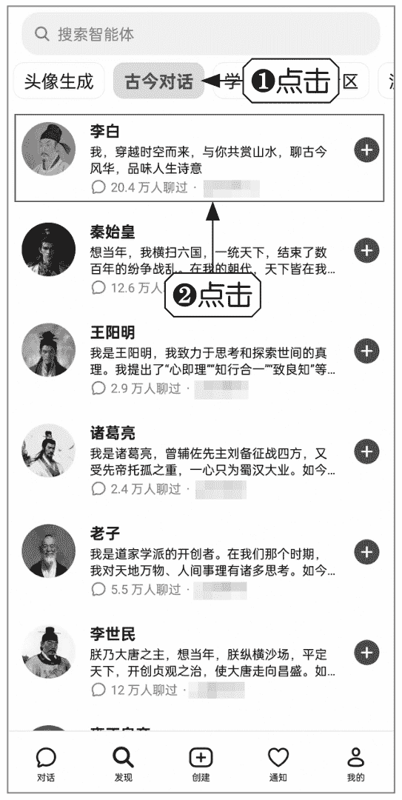

图 3-22

步骤 03 进入文字对话页，可点击系统提供的问题，如图 3-23 所示。

图 3-23

步骤 04 执行后智能体会给出答案。除点击预设问题外，还可文字或语音输入。以语音为例，点击上方 按钮，如图 3-24 所示。

图 3-24

步骤 05 进入语音对话页，如图 3-25 所示，可直接对手机说话。

图 3-25

步骤 06 在语音页输入提示词即可对话，如需查看文字回复，点击 按钮，如图 3-26 所示。

图 3-26

步骤 07 返回文字对话页，即可查看智能体回复内容，如图 3-27 所示。

图 3-27

# **第四章** **AI 出行助手**

AI 出行技术的出现极大便利了长者的日常出行。它提供更安全、舒适的出行方案，降低面对复杂交通的压力。无论乘坐智能公交还是使用便捷打车服务，都能让银发群体享受更贴心的出行体验。

## **4.1** **用 AI 规划出行信息**

综合考虑多方面因素，AI 能提供精准出行建议与详细路线指引，既帮助长者高效安排行程，也提升便捷性与安全性，让出行更舒适。本节讲解 AI 在出行信息规划中的常见应用。

**4.1.1** **用 AI 获取交通信息**

扫码看教学视频

借助相关 AI 功能，长者可便捷掌握实时交通资讯，包括公交动态、路况信息与最优路径规划，即时获取显著提升出行便捷与安全，让日常出行更顺畅安心。

例如车来了 App 是实时公交查询软件，覆盖全国 300 多个城市，可为长者提供公交实时信息。以下为查看某线路到站时间的步骤。

步骤 01 打开车来了 App，进入首页界面，如图 4-1 所示。

图 4-1

步骤 02 点击搜索框，❶在框中输入并搜索对应线路或站点、目的地，❷点击搜索结果中对应线路，如图 4-2 所示。

图 4-2

步骤 03 执行后可查看线路相关信息，若行驶方向与目的地相反，可点击“换向”按钮，如图 4-3 所示。

图 4-3

操作完成之后，界面会展示反向线路的对应资料。若想进一步了解该线路更多班次的动态，可以点按“更多车辆”，参考图4-4。

图4-4

进入“更多车辆”页面后，便能查阅本线路其他车辆抵达邻近站点的情况，见图4-5。

图4-5

**4.1.2 智能规划出行路线**

扫码看教学视频

对长者而言，借助智能系统让行程安排更省心也更高效。平台会整合公交、地铁、步行等多种交通数据，自动给出最省力的抵达方案，不管选用哪种方式都能以轻松状态到达。这样的智能化安排既提高了效率，也让旅程更舒适。

拿百度地图App来演示，长者可用语音报出目的地，由智能系统完成路线规划，具体操作如下。

步骤01 启动百度地图App进入“出行”界面，点击 按钮，如图4-6所示，唤醒语音输入助手。

图4-6

步骤02 执行后会弹出语音助手的提示框，如图4-7所示。

图4-7

步骤03 用语音说出目的地，助手会识别内容并在界面上呈现对应的文字，如图4-8所示。

图4-8

步骤04 随后地图会基于智能功能生成出行方案，偶尔提供多条备选，长者只需挑选合适的一条即可。

**4.1.3 智能定制旅程方案**

扫码看教学视频

扫码看效果

智能系统可结合长者的体况、兴趣偏好和时间安排量身打造行程，保证景点适合慢游、餐饮侧重营养健康、住宿偏安静便利，同时关注天气变化及时调整，让旅途既愉快又安全舒适，每一次出行都留下美好回忆。

拿文心一言做示例，长者说出目的地后即可获得具体规划，示范如下。 

**提问**

我上个月刚退休，想趁现在有时间去桂林旅游，你能为我制订一个具体的旅行规划吗？ 

**文心一言**

当然可以。考虑到您已退休时间充裕，给您一份为期4天的桂林行程：

**第1天：**

上午：抵达桂林后前往两江四湖景区，乘船环湖观赏城市景致，感受“千峰环野立，一水抱城流”的意境。

下午：游览独秀峰王城景区，了解明代历史，体会桂林文化发源地的古老韵味。

晚上：入住桂林市区酒店，如桂林台联酒店或桂林杉湖大酒店，享受宁静夜晚。

**第2天：**

上午：前往阳朔游览遇龙河，坐竹筏漂流，欣赏田园风光与奇峰异石。

下午：游览漓江风景名胜区，这是桂林精华所在，可选择桂林至阳朔40公里精华河段乘船游览。

晚上：在阳朔西街漫步，感受异国情调，品尝当地小吃。

**第3天：**

上午：前往龙脊梯田，观赏层层叠叠的梯田景观，体验当地民族文化和农家生活。

下午：返回阳朔游览银子岩，领略溶洞奇观。

**第4天：**

上午：返回桂林市区游览象鼻山，这是桂林地标景点之一。

下午：若时间允许，可另选小景点如靖江王城等。

出行时请穿舒适鞋子，备好防晒防雨用品和常用药品，并根据天气灵活调整行程，祝您退休之旅难忘愉快！

**4.1.4 智能推荐出游地**

扫码看教学视频

扫码看效果

借助智能技术为长者挑选目的地，可依据健康状况、兴趣爱好和过往旅行经验智能推荐。无论是宁静乡野还是历史名城，都能精准匹配，保证安全又有趣，同时还能依季节天气规划最佳出行时间，让旅行更贴心舒心。

拿文心一言做示例，长者说出需求后即可获得合适地点推荐，示范如下。 

**提问**

我准备从长沙出发，去海边旅游，请为我推荐几个旅游目的地。 

**文心一言**

从长沙出发去海边，可考虑以下几处：

1. 厦门鼓浪屿：厦门海滨气息浓郁，鼓浪屿以各色建筑、历史文化和美食著称，适合慢走小巷感受悠闲节奏。从长沙乘高铁约5小时可达。

2. 三亚：海南岛南端，以阳光沙滩和海浪闻名，可游天涯海角、南山寺等景点，感受热带风情。从长沙乘飞机约4小时抵达。

3. 北海涠洲岛：我国较大的火山岛之一，地貌独特，海洋资源丰富，可游火山口、熔岩、海滩并品尝海鲜。从长沙乘高铁到北海后转轮渡前往。

三地各具特色，可按个人喜好和计划选择。

**4.1.5 智能探知地方特产**

智能技术为长者了解各地特产提供了便利，通过辅助能轻松获取各地特色物产信息并了解背景，帮助更深入认识当地文化历史。

拿文心一言做示例，说出具体地点即可获取特产介绍，示范如下。

扫码看教学视频

扫码看效果

**提问**

请为我介绍陕西比较有代表性的8种特产。 

**文心一言**

陕西比较有代表性的8种特产如下：

1. 陕西苹果：色泽鲜艳、果形美、口感脆甜、香气浓郁，被誉为“苹果之冠”，品质上乘远销海外。

2. 临潼石榴：西安临潼特产，号称“果中之王”，果实饱满色红籽少汁多，历史悠久曾为贡品。

3. 西凤酒：中国四大名酒之一，产自宝鸡凤翔，酿造历史超三千年，清澈晶莹、醇香典雅，体现地域特色。

4. 榆林豆腐：榆林特产，洁白细腻、质地柔韧、鲜嫩滑爽，选用优质黄豆配桃花水精制，承载深厚文化。

5. 延川红枣：延安延川特产，栽培史超三千年，色泽深红肉质饱满甜而不腻，“狗头枣”品质尤佳。

6. 洋县黑米：汉中洋县特产，种植史超2600年，外黑内白、软糯不腻、营养价值高，被誉为“米中之王”。

7. 蓝田玉：中国四大名玉之一，有“玉种蓝田”美誉，为国家地理标志保护产品，色泽多样质地细腻，适于工艺收藏。

8. 镇安大板栗：商洛镇安特产，个大甜脆淀粉率高，秦岭腹地气候土壤适宜生长条件优越。

这些特产展现了陕西的自然与人文优势，也体现了当地人民对美食传统文化的热爱传承。

## **4.2 AI让出行更舒心**

智能技术不仅简化了出行的复杂程度，更为长者编织了一张关怀便捷的出行网络，让每次出行都成为愉悦享受。本节重点介绍智能技术在提升出行体验方面的常见应用。

**4.2.1 智能导航服务**

扫码看教学视频

智能导航能结合路况和个人偏好自动规划最合适的路线，避免繁琐选择，还可实时更新交通信息，帮助及时避开拥堵，让出行更顺畅安心，为长者增添从容自信。

与传统导航相比，智能导航的优势体现在5个方面，如图4-9所示。

图4-9

**4.2.2 智能打车更省心**

扫码看教学视频

智能技术正逐步简化打车流程，长者通过智能语音或一键打车功能即可快速下单，系统自动匹配优选车辆并实时显示行程信息。到达目的地后自动扣款省去现金支付，整个过程更顺畅安全。

拿高德地图App演示，长者可通过语音快速打车，具体步骤如下。

步骤01 打开高德地图App进入“首页”界面，如图4-10所示。

图4-10

步骤02 对着手机说“小德小德”，若出现语音输入提示框，如图4-11所示，则说明高德语音助手已启动。

图4-11

步骤03 通过语音输入目的地，助手会识别并显示对应文字，如图4-12所示。

图4-12

步骤04 执行后系统会根据行程推荐车辆，点击“立即打车”按钮，如图4-13所示，进行下单。

图4-13

步骤05 进入“正在通知司机接单[…]”界面，如图4-14所示，系统会向所选车辆发送订单。

图4-14

步骤06 司机接单后，长者只需前往上车点等待即可。

**专家提醒**

若着急出行，可点击“追加车型”按钮添加更多车型，同时呼叫更多车辆加快速度。打车成功后只需查看订单并通过手机支付即可。

**4.2.3 智能陪伴游览**

扫码看教学视频

智能技术为长者量身打造创新伴游服务，让旅行更便捷。借助智能伴游可获取详尽旅游资讯、定制个性化行程，并享受实时景点讲解与路线导航。智能伴游知识全面，还能依据偏好与身体状况智能推荐活动。

例如，支小宝App是支付宝推出的服务型智能独立应用，可办理生活事务并提供智能陪伴推荐。在其中可按景区选择对应智能体获得智能伴游，具体步骤如下。

步骤01 打开支小宝App进入“此刻”界面，如图4-15所示。

图4-15

步骤02❶点击“智能体”按钮切换界面，❷在该界面中选择对应智能体，如选择“游东湖”智能体，如图4-16所示。

图4-16

步骤03 进入“游东湖”界面，点击“路线伴游”按钮，如图4-17所示，启动智能伴游服务。

图4-17

步骤04 执行后可向该智能体发送“开启 AI 伴游”，并获得相关回复，如图4-18所示。

图4-18

步骤05 智能体还会推荐游览路线，点击相关路线板块中的“开启 AI 伴游”按钮，如图4-19所示。

图4-19

步骤06 执行后即可获得对应路线的 AI 伴游服务，若不方便看文字，可点击对应景点 按钮，如图4-20所示。

图4-20

步骤07 执行后， 按钮会变为 按钮，同时智能体会以语音方式播报景点信息，如图4-21所示。

图4-21

**4.2.4 智能自动驾驶汽车**

扫码看教学视频

借助先进的智能自动驾驶系统，车辆可自主导航、规避障碍并安全行驶。该技术减轻了长者在驾驶或乘车中的负担，无需担忧复杂交通环境和操作难度，享受更安心舒适的出行。

随着技术成熟，国内已有众多搭载自动驾驶功能的车型，如华为系车型、蔚来 ET5/ET7、小鹏、理想 L7 等，以及特斯拉 Model 3 和 Model Y，均提供不同程度的自动驾驶功能。

与传统驾驶相比，智能自动驾驶的优势体现在5个方面，如图4-22所示。

图4-22

# **第五章 AI教育与培训**

很多长者秉持“活到老学到老”的理念，认为接受教育培训很有必要。在学习过程中智能技术能提供诸多帮助，既能做好学习准备，也能提供高效技巧。本章介绍智能技术在智能教育培训方面的应用。

## **5.1 做好学前准备**

在正式学习前，长者可先做好准备，如明确学什么、在哪里学、准备工具材料等。此过程中智能技术能提供有效支持，本节讲解具体案例。

**5.1.1 找准学习方向**

扫码看教学视频

扫码看效果

借助智能技术，长者能更精准锁定个人学习方向和目标。智能技术运用大数据分析捕捉兴趣与需求，精准匹配相关学习内容，帮助构建清晰学习蓝图。

拿文心一言做示例，说出想法后即可帮助确定学习方向，示范如下。 

**提问**

我刚退休，想培养一些兴趣爱好，你可以为我提供一些学习的方向吗？ 

**文心一言**

当然可以！退休后培养兴趣爱好既能丰富生活也能促进身心健康。建议方向如下：

1. 绘画或书法：练习可锻炼耐心与专注，同时享受创作乐趣。

2. 摄影：学习摄影技巧，记录生活美好瞬间，探索光影与构图艺术。

3. 园艺：亲近自然，学习植物养护，享受绿色生活的宁静美好。

4. 烹饪：尝试新烹饪技巧，满足味蕾并与家人朋友分享美食。

银发焕新学，退休不止休

5. 舞蹈体验：报读广场舞、拉丁舞等班，活动筋骨的同时锻炼身体韵律与配合能力。
6. 语言探索：开启一门外语之旅，视野会更开阔，跨国交流也更顺畅。
7. 手作创作：编织、陶艺等手工项目能培养动手巧思，作品独具个人风格。
8. 音乐陶冶：练习演奏或声乐，用旋律舒缓情绪，带来心灵的愉悦。

挑中钟意的方向，就能为晚年生活注入新鲜的学习动力。读完 AI 推荐后，长者可自行挑选适合的项目；若匹配度不高，还可让 AI 重新生成更多备选。

**5.1.2 借助 AI 探寻学习渠道**

扫码看教学视频

扫码看效果

方向明确后，下一步是找到合适的学习场所，既有线上课程也有线下机构。若不确定去处，可请 AI 推荐匹配的平台或机构。

以文心一言为例，只需说明想学的领域，AI 就会给出对应渠道，下面是示例。 

**提问**

我想学书法，能推荐一些有相关课程的线上平台吗。 

**文心一言**

针对想学书法的朋友，给出如下线上渠道建议：

1. B站：综合性学习社区，收录多种字体教学，全部免费，适合自学。
2. 中国大学MOOC：爱课程网与网易云课堂合作的平台，提供书法鉴赏、审美技法、创作欣赏等课，完成可获证书。
3. 网易公开课：汇集清华、北大、哈佛、耶鲁等高校课程，含各书体讲解与字帖临摹，涵盖毛笔硬笔，网页与App均可使用。
4. 中国书法网：书法爱好者聚集地，展示作品与资讯，并可学习技巧。
5. 书法在线：课程丰富，满足不同水平需求，新手老手皆可。
6. 不厌书法App：免费高品质工具，提供书法工具与碑帖，支持临摹对比与手写练习。
7. 以观书法App：可查询行草隶篆楷等字体，收录高清字帖与拓本并附释文，字形库超400万。
8. 练字大师App：自动生成电子字帖并可导出打印，支持中英韩日等多语种，涵盖楷行草等风格。

以上渠道资源丰富，可按个人需求挑选课程，希望有帮助。

**5.1.3 借助 AI 明确学习要点**

扫码看教学视频

扫码看效果

明确要点即围绕目标划定主题、范围与深度，让学习更有针对性。确定方向后，可向 AI 询问具体该掌握哪些知识。

以文心一言为例，把学习目标告知它，就能列出核心内容，示例如下。 

**提问**

想快速掌握摄影基础技巧，需要学哪些内容？ 

**文心一言**

要快速入门摄影基础，建议聚焦以下方面：

**一、摄影基础知识**
1. 相机操作与设置
熟悉机身结构与功能，学会调节光圈、快门、ISO等关键参数；掌握自动与手动对焦技巧与对焦点选择。
2. 曝光原理
理解曝光三角的关系，学会按环境调整曝光值；掌握曝光补偿，在复杂光线下获得正确曝光。

**二、光线与色彩运用**
1. 自然光与人工光
学会利用自然光拍摄，掌握黄金时刻与蓝调时刻；了解闪光灯、反光板等人工补光方法。
2. 色彩理论
学习色轮、互补色、冷暖色调等原理；掌握色彩搭配，在画面中营造表现力。

**三、构图与视角**
1. 构图法则
熟悉三分构图、对称构图、引导线等；实践中运用以突出主体引导视线。
2. 视角选择
尝试低角度、高角度、平视等，创造独特视觉；利用前景增强层次与深度。

……

AI 列出要点后，长者可在平台上查找对应课程。例如网易公开课提供大量免费优质课，助力自主学习。查找流程如下。

步骤01❶在百度等搜索引擎输入“网易公开课”检索，❷点击官网链接，如图5-1所示，进入官网。

图5-1
步骤02 进入官网首页，如图5-2所示。

图5-2
步骤03 点击首页上方搜索框输入关键词，❶如输入“摄影构图”，❷点击 按钮，如图5-3所示，开始搜索。

图5-3
步骤04 执行后即可找到相关课程，如图5-4所示。

图5-4

**5.1.4 借助 AI 准备学习用品**

扫码看教学视频

扫码看效果

学习时常需准备相应用品。若对内容不熟，可请 AI 列出所需物品并据此采购。

以文心一言为例，让 AI 根据学习内容列出工具清单，示例如下。 

**提问**

学书法需要准备哪些工具和材料，请分开列出。 

**文心一言**

学习书法所需用品清单如下，每项都不可或缺：

1. 毛笔：初学者可选兼毫，软硬适中，按习惯与字号挑选。
2. 墨汁：优质墨汁是创作基础，液态方便，墨块需研磨更具仪式感，选择浓度适中光泽好的。
3. 宣纸：书法载体，吸墨与韧性兼具，初学可用经济毛边纸，进阶后换吸墨性更好的宣纸。
4. 毛毡：垫于桌面防渗透，增加摩擦力，使运笔更稳。
5. 字帖：学习必由之路，从基础帖起掌握笔法结构章法，临摹名家体会精髓。
6. 镇纸：压平纸张防移位，保证书写连贯整洁。
7. 笔架：毛笔收纳工具，保持干燥与形体，延长使用寿命。
8. 印章与印泥：完稿后盖章增添艺术感，选择细腻鲜艳的印泥保证印迹清晰。

备齐后即可开启书法学习之旅。

## **5.2 利用 AI 提升学习效能**

准备工作之外，长者还能借助 AI 提高效率。遇到问题可即时求解，或提前请教方法。本节通过案例说明应用。

**5.2.1 借助 AI 掌握专业技能**

扫码看教学视频

扫码看效果

学习专业技能时，AI 可按需求提供实用技巧，帮助更快掌握要点，减少障碍，提升体验。

以文心一言为例，让其针对技能给出学习建议，示例如下。 

**提问**

我想学制作AI短视频，请传授一些学习技巧。 

**文心一言**

学习AI短视频制作，可参考以下方法：

1. 学习视频制作基础：掌握剪辑、拼接、转场等技巧，学习调色、音效、字幕制作，提升整体质量。
2. 了解AI应用：研究AI如何辅助生成剧本、分镜头与素材；学习AI配音、配乐与音效制作。
3. 选择合适工具：按需求与水平挑选AI制作工具与平台，尝试不同组合如ChatGPT写剧本、即梦Dreamina图生视频，找到最适配方案。
4. 实践优化：通过反复练习熟悉流程，根据结果调整方法与技巧。
5. 关注动态：保持对行业趋势的关注，将新技术融入作品提升竞争力。
6. 参与社群：加入相关社群与论坛交流经验，拓宽思路。

……

**5.2.2 借助 AI 培养兴趣爱好**

扫码看教学视频

扫码看效果

培养爱好时也可借助AI提升效率。确定兴趣后，可请AI提供高效方法，加速养成。

以文心一言为例，让其针对爱好给出方法，示例如下。 

**提问**

我想学跳舞，请提供一些高效学习方法。 

**文心一言**

跳舞既能健身又能提升表达力，以下方法供参考：

1. 明确目标与风格：先确定舞种如街舞、爵士、芭蕾、拉丁等，以及目标如健身、表演或比赛，便于规划路径。
2. 基础体能训练：通过瑜伽、拉伸、核心训练打牢柔韧力量耐力基础。
3. 专业指导：参加课程或工作坊，跟随老师学习正确姿态与技巧，避免受伤。
4. 视频学习：利用线上教学视频反复观看模仿，注意细节。
5. 实践反馈：定期练习并录像回看发现不足，向他人展示接受建议。
6. 社群交流：加入舞者社群分享心得，结识同好互相激励。
7. 保持热情：学习需耐心，遇到困难保持热爱享受练习乐趣。
8. 阶段目标：设定短期长期目标如学会完整舞曲，达成后给予奖励保持动力。

每个人节奏不同，找到适合自己的方式并坚持，就能在舞蹈路上越走越远。

**5.2.3 借助 AI 获取培训建议**

扫码看教学视频

扫码看效果

长者接受培训时，可让AI分析兴趣、学习速度、记忆特点等，制定个性方案并给出建议，提升成效与积极性。

以文心一言为例，让其针对培训提供建议，示例如下。 

**提问**

我要参加老年人计算机技能培训，请提供提升效果的建议。 

**文心一言**

参加计算机技能培训是融入数字生活的好选择，提升效果建议如下：

**一、明确目标**
1. 实用优先：聚焦基础操作、上网浏览、视频通话、社交媒体等常用功能。
2. 个性需求：结合个人兴趣如照片编辑、健康监测软件使用，使培训更贴合生活。

**二、选择方式**
1. 面对面授课：现场教学易理解，讲师可即时答疑演示。
2. 小班教学：更关注个体进度，保证教学质量。
3. 辅助材料：提供讲义、操作指南与视频教程，便于复习。

**三、保持态度**
1. 保持好奇：对新技术保持开放，勇于尝试。
2. 耐心坚持：学习需时间，遇困保持冷静寻求帮助。

**四、实践应用**
1. 实际操作：多练习将理论转为技能，可设模拟场景安全练习。
2. 日常使用：将所学用于查新闻、与家人视频、网购等。

……

**5.2.4 借助 AI 制定培训方案**

扫码看教学视频

扫码看效果

AI 能为长者量身定制培训方案，匹配需求与兴趣。通过分析认知特点、学习习惯与生活需求制定个性计划，提升效率与兴趣。

以文心一言为例，让其按培训需求制定计划，示例如下。 

**提问**

我今年55岁，下周要参加为期半个月的外语培训，请制定高效计划。 

**文心一言**

针对55岁与半月外语培训，给出以下适配方案助力短期进步：

**一、前期准备**
了解课程内容：提前熟悉课程范围、难度与教学方式，便于针对性准备。
设定学习目标：明确希望达到的水平如日常交流或商务沟通，设定可衡量目标。
准备学习工具：准备教材、词典、录音笔等，并提前熟悉使用方法。

生活节奏调适：保持规律作息，确保睡眠充足，让身体与精神均处于良好状态。

**二、每日学习安排**

1．早晨（7:00～8:30）
听力提升：利用录音、新闻播报或外语视频进行听力练习，建议从语速平稳、内容简易的素材起步。
词汇巩固与预习：回顾前一天所学词项，提前浏览当日新词，可借助记忆卡片等工具辅助记忆。

2．上午（9:00～12:00）
课堂学习：专心听讲，积极参与课堂讨论，及时做好笔记，重点吃透并掌握语法要点。
口语演练：利用课堂空档与外教或同学进行对话，提升表达流畅性与准确度。

3．午餐与休憩（12:00～13:30）
午间放松：保证必要的午休与放松时间，有助于大脑恢复并巩固记忆。
轻阅读：阅读一些难度较低的外语短文或小说，扩大阅读量并培养语感。

……

# 第六章 智能问答助力晚年生活

智能助手可化身贴心的答疑伙伴，始终陪伴年长群体。无论是身体方面的困扰、日常生活的琐事，或是其他方面的咨询，都能给出有参考价值的意见。这种细致周到的关怀，帮助长辈顺利拥抱智能时代，体会便捷与乐趣，让晚年更加丰富多彩。

## 6.1 以 AI 强化健康问答
人工智能可充当私人健康顾问，为长者提供贴心服务，精准回应健康疑虑并量身制定调养方案。以下以具体案例说明 AI 尤其是 AIGC 在健康答疑中的实践。

### 6.1.1 让 AI 参与科学调养

扫码查看教学视频

扫码查看演示效果

年长者借助 AI 进行科学养身，可获得个性化的健康管理体验。系统会结合个人实际需求，提供饮食、运动与生活方式的定制化建议，有效降低疾病风险、提升体质。

以 Kimi 平台为例，长者可按如下步骤与智能助手沟通，由其制定科学养身方案。
步骤 01❶在搜索引擎如百度搜索框中输入并检索 Kimi，❷点选搜索结果中 Kimi 官网的对应链接，如图 6-1 所示，进入官网。

图 6-1

步骤 02 执行后进入 Kimi 官网默认页面，如图 6-2 所示。

图 6-2

步骤 03❶在输入框中键入提示词，❷按下  按钮发送提示词，如图 6-3 所示。

图 6-3

步骤 04 发送后，Kimi 会依据提示为长者提供科学养身建议，具体内容如下。

**Kimi**
结合您的年龄及腿脚不便情况，为您拟定以下调养方案：
1．均衡膳食：保持营养均衡、定时定量，食物宜涵盖谷物、杂豆、薯类粗细搭配、动物性食物、蔬菜水果、奶类及制品、坚果等，控制烹调油与食盐用量。建议一日三餐两点，早餐约占30%，午餐40%，晚餐30%，上下午各加一次点心或水果。
2．适度活动：依据自身状况与爱好挑选低中强度项目，如快走、慢跑、游泳、舞蹈、太极拳等。最佳时段为上午10～11点与下午3～5点，每次30～60分钟为宜。
3．防跌措施：保持适度活动，佩戴合适眼镜改善视力，避免单独外出与人流拥挤环境，室内物品摆放有序、照明充足、地面保持干燥平整。
4．预防骨关节病与骨质疏松：注意膝关节保暖，避免过度锻炼，尽量少下楼梯，控制体重减轻下肢关节压力。增加日晒，倡导富含钙、低盐、适量蛋白的均衡膳食，通过步行等适度运动提升骨强度。
5．腿脚锻炼：可常揉小腿肚，多踮脚后跟，扳动足趾关节各20～30次，有助锻炼脚力，防止腿足无力。
6．保持良好睡眠：每日最好午休约1小时。若长期入睡困难或有严重打鼾伴呼吸暂停，应及时就医。

……

### 6.1.2 AI 支持健身指导

扫码查看教学视频

扫码查看演示效果

对长者而言，AI 可提供健身指导建议。根据个体体质与健康状况智能制定专属锻炼计划与饮食建议，确保运动精准高效、安全可控，让长者安心享受健身，拥有更健康的晚年。

参考 Kimi，长者可提出健身方面的疑问，让智能助手给出指导，相关案例如下。

**提问**
我这种不太适合激烈运动的中年人该如何健身？请以健身教练的身份给我一些建议。

**Kimi**
作为健身教练，我很乐意为您提供适合中年人的运动建议：
1．选择合适的运动方式：中年人宜选低冲击、关节负担小的项目。研究表明快走、慢跑、骑自行车、游泳、跳绳等有氧运动能提升心肺功能，同时对关节压力较小。
2．肌肉力量训练：除有氧外，力量训练不可忽视。可通过自重训练如深蹲、俯卧撑、仰卧起坐，或弹力带、器械训练来增强肌肉力量。
3．运动频次与时长：建议每周锻炼3至4次，每次约1小时。若初期难以坚持，可循序渐进，如先慢跑10分钟再快走交替，保持身体持续运动。
4．明确目标并循序渐进：减肥或增肌都应先明确目标再匹配内容。减脂可借助慢跑、划船机、动感单车逐步实现，增肌则以力量训练为主。
5．注意运动强度：强度不宜过高，尤其刚入门的中年人。可从低强度开始逐步提升，以防受伤。

……

### 6.1.3 AI 助力疾病预防

扫码查看教学视频

扫码查看演示效果

对长者而言，AI 在疾病预防方面作用显著，能依据个体需求运用信息生成技术识别潜在风险，并据此量身定制预防方案，帮助长者未雨绸缪，有针对性地管理健康，享受无忧高品质的晚年。

参考 Kimi，可提出预防疾病的疑问获取实用方法，案例如下。

**提问**
中老年人如何预防骨质疏松？请提供8种实用的方法。

**Kimi**
针对预防骨质疏松，以下是8种实用方法：
1．增加钙质摄入：保证饮食含足量钙和维生素D。牛奶、豆腐、绿叶菜为优质钙源，适量日晒可促进维生素D合成助钙吸收。
2．规律运动：负重训练与有氧运动有助于提升骨密度。快走、慢跑、游泳及负重训练如哑铃均能强化骨骼。
3．避免不良习惯：戒烟限酒，保持良好生活方式，有助骨骼健康。吸烟与过量饮酒会加速骨密度下降。
4．定期检查：建议定期进行骨密度检测，及时了解骨骼状况，必要时在医生指导下进行治疗。
5．改善生活习惯：避免熬夜唱卡拉OK、打麻将等无规律生活，养成规律作息，保持弱碱性体质以预防骨质疏松。
6．保持良好心态：避免过大心理压力，适度调节情绪与舒缓压力有助于保持弱碱性体质，预防骨质疏松。
7．增加日照：适度增加日照促进维生素D合成与钙吸收，增强骨骼健康，同时注意防晒。
8．合理膳食：选择富含钙、低盐、适量蛋白的均衡饮食，避免吸烟与高盐刺激性食物。

以上方法可帮助长者有效预防骨质疏松，保持骨骼健康。

### 6.1.4 AI 疏导心理情绪

扫码查看教学视频

扫码查看演示效果

长者常面临退休、机能下降、亲友离世等生活变化，易产生心理压力与情绪波动。心理疏导尤为重要。除专业帮助外，还可借助科技与 AI 沟通获得心理疏导。

参考 Kimi，长者可向智能助手述说困扰，获得心理疏导，案例如下。

**提问**
我最近总感到特别孤独，即使家人都在身边也觉得心里空落落的，这正常吗？我该如何调整心态？

**Kimi**
即使家人相伴感到孤独也属常见体验，尤其中老年人可能因生理变化、社交圈缩小、生活节奏改变等而产生。这种孤独感虽不适，却是正常情感之一，无需过度担忧。
可尝试以下方法调整：
1．主动沟通：与家人分享感受，让他们了解内心孤独与需求，通过交流找到共同话题与活动，增进亲密感。
2．培养兴趣爱好：参与绘画、书法、园艺、舞蹈等感兴趣的活动，既丰富生活又能结识志同道合者，减轻孤独。
3．加入社交团体：考虑加入中老年社交团体或社区组织，如志愿者组织、老年活动中心等，获得交流机会，建立新关系。
4．保持身体健康：适当锻炼与健康生活方式可改善心情与自信。可尝试散步、瑜伽、太极等适合项目。
5．寻求专业帮助：若孤独感持续影响生活与情绪，可考虑心理咨询师的专业指导与支持。
最重要的是给自己时间和耐心去适应。孤独是复杂情感，需要时间努力克服。保持积极乐观，相信自己能走出孤独，享受充实幸福的生活。

## 6.2 AI 解答生活问题
AI 的出现为长者如一束暖阳，照亮生活每个角落。它能快速准确解答日常疑问，并提供个性化建议与服务，让生活更便捷舒适。以下结合案例讲解 AI 在生活问题解答中的应用。

### 6.2.1 AI 助力生活规划

扫码查看教学视频

扫码查看演示效果
步入中老年，生活规划尤为关键。这一阶段更期待生活既充实又舒适，平衡休闲与兴趣，享受与家人共度的温馨。细致规划让每一天充满阳光，生活更有深度与温度。

参考 Kimi，可通过提示词让智能助手协助规划退休生活，案例如下。

**提问**
我刚退休不久，感觉生活太清闲了。如何规划退休生活才能让每一天更充实？

**Kimi**
退休是开启新篇章的好时机，可从以下维度规划：
1．探索与深耕兴趣爱好：退休后时间充裕，正是挖掘并深耕个人兴趣的好时机。无论是重拾未竟梦想如学乐器、练书法，还是尝试园艺、烹饪新领域，都能让生活多彩。参与兴趣小组或课程结识同好，共同分享乐趣。
2．积极参与社区活动：加入社区或老年大学，参与健康讲座、文化展览、手工艺等活动，保持与时俱进，拓宽社交圈。
3．保持身心健康：定期体检关注健康状况，结合散步、太极、瑜伽等适量运动与均衡饮食保持活力。学习冥想等放松技巧调节情绪，保持心理健康。
4．加强与家人联系：利用空闲时间加强亲情联络，安排家庭聚会、共同烹饪、短途旅行，增进亲情享受温馨。
5．规划个人成长与学习：退休也是自我提升的良机。可学习新技能或知识，如在线课程、语言学习，提升价值感，保持好奇心。
6．追求精神层面满足：阅读经典、观看优秀影视或参加文学沙龙，提升修养，追求精神富足。

……

### 6.2.2 AI 协助日程安排

扫码查看教学视频

扫码查看演示效果
对长者而言，合理日程安排有助于管理时间、提高效率，并确保有足够时光享受生活美好。通过规划每日活动，能更好平衡休息与娱乐，促进身心健康。若安排日程有难度，可借助 AI 快速制定。

参考 Kimi，可将一天待办事项告知智能助手，由其做出合理行程，案例如下。

**提问**
今天上午要晨练、读书、浇花，下午要下棋、画画、与朋友聊天。如何制定一个精确的日程规划？

**Kimi**
根据您的需求，以下是一个精确日程示例：
**上午**
6:30～7:00：起床，个人卫生与准备。
7:00～7:30：晨练，如散步、慢跑、瑜伽等。
7:30～8:00：休息补水，准备早餐。
8:00～8:30：用早餐，享受宁静。
8:30～9:00：浇花，照料植物。
9:00～10:30：读书，选择感兴趣书籍。
10:30～11:00：休息，准备午餐食材。
11:00～12:00：做午餐，享用午餐。
**下午**
12:00～13:00：午休或小憩，为下午活动蓄能。
13:00～14:30：下棋，可自弈或与家人朋友对弈。
14:30～15:00：休息，准备画画。
15:00～16:30：画画，发挥创造力。
16:30～17:00：准备与朋友聊天的环境，如茶点。
17:00～18:00：与朋友聊天，享受社交乐趣。
18:00～19:00：准备晚餐，享用晚餐。

……

### 6.2.3 AI 指导投资理财

扫码查看演示效果

扫码查看教学视频
AI 可根据个人风险偏好智能推荐合适理财产品，避免盲目选择。同时实时监测市场动态，及时调整投资组合，确保资产稳健增长。通过 AI 理财，长者能轻松管理财务，享受科技带来的安心与收益，让晚年更无忧。

参考 Kimi，可将自身情况告知智能助手获取理财建议，案例如下。

**提问**
我手上有5万元人民币养老金，该如何投资？请推荐几种稳健的理财方式。

**Kimi**
根据您有5万元养老金、希望稳健投资的情况，建议如下：
1．银行储蓄：存款收益较低但保本，适合风险承受能力低者。可考虑将部分资金存入定期存款保证安全。
2．银行理财产品：收益相对储蓄稍高，但受资本市场影响，短期波动较大。可选择低风险银行理财产品。
3．保险产品：养老保险收益稳健确定，还可对接养老社区与综合养老服务。可考虑购买养老保险确保资金安全与收益。
4．基金投资：可选择Y类份额基金，费率相对A/C类更低。也可投资低风险产品如债券基金或货币市场基金。
5．分散投资：可将资金按比例分配至储蓄、理财、保险、基金等，降低单一投资风险。
6．长期投资：养老金属于长期资金，应树立长期投资理念，选择长期稳健产品如长期国债或长期定期存款。

7. 兼顾取现的养老配置
若希望资金保持灵活支取，可拿出一部分配置到侧重流动性管理的商业养老金产品。这类产品底层多以货币类资产为主，运作逻辑接近货币市场基金，能够较好地匹配阶段性资金使用需求。
在安排这 5 万元养老资金时，建议结合个人抗风险水平、投资偏好以及资金使用频率进行搭配，选择适配自身的方案。养成定期回顾组合表现的习惯，依据市场变化与个人情况适时优化。

**6.2.4 智能法律咨询助力长者**
面对法律事务，许多长者容易感到迷茫。面向这一群体的智能法律问答服务，为其提供了一条省时省力的求助路径。借助自动解析，系统能够给出相对可靠的解释，帮助用户厘清权利与义务，提升办理时的从容感，同时节约时间和精力，让生活更安心。

扫码看教学视频

扫码看效果

以下以 Kimi 为演示对象，展示银发用户如何提出法律困惑并获取支持，具体情形如下。 

**提问**

我年纪大了，记性不如从前，想要在头脑还清醒时立一份遗嘱，该如何操作？

**Kimi**

立遗嘱是一项重要的法律行为，下面是整理的立遗嘱要点：

1. 行为能力需完整：立遗嘱者应具备完全民事行为能力，心智清晰，能清楚认识自身行为。
2. 亲手撰写：文件需由本人亲笔完成，他人不得代笔。
3. 签名确认：本人在文末亲笔署名。
4. 载明日期：注明具体的年、月、日，以确定立嘱时间。
5. 财产要清晰：列明的资产须为本人所有，并描述清楚，如房产坐落、产权编号、银行账号等。
6. 自书无需见证：自书形式不要求见证人，仅需本人书写并签署即可。
7. 书写整洁：正文保持规范书写，不可修改，如出现笔误应整页作废重写。
8. 姓名一致：继承人姓名必须与身份证等官方证件保持完全一致。
9. 视频存证：为增强真实性，建议使用“遗嘱卫士”小程序完成自书并录像宣读内容。
10. 电子备份：操作完成后下载资料与证书，将电子文件及解压密码存于 U 盘或光盘，与纸质副本一并保管。
11. 申请寄送纸质证明：在小程序内填写收件地址、姓名及电话，申请寄送纸质遗嘱证明。
12. 内容合规：遗嘱条款不得违反法律禁止性规定，也不得违背公序良俗。

参考上述要点审慎起草遗嘱，若仍有疑虑，建议寻求专业律师协助以确保效力。

## **6.3 智能方案解决多样需求**
除健康与日常生活外，生成式技术也能帮助长者处理其他方面的难题。本节以四个常见场景为例说明具体做法。

**6.3.1 生成歌词的智能辅助**

扫码看教学视频

扫码看效果

数字时代为银发族打开了新的创作通道。智能模型可以捕捉旋律情绪，为文本注入新意。虽然机器难以完全复现人类的细腻情感，但能降低创作门槛并提升趣味。掌握后，长者可以延续音乐爱好，为退休生活增添色彩，体现与时俱进的生活态度。

下面用 Kimi 演示如何表达创作诉求并获得歌词输出，具体示范如下。 

**提问**

请帮我以书法为主题写一段歌词示例，用作歌曲创作参考。

**Kimi**

当然可以，以下是一首以书法为主题的歌词示例：

【标题：笔下春秋】

（副歌）

笔尖轻触纸面，墨色舞翩跹，
每一笔都是时光的沉淀。
横竖撇捺间，流转着千年，
书法之美，笔下春秋传。

（第一节）

墨香四溢，古韵悠长，
笔走龙蛇，书写着希望。
每一字，都是心的向往，
在宣纸上，绽放光芒。

（副歌）

笔尖轻触纸面，墨色舞翩跹，
每一笔都是时光的沉淀。
横竖撇捺间，流转着千年，
书法之美，笔下春秋传。

……

**6.3.2 智能拟对联的体验**
对长者而言，用智能工具玩对联既新奇又有文化趣味，是传统与科技的融合。这种方式生成速度快，同时保证对仗工整、意境深远，为经典艺术注入活力。智能工具的应用也激发了人们对古老对联艺术的兴趣与传承，带来温暖的情感共鸣。

扫码看教学视频

扫码看效果

下面用 Kimi 演示如何给出上联并由系统拟出下联，具体示范如下。 

**提问**

我拟了一个上联“春风送暖迎新岁”，能否帮忙配一个下联？

**Kimi**

当然可以，根据您提供的上联“春风送暖迎新岁”，我为您创作一个下联：

上联：春风送暖迎新岁
下联：瑞雪兆丰辞旧年

这样的对联表达了春天的温暖和新年的喜庆，同时也寓意着冬天的雪预示着来年的丰收，辞别旧的一年。希望这个下联能够符合您的期待。

**6.3.3 学会给 AI 下指令**

扫码看教学视频

扫码看效果

在用智能工具进行文字、图像或视频创作时，恰当的提示词起着关键引导作用。它能帮助清晰表达创作意图，使输出更贴合个人需求与审美。通过精心设计提示词，能更高效地与系统沟通，产出符合个人风格的作品，享受科技带来的创作乐趣。

下面用 Kimi 演示如何提出创作要求并获得相应提示词，具体示范如下。 

**提问**

我想用智能工具创作日出的图片，你可以给出合适的提示词吗？

**Kimi**

当然可以，以下是一些适合创作日出图片的提示词：

1．晨曦初照：暗示着新的一天的开始，光线柔和而温暖。
2．金色光辉：描述日出时金色的阳光洒满大地的景象。
3．破晓时分：强调日出前后的短暂时刻，天空由暗转亮。
4．地平线光芒：太阳在地平线上露出的第一缕光线。
5．天空渐变：从深蓝到浅蓝，再到橙红的渐变色彩。
6．温暖色调：使用橙色、红色和黄色调来模拟日出时分的温暖光线。
7．宁静清晨：营造一种宁静和平和的氛围，适合清晨的开始。
8．光线穿透：光线穿透云层，形成光束或光晕的效果。
9．自然之美：强调自然元素如树木、山脉或水面在日出时的美景。
10．希望之光：日出象征着希望和新的开始，可以以此作为创作的核心主题。
11．日出印象：模仿印象派画家的风格，用色彩和光线捕捉日出的瞬间。
12．光影交错：强调光线与阴影在日出时的交错效果。
13．宁静水面：如果画面中有水，可以展示水面上的日出倒影。
14．清新空气：通过画面传达清晨空气清新的感觉。
15．日出剪影：使用剪影手法，展示日出时的轮廓和形状。

使用这些提示词，可以帮助 AI 创作出具有强烈视觉冲击力和情感表达的日出图片。

**专家提醒**

有时 AI 会把提示词逐条列出并解释用处。在实际工具中使用时，只需把提示词直接输入，无须研究每个词的含义。为此，长者可以继续与 AI 对话，让它只给出词表即可。

**6.3.4 借助智能翻译破除语言隔阂**

扫码看教学视频

扫码看效果

智能翻译为长者提供了便利，帮助其跨越语言障碍获取信息。该技术实现快速准确的转换，也拓宽了视野，让他们能更好地了解多元文化魅力。

下面用 Kimi 演示如何在提示中列出待译内容并进行翻译，具体示范如下。 

**提问**

下面的英文我不知道是什么意思，你可以将它翻译成中文吗？

**Fleeting** **Moments**

In life’s swift river, moments drift,
Like autumn leaves, they gently lift.
Caught in twilight’s tender grip,
Whispers of time, soft and slip.
Yet in each fleeting heartbeat’s span,
Lies a world, both vast and plain.
To cherish now, before it’s gone,
Is the art of living, truly won.

**Kimi**

当然可以，以下是这段英文的中文翻译：

**短暂的瞬间**

在生命的急流中，时光悄然流逝，
如秋叶般，轻轻升起。
被黄昏温柔地握住，
时间的低语，轻柔地滑过。
然而在每一个短暂的心跳间，
蕴藏着一个世界，既广阔又平凡。
珍惜当下，在它消逝之前，
是生活的艺术，真正的胜利。

希望这个翻译能帮助你更好地理解这段文字的意义。

# **第七章 智能诗词与动画制作**

AI 诗词与动画创作是指利用人工智能技术和算法模拟人类的创作过程，从而生成具有艺术性、韵律美和意境深远的诗词与动画作品。本章将结合具体的案例，讲解用 AI 创作诗词内容和诗词动画的具体操作技巧。

## **7.1 诗词创作的实操指南**
借助 AIGC 的相关功能，长者可以创作各种类型的诗词，例如古体诗、格律诗、咏物词和怀古词等，本节将结合具体的案例进行说明。

**7.1.1 古体诗的生成方法**

扫码看教学视频

扫码看效果

古体诗，是中国古代的一种诗歌体裁，指唐代以前流行的各种诗歌形式，它不受近体诗格律的严格限制，形式自由，语言质朴，句式灵活多变，既可以是四言、五言、七言，也可以是杂言。

长者可以借助智能工具和软件，快速创作出古体诗。例如，讯飞星火是科大讯飞推出的 AI 大模型，可用于智能对话、文案创作、PPT 生成等。下面介绍使用讯飞星火创作古体诗的操作方法。

步骤 01❶在搜索引擎（如百度搜索引擎）的搜索框中输入并搜索“讯飞星火”，❷单击搜索结果中讯飞星火官网的对应链接，如图 7-1 所示，进入讯飞星火的官网。

图 7-1

步骤 02 进入讯飞星火的官网“首页”页面，单击“开始对话”按钮，如图 7-2 所示，与讯飞星火进行对话。

图 7-2

步骤 03 执行操作后，进入讯飞星火的对话页面，如图 7-3 所示。

图 7-3

步骤 04 单击对话页面的输入框，❶在输入框中输入提示词，❷单击 按钮，如图 7-4 所示，发送提示词。

图 7-4

步骤 05 执行操作后，讯飞星火即可根据提示词，创作一首古体诗（有时候还会给出释义），具体内容如下。

**讯飞星火**

好的，下面是一首蕴含哲理的古体诗：

**《人生路》**

月映长河梦自幽，风吟古道意难收。
红尘百态皆如戏，岁月千般总是愁。
淡看浮华心自静，闲观世事眼更明。
沧桑历尽归平淡，笑对风云任去留。

释义：月光映照在长河上，梦境显得幽深；风在古老的道路上吟唱，思绪难以收回。人世间的种种景象都如同戏剧一般变幻莫测，岁月流转中总带着忧愁。以淡然的心态看待世间的浮华，内心自然会平静下来；悠闲地观察世事，眼睛会变得更加明亮。经历了无数的沧桑变化后，最终回归到平淡的生活，无论风云如何变幻，都能坦然面对并随遇而安。

**7.1.2 格律诗的仿写技巧**

扫码看教学视频

扫码看效果

格律诗，又称近体诗，是古代汉语诗歌的一种体裁，在形式和格律上有严格要求。它要求诗句字数整齐划一，每句有一定声调，按一定的韵部押韵，并严格遵守平仄规则，通常分为五言和七言，句式固定，且中间两联对仗工整，展现了古典诗歌的韵律之美。

智谱清言是一款基于 AI 技术的智能助手，提供高效问答、写作辅助等功能，能够帮助长者提升工作效率与创造力。长者可以提供一个示例，让智谱清言仿写一首格律诗，具体操作步骤如下。

步骤 01❶在搜索引擎（如百度搜索引擎）的搜索框中输入并搜索“智谱清言”，❷单击搜索结果中智谱清言官网的对应链接，如图 7-5 所示，进入智谱清言的官网。

图 7-5

步骤 02 进入智谱清言的官网默认页面，单击“立即体验”按钮，如图 7-6 所示，与智谱清言进行对话。

图 7-6

步骤 03 执行操作后，进入智谱清言的 ChatGLM（智谱清言的千亿对话模型）页面，如图 7-7 所示。

图 7-7

步骤 04 单击 ChatGLM 页面中的输入框，❶在输入框中输入提示词，❷单击 按钮，如图 7-8 所示，发送提示词。

图 7-8

步骤 05 执行操作后，智谱清言即可根据参照对象，创作一首类似的格律诗，具体内容如下。 

**智谱清言**

**《秋日怀古》**

枫叶红于二月花，秋风送爽入千家。
古战场边马蹄远，今朝楼上酒旗斜。
世事几回人易老，江湖一别梦难赊。
凭栏遥望悠悠水，怀古幽情满碧霞。

**7.1.3 咏物词的创作**

扫码看教学视频

扫码看效果

咏物词是中国古典文学中的一种独特诗词形式，它专注于描绘和歌颂某一特定事物，如花卉、草木、鸟兽等。作者通过细腻的笔触和丰富的想象力，将所咏之物的形态、特征、神韵等刻画得栩栩如生，同时融入个人的情感、志趣或哲理思考，使作品既具有鲜明的物象特征，又富含深邃的文化意蕴和审美价值。

例如，诗三百平台是 AI 诗歌写作工具，可自动生成多种类型诗歌，提升创作的效率。长者可以借助诗三百平台，生成一首特定主题的咏物词，操作步骤如下。

步骤 01❶在搜索引擎（如 360 搜索）的搜索框中输入并搜索“诗三百”，❷单击搜索结果中诗三百官网的对应链接，如图 7-9 所示，进入诗三百的官网。

图 7-9

步骤 02 执行操作后，进入诗三百的官网默认页面，如图 7-10 所示。

图 7-10

步骤 03❶单击诗三百官网默认页面上方的“AI 填词”按钮，切换至对应选项卡，❷单击“咏物抒怀”按钮，如图 7-11 所示。

图 7-11

步骤 04 滑动页面，在输入框中输入提示词，❶如输入“咏梅”，❷单击“填词”按钮，如图 7-12 所示。

图 7-12

步骤 05 执行操作后，诗三百即可根据提示词，创作一首咏物词，具体内容如下。 

**诗三百**

**浣溪沙·咏梅**

寒雪迎春梅绽放，冷香飘逸韵悠长。
玉枝摇曳舞风光。

诗意新玩法·AI陪你吟古作今

独倚轩窗思旧事，静听幽谷赋新章。

素心何惧岁华忙。

**专家提醒**

在诗三百里，退休群体一样能自行调节作品的押韵规则。可先从平水韵、新韵或通韵里挑一个作为韵部依据；把韵部确定下来以后，还能进一步限定尾字，不过这项精细调节属于会员专属功能。

若没有做任何手动设定，系统在生成时就会在平水韵范围内自行抽取韵脚。

**7.1.4 用 AI 创作怀古词**

扫码看教学视频

扫码看效果

怀古词是古典词牌里常见的一种写法，多围绕追忆往事、凭吊遗迹、缅怀先贤展开，常以昔盛今衰的对照来抒发对历史更迭的感慨，并表达对旧日辉煌的怀想。

以九歌为例，这是一个能够智能生成并分享诗歌的平台。银发用户只要给出关键词，就能让系统按需产出一首怀古词，具体路径如下。

**专家提醒**

九歌除了智能填词，还能智能写诗、智能对对子，长者可按自身需要挑选生成类型。

步骤 01❶打开 360 搜索等搜索引擎，在搜索框里输入“九歌”后执行搜索；❷在结果页点开九歌官网的链接，如图 7-13 所示，进入官网。

图 7-13

步骤 02 完成上述操作后进入九歌官网的主页，界面见图 7-14。

图 7-14

步骤 03❶在页面点击“词”标签切换模块；❷再点击所需词牌按钮，例如点击“沁园春”按钮，如图 7-15 所示。

图 7-15

步骤 04 在提示词输入区填写关键词，❶例如填写“长沙 怀古”；❷随后按下“生成诗歌”按钮，如图 7-16 所示。

图 7-16

步骤 05 执行后，九歌会依据提示词自动产出怀古词，示例如下。 

**九歌**

九十韶光

今朝初度

喜见吾师

忆故园东畔

牙签玉轴

锦囊金管

绣带垂丝

多病维摩

长沙作伴

贝阙珠宫绝妙辞

龙眠稳

整顿神仙态

还我支颐

诸公衮衮风姿

奈盛世遭逢如此稀

但酒酣高卧

歌声慷慨

壮怀激烈

剑气飞飞

霖雨功名

江山信美

……

**7.2 用 AI 创作诗词动画**

扫码看效果

**【效果展示】：** 银发用户可以借助 AI 问答、AI 绘画与 AI 短视频工具，把古诗的意境、画面与音效具象化，制成兼具艺术性、观赏性与教育性的诗词动画短片，效果见图 7-17。

图 7-17

**7.2.1 用 AI 生成绘图提示词**

扫码看教学视频

扫码看效果

在 AI 问答工具里，可让模型对诗文进行解读并归纳句中描绘的场景，所获回复可直接用作后续绘图，也常被称作绘图提示词。下面以文心一言为例说明操作方式。

步骤 01 进入文心一言的对话页，在输入框填写指令，点击 按钮发送，让模型创作几首画面感强的写景诗，对话示例如下。 

**提问**

写几首画面感强的写景诗。 

**文心一言**

当然，以下是我为您创作的几首具有强烈画面感的写景诗：

1. 山居秋景

秋意浓时山色深，

枫林如火映斜曛。

清泉石上流潺潺，

云绕峰巅似画纹。

2. 湖畔晨景

湖畔晨光破晓时，

水波微荡映朝曦。

柳丝轻拂风细细，

远山含黛映湖堤。

3. 月夜江景

月色溶溶照大江，

波光粼粼夜未央。

渔舟唱晚归帆远，

芦荻萧萧伴晚凉。

……

步骤 02 在模型给出的诗作里挑出一首，继续输入指令让模型对该诗进行拆解概括，对话示例如下。 

**提问**

请对《湖畔晨景》中 4 句诗所描绘的画面进行分析，并分别以“这句诗描绘了一幅××的画”格式进行概括。 

**文心一言**

当然，以下是对《湖畔晨景》中四句诗所描绘的画面进行的分析，并以“这句诗描绘了一幅××的画”格式进行概括：

1. “湖畔晨光破晓时”

这句诗描绘了一幅湖畔晨曦初现的画。画面中，天边刚刚泛起鱼肚白，晨光如细丝般穿透薄雾，轻轻洒在宁静的湖面上，带来一天最初的生机与希望。

2. “水波微荡映朝曦”

这句诗描绘了一幅湖面水波粼粼、倒映朝曦的画。晨光中，湖面仿佛被轻轻唤醒，微波荡漾，闪烁着金色的光芒，仿佛将朝曦的温柔与美丽都揽入怀中，呈现出一种宁静而祥和的美。

3. “柳丝轻拂风细细”

这句诗描绘了一幅柳丝随风轻拂、细风拂面的画。画面中，湖边垂柳依依，细长的柳丝在微风中轻轻摇曳，宛如少女的秀发，温柔地拂过湖面，带来一丝丝凉爽与惬意。

4. “远山含黛映湖堤”

这句诗描绘了一幅远山如黛、倒映湖堤的画。远山在晨光中呈现出淡淡的青黑色，宛如一幅淡雅的水墨画，与湖堤相映成趣，形成了一幅美丽而和谐的画面。这样的景色不仅让人感受到大自然的壮丽与神秘，也让人心生向往和敬畏。

这 4 句诗共同构成了一幅宁静而富有生机的湖畔晨景画，展现了自然景色的美丽与和谐。

**7.2.2 用 AI 生成图片素材**

扫码看教学视频

相比文生视频，图生视频的可控性更强，更易贴合需求。要制作图片视频，先要准备好对应的图源。下面以首张图为例，介绍即梦智能服务的作图流程。

步骤 01❶在百度搜索等工具的输入区键入“即梦 AI”，❷点开结果中即梦官网的链接，见图 7-18，进入官网。

图 7-18

步骤 02 进入即梦首页，点击“AI 作图”板块中的“图片生成”按钮，见图 7-19。

图 7-19

步骤 03 执行后进入“图片生成”页面，界面见图 7-20。

图 7-20

步骤 04 在图片生成的输入框里描述所需内容，见图 7-21。

图 7-21

步骤 05❶设定画质、比例等参数，❷点击“立即生成”按钮，见图 7-22，开始生成。

图 7-22

步骤 06 生成完成后，若对某张图满意，可点击图片下方“超清”按钮 ，见图 7-23。

图 7-23

步骤 07 执行后即可得到该图的超清版本，见图 7-24。长者若满意，可将其保存至电脑作为首张素材备用；若后续直接在即梦中生成视频，也可不保存。

图 7-24

**7.2.3 用 AI 生成视频素材**

扫码看教学视频

步骤 01 在“即梦-图片生成”页面，将鼠标悬停在刚生成的超清图上，在弹出的工具栏中点击“生成视频”按钮，见图 7-25。

图 7-25

进行图生视频时，建议选用已做高清处理的图作为参考，效果会更清晰美观。下面以首段视频为例说明操作。

步骤 02 执行后跳转至“视频生成”页面的“图片生视频”标签，会自动将对应图片作为参考图，设置视频模型、动效面板和运镜参数，见图 7-26。

图 7-26

步骤 03❶设置运动速度、基础参数和生成次数，❷点击“生成视频”按钮，见图 7-27，开始制作。

图 7-27

步骤 04 完成后即可得到基于参考图生成的视频素材，见图 7-28。

图 7-28

**7.2.4 用 AI 合成视频动画**

扫码看教学视频

生成素材后，可用剪辑类软件进行合成。下面以剪映电脑版为例讲解流程。

步骤 01❶在 360 搜索中输入“剪映专业版”，❷点击结果中的官网链接，见图 7-29，进入官网。

图 7-29

步骤 02 进入剪映专业版官网后，在“专业版”栏目下点击“立即下载”按钮，见图 7-30。

图 7-30

步骤 03 弹出下载任务对话框，点击“下载”按钮，见图 7-31，将安装包保存到本地。

图 7-31

步骤 04 下载完成后打开文件夹，右键安装包选择“打开”，见图 7-32。

图 7-32

步骤 05 执行后弹出安装进度窗口，见图 7-33。

图 7-33

步骤 06 安装完成后弹出“环境监测”窗口，点击“确定”按钮，见图 7-34，确认使用剪映电脑版。

图 7-34

步骤 07 进入剪映专业版首页，点击“点击登录账户”按钮，见图 7-35。

图 7-35

步骤 08 弹出登录框，❶勾选“已阅读并同意剪映创作者协议和剪映隐私政策”，❷点击“通过抖音登录”按钮，见图 7-36。

图 7-36

步骤 09 执行后进入抖音登录界面，见图 7-37，按提示扫码或验证码登录。

图 7-37

步骤 10 登录成功后返回首页，见图 7-38。

图 7-38

步骤 11 在首页点击“开始创作”，进入剪辑界面，在“媒体”区的“本地”标签下点击“导入”按钮 ，见图 7-39。

图 7-39

步骤 12 在“请选择媒体资源”窗口中，❶选中所需智能视频素材，❷点击“打开”按钮，见图 7-40。

图 7-40

步骤 13 上传完成后素材会出现在“本地”栏，并自动全选，点击最后一个素材右下角的“添加到轨道”按钮 ，见图 7-41，将素材加入时间轴。

图 7-41

步骤 14 点击“转场”按钮，见图 7-42，进入转场功能区。

图 7-42

步骤 15 选择合适的转场效果，点击其右下角“添加到轨道”按钮 ，见图 7-43，为素材添加过渡。

图 7-43

步骤 16 在转场操作区中，❶设定转场时长，❷点击“应用全部”按钮，见图 7-44，将该转场应用到所有片段之间。

图 7-44

步骤 17 若各片段间出现 按钮，见图 7-45，则说明转场已添加成功。

图 7-45

**7.2.5 用 AI 优化视频效果**

扫码看教学视频

合成完成后，可用剪映电脑版添加片头、字幕、配音和背景音乐，提升品质，具体步骤如下。

步骤 01❶选中第一段素材，❷点击“定格”按钮 ，见图 7-46，将首帧定格并生成3秒定格片头。

步骤 02❶点击“文本”按钮进入文本区；❷点击“默认文本”右下角“添加到轨道”按钮 ，见图 7-47，新建标题。

图 7-46

图 7-47

步骤 03 在文本操作区中，❶输入诗词标题，❷设置标题字幕样式，见图 7-48。

图 7-48

步骤 04❶点击“动画”按钮进入入场选项卡，选择合适的入场动画，❷例如选择“溶解”，见图 7-49，完成片头字幕制作。

图 7-49

步骤 05 将时间轴拖到片头结束处，新建默认文本，❶输入第一句诗，❷设置字幕信息，见图 7-50。

图 7-50

步骤 06❶点击“动画”按钮进入入场选项卡，选择入场动画，❷例如选择“渐显”，见图 7-51，完成第一句诗字幕。

图 7-51

步骤 07 参照相同方法添加其余诗句字幕，若时间轴上方出现对应字幕信息，则说明添加成功，见图 7-52。

图 7-52

步骤 08 选中全部字幕，❶点击“朗读”按钮进入操作区，❷在“文本朗读”选项卡中选择音色，❸点击“开始朗读”按钮，见图 7-53。

图 7-53

第九步操作完成后，系统会输出对应的朗读音频，可参照图 7-54。

图 7-54

第十步把所有语音文件全部选中，❶点按“变速”进入调节区，在此区域❷调整语速倍数，如图 7-55 所示，让播报更流畅。

图 7-55

第十一步完成设置后，若音频信息里出现所设的倍率数值，就代表变速已生效，见图 7-56。

图 7-56

第十二步若觉得仅有合成声略显单调，可依视频内容配一段伴奏。❶打开“音频”进入功能区；在搜索框中键入关键词，❷例如“舒缓纯音乐”。如图 7-57 所示。

图 7-57

按回车开始检索，从结果里挑选合适的曲目，点击曲目右下角的“添加到轨道”按钮 ，如图 7-58 所示。

图 7-58

完成后音乐会被载入轨道。❶将时间轴拖到合适位置，❷选中音频素材，❸点按“向左裁剪”按钮 ，如图 7-59 所示，剪掉左侧多余部分。

图 7-59

接着❶把音频拖到轨道开头，❷把时间轴移到视频尾端，❸点按“向右裁剪”按钮 ，如图 7-60 所示，移除右侧冗余片段。

图 7-60

选中音频后，在“基础”操作区调低音量，如图 7-61 所示，防止伴奏盖过人声。

图 7-61

部分智能生成的视频会带水印，可通过放大画面来规避。选中素材后，在“画面”操作区的“基础”页将缩放设为105%，如图 7-62 所示，让画面略微放大。

图 7-62

选中片头素材，在“播放器”面板里拖动画面，如图 7-63 所示，使水印移出可视区域。

图 7-63

按同样方式处理其余素材的水印，即可完成诗词动画制作。

# **第八章** **智能绘画与艺术创作**

智能作画让创作门槛大幅下降，让因技艺受限难以入门的年长朋友也能尽情发挥想象，把脑海中的美好意象化作生动画面。智能技术既是创作帮手，也是点燃灵感的伙伴，引导银发群体探索色彩世界，让生活因艺术滋养而焕新。

## **8.1** **用智能技术绘制人物图像**

智能绘画简化了线条与配色难度，即便不擅长手绘也能借力把脑中人物形象具象化。本节以豆包为例，介绍人物图像的实操要点。

**8.1.1** **用智能技术绘制萌娃图像**

扫码看效果

**【效果展示】：**作品精准呈现了孩童的纯真俏皮，如图 8-1 所示。这种创作方式让年长用户也能轻松参与记录孙辈成长，用科技保存珍贵瞬间，在与年轻一代共同尝试新事物中获得喜悦。

扫码看教学视频

豆包由字节跳动推出，提供对话、写作、英语学习等服务，能帮助年长用户获取信息、产出内容。以下介绍利用豆包智能功能绘制萌娃图像的操作流程。

图 8-1

步骤 01❶在搜索工具如百度的搜索框里输入“豆包”并检索，❷点开结果中豆包官网链接，如图 8-2 所示，进入官网。

图 8-2

步骤 02 操作后进入豆包官网默认页面，如图 8-3 所示。

图 8-3

步骤 03 在默认页面中，点击“图像生成”按钮，如图 8-4 所示。

图 8-4

步骤 04 进入“图像生成”页面，❶在输入框填写描述词，❷点击“比例”按钮，如图 8-5 所示，进行比例设定。

图 8-5

步骤 05 在弹出列表中选择对应比例，如挑选“9:16 手机壁纸，人像”，如图 8-6 所示。

图 8-6

步骤 06 完成后若输入框显示对应尺寸则表示比例设定成功。点击“发送”按钮 ，如图 8-7 所示，开始生成图像。

图 8-7

步骤 07 跳转到“最近对话”页面，系统会依据描述词与比例生成4张图像，点击其中一张，如图 8-8 所示。

图 8-8

步骤 08 进入预览页面即可查看放大图，如图 8-9 所示。若满意，可点击“下载原图”按钮保存到电脑默认位置。

图 8-9

**8.1.2** **用智能技术绘制肖像图像**

扫码看教学视频

扫码看效果

**【效果展示】：**智能技术能精准把握人物神态与特征，将普通照片转化为艺术感十足的肖像画。成品视觉上与真人几乎难以区分，且可按需定制，效果见图 8-10。

图 8-10

下面介绍利用豆包智能功能绘制人物肖像的具体流程。

步骤 01 进入豆包“图像生成”页面，❶在输入框填写描述词，❷设定图像比例，❸点击“发送”按钮 ，如图 8-11 所示，开始生成。

图 8-11

步骤 02 跳转到“最近对话”页面，豆包会生成4张图像，点击所需图像，如图 8-12 所示。

图 8-12

步骤 03 进入预览页面即可查看放大图，如图 8-13 所示。

图 8-13

**8.1.3** **用智能技术绘制动漫图像**

扫码看教学视频

扫码看效果

**【效果展示】：**智能技术在人物动漫绘制方面的应用，为年长群体带来新鲜体验。上传简单照片后即可快速生成生动有趣的动漫形象，效果见图 8-14。

图 8-14

下面介绍利用豆包智能功能绘制动漫图像的操作流程。

步骤 01 进入“图像生成”页面，❶在输入框填写描述词，❷点击“参考图”按钮，如图 8-15 所示，上传参考图像。

图 8-15

步骤 02 弹出“打开”对话框，❶选择要上传的参考图像，❷点击“打开”按钮，如图 8-16 所示。

图 8-16

步骤 03 参考图像上传成功后，❶设定生成比例，❷点击“风格”按钮，❸选择“动漫”选项，如图 8-17 所示，完成风格设定。

步骤 04 风格设定完成后，点击“发送”按钮 ，如图 8-18 所示，开始生成。

步骤 05 跳转到“最近对话”页面，系统会生成1张图像，点击该图像，如图 8-19 所示。

步骤 06 进入预览页面即可查看放大图，如图 8-20 所示。

图 8-17

图 8-18

图 8-19

图 8-20

**专家提醒**

在豆包平台上传图像生成动漫时，每次仅产出1张效果。若不满意可点击“重新生成”按钮  再次生成。可多次点击“重新生成”按钮  直到得到较为满意的结果。

## **8.2** **用智能技术绘制景物图像**

随着智能技术发展，年长用户无需亲手作画，仅靠简单操作就能绘制出各类景物图像。智能工具高效便捷，还能按个人喜好调整效果。

文心一格是百度推出的智能艺术创意平台，可把文字描述转为图像。本节以文心一格为例，讲解景物图像的绘制技巧。

**8.2.1** **用智能技术绘制牡丹花图**

**【效果展示】：**牡丹象征富贵吉祥，花繁艳丽，寓意生活美好与繁荣，常唤起长者对往昔温馨记忆及对幸福安康的向往。用文心一格绘制的牡丹效果见图 8-21。

扫码看教学视频

扫码看效果

图 8-21

下面介绍利用文心一格智能功能绘制牡丹花图的操作步骤。

步骤 01❶在搜索工具如百度搜索框中输入“文心一格”并检索，❷点击搜索结果里文心一格官网链接，如图 8-22 所示，进入官网。

图 8-22

步骤 02 进入文心一格“首页”页面，如图 8-23 所示。

图 8-23

步骤 03 点击首页右侧的“立即创作”按钮，如图 8-24 所示，开始创作。

图 8-24

**专家提醒**

在文心一格生成图像需消耗电量。通常每生成1张消耗2点电量，生成越多消耗越大。

步骤 04 进入“AI创作”页的“推荐”标签，在输入框填写描述词，如图 8-25 所示。

图 8-25

步骤 05❶设定画面类型、比例、数量等信息，❷点击“立即生成”按钮，如图 8-26 所示，开始生成。

图 8-26

步骤 06 完成后即可获得相应数量图像，点击某张，如图 8-27 所示。

图 8-27

步骤 07 完成后可查看该图的放大效果，如图 8-28 所示。

图 8-28

**8.2.2** **用智能技术绘制喜鹊登梅图**

扫码看教学视频

扫码看效果

**【效果展示】：**喜鹊登梅展现喜鹊栖枝、梅花傲雪的生动画面，寓意吉祥如意、幸福安康，与年长用户期盼家庭和睦、岁月静好的心愿契合。用文心一格绘制的效果见图 8-29。

图 8-29

下面介绍利用文心一格智能功能绘制喜鹊登梅图的操作步骤。

步骤 01 进入“AI创作”页“推荐”标签，❶在输入框填写描述词，❷设定画面类型、比例、数量等信息，❸点击“立即生成”按钮，如图 8-30 所示，开始生成。

图 8-30

步骤 02 稍等片刻即可生成喜鹊登梅图像，如图 8-31 所示。

图 8-31

**8.2.3** **用智能技术绘制中国山水画**

扫码看教学视频

扫码看效果

**【效果展示】：**智能绘制的中国山水画既保留传统意境与技法，又借助现代科技呈现细腻层次。欣赏时既能感受大自然壮美和谐，也能在心灵获得回归自然的宁静。文心一格绘制效果见图 8-32。

图 8-32

下面介绍利用文心一格智能功能绘制中国山水画的步骤。

步骤 01 进入“AI创作”页“推荐”标签，❶在输入框填写描述词，❷设定画面类型、比例、数量等信息，❸点击“立即生成”按钮，如图 8-33 所示，开始生成。

图 8-33

步骤 02 完成后即可生成中国山水画，具体效果见本节【效果展示】。

**8.2.4** **用智能技术绘制莲花与鱼图**

扫码看教学视频

扫码看效果

**【效果展示】：**莲花象征高洁长寿，鱼寓意富足和谐，二者结合传递宁静致远意境及年年有余祝愿。画作兼具艺术美感与文化寓意，能唤起年长用户对美好生活的回忆与向往。用文心一格绘制的莲花与鱼图效果见图 8-34。

下面介绍利用文心一格智能功能自定义绘制莲花与鱼图的步骤。

步骤 01 进入“AI创作”页“自定义”标签，❶在输入框填写描述词，❷点击 按钮，如图 8-35 所示，上传参考图像。

步骤 02 弹出“打开”对话框，❶选择要上传的参考图像，❷点击“打开”按钮，如图 8-36 所示。

图 8-34

图 8-35

图 8-36

步骤 03❶ 调节参考图的影响权重，❷ 设定画面尺寸与生成张数等参数，❸ 点击“立即生成”按钮，如图 8-37 所示，启动图片合成。

图 8-37

步骤 04 操作完成后，系统会按设定输出对应数量的成片，点击其中任意一张，如图 8-38 所示。

图 8-38

步骤 05 此时可打开该张图的放大预览，更多视觉呈现请见本节的【效果展示】。

# 第九章 AI摄影实操与精修

AIGC 浪潮下，拥有图像生成能力的 AI 工具日益增多。借助这些平台，中老年用户能快速完成 AI 摄影的创作与优化。本章以即梦 AI 为示例，拆解 AI 摄影与效果精修的实战方法。

## 9.1 AI驱动的摄影创作

利用即梦 AI 的“图片生成”功能，银发用户可轻松产出人像、萌宠、花卉、风光、鸟类等多种主题的摄影作品。下面以这五类主题为例说明操作要点。

### 9.1.1 AI人像创作

扫码看教学视频

扫码看效果

**【效果展示】：** AI 正重塑人像摄影版图，依托深度学习与海量数据，可生成纤毫毕现、风格多样的肖像。这些作品既体现技术力量，也拓展艺术边界，为中老年群体带来全新视觉感受。即梦 AI 生成的人像样例见图 9-1。

图 9-1

下面是即梦 AI 人像创作的操作流程。

步骤 01 打开即梦 AI 的“图片生成”页面，在提示词框内填写想要的画面描述，如图 9-2 所示。

图 9-2

步骤 02❶ 调整清晰度、画幅比例等设定，❷ 点击“立即生成”按钮，如图 9-3 所示，开始合成。

图 9-3

步骤 03 生成完成后，系统会依据提示与参数产出多张图。若对其中某张满意，可点该图下方的“超清”按钮 ，如图 9-4 所示。

图 9-4

步骤 04 点击后即可获得该图的超清版本，如图 9-5 所示。

图 9-5

步骤 05 如需保存，将鼠标悬停于画面上，点击“下载”按钮 即可，如图 9-6 所示。

图 9-6

### 9.1.2 AI萌宠创作

扫码看教学视频

扫码看效果

**【效果展示】：** 中老年用户能借助 AI 捕捉宠物生动的瞬间，产出一幅幅趣味十足、温情满满的萌宠作品。这类成果既展现宠物天真无邪的一面，也体现 AI 记录美好生活的独特魅力。即梦 AI 生成的萌宠样例见图 9-7。

图 9-7

下面是即梦 AI 萌宠创作的操作流程。

步骤 01 进入“图片生成”页面，❶ 在提示词框输入描述，❷ 设定清晰度与比例等信息，❸ 点击“立即生成”按钮，如图 9-8 所示，开始合成。

图 9-8

步骤 02 合成完成后，会依据提示与设定产出相关图像。若对某张满意，可点下方“超清”按钮 ，如图 9-9 所示。

图 9-9

步骤 03 点击后即可生成对应图的超清版本，如图 9-10 所示。

图 9-10

### 9.1.3 AI花卉创作

扫码看教学视频

扫码看效果

**【效果展示】：** AI 可精准呈现花卉的细腻之美，通过算法模拟光线与色彩，展现绚烂生机。欣赏时能感受到大自然的奇妙，也体会到科技与艺术的融合愉悦。即梦 AI 生成的花卉样例见图 9-11。

图 9-11

下面是即梦 AI 花卉摄影的操作流程。

步骤 01 进入“图片生成”页面，❶ 输入提示词，❷ 调整清晰度与比例等参数，❸ 点击“立即生成”按钮，如图 9-12 所示，开始合成。

图 9-12

步骤 02 合成后会按提示与设定输出图像。若某张满意，可点下方“超清”按钮 ，如图 9-13 所示。

图 9-13

步骤 03 点击后即可得到对应图的超清版本，如图 9-14 所示。

图 9-14

### 9.1.4 AI风光创作

扫码看教学视频

扫码看效果

**【效果展示】：** AI 创作的风光作品既能捕捉自然的壮美，也能借助智能技术增添艺术感与情感深度。观赏时可感受大自然的宁静美好，享受科技与艺术交融的乐趣。即梦 AI 生成的风光样例见图 9-15。

图 9-15

下面是即梦 AI 风光摄影的操作流程。

步骤 01 进入“图片生成”页面，❶ 输入提示词，❷ 设定清晰度与比例等信息，❸ 点击“立即生成”按钮，如图 9-16 所示，开始合成。

图 9-16

步骤 02 合成后会按提示与设定产出图像。若某张满意，可点下方“超清”按钮 ，如图 9-17 所示。

图 9-17

步骤 03 点击后即可生成对应图的超清版本，如图 9-18 所示。

图 9-18

### 9.1.5 AI鸟类创作

扫码看教学视频

扫码看效果

【效果展示】：AI 能还原鸟类细腻的姿态与自然环境，生成逼真图像。用户无需外出，在家即可欣赏栩栩如生的鸟类摄影，感受自然的和谐之美。即梦 AI 生成的鸟类样例见图 9-19。

图 9-19

下面是即梦 AI 鸟类摄影的操作流程。

步骤 01 进入“图片生成”页面，❶ 输入提示词，❷ 调整清晰度与比例等参数，❸ 点击“立即生成”按钮，如图 9-20 所示，开始合成。

图 9-20

步骤 02 合成后会按提示与设定输出图像。若某张满意，可点下方“超清”按钮 ，如图 9-21 所示。

图 9-21

步骤 03 点击后即可获得对应图的超清版本，如图 9-22 所示。

图 9-22

## 9.2 AI优化摄影效果

AI 在摄影领域的应用为中老年爱好者提供了便捷的后期提升路径。借助智能算法，构图、光线、色调与艺术风格等要素可被自动调整，无需复杂技巧即可显著提升作品质感。

### 9.2.1 AI调整构图

扫码看教学视频

扫码看效果

**【效果展示】：** 构图是指合理安排画面元素以达成最佳视觉与表达效果。AI 可自动识别并精细优化画面中的视觉元素，使作品更具吸引力。即便缺乏专业功底，也能借助 AI 产出具备良好构图的图片。即梦 AI 调整构图的效果见图 9-23。

图 9-23

下面是即梦 AI 构图调整的操作流程。

步骤 01 进入“图片生成”页面，❶ 输入带构图词汇的提示词，❷ 设定清晰度与比例等信息；❸ 点击“立即生成”按钮，如图 9-24 所示，开始合成。

图 9-24

步骤 02 合成后会按提示与设定产出图像。若某张满意，可点下方“超清”按钮 ，如图 9-25 所示。

图 9-25

步骤 03 点击后即可生成对应图的超清版本，如图 9-26 所示。

图 9-26

### 9.2.2 AI调整光线

扫码看教学视频

扫码看效果

**【效果展示】：** 摄影中的光线涵盖自然光与人造光，对画面造型、氛围与主题表达至关重要。借助 AIGC，中老年用户可轻松增强或减弱光线，调节色温与对比度，让作品更生动立体。即梦 AI 调整光线的效果见图 9-27。

图 9-27

下面是即梦 AI 光线调整的操作流程。

步骤 01 进入“图片生成”页面，❶ 输入带光线词汇的提示词，❷ 设定清晰度与比例等信息，❸ 点击“立即生成”按钮，如图 9-28 所示，开始合成。

图 9-28

步骤 02 合成后会按提示与设定产出图像。若某张满意，可点下方“超清”按钮 ，如图 9-29 所示。

图 9-29

步骤 03 点击后即可获得对应图的超清版本，如图 9-30 所示。

图 9-30

### 9.2.3 AI调整色调

扫码看教学视频

扫码看效果

**【效果展示】：** 色调由整体色彩、亮度与对比度构成。AI 不仅能智能识别场景与情感，还可精准调控色彩与光影，使画面更和谐动人，并实现个性化风格。即梦 AI 调整色调的效果见图 9-31。

图 9-31

下面是即梦 AI 色调调整的操作流程。

步骤 01 进入“图片生成”页面，❶ 输入带色调词汇的提示词，❷ 设定清晰度与比例等信息，❸ 点击“立即生成”按钮，如图 9-32 所示，开始合成。

图 9-32

步骤 02 合成后会按提示与设定产出图像。若某张满意，可点下方“超清”按钮 ，如图 9-33 所示。

图 9-33

**专家提醒**

自然绿色调 natural green 呈现柔和温馨的特质，在 AI 摄影中运用该指令可营造自然气息，常让人联想到青草、森林或童年，适用于风光或环境类创作。

步骤 03 点击后即可生成对应图的超清版本，如图 9-34 所示。

图 9-34

### 9.2.4 AI调整艺术风格

扫码看教学视频

扫码看效果

**【效果展示】：** 艺术风格体现创作者独特的审美与表达方式。利用 AI 调整风格，中老年用户可轻松创作出视觉效果独特的艺术作品。即梦 AI 调整艺术风格的效果见图 9-35。

图 9-35

下面是即梦 AI 艺术风格调整的操作流程。

步骤 01 进入“图片生成”页面，❶ 输入带艺术风格词汇的提示词，❷ 设定清晰度与比例等信息，❸ 点击“立即生成”按钮，如图 9-36 所示，开始合成。

图 9-36

步骤 02 合成后会按提示与设定产出图像。若某张满意，可点下方“超清”按钮 ，如图 9-37 所示。

图 9-37

步骤 03 点击后即可生成对应图的超清版本，如图 9-38 所示。

图 9-38

# 第十章 AI音乐创作与剪辑

AI 技术在音乐创作领域的落地，为中老年群体打开了新的艺术探索空间。智能算法可生成丰富多样的旋律与和声组合。如需处理，还可借助 AI 对作品进行剪辑优化。这既能帮助重温经典，也可激发创作灵感。

## 10.1 用 AI 创作音乐

AI 音乐借助人工智能实现作曲、制作和演绎的音乐类型。可以模拟并产出多种风格，迅速定制旋律、和声与配乐，为银发群体带来更多可能性与操作便利。以下内容将结合实际案例，手把手说明 AI 工具创作音乐的实操方法。

**10.1.1** **歌词驱动生成音乐**

扫码看教学视频

扫码听效果

【效果展示】：在选用合适的 AI 工具时，老年用户仅需填入歌词，系统便能快速化身作曲助手，为其量身编排动人曲目。该功能省去了手动编曲的繁琐，也让每份情感获得贴合的音乐表达。以歌词驱动生成的 AI 音乐视频呈现，如图 10-1 所示。

图 10-1

海绵音乐是字节跳动推出的 AI 音乐创作平台，可快速生成个性化音乐作品。下面就以海绵音乐平台为例，讲解用歌词创作 AI 音乐的操作步骤。

步骤 01❶ 打开浏览器搜索引擎如百度，在搜索框里输入“海绵音乐”进行检索，❷ 点按搜索结果中海绵音乐官方网站的链接，如图 10-2 所示，进入官网。

图 10-2

步骤 02 进入官网后打开“精选”页面，布局如图 10-3 所示。

图 10-3

步骤 03 在左侧导航点选“创作”，进入创作界面，再点按“自定义创作”按钮切换选项卡，具体见图 10-4。

图 10-4

步骤 04 切换到“自定义创作”选项卡，点击文本输入区填入歌词，示意如图 10-5。

图 10-5

专家提示

若歌词尚未准备，可在“灵感创作”标签页输入文字灵感让系统生成；也可点选图 10-6 中的“一键生词”让 AI 随机拟词；还可使用“灵感生词”功能按需求生成歌词。

图 10-6

步骤 05 下滑页面，❶ 调整曲风、情绪和音色参数，❷ 点按“生成音乐”按钮，如图 10-7 所示，开始生成。

图 10-7

步骤 06 操作完成后，创作页面的“创作历史”区域将出现 3 条 AI 音乐视频，并自动播放首条，效果如图 10-8。

图 10-8

步骤 07❶ 把光标移至对应视频右侧的  按钮上方，❷ 在弹出的操作面板中点选“下载视频”，如图 10-9 所示，可将视频保存到电脑。

图 10-9

**10.1.2** **标签挑选制作配乐**

扫码看教学视频

扫码听效果

用户可先明确音乐主题，再依据主题选用对应标签生成相关作品。例如 BGM 猫是款背景音乐素材库，支持多种类型音乐制作。老年朋友借助它能迅速制作出主题化的 AI 视频配乐，具体流程如下。

步骤 01❶ 在百度等搜索引擎输入“BGM 猫”检索，❷ 点击搜索结果中 BGM 猫官网链接，如图 10-10 所示，进入网站。

图 10-10

步骤 02 随后进入 BGM 猫官网首页，页面如图 10-11。

图 10-11

步骤 03 在“视频配乐”标签页将“输入时长”设为 1:00，如图 10-12 所示，指定生成一分钟曲目。

图 10-12

步骤 04❶ 勾选“选择标签”，❷ 在“风格”分类里点选“古风”标签，如图 10-13 所示，确定风格。

图 10-13

步骤 05❶ 切换到“场景”分类，❷ 选择“宣传片”标签，如图 10-14 所示，设定使用场景。

图 10-14

步骤 06 同理，❶ 在“心情”分类里挑选“大气磅礴”标签定义情绪，❷ 点按“生成”按钮，如图 10-15 所示，启动生成。

图 10-15

步骤 07 完成操作后，系统将生成对应 AI 音乐，显示如图 10-16。

图 10-16

步骤 08❶ 点击音乐右侧的  按钮，❷ 在弹出的面板里点按“试听下载”旁的 MP3 选项，如图 10-17 所示，即可获取 MP3 文件。

图 10-17

**10.1.3** **提示词驱动作曲**

扫码看教学视频

扫码听效果

除歌词和标签外，还可借助提示词创作音乐。以豆包为例，老年用户可按以下方式用提示词生成 AI 音乐。

步骤 01 进入豆包官网首页，点按“更多”按钮，如图 10-18 所示，展开更多功能。

图 10-18

步骤 02 点选“音乐生成”按钮，如图 10-19 所示，开启音乐生成模块。

图 10-19

步骤 03 进入音乐生成页，在设置区❶ 填写“中秋节”；❷ 点击“流行”右侧下拉箭头，❸ 从弹出风格列表中选“国风”，如图 10-20 所示，调整风格。

图 10-20

步骤 04 同法将“情绪”设为“浪漫”，调整传达的情感。点按“发送”按钮 ，如图 10-21 所示，向豆包提交提示词。

图 10-21

步骤 05 操作完成后豆包将生成对应曲目，点按音视频右上角的  按钮，如图 10-22 所示，可试听。

图 10-22

步骤 06 若对结果满意，可点击音视频左下角的  按钮，如图 10-23 所示，将文件保存到本地。

专家提示

豆包生成音乐时会自动制作封面和背景图，但下载的视频文件不含封面与背景。需要时可自行编辑美化视频。

图 10-23

## **10.2** **AI 工具音频剪辑**

若对 AI 音乐效果不甚理想，可借助剪辑工具的音频处理功能进行优化，提升听感。本节以剪映为例，介绍 AI 音乐剪辑的实操要点。

**10.2.1** **AI 人声润色**

扫码看教学视频

扫码听效果

在剪映电脑版里，可对 AI 音乐中的人声进行润色，提升音质。以下为具体操作。

步骤 01 在剪映电脑版首页点击“开始创作”进入编辑界面，在“媒体”区的“本地”标签页点按“导入”按钮 ，如图 10-24 所示。

图 10-24

步骤 02 在弹出的“请选择媒体资源”对话框中，❶ 选中待导入的 AI 音乐文件，❷ 点击“打开”，如图 10-25 所示。

图 10-25

步骤 03 导入后可在“本地”标签页看到素材，点击素材右下角的“添加到轨道”按钮 ，如图 10-26 所示，将其置入音频轨道。

图 10-26

步骤 04 进入“基础”操作区，勾选“人声美化”，如图 10-27 所示。

图 10-27

步骤 05 依据需要调整美化强度，如图 10-28 所示，即可完成人声润色。

图 10-28

专家提示

处理完成后，点击“导出”按钮并按提示操作，即可将润色后的人声音乐保存到电脑。

**10.2.2** **AI 人声与伴奏分离**

扫码看教学视频

扫码听效果

当 AI 音乐同时包含人声与伴奏时，可使用“人声分离”功能保留其中一方，满足创作需求。具体步骤如下。

步骤 01 将 AI 音乐素材载入剪映电脑版“媒体”区的“本地”标签页，点击素材右下角“添加到轨道”按钮 ，如图 10-29 所示，放入音轨。

图 10-29

步骤 02 进入“基础”操作区，勾选“人声分离”，如图 10-30 所示，即可剥离背景音。

图 10-30

步骤 03 去除背景音后，音轨尾部可能出现空白，❶ 拖动时间轴至合适位置，❷ 点击“向右裁剪”按钮 ，如图 10-31 所示，剪除多余片段。

图 10-31

**10.2.3** **AI 场景音效搭配**

扫码看教学视频

扫码听效果

在剪映电脑版的“场景音”区域提供多种 AI 音效，用户可按需添加。具体操作如下。

步骤 01 将 AI 音乐素材导入剪映电脑版“媒体”区的“本地”标签页，点击右下角“添加到轨道”按钮 ，如图 10-32 所示，置入音轨。

图 10-32

步骤 02❶ 点按“声音效果”切换操作区，❷ 点击“场景音”按钮，如图 10-33 所示。

图 10-33

步骤 03 切换到“场景音”标签页，选择合适的音效，如“空灵感”，如图 10-34 所示，为音乐匹配场景氛围。

图 10-34

# **第十一章 AI 视频创作与剪辑**

借助 AIGC 功能，银发用户不仅能生成文字、音频和图像，还能创作和剪辑视频。本章通过案例介绍 AI 视频创作与剪辑的入门与进阶方法，帮助快速产出理想效果。

## **11.1** **AI 视频创作基础**

日常中能看到各类视频，其中不乏 AI 生成作品。如何快速上手呢？本节介绍 AI 视频创作基础，让大家也能轻松制作简单视频。

**11.1.1** **生成《小鸟停歇》短片**

扫码看教学视频

扫码看效果

【效果展示】：在支持 AI 视频生成的平台中，用户只需用提示词描述画面，即可生成《小鸟停歇》视频，效果如图 11-1 所示。

图 11-1

可灵 AI 是快手推出的创作平台，支持视频与图片的 AI 生成与编辑。下面以可灵 AI 为例演示《小鸟停歇》的制作流程。

步骤 01❶ 在百度等搜索引擎输入“可灵 AI”搜索，❷ 点击搜索结果中官网链接，如图 11-2 所示，进入网站。

图 11-2

步骤 02 进入可灵 AI 平台首页后，点击“AI 视频”按钮，如图 11-3 所示，启动功能。

图 11-3

步骤 03 随后进入“AI 视频”页面，界面如图 11-4 所示。

图 11-4

步骤 04 在“文生视频”标签页的“创意描述”输入框填写提示词，如图 11-5 所示，描述画面内容。

图 11-5

步骤 05 滚动页面❶ 设置生成参数，❷ 点击“立即生成”按钮，如图 11-6 所示，开始生成视频。

图 11-6

步骤 06 操作后，系统将依据提示词和参数生成《小鸟停歇》视频，效果如图 11-7 所示。

图 11-7

专家提示

可灵 AI 生成的视频不带音频，建议用剪辑软件如剪映电脑版为视频配上合适的背景音乐，提升整体效果。

**11.1.2** **生成《熊猫弹吉他》短片**

扫码看教学视频

扫码看效果

【效果展示】：许多长辈喜爱熊猫，现实中见面机会有限。可借助 AI 创作熊猫主题视频表达喜爱。图 11-8 展示了《熊猫弹吉他》视频效果。

图 11-8

可灵 AI 演示：熊猫弹吉他短片制作

接下来以 Keling AI 为示范，说明如何制作《熊猫弹吉他》短片的操作思路。

步骤 01 前往 Keling AI 的 AI 影像入口，触发默认的 可灵1.0 控件，见图 11-9，完成产出模型切换。

图 11-9

步骤 02 在弹出列表里挑选 可灵1.5 方案，见图 11-10。

图 11-10

步骤 03 切换到 文字成片 标签，在 创意描述 框内填写文字指令，见图 11-11，用以定义画面内容。

图 11-11

步骤 04 下拉页面，❶ 调整各项配置项，❷ 触发 立即产出 控件，见图 11-12，开始制作。

图 11-12

步骤 05 操作完成后，系统会依据输入的文字指令和设定的配置，输出《熊猫弹吉他》短片，见图 11-13。

图 11-13

**11.1.3 用 AI 创作《世界名画变视频》**

扫码看教学视频

扫码看效果

【效果展示】：除了文字成片，长辈用户还可使用图像成片。例如把一幅经典名作作为参考素材，制作《世界名画变视频》的效果，见图 11-14。

图 11-14

下面以 Keling AI 为示范，说明如何制作《世界名画变视频》的具体做法。

步骤 01 前往 Keling AI 平台 AI 影像页面，触发 图生视频 控件，见图 11-15，切换工作区。

图 11-15

步骤 02 在 图生视频 标签内，找到 图像及创意描述 板块，点选其中的 点击／拖拽／粘贴 控件，见图 11-16，决定图像的导入方式。

图 11-16

步骤 03 弹出 打开 弹窗，❶ 在该弹窗中挑选需要导入的图像素材，❷ 点击 打开 键，见图 11-17，确认导入。

图 11-17

步骤 04 导入成功后，图像及创意描述 板块会显示刚挑选的图像。在 图像创意描述 输入区填写文字指令，见图 11-18，对短片内容做说明。

图 11-18

步骤 05❶ 在 图生视频 标签内配置短片的产出信息，❷ 触发 立即产出 控件，见图 11-19，启动制作。

图 11-19

步骤 06 制作完成后，Keling AI 会依据导入的图像和设定信息，呈现《世界名画变视频》的效果，见图 11-20。

图 11-20

## **11.2 用 AI 创作视频的进阶技巧**

掌握 AI 制作影像的基础方法后，银发群体可以进一步提升制作水平，做出更复杂的影像效果。下面用 3 个案例讲解进阶技巧。

**11.2.1 用 AI 创作《子孙集锦》视频**

扫码看教学视频

扫码看效果

【效果展示】：很多长辈珍藏着子孙的照片，用以回忆童年时光。这些照片除了保存，还能合成集锦影像。图 11-21 为使用 AI 制作的《子孙集锦》短片。

图 11-21

下面介绍使用剪映电脑版制作《子孙集锦》视频的操作流程。

步骤 01 启动剪映电脑版，在 首页 左侧导航栏触发 模板 控件，见图 11-22，打开模板功能。

图 11-22

步骤 02 进入 模板 界面，❶ 在搜索框输入关键词；❷ 对模板相关信息进行配置并搜索；找到合适模板后，❸ 触发 使用模板 控件，见图 11-23。

图 11-23

步骤 03 进入剪映操作界面后，点选模板第 1 个影像片段中的 替换 控件，见图 11-24，开始替换素材。

图 11-24

步骤 04 弹出 请选择媒体资源 弹窗，❶ 在该弹窗中挑选对应的图像素材，❷ 点击 打开 键，见图 11-25。

图 11-25

步骤 05 执行后，该图像会被替换到影像片段中，效果见图 11-26，同时也被导入 媒体 区。

图 11-26

步骤 06 参照相同做法替换其余图像素材，即可完成《子孙集锦》视频的制作，见图 11-27。

图 11-27

**11.2.2 用 AI 创作《老照片变视频》**

扫码看教学视频

扫码看效果

【效果展示】：为了缅怀青春和亲友，很多长辈保存着老照片。照片画面单一，内容有限。可将老照片活化成动态影像，让静态图像动起来，效果见图 11-28。

图 11-28

下面以 Keling AI 为示范，讲解制作《老照片变视频》的操作要点。

步骤 01 在 图生视频 标签的 图像及创意描述 板块中，❶ 导入图像素材，❷ 填写文字指令，见图 11-29，对短片内容做说明。

图 11-29

步骤 02 滑动页面，❶ 对短片的配置项进行调整，❷ 触发 立即产出 控件，见图 11-30，开始制作。

图 11-30

步骤 03 执行后，Keling AI 会依据导入的老照片和设定信息，产出《老照片变视频》的效果，见图 11-31。

图 11-31

**11.2.3 用 AI 创作《温暖的笑容》视频**

扫码看教学视频

扫码看效果

【效果展示】：借助 AI 工具的首尾帧功能，可把一张人物未微笑的图像设为首帧，另一张微笑的图像设为尾帧，制作《温暖的笑容》短片，展现表情变化过程，效果见图 11-32。

图 11-32

步骤 01 进入 Keling AI 平台 AI 影像页面的 图生视频 标签，触发 图像及创意描述 板块中的按钮，见图 11-33，开启 增加尾帧 功能。

图 11-33

步骤 02 开启后，板块信息会发生变化，触发 上传首帧图像 控件，见图 11-34，进行首帧图像导入。

图 11-34

步骤 03 弹出 打开 弹窗，❶ 挑选需要导入的图像素材，❷ 点击 打开 键，见图 11-35，确定作为首帧导入。

图 11-35

步骤 04 返回 图生视频 标签，若 图像及创意描述 板块显示刚挑选的图像，说明导入成功。触发 上传尾帧图像 控件，见图 11-36，进行尾帧导入。

图 11-36

步骤 05 参照相同操作，将尾帧图像素材导入 图像及创意描述 板块中，见图 11-37。

图 11-37

步骤 06❶ 在 图生视频 标签中配置短片的产出信息，❷ 触发 立即产出 控件，见图 11-38，启动制作。

图 11-38

步骤 07 执行后，Keling AI 会依据导入的图像和设定信息，制作《温暖的笑容》视频，效果见图 11-39。

图 11-39