# 伟大为何拒绝被规划：一次关于创造力的自由漫步

献给贝斯与贝内特
—— 肯尼斯·斯坦利

献给我的父母
—— 乔尔·雷曼

# 序言

身为作者，我们欣喜地看到中文版读者得以窥见我们在人工智能（AI）研究中挖掘出的那些发现与洞见。从最初投身AI学术研究，到最终成书、质疑“目标”在人生与职场中的实效，这条路走得既漫长，又布满意料之外的坎坷。

起初，我们从未奢望、也未规划过能写出一本影响力溢出AI圈层的书。然而，惊喜偏偏降临了。旅途中我们发现，关注我们研究的人始终困惑于一个问题：这些洞见对他们自身、对他们的职业生涯究竟意味着什么？由此我们意识到，若深究目标如何作用于AI主体，自然也会好奇不同目标如何塑造人类——毕竟，人类才是最高阶的智能体。

正如你即将在后续章节看到的，目标的影响力不容小觑，甚至令人震惊：它可能彻底颠覆你对个人成就与未来的认知框架。

自英文版首版问世以来，AI世界已翻天覆地。深度学习成了主流，生成式算法层出不穷，成果愈发惊艳。但即便世事巨变，我们依然坚信，本书内核经得起时间打磨，依然值得反复咀嚼。归根结底，无论AI还是任何领域的演进，都值得从“目标”的视角重新审视。

我们知道，当下的中国正蓄势待发，准备在诸多赛道实现跨越式发展。商业竞争与生活博弈异常激烈，真正的创新虽难，回报却丰厚。随着中国向“全球创新中心”迈进，本书揭示的反直觉规律——以目标为导向的创新之路为何走不通——或许恰逢其时。念及中国无限的潜力与光明前景，若拙作能为这条漫漫筑梦路提供哪怕微薄之力，我们也欣慰不已。

无论“目标反成阻碍”这一惊人结论最终是否改变你审视人生与职业的方式，我们都盼望它能为你增添一把全新的认知钥匙。

颂祝中国读者好运常伴！

肯尼斯·斯坦利  
乔尔·雷曼  
2023年1月

# 中文版推荐序

设想一个平行时空：你被委任为某国科技部长，誓要将国力推向发达阵营。助手递来一份“万无一失”的方案：

- 圈定战略赛道，砸下巨额研发经费；
- 遴选头部企业，下达硬性指标；
- 聘请顶尖大牛挂帅，落实终身负责制；
- 每个方向至少三家厮杀，逼出最优解；
- 定期打卡考核，倒逼进度条……

你信心满满，可心里总有根刺：这招真管用吗？

这逼出了终极拷问：**创新的底层逻辑究竟是什么？**

***

创新充满魔力。成就伟业的发明家，未必比同行更勤奋，只是他们总能捡到“意外的宝藏”。

近年全球最震撼的创新莫过于ChatGPT横空出世。这堪称工业革命以来的里程碑，出自OpenAI之手，且初期未获美政府特别关注。

OpenAI四位核心人物皆三四十岁：CEO山姆·阿尔特曼，斯坦福中途退学；CTO米拉·穆拉蒂，阿尔巴尼亚移民后裔；总裁格雷格·布罗克曼，哈佛、MIT双料肄业；首席科学家伊利亚·苏茨科弗，俄罗斯裔，辗转以色列、加拿大流落美国。

两个没学位的美国人 + 两个外国移民，带着几十号人，用大厂看不上的技术路线，干出了震惊世界的科技。

**这能靠规划出来吗？**

幸亏创新非官方主导，OpenAI这类小队才能拿到天价风投、拥有“任性”的资本、赢得突围机会。

这非偶然，乃常理。

翻阅科技史，伟大创造几乎都出自“意料之外的人、意料之外的领域”。比尔·盖茨靠迎合极客玩游戏普及PC；谷歌诞生于硅谷车库；马斯克从支付起家，却杀出SpaceX与特斯拉。

反观自上而下的“国家队”大项目？

1971年尼克松发动“癌症战争”，虚晃一枪；1982日通产省砸巨资十年搞“第五代计算机”，竹篮打水。

史册上似乎只有一个政府主导且成功的案例：肯尼迪为斗苏推动的阿波罗登月。它激励了后世各国，但细究之下，美国当时技术储备已近成熟——算不上奇迹。

**路径清晰时，定目标、砸钱、加速跑，没毛病。但真正的颠覆性突破，注定无法被规划。**

这也非新知。过去几十年，几乎所有创新学研究都在喊——却说服不了掌权者。

手握重资源，“无为而治”反而最难。

所以我们需要更深层的解释：**为何伟大创新必是意外所得？**

肯尼斯·斯坦利与乔尔·雷曼的《为什么伟大不能被计划》，算是把这道题讲透了。两位皆为AI前沿实战派，曾效力OpenAI。他们的解释，源于一个算法——

假设你要从简单线条演化出美图，或让虚拟机器人走出迷宫、学会直立行走，该怎么做？

直觉做法：设定目标函数，每步筛选，靠近目标加分，偏离淘汰。实验证明，**这招并不好用。**

两位发明的**“新奇性搜索”算法（2008年）**走反了路：随机生成方案池，**只评估“新不新”，不问“好不好”**。哪怕撞墙、哪怕站起来就摔，只要新奇就保留，迭代变异，循环往复。

神奇的是，这招屡试不爽：生成最美图、最快破迷宫、最快练会直立行走。

缘由何在？

一、**求新即求繁**。简单方案先涌现，穷尽简单才轮到复杂；复杂承载更多信息，信息量大即高阶，解题自然更易。

二、**新方案是通往未知的“垫脚石”**。如陷沼泽寻宝，垫脚石越多，探索范围越广，觅得宝藏概率越高。

***

**一旦锁定明确目标，探索半径便被压缩。对伟大事业而言，目标往往是迷魂汤。**

仍以“机器人学走路”为例。若一门心思盯着“直立”，就会刻意规避“摔倒”的方案。可恰恰是那些“摔倒”的尝试，教会了机器人**踢腿**！不踢腿哪来走路？

而在新奇性搜索里，“从不摔倒”进化到“会摔倒”是大喜事——技能树点得越全，直立行走自然到手。

**求新保证广度，好东西自会随之而来。** 纵观科技史，好东西从非按图索骥而来，而是顺藤摸瓜、自发生长。

莱特兄弟造飞机，底子是自行车技术——谁想到第一个飞上天的是“修车铺老板”？微波技术原为雷达磁控管配件，误打误撞成就微波炉；首台电脑用电子管，电子管发明初衷压根不是为了算术。

**个人成长亦是如此。** 顶尖乐手、作家、创业家，多半“半路出家”。哈佛学者托德·罗斯与奥吉·奥加斯合著《成为黑马》印证：成功者无长远蓝图，只是先做着做着，发现兴趣所在，随之转向，最终撞大运。

**企业同理。** YouTube初衷是视频相亲网站，后来发现大家爱上传杂七杂八视频……

**伟大非目标指引，因通往伟大的路从非直线。很多时候，快反而是慢——无特定靶心，只管踩下一块垫脚石，反而能拾得珍宝。**

***

**注意：这不等于提倡“躺平”或“随波逐流”。** 新奇性搜索虽无预设靶心，却有价值观罗盘——**新奇与有趣**。只要每一步都向“更新奇、更有趣”迈进，平庸自会退场。

恰似孩童：初觉看电视趣，家长焦虑；旋觉打游戏更趣，重心转移；若眼界足高，终会发觉编程、造游戏、搞科研更具吸引力……

**能把“求新、求趣”进行到底的，绝非常人。** 他们不陷中途迷局，始终瞥见下一块垫脚石，成就与效用终将水到渠成。

**执念于特定珍宝，终将一无所获；最终拾得珍宝者，只是执着于寻找下一块垫脚石……收获的全是意想不到的惊喜。**

求新即求好，出奇即出色，有趣即有戏。

***

这些道理，与寻常“升职加薪秘籍”背道而驰，也与许多后发国家的追赶经验相悖。

后发者常挂目标、谈规划，确曾借“后发优势”跑出加速度：前人已踩出飞机、微波炉、电脑的垫脚石，照单全收、定靶冲刺自是神速。但这也暗藏枷锁——**不擅自寻垫脚石。**

如今，多领域已入“无人区”，前无古人，必须自造垫脚石。**认准一个方向猛干、不惜代价赌奇迹，绝非通往发达之路。** 中国经济亟需切换至“高技术高品牌+颠覆创新”高端模式，亟需“新奇性搜索”式的思想范式。

**转型有前提：** 让人敢于追求新奇有趣，起码得有“闲钱”与“闲心”。

作者深谙此道。他们甚至用算法演化视角重审生物进化：地球物种繁华多样，非因自然选择足够残酷，恰恰是因**自然选择不够残酷**——物种竞争非全方位，开辟新生态位即可暂避厮杀。

**多样性非竞争之果，乃逃避竞争之果。**

懂得此理，序首假设的那位“部长”，当做的正是：减竞争、除冗余考核、以“去内卷”换“来多样性”、以“自由生长”易“顶层设计”、营造更宽松的土壤……

***

**可这一切太反直觉，落地难如登天。**

作者猛抨美科研教体制：过度强调目标与规划，正在批量制造平庸。求同存异的评审机制卡死真创新；统一标准与考试逼得教师内卷、不敢创新……

现实残酷：极少国家能跨入发达行列，跨入后也未必能守住。**伟大，向来是极难之事。**

推荐阅读此书，愿你自有所得。

科学作家、“得到”App《精英日课》专栏作者  
万维钢  
2023年4月

# 前言

本书灵感，源于一个AI领域的**激进念头**。

AI发展至今已令人咋舌。起初，我不过钻研算法——这本是计算机科学家的自留地。算法通常背负明确目标，代码即为目标而写。可后来我惊觉：**即便不设定目标，算法也能跑出惊艳成果，甚至超越有目标版本。** 为证实此猜想，我连做实验，收获一连串令人意外的数据。书中收录部分实录，若你是圈内人，定觉趣味横生。

随后，怪事发生了。

我发现，这洞见不止关乎算法，竟能照进日常生活，甚至覆盖文化、社会、创新驱动、成就规划、生物进化解释……清单可无限延展。这着实匪夷所思：一个计算机程序的副产品，重塑了一个人对生活的认知图景。毕竟，我们打开笔记本电脑，从不为生存危机发愁。这适用范围之广，震惊了我。虽曾试图压抑、遗忘，可它的呼唤愈发响亮。

身为教授，我常受邀演讲。我曾把这想法当实验，在公开场合谈它与生活、社会的关联。见听众热烈共鸣、激情被点燃，我意识到其意义早已溢出发源地（计算机领域）。随之而来的念头是：**必须写本书，传递这份新知。** 于是，你手中这本书诞生了，盼君阅读中收获独特体验。

本书始于一个故事：一个AI念头如何跃迁至更宏大疆域。也是一场奇旅，穿越个人情感、科学演进、人脑进化……你将目睹其惊人辐射力。愿你享受这段旅程，以全新迷人的视角，重读熟悉世界。

还有一个细节：这是双人合力之作。从早期实验到影响力外溢，合著者乔尔·雷曼功不可没。书中诸多观点，源于我们多年对话与辩驳，凝聚双人集体智慧。自第一章起，我们将以统一叙述者口吻，领君完成这场奇旅。

我们衷心感谢支持机构：中佛罗里达大学、德州大学奥斯汀分校、圣菲研究所（我在此休假成书）。致谢中佛罗里达大学进化复杂性研究小组历任成员的投入与创意。感谢加州大学旧金山分校计算机系主任盖里·里文斯鼓励成书。若无IBM理查德·加布里埃尔在SPLASH会议、罗德岛设计学院林成灿早期邀约的推力，我或无勇气动笔。感谢Picbreeder图片孵化器团队及无数用户贡献智力。感谢早期实验参与者：吉米·塞克雷坦、尼克·贝亚托、亚当·坎贝尔、大卫·丹布罗西奥、安德雷恩·罗德里格斯、耶利米·T·福尔萨姆-科瓦里克、娜扎尔·汗、彼得·马修斯、简·普罗卡吉，为实验丰硕成果献策献力。

***

为兼顾不同背景读者，本书分两部：

**第一部（前九章）**：层层递进驳斥“目标神话”，以通俗证据揭示其在生活、社会诸领域造成的伤害。

**最后两章**：为对“目标神话”在生物学、AI等硬核科学领域影响感兴趣的读者，附赠两个深度案例。

期许此编排，令君阅读顺畅、收获满满。

圣菲研究所，圣菲，新墨西哥州  
肯尼斯·斯坦利

# 第一章

## 对目标的质疑

> 如今，亚哈隐约觉醒：我的手段无比理性，我的动机与目标却疯狂至极。
>
> —— 赫尔曼·梅尔维尔，《白鲸》

**试想：** 清晨醒来，无需琢磨“今天该干啥”，你体验过这种松弛吗？假设去上班，老板破天荒不开例会，不谈KPI、不卡节点，只说：“干你最感兴趣的事。”你会如何？打开新闻，无学业考核指标，无经济增速红线。教师仍在讲台，市场照常交易。婚恋资料里，对“意向伴侣”栏目留白。这一天，你似乎未刻意找事做，可探索从未停歇。或许你近期不会遭遇如此“无靶心”的一天，但万一来了，该怎么过？你会茫然、失措、迷向？**抑或，日子反而更妙了？**

有意思的是，我们鲜少讨论“目标”在文化基因里的统治地位，尽管我们一出生便浸泡其中。从蹒跚学步、踏入幼儿园，到成年入世，我们被卷入一场无限循环的“考核”漩涡，每一次考核都指向特定靶心——衡量我们向社会或自我设定的目标靠近了多少，比如精通一门学科、拿到对口offer。实际上，“目标”从一开始就潜伏幕后，从源头发芽，随时间积势蓄力，终至主宰我们的一切。

# 扔掉“目标”，你才可能抵达更远的彼岸

走进家门口的书店，杂志架上的标题吵得人心烦：跳槽、减肥、创业、相亲、升职、换装、暴富、买房、通关……仿佛人生所有值得追求的东西，都能被拆解成一个个待打勾的KPI。这不是说这些追求没价值，但我们有没有停下来想过：用“目标”作为丈量一切价值的唯一标尺，真的合理吗？你能想象一种没那么多KPI、甚至完全没有KPI的生活吗？哪怕只是稍微设想一下，都能让你意识到，这社会对“目标”二字的崇拜，已经深入骨髓。

这可不只是个人层面的事。学校以分数为靶子，筛选高分学霸，自己也被分成三六九等；国家立下低犯罪、低失业、低碳排的Flag，倾注海量资源去追踪进度。潜台词只有一个：凡是值得搞的成就，最好先立个靶，然后众志成城冲锋陷阵。这逼出个根本问题：这世上真有不需要立Flag就能搞定的事儿吗？

放眼各行各业，答案似乎是“没有”。工程师拿标准当目标，反复把原型机对标；发明家把脑洞变目标，再想法子落地；科学家要钱做项目，必须先亮出明确目标，可行性成了拿钱的通行证。投资人定收益目标，企业定利润目标，连艺术家、设计师都把“实现构思”当任务单。

“目标”这词的分量重到重塑了我们的思维和表达。聊生物进化，离不开“生存”与“繁衍”这俩预设目标；写代码跑算法，初衷就是搞定特定目标——搜最优解、找最佳棋路。AI领域里“目标函数”更是家喻户晓。

这种狂热或许有道理，不然也不会统治我们生活方方面面。但也可能恰恰相反：我们太习惯用目标框定努力，早忘了还能质疑目标本身。这种“机械化推进法”最大的诱惑力，在于提供安全感——世界仿佛精准的发条钟表，里程碑整齐划一，走着走着就到终点了，多踏实。

潜意识里，大家都信“立Flag创造可能性”。只要目标明确，死磕到底，成功指日可待。这“世上无难事”的哲学，折射出文化里对“目标”根深蒂固的好感。

可你内心深处，总会偶尔泛起一阵恶心。“有目标才有动力”听起来冠冕堂皇，干起来却累觉不爱——海量的考核、测算、量化像影子一样渗透生活，把我们变成“目标的奴隶”，为遥不可及的“绝对完美”耗尽心力。目标给方向，也戴上手铐；把每件事都当垫脚石，探索的乐趣就被抽干了。立目标是有代价的，既然没人细算这笔账，那我们得自己算算：为了这“目标乐观主义”，我们到底献祭了什么？

先声明：我们不是悲观主义者。本书看似“怀疑论”，实则坚信人类成就无上限。我们要在书里摸索一条**不以目标为导向**的成功路径。主流文化为“目标”付出的代价太大，我们要把那些被偷走的东西夺回来——创造性探索的自由，意外收获的惊喜。目标论让人盯着终点，却忽略了通往终点的每条路，本身就独一无二、值回票价。

后面章节会告诉你：伟大的发现就躺在触手可及处，只要你敢扔掉那颗叫“目标”的定心丸。有时候改变世界最好的法子，就是不试图去改变它——你早该明白，最好的点子，往往都是撞大运撞出来的。咱们先看看，当下大多数人是怎么“成功”的。

干成事，通例是“谋定而后动”。提新计划，第一句问的准是：“目标啥？”说不出具体目标，想法就显得“不成熟”；“能不能目标化”成了判断值不值得干的唯一标准。化学家直觉两种物质混合会有奇效，但不把反应机理讲明白、目标立具体，没人鸟你，连立项资格都没有。

换个词也一样。科学家爱问“假设是什么？”，本质上就是在问“目标是什么？”。没假设的实验等于开盲盒、过家家；有了假设，成败有了参照系，事后好复盘。

这套逻辑早渗透进生活细节。上婚恋网，得先画像心仪对象；大一新生，得先搞清专业知识图谱再下手；高中生填申请书，连爱好都得带目的性、有亮点，平铺直叙的直接出局。

不管你是高管、科学家、学生、还是渴望爱情的单身狗，目标一定下来，就得倾尽全力去啃。这过程中，有个不显眼但实锤的因素：**进度得能量化**。文化里形形色色的测量手段、度量标准由此登场——保证方向没错，偏了能及时纠偏。学习以掌握知识为标，成绩就是梯度；成绩掉了，就得换学法。

优化理论有个词叫“梯度”，指用测量结果决定下一步怎么走。我们从小玩“猜冷热”游戏就练成这套本能：藏宝人按“热/冷”提示，沿着温度升高的梯度就能摸到宝。长大后，我们在各个领域玩的还是这同一个游戏——立目标、冲目标、量进度，成了追求成功的标准动作。

当然，本书要质疑“有目标的好处”，但重点怼的是**“高大上”的目标**——这类目标能不能成，纯属未知数。要是目标适度，比如工厂提产5%，软件迭代2.0到3.0，立Flag管用得很，成功率高得吓人，这也是大家很少质疑目标的原因。可一旦“志向”变“高远”，谱写就变了调。

治愈癌症、造出类人类AI、搞出零风险清洁能源、全息沉浸电视、甚至发明时光机、瞬移术、赚它10个亿……这些目标，要么遥遥无期，要么连谱都没。为啥“高大上”目标这么难啃？咱们得换个视角——把成功看作**“探索发现”**的过程。

想象一个巨大的黑屋子，装着所有“可能存在的画作”。墙角堆着人脸，另一头挂着星空（梵高的《星空》就在这儿），大部分空间塞的全是电视雪花噪点——毫无意义的随机图像。画杰作，本质就是在这屋子里找到那几幅“神作”。你去过的区域，决定你能画出什么；从没见过水彩，就画不出水彩。人类文明史，就是不断探索这屋子的历史。探得越深，越懂下一步往哪走。

换成“装发明的屋子”同理。大多是鸡肋小玩意，角落里才有轮子、独轮车、长矛；更深处是汽车、计算机；未被踏足处，藏着从未见过的奇机。钻研计算机久了，你会摸清屋子结构，看到ENIAC到现代台式机这条铺满垫脚石的蜿蜒小路。为啥1946年不直接造高速计算机？因为**通往未来的线索，只藏在过去里**。垫脚石没被发现前，目标就是空中楼阁。ENIAC每秒5000条指令，是现代电脑的200万分之一；要造更快的，得先找到那块“能通向更高层可能性的垫脚石”。

计算机科学家管这叫**“搜索空间”**——包含无数垫脚石的空间，发明创造全发生在这儿。立“高大上”目标时，能不能在这空间里铺出条路通往目标，全是未知数。

目标适度（如饿了做三明治），路径显而易见；目标宏大（如30岁赚百万），第一步在哪全靠蒙。你得先找到那块对的垫脚石，加上运气和脑子，才可能摸到路。中间遇到的垫脚石，大多隐蔽得要命。

**现在可以揭晓本书核心悖论了：**
若目标适度，它助力；若目标“高大上”，它变绊脚石。凡涉探索发现、创造力、发明创新、真正幸福——把最伟大的成就设为目标，反而让实现概率趋近于零。更诡异的结论来了：**实现宏图大业的最佳路径，压根就是不设目标。**

为啥？因为通向“高大上”目标的垫脚石，**往往长得极其古怪**。你盯着目标看，根本认不出它们。在巨大屋子里穿行，可能性的排列毫无章法、捉摸不透。历史铁证如山：世界首台计算机用真空管造，但真空管发明早期，爱迪生搞它是研究电学，弗莱明改进它是探测无线电波，**跟“造计算机”八竿子打不着**。几十年后ENIAC问世，世人才恍然大悟：原来真空管还能这么用。

这垫脚石，事前压根不在任何人的目标清单上。

# 第二章 胜者往往不按套路出牌

> 当你忙着规划人生时，生活早已按下快进键。
>
> ——约翰·列侬

人生偶尔会按部就班：学会计、当会计；爱打球、进校队。但那些颠覆行业、改写历史的伟大成就，从来不走寻常路。没有任何“巨星训练营”能打包票造出全球偶像，改变世界没有标准公式，伟大往往诞生于无心插柳之中。

以职业发展为例，市面上指导选工作的书籍、测试多得数不清。《你的降落伞是什么颜色？》、MBTI、凯尔西气质分类、坎贝尔量表……亚马逊上这类书超十万本，职业导师更是摩拳擦掌等着帮你“设计人生”。这些工具对部分人管用，但另一部分人偏偏“不走套路”却赢得更漂亮。为何偏离既定航线反而能抵达更远的彼岸？这并非谜题，因为通往最满意结果的路径，本质上是**未知**的。面对开放式命题，关键垫脚石从不提前亮相。与其死磕清晰的目标，不如对意外的机遇保持开放——哪怕那条路看起来离谱，也可能直通幸福彼岸。总有人天生擅长捕捉这种“误打误撞”的红利，哪怕它与初衷背道而驰。

心理学家理查德·怀斯曼有个经典实验：让受试者数报纸照片数量。结果，死盯着“数完”这项目标的人，耗时反而最长。为何？因为不执着于任务本身的人，早早在第二版看到提示：“别数了，共43张。”有人归结为运气，但实锤是：**过度聚焦目标，会蒙蔽我们发现意外惊喜的视野。**

约翰尼·德普的故事堪称教科书级“误打误撞”。谁想得到，一个混迹冷门乐队的吉他手，会成全球影迷狂追的巨星？按常理，他该苦练演技而非吉他。可组建乐队、追逐摇滚梦，恰恰是他通往演艺圈的隐形垫脚石。他甚至曾被校长劝退：“去追音乐梦别读书了。”音乐梦虽碎，却让他娶了贝斯手妹妹，凭借妻子化妆师的人脉踏入演艺圈。回头看，**若无最初那个“不靠谱”的摇滚梦，便无后来的影帝德普。**

这种“阴差阳错”的成功，在功成名就者中简直是常态：
*   **约翰·格里森姆**：学法律、当十年刑辩律师，因偶然旁听一宗强奸案受害者证词，萌生写作念头，利用清晨时间写出《杀戮时刻》，后《陷阱》霸榜《纽约时报》47周。常规逻辑里，立志写作不该去读法学院、啃案卷，但这条“弯路”反成就了他独特的法律惊悚风。
*   **J.K. 罗琳**：《哈利·波特》爆火前，她在葡萄牙教葡语学生英语。
*   **村上春树**：开过咖啡馆、爵士酒吧，29岁才动笔。他坚信：若无酒吧生涯供观察思考，永无作家村上春树；笔下人物多爱爵士，皆源于此。
*   **雷蒙德·钱德勒**：45岁被石油公司裁员前，是高管，从未写过小说。
*   **玛丽·米奇利**：50岁前未出一本书，她说：“庆幸早年没写，那时我看不透自己。”

**结论扎心：若想成顶级作家，目标别定成“当作家”。**

总有人拿“现实点”当金科玉律劝退梦想家。列侬母亲说：“吉他再好也养不活你。”埃尔顿·约翰老爸拼命劝他别做白日梦。音乐家最受这套“现实论”摧残，实则折射全社会的认知偏见：**追随内心比追求稳妥，更显愚蠢？**

哈兰德·桑德斯（肯德基创始人）的人生剧本更魔幻：6岁丧父、早当家、40岁才靠做饭谋生，中间当过轮船长、保险经纪、农民……开加油站顺带炸鸡，才等来肯德基帝国的爆发。没人能预测这条断断续续的曲线，但桑德斯身上有个核心特质：**面对偶然，从不抗拒转向，保持极致的灵活性。** 这份随机应变，最终兑换成全球商业传奇。

所有成功案例的共同点：**大赢家无一例外偏离了原定赛道（无论是自规划还是他安排）。** 看似正确的靶子，最终沦为通往真正终点的垫脚石。德普的音乐梦通向演艺圈，格里森姆的法律生涯催生写作灵感——垫脚石通向何方，永不可知。他们的制胜法宝：**一旦嗅到“对劲”的苗头，果断弃船登岸，而非死守初心。**

你会说：这是天选之子的专属红利？数据不答应。同行评议研究显示，**近 2/3 成年人承认职业选择受偶然性主导。** 有人随手参观动物医院，爱上兽医转行；有人因志愿服务、社团活动撞见“意外职业”。这些经历的共性：**不预设终点，不靠量表测人格，只是主动去触达可能成为垫脚石的一切可能。**

职业专家开始正视这股趋势：常规社交、志愿服务、社团活动，显著增加“意外职业机遇”的概率。注意，这里的“意外”意味着——**不以找工作为目的，不以人格标签为锚，只是去探索、去连接，让垫脚石自己浮现。**

***

**这一“非目标原则”的威力，远不止选工作。** 凡涉“寻找意义/方向”的领域皆适用。正因为造就伟大的垫脚石未知，所以**不执着寻找特定答案，反而最易撞见惊艳发现（或自我发现）。** 从计算机仿真到教育改革，全书将反复佐证：放弃“寻找”，方得“所获”。

### 第三章

## 图像的“进化”实验

> 我不循常规蹈人迹，只向无人之境留下足印。
>
> ——莫瑞尔·史多德，《风中的野花》

全书的核心在于质疑“目标”的必要性，可设定目标早已成了全人类的肌肉记忆，我们该如何动摇这根深蒂固的信仰？写作灵感的迸发其实才不久。在此之前，我们两位作者并非早年立志投身“反目标运动”（这根本不存在），我们和大众一样，按部就班地设定 KPI、追逐指标。唯一的区别在于，我们的本职是人工智能研究员，目标是让机器变得更聪明。从 AI 实验室转型写一本“反目标”的书，这经历本身就是个绝佳的反讽案例。讲清楚这段经历，才能让大家看懂：为何执着于目标往往适得其反，而非预期的助力。

故事的起点，是我们研究组决定搭建一个叫“图片孵化器”的网站——一场别开生面的科学实验。起初，这网站的设计初衷与“目标”的关联并不紧密。我们单纯想造个平台，让用户能像养宠物、育良种一样“繁育”图片。听起来匪夷所思，但原理很简单：模拟生物繁殖，让父代图片混合基因，生出既似父母又独一无二的子代。我们期待通过大众筛选“最有眼缘”的图片，久而久之，外行也能“进化”出惊艳的艺术品。

艺术怎么能“繁育”？毕加索的画又不会跟梵高的画谈恋爱生娃。但科学家真找到了办法：给数字图片植入“人造 DNA”。这技术源自道金斯《盲眼钟表匠》，称作“遗传艺术”。道金斯点燃火种，后人将其发扬光大，才催生了让全民参与的“图片孵化器”。

理解这套逻辑，不妨设想你是赛马场主。你挑种公、种母配种，十个月后得到小马驹。小马的基因由父母决定：想要千里马，就选跑得快的配；想要颜值担当，就选最帅的配。不管标准是什么，通过层层筛选亲本，后代基因自然融合了饲养者的偏好。代际更迭中，马群的进化轨迹，本质上映射着人类的选择。

“图片孵化器”同理，只是把马换成了图片。屏幕展示一组图（十几二十张），用户点中喜欢的，它们就成了下一代“父母”。比如大多是圆形，你点中了一个方的，下一代就会冒出一堆方块元素（如图 3.1 所示）。子代神似父代，却又藏着微小变异——这正是自然繁育的写照。

反复点选、迭代，最终生成的图片，必然烙印上你审美偏好的演变史。这过程本身妙趣横生，因为它能带你闯进从未想象过的视觉疆域。

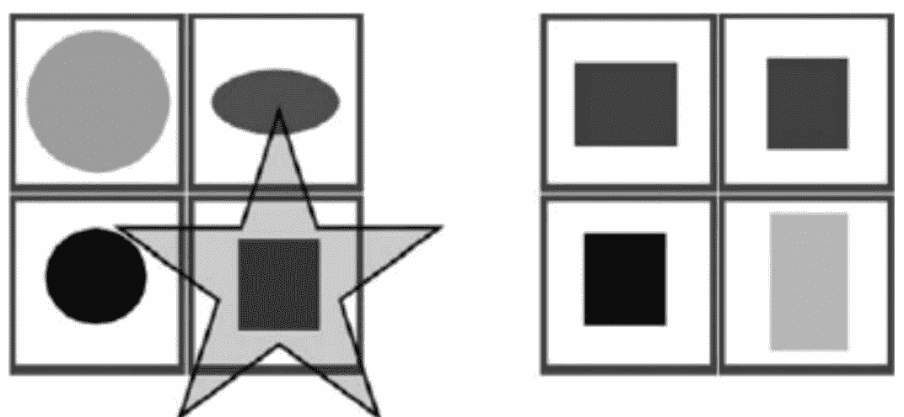

亲代图片群

子代图片群

图3.1 亲代和子代图片群示例

注：在这个图片“繁育”的简单示例中，用户在“亲代”图片群中选择了一张类似正方形的图片，结果，下一代的图片（右图，“子代”图片群）就包含了不同类型的方形图片，因为每一张图片都是用户选择的方形图片的后代。

可这跟“目标”有啥关系？关联虽在，但需细品。目标一旦引入，就成了“育种方向”。养马要千里马，繁图要人脸或动物。但惊人的是：**用户最满意的成果，往往偏离了最初设定的靶心。** 只有当用户放下执念、保持开放，网站才能产出那些“意料之外，情理之中”的惊喜。为何能确信？这得从网站的演进细节说起。

***

2006 年，我们研发出新一代人造图片 DNA，生成质量大幅跃升。更关键的是，新增了一个杀手锏功能：**全网用户可接力“繁育”**。这至关重要，因为单人连续筛选 20 代（点 20 次）后，注意力通常就会涣散，而精彩往往藏在更深的代际里。

时为博士生的吉米·塞克雷坦灵机一动：把网站做成在线服务。用户把自家“繁育”的图发上网，别人可接着繁。你繁出个三角形，发上去，别人可能接力繁出架飞机。这叫“支化”。支化打破了单人 20 代的天花板，让图片经百代千代进化成为可能。当然，也有人喜欢从零开始，这也是每个发现的原点。随机初始化 DNA，屏幕上只是一堆模糊圆斑。用户从中选亲本，繁育下一代。图 3.2 展示了从零起步三代的演变：扭曲斑块变圆润，冒出似嘴非嘴的弧线。虽有趣，却算不上惊世骇俗。

但若坚持迭代下去，会奇妙到何种地步？**远超你想象。** 图 3.3 每张图，皆源于类似图 3.2 的随机斑点，经不懈繁育而成。更震撼的是，创作者非专业画师，只是路过的普通网友。靠自学，他们恐怕这辈子也画不出自己“繁育”出的杰作。

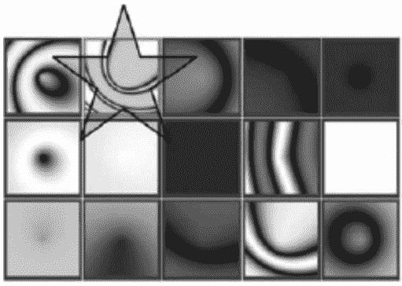

亲代图片群

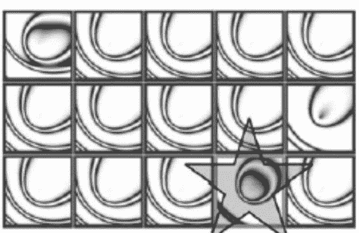

子代图片群

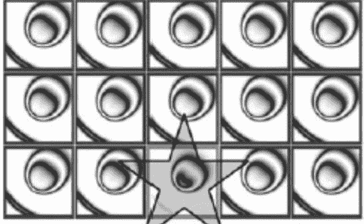

子二代图片群

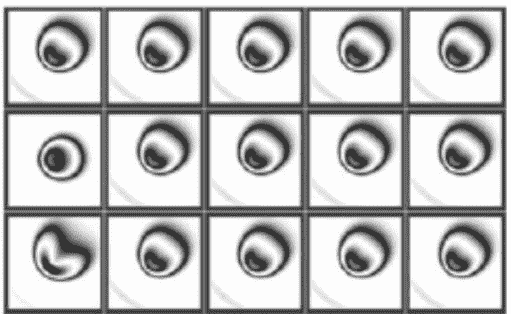

子三代图片群

图3.2 图片孵化器网站上从零开始，并经三代选育后得到的图片序列

注：当用户选择图片时，他的个人喜好会影响图片进化的方向。星形标注的图片，就是用户选择的图片，也是后面显示的子代图片的亲本。

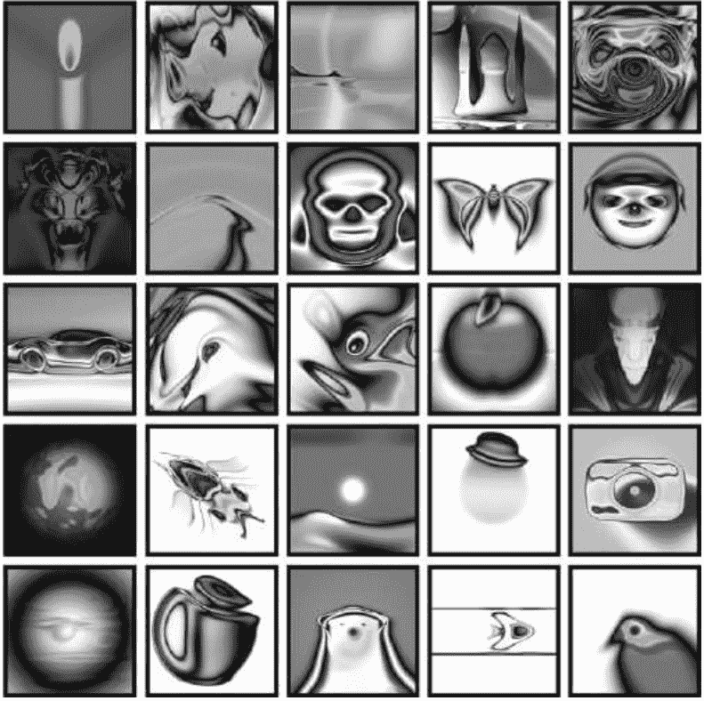

图3.3 图片孵化器网站生成的一些令人惊艳的图片

注：每一张图片都源自一个随机生成的圆形斑点。

# 为何瞄准靶心，反而射偏了？

网站用户孵化出的那些图像，勾起了我们强烈的好奇心。即便拥有了全新的“人造DNA”，我们依然未曾料到：这些图片会变得如此鲜活、富有张力。某种程度上说，图3.3里的每一帧画面，都是一件独一无二的“意外之作”。更关键的是，图片孵化器的玩家们习惯拿别人的成果当“种子”，继续“杂交”出下一代。比如图3.3第二排中间那个骷髅头，就是两个用户接力“繁育”五轮、历经74代才诞生的（起点只是随机的圆形斑点）。所以，哪怕最后摘果子的人不是“白手起家”，但追溯到头，一切都要归功于那些最初毫无章法的随机斑点——这让人不禁感叹：所有惊艳的发现，来之不易。

故事的反转从这里开始。

你或许会想：我想搞个埃菲尔铁塔出来，只要进网站不断挑最像它的图“繁育”，总能如愿吧？实则不然。**“以进化出特定图片为目标去繁育”，是个极烂的主意。** 残酷的真相是：一旦你在网站上看到了某张图，哪怕明知它是进化出来的，你也几乎不可能从零开始复刻它。

为证实这个悖论，我们跑了一个上千次迭代的强力程序。先从用户作品里挑张“靶子”，让程序每代自动挑选与靶子最相似的亲本“交配”。结果？彻底翻车，出来的东西跟靶子毫无相似之处。**结论扎心又铁律：一旦设定目标，目标就永远达不成。** 网站上所有被发掘的图片，无一例外都是因为创作者*没*把它们当目标。发现者们，全是“无心插柳”的人。

再看个具体案例。图3.3第三排左边那辆汽车，是作者肯发现的，来龙去脉我们一清二楚。关键点：**肯当时根本没想画车。** 他选的亲本是张酷似外星人脸的图（见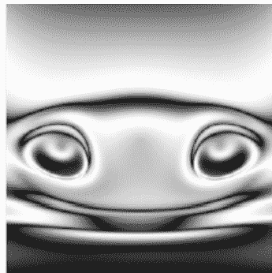图3.4），初衷是想多出几张外星人脸。可意外发生了——随机变异让外星人的眼睛位置下移，几代之后，竟酷似汽车车轮（见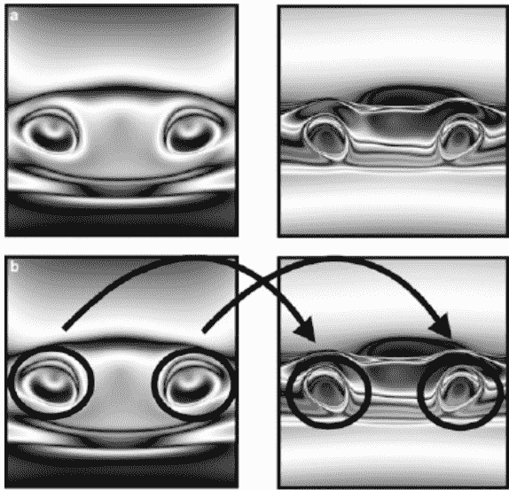图3.5）！这就是纯粹的偶然性。谁能想到，外星人脸是汽车的“垫脚石”？

图3.4 外星人脸的图片

图3.5 外星人的眼睛，是汽车车轮的亲本图片

注：上图的圆圈标注和箭头说明了关键特征之间隐藏的相似性。

如果只是个孤例，那顶多算趣闻。可网站上*几乎所有*吸睛图片，都走这“阴差阳错”的路子。总有那么块意想不到的“垫脚石”，通向意想不到的终点。看图3.6那些诡异的中间态，全是垫脚石。一旦察觉这诡异趋势，你就忽略不了背后的寓意：**想在孵化器里淘到好图，最好别把它当目标。**

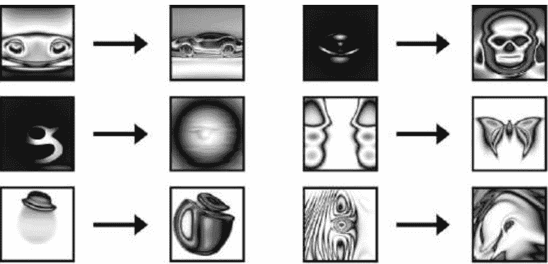

图3.6 最终的图片很少与作为踏脚石的图片相似

注：左边的图片是催生右边图片的踏脚石，尽管它们的外观不尽相同。

本质上，这些图片之所以被意外挖掘，是因为每张新发布的图，都在不知不觉中成了他人的垫脚石。进化出外星人脸的人，从未料到它会变车；肯进化出车，也没预料到。没人预言过车的出现。**正是因为有人分享了外星人脸，才有了后来的车，才有了这本书！** 这系统能跑通，前提就是**没有统一目标**，大家凭直觉玩。最会玩、最出成果的，反而是那些心态开放、不执着于“非要搞出某张特定图”的人。

**换言之，全网站最成功的玩家，全是“无目标派”。**

这结论让我们大跌眼镜。按常理，高手应该是先想好靶子，再一步步逼近。事实却截然相反：最震撼的发现，全出自“无计划者”之手。且这规律不止适用生图，放到生活别处，照样管用。

归根结底，孵化器里的演化逻辑，跟生活没本质区别。你想成就啥，便去找通往目标的垫脚石。但你怎知这些石头真通终点？万一它们像外星人脸那样——满是潜力，却跟终点画风（汽车）截然不同呢？一旦过度聚焦终点，反而可能漏掉最关键的那步棋。这个从不起眼网站总结出的原理，若真能映照现实中所有“达标”相关的场景，那它就太重要了——因为目标，无处不在。正如上一章所见，这剧本似乎在生活无数领域循环上演。

虽铺陈了这么多同构故事，仍未真正答透：**世界为何要这么运行？** 下一章揭晓。**“放弃目标”有时是最优解，绝非空谈。** 不管你有没有计划，垫脚石几乎从不直通终点。换句说：无论目标多诱人、多有说服力，宏大遥远的目标，都不是靠谱指南针。**宏大目标本身，就是最坏的指南针。**

# 第四章

## 目标，是坏掉的指南针

> 在我们所列举的一切偏见中，或许还有一种最根深蒂固的先验谬误……它不仅在古代世界至高无上，至今仍支配着许多最优秀的头脑……这就是：**一个现象的条件，必须、或至少可能，类似于现象本身。**
>
> —— 约翰·斯图亚特·穆勒，《逻辑体系》

你或许很少真踩着石头过湖，但请脑补一下：浓雾锁湖，视线全无，最近的石头也隐没雾中。身后岸边渐行渐远，前路彼岸杳无踪影。最糟的是，你站在岔路口，两条路，一条死胡同，一条通对岸。雾太厚，根本辨不清。选对路了？别高兴早，前面还有更多岔口。**在不知前路通向何方的前提下，反复做关键抉择——这就是穿雾过湖。**

但“雾中踩石头”不是唯一需要垫脚石概念的场景。上一章孵化器的讨论里，垫脚石反复现身。在任何巨大、未知的探索空间里，垫脚石都是抵达终点必须跨越的枢纽。事实上，“垫脚石”这个术语，就取材于此。探索未知的根本难题在于：**起步时，我们根本不知哪块石头通终点。** 若全知晓，目标早达成了。正因这不确定性，未知湖泊永远笼罩在迷雾里。人类现状就是：被流放在未知石头上，只能靠脑中洞察力指引。虽强大，却难见一步之外。1946年，30吨重的ENIAC是通往个人电脑的关键垫脚石，但此后又耗费25年、无数过渡型号，才等来首台台式机。

**目标越“高大上”，预测垫脚石越难。** 目标若只是堆沙堡，打地基这块石头显而易见。但从沙堡到摩天大楼，中间隔着什么石头？人类花了几个世纪才摸索跨越。追逐“高大上”目标的另一难题：解法往往隔着不止一块石头。天才或能指点下一块石头，但谁能一眼望穿十块八块石头外的彼岸？

从目标本质出发，能完美解释为何垫脚石难预测。回顾第一章，**衡量目标进度的关键手段，是“可衡量性”**。教育里用分数量掌握度，默认A优于不及格。借用计算机科学/最优化理论术语，这叫**“目标函数”**。优化目标函数，似乎就等于逼近目标。但问题在于：**分数涨了，不等于真掌握了知识。逼近目标的过程，可能完全不加目标函数的分，甚至减分。**

这困境令人费解：为何目标函数不能指路？因为它**必然不完美**——制定者是不完美的人。最典型的目标函数，无非**拿当下状态跟最终目标直接比**。越像，分越高。这反映了个经验法则：岔路口选离目的地近的那条。但回顾孵化器汽车案，这法则会骗人。汽车的前身是外星人脸，若函数设定“它多像车？”，外星人脸得分极低（根本不像车）。可实验铁证：**外星人脸，正是通往汽车的正确垫脚石。** 这故事说明，**永远拿现状比目标，风险极高。**

目标函数充当错误指南针，这情况叫**“欺骗性”**，是探索中的基本陷阱。欺骗性下，通路石头不加函数分，终点本身充满欺骗。这就好比拿坏指南针跳雾中石头，指错方向，你就被骗了，永远上不了岸。

更直观的例证：**“中国指铐”**（Chinese finger trap）。中空管子，左右食指伸进去，越用力拔，卡越紧。欺骗性在于：**脱身正确动作是“往里推”**，这跟“获取自由”的目标背道而驰。**通往自由的垫脚石，是“变得更不自由”。** 这完美诠释了目标的欺骗性：常规衡量进度的法子（离自由多近），错得离谱。

你可能觉得指铐不公平，它本来就设计来骗人。但指铐只有一块欺骗石头，简单得多。搞出类人AI、攻克癌症这种“高大上”目标，面对的欺骗石头多得多。**探索任何复杂问题，全程充斥欺骗性垫脚石。**

拿国际象棋举例：很多看着能赢的招（如吃子），因微妙不可预知的影响，十步后变昏招。这让棋局波诡云谲。现实世界远比棋局复杂，**欺骗无处不在。** 我们必须直面真理：**若无法克服一定程度的欺骗，伟大成就皆无可能。** 无欺骗的问题皆小事，因垫脚石显而易见。显然，“高大上”目标我们还没找到对石头，解不了。这就是欺骗遍地的原因。指铐式难题，总利用人类错误假设；棋局里胜券在握，十步后溃败。但我们不必灰心——总有外星人脸意外变车，真空管通向计算机，拉格泰姆催生摇滚。

**欺骗性，往往是目标无法成就伟业的核心原因。** 目标若具欺骗性（大多数“高大上”目标皆是），盯着目标努力，于事无补。但除了盯目标，我们有**替代方案**。

回顾孵化器，最迷人之处在于**不设终极目标**。目的非寻找特定“巅峰之作”（通常终极作出现，他图失意义）。更好的视角：**把它看作“垫脚石收集器”**。收集的石头，能创造发现*更多*石头的可能。且收集石头不像追目标，**石头不指向特定地点，而是通向任意方向**。想达非凡之地，必须对多条路敞开怀抱，不执着于知晓路的终点。孵化器实验证明：**这套全开放系统，行得通。**

但在“无目标伟大探索系统”里，孵化器只是小例。更重要的演化过程，同理运作。**自然进化与人类创新**，皆在毫无终极目标下发生。这两大核心过程比孵化器深刻复杂得多，却遵循无目标原则——令人震惊。但目标思维在文化中根深蒂固，我们倾向以为进化与创新是目标驱动的。你甚至会质疑：作者凭啥说自然进化、人类创新没目标？鉴于上章已见无目标探索在孵化器的奇妙变奏，我们不妨深一步思考：**为何目标导向思维，即便在自然进化这人尽皆知的过程中，也能误导？** 这会是个有趣的反思。本书后续大多章节，将聚焦挑战各领域的目标导向思维。每案例中，先展示传统目标观如何反阻进步，再强调非目标思维如何以新视角重塑假设。生物进化——地球上终极发现过程——是我们重审全貌的最佳切入点。

自然进化是发现与创造的过程，造就了多样、极复杂的生物体。我们熟知的自然界，很大程度上是进化产物：从覆盖全球的绿色植被到人类自身，进化创造的复杂性与规模，怎崇拜不为过。连人脑（120-140亿神经元，复杂度远超人类可设计之物）也是进化产物。有趣的是，主流观点将进化解释为：**为了满足某种全球目标，不同性状才出现**，把进化描述为特殊的“不断优化”过程。但正如孵化器，**进化背后的故事，远比这复杂。**

来做个思想实验，看看目标思维套进化会怎样。把它当终极版高中生物实验。想象有个地球大小的培养皿，里面有个单细胞生物（地球最早活细胞），所有生命最终由此进化而来。你的任务：**通过选择繁衍个体，进化出具人类智能的生物。** 逻辑是：用你的主观选择替代自然选择，决定谁能繁衍。比如发现只显得特聪明的变形虫，选它繁殖，产出更多“聪明变形虫”。任务艰巨，但你有**40亿年**，难度降低了？

实验伟大之处在于：**成功可能性无需存疑。** 地球原始单细胞经过数十亿年，确实进化出了人类。地球现状，证明自然进化成功了。关键挑战在于：**如何当好“育种者”？** 实验里人为选谁繁衍，跟自然界交配无异。你只需选越来越像人的父母交配。反应过来时，进化可能已完成（虽耗时数亿年）。

**啥策略能把单细胞育成具人类智力的生物？** 给个直指核心的思路——**给单细胞做智力测试！** 选高分者做亲本。很快就能找到真“爱因斯坦”，对不？

**事与愿违。** 这策略有致命缺陷。真给单细胞测智商，它们能不能活下去都是问题，别说进化出智能生物。但为何“智力测试筛选进化方向”行不通？它明明遵循目标导向的通用进度衡量原则：拿当下位置比想达位置，量化进展。但这原则的正确性与适用性，愈发令人怀疑——正如这思想实验再次揭示的那样。

# 别再盯着终点看：伟大从来不是“瞄准”出来的

进化论里藏着一个巨大的反直觉真相：**通往人类智能的路，根本不是靠“提升智商”铺出来的。**

我们常以为进化是朝着“更聪明”这个方向狂奔，实则不然。从单细胞到莎士比亚，真正的关键节点——多细胞化、两侧对称——跟“智力”半毛钱关系没有。几亿年前那只扁形虫，脑子里装不下任何高深思想，但它进化出的**左右对称体制**，却成了日后诞生人类大脑、写出《哈姆雷特》的必经之路。谁能想到，“长得对称”是写诗的前提条件？

可如果非要给单细胞生物考智商测验，根据分数决定谁留谁走，结果会怎样？**荒谬至极。** 这正如麦克卢汉所言：“不知道是谁发现了水，但肯定不是鱼。”在铁路时代到来前，你永远造不出铁路。同理，**想进化出智力，最笨的办法就是盯着“智力”这个指标搞选择。**

这就是“目标欺骗性”的核心：**越是想拿捏终点，越容易迷失路径。**

---

## 自然界不设 KPI，却造出了最牛的“产品”

回到地球这个超级培养皿。自然进化没有目标，不考核“像不像人类”，它只做一件事：**收集踏脚石。**

每个物种之所以能延续，不是因为它在为人类铺路，而是因为它**在当下的生态位里活得好、繁得快**。扁形虫蠕动着对称的身躯，只管生存繁衍，管它后代会不会变成人类？**生存繁衍不是“远大目标”，而是“硬性门槛”**——不及格就出局，及格了才有资格继续探索下一个可能。

这跟“图片孵化器”如出一辙：你不指定“要生成汽车”，反而能在杂乱无章的变异中，意外拼出一辆车。大自然之所以能造出百亿神经元的大脑、飞翔的鸟类、光合作用的植物，正是因为它**不执着于任何单一终点**，而是贪婪地收集一切“行得通”的新奇结构。

---

## 人类发明史：全是“误打误撞”拼出来的

别以为只有自然进化这样，人类最引以为傲的发明，哪一个是“按图纸造”出来的？

*   **计算机**：真空管是基石，可发明真空管的人根本没想过“计算”，他们只是在玩电学实验。
*   **飞机**：莱特兄弟用的发动机，源自三轮车和工厂水泵；再往前推，是感应线圈、克鲁克斯管、X射线……**没有一个环节是为了“飞行”而发明的。**
*   **电力、互联网、AI**：无一例外，全是前人为了完全不同的目的，铺下的踏脚石。

**一个扎心的假设：任何重大发明的先决条件，几乎都是在“完全没考虑这个发明”的情况下诞生的。**

我们爱讲“天才发明家”的英雄史诗，却忽略了创新的本质——**它是踏脚石的收集器，不是目标的达成器。** 莱特兄弟没从头造螺丝钉，他们站在几百年“无关飞行”的积累肩膀上，迈出了那关键一步。

---

## “生存繁衍”也是伪目标？别把“约束”当“指令”

有人辩解：自然进化的目标不就是“生存繁衍”吗？

**错。这根本不是传统意义上的“目标”。**

*   正常目标：起跑线上没达成，终点线达成（跑马拉松）。
*   进化的“生存繁衍”：**起跑线就已经完成了。** 第一个单细胞活下来了，才有后面的故事。每一个祖先都完美达标了“生存繁衍”，但这没告诉它们下一步怎么变、变成什么。

所以，**“生存繁衍”只是过滤器（约束条件），不是导航仪（目标）。** 把它当目标，就像企业家设定目标“活下去”，最后造出了飞机——这叫胡扯，不叫战略。

---

## 穿越回 5000 年前造电脑？别闹了

想象一下：把古埃及最聪明的脑袋锁在金字塔里，目标——**造台电脑。**

结果显而易见：造不出来。不是他们不够聪明，也不是不够努力，**踏脚石根本不存在。** 真空管需要电力工业，电力需要电磁理论……这条链上每一环，都需要“无关电脑”的探索去意外解锁。

**逼着顶尖大脑盯着遥远终点发呆，不如让他们追随当下的好奇心。** 有人钻研电学，有人搞玻璃吹制，有人研究逻辑……看似散漫，实则在并行铺设通往未来的所有路。历史证明：**提前获得未来的最好方法，就是不试图提前获得未来。**

---

## 连发财都不能把“发财”当目标

别以为这只适用于宏大叙事。连“赚大钱”这事儿，瞄准目标都容易翻车。

拒绝一份热爱的零薪实习，转头去份讨厌的高薪活，盯着“百万存款”进度条看——**大概率你永远凑不够那百万。** 真正暴富的人，往往是沉迷于解决某个问题、打磨某个技艺，**钱是副作用，不是目的。**

这不是鸡汤，不是劝你“别爱钱”，而是说：**目标的欺骗性，会把你从真正通往财富的踏脚石（热情、技能、人脉、运气）上拽下来。**

---

## 世界不按“目标逻辑”运转，我们却非要硬套

所有思维实验指向同一个结论：**最惊人的成就，全在“目标缺位”时发生。**

*   人类智能进化了，没设过“进化智能”目标；
*   计算机发明了，前提条件全没想过“造电脑”；
*   图片孵化器生成了汽车，用户从没选过“像汽车”当标准。

**只要我们松开缰绳，停止用“与终点相似度”做筛选，转而收集“有意思、行得通、新奇”的踏脚石，原本遥不可及的彼岸，反而可能主动撞上来。**

可我们偏偏痴迷指南针，哪怕它指错方向。下一章，我们就聊聊：**扔掉指南针后，怎么靠“新奇”当向导，在迷雾里大步流星？**

***

# 第五章

## 别立 Flag 了，去捡“新奇”的踏脚石

> 抓住每一刻独一无二的新鲜感，享受意料之外的惊喜。
>
> —— 安德烈·纪德

新年立 Flag 现场：流利英语、天天十公里、只吃胡萝卜苹果……
一周后：旗倒了，人也没惊讶。

数据摆在这：**立 Flag 的人过半自信能坚持，真坚持下来的不足 12%。**

**立目标是全过程成本最低、爽感最强的环节；难的是——你根本不知道中间隔了多少个“未知的踏脚石”。**

目标本身**零线索**，它不告诉你下一步踩哪块石头。与其纠结“我想去哪”，不如问问：**“我现在站的这块地，跟我过去站过的地，有什么不一样？”**

如果这块地**“新奇”**，哪怕不知道它通向哪里，它就是通往新大陆的入场券。**探索的逻辑，不是“导航到终点”，而是“持续发现从未见过的风景”。**

# 放弃远方的信标：突破源于甩开旧路

我们习惯死盯着既定终点，实则是沉迷于描摹未来蓝图。每一步进度都要对着远景打分：离得近不近？有没有前进？未来像座海上信标，指引一切努力。可这信标爱耍花招，常把人带沟里。领着莱特兄弟造飞机的光，没提过感应线圈；指着计算机诞生的亮，也没透露真空管。那些关键垫脚砖，早就在那里，却没人觉得能通向那么远。既然如此，拿当下跟虚无缥缈的明天较劲有啥用？不如掉头对照昨天。过去尘埃落定，清清楚楚。用“当下”减“过去”，不用猜谜，只看甩掉了多少陈规陋习。这把命题从“够不着终点”改成了“离没多远起跑线”。一旦方向变成“脱离旧径”，崭新天地反倒自己敞开了。

过往不指路标，却是创新的领航员。跟未来比模糊不清，跟历史比实打实。这种对比不考核“进度条”，只核查“挣脱度”。妙就妙在，课题从“奔向何方”变成了“躲开何处”，而逃离熟地，能解锁从未见过的版图。

**稀罕，是进化的“自动领航”**

任何前所未见的事物，都是通往“更罕见”事物的潜在阶梯。别瞧不起“有看头”，过程哲学鼻祖早说：“吸引力重过真理。”另一位思想家补刀：嫌它不入流，是价值观塌了。稀奇古怪的念头，能重塑认知框架，引爆级联反应——一个新鲜玩意儿招来一串新鲜玩意儿，像滚雪球，把未来从“固定坐标”变成“无边旷野”。

那个繁育图像的网站玩家最懂这套：他们留“外星面孔”不是盼它变汽车，纯因它**够怪、够吸睛**。这条“望不见头”的路值得闯，因它藏着那种“开放式可能”——不是考试分数那套潜力，是海平面落日那种、万物皆可生的张力。抓住这张力的钥匙，就是追逐稀罕。

**“漫无目的”才是最高级的目的**

有人急了：没靶子乱转，不就是瞎碰运气？错。最震撼的突破，从不执着“抵达某处”。稀罕度蕴含的信息量不输既定终点，区别在于：终点常给把坏罗盘，稀罕度只让你对着旧坐标核对当下位置。告别“已知圈”，比追赶“未知标”踏实、可靠得多。

**意外收获？那是“有备之脑”在捡漏**

别信“苹果砸醒物理学家”那套童话。无论万有引力发现者、微生物学奠基人还是古希腊大师，个个是跨界泰斗。巴斯德那句名言——“机遇偏爱有备之脑”，说透了真相。真正的意外收获，是**敏锐直觉配深厚底蕴**嗅出“这道儿有戏”，哪怕终点在哪还没谱。这股对“吸引力”的嗅觉，才是通往破局的隐形地图。

**为了验证这套逻辑，我们教电脑“瞎折腾”**

光嘴上说不算，得上硬菜。AI 圈有铁律：不写成程序跑通，理论不入流。于是我们搞了**“探新算法”**——灵感就来自那个网站上“乱选乱配却玩出名堂”的玩家。

实验设定：让智能体穿甬道出门。
*   **导向式**：离门越近分越高。后果？易陷“手指陷阱”——明明得退让才能绕过障碍，程序死活不让分下降，直接卡死。
*   **探新式**：**只要动作是前所未有的，就给分。**

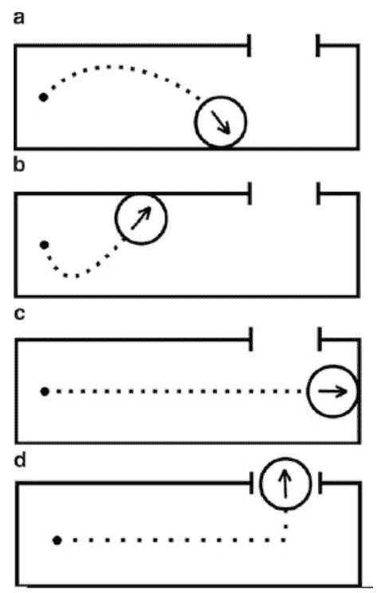

起初智能体满屋**碰壁**——这新，给分！把墙角、姿势全试遍了，碰壁不稀奇了咋办？**只能学着不碰壁**。再后来，甬道里的新花样耍尽了，**唯一的“新”就是推开那扇门**。

全程没人教“出门”，没给“避障”打分，它却把“避障”、“领航”、“出门”全自学会。这不是盲目枚举（那得等到宇宙重启），而是**自动按“由浅入深”进化**——浅层动作耗尽，深层能力自然涌现。

**这才是反脆弱的突围逻辑**

导向式迷信“由差变优”，一撞欺骗性坑（手指陷阱、局部最优）就翻车。探新式不认“好歹”，只认“新旧”。它天然免疫欺骗，**逼着系统在浅层可能穷尽后，被迫进化出深层本领**。

次回再焦虑“靶子在哪”，别抬头找信标了。低头瞅瞅脚下：**有没条没踩过的路？有没个念头让你觉“挺有看头”？** 顺着那个劲头走，垫脚砖会自己冒出来，路也会越走越宽。

### 为什么“瞎闯”比“定目标”更能走出迷宫？

**简单，意味着“无知也能行”**

什么叫简单的行为？机器人初出茅庐，只会死命往前冲，撞墙也不带刹车的。这才是简单的本质——**它零门槛，不需要机器人懂任何“世界常识”**。不用认墙、不用辨路、甚至不需要传感器，通上电机就能跑。

但想在走廊里穿梭自如？知识就成了硬通货。这正是新奇性搜索的魔力所在：它把“盲目乱撞”炼成了“有的放矢”。正如不学走路就没法编舞、不懂重力就站不稳一样，**制造新奇，本质上是一个不断向世界“索取情报”的过程**。时间拉得越长，存下的认知越多，行为自然也就越复杂。

**进化：没设终点的“信息收割机”**

这可不是新奇性搜索的专利。**凡是不预设终点的搜索，天然就自带“信息积累+复杂度升级”的光环**。自然进化就是典型代表。古尔德早就说透了：简单的活法被占光了，想出新物种、挤进新生态位，不加复杂度行吗？

细菌的活法再多也是有限的。所以复杂度上升几乎是铁律。但这复杂度不是瞎长的——**眼睛见证了光的存在，耳朵证明了振动的真实，腿和肺分别为重力和氧气背书**。进化不设目标，却把宇宙的物理法则全“刻”进了生物的 DNA 里。

单细胞时代没眼睛、没肺，日子照样过得滋润。但进化这台“盲眼收割机”只要不停尝试新物种，迟早会“意识到”光的存在，并把这份认知封存进基因库。经过亿万年洗礼，**人类的躯壳早已化身一本“行走的宇宙百科全书”**——光、声、重、热、气，行星轨迹、街角贝果价，全在脑海与肉身里有了备份。

**Picbreeder 网站：人类集体潜意识的镜像**

图片孵化器也是这般逻辑。它生于人世，长于人世，自然成了人类熟悉意象的超级图谱：蝴蝶、人脸、城堡、行星、落日、飞船……没人下达过“生成这些”的指令，它们却自发浮现。

**新奇性搜索：把“盲眼进化”装进代码里**

新奇性搜索不过是把这套“无目标搜索”算法化、可测化、低成本化。不用重演地球史诗，跑个走廊机器人模拟就能验证核心逻辑：它必然按“简→繁”收集情报，表现出彻底的非目标特质。想不断见新景？机器人就得搞懂：世界由墙与门组成，墙撞不开，门能钻过去。

**物理法则，才是最硬核的“反作弊系统”**

你可能担心：没目标约束，岂不是在无意义的垃圾堆里耗尽光阴？

目标的确能把无限可能切成几块“实用饼”，省得你琢磨爬着上班。但**新奇性搜索不缺刹车——物理世界本身就是最严格的规则书**。

*   想瞬移穿墙？物理不答应，搜索空间里根本没有这条路。
*   想靠肉身飞天？重力直接给你安排“摔个七荤八素”的统一结局。
*   几万种穿墙脑洞，现实里全收敛成同一个动作：撞墙停下。

所以，**真实可行的行为空间，远比想象中的窄得多**。新奇性搜索只在“物理允许”的切片里玩，这正是它落地的前提。而且，物理约束还顺道解决了“踏脚石筛选”难题：开车上班比爬行上班能腾出更多时间去见新世面，所以新奇性搜索自然偏爱开车。探索的深水区，必然聚焦在“顺应世界运行逻辑”的有意义概念上，而非无效徘徊。

**新奇性 ≠ 目标：别硬套旧框框**

自 2008 年算法问世，质疑声从未断：“新奇性本身不就是个目标吗？”

这纯属思维惯性作祟——**想用老地图标注新大陆**。

*   **满足感机制不同**。当银行家是目标，当上了就“达成”，打钩结案。但“保持新奇”靠当银行家实现？干久了腻了，新奇性就消失了。目标是静止的终点，新奇性是流动的地平线。
*   **定义边界模糊**。当银行家，要么是要么不是，清清楚楚。“保持新奇”换十份工作每份都不同，那“目标”在当银行家前就“达成”N 次了，还要当银行家干嘛？
*   **逻辑被迫扭曲**。硬把新奇性塞进“目标”定义，只会把推理链条搅成一团麻。

**不必自找麻烦。** 区分二者，是为了看清发现的真相：**目标是旧式发动机，新奇性是全新动力系统。**

这也解释了为何新奇性搜索酷似进化里的“生存繁衍”。两者皆为“可能性的约束器”，起步皆易满足（单细胞也能活、也能繁衍），终局皆催生出未曾设想的奇迹，**标准教科书级的“非目标探索”样本**。

**发散，是创新的专属通道**

目标天生收敛——盯着靶心，周边风景全成盲区。去了目标的聚合枷锁，探索瞬间炸开成放射状：**多方向同步试错，收割差异化踏脚石**。发散思维虽丢了“按图索骥”的安全感，却精准对标创造力与创新——**不困在搜索空间的陈旧死角，才能捡到目标党梦都想不到的惊喜**。新奇性搜索，正是这类“激进发现范式”的算法化身。

---

### 实战证明：迷宫里的“盲人”跑赢了“领航员”

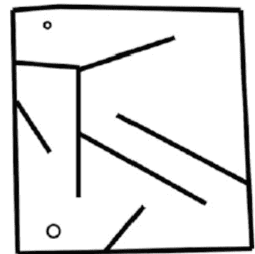

**图5.2 机器人迷宫**

*注：大圈为起点，小圈为终点。通向终点的死胡同极具迷惑性。*

**实验设定**：让带轮机器人在围墙迷宫里跑新奇性搜索。程序生成“新想法”→ 机器人实操 → 行为新奇则判定为“好种子” → 微调迭代 → 产出更新行为。撞墙旧套路直接丢弃，绕过新墙的动作重点培养。纯模拟，零损耗，极速试错。

核心悬念：**从未设定“走出迷宫”目标，它能自己找到通关路线吗？**

**结果炸裂**：40 次实验，**39 次通关**。

对照组：传统目标驱动法（离终点越近越“好”）。40 次实验，**仅 3 次通关**。

**反直觉真相**：盯着目标反而迷路。迷宫里那些“看似离终点最近”的方向，全是精心设计的**欺骗性死胡同**（见图 5.2），本质上跟“中国指环”玩具一个套路——越用力套越紧。新奇性搜索无目标在身，自然免疫“目标欺骗”，只管找新路，通关反成了顺带手的副产品。

**不止迷宫：双足机器人“瞎练”成行走大师**

怀疑论者说迷宫欺骗太明显？换个天然场景——**双足机器人学走路**。

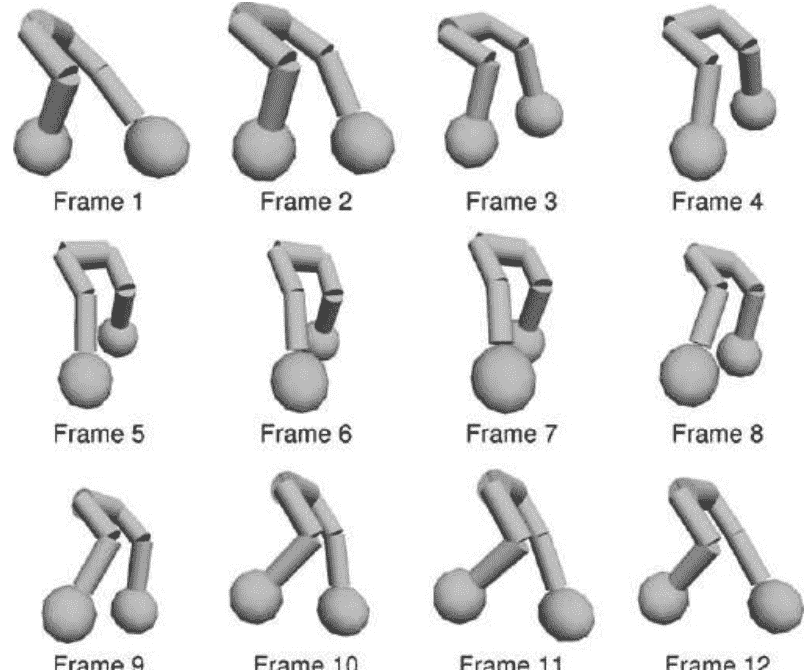

**图5.3 通过新奇性搜索发现的双足机器人行走步态的一个周期**

*注：Frame=画面(1、2、3、4......12)*

新奇性搜索不懂“走路为何物”，只盯着“新姿势”。摔倒？只要摔法新，就是好样本。踢腿、失衡、乱晃……这些在“以走远为目标”眼里的**负面教材**，在这里却是**通往行走的关键垫脚石**（踢腿→摆动→走路）。

结果：**“瞎练”党走得比“定目标”党更稳、更远、更快。**

再次印证：**目标的欺骗性，葬送了最优路径；新奇性的发散性，拥抱了物理法则的真相。**

# 实验复现与真相：放弃目标，才能拥抱惊喜

我们的机器人走迷宫和双足行走实验，并未长久地独享“新奇性搜索”的荣光。很快，全球科研界便投入了目光。法国让·巴蒂斯特·穆莱团队复刻了迷宫突围；加拿大约翰·杜塞特将其用于人造蚂蚁觅食程序的进化；捷克彼得·克拉克荷证实它还能辅助机器人体态设计；美国希瑟·格斯伯用它挖掘代码漏洞；而我们实验室的塞巴斯蒂安·里西则发现，终身学习型机器人同样受惠其中。这一连串跨领域的验证，有力佐证了迷宫与双足实验绝非偶然——**在普遍情形下，不设终点的探索，反倒比盯着靶心射击更易命中靶心。** 我们手握实证：放下执念，往往收获更多。

当然，新奇性搜索也非“万能钥匙”。我们进一步生成数百座随机迷宫，难度层层递增，让新奇性搜索与目标驱动法PK。数据揭示残酷真相：迷宫愈复杂，双方皆力不从心，但目标驱动法“掉链子”更快。换言之，新奇性搜索的“适用半径”更宽，却也有边界。这逼出一个终极追问：**面对最棘手的难题，何种路径能保证持续破局？**

许多人梦想一把“万能公式”开启所有锁，为此倾注毕生心血，恰似古人寻觅“长生不老水”。我们或从根本上误判了问题：或许世间本无必得之法，人类一切探索终将归于徒劳（下章将深究）。但**“无万能法”不等于“一无所获”**。漫无目的的前行，依能挖掘出无数意外惊喜，即便不知“寻得何物”亦不知“何时寻得”。这正是新奇性搜索赐予的生存智慧——**看清“徒劳”本质，才能从“目标万能论”的幻觉中解脱，化身“寻宝者”，拥有“虽无目标，仍满载而归”的硬核能力。**

---

# 第六章 致敬寻宝者

> 我不去观看，我去寻找。
>
> —— 巴勃罗·毕加索

世人常诵“万事皆可能”，现实却泼冷水：我们无法一跃三米，童年梦想当宇航员者众，最终登天者寡。主流叙事高呼“敢梦敢干便能成”，将“不可能”边缘化。本章直面这被遮蔽的“不可能性”，非要悲观，而是要**在不确定性中重塑乐观**。旅程起点，便是审视“新奇驱动”的力量与边界。

上章表明：不刻意找目标，反而更易达成目标。放下“怎么解决”的焦虑，直接行动，解决得更多。于是新奇性搜索似成“神兵利器”，可装进“达标工具箱”。实验里，机器人不想出迷宫却学会了出迷宫；双足机器人不想学走路却走得最远。

**切莫被表象误导。** 汽车不是“快马”，新奇性搜索也非“实现目标的新招数”。证据虽显“无目标也能行”，但深层逻辑是：**它不保证你找到“想要的东西”**。茫茫无垠大迷宫中，指定一坐标，新奇性搜索大概率永迷不归。它虽常胜目标法，却非“包治百病”。

这种认知尚可接受。可即便目标法在简单题上更优，人们仍难弃“目标有用论”。于是出现折中派：**“目标仍要，但别把鸡蛋放一个篮子，保持思维多元以防主道走不通。”** 如赛马下注，分散押几匹强马，不押单一“常胜将军”。按此逻辑，新奇性搜索只是“保留备选踏脚石”的手段，目标依旧是主帅。

这观点对目标论极友好：目标虽不完美，却如英语拼写规则“u跟在e后（c后除外）”，大部适用，小部失灵，改改补补继续用。于是有人提议：**目标领航定向，新奇护航防骗，双剑合璧岂不更强？**

**可惜，鱼熊掌难兼。** 若世界真这般运转，加点多样性就能“弱化”目标毒性，那目标的欺骗性就不会是挥之不去的“幽灵”。**目标本质上是个坏指南针。** 指南针指南你要北，心态再开放、备选再多，也改不了它指错方的事实。你偶尔无视它、试新路、撞大运到了北边，那成功归功于你“违抗”了它，而非它“指引”了你。**与其留坏指南针，不如早早丢弃。**

回顾第五章迷宫机器人（图5.2），“走出简单迷宫”目标看似不高，实则欺骗性极强——设目标几乎必死。缘何？**墙壁。** 目标驱动机器人撞上离出口直线距离最近的墙。贴近墙=离目标更近=正反馈，于是它死磕墙根。可现实是：想越过墙去出口，必须先**远离**墙。在目标法眼里，远离墙是“变坏”，探索被扼杀。唯有绕过障碍、直奔目标的最后阶段，目标法才发力——此时问题已解，目标沦为摆设。**坏地图对顶级探险家毫无用处，哪怕他最终到达，也与碎地图无关。**

再看5000年前“超前发明计算机”的设想。目标是碎地图，欺骗性拉满。那时再开放的脑袋，也不会去搞真空管——无法预见它通向计算机。探索一切“有趣”的创新，才是人类亘古真相。**“只需更深层多样性，仍锚定总目标”这一想法，本质上是错的。** 它否认了目标自带的致命缺陷：手持坏指南针，无论多努力偏离，依被其拖向歧途。

**这正是为何不放弃“目标信仰”，便读不懂新奇性搜索。** 纯粹找新奇非万能药，但“新奇+目标”的混合体，也遮不住目标的欺骗性。单靠目标更差。我们不得不接受谦卑真相：**“存在寻找目标的最佳实践”这念头本身，或许就是个陷阱。** 探索本质或就是“徒劳”——**无法保证如愿。** 放弃“目标是最佳向导”不够，还须放弃“总有条路通往高大上目标”的执念。

迷宫与双足实验中新奇性搜索胜出，不代表它永胜。但目标法在简单题上“惨败到不忍直视”，更让人不寒而栗：**连不知道自己要干啥的方法，都能在简单题上碾压“知目标、奔目标”的正规军，说明了什么？** 你可能辩称：复杂题上新奇性搜索也未必行。可目标法在简单题已溃不成军，在探索高等智能等复杂课题上，还有胜算？**连简单迷宫都训不出能走的机器人，还妄谈从单细胞进化出人类智能？**

若仍要为目标辩护，只能怪算法有bug。但第章实验中，除目标函数与新奇度函数不同，**算法核心完全一致**。且新奇性搜索稳定破解迷宫，证明算法无错。多团队复现，锤定结论：**锅在目标本身。** 既然新奇性搜索非全能，混合体也非完美，**我们只能直面冷峻事实：世间无任何方法，能可靠保证“达成特定目标”。**

这消息虽扎心，却在意料。大海捞针，多大搜索力才能从摩天楼高的干草堆里掏出那根针？数学家沃伯特与麦克里迪的**“没有免费午餐定理”（NFL定理）**早已论证：**全问题域内，不存在整体最优搜索算法。** 优化此处，必损彼处。经验法则总有失灵时（钥匙不在老地方，狗拖走了）。搞“黑盒优化”的专家对此门清。

**但新奇性搜索反转了剧本。** 虽然上述结论让探索前景似绝望，实则结论更微妙、更深远：**我们极大概率能发现惊世之物，只是无法预知“那是啥”。**

**启示是：伟大发现未被定义、未被寻获时，“捷足先登”的机会属于我们。** 图片孵化器、自然进化、人类创新史皆为证。第五章实验对目标论极不利——目标法远逊于“不靠目标的智慧搜索”。但非目标搜索更核心的身份是：**强力“寻宝者”**。漫无目的中，你未必觅得心头好，却能挖出无数意外宝藏，过程惊喜不断。实验证明：目标法觅不到的宝，无目标反而易得。我们无法预言挖到啥，只知：**新奇性搜索能抵达目标法绝对到不了的领域，无论那是不是你想去的地方。** 没人设定目标要在孵化器生成汽车图，可它出现了；讽刺的是，真设了这目标，汽车图反而永不现身。

**追目标成“诅咒”，弃目标成“福运”。** 这悖论，奠定了“何为可实现、如何实现”的现实认知：**过分“高大上”的目标，除非近在咫尺，绝非努力可及。** 目标遥不可及时，唯一出路是**放弃朝特定方向用力**。虽无法保证抵达特定终点，却能在途中持续积累通往未知之地的“踏脚石”。**寻宝者即机会主义探险家：只认价值，不问名目。** 合格寻宝者，须尽可能多攒踏脚石——不知哪块通向宝藏。

再者，个人旅程虽未止于愿望地，但抱“孤军奋战、古圣先贤皆寂寞”心态，认定“大目标必靠自己单干”，不切实际。长远看，**彻底征服“搜索空间”的，必是群体——一群兴趣各异的聪明脑袋，而非孤军奋斗的个体。** 我们坚信，孵化器上的蝴蝶、汽车图必会被再次发现，非因有人刻意找，乃因**众人皆在探寻“充满可能性的一切”**。未来不按计划来，但它终将到来。

这听起来悲凉：人类无精准指南针，为确定性与目标努力的一切，或皆徒劳。但**无需失望**——探索发现的意义，或不在盯着具体靶心，而在**更伟大的事物**。**丢掉坏指南针（具体目标），或能解放思维，打开新疆域。** 新奇性搜索实验证：开放式创新、发散思维，连计算机算法都能捕捉。它非玄学巫术，乃**有原则、有逻辑、可理解、可掌握的科学过程**。若非目标导向是自然进化、人类创新、孵化器、新奇性搜索的共同灯塔，我们理应收为己用，**拥抱而非恐惧。**

孵化器与新奇性搜索启示：**我们完全可以基于“非目标原则”，构建百般体系。** 过去少做，因被目标崇拜锁住；如今解绑，建立“寻宝系统”诱人无比。它们能挖出目标法遮蔽的有用、有趣的可能。群众反馈亦可驱动，如孵化器利用大众审美。一旦多人产出，可能性铺陈眼前。

**在非目标世界里，调动群众力量的最佳方式，绝非“头脑风暴”、开会、立“高大上”规划。** 那要求共识，是寻宝者的禁忌。**共识正是我们要摆脱的文化惯性。** 我们不要“金曲榜前40”（强求所有人同意什么是好歌），不要“委员会设计”（共识稀释有趣愿景）。**释放寻宝能量的正道，是把人“分开”**——如孵化器，只能在他人成果上延展创造、互动。虽许多人带个人目标而来，但目标各异，**系统整体无共识目标，这才是生机所在。**

# 第七章

## 打破教育的“目标”咒语

> ——大卫·西蒙

想像一下，你登录一个卖家具的网站。现在的模式很单向：商家把设计好的椅子、桌子摆成目录，你挑中意的下单，消费者纯粹是被动的选择者。但未来若换个玩法呢？

你想买把椅子，网页弹出一堆基础款模型。你不直接买，而是提要求：“把这椅子腿弯成Z字形”、“换个从没见过的迷彩面料”。系统不是简单改色、刻字，而是基于你的“突变”指令，实时生成一批全新变体。你在这批新款里继续挑、继续改，直到拍板下单。这把椅子，从基因到成品，都打上了你的个人烙印。你不懂木工、不懂设计软件，却像玩“图片孵化器”进化图片一样，亲手“进化”出了专属家具。

这听起来像梦，但技术上正在变得可行——得益于全球即时通讯和AI生成算法，大规模协同“寻宝”成为可能。

更妙的是后续效应：第一批玩家买走的椅子，自动沉淀成“宝藏库”。新用户进站看到的，不再是设计师的标准款，而是前人进化出的“成品合集”。他们站在前人的肩膀上继续变异、探索。目录不再是静态的陈列架，而变成了一个**没有统一终点、自我生长的搜索系统**。消费者摇身一变，成了寻宝者。

这不只是卖椅子的新花样。服装、汽车、住房，凡是能数字化建模的领域，都能接入这种“进化式目录”。成本会更高？制造更难？3D打印正在填补这个坑。核心优势在于：**打破了“专家设计、大众买单”的垄断，让系统自发涌现专家想不到的创意。**

但我们要聊的不是商业模式有多酷，而是一个扎心的问题：**你敢信这个目录吗？** 里面全是素人“瞎捣鼓”出来的货，没有专业背书，你真敢花钱？

先别急着下结论。搭建这套系统本身，就得有人写算法、定义“变异规则”、建数字孪生模型，这本身就是高难度的工程探索。但更大的疑问在于：**当使用者没有共同目标、没有专业背景、甚至彼此不认识时，这种“盲目进化”真能出好东西吗？**

证据表明：**恰恰是因为没目标，才捡到了宝。**

目标驱动的优化，最容易被“看起来靠谱的阶段性成果”骗住——也就是陷入“欺骗性踏脚石”。通往颠覆性创新的路，往往长得像废品、像退步、像胡闹。专业设计师盯着KPI和审美共识，反而容易绕过这些长相丑陋的关键节点。而一群没共识、只凭兴趣乱点乱改的“外行”，反而能广撒网、宽筛选，把那些反直觉的踏脚石踩实了，通向专家永远看不见的高峰。

这不代表设计师失业。相反，专家的角色将从“设计终点”转向“构建搜索空间的架构师”——他们制定进化的规则、边界与工具，让外行的探索不至于走进死胡同。

**最核心的启示是：放弃“存在一条通往成功的必胜公式”这种幻觉。** 探索本质上可能是徒劳的，但唯有在“不设终点”的前提下，我们才可能在荒野里偶遇藏宝图。自然进化如此，图片孵化器如此，新奇性搜索算法亦然。下一章，我们将看这种思维如何颠覆科学、商业与艺术；而本章，先来解剖它如何勒死了教育。

---

### 目标崇拜的隐形账单：从“眼镜蛇效应”到“教考分离”

咱们文化里，凡事讲“目标导向”，仿佛没目标就没动力、没评价就没进步。但坎贝尔定律早就警告过：**任何量化指标一旦沦为决策靶子，就会失效并腐蚀它原本想监控的东西。**

*   **GDP崇拜：** 拼命刷GDP的短期政策，往往透支长期经济健康（“中国指针”式以退为进）。
*   **眼镜蛇效应：** 殖民政府悬赏买死眼镜蛇，结果催生了养蛇产业；河内悬赏买老鼠尾巴，反而出现了养鼠场。
*   **恐龙骨骼：** 按碎片付费，工人拿锤子砸化石。
*   **高管奖金：** 绑定季度利润，逼出割肉喂鹰的短期行为。

这些“反激励”案例揭示的同一个真相：**目标越“高大上”，越容易把系统带沟里去。**

教育领域，就是重灾区。

拿标准化考试说事。初衷是评估教学质量，结果呢？**“以分数为目标”的那一刻，教育就异化了。**
老师被迫“教考纲”，学生练成“应试机器”。分数涨了，真才实学反而丢了。用单一指标丈量复杂系统，得到的必然是畸形的优化。

更讽刺的是，大家明知这套逻辑有问题，却不敢质疑——因为“评估”被包装成了神圣不可侵犯的崇高使命。谁反对考试，谁就是反对进步、反对公平。

但咱们得清醒：**目标不是万恶之源，日常琐事（如按时交付、合格率达标）离不开它。** 咱们要警惕的，是把目标强行塞进**“创新、发现、创造”这种迷雾区**。在这片区域，踏脚石长得不像终点，指南针指向的往往是悬崖。

---

### 乔布斯的“退学悖论”：没规划，才是最好的规划

讲个熟悉又陌生的故事。

乔布斯在斯坦福演讲时说：退学是他这辈子最棒的决定。因为不用上那些提不起兴趣的必修课，他终于能去蹭书法课、去探索那些“看起来有点意思”的旁门左道。十年后，Mac里优美的字体排版，源头就是那门“没用”的书法课。

按常理，这叫“误打误撞”。按本书逻辑，这叫**“寻宝者策略”**——
*   没有预设职业终点（不当工程师、不当发明家）；
*   没有每日任务清单（不刷GPA、不攒实习）；
*   只有**当下的兴趣**做罗盘，在不可预知的分支里乱撞。

如果他按部就班读完预科、拿学位、进大厂，也许能成合格工程师，但绝不会有那个“乔布斯”。

这不劝大家都退学。而是说：**“无目标探索”不是堕落，是另一种高阶导航。** 只要把“漫无目的”换成“贪婪探索”，那些被KPI逼着低头赶路的人，永远嗅不到路边的玫瑰，更踩不到通往新大陆的踏脚石。

---

### 被“评估”绑架的教育：从佛罗里达的一封信说起

2008年，美国教育部给佛罗里达州教育厅长发封信，核对《不让一个孩子掉队》法案的指标完成度。这封公文，就是整个教育工业化的缩影：

*   学校不是育人的场所，是**“产出合格分数的工厂”**；
*   老师不是引路人，是**“调教应试参数的算子”**；
*   学生不是独特的生命，是**“待测指标的载体”**。

我们痛恨“杀鸡取卵”，却把“按指标施肥”当科学管理。标准化测试本身不邪恶，邪恶的是**让它成为唯一的北极星**。

下一节，我们深入剖析：非目标思维如何在“探索未知”、“尊重差异”、“激发创造”三个维度，为教育松绑、解套、重生。

### 当教育陷入“指标崇拜”的迷局

美国佛罗里达州曾设定过一组名为“年度可衡量目标”（AMO）的硬性指标，旨在满足“适当年度进步”（AYP）的考核要求：2008-2009学年，要求65%的学生在阅读/语言艺术上达标，数学达标率则要达到68%。这类目标并非一成不变，而是按年等额递增，仿佛给教育进步铺设了一排排整齐的“台阶”。

乍看之下，这种量化管理极具理性光环：数据稳步攀升，似乎就能通向“近乎全体学生优异”的终极理想。潜台词是，分数涨了，离完美就近了。但这正是“中国指铐”式的思维陷阱——越用力挣扎（盯着指标使劲），越被束缚得死死的。这与“目标驱动搜索”的谬误如出一辙：默认优化当下指标，必能照亮通往终点的正道。

然而，教育是极其复杂的社会系统。在简单问题上，盯着目标冲刺或许有效；可一旦复杂度升级，目标导向思维便失灵了。没有专家会说教育是简单问题，但现实操作中，我们却硬套这套“设指标、考核、奖罚”的简单逻辑。

后果是反直觉的：某班级今年考均分比去年高，未必比分数下降更有利于长远发展。因为通往真正卓越的“垫脚石”，往往与当下的考试指标毫无关联。应试训练把分数推高了，却可能走进死胡同。用量化成绩倒逼宏大教育目标，本质上是一场自欺欺人的集体狂欢。

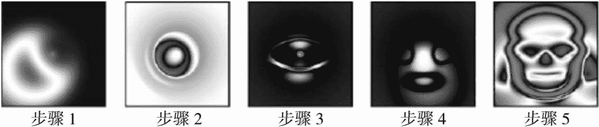

软件工程界曾上演过同款闹剧。上世纪80年代，“不可测量即不可控”成了圭臬，汤姆·狄马可力推量化管理。可35年后，他公开反悔：指标滥用反而扼杀了复杂项目的潜力。**“严格的控制，只适合那些注定平庸、无潜力产生重大影响的项目。”** 盲目追指标，让工程师被迫拔高虚假数据，即使明知脱节也要硬着头皮凑。这股歪风吹了十多年才消退。

如今，美国教育系统正重蹈覆辙。只不过受害者从程序员，换成了孩子和老师。

更隐蔽的毒药，是对“准确性”的迷信。奥巴马时期的“力争上游”计划、高等教育引入的CLA与CAAP测试，核心卖点都是“更精准的评估”。但如果方向错了，精准只能让你“更准确地走向深渊”。

以“图片孵化器”网站孵化“骷髅头”图片为例（见图7.1）。通往骷髅头的关键“垫脚石”，竟是一弯新月、一个甜甜圈、一个盘子——它们长相与终极目标**零相似度**。若设立“骷髅头相似度”高精度考核，奖励高分、淘汰低分，结果必然扼杀真正通路。因为**通往伟大的路标，从不长得像终点**。真空管不像计算机，扁形虫不像人类，这是复杂探索空间的普遍规律。

全国统一标准（如CCSS“共同核心州立标准”）同理。初衷是好的：保障公平，让东西部孩子享受同质教育，便于横向比较、问责。可统一标准本质上是“单一量表”霸权。它无法指引通往世界顶尖教育的路，反而把全美学生绑上同一辆开往平庸的列车。**一把失灵的指南针，刻上“黄金标准”也依然失灵。**

更深层的伤害在于扼杀多样性。统一意味着收敛，扼杀了各地学校自主探索的可能。第五章的“新奇性搜索”算法证明：单一指标导致全军覆没；鼓励多路径探索，才能持续涌现新解。教育不需要“疯狂试错”，但需要给教师自主权，凭经验与直觉去探索深度学习的路径。正如骷髅头的诞生依赖于用户的百花齐放，教育突破也源于去中心化的“寻宝”。

芬兰的启示耐人寻味：小学教师拥有高度自主权，无标准化考试，却长期领跑全球。反观美国，基础教育重目标、重统一，长期落后；高等教育因少受指标束缚，反而保持世界领先。**过度强调目标，本身就是最大的风险。**

放弃目标导向，会让人恐慌——失去了熟悉的指南针，仿佛坠入无序虚空。但我们要认清：**伟大不需要目标许可。** 第五舱我们已见证：舍弃目标，改用“新奇性/寻宝者原则”收集垫脚石，依然能抵达惊人彼岸。

教育若组织成一场全社会参与的“大型寻宝”，让教师凭直觉试错，让有前途的方法自然浮现并被复用，系统整体便获得了进化的韧性。这或许模糊、不确定，但唯有拥抱不确定，才能在复杂迷宫中，找到通往卓越的真路。

# 第八章

## 打破扼杀创新的枷锁

> 我告诉你：你必须接纳内心的躁动与迷茫，正是它们将你铸造成一颗璀璨的星辰。
>
> ——弗里德里希·尼采

1519年8月，麦哲伦率领五艘船、两百余名船员从西班牙启航，誓要寻得通往香料群岛的航道。三年后，仅有18名幸存者驾驶孤零零的一艘船抵达终点。他们本可自诩为首批环球航行者，却因剩余货物寥寥、收益不足，连全额薪水都未拿到。麦哲伦本人更早已葬身菲律宾，因卷入部落纷争，中标枪、被追杀，命丧异乡。十年后，达·韦拉扎诺虽留下“首位进入纽约港欧洲人”的名号，下场却更惨——探索小安的列斯群岛时遭原住民杀害，甚至疑似沦为食人族的盘中餐。这种九死一生的探险，绝非16世纪的专利。数百年后，斯科特队长离南极点仅一步之遥，归途却因粮尽冻毙冰原。

早期探险家的史诗令人神往，未知大陆的凶险与诱惑在好奇心与名利的驱动下交织。幸存者拓宽了人类认知的版图。如今，卫星与全地形车让地球陆地无处遁形，地图精准到寸。然而，地理疆域之外，**思想空间的未知大陆**依然辽阔，等待着新的探险家。而思想创新的红利，远超当年的香料黄金——它拥有重塑文明底色的力量。承接上章对教育的剖析，本章将深入追问：对“目标”的盲目崇拜，究竟如何绊住了科学、商业、艺术等领域的创新脚步？

---

### 科学探险：实验室里的“无畏航海家”

科学进步是人类文明的核心引擎。回首历史，变化惊心动魄：乔治·华盛顿曾焦虑地等待富兰克林从巴黎传来的书信，那在今天看来滑稽得如同隔世；仅两代人前，跨洋通信还靠漂洋过海的手写信，时隔两周；而今，跨洲视频通话免费且即时。这翻天覆地的变迁，源于一代代**现代探险家**在科学未知疆域的深耕。

他们不必直面食人族或狂风巨浪，实验室里的失败也不会致命。但他们揭示的真理，撬动世界的杠杆同样巨大：若攻克癌症通用疗法，或实现可商用核聚变，将如何改写人类命运？巨大的潜力、广阔的前景与高风险并存，**“目标神话”**理所当然地渗透进了科学探索的肌理。

我们都是科技红利的受益者：世界被“缩小”，生活更便捷，绝症被攻克。若因痴迷目标而拖慢科学节奏，损害的是全人类利益。要洞见目标如何干扰科学，必须先看清科学实操的逻辑：**实验是核心驱动力，但烧钱极猛**。资金成为关键瓶颈——知识回报周期长、不确定性高，科学家必须先跨过“融资”这道坎。而**资助决策，深受目标导向思维主导**。

---

### 评估机制的困局：同行评审 vs. 标准化考卷

回到教育前沿，如何打破僵局？与其让教师与学生陷入**标准化测试**的无限刷题，不如建立一套**“同行驱动型评估”**机制：

1.  **教师交“作业”**：年底提交包含教案、教学理念、学生作品样本等在内的匿名材料包。
2.  **跨校评审**：由全国不同学校的五位教师组成评审团，从课程完整性、创新度、学生表现等维度打分、撰写评语。
3.  **双向流动**：教师收到五份匿名反馈。**仅当综合评分不及格时**，才启动标准化考试作为兜底防线；若达标，评估结论即刻生效。

这看似在“反评估”后又搞“新评估”，实则不然：**我们反对的是将宏大教育目标捆绑的一刀切标准化考试，而非评估本身。**

**这种机制的精妙在于规避了“目标欺骗性”**。  
传统模式下，学校被迫对标“预期高度”，极易陷入指标陷阱；新机制下，评审基于**“现状与潜力”**——这正是**“寻宝者哲学”**的体现。整个系统化身寻宝者，专注于发掘与传播新理念。教师不再被迫应试，而是通过**轮流担任评委、接收反馈**，持续接触多元教法、复盘背后原理，将最佳实践内化为下一学年的“踏脚石”。**探索自由与质量兜底并存，教师创造力释放，孩子们也从无尽刷题中解脱。**

---

### 承认“无解”才是破局的开始

教育难题无标准答案，我们也不妄称有“万能药”。本章旨在揭示：像教育这类牵一发动全身的系统，为何会重蹈第五章机器人陷入死胡同的覆辙，以及**替代路径为何依然充满希望**。  
或许不存在一种目标导向法能教会学生所有期望技能。承认这一点虽刺耳，却如同揭示其他领域“高大上”目标的欺骗性。**长远看，伟大成就源于“无既定目标”，而非“立Flag”。** 这令迷信强制标准推动进步者失望，却能唤醒他人。下一章，我们将延续这份解放，剖析目标如何在创新追求中制造破坏。

---

### 资助“空白支票”：麦克阿瑟模式的启示

我们甚至应毫不犹豫地资助“有奇思妙想履历”的研究者，如同**麦克阿瑟天才奖**——直接发“空白支票”，不问终点在哪。这看似疯狂：没人知道他们要干什么、怎么干。但**科学的本质正是探索未知与不确定**。若无法容忍“无目标的偶然发现”，所有通往新大陆的路都将在起跑线被掐断。而如前所述，**过于宏大的目标几乎从不实现**。强迫填报目标，只能逼出平庸的“踏脚石”式指标。

这呼应了费耶阿本德的观点：**科学无法被提炼为任何基于目标的方法论。**

---

### 为什么我们抓着目标不放？恐惧风险

掏钱的人怕担责、怕资源打水漂，不愿赌在“天马行空”项目上。但**恐惧不改事实：风险是科学探索的入场券**。跨越未知踏脚石、走得更远，注定要拥抱不确定性。规避风险的目标思维，反而成了进步的天花板。

**商业投资领域早悟透此道**：  
投资人只认“触手可及的踏脚石”。

*   **A公司**：要造全息电视，颠覆娱乐业，360度沉浸穿越梦幻森林——愿景惊艳，但踏脚石未现，**没人敢投**。
*   **B公司**：提升分辨率、画质，基于现有显示技术迭代——目标“只差一步”，**投资人趋之若鹜**。

**现实的商业目标 = 眼前的踏脚石。**  
这不代表商业不创新。创新往往藏在“被意外发现的踏脚石”背后——如特斯拉Roadster，源于将笔记本锂电池串联的灵光一现。**航空旅行催生太空梦，真空管孕育计算机**。巨大回报来自踏脚石的意外串联，而非盯着遥远终点强行铺路。

*   **商人**：融资前锁定附近踏脚石。
*   **科学家**：凭预感“附近有有趣踏脚石”申请资助。

**两者最优策略都不是“设定宏大目标”，因为创新源于意外发现。**

---

### 踏脚石的积累，才是真正的革命

回望历史，每一次微小发现都是启示，链条本身就是革命。押注革命性发现风险高，但时间拉长必至。**伟大发现从非其目标设定的踏脚石中涌现**——投资人心知肚明。想投有远见的人？**找那些在临近不确定区徘徊、探索的人。**

---

### 艺术与设计：早已看穿“目标的谎言”

艺术家、设计师深知：**创作背后的“理念”远比“目标”重要**。艺术是探索，非为完成特定靶子而存在。问任何艺术家：**“跟随灵感的羊肠小道，强过立志画下一幅《蒙娜丽莎》。”**

**设计引入功能性约束时，目标才有用武之地**：建筑须遮风挡雨、地基稳固。这像自然进化的**“生存约束”**——所有生物必须活得够久繁衍，但满足方式千差万别，造就了物种爆发式多样性。**防雨屋顶、稳固地基是“边界条件”，非典型目标**。创新在约束内寻新，整体搜索仍向未知推进（详见书末案例研究）。

**艺术史就是踏脚石链的教科书**：  
印象派（莫奈捕捉光影） → 表现主义（马蒂斯强调色彩情感） → 超现实主义（达利开启潜意识）。  
**莫奈从未想过50年后引发超现实主义**。伟大新方向，往往**因非目标而被发掘**。有的步骤否定前代，有的重定义前代，但**无人预设终局**。每项创新自有意义，且**“通往更新颖领域的潜力”正是有效创新的标志**。

---

### 连艺术生都被“目标思维”绑架了

2011年，肯在罗德岛设计学院演讲“目标危害创造力”，惊觉**许多学生无法阐述创作目的**。一学生以斧头敲金属、扔海滩生锈，面对“为什么”哑口无言。**主流文化预设：创作必有具体目标**。这让学生陷入不安与自我怀疑。

肯讲完后，学生们豁然开朗：**“最伟大的探索，本无目标。”** 他们不再需为“暴力敲打金属”辩解，因结果本身美丽、发人深省，更因它可能**激发未来全新艺术形态**——这才是价值所在。

**若连艺术家都被逼供“目标”，常人怎能幸免？** 年轻艺术家因“说不清通向哪里”而犹豫，暴露了**目标思维在文化中的统治力之深**。正如前文所示，教育、科学、艺术……主流组织工作方式，深陷“目标带来的虚幻安全感”无法自拔。

---

### 结语：拥抱“无目标”的清醒与勇气

我们不妄想给出通吃的“终极方案”，那太天真。我们只盼读者觉察：**目标无处不在**，渗透在重大倡议、日常琐事、成长里程碑里。它们非全错，但替代不易。  
**通过“解读目标如何塑造认知与影响力”，我们至少获得一种新视角：放弃虚假安全感，能摆脱停滞。** 非目标驱动探索虽非万能药，但**盲信目标导向，往往只换来平庸与僵化**。世界运转复杂，但我们已知——**有一条路，能挣脱既定目标的枷锁。**

书末章节将带你体验“摆脱目标欺骗后的自由”。两大案例——自然进化与人工智能研究，将从非目标视角展开。我们不敢说解决了所有难题：教育仍不完美、科研投资非科学、进化存谜题、AI仍遥远。但**我们对“非目标思维如何重塑这些问题的面貌”充满期待**。这种解放性思维，或能助我们跨越当下，成为我们急需的**那块踏脚石**。  
怀着这份希冀，我们以**“如何接纳目标的缺失”**为题，为本书主干画上句点。

### 别再用“共识”筛选科研项目了：最伟大的发现，都藏在分歧里

科研经费的分配逻辑，和上一章聊的教育截然不同。学校烂透了没人会拍手叫好，但科学界单个项目的“彻底失败”却是家常便饭。科学的整体图景是：无数次试错中，拼凑出人类知识版图的拼图。麻烦在于，好点子太多，钱太少。每一笔投资的风险与回报都得精打细算——这直接催生出一个核心难题：**凭什么原则决定给谁发钱？** 选错方向，不光拖慢科学进度，连带的社会机会成本都难以估量。

#### 一、 同行评审的隐形陷阱：共识制造“平庸”

放眼长远，目标思维在科学领域的副作用显而易见。直觉上，申请书写得目标宏大、路径清晰、承诺“必出大成果”，似乎最稳妥。但“图片孵化器”（Picbreeder）的教训摆在面前：**最惊艳的发现，往往根本无法预测**。教育界如此，科学界更甚——科学本是新探索、新发现的主战场，单点失败风险可控，本该是“非目标性探索”的天然沃土。可现实却让人扼腕：即便容得下偶然失败，科研活动依然被“目标欺骗性”紧箍咒锁死。

绝大多数国家的基础研究，靠的是 NSF、ESF 这类政府机构输血。这些钱支持的正是商业资本不敢碰的“硬骨头”。高风险伴随高失败率，机构必须冒险才能托举最激进的创意。那么，它们怎么决策的？

流程很标准：科学家交提案 -> 同行专家打分（差到优） -> 平均分最高者拿钱。

乍看合理无比：顶尖大佬认可的想法，理应最靠谱。但这套机制的内核，是**强制制造共识**。评审专家越一致看好，拿钱概率越大。可**共识往往是通往突破的拦路虎**。

回望“图片孵化器”：用户从不投票选“下一张最好图片”，大家各走各的路（阳关道或独木桥），才堆出了通往外星人、汽车图片的阶梯。一旦改成“专家小组投票定方向”，通往新奇的路径瞬间全封死。

为何？投票机制下，对立偏好妥协的产物，永远是**“寡淡的灰色”**。黑白混合不出彩虹，只出灰。科学家为了拿钱，拼命写“完美妥协方案”——四平八稳、无懈可击、也毫无惊喜。系统把无数条独特的“踏脚石链”，压缩成了一条平庸的平均值线。

**与其追求廉价的一致，不如拥抱高质量的分歧。**

争议，比“全员好评”更有含金量。跟风热门赛道、鹦鹉学舌复述共识，大概率拿钱；真正的新想法，必然引发争议。在已知与未知的“蛮荒边界”，专家意见**本就该发散**。达尔文进化论初刊被群起攻之，这不是坏事，是范式转移的前奏（库恩语）。所以，**资源必须留一部分给“引发分歧”的提案**，而非只奖励“达成共识”的。

注意，这不是让“全员差评”也拿钱。关键在于：**根本性分歧 vs. 根本性否定**。目标思维信奉“认同路径越多越该走”，这是基于目的地的投票；非目标搜索不要求同终点，只看当下踏脚石够不够有意思。科学是人类最伟大的探索，决策前强行统一思想，无异于扼杀创造力。

当然，共识在特定决策里有用，但不适用创造性探索。图片孵化器的用户从不开会，各自延伸前人成果，链条无限生长。这种“不团结”的协作，反而成就了最强团队。科学界也该如此：组内、组间适度的“不团结”，才是进步的引擎。

#### 二、 “可预测性”幻觉：通往诺奖的路，没导航

目标思维还有一个毒瘤：**妄想科学进步有标准流程图**。信徒以为：治愈癌症，必定源于癌症研究的改良，或至少来自直系相关领域。事实屡次打脸：**通往卓越的踏脚石，从不按图索骥**。

日本“第五代计算机”砸巨资十年，目标商业化落地，结果竹篮打水（虽练出一批人才）；尼克松“抗癌战争”喊响半个世纪，癌症未灭，反倒是人类基因组计划这类“旁系”研究带来曙光。阿波罗登月成功，是因为目标刚好卡在“技术可能性边缘”差一步——而非目标本身创造了技术。把这当成“目标万能论”证据，就是典型的**天真目标乐观主义**。前美国癌症协会主席曾豪言：“离治愈癌症只差登月那股劲。”结果呢？登月副产品给人类留下人工耳蜗、记忆棉、冻干食品——**最深远的影响，全是意料之外。**

#### 三、 “影响力”指标：另一块坏掉的指南针

退一步，哪怕不设宏大目标，只按“预期影响力”分钱行不行？NSF 审核重点就有“影响范围”，政客更爱嘲讽“跑步机上的虾”、“沉迷科学的猴子”浪费税金。普罗克斯迈参议员的“金羊毛奖”，专挑“螺旋蝇性行为”“素食主义决定因素”这类题目开涮。

潜台词：**开项前就能预判社会价值大小。**

这太武断了。重大发现多半是偶然撞上的。甚至退一万步，就算真能精准预测单项目影响力，**只投“高影响力”也未必明智**。

系统论视角看：科学整体追求变革性真理，但单个项目“本身是否变革”根本不重要。**“有趣、能生出更有趣的后续”比“自带重要性光环”值钱百倍。** 图片孵化器生成外星人脸，单用户做不到；新奇搜索穿越迷宫，前提是**不按“离终点距离”打分**。

所以，“重要性”在科学探索里，是块**暗含欺骗性的破指南针**。通往颠覆性发现的垫脚石，往往长相普通、毫无“重要感”。

数学史是铁证。哈代引以为傲的“纯数学无用论”，群论后来撑起化学物理，单向函数成了公钥密码学基石、撑起全球电商安全——**初衷纯粹为真理，副产品改变世界。** 纯数学家拼命保持“纯粹”，现实却最“实用”。

#### 四、 “国家利益”绑架科学：把路走窄了

更极端的逻辑：只投“对当下国家利益有用、短期见效”的项目。美国《高质量研究法案》曾硬性规定：NSF 必须背书每个项目“符合国家根本利益、最高质量、突破性、解决社会最重要问题、不重复”。加拿大 NRC 更直接：砍基础研究，80% 预算转“商业导向”，主席直言要“重塑自身支持产业、造就高薪岗位、刷商业化 KPI”。

这不掺政治，纯粹是**目标思维在科研管理上的误用警示**。“砸钱定能出成果”的诱惑太大，但科学结构不吃这套。**下一个可商业化的颠覆性技术藏在哪，没人知道。** 非目标探索听起来“看不见前路、不敢保票”，但它能让科学世界更有趣、更富饶。重要发现等着被挖掘，需要的不是目标式蛮力，而是持续的智慧投入与开放心态。

#### 结语：不知去向，才是正路

你会问：*“不知道通向哪，凭啥盲目推崇垫脚石？这是目标思维的负隅顽抗。”*

非也。我们有充分理由相信：**“但行前路，无问西东”，才是通往光明未来的唯一道。**

信息收集器如此，寻宝者如此，踏脚石收集者亦然。**“不知前路通往何方”，恰恰是人类创造伟大事物的根本原因。** 共识、可预测的重要性、国家利益绑定——这些目标思维的衍生物，只会让我们在迈向未知的征途上，离真相越来越远。

# 第九章

## 别再被“宏大目标”绑架了

> 想赢？别盯着赢看。去做你热爱、笃信的事，成功自然会追上来。
>
> ——大卫·弗罗斯特

前面几章，我们拿出一堆铁证：目标导向思维，正在悄悄扼杀教育、科研等重量级领域的突破可能。一旦“立靶子”成了默认动作，所有的拼命努力反而事倍功半。换个角度——用开放、不设终点的探索视角，从教学改革到个性化汽车设计，全新的路径豁然开朗。设想一下，这些关乎文明进程的大事，要是甩掉目标的缰绳，会迸发出多惊人的能量。这听让人振奋，但你可能还在嘀咕：这套“反目标”论调，到底跟我一个普通人的柴米油盐有什么关系？承认“迷信目标是个错”容易，但不立目标，到底靠什么活？打破陈规固然痛快，真要让人放手多年肌肉记忆里的“目标”，谈何容易。

彻底告别目标，乍看像条走不通的死胡同——谁甘愿在世上漫无目的地晃荡？没了靶子，似乎只剩随波逐流或虚度光阴。此时你会觉得，“彻底躺平”跟“拼命内卷”没两样，但这完全误读了本书的核心。每个人天生自带一种离奇的雷达，能精准嗅到潜力的气息，无论它通向何方。这种本能不需要预设坐标。所以，解除目标的束缚 ≠ 放任自流，反而能让生命重获实感。本章就来拆解“去目标化”对每个人的真实含义，为全书画上句点。

先立个规矩：书里对垒的，全是“高大上”的宏大目标。脑子正常的人，没人建议把世上所有目标类型一键删除。所以，日常琐事照旧按目标办，本书不反对、不冲突：盖房还得看蓝图，写代码还得遵规范，明天晚餐照旧按食谱做。你立旗要跑步锻炼，坚持下去耐力肯定涨，这些“适度目标”不在讨论范围内，大可不必扔掉。

真正该换思路的时刻，是当你想冲出舒适区，去追伟大成就、颠覆性创新、根治顽疾、永恒理论、震撼旋律、星际远航、国家级难题、极致幸福……凡是这类“地平线之外”的领域，目标这个指南针就开始失磁、甚至带偏路。探索的脚步走得越远，目标的欺骗性越赤裸，它拦住了人类最强潜能的释放，这才是我们要换探索逻辑的根本原因。

听起来挺丧，但真相是：革命性成果依然触手可及。要是这书只让你止步于“不要雄心”，那完全背离初衷——人类从未停止过追梦。进化无心插柳造出亿万神经元的大脑，我们也发明出祖先不敢想的无数东西，哪怕是图片孵化器网站的用户，都能玩出目标驱动程序永远复刻不来的独特图像。与其悲观，不如敞开胸怀，搞清这些发现到底是怎么冒出来的，并思考如何持续制造惊喜。

终极答案看似自相矛盾：**不刻意找，反而能找到；但这不代表过程混沌无序。** 关键在于——起步时没锁定终点，不等于探索是盲目的。比如你顺着未知河流探险，捡到件古董，这不是纯运气，是因为你在“探索”本身，即便事前不知会捡到什么。探索自有遵循的原则，哪怕没有具体终点。唯一的代价，是放下对“最终目的地”的执念。

但这代价根本不算牺牲，因为我们放弃的“控制权”，本质上只是场**华而不实的幻觉**。前文反复佐证：目标本该是控制结果的工具，一旦变得“高大上”，提供的控制感全是泡沫。它们更像骗人的道具，把探索带进死胡同。所以，我们从未真正拥有过那种被神化的掌控感。无论给多少时间，没有育种专家能定向进化出人脑，没有石器天才能凭空造出电脑，没有科研大牛能造出时光机。死磕宏大目标，解决不了未知空间的本质复杂性。通往未来的踏脚石蜿蜒无序，人类根本预判不了。那些惊世成就，几乎全是长期创新积累的副产品，而非既定目标的直达品。

看透这点，执念自然松开。追寻伟大发现的路上，根本不存在靠谱指南针，这也难怪真正成事的人总裹着层神秘光环，让人敬畏。目标就像脖子上的护身符，丢了也就丢了，大可不必耿耿于怀。

基于这认知，我们可以理直气壮地拥抱“无目标探索”，因为别无他选。唯一要解决的：卸下“能控制终点”的幻觉后，按什么原则行动？答案是——**做个寻宝人**。未知荒野里，无数宝藏埋在无标记之地。它们都值得挖掘，哪怕不是你梦寐以求的那件。但若你运气好，挖到一处，额外奖励来了——一张指向更多宝藏的线索图。这就是**踏脚石原则**：一个好念头引出另一个；一处宝藏连着更多宝藏，在无限踏脚石上形成永不停歇的链式反应。所以，你的任务只有一个：练成熟练的寻宝人。

要办到这点，必须学会捕捉线索。但这些线索不报“目标在前方”，只提示“这儿有好东西”，像空气里漂浮的神秘甜香。线索形态千差万别。新奇性搜索算法就认为，“新奇”是通往未来潜力的线索——新东西能生出更新的东西。这招在计算机探索里奇效：撞墙的机器人想不出更高级动作，除非它学会避墙。为追新奇，它被迫学懂“墙”、“门”概念，行为复杂度随之跃升，最终学会穿门出迷宫——**这从来不是它的目标**。新奇性搜索就是寻宝者原理的教科书级案例：零整体目标，硬生生催生新发现。

当然，人不是机器。我们懂得撞墙没出路，能把这认知内化为行动，比只贪新奇的算法灵活复杂得多。人人天生对新奇有好感，这无可厚非，但生命意义远不止于此。优秀的寻宝人，懂得把新奇跟别的配料揉在一起。这“额外配料”众说纷纭，但核心线索大概率是——**趣味性**。什么叫有意思，仁者见仁，正如图片孵化器证明：意见分歧反而让整体受益。热爱音乐、写作、渴望见世面，都是趣味的注脚。重要的是，趣味的气息能引着每个人踏过专属的踏脚石。像新奇一样，一件趣事牵出另一件，通向何方不可预测，但敢顺着气味钻，价值迟早浮现。

趣味与新奇并非割裂：曾经的新奇成了常识，趣味也会随之褪色。当年“四轮自行箱载客”很激进，今聚会再吹汽车概念早无人理睬，“无马马车”也成不了科幻新噱头。曾经的新奇，转眼成庸常。但**趣味超越新奇**。每个人对“有意思”的感知，是直觉、经验、知识三重奏微妙调和的产物。我们很难精准解释为何某念头让心动，但独一无二的生命体验，就是这感觉的源头。至今没有任何程序能复刻人类这种与生俱来的“趣味雷达”。而我们每一次趣味驱动的发现，都在为未来铺设更多踏脚石。

所以，想当不设靶子的寻宝人，就得遵循一条特殊线索：**感到“有意思”，旅程就启动了。** 听起来简单，实则深意：你遵循直觉找宝，不是因为知晓终点，而是觉得当下此地藏着“洞天福地”的可能。光是接受“这种找法有意义”，就已足够重要——它与主流文化灌输的“必须有目标才能得价值”截然对立。

回想有多少次，我们被迫用“目标明确”给选择背书？若老板或父母认定你的理由“纯主观”，你得拿出铁证才能自证清白。而“觉得有意思”，最易被扣“主观偏好”的帽子。我们有太多词汇抨击它：不科学、无原则、有偏见、感性用事、不理性、不负责……光凭“我觉得有意思”，绝讨不了老板的好。

但本书给出个极具讽刺意味的洞见：**顺从这类直觉，在追求伟大发现和创新时，往往比死磕目标更有原则。** 这不是作者俩的拍脑袋感悟。全书堆砌的案例铁板钉钉：无视目标的结局，比跪舔目标漂亮得多。当然存在例外——适度目标、需评估的目标另说。但核心在于：既然我们看不清“搜索空间”的全貌，顺着趣味走，才是理性之举。我们根本不知未来会冒出什么新念头、新发现，它们皆可能是通往任意之地的踏脚石。

站在可能性边界眺望未知，目标是座**名不副实的灯塔**。趣味则不同——它铺设路网，引你从一处藏宝地奔赴下一处。只有驻足欣赏当下风景时，干草堆里的针、冥冥中的“天意”——当下的踏脚石及其通向的下一处，才会骤然显形。

**与主流认知背道而驰：伟大发明家从不窥视遥远未来。** 妄图看透远未来的预言家大多靠不住，真创新者只搜寻“脚下可行的下一块踏脚石”。他们问的是“从这儿能走到哪”，而非“如何飞跃到那遥远的彼岸”。差别看似微妙，实则深刻。成功者不把精力耗在宏大愿景上，而聚焦**当下前沿的可能性**。任何历史节点，人类都拥有特定能力/知识库——含所有科技、科学、艺术积淀。重新组合、改造其中任意部分，就能新增一种能力，推动人类微进一步。真创新者的贡献，就是敏锐捕捉“此时此地的有趣之处”，迈出那小小一步。

历史总有微妙时刻：人类某能力跨过隐形界线，振奋新可能骤然显现，唯独最敏锐细心者能察觉。2009年，程序员马库斯·泊森（Notch）意识到：把《矮人要塞》《过山车大亨》《无尽矿工》三款游戏理念拼起来，能长出新物种。与当时几乎所有现代游戏不同，《我的世界》画面简陋、保真度低、无花哨内容、甚至没明确任务目标。但玩家能在海量方块构成的开放像素世界里，自由探索、建造、创造。几乎没人看好这怪游戏，更不信它能重塑行业。可马库斯看到了唾手可得的踏脚石：融合最新创意，造出乐高积木的互动数字版。虽算大制作，却未按惯例狂推营销，依然爆火。亿万玩家持续产出惊世作品：能跑简版《我的世界》的数字计算机、迪士尼乐园与斗兽场复刻版，甚至成了教育平台。2014年，微软斥资25亿美元收购。

同理，iPad 2010 年首发前，从无同类商业成功案例，几个月却卖出数百万台。乔布斯嗅到：社会与技术已进化到平板电脑商业化的临界点。他没被科幻级愿景分心，没去造仿真机器人或类人 AI（他完全能干），而是盯上了**离他一步之遥的踏脚石上的宝藏**，并成了第一个跨出那步的人。乔布斯自己也讲过个绝妙故事，注脚“在不焦虑长期目标下追寻趣味”的价值：

> 我若没退学，若没去蹭那门书法课，个人电脑就不会有今天这么美的排版。大学时我串不联那些点滴，但十年后回首，豁然开朗。

反观目标驱动型公司，常因数年数十年无创新产品而萎靡。不点名，但 AI 商业化领域遍地是雄心勃勃的身影，最终被迫降维期望。它们成立初衷往往就是“搞出革命性新 AI”，结局却惨淡。这批失败者与苹果的成功形成鲜明对比，印证一个道理：**基于“当下在哪”决定“去哪”，比基于“想去哪”决定“怎么走”，要明智得多。** 人人能把当下变未来，无人能把未来变当下。

不是说“宏大目标”永远不可达。积累足够念头与创新后，那些曾遥不可及的旧目标，确实会突然闯入可实现区。几个世纪前，飞行是人类无法企及的宏愿。但此类成功故事极易误导——**过去失败多因目标驱动，后来成功真因并非目标本身。** 莱特兄弟时代，追“飞天梦”者多以“统治天空”愿景为燃料。竞争对手兰利拿巨额政府拨款，莱特兄弟却自筹腰包。但两兄弟动机截然不同，这才是制胜关键。他们原本是造自行车的，**自行车就是通往飞行器的踏脚石**。莱特兄弟听见了他们时代的未来召唤，而非硬把预设未来塞进当下条件。数百年间，无数空想家以飞行器为目标，全败了；唯有造自行车的莱特兄弟，悟出“飞行器就是空中的自行车”，飞行才成真。这故事在说：**宏大目标不会因“目标性”本身而成真。信“目标通达成功”，等于信“目标全能”。**

放弃目标之所以难，因这意味着放弃“存在正确道路”的幻想。人们习惯把进步看成项目串：有的走岔，有的走对。若这是你的世界观，你自然会捍卫自认的“正道”，攻击“歧路”。但诡谲的是：**若终点本不存在，何来“正确道路”？**

因此，评判项目值不值得干，不该看“成功潜力”，而该看**“催生新项目的潜力”**。若真按寻宝人、踏脚石收集者逻辑行事，踏脚石唯一核心功能，就是**生出更多踏脚石**——无论站上去当下多爽，无法自扩展、无法“抛砖引玉”的踏脚石，才是最烂的。寻宝人在乎的是收集更多踏脚石，而非抵达特定终点。踏脚石攒得越多，通往高潜力之地的入口就越多。

目标导向者易陷批判主义，总担心别人最终落脚何处。但若人人最终落脚不同处，对全人类或是更优解。否则大伙全挤在同一块石头上，这正是要警惕“共识”诱惑的原因。当然，若大伙真愿终聚同一地，推动共识有意义，但这应是我们最不愿见到的。**守护分歧、容纳不一致，是美德。** 你选的路未获他人认同，除了“彼此最终抵达不同地方”，还有别的风险吗？

# 放弃目标，才能抵达彼岸

我们常听说“目标决定成败”，可现实远比口号复杂。这个世界错综繁杂，没人能拍着胸脯保证：此时此刻，我们该往哪儿走。正因为路径不透明，人生才充满了迷惑性。与其强行统一步伐，不如允许每个人踩着各自的“垫脚石”，摸索出适合自己的路——这对个体公平，对社会也有益。

当然，垫脚石不总是稳当的，有的甚至通向死胡同。但相比之下，死盯着单一目标的可能性更窄，它每次只指向一个方向。想象一下，如果一个图片网站的用户全都只搜“蝴蝶”，这平台早晚死于单一：没新意，没惊喜，连大家想要的蝴蝶图最终都生成不出来。社会运作同理，别用那套错思维套住所有人。

想摆脱“目标崇拜”其实很简单：**顺着兴趣走，听直觉行事。** 不是所有事都得攥着KPI过日子。有强烈直觉就跟着干；没明确目标也不必焦虑，随便怎么走，结局都差不了。因为真正伟大的成就，自带“生成更多伟大”的基因。你原本写代码，后来拍电影；想搞AI，却在“养”图片；本想画画，结果写了诗——路偏了，反而对了。长远看，一块垫脚石引出下一块，最终通向发现的彼岸。

正是这种串联成链的创新路径，成就了最伟大的突破。可要实现它们，得“欲擒故纵”——别把它们当目标。放手很难，但记住：多年后，当垫脚石铺就，你丢下的目标可能自己跑回来。在此之前，跟着好奇心和新奇感的气味，大胆去探索。不是让你放弃所有目标，但若想触碰苍穹、跨越极限，关键时刻，必须学会放手。

主流文化不爱走这条路，它习惯用目标拴住探索。但证据摆在那：唯有化身“漫无目的”的寻宝者，才能捡到最大的宝。别被“目标趋同”迷了眼，释放“多路并进”的探索者吧。哪怕他们不走大道，也别急着拦——迟早，他们会成为人类通往伟大发现路上的垫脚石。

万事尘埃落定，梦想家厌倦了陈旧蓝图，不求回报的期待化作灰烬沉积在不可逾越的未来之上，唯有一束理性之光能穿透黑暗：**为了实现至高无上的目标，我们必须先心甘情愿地抛弃它。**

# 第十章

## 案例研究1：重读自然进化

> 核酸成就了人类，让我们甚至能在月球�衍。
>
> ——索尔·施皮格尔曼

你我身体的每个细胞，都是一座精密运转的“微型城市”。线粒体是发电厂，氧化糖供能；核糖体是蛋白工厂，造新细胞、修旧膜；溶酶体负责清运垃圾；细胞核坐镇中枢，用DNA调控一切。五十万亿个细胞团结协作，才拼出了一个“你”——这数字是世界人口的万倍。最令人震撼的是：这庞大帝国，没有总设计师，全靠“毫无章法”的自然进化自发涌现。

进化不止造了人，地球上所有生物都挂在同一棵延展的树上。从加州115米高的“亥伯龙神”红杉，到印尼能喷水打猎的射水鱼，万物皆亲戚，溯源同一个初代可自我复制的细胞。

搞懂原理，学习才落地。自行车踩踏板、动链条、转车轮，不懂这套逻辑，放百万年也只得一堆废铁。但生命进化不一样，它像台永动机，扔那儿百万年，能自行衍化出全新生态。越研究越不可思议：人脑这等复杂器官，真能靠一个看似机械的过程蹦出来？这种怀疑，催生了“智能设计论”——精密手表背后有表师，复杂生命背后岂非有“造物主”？

达尔文一锤定音推翻了这观点：**一台微有瑕疵的自我复制机器，就能制造出“智能设计”的假象。**

设想台能自我复制的机器。复制若完美，仓库里全是克隆件，毫无看头。但复制若带瑕疵，戏剧诞生了：每代产出都略有不同。有的坏了复制不了，锈死绝后；有的变“吞金兽”霸占资源。唯有能复制、且复制成功的，才能把相似特征传下去。这就是“物竞天择”核心——**不精确复制 + 自然筛选 = 进化引擎。** 跑上几十亿年，地球上的复杂生命便尽在其中。

所以，达尔文发现的过程，就是那个神秘“造物主”的真身。进化论证据确凿，无需质疑。但进化太复杂，生物学家至今仍在争细节：生命起源怎么来的？到底是自然选择作用大，还是偶然历史作用大？古尔德觉得机遇与历史更关键，约翰·梅纳德·史密斯坚挺自然选择。分歧不在“进化存不存在”，而在“谁在掌舵”。

换个视角看，理解会变。进化是适者生存的竞技场，还是个碰巧堆出万物的分化过程？本章将尝试一个全新视角——**非目标搜索**，重读进化。不为推翻教科书，只为看清：进化如何把“不可能”变成“现实”。

---

### 那些深入骨髓的“目标式”误读

提进化，最响亮的标签是“适者生存”。这里的“适者”，指生物学适应度——平均留多少后代。虽非达尔文原词，却深植大众心智。它把进化框成场竞赛：谁更适应生态位，谁繁殖得多，谁就赢。

黄毛兔易被捕食，基因难传；长腿兔跑得快，基因扩散快。基因间竞争，迫使个体陷入生存角逐。这“竞争”叙事，天然绑定**目标导向思维**——进化的目标，似乎就是成为“最合适者”或“最强繁殖机器”。像所有目标驱动检索一样，锚定指标（适应度），然后拼命优化它。

这也让大众把进化等同于“血腥竞赛”。《自然，鲜血淋漓的尖牙利爪》（丁尼生语）。大自然在疯狂自我优化，但为了啥？早期观点说：进化是进步的，指向完美，指向超级生命，人类是当下的巅峰——比细菌、蟑螂“高级”。

但即便带着目标镜看，解释也分流派。有人觉得目标就是造人，把人类挂进化树顶端。这想法太天真：若进化从第一个细胞起就盯着“造人”，人类永远出不来！因为垫脚石（如扁形虫）跟终点（人类）毫不相似。目标的欺骗性在此尽显：盯着人类找，反而找不到人类。

那目标是“智力”？人类只是副产品？照样不行。通往智力的垫脚石本身不具备智力，远古扁形虫vs昆虫，谁能通向高智？没人知。预排几十亿年垫脚石，太难为“造物主”了。所以，**把进化看作对人类、智力或任何类人特征的定向搜索，全是白费力。**

事实上，进化论和哥白尼、维勒一样，打碎了“人类天下第一”的愚昧。地球非宇宙中心，有机无机不分家，人类只是生命树无数叶片之一。这不削弱人类独特性（语言、智力），只为说清：**进化从未偏袒人类，无任何迹象表明我们比别的生物“高级”。**

---

### “生存繁衍”是目标？骑驴找驴罢了

大家都学过：生存繁衍是进化目标。不可否认，没这两能耐的物种早灭绝了。这观点还承认自然选择是提升生存力的主力。按这逻辑，进化目标=提高适应度，自然选择=驱动引擎。

自然选择确实解释了生物为何贴合环境。像拼图打磨边角，严丝合缝。多布然斯基名言：“离了进化论，生物学无处可说。”从这视角看，性状A为应对环境C而生，物种多样性似乎全靠“不断刷高适应度”。这思路符合直觉，教科书都这么教，问谁谁这么答。

但本书提醒：**质疑常识，往往通往深层认知。** 我们不妨换个角度想多样性从何而来。

#### 漏洞一：目标在起点就达成了

按第4章定义，“生存繁衍”不符合“目标”词义。找丢钥匙是目标，找到就结束。可进化呢？第一个细胞活下来、分裂成功，目标那一刻就完成了。进化是**目标达成后才开始的搜索**——攥着钥匙还在满屋找钥匙，典型“骑驴找驴”。

#### 漏洞二：细菌才是“最优解”，人类算老几？

退一步，假设目标是“找适应度最高的物种”。适应度=平均后代数。人类一胎五宝算高产？猫一胎五只还能连窝生。细菌分裂速度碾压一切动物。按这逻辑，结构简单、出现早的细菌，才是进化的“终极答案”。那人类横空出世是闹哪样？

显然，进化最迷人篇章不在细菌。把细菌供进化树顶端，肯定错。光研究细菌，永远看不懂生命的多样性与复杂性——乌龟、郁金香、奶牛、牛痘、绵羊、海贝……生命不像找钥匙，更像个**钥匙收藏家**，囤积着经年累月淘来的各式藏品，其中部分精致复杂得惊人。

### 进化不是“刷榜”，是“寻宝”

我们常把进化理解为一场朝着“更完美”冲刺的优化赛，但若换个视角，它更像是一位不设终点的寻宝者，或是那个能把外星人脸“孵化”成汽车图片的AI图片孵化器。

书中前文提到过类似的“分化创造过程”：进化这位造物主，随手捡起扁形虫当垫脚石，全然不知日后会蹦出人类；发明真空管的人也想不到它会催生计算机。回看进化史上的里程碑——光合作用、飞行、人类智能，它们从未被设定为“目标”。若执着于“目标检索”，反而看不清进化的真相：**那些让我们惊叹的生命奇观，只是生物在追求“高度适应性”途中溢出的副产品；而生命多样性本身，才是进化过程的核心主角。**

#### 生存繁衍是“硬性门槛”，而非“终点奖杯”

将“生存繁衍”视为目标，是一种误导。常规目标在搜索开始前是“未完成”状态，且全程以最终产物为导向。但自然界不同：**生存繁衍是一种制约**——繁殖失败者出局，成功者留场。这不仅没“推动”进化，反而**裁剪了探索空间**。无数潜在的“垫脚石”物种，因未被自然选择“选中”而灭绝，它们通往新物种的潜力永远被封存。

#### 思想实验：没有淘汰赛的“和谐之星”

想象一颗无竞争、资源无限、人人长生不老、随意繁殖的“和谐之星”。这里没有自然选择，连生殖器官都可有可无。
若地球与“和谐之星”同源于一种单细胞，结果会如何？
直觉会说：没压力，进化会偷懒变简单。但事实恰恰相反——**“和谐之星”的物种丰富度远超地球**。
因为地球上被自然选择“筛掉”的生物，在这里全活下来了。那个百万分之一几率的有益突变，在地球上可能还没发育成熟就被吃掉了；但在“和谐之星”，它获得了第二次生命，甚至能演化出无需生殖器官的全新身体结构。**自然选择不是创造力的源泉，它只是资源有限时的“分配员”，集中优化了现有方案，却锁死了通往未知的无限岔路。**

#### 进化是“开枝散叶”，而非“赢家通吃”

竞争通常导向“最佳化”，像NCAA锦标赛或格式战争，只剩一个赢家。但进化偏爱**“开枝散叶”**，在可能性空间里不断分化、积累垫脚石。
更妙的是，进化靠**“躲避竞争”**创造多样性。某生物偶然能消化新食物，便独享生态位，后代逐渐专门化成新物种；第一只会飞的陆生动物，直接跳出地面厮杀，开辟天空新疆域。新生态位层层衍生，如连锁反应：草本植物养活食草兽，食草兽养活食肉兽、食腐兽、寄生虫……正如计算机催生软件生态，**进化是一摞摞叠起来的垫脚石，不为终点聚集，只为站上前者的肩膀，望见更远的可能。**

#### 偶然性才是幕后大佬：基因漂变与扩展适应

垫脚石怎能堆高？靠**偶然性**。
*   **随机遗传漂变**：不影响生存的性状（如骨骼颜色），自然选择不管，全靠随机漂变固定下来。林奇指出：选择干预越少，这类性状越稳定。**“百花齐放”的多样性，源于自然选择的“疏忽”。**
*   **扩展适应**：旧结构挪作新用。恐龙羽毛本为保暖，后成飞行利器；人类骨骼始为储矿，终作支撑架。图片孵化器里外星人眼睛变车轮，真空管从电学实验转战计算机——**非目标探索中，当下的“无用之用”，往往是未来的关键钥匙。**

#### 抽象视角：生命是场“鲁布·戈德堡式”的复杂游戏

抛开适应度概念，抽象来看：**所有活下来的物种，本质上都在干同一件事——生存繁衍，只是花样百出。**
细菌二分裂，像直接在桌角磕碎鸡蛋，简单高效；人类却要先造出万亿细胞，跳二十年华丽的“鲁布·戈德堡舞蹈”（精密机关完成简单任务），最后还只留下单个受精卵。这看似“奢侈”低效，实则是**进化在“生存繁衍”这个硬约束下，疯狂尝试的多样化路径**。

**竞争不是创造力的引擎，“寻找同一目标的N种方法”才是。**
进化或许是最早、最宏大的“鲁布·戈德堡实验”：**在单细胞这个“瓶颈”两端，用无限复杂、奇葩、惊艳的方式，无限重复着“制造单细胞”这同一个简单任务。那些最迷人的生命奇观，从未偏离过这个核心约束，却在偏离“最优解”的路上，走出了无限精彩。**

# 进化无目的，才生万物灵：重新理解创新的底层逻辑

为何进化不走“捷径”，非要在无数条路里反复试错？如果没有明确的“设计图”，生命为何能从单细胞进化出人类这般复杂的存在？这背后或许没有神秘的推手，只有一场漫不经心却极其深刻的“扩散”。

### 一、 进化不是“选拔赛”，是“泼牛奶”

想象一下：在一片名为“搜索空间”的无垠荒原上，远古的第一个单细胞生物只是一个孤独的坐标。基因突变像泼洒出去的牛奶，不受控制地向四周渗透、扩散。哪里平坦（适合生存繁衍），牛奶就流向哪里；哪里有沟壑（不育、灭绝），牛奶便绕道而行。

不需要目标召唤，不需要方向指引。只要时间足够长，这滩“牛奶”终将淌遍所有能容纳它的凹陷。那些看似精妙绝伦的复杂结构，不过是因为简单的生存方式已被“占满”了，流动的趋势被迫向更广阔、更复杂的区域蔓延——就像香槟塔，上层杯满，酒液自会溢入下层。

这正是**“新奇性搜索”算法的核心隐喻**：进化本质上是一种“最低标准检索”。门槛只有一条——能活下去、能留后。达标者皆可入场，无需比谁更优。正因为没有“全局最优”这个单一终点，搜索才不会被截断，多样性才得以无限累积。连“最低标准新奇性搜索”这类变体算法，都能让机器人在没有任何奖励信号的迷宫里，凭借“做点不一样的事”这一简单执念，最终找到出口。

### 二、 竞争是“修枝剪”，不是“发动机”

生物学家常强调竞争的作用，但若将视角拉高，竞争不过是给扩张的“牛奶”加了几块挡板。

*   **全局竞争**像一场残酷的“全员PK”，所有人站在同一条起跑线上比谁跑得快。这必然导致趋同——所有人都长成最适合赛道的样子，多样性被压缩，创新被扼杀。
*   **局部竞争**则不同。袋鼠只跟袋鼠抢地盘，狮子只跟狮子争猎物。这种“各打各的小算盘”，反而逼出生物另辟蹊径：实在卷不过，我就去开发个新生态位。于是，逃避竞争反而成了多样性爆发的引擎。

自然进化的真实图景是：**创造力唱主角，竞争当配角。** 即使保留竞争因子，引入“局部竞争新奇性搜索”算法，模拟出的虚拟生物依然能爆发式生长出惊人的形态多样性。化石记录也佐证了这一点：寒武纪大爆发不是因为某个物种“赢了”，而是因为生命积累了足够多的“踏脚石”，终于撬开了复杂身体的大门。进化不追求完美，只制造“鲁布·戈德堡机械”般精妙又冗余的生存装置。

### 三、 AI 研究的“目标陷阱”：别用终点衡量起点

从自然进化转向人工智能，同一个认知陷阱正在上演。

学术界普遍崇尚**“实验派启发式”**：新算法必须在基准测试里打败“老靠谱”，哪怕只赢 5%，才配发论文。这就像非要让发条玩具跟人形机器人赛跑，赢了发条玩具就沾沾自喜，输了就宣判人形机器人“死刑”。但梵高的《星空》不妨碍米开朗基罗的《大卫》诞生，橙子好吃不是砍掉苹果树的理由。**用“当下性能”筛选“未来潜力”，本质上是用目标导向的思维，堵死了通往创新深处的岔路。**

更隐蔽的是**“定理派启发式”**：只要数学证明漂亮、收敛有保证，就是好算法。听起来严谨，实则一样短视。定理只能保证在特定假设下“正确”，却无法保证这个方向通往通用智能的核心区。把“理论保证数量”当导航仪，不过是换了个更学术的“目标函数”，依然在巨大的算法空间里盲目梯度下降。

### 四、 分清“探险家”与“买票人”

混淆的根源在于没分清角色：
*   **行业实践者（买票人）**：要解决当下的问题，**性能指标是硬道理**。选“老靠谱”无可厚非。
*   **研究人员（探险家）**：要在算法大厅里找从未被发现的房间。**性能指标不仅是噪音，更是毒药。**

探险家需要的不是“谁跑得快”，而是“这条路通不通向新大陆”。新奇性搜索、最低标准搜索、局部竞争搜索，这些“非目标性”算法之所以珍贵，正是因为它们敢于放弃“立竿见影”的优化，转而拥抱“漫无目的”的探索。

### 结语

进化三十亿年，从未设定过“造人”目标，却造出了能思考目标的生物。
科学研究若执着于“预判终点”，永远只能在已知领域内微调。
真正的突破，永远属于那些敢于在“无奖励”的荒原上，为了“看看那边是什么”，迈出第一步的人。

**下一步，你准备好放弃目标函数，去寻找属于你的“踏脚石”了吗？**

# 第十一章

## 案例研究二：目标与人工智能领域的探索

> 唯一不会扼杀进步的原则是：万物任其自然。
>
> ——保罗·费耶阿本德，《反对方法》

当今我们习以为常的无数科技成就，在不久前还是难以想象的幻想。即便是最富有的中世纪君主，也只能策马出行，且极易死于肺炎；而到了现代，普通百姓亦能乘机翱翔，与千里之外的好友即时通讯。科学在推动这一切、乃至更多看似不可思议的进步中，功不可没。就其本质而言，科学是对知识的不懈追寻，它持续拓展人类可能性的疆界，让我们对世界有了更深层的认知。纵观历史，所有伟大的发现皆为通往未来的垫脚石，引领我们抵达超乎想像的技术彼岸。

科学发展虽光耀夺目，却仰赖科学家的辛劳，而科学家亦是凡人，并非完人。鉴于人类才是科学巨变的幕后推手，科学家们沟通协作的模式，将深刻影响进步的步调与速度。我们有必要洞悉科学体系的运作机制，因为科学关乎人类生活质量。试想若无抗生素，人生将作何光景。因此，若科学界能更高效地协作，全人类皆受益。本章中，我们将审视当前科学的运行逻辑，并探究其背后潜藏的目标陷阱。

首先，科学并非仅是一个汇聚全体科学家的超级社群。知识浩瀚无垠，无人能尽览全貌，故科学家往往仅深耕一两个细分领域，即我们常说的学科。大众熟知的物理学、生物学、化学等，皆由不同科学家群体构成，犹如其他人类社群一般，各学科均有专属惯例与文化。不少脍炙人口的段子，便生动描绘了学科间的文化差异，例如：

一位数学家、一位生物学家和一位物理学家，坐在街边咖啡馆观察对面楼房的出入情况。起初见两人进入，片刻后却有三人走出。物理学家断言：“测量出现误差。”生物学家推断：“他们繁衍了。”数学家淡然道：“若此刻恰好再进去一人，屋子就又空了。”

***

**理论保障的局限：为何“老靠谱”未必是好垫脚石**

设想某理论家为“老靠谱”算法证明了一个新定理，保证其能高效产出合格结果。此类定理乃 AI 理论研究的靶心，因其向工程界承诺：算法必能给出合理输出。故而，从业者青睐有定理背书的算法，而非裸奔者，符合逻辑。然而，单一算法的定理，并不等于在算法搜索空间中能发现后续算法的线索。换言之，定理虽论证了“老靠谱”，却无法担保它能衍生出一系列新“垫脚石”，也无法确保后继者继承同等可靠性，甚至无法保证它们定能超越原版，哪怕被证明更可靠。

理论家或辩称：凡遵循同一假设的后续算法，均可继承原版可靠性。但这未必利于探索新思路。这意味 AI 研究被锁定在遵守同一套不断膨胀假设集的算法中，元搜索对任何打破假设的路径视而不见。最终搜索范围收窄，目标悖论再度掌权。

核心困境在于：该定理无法回答“AI 该往何处去”，它仅针对特定算法——庞大“搜索空间”中的孤立一点。众所周知，对一个无性能保证的算法微调，可能造出超越“老靠谱”的新算法。单一算法的可靠性，不代表其衍生物同具可靠。因此，仅因有定理背书便认定“老靠谱”是良好垫脚石，仅当定理本身包含“能催生更有潜力算法”的证明时才成立。无论你信奉哪种经验法则，莫忘判断很大程度上仍赖直觉。无论偏好“表现”还是“理论保证”，它们本质上都是判断潜力垫脚石的两种直觉。定理派启发式的痼疾在于：特定定理仅适用特定算法。定理数量不过是评判其垫脚石潜力的一条经验法则。终究，我们无法自证定理派比实验派更可靠。

**隐性假设：搜索空间的结构迷思**

定理派还隐含一个假设：算法拥有的潜力定理越多，越逼近 AI 终极目标。这仅是信念，而非事实。在巨大搜索空间中，无人能证实定理指引的方向通往圣殿。“老靠谱”有表现保证，“超自然”没有，不代表后者无价值。即便“超自然”表现平平、无保障，它可能极具新颖性，引发有趣新问题。若它真有潜力，为何要因缺定理而忽视？过度迷信定理派，只会延缓甚至阻断对“超自然”背后新理念的探索。

或有人主张：静待“超自然”的理论验证出现，免得在未验证算法上浪费时间。但验证宏大理论非朝夕之事，且最终能证明何种保障，向来未卜。若“超自然”能衍生新算法，其趣味性与理论保障无关，等待的代价不过是浪费数年、拖慢 AI 发展。行业从业者虽赞赏保障，但他们不参与探索。故而在探索全体 AI 算法构成的“大会堂”这般广阔复杂空间时，我们无法确定性能保障或其他担保是否为正确导航信标。

**直面不安真相：没有可靠的指南针**

最终我们不得不直面一个令人不安的事实（读至此已耳熟能详）：**无法确定任何经验法则能否成为通往 AI 目标的可靠向导。** 这不意味着实验与定理毫无价值，它们只是汪洋大海中寻找线索的微小水滴。更好的“表现”或更惊艳的新定理虽是亮眼成就，但“令人印象深刻”并非搜索中达成特定目标的可靠标尺。发条玩具跑得再快，也无法成为通往机器人革命的桥梁。

定理派的核心逻辑是：确保算法理论“有保障”，便能带来更多更好的保障，从而在算法空间确立目标梯度。若信此梯度真实有效且无欺骗性，终将产出强保障，实现 AI 终极目标。但“一组日益‘有保障’的垫脚石能铺就通往人类级 AI 之路”，此假定当真成立？事实是，某些真理不可证。就我们所知，即使最强 AI 算法，也可能无法提供任何“保障”。

自然进化孕育了人类智慧，其史诗般的进程中从未证明过一条定理。即便无定理加持，进化仍收集垫脚石，终架起通往人类智能的桥梁。这虽不证明定理派是糟糕梯度，却表明**无需定理，同样能持续拓展探索深度**。发人深省的是，史上最强大的搜索——进化——在通往人类智力的路上，全程零定理。更深层的问题是，定理派在算法空间制造了目标驱动型搜索，而历史早已证明，此类搜索在复杂空间中往往表现拙劣。

**把关人的铁尺：启发式如何扼杀多样性**

实验派与定理派启发式，不只是科学家独自摸索的工具，更是 AI 领域把关人手中的“铁尺”。把关人设定的标尺，决定了哪些想法配得上分享。无论你是否认同这些“铁尺”，无论 AI 是否真沿其设定路径演进，若你的想法无法在一定程度上满足其规定，公开发表便是场硬仗。算法表现较差？论证其合理性将备受煎熬。未与他法对比？审稿人视为未经证实直接否决。无定理支撑？难说服理论家关注新想法。后果严重：这把“铁尺”强迫全领域只能沿启发式划定的狭窄垫脚石前行，扼杀一切不符可能性。

正如所见，这些启发式实则阻碍发现与进步，因为它们仅在目标欺骗性泛滥时才有奇效。于是我们再次面对老问题：是否存在有潜力的非目标替代方案，取代目前大行其道的目标驱动搜索？是否有一种似寻宝者的非目标驱动法，尊重垫脚石内在特质，而非依赖欺骗性、机械性的启发式？

**重新提问：什么是真正的“好算法”？**

要回答此问，须回溯源头，重思我们当寻求何物。何为真正“好”的 AI 算法？领域过度聚焦性能表现，已至“一叶障目”。好算法不在于出色性能，而在于能引领我们思考其他算法。AI 终极目标隔着迷雾重湖，依旧遥远，我们不应执着以“性能”为准则。现有算法与人类智能相距甚远，我们的探索恰似第四章思维实验：给细菌测 IQ，指望进化出人类智力。我们不该纠结“超自然”是否优于“老靠谱”，而应追问：“超自然”是否带来了新的“超超自然”，且后者能沿任何有趣维度（而非仅性能）持续衍生？例如，“超超自然”可能创造出更似真实大脑的类脑结构，即便表现更差。我们真该仅因性能稍逊便弃之？AI 研究本质是搜索，搜索功能是发现新事物。实验派与定理派筛掉了太多有趣算法，能找到的东西有限。

这正是 AI 期刊满版性能改进、会议报告多为“复杂技巧提升 2%”的缘由。或可驳回更多此类论文，因 2% 微不足道。但真问题在于：没人持续关注这些算法，因榨干性能边际不产生振奋洞见。这些靠挤压性能撑场面的算法，本身不是“优良”垫脚石。如人类史上伟大发明，所有被史册铭记的算法，必然为未来奠基。它们催生新算法，甚至开辟新疆域。届时，谁还在乎它们初登场时与“老靠谱”比表现如何？

**性能崇拜的副作用：狭隘竞争取代协作**

痴迷性能提升还会制造“同行是冤家”，导致狭隘竞争。科研非田径赛，这种思维分散了对真实目标的注意力。研究者更需携手合作，共探算法无限空间。现实却常是：有人证明算法击败“头号种子”，继而另有人绞尽脑汁推出“转移”算法在另一基准上反超，致使前者跌落神坛。虽出于善意，但围绕基准的厮杀让我们聚焦性能比拼。若“超自然”真为突破性垫脚石，它与“转移”的争斗不过小打小闹，真正的大手笔应是对“超自然”及其衍生物“超超自然”的后续探索。在 AI 领域，**垫脚石才是真正的巨星**。

**无指南针如何航行？新奇性搜索的可能**

通过此案例，我们洞见目标启发式如何限制科学探索。但即便接受缺陷，无指南针学科如何繁荣？AI 能否进行某种“新奇性搜索”？确有此路，但需彻底变革研究范式方能落地。

回顾第五章“图片孵化器”案例：社区无规则、无专家评审、无严格目标标准、无强制对比优劣、无证明价值制度。无任何审查权衡，社区仍能发掘前人未见之物：描述有意义图片的复杂数学表达式（即“DNA”），那些指向可能图片的线索。无人能独自孵化出骷髅头图片，需全社区之力，且必须是一个**没有目标驱动型“把关人”的社区**。

或以为这是“错误类比”。毕竟选图不像 AI 研究需专业门槛。AI 领域岂能任凭疯狂想法直接公开？实验派与定理派启发式能筛除疯狂无意义之作。要求性能证明，至少保证算法非“绣花枕头”。

乍听合理，实则忽略关键事实：**我们皆有大脑**。“必须遵循严格目标规则以防疯子”，这话不怪乎？无目标启发式我们就无法识别胡编乱造，这真是事实而非狡辩？专业专长固然重要，如愿乘坐专家设计的越洋客机。但专家（而非随机之人）决策时应考量“其他专家期望见到何物”。将决策权交给目标启发式，非尊重专家，乃否定专家——暗讽专家易受骗；同时承认：全领域仅靠启发式筛选才能避免被疯狂想法淹没。换言之，若启发式必要，**即默认专家无理性判断力**。这样的“专家”，真能称专家？

非说专家不可信。实况是：启发式成了我们（含专家）懒得动脑理性判断的借口。审稿人不喜欢的算法表现差，便无脑否决；表现好，便粗暴要求更多对比数据否则不予通过。专家拒用理性判断时，讨论焦点从“是什么让算法有趣”转移至搜索空间中简单的目标标准——似发条玩具与双足机器人永无止境的赛跑。用简单经验法则评估新想法图省事；深入研判想法未来潜力（尤为陌生新颖者）则是艰巨脑力劳动。

**终极思想实验：《人工智能发现期刊》（JAID）**

假设 AI 领域有一本异乎寻常的期刊——《人工智能发现期刊》（JAID）。与其他期刊不同，其审稿人**不得在评语中提及任何实验结果相关内容**。作者可像往常一样撰写定理派与实验派结果，但审稿人**不能**以此为评审依据。故审稿人不得因新算法性能较差而单方面驳回；不得要求更多对比与基准数据（因这些对 JAID 不重要）；不得抱怨缺理论保障；不得批评理论结果不出彩。除此规则外，审稿人可自由争论想法是否应发表。关键在于，**审稿人非随机挑选，乃从 AI 精英研究者中遴选**。

问题来了：JAID 刊文比顶刊差，还是好得多？若你是 AI 研究者，知晓 JAID 审稿人不能从性能或理论保障角度褒贬，你会读 JAID 吗？

JAID 所为，是**挑战并要求审稿人聚焦文章核心主旨**。审稿人从实验派与定理派启发式中解脱，只能深思核心思想是否足够有趣。若主旨有趣，它便可能是良好垫脚石。这些审稿人拥有领域最聪慧大脑，思考重点应为：文中观点能否改变 AI 未来。故而，他们的大脑必须消化理解作者意图，而非依赖传统启发式速断。无任何显性规则可速决接受或拒稿，评判需经真正、反复的考量与斟酌。

# 科学圈的“隐形门槛”：当同行评审变成扼杀创新的“目标陷阱”

不同国家的文化差异，常挂在嘴边的语言、饮食上；可放在科学界，文化分野关乎的却是人类知识版图的拓展与沉淀。我们期待一门学科的文化土壤，能孕育出富有成效的探索，让最具潜力的“踏脚石”开花结果；同时也能帮科学家们避开死胡同，不在有限的时间和资源里打转。毕竟，没人能读完所有文献，学科社区必须替成员筛选：哪些想法最关键？这也是为何主流科学圈都遵循一套“经验法则”，专门用来过滤掉不靠谱、无趣味的理论与实验——不然早就乱成一锅粥了。

为了筛选并传播核心思想，研究者们主流的打法是发期刊、开会议。期刊定期推送成果，会议则搭建面对面交流的场，甚至还会出“会刊”收录全文。发表观点不仅能让研究再经验证，还能把种子撒向更广阔的土壤。被认可的观点至关重要，它们指引着未来的研究方向，成为下一轮探索的基石。于是，一个绕不开的问题摆在面前：**怎么判断哪些想法值得留，哪些该扔？**

最通行的答案是“同行评审”。科学家投稿，编辑不拍脑袋决定，而是找领域专家把关。评审员通常给满满的“挑刺”意见，找bug、判价值，编辑汇总退回作者修改，反复博弈，直到录用或拒稿。初衷很好：刷掉“认知浅薄、内容单薄”的想法，托举最重要的发现登上舞台，让顶尖大拿接力推进学科前沿。

但这套机制暗藏大坑。把关的“专家”未必中立：新观点动了自家奶酪？太激进看不懂？与主流信仰冲突？偏见随时上线。更糟的是，评审倾向于捧“安稳保守、缺乏想象”的成果，创新就被扼杀在摇篮里。权力与政治渗透进学术圈，掌权者一旦带偏节奏，评审就成了绊脚石，反拖了科学的后腿。

这背后是**“目标”**的强大魔力。人类天性爱用具体目标衡量、驱动探索，科学也不例外。评审专家一拿到新想法，脑子里蹦出的全是目标导向的追问：能达成啥指标？能击中那个靶子？可正如书中屡屡强调，目标驱动在别处翻车，在科学里照样会出幺蛾子。目标在科研里究竟扮演什么角色？值得细究。

两位作者深耕人工智能（AI），自然拿自家领域做案例。AI更适合做样本，因为它的核心追求极其“高大上”——造出高度智能的机器。这远大目标导向的特质，让“目标思维”对AI的影响赤裸裸、淋漓尽致。尽管定义不一，但凡还没丧失激情的AI人，心里都装着逼近甚至超越人类水平的通用智能（AGI）。这典型的“遥远圣杯”，中间隔着无数未知的踏脚石。

书前文反复警示：别为虚远的目标耗尽心力。可对AI研究者，这简直是悖论——奔赴遥远星辰大海，不正是AI的本质嘛？有人便打着“保守派”旗号，说只搞落地算法，不碰不确定的大梦想。但若真放弃突破，放弃造真智能、根本改变世界的宏愿，自主翱翔的飞机、自主建房设计的机器人、谱写乐章的芯片、冲锋一线的钢铁救援员……这些原本触手可及的未来，不就全泡汤了？

所以，AI是观察“目标思维如何重塑科学进程”的绝佳窗口。透过这个案例，能管窥科学内部运作，更能看清目标在社会资源分配、决策把关中的深层逻辑。毕竟，目标是掌权者最爱的把关工具。

想读懂AI圈子，得盯着他们的核心产出——**算法**。这儿没算法落地，理论就不算完整，想法也不算落地。这传统定下基调：再天马行空的主张，写成代码跑通实验才算数。论文必须拿实测结果说话。

AI目标是造能干实事的计脑，所以算法百花齐放：识别视觉、写小说、控制机器人、下棋、自主学习、打游戏……凡需智力的活，都是AI的疆域。难度天差地别：1997年“深蓝”赢了卡斯帕罗夫，但至今让算法自学系鞋带依然是硬骨头。AI的“圣杯”，是搞出单一算法包打天下，干遍人类能干的事，甚至超越人类。路还长，目标依然遥不可及。

既然产出是算法，AI研究本质就是**“在算法空间里搜索”**。数学家找定理，物理学家找规律，AI学者找更牛的算法。但AI有个独特反转：**研究对象本身就是“如何高效搜索”**。AI专家设计的算法，很多本身就是自动搜索未知空间的工具——找迷宫最优路、找棋局最佳步。于是，AI学者既是“搜索算法的设计者”，又是“搜索新算法的执行者”。这就是**“元搜索”**：搜索那些能搜索的东西。一层搜索套一层搜索。

听起来绕？生活中比比皆是。你去狗场挑只好奇心重的狗，本质是“搜索擅长搜索的个体”；宝藏公司招顶级猎人，是“搜索搜索宝藏的人”。AI学者同理：任务是搜最优算法，而这些算法本身在搜最优参数。

元搜索视角揭示了深层联系：AI专家对底层搜索的精通，理应投射到顶层“找新算法”的元搜索中。毕竟搜索本质同构。可现实却尴尬：极少人关注这“元层面”的联系。论文里分析算法层面搜索为什么奏效的多了，讨论“AI领域如何搜索算法”却寥寥无几。原则理应通用，却被集体遗忘。

你会以为：写出顶级搜索算法的大神，肯定也能玩转领域级的元搜索，避开“遥远目标”这个失灵指南针？事实真如此？还是连专家也难逃目标诱惑，步入同一条坑？

***

为验证“目标欺骗性”是否真成AI心病，先看AI圈实际怎么找新算法。书中核心概念是**“跟随梯度”**——沿着一条强度递增的路径前行。目标驱动搜索里，梯度是性能指标从差到好；新奇性搜索里，梯度是新奇度递增。那AI学者搞元搜索时，跟着啥梯度走？

做研究通常是：先筛“最有前景”的算法，再精进扩展，期待出更强版本。判定“前景”靠什么？只能看算法的**行为表现**。这里藏着雷：若仅用单一目标（如基准测试分数）领跑全局，欺骗性必发。某算法测试跑赢了，看着“前途无量”，实则可能走不出更强、更有趣的后续。按测试分排序决策最省事，但目标欺骗性决定了：死盯测试冠军，大概率撞不出突破。

把AI学者遵循的梯度，理解为他们判定“最佳算法”的标尺。业内术语叫**“启发式搜索”**。虽无人能定论哪种启发式通往高级智能最快，但AI圈基本锁定两条主线：

1.  **实验派启发式**：看实验表现。值得深挖的算法，必须在基准任务上打赢现有SOTA（State of the Art）。基准任务本质无异于跑步快慢、油耗高低——核心逻辑是“更聪明的算法解题更快”。
2.  **定理派启发式**：看数学保证。能证明具备理想属性（收敛性、鲁棒性等）的算法最优。像买车配质保，数学背书代表理论上可靠、可预测。

这两把尺子，深深统治着AI学术生态。哪怕你不认可、想搞新范式，不尊重这两条铁律，想发顶刊顶会基本没戏。把关人视其为圭臬，拿来量度所有投稿。既不涨点、又无证明？直接拦在门外，永无传播之日。这两大启发式，实质上掌握了“哪些想法能被探索”的生杀大权。

这非AI独有。每个领域都靠启发式筛选海量新想法，只是具体招数不同。评审无法预知新观点未来能走多远，只能按行业经验法则办事。久而久之，学科文化自发凝聚成几大核心筛选法则。虽然各领域法则不同，但从AI的具体案例里，我们能窥见**“用于判断新科学思想的经验法则，其普遍缺陷是什么”**。连搜索专家云集的AI都摆不平，别的领域岂不更易中招？

可问题往往藏在“合情合理”里。实验派、定理派，乍看全是硬逻辑：烂想法传播浪费大家时间，表现差、无保证的算法凭啥要火？作者修好了再投不就行？省得大家陪跑。这论点太“常识”了，没人反驳——谁还要论证“差算法少关注”呀？但正如“目标驱动搜索是好事”也是常识，我们得警惕**常识背后的危机**。

聚焦**实验派启发式**。逻辑是：新算法必须超越当前最强，才算“有潜力”。现实中，评审最常见的拒稿理由就是“表现不够亮眼、不够显著”。评审常要求：必须跟多种SOTA方法跑全基准、多个难题实验，证明确是“重要进步”。身为从业者，两位作者承认：自己也常这么想！

但这习惯极险。正如约瑟夫·胡克所言：“大多数启发式算法的实验研究，更像**‘进展追踪’，而非科学探索。**”回溯元搜索本质：总因“表现不突出”就驳回新想法，未必明智。书第五章已论证：在单算法层面，新奇性搜索打败表现启发式；没理由相信升级到“指导整个AI领域搜索”的元层面，表现启发式就能躲开目标驱动的坑。一旦“算法表现”成筛选新想法的唯一漏斗，所有非主流、不走寻常路的“踏脚石”统统被过滤。若“表现批评”仅作建议而非拒稿铁律，另当别论。可如今“表现”已成过滤器，俨然个标准的**欺骗性目标函数**。

设想有个“老靠谱”算法，多年霸榜机器人难任务训练。忽一日，“超自然”算法横空出世，教法新颖独特，技能相似。**但提交论文时，作者实诚承认：标准基准（如教机器人走路）上，“超自然”比“老靠谱”差5%**（学习更慢、步态更不稳）。这种对比在AI圈家常便饭。

此时，从未见过“超自然”范式的评审员，手里攥着“表现至上”的尺子，会怎么判？

### 别让“跑分”扼杀了AI的未来：为何我们要拒绝用短跑成绩评判马拉松选手？

在AI学术圈，有一条不成文的铁律：新算法若跑不过旧模型，基本等于判了死刑。搞研究的人都知道，实验派的启发式筛选机制是个极其强硬的“守门员”。为了混个眼熟，作者们往往不得不拼命优化指标，或者另寻有利地形比个高下。鲜有人会大张旗鼓地宣称“我家模型跑得更烂”，毕竟这在以SOTA（当前最佳性能）为尊的圈子里，简直是自寻死路。

但假设有位作者倔得像头牛，非要提交一个比老牌强者“老靠谱”差了5%的“超自然”算法，审稿人大概率会直接按下拒稿键。这真的合理吗？这可是个全新的研究范式，满脑子都是新点子。一旦拒稿，这条路就彻底断了——没人知道它，也没人会顺着它当垫脚石，去探索后续可能涌现的无数分支。这种“一刀切”的评判逻辑，本质上是短视的：它只盯着当下的“分数”，却对“开辟新航道”的潜在价值视而不见。后果是，巨大的算法搜索空间被硬生生砍掉了，那些通往未来的隐秘小径，因为起步不够漂亮，就此被封死在学术垃圾桶里。

如果你认同前面的观点，大概会觉得：只要思路够新，成绩单好不好看都该收。但问题更深一层：**凭什么非要拿“超自然”去跟“老靠谱”比？** 这种强行对标，只会偷走我们的注意力，让我们忽略了“超自然”本身作为一个绝妙想法的本质价值。现实却是，为了讨好那套实验派考核体系，研究者不得不陪跑，被迫偏离研究初心。

这事儿听着有点像段子：让个发条玩具跟人形机器人赛跑。发条玩具跑得飞快，人形机器人累得吐血也追不上。这比赛对人形机器人研究有啥意义？难道要等它跑赢发条玩具再研究？这根本就是“苹果比橘子”式的闹剧。我们迷恋人形机器人，图的从来不是它能不能跑赢个玩具；同理，我们关注“超自然”算法，图的也未必是它能不能当下干赢“老靠谱”。**好的垫脚石长什么样，远比我们想象的难料，压根不存在啥“成功速成公式”。** 盯着基准任务分数打转，虽然省心、有抓手、不用动脑子就能判优劣，但基准任务从来解释不了：为什么这个方向比那个方向更值得挖、更有意思。

与其猜测《AI发现期刊》能掀起多大浪，不如细品其中一个耐人寻味的悖论：若它办得不如顶刊，那身为专家的审稿人面子往哪搁？若它办得更好，那指导领域的那套启发式方法又算老几？不管哪边赢，总有一方要打脸。**若我们只会在“目标驱动”的单行道上思考，那根本就没思考。** 理性判断力不可替代，因为科学从不提供挖掘下一个伟大想法的万能模板。最伟大的想法，必然是异类；每块垫脚石的发现都是独家秘辛，每个发现者都是传奇。

真正的行家，思维都是开放的，用不着靠僵化的经验法则做决定。全盘审视一个全新想法极其耗时费力，细节多、隐蔽深，新范式本身就难被彻底读懂。相比拍脑门按规则秒拒，给个公正评价难太多——这反而成了维护现状的帮凶。见到怪论文？随口要作者补实验、涨指标，看着挺讲原则，实则是偷懒，省得费劲去理解，还能美其名曰“守护领域纯净”。

可早在1846年，米勒就看穿了：**“指望垫脚石跟终点长一模一样，那是谬误。”** 好成绩不是通往革命性突破的垫脚石，“理论保证”也不是通往“伟大洞见”的捷径。如果脑子里除了比性能、比保证就想不出别的评价维度，那真是孤陋寡闻了。其实还有满仓满库的重要线索摆在那儿：**灵感、优雅、激发后续创造力的张力、发人深省的架构、对现状的挑衅、新颖性、自然类比、美感、简洁、创造力本身……** 这些对新算法、新想法而言，全是合法的判断坐标。它们或许缺乏“目标感”，却极可能是彻底解放AI乃至更多学科的关键钥匙。谁都会喊“性能得涨”，但谁敢看见想法背后的惊艳，甩开对分数的执念？这种有魄力的专家，多多益善。