# 为什么：因果革命的起点

谨以此书献给露丝

# 推荐序

从《为什么》启程，走进因果科学

朱迪亚·珀尔教授将一生押注在因果关系科学以及它在人工智能中的落地之上，这部大众读物凝结了他几十年的思考，他用平实的语言搭建起因果推断的理论骨架，字里行间充盈着对这门学科的热爱。珀尔不仅学问扎实，更以近乎偏执的求真态度审视自我，在一个充斥术语追逐名利的学术环境里，他始终坚持表达，这份孤独本身就极具分量。

为何要写这样一本书？在此之前他已推出三部专业的因果专著，受众基本局限在数据分析与人工智能的研究者，影响有限。此次推出的版本是对前作的通俗化重写，受众被大幅放宽，重点在于思想的传递而非数学细节的堆砌。对希望理解因果推断的读者而言，这既是一本入门指南，也是这门学科从萌芽到兴盛的简明历史，同时也包含了对当下人工智能发展的反思与对未来的探索。作者期望的因果革命，终将让我们对强人工智能的理解更上一层楼。

传统统计教育长期回避因果话题，有权威统计学家曾直言从未见过因果的数学表达，也未看出其价值。对此珀尔在书中的回应直截了当。笔者坦言，在北大讲授概率统计、机器学习、贝叶斯数据分析等人工智能相关课程时，也从未触及因果关系科学，更未主动打破这层禁忌。

这部科普著作像打开了一扇窗，让视野瞬间开阔。笔者甚至觉得它比珀尔的三部专业专著更难得，理论争鸣的来龙去脉、学术圈里的恩怨、作者沧桑的反思、授业时的苦口婆心、曙光初现的期待，都在此娓娓道来。阅读的过程像一次探险，惊奇、失落、憧憬交织在一起。

目前已出版的因果关系科学科普作品里，《为什么》是笔者所知唯一的一部。作者深入浅出地呈现了因果科学的理论框架与演进脉络。那些过去令统计学困扰的经典悖论，在因果分析面前迎刃而解，迷雾散去。澄清之后，因果推断显得理所当然。以《为什么》为起点阅读，对后续研读专业文献有明显助益。

尽管定位科普，英文书名仍被定为“The Book of Why”，与《易经》The Book of Change、《诗经》The Book of Songs同列，足见分量。这样的重量级读物，即便对人工智能或机器学习的研究者，若此前从未接触因果推断，初读也未必能完全消化。对没有概率统计基础的读者，建议跳过公式把握大意；对有基础的读者，则不应放过文中精炼的数学表达，数量不多不少，恰好自洽。

当下人工智能无处不在，媒体充斥各种说法，科技快餐让人迷向。图灵奖得主、“人工智能”一词的提出者约翰·麦卡锡曾说，不符合数学的就是胡言乱语。按此标准，如今人工智能理论中有多少真正经得起检验？珀尔提出的因果视角，正是这片喧嚣中的清流。古人说博学审问慎思明辨笃行，与本书精神相合，与读者共勉。

《为什么》第一译者 江生
2019 年 5 月于美国，旧金山湾区

# 前言

约二十年前，为我的书《因果论》Causality,2000 写序时，我写下了一句当时朋友们劝我收敛的话。“因果论正经历一次重大转向，”我写道，“从笼罩神秘色彩的概念，变成拥有明确语义与逻辑基础的数学对象。悖论被解决，模糊概念被厘清，那些长期被视作形而上或无解的实际问题，如今可用初等数学处理。简言之，因果论已经数学化。”

如今重读，我觉得自己当时还是乐观了些。我所说的“转向”，后来被证明是一场重塑诸多科学认知的革命，人们称之为“因果革命”，其涟漪正从学界扩散到教育和应用。我相信，现在是把这场革命讲给更多读者的好时机。

这本书想完成三件事。第一，用非数学的语言说明因果革命的知识内核，以及它将如何影响生活与未来。第二，分享科学家前辈在解决关键因果问题时走过的勇敢历程，无论成败都值得讲述。第三，回溯因果革命在人工智能领域的源头，向你介绍如何培育能用我们的母语——因果语言交流的机器人。新一代机器人应能解释事情为何发生，为何以某种方式反应，为何自然以此而非彼的方式运行。更远大的目标是，它们能帮助我们认识自身：思维为何如此运行，理性思考因果、信任与遗憾、目的与责任意味着什么。

写公式时我清楚读者是谁，为大众写作则是一次全新冒险。这种体验很奇特，也是自我教育收获最大的一次。我需要用读者的语言组织思路，揣测背景、疑问和反应，这比书中所有公式都更深化了我对因果论的理解。

为此，我由衷感激你，我的读者。希望你和我一样迫不及待地寻求答案。

朱迪亚·珀尔
洛杉矶，2017 年 10 月

# 导言：思维胜于数据

每一门蓬勃发展的科学，都建立在它的符号系统之上。
——奥古斯都·德·摩根，1864

本书讲述的科学改变了我们辨别事实与虚构的方式，却至今仍鲜为人知。这门新科学已渗透进日常生活的诸多关键领域，有潜力覆盖新药研发、经济政策、教育与机器技术、枪支管制乃至气候变化等议题。值得注意的是，尽管议题差异巨大且不可比，这门科学仍能把它们纳入同一框架，二十年前这几乎不可能。

它没有时髦的名字，我称之为因果推断。它并非高科技，其理想形态就存在于人类意识中。数万年前人类意识到某些事会导致另一些事发生，改变前者便改变后者，没有其他物种达到这种理解高度。正是这一发现催生了有组织的社会、村镇，直至今天的科技文明。这一切源于一个简单的问题：为什么？

因果推断是对这个问题的严肃思考。它假设人类大脑是大自然为处理因果知识而设计的最佳工具。大脑存储着海量因果知识，在数据辅助下可用来解决当代最紧迫的问题。更宏大的目标是，一旦理解因果思维的逻辑，便可在计算机上模拟它，创造出“人工科学家”，让它发现未知现象、解开谜题、设计实验并持续提取因果知识。

在展望未来前，需要先了解这门科学迄今的成就。它如何改变了所有依赖数据的学科的研究方式，以及它将如何改变生活。

这门新科学回应了看似简单的问题：
• 某项疗法在预防某类疾病上效果如何？
• 销售额增长是因为新税法还是密集广告？
• 肥胖在医疗支出增长中占比多少？
• 招聘记录能否证明雇主存在性别歧视？
• 我该不该辞掉工作？

这些问题的共同点是因果性，可用“预防”“导致”“由…引发”“证明”“该不该”等词语识别。社会长期提出这类问题并寻求答案，但不久前，我们甚至无法在科学框架内表述这些问题，更谈不上回答。

因果推断对人类最重要的贡献，是把这个科学盲区变成了历史。它提供了一种简洁的数学语言来表达已知与未知的因果关系。能够以数学形式表达因果，让我们开发出系统的方法把知识与数据结合，最终回答上述问题。

过去二十五年，我亲历了这门科学的成长。在公众视野之外，我见证它在宿舍和实验室萌芽，也听到它在严肃会议上引发共鸣。如今步入强人工智能时代，大数据与深度学习被广泛吹捧，这使我更觉得有必要向读者展示这门新科学的探索及其对数据科学和二十一世纪生活的可能影响。

你可能会怀疑我为何称它为“新科学”，并问为何科学家更早不做。维吉尔在公元前29年就说过能理解原委的人是幸运的，弗朗西斯·高尔顿与卡尔·皮尔逊在研究人口统计时也触及科学问题的答案。他们都错过了因果。最大的障碍，是提出因果问题的词汇与传统科学交流词汇之间的鸿沟。

试想科学家表达一个明显因果关系时的困难：气压计读数B可表示实际大气压P，写成B=kP。代数允许写成P=B/k、k=B/P或B–kP=0，意义相同。数学上k、B、P并无高低之分。如何表达确凿事实：是大气压导致读数变化而非反之？如果连这一点都无法表达，又怎能表达公鸡打鸣不导致日出之类的因果推断？

我的教授们做不到，也从未抱怨。我敢打赌你的教授也未研究过。原因在于他们从未见过因果的数学语言，也未体会到其价值。几代科学家忽视这一语言，本质上是一种科学衰退。按开关点亮灯、闷热天气推高冰淇淋销量，这些显而易见的事实为何没有像光学、力学那样用公式捕捉？为何任由它们停留在直觉，而不用数学工具让它们成熟？

部分答案是，科学工具为科学需求而生。因为开关、冰淇淋、气压计问题易于处理，专门工具的动力一直不足。但随着求知欲增强，社会要求讨论法律、商业、医疗决策中的因果问题时，我们发现自己缺乏成熟科学应有的工具与原理。

这种迟来的觉醒并不罕见。直到四百年前，人类仍凭本能应对不确定性。后来赌博游戏的出现促使帕斯卡、费马、惠更斯建立概率论。保险业对寿命估计的需求推动哈雷、棣莫弗关注死亡率。 天文学家对天体运动的精确预测需求催生了伯努利、拉普拉斯、高斯的误差理论。这些构成了今天统计学的基础。

讽刺的是，对因果理论的需求恰在统计学诞生时浮现。现代统计学源于高尔顿与皮尔逊关于遗传的因果问题，他们试图用跨代数据解答，却失败了，并宣称这类问题是禁区，转而发展不涉及因果的统计学。

这是科学史的关键时刻。因果问题本可获得专属语言，却被浪费。随后这些问题被宣布为“非科学”，转入地下。即便休厄尔·赖特进行了艰苦努力，因果词汇仍被禁用半个多世纪。禁止言论即禁止思想，也扼杀了相关原则、方法与工具。

你仍可感受到这道禁律。统计基础课程里学生常背诵“相关不等于因果”。这话没错。但统计没有告诉你因果是什么。在教科书索引里查找“因果”是徒劳的。统计只允许说X与Y相关，不允许说X是Y的原因。

这也让人默认因果问题的数学工具无用。统计只关注总结数据，不关注解释数据。唯一例外是二十世纪二十年代赖特发明的路径分析，它是本书核心方法的直接原型。统计学严重低估了它，使其在萌芽期被压制数十年。直至八十年代，这一步仍是科学界迈向因果的第一步。

今天数据中心主义仍在延续。数据科学课程激增，“数据科学家”身价高昂。但数据并非万能。数据能告诉你服药者恢复更快，却不能说明原因。也许服药者只是付得起药费，即使不吃药也照样恢复。

科学与商业领域因仅凭数据而受阻的案例屡见不鲜。尽管意识到局限，多数热衷大数据的人仍盲目追捧数据中心方式，仿佛仍活在因果禁令时代。

过去三十年情况戏剧性转变。如今借助精巧的因果模型，科学家得以处理一度被认为不可能甚至超科学范围的问题。百年前的“吸烟是否危害健康”被视为非科学，仅在论文中提及“因”“果”都会招致批判。二十年前问统计学家“阿司匹林治好我的头痛了吗”，会被当作巫术。引用一位受尊敬的同事的话，那与其说是科学探索，不如说是鸡尾酒会的闲聊。如今流行病学家、社会学家、计算机科学家、部分经济学家和统计学家频繁提出这类问题，并能用高度精确的数学工具作答。对我而言，这就是革命。我称之为因果革命，因为它真正接纳了人类理解因果知识的认知天赋。

因果革命并非凭空而来，它建立在数学工具上，最恰当的名字是因果关系演算法。它由两种语言构成：因果图用于表达已知，类似代数的符号语言用于表达未知。因果图由简单的点和箭头组成，可概括既有科学知识。点代表变量，箭头代表已知或疑似的因果关系，即哪个变量“听从于”哪个变量。绘制、理解和使用都很轻松。如果你会用基于单向街道的导航系统，你就能理解因果图并独立解决导言中提出的那些问题。

因果图是我过去三十五年研究的主角，但不是唯一。计量经济学家偏爱数学方程，纯统计学家偏爱假设集合。无论语言如何，因果模型都应描述数据的生成过程，哪怕以定性方式，即那些在环境中控制并塑造数据生成的因果力量。

除了用图表来组织知识的叙述方式，还有一套用符号来搭建提问的表达方式。知识的语言负责把世界画出来，问题的语言负责把我们想弄明白的事情写清楚。比如我们想知道药物 D 对病人寿命 L 有什么影响，这个问题就能写成 P（L|do（D））。换句话说，如果让一个具有代表性的病人被动用药，他在 L 年内存活的概率是多少。这个写法已经把流行病学里说的干预或处理给形式化了，也就是临床试验真正要测的东西。很多时候我们还要把 P（L|do（D））和 P（L|do（not-D））对照起来看，后者就是对照组不服药的情况。do 这个算子点出了主动施加和被动观察的区别，这是传统统计学里没有的位置。

要想把观察到的寿命变化完全归于药物本身，就必须调用 do（D）这个干预算子，排除其他影响寿命的混杂因素。如果只是让病人自己决定吃不吃药，选择本身就被其他因素污染了。打个比方，只有病情最重的患者才去吃药，那吃药组和没吃药组的寿命差异，反映的其实是病情严重程度，而不是药效。随机指派一部分人用药、另一部分不用，才可以抹掉两组先天的差异，实现公平比较。

数学上，自愿服药人群的生存期观测频率记作 P（L|D），这是教科书里的条件概率。它说的是在看到病人服药 D 的条件下，L 的概率。P（L|D）和 P（L|do（D））不是一回事。看见和去做是两类操作，气压计读数下降会让风暴来临的概率升高，但我们硬把气压计调低，风暴并不会因此到来。

把观察和干预混为一谈会产生悖论。缺少 P（L|do（D））只剩下 P（L|D）的世界会荒诞到病人不看病就能降低重病概率、城市裁撤消防员反而降低火灾、医生对性别公开的患者推荐用药却对性别保密的患者不推荐等等。不到三十年前，科学就真实运行在没有 do 算子的世界里。

因果革命带来的第一个关键成果，是在不真正动手干预的前提下也能预测干预效果。先用 do 算子把问题问对，再设计出不需要真实行动也能模拟干预的方法，才让这件事成为可能。

当问题涉及反思时，因果推断引入了另一种独有的表达——反事实。比如乔服药 D 一个月后死亡，我们想问的是药是否致死。于是要想象一个平行情况：如果乔当时打消服药念头，他会活下来吗？

经典统计只能做数据汇总，连提出上述问题的语言都没有。因果推断不仅给了符号，还给出了解法。它能在多数情况下用算法模拟人类反思，把对观测世界的了解输入系统，输出对反事实世界的答案。这种反事实的算法化是另一项宝贵的成果。

反事实推理是假设性分析，乍看不够科学。可经验观察永远无法证实或证伪这些答案，人类却能对可能发生或可能已经发生的事做出可靠且可重复的判断。我们都清楚，公鸡不打鸣太阳照样升起。共识来自反事实并非空想，而是现实运行结构的体现。共享同一因果模型的两个人，反事实判断也一致。

反事实是道德行为和科学思维的基石。回溯过去、设想别的可能，是自由意志和社会责任的基础。反事实的算法化让“思维机器”学会这种人类特有的能力。

我刻意提到思维机器这个词。作为浸淫人工智能多年的计算机科学家，我带着一个该领域多数研究者没有的视角进入因果推断。在人工智能里，你只能在教会机器理解一件事时才算真正理解它。所以书中反复强调符号、语言、词汇和语法。我想知道某个论断能否用已有语言表达，以及它是否与其他论断一致。可以遵循科学语言的语法就能掌握大量知识，这一事实令人惊喜。我坚信语言塑造思想。你提不出问题的语言就无法回答，也无法提出语言无法描述的问题。做哲学与计算机科学的学生时，正是想亲眼见证一门被边缘化的科学语言如何让一门科学从诞生走向成熟，这种渴望把我引向了因果推断。

机器学习背景给了我另一层动力。八十年代末我意识到智能机器缺乏因果理解，这可能是它们难以达到人类水平的根本障碍。书的最后一章会回到老本行，探讨因果革命对人工智能的影响。我相信强人工智能可以实现且无须恐惧，因为在实现过程中我们纳入了因果关系。因果推理模块能让智能机器反思错误、发现软件弱点，像道德主体一样思考行动，并自然地与人类交流选择和意图。

## 现实的结构图

今天读者常听到知识、信息、智能、数据，却不清它们如何互动。我提议再加一个词：因果模型。有人会觉得这只会添乱。

不会。恰恰相反，因果模型把科学、知识、数据这些模糊概念放到一个具体背景里，让我们看到它们如何协作解决难题。图 0.1 展示了一个因果推断引擎的蓝图，帮助未来人工智能做因果推理，同时也是指南，说明因果模型在当今科学中如何运作以及与数据的关系。

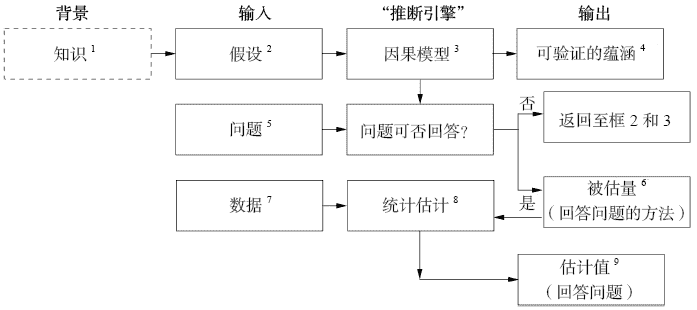
图 0.1 “因果推断引擎”能把数据与因果知识结合生成目标问题的答案。虚线框不属于引擎本身，但构建引擎不可或缺。箭头本可从方框 4 和方框 9 指向方框 1，这里为简化省略。

因果推断引擎是一种处理装置，接受假设、问题、数据三种输入，产生三种输出。第一种是是/否判断：在已有因果模型下，拥有完美无限数据时，问题理论上是否可解。若可解，引擎会生成一个被估量。那是一个数学公式，相当于从任何可获得的假设数据中生成答案的方法。最后在收到数据输入后，引擎用该方法算出问题的实际估计值，并给出不确定性大小的统计估计。这种不确定性反映样本代表性以及测量误差或缺失。

为解释示意图，我给方框编号 1 至 9，以“药物 D 对病人生存期 L 的影响是什么”为例。

1. 知识指推理主体过去的经验，包括既往观察、行为、教育、文化习俗等与目标问题相关的一切。虚线框表示它还停留在思想中，未正式建模。
2. 科学研究需要给出简化假设，这些陈述是研究者从现有知识中挑出来明确表述的部分。大多数知识仍藏在大脑里，只有假设能公开，也只有假设能嵌入模型。我们可以从模型中还原假设，所以有逻辑学家说模型就是假设集合。计算机科学家则强调表示方式的不同会带来能否准确说明、能否推导、能否据证据扩展修改等巨大差异。
3. 因果模型有多种表现：因果图、结构方程、逻辑语句等。我偏爱因果图，因其直观且能回答很多问题。从因果图的视角，因果关系的定义很简单：如果 Y 听从 X 并据此决定自己的值，则 X 是 Y 的因。怀疑病人存活期 L 听从是否服药 D，就可在图中画一条 D 到 L 的箭头。答案往往还依赖其他变量 Z，也需一并表示。
4. 变量间的听从模式会导出数据中的相关模式，这些模式可用来检验模型，也称可验证的蕴涵^[(\[3\]](#part0005.html#note3n))。把 D 与 L 无路径连通翻译成统计语言就是两者独立，若数据与此矛盾，就要修正模型。这类修正涉及另一个引擎，它从方框 4 和方框 7 取输入计算模型拟合度，图里为简化未画。
5. 提交给引擎的问题必须用因果词汇表述。此例是 P（L|do（D））是什么。因果革命的成就之一就是让这种语言科学上易懂、数学上严谨。
6. 被估量来自拉丁语，意为待估计之物。它是可从数据估算的统计量，一旦得到就能合理解释问题答案。虽然表现像 P（L|D，Z）×P（Z）这样的概率公式，实际上它是一种方法，能根据手头数据类型回答因果问题，前提是引擎证实该数据类型可用。
与传统统计不同，在给定因果模型下，有些问题即使收集再多数据也无解。例如模型显示 D 与 L 都依赖第三变量 Z，比如疾病阶段，若 Z 无法测量，P（L|do（D））就不可解。这时收集数据是浪费，需要回头完善模型，输入新知识让 Z 可估计，或冒险简化假设，比如认为 Z 对 D 影响可忽略。
7. 数据是填充被估量的原料。数据本身没有因果表述能力，它只给出数量信息如 P（L|D）或 P（L|D，Z）的值。被估量说明如何把这些统计量转化为在模型假设下逻辑等价于因果问题的表达式，比如 P（L|do（D））。
注意被估量这个概念和图 0.1 上部所有概念在传统统计里都不存在。传统方法里，被估量等同于问题本身。例如对存活期 L 人群中服用 D 的比例感兴趣，可记为 P（D|L），其值就是被估量。表达式已精确指出数据中哪个概率待估，不涉及任何因果知识。正因如此，一些统计学家难以理解为何有知识游离于统计之外，数据为何不能弥补科学知识的欠缺。
8. 此时你得到一个新鲜估计值，但它只是近似。原因是数据永远是从理论上无限总体中抽取的有限样本。即使筛选随机，样本概率也可能不能代表总体。幸运的是，机器学习提供的前沿技术给了统计学很多应对不确定性的方法，如最大似然估计、倾向评分、置信区间、显著性检验等。
9. 最后，若模型正确且数据充分，便得到待解因果问题的答案，比如“药物 D 使糖尿病患者 Z 的生存期 L 增加了 30%，误差±20%”。这个答案会回流到科学知识方框 1。若结果与预期不符，很可能需要改进因果模型方框 3。

流程图看似复杂，可日常生活中我们不自觉就做因果判断，并未意识到经历如此繁复的推断，也不用算概率。当我们想教笨拙机器人用因果思维思考，或推进无法靠直觉指引的前沿科学时，这种精细流程就必不可少。

我特别想强调数据的作用。首先我们是在确定假设、建立因果模型、提出科学问题、推导出被估量之后才收集数据。这与传统统计形成鲜明对比，后者甚至不使用因果模型。

然而当今科学面临新挑战。尽管人们越来越认识到因果模型的必要性，许多人工智能研究者仍想跳过构建或识别因果模型这一步，只靠数据解决认知难题。他们希望因果问题出现时数据自会指引答案。这种想法往往隐晦存在。

我直言质疑这种趋势，因为数据对因果知识没有发言权。行动或干预结果的信息无法从原始数据中获得，只能通过对照试验收集。而拥有因果模型时，我们大可在多数情况下从未经干预的数据中预测干预结果。

当我们要回答反事实问题“若采取相反行动会怎样”时，因果模型的重要性更突出。反事实问题是人工智能最具挑战性的问题，也是推动人类认知与想象的核心。因果传递效果，所以“为什么”这类关于机制的问题本质上是伪装的反事实。要让机器人回答为什么，或理解其意义，就必须用因果模型武装它们，并教会它们像图 0.1 那样回答反事实问题。

因果模型还有数据挖掘和深度学习所缺乏的适应性。注意被估量是在真正检查数据特性前仅根据因果模型算出的，因此因果推断引擎适应性极强，无论变量间数值关系如何，被估量都能适用于与定性模型适配的数据。

# 开篇的话

为说明适应性为何重要，我们把引擎与学习主体比较。学习主体可以是人，也可以是深度学习算法，或使用深度学习算法、想纯从数据获取知识的人。研究者通过观察许多服药 D 患者的存活期 L，能预测某 Z 特征病人存活 L 年的概率。假设她被调到另一地区医院，那里人口特征不同。即使新特性只改变了原有变量间的数值关系，她仍需重新训练，从头学习新预测函数。这就是深度学习的极限：拟合函数于数据。而如果她掌握了药物作用机制，且新地区的因果模型结构保持一致，她先前训练得到的被估量依然有效，可直接用于新数据，产生针对特定总体的新预测函数。

透过因果透镜，许多科学问题会改变面貌。过去二十五年，新见解和工具让这个透镜越来越强。我希望读者分享我的喜悦。下面预告本书亮点。

第一章把观察、干预、反事实三个台阶组合成因果关系之梯，这是本书核心隐喻。它揭示用因果图推理的基本原理，引导你逐步成为因果推理专家。读完后，你将远超几代数据科学家，他们曾用 model-blind 透镜解释数据，忽略因果关系之梯阐明的特质。

第二章讲述一个匪夷所思的故事：统计学科如何让自己陷入因果蒙昧的黑暗，以及这对依赖数据的科学产生了什么深刻影响。我会讲遗传学家休厄尔·赖特的故事，他是本书英雄，二十世纪二十年代绘制了世界上第一张因果图，多年里是少数认真对待因果论的科学家之一。

第三章讲述另一个奇妙故事：我如何通过人工智能研究，特别是贝叶斯网络的研究，皈依因果论。贝叶斯网络是让计算机在灰色地带思考的第一个工具，曾经我坚信它开启人工智能大门的钥匙。到了八十年代末我确信自己错了，本章讲述我从贝叶斯倡导者变成叛教者的旅程。不过贝叶斯网络仍是人工智能重要工具，涵盖因果图的大部分数学基础。第三章还将以因果关系为梳理逻辑做浅显介绍贝叶斯法则和贝叶斯推理，并给出贝叶斯网络的应用实例。

本书后半段把因果推断里最核心的情境逐一拆开来谈。

第四章把统计学对因果问题的最大贡献放在随机对照试验 `randomized controlled trial`，简称 `RCT` 上。从因果的立场看，RCT 是一项人为干预手段，用来求解 `P(L|do(D))` 这类问题，这可以说是它的根本特征。试验要做的事是把焦点变量 D、L 与其他干扰 Z 分开，若不分开，Z 会牵动两端。混杂带来的扭曲困扰学界差不多一百年，本章教读者用一种极简办法来处理常见的混杂：在因果图上做路径追踪，十分钟就能掌握要领。

第五章回到因果论和科学史上一个关键时刻，学界纠结于吸烟是否导致肺癌。因为最信赖的 RCT 用不上，双方在结论上始终无法统一，对问题的理解也出现分歧。吸烟争论把因果方法的重要性推到风口浪尖。可以说，正因缺乏合适的因果语言与方法，才有数百万人因此早逝或折寿。

第五章的严肃话题之后，第六章提供一些轻松的阅读体验。主题是悖论，蒙提·霍尔悖论、辛普森悖论、伯克森悖论都在列。表面上像脑筋急转弯，实质却很严肃，尤其是用因果视角去审视。几乎所有这些悖论都在呈现因果直觉与表面统计之间的张力，从而暴露直觉自身的构造。它们提醒研究者，人类的直觉根植于因果，而非纯粹统计与逻辑。我相信读者会从这些古老趣题里获得柳暗花明的感受。

第七到第九章带读者攀登因果阶梯。第七章从干预问题入手，讲述我与学生历时二十年把 `do` 类问题的求解实现自动化。我们做到了。本章也会阐明因果推断引擎的本质，它如何给出是非答案以及图0.1里的估计量。拆解引擎后，读者学会在因果图中识别几种关键模式，我称之为后门调整、前门调整与工具变量，它们是科学实践中进行因果推断的主力工具。

第八章用反事实把读者带到阶梯顶端。把反事实视为因果论基本成分的认识可追溯到1748年，苏格兰哲学家大卫·休谟给出的定义拗口：原因是一个先行且接近的对象，并且与它相似的对象都与与结果相似的对象处于类似的先行与接近关系；或者说，若无前者，后者就不可能存在。普林斯顿哲学家大卫·刘易斯指出休谟实际给出两个定义：规则性定义与反事实定义，即如果没有前者。过去学界更关注规则性定义，刘易斯则指出反事实定义与人类直觉联系更紧密：我们认为因是关键作用者，其差异体现在有它与没它时结果的不同。

到本章结尾，读者会发现可以绕开学术争论，直接算出任意反事实问题的实际值或概率，无论问题多复杂。其中最有趣的是必要因 `necessary cause` 与充分因 `sufficient cause` 的评估。例如，被告的行为在多大程度上是原告受伤的必要因？人为气候变化在多大程度上是异常气候事件的充分因？

第九章讨论中介。谈到因果图的箭头绘制时会产生疑问：如果药物 D 只是通过影响血压 Z 这个中介物来延长生存期 L，是否还要从 D 直接画一条指向 L 的箭头？换句话说，D 对 L 的效应是直接的、间接的，还是兼而有之，若兼有，如何衡量各自的重要性？这些问题既有科学意义，也有现实影响：了解作用机制，有助于开发疗效相同但更便宜或副作用更少的药物。本章结尾会让人愉快地看到，古老的中介问题被化为代数题，可借助因果工具箱中的新工具轻松求解。

第十章以我个人转向因果研究的起点收束。促使我开始的是人类智能的自动化问题，也就是强人工智能是否可能。我相信因果推理对智能机器至关重要，它能让机器用我们的语言交流策略、实验、解释、理论以及遗憾、责任、自由意志、义务，并最终做出自身的道德判断。

用一句话概括全书：你比你的数据更聪明。数据不懂因果，人类懂。我希望这门新的因果推断科学能帮助我们理解这种能力，因为除自我模拟外，别无他法。同时，在计算机时代，这份理解有望增强人类自身的因果直觉，让我们更好地阅读大数据和小数据。

[1] 2019 年图灵奖授予杰弗里·辛顿、扬·勒昆和约舒亚·本吉奥三人，以表彰他们在深度学习上的突出贡献。——译者注

[2] 可能存在一个例外，即我们进行了随机对照试验，具体可参见第四章的内容。

[3] 在命题逻辑和谓词逻辑中，蕴涵用于描述两个陈述语句集合之间的联系。——译者注

[4] 作者用模型盲来指代对数学或统计建模一窍不通，不懂得利用已有先验知识和经验来形式刻画变量关系的做法，该词常用来批评纯粹数据驱动的人工智能或机器学习。——译者注

# 第一章 从伊甸园到因果阶梯

起初……

第一次读《创世记》中亚当与夏娃的故事时，我大约六七岁。上帝禁止他们食用智慧树的果实，对这个任性的要求，我和同学们并不觉得惊讶，觉得神自有道理。我们更在意的是，吃了果实后他们立刻像我们一样有了意识，并意识到自己赤身裸体。

到了青少年时期，兴趣转向故事的哲学层面。以色列的学生每年都要重读《创世记》，我们最关心的是，人类获取知识的过程并非愉快，而是伴随叛逆、内疚与惩罚。有人会问，放弃伊甸园的无忧生活是否值得？相较于现代生活所附带的经济困境、战争与社会不公，建立在知识积累与文明发展之上的农业革命和科学革命是否值得？

请不要误会，我们不是创造论者，连老师骨子里都是达尔文主义者。但我们知道，《创世记》的作者在回应他那个时代最紧迫的哲学问题。我们猜测这个故事隐含着智人逐步统治地球这一真实过程的文化痕迹。那么，这一伴随剧烈演化与超加速进行的过程，其具体步骤是什么？

我对这个问题的兴趣在早期担任工程教授时曾淡去，却在二十世纪九十年代重燃。那时我正在撰写《因果论》，恰好遇见因果阶梯。

在第 100 次重读《创世记》时，我注意到一个长期忽略的细节。上帝发现亚当躲在园中，问：“我吩咐你不可碰那棵树，你是不是吃了它的果子？”亚当答：“你赐给我为伴的女人，她把树上的果子给我，我就吃了。”上帝问夏娃：“你做了什么？”夏娃答：“那蛇骗了我，我就吃了。”

众所周知，这种推卸责任对全知全能的上帝无效，于是他们被逐出伊甸园。但我此前忽略的一点是：上帝问的是“什么”，他们回答的是“为什么”。上帝追问事实，他们提供理由。而且，两人都确信，列举原因能以某种方式美化行为。他们是从哪里获得这种想法的？

对我而言，这个细节有三层深刻含义：其一，人类在进化早期就意识到世界并非由枯燥的事实即数据堆砌而成，而是由错综复杂的因果网络编织；其二，因果解释而非裸露的事实构成了我们大部分的知识，它应成为机器智能的基石；其三，从数据处理者向因果解释者的转变并非渐进，而是一次需要奇异外力推动的跃迁。这与我在因果阶梯上的理论观察一致：没有机器能从原始数据中自得解释，对数据的解释必须借助外部推力。

我们希望从进化科学中验证这些信息，我们找不到智慧树，但仍能发现一个难以解释的重大转折。我们知道，人类用了五百至六百万年从类人猿祖先渐进演化而来，这在地球生命中很常见，但约五万年前，不寻常的事情发生了，有人称之为 `Cognitive Revolution`，也有人讽刺地称之为大跃进。在这场巨变中，人类以惊人的速度改变环境并提升自身能力。

打个比方，在数百万年里，老鹰和猫头鹰进化出卓越的视力，却从未发明眼镜、显微镜、望远镜或夜视仪。而人类在数个世纪内就造出了这些奇迹。我称这种现象为超进化加速。或许有人不赞成把进化与工程对比，但这正是我想强调的重点：进化赋予我们设计自身生命的能力，却未赋予老鹰与猫头鹰。那么，人类突然获得的那种它们不具备的计算能力到底是什么？

学界提出诸多理论，其中一种与因果密切相关。历史学家尤瓦尔·赫拉利在《人类简史》中指出，人类祖先想象不存在之物的能力至关重要，正是它让交流更顺畅。在此之前，他们只相信直系亲属或本部落的人；此后，信任因共同的幻想例如信仰无形但可想象的神、来世或领袖的神性而延伸到更大群体。无论你是否认同赫拉利，想象与因果的关联不言自明。除非能想象结果，否则追问原因毫无意义。反之，你不能声称夏娃让你吃了苹果，除非你能想象一个她没有给你苹果的世界。

回到智人祖先，新获得的因果想象力使他们能通过我们称之为规划的复杂过程更有效地完成许多任务。设想一个部落为狩猎猛犸象做准备。该如何成功？不必精通狩猎，作为研究思维机器的学者，我明白一个思维主体——计算机、穴居人或教授——要完成如此大规模的任务，必须预先规划：确定猎人人数、根据风向判断接近方向，简言之，通过想象并比较不同狩猎策略的结果来决策。为此，思维主体必须拥有一个可随时调整的狩猎现实心理模型。

图 1.1 显示了我们构建这一心理模型的方式。图中每个点代表一种影响狩猎成功的原因。请注意，影响因素是多元的，没有一个是决定性的。我们无法确定更多猎人是否导致成功，或下雨是否导致失败，但这些因素的确会改变成功概率。

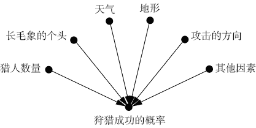

图 1.1 猎获猛犸象的已知影响因素

心理模型是展开想象的舞台。它允许我们通过局部修改来试验不同情景。例如，心理模型中可能有一个子程序评估猎人数量的影响。想增加猎人时，无需重新评估其他因素，只需把模型中的猎人=8 改为猎人=9，即可重新估计成功概率。这种模块性是因果模型的关键特征。

我并非说早期人类真的画出了这种图示。但当我们希望让计算机模拟人类思维，或试图解决陌生科学问题时，绘制清晰的点与箭头图示非常有用。这些因果图正是导言中所说的因果推理引擎的计算核心。

## 三种认知能力

到目前为止，叙述可能让人觉得我们把世界知识组织进因果网络的能力是整体且可一次性领悟的。事实上，我在机器学习的研究经历告诉我，因果学习者必须熟练掌握至少三种不同层级的认知能力：观察 `seeing`、行动 `doing` 与想象 `imagining`。

第一层是观察，即发现环境规律的能力。认知革命前，这种能力为许多动物和早期人类所共有。第二层是行动，涉及预测对环境刻意改变后的结果，并据此选择行为以产生预期结果。只有少数物种展现出这种特征。对工具的有意图使用可视为达到第二层的标志。然而，使用工具者不一定掌握工具的理论，即知道为何有效、无效时该如何调整。掌握这种理论需要登上想象层。第三层至关重要，它为农业与科学的更深层次革命做好准备，使人类对地球的改造能力发生质变。

我无法证明，但可在数学上证明这三个层级存在根本差异，每一级释放的力量是其下一级无法企及的。我用来证明的框架可追溯到人工智能先驱阿兰·图灵，他提出按可回答的问题对认知系统进行分类。在谈论因果论时，这一框架很有效，因为它绕开了什么是因果的漫长争论，聚焦于认知主体能做什么，以及拥有因果模型的主体能推算出无模型生物推算不出的东西。

图灵寻找的是二元分类，而我们的分类包含三个层级，对应逐级复杂的问题。借助这组标准，我们便能把问题组合成因果关系之梯，见图 1.2。这座梯子是本书的重要隐喻。

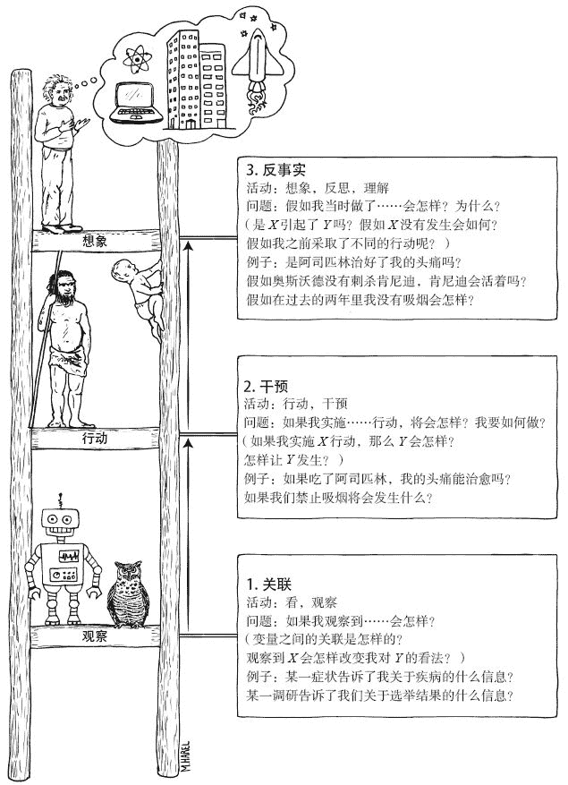

图 1.2 因果关系之梯的每一层都有代表性生物。大多数动物和当前的学习机器处于第一层，通过关联学习。像早期人类这样的工具使用者处于第二层，前提是有计划行动而非单纯模仿。我们也可通过实验学习干预效果，这大概也是婴儿获取大多数因果知识的方式。反事实学习者处于顶层，他们能想象不存在的世界并推测观察现象的原因

让我们详细审视每一层。第一层是关联，在此层我们通过观察寻找规律。一只猫头鹰看到老鼠活动，便推测老鼠下一刻可能的位置，它做的就是通过观察寻找规律。计算机围棋程序研究了数百万棋谱后，能计算出哪些走法胜算更高，它做的也是通过观察寻找规律。若一个事件改变了另一个事件被观察到的可能性，我们就说它们相关联。

第一层要求基于被动观察做出预测。典型问题是：如果我观察到……会怎样？例如百货公司销售经理会问：买牙膏的顾客同时买牙线的可能性有多大？这类问题正是统计学的立足点，统计学家通过收集和分析数据作答。在此例中，首先采集顾客购物行为数据，筛选出购买牙膏者，计算其中购买牙线的人数比例。该比例即条件概率，用符号写作 `P(牙线|牙膏)`，其中 `P` 代表概率，竖线意为在你观察到条件下。

为了缩小数据规模并确定变量关联，统计学家发展了许多复杂方法。本书会反复提到的一种典型度量是相关分析或回归分析，其操作是将一条直线拟合到数据点集中并确定斜率。有些关联有明显的因果解释，有些没有。但统计本身不能告诉我们牙膏或牙线哪个是因哪个是果。对销售经理而言，这可能并不重要——好的预测无须好的解释，就像猫头鹰不懂老鼠为何从 A 跑到 B，但这不影响它仍是好猎手。

## 因果关系之梯

把当今人工智能置于因果阶梯的最底层，与猫头鹰相提并论，对一些读者可能令人惊讶。近些年，我们几乎每天都在听闻机器学习的新进展和新成果——自动驾驶、无人驾驶、语言识别，尤其是近年来备受推崇的深度学习或深度神经网络。它们为何处于最底层？

深度学习的成果确实令人瞩目。然而，它的成功更多地告诉我们，过去被认为困难的问题或任务其实并不难，而没有解决真正的难题，这些难题仍阻碍类人智能机器的实现。于是公众误以为强人工智能指日可待，甚至已到来，事实远非如此。我完全赞同纽约大学神经系统科学家盖里·马库斯的观点，他最近在《纽约时报》写道：人工智能领域涌现大量微发现，这些或许是不错的新素材，但很遗憾机器仍与类人认知相去甚远。我在加州大学洛杉矶分校计算机科学系的同事阿德南·达尔维奇也发表过题为是人类水平的智能还是动物般的能力？的论文，恰如其分地回答了标题中的问题。强人工智能的目标是制造拥有类人智能的机器，让它们能与人类交流并指导探索。而深度学习只是赋予了机器高超的能力，而非智能。这种差异巨大，原因在于后者缺少现实模型。

与三十年前一样，当前的机器学习程序，包括应用深度神经网络的程序，几乎仍然完全在关联模式下运行。它们由一系列观察结果驱动，致力于拟合出一个函数，就像统计学家试图用点集拟合一条直线。深度神经网络增加了拟合函数复杂性的层次，但拟合过程仍由原始数据驱动。数据越多，拟合越精确，但该过程始终未能从我们提到的超进化加速中获益。例如，若自动驾驶汽车的设计者想让汽车在新情况下做出不同反应，他就必须明确在程序中添加这些新反应的描述代码。机器不会自己弄明白手里拿着威士忌的行人可能对鸣笛做出不同反应。处于因果阶梯最底层的任何运作系统都不可避免地缺乏这种灵活性和适应性。

当我们开始改变世界时，便迈上了因果阶梯的更高台阶。这一层级的典型问题是：如果我们把牙膏的价格翻倍，牙线的销售额会怎样？这类问题处于第二层级，提出并回答它要求我们掌握一种脱离于数据的新知识，即干预。

因果之梯：从观察到干预再到反事实

真正高级的能力不是关联，而是干预。被动地看到烟雾和主动去制造烟雾，虽然都指向“某处起火”，但二者对“起火”这一判断的可信度完全不在一个量级。数据再庞大、神经网络再深，只要全靠被动收集的信息，就无法回答干预类问题。统计学里学到的任何技巧，都难以把“如果价格翻倍会怎样”这样简单的问题表述清楚，更别说给出答案。正因如此，很多科学家会感到挫败，而我之所以能清楚这点，是因为曾多次陪他们往因果关系之梯上爬。

为什么光靠观察就解不开牙膏定价的问题？直接去翻那堆有历史购买记录的大数据库，看涨价时发生了什么，看似可行。实际上过去的涨价往往源于完全不同的动因，比如供不应求、连锁反应导致同行被迫跟涨。此时我们关心的并非市场行情怎样，而是刻意把价格设上去会带来什么后果。过去消费者买不到便宜货时的行为，和我们主动设价后的反应，很可能截然不同。有历史数据也许能更好预测，但你需要什么样的数据？关系如何厘清？这正是因果推断要处理的难题。

预测干预结果最直接的办法是做受控实验。像脸书这样的数据巨头深谙实验之力，日常就在测试商品排序、付款期限甚至不同价格对用户行为的影响。

更有趣的是，即便不做实验，有时也能推断干预效果。销售经理可以先搭建一个包含市场条件的消费者行为模型。即便无法采集全部因素，只要抓住关键替代变量，依然能做预测。一个足够强健的因果模型，能让第一层级的关联数据回答第二层级的干预问题。没有因果模型，就跨不过这一层。深度学习系统若只吃第一层级数据、不借助因果结构，就永远回答不了干预问题，因为干预的本质就是打破训练时的环境规则。

因果关系之梯第二层级的典型问法是：“如果我们采取……行动，会怎样？”也就是改变环境会发生什么。我们记作 `P（牙线 |do（牙膏））`：在对牙膏重新定价后，牙线在某一价位被销售的概率是多少？

同层级的另一热点是“怎么做？”例如仓库积压了太多牙膏，经理会问怎样才能卖掉它们，应该定什么价。这同样是干预前在脑中做预演，需要因果模型支撑。

日常里我们无时不在干预，只是很少用这个词。吃阿司匹林试图止头痛，就是在改变体内阿司匹林量以影响头痛状态。若关于阿司匹林的因果知识正确，结果变量就会从“头痛”变为“不痛”。

干预推理虽重要，却覆盖不全我们关心的问题。现在头不痛了，为什么？是因为阿司匹林、食物，还是好消息？这些追问把我们带到因果之梯的顶层——反事实。因为必须假想过去被改写，问“假如我没吃阿司匹林会怎样？”。没有哪个实验能撤销已进行的治疗并做对比，于是需要全新知识。

反事实与数据关系格外别扭，数据说到底是事实，无法告诉虚构世界会怎样，而人类思维却能可靠地进行这种解释性推断。夏娃说“蛇欺骗了我”就是在做因果反事实，这正是区分人类智能与动物、与盲目人工智能的关键。

怀疑科学能否对“如果”做有效陈述并不成立。科学一直这么做。胡克定律就可以看作反事实断言：“在弹性限度内，假如砝码重量加倍，弹簧伸长也会加倍。”它源自无数实验的第二层级证据，一旦成为定律，就被理解为支配特定弹簧的函数关系。所有砝码重量为`x`磅，弹簧长度为`L[x]`英寸的世界^([\[1\]](#part0006.html#note1n))^([\[2\]](#part0006.html#note2n))都被视为客观可知，哪怕只有其一真实。

回到牙膏例子，最高层问题是：“假如我们把牙膏价格提高一倍，之前已购买的顾客是否仍会选择购买？”这里把真实世界与虚构世界对比。

因果模型能回答此类反事实，回报巨大：找到出错原因才能改进；找到疗效差异原因才能研发新疗法；“如果当时不同会怎样”让我们从历史和他人经验中学习，这是其他物种做不到的。难怪德谟克利特说：“宁揭一因，胜为波斯王。”

把反事实置于梯顶，足见其是人类意识演化的关键。我赞同尤瓦尔·赫拉利的观点，对虚构物的描述体现认知革命。代表作是狮人雕塑，现藏德国乌尔姆博物馆，出土于施塔德尔洞穴。它是用长毛象象牙雕成的半人半狮怪兽，距今约4万年。

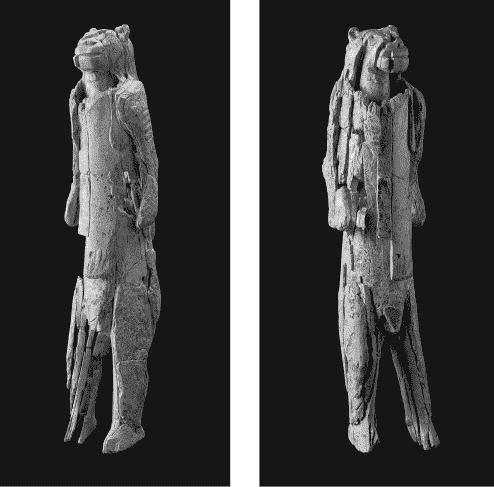
图1.3 施塔德尔洞穴的狮人雕塑。是目前所知最古老的虚构生物雕作，半人半狮的形象标志着人类反事实推理能力的出现（图片由伊冯·米勒斯拍摄，乌尔姆国家文化遗产处巴登—符腾堡/乌尔姆博物馆提供）

我们不知谁雕刻它、为何雕刻，但可以确定是解剖学意义上的现代人类所造，突破了此前珠子、长笛、矛头或动物雕刻等具象艺术。人类由此获得想象从未存在之物的能力。显微镜、飞机、计算机在实体出现前都先存在于想象。

这一认知飞跃意义深远。狮人诞生后的1万年间，除地理隔绝的弗洛雷斯人外，其他原始人种皆灭绝。人类以想象力改变自然，获得灵活性、反思力和对过往行为负责的意愿。反事实推理一直造福我们。

如图所示，因果之梯第三层典型问题是“假如我当时做了……会怎样？”和“为什么？”，都涉及观察世界与反事实世界的比较。仅靠干预实验无法回答。若第一层对应观察世界，第二层对应可观察的新世界，第三层对应的是不可观察的世界。弥合差距需要构建解释因果过程的模型，即理论或自然法则。掌握法则后还能有选择地违背它们，创造与现实相对的世界。

迷你图灵测试

1950年，图灵提出问题：计算机若像人一样思考意味着什么？他提出模仿游戏，后称图灵测试。若普通人通过打字机与计算机交流，无法分辨对方是人或机，则可视为思维机器。图灵认为50年后程序能在5分钟提问后以低于70%的正确率被识破。

实际偏差明显。每年的勒布纳人工智能大赛评选仿人聊天机器人，奖金10万美元。但截至2015年已办25届，仍无程序能骗过全部4名评委，甚至一半都不到。

图灵还给出策略：与其模拟成人思维，不如模拟儿童思维，然后像教小孩一样教它。他说儿童大脑像空白笔记本，预设机制极少。这一点他错了，儿童大脑已有丰富预设。

我认为图灵部分正确：在造出类人智能前，我们可能造不出孩童智能，而关键在于因果关系。

机器如何获得因果知识？目前仍是难题，涉及主动实验、被动观察和程序员输入的复杂组合，与儿童从进化、父母、同龄人获得输入相似。

可先问更简单的问题：机器与人如何表示因果知识，才能迅速获信息、正确作答、像三岁孩童一样得心应手？这正是本书要回答的核心。

我称之为迷你图灵测试。选择一个简单故事编码输入机器，检验其能否回答人类能回答的因果问题。称其迷你因一是只考因果推理，不涉及视觉、自然语言等；二是允许以任意便利方式编码故事，无需机器自行构建。

在准备迷你测试时，表示优先于获取。若无表示方法，就无法存储信息。即使机器人可随意操控环境，也无法记住学到的信息，除非有模板编码操作结果。人工智能对认知研究的主要贡献是确立“表示第一，获取第二”的范式。

有人说迷你测试易被作弊：列出所有可能问题并预存答案即可。但作弊不可能。假设有10个因果变量，每个取0或1，可能问题的数量迅速攀升至约3000万。若变量更多、取值更多，数量会超出想象，远超宇宙原子数。简单答案表永远无法模拟儿童智能。

人类大脑必有简洁表示与高效程序，能正确解释问题并提取答案。要通过迷你测试，机器需要同样高效的表示和算法。

这种表示存在且简洁，就是因果图。我们此前见过长毛象狩猎因素的图例。点与箭头交流知识很自然，我相信大脑使用类似表示。更重要的是，它能通过迷你测试，这是目前其他模型做不到的。

如图1.4，假设囚犯将被行刑队处决。法院下令后，命令传至队长，再指示士兵`A`和`B`射击。只要其中一人开枪，囚犯必死。

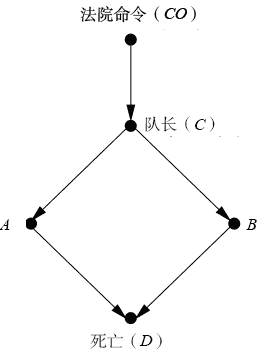
图1.4 行刑队例子的因果图，`A`与`B`代表两名士兵的行为

图中每个变量均为真/假。`D=真`为犯人已死，`CO=假`为法院未签发死刑令，以此类推。

借助此图可回答不同层级问题。关联问题如：犯人死了是否意味着法院已下令？追踪箭头可得，若无队长命令士兵不会射击，若队长未接到法院命令也不会下令，故答案肯定。另一问题：若发现士兵`A`射击，对`B`说明什么？追踪箭头可知`B`必定也射击，因`A`射击说明队长发令，`B`收到相同命令。

往上到干预问题。若士兵`A`决定不待命令自行射击，会怎样？犯人是否死亡？这涉及规则矛盾。若只按逻辑判断则无意义。让计算机理解因果，需教会它打破规则，区分“观察到”和“使发生”。方法是：当要使某事发生时，删除指向该变量的所有箭头，再按逻辑分析，如同箭头从未存在。对此例，需删除指向`A`的箭头并手动设为真。这种外科手术的原理简单：使某事发生即将其从其他影响中解放，只受强制因子的影响。

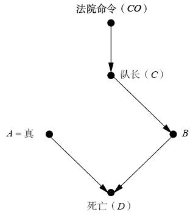
图1.5 干预的因果推理，士兵`A`自行决定射击，`C`到`A`的箭头被删除且`A`被设为真

干预必然导致死亡，这就是箭头`A`到`D`的因果作用。结论与直觉一致，因手术未改动`A`到`D`的箭头。也可判断`B`极可能未开枪，`A`的决定不影响模型中不受其影响的变量。

需强调，看到`A`射击可推断`B`也射击，但若`A`自行决定或被强制射击，则相反结论成立。这就是观察与干预的差异。只有掌握二者区别的计算机才能通过迷你图灵测试。

仅靠大数据无法登上因果之梯回答上述问题。若记者只记录处决结果，数据永远是5个变量全真或全假。没有“谁听从谁”的知识，这种数据连机器学习也无法预测“说服枪手`A`不开枪”的后果。

要把因果阶梯的第三层讲清楚，最直接的方式是抛一个反事实的假设。把行刑队的场景固定下来：犯人已经倒地身亡。基于第一层级的观察知识，我们可以推出 A 开了枪、B 开了枪、队长下达了指令、法院做出了判决。但如果 A 当时选择扣下扳机，犯人还能活吗？这就必须把真实世界和一个与之冲突的虚构世界并排比较。在那个虚构世界里，指向 A 的箭头被拿掉，A 和 C 的服从关系也被切断。我们把 A 的取值强制设为假，同时让 A 行动之前所有其他变量都保持原状。于是得到如图 1.6 所示的那副画面。

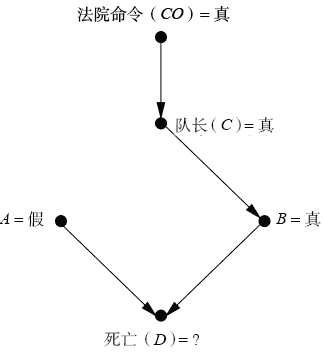
图 1.6 反事实推理（我们观察到犯人已死，据此，我们提出这样一个问题：假如士兵 A 决定不射击，会发生什么？）

要过迷你图灵测试，机器就必须得出同样结论：在那个虚构世界里犯人仍然会死，因为 B 会补枪。所以 A 的临时良心发现救不了任何人。这恰好解释了为什么要有行刑队：它既确保了法院命令的落实，也为每个具体枪手卸下了部分道德负担，枪手可以自我辩解说并非自己的行为导致了死亡，因为“横竖都会死”。

看起来这像是在大费周章回答一个显而易见的问题，我也认同这种感觉。对人类来说因果推理很顺手，因为我们从三岁开始就长着一副专门处理因果的大脑。迷你图灵问题的意义正是让机器学会人类式的因果推断。而从三个例子可以看出，人类教会机器的关键不是遵守逻辑，而是学会有选择地打破逻辑。计算机不擅长破规矩，这正是孩子的强项。连穴居人都会随意拼贴狮身人面，只因他们天生懂得什么可以拆解重组。

当然，别被人类自豪感冲昏头。很多情境下我们找对因果也并不轻松。变量一旦变多、变量不再是简单的真假二元，到日常预测就更困难。比如我们更关心的是，政府把最低工资抬高后失业率会上升几个点，而不是犯人死不死。这种定量因果远超出直觉。行刑队的例子本身也做了大量简化，现实中队长可能在 A 决定后才下令，B 的枪可能卡壳等等。要处理这些不确定，就必须知道异常事件发生的概率。

概率的重要性在天花疫苗的争议里体现得淋漓尽致。欧洲首次大规模推广天花疫苗时，外界出现了奇怪的数据：看上去死于疫苗的不良反应的人比死于天花的人还多。于是有人据此呼吁停打疫苗，完全忽略了疫苗最终根除了天花拯救了无数生命的事实。为了把争论拆开，我们看一组虚拟数据。

假设有一百万儿童，99% 接种，1% 未接种。接种儿童有 1% 会出现不良反应，不良反应里有 1% 会致死，且接种儿童不可能得天花。未接种儿童不会出现接种不良反应，但有 2% 的概率感染天花，天花致死率是 20%。

乍看之下你可能会点头赞成接种，因为不良反应致死的概率小于得天花致死的概率，而且天花更危险。再算清楚一点：99 万接种儿童里，9900 人出现不良反应，99 人因此死亡。1 万未接种儿童里，200 人感染天花，40 人死于天花。这样，疫苗相关死亡 99 人，超过了天花死亡 40 人。

于是举着“疫苗杀人”标语去卫生部门抗议的家长是可以理解的，数据表面上确实支持他们。那逻辑站在哪一边？该禁止疫苗还是把挽救的生命算进去？图 1.7 给出了这个案例的因果图。

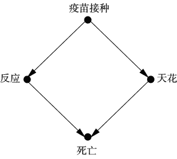
图 1.7 疫苗接种示例的因果图。疫苗接种是有益还是有害？

我们已经提到接种率是 99%。现在问一个反事实：如果把接种率设到零会怎样？用上面的概率算，百万儿童里会有 2 万人得天花，4000 人死亡。把反事实世界和现实世界对比，真正的结论就出来了：不接种会让社会多付出 3861 个儿童的生命，4000 减去现实里的 139 人。反事实的语言正是让我们避开这场灾难的关键。

对学因果论的学生来说，最重要的领悟是：画因果图不只是连箭头，箭头背后藏着概率规则。每当我们从 X 画箭头到 Y，我们就默认存在一条规则说明 X 改变时 Y 如何变化。有时这条规则可以直接写出，更多时候只能靠数据估计。好在因果革命最迷人的地方在于，很多时候我们不必纠结数学细节，因果图的拓扑结构本身就足以推断各种因果和反事实关系，无论是确定的还是概率的，线性的还是非线性的。

从计算角度看，让机器通过迷你图灵测试的方案也很优雅。三个例子都用同一套程序：把故事转成因果图，读懂问题，对干预或反事实问题做相应的“手术”，然后在修改后的模型上计算答案。换故事不需要重新训练，只要能画出图就能处理，无论是长毛象狩猎、行刑队还是疫苗接种。这正是人类因果推断的灵活性。

因果图本身并无魔力，它好用是因为在建图时我们会问“谁能直接导致死亡”“疫苗的直接效应是什么”。如果只是为关联而建图，图就不会给出因果答案。就像图 1.7，如果把疫苗接种到天花的箭头反过来，数据关联依然吻合，但会错误地得出“得天花影响接种意愿”的结论。

### 论概率与因果关系
对我和大部分哲学家、科学家来说，“因果不能被简化为概率”这个认识来得不易。从休谟、密尔到赖欣巴哈、萨普斯，再到卡特赖特、斯普恩、希区柯克，讨论从未停歇。特别是从赖欣巴哈开始，哲学家常用“概率提高”定义因果：如果 X 提高了 Y 的概率，就说 X 导致 Y。

这种直觉根深蒂固，我们会说鲁莽驾驶增加了事故概率，懒惰增加了挂科概率。于是人们期待概率提高能连接因果阶梯的第一层和第二层。但失败的根源在于形式化方式几乎都用条件概率 P(Y|X) > P(Y) 来表达“提高”。这其实是错的，因为“提高”是因果概念，而公式只描述观察。观察到的概率提高可能来自 Y 是 X 的结果，也可能来自共同原因 Z，这正是症结。

用 P(Y|X) 表示的概率属于第一层，单靠它回答不了第二、三层的问题。任何试图仅用第一层概念定义因果的尝试都会失败。这也是我不定义因果的原因，定义追求还原，而还原会把我们拉回更低层。我更关心如何回答因果问题，需要什么信息，就像几何学不用定义点和线，却能用公理回答一切问题。

再看概率提高准则的困境。混杂因子让哲学家最头疼。若按字面理解，冰淇淋热销月份犯罪率也提高，我们就得出冰淇淋导致犯罪。实际上是夏天温度升高同时推高了两者。哲学家于是引入背景因子 K，改写为 P(Y|X,K=k) > P(Y|K=k)。把温度固定后，冰淇淋和犯罪的残余关联就消失了。

但谁该进入 K 集合，没有通用答案。因为混杂本身是因果概念，很难纯概率表达。1983 年卡特赖特引入因果要素，她提出把所有与结果有因果联系的因子都作为条件。这实质上借用了第二层的概念，放弃了纯概率定义。进步虽大，却被批评为“用因定义因”。

概率因果论总在混杂这块暗礁上搁浅。每一次修补船体，船都撞上同一块石头。条件概率的语言歪曲了“概率提高”，再多补丁也上不了更高阶梯。概率提高不能只用概率表示。

拯救它的正确方法是引入 do 算子：如果 P(Y|do(X)) > P(Y)，则 X 导致 Y。因为干预是第二层概念，这个定义才具备因果解释，也能借助因果图进行概率计算。有了图和数据，我们就能算法化地回答 X 是否是 Y 的因。

我很欣赏哲学家对因果、归纳、科学推断的讨论，他们远离统计反因果偏见，呼吁回归亚里士多德式的因果思想。但在数学化过程中，他们过早只用概率这一种不确定性语言。过去十年都在纠正这个错误，可即便现在仍有人以格兰杰因果之名重蹈覆辙。

我也曾犯同样错误。80 年代初我进入人工智能研究，坚信不确定性是关键，且必须用概率表达。于是我创建了贝叶斯网络，用来模拟大脑如何把概率纳入决策。它迅速流行，成为不确定推理的主导范式。

但成功并未弥合人机差距。缺失的正是因果。箭头总是因到果，研究者也常发现反转箭头后系统失控，却把它当成文化惯性。那时我陶醉于概率力量，认为因果只是方便的心理速记。1988 年的《智能系统中的概率推理》里我写道“因果关系是一种谈论关联结构的语言”，现在读来尴尬。书出版时我心里已知道错了。

贝叶斯网络在关联世界里很好用，却无法自动升到第二、三层。好在两次修正就够了。1991 年的图手术让网络能处理干预信息，1994 年的修正让它能应对反事实。概率编码静态信念，因果论则告诉我们世界被改变时，无论是干预还是想象，概率会不会变、怎么变。

# 第二章 从海盗到豚鼠：因果推断的起源

但它（地球）仍在动。

——出自伽利略（1564—1642）

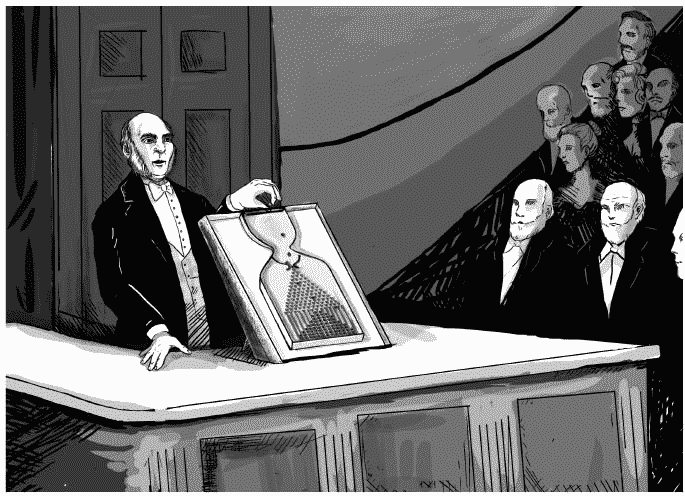
弗朗西斯·高尔顿爵士在皇家学院展示他的“高尔顿板”或称“梅花机”。他把这种弹珠台看作基因特征如身高的遗传类比。弹球堆积形成的钟形曲线与人类身高的分布惊人相似。为什么身高一代一代传下来分布不会像弹球那样散开？这个疑问引领他发现了“向均值回归”现象。

近两个世纪以来，英国科学界最持久的仪式之一就是伦敦皇家学院的周五晚间演讲。19 世纪许多重大发现都在这里首次公布：1839 年法拉第发表摄影原理，1897 年汤姆逊提出电子理论，1904 年杜瓦公布氢液化理论。

弹珠里的钟形谜题：为什么回归不等于因果

皇家研究院的晚间讲座向来带着浓厚的仪式感，科学被摆成一场上流社会的观剧，台下坐的都是燕尾服加黑领结的英国精英。正点钟声响起，主讲人入场，惯例里自我介绍和开场白都被省掉，演示才是整晚的高潮。

1877年2月9日的讲者是弗朗西斯·Galton，皇家院士，达尔文的远亲，非洲探险老手、指纹学的开创者，典型的维多利亚绅士科学家。那晚的题目是“典型的遗传规律”。他拎来的装置看上去像件玩具，自称梅花机，后来大家更习惯叫高尔顿板。电视游戏《价格猜猜看》里的Plinko就是它的民用版。核心是一块木板，钉子按三角形排布，顶部投入口掉进小钢珠，珠子一路左弹右撞滚到底部的一排槽口。单颗轨迹看上去全靠运气，但当大量钢珠一起倒入，底部堆起的轮廓却稳稳呈现钟形，中间槽最满，向两边单调递减。

这条曲线能用数学讲清楚。每颗珠的路径相当于一串独立的硬币投掷，每碰一根钉就左一步或右一步，最终落点由左右次数的差决定。1810年皮埃尔-西蒙·拉普拉斯证明的中心极限定理^([\[1\]](#part0007.html#note1n))说明，任何由大量独立随机叠加构成的过程，最终都会收敛到正态分布，也叫钟形曲线^([\[2\]](#part0007.html#note2n))。高尔顿板就是该定理最直观的教具。

对19世纪而言，这简直是数学的奇迹。单颗不可预测，千颗的集体形态却极其稳定。《价格猜猜看》的制作方就能靠此估算长期奖金池，保险业也是同理，人世的偶然在足够大的样本下变得可算。

台下的听众自然要追问，这和遗传有什么关系。Galton掏出法国新兵的身高记录，分布同样钟形：中等身材占多数，极端高矮者稀少。1000名新兵的身高图，和1000颗钢珠的落点图，数字模式几乎重合。

在他眼里，梅花机就是身高乃至其他性状遗传的因果类比。就像人会把身高传给下一代，珠子也在板上“继承”自己的落位。

矛盾马上出现。钟形的宽度取决于钉子的层数。若把层数翻倍来模拟两代，上半段是第一代，下半段是第二代，第二代的离散度会更大，后续世代钟形只会越扩越大。但现实中人类的身高分布宽度几乎恒定，上个世纪没有9英尺^([\[3\]](#part0007.html#note3n))的人，如今依旧没有。是什么在稳定整体？从1869年《世袭的天才》（`Hereditary Genius`）出版起，他为此苦想了八年。

他真正关心的其实是智力。作为科学世家子弟，他想证明天赋会家传。那本书里他梳理了605位英国名流四百年家谱，结果发现名人的子女和父母未必同样出色，祖孙也未必都卓越。今天回看，研究设计有明显漏洞：卓越怎么定义？特权是否被当成才能？即便意识到这一点，他仍执着于遗传学解释。

转向身高这类可量化特征后，他捕捉到一个现象。高个子男性的儿子通常高于平均，但往往不及父亲；矮个子男性的儿子通常低于平均，但也往往比父亲高一点。他先叫它复归，后改称向均值回归^([\[4\]](#part0007.html#note4n))。同类例子随处可见：用同一复习资料做两次标准化测试，第一次高分的第二次仍高但回落；棒球里首季炸裂的年度新秀常在次年撞上新秀墙。Galton以为自己摸到一条遗传规律，实则是一条统计规律，背后必须有因。

在皇家学院的演讲里，他用双层梅花机演示。

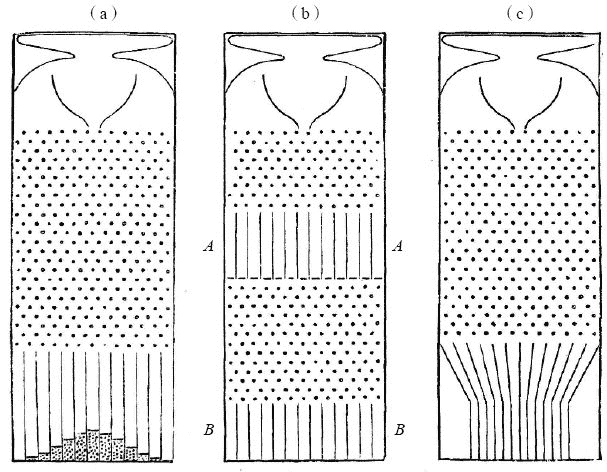
图 2.1 高尔顿板，弗朗西斯·高尔顿用以类比人类的身高遗传规律。（a）将许多小球扔进弹球仪器，随机向下弹跳的小球堆积成钟形曲线。（b）高尔顿指出，经过`A`和`B`两个通道，通过两层的高尔顿板（用以模拟两代人）下落的小球所堆积成的钟形曲线会变得更宽。（c）为了抵消这种曲线变宽的趋势，他安装了斜槽，以使“第二代”小球回到中心。斜槽是高尔顿对“向均值回归”这一现象的因果解释（资料来源：弗朗西斯·高尔顿《自然遗传》，1889）

第一组钉阵之后，钢珠经斜槽向中心聚拢，再进入第二组钉阵。演示很成功，斜槽恰好抵消了正态扩散，代代相传时钟形宽度保持不变。

于是他推断，回归是一种物理过程，能让身高或智力的分布代际稳定。他说复归符合遗传变异的一般规律，并拿胡克定律里弹簧回稳来类比。

请记住年份，是1877。Galton想给出因果解释，把回归当成自然法则。他错了，而且这种错至今仍在。棒球评论员总给新秀墙找原因：过度自信、对手摸透了。也许成立，但不必上升到因果，概率本身就够解释。如丹尼尔·卡尼曼在《思考，快与慢》里总结的：“`成功=天赋+运气`，`巨大的成功=更多的天赋+更多的运气`。”拿下最佳新秀的球员可能更有才，也更走运；下季运气均值化，平均表现自然回落。

到1889年，他想通了。这是统计学摆脱因果依赖的第一次真正跨步，既让人失望也令人着迷。他开始收集大量人体测量：身高、前臂长、头长、头宽等。用前臂长估算身高时同样的回缩出现：高个子前臂通常偏长，但幅度不及身高。显然身高不是前臂长的因，反之亦然，二者更像是受共同因素驱动。他开始用co-related，后简化为correlated。

更惊人的是时间顺序可以倒过来。在代际比较里，子代向均值回缩的同时，父代在逆向时间里也会回缩。儿子身高高于平均，父亲很可能也高，但通常父亲略矮于儿子。若放弃因果，这就自洽。

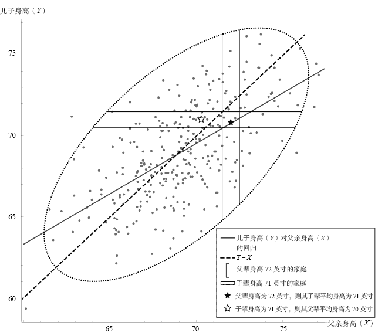
图 2.2 散点图显示了有关身高的数据集，每个点代表的是父亲的身高（`x`轴）和他儿子的身高（`y`轴）的组合。虚线与椭圆的主轴重合，而实线（我们称其为回归线）连接了椭圆最右边和最左边的点。二者之间的差异就是向均值回归的体现。例如，椭圆中的黑色星号显示，父辈身高为 72 英寸，则其子辈平均身高为 71 英寸，即图中垂直框中所有数据点的平均值为 71 英寸。水平框和白色星号显示的是在非因果方向（时间逆转方向）存在同样的身高损失现象（资料来源：马雅·哈雷尔绘图，克里斯托弗·布歇供稿）

初听矛盾：高个子父亲往往有比他矮的儿子，同时高个子儿子往往有比他矮的父亲。关键在于讨论的是整体而不是个体。所有父亲6英尺的群体，其儿子均值约5英尺11英寸。但所有儿子5英尺11英寸的群体，其父亲均值会更低，再现回缩。

散点图把关系画清楚。每对父子是一个点，中心附近约(69,69)。数据呈椭圆。取父亲72英寸的垂直切片，子代均值约71；取子代71英寸的水平切片，父代均值约70.3。由此得到回归线，Galton发现预测总落在一条斜率小于椭圆主轴的直线上。这类线有两条，取决于以哪个变量作证据。预测方向是对称的，表明在此问题上因果无差别。

已知一个变量时，回归斜率给出另一个变量的最佳估计。父子身高斜率约0.5意味着父亲每高1英寸，儿子均值只增0.5英寸。斜率1代表完全传递，斜率0等同随机猜测。斜率不能大于1，否则分布会随世代变宽，最终会出现9英尺人与2英尺人，这与现实不符。所以只要分布稳定，回归斜率必须小于1。

即使关联的是不同量如身高与智力，只要坐标缩放得当，最佳拟合线的斜率仍有相同性质：可精确预测时斜率趋近1，几乎无法预测时趋近0。因果方向不影响预测能力。

Galton的相关概念首次以客观度量描述变量间的关联，不依赖主观判断。卡尔·皮尔逊后来推导出斜率公式并命名为相关系数。此后统计学家算得最多的就是这个数。Galton和皮尔逊为此激动，尤其是皮尔逊，他认为与相关系数相比，因果的模糊说法已过时。

高尔顿与被搁置的探索

从寻找因果出发最终发现不依赖因果的相关，这颇具讽刺。他仍留有因果痕迹。1889年他写道：“很容易看出，（两个器官尺寸之间的）相关性一定是这两个器官共同变异的结果，而变异部分地归于相同的原因。”

被相关性牺牲的第一个概念正是梅花机。它本为解释总体遗传稳定性而造，却需要斜槽来人工抑制变异。史学家斯蒂芬·施蒂格勒指出转向很明显：“悄然消失的是达尔文、斜槽和所有的‘适者生存’……极具讽刺意味的是，Galton想把《物种起源》数学化的初衷最终导向了他对这部伟大著作精髓的抛弃！”

在当下因果推断语境里，最初的问题仍在：按达尔文学说变异可遗传，为何总体稳定？

用因果图审视梅花机就会发现设计错误。让Galton不得不加装反向力的扩散力本就不该存在。追踪一颗珠从一层到下一层，其位移继承了沿途所有钉子带来的累积变化。这与卡尼曼方程冲突：

`成功=天赋+运气`  
`巨大的成功=更多的天赋+更多的运气`

按此，第二代成功不会继承第一代运气。运气按定义只影响当下，不会传给后代。而梅花机恰好把运气累积了。

对比两种因果图。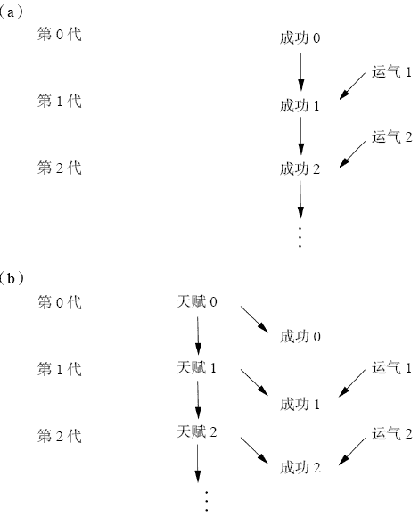
图 2.4 关于遗传的两种模型。（a）高尔顿板模型，在这种模型下，运气世代相传，这就导致成功的分布不断变宽。（b）遗传模型，在这种模型下，运气不会累积，这就导致成功在代际间的稳定分布

第一种适合财富等可累积量，第二种才适合身高这类生物性状。只有可遗传成分如天赋被传递，运气独立作用于每代。两种模型都兼容钟形分布，但只有第二种能解释代际稳定性。这种稳定性后来的名字是哈代-温伯格平衡，由戈弗雷·哈罗德·哈代和威廉·温伯格于1908年提出，其工具是另一个因果模型——孟德尔遗传。

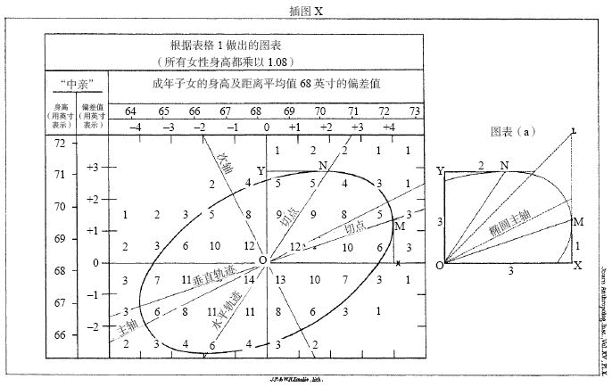
图 2.3 高尔顿回归直线。图中横轴显示的是子辈身高及偏差值，纵轴显示了“中亲”（`mid-parents`）^([\[5\]](#part0007.html#note5n))的身高及偏差值。如果你知道父亲的身高，则直线`OM`将为你提供其儿子身高的最佳预测；如果你知道儿子的身高，则直线`ON`将为你提供其父亲身高的最佳预测。这两条直线都不同于散点图中的主轴（对称轴）（资料来源：弗朗西斯·高尔顿，《大不列颠和爱尔兰人类学学院学报》，1886，第 246–263 页，插图 X）

错过的因果图

回头看，高尔顿绝无可能预知孟德尔、哈代与温伯格之后的贡献。1877 年的那次演讲时，孟德尔1866 年的发现早已沉寂，要到1900 年才被重新发掘；哈代温伯格证明里用的数学工具，在高尔顿在世时很可能超出他的理解边界。耐人寻味的是，他实际上只差一步就能抓住真正的理论框架，一张因果图就能把原假设里“运气可以继承”的漏洞暴露出来。可惜他被自己精致却有瑕疵的因果模型牵住，反倒沉迷于相关之美，并由此认定科学不再需要因果。

对于这段往事，我得先承认做了历史写作的大忌，也是本书反复出现的毛病。1960 年代起，以当代科学眼光重写过去的做法已被嘲讽。辉格史观专指这种马后炮写法，只谈成功的理论与实验，对失败尝试与僵局只字不提。近现代史学写作更讲平等，会把化学家与炼金师放在同一语境，强调回到当事人所处的时代与社会背景去理解。

不过要解释因果为何被统计学挤出，我就甘愿戴上辉格史学家的帽子。要弄清统计学如何变成模型盲、把数据简化当成主业，就只能拿起因果透镜，用新的因果科学重新讲述高尔顿与皮尔逊的故事，别无他法。正因如此，我才试图纠正主流科学史家叙述中的偏差。他们缺少因果词汇，对相关发明惊叹，却没看到随之而来的灾难——因果的死亡。

## 皮尔逊：把因果逐出统计的狂热者

把因果彻底从统计里清理出去的任务，落到高尔顿的学生卡尔·皮尔逊肩上。即便如此，他也没能做到彻底。

皮尔逊一生最关键的转折，是阅读高尔顿的《自然遗传》。1934 年他写道，自己当时感觉像德雷克时代的海盗，或者字典里说的“不完全是海盗，但无疑有当海盗的倾向”。他以为高尔顿的意思是相关性是一个比因果更宽泛的范畴，因果只是其中的特例。正是这项新概念把心理学、人类学、医学、社会学都推向数学化。他说高尔顿把他从一个偏见里拽出来——可靠的数学工具只能用在因果解释上的偏见。

在皮尔逊看来，因果被压缩成相关的一个极端情境，即相关系数为1或-1、变量x与y关系确定的那种。在《科学语法》1892年版里，他说得很直白：某个事件序列在过去发生过并重复出现，只是经验问题，因果概念只是对它的表述。科学既不能证明该序列有内在必然性，也不能保证它必定重现。所以因果在他那里只是重复，在确定性意义上永远无法证实。至于不确定世界里的因果，他更是嗤之以鼻：对两件事物关系的终极科学表述，最终都可以归结成一张列联表^([\[6\]](#part0007.html#note6n))。换句话说，数据就是全部。干预与反事实在这里没有位置，因果阶梯的最底层已足够科学家开展研究。

从高尔顿到皮尔逊的跃迁惊人，配得上海盗之名。高尔顿只证明了均值回归的现象，根本不需要因果解释。而皮尔逊却要把因果从科学里连根拔掉。是什么推动了他？

史学家泰德·波特在传记《卡尔·皮尔逊》里认为，这种怀疑在皮尔逊读高尔顿之前就已存在。他一直想解决物理学的哲学基础，曾写过“力作为运动的原因，与树神作为生长的原因可以相提并论”。更宏观地看，皮尔逊属于实证主义学派，认为世界是人类思想的产物，科学只是对这些思想的描述。因果被看作人类大脑之外的客观过程，没有科学意义；有意义的思想只能反映观察中可辨的模式，而这些模式完全可以用相关性描述出来。他认定相关性是比因果更通用的思维符号，于是做好了抛弃因果的准备。

波特把皮尔逊描绘成自称的“Schwärmer”，德语里可译作爱好者，也可理解为狂热分子。1879年他从剑桥毕业，在德国待了一年，迷上德国文化，把名字Carl改成Karl。成名前他就是社会主义者，1881年写信给卡尔·马克思，主动提出把《资本论》译成英文。他也是英格兰最早的女权主义者之一，在伦敦创办了“男女俱乐部”讨论女性议题，主张为女性的劳动支付合理报酬。他对各种思想充满热情，同时对自己的热情保持清醒。劝说后来的妻子玛丽·夏普结婚，他花了近半年时间。从他们的书信可看出，玛丽很担心自己达不到他对伴侣智力的理想。

读到高尔顿的相关性后，皮尔逊找到了激情的锚点：一个他相信能改变整个科学世界、把数学严谨性带入生物学与心理学的绝妙想法。他带着海盗般的使命感去完成。第一篇统计学论文发表于1893年，高尔顿发现相关性四年后。1901年他创办《生物统计学》Biometrika，到现在仍是顶尖统计期刊——颇具讽刺的是，正是这本期刊于1995年刊载了我关于因果图的首篇完整论文。1903年，他靠服装工会拨款在伦敦大学学院创办计量生物学实验室。1911年高尔顿去世，同年实验室成为学院正式院系，高尔顿的遗赠设立了教授席位，遗嘱规定首任教授必须是皮尔逊。此后至少二十年，实验室是统计学世界的中心。

拿到教席后，皮尔逊的狂热愈发明显。波特写道，他的统计运动带有明显的派系斗争色彩，要求同事百分之百忠诚，曾把异见者赶出他建立的计量生物学“教会”。最早追随他的助手乔治·乌德尼·尤尔也是最先感受到他狂热与愤怒的人。1936年，尤尔为皇家学会写的讣告措辞温和，却明确写出了那些年的精神折磨：热情的感染力虽可贵，但强势甚至过度热心的帮助都伤人；支配欲和偏执也体现在编辑《生物统计学》的过程中，该刊几乎是有史以来最能体现编辑个人倾向的学术期刊。离开团队独立研究的人指出，一旦观点分歧，保持友好就很困难，批评更不可能。

即便如此强势，皮尔逊舍弃因果建起的科学大厦仍出现裂痕。有时裂痕在他自己手里比在门徒手里更多。比如他本人也写过几篇关于“伪相关”的文章，而这本是个离不开因果的概念。

皮尔逊注意到，找出看似荒谬的相关很简单。后世常举的例子是，人均巧克力消费量与诺贝尔奖得主人数高度相关。吃巧克力显然不导致得奖，更合理的解释是富裕的西方国家既吃得多巧克力，也更常产生诺贝尔奖。这是一种因果解释，对皮尔逊却不是必需。对他而言，因果只是“现代科学里一些深奥难解事物的迷信”，相关才是理解的目标。但这让他陷入尴尬：为何一个相关有意义，另一个就是伪相关。他说真正的相关能表明变量间“有机关系”，伪相关不能。而什么是有机关系，这不就是因果的另一个名字吗？

皮尔逊和尤尔收集了多个伪相关的例子。一类是混杂，巧克力—诺贝尔就是典型，经济与地理是共同原因。另一类出现在时间序列。例如尤尔发现英国某年死亡率与由国教主持的婚礼在婚礼总数中的比例相关高达0.95。这说明上帝惩罚信徒吗？不，只是两条独立的历史趋势同向：死亡率在下降，国教成员也在下降，同时下降就产生了正相关，并无因果。

1899年，皮尔逊发现一种更耐人寻味的伪相关：把两个异质总体合并就会产生伪相关。像高尔顿一样，他痴迷收集人体数据，拿到巴黎地下墓穴的806块男性颅骨和340块女性颅骨的测量。单独看男性或女性，颅骨长度与宽度的相关几乎为零。但合并两组后，相关系数变成0.197，通常会被解读为明显正相关。这可以理解，因为颅骨短可能暗示女性，因而宽度也相对窄。皮尔逊认为这只是统计假象，正值没有生物学或有机含义，只是错误地把两个不同总体混在一起的结果。

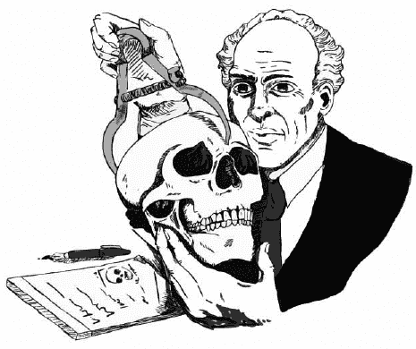
图 2.5 皮尔逊与巴黎地下墓穴颅骨的素描，资料来源达科塔·哈尔绘制

这只是辛普森悖论的一个特例。我们将在第六章讨论何时该拆分数据，以及为何合并异质总体会产生伪相关。现在先看皮尔逊怎么说：“对那些坚持把所有相关都当成因果的人来说，这个事实定然令人震惊——通过人工混合两个类似种群，我们就能让两个毫不相关的特征A与B之间产生相关。”斯蒂芬·施蒂格勒评论道：“我忍不住猜测，他自己可能才是第一个感到震惊的人。”可以看出，皮尔逊实质上在自责自己偶尔从因果角度思考的倾向。

若用因果透镜再看这个例子，可惜他错失良机。理想情况下，这样的例子会促使天才思考自己为何震惊，进而创立方法预测何时会出现伪相关。至少他应能告诉大家何时可聚合、何时不可。皮尔逊只给追随者一句模糊指导：“人造”的聚合都是坏的。讽刺的是，因果透镜现在让我们明白，有时正确的结果恰恰来自聚合，而非分组。因果推断的逻辑能告诉我们该信任哪一个结果。我多么希望皮尔逊能与我们分享这一发现！

皮尔逊的学生并非个个亦步亦趋。尤尔因其他原因与他决裂。起初尤尔是强硬派，相信相关能揭示科学所需的一切。1899年他研究院外救济是否提高贫困率。数据显示得到更多救济的地区贫困率更高。他怀疑是伪相关，因为这些地区老年人更多，老年人更容易贫困。控制年龄后相关仍在，这让他鼓起勇气得出结论：贫困率上升可归因于院外救济。但越界做出因果判断后，他又退回老路。在论文脚注里写道：“严格来说，‘归因于’应读作‘与……相关’。”这句话为后世几代科学家定了模板：心里想的是归因，写出来却是相关。

皮尔逊及其追随者对因果怀有敌意，而尤尔这类摇摆者不敢正面冲突，这就为大西洋彼岸的另一位科学家提供了机会，对回避因果的文化提出首次正面挑战。

## 赖特、豚鼠与路径图

1912年，休厄尔·赖特刚到哈佛时，其履历很难让人相信他日后会深刻影响科学界。他就读于伊利诺伊州一个不起眼、现已解散的伦巴第学院。毕业班只有7人。他的父亲菲利普·赖特曾是他的老师之一。菲利普学术多面，甚至经营学院印刷社。休厄尔和弟弟昆西在印刷社帮忙，期间代为发表了卡尔·桑德堡的第一首诗——当时桑德堡只是学院的一名普通学生。

大学毕业后很久，赖特与父亲保持密切联系。赖特搬到马萨诸塞后，菲利普也随之迁来。后来赖特去华盛顿特区工作，菲利普也跟着搬，先在美国关税委员会任职，后在布鲁金斯学院做经济学研究。兴趣不同却找到合作方式：菲利普是第一个使用儿子发明的路径图的经济学家。

赖特到哈佛读遗传学，正逢孟德尔显性隐性基因理论刚被重新发现的热潮。导师威廉·卡斯托已确定影响兔子毛色的8种遗传因子。卡斯托让他对豚鼠做同样的研究。1915年获博士后，他得到一个很合适的工作：在美国农业部负责饲养豚鼠。

后人或许好奇农业部是否预见到回报。也许当时他们只是想招个肯干的饲养员，顺便整理之前二十年混乱的饲养记录。赖特不仅完成任务，还做了大量额外工作。他饲养的豚鼠成为他整个职业生涯的跳板，也是他提出进化理论的基石，就像加拉帕戈斯雀鸟之于达尔文。他早早主张进化并非达尔文设想的渐进，而是相对突然的爆发。

1925年，他在芝加哥大学获得终身教职。本可更适合理论兴趣广阔的研究者，他仍专注豚鼠。有个广为流传的轶事：一次上课时他带了一只豚鼠，不小心用它擦起了黑板。传记作者认为故事很可能是虚构，但至少说明他对豚鼠的执着给公众留下深刻印象。

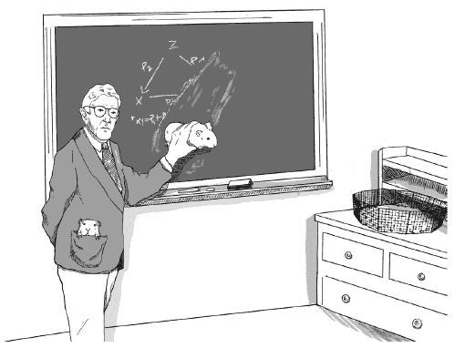
图 2.6 休厄尔·赖特首次建立了一套根据数据回答因果问题的数学方法，这种方法被称为路径图或路径分析。他对数学的热爱仅次于对豚鼠的热情，资料来源达科塔·哈尔绘制

最令我感兴趣的是他在农业部的早期工作。赖特发现豚鼠毛色遗传与孟德尔定律相抵触。纯白或纯色豚鼠无法稳定培育，即便多代近亲交配的家族，后代毛色仍有明显变异，从多半白到多半彩不等。这与孟德尔预测的多代近亲繁殖可“固定”性状相矛盾。

他开始怀疑白色素量由某个基因独立控制，并提出假设：母鼠子宫内的某种“发育因子”导致了特征变异。我们现在知道这个假设是对的。不同毛色基因在身体不同部位表达，图案不仅取决于继承的基因，还取决于基因表达出现的位置以及组合表达或抑制的方式。

研究难题催生了新分析方法，科学界屡见不鲜。赖特开创的方法在他之后得到极大发展，应用远超最初的豚鼠基因研究。对当时的赖特来说，估算发育因子可能只是伦巴第学院他父亲数学课里的大学水平问题。求未知量时，先给它一个符号，用方程描述你对该量和其他相关量的认知，再耐心列出足够方程求解。

在赖特的例子中，未知目标量是d，即发育因子对白色毛发的影响。纳入方程的因果量还包括遗传因子h，也是未知。赖特提出，若知道图中因果量，就能通过简单图形规则推断数据中的相关关系。这正是他的独创：架起深奥因果世界与表层相关世界之间的桥梁。这是研究者首次在因果与概率之间搭桥，跨越因果阶梯第二层与第一层之间的障碍。搭桥后，他能反向操作，从观测到的相关性中反推隐藏的因果量d与h。他通过求解代数方程完成任务。这个想法对赖特也许简单，却极具革命性，因为它首次证明“相关不等于因果”的判断应让位于“某些相关确实意味着因果”。

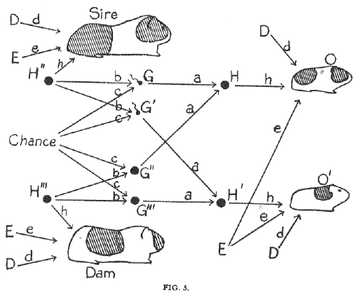
图 2.7 休厄尔·赖特的第一个路径图，其中Sire与Dam分别代表豚鼠父母的名字，左侧写着Chance表示随机因子。该图说明决定豚鼠毛色的因子。D代表发育因子，存在于母鼠怀孕后子鼠出生前，E代表环境因子，存在于子鼠出生后，G代表来自豚鼠父亲或母亲个体的遗传因子，H代表来自父母双方的混合遗传因子，O与O'代表后代。该分析的目的是估计D、E、H的影响强度，图中记作d、e、h，来源休厄尔·赖特，国家自然科学院学报1920页320到332

最后，赖特的分析表明，假设中的发育因子比遗传因子作用更大。在随机繁殖豚鼠中，42%的毛色变异由遗传因子引起，58%由发育因子引起。相比之下，在一个多代近亲繁殖家族里，白色毛发的变异只有3%来自遗传因子，92%来自发育因子。换句话说，经过二十代近亲交配，遗传因子引起的变异已被消除，而发育因子引起的变异依然存在。

这个发现本身就挺耐人寻味，但真正让它变得关键的，是赖特呈现观点的手腕。图 2.7 里的那张路径图更像一张导航图，标明了如何从第一层信息跨到第二层信息。用一张图发动一场科学革命，豚鼠也算立了一功。

请注意，这张图把所有可能影响后代毛色的因素都列了出来。字母 `D`、`E`、`H` 分别对应发育因子、环境因子和遗传因子。每只父鼠（西雷）、每只母鼠（达姆）以及每一只后代 `O` 和 `O'` 都有各自一套 `D`、`E`、`H`。两代豚鼠共享同样的环境因子，但发育过程并不相同。图里也体现了孟德尔学说的最新认识：豚鼠父母的精子细胞和卵细胞 `G` 与 `G''` 决定了后代的遗传因子 `H`，而精子细胞和卵细胞本身又来自父母遗传因子 `H''` 与 `H'''` 经过一种当时尚未搞清机制的混合过程，图里用 “Chance” 标记了这种随机性，因为基因概念尚未出现。

图中没有把近亲繁殖家族与普通家族的区别画出来。在近亲群体里，父母双方的遗传因子高度相关，赖特本想用 `H''` 和 `H'''` 之间的双向箭头来表示（图 2.7 未展示）。除此之外，所有箭头都是单向的，从因指向果。比如从 `G` 到 `H` 的箭头说明父亲的精子可能直接影响后代的遗传因子，而从 `G` 到 `H'` 没画箭头，就表示决定 `O` 的精子对 `O'` 的遗传因子没有因果作用。

把每个箭头拆开看，意思都非常清晰。每个箭头还带有一个小写字母 `a`、`b`、`c` 等，这就是路径系数，用来衡量因果效应的强度。粗略讲，它表示源变量在多大程度上带来了目标变量的变异。比如每个后代的遗传构成 50% 来自父亲 50% 来自母亲，所以 `a` 理论上是 1/2。考虑到数学上的方便，赖特喜欢用平方根来记，于是 `a=1/√2`，`a²`=1/2。

在当时，用一个变量引起的另一个变量变异多少来解释路径系数是合理的。可现代因果推断的说法不一样：路径系数指的是对源变量做一次假设性干预所产生的效果。干预这个概念要到 1940 年代才出现，1920 年赖特写论文时不可能想到。好在在当时处理的比较简单的路径图里，两种解释得到的结果一致。

需要强调的是，路径图不只是好看的图，它是强有力的计算工具。计算相关关系的规则，就是找出连接两个变量的所有路径，把沿途的路径系数全部相乘再求和。还有一点常被忽视，箭头的缺失所暗含的假设，比箭头存在所暗含的假设更关键。两个变量之间没有箭头，等于是把它们的因果效应限制为零；而箭头存在并不能说明效应大小，除非我们事先给路径系数赋值。

赖特的论文堪称杰作，理应被视为 20 世纪生物学的一个里程碑，也是在因果科学史上的里程碑。图 2.7 是有史以来首次公开出现的因果图，标志着科学迈向因果关系之梯第二层级的第一步，而且是果断的一步。第二年，赖特又发了一篇更宏大的论文《相关关系和因果关系》，把路径分析推广到豚鼠育种以外的场景。

我不清楚 30 岁的赖特对论文反响有什么预期，但现实的讨论一定让他震惊。1921 年，亨利·尼尔斯发表反驳文章，他是美国统计学家雷蒙德·珀尔的学生，而珀尔又是卡尔·皮尔逊的门徒。

学术界表面文雅内里凶猛，我自己也吃过亏。但尼尔斯那种措辞激烈的批评仍属罕见。他先援引皮尔逊和弗朗西斯·高尔顿的名言，论证“因”这个词多余，因果关系不过是高度相关的相关关系。他进一步贬低赖特的方法论，称其基本谬误在于先验地建立一个简单图形系统来反映多个变量的作用。他没去弄懂赖特的计算规则，通过笨拙的例子得出相反结论，最后宣称路径系数方法在哲学上先天有缺陷，在应用上完全不可靠。

从科学角度看，尼尔斯的批评可有可无，但对研究因果科学发展史的人非常有价值。它忠实记录了那一代人对因果的态度，以及皮尔逊对当时科学思维的支配。今天仍然能听到类似尼尔斯的声音。

当然，科学家未必能掌握全部变量关系网。赖特认为，这时可以探索式地使用路径图，先假设某些因果关系存在，算出变量间相关强度的估计值。如果估计值与实测数据矛盾，就说明假设错了。1953 年，赫伯特·西蒙重新发现了这种用法，极大地启发了社会科学。

赖特很清楚，没有因果假设就得不出因果结论。这与第一章的结论一致：只用因果之梯第一层的数据，无法回答第二层的问题。

有人会问，这不是循环论证吗？答案是否定的。把一些中庸、定性的、显而易见的假设，比如后代毛色不会影响父母毛色，与二十年的豚鼠饲养数据结合，赖特得到了定量且不显而易见的结论：后代毛色 42% 的变异来自遗传。从显而易见中提炼出不显而易见，这不是循环，是科学的胜利。

赖特的贡献独一无二，因为得出 42% 这个结论需要两种几乎不兼容的数学语言：图形语言和数据语言。把定性的箭头信息与定量的数据信息结合起来的创意简直像奇迹。

许多人仍犯尼尔斯的错误，以为因果分析的目标只是证明 X 是 Y 的因。实际上赖特的重点，也是本书的重点，是用数学表达看似合理的因果知识，结合经验数据回答有实际价值的因果问题。他从一开始就明白，因果发现要困难得多。在回应尼尔斯时他写道，作者从未主张路径系数理论能提供因果推导的通式，他强调的是把相关知识与因果知识结合以获得结果，与从相关推导因果是两回事。

### “但它仍在动！”

如果我是职业史学家，我会到此为止。但作为一名自封的辉格式史学家，我无法不钦佩赖特那段话在九十年后依然不过时的准确性，它根本定义了现代因果分析的新范式。

我对赖特真知灼见的钦佩，仅次于对他勇气的钦佩。设想 1921 年的情境：一个自学数学的人独自对抗统计学霸权。对方说你的方法基于对因果本质的误解，他说我的方法创造了超越你们的东西。对方说专家二十年前就判定你的方法是胡闹，他说路径系数不是相关关系，而是因果效应。

试着想象，孩子们嘲笑你相信 3+4=7，因为他们学的是 3+4=8，老师也这么说。你会不会怀疑自己？赖特没有自我怀疑。这场争论不只是算术，因为算术还能靠独立验证检验。而赖特只有一个未经检验的结论：发育因子引起的变异是 58%，而不是 3%。他依靠的只是信念——路径系数能解释相关性无法解释的事实。他依然宣告：但它仍在动！

当我的同事告诉我贝叶斯网络与当时人工智能主流理论冲突时，我也很固执。但当时我有概率理论作支撑，赖特甚至没有定理可依。那时科学界已经放弃因果关系，他没有理论框架可循，也无法像尼尔斯那样引用权威，因为权威三十年前就下了判决。

对赖特来说，一个安慰是他能用自己的方法回答其他方式无法回答的问题，比如确定各因子的相对重要性。1921 年的论文《相关关系和因果关系》里就有精彩例子：若豚鼠在母体内多待一天，出生体重会增加多少？

我们无法直接称重子宫里的幼鼠，只能比较孕期 66 天和 67 天的出生体重。赖特比较后发现，多待一天平均增加 5.66 克。有人据此草率得出胚胎每天长 5.66 克。

赖特会说这是错的。晚出生的幼鼠通常有原因，比如同窝仔数少。仔数少意味着成长环境更宽松。因此差异有两个来源，需要区分。

赖特用路径图回答这个问题。如图 2.8 所示，`X` 代表出生体重，`Q` 和 `P` 代表两个已知原因：妊娠时长 `P` 和产前生长速率 `Q`。`L` 代表同窝产仔数，同时影响 `P` 和 `Q`。我们能测 `X`、`P`、`L`，但测不到 `Q`。`A` 和 `C` 是无法获取数据的外因。假设它们相互独立，图中没有箭头也没有共同祖先。

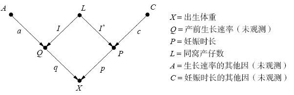
图 2.8 豚鼠出生体重示例的因果图（路径图）

赖特的问题是：妊娠时长 `P` 对出生体重 `X` 的直接效应是多少？5.66 克/天是包含了同窝仔数带来的偏倚的总相关性。需要消除偏倚。

直接效应由路径系数 `p` 表示，对应路径 `P→X`。偏倚对应路径 `P←L→Q→X`。代数上，偏倚大小等于沿途路径系数乘积 `l×l'×q`。于是总相关为 `p+l×l'×q=5.66 克/天`。

如果知道 `l`、`l'`、`q` 就可以算出偏倚，再相减得到 `p`。但 `Q` 无法测量，也就不知道这些系数。巧妙之处在于路径系数可以用来表示可测量的相关性。对变量对（`P`，`X`）、（`L`，`X`）、（`L`，`P`）的相关性分别表达后，得到三个方程，可解出未知系数 `p`、`l'` 以及 `l×q`。最终算出 `p=3.34 克/天`。

也就是说，在其他变量不变时，妊娠期延长一天，幼鼠出生体重平均增加 3.34 克。这个结果在生物学上有意义，说明了出生前的日生长速度。而 5.66 克没有生物学意义，它是两个独立过程合并后的影响，其中 `P←L` 甚至是反因果关系。

从这一例得到两个经验：因果分析让我们量化现实世界中真正发生的进程，而非数据模式；通过检查路径图即可对单个因果关系得出结论，测算具体系数则需要更细的结构分析。

在理想的科学发展里，赖特的回应应引发热潮。可惜 1920 到 1960 年间，除了赖特本人和动物育种学者，路径分析几乎无人问津。遗传学家詹姆斯·克洛写道，这段历史极其匪夷所思。虽然赖特已说明方法适用于多种问题，但无人跟进。

克洛没有提到，社会科学界也有同样感受。1972 年，经济学家亚瑟·戈德伯格感叹赖特的工作被可耻地忽略，他的办法后来在社会学掀起因果建模热潮。

克洛指出原因：路径分析不适合“固定程序”，使用者必须先有假设并设计结构图。统计学则打压这种做法，偏爱固定程序解决问题。统计学家喜欢对数据做常规计算，不喜欢挑战已有知识体系的方法。

罗纳德·费舍尔是当时统计学领袖，1925 年他写道：“统计学可被视为对数据约简方法的研究。”赖特厌恶把统计学仅仅当成数据处理科学，费舍尔却认同。一旦从统计学中去掉因果，剩下的只有数据约简。

威廉姆·普罗文指出另一个因素：30 年代中期后费舍尔视赖特为敌人。费舍尔与皮尔逊、皮尔逊之子埃贡、耶日·奈曼、赖特都爆发激烈争论。真正焦点不是路径分析，而是进化生物学。费舍尔不同意赖特的基因漂变理论，细节超出本书范围。

六十年代中后期，路径分析被重新翻出来。社会学方面奥蒂斯·邓肯、休伯特·布莱洛克，经济学方面亚瑟·戈德伯格，把这套工具当成检验社会政策与教育政策实际效果的手段来使用。

这里有个讽刺的细节。1947年赖特受邀在考利斯委员会面前向一批颇具影响力的计量经济学家介绍，却没能讲清路径图能做什么。只有当那批经济学家自己冒出类似想法时，才与此方法有了短暂的交集。

路径分析在两个学科里走向了不同的岔路，最终都偏离了赖特本来的意图。社会学把它改名为结构方程建模，保留了图形表达并大量推广，直到1970年LISREL程序包问世，能够在某些情境下自动算出路径系数。赖特很可能预见到后面的走向：方法沦为照搬，研究者只负责操作，内部机制无人关心。八十年代末统计学家大卫·弗里德曼公开质疑结构方程模型背后的前提，却得不到有效回应，顶尖专家甚至否认它与因果有任何关联。

经济学只吸取了代数部分，发展成联立方程模型。经济学家几乎完全抛弃了路径图，至今仍依赖数值方程与矩阵。代价很严重，代数式无方向性，x=y 与 y=x 等价，因果与回归难以区分，即便求解出来也无法回答估计策略是否可信。直到1995年，许多经济学家仍未给方程赋予因果或反事实的含义。对图形表达他们保持近乎偏执的怀疑，忽视它能省下大片计算。受此观念影响，至今仍有人宣称一切尽在数据。

正因如此，直到九十年代路径图的科学使命才部分兑现。1983年，近九十岁的赖特再次为路径图辩护，文章刊于《美国人类遗传学杂志》，题目与1923年的那篇完全相同，读来既欣慰又心酸。理论诞生六十年还能听创立者亲述的机会很少，仿佛达尔文在1925年从坟墓里出来为斯科普斯案作证。但遗憾的是，这六十年本该让理论成长，事实上自二十年代起几乎停滞。

赖特写作是为了回应斯坦福数学家、1989年美国国家科学奖章得主塞缪尔·卡林及其两位合著者的批评。卡林首先指出，路径分析默认两变量间的联系全是线性的，因而可用单一系数来描述因果。若关系是非线性的，X变动一个单位对Y的影响会随X取值变化。卡林与赖特都没意识到这里已萌芽一般的非线性理论，三年后托马斯·维尔玛才完成构建。

卡林最受关注的批评是提倡无模型的做法：借助一系列展示、指标与对比交互式地理解数据，强调解释结果的稳健性。这显示从皮尔逊时代起统计观念变化有限，皮尔逊的影响在1983年仍强。卡林的意思是数据本身已蕴含科学智慧，只需稍作打磨就会显现，分析无需考虑数据生成机制。无模型也能同等甚至更好。若皮尔逊活在大数据时代，他会说答案就在数据里。

这违背了第一章的教导。谈因果必须有一个关于真实世界的心理模型。无模型或许能走到因果阶梯的第一层，却走不远。

赖特看清风险，明确指出卡林等人把无模型作为首选替代，不仅是方法改变，更是放弃路径分析的初衷，忽略对各因相对重要性的评估。没有模型就不可能做这类分析。对需要评估的人，他们的建议是放弃去做别的。

赖特捍卫的是科学方法与数据解释的本质。今天我也想对大数据与无模型分析的爱好者说同样的话。可以尽量榨取数据信息，但要问帮助有多大。它永远无法超越因果关系阶梯的第一层，也无法回答各因相对重要性这类简单问题。重说伽利略的话：但它仍在动。

## 客观退位，主观登场：贝叶斯的连线

赖特在回应中反复强调，他不想让路径分析沦为陈规。他认为路径分析这种灵活的方法，与为避免偏离客观性而设计的刻板描述统计大不相同。

其一，路径分析的应用应建立在研究者对因果过程的个人理解上，这种理解体现为所画的因果图或路径图。它不应简化为统计手册里的机械程序。对赖特而言，绘制路径图不是统计实践，而是遗传学、经济学、心理学等领域在其专业框架内的实践。

其二，赖特把无模型方法的诱人之处归因于客观性。自1834年3月15日伦敦统计学会成立起，客观性就是统计学家的圣杯。创始章程规定数据优先于观点与解释。数据客观，观点主观。该规则远早于皮尔逊。追求客观性、据数据与实验推理的思想，自伽利略起就是科学的自我定义。

与相关性分析及主流统计不同，因果分析要求主观判断。研究者必须绘制因果图，反映其对研究课题因果结构拓扑的定性判断，或所在领域的共识。为确保客观，反而必须放弃传统客观教条。在因果层面，睿智的主观性比任何客观性都更能阐明真实世界。

大部分统计工具力求完全客观，但有一个重要例外。过去五十多年，贝叶斯统计日益受青睐。曾被视为异端，如今成主流。今天的统计会议已不见六七十年代那种贝叶斯派与频率派的激烈争吵。

贝叶斯原型是：先验判断＋新证据→修正后判断。假设抛硬币10次有9次正面。传统统计学家会说没有额外证据时倾向认为硬币有瑕疵，打赌下次正面概率9:1。贝叶斯统计学家会说先考虑先验知识。这枚硬币是从杂货店买的还是从声名不佳的赌徒处得来？普通硬币，多数人不会因9次正面巧合就动摇。若合理怀疑被动手脚，才更愿意认定偏倚存在。

贝叶斯提供一种客观方式把观察证据与已有相关知识或主观判断结合以修正判断。频率派无法忍受贝叶斯允许观念以主观概率形式入侵统计王国。随着数据量增加，先验影响会缩小甚至消失，最终结论仍保持客观。

遗憾的是，主流界对贝叶斯主观性的接纳并未带来对因果主观性的接纳，他们仍排斥先依据既有因果知识绘制路径图。原因在于语言障碍。贝叶斯为阐释主观假设沿用了高尔顿与皮尔逊的母语——概率语言。而因果推断需要更丰富的语言如因果图，这对贝叶斯派与频率派同属陌生。贝叶斯与频率的和解表明哲学障碍可用善意与通用语言弥合，语言障碍则远难克服。

此外，即便数据增多，因果信息中的主观成分不一定随时间减少。两人画出不同因果图并分析相同数据，很可能永远得出不同结论，无论数据多大。这是科学客观性倡导者可怕的前景，也说明他们排斥主观因果信息有其必然性。

积极的一面是，因果推断在极重要意义上是客观的：一旦假设达成一致，因果推断便提供百分之百客观的方法解释任何新证据。这与贝叶斯推断一致。因此我曾以贝叶斯概率为起点绕贝叶斯网络走了一大圈弯路，并不令人意外。我将在下一章讲述这个故事。

[1] 中心极限定理是概率论的“无冕之王”，高尔顿曾盛赞它所蕴涵的宇宙秩序之美妙无可比拟，可见其对人类认知的影响是多么深远。——译者注

[2] 也称作“高斯分布”，是高斯在研究误差理论时首次明确提出的，其密度函数曲线关于均值对称，中间高两边低。中心极限定理揭示了在一定的条件下为何正态分布是普遍存在的。——译者注

[3] 1 英尺≈30.48 厘米。——编者注

[4] 回归“regression”一词在英语中还有退化、退步、衰退、倒退的意思。——译者注

[5] 女性的身高一般低于男性，因此高尔顿利用计算出的男女平均身高之比（1.08）将女性的身高乘以 1.08 换算成男性身高。高尔顿据此定义了“中亲”（mid-parents）身高=1/2（父亲的身高+1.08×母亲的身高），用来计算父辈的身高。本书为了讲述方便，将之简化为父子身高。——译者注

[6] 列联表检验是卡方检验的特例，是独立性假设检验的常用方法之一。——译者注

[7] 那些还想进一步阅读赖特论文原文的读者，我要提醒你们，他并没有用“克/天”为单位计算路径系数。他是用“标准单位”来计算路径系数的，在计算的最后才会将标准单位转换为“克/天”。

# 第三章 证据到因果：贝叶斯牧师邂逅福尔摩斯

二人若不同心，岂能同行？

狮子若非捕猎，岂会在林中咆哮？

——《阿摩司书》3:3

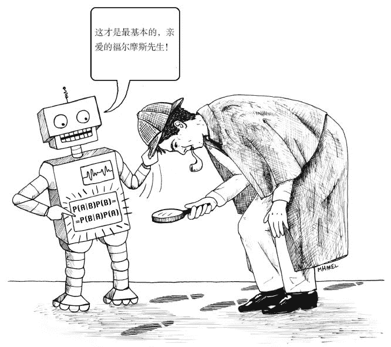
“这只是最基本的，亲爱的华生。”

夏洛克·福尔摩斯如是说，随后便用超凡脱俗的演绎推理将他忠实的助手搞得一头雾水。事实上，福尔摩斯所做的并非只是从假设推出结论的演绎，他的拿手本领是归纳。与演绎正好相反，归纳是从证据推出假设。

他的另一句名言暗示了他的惯用手法：“当你排除了所有不可能的，剩下的那个无论有多么不可思议，都一定是真相。”为推断出那个正确的假设，福尔摩斯会在归纳出几个可能的假设之后，一个接一个地进行排除。虽然归纳和演绎息息相关，但前者看起来要神秘得多。也正是掌握了归纳法才让福尔摩斯这样的侦探大有用武之地。

近年来，人工智能专家在从证据到假设以及从结果到原因的自动化推理方面取得了相当大的进展。我有幸借助开发了实现该功能所必需的一项基本工具（贝叶斯网络）参与了这一发展进程的最初阶段。在本章中，我将简略地对贝叶斯网络做一下介绍，考察当前该工具的一些应用实例，并向大家讲述我在最终进入因果关系研究领域之前所走过的曲折道路。

## 数字侦探波拿巴

2014 年 7 月 17 日，马来西亚航空公司飞往吉隆坡的 17 号航班从阿姆斯特丹的史基浦机场起飞。令人心痛的是，这架飞机没能抵达目的地。起飞 3 小时后，飞机飞越乌克兰东部上空，被一枚俄罗斯制造的地对空导弹击落。机上的 298 人，包括 283 名乘客和 15 名机组人员全部遇难。

7 月 23 日，第一批遇难者遗体抵达荷兰的那天，后来被荷兰政府确定为全国哀悼日。对于位于海牙的荷兰法医研究所（NFI）的调查人员来说，7 月 23 日则是倒计时开始的日子。他们的工作是尽快明确遇难者遗体的身份信息，将他们送回亲人身边安葬。时间紧迫，因为分析结果一天不出来，遇难者家属就要继续痛苦一天。

调查人员面临着许多困难。尸体被严重烧毁，许多尸体由于不得不使用防腐剂储存，其 DNA 信息也遭到了破坏。此外，由于乌克兰东部是战区，法医专家只能不定时地进入坠机地点附近的有限范围内搜查。在长达 10 个月的时间里，不断有新的遗体被发现并送至法医研究所。而最大的困难是，调查人员没有遇难者 DNA 的记录，原因很简单，遇难者不是罪犯。他们必须依靠与遇难者家庭成员 DNA 的部分匹配来确定遇难者的身份。

幸运的是，法医研究所的科学家有一个强大的工具，这个工具名为“波拿巴”，它是目前最先进的遇难者身份识别程序。该软件是由荷兰奈梅亨市拉德堡德大学的一个研究小组于 2000 年年中开发的。利用贝叶斯网络，该软件能够综合比对来自遇难者几个不同的家庭成员的 DNA 信息。

法医研究所能最终在 2014 年 12 月识别出 298 名遇难者中 294 人的身份，很大程度上应归功于波拿巴的精确和高效。截至 2016 年，只剩下 2 名坠机事件的遇难者（均为荷兰公民）的遗体未能被找到和识别。

贝叶斯网络，作为波拿巴软件进行自动化推理的工具基础，其影响着我们生活的许多方面，尽管大多数人对此并不知晓。它广泛应用于语音识别软件、垃圾邮件过滤器、天气预报、潜在油井位置评估以及美国食品和药物管理局对医疗器械的审批过程。如果你在微软 Xbox 游戏机上玩电子游戏，那么你会发现贝叶斯网络还被用于对你的技巧水平进行排名。如果你有一部手机，那么从成千上万个电话中筛选出打给你的电话就是通过信念传播算法（belief propagation）来解码的，而信念传播是专为贝叶斯网络设计的一种算法。作为“互联网之父”之一的温顿·瑟夫曾说：“我们所有人都是贝叶斯方法的超级用户。”

在本章中，我将讲述贝叶斯网络的故事，从 18 世纪其发展根源讲起，一直讲到 20 世纪 80 年代其蓬勃发展，并列举多个应用案例。贝叶斯网络与因果图之间的关系很简单：因果图就是一个贝叶斯网络，其中每个箭头都表示一个直接的因果关系，或者至少表明了存在某个因果关系的可能性。反过来，并非所有的贝叶斯网络都是因果关系网络，而在很多实际应用中这一点并不重要。但是，一旦你想问关于贝叶斯网络的第二层级或第三层级的问题，你就必须认真对待因果论，一丝不苟地画出因果图。

## 贝叶斯牧师与逆概率问题

1985 年，我以托马斯·贝叶斯的名字命名了我所创建的概率理论。托马斯·贝叶斯本人大概从来没有想过，他在 18 世纪 50 年代推导出的公式有一天会被用来识别遇难者的身份。当时，贝叶斯关心的只是关于两个事件的概率，其中一个事件（假设）发生在另一个事件（证据）之前。虽说如此，因果论在他心中还是非常重要的。事实上，对因果解释的追求是他提出“逆概率”（inverse probability）分析背后的驱动力。

托马斯·贝叶斯（1702—1761）是一位长老会牧师，但看上去更像个数学怪才。身为英格兰教会的反对者，他不能到牛津大学或剑桥大学学习，因而在苏格兰大学接受了高等教育。我们现在猜测，他在那里很可能学到了许多数学知识。回到英格兰后，他继续探索数学领域，并组织了一个数学讨论圈子。

在他去世之后才发表的一篇文章中，贝叶斯解决了一个很适合他本人来解决的问题，即数学与神学的较量。这篇文章的背景是，苏格兰哲学家大卫·休谟在 1748 年写了一篇题为“论神迹”的文章，其中他指出，目击者的证词永远无法证明神迹的发生。休谟所指的神迹显然是基督复活，但他很聪明，没有明确地把这件事说出来。20 年前神学家托马斯·伍尔斯顿就因为发表了类似言论被裁决为亵渎上帝而锒铛入狱。休谟的主要观点是，本质上不可靠的证据是不能推翻衍生于自然法则的诸如“人死不能复生”这样的命题的。

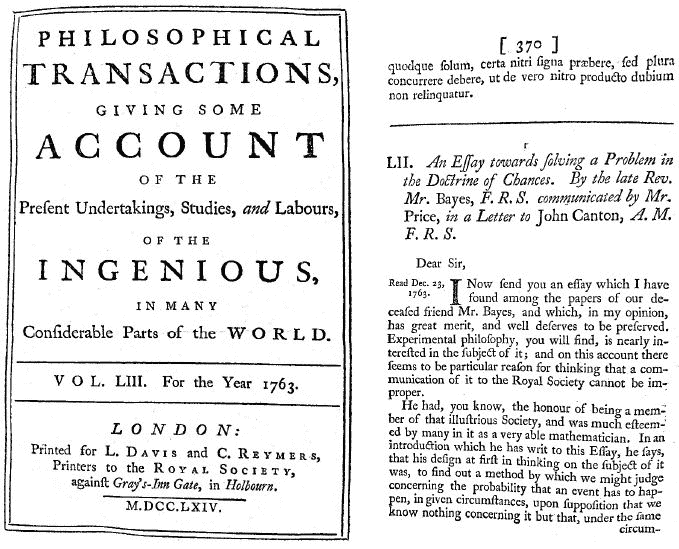
图 3.1 《哲学汇刊》1763 年第 LIII 卷杂志扉页。这期杂志刊载了托马斯·贝叶斯有关逆概率的遗作，并在首页中发表了理查德·普莱斯的推荐信

休谟的质疑在贝叶斯眼里自然引出一个福尔摩斯式的核心难题：究竟需要多少证据，才能让我们相信一件原本被认为不可能发生的事真的发生了？一个假设要怎样跨过“绝无可能”的门槛，成为不大可能、甚至可能或确凿呢？问题用概率的语言提出，却带着明显的神学味道。与贝叶斯同在同一教会的牧师理查德·普莱斯在整理贝叶斯遗稿时发现了这篇论文，送去刊发，还写了一封热情洋溢的推荐信，把其中的神学意图点得很透。

贝叶斯本人并没有在论文里谈神学，是普莱斯主观突出了这层意义，或许想让朋友的文章获得更广的回响。实际上贝叶斯并不需要这层包装。大约两百五十年后，这篇论文再次被提起并引发争议，并不是因为神学，而是因为它证明了可以从结果反推原因的概率。从原因推结果是前向概率，相对容易；从结果反推原因，也就是贝叶斯时代所说的逆概率，却困难得多。贝叶斯没有解释困难为何不言而喻，却演示了逆概率不仅可行，而且能操作。

## 逆向推理的本质

我想先说明为何要相信事物遵循固定法则，进而说明为何可以相信世界构造源于高智慧和高力量，进而指向最终的因即上帝。不难看出，文章解决的逆向问题正好能直接服务这个目的：它清晰告诉我们，当某类事件按特定次序出现或重复出现时，我们为何应认为这秩序或重复源于某种稳定因或规则，而非偶然。

台球桌的例子最能说明差异。设想球在桌面上多次弹跳，我们无法确定最终停点。若已知桌长，便可问球停在距左端x英尺范围内概率是多少。在一桌长12英尺、极平滑的台面上，落在距边缘1英尺范围内的概率是1/12；若桌长8英尺，概率就是1/8。

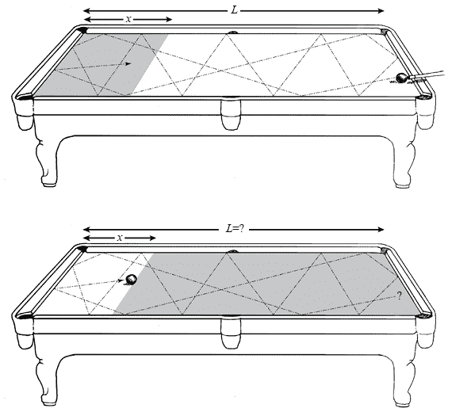
图3.2 托马斯·贝叶斯的台球桌示例。上部示意图对应前向概率问题：已知桌长，求球停在距边缘x英尺范围内可能性。下部示意图对应逆概率问题：已知观察到球停在距边缘x英尺范围内，求桌长为L的可能性（资料来源：马雅·哈雷尔绘图）

直觉告诉我们，一般情况下若桌长为L英尺，球落在距边缘x英尺范围内的概率为x/L。桌越长概率越低，可停位置越多；x越大概率越高，可停区间越大。

现在反过来。观察到球最后停在距边缘x=1英尺范围内，而桌长L未知。贝叶斯提出的问题是：桌长有100英尺的概率有多大？常识认为L更可能是50英尺而非100英尺，因为桌越长就越难解释为何球会停在离边这么近的位置。但具体有多大，直觉无法给出明确答案。

前向概率已知L求x容易，逆概率已知x求L难，这不对称来自因果方向。L是因，x是果。我们看到因时能预测果，人类认知按这个方向运作。若只见果要求推因，就需要更多信息去追踪所有可能的原因。贝叶斯要做的就是打破这种不对称，给出一个即使非数学高手也能用的逆概率估算方法。

## 茶室订单里的反向计算

先用一个简单的茶室顾客例子演示方法。数据对因果不对称不敏感，正适合破解逆概率难题。

假设顾客中有2/3点茶，点茶的顾客里有1/2同时点烤饼。那么同时点茶和烤饼的顾客占比是多少？计算很简单，2/3的一半是1/3。

用虚拟数据再说一遍。设接下来进店12位顾客的点单如表3.1。有2/3的顾客点了茶，其中一半点了烤饼，于是同时点茶烤饼的比例仍是1/3。

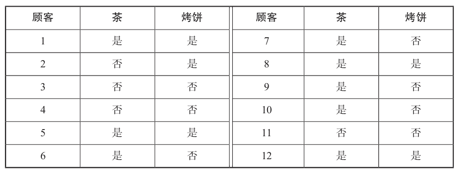
表3.1 茶—烤饼示例的虚构数据

贝叶斯注意到的关键是数据可以反向解读。我们观察到5/12的顾客点了烤饼，其中4/5点了茶，于是同时点茶烤饼的比例是4/5乘以5/12，仍是1/3。两次结果相同并非巧合，只是两种计算路径算同一个量，订单时间顺序并无影响。

## 法则的数学表达

记P(T)为点茶概率，P(S)为点烤饼概率。已知点茶时点烤饼的概率记为P(S|T)，竖线意为“在…条件下”。同理已知点烤饼时点茶的概率记为P(T|S)。

于是
P(S且T)=P(S|T)P(T)
P(S且T)=P(T|S)P(S)

若两个量皆等于第三个量，二者相等，故得
P(S|T)P(T)=P(T|S)P(S)  （3.1）

这就是贝叶斯法则。它给出逆概率的通用解法：若知道在T下S的概率，再已知P(T)和P(S)，便可求出在S下T的概率。统计学中最重要的用法就是在判断可靠的方向直接估算条件概率，再用数学工具推导出判断模糊的另一方向。在贝叶斯网络中，计算机被告知前向概率，需要时给出逆概率。

用茶室例子检验。假设你没算出P(T|S)，只记得一半点茶的点烤饼，2/3顾客点茶，5/12顾客点烤饼。店主问：点烤饼的顾客里点茶的占比？根据法则，P(T|S)P(S)=P(S|T)P(T)，即P(T|S)×5/12=1/2×2/3，可得P(T|S)=4/5。

## 信念如何被数据更新

法则还能理解为更新信念的方法。人类对未来的信念多依赖过去频率。顾客进门时，我们依据过往判断他可能点茶；若他先点了烤饼，我们就更确定他会点茶，甚至主动建议配茶。贝叶斯法则只是把这种推理量化。

从表3.1看，顾客进门后、点餐前的先验概率为2/3。若已知他点了烤饼，关于他想点茶的更新后验概率升为P(T|S)=4/5。

数学上它只是条件概率概念加一点古希腊逻辑，看似平凡，却让贝叶斯名留青史。为什么一个简单招数引发两百五十年的争论？因为它不仅是定义，更是规范性规则，用于基于证据更新信念。

## 哲学争议：信念能等同频率吗

茶室推导有意掩盖了两大异议，一哲学一应用。哲学异议聚焦概率是否可解释为信念度 ^([\[2\]](#part0008.html#note2n)) ，茶室例子隐含了这种解释。但没人明说信念可以等同或应当等同数据比例。

核心在于“假设我知道”能否合法翻译成概率语言。即使承认无条件概率P(S)、P(T)、P(S且T)反映信念度，谁能证明修正后的信念度就应等于P(S且T)/P(T)，如法则所要求？“假设我知道T”是否等同于“在T发生时”？用P(S)作记号的概率语言本意是捕捉频率，而“假设我知道”是认识论范畴，受逻辑约束而非频率约束。

托马斯·贝叶斯的贡献在于首次给出条件概率的正式定义P(S|T)=P(S且T)/P(T)。他没用“条件概率”一词，而是用“假设第一个事件发生，第二个事件发生的概率”这种累赘描述，直到十九世纪八十年代才认识到“假设”关系需要独立符号。1931年哈罗德·杰弗里正式提出现在P(S|T)中的竖线符号。

形式上法则只是定义推论，认识论上却远超初等概念。它作为规范规则应用于根据证据更新信念。也就是说人们在观察到T后对S的信念度，永远不会低于观察T前对“S且T”的信念度。此外它暗示证据T越出人意料，即P(T)越小，因S就越应被相信。难怪普莱斯认为这是对休谟的有力回应。若T是极不可能的神迹，“基督复活了”，S是相关假设“基督是上帝之子”，知晓T后对S的信念大幅提升。神迹越不可思议，能解释它的假设就越可信。

## 乳腺癌筛查的贝叶斯陷阱

应用层面的异议在科学时代更关键。若把法则用于台球难题，求P(L|x)需要一个无法从实际台球桌获得的量：L的先验概率，它和我们想要的后验概率一样难以估计，且因人而异，取决于个人对不同桌长的过往经验。没见过斯诺克桌的人难以相信L超过10英尺，只见过斯诺克桌的人则会给L不足10英尺很低先验。这种变异性即主观性，被视作缺陷，也有人认为正是优势，能把个人经验数学化并与数据结合。

乳腺癌检测是经典场景。假设40岁女性做乳房X光，检测结果为阳性。她有多大可能真患病？设D为患病，T为检测阳性。

前向概率P(检测|疾病)即敏感度，医生说的检测准确捕捉疾病能力，一般对所有患者相同。逆概率P(疾病|检测)才是我们关心的，从检测结果推断疾病的概率，它会随患者类型变化。

对40岁女性，下一年患乳腺癌先验概率约1/700。敏感度据BCSC约为73%。

分母P(T)需加权平均：P(T)=P(T|D)P(D)+P(T|~D)P(~D)。假阳性率P(T|~D)约12%。于是P(T)=1/700×73%+699/700×12%≈12.1%，非常接近假阳性率。

似然比=73%/12.1%≈6。后验概率=似然比×先验≈6×1/700≈1/116，不到1%。

结论惊人。大多数拿到阳性结果的40岁女性会惊讶其实极可能未患病。

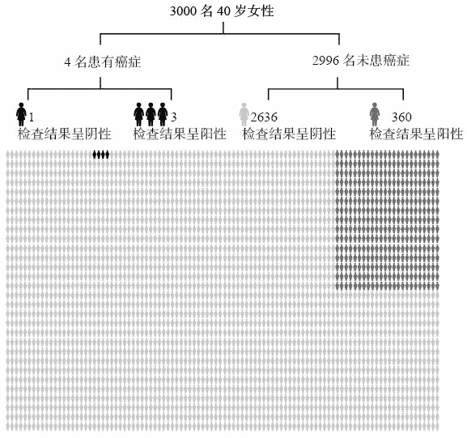
图3.3 该例中，根据乳腺癌监测联合会提供的假阳性率和假阴性率，在乳腺癌检测结果为阳性的363名40岁女性中，只有3人确实患有乳腺癌（因经过近似处理，图示中的比例与文本中的比例不完全相符）（资料来源：马雅·哈雷尔绘图）

假阳性数量压倒真阳性。感知与现实的冲突解释了为何2009年美国预防服务特别小组建议40岁女性不必每年做乳房X光会引发抗议。小组知道阳性结果更可能是虚惊，会导致不必要的恐慌和治疗。

但若女性携带乳腺癌遗传基因，先验升至1/20，阳性后概率升至1/3。此时筛查价值很高。特别小组因此仍建议高危女性每年检查。

这个片段再次说明，`P（疾病|检测）`并不是一个普适常数，它会随个人情况而波动。正因为如此，贝叶斯法则才能把个人层面的风险信息纳入考量。如果你事先就知道患病可能性很高，法则就会把这一先验放大；反之，如果你确认对某种病具有免疫力，按贝叶斯的逻辑，检测本身就失去意义了。相对而言，`P（检测|疾病）`对个人背景相当“稳健”，它只关乎疾病本身的特征、病程阶段或检测设备的灵敏度，不受流行病、饮食、卫生、社会经济地位或家族史等成因因素影响。前向概率用来组织知识和与病人沟通，而逆概率`P（疾病|检测）`则对这些背景因素极度敏感。

## 先验的主观性如何被驯服
还记得台球桌长度那个例子的人，现在应该在问贝叶斯怎么处理 `P（L）` 的主观问题。他的对策分两步。第一，贝叶斯关心的并非桌子本身有多长，而是在此长度下某个未来结果出现的概率，比如下一杆球停在特定区间的可能性。第二，他假设 `L` 是机械地由击球距离决定的，比如已知有人从 `L^*` 处击球，就可以用 `L^*` 来代替 `L`。这样一来，先验被赋予了客观锚点，问题就被转化为从数据中估计先验，就像茶室和癌症筛查的例子里看到的那样。

从多个角度看，贝叶斯法则都是科学方法的浓缩版。教科书里的科学方法可以概括为：提出假设、推演出可检验的结果、做实验收集证据、更新对假设的信念。通常教科书只处理对错二元的检测，证据要么证实要么推翻。但现实从不如此干净，证据总夹杂不确定性。贝叶斯恰好告诉我们如何在不确定的世界里完成第四步。

## 从贝叶斯公式到贝叶斯网络的演进
上世纪八十年代初，人工智能撞上了瓶颈。自图灵1950年提出图灵测试以来，主导方向一直是基于规则的专家系统，把人类知识拆成具体事实和一般事实，再用推理规则连接。比如苏格拉底是人，所有人都会死，于是推出苏格拉底会死。理论上可行，可硬性规则很难抓住现实中的例外和不确定性。到1980年，专家系统已很难从不确定知识中做出可靠判断，电脑无法复制专家推理，因为专家自己也说不清自己在用什么语言思考。

七十年代末，学界为处理不确定性争论激烈。UC伯克利的扎德提出模糊逻辑，陈述介于真假之间；堪萨斯大学的沙弗提出信念函数，给每个事实分配“可能”和“可证实”两个概率；斯坦福的费根鲍姆等人提出确定性因子，把不确定度数值塞进确定性规则。这些创意虽新，却都犯了同一个毛病：模拟的是专家而非真实世界，容易产生反常结果。它们无法同时在诊断模式和预测模式下工作，而这正是贝叶斯的优势。确定性因子里，“起火则冒烟，确定度c1”和“冒烟则起火，确定度c2”无法合理解耦，硬凑就会导致信念失控，主观杂质入侵。

那时也有人想用概率，但存储和计算需求太高，根本不现实。1982年我进入这个领域，提出一个看似平淡实则激进的建议：把概率当成常识的守护者，不另造一套不确定理论，而是修补计算缺陷。具体说，不再用一张巨表存储联合概率，而是用松散耦合的变量网络来表达。让每个变量只和少数邻居互动，就能绕开令其他概率论者犯难的计算障碍。

这个思路源于加州大学圣迭戈分校认知科学家、大脑神经网络先驱大卫·鲁梅哈特1976年关于儿童阅读的文章。他指出阅读是一个多层神经元并行运作的过程。低层神经元识别圆圈或线条，上层组合成字母猜测，再往上经词汇、句法到语义。识别“THE CAR”时，字母层可能读成“FHP”，但词汇层会倾向“FAR”“CAR”“FAT”，句法层判断名词，语义层结合上下文最终锁定“THE CAR”。信息是自上而下、自下而上、左右并行的高度并行系统。

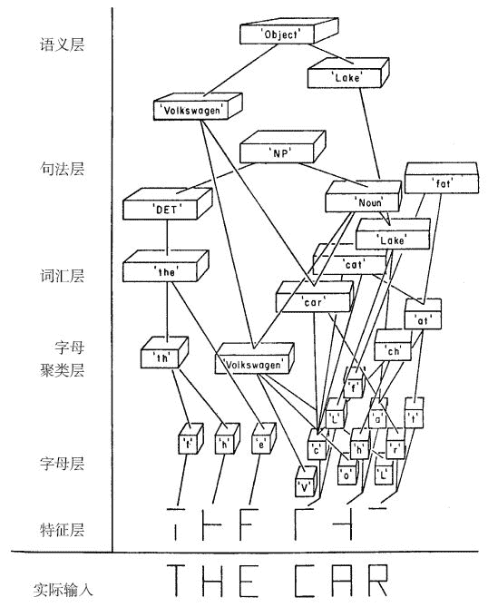

图 3.4 大卫·鲁梅哈特的神经网络草图，表明了我们大脑的信息传递网络是如何学会识别短语“THE CAR”的（资料来源：美国加州大学圣迭戈分校的大脑与认知中心）

读了鲁梅哈特的论文后，我更确信人工智能必须模仿人类神经信息处理，不确定性推理也需要类似的信息传递架构。那么传递的是什么信息呢？花了几个月才明白：一个方向是条件概率，另一个方向是似然比。

我设想网络分层，箭头从高层指向低层，即父节点指向子节点。每个节点向所有相邻节点发送对所跟踪变量的信念度，比如“我有2/3把握这个字母是R”。接收方按传导方向不同处理：父到子时，子节点用条件概率更新信念，像茶室例子；子到父时，父节点用初始信念乘以似然比更新，像乳房X光检查的例子。

把这两条规则在网络中反复应用就叫信念传播。这两条规则没有主观捏造，完全遵循贝叶斯法则。真正的难题是保证无论信息以何种顺序发送，最终都能收敛到一个平衡，且该平衡与教科书统计方法算出的结果一致。

这道难题耗费了我和同事们多年。八十年代末才解决，贝叶斯网络成为机器学习的实用方案。随后十年里，它被用在垃圾邮件过滤、语音识别等现实场景。之后我开始攀登因果关系之梯，贝叶斯网络的概率研究便交给了后来者。

## 给贝叶斯网络加燃料：数据如何进入
贝叶斯的逆概率规则是最简形式的贝叶斯网络，虽然他本人并不知道。常见的形态有 `茶→饼`、`疾病→检测`，或更普遍的 `假设→证据`。不同于本书后文的因果图，这里箭头没有因果含义，只表示我们知道前向概率，如 `P（烤饼|茶）` 或 `P（检测|疾病）`。贝叶斯法则讲的正是如何用先验乘以似然比来实现反向推理。

信念传播的处理方式与箭头是否有因果意义无关。但直觉上，因果情境更让人信服，因为大脑天生擅长理解因果，而非单纯关联。

在掌握单连接双节点网络后，下一步是引入双连接三节点网络，我称之为接合。它是所有贝叶斯网络和因果网络的构件。共有三种基本形态。

1. `A→B→C`。这是链式或中介接合。B常被视为把A效应传递给C的机制。经典例子是 `火灾→烟雾→警报`。警报并非由火灾直接触发，而是烟雾分子触发。切断链中第二个连接，比如把烟雾抽走，警报就不会响。这个观察引出屏蔽概念：B屏蔽了A到C的信息。已知烟雾取值后，关于火的新信息不会再改变对警报的信念。条件独立性若存在就应体现在数据中。若数据库记录了火灾、烟雾、警报的实例，只看“烟雾=1”的行，火灾取值不同时，警报=1的概率保持一致。即使警报有5%故障率，屏蔽依然成立：烟雾=1时，火灾0或1，警报=1的概率都是95%。这就是以变量为条件或控制变量，给机器提供只关注相关信息、忽略虚假信号的能力。

2. `A←B→C`。这是叉式接合，B是A和C的共同原因或混杂因子。它会制造统计关联，即使无直接因果。大卫·弗里德曼的例子是 `鞋码←年龄→阅读能力`。大鞋码孩子读得好，不是因为鞋，而是年龄在作祟。卡尔·皮尔逊和尤尔指出，以年龄为条件就能消除虚假关联。只看七岁孩子，鞋码与阅读能力就不相关。给定B后，A和C条件独立。注意，若存在其他因果路径环绕，独立性会被改变。贝叶斯网络的妙处在于，理解这三种基本接合就足以读出任意复杂网络的所有独立性。

3. `A→B←C`。这是最迷人的对撞接合。菲利克斯·艾尔威特和克里斯·文史普用演员为例：`才华→名人←美貌`。才华和美貌在一般人群中独立，但对撞后行为逆转。条件于B时，原先独立的A和C变得相关。若只看名人，才华与美貌呈负相关：不漂亮的名人更可能有才华。这是解释偏倚或“辩解效应”。若成功只需才华或美貌其一，已知名人身份，才华好就能解释成功，美貌需求下降；演员演技差，则成功只能靠美貌解释。这种负相关在数据中真实存在。

三种接合像通往因果第二层级的钥匙孔，让我们窥见观测数据背后的因果过程。每种接合在数据中留下条件独立或非独立的标记。公开讲座里我称它们为“神的恩赐”，因为它们能检验模型、发现模型、评估干预。但要真正打开大门，需要一把完整的钥匙，那便是第七章的d-separation，即分隔定理，它统一了三种接合，能告诉我们模型中任一路径在数据里应出现何种概率依赖。

图示是贝叶斯网络的引擎，而燃料是条件概率表CPT。图示定性描述关系，要得到定量答案就必须提供定量输入。每个节点须给出在给定父节点条件下自身的条件概率，根节点则只给出先验。

比如 `疾病→检测` 中，疾病是根节点，给出患病先验1/700，未患病699/700。把节点说成根，并非说它没有成因，而是其先验因可被先验概率概括。若家族史只通过疾病影响检测，就不必单独列出；若它直接影响检测，就必须显式建模。

再看检测节点以疾病为父节点，2×2表描述“听从”关系。若疾病=0，检测=0概率88%，检测=1概率12%。假阳性率12%，敏感度73%与先前信息一致。

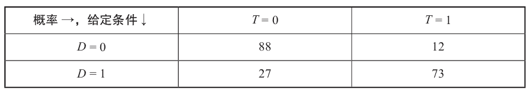

面对更复杂网络，CPT会随之膨胀。若节点有两个父节点，就需四个条件列。斯蒂芬·康拉迪和莱昂内尔·焦夫在BayesiaLab提出的旅行例子很贴切：“我的行李箱在哪里？”

你从德国亚琛飞抵桑给巴尔，行李迟迟未到。其他乘客已取完箱，问题是你的箱子没有随航班运来的概率有多大？答案取决于等待时长。刚开始传送带才转，应耐心；等了很久则不妙。可通过因果图量化这种焦虑。

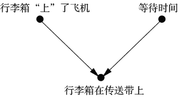

图 3.5 机场/行李箱例子的因果图

行李箱会不会最终滚到传送带上，本质上取决于两个前提。它必须先跟着你一起登机，否则根本不可能出现；只要它真的已经上飞机，随着时间推移，被卸到传送带上的概率就会不断累积。

把这个问题写成因果结构后，我们需要一张条件概率表来落地。我们假设桑给巴尔机场某趟航班的所有托运行李能在十分钟内全部卸完，当地效率很高。同时先验上，我们给“行李箱真的上飞机”设定 50% 的可能性，P（行李箱上飞机＝真）＝50%。这个数字照抄康拉迪和焦夫，如果冒犯了亚琛机场的同仁就先道歉，个人其实更倾向 95% 这样更高的先验。

表 3.3 一个更复杂的条件概率表

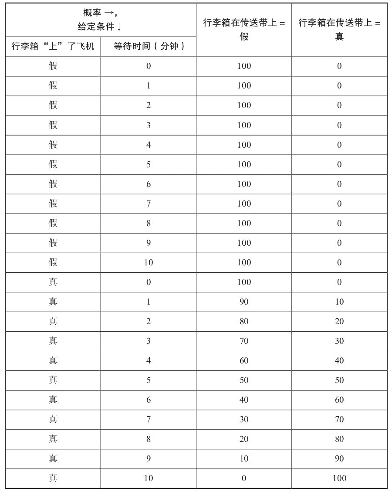

这张表信息量很大，却不难读懂。表格数字部分的前 11 行对应行李没有上飞机的情形，行李箱上飞机＝假。那无论你等多久，它都不可能出现在传送带上，P（行李在传送带＝假｜行李上飞机＝假）始终是 100%。

后面的 11 行描述的是正常卸货过程。假设行李真的登机了，工作人员以稳定速度卸货。第一分钟被卸下的概率约 10%，第二分钟也是 10%，依此类推。等到 5 分钟，累计概率达到 50%，即 P（行李在传送带上＝真｜行李上飞机＝真，等待 5 分钟）＝50%。等满 10 分钟，所有行李都该出来了，所以 P（行李在传送带上＝真｜行李上飞机＝真，等待 10 分钟）＝100%。表格右下角那个 100 就是这个意思。

贝叶斯网络最有趣的地方在于反向推理：已经等了 x 分钟还没见到箱子，它当初到底有没有登机？贝叶斯法则会自动完成这组逆概率计算，得到的走势相当反直觉。我们称之为“放弃希望曲线”。

在先验 50% 的假设下，等 1 分钟后，行李仍在飞机上的后验概率还有 47%。等到 4 分钟，概率掉到 33%。等到 10 分钟，概率归零。图 3.6 画出了这条下降轨迹。它不是我们想象中的直线，而是先慢后快。这其实是个乐观的消息：别太早绝望。在总时长 10 分钟的前半段，你大概只会失去三分之一的希望。

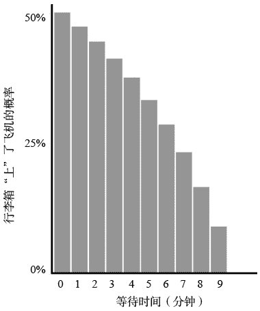

图 3.6 看到自己的行李箱出现在传送带上的概率一开始下降缓慢，之后则加速下降（资料来源：马雅·哈雷尔绘图，数据来自斯蒂芬·康拉迪和莱昂内尔·焦夫）

要不要自己手算这张概率表？恐怕没人愿意。就算只是 3 个节点的小网络，也涉及到 2×11＝22 个父状态组合，每个组合都贡献子节点的概率。对计算机而言这是小菜一碟，但如果不系统化，计算量会迅速压垮任何超级计算机。一个节点若有 10 个父节点，每个父节点 2 个状态，条件概率表就超过 1000 行。若每个父节点有 10 个状态，表格将膨胀到 100 亿行。为此人们会精简网络连接，只保留关键边，让结构保持稀疏。贝叶斯网络的进展之一，就是利用这种稀疏性把计算时间控制在合理范围。

### 贝叶斯网络正在发生的真实案例

贝叶斯网络早已是成熟工具，有多家公司提供现成软件，而且渗透到各种智能设备里。回到本章开头提到的波拿巴 DNA 匹配系统。

荷兰法医研究所每天都在用波拿巴，处理失踪人口、刑事侦查以及移民案件，难民申请人必须证明在荷兰有至少 15 位亲属。最震撼的应用是灾后遇难者身份鉴定，马来西亚航空 MH17 坠机就是典型案例。

空难罹难者很难直接和中央 DNA 数据库匹配。常规做法是采集家属样本，寻找部分匹配。传统的亲子关系指数 Paternity Index 或同胞关系指数 Sibling Index 也能估算概率，但它们只适用于特定关系且对近亲才有效。波拿巴的初衷是让远亲、多重亲属的信息也能参与判定。它把家谱转化为贝叶斯网络。

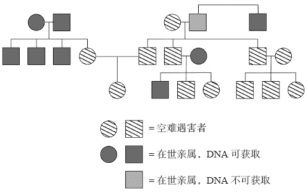

图 3.7 马航坠机事件中多名遇难者的真实家谱（资料来源：数据由威廉·伯格斯提供）

图 3.8 显示了波拿巴如何把家谱的一小部分映射为因果贝叶斯网络。核心难点是 DNA 检测到的基因型同时包含父母双方的贡献，但无法区分哪部分来自父亲。于是贝叶斯网络把父母的基因贡献，即等位基因，建模成隐藏的不可观测变量。波拿巴的工作就是从证据，比如遇难者有一个蓝眼基因一个黑眼基因，其父系堂兄弟姐妹都是蓝眼，母系表兄弟姐妹都是黑眼，推断出遇难者蓝眼基因来自父亲的概率。这正是逆概率问题，也是贝叶斯法则诞生的初衷。

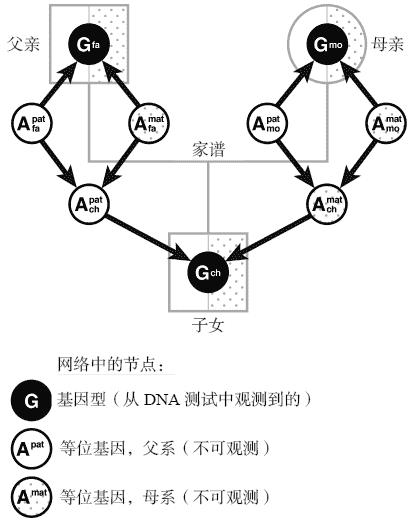

图 3.8. 从 DNA 测试到贝叶斯网络。在贝叶斯网络中，白色节点代表等位基因，黑色节点代表基因型。只有黑色节点是有数据的，但基因型无法指明哪个等位基因来自父亲，哪个来自母亲。贝叶斯网络可以对不可观测的节点进行推理，同时也可以估计某一特定 DNA 样本来自图示谱系中的子女的可能性（资料来源：马雅·哈雷尔绘图）

建立家谱网络后，只需输入遇难者 DNA，再用基于贝叶斯法则的信念传播计算匹配可能性。起点是对每个节点的信念赋值，随着新证据进入，信念在网络中连锁更新。发现某个样本可能匹配后，信息会在网络中扩散。于是波拿巴不仅能从在世家属处提取信息，也能从已有的鉴定结果中学习。

这很好地体现了贝叶斯网络的优势：网络建好后，调查员无需干预如何评估新片段，整个网络能快速自更新。作为整体，它对所有新信息做出反应。因此即使是遇难者的姑妈或二表哥的 DNA 也能帮助确认身份。网络像个有生命的有机体，触碰一个节点，信息就会向全网传播。

更关键的是透明性。与制造黑箱的机器学习不同，贝叶斯网络可以逐节点追踪，每条新证据如何改变各连接的信念。

波拿巴虽优雅，仍有短板：缺少人类直觉。分析完成后，它会按似然比给出 DNA 样本与家谱各节点的匹配排名。调查人员再把 DNA 证据和其他物证、个人直觉结合做最终决定。迄今没有完全由计算机独立完成的识别。因果推断的目标之一，就是把调查人员的直觉也纳入信念传播。

手机里的例子则更贴近日常。每个口袋里的手机都用到了基于信念传播的纠错算法。

通话时，你的声音被转成 1 和 0 的比特串通过无线电发送。信号不完美，部分比特会在传输中翻转。为了纠错，可加冗余。最笨的方法是每个信息比特重复三次，1 编码成 111，0 编码成 000。接收到 101 这种非法串时，解码器会选最可能的码字，判定为 1。这种方法信息量翻倍，效率很低。

解码其实是另一个逆概率问题：从收到 “Hxllo wovld！” 这样的证据，反推发送方本来是 “Hello world！” 的概率。信念传播正好适用。

1993 年，法国电信工程师克劳德·贝鲁震惊业界，他设计的纠错码性能接近理论最优，冗余量接近最小值。这个构想叫 turbo 码，很适合用贝叶斯网络解释。

图 3.9（a）显示传统纠错码的工作方式：信息比特通过代码 A 编码成码字，传输后带噪接收。可以用信念传播从接收比特推断发送比特，但它并不能提升代码 A 本身。

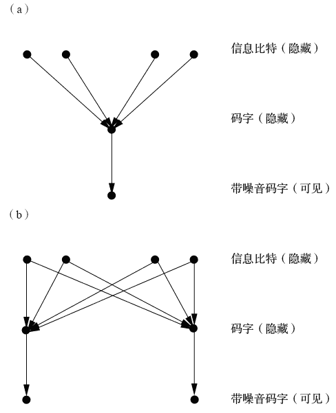

图 3.9（a）传统纠错码编码过程的贝叶斯网络表示：信息比特被转化为码字，它们到达接收方的传输和接收过程都伴随着噪声（错误）。（b）turbo 码的贝叶斯网络表示：信息比特被加扰并被编码两次，然后通过在贝叶斯网络中重复应用信念传播进行解码。在一个迭代过程中，底部的每个处理器都能使用来自其他处理器的信息改进其对隐藏码字的猜测

贝鲁的妙处是把每条消息编码两次，一次直接，一次加扰后编码。接收方得到两条带噪信息。没有现成公式能直接解，但重复在贝叶斯网络上应用信念传播，99.999% 的时间都能恢复正确比特，而且可以用更短的码字。两套代码 A 的效果胜过一套。

这个故事是真的，只有一个例外：贝鲁当时并不知道自己在用贝叶斯网络。他独立发现了信念传播算法。五年后，剑桥大学的大卫·马凯才意识到这与 80 年代末的贝叶斯网络是同一种算法。这让 turbo 码被纳入熟悉的理论语境。

更早在 1960 年，麻省理工的罗伯特·加拉格就用信念传播发现了类似代码，被马凯称为“跨时代的发现”。当时需要成千上万个处理器来传递信念信息，根本不可行，所以几乎被遗忘，直到 1998 年马凯重新发现。如今它就在每部手机里。

2G 手机用软解码，3G 用贝鲁的 turbo 码，4G 用加拉格的类 turbo 码。对用户而言，手机更省电续航更长，编码解码是手机能耗大户。信号更远也更清晰。贝叶斯网络让“沟通无处不在”的承诺真正兑现。

### 当贝叶斯网络遇见因果图

讲了一章贝叶斯网络后，自然会问它和第一章的因果图是什么关系。贝叶斯网络抓住了因果图与数据交互的关键。它的概率性质、联合分布形式和信念传播算法在因果图中依然有效，对理解因果推理不可或缺。

两者主要区别在构造与用途。贝叶斯网络本质上是巨大概率表的紧凑表示。箭头表示子节点的概率由父节点通过条件概率表决定，且这种关联是充分的。知道两个节点的父节点值后，缺少箭头的节点在条件上独立。我们在链 A→B→C 中看到过：知道 B 后 A 与 C 条件独立。

如果把同一张图画成因果图，解读会改变。构建时要问每个变量“听命于”谁。A→B→C 中 B 只听 A，C 只听 B，A 由外部决定。反转箭头得到 A←B←C，因果解读剧变，但条件独立性不变。A 与 C 在已知 B 时仍独立。

这有两个含义：因果假设必须经数据检验，可证伪。若以 B 为条件观测到 A C 不独立，就说明链模型与数据冲突。另一方面，仅靠数据无法区分叉接合 A←B→C 和链 A→B→C，因为它们有相同条件独立性。

因果图的另一种解读是假设实验。箭头代表若单独调控父节点，子节点概率会变化；箭头缺失则表示在固定父节点时调控无关变量不会影响子节点。于是“已知 B 的值”变成“保持 B 不变”。

贝叶斯网络只能回答第一层问题：观察到另一起事件时，某事件发生的可能性。因果图能回答更高层问题：干预和反事实。叉接合 A←B→C 明确告诉我们调整 A 不会影响 C。贝叶斯网络不能区分观察与干预，也分不清叉接合和链。

因果图的图形结构允许我们在不做真实实验的情况下模拟干预。以叉接合为例，A 与 C 的相关是伪相关。实验上调控 A 会发现无关联。通过控制变量操作也能复现：对 B 进行控制后，A 与 C 的相关会变为零。这可以用数据估计，从而验证直觉。

假使贝叶斯网络的统计特性并未在 1980 年到 1988 年间被人们捕捉到，我们就无从获得那种利用精明观测来“扮演”干预的办法。今天正是因为有了这套认识，我们才能够先行判定在一次观察性研究里需要收集哪一批变量，从而对干预的后果做出预测。它的价值还不止于此，也能处理起“为什么”的追问。比如有人会问，操纵`A`后`C`为何变动，这份变动到底有多少源自`A`对`C`的直接作用，又有多少是经由中介`B`传递的？若两种路径同时存在，我们是否还能算出被`B`所中介的比例？

要回答中介效应这类问题，就必须在思想上同时实施两项操作：把`A`调到某个水平，同时把`B`固定住，这与单纯“以`B`为条件”进行统计控制并不相同。若能在现实中真正实施这两项干预，答案就会立刻显现。但一旦只能依赖观察性数据而无法动手干预，就得靠一系列巧妙的观测设计来模拟这两项行动。是否可以模拟，图的拓扑结构会给出明确的指示。

1988 年我开始尝试把因果语义与图形结合时，以上这些功能都还不存在。我当时的认识仅限于，按我设想的问题，贝叶斯网络根本应付不了。意识到光靠数据就无法把`A←B→C`和`A→B→C`区分开来，实在让人沮丧。

我知道读者此刻很想知道因果图究竟怎样让上述计算成为可能，这部分内容会在第七章到第九章展开。只是现在时机还不成熟，因为一旦把观察性研究与试验性研究摆到一起讨论，我们就从人工智能领域相对平静的水域驶入了统计学里波涛汹涌的海面，而这股浪潮正是统计学与因果关系分道扬镳后激起的。回头看，费心让学界接受因果图所付出的代价，与当年让人工智能界接纳贝叶斯网络相比，已不算什么——那更像是一次轻松的郊游，而非豪华巡游。战事仍在继续，只剩下少数孤岛还在顽抗。

要渡过这片新水域，就得先弄清楚传统统计学家处理因果关系的惯用手法，以及这些手法的边界。我们前面提到的干预效应估计、直接效应与间接效应的拆分，并不在主流统计学的版图内，原因很简单：该学科的奠基者有意剔除了因果表述。唯一的例外是随机对照试验 `RCT`，在 `RCT` 中“处理`A`”被随机分派给部分个体，之后比较两组在结果变量`B`上的差异。此处传统统计学与因果推断在“`A`导致`B`”的含义上达成了一致。

在转向由因果模型照亮的新因果科学之前，有必要先审视旧的模型盲科学的长处与短板：为何必须随机化才能断言`A`导致`B`，随机对照试验试图剔除的威胁——混杂——究竟是什么。下章会专门讨论。根据经验，大多数统计学者和当代数据分析人员对这些议题都感到不自在，因为他们习惯用数据中心的话语来表达，难以说清因果问题。对“混杂”一词的理解也往往各不相同。

把因果图梳理清楚后，我们就能把随机对照试验放到更合适的理论框架里去谈。它既可被视为因果推断机器的一个特例，也可把因果推断看作随机对照试验的广泛延伸。两种说法都成立，只是对于接受传统统计训练、把随机对照试验奉为因果裁决者的人来说，后一种表述会更顺耳。

[\[1\]](#part0008.html#note1) 贝叶斯留给后世的资料很少，他生前发表过的两篇文章都与概率论无关，但他的遗作《论有关机遇问题的求解》（1763）给他带来了无尽的荣耀。在这篇论文中，他推导出了逆概率公式，即著名的贝叶斯法则。很难评述贝叶斯本人对概率的哲学认识，他的学说被后继者们赋予了更广泛、更深刻的内涵，以致发展成为贝叶斯学派，甚至贝叶斯主义。频率派和贝叶斯学派对贝叶斯法则的理解是不同的，因而两派借助它来进行推断的手法也不相同。贝叶斯法则是贝叶斯推断的核心，拉普拉斯称之为“最基本原理”。——译者注

[\[2\]](#part0008.html#note2) 贝叶斯学派认为，随机事件（或不确定性事件）`A`的概率仅是个体主观认为`A`会发生的信念度。例如，我认为“爱因斯坦在 1945 年 8 月 6 日早上掷过骰子”的概率是 90%，而显然没有可重复的随机试验能证实此事，它仅仅表达了我对这个陈述的相信程度。——译者注

[\[3\]](#part0008.html#note3) 换句话说，`P（火灾，警报|烟雾）=P（火灾|烟雾）P（警报|烟雾）`。请注意，独立性只是概率测度的一种性质，而不是事件本身的性质。——译者注

# 第四章 混杂与去混杂：终结潜伏变量

如果随机对照试验的缔造者能够提前借鉴我们当下的因果效应理解，它本可在费舍尔出现前五百年就诞生了。

——作者（2016）

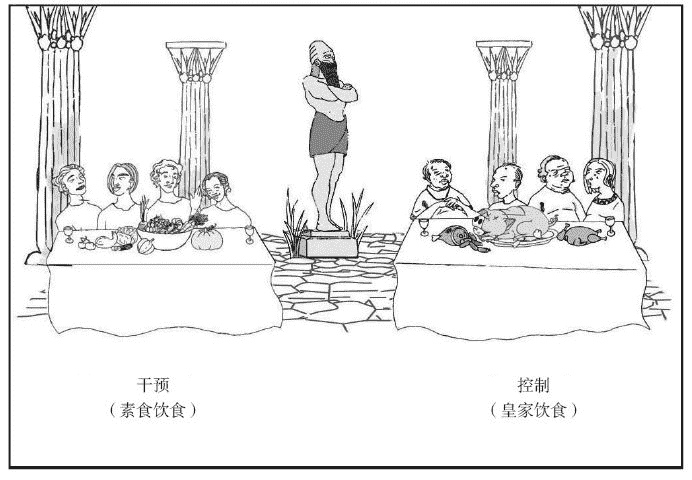

有关丹尼尔的这一圣经记载常被视作历史上最早的对照试验。丹尼尔很可能站在左数第三位，他意识到只有预先挑选，让两组比较对象在各方面尽量相近，才能公平评估两种饮食的效果。尼布甲尼撒王站在后方中央，被试验结果所折服。资料来源：达科塔·哈尔绘制。

尼布甲尼撒王宫的太监长亚施毗拿在公元前 597 年遇到了难题。巴比伦王洗劫犹大后带回大批俘虏，其中不乏耶路撒冷的贵族。按惯例，尼布甲尼撒要挑一批子弟进入王宫服役，亚施毗拿被命挑选“无缺、外貌俊美、多才、通晓学识的少年”。这些孩子将接受巴比伦语言文化的训练，作为帝国的管理储备。教育的一部分就是食用王室膳食，饮用王室美酒。

麻烦就出在这里。亚施毗拿最看重的一个男孩丹尼尔拒绝食用这些食物。出于宗教戒律，他不能吃犹太律法禁止的肉类，并请求为他和同伴提供素食。亚施毗拿很想成全，但担心国王看到他们面露愁容，与同龄孩子不同，自己便会丢掉脑袋。

丹尼尔向亚施毗拿保证素食不会削弱服侍能力，并提出一个方案：“给我们十天，让我们四人只吃素，另一组孩子照常吃肉喝酒。十天后再比较结果，到时按你所见决定。”

故事的后续或许不难猜测。丹尼尔四人在素食下依然健康成长。国王为他们的智慧、学识以及健康的外表所动，让他们在宫中担任要职，“他们比所有术士和占星家强上十倍”。后来丹尼尔解梦，并在狮子坑中幸存，形成一段传奇。

无论史实如何，这个故事以深刻的方式概括了现代实验科学的做法。亚施毗拿在问一个因果问题：素食会让我的奴仆消瘦吗？丹尼尔给出的是一种方法论：组建两组人群，确保他们在所有相关特征上相同或相似。对其中一组施加新处理，另一组作为对照，不施加或继续原处理。经过足够时间，若两组在假定可比的前提下出现可测差异，新处理就是差异的来源。

我们今天称之为对照试验。其逻辑很直观。想了解饮食的因果作用，就需要对比丹尼尔在两种饮食下的身体状态。历史无法回溯，所以最佳替代方案是把接受素食的一组与未接受素食但条件相仿的一组进行比较。关键且显而易见的是，这两组必须可比，并且代表某个总体。在此条件下，试验结果才具备外推性。值得赞赏的是，丹尼尔似乎已明白这一点。他并非只为自己争取素食，而是若试验显示素食更合适，那么来自以色列的奴仆都可被允许选择素食。至少“按你所见决定”这句话可作如此解读。

丹尼尔还强调了组间比较的重要性，这一点比今日许多人的认识更成熟。例如，很多人选择流行饮食，往往只是因为朋友尝试成功减重。但仅凭朋友经验就做决定，等于假设自己在所有相关方面与朋友一致：年龄、基因、成长环境、过往饮食等，隐含假设太多。

丹尼尔试验的另一要点是前瞻性：两组是事先挑选的。反观之，若你看到广告里二十人宣称某种饮食让他们成功减重，样本看似不小，容易让人信服。但这其实是在用已经成功的人的经验做决策。而你可能不知道，对每个成功者而言，还有十个条件相似的人尝试失败，却永远不会出现在广告里。

从这些角度看，丹尼尔的试验极具现代性。前瞻性对照试验至今仍是可靠科学的标志。然而丹尼尔忽略了一件事：混杂偏倚。若丹尼尔四人在一开始就比对照组更健康，那么十天素食后的健康状态可能并非饮食所致，而是原本体质的反映。换言之，若吃皇家肉食，他们或许会更强壮。

当某个变量同时影响处理接受与结果时，混杂便出现。有时混杂因子已知，有时只是潜在的第三变量。在因果图中，混杂因子很容易辨认。在图 4.1 中，位于分叉中心的`Z`就是`X`与`Y`的混杂因子。稍后会给出更一般的定义，但这种三角形是最常见也最易识别的形式。

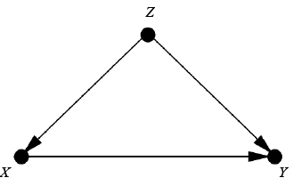

图 4.1 混杂的最基本形态：`Z`是`X`与`Y`关系的混杂因子

“混杂”本意是混合，图示解释了名称的由来。在图 4.1 中，真实因果效应`X→Y`与叉结构`X←Z→Y`诱发的虚假相关混在了一起。比如我们想检验一种药物，若让平均年龄更低的患者使用药物，而对照组年龄偏高，年龄就成为潜伏的第三变量混杂因素。没有年龄数据时，我们无法把药物的真实效果从虚假效果中剥离。

反过来也成立。若我们测量了第三变量，就能把真实与虚假效果区分开。假若混杂因子`Z`是年龄，我们可在每个年龄层内分别比较处理组与对照组^([\[1\]](#part0009.html#note1n))，再按目标人群各年龄层的比例加权，就能得到药物的平均效应。这种补偿策略统计学家都很熟悉，称为“`Z`调整”或“`Z`控制”。

有趣的是，统计学家既高估又低估了为混杂因子调整的重要性。高估体现在常控制过多变量，甚至控制不应控制的变量。政治博主埃兹拉·克莱因曾指出这种过度控制：“你在研究里到处能看到‘我们控制了……’，然后列出一长串变量，收入、年龄、种族、宗教、身高、发色、性取向、锻炼频率、父母之爱、可口可乐还是百事可乐……仿佛控制越多越有说服力。控制带来精确感，却也可能把真正想测量的东西给控制掉了。”统计学家对该控与不该控缺乏清晰标准，于是默认测量什么就控制什么。当前绝大多数研究都如此，程序简单却浪费且易错。因果革命的重要成果之一就是终结这种混乱。

同时，统计学家又严重低估了控制的意义，他们不愿谈因果，即使做了正确的控制。本章想传达的观点正好相反：若在因果图中确定出去混因子集的充分集合，收集数据并做恰当统计调整，就有权宣称已计算出`X→Y`的因果效应，前提是你能从科学上清楚论证并捍卫你的因果图。

传统上处理混杂的方法建立在费舍尔力主的随机对照试验之上。主张本身正确，但费舍尔提出时的动机并不完全理想。随机对照试验是极好的发明，但长期以来追随者无法用语言说明他们想要什么——即`X`对`Y`的因果效应。本章将从因果图角度解释，为何随机对照试验能估计`X→Y`并免受混杂偏倚。一旦理解其工作原理，就不必再把它神化为因果分析的黄金标准。相反，我们会认识到这一黄金标准源自更基本的原理。

本章还将展示因果图如何让人把分析重心从混杂因子转向去混因子。前者制造问题，后者解决问题。二者可能重叠，也可能不重叠。只要拥有去混因子充分集的数据，即使忽略部分或全部混杂因子也无妨。

因果革命让我们能够在非试验性研究中推断因果效应，主要依靠这种重心的转移。它能明确指出该控制哪些变量以达成去混杂。几十年来，这正是困扰理论与应用统计学家的致命弱点，因为混杂是因果概念，属于因果之梯的第二层，与统计或数据无关。

上世纪九十年代发明的因果图方法已基本解决了混杂问题。尤其是后门准则，可以在因果图中明确识别哪些变量是去混因子。若能收集这些变量的数据，就可进行统计调整，从而在不实施干预的情况下预测干预结果。

因果革命甚至走得更远。在某些情形下，即使没有去混因子充分集的数据，仍可控制混杂，使用不同于传统公式的统计调整来消除混杂。这些进展将在第七章讲述。

在几乎所有科学领域中，混杂都是历史难题，直到最近才被认识到需要因果而非统计方法解决。直至 2001 年，某权威期刊审稿人仍坚持“标准统计学中混杂处理已有坚实理论基础”。这类声音近年急剧减少。如今流行病学、哲学、社会科学等领域已达成共识：混杂需要因果解决方案，因果图提供完整系统的方法。深受混杂困扰的时代已结束。

## 对混杂的长期恐惧

1998 年，《新英格兰医学杂志》发表一项研究，发现退休男性散步频率与死亡率下降相关。研究利用檀香山心脏计划数据，自 1965 年起追踪约 8000 名日裔男性。

由弗吉尼亚大学生物统计学家罗伯特·阿伯特领衔的团队想弄清，运动更积极的人是否更长寿。他们在 8000 人中挑选出 707 人，健康状况足以行走。团队发现，在 12 年追踪期内，每天步行不足 1 英里^([\[2\]](#part0009.html#note2n))的男性，死亡率是每天步行超过 2 英里的男性的两倍。具体而言，12 年后偶尔步行者中有 43% 去世，经常步行者只有 21.5%。

由于研究者并未预先指定谁是偶尔步行者、谁是经常步行者，混杂偏倚的可能性必须考虑。显而易见的混杂因子是年龄：样本中年轻男性可能更爱锻炼，其死亡率自然更低。因此可画出如图 4.2 的因果图。

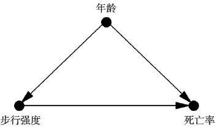

图 4.2 步行例子的因果图

以年龄为中点的经典叉结构告诉我们，年龄是步行强度与死亡率的混杂因子。你可能还能想到其他混杂，比如懒散的性格、行动受限等。因此身体状况也可能是混杂。若饮酒、暴饮暴食等也相关，则同样可能构成混杂。

好消息是研究者考虑了这些。他们采集了每个潜在影响因素的信息，包括年龄、身体状况、饮酒与饮食习惯等，并逐一进行统计调整。例如，数据确实显示经常步行者略年轻。研究者据此调整死亡率后，发现偶尔与经常步行者之间的死亡率差距依然很大。年龄调整后，偶尔步行者死亡率为 41%，经常步行者为 24%。

即便如此，研究人员在结论上仍十分谨慎。文章末尾写道：“当然，我们的研究并未解决一个问题，即让体力充沛的老年男性主动增加日行距离对其寿命有何影响。”用第一章的语言说，就是对“若对受试者施加 `do（锻炼）`，他们在 12 年追踪后存活概率如何”这一问题拒绝回答。

公平地说，阿伯特团队有理由谨慎。这是首次研究，样本量相对小且同质。然而这种谨慎也反映了一种更普遍的态度，远超样本同质性与规模问题。研究者被教导，一项观察性研究永远无法得出因果结论。我认为这种谨慎过于夸张了。为何不把关联中的虚假部分剔除，以更好地理解因果效应，而要因为混杂因子而放弃对因果效应的估计呢？

与其一上来就说“这种事肯定无可探究”，不如大方承认，人为干预的话题完全可以摆上台面拿来讨论。只要我们接受阿伯特团队已经把所有重要的混杂因素都找出来了，就必须承认，至少在日本血统的老年男性群体里，刻意提升步行强度很可能真的会延长寿命。

这个初步判断建立在非常明确的前提上：我们假定在所观察到的联系里，没有其他混杂因素在背后起主导作用。恰恰是这种前提的坦诚，让有散步意愿的人能清楚看见结论里藏着多少不确定性，而这种残留的不确定性本身并不比“还有未被考虑到因素”更糟。它同时指引了后续研究的重点：与其重复验证已有的控制变量，不如把精力放在去挖掘可能存在的其他影响因素。归根到底，弄清楚一个结论依赖了哪些假设，比盲目用随机对照试验去绕开假设更有意义，而随机对照试验本身也自带局限。

## 随机试验为何能问对问题

正如前面所说，科学家愿意开口聊因果，往往是因为手上已经有过随机对照试验。网上到处都能看到“随机对照试验是临床研究的黄金标准”这句话，这个结论要感谢费舍尔。费舍尔的至亲曾为他写过一篇小文，解释他为何提出随机对照试验，文字生动，耐读。文章的核心是“对自然的巧妙发问”。观察只能给我们一幅带瑕疵的大自然图景，科学家想检验的，是如何建立因果解释的问题。问题以实验操作的形式出现，必须依赖大自然内在的一致性，从特定情境的回答推导出一般推论。

大自然却远不如表面稳定，回答总是摇摆、模棱两可。她像是从地里自己冒出问题，而不是按科学家事先设定的框架作答，也不提供免费解释，只求准确。因此，把田地一分为二、分别施用两种肥料再比较产量的做法，往往白费功夫。真正该问的是在相同处理下两块地是否会一致，而不是地块 A 用肥料 1 与地块 B 用肥料 2 的产量差异。因为自然同时记录了肥料效应、土壤肥力、质地、排水、地形、微生物等无数变量的影响。

这篇文章的作者是罗纳德·艾尔默·费舍尔的女儿琼·费舍尔·博克斯。虽非统计学家，她却精准抓住了统计学家的核心困境：问题本意是建立因果，却被混杂阻挡。她想知道的是肥料效应的净差异，而自然把肥料效应与大量其他因素搅在了一起。

博克斯用了一个形象的比喻：自然像个精灵，她回答的正是你问的问题，但不一定是你真正想问的问题。我们必须相信，想问的问题的答案在自然里是存在的。实验只是粗糙的寻找手段，并不能定义答案本身。按这个比喻，更该先考虑的是 `do（X=x）`，因为它代表我们真正想问的：把整片土地都用上第一种肥料会怎样？随机化只是为了引出这个答案的人为操作，像温度计的刻度，只是一种呈现温度的方式，而非温度本身。

费舍尔早期在洛桑试验站工作时，用非常细致的结构化方法把肥料效应从其他变量里剥离。他把田地切成若干子块，精心安排让每种肥料与特定土壤类型和作物搭配，力求样本可比。但现实中，他不可能预见到决定地块肥力的所有混杂因素。聪明的自然精灵总能击败对一块田地任何结构化布局。

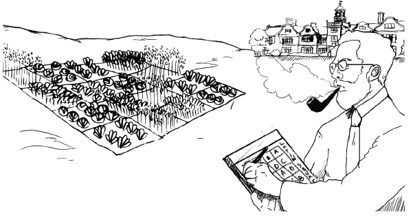
图 4.3 费舍尔的一项创新：拉丁方设计，保证每一行即肥料类型、每一列即土壤类型中都种植了全部作物类型。这类设计至今仍在使用，只是后来费舍尔有力指出随机设计更有效。图源：达科塔·哈尔绘制

大约在 1923 年到 1924 年间，费舍尔意识到唯一能让精灵失效的设计就是随机试验。想象在肥力未知的土地上重复 100 次试验，每次都为所有子地块随机分配肥料。有时 1 号肥料恰好全落在了最贫瘠的地块，有时又恰好全落在了最肥沃的地块。但总体上，每次随机分配保证了大部分情况下既不特别走运也不特别倒霉，1 号肥料所覆盖的子地块能代表整块田地。土地的肥力分布在系列试验中保持不变，自然精灵也就被迫回答了那个因果问题。

在今天看来这些发明顺理成章，但在当时，随机化的提议吓坏了费舍尔的同行。用抽签决定肥料分配，让他们觉得科学不得不屈从于运气。但费舍尔明白，得到对正确问题的模糊答案，远好过对错误问题的精确答案。对错误问题提问，永远得不到想要的答案；对正确问题提问，偶尔出错完全可以接受，且不确定性来自已知的随机化过程，而非未知的土壤特性。

因此随机化带来两重好处：一是消除混杂偏倚，向自然提出正确问题；二是让研究者能量化不确定性。据史学家斯蒂芬·施蒂格勒，第二个好处正是费舍尔力推随机化的主要动机。他是量化不确定性的大师，后来开发了大量数学工具，而他对去混杂的理解更多是直觉性的，因为当时缺乏表达这种想法的数学符号。

如今 `do` 算子补上了费舍尔想说却说不出的部分。让我们从因果角度看看随机化如何帮助我们问对问题。

通常，模型 1 如图 4.4 所示，描述了正常条件下地块产量的决定因素。农民心血来潮地决定每块地用什么肥料。他真正想问的是“整片土地统一施用肥料 1 相比肥料 2 的产量如何”，即 `P（产量|do（肥料=1））` 的值。

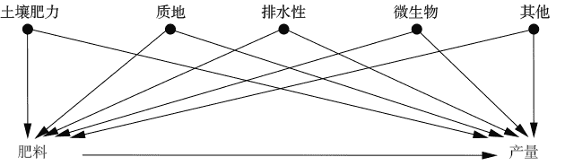
图 4.4 模型 1：一次有偏的对照试验

如果农民在高处用肥料 1、低处用肥料 2，就引入了排水性的混杂；如果第一年用肥料 1、第二年用肥料 2，就引入了天气的混杂。两种情况都会得到有偏比较。

农民想知道的世界实际上由模型 2 描述，所有地块接受相同处理，见图 4.5。`do` 算子的作用是切断所有指向肥料的箭头，并强制变量取值，例如 `肥料=1`。

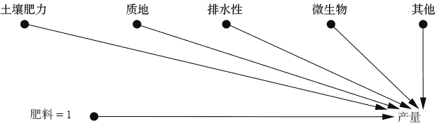
图 4.5 模型 2：我们想要认知的世界

在随机化世界里，部分地块接受 `do（肥料=1）`，部分接受 `do（肥料=2）`，分配由随机装置决定，如费舍尔的扑克牌。模拟世界见图 4.6。

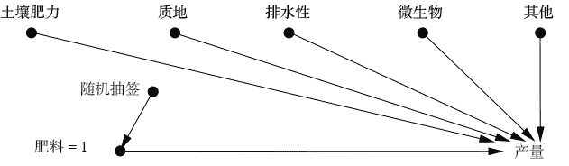
图 4.6 模型 3：随机对照试验模拟的世界

所有指向肥料的箭头都被清除，肥料取值只听从抽签结果，且抽签指向产量的箭头不存在，作物读不懂抽签结果是安全假设，人类受试者则需谨慎。因此模型 3 中肥料与产量无混杂，观察到“肥料=1”与实际实施“肥料=1”无区别。

关键在于，随机化是模拟模型 2 的手段。它让旧有混杂失效，又不引入新混杂。正如博克斯所说，它只是对自然的一次巧妙询问。

若允许试验者自行挑选肥料或受试对象，就无法模拟模型 2。对人类受试者进行临床试验时必须双盲，原因正在于此。

当然还有别的模拟模型 2 的办法：如果你知道所有可能的混杂因素，可以测量并做统计调整。相对而言，随机化优势明显，它切断了处理变量的所有入边，包括未知或无法测量的那些。

在非随机研究里，研究者必须依赖自己对试验主体的认知。若他相信因果模型中的去混杂因子充足且已收集数据，就能客观估计肥料对产量的影响。危险在于可能忽略某个混杂因子，导致估计有偏。

就像走钢丝需要安全网，满足条件时随机对照试验仍是首选。但很多时候条件不满足：干预不可行，如研究肥胖对心脏病的影响不能随机让人肥胖；或不道德，如不能随机让人抽烟十年；或招募困难，志愿者无法代表目标人群。

幸运的是，`do` 算子提供了在非试验研究中确定因果效应的科学方法，挑战了随机对照试验的霸主地位。如步行与死亡率的例子所示，基于观察性研究得到的因果估计会被标记为“暂定因果”，其成立依赖因果图所蕴含的一组假设。这种研究不应被视为二等公民，它能在人群的真实生活场景中作业，不受伦理和可行性污染。

明白了随机对照试验的核心是消除混杂，接下来看因果革命带来的其他去混杂途径。这个故事始于 1986 年两位老同事发表的一篇论文，开启了对混杂含义的重新审视。

## 混杂的再定义

“尽管混杂被广泛认为是流行病学核心议题之一，文献回顾却显示学界对混杂或混杂因子的定义从未达成一致。”加州大学洛杉矶分校的桑德·格林与哈佛大学的杰米·罗宾斯由此指出，自费舍尔以来为控制混杂所做的努力并未取得实质进展。缺乏对混杂本质的清晰认知，科学家在观察性研究中无法做出有意义的陈述。

混杂究竟该如何定义？掌握了因果逻辑后答案很直接。我们观察到的是条件概率 `P（Y|X）`，我们想问自然的是 `X` 与 `Y` 的因果关系，可由干预概率 `P（Y|do（X））` 获得。于是混杂可简单定义为导致 `P（Y|X）≠P（Y|do（X））` 的全部因素。

遗憾的是，在 `do` 算子出现前事情并不简单。即便今天，随便拦住一个统计学家问混杂意味着什么，仍可能得到令人费解的答案。最近一本权威合著的书用了整整两页解释混杂，至今鲜有读者真正读懂。

难点在于混杂不是统计概念，而是我们想评估的内容与实际用统计方法评估的内容之间的差距。若无法数学表达想评估的内容，就无法定义差距。

历史上，混杂概念围绕不可比性和潜藏第三变量两个“抗形式化”的思想展开。可比性要求处理组和对照组在所有相关方面相同，这需要区分相关与无关属性。而潜藏第三变量的定义同样模糊：混杂因子是 `X` 与 `Y` 的共同原因？还是仅与它们相关？借助因果图和 `do` 算子，我们今天能明确哪些变量导致 `P（X|Y）` 与 `P（X|do（Y））` 差异，而在没有这些工具的时代，几代统计学家和医学专家不得不寻找替代定义，均不令人满意。

关于混杂的替代定义大致分两类：声明性定义和过程性定义。典型的错误声明性定义是“与 `X` 与 `Y` 都相关的任何变量”。过程性定义则依赖统计检验来刻画混杂，吸引那些喜欢直接看数据而非建模的统计学家。

一个著名过程性定义叫“非溃散性”，出自挪威流行病学家斯文·亨伯格 1996 年的论文：“可将天然相对死亡风险与按潜在混杂因子调整后的相对死亡风险比较，二者差异即表明混杂存在，应采用调整后结果；若无差异则混杂不是问题。”也就是说怀疑混杂就做调整比较，有区别就采校正值。亨伯格并非首倡者，但这种做法误导了一个世纪的流行病学、经济学和社会学研究，至今仍在应用统计中占据一席之地。

另一个流行的声明性定义经历了演进。《流行病学方法与概念史》作者阿尔弗雷多·莫拉比亚称之为“经典流行病学定义”，包含两条件：混杂因子 `Z` 与 `X` 在总体上相关，且在未接受处理 `X` 的人群中与 `Y` 相关。近年又加第三条件：`Z` 不应位于 `X` 与 `Y` 的因果路径上。

注意“经典版”只用统计术语，其中第一条件尤其明显：`Z` 只是相关，而非因。1951 年爱德华·辛普森提出了复杂的第二条件“在未接受处理的人群中 `Y` 与 `Z` 相关”。从因果看，他想剔除由 `X` 对 `Y` 的因果效应引起的 `Z` 与 `Y` 的相关部分，即 `Z` 对 `Y` 的影响不依赖于 `Z` 对 `X` 的影响。为表达这种“剔除”，他只能用对照组 `X=0` 来控制 `X`。统计学剥夺了他使用“效应”一词的能力。

如果这个定义让你困惑，那是正常的。若他能画出如图 4.1 的因果图，说“`Y` 并未通过 `X` 与 `Z` 联系”，一切就明朗了。但他没有这工具，也无法谈路径。

经典定义还有缺陷：

（i）`X→Z→Y`
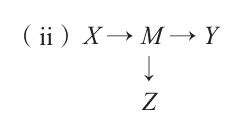
例（i）中 `Z` 满足条件 1 和 2，却不是混杂因子，而应称中介物。它解释了 `X` 对 `Y` 的因果效应。若为估计 `X` 对 `Y` 的效应而控制 `Z`，会带来灾难。若只看处理组和对照组中 `Z=0` 的个体，就完全阻断了 `X` 的影响，因为它正是通过改变 `Z` 起作用，于是错误得出 `X` 对 `Y` 无影响的结论。正如埃兹拉·克莱因所说，“你最终控制了你真正想测量的东西”。

在例（ii）中，`Z` 是中介物 `M` 的替代物。当真实因果变量不可测时，统计学家常控制其替代物，例如用党派归属代表政治信仰。因为 `Z` 并非 `M` 的完美度量，控制 `Z` 会让 `X` 对 `Y` 的影响部分丢失。控制 `Z` 本身仍是错误，虽偏倚可能小于控制 `M`，但偏倚依然存在。

考克斯在 1958 年出版的《实验设计》里就敲过警钟：如果没有一个足够令人信服的先验依据去相信 Z 不会被 X 影响，就不要碰 Z 这个变量。这个先验依据本质上是一个因果上的判断。他还说，即便看起来很合理的假设，也要保持高度警惕。耐人寻味的是，这一说法出现在因果论被严格排斥的年代。他暗示在做混杂校正时可以暗中借用一点因果私酿，只要不让正统派察觉——这种大胆的表述值得钦佩。

到了 1980 年，辛普森与考克斯的标准被整合成了后来广为引用的三项混杂检验。这个定义像是一条通向因果世界的独木舟，只是船体存在三处破口。它在第三条里若隐若现地提到了因果，而前两条早已被证明既不必要也不充分。

真正的分水岭在 1986 年到来。格林兰与罗宾斯发表里程碑式论文，用可互换性重新界定混杂。他们回到处理组 X=1 与对照组 X=0 的对比，并在其上加入反事实扰动。反事实位于因果阶梯的第三层，力量足够处理混杂。可互换性要求研究者对处理组做一次思想实验：假如这些受试者没有接受处理，结果会怎样？当这个想象中的结果与真正未处理组的表现相符时，才可以断言研究里没有混杂。

在 1986 年让流行病学界讨论反事实需要勇气，因为当时很多人仍信奉古典统计，认为答案只能来自观测数据而非想象数据。所幸唐纳德·鲁宾 1974 年提出的潜在结果框架为这种异端观点铺路。在该框架里，反事实变量与传统变量同等正当，比如个体 X 若服药后的血压、若未服药后的血压，它们和真实观测值一样有效，只是永远不可观测。

格林兰与罗宾斯把混杂表述成潜在结果的语言。他们把目标总体分成四种反应类型：注定型、因果型、预防型、免疫型。以流感疫苗 X、是否患流感 Y 为例：注定型无论是否接种都会发病；因果型因接种反而致病；预防型因接种而避免发病；免疫型无论如何都不会发病。表 4.1 对此做了归纳。

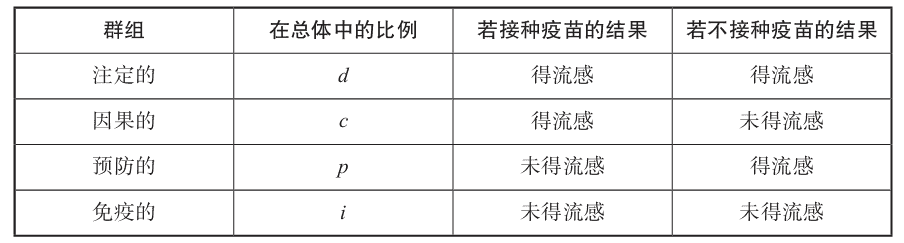
理想状况是每个人额头都贴着标签。可互换性意味着处理组与对照组中四类人群的比例 d、c、p、i 完全一致。比例相等才能保证调换组别后结论不变。若比例不同，疫苗效果的估计就会被混杂污染。两组在年龄、性别、健康等维度上可以差异很大，只有 d、c、p、i 相等才算可互换。于是可互换性把无数差异因素压缩成四个比例，大幅简化了判断。

借助这种直观定义，格林兰与罗宾斯证明了以往的统计学定义，无论是陈述式还是操作式，都会给出错误答案。某个变量可能满足经典流行病学三条件，却在校正后反而放大偏倚。

这是一个伟大的科学成就，因为它能举出清晰反例说明旧定义不可靠。可它无法落地——额头标签不存在，我们甚至不知道 d、c、p、i 各是多少。自然精灵把这份信息锁在神灯里，研究者只能靠直觉猜测两组是否可互换。

因果图如何把这个麻烦变成游戏？关键在于后门标准。它把定义混杂、识别混杂因子、做统计校正，变成比解迷宫更简单的智力游戏。古老的棘手难题就此被化解。

## do 算子和后门标准
要理解后门标准，先直观感受因果图里信息的流动。我习惯把连线看成管道，信息从 X 流向 Y。信息是双向的，既沿因果方向走，也会逆向流动。

非因果路径正是混杂的来源。混杂被定义为使 P(Y|do(X)) 与 P(Y|X) 不同。do 算子会切断指向 X 的所有箭头，阻止关于 X 的信息在非因果方向流动。随机化有同等效果，选对变量做统计校正同样如此。

上一章讲过三种接合的信息流动规则，现在重述：
链式 A→B→C 中干预 B，可阻断 A 到 C 的信息。
叉式 A←B→C 中干预 B，可阻断 A 与 C 的交流。
对撞 A→B←C 与前两种相反。A 与 C 原本独立，干预 B 反而会打开信息通道。
另外一条基本规则：干预变量的后代节点等于部分干预变量本身。干预中介的后代等于部分关闭管道；干预对撞变量的后代等于部分打开管道。

设想一条长链 A←B←C→D←E→F→G←H→I→J，如何阻断？只要路径中某处接合被堵，J 就到不了 A。阻断方式很多：干预 B、干预 C、不干预对撞点 D、干预 E……只要其一足够。常规统计“干预所有可测变量”因此常误导。这条路径在不干预任何变量时本身就被 D 和 G 的对撞堵住。相反去干预 D、G 反而会把路径打开，让 J 听从 A。

要清除 X 与 Y 的混杂，只需阻断所有非因果路径，同时不破坏因果路径。把从 X 出发第一步箭头指向 X 的路径叫做后门路径。堵住全部后门路径，就去掉了混杂。若用一组 Z 实现，还必须确保 Z 的成员都不是 X 的后代，否则会部分或完全关闭 X 到 Y 的因果通道。

从此去混杂变得简单有趣，像个游戏。下面几个例子可供练习。

### 游戏 1
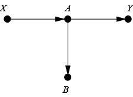
这个例子很干净。图中没有箭头指向 X，也就没有后门路径，什么都不用做。

有人会把 B 当成混杂因子。B 和 X 关联，因为链 X→A→B；在 X=0 子群里 B 和 Y 关联，因为路径 B←A→Y 开放；B 不在因果路径 X→A→Y 上。经典三条件全满足。但它不通过后门标准，干预 B 会导致灾难。

### 游戏 2
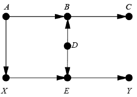
把 A、B、C、D 看作预处理变量，处理是 X。后门路径 X←A→B←D→E→Y 在 B 处被对撞堵住，依旧无需干预。

许多统计学家会条件性地干预 B 或 C，认为处理前干预总没坏处。曾有影响力统计学家写道：“回避对观测协变量的干预是一种非科学欺诈。”这是错的。干预 B、C 会打开非因果路径，反而引入混杂。路径可通过干预 A 或 D 重新关闭。去混杂有不同策略：不干预任何变量也行，传统派干预 C 和 D 也行，只要模型假设成立且样本足够，结果应一致。

### 游戏 3
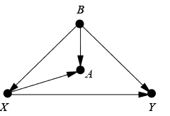
前两个游戏无需动作，这次需要出手。存在后门路径 X←B→Y，只能靠干预 B 阻断。若 B 无法观测，没有随机对照试验就无法估计因果效应。不少人会用 A 代替不可观测的 B，这只能部分消除偏倚并带来新的对撞偏倚。

### 游戏 4
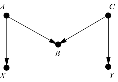
本例引入 M 偏倚。同样只有一条后门路径，已被 B 处对撞阻断，无需干预。然而 1986 年前几乎所有统计学家都认为 B 是混杂：它经 X←A→B 和 X 关联，经 B←C→Y 和 Y 关联，且不在因果路径上，也不是因果路径变量的后代。传统三步检验都通过。

M 偏倚揭示了传统方法的错。变量和 X、Y 都关联不代表它是混杂。不干预 B 时 X 和 Y 其实是未被混杂影响的；偏倚是干预 B 后才制造出来的。

上世纪 90 年代我把这张图给统计学家看，有人嘲笑说现实中根本用不上。我不认同。以安全带 B 为例，它对吸烟 X 或肺病 Y 没有因果作用，只是反映了个人对社会规范的态度 A 与对安全健康的态度 C。两种态度分别影响易感性 Y 和吸烟行为 X。实际数据里安全带和 X、Y 都关联。2006 年一项烟草诉讼研究甚至把安全带列为首要干预变量。若接受模型，单独干预 B 是错的。

若同时还干预 A 或 C，干预 B 就无害。干预对撞 B 打开管道，再干预 A 或 C 会再次关闭。遗憾的是 A、C 是态度变量难以直接观测，无法校正。

### 游戏 5
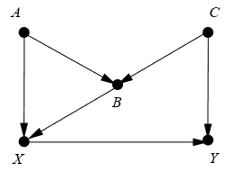
在游戏 4 基础上增加难度。现在要关闭第二条后门路径 X←B←C→Y。干预 B 能关闭它，却打开了 M 形路径 X←A→B←C→Y。要堵住它还需干预 A 或 C。更巧妙的是只干预 C：它关闭了 X←B←C→Y，而不影响另一条路径。

游戏 1 至 3 出自美国国立卫生研究院副院长克拉丽丝·温伯格 1993 年论文《对混杂的更明确定义》。论文发表于 1986 到 1995 的过渡期，格林兰与罗宾斯的成果已出，但因果图尚未普及。温伯格用大量计算验证了每个案例的可互换性。她用图示呈现情境，却未用图的逻辑区分混杂与去混因子，是我所知唯一完成此壮举的学者。2012 年她以合著者身份发表升级版，用因果图重分析同一例子，验证了 1993 年的所有结论。

温伯格的两篇论文具体讨论了吸烟 X 对自发流产 Y 的影响。游戏 1 中 A 代表吸烟引起的潜在身体异常，不可观测；B 代表既往流产史。流行病学家常据此校正，但本例中校正会部分阻断 X→A→Y 的因果通道，低估真实影响。

游戏 2 是更复杂的版本：X 为第二次怀孕起是否吸烟，A 为第一次怀孕时是否吸烟。B 与 E 为吸烟引起的潜在异常，不可观测，D 为这些异常的其他生理原因。图考虑了怀孕期间吸烟行为可能改变但生理条件不变。许多研究者仍会校正既往流产史 C，除非同时干预 A，否则仍是糟糕做法。

游戏 4、5 来自 2014 年莫纳什大学生物统计学家安德鲁·福布斯等人的论文，关注吸烟对成人哮喘的影响。游戏 4 中 X 为吸烟行为，Y 为成人哮喘，B 为儿童期哮喘，是由父母吸烟 A 与潜在哮喘体质 C 共同影响的对撞变量。游戏 5 变量含义不变，福布斯为贴近现实增加了两个箭头。游戏 4 的提出只是为了引入 M 结构。

福布斯论文的完整模型如图 4.7 所示，注意 A、B、C、X、Y 的关系与游戏 5 完全一致，游戏 5 被嵌入其中。据此必须干预 A 和 B 或只干预 C，但 C 不可观测。此外还有四个新混杂：D=父母是否哮喘，E=慢性支气管炎，F=性别，G=社会经济地位。读者会发现必须干预 E、F、G，而 D 无需干预。对本例，去混变量的充分集是 A、B、E、F、G。

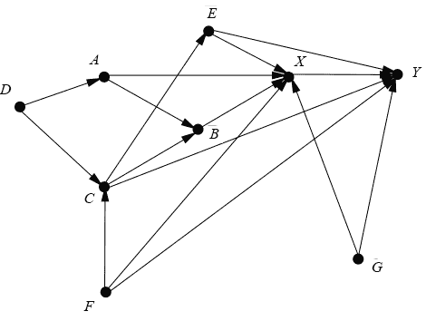
图 4.7 安德鲁·福布斯的吸烟 X 和哮喘 Y 模型

福布斯发现原始数据里吸烟与成人哮喘的联系很小且不显著。校正混杂后联系变得更小更不显著。无效结果不损论文质量，因为这是“对自然的巧妙询问”的典范。

最后一点评论：当变量变成吸烟、流产时，这已不是游戏而是严肃科学。我称之为游戏，是因为迅速且有意义地解开谜题的快感，像孩子破解难倒自己的谜那样纯粹。

科学生涯里很少有如此满足的时刻：把让前辈困惑的问题简化为游戏或算法。我认为混杂问题的完整解是因果革命的主要亮点之一，它终结了一个充满错误决策的混乱时代。同时这是一场悄无声息的革命，争论多发生在实验室和会议上。掌握新工具、理解新见解后，科学界才得以着手更困难的理论和实践问题。

# 第五章 烟雾缭绕的争论：消除迷雾，澄清事实
最后，船上的人彼此说：“来吧！我们掣签，看看这灾临到我们是因谁的缘故。”
——《约拿书》1:7

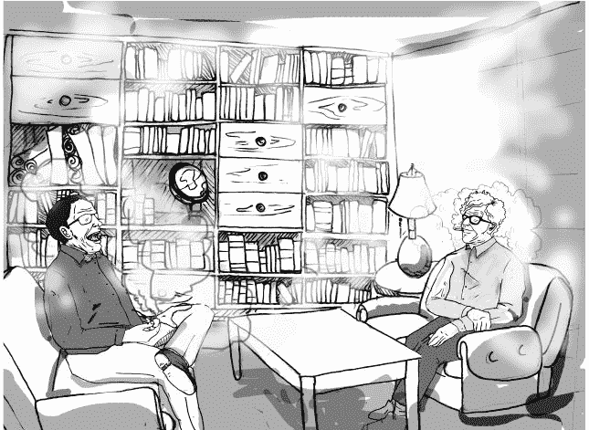
“亚伯和雅克”对吸烟危害持相反立场。和同时代人一样，两人都在吸烟，尽管亚伯用的是烟斗。对许多参与吸烟与癌症关系辩论的科学家来说，这场争论有着非同寻常的个人色彩。资料来源：达科塔·哈尔绘制。

五十年代末到六十年代初，学术界为一个问题分裂：抽烟到底会不会让人得肺癌？半个世纪以后，这个答案看起来再平常不过，但在当时却笼罩在浓雾里，甚至连家人之间都会因此争吵。

加州大学伯克利的生物统计学家雅各布·耶鲁沙米，1904 到 1973 年间活跃于学界，被很多人视作最后一位公开为烟草辩护的学者。多年后，他的侄子大卫·利连菲尔德回忆，耶鲁沙米直到去世都拒绝承认吸烟会导致癌症。而利连菲尔德的父亲亚伯·利连菲尔德，约翰·霍普金斯的流行病学家，却是吸烟致癌的坚定倡导者。利连菲尔德曾描述过一场家庭对话：雅克，也就是雅各布的昵称，和他父亲在书房里对峙，烟雾从雅克的香烟和亚伯的烟斗里不断涌出，房间里始终朦胧。

如果两人能用这场争论点燃一场因果学的革命就好了。正如下面要说的，质疑吸烟致癌最有力的科学借口是：也许存在某种测不到的因素，它既让人上瘾又让人易患肺癌。我们上一章谈过这种混杂，也提到因果图能拆解混杂的威胁。但那是五十、六十年代，桑德·格林兰和杰米·罗宾斯的论文发表二十年以前，`do` 算子诞生三十年以前。看那个时代的学者如何应付这个问题，挺有意思，他们最后把一个潜在混杂因子的说法批成了烟幕。

毫无疑问，亚伯和雅克的辩论绕不开一个看似无害的词——“导致”。医学史上很多里程碑都靠找病原体。十八世纪中期，詹姆斯·林德发现柑橘能防坏血病；十九世纪中期，约翰·斯诺发现被粪便污染的水会引发霍乱。后来的研究把原因具体化：缺维生素 C 会致坏血病，霍乱弧菌会致霍乱。这些发现都碰巧是一对一的关系。霍乱弧菌是霍乱的充分必要因：没接触就不会发病；长期缺维生素 C 也是坏血病的必要因，缺得够久也变成充分因。

吸烟和癌症的关系就没那么干净。很多人抽一辈子也不得肺癌，另一些从不抽烟却还是得了。有人可能有家族遗传，有人可能接触了致癌物，也有人两者兼有。

当时流行病学已经有了更普适的因果确立手段：随机对照试验。但用在吸烟上既做不到也不道德。谁会把一群人随机指定抽烟几十年，等三十年后看谁得癌呢？

没有随机试验，耶鲁沙米和费舍尔这类怀疑者很难被说服。他们坚持认为吸烟与肺癌的关联是假象，背后是第三个潜藏因素。比如一种“吸烟基因”，它让人更渴望尼古丁，也间接让人更易得肺癌。这些混杂假说说服力不强，但举证责任在否定方——要证明没有混杂，费舍尔和耶鲁沙米清楚，这几乎是不可能完成的任务。

僵局最终被打破，既是公共卫生的大胜，也是方法上的遗憾。一方面，流行病学家得出正确结论，美国卫生局局长在 1964 年的报告里明确写道：“在男性中，吸烟与肺癌有因果关系。”这句话终结了“无法证明吸烟致癌”的说法。报告出来次年，美国男性的吸烟率开始下滑，如今吸烟人数已不到 1964 年的一半。可以说那份声明拯救了成千上万的生命，延长了更多人的寿命。

另一方面胜利不完整。如果当年有更坚实的因果理论，1950 到 1964 年这段确认时间本可以大幅缩短。卫生局局长委员会当时依据的是奥斯汀·布莱德福·希尔提出的非正式指引，即“希尔标准”。这套标准每一条都能找到反例，总体上却有常识上的说服力。费舍尔极端强调方法论，希尔标准则走向另一个极端——一个没有方法论的世界，因果由统计趋势的定性模式判断。因果革命后来在这两个极端之间搭桥，给因果直觉赋予数学严谨性，可惜这项工作留给了下一代。

## 一场被制造的流行病

1902 年，香烟只占美国烟草市场的 2%，当时代表烟草消费的标志更多是痰盂而不是烟灰缸。随后自动化生产和广告营销两股力量改写了习惯。机器造烟便宜又方便，迅速压倒手工雪茄和烟斗；同时烟草业把广告技巧打磨成熟。六十年代的电视观众能轻易哼出“你会钟情万宝路”或“宝贝，你已走过漫漫长路”。

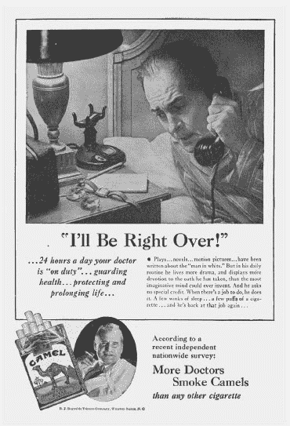
图 5.1 精心制作的广告意在让公众安下心来，相信香烟对他们的健康没有害处。图中显示的就是一则刊登在 1948 年《美国医学协会杂志》上针对医生所做的广告，其中显示香烟有提神醒脑之效，是医生治病救人的必备用品（资料来源：来自斯坦福大学关于烟草广告影响的研究论文集）

到 1952 年，香烟在烟草市场的份额从 2%飙升到 81%，整个市场也在膨胀。消费习惯的巨变带来了意外的公共卫生后果。早期人们已怀疑吸烟会致咽炎和咳嗽。中叶以后证据越来越多。香烟普及前，肺癌极为罕见，医生一生可能只见一例；1900 到 1950 年间，这类罕见病的发病率翻了两番。到 1960 年，肺癌已成为男性最常见的癌症。

事后看，这场灾难显然该归咎于吸烟。把肺癌和烟草消费画成曲线，两者高度重合。但时间序列是最糟糕的因果证据。1900 到 1950 年间还有很多事变了，比如道路铺设、含铅汽油排放、空气污染。英国流行病学家理查德·多尔在 1991 年说过，如果必须在当时所有因素里挑一个真正的致癌物，他会把赌注押在汽车尾气或铺路沥青上。

科学要把假设放一边，看事实。1948 年，多尔和希尔结伴调查癌症流行原因。希尔此前刚用随机对照试验证明链霉素对结核有效，这场试验提升了随机试验的声誉，使其成为流行病学标准。希尔知道吸烟问题做不了随机试验，但他借鉴了分组对比的思路：把已确诊的癌症病人和健康志愿者对照，访谈两组人的过去行为和病史。为减少偏倚，他不让访谈者知道受访者属于哪一组。

结果震撼。649 名肺癌患者里除两人外其余全是吸烟者，这个比例远离随机水平。两人都算出精确度约 150 万比一。此外病人平均吸烟量高于对照组，但吸入比例相对偏低，这一点后来被费舍尔抓住攻击。

这类研究现在叫病例—对照研究。相比时间序列，它能控制年龄、性别、环境污染等混杂变量。但弊端明显：它是回顾性的，先知道患病再回溯原因；概率方向反了，它告诉我们癌症患者的吸烟概率，而不是吸烟者的患癌概率，后者才是决策者关心的。

偏倚来源也不少。回忆偏倚：受访者自己知道是否患癌，会影响回忆。选择偏倚：住院患者不能代表全体，也不能代表全体吸烟者。于是多尔和希尔起初只称“关联”，剔除部分混杂后才谨慎地说：“吸烟是肺癌形成的一个因素，一个非常重要的因素。”

随后几年，19 个不同国家的病例—对照研究得到类似结论。费舍尔却不在意：有偏倚的研究重复 19 次仍是有偏倚。1957 年他写道，这些只是同类证据的重复，必须检验方法本身是否可靠。

多尔和希尔明白，重复无法消除隐藏偏倚。于是 1951 年他们启动前瞻性研究，向约六万名英国医生发问卷收集吸烟习惯并追踪。美国癌症协会同期做了更大规模的类似研究。五年后差异显现：在被追踪的医生里，重度吸烟者死于肺癌的概率是不吸烟者的 24 倍。美国的数据更严峻：吸烟者死于肺癌的概率是不吸烟者的 29 倍，重度吸烟者是 90 倍。曾吸烟后戒烟者风险降低约一半。结果指向一个统一结论：吸烟越多风险越高，戒烟能降风险。这就是医学所说的剂量—响应效应。

即便如此，费舍尔和耶鲁沙米依然不服。前瞻性研究仍无法把吸烟者和在其他方面完全相同的不吸烟者配对。吸烟是自我选择，吸烟者可能在基因或生活方式上与不吸烟者不同，比如更冒险、更易饮酒。这些行为本身也可能伤健康，被误算成吸烟的后果。体质假说几乎不可检验，直到 2000 年人类基因组计划启动后，寻癌基因才成为可能。讽刺的是，费舍尔的部分主张最终被证实，只是范围有限：相关基因确实存在。

杰尔姆·康菲尔德与亚伯·利连菲尔德 1959 年合文逐条驳斥费舍尔。康菲尔德在国立卫生研究院工作，不是统计学家也不是生物学家，大学学历史，后在农业部自学统计，后成知名顾问并任美国统计协会主席。他一天抽两包半烟，却在看到肺癌数据后戒断了。有趣的是，这场辩论深深嵌入科学家个人生活：费舍尔始终不离烟斗，耶鲁沙米也不曾放下香烟。

康菲尔德直攻体质假说，用数学说话。他假设存在一个混杂因子，比如吸烟基因，完全解释了吸烟者的九倍肺癌风险。那么在吸烟者中该因子出现的概率，至少要比常人高九倍。如果不吸烟者里有 11%携带该基因，则至少 99%的吸烟者必须携带；若不吸烟者里有 12%携带，从数学上该基因就无法完全解释关联。这个被称为康菲尔德不等式的论证瓦解了体质假说，因为很难想象基因差异能如此紧密地绑定抽烟这种复杂行为。

康菲尔德不等式是因果论证的雏形，让研究者能在体质假说能解释关联和不能解释关联两种因果图之间做出判断。

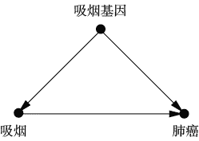
图 5.1 反体质假说因果图

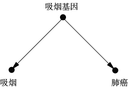
图 5.2 体质假说因果图

吸烟与肺癌的联系太紧密，体质假说解释不了。

这个思路也为后来的敏感度分析埋下种子。使用者不再只是假设模型缺少某些因果关系再推断，而是直接挑战假设，评估要解释观测数据，新假设需要多强的关联，再做似然判断。若要把方法推广到三四个变量以上的模型，就需要基于图示的算法和工具。

五十年代的流行病学家常被批评“只有统计证据”，缺乏“实验室证据”。回看医学史，这种说法站不住脚。按只有实验室证据才有效的标准，维生素 C 被发现前，坏血病的水手会无休止死亡。五十年代，实验室证据其实已经出现：涂抹香烟焦油的老鼠会致癌，烟雾中含有已知的致癌物苯并芘。这些增强了假说的生物合理性。

到五十年代末，几乎所有专家都相信吸烟致癌。甚至烟草公司内部的研究人员也被说服，只是被隐藏起来。九十年代诉讼和内部举报迫使行业公开数千份秘密文件，其中 1953 年雷诺兹烟草化学家克劳德·提格给高管的信写道，烟草是“诱导原发性肺癌的重要致病因素”，几乎照抄多尔和希尔的结论。

在公共层面，烟草公司却唱反调。1954 年 1 月，多家龙头公司在全国报纸刊登“对吸烟者的坦诚声明”，称相信产品无害，将继续与维护公共健康的人合作。1954 年 3 月，菲利普·莫里斯副总裁乔治·韦斯曼说，如果发现产品有害，必定立即停业。六十年过去了，这个诺言仍在等待兑现。

这些公开表态揭示了这场争论最刺痛的一面：烟草公司在危害问题上蓄意欺骗公众。如果大自然只是难以捉摸但诚实的对手，面对蓄意误导，科学的挑战将大得多。香烟之战是科学界首次遭遇有组织的对抗，谁都没有准备。烟草公司放大任何一点科学争议，成立烟草工业研究委员会资助研究，却回避核心问题。他们找来的科学家多是像费舍尔和雅各布·耶鲁沙米那样的怀疑者，并付钱让他们发文。

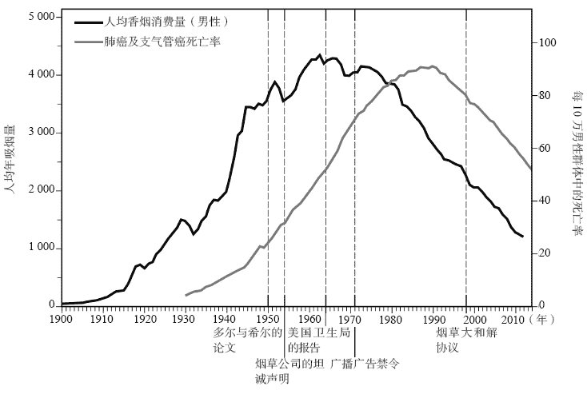
图 5.2 美国人均香烟消费量（黑色曲线）和肺癌及支气管癌死亡率（灰色曲线）的变化趋势显示出了惊人的相似：癌症死亡率曲线比香烟消费量曲线延迟了大约 30 年，其形状几乎是后者的复制。然而，这种证据是间接的，不能证明因果关系。图中还标出了一些关键日期，包括理查德·多尔和奥斯汀·布莱德福·希尔 1950 年发表的论文，这篇论文首次面向医学专家揭示了吸烟与肺癌之间的联系（资料来源：马雅·哈雷尔绘图，数据来自美国癌症协会、疾病控制中心和卫生局局长办公室）

费舍尔在关于烟草致癌的争吵里显得尤其令人失望。怀疑精神在科学内部是有价值的，统计工作者提问正是学科的自我校验机制。可合理的质疑与固执的否定本质不同，费舍尔已经越界。他终身拒绝认错，这与他长时间抽烟的生活习惯相关。他无视已经累积到足以反驳他的证据链，论调愈发极端。他紧抓希尔与多尔首篇论文里一个反常识的细节：根据肺癌患者的回忆，其吸烟组宣称吸入量反而少于对照组，而这点差异在统计上几乎可以忽略。后续所有重复研究都没有再现。费舍尔明知统计显著有时不可复制，却仍以此为由贬低他人工作。他声称多尔和希尔的研究似乎暗示吸烟入肺可能有益，并呼吁继续深挖这个“极其重要”的发现。若要为费舍尔的角色找一点正面解释，大概只能说烟草业的贿赂似乎未对他产生影响，靠他本人的固执就足以支撑。

流行病学界早已达成共识，但在大众层面，卷烟与癌症的关联在相当长时间里仍具争议。就连本应更积极回应的医生群体也保持犹豫：美国癌症协会1960年的民调显示，仅三分之一的美国医生认为抽烟是“肺癌主因”，同时有43%的医生自身在吸烟。

回看今日，批评费舍尔的顽固与烟草公司的蓄意误导是合理的，但也不能忽略当时的思想环境。费舍尔推崇随机对照试验，认为它是衡量因果效应的高效手段，这本身没错。他和追随者没有意识到，观察性研究同样能提供丰富信息。因果模型之所以有力，正因它能借助研究者已有的科学知识来审视新问题。费舍尔的方法隐含前提：检验假设时研究者先验无知。它把无知强加给科学家，而怀疑论者正好借此占据优势。

科学家对“导致”缺乏清晰界定，也无法在随机试验不可行时判定因果，于是对卷烟是否致癌的讨论准备不足。整个1950年代都在摸索定义，最终在1964年才得出戏剧性结论。

### 局长委员会如何框定因果，九项希尔准则形成

康菲尔德与利连菲尔德的论文为美国卫生局发表明确声明铺平了道路。英国皇家内科医学院于1962年先行发布报告，认定吸烟是肺癌的致病因素。不久，美国卫生局局长卢瑟·特里在肯尼迪总统推动下宣布成立特别顾问委员会来研究此事，见图5.3。


图5.3 1963年，卫生局顾问委员会为评估吸烟的因果效应而苦思。画面里有委员会统计学家威廉·科克伦、局长卢瑟·特里和化学家路易斯·费瑟。图例中黑线代表人均吸烟率，深灰线代表肺癌发病率，浅灰线代表其他癌症发病率，制图由达科塔·哈尔完成

委员会人选刻意保持平衡，吸烟者与不吸烟者各五人，其中两人由烟草行业推荐，所有成员此前都没有公开表态。正因如此，立场鲜明的利连菲尔德和康菲尔德都不符合入选标准。成员多为医学、化学或生物学领域的顶尖专家，唯一例外是哈佛大学的威廉·科克伦，他是统计学家，其师承可追溯到卡尔·皮尔逊。

委员会筹备报告耗时一年多，核心难题是如何使用“导致”一词。他们不得不舍弃19世纪的因果观念，也绕开了纯统计。正如报告中很可能是科克伦起草的部分所写：“统计方法无法为关联中的因果关系提供证据。因果的重要性属于判断范畴，超出统计概率的表述。要评估关联的因果重要性，必须使用一系列标准，任何单一标准都不够充分。”委员会列出五条标准：一致性，在不同人群的研究中得到相似结果；关联强度，包含剂量反应，吸烟越多肺癌风险越高；特异性；时序性，果在因之后；连贯性，即生物学合理性与实验室证据、时间序列数据等一致。

1965年，未入选委员会的奥斯汀·布莱德福·希尔试图把这些论据推广到其他公共卫生问题，在原有清单上再添四条，形成后世熟知的九条希尔准则。希尔本人称之为“观点”而非硬性要求，并强调在特定情境下任一条都可能不成立。他写道：“我的九个观点中没有任何一项能为因果假设提供无可辩驳的证据，也没有哪一项是必要条件。”

这些标准其实很容易反驳。一致性本身证明不了什么，如果三十项研究都遗漏了同一个混杂因子，一致也只是共同偏倚。关联强度也有局限，正如儿童鞋码与阅读能力高度相关却无因果关系。特异性在传染病背景下合理，对环境因素则不然，吸烟提高肺气肿和心血管疾病风险是否削弱其致癌证据？时序关系也有例外，比如公鸡打鸣总是先于日出却不导致太阳升起。最后，与已有理论一致固然好，但科学史上被推翻的理论和错误的实验室发现比比皆是。

作为一种用多种证据来接受因果假设的描述性框架，它有用，却缺乏可操作的方法论。生物学合理性如何衡量？已有知识如何带入分析？只能靠每个科学家自行决定，而这种直觉判断在政治压力、金钱利益或个人偏好下很容易出错。

但并不想贬低委员会的工作。在缺乏因果机制话语的大环境下，他们已尽最大努力。承认非统计标准必要本身就是巨大进步。委员会里吸烟者做出的艰难个人决定也印证了结论的严肃性。习惯抽烟的卢瑟·特里改用烟斗，伦纳德·舒曼宣布戒烟，威廉·科克伦承认戒烟可降低患癌风险，但认为“香烟带来的慰藉”足以抵消。最令人惋惜的是路易斯·费瑟，这位每天抽四包烟的重度吸烟者在报告发布后一年内被确诊肺癌。他写信给委员会：“虽然吸烟致癌的证据已非常充分，但你们可能还记得，在讨论会上我仍不停吸烟，还搬出了吸烟者惯用的借口……对我个人而言，被确诊为肺癌的事实比任何统计资料都更有说服力。”接受切除一叶肺的手术后他才戒烟。

从公共卫生角度看，这份报告是里程碑。两年内美国国会要求烟草包装加印“吸烟有害健康”警示。1971年政府禁止广播电视播放香烟广告。美国成年吸烟率从1965年的峰值45%降至2010年的19.3%。虽进展缓慢，禁烟运动仍是历史上规模最大、最成功的公共卫生干预之一。委员会的工作也为科学共识提供了范本，成为日后卫生局关于吸烟及其他议题报告的典范，包括1980年代关于二手烟的报告。

从因果角度看，报告充其量只有有限成功。它凸显了因果问题的重要性，并指出数据本身不足以回答。但作为未来研究的路标，其指引既不清晰也不周密。希尔准则最多只能作为历史文献，概括了1950年代说服医学界接受吸烟致癌的证据类型。作为未来指南则明显不够。对于更具体的因果问题，需要更精确的分析工具。回想起来，康菲尔德不等式正是向这一方向迈出的一步，它孕育了敏感度分析的种子。

## 新生儿体重悖论的迷雾

即便吸烟与癌症的争议平息，一个重要悖论仍未解。20世纪60年代中期，雅各布·耶鲁沙米指出，如果婴儿出生体重不足，母亲孕期吸烟似乎反而对新生儿健康有利。这个“出生体重悖论”与当时医学新共识相悖，直到2006年耶鲁沙米论文发表40多年后才得到令人满意的解释。我相信之所以花这么久，是因为1960至1990年间科学界缺乏因果论的语言。

1959年耶鲁沙米展开一项长期公共卫生研究，收集旧金山湾区1.5万多名儿童的产前产后数据，包括母亲吸烟习惯、婴儿出生后第一个月体重和死亡率。

结果显示，吸烟母亲的婴儿平均出生体重比不吸烟母亲的婴儿轻，自然推断出生体重偏低会降低存活率。事实上，全国性研究表明低出生体重婴儿不足5.5磅的死亡率比正常体重婴儿高20倍。于是流行病学家提出因果链：吸烟导致低出生体重，进而导致婴儿死亡率升高。

但耶鲁沙米在数据中发现的另一事实出乎所有人预料。吸烟母亲的婴儿平均比非吸烟母亲的婴儿轻7盎司。然而，吸烟母亲的低出生体重婴儿存活率反而高于非吸烟母亲的低出生体重婴儿。仿佛母亲吸烟真有保护作用。

若费舍尔发现此事，他很可能大喊吸烟的好处。耶鲁沙米的可贵之处在于他没有这样做，而是谨慎总结：“这一矛盾的发现对以往结论提出质疑，它驳斥了母亲吸烟是干扰胎儿宫内发育的外因的主张。”简言之，从吸烟到婴儿死亡率的因果路径并不存在。

现代流行病学家认为耶鲁沙米错了。大多数人认为母亲吸烟确实会增加婴儿死亡率，原因如妨碍胎盘氧气传输等。如何让假设与数据一致呢？

统计学家坚持用概率术语分析悖论，将其视为出生体重特有的异常。事实证明异常只与对撞偏倚有关，而非出生体重本身。从这个角度看，难题并非矛盾，反而具启发性。

只要在原路径“吸烟→出生体重→婴儿死亡率”上再增加一点要素，数据就完全吻合更新后的模型。对婴儿而言，吸烟很可能仍有害，因其导致出生体重偏低，但低出生体重本身还有更严重的先决条件，如致命的遗传畸形或先天缺陷。对某个低出生体重婴儿，其体重偏低有两种解释：吸烟母亲，或其他因素。若发现母亲吸烟，则该因素有力解释了低出生体重，从而降低先天缺陷存在的可能性；若母亲不吸烟，则更有理由怀疑婴儿体重偏低源于遗传畸形，预后更差。

因果图让一切清晰。更新后的因果图如图5.4。出生体重悖论是对撞偏倚的典型。对撞因子是“出生体重”。只观察低出生体重婴儿，就等于控制对撞因子，从而打开后门路径吸烟→出生体重←出生缺陷→婴儿死亡率。该路径是非因果的，因其中一箭头方向错误。它导致吸烟与婴儿死亡率的伪相关，使吸烟→婴儿死亡率的直接因果效应估计产生偏倚。偏倚之大足以让吸烟从有害变成似乎有益。

因果图的美在于让偏倚源头一目了然。正因缺少因果图，流行病学家争论了40年。直至今日仍在讨论，《国际流行病学杂志》2014年10月刊就刊载了相关文章。哈佛大学泰勒·范德维尔的文章给出了完美解释，并附了如图5.4的图示。


图5.4 出生体重悖论的因果图示

当然这张图过于简化，无法捕捉完整故事。但对撞偏倚的存在是肯定的。此例中偏倚被发现是因为结论太不可信。我们可以想象，若有偏倚的结论与已有理论不冲突，会有多少对撞偏倚被埋没。

## 当科学撞上文化

撰写本章时我偶然联系到艾伦·维尔考克斯，他可能是与该悖论关系最密切的流行病学家。对图5.4他提出棘手问题：我们如何确定低出生体重是导致婴儿死亡的直接原因？他认为医生一直误解出生体重。因其与死亡率强相关，就被解释为病因，事实上关联可能完全由混杂因子引起。在图5.4中该混杂因子由“先天缺陷”表示，但维尔考克斯当时并未明确指出具体是什么。

关于维尔考克斯的论点需说明两点。第一，即使删除“出生体重→婴儿死亡率”的箭头，对撞依然存在，图仍能解释悖论。第二，维尔考克斯关注的因果变量不是吸烟而是种族，而种族问题至今仍引发激烈辩论。

事实上在黑人母亲婴儿中也观察到同样悖论：黑人女性更易生出体重不足婴儿，婴儿死亡率更高，但她们的低出生体重婴儿存活率高于白人女性的低出生体重婴儿。对此应得出何种结论？我们可以告诉怀孕的吸烟者戒烟有益，但不能告诉怀孕的黑人女性不要成为黑人。

相反应解决导致黑人婴儿死亡率相对更高的社会问题。这一主张已无争议。但具体该着手解决哪些原因，如何衡量进展？许多种族平等倡导者认为出生体重是连接“种族→出生体重→婴儿死亡率”的中介物，并把出生体重当作婴儿死亡率的替代指标，假设改善其一会自动改善其一。原因易懂：测量平均出生体重比测量婴儿死亡率容易。

现在想象一位像维尔考克斯的人出现，坚称低出生体重本身不是基本健康特征，与婴儿死亡率并无因果关系。局面被彻底扰乱。维尔考克斯在1970年代首次提出此想法时被指控种族歧视，不敢再发表，直至2001年。即使2001年发表的文章仍饱受指责，评论文章再次提及种族。芝加哥库克郡医院的理查德·戴维写道：“在当今社会，主导群体常通过宣称被支配群体基因低劣来维护地位，在此背景下研究者很难保持中立。在追求‘纯粹科学’时，出于善意的研究者很可能被视为或事实上用研究维护并巩固了他所憎恶的社会秩序。”

科学家因阐明可能导致不良社会后果的真理而受道德斥责，历史上屡见不鲜。罗马教廷批判伽利略、达尔文进化论和高尔顿优生学都属此列。然而此类文化冲击往往通过消化发现的文化重组而非拒斥掩盖来解决。先决条件是把科学从文化中梳理出来，在观点衍生前完成区分。幸运的是，因果图这种语言提供了冷静审视因果的方式，适用于简单也适用于复杂情境。

[1] 当时关于女性群体的相应证据比较模糊，主要因为20世纪初女性吸烟者远少于男性。

[2] 1磅≈0.45千克。——编者注

[3] 1盎司≈28.35克。——编者注

# 第六章 大量的悖论！

谁能直面矛盾，谁就能触摸现实。
——弗里德里希·迪伦马特1962


“蒙提·霍尔悖论”是一个由来已久、令人恼火的难题，它提醒人们在应该使用因果推理却没做到时，大脑如何被概率推理愚弄。来源马雅·哈雷尔绘图。

我们以出生体重悖论的解决结束了第五章，这一悖论代表了一大家子矛盾，其反映了因果关系与相关关系之间的张力。这种张力源于二者在因果阶梯上的不同层级，又因人类直觉按因果逻辑运作而数据遵循概率比例逻辑而加剧。把一个领域的规则误用到另一领域，悖论便出现了。

本章将介绍概率统计领域中最著名、最令人费解的几个悖论。首要原因是它们有趣。若你从未听说过蒙提·霍尔悖论和辛普森悖论，我可以保证本章将充分锻炼你的大脑。即使你自认了解，通过因果透镜重新审视会发现一切焕然一新。

我们研究悖论不仅因为其是智力游戏。像视错觉一样，它们也揭示了大脑的工作方式、捷径以及大脑认为互相矛盾的事物。因果悖论突出了直觉性因果推理模式与概率统计逻辑的冲突。统计学家长期试图解决这些因果悖论却不得要领，这本身就是警示：如果不用因果透镜看世界，我们很可能出错。

## 令人费解的蒙提·霍尔悖论

换门就能让胜率翻倍？一个让万人对线十年的概率陷阱

上世纪80年代末，作家玛丽莲·沃斯·莎凡特开始在《大观》 Parade 杂志上固定开专栏，这本刊物是美国多地《星期日报》的增刊。专栏名叫“问玛丽莲”，一直连载至今，内容就是给读者那些奇葩难题、脑筋急转弯和科学提问提供她的答案。杂志把她封为“世界上最聪明的女人”，这个头衔也刺激了不少人想出题把她难倒。

在她解答过的所有问题里，最炸裂的一个出现在1990年9月。她抛出了一个改编自当时很火的电视游戏“让我们做个交易”的情境：三扇门后藏着一辆车和两只山羊，你先挑了1号门，主持人蒙提·霍尔知道里面是什么，随后打开了另一扇门，比如3号，露出山羊。这时他问你：要不要改选2号门？换门会不会更有利？

沃斯·莎凡特的结论是：换。坚持1号门赢的概率只有1/3，换到2号门能升到2/3。这个回答在美国读者里炸开了锅。接下来几个月，她收到了上万封回信，大多数持反对意见，其中不少署名是数学或统计学的博士。斯科特·史密斯博士写“你搞砸了，彻底搞砸了！”查尔斯·里德博士建议“去翻一本标准的概率论教材再回答”。罗伯特·萨克斯博士也说“你搞砸了！”雷·波波博士则直言“你完全错了！”。批评者的共同逻辑是：游戏进行到最后只剩两扇门了，不管换不换都是随机挑，概率必然是1/2。

到底谁对？为什么一个看似简单的选择能引发如此激烈的争执？这正是需要拆开来看的地方。

先看沃斯·莎凡特是怎么算的。她的办法异常简洁，比很多教科书都更直观。她先列出汽车和山羊三种可能摆放的情形，假设你起初选了1号门，然后对比“坚持”和“换门”两种策略的结果。因为三种初始布局在开始时是等可能的，所以换门赢的概率是2/3，不换只有1/3。表格里并没有明说主持人具体开了哪扇门，这个信息藏在第4、5列里。比如在第二种布局下，主持人只能开3号门，否则你换门就不会赢；第一种布局下，主持人开2号或3号都可以，但换门必输。

表 6.1 “让我们做个交易”的概率表


即便到今天，很多人第一次看到这个结果还是难以置信。直觉哪里卡住了？一个最有力的错觉是：换门建议好像要求心灵感应。如果你一开始选的是任意一扇门，答案都是换，那是不是意味着制片方能读懂你的想法，或者把汽车故意放在你最不可能选的那扇后面？

解开这个结的关键，不仅要看数据本身，还要看数据是怎么产生的。游戏规则告诉我们一些我们没直接看到却本可观测的信息。统计学家长期习惯费舍尔说的“数据约简”，容易忽略生成过程，这正是他们在这里卡住的原因。

## 蒙提·霍尔悖论与对撞偏倚

我们先把规则改一下试试。设想一个“让我们假装交易”的节目，主持人同样会打开你没选的两扇门之一，但选择完全随机，甚至有可能把车的门打开——那就太倒霉了。

同样假设你先选1号门，主持人这次打开的是3号山羊门，并给你换门的选项。你应该换吗？分析会发现，虽然剧情看起来一样，但按新规则换门并不能提升胜率。

可以画一张概率表，车的位置有3种可能，主持人开门的可能有2种，组合成6行，每行等可能。表 6.2 “让我们假装交易”的概率表


如果主持人真的打开了3号山羊门，我们只剩表格里第2行和第4行。只看这两行，换不换胜率都是1/2。在“假装交易”里，那些批评沃斯·莎凡特的人是对的。有趣的是，两款游戏的表面数据完全一致，差别只在于信息是怎么来的。

用因果图来说明更清楚。图 6.1 显示真实“让我们做个交易”的因果结构。你选的门和汽车位置之间没有箭头，说明两者独立，排除了读心或被读心的可能。两根箭头指向“主持人打开的门”，因为蒙提必须避开你选的门和有车的门，他的选择受这两个因素共同制约。

图 6.1 “让我们做个交易”的因果图


在这个图里，“主持人打开的门”是个对撞点。一旦我们把条件放在这个变量上，原本独立的两个父节点就会被人为制造出依赖。换句话说，在主持人已开3号门的前提下，若你最初选1号，车在2号门的可能性是你选门可能性2倍；若你最初选2号，车在1号门的可能性也是2倍。

这种没有因果机制的关联很难接受。它不涉及物理沟通或心灵感应，纯粹是贝叶斯控制带来的信息效应。大脑习惯把相关性等同于因果，所以会本能抵制这种“无缘无故”的关联。

为什么开3号门算信息传递？因为你选1号后，主持人不能再开它。他本可以开2号，却选择了3号，这个“没开”本身就暗示2号更可能是车。贝叶斯的一个通则：一个能经受住反驳测试的假设会变得更可信。2号门很容易被驳斥，而1号门不行，所以2号的后验概率上升到2/3，1号维持在1/3。

对比之下，“假装交易”的因果图是另一番面貌。图 6.2 中“你选的门”仍指向“主持人开的门”，但“车的位置”指向“主持人开的门”的箭头被去掉了，因为主持人随机开门，不关心车在哪。此时条件在“开的门”上并不会制造依赖，你选的门和车的位置保持独立，所以汽车落在你最初选的门和另一扇门的概率一样。

图 6.2 “让我们假装交易”的因果图


从贝叶斯量化看，真实游戏中 P 车在2号 =2/3，假装游戏中 P 车在2号 =1/2。信念传播算法也能直接给出这组答案。

这里其实给出了两种解释：因果解释说明为什么你选的门和车的位置会出现虚假依赖，贝叶斯解释说明为什么换门概率会增大。两者都重要。甚至连数学家保罗·埃尔德什都是先靠计算机模拟才接受换门更优的结论。

斯坦福统计学家佩尔西·戴康尼斯1991年在《纽约时报》采访中说：“我们的大脑处理概率很糟糕，所以出错也不奇怪。”没错，但更深的问题是因果思维太强。只要没有因果或共因的关联，大脑就无法理解数据里的相关。蒙提霍尔悖论就像视错觉，利用了这套认知机制。

### 更多的对撞偏倚：伯克森悖论

对撞制造的伪相关并不稀奇。1946年，梅奥诊所生物统计学家约瑟夫·伯克森指出，在医院做的观察性研究里，两种在普通人群中无关的疾病会显得有关联。

想象极端情况：疾病1或疾病2单看都不至于住院，但两者同时出现才必须住院。那么在住院病人里，这两种病就会高度相关。

图 6.3 伯克森悖论的因果图


在这个设定下，研究住院病人就等于对“住院”这个对撞因子做了条件，会制造出疾病1和疾病2的伪相关。长期以来流行病学家不信，直到1979年麦克马斯特大学的大卫·萨克特给出有力证据。他比较了呼吸系统疾病和骨骼疾病，在普通人群骨骼病患病率约7.5%，与呼吸病无关；但在呼吸病住院患者中，骨骼病患病率飙到25%。萨克特称之为住院率偏倚或伯克森偏倚。

表 6.3 萨克特的数据阐释伯克森悖论


1946和1979年时争议很大，今天流行病学界已基本理解因果图和偏倚来源，争论转向偏倚大小。

1911年庇古、1926年巴巴拉·伯克斯、1954年赫伯特·西蒙都曾在不同研究里撞见这种伪相关。最简单的演示是同时抛两枚硬币100次，只记录至少一枚正面的结果，大约留下75条记录。此时硬币1为反面时硬币2必为正面，仿佛它们在通信。实际上是你删掉了两枚都反面的结果，对对撞因子做了条件。

1956年汉斯·赖欣巴哈在《时间的方向》里提出共因原则：相关必有因。但硬币例子说明他走得太远。两枚硬币无共因，也无因果，却在筛选后相关。赖欣巴哈没考虑数据选择的结构，而我们的大脑本能地渴望用因果解释一切，对撞结构最难满足这种渴望，所以容易被误导。

对撞扭曲在生活处处可见。乔丹·埃伦伯格在《魔鬼数学》里提到：你约会的对象里，有魅力的人往往更混蛋。这不是社会规律，而是筛选。约会取决于魅力和性格，你不会选又刻薄又没魅力的，所以“负—负”结果被删掉了，造就了魅力和品性间的伪负相关。

### 辛普森悖论

到这里，我们既证明了主持人没有心灵感应，也证明了硬币不会通信。下一个谜团是什么？从“坏/坏/好药物”之谜开始。

假设医生辛普森读到一种新药D似乎能降低心脏病风险。他去查公开试验数据，发现男性患者用药后心脏病风险反而升高。他的兴奋立刻冷却，“哦，那也许这药对女性特别有效。”

辛普森医生刚翻过前一张表，还以为自己看出了规律，下一张表一打开，失望立刻变成了愣住。“这到底怎么回事？”他忍不住喊起来，“数据说吃药D的女性心脏病发作风险也上去了！我是不是看错了？这药对女性有坏处，对男性也有坏处，居然对整个人类还有好处。”

如果你也被绕进去了，不用尴尬，困住的是很多人。这个反常现象是1951年统计学家爱德华·辛普森点出来的，随后整整困扰学界60多年。一直到我写书的2016年，期刊上还不断有新文章讨论它，那年就有四篇新作，包括一篇博士论文，从四个不同角度试图解释这个现象。

1983年，梅尔文·诺维克总结说：“最直白的解法是，知道病人性别时不要用药，不知道性别时再用。”他自己也觉得荒唐，我完全认同。一种药不可能同时对男有害、对女有害、又对人类有益，这三句话里至少有一句是错的。错在哪？为什么会这样？

要弄清楚，得先回到那组让人头疼的虚构数据。这是一项观察性研究，不是随机对照。样本共120人，男女各60人，是否服药完全由病人自己决定。表6.4罗列了两性在服用药物D前后发生心脏病的人数。

表 6.4 辛普森悖论虚构数据说明


先把矛盾点再说一遍。女性里，没吃药的对照组心脏病发生率是5%，也就是1/20；吃药后升到7.5%。男性里，对照组是30%，吃药后变成40%。单看性别，辛普森医生的判断站得住脚：药对两性都不好。

可把最后一行合在一起看，对照组整体发生率是22%，吃药组反而降到18%。按整体数据，药物D似乎在保护整个群体。就这样，一个名副其实的诡异世界出现了。

我花了近二十年试图告诉学界，这种困惑的根源在于把统计比例直接套用在因果判断上。一旦用因果符号和因果图去梳理，就能明确药物D到底是预防还是致病。从本质上说，辛普森悖论就是混杂的问题，用过去处理混杂的方法就能解开。有意思的是，2016年那四篇论文里有三篇仍然拒绝这个思路。

任何声称能解决长期未解悖论的方法，至少要过四关。第一，能解释悖论为何让人不敢相信。第二，能指出悖论可能出现的场景。第三，能说明在什么情况下悖论不可能出现。第四，当两个看似合理却矛盾的说法同时出现时，能指明哪个才是对的。

先说悖论为何让人困惑。这必须把两个概念拆开：辛普森逆转和辛普森悖论。

辛普森逆转只是一个数字上的事实。当样本合并时，两个或多个子样本里关于某事件的相对频率方向发生了反转，就像表6.4那样。女性里用药者风险高于不用药者，男性里也是如此，合并后却反过来。民间常说的“合并后不等式一定保持方向”是错的，例子已经把这个说法推翻了。

## 什么是真正的辛普森悖论

在真实数据里，逆转也处处可见。棒球迷会记得1995到1997年大卫·贾斯蒂斯和德雷克·杰特的对比。单年击球率，贾斯蒂斯在1995是25.3%对25%，1996是32.1%对31.4%，1997是32.9%对29.1%，三年都占优。但把三年合并计算，杰特的整体击球率反而更高。表6.5把计算过程摊开了。

表 6.5 辛普森逆转非虚构数据说明


一个球员三年每年都打得不如对手，怎么总成绩还能反超？这和BBG药物的疗效表现很像。实际上这是不可能的事，问题出在“更好”这个词太简单了。它没有考虑不同赛季的打数分布。杰特1995年打数少，低迷表现对整体影响微弱；贾斯蒂斯在击球率最低的1995年打数更多，拖累了总平均。一旦把“更好”理解为加权平均，而不是正面PK，惊讶感就会消失。

不可否认，辛普森逆转会让人惊讶。每年都有学生起初不信，看完例子后才慢慢接受。它是理解聚合统计如何运作的第一步。我不认为逆转本身是悖论，它只是纠正了对平均的误解。悖论的意义在于，它要在大多数人坚信的两个信念之间制造冲突。

对专业统计学家来说，单纯的算术不等式不至于让人纠结60年。真正的棘手在于回到BBG药物例子。当“对男性有害”“对女性有害”“对人类有益”被理解为比例增减时，它们在数学上并不矛盾，我已经解释了原因。但直觉上，一种药不可能既让人发病又让人康复。这种直觉大概在两岁就形成了，比学分数早得多。所以当你发现不必放弃直觉时，会松一口气：BBG药物根本不存在，数学上可以证明它不可能被发明。

最早提出这个直觉的是统计学家伦纳德·萨维奇，1954年称之为“确凿性原则”。他举例说，如果一个商人无论总统选举结果如何都会买同一处房产，那么他现在就可以决定买下它，无需等待结果。他指出，这个原则在现实中很少被用到，但人们对它的接受度极高。

萨维奇的最后一句话很敏锐：他意识到确凿性原则超出了纯逻辑范畴。正确的解释需要因果逻辑，而非经典逻辑。人们普遍接受这个推理，说明人类直觉在用类似do演算的方式思考。

把这个原则套回选择问题。假设商人要在房产A和B之间选。民主党获胜时，A赚钱概率5%，B是8%；共和党获胜时，A是30%，B是40%。按确凿性原则，他应该选B。但注意，这些数字和辛普森逆转的例子特征一致，这提醒我们，草率买B可能有风险。

风险在于，如果购买决定会影响选举结果，比如通过媒体曝光，那么选A可能更有益。因为选错总统的危害可能远大于房产收益。所以确凿性原则成立的前提是，行动不改变条件事件的概率。

换句话说，确凿性原则缺了一个因果假设。准确表述应该是：若某个行动在事件C发生与否的每种情况下都会提高结果的可能性，那么在不知道C是否发生时，该行动也会提高结果的可能性，前提是行动不改变C的概率。BBG药物的情况就不成立了。这个修正版的原则需要do算子来证明。我们强烈认为BBG药物不可能存在，说明人类直觉也在用类似do演算的方式工作。

按修正后的确凿性原则，下面三句话至少有一句是假的：药物D提高男性心脏病风险；药物D提高女性心脏病风险；药物D降低总体风险。因为药物不会改变性别，所以前两句里至少有一句是错的。

要判断哪句错，不能再看表6.4。必须跳出数据，去看数据是怎么产生的。没有因果图，讨论生成过程几乎不可能。

图6.4把性别不受药物影响这一关键信息编码进去，同时显示性别对心脏病风险的影响，以及患者自愿选择用药的机制。在这个研究里，女性更倾向吃药D，男性更不倾向。所以性别同时影响用药选择和发病风险，是一个典型混杂因素。要客观估计药物效果，必须控制这个混杂。做法就是分别看男女，再取平均。


图 6.4 辛普森悖论示例的因果图

•女性里，不用药心脏病概率5%，用药后7.5%。
•男性里，不用药30%，用药后40%。
•按男女比例接近1:1取算术平均，不用药整体17.5%，用药23.75%。

这才是清晰的答案。药物D不是BBG药，而是BBB药：对女性有害，对男性有害，对人类也有害。

我并不是要暗示聚合数据永远错、分层数据永远对。合适的做法取决于数据生成机制。蒙提·霍尔悖论里，规则一变结论就变。这里也一样。接下来用另一个故事说明什么时候该合并数据。

假设高血压是心脏病的风险因素，而药物B能降压。研究者想知道降压是否能降低心脏病风险，于是观察服药后的血压变化和心脏病发生。表6.6的数据和表6.4的数字完全一致，但结论正好相反。服药组血压下降的人数明显增多，说明药起到了抗病作用。这个作用足够强，可以说聚合数据给出了正确结果。

表 6.6 血压案例的虚拟数据说明


对于这个例子，因果图再次拨开迷雾。血压在这里是中介，而不是混杂。从图结构看，“服药B→心脏病”这条路径上没有后门混杂，分层反而会切断最重要的因果通路。于是结论与之前相反：药物B能预防心脏病，聚合数据揭示了真相。


图 6.5 辛普森悖论第二个版本的因果图

从历史看，辛普森在1951年的开创性论文里就做了同样的事。他用同一组数字讲了两个故事。一个故事里聚合数据更合理，另一个故事里分层数据更合理。他明白这是一个悖论而非单纯逆转，但他没有给出真正的解决办法，也没有指出额外信息如何区分“合理”和“不合理”。

1981年，丹尼斯·林德利和梅尔文·诺维克考虑过这个建议，但他们不接受因果叙述决定结论。他们承认可以用因果语言，但“没有选择这样做，也不讨论因果关系，因为这个概念虽然被广泛使用，但似乎没有明确定义”。这段话概括了几代统计学家的挫败。林德利2009年去世前曾对我说，如果我的书早20年出版，他就不必写那句话了。

有些读者认为，分层还是合并完全取决于处理的时序和第三变量是否潜伏。比如性别在服药前就确定，所以要分层；血压在服药后测量，所以要合并。这个规则很多时候成立，但不是绝对的。M偏倚就是一个反例，B可能在A之前发生，却仍然不能对B控制，因为违背了后门标准。我们要看的是因果结构，而不仅是时间顺序。

最后，辛普森悖论在现实中真的会出现吗？会的。频率不高，但绝非罕见。

•1996年一项观察性研究发现，对小肾结石，开腹手术比内镜成功率高；对大肾结石，开腹也更高。但整体看，开腹的成功率反而更低。原因在于病情严重程度影响手术选择，大结石更容易选开腹，而大结石预后本身更差。
•1995年一份甲状腺疾病报告显示，吸烟者存活率76%高于不吸烟者69%，平均寿命多20年。但按7个年龄组分层，有6组里不吸烟者存活率高，第7组几乎持平。年龄是混杂因素，吸烟者平均更年轻，因为年老的吸烟者已去世。分层后结论清晰：吸烟有害。

因为人们对辛普森悖论理解肤浅，一些统计学家试图通过避免逆转来预防悖论。但这只是避开了症状，对病根混杂无能为力。我们应该正视症状，而不是掩盖表现。辛普森悖论提醒我们，某些统计趋势无论来自聚合还是分层，都可能不代表真实因果。其他警示信号也存在，比如聚合效应大于每一层的效应。但最难忽视的还是逆转本身，它是质变。哪怕3岁的孩子也会怀疑BBG药物的存在，而且怀疑得很有道理。

## 用图看懂逆转

到现在我们讨论的变量都是二元的：服没服药、发没发病。逆转也能发生在连续变量上，用图更直观。

假设研究各年龄组每周运动时间与胆固醇的关系。图6.6a按年龄分层后，每个年龄组内运动时间越多，胆固醇越低，说明运动似乎有益。但如果不分层，图6.6b却显示出明显的正相关，运动越多胆固醇越高。看起来又出现了BBG药物的情况，运动对每个年龄组有益，却对总体有害。


图 6.6 辛普森悖论示意：分年龄看运动与胆固醇呈下降趋势，合并看却出现上升趋势。

判断运动到底是好是坏，不能只看表面关联，必须追问数据背后的机制。从图中可以看出，样本里年龄越大的人运动量反而越高。更合理的解释是年龄在驱动运动行为，而非运动改变年龄。同时年龄本身也直接作用于胆固醇水平。因此年龄同时影响自变量与结果，是典型的混杂因素。正确的结论需要先按年龄分层，再在同一年龄层内比较。分层后不论在哪一年龄段，运动都显示出有益的效应。

与辛普森悖论有异曲同工之妙的罗德悖论，也在统计学里沉寂了几十年。弗雷德里克·罗德 1967 年首次提出，案例用的是虚构数据，但正如爱因斯坦的思想实验，虚构案例往往能打开认知边界。

罗德设想一所学校想检验食堂饮食是否对男女生的体重产生不同影响，于是在当年 9 月和次年 6 月各测一次体重。图 6.7 用椭圆描绘了两次测量的散点分布。两位统计学家看着同一张图，却得出相反判断。


图 6.7 罗德悖论。整体来看男生女生一年后体重均未上升，但在相同初始体重的层内，男生增重幅度 consistently 高于女生。

第一位统计学家先看性别整体的分布，发现女生第二年 6 月与第一年 9 月的平均体重几乎重合，围绕直线 W[F]=W[I] 的点是对称的，意味着平均变化为零。男生也是同样的情况，于是他得出饮食对两性影响一致的结论。

第二位统计学家则指出，最终体重高度依赖初始体重，应该按初始体重切片。取一个固定初始值 W[0] 作垂直切片，可以看到与男生椭圆相交的位置明显高于与女生椭圆相交的位置。也就是说，在初始体重相同的前提下，男生的最终体重平均更高。罗德因此写道，在校正了初始体重的差异后，男生的增重明显大于女生。

营养师该信谁？罗德说“两位都对”。图中确实显示，在每个初始体重层里男生增重更多，同时又能看出合并后男女生的体重总体都没有上升。整体的增益为何不等于各层的平均增益？

关键在于确凿性原则。只要每个子总体在各组中的占比保持稳定，整体效应才能等于层效应的加权平均。罗德的例子里，性别对各体重层的占比影响极大，原则不再成立。

于是罗德给出悲观结论：这类研究要回答的问题，往往无法从现有数据中得到严谨答案。这种悲观情绪后来蔓延到流行病学和生物统计学，尤其是在基线水平不同的组间比较中。

我认为这种悲观是不必要的。营养师的问题完全可以严谨回答。方法是先画因果图，如图 6.8。图中性别 S 同时指向初始体重 W[I] 和最终体重 W[F]，W[I] 再指向 W[F]。这些因果假设符合常识。


图 6.8 罗德悖论的因果结构

目标变量是体重变化 Y，其数学关系是 Y=W[F]–W[I]。因此 Y 与 W[I] 的相关性为 -1，与 W[F] 的相关性为 +1，在图中以系数标出。

第一位统计学家比较性别与 Y 的差异，性别到 Y 之间没有未被阻断的后门路径，直接用聚合数据得出 S 对 Y 无影响的结论是成立的。

第二位统计学家想“适当考虑初始体重的差异”。但 W[I] 并不是 S 与 Y 的混杂，而是中介。控制 W[I] 回答的并不是总因果效应，充其量只是直接效应。更可能的是他出于统计习惯做了调整。他的疑问“整体增益不该等于各层增益的平均吗？”只有在处理不改变层本身构成时才成立。这里的处理是性别，而性别显然影响了 W[I] 各层的相对比例。

换个视角会更有启发。罗德最初关注的是饮食，但论文里并未把饮食作为控制变量。要谈饮食的影响，需要重写故事。霍华德·魏纳和丽莎·布朗在 2006 年做了这件事。他们把目标改为饮食对体重变化的影响，性别差异不再是焦点。学生分别在两个食堂用餐，A 和 B 餐厅提供不同饮食。图 6.9（a）中两个椭圆分别代表两家餐厅，注意到体重较重的人更倾向于去 B 餐厅，体重较轻的人则集中在 A 餐厅。


图 6.9 魏纳和布朗对罗德悖论的改写及因果图

现在问题被清晰定义为饮食对增重的作用。第一位统计学家依据对称性认为饮食 A 到 B 的转换对体重变化没有影响，第二位统计学家做切片比较后认为饮食 B 的增重更大。

数据本身无法裁决，但因果图 6.9（b）能。相比前例，因果变量从 S 变成了 D，箭头方向也反转：初始体重会影响餐厅选择，即 W[I]→D。

在此结构下，W[I] 是 D 与 W[F] 的混杂因子，而非中介。因此第二位统计学家的分层做法是必要的，第一位只看关联而忽略因果机制。所以第一位错了。

核心启示是，罗德悖论并不比辛普森悖论更荒谬。一个是关联反转，一个是关联消失，因果图都能指明该用何种数据处理。对习惯了模型盲传统方法的统计学家来说，同一张图在一种情境下正确在另一种情境下错误，显得自相矛盾。

到此我们已对对撞因子与混杂因子的威胁有了足够认识，可以进入因果之梯的下一层级。

# 第七章 超越统计调整：征服干预之峰

行动超越了言论的人，其言论将经久不衰。

——拉比·哈宁拿·本·杜沙（公元 1 世纪）


攀登“干预之峰”。面对混杂，估计干预效果最常见的手段是后门调整与工具变量。引入因果图前门调整并不存在。我的一名学生实现了 do 演算的完全自动化，使统计调整能适配任意因果图。

这一章我们登上因果之梯的第二层级——干预，这是因果思考的圣杯。无论是医疗、社会、经济还是个人决策，都需要预测尚未实施的行动效果。混杂是混淆观察与干预的主因。用路径阻断和后门标准清除障碍后，路线图就清晰了。对新手最安全的路线是后门调整及其变体，包括前门调整和工具变量。

当数据不足以阻断后门路径时，调整会失效。但仍有解法，下节将介绍我最偏爱的方法之一——前门调整。

## 最简单的路线：后门调整公式

预测干预效果最常用也最直观的方法，是用统计调整“控制”混杂。若你掌握了能阻断处理与结果之间所有后门路径的充分去混因子集合，就可以用它来估计平均因果效应。具体做法是先在每个层估计效应，再按该层在总体中的占比加权平均。例如去混因子是性别，就分别估计男性和女性中的因果效应，再按总体比例加权。

后门标准保证了分层内的观察趋势等于因果趋势，从而可以从数据中估计因果效应。没有后门标准，任何统计调整都不可靠。

第六章药物 D 与心脏病的例子很典型：处理为药物，结果为心脏病，混杂为性别，且均为二元变量。分层后对条件概率进行加权平均即得效应。这种思路可推广到多个去混因子和多层情形。

当变量为数值型，如收入、身高、出生体重时，层数会无限增多。最直接的做法是离散化，但分法主观，且多变量时会产生维度灾难，导致大量空层无法估计。

为此统计学家引入光滑外推，最常见的是线性近似。休厄尔·赖特把路径图嵌入线性方程，这带来计算优势：每个因果效应可用一个路径系数表示。线性近似的另一个好处是计算简便。

回归线的方程 Y=aX+b 中，a 反映 X 每增加一单位 Y 的平均变化。若无混杂，a 可作为干预估计。若存在混杂 Z，相关系数 rYX 只反映观察趋势。解决方法是把 X、Y、Z 同时画出，形成三维点云，其最佳拟合是平面 Y=aX+bZ+c。此时系数 a 就是在控制 Z 后的偏回归系数 rYX.Z。自然完成了各层的加权平均。

由此几代研究者误以为经过调整的回归系数自带因果含义。实则不然，无论是否调整，回归系数都只是统计趋势。之所以 rYX.Z 能代表因果效应，完全依赖于我们画出的因果图显示 Z 是混杂，并且满足后门标准。

因此赖特区分路径系数与回归系数的意义很重要。路径系数代表因果效应，可由回归系数计算得出，但本质不同。赖特没有意识到，只要从图示结构识别出合适的调整变量集，就能直接由偏相关系数得到路径系数，无需繁琐计算。

要记住，基于回归的调整只适用于线性模型，丧失了对非线性交互的建模能力。而后门调整本身在非参数情形下仍有效，只是需要其他外推方法应对维度灾难。

总之，后门标准与后门调整公式是一体两面。标准告诉我们能用哪些变量去混，公式实现去混。在线性回归中偏回归系数暗中执行了调整，在非参数问题中则需要显式调整。

你可能以为征服干预之峰已近。但若缺少阻断后门路径所需的数据，统计调整会失效。下一节我将介绍前门调整这一解决方案。

前门打法：当后门堵死时如何算因果

我们先做一个思想实验，假如研究者能精确测定吸烟者肺部沉积的焦油量。早在五十年代就有观点认为焦油的堆积可能是肺癌发生过程中的一个中间环节。跟美国卫生局局长委员会想要排除“吸烟基因”同时影响吸烟行为和肺癌的混杂解释一样，我们也想把费舍尔的这一假说排除出去。这样就得到图7.1所示的因果结构。

该图依赖两个关键假定，在本例中我们假定二者成立。第一，吸烟基因对焦油沉积没有作用，焦油的形成纯粹由香烟烟雾的物理作用决定。图中吸烟基因与焦油沉积之间没有箭头来表达这一点，它并不排斥其他与基因无关的随机因素会影响焦油。第二，吸烟致癌的唯一通路是通过焦油的累积。因此我们假定吸烟到癌症之间没有直接箭头，也不存在其他间接路径。


图7.1描绘了在吸烟与癌症关系上的一个工作假设，前门调整在这个设定下可用

假设我们做的是观察性研究，收集了每一位志愿者的吸烟情况、焦油沉积和癌症状态。遗憾的是吸烟基因的数据我们拿不到，因为这种基因是否存在都还不确定。缺少混杂因素的信息，路径吸烟←吸烟基因→癌症就无法被阻断，于是后门调整没法用来消除混杂。

于是只能换一条路，从前门进入。本例的前门就是因果链吸烟→焦油沉积→癌症，而且我们恰好观测到了这三项变量。直觉上的推导是这样的：先估计吸烟对焦油沉积的平均因果效应。因为吸烟与癌症之间不存在未被阻断的后门路径，碰撞点癌症已经把路径吸烟←吸烟基因→癌症←焦油沉积给封住了，所以不需要做后门调整。只要比较P(焦油沉积|吸烟)和P(焦油沉积|不吸烟)，二者的差值就是吸烟导致焦油沉积的平均效应。

同样的图也让我们能估计焦油沉积对癌症的平均效应。为此要通过统计上控制吸烟来阻断焦油沉积到癌症的后门路径焦油沉积←吸烟←吸烟基因→癌症。第四章讲过的知识在这里派上用场：拿到一个足够充分的去混杂集，换句话说就是吸烟的数据，再用后门公式就能得到P(癌症|do(焦油沉积))和P(癌症|do(无焦油沉积))，二者的差就是焦油沉积对癌症的平均因果效应。

到这里我们已经知道吸烟使焦油沉积概率平均增加多少，以及焦油沉积使致癌概率平均增加多少。能不能把这两段信息合成吸烟对癌症的平均增量？可以。癌症的发生分两种情形，焦油沉积存在与不存在。若强迫某人吸烟，这两种情形的概率分别是P(焦油沉积|do(吸烟))和P(无焦油沉积|do(吸烟))。在焦油沉积存在时致癌的可能性是P(癌症|do(焦油沉积))，不存在时是P(癌症|do(无焦油沉积))。在do(吸烟)的条件下按两种情形的概率加权，就得到吸烟导致癌症的总概率。对do(不吸烟)作同样的推演，两者之差就是吸烟相对于不吸烟对癌症的平均因果效应。

上述过程用纯数学把do算子消掉后表示P(癌症|do(吸烟))，这就是前门调整。它和后门调整的不同在于需要调整的变量有两个——吸烟和焦油沉积，而且它们位于吸烟到癌症的前门路径上，而不是后门。

对习惯数学表达的读者，这里给出教科书里少见的公式7.1。记X为吸烟，Y为癌症，Z为焦油沉积，U代表不可观测的吸烟基因，在本例中它并不会出现在式子中。

P(Y|do(X))=∑[z]P(Z=z|X)∑[x]P(Y|X=x,Z=z)P(X=x)　（7.1）

把这个式子和后门调整公式对比很有意思。

P(Y|do(X))=∑[z]P(Y|X,Z=z)P(Z=z)　（7.2）

前门调整与干预演算的启示

从公式7.1能看出几个有趣之处。首先式子里完全看不到U，即吸烟基因。整个问题的关键就在这里，我们在没有任何数据的情况下就把混杂U排除了。费舍尔一代的统计学家若看到这点会觉得不可思议。其次左端是“X对Y的影响是什么”，右端就是一种可计算的表达方式，也即被估量。它只用条件概率写成，不含实际干预的数据，因而可直接由观测估计。

此时会有人问，这个虚构案例与现实有多接近？观察性研究和一张因果图就能终结吸烟致癌的争论吗？如果图7.1确实反映了癌症的因果机制，答案是肯定的。但我们必须检验这些假设在现实中是否成立。

我的老朋友、伯克利统计学家大卫·弗里德曼指出图7.1在现实中不成立至少有三处。第一，若吸烟基因存在，它很可能影响人体清除肺部异物的能力，于是携带基因者更容易形成焦油沉积，不携带者更有抵抗力。这样吸烟基因到焦油沉积的箭头就应该存在，前门公式也就失效。第二，吸烟不可能只通过焦油致癌，很容易想到慢性炎症等其他机制。第三，活人肺部焦油沉积量根本无法精确测量，我描述的这项观察性研究在现实中不可操作。

针对吸烟这个案例，我无法反驳弗里德曼。我不是癌症专家，因果图是否能准确反映真实机制需要听专家的。我举这个例子并不是提出新机制，而是说明在假设成立时，即使没有混杂因子的数据，也能用数学消除混杂的影响。这种情况能清晰识别出来：X对Y的因果效应被一组变量C混杂，又被另一组变量M介导，并且中介变量M不受C影响。看到符合条件的题目，就知道能从观测数据估计X对Y的影响。一旦科学家明白这一点，面对无解的混杂时就该去寻找不受混杂影响的中介变量。正如巴斯德所说，运气垂青有准备的人。


图7.2给出了前门标准的基本结构

幸运的是前门调整并未被忽视。亚当·格林和康斯坦丁·卡申都是哈佛政治学家，2014年他们发表了一篇获奖论文，成为定量社会学家的必读文献。他们把一种新方法用于分析社会学家反复检验过的数据，即职业培训合作计划JTPA研究。1982年JTPA推行后，劳工部设立职业培训计划，为参与者提供技能培训和工作经验积累项目。研究者收集了报名者数据、实际使用服务的报名者数据，以及18个月后的收入数据。该研究包含随机对照试验和观察性研究，前者随机分配服务，后者由参与者自愿选择。

格林和卡申没有画因果图，但根据他们的描述，我画出了图7.3。变量报名记录是否报名，变量出席显示报名者是否真正使用服务。显然只有实际使用服务才可能影响收入，因而可以证明报名到收入之间没有直接箭头的假设是合理的。


图7.3是JTPA研究的因果结构

他们回避了混杂的性质，我这里归纳为动机。动机强的人更可能报名，且无论是否出席，18个月后的收入都更可能提高。研究的目的是剔除这一混杂，找出服务本身带来的帮助。

对照图7.2和图7.3，若不存在动机到出席的箭头，问题就满足中介变量屏蔽混杂的条件，适合用前门标准。在许多情境下我们能论证该箭头不存在更合理。例如服务只能通过本人到场预约登记提供，而错过预约多因与动机无关的偶然事件，如公交罢工、脚踝扭伤等，那么这个箭头就可以去掉，前门标准可用。

但实际情况是服务随时提供，很难为箭头不存在辩护。正是这一点让问题变得有趣，格林和卡申仍在该研究中检验了前门标准。可以把他们的检验看作敏感性分析。若该箭头的影响微不足道，视其不存在带来的偏倚会很小。结果确实如此。

他们在作若干合理假设后推导出若干不等式，用来判断统计调整是否过度或不足。最后把前门预测和后门预测与同期随机对照试验的结果比较。结论很惊人。用后门标准控制已知混杂如年龄、种族、地点后，对收入的估计非常不准，与对照试验相差数百到几千美元。若存在未观测的混杂动机，这正是预期结果，而后门方法无法统计调整。

相反，前门估计基本消除了动机效应。对男性，前门估计相当准确，即使存在他们预测的微小正偏倚，也仍在对照试验误差范围内。对女性，前门估计更准，几乎与试验结果完全一致，没有显著偏倚。这项工作提供了经验和方法层面的证据，说明如图7.2所示，只要C对M的影响足够弱，前门调整就能给出关于X对Y影响的合理估计，比不控制C的估计好得多。

这也解释了前门调整为何强大：它允许我们控制混杂因子，而这些混杂因子可能是不可观测的，甚至无法命名。随机对照试验被视为因果效应的黄金标准，部分原因相同。前门估计与随机对照试验有相似之处，而且对象可在自然生活环境中存在，而非实验室的人造环境。若前门估计日后成为随机对照试验的主要竞争对手，我不会感到意外。

干预演算，或心胜于物

前门和后门公式的共同目标都是从P(Y|X,A,B,Z,…)这类不含do算子的数据，估算干预效果P(Y|do(X))。若能在计算中把do概率全部消除，就能用观测数据估计因果效应，从因果阶梯的第一层迈向第二层。

两次成功带来一个问题：是否还有别的门可以消除所有do？换句话说，给定一个因果模型，能否事先判断它是否可识别。若能，我们就能对可识别的模型进行处理，在不做实际干预的情况下估算因果效应；对不可识别的模型，我们至少知道嵌入的假设不足以仅凭观测揭示因果，也就明白必须做干预性试验。

即使试验可行且合法，研究者仍更希望用纯数学判断。九十年代初这个想法就深深吸引了我。科学工作者最美的体验之一，就是在书桌前意识到自己即将弄清现实世界中什么可能、什么不可能，尤其是当问题关乎社会重大议题、前人苦思未果时。尼西亚的希帕克不必登上金字塔，仅凭影子就能算出金字塔高度时的感受，想必就是如此——心胜于物。

古希腊几何形式逻辑对我方法影响很大。其核心是一组公理或不言自明真理，如过两点有且仅有一条直线。在这些公理基础上建构更复杂的定理，如三角形内角和为180度。定理证明常涉及辅助构造，画平行线、标等角、以线段为半径画圆等。这些构造是对图的性质做临时性数学命题，每一步都得到先前构造、公理和已证定理的许可。欧几里得的伟大在于用五条基本公理推导出所有正确几何陈述。

回到核心问题，何时模型能替代试验，或何时干预量能化为观察量。在几何学启发下，我们希望把这个问题化为符号操作，从奥林巴斯夺回因果。

先用证明、公理、辅助构造的语言重述X对Y的效应。从目标句P(Y|do(X))出发，若能把do算子消去，只留下P(Y|X)或P(Y|X,Z,W)这类经典条件概率，任务就完成。操作必须符合do(X)作为实际干预的含义，每一步都需公理和模型假设许可，且保持本来含义只改变格式。

我们已知道一些合法的do变换。规则1为：若在以Z为条件时W与Y无关，则Y的概率分布不随W改变。例如第三章，知道中介烟雾的状态后，火灾与警报无关。

```
P(Y|do(X), Z, W) = P(Y|do(X), Z)
```
上述等式成立的条件是，删除指向X的所有箭头后，变量集Z阻断了所有从W到Y的路径。在火灾→烟雾→警报例中，W=火灾，Z=烟雾，Y=警报。

关于后门调整的讨论给出另一个合法变换。若变量集Z阻断了X到Y的所有后门路径，则在以Z为条件时do(X)等同于see(X)。因此若Z满足后门标准，变换可写为：

```
P(Y|do(X), Z) = P(Y|X, Z)
```
这就是公理系统的规则2。规则2虽不像规则1那样显然，但其最简形式就是汉斯·赖欣巴哈共因原则的修正版，修正后不会把对撞因子误认为混杂因子。意思是控制充分的去混杂集后，剩下的相关性就是真正的因果效应。

规则3很简单，若X到Y没有因果路径，就可把do(X)从P(Y|do(X))中移除。即若不存在只含前向箭头的X到Y路径，则：

```
P(Y|do(X)) = P(Y)
```
解释是：若实施的干预不会影响Y，则Y的概率分布不变。除不言自明外，规则1到3都可用do算子“删除所有指向……的箭头”定义和概率基本法则证明。

规则1和2涉及X、Y之外的辅助变量Z的条件概率，提供计算语境，有时语境本身就许可变换。规则3也可涉及辅助变量，为简便此处省略。

餐巾纸推导：三条规则如何打开因果之门

每条准则都配有一句极简的句法注释。第一条在情境满足时可对一次观测做增删，第二条在条件许可下允许把观测与干预互相置换，第三条可对干预项做增减。所有变换都不是无条件的，必须在相应的因果结构中被证实。

接下来可以演示如何借助前三条准则把一个式子逐步改写为另一个式子，直至得到期望的形式。推导过程并不简洁，但若要真正体会用一组 do 规则得到前门修正式的思路，呈现这段论证是有必要的，见图 7.4。读者不必复现全部细节，我的目的只是让大家感受 do-calculus 的运作方式。我们从 P(Y|do(X)) 出发，需要引入辅助节点把含 do 的目标改写成不含 do 的表达，我事先知道最终代数式会与前门修正式一致。为此要绘制一张包含 X、Y 及辅助节点的因果图，每一步改写都要得到该图的许可，部分情形还需要借助箭头被删去的子图来获得许可，这些子图对应混杂消除的不同情境，被放在图 7.4 右侧。


图 7.4 利用 do-calculus 规则推导前门修正式

我对这套 do-calculus 情有独钟。仅凭三则简明准则就能推出前门修正式，这是科学史上第一种不依赖控制混杂为手段来估计因果效应的做法。我坚信没有 do-calculus 就做不到。所以在 1993 年伯克利的一次统计研讨会上，我把这个难题抛出来，甚至设了 100 美元的奖金。同样出席的保罗·霍兰德后来告诉我，他把题目作为课堂作业布置下去，并答应有结果就通知我。按同事的说法，他最终在 1995 年的一次会议上给出一个极其繁琐的解答，如果正确，那笔钱就该给他。经济学家詹姆斯·赫克曼与罗德里戈·平托在 2015 年另起炉灶想用常规工具证明前门式，经过艰苦的劳动他们最终成功，只是论证需要整整八页篇幅才能讲清。

值得一提的是研讨会前一晚，我在一间餐厅里用餐巾纸草就了与图 7.4 颇为相似的推导，递给了大卫·弗里德曼。后来他来信说餐巾纸弄丢了，无法复原，并问我是否留有备份。第二天，哈佛的杰米·罗宾斯听说此事后，表示要立刻飞来加州核对论证。我很乐意与他分享 do-calculus 的核心，这次洛杉矶之行也是他日后热情接纳因果图方法的转折点。在他与桑德·格林兰的推动下，因果图在流行病学界逐渐变成第二语言。这也解释了我为何对这个餐巾纸问题念念不忘。

前门式的推导是个惊喜，它凸显了 do-calculus 的价值。但我一度不确定这三条准则是否足够。是否遗漏了第四条准则，能解决这三条无法解决的问题。

1994 年我首次提出 do-calculus 时之所以选这三条，是因为它们足以处理当时我所知的各种情形。我不知道它们能否像阿里阿德涅的线一样永远引我走出迷阵，还是终有一天会卡在一个无法逃脱的复杂迷阵里。我保持乐观，猜想只要因果效应原则上可从数据估计，这三条准则就能通过一系列操作把 do 运算符消去。但我一直没能证明这一点。

数学与逻辑里有类似先例。我想证明的性质在数理逻辑中常称作完备性。一个完备的公理系统，其公理足以推导出该语言下所有正确的命题。事实上存在不完备的系统，例如刻画条件独立性的菲利普·戴维公理。

在完备性猜想的迷阵里，有两组研究者扮演了阿里阿德涅的角色：南卡罗来纳大学的黄一鸣、马尔科·瓦尔托塔，以及加州大学洛杉矶分校的我的学生伊利亚·斯皮塞。两组人独立同时证明了准则一至三足以走出任何有出口的 do 迷阵。当时学界大多满足于前门与后门准则，或许没多少人屏息以待，但两组成果均获公开认可，并在 2006 年人工智能大会的不确定性研究最佳学生论文奖上同时获奖。

我自己也曾为此屏息。这个完备性证明告诉我们，若在准则一至三下找不到估计 P(Y|do(X)) 的方法，则该问题本质上不可解，除非做随机对照试验。它也指明对某个问题需要哪些额外假设或试验，才能把因果效应从不可估计变为可估计。

在宣布胜利前，仍应体验一下 do-calculus。它像其他运算一样可验证理论构造，却不擅长寻找构造本身。它是优秀的解法检验工具，而非解法搜索工具。若你知道正确的变换顺序，很容易向熟悉准则一至三的人证明 do 可被消除；若你不知道顺序，则很难找到消除方法，甚至难以判定是否可消除。用几何类比，这相当于需确定下一步画哪种辅助线，是以 A 为圆心画圆？还是作与 AB 平行的线？可能的辅助构造无限多，公理本身不指导下一步尝试。正如我高中几何老师所说，你需要数学眼镜自己去发现。

在数理逻辑中，这类难题称为决策问题。许多逻辑系统在构建时都受决策问题的困扰。例如一堆尺寸不一的多米诺骨牌，没有简便方法判定能否严丝合缝填满指定正方形；但一旦给出排列，就能在极短时间内验证其是否可行。

幸运的是，do-calculus 的决策问题已被证明可解。基于我另一位学生田进的先行工作，伊利亚·斯皮塞给出一个可在多项式时间内判定解是否存在的方法。类比走迷阵，这意味着不必穷举所有路径，就存在更高效的出路寻找法。

斯皮塞的算法并未削弱对 do-calculus 的需求，反而更需要它，原因有数个。首先是为了超越纯观察研究。假设因果模型不允许仅凭观测数据估计 P(Y|do(X))，也不能对 X 做随机化。聪明的提问者会问，是否可通过随机化另一个更易操纵的变量 Z 来估计 P(Y|do(X))？例如想评估胆固醇 X 对心脏病 Y 的影响，或许可以操纵饮食 Z 而非直接控制血胆固醇。

于是问题变成能否找到替代变量 Z 来回答因果问题。在 do-calculus 的语言里，这等价于能否把 P(Y|do(X)) 改写为 do 运算符的作用目标变为 Z 而非 X 的新表达式。这正是斯皮塞算法未覆盖的新课题。幸运的是它也有完备解法，算法由伊莱亚斯·巴伦拜姆于 2012 年在我的实验室发现。当我们讨论实验结论的可移植性或外部有效性，即在与原研究环境在关键方面不同的新环境中结果是否仍有效时，会出现更多类似问题。这类问题触及科学方法论的核心，因为科学必然涉及普遍化。2015 年，巴伦拜姆与我向国家科学院提交论文，给出了在研究者能用因果图表述两个环境假设的前提下，系统化判定研究环境中的因果效应能否帮助估计目标环境中效应的方法，do-calculus 准则提供了该方法。

do-calculus 的另一大价值是透明性。写这章时，巴伦拜姆抛给我一项新难题：仅含四个可观测变量 X、Y、Z、W 和两个不可观测变量 U[1]、U[2] 的因果结构，如何判断 X 对 Y 的效应是否可估计。后门被阻断不可行，前门校准也不适用。我尝试了所有捷径与直觉，正反皆无结论，找不到出路。但当他低声说试试 do-calculus 时，我立刻豁然开朗，得到清晰可解释的每一步解法。以下是最简模型，显示估计因果效应有时需超越前门与后门校准。


图 7.5 一个新的餐巾纸问题？

为避免给人 do-calculus 只是纸上游戏的印象，我用两位统计学家南尼·维尔穆斯与大卫·考克斯提出的实际问题来展示。这正是那句耳语不如试试 do-calculus 如何帮助老手解决现实难题的例证。

约在 2005 年，维尔穆斯与考克斯对序贯决策或时变处理问题产生兴趣。医学治疗中常见这种情形。以艾滋病治疗为例，治疗在较长时间内进行，每个阶段医生会根据患者状况调整后续强度与剂量，同时病情受既往方案影响。因此得到类似图 7.6 的因果结构，含两个治疗阶段与两种方案。第一阶段方案 X 完全随机，第二阶段方案 Z 由中期结果观测值 W 决定，而 W 取决于 X。

基于数据，考克斯与维尔穆斯的任务是在 Z 保持恒定且与观测值 W 独立的前提下，预测方案 X 对结果 Y 的影响。


图 7.6 维尔穆斯和考克斯的时变处理例子

杰米·罗宾斯 1994 年关于该问题的论文首次引起我注意。在 do-calculus 帮助下，调用后门校准的序贯版本即可得到通用解。维尔穆斯与考克斯不了解此法，他们称之为间接混杂，并于 2008、2014、2015 年连发三篇论文。由于找不到通用解，他们只能诉诸线性近似，即便如此，标准回归分析仍难以适用。

而那句低语再次响起，我发现他们的问题可用三行计算解决，逻辑如下：目标量是 P(Y|do(X),do(Z))，而可得的数据以 P(Y|do(X),Z,W) 和 P(W|do(X)) 的形式呈现。两个表达式反映了 Z 并非由外部因素决定，而是随 W 按某种未知机制变化。因此任务是把目标表达式改写为反映 do 运算符仅作用于 X 而非 Z 的研究条件。于是仅需运用 do-calculus 三条准则即可。这个故事证明，能解决艰深理论问题的数学工具在现实中同样有效。

### do 乐队中隐藏的演奏者

我在构建 do-calculus 理论体系过程中，多位学生做出了重要贡献。如同任何理论系统，它呈现浑然一体，却掩盖了构建过程中众人的尝试与努力。整个体系用了二十多年，数位学生与同事各有建树。

首先是托马斯·维尔玛，我初识他时他才 16 岁。他的父亲把他带进办公室说给他点事做。他太聪明，高中课程无法激发兴趣，后来成就令人惊叹。维尔玛证明了广为人知的 d 分离性，即用路径阻断规则判定哪些独立性应在数据中成立。更惊人的是，他把证明当作家庭作业，而非待证的重要猜想。年轻与天真有时确有优势。如今你仍可在准则一及因果关系之梯第一层级的路径阻断印记中瞥见他的馈赠。

但若缺少补充说明，证明路径阻断已臻完美、不可再改进，维尔玛证明的有效性就会打折扣。也就是说，还需证明因果结构未隐含除路径阻断揭示之外的其他独立性。这项关键补充由我的另一位学生丹·盖革完成。我承诺若他完成两个定理证明，就立刻授予博士学位，于是他从加州大学洛杉矶分校团队转入我的实验室。他做到了，我也兑现承诺。如今他是以色列理工学院计算机系系主任。

丹并非我从他处挖来的唯一优秀学生。1997 年一天，我在加州大学洛杉矶分校泳池更衣室与旁边的中国小伙子交谈，得知他是物理博士，于是按惯例试图说服他转入人工智能。他并未立刻同意，但第二天，我收到他的朋友田进发来的邮件，田进希望从物理转向计算机科学，问我是否有具挑战性的暑期项目。两天后他便来到实验室。

四年后，2001 年 4 月，他用一个简单的图解标准震撼世界，该标准概括了因果关系的前门、后门及当时能想到的所有门。我记得在圣达菲会议上介绍田进标准的情形，领域专家们轮番盯着海报，摇头不信。这样简单的标准怎会适用于所有结构？

九十年代初，田进刚来实验室时，其思维方式对我们陌生。对话充满富想象力的隐喻与不成熟猜想。但除非发现足够严谨、已证明、至少反复梳理五次以上，否则他绝不公开。大胆猜想与严谨求证的结合让他达成目标。田进提出的方法后称 c 分解，正是基于它，伊利亚·斯皮塞后来为 do-calculus 开发出完整算法系统。对我而言，寓意是永远不要低估更衣室对话的力量。

在关于干预如何理解的长达十年纷争的最后阶段，伊利亚·斯皮塞加入。当时我正忙于为不幸遇难的儿子丹尼建立基金会。儿子是反西方恐怖主义的受害者。我一向期望学生自力更生，在那段自顾不暇的日子里，这个期望被推向极致。他们回馈了我最好的礼物，为 do-calculus 理论添上最后点睛之笔，这是我单凭一己之力无法完成的。我曾试图阻止伊利亚去证明完备性，因为完备性证明困难众所周知，急于毕业的学生都避之唯恐不及。幸运的是他没听从建议，独自完成这项艰巨任务。

关键时刻，也有几位同事启发了我思考方向。卡内基·梅隆大学哲学教授彼得·斯伯茨在我之前就用网络模型研究因果关系，他的观点对我后续研究至关重要。在瑞典乌普萨拉听完他的演讲后，我第一次意识到执行干预可看作从因果图中删除箭头。在那之前，像历代统计学家一样，我戴着枷锁思考，试图只借助静态概率分布图来思考因果论。

删除箭头的想法并非斯伯茨首创。早在 1960 年，两位瑞典经济学家罗伯特·斯特罗茨与赫尔曼·沃德就提出类似想法。当时经济学尚未使用结构图分析，更多依赖结构方程模型，即没有路径图的休厄尔·赖特方程。从路径图删箭头相当于从结构方程模型删方程。粗略说，是斯特罗茨与沃德先提出此想。若再追溯，特里夫·哈维默在 1943 年就提出用修改方程表示干预。

无论如何，斯伯茨把删除方程的思想移植到因果图，转化为删除箭头，这一想法仍激发大量新见解。后门准则是这种转化的首个衍生，do-calculus 为第二个。这种红利仍有待挖掘，在反事实、实验结果普遍化、数据缺失下结果估计、机器学习等领域仍在不断涌现。

若我可不那么谦虚，我会以牛顿站在巨人肩膀上作结。出于本性，我更愿引用犹太法典：从我的老师那儿我学到很多，从我的同事那儿我学到更多，从我的学生那儿我学到最多。禁食篇 7a。若没有维尔玛、盖革、田进、斯皮塞等人的贡献，do 运算符与 do-calculus 不会有今天的辉煌。

### 案例：斯诺医生与霍乱之谜

1853 年与 1854 年，英格兰陷入霍乱疫情。在那个年代，霍乱像今日埃博拉一样可怕；健康人若不慎饮用被霍乱细菌污染的水，24 小时内就会死亡。我们今天知道霍乱由攻击肠道的细菌引起，通过病人米汤样的排泄物传播，患者临终前频繁腹泻，进一步扩大传播。

但 1853 年，我们还无法用显微镜看到致病菌，更不用说霍乱弧菌。一种普遍观点认为霍乱由空气中瘴气引起。伦敦一些贫困地区环境卫生较差，霍乱也更猖獗，这一事实似乎支持该理论。

水泵手柄的都市传说与因果推断的诞生

约翰·斯诺在临床上与霍乱打交道已超过二十年，对盛行的瘴气说始终保持怀疑。他据理推断，既然病征主要集中在肠道，病原体必然是经口进入肠道。但肉眼看不见致病物时，论证便停留在合理推测，直到1854年的伦敦大暴发才提供了验证的机会。

坊间流传的情节可以称作好莱坞版。斯诺挨家绘制死亡点，发现宽街水泵周边聚集了大量病例。他访谈后得知几乎所有死者都曾取用该泵的水，甚至在远在汉普斯特德的地方，一名嗜喝宽街水泵水的女性与其侄女先后病死，其他居民却安然无恙。证据汇集后，他请地方当局移除水泵手柄，9月8日手柄被卸下，传记里写道瘟疫随之受控。

这个故事精彩且被反复演绎，约翰·斯诺协会至今还在上演手柄拆除的纪念仪式。真实的流行病史却不同，拆掉手柄对全城疫情几乎没有实质性改变，此后仍有近三千人死于霍乱。

非好莱坞版同样能看到斯诺在伦敦街头奔走，但他的核心关切是伦敦人究竟喝了谁家的水。当时主要由两家企业供水：索思沃克与沃克斯豪尔公司，简称索沃公司，以及兰贝思公司。两者的取水口位置截然不同。索沃公司在伦敦桥附近取水，位置在下水道的下游，而兰贝思公司几年前已关闭下游取水口，改在上游取水。因此索沃客户喝到的是被病人粪便污染的水，兰贝思客户得到的是相对干净的水。宽街水泵的井水与这两家自来水无关。

死亡率数据印证了斯诺的担忧。索沃供水区霍乱致死率是其他区域的八倍左右。只是这仍是间接证据，瘴气论者可以反驳说污染的瘴气也在这些区域更重，而该混杂因素无法观测，因而无法做后门调整。此时的问题结构如图 7.7 所示，混杂因子“瘴气”以及可能的“贫困”等不可观测，导致因果路径被遮蔽。


图 7.7 霍乱的因果图（在发现霍乱杆菌之前）

斯诺另辟蹊径。他留意到在两家公司重叠供水的街区里，喝索沃水的家庭死亡率依然显著偏高，而这些家庭在瘴气暴露和贫困程度等方面与同区喝兰贝思水的家庭并无明显差异。斯诺写道，重叠供水区的情形最具说服力，两家公司的管道通向同一街道、同一院落，对富人穷人一视同仁，接受不同供水的客户在生活条件和职业上也并无显著差别。这等于是没有随机对照试验概念时，水务公司为伦敦人做了一次自然随机化。斯诺评价说，再也找不到比这更理想的设计来检验供水对霍乱的影响，试验规模巨大，涵盖三十万男女老少，从上流到底层，人们并非主动选择，且多数并不知情。一组喝到干净水，一组喝到被污染的水。

这项观察引入了一个新变量，使因果图更新为图 7.8。斯诺的调查支持了三个关键假设：一是“霍乱”与“供水公司”相互独立，二是“供水公司”决定“水质”，三是“供水公司”不通过其他渠道直接导致霍乱。第三条今天看来显而易见，因为水务公司不可能另行输送病菌。


图 7.8 引入工具变量之后的霍乱因果图

满足上述属性的变量现今称为工具变量。斯诺把供水公司看作类似抛硬币的随机化装置。由于供水公司与霍乱不存在混杂，观察到的关联必然带有因果含义；又因供水公司只能经由水质影响霍乱，可推断水质与霍乱的关系也是因果的。斯诺的结论毫不含糊：若索沃公司将取水口迁至上游，便能挽救千余人的生命。

当时却几乎无人关注。他自费印发小册子，只售出56份。如今流行病学家视其为奠基性文献，它展示了靠“鞋革研究”与因果推理也能追根溯源。瘴气说虽已过时，贫困与地理仍是混杂因素。但即便不测量这些变量，借助工具变量仍可估算净化水质能挽救多少生命。

工具变量的工作原理可作简化说明。用Z、X、Y、U代替具体变量，重绘图 7.8 为图 7.9，并在图中标出路径系数a、b、c、d，表示因果效应的强度。我们假设变量数值化且线性相关。路径系数a的含义是，干预使Z增加一个标准单位，X相应增加a个标准单位。


图 7.9 工具变量的一般设置

Z与X间无混杂，故Z对X的因果效应a可由回归斜率r[XZ]估计。Z与Y的关系同样不受混杂，因为路径Z→X←U→Y在X处被碰撞阻断。因此Z对Y的回归斜率r[ZY]等于直接路径Z→X→Y的效应，即ab。于是得到ab = r[ZY]与a = r[ZX]，相除得b = r[ZY]/r[ZX]，这就是X对Y的因果效应。

如此，工具变量在无法控制混杂时实现了类似前门调整的效果：从第一层级的关联系数推导出第二层级的因果效应，前提是因果图所隐含的假设成立，尤其是U与Z间无箭头。若Z本身是混杂因子，则公式失效，且数据无法区分两种图。

因果革命前人们已有工具变量的直觉，因果图使其更清晰。斯诺虽未掌握定量公式，却已在实践工具变量分析。休厄尔·赖特更系统化了路径图，公式b = r[ZY]/r[ZX]可直接由其方法导出。有趣的是，有意识使用工具变量的第一人似乎是赖特的父亲菲利普。

菲利普是经济学家，关注关税对产量的影响，即供给弹性问题。1928年他撰写长文估算亚麻籽油供给弹性，附录中用路径图分析，颇具勇气，当时几乎无人见过路径图。

图 7.10 是其路径图的简化版。图中有双向箭头，经数学技巧可用单向箭头需求→价格→供给替代，结构类似图 7.9。关键在于菲利普刻意引入每英亩亚麻籽可变产量作为工具，它直接影响供给却与需求无关，随后用上述分析法推断供给对价格及价格对供给的影响。


图 7.10 菲利普的供应—价格路径图的简化版本

工具变量随后在计量经济学中流行，发明权仍有争议。赖特父子在因果系数与回归系数区别上的贡献尤为关键。一些史家认为附录由休厄尔撰写，但文体分析显示是菲利普所写，这让故事更动人：他克服学术偏见，理解儿子理论并用自己的语言表达出来。

从19世纪50年代跳到20世纪20年代，工具变量在当代的典型用途之一是临床试验中的不依从问题。

好胆固醇与坏胆固醇

你可能在上世纪90年代首次从家庭医生口中听到好胆固醇与坏胆固醇。当时他汀类降LDL药物面世，成为制药巨头的利润来源。第一种进入临床的降胆固醇药是消胆胺，1973至1984年的冠心病初步预防试验显示，服用者胆固醇平均下降12.6%，心脏病发作风险平均降低19%。

随机对照试验本可直接估计因果，但存在未履行问题。受试者被随机分配药物，却不一定服用，这会稀释效应。若未履行者与履行者在相关特征上不同，就出现混杂。因果图如图 7.11：Z为药物分配，X为实际服用，Y为胆固醇是否降至临界值。


图 7.11 存在未履行问题的临床试验的因果图

此处变量为二元，线性模型不适用，需借助单调性等弱假设。在此之前要确认工具变量的基本条件：Z是否独立于混杂？随机化保证是。Z到Y是否有直接路径？常识认为分配本身不直接改变胆固醇。Z与X是否相关？数据证实是。每次使用工具变量前都须经因果直觉检验，因果图正是保存这种直觉的工具。

表 7.1 显示了X与Y的观测频率。表中出现两个零：未被分配药物Z=0却服用药物X=1的人数为空，这在良好随机化研究中常见，医学试验中常由医生垄断药物供给所致。这被称为单调性。

表 7.1 消胆胺临床试验的数据


先看最坏情形：所有未履行者即使服药也无效。此时药物效应为服药且胆固醇下降者的47.3%，减去安慰剂组8.1%的自发下降，净效应为39.2%。再看最好情形：所有未履行者服药均有效，则需在基线上加上未履行者比例，总效应可达78.0%。

即使在最坏假设下，仍可确认药物能降低约39%受试者的胆固醇；最好情形下可达78%。置信区间虽宽，但结论明确：药物有效。

若追求点估计，可用局部平均处理效应针对履行者子总体。离开线性世界并非束手无策。

工具变量的一个重要衍生是孟德尔随机化。低密度脂蛋白的影响已获证实，高密度脂蛋白是否保护心脏仍存疑。70年代末的弗雷明汉研究提示HDL有保护作用，但HDL常与LDL共现，难以区分。

若存在基因使携带者天生HDL较高且不影响LDL，则可建立如图 7.12的因果图，以生活方式为混杂因子。基因在出生前即被随机化，类似孟德尔本人分配风险，等同于完美工具变量。


图 7.12 孟德尔随机化例子的因果图

是否可能从HDL基因指向生活方式？只有当人们知晓自身基因时才可能影响行为。直到2008年该基因尚未被发现，今天绝大多数普通人也无从得知，故该箭头很可能不存在。

2012年麻省总医院塞卡尔·凯瑟琳领导的大型合作研究显示，较高HDL水平并无明显益处，同时发现LDL对心脏病风险影响很大。数据显示LDL每降低34mg/dl，心脏病发作风险下降50%。降低坏胆固醇无论靠饮食运动还是他汀类药物都明智，而单纯提高好胆固醇水平似乎并不能显著降低风险。

与上文的论述形成对照，这里有一个不容忽视的警示。同一年度发表的另一项研究发现，携带了一种与 LDL 相关低风险基因变异的人，从出生起血清胆固醇就长期维持在较低区间。孟德尔随机化的结论是，终生来看 LDL 每降低 34mg/dl，心脏事件的风险大约减半。

差别在于他汀无法倒转时间。药效的起点只能算到服药那一天。若一个人已经 60 岁，此前六十年的动脉暴露已经完成，药物只能影响余下的时间窗。在这种设定下，孟德尔随机化很容易把他汀的实际获益夸大。反过来，若能在年轻时就通过饮食、运动或药物把胆固醇长期压住，后续的累积收益会显著更大。

从因果推断的角度，这两项工作给出的核心教训是：做干预之前必须厘清，我们真正改变的是终生暴露还是当下的血脂读数。操作量与以为自己操作量的不一致，正是“向自然提出巧妙问题”要拆解的边界。

工具变量能够挖掘出 `do` 演算难以触及的因果信息。`do` 演算追求点估计，在只能得到不等式边界的情境下，例如图 7.12 那种情况，就无能为力。它的优势在于假设负担轻，对因果模型中函数的形式不做任何预设。只有在单调性、线性等条件有坚实科学依据时，针对性更强的工具变量才更值得选用。

工具变量的适用范围远不止图 7.9、图 7.11、图 7.12 那种简约四变量结构，但没有因果图指引，推广就会受限。某些情境下，对一组精心挑选的辅助变量做控制后，即便工具并未完全独立于混杂，也能通过阻断工具与混杂之间的路径而被使用。卡洛斯·布里托深化了把不理想工具转化为可用工具的思想，他是我过去的学生，如今是巴西塞阿拉联邦大学的教授。

布里托还探索了多种情境，将一组变量整合成一个工具来使用。关于工具变量集合的识别已超出 `do` 演算的范畴，但借助因果图仍可解决。对因果图语言熟练的研究者来说，可行的研究设计非常丰富，并不被图 7.9、图 7.11、图 7.12 的四变量限制所束缚。最终的边界只有想象力。

[\[1\]](#part0012.html#note1) 偏回归系数（partial regression coefficient）`r[YX.Z]`就是暂时固定`Z`时，`Y`在`X`上的回归系数。即在根据`Z`对（`X`，`Y`，`Z`）数据进行分层之后，再考虑`Y`和`X`之间的相关性。——译者注

[\[2\]](#part0012.html#note2) 古希腊神话中，忒修斯在克里特公主阿里阿德涅的帮助下，用一个线团破解了迷宫，从此，人们就用“阿里阿德涅之线”来比喻在困惑中得到的指点。——译者注

[\[3\]](#part0012.html#note3) 大卫·弗里德曼在其论文《统计模型和鞋革》（1991）中曾提到斯诺不辞劳苦走访千家万户，不知磨破多少鞋子才获得了这些数据。——译者注

[\[4\]](#part0012.html#note4) 1 英亩≈4046.86 平方米。——编者注

# 第八章 反事实：假如会怎样

倘若克利奥帕特拉的鼻子再短几分，整个世界的面貌就会改变。

——布莱斯·帕斯卡（1669）


“可惜我不能同时去涉足，我在那路口久久伫立……”

罗伯特·弗罗斯特的这首名作捕捉了人类对反事实的敏锐。我们不可能同时踏上两条路，却能设想若当初选择了另一条会怎样。正凭借这种设想能力，诗人最终释然，认为自己的选择“决定了我一生的道路”。（资料来源：马雅·哈雷尔绘图。）

在登上因果关系之梯的顶层前，先回顾第二层级所学。我们已接触到多种在不同情境下评估干预效果的手段。第四章提到随机对照试验，被视作医学的“黄金标准”。在观察性研究中，若能收集到可阻断全部后门路径的变量集，便可用后门调整公式估计效应。若存在被混杂因子遮蔽的前门路径，可引入前门调整。在接受线性或单调性等假设的前提下，工具变量也可被使用，只要在因果图中能找到合适变量或按试验设计提出。更具探索性的研究者还可用 `do` 演算及其衍生算法开辟新的估计路径。

所有这些努力的目标，都是寻找处理在研究中的总体效应，或在特定人群中的效应，即平均因果效应。但到目前为止，我们尚无法在单个事件或具体个体层面讨论个性化因果。说“吸烟致癌”是一回事，说“我的叔叔乔抽了三十年每天一包烟，若他未曾吸烟，如今可能仍在世”则是另一回事。两者区别深刻：像乔这样在长期吸烟后离世的人，在一个他从未吸烟三十年的世界里是无法被观察到的。

责任、过失、遗憾与声誉，都属于因果思维的范畴。要真正理解这些概念，就必须在备选假设下，把已发生之事与“如果……本会怎样”进行对比。正如第一章所言，人类能想象一个并不存在的世界，这正是我们区别于其他生物的特质。其他生物只能看到“是什么”，而我们能看到“如果……会是什么”，这份天赋有时也是诅咒。

本章讨论如何从观察数据和试验数据中提取反事实信息。我将说明如何在因果图框架中表征个体层面的因果，这会迫使我们澄清此前未涉及的因果图细节。我还会介绍密切相关的“潜在结果”或奈曼—鲁宾因果模型，最早由波兰统计学家耶日·奈曼在二十世纪二十年代提出，他后来成为伯克利大学教授。直到二十世纪七十年代中期唐纳德·鲁宾发表相关论文后，这一方法才得到持续推进。

前几章已建立休厄尔·赖特路径图以及结构因果模型 `SCMs` 的理论框架。本章会展示反事实如何自然地在这个框架中出现。第一章的行刑队例子已给出初步示范，例如“如果枪手 A 未开枪，犯人还会活着吗”。我将比较反事实在奈曼—鲁宾范式与结构因果模型中的定义，后者明显受益于因果图的表达优势。而鲁宾长期认为因果图毫无用处，因此信奉鲁宾模型的研究者往往缺乏表达因果知识的工具，我们会看看他们如何在这种限制下工作。

最后，我们会研究两个反事实推理不可或缺的案例。数个世纪以来，律师在判定被告责任时使用一种相对直接的证明方式，即所谓的“若非”因果关系^[([1]](#part0013.html#note1n))：若非被告的某项行为，伤害就不会发生。我们会讨论如何用反事实语言解释这一概念，以及如何估计被告有罪的概率。

随后是反事实在气候变化中的应用。直到近年，气候学家仍难以回答“这次风暴、此次热浪或干旱是否由全球变暖导致”这类棘手问题。传统说法是，单个气象事件不能简单归因于气候变化，这个回答显得回避，甚至可能削弱公众关注。

反事实分析能让气候学家给出更精确的表述，但需要扩充词汇量，还要区分三种因果关系：必要因、充分因与充要因，其中必要因等同于“若非因”。有了这些术语，气候学家就可以说，“人为气候变化是本次持续高温的必要因的概率为 90%”，或“有 80%的可能性，人为气候变化是这次五十年一遇高温的充分因”。前者关乎归因，后者关乎策略，提示我们最好提前准备，因为类似事件迟早会发生。相比过去对个案起源耸肩不语的做法，这两种说法提供了更多信息。

## 从修昔底德到刘易斯：反事实如何进入哲学

鉴于反事实推理是使人类区别于其他物种的心理机制之一，在人类历史早期就能找到反事实表述也就不奇怪。古希腊史学家修昔底德，被誉为用“科学”方法写史的先驱，在《伯罗奔尼撒战争史》中记述了公元前 426 年埃维亚岛奥罗比亚的一场海啸：

地震频发之际，海水先从海岸退去，随后卷起巨浪冲回，淹没了大片城区，部分地区潮水退后仍被淹没；昔日陆地变为泽国，许多居民因来不及撤往高处而丧生……在我看来，这一现象的成因必须从地震寻找。地震最猛烈时，大海被某种力量驱离海岸，又以更大力量骤然回冲，形成洪流。假如没有地震，我无法理解这场灾难为何发生。

即便在没有卫星、摄像机和即时新闻的年代，这段记述也令人惊叹。修昔底德的观察力让现代科学家也自叹不如，更难得的是他生活在把自然灾害归于神意的时代。当时的荷马或希罗多德很可能会归因于海神波塞冬的愤怒，而修昔底德则提出了一个不涉超自然的因果模型：地震导致海水退去并回冲。文末一句尤其关键，它体现了必要因或“若非因”的思想：没有地震，海啸就不可能发生。这一反事实判断把地震从单纯的前情提升为真正的因。

另一个极具启发性的例子来自《创世记》。上帝欲毁灭所多玛和蛾摩拉，亚伯拉罕据此发问。

亚伯拉罕上前说：“无论善恶，都要毁灭吗？假若城里有 50 个义人，您还要毁灭，而不为那 50 人饶恕吗？”

上帝答：“若在所多玛见到 50 个义人，我就因他们的缘故饶恕那地。”

亚伯拉罕并不满足，继续追问：如果只有 45 个？40 个？30 个？20 个？甚至 10 个？每次上帝都表示会饶恕。最终上帝保证，只要有 10 个义人，所多玛仍会被宽恕。

亚伯拉罕的目的是什么？他显然不会怀疑上帝的计数能力，也知道上帝无所不知。考虑到他愿意为上帝献身的虔诚，这些问题更像是他本人的认知探索。他像现代科学家一样在推理集体惩罚的法则：罪恶需达到何种程度才足以构成充分条件？30 个义人能否拯救一城？20 个呢？缺少这些信息，就无法构建完整的因果模型。现代人称之为剂量—反应曲线或阈值效应。

当修昔底德和亚伯拉罕在个案中探讨反事实时，亚里士多德则试图系统化因果的普遍层面。他提出了质料因、形式因、动力因、目的因等分类。例如雕像的质料因是铸造它的青铜，用橡皮泥无法做出同样的雕像。但亚里士多德并未涉及反事实因果，因此他的分类虽精巧，却缺乏修昔底德解释海啸时那种清晰明确的语言。

要找到把反事实置于因果核心的哲学家，需要回到苏格兰哲学家大卫·休谟，他与托马斯·贝叶斯同时代。休谟抛弃了亚里士多德的分类，坚持单一定义，却在两种互不相容的表述间摇摆，两派后人都把他当作祖师爷。

在《人性论》里，休谟否认两个对象拥有使其成因果的内在能力。因果在他看来完全是记忆和经验的产物。“我们记得见过名为‘火焰’的事物，也感受过名为‘热’的事物”，他写道，“我们回想起它们在过去经历中的恒常联结，于是称一个为因，一个为果，并由此推断。”这被称作规律性定义。

这是一种惊人的简化：休谟把因果之梯的第一层与第二、三层切断，认为关联就是全部。一旦我们看到火焰和热足够多次地同时出现，且火焰在先，就认为火焰是热的因。1739 年的他，与许多 20 世纪统计学家一样，似乎把因果等同于相关。

但休谟对这个定义并不满意。1748 年的《人类理解研究》中，他给出不同表述：“因是先行于、接近于另一对象的对象，且凡与前者相似的对象，都与与后者相似的对象处于类似的先行与接近关系。或者说，假如没有前一个对象，后一个对象就不可能存在。”第一句只是重复规律性，到了第二版，休谟显然有疑虑，补充了反事实版本：“假如没有前一个对象，那么后一个对象就不可能存在。”

注意，这正是修昔底德讨论海啸时用的定义。反事实定义也解释了为何鸡鸣不是日出的因：我们知道公鸡某天不打鸣，太阳仍会升起。

虽然休谟用“换句话说”试图把两者统一，第二个定义明显不同。它明确使用反事实语言，属于因果之梯的第三层。规律性可观察，反事实只能想象。

休谟为何选择反事实来定义原因？定义的任务是简化复杂概念。他猜测读者更容易理解“假如没有前者，后者就不可能存在”，而不是“前者引起后者”。前者会引发形而上学的猜想，后者只要求做一个思维练习：想象一个没有地震的世界，海啸是否还会发生。从孩童起我们就在做这种判断，人类至少从修昔底德时代就在做。

然而 19 世纪和 20 世纪的大部分时间里，哲学家忽视了休谟的第二个定义。反事实表述在研究者眼中显得软弱不定，于是哲学家试图用概率因果论来补救第一个定义。

1973 年，哲学家大卫·刘易斯在《反事实》中呼吁放弃规律性定义，主张把“ A 导致 B”理解为“若没有 A，则 B 不会发生”。他问：“为何不把反事实按字面理解为对现实其他可能性的描述呢？”

和休谟一样，刘易斯也折服于人类轻易、快速、一致地做出反事实判断的能力。我们可以对反事实陈述赋予真值和概率，就像对事实一样。在刘易斯看来，我们是通过想象一个或多个“假如世界”来实现这一点。

当我们说“如果乔服用了阿司匹林，他的头痛本该好了”，刘易斯认为我们是在说在某个不同于现实的世界里，乔确实服了药且头痛消失了。我们比较现实世界与在其他方面最相似的假如世界，基于在那个世界里头痛消失，我们就判此反事实为真。其中“最相似”是关键。或许可在其他可能世界里头痛未消，因他服药后撞到浴室门。在所有乔服药的世界里，最接近现实的不是他撞头的那个，而是头痛消失的那个。

刘易斯认为可能世界就等同于真实世界，这遭到诸多批评。《纽约时报》在他的讣告中写道：“刘易斯先生的观点是，任何逻辑上可能的世界都可被视为实际存在。因此他被称为‘疯狗一般的模态实在论者’。例如，他本人就相信，存在一个驴会说人话的世界。”


图 8.1 休谟有关因果的“规律性”定义（于 1739 年提出），图中所示的论文以“人性论：把推理的实验性方法应用于道德主体的一次尝试”为标题，插图中截取的文章段落出自第三节：“论知识和或然性”

刘易斯的批评者，甚至刘易斯本人，在我看来都绕开了最核心的前提：没必要争论某个可能世界是否以物理或形而上学的实体方式存在。要厘清人们日常说的“`A`导致`B`”究竟指向什么，足够的前提仅是人们能够在脑中搭建各种情境，并对这些情境与现实的接近程度进行排序。真正关键的是这种想象与排序在推理过程中前后自洽，从而让群体之间可以顺畅沟通。如果某人眼中的“更接近”恰好是另一人眼中的“更遥远”，反事实的对话就无法成立。从这个角度看，刘易斯呼吁把反事实按字面理解，并非在倡导某种形而上学，而是在提醒大家注意人类心理结构在一致性上令人惊讶的共性。

再说一次，我自认是辉格史观的信徒，这种一致性解释起来并不困难：它源于我们共享同一个世界，也共享一套因果关系的心理模型。第一章一直在围绕这一点展开。共同的心理模型把我们联结在一起。所以我们对“可能世界与现实有多像”的判断，并不依赖某种形而上学的相似性概念，而是依赖一个可操作的标准：要让一个与事实相悖的假设成立，例如乔没有服用阿司匹林，我们需要在多大程度上拆解、扰乱我们共享的心理模型。

结构因果模型做的事与此思路非常贴近，只是加入了更多数学细节。我们处理“假如`X`曾经是`x`”这类说法时，会在因果图上删除指向`X`的箭头，或在结构模型里删除对应的方程，这与处理干预`do（X=x）`的做法一致。可以用一句话概括：对因果图做最小改动，使`X`等于`x`成立。就这一点而言，结构模型中的反事实定义与刘易斯所说的“与现实最相似的可能世界”是相通的。

结构因果模型同时回应了刘易斯没有正面处理的难题：如果可能世界的数量远超大脑处理能力，人类如何在脑中表征它们，又如何找出最接近现实的那一个。计算机科学家称之为表征问题。人脑必然掌握了极其经济的编码方式来管理海量可能世界。结构因果模型能否充当这种实用的捷径？我认为可能性很大，理由有二。第一，它本身就是一个可行的近路，迄今没有对手。第二，它建立在贝叶斯网络之上，而贝叶斯网络又源自大卫·鲁梅哈特对大脑信息传递方式的模拟。可以毫不夸张地说，四万年前人类把内置的模式识别机制整合起来开始进行因果推理，现代人类由此产生。

哲学家习惯让心理学家去解释大脑如何工作，也因此上述问题直到最近才被关注。人工智能的研究者没有耐心等待心理学结论。他们的目标是尽快制造出能与人交流各种情境，乃至信誉、责备、责任、遗憾等概念的机器人。针对这些反事实概念，研究者必须先编码并实现自动化处理，才有一线机会实现所谓强人工智能，即类人智能。

在这种动机推动下，我与学生亚历克斯·巴克在1994年开始研究反事实。不出所料，在人工智能和认知科学领域，反事实的算法化引发的震动比在哲学领域更大。哲学家往往只把结构因果模型看作刘易斯可能世界逻辑的诸多实践方案之一。但我敢说，结构因果模型的内涵远不止如此。缺乏表征形式的逻辑就是形而上学。而因果图所包含的简单的箭头追踪与删除规则，显然比刘易斯的体系更接近人类大脑表征反事实的方式。

目前这个论断尚未得到证实，但我可以提前透露故事的结局——反事实不再神秘，我们已经弄清人类如何处理它们，也准备好为机器人配备类似功能，而这种能力我们的祖先四万年前就已进化出来。

### 反事实如何被算法化：潜在结果与结构方程

刘易斯著作出版一年后，唐纳德·鲁宾独立发表一系列论文，把潜在结果作为回答因果问题的语言引入。当时鲁宾仍在教育考试服务中心担任统计学家，他单枪匹马打破了统计学界长达七十五年回避因果问题的沉默。在许多卫生学专家眼中，反事实概念由此获得合法性。可以说这一成果的重要性无论怎么强调都不为过。它为研究者提供了一种高度灵活的语言，使在总体和个体层面表述几乎所有想问的因果问题成为可能。


图 8.2 2014 年，唐纳德·鲁宾（右）与本书第一作者（资料来源：照片由格雷斯·铉·金提供）

在鲁宾的模型里，变量`Y`的一个潜在结果就是“假如`X`的取值为`x`，那么在个体`u`上`Y`会取什么值”。这种表述比较拗口，为方便记作`Y[X=x](u)`。如果上下文能明确哪个变量被赋值为`x`，通常进一步简写为`Y[x](u)`。

要体会这种记法的创新，需要放下符号思考其背后的假设。写下`Y[x]`时，鲁宾的意思是：若`X=x`，变量`Y`必定会取一个与之对应的值，这个值的客观存在性与`Y`在现实中实际取的值相当。如果你不接受这个假设——我几乎可以确定海森堡不会接受——你就不能使用潜在结果。另请注意，潜在结果或反事实是在个体层面而非总体层面定义的。

潜在结果作为科学概念的首次亮相，出自耶日·奈曼的硕士论文，写于1923年。奈曼是波兰贵族后裔，幼年被流放到俄国并在那里成长，直到1921年27岁时才回到故乡。他在俄罗斯接受了良好的数学教育，希望回波兰继续纯数学研究，但做统计研究更容易找到工作。和英国的费舍尔一样，他的第一项统计学工作是在一家农业研究所进行的，他的才华远远超过那份工作的要求。他不仅是研究所唯一的统计员，也是全国唯一把统计学当作专门学科研究的人。

奈曼是在农业试验的背景下首次提出潜在结果概念，下标表示“给定种子下各块地第`i`个品种的未知潜在产量”。直到1990年这篇论文才被译成英语为人所知。不过奈曼本人并不像这篇论文那样默默无闻。他曾在伦敦大学学院卡尔·皮尔逊的统计实验室待过一年，在那里与皮尔逊的儿子埃贡成为朋友。两人此后七年保持联系，合作取得了巨大成功：奈曼—皮尔逊统计假设检验法的发明成为统计学里程碑，是每个统计学初学者必学的內容。

## 潜在结果和结构因果模型的关系

## 历史脉络
1933年，卡尔·皮尔逊在统计学界多年的专制领导随着退休而结束。若非当时英国最著名统计学家费舍尔提出奇异值问题，埃贡本该顺理成章继承皮尔逊。伦敦大学学院不知出于何种理由做出灾难性安排，将皮尔逊的职位拆分为统计学教授，由埃贡·皮尔逊担任，和优生学教授，由费舍尔担任。埃贡上任后立刻聘用了他的波兰朋友。奈曼1934年抵达伦敦，几乎一到学校就与费舍尔发生冲突。

费舍尔早已准备好这一战。他知道自己是当时世界首屈一指的统计学家，这门学科的主要方法与课题几乎都由他提出，然而学院却没有让他讲授统计学。两人关系极度紧张。“大家小心翼翼地共用公共休息室，”康斯坦丝·瑞德在为奈曼写的传记中写道，“埃贡小组的下午茶是下午四点；等他们全部离开后，费舍尔和他的团队才会进入休息室，在四点半开始享受下午茶。”

1935年，奈曼在皇家统计学会发表题为“农业试验中的统计问题”的演讲，质疑费舍尔的一些方法，并顺带讨论了潜在结果概念。演讲结束后费舍尔立刻起身对学会成员说：“希望奈曼博士先搞清楚自己研究的问题再来发表长篇大论。”

“奈曼认定费舍尔是错的，”多年后奥斯卡·肯普索恩谈起此事，“这是一个不可原谅的冒犯——费舍尔从来没有错过，甚至暗示他可能出错也会被他视为严重攻击。任何不把费舍尔著作当作真理或圣旨的人，都会被认为愚蠢或邪恶。”那次演讲几天后，奈曼和皮尔逊见识到费舍尔的愤怒程度，傍晚去系里时，发现奈曼在演讲中展示的木制模型被彻底毁掉，零件散落一地。两人一致推测只有费舍尔才会做出这种事。

虽然现在看来费舍尔的愤怒有些可笑，但在当时，他的傲慢的确造成严重后果。他当然咽不下那口气使用奈曼的潜在结果记号，即便这有助于他后来遇到的中介问题。缺乏关于潜在结果的词汇导致他以及后来的许多人纷纷陷入所谓的“中介谬误”，我们将在第九章详细讨论。

此刻有些读者可能仍认为反事实概念很神秘，因此接下来我将介绍鲁宾的追随者如何推断潜在结果，并把这种无模型方法与结构因果模型方法作对比。

## 潜在结果的示例数据
假设我们考察一家公司，想看决定员工工资的因素中学历和工作经验哪个更重要。我们收集了该公司员工目前的工资数据，见表 8.1。我们用`EX`表示工作经验，`ED`表示学历，`S`表示工资。为简单起见，假设只有三种学历水平：0=高中，1=大学，2=研究生。因此若员工`u`是高中毕业生而非大学毕业生，则`S[ED=0](u)`，或简写`S[0](u)`表示该员工的工资。若员工`u`是大学毕业生，其工资就是`S[1](u)`。一个典型的反事实问题可能是：假如爱丽丝有大学学位，她的工资应该是多少？换句话说，`S[1]（爱丽丝）`是多少？

关于表 8.1，首先要注意所有用问号表示的缺失数据。对同一个体，我们能观察到的潜在结果永远不会超过一个。这件事显而易见却非常重要。统计学家保罗·霍兰德称之为“因果推断的基本问题”，这个名字现在深入人心。如果我们真的能在问号处填入内容，就能回答所有因果问题了。

### 表 8.1 潜在结果示例的模拟数据


但我本人从未认同霍兰德把表 8.1 中的缺失值描述为“基本问题”。也许因为我很少用表格描述因果问题，但更根本的原因是，把因果推断问题看作数据缺失问题会造成非常严重的误导，这点我们很快会看到。请注意，除了最后三列标题外，表 8.1 完全不涉及`ED`、`EX`和`S`的任何因果信息，例如学历是否影响工资或反之。更糟的是，即便我们掌握了一些关于这些变量的因果信息，这张表格仍然不允许我们把它们表示出来。然而对认为缺失数据就是“基本问题”的统计学家来说，这张表格似乎蕴含无穷可能。的确，如果我们不把`S[0]`、`S[1]`和`S[2]`看作潜在结果而看作普通变量，就能借助许多插值方法把空格填满，或者如统计学家所说，以某种最优方式“推定出缺失数据”。

### 基于匹配的推断
一种常见的推定方法是匹配。我们需要寻找几对个体，除了目标变量外在所有其他变量上匹配得很好，然后据此填补数据空缺。一个最明显配对是伯特和卡罗琳，他们在工作经验上完全匹配。因此我们认定，假如伯特有研究生学位，他的工资就会与卡罗琳相同，97000美元；假如卡罗琳只有本科学位，她的工资就会与伯特相同，92500美元。请注意，这种匹配法与控制变量或数据分层思路相同：挑选共享某一观察特征的比较组，通过比较推断它们在不共享特征上的表现。

但我们很难用这种方式估计爱丽丝的工资，因为在所提供数据中找不到能与其完美匹配的对象。不过这也没难倒统计学家，他们已开发出不少巧妙方法用近似匹配推断缺失数据，鲁宾一直是先驱。遗憾的是，即便世界上最有天赋的匹配者也不能把数据转化为潜在结果，连近似转化也不可能。我将在后文说明，真正正确答案取决于学历是否影响工作经验，还是反过来，而这些信息在表格里找不到。

### 基于线性回归的推断
第二种可能的推断方法是线性回归，此处不可与结构方程混淆。使用这种方法时需要假设数据来自某个未知随机源，然后用标准统计方法寻找最佳拟合直线，本例中为平面。输出结果如以下方程所示：

`S=65000 美元+2500 美元×EX+5000 美元×ED　（8.1）`

方程 8.1 告诉我们，平均而言，没有工作经验且只有高中文凭员工的基础工资是65000美元。每增加一年工作经验，工资增加2500美元，学历每升一级最多可提升两级，工资增加5000美元。因此一个回归分析专家会说，假如爱丽丝有大学文凭，对她工资的估计就是65000美元+2500美元×6+5000美元×1=85000美元。

这种填补技术的简便与精确解释了为何把因果推断看作缺失数据问题广受欢迎。可惜尽管这些插值方法看似无害，本质上是有缺陷的。它们是数据驱动而非模型驱动。所有缺失数据都是通过检查表格中其他值来填充的。而正如我们从因果关系之梯中学到的，没有任何纯粹基于数据的方法，第一层级，能够回答反事实问题，第三层级。

在将这些方法与结构因果模型方法对比前，让我们先直观审视模型盲数据填补法的错误。具体来说，解释一下为何在工作经验上完全匹配的伯特和卡罗琳，其潜在结果实际上可能完全不可比。而一个更出人意料的结论是，一个合理的、与表8.1相符的因果叙述说明，为推测卡罗琳的工资，她的最佳匹配对象应是一个在工作经验上与她并不匹配的人。

在此例中，我们要认识的第一个关键点是，工作经验很可能取决于学历。毕竟拥有更高学历的员工花了更长时间接受教育，于是年龄相同的情况下工作年数会相应缩短。因此假如卡罗琳只有大学学历，与伯特一样，她就能利用多出来的时间换取比现在更多的工作经验。这使得她在学历相同的前提下，比伯特拥有更多工作经验。因此我们可以得出`S[1]（卡罗琳） > S[1]（伯特）`，这与此前根据简单粗暴匹配所预测的结果截然不同。我们可以看到，一旦我们有一个合理的因果叙述，即学历影响工作经验，对工作经验的“匹配”将不可避免地造成潜在工资的不匹配。

具有讽刺意味的是，同样的工作经验，原先是促成匹配的要素，现在却变成导致不匹配的警示信号。当然表8.1将继续对这一警示保持沉默。鉴于此，我也无法认同霍兰德把因果推断阐述为数据缺失问题的观点。事实与这一观点正好相反。我以前的学生卡西卡·莫汉近期的一项研究显示，即使是标准的数据缺失问题也需要借助因果建模来解决。

## 结构因果模型的分析
现在让我们看看结构因果模型如何分析相同数据。首先，在查看数据之前，我们要绘制一张因果图，见图8.3。我们的因果图会对数据背后的因果叙述进行编码，根据这张图，工作经验“听从于”学历，并且工资“听从于”工作经验和学历两者。事实上，仅凭因果图我们就能发现一些重要事实。如果我们的模型是错误的，比如`EX`其实是`ED`的一个因而不是反过来，那么工作经验就会变成一个混杂因子，此种情况下将具有类似工作经验的员工进行匹配就是完全恰当的。而如果`ED`就是`EX`的因，如图8.3所示，那么工作经验就是一个中介物。通过本书前文的介绍，你现在一定已了解到，将中介物误认为混杂因子是因果推断中最致命的错误之一，很可能导致极为荒谬的错误结果。混杂因子要求统计调整，而中介物禁止统计调整。

### 因果图示


图 8.3 学历（`ED`）和工作经验（`EX`）对工资（`S`）的影响的因果图

到目前为止，我已在本书中多次使用一个通俗的词“听从于”，用来表达因果图中的箭头。但现在是时候为这个概念添加一些数学内容，这实际上就是结构因果模型与贝叶斯网络或回归模型的不同之处。当我说“工资”听从于“学历”和“工作经验”时，我的意思是工资是这些变量的一个数学函数：`S=f[S](EX，ED)`。但考虑到个体差异，我们需要把这个函数扩展为`S=f[S](EX，ED，U[S])`，其中`U[S]`代表“影响工资的其他未观测到的变量”。我们知道这些变量存在，比如爱丽丝可能是公司总裁的朋友，但它们类型太多，数量也太多，无法逐一界定并纳入模型。

### 结构方程设定
在学历/工作经验/工资的例子中，假设我们所讨论的函数自始至终都是线性函数，让我们看看这一函数是怎样发挥作用的。我们可以使用统计方法找到最佳拟合线性方程，该方程类似于方程8.1，但存在一点区别：

`S=65000 美元+2500 美元×EX+5000 美元×ED+U[S]　（8.2）`

方程 8.1 和 8.2 之间的形式相似性具有极大欺骗性，实际上对二者的解释存在天壤之别。我们在方程 8.1 中选择求解`S`在`ED`和`EX`上的回归，绝不意味着现实世界里`S`听从于`ED`和`EX`。这一选择纯粹是我们自己做出的，我们完全可以做出其他选择，因为这张数据表格中没有任何规则能阻止我们转而求解`EX`在`ED`和`S`上的回归，或者其他形式的回归。别忘了第二章弗朗西斯·高尔顿的发现——回归是无视因果的。而一旦我们宣布一个方程是“结构的”，我们就失去了这种选择的自由。换句话说，方程 8.2 的创建者必须承诺他所写出的方程真实反映了他所认定的关于现实世界中谁听从于谁的观点。在我们的例子中，作为方程创建者，我确实相信`S`听从于`EX`和`ED`。更重要的是，模型中不存在方程`ED=f[ED](EX，S，U[ED])`这一事实意味着我们认为`ED`对`EX`或`S`的变化不敏感。这种承诺或信念上的差异赋予了结构方程支持反事实假设的力量，并否定回归方程的力量。

按照图8.3，我们还必须有一个关于`EX`的结构方程，但现在我们需要先将`S`的系数设为零，以反映从`S`到`EX`没有箭头这一图示信息。一旦我们从数据中估算出具体系数，这个方程可能就如下所示：

`EX=10–4×ED+U[EX]　（8.3）`

这个方程告诉我们，只有高中学历员工的平均工作经验是10年，每增加一级学历最多增加两级，平均减少此人4年的工作经验。同样请注意此结构方程和回归方程之间的关键区别：变量`S`不进入方程 8.3，尽管在实际情况中`S`和`EX`可能存在高度相关。这同样反映了分析者的信念，即认为任何个体所获得的工作经验完全不受其当前工资水平的影响。

### 反事实推导流程
现在让我们演示如何从结构模型中推导反事实。假如爱丽丝有大学学历，为了估计她的工资水平，我们需要执行以下3个步骤：

反事实是怎么被算出来的

要对一个具体的人做“如果”的推断，结构因果模型给出的工作流是三段式：先定位个体特质，再做干预，最后重新预测。

第一步是外展。利用爱丽丝和其他人的观测数据，把无法直接看到的个体特异因子 U[S]（爱丽丝）和 U[EX]（爱丽丝）反推出一个数值。这一步是把观测到的工作经验 EX 和学历 ED 代入结构方程，反解出那部分只属于爱丽丝自己的偏差。算出来 U[S]=1000 美元，U[EX]=-4，意思是这两项特质整体把她的预测工资抬高了 1000 美元。

第二步是干预。用 do 算子把模型里指向被设定变量的箭头切断，让学历 ED 强制取反事实值 1，即假定爱丽丝拥有大学文凭。在本例的因果图里学历没有入射箭头，所以切断操作可以省略，但在更复杂的结构中这一步不可少，否则干预会通过其他路径“漏”信息。

第三步是预测。在保持 U[S]、U[EX] 不变的前提下，把 ED 改为 1，重新跑结构方程。先算经验：EX[ED=1]=10-4-4=2 年；再算工资：S[ED=1]=65000+2500×2+5000×1+1000=76000 美元。得到的就是 S[ED=1]（爱丽丝），一个在模型假设成立时与真实潜在结果重合的有效估计。

看起来和数据驱动回归的结果差别很小，但内在逻辑完全不同。结构方程给出的反事实是模型假设的必然推演，而纯数据方法得到的往往只是表面的伪相关。能做到这一点的前提是模型足够强：我们既断定了变量间的因果方向，又假设了线性函数。线性让我们能从可观测属性算出不可观测的个人特质，再按步骤三更新模型。

现实中函数往往未知。箭头背后的机制已知时模型才算完全指定，否则就是部分指定。那时只能给出一个区间式的答案，比如潜在工资有 10% 到 20% 的概率落在 76000 美元这个水平。即使信息不完整，只要因果图还在，许多反事实问题仍可回答。

### 因果推断第一定律

上述三步被概括为 Y[x](u)=Y[Mx](u)。潜在结果 Y[x] 可通过构造干预模型 Mx，即把所有指向 X 的箭头删掉后，再在该模型里计算 Y(u) 来得到。这条规则与枪决队那类经典例子同源，它把反事实变成算法，把因果之梯的第二、第三层可估计内容都纳入数学可处理的范围。

### 看到你的假设的好处

结构因果模型与鲁宾的潜在结果框架在结论上重合，但表达方式不同。因果图把假设以研究者可读的形式显性化，而鲁宾把反事实当作抽象数学对象来操作。

鲁宾框架里常被默认的三类假设很容易被图化检验。SUTVA 要求一个人的处理效应不受他人处理影响，除传染病等少数情境外通常成立。一致性假设说：一个自发吃阿司匹林并好转的人，若是随机分配吃药也会好转，这在结构模型里是定理。真正的关键是可忽略性：给定混杂集 Z，潜在结果 Y[x] 与实际接受的处理 X 统计独立。换句话说，在 Z 的每一层，本应有 Y[x]=y 的人和本应有 Y[x]=y' 的人被分配到处理组的概率相同。

可忽略性难以用语言直观判断。以本例，判断 ED 在条件于 EX 时是否可忽略，需要预判在每个经验层上，潜在工资不同的员工获得大学学历的可能性是否相同，这几乎是循环论证。实际上 EX 是 ED 的后代，匹配 EX 会导致错误结论。伯特与卡罗琳的潜在工资差应为 5000 美元，匹配法会给出偏误。

而用图只要看阻断关系即可：若 Z 阻断了 X 到 Y 的所有后门路径，且 Z 的成员都不是 X 的后代，则可忽略。在此例中 EX 虽阻断了后门，但它是从 ED 出来的后代，所以不通过检验。没有图，研究者很容易把可忽略性当成默认成立。

透明性也带来可证伪性。基于图的模型要求：若 Z d-分离了 X 与 Y，则在数据中 X 与 Y 给定 Z 条件独立。违反独立性就能否掉模型。用潜在结果语言表述的可忽略性集合则缺乏这种数学检验机制。

结构模型的核心是响应函数 Y=f[Y](父母节点, U[Y])。它把每一个节点都写成确定性的剂量-响应关系，这正是反事实能力的来源。贝叶斯网络只指定条件概率，而非取值，无法直接回答反事实。确定性方程看似退步，却让循环结构也能处理，并统一了因果贝叶斯网络与结构方程。经济学家早年的结构方程模型 SEM 本意就是因果表达，后来被简化为回归形式才丧失干预解释力。结构因果模型 SCM 放宽了线性限制，对非线性、交互、阈值效应都适用。

好消息是：只要结构因果模型完全指定，因果图和箭头函数都已知，任何反事实问题都能回答。即便模型部分指定，只要图还在，很多问题仍能做。

### 反事实与法律

法律上“若非因果”就是反事实。模范刑法典定义：行为是原因当且仅当若无该行为结果不会发生。开枪杀人、堵住消防通道都是典型。

用潜在结果记号，结果 Y=1 表示死亡，行为 X=1 表示堵通道，则必要性概率 PN=P(Y[X=0]=0|X=1,Y=1)。它比较两个世界：现实世界 X=1,Y=1 与反事实世界 X=0。事后判断是反事实与干预的关键区别。没有事后信息，P(Y[X=0]=0) 与干预概率相同；一旦知道实际发生了死亡，条件概率会因环境信息而改变，例如火灾的强度。这正是反事实在法庭上被需要的力量。

研究已经显示，`do`算子表达不了 `P（Y[X=0]=0|X=1，Y=1）` 这样一个反事实概率。论证本身并不直观，但结论很明确：在因果阶梯里，反事实属于第三层，干预属于第二层，前者严格高于后者。

在上面讨论里，概率的概念几乎是潜移默化地进入了场域。法律人很早就明白，“数学上的确定”作为证据标准太苛刻。1880 年美国最高法院就规定，刑事定罪要达到“排除合理怀疑”的程度。注意是“合理”的怀疑，而不是“所有”怀疑，法院从未给出“合理”的精确界定。有人推测这里暗含一个阈值，比如 99% 或 99.9% 的有罪概率，越过此线怀疑就不再合理，被告就必须入狱。相较之下，民事诉讼的证明要求更清晰，优势证据标准要求证明被告确实造成损害，其隐含门槛通常被认为高于 50%。

“若无则无”因果在实践中已被广泛采纳，却也会制造司法上的不公。经典的“坠落钢琴”就是一例：被告朝受害者开枪却未命中，受害者在逃跑时被从天而降的钢琴砸死。按若无测试，被告会被认定为谋杀，因为若没有那一枪，受害者不会跑到钢琴下方，也就不会死亡。但直觉上被告并非谋杀犯，最多是企图谋杀，因为他不可能预见到钢琴坠落。辩方会主张，真正起近因作用的是钢琴而非枪击。

近因原则比若无原则要晦涩得多。《模范刑法典》表述为，结果不应与行为相距过远或只是次要方面，以至于与行为人责任或罪行严重性关联微弱。具体判断最终交给了法官的直觉。我的理解是，近因本质上是充分因的一种表述，即行为是否以足够高的概率足以促成死亡。

近因表述模糊，充分因则可以精确化。用反事实记号，`PS` 也就是充分性概率被定义为 `P（Y[X=1]=1|X=0，Y=0）`。拿钢琴案来想象，`X=0` 且 `Y=0` 的情境即被告没有开枪，受害者也没有跑到钢琴下。问题在于，在此情境下被告开枪 `X=1` 导致受害者跑到钢琴下 `Y=1` 的可能性有多大。这需要反事实判断，但大多数人会同意该概率极低。直觉和《模范刑法典》都指向，如果 `PS` 过小，就不应追究谋杀责任。

必要因与充分因的区分很重要，用简单例子帮助理解。充分因更常见，第一章的枪决队就是例子。A 或 B 任何一人开枪都足以致死，单个士兵的行为都不是必要因。对该例 `PS=1` 而 `PN=0`。

引入不确定性后更有趣。假设士兵可能拒令或失手。若 A 失手的概率是 `p[A]`，他的 `PS` 就是 `1–p[A]`，即他命中并致死的概率。他的 `PN` 则取决于 B 拒绝或失手的可能性。A 的射击只有在 B 不开枪或失手时才是必要因，即在此条件下若 A 不开枪，囚犯仍会活着。

另一个经典是划火柴引发火灾。问题是火灾的起因是划火柴还是房间里有氧气？逻辑上二者同等必要，缺少任何一个火灾都不会发生。为何更倾向归咎于划火柴而非氧气？

看两句反事实：

（1）假如没有人划火柴，房子仍会完好。

（2）假如屋内没有氧气，房子仍会完好。

两句皆真，但若要求判定原因，绝大多数人会选第一个。差异源于常态：室内有氧气是常态，而划火柴并不常态。这种差别无法用逻辑表达，却体现在 `PS` 与 `PN` 上。

量化来看，划火柴的概率远低于氧气存在概率，于是划火柴的 `PN` 与 `PS` 都很高，而氧气的 `PN` 很高，`PS` 却很低。这部分解释了为何直觉归咎火柴。

1982 年卡尼曼与特沃斯基研究人们为撤销非期望结果而挑选的替罪羊，发现稳定模式。相比选择普通事件，人们更倾向想象罕见事件来撤销影响，如“要是火车准时就好了”而非“要是火车提前就好了”。还倾向把结果归于自身行为而非失控事件。对 `PN` 与 `PS` 的估计显示存在系统的方法，这为机器人生成有意义解释提供了可能。

我们在法律语境里看到 `PN` 捕捉了若无标准。那么 `PS` 是否应进入刑法与侵权法考量？我认为应纳入，因为关注充分性即关注行为后果的可预见性。划火柴的人理应预见到氧气存在，而没人会因预见划火柴而抽空房间氧气。

法律应否对必要成分与充分成分赋予不同权重？哲学界尚未深入讨论，或许因为 `PS` 与 `PN` 缺乏精确表述。但从人工智能看，二者都必须纳入解释生成。只关注 `PN` 会得出火柴与氧气同等充分的荒谬结论，这样机器很快会失去信任。

### 必要因、充分因与气候变化

2003 年 8 月，西欧遭遇 500 年来最强持续高温，法国受创最重，政府将近 1.5 万人死亡归于热浪，死者多为独居无空调的老年人。他们究竟是全球变暖的受害者，还是生不逢时？

2003 年前气候学家普遍回避此类断言，常见说法是：全球变暖可能使此类事件更频繁，但无法把此特定事件完全归于过去温室气体排放。牛津大学物理学家迈尔斯·艾伦提出“可归因风险度” `FAR` 来量化影响。 `FAR` 需要 `p[0]` 即工业化前类似热浪的出现概率，和 `p[1]` 即气候变化后该概率。若 `p[1]` 是 `p[0]` 的 2 倍，则风险的 1/2 可归因于气候变化；若 3 倍，则 2/3 可归因。

`FAR` 纯数据定义，不必然蕴含因果。但在两个弱因果假设下它与必要性概率一致。第一，无混杂：处理与结果无共因，这对温室气体与热浪成立。第二，单调性：处理不会产生相反效应，即温室气体绝不会保护免受热浪。

在无混杂且无反向效应假设下，第一层级的 `FAR` 可提升到第三层级，成为 `PN`。艾伦本人未意识到这一因果解释，因此只能用迂回语言描述。

如何估计 `FAR` 亦或 `PN`？我们只观察到一次事件。对照试验不可行，因为无法随意调控全球二氧化碳。气候学家的后手是计算机模拟。

艾伦与英国气象局的彼得·斯托特在 2004 年首次对单一异常天气事件给出因果解释。他们的结论是：超过警戒阈值 1.6℃ 的欧洲夏季气温异常，其超过半数风险很可能归因于人类活动。

拆解这句话：阈值 1.6℃ 的定义平衡了两个目标，既体现变暖影响，又不局限于 2003 年具体事件。 “很可能”和“一半以上风险”在数学上指约 90% 的概率 `FAR` 超过 50%。换句话说，有约 90% 的可能，在当前二氧化碳水平下，像 2003 年那样的热浪出现概率，比工业化前高出两倍多。这里出现了双层概率：第一层是对长期气候变化的不确定，第二层是对单年气候波动的不确定，故读起来令人头晕。

更关键的是，原表述缺少因果线索。用因果语言重写就是：“二氧化碳排放很可能是 2003 年欧洲夏季持续高温的必要因。”哪一句更容易记住？邻居问起时你会用哪句？

我从合作者亚历克西斯·汉纳处获知此例，他研究布宜诺斯艾利斯气候影响。汉纳绘制的因果图显示温室气体是顶层节点，无入射箭头，故无混杂；他也证实单调性合理。


图 8.4 气候变化例子的因果图

汉纳按既有公式算出 `PS` 与 `PN`。在 2003 年欧洲热浪中，温室气体的 `PS` 极低约 0.0072，说明无法预测当年发生。但 `PN` 为 0.9，与艾伦—斯托特一致，意味着若无温室气体，该异常很可能不会发生。

需在更宏观视角看 `PS` 的低值。我们关心的不只是今年，还关心未来 10 年、50 年内类似异常再次出现的概率。随时间拉长，温室气体的 `PN` 会逐渐下降，因为可能出现其他触发机制；而 `PS` 会逐渐上升，因为结果出现的可能性在累积。假设在温室气体水平不再上升的前提下，有 80% 的概率温室气体是未来 200 年欧洲再次出现 2003 年级或更糟异常的充分因。这听起来不算惊人，但前提是二氧化碳不再上升，事实上它只会上升，从而进一步推高 `PS`，压缩下一次事件的时间窗口。

公众能区分必要因与充分因吗？专家有时也混淆。2010 年俄罗斯热浪是该国史上最热，山火烟尘笼罩莫斯科。两个研究组得出矛盾结论：一组称自然力量导致，另一组称全球变暖导致。分歧很可能源于结果定义不同。一组基于温室气体的 `PN` 定义结果，得出高概率因果；另一组基于 `PS` 定义，结果概率很低。于是第二组把热浪归于高压天气或烟尘封锁，而认为温室气体关联不大。但以 `PS` 为度量在极短时段内就设了极高门槛。

至于计算机模拟，对多数科学家而言反事实信息难得，而气候学家只需在程序中改写二氧化碳数值即可。当然“轻松”是相对的。图 8.4 背后隐藏着由数百万行代码构成的复杂响应函数，凝结了百年气象与气候研究。不管按何种标准，气候模型都是有力证据，唯一缺陷是它们虽能预测未来数天天气，却从未在跨越一个世纪的前瞻实验中被证实，可能包含未知系统性误差。

### 反事实的思维方式

反事实是人类理解世界、理解行为如何影响世界的基本途径之一。若前述内容已清晰，我们就能看到纳入反事实后因果问题的多样性大幅提升。

一个流行但未曾讨论的问题是参与者处理效应 `ETT`，用于评估接受处理者是否是最能受益的群体。它通常优于平均因果效应 `ACE`。随机对照试验可给出 `ACE`，即总体平均处理效应。但若招募者恰是最不可能受益者，会怎样？ `ETT` 测量已接受治疗但效果不佳者若未接受治疗会怎样。这一反事实度量在决策中意义重大。我的前学生斯皮塞已将 `do` 算子分析方法移植到 `ETT`，在给定因果图时判断何时可从数据估计因果效应。

在当今科学界，反事实方法最受欢迎的应用是中介分析，将其单独成章。很多人使用经典中介技术却未意识到他们在谈反事实效应。

中介变量指把处理效应传递给结果的事物，如 `吸烟→焦油沉积→癌症`。核心问题是中介是否解释全部影响，或部分效应不经中介传递，结果会用直接箭头 `吸烟→癌症` 表示。

中介分析把直接效应与间接效应拆分，意义明显。若吸烟只能经焦油致癌，就可用无焦油电子烟消除风险；若吸烟可直接致癌或经其他中介致癌，电子烟就无解。当下医学尚未定论。

直接与间接效应都涉及反事实陈述。对我而言这并非显而易见，而是职业生涯的关键发现之一，下章将讲述故事并给出应用实例。

# 第九章 中介：揭开隐蔽的作用路径

因为少了一枚钉子，掉了一只马掌。

因为掉了一只马掌，失了一匹战马……

因为败了一次战役，亡了一个国家。

一切都是因为少了一枚钉子。

——佚名


1912年，一座雪堆与两根交叉滑雪板搭成的十字架，是南极探险领队罗伯特·福尔肯·斯科特及两位队员的最终安息处。漫长跋涉已让他们筋疲力尽，队伍中更爆发了坏血病。倘若那个年代的科学界已弄清柑橘对抗坏血病的内在机理，这场悲剧或许可以避免。［资料来源：左图，特吕格弗摄（推测）；右图，赫尔伯托·邦汀摄，新西兰坎特伯雷博物馆提供。］

日常用语里的“为什么”其实包含两种含义。第一种是直指现象求根源：看到祖父躺在病房，就问“为什么？看起来挺健康，怎么会心脏病发作？”

第二种则是在已知原因与结果之后，还想弄清二者如何联通。比如我们已确认药物 B 能降低心脏病风险，或像詹姆斯·林德当年发现柑橘可预防坏血病，随后就会追问机理。人类求知欲永不止步，确认事实之后很快会转向第二个层面：“为什么？柑橘起效的中间环节到底是什么？”本章聚焦的正是这种第二层追问。

厘清作用机理对科研与生活都意义重大，因为不同机理意味着不同的应对策略。假如橘子吃完了，只要搞清楚其抗坏血病的关键中介，就能去寻找其他富含维生素 C 的替代品继续防护。若不清楚机理，就可能白费力气尝试香蕉之类无效替代。

学界用“中介”来指称这种第二层追问。医学文献常出现这样的表述：“药物 B 预防心脏病的效应是通过调节血压水平来传递的。”这就对应一个因果链：`药物→血压→心脏病`。药物先让血压下降，进而降低发病概率。柑橘与坏血病的逻辑同样可写成：`柑橘类水果→维生素 C→坏血病`。

关于中介，常见的问题有：它能否解释全部效应？药物 B 是否只能经血压发挥作用，还是另有通道？安慰剂效应是医学里典型的中介现象：如果药效完全依赖病人信念，多数学者会认为该药缺乏实质价值。中介在法律上也很关键。判断某公司女性员工薪酬低于男性是否构成性别歧视，本质上就是一个中介问题，结论取决于薪酬差距是性别直接导致，还是间接经由职业资格等雇主难以控制的中间因素产生。

这些议题都要求区分总效应、不经中介的直接效应、经中介的间接效应。过去一个世纪，给这些概念下定义就已十分困难。有人因忌讳因果词汇而用去因果化的语言定义中介；也有人直接否定中介分析，认为直接与间接效应的区分更添混乱。

我本人曾长期被中介定义困扰，这一突破后来成为职业生涯最宝贵的收获之一。起初我认为间接效应没有操作意义，因为它不像直接效应那样能用干预语言表述。后来意识到可用反事实框架定义它，且具有重要策略价值，研究才迎来关键进展。只有攀上因果阶梯的第三层，我们才可能量化中介效应，这也是本章被安排在后段的原因。概念迁移到第三层后，我们能够更频繁地从有限数据中估计由任意期望路径介导的效应占比。

不难体会，披着反事实外衣的间接效应，即便在因果革命的支持者眼中也显得玄奥。但我相信其强大实用性终将压过形而上学的疑虑。类比无理数与虚数或许恰当：起初令人不安，这也是“无理数”得名的缘由，最终效用却把不适转化为理性之光。

为说明这一点，本章会举例展示各学科如何从中介分析中获益。教育改革“全民学代数”起初看似失败，后被证实有效；伊拉克与阿富汗战场止血带的使用研究表面提示无效，经细致中介剖析后才明白该结果很可能掩盖了真实效果。

总体看，过去十五年因果革命为学界提供了一套清晰简洁的规则，用以量化给定效应中直接与间接的份额。它把中介从边缘化、合法性受质疑的概念，转变为广受欢迎且通用的分析工具。

## 坏血病：误认的中介酿成灾难

我以一个震撼的历史真实案例开篇，以凸显理解中介的重要性。

詹姆斯·林德船长1747年发表的坏血病对照试验是早期对照试验的代表。当时坏血病极其致命，1500至1800年间约有200万水手因此丧命。林德与同时代人都确信柑橘可预防该病。19世纪英国海军已规定船只必须随行携带充足柑橘，按理坏血病本应成为历史。通常历史书在此戛然而止，让人庆祝科学方法胜利。

然而一个世纪后，英国极地探险队里这一本可预防的疾病卷土重来，令人困惑。1875年英国北极远征、1894年杰克逊—哈姆斯沃思北极远征，以及1903年和1911年罗伯特·福尔肯·斯科特的两支南极远征，均惨遭坏血病侵袭。

为何出现这种悲剧？答案是无知与傲慢，二者常相伴。到1900年，英国医生似乎忘了百年前的教训。1903年斯科特远征队的医师科特利茨把坏血病归因于被污染的肉，并补一句：“所谓抗坏血剂带来的好处只是错觉。”1911年远征，斯科特特意带上无腐坏迹象的干肉，却未储备柑橘或果汁。盲从医生意见很可能酿成惨剧。史料显示抵达南极的五名队员全部死去，其中两人死因不明，很可能是坏血病；另有一人返程途中幸存却已患重症坏血病。

事后看，科特利茨的建议等同渎职。为何百年经验被彻底抛弃？因为医生并未真正理解柑橘如何起效，也就是不了解关键中介物。

从林德时代起，人们一直认为柑橘之所以有效是因其酸性，从未证实。用他们的因果图理解是：

柑橘类水果→酸性物质→坏血病

按此图示，任何酸性物质都可预防坏血病。若当时有可乐，恐怕它也会被视作良药。起初水手吃西班牙柠檬，后为省钱改用西印度酸橙，同样酸却只含四分之一的维生素 C。更糟的是，他们还加热烹煮柠檬汁“提纯”，进一步破坏维生素 C。换言之，他们一步步让中介失效。

1875年，饮用柠檬汁的水手仍患坏血病，医学界极度困惑。他们同时发现吃新鲜肉制品的水手未发病，吃罐头肉的却发病。于是科特利茨等医生错误地把腌肉视为罪魁，阿尔姆罗斯爵士甚至编造被污染肉中细菌导致“尸碱中毒”进而引发坏血病的理论。柑橘预防坏血病的学说就此被扔进垃圾桶。

直到真中介被发现，混乱才终结。1912年波兰生物化学家卡西米尔·冯克提出微量元素存在，称其为“维生素”。1930年阿尔伯特·圣捷尔吉分离出能预防坏血病的特定成分，不是酸性物质，而是特殊酸，即维生素 C 或抗坏血酸。1937年圣捷尔吉因此获诺贝尔奖。多亏他，我们才知真正因果路径：柑橘类水果→维生素 C→坏血病。

我相信科学家不会再“忘记”这个路径。这个故事说明中介分析绝非抽象数学练习。


图 9.1 斯科特北极探险队成员每日口粮：巧克力、干肉饼、糖、饼干、黄油、茶。明显缺少的是含维生素 C 的水果。资料来源：赫尔伯托·邦汀摄影，新西兰坎特伯雷博物馆提供。

## 先天与后天：巴巴拉·伯克斯被遗忘的故事

据我所知，首个明确用因果图表示中介者的是斯坦福研究生巴巴拉·伯克斯，时间1926年。这位鲜为人知的女性先驱是本书的幕后英雄之一。她很可能独立于休厄尔·赖特发明了路径图，在中介议题上不仅早于赖特，且领先时代数十年。

伯克斯短暂职业生涯的核心兴趣是先天与后天对人类智力的作用。她的导师刘易斯·特曼以斯坦福—比奈智商测验闻名，坚信智力先天遗传而非后天习得。那正是优生学运动鼎盛期，尽管今日已知其谬误，当时高尔顿、皮尔逊、特曼等权威都在试图用研究证实它。

先天后天之争古老而持久。伯克斯的独特贡献是把它浓缩成一张因果图，据此提出并回答：“父母智力对子女智力的效应中有多少来自直接路径父母智力→子女智力即先天，又有多少来自间接路径父母智力→社会地位→子女智力即后天？”


图 9.2 先天与后天之争，由巴巴拉·伯克斯设计的框架

图中伯克斯使用了双向箭头，表示互为因果或方向不确定。为简便假设双向箭头主要效果为左向右，即简化为单向箭头，于是社会地位成为中介，路径意指父母智力提升社会地位，进而为子女提供更好智力发展机会。变量 X 表示“其他未测量的间接原因”。

伯克斯在论文中采集了对204个寄养家庭的家访数据。假设这些儿童只从养父母得后天培养好处而无先天遗传优势。她对所有人做智商测验，并对105个非寄养对照家庭做同样测验，还用问卷评级儿童社会环境。借助数据与路径分析，伯克斯算出父母智商对子女智力的直接效应仅占总效应的35%，约三分之一变异来自遗传。换言之，父母智商高15分的，子女智力通常只高5分。

作为特曼弟子，看到先天影响如此之小，伯克斯必然失望。于是她开始质疑当时流行分析，即控制“社会地位”是否正确。她写道：“若我们错误地把某些变量视作常数，则因对果贡献的真实衡量将被扭曲，因为被设为常数的变量可能取决于先天与后天目标变量中的任一个或其他未测间接因素，且这些因素也可能影响目标变量。”换句话说，若关心父母智力对子女智力的总影响，就不应控制两变量间路径上的变量。

伯克斯更进一步。她强调的衡量标准译成现代语言即：若以某变量为条件，而该变量a受父母智力或子女智力影响，或b受父母智力或子女智力某个未测因影响，则会产生偏倚。

这些标准与赖特的语言毫无重合，且远超时代。标准b正是科学史上最早的对撞偏倚例子。看图9.2，社会地位是对撞点在路径父母智力→社会地位←X中。因此控制社会地位会打开后门路径父母智力→社会地位←X→儿童智力。由此得出的直接与间接效应估计都会偏倚。伯克斯前后统计学家未考虑用箭头与图示分析，沉迷于相关受控即偏回归系数更接近因果的虚假神话。

伯克斯不是首个发现对撞效应的人，但很可能是首个用因果图描述其特征者。她的标准b完全适用于第四章M偏倚的例子。这是首次对以预处理因素为条件这一操作的警告。几乎整个20世纪的统计学家视其为安全操作，至今仍有人坚信，令人诧异。

现在设身处地想象巴巴拉·伯克斯：你刚发现所有同事都在控制错误变量。你还面临两重劣势：学生身份与女性。你会低头假装接受普遍观点，并用同事缺陷语言与他们沟通吗？


图 9.3 巴巴拉·伯克斯感兴趣的是区分智力的“先天”与“后天”成分。作为研究生，她走访了200多个寄养家庭，对家庭成员进行智商测验并收集社会环境数据。她是休厄尔·赖特之外第一个使用路径图的研究者，在某些方面她走在赖特前面。资料来源：由达科塔·哈尔绘制。

一个被时代错过的天才

这件事绝不是巴巴拉·伯克斯会做出的样子。她的首篇论文题目是《论偏相关与复相关技术的弊端》^[[\2]](#part0014.html#note2n)，开篇就直言：“反复推敲后，作者认为偏相关和复相关分析充满陷阱，其适用范围因此受到严重限制。” 如此尖锐的论断，从一个尚未拿到博士学位的年轻女性学者口中说出，几乎让人难以置信。正如特曼所评价：“她那种好斗的个性很可能在限制她的才能。之所以如此，部分原因就在于她比许多老师、甚至大部分男同学都更坚决地捍卫自己的观点。” 可见伯克斯在思维上早已走在了那个时代前面。

她很可能在未曾受教的情况下独立创造了路径图。休厄尔·赖特提出路径图只比她早了六年，可以确定的是，她从未在课堂上学过这一方法。图 9.2 是赖特发表之后首次在学术期刊上出现的路径图，也是社会科学和行为科学领域首次亮相。诚然，她在 1926 年论文结尾把功劳归给了赖特，但措辞更像是事后补上的附注。我猜她先画出了自己的路径图，后来才被特曼或某位敏锐的审稿人提醒了赖特的工作。

如果伯克斯没有沦为那个年代的牺牲品，她本可达到怎样的高度？令人扼腕。拿到博士学位后，按资质完全配得上大学教职，却始终无缘。她只能接受不稳定的研究岗位，比如卡内基研究所的研究员。1942 年订婚，本该是转机，却让她陷入深重抑郁。母亲弗朗西丝·伯克斯给特曼的信里写道：“无论真实与否，她相信自己大脑里有某种无法查明的恶性变化，再也无法康复。她对我们的爱很温柔，却选择不让我们一同承担她的抑郁与痛苦。” 1943 年 5 月 25 日，她从纽约乔治·华盛顿桥上跳下，终年 40 岁。

思想却能穿越悲剧。20 世纪 60 年代，社会学家休伯特·布莱洛克和奥蒂斯·邓肯重新发掘路径分析时，伯克斯的论文正是他们的重要灵感。邓肯回忆，他的导师威廉·菲尔丁·奥格本在 1946 年讲授偏相关时曾简略提到过路径系数。奥格本写过一篇关于赖特论文的简评，文中涉及伯克斯的研究，于是邓肯要来了一份复印件。

思想的光不灭。伯克斯 1926 年的论文点燃了赖特对偏相关不当使用问题的关注；赖特的后续成果二十年后进入奥格本视野，出现在他的报告里，再被邓肯吸收；又过了二十年，邓肯读到布莱洛克关于路径图的论文，童年时代的那段记忆被唤醒。看见这只脆弱的思想之蝶在无声振翅中跨越两个时代，终于飞向光明，实在震撼。

## 伯克利招生悖论：整体与局部为何背道而驰

可惜伯克斯超前半个世纪之后，统计学家仍停留在如何定义直接效应和间接效应的层面，更不用说估计它们了。这里有一个极其贴切的例子，与辛普森悖论相关，却又不同。

1973 年，加州大学副校长尤金·汉默尔发现研究生院的录取率出现令人不安的差距：申请伯克利研究生的男性录取率为 44%，女性仅 35%。当时性别歧视正备受关注，汉默尔决定追查原因。

与其它高校一样，伯克利的研究生录取由各系独立决定。若逐系排查，看似合理。但汉默尔实际操作后惊讶地发现，每个系的录取决策都对女性更有利。怎么会这样？

他请来统计学家彼得·毕克尔帮忙，毕克尔一眼认出这是辛普森悖论：趋势在每个分层内部指向一侧，在整体上却指向相反一侧。我们在第六章已讨论过，悖论的正确解决取决于你要回答什么问题。这里的问题很明确：大学是否在歧视女性申请者？

我曾向妻子解释这个例子，她的反应是：“如果每个系都偏爱某一性别，整所学校就不可能偏爱另一性别。” 她说得对。这一悖论与我们对歧视的理解相冲突。歧视是因果概念，涉及对申报性别的偏好回应。若所有决策者都偏好同一种性别，整体必然体现相同倾向。若数据相反，说明我们没有按因果逻辑处理数据。只有理顺因果链，给出清晰的因果叙述，才能判断是否真有性别歧视。

毕克尔和汉默尔找到了一个让他们满意的因果解释，并在 1975 年《科学》发表。他们认为女性被拒更多，是因为女性更倾向于申请录取更难的系。

具体说，人文社科系中女性申请者比例高于男性，而这些院系申请人数多、名额少，形成双重劣势。相反，女性较少申请机械工程这类系，而这些系录取率更高、提供更多经费和名额。女性为何偏向难录的系？可能是数学要求、被视作“男性化”，也可能是早期教育中受到排挤，正如伯克斯的故事所示。社会把女性挤出技术领域，这并非伯克利可控，因此不能作为大学歧视女性的证据。他们的结论是：伯克利并未歧视女性申请者。

顺带一提，毕克尔论文的用词很精确。他区分了“偏倚”和“歧视”。偏倚是“录取决定与申请人性别之间的一种关联模式”，属于因果阶梯的第一层。歧视是“在性别与入学资格无关时，决定仍受申请人性别影响”，属于第二或第三层。即使 1975 年他未使用“因果关系”一词，“决定”“影响”“无关”等词汇已暗含因果含义。

毕克尔按院系分层，因为院系是决策单位。这是否正确？需要一张因果图【见图 9.4】。美国判例中对歧视的定义也采用反事实表述，已攀升到因果阶梯第三层。卡尔森诉伯利恒钢铁公司案【1996】判决写道：“就业歧视案件的核心是，若雇员除种族、年龄、性别等不同外，其它都相同，雇主是否会采取同样行动。” 这要求我们关闭性别到录取之间除直接路径外的所有因果路径。换言之，歧视是性别对录取的直接效应。

我们知道估计总效应时不应控制中介。但在歧视问题上，法院定义关心的正是直接效应。所以在图 9.4 的假设下，毕克尔按院系分组的做法是对的，得到的是性别对录取的直接效应估计。1973 年二人虽未用“直接效应”“间接效应”之词，却已成功。

更精彩的是后续讨论。论文发表后，芝加哥大学的威廉·克鲁斯卡尔致信指出，这一解释并不能真正证明伯克利清白。他质疑从纯观察性研究能否得出结论，而非随机对照试验。

两封信的往来令人着迷：两位大家为缺乏词汇的一个概念——因果关系——展开辩论。毕克尔后来因努力于 1984 年获麦克阿瑟“天才奖”。1975 年时，他刚起步，与统计界巨擘克鲁斯卡尔交锋既是荣耀也是挑战。

克鲁斯卡尔指出，“院系”与“录取”之间可能存在未测混杂，比如申请者居住州。他用虚构数据举例：设一所大学有两个存在性别歧视的院系，数据与毕克尔完全相同。假设每个院系都录取本州男性与外州女性，拒绝外州男性与本州女性。这是一种赤裸裸的性别歧视。但因为两种性别的被接受和被拒绝总数与毕克尔例子相同，毕克尔仍会判定无歧视。原因在于他只控制了一个变量。

克鲁斯卡尔一针见血地指出论文缺陷：缺乏明确标准决定控制哪个变量。他未提供解法，甚至表示对解法失去信心。

借助因果图就能看清问题。图 9.5 是克鲁斯卡尔反例的因果图，看起来很眼熟 —— 与伯克斯 1926 年的因果图一致，只是变量不同。伟大的问题总吸引伟大的头脑。

要分析直接效应，需同时控制“院系”和“居住州”。图 9.5 说明了原因。控制院系可关闭间接路径性别→院系→录取，但会打开伪路径性别→院系←居住州→录取，因为院系是碰撞点。因此需再控制居住州。不控制任何变量时，数据显示女性录取率更低；只控制院系，女性似乎录取率更高；同时控制院系和居住州，女性录取率再次降低。

由此可见中介概念的不稳定。控制变量不同，结论随之翻转。毕克尔在回复中仍坚持以决策部门为条件与以决定标准为条件不同，但底气不足，甚至问：“我们到底该如何理解偏倚？”偏倚是统计概念，数据切分方式一变就可能消失；而歧视是因果概念，必须稳定。

缺少的关键短语是“保持恒定”。要关闭性别到结果的间接路径，需保持院系恒定，再扰动性别。因为统计学家缺少这个概念的表达，他们用“以院系为条件”代替。毕克尔逐系查看数据得出无歧视结论，当院系与录取之间无混杂时，观察结果等于干预结果。克鲁斯卡尔的疑问正确：若存在居住州混杂呢？他可能没意识到自己正追随伯克斯的脚步。

这就是反复出现的错误——对中介物进行条件控制，而非保持其恒定。我称之为中介谬误。若中介与结果之间无混杂，错误无害；若有混杂，则可能完全反转结论，正如克鲁斯卡尔的例子。

伯克斯和克鲁斯卡尔都识别出中介谬误，却未给出有效解法。费舍尔 1936 年也犯过同样错误，八十年后统计学家仍在尝试。流行病学家已学会警惕中介与结果间的混杂。

所幸克鲁斯卡尔自称“或许不能解决”的问题二十年前已被 do 演算解决。克鲁斯卡尔 1990 年退休时 do 规则刚成形，2005 年去世，未能看到正式提出。

伯克利案最后怎样了？什么也没发生。汉默尔和毕克尔认为无须担心，校方也未遭诉讼或联邦调查。数据反而暗示对男性存在歧视，因为招生委员会在女性比例低的院系主动“女性优先”。三年后，加州大学另一分校的平权诉讼打到最高法院。若最高法院推翻平权，“女性优先”或被判非法。但最高法院支持了平权，伯克利案成为历史注脚。

聪明的妻子直觉认为各系公平则整体公平，这涉及类似确凿性原则的因果运算定理。总体直接效应应等于子总体直接效应的总和。局部公平意味着整体公平。妻子是对的。


图 9.4 伯克利大学录取悖论例子的因果图（简化版）


图 9.5 伯克利大学招生悖论的因果图（克鲁斯卡尔的版本）

### 直接效应与间接效应的精确表述

到此刻我们已直觉式地谈论直接效应和间接效应，却未给出精确含义，需要补上。

先从直接效应开始，可用 do 演算【第二层级】定义。最简单的情形有处理 X、结果 Y、中介 M。扰动 X 而保持 M 不变，即得到 X 对 Y 的直接效应。以伯克利为例，假设强迫所有人申请历史系，即 do(M=0)，并随机分配申报性别 do(X=1) 或 do(X=0)，观察录取率差异。这叫受控直接效应 CDE(0)：

CDE(0)=P(Y=1|do(X=1),do(M=0))–P(Y=1|do(X=0),do(M=0))【9.1】

“0”表示中介被迫取 0。我们也可迫使所有人申请工程系 do(M=1)，得到 CDE(1)。

两个版本哪个正确？一种选择是同时报告。或许现实是某个系歧视女性，另一个歧视男性，找出差别本就很有趣。

但我不建议做这样的试验。设想申请人乔梦想学工程，却被随机分配去申请历史系。面试几次后，招生委员会会觉得他的申请很奇怪。无论申报性别，电磁波 A+和欧洲民族主义 B- 都足以导致拒录。在这种失真情境下，性别录取比例难以反映真实政策。

另一种方法可避免“过度对照”陷阱。我们随机让申请人报告性别，但允许他们按自己意愿选择院系。这样得到的直接效应称为自然直接效应 NDE，因为每个人最终申请的是自己真正想去的院系。“本来就”的措辞暗示其正式定义需要反事实：

NDE=P(Y[M=M0]=1|do(X=1))–P(Y[M=M0]=1|do(X=0))【9.2】

此例中，NDE 表示若女生把性别申报为男性 do(X=1)，她在申请自己本想去的院系 M=M0 下的录取概率。这里院系选择由真实性别决定，录取由申报性别决定。由于前者无法强制干预，术语无法转化为仅含 do 算子的表达式，需要反事实下标。

在前面我们已经把受控直接效应和自然直接效应的概念拆开讲了，那么它们到底怎么从数据里算出来呢？

受控直接效应相对好处理，因为它天然就能写成一个 do 表达式。借助 do 演算的规则，把 do 逐步化简，最后总能落到 see 表达式，也就是基于观测数据可以直接估计的条件概率。

自然直接效应就麻烦多了。它根本写不出 do 形式，必须借助反事实语言，do 演算也派不上用场。当我终于把 NDE 公式里所有的反事实下标全部消掉的那一刻，算是职业生涯里最振奋的瞬间。那个推导被我命名为中介公式，它让 NDE 从纯理论变成可以实操的估计量，又一次把反事实拉回了观测数据的层面。

直接效应还能分受控和自然，间接效应却没有受控版本，因为我们没办法通过固定某些变量来切断直接路径。它只有自然间接效应 NIE 的说法，定义方式跟 NDE 一样，都离不开反事实。为了说明这个定义，我们先看合著者达纳·麦肯齐抛出的一个案例。

达纳和妻子领养了一只叫黛西的串狗，贵宾混吉娃娃，调皮捣蛋。收养几周后，它仍会在家里偶发“事故”。奇怪的是，他们从收容所带回三只小猫寄养后，黛西立刻安分了，整整三周零违规。等小猫被送回后，黛西又开始到处撒尿。

妻子推测是归属感在起作用，小猫给了黛西群体意识。达纳却注意到时间点上还有另一件事变了：小猫在的时候，黛西要么被关回窝，要么被主人全程看管，甚至上牵引。把狗关在窝里或拴起来，都是公认有效的管教手段。小猫离开后监管松了，问题就回来了。所以小猫的效应可能是间接的，通过活动限制和严密监督来中介。图 9.6 就是这个情境的因果图。

基于这个猜想，两人做了个小试验：在小猫已走的情况下，仍像小猫在时那样限制黛西活动并加强监管。如果“事故”消失，就支持中介假说；如果没变化，直接效应更可信。


图 9.6 黛西与小猫的因果图

从科学证据等级看，这个试验很不可靠，离期刊发表差得远。真正的试验需要多只狗，还要在小猫在场与不在场两种条件下分别进行。我们关心的只是背后的因果逻辑：设想小猫不在场，但把中介变量强行设成小猫在场时的水平，会发生什么。换句话说，一次干预移走小猫，另一次干预却把监管强度抬到小猫在场时的水准。

仔细读这段描述会发现里面藏着两个“假如”，这就是反事实语言。事实上黛西在小猫在场时改变了行为，我们想问的是如果小猫不在场会怎样。同时我们知道小猫不在场时达纳不会监管，现在又要问：如果小猫不在场但仍监管会怎样。

这正是统计学家长期卡住的地方。单一反事实已够复杂，双重嵌套的反事实更难直观理解。但这个定义恰好贴合我们的因果直觉，人类天生的这种直觉让达纳的妻子在没有任何训练的情况下就能把握试验的逻辑。

用公式写出来，NIE 可以表作：

`NIE=P（Y[M=M1]=1|do（X=0））–P（Y[M=M0]=1|do（X=0））` （9.3）

第一项对应黛西试验的情形：不引入其他宠物 X=0，但把中介 M 设成引入宠物时本应出现的水平 M[1]，此时行为改善 Y=1 的概率。第二项则是没有宠物的正常基准。注意反事实 M[1] 是针对个体特定动物的， different dogs 对限制和监管的反应不同，所以间接效应超出了 do 演算的范围，也让试验难以实施，因为试验者未必知道某个具体狗 u 的 M[1](u)。不过只要假设 M 与 Y 之间没有未测混杂，自然间接效应仍可计算。把反事实下标全部删去，就得到与 NDE 类似的中介公式，计算依赖因果阶梯第三层的信息，却能化简为只用第一层观测数据即可完成的公式，前提是结构因果模型的确定性性质所保证的无混杂假设。

黛西的这件事并不能下定论，在小猫已走的前提下是否真能做到小猫在时的监管强度，很难保证。几个月后黛西最终学会了户外排泄。无论结果如何，这个故事给了我们一个实用的启示：只要调控中介，达纳夫妇就不用为了纠正行为而养满屋子的猫。

### 线性“仙境”中的中介

初次接触反事实时，很多人会怀疑是否真需要这么复杂的装置来描述间接效应。直觉上似乎可以说，间接效应就是总效应减去直接效应：

`总效应=直接效应+间接效应` （9.4）

这个等式在存在交互作用的模型里就不成立。例如一种药物能促进身体分泌催化疾病愈合的酶。药物的总效应为正，但直接效应为零，因为一旦阻断酶生成药物就失效；间接效应也为零，因为单独人工刺激酶而不用药仍治不好病。所以总效应>0 而两项效应都为零，加法不成立。

只有在一种特殊情形下，加法会自动成立而无需反事实，那就是第八章提到的线性因果模型。线性模型不允许交互，代价是无法描述真实世界里常见的交互过程，好处是中介分析变得极其简便。

在图 9.7 所示的线性结构里，每个效应可用一个数字表示。处理每增加 1 单位，中介增加 2 单位；中介每增加 1 单位，结果增加 3 单位；处理对结果的直接增益为 7 单位。线性世界里直接效应不依赖中介水平，受控直接效应 CDE(m) 对所有 m 都相同，所以可以统称为直接效应。

若处理提升 1 单位，直接路径带来 7 单位增益；同时中介提升 2 单位，进而带来 2×3=6 单位的额外增益。于是净增长 13 单位，其中 7 单位来自直接效应，6 单位来自间接效应。也就是这么简单。

当 X 到 Y 存在多条间接路径时，只需把每条路径上系数的乘积算出来再相加，就得到总间接效应，而总效应等于直接与间接之和。这个乘积求和规则自赖特提出路径分析起就一直沿用，形式上也符合 do 算子的总效应定义。


图 9.7 包含中介的线性模型（路径图）示例

## 中介效应分析的演进与反思

1986 年，鲁本·巴伦和大卫·肯尼提出了一套在方程体系中检验和量化中介效应的流程。核心假设是变量之间服从线性方程，可用回归拟合。直接效应和间接效应分别通过包含与不包含中介的两个回归方程的系数变化来判断。

巴伦—肯尼方法的简便性在社会学里引发了热潮。截至 2014 年，这篇文章仍位列高被引榜单第 33。截至 2017 年，谷歌学术显示已有 7.3 万篇论文引用，超过爱因斯坦相对论论文和弗洛伊德精神分析论文的总和。在心理学和精神病学子类里排名第二，而文章本身并未涉及任何心理或精神病学议题，只谈无因果中介的计算。

它之所以大受欢迎，有两点原因：社会科学对“机制是什么”的渴求超过对“量化多少”的渴求；方法被简化为熟知的统计步骤，长期以来统计学家强调客观性和实证有效性，很多人没意识到这里其实完成了从统计到因果的巨大跨越。

然而早期就出现了裂缝。20 世纪初研究者试图把乘积求和规则推广到非线性系统，这需要效应可加和系数可乘两个假设，而在非线性里两者皆不成立。

中介实践者花了很久才走出线性回归的迷雾。2001 年，罗德·麦克唐纳写道：“讨论检测或表达调节作用或回归中的中介效应，最好把所有文献放一边，从头开始。”近年的文献基本采纳了这一建议，反事实和图示方法开始替代纯回归。2014 年，大卫·肯尼在个人网站开设“因果中介分析”栏目，虽未自称皈依者，但显然承认中介分析进入了新阶段。

下面用一个极简单的例子说明离开线性仙境后旧假设会怎样出错。把图 9.7 稍作修改得到图 9.8，求职者仅当预期工资超过阈值 10 时才接受工作。公司工资确定为 `7×学历+3×技能`，技能与工资的函数仍线性，但工资到结果的关系是非线性的阈值效应。


图 9.8 结合了阈值效应的中介

计算学历每增 1 单位带来的总、直接、间接效应。总效应为 1，因为学历从 0 到 1 时工资从 0 变为 13，跨过阈值，结果从 0 变为 1。

自然间接效应指在学历不变的前提下把技能调到学历提高后该有的水平。工资从 0 变为 6，未达阈值，求职者不接受，所以 NIE=0。

直接效应则取决于中介取何值。若用学历改变前的技能水平，工资从 0 增到 7，仍低于阈值，CDE(0)=0；若用学历改变后的技能水平，工资从 6 增到 13，结果从 0 变 1，CDE(2)=1。

于是直接效应要么是 0 要么是 1，这与中介取值有关。不同于线性仙境，中介值的选择会改变结果，导致两难。若坚持总效应=直接+间接，就必须采用 CDE(2)，但这显得武断。若想让直接效应更直观，让技能保持原状，采用 CDE(0)，则与本例的自然直接效应一致，但加法被破坏：总效应≠直接+间接。

有趣的是，只需对加法做一次微调，就能让等式在一般情形下成立。把 X 从 1 变到 0 时的 NIE 计算一下，工资从 13 降到 7，结果从 1 降到 0，所以反向的 NIE=–1。由此得到自然效应的加法新版：

`总效应（X=0→X=1）=NDE（X=0→X=1）–NIE（X=1→X=0）`

代入数值得 `1=0–(–1)`。这就是相加性原则的“自然效应”版本，本质上是相减。

人们写了大量文章试图把线性模型的直接、间接计算方法迁移到非线性。遗憾的是大多数文章在拖后腿。研究者没有重新思考直接和间接的因果含义，而是默认只需微调线性定义。例如有人用 X 对 M 的效应乘以 M 对 Y 的效应来定义间接效应，称作系数乘积法；也有人用总效应减直接效应来定义，称作系数差异法。

哪一个正确？都不正确。步骤是数学的，意义是因果的。离开线性模型后，间接效应对回归分析已无意义，只剩下代数步骤的残影。一旦撤走步骤，它就像无锚的小船。

梅兰妮·沃尔现任哥伦比亚大学教职，曾给生物统计和公卫学生讲建模。她在书《因果论》读者来信里描述了那种失落感。她照例用路径系数乘积讲解间接效应，一个学生起身问间接效应到底是什么意思。她回答说 X 通过中介 Z 对 Y 的影响。学生追问：那解释间接效应时我们保持哪个变量恒定？她答不上来，只好说之后再回复。

这件事发生在 2001 年 10 月，四个月后我在西雅图人工智能大会上提交了关于因果中介的论文。给她的回信里我说：保持 X 恒定，把 M 提升到 X 增加 1 单位时 M 能达到的水平，Y 的增量就是间接效应。至于她是否满意不得而知，但那个刨根问底的学生促使我认真思考科学应如何进步。四十年后，真正的变革才到来。每一年都有大量论文发表，标题甚至自相矛盾如“基于回归的中介方法”。一代代研究者把共识传下去：间接效应就是乘积或差值。没人敢问最简单的问题：间接效应到底意味着什么？就像皇帝的新装，需要一个天真又勇敢的学生来打破盲目崇拜。

## 拥抱“假如”世界

我该讲讲自己转向因果科学的故事，因为很长一段时间里，困扰梅兰妮学生的那个问题也困扰着我。

我在第四章提到过哈佛大学的杰米·罗宾斯，他和加州大学的格林兰是统计与流行病学先驱，推动了因果图模型的普及。1993 到 1995 年我们合作几年，正是他让我思考序贯干预方案，这也是他的核心兴趣。


图 9.9 杰米·罗宾斯，流行病学领域推动因果推断发展的先驱（资料来源：克里斯·斯尼伯摄，哈佛大学摄像服务部提供）

因果被放逐后，中介公式如何找回它

多年前罗宾斯受邀作证，试图说明工厂里长期接触化学物会增加工人死亡风险。让他沮丧的是，当时流行病学与统计学里找不到合适的工具来回答这类问题。统计学界把因果话语视作禁忌，只有随机对照试验才被允许使用，而对甲醛暴露这类伦理上不可随机化的情境根本无解。

工人面对的并非单次接触，而是持续累积。正是这点让罗宾斯转向随时间推移的干预问题。反面典型是艾滋病治疗，疗程往往延续数年，后续方案的选择取决于体内 `CD4` 计数变化。治疗分阶段展开，而所有可能被视作中介的指标都受前期决策影响，如何剥离整体因果作用就成了他职业生涯的核心难题。

后来杰米在加州听完我讲的餐巾纸问题后，对图示方法在序贯治疗中的应用产生兴趣。我们共同提出序贯后门准则，用来估计这类多阶段治疗的因果效应。这次合作带给我一个直觉：有时候两步干预比一步更容易分析，因为每一次干预本质上是在因果图上切断某些箭头，两个操作一起往往让图更稀疏、更清晰。

序贯后门准则能够处理包含大量干预运算的长期处理。即便只有两次操作，也能衍生出有趣的数学结果，比如受控直接效应，它由一次扰动处理取值和一次固定中介取值组成。更关键的是，直接效应的干预式定义让它摆脱线性模型的束缚，真正扎根于因果运算本身。

直到看见大家还在重复中介谬误这类基础错误，我才真正把注意力投向中介分析。与此同时我很失望，基于操作的直接效应定义很难自然延伸到间接效应。就像梅兰妮·沃尔的学生所说，我们似乎找不到一组可被干预的变量，既能关闭直接通路又保留间接通路。因此那段时间我认为间接效应更像一个虚构概念，除了提醒总效应可能与直接效应不同外，似乎没有独立意义。我甚至在《因果论》首版里写下这些判断，可算得上我职业生涯的三大失误之一。

回头看，是干预运算的成功让我产生错觉，以为关闭一条因果通路的唯一办法就是把某个变量设成特定数值。并非如此。手上有因果模型时，操纵方式很多。例如可以固定主因的取值来压制其直接作用，同时假设在主因被激活的前提下，给中介赋一个数值来传递主因的影响。这样就能让处理变量比如小猫的取值设为0，同时把中介数值设为处理取1时本会出现的水平。如此一来数据生成机制就能告诉我们如何计算出独立于干预的中介贡献。

我很感激首版《因果论》的读者雅克·哈格那尔斯，他激励我不要放弃间接效应。他写信说，众多社会科学家对数据的输入输出达成共识，却对中间机制的理解分歧极大。当时我卡在如何关闭直接效应这个问题上足足两年，研究几乎停滞。

转机来自一则关于歧视的法律定义：“假如雇员除属于不同种族……外，在其他一切方面都一样……”正是这句话点醒了我。这本质上是一个反事实的想象游戏，按每个个体的具体情况分别处理，同时保持个体特征在处理改变前维持不变。

这如何解开困境？首先要重新定义直接效应和间接效应。对于直接效应，我们对每个个体让中介“自行选择”在未接受处理时本该有的自然水平，并把中介固定在那个水平上，然后扰动处理变量并记录结果差异。这与受控直接效应不同，后者在全体个体上都用同一个中介数值，一视同仁。而在这里，中介保有它的自然水平，所以我称之为自然直接效应。自然间接效应类似：先对每个个体不予处理，再让中介“自行选择”在有处理时本该有的水平，最后比较两次结果的差异。

到2000年时，我已经能自如谈论反事实了。学会在因果模型里读取反事实信息后，我意识到它们不过是可以靠改写方程或调整因果图箭头计算出来的量，随时可以放进数学公式。于是我拥抱了这个假设世界。

很快我发现每一种直接和间接效应都可以写成反事实表达式。一旦搞清楚这一点，就能在条件允许时轻松推导出估计中介效应的公式。这个公式能告诉你如何从观测数据中估计自然直接效应和自然间接效应，以及适用的前提。重要的是，它对X、M、Y之间关系的函数形式没有任何假设。我们终于走出了线性迷雾。

我把这个新规则叫做中介公式，虽然它实际上包含两个公式，一个算自然直接效应，一个算自然间接效应。当因果图以透明方式明确了假设时，它就告诉你如何从数据里得到这两个效应的数值。比如在类似图9.4的情形里，变量间没有混杂，M是X到Y的中介，则自然间接效应为：

`NIE=∑[m]［P（M=m|X=1）–P（M=m|X=0）］×P（Y=1|X=0，M=m）　（9.5）`

这个式子的解释很有启发性：中括号里是X对M的影响，乘号后面是M对Y的影响，而此时X=0。这样就揭示了系数乘积规则的来源，并展示了两个非线性效应相乘该如何计算。注意与方程9.3不同，方程9.5没有下标也没有干预算子，因而可以直接用第一层级的数据估计。

无论是实验室里的科学家还是刚学骑自行车的孩子，亲眼看到今天能做到昨天做不到的事都会让人兴奋。第一次写下中介公式时我就有这种感觉。公式一目了然地呈现了直接效应和间接效应应该如何变大变小，什么时候能从观察或干预数据里估计它们，什么时候可以说某个中介物负责把变化传给结果。因果可以是线性或非线性，数值或逻辑的。过去每种情况都要用不同方法，现在一个公式就够了。有了正确的数据和模式，我们就能判断一家公司的招聘政策是否存在性别歧视，或是什么混杂因子会阻碍判断。从巴巴拉·伯克斯的数据里，我们可以估算子女智商中有多少来自先天、多少来自后天。甚至能算出总效应中哪些部分可以由中介变量解释，哪些部分是由中介变量引起的——这两个概念在线性模型里重合，在这里是互补的。

写下反事实定义后我才知道我并非第一人。早在1992年，罗宾斯和格林兰就先想到了自然效应的概念。但他们的论文只用日常语言描述，没有写成数学公式。更遗憾的是，他们对自然效应持悲观看法，认为这种效应既不能从试验中估计，也不能从观察中估计。这个判断阻碍了后来者去挖掘自然效应的巨大潜力。很难说如果他们再进一步，用反事实语言把自然效应写成公式，会不会有更乐观的看法。对我来说，这多走的一步至关重要。

他们的悲观可能还有别的缘由，我并不认同。他们看到自然效应的反事实定义把来自两个不同世界的资讯结合起来：一个世界把处理设为0，另一个世界把中介物设为处理等于1时它本该取的数值。因为无法在任何试验中复制这种跨世界比较，他们认为方法不可行。

这其实是两个学派的哲学差异。他们认为因果推断的合法性来自尽可能严密地复制随机化试验，并假设这是通往科学真理的唯一途径。而我相信还有别的通路，其合法性来自数据的组合和已有的科学知识。因此，基于第三层级假设的、比随机化更强大的方法是可能的，我毫不犹豫会使用。别人亮红灯的地方，我为他们亮绿灯，这个绿灯就是中介公式：如果接受这些反事实假设，你就能写下中介公式。不幸的是，罗宾斯和格林兰的红灯让中介分析停滞了整整九年。

很多人觉得这些公式令人望而生畏，好像是隐藏信息而不是揭示信息。对数学家来说恰恰相反。公式揭示一切，不留疑点。在读科学文章时，我常直接从一个公式跳到另一个公式，中间的文字叙述反而跳过。对我而言，公式是成熟的想法，文字是不成熟的想法。

一个公式通常有两重用途，实用和社交。实用上，学生或同事可以像读菜谱一样读它。菜谱无论简单复杂，都承诺只要按步骤执行，就能估算出自然直接效应和自然间接效应，前提是因果模型准确反映真实世界。

第二重用途更微妙。我在以色列有个艺术家朋友，工作室里堆满画作，床下上百幅，厨房里几十幅，每幅标价300到500美元，我一直选不出。最后我指着墙上的一幅说我喜欢。朋友说那幅要5000美元。我惊讶地问为什么这么贵，他说：“这个是有框的。”几分钟后我才明白，不是因有框才值钱，而是因值钱才配框。在数百幅画里，那一幅是他个人的最爱，集中表达了他想说的东西，所以才配了框展示完美。

公式的第二个目的也是如此的社会契约。它给一个想法配了框，宣布：这就是我认为特别重要的东西，值得分享。

我选择推导中介公式，正是因为作为成熟思想它值得被分享。对我和许多人来说，它标志着困扰学界一个世纪难题的最终解决。它重要，因为它提供了一个识别机制并评估其重要性的实用工具。这就是中介公式给出的社会承诺。

确认非线性中介分析可行后，该领域迅速发展。如果你搜索标题含中介分析的论文，会发现2004年前几乎没有。2004年后第一年出现7篇，然后是10篇、20篇，如今每年超过100篇。下面用三个例子来说明中介分析的可能性。

## 中介个案研究

### 全民学代数：好政策的隐形代价

像许多大城市公立学校一样，芝加哥公立学校面临高贫困、低预算以及黑人、白人、拉美裔和亚裔学生成绩差距大的难题。1988年，美国教育部部长威廉·贝内特称它是全国最差的学校。

1990年代在新领导班子带领下，学校系统进行了一系列改革，从最差变成创新。其中阿恩·邓肯后来在奥巴马时期担任教育部部长。1997年通过的一项政策取消了高中补习课程，要求所有九年级学生学习大学预科课程如英语I和代数I，这部分被称为全民学代数。

这项政策成功吗？问题出人意料的难。好消息是高中生考试成绩确实提升了，三年里数学平均提高7.8分，统计上显著，相当于约75%的学生表现优于政策前平均水平。

但在谈因果前必须排除混杂。关键混杂是此前K到8年级课程的改革，到1997年即将升入九年级的学生学习成绩已明显提升。所以不是同等比较，1997年的孩子在九年级起点就更高，这个起点提升可能来自K到8改革而非全民学代数。

芝加哥大学人类发展学教授洪光磊研究了这些数据，发现剔除混杂影响后，考试成绩不再显示显著提升。她本可以得出全民学代数不成功的结论，但她没有，因为还有一个需要考虑的因素——中介物。

优秀老师都知道，学生成功取决于教什么，也取决于怎么教。政策实施后改变的不仅是课程内容。后进生被迫与优等生同班，后进导致消极、逃课和更差成绩。水平参差的课堂里，后进生得到的关注远不如补习课时多。老师也因新要求疲于应付。有代数I经验的教师可能没教后进生的经验，反之亦然。这些都是全民学代数带来的意想不到副作用，而中介分析特别适合评估副作用。

因此洪光磊假设课堂环境发生了变化并强烈影响结果。她据此绘制出因果图，其中课堂环境以班级学生成绩中位数衡量，是干预和学习结果之间的中介物。中介分析要问政策的直接效应和间接效应各多大。有趣的是两者方向相反。洪光磊发现政策的直接效应是正的，直接导致考试成绩提升约2.7分，方向正确且统计上有意义。然而由于政策对课堂环境的改变，间接效应几乎完全抵消了这一正向直接效应，导致成绩降低2.3分。


图 9.10 “全民学代数”改革的因果图

洪光磊的结论是，全民学代数实施上的缺陷严重损害了政策效果。如果保留课程改变，同时把课堂环境恢复到政策前状态，学生成绩应该会提升，学习意愿也有望提高。

巧合的是，2003年由邓肯领导的芝加哥公立学校发起代数课加倍新改革。仍要求所有学生学习代数，但八年级代数成绩低于全国平均的学生要上两节代数课而非一节。这消除了此前改革的副作用。后进生每天至少有一次机会在政策前环境中学习。普遍认为代数课加倍成功并一直沿用。

我认为中介分析在全民学代数故事中的应用也是成功的，因为它解释了原政策效果微弱和改进后政策更好的原因。尽管因果推断出现得太晚没能及时指导政策提出，但它事后回答了两个为什么：为什么原改革收效甚微？为什么第二次改革效果更好？这可以指导未来教育政策。

洪光磊的工作还有一个有趣之处。她熟悉处理直接和间接效应的巴伦—肯尼方法，我在前文曾称之为线性仙境。她实际上把同一分析用不同方法做了两次：一次用中介公式的变种，一次用巴伦和肯尼的常规步骤。用巴伦—肯尼方法，她没能发现间接效应，原因很可能正是我之前讨论的：线性方法不适用于发现处理变量和中介物之间的相互作用。此例中相互作用可能体现为更难的课程加上缺乏支持和关注的课堂，让后进生更消沉。这说法有道理吗？我认为有。代数很难，而难度让代数课加倍政策下教师对后进生的额外关注变得更重要。

### 吸烟基因：中介是不是干扰

在第五章我详细描述了1950、1960年代关于吸烟是否致癌的辩论在科学和政治上引起的风波。当时持怀疑态度的学者包括费舍尔和雅各布·耶鲁沙米，他们提出吸烟与癌症的明显联系可能是混杂因子的统计产物。耶鲁沙米认为混杂因子是人格类型，费舍尔认为混杂因子是吸烟基因，携带者更偏好吸烟更易上瘾，同时肺癌风险也更高。

具有讽刺意味的是，2008年基因组解析研究发现费舍尔的主张竟然正确：的确存在吸烟基因，作用机制与费舍尔设想完全一致。这一发现建立在全基因组关联研究GWAS这项新技术之上。这是一种典型大数据方法，让研究人员能对整个基因组进行统计梳理，寻找在某些疾病患者中更常出现的基因。

需要注意的是，全基因组关联研究名字里的关联很重要。它说明该方法不能证明因果关系，只是在给定样本中确定与疾病相关的基因。这种方法是数据驱动而非假设驱动，这一特性给因果推断带来了麻烦。

过去很长一段时间内，围绕吸烟与肺癌做假设性基因捕捞的尝试都一无所获，直到 2008 年局势突转。那年团队在第 15 号染色体上找到一个位点，它编码肺部细胞里的尼古丁受体。正式编号是 `rs16969968`，拗口到连基因组学同行都懒得念，于是圈内戏称它为“大块头”“大先生”，因为它和肺癌的联系格外紧密。圣路易斯华盛顿大学研究吸烟影响的劳拉·毕鲁特说过，在这个领域一提大先生大家就懂了。本文里我统一叫它吸烟基因。

我几乎能听见费舍尔在地下室晃锁链要我撤回第五章的内容。是的，这个基因和肺癌有关。它存在常见版和罕见版，大约占人口九分之一的人带了两份罕见版，据估计肺癌风险被抬高约 77%。它还和吸烟行为扯上关系，携带高风险版本的人似乎对尼古丁的需求更高，戒烟也更吃力。好消息是，这类人对尼古丁替代疗法的反应往往优于不携带该基因的人。

真正驱动肺癌的仍是吸烟本身，这个发现不应动摇这一基本判断。我们早就知道吸烟会让患病概率提升十倍以上，而基因剂量即使翻倍，也远达不到翻倍风险。也许携带吸烟基因很严肃，但和长期、毫无节制地抽烟带来的危害相比，这个附加风险可以说是微不足道。

画一张因果图有助于理清思路。图 9.11 里费舍尔当时把吸烟基因当成吸烟行为与肺癌的混杂因子，这只是个纯假设。哪怕算作混杂，它也解释不了吸烟对肺癌风险的压倒性影响。这正是杰尔姆·康菲尔德 1959 年提出的不等式所揭示的，也是当年终结基因假说、结束吸烟致癌争议的关键。


图 9.11 吸烟基因例子的因果图

把同一张图稍作改写就得到图 9.12。此时吸烟行为成了吸烟基因与肺癌之间的中介。视角一变，科学争论的重心也就变了。我们不再纠结吸烟是否致癌——这个问题早有答案——而是去问基因到底怎么起效。它是让人抽得更多、吸入更多烟雾，还是让肺细胞更容易被癌变侵蚀？间接效应和直接效应谁占主导？


图 9.12 对图 9.11 的微调

答案直接影响临床决策。若效应走直接路径，高风险携带者或许需要更密集的肺癌筛查；若效应走间接路径，吸烟行为才是核心。此时要向病人说明吸烟的风险与戒烟的重要性，已经成瘾的人可能需要更积极的干预，比如尼古丁替代疗法。

哈佛流行病学家泰勒·范德维尔在《自然》上读到第一篇关于吸烟基因的报道后，联系了由大卫·克里斯蒂安领衔的研究组。自 1992 年起克里斯蒂安就让肺癌患者及其亲友填问卷、提供 DNA。2000 年中后期他积累了 1800 例肺癌患者和 1400 名健康对照的样本，范德维尔来电时这些 DNA 仍在冷库里。

初期的分析结果很出人意料。间接效应带来的额外风险仅在 1% 到 3% 之间。高风险基因携带者每天平均只比不携带者多抽一根烟，临床意义不大。真正不同的是身体对烟的反应：基因对肺癌的影响显著，但仅局限于吸烟人群。

这给结果汇报带来了有趣的难题。`CDE（0）` 基本为零：不吸烟时基因并不会造成伤害。若把中介值设定为每天一包或两包烟，记作 `CDE（1）` 或 `CDE（2）`，基因的作用就会被放大得很明显。自然直接效应 `NDE` 是这些受控效应的平均，因而为正，范德维尔也是这么报告的。

这个案例是基因与行为交互作用的典型。范德维尔的分析证实了三点：第一，它并不会显著增加吸烟量；第二，不吸烟的话基因不会导致肺癌；第三，在有吸烟习惯的人群里，基因会大幅抬高患癌风险。两者之间的相互作用在此例中格外关键。

新结论总需要更多验证。毕鲁特指出一个局限：克里斯蒂安和范德维尔只用“每天抽几支”来度量吸烟行为。但基因也可能让人每口吸入的烟雾更多，从而单支烟的尼古丁摄入更高，哈佛的数据里没有这方面的记录。

不确定性仍在，但研究已为个体化医疗指明方向。关键在于基因与行为如何互动。我们仍不清楚基因是否改变行为本身，如毕鲁特所暗示；还是只是与某种注定会出现的行为产生交互，如范德维尔的解释。无论如何，我们可以通过基因信息告知个体风险。未来能够检测基因-行为、基因-环境交互的因果模型，必将成为流行病学的重要工具。

### 止血带：隐藏的谬误

2006 年，陆军外科医生约翰·克拉格到巴格达一家医院报到，第一天就嗅到战时医学的新常态。翻看值班记录，他问护士：“轮班时用了紧急止血带？为什么？”护士答：“没什么，每次轮班都会用到。”

就这样，上岗五分钟内克拉格撞见了伊拉克与阿富汗战争期间创伤救治的重大转变。止血带的历史很久，但作用一直有争议：绑太久可能导致坏死截肢，紧急情况下又常只能用皮带凑合，“二战”后官方甚至不鼓励使用。

伊拉克与阿富汗的战争改变了这一切。重伤员增多，新设计的止血带问世。2005 年美军医务部门建议给所有士兵配备预制止血带，到 2006 年，伤员带着止血带到院已成日常，这在医学史上前所未见。

克拉格估计 2002 到 2012 年间止血带挽救了约 2000 名士兵。美军外科医生大卫·威林也提到，前线部队会要求士兵提前在易受伤部位绑好止血带，以应对地雷或简易炸弹。

从直观证据和前线使用看，价值似乎毋庸置疑。可大规模研究却很少。克拉格抓住机会，和护士一起收集病例数据，这位“止血带新手”很快成了“专家”。

2015 年发表的结果却与预期不符。到院前已绑止血带的伤者，存活率并不高于伤情相近但未绑的人。克拉格推测绑止血带的伤者原本更重。即便在伤情严重度相近的亚组里比较，止血带仍未显示出提升存活的效果（见表 9.1）。

表 9.1 使用止血带和不使用止血带的伤患存活数据


这不是辛普森悖论。无论汇总还是分层，结果一致：在每个严重度分层以及总体里，未使用止血带的士兵幸存人数略高，差异虽小但无统计学意义。

问题出在哪？一种可能是证实偏倚：士兵用止血带后活下来，大家会说“止血带救了他”；没用止血带也活下来，却没人说“没用止血带救了他”。所以止血带的功劳可能被夸大了。

克拉格还指出另一种偏倚：医生只能拿到活着送到医院的病人数据。为了看清这一点，我们画出因果图（见图 9.13）。


图 9.13 止血带示例的因果图，其中虚线是假设的因果效应（没有数据支持）

图中受伤严重度是处理即止血带使用、中介即入院前存活、结果即入院后存活的共同混杂因子。对严重度进行分层是必要且恰当的。

但克拉格的研究对象只包括活着送到医院的人，实际上把中介变量固定为“入院前存活”。这堵住了止血带到入院后存活的间接路径，估计的是直接效应，如图中的虚线箭头。这一直接效应为零。间接效应仍可能存在：若止血带能让更多士兵在抵达医院前活下来，它就是非常有价值的干预，作用就是把病人“送进门”，进门后不再起效。可惜表 9.1 的数据无法证实或否定这一假设。

威廉·克鲁斯卡尔感叹今天已没有荷马来歌颂统计学家。我想为克拉格唱一段赞歌：在最不友好的研究条件下，他仍安静收集数据并对常规治疗做实证检验，为实证医学树立榜样。讽刺的是，研究恰因无法获取在路上死去的士兵数据而“失败”。我们当然希望他能一锤定音证明止血带有效。克拉格在邮件里写道：“我毫不怀疑止血带是理想干预。”最终他只能报告一个“无效结果”，那种永远上不了头条的结论。但他的科学直觉仍值得称赞。

[\[1\]](#part0014.html#note1) 实际原因是北极熊肝脏含有维生素 C。——译者注

[\[2\]](#part0014.html#note2) 标题中的部分相关指的是偏相关，这是我们在第七章讨论的一种控制混杂因子的标准方法。

[\[3\]](#part0014.html#note3) 在最初的方程中，我使用了嵌套的下标表示`NIE`，如`Y（[0，M1]）`。我希望读者能发现由反事实下标和`do`算子组成的混合公式更透明。

[\[4\]](#part0014.html#note4) 确切地说，它应该被称为“单核苷酸多态性”（single nucleotide polymorphism，简称为`SNP`）。它可以被视作基因代码中的一个字母，而基因更像一个单词或句子。不过，此处为了避免让读者负担陌生术语带来的理解困难，我就简单地把它称为“一个基因”。

# 第十章 大数据，人工智能和大问题

所有的一切都是预先确定了的，但许可总是被授予的。

——迈蒙尼德（1138—1204）

开启因果探索之旅时，我一直在追踪反常轨迹。借助贝叶斯网络，我们教会机器在灰色地带思考，这是迈向强人工智能的关键一步。但目前我们仍无法教会机器理解因果：转动气压计刻度盘不会下雨，行刑队员临时改主意不开枪时，机器也无法推断后续。缺乏用假设替代现实并与当下对比的能力，机器过不了迷你图灵测试，回答不了区分人类智慧的根本问题“为什么”。我没想到如此自然的问题会超出当代推理系统的能力，这本身是个反常。

后来才明白，困扰的不仅是人工智能。科学家本该最关心“为什么”，可长期受困于统计学氛围，提问的正当性被削弱。他们仍会问为什么，却常被迫把问题转成关联的伪命题。

对这种反常的追问让我接触到不同领域的思考者：哲学里的克拉克·格莱莫尔团队、计算机科学的约瑟夫·哈尔伯恩、流行病学的杰米·罗宾斯与桑德·格林兰、社会学的克里斯·文史普、统计学的唐纳德·鲁宾与菲利普·戴维。正是在这些人的共同推动下，因果革命从一个学科蔓延到另一个学科，覆盖流行病学、心理学、遗传学、生态学、地质学、气候科学等。越来越多研究者开始自信地讨论因果关系。一个新范式在形成：基于可检验的假设提出主张，别人可以判断其可信度与脆弱度。因果革命虽未带来直接改变生活的工具，但整体态度的转变有利于科学繁荣。

我把这种转变视作“人工智能送给人类的第二份礼物”。故事接近尾声，是时候回看人工智能的第一份礼物，然后自问：我们是否正走向计算机或机器人能参与因果对话的时代？我们能否造出像三岁孩子那样富有想象力的人工智能？最后一章我会分享个人看法，不给出定论，只留思考空间。

## 因果模型与“大数据”

近年来，科学、商业、政治乃至体育领域的数据总量以惊人速度增长。对互联网与社交媒体用户而言最直观。据报道 2014 年，脸书约存着 20 亿活跃用户的 300PB 数据，人均约 150MB。游戏、购买偏好、好友名单、猫咪视频，全沉在二进制海洋里。

同样重要的，是科学数据库的爆发。比如“千人基因组计划”收集了 200TB 的人类变异与基因型公共目录。NASA 的米库尔斯基太空望远镜档案馆则有 2.5PB 的太空探索数据。大数据几乎渗透所有学科。三十年前海洋生物学家要做总体普查需耗时数月，如今可在网上即时获取数百万条鱼类、卵、胃容物的记录，并据此讲完整故事。

关键问题是：接下来怎么办？如何从数字、比特与像素里提取意义？数据体量膨胀，但我们的问题依旧简单：是否存在致肺癌的基因？哪些恒星系可能存在类地行星？什么因素导致喜爱的鱼类减少，我们能做什么？

某些领域对数据近乎宗教式信仰，认为只要挖掘技巧足够，答案就藏在数据本身。书中读者已明白，这种信仰是盲目的。前面那些问题都是因果问题，因果问题无法仅靠数据回答。它们要求我们构建数据生成过程的模型，或至少其部分模型。当论文以模型盲的方式分析数据时，其结果最多是对数据的总结，而非解释。

这并不是否定数据挖掘。对探索关联模式、提出更精确的解释性问题，数据挖掘是关键第一步。我们现在不再问“是否存在致肺癌基因”，而是先筛出与肺癌高度相关的基因组，如第九章的“大先生”，再问“这个基因会致癌吗？如何致癌？”没有数据挖掘就提不出这个问题。但要更进一步，就需要因果模型来说明变量间的可能影响、潜在混杂与因果路径。解释数据意味着基于现实运作方式做出假设。

大数据在因果推断中的另一作用在最后阶段：把估量转化为估计。当变量增多时，统计估计难度剧增，只有大数据与现代机器学习才可能应对维度灾难。同样，在个性化医疗中，因果推断帮助我们屏蔽无关特征，从不同研究里把关键特征相似的个体聚起来，而大数据则提供足够信息支持这种匹配。

# 当大数据遇到因果边界

有人习惯把数据挖掘当成研究的终点，这样的心态可以理解。现成工具能快速拼出看似合理的解法，省却对现实机制做出明确假设并反复检验的麻烦。但在认识尚浅的领域，模型从何搭建都拿不准，海量信息并不能自动给出答案。最终决定结论走向的始终是模型，不管是研究者先行构建的，还是由算法提出后经校准的。

为了不把批评说成对数据时代的否定，我想介绍一个合作视角，可暂时称之为可迁移性。

得益于数据可得性提升，我们不再只拥有一项研究的样本，还能触及来自多元地域、多元条件下的诸多研究。常见的需求是把这些分散的发现整合，再推到一个全新的人群，而这个新人群在诸多隐含维度上可能与原始样本截然不同。

把结论搬运到另一情境本是科学的常态。若实验室验证的胚胎技术无法从培养皿推向动物再推向人，进步就会停滞。直至近期，各学科多是各自摸索如何区分有效推广与无效推广。在整体层面，我们仍缺乏系统的方法来处理迁移难题。

近五年，我与后来的同事伊莱亚斯·巴伦拜姆一起给出了一套判断结果是否可迁移的判别准则。常规的前提是，已用因果图把数据生成过程的关键结构画出，并标出可能异变的节点。迁移不等于原封不动照搬，面对新旧情境差异，研究者往往需要对旧结论进行再校准。

以在线广告为例。设变量 X 代表广告曝光，Y 代表购买冲浪板等产品的概率。手上已有五地材料：洛杉矶、波士顿、旧金山、多伦多、檀香山。目标是阿肯色州。可惜每个母体与研究设计皆不相同。洛杉矶样本平均年龄偏轻，旧金山样本点击表现与其他地区不一致。图 10.1 概括了各母体与各研究的独特性。那么，这些关联松散甚至看似无关的材料能否合并以估计阿肯色州的广告效果？是否无需采集阿肯色州任何数据即可给出估计？或仅测量少量指标、做一次小规模观察就能推算？


图 10.1 迁移性情境示意

图 10.2 将已有研究涉及的母体与目标母体间的差异作图化。Z 编码年龄，是混杂因素，因年轻人既更易触达广告，也本身更易下单。W 反映点击率，是把“看到广告”转化为“购买”的中介。S 在所有情境中均表示差异生成因子，是一个假设性符号，用于标记导致群体差异的特质。例如洛杉矶的因果图［见图 10.2（b）］中，S 的连线指向 Z 年龄，与图 10.1（b）的描述相符。其余城市的因果图中，该符号指向的变量均为图 10.1 所述各母体的显著特质。


图 10.2 已有研究与目标母体差异的图示表达

对广告公司而言是好消息，计算机已能处理这种复杂的数据融合任务。在 do 计算的指引下，程序可告知哪些既有研究可用、需借助何种手段回答问题，以及在阿肯色州应采集哪些变量以支撑结论。某些情形下效应可直接搬运，几乎无需额外操作，甚至不必进入阿肯色州。例如阿肯色州的广告效应应与波士顿相同，因波士顿［见图 10.2（c）］与阿肯色州仅在指标 V 上不同，而该指标既不影响处理 X 也不影响结果 Y。

另一些效应则需要重新赋权。以洛杉矶研究［见图 10.2（b）］为例，必须考虑其年龄结构与目标母体的差异。有趣的是，尽管 W 不一致，只要能取得阿肯色州 X、W、Y 的材料，就可依据多伦多［见图 10.2（e）］的试验性研究估计出阿肯色州的广告效果。

还有一种情况，单一既有研究的效应都无法直接搬运，但可从这些效应的某种组合中导出目标母体的效应。被判定不可迁移的研究并非全无价值。以檀香山研究［见图 10.2（f）］为例，因存在路径 S→Y，其得出的效应不可迁移。但路径 X→W 不受 S 影响，故檀香山的数据仍可用于估计 P（W|X）。将此估计与来自其他研究的 P（W|X）合并，可提升子表达式的精度。再把此类子表达式精细拼合，或可得到目标总效应的精确估计。

直觉在简单情形下可行，但图越复杂越需形式化工具。do 计算给出判断迁移可行性的通用准则。规则简洁：若能通过一系列合法的 do 推导，把目标效应的表达式化为新式，其中所有涉及 S 的因子都不含 do 运算符，则该估计可迁移。逻辑也很直接：这类因子可从现有材料中估计，且不受差异因子 S 的干扰。

针对可迁移性的探索，与伊利亚·斯皮塞解决干预问题的做法相近。他开发出一种算法，仅凭图结构即可自动判断所求效应是否可迁移。换言之，它能告知是否可把 do 运算符从 S 中剥离。

许多研究中受试者行为无法强制，很难保证既有研究的样本与目标母体一致。巴伦拜姆的结果振奋之处在于，它把过去被视作迁移威胁的因素，转化为利用既有研究的契机。不再把群体差异当成外部有效性的威胁，而是在此前看似无望的情境下建立有效性。正因身处大数据时代，我们才能接触到大量研究和辅助变量 Z、W 的信息，从而把已有结论从一个母体迁移至另一个母体。

顺带一提，长期困扰统计学家的选择偏倚，巴伦拜姆也给出类似结论。当样本与目标母体在相关方式上不一致时偏倚便出现。这听起来很像迁移问题，确实如此，只是需关键修正：我们应绘制指向 S 的箭头，而非从指示因子 S 指向受影响变量的箭头。此处 S 代表研究选择。例如伯克森偏倚，若研究只纳入住院患者，就相当于画了一条从住院治疗指向 S 的箭头，表示住院是研究选择的原因。第六章里我们曾仅将其视作有效性的威胁。如今可将其视作机会。若掌握选择的机制，就能补充受试者、收集合适的去混因子材料，并通过恰当的再加权或公式调整克服偏倚。巴伦拜姆的工作让我们能用因果逻辑与大数据创造过去难以想象的效果。

通常“奇迹”“无法想象”这类词在科学论述中罕见，读者可能怀疑我是否过于激动，但我认为用词有据。自唐纳德·坎贝尔与朱利安·斯坦利于 1963 年提出“外部有效性”以来，它作为实验科学的威胁已存在半个世纪。我与不少讨论此题的专家和知名作者交流过，令我惊讶的是，无人能解决图 10.2 所展示的迁移小题。我称其为小题，因描述简单、解决容易，也易于验证方案正误。

目前对外部有效性的研究几乎全是罗列与分类效度威胁，而非对抗。长期威胁让人丧失对抗勇气，以致大家不再相信它可被解除。对图示模型不熟的专家宁可增添新威胁，也不愿解决已有威胁。因此我希望用“奇迹”这类语言唤醒同行，把此类问题视作智力挑战，而非绝望借口。

我当然希望能展示一个包含复杂迁移问题并伴随选择偏倚的成功案例。但这些技术很新，还未普及。我相信不久之后，研究者会感受到巴伦拜姆算法的力量，而后外部有效性那神秘可怖的形象，会像过去的混杂问题一样消散。

## 强人工智能与自由意志

阿兰·图灵《计算机器与智能》刚发表时，科幻作家和未来学家便开始畅想未来智能机器的模样。有时他们描绘出亲切甚至高尚的形象，像《星球大战》里的 R2D2 或 C3PO；更多时候则想象成《终结者》里企图毁灭人类的反派，或《黑客帝国》里奴役人类的母体。

这些想象更多反映作者焦虑或特效能力，而非实际 AI 研究进展。毫无疑问，计算机的纯计算能力远超图灵预期，而强人工智能却比他设想的更难实现。第三章我提到过 AI 进展缓慢的原因。七十年代到八十年代初，AI 因过度强调基于规则系统而受阻。基于规则系统很脆弱，对运行假设的细微改变就需要重写整个系统。它们难以应对不确定性或矛盾数据，也缺乏科学意义上的透明性：无法数学证明其运行方式，出了问题也难以精确定位。彼时研究者分讲究派与将就派，讲究派追求有运行保障、足够透明的系统，我一直属于后者。

我很幸运在准备接受新方法时参与其中。贝叶斯网络以概率方式工作，能应对充满矛盾和不确定性的世界。它模块化，易于在分布式计算平台上实现，运行很快。对讲究派而言，关键是贝叶斯网络以数学方式可靠处理概率，于是错误只会出现在程序里，不会出现在思想里。

## 因果、深度学习与强人工智能的思考

## 贝叶斯网络的因果局限

即便有这些优势，贝叶斯网络也不懂因果。它有意让信息在因果方向与诊断方向间双向流动：烟雾提升火灾概率，火灾也提升烟雾概率。贝叶斯网络甚至解释不了因果方向为何如此。正是这奇特的反常，让我从机器学习转向因果关系研究。我不认同未来机器人无法用我们的因果语言交流这种说法。一旦进入因果领域，我自然被吸引到因果不对称至关重要的学科里。

## 自我流放与人工智能趋势

过去二十五年里，我在某种程度上是自动推理与机器学习领域的自我流放者。所幸站在更远的位置，依然能看到 AI 领域的变化与最新动向。

## 深度学习的崛起与 AlphaGo 案例

近年来 AI 最显著的进步发生在深度学习领域，其核心类似卷积神经网络。这些网络不遵循概率规则，不以严谨清晰的方式处理不确定性，也没有对运行环境的明确表征。相反，网络架构可以自行演化。训练完成后，程序员不再干预，也无从知晓它在执行什么计算、为何有效。失灵时，更不知道该如何修复。

典型例子是 AlphaGo，由谷歌 DeepMind 研发的基于卷积神经网络的程序^([\[1\]](#part0015.html#note1n))，擅长围棋。在完全信息游戏中，围棋长期被视为 AI 最难攻克的难题。计算机 1997 年就赢了国际象棋，但直到 2015 年仍难以匹敌最低段位的职业围棋选手。业内认为要达到职业水平仍需十年以上。

AlphaGo 的出现几乎一夜颠覆了局面。多数棋手 2015 年下半年才听说此程序，当时它以 5∶0 击败一名职业棋手。2016 年 3 月，它以 4∶1 战胜当时公认顶尖的李世石。几个月后，它在线与顶尖棋手连战 60 局未尝一败。2017 年战胜世界冠军柯洁后正式退役。输给李世石的那一局，是它唯一一次输给人类。

这些成绩令人振奋，似乎得出结论：对某些任务，深度学习有独特优势。但这类算法与透明性追求背道而驰。即便 AlphaGo 的作者也无法解释为何程序能把围棋下到如此水平。我们只从经验知道深度网络在计算机视觉和语音识别上很成功。可以说，对深度学习的理解是纯经验主义，没有保证。AlphaGo 团队起初并未预测它会在五年内击败人类顶尖棋手，他们只是想做个试验，而结果出人意料。

## 透明性缺失与沟通困境

有人会说，透明并非必需。我们也不懂人脑如何工作，但它运行良好，我们也原谅了自己对大脑机制的肤浅理解。于是他们问，为何不在不了解原理的情况下放开深度学习系统，创造新智能？我不能说他们错了。此刻将就派的确占了上风。但我个人不喜欢模糊的系统，这也是我不研究它们的原因。

暂且不谈个人偏好，谈谈人类大脑的类比。我们可以原谅自己对大脑机制的无知，但仍能与其他人交流、学习、指导，并用自身的因果语言激励他人。因为所有人脑工作方式相同。若机器人都像 AlphaGo 那样不透明，我们就无法进行有意义的对话，这太遗憾了。

假如我睡觉时，家庭机器人打开了吸尘器（见图 10.3），我会说：你不该吵醒我。我想让它明白此时开吸尘器是错的，但不希望它理解为永远不要在楼上使用吸尘器。我们对真正智能机器人的期待是，它们能理解人人都能理解的事：吸尘器会制造噪音，噪音会吵醒睡觉的人，被吵醒的人会不高兴。换句话说，智能机器人必须理解因果关系，事实上是反事实关系，比如被编码为“你不该……”的表达。


图 10.3 一个聪明的机器人会考虑它的行为的因果影响（资料来源：马雅·哈雷尔绘图）

这条简短指令内涵丰富。它适用于楼下或家中其他地方吸尘的情况，但若我醒着、不在家、或吸尘器有消音装置就不适用。我认为没必要告诉机器人所有这些细节，它应当自行推断。而深度学习程序真的能理解这种丰富内涵吗？我表示怀疑。这正是我对表现出色但模糊的系统不满意的原因——透明性才能保证有效沟通。

## 因果关系之梯的理论局限

我对深度学习的一个方面感兴趣，即其理论局限，特别是无法超越因果关系之梯的第一层级。这一局限不妨碍 AlphaGo 在围棋世界里表现出色，因为棋盘与规则本身构成了关于围棋世界的充分因果模型。但在由诸多因果力量控制的环境中，学习系统只能触及这些力量的浅层影响，难以给出优秀表现。典型例子包括医学、经济、教育、气候与社会事务。如同柏拉图的洞穴隐喻，深度学习系统探索的是洞壁上的阴影，学会准确预测阴影活动。它不理解自己看到的阴影只是三维物体在二维平面的投影，而强人工智能必须具备这种理解力。

深度学习研究者和使用者并非没意识到这些根本局限。例如，用机器学习的经济学家注意到，该方法无法回答他们真正关心的关键问题，比如估计尚未实施的政策影响。典型例子是预测推行新价格结构、补贴政策或调整最低工资的影响。技术上，今天的机器学习是有效的，它让我们能用有限样本估计总体概率分布，但仍需在此基础上推断因果关系。

## 强人工智能的因果模型需求

谈到强人工智能，因果模型从奢侈品变成必需品。对我而言，强人工智能应能反思自身行为，从过去错误中学习。它应能理解“我本应该采取不同的行为”这句话，无论这句话来自人类还是它自己分析得出。其反事实解释是：我做了 `X=x`，结果是 `Y=y`。然而，若我之前采取 `X=x'`，结果本应更好，也许是 `Y=y'`。正如我们所见，有足够材料和充分具体因果模型时，对这些概率的估计已可完全自动化。

事实上，我认为机器学习一个重要目标就是得到更简单的概率 `P（Y[X=x']）=y'|X=x）`，其中机器观察到事件 `X=x` 并得到结果 `Y`，在此前提下学会求解在另一事件 `X=x'` 下的结果。若机器能计算这个概率，它就能把自己某个计划执行但尚未执行的行动视为观察事件 `X=x`，同时提问：如果我改变主意，改做 `X=x'` 会怎样？这个表达式在数学上等同于处理效应，我们能找到很多例子说明如何估计它。

## 意图、自由意志与反事实推理

机器真的会说不吗

行动背后总藏着一个念头。想象一下已经戒烟很久的人忽然想点烟，他理应先停下来问自己这个冲动从哪来，换一种做法会不会更好。把自己的动机拆开来检查，并用它做因果推断，这通常被看作智能迈向自我觉察的一个标志，还没达到自我意识。照目前的现状，没有一台机器做到这一步。期待有一天能把机器领进这片领域，让它自己判断并拒绝。

只要聊到动机就绕不开强AI里另一个核心争议——选择自由。设想系统先产生执行 X=x 的想法，意识到之后却改选 X=x' 去做，这就等同于要求系统拥有自主选择。若装置只能照着写好的程序走，自由从何谈起。

加州大学伯克利分校的约翰·塞尔把这问题称为“哲学丑闻”。一方面几千年讨论毫无进展，另一方面我们又无法像处理视觉错觉那样置之不理。关于“自我”的整套建构都建立在可选择之上。比如碰不碰鼻子，选择后的鲜活体验与因果决定论描绘的现实——所有行为都由大脑神经信号引发——看起来难以调和。

科学让不少哲学难题退场，选择自由的神秘感却纹丝未动，和亚里士多德、迈蒙尼德时代的模样基本一致。宗教或精神层面的解释也许能为人的自由提供合理性，却不适用于程序驱动的装置。所以宣称造出具有自主选择的机器人，在传统视角里多半只是噱头。

## 自由意志的幻象与模拟困境

并非所有思想家都认为选择自由与决定论必然冲突。兼容论者——我自己也是其一——认为冲突只出现在不同描述层面：神经层面过程看似决定性，暂不谈量子不确定；认知层面我们能感受到鲜活的自主感。这种张力在科学里很常见。物理定律在微观可逆，宏观描述不可逆，比如烟雾不会自己回流到烟囱。这便引出新疑问：如果选择自由只是错觉，为什么对人如此重要？进化为何费力塑造这种错觉？撇开炒作，我们是否也应给下一代计算系统植入类似的错觉？目的何在？带来什么计算收益？

我认为弄清选择自由错觉的功能，是调和它与决定论的关键。一旦给确定性系统赋予相同功能，难题便迎刃而解。

除了功能，还有模拟难题。若一切行动都由神经信号触发，大脑必然在给某些行动贴上“有意”标签，给另一些贴上“无意”标签。这个贴标签的过程是什么？哪条神经通路会被赋予“意志”标记？

在不少情况下，人自发行为会在短期记忆留下痕迹，反映动机。例： “你为何这么做？” “因为我想打动你。” 或像伊甸园里夏娃的说法：“蛇骗了我，我才吃了。” 但另一些情形下，我们做了看似有意的事，却找不到缘由。合理化往往是事后重建。足球运动员也许能解释为何传给乔而不是查理，但这些理由几乎不可能在行动瞬间起决定作用。比赛激烈时成千上万输入抢占注意力，真正关键的是哪些信号该优先处理，而支撑决定的理由常难以回忆。

AI研究者正同时攻关功能问题和模拟问题，后者由前者驱动。一旦弄清选择自由在生活中的计算角色，就能给机器配上相应能力。两个问题于是变成工程问题，难度依然很高。

对我来说功能问题的某些面向尤其值得展开。选择自由的错觉让我们能谈论意图，也让我们能用反事实逻辑把意图纳入理性审视。当教练把你换下并说“你本该传给查理”时，这句话蕴含的复杂含义值得拆解。

首先，“本该”指令的用意是迅速把有价值的信息从教练传给球员：未来遇到类似情境时选B而非A。然而“类似情境”繁多，连教练自己也说不清。教练不会罗列情境特征，而是针对球员的行动发话，因为行动暴露了当时的意图。教练指出行动不当，要求球员识别导致这一决定的“软件包”，并重置其中优先级，让“传给查理”成为首选。这项指令很智慧，因为除球员自己外，谁都不知道这些软件包的具体构造？它们是不可言传的神经通路，外部观察者无从窥探。要求球员做出与之前不同的选择，实质是在倡导对特定意图的具体分析。正因如此，围绕意图的思考提供了一种简化手段，把复杂的因果指令压缩成简洁指令。

如果能造出现代沟通像拥有选择自由的机器人，让它们组成球队，我想表现会更好。单个机器人的球技再高，只要它们能像自主智能体那样对话，相信自己有选择权，团队表现必然提升。

选择自由错觉能否增强机器人间交流仍待检验。但机器人与人类交流的不确定性会小得多。要实现与人类的自然沟通，强AI必须掌握关于选择与意图的词汇，这就需要模拟选择自由错觉。正如上文所述，机器人也可能发现“相信”自己有选择自由更有利，即达到觉察自身意图并“选择”另行行动的智能水平。

## 智能体的构建与因果学习

一方面，对他人观点、意图和欲望进行推理一直是AI的核心挑战，也界定了“智能体”概念。另一方面，哲学家把这类能力研究作为经典意识问题。几代科学精英讨论过机器能否有意识，以及何种软件智能体区别于普通程序，我无法给出完整答案。但我相信反事实算法化是理解这些问题、把意识和智能体转化为计算现实的重要一步。给机器配备对环境的符号表征，并赋予它想象环境微小变化的能力，可进一步扩展到把机器自身作为环境的一部分。没有机器能处理自身软件的完整拷贝，但它可以掌握主要软件组件的设计图摘要。其他组件据此进行推理，便能模拟出一种自我意识状态。

要创造智能体的知觉，还必须给软件包配备记忆，用以记录历史活跃数据，确保被问“你为什么这样做”时有据可查。经过特定激活模式的路径的行为可以得到合理解释，例如“因为已证明另一选择没有吸引力”；未经过特定路径的行为则只能得到搪塞，比如“我也不知道为什么”或“因为你就是这样编程的”。

总体而言，我认为能带来智能体效益的软件包至少包含三部分：关于世界的因果模型；关于自身软件的因果模型，哪怕很浅显；以及一个记忆，用来记录心理意图如何对外部事件作出反应。

这或许正是我们从婴儿期开始接受的因果教育模式。大脑里可能存在一个“意图生成器”，告诉我们应该采取行动 X=x。但孩子们喜欢试验，喜欢违抗父母、老师，甚至违抗自己的意图，喜欢与众不同，只是为了好玩。在清楚知道应该做 X=x 的前提下，我们为了好玩选择做 X=x'。我们观察结果，重复过程，记录意图生成器有多好用。最后当我们开始调整自己的软件包时，就是开始对行为承担道德责任的时刻。这种责任在神经激活层面可能是错觉，但在自我意识软件层面却是真实的。

## 强人工智能的伦理争议

受这些可能性鼓舞，我相信具备因果思维和智能体能力的强AI是可以实现的，这又牵出科幻作家自上世纪50年代以来不断追问的问题：我们应该担忧吗？强AI是不是不该被打开的潘多拉魔盒？

近来埃隆·马斯克和史蒂芬·霍金等公众人物公开表达担忧。马斯克在推特上说AI“可能比核武器更危险”。2015年，约翰·布罗克曼的网站 Edge.org 提出年度问题：“你对会思考的机器怎么看？”收到了186个回答，既有深思熟虑的，也有挑衅性的，后被汇编为《如何看待会思考的机器？》。

布罗克曼刻意模糊的问题可拆分为至少五个相关问题：

（1）我们是否已造出会思考的机器？
（2）我们能造出会思考的机器吗？
（3）我们准备造会思考的机器吗？
（4）我们应该造会思考的机器吗？
（5）我们能造出有能力区分善恶的机器吗？

除第一个问题的答案是否定的外，我相信其余答案都是肯定的。我们还没有造出像人一样思考的机器。目前只能在狭义领域模拟人类思维，这些领域涉及最原始的因果结构。在这些狭义领域，机器可以比人类更出色，这并不奇怪，因为计算机擅长计算。

如果把会思考定义为能通过图灵测试，第二个问题的回答几乎是百分之百肯定的。我的把握建立在迷你图灵测试的经验之上。回答因果关系之梯三个层级问题的能力孕育出智能体软件的种子，使机器思考自身意图并反省错误成为可能。因果与反事实问题的算法已存在，只待勤奋的研究者应用。

第三个问题的答案取决于难以预测的人类事件。但从历史看，人类在有能力做某事或掌握制造技术时，很少选择不做。部分原因是许多事在真正做成后我们才意识到技术上可行。原子弹爆炸是个转折点，许多人认为本不该发展这项技术。

二战后科学家撤回可行性研究的典型例子是1975年阿西洛马会议关于DNA重组技术的讨论。当时媒体视其为威胁。科学家达成合理的安全操作准则，并在随后40年努力维护。如今DNA重组已是成熟技术。

2017年未来生命研究所召开了关于AI的“阿西洛马会议”，商定23项原则用于普惠AI研究^([\[2\]](#part0015.html#note2n))。其中关于伦理和价值观的几条值得关注。例如建议6：“AI系统在整个运行期间都应安全可靠，可验证其实用性和可行性。”建议7：“若AI系统造成损害，应有办法查明原因。”这两条强调系统透明性。建议10：“设计高度自动化的人工智能系统时，应确保其目标和行为与人类价值观保持一致。”若把这条具体化为要求系统能表明意图并能用因果关系与人类沟通，它便具有操作意义。

基于我对第五个问题的答案，我对第四个问题的回答也是肯定的。我相信我们能造出有能力辨别善恶的机器，至少与人类一样可靠，有望更可靠。对道德机器的首要要求是能反省自身行为，涉及反事实分析。一旦我们编写完使机器实现自我觉察的程序，哪怕作用有限，就能赋予机器同理心和公平感，因为这些程序基于相同计算原则，只需在方程中加入新的智能体。

在精神层面，构建道德机器的因果方法与20世纪50年代科幻热衷的阿西莫夫机器人定律截然不同。阿西莫夫提出三大定律，第一条是“机器人不能伤害人类，也不能袖手旁观”。但科幻反复展示其矛盾。对AI科学家而言并不奇怪：基于规则的系统终会出错。这不意味着道德机器不可能，而是意味着不能用规范性、基于规则的方法制造它，而应为会思考的机器配置人类所拥有的认知能力，包括共情、远期预测和自制力，让它们能作出自己的决定。

一旦造出道德机器，许多杞人忧天的观点便会消失。我们没有理由不去制造一种比人类更能分辨善恶、抵御诱惑、权衡奖惩的机器。就像国际象棋和围棋选手一样，我们甚至可以向自己创造的事物学习。未来我们可依靠机器寻求明察秋毫、因果合理的正义，也会更了解人类自身选择自由“软件”的运作方式，以及它如何对人类自身隐藏原理。这种会思考的机器将成为人类的良师益友，这正是AI送给人类的第一份也是最好的一份礼物。

# 致谢

# 参考文献

## 导言：思维胜于数据

### 注释书目

概率因果文献导览

想追溯概率统计的演进脉络，I. Hacking 的 1990 年著作和 S. M. Stigler 在 1986、1999、2016 年的三部专著构成主线，前者讲述偶然性如何被逐步驯化，后者则横跨古今梳理不确定性度量的发展。D. Salsburg 2002 年的《品茶品出统计学》语言更通俗，专业深度相对有限。

关于因果思维的演变，K. Hoover 2008、S. Kleinberg 2015、J. Losee 2012、S. Mumford 与 R. L. Anjum 2014 都贡献了颇具启发性的片段，却没有形成一套完整的历史叙述。主流统计教科书，例如 D. Freedman、R. Pisani、R. Purves 2007 年版以及 B. Efron、T. Hastie 2016 年版，对因果表述都保持着明显的回避姿态。J. Pearl 在 2009 年第二版第 5、11 章从语言障碍角度剖析了这种现象，而 2000b 年的评论则补充了文化层面的解释。

大数据与机器学习的得失，近期可参考 A. Darwiche 2017、J. Pearl 2017、V. Mayer-Schönberger 与 K. Cukier 2013、P. Domingos 2015、G. Marcus 2017 等人的论述，S. Toulmin 1961 年的著作则为当下争论提供了更久远的语境。

若想深入模型发现与 `do` 算子的技术细节，可先阅读 J. Pearl 1994 的论文及 2000a 专著第 2–3 章，再配合 P. Spirtes、C. Glymour、R. Scheines 2000 年的著作。更友好的入门读物是 J. Pearl、M. Glymour、N. Jewell 2016 年合著，面向具备大学数学训练、却缺乏统计或计算机科学背景的读者，书中额外补足了条件概率、贝叶斯定理、回归分析以及对应的图形表示。

图 0.1 中展示的因果推断引擎雏形，可在 J. Pearl 2012 的论文和 J. Pearl 与 E. Bareinboim 2014 的研究里找到出处。

### 参考文献

Darwiche, A. (2017). Human-level intelligence or animal-like abilities? Tech.rep., Department of Computer Science, University of California, Los Angeles,CA. Submitted to Communications of the ACM. Accessed online at https://arXiv:1707.04327.

Domingos, P. (2015). The Master Algorithm: How the Quest for the Ultimate Learning Machine Will Remake Our World. Basic Books, New York, NY.

Efron, B., and Hastie, T. (2016). Computer Age Statistical Inference. Cambridge University Press, New York, NY.

Freedman, D., Pisani, R., and Purves, R. (2007). Statistics. 4th ed. W. W. Norton &Company, New York, NY.

Hacking, I. (1990). The Taming of Chance (Ideas in Context). Cambridge University Press,Cambridge, UK.

Hoover, K. (2008). Causality in economics and econometrics. In The New Palgrave Dictionary of Economics (S. Durlauf and L. Blume, eds.), 2nd ed. Palgrave Macmillan,New York, NY.

Kleinberg, S. (2015). Why: A Guide to Finding and Using Causes. O’Reilly Media,Sebastopol, CA.

Losee, J. (2012). Theories of Causality: From Antiquity to the Present. Routledge, New York, NY.

Marcus, G. (July 30, 2017). Artifcial intelligence is stuck. Here’s how to move it forward.New York Times, SR6.

Mayer-Schönberger, V., and Cukier, K. (2013). Big Data: A Revolution That Will Transform How We Live, Work, and Think. Houghton Mifin Harcourt Publishing, New York, NY.

Morgan, S., and Winship, C. (2015). Counterfactuals and Causal Inference: Methods and Principles for Social Research (Analytical Methods for Social Research). 2nd ed.Cambridge University Press, New York, NY.

Mumford, S., and Anjum, R. L. (2014). Causation: A Very Short Introduction (Very Short Introductions). Oxford University Press, New York, NY.

Pearl, J. (1988). Probabilistic Reasoning in Intelligent Systems. Morgan Kaufmann, San Mateo, CA.

Pearl, J. (1994). A probabilistic calculus of actions. In Uncertainty in Artifcial Intelligence 10 (R. L. de Mantaras and D. Poole, eds.). Morgan Kaufmann, San Mateo, CA, 454–462.

Pearl, J. (1995). Causal diagrams for empirical research. Biometrika 82: 669–710.

Pearl, J. (2000a). Causality: Models, Reasoning, and Inference. Cambridge University Press, New York, NY.

Pearl, J. (2000b). Comment on A. P. Dawid’s Causal inference without counterfactuals.Journal of the American Statistical Association 95: 428–431.

Pearl, J. (2009). Causality: Models, Reasoning, and Inference. 2nd ed. Cambridge University Press, New York, NY.

Pearl, J. (2012). The causal foundations of structural equation modeling. In Handbook of Structural Equation Modeling (R. Hoyle, ed.). Guilford Press, New York, NY, 68–91.

Pearl, J. (2017). Advances in deep neural networks, at ACM Turing 50 Celebration.Available at: https: //www.youtube.com/watch?v=mFYM9j8bGtg (June 23, 2017).

Pearl, J., and Bareinboim, E. (2014). External validity: From `do-calculus` to transportability across populations. Statistical Science 29: 579–595.

Pearl, J., Glymour, M., and Jewell, N. (2016). Causal Inference in Statistics: A Primer.Wiley, New York, NY.

Provine, W. B. (1986). Sewall Wright and Evolutionary Biology. University of Chicago Press, Chicago, IL.

Salsburg, D. (2002). The Lady Tasting Tea: How Statistics Revolutionized Science in the Twentieth Century. Henry Holt and Company, LLC, New York, NY.

Spirtes, P., Glymour, C., and Scheines, R. (2000). Causation, Prediction, and Search. 2nd ed. MIT Press, Cambridge, MA.

Stigler, S. M. (1986). The History of Statistics: The Measurement of Uncertainty Before 1900. Belknap Press of Harvard University Press, Cambridge, MA.

Stigler, S. M. (1999). Statistics on the Table: The History of Statistical Concepts and Methods. Harvard University Press, Cambridge, MA.

Stigler, S. M. (2016). The Seven Pillars of Statistical Wisdom. Harvard University Press,Cambridge, MA.

Toulmin, S. (1961). Foresight and Understanding: An Enquiry into the Aims of Science.University of Indiana Press, Bloomington, IN.

Virgil. (29 bc). Georgics. Verse 490, Book 2.

## 第一章 因果关系之梯

### 注释书目

因果阶梯三层之间的差异及技术含义，J. Pearl 2000 年专著第一章做出了系统阐释。

把因果阶梯和人类认知发展的类比，借鉴了 Y. N. Harari 2015 与 C.-J. Kind 等人 2014 的工作。Kind 等人的文章对狮人雕像的发现地与地层进行了细致描述。关于婴儿因果理解的发育过程，D. Weisberg 与 A. Gopnik 2013 的实证研究提供了支持。

## 引言

图灵测试诞生于 1950 年，最初被描述为模仿游戏，参见 A. Turing 1950。J. Searle 1980 年提出的“中文屋”论证随后被 S. Russell 与 P. Norvig 2003、J. Preston 与 M. Bishop 2002、S. Pinker 1997 等反复引用。把结构模型修正视作干预表达的手法，最早可追溯至经济学家 T. Haavelmo 1943 年的建构，J. Pearl 2015 对此作了梳理。P. Spirtes、C. Glymour、R. Scheines 1993 提供了箭头删除的图示，A. Balke 与 J. Pearl 在 1994a、1994b 中将其扩展到反事实推理的仿真，并以行刑队为例说明。

C. Hitchcock 2016 对概率因果理论作了系统的梳理。H. Reichenbach 1956、P. Suppes 1970、N. Cartwright 1983、W. Spohn 2012 均为该脉络中的关键文献。笔者关于概率因果与概率提升的讨论，可见 J. Pearl 2000、2009 第 7.5 节及 2011 年论文。

### 参考文献

Balke, A., and Pearl, J. (1994a). Counterfactual probabilities: Computational methods,bounds, and applications. In Uncertainty in Artifcial Intelligence 10 (R. L. de Mantaras and D. Poole, eds.). Morgan Kaufmann, San Mateo, CA, 46–54.

Balke, A., and Pearl, J. (1994b). Probabilistic evaluation of counter factual queries. In Proceedings of the Twelfth National Conference on Artifcial Intelligence, vol. 1. MIT Press, Menlo Park, CA, 230–237.

Cartwright, N. (1983). How the Laws of Physics Lie. Clarendon Press, Oxford, UK.

Haavelmo, T. (1943). The statistical implications of a system of simultaneous equations.

Econometrica 11: 1–12. Reprinted in D. F. Hendry and M. S. Morgan (Eds.), The Foundations of Econometric Analysis, Cambridge University Press, Cambridge, UK,477–490, 1995.

Harari, Y. N. (2015). Sapiens: A Brief History of Humankind. Harper Collins Publishers,New York, NY.

Hitchcock, C. (2016). Probabilistic causation. In Stanford Encyclopedia of Philosophy(Winter 2016) (E. N. Zalta, ed.). Metaphysics Research Lab, Stanford, CA.Available at: https: //stanford.library.sydney.edu.au/archives/win2016/entries/causationprobabilistic.

Kind, C. -J., Ebinger-Rist, N., Wolf, S., Beutelspacher, T., and Wehrberger, K. (2014).The smile of the Lion Man. Recent excavations in Stadel cave (Baden-Württemberg,south-western Germany) and the restoration of the famous upper palaeolithic fgurine.Quartär 61: 129–145.

Pearl, J. (2000). Causality: Models, Reasoning, and Inference. Cambridge University Press, New York, NY.

Pearl, J. (2009). Causality: Models, Reasoning, and Inference. 2nd ed. Cambridge University Press, New York, NY.

Pearl, J. (2011). The structural theory of causation. In Causality in the Sciences (P. M.Illari, F. Russo, and J. Williamson, eds.), chap.33. Clarendon Press, Oxford, UK, 697–727.

Pearl, J. (2015). Trygve Haavelmo and the emergence of causal calculus. Econometric Theory 31: 152–179. Special issue on Haavelmo centennial.

Pinker, S. (1997). How the Mind Works. W. W. Norton and Company, New York, NY.

Preston, J., and Bishop, M. (2002). Views into the Chinese Room: New Essays on Searle and Artifcial Intelligence. Oxford University Press, New York, NY.

Reichenbach, H. (1956). The Direction of Time. University of California Press, Berkeley,CA.

Russell, S. J., and Norvig, P. (2003). Artifcial Intelligence: A Modern Approach. 2nd ed.Prentice Hall, Upper Saddle River, NJ.

Searle, J. (1980). Minds, brains, and programs. Behavioral and Brain Sciences 3: 417–457.

Spirtes, P., Glymour, C., and Scheines, R. (1993). Causation, Prediction, and Search.Springer-Verlag, New York, NY.

Spohn, W. (2012). The Laws of Belief: Ranking Theory and Its Philosophical Applications.Oxford University Press, Oxford, UK.

Suppes, P. (1970). A Probabilistic Theory of Causality. North-Holl and Publishing Co.,Amsterdam, Netherlands.

Turing, A. (1950). Computing machinery and intelligence. Mind 59: 433–460.

Weisberg, D. S., and Gopnik, A. (2013). Pretense, counterfactuals, and Bayesian causal models: Why what is not real really matters. Cognitive Science 37: 1368–1381.

## 第二章 海盗与豚鼠：因果推断起源

### 注释书目
高尔顿关于遗传与相关性的三部代表作分散在1869年、1883年、1889年，斯蒂格勒在2012年与2016年的梳理中勾勒出其学术轨迹与生平细节。硬温伯格平衡的入门性说明可参考维基百科2016a版，伽利略名言“E pur si muove”出处考证见维基百科2016b版；斯蒂格勒2012年第9页记述了巴黎地下墓穴的典故，以及皮尔逊在人工混合产生相关性问题上表现出的震惊。

西沃尔·赖特长寿，在世时便见到了普罗文1986年出版的传记。该书至今仍是研读其职业生涯的首选材料，尤其第5章详述了路径分析。克劳1982年与1990年两篇自传式文章提供了互补视角。赖特1920年论文首次提出路径图思想，1921年论文则系统展开并给出豚鼠出生体重的经典案例。1983年的文章是他九十多岁时针对卡林评论所作的回应。

皮尔2000年第5章以及博伦与皮尔2013年的综述，讲述了路径分析在经济学与社会科学中的兴衰。布拉洛克1964年、邓肯1966年、金伯格1972年曾热情地向社会科学引介赖特的思路，但理论基础的阐释并不充分。约十年后，弗里德曼1987年要求路径分析者说明干预建模的方法，热情随之降温，研究者多把结构方程模型当作统计分析的技术。关于此问题的十二位学者的讨论，与弗里德曼的文章同刊于《教育统计期刊》一期。

皮尔2015年解释了经济学家为何排斥图形与结构符号，陈与皮尔2013年记录了这种教学缺口带来的不良后果。

麦克雷恩2011年生动描绘了贝叶斯学派与频率学派的争论，更技术的讨论可见埃弗隆2013年与林德利1987年。

### 参考文献
Blalock, H., Jr. (1964). Causal Inferences in Nonexperimental Research. University of North Carolina Press, Chapel Hill, NC.

Bollen, K., and Pearl, J. (2013). Eight myths about causality and structural equation models. In Handbook of Causal Analysis for Social Research (S. Morgan, ed.).Springer, Dordrecht, Netherlands, 301–328.

Chen, B., and Pearl, J. (2013). Regression and causation: A critical examination of econometrics textbooks. Real-World Economics Review 65: 2–20.

Crow, J. F. (1982). Sewall Wright, the scientist and the man. Perspectives in Biology and Medicine 25: 279–294.

Crow, J. F. (1990). Sewall Wright’s place in twentieth-century biology. Journal of the History of Biology 23: 57–89.

Duncan, O. D. (1966). Path analysis. American Journal of Sociology 72: 1–16.

Efron, B. (2013). Bayes’ theorem in the 21st century. Science 340:1177–1178.

Freedman, D. (1987). As others see us: A case study in path analysis (with discussion).Journal of Educational Statistics 12: 101–223.

Galton, F. (1869). Hereditary Genius. Macmillan, London, UK.

Galton, F. (1883). Inquiries into Human Faculty and Its Development. Macmillan, London,UK.

Galton, F. (1889). Natural Inheritance. Macmillan, London, UK.

Goldberger, A. (1972). Structural equation models in the social sciences. Econometrica:Journal of the Econometric Society 40: 979–1001.

Lindley, D. (1987). Bayesian Statistics: A Review. CBMS-NSF Regional Conference Series in Applied Mathematics (Book 2). Society for Industrial and Applied Mathematics,Philadelphia, PA.

McGrayne, S. B. (2011). The Theory That Would Not Die. Yale University Press, New Haven, CT.

Pearl, J. (2000). Causality: Models, Reasoning, and Inference. Cambridge University Press, New York, NY.

Pearl, J. (2015). Trygve Haavelmo and the emergence of causal calculus. Econometric Theory 31: 152–179. Special issue on Haavelmo centennial.

Provine, W. B. (1986). Sewall Wright and Evolutionary Biology. University of Chicago Press, Chicago, IL.

Stigler, S. M. (2012). Studies in the history of probability and statistics, L: Karl Pearson and the rule of three. Biometrika 99: 1–14.

Stigler, S. M. (2016). The Seven Pillars of Statistical Wisdom. Harvard University Press,Cambridge, MA.

Wikipedia. (2016a). Hardy-Weinberg principle. Available at: https://en.wikipedia.org/wiki/Hardy-Weinberg-principle (last edited: October 2, 2016).

Wikipedia. (2016b). Galileo Galilei. Available at: https://en.wikipedia.org/wiki/Galileo\_Galilei (last edited: October 6, 2017).

Wright, S. (1920). The relative importance of heredity and environment in determining the piebald pattern of guinea-pigs. Proceedings of the National Academy of Sciences of the United States of America 6: 320–332.

Wright, S. (1921). Correlation and causation. Journal of Agricultural Research 20: 557–585.

Wright, S. (1983). On “Path analysis in genetic epidemiology: A critique.” American Journal of Human Genetics 35: 757–768.

## 第三章 证据到因果：贝叶斯遇见福尔摩斯

### 注释书目
林德利2014年与皮尔、格劳穆、朱威尔2016年对贝叶斯定律与贝叶斯思维作了入门性介绍。关于不确定性表征分歧的讨论可参见皮尔1988年，后续文献大量引用。

乳腺X光筛查的例证数据主要取自乳腺癌监测联盟BCSC 2009年与美国预防服务工作组USPSTF 2016年的公开资料，仅作说明。

“贝叶斯网络”一词由皮尔于1985年提出，最初以自我激活记忆模型面世。随着循环信念更新算法成熟，专家系统应用随之展开，代表性工作有皮尔1986年与劳里岑、施皮格尔哈尔特1988年。

d分离把图中路径被阻断与数据中的依赖关系联系起来，这一思想源于拟图理论皮尔与帕兹1985。该理论揭示了图论与概率论在深层结构上的共通性，解释了二者为何能相互支撑。维基百科graphoid词条可作延伸阅读。

机场行李等生动案例见康拉迪与朱夫2015年第4章。

马来西亚航空17号航班空难的报道较为详尽，克拉克与克雷默2015年10月14日的报道记录了事故一周年时的调查进展。维格林克、伯格斯与卡彭2013年介绍了波拿巴系统的原理。遇难者身份识别细节，包括图3.7所示家谱，来自W. Burgers与D. Mackenzie 2016年8月24日的私人通信，以及D. Mackenzie对W. Burgers与B. Kappen 2016年8月23日的电话访谈。

turbo码与低密度校验码的来龙去脉，通俗叙述仍少，科斯特洛与福尔尼2007年以及哈代斯提2010a、2010b年是较好的入门。信念传播算法用于turbo译码的关键工作来自麦克埃利斯、大卫与程1998年。

高效编码仍是无线通信的竞争焦点，卡尔顿2016年分析了当前5G手机的竞争态势，相关产品预计在2020年代推出。

### 参考文献
乳腺癌监测联盟 (BCSC). (2009). 2004 年至 2008 年按年龄划分的 1,838,372 例筛查乳房 X 线摄影检查的性能指标。可获取于：http://www.bcsc-research.org/statistics/performance/screening/2009/perf_age.html（访问于 2016 年 10 月 12 日）。

Carlton, A. (2016). 惊喜！极化码正在从寒冷中到来。Computerworld。可获取于：https://www.computerworld.com/article/3151866/mobile-wireless/surprise-polar-codes-are-coming-in-from-the-cold.html（发布于 2016 年 12 月 22 日）。

Clark, N., and Kramer, A. (2015 年 10 月 14 日). 马来西亚航空公司 17 号航班很可能被俄制导弹击中，调查称。New York Times.

Conrady, S., and Jouffe, L. (2015). 贝叶斯网络与 Bayesia Lab：研究人员的实用导论。Bayesia USA, Franklin, TN.

Costello, D. J., and Forney, G. D., Jr. (2007). 信道编码：通往信道容量的道路。Proceedings of IEEE 95: 1150–1177.

Hardesty, L. (2010a). 解释：Gallager 码。MIT News。可获取于：http://news.mit.edu/2010/gallager-codes-0121（发布于 2010 年 1 月 21 日）。

Hardesty, L. (2010b). 解释：香农极限。MIT News。可获取于：http://news.mit.edu/2010/explained-shannon-0115（发布于 2010 年 1 月 19 日）。

Lauritzen, S., and Spiegelhalter, D. (1988). 图形结构上的概率局部计算及其在专家系统中的应用（附讨论）。Journal of the Royal Statistical Society, Series B 50: 157–224.

Lindley, D. V. (2014). 理解不确定性。修订版。John Wiley and Sons, Hoboken, NJ.

McEliece, R. J., David, J. M., and Cheng, J. (1998). Turbo 译码作为 Pearl“信念传播”算法的一个实例。IEEE Journal on Selected Areas in Communications 16: 140–152.

Pearl, J. (1985). 贝叶斯网络：证据推理的自我激活记忆模型。载于 Proceedings, Cognitive Science Society (CSS-7)。UCLA Computer Science Department, Irvine, CA.

Pearl, J. (1986). 在信念网络中的融合、传播和结构化。Artifcial Intelligence 29: 241–288.

Pearl, J. (1988). 智能系统中的概率推理。Morgan Kaufmann, San Mateo, CA.

Pearl, J., Glymour, M., and Jewell, N. (2016). 统计学中的因果推断：入门。Wiley, New York, NY.

Pearl, J., and Paz, A. (1985). GRAPHOIDS：一种基于图的关于相关关系推理的逻辑。技术报告 850038 (R-53-L)。Computer Science Department, University of California, Los Angeles。简版见 B. DuBoulay, D. Hogg, and L. Steels (编) Advances in Artifcial Intelligence—II, Amsterdam, North Holland, 357–363, 1987.

美国预防服务工作组 (USPSTF) (2016). 最终建议声明：乳腺癌：筛查。可获取于：https://www.uspreventiveservicestaskforce.org/Page/Document/RecommendationStatementFinal/breast-cancer-screening1（更新于：2016 年 1 月）。

Wikipedia. (2018). Graphoid。可获取于：https://en.wikipedia.org/wiki/Graphoid（最后编辑于：2018 年 1 月 8 日）。

Wiegerinck, W., Burgers, W., and Kappen, B. (2013). 贝叶斯网络，导论与实际应用。载于 Handbook on Neural Information Processing (M. Bianchini, M. Maggini, and L. C. Jain, 编)。Intelligent Systems Reference Library (Book 49)。Springer, Berlin, Germany, 401–431.

## 第四章 混杂和去混杂：或者，消灭潜伏变量

### 注释书目

流行病学叙事里，丹尼尔案例常被当作对照试验的雏形来谈，这一点在 Lilienfeld 1982 与 Stigler 2016 中都有提及。檀香山步行研究的原始数据，可在 Hakim 1998 的文章里查到。

J.F. Box 在为父亲立传时，引用了那句广为流传的“对自然提出巧妙提问”表述，来源是 Box 1978 第六章对 Fisher 的记述。Stigler 2016 也说 Fisher 自我习惯把试验写成与自然的对话。综合来看，这段话的思想根源几乎全是 Fisher 的，只是经 Box 之手润色得更优美。

并读 Weinberg 1993 与 Howards 等人 2012 的混杂论文颇有意思。两篇像是混杂研究的时间快照，一张拍于因果图普及前，一张拍于二十年后，用因果图的语言重访相同例子。Williamson 等人 2014 里收录了 Forbes 绘制的哮喘与吸烟复杂因果网图。

经典流行病学语境下的混杂定义，可见 Morabia 2011。David Cox 的引语出自 Cox 1992 第 66-67 页。想梳理混杂的历史，还可参考 Greenland 与 Robins 2009 以及 Wikipedia 2016。

后门准则与对应的调整公式由 Pearl 1993 提出。它对流行病学的影响可通过 Greenland、Pearl 与 Robins 1999 了解。序贯干预等更细致情境的推广，先见 Pearl 2000、2009，后在 Pearl、Glymour 与 Jewell 2016 中得到系统化说明。Tikka 与 Karvanen 2017 提供了基于 do 演算计算因果效应的软件实现。

在因果图方法成熟、混杂理解大幅进展的背景下，尤其是在 Greenland 与 Robins 2009 的回顾框架下，Greenland 与 Robins 1986 的论文在发表约四分之一世纪后由作者本人撤回并重新阐述。

### 参考文献

Box, J. F. (1978). R. A. Fisher：一位科学家的生活。John Wiley and Sons, New York, NY.

Cox, D. (1992). 试验设计。Wiley-Interscience, New York, NY.

Greenland, S., Pearl, J., and Robins, J. (1999). 流行病学研究的因果图。Epidemiology 10: 37–48.

Greenland, S., and Robins, J. (1986). 可识别性、可交换性与流行病学混杂。International Journal of Epidemiology 15: 413–419.

Greenland, S., and Robins, J. (2009). 可识别性、可交换性与混杂再探。Epidemiologic Perspectives & Innovations 6. doi:10.1186/1742-5573-6-4.

Hakim, A. (1998). 步行对不吸烟退休男性死亡率的影响。New England Journal of Medicine 338: 94–99.

Hernberg, S. (1996). 潜在混杂因素的显著性检验及其他研究组属性——统计学的误用。Scandinavian Journal of Work, Environment and Health 22: 315–316.

Howards, P. P., Schisterman, E. F., Poole, C., Kaufman, J. S., and Weinberg, C. R. (2012). “通向更清晰的混杂定义”借助有向无环图再探。American Journal of Epidemiology 176: 506–511.

Lilienfeld, A. (1982). Ceteris paribus：临床试验的演变。Bulletin of the History of Medicine 56: 1–18.

Morabia, A. (2011). 混杂现代流行病学概念的历史。Journal of Epidemiology and Community Health 65: 297–300.

Pearl, J. (1993). 评论：图形模型、因果与干预。Statistical Science 8: 266–269.

Pearl, J. (2000). 因果：模型、推理与推断。Cambridge University Press, New York, NY.

Pearl, J. (2009). 因果：模型、推理与推断。第 2 版。Cambridge University Press, New York, NY.

Pearl, J., Glymour, M., and Jewell, N. (2016). 统计学中的因果推断：入门。Wiley, New York, NY.

Stigler, S. M. (2016). 统计智慧的七大支柱。Harvard University Press, Cambridge, MA.

Tikka, J., and Karvanen, J. (2017). 使用 R 包 causaleffect 识别因果效应。Journal of Statistical Software 76, no. 12. doi:10.18637/jss.r076.i12.

Weinberg, C. (1993). 通向更清晰的混杂定义。American Journal of Epidemiology 137: 1–8.

Wikipedia. (2016). 混杂。可获取于：https://en.wikipedia.org/wiki/Confounding（访问于：2016 年 9 月 16 日）。

Williamson, E., Aitken, Z., Lawrie, J., Dharmage, S., Burgess, H., and Forbes, A. (2014). 选择混杂因素的因果图导论。Respirology 19: 303–311.

## 第五章 烟与癌的世纪之辩

### 注释书目

想把握吸烟致肺癌争论的主线，读 Brandt 2007 与 Proctor 2012a 基本足够，若还想看烟草公司后来披露的内部文件，这些材料已可在网上获取。1950 年代争论的简要回顾见 Salsburg 2002 第18章、Parascandola 2004 与 Proctor 2012b。Stolley 1991 专门探讨了 R.A. Fisher 在这场论战中的独特立场，Greenhouse 2009 则评论了 Jerome Cornfield 结论的重要性。真正开启因果讨论的里程碑是 Doll 与 Hill 1950，此文首次正面论证吸烟与肺癌的因果关联，技术性强且影响深远。

美国外科医生总长委员会的运作细节与 Hill 因果判断标准的形成，可见 Blackburn 与 Labarthe 2012 与 Morabia 2013。Hill 本人的标准表述收录于 Hill 1965。

本章开篇讲述的两位学者交往故事，来源是 Lilienfeld 2007。

出生体重悖论经因果图被厘清的讨论，见 VanderWeele 2014 与 Hernández-Díaz、Schisterman 与 Hernán 2006。Wilcox 2001 与 2006 形成对照，前一篇写于因果图流行之前，后一篇写于之后，作者在后者的兴奋之情溢于言表。

若对癌症死亡率与吸烟的历史趋势感兴趣，可参考美国卫生与公众服务部 USDHHS 2014、美国癌症协会 2017 以及 Wingo 2003。

### 参考文献

American Cancer Society. (2017). 癌症事实与数据。可获取于：https://www.cancer.org/research/cancer-facts-statistics.html（发布于：2015 年 2 月 19 日）。

Blackburn, H., and Labarthe, D. (2012). 《因果推断指南演变中的故事：流行病学关联：1953–1965》. 美国流行病学杂志 176: 1071–1077.

Brandt, A. (2007). 《香烟世纪》. Basic Books, New York,NY.

Doll, R., and Hill, A. B. (1950). 《吸烟与肺癌》. 英国医学杂志 2: 739–748.

Greenhouse, J. (2009). 《述评：Cornfeld、流行病学与因果性》. 国际流行病学杂志 38: 1199–1201.

Hernández-Díaz, S., Schisterman, E., and Hernán, M. (2006). 《出生体重“悖论”被揭开？》. 美国流行病学杂志 164: 1115–1120.

Hill, A. B. (1965). 《环境与疾病：关联还是因果？》. 英国皇家医学会杂志 58: 295–300.

Lilienfeld, A. (2007). 《Abe 与 Yak：Abraham M.Lilienfeld 与 Jacob Yerushalmy 在现代流行病学发展中的互动（1945–1973）》. 流行病学 18: 507–514.

Morabia, A. (2013). 《休谟、密尔、希尔与因果推断中特有的流行病学方法》. 美国流行病学杂志 178: 1526–1532.

Parascandola, M. (2004). 《两种病因学方法：1950 年代关于吸烟与肺癌的争论》. Endeavour 28: 81–86.

Proctor, R. (2012a). 《黄金大屠杀：香烟灾难的起源与废除的理由》. University of California Press, Berkeley, CA.

Proctor, R. (2012b). 《香烟与肺癌关联发现的历史：证据传统、企业否认与全球代价》. 烟草控制 21: 87–91.

Salsburg, D. (2002). 《品茶女士：统计学如何在本世纪革命性地改变科学》. Henry Holt and Company, New York, NY.

Stolley, P. (1991). 《当天才犯错时：R. A. Fisher 与肺癌争议》. 美国流行病学杂志 133: 416–425.

US Department of Health and Human Services (USDHHS). (2014).《吸烟的健康后果——50 年的进展：外科医生总长报告》.USDHHS and Centers for Disease Control and Prevention, Atlanta, GA.

VanderWeele, T. (2014). 《述评：出生体重悖论的解决：竞争性解释与分析见解》. 国际流行病学杂志 43: 1368–1373.

Wilcox, A. (2001). 《论出生体重的意义——以及不意义》. 国际流行病学杂志 30: 1233–1241.

Wilcox, A. (2006). 《出生体重的风险——来自有向无环图的教训》. 美国流行病学杂志 164: 1121–1123.

Wingo, P. (2003). 《美国 1930–1998 年癌症死亡率的长期趋势》. Cancer 97: 3133–3275.

## 第六章 因果迷雾里的悖论

#### 注释书目

蒙提霍尔问题在多数概率入门教材中都有，譬如 Grinstead 与 Snell 1998 第136页；Lindley 2014 第201页。Pearl 1988 第58-62页用等价的“三个囚犯困境”展示了非贝叶斯法则的不足。

Tierney 1991年7月21日 与 Crockett 2015 记录了沃斯·莎凡特专栏引发的蒙提霍尔讨论，Crockett 还整理了莎凡特收到的专家回复。Tierney 的文章同时收进蒙提霍尔本人的回应对事件增添人文色彩。

Pearl 2009 第174-182页对辛普森悖论的历史做了宏大回顾，涵盖统计学家与哲学家在不使用因果语言时的种种尝试。Pearl 2014 提供了一份面向教学的最新综述。

Savage 2009、Julious 与 Mullee 1994、Appleton、French 与 Vanderpump 1996 分别提供了书中提到的三个真实辛普森悖论案例，涉及棒球、肾结石与吸烟。

Savage 1954 的确证性原则在 Pearl 2016b 中得到深化，其因果版修正由 Pearl 2009 第181-182页推导。

Lord 悖论 Lord 1967 的不同表述见 Glymour 2006、Hernández-Díaz、Schisterman 与 Hernán 2006、Senn 2006、Wainer 1991。更完整的分析见 Pearl 2016a。

本章未收录反事实类悖论，这类例子同样有趣，材料可查 Pearl 2013。

#### 参考文献

Appleton, D., French, J., and Vanderpump, M. (1996). 《忽略一个协变量：辛普森悖论的一个例子》. 美国统计学家 50: 340–341.

Crockett, Z. (2015). 《每个人“纠正”世界上最聪明女人的时刻》. Priceonomics. Available at: `http://priceonomics.com/the-time-everyone-corrected-theworlds-smartest` (posted: February 19, 2015).

Glymour, M. M. (2006). 《使用因果图理解社会流行病学中的常见问题》. In 《社会流行病学方法》. John Wiley and Sons, San Francisco, CA, 393–428.

Grinstead, C. M., and Snell, J. L. (1998). 《概率导论》. 2nd rev. ed. American Mathematical Society, Providence, RI.

Hernández-Díaz, S., Schisterman, E., and Hernán, M. (2006). 《出生体重“悖论”被揭开？》. 美国流行病学杂志 164: 1115–1120.

Julious, S., and Mullee, M. (1994). 《混杂与辛普森悖论》. 英国医学杂志 309: 1480–1481.

Lindley, D. V. (2014). 《理解不确定性》. Rev. ed. John Wiley and Sons,Hoboken, NJ.

Lord, F. M. (1967). 《群体比较解释中的一个悖论》. Psychological Bulletin 68: 304–305.

Pearl, J. (1988). 《智能系统中的概率推理》. Morgan Kaufmann, San Mateo, CA.

Pearl, J. (2009). 《因果性：模型、推理与推断》. 2nd ed.Cambridge University Press, New York, NY.

Pearl, J. (2013). 《自由意志的诅咒与不可避免的遗憾悖论》. Journal of Causal Inference 1: 255–257.

Pearl, J. (2014). 《理解辛普森悖论》. 美国统计学家 88: 8–13.

Pearl, J. (2016a). 《罗德悖论再探——（哦，罗德！库姆巴亚！）》. Journal of Causal Inference 4. doi:10.1515/jci-2016-0021.

Pearl, J. (2016b). 《确定性原则》. Journal of Causal Inference 4: 81–86.

Savage, L. (1954). 《统计学基础》. John Wiley and Sons, New York, NY.

Savage, S. (2009). 《平均值的缺陷：在不确定性面前我们为何低估风险》. John Wiley and Sons, Hoboken, NJ.

Senn, S. (2006). 《基线变化与协方差分析再探》. Statistics in Medicine 25: 4334–4344.

Simon, H. (1954). 《虚假相关：一种因果解释》. Journal of the American Statistical Association 49: 467–479.

Tierney, J. (July 21, 1991). 《蒙提·霍尔门后：谜题、争论与答案？》. New York Times.

Wainer, H. (1991). 《调整差异基线率：罗德悖论再次出现》. Psychological Bulletin 109: 147–151.

## 第七章 从调整到干预的跃迁

#### 注释书目

基于 Tian 的 c 分解，Tian 与 Pearl 2002 最早报告了后门与前门调整的推广。随后 Shpitser 将 do 演算算法化 Shpitser 与 Pearl 2006a，并由 Shpitser 与 Pearl 2006b 与 Huang 与 Valtorta 2006 完成完备性证明。

经济学研究者应注意，图分析工具在学界遭遇的文化阻力 Heckman 与 Pinto 2015；Imbens 与 Rubin 2015 并非共识。White 与 Chalak 2009 已把 do 演算推广至包含均衡与学习机制的经济系统。Morgan 与 Winship 2007 与 Kline 2016 两本面向社会行为科学的新教材，也在向年轻研究者传递信号：科学共同体中，文化正统的保守如同17世纪对望远镜的恐惧，难以持久。

约翰·斯诺围绕霍乱展开的长期追踪在很长一段时间内并未获得应有关注，《柳叶刀》刊发的讣文里对此只字未提。155年后，《英国医学杂志》才对该讣文作出“更正”，具体情况见 Hempel 2013。若想进一步了解斯诺的生平，可参考 Hill 1955 的纪念文章以及 Cameron 与 Jones 1983 的专题研究。关于观测不到的混杂因素，Glynn 与 Kashin 2018 是较早以经验数据证明前门调整在未测量混杂下优于后门调整的文献之一。Freedman 对“吸烟→焦油沉积→肺癌”这一因果链的质疑，收在 Freedman 2010 的一章中，章名为“关于为因果关系指定图模型”。

工具变量的入门讲解可参见 Greenland 2000 的综述，以及 Bowden 与 Turkington 1984、Wooldridge 2013 等计量经济学教材。Brito 与 Pearl 在 2002 年提出了广义工具变量的概念，将本书中给出的经典定义进行了拓展。

`DAGitty` 程序（可在线访问 `http://www.dagitty.net/dags.html` 允许用户搜索图中的广义工具变量，并报告生成的被估量，Textor、Hardt 和 Knüppel，2011。另一个基于图的决策软件包是 `BayesiaLab`（`www.bayesia.com`）。Pearl 2009 第 8 章系统研究了工具变量估计的界限，并把结论应用到合规性不足的问题上。Imbens 2010 主张并讨论了以局部平均处理效应 `LATE` 逼近的思路。

#### 参考文献

Bareinboim, E., and Pearl, J. (2012). 《通过替代实验进行因果推断：z-可识别性》. In 《第二十八届人工智能不确定性会议论文集》 (N. de Freitas and K. Murphy, eds.). AUAI Press, Corvallis, OR.

Bowden, R., and Turkington, D. (1984). 《工具变量》. Cambridge University Press, Cambridge, UK.

Brito, C., and Pearl, J. (2002). 《广义工具变量》. In Uncertainty in Artifcial Intelligence, Proceedings of the Eighteenth Conference (A. Darwiche and N.Friedman, eds.). Morgan Kaufmann, San Francisco, CA, 85–93.

Cameron, D., and Jones, I. (1983). 《约翰·斯诺、布罗德街水泵与现代流行病学》. 国际流行病学杂志 12: 393–396.

Cox, D., and Wermuth, N. (2015). 《研究的设计与解释：来自过去的相关概念及若干扩展》. Observational Studies 1. Available at: `https://arxiv.org/pdf/1505.02452.pdf`.

Freedman, D. (2010). 《统计模型与因果推断：与社会科学的对话》. Cambridge University Press, New York, NY.

Glynn, A., and Kashin, K. (2018). 前门与后门调整在未测量混杂下的比较：前门和混合调整的偏倚公式。美国统计学会期刊。待刊。

Greenland, S. (2000). 流行病学家使用的工具变量导论。国际流行病学杂志 29: 722–729.

Heckman, J. J., and Pinto, R. (2015). Haavelmo 之后的因果分析。计量经济理论 31: 115–151.

Hempel, S. (2013). 讣告：John Snow。《柳叶刀》381: 1269–1270.

Hill, A. B. (1955). Snow—致敬。经济展望杂志 48: 1008–1012.

Huang, Y., and Valtorta, M. (2006). Pearl 的干预演算是完备的。在不确定性人工智能第二十二届会议论文集（R. Dechter 和 T. Richardson 编）。AUAI Press, Corvallis, OR, 217–224.

Imbens, G. W. (2010). 有 LATE 总比没有好：对 Deaton (2009) 和 Heckman 与 Urzua (2009) 的一些评论。经济文献杂志 48: 399–423.

Imbens, G. W., and Rubin, D. B. (2015). 《统计、社会和生物医学科学的因果推断：导论》。剑桥大学出版社，剑桥，MA.

Kline, R. B. (2016). 《结构方程建模原理与实践》。第 3 版。Guilford, New York, NY.

Morgan, S., and Winship, C. (2007). 《反事实与因果推断：社会研究的方法与原则》（社会研究分析方法）。剑桥大学出版社，纽约，NY.

Pearl, J. (2009). 《因果关系：模型、推理与推断》。第 2 版。剑桥大学出版社，纽约，NY.

Pearl, J. (2013). 对 Heckman 和 Pinto 的“Haavelmo 之后的因果分析”的反思。技术报告 R-420。加利福尼亚大学洛杉矶分校计算机科学系。工作论文。

Pearl, J. (2015). 间接混杂与因果演算（关于 Cox 和 Wermuth 的三篇论文）。技术报告 R-457。加利福尼亚大学洛杉矶分校计算机科学系。

Shpitser, I., and Pearl, J. (2006a). 条件干预分布的识别。在不确定性人工智能第二十二届会议论文集（R. Dechter 和 T. Richardson 编）。AUAI Press, Corvallis, OR, 437–444.

Shpitser, I., and Pearl, J. (2006b). 递归半马尔可夫因果模型中联合干预分布的识别。在人工智能第二十一届全国会议论文集。AAAI Press, Menlo Park, CA, 1219–1226.

Stock, J., and Trebbi, F. (2003). 谁发明了工具变量回归？经济展望杂志 17: 177–194.

Textor, J., Hardt, J., and Knüppel, S. (2011). DAGitty：分析因果图的图形工具。流行病学 22: 745.

Tian, J., and Pearl, J. (2002). 因果效应的一般识别条件。在人工智能第十八届全国会议论文集。AAAI Press/MIT Press, Menlo Park, CA, 567–573.

Wermuth, N., and Cox, D. (2008). 间接混杂引起的效应扭曲。Biometrika 95: 17–33.（参见 Pearl [2009, 第 4 章] 了解一般解。）

Wermuth, N., and Cox, D. (2014). 图形马尔可夫模型：概述。ArXiv:1407.7783.

White, H., and Chalak, K. (2009). 可设定系统：Pearl 因果模型的扩展，包含优化、均衡和学习。机器学习研究杂志 10: 1759–1799.

Wooldridge, J. (2013). 《导论计量经济学：现代方法》。第 5 版。SouthWestern, Mason, OH.

## 第八章 反事实：假如世界的推演

### 注释书目

Balke 与 Pearl 在 1994a、1994b 中把反事实定义为结构方程的衍生，并用以估算法律语境下的因果概率。该体系与 Rubin、Lewis 所倡导体系的关系在 Pearl 2000 第 7 章得到详细梳理，二者被证明在逻辑上等价，可解的问题集合相同。近年出版的社会科学著作如 Morgan 与 Winship 2015，以及健康科学著作如 Vanderweele 2015，都采用了本书所追求的图与反事实相融合的混合路径。本书关于线性反事实的论述以 Pearl 2009 第 389–391 页为基础，该部分亦回应了第 258 页脚注提出的问题。对受治疗者处理效应 ETT 的讨论建立在 Shpitser 与 Pearl 2009 的工作之上。

Greenland 1999 深入讨论了归因的法律议题与因果概率，是反事实方法在该领域的早期探索者。我们对 PN、PS 与 PNS 的处理参考了 Tian 与 Pearl 2000 以及 Pearl 2009 第 9 章。Pearl、Glymour 与 Jewell 2016 提出了一种更精细的反事实归因方法，并附带估计工具包。Halpern 2016 对实际因果关系进行了技术性的形式化。

潜在结果研究者常借助匹配技术估计因果效应，如 Sekhon 2007 所示，但往往忽视了我们在“学历—工作经验—工资”示例中揭示的陷阱。借助 Mohan 与 Pearl 2014 的分析，缺失数据问题可在因果建模的视角下理解。Cowles 2016 与 Reid 1998 记录了 Neyman 在伦敦的经历，包括关于 Fisher 与木制模型的轶事。Greiner 2008 为法律中的“若非因果”提供了历史与实质性的介绍。Allen 2003、Stott 等人 2013、Trenberth 2012 以及 Hannart 等人 2016 探讨了将极端天气归因于气候变化的问题，其中 Hannart 特别提出了充要概率，使主题更清晰。

### 参考文献

Allen, M. (2003). 气候变化的责任。自然 421: 891–892.

Balke, A., and Pearl, J. (1994a). 反事实概率：计算方法、界限与应用。在《不确定性人工智能》10（R. L. de Mantaras 和 D. Poole 编）。Morgan Kaufmann, San Mateo, CA, 46–54.

Balke, A., and Pearl, J. (1994b). 反事实查询的概率评估。在人工智能第十二届全国会议论文集，第 1 卷。MIT Press, Menlo Park, CA, 230–237.

Cowles, M. (2016). 《心理学中的统计学：历史视角》。第 2 版。Routledge, New York, NY.

Duncan, O. (1975). 《结构方程模型导论》。Academic Press, New York, NY.

Freedman, D. (1987). 他人眼中的我们：路径分析的案例研究（附讨论）。教育统计杂志 12: 101–223.

Greenland, S. (1999). 因果概率、相对风险与双倍剂量的关系：一个已成为社会问题的 方法学错误。美国公共卫生杂志 89: 1166–1169.

Greiner, D. J. (2008). 民权诉讼中的因果推断。哈佛法律评论 81:533–598.

Haavelmo, T. (1943). 联立方程系统的统计含义。计量经济学 11: 1–12。重印于 D.F.Hendry 和 M. S. Morgan（编），《计量经济分析基础》，剑桥大学出版社，剑桥，英国，477–490，1995。

Halpern, J. (2016). 《实际因果关系》。MIT Press, Cambridge, MA.

Hannart, A., Pearl, J., Otto, F., Naveu, P., and Ghil, M. (2016). 用于归因天气和气候相关事件的因果反事实理论。美国气象学会通报（BAMS）97: 99–110.

Holland, P. (1986). 统计学与因果推断。美国统计学会期刊 81: 945–960.

Hume, D. (1739). 《人类本性论》。牛津大学出版社，牛津，英国。1888 年重印。

Hume, D. (1748). 《人类理解研究》。重印 Open Court Press, LaSalle, IL, 1958.

Joffe, M. M., Yang, W. P., and Feldman, H. I. (2010). 因果推断中的选择性可忽略性假设。国际生物统计学杂志 6. doi:10.2202/1557-4679.1199.

Lewis, D. (1973a). 因果关系。哲学杂志 70: 556–567。附后记重印于 D. Lewis，《哲学论文集》，第 2 卷，牛津大学出版社，纽约，NY，1986。

Lewis, D. (1973b). 《反事实》。哈佛大学出版社，剑桥，MA.

Lewis, M. (2016). 《撤销项目：改变我们思维的友谊》。W. W. Norton and Company, New York, NY.

Mohan, K., and Pearl, J. (2014). 用于从缺失数据中恢复概率和因果查询的图形模型。神经信息处理论文集 27: 1520–1528.

Morgan, S., and Winship, C. (2015). 《反事实与因果推断：社会研究的方法与原则》（社会研究分析方法）。第 2 版。剑桥大学出版社，纽约，NY.

Neyman, J. (1923). 概率论在农业实验中的应用。原则论文。第 9 节。统计科学 5: 465–480.

Pearl, J. (2000). 《因果关系：模型、推理与推断》。剑桥大学出版社，纽约，NY.

Pearl, J. (2009). 《因果关系：模型、推理与推断》。第 2 版。剑桥大学出版社，纽约，NY.

Pearl, J., Glymour, M., and Jewell, N. (2016). 《统计学中的因果推断：入门》。Wiley, New York, NY.

Reid, C. (1998). 《Neyman》。Springer-Verlag, New York, NY.

Rubin, D. (1974). 估计随机和非随机研究中处理的因果效应。教育心理学杂志 66: 688–701.

Sekhon, J. (2007). Neyman-Rubin 因果推断模型及通过匹配方法估计。载于《牛津政治方法学手册》(J. M. BoxSteffensmeier, H. E. Brady 和 D. Collier 编)。牛津大学出版社，牛津，英国。

Shpitser, I., and Pearl, J. (2009). 对受治疗者的治疗效应：识别与推广。载于《第二十五届不确定性人工智能会议论文集》。AUAI 出版社，蒙特利尔，魁北克，514–521.

Stott, P. A., Allen, M., Christidis, N., Dole, R. M., Hoerling, M.,Huntingford, C., Pardeep Pall, J. P., and Stone, D. (2013). 天气和气候相关事件的归因。载于《为社会服务的气候科学：研究、建模和预测优先事项》(G.R. Asrar 和 J. W. Hurrell 编)。Springer, 多德雷赫特, 荷兰, 449–484.

Tian, J., and Pearl, J. (2000). 因果概率：界限与识别。《数学与人工智能年刊》28: 287–313.

Trenberth, K. (2012). 构建将气候极端与气候变化联系起来的方式。《气候变化》115: 283–290.

VanderWeele, T. (2015). 《因果推断中的解释：中介与交互作用的方法》。牛津大学出版社，纽约，NY.

## 第九章 中介：潜藏机制的探寻

### 注释书目

中介问题已有专著系统梳理，VanderWeele 2015 与 Mackinnon 2008 提供了大量实例。Pearl 2014 与 Kline 2015 描述了从 Baron 与 Kenny 1986 的统计做法到基于反事实的因果中介范式的转变。McDonald 的导言“……从头开始”源自 McDonald 2001。

Robins 与 Greenland 1992 提出自然直接效应与自然间接效应的概念并指出其难题，后由 Pearl 2001 形式化并形成中介公式。除 VanderWeele 2015 的综述外，De Stavola 等人 2015、Imai、Keele 与 Yamamoto 2010、Muthén 与 Asparouhov 2015 提供了新方法与新应用。Shpitser 2013 给出了估计图中任意路径特定效应的通用标准。

中介谬误与“以中介物为条件”的谬误在 Pearl 1998 以及 Cole 与 Hernán 2002 中得到说明。依据 Rubin 2005，Fisher 支持这一谬误，而 Rubin 2004 则将中介分析视为“欺骗性”。Lewis 1972 与 Ceglowski 2010 讲述了坏血病疗法“失传”的惊人故事。King、Montañez Ramírez 与 Wertheimer 1996 记录了 Barbara Burks 的故事，引文来自 Terman 与 Burks 母亲的信件。

伯克利招生悖论的原始出处是 Bickel、Hammel 与 O’Connell 1975，后续 Bickel 与 Kruskal 的通信见于 Fairley 与 Mosteller 1977。VanderWeele 2014 是“吸烟基因”例子的来源，Bierrut 与 Cesarini 2015 讲述了该基因的发现过程。Welling 等人 2012 与 Kragh 等人 2013 记录了海湾战争前后止血带使用的不可思议历史，后者以个人化娱乐化的笔调在学术刊物中较为罕见。Kragh 等人 2015 描述了本书提及的关于止血带的研究，未能证实止血带可提升伤患存活率。

### 参考文献

Baron, R., and Kenny, D. (1986). 社会心理学研究中调节变量与中介变量的区分：概念、策略和统计考虑。《人格与社会心理学杂志》51: 1173–1182.

Bickel, P. J., Hammel, E. A., and O’Connell, J. W. (1975). 研究生招生中的性别偏见：来自伯克利的数据。《科学》187: 398–404.

Bierut, L., and Cesarini, D. (2015). 遗传及其他生物因素如何与吸烟决策相互作用。《大数据》3: 198–202.

Burks, B. S. (1926). 关于偏相关和复相关技术的不充分性（第一部分–第二部分）。《实验心理学杂志》17: 532–540, 625–630.

Burks, F., to Mrs. Terman. (June 16, 1943). Correspondence. Lewis M. Terman Archives,Stanford University.

Ceglowski, M. (2010). Scott and scurvy. Idle Words (blog). 可访问于:http://www.idlewords.com/2010/03/scott\_and\_scurvy.htm (posted:March 6, 2010).

Cole, S., and Hernán, M. (2002). 估计直接效应中的易错性。《国际流行病学杂志》31: 163–165.

De Stavola, B. L., Daniel, R. M., Ploubidis, G. B., and Micali, N.(2015). 中介分析中的中间混杂。《美国流行病学杂志》181:64–80.

Fairley, W. B., and Mosteller, F. (1977). 《统计学与公共政策》。Addison-Wesley,Reading, MA.

Imai, K., Keele, L., and Yamamoto, T. (2010). 因果中介效应的识别、推断和敏感性分析。《统计科学》25: 51–71.

King, D. B., Montañez Ramírez, L., and Wertheimer, M. (1996). Barbara Stoddard Burks：先驱行为遗传学家和人道主义者。载于《心理学先驱肖像》(C. W. G. A. Kimble and M. Wertheimer,eds.), vol. 2. Erlbaum Associates, Hillsdale,NJ, 212–225.

Kline, R. B. (2015). 中介神话。《机遇》14: 202–213.

Kragh, J. F., Jr., Nam, J. J., Berry, K. A., Mase, V. J., Jr., Aden, J. K.,III, Walters, T. J.,Dubick, M. A., Baer, D. G., Wade, C. E., and Blackbourne, L. H. (2015). 美国军事战争伤亡人员使用止血带与否时的休克输血。《急诊医学年刊》65: 290–296.

Kragh, J. F., Jr., Walters, T. J., Westmoreland, T., Miller, R. M.,Mabry, R. L., Kotwal, R.S., Ritter, B. A., Hodge, D. C., Greydanus, D. J., Cain, J. S., Parsons, D. S., Edgar,E. P., Harcke, T.,Baer, D. G., Dubick, M. A., Blackbourne, L. H., Montgomery,H. R.,Holcomb, J. B., and Butler, F. K. (2013). 从悲剧到戏剧：当前战争中止血带使用的美国历史。《特种作战医学杂志》13: 5–25.

Lewis, H. (1972). 极地探险的医学方面：斯科特最后一次探险六十周年纪念。《英国皇家医学学会杂志》65: 39–42.

MacKinnon, D. (2008). 《统计中介分析导论》。Lawrence Erlbaum Associates, New York, NY.

McDonald, R. (2001). 结构方程模型。《消费者心理学杂志》10:92–93.

Muthén, B., and Asparouhov, T. (2015). 中介模型中的因果效应。《结构方程模型》22: 12–23.

Pearl, J. (1998). 图、因果关系和结构方程模型。《社会学方法与研究》27: 226–284.

Pearl, J. (2001). 直接效应和间接效应。载于《第十七届不确定性人工智能会议论文集》。Morgan Kaufmann, San Francisco, CA, 411–420.

Pearl, J. (2014). 因果中介的解释与识别。《心理方法》19: 459–481.

Robins, J., and Greenland, S. (1992). 直接和间接效应的可识别性与可交换性。《流行病学》3: 143–155.

Rubin, D. (2004). 通过潜在结果的直接和间接因果效应。《斯堪的纳维亚统计杂志》31: 161–170.

Rubin, D. (2005). 使用潜在结果的因果推断：设计、建模、决策。《美国统计协会杂志》100: 322–331.

Shpitser, I. (2013). 具有未观测混杂的纵向中介分析的反事实图形模型。《认知科学》37: 1011–1035.

Terman, L., to Tolman, R. (August 6, 1943). Correspondence. Lewis M. Terman Archives,Stanford University.

VanderWeele, T. (2014). 中介与交互作用的统一：四向分解。《流行病学》25: 749–761.

VanderWeele, T. (2015). 《因果推断中的解释：中介与交互作用的方法》。牛津大学出版社，纽约，NY.

Welling, D., MacKay, P., Rasmussen, T., and Rich, N. (2012). 止血带简史。《血管外科杂志》55: 286–290.

## 第十章 大数据、人工智能与核心难题

### 注释书目
关于自由意志的传统争论，Harris 2012 年的著作常被用作切入性阅读；相容论阵营的代表性论著可参见 Mumford 与 Anjum 2014 年合著及 Dennett 2003 年的专著。

智能体在人工智能研究中的刻画，系统入门可参考 Russell 与 Norvig 2003 年教材和 Wooldridge 2009 年著作；Bratman 2007 年论文集汇编了相关哲学立场。Forney 等 2017 年提出了一个以意图驱动的在线学习系统。

2017 年阿西洛马会议达成的“普惠人工智能”23 项原则，原始文本收录于 Future of Life Institute 2017 年发布的资料中。

### 参考文献
Bratman, M. E. (2007). 《行动的结构：论文集》。Oxford University Press, New York, NY. 
Brockman, J. (2015). 《思考思考机器时该想什么》。HarperCollins, New York, NY.

Dennett, D. C. (2003). 《自由进化》。Viking Books, New York, NY.

Forney, A., Pearl, J., and Bareinboim, E. (2017). 在线强化学习者的反事实数据融合。《第 34 届国际机器学习会议论文集》。Proceedings of Machine Learning Research 70: 1156–1164.

Future of Life Institute. (2017). 阿西洛马人工智能原则。可访问于：https://futureoflife.org/ai-principles (accessed December 2, 2017).

Harris, S. (2012). 《自由意志》。Free Press, New York, NY.

# 参考文献

Mumford, S., and Anjum, R. L. (2014). 因果关系：非常简短的介绍（非常简短的介绍系列）. Oxford University Press, New York, NY.

Russell, S. J., and Norvig, P. (2003). 人工智能：一种现代方法. 第 2 版.Prentice Hall, Upper Saddle River, NJ.

Wooldridge, J. (2009). 多智能体系统导论. 第 2 版. John Wiley and Sons,New York, NY.

# 图书在版编目（CIP）数据

为什么/（美）朱迪亚·珀尔，（美）达纳·麦肯齐著；江生，于华译. --北京：中信出版社，2019.7 书名原文：The Book of Why: The New Science of Cause and Effect ISBN 978-7-5217-0507-2 I. ①为… II. ①朱… ②达… ③江…④于… Ⅲ. ①人工智能－普及读物 Ⅳ. ①TP18-49 中国版本图书馆 CIP 数据核字（2019）第 082844 号

# 出版信息

为什么 著者：［美］朱迪亚·珀尔 ［美］达纳·麦肯齐 译者：江生 于华 出版发行：中信出版集团股份有限公司 （北京市朝阳区惠新东街甲 4 号富盛大厦 2 座 邮编 100029）

字数：365 千字 版次：2019 年 7 月第 1 版 印次：2019 年 7 月第 1 次印刷 广告经营许可证：京朝工商广字第 8087 号 书号：ISBN 978–7–5217–0507–2 定价：69.00 元 版权所有· 侵权必究

## 目录

* 推荐序

* 前言

* 导言：思维胜于数据

* 第一章 因果关系之梯

* 第二章 从海盗到豚鼠：因果推断的起源

* 第三章 从证据到因：当贝叶斯牧师遇见福尔摩斯先生

* 第四章 混杂和去混杂：或者，消灭潜伏变量

* 第五章 烟雾缭绕的争论：消除迷雾，澄清事实

* 第六章 大量的悖论！

* 第七章 超越统计调整：征服干预之峰

* 第八章 反事实：探索关于假如的世界

* 第九章 中介：寻找隐藏的作用机制

* 第十章 大数据，人工智能和大问题

* 致谢

* 参考文献

* 版权页