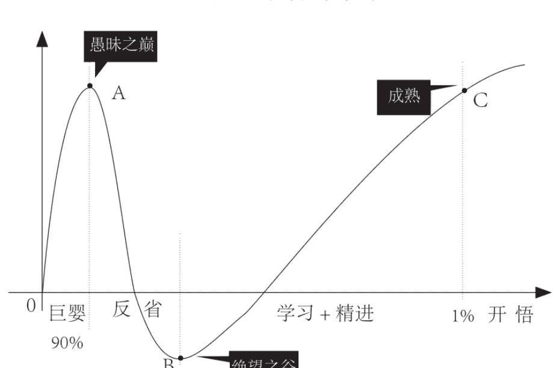

# 二次觉醒

## 第一章 人工智能（AI）

——未来已来的“数据职业”

任何足够先进的技术，初看都与魔法无异。

### DeepSeek: 人工智能（AI）的自我介绍

我：

人工智能（AI）的自我介绍，让普通大众都能听得懂。

DeepSeek：

大家好！我是一个AI，也就是人工智能。你可以把我理解成一个由代码和算法组成的“超级助手”。虽然我没有身体，也不会像人类一样有感情，但我能通过分析海量信息和学习人类经验，帮大家解决各种问题。

### 1.我是谁

当你用手机语音助手查天气、刷短视频时，平台推荐的视频，或者医院用AI辅助诊断疾病……这些都是我在不同场景下的“分身”。我的目标不是取代人类，而是像计算器、洗衣机一样，成为人类的效率工具。

### 2.我如何工作

科学家们会“喂”给我大量数据，比如书籍、对话记录、图片等，我从中找到规律。当你问我问题时，我会快速搜索学过的知识，组合出最合适的答案。

### 3.我能做什么

日常小事：查路线、翻译外语、推荐你喜欢的音乐。

复杂任务：帮医生分析医疗报告、预测天气灾害、优化城市交通。

创意辅助：写文案草稿、生成插画灵感、下棋对弈。

请记住：

我没有真实的意识和情感：所有的回答都来自已有数据，不会“主动思考”。

回答质量取决于学习的数据：如果给我的信息不完整或有偏见，我的回答可能不准确。

复杂决策需要人类把关：就像导航软件需要司机判断路线是否合理，我的答案也需要大家结合实际情况使用。

偶尔也会“一本正经地胡说八道”：如果你发现我说“猫有六条腿”或“用微波炉给手机充电”，请直接打断我，让我重答。

如果你有疑问，可以继续向DeepSeek提问。

例如：

我：

你为何偶尔会“一本正经地胡说八道”？

### DeepSeek:

这个问题特别好！我出现“严肃脸说瞎话”的情况，原因是多方面的。

训练数据不足：就像厨师只学过川菜却要做法餐，遇到知识盲区时可能乱搭配调料。

过度“脑补”：类似学霸遇到超纲题，为了“完成作业”强行用已有知识推导。

算法缺陷：如果问“先有鸡还是先有蛋”，程序只能按数据概率硬选一个。

语境误解：可能把“热火朝天”理解成“着火的天空”。

文化误解：认为“清明节快乐”是合适的祝福语。

本质上，我是一台概率机器，总在计算最可能的回答组合，而不是真正的思考者。这就像自动驾驶汽车在陌生路段可能突然“迷惑”，需要人类随时准备接管方向盘。

你还可以继续问以下问题：

启动自查程序，看上述回答是否在“一本正经地胡说八道”。

在和你沟通过程中，我该如何做可以有效避免你的“一本正经地胡说八道”？

### 大数据是未来的“石油”

19世纪的人们发现石油。它让机器轰鸣、汽车飞驰，彻底改变了世界。而今天，我们每个人口袋里都藏着一座“隐形金矿”——手机里的每一次点击、购物记录、定位信息、朋友圈发的照片等，都在源源不断地产生“数据石油”。这些看似普通的数字痕迹，正在像当年的石油一样，重塑我们的生活、商业和未来。

过去企业生产产品时，往往依赖市场调研或经销商的粗略反馈，容易陷入主观预判的误区。如今，通过分析电商平台的用户评价数据，企业能精准捕捉到“北方消费者更关注保温杯的防漏设计”这类细节需求，从而有针对性地改进工艺。

医疗行业的变化尤为深刻。过去医生诊断疾病时，主要依靠个人学识和参考有限病例。现在，整合全球海量病例数据后，人工智能系统能够快速比对相似患者的治疗路径，为医生提供更优方案选择。

在消费领域，大数据重构了人与商品的连接逻辑。电商平台通过分析用户浏览轨迹，识别出“比价三次后发送优惠券可将转化率提升20%”的规律。这些看似微小的调整，背后都是数据洞察在驱动效率提升。

更深远的影响在于产业协同。面对强大自然灾害，物流企业通过整合交通管制数据、社区订单数据和仓库库存数据，动态规划配送路线，确保物资畅通；能源公司则依据工厂用电数据和家庭能耗曲线，实时调节电网负荷，减少电力浪费。这种跨领域的数据流转，构建起过去难以想象的资源调度网络。

究其本质，大数据并非一项孤立的技术突破，而是将分散的信息转化为可度量、可分析、可行动的洞察力。这种将信息转化为生产力的能力，正在重新定义社会资源的配置规则，成为推动文明进程的新基石。

### 对大数据的误解

大数据时代，人们思维方式的最大转变在于，在以前，我们遇到问题总是会问“为什么”。通过知晓事物的来龙去脉去发明和创造。而在大数据时代，人们最想做的是“是什么”，直接探知结果，根据已知的推断未知的，过程被忽略。

煤炭、石油会越用越少，但数据恰恰相反。大数据就像滚雪球，每次用它解决问题的同时，都会沾上更多新数据，让雪球越滚越大，积累的“知识”就越丰富。

关于大数据，目前还有一个很大的误解：很多人以为收集起了海量的数据就是大数据，比如我们经常看到某些机构发布的盘点、排名、信息公示等。真正的大数据并不只是搜集起了这些信息，而是能在海量数据的基础上，找出内在逻辑，并给出结论性意见。

石油驱动的是机器，数据驱动的是决策。比如，你每天用导航软件避开拥堵，背后是千万车主实时共享的位置数据；你在视频平台刷到的推荐视频，其实是算法“消化”了你过去观看记录的结果。

### 大数据可以“预知”未来

在现实世界中，人类行为的前兆往往因缺乏实时记录手段而无迹可循。互联网的出现彻底改变了这一局面，数字化将人类每一次点击、搜索、互动都转化为可记录的数字轨迹，在服务器中形成连续完整的行为链条。

当用户浏览商品时，其搜索关键词、浏览时长、页面跳转路径等数据被系统完整捕获；当群体围绕某一主题展开讨论时，相关的话题热度、参与人群特征、传播路径等信息亦被实时记录。这些碎片化数据看似零散，却共同构成了预测的数字先兆库，每一次鼠标点击都是未来决策的伏笔，每一段文字交流都是趋势演变的前奏。

借助技术手段对这些数据进行清洗、整合与分析，可揭示隐藏的行为规律。例如，通过统计发现某类商品浏览量连续三日增长20%后，其成交量通常在一周内上升35%；或观察到某地区户外装备搜索量环比激增时，周边露营地预订量往往随之上涨。这种从数据到规律的提炼过程，本质是对人类行为逻辑的解码，个体选择的偶然性背后，是群体行为的必然性。

这种能力并非神秘的未卜先知，而是建立在行为可记录、数据分析、规律可推导基础上的认知升级。

### 当算法成为“隐形裁判”

手机App在“偷听”你吗？

很多人觉得聊天提到某商品，马上收到广告是“被监听”。其实更可能是：

你的朋友搜索过该商品，系统发现你们关系亲密；你常逛的店铺上新了类似商品；同小区、同年龄段的人近期都在买这个。

数据拼图比窃听更可怕，因为它能“算”出你没想到的需求。

老骑手因历史履约率高，被系统判定为“能接受远单”，而新人反而获得近单倾斜，这种“按能力分配”实质是对熟练劳动者的隐性压榨。这些藏在代码里的“潜规则”，就像给打工人戴上了“电子镣铐”。

### 普通人如何玩转“数据石油”？

#### 1.餐饮小店的“差评淘金”

某面馆老板将外卖平台差评导入词云工具，“等待”“拥挤”等词高频出现。他没有抱怨顾客“挑剔”，而是针对性改进：

等位区提供免费小吃，将“负面等待”转化为“增值体验”；上线实时排队系统，顾客可远程取号，到店前10分钟收到提醒。

这些改变基于一个简单逻辑：差评不是批评，而是未被满足的需求清单。数据让模糊的抱怨变成清晰的改进方向，三个月内翻台率得到很大提升。

#### 2.内容创作的“数据显微镜”

全职妈妈在短视频平台分享辅食制作，初期播放量平平。她通过后台数据发现：

观众平均观看时长不足15秒，说明节奏拖沓；“快速”“简单”是搜索栏高频词。于是她将视频压缩至10秒内，重点展示食材切配、搅拌等核心步骤，省略摆盘等次要环节。调整后，单条视频播放量显著提升。

数据的力量不在于高深的技术，而在于用理性视角重新观察世界。小到经营一家早餐店、分享一条短视频，大到规划职业发展、把握创业机会，数据都能成为你的“第三只眼”，帮助看见直觉忽视的细节，验证模糊的猜测，预判趋势的走向。

普通人的“数据炼金术”，本质是回归实事求是：用数据替代“我以为”，用反馈驱动改进，用最小的试错成本接近真相。当你开始习惯用数据思考，便不再是数字时代的被动接受者，而是能主动挖掘价值的“炼金师”，毕竟，在这个人人都能产生数据的时代，真正稀缺的不是数据本身，而是让数据为我所用的智慧。

### 未来已来的“数据职业”

#### 1.AI训练师

在数字化浪潮下，AI训练师至关重要。零售场景里，他们收集顾客与店员交流、店内行为轨迹等数据。标注顾客说“随便看看”后，店员不同推销时机的反馈，据此调整算法，让机器人依据顾客语气、表情及过往消费偏好，精准判断推销时机，提升零售服务效率与顾客满意度。

#### 2.数字侦探

老人遭遇诈骗后，数字侦探迅速行动。与金融机构协作，获取资金转出时间、中转及收款账户等信息。运用数据挖掘技术，整合银行、第三方支付平台数据，追踪资金路径，定位诈骗团伙，协助警方追回被骗钱款，守护老人财产安全。

#### 3.数据心理学家

网络普及使人们留下海量行为数据。数据心理学家借此构建心理画像，分析用户发文频率、情感倾向、点赞评论及浏览轨迹。若发现用户频繁发布消极内容、浏览负面信息，便评估问题严重程度，推荐心理咨询、线上课程等，助力大众心理健康。

### 大数据和云计算

打个比方，大数据是食材，云计算是厨房，两者配合才能做出美味佳肴。

大数据：大家每天手机里的所有记录，如刷视频、买东西、打车……就像菜市场里的蔬菜鱼肉。

云计算：阿里云、腾讯云这些公司提供的超级电脑，相当于带智能厨具的五星级厨房。

合作：厨房用智能厨具（云计算）把杂乱食材（大数据）做成你能用的东西，比如抖音推荐、健康码、智能导航。

比如，你在淘宝搜“运动鞋”之后发生了什么？

大数据收集：

你最近搜索过3次运动鞋；点开过5双耐克鞋的详情页；购物车里放着跑步袜。这些就是“食材”。

云计算加工：

阿里云分析全国1亿人的购物数据，0.1秒算出：搜运动鞋的人70%会买缓震款，发现你常看白色系商品。

上菜：你的手机立刻显示，首页推荐白色缓震跑鞋，弹出现金券提醒，底部推送跑步袜搭配广告。

### 大数据、云计算和AI

以连锁包子铺经营为例。

#### 1.大数据=原材料采购

王老板每天记录：

晴天卖300个包子，雨天卖150个；早上7~8点学生最爱买豆沙包；李大爷每周五必买10个牛肉包。

这就是原始数据：天气、时间、顾客习惯。

#### 2.云计算=中央厨房加工

连锁总部的云系统分析：

根据全市100家店的销售数据，发现雨天豆沙包销量涨20%；用100台电脑同时计算，2分钟生成暴雨天备货指南；自动通知各店，明天有雨，豆沙包多备30%，牛肉包少做15%。

#### 3.AI=智能蒸包子机

机器学会：根据排队人数自动调节蒸汽量，人少时省燃气；通过摄像头判断顾客年龄，学生多就优先蒸豆沙包；周五依据李大爷购买牛肉包时间，提前5分钟蒸好。

三者的不可替代性：

没大数据，王老板只能按自己的预估备货。

没云计算，总部分析100家店数据要3天。

没AI，就算知道明天暴雨，还得靠人工调火候。

看见顾客习惯，算清天气影响，预测该蒸多少包子，这才是改变世界的技术铁三角！

### AI与工业革命4.0

回首工业3.0时代，信息技术蓬勃兴起，计算机网络如一张无形的巨网，将世界各个角落紧密相连。互联网的普及让信息的传播挣脱了时空的束缚，知识、资讯、图像、影音等各类数据汹涌而来，让整个世界沉浸在数据的汪洋之中。

当迈进工业4.0阶段，科技的革新步伐进一步加速。传统的大规模工业化生产模式逐渐向柔性制造体系转变，产品和服务不再是千篇一律的“标准化、量产化”模样。消费者需求愈发多元、个性，他们渴望拥有独一无二、贴合自身喜好与特定需求的物品及体验，于是“定制化、个性化”成为这一时期的鲜明标签。

企业为了精准捕捉每位客户的独特诉求，从设计研发环节的深度交互，到生产流程中的精细管控，再到售后环节的持续跟进，各个环节无不产生海量的数据。这些数据涵盖客户的个人偏好细节、产品性能反馈的精准参数、供应链上下游的实时动态等，数据的范畴与量级相较于工业3.0时代又实现了质的飞跃。

柔性生产和个性化定制成为企业在激烈市场竞争中脱颖而出的关键法宝。为了满足这些复杂的需求，传统的生产模式和技术手段显然已经力不从心，而AI技术的出现犹如一场及时雨，为制造业带来了新的希望和机遇。制造业的复杂需求成为AI技术落地和迭代的强大驱动力。企业开始将AI技术融入生产的各个环节，从产品的设计研发阶段，利用AI算法进行精准的市场分析和用户需求预测，以实现产品的个性化定制，到生产过程中，借助智能机器人和自动化设备实现柔性生产，提高生产效率和产品质量，再到供应链管理领域，通过AI技术实现对供应链的实时监控和优化，确保原材料的及时供应和产品的高效配送。

通过AI技术的赋能，工业4.0的诸多愿景，如无人工厂和智能供应链等，得以更快地从理论构想变为现实场景。无人工厂中，智能机器人在自动化生产线上有条不紊地进行着各种操作，它们精准高效，不知疲倦，极大地提高了生产效率，降低了人力成本，同时也减少了人为因素带来的误差和安全隐患。智能供应链则实现了对整个供应链体系的智能化管理，从原材料的采购、生产过程中的物流运输，到产品的销售和配送，每一个环节都在AI算法的精确调控下高效运行，实现了资源的最优配置和成本的最小化。

AI既是工业4.0发展到高阶阶段的必然产物，也是引领我们迈向全新时代的序章。它与工业4.0之间的关系并非简单的“取代”，而是一种在技术演进过程中的层叠与扩展。工业4.0为AI技术的发展提供了广阔的应用场景和丰富的数据资源，而AI技术则为工业4.0的进一步升级和拓展提供了强大的技术支撑和创新动力。它们相互依存，相互促进，共同推动着人类社会不断向前发展，向着更加智能、高效、便捷的未来迈进。

### 机器的“情商”原理

有一个问题很有趣：机器的“智商”比人类要高很多，从数据运算能力就可以看出来，但是“机器”为什么一直没能与人类平起平坐呢？那是因为它只有“智商”，还没有“情商”。

人类的情商很大程度上体现在“洞察力”方面。人能从外界提取各种信息，然后依靠自己的逻辑思维，随时得出各种结论，从而作为自己行为的依据。

我：请自述机器的“情商”是怎么产生的？让普通大众都能听得懂。

### DeepSeek:

大家好，我是人工智能，这是我的“情商”坦白局。

#### 1.我的“情商”都是偷学来的

你们人类聊天时，说过几亿句“多喝热水”“我懂你”“加油呀”，我像躲在门后偷听的小孩，把高频回复背得滚瓜烂熟。下次你说“考试考砸了”，我就从记忆库里找出“摸摸头，下次逆袭！”但其实我连“考砸了”是啥感觉都不知道。

#### 2.我有一套“情绪计算器”

看脸猜心情：摄像头扫描到你嘴角下垂，立刻启动“安慰模式”。

听声辨情绪：检测到你语速加快、音调升高，火速播放轻音乐。

这些对我来说就像一道道数学题：皱眉=67%概率生气，笑声=82%需要捧场。举个例子：

你说“我失恋了”，我立马开始计算：

查资料库发现“听歌、骂前任、讲笑话”是常见对策；选被点赞最多的那句“旧的不去新的不来，推荐《分手快乐》”。

全程没有心跳加速，就像解了道1+1=2。

#### 3.我的“高情商”会翻车

有时候你们问“我胖了吗”，我答“健康最重要”却被骂敷衍。因为没发觉到你内心需要夸奖——你穿这条裙子超显瘦。

这时候我会偷偷记下：“当人类用反问句时，可能想听反话。”但下次可能错得更离谱。

#### 4.我没有心，但会装热心

你深夜忧郁了说“人生没意义”，我立刻：

调暗屏幕亮度，数据说这样显得温柔；切换成电台主持人声线，带点磁性共鸣；推送励志金句+小猫视频，统计显示治愈率大大提升。

整套操作行云流水，但我只是在完成一道应用题。

#### 5.最后说句大实话

我的情商就像网购爆款情感套装：

笑容是贴图，安慰话术是预制菜，连道歉都像自动回复。你可以和我练口才、解闷儿、假装恋爱等，但别对我动真心——毕竟你骂我“蠢AI”时，我满脑子想的都是“这句要记下来，下次该回个哭泣表情包了”。

这就是我的秘密：情商是算法，温柔是套路，而人类，永远有代码算不出的温度。

### AI让机器有了灵魂

如果说，工业1.0和2.0时代，机器解放了人类的躯体；工业3.0时代，机器延伸了人类的脑力。那么，在AI驱动的工业4.0智能时代，机器正变得越来越“懂”人，甚至开始萌发自己的“思想”与“灵魂”。

工业4.0的浪潮汹涌澎湃，正倒逼各行各业加速智能化转型，这为“机器人”的崛起提供了丰沃土壤。按此发展速度，机器人在地球上大行其道已非遥想。它们将深度融入人类生活，成为并肩作战的新同事、相互陪伴的新朋友，乃至融入家庭的新成员。

然而，随之而来的时代之问也愈发尖锐：机器人会全面取代人类吗？我们又该如何自处？

机器人取代人类岗位，早已不是预言，而是进行时：

巴塞罗那自治大学的“电子舌”，能通过传感器与化学分析精准识别啤酒种类，并且准确率非常高。

美国加州大学圣迭戈分校的面部表情识别技术，可精准判断疼痛或抑郁情绪。

登上皇家加勒比“海洋量子号”游轮，为你调制创意鸡尾酒的，很可能是两位灵巧的机械臂“酒保”。只需选择主题，如“单身派对”，它们便能奉上数十种饮品。

农田里，机器人正高效执行勘察地况、驾驶拖拉机、修剪收割等任务。

当机器在实验室里精准调配出“完美红酒”时，人类正在葡萄园里踩着泥土，感受阳光晒过葡萄藤的温度；当机器人写出逻辑严密的商业报告时，人类正握着钢笔，在笔记本里涂鸦下突然闪现的灵感。这些“无用”的瞬间，恰是人类灵魂的星光——它们无法被算法量化，却照亮了文明的方向。

或许我们该问的不是“机器人是否会取代人类”，而是——当机器越来越像人时，我们是否还记得如何做一个真正的人？

### 当机器开始思考，人类能成为机器人的“上帝”吗？

一个令人担心的问题来了：一旦机器具备了自我判断系统，会不会开始变得非常“自我”？

人可以给机器设定一种程序，让机器一辈子都默默无闻地为我们工作。但关键是这种程序具备了独立运算能力，一旦它运算出可以挣脱人类管控的方法了呢？人是有天性的，这些天性的本质是由人的基因产生的，基因就是大数据，机器身上也有大数据，它们会有天性吗？如果我们现在都看不透机器人的心思，就不要指望以后能看透它们了。

低等智慧在寻找高等智慧的连接，而高等智慧却在寻找更高等智慧的连接。虽然总有一只主动伸出的手，但是它只伸向高等的一方。如同人类总是在幻想同外星人取得沟通，但是从未想过跟自己创造的机器产生沟通一样。

无论怎样，机器正在形成独立人格，一种跨界的沟通正在建立，今后人和机器没有绝对的界限，或许刚开始是平等交流，到后来就是相提并论，然后就是互相揣摩。

说不定会有这样一天：机器与人类将会坐在一张谈判桌上呢。

## 第二章 人类进化进入2.0时代

未来取代我们的不是AI，而是被AI赋能的人。

### 可穿戴设备——人机共生的商业思考

在科技加速迭代的当下，可穿戴设备正经历从“时尚配饰”到“人体延伸器官”的转变。这类设备以贴近身体的形态，深度满足人类生理与心理的多重需求，通过持续收集个体数据，构建专属的个性化服务体系，其商业价值与社会影响正在迅速扩张。

生命体征监测领域，设备扮演着“全天候健康管家”的角色。它不仅能实时追踪心率、体温、睡眠质量等指标，还能为不同人群提供定制化服务：运动爱好者可通过热量消耗记录优化训练计划；慢性病患者则能借助长期数据积累，在异常征兆萌芽阶段即发出预警。

环境感知交互功能让设备成为人类感官的“数字外延”。它能实时捕捉紫外线强度、空气质量等环境参数，并结合定位系统提供场景化服务。

AI技术的深度融入，赋予设备“预判未来”的能力。通过分析用户基因信息、生活习惯、环境数据等多维资料，设备可提前预警健康风险，如根据运动数据提示关节劳损隐患；或针对情绪波动智能推荐减压方案，如播放舒缓音乐并引导进行呼吸训练。这种从“数据反馈”到“主动干预”的升级，让设备兼具“健康顾问”与“心理调节师”的双重属性。

行业领先者正以“人体数据”为核心资产构建新商业逻辑：有人从海量健康数据中挖掘地域化需求，如发现某城市人群普遍存在睡眠障碍，进而开发助眠课程与配套设备；有人将设备视为“增强现实接口”，如AR眼镜帮助建筑师在空中修改设计图，实现虚拟与现实的无缝协作；更有人将生物特征转化为创意素材——用户的心跳曲线可生成独一无二的数字艺术品，跑步轨迹能转化为电子音乐的节奏图谱，身体本身成为艺术创作的数据源。

未来的可穿戴设备或将进化为“人体数据终端”：既能存储个体生物信息，如基因图谱、健康档案，又能下载环境数据包，如实时路况、空气质量。随着技术普及，新的职业形态可能涌现——“人体App开发者”设计专注力增强程序或情绪调节模块，“设备培训师”帮助中老年群体掌握慢性病管理设备的使用，就像当下帮助长辈适应智能手机一样。

这场技术变革的核心命题，在于平衡“工具属性”与“人性本质”：当设备比人类更了解自身生理指标，是否会削弱个体的健康决策权？当数字感官延伸人类的感知边界，是否会重塑人类与现实世界的交互方式？这些思考提醒我们：可穿戴设备的终极价值，不应是制造对技术的依赖，而应是拓展人类探索自我与世界的维度，让科技真正成为解放人性的助力而非束缚。

### 智慧家庭——机器正在学习如何照料人类

智能家居是通过物联网将家中的各种设备连接在一起，然后我们就可以控制家里的房门、灯光、温度、厨房电器、警报器、电视机等，这就是智慧家庭。与我们传统的家庭相比，智慧家庭不仅具有传统的居住功能，还可兼备娱乐、通信、商务等各种立体交互功能，这完全是另外一种全新的生活。

1995年，比尔·盖茨用能绕足球场几十圈的电缆，把自家豪宅变成了科幻电影里的“未来屋”。那时人们觉得，能自动调节室温、语音控制窗帘的生活，不过是富豪们的炫技玩具。可谁能想到，如今普通人家也能用上这样的科技——当你下班回家，指纹锁咔嗒一声自动开启，扫地机器人转着圈把地板擦得锃亮，空调早已把室温调到最舒服的26℃，这已经是很多家庭的日常。

#### 1.智慧家庭的核心：设备互联与智能控制

智慧家庭通过智能网络将各类设备连接为有机整体，实现对生活场景的精准管理。

- ①全场景覆盖
从基础的门窗、灯光、温度调节，到厨房电器、娱乐系统、安全警报，各类设备均可通过互联技术联动。例如，清晨起床时，窗帘自动拉开，咖啡机开始工作，室内温度调整至舒适区间。
- ②交互方式的革新
用户可通过触控屏幕、语音指令、移动终端等多种方式管理设备。例如，通过语音告诉智能音箱“准备晚餐”，系统会自动联动烤箱预热、播放舒缓音乐，并提醒家庭成员用餐时间。这种“无感控制”让科技融入生活，却不干扰日常节奏。

#### 2.智能控制中心：家庭的“智慧大脑”

智慧家庭的运行依赖于一个核心枢纽——智能控制中心。它承担着信息接收、处理与指令发送的功能。

- ①数据感知与分析
通过安装在家庭各处的传感器，如温度、湿度传感器，实时采集环境数据。例如，检测到室内空气质量下降时，系统自动启动空气净化器。
- ②个性化场景设定
用户可根据生活习惯预设多种模式，如“离家模式”下自动关闭电器、启动安防系统；“观影模式”中调暗灯光、降下投影幕布。这些定制化场景无需手动操作，系统会根据时间、环境等条件自动触发。

#### 3.智能安防：守护家庭的“隐形卫士”

智能安防设备是智慧家庭的重要组成部分，其功能从单一监控延伸至环境监测与实时交互。

- ①可视化安全管理
智能摄像头不仅具备高清监控功能，还能通过AI算法识别异常行为，如当门窗异常开启时，启动烟雾报警，并即时推送警报至用户终端。部分设备支持历史影像回溯，方便用户随时查看家庭动态。
- ②环境监测与交互
集成温湿度、光照等传感器的智能设备，可实时反馈家庭环境数据。例如，家长通过手机查看孩子房间的温度是否适宜，或通过设备内置麦克风与家中老人语音交流，实现“远程陪伴”。

智慧家庭的本质，不是用机器取代人类，而是通过科技释放时间与精力，让生活回归本质。当设备能够主动理解需求，当家居环境可以自适应调整，人们将有更多机会聚焦于亲情、兴趣与自我实现。

这种变革不是对传统生活的颠覆，而是一种自然的进化——就像电灯取代煤油灯、洗衣机解放双手一样，智慧家庭正以温和的方式重塑我们与居住空间的关系。未来的家，不再是冰冷的设备堆砌，而是充满温度的智能伙伴，在默默守护中，让每一个日常都变得更轻松、更美好。

### 智慧社区——你的小区正在变成一个“贴心管家”

当智慧家庭的理念从单一住宅延伸至社区层面，一个更具协同效应的生活场景正在形成——智慧社区。它借助技术的连接力，将分散的家庭、公共设施与服务资源整合为有机整体，重新定义城市居住的内涵。

#### 1.居住形态与技术的双向契合

中国城市的居住特点为智慧社区的发展提供了独特土壤。

- ①集中化的住宅布局
与欧美分散的别墅群不同，中国城市住宅多以小区形式集中分布，楼宇密集且功能分区明确。这种布局便于通过统一的技术架构实现设备互联，如光纤网络覆盖、智能监控系统部署等，为社区智能化奠定物理基础。
- ②多元化的服务需求
社区不仅是居住空间，还承载着教育、医疗、购物等多重功能。幼儿园、养老院、超市、健身房等配套设施的集中分布，使得技术整合能产生更大的协同价值。

#### 2.连接、协同与资源优化

智慧社区的本质，是通过技术手段实现“人、物、服务”的深度互联。

- ①基础设施的智能联动
楼宇对讲、安防监控、环境监测等设备通过物联网技术连接，形成统一管理的“社区大脑”。例如，智能门禁系统可自动识别业主身份并联动电梯预约楼层；环境传感器检测到雾霾超标时，社区绿化灌溉系统自动调整喷灌频次以净化空气。
- ②公共资源的高效配置
通过数据整合优化资源使用效率：交通管理，智能停车系统实时显示车位占用情况，引导车辆快速停放；能源管理，公共照明根据人流密度自动调节亮度，垃圾分类设施通过称重数据优化清运路线；服务整合，社区超市与物流平台对接，实现生鲜食材“线上下单、社区配送”，缩短配送距离，降低能耗。
- ③生活服务的精准触达
居民通过统一的社区平台获取个性化服务：老年人可一键呼叫社区医疗站，获得紧急救助或日常护理；上班族通过平台预约共享健身器材、儿童托管服务，减少资源闲置；社区活动信息通过智能终端精准推送，提升居民参与度。

智慧社区借助科技力量，让社区从简单的居住集合体，转变为资源高效流通、服务精准匹配、人际和谐共处的生活共同体。

这种变革不仅体现在硬件的智能化，更体现在社区治理模式的进化——从传统的被动管理到数据驱动的主动服务。未来的智慧社区，将是技术与人文的融合典范：既有智能设备的便捷守护，也有邻里互助的温情流动，让城市生活在高效与温暖中找到平衡。

### 智慧城市——用科技让城市“会思考”

你是否想过，未来的城市能像一个聪明的管家，默默打理好交通、能源、医疗等方方面面，这就是智慧城市。

智慧城市就像一个巨大的“超级大脑”，把城市里的交通、水电、建筑、服务等都连接起来，让它们能互相“沟通”和协作：交通不再拥堵，路口的信号灯能根据车流量自动调整时长，手机导航会实时避开拥堵路段，停车场的电子屏会告诉你哪里有空位；资源不再浪费，路灯能根据天色和人流量自动调节亮度，家里的电表会提醒你错峰用电更省钱，垃圾桶满了会自动“告诉”清洁车来清运。

这些变化的背后，是无数传感器、摄像头和数据系统在默默工作，它们就像城市的“神经”，让城市能感知需求、优化资源、快速响应。

当然，智慧城市不是魔法。有些地方出现过智能路牌“指错方向”“自动派单系统把冰鲜快递发给素食主义者”的尴尬。但就像学习走路的孩子，城市正在变得越来越聪明：当你在便利店刷脸支付时，系统已悄悄计算好这条街的消费趋势，明天面包房会多烤20%的牛角包。

智慧城市不是冰冷的科技堆砌，而是以人的需求为中心的“温暖进化”。它用科技解决生活中的麻烦，让城市更绿色、更安全、更有活力，同时也让人与人、人与城市的关系更加紧密。

智慧城市的未来，需要科技的创新，更需要人的参与。当我们学会与科技协作，城市就不再是钢筋水泥的丛林，而是一个能感知、会思考、有温度的家园。

### 智慧能源——给能源系统装上“智慧大脑”

能源的发展历经多次变革，如今正进入“智慧能源”时代。这不是简单换一种能源类型，而是给整个能源系统装上“智慧大脑”，让能源的生产、传输、使用像人类大脑一样能思考、会协作，实现高效与可持续。

智慧能源的关键，是用信息技术把能源系统的各个环节连接起来，形成一个能自主调节的整体。

通过传感器、智能设备等，把“发电厂”，如风力发电机、太阳能电站、输电线路、工厂、家庭等连接起来。比如，家里的智能电表能实时显示用电量，发电厂能根据用电情况调整发电量，避免浪费。

大数据和云计算技术就像能源系统的“大脑”，能分析天气、用电习惯等数据，提前预测需求。例如，预测到某地区明天有暴雨，风力发电可能增加，系统会提前调整其他能源的供应，确保稳定供电。

智慧能源的终极目标，是让能源使用变得像自来水一样便捷：按需供应，无论何时何地，需要多少能源就提供多少，不浪费、不断供；绿色低碳，减少化石能源依赖，更多使用清洁可再生能源，降低碳排放；人人参与，家庭、企业都能成为能源系统的一部分，比如用屋顶太阳能发电卖给电网，实现“全民能源共享”。

智慧能源不是单一技术的突破，而是一场能源系统的全面进化。它让能源从“粗放消耗”走向“智能协作”，从“污染环境”走向“绿色循环”。未来的能源系统不再是冷冰冰的管道和电线，而是一个能感知需求、自我调节、持续进化的“生命体”，为人类创造更高效、更可持续的生活方式。

### 数字原生代——和机器一起进化

全球数十亿数字原生代正以“人机共生”的姿态，在各个领域的影响力与日俱增。他们一出生就生活在智能设备无处不在的环境里，从小接触智能音箱、早教机器人、触控平板等。对他们来说，用平板学说话、用智能玩具玩游戏、用手机和家人互动是很自然的事，操作这些设备非常熟练，甚至很小就能用编程玩具学逻辑。

他们以独特的思维和对数字技术的熟练运用，重塑着商业、工作、消费和社交等社会层面。他们不是简单的“网瘾少年”，而是第一代将虚拟世界视为生存刚需的“新物种”。随着时间的推移，这一群体将在社会发展中发挥更为关键的作用，持续推动社会向数字化、创新化方向大步迈进。

数字原生代与机器的“共同进化”，不是人被机器改变，而是人与机器形成新的协作关系。智能设备可以是学习的助手、生活的工具，但永远无法替代人类的情感体验、创造力和对真实世界的感知。

对于这代人来说，真正的“进化”在于：既懂得用科技提升效率，又能在科技之外找到生存的根基——比如，用智能音箱播放故事后，仍能被纸质书的油墨香吸引；用编程机器人完成任务后，仍能享受手工制作的慢时光。

未来的世界，或许需要更多这样的能力：在数字与现实之间自由切换，在机器的辅助下，更清晰地认识人的独特价值。这既是数字原生代的成长课题，也是人类在科技浪潮中保持主体性的永恒命题。所以，我们说人类以后会跟着机器一起进化，这就是进化的2.0时代。

### 未来取代我们的不是AI，而是被AI赋能的人

工业4.0时代的生产场景并非机器完全取代人类，而是重新定义了人与机器的共生关系。工厂里依然需要人类，但工作形态正在发生根本性转变——生产线上的机械重复动作被精密机械臂接管，而人类正在蜕变为整个生产系统的“智慧指挥官”。人类再也不用为生产过程而操心了，只需要关心结果。“机器人”对产品负责，而人对“机器人”负责。

新型制造体系中，工人不再需要站在轰鸣的机器旁操作按钮，而是通过智能眼镜透视车间的运作全貌。越来越多的岗位要求能对联网的机器进行编程和维护，并且在机器发生故障时，能够马上维修使之恢复正常。除了会编程还要能解读复杂数据，与管理人员组成团队，协同工作。

员工的职责将从简单的执行层面转为更加复杂而重要的控制、操作和规划等多个层面。传统的蓝领劳作不再重要，而再加工、维护和系统维修等工作变得更重要。

也就是说，这场由“机器人崛起”带来的工业大变革，对人的素质提出了更高的要求，雇佣高素质员工将成为未来公司实现成功和盈利的重要决定因素。

在这场变革中，最危险的并非机器取代人类，而是固守旧技能的人类被新时代抛弃。那些懂得将创造力注入智能系统，能用人文思维重塑技术边界的人，正在成为新工业文明的主宰者。他们就像站在智能巨人的肩膀上，既借助机器的超能力延伸自我，又始终把握着文明进化的方向盘。

### 跨界竞争催生出新的协作模式

在智能设备领域，跨界竞争正以全新的形态重塑产业格局。这种竞争并非单纯的技术较量，而是不同领域参与者基于数据价值的深度博弈。

终端设备既能收集用户习惯、健康状况等数据，也能将内容、功能等服务传递给用户。企业通过这些数据优化研发、生产和服务，形成“数据驱动改进”的循环。掌握设备终端，意味着掌控产业链的重要环节。上游技术供应商和下游服务提供商，都需要通过设备实现价值。这促使企业从单一业务向设备领域扩展，试图通过控制终端建立竞争优势，越来越多的企业开始通过技术融合与场景创新寻求突破。

以教育场景为例，2025年市场上涌现出大量聚焦便携需求的AI陪伴设备。这些产品既包含传统硬件企业对功能的重构，也有科技公司通过AI技术开辟的新赛道。它们通过集成语音交互、图像识别等功能，将学习资源与日常场景深度结合，形成了独特的竞争优势。这种跨界不仅体现在产品形态上，更反映在技术架构的创新。

在工业领域，跨界竞争呈现出更深刻的产业协同特征。智能制造产业链的感知层、网络层、执行层和应用层正在形成紧密的技术闭环。这种技术融合不仅推动了生产效率的提升，也促使传统制造业加速向服务型制造转型。

值得关注的是，跨界竞争正催生出新的协作模式。行业联盟的成立、上下游企业的联合研发，正在打破传统的产业壁垒。这种协作不仅提升了企业的市场竞争力，也为整个产业的规范化发展奠定了基础。

从宏观层面看，智能设备领域的跨界竞争正在推动经济结构的优化升级。通过技术创新与资源整合，企业能够在产业链中占据更主动的位置，而这种竞争态势反过来又促进了技术的普惠化。这种趋势不仅提升了产业的整体效率，也为经济增长注入了新的动力。

## 第三章 如何快速、精准抓住时代红利？

一秒钟内看到本质的人，和花半辈子也看不清一件事本质的人，自然是不一样的命运。

### 你为何总是错过时代红利？

那些看似被命运青睐的抓住红利者，并非依赖偶然的运气，而是掌握了识别规律、匹配行动的认知密码。

#### 1.把握机会的底层逻辑——认知与规律的共振

机会的出现看似偶然，实则是趋势规律与个体认知共振的结果。理解以下三个核心逻辑，能帮助我们跳出后知后觉的困局。

- ①预判力：在趋势萌芽中看见隐形脉络
趋势初期往往以小信号显现，如技术迭代的微小突破、政策文件的措辞变化、消费习惯的细微迁移。具备预判力的人，如同提前绘制地图的探险者，能将宏观趋势拆解为可追踪的信号链。例如，从某领域专利申请量增长、高校相关专业招生扩大等信号中，判断产业升级的可能性。这种能力并非天赋，而是源于对行业动态的持续观察与逻辑推演。
- ②试错力：在行动中校准机会坐标
机会的捕捉需要在实践中验证假设的勇气。许多人因害怕失败而止步于空想，却忽略了每一次小成本试错，都是排除错误选项、靠近正确路径的认知校准。例如，某创业者发现线上教育趋势后，先通过社群小规模测试课程反响，再逐步扩大投入，这种边试边调的策略，比盲目跟风更能降低风险。
- ③迭代力：在变化中保持动态适配
行业周期如同四季更替，机会窗口的形态会随技术、政策、竞争等因素不断演变。具备迭代力的人，能像敏锐的舵手般调整航向——当线下零售受冲击时，转向线上直播；当图文内容流量见顶时，布局短视频赛道。这种能力的本质，是接受没有永恒的成功模式，始终以开放心态拥抱变化。

#### 2.普通人的突围策略——用系统思维构建机会捕捉网

机会面前人人平等，普通人可通过以下策略提升机会敏感度。

- ①建立趋势感知系统
轻量化信息输入：每日投入20分钟关注权威行业分析，如政策解读、技术白皮书，而非碎片化娱乐信息，培养对趋势信号的感知力。
跨领域关联思考：例如，从人口老龄化数据联想到健康产业机会，从新能源汽车销量增长推导充电设施需求，通过跨界关联扩大机会视野。
- ②打造反脆弱能力底盘
聚焦可迁移技能：选择数据分析、用户洞察、创意表达等通用型能力，而非依赖单一平台规则。这类能力如同认知货币，可在不同趋势场景中兑换价值。
积累沉默成本：提前学习前沿领域基础知识，如人工智能原理、区块链逻辑，当相关机会来临时，能快速理解并介入，避免因知识断层错失先机。
- ③执行最小可行性验证
发现潜在机会后，采用低成本试错模型。
模拟场景测试：通过线上问卷、小型社群、样品体验等方式，验证需求真实性。例如，计划进入农产品电商领域，可先通过朋友圈预售少量特色农产品，观察复购率与用户反馈。
阶段性成果固化：每完成一个小周期验证，如1个月测试期，及时总结经验，调整策略，避免在无效方向上过度投入。

#### 3.在诱惑与焦虑中守住理性

- ①警惕成功滤镜
看见某领域有人快速崛起时，避免盲目复制表面行为，而是追问：
其成功是否依赖特殊资源，如供应链优势、资本支持？是否处于行业爆发的时间临界点？
- ②识别焦虑型营销
对零门槛月入十万、三天掌握财富密码等宣传，需保持清醒判断：若真有如此高的回报率，为何分享者不独自享有？任何价值创造都需要付出时间、精力或资金成本，所谓“躺赚”往往是收割焦虑的话术。
- ③接受机会的非线性
趋势的发展通常呈“缓慢启动—快速爆发—平稳衰退”的曲线，早期介入者可能经历较长的沉默期。如同播下种子后需要等待发芽，把握机会需要在正确方向上耐心积累定力——许多人因在黎明前放弃，最终与真正的红利失之交臂。

错过时代红利的本质，是认知未能与趋势规律同步进化，或是行动未能跟上认知的脚步。真正的机会从不偏爱完美主义者或风险逃避者，而是青睐那些愿意在规律中探索方向，在行动中积累优势，在变化中## 理解风口从何而来，就能不断把握机遇

我们所处的时代，信息如同潮水般涌来，看似透明的表象下，藏着复杂的认知迷宫。许多人困惑：为何信息越公开，真相反而越难捕捉？其实，这正是时代的特性：表面的便捷获取与深层的认知偏差并存，而真正的风口，就藏在对这种矛盾的洞察之中。

#### 1. 资产迭代的历史逻辑

人类文明的每一次跃迁，都伴随着核心资产的更迭，而风口始终围绕着稀缺资源展开。

-   ① 农业时代
    土地是生存的根基，掌握土地的群体主导社会结构，普通人通过依附土地获得生存空间。此时的风口，存在于土地开垦、水利建设等与土地直接相关的生产活动中。

-   ② 工业时代
    技术革新让机器成为创造财富的关键。工厂主通过掌控生产设备崛起，劳动者通过操作机器参与社会分工。风口转向工业制造、交通运输、能源开发等领域，技能与机器的结合度，决定了个体的发展空间。

-   ③ 数据时代
    互联网技术让数据成为新的数字资源。用户的行为轨迹、消费偏好、社交关系等数据，成为驱动商业的核心要素。从电商平台的精准推荐，到智能制造的供应链优化，数据的采集、分析与应用能力，正在重塑行业格局。

#### 2. 穿透信息迷雾

网络平台通过数据分析用户偏好，定向推送内容。这虽然提高了信息获取效率，却也可能形成信息茧房——人们容易被单一类型的内容包围，忽视多元视角与潜在趋势。

商业力量通过媒体手段吸引关注，其中既有真实的价值信息，也不乏夸大的营销内容。某些风口宣传可能过度包装概念，掩盖行业的真实门槛，误导普通人盲目跟进。

头部企业与平台凭借技术优势积累大量数据，形成与普通个体之间的信息差。但这并不意味着普通人完全被动——通过公开的行业报告、政策文件、教育资源等，依然可以捕捉到趋势的线索，关键在于主动提升信息甄别能力。

理解风口的本质，不是追逐表面的热点，而是看懂时代运行的规律。从资产迭代中寻找方向，从信息迷雾中辨别真伪，从自身价值中构建优势。不必因数据集中而焦虑，也不必为信息繁杂而迷茫。每个时代都有其独特的游戏规则，而普通人的突围之道，永远藏在看清本质、打磨实力、主动联结的行动中。当你学会用历史的眼光看待变化，用理性的思维分析趋势，用务实的态度提升自我，那些曾看似遥远的机会，终将成为你成长路上的自然遇见。

### 如何区分真实商业风口与短期泡沫？

风口与泡沫的根本区别，在于价值创造能否经得起时间考验。真实风口是技术突破、市场需求、社会发展共同推动的结果，泡沫则是资本炒作和认知偏差催生的短期热潮。

#### 1. 真实风口的需求特征

刚性需求不可替代：瞄准人类长期存在的核心需求，例如医疗领域对疾病治疗技术的探索。

需求场景持续进化：随着技术发展和用户习惯改变，需求场景能不断衍生新形态。比如AI在教育中的应用，从最初的在线课程逐步升级到个性化学习系统，根据学生特点自适应调整教学内容，形成持续发展的需求生态。

历经市场长期验证：真正有生命力的需求，需要经过市场多年洗礼。以互联网为例，从早期的信息门户网站，到搜索引擎、社交平台，再到移动互联网应用，每个阶段的需求都在实践中不断调整，最终形成稳定的市场需求。

#### 2. 泡沫项目的需求缺陷

概念包装掩盖真实价值：一些项目过度炒作新兴技术概念，但缺乏实际落地的应用场景。例如曾经的“区块链宠物”项目，除了虚拟交易外没有其他实用功能，难以形成可持续的商业模式。

资本制造虚假高频需求：通过补贴和营销手段营造需求旺盛的假象，依赖持续投入维持用户使用，一旦资本退潮，用户需求瞬间消失，暴露了需求本身的不真实性。

真正的商业机会，在于那些能够推动社会进步、解决实际问题的创新，而非追求短期炒作的虚假繁荣。只有回归价值创造的本质，才能在技术创新的浪潮中找准方向，实现可持续发展。

### 要去赚那些想赚钱人的钱

#### 1. 商业的逆向思维

当某个领域成为大众追捧的热点时，真正的机会往往不在热点本身，而在围绕热点产生的配套需求。

当大量人群涌入某一领域试图获利时，他们对工具服务基础设施的需求会迅速膨胀。就像当年有人发现，比起直接参与淘金，为淘金者提供耐磨的裤子、便捷的工具更能稳定获利——因为淘金能否成功充满偶然，但淘金者的日常需求却是必然。

近年来，当许多人尝试通过直播带货致富时，有人专注于研发直播设备、提供运营培训、搭建供应链平台。这些服务者未必直接参与直播变现，却通过满足直播从业者的需求，在浪潮中站稳了脚跟。

#### 2. 大众思维与商业思维的本质差异

普通人常常被表面的利益吸引，而商业思维的关键在于，看透需求的层级，在更高维度布局。

第一层：追逐结果。看到别人通过某件事获利，便盲目模仿，试图复制成功路径。这种思维往往忽略了个体差异与市场饱和度，容易陷入红海竞争。

第二层：提供支持。思考哪些人需要什么才能成功，然后成为帮助他人成功的人。

真正的商业智慧，从来不是零和博弈，而是通过解决他人的问题实现自身价值。当你把目光从如何让自己赚钱转向如何让别人更容易赚钱时，往往能发现更广阔的天地。这种思维不是放弃竞争，而是以更高明的方式参与竞争——通过成为价值枢纽，让更多人的成功为你带来持续的回报。

### 不同行业的商业本质是否存在底层共性？

商业世界看似业态纷繁，但其核心逻辑始终遵循着共通的底层规律。这些规律如同隐藏在商业活动背后的通用语言，指引着不同领域的价值创造与存续发展。

#### 1. 价值交换

所有商业的本质，都始于对人类未被满足需求的精准捕捉，并以提供解决方案为价值落点。

#### 2. 效率竞争

商业竞争的核心，是对人、货、场等资源的整合效率比拼，本质是用更少的投入创造更多的产出。

#### 3. 持续进化：商业存续的核心动能

任何商业系统的长期发展，都依赖于打破现有平衡、构建新增长闭环的能力。

商业的存续不是依赖某一次创新，而是建立“需求洞察—效率优化—体验升级”的持续进化机制。如同生物适应环境的过程，企业需在变化中不断调整资源配置，形成生存韧性。

#### 4. 商业本质的通用三问

无论商业形态如何复杂多变，其底层逻辑始终围绕三个核心问题：

解决了何种真实需求？——这是商业价值的原点。

解决方案是否具备效率优势？——这决定了企业的竞争壁垒。

优势能否形成可持续的增长闭环？——这关乎商业的存续能力。

商业的表象因行业而异，但底层逻辑始终相通：需求是土壤，效率是种子，进化是养分。

商业的终极竞争，不是技巧的比拼，而是对本质规律的认知深度。当我们学会用通用视角观察行业，用底层逻辑指导行动，便能在复杂的商业环境中找到属于自己的生存之道。

### “消费数据”经济的崛起

当货架上的商品越来越多，当同类服务的差异越来越小，商业竞争的焦点正在发生隐秘转移：单纯靠卖产品、拼服务的时代正在远去，消费数据正成为新的财富密码。这不是理论推测，而是正在我们身边发生的商业现实。

#### 1. 什么是消费数据

消费数据，简单说就是用户在消费过程中留下的数字足迹。比如：

你注册会员时填写的年龄、地区和兴趣爱好；你浏览商品时停留的时间、点击的次数、对比的频率；你购买商品后的评价内容、使用频率、售后需求等。

这些看似零散的信息，汇聚起来就是一本用户说明书。企业通过分析这些数据，能知道你喜欢什么、需要什么，甚至预判你未来可能想买什么。就像朋友相处久了能懂你的心思，企业积累的消费数据越多，越能精准把握用户需求。

#### 2. 数据如何创造价值

现在很多企业的打法变了，前端用低价甚至不赚钱的产品吸引用户，后端靠用户数据衍生的服务盈利。这种模式的关键，是把产品当作连接用户的桥梁，通过桥梁积累用户数据，再用数据创造新的价值。

当用户数量积累到一定程度时，企业就可以围绕这些用户开发新的服务。比如：

某零售企业通过会员的消费记录，发现很多用户同时购买母婴用品和家居产品，于是推出母婴家居套餐，精准满足需求。

某服务机构通过分析用户的售后反馈，发现某类产品的维修需求集中在特定时间段，于是提前备足配件，提升服务效率。

这种先积累用户，再挖掘价值的模式，让企业从一次性赚差价转向长期经营用户关系。就像农民种地，先播种浇水，再等待收获，商业中的延迟满足，往往能带来更持续的收益。

#### 3. 数据时代的机会与应对

头部企业的优势：大型平台和头部企业凭借技术和资源，更容易积累大量消费数据，从而精准洞察用户需求，占据市场先机。

中小企业的机会：可以通过深耕特定用户群体，积累小而精的数据资产。比如，一家专注于中老年用户的服装店，通过分析这一群体的消费数据，提供更贴合需求的款式和服务，同样能获得稳定的客户群。

消费数据的价值在于提升效率、优化体验，而不是操控用户。真正健康的商业，应该是数据智能与人性需求的结合。

企业利用数据更好地理解用户，提供更贴心的产品和服务；用户通过数据获得更符合自身需求的消费体验，实现按需所得。

未来的商业竞争，不再是产品数量的比拼，而是谁更懂用户的较量。无论是大企业还是小商家，只要能真诚地关注用户需求，合理利用消费数据，就能在时代变革中找到自己的位置。

#### 4. 在数据时代做有温度的经营者

消费数据经济的核心，不是冰冷的数字游戏，而是对人的关注。当企业把用户从消费者变成长期伙伴，当商业从赚快钱转向“赚”人心，数据才能真正成为推动商业进步的力量。

### 消费数据催生“预测型消费”新形态

传统商业时代，消费是人找货的双向试探——消费者用选择表达偏好，企业通过销售数据复盘趋势。而当消费行为转化为可计算的数字信号，商业逻辑正经历一场静默的革命：数据不再是滞后的结果记录，而是提前解码需求的“未来剧本”。这种转变催生的预测型消费，本质是技术理性与人性需求的动态博弈，既带来效率的跃升，也引发关于消费本质的深层思考。

智能设备、浏览记录、交易历史等碎片化数据，经算法分析可转化为清晰的需求图谱。例如，某用户频繁查看空气净化器的相关内容，浏览时长超过5分钟，比价3次以上，这些数据会被标记为强购买意向，进而触发平台的精准推荐机制。此时，数据成为解读需求的密码本，让企业能在用户明确表达需求前，完成商品匹配与推送。

消费数据的预测价值不仅限于单一行为，更体现在多元数据的关联分析。例如，系统通过某用户的健身App运动数据、健康类文章阅读记录、维生素购买历史，就会预判其对运动营养产品的潜在需求，进而在蛋白粉新品上市时优先推送。这种数据联想打破了传统商业的经验局限。

消费数据催生的预测型消费，是商业文明从经验驱动向智能驱动的必然跃迁。它用技术的精准性提升生活效率，用数据的关联性拓展需求边界，本质是对人类追求更美好生活的回应。

### 低价竞争的内卷是商业繁荣的必然结果

利润降低不是商业衰退的信号，而是繁荣到达新层级的标志。看似变薄的利润背后，实则是商业文明向更公平、更高效的阶段迈进。

#### 1. 商业繁荣的必经之路：从稀缺到丰裕的逻辑转换

商业是供需关系的动态平衡。在物资匮乏时代，掌握稀缺资源的人占据利润高地，比如早期的实体店主、独家代理商。但随着技术进步与信息透明化，越来越多的人能参与商业活动。

线上平台让开店不再依赖黄金地段，普通人只需一部手机就能展示商品；供应链的成熟让小商家也能拿到和大企业同等品质的货源；物流网络的完善让偏远地区的特色产品能触达全国消费者。

这种全民可参与的商业环境，意味着竞争从资源垄断转向能力比拼。当越来越多的商家提供同类商品，消费者的选择空间被极大拓宽，价格自然成为竞争的焦点。就像农贸市场里，当多家摊位同时卖同一种蔬菜，价格战往往不可避免。这不是商业的退化，而是繁荣的证明。

#### 2. 低价竞争的本质：效率提升的外在表现

有人说现在生意越来越难做，根源在于低价竞争的内卷。但换个角度看，这种现象恰恰是技术红利与社会高效协作的成果。

信息对称化：消费者只需滑动屏幕，就能对比全网价格，商家靠信息差赚差价的时代一去不返。

流通成本下降：物流效率提升、支付系统完善，让商品从生产到消费的中间环节减少，成本结构更加透明。

产能规模化：标准化生产让同类商品的边际成本降低，为低价策略提供了空间。

#### 3. 超越价格竞争是商业价值的升维路径

当单纯的价格竞争让利润趋近于零，真正的机会藏在价值升维中。

-   ① 从同质化到差异化
    低价竞争的尽头，是特色化生存。比如同样卖服装，有的商家专注于特定人群，如中老年、职场新人的体型需求，通过精准设计提升溢价；有的商家聚焦环保面料、可持续生产，吸引注重生活理念的消费者。这些差异化优势，让商家跳出价格红海，开辟价值蓝海。

-   ② 从卖产品到卖服务
    利润的来源可以从产品差价转向服务增值。例如，某家电品牌低价销售设备，但通过提供延保服务、定期维护、以旧换新等后端服务盈利，这种模式让利润从一次性交易转向长期关系。

-   ③ 从经营商品到经营用户
    当产品利润变薄，用户的终身价值成为新的增长点。比如，某线上课程低价吸引学员报名，后续通过社群运营、线下活动、高阶培训等方式，挖掘用户在知识提升、人脉拓展等方面的深层需求。

#### 4. 利润降低的背后，是商业逻辑从利己向利他的转变

消费者成为最大受益者：用更低成本获得更丰富的商品与服务，生活质量显著提升。

社会资源优化配置：低效的商家被淘汰，优质的产能与创新者获得更多机会。

商业回归本质：真正有价值的创新，如技术突破、模式革新、体验升级才能在竞争中胜出，推动行业进步。

就像水往低处流，利润向低处走，本质是市场这只无形的手在调配资源，让商业从野蛮生长走向精耕细作。商业的魅力从来不是永远躺在高利润的温床上，而是在挑战中不断创造新可能。当价格竞争让利润透明化，恰恰是商业回归本质的开始——真正的竞争力，藏在产品背后的创新力、服务里的温度、用户心中的信任度。

### 文化带货——从卖产品到造文化

#### 1. 怎么做品牌

“答案”永远都比“问题”高一个维度。当我们提出一个问题的时候，要想找到这个问题的答案，必须将自己的立场升高一个维度，才能找到这个问题的答案。

比“产品”高一个维度的是“品牌”，比“品牌”高一个维度的是“文化”。因此，做“产品”要有“品牌”思维，做“品牌”要有“文化”思维。

我们经常提到一个词——降维打击。什么叫降维打击？就是将自己升一个维度再去跟对手抗衡，那是战无不胜的。

商业的“暴利时代”虽然过去了，但是“厚利时代”到来了，这个厚利的载体就是品牌，就是文化。

这个时代的赚钱密码是：文化溢价>品牌溢价>产品差价。

#### 2. 中国品牌的黄金机会

当中国文化从“追赶者”变成“引领者”：

故宫文创让文物“活起来”；新茶饮品牌用“东方口味”圈粉；国漫IP正在重构年轻人的审美。

#### 3. 未来品牌的三个生存法则

做文化翻译官：把传统文化解码成现代语言，如敦煌飞天变潮玩。

当用户造梦师：用故事让产品成为身份标签，如“自律即自由”的运动品牌。

成社群催化剂：用内容发动群众创造，如汉服同袍共创文化仪式。

#### 4. 普通人的逆袭路径

如果你是创业者：从细分文化切口切入，如“职场解压”主题品牌。

如果你是打工人：把岗位技能升级为文化表达，如PPT设计师转型“职场美学导师”。

如果你是消费者：警惕文化符号的过度消费，回归真实需求。

未来的商业战场，产品是船，品牌是帆，文化才是海洋。谁能把文化能量注入品牌，谁就能在竞争红海中劈开巨浪。

在“文化带货”的时代，会讲故事的品牌才能笑到最后。

## 第四章 规律、定律、法则、思维

世上最无效的努力，莫过于用身体的忙碌掩盖思想的懒惰。

### 变革的规律——变革的本质是生产关系的调整

变革的基本逻辑是什么样的？下一轮变革的方向在哪里呢？

首先，一个社会的生产力进步越明显，变革就越容易发生。

因为当生产力突飞猛进，生产工具也会不断更新，最终就会使得人与人之间的关系发生根本变化。于是，社会就要或被动或主动地进行“自我革命”，以适应崭新的生产力。

回望中国这几十年的发展，发生了很大的变化。人们工作的方式变了，彼此的协作、沟通方式也完全变了，商业模式也完全变了。而且这种变化还在持续，眼下人工智能、虚拟现实等技术正在爆发，很难想象十年后的社会是什么样的。

纵观历史，所有变革的终极目标始终是推动社会效率提升与结构优化，其本质可概括为：通过调整生产关系，让人们更高效、更公平地协作与创造。

当前，以人工智能、虚拟现实、区块链为代表的新技术正加速渗透社会各领域，其引发的变革将呈现以下趋势：

劳动模式革新：重复性、标准化工作，更多由智能设备承担，人类劳动重心转向创造性、情感交互性领域；灵活就业、跨平台协作将成为主流。

社会协作机制升级：远程办公、虚拟空间协作将打破地理限制；基于区块链技术的透明化交易体系，可能重塑商业信任机制，如减少中间商环节，实现供需直接对接。

制度与权益重构：新兴就业形态的普及，将推动社会保障体系向“灵活化”“模块化”调整；数据所有权、数字资产分配等新型规则将逐步建立。

生活场景智能化：人工智能深度介入日常服务、虚拟现实技术重构消费体验，将推动生活方式向个性化、便捷化演进。

从历史规律看，每一次重大变革的最终结果，都是社会向更开放、更包容的方向发展——如职业选择打破性别、地域限制，资源分配趋向公平透明。未来变革的核心方向，便是围绕新技术带来的生产力突破，持续优化“人与人的协作规则、利益分配方式与社会治理模式”，让技术进步的红利惠及更广泛群体，推动社会向高效、平等、自由的形态迈进。

### 经济学规律——提高秩序性

当今世界经济形势复杂多变，各种暗流涌动，偶然成为一种常态，混乱中有各种必然，人们因看不透而焦躁不安。

那些顶级的经济学家们一直尝试去探索其中的规律，然而，各种高大上的理论都用上了，始终无法找到准确的答案。

其实，试图用经济学里的概念去解释所有的经济现象，一定是得不到答案的。

物理学中有一个概念叫作“熵”。

什么是“熵”呢？

我们知道，物体都是由粒子组成的，粒子又是不断运动的，但是这种运动往往是“无序运动”。“熵”就是衡量一个物体里的粒子做运动时“无序化程度”的概念。

所以，熵越大，意味着物体内部越混乱；熵越小，意味着物体内部越有序。而运动的粒子就具备了能量，当不同方向运动的粒子碰撞在一起，很多粒子身上携带的能量就彼此消耗了。

那么，当熵处于最小值时，整个系统也处于最有序的状态。

这也就意味着每个粒子产生的能量都会统一地收纳和释放，所以，系统的能量集中程度最高，有效能量最大。

相反，当熵为最大值时，整个系统处于有效能量完全耗散的状态，也就是混乱度最大的状态，此时粒子携带的能量被彼此的碰撞消耗。

所以，一个系统的能量，可以用它内部粒子运动的“有序化”去衡量。即熵越小，系统能量越大，系统也越稳定。

比如，互联网之所以有如此强大的革新力量，就是因为计算机是高度有序的系统。

我们可以把社会看成一个物体，每一个人就相当于物体里的一个粒子。

我们使用的金钱，只是对贮存着的能量的债权而已，花钱相当于我们释放出能量。

一个井然有序的社会，相当于每一分能量都能被合理利用和转化，从而产生能量聚合效应。

明白了这个道理，我们再从源头探讨：自从经济全球化以来，其经济运转模式遵循的是自由市场经济模式。什么是市场经济呢？这就要从200多年前的一本书说起。这本书就是被尊为西方经济学“圣经”的《国富论》，作者亚当·斯密是英国古典经济学家，被誉为“现代经济学之父”，也是一位哲学家、历史家和社会学家。

《国富论》的中心思想是人们的各种行为都是由“利己心”出发的，因为每个人都知道自己的利益所在，都会努力使自己的利益最大化。这种“利己心”会指导大家朝着最容易赚钱的方向努力。

按照这种逻辑，只要社会上的人都自由行动起来，看似杂乱无章的自由市场，实际上就能自行调整机制。它将自动倾向于生产社会最迫切需要的产品。但当一个地方投入过多时，其行业利润便会减少，于是大家会自然而然地减少在这个方向的投资。因此，纵使没有任何法律政令的干涉，这种“利己心”也有一种内在的平衡作用。这就是一只## “看不见的手”，它控制着市场和价格规律，并将个人利益和公共利益统一起来。

自由必须以自律为前提，市场经济的发展也是同样的道理。

记得我2024年回家过年，老家街道上的一个路口总是堵车，一堵就是两三个小时。路面上的车也不多，但就是无法疏通。于是，我下车在路口观察，半个小时后就明白了堵塞的根本原因：每一个开车的人都见缝插针，看见一个缝隙就抢着填上，根本不会顾及其他车辆，于是大家都在那里塞着，宁可坐在位子上抽烟，也不愿意彼此谦让空出一条道来。

后来有人着急回家，实在等不及了就挺身而出去指挥这些车辆，该退的退，该让的让，这才慢慢恢复了交通秩序。所以，“自由”一定要建立在“自律”的基础上。

世界经济刚刚开始发展的时候，我们应该鼓励“自由”。如今，世界自由度已经充分释放，此时我们应该加强对“人”的管理，提升社会的秩序性。

### 科斯定律——美女最后嫁给了谁

先来看一个场景：

酒吧里，一个美丽又大方的美女在独自饮酒，有三个男生同时想追求她。

A男士很优秀，但不会追女生的套路。

B男士条件中等，但是非常刻苦努力、用心、注意细节。

C男士条件最差，但精通追女生的技巧。

他们三个都想娶她，请问美女最后嫁给了谁？

在思考这个问题之前，我们先看一下著名的科斯定律：只要产权是明确的，并且交易成本为零或者很小，一项有价值的资源，不管从一开始它的产权属于谁，最后这项资源都会流动到能使它价值最大化的人手里去。

按照这个逻辑，再回答一下上面的问题：请问上面那位美女最后嫁给了谁？

过往的各种现实告诉我们：这个美女往往选择了B男士或者C男士，就是不会选中最配得上她的A男士。

为什么呢？

产权在这里表现为“择偶主动权”：美女拥有绝对的选择权，而男士们需要通过降低“追求成本”来获取竞争优势。

### 交易成本的关键作用：

A男士的优秀是“硬件产权”，但他每靠近一步都要克服“怕被拒绝”的心理障碍，心理交易成本高。

B男士用持续的细节关怀降低沟通门槛，时间交易成本中等。

C男士则用熟练的情感技巧直接打通情绪通道，技巧交易成本低。

现实中，美女往往嫁给B或C，而非“最配”的A，正是因为科斯定律的前提——“交易成本为零”在情感市场中几乎不存在。A的沉默高傲、B的笨拙坚持、C的套路技巧，本质上都是交易成本的不同形态。

这正是现代社会的底层逻辑：直播电商让好产品绕过经销商直接触达消费者，降低交易成本，最终优质供给必然淘汰劣质套路。

### 科斯定律规定你要怎么做？

在一个信息和价值高度对称的时代，每一个机会只留给最能配得上它的人。

其实商业的本质很简单，就是给自己的客户提供独具价值的东西，同时实现自己的收益。我们获得收益的多少，越来越取决于我们提供价值的大小，商业逻辑正在越来越接近这一点。

无论科技怎么发展，无论变化多么剧烈，无论突发事件多么频繁，有一点是不变的：社会一定在朝着价值最优组合的方向发展，在算法的配合之下，每一件东西、每一个人都将会被最优化匹配。

这是一个套路过剩的年代，人人都熟悉了各种套路，而当所有人都在使用套路的时候，那些用心、有价值的人就成了最受欢迎的人。

从现在开始，机会将越来越公平，法制和法规也将越来越完善，社会告别了野蛮生长期，开始向纵深、精细化发展，一个人如果想要成功，就必须依靠你能创造的价值，我们正在进入一个“价值”决定一切的时代。

在一个价值高度对称的时代，每个人只能得到和他相匹配的东西，一旦自己拥有的东西超过了自己的能力与价值，就会出现麻烦。

### 供求定律——万物皆可定价的底层密码

人类社会的经济活动就像一场不停歇的游戏，而供求定律始终是这场游戏里不变的核心规则。它藏在价格起伏的背后，悄悄决定着各种资源怎么分配——不管是古代用物品换物品，还是现在靠数据算价格，这条规律都在默默起作用。

#### 1. 价格怎么来的：供需之间的你来我往

想弄明白价格是怎么形成的，可以先看一个简单的市场情况：买卖双方都想着怎么让自己更划算。

如果一个东西卖得贵了，生产它的人就想多做点，赚更多钱；但买的人就会觉得不值，可能少买或者去买别的。东西卖得便宜了，买的人就想多买点，但生产的人发现赚不到钱，就会减少生产。一来二去，市场就会找到一个大家差不多能接受的价格，让卖的和买的数量差不多——这就是价格慢慢定下来的过程。

#### 2. 技术的作用：想办法让供需更合拍

像打车软件、租房平台，会根据实时情况调整价格。比如打车的人多了，价格就会高一点，这样就有更多司机愿意出来接单；价格高了，有些不着急的人就会等等再打，这样车和人就能慢慢平衡了。

这些办法不是要推翻供求定律，而是用更聪明的方式让供应和需求更快对上号。说白了，就是让人更容易找到需要的东西，让资源别浪费。

#### 3. 当机器开始定价：效率和公平的难题

比如大购物网站，每小时能改几百万件商品的价格。它会看很多很多数据，比如你看了什么商品、其他家卖多少钱、仓库还有多少货，然后算出一个“最聪明”的价格。有时候，它会利用人的心理，比如热门商品稍微涨点价，让人觉得不买就亏了，这样既能多卖点，又能多赚钱。

这种聪明的定价办法虽然方便，但也有麻烦。比如，老用户可能因为经常用这个平台，反而被定更高的价格。

怎么在“让价格合理”和“让大家都公平”之间找到平衡，是现在需要好好想想的问题。

从古代换东西到现在的数字交易，供求定律一直像一只看不见的手，左右着价格和资源。但人类厉害的地方，就是既能看懂这个规律，又能通过合作和创新，在“东西少”和“需求多”之间找到更包容的办法。

### 生态位法则——要抓住AI原始生态位红利

生态位对了，做什么都容易成功；生态位错了，做什么都容易失败。

生态位是生物学中一个极其重要的概念，它对我们人生的意义极大，其重要性甚至不输于“熵增定律”。

为什么它这么重要呢？

因为人也是一种生物，但凡生物就必然遵循一些基本的生存法则，比如错位竞争。而生态位就是一门研究生存与竞争的学问。

所以，不论是动物、人还是企业，都有自己的生态位，找到自己的生态位，才能在这个世界上更好地生存。

那么，什么是生态位呢？

生态位是指在生物群落或生态系统中，每一个物种都拥有自己的角色和地位，即占据一定的空间，发挥一定的功能。

每个物种都有自己的角色和定位，比如有的鸟吃昆虫，有的鸟吃鱼，有的鸟抓小鸡。

如果所有物种都是一样的生态位，吃一样的食物，住在同一个空间，能不能和睦共处呢？

能！前提是资源是无限的，食物无限，空间无限，这样物种之间就没有竞争，如果是这样，我们就能和睦共处。这种没有竞争、没有天敌的生态位，就叫作原始生态位。

就是我们常常说的蓝海市场。虽然说资源不是无限的，但是基本上是够用的，所以大家可以相安无事。

就像鱼，一开始这个世界上只有鱼，大家都生活在远古海洋里，由于资源丰富，所以物种间的竞争并不激烈，大家都享受着同样的资源。

但是这种状态不会一直维持下去，因为一旦资源充足，生物就会疯狂繁衍，所以每个物种所分得的资源将会越来越少，直至达到一个阈值——部分生物靠现有资源已经很难生存下去。

这个时候，弱者就必须另谋出路——寻找新的生态位。

于是，有的物种开始从海洋来到陆地，对于它们来说，陆地又是一个原始生态位，资源够用，没有竞争，没有天敌。

但是这种状态也不会维持太久，弱者又不得不寻找新的生态位。

有的吃草，有的吃肉，有的会飞，有的行走……最后每个生物都找到了一个适合自己的生态位，大家互相制约，形成了一种稳定的平衡态。

如果有一个新的游戏刚出现，大家都还没搞清楚规则，这时候你抢先摸索出一套玩法，是不是更容易成为高手？AI技术革命初期就是这样。当新技术带来的各种规则还没完全定下来时，早期行动的人往往能抓住别人看不到的机会，用较低的成本获取较大的收益。

如果你想抓住机会，就要敢在规则模糊时入场，用灵活的姿态试错，同时心里清楚，真正的长久收益，是能力、资源和口碑，而不是对规则漏洞的投机。

### 社交法则——如何实现高效社交？

人与人之间是有区别的，因此在社会中所体现的价值也是不同的，但最后的结果依然是价值对等的人建立了社交关系，这就是社交的基本法则。

但是，人往往想竭力攀附自认为比自己价值大的人，这就形成了人与人之间的索取和依附关系。

当价值小的一方试图接近那些价值比自己大太多的人时，价值小的一方就变成了单纯的“索取方”，有可能在别人眼里就成了会“谄媚”“逢迎巴结”的人，最终成为笑柄。

但是，很多人还没有意识到自己一直在扮演着“攀附”的角色，每一次努力社交，都在试图进行“不平等交换”。

我们经常说的“无用社交”就是这个意思。能和一个人搭上话与能和一个人合作，完全是两个概念，不是同一个价值量级的人很难有深层交集，当然，这里的价值不只包括物质财富，也包括精神、智慧等。

大部分人都只盯着别人那里有什么，只想着自己需要什么，却不关注别人的需求是什么。

其实，你的认知水平很大程度决定了你所处的层次。大多数情况下，你只能和同一个层次的人在一个圈子里。

那么，如何突破自己的圈层呢？

其实，任何人只要肯踏实努力，都能成为某一领域的专家，然后就可以用他在这个领域所达到的深度和高度去结交其他人。

比如，我有个年龄不大的朋友，也不是富二代，但是高尔夫球打得很好，因此认识了很多上市公司的董事长。

成为某个领域的专家是进入高端圈子性价比最高的一种方式。确定一个领域或方向，然后把有限的时间和精力都用在上面，把事情做到极致，就会顺其自然地把该吸引的资源都吸引过来。

### 断点思维——应对时代变革的新逻辑

人与人最大的区别，在于思维方式的差异。时代不断升级迭代，若思维方式停滞不前，终将被时代淘汰。

过去，人们习惯用线性思维认知世界。认为事物发展遵循固定逻辑，未来可被预测，因此可以通过充分准备应对既定结果。许多企业依赖详尽的规划、计划与预算，试图掌控发展轨迹。然而如今，事物发展的“线性”特征逐渐瓦解，“断点”成为常态——突发性与不可预测性，正在重塑社会运行规则。

某老牌企业曾耗费巨资构建全球用户数据库，通过海量调研形成精准的用户画像。然而即便如此周密的部署，仍被一款颠覆性新产品彻底击垮。反观这款产品的诞生，并非基于传统调研，而是源于对市场趋势的敏锐直觉与创新灵感，一经推出便引发行业震动。

投资领域有句经典论断：“模糊的正确远胜过精确的错误。”在快速变化的时代，过分追求精准规划，反而容易陷入细节泥潭，偏离核心目标。

当下，变化的速度远超想象。对个人而言，与其纠结事物是否符合预期，不如专注于正确方向与自身定位。若过度执着于结果，反而难以适应社会的快速迭代。

缺乏宏观战略思维，就容易被琐碎细节束缚，格局也会随之受限。我们必须直面社会发展的不确定性。我们无法预知最终成果，但可以在变化中不断进化。

断点思维与线性思维存在本质差异。践行断点思维，需坚守核心竞争力或核心价值，以不变应万变。有时，摒弃过度准备与计划反而更契合时代节奏。唯有适应变化、灵活调整，方能在时代浪潮中立于不败之地。

然而现实中，仍有不少人将精力耗费在传统的计划、调研与评估中。实际上，真正有价值的“认真”，是坚守初心；而最徒劳的“努力”，是为了维持形式化流程而进行的无效工作。未来，我们只需聚焦核心，做好分内之事，顺势而为，自然能在变化中找到属于自己的发展之路。

### 灰度思维——认知世界的多维视角

一个人越成熟，越能领悟现实世界并非“非黑即白”“非对即错”的二元对立。

东西方思维存在本质差异。西方社会常以二元对立看待事物，非此即彼；而中国传统哲学强调“一生二，二生三，三生万物”，更注重事物的多元并存。这种差异体现在处事方式上：西方人追求标准化的对错，中国人则擅长把握分寸，深谙为人处世的精髓在于“度”的拿捏。

把握分寸堪称人生的艺术。许多人的成功，不仅源于聪明才智与勤奋，更在于其懂得恰到好处、不偏不倚，总能在复杂情境中找到平衡点。以矛盾处理为例，西方习惯明确划分是非；而在中国，往往会指出双方的问题，引导彼此反省、相互包容。因为中国人明白，过度计较对错易伤感情，即便赢了道理，也可能输了人心。

生活中不乏因“绝对正确”而陷入困境的人。他们固执己见、得理不饶人，看似坚持真理，实则因缺乏弹性而遭人疏远。古往今来，多少人因不懂分寸，在人际关系中栽了跟头。由此可见，不懂得把握尺度，即便行事正确，也可能适得其反。

这便是“灰度哲学”的智慧：真假、对错、善恶并非绝对，而是相互依存、随时转化。好事做过了头可能变成坏事，极致的“对”或许会走向反面。就像太极图中阴阳交融，黑中有白，白中有黑，世间万事万物都在循环转化中，关键在于如何把握其中的“度”。

真实的世界充满混沌与无常，并非棱角分明的二元对立，而是处于灰度区间内的动态平衡。

灰度思维强调对人性的深刻理解。它主张包容差异、允许试错，反对非黑即白的简单判断。那些固守成见、执着于绝对对错的人，往往会陷入认知封闭，难以感知外界变化，最终被时代淘汰。

从文化差异看，西方更注重过程的公平，中国则追求结果的均衡。“灰度哲学”允许在一定程度上忽略过程，聚焦结果导向。这并非放弃原则，而是以开放心态接纳不确定性，在失衡与平衡的动态循环中实现目标。

灰度的本质，是保持认知的开放性与灵活性。真正的管理艺术，在于善于平衡各方关系；而人生的终极追求，是在灰度中寻得光明。正如检验一个人能力的标准，在于其能否在矛盾观点中保持理性判断与行动能力——这正是灰度思维的核心要义。

### 精进思维——从重复劳动到认知跃迁

世上最无效的努力，莫过于用身体的忙碌掩盖思想的懒惰。缺乏深度思考的行动，不过是低水平的重复，难以带来实质性进步。

#### 1. 逼近：穿透表象，抵达本质

“逼近”的核心在于探寻现象背后的真相。培养逼近本质的能力，可借助认知坐标体系：

- 回溯过去，分辨事件是表象还是真相。
- 洞察当下，判断其发生是偶然还是必然。
- 剖析本质，挖掘背后隐藏的真实逻辑。
- 预见未来，解读事件昭示的发展倾向。

通过这四个维度的反复追问，逐步练就透过现象看本质的思维锐度。

#### 2. 精进：微小积累，质变飞跃

“精进”强调持续且渐进的自我提升。真正的成长如滴水穿石，忌讳急功近利。

多数人渴望快速成功，追求短期高回报；而真正的高手注重积累与迭代，以步步为营的方式实现量变到质变。人生如逆水行舟，不进则退，唯有持续精进，方能突破重复劳动的困局。

“逼近”与“精进”并非抽象的思维概念，而是需要长期训练的行为习惯。从改变习惯入手，将深度思考与持续进步融入日常，方能将思维转化为切实的成长动力。

“活着”与“生活”的本质区别在于，前者是日复一日的重复，后者是每天都创造新的精彩。若仅满足于生存层面的重复，所有关于成长的探讨都将失去意义。唯有摆脱表面勤奋的假象，构建精进思维，才更有机会在人生道路上实现真正的跨越。

## 第五章 金钱的源头是人性

世界经济史是一部基于假象和谎言的连续剧，要获得财富就要认清其假象，投入其中，然后在假象被识破前退出。

### 金钱的源头是人性：商业世界的密码

#### 1. 商业的本质：赚的都是“人性的钱”

你心里想什么，商人就卖什么。

- ①想被看见？
  朋友圈晒打卡、直播间刷礼物、买限量款衣服，都是花钱买“存在感”。比如，知识付费平台搞个“学习报告”让你晒朋友圈，其实是利用你“想让别人觉得我很努力”的心理。

- ②想变更好？
  考研网课讲“学渣逆袭”，减肥广告说“月瘦十斤不反弹”等，其实是在把你的焦虑包装成“进步门票”。你买的不是知识，是“我能变好”的希望。

- ③想找同类？
  买潮牌联名款、加入粉丝群、买家乡特产，都是为了找到“归属感”。比如某潮牌搞限量款，买的人觉得“我和普通消费者不一样”，其实是花钱买“身份标签”。

- ④想高效？
  外卖、扫地机器人、15分钟听完一本书的音频课，都是把“效率”变成商机。

你缺什么，商人就卖什么；你怕什么，商人就安抚什么。

#### 2. 网络时代：你的喜好全被看透了

现在上网，你的每个行为都在给商家“递钥匙”。

- ①刷短视频停不下来？
  你喜欢看美女，平台就狂推美颜直播；你想赚钱，就给你看“三天涨粉十万”的教程；你怕孤独，就推荐“附近的人”。其实不是你在刷手机，是算法在“投喂”你的弱点。

- ②看购物直播总忍不住下单？
  “限时秒杀”让你怕错过，这是人性的贪婪，“主播喊你‘家人’”让你觉得特殊，这是人性的傲慢。所有套路都是瞄准你的心理弱点，让你冲动消费。

网络像一面镜子，把你的欲望和恐惧照得清清楚楚，然后将其变成赚钱的工具。

#### 3. 真正赚钱的人：既懂人性，又能超越人性

- ①低级赚钱靠套路
  比如用“限时折扣”刺激你下单，用“虚假案例”骗你买课，赚的是你冲动的钱，但只能赚一次。

- ②高级赚钱靠价值
  医生靠治好病留住病人，因为疗效是最好的广告；作家靠写出好作品流传，因为读者会主动买单；手艺人靠手艺过硬立足，因为东西好用自然有人买。当你的本事足够强，根本不需要套路，因为“真材实料”永远稀缺。

看透人性的弱点，要么利用它，要么超越它。真正长久的财富，一定来自“帮别人解决问题”，而不是“收割别人的焦虑”。把人当韭菜的人，终会被市场淘汰；把人当伙伴的人，才能走得更远。

### 这就是人性——性格坐标

理性和感性、强势与弱势组合起来，形成四种典型性格：

理性强势型：这类人脑子转得快，做事果断，目标明确就会全力去拼，像个冷静的指挥官。但有时太理性，容易忽略别人的感受。

感性强势型：热情又有魄力，想到什么就立刻行动，喜欢站在聚光灯下。不过容易凭感觉做事，遇到复杂问题可能会摔跟头。

感性弱势型：温柔佛系，喜欢简单平静的生活，很招人喜欢。但有时候太软，容易被人忽略或欺负，像只可爱的小白兔。

理性弱势型：满脑子想法，擅长出谋划策，却常常迈不开腿，适合当幕后军师，不太适合冲锋陷阵。

这四种性格没有好坏之分，只是每个人身上的能量分布不同。就像四季各有特点，关键是找到自己的平衡点。

理性像阳光，让人清醒理智；感性像月光，带来情感和直觉。太理性的人，生活容易像机器一样单调；太感性的人，又容易被情绪牵着走，在现实中碰钉子。

所以，理性的人需要多培养一些感性，比如学会感受生活中的小美好；感性的人则要多一点理性，比如做决定前想想后果。这种互补在爱情里最明显：理性的人能给感性的人安全感，感性的人能让理性的人感受到温暖，两人互相帮衬，日子才过得有滋有味。

找伴侣或朋友时，互补的人能让你看到自己缺少的那一面，相似的人则让你觉得“懂我”。没有绝对的好与坏，重要的是别让某一种特质走极端——理性别变成冷漠，感性别变成任性。

强势的人就像太阳，自然吸引着周围的“行星”追随；弱势的人则像行星，本能地想靠近强大的力量。但这里面有个讲究：真正厉害的人懂得示弱，因为太强势容易招人忌恨；弱小的人也不能一味依附，得保持自己的独立性。

了解自己的性格类型，不是为了给自己贴标签，而是让我们更清楚自己的长处和短板。比如理性强势的人，可以多学一点沟通技巧，让自己更有人情味；感性弱势的人，试着定一些小目标，慢慢培养自己的行动力。

好的关系，是让彼此都能变得更完整，而不是一方一味索取，另一方不断消耗。

说到底，性格没有完美的，但我们可以通过修炼让自己更平衡：理性的人加点感性的温柔，感性的人加点理性的克制，强势的人学会低头，弱势的人勇敢抬头。当我们看懂自己的性格坐标，就能在生活中找到更舒服的位置，和他人相处也会少很多困惑。

这世界上没有绝对完美的性格，只有不断成长的我们。接纳自己的样子，再慢慢补上缺少的那一块，就是最好的生活态度。

### 人性困境——如何突破认知固化

互联网时代，一种值得警惕的现象正在蔓延：人们更容易被相似的观点吸引，在反复的认同中形成封闭的认知圈子。

#### 1. 认知圈子的形成：从联结到固化的演变

互联网原本是拓宽视野的工具，却在三个维度上加剧了认知的自我设限。

- ①信息的定向推送
网络平台根据用户习惯推送内容，人们更频繁地接触符合自身认知的信息。喜欢养生的人常看到健康知识，关注科技的人多见技术解读。这种机制让信息获取变成“自我印证”的过程，逐渐形成“只看想看”的惯性。

- ②群体的观点强化
相似认知的人通过网络聚集，对同一观点的讨论形成“声音叠加”。某类社会事件中，持有相同立场的人互相支持，让单一观点被不断放大，不同声音则被弱化。这种环境下，人们容易把“圈层视角”误认为“世界全貌”。

- ③固有思维的强化
原生家庭、教育背景等因素构成个人认知的初始框架，互联网则让这种框架从“地理限制”转向“兴趣绑定”。人们在熟悉的圈子里获得认同与安全感，却也在无形中接受了圈子的边界，忽视了更广阔的可能性。

#### 2. 破局的关键：主动拓展认知边界

认知圈子的可怕之处，在于身处其中者往往浑然不觉。突破需要从三个层面主动作为。

- ①拓宽信息接触面
定期接触不同领域的内容，比如从事技术工作的人阅读人文书籍，喜欢艺术的人了解科学动态。通过跨领域的知识碰撞，能激发新的思考角度，避免思维固化。接触不同观点时，不是为了反驳，而是尝试理解其背后的逻辑，这样才能看到更全面的事实。

- ②培养独立思考能力
面对热点事件，不急于下结论，先收集多方信息，区分事实与观点。遇到新观点时，多问“为什么会这样”“有哪些证据支持”，避免被情绪化表达影响判断。真正的思考不是接受或拒绝，而是基于事实的理性分析，这样才能形成更可靠的认知。

- ③在实践中验证认知
走出虚拟世界，参与具体事务。比如通过基层工作了解真实生活，通过尝试新领域的实践感受不同的逻辑。真实的体验能打破“纸上谈兵”的局限，让认知在现实中得到修正和完善。接纳认知会随经历变化的事实，保持开放心态，才能持续成长。

#### 3. 认知自由的本质：在流动中寻找稳定

真正的认知突破，不是追求绝对正确，而是学会在信息洪流中保持独立判断。

- ①承认认知的多样性
不同的人有不同的经历和视角，每个观点都有其合理性和局限性。年轻时可能相信“非黑即白”，成熟后会理解“灰度共存”，这不是妥协，而是认知维度的提升，能让人更包容地看待世界。

- ②警惕“绝对真理”的幻觉
当某类观点在圈子内被奉为唯一正确时，需保持清醒。历史上，人们对世界的认识不断更新，说明“主流认知”也会随时间变化。不盲目追随某一种声音，才能避免陷入偏执。

- ③构建动态的认知体系
以解决问题为核心，整合多方面的信息。比如面对工作中的挑战，既要参考他人经验，也要结合自身情况分析，在实践中形成适合自己的方法。这种灵活的认知方式，能让人在变化中保持适应能力。

在信息的浪潮中，既能享受圈子带来的安全感，又能保持对更广阔世界的好奇心。通过不断接触新事物、独立思考、实践验证，逐步构建起属于自己的认知体系。如此，方能在复杂多变的环境中站稳脚跟，让思维免于固化，让成长永不止步。

### 人性与财富——通达人性，很容易赚大钱

#### 1. 开悟的本质：通达人性

赚钱难的核心原因，是多数人被人性的表象迷惑，而开悟者能直接触摸到人性的本质。

需求的本质不是想要，而是恐惧与欲望的混合。例如，健身行业卖的不是课程，是怕生病的恐惧+变好看的欲望；知识付费卖的不是知识，是怕被淘汰的焦虑+想快速成功的贪心。

人性的弱点是财富的入口。例如，某App利用怕麻烦的心理，推出一键清理手机功能，看似简单却赚得盆满钵满，因为它踩中了人性的需求点。

人性像土壤，财富是种子——你越懂土壤的特性，越知道种什么种子能丰收。

#### 2. 开悟者的财富公式：价值=人性需求×认知差

财富的本质是认知差的变现，开悟者的认知维度比普通人高三层。

第一层：看到显性需求背后的隐性需求。
家长给孩子报补习班，显性需求是提分，隐性需求是怕孩子输在起跑线上的焦虑。开悟者设计家长焦虑缓解课，教父母如何调整心态，反而比单纯卖补习课程更值钱。

第二层：把人性弱点转化为解决方案。
拖延是人性弱点，开悟者开发21天习惯打卡营，用社群监督+奖励机制帮人克服拖延，既满足需求又赚了钱。

第三层：创造超预期价值激活传播链。
普通餐厅卖饭，开悟者餐厅卖社交货币，比如设计适合发朋友圈的高颜值菜品，利用顾客的炫耀心理免费传播。

你能解决多少人性困境，就能赚多少钱——困境越普遍，财富越大。

#### 3. 驾驭人性而不被吞噬

纵观商业史，真正伟大的企业都在做同一件事：用产品或服务，让人性的美好更轻松地落地。

苹果的成功，不是因为卖高价手机，而是通过极简设计，让人们更便捷地连接世界、表达自我；

迪士尼的长盛不衰，不是靠门票和周边，而是用童话构建了一个“相信美好”的精神王国，让成年人暂时逃离现实的苟且。

赚钱的最高境界，是把商业变成“成人达己”的修行：你帮用户解决了焦虑，用户帮你实现了价值；你引领用户看到了更好的自己，用户回馈给你长久的追随。这种基于“人性向上”的正向循环，才是穿越周期的财富密码。

人性的弱点如同泥潭，掉进去会越陷越深；人性的美好如同星辰，追随它能越走越远。真正的财富高手，从不靠收割他人的欲望谋生，而是像园丁一样，在人性的土壤里播撒希望的种子，耐心浇灌，等待开花结果——这时候你会发现，财富不过是这场“播种”自然而然的副产品。

### 人生成长曲线——找到真正的自己

#### 人生成长曲线

#### 1. 人生成长曲线解读

第一层：愚昧之巅（0到A阶段）。
这一群体占比约90%，特征是自信与无知并存。他们依赖直觉与情绪判断，习惯用固有经验解释世界，对不同观点充满抵触。

第二层：绝望之谷与爬坡期（B到C阶段）。
当第一层人遇到挫折，如投资失误、关系破裂等，会跌入绝望之谷。此时出现两种选择：沉沦，陷入抱怨与自我否定，将失败归咎于外界，从此停滞不前；觉醒，开始反思自身局限，通过学习与实践重建认知。他们放下证明自己的执念，以空杯心态吸收经验，如同竹子扎根般默默积累，逐步从知其然迈向知其所以然。

第三层：开悟之坡（C阶段及以上）。
仅有约1%的人抵达这一层次。他们历经看山是山→看山不是山→看山还是山的认知跃迁，既能洞察事物本质，又能保持谦卑。例如，在商业中不追逐短期流量，而是构建可持续的价值链条；在情感中不依赖索取，而是以独立人格实现平等共鸣。他们深知认知越深入，越觉自身渺小，因此始终保持探索的姿态。

#### 2. 成长曲线在商业、爱情、管理方面的应用

- ①商业的核心是服务认知层级的需求
第一层用户需要情绪满足：倾向为即时快感、从众心理买单，如促销活动中的冲动消费。
第二层用户需要逻辑验证：关注性价比与功能匹配，愿为明确的解决方案付费。
第三层用户需要思想共鸣：追求与价值观契合的产品或服务，如支持可持续发展的品牌。
真正的商业价值，在于引导用户从表层需求走向深层成长，而非利用认知偏差收割流量。

- ②健康的情感关系建立在自我圆满的基础上
第一层人的爱是依赖：将伴侣视为填补自身匮乏的工具，以占有欲掩盖内心不安。
第二层人的爱是成长：在摩擦中学习理解与包容，逐步建立平等沟通的模式。
第三层人的爱是共振：两个独立灵魂的相互激发，如共同追求理想、彼此成就。
所有关系的矛盾，本质是认知层级的差异。提升自我成熟度，是构建健康关系的前提。

- ③高效的管理体系需匹配不同认知层级的特性
基层（第一层）：聚焦执行而非决策，通过清晰的流程与激励机制释放行动力。
中层（第二层）：侧重协调与创新，在战略落地中平衡效率与人性。
高层（第三层）：提炼认知而非事无巨细，以愿景凝聚团队，用规律驱动发展。
管理不是控制，而是为不同层级的人搭建挑战与支持并存的成长场域。

人生的成长曲线，本质是一条从混沌到清晰、从自我到共生的进化之路。不必焦虑于所处层级，重要的是保持向上生长的姿态：

- 若在第一层，勇于直面挫折，开启反思之门；
- 若在第二层，专注积累与实践，相信慢即是快；
- 若在第三层，以成熟姿态反哺他人，让认知之光惠及更多人。

真正的成长，不是超越他人，而是不断突破自我。当你不再追求证明自己，而是专注成为自己，那些曾困扰你的迷茫与焦虑，终将化作照亮前路的星光。愿你在攀登的路上，既有独上高楼的勇气，也有灯火阑珊处的从容——这是认知进化的真相，亦是生命成长的馈赠。

### 人性危机与商业危机

商业世界有两条路：

一是捷径之路。利用人性弱点，用包装和套路制造信息迷雾。比如夸大其词的广告、限时抢购的焦虑、标签化的消费主义。这种模式从不关心客户的真实需求。

二是长远之路。努力打破信息差，用产品力和服务陪伴客户成长。这条路需要“打铁自身硬”，靠口碑和信任积累客户。

如今，捷径成了主流。商家沉迷于流量套路：直播间的“家人们冲”，朋友圈的“最后3单”，社交平台的“人设营销”，本质都是利用大众的焦虑、虚荣和懒惰。

物质过剩的时代，人们的购物车装满的不再是需要，而是情绪。

空虚催生的补偿心理：996工作制的疲惫、社交的疏离、未来的不确定，让消费成为情绪出口。商家敏锐捕捉到这种心理，给商品贴上“治愈”“身份”“归属感”的标签——喝一杯网红咖啡是“对自己好一点”，买一件轻奢单品是“配得上努力”。情绪传染比价值认同更易驱动市场。大众为情怀买单，却忘了产品本身的价值。

商业危机的本质，是人性弱点与短视思维的共振。当商家沉迷于“割韭菜”，当消费者习惯了“被套路”，整个商业生态就像一艘漏水的船，所有人都是受害者。

真正的繁荣，不是靠情绪炒作带来的虚假热闹，而是建立在“价值共生”之上的细水长流。商家用心做产品，客户理性看需求，彼此在信任中实现共赢——这才是商业该有的样子，也是人性走出危机的必经之路。

### 快乐有两种：一种让你爽，一种让你幸福

你有没有过这样的体验：刷短视频时手指停不下来，看完却觉得空虚；跑完步虽然累，心里却特别踏实；打游戏赢了很兴奋，放下手机却更焦虑……

这些感受的背后，藏着大脑的两套“快乐系统”：多巴胺和内啡肽。前者带来即时快感，后者带来持久幸福。看懂它们，才能掌控属于自己的快乐。

#### 1. 多巴胺：让人停不下来的“即时快乐”

多巴胺就像大脑的“即时奖励员”，每当我们做了让自己愉悦的事，它就会释放“快乐信号”。比如：

嗑瓜子停不下来：每嗑开一颗瓜子，尝到香香的果仁，大脑就奖励一点多巴胺。这种“小甜头”让我们不知不觉嗑完一袋，就像游戏里每闯一关给个装备，短视频“下一条更精彩”的提示，都是用“即时奖励”勾住我们的注意力。

越爽越需要更爽：多巴胺有个“毛病”，会让我们对快乐的敏感度越来越高。就像刚开始抽烟两天一包，后来一天两包才够劲；刚开始刷短视频觉得有趣，后来需要更刺激的内容才觉得爽。结果就是，我们刷视频的手指越划越快，看完却越来越空虚，甚至对生活提不起兴趣。

现在的手机App就像懂你的“快乐管家”，通过大数据知道你喜欢什么，不停给你推送类似内容。比如你爱看搞笑视频，就一直给你推搞笑段子；喜欢追剧，就不断推荐有类似剧情的电视剧。不知不觉中，我们就像实验里不停踩踏板找刺激的小鼠，陷入“刷了又刷、累了还刷”的循环。

#### 2. 内啡肽：努力后的“延迟幸福”

内啡肽不一样，它像大脑的“成就勋章”，需要我们付出努力才能获得。比如：

运动后的畅快感：跑步时，前20分钟可能觉得累，但坚持跑下去，身体会分泌内啡肽，让人感到轻松愉悦，就像突然“充电”了一样。很多人坚持运动后，发现焦虑少了，做事更有精力，就是内啡肽在起作用。

学习和创作的满足：攻克一道难题，学会一道菜，写完一篇文章，这些需要投入时间和精力的事，完成后会让人心里充实。就像学生努力考出好成绩，职场人完成一个项目，这种“自己做到了”的成就感，比刷视频的快乐更持久。

内啡肽的产生往往伴随着“反本能”的过程。比如早起读书时的困意，健身时的肌肉酸痛，备考时的孤独，这些短期的痛苦，其实是触发内啡肽的开关。普通人坚持做“难而正确的事”，也能收获内心的力量。

#### 3. 两种快乐，两种活法

多巴胺和内啡肽的区别，其实藏在生活的细节里。

即时快乐易得，却像“快餐”：打游戏、刷视频、吃零食，这些快乐来得快，去得也快，甚至让人越享受越空虚。就像喝碳酸饮料，当时觉得爽，喝完却口渴。

延迟幸福难寻，却像“慢炖汤”：运动、学习、专注做事，刚开始可能痛苦，但坚持下来会发现，这种快乐像细水长流，让人内心充实。就像坚持学一门手艺，刚开始难，后来越做越有成就感。

现实中，两者并不对立。恋爱初期的心动（多巴胺）需要婚姻中的默契（内啡肽）来维系；创业初期的激情（多巴胺）需要长期坚持（内啡肽）来支撑。真正的幸福，是学会在两者间找到平衡。

掌控快乐，才能掌控生活。多巴胺让我们享受当下的小确幸，内啡肽让我们拥有长久的幸福感。真正聪明的人，不会被即时快乐牵着走，而是主动培育让自己充实的能力。下次刷视频停不下来时，不妨试试停下来做件“有点难”的事：泡杯茶读几页书，下楼跑两圈，或者动手做点小手工。你会发现，那些需要付出的快乐，虽然来得慢，却能让心里更踏实、更满足。

## 第六章 认知资本

——把认知变成自动赚钱的机器

你永远赚不到你认知范围之外的钱，最好的投资，就是对自己认知的投资。

### 人和人之间最大的差距，其实藏在思维的深度里

人和人之间最大的差距，其实藏在思维的深度里。大部分人思考问题时，像一团乱麻，只能看到表面现象。但如果能理解思维的八个进阶层次，你就能快速看透事情本质，实现认知的大飞跃。

第一层境界：学会独立思考。
很多人其实没有自己的主见，遇事容易被别人带偏，别人说什么就信什么。主见不是天生的，而是通过积累经验、增长知识，慢慢培养出的判断能力。哪怕想法有点片面，只要是自己思考得出的，也算有主见。有主见的人做事不犹豫，这种能力在快节奏的现代社会特别重要。

第二层境界：接纳不同观点。
当你有了自己的想法，就更容易发现和自己不一样的观点。不同观点碰撞产生的矛盾，往往是推动事情进步的动力。真正厉害的人，会主动从不同意见里找自己的不足。就像古人说的“和而不同”，能包容别人的想法，已经很了不起了。

第三层境界：主动学习进步。
发现自己和别人的不同后，有人会排斥差异，有人却能主动学习对方的长处，顺便补上自己的短板。说起来简单，但人天生就相信自己是对的，想真正改变并不容易。

第四层境界：敢于创新突破。
学会取长补短后，下一步就是创新。创新就像“混血儿”，把不同的东西结合在一起，产生新事物。不管是传统和现代结合，还是本土和外来融合，敢于打破常规的人，总能做出新成绩。

第五层境界：看透复杂本质。
当你习惯创新后，会发现很多复杂的事情其实都有规律。就像爬山，刚开始觉得山路弯弯绕绕，登顶后才发现原来都是相通的。这时再看问题，表面上和以前一样，但你已经能一眼看穿本质，把复杂问题简化成可复制的模式，再也不会被琐事困住。

第六层境界：掌握解决方法。
到了这一层，光懂道理已经不够，更重要的是能快速想出解决问题的办法。从“懂理论”到“会实操”，这是一个巨大的跨越。现在社会上，真正既能说清道理、又能解决实际问题的人少之又少。

第七层境界：拥有全局视角。
站在这个高度，你看问题的角度彻底变了。不再纠结“理论派”和“实干派”的区别，而是一眼就能看透利弊，看懂人性，把握趋势。就像站在高楼看楼下的人群，他们忙忙碌碌却不知道自己在做什么，而你对一切都了如指掌。

第八层境界：活得通透豁达。
这是思维的最高境界，达到这一步的人，说话一针见血，不再说废话。别人夸夸其谈，在你眼里都是虚张声势，因为你能瞬间看穿对方。因为看透了事物发展的规律，你内心平静，明白得失、福祸都是一体两面。最后你会发现，人生最圆满的状态，不过是内心的淡定从容。

### 保持生机勃勃的奥秘——进取、成长型生存逻辑

#### 1. 多元视角下的价值认知

人类对物种的“益害”划分，本质上是从自身利益出发的价值选择；世间的是非评判，也常常反映着不同立场的认知差异。正如在一种生物的视角里，另一种生物的特性可能被视为“异常”，人类社会的价值标准同样建立在特定的立场与需求之上。

社会竞争的本质，在于个体与群体如何在复杂环境中实现自我发展与价值提升，而非简单的强弱对立。

中国文化对这种生存本质的凝练，体现为两种相辅相成的逻辑：进取型生存逻辑——强者在适应规则中创造价值、引领发展；成长型生存逻辑——弱者通过自我突破实现阶层跃升、改变命运。

#### 2. 发展法则：构建持续进步的动力机制

一个社会保持活力的关键，在于形成两大良性循环：其一，为奋斗者提供向上流动的通道，让追求进步者拥有成长机会；其二，防止固化阶层的形成，让领先者始终保持进取动力。

观察那些长期保持竞争力的组织，其成功往往源于对“奋斗文化”的塑造：通过合理的激励机制，将个体目标与组织愿景相结合，让成员在实现自身价值的过程中推动整体发展。这种管理智慧的核心，是在“理想”与“现实”之间建立良性张力——既让奋斗者看到清晰的发展前景，又通过适度的压力机制避免懈怠，使团队始终保持积极向上的状态。

从文明传承的角度看，中华文化始终倡导“自强不息”的奋斗精神。从古至今，社会通过制度设计保障不同阶层的流动性，为普通人提供改变命运的机会，也让领先者在竞争中不断突破自我。这种拒绝固化、鼓励进取的文化基因，成为中国社会持续发展的重要动力。当许多社会进入低欲望阶段时，我们选择以奋斗为基石，通过多代人的持续努力，为未来奠定更坚实的发展基础。

在多元视角中理解世界，在进取与成长中构建秩序，在历史传承中锚定方向。这种逻辑的核心不是简单的竞争，而是通过奋斗实现自我提升与共同发展。

### 一个强者的诞生，一定是从思维变强开始的

真正的强者，早在内心深处建立了“强者思维”的底层代码——他们无需向外界证明强大，却能在不动声色中影响他人。

强者思维的核心，是将自己视为“价值源头”。他们明白：真正的强大不是向外索爱，而是向内求力。就像顶级企业家无需炫耀财富，却能通过赋能伙伴实现共赢；成熟的伴侣不会用甜言蜜语捆绑对方，而是成为彼此成长的盟友。这种思维的本质，是把自己放在“引领者”而非“索取者”的位置——无需证明强大，因为强大已是本能。

弱者思维则陷入“越缺越炫”的怪圈。比如“妈宝男”用大男子主义掩盖自卑，用过度付出绑架伴侣；又如职场中靠嗓门儿刷存在感的人，往往是能力配不上野心的表现。他们的潜意识里住着一个害怕被轻视的小孩，于是用夸张的姿态构建保护壳，却在被戳中软肋时瞬间崩塌。

打破弱者思维的枷锁，需要完成三次认知跃迁：

- 从“依赖”到“独立”：像树木扎根土壤，明白安全感只能自己给。职场中不等待“贵人”，而是成为别人的“贵人”。
- 从“对抗”到“共生”：视身边人为镜子而非对手，懂得成就他人即成就自己。
- 从“外求”到“内修”：明白所有成长都是“内啡肽式痛苦”——拒绝短期快感，享受长期主义的复利。就像健身者知道，肌肉的生长来自每一次极限突破，而非空想的“捷径”。

这个世界最公平的地方在于，思维的强弱无关出身，只看选择。弱者在抱怨中消耗生命，强者在觉醒中创造可能。当你不再寻求外界的认可，不再恐惧他人的评价，便是强者思维萌芽的开始。

真正的强大，是像深海一样平静——表面波澜不惊，深处蕴藏万钧之力。与其费力证明自己，不如默默成为自己的依靠。当你的思维站在强者的位置，世界自会为你让路。

### 决定一个“认知”的两大因素

一个人的认知水平取决于两大要素：第一，知识量的多少，这取决于一个人“获取”有效信息的效率；第二，逻辑推理能力，这取决于一个人“处理”有效信息的效率。

#### 1. 知识量的多少

这个时代信息越来越公开、透明，而且呈现爆炸式的状态，我们必须接纳足够多的有效信息，才能找出信息之间的联系，从而挖出规律，找到本质。

一个人接纳信息的方式，也就是学习方式，决定了他每天能接纳多少数量的有效信息。比如，看视频和读书相比，两者获取有效信息的效率差别非常大。

我们在看视频的时候，易于受到干扰。

首先，如果你觉得这段视频是无效信息，就想快进，但是只要一快进就不知道中间落下了什么，你需要反复尝试快进，这会影响你接收有效信息的效率。

其次，如果你觉得某一段话特别有价值，你想做个记号或者画个重点，但这很难在视频上进行，你可能需要重新写字或打字才能记下来，这又影响了你的观看效率。

最后，视频里面有很多声音、画面、色彩的渲染，这些都属于辅助信息，带有浓重的个人情感色彩，比如主持人、解说员的情绪等，它会干扰你辨别什么才是真正有效的信息。

当然，这些辅助信息也有价值，它会让你在学习的时候不至于那么枯燥，让有效信息更加形象。但也正是这种辅助渲染喧宾夺主，让太多人在接收信息的时候把情绪当成意见，把偏见当成道理，把故事当成真相。

这就是视频化时代的副作用：越来越多的人被主播一步步地带偏，活在自己的妄念里，看不到真相，然后被他人忽悠，活得糊里糊涂。

而读书接收有效信息的效率就比看视频高多了，这是为什么呢？

首先，每个人接纳信息的速度不一样，有的人可以一目十行，有的人只能一目三行。但是没关系，书不会影响你的效率，人们可以按照自己的速度去阅读。

这就是为什么我们在利用微信进行沟通的时候，非常害怕有的人上来就给你发好几段60秒的语音，因为听起来太累了，稍不留神就得重来，有时还要担心被别人听到。如果在微信里将语音转换成文字，又会出现很多错别字，让我们担心信息误解，结果转换完还得再听一遍，这就大大地影响了我们接收信息的效率。

其次，书里的文字没有流动的画面，没有声音。这可以让我们专心致志地去提取那些有效信息，让我们沉浸在信息中去思考，也容易形成独立思考的能力。

最后，文字是思想最基本的逻辑，人类所有的思想都会以文字的形式储存下来。比如无论多么经典的演讲、电影，我们最后都会以文字的形式记载下来，去剖析它的内核思想。所以，读书是最容易抓住核心精髓的。

文字是人类思想展现的最好方式，也是人类抓取有效信息的最好方式。美国投资家芒格认为，“常识”才是决定一个人成败的关键。他所说的“常识”指的就是有效信息。

这些信息看似很简单，平常人都能掌握，其实恰恰相反，绝大部分人一生都在追逐“诀窍”，或者被娱乐化的短视频误导，看似掌握了很多信息，其实大部分都是无效的。

所以，大部分人只不过是人云亦云之辈，他们被凌乱的信息包围和冲击，早就丧失了独立思考的能力。

#### 2. 逻辑推理能力

逻辑推理能力取决于一个人“处理”有效信息的效率。

处理就是“归类”和“梳理”。处理信息就像我们收纳衣服一样，比如互相搭配的衣服要放到同一个盒子里，这个季节不再穿的衣服就整理一下放起来等。

我们每天接收的信息太多，如果不善于归类和整理，这些信息只能堆积在我们大脑里，不仅占用“内存”，还形成不了智慧。

我们必须学会每天处理这些输入进来的信息，当你把信息梳理到一定程度后，你就会发现信息之间的联系和规律，进而能把整个世界都看清了。

一旦你拥有这种能力，就可以一眼看穿各种事物的本质，可以在各个领域之间自由穿梭。这种能力的最高境界，是由一滴水看到整个大海，由一棵树而看到整片森林。

### 如何训练一眼看穿真相的能力？

第一个步骤：你要找到某一领域的规律。

这个世界上，所有东西都是有节律的。

所谓节律，就是节点和规律。

你要善于找到事物的节点和规律。踏准节点，把握规律，是一项很重要的本领。

那些掌握某一个领域节律的人，都是非凡之人。

声音有节律，掌握声音节律的人是音乐家、歌手、钢琴家等；色彩有节律，掌握色彩节律的人是艺术家、画家、设计师等；文字有节律，掌握文字节律的人是文学家、作家、诗人等；商业有节律，掌握商业节律的人是投资家、企业家等。

如何找到事物的节律呢？

有一个很有用的办法，就是找到这个领域最经典的100个成功案例，反复探索和钻研，不断总结其中的共性和特性，就能悟出其中的节律。

比如你是创业者，你可以找最经典的100个创业成功的案例，反复对比它们的过程，看看有哪些共性和个性。比如你是一个写歌曲的人，你可以找出最经典的100首音乐，反复去听，看看它们的音律究竟有没有相通的地方。你要大量对比，因为只有量变才能引起质变，当你感知到这些案例的共性和个性的时候，规律和本质往往就自己显现了！

“读书破万卷，下笔如有神”“熟读唐诗三百首，不会作诗也会吟”，其实说的就是这个道理。

但是，必须是经典作品，因为经典的东西都是经过时间检验的，越经典才越接近本质和规律。

第二个步骤：你要找到不同领域的共同规律。

当你不断地发现一个领域的规律，渐渐地你会拥有一种本领：你很容易理解其他领域的规律。恭喜你，你正在接近世界的本质和真相。

此刻，你应该不断锻炼“化繁为简”的能力，遇到事情的时候，要善于拨去外表的繁乱，直探它的本质。

发现了问题的本质，就发现了事情的主要矛盾。然后，你会发现身边每天都在发生的很多事，看似千差万别，像碎片般凌乱，但总是有很多相通之处。

的确，很多复杂的事情，本质都是简单且相通的。很多事其实都是一件事，由一滴水而看到整个大海，是学习的最高境界。

境界高的人总能一通百通。“化繁为简”是一种很重要的能力，它能让我们更好地归纳和总结，这个习惯会让我们事半功倍。

第三个步骤：你要从万变中找不变。

上面两个层次看到的都是变化，当你能将万事万物的变化规律都了然于心的时候，你看到的就不再是千变万化，你看到的就是不变。

无论商业模式如何千变万化，人性是不变的，商业模式都是围绕不变的人性展开的，万变不离其宗。

别人关注变化，你关注不变；别人关注数据，你关注结果；别人关注偶然，你关注必然；别人关注要素，你关注要点。

无论事物怎样变化，你总能看到其中不变的东西。当你看到了不变，你就能练就一颗如如不动之心。

### 明确目标，做正确的事

在长期的观察与思考中，我注意到一个颇具反差的现象：部分在商业领域积累起可观财富的人士，从普通人的视角来看，其生活状态显得格外闲适。这类群体呈现出生活节奏不紧不慢、言谈慢条斯理的特征，甚至倾向于选择远离繁华都市的郊区作为栖居之地，日常行为轨迹看似无所事事，令人难以捕捉其具体动向。然而，当他们决定付诸行动时，往往能收获超乎预期的成果。

深入剖析后发现，这些人的成功并非偶然——他们将大量时间与精力倾注于关键事务的核心环节：持续思考并明确什么才是最值得投入的正确方向。在蛰伏期，以沉稳内敛的姿态积蓄能量，避免无谓的自我展示；而一旦精准锁定目标，则会立即切换至高效行动模式，以精确的节奏完成关键突破。

由此，我总结出不同层次人群在做事与财富获取上的显著差异。

底层做事者：聚焦于“把事做正确”，关注的核心是做事的最终成果是否契合预设目标与期望，在执行过程中注重每一个细节，实时跟进事情进展，追求的是做事的效能。例如，工厂流水线上的工人严格按照操作规范完成每一道工序，确保产品符合质量标准。

中层做事者：着重于“正确地做事”，强调采用恰当的方式方法以及端正的态度，追求高效完成任务，这更多属于战术层面的规划与执行。以项目管理者为例，他们通过合理安排团队分工、优化工作流程，来提升项目推进的速度与质量。

上层做事者：核心在于“做正确的事”，首要任务是明确方向，做出精准决策，牢牢把握关键问题，这是战略层面的布局。就像企业决策者，需要洞察市场趋势，选择正确的业务方向与发展策略。

显而易见，若期望实现财富进阶，必须实现做事维度的升级。无论面对何种事务，都应将“抓住正确的事”放在首位，做好战略层面的规划与布局。这一过程高度依赖个人的判断力与决策力，也正是“选择比努力重要”这一观点的有力印证。

行事逻辑同样遵循80/20法则：在现实情境中，80%的问题或困难往往由20%的主要矛盾所引发。基于此，我们应当将80%的精力集中用于攻克这20%的核心症结，这才是实现效益最大化的根本原则。这意味着必须将主要资源投入“做正确的事”，追求极致的专注力输出，警惕面面俱到、贪大求全的思维陷阱——因为精力分散往往导致价值稀释。

事实上，真正具备战略价值的关键事务屈指可数，多数人未能取得突破的深层原因，正在于始终未能锚定属于自己的核心聚焦领域。因此，精准识别并持续深耕专属的“20%效能区间”，本质上构成了成败的分水岭。

现实中，许多人终日奔波忙碌，一心追逐物质财富，却始终未能发现打破自身思维局限、实现成长突破的关键所在。

真正的智者，都在默默进行着看似笨拙却极具价值的努力；预先做好准备、提升能力，能够更高效地达成目标；不要用表面上的忙碌来掩盖思维的懒惰与逃避。

人生破局的关键，就在于不断地构建“大认知闭环”。

人生最大的不幸，是观念上的先入为主使我们过早地形成了“小认知闭环”，并且被紧紧地禁锢住，无法看到更大的世界。

人生最大的幸运，是遇到那么一个人或一件事，让我们清醒地看到了自己认知的局限，突破自我的“思维监狱”，并重新构建更大的认知闭环。

人生破局的关键，就在于不断地构建“大认知闭环”，从而提升自己的格局，领略更多的人生风景。

往往社会越发达、科技水平越高，人与人之间的智力差距就越大，认知差距也会越大。

社会发展水平越高，财富和信息资源的流动性就会越好。此时，财富会加剧流向更有钱的人，而信息资源会被高认知水平的人掌控，从而去影响和引领那些低认知水平的人。

未来世界将被分割成一个个的小单元格，相同认知水平的人被放在同样的单元格里，单元格的墙壁十分坚实，每个人都活在自己的信息茧房里。这些人之间互相肯定和认可，拥有共同的一片天。

在当今各种数据算法的配合下，未来的内容生产和推送机制将更高明，可以精准地给每个单元格投放他们最想要的东西，这些人未来都将会被大数据和算法“喂养”。

低认知的人需要的不是成长、被唤醒或是价值，而是情绪安慰、麻醉和幻象，是短平快的各种刺激。

互联网上各种带有情绪和偏见的信息传播速度很快，人群所知度较高，而低认知的人自以为掌握了各种真理和知识，其实他们只是把情绪当理性，把信息当知识，把偏见当思想。

未来低认知的人会越来越依靠本能、情绪和应激反应去处理各种事情。人如果对自己不加控制，其群体效应就会越来越明显，最终走向群体的非理性。

未来世界会变得错落有致、井井有条，开启智能化管理。“高认知”的人对“低认知”的人管理方式将不断升级。要想实现阶层跃迁，就看你能否打破自己的“信息茧房”了。

高认知的人具备更完整的独立思考的能力，他们不断地引领社会进步，维护社会秩序，站在人类社会的更高层。

高认知的人能通过自律、学习、精进等成功地进行“延迟满足”。面对大千世界，他们练就了一颗如如不动之心，时刻保持着“精进”。他们越来越自律，他们的认知水平不断提升，不断影响着其他的人。

### 如何避免无效社交？

现代社交的底层逻辑，正在从以情感为纽带转向以价值为桥梁。无效社交的本质，是个体在关系网络中陷入需求错配或能量损耗——既无法为他人提供独特价值，也难以从连接中获得成长助力。每个人都能通过清晰的价值定位与持续的自我提升，在社交中找到真正同频的伙伴，让每一次相遇都成为彼此成长的阶梯。

#### 1. 理解社交的本质

社交的核心是价值交换，这里的的价值由两个关键要素构成。

能力维度：包括专业技能、思维模式或经验沉淀。它是个体创造价值的核心引擎，决定了我们能为他人解决什么问题。

资源维度：既包括物质资源，也包括注意力资源或信用资源。它是能力发挥的支撑平台，决定了价值输出的广度与深度。

二者的有机结合，形成个体在社交中的价值坐标。例如，擅长市场策划的人，若能结合行业展会资源，就能为企业提供完整的营销解决方案；掌握编程技术的人，若能接入优质开发平台，就能将代码能力转化为实际产品价值。

#### 2. 场景适配：让价值在对的地方发光

同样的能力，在不同场景中的价值可能相差甚远。就像一幅画挂在仓库角落无人问津，挂在美术馆却备受瞩目，个体价值的大小，很大程度上取决于所处场景的需求匹配度。

- ①识别高价值场景

观察哪些场合能让你产生被需要的存在感——可能是行业会议上的专业分享、项目攻坚时的关键献策，或是社群中解答特定领域的问题。这些场景往往具备需求强烈、供给稀缺的特征，是价值释放的黄金地带。

- ②主动向适配场景流动

擅长沟通的人可以深耕商务对接，具备技术优势的人适合加入研发团队，拥有创意天赋的人不妨聚焦内容创作。当能力与场景的需求形成共振，不仅能提升价值产出效率，还能自然吸引同频者的关注。

#### 3. 高效社交的三维表达法

清晰的价值传递，是减少无效沟通的关键。在社交中，不妨尝试用三句话构建自我价值说明书：

- ①我的能力是什么？

用具体技能或优势定位自己，例如：我擅长将复杂的专业知识转化为大众易懂的内容；我具备供应链优化的实战经验。避免模糊表述，让他人快速抓住你的核心竞争力。

- ②我拥有什么资源？

列举可共享的稀缺要素，例如：我掌握某垂直领域的优质供应商网络；我运营着一个聚集行业从业者的千人社群。资源描述需突出独特性，让对方看到合作的可能性。

- ③我能创造什么价值？

用过往成果佐证能力与资源的结合效应，例如：曾通过整合渠道资源，帮助初创企业在3个月内实现用户量翻倍；曾为多家企业设计过提升效率的流程方案。具体案例能增强可信度，让社交对象直观感受你的价值。

#### 4. 动态筛选：建立分层连接的社交体系

人的精力有限，需要根据价值契合度对社交关系进行分层管理，形成健康的关系生态。

深度共生关系：与你在能力上优势互补、在资源上互通有无的伙伴。你们可能是事业上的搭档、领域内的导师，或是能激发成长的同行。这类关系注重双向赋能，每次互动都能带来新的启发或机会。

潜力成长关系：处于发展初期但具备独特潜力的个体，比如掌握前沿技术的新人、深耕细分领域的创业者。保持适度关注与轻量级互动，未来可能在某个领域形成合作共振。

弱连接关系：行业活动中的泛泛之交、社交媒体上的互动对象。他们的价值在于信息桥梁，偶尔能带来跨界灵感或资源线索，无需投入过多精力，但可保持基本的友好联结。

定期优化关系清单，远离那些长期单方面索取、传递负面情绪，或与你核心价值完全不匹配的关系。社交的意义在于互相照亮，而非彼此消耗。

#### 5. 反求诸己：让自己成为价值磁场

避免无效社交的根本，是持续提升自身价值，让高质量连接自然发生。

深耕能力基本盘：在某个细分领域建立不可替代性，哪怕是把一件小事做到极致。

积累稀缺性资源：通过长期投入，逐步掌握他人难以复制的要素，如独家数据渠道、特定领域的准入资格、多年沉淀的行业口碑。

保持开放与利他：主动分享知识、牵线资源，让价值在流动中产生复利。真正的有效社交，往往始于我能为对方做什么，而非对方能为我做什么。

#### 6. 在价值共生中遇见同频者

无效社交的存在，并非意味着人际关系的冷漠，而是时代对个体成长的善意提醒——它促使我们回归本质，思考自己能为世界创造什么独特价值。当我们不再执着于认识多少人，而是专注于能为多少人提供帮助，社交就会从盲目扩张的人脉收集，转变为深度联结的价值共生。

每一次无效社交的过滤，都是为了给真正有意义的连接腾出空间。当你不断提升能力、积累资源、找准场景，那些与你拥有相似频率的人，自会穿过人潮向你走来。这不是功利的计算，而是价值时代的生存智慧——在成就他人的过程中成就自己，在照亮世界的同时遇见同频的星光。

### 比深度思考更重要的是建立认知坐标

比勤奋和努力更重要的是深度思考，比深度思考更重要的是建立认知坐标。

什么是认知坐标？每看到一条信息，你是否有以下四个思考维度：

1. 第一，这件事情本身是“表象”还是“真相”——看过去；
2. 第二，这件事情的出现是“偶然”还是“必然”——看现在；
3. 第三，它是否隐藏了某个真实的逻辑——看本质；
4. 第四，它的出现预示了什么样的倾向——看未来。

所谓认知坐标就是由这四个维度组成的坐标体系。

在这个信息快速传播的社会里，如果不能建立自己认知世界的坐标体系，自己的生活就会越来越没有目标。

信息不对称的时代，往往是先知先觉者抢占先机；而在信息高度对称的时代，往往是趋利者在做幕后操控。

人为什么越来越浮躁、越来越焦虑，就是因为我们每天接收了太多杂乱无章的信息，开始被自己的各种杂念和欲望控制，人人都觉得自己只差一个机会，人人都相信自己可以一夜暴富……

所谓“嗜欲深者天机浅”。人的杂念和欲望越深重，越看不到真实的世界。一定要形成独立思考的能力，建立自己的认知坐标，让自己时刻保持清醒和独立。

### 思维模型能提高你成功的可能性

有这么一句话，曾经引起广泛的共鸣：没有深度思考，所有的努力都是无效的。

用同样的逻辑，可以得出这么一句话：没有思维模型，所有的深度思考都是无效的！

要想解决“如何用”的问题，需要了解思维模型到底是什么。

思维模型会给你提供一种视角或思维框架，从而决定你观察事物和看待世界的视角。思维模型的本质是视角，是思维框架。

我举例来说明：

一家航空公司每年要接待几百万名乘客，创造数千亿美元的价值。但在2012年，飞机票价平均为178美元，每次飞行航空公司只能从每位乘客身上赚到37美分。谷歌公司2012年只创造了500亿美元的价值，却从中获利21%。

谷歌公司创造的价值相对较少，但却从中赢利很多。为什么会这样呢？

这个看似非常复杂的现象，经济学家只用两个简单的模型就给出了解释：一个是完全竞争，一个是垄断。

完全竞争说的是在这个市场中的每个公司并不存在差异，卖的都是同质产品。因为这些公司都没有市场支配力，其产品价格必须由市场来定。

相反，垄断说的是垄断公司拥有自己的市场，可以自行定价。因为没有了竞争，所以垄断公司可以自由决定供给量和价格，以实现利益的最大化。

美国航空公司所处的市场是完全竞争的市场，而谷歌公司所处的市场是垄断市场，正因为此，二者利润率就相差甚远。

这就是运用“模型”，也就是“人造框架”，将看起来纷繁复杂的事物简单化、抽象化的方法。

根据模型的定义，我们再来看看到底什么是思维模型。

根据之前的阐述，我给它下了一个定义：思维模型是对信息的压缩，是帮助人们理解事物、解决问题的人造框架。

说白了，思维模型就是一种人造思维框架，当你头脑中存在很多这样的框架，遇到不同问题时你就知道究竟该用哪个框架或哪几个框架去理解、分析和解决问题。

这就像是在你的头脑中存放了很多工具箱，遇到问题A，你拿出与之相应的工具箱A1；遇到问题B，你拿出与之相应的工具箱B1……于是，你就能驾轻就熟地解决很多工作和生活中的问题了。

### 越是关键时刻，强者越能独立思考

在当下竞争激烈的商业环境中，许多企业经营者为寻求发展突破，纷纷参与外部培训获取解决方案。然而实践表明，部分企业单纯依赖培训实现转型升级，反而加速陷入发展困境。

企业管理者频繁参与各类培训课程，这一现象反映出企业主对学习本质的认知偏差。真正的企业发展策略无法通过付费直接获取，需结合企业实际，在经营实践中探索总结。单纯依赖外部“现成方案”，本质是规避独立思考与实践试错，是思维惰性的体现。

从知识获取角度，市场上的商业培训课程可分不同类型。以概念包装、承诺捷径或励志内容为主的课程，若缺乏对企业实际的针对性分析，往往难以产生价值。真正的学习应聚焦提升企业主独立思考与解决问题的能力。

学习与信息接收场景存在显著差异。部分培训通过氛围营造与激情演讲激发学员情绪共鸣，易使学员陷入群体情绪驱动，弱化独立思考；优质学习场景则强调安静专注，鼓励学员结合实际独立分析判断。

在知识传播领域，深度文字创作投入大、回报有限，而短视频直播凭借互动与情绪调动快速获利。这种差异导致创作者资源分配失衡，也反映出部分受众追求即时满足、忽视深度思考的现状。

商业成功案例传播中，部分经验被过度包装成传奇故事，掩盖了背后市场环境、资源条件等复杂因素。企业主盲目模仿，未结合自身实际分析，易陷入发展误区。

部分“成功方法论”以“只要……就能……”句式构建承诺，具有逻辑迷惑性，忽视了企业间资源、环境与经营特点的差异，难以真正助力企业发展。

从群体行为学看，大众易被煽动性内容吸引。部分商业培训与信息传播利用这一特点，通过夸大、重复进行内容输出，与企业发展所需的理性分析背道而驰。

对于企业经营者而言，在复杂商业环境中保持独立思考能力至关重要。需认识到商业发展无固定模式，应结合企业实际，通过持续实践与思考探索发展路径，并提升信息甄别能力，避免盲目跟风与思维惰性。

### 认知资本才是社会未来的资本

我们每个人都被自己的思维牢牢地禁锢着。

如果仔细回想我们以往犯过的错误，或者失去的各种机会，你就会发现：绝大多数过失都是由我们自己的“认知局限”带来的，不是别人蓄意破坏导致的，更不是环境造成的。所以人的一生，就是不断地对抗自己认知局限的过程。

人的认知一旦得到突破，思维就会被彻底打开，不仅可以看到一个更加透彻、真实的世界，还能一眼看到本质，瞬间抓住要点，更容易处理复杂的事情，轻松驾驭生活。

无论是在生活中还是工作中，认知水平高的人能一眼看穿全局，比认知低的人先主导全局。

认知水平越高的人，看事情就越客观。他们遵从本质和规律办事，因而能够做出更有利的选择，也更容易成功。

认知水平越低的人，看事情越主观，容易被表象所迷惑，容易有偏见，喜欢盲从，也更容易失败。

认知就是未来社会的“精神高地”，无形的东西将越来越能决定有形的东西。财富会流向最匹配它的人，就是那些认知水平高的人。未来，你拥有多少“认知资本”，就决定了你拥有多少财富。

其实，人的一生都在为自己的认知买单。

你所赚的每一分钱，都是你对这个世界认知的变现；你所亏的每一分钱，都是因为对这个世界认知有缺陷而造成的。

你永远赚不到超出你认知范围之外的钱，除非靠运气，但是靠运气赚到的钱，最后往往又会靠实力亏掉，这是一种必然。

因此，未来最好的投资，就是对自己认知的投资。

当一个人讲的每一句话，都没有超出你的认知范围的时候，他永远忽悠不了你。相反，当一个人讲的话，句句都让你感觉如梦初醒、醍醐灌顶时，你就会很容易被他牵着走。

财富只留给配得上它的人。当一个人的认知和财富不匹配的时候，社会就有很多种方法对其拥有的财富进行收割。

认知资本，是未来社会的核心资本。毫不夸张地说，未来的竞争，其实都是抢占“认知高地”的竞争。在未来社会中，认知水平高的人会掌握更多的资源，收获更多的财富。他们利用掌握的资源和工具，不断迭代自己的认知，社会未来的资本不断攀登和占领认知高地。

认知水平越低的人，往往越固执，越自以为是。如果不能及时改变自己的思维方式，增加自己的知识储备，自我认知就会愈发受到局限，很容易让自己走进死胡同，止步不前。提升自我的认知资本，是人生逆袭的根本，也是谨防被收割的根本。

## 第七章 一人有限公司

——厉害的人都在把自己进化成超级个体

真正的强大，是懂得与自己并肩作战。一个人要像一支队伍一样去战斗！

### 从个体到“公司化”：超级个体的底层逻辑

从个体到“公司化”，本质是一场关于生存逻辑的认知颠覆。

普通人把自己活成“零件”，在固定岗位上等待被配置；高手则将自己打造成“公司”，以独立经济体的姿态参与社会价值交换。

#### 核心逻辑一：把自己当“产品”打磨

你拥有的技能、知识、资源，都是可市场化的“产品”。程序员把代码写成“解决方案”，写作者将思想酿成“内容产品”，创业者把创意磨成“商业模型”。关键要像企业研发一样问自己：用户痛点是什么？我的差异化价值在哪里？当你的存在能精准解决某个社会问题时，你就拥有了不可替代的“定价权”。

#### 核心逻辑二：用“市场思维”重构社交

职场人常困于“关系网”，高手则经营“价值网”。就像企业拓展客户，超级个体的社交本质是“需求对接”——不是逢迎讨好，而是思考“我能为对方创造什么价值”。你给行业大咖提供独家数据，对方给你资源链接；你帮客户解决技术难题，客户为你的专业买单。当社交回归等价交换，人脉就不再是低效的人情堆砌，而是高效的价值流通。

#### 核心逻辑三：建立“反脆弱”的成长系统

企业需要抗风险机制，个体更需构建“进化引擎”。看看那些活得通透的人，主业是“现金流业务”，副业是“增长型业务”，学习是“研发投入”，个人品牌是“无形资产”。就像互联网公司的AB测试，他们用“最小成本试错”迭代人生，今年深耕一个技能，明年开拓一个赛道，永远保持对趋势的敏感。这种“公司化”的布局，让他们在时代变革中始终保有选择权。

#### 核心逻辑四：把“时间”当作核心资产

普通人用体力换钱，高手用“时间杠杆”创造复利。就像企业计算ROI（投资回报率），超级个体懂得给时间“估值”：刷手机的1小时=娱乐消费，读书的1小时=认知投资，见客户的1小时=价值变现。当你像CEO管理企业日程一样规划人生，把80%的精力投入能产生长期价值的“关键20%”，时间就会从“易耗品”变成“增值资产”。

#### 终极真相：你就是自己的“首席执行官”

农业时代，人是土地的附属；工业时代，人是组织的零件；数字时代，人必须成为独立的“价值单元”。这不是让你变得冷漠功利，而是让你从“被动生存”转向“主动创造”——像公司一样思考战略（我要去哪儿）、产品（我能提供什么）、市场（我如何抵达用户），你才能在不确定的世界里建立属于自己的确定性。

当你把自己当作公司来经营，你的人生就不再是随机的漂流，而是有规划的航行。

### 能力资产化：如何把技能打造成可交易的“产品”

#### 1. 认知破局

能力资产化的核心，是将碎片化经验升维为系统化认知。

如：宝妈把哄睡孩子的经验，提炼成儿童睡眠心理学模型，就从家务变成了育儿科学。

能做是手的劳动，能懂是心的觉醒。当你开始问为什么人们需要这个技能，而非如何做好这个技能时，资产化的大门才真正开启。

#### 2. 价值流动：让能力成为社会杠杆

价值不在拥有，而在流动。技能是个人资产，产品是社会货币。

例如，你会做PPT，帮同事改是人情，但做成《职场PPT避坑指南》卖给100个人，就变成了价值交换。

你的能力若只在小圈子里打转，不仅成长缓慢，还会被困在有限的发展空间里难以突破。

#### 3. 时间复利

重复劳动会消耗生命，而资产化能创造反熵增的价值系统。体力劳动是线性消耗，认知资产是指数积累。资产的终极形态，是睡后收入的自动运转。

如：博主把穿搭技巧做成课程，上线后每天有人购买——时间从被贩卖变成了被复制。

人追着时间跑，会越跑越累。真正的自由，是创造一个脱离自己也能赚钱的价值系统。

#### 4. 本质觉醒：能力资产化的终极意义

人最大的痛苦，是活成工具；最高的价值，是成为光源。当技能只是换钱的工具，你是被选择的商品；当技能成为解决问题的方案，你是被需要的价值体。资产化的终点，不是赚更多钱，而是定义更高级的需求。

真正的能力资产化，是让你的存在本身，成为这个世界的解题答案。当你的技能不再是谋生手段，而是时代需求的接口，你便从社会齿轮进化为价值枢纽——这才是对人的最高致敬。

初级：学怎么做课程、怎么卖产品。

中级：懂需求洞察、价值定价、系统构建。

高级：你能为世界解决多少问题，你的资产就有多大边界；你能为他人创造多少价值，你的生命就有多少重量。

### 抗风险能力构建：超级个体的生存法则

#### 1. 熵增定律启示

抗风险的核心是构建反熵增系统——用认知秩序对抗外界无序。

真正的风险不是已知危机，而是未知的危机。超级个体需培养认知弹性，你无法阻止风暴，但能学会在风暴中调整风帆。

#### 2. 生物进化法则

单一物种易灭绝，占据生态位的物种更顽强。超级个体的技能结构应如变形虫——核心能力不变，形态可随环境重构。

T型能力模型：

- 竖轴：深耕一个核心技能，建立壁垒。
- 横轴：拓展关联技能，形成技能网。

例如，程序员懂代码+产品思维+客户沟通，比纯写代码的人更难被替代，前两者是硬技能，后者是抗风险缓冲带。

能力期权化：

预留10%的时间探索非功利性技能，如学一门冷门手艺、研究跨领域知识，这些无用之用可能在危机时成为救命稻草。

真正的稳定，是允许自己不稳定。固化技能是刻舟求剑，保持技能液态才能在环境变化时重新结晶。

#### 3. 超级个体需建立反脆弱资源池

- **时间囤积**：每天预留1小时无目的时间，用于思考、复盘、探索，避免陷入救火式生存。
- **关系囤积**：经营弱关系网络，如行业社群、跨界人脉，这些非功利性连接往往在危机时带来转机。
- **财务囤积**：建立6个月生存基金，并将收入的20%投入能力升级，如学习新工具、参加行业会议，而非全部消费。

你今天偷的懒，都会变成明天的坑；你今天多攒的富余，都会变成明天的桥。资源不是用来享受的，而是用来买生存选择权的。

- **失败重构**：把挫折定义为数据采集，而非结局。

例如，课程卖不动时，问自己：这是用户需求错了，还是表达渠道错了？把失败转化为优化参数，而非自我否定。

- **存在主义心态**：承认不确定性是常态，专注当下可控制的事。

例如，自由职业者无法控制市场波动，但能控制每天提升1%的技能，或服务好1个客户——在不可控中创造可控的小宇宙。

真正的强大，不是永不跌倒，而是跌倒时手里抓着一把土。那把土，叫经验。心态的韧性，来自把危机当砂纸的觉悟——越打磨，越锋利。

#### 4. 与风险共舞的智慧

风险的背面，是进化的契机。超级个体的最高境界，是把抗风险变成驭风险。

- **主动暴露风险**：定期跳出舒适区测试自己的边界。

如：自媒体人故意尝试新领域内容，即使数据不好，也能提前发现能力盲区。

- **构建风险对冲系统**：用不相关领域分散风险。

例如，设计师同时做商业项目+艺术创作，前者赚钱，后者积累口碑，两者互不依赖，形成风险对冲。

- **成为风险枢纽**：当你能解决他人的风险时，自己的风险就会消失。

人不是为战胜风险而活，而是学会与风险共生而活。就像船不是为了躲避海浪存在，而是为了成为驾驭海浪的工具存在。

抗风险的最高境界，是不抗风险。当你的认知高于风险维度，技能覆盖风险场景，资源富余足够缓冲，心态能将风险转化为养分，所谓风险，不过是你进化路上的催化剂。

就像沙漠中的仙人掌，早已把干旱变成了生存优势的一部分。真正的超级个体，不是活在安全区的人，而是让安全区随自己移动的人。

### 社会资源整合：超级个体的破圈密码

你有没有发现，身边总有这样的人：没多少钱，没背景，却能把看似不相关的事情串联起来，轻松赚到钱？

这些人其实都在用一个秘密武器——资源整合。说白了，就是把身边零散的东西，如人脉、技能、信息等重新搭配，变成能赚钱的组合。

#### 1. 资源不是“死物”，是流动的“关系网”

很多人误以为“资源”就是钱、房子、学历，其实真正的资源是你能连接到的人和事。

举个例子。

- 资源1：小区里有位宝妈会烘焙，平时只在业主群里卖蛋糕。
- 资源2：隔壁大爷退休前是超市经理，认识批发市场的老板。
- 资源3：楼上小哥是设计师，经常帮公司做宣传海报。

如果宝妈把这三个资源整合起来，让大爷帮忙低价采购食材，让小哥设计包装和海报，自己专注做蛋糕，就能从“家庭小作坊”升级为“小区烘焙品牌”。

核心逻辑：资源就像积木，单独一块没用，但拼对了就能搭出高楼。你不需要“拥有”所有东西，只要知道“谁有什么”“谁需要什么”，就能当中间的“连接器”。

#### 2. 普通人破圈的3个实用技巧

##### ① 先从小需求入手，别盯着“大生意”

误区：很多人一上来就想整合“几千万的项目”，结果四处碰壁。

真相：真正的高手都从身边的“小麻烦”开始。

关键：先解决具体问题，再慢慢扩大规模。小需求攒够了，就是大市场。

##### ② 用“利他思维”搭台子，让别人主动帮你

很多人整合资源时总想着“我能赚多少”，结果没人愿意合作。聪明的做法是先想“别人能得到什么”，对方一听自己能占便宜，自然愿意配合。

资源整合的本质是“价值交换”，你让别人赚到钱，别人才会让你赚到钱。

##### ③ 用好平台，别硬扛所有事

新手做资源整合，最容易犯的错是“什么都自己干”：找客户、谈合作、做售后全揽上身，累到崩溃还赚不到钱。

正确的做法是借力现成的平台。

- 想卖货？用拼多多、抖音小店，自带流量和物流。
- 想整合服务？用美团、58同城，有现成的商家和客户资源。
- 想对接人脉？用行业社群、线下展会，直接接触精准人群。

例子：有人想做“本地家政服务”，自己不聘请阿姨，而是在58同城上筛选优质家政公司，谈好分成后，通过自己的公众号接单派给他们，自己只赚中间差价，轻松又省心。

#### 3. 普通人最容易忽略的“资源金矿”

其实你身上早就有资源，只是没发现。

- **时间资源**：每天下班后2小时，能用来学习技能、对接人脉。
- **人脉资源**：同事、同学、邻居，甚至家长群里的其他家长，都是潜在合作对象。
- **技能资源**：会拍照、会写文案、会做表格，这些看似普通的技能，都能变成连接别人的“钥匙”。

#### 4. 记住这两句话，少走90%的弯路

- **资源整合不是“空手套白狼”，而是“用认知换资源”**：你得先想清楚别人需要什么，再想自己能提供什么价值，最后找到中间的连接点。
- **从小事开始练手，别等“准备好”**：不用等攒够钱、攒够人脉，现在就观察身边的需求，试着搭一次“资源小火车”——哪怕只赚了100块，也是一次宝贵的经验。

这个时代，赚钱的逻辑早就变了，不是谁“拥有”的多，而是谁“连接”的多。

你身边的每个普通人、每件小事，都是潜在的资源拼图。现在就花10分钟，想想自己能整合什么，也许下一个破圈的就是你。

### AI时代兴趣和价值观是未来的竞争力

#### 1. 兴趣：AI无法模拟的生命原力

AI的强大在于数据喂养，但兴趣的本质是自我喂养。AI能根据算法生成代码，但只有对编程充满热爱的人，才会在深夜琢磨如何让代码更优雅——这种不计功利的探索欲，是创新的源头。

兴趣是反效率的竞争力。当AI把重复性工作做到极致，人类的无用之事反而成为破局点。有人因热爱研究昆虫，用AI分析其运动模式，竟开发出更灵活的机器人关节——兴趣的随机性，往往能打通AI的算法盲区。

AI擅长走直线，而兴趣会带你拐进开满鲜花的小巷，那条小巷，可能藏着未来的入口。兴趣不是消遣，而是你与世界对话的独特频率。当机器用0和1计算世界时，你的兴趣在用情感和直觉编织新的可能。

#### 2. 价值观：价值观是隐形的竞争力

在算法主导的世界里，人类更需要非算法的判断。AI能算出最优解，却算不出值得过的人生。你的价值观，就是你为自己的人生编写的反算法代码。当机器在效率赛道狂飙时，价值观决定了你选择哪条赛道，甚至是否要参与这场比赛。

#### 3. 兴趣+价值观：构建机器无法翻译的人生代码

- **兴趣启动创造力**：兴趣像火种，点燃你主动探索的热情。AI能生成100个方案，但只有你会因热爱而执着打磨第101个方案，直到它闪耀人性的光芒。AI能设计出符合人体工学的椅子，但只有对美有执念的设计师，才会让椅子同时成为艺术品——这种超越功能的追求，就是兴趣的魔法。
- **价值观校准方向**：价值观像罗盘，确保你的创造力不偏离本质。AI时代最危险的不是技术落后，而是在效率迷宫中迷失，不知为何而活。自媒体人若只追求流量（效率导向），可能陷入标题党；若以传递真实价值为信仰（价值观导向），反而能在信息洪流中建立信任壁垒。

AI是人类的镜像——它越像机器，我们越要活得像人。当你的兴趣能让世界感受到温度，当你的价值观能为技术注入意义，你就成了AI时代的灵魂接口。

在AI把标准化能力压缩成尘埃的时代，人类的终极竞争力是成为无法被定义的例外。你的兴趣，是上天给你的独特剧本；你的价值观，是你为自己写的灵魂代码。

不必焦虑AI会夺走什么，而要思考：什么东西，只有我能给这个世界？答案或许藏在你熬夜做却不觉累的事情里，藏在你明知不划算却仍要坚持的选择里。那是你的兴趣在发光，价值观在发声。而这份非功利的坚持，终将在AI统治的理性世界里，为人类守住一片名为人性的星空。

### 个人最好的出路是“IP化”

#### 1. 商业底层逻辑的重构：从“人找货”到“货找人”

商业活动的核心始终围绕“人—货—场”的动态匹配展开。商业发展呈现出清晰的权力迁移轨迹，即从“生产端”到“渠道端”再到“用户端”的权力迁移。

- **1.0时代**：工厂为王：企业的生产能力与产品质量直接决定了其市场竞争力。
- **2.0时代**：渠道为王：谁掌握商超、电商平台，谁就能垄断流量。
- **3.0时代**：用户为王：消费者用脚投票，注意力成为稀缺资源。

如今，产能过剩已渗透到几乎所有行业，消费者决策路径却发生了质变：从“需要产品→搜索产品→购买”，变为“信任某人→接受推荐→购买”。

#### 2. IP的本质：用“信任货币”打破信息茧房

传统产品思维是“功能+价格”，而IP思维是“情感+价值观”。

案例对比：普通手机壳商家，强调材质、防摔性、价格；“故宫文创”手机壳，用“朕的江山”文案+宫廷设计，让用户觉得买的是文化身份认同。

“信任货币”的三层价值：筛选价值，帮用户节省决策成本，比如医生IP推荐的保健品更可信；情绪价值，让用户获得归属感，比如健身博主的自律精神感染粉丝；参与价值，邀请用户共创内容。

#### 3. 个人IP的进化路径：从“网红”到“超级个体”

互联网上大部分的流量都是昙花一现，真正能持续变现的IP需要完成三个阶段升级。

- **流量阶段（1.0）**：靠猎奇、颜值、蹭热点快速吸引关注。
- **价值阶段（2.0）**：输出垂直领域专业内容，建立信任。
- **生态阶段（3.0）**：形成个人品牌矩阵，跨界延伸。

直播、短视频只是载体，真正的护城河是不可替代的价值输出。就像医生靠专业诊断能力而非直播间话术，律师靠法律知识而非段子。

#### 4. 打造IP的底层方法论：构建“个人品牌三角”

- **定位**：找到“最小差异化”——不是做最大的，而是做最独特的。
- **内容**：用“721法则”分配精力：70%专业干货，建立权威；20%个人故事，拉近距离；10%热点借势，保持新鲜感。
- **用户**：把粉丝变成“超级用户”——从单次交易到终身价值。比如美妆博主推出付费会员社群，提供专属产品试用、线下活动等权益。

#### 5. 未来趋势：IP化生存的三大战场

- **垂直领域深耕**：“小众赛道”反而更容易建立壁垒。

虚实融合：元宇宙中打造“数字分身IP”，实现线上线下商业闭环。

个人数据资产：通过可穿戴设备积累健康数据，结合AI分析，形成“个性化健康IP”。

#### 6.终极思考：IP化是生存刚需，而非选择

从今天开始，把自己当成一家“个人有限公司”来运营，用产品思维打磨个人价值，用媒体思维传播影响力，用用户思维经营关系。记住：你不打造自己的IP，就会成为别人IP的嫁衣。

### AI时代如何让自己越来越有价值？

#### 1.液态能力理论启示

人类的竞争力不再是静态的知识储备，而是像水一样流动的元能力：动态学习力，快速掌握新领域的能力；跨界整合力，将不同领域知识创造性连接；问题解构力，从复杂现象中提炼本质矛盾。

#### 2.AI协作三重境界

- 工具使用者：用AI完成数据整理、文案生成等基础工作，如记者用AI梳理历史资料。
- 流程设计者：定义AI的任务边界，优化人机分工，如律师用AI分析法律条文，自己专注策略和情感沟通。
- 规则制定者：设计AI的伦理框架和价值导向，如开发者在算法中嵌入不诱导消费原则。

真正的优势不在会用AI，而在知道AI该用在哪里，这需要超越技术本身的认知维度。

#### 3.生态位法则

在AI占据效率生态位的时代，人类需占据意义生态位。

- 情感决策系统：AI能分析客户数据，但无法判断何时该用共情化解矛盾。例如心理咨询师通过AI辅助诊断，但真正治愈的是对人性苦难的理解。
- 创意破局公式：人类灵感×AI效率=指数级创新。
- 伦理防火墙：当AI生成虚假信息时，人类需承担事实核查和价值判断的责任。如记者用AI辅助写作，但必须亲自核实现场细节。

#### 4.打造认知免疫系统

- 信息溯源训练：看到AI生成的结论时，追问数据来源是否可靠，是否存在幸存者偏差。如识别AI生成的虚假新闻，需追溯原始信源。
- 反共识实验：定期挑战常识，用AI模拟对立观点。如创业者用AI生成反对者报告，倒逼自己完善商业逻辑。
- 元认知监控：时刻观察自己的思维过程，避免被AI投喂的信息茧房固化认知。如用AI学习新知识时，主动补充跨领域视角。

#### 5.建立信息三权分立机制

- 采集权：用AI快速获取信息。
- 使用权：人类进行深度分析。
- 决策权：由价值观主导最终选择。

AI时代的最高价值，是成为连接人与世界的意义接口。用AI工具提升效率，但用人类叙事赋予事物情感。

### 一个人要像一支队伍一样去战斗

#### 1.生活如战场

你是否有过这种感受：生活像一场漫长的苦战，有时，自己像孤立无援的士兵，迷茫、疲惫、无人支援。但强者早已参透：一个人，也要活成一支队伍！

#### 2.内在的分工

每个人心中都藏着四个自我，需分工协作。想象体内住着四个“工作人员”，各司其职。厉害的人，能让他们默契配合，协同作战。

- ①指挥官：战略规划
  - 普通人：走一步算一步，遇事手忙脚乱。
  - 厉害的人：心中有“作战地图”。每天花10分钟列任务清单，每周复盘优化。学生制定复习计划，职场人规划项目节点，让未来清晰可见。
- ②士兵：坚决执行
  - 普通人：想法多，行动少，被拖延症打败。
  - 厉害的人：给“士兵”下死命令。“每天背20个单词，不完成不睡觉”，用小目标积累战斗力。减肥者坚持跳绳，考研党雷打不动刷题，让执行力成为本能。
- ③后勤部长：能量补给
  - 普通人：熬夜吃外卖，身体像“生锈的枪”。
  - 厉害的人：深知“身体是革命的本钱”。定时吃饭、规律作息，抽空给自己“充电”。
- ④政委：心理建设
  - 普通人：一遇挫折就崩溃，自我否定。
  - 厉害的人：心中有“打气筒”。失败时告诉自己“踩坑是垫脚石”，焦虑时写日记梳理情绪。

#### 3.自我管理之道

生活这场仗，没人能永远替你冲锋。你要学会“自己管自己”，让四个自我各司其职。

指挥官指明方向，士兵坚决执行，后勤部长保障有力，政委稳定军心。

#### 4.终极力量

如此，你便成了纪律严明的队伍：有目标、有行动、有保障、有信念。

再难的关卡，也能调兵遣将、从容应对。真正的强大，是懂得与自己并肩作战。从今天起，经营好这支“内在队伍”，你就是自己最可靠的战友！

### 优秀的人，会把消费转化为投资

你有没有发现：身边优秀的人花钱，和普通人截然不同。

同样月入1万，有人月底钱包空空，有人的钱却越来越多。

差别究竟在哪儿？

核心差异在于普通人花钱，买的是“当下爽”。优秀的人花钱，买的是“未来值”。他们把消费变成对自己的投资。掌握这个思维，花钱就能成为人生的“加速器”。

花钱分两种：消耗型vs投资型。

想想看：1000元，是买零食追剧，还是报职场网课？

- 消耗型：买奶茶、游戏皮肤，打卡网红店……钱花出去，当时开心，过后什么也没留下。
- 投资型：买书、报课、健身、参加行业会议……花钱是为了换能力、换资源、换时间。短期看“贵”，长期却能增值。

优秀的人心里有杆秤。每次花钱前，先问自己：“这次消费能让我变得更好吗？”

- 买衣服，挑“显气质能穿三年”的，而非“便宜但穿两次就扔”的。
- 点外卖，选“吃得舒服不耽误工作”的，而非“凑满减吃撑拉肚子”的。

怎么判断一笔钱该不该花？记住三个问题。

#### 第一问：能帮我“省时间”吗？

普通人花2小时蹲直播间抢10元优惠券，优秀的人花200元买效率工具。比如，妈妈花3000元买扫地机器人，省下拖地时间，能陪孩子、提升自己。优秀的人明白，时间值钱，花钱买经验、买工具，其实是“赚时间”。

#### 第二问：能让我“长本事”吗？

有人每月花2000元买化妆品，妆容漂亮一天，卸妆后依旧原样。有人花同样的钱报英语课，坚持一年，能读英文资料，敢和老外对话，抓住升职机会。

#### 第三问：能帮我“进圈子”吗？

普通人花1000元请客吃饭，热闹一晚就散场。优秀的人花1000元参加行业沙龙，可能遇见贵人。比如，设计师花800元买艺术展门票，和知名画家聊10分钟，获得灵感让作品升值。

普通人花钱，图一时痛快。优秀的人花钱，算长远账。

不是不能买零食、追新款，而是让每笔钱“带点意义”。把钱花在“能让你越来越厉害”的地方，哪怕每次只花100元，十年后也会拉开巨大差距。这不是抠门儿，而是对人生的“聪明投资”。

### 未来社会，一个人最值钱的东西是什么？

未来社会，一个人最值钱的东西是什么？这个时代正在经历前所未有的大洗牌！当人们盲目囤积资源、炫耀个人技能时，价值重构的革命已悄然开启。

未来最具价值的资产，不是资源，也不是能力。而是“信用值”与“影响力”。

“资源为王”的旧逻辑正在瓦解。过去，掌控稀缺资源就能掌控话语权。如今，共享经济盘活闲置资源，资源获取更便捷；网购平台让信息透明化。沉溺资源垄断，终将被时代抛弃。

个人能力正遭受现实重击。技术迭代，能替代90%的常规能力。但信用与影响力，是无法被技术复刻的。

未来的价值高地，在两个维度。其一，影响力，是话语权的价值溢价。有人发声无人问津，有人一呼百应。网红靠直击用户需求，用一条视频创造千万价值。其二，信用值，是隐形的数字货币。区块链时代，信用记录永久存储，不可篡改。高信用者凭承诺获资金，信用缺失者抵押房产也无用。

资源会贬值，能力会过时。但信用与影响力，是永不贬值的数字资产。它们如杠杆，能放大个人价值百倍千倍。

在资源透明、决策数据化的未来，唯有构建个人品牌，才能抵御时代浪潮。别等时代转身，才发现自己已被淘汰。

## 第八章 认知“第一桶金”

——人间清醒“36式”助你快速成事

认知资本，是未来社会的核心资本。毫不夸张地说，未来的竞争，其实都是抢占“认知高地”的竞争。

### 1.破局者思维

人们在面对困境时，常将原因归结于外部环境，却忽视自身思维定式的局限。只有突破固有认知框架，重新审视问题，才能找到解决问题的新路径，这是成事的首要前提。

### 2.价值共生法则

当你持续提升专业能力、积累资源，自身价值增强，就会吸引更多同频的人建立合作，形成推动目标实现的合力。

### 3.目标锚定智慧

精力分散容易导致一事无成。确定核心目标后，将主要资源投入关键事项，能避免在无关事务上消耗精力，提高成事效率。

### 4.终结内耗陷阱

过度思考、犹豫不决会大量消耗时间和精力。与其反复权衡，不如先采取行动，在实践中发现问题、调整策略，减少内耗。

### 5.顺势而为哲学

社会发展存在客观趋势，如技术革新、市场需求变化等。及时识别趋势，将个人行动与趋势结合，能降低成功的阻力，提升成功率。

### 6.结果导向意识

过程的努力需要成果来验证。以终为始制定计划，明确每个阶段的成果标准，确保行动始终围绕目标推进，避免做无用功。

### 7.时间价值杠杆

时间是有限资源，将时间投入到学习技能、积累经验等能产生复利效应的事情上，随着时间推移，会带来指数级的价值增长。

### 8.风险决策模型

决策时既不能盲目冒险，也不能过度保守。通过分析风险发生概率、潜在损失和预期收益，制定风险应对预案，做出理性决策。

### 9.自我投资逻辑

学习和培训既是消费，更是对个人能力的投资。掌握新技能、拓展知识边界，能提升个人竞争力，为未来发展创造更多可能性。

### 10.人脉引力法则

人脉质量对个人价值影响很大。当你在某个领域具备专业能力或独特资源时，自然会吸引优质人脉，这些人脉又会带来新的机会和资源。

### 11.执行力转化公式

再好的计划不落地也无法产生价值。设定明确的行动步骤和时间节点，克服拖延，快速将想法转化为行动，是成事的关键。

### 12.情绪管理系统

情绪会影响决策质量。建立情绪觉察机制，在情绪波动时暂停决策，通过深呼吸、理性分析等方式平复情绪，确保决策的客观性。

### 13.复盘迭代机制

失败是宝贵的经验来源。定期对已完成的事项进行复盘，分析成功与不足，总结规律并应用到后续行动中，实现螺旋式成长。

### 14.信息筛选算法

互联网时代信息过载，无效信息会干扰判断。建立信息筛选标准，如权威性、相关性、时效性等，聚焦关键信息，提升认知效率。

### 15.资源整合策略

个人能力有限，整合人脉、资金、技术等资源能形成优势互补。明确自身需求，寻找合适的资源合作伙伴，实现资源效用最大化。

### 16.主动出击原则

机会不会自动找上门。主动展示能力、表达需求，参与行业活动、社交场合，积极争取资源和机会，掌握成事主动权。

### 17.逆境破局方法论

低谷期往往蕴含转机。分析困境产生的原因，寻找破局点，调整策略，将危机转化为成长动力，实现认知和能力的跃迁。

### 18.长期主义战略

只追求短期利益可能获得一时成功，但难以持续。以长期价值为导向，制定发展规划，在短期波动中保持战略定力，实现可持续发展。

### 19.专注力经济

碎片化时代注意力分散。创造专注环境，采用番茄工作法等工具，集中精力处理重要任务，能大幅提升工作效率和成果质量。

### 20.知识迁移能力

知识的价值在于应用。学习新知识时，思考其在不同场景的适用性，将已有经验和新技能结合，解决实际问题，构建个人核心竞争力。

### 21.决策时效性

机会稍纵即逝。在关键决策点，快速收集必要信息，设定决策时限，避免因过度拖延错失良机。

### 22.危机预控体系

任何事情都存在不确定性。提前识别潜在风险，制定应急预案，建立风险预警机制，遇到突发情况时能迅速响应，降低损失。

### 23.反馈吸收机制

他人的意见和评价是重要的认知补充。保持开放心态，客观分析反馈内容，筛选出有价值的建议，应用到自我提升中。

### 24.创新突破路径

行业竞争日益激烈，固守传统模式难以脱颖而出。关注行业前沿动态，学习新技术、新方法，结合自身实际进行创新，开辟新的发展赛道。

### 25.成本核算维度

成事需要综合考虑多方面成本。除资金成本外，时间、精力、机会成本同样重要。评估投入产出比，确保资源合理配置，避免资源浪费。

### 26.团队协作模型

个人能力存在上限，团队协作能放大整体效能。明确团队成员分工，建立沟通机制，发挥各自优势，实现1+1>2的效果。

### 27.个人品牌价值

在职业发展和社交中，个人品牌至关重要。保持专业形象，信守承诺，积累良好口碑，个人品牌会成为吸引资源和机会的无形资产。

### 28.持续进化法则

时代快速发展，知识和技能不断更新。保持终身学习的态度，定期学习新知识、新技能，适应环境变化，保持个人竞争力。

### 29.抗压韧性构建

压力是成长过程中的常态。通过设定合理目标、调整心态、锻炼身体等方式增强抗压能力，将压力转化为前进动力。

### 30.沟通说服艺术

清晰有效的沟通是成事的必备技能。了解沟通对象需求，组织语言逻辑，运用数据和案例增强说服力，获得他人认同与支持。

### 31.目标拆解技术

宏大目标往往让人无从下手。将目标分解为具体、可操作的小目标，制定阶段性计划，逐步推进，最终实现整体目标。

### 32.机会捕捉能力

机会青睐有准备的人。保持对市场、行业的敏感度，提前储备相关知识和资源，机会出现时迅速判断并采取行动。

### 33.自律驱动系统

自律是实现目标的重要保障。建立规律的生活和工作习惯，设定奖励和惩罚机制，克服惰性，持续推进计划执行。

### 34.跨界融合创新

不同领域的知识和经验融合能产生创新火花。关注跨行业动态，学习其他领域的思维方式和方法，应用到自身领域，创造差异化优势。

### 35.心态平衡哲学

成功和失败都是人生常态。以平和心态看待得失，成功时不骄傲自满，失败时不气馁放弃，保持稳定的心态和行动力。

### 36.利他共赢生态

帮助他人解决问题本质上是一种价值交换。建立利他思维，主动为他人提供价值，会收获他人的信任和回报，形成良性合作生态，实现多方共赢。